# 初学者与高级人士 JavaScript 指南

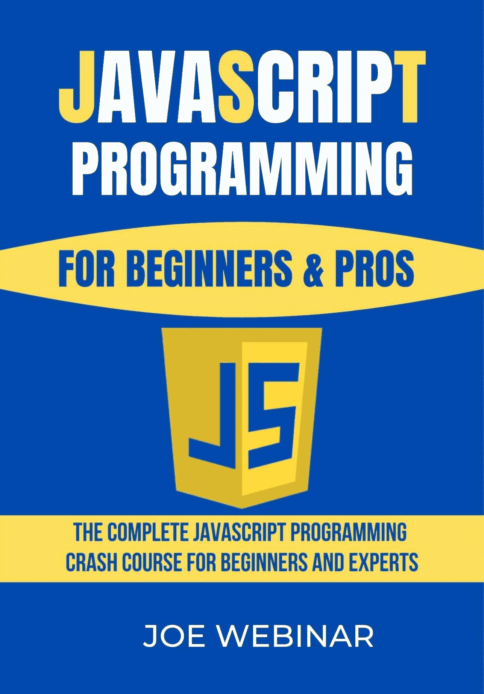

# 引言

欢迎来到 JavaScript 学者指南，在本指南中，你将从零开始学习 JavaScript。你将学习 JavaScript 编程概念，如变量、创建变量、条件语句以及 JavaScript 函数。你还将创建一些项目。

在课程中，你将对 JavaScript 和 Chrome 开发者工具进行实验。你将利用它们来实验 JavaScript。你还将使用文本编辑器来探索 JavaScript 的核心概念。

如果你想成为一名 Web 开发人员，你会好奇应该学习哪些编程语言。不仅如此，你还想知道应该关注哪些语言。毫无疑问，`JavaScript` 是一项重要的 Web 技术，但可能你不确定它是否真的那么相关。在有这么多 `JavaScript` 框架提供现成可用代码的情况下，真的有必要从头学习 `JavaScript` 吗？

在本指南中，你将探索 `JavaScript` 的作用以及它现在是否仍然有用。接下来，你将看到学习 `JavaScript` 的一些主要原因，并考虑为什么在学习库和框架之前，先学习原生的 `JavaScript` 是必要的。

本指南的基础要求是具备一些 `HTML` 知识。这并不是强制性的，但将会有帮助。这样当你在使用 `JavaScript` 创建项目时，你对 `HTML` 会有更好的理解，因为 `JavaScript` 是在所有网站的结构基础之上工作的。你需要一台电脑，并且强烈推荐使用 `Google Chrome`。其他浏览器也有用，但为了让我们专注于重点，强烈推荐使用 `Google Chrome`。

`JavaScript` 是你让网站和许多应用程序具有交互性的。当你点击按钮时发生了某些变化，那就是 `JavaScript` 在起作用；当你点赞推文、Instagram 照片或 Facebook 帖子时，也使用了 `JavaScript`。

# 第一章

## JavaScript 概念

### 什么是 JavaScript？

`JavaScript` 是一种轻量级的解释器或即时编译编程语言。那么什么是轻量级语言？轻量级语言意味着在 `JavaScript` 中编写代码要简单得多，不像 `Java` 或 `C++` 等其他编程语言。如果你将 `JavaScript` 的语法与其他编程语言相比，你会发现 `JavaScript` 更容易编写。这就是为什么与 `Java` 或 `C++` 等其他语言相比，它被被称为轻量级语言。

### JavaScript 是做什么的？

简单来说，`JavaScript` 是一种用于让网站具有交互性的编程语言。如果你考虑网站的基本组成，你有 `HTML`，它负责描述和定义网站的基本内容和结构（`HTML` 是网站的骨架结构），然后你有 `CSS`，它告诉浏览器如何显示这些 `HTML` 内容，或者确定颜色和字体等属性（`CSS` 是覆盖在骨架结构上的皮肤）。仅有 `HTML` 和 `CSS`，你就有一个看起来不错但功能无的网站。`JavaScript` 通过添加功能让网站变得活跃（`JavaScript` 是骨架的大脑，允许它思考或推理、计算、执行某些逻辑操作等）。

`JavaScript` 负责用户可以交互的元素，例如下拉菜单、模态窗口和联系表单。它还用于创建动画、视频播放器和交互式地图等内容。

`JavaScript` 是一种通用编程语言，这意味着它可以在整个软件堆栈中运行。`JavaScript` 最流行的应用是在客户端（前端），但自从 `Node.js` 出现，许多人也在服务器端（后端）运行 `JavaScript`。当在客户端使用时，`JavaScript` 代码在用户的浏览器中被读取、解释并执行。当在服务器端使用时，它在远程计算机上运行。你可以在我们随后的章节中了解更多关于前端和后端编程之间的区别。

`JavaScript` 不仅用于创建网站。它还可以借助某些框架构建基于浏览器的游戏，或用于不同操作系统的移动应用。新库和框架的出现使得使用 `JavaScript` 构建后端程序（如 Web 应用和服务器应用）成为可能。

### 你应该先学什么：原生 JS 还是框架与库？

在决定是否学习 `JavaScript` 时，你实际上是在问是否应该学习“原生”的 `JavaScript`。`Vanilla JavaScript` 指的是不带任何库或框架的纯 `JavaScript`。现在让我们详细地探索一下它的含义。

### 什么是原生 JavaScript、库和框架？

如果你研究“vanilla JavaScript”这个术语，可能会遇到一些困惑，然而，你只需要知道 `vanilla JavaScript` 被用来指代原生的、基于标准的、非扩展的 `JavaScript`。`vanilla JavaScript` 和 `JavaScript` 之间没有区别，它的存在仅仅是为了强调在不使用库和框架的情况下使用原生 `JavaScript`。

### 什么是库和框架？

`JavaScript` 库和框架都包含一组预先编写的、现成用的 `JavaScript` 代码，但它们不是一回事。你可以将框架看作构建网站的蓝图，它为你提供了一个工作结构，并包含了现成的组件和工具，这些工具可以帮助你比从零开始编码更快地构建某些元素。流行的 `JavaScript` 框架包括 `Angular`、`React`、`Vue` 和 `Node.js`。框架也包含了库。库比框架小，倾向于用于更特定的场景。

一个 `JavaScript` 库包含一组 `JavaScript` 代码，可以调用这些代码来实现某些功能和特性。想象你想要在网站中编写一个特定的元素。你可以从头写十行 `JavaScript` 代码，也可以从你选择的 `JavaScript` 库中获取精简的现成版本。`JavaScript` 库的示例包括 `jQuery`、`Lodash` 和 `Underscore`。

理解框架和库如何协同工作的简单方法是想象你正在盖房子。框架提供了基础和结构，而库允许你添加现成的组件（如家具），而不是从头开始建造。你可以在这篇解释 `JavaScript` 和 `jQuery` 之间主要区别的文章了解更多关于语言与库之间的关系。现在，让我们回到最初的问题：学习原生 `JavaScript` 有多重要？

### 为什么你需要先学习原生 JavaScript？

在学习 `JavaScript` 时，跳过直接学习你提到的那些节省时间的框架和库是非常具有诱惑力的，许多开发者也确实这样做。然而，先学习原生 `JavaScript` 有许多令人信服的理由。虽然 `JavaScript` 框架可能帮助你更快地完成工作，但如果你不理解框架背后的核心概念，你就无法走远。一些前端开发人员描述了不学原生 `JavaScript` 如何在他们开始学习 JavaScript 框架 `Node` 和 `Express` 时反噬他们：

> “当我在 `Node` 和 `Express` 中编写越来越多的代码时，我开始在最细微的问题上卡壳。突然，我被 `callbacks`（回调）、`closures`（闭包）、`event loop`（事件循环）和 `prototype`（原型）等词包围。感觉就像我重新介绍了 `JavaScript`，但这次它不是在摇篮里玩的婴儿，而是一个神秘的怪物，由于我没有认真对待它而在每一步都挑战我。”
>
> “使用 `JavaScript` 框架工作很有趣，直到我陷入了原型和子类的继承问题，感觉就像我从未处理过 `JavaScript` 一样。”
>
> “`JavaScript` 框架是最好的，但建议熟悉 `JavaScript` 的基础以便轻松导航。”

### JavaScript 还值得学吗？

Web 开发世界在不断变化。随着不断有新工具涌现，要清楚应该把精力放在哪里极其困难。作为一名有抱负的开发者，你会希望你所学的内容在当今行业中仍然适用。

如果你对 `JavaScript` 产生怀疑，那么你需要知道，自 1995 年诞生以来，`JavaScript` 已经在网络上无处不在，而且在短期内不太可能改变。根据研究人员的开发者调查，`JavaScript` 已连续第七年成为最常用的编程语言。它目前被 94.5% 的网站使用，尽管最初被设计为客户端语言，但 `JavaScript` 现在已经进入了网站的服务器端（得益于 `Node.js`）、移动设备（得益于 `React Native` 和 `Ionic`）以及桌面端（多亏 `Electron`）。

只要人们还在与网络交互，`JavaScript` 就具有极高的相关性，毫无疑问，这是一门值得学习的语言！考虑到这一点，让我们来看看成为 `JavaScript` 专家的一些核心优势。

## 学习 JavaScript

学习 `JavaScript` 最而易见的原因是为了成为 Web 开发者。精通 `JavaScript` 将让你能够从零构建网站，这在当今的就业市场上是一项非常实用的技能！如果你想成为一名 Web 开发者，以下是你应该学习 `JavaScript` 的原因：

*   **JavaScript 对初学者非常友好**

    与其他许多编程语言相比，`JavaScript` 提供了进入编程世界最适合初学者的入门点之一。`JavaScript` 的伟大之处在于，它内置在每个现代网络浏览器中，不需要设置任何开发环境，这意味着你可以立即开始编写 `JavaScript` 代码！

*   **即时反馈**

    学习将 `JavaScript` 作为你的第一门编程语言的另一个优势是你可以获得即时反馈；只需极少的 `JavaScript` 代码，你就能立即看到可见的结果。在 `Stack Overflow` 等网站上还有一个庞大的 `JavaScript` 社区，因此你在学习过程中会找到大量的支持。

*   **它将帮助你学习可迁移技能**

    `JavaScript` 不仅对初学者友好，它还能让你掌握一些非常有价值的可迁移技能。`JavaScript` 支持面向对象、函数式和命令式的编程风格，这些技能可以迁移到你以后学习的任何新语言，例如 `Python`、`Java` 或 `C++`。`JavaScript` 为关键原则和实践提供了重要的介绍，这些这些将伴随你的整个开发者生涯。

*   **最终，对于任何 ICT 发展路径，精通 JavaScript 都是必修课**

    `JavaScript` 是世界上最流行的编程语言，难怪 `JavaScript` 是今天 Web 开发行业中最受青睐的技能之一。根据研究人员 2020 年的报告，70% 的公司正寻求招聘 JavaScript 专家。在 `Indeed` 招聘网站上搜索词“`JavaScript`”，你会发现美国有数千份需要这项技能的工作。在 `LinkedIn` 上进行同样的搜索，结果超过了 125,000 条。

    同时，全球对 `JavaScript` 的需求似乎超过了市场上的专家水平。根据 2021 年的研究人员发现并报告，全球 48% 的雇主需要具备 `JavaScript` 技能的开发者，而只有 42% 的学生开发者声称精通 `JavaScript`。

    `JavaScript` 专家不仅需求量，而且薪水很高。在 `US`，`JavaScript` 开发者的平均年薪为 $111,953 美。学习 `JavaScript` 可以提高你作为开发者的潜力。

*   **JavaScript 专家是多才的**

    `JavaScript` 是一门极其多功能的语言。一旦你掌握了它，可能性就是无限的：你可以使用 `Angular` 在客户端（前端）编写代码，使用 `Node.js` 在服务器端（后端）编写代码。你还可以使用 `React`、`React Native` 和 `Electron` 开发 Web、移动和桌面应用，甚至可以利用你的 `JavaScript` 知识参与机器学习。

    如果你想成为前端开发者，`JavaScript` 是前提条件。然而，这并不是你作为 `JavaScript` 专家可以走的唯一职业路径。精通这门关键编程语言可以让你从事全栈开发、游戏开发、信息安全软件工程、机器学习和人工智能等，这只是一例！

## 学习 JavaScript 的最佳方法是什么？

如果你想成为任何类型的 Web 开发者，都需要学习 `JavaScript`，并且你应该从最基础的原生 `JavaScript` 开始。学习 `JavaScript` 的最佳方法是亲手实践。一旦你阅读了 `JavaScript` 是什么以及它是如何工作的，就在你的浏览器中尝试它。如果你使用的是 `Google Chrome`，只需点击“查看”（三个垂直点点图标），然后从下拉菜单中选择“更多工具”。从那里，选择“开发者工具”，导航到“控制台”，那里是专门为 `JavaScript` 环境设计的，你就可以开始了！

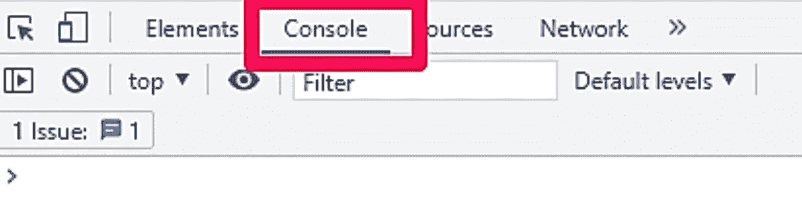

## 前端和后端开发

打开一个新的浏览器标签页，输入 URL 链接并按回车。网站立即加载，具有极其整洁的布局、结构良好的页面和令人印象深刻的视觉效果。

前端和后端是计算机行业中最常用的两个术语，在某种程度上，它们已经变成了流行词。它们决定了你作为软件开发者所的工作类型、你使用的技术以及你的薪水。

### 这两个术语之间的区别

它们存在的原因以及在开始前端和后端开发之前，你在软件开发职业中可以采取的不同路径。你只需要理解什么是网站渲染就可以开始这段旅程

## 理解网站渲染概念

通俗来说，网站渲染意味着生成或渲染 `HTML` 输出。`HTML` 是 Web 开发者用于创建网页的标记语言。据说网站渲染可以发生在服务器端，也可以发生在客户端。需要注意的是，前端和客户端是同义词。后端和服务器端也是。

### 服务端渲染（后端）

首先，你将谈论服务端渲染，即后端开发。随着时间的推移，服务端渲染或后端 Web 开发一直是创建网站和 Web 应用的默认方式。当你访问一个页面时，发送内容请求，服务器处理该请求并创建一个发送回浏览器的响应。

当网站进行服务端渲染时，创建你的网络浏览器可以理解的 `HTML` 页面的所有过程都是在托管网站或 Web 应用的远程服务器上处理的。这包括查询数据库信息以及处理你的 Web 应用所需的任何逻辑。当远程服务器忙于工作时，你的网络浏览器处于空闲状态，等待服务器完成请求处理并发送响应。当接收响应时，网络浏览器解释它并在屏幕上显示内容。

### 客户端渲染（前端）

在更现代时期，出现了一种新的网站渲染形式，称为客户端渲染或前端开发。在客户端渲染中，网站内容的渲染发生在你的计算机上，而不是在远程 Web 服务器使用 Web 的默认语言 `JavaScript` 完成。

在实际操作中，这意味着服务器只需要提供原始 Web 应用，而浏览器将负责将应用程序渲染成最终形式，这种形式主要在 `HTML` 语言端。这意味着创建网页涉及的一些逻辑，特别是负责处理如何在屏幕上向用户展示内容的逻辑（称为展示逻辑），是在客户端处理的。客户端渲染随着 `Angular`、`React` 和 `Vue` 等 `JavaScript` 库的出现而变得流行。

假设你决定开始经营自己的业务，例如开一家烘焙店或裁缝店。你需要一个专业的网站向客户展示你的公司，并告诉他们你的所在地。也许你还会包含几张照片和一些关于产品的信息。你只需要前端技术来构建你的网站。

## 什么是前端开发？

既然你已经理解了不同的网站渲染方法，那么就更容易理解：前端开发是创建在客户端渲染的网站和 Web 的艺术。

## 前端开发使用的技术

有很多不同类型的技术和栈，大多数前端 Web 开发者使用 `HTML`、`CSS` 和 `JavaScript`（这些是 Web 的事实性基础），以及 `Angular`、`React`、`Stencil` 和 `Vue` 等客户端框架。然而，并不是一切都发生在前端，客户端渲染的应用程序仍然依赖运行在后端远程服务器或云端的服务和 API。

## 前端工作

- **网页设计师 (Web designer)**：这是对网站的设计。网页设计师的职位名称范围很广，可以是指网页设计师，也可以只是一个在 `Photoshop` 或 Fireworks 等程序中设计了网站但从未碰过代码的人；但在其他情况下，网页设计师可以完成所有的设计，进行 `Photoshop` 操作，然后负责创建所有的 `HTML` 和 `CSS`，甚至为了配合而编写 `JavaScript`。

- **用户界面 (UI) 设计师**：这是一种视觉设计师，通常关注设计本身。他们通常不参与设计的实现，他们可能对 `HTML` 和 `CSS` 并不了解，但具备基础知识。因此，他们可以更有效地向前端开发传递他们的想法。

- **用户体验 (UX) 设计师**：UX 设计师与前端合作，他们研究和探索人们如何使用网站，然后通过大量的测试进行更改。

- **前端开发者 (Front-end developer)**：前端开发者在不进行任何后端开发的情况下创建网站，他们在没有 Web 开发者或不使用后端的情况下创建网站主要被称为静态网站。静态网站类似于餐厅网站或理发店网站，不需要将任何信息存储在数据库中。除非需要重新设计前端，否则页面将始终保持不变。开发者可能需要使用 `HTML`、`CSS` 和 `JavaScript` 来运行修改以控制静态页面。这个人可能具有或没有在设计程序中创建设计的经验。

该标题的另一个版本是前端工程师。使用 `JavaScript` 等特定前端语言的人也被认为是前端开发者。

# 第二章

## JAVASCRIPT 基础

### 代码编辑器

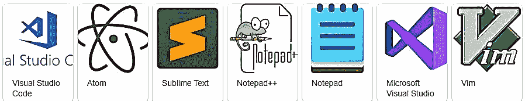

代码编辑器也被称为“文本编辑器”，主要供程序员使用。有数百种免费版本和其他付费版本。上面的插图是文本编辑器的免费版本。

### Visual Studio Code

强烈建议使用一种文本编辑器，在本指南中，你将使用 visual studio code 编辑器。让我们开始吧：

- 首先，确保你已经连接了活跃的互联网连接

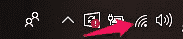

- 一旦确认了互联网数据连接，打开你的网页浏览器并输入“Visual studio code”

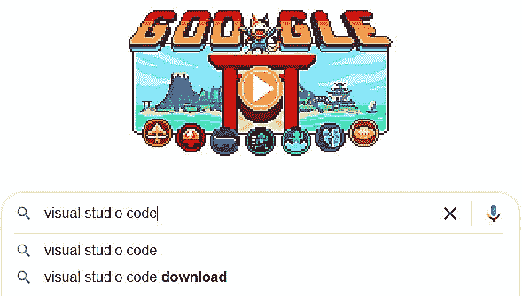

- 注意，“Visual studio code”和“Microsoft visual studio code”之间存在区别，两者都由微软所有，但“Visual studio code”仅限于编码且是完全免费的，而“Microsoft visual studio code”不仅限于编码，还有团队支持和付费版本，这意味着它不是完全免费的

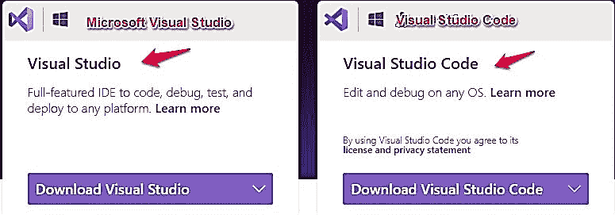

- 让我们通过访问 URL 链接 [`code.visualstudio.com`](https://code.visualstudio.com) 或在“Google”上搜索“Visual Studio Code”，只需点击标题“Visual Studio Code – Code Editing Redefined”来下载我们的“Visual studio code”

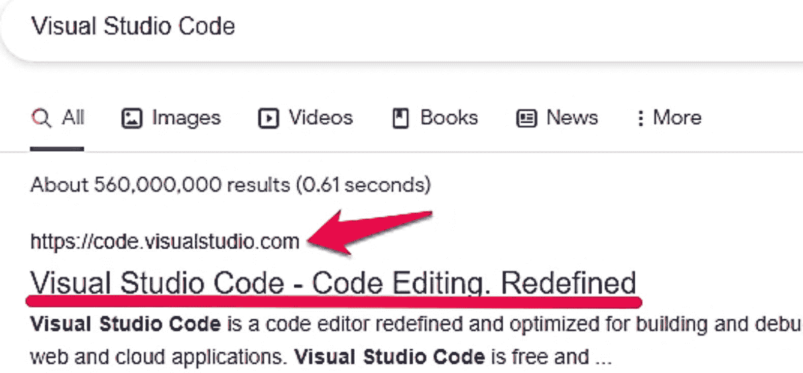

下方是你将被重定向到的地方，即下载某个版本“Visual Studio Code”的官方网站，如果你不是 Windows 操作系统的用户，只需点击“Download for Windows”旁边的小箭头；但如果你是 Windows 用户，只需直接点击“Download for Windows”按钮内部即可

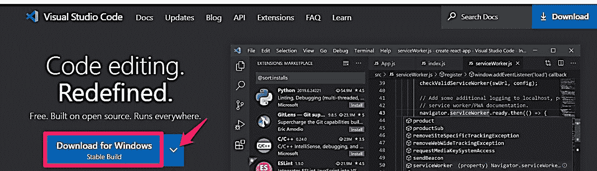

你将看到如下所示的其他操作系统选项，还有“Other download”以防你的版本未包含在内，一旦点击你特定的操作系统，下载将自动开始

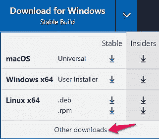

对于某些浏览器，你可能会被要求选择位置（安装程序下载到哪里），而其他浏览器可能已经设置好，但大多数浏览器的默认值是“下载文件夹”

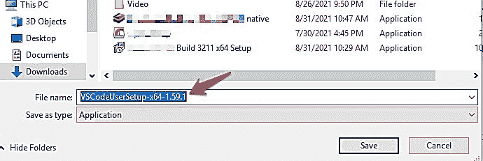

你也可以通过其官方页面 [`visualstudio.microsoft.com`](https://visualstudio.microsoft.com) 访问“Microsoft Visual Studio”，当你滚动到如下所示的下载部分时，你可以获取链接进入“Visual Studio Code”。你有“Visual Studio”、“Visual Studio Code”和“Visual Studio for Mac”，选择“Visual Studio Code”，它会将你重定向到你将要使用的精确版本

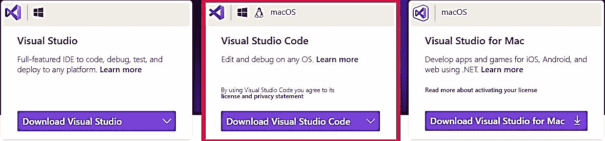

### JavaScript 基础语法

在本指南中，你将被教如何在 `JavaScript` 中创建一个基础语法程序。但在开始此程序之前，你只需要理解 `HTML` 和 `JavaScript` 之间的区别，以及 `HTML` 如何与 `JavaScript` 交互。

`HTML` 没有任何智能性，这意味着 `HTML` 不是智能的，这意味着如果你在 `HTML` 中进行数学运算，这在 `HTML` 中是不可能的。你无法判断人们是否正确填写了表单。它无法根据网络访问者如何与其交互来做出决策，基本上，`HTML` 允许人们阅读文本、查看图片、观看视频并点击链接移动到另一个网页。`HTML` 的实际任务是为你的网页添加智能，以便它们能够响应你的网站访问者，为了这个目的你需要 `JavaScript`。

`JavaScript` 让网页能够与其智能地反应或行动。你可以创建一个智能表单，让访问者知道他们何时忘记了包含必要信息，这意味着你可以让一个元素出现或消失。怎么做？`HTML` 设计用于为 `HTML` 网页添加交互性，这意味着你可以将 `HTML` 和 `JavaScript` 交互或互连在一起。

记住，`JavaScript` 是一种脚本语言，而 `HTML` 是一种超文本标记语言，脚本语言是一种轻量级编程语言。请记住 `JavaScript` 通常直接嵌入 `HTML` 表单中。现在我将告诉你如何一起创建 `JavaScript` 和 `HTML`。

### JavaScript 中的内部声明

这是我们的第一个编码章节，你将看到如何创建一个基础语法程序，或者你可以说 Hello World 程序是计算机编程中一种经典或久远的传统。对于初学者来说，这是一个可靠且完整的编码程序。它是检查环境是否正确配置的良好方法。

打开你的“visual studio code 编辑”，让我们编写第一个脚本。一旦你打开了“visual studio code 编辑”，你将来到这里，点击“New file”，你将获得创建新文件的权限

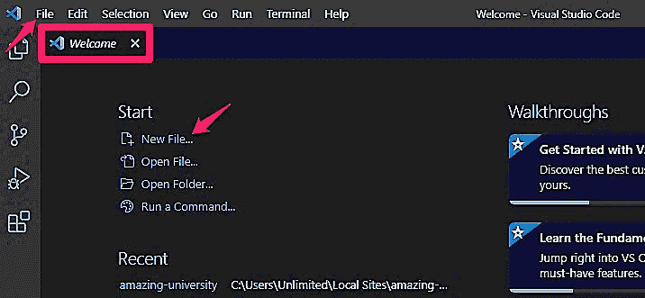

如果你无法看到此“welcome tab”标签页，请如上方插图所示点击位于标题栏的“file menu”，它也将为你提供新文件选项，或者你可以从键盘上按下快捷键 `Ctrl + N` 来创建新文件。

一旦你成功创建一个新文件，默认它的名称将为“Untitled-1”，这表示或显示该文件尚未定义。你可以点击“选择语言”（select a language），也可以进入文件菜单选择“保存”（save option），或者从键盘上按下 `Ctrl + S`。

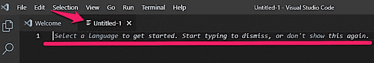

无论哪种方式，只要你使用一种保存方法，就会弹出一个对话框。重命名“Untitled-1”，让我们使用“basic syntax”作为“文件名”，并将“HTML”作为文件类型（称为“另存为类型”，Save as type）。确保你通过点击文本框选择 `Html` 作为文件类型，因为默认情况下你会看到代表文本文件类型的“txt”，或者直接按照我的图示操作以防混淆。同时请注意你保存 `Html` 文件的目标位置（位置），以备后之用。还需要注意，`Html`、`js`、`txt`等是告知执行器的扩展名，语言就是该扩展名，没有它，代码将无法运行。完成此部分后，点击“保存按钮”（save button）。

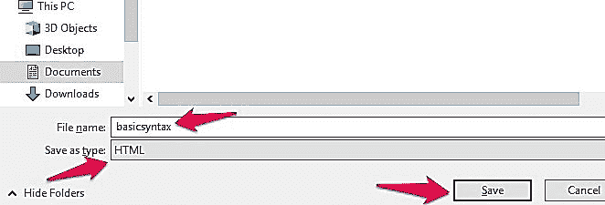

下面的图示是创建网页的标准结构，这就是为什么强烈建议在学习 JavaScript 之前更多关于 HTML 和 CSS 的知识，以便更轻松、更好地理解。因此，指示箭头是你编写每个代码（包括 JavaScript）的地方。

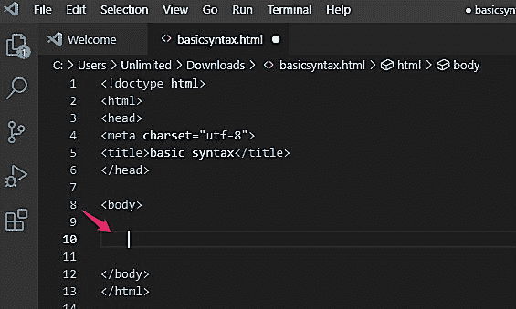

让我们也用创建 `Html` 文件相同的方法创建一个 JavaScript 文件，但这次你选择的是 javascript 扩展名。确保在命名时使用相同的名称。注意，一旦你指定了文件类型，你可能包含 `.js` 也可能不包含，只要文件类型已设置好就可以了。最后，确保 `Html` 和 JavaScript 文件都在同一个文件夹中。

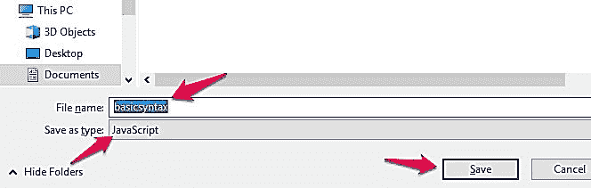

如你所示，我将它们保存在同一个位置，这样在将它们连接时就可以轻松访问，而无需编写复杂的代码来调用它们。

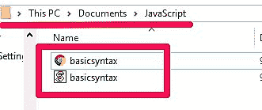

在我们的 `Html` 脚本（即我们的网页）中，创建一个 JavaScript 环境，即 `<script> </script>`。这将写在 `Html` 的 body 标签内部，每个成对的标签一个没有斜杠，另一个带斜杠。不带斜杠的是起始标签，带斜杠的是结束标签，请注意。

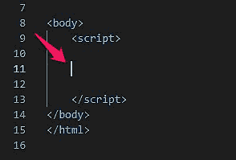

为了使脚本成为 JavaScript 基础，你需要指定语言、类型以及 `src`（代表 source，来源）。

- `language` 属性指定你正在使用的脚本语言。
- `type` 属性是现在建议包含或指示正在使用的脚本语言的，其值应设置为 `text/javascript`，这意味着你正在使用 JavaScript 的文本文件。

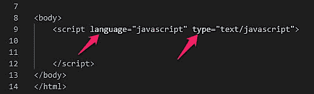

在起始脚本和结束脚本之间是我们的 JavaScript 代码所在的地方，你将输入 `document.write(“Hello World”)`，这是 JavaScript 中将 JavaScript 函数调用到 Html 代码中的方法，它会自动反映在你的浏览器中。每种编程语言都有自己的语言含义命令，例如 C++ 使用“cout”方法，Python 使用 print 方法，其他语言的命令也随编程语言而异。

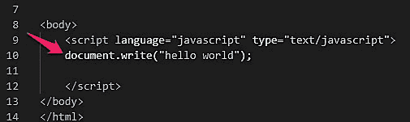

进入你存储“basicsyntax”文件（包括 JavaScript 和 `Html` 脚本）的位置。注意：`Html` 脚本始终带有你默认浏览器的图标，而 JavaScript 则保持不变，带有自定义的“S”图标，所以双击 `Html` 的“basicsyntax”图标。

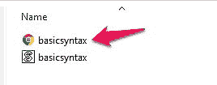

一旦双击“basicsyntax” `Html` 文件，它将自动打开你的默认浏览器，并应该反映出“Hello World”。

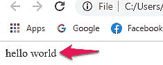

### JavaScript 中的外部声明

Html 文件中的任何 JavaScript 声明完全都是内部声明或脚本，但一旦它进入其环境，它就会自动变成可以链接到 Html 环境的外部脚本。主要来说没有区别，外部声明只是为了代码整洁且结构良好，而内部声明主要用于此类代码声明，一旦代码是外部的，建议这样做以防复杂或弄乱你的代码。

打开你的 JavaScript 文件并输入 `document.write(“Hi!, you are learning javascript”);`。

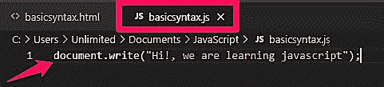

如果没有与 Html 文件链接，上面的代码将毫无用。因此，你将使用 `src`。`src` 属性是将 JavaScript 连接到 Html 环境的来源属性。因此，在你的 `Html` 文件的脚本内链接 `baicsyntax.js`。

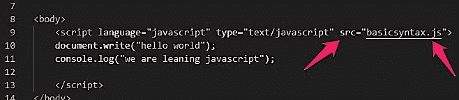

现在，回到浏览器，刷新它。这次你的结果不会出现在你的 `console.log` 中，而是直接显示在浏览器屏幕上，因为我们外部 JavaScript 的声明已经与 `Html` 链接在一起了。

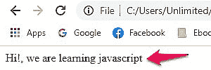

希望你现在理解了如何通过内部和外部的替代测试方法编写我们的第一个 JavaScript 程序。

### 获取 JavaScript 输出的替代方法

要获取查看输出结果的替代方法，需要理解 JavaScript 带来的灵活性，这种灵活性使其在所有浏览器中都具有不可抗力，每个浏览器都有 `console.log`，它为代码预测试提供了空间，除非必要，否则不会影响你的显示浏览器。

让我们开始吧，在 `document.write(“hello world”)` 下输入 `console.log (“you are learning javascript”)`。一旦你完成输入。

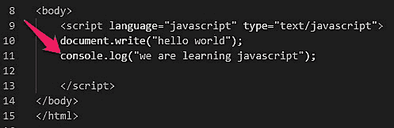

去浏览器并刷新浏览器，“you are learning javascript”并没有被包含在。

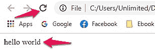

在“Hello world”输出的空白（普通）界面上点击右键。会弹出一个对话框以便更好地理解，确保你也在使用 Chrome 浏览器，因为浏览器功能各异，解释每个浏览器可能会因为网络上有数百个浏览器而分散注意力。

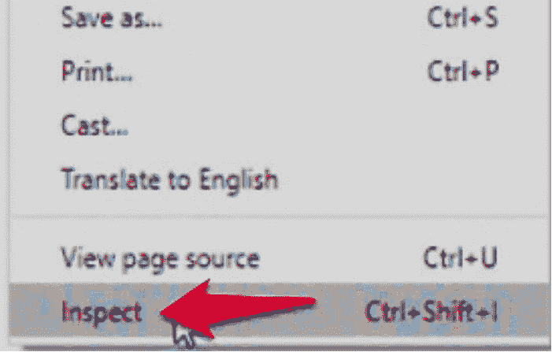

在你的右侧，会出现一个面板，选择“console”，你就会看到“you are learning javascript”，如果没有看到，确保你已经在文本编辑器中保存了代码并刷新了浏览器或重新检查所有步骤，否则如果忽略正确的检查，它仍然无法工作。除了你的结果，你的 `Html` 文件名会被反映出来，声明“you are learning javascript”的行也会被显示。对于我来说，我的数字是“11”，如果你检查之前的图示，我的 `console.log` 在“第 11 行”。这主要用于参考目的，以防在大量代码中出现任何问题或反映代码所在的位置。

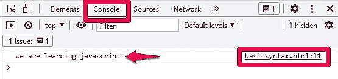

你也可以点击右角有三个垂直点的地方，会出现一个对话框，选择“更多工具”（More tools），然后会出现一个点击“开发者工具”（developer tools）的选项，你可以在那里也获得你的 `console.log`。


确保你点击了“console”，你的背景或其他方面可能会有所不同，但你仍然应该得到相同或相似的结果。如你在这里看到的，你开发者控制台，你可以在其中编写一些代码。在这个特定的控制台中，你可以开始编写脚本代码。

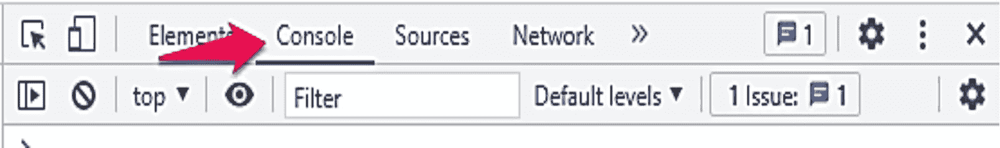

此外，此控制台可能附加在你的网络浏览器上。不过，你可以点击控制台右角的三个垂直点将其分离，并点击下图所示“停靠（dockside）旁边的第一个选项。选项如下：“停靠到独立窗口（undock into a separate window）”、“停靠左侧（dock to left）”、“停靠底部（dock to the bottom）”和“停靠右侧（dock to right）”。当你选择第一个选项时，它会在独立窗口中解锁，你也可以点击尝试其他选项，这不会损坏你的浏览器，只是为了定位

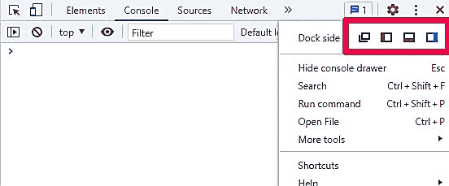

在某些情况下，你可能会收到来自 `console.log` 的错误信息，只需忽略它们即可。这是由于网络连接较慢，当你打开控制台时可能会遇到此类警告。不过，你可以直接忽略它。

### 使用控制台编码

在我们的控制台中开始编写 JavaScript 代码之前，有几点关于控制台我想让你注意的。现在，让我们直接从 `console.log` 开始编码。对于这个控制台以及每种编程语言，第一个程序通常是显示我们通用的“Hello world”。

在本节中，你将尝试在控制台中本身显示“Hello world”。在 JavaScript 中，每当你需要执行与控制台相关的操作时，都需要输入 `console`，因为你想在控制台上显示或记录特定消息，你会说 `console.log` 然后包含一个括号，你可以在其中传递你的消息。例如，假设你想说 hello world，只需如如下所示传递在括号之间即可

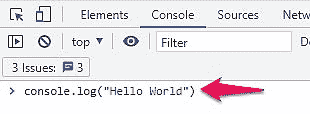

一旦你按下键盘上的回车键（通常位于你右侧的“enter key”），你将自动获得输出结果，如下所示，这意味着当你点击回车键时，控制台会立即执行你写的每一行代码。

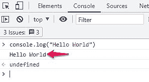

现在你可以在控制台中显示任何内容了。万一你想显示自己的名字，只需输入 `console.log` 并输入任何名字。当你执行时，它就会为你执行该代码

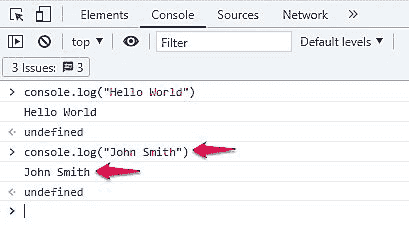

#### 清空控制台

如果你想清除上面的代码 `console.log("hello world")` 和 `console.log("john smith")`，也有对应的命令。

输入 `console.clear()` 然后按回车，控制台就会清空（带有一个括号）。每当你想清空控制台时，输入带括号的 `console.clear()` 并按回车，控制台就会清除。

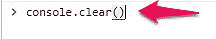 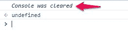

### 原始类型与数学运算符

你将从基础内置原始数据类型开始。每个编程语言的核心思想之一是区分不同类别数据的能力。例如，一种语言可以区分数字和单词，或者它可以区分整数和小数，或者正数和负数。这些都因语言而异。

#### JavaScript 中的五种基础原始数据类型

有五种底层基础数据类型，它们是：数字、字符串、布尔、null 和 undefined

##### 1. 数字 (Numbers)

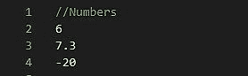

这里有三个例子：整数、分数、小数 7.2 以及负数 -20。我选择这三个是因为我想向你展示 JavaScript 并不关心数字是整数、分数还是负数。它们都被视为数字，这是一个宽泛的类别。其他语言会区分，但 JavaScript 不会，忘记数字只是整数、分数和负数的一个类别即可。为了理解数字如何工作，你将使用数学运算符来解释它们以便更好地理解

##### 数学运算符

为了更好地、更快速地吸收，你将使用 Chrome 控制台来获取快速结果以验证所解释的内容，进入你 Chrome 浏览器中的 `console.log`，你可以按 `Ctrl + Shift + I` 进行检查。这让你轻松访问你的 `console.log` 接口。默认情况下，它会显示元素（element），点击 `console.log` 然后就可以开始编码。

从你的“console”中，当传递像 9 这样的数字并按回车时，它会自动返回。浮点数（小数点）和负数也是如此，这样就无需持有这些值。这只是基础知识；你还没有在编写任何有趣的应用程序。

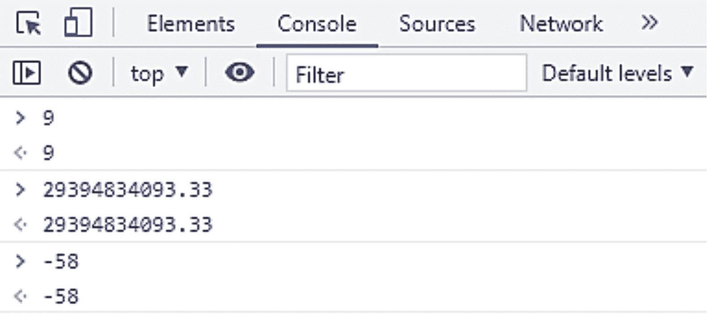

##### 加法运算符 (Addition Operator)

你可以对这些数字做的第一件事是简单的数学运算，这些是你已经熟悉的、与计算机系统无关的基础数学。。诸如加法、乘法、减法和除法。只需编写简单的表达式，例如数字 "four" 加 "fifty"，你可能会注意到我在加号两边使用了两个空格，这并不是强制要求的，只是为了代码整洁。如果你点击回车，你将自动获得五十四

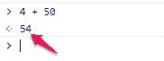

你也可以在不留空格的情况下 "four" 加 "fifty"，它仍然会正常工作。

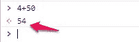

这些是简单的运算符。你还可以通过输入 "ten" + "thirty-five" + "fifty-five" 将它们链起来，你将得到 "one hundred"

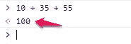

##### 除法运算符 (Division Operator)

你也可以使用其他运算符如除法，例如，“ten”除以“five”，等于“二”

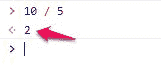

你也可以做像 "one" 除以 "three"，如下所示，我们得到了零点三

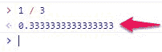

##### 减法运算符 (Subtraction Operator)

你还有减法，假设是 "five" 减 "twenty"，如下所示，答案是“负十五”

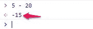

##### 乘法运算符 (Multiplication Operator)

然后你还有乘法，所以 "ten" 乘以 "twenty"，等于 "一百"，这是精确的答案。你看 JavaScript 是多么逻辑且灵活

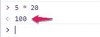

##### 取模运算符 (Modulo Operator)

另一个运算符叫做取模，对于很多没有做过编程的人来说，取模通常被称为余数运算符。在某些其他语言中，它也被称为 modulus。取模使用百分号，除法使用斜杠，乘法使用星号，而取模使用百分号

输入一个简单的取模例子，如 "ten" 取模 "three"。它将取“three”并除以“ten”，看可以进去几次整数，那是“三次”，然后它将取余数。所以，余数，“三”进入“十”，三次是“九”，余数是“一”，这就是你的最终输出。

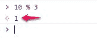

为了更好地理解，让我们尝试另一个取模运算符的例子。“fifty”取模“five”，在这种情况下，“五”进入“五十”十次没有余数，所以你会得到“零”

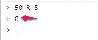

##### 运算顺序 (Order of Operation)

另一个重要的概念是，JavaScript 遵循所有普通数学遵循的运算顺序。类似于 "ten" 减 "eight" 乘以 "twenty" 的将遵循运算顺序，括号表示 "ten" 减 "eight" 需要先执行，然后乘以 "twenty "

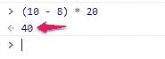

##### 2. 字符串 (Strings)

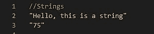

字符串是文本，重要点是它们位于引号内部，如上所示。你也可以看到你有两个例子，引号内有单词“hello this is a string”，这就是一个字符串，尽管它包含多个单词，它仍然是一个字符串；下一行也是如此，它是一个数字 `75`，但它在引号内部。所以，对 JavaScript 来说，它被视为字符串。你可以在字符串中包含数字、文本或任何字符。它们也可以是引号内的数字字符，而这些引号可以是单引号或双引号。例如，输入 `"hello, this is my first string!"` 并点击回车

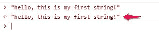

就像之前的数字值一样，它会返回（吐出）该值，你对单引号也可以同样的操作，输入 `hello, here is my single quotes` 并点击回车，它就会将其返回（吐出）给你。注意，它用双引号而不是单引号显示给你，这是因为它们对它们的处理方式是相同的


还需要注意的另一点是，如果你对双引号做了操作，比如 `"hello world'`，并以单引号结束，它将无法计算，它们必须匹配


关于单引号和双引号的另一点是，你可以有一个同时使用两者的字符串。所以，你可以有一个内部包含单引号的双引号字符串，而不会产生错误信息。例如，如果你想要一个显示为 `"I can't stop loving strings"` 的字符串。注意，在双引号内部有一个单引号，位于“can’t”中字母“n”和“t”之间，这是有效的，因为你在外层使用了双引号


如果所有内容都使用单引号，它仍然无法工作，因为这会指示字符串不完整，缺少了一个。下方的插图显示存在一个不完整的意外标识符


##### 字符串拼接 (Concatenation)

你对字符串可以做的操作之一就是将它们相加，就像数字一样，或者你可以写 `"one" + "five"`。你可以做同样的事情，让一个字符串加上另一个字符串，发生的结果是 JavaScript 将它们合并成一个字符串，这被称为拼接。所以，如果你这样做 `"hi" + "here I am"` 并点击回车，你会得到一个返回字符串


如果你想在你最近的结果 `"hihere"` 中间添加一个空格，你只需要在 `"hi"` 的末尾添加空格（即 `"hi "`）或者在字母 "here" 的开头添加空格（即 `" here"`）。现在你可以从我们下面的结果中看到，输出与上面的第一个输出得到了正确的修复。这被称为拼接


##### 转义字符 (Escaping character)

有时你可能想在双引号的字符串内部包含一个双引号，可能你有像 `"she said "goodbye!””` 这样的内容。你希望 goodbye 开头有双引号，且不希望它是单引号，或者你只想那样使用它，而不会因为违反字符串用法而产生错误信息。有一种方法可以做到，称为转义字符。

JavaScript 转义字符都以反斜杠开头，这是一种跳出字符串并编写在字符串中可能无效的特殊字符的方法。所以，输入 `"she said \"goodbye!\" "` 点击回车，你会看到，它返回了你的输入而没有返回错误信息。反斜杠后跟一个双引号就是你告诉 JavaScript 你想在字符串中使用双引号的方法。在大多数浏览器版本中，反斜杠在输出结果中可能可见


如果你不那样做，下面将是你立即获得的错误信息：“invalid or unexpected token”（无效或意外标记）


##### 长度属性 (Length property)

你创建的每个字符串都有一个 `length` 属性，`length` 指字符串中字符的数量。如果你创建一个仅为 `"hello"` 的字符串，并对其带上 `.length`，这将计算 `"hello"` 语句中每个单词的数量。它会告诉你长度是五个字符


如果你执行类似 `"my preferred number is 12345"` 的操作，你会得到 28 作为输出结果，那是 28 个字符。JavaScript 也会将空格计算在内


你可以使用 `length` 属性获取字符串的整个长度，也可以使用方括号符号获取单个字符，例如第一个字符或第五个字符。例如，写下 `"hello"` 后跟一个方括号，在方括号内添加你想调取的特定单词数字，该数字将对应于字符串中你想要的字符的位置，JavaScript 将从“零”开始计数。要获取第一个字符，创建一个字符串 `"hello world"` 后跟方括号，如果你想要第一个字符就使用 `"zero"`，因为 JavaScript 从“零”开始跟踪，这正是插图中的第一个字符。下面，结果是字母“h”，它是第一个字母，因为 JavaScript 从零开始计数，这适用于其他编程语言


如果你想获取字母 `"w"`，你需要从“零”开始手动计数，如你所见，字母“w”是数字“六”。确保计数时包含行间距，否则你可能会得到不同的结果


如果你还想获取最后一个字符，你仍然需要从“零”计数，如果计算得当，那是“十”


你可以使用 `length` 属性知道 `"hello world"` 的长度是 `"eleven"`，这是因为 `length` 属性从一开始计数。它只是字符的数量，但位置是从“零”开始跟踪的，最后一个字符 "d" 的索引总是比总长度少一


##### 3. 布尔值 (Booleans)


下一个数据类型是布尔值，布尔值只有两个选项，它们是真 (true) 或假 (false)，间接说是是或否。没有引号，没有数字，只有 true 或 false 这两个词，如此。在随后的讨论中，这将变得更加清晰。

##### 4. 空与未定义 (Null & Undefined)


还有两个数据类型是 null 和 undefined，它们是值，而不是类别。没有像数字或字符串那样有多种类型的 null 或 undefined。只有一个 null 只有一个 undefined，它们只是你随着时间推移将讨论的值。

### 变量 (Variables)

变量是一个带有名称的容器，在容器内部，你可以存储数据。变量是存在于每编程语言中的概念，其基本概念总是相同的。基本的原始数据类型如字符串、数字、布尔值，变量只是容器或罐子中的一个地方，你可以把这些放入其中并给它们起一个名称供以后引用。然后，当然，变量名意味着你存储在容器中的数据是可以被修改的。

如果你的网站有用户登录功能，你可以拥有一个名为 `current logged-in user` 的变量，它就能记录登录用户的用户名，并且还可以对其进行修改。一旦有人注销，它就会被设为空值或 `false`。你还可以为足球游戏设置另一个变量，它可以在 `player 1` 和 `player 2` 之间切换，该变量负责记录或跟踪在任何时刻应该是哪个玩家操作。因此，JavaScript 中变量的语法非常简单，


`var` 关键字后面的变量名由你决定。无论你想给这个容器起什么名字，在该容器的标签后面都会跟着一个等号用于区分，然后是一个值和一个分号。你之后还会讨论什么时候需要分号，但目前你所做的任何操作，加分号或不加都可以（这将会进行讨论），但现在请在末尾加上分号。


上面是三个变量的示例。第一个是 `var Aname`，我们给这个容器命名并将其设置为字符串 `"Michael is a string"`。下一个是 `var`（代表 variable，变量），你正在创建一个名为 `Anumber` 的变量并将其设置为 `"85"`。最后一个是名为 `Aboolean` 的变量，并将其设置为 `true`，这是一个布尔值。注意，变量可以是任何内容，但不建议以数字数值开头。让我们看看在你的控制台示例中它是如何工作的：变量将被称为 `"Myname"`，你将通过包含你的变量将持有的值 `"Michael"` 来对等号进行赋值，如你所见，你的变量已经存储了，但尚未被声明或调用。你刚刚做的是指令 JavaScript 分留一些空间，并为该空间指定一个名为 `"Michael"` 的名字。这看起来比直接在输出中返回 `"Michael"` 有点困惑。


现在，每当你调用 `Myname` 变量时，你只需要输入单词 `"Myname"`（即你的变量），它会自动带出存储的值 `"Michael"`。它将为你提供 `"Michael"` 或 `Myname` 中存储的任何内容，如下所示


#### 变量的修改

你也可以修改（更改）变量的值，让我们利用你的 `"Myname"` 变量和值 `"Michael"` 来作为如何修改值的延续。要做到这一点，你只需要重新赋值。你只需说 `Myname` 等于，然后我将其更改为 `"Smith"`，这是另一个用于修改 `"Michael"` 的名字。


现在，如果你再次询问作为变量的 `"Myname"`，它将不再识别 `"Michael"` 而是识别 `"Smith"`。因此，这是变量的一个重要特性：它们是可以发生改变的，这也是它们被称为“变量”（variable）的原因之一。


#### 变量的拼接

接下来是如何调用你的值并对其进行拼接。这次我们再创建一个变量，命名为 `"friend"` 并等于 `"John"`


你只需要输入 `"hello there "`，你将把它与你的变量 `friend` 拼接在一起，这会调出 `"John"` 值，并确保在 `"hello there"` 的 `"there"` 后面添加一个空格，这样你的输出才不会突兀。从下面的插图中，你将得到 `"hello there John"`


#### 更改拼接后的变量

现在，让我们改变我们的变量值 `"John"`，它之前被拼接为 `"hello there John"`。要做到这一点，你必须更改调用变量 `friend` 来改变值 `"John"`。现在你只需说 `friend equal to "nobody"`


现在重新输入相同的行 `"hello there"` 加上 `"friend"`，你将得到 `"hello there nobody"`


#### 存储数字

让我们看看你如何在变量中存储数字或任何其他基本数据类型。所以，创建一个名为 `"Mynum"` 的数字等于 `"seventy-five"`


#### 在变量中进行数学计算

现在，每当你引用 `"Mynum"` 时，你将得到 `"75"`，你可以对它进行一些数学等式计算。看看类似 `"Mynum"` 加上 `"twenty-five"` 的结果，你将得到 `"100"`


或者你可以对 `"Mynum"` 取 `"ten"` 的模，你将得到 `"five"`，因为 `"ten"` 可以除尽 `"seventy-five"` 七次，返回的余数是 `"five"`，它作为你的输出被返回


关于变量和 JavaScript 的另一个重要概念是，你可以更改它们的值，也可以更改它们的类型。假设你想将 `"Mynum"` 的值改为字符串 `"50"`。你可以轻松地做到。输入 `Mynum` 等于字符串 `"50"`，无论是字母还是数字都行。它是字符串没关系，在修改之前它是一个数字，但现在它是一个字符串

顺便提一下，JavaScript 并不在乎。在某些语言中，这可能是一个问题，你无法这样做。JavaScript 拥有所谓的“动态类型”特性，这意味着它可以毫无问题地从一种类型变为另一种类型


#### JavaScript 规范

关于变量你最后想提到的点是，关于如何命名它们有一个规范

- **驼峰命名法 (camel case)**：驼峰命名法像这样 `"name"`、`"number"`、`"string"` 等，所有内容必须以小写字母开头


- **蛇形命名法 (snake_case)**：蛇形命名法是另一种在单词之间使用下划线的格式


- **kebab-case 命名法**：还有一种通常被称为 `kebab-case` 或连字符命名的形式，是在单词之间使用连字符。JavaScript 变量应该使用驼峰命名法


### Null 和 Undefined

在 JavaScript 原型的第一部分，你提到了五种基本数据类型：string、number、boolean、undefined 和 null。Null 和 undefined 在最后合并在一起，并说将在后续章节中讨论，你将在这里进行


它们都只是变量可以设置的值，在某种意义上都意味着“无”，但它们之间存在巨大差异。上面的代码展示了这种区别

#### Undefined

如果你像上面那样声明了一个变量 `age`，但没有给它设置或赋值某个值，这意味着它被声明了但尚未初始化值，它被视为 `undefined`

让我们看看它是如何工作的

如果你运行上面所示的代码 `var age` 且没有为它设置值，你是在告诉 JavaScript 为名为 `age` 的东西留出空间，但没有在变量内部存储任何内容（值）。


如果你查询 `age` 变量，它会告诉你 `undefined`


#### Null

假设你想与询问一个完全不存在的东西（如 `colour`）进行对比。它会给你一个实际的错误信息


然后 `null` 是另一种表达“无”的方式。但它非常不同，因为 `null` 意味着某物显式为空或明确不存在，而 `undefined` 仅仅意味着某物还没有值


在这个示例中，你展示了一种可能使用 `null` 的情况：如果你有一个 `current player` 变量，你正在制作游戏，它被设置为当前玩家名字的字符串；如果该玩家死亡，那么游戏结束，你可以将 `current player` 设置为 `null`。以明确表示没有当前玩家，这样就会显示为 `null`。

`Undefined` 在这一点上与 `null` 相似，因为它们都意味着“无”，但有巨大差异，`null` 意味着明确无

`Nothing` 与 `undefined` 的区别意味着某个东西是空的或者还没有值。虽然这听起来差别不大，但随着本指南的进行，你将会遇到 `undefined` 并看到它们之间的区别，这在之后会更有意义，但我只是想让你意识到它们之间存在巨大的差异。

### 有用的内置方法

在本节中，你将介绍 JavaScript 方法，并将使用三个对接下来的练习非常有用的内置方法。这些方法是 `alert`、`prompt` 和 `console.log`。


你会注意到的一点是，我像在 CSS 和 HTML 中一样使用了 JavaScript 注释，所有的 JavaScript 都有定义注释的方法，这些注释只是笔记，不会运行也不会被执行。


所以，你使用双斜杠 `//`，然后放在其后的任何内容都不会被执行。假设 `"ten"` 加上 `"ninety"`，这通常应该是 `"one hundred"`，但它完全不会运行。这就是 JavaScript 中的注释。

你可能想知道如何在不创建或打开另一个浏览器页面的情况下清除你一直在使用的控制台。你只需要输入一个简单的命令 `console.clear()` 或者你可以直接使用 `clear()` 并按回车。这两种方法都能完美工作，其效果是如插图所示清除你的控制台。

 

或者

 

#### Alert

`alert` 有点侵扰性，它的作用是向用户弹出一个消息，提醒用户。语法看起来像这样：`alert` 后面跟着括号，然后在括号内传递你想提醒的内容。所以，你可以放入一个字符串形式的消息，如 `"hello world!"`。如果你按下回车，你将得到一个显示 `"the page says hello world!"` 的弹出通知。


这不仅限于字母；你也可以给它一个数字，这个数字也可以具有逻辑性，例如数学表达式。


#### Console.log

`console.log` 类似于 `alert`，但它的侵扰性小得多。要使用它，输入 `console.log` 后后跟一对圆括号，这会在 JavaScript 控制台中打印某些内容。如果你没有打开控制台，它将不会打印。它是 `console.log()` 开头括号，然后给它一些要打印的内容，比如 `"hello world!"`，不要忘记这可能是其他内容，它的作用仅仅是打印出声明的文本。


然后就像 `alert` 一样，在指南的后续章节中，你只会使用 `console.log`，作为一种为你自己打印内容的方式，而不是打印给普通公众，因为你永远不会期望用户进入控制台，这只是出于学习目的。

#### Prompt

`prompt` 允许你从用户那里获取输入（信息）。输入 `prompt()`，打开括号，然后给它一个你想问用户的问题。

 

 

 

 

 

 

 

 

 

### 在单独文件中编写 JavaScript

在本节中，我们将学习如何在外部文件中编写 JavaScript 并将其链接到我们的 HTML 文档中。

首先，我们需要创建 HTML 结构。

```html
<!DOCTYPE html>
<html>
<head>
    <title>JS Guide</title>
</head>
<body>
    <h1>Header One</h1>
    <h2>Header Two</h2>
    <h3>Header Three</h3>
    <h4>Header Four</h4>
    <h5>Header Five</h5>
    <h6>Header Six</h6>
    <script src="script.js"></script>
</body>
</html>
```

接下来，我们在同一目录下创建一个名为 `script.js` 的单独文件。在这个文件中，我们将添加一个简单的 alert 来测试连接性。

```javascript
alert("Hello World!");
```

一旦保存了两个文件并在浏览器中打开 `index.html`，你应该应该能看到 alert 弹出窗口，这表明 JavaScript 已正确链接并执行。

然后你需要 `source` 属性，并且该属性需要等于你想要在浏览器中加载或反映的文件。你将首先在 `source` 内部放置一个不存在的文件，仅为了显示某些内容，例如一个未 JavaScript 脚本文件，比如“Incorrect.js”。


如果你保存了上述不存在的文件，将其附加到你的 `index` 文件中并返回浏览器，刷新它，发现什么都不起作用，或者对那个声明为弹出警框消息的 JavaScript 文件没有产生任何反应。


进入你的控制台（console），它会提示你加载资源失败，未找到文件，这说明你将错误的 JavaScript 文件传递到了你的 `Html` 文件中。你没有添加 `script.js`，而是添加了 `incorrect.js`，你的浏览器控制台一定会检测到每一个错误。


如果你在该处放了错误的名称，它会告诉你找不到该文件，这在你的控制台中大多是可以检测到的。它不会破坏网站，只会显示给那些知道去哪里看的人看（主要是开发者）。现在，让我们添加正确的文件标签 `script.js` 并保存它。


让我们在浏览器中重新运行代码，你会注意到弹出一个窗口，显示“Hello from the JavaScript File”（来自 JavaScript 文件的问），这是在你的 JavaScript 中声明的。如果你没有得到相同的结果，回去检查你的代码，并确保每个文件都保存为 `index.html` 和 `script.js`。


在你点击“ok”按钮之前，页面不会反映，因为我们的代码是声明在 `head` 标签内部的。所以，每当页面加载时，alert 代码都会自动运行，除非我们的 JavaScript 控制台在你按下回车键时运行代码。


在这种情况下，当你刷新页面时，代码就会运行。你现在想要做的是回到 JavaScript 文件，添加几行代码，而不仅仅是 alert。如果你想让代码询问用户的姓名，然后每当用户输入内容时就打印一条显示“Nice to meet you”（很高兴见到你）的消息，你需要对其进行修改。

要做到这一点，你将使用 `prompt`。输入 `prompt` 并加上一对括号。在括号内部以字符串输入“what is your name”，因为在 JavaScript 中文本总是写在字符串内部。


接下来，你将该内容存储在一个变量中，以便以后使用，你还将通过输入 `var userName = prompt("What is your name?")` 将 prompt 添加到变量中。


下一步是使用该用户名来问候用户。比方“Nice to meet you”，后面加上输入的用户名。你将使用 `alert` 以及在 `console.log` 中。首先，从 `alert` 开始，输入 `alert` 的一对括号，在里面输入字符串：“Nice to meet you”，并确保所有的间距正确，外加上 `username`。


在下一行输入 `console.log` 并加上一对括号，这是为了可见性，以便你可以看到你的输出，中间包含字符串“Also great to meet you,”加上 `username`。你分两次拼接了这些字符串，一次是为了 alert 它们，另一次是为了让它们在 `console.log` 中可见，确保你也保存了 JavaScript 文件和 Html 文件。


现在回到浏览器并刷新，你会立即得到一个 alert 弹出窗口请求你的名字，如下方的图所示。


发生的第一件事是它询问你的名字，所以你需要输入你的名字。


一旦你点击“ok”按钮，另一个弹出框会出现在面前显示“Nice to meet you, Robert”。


现在，如果你点击了“ok”按钮并继续打开你的 `console.log`，你也会看到“Also great to meet you, Robert”，在你的右侧你会注意到链接 `script` 即 `script.js`，那是你的声明被调用的地方，在最后一个单词即第 3 行，指示了执行该精确单词的具体行。


本节就此结束。`prompt` 询问用户某些输入，并将其存储在变量中。`alert` 可能会干扰操作，`alert` 总是会在你的浏览器前端反映，一旦被实现或声明，就无法隐藏。最后，`console.log` 用于向控制台打印某些内容。

#### 练习 1

##### 问题 1：长度计数

评估以下语句：

1. `100 % 3`
2. `("Michael " + "Smith") [10]`
3. `"hello".length % "hi\\".length`

在这里，你需要检查你对百分比符号、两个字符串之间的加号、方括号或链接以及双反斜杠的概念化理解。所以，请在脑中尝试评估这些值。

##### 问题 2：用户输入

这个将涵盖你刚刚学过的变量、字符串、`prompt` 和 `console.log` 方法。同时，你将在单独的文件中编写你的 JavaScript，所以你需要创建一个 `Html` 文件、一个 JavaScript 文件，以及一个 `script` 标签来连接它们，然后在浏览器中运行它。


你需要制作一个简单的 JavaScript 存储器。当你刷新页面时，它会询问你的名、姓、年龄，然后会打印出一个字符串显示“Your full name is firstname (任何输入的内容), last name (输入的名字), age (输入的年龄)”。

注意：确保每个单词之间用空格隔开，你的全名句子和年龄句子应该分行显示。你并不一定需要在 Html 的 body 中有任何 Html 文本，它可能是一个空白的 Html 页面，但最重要的方面是让你的弹出窗口执行其职责，并反映在你的 `console.log` 中。

##### 问题 3：年龄计算器

年龄计算器询问你的年龄（岁）。例如，如果你是 35 岁并输入 35，它会告诉你你活了多少天。它不询问你的出生日期或月份，仅仅是将你给出的数字（如 35）乘以三百六五。

下面是你的输出预览：

打开页面或刷新，它应该会自动询问你的年龄。输入 20。


然后它会告诉你 20 年大约是 7305 天。


| 运算符 | 描述 | 示例 | 结果 |
| :--- | :--- | :--- | :--- |
| `!=` | 不等于 | `x != “b”` | 真 |
| `===` | 值和类型相等 | `x === “5”` | 假 |
| `!==` | 值不相等或类型相等 | `x !== “5”` | 真 |

这就是如何比较两个值的方法，也是 JavaScript 实现相同功能的方式。因此，上面的表格涵盖了所有的比较运算符，它假设 `"x = 5"`，你每当看到 `"x"` 的地方都可以将其替换为 `"5"`。

- 让我们从最简单的开始，“大于” `x` 大于 `10` 指的是 `5` 大于 `10` 吗？“不是”，这求值结果为 `"false"`。
- 接下来，`x` 大于或等于 `5`，“是”的，结果为 `"true"`。
- `x` 小于 `-5` 吗？“不是”，结果为 `"false"`。
- 接下来，你还有“小于”和“小于等于”，你可以从图表中看到 `x` 小于或等于 `100`，所以它的求值结果为 `"true"`。
- 下一个稍微有点不同。它们涵盖了相等和不相等；这是你如何检查 `x` 是否完全等于数字 `5`，或者 `x` 是否等于字符串 `5`，或者 `x` 是除了数字 `5` 以外的任何值。这是检查相等的方法，不过你会注意到有两种检查相等的方法：一种是使用两个等号 `"=="`，另一种是使用三个等号 `"==="`。`x` 在字符串形式下等于 `5` 吗？“是”，因为验证时会忽略字符串类型。
- 同样，有两种检查不相等的方法：一个是感叹号加等号 `"!="`，另一个是感叹号加两个或三个等号。它们通常都是成对出现的。

### 比较运算符

你将从双等运算符 `==` 开始讲解。注意 `x` 双等等于字符串 `"5"` 且 `x` 是 `5`，无论字符串类型如何结果都是 `"true"`，你可能在想为什么 JavaScript 会忽略字符串类型，或者到底是什么，因为如果你用三等等于 `5`，它会自动给你 `"false"`，因为这与一种被称为“类型转换”（type coercion）的概念有关。


当你使用双等运算符 `==` 时，它会执行类型转换。这意味着它获取两个数字、两个字符串或两个变量（无论它们是什么），并尝试将它们转换为相似的类型以便进行比较。


因此，在上面的示例中 `x` 是数字 `50`，当你使用双等比较 `x` 和字符串 `"50"` 时，这是真的，因为 JavaScript 执行了类型转换。它尝试让它们具有相同的格式，然后与三等等于 `"==="` 进行比较，三等等于不执行类型转换，它不仅关心值。所以不仅它们都是 50，但其中一个是字符串另一个是数字，这对于三等等于来说是非法的。根据规则，你应该在何时适用何，但涉及到准确性时，建议使用三等等于 `"==="`，它更安全也更具体。

在最后一个示例中，你可以从上面的插图中看到，如果 `y` 等于 `"null"`，那么 `y` 双等于 `undefined` 实际上是 `"true"`，尽管它们是非常不同的值，它们不是同一个东西，双等认为它们是 `"true"`，而三等等于认为它们是 `"false"`。


因此，你在这里要做的最后一件事是展示使用双等运算符的一些有趣案例。它的运行方式可能出乎你的意料，这是关于为什么你不应该使用它的另一个警告，但它揭示了 JavaScript 中一些底层的特性。你可以取布尔值 `"true"` 并双等于字符串 `"1"`，这是真的。

然而，如果你尝试对任何其他字符串或数字这样做，结果将是 `"false"`。去 `console.log`，如果你说 `true` 等于字符串 `"1"`，那是 `"true"`。


但 `true` 等于 `10` 你会得到 `"false"`。


同样，你可以说零双等于 `false`，那是 `"true"`。


`Null` 双等于 `undefined` 正如你所见，是真的。


可能最奇怪的是不是数字，缩写为 `NaN`。所以，`NaN` 双等于 `NaN` 是假的，尽管它们看起来是一样的。


`NaN` 代表“not a number”（不是数字），它是 JavaScript 中奇怪的特性之一。“不是数字”的实现方式无法与“不是数字”进行比较。

### 逻辑运算符

在这一节中，你看到如何将你看到的简单布尔语句转换为更复杂的语句。你有多个组件，并且它们最终仍然都会被求值为真或假，但在整个结果变为真或假之前，可能有多个部分单独被求值为真或假。有三种逻辑运算符，正如之前提到的，这是一种组合布尔逻辑的方法，所以这三个被称为 `AND`（与）、`NOT`（非）和 `OR`（或）。

#### AND, OR, and NOT

假设 `x = 5` 且 `y = 9`

| 运算符 | 名称 | 示例 | 结果 |
| :--- | :--- | :--- | :--- |
| `&&` | AND | | 假 |
| `!` | NOT | | 真 |
| `||` | OR | | 真 |

##### AND

它的工作原理是，首先你写两个与 符号 `"&&"`，你可以从上面的图中看到它被用在一个 `x` 等于 `5` 且 `y` 等于 `9` 的示例中。`"AND"` 取两边，有一个左边和一个右边，& 符号放在中间。你可以将其读为 `"x 小于 10 且 x 不等于 5"`，你会求值两边：`"x 小于 10"` 是 `"true"`，接下来是 `"x 不等于 5"` 是假的。你最终得到一个 `"true"` 和 `"false"` 的语句。它的工作原理是要求两侧都为真，而不仅仅是一个边，而是所有的边，但在这种情况下并非所有边都是真的，只有左边是“true”，这导致整个声明为“false”。

##### NOT

`"NOT"` 的工作稍有不同，它没有左侧或右侧，它只是否定或翻转你应用于它的任何值。如果某物是 `"true"` 并在它前面加上一个非符号 `"!"`，它就会变成 `"false"`，然后变成 `"true"`。在这种情况下，表达式 `"x 三等等于 y"` 是 `"false"`（因为五不等于九），内部是假的，但前面有一个感叹号或非符号 `"!"`，它否定了整个结果将其转换为 `"true"`。

##### OR

`“OR"` 取两边，但它只需要其中一个为 `"true"`（左侧或右侧为真），整个结果就是 `"true"`。

注意：用于 OR 的字符称为管道符（pipe），位于键盘上大多数回车键（return key）上方，你通常需要点击 Shift 键才能生效。这是在 JavaScript 中使用 `"OR"` 和 `"AND"` 方法使用复杂语句的方法。左侧 `"y 大于 9"` 为假，因为 `y` 是 `9`；`OR` `x` 三等等于 `5` 是真的，因为 `"x 和 y 都是 5"`。你最终得到 `"false or true"`，整体求值为 `"true"`，因为 `"OR"` 只需要一侧为 `"true"`。

### 真值与假值 (Truthy and Falsy Values)

非真非假的值在布尔上下文中求值时，本质上仍然是“真值”（truthy）或“假值”（falsy）。

JavaScript 中的每个值除了显见的布尔值 `true` 和 `false` 之外，本质上都是真值或假值，其他所有值都有 JavaScript 分配给它们的这种真性或假性。


如果你想知道字符串 `"hello world"` 是真是假，打开控制台输入该字符串并回车，它会返回给你字符串 `"hello world"`。


如果你也对字符串 `"hello world"` 取反，你将得到真，这说明字符串 hello 是假的，因为你否定了它；同样，如果你得到假，这说明字符串 `"hello world"` 是 `"真值"`，而你得到了假，意味着字符串 `"hello world"` 是 `"真值"`。


你也可以做双重否定，这意味着它会翻转它再翻回来，并告诉你它是真的。


同样，你也可以对空字符串执行相同的操作，你会发现空字符串是“假”（false）


null 也是


让我们测试“0”


最后是不是数字（not a number）


再加一件事，让我们试试负 1，你会发现它是真（true）


这些值在某些语言中的行为可能不同，但在 JavaScript 中，负 1 是一个真值语句，这并不意味着在其他语言中它自动就是真值。

所以下面是一个快速的回顾


硬性规则是：`false`、`zero`、空字符串、`null`、`undefined` 和不是数字（NaN）始终为假，其他所有值都是真的

### 条件语句 (Conditionals)

在本节中，你将涵盖编程中最重要的概念之一。条件语句很重要，因为它们被用于为你的代码添加决策逻辑。这是你向编程中添加逻辑的方式。

例如，当你登录网站并输入密码时，该表单有一段代码会检查你输入的密码是否与数据库中保存的密码匹配，在授予访问权限之前进行检查。如果匹配，你将登录网站并被重定向到完整的会员页面；如果不匹配，你将收到一条错误消息或警告消息。

另一个例子是你在线上购买东西并输入信用卡详情。如果交易通过，你会在屏幕上收到一封确认邮件；如果你的信息有问题问题或你的账户账户资金不足，你将收到一条错误消息。同样，有两种不同的结果。

你需要记住三个关键词，它们是：`if`、`else if` 和 `else`。这些是 JavaScript 的三个条件关键字。是的，虽然 `else if` 在英语中技术上是两个单词，但对 JavaScript 来说，它只是一个关键字。


你将用来说说明条件语句的例子是音乐会场地的保镖。这个想法是你将有一个 `age` 变量，如果那个人小于 18 岁，遗憾的是那个人无法进入场馆。如果那个人大于 18 岁但未满 21 岁，这意味着他们进入，但你必须在他们的手臂或手部画一个 X，因为他们不能喝酒。最后，任何其他人，如果你大于 21 岁，你就可以进入并喝酒。这些就是你尝试用代码编写的三件事。

#### 布尔值回顾 (Boolean Review)


在继续之前之前，让我们快速回顾一下上一节的布尔逻辑运算符。这是因为你将在之后将 `if`、`else` 和 `else if` 这三个关键字与这些布尔运算符结合使用，以做出决策并添加逻辑。

回顾一下，你有“小于”、“大于”、“小于等于”和“大于等于”。停顿一下，下面这两个插图之间有什么区别呢


尝试记住“三等号”（triple equals）和“双等号”（double equals）的区别。区别在于“双等号”会执行类型转换，而“三等号”是严格相等。

双等号意味着当你使用双等号时，“数字一”将等于“字符串一”，因为 JavaScript 不关心类型。然而，当你执行严格的“三等号”时，它会同时关心类型和值。“一”三等号于“数字一”，但“一”不会三等号于“字符串一”。

然后你还有这两个运算符：“与”（AND）和“或”（OR）


记住，“与”只有在双方都为“真”时才为真；然而，“或”只要其中一方的求值结果为“真”，它就是“真”。现在，继续编写你的逻辑


你看到的第一个的是 `if` 关键字，`if` 关键字接收括号内的单个表达式，该表达式将被求值为“真”或“假”。如果它的求值结果为“真”，你在花括号内提供的任何代码（在这种情况下是一个 `console.log` 语句）都将被执行。所以，这个 `console.log` 只有在 `age` 小于 18 的情况下才会执行并打印出来；如果它大于 18 或等于 18，你将看不到这段文本被打印出来。这就是保镖检查你是否太小而无法进入的第一部分。


从上面的插图中，你将学习 `else if`。`else if` 的工作方式是它跟在一个 `if` 语句后面，这是一个次要条件。在这种情况下，你正在检查 `if age 小于 18`。所以，如果有人太小无法进入场馆（小于 18 岁），他们无法进入。

接下来，在你确认第一个条件之后，他们大于 18 岁但小于 21 岁 `else if` 的工作方式与 `if` 相同，当你向括号中传递一个求值为“真”或“假”的表达式时。如果是“真”，则将执行花括号内的代码；如果不是“真”而是“假”，则什么都不会发生。所以，`else if` 的工作方式和 `if` 一样，只是它必须在 `if` 语句为“假”之后被执行，且 `else if` 本身为“真”。

因此，你有了上面插图中的这一行：“age 大于 18”和“age 小于 21”，这有点冗余。思考一下并尝试识别你可以如何重构它。

这是一个微小的变化，但你会注意到我直接从 `else if` 语句中去掉了“if age 大于 18”和“小于 21”，仅将其转变为 `else if`，“age 小于 21”。


# 条件语句与循环

## 条件语句重构

你之前的代码是这样的


然后你将其重构为这样


你这样做是因为它是冗余的，而且这段代码运行的唯一方式就是当第一个 `if` 语句为假时。这意味着 `else if` 代码只有在已经确定了“age 不小于 18”或“大于等于 18”的情况下才会运行。所以，如果你大于等于 18 岁且小于 21 岁，你可以进入但不能喝酒。


最后一步是“否则”（otherwise）部分，即 `else`。`else` 允许在任何其他情况下发生某些事情。在这种情况下，如果你“小于 18 岁”且“不在 18 到 21 岁之间”，这意味着“你可以进来并喝酒”，因此 `else` 不接收括号中的表达式，它的不同在于你只需要写 `else`，然后你在花括号内的任何内容将作为最后的尝试执行。


首先运行 `if` 语句，如果没有打印输出或者这不是真，你将移动到 `else if`，如果 `else if` 也为真，你将移动到 `else`，只要前两个选项为假，它作为默认输出；但记住，如果在此过程中 `if` 或 `else if` 有任何一个为真，一切将停止，设置为默认响应的 `else` 就不会运行。

如果 `if` 语句为“真”，整个代码将停止执行。如果 `if` 语句为“假”，但 `else if` 语句为“真”，则 `else` 语句不会运行；最后，你的 `else` 语句只有在 `if` 语句和 `else if` 语句都为“假”时才允许运行。记住，这是一个决策三个路径。

## 简单的数字游戏

在本节中，你将使用布尔逻辑和一些条件语句来构建一个简单的数字游戏。当你加载页面时，它会要求你猜数字，在后台有一个数字。在这种情况下，它被设置为“7”，一个你需要选对才能正确的数字。


如果你猜了像“9”这样太大的数字


它会告诉你“太高了”，你应该再试一次


如果你现在从浏览器中刷新代码，你猜了“2”


你也会得到“太低了”的结果


最后，如果你用“7”猜对了


它会显示“你猜对了”


## 项目设置

要构建这个程序，请打开你的 `Visual Studio Code`，为你的猜数字游戏创建一个 `new file`。


确保将文件命名为 `game.html`，并在 `title` 标签中输入 HTML 结构并输入“guess game”。此外，添加一个 `script` 标签，并将 `src` 属性设置为 `game.js`（该文件尚不存在）。


然后添加那个尚不存在的文件，在名为 `game.js` 的新创建的 JavaScript 文件中，你将放置一个类似 `alert` 的声明，以确保链接的 JavaScript 文件正在正常工作或已连接。


始终确保你的 HTML 和 JavaScript 文件位于同一个位置，这对你的网站很有影响。


现在打开 HTML 文件，不是为了编辑，而是为了在浏览器中查看。下面应该是你的结果，如果没有的话，请检查你是否正确输入了代码或声明，并记得同时保存 HTML 和 JavaScript 两个文件。根据之前传递的 `alert` 消息，你应该会收到一个显示“Hello!”的警告消息。


## 实现逻辑

既然你已经从浏览器中弹出了声明的代码，为了显示一切正常，你做的第一件事是确定你的逻辑，删除 `alert` 代码以开始构建你的“简单猜数字游戏”。同时也添加一些注释来引导你完成脚本编写或编码过程。创建一个秘密数字，然后让用户进行猜测，最后检查猜测结果。


创建秘密数字，你从一个硬编码的变量开始，它始终是相同的 `var secretNumber = 4`（现在按照讨论的，使用 4 而不是 7）。


然后询问用户的猜测，所以 `var guess = prompt("guess a number")`，你只需要做这些，然后保存它。


然后作为你的第一步，使用 `alert` 查看你目前的进度，确保它已保存。


结果，去浏览器并刷新，你现在应该会得到一个显示“guess a number”的弹出消息，因为目前弹出的对话框无法推理，因为逻辑声明的其他部分尚未完全添加。弹出框可以接收任何数字并回显，而不受限制，因为你的变量还没有完全固定。


回到你的代码，你必须做的第一件事是检查用户是否猜对了。这意味着你将使用条件语句。只需删除 `alert` 代码以从你停止的地方继续。将最后一条注释重写为“check if the guess is right”，该条件就是 `if` 后面跟着括号，在里面输入 `guess === secretNumber`，如果是那样，执行一个显示“you got it right!”的 `alert` 并保存。所以，这里有一个小问题，但你想先显示下面的代码，所以你要运行目前已编写的代码。


记住你的秘密数字是 4，所以如果你刷新并输入 4，你应该看到“you got it right”，但并没有出现。


## 数据类型与转换

打开 JavaScript 控制台来演示这一点，当你使用 `prompt` 并询问一个数字时。例如，假设 `var guess = prompt("guess")`。


当你在弹出框中输入数字 4 并点击“ok”按钮时，会出现一个弹出对话框。


它不是以数字形式存储的。


看 `guess` 是什么，你会发现，它是一个字符串。


如果你想证明它是一个字符串，可以使用 JavaScript 的 `typeof`，它会告诉你 `guess` 的类型特别是它的值。


更重要的是，尽管你试图将其与秘密数字进行比较，如果你还记得它是一个数字（整数），而不是文本（字符串）。如果你将你的秘密数字 `var secretNumber = 4` 复制粘贴到你的 `console.log` 中，它将指示你有一个秘密数字是 4。然后你必须猜那个字符串形式 `"4"`。


正如你在布尔逻辑部分看到的，字符串和整数数字之间几乎没有交集，你需要将来自 `console.log` 的猜测字符串数字转换为整数（不带字符串的纯数字），这可以通过双等号 `==` 实现。你可以做的是输入 `guess`（字符串）双等于 `secretNumber`（整数），例如 `guess == secretNumber`，这在验证中为真。


另一种保持三等号 `===` 的方法是使用一点新代码。它像这样 `Number(guess)`，这是 JavaScript 中的一个方法，括号之间加上 `"guess"`。传入某些内容，它的作用是将“guess 字符串”转换为“数字”，这正是你所寻找的，这样你将得到不带字符串的数字“4”，之前的转换只是返回“true”，但这个返回的是 4。


你也可以在需要的地方包含三等号，将 `guess` “字符串”转换为“数字”，然后检查你的三等等于秘密数字，结果为“true”。这就是你将在游戏文件中实现的内容。


回到你的 JavaScript 文件，检查你猜的数字是否等于你将打印的正确秘密数字。


保存你的代码，并刷新浏览器，但这次，猜正确的数字“4”，点击“ok”按钮。


它告诉我们你对了。太棒了！


## 最终完善

此以后，如果你猜错了，目前什么都不会发生，每当你无法正确猜测时，添加一条消息说你猜错了。这样你就会有一条“otherwise, you got it wrong”的注释。这只是为了理解实现这一点的步骤。要做到这一点，输入你的 `else` 语句，后面跟着一个大括号，在里面运行你的 `alert`，后面跟着一个括号，里面是一条显示“wrong”的语句，并保存。


现在，尝试在浏览器中刷新你的代码并假设另一个不是你秘密数字的数字，比如“6”，并点击“ok”按钮。


一旦点击“ok”按钮，就会弹出一个对话框显示“you got it wrong”。


如果你记得之前的预览方案，会告诉你数字是“太高”还是“太低”。所以，与其只说错了，你不想这样做，“else 语句”将被删除，但你想添加注释“otherwise check if the guess is 'too high'”以及另一条注释“otherwise check if the guess is 'too low'”。


所以，你将编写一个 `else if` 语句，在括号内你再次需要将我们的猜测转换为数字，正如你在 `console.log "number guess is greater than the secret number"` 教过的那样，打开并关闭一个大括号，在里面输入你的 `alert`，并打开并关闭 `alert` 的括号，在里面输入 "too high, guess again!"，保存你的 JavaScript 文件。


为了检查一下，你必须刷新浏览器并输入一个比你的秘密数字大的数字，比如“8”，然后点击“ok”按钮。


它会提示你“太高了，再试一次！”


但如果你刷新浏览器并输入一个较小的数字（例如“1”），你会发现一旦你点击“ok”按钮，什么都不会发生，这是因为在 JavaScript 文件中还没有设置“太低了”。


然后，你需要在猜数字游戏的结论部分构建逻辑，即“如果它小于秘密数字”。你将再次编写一个 `else if` 语句，在括号内设置你的“too low”。你需要像之前学过的那样，再次将你的猜测转换为数字，在你的 `console.log "number guess is lesser than the secret number"` 后面打开并关闭大括号，在里面输入你的 `alert`，并为 `alert` 打开并关闭括号，在里面输入“too low, guess again!”，保存你的 JavaScript 文件。


再次尝试输入“1”并点击“ok”按钮来刷新浏览器。


但这一次你会得到一条显示为“太低了，再试一次”的消息。


尽管如此，有一种更简单的方法，只需使用 `else` 语句，这是因为如果数字不相等也不大于，那么它就一定小于。你可以直接将这一切简化为 `else` 语句，而不是重复相同的方法。


尝试输入一个“太高了”。


由于“5”大于秘密数字，它仍然会返回。


同样，也尝试一个“太低了”。


同样，“3”小于你的秘密数字，你将获得如下所示的预期结果。


你还可以进行一点改进。你会注意到 `Number(guess)` 被重复使用了，即将猜测字符串转换为数字的操作了两次。


你只需要将其移动到顶部“猜测变量”所在的地方即可。你可以说 `var guess = Number(prompt("guess a number"))`，只需在一行中将其一次性搞定，然后你就可以保留 `guess === secretNumber`，因为现在的猜测是一个数字而不是字符串。


如果你尝试这样做，它的工作原理是一样的。


你会得到“太高了，再试一次！”


如果它也是一个较小数字，比如“2”。


你会得到“太低了，再试一次！”


如果你想让它更清晰一些，人们可能会认为在一行内完成这样做是不必要的。你也可以在“ask user for guess”注释下进行如下操作：从 `guess` 变量中移除 `Number`，并将 `guess` 变量调整为 `stringGuess`。


下一行写着 `var guess = Number(stringGuess)`。


这样做更加明确，并且不要忘记 JavaScript 有无限种以不同方式实现任务但结果相同的方法。你直接从 `prompt` 获取字符串猜测，它是字符串，然后将其转换为数字并保存到名为 `guess` 的变量中，然后你就使用了那个名为 `guess` 的变量。检查一下，它仍然能正确返回“太高”或“太低”以及“你对了”。

因此，在随后的章节中，你将通过指示程序不断重复直到输入正确答案而无需刷新浏览器，让这个猜数字游戏更加灵活。

以下是 JavaScript 猜数字代码的完整编译。


# 第四章：循环

## 什么是循环？

循环是一种基础编程思想，通常用于编写如 `if`、`else if` 和 `else` 语句之类的程序。循环是指令的排列，直到满足特定条件为止不断重复。

### 干燥代码“不要重复自己 (DRY)”

如果你想根据你目前所学的知识，从 1 到 10 打印数字，每个数字占一行。你需要 10 个不同的 `console.log`，这本身就不符合主意，但如果你想处理 1 到 1,000 之间的每一个数字，甚至是前百万个数字，你将不得不编写大量代码。


这就是循环大用场。尽管在真实的生产应用中，你可能不会打印从 1 到 10,000 的数字。例如，在 Facebook 上，单张照片或帖子可能有 10,000 条不同的评论。在真实的生产应用中，你可能不会打印从 1 到 10,000 的数字。例如，在 Facebook 上，单张照片或帖子可能有 10,000 条不同的评论。在真实的生产应用中，你可能不会打印从 1 到 10,000 的数字。

在 JavaScript 中，循环非常常见。


### While 循环

有多种循环，第一种是 `while` 循环。`while` 循环与 `if` 语句非常相似，区别在于它会重复代码块而不是只运行一次。它接受一个像 `x > 5` 这样的条件，只要该条件为真，它就会持续运行。


通过上面的例子，这是如何使用 `while` 循环打印 1 到 5 的数字。从一个名为 `count` 的变量开始（这个 `count` 可以命名为任何名称），但 `count` 从“1”开始，你有一个 `while` 循环，条件是 `count` 小于“6”（`count < 6`）。当这段代码第一次运行时，`count` 等于“1”，所以“1 小于 6”是真的，这会一直运行，直到 `count` 不再小于 6，这使得你的输出停止在“5”，因为“6”并不小于“6”而是等于“6”。


它打印 `count` 为 "3"，并给 `count` 加 "1" 得到 "4"，以此类推，直到最后一次 `count` 变为 "5"，此时 "5" 小于 "6"，打印出的 `count` 为 "5"。你给 `count` 加 1，现在它是 "6"，然后它尝试再次运行，并发现 "6" 并不小于 "6"。这时结束了，这就是它在背后的工作原理。


如果你愿意，你也可以尝试修改讨论的代码来打印一个 "90" 到 "100" 之间的数字。如果你想包含 "100"，你需要将运算符符号改为“小于或等于 100”或“小于 101”，这样就会包含 "100"，正如你看到的，范围是从 "20" 到 "100"。

同样地，你也可以进行一些不是每次都加 1 的操作。如果你想按 "2" 计数，你只需要编写 `count += 2`，而不是只加 "1"，这样这次它将从 "90" 开始，然后通过条件为真，打印出 `count` 并向其加 "2"，现在你得到了 "92"，然后下次再继续加，以此类推，但你最终会得到“90, 92, 94, 96, 98, 100”。


你已经可以看到，循环可以帮助你节省大量时间，而不需要编写 10 个不同的 `console.log` 语句或 16 个 `console.log` 语句。你只需要在循环中写一次，它就会为我们处理好剩下的工作。

下面是另一个示例，你不再仅仅是打印数字，而是使用 `while` 循环遍历字符串并单独打印每个字符。


输出看起来像这样，在单独的一行显示“hello”，所以那是 "5" 个 `console.log` 语句。


从你的“字符串等于 hello”开始，它被称为 `str` 变量，然后你有你的 `count`，它将是你用于访问字符串中字符的数字，即索引。记住，第一个字符始终位于索引 0。

然后你将说，当 `count` 小于字符串的长度时，长度是 1, 2, 3, 4, 5。当计数小于 5 时，你将打印带有 `count` 索引的字符串字符。


因此，为了更好地理解，请打开你的浏览器控制台，只需如上面所示添加第一行代码 `var str = "hello"`，这是你对值的声明。在下一行 `var count = 0`，作为你的计数索引。


与其直接复制 `while` 循环，你将从开始演示它是如何工作的。当 `count` 小于字符串长度且字符串 `.length` 为 "5" 时。


"0" 小于 "5"，那是 "true"，你将执行 `console.log(str[count])`，这将是索引为 "0" 的字符串，给你 "h"。


然后给 `count` 加 1，即 `count++`，得到 "0" 作为确认，因此调用 `count` 它由于自动递增而返回 "1"。


重复此操作，`count` 小于字符串 `.length` 比 "5" 少 1，是的，重新运行 `console.log(str[count])`，现在 `count` 是 "1"，它反映了你 "hello" 中的字母 "e"。


继续下去，直到打印出 "hello" 中的 "o"，你给 `count` 加 "1"，然后它就等于 "5"，而 "5" 并不小于 "5"，所以循环在到达字母 "o" 时将结束。记住，长度始终比字符串的最高索引大 "1"。

长度是五个字符，但最大索引是 "4"，因为你是从 0, 1, 2, 3 和 4 开始的，这是 "hello" 的最后一个索引。这就是你如何使用循环来打印字符串中的每个字符。

### 死循环

关于 `while` 循环的一个重要注意事项是，如果你不小心，可能会创建一个被称为无限循环的东西。当你提供的条件永远不为假时，就会发生无限循环。它会一直一直运行下去。它们是有问题的，因为它们会导致你的浏览器崩溃，并通过占用 JavaScript 中的所有内存来影响你的系统硬盘。


上面是这种情况的一个示例，你有一个 `count = 0`，然后你说“当 `count < 10` 时” `console.log(count)`。

`count` 永远小于 10，因为它是 0，而且你没有更改 `count`，所以它永远不会增加，永远不会超过 10，所以它将一直打印 0。不建议你这样做，但你可以将其复制并粘贴到你的控制台中，它会打印大量的 0，而不是无限运行，大多数浏览器会停止它并提示你有错误的代码或有无限循环正在运行。


这只是为了与上面所示的循环进行对比，你必须增加 `count`，你必须在某处让条件变为假，如果不这样做，它将像无限循环一样一直运行。

### 自动循环

在本节中，你将进行代码演示，它将说明使用 `while` 循环的另一种方法。你一直在使用 `while` 循环，你使用数字并有一个范围，你从 10 到 50 打印数字，这是一个固定的范围。还有另一种使用 `while` 循环的方法，你并不确切知道会运行多少次，它不是预定的。

这种自动循环也可以被称为“烦人的”（annoy-omatic）。这是一种烦人的方法，不断向你提一个特定的问题，直到你回答正确为止，否则它将一直请求正确的信息。

创建一个 HTML 文件命名为 `annoy.html`，这是你要插入 Visual Studio Code 编辑器的代码。


现在创建一个 JavaScript 文件命名为 `annoy.js`，放在同一目录下并保存。


接下来，打开你的浏览器，你在页面上什么也看不到，但它会弹出一个框。


你想做的第一件事是在 JavaScript 代码中询问“你在吗”。你将让一个变量 `response = prompt("are you there?")`。


下一步是检查用户是否说了是。你可以使用 `if` 语句，输入 `if (response == "yes")`，然后执行 `alert("yah, you made it")`，这很棒，你可以有一个 `else` 语句让你再次询问，如果你回答错了，同一个问题就会重复，直到输入正确的回答。


刷新浏览器并在弹出框中输入“不是”，你的回答可以是任何内容，只要不是我们的实际答案“yes”。一旦你点击“确定”按钮，什么都不会显示。

与其使用简单的条件判断，你将使用 `while` 循环，但它将使用你编写的相同代码，删除 `if` 语句和 `else` 语句。写一个 `while` 条件 `response != "yes"`，只要用户没有说是，你就将再次提示他们。复制并粘贴你的 `var response = prompt("are you there?")`。


最后，你可以最后设置一个 `alert` 提示“hy, you made it”，在 `while` 循环条件结束之前它不会运行。这意味着用户需要说“yes”才能看到“yah, you made it”告警。


保存你的代码并尝试一下，回到浏览器并刷新页面，弹出一个框，只需输入实际答案以外的任何内容，输入“不是”并点击“确定”按钮。


然后，只要你输入单词“yes”（是），它就会告诉你“Yah，你做到了”。这不是一个运行“5”次或“10”次的预设循环。它可以发生变化，完全取决于用户的输入。


还有一个要求是你也可以输入单词“yeah”或“yes”，其中任何一个都能完美运行。你只需要在你的 `while` 循环条件中，添加另一部分代码，在 `response != "yes"` 旁边包含 `&&` 符号，并加上 `response != "yeah"`。


一旦你刷新浏览器并输入了这两个答案之外的任何内容，它将继续显示弹出框。


但一旦你输入了“yeah”，这与“yes”是同等或备选答案。


注意：结果可以通过不同的方式实现，不需要什么复杂的编码或简单的编码，只需用任何你觉得方便的方式即可。

### For 循环

`for` 循环与 `while` 循环类似，它们都允许你重复代码，但在语法上略有不同。在本节中，你将理解 `for` 循环的作用、为什么要使用它、如何编写 `for` 循环，并将 `for` 循环与 `while` 循环进行对比。


上面是 `for` 循环的方法。将单词 `for` 写为关键字，然后在括号中有三个部分，你将其中一部分写为“初始化、条件和步进”。下面是一个使用 `for` 循环打印从 1 到 5 的数字的示例：以 `for` 开始，创建一个变量并命名为 `count`，将其设置为 `"1"`，在同一行中，你将写上条件（当 `count < 6`），以及你的增量方法（即给 `count` 加 1）。


这个概念与 `while` 循环相似，所以你可以看到下面 `while` 循环的等效形式，它与 `for` 循环中的代码相同。


区别在于 `for` 循环使用了更短的代码，另一个区别是变量 `count` 只存在于循环内部。`while` 循环的变量必须在外部初始化，以便你可以在 `while` 循环条件内部使用。在 `for` 循环中，你可以创建一个只在 `for` 循环内部短暂存在的变量。

为了更好地理解，创建一个变量并命名为 `count`，让它在每次通过 `for` 循环时从 `"1"` 开始。给 `count` 加 `"1"`，只要 `count < 6` 就继续进行。第一次运行 `count` 时让它为 `"1"` 然后打印出来。下一次，加 `"1"`，它仍然小于 `"6"`，再次打印出来并继续进行，直到 `count` 为 `"6"`，此时它不再小于 `"6"`，代码将停止运行。

将你的 `for` 循环代码复制到 `console.log` 中查看效果。


上面是 `for` 循环的代码和输出，结果为 1, 2, 3, 4, 5。

下面是另一个示例，采用了你在 `while` 循环中所做的操作，即在单独的一行打印字符串“hello”的每一个字符，但是用 `for` 循环来实现的。再次你可以看到，你不需要像在 `while` 循环中那样在循环外部创建 `count` 变量。


你可以创建一个临时变量，我使用了名为 `i` 的变量，原因是对于 `for` 循环变量来说，使用非常短的单字母名称（如 `i`、`j`、`x` 等任何小写字母）是非常常见的做法，这是因为它们没有其他用途，只是为了存在于 `for` 循环内部。有些人会认为，在之前的 `for` 循环示例中，保持它们简短更好。创建一个变量 `i` 每次循环时都等于 `"0"`，你将加 `"1"`，只要 `i < str.length` 就继续进行。逻辑与你在 `for` 循环中的操作相同。下面是 `while` 循环的插图。


创建一个名为 `str` 的变量并添加值 `"hello"`，然后创建另一个变量进行计数（`count`），将其设置为 `"0"`，并在每次通过时加一，只要 `count < str.length` 就继续。

运行你的 `for` 循环查看结果，你得到了结果，但在 Chrome 浏览器中它打印了 "hello" 中的第一个字母 l，但在它旁边有一个数字 `"2"`。Chrome 不会重复 `console.log` 打印的字母，而是在旁边显示一个分数或标识。再次总结一下，在 `for` 循环内部有三个部分：初始化（你在此处声明变量并将其设置为某个初始值，不非得 `"0"`，取决于变量的值或你的用途），接下来的部分是条件，即循环何时保持运行。最后一部分是步进，即你在每次迭代结束时所做的操作（加 1）。


打印 300 到 333 之间所有的奇数


打印 5 到 50 之间能被 5 和 3 整除的所有数字


所有内容必须在你的控制台中执行；返回输出应该与上面的图片完全一致。因此，这是一个需要你编写代码而不仅仅是评估代码的问题集。你有四个不同的问题想要解决，但这次你需要将它们写在一个单独的文件中，而不仅仅是在控制台中写。所以，你需要一个 HTML 文件和一个 JavaScript 文件，然后你就可以将这四个全部写在同一个文件中。

### 问题 9：for 循环


是时候进行快速的 `for` 循环练习了，就像之前的 `while` 循环一样，你现在不需要编写任何代码。我会给你一些代码片段，我希望你尝试在不使用控制台的情况下在心中对其进行评估。

### 问题 10：for 循环


尝试在不通过控制台检查的情况下猜出正确的运行结果。

### 问题 11：for 循环问题集

在这个练习中，你将完成与之前 `while` 循环时完全相同的问题，区别在于你将它们用 `for` 循环重写。你将在整个指南中使用这两种循环，在很多情况下，你可以使用其中任何一种。对于这个练习，问题是完全相同的，只需使用 `for` 循环。

确保你的输出中有四个不同的部分，用 `console.log` 隔开，并且这四个部分对应四个问题。

打印 -5 到 5 之间所有的数字；下一个，打印 10 到 20 之间所有的偶数；然后是 300 到 333 之间所有的奇数，最后是 5 到 50 之间同时能被 5 和 3 整除的所有数字。

打印 -5 到 5 之间的所有数字


打印 10 到 20 之间所有的偶数


打印 300 到 333 之间所有的奇数


打印 5 到 50 之间能被 5 和 3 整除的所有数字


尝试使用 `for` 循环来实现，你的标准保持不变。

# 第五章：JavaScript 函数

## 函数简介

函数用于将部分代码封装成一个可重用的包。它们是 JavaScript 的构建模块之一。函数是代码行的变量，如果说普通变量存储的是像 `"hello"` 或 `27` 这样的值，那么函数就可以存储 20 行代码，你可以调用该函数并让这 20 行代码再次运行。

在函数中，你必须首先声明它们。定义一个代码块并给它一个名称，这构成了函数，然后你之后需要运行它。


函数是一个两个步骤：第一步是“声明函数”，然后是“调用它”，如上面的插图所示。这是声明函数的语法，`function` 是一个关键字，就像 `var`、`for`、`while` 一样，所以上面插图中的任何内容都必须用 `function` 名称来声明。如上所示，插图中的函数名为 `doSomething`，后面跟着括号和花括号。你可以在花括号内放置任意行的代码，并稍后通过在末尾加上括号引用其名称来调用该函数。

在你的控制台中定义一个函数，输入 `function sayHi()`，它所做的只是 `console.log("hello")`，同时在下一行也包含多行 `console.log`，比如 `console.log("goodbye")`。当你按下回车键时，JavaScript 会显示你的函数声明，但它不会运行 `console.log`，你只是注册了一个名为 `sayHi` 的函数，但它并没有执行代码。


如果你想调用已经声明的函数，请引用它的名称 `sayHi` 并包含括号，然后按下键盘上的回车键。


它就会运行 `sayHi` 内部的任何内容。你已经可以看到为什么这很有用了，尽管这是一个非常平凡的例子，你仍然在写两行 `console.log("hello world")` 和 `console.log("goodbye")`，而为了这一点，你需要编写被调用的函数，它会调出你在声明时存储在函数中的整个代码，而那只是很短的一代码。

当你打开控制台时，如果你输入不带括号的单词 `sayHi` 并按回车，你将获得所有的代码，包括声明。这是一个非常重要的区别。


如果你输入单词 `sayHi`，它只会给你 `sayHi` 的当前值，但它不会运行代码。

你需要那些括号来获取你声明的函数的值，然后它就会运行该函数。引用函数和执行函数之间一定存在区别。

## 使用 DRY 代码

下面的示例位于函数下方，这些函数可以帮助你精简代码（DRY，减少重复）。


记住 DRY（Don't Repeat Yourself，不要重复自己）。所以，如果你想打印“Twinkle little star”，你需要这些 `console.log` 语句。


## 使用函数

为了使用函数，你可以写 `console.log` 一次，`singSong()` 并包含括号，然后它就会运行函数。


现在在 `console.log` 中这样做。不要忘记，在 JavaScript 中你不需要定义它，只需执行它。

回到你的 `singSong`，编写 `function` 关键字以及名称，再次使用 `singSong()` 像变量名一样使用驼峰命名法。添加你的花括号，然后放入其中的任何内容将成为函数的一部分，所以在控制台中输入 `singSong()` 并按回车，一旦输入了。


你现在已经告诉 JavaScript 一个名为 `singSong` 的函数，如果你不加括号，它只会告诉你代码，但如果你想运行这段歌曲，你必须写带括号的 `singSong()`，如果你想让它运行四次，这很简单，只需输入四次即可，而不是要写 20 行 `console.log`。

## 参数

参数用于编写接收输入的函数。函数还没有接收任何输入，但下面是一个名为 `square` 的函数的示例，它的作用是接收一个数字（任何数字），然后 `console.log` 它的平方。


然后表示函数期望传入内容的语法是，即它期望一个参数，看起来像这样，而不是在 `square()` 中只有空的括号，当你放入参数名称时。在这种情况下，将其命名为 `num`，它可以称为任何名称。它只是一个占位符，你可以在函数内部使用 `num`，在这种情况下，`console.log(num * num)`。它只需获取括号内传入任何数字并对其平方。

下面是你调用的参数示例。每当用户调用 `square` 并传入 `20` 时，`num` 将临时持有 `20` 的值。如果用户调用 `square` 传入 `5`，`num` 将持有 `5` 的值，同样，如果用户调用 `square` 传入 `3`。


继续编写你的函数来演示如何使用参数，让我们写一个名为 `sayHi()` 的函数。刚开始，它不接收任何参数。在函数内部输入 `console.log("hello there!")`。目前你的函数只需执行这些操作，然后按回车。


现在你可以运行 `sayHi()` 了。


接下来，定义一个名为 `sayHi()` 的函数，它接收一个名字。为了做到，你需要重新定义 `sayHi()`，这次它不再是空括号，你需要在括号中放入一些内容，你可以将其命名为 `name`、`person` 或 `user`。编写 `console.log("Hello there! " + name + "!")`。


`name` 只是你放入其中值的值的占位符。在中间加上 `name` 输入 `console.log("hello there " + name + "!")`。例如，`sayHi("Robert")`，你会得到 `"hello there Robert!"`。


同样，你可以说 `"hello smith"` 或说 `"hello mick"`，你会看到变化。你的函数会适应你传递的任何值。


参数的使用让你的函数变得强大。例如，在像 Facebook 这样的网站上，可能会有一个名为“制作主页”的函数，这个“制作主页”将接收有关登录用户的信息。这就像是创建一个小机器，它可以接收一个参数然后输出其他东西。此外，你不局限于一个参数，函数可以接受多个参数。


## 面积演示

从上面的插图可以看出，`area` 函数计算矩形的面积，它接收长度和宽度，并把它们相乘 `console.log(length * width)`。要调用此函数，传入两个用逗号隔开的数字，第一个值对应长度，第二个对应宽度，这归结为排列的顺序。如果你调换位置并将 3 放在第一个，它会自动变成长度，而 5 将变成宽度。


## 问候演示

下一个例子是问候参数函数。假设你有三个参数 `person1`、`person2`、`person3`，并且用分开的 `console.log` 向他们三个人说“hi”。


调用它们的顺序决定了谁是 `person1`、`person2` 和 `person3`，你可以看到这些值是占位符。你会得到“Hi Robert”、“Hi John”和“Hi Smith”。有趣的是，你可以写一个期望像 `greeting` 这样的参数的函数，但如果你在调用它时漏掉了参数，漏掉的那个将会被赋予一个名为 `undefined` 的标题，这意味着它未被指定。


在这种情况下，“Smith”没有被包含，导致遗漏的代码变为 `undefined`，这意味着它不会破坏代码，你也不会收到错误消息。但发生的是 `person3` 仅留为 `undefined`，在某些编程语言中，这会停止一切并留下错误信息，导致你的代码变得无效。但在 JavaScript 中，这完全没问题，它意味着你可能需要注意并检查某些内容是否为 `undefined`。

参数是让函数变得实用的重要部分之一，因为这不仅是为了缩短代码和每次重复相同的代码块（如“twinkle twinkle little star”）。它还为了让代码根据某些输入发生细微变化。

上面的插图仅是关于如何在实际应用中使用参数的几个例子。假设你有一个自己的游戏，在那个游戏中，每个玩家都有一个分数，玩家可以做一些增加该分数或减少该分数的操作。

那么，如果玩家做了一些疯狂的事，你可能会有一个名为 `addToScore` 的函数，如果你想给他们很多分，你会加上 100 分。如果用户死掉了，你可以减去 100 分，如果你只想奖励几分，你可能会做像 `addToScore(5)` 这样的操作。

```
addToScore(100)
subtractScore(100)
addToScore(5)
```

## 返回值

因此，如果你单独输入 `console.log(something)`，比如 `console.log(4)`，它会打印数字 `4`，但在正下方你可以看到它有一个返回值，且 `console.log` 返回 `undefined`。每个函数都会返回某些内容，但如果你不显式告诉它返回什么，它就会返回 `undefined`。


为了使用该值来获取 `square` 的输出（如果你想在其他地方使用 4 的平方），你可以回调用这一行代码，它看起来像是 `10` 的平方加上 `10` 的平方，这将会运行，它会将 `10` 传递进去，然后乘以 `x` 次 `x` 并返回 `100`。


它会将结果发送到函数外部，并直接放入你的调用声明中，即 `"4 squared is: " + square(4)`。你将得到 `"4 squared is 100"`。你也可以使用 `return` 关键字将其保存在变量中，你可以像这样操作 `var result = square(12)`。


现在如果你看结果，你得到了 144。


函数调用 `square(12)` 被求值，它“返回了 144”，然后该值被存储在 `result` 变量中。注意，使用 `return` 关键字可以从函数输出值。

## 函数声明 vs 函数表达式

声明函数有两种不同的语法。第一种被称为“函数声明”。写一个 `function` 关键字和函数名，然后传入参数，并在两个大括号内部重写你的函数体。


另一种编写函数的方法被称为“函数表达式”。要做到这一点，写一个变量 `capitalize` 并将其赋值为一个函数。


两者的区别在于，如果你将函数声明为“表达式” `var capitalize = function() {...}`，并且你决定将 `capitalize` 更改为数字 `10` 或 `15`，那么你的函数就会丢失。为了说明这一点，在你的控制台中输入 `var sayHi = function() {console.log("hello world!")}`，然后点击回车键将其存储在我们的浏览器控制台虚拟存储中。


因此，你可以调用 `sayHi()`，方式与你见过的函数声明一样。


但我也可以决定让 `sayHi` 现在等于 `100` 而不是 `"hello world"`。


现在如果你引用 `sayHi()`，你就无法再次对它进行求值，你不能再将其作为函数运行了。


随着你在后续章节中的进展，你将使用声明和表达式，并且你将看到为什么要使用其中一个而不是另一个。

## 高阶函数

高阶函数是指那些接收函数作为参数或返回另一个函数。

### 设置定时器

`setInterval` 接收一个函数并在特定的间隔调用该函数。这是一种每秒或每半秒重复某些操作的方法。

使用循环，你可以重复某些操作且它们会立即发生，但使用 `setInterval`，你可以为它设置一个计时器。让我们来看看 `setInterval` 是如何工作的。在此之前，你需要定义一个函数并将其传递给 `setInterval`。

编写代码再次唱“小星星闪闪”。对其进行缩写并使用 `setInterval` 安排它每秒运行一次。首先，你需要编写“twinkle twinkle”的代码。输入 `function sing() { console.log("twinkle twinkle..."); console.log("how I wonder..."); }`。


让它保持在那里，这样你就可以自己调用 `sing()` 了。


下一步要做的是使用 `setInterval` 每 100 毫秒或每秒调用一次 `sing`。要做到这一点，定义下面的模式：`setInterval` 接收两个参数，它本身是一个函数，但它接收另一个函数作为参数，第一个是 `callbackFunction`，第二个是以毫秒为单位的“间隔”。


填充这个 `setInterval`，`callbackFunction`，你想要让它调用的函数是 `sing`，间隔是 `"1000"` 毫秒，或者你可以将其设置为半秒 `"500"` 毫秒或 `"1"` 毫秒，那将快得惊人。与其使用 `"1000"` 毫秒，这将调用 `sing` 内部的任何内容，这两行 `console.log` 将以过渡的方式连续重复，当你按下回车时，你将看到它开始发生。此外，在你运行 `setInterval` 时，在它消失之前它返回一个数字 ID（例如 `1`）。


此外，你可能会奇怪为什么在 `sing` 后面没有括号，因为你不是调用 `sing` 的人，`setInterval` 才是每 `"1000"` 毫秒调用一次 `sing` 的人。

## 练习题

### 问题 1：判断偶数

有两个不同的问题，对于每个问题你都必须编写相应的 JavaScript 函数。

- 写一个 `isEven()` 函数，它接收一个数字参数，如果数字是偶数则返回 `true`，否则返回 `false`。例如，下方的示例是关于如何操作的简单指南。


`isEven(4)` 返回 `true`，`isEven(21)` 返回 `false`，`isEven(68)` 返回 `true`，且 `isEven(333)` 返回 `false`。

### 问题 2：阶乘

编写一个函数 `factorial()`，它接受一个数字参数，并返回该数的阶乘。


你可能不记得阶乘是什么了。基本上，你取一个数字如 4，阶乘通常用感叹号表示，所以 `4!` 等于 4 乘以 3 再乘以 2 再乘以 1，得到 24。`6!` 等于 6 乘以 5 4 3 2 再 1，得到 720。所以基本上，你将编写一个函数，接收一个数字，并将该数字与其与 1 之间的每一个整数相乘。`0!` 等于 1，所以为了编写这个函数，你需要一个变量不断乘以越来越小的数字，比如乘以 4，然后是 3、2，最后是 1，它在乘以 1 时停止。上面是几个例子。

# 第六章：JavaScript 数组

## 数组简介

在本章中，你将讨论你的第一个主要数据结构，被称为“数组”。你在本节的核心目标集中在“从概念上理解数组”以及“为什么要使用它们”，反之，你将通过“使用 JavaScript 数组编写代码”来使用它们。

让我们先谈谈数组的作用。假设你想为一组朋友建模，每个朋友都是一个带有名字的字符串，如“Smith”、“John”、“Robert” 和“Mick”，这样你可以创建一个 `friends` 变量，每个都是一个独立的变量，如果你想再添加一个，你就需要通过创建一个额外的变量赋值为另一个名字来保存 `friend5`。然后对于下一个，我可能需要做 `friend6`，然后是变量 `friend7`，以此类推。


这会由于几个原因产生问题：代码不符合你所认为的 DRY（不要重复自己）原则，上面有很多重复的代码；而且这些朋友之间互不相关联，每个都是相互分离的。这并不是一个朋友群体，而是数组的完美案例。数组允许我们在列表中对数据进行分组。


与其拥有 4 个独立的变量，你可以写一个变量，并在里面存储 4 个不同的名字。那么，让我们仔细观察数组是如何工作的，同时注意数组的索引是从 0 开始的。每个槽位都有对应的数字。例如，`var friends = []`，这告诉 JavaScript 这是一个数组。这些方括号表示数组，你可以看到一个左括号和一个右括号。在内部你有一个数据列表来声明数组，它由逗号列表分隔，列表承载了你的值，如 `"Smith", "John", "Robert", "Mick"`，这结果产生了一个包含 4 个元素的数组。


关于数组的另一个重要信息是，它们的索引就像字符之于字符串一样。每个字符都有一个从 "0" 开始的特定数字，数组的索引也从 "0" 开始，上面这个数组中的每个槽位都有对应的数字。`"Smith"` 存储在索引 `0` 处，`"John"` 的索引数字为 `1`，`"Robert"` 的索引为 `2`，最后 `"Mick"` 的索引为 `3`。你经常使用这些数组索引从数组中获取数据。


从上面的插图中，你正在初始化同一个数组，如果你想从数组中取出 `"Smith"`，你需要知道对应 `"Smith"` 的索引，即 `0`，然后你所做的就是写 `friends[0]`，变量名（`friends`）括号里的内容是 `0`，就像你想要第一个字符时对字符串的操作一样，唯一的区别在于你处理的不是一个“字符字符串”，而是一个“字符串数组”。

然后，当朋友的索引为 `0` 时，它会给你 `"Smith"`；同样地，如果你执行 `friends[1]`，它会给你 `"John"`；在字符串内部输入一个大于 `3` 的数字只是为了说明你想打印列表的范围，你也将从中打印 `"Robert"`，但 `"Mick"` 将被排除，因为你调用的数字是从 `0` 到小于 `3` 的数字，不等于 `3`。

## 替换数组索引


你也可以使用索引来更新数组值，所以如果 `"Smith"` 想把他的名字改为 `"David"`，我所需要做的就是从数组中找到索引为 `0` 的 `"Smith"`，然后执行 `friends[0] = "David"`，将其赋值为另一个字符串 `"David"`，这就是你想要将其更改为另一个名为 `"David"` 的字符串。


`"John"` 也是一样，他改为 `"Gideon"`，你只需要找到 `"John"` 的正确索引，即索引 `1`，然后输入 `friends[1] = "Gideon"`，正如你在上面的数组中看到的。你新更改的数组现在看起来是 `"David"` 是索引 `0`，`"Gideon"` 是索引 `1`。

### 添加数组索引

数组的下一个特性是，你也可以向现有数组添加数据。如果你有一个新朋友，那太棒了，你可以使用一些新朋友，你所做的只是访问 `friends` 并放入一个索引。在这种情况下，索引 `4` 似乎还不存在。


你可以像这样快速定义 4 个元素的数组：`var colours = ["red", "orange", "yellow"]`。你想在 `yellow` 之后添加一个元素，比如 `green`，你需要计数 `0, 1, 2`，所以索引 `3` 是下一个。`colours[3] = "green"`。


如果你查看 `colours`，它们是 `"red", "orange", "yellow", "green"`，这是你新添加的值。


如果你想把 `green` 改为 `dark green`，你需要先访问它，所以使用 `colours[3]` 来验证它是 `green`。


现在将 `colours[3]` 改为 `"dark green"`，就完成了。


一个快速说明，如果你执行类似 `colours[10] = "pink"` 并回车。


查看 `colours`，你可以看到 `"red", "orange", "yellow", "dark green"`，然后在显示 `"pink"` 之前有 6 个 `undefined`。如果你将 `"pink"` 添加到索引 `10` 处，这在索引 `3` 到索引 `10` 之间留下了大量空白。


因此，JavaScript 在那里留下了空隙并填充了一些 `undefined`，这并不理想。

### 注意事项

重要的是，定义数组有多种方法。第一种方法是使用方括号定义空数组，在这种情况下，“朋友数组”被定义了，但还没有朋友，不幸的是，它只是空的方括号。

你可能遇到的另一种定义数组的方法是编写 `new Array()`，注意 `A` 大写且后面带有括号，它是一个函数。你调用它并带上括号创建一个与你的第一个空括号数组相同的数组。在这情况下都是等效的，你都有一个空的朋友数组。


下一点是数组可以包含任何类型的数据。到目前为止你只看到过像 `"Smith"` 和 `"John"` 这样的字符串，但你可以在它们中填充数字、布尔值、`null`、`undefined`、字符串以及其他数组（我们稍后会介绍数组）。因此，你可以用各种数据填充数组，它们并不非都是同一种类型。下面是一个包含数字、布尔值、字符串和 `null` 的同一个数组示例。


最后一点是数组也像字符串一样拥有 `length`（长度）属性。在下方的示例中，你定义了一个包含 4 个元素的数组，并运行 `nums.length`，它会给你 `4`。


打开你的控制台演示一下，在这里定义一个名为 `animals` 的新数组，在 `animals` 变量内部，你定义一个包含 `"lion"`, `"cat"` 和 `"monkey"` 的字符串，就像这样。


如果你运行 `animals.length`，你会得到 `3`，因为长度只计算数组中有多少项，它不会进行循环。


但记住，这个数组中的最高索引总是比长度减一，所以 `"monkey"` 的索引是 `2`，确认一下 `animals[2]`，如你所见，你会具体得到 `"monkey"`。


它和字符串一样重要。你可以定义一个字符串 `var name = "Ronald"`。


如果你执行 `name.length`，你会得到 `6`，因为有 6 个字符。


但在 `"Ronald"` 中，字母 `"d"` 的索引是 `5`，反之，它会返回给你 `"d"`，因为索引是从 `0` 开始计算的。


## 数组方法

本节将介绍 6 种方法，其中两个是成对出现的，例如 `push/pop` 是一对，`shift/unshift` 也是一对，然后你将讨论 `indexOf` 和 `slice`。


在深入研究数组方法之前，让我们先谈谈 MDN（Mozilla 开发者网络）。在左侧的 Array 页面上，你可以看到一个方法部分。


它们是每个数组自带的内置方法。你只需要涵盖其中 6 种，因为它们是最重要的 6 种。还有很多方法你可能永远用不到。只需知道你可以在 MDN 中看到所有方法即可。如果你想学习像 `slice` 这样的方法，可以打开它看看，万一你找不到 `Array.prototype.slice()`，只需向下滚动就能看到它。


解释和示例在页面的底部。


让我们从你的 `console.log` 中开始学习 `push` 和 `pop`。你上次看到的是，如果你创建一个类似数组的颜色 `colours` 并给它三个颜色，如 `"red"`, `"orange"` 和 `"yellow"`。


如果你想添加第四种颜色，可能是颜色 `"green"`，首先，你需要确定要将其添加到哪个索引上，你会数 `"0, 1, 2"`，然后知道下一个索引将是 `"3"`。你可以写 `colours[3] = "green"`，但这并不是一种很好的方法，因为你必须不断计数或一直记住那个数字。


如果你想添加蓝色，在能够将其添加之前，你必须先确定数组中有多少项，根据你新添加的项 `"green"`，你的颜色列表中有 4 个项。


所以，我知道我需要执行 `colours[4] = "blue"`。


### Push

`push` 指的是向数组的末尾添加内容。在这个示例中，你可以看到你也有一个 `colours` 数组，为了向它执行 `push` 操作以将 `"green"` 添加到最末端，你写 `colours.push("green")`。


像往常一样，去你的控制台，执行 `colours.push("black")`，别忘记它是之前 `var colours` 声明的延续，因为 `"green"` 已经包含在你之前的方法中了。就像你自己写的函数一样，你需要加上括号来调用 `push`，然后传入 `"black"` 作为参数并按回车，你会看到它返回 `6`，表示 `"black"` 在列表中被添加的位置。


如果你检查 `colours`，你会发现 `"black"` 已被添加到了末尾。你甚至不需要指定要将其添加到哪个索引，`push` 总是知道数组的末尾在哪里，然后将你传递的任何内容添加到最末端。`push` 在你添加新元素后还会返回数组的长度。所以，你可以看到上面 `colours.push("black")` 返回 `6`，而你有 1, 2, 3, 4, 5, 6 项。


让我们再次使用 `push` 方法，执行 `colours.push("violet")` 它会返回 `7`。


然后你可能想把这个值保存。


### Pop

下一个是名为 `pop` 的方法。它与 `push` 相反，会移除数组的最后一个元素。它不需要任何参数，你只需要写 `colours.pop()` 并按回车，你会看到它返回了项。`colours` 不再有 `"violet"` 了。


### Shift & Unshift

接下来是 `shift` 和 `unshift`，它们和 `push` 以及 `pop` 一样是一对，它们的工作方式相似，不同之处在于不是在数组的末尾添加或移除，而是从数组开头开始。你可以使用 `unshift` 向数组开头添加。下面是一个示例，如果你想将 `"infrared"` 添加到开头，使用 `colours.unshift("infrared")`，它会被添加到开头。


此外，`shift` 会移除数组中的第一个项并返回该项。如下所示，你可以看到 `colours`，如果你想移除 `red`，执行 `colours.shift()`，它会移除 `red`。你可以看到剩下 `"orange"` 和 `"yellow"`，如果你再次执行 `colours.shift()` 它会移除 `"orange"`，记住它返回的是被移除的元素。你可以将其存储在变量中。


这是另一个例子，你将创建一个数字数组并插入 `20, 30, 40, 50`。


如果你想在开头添加一个数字，执行 `nums.unshift("Hello World")` 并加上括号，它会在内部插入一个字符串 `"Hello World"`。它会被添加到你的列表中，记得你有 `20, 30, 40, 50` 它们是 `4` 项，所以 `nums.unshift("Hello World")` 返回 `5`，表示添加了一个额外的项，这将添加到数字 `"Hello World"` 的开头。


如果我想再次从你的列表中移除 `"Hello World"`。


你只需要写 `nums.shift()` 并加上括号，它会返回 `"Hello World"`。


查看 `nums` 变量，它变回了 `20, 30, 40, 50`。


### IndexOf

`indexOf` 接收一个字符串或数字参数，并尝试在给定数组中查找该参数。如果找到了，它将返回找到的索引。下方的示例是一个朋友变量数组，在这个数组中有 5 个不同的朋友 `"David", "James", "John", "Mick", "Ruth"`。


如果你想知道 `"David"` 位于数组的哪个位置，你可以编写 `friends.indexOf("David")`，并且你需要确保它是完全匹配。它会在数组中查找该字符串，找到索引为 `0` 的第一个项。它返回 `0`；如果你对 `"Ruth"` 尝试，你会得到 `4`。


你也可以使用 `indexOf` 来判断一个元素是否存在于数组中，为此你只需检查 `indexOf` 是否返回 `-1` 即可。


这就是当它没有找到给定的参数时的行为。去你的控制台做一些实际实验。利用一下颜色，但这次你是从头开始的，而不是基于你之前对 `colours` 变量的使用，所以输入 `var colours = ["blue", "green", "yellow"]`。


然后你可以通过输入 `clear()` 来从控制台中移除声明，而不会影响你已定义的声明。


一旦你点击回车键，它就会像你之前学的那样清空控制台，注意这与你声明的变量没有关系。你只是想隐藏它，并假装在尝试定位特定的颜色。


让我们确认一下 `"green"` 是否位于你的数组某处，如果是，它在哪里。你只需要编写 `colours.indexOf("green")`，它会告诉你在索引 `1` 位置。


你可以通过执行 `colours[1]` 来访问它，并得到 `"green"`。


如果你想知道 `"orange"` 是否在你的数组中，你可以通过输入 `colours.indexOf("orange")` 执行同样的操作。你会得到 `-1`，这告诉它不存在。


### Slice

`slice` 用于复制数组的不同部分。例如，包含 `"banana"`, `"orange"`, `"lemon"`, `"apple"` 和 `"mango"` 的数组，如果你只想复制其中的柑橘类水果（即 `"orange"` 和 `"lemon"`），并希望创建一个只包含 `"orange"` 和 `"lemon"` 的新数组。


从下面的插图中，`fruit.slice` 接受两个参数：第一个是起始索引，即切割开始的地方，从索引 `1` 的 `"orange"` 开始；第二个参数是切片停止的地方，在 `"apple"` 处，它是不包含终点的，所以它包含了 `"orange"` 和 `"lemon"`，但不包含最后一个索引 `3`，这使得 `"apple"` 处于乱序之外。


当你运行它时，`citrus` 将是一个新数组，看起来像初始的 `"orange"` 和 `"lemon"` 两个项，重要的是，原始数组 `fruit` 是未改变的。所以它仍然包含了 `"orange"` 和 `"lemon"`。


你也可以使用 `slice` 来复制整个数组，为此我们可以利用你的 `fruit` 变量。你只需执行 `var citrus = fruit.slice()`，这就会复制整个数组。


因此，让我们做一个快速的示例以便更好地理解。你将在控制台中创建一个数组，但这次命名为 `nums`，你向其中放入一些数字，可能是 `1, 2, 3`，并且肯定包含一些字母 `"a", "b", "c"` 和 `100`。


如果我想使用 `nums` 提取 `"a", "b", "c"`。


创建一个名为 `letters` 的新数组，你执行 `var letters = nums.slice(3, 6)`。你需要提供两个索引，第一个是进行第一次切割的地方，即 `index 3`，然后是停止的地方，在数字 `100` 处，所以从索引 `0` 计数到你的参数 `100`，这将是 `index 6`，点击回车。


如果你查看 `letters`，你会在返回的数组中得到 `"a", "b", "c"` 这三个项，而该数组被存储在 `letters` 变量中，而 `nums` 保持不变。


## 数组迭代：forEach

数组迭代是指遍历一个列表、遍历一个数组。循环遍历数组并对每个项或使用每个项执行某些操作。例如，在一个博客中，一个帖子或评论包含一些评论，这些评论存储在一个数组中。为了显示所有这些评论，发生是某些代码进行循环，它遍历可能包含 1,000 条评论的数组，并且对于每一条，它都会生成 HTML 内容并创建一个小的 `li` 或 `段落`，无论评论是什么，HTML 在你遍历数组时都是在循环中生成的。

你也将对评论做非常相似的事情。数组迭代非常重要，它可能是你对数组进行的最常见的操作。

本节有三个目标，第一个是你如何使用 `for` 循环来迭代数组。要使用 `for` 循环遍历数组，你需要利用数组的 `length` 属性。你有一个 `colours` 数组，包含四个字符串项 `"red", "orange", "yellow", "green"`，如果你想打印其中的每一个，如果你没有讨论过这一点，你就没有进行数组迭代。

将 `var colours = ["red", "orange", "yellow", "green"];` 复制到你的控制台中以理解 `forEach` 是如何工作的。


接下来，输入 `console.log(colours[0])`，然后对 `1` 和 `2` 执行同样的操作，最后对 `3` 执行，这给了我们 `"green"`，但这还没有到糟糕的地步，如果你在这个数组里有一万种颜色，或者有 10,000 条评论或一个帖子。

那对我们来说不可行，更不用说它不是 DRY（不要重复）代码了。你一直在重复自己，所以你使用循环来帮助自动化这个过程。你正在执行相同的事情；唯一区别是数字的变化。每次你加 1，你都是从数组的开始一直到结束，所以你可以直接用 `for` 循环来这样做。


使用 `for` 循环时，变量 `i` 将从 `0` 开始，因为那总是数组中的第一个索引，然后每次循环时都加 1，只要 `i < colours.length` 就继续进行。记住这个数组的 `length` 是 `4`，而 `i < 4`，它永远不会等于 `4`。


因为 `colours[4]` 未定义。


让我们在下面输入，`for (var i = 0; i < colours.length; i++) { alert(colours[i]); }`。


一旦你点击回车键，每种颜色都会弹出，`"red"` 第一个出现，然后点击确定按钮。


然后是下一个一个，是 `"orange"`。


接下来是 `"yellow"`。


最后是 `"green"`。


再次，你对像评论这样的东西实际执行的操作就是你对 `i = 0` 所做的，然后你询问 `length` 处的更少评论而不是 `console.log` 某些东西，你可能有一个名为 `makeCommentHtml` 的函数，它将负责为一个“评论”制作所有的 `HTML`，现在你正在对评论数组中的每个项执行此操作，这就是你如何使用 `for` 循环的。

你也可以回到数组末尾开始并一直进行直到你点击零，但那不那么常见，还有另一种完全遍历数组的方法被称为 `forEach`。在我看来，`forEach` 更好用，它简单、更短，而且在现在更常见。

现在 `forEach` 并不一直是 JavaScript 的一部分，与使用 `for` 循环或旧的 `for` 循环遍历数组相比，它是相对新的。它大约在 2009 年发布。


`forEach` 是一个称为数组原型（Array.prototype）的部分，所有的 `push`、`pop`、`shift` 和 `unshift` 等方法都存在这里。如上图所示，它接受一个函数作为参数。编写数组的名称（如 `colours`、`comments` 等）后跟一个点和 `forEach`，注意使用驼峰命名法，大写字母 `E`，然后传入该函数。它看起来不像 `someFunction()`，通常你最常看到的是匿名函数，就像你上面那样的 `colours.forEach(function(colour) { })`。

因此，你传递整个函数，然后该函数会在数组的每一个元素上被调用。例如，在你的控制台中，将插图中的代码复制到控制台中。


# JavaScript 学习指南

## 数组迭代与 forEach

你有一个 `colours` 数组，然后写下 `colours.forEach`，你传递的任何内容将在每个元素上被调用，然后你就有了“匿名函数”。所以，写下 `colour.forEach` 然后是一个“空函数”，目前你将在 `forEach` 内部编写 `console.log`，然后按回车。


Chrome 浏览器会将所有这些 `console.log` 结果压缩成一行，因为它们是重复的语句，数量会在结果开头汇总，这代表了你的变量重复的次数，对于数组中的每个项目“red, orange, yellow, green”，是一次。实际上，看到这一点更简单的方法是使用 alert。


当你点击完关键词后的回车键，你会立即收到第一个 alert，点击 ok 按钮，你会收到第二个，直到第四个 alert。


当你立即点击第四个 alert 的 ok 按钮时，执行停止，因为它正在对数组中的每个项目进行操作。


`forEach` 不仅用于运行代码，还可以用于收集数据以便评论或将某些内容保存到数据库，也可以为每个项目增加分数，但它通常用于以某种方式交互或操作这些数据，而不是仅仅是地 alert 或 `console.log`。

你可以通过你的函数获取这些数据（无论是匿名函数、命名函数还是函数表达式，没关系，只要是那个函数，你拥有它，除了一个参数），所以让我们重写它，它可以被命名为任何你想要的，就像你定义的任何函数一样。所以，我将从一个像 "I love pet" 的名字开始，除非在某些情况下有意义，否则你可能永远不会在代码中使用它。

你可以考虑其中任何一个并取 `pet` 每次打印 "ilovepet"，因此在 `forEach` 内部使用 `console.log` 加上 "ilovepet" 并按回车。你会看到你得到了所有项目的打印结果，因为当它们在同一行代码中全部打印时，它们是不相同的。


恰恰发生的是，`pet` 在你遍历数组或当 `forEach` 遍历数组时，持有着该数组中每个项目的值。所以，它为每个项目都调用了这个函数。而且它不仅是调用了它，还将我们的变量值 "red, orange, yellow, and green" 传递给函数。

让我们看看一种替代语法，这并不是替代语法，而是另一种定义函数并传递它的方式。它就像任何其他函数一样，称之为 `printColour`，它所做的一切就是接收一个名为 `colour` 的参数，然后在大括号内部执行一个 `console.log`。在那处写一行星号开始并复制那一行。在下面，写下 `console.log colour`，然后再次粘贴你复制的星号。这样，你就定义了一个示例函数。


你注意到点击回车后什么都没有发生，那是因为你只定义了函数，但没有调用它 `printColour`，让我们来一个 "blue"。作为返回，你会得到我们输入的参数，即星号、blue、星号。


正如刚才回顾的，你会在结果的末尾也得到 `undefined`，因为你的函数没有返回任何内容，但它打印了三行代码。


你可以使用 `forEach` 在数组的每个项目上运行这个 `printColour`，并处理数组中的每个项目。你需要做的只是输入 `colours`（即你的数组）并跟 `forEach`，而不是在括号内输入一整个函数，你只需要传递 `printColour`。这是一个非常重要的笔记，我没有在 `printColour` 前面加括号，如果你在那里加了括号，你将立即调用该函数。

记住，每当 JavaScript 看到函数后面跟着括号时，它就会自动执行，无论你是否是将其传递给 `forEach`，它仍然会在你想要它调用之前被调用。你想做的只是传递不带括号的 `printColour`，你是在告诉 `forEach` 这里就是函数。如你所看到的，你得到了 "red, orange, yellow and green"，背后发生的是 `forEach` 正在获取 `printColour` 并运行打印从你的初始 `colours` 变量 中的每个项目。


## 练习 4

### 问题 1：倒序打印

写一个函数 `printReverse()`，它接受一个数组作为参数并倒序打印数组中的元素（不要反转数组本身）。


### 问题 2：isUniform()

写一个函数 `isUniform()`，它接受一个数组作为参数，如果数组中的所有元素都相同，则返回 `true`。


### 问题 3：sumArray()

写一个函数 `sumArray()`，接受一个数字数组并返回数组中所有数字之和。


### 问题 4：max()

写一个函数 `max()`，它接受一个数字数组并返回数组中的最大数字。


# 第七章：JavaScript 对象

## 对象简介

本节有两个主要目标。首先理解什么是对象，为什么要使用它们，以及如何与数组比较。然后第二个目标是如何使用 JavaScript 对象编写一些代码。

这里有一个假设的场景，假设你想在 JavaScript 中模拟单个人，每个人都有“name”（名字）、“age”（年龄）和“city”（城市）。你有几种不同的方法可以实现这一点。你可以有三个不同的变量 `name`、`age` 和 `city`，但让我们假设它们之间没有关联，它们是独立的。如果你想将它们连接起来，你可以像这里这样做使用类数组的方法 `var person = array`，其中第一个项目名为 "Cindy"，第二个项目是 "age 32"，最后一个项目是 "Missoula"，即城市名。

这不是使用数组极佳方法，因为这些数据并不是一个列表。是的，你可以强迫它进入数组，但它并不符合数组的格式（即你通常具有逻辑顺序的列表），在这里从这个数组访问城市时并没有逻辑顺序可言。


输入 `person[2]`，这要求我知道城市位于索引 2。


如果你不小心反转了顺序并添加了索引 "0" 的 "Travis"，但然后你混淆了这些内容，在 "age" 的位置是 "city"（即 "Los Angeles"，索引为 "1"），最后是 "age"（索引为 "2"），那么如果你尝试访问 `person2[2]`，你将得到 `age` 而不是城市。


这仅仅说明数组并不是每种情况的完美解决方案。你可以使用一种更好的数据结构，即 JavaScript 对象。你可以看到下面的示例，展示了如何将带有名字、年龄和城市的个人数组转换为 JavaScript 对象。

你首先应该注意到的是，对象使用的是大括号 `{}` 而不是方括号 `[]`。下一个重要点是，此对象中的每一项都是键值对，所以你有一个名为 "name" 的属性，值为 "Cindy"，另一个名为 "age" 的属性，值为 "32"，最后是名为 "city" 的属性，值为 "Missoula"。


### 另一个示例

你有一个不同类型的人的对象 `var person`，它被赋值为大括号，在里面，你设置 "name" 为 "Travis"，"age" 为 "21"，"city" 为 "LA"。


下面，你有一个关于这种数据结构看起来的简单的图，与数组不同，对象没有顺序。你在这个对象中有三个不同的槽，非常重要的是，对象没有任何内置顺序，不像数组有第一个、第二个和第三个项。把对象项想象成只是漂浮在内部的，如果没有顺序的话，哪个属性先后并不重要，无论你如何声明它们，或者以什么顺序声明，它们都被视为等同的。

这张图按顺序显示了它们，但这仅仅是为了选出一个顺序，“Travis" 存储在键 "name" 下，“21" 存储在键 "age" 下，然后 "LA" 存储在键 "city" 下。


从对象中检索数据有两种选择。你可以使用对象的名称 `person` 加上方括号以及键的名称，在这种情况下，当你写 `person["name"]`（带引号）时，你正在从 `person` 对象中获取 "Travis"，这与数组非常相似，唯一的区别是这里不是数字，而是一个字符串。

另一个选项是使用点符号（dot notation）。点符号稍微短且更简单，你写 `person.name`，且名称必须与键的名称匹配，这也会带给你 "Travis"。


继续在你的 `console.log()` 中演示一下吧，让我们创建一个名为 "pet" 的新对象，你的 "pet" 将有一个属性 name，一如既往是 "Smith"，它是最好的宠物，并且有一个 "breed"，它是一只 "mutt"（杂血犬），最后是 "age"，它是 "5"。


这让你得到了你的对象 `pet`，如你在下面的插图所示，在左侧点击小箭头展开下方的输出，你将看到原型（prototype）是“object”。


因此，如果你想从 `pet` 对象中访问它的年龄，你可以使用第一种语法 `pet["age"]`，然后在引号中写 `age`，得到 3。


或者 `pet.age`，你也得到了 3，使用哪一个取决于你。你不需要使用引号；在两边都不需要双括号。你只需要点符号即可。


### 表示法之间的差异

但与我们最初的插图相比有几处不同。


两种表示法之间有几点差异：

- 如果属性以数字开头，你就不能使用点符号，你可以看到某些 `object.1blah` 是无效的，但如果你有一个名为 `1blah` 的属性，你必须使用方括号并将其放在引号中，这就是 JavaScript 的设置方式。


- 另一部分是，如果你的属性名称有空格，你就不能使用点符号。如果你想在属性名中间有空格，点符号是不起作用的，你必须使用引号。


- 如果你想使用变量来访问属性，你也不能使用点符号。假设你有一个变量 `var key = "name"`，你想用它来访问 `person` 对象的 name 属性，你必须使用方括号 `person[key]`，而不能写 `person.key`。

## 对象方法

在这种情况下，你调用的是方法而不是属性。再次，方法只是对象内部的一个作为属性的函数。让我们通过再次输入在对象内部再创建一个函数，它接收两个数字 `x` 和 `y`，它所做的只是返回 `x` 加 `y`。这里新奇之处在于你正在添加一个函数，无论该函数执行什么，任何函数在对象内部都可以正常工作，而你只是将其设置为该属性的值。


让我们看看 `obj`，如你所示 `add` 是一个函数。


如果你想调用 `add`，你不能再只写 `add` 了，你需要做的是写 `obj.add()`，在括号中传入 `10` 和 `20`，你就会得到 `30`，这是因为它已经被隐含地等待一个表达式。因此，在属性中调用你的函数的方法是一样的，你需要括号、参数，唯一的区别在于它不仅仅独立存在，因为它实际上是在 `obj` 对象属性内部。


这看起来可能和你使用过的某些东西有点熟悉，就是 `console.log`，相同的格式，事实 `console` 是一个对象，而 `log` 是该对象上的一个方法。所以它们的工作方式一样。


你需要在 `obj` 对象内部添加函数，因为这有助于你保持代码整洁，你可以将事物在逻辑上组合在一起，以说明对象的一个优点：将你的函数作为对象的一个方法。


## 命名空间 (Namespacing)

以狗作为宠物的示例，更改名称 `dog`，假设你想创建一个名为 `speak` 的函数。`speak` 将返回 `"woof"`，这是给 `dog` 用的。


你可以调用 `speak`。


假设你也想让名为 `speak` 的函数适用于 `cat` 并且应该返回 `"meow"`，只需输入 `function speak`，它就会返回 `"meow"`。


但你没有办法访问返回 `"woof!"` 的原始 `speak`，发生的是所谓的“命名空间冲突 (namespace collision)”。换句话说，你有两个名字相同的东西。如果你将这些函数作为方法添加到对象中，你可以通过将它们放在不同的命名空间中拥有两个名为 `speak` 的不同事物。

这很简单；你可以创建一个名为 `var dog = {}` 的东西，它只是一个空对象。


对狗执行同样的操作，输入 `dog.speak` 作为一个函数，并返回 `"woof"`。


你对 `var cat = {}` 执行同样的操作，等于一个空大括号，你向其中添加你的方法。


然后你可以说 `cat.speak = function() { return "meow"; }`。


如果你想为狗调用 `speak`，`dog.speak()` 返回 `"woof"`。


如果你想为猫调用 `speak`，`cat.speak()` 返回 `"meow"`。


你需要在 `obj` 对象内部添加函数，因为这有助于你保持代码整洁，你可以将事物在逻辑上组合在一起，以说明对象的一个优点：将你的函数作为对象的一个方法。


## 练习 1

### 问题 1

注意：请确保每个单词之间都有空格，并且你的全名句子和年龄句子应该单独成行。你并不一定要在 HTML 体中包含任何 HTML 文本，它可能是一个空白的 HTML 页面，但最重要的一点是让你的弹出窗口能够履行职责，并体现在你的 `console.log` 中。

### 解决方案

创建一个 HTML 文件，命名为 `stocker.html`，同时创建一个 JavaScript 文件并命名为 `script.js`。确保它们都保存在同一个文件夹中，除非你将它们命名在与练习 1 第 1 题不同的文件夹中，在那种情况下你可以将其命名为 `script`，这样两个 js 文件就不会因为名称相似而冲突。对我来说，我将使用同一个文件夹，这意味着你仍然将我的文件命名为 `stocker.js`。

**stocker.html 文件代码**

```html
<!DOCTYPE html>
<html>
<head>
<title>JS Stocker</title>
<script type="text/javascript" src="stocker.js"></script>
</head>
<body>
<h1>JS Stocker Solution</h1>
</body>
</html>
```

保存它。

**stocker.js**

现在，为 `stocker.js` 创建另一个文件，以下是该练习的代码：

```javascript
var firstName = prompt("What is your first name?");
var lastName = prompt("What is your last name?");
var age = prompt("What is your age?");
var fullName = firstName + " " + lastName;
console.log("Your full name is " + fullName);
console.log("You are " + age + " years old");
```

### 结果

完成编写完成后，转到 HTML 文件并运行它。你应该看到的第一个东西是一个请求输入姓名的弹出框，显示“What is your first name”。


一旦你输入了名字，点击“ok”按钮继续。


接下来，在完成名字输入后，点击“ok”按钮，会出现另一个弹出框，你将被要求输入“姓（last name）”，假设你输入了“Robert”并点击了“ok”按钮。


最后，另一个框会弹出，你将被要求输入“年龄”，让我们输入 37 然后点击“ok”按钮。


然后根据提供的代码，在你的浏览器屏幕上，包含一个显示“Js stocker solution”的一级标题。


最重要的一点是，一旦你进入你的 `console.log`，你应该能够看到输入的信息。这可能取决于你在弹出框中输入的任何内容，对我来说，你可以看到“Your full name is Smith Robert”，在另一行显示着“You are 37 years old”，最后在你的右侧是你的脚本引用，它也显示了特定 `console.log` 声明所在的行号。

这仅仅是偏好问题，主要目的是你的代码反映在你的 `console.log` 中。


这里是代码：


### 问题 3

本节中还有一个练习。只有在你想对数字和字符串进行额外练习，并进行一些简单的数学运算和带有 `console.log` 的提示时，它的工作方式如下。

这是一个年龄计算器，它询问你的年龄（岁），例如 35，然后你输入 35，它就会告诉你你大约活了多少天。这是非常简单的逻辑，它不会询问你出生的日期、月份或年份。它所做的只是获取你提供的数字（例如 35），并将其乘以 365.25，这等同于 1 个公历年。如果你想玩得复杂点，在你已经尝试过之后，在解决方案部分有一个简单的方法可以包含闰年。

下面应该是你输出结果的预览。

一旦你打开页面或自动刷新它，它应该从询问你的年龄开始，输入数字 20 并按回车。


它会告诉你 20 年大约是 7305 天。


### 解决方案

创建一个 HTML 文件，命名为 `calc.html`，同时创建一个 JavaScript 文件。将其命名为 `script.js`，确保它们都保存在同一个文件夹中，除非你将它们命名在与练习 1 第 1 题不同的文件夹中，在那种情况下你可以将其命名为 `script`，这样两个 js 文件就不会因为名称相似而冲突。

**calc.html 文件代码**

```html
<!DOCTYPE html>
<html>
<head>
<title>Age Calc</title>
</head>
<body>
<h1>Age Calc Solution</h1>
<script type="text/javascript" src="calc.js"></script>
</body>
</html>
```

保存它。

然后创建另一个命名为 `calc.js` 的 JavaScript 文件，也将 HTML 和 js 保存在同一个文件夹中：

```javascript
var age = prompt("What is your age?");
var days = age * 365.25;
alert(age + " years is roughly " + days);
```

## 练习 2

### 问题 1


使用上面的图示，你有三行代码，变量 `x` 设置为“25”，而 `y` 等于“a”。注意：不要只是在控制台中查看它，要你自己评估结果是真还是假。一旦你完成了，由于 `OR` 运算符，整个表达式就能得到结果。

### 解决方案

在这个练习中，为 `x` 填入 `25`。


从上面的图示开始，识别整体模式。你有一个左侧和一个右侧，中间有一个 `AND`。你需要它们都为真，让我们从左侧开始。你有 `x` 是 5，且 `y` 是 15。第一行 `x` 是 5 等于“5”，这是真的，因为 `OR`。虽然这是一个小点，但技术上如果 `OR` 语句的左侧已经是真的，意味着整个语句是“真”。

只需在控制台中评估这个即可，以验证你的工作。


所以，这一次的练习稍微长一点，但基本组件是相同的。所以，抵制住直接将其输入你的 `console.log` 的冲动，确保你的 `y` 是 `b` 的“true”，然后看看你是否能判断整个表达式是真还是假。

### 问题 2


所以，还有一个练习，这次稍微有点长，但原理是相同的。所以，在你的 `console.log` 中输入 `x` 为 5 且 `y` 为 15，看看你是否能判断出整个表达式是真还是假。

### 解决方案

让我们从上面的图示开始识别整体模式。


所以，整个结果是假的，但为了验证这一点，让我们看看另一边，即我们的左侧代码声明。你看到中间有一个 `"AND"`，`"y"` 不等于 `"5"`，这是假的，中间又有一个 `"AND"`，这会导致整个代码再次发生短路逻辑，因为如果左侧已经是假的，那么右侧是什么都不重要了。但再次双检一下，`"x"` 小于或等于 `"y"`（5 小于或等于 15），这是真的。你最终会得到一个 false 和一个 true，根据你的逻辑运算符，这仍然是 false（假），所以你左侧是 false，右侧是 true，结果仍然等同于 false。

再次双检一下，你现在可以将其粘贴到 `console.log` 中，如果你这样做，你会得到 false。


### 问题 3


在这里，你正在测试真值（truthiness）和假值（falseness）。一个变量中包含三个字符串：一个空字符串、`"hahaha!"` 以及字符串 `"false`。评估一下这个，不要只运行控制台。在脑中代入值，看看你的结果是什么——“整个是真的”还是“整个是假的”。

### 解决方案

答案被插入在 `"string"`、`"message"` 和 `"isfunny"` 中。你会注意到你有 `"str"`、`"OR"`、`"msg"`，以及 `"AND"` 和 `"isfunny"`。让我们先解决下面所示的第一个 `"OR"`。


你有一个 `"str"`，它代表字符串，根据你的图题，它是一个空字符串，这是假的。


因此，false 或者字符串 `"msg"`（该字符串包含一个名为 `"haha!"` 的值，它是真的），所以 false 或 true 在左侧的这一小部分给出了 `"true"`。


然后你有一个 `"true"`，接下来是 `"AND"` `"isfunny"`，它是字符串 `"false"`，这有点棘手，但字符串 `false` 始终可以双检为真。


这意味着逻辑运算符的两边都是真的，你最后需要做的是对整个结果进行取反操作 `"!"`，这将给你一个 false。


为了验证这一点，你可以将这个答案复制到你的控制台中，以查看所解释的内容，即取反会使其变成假的，现在看到它是假的。


在下一节中，你将看到如何使用刚刚讨论的这些布尔逻辑表达式在 JavaScript 中做出决策：如果某事为假如何运行代码，如果某事为“真”又如何运行其他代码。

### 问题 4

如果年龄为负数，打印错误信息。

如果年龄为 21，打印 "happy 21st birthday!"。如果年龄是奇数，打印 "your age is odd!"。

超级加分：如果年龄是完全数，打印 "perfect square!"。

你的练习是使用给定的那个会场安检员的代码，并添加一些奇特的条件。如果年龄不是负数，它必须打印错误信息。

如果年龄恰好是 21，它应该打印 "happy 21st birthday" 并给他们一杯免费的酒。如果年龄是奇数，你应该打印 "your age is odd"。所以，你在那里进行一些数学计算来判断它是否为奇数。

最后一个是加分项，判断年龄是否为完全平方。如果你不记得什么是完全平方了，它是一个平方根（两个因子）是相同的数字。例如，4 * 4 = 16，所以 16 是完全平方；4 是完全平方，因为 2 * 2 也是 4。好了，这是一个超级加分项，尽情玩吧，你只有在尝试之后才允许查看练习答案包，这是你熟悉 JavaScript 的方法。

### 解决方案

为了完全理解下面的解决方案，将其复制并粘贴到你的 `console.log` 中，但你仍然可以通过创建 HTML 和 JavaScript 使用独立的页面。注意，前面讨论过的正斜杠只是注释符号，它不会运行，也与你的代码没有任何关系。

```javascript
// 获取年龄并转换为数字（prompt 总是返回字符串）
var age = Number(prompt("What is your age?"));

// 如果年龄为负数
if (age < 0) {
  console.log("Come back once you're out of the womb");
}

// 如果年龄为 21 
if (age === 21) {
  console.log("Happy 21st Birthday!");
}

// 如果年龄是奇数
//（不能被 2 整除）
if (age % 2 !== 0) {
  console.log("Your age is odd!");
}

// 如果年龄是完全平方
if (age % Math.sqrt(age) === 0) {
  console.log("Your age is a perfect square!");
}
```

### 问题 5: While loop

这里有三个问题，不需要你写代码，已经给了你代码，你只需要做的就是评估打印出来。下面是第一个。


如果需要，花点时间思考一下，但请不要直接把代码复制到控制台，除非你想检查自己想出来的答案。

### 解决方案

这个的答案是它打印了从“1 到 9”的奇数，它这样做是因为它从 `num` 等于 `1` 开始，当 `num` 小于或等于 `10` 时打印该数字，所以你打印出了 1，然后加 `2`，然后你处理数字 `3`，它小于 `10`，打印出 "3"，然后你到 "5"，一直持续到 "9"。所以 `9` 加上 `2`，然后你就到了 "11"，它不再小于或等于 "10"。


为了验证这一点，如果你打开 JavaScript 控制台并粘贴进去，你会得到 1, 3, 5, 7, 9，这里有一个混淆，即它看起来打印出了 "11"。


为了验证，如果你打开 JavaScript 控制台并粘贴那个，你会得到 1, 3, 5, 7, 9，这里有一个混淆，即它看起来打印出了 "11"。

但你会注意到它有点不同，在 "11" 发生的情况是控制台向你显示它没有打印出来。

### 问题 6: While loop


停一下，花时间猜猜结果。

### 解决方案

这个将打印 “1” 到 “20”之间所有 4 的倍数。Num 从 “1” 开始，当 num 小于或等于 “20”，你在循环内部有一个 `if statement`，这个 `if statement` 检查一个数字是否为 4 的倍数。如果一个数字模 `4` 等于 `0`，意味着 4 能整除它就打印。

第一次遍历 "1, 2, 3, 4"，现在 "4" 模为 "0"，打印数字 4，然后再次遍历 "5"，没有发生，“6”没有，“7”没有，“8”模 "4" 可除，现在你有另一个 "0"，这就是它一直循环直到达到最大值 "20"。

为了验证这一点，打开你的浏览器控制台并放入你的代码，点击回车。


你可以看到得到 4, 8, 12, 16 和 20，这显示 4 在 20 中整除 5 次，但由于递增，它必须一直增加。

### 问题 7: looping

注意：你不需要运行它，花点时间检查图示的代码。


### 解决方案

这是一个无限循环；你会看到数字从 100 开始，这段代码会在数字小于 150 时一直运行。所以，100 小于 150，然后你打印一个数字加一，但重要的行是每次减去一个。

它从 100 开始，你向相反方向移动，你在减法，因此它永远小于 150。你不会在控制台中运行它，但如果你运行，它会告诉你有一个无限循环。

### 问题 8: While loop

1. 打印 -5 到 5 之间所有的数字。
2. 打印 10 到 20 之间所有的偶数。
3. 打印 300 到 333 之间所有的奇数。
4. 打印 5 到 50 之间能被 5 和 3 整除的所有数字。

### 解决方案

#### 打印 -5 到 5 之间所有的数字

让我们从第一个开始，即“打印 -5 到 5 之间所有的数字”。因此，在开始编写代码之前，你需要准备好你的 `Html` 和 `JavaScript` 文件。将下方所示的代码输入到 `Html` 文件中，并将其保存为类似 `loops.html` 文件。`Html` 代码中的内容只是 `Html` 结构以及与外部 `JavaScript` 文件的链接。


创建一个 `JavaScript` 文件并将其保存为 `loops.js`，然后你添加一个 `alert`，因为你想确保你的 `Html` 和 `JavaScript` 都已连接上，然后保存。


然后打开你的 `Html` `loops` 文件，它将在浏览器中打开，你应该会得到一个显示“Script is successfully connected!!!”的弹出框。


只需从 `JavaScript` 中删除 `alert` 代码即可，因为已经确认 `Html` 和 `JavaScript` 已经链接在一起。

第一个问题“打印 -5 到 5 之间所有的数字”。你将从输入 `console.log` 的打开和括号开始，在里面输入“printing all numbers between -5 and 5”，这主要是为了在打印结果时进行区分，以便整洁且适度地区分。接下来是你的变量 `var counter = -5`。


然后你将编写你的 `while` 循环，你正在检查“当 counter 小于 5 时”，在 `console.log` 的打开和括号内添加 `counter`，下一行添加 `counter++;` 作为增量方法，就是这样。你主要从 -5 开始并打印出来，在 `counter` 小于 5 的情况下加 1（基于增量）。保存并在浏览器中打开你保存的 `Html` 文件。


你将刷新页面，如你所见，Html 页面上什么都没有显示，因为它们都在控制台中。


如你所见，你得到了负 5 到 5 之间所有的数字。


#### 打印 10 到 20 之间所有的偶数

因此，下一个挑战是打印 10 到 20 之间所有的偶数。所以你只需要复制我们的第一个解决方案代码并对其稍作修改。因此，我们的 `console.log` 应该带有打印 10 到 20 之间所有的偶数。


从 `counter = 10` 开始，当 `counter` 小于等于 20 时，你将通过声明内部的 `console.log` 来打印它，但仅当它是偶数时。你可以通过打印它但按“2”计数而不是普通的 `counter++` 来实现，这将是 `counter += 2`，这意味着你从 10 开始，一旦打印了 10，会自动加 2，然后你就到了 12，这样它就会打印出 12 然后再加 2（这是由于我们的增量方法实现的）。


只需确保它正常工作，刷新，打开控制台，你可以看到“printing all even between 10 and 20”并且它运行良好。


你也可以复制第一个代码并让它修改，你遍历每一个数字。所以，你不是按“2”计数，而是在修改的这第二个部分使用一个 `if` 语句来检查数字是否为偶数。它看起来像 `if (counter % 2 === 0)`，这就是你判断数字是否为偶数的方法，如果它能被“2”整除，你就会打印它并加“1”。


这种方法更短且效率更高，因为第一个循环的运行次数只有这个第一个代码的一半。毕竟，你是按“2”计数的，所以你不会为奇数运行第一个循环，而是运行第二个循环。如果你从“10”开始，如果 `counter` 模 “2” 等于 “0”，它就是 `console.log counter`，即“10”，然后你加“1”。你现在将将其注释掉，并采用第一个代码，它是一个如之前所示打印 10 到 20 之间偶数的简短版本。

另一种编写它的方法是遍历每一个数字。不要按“2”计数，然后你将有一个 `if` 语句来检查数字是否为偶数，它看起来像 `if (counter % 2 === 0)`。

这就是你判断一个数字是否为偶数或是否被“2”整除的方法，然后你遍历并加“1”。


在这种情况下，第一种条件更短且效率更高，因为循环的运行次数是另一个的一半。毕竟，你是按“2”计数的。你还没有为奇数运行循环，相比你刚刚构建的那个。如果你从“10”开始，如果 `counter` 模 “2”等于 “0”，它是 `console.log "10"`，你加“1”，现在你为“11”加。

这段代码被评估为“11”不能被“2”整除，事实如此，所以你的 `console.log` 不会被打印，但循环中的代码仍然都会运行。所以这个带有 `if` 语句的 `while` 循环有一个优势，即无论你从哪个数字开始，它总是会打印偶数，而与上面的 `for` 循环相比，如果你从 11 开始，它将始终在该基础数字上加，让你得到 10, 12, 14, 16, 18, 20，这些都是偶数，但带有 `if` 语句的 `while` 循环是在检查它们是否为偶数。因此注释掉 `while` 循环的 `if` 语句条件，因为第一个版本如上面所示打印 10 到 20 之间的偶数。

#### 打印 300 到 333 之间所有的奇数

接下来，你有“打印 300 到 333 之间所有的奇数”。再次，这和你之前修改的代码非常相似，更改 `console.log` 作为识别每个代码的方法，输入“print all odd numbers between 300 and 333”。


你将从“counter 为 300”开始。利用你之前在“打印 10 到 20 之间所有偶数”中的第二个代码来检查是否为奇数，确保它不被“2”整除。它看起来像 `if (counter % 2 !== 0)`，然后你打印 `counter`，你需要更改的是这个循环将从 300 开始，你检查它是否小于“333”。保存。


刷新浏览器并检查控制台，你将得到 301 到 333 的所有奇数。


#### 打印 5 到 50 之间所有被 5 和 3 整除的数字

最后一个是“打印 5 到 50 之间所有被 5 和 3 整除的数字”。你将复制最后一个代码进行修改。这次，输入 `console.log "print all numbers divisible by 5 AND 3 between 5 and 50"`。为了做到，你将从 `var counter = 5` 开始，一直到 50。


你想做的是检查它是否被 5 整除以及被 3 整除。所以它看起来像 `counter % 5 === 0` 并且 `counter % 3 === 0`，这意味着这两个都为真（都能被 5 和 3 整除），你才能打印它。这就是你需要做的，并确保保存。


去刷新你的浏览器，然后查看你的 `console.log`，你可以看到你在 5 到 50 之间同时被 5 和 3 整除的所有数字，只有三个。


## 问题 9：for 循环


就像之前使用“while 循环”一样，你现在不需要编写任何代码。我将给你代码片段，你希望在不使用控制台的情况下尝试进行心理评估。

在这个循环开始时，一个变量被设置为 "0"，循环将在 `i` 小于 "16" 时持续运行，在每次循环中你都会给 `i` 加 "8"，而 `i` 初始被设置为 "0"。第一次，它是 "0"，你会打印出 "0" 然后加上 "8"，所以下一次它就是 "8"，这仍然小于 "16"，你会得到 `console.log` 输出 "8"，所以它会打印出 "0" 和 "8"，然后又加了 "8"。

最终你的 `i` 将等于 "16"，它不再小于 "16"，于是循环就结束了。现在通过将代码输入你的 `console.log` 来进行验证，你会得到 "0" 和 "8"。


### 问题 10：for 循环


### 解决方案

当你有一个初始值为 "1" 而不是 "0" 的 "for 循环"时，只要它小于某个字符串长度，你就会继续运行这个循环，并且每次都加 "2" 而不仅仅是 "1"。第一次循环时，你获取 `i` 并重新打印字符串中索引为 `i` 的字符，此时 `i` 是 "1"。所以，你会打印出 "h"（它是第二个字符但索引为 "1"），然后你给 `i` 加 "2"，得到 "3"，这仍然小于字符串的长度，所以你会打印出字符串 "3" 对应的字符即 "e"。


然后你将不断重复这个加 "2" 操作，这意味着你会打印出字母 "l"，然后是另一个字母 "l"，最后是 "o"。所以结果是你打印了每隔一个字符，而这恰好拼出了 "hello"。

### 问题 11：for 循环练习题

在这次练习中，你将完成与之前 "while 循环" 时做过的相同的题目，只不过你要用 "for 循环" 重写它们。让你做这个的目的不是因为你很难想到其他写循环的内容，而是因为能够在这两者之间进行转换非常重要。你将在整个指南中都会使用这两种循环，在很多情况下，你可以使用其中任何一种。因此，我希望你能够转换，所以对于这次练习，题目是相同的，只需使用 "for 循环"。

提醒一下具体的题目，你的输出中应该有四个不同的部分，并用 `console.log` 分隔，这四个部分对应四个题目。

第一个打印负 5 到正 5 之间所有的数字，下一个打印 10 到 20 之间所有的偶数，然后是 300 到 333 之间所有的奇数，最后是 5 到 50 之间同时能被 5 和 3 整除的所有数字。

### 解决方案

创建一个命名为 `forloop.html` 的 HTML 文件，在其中输入 HTML 结构，并包含一个名为 `forloop.js` 的外部 JavaScript 文件。


现在创建一个名为 `forloop.js` 的 JavaScript 文件，与你的 HTML 文件名相同，区别在于扩展名。在 JavaScript 文件中输入 `alert` 并加上括号，在里面包含“For Loop is Connected!”这主要是为了让你知道你的 JavaScript 已经连接。


确保你的 `forloop.html` 文件和 `forloop.js` 文件都存在同一个文件夹或目录中。


在浏览器中打开你的 `forloop.html` 页面，你应该会得到一个弹窗告诉我们“for loop is connected!”


#### 打印 -5 到 5 之间所有的数字

现在你的 HTML 和 JavaScript 已经连接，删除 alert 代码并开始你的主练习。第一个问题是打印负 5 到正 5 之间所有的数字。像通常一样，利用你的 `console.log` 来说明你练习的区别，在 `console.log` 中输入“printing all numbers between -5 and 5”。


使用 for 循环，直接让 `var i = -5`，只要 `i` 小于或等于 "5"，它就会持续运行，然后在每次循环中你给它加 "1"，执行 `console.log(i)` 即可。这种方法很简洁，你不需要创建一个单独的变量，也不需要单独的一行来递增变量，可以一次性完成。保存你的代码。


回到浏览器并刷新，然后打开控制台，你可以看到从负 5 一直到正 5。


#### 打印 10 到 20 之间所有的偶数

列表下一个是“打印 10 到 20 之间所有的偶数”。


有几种方法可以实现，你可以从输入 `for (var i = 10` 开始，当 `i` 小于或等于 "20" 时，每次循环你可以加 "2"，即 `i += 2`，然后 `console.log(i)`。保存它。


回到浏览器刷新页面，然后打开你的 `console.log`，如你所见，你有从 10 到 20 的所有偶数。


再次，这个解决方案的问题在于，如果你想打印“11”到“20”之间的偶数，就会出现问题，这是因为无论起始值是多少，你只是在加 "2"，这意味着如果你把数字改为 "13"，一切都会变成奇数。


如你所见，你得到了从“13”到“20”范围内的所有数字作为奇数。


如果你想重构它以匹配检查数字是否为偶数的逻辑，它需要看起来如下所示，每次加 "1"。然后你有一个“if 语句”并判断数字是否为偶数，如果 `i % 2 == 0`，那么你就执行 `console.log(i)`。


但这是万无一失的方法，即使你把数字改为 "13" 关系。


#### 打印 300 到 333 之间所有的奇数

下一个是打印 300 到 333 之间所有的奇数。


所以，你想再写一个 for 循环，创建变量 `i = 300`，且 `i` 小于或等于 "333"，然后只需加上 `i++`，这会在每次条件检查时增加我们的值。然后你要做的不是检查数字是否为偶数，而是检查它是否为奇数，只需输入 `i % 2 != 0` 意味着它不是。然后包含 `console.log(i)` 并保存。


因此，让我们回到浏览器页面刷新，然后打开控制台，你会发现代码已生效，你得到了 300 到 333 之间所有的奇数。


#### 打印 5 到 50 之间能被 5 和 3 整除的所有数字

最后一个是打印 5 到 50 之间能被 5 和 3 整除的所有数字。


另一个 for 循环，你让 `i = 5`，然后只要 `i` 小于或等于 "50"，它就会持续运行，并在每个循环结束时加 "1"。然后你要做的是设置一个 if 语句进行检查。如果 `i` 能被 "5" 整除，并且你检查它是否也能被 "3" 整除，这样你就执行 `console.log(i)`。


回到浏览器页面刷新，打开控制台，你会发现代码已生效，你得到了 5 到 50 之间所有能被 5 和 3 整除的数字，即 15、30 和 45。


## 函数练习

让我们开始编写你的 JavaScript 函数，这里有两个不同的问题，对于每个问题你都需要编写相应的 JavaScript 函数，它们如下：

- 编写一个函数 `isEven()`，它接收一个单一数字参数，如果该数字是偶数则返回 `true`，否则返回 `false`。例如，下面的插图是关于如何操作的简单指南。


4 的 `isEven` 返回 `"true"`，21 的 `isEven` 返回 `"false"`，68 的 `isEven` 返回 `"true"`，333 的 `isEven` 返回 `"false"`。如果你需要复习如何判断一个数字是否为 `even`（偶数），可以检查我们之前讨论取模（modulo）的章节。

### 解决方案

你将通过链接 HTML 文件和 JavaScript 文件来使用一个外部 JavaScript 文件。

创建一个 HTML 文件并命名为 `index.html`，然后插入 HTML 结构所需的组件，假设 JavaScript 已经创建，并在源码链接中将其命名为 `solution.js`。完成后，保存你的代码。


现在让我们进入 JavaScript 部分，那里你有很多任务，创建一个文件并命名为 `solution.js`。你从 `isEven` 开始，你将声明函数 `isEven`，它需要接收一个参数，我们就称其为 `num`，然后你希望在返回真时返回 `"true"`，否则返回 `"false"`（后者将注释掉以供标识）。实现此有几种方法，第一种是尽可能显式化。


输入 `"if (num % 2 === 0)"`，记住，这就是你判断某个东西是否为偶数的方法：如果该数除以 2 的余数为 `"0"`，如果没有余数，意味着它是偶数。所以，如果是那样，你可以返回 `"true"`，否则返回 `false`，就是这样。


如果你打开控制台，你可以自动在控制台中访问 `isEven`，因为你由于会在打开或刷新浏览器之前已经保存了 HTML 和 JavaScript 文件。


输入不带括号的 `"isEven"`，它会告诉你：是的，我知道 `"isEven"` 的声明代码；如果你加上括号，你需要传入那个数字（比如 7）并得到 false。


你可以再次对 8 进行操作，它运行得很好，8 是一个可整除的数字，会给你 `"true"`。


更重要的是，你可以在文件中定义函数和代码，然后当你在浏览器中打开这些文件时（在这种情况下，你的 HTML 文件是打开的且连接到你的 JavaScript 文件的文件），你就可以访问这些函数。

有一个小小的重构可以利用，以便对你目前为止编写的所有代码添加注释。


你将使用一种简短的代码，我们将先向你展示解决方案，然后解释它是如何工作的。所以，这要短得多：`return num % 2 === 0`。


刷新页面以确保它工作：`isEven(10)` 是 true，`isEven(9)` 是 false，仍然以相同的方式完美运行。


它的工作原理是行 `return num % 2 === 0;` 将首先评估此项，这是一个真或假陈述，它是一个“布尔语句”。所以 `num % 2 === 0` 要么是 true 要么是 false，然后你只需返回 true 或 false，而不是检查它是否为真（`return true`）如果是 false 则 `return false`。你只需直接返回值，这就是之前所做的，它将决定所有的注释。


这是一个快捷方式，它的运行方式与使用的第一个声明相同。

下面是你声明函数的输出。


### 问题 2：阶乘 (Factorial)

- 编写一个函数 `factorial()`，它接收一个单一数字参数并返回该数字的阶乘。


阶乘是指取一个像 4 这样的数字，阶乘通常用感叹号表示，所以 `4!` 阶乘等于 4 乘以 3 乘以 2 再乘以 1，得到 24。`6!` 阶乘等于 6 乘以 5 乘以 4 乘以 3 乘以 2 再乘以 1，得到 720。

你将编写一个函数接收一个数字并乘以该数字与 1 之间的每一个整数。`0!` 阶乘是 1，为了编写此函数，你需要一个变量，不断乘以越来越小的数字，所以你乘以 4，然后是 3，然后是 2，最后是 1，它会在乘以 1 时停止。

### 解决方案

从定义你的名为 `factorial function` 的函数 `factorial` 开始，它不需要接收数字。在下面，你将写一条注释：如果你执行 `factorial(4)`，它应该给你 4 乘以 3 乘以 2 再乘以 1。并且你会把它注释掉。


然后在你的 `factorial` 函数内部，你将写几行伪代码。你知道你想做的第一件事是定义一个 `result` 变量，函数的最后一步是返回 `result` 变量，在这之间很重要，你将在那里计算阶乘并将值存储在 `result` 中。


计算阶乘有几种方法，你可以选择从最开始时将 `result` 设置为 1，然后乘以 2、乘以 3、再乘以 4，或者你可以反过来操作。

你需要一个 `var result = 1`，然后你需要做的是将 `result` 乘以 1 到该数字之间的每一个数。所以无论是 `1 in 4` 还是 `1 in 10`，取决于传入的 `num`。为了实现这一点，你会使用循环，你可以使用 `for` 循环或 `while` 循环。


让我们利用 `for` 循环，因为这样短一点。所以，`for (var i = 2; i <= num; i++)`，你乘以 `result`，每次加 1。


因此，当你单步执行代码阶乘 4 时，`result` 从 1 开始，你创建的 `i` 也从 2 开始，你让 `result` 乘以 `i`，你可能注意到第一次乘以 1 是不必要的。

所以，你可能只想让它从 2 开始，这样第一次循环你让 `result` 乘以 `i` 即 1 乘以 2，下一次循环 `i` 现在是 3，因为我们递增了 1，所以它仍然小于数字 4。


你再次乘以 `result = 当前值 result` 即 "1" 乘以 "2" 再乘以 "3"，然后你得到了 "6"，下一次循环 `i` 现在是 4。所以 "4" 小于或等于 "4"，这是 "true"。

所以，当你最后一次乘以 "4" 然后在循环中给 `i` 加 1，现在你就完成了，因为你正在使用阶乘 4 作为示例，JavaScript 不会再次运行，因为现在你得到了 5，它不再小于或等于 4。


你可以做一个小改动。你不需要说 `result = result * i`，你可以通过 `*=` 来简化，这是你刚刚的操作的快捷方式。


然后你需要做的最后一件事是返回 `result`。


保存它，打开浏览器，刷新页面，你应该可以访问你的 `factorial` 函数了。让我们尝试阶乘 5，你会得到 120。


还有阶乘 6，你会得到 720；同样，阶乘 8，你会得到“四万三百二十”。所以，它运行得完美，这就是阶乘需要做的一切。


## 练习 4 (数组方法)

### 问题 1：反转打印

编写一个函数 `printReverse()`，它接收一个数组作为参数并倒序打印数组中的元素（不要反转数组本身）。


### 解决方案

创建一个 `Html` 文件并输入以下代码。确保将你的 `Html` 文件保存为 `solution.html`，不要忘记在你的 `Html` 文件中链接 JavaScript 文件。


现在创建一个 JavaScript 文件并输入以下代码，将文件保存为 `solution.js`。


### 问题 2: `isUniform()`

编写函数 `isUniform()`，它接收一个数组作为参数，如果数组中的所有元素都相同，则返回 `true`。


### 解决方案

为了空间和整洁，请使用你之前的 `Html` 文件（即 `solution.html`），你不需要修改 `Html` 文件中的任何内容，继续添加新的 JavaScript 代码即可。


### 问题 3: `sumArray()`

编写函数 `sumArray()`，它接受一个数字数组并返回数组中所有数字之和。


### 解决方案

为了避免过于混乱，请使用你之前的 `Html` 文件（即 `solution.html`），你不需要修改 `Html` 文件中的任何内容，继续添加新的 JavaScript 代码即可。


### 问题 4: `max()`

编写函数 `max()`，它接受一个数字数组并返回数组中的最大数字。


### 解决方案

同样，请使用你之前的 `Html` 文件（即 `solution.html`），你不需要修改 `Html` 文件中的任何内容，继续添加新的 JavaScript 代码即可。


## 结论

恭喜你耐心忍受这一自我提升的过程，学习了有效运行网站的基本要求之一。没有任何网站——我重复，没有任何网站可以在没有 JavaScript 的支持下生存的。

JavaScript 是第一个拥有数百个框架的语言，如 `jQuery`、`React`、`Angular` 等等。JavaScript 与前端和后端都有交互，统计来说，没有浏览器可以离开 JavaScript 运行。

现在你看到了本指南的实用价值，这就是为什么我在引言中说，如果你在寻找理论知识，本指南不适合你；但如果你在寻找实用价值，你来对了。

# 索引

### A

数组索引 (Add array index), 172

对象添加方法 (Adding Methods to Objects), 213

加法运算符 (Addition Operator), 38

Alert (Alert), 60

Angular, 5, 13, 14, 280

面积插图 (Area illustration), 153

参数 (Argument), 150

数组迭代 (Array Iteration), 191

数组方法 (Array Method), 178

数组 (arrays), 117, 169, 170, 172, 175, 176, 191, 205, 209, 211, 212

自动循环 (auto-looping), 125

### B

后端 (backend), 4, 10, 11, 12, 14, 219, 280

后端 (Back-End), 11

基础语法 (basicsyntax), 27

布尔语句 (boolean statement), 270

布尔值 (booleans), 36, 48, 49, 212

布尔值 (Booleans), 48, 77, 176

### C

驼峰命名法 (camel case), 55, 148, 195

Chrome 控制台 (chrome console), 37, 242

Chrome 开发者工具 (Chrome developer tool), 1

代码 (code), 1, 3, 4, 5, 6, 8, 10, 16, 17, 18, 22, 23, 25, 26, 31, 32, 33, 34, 35, 56, 65, 66, 67, 68, 70, 71, 77, 89, 90, 92, 93, 95, 96, 97, 99, 100, 104, 105, 106, 116, 117, 118, 119, 121, 124, 125, 126, 127, 128, 129, 130, 131, 132, 134, 135, 137, 138, 140, 141, 144, 145, 146, 147, 148, 149, 155, 156, 157, 163, 164, 165, 166, 169, 191, 192, 196, 198, 200, 203, 216, 218, 220, 222, 225, 228, 230, 231, 234, 237, 238, 240, 243, 244, 245, 246, 248, 249, 250, 251, 252, 254, 258, 262, 263, 265, 266, 268, 269, 273, 276, 277

代码编辑器 (Code Editors), 16

比较运算符 (Comparison Operators), 77

连接 (Concatenation), 43, 52

条件语句 (Conditionals), 88

Console.log, 61

### D

声明函数 (declare a function), 144, 161

开发者工具 (developer tools), 31

除法运算符 (Division Operator), 39

点符号表示法 (dot notation), 206, 207, 208, 209

干燥代码 (Dry code), 115

### E

转义字符 (Escaping character), 44

### F

阶乘 (factorial), 167, 168, 271, 272, 273, 274

false (false), 48, 49, 77, 79, 81, 82, 83, 84, 85, 86, 87, 88, 91, 92, 93, 94, 95, 124, 125, 135, 136, 167, 214, 232, 233, 234, 235, 236, 237, 265, 266, 267, 268, 269, 270

for (for), 167, 191, 196, 197, 198, 199, 200, 265

for 循环 (for loop), 130, 131, 132, 133, 141, 191, 192, 193, 251, 255, 256, 258, 264, 272, 273

For Loop, 257

前端 (frontend), 4, 6, 10, 11, 12, 13, 80

函数声明 (Function Declaration), 160

### G

欢迎插图 (Greeting illustration), 154

### H

高阶函数 (Higher-Order Functions), 162

Html, 23, 24, 25, 26, 27, 28, 29, 65, 68, 70, 72, 75, 97, 98, 125, 140, 191, 195, 213, 214, 224, 226, 230, 231, 239, 245, 246, 247, 257, 258, 266, 268, 269, 276, 278, 279

### I

if 语句 (if statement), 92, 93, 107, 108, 117, 126, 127, 156, 158, 242, 249, 250, 264

Index of, 186

无限循环 (Infinity loop), 123

红外 (infrared), 184

isUniform (isUniform), 201, 277

### J

JavaScript, 1, 2, 3, 4, 5, 6, 7, 8, 9, 10, 13, 14, 15, 16, 20, 21, 26, 27, 28, 29, 33, 34, 36, 54, 55, 56, 59, 65, 68, 70, 77, 79, 80, 81, 85, 89, 91, 101, 113, 116, 118, 120, 125, 140, 144, 148, 149, 155, 156, 167, 169, 170, 175, 191, 195, 200, 203, 204, 208, 212, 213, 214, 219, 238, 241, 245, 246, 247, 248, 249, 251, 252, 253, 256, 258, 259, 260, 263, 264, 265, 267, 268, 269, 274, 276, 278, 279, 280

jQuery, 5, 280

### K

kebab 命名法 (kebab-case), 55

### L

属性 (Length), 45

Lodash, 5

逻辑运算符 (Logical Operator), 83

循环 (Loops), 115

### M

数学运算符 (Mathematical Operators), 36, 37

max, 202, 279

取模运算符 (Modulo Operator), 40

乘法运算符 (Multiplication Operator), 40

### N

命名空间 (Namespacing), 216

Node.js, 4, 5, 7, 10

null (null), 36, 48, 55, 57, 58, 63, 80, 87, 88, 176

undefined (undefined), 36

数字 (numbers), 38, 42, 43, 48, 49, 53, 80, 103, 115, 116, 118, 120, 125, 131, 138, 139, 140, 142, 143, 145, 146, 147, 148, 149, 155, 156, 167, 169, 170, 176, 184, 185, 190, 191, 195, 200, 203, 204, 208, 212, 213, 214, 219, 223, 229, 240, 242, 244, 245, 246, 247, 248, 249, 251, 252, 253, 256, 258, 259, 260, 263, 264, 265, 267, 268, 269, 274, 276, 278, 279

### O

操作系统 (operating system), 18, 19

输出 (output), 11, 29, 30, 34, 40, 44, 45, 46, 50, 52, 54, 62, 63, 64, 72, 76, 118, 120, 132, 140, 157, 158, 214, 222, 229, 256

### P

打印 (Print), 64

编程 (programming), 1, 3, 4, 5, 6, 7, 8, 9, 10, 13, 14, 15, 16, 20, 21, 26, 27, 28, 29, 33, 34, 36, 54, 55, 56, 59, 65, 68, 70, 77, 79, 80, 81, 85, 89, 91, 101, 113, 116, 118, 120, 125, 140, 144, 148, 149, 155, 156, 167, 169, 170, 175, 191, 195, 200, 203, 204, 208, 212, 213, 214, 219, 238, 241, 245, 246, 247, 248, 249, 251, 252, 253, 256, 258, 259, 260, 263, 264, 265, 267, 268, 269, 274, 276, 278, 279, 280

Pop (Pop), 182

React (React), 5, 6, 7, 8, 9, 10, 13, 14, 15, 16, 20, 21, 26, 27, 28, 29, 33, 34, 36, 54, 55, 56, 59, 65, 68, 70, 77, 79, 80, 81, 85, 89, 91, 101, 113, 116, 118, 120, 125, 140, 144, 148, 149, 155, 156, 167, 169, 170, 175, 191, 195, 200, 203, 204, 208, 212, 213, 214, 219, 238, 241, 245, 246, 247, 248, 249, 251, 252, 253, 256, 258, 259, 260, 263, 264, 265, 267, 268, 269, 274, 276, 278, 279, 280

反转 (Reverse), 170

返回 (Return), 156

### S

切片 (Slice), 184

下划线命名法 (snake_case), 55

字符串 (String), 36, 43, 48, 49, 77, 79, 80, 81, 82, 83, 84, 85, 86, 87, 88, 89, 91, 92, 93, 94, 95, 96, 97, 98, 99, 100, 104, 105, 106, 116, 117, 118, 119, 121, 124, 125, 126, 127, 128, 129, 130, 131, 132, 133, 134, 135, 137, 138, 140, 141, 142, 143, 144, 145, 146, 147, 148, 149, 155, 156, 157, 163, 164, 165, 166, 169, 191, 192, 193, 195, 196, 198, 199, 200, 201, 203, 204, 208, 212, 213, 214, 219, 223, 224, 226, 229, 230, 231, 234, 237, 238, 240, 241, 242, 243, 244, 245, 246, 247, 248, 249, 250, 251, 252, 253, 256, 258, 259, 260, 261, 262, 263, 264, 265, 266, 267, 268, 269, 274, 276, 278, 279

### T

返回 (The Return), 156

真 (true), 12, 48, 49, 77, 79, 80, 81, 82, 83, 84, 85, 86, 87, 88, 89, 91, 92, 93, 94, 95, 96, 97, 98, 99, 100, 104, 105, 106, 111, 113, 116, 118, 119, 121, 124, 125, 126, 127, 128, 129, 130, 131, 132, 133, 134, 135, 137, 138, 140, 141, 142, 143, 144, 145, 146, 147, 148, 149, 155, 156, 157, 163, 164, 165, 166, 169, 191, 192, 195, 196, 198, 199, 200, 201, 203, 204, 208, 212, 213, 214, 219, 223, 224, 226, 229, 230, 231, 234, 237, 238, 240, 241, 242, 243, 244, 245, 246, 247, 248, 249, 250, 251, 252, 253, 256, 258, 259, 260, 261, 262, 263, 264, 265, 266, 267, 268, 269, 274, 276, 278, 279

减法运算符 (Subtraction), 39

### U

真值假值 (Truthy and Falsy Values), 85

下划线 (Underscore), 5

unshift (unshift), 178, 184, 185, 195

使用干燥代码 (Using a dry code), 146

使用函数 (Using a function), 148

### V

变量 (variable), 48, 49, 50, 51, 52, 53, 56, 57, 58, 64, 65, 71, 74, 90, 99, 100, 111, 113, 118, 121, 126, 131, 132, 133, 134, 140, 144, 148, 149, 155, 156, 160, 161, 168, 169, 170, 171, 176, 182, 183, 184, 186, 187, 189, 190, 193, 196, 199, 201, 209, 214, 231, 235, 246, 254, 255, 258, 263, 271, 272

变量 (Variables), 48

Visual Studio Code (Visual Studio Code), 16, 18, 20

Vue, 5, 13, 14

### W

While 循环 (While loop), 117, 137, 138, 240, 242, 244
