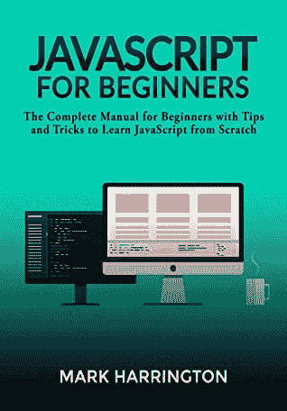

# JavaScript 入门指南：从零学习 JavaScript 的完整技巧与手册



# 引言

与 `C++`、`Ruby` 和 `Python` 等语言相比，JavaScript 是一种直观且容易上手的编程语言。它是一种不可否认的解释型语言，无疑可以嵌入到 `HTML` 中。它由 `Netscape Communications Corporation`、`Mozilla Foundation` 和 `ECMA International` 创建。`Brendan Eich` 被认为是 JavaScript 编程语言的创造者。

JavaScript 是一种独特的 PC 编程语言。它轻量级，最常被用作网页的一部分，其执行允许客户端内容与服务器通信并创建动态页面。它是一种具有面向对象能力的解释型编程语言。

JavaScript 最初被设计用于“让网页活起来”。

这种语言中的项目被称为脚本（contents）。它们可以直接编写在网页的 HTML 中，并在页面加载时自然地运行。

脚本以纯内容的形式提供并执行。它们的运行不需要额外的复杂的规划或编译。在这一方面，JavaScript 与另一种名为 `Java` 的语言完全不同。

JavaScript 最初被称为 `LiveScript`，但网景（Netscape）将其更名为 `JavaScript`，这可能是由于当时 `Java` 引起的热度考量。JavaScript 在 1995 年以 `LiveScript` 的名称出现在 Netscape 2.0 中。该语言的通用核心已被植入 `Netscape`、`Internet Explorer` 以及其他网络浏览器中。

## JavaScript 有什么用途？

我们在介绍中已经略微提到了这一点，但这里是 JavaScript 主要用途的快速概述。增加网站的直观性——是的，如果你需要网站不仅仅是一个静态文本页面，你就需要编写一些 `JavaScript`。创建多功能应用——JavaScript 不仅用于网站……它还用于制作你手机和平板电脑上的应用程序。制作基于网络浏览器的游戏——你曾直接从浏览器中玩过游戏吗？JavaScript 很可能帮助了这些游戏的运行。后端 Web 开发——毫无疑问，JavaScript 主要用于前端，但它是一种足够灵活的脚本语言，也可以用于后端架构。

## 什么让 JavaScript 变得很有趣？

JavaScript 是一种灵活且强大的编程语言，被不同的网络浏览器可靠地执行。与 `HTML` 和 `CSS` 一起，它是 Web 科技的核心部分。虽然 `HTML` 负责设计，`CSS` 负责样式，但 JavaScript 为程序中的页面提供了智能。

JavaScript 在使用框架时非常有价值。它有能够验证客户端输入错误的能力，并进一步节省时间。如果用户未填写某个必填字段，或者数据错误，JavaScript 会将信息发送到服务器之前对其进行检查。同样，由于 JavaScript 是一种客户端技术，它可以在程序上执行基本的计算。程序不需要为每项任务都请求服务器时间。这在用户需要多次执行这些估算时特别有用。在这种情况下，与服务器交互花费的时间比执行实际计算要多得多。

JavaScript 为程序提供了更多的控制权，而不是完全依赖 Web 服务器。JavaScript 为不同的程序提供了额外功能，有助于减轻服务器负担和组织流量。由于程序解析 JavaScript，它处理了编译和兼容性问题。因此，它可以在 `Windows`、`Macintosh` 以及其他由网景支持的系统上运行。同样，也可以将其嵌入到其他内容（如 `HTML`）中以保持 JavaScript 的使用。

通常在其他编程语言中，数字和对象类型是有区别的，但 JavaScript 对数字只识别一种对象类型，因此我在 Mozilla 文档中发现过：“JavaScript 中没有所谓的整数这种类型”。此外，JavaScript 中有一个“undefined”（未定义）值，这是一种模糊类型的估计，表示未初始化的值。通常在其他语言中，未初始化的值等于“invalid”或“nil”。但 JavaScript 不是。

- **对游客的快速反馈**：他们不需要等待页面刷新即可检查自己是否漏掉了某些输入。
- **扩展的直观性**：你可以制作界面在客户端鼠标悬停其上方或通过控制台启动它们时做出响应。
- **更华丽的界面**：你可以利用 `JavaScript` 整合直观的分段和滑块等元素，为网站访客提供丰富的界面（Rich Interface）。
- **速度**：客户端 `JavaScript` 极其快速，因为它倾向于在客户端程序内部即时运行。除非需要外部资源，否则 `JavaScript` 不受到向后端工作线程网络调用的限制。
- **轻松性**：`JavaScript` 通常易于学习和执行。
- **无处不在**：`JavaScript` 应用于网络的任何地方。
- **互操作性**：`JavaScript` 与不同的方言相处良好，可以应用于极其广泛领域。
- **工作者负载**：作为客户端，减轻了网站服务器的负担。
- **适应性**：通过 `Node.js` 工作线程使用 `JavaScript` 有许多方法。如果你恰好使用 `Express` 引导了 `Node.js`，使用像 `MongoDB` 这样的报告数据库，并在前端为客户使用 `JavaScript`，那么可以使用 `JavaScript` 从前端到后端构建整个 `JavaScript` 应用。
- **更新**：自 `ECMAScript 5`（`JavaScript` 依赖的脚本细节）以来，`ECMA International` 致力于每年更新 `JavaScript`。到目前，我们已经在 2017 年获得了 `ES6` 的程序支持，并预计以后将支持 `ES7`。
- **扩展功能**：开发者可以通过组合 `JavaScript` 代码段用于如 `Greasemonkey` 等外部附加项，来扩展网站页面的实用性。

## JavaScript 的缺点

- **客户端安全**：由于 `JavaScript` 代码在客户端执行，漏洞和疏忽有时会被用于恶意目的。基于此，一些小组决定完全禁用 `JavaScript`。
- **程序支持**：虽然服务器端的内容始终产生相似的输出，但在某些情况下，不同的程序会以意外的方式解析 `JavaScript` 代码。如今这些差异微乎其微，只要你在每个重要的程序中测试了内容，就不需要担心它。
- **JavaScript 中的主要问题或缺陷**是代码对所有人都是可见的，任何人都可以看到 `JavaScript` 代码。
- 无论快速 `JavaScript` 解析到何种程度，`JavaScript DOM`（文档对象模型）都是适中的，并且可以与 `HTML` 实现从不快速的交付。如果错误发生在 `JavaScript` 中，可能会停止整个网站的交付。程序对 `JavaScript` 错误非常宽容。
- `JavaScript` 通常被不同的程序以不同的方式进行解析。这使得阅读和编写跨程序代码变得相当复杂。
- 尽管某些 `HTML` 编辑器支持检查，但它没有像 `C/C++` 编辑器那样的编辑器那样有效。因此，设计师很难区分这些问题。这种持续的转换在数字到整数的更改中需要更长时间。这扩展了运行内容的预期时间并降低了其速度。

# 第二章

## JavaScript 语法

`JavaScript` 的语法是描述一个组织良好的 `JavaScript` 程序的决策安排。

`JavaScript` 标准库不包含权威标准内容输出工作（`document` 除外）。由于 `JavaScript` 主要用于现代网络浏览器内的客户端脚本编写，且几乎所有的 `Web` 程序都提供警告工作，因此警告也可以使用，但通常不被使用。

`JavaScript` 的大部分语法来自 `Java`，但同时也继承自 `Awk` 和 `Perl`，并在其对象模型框架中受到 `Self` 的一些反向影响。

### 基础

`JavaScript` 是大小写敏感的。构造函数的名称以大写字母开头，函数或变量名以小写字母开头并不是意外的。

示例：

```javascript
var a=5;
console.log(a);/5
console.log(A);/抛出 ReferenceError: A isn't defined
```

### 空格与分号

与 `C` 不同，`JavaScript` 源码中的空格会直接影响语义。分号在 `JavaScript` 中结束语句。由于“自动分号插入”（`ASI`），某些在解析时因换行而形成环绕排列的语句将被视为是完整的，就像在换行之前仅嵌入了一个分号一样。一些专家建议显式地提供语句结束的分号，因为这可以减少自动分号插入带来的意外影响。

这里有两个问题：五个标记既可以启动一个断言，也可以是整个断言的扩展；以及五个限制性创建，在特定位置不允许换行，可能会导致错误的解析。这五个危险标记是左括号 `(`、左中括号 `[`、切片符号 `/` 以及 `+` 和减号 `-`。在这些中，左括号在快速构造的语句示例中是正常的，左中括号有时发生，而其他的非常罕见。规范中给出的示例是：

```javascript
a = b + c
(d + e).foo()
```

/视为：

```javascript
a = b + c(d + e).foo();
```

假设前面的断言以分号结束。

一些人倾向于在以 `(` 或 `[` 开头的行前使用引导分号，这样该行就不会意外地与上一行合并。这被称为谨慎分号，尤其被推荐，因为这可以减少自动分号插入的意外影响。例如]：

```javascript
a = b + c
;(d + e).foo()
```

/处理为：

```javascript
a = b + c(d + e).foo();
```

假设前面的断言以分号结束。

有些人宁愿在以 `(` 或 `[` 开头的行前使用引导分号，这样该行就不会意外地与上一行合并。这被称为谨慎分号，尤其被推荐，因为这可以减少自动分号插入带来的意外影响。例如：

```javascript
a = b + c
;(d + e).foo()
```

/处理为：

```javascript
a = b + c(d + e).foo();
```

假设前面的断言以分号结束。 (此处由于原文存在重复内容)

# 第三章

## JavaScript 函数

函数是一个带有（可能为空的）边界列表的正方形，通常被赋予一个名称。函数可以使用局部因子。如果你在函数中遗留返回语句，则将返回未定义（undefined）。

```javascript
function gcd(segmentA, segmentB) {
  var diff = segmentA - segmentB;
  在事件 (diff == 0)
    return segmentA;
  return diff > 0 ? gcd(segmentB, diff) : gcd(segmentA, - diff);
}

console.log(gcd(60, 40));/20
```

`var mygcd = gcd;`/mygcd 是指向与 gcd 相同函数的引用。注意没有括号 ()。

`console.log(mygcd(60, 40));`/20

函数是五星抗议，并可能被还原到不同的因子。

调用函数时提供的冲突参数（contentions）数量可能与容量定义中的冲突参数数量并不完全对应；如果定义中的具名冲突参数在调用中没有对应的协调冲突参数，则其值将变得模糊（这可以被证实为无效）。在容量内部，同样可以通过 `contentions` 对象获取到`contentions`；这允许访问所有使用列表的冲突参数（例如 `arguments[0]`、`arguments[1]`、... `arguments[n]`），包括超出具名冲突参数数量的参数。（虽然 `contentions` 列表具有 `.length` 属性，但它完全不是 `Array` 的实例；它不具备某些方法，例如 `.cut()`、`.sort()` 等）

```javascript
work add7(x, y) {
  in the event that (!y) {
    y = 7;
  }
  console.log(x + y + arguments.length);
};
```

`add7(3);`/输出 11

`add7(3, 4);`/输出 9

原始类型（`number`、`boolean`、`string`）按值传递。对于对象，传递的是该对象的引用。

```javascript
var obj1 = {a : 1};
var obj2 = {b : 2};

work foo(p) {
  p = obj2;/忽略了真实边界
  p.b = arguments[1];
}
```

`foo(obj1, 3);`/完全没有影响 obj1。3 是多余的边界

`console.log(obj1.a + " + obj2.b);`/组合成 1 + 3

函数可以在不同的函数内部声明，并访问外部函数的作用域因素。此外，即使在外部函数退出后，它们也会通过记住外部函数的作用域因素来执行完全终止（闭包）。

```javascript
var v = "Top";
var bar, baz;

work foo() {
  var v = "fud";
  bar = work() { console.log(v) };
  baz = function(x) { v = x; };
}
foo();
baz("Fugly");
bar();/尽管 foo() 已经离开，但输出 Fugly（而不是 fud）。
console.log(v);/输出 Top
```

# 第四章

## JavaScript 变量

JavaScript 变量本质上是容量区域的名称。JavaScript 中有两种类型的因素：局部变量和全局变量。

在声明 JavaScript 变量（也称为标识符）时有几条原则。

- 名称应以字母（从头到尾）、下划线（`_`）或美元符号（`$`）开头。
- 在第一个字母之后可以使用数字（0 到 9），例如 `value1`。
- JavaScript 因素对大小写敏感，例如 `x` 和 `X` 是不同的因素。

### 正确的 JavaScript 变量

```javascript
var x = 10;
var _value="sonoo";
```

### 错误的 JavaScript 因素

```javascript
var 123=30;
var *aa=320;
```

### JavaScript 变量示例

我们应该看到 JavaScript 变量的简单示例。

```html
<script>
var x = 10;
var y = 20;
var z=x+y;
document.write(z);
</script>
```

上述示例的输出
30

### JavaScript 局部变量

JavaScript 局部变量在花括号或函数内部声明。它在函数或花括号内部是可。例如：

```html
<script>
work abc(){
  var x=10;//局部变量
}
</script>
```

或者，

```html
<script>
If(10<13){
  var y=20;//JavaScript 局部变量
}
</script>
```

### JavaScript 全局变量

JavaScript 全局变量在函数外部声明，或者通过 `window` 对象声明。它可以从任何函数访问。

让我们看看 JavaScript 中全局变量的简单示例：

```html
<script>
var data=200;//全局变量
work a(){
  document.writeln(data);
}
work b(){
  document.writeln(data);
}
a();//调用 JavaScript 函数
b();
</script>
```

```html
work b(){
  alert(value);
}
</script>
```

### 在函数内部声明 JavaScript 全局变量

要在函数内部声明 JavaScript 全局因素，你需要使用 `window` 对象。例如：

`window.value=90;`

现在它可以在任何函数内部被声明，并可以从任何容量访问。例如：

```javascript
work m(){
  window.value=100;//通过 window 对象声明全局变量
} 
work n(){ 
  alert(window.value);//从其他容量访问全局变量 
}
```

### JavaScript 全局变量的原理

当你在函数外部声明变量时，它包含在 `window` 对象内部。你也可以通过 `window` 对象访问它。例如：

```javascript
var value=50;
work a(){
  alert(window.value);//访问全局变量
}
```

### JavaScript 数据类型

JavaScript 提供了多种信息类型来存储各种类型的属性。JavaScript 中有两种信息类型。

- 原始信息类型
- 非原始（引用）信息类型

JavaScript 是一种强大的类型语言，意味着你不需要指定变量的类型，因为它是由 JavaScript 引擎动态使用的。你需要使用 `var` 在这里指定信息类型。它可以持有任何类型的属性，如数字、字符串等。例如：

```javascript
var a=40;//持有数字
var b="Rahul";//持有字符串
```

### JavaScript 原始信息类型

JavaScript 中有五种原始信息类型。它们如下：

| 信息类型 | 描述 |
| :--- | :--- |
| String | 代表字符序列，例如 "hi" |
| Number | 代表数值属性，例如 100 |
| Boolean | 代表布尔值，假或真 |
| Undefined | 代表未定义值 |
| Null | 代表无效，例如完全没有值 |

### JavaScript 非原始信息类型

非原始信息类型如下：

| 信息类型 | 描述 |
| :--- | :--- |
| Object | 代表实例，通过实例我们可以访问成员 |
| Array | 代表相似属性的集合 |
| RegExp | 代表正则表达式 |

# 第五章

## JavaScript 数组

JavaScript 的 `Array` 类是一个全局对象，用于... 数组是具有索引的对象的集合。

### 描述

数组是具有索引的对象的集合。数组是具有索引的对象的集合。数组是具有索引的对象的集合。数组是具有索引的对象的集合。数组是具有索引的对象的集合。

数组可以用于存储、访问、删除任何因素，并且它们是动态的。

### 常用方法

1. **创建一个数组**
```javascript
let fruits = []; // 创建空数组
let colors = ["apple", "banana"]; // 创建带元素的数组
```

2. **添加元素**
```javascript
fruits.push("orange"); // 在末尾添加
fruits.unshift("grape"); // 在开头添加
```

3. **删除元素**
```javascript
fruits.pop(); // 删除末尾元素
fruits.shift(); // 删除开头元素
```

4. **访问元素**
```javascript
console.log(fruits[0]); // 获取第一个元素
console.log(fruits[1]); // 获取第二个元素
```

5. **修改元素**
```javascript
fruits[1] = "blueberry"; // 修改索引 1 的元素
```

6. **遍历数组**
```javascript
fruits.forEach(function(item) {
  console.log(item);
});
for (let fruit of fruits) {
  console.log(fruit);
}
```

7. **查找元素**
```javascript
let index = fruits.indexOf("banana"); // 查找索引
let exists = fruits.includes("apple"); // 返回布尔
```

8. **分割数组**
```javascript
let str = "apple,banana,cherry";
let arr = str.split(","); // 字符串转数组
```

### 10. 从文件位置删除元素

```javascript
let vegetables = ['Cabbage', 'Turnip', 'Radish', 'Carrot']
console.log(vegetables)
```
`["Cabbage", "Turnip", "Radish", "Carrot"]`

```javascript
let pos = 1
let n = 2
let removedItems = vegetables.splice(pos, n)
```
`这是删除元素的方法，`n` 表征要移除的元素数量，从`pos` 指定的列表位置开始，并向最远边界推进。`

```javascript
console.log(vegetables)
```
`["Cabbage", "Carrot"]` (第一个簇发生了变化)

```javascript
console.log(removedItems)
```
`["Turnip", "Radish"]`

### 11. 复制数组

```javascript
let shallowCopy = fruits.slice()
```
`这是创建副本的方法` `["Strawberry", "Mango"]`

### 访问数组组件

JavaScript 数组是从 0 开始索引的。簇的主要组件位于列表 0，最后一个组件位于记录索引，该索引相当于 `array.length` 属性减 1。

使用无效的列表索引将返回未定义。

```javascript
let arr = ['this is the primary component', 'this is the subsequent component', 'this is the last element']
console.log(arr[0])
```
`'this is the main component'`

```javascript
console.log(arr[1])
```
`'this is the subsequent component'`

```javascript
console.log(arr[arr.length - 1])
```
`'this is the last component'`

数组组件同样是对象的属性，就像 `toString` 是一个属性（尽管明确地说，`toString()` 是一个方法）。此后，尝试按以下方式访问簇的组件会因为属性名不符合规范而产生语法错误：

```javascript
console.log(arr.0)
```
`标点符号错误`

JavaScript 簇以及导致此现象的属性并没有特殊之处。以数字开头的 JavaScript 属性不能通过点表示引用，而应该使用方括号表示来获取。

例如，如果你有一个名为 `3d` 属性的项目，它必须使用方括号表示来引用。

```javascript
let years = [1950, 1960, 1970, 1980, 1990, 2000, 2010]
console.log(years.0)
```
`语言结构错误`

```javascript
console.log(years[0])
```
`工作正常`

```javascript
renderer.3d.setTexture(model, 'character.png')
```
`语言结构错误`

```javascript
renderer['3d'].setTexture(model, 'character.png')
```
`工作正常`

在 3d 模型中，`'3d'` 必须被引用（因为它以数字开头）。但另一方面，引用簇记录也是可行的（例如使用 `years['2']` 而不是 `years[2]`），尽管这样做是多余的。

`years[2]` 中的 `2` 会被 JavaScript 引擎通过隐式的 `toString` 转换转换为字符串。因此，`'2'` 和 `'02'` 将指向 `years` 对象上的两个不同位置，且相应的模型可能是有效的：

```javascript
console.log(years['2'] != a long time
```

# 第六章

## JavaScript 布尔值

布尔值是 PC 编程语言中常用的原始数据类型。根据定义，布尔值有两个潜在的属性：真或假。

在 JavaScript 中，通常存在强制布尔类型转换。例如，如果你有一个检查特定表达式的 `if` 语句，该表达式将被强制转换为布尔值：

```javascript
const a = 'a string';
if (a) {
    console.log(a);
}
```
`'a string'`

有几个值会被强制转换为假：

- `false`（目前未被实际约束，因为它本身就是假的）
- `null`
- `undefined`
- `NaN`
- `0`
- `""`（空字符串）

任何剩余值都将被强制转换为真。当一个值被强制转换为布尔值时，我们额外称之为“虚值”（falsy）或“真值”（truthy）。

类型强制转换的一种方法是使用 `||` 和 `&&` 运算符：

```javascript
const a = 'word';
const b = false;
const c = true;
const d = 0
const e = 1
const f = 2
const g = null;
console.log(a || b);
```
`'word'`

```javascript
console.log(c || a);
```
`true`

```javascript
console.log(b || a);
```
`'word'`

```javascript
console.log(e || f);
```
`1`

```javascript
console.log(f || e);
```
`2`

```javascript
console.log(d || g);
```
`null`

```javascript
console.log(g || d);
```
`0`

```javascript
console.log(a && c);
```
`true`

```javascript
console.log(c && a);
```
`'word'`

显而易见的是，`||` 运算符检查主操作数。如果它是真或真值，它会立即返回它（这就是为什么我们在第一种情况下发现发生了什么，在第二种情况下看到真）。如果它不是真或真值，它会返回后续操作数（这就是为什么我们在第三种情况下发现发生了什么）。

对于 `&&` 运算符，原理类似，但为了使“与”为真，两个操作数都应该是真值。因此，如果两个都是真/真值，它将始终返回后续操作数，否则它将返回假。这就是为什么在第四种情况下得到真，而在最后一种情况下发现发生了什么。

### 布尔对象

同样存在一个 JavaScript 对象可以封装一个值。如果作为 `Boolean()` 传递的值有效，它将被转换为布尔值。

有任何剩余值会被强制转换为假：

```javascript
const x = false;
if (x) {
    console.log(x);
}
```

# 第七章

## JavaScript 对象

JavaScript 中的对象是一种非原始数据类型，用于存储键值对集合和更复杂的实体。对象可以通过多种方式创建。

### 1) 通过对象字面量

创建对象的语法如下：

```javascript
var emp={id:102,name:"Shyam Kumar",salary:40000}
document.write(emp.id+" "+emp.name+" "+emp.salary);
```

上述模型的输出：
`102 Shyam Kumar 40000`

### 2) 通过 new Object()

```javascript
var emp=new Object();
emp.id=101;
emp.name="Ravi Malik";
emp.salary=50000;
document.write(emp.id+" "+emp.name+" "+emp.salary);
```

上述模型的输出：
`101 Ravi Malik 50000`

### 3) 通过 Object 构造函数

在这里，你需要处理内容。可以使用这个关键字将本文中的每个内容值分配给当前对象。

`this` 关键字指向当前项。

下面给出了通过构造函数创建对象的示例。

```javascript
work emp(id,name,salary){
  this.id=id;
  this.name=name;
  this.salary=salary;
}
e=new emp(103,"Vimal Jaiswal",30000);
document.write(e.id+" "+e.name+" "+e.salary);
```

上述模型的输出：
`103 Vimal Jaiswal 30000`

### JavaScript 对象中的方法定义

我们可以在 JavaScript 对象中定义方法。然而，在定义方法之前，我们需要在能力中添加与方法同名的属性。

下面给出了在对象中定义方法的示例。

```javascript
work emp(id,name,salary){
  this.id=id;
  this.name=name;
  this.salary=salary;
  this.changeSalary=changeSalary;
  work changeSalary(otherSalary){
    this.salary=otherSalary;
  }
}
e=new emp(103,"Sonoo Jaiswal",30000);
document.write(e.id+" "+e.name+" "+e.salary);
e.changeSalary(45000);
document.write("<br>"+e.id+" "+e.name+" "+e.salary);
```

上述模型的输出：
`103 Sonoo Jaiswal 30000`
`103 Sonoo Jaiswal 45000`

## JavaScript 对象方法

Object 的不同策略如下：

| 序号 | 方法 | 描述 |
| :--- | :--- | :--- |
| 1 | `Object.assign()` | 该策略用于从源对象的可枚举自有属性复制到目标对象。 |
| 2 | `Object.create()` | 该技术用于使用预定义的模型项和属性创建另一个项。 |
| 3 | `Object.defineProperty()` | 该策略用于描述属性的某些社交权限。 |
| 4 | `Object.defineProperties()` | 该技术用于创建或设计不同的项属性。 |
| 5 | `Object.entries()` | 该技术返回一个包含各种键值对集合的簇。 |
| 6 | `Object.freeze()` | 该策略防止现有属性被删除。 |
| 7 | `Object.getOwnPropertyDescriptor()` | 该策略返回预定义项特定属性的属性描述符。 |
| 8 | `Object.getOwnPropertyDescriptors()` | 该技术返回给定项的所有自有属性描述符。 |
| 9 | `Object.getOwnPropertyNames()` | 该策略返回找到的所有项（无论是否可枚举）。 |
| 10 | `Object.getOwnPropertySymbols()` | 该技术返回所有自有符号键属性的数组。 |
| 11 | `Object.getPrototypeOf()` | 该策略返回预定义项的原型。 |
| 12 | `Object.is()` | 该技术判断两个值是否相同相等。 |
| 13 | `Object.isExtensible()` | 该技术判断一个项是否可扩展。 |
| 14 | `Object.isFrozen()` | 该技术判断一个项是否被冻结。 |
| 15 | `Object.isSealed()` | 该技术判断一个项是否被密封。 |
| 16 | `Object.keys()` | 该技术返回给定项的自有属性名称的数组。 |
| 17 | `Object.preventExtensions()` | 该策略用于防止项的任何扩展。 |
| 18 | `Object.seal()` | 该策略防止添加新属性，并将所有当前属性标记为不可配置的。 |
| 19 | `Object.setPrototypeOf()` | 该技术将预定义项的原型设置为另一个项。 |
| 20 | `Object.values()` | 该技术返回值的数组。 |

# 第八章

## JavaScript 字符串

JavaScript 字符串是处理字符序列的项。

在 JavaScript 中创建字符串有两种不同的方式：
1. 通过字符串字面量
2. 通过字符串对象（使用 new 关键字）

### 1) 通过字符串字面量

字符串字面量由语句组成。使用字符串字面量创建字符串的语言结构如下：

```javascript
var stringname="string esteem";
```

让我们来看创建字符串字面量的简单示例。

```javascript
var str="This is string strict";
document.write(str);
```

### 2) 通过字符串对象（使用 new 关键字）

使用 new 表达式创建字符串对象的语法如下：

```javascript
var stringname=new String("string severe");
```

在这里，使用 `new` 关键字来创建字符串的事件。

让我们来看通过 new 表达式在 JavaScript 中创建字符串的实例。

```javascript
var stringname=new String("hello javascript string");
document.write(stringname);
```

输出：
`greetings javascript string`

## JavaScript 字符串方法

我们应该查看 JavaScript 字符串方法的总结。

| 方法 | 描述 |
| :--- | :--- |
| `charAt()` | 它返回指定索引处的字符。 |
| `charCodeAt()` | 它返回指定索引处的字符的 Unicode 评估。 |
| `concat()` | 它返回任意两个字符串的拼接。 |
| `indexOf()` | 它返回给定字符串中指定项的首次位置。 |
| `lastIndexOf()` | 它从最后一个位置开始遍历，返回给定字符串中指定项的最后位置。 |
| `search()` | 它在给定字符串中搜索预定义的正则表达式，如果发生匹配则返回其位置。 |
| `match()` | 它在给定字符串中搜索预定义的正则表达式，如果发生匹配则返回该正则词述。 |
| `replace()` | 它将给定字符串替换为指定的替换项。 |
| `substr()` | 它根据指定的起始位置和长度获取给定字符串的片段。 |
| `substring()` | 它根据指定的索引范围获取给定字符串的片段。 |
| `slice()` | 它用于获取给定字符串的片段。它允许我们指定正、负索引。 |
| `toLowerCase()` | 它将给定字符串转换为小写字母。 |
| `toLocaleLowerCase()` | 它根据宿主当前区域将给定字符串转换为小写字母。 |
| `toUpperCase()` | 它将给定字符串转换为大写字母。 |
| `toLocaleUpperCase()` | 它根据宿主当前区域将给定字符串转换为大写字母。 |
| `toString()` | 它返回一个特定项的字符串表示。 |
| `valueOf()` | 它提供字符串对象的原始值。 |
| `split()` | 它将字符串分割为子字符串数组，然后返回该创建的数组。 |
| `trim()` | 它处理字符串左右两侧的空白部分。 |

### 1) JavaScript String charAt(index) 方法

JavaScript `charAt()` 方法返回指定索引处的字符。

```javascript
var str="javascript";
document.write(str.charAt(2));
```

### 2) JavaScript String concat(str) 方法

JavaScript `concat(str)` 方法连接或合并两个字符串。

```javascript
var s1="javascript ";
var s2="concat model";
var s3=s1.concat(s2);
document.write(s3);
```

### 3) JavaScript String indexOf(str) 方法

JavaScript `indexOf(str)` 方法返回给定字符串的首次位置。

```javascript
var s1="javascript from javatpoint indexof";
var n=s1.indexOf("from");
document.write(n);
```

输出：
`11`

### 4) JavaScript String lastIndexOf(str) 方法

JavaScript `lastIndexOf(str)` 方法返回给定字符串的最后一次位置。

```javascript
var s1="javascript from javatpoint indexof;"
var n=s1.lastIndexOf("java");
document.write(n);
```

输出：
`16`

### 5) JavaScript String toLowerCase() 方法

JavaScript `toLowerCase()` 方法将给定字符串转换为小写字母。

```javascript
var s1="JavaScript toLowerCase Example;";
var s2=s1.toLowerCase();
document.write(s2);
```

输出：
`javascript tolowercase model`

### 6) JavaScript String toUpperCase() 方法

JavaScript `toUpperCase()` 方法将给定字符串转换为大写字母。

```javascript
var s1="JavaScript toUpperCase Example;";
var s2=s1.toUpperCase();
document.write(s2);
```

输出：
`JAVASCRIPT TOUPPERCASE EXAMPLE`

### 7) JavaScript String slice(beginIndex, endIndex) 方法

JavaScript `String slice(beginIndex, endIndex)` 方法返回字符串从提供的 `beginIndex` 到 `endIndex` 的位部分。在 `slice()` 方法中，`beginIndex` 是起始索引，`endIndex` 是结束索引。

```html
<script>
var s1="abcdefgh";
var s2=s1.slice(2,5);
document.write(s2);
</script>
```

输出：
`cde`

### 8) JavaScript String trim() 方法

JavaScript `String trim()` 方法移除字符串前后的空白字符。

```html
<script>
var s1=" javascript trim ;"
var s2=s1.trim();
document.write(s2);
</script>
```

输出：
`javascript trim`

### 9) JavaScript String split() 方法

```html
<script>
var str="This is JavaTpoint site;"
document.write(str.split(" "));/根据给定字符串分割字符串。
</script>
```

# 第九章

## JavaScript 数字

在现今的 JavaScript 中有两种类型的数字：

JavaScript 中的标准数字由 64 位 IEEE-754 方案处理，通常被称为“双精度浮点数”。这些是我们通常使用的数字，我们将在本节中讨论它们。

BigInt 数字用于处理任意长度的整数。它们有时是必需的，考虑到标准数字无法超过 253 位或小于 -253。由于 bigints 几乎只在极少数特定领域中使用，我们将其作为特殊的 BigInt 使用。

因此，这里我们将检查标准数字。

### 处理数字的更多方法

假设我们需要创建一个 10 亿。最直接的方法是：

```javascript
let billion = 1000000000;
```

我们同样可以使用下划线 `_` 作为分隔符：

```javascript
let billion = 1_000_000_000;
```

在这里，下划线 `_` 被视为“语法糖”的一部分，它让数字更具可读性。JavaScript 引擎会直接忽略数字之间的 `_`，因此它与上面的 10 亿完全相同。

在现实中，我们尽量避免编写长长的零序列。那对我们来说很没劲。我们会尝试用类似 "1bn" 来表示 10 亿，或用 "7.3bn" 表示 73 亿。这种表示法对于大多数巨大的数字都是成立的。

在 JavaScript 中，我们可以通过在数字后附加字母 "e" 并显示零的个数来缩短数字：

```javascript
let billion = 1e9;//10 亿，从事实角度看：1 后面有 9 个零
alert( 7.3e9 );/73 亿（同于 7300000000 或 7_300_000_000）
```

在这种情况下，`e` 根据指定的零个数将数字扩大 10 的次方。

`1e3 = 1 * 1000/e3` 意味着 `*1000`

`1.23e6 = 1.23 * 1000000/e6` 意味着 `*1000000`

现在我们应该创建一个很小的数字。例如，1 微秒（秒的百万分之一）：

```javascript
let ms = 0.000001;
```

考虑到上述情况，使用 "e" 可以很有帮助。如果我们想避免显式写出零，可以写成：

```javascript
let ms = 1e-6;/1 后面减去 6 个零
```

如果在 0.000001 中包含零，它们共有 6 个。所以通常是 `1e-6`。

最后，"e" 之后的负数意味着除以 10 的指定零个数的次方：

`/ 3 除以 10 后面有 3 个零`

`1e-3 = 1/1000 (=0.001)`

`/ 6 除以 10 后面有 6 个零`

`1.23e-6 = 1.23/1000000 (=0.00000123)`

### 十进制、二进制和八进制数

十六进制数在 JavaScript 中主要用于处理颜色、编码字符以及某些其他事情。因此，通常有一种更简单的方法来处理它们：`0x` 后跟数字。

例如：

```javascript
alert( 0xff );/255
alert( 0xFF );/255（相同的，大小写没有影响）
```

二进制和八进制结构有时也会使用，但同样使用 `0b` 和 `0o` 前缀来维护：

```javascript
let a = 0b11111111;/相当于 255
let b = 0o377;/八进制的 255
alert( a == b );/确实，两边的数字都是 255
```

只有 3 种数字系统有这种支持。对于其他进制系统，我们必须使用 `parseInt` 方法（我们将在本节稍后看到）。

#### toString(base)

方法 `num.toString(base)` 返回 `num` 在指定进制下的字符串表示。

例如：

```javascript
let num = 255;
```

# 第十章

## JavaScript 循环

循环提供了一种快速且基础的方式来处理重复执行的任务。JavaScript 指南的这一部分介绍了 JavaScript 提供的各种循环解释。你可以将循环看作是游戏的机器人版本，在游戏中，你鼓励某人以一种方式走 X 步，然后以另一种方式走 Y 步。例如，“向东走五阶段”这个想法可以这样以循环的形式传递：

```javascript
for (let step = 0; adventure < 5; step++) {
  // 在不同的场合运行，并对阶段 0 到 4 进行评估。
  console.log('向东走一个阶段');
}
```

循环有不同类型，但它们在本质上都在做完全相同的事情：它们对某个动作执行若干次。（注意，这个数字可能是 0！）

不同的循环框架提供了不同的方式来处理循环起点和终点的选择。有各种条件，某种类型的循环比其他循环类型更容易处理。

JavaScript 中提供的循环声明有：

- `for` 声明
- `do...while` 解释
- `while` 解释
- 命名声明
- `break` 解释
- `continue` 解释
- `for...in` 解释
- `for...of` 解释
- `for` 声明

### for 声明

`for` 循环重复执行直到预定义的条件评估为假。JavaScript 的 `for` 循环类似于 Java 和 C 的 `for` 循环。

一个 `for` 声明如下：

`for ([初始化表达式]; [条件表达式]; [增量表达式])`

当 `for` 循环开始执行时，会发生以下操作：

1. 执行初始化表达式 `initialExpression`，它可以是任何内容。这个表述通常初始化一个循环计数器，无论如何强调允许任何复杂程度的断言。这个表述也可以表达组件。
2. 如果 `conditionExpression` 的评估结果为真，则执行循环体语句。如果条件评估为假，则 `for` 循环结束。（如果条件语句被完全跳过，则条件被认为是真的。）
3. 执行语句体。要执行多个语句，请使用大括号（`{ ... }`）将这些语句组合在一起。
4. 在当前的情况下，执行更新表达式 `incrementExpression`。
5. 控制返回第 2 步。

#### 示例

在下方的模型中，限制包含一个 `for` 声明，用于计算调查列表中被选中选项的数量（一个允许各种判断的 `<select>` 部分）。`for` 声明报告了变量 `i` 并将其初始化为 `0`。它确保 `i` 不大于 `<select>` 部分中的选项数量，执行随后的 `if` 语句，并在每次循环后将 `i` 增。

```html
<form name="selectForm">
  <p>
    <label for="musicTypes">选择某些音乐类型，然后点击下面的按钮：</label>
    <select id="musicTypes" name="musicTypes" multiple="multiple">
      <option selected="selected">R&B</option>
      <option>Jazz</option>
      <option>Blues</option>
      <option>New Age</option>
      <option>Classical</option>
      <option>Opera</option>
    </select>
  </p>
  <p><input id="btn" type="button" value="选中了几个?"/></p>
</form>
```

```javascript
function howMany(selectObject) {
  let numberSelected = 0;
  for (let i = 0; i < selectObject.options.length; i++) {
    if (selectObject.options[i].selected) {
      numberSelected++;
    }
  }
  return numberSelected;
}
let btn = document.getElementById('btn');
btn.addEventListener('click', function() {
  alert('选中的选项数量：' + howMany(document.selectForm.musicTypes));
});
```

### do...while 解释

`do...while` 解释重复执行直到预定的条件评估为假。

一个 `do...while` 解释如下：

```javascript
do {
  // 语句
} while (condition);
```

在检查条件之前会重复执行语句体。（要执行多个声明，请使用大括号（`{ ... }`）将这些语句封装。）

如果条件为真，声明将再次执行。在每次执行完成时，都会检查条件。当条件为假时，执行停止，控制传递到 `do...while` 之后的语句。

#### 示例

在上面的模型中，`do` 循环至少执行一次，并一直持续直到 `i` 不小于 5。

```javascript
let i = 0;
do {
  i += 1;
  console.log(i);
} while (i < 5);
```

### while 解释

某些语句执行其声明，直到预定的条件评估为真。某些声明如下：

```javascript
while (condition) {
  // 语句
}
```

如果条件最终结果为假，循环内部的声明停止执行，控制传递到循环之后的语句。

条件测试在执行关联的语句体之前发生。如果条件返回真，则执行声明并再次尝试条件。如果条件返回假，执行停止，控制传递到 `while` 之后的语句。

要执行多个声明，请使用大括号语句（`{ ... }`）。

#### 示例

`while` 循环在 `n` 小于 3 时执行语句：

```javascript
let n = 0;
let x = 0;
while (n < 3) {
  n++;
  x += n;
}
```

### 命名声明

命名给一个语句一个标识符，以便在程序的其他地方引用它。例如，你可以使用命名来感知循环，并随后使用 `break` 或 `continue` 解释来显示程序应该中断循环还是继续。

标记声明的语言结构如下：

```javascript
mark:
  // 语句
```

标记的评估可以是任何不是保留字的 JavaScript 标识符。与之关联的声明可以是任何语句。

#### 示例

在上面的模型中，命名 `markLoop` 感知循环。

```javascript
markLoop:
while (theMark === true) {
  doSomething();
}
```

# 第十一章

## JavaScript DOM

既然我们已经理解了 DOM 树，就可以开始获取我们的第一个 HTML 组件了。利用 JavaScript DOM 有多种方法可以实现这一点，以下是最常用的方法：

### 通过 ID 获取组件

`getElementById()` 方法用于通过其 id 获取单个组件。让我们来看一个模型：

```javascript
var title = document.getElementById('header-title');
```

在这里，我们获取 id 为 `header-title` 的组件并将其保存到变量中。

### 通过类名获取组件

我们同样可以利用 `getElementsByClassName()` 技术获取多个元素，该方法返回一组组件。

```javascript
var things = document.getElementsByClassName('list-things');
```

在这里，我们获取所有类名为 `list-things` 的元素并保存到变量中。

### 通过标签名获取组件

我们同样可以利用 `getElementsByTagName()` 方法通过标签名获取组件。

```javascript
var listItems = document.getElementsByTagName('li');
```

在这里，我们获取 HTML 文档中所有的 `li` 组件并将其保存到变量中。

### Queryselector

`querySelector()` 方法返回与预定义 CSS 选择器匹配的第一个组件。这意味着你可以通过 id、类、标签以及任何其他重要的 CSS 选择器获取组件。这里我简单列出几个最常用的选项。

**通过 id 获取：**

```javascript
var header = document.querySelector('#header')
```

**通过类获取：**

```javascript
var things = document.querySelector('.list-things')
```

**通过标签获取：**

```javascript
var headings = document.querySelector('h1');
```

**获取更显式的组件：**

我们同样可以 CSS 选择器获取更显式的组件。

```javascript
document.querySelector("h1.heading");
```

在这个模型中，我们同时查找标签和类，并返回通过该 CSS 选择器的主组件。

### Queryselectorall

`querySelectorAll()` 方法与 `querySelector()` 完全不同，它实际上返回所有符合 CSS 选择器的组件。

```javascript
var heading = document.querySelectorAll('h1.heading');
```

在这个模型中，我们获取所有带有 `heading` 类的 `h1` 标签并将它们存储在一个集合中。

## 修改 HTML 元素

HTML DOM 允许我们通过更改其属性来改变 HTML 组件的内容和样式。

### 修改 HTML

`innerHTML` 属性可用于更改 HTML 组件的内容。

```javascript
document.getElementById("#header").innerHTML = "Hi World!";
```

在这个模型中，我们获取 id 为 `header` 的组件并将内部内容设置为 "Hi World!"。

`innerHTML` 同样可以将标签放入另一个标签中。

```javascript
document.getElementsByTagName("div").innerHTML = "<h1>Hello World!</h1>"
```

在这里，我们将一个 `h1` 标签放入所有现有的 `div` 中。

### 修改属性值

你同样可以通过 DOM 修改属性的值。

```javascript
document.getElementsByTagName("img").src = "test.jpg";
```

在这个模型中，我们把所有 `img` 标签的 `src` 修改为 `test.jpg`。

### 修改样式

要更改 HTML 组件的样式，我们需要更改组件的 `style` 属性。这里有一个修改样式的语言结构：

```javascript
document.getElementById(id).style.property = new style
```

现在让我们来看一个模型，我们获取一个组件并将基线改为加粗的深色线：

```javascript
document.getElementsByTagName("h1").style.borderBottom = "strong 3px #000";
```

CSS 属性应该使用驼峰法，而不是普通的 CSS 属性名。在这个模型中，我们使用了 `borderBottom` 而不是 `line base`。

## 添加和删除组件

现在我们将研究如何添加新组件和删除现有组件。

### 添加组件

```javascript
var div = document.createElement('div');
```

在这里我们利用 `createElement()` 技术创建一个 `div` 组件，该方法接受标签名作为参数并将其保存到变量中。之后我们只需要给它一些内容，然后将其嵌入我们的 DOM 文档中。

```javascript
var newContent = document.createTextNode("Hello World!");
div.appendChild(newContent);
document.body.insertBefore(div, currentDiv);
```

在这里我们利用 `createTextNode()` 技术创建内容，该方法接受 `String` 作为参数，然后我们将新的 `div` 组件插入到记录中现有的 `div` 之前。

### 删除组件

```javascript
var elem = document.querySelector('#header'); elem.parentNode.removeChild(elem);
```

在这里我们获取一个组件并利用 `removeChild()` 方法将其删除。

### 替换组件

现在我们应该研究如何替换元素。

```javascript
var div = document.querySelector('#div');
var newDiv = document.createElement('div');
newDiv.innerHTML = "Hi World2"
div.parentNode.replaceChild(newDiv, div);
```

在这里我们利用 `replaceChild()` 方法替换一个组件。主要参数是新组件，后续参数是我们需要替换的组件。

### 直接写入 HTML 输出流

我们同样可以利用 `write()` 方法将 HTML 语句和 JavaScript 语句直接写入 HTML 输出流。

```javascript
document.write("<h1>Hello World!</h1><p>This is a paragraph!</p>");
```

我们同样传递像日期对象的 JavaScript 语句。

```javascript
document.write(Date());
```

`write()` 方法还可以接受多个内容，这些内容将按照它们的事件顺序添加到文档中。

# 第十二章

## JavaScript 函数

JavaScript 函数是一段旨在执行特定任务的代码块。

当“某事”触发它（调用它）时，JavaScript 函数就会执行。

### 模型

```javascript
function myFunction(p1, p2) {
  return p1 * p2;
} // 函数返回 p1 和 p2 的结果
```

### JavaScript 函数语法

JavaScript 函数以关键字 `function` 为特征，后面跟着一个名称，然后是括号 `()`。

函数名称可以包含字母、数字、下划线和美元符号（与变量相同的规则）。

括号可以包含由逗号分隔的参数名称：`(parameter1, parameter2, ...)`

函数要执行的代码放在大括号 `{}` 中：

```javascript
function name(parameter1, parameter2, parameter3) {
  // 要执行的代码
}
```

函数参数记录在函数定义的括号 `()` 内。

函数参数是函数被调用时获取的属性。

在函数内部，参数（边界）作为局部变量使用。

函数类似于其他编程语言中的过程（Procedure）或子程序（Subroutine）。

### 函数调用

当“某事”触发（调用）函数时，函数内部的代码将执行：

- 在事件发生时（例如当用户点击按钮时）
- 从 JavaScript 代码中被调用时

因此（自调用）

你将在本教程的后续练习中熟悉更多关于函数调用的知识。

### 函数返回

当 JavaScript 遇到 `return` 语句时，函数将停止执行。

如果函数是从断言（assertion）中调用的，JavaScript 将“返回”并执行调用语句之后的代码。

函数通常会带回一个返回值。返回值会被“返回”给“调用者”：

#### 模型

计算两个数字的结果并返回结果：

```javascript
var x = myFunction(4, 3); // 函数被调用，返回值将存储在 x 中
function myFunction(a, b) {
  return a * b; // 函数返回 a 和 b 的结果
}
```

`x` 中的结果将是：
12

### 为什么使用函数？

你可以复用代码：定义一次代码并多次使用。

你可以使用不同的参数多次使用相同的代码，以交付不同的结果。

#### 模型

将华氏度转换为摄氏度：

```javascript
function toCelsius(fahrenheit) {
  return (5/9) * (fahrenheit-32);
}
document.getElementById("demo").innerHTML = toCelsius(77);
```

### `()` 运算符调用函数

利用上面的模型，`toCelsius` 指的是函数对象，而 `toCelsius()` 指的是函数的结果。

不带 `()` 的函数调用将返回函数对象而不是函数结果。

#### 模型

```javascript
work toCelsius(fahrenheit) {
  return (5/9) * (fahrenheit-32);
}
document.getElementById("demo").innerHTML = toCelsius;
```

### 作为变量值的函数

函数可以像你在使用因子（factors）一样，在广泛的配方、任务和估算中使用。

#### 模型

与其使用变量来存储函数返回的估算值：

```javascript
var x = toCelsius(77);
var text = "The temperature is " + x + " Celsius; "
```

你可以直接将函数作为变量值使用：

```javascript
var text = "The temperature is " + toCelsius(77) + " Celsius";
```

在随后的教学练习中，你将获得更多关于函数的深入知识。

### 局部变量

在 JavaScript 函数内部声明的因子对于该函数是**局部（LOCAL）**的。
邻近因子必须从函数内部获取。

#### 模型

`/code here` 无法利用

# 第十三章

## JavaScript 事件

事件是发生在你自定义框架中的活动或场合，框架为你定义了这些事件，以便你在需要时以某种方式对其做出反应。例如，如果客户端选择了网页上的某个点击点，你应该通过显示数据框来响应该活动。在篇文章中，我们将探讨一些涉及事件的重要概念，并观察它们在程序中如何工作。这并不是一次详尽的调查；而是你现阶段需要了解的内容。

### 事件序列

如上所述，事件是发生在你正在修改的框架中的活动或事件——当事件发生时，框架会发出（或“触发”）一个信号或类似形式的内容，并提供一个系统，在事件发生时可以采取相应的动作（即运行某些代码）。例如，在机场，当跑道准备就绪时，会向飞行员传递一个信号。这样，飞机就可以安全起飞。

由于 Web 的存在，事件发生在程序窗口内部，并且通常连接到其中的某个特定元素——这可能是单个组件、一组组件、堆叠在当前标签页中的 HTML 文档，或者整个程序窗口。可以发生各种类型的事件，例如：

- 客户端选择了特定组件或将鼠标悬停在特定组件上。
- 客户端在控制台上按了某个键。
- 客户端调整程序窗口大小或关闭窗口。
- 页面完成堆叠过程。
- 提交了一个表单。
- 视频播放、停止或结束。
- 发生了错误。

你可以从这些（以及通过查看 MDN 事件引用）中总结出，有许多可以响应的事件。

每个可用的事件都有一个事件监听器（event controller），它是一段代码（通常是你作为软件工程师编写的 JavaScript 函数），在事件触发时运行。当这样一段代码被指定为根据某个事件运行时，我们称其为正在注册一个事件监听器。注意：事件监听器有时被称为事件听众（event audience members）——对于我们的目的来说，它们实际上是可以交换的，尽管严格来说，它们是协作关系。听众监听事件发生，而监听器是在事件发生时运行的代码。

注意：Web 事件不是 JavaScript 核心语言的一部分——它们被描述为程序中包含的 API 特性。

### 示例

我们应该来看一个我们所指内容的简单示例。你已经在很多模型中见过事件和事件监听器的用法，但我们应该回顾一下以巩固理解。在下面的模型中，我们有一个唯一的 `<button>`，当它被按下时，背景色将变为任意颜色：

```html
<button>Change color</button>
```

JavaScript 如下：

```javascript
const btn = document.querySelector('button');
work random(number) {
  return Math.floor(Math.random() * (number+1));
}
btn.onclick = work() {
  const rndCol = 'rgb(' + random(255) + ',' + random(255) + ',' + random(255) + ')';
  document.body.style.backgroundColor = rndCol;
}
```

在这段代码中，我们利用 `Document.querySelector()` 函数在一个名为 `btn` 的常量中存储了点击事件的引用。我们还定义了一个接收随机数字的函数。代码的第三部分是事件监听器。`btn` 常量指向 `<button>` 组件，这种元素有许多可以触发它的事件，相应地，也有可用的事件监听器。我们通过将 `onclick` 事件监听器属性设置为包含代码的匿名函数（该代码创建一个随机的 RGB 颜色并将 `<body>` 背景颜色等设置为该颜色），来监听点击事件的发生。

这段代码会在 `<button>` 组件上触发点击事件的任何时候运行，即在客户端选择它的任何时候。

示例输出如下：

### 它不仅仅是网页

现在另一个值得引用的点是，事件并不是 JavaScript 特有的——大多数编程语言都具有某种事件模型，但模型的工作方式通常与 JavaScript 的方式不同。事实上，JavaScript 用于网页的事件模型与它在不同环境下的使用的 JavaScript 事件模型有所不同。

例如，`Node.js` 是一个极其流行的 JavaScript 运行时，它允许设计师使用 JavaScript 构建服务器端和工作端应用程序。`Node.js` 事件模型依赖听众来监听事件以及生产者周期性地发布事件——这听起来并不特别，但代码非常独特，使用了诸如 `on()` 的函数来注册事件听众，并使用 `once()` 注册一个运行一次后注销的事件听众。`HTTP` 接口事件文档提供了真实的模型。

你同样可以使用 JavaScript 构建跨程序附加项——程序扩展——这使用了一种名为 `WebExtensions` 的技术。事件模型与 Web 事件模型相似，但又有些不同——事件听众属性使用驼峰命名法（例如，是 `onMessage` 而不是 `onmessage`），并且应该与 `addListener` 函数结合使用。

在学习的现阶段，你不需要理解其他此类环境的任何内容；我们只需要说明事件可以在不同的编程环境中变化。

### 使用 Web 事件的方法

有多种方法向网页添加事件监听器代码，以便其在相关事件触发时运行。在本节中，我们将介绍不同的工具，并讨论你应该使用哪种。

#### 事件监听器属性

这些是我们在课程期间经常看到的、用于包含事件监听器代码的属性。回到上面的模型：

```javascript
const btn = document.querySelector('button');
btn.onclick = work() {
  const rndCol = 'rgb(' + random(255) + ',' + random(255) + ',' + random(255) + ')';
  document.body.style.backgroundColor = rndCol;
}
```

`onclick` 属性是当前情况下使用的事件监听器属性。它基本上是按钮上的其他可用属性之一（例如 `btn.textContent` 或 `btn.style`），但它是一种特殊的类型——当你将其设置为某些代码时，这些代码会在事件发生在按钮上运行时。

你也可以将属性属性设置为一个命名函数的名称（正如我们在“构建你自己的函数”中发现的那样）。以下代码在任何情况下有效：

```javascript
const btn = document.querySelector('button');
work bgChange() {
  const rndCol = 'rgb(' + random(255) + ',' + random(255) + ',' + random(255) + ')';
  document.body.style.backgroundColor = rndCol;
}
btn.onclick = bgChange;
```

有很多可用的事件监听器属性。让我们来分析一下。

首先，为 `irregular tone eventhandlerproperty.html` 创建一个附近的副本，并在程序中打开它。它只是我们目前为止所玩过的简单任意着色模型的副本。现在，尝试将 `btn.onclick` 平滑地更改为随附的各种属性，并观察模型中的结果：

- `btn.onfocus` 和 `btn.onblur` — 当捕获焦点和失去焦点时，着色会发生变化；尝试按 Tab 键在元素之间切换焦点，然后再次按 Tab 键移开焦点。这些通常用于在结构字段被激活时显示填充字段的信息，或者在结构字段加载了错误值时显示错误消息。
- `btn.ondblclick` — 当双击捕获目标时，着色会发生变化。
- `window.onkeypress`, `window.onkeydown`, `window.onkeyup` — 当控制台上按下按键时，着色会发生变化。`keypress` 事件指的是整个按下过程（按下后松开），而 `keydown` 和 `keyup` 分别指的是按键的按下和松开部分。注意：如果你尝试在实际捕获目标上注册此事件控制器将不起作用——我们需要将其注册在 `window` 对象上，它代表整个程序窗口。
- `btn.onmouseover` 和 `btn.onmouseout` — 当鼠标指针悬停在捕获目标上或移出目标时，着色分别发生变化。

某些事件是通用的，几乎可以在任何地方使用（例如 `onclick` 控制器可以到几乎任何组件上），尽管某些事件更具体且仅在特定情况下有用（例如，仅在特定的组件上使用 `onplay` 是很好的）。

# 第十四章

## JavaScript Cookies

Cookie 是一种在服务器和客户端之间持久化的数据。网络浏览器在浏览时存储这些数据。

Cookie 包含通常以分号隔离的键值对形式的字符串数据。它保持客户端的状态并在所有网站页面之间记录客户端的数据。

### Cookie 是如何工作的？

当客户端向服务器发送请求时，该请求的每一个部分都被视为由不同客户端发送的另一个请求。这样，为了识别客户端，我们需要在客户端服务器程序的响应中添加 Cookie。

现在，每当客户端向服务器发送请求时，Cookie 会随请求一起添加。有了 Cookie，服务器就能识别客户端。

### JavaScript Cookies

#### 如何在 JavaScript 中创建 Cookie？

在 JavaScript 中，我们可以利用 `document.cookie` 属性创建、读取、刷新和删除 Cookie。

使用以下语句来创建 Cookie：

```javascript
document.cookie="name=value";
```

#### JavaScript Cookie 示例

##### 示例 1

我们应该看一个设置和获取 Cookie 的指南。

```html
<!DOCTYPE html>
<html>
<head>
</head>
<body>
<input type="button" value="setCookie" onclick="setCookie()">
<input type="button" value="getCookie" onclick="getCookie()">
<script>
function setCookie()
{
document.cookie="username=Duke Martin";
}
function getCookie()
{
if(document.cookie.length!=0)
{
alert(document.cookie);
}
else
{
alert("Cookie not accessible");
}
}
</script>
</body>
</html>
```

##### 示例 2

在这里，我们独立地显示 Cookie 的键值对。

```html
<!DOCTYPE html>
<html>
<head>
</head>
<body>
<input type="button" value="setCookie" onclick="setCookie()">
<input type="button" value="getCookie" onclick="getCookie()">
<script>
function setCookie()
{
document.cookie="username=Duke Martin";
}
function getCookie()
{
if(document.cookie.length!=0)
{
var array=document.cookie.split("=");
alert("Name="+array[0]+" +"Value="+array[1]);
}
else
{
alert("Cookie not accessible");
}
}
</script>
</body>
</html>
```

##### 示例 3

在这个示例中，我们提供了着色决策并将选定的着色值传递给 Cookie。现在，Cookie 在程序中存储客户端的最后决定。以此类，当刷新网站页面时，客户端的最后决定将出现在屏幕上。

```html
<!DOCTYPE html>
<html>
<head>
</head>
<body>
<select id="color" onchange="display()">
<option value="Select Color">选择颜色</option>
<option value="yellow">黄色</option>
<option value="green">绿色</option>
<option value="red">红色</option>
</select>
<script type="text/javascript">
function display()
{
var esteem = document.getElementById("color").value;
if (esteem != "Select Color")
{
document.bgColor = esteem;
document.cookie = "color=" + esteem;
}
}
window.onload = function ()
{
if (document.cookie.length != 0)
{
var array = document.cookie.split("=");
document.getElementById("color").value = array[1];
document.bgColor = array[1];
}
}
</script>
</body>
</html>
```

# 总结

JavaScript 是网络上的一项极佳的创新。它并不难学，而且非常灵活。它与其他网络创新技术（如 HTML 和 CSS）配合得很好，甚至可以与 Flash 等模块协作。
