# JavaScript 初学者指南


https://archive.org/details/javascriptforbeg0000lass

learntoprogram.tv

技术学习资源

# 献辞

致团队：

- Kevin，我们的制作经理和我的最佳伙伴
- Jimda，我们的技术作家
- Alison，我们的编辑
- Alex，我们的设计师

衷心的感谢！

## 第 6 章：编写 JavaScript 函数

### 6.1 函数介绍

代码列表：在同一页面内调用函数

代码列表：从单独的文件调用函数

复习题：

实验活动：调用函数 – `DisplayName()`

实验活动：`DisplayName()` 解决方案

实验活动：调用函数 – `DisplaySports()`

实验活动：`DisplaySport()` 解决方案

### 6.2 函数、参数与返回值

代码列表：调用函数并传递值

复习题：

### 6.3 从事件中调用函数

代码列表：`onclick` 事件 – 带有警告框

代码列表：`onload` 事件 – 带有警告框

代码列表：`onload` 和 `onclick` 事件

代码列表：`onmouseover` 事件

代码列表：`onunload` 事件

复习题：

第 6 章实验题

实验题解决方案

代码列表：问候

代码列表：某些算运算

代码列表：使用函数 `mathProb()` 的某些算运算

代码列表：修改后的实验题 2A

代码列表：修改后的章节实验题 2B

第 6 章小结

## 第 7 章：数组操作

### 7.1 声明数组

代码列表：标准方法声明数组成员

代码列表：简写方法

代码列表：字面量方法

代码列表：标准数组 – 显示所有索引值

代码列表：带有 `For` 循环的标准数组

复习题：

### 7.2 操纵数组

代码列表：字面量数组在数组中显示对象 - 对象超出范围

代码列表：字面量数组在数组中显示对象 - 对象在范围内

代码列表：`For-In` 循环

代码列表：带有 `Push` 的 `For-In` 循环中的字面量数组

代码列表：带有 `Push` 和 `Pop` 的 `For-In` 循环字面量数组

第 7 章实验题

代码列表：章节实验题解决方案

第 7 章小结

## 第 8 章：字符串对象

### 8.1 对象属性与方法

代码列表：字符串属性 – `Length`

代码列表：显示对象的长度

代码列表：字符串方法 `charAt()`

代码列表：字符串方法 `charCode()`

代码列表：字符串对象 `indexOf()`

代码列表：字符串 `replace()`

代码列表：字符串方法 `split()`

第 8 章实验题

第 8 章解决方案

第 8 章小结

## 第 9 章：获取与操纵用户信息

### 9.1 `Navigator` 对象

代码列表：`Navigator` 对象

### 9.2 `Window` 对象

代码列表：`Window` 对象 – `Document`

代码列表：`Window` 对象 – `Dimension`

代码列表：`innerWidth` 和 `innerHeight`

代码列表：`Window` 对象 – 获取位置

代码列表：`Window` 对象 – 设置位置

代码列表：`Window` 对象 – 协议

代码列表：Web 区域协议

### 9.3 `Screen` 对象

代码列表：`Screen` 对象

第 9 章实验题

代码列表：第 9 章实验题解决方案

第 9 章小结

## 第 10 章：`Document` 对象与 `innerHTML` 属性

### 10.1 `Document` 对象

代码列表：带有警告框的 `Document` 对象

代码列表：带有字体背景的 `Document` 对象

代码列表：带有粗体字体背景的 `Document` 对象

### 10.2 `innerHTML` 属性

代码列表：`innerHTML` 修改“div”内容

第 10 章实验题

代码列表：实验题解决方案起始

代码列表：章节实验题解决方案

最终复习题

答案 Key

附录 A：命令与函数汇总表

# 关于作者

Mark Lassoff 的父母经常声称 Mark 天生就是当程序员。在 20 世纪 80 年代中期，社区的孩子在外面玩踢球和扔雪球时，Mark 正埋头于在他的 Commodore 64 上用 BASIC 编程语言编写游戏。计算机和编程在大学期间仍然是他浓厚的兴趣，他在大学主修传播学和计算机科学。完成大学学业后，Mark 曾在几家大型企业的软件和 Web 开发部门工作过。

2001 年，出于一时兴起，当他的同龄人都在征服互联网世界时，Mark 接受了一个职位——在德克萨斯州奥斯汀的一家技术培训中心培训程序员。正是在那里他爱上了教授编程。

过去的 10 年里，教授编程一直是 Mark 的热情所在。如今，Mark 是一位顶尖的技术培训师，在全国为软件和 Web 开发人员提供培训。Mark 的培训客户包括国防部、洛克希德·马丁、发现卡服务公司和凯平永久医疗。Mark 的客户给他的课程评分为 9.81/10，在参与者评估中一直获得满分。

除了传统的课堂培训外，Mark 还是备受青睐视频培训师和主持人。他曾为多家出版社编写并主持视频课程，包括他自己的公司 LearnToProgram.tv, Inc.。Mark 编写了 15 多门在线课程，学生来自美国全部 50 个州和 47 多个国家。

他住在康涅狄格州哈特福德附近一个有 150 年历史的改造纺织厂里。

## LearnToProgram, Inc. 提供的课程

- 初学者 HTML 和 CSS（包含 HTML5）
- 初学者 JavaScript
- 初学者 C#
- 初学者 jQuery
- iOS 开发代码训练营
- 成为认证 Web 开发人员
- 初学者 PHP & MySQL
- 初学者 iOS 开发
- 初学者面向编程
- 初学者 C 语言
- 初学者 Android 开发
- 使用 Adobe Flash 创建 MP3 播放器
- AJAX 开发
- 初学者 Python
- CSS 开发（包含 CSS3）
- 使用 PhoneGap 开发 HTML5 移动应用

## LearnToProgram, Inc. 的书籍

- 初学者 HTML 和 CSS
- 使用 HTML5 创建 MP3 播放器

# 第 1 章：你好 JAVASCRIPT！

## 本章目标

- 你将能够理解 Web 程序的客户端和服务器端技术。
- 你能够在 HTML 文档中创建 JavaScript。
- 你能够在 JavaScript 中使用 `document.write` 命令。
- 你将理解在文档中放置 JavaScript 的不同位置。

## 1.1 介绍技术

在开始课程之前，让我们讨论一下 Web 设计和开发中使用的技术。Web 开发中使用了两种类型的技术：客户端技术和服务器端技术。

**客户端技术：** 这些指的是由客户端浏览器运行和解释的计算机语言。客户端技术包括 HTML、JavaScript 和 CSS 或级联样式表语言。

**服务器端技术：** 服务器端技术是一系列应用程序和软件，它们存储网页代码并在请求时将其发送给用户的 Web 浏览器。这些包括 Java 企业版、.NET、Ruby on Rails、PHP/MySQL 和 Perl。这些服务器端技术通常创建 HTML 代码并将该代码发送到客户端浏览器。

客户端和服务器端技术经常相互作用，以生成完整的网页或应用程序，而每个技术在过程中都承担着不同的角色。

为了在本课程中取得成功，你必须已经熟悉 HTML。如果你不熟悉，建议你参加一个 HTML 课程或复习 HTML 书或手册。

下面列出了你在学习 JavaScript 时可能会遇到的技术和语言总结，简要概述了每个技术的角色。

| 技术/语言 | 角色 |
| :--- | :--- |
| HTML | HTML 用于构建网页结构。它不用于创建网站的设计或视觉效果。HTML 标记指示了每个元素的用途——而不是它在页面上的位置或外观。目前的 HTML 版本是 HTML 4.01，XHTML 将是 2014 年的标准。HTML 不是一门编程语言，而是一种由标签、属性和内容组成的标记语言。 |
| CSS | CSS 的产生是为了给 HTML 添加设计组件。它允许对排版、颜色进行控制，并提供布局和如外边距、内边距和边框等设计功能。 |
| JavaScript | JavaScript 是一种客户端技术，用于为网页添加交互性。JavaScript 代码可用于验证用户输入、创建下拉效果、动态切换 CSS 样式，甚至进行复杂的计算。随着越来越多的处理从服务器端转移到客户端，JavaScript 最近变得越来越重要，因为客户端处理更高效，能带来更好的用户体验并且是基于事件的。JavaScript 不是编译的，而是由浏览器解释的。 |
| AJAX | AJAX（异步 JavaScript 和 XML）是 JavaScript 的应用，允许客户端和服务器之间的通信在“后台”进行。这为 Web 应用程序提供了更流畅、类桌面的界面。 |

## 问卷复习

1. JavaScript 是运行在客户端还是服务器端？
   a. 服务器端。
   b. 客户端。
   c. 两者都是。
   d. 都不是。

2. JavaScript 定义为：
   a. 一种允许你在网页上玩游戏和运行程序的编程语言。
   b. 一种允许你更改 HTML 样式的语言。
   c. 一种用于为网页添加交互性的脚本语言。
   d. 一种允许你创建基础网页的语言。

## 1.2 JavaScript 中的 HELLO WORLD

让我们开始创建你的第一个 JavaScript 程序。你需要两个项目：网页浏览器和文本编辑器。

请确保你在引号内关闭了标签。

有一个非常有用的标签叫做 `<br/>` 标签，它用于在单独行上显示你的文本或输出。`<br/>` 标签必须放在引号内。此外，你的 `script` 标签必须在 JavaScript 代码结束时关闭。如果你没有关闭 `script` 标签，程序可能无法运行。

# 代码列表：第一个 JAVASCRIPT

```html
<!DOCTYPE HTML PUBLIC "//W3C//DTD HTML 4.01//EN"
  "http://www.w3.org/TR/html4/strict.dtd">
<html>
  <head>
    <title>First Javascript</title>
  </head>
  <body>
    <script language="javascript" type="text/javascript">
      //Output to the browser
      document.write("<strong>Hello World from Javascript</strong>");
      document.write("<br/>This is my first Javascript program!");
    </script>
  </body>
</html>
```

# 第一个 Javascript

来自 Javascript 的问候

这是我的第一个 Javascript 程序！

这里是浏览器上的 Javascript 输出。观察上方的文本如何显示为粗体，以及 `<br/>` 标签如何在两行之间创建换行。如果没有换行标签，句子将出现在同一行。

1. 开始 JavaScript 编程需要哪两个项目？
   a. 电脑和耳机。
   b. 鼠标和麦克风。
   c. Microsoft Office 和键盘。
   d. 网页浏览器和文本编辑器。

2. JavaScript 中哪一个命令将文本输出到浏览器？
   a. `document.text`
   b. `document.write()`
   c. `document.output`
   d. `document.go`

3. 在 JavaScript 的 `document.write()` 命令中可以使用哪个 HTML 标签在浏览器中分隔行？
   a. `<br/>`
   b. `<b>`
   c. `<strong>`
   d. `<em>`

创建一个 JavaScript 应用，在浏览器中查看时产生下方的输出。你必须使用 JavaScript 命令创建输出，而不是 HTML：

| 第一个 Javascript |
| :--- |
| Hello World from Javascript. This is my first Javascript program. Hurray! |

# 实验解决方案

```html
<!DOCTYPE HTML PUBLIC "//W3C//DTD HTML 4.01//EN"
  "http://www.w3.org/TR/html4/strict.dtd">
<html lang="en">
<head>
<title>First Javascript</title>
</head>
<body>
<script language="text/javascript">
document.write("Hello World from Javascript<br/>");
document.write("<strong>This is my first Javascript program.</strong>Hurray!");
</script>
</body>
</html>
```

## 1.3 JAVASCRIPT 放在哪里

在上一节中，我们创建了 JavaScript 代码并将其放置在 HTML 文档的 `body` 中。JavaScript 可以放在文档的 `head` 中，也可以作为由 HTML 代码调用的外部文件放置。在本章中，我们将回顾可以放置 JavaScript 代码的三个地方。

我们已经使用 `script` 标签将 JavaScript 放置在 `body` 中。将 `script` 标签放在文档的 `head` 中效果也是一样的。

通常情况下，当 JavaScript 位于文档的 `body` 中时，它可以直接输出到浏览器。`head` 通常包含函数，即是在当文档被调用时稍后执行的 JavaScript 行。我们将在书的后面部分讨论如何使用函数，但现在我们只是用一个函数作为在文档 `head` 中放置 JavaScript 代码的示例。

函数通过标识符 `function` 实现，后面跟着函数名和两个括号。`function` 的代码写法如下：

```javascript
function sayBye() {
  document.write("Buh Bye");
}
```

函数执行的实际代码位于函数名后的大括号内。在上面的示例中，我们使用 `document.write()` 命令来创建简单的输出 "Buh Bye"。

函数本身不会向浏览器生成预期的输出。要显示文本，我们需要调用该函数。要调用函数，我们需要在一组 `script` 标签中使用函数名。我们已经将这些 `script` 标签放置在文档的 `body` 中：

```html
<body>
  <script language="javascript" type="text/javascript">
    sayBye();
  </script>
</body>
```

让我们将之前的 `body` 元素包含在一个完整的代码列表中，该代码中将有两个函数。请参考以下代码列表：

# 代码列表：JAVASCRIPT 放在哪里

```html
<!DOCTYPE HTML PUBLIC "//W3C//DTD HTML 4.01//EN"
  "http://www.w3.org/TR/html4/strict.dtd">
<html>
  <head>
    <title>First Javascript</title>
  </head>
  <body>
    <script language="javascript" type="text/javascript">
      function sayBye() {
        document.write("Buh Bye");
      }
      function sayName() {
        document.write("Journey rules!");
      }
      sayBye();
      sayName();
    </script>
  </body>
</html>
```

# 第 1 章实验题

1. 编写一段 JavaScript 代码，显示以下输出：

```
Javascript: Unordered list and style
Mark Lassoff
Plainview, NY

* Journey
* REO Speedwagon
* Styx
* Heart
```

2. 添加代码，在第一行以*斜体*形式显示你的名字，在第二行显示你出生的城市。

3. 从第三行开始，添加代码显示四个你任选选择的无序列表项，例如，你最喜爱的四支乐队。

# 第 1 章实验答案

```html
<!DOCTYPE HTML PUBLIC "//W3C//DTD HTML 4.01//EN"
  "http://www.w3.org/TR/html4/strict.dtd">
<html>
  <head>
    <title>Javascript: Unordered list and style</title>
  </head>
  <body>
  <script language="javascript"
    type="text/javascript"
    src="****/ch1LabSol.js"></script>
  <ul>
    <li>Journey</li>
    <li>REO Speedwagon</li>
    <li>Styx</li>
    <li>Heart</li>
  </ul>
  </body>
</html>
```

将 `****/ch1LabSol.js` 替换为你自己的文件路径。

这是 .js 附件的解决方案。完整文件名为 `ch1LabSol.js`：

```javascript
document.write("<em>Mark Lassoff<\/em><br/>");
document.write("Plainview, NY");
```

# 第 1 章总结

在本章中，我们讨论了在 JavaScript 中运用的客户端和服务器端技术的本质，以及它们各自的运行方式和彼此之间的区别。你学习了客户端技术和服务器端 Web 技术之间的区别。我们还讨论了为什么 JavaScript 对 Web 开发人员极其有用。

你还学习了如何使用 JavaScript 中的 `document.write()` 命令创建你的第一个 JavaScript 程序，并在屏幕上输出消息。

你还学习了可以插入 JavaScript 代码的各种位置。首先，你可以将 `<script>` 放在文档的 `<body>` 中，其次，放在 HTML `<head>` 元素中，最后 JavaScript 可以放置在外部文档中。

你还学习了 JavaScript 函数最好用在 HTML 文档的 `head` 中。

在下一章中，我们将讨论如何使用变量。变量是任何编程语言中最重要的元素之一。你将学习如何创建和操作 JavaScript 变量。

# 第 2 章：在变量中存储信息

## 本章目标

- 你将学习如何声明和初始化变量。
- 你将能够改变变量的值。
- 你将学习如何使用算术运算符。
- 你将学习如何拼接字符串和变量。

## 2.1 学习使用变量

在本章中，我们将讨论变量。变量是任何编程语言的重要元素，JavaScript 也不例外。

变量是用于存储值的内存分配。它们被称为变量，是因为它们的值在程序执行过程中随着时间可能会变化。

你可以使用变量来存储文本值（也称为字母或字符串值），例如人的姓名、公司名称或程序中的任何其他文本内容。变量也可以持有数值。

为了向你展示变量如何使用，我们将通过以下方式：

这是输出在浏览器中显示的样子。注意名称和年龄是如何分行显示的。这是通过使用 `<br/>` 标签配合 `document.write()` 命令实现的。

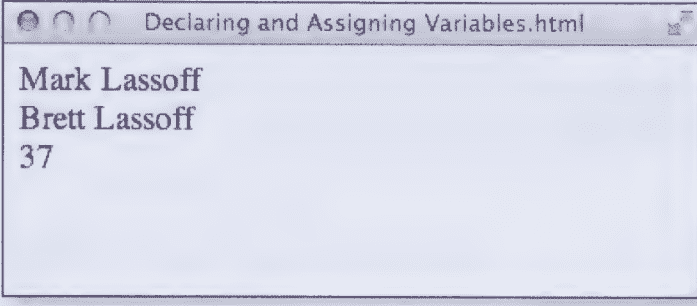

1. 在 JavaScript 中，你使用什么语句来声明变量？
   a. `variable`          c. `var`
   b. `declare`           d. `dar`

2. 如果不对给变量的字符串赋值值加引号，会发生什么？
   a. 脚本输出变量的值。
   b. 你得到一个 HTML 错误。
   c. 脚本将无法正确分配变量。
   d. 什么都不会发生。

3. 下面哪一个在 JavaScript 中被称为赋值运算符？
   a. `+` 号        c. `-` 号
   b. `=` 号        d. `@` 号

4. 哪一个是组合初始化/声明的示例？
   a. `var Size`           c. `var Size = 0;`
   b. `Size = 0`          d. `Size = 0;`

5. 为什么每次声明变量时使用 `var` 语句都很重要？
   a. 如果你不这样做，将会遇到变量作用域问题。
   b. 如果不声明变量将无法工作。
   c. 没有它会很困惑。
   d. 你不应该使用它。

## 实验活动

1. 创建一段 JavaScript 代码，显示以下输出：

```
Lab Activity.html
Horse: Foal
Goat: Kid
Dog: Puppy
```

2. 程序必须包含两个变量。第一个变量将存储成年动物的值 `adultAnimalName`，而第二个变量将存储幼动物的值 `youngAnimalName`。

3. 为每个变量分配一个值。使用 `document.write()` 显示这两个变量的值。

4. 在你的程序中使用以下值：

| adultAnimalName | youngAnimalName |
|---|---|
| Horse | Foal |
| Goat | Kid |
| Dog | Puppy |

## 实验活动答案：代码列表

```html
<!DOCTYPE HTML PUBLIC "//W3C//DTD HTML
4.01//EN"
"http://www.w3.org/TR/html4/strict.dtd">
<html lang="en">
<head>
  <title></title>
</head>
<body>
  <script language="javascript"
  type="text/javascript">
    var adultAnimalName;
    var youngAnimalName;

    adultAnimalName = "Horse";
    youngAnimalName = "Foal";

    document.write(adultAnimalName);
    document.write(": ");
    document.write(youngAnimalName);
    document.write("<br/>");

    adultAnimalName = "Goat";
    youngAnimalName = "Kid";

    document.write(adultAnimalName);
    document.write(": ");
    document.write(youngAnimalName);
    document.write("<br/>");

    adultAnimalName = "Dog";
    youngAnimalName = "Puppy";

    document.write(adultAnimalName);
    document.write(": ");
    document.write(youngAnimalName);
    document.write("<br/>");

  </script>
</body>
</html>
```

## 2.2 变量运算符

在本节中，我们将讨论变量运算符。再次，从一个 HTML 4.01 文件开始，并确保包含一个 `<script>` 标签以告诉浏览器我们正在使用 JavaScript。首先，我们需要声明两个变量为 `operandOne` 和 `operandTwo`。这两个变量将分别被赋值为 125 和 15.371。

注意，它们是两种不同的值类型。变量 `operandOne` 存储的是**整数** 125，而变量 `operandTwo` 包含**浮点数** 15.371。浮点数能够存储带有小数点的数字。

```javascript
operandOne = 125;
operandTwo = 15.371;
```

在其他编程语言中，你通常需要声明特定的变量类型——你必须告诉程序你使用的是整数还是浮点数。然而，JavaScript 在你赋值的那一刻起，就会自动理解你正在创建什么种类型的变量。不需要显式地指定类型。

我们可以使用以下代码：

```javascript
document.write(operandOne);
document.write("<br/>");
document.write(operandTwo);
```

### 加法

```javascript
document.write("<br/>\n");
document.write(fullTeamInfo);
```

为了更好地理解字符串拼接是如何运作的，在之前的代码中演示了拼接两个字符串变量并输出它们的示例。我们创建了一个名为 `fullTeamInfo` 的新变量，并将 `teamCity` 和 `teamName` 两个变量拼接在一起。我们还在引号内拼接了一个空格，以便两个变量字符串之间的间距正确。输出结果为“New York Yankees”。

这是浏览器中显示的输出截图。这里展示了所有可能的拼接用法；同时也演示了四种数学运算，包括取模运算符。

| 变量 | 运算符 |
|---|---|
| n | 125 |
| | 15.371 | 
| 加法 | 140.371 |
| 减法 | 109.629 |
| 乘法 | 1921.375 |
| 除法 | 8.1321969433999 |
| 10 % 3 | 1 |
| 11 % 3 | 2 |
| 126 | |
| | 14.371 |
| New York Yankees | |

1. 当你将 `+` 放在数值变量旁边时，它代表什么？
   a. 相加值。
   b. 减去值。
   c. 拼接值。
   d. 除以值。

2. 当你将 `+` 放在两个字符串值之间时，它代表什么？
   a. 将值相加。
   b. 减去值。
   c. 拼接值。
   d. 除以值。

3. `%` 运算符的作用是什么？
   a. 给出除法和。
   b. 给出除法的余数。
   c. 给出乘法和。
   d. 给出减法和。

4. 哪一个是自增运算符？
   a. `-` (c.) `++`
   b. `*` `#`

5. 前置自增运算符是如何运行的？
   a. 它将变量加 1。
   b. 先计算数学表达式的其余部分，然后进行自增。
   c. 它从变量中减 1。
   d. 先进行自增，然后计算表达式的其他部分。

# 第 2 章实验题

1. 创建一个 HTML 4.01 文档。在文档主体中，带有带有属性的 `script` 标签以添加 JavaScript 代码。

2. 声明以下变量（但暂不初始化）：
   `firstName`
   `age`
   `city`
   `favoriteFood`

3. 使用你的信息初始化变量。（你的名字、年龄等。）

4. 创建一个名为 `operand1` 的变量，并使用组合初始化和赋值赋予其初始值 1555。

5. 创建一个名为 `operand2` 的变量，并使用组合初始化和赋值赋予其初始值 96.255。

6. 通过对 `operand1` 和 `operand2` 进行加、减、乘、除运算，展示你对数学运算符的理解。按照如下格式格式化你的输出：

```
1555 + 96.255 = 1651.255
```

产生此输出的代码行是：

```javascript
document.write(operand1 + " + " + operand2 + " = " + (operand1+operand2));
```

7. 使用 `operand1` 展示自增运算符的使用，使用 `operand2` 展示自减运算符。显示结果。

# 第 2 章实验题答案

在浏览器中查看时，输出如下：

```
1555 + 96.255 = 1651.255
1555 - 96.255 = 1458.745
1555 x 96.255 = 14976.525
1555 / 96.255 = 16.15500493480858
自增后，1555 现在是 1556
自减后，96.255 现在是 95.255
```

# 第 2 章实验题：代码列表

```html
<!DOCTYPE HTML PUBLIC "-//W3C//DTD HTML 4.01//EN"
"http://www.w3.org/TR/html4/strict.dtd">
<html lang="en">
<head>
  <title></title>
</head>
<body>
  <script type="javascript">
    var firstName;
    var age;
    var city;
    var favoriteFood;
    firstName = "John";
    age = 25;
    city = "New York";
    favoriteFood = "Pizza";
    var operand1 = 1555;
    var operand2 = 96.255;
    document.write(operand1 + " + " + operand2 + " = " + (operand1+operand2) + "<br>");
    document.write(operand1 + " - " + operand2 + " = " + (operand1-operand2) + "<br>");
    document.write(operand1 + " x " + operand2 + " = " + (operand1*operand2) + "<br>");
    document.write(operand1 + " / " + operand2 + " = " + (operand1/operand2) + "<br>");
    operand1++;
    document.write("After increment, " + operand1 + " is now " + operand1 + "<br>");
    operand2--;
    document.write("After decrement, " + operand2 + " is now " + operand2 + "<br>");
  </script>
</body>
</html>
```

完整的代码列表如下：

## 代码列表：比较运算符 `==`

```html
<!DOCTYPE html>
<html>
<head>
  <title>If Condition</title>
</head>
<body>
  <script language="javascript" type="text/javascript">
  var age = 18;
  if(age>=18)
  {
    document.write("You can vote.<br/>");
  }
</script>
</body>
</html>
```

在浏览器中查看时，输出应该像这样：

| If Condition |
| You can vote. |

在 JavaScript 中，还有其他几种比较运算符。了解这些比较运算符如何评估条件表达式是非常重要的，因为每个运算符都处理一种独特的情况。

以下是比较运算符及其功能的列表。

| 比较运算符 | 功能 |
|--- | :--- |
| `==` | 等于 |
| `===` | 值和类型均相等 |
| `>` | 大于 |
| `<` | 小于 |
| `>=` | 大于等于 |
| `<=` | 小于等于 |
| `!=` | 不等于 |

让我们来看使用不同比较运算符的另一个 `if` 语句。这次，让我们练习使用被称为“等于”的 `===` 作为比较运算符。


> 顺便说一下——将赋值运算符 `=` 与比较相等运算符 `==` 混淆是一个常见的错误。当我面对学生面授 JavaScript 课程时，这是我看到实验作业中他们犯的最常见的错误之一。要小心！

增加困惑的是，JavaScript 拥有一个 `===` 运算符，它的意思是值和类型相等。虽然在我编写的实际生产环境 JavaScript 代码中从未使用过这个运算符，但它确实有明确的含义。查看以下内容：


```javascript
"1" == 1  // TRUE
"1" === 1 // FALSE
```

本质上，上面的第一个语句被评估为 TRUE，因为语句的两边具有相同的值：1。`==` 运算符仅测试值。你会注意到第一个 1 是字符串，因为它包含在引号中。第二个 1 是一个纯数字值。由于 `===` 测试类型和相等性，因为类型不同，所以第二个语句被评估为 FALSE。现在我们将看看我们的相等条件运算符的实际运行。声明一个值等于 "Mark" 的变量名。设定条件：当变量等于值 "Mark" 时，在第二行显示字符串 "You are the course instructor."。执行该程序的代码为：

```javascript
var name="Mark"
if (name=="Mark") {
  document.write("You are the course instructor")
}
```

完整的代码列表是：

## 代码列表：比较运算符 `===`

```html
<!DOCTYPE HTML PUBLIC "//W3C//DTD HTML 4.01//EN"
"http://www.w3.org/TR/html4/strict.dtd">
<html lang="en">
<head>
  <title>Simple Condition, Comparison Operators</title>
</head>
<body>
  <script>
    var name = "Mark";
    if (name ==="Mark") {
      document.write("You are the course instructor.");
    }
  </script>
</body>
</html>
```

在浏览器中查看时，输出应该像这样：

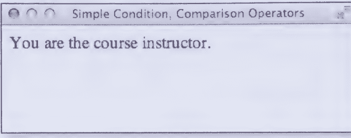

如果你将 `name` 的赋值更改为 "Mark" 以外的字符串值，浏览器将显示空白页面。这是因为不同的赋值值会导致条件语句被评估为 FALSE，从而防止后续代码块的执行。

剩余的比较运算符功能类似。我们将检查剩余的比较运算符，以便你可以看到每个运算符的用法示例。以下是活动的完整代码：

## 代码列表：比较运算符

```html
<!DOCTYPE HTML PUBLIC "//W3C//DTD HTML 4.01//EN"
  "http://www.w3.org/TR/html4/strict.dtd">
<html lang="en">
<head>
  <title>Simple Conditionals, Comparison Operators</title>
</head>
<body>
<script>
  var name="Mark";
  if (name == "Mark") //等于
  {
    document.write("You are the course instructor.<br/>");
  }

  var course = "Javascript";
  if (course === "Javascript")
  //值和类型相等
  {
    document.write("This course is called Javascript.<br/>");
  }

  var temperature=39;
  if (temperature > 37.5) //大于
  {
    document.write("You've got fever!<br/>");
  }

  var level=0;
  if(level < 1) //小于
  {
    document.write("That is below the minimum level.<br/>");
  }

  var age=18;
  if(age >= 18) //大于等于
  {
    document.write("You can vote.<br/>");
  }

  var age=17;
  if(age <= 17) //小于等于
  {
    document.write("That is below the minimum level.<br/>");
  }

  var value=0;
  if(value != 0) //不等于
  {
    document.write("The values are not equal.<br/>");
  }
</script>
</body>
</html>
```

3. 比较运算符 `!=` 是什么意思？
   a. 不等于。 
   c. 等价。
   b. 等于。 
   d. 大于。

4. 你使用哪种比较运算符来创建一个逻辑上“与”（AND）两个语句的复合语句？
   a. `++` 
   c. `==`
   b. `--` 
   d. `&&`

1. 创建一个标准的 HTML 文档，包含必要的 JavaScript `<script>` 标签和属性。

2. 你将实现一个使用 `if` 语句的程序。你将评估两个变量：`citizens`（国籍），一个布尔值；以及 `age`（年龄），一个整数。它将根据变量的评估结果显示消息。

程序必须能够判断用户是否到了投票年龄且为美国公民，如果两个条件都为 TRUE（真），将显示第一条消息“你可以投票。你满 18 岁且是公民。”。

3. 如果只有一个条件为 TRUE，例如 `age` 为真，而 `citizens` 为 FALSE（假），则显示第二条消息“抱歉，你无法投票。你 18 岁但你不是公民。”。

4. 如果 `age` 和 `citizens` 两个变量都为 FALSE，则显示第三条消息“抱歉，你无法投票。你未满 18 岁且你不是公民。”。

5. 包含另一个条件语句，测试变量的值是否等于 "Mark"，如果为 TRUE，将显示第四条消息。“你是课程讲师！”，。

以下是预期的输出：

| 条件与逻辑运算符 |
|---|
|你可以投票。你满 18 岁且是公民。|
|抱歉，你无法投票。你 18 岁但你不是公民。|
|抱歉，你无法投票。你未满 18 岁要么你不是公民。|
|你是课程讲师！|

# 代码列表：实验活动解决方案

```html
<!DOCTYPE HTML PUBLIC "//W3C//DTD HTML 4.01//EN"
  "http://www.w3.org/TR/html4/strict.dtd">
<html lang="en">
<head>
  <title>条件与逻辑运算符</title>
</head>
<body>
  <script language="javascript" type="text/javascript">
    var age = 18;
    // 变量声明和初始化
    var citizen = true;
    //布尔变量 TRUE
    if(age>=18 && citizen==true) {
      document.write("You can vote. You are 18 and above and a citizen.");
    }

    var age = 18;
    // 变量声明和初始化
    var citizen = false;
    //布尔变量 FALSE
    if(age>=18 && citizen!=true)
    // 条件
    {
        document.write("Sorry, you cannot vote. You are 18 but you are not a citizen.<br/>");
    }

    var age = 18;
    // 变量声明和初始化
    var citizen = false;
    // 布尔变量 FALSE
    if(age<=18 && citizen==false)
    // 条件
    {
        document.write("Sorry, you cannot vote. Either you are below 18 and you are not a citizen.<br/>");
    }

    var name="Mark";
    if(name == "Mark")
    {
        document.write("You are the instructor!");
    }
  </script>
</body>
</html>
```

## 3.2 If-Else-If 语句

在本节中我们将继续研究条件语句，因为我们将结合 `Else` 语句使用条件语句。

`if` 语句可以运行一系列嵌套条件，这些条件通过设置 `If-Else-If` 来适应更复杂的分支。

让我们创建一个游戏得分场景，其中包含一个代表最高分的变量和另一个包含玩家分数的变量。

`if` 语句将是：

```javascript
if (playerScore > highScore)
```

现在，如果 `playerScore` 大于 `highScore`，我们希望将 `highScore` 修改为 `playerScore` 值。因此，如果 `if` 语句为真，我们通过以下方式更改 `highScore` 的值：

```javascript
highScore = playerScore;
```

然而，如果初始条件为 FALSE，我们需要使用 `else` 语句输出其他消息。使用我们的 `else` 语句，代码应该是：

```javascript
if(playerScore > highScore)
{
    // 玩家获得高分
    highScore = playerScore;
    document.write("You attained the high score!");
} else
{
    document.write("You did not attain the high score.");
}
```

使用这个条件，程序将评估该条件为 TRUE；显示字符串并将 `highScore` 变量更改为 `playerScore`。如果 `playerScore` 变量小于 10,000，则 `if` 语句将评估为 FALSE，并输出 `else` 语句中的消息。完整的代码列表如下：

```html
<!DOCTYPE HTML PUBLIC "//W3C//DTD HTML 4.01//EN"
 "http://www.w3.org/TR/html4/strict.dtd">
<html lang="en">
<head>
<title>If-Else-If 条件</title>
</head>
<body>
<script language="javascript" type="text/javascript">
  var playerScore=25000;
  var highScore=10000;
  if(playerScore > highScore) {
    // 玩家获得高分
    highScore = playerScore;
    document.write("You attained the high score!");
  } else
  {
    document.write("You did not attain the high score.");
  }
</script>
</body>
</html>
```

```javascript
else if(numericalGrade >= 80)
{
    letterGrade = "B";
    remark = "Passed";
}
else if(numericalGrade >= 70)
{
    letterGrade = "C";
    remark = "Passed";
}
else if (numericalGrade >= 60)
{
    letterGrade = "D";
    remark = "are Conditional";
}
else{
    letterGrade= "F";
    remark = "Failed";
}
document.write("<br/>Your grade is " + letterGrade + " " +"and you"+ " " + remark+".");
```

### else 语句的作用是什么？

- a. 如果原始条件语句为真，则执行下一个语句。
- b. 如果原始条件语句为假，则忽略下一个语句。
- c. 如果原始条件语句为假，则执行下一个语句。 
- d. 什么都不做。

2. 如果你创建一个 if-else-if 语句，当条件语句为真时会发生什么？
   a. 程序继续评估其他条件。
   b. 程序停止运行。
   c. 程序停止评估其他条件并移动到后续。
   d. 什么都不做。

3. 使用变量 `studentgrade`，你会如何编写一个语句，告诉我们分数高于 59 的学生通过，分数 59 或以下的学生不及格？
   a. `if (studentgrade>59){document.write("You passed"); }`
   b. `if (studentgrade>=59){document.write("You passed");} else {document.write("You failed"); }`
   c. `if (studentgrade>=59){document.write("You passed");} else {document.write("You failed"); }`
   d. `if (studentgrade<59){document.write("You passed");} else {document.write("You failed");};`

## 3.3 Switch-Case-Break 语句

测试多个条件的另一种方法是使用 `switch` 语句。`switch` 语句允许你快速测试许多条件并查看它们是否为真。

在本节中，我们将根据变量的条件显示字符串文本。我们将测试变量 `letterGrade`。

`switch-case-break` 系列以 `switch` 语句开始。`switch` 决定了对哪个变量进行相等性判断。这是通过编写代码实现的：

```javascript
switch (letterGrade)
```

一旦创建了 `switch`，你可以列出若干 `case`，并与 `switch` 变量的值进行测试。如果任何 `case` 被确定与 `switch` 变量相等，将执行随后的 case 代码并终止 `switch-case-break` 块。

> 每个 `case` 都应该有自己的代码块，并用 `break` 语句结束。

如果两个不同的 `case` 应该产生相同的结果，可以将它们连续编写，后面跟着要执行的代码块。这是一个很好的捕获技术，可以确保所有可能的情况都考虑在内。

在关联代码块之前列出多个 `case` 是可能的，下面的代码列表将显示如何操作。如果 `switch` 变量的值为 "a" 或 "A"，程序将执行相应的 `document.write()` 语句。

```javascript
case "A":
case "a":
document.write("A is an excellent grade!");
break;
```

可以编写任意数量的 `case` 并关联到单个 `switch`。`switch-case-break` 的最后一个元素是 `default` 块。如果 `switch` 变量不等于任何 `case` 的值，可以使用 `default` 块执行代码。

这里是完整的代码列表：

## 代码列表：SWITCH-CASE-BREAK

```html
<!DOCTYPE HTML PUBLIC "-//W3C//DTD HTML 4.01//EN"
  "http://www.w3.org/TR/html4/strict.dtd">
<html lang="en">
<head>
  <title>Switch Statements</title>
</head>
<body>
  <script language="javascript" type="text/javascript">
    var letterGrade = "c";
    switch (letterGrade) {
      case "A":
      case "a":
        document.write("A is an excellent grade!");
        break;
      case "B":
      case "b":
        document.write("B is a good grade!");
        break;
      case "C":
      case "c":
        document.write("C is an average grade!");
        break;
      case "D":
      case "d":
        document.write("D is a low passing grade!");
        break;
      case "F":
      case "f":
        document.write("F is a failure.");
        break;
      default:
        document.write("Grade not recognized");
    }
  </script>
</body>
</html>
```

以上是上述代码列表在查看时的样式。

1. 对 `switch` 语句作用的良好定义是什么？
   a. 一次测试多个条件，查看是否至少有一个为真。
   b. 测试一个条件查看它是否为真，否则寻找其他条件直到默认情况（default case）。
   c. 评估你程序中的 `switch`。
   d. 破坏程序。

2. `default` 情况的作用是什么？
   a. 在所有内容都匹配时运行。
   b. 在两个变量相等时运行。
   c. 在没有任何内容匹配时运行。
   d. 在使用 if-else 语句时运行。

3. 如果你在 `case` 之后忘记写 `break` 语句会发生什么？
   a. 程序停止。
   b. 程序忽略其他 `case`。
   c. 程序停止评估其他条件并继续。
   d. 程序执行其他 `case` 直到遇到 `break`。

# 第 3 章练习题

创建一个基础的 HTML 结构。添加 JavaScript 代码来确定并显示以下内容：

1. 声明一个名为 `age` 的变量并赋值赋值为 35。使用下表，编写一个 `if-else` 例程，根据表中列出的值显示正确的输出。

| 年龄范围 | 输出 |
| :--- | :--- |
| 18岁以下 | "You're just a pup!" |
| 18-29岁 | "Welcome to young adulthood... fun now!" |
| 30-39岁 | "It's time to get serious about career and family." |
| 40-49岁 | "Time to start thinking about retirement. Make sure you're saving." |
| 50-59岁 | "Enjoy your life now! You've done well." |
| 60 岁及以上 | "60 is the new 40. Do something exciting!" |

> 测试你的代码。尝试更改 `age` 值并确保它可以工作。

2. 声明并初始化以下变量：
   `discountCode="C";`
   `discountRate=0;`
   `amountOfSale=27.95;`

3. 使用 `switch-case-break` 根据 `discountCode` 和 `amountOfSale` 确定 `discountRate` 的值。使用以下数值表：

| 折扣代码 | 折扣率 |
| :--- | :--- |
| A | 0.325 |
| B | 0.055 |
| C | 0.075 |
| D | 0.100 |

> 注意：可能会得到很多小数。我们将在课程后面讨论。

调整你的代码，即使折扣代码以小写输入也能正常工作。

# 第 3 章练习题答案

这是在浏览器中查看时的输出样式：

# 代码列表：练习题答案

```html
<!DOCTYPE HTML PUBLIC "-//W3C//DTD HTML 4.01//EN"
  "http://www.w3.org/TR/html4/strict.dtd">
<html lang="en">
<head>
  <title>Chapter Lab Exercise</title>
</head>
<body>
  <script language="javascript" type="text/javascript">
    var age=35;
    if(age < 18) 
    {
      document.write("You're just a pup!<br>");
    } 
    else if(age >= 18 && age<= 29) 
    {
      document.write("Welcome to young adulthood... fun now (while you can)!<br>");
    } 
    else if(age >= 30 && age<= 39) 
    {
      document.write("It's time to get serious about career and family.<br>");
    } 
    else if(age>=50 && age<=59) 
    {
      document.write("Enjoy your life now! You've done well.<br>");
    } 
    else if (age >= 60) 
    {
      document.write("60 is the new 40. Do something exciting!<br>");
    }
    else 
    {
      document.write("C'mon tell you age.<br>");
    }

    var discountCode="C";
    var amountOfSale=27.95;
    var discountRate;
    switch (discountCode) {
        case "A":
        case "a":
            discountRate=0.3250;
            document.write("Amount of sales is " + amountOfSale + " and your discount rate is " + discountRate + " and your discounted sale amount is " + (amountOfSale*discountRate));
            break;
        case "B":
        case "b":
            discountRate=0.0550;
            document.write("Amount of sales is " + amountOfSale + " and your discount rate is " + discountRate + " and your discounted sale amount is " + (amountOfSale*discountRate));
            break;
        case "C":
        case "c":
            discountRate=0.0750;
            document.write("Amount of sales is " + amountOfSale + " and your discount rate is " + discountRate + " and your discounted sale amount is " + (amountOfSale*discountRate));
            break;
        case "D":
        case "d":
            discountRate=0.1000;
            document.write("Amount of sales is " + amountOfSale + " and your discount rate is " + discountRate + " and your discounted sale amount is " + (amountOfSale*discountRate));
            break;
        default:
            document.write("Grade not recognized");
    }
  </script>
</body>
</html>
```

```javascript
case "c":
    discountRate=0.075;
    document.write("Amount of sale is " + amountOfSale + " and your discount rate is " + discountRate + " and your discounted sale amount is " + (amountOfSale*discountRate));
    break;
  case "d":
    discountRate=0.100;
    document.write("Amount of sale is " + amountOfSale + " and your discount rate is " + discountRate + " and your discounted sale amount is " + (amountOfSale*discountRate));
    break;
  default:
    document.write("Discount Rate not recognized");
}
</script>
</body>
</html>
```

# 第 3 章总结

在第 3 章中，我们讨论了条件语句。我们学习了简单的 `if` 条件、`if-else-if` 条件以及 `switch-case-break` 语句。

在下一章中，我们将解释如何在 JavaScript 中创建对话框。对话框可以提示用户，也可以允许用户输入数据。

# 第 4 章：对话框

## 本章目标

- 你将能够创建 `alert`、`prompt` 和 `confirm` 对话框。
- 你将能够在应用程序中使用对话框中输入的数据。

## 4.1 三种类型的对话框

在本节中，我们将回顾 JavaScript 程序员可以使用的三种对话框。这些对话框会出现在浏览器窗口的前面，并强制用户在继续使用 Web 应用程序之前对其进行确认。JavaScript 对话框有时被称为模态对话框，因为它们要求用户在执行浏览器中的任何其他操作之前必须做出响应。

我们将看到的第一个对话框是 `alert` 框（警告框），它是最容易实现的。`alert` 框会显示一个消息窗口，显示放置在 JavaScript `alert` 命令中的字符串或赋值给变量的值。

`alert` 框通过使用 `alert` 命令并后跟括号来设置：

```javascript
alert("Have a nice day!");
```

创建 `alert` 框非常简单。事实上，下面是一个“Have a nice day!” `alert` 对话框的完整代码列表：

```html
<!DOCTYPE HTML PUBLIC "//W3C//DTD HTML 4.01//EN"
  "http://www.w3.org/TR/html4/strict.dtd">
<html lang="en">
<head>
  <title>Dialog Box - Alert</title>
</head>
<body>
<script language="javascript" type="text/javascript">
  alert("Have a nice day!");
</script>
</body>
</html>
```

在 Firefox 浏览器中，`alert` 对话框将如下所示：

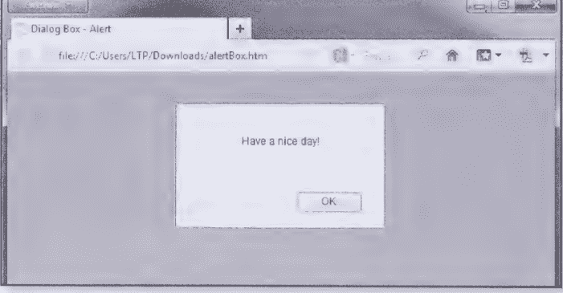

在 Chrome 中：

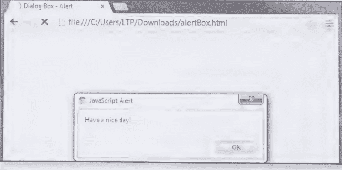

在 Internet Explorer 中：

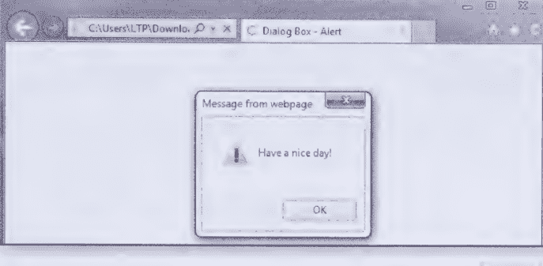

在 Opera 中：

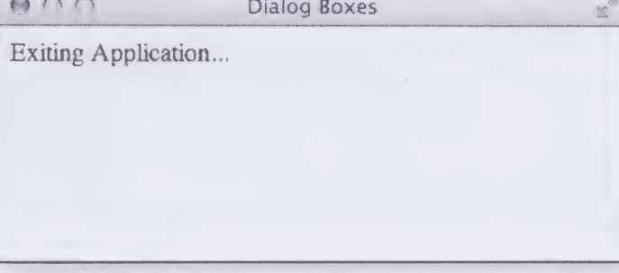

除了直接使用 `alert` 命令外，“alert" 框还可以通过使用变量显示字符串值或文本。与其在 `alert` 函数的括号内编写字符串或文本，不如将字符串指定为变量的值，并从 `alert` 命令中调用该变量。

此代码示例中的 `alert` 框显示了存储在变量中的字符串：

```html
<!DOCTYPE HTML PUBLIC "//W3C//DTD HTML 4.01//EN"
  "http://www.w3.org/TR/html4/strict.dtd">
<html lang="en">
<head>
  <title>Dialog Box - Alert</title>
</head>
<body>
  <script language="javascript" type="text/javascript">
  var message= "Have a nice day !";
  alert(message);
</script>
</body>
</html>
```

之前的代码列表将显示与上示例完全相同的输出。我们将检查的第二种对话框是 `confirm` 框（确认框）。`confirm` 框向用户提一个问题，然后用户通过点击对话框中显示的确定或取消按钮来提供答案。这个框的代码编写比 `alert` 框稍微复杂一点，因为用户的响应必须存储在变量中。通常这是通过变量赋值完成的。变量根据用户的响应存储 TRUE 或 FALSE。为了演示，让我们使用一个名为 `confirmation` 的变量；使用 `confirm(" ")` 初始化其值。在双引号内，放入你想向用户显示的文本。代码看起来如下：

```javascript
var confirmation = confirm("Do you want to exit?");
```

如果用户点击“确定”，值“TRUE”将存储在变量中；反之，如果用户点击“取消”，值“FALSE”将存储在变量 `confirmation` 中。

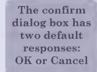

让我们使用一个条件来评估用户的响应。我们将创建一个条件程序，当用户选择“确定”时显示“退出...”，当用户选择“取消”时显示“留在应用程序...”。这是使用 `confirmation = confirm("Do you want to exit?");` 后的完整代码：

```html
<!DOCTYPE HTML PUBLIC "//W3C//DTD HTML 4.01//EN"
  "http://www.w3.org/TR/html4/strict.dtd">
<html lang="en">
<head>
  <title>Dialog Boxes</title>
</head>
<body>
  <script language="javascript" type="text/javascript">
    var confirmation = confirm("Do you want to exit?");
    if (confirmation) {
      document.write("Exiting...");
    }
    else {
      document.write("Staying on application...");
    }
  </script>
</body>
</html>
```

## 代码列表：章节实验练习题答案

```html
<!DOCTYPE HTML PUBLIC "//W3C//DTD HTML
4.01//EN"
  "http://www.w3.org/TR/html4/strict.dtd">
<html lang="en">
<head>
  <title>Dialog Boxes-Chapter Lab Exercise</title>
</head>
<body>
  <script language="javascript"
type="text/javascript">
    var dogAgeInHumanYears =
    prompt("What is your dog’s age in human years?");
    var dogAgeInDogYears = 0;
    dogAgeInDogYears=dogAgeInHumanYears
    * 7;
    alert("Your dog is " + dogAgeInDogYears + " years old in dog years.");
    var confirmation = confirm("Shall I exit the program?")
    if(confirmation)
    {
      document.write("Exiting Dog Years Calculator");
    }
    else
    {
document.write("Cancelling
</script>
</body>
</html>
```

上述代码的输出将如下：

在 Opera 中查看的第一个对话框：


在 Firefox 中查看的第一个对话框：

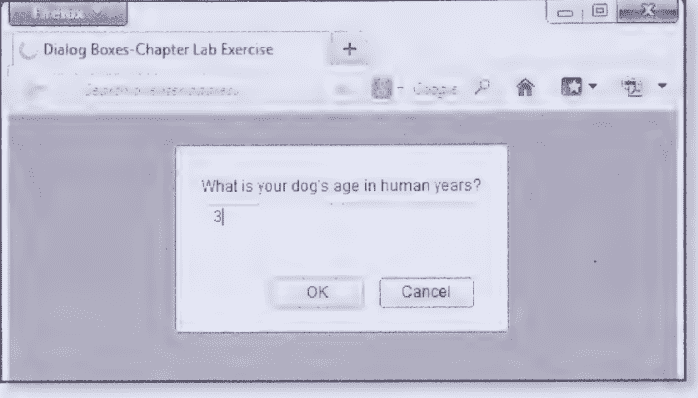

在 Firefox 中查看的第二个对话框：

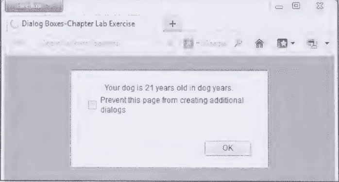

在 Opera 中查看的第三个对话框：

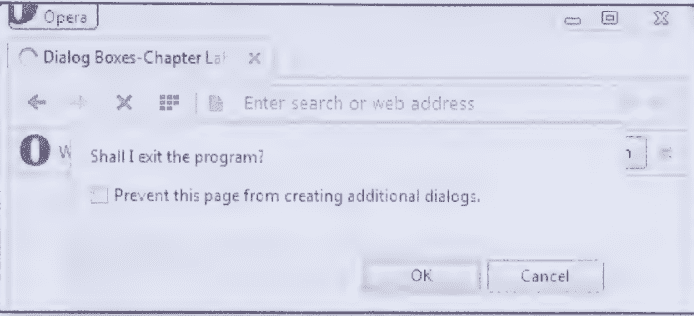

这是在 Chrome 中查看的用户点击“OK”后的浏览器显示：

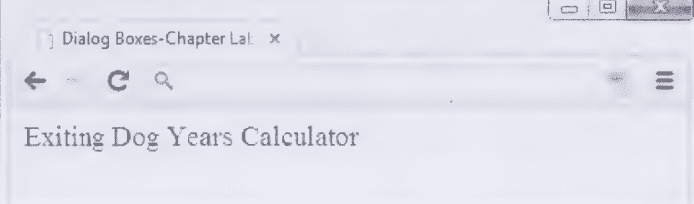

这是在 Chrome 中查看的用户点击“Cancel”后的浏览器显示：

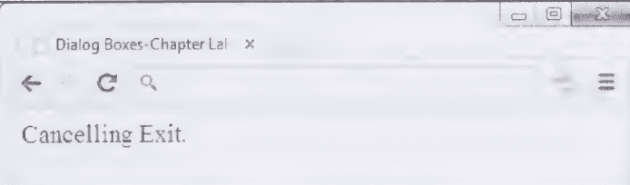

## 第 4 章总结

在本章中，我们讨论了如何使用 JavaScript 创建在浏览器窗口中弹出的对话框。你学习了如何实现 `prompt`、`confirm` 和 `alert` 框。

我们还讨论了如何使用 `prompt` 和 `confirm` 框中用户提供的数据在网站上输出字符串。你学习了如何使用条件语句，在点击 `confirm` 框中的响应后在浏览器中显示字符串输出。

在第 5 章中，我们将讨论如何使用 JavaScript 创建循环。循环是任何语言编程中最重要的方面之一。

# 第 5 章：我们现在开始迭代了！JavaScript 中的循环

## 章节目标

- 你将能够实现 `while` 循环和 `do-while` 循环。
- 你将能够创建 `for` 循环。
- 你将能够在实际情况或案例中应用循环。

## 5.1 WHILE 循环和 DO-WHILE 循环

在本节中，我们将讨论循环。循环是任何编程语言的重要方面。通过循环，你可以重复某个代码块，允许代码重复执行直到满足满意的条件。代码每执行一次，就被称为循环的一次迭代。

在编程时，循环对于许多任务都非常有用，包括接收用户输入数据或导致程序读取、解析和输出一份长篇文档。

在本节中，我们将回顾 `while` 循环和 `do-while` 循环。为了演示循环，让我们创建一个输出从 1 到 100 数字序列的循环。

我们将从 `while` 循环开始。

`while` 循环与条件语句相似之处在于，它会评估程序中的一个条件，如果条件为“TRUE”，则运行与循环相关的代码块。

我们必须首先识别一个循环计数器变量。让我们使用 `x`。在循环的每次迭代中，计数器将在持续条件内进行比较。如果该条件评估为 TRUE，循环将继续迭代。如果评估为 FALSE，循环将停止运行。如果你设置了一个持续条件始终为真的循环，你就会创建一个无限循环，最终会导致你的程序崩溃。在这个示例中，声明的变量是 `x`，其值设置为 1，以便循环迭代 100 次。`while` 循环的语法如下：

```javascript
var x=1;
while (continuation condition)
{
  ...要执行的代码
}
```

一个具体的例子是：

```javascript
while (x < 101)
```

紧接这一行之后是一个代码块，描述了如果 `while` 语句中的条件为“TRUE”时该做什么。让我们指示程序写入或显示变量 `x` 的值。命令集如下：

```javascript
{
document.write (x + "<br/>");
```

我们在输出中拼接了一个换行标签以保持其整洁。

在循环的每次迭代中增加变量 `x` 的值。要递增 `x`，代码应该是：

```javascript
x++;
```

在循环的每次迭代后，JavaScript 解释器将测试持续条件中的 `x`。在这种情况下，如果 `x < 101` 为真，循环将继续迭代。当 `x` 的值达到 101 时，持续条件将评估为 FALSE，循环将停止。

这是完整循环的代码方式：

## 代码列表：WHILE 循环

```javascript
var x=1;
while(x < 101)
  {
    document.write(x + "<br/>");
    x++;
  }
```

`x` 的值与 101 进行比较，因为如果它是 100，循环将迭代到 99。完整代码如下：

```html
<!DOCTYPE html>
<html>
<head>
  <title>While-Loop</title>
</head>
<body>
  <script language="javascript" type="text/javascript">
    var x = 1;
    while (x < 101)
    {
      document.write(x + "<br/>");
      x++;
    }
  </script>
</body>
</html>
```

## While-循环输出

```
1
2
3
4
5
6
7
8
9
...
```


向下滚动，你会在浏览器底部看到：

```
1
2
3
4
5
6
7
8
9
...
```

`do-while` 循环的工作方式与 `while` 循环相似，`do-while` 循环的区别在于是在循环结束测试条件。这意味着即使初始条件为假，它也保证至少迭代一次。

## 代码列表：DO-WHILE

```javascript
window.onload = function() {
  var y=0;
  do {
    document.write(y + "<br/>");
    y++;
  } while (y < 101);
}
```

这是在 Firefox 中执行 `do-while` 循环的结果的结果：

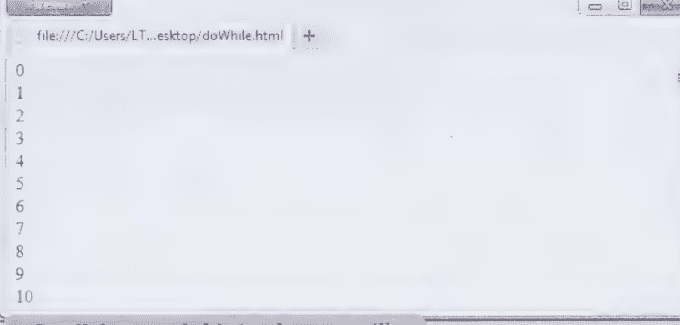

向下滚动，你会在浏览器底部看到：


在这个示例中，循环将迭代，然后评估条件。当 `while` 循环的持续条件产生 FALSE 时，代码块将不再执行后续的迭代。

```html
<!DOCTYPE HTML PUBLIC "//W3C//DTD HTML
4.01//EN"
  "http://www.w3.org/TR/html4/strict.dtd">
<html lang="en">
<head>
  <title>While Loops</title>
</head>
<body>
  <script language="javascript" type="text/javascript">
    var x = 1;
    // 计数到100的循环
```


# 循环与函数

## 代码示例：while 与 do-while 循环

```javascript
while(x < 101) {
  document.write(x + "<br/>");
  x++;
}

document.write("################<br/>");

// Do-while...
var y = 150;

do {
  document.write(y + "<br/>");
  y++;
} while(y < 101);
```

下面的截图是上述代码的输出。注意 `do-while` 循环如何执行一次并停止，因为条件为假。

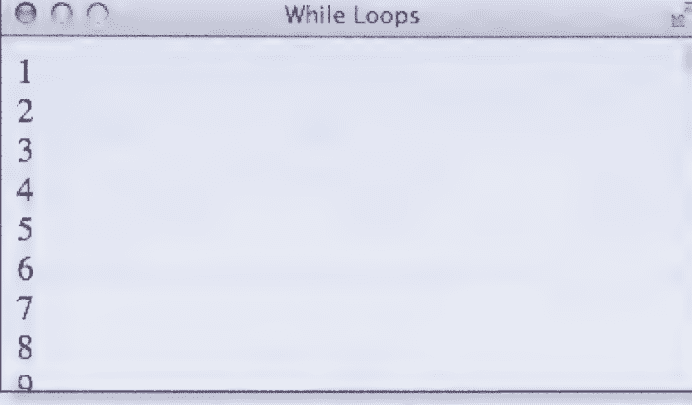

向下滚动，你会在浏览器底部看到：

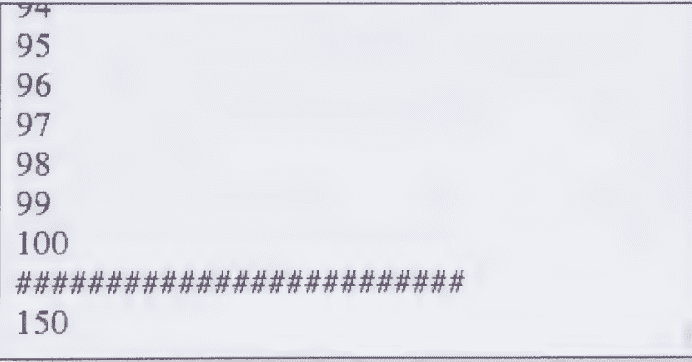

## 复习题

1. `while` 循环是如何运作的？
   - a. 当某个条件为“TRUE”（真）时循环执行。
   - b. 当某个条件为“FALSE”（假）时循环执行。
   - c. 当程序结束时循环执行。
   - d. 当另一个程序在运行时循环执行。

2. 如果你想保证循环在测试条件之前至少执行一次迭代，你应该使用哪种循环？
   - a. `while` 循环。
   - b. `do-while` 循环。
   - c. `for` 循环。
   - d. `if-then` 循环。

3. `do-while` 循环与 `while` 循环有何区别？
   - a. 条件在开始时设置。
   - b. 条件在结束设置。
   - c. 没有条件。
   - d. 没有区别。

## 5.2 FOR 循环与循环的实际应用

`for` 循环是紧凑的循环，允许你在循环命令本身中设置变量、条件和继续条件（或计数器）。它们可以节省时间，易于理解，并且从长远来看可以产生更少的代码。

`for` 循环的写法如下：

```javascript
for(var i = 100; i > -1; i = i - 5)
```

`for` 循环命令包含三个元素。

- 第一是计数器变量的声明及其初始值的赋值。
  > 在上面的示例中，它是 `var i = 100;`。
- 第二部分是继续条件，它将决定循环迭代的次数；在这里，只要变量大于 -1，循环就会一直迭代，即上面示例中的 `i > -1`。
- 第三个也是最后一个元素是“计数器”。计数器决定了计数器变量如何随着循环的每次迭代而变化。在上面的示例中，循环将从 100 开始，每次迭代递减 5，即 `i = i - 5`。基于此，循环将迭代 21 次。

在使用 `for` 循环时必须小心，因为如果错误地设置了计数器，很容易创建死循环。

以下是上一个 `for` 循环示例的完整代码：

### 代码列表：for 循环

```html
<!DOCTYPE HTML PUBLIC "//W3C//DTD HTML 4.01//EN"
 "http://www.w3.org/TR/html4/strict.dtd">
<html lang="en">
<head>
 <title>For Loops</title>
</head>
<body>
  <script language="javascript" type="text/javascript">
    for(var i = 100; i > -1; i = i - 5) {
      document.write(i + "<br>");
    }

    /* Endless Loop
    for(var i = 0; i >= 0; i++) {
      document.write(i + "<br>");
    }
    */
  </script>
</body>
</html>
```

输出命令中包含了一个 `break`，以便每个数字都显示在下一行。请注意注释部分，那里展示了死循环代码的示例。

这是输出在浏览器中的样式：

| For 循环 |
|---|
| 100 |
| 95 |
| 90 |
| 85 |
| 80 |
| 75 |
| 70 |
| 65 |
| 60 |
| 55 |
| 50 |
| 45 |
| 40 |
| 35 |
| 30 |
| 25 |
| 20 |
| 15 |
| 10 |
| 5 |
| 0 |

循环是编程中最有结构之一。它们可以用于各种实际应用。

在这一节中，我们将循环与提示对话框概念结合。提示对话框概念在上一章中引入，用于创建一个允许用户输入他们喜爱的乐队的程序。循环的这种应用有助于演示循环的一个实际用途。

让我们使用叙述性算法来展示程序中将发生事件。

1. 声明一个接收用户输入的变量。将其命名为 `ui`。
2. 分配一个空值。第 1 步和第 2 步的代码应该是：
   ```javascript
   var ui = "";
   ```
3. 引入循环。如果 `ui` 的值不是 `"xxx"`，循环将继续运行。代码如下：
   ```javascript
   while(ui != "xxx")
   ```
4. 编写当继续条件被求值为 `TRUE` 时将执行的代码，并将代码放在 `while` 循环内部。
5. 在循环中嵌套一个条件，用以测试用户输入并做出相应响应。第 4 步和第 5 步的合并代码应该是：
   ```javascript
   {
     ui = prompt("输入一个你喜爱的乐队的名称。输入 xxx 停止");
     if(ui != "xxx") {
       document.write(ui + "<br>");
     }
   }
   ```
6. 结束程序代码。

上述算法的完整代码列表为：

### 代码列表：循环输入

```html
<!DOCTYPE HTML PUBLIC "-//W3C//DTD HTML 4.01//EN"
"http://www.w3.org/TR/html4/strict.dtd">
<html lang="en">
<head>
<title>Looping Input</title>
</head>
<body>
  <script language="javascript" type="text/javascript">
    var ui = "";
    while(ui != "xxx") {
      ui = prompt("输入一个你喜爱的乐队的名称。输入 xxx 停止");
      if(ui != "xxx") {
        document.write(ui + "<br>");
      }
    }
  </script>
</body>
</html>
```

## 其他练习输出

```
While Loop Display 500 to 0 by 5's, etc.
===========================================
500
===========================================
1. I can count...wow!
2. I can count...wow!
3. I can count...wow!
4. I can count...wow!
5. I can count...wow!
6. I can count...wow!
7. I can count...wow!
8. I can count...wow!
9. I can count...wow!
10. I can count...wow!
```

### 代码列表：实验 1

```html
<!DOCTYPE html>
<html>
<head>
  <title>While Loop Display 500 to 0 by 5's, etc.</title>
</head>
<body>
  <script language="javascript" type="text/javascript">
    var x = 500;
    while(x > -1) {
      document.write(x + "<br/>");
      x = x - 5;
    }

    document.write("==========================================");

    var y = 500;
    do {
      document.write("<br/>" + y + "<br/>");
      y++;
    } while(y < 500);

    document.write("========================================== <br/>");

    for(var i = 1; i < 11; i++) {
      document.write(i + "." + " " + "I can count...wow! <br/>");
    }
  </script>
</body>
</html>
```

## 实验 2 答案

每个输出将如下所示：

在 Firefox 中查看输入的十进制利率：
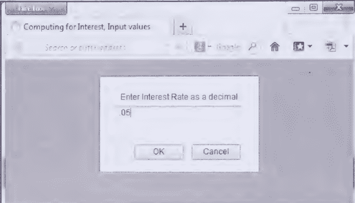

在 Chrome 中查看输入的月份数：
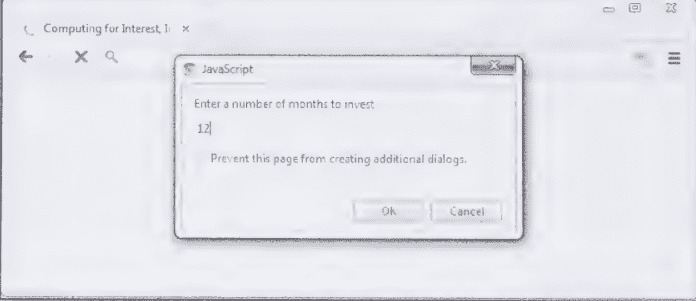

在 Opera 中查看输入的投资金额：
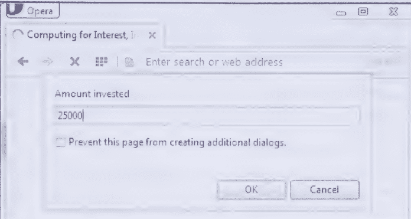

显示每个月的利息和总收益：
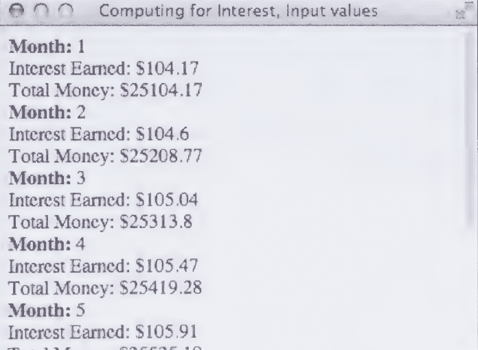

向下滚动，你将在浏览器底部看到：

**月份：9**
收益利息：$107.69
总金额：$25953.28
**月份：10**
收益利息：$108.14
总金额：$26061.42
**月份：11**
收益利息：$108.59
总金额：$26170.01
**月份：12**
收益利息：$109.04
总金额：$26279.05

### 代码列表：实验 2

```html
<!DOCTYPE html>
<html lang="en">
<head>
  <title>Computing for Interest, Input values</title>
</head>
<body>
  <script language="javascript" type="text/javascript">
    var interestRate = prompt("输入十进制的利率", "");
    var term = prompt("输入投资的月份数", "");
    var amountInvested = prompt("输入投资金额", "");

    // 将字符串转换为数值
    interestRate = parseFloat(interestRate);
    term = parseInt(term);
    amountInvested = parseInt(amountInvested);

    // 将利率转换为月利率
    interestRate = interestRate / 12;

    // 提示：使用 Math.round() 进行四舍五入
    // (Math.round() * 100) / 100 将为你提供两位小数

    for(month = 1; month < term + 1; month++) {
      document.write("<strong>Month:</strong> " + month + "<br>");
      document.write("Interest Earned: " + Math.round((interestRate * amountInvested) * 100) / 100);
      document.write("<br>");
      amountInvested = amountInvested + (interestRate * amountInvested);
      document.write("Total Money: " + Math.round(amountInvested * 100) / 100);
      document.write("<br>");
    }
  </script>
</body>
</html>
```

## 第 5 章总结

在本章中，我们讨论了循环。循环是编程中的一个重要元素，它允许程序中的代码行根据条件允许多次执行。你学习了如何使用 `while` 循环、`do-while` 循环和 `for` 循环。

我们还回顾了如何在实际中使用循环。

```javascript
displayGreeting();
displayScore();
</script>
</body>
</html>
```

确保 `functions.js` 文件和包含代码的 HTML 文件位于同一个文件夹中；否则，你必须对独立的 Javascript 文件位置使用相对引用（例如：`/code/functions.js`）。

这是从另一个文档调用函数后的代码输出。

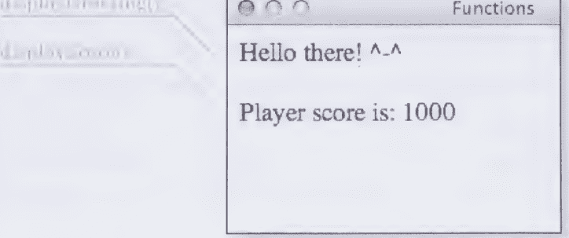

在下一节中，我们将讨论如何在调用者和函数之间传递值。

- 1. 函数由哪两个部分组成？
  a. 函数调用和函数循环。
  b. 函数定义和函数循环。
  c. 函数调用和函数定义。
  d. 函数定义和对象。

- 2. 如何声明一个函数？
  a. 编写关键字 `function` 加上函数名。
  b. 函数名。
  c. 仅写 `function`。
  d. Javascript 文件的名称。

## 实验活动：调用函数—DisplayName()

### 1) 显示名称

在本次活动中，我们将创建一个函数，该函数将通过 `onload` 事件在 HTML5 文档中调用。

#### 1.1) 创建一个基础的 HTML5 文档。

在文档头部插入一个名为 `displayMyName()` 的函数。在函数中填充两个 `document.write()` 命令；第一个命令必须包含你要显示的名称作为字符串值。

```html
<head>
  <title>Page Title</title>
  <script language="javascript">
  function displayMyName() {
```

```javascript
document.write("replace this string with your name... <br/><br/>");
// 你将不得不把这一行的字符串值替换为你的名称
```

而第二个 `document.write` 行将显示字符串值 `"is A - W - E - S - O - M - E -!"`，

```javascript
document.write("is A-W-E-S-O-M-E-!");
```

#### 1.2) 在文档主体中包含一个调用该函数的 `onload` 事件。

```html
<body onload="displayName()">
</body>
```

#### 1.3) 关闭脚本标签并运行代码。你的输出应该类似于此：

| replace this string with your name... |
| is A-W-E-S-O-M-E! |

记住在你的代码中调整 `displayName()` 函数。将现有的字符串值替换为你的名称，这样它在运行时就会成为输出中显示的内容。

### 实验活动 DISPLAYNAME() 答案

显示名称：

```html
<!DOCTYPE html>
<html>
<head>
    <title>Page Title</title>
    <script language="javascript">
    function displayMyName() {
        document.write("replace this string with your name... <br/><br/>"); // 你将不得不把这一行的字符串值替换为你的名称
        document.write("is A-W-E-S-O-M-E-!");
    }
</script>
</head>
<body onload="displayName()">
</body>
</html>
```

## 实验活动：调用函数—DISPLAYORTS()

### 2) 显示运动

在本次活动中，我们将调用一个在 HTML5 文档之外创建的函数但在 HTML5 文档主体内部调用它。

#### 2.1) 创建另一个基础的 HTML5 文档。在头部，就在 `title` 标签下方，包含 Javascript 元素来指示名为 `attachment.js` 的 .js 文件源。

```html
<script language="javascript" type="text/javascript" src="attachment.js"></script>
```

源文件 `attachment.js` 将在 HTML5 文档主体内被调用。调用函数代码为：

```html
<body>
  <script language="javascript" type="text/javascript">
    displaySport();
    displayStatistic();
  </script>
</body>
```

#### 2.2) 完成 HTML5 文档并保存。

#### 2.3) 创建另一个名为 `attachment.js` 的文档。它必须包含两个名为 `displaySport()` 和 `displayStatistics()` 的函数，包含以下代码：

```javascript
function displaySport() {
  document.write("Basketball and Baseball... <br/> <br/>");
}
```

```javascript
function displayStatistic() {
  statistic1 = 55;
  statistic2 = 56;
  document.write("<br/>Statistics show " + statistic1 + " and " + statistic2 + " respective audience patronage!");
}
```

#### 2.4) 完成后，保存文件并运行 HTML5 文档。你的输出看起来像这样：

| Functions |
| :--- |
| Basketball and Baseball... Two A-W-E-S-O-M-E and very P-O-P-U-L-A-R sports. Statistics show 55% and 56% respective audience patronage! |

### 实验活动 DISPLAY SPORTS() 答案

2) 显示运动

HTML 5 文档：

```html
<!DOCTYPE html>
<html lang="en">
<head>
  <title>Functions</title>
  <script language="javascript" type="text/javascript" src="attachment.js"></script>
</head>
```

```html
<body>
  <script language="javascript" type="text/javascript">
    displaySport();
    displayStatistic();
  </script>
</body>
</html>
```

attachment.js:

```javascript
function displaySport() {
  document.write("Basketball and Baseball... <br/> <br/>");
}

function displayStatistic() {
  var statistic1 = 55;
  var statistic2 = 56;
  document.write("<br/>Statistics show " + statistic1 + " and " + statistic2 + " respective audience patronage!");
}
```

## 代码列表：调用函数和传递值

```html
<!DOCTYPE html>
<html>
<head>
    <title>函数调用</title>
    <script language="javascript" type="text/javascript" src="functionReturn.js"></script>
</head>
<body>
    <script language="javascript" type="text/javascript">
        // function 调用
        displayGreeting();
        document.write("<br/>");
        displayPlayerScore(14000);
        document.write("<br/>");
        var sum = addTheseNumbers(12, 17);
        document.write("<br/>");
        document.write(sum);
    </script>
</body>
</html>
```

### 代码列表：functionReturn.js

```javascript
function displayGreeting() {
    document.write("Hey there, dude!");
}

function displayPlayerScore(theScore) {
  // playerScore = 1000;
  theScore += 1000;   // theScore = theScore + 1000;
  document.write("<br/>Player score: " + theScore);
}

function addTheseNumbers(x, y) {
  // document.write(x+y);
  return (x + y);
}
```

要显示输出结果，请确保你的活动窗口是 HTML 文档而不是 .js 文件。

这是上述代码的输出：

| 函数调用 |
| :--- |
| Hey there, dude! |
| Player score: 15000 |
| 29 |

## 帮助问题

- 1. 你如何传递函数的值？
  a. 在函数调用时将其放在圆括号中。
  b. 将其放在函数旁边。
  c. 在 HTML 中定义它。
  d. 玩“传球游戏”。

- 2. 你如何向函数调用返回值？
  a. `return()`
  b. `sendback()`
  c. `functionReturn()`
  d. `returnValue()`

- 3. 需要什么来承载 `return` 命令的值？
  a. 一个新函数。
  b. 一个循环。
  c. 一个脚本。
  d. 一个变量。

## 6.3 从事件调用函数

Javascript 经常被称为事件驱动型语言。通过 Javascript，你可以响应用户在界面中触发的事件，或程序执行过程中自然发生的事件。

本节将涵盖四种事件：`onclick`、`onload`、`onmouseover` 和 `onunload`，并对这些每种事件进行相应的讨论。

让我们从 `onclick` 开始。我们将在 HTML 中创建一个包含 `onclick` 事件的简单按钮。当按钮被点击时，`onclick` 事件将触发一个 Javascript 函数的执行。

```html
<input type="button" value="Press Me" onclick="onButtonClick()"/>
```

一旦点击此按钮，`onButtonClick()` 函数将执行。

现在我们需要创建一个在按钮被点击时运行的实际函数。我们将在文档的 head 部分的 `<script>` 标签中编写该函数。

> 在单个页面上编写 Javascript 函数时，将它们保留在文档的 head 部分中始终是一个好主意。

在这种情况下，我们只是要显示一个文本警告框，提示按钮已被按下。该函数是：

```javascript
function onButtonClick() {
  alert("You have successfully pressed the button!");
}
```

当代码在浏览器中运行时，将显示以下输出：

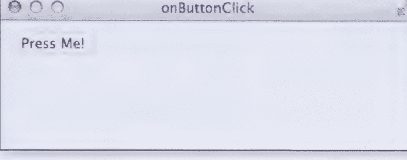

一旦点击“Press Me”按钮，该函数就会调用，导致网页上出现一个“警报框”。

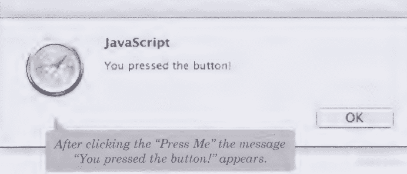

以下是 `onclick` 事件的完整代码列表：

### 代码列表：onclick 事件 – 带有警报框

```html
<!DOCTYPE html>
<html>
<head>
<title>onButtonClick</title>
<script language="javascript" type="text/javascript">
 function onButtonClick() {
    alert("You pressed the button!");
  }
</script>
</head>
<body>
<input type="button" value="Press Me!" onclick="onButtonClick()">
</body>
</html>
```

我们将介绍的下一个事件是 **onload** 事件。该事件会在页面加载后触发一个函数的执行。

实现 `onload` 有多种方法。一种常见的方法是将 `onload` 放在 `<body>` 标签内部。`onload` 事件的完整标签为：

```html
<body onload="whenPageLoads()">
```

在所示的 `<body>` 标签中，页面正在完成加载，函数 `whenPageLoads()` 将被执行。此函数将发出 `alert` 消息，欢迎用户访问页面。

# 第 6 章：编写 Javascript 函数

页面一加载，警报框立即显示。

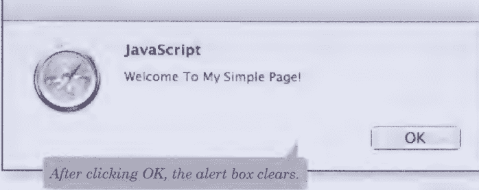
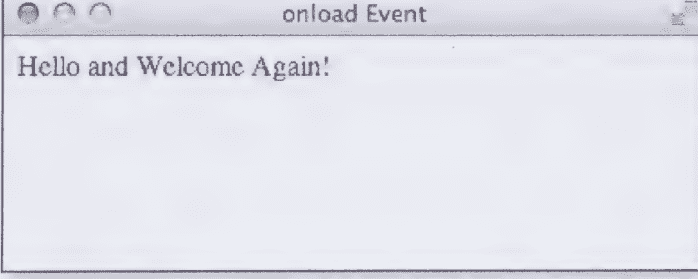

以下是 `onload` 事件的完整代码列表：

```html
<!DOCTYPE html>
<html>
<head>
<title>onload Event</title>
<script language="javascript" type="text/javascript">
  function whenPageLoads() {
    alert("Welcome to the page!");
  }
</script>
</head>
<body onload="whenPageLoads()">
</body>
</html>
```

在浏览器中查看时，`onload` 事件的输出如下：

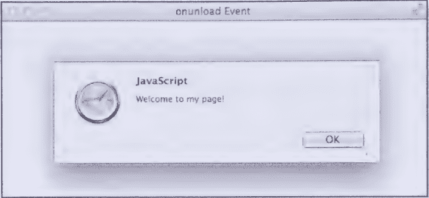

以及 `onclick` 事件的：

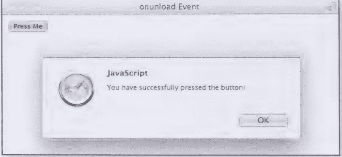

然而，无法对 `onunload` 事件进行屏幕截图，因为当事件发生时，浏览器窗口基本上已经关闭了，没有现有的上下文来显示对话框。

- 1. 如何从用户生成的事件中调用函数？
  a. 创建一个按钮并让该按钮关联一个 `onclick` 事件。
  b. 将函数嵌入 HTML 页面中。
  c. 创建一个不断循环该函数的循环。
  d. 你做不到。

- 2. `onload` 事件的作用是什么？
  a. 在用户关闭页面后调用函数。
  b. 在用户点击页面时调用函数。
  c. 在页面加载后调用函数。
  d. 在用户鼠标悬停在页面上时调用函数。

- 3. `onmouseover` 和 `onclick` 事件之间有什么区别？
  a. `onmouseover` 在网页元素被点击时触发事件，而 `onclick` 在鼠标悬停时触发事件。
  b. `onmouseover` 在鼠标悬停在网页元素上触发事件，而 `onclick` 在点击时触发事件。
  c. 它们都会在页面加载时触发事件。
  d. 它们都会在页面卸载时触发事件。

## 第 6 章实验

### 1) 问候

创建一个程序例，根据点击的语言显示相应的问候语。问候语共有四种语言，如下：

- 英语 = Hello! How are you?
- 西班牙语 = Hola! Como estas?
- 希伯来语 = Shalom!
- 法语 = Bonjour!

创建一个基本的 HTML5 文档结构。

在文档头部中放置一个 `<script>` 元素，并设置相应的属性和值，以便你就可以添加 Javascript 代码。

```html
<head>
<title>Chapter 6 Lab Exercise 1</title>
<script language="javascript" type="text/javascript">
</script>
</head>
```

在你刚刚创建的 script 元素中，包含以下函数：

```javascript
function English() {}
function Spanish() {}
function Hebrew() {}
function French() {}
```

使用 `onclick` 事件，在创建每个按钮的 `<input>` 元素时添加必要的属性。

使用 `alert` 对话框，完成代码，使得之前的每个问候语都能根据点击的语言按钮逐一显示。

保存你完成的文件。进行测试并确保它运行正常。

### 2A) 一些算术运算

编写一个程序，当点击相应的算术操作按钮时，对两个整数（例如 25 和 260）进行加、减、乘、除。

创建一个新的基本 HTML5 文档。

在文档头部中包含相应的 Javascript `<script>` 标签。

```html
<head>
<title>Chapter 6 Lab Exercise Solution 2A</title>
<script language="javascript" type="text/javascript"></script>
</head>
```

在文档头部的 script 元素中包含 `add()`、`subtract()`、`multiply()` 和 `divide()` 函数。

```javascript
function add(x, y) {
  document.write(x + " + " + y + " = " + (x + y));
}

function subtract(x, y) {
  document.write(x + " - " + y + " = " + (x - y));
}

function multiply(x, y) {
  document.write(x + " * " + y + " = " + (x * y));
}

function divide(x, y) {
  document.write(x + " / " + y + " = " + (x / y));
}
```

创建四个标记为 "add"、"subtract"、"multiply" 和 "divide" 的按钮。
在点击 `onclick` 事件时调用每个算术操作函数。

```html
<body>
<input type="button" value="Add" onclick="add(25, 60)" />
<input type="button" value="Subtract" onclick="subtract(25, 60)" />
<input type="button" value="Multiply" onclick="multiply(25, 60)" />
<input type="button" value="Divide" onclick="divide(25, 60)" />
</body>
```

当调用 `onclick` 事件时，每个函数都应该显示整数相加、减、乘、除的结果值。

### 2B) 使用单个函数进行一些算术运算

保存并测试。一旦代码运行正常，请改进程序代码，使得仅通过文档中的一个函数 `mathProb()` 实现相同的功能。必须向此函数“传递”三个参数——两个整数以及与要执行的数学函数对应的任意符号：`+`、`-`、`*` 或 `/`。

> 当你将符号作为参数传递给函数时，请用单引号括起来，而不是双引号。`onclick` 属性已经被双引号包围——所以如果你需要在双引号内使用引号，请使用单引号。

### 3) 修改实验练习 2A

修改第 6 章练习 2A，让程序允许选择要执行的算术运算、输入两个整数并显示结果。

### 4) 修改实验练习 2B

修改第 6 章练习 2B，让程序接受两个整数以及所需的算术运算（`+` 加、`-` 减、`*` 乘、`/` 除）。

## 练习答案

### 问候

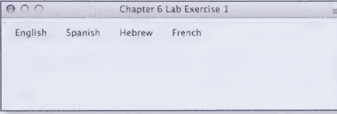
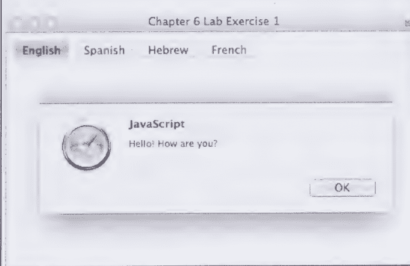

### 第 6 章练习 1

英语 希伯来语 法语
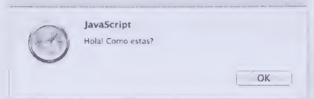
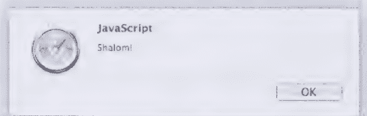
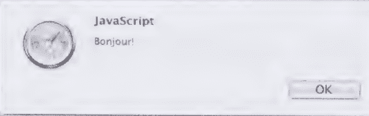

### 代码实现：问候

```html
<!DOCTYPE html>
<html>
<head>
  <title>Chapter 6 Lab Exercise 1</title>
  <script language="javascript" type="text/javascript">
    function English() {
      alert("Hello! How are you?");
    }

    function Spanish() {
      alert("Hola! Como estas?");
    }

    function Hebrew() {
      alert("Shalom!");
    }

    function French() {
      alert("Bonjour!");
    }
  </script>
</head>
<body>
  <input type="button" value="English" onclick="English()"/>
  <input type="button" value="Spanish" onclick="Spanish()"/>
  <input type="button" value="Hebrew" onclick="Hebrew()"/>
  <input type="button" value="French" onclick="French()"/>
</body>
</html>
```

### 2A 算术运算

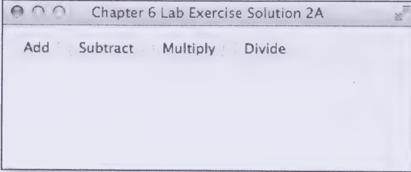
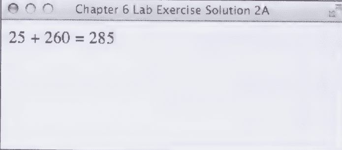

```
25 + 260 = 285
25 - 260 = -235
25 * 260 = 6500
25 / 260 = 0.0961538461538461
```

### 代码实现：算术运算

```html
<!DOCTYPE html>
<html>
<head>
    <title>Chapter 6 Lab Exercise Solution 2A</title>
    <script language="javascript" type="text/javascript">
        function add(x, y) {
            document.write(x + " + " + y + " = " + (x + y));
        }

        function subtract(x, y) {
            document.write(x + " - " + y + " = " + (x - y));
        }

        function multiply(x, y) {
            document.write(x + " * " + y + " = " + (x * y));
        }

        function divide(x, y) {
            document.write(x + " / " + y + " = " + (x / y));
        }
    </script>
</head>
<body>
    <input type="button" value="Add" onclick="add(25,60)"/>
    <input type="button" value="Subtract" onclick="subtract(25,60)" />
    <input type="button" value="Multiply" onclick="multiply(25,60)"/>
    <input type="button" value="Divide" onclick="divide(25,60)"/>
</body>
</html>
```

### 2B) 使用函数 mathProb() 进行一些算术运算

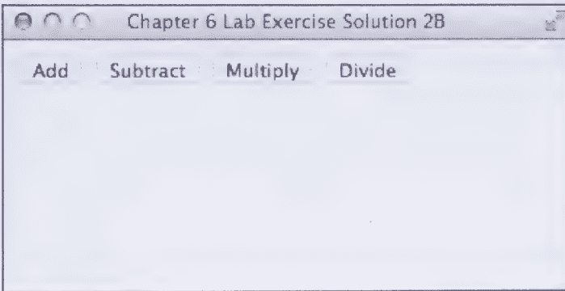
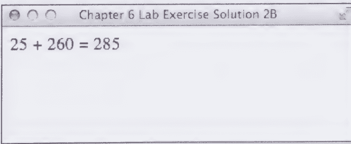

### 代码实现：使用函数 mathProb() 进行算术运算

```html
<!DOCTYPE html>
<html>
<head>
  <title>Chapter 6 Lab Exercise Solution 2B</title>
  <script language="javascript" type="text/javascript">
    function mathProb(x, y, symbol) {
      switch (symbol) {
        case "+":
          document.write(x + " + " + y + " = " + (x + y));
          break;
        case "-":
          document.write(x + " - " + y + " = " + (x - y));
          break;
        case "*":
          document.write(x + " * " + y + " = " + (x * y));
          break;
        case "/":
          document.write(x + " / " + y + " = " + (x / y));
      }
    }
  </script>
</head>
<body>
  <input type="button" value="add" onclick="mathProb(25, 60, '+')" />
  <input type="button" value="subtract" onclick="mathProb(25, 60, '-')" />
  <input type="button" value="multiply" onclick="mathProb(25, 60, '*')" />
  <input type="button" value="divide" onclick="mathProb(25, 60, '/')" />
</body>
</html>
```

### 3) 修改后的实验练习 2A

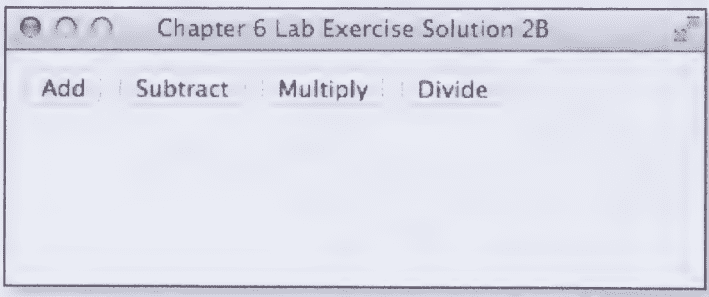
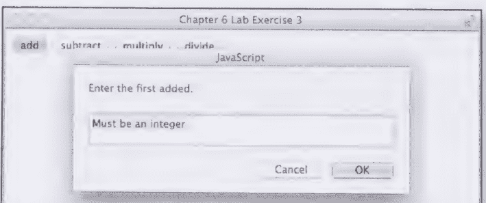

### 代码列表：修改后的实验练习 2A

```html
<!DOCTYPE html>
<html>
<head>
<title>第 6 章实验练习 3</title>
<script language="javascript" type="text/javascript">
  function add() {
    var x = parseInt(prompt("输入第一个加数:", "必须是整数"));
    var y = parseInt(prompt("输入第二个加数:", "必须是整数"));
    var sum = x + y;
    alert("和为 " + sum);
  }

  function subtract() {
    var x = parseInt(prompt("输入被减数:", "必须是整数"));
    var y = parseInt(prompt("输入减数:", "必须是整数"));
    var difference = x - y;
    alert("差值为 " + difference);
  }

  function multiply() {
    var x = parseInt(prompt("输入被乘数", "必须是整数"));
    var y = parseInt(prompt("输入乘数", "必须是整数"));
    var product = x * y;
    alert("乘积为 " + product);
  }

  function divide() {
    var x = parseInt(prompt("输入被除数:", "必须是整数"));
    var y = parseInt(prompt("输入除数:", "必须是整数且不等于 0"));
    var quotient = x / y;
    alert("商为 " + quotient);
  }
</script>
</head>
<body>
  <input type="button" value="add" onclick="add()"/>
  <input type="button" value="subtract" onclick="subtract()" />
  <input type="button" value="multiply" onclick="multiply()"/>
  <input type="button" value="divide" onclick="divide()"/>
</body>
</html>
```

### 4) 修改后的实验练习 2B


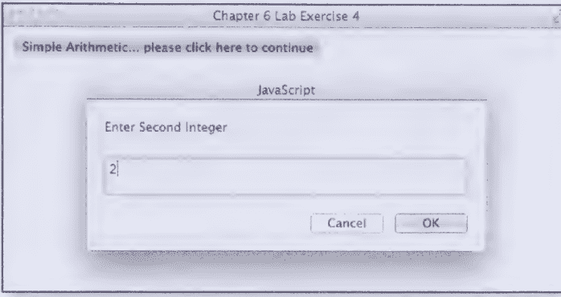
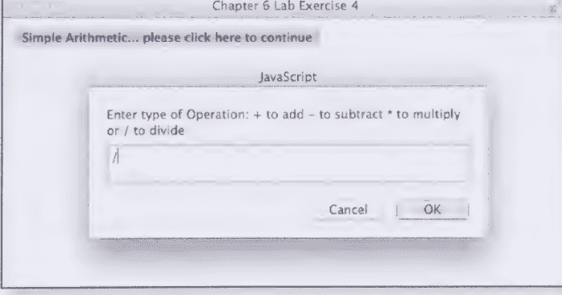

### 第 6 章实验练习 4

简单算术...请点击此处继续
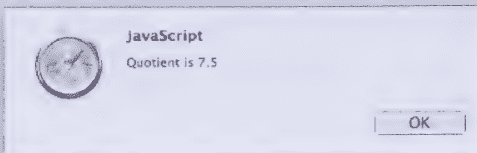

图 6-1

### 代码列表：修改后的章节实验练习 2B

```html
<!DOCTYPE html>
<html>
<head>
  <title>第 6 章实验练习 4</title>
  <script language="javascript" type="text/javascript">
    function mathProb() {
      var x = parseInt(prompt("输入第一个整数", ""));
      var y = parseInt(prompt("输入第二个整数", ""));
      var z = prompt("输入操作类型: + 加 - 减 * 乘 或 / 除", "");
      if (z == "+") {
        var sum = x + y;
        alert("和为 " + sum);
      }
      else if (z == "-") {
        var difference = x - y;
        alert("差值为 " + difference);
      }
      else if (z == "*") {
        var product = x * y;
        alert("乘积为 " + product);
      }
      else if (z == "/") {
        var quotient = x / y;
        alert("商为 " + quotient);
      }
    }
  </script>
</head>
<body>
  <input type="button" value="简单算术...请点击此处继续" onclick="mathProb()" />
</body>
</html>
```

## 第 6 章总结

在第 6 章中，我们讨论了函数。函数是可以在页面中调用并根据需要多次重用的代码块。你学习了如何在页面内创建并挂载函数，这使得使用时具有更大的灵活性。你学习了如何在调用者和函数之间传递值。你学习了如何从事件调用函数，例如 `onclick`、`onload`、`onmouseover` 和 `onunload`。

# 第 7 章：数组操作

## 目标
- 能够创建数组。
- 学习如何使用 `push`。
- 能够排序数组。

## 7.1 声明数组

在第 7 章中，我们将讨论数组。数组可以一次性包含多个值。使用标准方法创建数组的方式如下：

```javascript
var firstNames = new Array();
```

通过索引赋值来填充数组是常见的做法，下文所示：

```javascript
firstNames[0] = "John";
firstNames[1] = "Mary";
firstNames[2] = "Jane";
firstNames[3] = "Sam";
firstNames[4] = "Johnny";
```

另一种创建数组的方法是紧凑方法。这种方法不需要逐个赋值，如下所示：

```javascript
var animals = new Array("dog", "cat", "mouse", "hamster", "toad");
```

即使这种方法没有显式赋值索引，数组的索引也是从 0 开始的：

```javascript
var animals = ["dog", "cat", "mouse", "hamster", "toad"];
```

最后一种创建数组的方法是字面量方法。在这种方法中，不再需要 `new Array` 数据类型声明：

```javascript
var companies = ["Apple", "Google", "Cnet", "Udemy", "GE"];
```

这种方法同样适用于索引编号方案。

索引号：[0] [1] [2] [3] [4]

这三种方法在本质上是相同的，结果也是相同的。一旦数组创建，浏览器中的 JavaScript 解释器就不会区分它是如何创建的。在上述三个示例中，所有数组都可以通过其索引访问。可以使用对话框 `alert` 显示数组的任何成员。

### 代码列表：标准数组声明显示数组成员

```html
<!DOCTYPE html>
<html>
<head>
<title>标准数组</title>
</head>
<body>
  <script language="javascript">
    var firstNames = new Array();
    firstNames[0] = "John";
    firstNames[1] = "Mary";
    firstNames[2] = "Jane";
    firstNames[3] = "Sam";
    firstNames[4] = "Johnny";
    alert(firstNames[3]);
  </script>
</body>
</html>
```

这是在浏览器中查看时的输出结果：

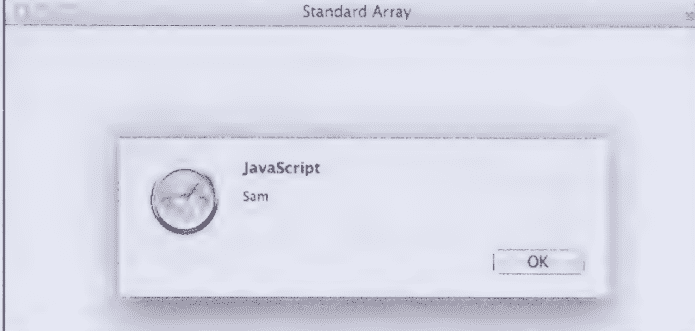

### 代码列表：紧凑法

```html
<!DOCTYPE html>
<html>
<head>
  <title>紧凑数组</title>
</head>
<body>
<script language="javascript" type="text/javascript">
  var animals = new Array("dog", "cat", "mouse", "hamster", "toad");
  alert(animals[3]);
</script>
</body>
</html>
```

这是在浏览器中查看时的输出结果：

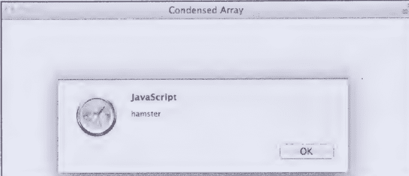

### 代码列表：字面量法

```html
<!DOCTYPE html>
<html>
<head>
  <title>字面量数组</title>
</head>
<body>
  <script language="javascript" type="text/javascript">
    var companies = ["Apple", "Google", "Cnet", "Udemy", "GE"];
    alert(companies[3]);
  </script>
</body>
</html>
```

这是在浏览器中查看时的输出结果：

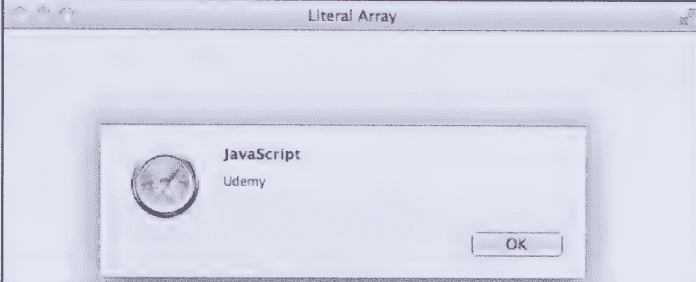

起初你可能会困惑，为什么在方括号中写的是三（3），但访问的却是列表中的第四项，但随着你频繁使用数组，你会习惯这种引用方式的。

如果你想顺序访问数组的成员，最好的方法是使用循环。JavaScript 数组具有 `length` 属性。该 `length` 属性返回数组成员的数量。请记住，在大多数情况下，这个值比数组的最高索引大一，因为 JavaScript 中的所有数组都是从零开始索引的。

例如，假设你想访问数组 `firstNames` 的长度。为了做到这一点，我们编写数组变量名，后面跟一个点，然后是 `length` 属性：

```javascript
firstNames.length
```

要在循环中使用该属性，我们必须建立循环条件，其中该条件将值与数组的长度进行比较。代码列表如下：

```javascript
for (var i = 0; i < firstNames.length; i++) {
  document.write(firstNames[i]);
  document.write("<br/>");
}
```

在这个循环中，变量 `i` 最初设为零，只要该数字小于 `firstNames` 的长度，循环就会执行。循环随后将输出所有的数组索引值，并在最后一个索引的内容显示出来后停止。

以下是将展示如何显示数组所有索引值的代码列表：

### 代码列表：标准数组——显示所有索引值

```html
<!DOCTYPE html>
<html>
<head>
  <title>标准数组</title>
</head>
<body>
  <script language="javascript" type="text/javascript">
  var firstNames = new Array();
  firstNames[0] = "John";
  firstNames[1] = "Mary";
  firstNames[2] = "Jane";
  firstNames[3] = "Sam";
  firstNames[4] = "Johnny";
  for(var i = 0; i < firstNames.length; i++) {
    document.write(firstNames[i]);
    document.write("<br/>");
  }
  </script>
</body>
</html>
```

上一个代码列表的输出在浏览器中查看将如下所示：

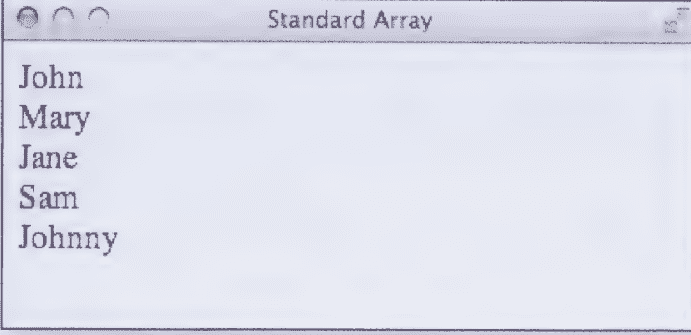

你也可以在数组实例化后更改数组中索引的值。为了做到这一点，你需要指定想要更改的索引位置并声明新值。这里是代码：

```javascript
firstNames[0] = "Herbert";
```

将之前的代码插入到另一个 `for` 循环中，看看数组元素是如何变化的。完整的代码列表现在变为：

### 代码列表：带有 for 循环的标准数组

```html
<!DOCTYPE html>
<html>
<head>
  <title>带有 for 循环的标准数组</title>
</head>
<body>
<script language="javascript" type="text/javascript">
var firstNames = new Array();
firstNames[0] = "John";
firstNames[1] = "Mary";
firstNames[2] = "Jane";
firstNames[3] = "Sam";
firstNames[4] = "Johnny";

// 显示原始的 firstNames
for(var i = 0; i < firstNames.length; i++) {
  document.write(firstNames[i]);
  document.write("<br/>");
}

// 显示新值
firstNames[0] = "Herbert";
for(var i = 0; i < firstNames.length; i++) {
  document.write(firstNames[i]);
  document.write("<br/>");
}
</script>
</body>
</html>
```

这在浏览器中查看时的输出将如下所示：

```
Standard Array with For-Loop
John
Mary
Jane
Sam
Johnny
Herbert
Mary
Jane
Sam
Johnny
```

注意索引 0 的值如何变为了“Herbert”，而数组的其他部分保持不变。

## 复习题

1. 什么是数组？
   - a. 同时可以存储多个值的变量。
   - b. 同时可以循环一个变量的循环。
   - c. 在 JavaScript 中使用的循环。
   - d. 同时可以存储多个值的函数。

2. 你把创建数组的过程称为什么？
   - a. 数组的声明。
   - b. 引用数组。
   - c. 分配数组。
   - d. 数组的实例化。

3. 在紧凑法中，你在哪里编写赋值的值？
   - a. 在单独的行上。
   - b. 与数组的同一行。
   - c. 在循环中。

4. 你如何访问数组的所有成员？
   - a. 通过方法。
   - b. 创建新数组。
   - c. 使用循环。
   - d. 传递数据。

## 7.2 操作数组

在处理数组时，你经常需要操作它们。在 JavaScript 中，与大多数语言一样，数组是一个对象。让我们看看数组的某些属性。

一个数组包含如下值：85, 92, 70, 63, 55, 92, 88, 77, 91, 91，总共 10 个值。

让我们看看当我们尝试显示第 12 个成员（即 `grades[11]`）时会发生什么。在编辑器中输入以下代码。

### 代码列表：字面量数组显示——超出范围

```html
<!DOCTYPE html>
<html>
<head>
  <title>字面量数组</title>
</head>
<body>
<script language="javascript" type="text/javascript">
  var grades = [85, 92, 70, 63, 55, 92, 88, 77, 91, 91];
  document.write(grades[11]);
</script>
</body>
</html>
```

以下是预期输出：

```
Literal Array
undefined
```

代码输出了 `undefined` 消息，因为数组的 `grades[11]` 不存在。这是一种逻辑错误。程序运行但没有显示预期的结果。这类错误无法通过传统的语法检查轻松找到。因此，在识别和处理数组及其数据时，你必须对程序逻辑进行严谨分析。

我们现在把 `document.write(grades[11]);` 改为 `document.write(grades[9]);`，这样它将显示数组的第 10 个成员。更新后的代码列表现在是：

### 代码列表：字面量数组显示——在范围内

```html
<!DOCTYPE html>
<html>
<head>
  <title>字面量数组</title>
</head>
<body>
  <script language="javascript" type="text/javascript">
    var grades = [85, 92, 70, 63, 55, 92, 88, 77, 91, 91];
    document.write(grades[9]);
  </script>
</body>
</html>
```

输出应该是：

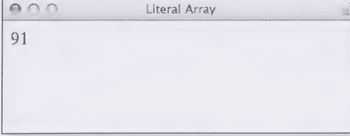

数组的成员数量或值也可以被显示。这是通过在变量 `grades` 后面附加 `length` 属性来实现，即 `grades.length`。

```javascript
<script language="javascript" type="text/javascript">
var grades = [85, 92, 70, 63, 55, 92, 88, 77, 91, 91];
document.write(grades[9]);
document.write("<br/>" + grades.length);
for (x in grades) {
  document.write("Iteration:" + x + "<br/>");
  document.write(grades[x] + "<br/>");
}
</script>
```

记住，长度始终比数组中声明的最后一个索引大 1。

现在让我们使用 **for-in-loop** 对数组的成员进行迭代。`for-in-loop` 是遍历数组成员的一种简单方法。这种循环方法的优点在于，它会根据数组的 `length` 属性自动遍历每个成员，而无需知道数组的实际长度。长度被隐式使用，而无需显式声明。

我们将编写代码，在下一行显示数组 `grades` 的长度及其迭代次数；这将为数组的每个成员依次执行并显示在不同的行中。代码列表如下：

### 代码列表：FOR-IN-LOOP

```html
<!DOCTYPE html>
<html>
<head>
  <title>字面量数组的 For-in 循环</title>
</head>
<body>
  <script language="javascript" type="text/javascript">
    var grades = [85, 92, 70, 63, 55, 92, 88, 77, 91, 91];
    // 显示数组长度
    document.write("Array length: " + grades.length + "<br/>");
    // 显示迭代次数以及分数
    for(x in grades) {
      document.write("Iteration: " + x + "<br/>");
      document.write(grades[x] + "<br/>");
    }
  </script>
</body>
</html>
```

上述代码的输出将是：

```
Literal Array For-In-Loop
Array length: 10
Iteration: 0
85
Iteration: 1
92
Iteration: 2
70
Iteration: 3
63
Iteration: 4
55
Iteration: 5
92
Iteration: 6
88
Iteration: 7
77
Iteration: 8
91
Iteration: 9
91
```

让我们来看一些可以在数组对象上使用的方法。如果你需要关于数组对象的更完整参考，请访问 javascript 网站，那里包含了所有属性和方法的详尽列表。

我们先来看下 `push` 方法。`push` 是一个向数组末尾添加新数据并返回新长度的函数。使用相同数组实现 `push` 的语法如下：

```javascript
grades.push(100, 63);
```

修改之前代码中的元素，我们将得到：

```javascript
<script language="javascript" type="text/javascript">
var grades = [85, 92, 70, 63, 55, 92, 88, 77, 91, 91];
document.write("Array length: " + grades.length + "<br/>");
grades.push(100, 63);
for(x in grades) {
  document.write("Iteration " + x + " ");
  document.write(grades[x] + "<br/>");
}
</script>
```

在 `push` 方法括号内找到的值 100 和 63 被添加到数组末尾。我们现在可以修改上例中的代码，将这两个值添加到数组并返回新长度。新的代码列表如下：

### 代码列表：带 PUSH 的字面量数组 FOR-IN-LOOP

```html
<!DOCTYPE html>
<html>
<head>
<title>带有 Push 的字面量数组 For-in 循环</title>
</head>
<body>
<script language="javascript" type="text/javascript">
var grades = [85, 92, 70, 63, 55, 92, 88, 77, 91, 91];
// 显示数组长度。
document.write("Array length: " + grades.length + "<br/>");
grades.push(100, 63);
// 显示迭代和分数。
for(x in grades) {
  document.write("Iteration " + x + ": ");
  document.write(grades[x] + "<br/>");
}
document.write("<br/> Array length after PUSH: " + grades.length + "<br/>");
</script>
</body>
</html>
```

输出看起来像这样：

| 带有 Push 的字面量数组 For-In-loop |
| :--- | :--- |
| Array length | 10 |
| Iteration 0 | 85 |
| Iteration 1 | 92 |
| Iteration 2 | 70 |
| Iteration 3 | 63 |
| Iteration 4 | 55 |
| Iteration 5 | 92 |
| Iteration 6 | 88 |
| Iteration 7 | 77 |
| Iteration 8 | 91 |
| Iteration 9 | 91 |
| Iteration 10 | 100 |
| Iteration 11 | 63 |
| Array length after PUSH | 12 |

## 第 7 章实验题

1. 创建一个新的基础 HTML 文档并插入 Javascript 标签。
2. 使用讨论过的三种方法中的一种创建一个名为 `placesToVisit` 的数组。在数组中填充至少五个你想去的地方的名称。
3. 使用 `for` 循环遍历数组，并使用 `document.write()` 显示每个地方的名称。
4. 在数组末尾添加城市 "Boise"。
5. 创建一个循环，通过函数 `outputArray()` 显示数组。确保你的函数接受一个名为 `theArray` 的单参数。
6. 调用函数 `outputArray()` 并将 `placesToVisit` 数组作为参数传递。
7. 在 HTML 的 `body` 中，再次调用 `outputArray()` 函数，在进行更改后输出参数 `theArray`。
8. 通过 `splice` 函数删除数组的前两个成员。该函数的正确语法为：
   ```javascript
   placesToVisit.splice(0, 2);
   ```
9. 调用 `outputArray()` 函数并指示再次显示数组以显示所做的更改。
10. 将数组按字母顺序排序。
11. 使用创建的函数最后一次显示数组。
12. 保存并测试你的代码。在浏览器中查看输出。

当在浏览器中查看时，输出应该是：

| 章实验题 |
| :--- |
| 富士山 |
| 长城 |
| 密歇尔湖 |
| 维多利亚瀑布 |
| 巧克力丘 |
| 匹纳图博火山 |
| 布拉岛 |
| 大钟 |
| 北极 |
| Boise |
| 密歇尔湖 |
| 维多利亚瀑布 |
| 巧克力丘 |
| 匹纳图博火山 |
| 布拉岛 |
| 大钟 |
| 北极 |
| Boise |
| 大钟 |
| Boise |
| 布拉岛 |
| 巧克力丘 |
| 密歇尔湖 |
| 匹纳图博火山 |
| 北极 |
| 维多利亚瀑布 |

```html
<!DOCTYPE html>
<html>
<head>
<title>Chapter 实验题</title>
<script language="javascript" type="text/javascript">
  function outputArray(theArray) {
    for(x in theArray) {
      document.write(theArray[x] + "<br>");
    }
  }
</script>
</head>
<body>
  <script language="javascript" type="text/javascript">
    var placesToVisit = ["Mt. Fuji", "Great Wall", "Lake Superior", "Victoria Falls", "Chocolate Hills", "Mt. Pinatubo", "Boracay", "Big Ben", "North Pole"];
    placesToVisit.push("Boise");
    outputArray(placesToVisit);
    placesToVisit.splice(0, 2);
    document.write("<br>");
    outputArray(placesToVisit);
    placesToVisit.sort();
    document.write("<br>");
    outputArray(placesToVisit);
  </script>
</body>
</html>
```

## 第 7 章总结

在本章中，我们讨论了数组的操作以及如何访问和操纵数组。我们检查了定义数组的基础知识、创建和声明数组，以及使用 `for` 循环对数组进行索引。本章还涵盖了 `push`、`pop`、`sort` 和 `splice`，这些都是操作数组的方法。在下一章中，我们将介绍字符串对象。

# 第 8 章：字符串对象

## 章节目标
- 你将能够理解字符串对象的属性和方法。
- 你将学习如何使用方法修改字符串属性。
- 你将能够通过循环将字符串替换为其他字符串。
- 你将学习如何计算字符串包含的字符数量以及结果。
- 你还将学习如何将逗号分隔的字符串转换为数组。

## 8.1 对象属性和方法

在本章中，我们将重点讨论字符串对象。这是一个关于我们讨论内容的非常棒的网站参考：


建议你在学习本章课程时打开此网页。

我们在书的早期部分讨论过字符串，并将其定义为字母和数字的序列。在处理字符串工作时，我们通常会在字符串本身周围加上双引号。字符串对象也不例外——事实上，所有的字符串都是对象。这意味着，就像 JavaScript 中所有的对象一样，字符串具有描述它们的属性和操纵它们的方法（函数）。

当我们说属性时，它是与对象相关联的描述对象本身的属性。在本节中，我们将讨论 `length` 属性。在继续之前，让我们简要描述一下方法。方法是可以应用或执行于对象上的动作或过程。对于字符串对象，例如从小写转换为大写、替换为另一个字符串、删除字符串以及在字符串末尾追加。

当我们在 JavaScript 中创建一个字符串时，我们是在创建一个字符串对象。你已经知道如何做了。我们将一个字符串赋值给变量 `message`。

```javascript
var message = "Hello World";
```

接下来，我们将创建另一个变量，使用 `x`，它将存储变量 `message` 的长度：

```javascript
var x = message.length;
```

在这个例子中，`message` 是字符串的名称，`length` 是属性。如果你显示 `x` 的值，将得到结果 11（注：原文示例为 12，实则 "Hello World" 长度为 11，"Hello World!" 为 12）。

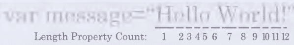

这里是显示 "Hello World!" 字符串长度的完整代码：

### 代码列表：字符串属性–长度

```html
<!DOCTYPE html>
<html>
<head>
<title>Hello World--Length</title>
</head>
<body>
<script language="javascript" type="text/javascript">
    var message = "Hello World!";
    var x = message.length;
    document.write("Length: " + x);
    document.write("<br>");
</script>
</body>
</html>
```

这是上述代码在浏览器中的输出：

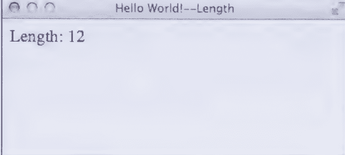

作为另一个例子，让我们使用 F. 斯科特·菲茨杰拉德的名言，“If you are strong enough, there are no precedents.”创建一个基础 HTML 文档并在 `body` 中包含 `script` 元素：

```html
<script language="javascript" type="text/javascript">
```

将引言赋值给变量 `phrase` 并关闭 script 标签：

```javascript
var phrase = "If you are strong enough, there are no precedents.";
</script>
```

使用 `length` 属性计算字符串中的字符数量。使用 `document.write()` 显示引言，正确的语法是：

```javascript
document.write("Length: " + phrase.length);
```

### 代码列表：显示长度

```html
<!DOCTYPE html>
<html>
<head>
<title>String Object--Length</title>
</head>
<body>
  <script language="javascript" type="text/javascript">
    var phrase = "If you are strong enough, there are no precedents.";
    document.write("Length: " + phrase.length);
    document.write("<br>");
  </script>
</body>
</html>
```

此代码的输出应该是：

| Length: 50 |

由于空格和特殊字符被计入内，所以结果是 50。

现在让我们讨论字符串对象可用的一些方法。我们将讨论的方法是 `charAt()`。`charAt()` 方法显示字符串中字符的位置。就像 JavaScript 数组一样，也是从 0 开始索引的。

使用之前的代码显示对象的长度，我们将修改代码引入 `charAt()`。我们将使用 `for` 循环逐字符遍历字符串。该函数的正确用法确保在遍历整个字符串时扫描每个字符位置。`for` 循环应该是：

```javascript
for (var i = 0; i < phrase.length; i++) {
    document.write(i + ": " + phrase.charAt(i));
    document.write("<br>");
}
```

该练习的完整代码为：

### 代码列表：字符串方法 charAt

```html
<!DOCTYPE html>
<html>
<head>
<title>String Method charAt()</title>
</head>
<body>
    <script language="javascript" type="text/javascript">
        var phrase = "If you are strong enough, there are no precedents.";
        for (var i = 0; i < phrase.length; i++) {
            document.write(i + ": " + phrase.charAt(i));
            document.write("<br>");
        }
    </script>
</body>
</html>
```


```
输出将如下所示：

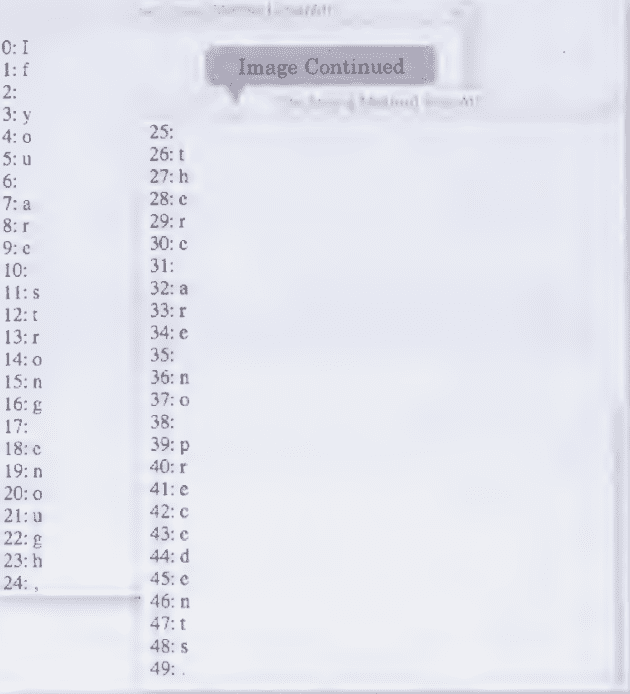

+ 0:I
1:f
2:
3:y
4:o 25:
5:u 26:t
6: 27:h
7:a 28:c
8:r 29:r
9:e 30:c
10: 31:
11:s 32:a
12:t 33:r
13:r 34:e
14:o 35:
15:n 36:n
16:g 37:o
17: 38:
18:c 39:p
19:n 40:r
20:o 41:e
21:u 42:c
22:g 43:d
23:h 44:e
24:. 45:e
46:n
47:t
48:s
49:.
```

字符串对象像字符数组一样进行处理。

我们将检查的第二种方法是`charCodeAt()`，它用于显示字符串中特定索引处字符的 Unicode 值。为了演示这一点，我们只需要在 for 循环程序中的第一行`document.write`下方添加以下额外的`document.write`命令，其中包含`charCodeAt()`函数：

```javascript
document.write(" | " + phrase.charCodeAt(i));
```

该方法将显示每个字符（包括空格）的 Unicode 值。以下是完整代码的样式：

# 代码列表：字符串对象的 charCodeAt()

```html
<!DOCTYPE html>
<html>
<head>
<title>字符串方法 charCodeAt</title>
</head>
<body>
<script language="javascript" type="text/javascript">
var phrase = "If you are strong enough, there are no precepts.";
for (var i=0; i < phrase.length; i++) {
  document.write(i + ": " + phrase.charCodeAt(i));
  document.write(" | " + phrase.charCodeAt(i));
  document.write("</br>");
}
</script>
</body>
</html>
```

注意，输出首先显示了字符串索引处的字母，接着是管道符号 (`|`)，然后是该字符字符串对应的 Unicode 码：

| 0: I | 73 | 25: i | 32 |
| 1: f | 102 | 26: t | 116 |
| 2: l | 32 | 27: h | 104 |
| 3: y | 121 | 28: e | 101 |
| 4: o | 111 | 29: r | 114 |
| 5: u | 117 | 30: c | 101 |
| 6: l | 32 | 31: l | 32 |
| 7: a | 97 | 32: a | 97 |
| 8: r | 101 | 33: r | 114 |
| 9: e | 102 | 34: c | 101 |
| 10: l | 32 | 35: l | 32 |
| 11: s | 115 | 36: n | 110 |
| 12: t | 116 | 37: o | 111 |
| 13: r | 114 | 38: l | 32 |
| 14: o | 111 | 39: p | 112 |
| 15: n | 110 | 40: r | 114 |
| 16: g | 103 | 41: e | 101 |
| 17: t | 32 | 42: c | 99 |
| 18: e | 101 | 43: e | 101 |
| 19: n | 110 | 44: d | 100 |
| 20: o | 111 | 45: e | 101 |
| 21: u | 117 | 46: n | 110 |
| 22: g | 103 | 47: t | 116 |
| 23: h | 104 | 48: s | 115 |
| 24: l | 44 | 49: l | 146 |

如果计划对一组字符串字符进行字母排序，则可以使用 Unicode 值。提示：小写字母的值比对应的大写字母小。

我们将查看的第三种方法是`indexOf()`，它用于查找字符串中特定字符第一次出现的位置。例如，让我们找到引文 "If you are strong enough, there are no precedents." 中第一个小写 "s" 的索引。

使用`document.write`，该函数的命令行如下：

```javascript
document.write("Index of s: " + phrase.indexOf('s'));
```

在闭合的`script`标签之前，在函数程序外部编写此命令行命令。完整代码列表如下：

# 代码列表：字符串对象的 INDEXOF()

```html
<!DOCTYPE html>
<html>
<head>
<title>字符串方法 indexOf</title>
</head>
<body>
<script language="javascript" type="text/javascript">
var phrase = "If you are strong enough, there are no precepts.";
for (var i=0; i < phrase.length; i++) {
  document.write(i + ": " + phrase.charAt(i));
  document.write(" | " + phrase.charCodeAt(i));
}
document.write("<br>");
document.write("Index of s: " + phrase.indexOf('s'));
</script>
</body>
</html>
```

由于我们没有更改程序，输出的上半部分看起来仍然是一样。然而，你会发现在底部显示了一行新的输出。这是`indexOf()`方法的输出。见以下图片：

此图片显示了你看到的内容：

| 0: I | 73 | 25: i | 32 |
| 1: f | 102 | 26: t | 116 |
| 2: l | 32 | 27: h | 104 |
| 3: y | 121 | 28: e | 101 |
| 4: o | 111 | 29: r | 114 |
| 5: u | 117 | 30: c | 101 |
| 6: l | 32 | 31: l | 32 |
| 7: a | 97 | 32: a | 97 |
| 8: r | 101 | 33: r | 114 |
| 9: e | 102 | 34: c | 101 |
| 10: l | 32 | 35: l | 32 |
| 11: s | 115 | 36: n | 110 |
| 12: t | 116 | 37: o | 111 |
| 13: r | 114 | 38: l | 32 |
| 14: o | 111 | 39: p | 112 |
| 15: n | 110 | 40: r | 114 |
| 16: g | 103 | 41: e | 101 |
| 17: t | 32 | 42: c | 99 |
| 18: e | 101 | 43: e | 101 |
| 19: n | 110 | 44: d | 100 |
| 20: o | 111 | 45: e | 101 |
| 21: u | 117 | 46: n | 110 |
| 22: g | 103 | 47: t | 116 |
| 23: h | 104 | 48: s | 115 |
| 24: l | 44 | 49: l | 146 |

我们要看到的第四种方法是`replace()`，它用于替换字符串中的选定字符。注意，如果未找到指定的文本，则返回原字符串。

`replace()`方法替换了字符串中的选定字符。使用`replace()`方法的完整代码如下：

```html
<!DOCTYPE html>
<html>
<head>
<title>字符串方法 replace</title>
</head>
<body>
<script language="javascript" type="text/javascript">
var phrase = "If you are strong enough, there are no precepts.";
for (var i=0; i < phrase.length; i++) {
  document.write(i + ": " + phrase.charAt(i));
  document.write(" | " + phrase.charCodeAt(i));
}
document.write("<br>");
document.write("Index of s: " + phrase.indexOf('s'));
</script>
</body>
</html>
```

输出的上半部分仍然看起来是一样的，因为我们没有更改程序。然而，你会注意到在底部显示了一行新的输出。这是`indexOf()`方法的输出。见以下图片：

此图片显示了你看到的内容：

| 0: I | 73 | 25: i | 32 |
| 1: f | 102 | 26: t | 116 |
| 2: l | 32 | 27: h | 104 |
| 3: y | 121 | 28: e | 101 |
| 4: o | 111 | 29: r | 114 |
| 5: u | 117 | 30: c | 101 |
| 6: l | 32 | 31: l | 32 |
| 7: a | 97 | 32: a | 97 |
| 8: r | 101 | 33: r | 114 |
| 9: e | 102 | 34: c | 101 |
| 10: l | 32 | 35: l | 32 |
| 11: s | 115 | 36: n | 110 |
| 12: t | 116 | 37: o | 111 |
| 13: r | 114 | 38: l | 32 |
| 14: o | 111 | 39: p | 112 |
| 15: n | 110 | 40: r | 114 |
| 16: g | 103 | 41: e | 101 |
| 17: t | 32 | 42: c | 99 |
| 18: e | 101 | 43: e | 101 |
| 19: n | 110 | 44: d | 100 |
| 20: o | 111 | 45: e | 101 |
| 21: u | 117 | 46: n | 110 |
| 22: g | 103 | 47: t | 116 |
| 23: h | 104 | 48: s | 115 |
| 24: l | 44 | 49: l | 146 |

# 第8章 实验解答

```html
<!DOCTYPE html>
<html>
<head>
<title>实验练习 8</title>
</head>
<body>
  <script language="javascript" type="text/javascript">
    var poem = " With Rue My Heart is Laden<br>"
    + " by Alfred Edward Housman, 1896</br</br>"
    + "With rue my heart is laden" + "<br>"
    + "For golden friends I had," + "<br>"
    + "For many a rose-lip maiden" + "<br>"
    + "And many a lightfoot lad." + "<br>"
    + "By brooks too broad for leaping" + "<br>"
    + "The lightfoot boys are laid;" + "<br>"
    + "The rose-lip girls are sleeping" + "<br>"
    + "In fields where roses fade.";
    for (var y=0; y<poem.length; y++) {
      var vowels = /[aeiou]/g;
      var poemReplaced = poem.replace(vowels, 'X');
    }
    document.write(poemReplaced);
    var sports = "tennis, ice hockey, baseball, basketball, football, soccer, bowling";
    var sportsS = sports.split(',');
    document.write("</br>");
    document.write("</br>");
    for (var z = 0; z<sportsS.length; z++) {
      sportsS.sort();
      document.write(sportsS[z] +</br>");
    }
 </script>
</body>
</html>
```

输出结果应如下：

# 实验练习 8

```
WXth Rue My HXXrt Xs LXdXn by AlfrXd EdwXrd HXXsmXn, 1896

WXth rXX my hHXXrt Xs ldXXn FXr gXldXn frXXnds hXXd, FXr mXny X rXXsX-lXpt mXXdXn And mXny X lXghtfXXt lXd.

By brXXks tXX brXXd fXr lXXpXng ThX lXghtfXXt bXys rXr lXXd; ThX rXsX-lXpt gXrls rXr slXXpXng In fXXlds whXrX rXsXs fXdX.
```

- 棒球
- 篮球
- 保龄
- 足球
- 冰球
- 网球
- 网球

注意诗歌输出中的大写元音以及字母 y（在语法上用作元音时）没有被替换为 'X'。这是因为 JavaScript 是区分大小写的——它不认为 'a' 与 'A' 是相同的。作为程序员，我们的任务是确保在变量赋值中包含剩余的大写元音字符，以便它们也能被替换为 'X'。

'y' 的情况没有那么简单。确定哪些单词将 'y' 用作元音的算法必须考虑在内。提示：需要添加一个条件例程，以确定哪些单词将 'y' 用作元音使用，并且这需要添加到完整的代码列表中。至于如何替换 'y' 字符，将作为一项活动挑战留给您完成。

现在修改程序，使其在`replace()`练习中包含大写元音。修改后的行看起来如下：

```javascript
var vowels = /[aeiouAEIOU]/g;
```

# 第8章 总结

在本章中，我们讨论了字符串属性`length`，它用于计算字符串中包含的字符数。

我们还讨论了五种字符串处理方法：

| 方法 | 描述 |
| :--- | :--- |
| `charAt()` | 用于显示字符在字符串集中的特定位置 |
| `charCodeAt()` | 返回字符串字符的 Unicode 值 |
| `indexOf()` | 用于查找某些内容在字符串中的出现位置 |
| `replace()` | 用于将选定的一组字符串替换为不同的字符串值 |
| `split()` | 用于将用逗号分隔的字符串转换为数组 |

我们还展示了如何使用迭代对字符串字符进行操作，以及如何将某些字符串集合替换另一个字符并显示结果或更改。

在接下来的章节中，我们将讨论如何获取和操纵用户的浏览器窗口信息。

# 第9章 获取和操纵用户信息

本章目标：

- 你将学习如何使用 Javascript 获取用户的浏览器窗口信息并操纵这些信息。
- 你将能够使用`navigator`（导航）对象。
- 你将学习如何使用`window`（窗口）对象。
- 你将能够使用`screen`（屏幕）对象来操纵信息。

在开发 Web 应用程序时，获取用户环境的信息通常是非常有用的。这些信息通常用于优化用户体验或执行针对用户环境的特定过程。Javascript 拥有丰富的对象和方法来帮助我们实现这一点。

我们将讨论的第一个对象是`navigator`对象。访问它的关键字是`navigator`。该对象提供了有关用户浏览器的信息，包括其名称、版本和平台。

```javascript
document.write("<br/>");
document.write("Height: " + window.innerHeight);
</script>
</body>
</html>
```

这是在浏览器中的显示效果：

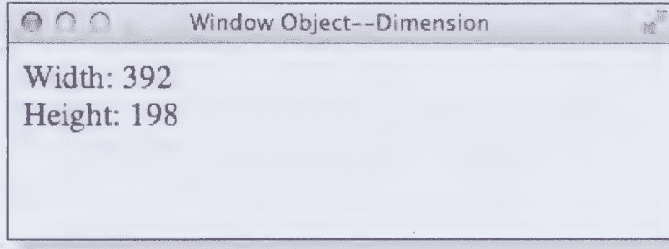

拖动窗口角部来调整大小，然后点击刷新。注意看它是如何返回不同的值的。

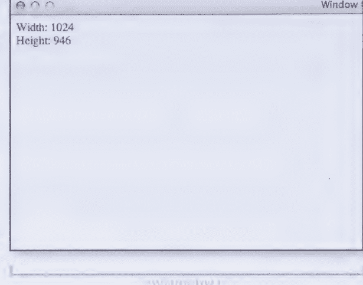

我们还可以设置浏览器的内部宽度和内部高度。

命令语法为：

```
window.innerWidth=value in pixels;
window.innerHeight=value in pixels;
```

在完整的代码列表中使用这些内容，我们将得到：

# 代码列表：INNERWIDTH 和 INNERHEIGHT

```html
<!DOCTYPE html>
<html>
<head>
    <title>Window 对象--设置宽度和高度</title>
</head>
<body>
<script language="javascript" type="text/javascript">
window.innerWidth=300;
window.innerHeight=200;
document.write("Width: " + window.innerWidth);
document.write("<br/>");
document.write("Height: " + window.innerHeight);
</script>
</body>
</html>
```

当在浏览器中查看时的输出如下：


在使用尺寸属性（`innerWidth`和`innerHeight`）时必须小心，因为它们在不同浏览器中表现出的反应不同，实现方式也不同。在某些情况下，浏览器不会对这些内部窗口设置做出相应的响应。

我们将讨论的第三个对象是`location`。此对象可以完成两件事之一：获取当前页地址或 URL，或者将浏览器重定向到新的页面位置。获取`location`对象的命令语法为：

```javascript
document.write(window.location);
```

将代码集成到完整的代码列表中：

## 代码列表：WINDOW 对象 – 获取 LOCATION

```html
<!DOCTYPE html>
<html>
<head>
  <title>Window 对象--Location</title>
</head>
<body>
  <script language="javascript" type="text/javascript">
    document.write("Location: " + window.location);
 </script>
</body>
</html>
```

当在浏览器窗口中查看时，输出将如下：


现在让我们讨论如何设置`location`对象。设置`location`对象的命令语法为：

```
window.location = "page URL";
```

例如：

```javascript
window.location = "http://www.cnn.com";
```

将代码集成到完整的代码列表中：

## 代码列表：WINDOW 对象 – 设置 LOCATION

```html
<!DOCTYPE html>
<html>
<head>
  <title>Window 对象--设置 Location</title>
</head>
<body>
  <script language="javascript" type="text/javascript">
    window.location="http://www.cnn.com";
 </script>
</body>
</html>
```

当在浏览器中查看时的输出如下：


可以与`location`对象一起使用的属性是`protocol`（协议）。参见接下来的代码列表，其中`location`指的是一个文件：

## 代码列表：WINDOW 对象 – LOCATION PROTOCOL

```html
<!DOCTYPE html>
<html>
<head>
  <title>Window 对象--Location Protocol</title>
</head>
<body>
<script language="javascript" type="text/javascript">
document.write("Location protocol: " + window.location.protocol);
</script>
</body>
</html>
```

当在浏览器中查看时的输出如下：


> 注意在此示例中，返回的值是 "file:"，因为正在查看的源页面来自本地文件。如果通过浏览器中查看，它将返回 "http:" 或 "https:"。

让我们看看当`location`对象更改为网页时，返回的值发生什么变化。

# 代码列表：WEB LOCATION PROTOCOL

```html
<!DOCTYPE html>
<html>
<head>
</head>
<body>
<script>
  document.write("Location protocol: " + window.location.protocol);
</script>
</body>
</html>
```

如果你使用的浏览器没有按预期显示输出，请尝试在编辑器 "Tryit Editor v 1.6" 中运行代码，输出将显示为：


## 3. SCREEN 对象

让我们查看`screen`对象，它提供了关于显示器的信息。使用这些属性的命令语法为：

在完整的代码列表中使用这些内容，我们将得到：

## 代码列表：SCREEN

```html
<!DOCTYPE html>
<html>
<head>
</head>
<body>
<script>
  document.write(".:););
</script>
</body>
</html>
```

# 第 10 章 文档对象与 innerHTML 属性

## 章节目标：
- 你将能够从文本框中提取文本，并使用警告框显示提取的文本。
- 你将学习如何使用背景颜色来高亮文本。
- 你将能够在不弹出新窗口的情况下更改页面内的内容。
- 你将学习如何安装 Firebug 以及如何使用它来查看页面中代码的变化。

## 10.1 文档对象 (DOCUMENT OBJECT)

在最后一章中（呼！），我们将介绍文档对象和`innerHTML`属性的概述。我们还将介绍一个名为 Firebug 的 Firefox 扩展，它可以让你查看页面内容的变化。

让我们先讨论文档对象。当我们说文档对象时，我们指的是浏览器的内部设置，以及发现或放置在 HTML 页面文档中的元素。文档对象以分级格式存储在浏览器中，有效地充当你的 JavaScript 程序的内存或 RAM。浏览器的整个状态都存储在文档对象中——包括它的 HTML、JavaScript 和 CSS 代码。处理文档对象及其各种属性（数百个）有标准化的方法。这种在不同浏览器之间保持相当一致的标准模型被称为文档对象模型（DOM）。

> 文档对象的示例：文本字段、回复按钮、超链接等。

`innerHTML`属性提供了一种访问文档对象不同方面的方法——特别是那些设计用于存放 HTML 代码的部分。`innerHTML`属性允许你同时检索和设置文档节点中的 HTML。

通过利用文档对象模型，你可以调整浏览器中的几乎任何内容——包括用于设置内容的 CSS。重要的是要理解存储在文档对象中的内容是动态的，因此值可能会随着用户与网站的交互而改变。例如，如果用户在表单中输入信息，这些信息将存储在文档对象中，你可以在它们提交到服务器之前对它们进行访问。

首先，让我们创建一个 HTML 文档，其中包含三个元素：两个文本输入字段和一个按钮。这些元素将使用`innerHTML`属性和文档对象进行操作。

在我们的 HTML 文档体中，将第一个和最后一个元素包含为文本框，以及一个标记为"Press Me"的按钮。按钮将通过`onclick`事件触发名为`processName()`的函数。body 元素的编码方式如下：

```html
<body>
  First: <input type="text" id="first"/>
  <br/>
  Last: <input type="text" id="last"/>
  <input type="button" value="Press Me" onclick="processName()"/>
</body>
```

`processName()`函数将提取第一个和最后一个文本框元素中输入的值。在开始之前，请确保你在 HTML 文档的 head 元素中这样编写`script`标签：

```html
<script language="javascript" type="text/javascript">
```

然后让我们声明两个局部变量——`first`和`last`——它们将用于存储或包含从文本框元素中提取的值。

```javascript
var first;
var last;
```

现在，通过分配`getElementById().value`方法来初始化这些变量，从文本框中提取值。代码所示：

```javascript
document.getElementById('first').value;
last=document.getElementById('last').value;
```

> 确保包含`.value`，因为没有它，提取的只是文本框而不是文本框元素内部的值。

这里是我们到为止编写的所有代码：

```html
<script language="javascript" type="text/javascript">
  function processName() {
    var first;
    var last;
    first=document.getElementById('first').value;
    last=document.getElementById('last').value;
  }
</script>
```

为了方便起见，我们将使用警告框（alert box）来显示提取的值。这是警告代码：

```javascript
alert(first + " " + last);
```

## 代码列表：带警告框的文档对象

```html
<!DOCTYPE html>
<html>
<head>
  <title>The Document Object</title>
  <script language="javascript" type="text/javascript">
    function processName() {
      var first;
      var last;
      first = document.getElementById('first').value;
      last = document.getElementById('last').value;
      alert(first + " " + last);
    }
 </script>
</head>
<body>
  First: <input type="text" id="first"/>
  <br/>
  Last: <input type="text" id="last"/>
  <input type="button" value="Press Me" onclick="processName()"/>
</body>
</html>
```

输出结果应该是这样的：


```javascript
style.fontWeight = "bold";
```

使用 CSS 更改文档对象和元素的视觉效果是一项强大的能力。它增强了网页开发人员有效交付一系列事件或网页更改的能力，而无需修改服务器端代码，从而在 Javascript 中创建动态样式。

如果你熟悉 CSS，可能已经注意到，当通过文档对象和 style 属性进行修改时，通常会遵循 CSS 语法。你可以在样式表中创建的任何 CSS 规则，都可以通过文档对象和 style 属性动态创建。

## 10.2 innerHTML 属性

`innerHTML`属性用于访问 HTML 代码中任何元素内部的 HTML。例如，一个`<p>`段落元素内部可能包含文本和其他 HTML 标签。通过使用`innerHTML`属性，我们可以访问内容并进行检索和修改。

`http://www.w3.org/TR/dom06.html`对`innerHTML`的定义有如下解释：

我们网页对象中最有用的属性……`innerHTML`属性由微软在 Internet Explorer 中引入，作为一种一次性访问 HTML 容器全部内容的方便方法。事实证明它是如此方便，所有其他浏览器都很快增加了对该属性的支持。

我们可以使用`innerHTML`来检索容器的当前内容，也可以向该容器中插入新内容。

让我们深入研究并开始通过 Javascript 修改 HTML 文档中的内容。首先，我们创建一个基础 HTML 文档，然后添加一个逻辑分区。接着在文档的`<head>`中放置`<script>`标签：

```html
<!DOCTYPE html>
<html>
<head>
<title</title>
  <script language="javascript" type="text/javascript">
 </script>
</head>
```

现在，我们将通过添加`id`属性和值，使`div`可以通过对象和 Javascript 访问。我们将值设置为 "content"：

```html
<body>
  <div id="content">
```

接下来，让我们添加一个段落元素。当然，它必须被段落标签包围。然后我们关闭 "div"：

```html
<p>当访问文档对象的 innerHTML 属性时，此段落将会改变</p>
</div>
```

为了让它更有趣，让我们添加一个按钮，点击它时将调用一个函数，该函数包含动态更改 HTML 的代码。按钮的段代码如下：

```html
<input type="button" value="点击我!" onclick="changeContent()"/>
</body>
</html>
```

让我们回到文档的头部——就在两个`<script>`标签之间——并向标签内部插入函数`changeContent()`，从而形成一个元素。

插入的代码看起来应该是这样的：

```javascript
function changeContent() {
  document.getElementById('content').innerHTML = "<h3>看到吗？内容已经改变了！</h3>";
}
```

我们对内容使用了`<h3>`标题 3 标签，这样一旦变化发生，就会变得非常明显。完整的代码列表现在应该像所示：

## 代码列表：innerHTML 更改 "div" 内容

```html
<!DOCTYPE html>
<html>
<head>
  <title>Inner HTML - 更改 "div" 内容</title>
  <script language="javascript" type="text/javascript">
    function changeContent() {
      document.getElementById('content').innerHTML = "<h3>看到吗？内容已经改变了！</h3>";
    }
 </script>
</head>
<body>
  <div id="content">
    <p>当访问文档对象的 innerHTML 属性时，此段落将会改变，即当你按下按钮时</p>
 </div>
  <input type="button" value="点击我!" onclick="changeContent()"/>
</body>
</html>
```

输出应该像这样：


点击按钮后：


我们可以使用一个名为 Firebug 的插件来查看浏览器内部正在发生的情况。Firebug 可以向你展示在按下按钮时文档内部实际上发生了什么。首先，你必须下载 Firebug 并将其添加到 Firefox 浏览器中。该插件可以从此网站下载：`http://www.firebug.org`

# 第 10 章：文档对象和 innerHTML 属性

下载后，你将看到如下提示符：


下面的图片描绘了如何使用 Firebug 追踪我们程序内部发生的情况。注意 Firefox 浏览器右上角那个像圆的小图标。这确认了 Firefox 插件 Firebug 已安装在浏览器中。


点击小虫虫（Firebug 图标）你就可以看到在浏览器中发生了什么：


当你将鼠标悬停在`<body>`行上时，你会看到网页内部的情况：


当你将鼠标悬停在 HTML 元素上时，你会看到：


当你拉伸窗口时，你会看到显示：


当你悬停在段落元素时，你会看到黄色背景：


我们之所以想探索 Firebug 是为了看到当`innerHTML`属性触发事件时发生了什么：


点击"点击我"按钮后，你会看到如下结果：


# 文档对象和 innerHTML 属性

现在点击"点击我"按钮。你会看到 HTML 代码发生了变化：


4) 运行代码。输出应该如下：


图 10

5) 完善函数代码，使程序按照第 3 点描述的方式运行。

确保程序执行了该例程，以便在输入值时，会出现适当的消息和高亮。请查看下图：


# 代码列表：章节练习题答案

```html
<!DOCTYPE html>
<script language="javascript" type="text/javascript">
function validFirst() {
  //alert("In validFirst()");
  var firstTextBoxContent = document.getElementById("first").value;
  if (firstTextBoxContent != "" && firstTextBoxContent != null) {
    document.getElementById("firstError").innerHTML = "";
    document.getElementById("first").style.backgroundColor = "white";
    if (firstTextBoxContent.length < 3) {
      document.getElementById("firstError").innerHTML = "Response too short";
    }
  } else {
    document.getElementById("firstError").innerHTML = "Required Field";
    document.getElementById("first").style.backgroundColor = "red";
  }
}
function validLast() {
  var lastTextBoxContent = document.getElementById("last").value;
  if (lastTextBoxContent != "" && lastTextBoxContent != null) {
    document.getElementById("lastError").innerHTML = "";
    document.getElementById("last").style.backgroundColor = "white";
    if (lastTextBoxContent.length < 3) {
      document.getElementById("lastError").innerHTML = "Response too short";
    } else {
      document.getElementById("lastError").innerHTML = "Required Field";
      document.getElementById("last").style.backgroundColor = "red";
    }
  }
}
function validEmail() {
  var emailTextBoxContent = document.getElementById("email").value;
  if (emailTextBoxContent != "" && emailTextBoxContent != null) {
    document.getElementById("emailError").innerHTML = "";
    document.getElementById("email").style.backgroundColor = "white";
    if (emailTextBoxContent.length < 3) {
      document.getElementById("emailError").innerHTML = "Response too short";
    } else {
      document.getElementById("emailError").innerHTML = "Required Field";
      document.getElementById("email").style.backgroundColor = "red";
    }
  }
}
function validPhone() {
  var phoneTextBoxContent = document.getElementById("phone").value;
  if (phoneTextBoxContent != "" && phoneTextBoxContent != null) {
    document.getElementById("phoneError").innerHTML = "";
    document.getElementById("phone").style.backgroundColor = "white";
    if (phoneTextBoxContent.length < 3) {
      document.getElementById("phoneError").innerHTML = "Response too short";
    } else {
      document.getElementById("phoneError").innerHTML = "Required Field";
      document.getElementById("phone").style.backgroundColor = "red";
    }
  }
}
</script>
<head>
<title>Chapter 10 Lab Exercise</title>
</head>
<body>
<table>
    <tr><td>First Name</td><td><input type="text" id="first" onblur="validFirst()</td><td><span id="firstError</span</td</tr>
    <tr><td>Last Name</td><td><input type="text" id="last" onblur="validLast()</td><td><span id="lastError</span</td</tr>
    <tr><td>Email</td><td><input type="text" id="email" onblur="validEmail()</td><td><span id="emailError</span</td</tr>
    <tr><td>Phone</td><td><input type="text" id="phone" onblur="validPhone()</td><td><span id="phoneError</span</td</tr>
    <tr><td><input type="submit" value="Submit</td><td</td><td</td</tr>
</table>
</body>
</html>
```

现在你已经读完了这本书，请参加我们的 Javascript 测验，看看你的表现如何。满分意味着你表现得非常出色，并且真的投入了大量时间来学习 Javascript。

# 第 2 章复习题

- 1) 我们在哪个 HTML 元素中放置 Javascript？

  a) `<script>`  c) `<scripting>`

  b) `<js>` d) `<javascript>`

- 2) 如果你想在 Javascript 中写 "Hello World!"，正确的语法是什么？

  a) "Hello World"

  b) ("Hello World")

  c) `response.write("Hello World")`

  d) `document.write("Hello World");`

- 3) 插入 Javascript 标签的正确位置是哪里？

  a) `<body>` 部分。

  b) 在 CSS 文件源和主 HTML 文档中。

  c) `<head>` 部分。

  d) 同时在`<head>`部分和`<body>`部分。

- 4) 外部文件必须包含`<script>`标签。

  a) 正确的。

  b) 错误。

- 5) 引用名为 "addNumber.js" 的外部脚本的正确语法是什么？

  a) `<script type="text/javascript" href="addNumber.js">`

  b) `<script type="text/javascript" name="sum.js">`

  c) `<script type="text/javascript" src="addNumber.js">`

  d) `<script type="text/javascript" src="addNumber.js">`

- 6) 你如何在警报框中写 "Hello there!"？

  a) `alert("Hello there!");`

  b) `msgBox("Hello there!");`

  c) `alertBox="Hello there!";`

  d) `alertBox("Hello there!");`

- 7) 你如何创建一个函数？

  a) `function:myFunction()`

  b) `myFunction()`

  c) `function:function`

  d) `function=myFunction()`

- 8) 你如何调用名为 "doRoutine" 的函数？

  a) `doRoutine()`

  b) `callRoutine()`

  c) `function=doRoutine`

  d) `callRoutine;`

- 9) 你如何在 Javascript 中写条件语句 "i" 等于 10？

  a) `if i=10;`

  b) `i==10`

  c) `i =10`

- 10) 如何在 Javascript 中写条件语句 "i" 等于 10？

  a) `if i=10;`

  b) `i==10`

  c) `i =10`

- 11) 如何在 Javascript 中写条件语句 "i" 等于 10？

  a) `if i=10;`

  b) `i==10`

  c) `i =10`

- 12) 如何在警报框中写 "Hello there!"？

  a) `alert("Hello there!");`

  b) `msgBox("Hello there!");`

  c) `alertBox="Hello there!";`

  d) `alertBox("Hello there!");`

- 13) 如何创建一个函数？

  a) `function:myFunction()`

  b) `myFunction()`

  c) `function:function`

  d) `function=myFunction()`

- 14) 如何调用名为 "doRoutine" 的函数？

  a) `doRoutine()`

  b) `callRoutine()`

  c) `function=doRoutine`

  d) `callRoutine;`

- 15) 如何在 Javascript 中写条件语句 "i" 等于 10？

  a) `if i=10;`

  b) `i==10`

  c) `i =10`

- 16) 如何在 Javascript 中写条件语句 "i" 等于 10？

  a) `if i=10;`

  b) `i==10`

  c) `i =10`

- 17) 如何在警报框中写 "Hello there!"？

  a) `alert("Hello there!");`

  b) `msgBox("Hello there!");`

  c) `alertBox="Hello there!";`

  d) `alertBox("Hello there!");`

- 18) 如何创建一个函数？

  a) `function:myFunction()`

  b) `myFunction()`

  c) `function:function`

  d) `function=myFunction()`

- 19) 如何调用名为 "doRoutine" 的函数？

  a) `doRoutine()`

  b) `callRoutine()`

  c) `function=doRoutine`

  d) `callRoutine;`

- 20) 如何在 Javascript 中写条件语句 "i" 等于 10？

  a) `if i=10;`

  b) `i==10`

  c) `i =10`


```html
<!DOCTYPE html>
<script language="javascript" type="text/javascript">
function validFirst() {
  //alert("In validFirst()");
  var firstTextBoxContent = document.getElementById("first").value;
  if (firstTextBoxContent != "" && firstTextBoxContent != null) {
    document.getElementById("firstError").innerHTML = "";
    document.getElementById("first").style.backgroundColor = "white";
    if (firstTextBoxContent.length < 3) {
      document.getElementById("firstError").innerHTML = "Response too short";
    }
  } else {
    document.getElementById("firstError").innerHTML = "Required Field";
    document.getElementById("first").style.backgroundColor = "red";
  }
}
function validLast() {
  var lastTextBoxContent = document.getElementById("last").value;
  if (lastTextBoxContent != "" && lastTextBoxContent != null) {
    document.getElementById("lastError").innerHTML = "";
    document.getElementById("last").style.backgroundColor = "white";
    if (lastTextBoxContent.length < 3) {
      document.getElementById("lastError").innerHTML = "Response too short";
    } else {
      document.getElementById("lastError").innerHTML = "Required Field";
      document.getElementById("last").style.backgroundColor = "red";
  }
}

function validEmail() {
  var emailTextBoxContent = document.getElementById("email").value;
  if (emailTextBoxContent != "" && emailTextBoxContent != null) {
    document.getElementById("emailError").innerHTML = "";
    document.getElementById("email").style.backgroundColor = "white";
    if (emailTextBoxContent.length < 3) {
      document.getElementById("emailError").innerHTML = "Response too short";
    } else {
      document.getElementById("emailError").innerHTML = "Required Field";
      document.getElementById("email").style.backgroundColor = "red";
  }
}

function validPhone() {
  var phoneTextBoxContent = document.getElementById("phone").value;
  if (phoneTextBoxContent != "" && phoneTextBoxContent != null) {
    document.getElementById("phoneError").innerHTML = "";
    document.getElementById("phone").style.backgroundColor = "white";
    if (phoneTextBoxContent.length < 3) {
      document.getElementById("phoneError").innerHTML = "Response too short";
    } else {
      document.getElementById("phoneError").innerHTML = "Required Field";
      document.getElementById("phone").style.backgroundColor = "red";
    }
  }
}
</script>
<head>
<title>第 10 章练习题</title>
</head>
<body>
<table>
    <tr><td>名字</td><td><input type="text" id="first" onblur="validFirst()</td><td><span id="firstError</span</td</tr>
    <tr><td>姓</td><td><input type="text" id="last" onblur="validLast()</td><td><span id="lastError</span</td</tr>
    <tr><td>邮箱</td><td><input type="text" id="email" onblur="validEmail()</td><td><span id="emailError</span</td</tr>
    <tr><td>电话</td><td><input type="text" id="phone" onblur="validPhone()</td><td><span id="phoneError</span</td</tr>
    <tr><td><input type="submit" value="提交</td><td</td><td</td</tr>
</table>
</body>
</html>
```

现在你已经读完了这本书，请参加我们的 Javascript 测验，看看你的表现如何。满分意味着你表现得非常出色，并且真的投入了大量时间来学习 Javascript。

# 第 2 章复习题

- 1) 我们在哪个 HTML 元素中放置 Javascript？
  a) `<script>`  c) `<scripting>`
  b) `<js>` d) `<javascript>`

- 2) 如果你想在 Javascript 中写 "Hello World!"，正确的语法是什么？
  a) "Hello World"
  b) ("Hello World")
  c) `response.write("Hello World")`
  d) `document.write("Hello World");`

- 3) 插入 Javascript 标签的正确位置是哪里？
  a) `<body>` 部分。
  b) 在 CSS 文件源和主 HTML 文档中。
  c) `<head>` 部分。
  d) 同时在 `<head>` 部分和 `<body>` 部分。

- 4) 外部文件必须包含 `<script>` 标签。
  a) 正确的。
  b) 错误。

- 5) 引用名为 `addNumber.js` 的外部脚本的正确语法是什么？
  a) `<script type="text/javascript" href="addNumber.js">`
  b) `<script type="text/javascript" name="sum.js">`
  c) `<script type="text/javascript" src="addNumber.js">`
  d) `<script type="text/javascript" src="addNumber.js">`

- 6) 你如何在警报框中写 "Hello there!"？
  a) `alert("Hello there!");`
  b) `msgBox("Hello there!");`
  c) `alertBox="Hello there!";`
  d) `alertBox("Hello there!");`

- 7) 你如何创建一个函数？
  a) `function:myFunction()`
  b) `myFunction()`
  c) `function:function`
  d) `function=myFunction()`

- 8) 你如何调用名为 `doRoutine` 的函数？
  a) `doRoutine()`
  b) `callRoutine()`
  c) `function=doRoutine`
  d) `callRoutine;`

- 9) 你如何在 Javascript 中写条件语句 "i" 等于 10？
  a) `if i=10;`

- 10) 如何在 Javascript 中写条件语句 "i" 等于 10？
  a) `if i=10;`
  b) `i==10`
  c) `i =10`

- 11) 如何在 Javascript 中写条件语句 "i" 等于 10？
  a) `if i=10;`
  b) `i==10`
  c) `i =10`

- 12) 如何在警报框中写 "Hello there!"？
  a) `alert("Hello there!");`
  b) `msgBox("Hello there!");`
  c) `alertBox="Hello there!";`
  d) `alertBox("Hello there!");`

- 13) 如何创建一个函数？
  a) `function:myFunction()`
  b) `myFunction()`
  c) `function:function`
  d) `function=myFunction()`

- 14) 如何调用名为 `doRoutine` 的函数？
  a) `doRoutine()`
  b) `callRoutine()`
  c) `function=doRoutine`
  d) `callRoutine;`

- 15) 如何在 Javascript 中写条件语句 "i" 等于 10？
  a) `if i=10;`
  b) `i==10`
  c) `i =10`

- 16) 如何在 Javascript 中写条件语句 "i" 等于 10？
  a) `if i=10;`
  b) `i==10`
  c) `i =10`

## 第 2.1 章 学习使用变量

1. 在 Javascript 中，你使用什么语句来声明变量？
答案：c. `var`

2. 如果在给变量的文本赋值时不加引号，会发生什么？
答案：c. 脚本不会输出该值。

3. 在 Javascript 中，什么被称为赋值运算符？
答案：b. `=` 符号

4. 哪一个是组合形式的初始化/声明？
答案：d. `var Size = 0;`

5. 为什么每次都使用 `var` 语句非常重要？
答案：a. 如果你不使用，你将会遇到变量作用域问题。

## 第 2.2 章 变量运算符

1. 当你将 `+` 符号放在变量旁边，它代表什么？
答案：a. 将值相加

2. 当你将 `+` 符号放在两个字符串值之间，它代表什么？
答案：c. 合并值

3. `%` 运算符的作用是什么？
答案：b. 给出除法的余数。

4. 哪个是自增运算符？
答案：c. `++`

5. 前置自增运算符是如何运行的？
答案：d. 先进行增加，然后求表达式表达式的值。

## 第 3.1 章 简单条件语句

1. 语句语句的良好定义是什么？
答案：b. 一个根据条件使程序分支的语句。

2. 比较运算符 `>=` 意味着什么？
答案：b. 大于等于

3. 比较运算符 `!=` 意味着什么？
答案：a. 不等于

4. 你使用哪种比较运算符来创建一个逻辑上"与"两个语句的复合语句？
答案：d. `&&`

## 第 3.2 章 If-Else-If 语句

1. `else` 语句的作用是什么？
答案：c. 如果原始条件语句为假，则执行下一个语句。

2. 如果你创建一个 `if-else-if` 语句，当条件语句为真时会发生什么？
答案：c. 程序停止评估其他条件并继续执行

3. 使用变量 `studentgrade`，你会如何写一个语句告诉我们成绩高于 59 分的学生通过，而 59 分及以下的学生不及格？
答案：c. `if (studentgrade>=59) {document.write("You passed"); } else {document.write("You failed"); };`

## 第 3.3 章 Switch-Case-Break 语句

1. 对 `switch` 语句作用的良好定义是什么？
答案：b. 测试一个条件情况是否为真，否则它将按照顺序寻找其他条件，直到遇到 `default` 情况。

2. `default` 情况的作用是什么？
答案：c. 当无匹配项时运行。

3. 如果在 `case` 之后忘记写 `break` 语句会发生什么？
答案：d. 程序将执行其他 case， 直到遇到 `break`。

## 第 4.1 章 三种对话框

- 1. `alert` 对话框的作用是什么？
答案：b. 在浏览器中发送一条需要用户响应的消息。

- 2. 哪个对话框允许用户点击"确定（okay）"或"取消（cancel）"按钮做出响应？
答案：b. Confirm

- 3. 哪个框允许用户输入数据？
答案：d. Prompt

## 第 5.1 章 While循环和 Do-While循环

- 1. `while` 循环是如何运行的？
答案：a. 当某个条件为"TRUE"时循环。

- 2. 如果你想保证循环在测试条件之前至少迭代一次，你将使用哪种循环？
答案：b. Do-while 循环。

- 3. `do-while` 循环与 `while` 循环有什么区别？
答案：b. 条件设置在末尾。

## 第 5.2 章 For-循环和循环的实际应用

- 1. `for` 循环的第一部分是什么？
答案：d. 初始化

## 第 6.1 章 函数介绍

- 1. 函数的两个部分是什么？
答案：c. 函数调用和函数定义

- 2. 如何声明函数？
答案：a. `function` 后面跟函数名

## 第 6.2 章 函数、参数和返回值

- 1. 如何传递函数的值？
答案：a. 将其放在函数调用时的括号中

2. 如何向函数调用返回一个值？
答案：`return()`

3. 承载 `return` 命令的值需要什么？
答案：d. 一个变量

## 第 6.3 章 从事件调用函数

1. 如何从用户生成的事件调用函数？
答案：a. 创建一个按钮，并在按钮被点击时调用函数。

2. `onload` 函数的作用是什么？
答案：c. 在页面加载时调用函数。

3. `onmouseover` 和 `onclick` 函数事件之间有什么区别？
答案：b. `onmouseover` 在悬停在网络元素上时触发事件，而 `onclick` 在点击时触发事件。

## 第 7.1 章 声明数组

1. 什么是数组？
答案：a. 可以同时持有多个值的变量。

2. 创建数组的过程称为什么什么？
答案：d. 数组的实例化（Instantiation）。

3. 在紧凑数组方法中，你在哪里编写赋值的值？
答案：b. 与数组在同一行。

4. 如何访问所有...

## 最终测验

1. `alert` 对话框的作用是什么？
答案：b. 在浏览器中发送一条需要用户响应的消息。

2. 哪个对话框允许用户点击"确定（okay）"或"取消（cancel）"按钮做出响应？
答案：b. Confirm

3. 哪个框允许用户输入数据？
答案：d. Prompt

1. `while` 循环是如何运行的？
答案：a. 当某个条件为"TRUE"时循环。

2. 如果你想保证循环在测试条件之前至少迭代一次，你将使用哪种循环？
答案：b. Do-while 循环。

3. `do-while` 循环与 `while` 循环有什么区别？
答案：b. 条件设置在末尾。

1. `for` 循环的第一部分是什么？
答案：d. 初始化

1. 函数的两个部分是什么？
答案：c. 函数调用和函数定义

2. 如何声明函数？
答案：a. `function` 后面跟函数名

1. 如何传递函数的值？
答案：a. 将其放在函数调用时的括号中

2. 如何向函数调用返回一个值？
答案：`return()`

3. 承载 `return` 命令的值需要什么？
答案：d. 一个变量

1. 如何从用户生成的事件调用函数？
答案：a. 创建一个按钮，并在按钮被点击时调用函数。

2. `onload` 函数的作用是什么？
答案：c. 在页面加载时调用函数。

3. `onmouseover` 和 `onclick` 函数事件之间有什么区别？
答案：b. `onmouseover` 在悬停在网络元素上时触发事件，而 `onclick` 在点击时触发事件。

1. 什么是数组？
答案：a. 可以同时持有多个值的变量。

2. 创建数组的过程称为什么？
答案：d. 数组的实例化（Instantiation）。

3. 在紧凑数组方法中，你在哪里编写赋值的值？
答案：b. 与数组在同一行。

16. 如何将 7.75 四舍五入到最近整数？
答案：c. `Math.round(7.75)`

17. 如何获取浏览器？
答案：b. `navigator.appName`

18. 如何在浏览器状态栏中放置消息？
答案：d. `window.status = "put message"`

19. 如果我们打开一个名为 `xyz`、包含 URL `learntoprogram.com` 的新窗口，正确的 Javascript 语法是什么？
b) `xyz=window.open("learntoprogram.com");`

20. Firefox 中可以显示代码背后发生情况的插件称什么？
答案：b. `Firebug`.

# 附录 A:
命令和函数汇总表

| 命令/函数分类 | 描述 |
|---|---|
| HTML 标签: | |
| `<html</html>` | HTML 根标签 |
| `<head</head>` | 用于指示该标签属于 HTML 头部 |
| `<title</title>` | 用于包含文档标题并位于 head 内部 |
| `<body</body>` | 用于指示该标签属于文档正文 |
| `<script</script>` | 用于设置脚本语言为 Javascript 并将属性赋值为 "text/javascript" |
| `<br/>` | 换行标签；用于在两行之间创建换行 |
| `src` | 源属性链接，指示外部 Javascript 源文件的位置 |
| CSS: | |
| `<ul</ul>` | 用于标记无序列表 |
| `<li</li>` | 用于标记列表项 |
| `<em</em>` | 用于以斜体形式显示文本 |
| `<strong</strong>` | CSS 样式标签，使包含的文本加粗 |
| 注释: | |
| `//` | 单行注释 |
| `/* */` | 两行注释 |

| 按类别列出的命令/函数 | 说明 |
|--- |--- |
| `document.write()` | 输出到屏幕的命令；在网页上显示指定的文本（void） |
| `document.write(userName)` | 输出到屏幕的命令；显示变量 `userName` 的内容 |
| `document.write("John Doe")` | 在屏幕上显示实际内容或字符串 'John Doe' |
| 函数: | |
| `function functionName()` | 命名函数的语法；`functionName` 代表函数的名称；() 包含参数，括号内可能包含或不包含内容 |
| 变量: | |
| `var variableName;` | 声明一个变量 |
| `var variableName="";` | 为名为 `variableName` 的变量赋值 |
| `integer value` | 不带小数部分的数值数据类型 |
| `floating point value` | 具有小数值的数值数据类型 |
| 变量运算符: | |
| 字符串拼接运算符 | `(+)` 用于连接两个字符串或值 |
| 加法运算符 | `(+) `将两个数值相加 |
| 减法运算符 | `(-)` 将运算符右侧的值或变量的值减去运算符左侧的值 |
| 乘法运算符 | `(*)` 将变量的值相乘 |

| 按类别列出的命令/函数 | 说明 |
| --- | --- |
| 除法运算符 | `(/)` 将表达式中赋值为被数的变量值除以赋值为除数的变量值 |
| 取模运算符 | `(%)` 显示除法后产生的余数或小数部分 |
| 递增运算符 | 将赋值的变量值加 1 |
| 递减运算符 | 从变量值中减 1 |
| 后置运算符 operator | 运算符位于变量之后 |
| 赋值运算符 | `(=)` 将运算符右侧的文本/值赋值给运算符左侧的变量 |
| 比较运算符: | |
| `==` | 等于；测试运算符两侧的两个值是否相等 |
| `===` | 值和类型相等；测试运算符两侧的值是否相同且数据类型是否相同 |
| `>` | 大于；测试运算符左侧的值是否大于右侧的值 |
| `<` | 小于；测试运算符左侧的值是否小于右侧的值 |
| `>=` | 大于等于；测试运算符左侧的值是否大于或等于右侧的值 |

| 按类别列出的命令/函数 | 说明 |
|---|---|
| `<=` | 小于等于；测试运算符左侧的值是否小于或等于右侧的值 |
| `!=` | 不等于；测试运算符两侧的值是否不相等 |
| 布尔运算符: | |
| `&&` | 逻辑与；测试 AND 运算符两侧的条件/表达式是否都为 TRUE；如果是，整个语句也为 TRUE |
| `||` | 逻辑或；测试 OR 运算符两侧的条件/表达式是否至少有一个为 TRUE；如果是，整个语句为 TRUE |
| 条件语句: | |
| `If` | 如果条件/表达式为 TRUE，则运行 `if` 语句下方的代码/程序例；否则不执行 |
| `If-Else` | 如果条件/表达式为 TRUE，则运行 `if` 语句下方的代码/程序例；否则，执行另一段代码/程序例 |
| `If-Else-If` | 如果条件/表达式为 TRUE，则运行 `if` 语句下方的代码/程序例；否则继续执行其余其他代码/程序例，直到找到满足条件的条件为止 |
| `Switch-Case-Break` | 使用 `switch` 测试多个条件的条件语句，是测试条件语句更快速的方法 |
| 对话框: | |

| 按类别列出的命令/函数 | 说明 |
|---|---|
| `Alert ("")` | 对话框消息窗口，显示赋值给 `alert` 命令变量的值 |
| `alert("");` | `alert` 命令的语法 |
| 确认框 (Confirm Box) | 向用户提问对话框，用户通过点击"确定"或"取消"做出响应 |
| `confirm("")` | `confirm` 命令的语法 |
| 提示框 (Prompt Box) | 提示用户输入数据的对话框；输入的数据被视为字符串数据；数字输入必须经过解析才能被视为数值数据 |
| `prompt("")` | `prompt` 命令的语法 |
| 循环: | |
| While-循环 | 一种条件语句，在评估条件为 TRUE 后，重复执行某些代码执行 |
| `while(variableName, condition, testValue)` | `while-循环` 的语法 |
| Do-while 循环 | 与 `while` 循环相似的条件语句，但结构/语法不同 |
| `do {code routine; while condition;}` | `do-while 循环` 的语法 |
| For-循环 | 条件循环的紧凑形式，允许程序员在循环内设置变量、条件和计数器 |
| `for (var variableName; variableProcessing)` | `for-循环` 的语法 |

解析和四舍五入数字：

| 按类别列出的命令/函数 | 说明 |
|--- |--- |
| `parseFloat()` | 将输入的数字解析为小数或分数 |
| `parseInt()` | 将输入的数字解析为整数 |
| `Math.round()` | 对数值进行相应的四舍五入 |
| 调用函数: | |
| 函数声明 | 定义函数 |
| `functionName()` | 函数语法 |
| 事件: | |
| `onclick = " "` | 点击按钮时执行函数 |
| `onload = " "` | 页面加载时执行函数 |
| `onmouseover = " "` | 悬停在元素上时执行函数 |
| `onunload = " "` | 用户离开页面时执行函数 |
| 数组声明: | |
| 标准方法: | |
| `var firstNames=new Array();` | 实例化数组 |
| 紧凑方法: | |
| `var arrayName = ["Apple", "Google"];` | 赋值示例

| 按类别列出的命令/函数 | 说明 |
| --- | --- |
| 字面量数组方法: | |
| `document.write(arrayName.length);` | 显示数组长度的命令和语法 |
| `arrayName.push(new iteration value 1, new iteration value 2,);` | 向数组添加新元素 |
| `arrayName.pop();` | 移除数组的最后一个元素 |
| `arrayName.sort();` | 数组排序语法；按字母顺序排列数组成员 |
| `arrayName.splice(删除索引, 移除的对象数量);` | 切割数组的语法；`splice`允许移除数组中任意位置的对象 |
| 对象、属性和方法: | |
| `objectName.propertyName` | 定义属性的语法 |
| `charAt()` | 显示字符串中指定索引的字符 |
| `charCode()` | 显示字符串中每个字符的 Unicode 值 |
| `indexOf()` | 用于查找字符串中字符首次出现的位置 |
| `replace()` | 用于将选定的字符串替换为不同的值 |
| `split()` | 用于将由逗号分隔的字符串转换为数组 |
| `appCodename` | 显示浏览器的代号 |

# 发展俱乐部

https://learntoprogram.tv/course/ultimate-monthly-bundle/?src=BOOK

这项全面的会员包含：

- 访问 LearnToProgram 不断增长的库中的**每一门**课程——包括我们计划在明年推出的的一系列精彩新课程。单此一项的价值就超过了 2500 美元。
- 访问直播课程。参加我们任何通常费用高达 300 美元的在线导师授课课程。这些课程将帮助你提升专业技能，并学习 Web、移动端和游戏开发中的重要技术。
- 免费认证考试。在完成课程后，通过自选考试获得 LearnToProgram 的认证。俱乐部会员免除所有认证费用。
- 每周导师闲聊活动，你可以在那里就课程内容、你的个人学习目标提问，或者只是聊聊聊天！
- 免费个人学习计划。你永远不必纠结为了实现目标下一步该学什么内容了！
- LearnToProgram 的保证！

> 我们的保证：
> 如果你观看课程视频并完成练习，你将学会编程。这是保证的。如果你没有做到，我们将亲自支付你未来 90 天的会员费。


使用优惠码：`BOOK19` 可享首月优惠 20 美元！

更多信息请访问：
https://LearnToProgram.tv

CPSIA 信息可以在 www.ICGtesting.com 获取
打印于美国
LVOW04s1833230115
424084LV00034B/2426/P


```javascript
function addTheseNumbers(x,y)

document.write(x+y);

return (x+y);
```

字体 定义

你想学习编程吗？你想改进你的网站或 Web 开发技能吗？你已经了解一些 HTML 并想更进一步吗？你是否是一个希望提高就业竞争力的平面设计师或网页设计师？

如今，胜任的程序员已经发现了 Javascript 的真正潜力和用途，它已经从一种玩具语言变成了浏览器的主流语言。它已成为时代最实用的语言之一。每个开发者都需要至少对 Javascript 有基础的了解——谁知道 Javascript 是公司里的明星，并受到雇主的持续青睐呢。本 Javascript 图籍将通过教你 Javascript 编码的所有本质方面来带你入门。

这本书基于作者受欢迎的课堂和网络课程，不仅仅是一本书，更是一门交互式的 Javascript 课程，配有实验练习和几十个代码示例。你不仅将学习 Javascript 语法，通过完成代码示例和实验，你还将熟练掌握基础 Javascript 开发。


