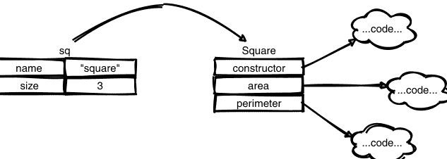
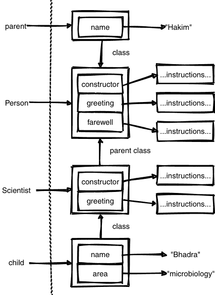
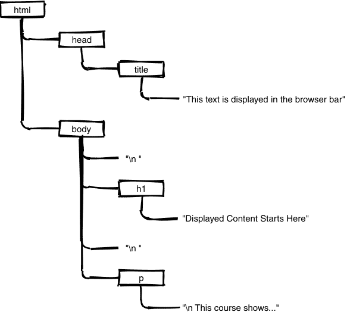
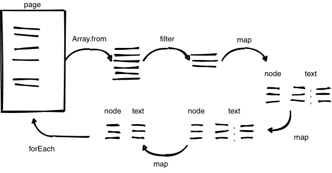
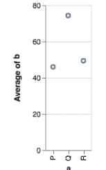
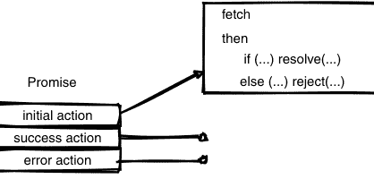
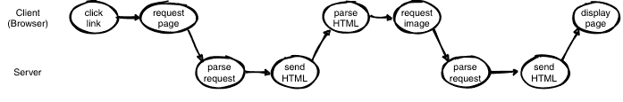
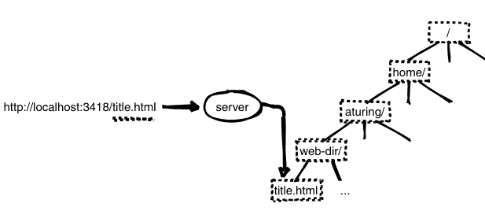

# 数据科学的 JavaScript

## 关于本系列

本新丛书反映了该领域的跨学科性质，汇集了来自统计学、计算机科学、机器学习和分析领域的研究人员、从业者和导师。该系列将出版数据科学领域的前沿研究、行业应用和教科书。

**特点：**

- 介绍该领域的最新研究和应用，包括新的统计和计算技术
- 涵盖了广泛的跨学科主题
- 提供数据科学软件的使用指南，包括 R、Python 和 Julia
- 为学生和专业人士提供入门级和高级的材料
- 在假设理论背景极少的情况下介绍概念

该系列的范围广泛，包括机器学习、模式识别、预测性分析、数据分析、可视化、数据收集与清洗、交互式图表、可重复研究等主题的著作。示例、应用和代码实现性的加入是至关重要的。

**系列编辑：**

Rakesh M. Verma, David J. Marchette, Norman Matloff

**出版商：**

CRC Press 是 Taylor & Francis Group 旗下品牌，属于 Informa

6000 Broken Sound Parkway NW, Suite 300
Boca Raton, FL 33487-2742

## 献辞

献给 Jordan —— 他教了我失败是通往成功的铺垫。  
— Maya

献给 Oskar。  
— Toby

献给 Kara, Claudia, Erin, Gabriela, Hannah, Laura 和 Julia。  
— Greg

> 本书销售的所有版税费将捐赠给 R-Ladies，这是一个全球组织，其使命是促进 R 社区的性别多样性。

## 3.5 闭包

我们需要引入的最后一个工具是内存处理方式的一种极有用的副作用。解释它的最简单方法是使用用例。我们已经定义了一个名为 `pipeline` 的函数，它可以链联任意数量的其他函数：

```javascript
const pipeline = (initial, operations) => {
  let current = initial
  for (let op of operations) {
    current = op(current)
  }
  return current
}
```

然而，只有当 `operations` 数组中的每个函数都只有一个参数时，`pipeline` 才能起作用。如果我们想加 1、加 2 等，我们必须编写单独的函数，这很麻烦。

更好的选项是编写一个函数，来创建一个我们需要的函数：

```javascript
const adder = (increment) => {
  const f = (value) => {
    return value + increment
  }
  return f
}

const add_1 = adder(1)
const add_2 = adder(2)
console.log(`add_1(100) is ${add_1(100)}, add_2(100) is ${add_2(100)}`)
```

## 28 JavaScript 数据科学

### 变量

Values


图 3.7: 创建加法 (步骤 1)

理解正在发生什么的最好方法是分步绘制内存图。闭包解决了我们的问题，因为它允许我们即时定义函数。正如图 3.7 所示，在第 1 步，我们调用 `adder(1)` (图 3.7)，创建了一个新函数赋值给 `add_1`。在第 2 步，我们调用 `adder(2)` (图 3.8)，创建了另一个函数赋值给 `add_2`。关键在于，`add_1` 仍然持有对增量的引用 (图 3.9)。在第 3 步，我们调用 `add_1(100)` (图 3.10)，返回 101。

正如这所示，如果函数体是一个表达式，它就不需要封装在 `{...}` 中。

## 使用 FOREACH 的副作用

JavaScript 数组有一个 `forEach` 方法，它会为数组的每个元素调用回调函数。与 `map` 不同，`forEach` 不保存返回的值或返回数组。完整的语法是：

```javascript
someArray.forEach((value, location, container) => {
  // 'value' 是 someArray 中的值
  // 'location' 是值的索引
  // 'container' 是所在的数组（在此例中为 someArray）
})
```

如果你只需要值，可以提供一个接受一个参数的回调；如果你需要值和位置，可以提供一个接受两个参数的回调。使用这个方法来倍增数组中的所有值：

```javascript
const vals = [1, 2, 3]
doubleInPlace(vals)
console.log(`vals after change: ${vals}`)

// vals after change: 2,4,6
```

## 3.6 练习

### 标注数据

给定一个表示野生动物观察对象的数组：

```javascript
data = [
  {'date': '1977-07-16', 'sex': 'M', 'species': 'NL'},
  {'date': '1977-07-16', 'sex': 'M', 'species': 'NL'},
  {'date': '1977-07-16', 'sex': 'F', 'species': 'DM'},
  {'date': '1977-07-16', 'sex': 'M', 'species': 'DM'},
  {'date': '1977-07-16', 'sex': 'M', 'species': 'PF'},
  {'date': '1977-07-16', 'sex': 'F', 'species': 'PE'},
  {'date': '1977-07-16', 'sex': 'M', 'species': 'DM'}
]
```

编写一个返回如下对象数组的函数，且不使用任何循环：

```javascript
newData = [
  {'seq': 3, 'year': '1977', 'sex': 'F', 'species': 'DM'},
  {'seq': 7, 'year': '1977', 'sex': 'F', 'species': 'PE'}
]
```

**要求：**

- 日期字段被替换为仅年份。
- 仅保留雌动物的观测结果。
- 保留的记录被赋予序列号，以便对应回原始数据。（这些序列号是从 1 开始的，而不是从 0 开始。）

> 你可能想使用 `Array.reduce` 来生成序列号。

# 关键点

- JavaScript 像存储其他对象一样在内存中存储组成函数的指令。
- 函数对象可以赋值给变量、放入列表、作为参数传递给其他函数等。
- 函数可以就地定义，而无需命名。
- 回调函数是传递给另一个函数以供其在特定时刻执行的函数。
- 函数式编程在不可变数据上使用高阶函数。
- 如果数组中的任何元素通过了测试，`Array.some` 为真；如果所有元素都通过测试，`Array.every` 为真。
- `Array.filter` 选择数组中通过测试的元素。
- `Array.map` 通过转换现有数组中的值创建一个新数组。
- `Array.reduce` 将数组归约为单个值。
- 闭包是在函数定义期间捕获的一组变量。


# 4 对象与类

让新代码使用旧代码很容易：只需加载你需要的库并编写你需要的函数调用即可。要在不重写代码的情况下让旧代码使用新代码更困难，但面向对象编程（OOP）可以提供帮助。

## 4.1 手动实现

正如第 2 章所示，JavaScript 中的对象是一组键值对。由于函数只是另一种类型的数据，因此对象的值可以是函数，这样数据可以携带处理其自身的函数。例如，我们可以创建一个表示正方形的对象：

```javascript
const square = {
  name: 'square',
  size: 5,
  area: (it) => it.size * it.size,
  perimeter: (it) => 4 * it.size
}
```

然后将对象本身传递给它的每一个函数：

```javascript
const a = square.area(square)
console.log(`area of square is ${a}`)
```

> 正方形面积为 25

这很笨拙——我们经常忘记将对象传递给它的函数——但它允许我们以相同的方式处理许多不同的事物。例如，我们可以创建另一个表示圆的对象：

```javascript
const circle = {
  name: 'circle',
  radius: 3,
  area: (it) => Math.PI * it.radius * it.radius,
  perimeter: (it) => 2 * Math.PI * it.radius
}
```

然后将所有这些不同的对象放在数组中并对它们进行相同的操作，而无需精确知道我们正在处理的是哪种对象：

```javascript
const show_all = (shapes) => {
  for (let s of shapes) {
    const a = s.area(s)
    const p = s.perimeter(s)
    console.log(`${s.name}: ${a} perimeter ${p}`)
  }
}

show_all([square, circle])
```

> 正方形：面积 25 周长 20  
> 圆：面积 28.274333882308138 周长 18.8495592153876

只要我们使用值名，函数和周长就不需要知道我们拥有哪种形状。这被称为多态性，它允许我们在不改变循环代码的情况下添加新形状。换句话说，它允许旧代码（在此处为 `show_all` 函数）使用新代码（新的矩形对象）：

```javascript
const rectangle = {
  name: 'rectangle',
  width: 2,
  height: 3,
  area: (it) => it.width * it.height,
  perimeter: (it) => 2 * (it.width + it.height)
}

show_all([square, circle, rectangle])
```

> 正方形：面积 25 周长 20  
> 圆：面积 28.274333882308138 周长 18.8495592153876  
> 矩形：面积 6 周长 10

## 4.2 类

手动构建每个对象并调用 `thing.function(thing)` 是很笨拙的。JavaScript 使用原型解决了这些问题，结果证明原型几乎和我们手工实现的解决方案一样笨拙（第 G.3 节）。大多数面向对象的语言都使用类；这些类被添加到 JavaScript ES6 中，我们在整个过程中将使用类代替原型。以下是类创建一个定义了正方形属性的类，而不实际创建特定的正方形：

```javascript
class Square {
  constructor(size) {
    this.name = 'square'
    this.size = size
  }
  area() { return this.size * this.size }
  perimeter() { return 4 * this.size }
}
```

（按照约定，名称使用驼峰命名法。）我们可以通过将类名像函数一样使用创建一个特定的正方形：

```javascript
const sq = new Square(3)
console.log(`${sq.name} and area ${sq.area()}`)
```

> sq 名字 square 面积 9

# 对象与类



图 4.1: 内存中的对象与类

`new ClassName(...)` 创建一个新的空白对象并标记它为 `ClassName` 的实例。对象需要知道它们属于哪个类，以便它们找到自己的方法，这些方法是定义在类内部的对类实例进行操作的函数。（我们将在第 G.3 节解释 JavaScript 对象；为了兼容语言的旧版本，它比实际需要的要复杂。）

在将新创建的对象返回给程序之前，它会调用特殊命名的构造函数来初始化对象的状态。在构造函数和其他方法内部，被操作的对象通过代词 `this` 来指代。例如，如果构造函数将数组赋值给 `this.values`，那么该类的每个实例都有它自己的数组。

## 故旧皆新

方法在类内部使用经典的函数语法定义，而不是我们一直使用的箭头函数。这种不一致性是遗憾的，但这种定义方法是当前版本所偏好的；我们将在第 8 节进一步探讨这种。

```javascript
class Person {
  constructor(name) {
    this.name = name
  }

  greeting(formal) {
    if (formal) {
      return `Hello, my name is ${this.name}`
    } else {
      return `Hi, I'm ${this.name}`
    }
  }

  farewell() {
    return `Goodbye`
  }
}
```

这个类允许我们创建一个带有正式问候的实例：

```javascript
const parent = new Person('Hakim')
console.log(`${parent.greeting(true)} - ${parent.farewell()}`)
```

> parent: Hello, my name is Hakim - Goodbye

我们现在可以扩展 `Person` 来创建一个新类 `Scientist`，在这种情况下，我们说 `Scientist` 继承自 `Person`，或者说 `Person` 是 `Scientist` 的父类，而 `Scientist` 是 `Person` 的子类。

```javascript
class Scientist extends Person {
  constructor(name, area) {
    super(name)
    this.area = area
  }

  greeting(formal) {
    return `${super.greeting(formal)}. Let's talk about ${this.area}...`
  }
}
```

这告诉我们 `Scientist` 是一个 `Person`，它：

- 拥有专业领域和名称。
- 以一种稍微长一点的方式打招呼。
- 以 `Person` 相同的方式告别（因为 `Scientist` 没有定义它自己的 `farewell` 方法）。

`super` 关键字在这里有两种用法：

- 在 `Scientist` 的构造函数中，`super(...)` 向上调用父类 `Person` 的构造函数，以便它在 `Scientist` 执行它自己的初始化之前完成它任何需要的初始化工作。这为我们避免了重复步骤。
- 在 `greeting` 内部，表达式 `super.greeting(formal)` 的意思是“调用该对象的父类的 `greeting` 方法”。这允许在子类中定义的方法添加或修改在父类中定义的方法的行为，而无需重复代码。

让我们试一下：

```javascript
const child = new Scientist('Bhadra', 'microbiology')
console.log(`child: ${child.greeting(false)}- ${child.farewell()}`)
```

> child: Hi, I'm Bhadra. Let's talk about microbiology... Goodbye

图 4.2 显示了在定义了这些类并创建对象 `parent` 和 `child` 之后内存的样子。初看起来很复杂，但它允许我们看到 JavaScript 在调用 `child.farewell()` 时是如何找到正确方法的。

- 它在对象 `child` 中查找是否有一个同名的函数。
- 没有，所以它沿着 `child` 指向类 `Scientist` 的链接查看那里是否有函数。
- 还是没有，它遵循从 `Scientist` 到父类 `Person` 的链接并找到了它寻找的函数。

## 4.4 练习

### 延迟

定义一个 `Delay` 类，其 `call` 方法始终返回上一次调用给的值：

```javascript
const example = new Delay('a')
for (let value of ['b', 'c', 'd']) {
  console.log(value, '->', example.call(value))
}
```

> b -> a  
> c -> b  
> d -> c

像 `Delay` 这样的类被称为有状态的，因为它记得从一次调用到下一次调用的状态。

### 过滤

定义一个 `Filter` 类，其 `call` 方法如果匹配给定的其构造函数的值之一，则返回 `null`，否则返回输入作为输出：

```javascript
const example = new Filter('a', 'e', 'i', 'o', 'u')
for (let value of ['a', 'b', 'c', 'd', 'e']) {
  console.log(value, '->', example.call(value))
}
```

> a -> null  
> b -> b  
> c -> c  
> d -> d  
> e -> null

像 `Filter` 这样的类有时被称为无状态的，因为它不记得从一次调用到下一次调用的状态。

### 管道

定义一个名为 `Pipeline` 的类，其构造函数接受一个或多个对象作为单参数 `call` 方法，其自己的 `call` 方法将值依次传递给其中的每一个对象。如果任何组件的 `call` 方法返回 `null`，`Pipeline` 将立即停止并返回 `null`。

```javascript
const example = new Pipeline(new Filter('a', 'e', 'i', 'o', 'u'), new Delay('a'))
for (let value of ['a', 'b', 'c', 'd', 'e']) {
  console.log(value, '->', example.call(value))
}
```

> a -> a  
> b -> a  
> c -> b  
> d -> c  
> e -> null

### 活跃表达式

考虑这个类：

```javascript
class Active {
  constructor(name, transform) {
    this.name = name
    this.transform = transform
    this.subscribers = []
  }

  subscribe(someone) {
    this.subscribers.push(someone)
  }

  update(input) {
    console.log(this.name, 'got', input)
    const output = this.transform(input)
    for (let s of this.subscribers) {
      s.update(output)
    }
  }
}
```

以及使用它的程序：

```javascript
const start = new Active('start', (x) => Math.min(x, 10))
const left = new Active('left', (x) => 2 * x)
const right = new Active('right', (x) => x + 1)
const final = new Active('final', (x) => x / 2)
start.subscribe(left)
left.subscribe(right)
right.subscribe(final)
start.update(123)
```

1. 追踪当最后一行执行时发生了什么。
2. 修改 `Active` 使得如果提供了函数，则返回 `null`。
3. 创建一个新的 `Delay` 类，其 `call` 方法始终返回上一次调用给的值。

> 这种模式被称为观察者。

# 关键要点

- 使用类来定义数据和行为的组合。
- 使用构造函数初始化对象。
- `this` 指向当前对象。
- 使用多态表示行为。
- 扩展现有类来创建新的。
- 重写方法以改变它们的行为。

# Taylor & Francis



# 5 HTML 和 CSS

HTML 是呈现的标准方式，CSS 是描述它应该是什么样的的标准方式。

## 5.1 格式

HTML 页面应该包含：

- 一个包含所有内容的 `html` 元素
- 一个包含页面信息的 `head` 元素
- 一个包含要显示内容的 `body` 元素

这是一个具有上述结构的空 HTML 页面：

```html
<html>
<head>
<!-- 页面描述 -->
</head>
<body>
<!-- 页面内容 -->
</body>
</html>
```

如果我们在浏览器中打开它，什么都不会显示，所以让我们添加一点内容：

```html
<html>
<head>
<title>这是显示在浏览器栏中的文字</title>
</head>
<body>
<h1>内容从这里开始</h1>
<p>
本课程介绍了 <em>JavaScript</em> 的核心特性，并展示了如何使用它们。
</p>
<!-- 上一个段落中的 "JavaScript" 是斜体的 -->
<!-- 段落。 -->
</body>
</html>
```

## 5.2 文本

HTML 中的文本是普通的打印文本。然而，由于 `<` 和 `>` 用于显示标签的开始和结束，我们必须使用转义序列。一些在表 5.1 中。

| 名称 | 转义序列 | 字符 |
| :--- | :--- | :--- |
| 小于 | `&lt;` | < |
| 大于 | `&gt;` | > |
| 安培符号 | `&amp;` | & |
| 版权 | `&copy;` | © |
| 正负号 | `&plus;` | ± |
| 微 | `&micro;` | μ |

表 5.1：HTML 转义

前两个是不言而喻的，而需要 `&amp;` 是为了我们字面量符号（就像在 JavaScript 字符串中需要 `\` 一样。）© ± 和 μ 通常并不长，因为大多数编辑器允许我们直接在这些文档放入非 ASCII 字符，但有时我们会遇到更旧或更严格的系统。

## 5.3 页面

HTML 页面应该包含：

- 一个包含所有其他内容的 `html` 元素
- 一个包含页面信息的 `head` 元素
- 一个包含要显示内容的 `body` 元素

# 用于科学数据的 JavaScript



图 5.1：作为树的 HTML

- `h1` 元素是 1 级标题；我们可以使用 `h2`、`h3` 等创建子标题。
- `p` 元素是一个段落。
- 在标题或段落内部，我们可以使用 `em` 来强调文本。我们也可以使用 `strong` 来让文本更粗。像这样的标签比 `i`（用于斜体）或 `b`（用于粗体）标签更好，因为它们传达的是意图，而不是强制特定的布局。对于视觉障碍的人士或使用小屏幕设备的人来说，他们可能希望以不同的方式显示各种形式的强调。

## 5.4 属性

可以通过为元素添加属性来自定义元素，属性以 `name="value"` 键值对的形式在元素的起始标签内。例如：

```html
<h1 align="center">一个居中的标题</h1>
```

`align` 属性使 `h1` 标题在页面上居中，而：

```html
<p class="disclaimer">此行星按原样提供。</p>
```

`disclaimer` 将此段落标记为免责声明。这对 HTML 来说并没有特殊含义，但正如我们之后看到的，我们可以根据属性类（class）来定义样式。

属性的名称在任何元素中最多只能出现一次，就像键在任何 JavaScript 对象中只能出现一次一样，因此 `<p align="right">...</p>` 是非法的。如果我们想给一个属性多个值——例如，如果我们想让一个元素拥有多个类——我们将所有值放在一个字符串中。遗憾的是，如下例所示，HTML 对于值是否应该用空格或分号分隔是不一致的。

```html
<p class="disclaimer optional" style="color: blue; font-size:200%">
```

无论它们如何分隔，值都应该被引号括起来，但在实践中，我们经常使用 `name=value` 也能通过。对于取值为真或否的布尔属性，我们有时甚至只写 `name` 本身即可。

## 5.5 列表

标题和段落都很好，但数据科学家需要更多。要创建一个无序（项目符号）列表，我们使用 `ul` 元素，并将列表中的每一项封装在 `li` 中。要创建一个有序（编号的）列表，我们使用 `ol` 代替 `ul`，但列表项仍使用 `li`。

```html
<ul>
  <li>first</li>
  <li>second</li>
  <li>third</li>
</ul>
```

> - first
> - second
> - third

```html
<ol>
  <li>first</li>
  <li>second</li>
  <li>third</li>
</ol>
```

> 1. first
> 2. second
> 3. third

可以通过将内层列表的 `ul` 或 `ol` 放在外层列表的其中一个 `li` 元素内部来实现嵌套列表：

```html
<ul>
  <li>Major A
    <ol>
      <li>minor p</li>
      <li>minor q</li>
    </ol>
  </li>
  <li>Major B
    <ol>
      <li>minor r</li>
      <li>minor s</li>
    </ol>
  </li>
</ul>
```

> - Major A
>   1. minor p
>   2. minor q
> - Major B
>   1. minor r
>   2. minor s

## 5.6 表格

列表是一个很好的入门方法，但如果我们真的想用数据科学来惊艳他人，我们需要表格。意料之中的是，我们使用 `table` 元素来创建这些。每一行都是一个 `tr`（"table row"），在行内部，列项通过 `td`（"table data"）或 `th`（"table heading"）显示。

```html
<table>
  <tr><td>Alkali</td><td>Noble Gas</td></tr>
  <tr><td>Hydrogen</td><td>Helium</td></tr>
  <tr><td>Lithium</td><td>Neon</td></tr>
  <tr><td>Sodium</td><td>Argon</td></tr>
</table>
```

| Alkali | Noble Gas |
| :--- | :--- |
| Hydrogen | Helium |
| Lithium | Neon |
| Sodium | Argon |

> 不要使用表格来创建多列布局；有更好的方法。

## 5.7 链接

通向其他页面的链接使 HTML 成为超文本（图 5.2）。令人困惑的是，用于显示链接的元素被称为 `a`。元素内部的文本会被显示并（通常）高亮。它的 `href` 属性指定了链接指向的地方；支持本地文件名和 URL。哦，我们还可以使用 `<br/>` 在文本中强制换行（标签内部带有斜杠，因此 `br` 元素不包含任何内容）：

```html
<a href="https://nodejs.org/">Node.js</a>
<br>
<a href="https://facebook.github.io/react/">React</a>
<br>
<a href="../index.html">home page (relative path)</a>
```

显示如下：

> Node.js  
> React  
> home page (relative path)

## 5.8 图像

图像可以通过两种方式存储：使用 SVG 或将其编码为 HTML。我们将在第 8 章讨论前者，但后者更常见。`src` 属性指定图像的来源，`alt` 属性为屏幕阅读器或图像加载失败时提供替代文本。

```html

```

`alt` 属性对于可访问性非常重要。如果图像纯是装饰性的，`alt` 属性可以是空的（`alt=""`）。

# HTML 和 CSS

```html
<body>
<p>
第一个 <span id="major">关键词</span><span>span。
</p>
<p>
完整的 <span id="minor">解释</span><span>span。
</p>
</body>
</html>
```

然后我们可以像这样对这些 `span` 进行样式处理：

```css
#major {
  text-decoration: underline red;
}
#minor {
  text-decoration: overline blue;
}
```

## 内部链接

我们可以在链接的 `href` 中使用 `#name` 来链接到页面中的某个元素：例如，`<a href="page.html#place"></a>` 指向 `page.html` 中的 `#place` 元素。这在页面内部特别有用：一个 `<a href="#place">跳转</a>` 会直接带我们到本页面内的 `#place` 元素。这类内部链接通常用于交叉引用和创建目录。

## 5.10 BOOTSTRAP

CSS 可能会很快地变得非常复杂，因此大多数人使用框架来处理细节。Bootstrap 是最流行的页面框架（这是我们用来样式化我们样式的）。这里是使用 Bootstrap 创建带有顶部横幅的两列布局页面的完整源代码（图 5.3）：

```html
<html>
<head>
<link rel="stylesheet" href="https://stackpath.bootstrapcdn.com/bootstrap/4.1.3/css/bootstrap.min.css">
<style>
div {
  border: solid 1px;
}
</style>
</head>
<body>
<div class="jumbotron text-center">
<h1>页面标题</h1>
<p>调整此页面大小，以查看布局的动态调整。</p>
</div>
<div class="container">
  <div class="row">
    <div class="col-sm-4">
      <h2>第一列宽度为 4</h2>
      <p>这里是此处文本</p>
      <p>在列中</p>
    </div>
    <div class="col-sm-8">
      <h2>第二列宽度为 8</h2>
      <p>这里是此处文本</p>
      <p>在另一个列中</p>
    </div>
  </div>
</div>
</body>
</html>
```

> 页面通过从网络加载 Bootstrap 来打开；我们也可以下载 `bootstrap.min.css` 并使用本地路径引用它。（文件名中的 `.min` 表示它经过了压缩，这样加载速度会更快。）页面随后使用样式创建一个内部样式表，为每个 `div` 包围一个实线像素边框，这样我们就能清晰地看到页面区域。在页头中定义样式通常是一个坏主意，但它是测试事物的好方法。哦，`div` 只是标记页面的区域，除非我们应用样式，否则 HTML 和 CSS 不改变它的外观。第一个 `div` 创建了一个头部框（称为 "jumbotron"）并使其文本居中。第二个 `div` 是一个容器，它在我们内容的左右两侧创建了一些外边距。该容器内部有一个包含两列的行，宽度分别为行宽度的 4/12 和 8/12。（Bootstrap 使用 12 列系统是因为元素的大小会随着页面增长而改变，并且当屏幕变小到无法并排显示时，它们会堆叠。）我们还省略了 HTML 和 CSS 的许多方面，例如图注、多列表格单元格，以及为什么在 `div` 内垂直居中文字如此困难。我们将在第 10 章返回的一个点是如何包含像按钮和表单之类的交互元素。处理这些是 JavaScript 最初被发明的原理之一，但在处理它们之前，我们需要更多的经验。

## 5.11 练习题

### 走径取巧

如果你忘记像这样关闭段落或列表项，你的浏览器会显示什么呢：

```html
<p>这个段落开始了，但没有结束。
<p>另一个段落在这里开始，但也没有结束。
<ul>
  <li>列表中的第一个项目没有关闭。
  <li>第二个也没有关闭。
</ul>
```

1. 如果你不关闭 `ul` 或 `ol` 列表会发生什么？
2. 这种行为与省略 `</p>` 或 `</li>` 时的情况一致吗？

### 混合与匹配

1. 创建一个包含 2x2 表格的页面，每个单元格都有一个三项列表。你如何使用 CSS 减少单元格内列表项的缩进？
2. 在不同的浏览器（例如 Firefox 或 Edge）中打开你的页面。它们显示列表是一致的吗？
3. 为什么程序的行为会不一致？程序员为什么要对我们这么做？

### 命名

Bootstrap 的 `col-sm-4` 和 `col-sm-8` 中的 `sm` 代表什么？你还可以使用哪些其他选项？为什么 Web 开发者在 21 世纪仍然使用 FORTRAN 风格的命名？

### 颜色

HTML 和 CSS 定义不同的颜色。使用 RGB 值来定义颜色。

### 单位

你可以使用哪些不同的单位来指定大小？

# 关键点

- HTML 包含由尖括号表示的元素，标签的表示。
- 元素必须严格嵌套。
- 元素可以包含属性。
- 使用转义序列表示特殊字符。
- 每个页面都应该有一个 `head` 和 `body`。
- 使用 `ul` 和 `ol` 用于列表。
- 使用 `a` 创建链接。
- 使用 `table`、`tr`、`th` 和 `td` 用于数据。
- 使用 `` 图像。
- 使用 CSS 定义样式。
- 使用 `class` 和 `id` 标识元素。
- 使用选择器应用于样式。

# 6 操作页面

我们已经展示了许多工具，但还没有。作为对你耐心的奖励，我们将通过示例展示页面是如何表示和操作的。JavaScript 发明主要是为了支持按钮、表单等，但在探索它们之前我们需要更多背景。仍然，我们可以实现一些神奇的事情。

## 6.1 计数段落

让我们从计算页面中的段落开始：

```html
<html>
<head>
<meta charset="utf-8">
</head>
<body>
<h1>标题</h1>
<div class="fill"></div>
<h2>第一个<em>强调</em></h2>
<h2>第二个<code>代码</code></h2>
<h2>第三个</h2>
<p>内容内容</p>

<script>
    const counter = () => {
      const paragraphs = document.querySelectorAll('p');
      return paragraphs.length;
    };

    console.log(`段落数量: ${counter()}`);
  </script>
</body>
</html>
```

此页面有三个主要部分：

1. `head` 包含指定页面编码的 `meta` 标签。
2. `body` 的上半部分有标题和一个标记为 `class="fill"` 的 `div`。
3. 脚本包含在页面底部的 `script` 标签中。

### 脚本运行

我们将脚本放在页面底部，因为我们希望在尝试它们之前确保页面内容存在于内存中。如果我们将 `script` 标签及其内容放在页面顶部，浏览器可能会在元素解析并存储到内存之前运行我们的 JavaScript。这种竞态条件是糟糕的编程；我们将看到更健壮的方法来处理它们。

# 用于数据的 JavaScript

在控制台中显示结果对于开发工作足够了，但我们希望在页面本身看到结果。为了这样做，我们可以将 `console.log` 的调用替换为下面两行：

```javascript
const counter = () => {
  const paragraphs = document.querySelectorAll('p')
  return paragraphs.length
}
const fill = document.getElementById('fill')
fill.innerHTML = `number of paragraphs: ${counter()}`
```

其中 `document.querySelectorAll` 返回所有匹配选择器的节点，而 `document.getElementById` 返回最后一个单个元素（即设置了 `id="some_name"` 属性的元素起始标签）。变量 `fill` 被赋值为指向我们 `div` 的引用。然后我们可以通过给其 `innerHTML` 属性赋值来更改文本元素。当我们这样做时，JavaScript 会将该字符串解析为 HTML，并创建相应的节点来表示结果。在这种情况下，内容仅仅是文本，因此 JavaScript 将创建一个单个文本节点，并以 `"number of paragraphs: 2"` 为其内容，将其添加到表示页面的内存存储器中。

此时，后台发生了一些魔法。浏览器将元素和文本存储在一个名为文档对象模型（Document Object Model，或更常见的 DOM）的数据结构中。如图 5.1 所示，DOM 被组织成一棵树：每个元素或文本片段都在树中，而子节点是包含在其中的元素。每当浏览器检测到 DOM 变化时，它都会根据需要自动刷新显示。我们可以插入或删除文本、更改元素样式，或复制整个子页面：每次如此，浏览器都只完成为了尽快反映更改所需的工作。

## 6.2 创建目录

报告段落数量是观察 JavaScript 在浏览器中如何工作的好方法，但并不是特别有用（尽管统计单词数是有用的——我们将在练习中解决这个问题）。我们更有可能放在实际页面中的内容是目录，它比我们已经看到的需要稍微多一点代码：

```javascript
(() => {
  const container = document.getElementById('fill')
  const headings = Array.from(document.querySelectorAll('h2'))
  const items = headings
    .map(h => `<li><a href="#${h.id}">${h.innerHTML}</a></li>`)
    .join('')
  container.innerHTML = '<ul>' + items + '</ul>'
})()
```

让我们从第一行和最后一行开始，因为它们展示了一种常用的惯用法。我们已经见过如何定义一个函数然后调用它：

```javascript
const f = (param) => {
  // body
}
f()
```

如果我们只打算调用一次函数，我们不妨定义它并立即调用它，而不给它命名：

```javascript
(param) => {
  // body
}(actual_value)
```

然而，这样写并不能可靠地工作；为了让 JavaScript 正常运行，我们必须在函数定义周围加上括号，以便清楚地指示正在调用的是什么：

```javascript
((param) => {
  // body
})(actual_value)
```

胖箭头之前的 `()` 意味着“这个函数不接受任何参数”。闭大括号后的第二个 `()` 意味着“调用该函数”。如果函数不接受任何参数，它将变成：

```javascript
() => {
  // body
}()
```

这连着写了很多括号，但这就是我们正确的写法。让我们回到函数的体内部：

```javascript
const container = document.getElementById('fill')
const headings = Array.from(document.querySelectorAll('h2'))
const items = headings
  .map((h) => `<li><a href='#${h.id}'>${h.innerHTML}</a></li>`)
  .join('')
container.innerHTML = '<ul>' + items + '</ul>'
```

第一行让我们获取了我们首先要提供的内容。第二行是 `h2` 标题，我们随意决定任何值得包含在目录中的内容。我们将 `document.querySelectorAll` 的结果传递给 `Array.from()`，因为前者的结果不是 JavaScript 数组；出于某些可能在某处显得合理的原因，它是一个被称为 `NodeList` 的东西，它列出了 `Array` 的有用方法。

### 静态方法

`Array.from` 是一个静态方法：它属于整个类，而不是该类的对象。静态方法主要用于将工具函数与类关联，例如下面示例中的 `dist`。与对 `magnitude` 等实例方法的调用不同，静态方法使用 `Class.method()` 调用，而不是 `some_object.method()`。

然后我们有三行代码完成了函数的大部分工作。第一行告诉我们 `items` 将从 `headings` 派生；第二行将标题数组转换为字符串数组，第三行将字符串连接起来以创建一个单个字符串。观察 `map` 调用，每个标题都变成一个包含链接（`<a>`）的列表项（`<li>`），该链接的 `href` 属性是标题的 ID，而其显示内容（`<a>`...</a> 之间的文本）是标题的文本。`href` 属性值以 `#` 开头，这是一个本地链接（即它链接到同一页面内部）。如果我们的 `h2` 标题之一没有设置 `id`，此 `map` 将失败；我们将在练习中探索如何处理这种情况。

最后，上面所示代码的最后一行将容器（即 `div`）的内容填充为无序列表（`<ul>`），其中包含了我们刚刚构建的所有项。再次，当我们给元素的 `innerHTML` 属性赋值时，JavaScript 会解析我们提供的字符串并构建我们需要的 HTML 节点。手动构建这些节点会快一点（我们将在练习中这样做），但在现代浏览器中解析字符串通常足够。

## 6.3 可排序列表

创建节点允许我们对项目进行排序（图 6.1），但我们必须等待页面加载以便 DOM 树就绪。如果我们在页面解析之前尝试访问元素，脚本将失败。因此，我们使用事件监听器来确保 DOM 已就绪。

调用 `Array.from` 是因为（再次）DOM 使用 JavaScript 数组来存储子节点，而是使用它自己设计的一种结构，该结构缺乏我们能够调用的方法。我们移除了它们代表列表项之间空白字符的文本节点，例如闭合 `<li>` 标签之后和下一个开启 `<li>` 标签之前的换行符。

### 识别文本节点

我们检查 `c.nodeType` 而不是 `c.nodeName` 来识别文本节点，但我们认为 `nodeName` 让代码更容易理解。一如既常，我们在比较时使用 `!==` 以防止出现不妙的意外（第 G.1 节）。

现在我们已经有了所有需要排序的 `<li>` 元素，可以使用 `Array.sort` 对它们进行排序。由于我们想根据它们包含的文本进行排序，必须提供自定义的排序函数，返回负数、0 或正数，以显示它相对于右侧元素的小、等于还是大于。我们使用节点的 `textContent` 来获取其包含的文本，并使用字符串对象的 `localeCompare` 来获取 -1/0/1 的结果。这是通过在网上搜索 W3Schools 网站发现的。

遗憾的是，搜索“remove all children from node”告诉我们必须自己手动实现，因此我们使用 `while` 循环从 `<ul>` 或 `<ol>` 列表中删除所有子节点（包括不需要的顶层元素），然后按照排序后的顺序将所有子节点还原。果然，页面现在按正确的顺序显示节点。

## 6.4 参考文献引用

现在我们来到了本节中最大的示例。HTML 有一个 `<cite>` 标签用于格式化引用，但它不允许我们直接链接到参考文献条目。为了减少学术论文中的打字量，我们希望找到这样的链接：

```html
<a href="#b">key1, key2</a>
```

并将它们转换为这样：

```html
[<a href="../bib/key1"><cite>key1</cite></a>, <a href="../bib/key2"><cite>key2</cite></a>]
```

输入的形式是我们省去的小小步骤；而显示的形式将 `[...]` 中的引用以及每个单独的引用转换为指向我们参考文献的链接。目前，我们假设参考文献位于 `../bib/bib.ie` 的一个 `index.html` 文件中，该文件位于包含引用页面的目录中。这种做法非常脆弱，我们应该为此感到羞愧，但我们可以告诉自己，稍后会修复它，现在先通过学习 JavaScript。

我们的测试页面包含两个参考文献链接和一个非参考文献链接：

## 操作页面

```html
<html>
<head>
  <meta charset="utf-8">
  <script src="citations.js"></script>
</head>
<body>
  <p>如 <a href="#b">Moreau1896</a> 所示...</p>
  <p>
  我们可以查看 <a href="#b">Brundle1982, Brundle1984</a> 来获取答案。
  </p>
  <hr>
  <p><em>访问 <a href="http://somewhere.org">作者的网站</a>。</em></p>
</body>
</html>
```

这是我们的函数（图 6.2），我们将从事件监听器中这样调用它：

```javascript
const citations = () => {
  Array.from(document.querySelectorAll('a'))
    .filter(link => link.getAttribute('href') === '#b')
    .map(link => ({
      node: link,
      text: link.textContent.split(',').map(s => s.trim())
    }))
    .map(({node, text}) => ({
      node,
      text: text.map(cite => `<a href="../bib/${cite}"><cite>${cite}</cite></a>`)
    }))
    .map(({node, text}) => ({
      node,
      text: `[${text.join(', ')}]`
    }))
    .forEach(({node, text}) => {
      const span = document.createElement('span')
      span.innerHTML = text
      node.parentNode.replaceChild(span, node)
    })
}
```

这里有很多操作，但它使用了我们之前见过的模式。它首先构建文档中所有链接（即每个 `<a>` 元素）的数组：

```javascript
Array.from(document.querySelectorAll('a'))
// 输出:
// [<a href="#b">Moreau1896</a>...]
// [<a href="#b">Brundle1982, Brundle1984</a>...]
// [<a href="http://somewhere.org">the author's site</a>...]
```

（我们在注释中显示节点，以便可视化流水线中每一步的操作。）然后我们过滤此数组以找到指向 `#b` 的链接，这是我们用来标记引用的信号：

# 数据科学的 JavaScript



图 6.2：处理流水线

```javascript
.filter(link => link.getAttribute('href') === '#b')
// 输出:
// - <a href="#b">Moreau1896</a>
// - <a href="#b">Brundle1982, Brundle1984</a>
```

我们遇到了一个问题。我们可以使用 `map` 调用来获取每个链接的文本并处理它，但我们会得到一个字符串数组。我们需要这些字符串稍后出来，以便修改它们的 `href` 属性，因此我们可能需要将节点和字符串一起传递通过流水线。一种方法是为每个创建一个两个元素的数组：

```javascript
.map(link => [link, link.textContent])
```

但创建一个对象以便有一个名字更具可读性：

```javascript
.map(link => ({
  node: link,
  text: link.textContent.split(',').map(s => s.trim())
}))
// 输出:
// - node: <a href="#b">Moreau1896</a>
//   text: ["Moreau1896"]
// - node: <a href="#b">Brundle1982, Brundle1984</a>
//   text: ["Brundle1982", "Brundle1984"]
```

在这里，我们将每个链接转换为一个对象，其 `node` 键具有 DOM 节点作为值，其 `text` 键具有节点的文本，我们对逗号进行分割并 `trim` 以移除首尾空白。但我们还没有结束流水线的这一阶段：

## 操作页面

1. 我们不需要为 "node" 和 "text" 加引号，尽管可以。
2. `String.split` 返回一个数组，因此与 "text" 关联的值是一个数组。我们对元素进行 `map` 以移除首尾空格。
3. 如果我们写成 `{node, text: whatever}`，JavaScript 会将大括号解释为“这是函数体”，在大括号周围加上括号告诉 JavaScript 函数返回一个对象。

在完成这些之后，流水线的下一个阶段几乎是：

```javascript
.map(({node, text}) => ({
  node,
  text: text.map(cite => `<a href="../bib/${cite}"><cite>${cite}</cite></a>`)
}))
// 输出:
// [ {node: <a href="#b">Moreau1896</a>, text: ["<a href="../bib/Moreau1896"><cite>Moreau1896</cite></a>"]},
//   {node: <a href="#b">Brundle1982, Brundle1984</a>, text: ["<a href="../bib/Brundle1982"><cite>Brundle1982</cite></a>", "<a href="../bib/Brundle1984"><cite>Brundle1984</cite></a>"]} ]
```

好了，这并不意味着解脱，但也有某种道理。道理是，如果我们有一个具有 `a` 和 `b` 键的对象，那么 `({a, b})` 调用意味着将 `a` 的值匹配给参数 `a`，将 `b` 的值匹配给参数 `b`。这被称为解构，可以节省大量的键盘操作时间和精力。

其次，如果我们有一个变量 `name`，那么定义 `{name: name}`，即我们想要一个名为 "name" 的键，其值为当前 `name` 的内容。这允许我们简写为 `{name}`。

所有这些 `text.map` 都是有用的。`text` 键的值是字符串数组，每个字符串都是参考文献键。我们的 `map` 将每个转换为文本：一个指向 `../bib/citation_key` 的链接，显示的文本是引用键。

在下一个阶段，我们将字符串拼接在一起，创建一个条目之间有逗号且整体带有方括号的字符串：

```javascript
.map(({node, text}) => ({
  node,
  text: `[${text.join(', ')}]`
}))
```

（我们没有显示逗号的输出，因为会导致页面溢出，而且当显示包含 HTML 的字符串时，我们的伪 HTML 表示法会变得混乱）

# 数据科学的 JavaScript

我们流水线的最后阶段使用 `forEach` 而不是 `map`，因为我们要对数组的每个元素执行某些操作，但不需要返回值（因为我们通过修改文档的副作用来操作）：

```javascript
.forEach(({node, text}) => {
  const span = document.createElement('span')
  span.innerHTML = text
  node.parentNode.replaceChild(span, node)
})
```

这是携带节点本身产生回报这一点。我们创建一个 `span`，通过对其 `innerHTML` 属性来填充它，并用我们创建的节点替换原始链接。如果我们需要在函数后添加事件监听器在页面加载时调用它，我们就能按照预期格式格式化引用。

## 6.5 实时时钟

我们将用一个简短的示例结束本节课程，但它暗示了未来的可能性：

```html
<html>
<head>
<script>
const startTime = () => {
  const today = new Date()
  const fields = [today.getHours(), today.getMinutes(), today.getSeconds()]
  const current = fields
    .map(t => String(t).padStart(2, '0'))
    .join(':')
  document.getElementById('current').innerHTML = current
  setTimeout(startTime, 1000)
}
document.addEventListener('DOMContentLoaded', (event) => {
  startTime()
})
</script>
</head>
<body>
<p id="current"></p>
</body>
</html>
```

## 操作页面

获取今天的数值。然后，我们从日期中提取小时、分钟和秒，并将它们放入一个数组中。我们可以将每个值转换为两个字符的字符串（必要时在前面补零），然后连接这些字符串以形成如 17:48:02 的时间，填充到 ID 为 `current` 的元素中。

但 `setTimeout` 是什么意思？它告诉浏览器在经过几毫秒后运行一个函数。在这种情况下，我们将在一秒后运行相同的函数 `startTime`。这会改变显示的时间，然后设置另一个回调在另一秒后运行，以此往复。当我们加载页面时，我们看到当前时间每秒更新一次，提醒着我们生活流逝得有多快。

## 6.6 练习

### 这是什么编码？

1. 写一个函数，查找脚本所在页面的字符编码并打印到控制台。
2. 扩展该函数，查找当前页面中所有的 `meta` 标签并打印它们的名称和值。

### 单词计数

1. 写一个名为 `countWords` 的函数，找到页面中的所有节点，并按空格进行分割。
2. 写第二个函数 `showWords`，使用第一个函数找到单词数量，然后将该数字显示在 ID 为 `wordcount` 的段中。

### 更健壮的目录

1. 如果一个 `h2` 标签没有 `id` 属性，目录示例会生成什么？
2. 修改示例，使目录仅包含带有 `id` 属性的 `h2` 元素。

### 显式创建节点

查找关于 `document.createElement` 和 `document.createTextNode` 两个函数的文档，重写目录以使用这些方法（以及所需的其他类似方法），而不是赋值给节点的 `innerHTML` 属性。

## 关键点总结

- 在页面的头部中使用 `meta` 标签来指定页面的字符编码。
- 内存中使用文档对象模型 (DOM) 来表示页面。
- `document` 对象代表脚本所在的页面。
- 使用 `querySelectorAll` 方法查找符合条件的 DOM 节点。
- 将 HTML 文本赋值给节点的 `innerHTML` 属性以更改节点内容。
- 使用 `((params) => {...})(arguments)` 在单一步中创建并调用函数。
- 事件监听器是浏览器在某些特定事件发生时运行的函数。
- 为 'DOMContentLoaded' 创建事件监听器，以便在 DOM 构建完成后触发脚本执行。
- 检查 DOM 节点的 `nodeType` 或属性以确定它是哪种节点。
- 解构赋值允许我们在一条语句中通过名称给多个变量赋值。
- 使用 `setTimeout` 在延迟后触发函数的执行。
- 要让某些内容无限运行，让 `setTimeout` 调用的函数再次设置相同函数的超时。

# 7 动态页面

起初，人们通过手动输入来创建 HTML 页面（正如我们一直在做的那样）。他们很快发现许多页面共享大量内容：导航菜单、联系信息等。几乎通用的解决方案是创建一个模板，并嵌入命令来包含其他 HTML 片段（如页眉），并在数据结构上循环以创建列表和表格。这被称为服务器端页面生成：HTML 在服务器上生成，它之所以流行是因为数据就在那里，而且那里是唯一可以运行代码的地方。（本教程使用了模板工具 Jekyll。它很笨拙且有限，但它是 GitHub 的默认设置。）

服务器端生成可以是静态或动态的，也就是说，页面可以编译一次并存储在磁盘上之后提供；或者在每次需要时重新编译每个页面，这使得包含动态元素（如今日新闻，图 7.1）变得简单。

随着浏览器和 JavaScript 变得越来越强大，平衡转向客户端页面生成。在这种模型中，浏览器从一个或多个服务器获取数据，并将数据传递给 JavaScript 库，后者在浏览器中生成 HTML。这允许客户端决定如何渲染数据，随着手机和平板取代桌面和笔记本电脑，这一点变得越来越重要。它还将计算负担从服务器转移到客户端设备，降低了提供数据的成本。

已经创建了（许多）用于客户端页面生成的 JavaScript 框架，现在可能正在开发许多。我们选择了 React 是因为它是免费的、广泛使用的、文档齐全的、比许多替代方案简单，并且有一个酷酷的 Logo。它的核心设计原则是：

1. 页面创建函数来描述它们想要的 HTML。
2. React 用内存中（而非磁盘上）的动态生成内容替换页面元素。

## 7.1 HELLO WORLD

让我们从这里开始：

```html
<!DOCTYPE html>
<html>
<head>
  <meta charset="utf-8">
  <title>Hello React</title>
  <script src="https://fb.me/react-15.0.1.js"></script>
  <script src="https://fb.me/react-dom-15.0.1.js"></script>
</head>
<body>
  <div id="app"></div>
  <script>
    ReactDOM.render(
      React.DOM.h1("Hello React"),
      document.getElementById("app")
    );
  </script>
</body>
</html>
```

页面的头部包含脚本；主体包含一个 `div`。脚本然后渲染内容。

## 72 用于数据科学的 JavaScript

```javascript
ReactDOM.render(
  <h1>Hello JSX</h1>,
  document.getElementById('app')
)
```

除了 React 库之外，此页面还包含一个名为 Babel 的工具，可以将 HTML 和 JavaScript 的混合体转换为纯 JavaScript。要触发转换，我们在 `script` 标签中添加 `type="text/babel"` 属性。

为什么呢？因为示例所示，它允许我们编写 `<h1>Hello JSX</h1>` 而不是调用函数。通常，JSX 允许我们将 JavaScript 放入 HTML 中（在 JavaScript 中（在 HTML 中）），因此我们可以（在示例中）将字符串列表映射为 HTML 列表：

```html
<body>
  <h1>List</h1>
  <div id="app"></div>
  <script type="text/babel">
    const allNames = ['McNulty', 'Jennings', 'Snyder', 'Meltzer', 'Bilas', 'Lichman']
    ReactDOM.render(
      <ul>{allNames.map((name) => <li>{name}</li>)}</ul>,
      document.getElementById('app')
    );
  </script>
</body>
```

无论运行什么代码，我们都必须使用 `map` 而不是循环来返回可以插入 DOM 的某些内容，因为 `for` 循环不返回任何内容。（我们可以使用循环通过重复拼接来构建字符串，但 `map` 更整洁。）请注意：我们必须精确地返回一个节点，因为这是一个函数调用。我们将在练习中查看为什么 `<ul>` 元素内部紧跟的大括号是必要的。

还要注意，当我们运行此代码时，浏览器控制台会警告我们每个列表元素都应该有一个唯一的 `key`，因为 React 需要页面上的每个元素都是可选择的。我们稍后会添加。

## 7.3 创建组件

React 最强大的之一是允许我们创建像 HTML 标签的新组件，但这些组件与我们编写的函数相关。React 要求这些组件的名称以大写字母开头，以区别于普通标签。例如，我们可以定义一个函数 `ListOfNames` 来生成我们的名称列表，然后将其直接放入 `ReactDOM.render` 中，就像放入 `h1` 或 `p` 一样：

> ⁵https://babeljs.io/

# 动态页面

```html
<body>
  <h1>Create Component</h1>
  <div id="app"></div>
  <script type="text/babel">
    const allNames = ['McNulty', 'Jennings', 'Snyder', 'Meltzer', 'Blas', 'Lichterman']

    const ListOfNames = () => {
      return (<ul>{allNames.map((name) => <li>{name}</li>)}</ul>);
    }

    ReactDOM.render(
      <ListOfNames />,
      document.getElementById('app')
    );
  </script>
</body>
```

但我们真正想做的是向这些组件传递参数：在 JSX 将它们转换为函数之后，当我们给它们提供一些数据时，函数会有用得多。在 React 中，我们放在组件标签内部的属性通过一个单一的 `props` 对象传递给我们的函数：

```html
<body>
  <h1>Pass Parameters</h1>
  <div id="app"></div>
  <script type="text/babel">
    const allNames = ['McNulty', 'Jennings', 'Snyder', 'Meltzer', 'Blas', 'Lichterman']

    const ListElement = (props) => (
      <li id={props.name}><em>{props.name}</em></li>
    )

    ReactDOM.render(
      <ul>{allNames.map((name) => <ListElement name={name} />)}</ul>,
      document.getElementById('app')
    );
  </script>
</body>
```

如果你仔细看，你会发现在 `ReactDOM.render` 中映射数组的每个组件，传递给 `ListElement` 的 `name` 属性变成了 `ListElement` 函数内部的 `props.name` 值。

在上面的示例中，我们映射了数组中的每个元素并给它们设置了 id，但这些函数也可以用于对渲染的元素进行任何转换或计算。

## 7.4 使用 PARCEL 开发

将应用程序的所有源代码放在一个 HTML 文件中是不良实践，我们已经看到在页面头部加载 JavaScript 时会产生竞态条件。那么 `require` 语句呢？浏览器会在这些语句执行时尝试加载文件，但谁来提供它们呢？

解决方案是使用打包器（图 7.2）将所有内容合并为一个大文件，并在开发期间运行本地服务器来预览我们的应用程序。前端框架有很多选择，新的框架几乎每周都在增加。Webpack 可能是最广泛使用的，但它相当复杂，因此我们将使用 Parcel，它更年轻且不臃肿。

### 使用 Node Package Manager 初始化项目

如果你到为止一直在编写代码，创建了单个 HTML 和 JavaScript 文件，但还没有使用 Node Package Manager (npm)。在安装 Parcel 之前，我们可以通过输入将创建的 HTML 和 JavaScript 文件转换为项目：

```bash
$ npm init
```

安装 Parcel，运行：

```bash
$ npm install parcel-bundler
```

一旦安装了 Parcel，我们可以这样告诉它运行我们的一个页面：

```bash
$ node_modules/.bin/parcel serve -p 4000 src/dynamic/pass-params.html
```

> 服务器运行在 http://localhost:4000  
> + 构建耗 128ms

### 退出 Parcel

这之所以有效，是因为当 npm 在项目的 `node_modules` 目录安装库时，可以使用 `node_modules/.bin` 中的可运行脚本（注意是带前缀的 `.bin`）。当我们要求 Parcel 服务应用程序时，它：

- 在文件中查找 JavaScript，
- 递归查找该文件，
- 将文件复制到名为 `.dist` 的目录（代表 distribution），
- 从那里提供应用程序。

Parcel 还会在 `.cache` 中缓存内容，这样它就不需要重复工作；这两个目录通常会被添加到 `.gitignore`。要了解更多关于 Parcel 的知识，请参见此短教程。

> ⁶https://webpack.js.org/  
> ⁷https://parceljs.org/  
> ⁸https://medium.com/codingtheway-blog/getting-started-with-parcel-197eb5a2c8c


图 7.2：使用 Parcel

将“运行应用程序”之类的任务放入 npm 的 `package.json` 文件中是非常常见的，就像旧的程序员将经常使用的命令放在项目的 Makefile 中一样。寻找 `package.json` 中键为 "scripts" 的部分并添加如下：

```json
"scripts": {
  "dev": "parcel serve -p 4000",
  ...
}
```

现在我们可以使用 `npm run dev src/dynamic/pass-params.html`，因为 `--` 之后的所有内容都会传递给运行的脚本。这不仅节省了我们的打字时间，还为其他人提供了如何使用项目的记录。

## 7.5 多文件

现在我们可以把东西打包起来，将 JSX 移动到 head 并在页面头部加载它：

```html
<!DOCTYPE html>
<html>
<head>
  <meta charset="utf-8">
  <title>Separate</title>
  <script src="https://fb.me/react-15.0.1.js"></script>
</head>
<body>
  <h1>Separate!</h1>
  <div id="app"></div>
  <script src="app.js" type="text/babel"></script>
</body>
</html>
```

现在，`app.js` 中的 JavaScript 是：

```javascript
ReactDOM.render(
  <p>Rendered by React</p>,
  document.getElementById("app")
)
```

当我们加载此页面时，我们得到了 `h1` 标题，但没有段落。浏览器控制台显示消息：

> Error: _registerComponent(...): Target container is not a DOM element.

这是我们之前遇到过的同样的竞态条件。在叹气并又泡了一杯茶后，我们决定保持简单，将在页面的 body 中加载脚本：

```html
<!DOCTYPE html>
<html>
<head>
  <meta charset="utf-8">
  <title>Bottom</title>
</head>
<body>
  <h1>Bottom!</h1>
  <div id="app"></div>
  <script src="./app.js" type="text/babel"></script>
</body>
</html>
```

### 安装 React 和 ReactDOM

现在我们有了使用 `npm init` 的项目文件夹并创建了 `package.json` 文件，我们可以安装我们的第一个模块：

```bash
$ npm install react
$ npm install react-dom
```

通常，使用 `require` 函数表示我们需要安装库来访问模块的函数。

更重要的是，我们将重写 `app.js` 以加载它所需的库，因为无法保证在 head 中加载的库在 `app.js` 执行时是可用的：

# 动态页面

```javascript
const React = require('react')
const ReactDOM = require('react-dom')

ReactDOM.render(
  <p>Rendered by React</p>,
  document.getElementById('app')
)
```

我们不需要在每次进行此类更改时都关闭并重启服务器，因为 Parcel 会监控文件的变化并在需要时重新加载自己。每当它执行加载时，都会查看 `app.js` 加载的库以及它需要什么：例如，现在 `dist/app.ef6b320b.js` 长度为 1930 行。

加载包的更现代的方法是在页面 `<head>` 中的脚本标签中添加 `async` 属性，这告诉浏览器在 Parcel 完成构建之前不要对 JavaScript 执行任何操作：

```html
<!DOCTYPE html>
<head>
  <meta charset="utf-8">
  <title>Hello Parcel</title>
  <script src="./app.js" type="babel" async></script>
</head>
<body>
  <div id="app"></div>
</body>
</html>
```

## 7.6 练习

### 那该死的大括号

我们的列表构建示例包含了这一行代码：

```jsx
<ul>{allNames.map((name) => <li>{name}</li>)}</ul>
```

为什么紧跟在 `<ul>` 元素内部的大括号是必要的？如果把它们去掉会发生什么？

### 真实数据

1. 创建一个名为 `programmers.js` 文件，定义一个名为 `programmers` 的 JSON 对象列表，为我们的程序员包含 `firstName` 和 `lastName` 字段。（你可以搜索索引来找到它们。）
2. 像加载任何 JavaScript 文件一样在页面中加载该文件。
3. 从应用程序中删除 `allNames` 列表，并修改其使用来自 `programmers` 列表的数据。

> 加载此类常量数据是测试期间的常用做法。

### 排序

如果你更改网页中 JavaScript 文件的加载顺序会发生什么？例如，如果在加载 `app.js` 之前加载 `ListElement.js` 会发生什么？

### 多重目标

如果你的 HTML 页面包含两个 `id="app"` 的 `div` 元素会发生什么？

### 为名称创建组件

创建一个渲染名称的 React 组件，并修改示例以使用它，而不是始终在 `<li>` 元素中显示名称。

### 条纹渲染

假设我们想将每个列表元素渲染为斜体。（这可能是一个糟糕的设计，但一旦我们开始创建表格，我们可能想用背景颜色突出显示交替行以便于阅读。）修改应用程序，使得偶数行的列表元素为 `<li>{name}</li>`，而奇数行的列表元素为 `<li><em>{name}</em></li>`。（提示：利用 `map` 回调函数可以有两个参数而不是一个的这一事实。）

# 核心要点

- 旧的动态网站在服务器上生成页面。
- 较新的动态网站在客户端生成页面。
- React 是一个用于客户端页面生成的 JavaScript 库，它将 HTML 元素表示为函数调用。
- React 用内存中（而非磁盘上）的动态生成内容替换页面元素。
- React 函数可以使用元素进行自定义。
- JSX 将 HTML 翻译为 React 函数调用，以便 HTML 和 JavaScript 可以自由混合。
- 使用 Babel 在浏览器中将 JSX 翻译为 JavaScript。
- 使用一个伪 HTML 元素和相应的函数定义新的 React 组件。
- 传递给伪 HTML 的属性作为 `props` 对象传递给 JavaScript 函数。

# 8 数据的可视化

表格和列表很棒，但可视化通常更有效——如果它们设计良好且你的观众有视力。在浏览器中可视化数据的方法甚至比 JavaScript 的前端工具包提供的方法要多得多。我们选择使用 Vega-Lite，它是一个声明式框架：作为用户，你指定数据和设置，并让库处理一切。它并没有处理所有事情，但它能很好且方便地处理常见事务，并与 React 良好地交互。

## 8.1 VEGA-LITE

让我们从创建一个骨架网页来容载我们的可视化内容开始。现在，我们将从网络加载 Vega、Vega-Lite 和 Vega-Embed；稍后我们会考虑本地安装。我们将创建一个由可视化内容填充的 `div`——我们不需要给它指定 ID，但这样做很常见——并将为脚本留出空间。我们的骨架包含这些（为了打印版本，使用了占位符）：


```html
<!DOCTYPE html>
<html>
<head>
<title>嵌入 Vega-Lite</title>
<script src="https://cdn.jsdelivr.net/npm/vega@5</script>
<script src="https://cdn.jsdelivr.net/npm/vega-lite@3</script>
<script src="https://cdn.jsdelivr.net/npm/vega-embed@4</script>
</head>
<body>
<div id="vis</div>

<script type="text/javascript">
</script>
</body>
</html>
```

我们现在可以开始在脚本中填充可视化规范的开头。这是一个包含某些必需字段的 JSON 对象：

- `schema` 标识正在使用的规范版本（作为 URL）。
- `description` 是一个注释，提醒我们在创建它时认为自己在做什么。
- `data` 是实际数据。

> http://vega.github.io/

# 80 JavaScript 数据科学

...页面的其余部分同上...

```javascript
<script type="text/javascript">
let spec = {
  "schema": "https://vega.github.io/schema/vega-lite/v5.json",
  "description": "A bar chart",
  "data": {
    "values": [
      {"a": "A", "b": 28},
      {"a": "B", "b": 55},
      {"a": "C", "b": 43},
      {"a": "D", "b": 91},
      {"a": "E", "b": 81},
      {"a": "F", "b": 53},
      {"a": "G", "b": 19},
      {"a": "H", "b": 87},
      {"a": "I", "b": 52}
    ]
  },
  "mark": "bar",
  "encoding": {
    "x": {"field": "a", "type": "nominal"},
    "y": {"field": "b", "type": "quantitative"}
  }
}
</script>
```

# 数据可视化

## 83



图 8.3：聚合与使用点

## 8.2 本地安装

从内容分发网络 (CDN) 加载 Vega 可以减轻服务器的负载，但会阻止离线开发。由于我们希望在断开连接时也能工作，让我们从本地文件加载。

第一步是精简 HTML 文件，使其只加载我们的应用程序：

```html
<!DOCTYPE html>
<html>
<head>
<title>从文件加载 Vega</title>
<meta charset="utf-8">
<script src="app.js" async</script>
</head>
<body>
<div id="vis</div>
</body>
</html>
```

在第二步中，我们使用`npm install vega vega-lite vega-embed`并在`app`中`require('vega-embed')`：

```javascript
const vegaEmbed = require('vega-embed');

const spec = {
  // ...与之前相同...
}

const options = {
  // ...与之前相同...
}
```

`vegaEmbed("vis", spec, options)`

我们通过保存的`npm run`命令使用 Parcel 启动它：

```bash
$ npm run dev -- src/vis/react-01/index.html
```

## 84 用于数据科学的 JavaScript

当我们在浏览器中打开`http://localhost:4000`但什么都没有出现时，我们感到心碎。查看浏览器控制台，我们看到一条消息告诉我们`vegaEmbed`不是一个函数。

我们遇到的问题是 JavaScript 演进遗留留。获取库的旧方法是`require`，截至 Node 10.9.0 版本仍然支持它。新标准是`import`，它允许模块定义一个默认值，以便`import 'something'`能够获取一个函数、类或其他任何内容。这非常方便，但`require`并不是那样工作的。

我们可以在命令行使用 Node 时添加`--experimental-modules`标记，或者将我们的文件重命名为`.js`扩展名，这两者都很麻烦。或者，我们可以通过访问`.default` import 或在调用时引用`vegaEmbed.default`来获得我们需要的东西。这些选择也很麻烦，但在反复折腾和咒骂之后，我们决定在加载库时进行修复：

```javascript
const vegaEmbed = require('vega-embed').default
// ...与之前相同...
```

第三种选择是使用`import`，这样我们可以在 Node 升级时修复服务器端代码中的`require`语句。我们可以为导入的内容命名任何名称，但为了与之前的示例保持一致，我们将坚持使用`vegaEmbed`：

```javascript
import vegaEmbed from 'vega-embed'
// ...与之前相同...
```

如果我们这样做，打包后的文件有 74.5K 行 JavaScript 代码，但至少它们都集中在一个地方方便分发。

## 8.3 练习题

### 分箱散点图

Vega-Lite 可以创建分箱散点图²，其中标记的大小表示放入每个箱中的值数量。修改上方显示的聚合散点图，按这种方式对值进行分箱。

### 分组柱状图

Vega-Lite 可以显示分组柱状图³以及简单的柱状图。找到或创建一个简单的数据集并构建一个分组柱状图。你的主管、委员会或未来的员工会对你选择的配色感到多么深刻呢？

> ²https://vega.github.io/vega-lite/examples/circle_binned.html

> ³https://vega.github.io/vega-lite/examples/bar_grouped.html

### 声明式编程的局限性

查看 Vega-Lite 的示例库⁴，并识别一种你见过或未包含在其中的图表或转换。你认为这是因为他们还没顾及，还是因为该图表或转换的某些特性不适合 Vega-Lite 的声明式模型？

### 处理数组

Vega-Lite 构建在名为 D3⁵ 的可视化工具包之上，其中包含一个操作数组⁶ 的库。编写一个小型应用程序，使用`Math.random`生成 1000 个随机值，并报告平均值、标准差和四位数。（你可能还想创建一个显示值分布的直方图。）

# 关键点

- Vega-Lite 是构建常见可视化内容的简单方法。
- Vega-Lite 是声明式的：用户创建一个描述他们想要的内容的数据结构，由库来创建可视化结果。
- Vega-Lite 规范包含一个模式标识符、描述、数据、标记 (marks) 和编码 (encodings)。
- Vega-Lite 可视化的整体布局可以通过设置选项来控制。
- 某些应用服务器端代码使用`require`，而客户端代码使用`import`。

⁴https://vega.github.io/vega-lite/examples/

⁵https://d3js.org/

⁶https://github.com/d3/d3-array

# Promises

现在我们已经习惯了将回调函数作为参数传递给其他函数。回调迅速变得复杂是因为：

- 嵌套：一个延迟计算可能需要另一个延迟计算的结果...
- 错误处理：谁注意到并处理错误？（这在现实生活中通常也是一个问题。）

例如，假设我们想将一组 CSV 文件转换为 HTML 页面。我们函数的输入是包含这些文件的目录名称。

# Promises

## 激活状态

## 等待状态

```javascript
const values = [1000, 1500, 500];
console.log('starting...');
values.forEach(t => {
  console.log('about to setTimeout for ' + t);
  setTimeout(() => {
    console.log('inside handler for ' + t);
  }, t);
});
console.log('...finishing...');
```

```
console.log('inside handler for ' + t)
```

```
t
```

1000

```
console.log('inside handler for ' + t)
```

```
t
```

1500

```
console.log('inside handler for ' + t)
```

```
t
```

500

# 图 9.1: 运行队列

```javascript
console.log('about to do nonblocking for ${val}');
nonBlocking(() => console.log('inside callback for ${val}'));
```

准备执行非阻塞操作对于 a

准备执行非阻塞操作对于 b

准备执行非阻塞操作对于 c

在回调内部对于 a

在回调内部对于 b

在回调内部对于 c

为什么不这样做呢？因为我们可能想给其他任务一个运行的机会。特别是，从计算机的角度来看，文件 I/O 和任何涉及网络的操作都是极其缓慢的。如果一个 CPU 周期是一秒，那么从 RAM 获取数据将需要几分钟，从固态硬盘获取数据将浪费大量时间，而从网络获取数据将需要八年。相反，JavaScript 的设计是为了让我们（我们的浏览器）切换任务并执行其他事情。

使用零超时是一个聪明的技巧，但 Node 提供了另一个名为`setTimeout`的函数来为我们完成（还有`process.nextTick`，它的作用并不一样。你不应该使用它）。

```javascript
['a', 'b', 'c'].forEach(val => {
  console.log('about to setImmediate for ${val}');
  setImmediate(() => console.log('inside handler for ${val}'));
})
```

准备执行 setImmediate 对于 a

准备执行 setImmediate 对于 b

准备执行 setImmediate 对于 c

在立即处理内部对于 a

在立即处理内部对于 b

在立即处理内部对于 c

> ²http://expl.tive.org/blarg/2018/08/15/time-dilation/

## 9.2 PROMISES（承诺）

最新版本的 JavaScript 鼓励程序员使用 promise 来管理延迟操作。例如，如果我们想找到一个文件的大小，可以这样写：

```javascript
const fs = require('fs-extra')
fs.stat('moby-dick.txt').then((stats) => console.log(stats.size));
```

`fs-extra.stat`将最终产生关于文件的一些统计信息，但这需要一段时间，`fs-extra.stat`会立即返回一个`Promise`类的对象。Promise 有一个方法接受回调函数作为参数并存储在 promise 中。当 stat 完成时，被记录的回调会被调用，并传递另一个包含文件统计信息的对象（包括其大小）。

为了更好地理解这一点，让我们创建一个 promise 来从网络获取文件。（我们使用字符串拼接拆分了 URL，以便它打印时更整洁。）

```javascript
const fetch = require('node-fetch')

url = 'https://api.nasa.gov/neo/rest/v1/feed' + \
'?api_key=DEMO_KEY&start_date=2018-08-20'
const promise = new Promise((resolve, reject) => {
  fetch(url)
  .then((response) => {
    if (response.status === 200) {
      resolve('fetched page successfully')
    }
  }).then((message) => console.log(message));
```

这段代码构建了一个 Promise 对象。构造函数接受一个参数；这必须是一个两个参数的回调函数，按照约定被称为`resolve`和`reject`。在回调体内部，如果一切运行正常，我们通过`resolve`返回一个值。该值会被传递给 Promise 的`then`方法。

这似乎是一种比较迂回的方法，但它同时解决了几个问题。第一个也是最重要的是错误处理：如果传递给 Promise 构造函数的回调内部发生错误，我们可以在`resolve`中调用`reject`。由于`then`处理传递给`resolve`的任何内容，Promise 定义了一个名为`catch`的方法来处理传递给`reject`的任何内容。因此，我们可以构建一个稍微健壮的数据获取版本，如果我们错输入月份为 80，它会报告某些信息：

```javascript
const fetch = require('node-fetch')

url = 'https://api.nasa.gov/neo/rest/v1/feed' + \
'?api_key=DEMO_KEY&start_date=2018-08-20'
new Promise((resolve, reject) => {
```

# Promises



图 9.2: 作为对象的 Promise（创建后）

```javascript
fetch(url) {
.then((response) => {
  if (response.status === 200) {
    resolve('fetched page successfully')
  } else {
    reject(Error('got HTTP status code ${response.status}'))
  }
})
.then((message) => console.log(message))
.catch((error) => console.log(error.message))
```

获取 HTTP 状态码 404

注意我们没有赋值赋值。图 9.2 显示了我们需要定义的内容。

此块中有两次执行过程：

- 第一次是`try`，要求计算机在未来的某时刻`fetch(url)`
- 第二次是由于请求没有导致异常，因此跳过`catch`
- 第三次是`run(url)`..在没有任何就绪的情况下

一旦 stat 完成，被记录的回调会被调用，并传递另一个包含文件统计信息的对象（包括其大小）。

为了更好地理解这一点，让我们创建一个 promise 来从网络获取文件。（我们使用字符串拼接拆分了 URL，以便它打印时更整洁。）

让这一切运作的关键是——图 9.2 显示了：

- 1. 在`try`内部，要求计算机在未来的某时刻`fetch(url)`
- 2. 由于请求没有导致异常，因此跳过`catch`
- 3. `run(url)`..在没有任何就绪的情况下

# 94

# 数据科学 JavaScript

```javascript
)).then((total) => console.log(total))
```

但这显然没有处理任意数量的文件，因为我们必须为每个文件编写一层嵌套。它还可能是低效的，因为我们可能在等待一个 promise 完成，而其他后续 promise 已经就绪了。答案是`Promise`，它在所有 promise 都解析后返回一个已完成 promise 的数组。顺序与输入数组中 promise 的顺序相对应，这使得处理变得简单：

```javascript
const fs = require('fs-extra')
let total = 0
const files = ['jane.txt', 'moby-dick.txt', 'life-of-freedom.txt']
Promise.all(files.map(f => fs.stat(f)))
  .then(stats => stats.reduce((total, s) => { return total + s.size }, 0))
  .then(console.log)
```

# 95

# 使用 PROMISE

在开始开始使用它们之前，Promise 并没有真正的意义，所以让我们计算一组大于阈值的的文件行数。这是一个稍微复杂的例子，但我们将逐步进行。在开始之前，我们想要一个要搜索文件的目录名称。我们可以将其放在名为`echo.js`的代码中并这样运行它：

```javascript
const fs = require('fs-extra')
const glob = require('glob-promise')

const srcDir = process.argv[2]

glob(`${srcDir}/**/*.txt`)
  .then(files => console.log(files))
  .catch(error => console.error(error))
```

Node 的完整路径是第一个参数，后面是传递给脚本的命令行参数。输出是：

```bash
$ node src/promises/echo.js
```

要以当前工作目录作为唯一参数运行程序，输出是：

```javascript
['common-sense.txt',
  'jane.txt',
  'life-of-freedom.txt',
  'moby-dick.txt',
  'sense-and-sensibility.txt',
  'time-machine.txt'
]
```

第 2 步是获取每个文件的状态。这种方法不起作用，因为`fs.stat`是延迟的：

```javascript
// ...之前的导入和参数...
glob(`${srcDir}/**/*.txt`)
  .then(files => files.map(f => fs.stat(f)))
  .then(files => console.log(files.map(stat)))
  .catch(error => console.error(error))
```

```javascript
[
  Promise { <pending> },
  Promise { <pending> },
  Promise { <pending> },
  Promise { <pending> },
  Promise { <pending> },
  Promise { <pending> }
]
```

第 3 步是使用`Promise.all`等待所有这些 promise 解析：

# 96

```javascript
// ...之前的导入和参数...
glob(`${srcDir}/**/*.txt`)
  .then(files => Promise.all(files.map(f => fs.stat(f))))
  .then(files => console.log(`Promise.all(...)`, files))
  .catch(error => console.error(error))
```

```javascript
[
  Stats {
    dev: 16772220,
    mode: 33188,
    ...更多信息...
  },
  ...五个 Stats 对象...
]
```

在第 4 步中，我们记得需要跟踪我们正在查看的文件名，因此我们需要编写一个函数，返回一个包含两个键的get（一个用于文件名，一个用于统计信息）。如第 6 章所述，符号`{a, b}`会产生一个对象`{"a": a, "b": b}`：

```javascript
// ...之前的导入和参数...
const statPair = (filename) => {
  return Promise((resolve, reject) => {
    fs.stat(filename)
      .then(stats => resolve({filename, stats}))
      .catch(error => reject(error))
  });
}
```

```javascript
glob(`${srcDir}/**/*.txt`)
  .then(files => Promise.all(files.map(f => statPair(f))))
  .then(files => console.log(`Promise.all(...)`, files))
  .catch(error => console.error(error))
```

```javascript
[
  {
    filename: './common-sense.txt',
    Stats: {
      dev: 16772220,
      mode: 33188,
      ...更多信息...
    }
  },
  ...另外五个 (filename, Stats)...
]
```

第 5 步是确保我们只处理长度超过 100,000 个字符的文件：

```javascript
// ...之前的导入和参数...
glob(`${srcDir}/**/*.txt`)
  .then(files => Promise.all(files.map(f => statPair(f))))
  .then(files => files.filter(pair => pair.stats.size > 100000))
  .then(files => Promise.all(files.map(f => fs.readFile(f.filename, 'utf8'))))
  .then(contents => console.log(`readFile...`, contents.map(c => c)))
```

在第 6 步中，我们记得需要跟踪我们正在查看的文件名，因此我们需要写一个返回包含两个键的get（一个用于文件名，一个用于统计信息）的函数。使用异步将每个文件拆分为：

```javascript
// ...之前的导入和参数...
const countLines = (text) => {
  return text.split('\n').length
}

glob(`${srcDir}/**/*.txt`)
  .then(files => Promise.all(files.map(f => statPair(f))))
  .then(files => files.filter(pair => pair.stats.size > 100000))
  .then(files => Promise.all(files.map(f => fs.readFile(f.filename, 'utf8'))))
  .then(contents => console.log(`readFile...`, contents.map(c => c)))
```

这里有很多发生的事情：

- 异步函数返回一个 promise。
- 这允许我们链式调用。
- `await`允许我们等待某些事情完成。
- `catch`方法处理异常。

## 9.4 ASYNC 和 AWAIT

异步函数返回一个 Promise，但我们可以使用`await`与其他异步函数链式连接 promise，收集由解析的 promise 返回的结果。

在异步函数内部，`await`告诉 JavaScript 像等待某些事情完成一样：

```javascript
const fs = require('fs-extra')

const statPairAsync = async (filename) => {
  const stats = await fs.stat(filename)
  return {filename, stats}
}
```

```javascript
statPairAsync('moby-dick.txt').then(
  (white_whale) => console.log(white_whale.stats))
```

# 数据科学 JavaScript

异步函数返回一个 Promise，但我们可以使用`await`与其他异步函数链式连接 promise，收集由解析的 promise 返回的结果。如之前所示，可以使用`.catch`处理抛出的错误。让我们用来转换上一节的完整示例：

```javascript
const fs = require('fs-extra')
const glob = require('glob-promise')

const statPairAsync = async (filename) => {
  const stats = await fs.stat(filename)
  return {filename, stats}
}

const countLines = (text) => {
  return text.split('\n').length
}

const processFiles = async (globpath) => {
  const filenames = await glob(globpath)
  const pairs = await Promise.all(
    filenames.map(f => statPairAsync(f)))
  const filtered = pairs.filter(
    p => p.stats.size > 100000)
  const contents = await Promise.all(
    filtered.map(f => fs.readFile(f.filename, 'utf8')))
  const lengths = contents.map(c => countLines(c))
  console.log(lengths)
}
```

```javascript
const srcDir = process.argv[2]

processFiles(`${srcDir}/**/*.txt`)
  .catch(e => console.log(e.message))
```

使用`async`和`await`让我们避免长`then`链；除非 JavaScript 允许我们定义像 R 管道运算符那样的，否则它们可能是编写可读代码最简单的方法。但请注意，我们只能在异步函数中使用`await`：如果在其他地方使用，JavaScript 将报告语法错误。特别是，我们无法在交互式环境中使用它们，除非我们将想做的事情封装在函数中。

## 9.5 练习题

### 发生了什么？

这段代码运行正常：

```javascript
[500, 1000].forEach(t => {
  console.log(`about to setTimeout for ${t}`)
  setTimeout(() => {console.log(`inside timer handler for ${t}`)}, 0)
})
```

但这段代码失败了：

# Promises

```javascript
console.log('starting...')
[500, 1000].forEach(t => {
  console.log(`about to setTimeout for ${t}`)
  setTimeout(() => {console.log(`inside timer handler for ${t}`)},}, 0)
})
```

为什么？

### 暂缓执行

在下方代码块的适当位置插入`console.log`调用，使得输出结果如下：

Waiting...

这是一剂猛药，但它是包治百病和一切痛苦的良药。

Waiting...

Finished.

```javascript
const holdingMessage = () => {
  console.log('Waiting...')
}

const swingAxe = () => {
  setTimeout(() => {
    holdingMessage()
    console.log('Finished.')
  }, 100)
  holdingMessage()
}
```

### 同步还是异步

你预期这些函数中哪些是异步的？你是如何判断的？

这重要吗？如果是的话，有什么好的策略可以确定一个函数是否是异步的？

- 1. `findNearest(coords)`: 给定一组位于巴西的坐标 (`coords`)，查找并返回估计人口超过 5000 的最近定居点的名称。如果 `coords` 超出巴西范围，该函数将抛出错误。
- 2. `calculateSphereVolume(r)`: 计算并返回半径为 `r` 的球体积。
- 3. `calculateRoute(A,B)`: 返回机场 `A` 和 `B` 之间所有可能的空中路线，包括直飞和不超过 2 次转机。

### 异常处理

当执行以下代码时，你预期会在控制台中看到什么（如果有）输出？

# 100

# 数据科学的 JavaScript

```javascript
const checkForBlanks = (inputValue) => {
  return new Promise((resolve, reject) => {
    if (inputValue === '') {
      reject(Error("Blank values are not allowed"));
    } else {
      resolve(inputValue);
    }
  });
};
```

```javascript
new Promise((resolve, reject) => {
  setTimeout(() => {
    reject(Error('Timed out!'));
  }, 1000);
  resolve('');
}).then(
  output => checkForBlanks(output, error => console.log(error.message))).catch(
  checkedOutput => console.log(checkedOutput),
  error => console.log(error.message)
);
```

- 1. Timed out!
- 2. blank output
- 3. Blank values are not allowed
- 4. a new Promise object

### 空 Promise

填补下方代码中的空白 (`__`)，使得函数返回 `Array[7, 8, 2, 6, 5]`。

```javascript
const makePromise = (someInteger) => {
  return new Promise((resolve, reject) => {
    setTimeout(() => resolve(someInteger), someInteger * 1000)
  });
}
```

```javascript
Promise.all([makePromise(7), makePromise(__), makePromise(2),
  makePromise(6), makePromise(5)]).then(
  numbers => (__numbers))
```

调整该函数使其只返回 2。（提示：你可以通过仅修改一个空白字段来实现这一点。）

### 我异步，故我在

使用`async`和`await`，将上述完成的函数转换为具有相同行为和输出的异步函数。你觉得你的解决方案比原始版本更容易阅读和遵循吗？你认为这仅仅是因为是你写的这个版本吗？

# 核心要点

- *JavaScript 为延迟计算维护了一个执行队列。*
- 使用 promises 来管理延迟计算，而不是原始回调函数。
- 使用带有两个参数的回调函数来处理 promise 的成功完成 (`resolve`) 和失败完成 (`reject`)。
- 使用`then`表达成功完成后的下一步，并使用`catch`处理错误。
- 使用`Promise.all`等待列表中所有 promise 完成，并使用`Promise.race`等待集合中第一个 promise 完成。
- 使用`await`等待计算结果。
- 使用`async`标记可以等待的函数。


# Taylor & Francis

Taylor & Francis Group

http://taylorandfrancis.com

# 10 个交互式网站

浏览器允许我们定义事件处理器，以指定在响应时要执行的操作。

## 106 用于数据科学的 JavaScript

现在来看这些 JavaScript。好了，让我们尝试使用"普通"的函数式方法定义：

```javascript
// ...如之前的那样的导入...

class Counter extends React.Component {
  constructor(props) {
    super(props)
    this.state = {counter: 0}
  }

  increment (event) {
    this.setState({counter:this.counter+1})
  }

  render () {
    return (
      <p>
        <button onClick={this.increment}>increment</button>
        <br/>
        current:{this.state.counter}
     </p>
    )
  }
}
```

```javascript
// ...如之前的那样的渲染...
```

Parcel 顺利运行了这些代码而没有报错，但点击按钮并没有改变显示。绝望再次成为我们的朋友——我们唯一的朋友——但请坚持。当我们在浏览器中打开调试控制台时，我们看到了消息`TypeError: this is undefined`。第 G.3 节详细解释了为什么会发生这种情况；目前，只需说在 JavaScript 开发早期，关于变量作用域，做出了一些糟糕的选择即可。

此时，看起来我们可以编译但无法运行，或者将文件打包在一起。我们等待着——当我们使用页面内脚本时，我们将类型指定为`text/babel`并加载了：

```html
https://unpkg.com/babel-standalone@6/babel.js
```

在带有 React 的页面头部中加载它。Babel 能救我们吗？

答案是"肯定的"，这需要在网上进行大量的搜索才能发现（特别是特别是如果你不知道在寻找什么时）。魔法在于是在项目根目录下创建一个名为`.babelrc`的文件，并添加以下行：

```json
{
  "presets": [
    "react"
  ],
  "plugins": [
    "transform-class-properties"
  ]
}
```

一旦完成这些操作，我们就可以使用 NPM 安装`babel-preset-react`和`babel-plugin-transform-class-properties`，然后切换回箭头函数（fat arrow methods）。漂亮：一切运行正常。

这里发生的情况是，当 Babel 将我们现代化的 JavaScript 翻译成兼容所有浏览器的旧 JavaScript 时，它会读取`babelrc`并按照配置执行。设置告诉它使用`transform-class-properties`插件执行 React 所需的所有操作；特别是接受箭头函数定义并正确地绑定它们。这行得通，但也算是一种疯狂的形式；我们程序外部的东西决定了程序如何被中断，而控制它的在另一个配置文件中。这是一种实用的疯狂形式。

## 10.2 模型与视图

良好的应用程序将模型（存储数据）与视图（显示数据）分离，以便每个部分都可以独立地进行测试和修改。当我们使用 React 时，模型通常是类，而视图通常是纯函数。为了引入这种架构，让我们重新实现这个计数器：

- App：用于存储状态并提供更改状态的方法，
- NumberDisplay：用于显示数字，以及
- UpAndDown：用于生成增加和减少数字的按钮。

关键的设计特性是`NumberDisplay`和`UpAndDown`并不知道它们正在显示什么，也不知道代表它们执行了什么操作，这使得它们更容易复用。当然，没有好事是不受罚的。我们将应用程序组织成独立组件所付出的代价是，我们现在必须在每个脚本中导入每个组件的依赖项并导出组件本身。

完成这些操作后，我们的依赖项将由 parcel 打包。因此我们必须从 HTML 头部移除脚本加载。页面如下：

```html
<html>
<head>
  <meta charset="utf-8">
  <title>Up and Down</title>
</head>
<body>
  <div id="app</div>
  <script src="app.js</script>
</body>
</html>
```

`NumberDisplay`类接收一个标签 (`label`) 和一个值 (`value`)，并将它们放在一个段落中（记住，标签和值将作为`props`参数的属性出现在我们的函数中）：

```javascript
const NumberDisplay = (props) => {
  return (<p>{props.label}: {props.value</p>)
}
```

同样，`UpAndDown`两个函数作为它的`up`和`down`属性，并为每个带有适当标签的按钮创建相应的事件处理程序：

```javascript
const UpAndDown = (props) => {
  return (
    <p>
      <button onClick={props.up}>[+</button>
      <button onClick={props.down}>[-</button>
   </p>
  )
}
```

这两个组件在渲染时都会使用 React 和 ReactDOM，所以我们必须导入它们。我们通过在两个组件的开头添加`import`语句来实现：

```javascript
import React from "react"
import ReactDOM from "react-dom"
```

同样，我们的应用程序需要使用`NumberDisplay`组件，因此我们需要在它们定义后导出。这是通过在组件末尾添加`export {UpAndDown}`完成的。（我们将解释为什么大括号是必要的。）对`UpAndDown`完成操作后，完整的组件脚本看起来如下：

```javascript
import React from "react"
import ReactDOM from "react-dom"

const UpAndDown = (props) => {
  return (
    <p>
      <button onClick={props.up}>[+</button>
      <button onClick={props.down}>[-</button>
   </p>
  )
}

export {UpAndDown}
```

我们现在准备好构建整个应用程序了。它创建了一个包含计数器的状态以及增加或减少计数器值的方法。然后，一个`render`方法使用这些元素布局按钮和当前状态（图 10.1：React 对象与 DOM）：

```javascript
class App extends React.Component {
  constructor(props) {
    super(props)
    this.state = {counter: 0}
  }

  increment = (event) => {
    this.setState({counter:this.state.counter + 1})
  }

  decrement = (event) => {
    this.setState({counter:this.state.counter - 1})
  }

  render = () => {
    return (
      <div>
        <UpAndDown up={this.increment} down={this.decrement} />
        <NumberDisplay label='counter' value={this.state.counter} />
     </div>
    )
  }
}
```

我们像处理其他组件时一样导入依赖项。除了`React`和`ReactDOM`之外，我们还需要包含编写的组件。存储在本地的依赖项可以通过提供路径来导入。包含我们编写的组件：

```javascript
import React from "react"
import ReactDOM from "react-dom"
import {UpAndDown} from "./UpDown"
import {NumberDisplay} from "./NumberDisplay"
```

最后，我们使用 ReactDOM 渲染应用程序：

```javascript
// ...脚本主体...
const mount = document.getElementById("app")
ReactDOM.render(<App/>, mount);
```

这看起来很复杂，因为如果没有这些间接，我们的示例会简单得多。然而，我们需要这种策略来管理大型应用程序。

## 10.3 获取数据

让我们利用所学知识获取近地球行星的信息。NASA 提供了一个 Web 接口，我们将使用它来构建一个小型显示界面，包含：

- 一个用于提交日期的文本框（默认为一周），
- 该时间段的行星列表。

这是`App`类的第一个版本：

```javascript
import React from "react"
import ReactDOM from "react-dom"
import {AsteroidList} from "./AsteroidList"
import {DateSubmit} from "./DateSubmit"

class App extends React.Component {

  constructor(props) {
    super(props)
    this.state = {
      // ...填空...
    }
  }

  onNewDate = (text) => {
    // ...填空...
  }

  render = () => {
    return (
      <div>
        <DateSubmit newValue={this.onNewDate} />
        <AsteroidList asteroids={this.state.asteroids} />
     </div>
    )
  }
}
```

```javascript
const mount = document.getElementById("app")
ReactDOM.render(<App/>, mount);
```

我们将使用假数据测试它显示行星；正如我们的第一个示例一样，显示组件`AsteroidList`不修改数据，只是在表格中显示它们：

```javascript
import React from "react"
import ReactDOM from "react-dom"

const AsteroidList = (props) => (
  <table>
    <tbody>
      <tr>
        <th>Name</th>
        <th>Date</th>
        <th>Diameter (m</th>
        <th>Approach (km</th>
     </tr>
      {props.asteroids.map((a) => {
        return (
          <tr key={a.name}>
            <td>{a.name</td>
            <td>{a.date</td>
            <td>{a.diameter</td>
            <td>{a.distance</td>
         </tr>
        )
      })}
   </tbody>
 </table>
);

export {AsteroidList};
```

如果我们不为创建的元素提供唯一的`key`来区分它们，React 将会报错，因为拥有这些键有助于跟踪组件与 DOM 之间的关系，反过来使得更新更加高效¹。每个行星的名称应该是唯一的，我们使用该名称用于每个表格行。

# 小行星

日期：[new

| 名称 | 日期 | 直径 (m) | 接近距离 (km) |
|---|---|---|---|
| a30x1000 | 2017-03-03 | 30 | 1000 |
| a5x500 | 2017-05-05 | 5 | 500 |
| a2000x200 | 2017-02-02 | 2000 | 200 |

图 10.2: 小行星应用

`AsteroidList`期望通过`props.asteroids`接收数据，因此我们先在`App`中放入一些伪造的值以便传递进去：

```javascript
class App extends React.Component {
  constructor(props) {
    super(props)
    this.state = {
      asteroids: [
        {name: 'a30x1000', date: '2017-03-03', diameter: 30, distance: 1000},
        {name: 'a5x500', date: '2017-05-05', diameter: 5, distance: 500},
        {name: 'a2000x200', date: '2017-02-02', diameter: 2000, distance: 200}
      ]
    }
  }
  // ...其他代码...
}
```

让我们为`DateSubmit`创建一个占位符：

```javascript
import React from "react"
import ReactDOM from "react-dom"

const DateSubmit = (props) => {
  return <p>DateSubmit</p>
}

export {DateSubmit}
```

并运行它得到图 10.2。

下一步是处理日期提交。由于我们正试图养成良好的习惯，我们将创建一个可重用的组件，其调用者将传入：

- 一个文本标签；
- 一个用于更新文本框当前值的变量；
- 一个在文本值变化时调用的函数；以及
- 另一个在点击按钮提交时调用的函数。

```javascript
// ...与之前的导入相同...
```

```javascript
const DateSubmit = ({label, value, onChange, onCommit}) => {
  return (
    <p>
      <input type="text" value={value}
        onChange={(event) => onChange(event.target.value)} />
      <button onClick={(event) => onCommit(value)}>new</button>
   </p>
  );
};
```

```javascript
export {DateSubmit}
```

注意`DateSubmit`参数列表的解构赋值；这是在第 6.4 节中引入的，是从`props`参数中提取值的简便方法。

理解上面示例中的操作顺序至关重要。`value={value}`从输入框中获取一个值，并在每个`DateSubmit`中显示。我们还对每次调用重新绑定了`onChange`和`onClick`（记住，JSX 会翻译成函数调用）。所以是的，每当有人打字时，整个段落都会被重新创建，但 React 和浏览器协作工作以尽可能地减少重新计算。

回到我们的应用程序：

```javascript
// ...与之前的导入相同...
```

```javascript
class App extends React.Component {
  constructor(props) {
    super(props);
    this.state = {
      newState: '',
      asteroids: [
        //...与之前相同的数据...
      ]
    }
  }

  onEditDate = (text) => {
    this.setState({newState: text});
  }

  onSubmitNewDate = (text) => {
    console.log(`new date ${text}`);
    this.setState({newState: ''});
  }

  render = () => {
```

# 114

# 数据科学 JavaScript

```javascript
return (
  <div>
    <h1>Asteroids</h1>
    <DateSubmit
      label='Date'
      value={this.state.newDate}
      onChange={this.state.EditNewDate}
      onSubmit={this.onSubmitNewDate} />
    <AsteroidList asteroids={this.state.asteroids} />
 </div>
);

// ...与之前的挂载相同...
```

将此`state.newDate`传递给`value`是安全的，因为我们在每次发生变化时都会重新绘制；记住，我们传递的是用于显示的值，而不是一个待修改的引用。注意，我们没有进行任何形式的验证：用户可以输入`abc123`作为日期，而我们会在事后才尝试处理它。

现在是时候获取数据了，我们将使用`fetch`配合 URL。`fetch`返回一个 promise（第 9 章），因此我们将在 promise 的`then`方法中处理结果，并链式另一个方法将数据转换为我们需要的内容：

```javascript
// ...与之前的 previousDate相同...
onSubmitNewDate=(text) => {
  const url = 'https://api.nasa.gov/neo/rest/v1/fetch/' +
    '?api_key=DEMO_KEY&start_date=${text}';
  fetch(url).then(response => {
    return response.json()
  }).then(raw => {
    const asteroids = this.transform(raw);
    this.setState({
      newDate: '',
      asteroids: asteroids
    });
  });
}
```

```javascript
//与之前的 render 相同...
```

逐行来看，步骤是：

1. 构建表格数据的 URL
2. 使用 fetch 获取数据
3. 当数据到达时给出一个回调
4. 点击提交时给出另一个回调
5. 将数据从原始格式转换为我们需要的

# 交互式站点

## 6. 设置 state

最后，为了转换数据，我们使用了如下代码：

```javascript
// ...与之前的 transform 相同...
transform = (raw) => {
  let result = []
  for (let key in raw) {
    raw.near_objects[key].forEach((asteroid) => {
      result.push({
        name: asteroid.name,
        date: asteroid.date,
        diameter: asteroid.diameter,
        distance: asteroid.distance
      });
    })
  }
  return result
}
```

# 导出

大括号是必要的吗？

## 10.4 练习

# 重置

# 转换

# 导出

# 验证

修改应用以便输入无效：

1. 在 state 中添加一个名为`validate`的字段。
2. 添加一个显示 "date OK" 或 "date invalid" 的`ErrorMessage`。
3. 修改`onSubmit`以便获取数据。

# 关键点

- 定义用于交互的事件处理程序。
- 使用 state 保持数据。
- 将模型（存储数据）与视图（显示数据）分离。
- 使用 fetch 获取数据。
- 使用解构获取单个成员。
- 现代 JavaScript 使用 promise 管理异步活动。

# 11 管理数据

如果没有可以交互的内容，创建网页就没有意义。为了提供这一点，我们需要存储和提供数据。经过考虑，我们决定从数据存储开始；第 12 章将查看如何构建服务器。

## 11.1 数据格式

最广泛使用的文本格式无疑是逗号分隔值（CSV）。表格的每一行都是文件中的一行；行内的列之间用逗号分隔。数字直接显示；字符串除非包含逗号，否则不被引号包含，包含时则是：

```
"maroon"
"olive",128,128,0
"aqua",0,255,255
"fuchsia",255,0,255
```

CSV 文件的第一行通常是标题行，定义了列的名称。例如，上面的小表格最好表示为：

```
"name","red","green","blue"
"maroon",128,128,0
"olive",128,128,0
"aqua",0,255,255
"fuchsia",255,0,255
```

CSV 适用于表格数据，但很多数据并没有整齐地排列成行和列。许多程序员使用 JSON，它支持 JavaScript 中值、数组和对象的语法，因此（例如）我们可以为这样的程序存储配置值：

```json
{
  "name": : "DataExplorer",
  "version" : "1.2.1",
  "preferences" : {
```

```json
"colorscheme" : "dark",
"autofill" : true,
"last_opened": [
  "raw/biotic.dat",
  "raw/genomic.dat",
  "cooked/inferred.dat"
]
```

JSON 也可以用于表格数据。整个表格是一个数组，每个记录都是带有键-值对的对象：

```javascript
const colors = [
  {name: "maroon", "red": 128, "green": 0, "blue": 0},
  {name: "olive", "red": 128, "green": 128, "blue": 0},
  {name: "aqua", "red": 0, "green": 255, "blue": 255},
  {name: "fuchsia", "red": 255, "green": 0, "blue": 255}
]
```

在表格上方重复列字段名是浪费的，但它意味着行内的字段可以通过`colors[1]`这样的表达式直接访问。

## 11.2 数据切片

我们用作示例的数据可以从 Portal Project Teaching Database¹ 的多种格式获取。我们将关注`surveys.csv`，它有超过 35,500 条记录。数据量非常大，所以我们创建一个包含 10 条记录的切片进行测试。

虽然取第一条或最后一条很容易，但这两者都不无法代表数据的全貌。相反，我们将编写一个小脚本来随机选择一些数据。由于不需要追求效率，我们将读取所有内容，将每行与一个随机数配对，使用这些随机数对行进行排序，然后取前几行。

```javascript
const fs = require('fs')
const [inputFile, numLines, outputFile] = process.argv.slice(2)
const lines = fs.readFileSync(inputFile, 'utf-8')
  .split('\n')
header = lines[0]
const sample = lines.slice(1)
  .map(line => [Math.random(), line])
  .sort((left, right) => { return left[0] - right[0] })
  .slice(0, parseInt(numLines))
  .map(pair => pair[1])
fs.writeFileSync(outputFile, header + '\n' + sample.map(pair => pair[1]).join('\n'))
```

> ¹https://figshare.com/articles/Portal_Project_Teaching_Database/1314459

# 管理数据

当我们在命令行运行时：

```bash
$ node select-random.js ../data/surveys.csv 10 slice.csv
```

我们得到：

| record_id | month | day | year | plot_id | species_id | sex | hindfoot_length | weight |
| :--- | :--- | :--- | :--- | :--- | :--- | :--- | :--- | :--- |
| 18581 | 3 | 4 | 1991 | 13 | OF | M | 21 | 28 |
| 2281 | 1 | 1958 | 11 | OL | M | 21 | 23 |
| 19941 | 5 | 2 | 1992 | 1 | PP | M | 22 | 13 |
| 27413 | 12 | 29 | 1997 | S... | | | | |
| 16002 | 5 | 9 | 1989 | 19 | SC... | | | | |
| 28813 | 11 | 21 | 1998 | 12 | DO | M | 35 | 56 |
| 9338 | 7 | 4 | 1984 | 11 | DO | F | M | 35 | 57 |
| 28366 | 8 | 22 | 1997 | 7 | PB | M | 26 | 23 |
| 25233 | 3 | 16 | 1997 | 9 | DM | F | 33 | 26 |
| 67805 | 10 | 23 | 1982 | 5 | DM | F | 37 | 45 |

运行它可能会生成一个不同的切片，因为我们指定了随机数生成的种子。我们是"坏人"，我们会在练习中修复这个问题。

# 切片命令行参数

当我们运行：

`select-random.js ../data/surveys.csv 10 slice.csv`

`process.argv`数组包含五个字符串：命令名称、我们的脚本`select-random.js`的名称、然后是输入文件名、我们可以读取的行数以及输出文件名。`process.argv.slice(2)`丢弃了列表中的第 0 和第 1 个元素，留下了三个我们需要分别赋值给`inputFile`、`numLines`和`outputFile`的值。我们将在练习中探索更好的处理方法。

## 11.3 数据管理器

我们相当随意地决定数据管理器将能够回答两个问题：

- 1. 我们有多少条记录？它们涵盖了哪些年份？这是许多程序会问的开场问题。
- 2. 在指定的年份范围内，重量和后足长度的最小值、平均值和最大值是多少？这将针对特定类型的客户端程序；良好的服务应该提供许多此类专门查询，或者提供一种对特定列应用聚合函数的方法。

我们将使用 PapaParse 来解析 CSV，第一步是安装它：

# 120

# 数据科学的 JavaScript

`$ install papaparse`

加载库并读取几次数据后，我们拆解并阅读文档，然后得到了这个版本的数据管理器：

```javascript
const fs = require('fs')
const papa = require('papaparse')

class DataManager {
  constructor(filename) {
    const raw = fs.readFileSync(filename, 'utf-8')
    const options = {
      header: true,
      dynamicTyping: true
    }
    this.data = papa.parse(raw, options).data
  }
}
module.exports = DataManager
```

`papa.parse`两个参数：要解析的 CSV 文件和一个控制解析器行为的配置对象。这个配置对象是高度自定义的；在这里，我们的输出如下：

```json
{
  record_id: 18581, month: 3, day: 4, year: 1991, plot_id: 13, species_id: "OF", sex: "M", hindfoot_length: 21, weight: 28,
  record_id: 2281, month: 1, day: 1958, year: 11, plot_id: "OL", species_id: "M", sex: "M", hindfoot_length: 21, weight: 23,
  record_id: 19941, month: 5, day: 2, year: 1992, plot_id: 1, species_id: "PP", sex: "M", hindfoot_length: 22, weight: 13,
  ...
}
```

# 管理数据

像`Math.min`和`Math.max`接收任意数量的标量参数，但我们希望以使用`Math.min`的方式使用它，因此我们需要符合它的签名。

```javascript
_get(values, field, func) {
  return func(values.map(rec => rec[field]))
}
```

添加获取年份范围内重量和后足长度的方法是直观的。首先，我们写一个计算更多参数平均值的函数：在`_get`前加上下划线是为了表示我们打算在`DataManager`和其他地方使用。

因此，`func(...array)`意味着"将数组中的所有值传递给`func`，这节省了我们的参数"。

## 11.4 练习

### 追踪数据

追踪创建原始数据小样本工具程序的执行过程，解释传递到每个链式方法的内容。

### 随机化

依赖随机数的程序是无法测试的，因为（故意）无法预测它们的输出。幸运的是，计算机程序并不真正产生随机数：它们使用伪随机数，这些数是在

## 数据管理

## 123

一种可重复但不可预测的方法。给定相同的初始种子，伪随机数生成器将始终产生相同的数值序列。

`Math.random`默认无法设置种子，但`seedrandom`库为此类目的提供了一个扩展。安装该包并修改切片（slice）工具，使其接受一个单词或短语作为命令行参数，并使用它来设置随机数生成器的种子。

### 每年一条记录

用于测试的另一种数据切片方法是从每年选择一条记录。编写一个短小的 JavaScript 程序，使其能够：

- 从 CSV 读取所有数据。
- 保留每年找到的第一条记录。
- 将这些记录格式化为 SQL 插入语句并打印。

### 错误处理

修改`DataManager`的构造函数以检查错误。

### 通用化

修改`getSurveyRange`能够如下调用：

```
getSurveyRange(minYear, maxY, 'hindfoot_length', 'weight')
```

也就是说，将所需的最小值、平均值和最大值的字段名称作为字符串传递，该方法将自动在结果中创建正确的名称和值。

### 处理命令行参数

阅读`command-line-args`⁴文档并重写切片脚本，使用它代替`process.argv.slice`。

# 关键点

- 小型表格化数据集通常存储为逗号分隔值（CSV）。
- CSV 只能表示规则化数据，且 CSV 文件通常不包含单位。
- 嵌套数据通常使用 JavaScript 对象表示法（JSON）存储。
- 表格数据的 JSON 表达通常包含冗余（因此可能不一致）的列名规范。
- PapaParse 是一个产生 JSON 输出的健壮解析库。


# Taylor & Francis

Taylor & Francis Group

http://taylorandfrancis.com

# 12 创建服务器

现在我们已经有了数据管理器（第 11 章），下一步是创建一个服务器与世界共享我们的数据，我们将使用一个名为 Express¹ 的库来构建它。在开始编写代码之前，我们需要理解计算机是如何通信的。

## 12.1 HTTP

Web 上几乎所有内容都通过超文本传输协议（HTTP）通信。HTTP 的核心是请求/响应循环，规定了应用程序向服务器提出的请求类型、它们如何交换数据等。图 12.1 显示了一个包含一张图片的页面的该循环运行过程。

1. 客户端（浏览器或其他程序）与服务器建立连接。
2. 它发送一段文本，指定它请求的内容。
3. 服务器返回一段文本和 HTML。
4. 关闭连接。
5. 客户端解析文本并意识到这是一张图片。
6. 它向服务器发送另一段文本，请求该图片。
7. 服务器返回一段文本和图像文件的内容。
8. 关闭连接。

为了显示单个网页，此循环可能会重复多次，因为每张图片、每个 CSS 或 JavaScript 文件等都必须单独发出请求。在实践中，大量的后台工程工作是为了保持连接在需要时持续活跃，并缓存可能被重用的项目。一个 HTTP 请求只是一个包含两个重要部分的文本块：

- 方法（method）几乎总是 GET（获取数据）或 POST（提交数据）。
- URL 通常是文件的路径，但正如我们下面将看到的，完全取决于服务器如何解释它。

> https://expressjs.com/



图 12.1：HTTP 请求/响应循环

## 126 数据科学 JavaScript

```
GET /lab/index.html HTTP/1.1 request line
Host: bio.euphoric.edu
Accept: text/html headers
Accept-Language: en-ca,en-us
User-Agent: BrowseAll/1.3
Content-Length: 22 blank line
species=452@ion=AUS body (22 bytes)
```

图 1.2：HTTP 请求的结构

请求还可以包含标头（headers），它们是关于客户端想要内容的更多信息的键值对。示例包括：

- "Accept: text/html" 指定客户端想要 HTML。
- "Accept-Language: fr, en" 指定客户端偏好法语，但可以接受英语。
- "If-Modified-Since: 16-May-2018" 告诉服务器客户端对最近的数据感兴趣。

与字典不同，一个键（key）可能会出现任意次数，这允许请求执行诸如指定愿意接受多种类型的内容的操作。请求体（body）是随附的任何额外数据，例如上传的文件。如果存在请求体，请求必须包含`Content-Length`标头，以便服务器知道读取多少数据（见图 1.2）。

HTTP 响应中的标头和体具有相同的格式，含义也相同。至关重要的是，响应还包含一个状态码来指示发生了什么：200 表示 OK，404 表示"页面未找到"。

我们需要理解的最后一点是 URL 的结构和解释。一个：

```
http://example.org:1234/path?value=deferred&limit=200
```

包含部分：

- 协议 http，规定如何交换数据。
- 主机 example.org，告诉客户端位置。（如果主机像一栋办公楼，端口就像那里的电话号码。）
- 路径`/some/path`服务器客户端想要什么。
- **查询参数** value=deferred 和 limit=200。它们位于问号之后，用 & 符号分隔，用于提供额外信息。

## 创建服务器

| 代码 | 名称 | 含义 |
|---|---|---|
| 100 | Continue | 客户端继续发送数据 |
| 200 | OK | 请求成功 |
| 204 | No Content | 服务器完成了请求但没有数据 |
| 301 | Moved Permanently | 资源已移动到新位置 |
| 307 | Temporary Redirect | 资源临时位于另一个位置 |
| 400 | Bad Request | 请求格式不正确 |
| 401 | Unauthorized | 需要身份验证 |
| 404 | Not Found | 未找到请求的资源 |
| 408 | Timeout | 服务器放弃等待客户端 |
| 418 | I'm a Teapot | 一个愚人节玩笑 |
| 500 | Internal Server Error | 处理请求时发生错误 |
| 601 | Connection Time Out | 服务器在连接超时前未响应 |

表 12.1：HTTP 状态码

- **端口** 1234，告诉客户端去哪里寻找服务。（如果主机像一栋办公楼，端口就像那里的电话号码。）
- 路径`/some/path`告诉客户端想要什么。
- **查询参数** value=deferred 和 limit=200。它们位于问号之后，用 & 符号分隔，用于提供额外信息。

### 12.2 HELLO, EXPRESS

基于 Node 的库 Express 为我们处理了大部分 HTTP 细节。当我们使用 Express 构建服务器时，我们提供回调函数，这些函数接收三个参数：

- 原始请求，
- 我们正在构建的响应，
- 接下来做什么（目前我们将忽略它）。

我们还为每个函数提供了一个模式，指定它要匹配的内容。这是一个简单的示例：

# 128

# 数据科学与 JavaScript

```javascript
const express = require('express')
const PORT = 3418

// 主服务器对象。
const app = express()

// 返回静态页面。
app.get('/', (req, res, next) => {
  res.status(200).send('<html><h1>Asteroids</h1</body</html>')
});

app.listen(PORT, () => console.log('listening...') })
```

第一行代码加载了 Express 库。我们在某个端口进行监听，第三行代码创建了执行大部分工作的对象。

在后文中，我们可以调用`app.get`来处理针对`/`的任何 GET 请求，发送状态为 200 (OK) 的响应，其主体是一个仅包含`h1`标题的 HTML 页面。磁盘上并没有实际的 HTML 文件，事实上，浏览器无法知道是否存在该文件：服务器可以根据它想要处理的请求发送任何想要的内容。

注意，`app.get`实际上并没有立即获取任何内容。它向 Express 注册了一个回调函数，内容是："当你看到这个 URL 时，调用此函数来处理它。"正如我们在下面将看到的，我们可以根据需要注册任何路径/回调对，以处理不同的事务。

最后，该脚本的最后一行告诉我们要在指定的端口上监听，该回调函数告诉它在开始运行时打印一条消息。当我们运行这段代码时：

```bash
$ node static-page.js
```

listening...

我们的小服务器现在正在等待某些请求请求。如果我们打开浏览器并请求`http://localhost:3418/`，我们将得到一个带有大大标题"Asteroids"的页面。我们的服务器工作了，我们现在可以在 shell 中通过输入`Ctrl-C`来停止它。

# 12.3 处理多个路径


让我们扩展服务器，使其在给定不同路径时执行不同的操作，并处理路径未知的情况：

```javascript
const express = require('express')
const PORT = 3418

// 主服务器对象。
const app = express()
```

### 创建服务器

```javascript
// 根页面。
app.get('/', (req, res, next) => {
  res.status(200).send('<html><body><h1>Home</h1></body></html>')
})
```

```javascript
// 备用页面。
app.get('/asteroids', (req, res, next) => {
  res.status(200).send('<html><body><h1>Asteroids</h1></body></html>')
})
```

```javascript
// 其他均未匹配。
app.use((req, res, next) => {
  res.status(404).send('<html><body><p>ERROR: ${req.url} not found</p></body></html>')
})
```

```javascript
app.listen(PORT, () => { console.log('listening...') })
```

前几行与之前相同。如果我们为路径 `/` 和 `/asteroids` 指定了处理器，每个处理器都会发送一段不同的 HTML 片段。

对 `app.use` 的调用指定了一个默认处理器：如果上面的 `app.get` 处理器都没有处理该请求，则这个回调函数将发送“未找到页面”的错误码和一个包含错误信息的页面。有些网站会跳过第一个页面，只在页面中返回错误信息供人阅读，但这种做法是“罪恶”的：让代码显式化会让编写爬取数据的程序容易得多。

与之前一样，我们可以从命令行运行服务器，然后访问各种 URL 进行测试。`http://localhost:3418/asteroids` 生成一个标题为“Asteroids”的页面，而 `http://localhost:3418/test` 则生成一个错误页面。

## 12.4 从磁盘提供文件

在构建数据服务时，在内存中生成 HTML 很常见，但服务器返回文件也很常见。为了做到这一点，我们将为服务器提供允许读取页面的目录路径，然后通过 `server-name.js path/to/directory` 运行。我们告诉服务器何时允许读取文件，因为我们不希望任何请求者都能获取我们计算机上的所有内容。（例如，对 Linux 服务器上的 `/etc/passwd` 密码文件的请求应该被拒绝。）

这是我们更新后的服务器：

```javascript
const express = require('express')
const path = require('path')
const fs = require('fs')

const PORT = 3418
const root = process.argv[2]
```

# 数据科学与 JavaScript



图 12.3：URL 映射到文件

```javascript
// 主服务器对象。
const app = express()

// 处理所有请求。
app.use((req, res, next) => {
  const actual = path.join(root, req.url)
  const data = fs.readFileSync(actual, 'utf-8')
  res.status(200).send(data)
})

app.listen(PORT, () => { console.log('listening...') })
```

处理请求的步骤：

1. 客户端请求的 URL 位于 `req.url` 中。
2. 我们使用 `path.join` 将其与根目录路径结合，该路径是服务器运行时从命令行参数获取的。
3. 我们尝试使用 `fs.readFileSync` 读取文件，这会阻塞服务器直到文件被读取。稍后我们将看到如何异步处理此操作以提高服务器响应速度。
4. 一旦文件被读取，我们就返回状态码为 200 的响应。

我们的小服务器现在正在等待请求。如果我们打开浏览器并请求 `http://localhost:3418/`，我们将得到一个带有大大标题“Asteroids”的页面。我们的服务器工作了，我们现在可以在 shell 中通过输入 `Ctrl-C` 来停止它。

## 13 测试

我们是“坏人”，因为我们一直在没有测试的情况下编写代码。在这一节中，我们将通过纠正这一点（部分地）来部分地救赎自己。

JavaScript 用于单元测试的模式与大多数其他现代语言相同。每个测试都被写成一个函数，每个测试都负责代码的一个特定方面。一个名为测试运行器的独立程序会找到函数、运行它们并报告结果。任何需要在每个测试之前运行以创建测试输入数据（称为其固件）的设置代码，都放在每个测试的函数中。同样（但频率较低），如果每个测试执行后需要执行某些清理工作，我们也把这些操作放在函数中。

每个测试可能有以下结果之一：

- 通过：一切正常。
- 失败：被测试系统没有按照预期运行。
- 错误：测试本身出了问题。

我们将测试组合成测试套件，并将套件组合成更大的套件，依此类推，这样我们就可以更容易运行相关的测试组。这使得开发过程中的测试更快，从而增加了我们实际上执行测试的可能性。最后，我们使用断言来编写测试本身：断言是检查某些条件是否成立，如果不成立则生成错误。Node 提供了一个 `assert` 库，带有用于断言各种事情的有用函数；我们将在学习过程中探索它。

### 13.1 引入 Mocha

JavaScript 的测试库几乎和它的前端框架一样多。我们将使用一个名为 Mocha 的库，它流行且文档齐全。与我们之前看到的库不同，我们不需要导入任何东西就可以使用；相反，它会导入我们的代码并调用我们的函数。

当我们为 Mocha 编写测试时，使用名为 `describe` 的函数创建一个测试组，并使用另一个名为 `it` 的函数处理组中的每个测试：

```javascript
describe('first test', () => {
  it('should run without errors', (done) => {
    done()
  })
});
```

> https://mochajs.org/

# 数据科学 JavaScript

如此示例所示，`describe` 的参数是一个解释性字符串和一个回调函数。该回调会调用 `it`，它接收：

- 另一个描述系统应该如何行为的解释性字符串，
- 一个接收函数的回调（按照约定，在完成后调用）。

（选择 `it` 这个名字是因为当我们朗读它时，听起来就像我们在说：“它应该做这个或那个。”）在每个测试的结束处，我们调用 `done` 来信号它已完成。我们无序地运行回调，因此 Mocha 需要知道每个回调何时完成。

我们可以通过调用 `mocha` 并提供包含文件的路径来从 shell 运行测试：

```bash
$ ./node_modules/.bin/mocha path/to/test.js
```

```
first test
+ should run without errors
```

1 passing (12ms)

作为惯例，我们通常在 `package.json` 中的命令时对路径进行标准化，以便 `/node_modules/.bin` 自动包含在路径中。在我们添加以下内容：

```json
{
  "scripts": {
    "test": "mocha"
  }
}
```

到 `package.json` 后，我们的命令变为：

```bash
$ npm test path/to/test.js
```

（再次，`--` 之后的所有内容都会传递给脚本本身。）如果没有指定查找测试，Mocha 会查找名为 `test` 的目录，并运行找到的以 `test` 开头的文件（图 13.1）。

### 13.2 重构

下一步是重构我们的软件以使其可测试。在我们的服务器案例中，我们需要：

- 将监听端口的代码移动到一个文件中，并且
- 让该文件导入一个包含执行其他所有代码的文件。

一旦完成这些，我们就可以在其他环境中运行服务器代码。这里是实际启动服务器的 `standalone.js` 文件：

```javascript
const server = require('./server')
const PORT = 3418
server.listen(PORT, 
  () => { console.log(`listening on port ${PORT}...`) })
```

这是我们提取到 `server.js` 中的应用程序，以便对其进行测试：

```javascript
const express = require('express')

// 主服务器对象。
let app = express()

// 根页面。
app.get('/', (req, res, next) => {
  res.status(200).send('<html><body><h1>Home</h1></body></html>')
})

// ...与之前一样...
module.exports = app
```

在继续之前，我们通过运行以下命令来检查我们没有破坏任何东西：

```bash
$ node standalone.js
```

### 13.3 测试服务器

好了：现在我们已经提取了特定于服务器的代码，如何测试它？答案是另一个名为 `supertest` 的库，它向 Express 服务器发送伪造 HTTP 请求，该服务器已经按照我们刚刚的方式进行了拆分，并允许我们与服务器的回复进行交互。

> https://github.com/visionmedia/supertest

图 13.2：Supertest 现实

这是一个简单请求的测试，使用 Mocha 管理测试，并使用 supertest 的 `request` 函数向服务器发送内容并检查结果：

```javascript
const assert = require('assert');
const request = require('supertest');
const server = require('../server');
```

```javascript
describe('server', () => {
  it('should return HTML with expected title', (done) => {
    request(server)
      .get('/')
      .expect(200)
      .expect('Content-Type', /html/)
      .end((err, res) => {
        assert(res.text.includes('Home'), 'Has expected title');
        done();
      });
  });
});
```

逐行分析此处：

1. `request(server)` 开始构建要发送的请求。
2. `.get('/')` 指定我们要发送的 URL 路径。
3. `.expect(200)` 检查返回状态码是否为 200 (OK)。
4. `.expect('Content-Type', /html/)` 检查内容类型。
5. `.end` 在收到响应时被调用。
6. 在回调中，`res` 是结果。
7. 最后，我们调用 `done()` 信号测试结束。

### 13.4 检查 HTML

服务器返回用于渲染而非生成 HTML 越来越常见，但某些服务器仍然这样做。不要尝试用子字符串或正则表达式检查这一点：相反，我们应该解析 HTML 以创建一个结构并检查它；如果解析失败，说明 HTML 格式错误，这是值得知道的。这里的结构是我们的朋友 DOM，为了获取它，我们将使用另一个名为 `cheerio` 的库。这是你的测试：

```javascript
const assert = require('assert')
const request = require('supertest')
const cheerio = require('cheerio')
const server = require('./server')

describe('server', () => {
  it('should have the correct headings', (done) => {
    request(server)
      .get('/')
      .expect('Content-Type', /html/)
      .end((err, res) => {
        const tree = cheerio.load(res.text)
        assert.equal(tree('h1').text().length, 1, 'Correct number of headings')
        assert.equal(tree('h1').text(), 'Home', 'Correct heading text')
        done()
      })
  })
})
```

```
server
  + should have the correct headings (67ms)
```

1 passing (77ms)

> ³https://stackoverflow.com/a/1732454
> ⁴https://cheerio.js.org/

### 13.5 练习题

#### 未完成

如果在测试中忘记调用 `done()` 会发生什么情况？

#### 添加测试

1. 对于 asteroids 应用程序，你认为添加最有用的测试是什么？为什么？
2. 实现它。
3. 问问自己，为什么像这样的教程没有说“请实现它”。反思一下这个事实：这个问题也没有说“请”。你对于这种由于缺少了这一个微小词汇而体现的家长式权力关系，以及这个问题中所蕴含的某种尝试性的讽刺幽默感，感到自在吗？

#### 周期

假设一个 JavaScript 程序包含 JSX 表达式，这些表达式生成 HTML，然后由浏览器读取并显示。画一张图，显示包含“data”一词的 H1 标题从开始到结束的形态。

### 关键点

- 单元测试孤立地检查一个软件组件的行为。
- 单元测试的结果可以是通过、失败或错误。
- 使用 Mocha 在 JavaScript 中编写和运行单元测试。
- 在单元测试中放置断言以检查结果。
- 将测试组合在测试套件中以便于管理。
- 将模块分为交互部分和非交互部分以便于测试。
- 使用 supertest 模拟与服务器的交互进行测试。
- HTML 在内存中使用文档对象模型（DOM）表示。
- 在测试时，检查 DOM 的结构而不是 HTML 的文本表示。


Taylor & Francis

Taylor & Francis Group

http://taylorandfrancis.com

## 14 使用 Data-Forge

我们现在已经看到了数据科学家在 JavaScript 中想要做的几乎所有操作，唯独除了实际的数据科学之外。遗憾的是，这是该语言仍然落后于 R 和 Python 的领域之一，但统计库现在正在出现，如果说过去的二十五年教会了我们什么，那就是不要低估 JavaScript。

在本章中，我们将查看一个名为 Data-Forge 的库，它是为了处理表格数据而设计的。Data-Forge 的灵感源于 Python 的 Pandas 库，对于任何在 R 中用过 tidyverse 的人来说，这应该也很熟悉。`DataFrame` 类表示一个由命名列和任意数量行组成的表格。不可变性：一旦构建了 dataframe，其内容就无法更改。相反，每次操作都会产生一个新的 dataframe。（一些巧妙的幕后机制让这比听起来要高效得多。）

像 Pandas 和 tidyverse 一样，Data-Forge 设计用于处理整洁数据。正如 [Wick2014] 定义的，如果满足以下条件，数据就是整洁的：

- 每列包含一个统计变量（即一个被测量或观察的属性）。
- 每个不同的观测值都在不同的行中。
- 每组观测值对应一个表格。
- 如果有多个表格，每个表格都有一列包含唯一键，相关数据可以通过该键进行链接。

例如，这些数据是不整洁的：

| 鼠类胸膜炎率 | | | | |
|---|---|---|---|---|
| | 2018 | 2019 | 2018 | 2019 |
| Jan | 0.05 | 0.07 | 0.03 | 0.06 |
| Feb | 0.05 | 0.08 | 0.04 | 0.07 |
| Mar | 0.05 | 0.11 | 0.04 | 0.10 |

但这些数据是整洁的：

| 年 | 月 | 性别 | 速率 |
|---|---|---|---|
| 2018 | Jan | Female | 0.05 |
| 2018 | Feb | Female | 0.05 |
| 2018 | Mar | Female | 0.05 |
| 2018 | Jan | Male | 0.03 |
| 2018 | Feb | Male | 0.04 |
| 2018 | Mar | Male | 0.04 |
| 2019 | Jan | Female | 0.07 |
| 2019 | Feb | Female | 0.08 |
| 2019 | Mar | Female | 0.11 |
| 2019 | Jan | Male | 0.06 |
| 2019 | Feb | Male | 0.07 |
| 2019 | Mar | Male | 0.10 |

### 14.1 基础操作

为了开始，我们使用 `npm install data-forge` 安装 Data-Forge，然后加载库并从对象列表创建 dataframe。这些对象中的每个都必须使用相同的键，这些键将成为 dataframe 的列名：

```javascript
const DF = require('data-forge')
const fromObjects = new DF.DataFrame([
  {ones: 1, tens: 10},
  {ones: 2, tens: 20},
  {ones: 3, tens: 30}
])
console.log(`fromObjects:\n`, fromObjects);
```

当我们打印 dataframe 时，我们看到了这个相当复杂的结构：

```
fromObjects:
DataFrame {
  configFn: null,
  content: {
    index: Countable {
    values: [Object], [Object], [Object],
    pairs: Multiterable { iterables: [Array] },
    isBacked: true,
    columnNames: ['ones', 'tens']
  }
}
```

每一列都存储用一个 `Series` 对象；偶尔，我们需要处理这些对象而不是整个 dataframe（图 14.1）。如果我们想看实际数据，我们需要将 dataframe 转换回数组：

```javascript
console.log(`fromObjects as array:\n`, fromObjects.toArray())
```

```
fromObjects as array: [{ones: 1, tens: 10}, {ones: 2, tens: 20}, {ones: 3, tens: 30}]
```

我们可以通过在一个列表中提供列名，在另一个列表中提供行，来创建一个 dataframe：

```javascript
const fromSpec = new DF.DataFrame({
  columnNames: ['ones', 'tens'],
  rows: [
    [4, 40],
    [5, 50],
    [6, 60]
  ]
});
console.log(`fromSpec as array:\n`, fromSpec.toArray())
```

```
fromSpec as array: {ones: 4, tens: 40}, {ones: 5, tens: 50}, {ones: 6, tens: 60}
```

然而，我们通常不会这样创建 dataframe；而是从文件或数据库读取数据。Data-Forge 提供了一个名为 `fromCSV` 的函数来完成此操作：

```javascript
const text = `ones, tens
7,70
8,80
9,90`;
const fromText = DF.fromCSV(text);
console.log(`fromText as array:\n`, fromText.toArray())
```

```
fromText as array: {ones: 7, tens: 70}, {ones: 8, tens: 80}, {ones: 9, tens: 90}
```

当我们创建 dataframe 时，可以询问它的列名：

```javascript
console.log(data.columnNames())
```

```
['ones', 'tens']
```

或者它的内容（作为列表而不是对象的列表）：

```javascript
console.log(data.toRows())
```

```
[[1, 10], [2, 20], [3, 30]]
```

我们也可以使用 `for` 循环处理行：

```javascript
for (let row of data) {
  console.log(row)
}
```

```
{ones: 1, tens: 10}, {ones: 2, tens: 20}, {ones: 3, tens: 30}
```

或者它的 `forEach` 方法：

```javascript
data.forEach(row => {
  console.log(row)
})
```

```
{ones: 1, tens: 10}, {ones: 2, tens: 20}, {ones: 3, tens: 30}
```

然而，一个经验法则是，如果你在 dataframe 上使用循环，说明你错了：你应该使用下面的方法。

### 14.2 计算

假设我们要向 dataframe 中添加一列——或者说，创建一个带有额外列的 dataframe，因为我们无法修改 dataframe。为了这样做，我们创建一个新的 `Series` 对象来表示该列，然后使用 `withSeries`：

```javascript
const double_oh = new DF.Series([100, 200, 300])
const withHundreds = data.withSeries({hundreds: double_oh})
console.log(withHundreds.toArray())
```

```
{ones: 1, tens: 10, hundreds: 100}, {ones: 2, tens: 20, hundreds: 200} ...
```

正如我们通常从外部源创建 dataframe 一样，我们通常也会从现有值创建新列。你可能不会惊讶于发现可以通过编写回调函数来实现。由于我们经常想一次创建多个新列，我们使用 `generateSeries` 方法，该对象的键是新列的名称，值是接受行作为输入并产生新值的回调函数：

```javascript
const sumAndProducts = data.generateSeries({
  sum: row => row.ones + row.tens,
  product: row => row.ones * row.tens
})
console.log(sumAndProducts.toArray())
```

```
[
  {ones: 1, tens: 10, sum: 11, product: 10},
  {ones: 2, tens: 20, sum: 22, product: 40},
  {ones: 3, tens: 30, sum: 33, product: 90 }
]
```

我们可以使用 `dropSeries` 完全丢弃列：

```javascript
const justResults = sumAndProducts.dropSeries("ones", "tens")
console.log(justResults.toArray())
```

```
[
  {sum: 11, product: 10},
  {sum: 22, product: 40},
  {sum: 33, product: 90}
]
```

由于每个 dataframe 方法都返回一个 dataframe，我们可以使用方法链来组合操作（图 14.2）。我们以前在 `.then` 调用链中见过这种技术；在这里，它的用法类似于命令行中的管道或现代 R 代码中的管道运算符 `%>%`：

```javascript
const result = data
  .withSeries({hundreds: double_oh})
  .generateSeries({
    sum: row => row.ones + row.tens + row.hundreds
  })
  .dropSeries("ones", "tens", "hundreds")
  .toArray()
```

为了让结果更容易理解，我们经常想对数据进行排序。假设我们有一个包含几种颜色红绿蓝值的文件：

```
name,red,green,blue
maroon,128,0,0
lime,0,255,0
navy,0,0,128
yellow,255,255,0
fuchsia,255,0,255
aqua,0,0,255
```

我们可以将此文件的名称传递给命令行参数，读取它（记得设置编码为 UTF-8，这样我们得到的是字符而不是原始字节），然后显示它：

```javascript
const fs = require('fs')
const DF = require('data-forge')

const text = fs.readFileSync(process.argv[2], 'utf-8')
const colors = DF.fromCSV(text)
console.log(colors.toArray())
```

```
[ { name: 'maroon', red: '128', green: '0', blue: '0' },
{ name: 'lime', red: '0', green: '255', blue: '0' },
{ name: 'navy', red: '0', green: '0', blue: '128' },
{ name: 'yellow', red: '255', green: '255', blue: '0' },
{ name: 'fuchsia', red: '255', green: '0', blue: '255' },
{ name: 'aqua', red: '0', green: '255', blue: '255' } ]
```

如果我们想按字母顺序对颜色，我们调用 `orderBy` 并传入一个回调函数，让 Data-Forge 根据值进行排序：

```javascript
const sorted = colors.orderBy(row => row.name)
console.log(sorted.toArray())
```

```
[ { name: 'aqua', red: '0', green: '255', blue: '255' },
{ name: 'fuchsia', red: '255', green: '0', blue: '255' },
{ name: 'lime', red: '0', green: '255', blue: '0' },
{ name: 'maroon', red: '128', green: '0', blue: '0' },
{ name: 'navy', red: '0', green: '0', blue: '128' },
{ name: 'yellow', red: '255', green: '255', blue: '0' } ]
```

若要按另一列进行子排序（图 14.3），我们使用 `thenBy`：

```javascript
const doubleSorted = colors
  .orderBy(row => row.name)
  .thenBy(row => row.red)
console.log(doubleSorted.toArray())
```

我们可以使用 `distinct` 去除重复：

```javascript
const notTheSame = colors.distinct(row => row.name);
console.log(notTheSame.toArray());
```

```
[ { name: 'maroon', red: '128', green: '0', blue: '0' },
{ name: 'lime', red: '0', green: '255', blue: '0' },
{ name: 'yellow', red: '255', green: '255', blue: '0' } ]
```

这比看起来的要复杂。每行都有一个不同的红色值，但 Data-Forge 决定从每个子集中保留哪一行。令人惊讶的是，多列去重不起作用：

```javascript
const multiColumn = colors
  .distinct(row => [row.name, row.green])
  .orderBy(row => row.name)
  .thenBy(row => row.green)
console.log(multiColumn.toArray());
```

```
[ { name: 'navy', red: '0', green: '0', blue: '128' },
{ name: 'lime', red: '0', green: '255', blue: '0' },
{ name: 'aqua', red: '0', green: '255', blue: '255' },
{ name: 'maroon', red: '128', green: '0', blue: '0' },
{ name: 'fuchsia', red: '255', green: '0', blue: '255' },
{ name: 'yellow', red: '255', green: '255', blue: '0' } ]
```

这不是 Data-Forge 的错。在 JavaScript 中，只有当两个数组是同一个对象时才相等，即 `[] === []` 为 `false`。我们将探索多列去重的方法。

### 14.3 子集

你可能注意到上面表格中的值是字符串而不是数字。如果我们让 Data-Forge 将值转换为更有用的类型，可以使用 `parseFloats` 等方法。以下程序处理 2016 年 8 月的 USGS 地震：

```javascript
const fs = require('fs')
const DF = require('data-forge')

const text = fs.readFileSync('earthquakes.csv', 'utf-8')
const earthquakes = DF.fromCSV(text)
  .parseDates('Time')
  .parseFloats(['Latitude', 'Longitude', 'Depth_Km', 'Magnitude'])
console.log('Data has', earthquakes.count(), 'rows')
```

无论是否转换，我们都要处理数据的子集。可以使用 `head` 和 `tail`（命名自 Unix 命令）按位置选择值：

```javascript
console.log(earthquakes.head(3).toArray())
```

```
[ { Time: '2016-08-24T07:36:32.000', Latitude: 42.6983, Longitude: 13.2335, Depth_Km: 8.1, Magnitude: 6 },
{ Time: '2016-08-24T07:37:26.580', Latitude: 42.7123, Longitude: 13.2533, Depth_Km: 9, Magnitude: 4.5 },
{ Time: '2016-08-24T07:40:46.590', Latitude: 42.7647, Longitude: 13.1723, Depth_Km: 9.7, Magnitude: 3.8 } ]
```

```javascript
console.log(earthquakes.tail(3).toArray())
```

```
[ { Time: '2016-08-26T10:09:45.380', Latitude: 42.6953, Longitude: 13.2363, Depth_Km: 9.5, Magnitude: 2.3 },
{ Time: '2016-08-26T10:11:55.960', Latitude: 42.6163, Longitude: 13.2985, Depth_Km: 11, Magnitude: 2.1 },
{ Time: '2016-08-26T21:09:870Z', Latitude: 42.6153, Longitude: 13.2952, Depth_Km: 7.5, Magnitude: 3 } ]
```

¹https://earthquake.usgs.gov/earthquakes/feed/v1.0/csv.php

如果我们想要表格中间的数据，可以跳过几行并获取任意数量的行（图 14.4）：

```javascript
console.log(earthquakes.skip(10).take(3).toArray())
```

```
[ { Time: '2016-08-24T07:47:51.540Z', Latitude: 42.6675, Longitude: 13.3238, Depth_Km: 6.5, Magnitude: 3.3 },
{ Time: '2016-08-24T07:52:25.210Z', Latitude: 42.7447, Longitude: 13.2827, Depth_Km: 7.9, Magnitude: 2.9 },
{ Time: '2016-08-24T07:52:43.210Z', Latitude: 42.6378, Longitude: 13.2313, Depth_Km: 10.9, Magnitude: 3.1 } ]
```

按行包含的值选择行比按位置选择要常见得多。就像我们在 3.4 节中学过的 `Array.filter` 方法一样，我们通过使用 Data-Forge 回调函数来实现这一点，告诉它选择哪些行：

```javascript
const large = earthquakes.where(row => row.Magnitude >= 5)
console.log(large.toArray())
```

### 14.4 分组与汇总

分组是数据分析中最常见的操作之一。Data-Forge 提供了 `groupBy` 方法来实现这一点。假设我们想按年份对地震数据进行分组并计算每年的平均震级：

```javascript
const byYear = earthquakes
  .groupBy(row => row.Time.getFullYear())
  .select(group => ({
    year: group.first().Time.getFullYear(),
    count: group.count(),
    avgMagnitude: group.deflate(row => row.Magnitude).average()
  }))
  .inflate()
  .orderBy(row => row.year)
console.log(byYear.toArray())
```

图 14.5 以图形形式展示了这些步骤。起初很容易忘记 `inflate` 和 `deflate` 步骤（我们在编写这个示例时确实忘记了），但它们很快就会变成习惯。

### 14.5 现实生活

为了结束对 Data-Forge 的探索，我们将探索来自 http://dataisplural.world 的数据，查找过去十年美国国家公园的年度休闲访问人数。我们的策略是：

- 导入数据，
- 检查列以确保数据是干净的，
- 修复我们发现任何问题，
- 按年份对数据分组并总结总访问人数，并且
- 过滤仅保留大于 2009 年的年份。

我们将从读取数据开始并查看前几行：

```javascript
const fs = require('fs')
const DF = require('data-forge')

const text = fs.readFileSync('../../data/national_parks.csv', 'utf-8')
const raw = DF.fromCSV(text)
console.log(raw.head(2).toArray())
```

```
[ { year: '1904',
  gnis_id: '116370',
  geometry: 'POLYGON',
  metadata: 'NA',
  number_of_records: '1',
  parkname: 'Crater Lake',
  region: 'PW',
  state: 'YR',
  unit_code: 'CRLA',
  unit_name: 'Crater Lake National Park',
  unit_type: 'National Park',
  visitors: '1500' },
 { year: '1941',
  gnis_id: '1531834',
  geometry: 'MULTIPOLYGON',
  metadata: 'NA',
  number_of_records: '1',
  parkname: 'Lake Roosevelt',
  region: 'PW',
  state: 'WA',
  unit_code: 'LARO',
  unit_name: 'National Recreation Area',
  unit_type: 'National Recreation Area',
  visitors: '0' } ]
```

在深入任何分析之前，查看数据结构总是好的。dataframe 方法可以帮助我们检测我们 dataframe 中数据类型的频率：

```javascript
const typesDf = raw.detectTypes()
console.log(typesDf.toString())
```

| | 类型 | 频率 | 列 |
|---|---|---|---|
| 0 | string | 100 | year_id |
| 1 | string | 100 | gnis_id |
| 2 | string | 100 | geometry |
| 3 | string | 100 | metadata |
| 4 | string | 100 | number_of_records |
| 5 | string | 100 | parkname |
| 6 | string | 100 | region |
| 7 | string | 100 | state |
| 8 | string | 100 | unit_code |
| 9 | string | 100 | unit_name |
| 10 | string | 100 | unit_type |
| 11 | string | 100 | visitors |

我们希望 `year` 和 `visitors` 使用数字而不是字符串，但在转换它们之前，让我们检查一下这些列中是否有任何值为 NA，即意味着“不可用”：

```javascript
const cleaned = raw
  .where(row => (row.year != 'NA') && (row.visitors != 'NA'))
console.log(`${raw.count()} original rows and ${cleaned.count()} cleaned rows`)
```

21560 行原始数据和 21556 行清理后的数据。

有四行包含缺失值。如果我们滚动查看数据输出，可能无法发现它们，所以让计算机来工作是好的。让我们删除这些行，并将感兴趣的两个列转换为数字：

```javascript
const data = raw
  .where(row => (row.year != 'NA') && (row.visitors != 'NA'))
  .parseFloats(['year', 'visitors'])
console.log(`${data.count()} rows`)
console.log(data.detectTypes().toString())
```

21556 行

| | 类型 | 频率 | 列 |
|---|---|---|---|
| 0 | number | 100 | year |
| ... | ... | ... | ... |
| 11 | number | 100 | visitors |

这看起来不错：我们删除了那四行，其他所有都是数字。有了干净的数据，我们现在可以按年份分组并找到每年的总访问人数：

```javascript
const annual = data
  .groupBy(row => row.year)
  .select(group => ({
    year: group.first().year,
    visitors: group.deflate(row => row.visitors).sum()
  }))
  .inflate()
  .orderBy(row => row.year)
console.log(annual.toString())
```

| | 年份 | 访问人数 |
|---|---|---|
| 112 | 1904 | 12069 |
| 88 | 1905 | 14095 |
| 55 | 1906 | 137463335 |
| 113 | 1907 | 3296 |
| 61 | 1908 | 30835 |
| 111 | 1909 | 42768 |
| 110 | 1910 | 60899 |
| 79 | 1911 | 17341 |
| 23 | 1912 | 27679 |
| 91 | 1913 | 29092 |
| 70 | 1914 | 27115 |
| 89 | 1915 | 30556 |
| 78 | 1916 | 38428 |
| 75 | 1917 | 3047 |

还记得我们为了汇总每年的数据而编写的 `_get` 方法吗？使用数据框允许我们在 `getSurveyStats()` 中自己完成操作，并让代码读起来更加容易：

```javascript
getSurveyStats() {
  return {
    year_low: this.data.deflate(row => row.year).min(),
    year_high: this.data.deflate(row => row.year).max(),
    record_count: this.data.count()
  }
}
```

我们还必须适配 `getSurveyRange` 以处理数据框：

```javascript
getSurveyRange(minYear, maxYear) {
  return Array(1 + maxYear - minYear)
    .fill(0)
    .map((v, i) => minYear + i)
    .map(year => {
      const subset = this.data.where(r => r.year === year)
      if (subset.count()) {
        return {
          key: year.toString(),
          year: year,
          min_hindfoot_length: subset.deflate(r => r.hindfoot_length).min(),
          ave_hindfoot_length: subset.deflate(r => r.hindfoot_length).average(),
          max_hindfoot_length: subset.deflate(r => r.hindfoot_length).max(),
          min_weight: subset.deflate(r => r.weight).min(),
          ave_weight: subset.deflate(r => r.weight).average(),
          max_weight: subset.deflate(r => r.weight).max()
        }
      }
    });
}
```

这移除了 `_get` 方法，但当我们测试代码时，发现许多可疑的年份中，本该显示汇总值的地方显示了空白。通过仔细检查，我们发现 `min` 和其他汇总方法对缺失数据很敏感：如果在调用它们的序列中存在任何一个空值，它们将返回 `NaN`；如果所有值都缺失，则会返回 `undefined`。因此，我们需要一个额外的过滤器来移除我们感兴趣的列（重量和后脚长度）中包含缺失数据的行：

```javascript
// 与之前一样...
if (subset.count()) {
  return {
    key: year.toString(),
    year: year,
    min_hindfoot_length: subset
      .where(r => !isNaN(r.hindfoot_length))
      .deflate(r => r.hindfoot_length)
      .min(),
    ave_hindfoot_length: subset
      .where(r => !isNaN(r.hindfoot_length))
      .deflate(r => r.hindfoot_length)
      .average(),
    max_hindfoot_length: subset
      .where(r => !isNaN(r.hindfoot_length))
      .deflate(r => r.hindfoot_length)
      .max(),
    min_weight: subset
      .where(r => !isNaN(r.weight))
      .deflate(r => r.weight)
      .min(),
    ave_weight: subset
      .where(r => !isNaN(r.weight))
      .deflate(r => r.weight)
      .average(),
    max_weight: subset
      .where(r => !isNaN(r.weight))
      .deflate(r => r.weight)
      .max()
  }
}
```

通过这些更改，我们发现虽然汇总函数在面对至少一个缺失观测值的序列时会运行并返回 `NaN` 或 `undefined`，但如果在完全空的序列（即长度为零的序列）上调用则会抛出错误。为了让我们的数据管理器对此具有健壮性，我们回到编写内部方法，以确保在数据存在时才进行汇总：

```javascript
getSurveyRange(minYear, maxYear) {
  return Array(1 + maxYear - minYear)
    .fill(0)
    .map((v, i) => minYear + i)
    .map(year => {
      const subset = this.data.where(row => row.year === year)
      return {
        year: year,
        min_hindfoot_length: this._getMin(subset, 'hindfoot_length'),
        ave_hindfoot_length: this._getAve(subset, 'hindfoot_length'),
        max_hindfoot_length: this._getMax(subset, 'hindfoot_length'),
        min_weight: this._getMin(subset, 'weight'),
        ave_weight: this._getAve(subset, 'weight'),
        max_weight: this._getMax(subset, 'weight')
      }
    })
}

_getMin(yearData, columnName) {
  const filtered = yearData.where(row => !isNaN(row[columnName]))
  if (filtered.count()) {
    return filtered.deflate(row => row[columnName]).min();
  } else {
    return 'no data'
  }
}

_getAve(yearData, columnName) {
  const filtered = yearData.where(row => !isNaN(row[columnName]))
  if (filtered.count()) {
    return filtered.deflate(row => row[columnName]).average();
  } else {
    return 'no data'
  }
}

_getMax(yearData, columnName) {
  const filtered = yearData.where(row => !isNaN(row[columnName]))
  if (filtered.count()) {
    return filtered.deflate(row => row[columnName]).max();
  } else {
    return 'no data'
  }
}
```

## 15.2 服务器

服务器将与第 2 章中的服务器几乎相同。然而，我们需要将其连接到数据管理器。我们将通过让驱动程序创建一个数据管理器并在创建服务器时将该数据管理器传递给服务器来实现：

```javascript
const DataManager = require('./data-manager')
const server = require('./server-0')
const PORT = 3018
const filename = process.argv[2]
const db = new DataManager(filename)
const app = server(db)
app.listen(PORT, () => {
  console.log(`listening on port ${PORT}...`)
})
```

正如你从我们引用 `server-0` 可以推断出的，我们将来将进行一些更改。这里是 `server.js` 的开头：

```javascript
const express = require('express')

// 接下来我们要处理请求
const app = express();

// 数据管理器是全局变量
let dataManager = null

// 导出服务器的函数
module.exports = (db) => {
  dataManager = db
  return app
}
```

## 15.3 API

下一步是决定服务器的 API。`GET /survey/stats` 将获取汇总，`GET /survey/:start/:end` 将获取年份的切片。处理未知请求会返回 404 错误和一段 HTML 段。服务器函数是：

```javascript
// 获取统计数据
app.get('/survey/stats', (req, res, next) => {
  const data = dataManager.getSurveyStats()
  res.setHeader('Content-Type', 'application/json')
  res.status(200).send(data)
});

// 获取年份范围
app.get('/survey/:start/:end', (req, res, next) => {
  const start = parseInt(req.params.start)
  const end = parseInt(req.params.end)
  // ... 
});
```

## 15.4 显示

最后阶段是对我们之前所做内容的简单回顾。有一个名为 `index.html` 的单个 HTML 页面：

```html
<!DOCTYPE html>
<html>
<head>
  <title>Creatures</title>
  <meta charset="utf-8">
  <script src="app.js" async></script>
</head>
<body>
  <div id="app"></div>
</body>
</html>
```

`app.js` 中的主应用导入了组件来显示摘要统计数据、年份范围并显示年度数据。通常情况下，API 调用与组件之间没有这种紧密的耦合，但作为一个起点，这并不坏。请注意，我们使用 `import` 是因为我们正尝试现代化的写法，尽管后端仍然需要。

```javascript
import React from 'react'
import ReactDOM from 'react-dom'
import SurveyStats from './SurveyStats'
import ChooseRange from './ChooseRange'
import DataDisplay from './DataDisplay'
```

```javascript
class App extends React.Component {
  constructor(props) {
    // ...构造函数...
  }

  componentDidMount = () => {
    // ...初始化...
  }

  onStart = (start) => {
    // ...更新起始年份...
  }

  onEnd = (end) => {
    // ...更新结束年份...
  }

  onNewRange = () => {
    // ...处理年份范围的提交...
  }

  render = () => {
    // ...渲染当前应用状态...
  }
}

ReactDOM.render(
  <App />,
  document.getElementById('app')
)
```

构造函数定义了数据源的 URL 并设置了初始状态，包含摘要数据、起始和结束年份以及这些年份的数据：

```javascript
```


# 构造函数与组件生命周期

```javascript
constructor(props) {
  super(props)
  this.baseUrl = 'http://localhost:3418'
  this.state = {
    summary: null,
    start: '',
    end: '',
    data: null
  }
}
```

`componentDidMount` 方法是新的：它首次获取数据，以便用户在首次加载页面时能看到某些内容。

```javascript
componentDidMount = () => {
  const url = `${this.baseUrl}/survey/stats`
  fetch(url).then((response) => {
    return response.json()
  }).then((summary) => {
    this.setState({
      summary: summary
    })
  })
}
```

我们没有手动调用此方法；相反，当我们的应用及其子组件加载并初始化后，React 会自动调用它。我们无法在应用的构造函数中获取初始数据，因为我们无法控制显示部分的初始化顺序。好的一方面，我们可以直接使用 `response.json()`，因为我们知道源返回的是 JSON 数据。该方法是更新摘要的唯一地方，因为底层数据并没有发生变化。

# 处理输入范围

接下来，我们需要处理“起始”和“结束”框中的输入。网页中的 HTML 控件会在不需要我们帮助的情况下捕获字符，但我们需要在状态变量中获取这些值：

```javascript
onStart = (start) => {
  this.setState({
    start: start
  })
}
```

```javascript
onEnd = (end) => {
  this.setState({
    end: end
  })
}
```

当点击按钮时，我们向相应的 URL 发送 JSON 数据请求并将结果记录在应用状态中。React 会检测到状态变化并为我们调用 `render`。更准确地说，当响应到达时，浏览器将调用第一个回调，当数据被转换为 JSON 后，再调用第二个。

```javascript
onRange = () => {
  const params = {
    method: 'GET',
    headers: {
      'Accept': 'application/json',
      'Content-Type': 'application/json'
    }
  }
  const url = `${this.baseUrl}/survey/${this.state.start}/${this.state.end}`
  fetch(url, params).then((response) => {
    return response.json()
  }).then((data) => {
    this.setState({
      data: data
    })
  })
}
```

# 更新显示组件

现在，让我们用 `SurveyStats`、`ChooseRange`、`DataChart` 和 `DataDisplay` 来更新显示，它们都是无状态组件（即它们只显示内容但不改变任何东西）：

```javascript
render = () => {
  const style = {overflow: 'scroll', height: '200px'}
  return (
    <div>
      <SurveyStats data={this.state.summary} />
      <ChooseRange
        start={this.state.start} onStart={this.onStart}
        end={this.state.end} onEnd={this.onEnd}
        onRange={this.onRange}
      />
      <DataChart data={this.state.data} />
      <div style={style}>
        <DataDisplay data={this.state.data} />
      </div>
    </div>
  )
}
```

# 15.5 表格

我们将以表格的形式显示调查统计数据，并在没有数据时提供备用方案。首先，我们在页面顶部将整个数据集的统计数据（如我们之前编写的 `GET /survey/stats` 查询返回）作为一个表格。（再次提醒，我们需要对 HTML 片段加上括号以确保正确解析。）

```javascript
import React from 'react'

const SurveyStats = ({data}) => {
  if (data === null) {
    return <p>没有数据</p>
  }
  return (
    <table>
      <tbody>
        <tr><td>计数</td><td>{data.count}</td></tr>
        <tr><td>最低</td><td>{data.low}</td></tr>
        <tr><td>最高</td><td>{data.high}</td></tr>
        <tr><td>平均</td><td>{data.average}</td></tr>
      </tbody>
    </table>
  )
}
```

接下来，我们需要另一个表格显示给定年份范围的统计数据（通过之前的 `/survey/:start/:end` 查询）。

```javascript
import React from 'react'

const DataDisplay = ({data}) => {
  if (!data) {
    return <p>没有数据</p>
  }
  return (
    <table>
      <tbody>
        <tr><td>年份</td><td>{data.year}</td></tr>
        <tr><td>最低</td><td>{data.low}</td></tr>
        <tr><td>最高</td><td>{data.high}</td></tr>
        <tr><td>平均</td><td>{data.average}</td></tr>
      </tbody>
    </table>
  )
}

export default DataDisplay
```

与 `SurveyStats` 不同，`DataDisplay` 返回的是结果。由于同源策略（SOP）不允许读取远程资源，我们无法在应用构造函数中获取初始数据。

为了测试我们的应用，我们需要运行一个数据服务器，然后启动应用。最简单的方法是打开电脑上的两个窗口。

在一个窗口中，我们运行：
```bash
$ src/capstone/back/driver-0.js src/capstone/back/test-data.csv
```

在另一个窗口中，我们运行：
```bash
$ npm run dev src/capstone/front/index.html
```

# 15.6 图表

我们最初尝试使用 Vega-Lite 创建图表，但在几次失败后我们切换了它。步骤如下：

1. 创建没有数据的占位符。
2. 将数据组织成图表。
3. 构造 spec。
4. 关闭烦人的链接。
5. 返回一个 VegaLite 实例。

```javascript
import React from 'react'
import VegaLite from 'vega-lite'

const DataChart = ({data}) => {
  if (!data) {
    return <p>没有数据</p>
  }
  const values = data
  let spec = {
    schema: 'https://vega.github.io/schema/vega-lite/v2.json',
    description: '按长度计算平均重量',
    mark: 'point',
    encoding: {
      x: {'field': 'x', 'type': 'quantitative'},
      y: {'field': 'y', 'type': 'quantitative'}
    }
  }
  let options = {
    export: false,
    source: false,
    editor: false
  }
  return (<VegaLite spec={spec} data={values} options={options}/>)
};

export default DataChart
```

| 起始 | 结束 | 更新 |
| :--- | :--- | :--- |
| 无数据 | 无数据 | 无数据 |

图 15.1：首次尝试查看毕业项目

其他组件与我们之前看到的类似。

# 毕业设计项目

错误信息提供的“了解更多”（Learn More）带我们进入了这个页面²，那里使用了许多我们不熟悉的科学知识。网络搜索发现了维基百科上的这篇文章³，它告诉我们跨源资源共享（CORS）是一种安全机制。如果一个页面加载了 JavaScript，并且 JavaScript 被允许向除页面所在服务器的其他服务器发送请求，恶意者就能将保存在浏览器中的密码等发送到他们自己这里。细节对于本教程来说太复杂了；好消息是它们被封装在一个名为 `cors` 的 Node 库中，我们只需要几行代码即可将其添加到服务器中：

```javascript
const express = require('express')
const cors = require('cors')                          // 添加
let dataManager = null
const app = express()
app.use(cors())                                     // 添加
app.get('/survey/stats', (req, res, next) => {
  // ...与之前相同...
})
app.get('/survey/start:end', (req, res, next) => {
  // ...与之前相同...
})
app.use((req, res, next) => {
  // ...与之前相同...
})
module.exports = (dbm) => {
  // ...与之前相同...
}
```

由于这段代码保存在 `server-1.js` 中，我们需要创建一个名为 `driver-1.js` 的驱动副本来调用它。让我们运行：

```bash
$ node src/capstone/back/driver-1.js src/capstone/back/test-data.csv
```

然后重新启动我们的应用程序以获得图 15.2。

这好多了。我们现在可以在“start”和“end”框中显示日期，并且当我们按下“update”时，我们就能得到给定年份范围内聚合统计数据的图表和表格（图 15.3）。

我们构建了一个接口，用于提交查询，这些查询由服务器处理，服务器返回的数据可以由我们的 React 组件转换为内容，我们的毕业设计项目就此完成了。

> ²https://developer.mozilla.org/en-US/docs/Web/HTTP/CORS/Errors/CORSMissingAllowOrigin
> ³https://en.wikipedia.org/wiki/Cross-origin_resource_sharing

# 图示说明

## 图 15.2: 查看毕业设计项目的第二次尝试

```
## 生物
记录数 10
年份低 1979
年份高 2000
start: end: update
无数据
无数据
```

## 图 15.3: 完成的毕业设计项目

```
## 生物
记录数 10
年份低 1979
年份高 2000
start: 1999-01-01 end: 1999-12-31 update


| 年份 | 最小后跟长度 | 平均后跟长度 | 最大后跟长度 | 最小后跟长度 | 最小体重 | 平均体重 | 最大体重 | 最大体重 |
|---|---|---|---|---|---|---|---|---|
| 1990 | 20 | | | | 20 | 20 | 20 | |
| 1991 | | 15 | | 15 | | 7 | 7 | |
| 1992 | 16 | | 16 | | 9 | 9 | | | |
| 1998 | 25 | | 25 | | 31 | 31 | 31 | | | |
```

# 15.8 练习

## 报告其他数据

用户要求提供每年观察到的雄性和雌性动物数量。

1. 你应该将此添加到现有的年度数据查询中，还是创建一个新的 API 调用？
2. 实现你的选择。

## 错误检查

1. 修改服务器，如果请求的年份范围无效，则返回 400 和错误消息。
2. 将你的实现与他人的进行比较。例如，你们是否以相同的方式定义“无效”？你的程序是否会始终对每个查询返回相同的状态码？

## 添加更多测试

1. 我们更新后的 `server-1.js` 没有与之关联的测试。制作 `test-server.js` 的副本并调整它以测试此版本的服务器。
2. 应用程序的哪些其他元素也可以被测试？尝试为这些元素编写测试。在此过程中，你是否发现了示例代码中的缺陷？如果是，我们很想听听你的（见附录 C）。

## 使用所有数据

使用所有调查数据创建一个数据库并测试显示。与测试数据相比，你发现了哪些错误或缺点？

## 合并显示

1. 编写一个新组件 `TableDisplay`，它可以在给定列名列表和一组具有（所有）这些字段的对象列表时，显示任意表格。
2. 用你的新组件替换 `SurveyStats` 和 `DataDisplay`。
3. 修改你的组件，为表格中的每个值生成一个唯一 ID。（提示：你可能需要向每个调用传递第三个参数，用作这些唯一 ID 的根或基准。）

## 格式化

修改 `DataDisplay`，将分数数字格式化为一位小数，但保持整数不变。问问自己，为什么在数字计算机发明七十年后，这还没有变得更简单。

## 数据，无处不在

修改 `DataDisplay`，将分数数字格式化为一位小数，但保持整数不变。问问自己，为什么在数字计算机发明七十年后，这还没有变得更简单。

# 关键点

- 我们更新的 `server-1.js` 没有与之关联的测试。制作 `test-server.js` 的副本并调整它以测试此版本的服务器。
- 应用程序的哪些其他元素也可以被测试？尝试为这些元素编写测试。在此过程中，你是否发现了示例代码中的缺陷？如果是，我们很想听听你的（见附录 C）。

## 使用所有数据

使用所有调查数据创建一个数据库并测试显示。与测试数据相比，你发现了哪些错误或缺点？

## 合并显示

1. 编写一个新组件 `TableDisplay`，它可以在给定列名列表和一组具有（所有）这些字段的对象列表时，显示任意表格。
2. 用你的新组件替换 `SurveyStats` 和 `DataDisplay`。
3. 修改你的组件，为表格中的每个值生成一个唯一 ID。（提示：你可能需要向每个调用传递第三个参数，用作这些唯一 ID 的根或基准。）

## 格式化

修改 `DataDisplay`，将分数数字格式化为一位小数，但保持整数不变。问问自己，为什么在数字计算机发明七十年后，这还没有变得更简单。

## 数据，无处不在

修改 `DataDisplay`，将分数数字格式化为一位小数，但保持整数不变。问问自己，为什么在数字计算机发明七十年后，这还没有变得更简单。

# 许可证

这是对许可协议的人类可读摘要（并非替代方案）。完整的法律文本请参阅 https://creativecommons.org/licenses/by-nc/4.0/legalcode。

本作品根据知识产权 署名-非商业性 4.0 国际许可协议（CC-BY-NC-4.0）授权。

您可以自由地：

- **共享**——在任何媒体或格式中复制并分发材料
- **适配**——对材料进行重混、转换并在此基础上进行创作

只要您遵守许可条款，许可者无法撤销这些自由。

在遵循以下条款的情况下：

- **署名**——您必须适当说明来源，提供许可协议链接，并说明是否进行了更改。您可以以任何合理的方式这样做，但不得以任何暗示许可协议认可您或您的使用的方式。
- **非商业性**——您不能将材料用于商业目的。

**无额外限制**——您不能实施法律术语或技术措施，从法律上限制他人进行许可允许的任何行为。

注意事项：

- 对于材料中属于公有领域的元素，或根据适用例外或限制允许您使用的部分，您无需遵守该许可协议。
- 不提供任何保证。该许可协议可能未提供您预定用途所需的全部权限。例如，公开权、隐私或人格权等权利可能会限制您使用材料的方式。

# 行为准则

为了营造一个开放和欢迎的环境，我们作为贡献者和维护者，承诺为每个人在参与我们的项目和社区时提供一个免受骚扰的体验，无论其年龄、体型、残障、种族、性别认同和表达、经验水平、教育程度、社会经济地位、国籍、个人外貌、皮肤、宗教或性身份取向。

## B.1 我们的标准

有助于营造积极环境的行为示例包括：

- 使用欢迎且包容的语言，
- 尊重不同的观点和经验，
- 委雅地接受建设性批评，
- 关注对社区最好的事情，
- 对其他社区成员表现同理心。

参与者不可接受的行为示例包括：

- 使用性化语言或图像，以及不受欢迎的性关注或追求，
- 挑衅、侮辱/贬低性评论，以及针对政治的攻击，
- 公开或私下的骚扰，
- 未经明确许可发布他人的隐私信息（如物理或电子地址），以及
- 其他在专业环境中可能被合理认为不恰当的行为

## B.2 我们的责任

项目维护者负责明确可接受行为的标准，并被期望在任何不可接受行为发生时采取适当且公正的纠正措施。

项目维护者有权也有责任管理、编辑或拒绝注释、提交（`commits`）、代码、wiki 编辑、问题（`issues`）以及其他不符合本行为准则的贡献，或临时或永久地禁止任何被他们认为是不恰当、威胁性、攻击性或有害的贡献者。

## B.3 范围

本行为准则既适用于项目空间，也适用于个人代表项目或其社区的公共空间。例如，使用官方项目电子邮件地址、通过官方社交媒体账号发布内容，或作为在线或线下活动的委派代表参与活动。项目的代表身份可能由项目维护者进一步定义和澄清。

## B.4 执行

任何滥用、骚扰或其他不可接受的行为均可以通过发送电子邮件向项目团队¹进行报告。所有投诉都将经过审查和调查，并根据情况做出认为必要且适当的回应。项目团队有义务对事件报告者进行保密。特定执行政策的更多细节可能会单独发布。

未能诚实地遵守或执行行为准则的项目维护者可能会面临由项目领导层其他成员决定的临时或永久后果。

## B.5 署名

本行为准则改编自贡献者公约（Contributor Covenant）²版本 1.4。

¹gvwilson@third-bit.com
²https://www.contributor-covenant

# C 贡献

我们欢迎各种类型的贡献，从勘误和细微改进到完全全新的章节和内容：请向我们的 GitHub 仓库提交问题（`issue`）或拉取请求（`pull request`）¹。所有作品贡献的人将获得认可；请注意，所有贡献者都必须遵守我们的行为准则（附录 B）。请注意，我们使用简体英语而非传统英语，即美式而非英式拼写和语法。我们鼓励翻译；如果您愿意承担这项工作，请通过电子邮件联系我们²。

如果您想报告勘误或对措辞提出改进，请在报告主体的第一行包含章节名称（例如 Testing Data Analysis）。

¹https://github.com/software-tools-in-javascript/js4ds/
²gvwilson@third-bit.com

# D 术语表

**绝对路径**：无论在何处评估都指向文件系统中相同位置的路径。绝对路径相当于地理学中的经纬度。参见**相对路径**。

**聚合函数**：将多个值合并为一个函数，例如求和（`sum`）或最大值（`max`）。

**别名**：指向相同数据或函数的第二个后续名称。

**匿名函数**：在不给出名称的情况下定义的函数，例如在定义处定义的回调。匿名函数有时被称为 *lambda 函数*，在数学中用 lambda 一词称呼此类函数。

**应用程序编程接口 (API)**：库或网络服务供其他代码使用的函数集。

**参数 (argument)**：见 *parameter*。

**数组**：按特定顺序存储并通过数字索引的值集合。数组是方括号中的逗号分隔值，如 `['a', 'b', 'c']`。术语 list 通常与数组等用。

**ASCII**：一种代表拉丁字母和常用标点符号的广泛使用的数字代码，现已被 Unicode 取代。

**断言**：程序中某一点为真实的语句。断言通常用于定义测试，但也用于**生产代码**以检查软件运行是否正常。

**属性**：附加在 HTML 元素上的命名属性。

**向后兼容**：能够与旧系统一致地工作。

**主体 (HTTP 消息)**：消息头之后发送的任何可选数据。

**主体 (语句)**：程序中嵌套在或受另一个语句控制的语句，例如构成函数或仅当*条件*为真时执行的语句。

**布尔值**：可以是真或假的值，以英国数学家乔治·布尔（已故）命名。

**打包器**：将 JavaScript 文件、网页、图像和其他资源合并成用于部署的单一的工具。

**缓存**：存储最近使用的值副本的地方，以便快速访问。

**调用栈**：用于存储正在进行的调用信息的数据结构。每个函数都会向栈顶添加另一个变量值对表；当函数完成时，表就会被丢弃。另见*闭包 (closure)*。

**回调函数（callback function）**：一个传递给另一个函数 B 以供 B 在稍后调用的函数 A。回调函数用于实现延迟操作，例如当响应网络请求的数据到达时要执行的操作。

**级联样式表 (CSS)**：一种描述 HTML 如何渲染的方法。

**Catch**：用于指定处理异常。Catch 是 `throw`（抛出）的对应项。

**知识共享-署名许可 (CC-BY)**：一种允许人们在引用原始来源的情况下重用作品的许可。

**字符编码（character encoding）**：关于字符如何作为字节存储的规范。常用的编码是 UTF-8。

**子类（child class）**：扩展现有类（称为父类）的新类。

**子节点（child node）**：树中位于另一个节点之下的节点（该节点被称为子节点的父）。

**类（class）**：定义定义一组相关对象的属性和行为的编程结构。类可以继承其他类，以增量地指定或更改行为。

**客户端（client）**：像浏览器向服务器发送请求并对响应进行处理的程序。有时将客户端想象成向神灵请求恩惠的巫师会有帮助。

**客户端页面生成（client-side page generation）**：在服务器提供的客户端内部创建 HTML 页面。另见服务端页面生成。

**闭包（closure）**：定义在同一作用域的一组变量，其存在在该作用域结束后仍被保留。闭包是编程中最难理解的概念之一。

**组件 (React)**：一个与生成 HTML 的函数调用相关的用户定义的“标签”。

**条件（condition）**：控制 `if` 语句体是否执行的逻辑测试。

**构造函数（constructor）**：一种在对象创建时自动被调用以初始化对象的“方法”。

**逗号分隔值 (CSV)**：一种用于表格数据的文本格式，其中每条记录为一行，字段之间用逗号分隔。有许多变体，特别是在字符串的引用方面。

**连接管理器（connection manager）**：一个维护到数据库连接的对象。当代码完成对数据库的操作时，连接管理器会确保连接优雅地关闭，这有助于避免数据损坏。

**内容分发网络 (CDN)**：一组地理上分布的服务器，存储常用或最近使用的数据（如网页），以便更快速提供服务。

**常量 (constant)**：一个值不能更改的变量。注意值本身是可以更改的：例如，语句 `const v = ['a', 'b']`，名称 `v` 将始终指向同一个数组，但数组的内容可以更改。另见变量。

**跨源资源共享 (CORS)**：一种控制对非原始页面所在网站提供的数据和其他资源进行请求的方法。

**数据框 (dataframe)**：一种设计用于存储表格的数据结构。数据框有零或多列和零或多行，每行在每列恰好有一个值。

**声明式编程（declarative programming）**：一种编程风格，用户指定他们想要什么，而计算机计算如何实现。

**部署（deployment）**：将软件发布供他人使用的行为。

**解构（destructuring）**：一种赋值形式，可以一步之解包数据结构，例如 `[a, b] = [1, 2]` 或 `{left, right} = {left: 1, right: 2}`。

**域名系统 (DNS)**：一种用于计算机的去中心化命名系统，将逻辑名称（如 third-bit.com）转换为计算机地址。

**文档（document）**：整个 HTML 页面。

**文档对象模型 (DOM)**：在内存中表示 HTML 的标准方式。页面的元素和属性以及其文本，以组织成树的形式的形式存储。

**点符号符号（dotted notation）**：编程语言中引用结构部分的常用方法。`where.part` 意味着“属于整体的那个”。

**驱动程序（driver）**：一个提供标准接口的程序，通过该接口与另一个硬件或软件通信。每个显卡都有一个驱动程序，将通用绘制命令翻译为特定特定的操作；每个数据库都带有驱动程序，理论上允许其他程序以完全相同的方式与它们通信。

**元素（element）**：网页的单个组件。在 HTML 中，元素被包含在匹配的 `<tag>` 和 `</tag>` 对中，或者如果不包含内容，则写为 `<tag/>`。元素表示为 DOM 中的节点。

**入口点（entry point）**：具有已知名称和签名的函数，框架每个插件或动态加载的内容都具有该函数。入口点（如名称所示）框架进入插件的方式。

**转义序列（escape sequence）**：一种字符序列，用于表示其他原本具有特殊含义的字符。例如，转义序列 `\` 用于在双引号字符串内部表示双引号字符。

**事件处理器（event handler）**：一个回调函数，响应与浏览器的特定交互（如按键或点击链接）执行某些操作。

**事件监听器（event listener）**：见事件处理器。

**事件循环（event loop）**：JavaScript 中的基础处理周期，它从列表中获取下一个任务并运行它，在此过程中可能向列表添加更多任务。

**事件对象（event object）**：系统传递给事件处理器的对象，包含有关事件的信息，例如按了哪个键。

**异常（exception）**：一个存储程序中错误或异常事件信息的对象，该对象将被创建并抛出，以信号发生了某些意外的情况；另一部分将捕获它。

**扩展（extend）**：从现有类创建一个新类。我们说新类继承自旧类。

**外部样式表（external style sheet）**：一组放在外部文件中的 CSS 定义，而不是放在内部。

**本地服务器**：运行在用户自己的计算机上的服务器，通常用于开发期间的测试。

**局部变量**：定义在函数内部的变量，仅在该函数内部可见。参见全局变量和闭包。

**日志（logging）**：以结构化的方式记录程序的执行信息。

**日志传输（logging transport）**：发送日志消息的通道，例如标准输出（用户的屏幕）或数据库连接。

**成员变量**：参见属性（property）。

**内存图**：一张显示程序包含的变量及其它们引用的数据的图片。

**方法（method）**：附加到对象上的函数，通常使用点符号法调用。在 JavaScript 和许多其他语言中，会为方法提供一个特殊的变量 `this`，用于指代调用该方法的特定对象。

**方法链（method chaining）**：一种编程风格，其中每个方法都返回原始对象或新构建的对象，因此可以附加其他方法调用以创建长长的计算链。方法链产生的代码看起来像 `obj.a()...` 。

**最小化（minimization）**：从源文件中移除空格和其他字符（甚至可能重命名变量）。这使得文件更小、部署更快，但是以牺牲可读性为代价的。

**MIT**：一种允许人们无限制重新使用软件的许可。

**模型（数据）**：数据存储的方式。参见视图（view）。

**模块（module）**：一组为了便于管理而分的变量、函数和/或类（通常并不总是位于同一个文件中）。模块有时被称为库（libraries）。

**模块变量**：在模块内部可见但在外部不可见的变量。

**变异（mutation）**：就地更改数据，例如修改数组的元素或向数据库添加记录。

**名称冲突（name collision）**：当程序中两个或多个具有相同名称的内容同时激活时产生的歧义。调用栈的发明部分原因是为了解决这个问题。

**嵌套循环（nested loop）**：包含在另一个循环内部的循环。内层循环在外层循环的每次迭代中运行多次。

**Node**：一种用于浏览器之外的 JavaScript 开源实现。

**节点（node）**：HTML 页面中元素的内存表示（不要与 Node.js 混淆）。参见 DOM。

**NoSQL 数据库**：任何不使用关系模型的数据库。这个别扭的名字来自于此类数据库使用 SQL 作为查询语言。

**非数字（NaN）**：一种用于表示无效数字的特殊值，例如除以零的结果。

**对象（object）**：程序中分组合在一起的一组变量和/或方法。在许多语言中，对象只能作为类的实例被创建，而 JavaScript 将任何用 `{ ... }` 创建的东西称为对象。不要去效仿圣贤的足迹；要寻找他们所追求的。

**面向对象编程（OOP）**：一种以构建自包含对象为中心的编程风格，这些对象通过定义良好的（或至少是“已定义”）接口进行通信。

**观察者-可观察（observer-observable）**：一种广泛使用的编程模式，当对象状态改变或采取操作时，某些对象会收到通知并激活。

**外层循环（outer loop）**：包含另一个循环的循环。参见**嵌套循环（nested loop）**。

**重写（override）**：用**子类**替换**父类**中对**方法**的定义。

**查询参数（query parameter）**：SQL 查询中的占位符，必须填入实际值才能运行查询。

**软件包管理器（package manager）**：一个尽力跟踪计算机上安装的软件零碎的程序。JavaScript 最广泛使用的包管理器是 NPM；它确实尽力了，但如果没有程序员的良好自律，它就像波罗米尔试图挡住后方，或者像幼儿园老师试图在手指画期间保持每个人的衣服整洁一样。

**参数（parameter）**：当函数被调用时传入函数的变量值。有些作者将参数（变量）与**实参（arguments）**（传入的值）区分开来，但另一些人则以相反含义使用这些术语。这非常令人困惑。

**父类（parent class）**：一个被**扩展**以创建新类的现有类，或者该新类被称为**子类（child class）**。

**父节点（parent node）**：**树**中位于其他节点之上的**节点**。除了根节点外，每个节点都有父节点。

**解析（parsing）**：将程序或网页的文本翻译成内存中的数据结构，以便程序对其进行操纵。

**多态（polymorphism）**：字面意思是“具有多种形式”。该术语指的是**对象**使用具有相同名称和**参数**的**方法**并通用的方式。

**端口（port）**：通信的逻辑端点，类似于办公楼里的电话号码。在 URL `http://example.com:8081/something` 中，端口是 **8081**。任何时候只有一个程序可以使用端口。

**生产环境代码（production code）**：当前运行在环境环境的代码。

**承诺（promise）**：一个表示异步操作最终完成（或失败）及其结果值的对象。

**属性（property）**：对象的特征或属性。在 JavaScript 中，属性与对象关联，可以是值也可以是函数（方法）。

**原型（prototype）**：JavaScript 对象之间相互继承特征的机制。每个对象都有一个原型，并从原型中继承属性。

**正则表达式（regex）**：一组形成搜索模式的字符序列，用于字符串匹配。

**函数（function）**：设计用于执行特定任务的代码块，在被调用时执行。

**全局变量（global variable）**：可以从程序任何部分访问的变量。

**重构（refactor）**：在不改变外部行为的情况下重组现有计算机代码的过程。

**作用域（scope）**：程序中定义并访问特定变量的区域。

**模式（schema）**：定义数据库数据结构的蓝图。

**种子（seed）**：用于初始化伪随机数生成器的值。

**选择器（selector）**：用于选择文档中元素的模式，例如 CSS 中的。

**服务器（server）**：为其他程序提供服务的计算机或程序。

**服务器端页面生成（server-side page generation）**：在发送到浏览器之前在服务器上创建 HTML 页面。

**展开语法（spread syntax）**：用于将数组或对象展开为元素的 `...` 语法。

**SQL**：用于管理和操作关系型数据库的语言。

**签名（signature）**：函数或方法所需的有序参数列表。

**有状态的（stateful）**：从一次操作到下一次保留信息。

**无状态的（stateless）**：不从一次操作到下一次保留信息。

**静态方法（static method）**：属于类本身而非类实例的方法。

**字符串（string）**：程序中的文本块。

**插值（interpolation）**：将对应特定值的文本插入字符串的过程。

**表格（table）**：关系型数据库中格式统一的记录集。

**标签（tag）**：HTML 页面中识别元素类型的短文本标签。

**模板（template）**：带有某些占位符的文档，可以使用特定值填充。

**测试运行器（test runner）**：一个查找并运行单元测试并报告其结果的程序。

**测试套件（test suite）**：一组单元测试，通常存储在遵循特定命名规范的文件中。

**抛（throw）**：通过创建异常并将其传递给错误处理系统来信号程序发生了意外或不常的情况，该系统会尝试在程序中寻找一个可以捕获它的点。（某些语言将此称为抛出异常。）

**整洁数据（tidy data）**：满足四个条件的表格化数据：

- 每一列包含一个统计变量（即一个被测量或观察的属性）。
- 每一个不同的观测值位于不同的行。
- 每组观测值对应一个表格。
- 如果有多个表格，每个表格都包含一个带有唯一键的列，以便链接相关数据。

**树（tree）**：一种包含严格嵌套节点的数据结构。除了根节点外，每个节点必须恰有一个父节点，但每个节点可以有零或多个子节点。

**真正（truly）**：一个真正的奥威尔式新词，意为“不等同于假”。如果你愿意放下对英语语言的尊重，请另参见 false。

**Unicode**：一种为数千个字符和符号定义数字代码的方法。Unicode 并不定义数字如何存储；那是由 UTF-8 等标准完成的。

**单元测试（unit test）**：对系统的某个属性或预期行为进行测试的测试。

**URL**：指定计算机网络上某些内容的多部分标识符。URL 可能包含协议（如 http）、主机名（如 example.com）、端口（如 80）、路径（如 /homepage.html）和查询参数。

**UTF-8**：一种在内存中存储表示 Unicode 字符的数字代码的方法，与旧的 ASCII 标准后兼容。

**变量（variable）**：程序中与某些数据关联的名字。变量的值在定义后可以更改。另参见常量（constant）。

**视图（view (data)）**：数据呈现的方式。另参见模型（model）。

**空白字符（whitespace）**：空格、换行符、回车符以及水平和垂直字符，它们占用空间但不产生可见的标记。该名称源于打字机时代它们在打印页面上的外观。

**XML**：一组用于定义类 HTML 标签并使用它们来格式化文档（通常是数据）的规则。XML 在 2000 年初获得了如车牌般的流行，但其复杂性导致许多程序员转而采用 JSON。

# 关键点

## 引言

- 现代 JavaScript 是构建桌面和 Web 应用的良好工具。
- 本课程适用于了解循环和函数，但从未使用过 JavaScript 或构建过 Web 应用的人。
- Node 是 JavaScript 的命令行解释器，可以交互式使用，也可以运行文件中的脚本。
- NPM 是 Node 包管理器，可以用于查找、安装、更新、构建和执行 JavaScript 库。

## 特性

- 使用 `console.log` 打印消息。
- 使用点符号法 `X.Y` 获取对象 X 的部分。
- 基础数据类型是布尔、数字和字符串。
- 数组按顺序存储值。
- 特殊值 `null` 和 `undefined` 意味着“无值”和“不存在”。
- 使用 `const` 定义常量，使用 `let` 定义变量。
- `typeof` 返回值的类型。
- `for (let variable of collection) {...}` 遍历数组中的值。
- `if (condition) {...} else {...}` 根据条件选择性执行代码。
- `false`、`0`、空字符串、`null` 和 `undefined` 为假；其他所有均为真。
- 使用反引号和 `${...}` 将值插值到字符串中。
- 对象是写在 `{...}` 中的的键值对集合。
- `object[key]` 或 `object.key` 从对象中获取值。
- 函数是对象，可以赋值给变量、存储在列表中等。
- `function name(...parameters...) {...}` 是定义函数的唯一方式。
- `name = (...parameters...) => {...}` 是定义函数的新方法。
- 在函数内部使用 `return` 可以在任意点返回值。
- 使用模块（modules）将代码划分到多个文件中以便复用。
- 通过给模块赋值来指定该模块导出的内容。
- 使用 `require(...path...)` 导入模块。
- 以 `.` 或 `/` 开头的路径被本地导入，但未带 `.` 或 `/` 的路径会在库中查找。

## 回调（CALLBACKS）

- JavaScript 像存储其他对象一样在内存中存储函数的指令。
- 函数对象可以赋值给变量、放入列表、作为参数传递给其他函数等。
- 可以就地定义，而无需命名。
- 回调函数是传递给另一个函数以便其在特定时刻执行的函数。
- 函数式编程使用高阶函数。
- 如果数组中的任何元素通过测试，`Array.some` 则为真。
- `Array.map` 通过转换值创建一个新数组。
- `Array.reduce` 将数组归约为单个值。
- 闭包（closure）是在定义期间捕获的一组变量。

## 对象与类（OBJECTS AND CLASSES）

- 创建类（classes）来定义数据。
- 使用类的构造函数（constructor）初始化对象。
- `this` 指向当前对象。
- 扩展现有类以获得行为。

## HTML 与 CSS

- 在页头中使用 meta 标签指定页面字符编码。
- HTML 文档包含元素（由角括号表示）和文本。
- 元素必须严格嵌套。
- 使用以 `&` 开头的转义序列表示特殊字符。
- 每个页面应该有一个 `head` 和一个 `body`。
- 在 HTML 中包含注释。
- 使用 `ol` 和 `li` 创建有序无序列表，`li` 用于列表元素。
- 使用 `table` 创建表格，`tr` 创建行，`td` 创建数据，`a href="..."` 创建链接。
- 使用 `` 图像。
- 使用 CSS 定义元素的样式。
- 使用 `class` 和 `id` 标识元素。
- 使用选择器应用 CSS。

## 操作页面（MANIPULATING PAGES）

- 页面使用 DOM模型（DOM）在内存中表示。
- `document` 对象表示页面脚本。
- 使用 `querySelectorAll` 查找符合条件的 DOM 节点。
- 将 HTML 文本赋值给节点的 `innerHTML` 以更改其内容。
- 使用立即执行函数表达式在一个步骤内创建并调用函数。
- 事件监听器在特定事件发生时由函数。
- 为 `DOMContentLoaded` 创建事件监听，在 DOM 构建后执行脚本。
- 检查 DOM 节点的 `nodeType` 或 `nodeName` 属性以判断其类型。
- 解构赋值允许我们在一个语句中命名多个变量。
- 使用 `setTimeout` 在延迟后执行函数。
- 要让某事无限运行，在 `setTimeout` 回调的函数中再次调用 `setTimeout`。

## 动态页面（DYNAMIC PAGES）

- 旧的网站在服务器端生成页面。
- 新的动态网站在客户端生成页面元素。
- React 是一个用于客户端页面生成的 JavaScript 库，它将 HTML 元素表示为函数。
- React 用动态生成的内存（而非磁盘）替换页面元素。
- React 函数可以通过元素自定义。
- JSX 将 HTML 转换为 React 函数，以便自由混合 HTML 和 JavaScript。
- 使用 Babel 在浏览器中将 JSX 转换为 JavaScript。
- 使用伪 HTML 元素和相应的函数定义新的 React 组件。
- 伪 HTML 的属性作为 props 对象传递给 JavaScript 函数。

## 数据可视化（VISUALIZING DATA）

- Vega-Lite 构建常见可视化的简单方法。
- Vega-Lite 是声明式的：用户创建一个描述所需内容的数据结构，由库创建可视化结果。
- 一个 Vega-Lite 规范包含模式标识符、描述、数据、标记（marks）和编码（encodings）。
- Vega-Lite 可视化的整体布局可以通过设置选项来控制。
- 某些应用程序使用 `require` 处理服务器端代码，使用 `import` 处理客户端代码。

## 承诺 (PROMISES)

- JavaScript 为延迟计算维护了一个执行队列。
- 使用承诺（promises）来管理延迟计算，而不是使用原始的回调函数（raw callbacks）。
- 使用带有两个参数的回调函数来处理承诺的成功完成（resolve）和失败（reject）。
- 使用 `then` 表达成功完成后的下一步，使用 `catch` 处理错误。
- 使用 `Promise.all` 等待列表中所有的承诺完成，使用 `Promise.race` 等待集合中的第一个承诺完成。
- 使用 `await` 等待计算结果。
- 使用 `async` 标记可以被等待的函数。

## 交互式站点 (INTERACTIVE SITES)

- 定义事件处理器（event handlers），以指定当用户与应用程序交互时浏览器应该采取的操作。
- 浏览器会传递包含事件处理程序详细信息的事件对象。
- 使用类（classes）将状态和事件处理器放在一起。
- React 通过调用类的 `render` 方法来显示它。
- 将方法（存储数据）与视图（显示数据）分离。
- 使用 `fetch` 从服务器获取数据。
- 解构赋值（Destructuring）使我们能够能够在一步内从对象中获取单个成员。
- 现代 JavaScript 使用承诺来管理异步活动。

## 数据管理 (MANAGING DATA)

- 小型数据集通常存储为逗号分隔值（CSV）。
- CSV 只能表示常规数据，且 CSV 文件通常不包含单位。
- 嵌套数据通常使用 JavaScript 对象表示法（JSON）存储。
- 表格数据的 JSON 表示通常包含冗余的（因此可能不一致的）列名。
- PapaParse 是一个强大的解析库，可以生成 JSON 输出。

## 创建服务器 (CREATING A SERVER)

- HTTP 请求或响应由一个纯文本头部和一个可选正文组成。
- HTTP 是无状态协议。
- Express 提供了一个简单的基于路径的 JavaScript 服务器。
- 编写回调函数来处理匹配指定路径的请求。
- 为未识别的请求提供默认处理器。
- 使用 `Content-Type` 指定所返回的数据类型。
- 使用动态加载来支持插件扩展。

## 测试 (TESTING)

- 单元测试独立地检查一个软件组件的行为。
- 单元测试的结果可以是通过（pass）、失败（fail）或错误（error）。
- 使用 Mocha 在 JavaScript 中编写和运行单元测试。
- 在单元测试中放置断言（assertions）以检查结果。
- 将测试组合成套件（suites）以便于管理。
- 将模块分为交互部分和非交互部分以便于测试。
- 使用 `supertest` 模拟与服务器的交互进行测试。
- HTML 使用文档对象模型（DOM）在内存中表示。
- 测试时，检查 DOM 的结构 own HTML 的文本表示。

## 使用 DATA-FORGE (USING DATA-FORGE)

- 从具有相同键的对象数组创建 DataFrame，或从包含 `columnNames` 和 `rows` 字段的规范创建，或者通过解析包含 CSV 或 JSON 的文本。
- 如果你在 DataFrame 上使用循环，那么你的方法错了。
- 使用链式调用（method chaining）创建流水线，以过滤数据并从旧值创建新值。
- 使用分组（grouping）和聚合（aggregation）来总结数据。

## 毕业项目 (CAPSTONE PROJECT)

- 使用实际数据的切片来测试应用程序。
- 测试摘要和小案例，以便手动检查结果。
- 将状态存储在类中，使用纯函数来显示它。

## 结语 (FINALE)

- 我们学习了许多知识。
- 非常欢迎贡献。

# 协作 (Collaborating)

一个项目可以在组织混乱的代码中生存下来；但如果人们感到困惑、步调不一致或产生敌意，没有任何项目能长久生存。因此，本附录将讨论项目可以做什么来让新成员感到欢迎，并使之后的工作运行顺畅。

在 JavaScript 教程中包含这些材料似乎很奇怪，正如 Free-man 在 [Free1972] 中指出的，每个小组都有一个权力结构；唯一的问题是它是正式的还是非正式的且不可追责的。在自由软件运动采取其现代、自我意识的形式三十五年后，它的成功与失败表明，如果一个项目没有按照自己的意愿行事的权利，它最终会被那些叫得最大、持续最长的人占据。关于这些问题的更深入的讨论，请参见 [Foge2005]。

## F.1 软件许可 (LICENSING SOFTWARE)

如果法律或出版协议阻止人们阅读你的作品或使用你的软件，你可能在葬送自己的职业生涯。你可能需要这样做以尊重个人或商业机密性，但包容性的第一条也是最重要的规则是默认开放。

话虽如此，这很大程度上是因为法律还没有跟上日常实践。[Mori2012] 和这篇博客文章¹ [Lind2008] 从科学家的角度来看是很好的起点，而对于想要细节的人来说，后者是更深层次的探讨。简而言之，创作作品自动拥有知识产权（从而拥有版权）。这意味着每件创作作品都有某种许可：唯一的问题是作者和用户是否知道是什么。

每个项目都应该包含一个许可：唯一的问题是作者和用户是否知道是什么。

## F.3 行为准则

你不预期会发生火灾，但每座大型建筑或活动都应该有一个消防安全计划。同样，像你项目附录 B 那样的行为准则可以减少参与者对于哪些行为是可以接受或不可接受的不确定性。你可能认为这是显而易见的，但长期经验表明，清晰简洁的表述可以减少因预期不同引起的问题，特别是当来自非常不同文化背景的人尝试协作时。明确的行为准则对新来者特别有用，因此拥有它可以帮助你的项目成长并鼓励人们提供反馈。

对于来自边缘或代表性不足群体的人来说，行为准则尤为重要，他们以前可能经历过骚扰或不受欢迎的行为。通过采用准则，你传递了一个信号：你的项目正努力成为比 YouTube 等其他在线社区更好的地方。有些人可能会反驳，认为它是没必要的，或者侵犯了言论自由，但根据我们的经验，他们通常是指思考自己在过去的不平等中可能获得的利益让他们感到不舒服，或者他们喜欢为了争论而争论。如果行为准则导致他们离开，那可能会让你的项目运行得更顺畅。

正如你不应该为项目编写自己的许可协议一样，你可能也不应该自己编写自己的行为准则。我们推荐使用《贡献者公约》（Contributor Covenant）：

> https://www.contributor-covenant.org

用于开发项目，以及来自 Geek Feminism Wiki 针对线下活动的模型行为准则⁷。这两者都经过了仔细的考虑，并根据经验进行了修订，而且现在都已足够广泛，以至于你项目中的许多潜在参与者不需要再对其进行解释。

规则如果不被执行就是没有意义的。如果你采用了行为准则，明确如何报告问题以及我们将如何处理这些问题是非常重要的。[Auro2018] 是一份处理事件的简短实用指南；与《贡献者公约》和模型行为准则一样，从他人已经思考并完善的内容开始，要比尝试从零创建一个要好。

## F.4 治理

如果你的项目涉及六个人以上，你应该明确决策的制定方式。我们推荐“玛莎规则”（Martha's Rules）[Mina1986]

1. 在每次会议之前，任何感兴趣的人都可以发起提议。提议必须在会议前至少 24 小时传阅，以便在会议上被考虑，并且必须包含：
   - 一行摘要（问题的主题行）；
   - 提议的全文；
   - 任何必要的背景信息；
   - 优；
   - 可能的替代方案。
2. 如果有半数或以上的投票成员出席，则会议达到法定人数。
3. 一旦有人发起了提议，他们就对此负责。除非发起人或其代表在场，否则不得对该问题进行讨论或投票。发起人还负责向小组介绍该项目。
4. 在发起人介绍提议后，在任何讨论之前，会对提议进行意见投票（sense vote）：
   - 谁喜欢这个提议？
   - 谁可以接受这个提议？
   - 谁对这个提议感到不适？
5. 如果小组全部或大部分的人喜欢或接受该提议，则立即进入正式投票，不再进行进一步讨论。
6. 如果大多数人对该提议感到不适，则将其推迟由发起人重新修改。

> ⁷http://geekfeminism.wikia.com/wiki/Conference_anti_harassment

# 遗留 JavaScript 原型

更好的方法是使用 `forEach` 并利用其可选的第二个第三个参数：

```javascript
things.forEach((val, loc, array) => {
  console.log(`element ${loc} of ${array} is ${val}`);
});
```

x,y,z 的 element 0 是 x
x,y,z 的 element 1 是 y
x,y,z 的 element 2 是 z

## G.3 原型

我们终于找到了 JavaScript 中导致许多困惑的方面：原型。每个 JavaScript 对象都有一个名为原型（prototype）的内部属性。如果你尝试访问对象的某个属性但未找到，JavaScript 会自动在第一个对象的原型所指向的对象中查找。如果目标属性不在那里，JavaScript 将继续查找原型对象的原型，依此类推。

原型从哪里来呢？通过 `new Something()` 创建一个对象，且函数 `Something` 有一个名为 `prototype` 的属性，那么新对象的原型就被设置为该原型所指向的对象。

通过一个示例和图表，这就能理解了。让我们创建一个存储冰淇淋筒默认属性的对象，然后创建一个创建实际冰淇淋筒的 `Cone`：

```javascript
const iceCream = {
  size: 'large'
};

const Cone = function(f) {
  this.flavor = f
};

Cone.prototype = iceCream
```

我们现在创建一个冰淇淋筒并查看它的属性（图 G.1）：

```javascript
const dessert = new Cone('mustard')
console.log(`flavor ${dessert.flavor} size ${dessert.size}`);
```

"mustard" size "large"

如果我们更改了甜点的大小，查找操作会在查找链中的父对象之前，先找到对象的属性：

```javascript
dessert.size = 'extra-large'
console.log(`flavor ${dessert.flavor} size ${dessert.size}`)
```

new flavor "mustard" size "extra-large"

原型是面向对象编程中实现继承的一种方式；问题在于其机制相当笨拙，且与程序员习惯的模式大不相同，因此人们在原型之上构建了许多层。为了让事情更加复杂，这种行为会有某些非常奇怪的表现，人们再次构建了层来试图隔绝这些异常。原型仍然有它的追随者，但大多数人发现现代 JavaScript 的类（classes）更容易使用。

# 正则表达式

**正则表达式**是一种匹配文本的模式。大多数语言在库中实现它们，但它们是内置在 JavaScript 中的，并使用 `/` 在字符串前后，而不是单引号或双引号。

- 字母和数字匹配自身，正则表达式 `/enjoy/` 匹配字符串中任何位置单词 "enjoy"。
- 点 `.` 匹配任意单个字符，所以 `/./` 匹配任意单个字符，而 `/en./y` 匹配 "enjoy"、"gently" 和 "brightens your day"。
- 星号 `*` 意味着“匹配紧邻其前的内容零次或多次”，所以 `/en*/` 匹配 "ten" 和 "penny"。它还匹配 "feet"（它有一个 'e' 后面跟着零次 'n'）。
- 加号 `+` 意味着“匹配紧邻其前的内容一次或多次”，所以 `/en+/` 匹配 "ten" 和 "penny"，但不匹配 "feet"（因为没有 'n'）。
- 括号像在数学中一样创建分组，所以 `/(a)+/` 匹配 "aa" 但不匹配 "annual"。
- 管道符 `|` 匹配“二者（或）”，所以 `/b|c/` 匹配单个 "b" 或单个 "c"，而 `/(either|or)/` 匹配 "either" 或 "or"。括号是必要的，因为 `/either|or/` 会匹配 "either" 或 "iteor"。
- 简写 `[a-z]` 意味着“范围内的所有字符”，写成 `[a-c]...z` 更容易书写和阅读。
- 字符 `^` 和 `$` 是锚点：它们匹配行的开头和结尾，而不匹配任何实际字符。
- 如果我们想在正则表达式中使用 `.`、`+` 或 `|` 等特殊字符，必须使用反斜杠 `\` 对其进行转义。这意味着 `/stop\.` 仅匹配 "stop."，而 `/stop.` 也会匹配 "stops"。

| 文本 | 匹配 | 解释 |
|---|---|---|
| `/b/` | 是 | 字符匹配自身 |
| `/b*/` | 是 | 匹配零次或多次 b |
| `/z*/` | 是 | 文本包含零个 z，所以模式匹配不包含一个或多个 z 的文本 |
| `/z+/` | 否 | '+' 匹配 'b' |
| `/^abc/` | 是 | 文本不以 'b' 开头 |
| `/^abc/` | 否 | 包含一个或多个连续的小写字母 |
| `/[a-z]+/` | 否 | 字符串中的数字阻碍了匹配 |
| `/[a-z0-9]+/` | 是 | 整个字符串为小写字母或数字，包含 "Dr" 或 "Prof" 后接字面量 '.' |

表 H.1: 正则表达式匹配

这些内容很多需要消化，所以表 H.1 显示了几个例子。正则表达式可以匹配数量惊人的模式，但在程序中易于使用。像字符串和数组一样，它们是强大的工具。在 JavaScript 中使用它们有很多方法，但最常见的是 `test()`、`match()` 和 `replace()`。

- `test()` 在存在匹配时返回 true，否则返回 false。
- `match()` 返回所有匹配项的数组。
- `replace()` 将匹配项替换为新字符串。

示例：

```javascript
const str = "The quick brown fox jumps over the lazy dog";
str.test(/fox/) // true
str.match(/[aeiou]/) // ["e", "o"]
str.replace(/fox/, "cat") // "The quick brown cat jumps over the lazy dog"
```

# 日志记录服务器

```javascript
winston.error(`Unable to find "${actual}"`)
res.status(404).send(
  `<html><body><p>cannot read ${actual}</p></body></html>`
) else if (stats.isFile()) {
  winston.error(`${actual} is not a file`)
  res.status(404).send(
    `<html><body><p>cannot read ${actual}</p></body></html>`
  )
} else {
  debug.debug(`Serving "${actual}"`)
  fs.readFile(actual, 'utf-8', (err, data) => {
    res.status(200).send(data)
  })
}
}

app.listen(PORT, () => {
  winston.info(`Running on port ${PORT} with root ${root}`)
})
```

在上面的脚本中，我们通过额外的命令行参数设置了日志级别。如果我们使用 'debug' 级别运行脚本，所有消息都会显示。如果我们使用 'info' 级别运行，则会显示状态消息和 404 错误消息；如果我们仅使用 'error' 级别，则只显示后者。

```bash
$ node src/logging/logging-server.js src/logging/web-dir/ info
```

```json
{
  "message":"Running on port 3418 with root src/logging/web-dir",
  "level":"info"
}
{
  "message":"Unable to find \"src/logging/web-dir/missing.html\"",
  "level":"error"
}
```

# 可扩展服务器

假设我们想以某种方式扩展第 12 章中的服务器。我们可以编辑源文件并添加一些 URL 处理器，或者动态加载并运行 JavaScript。

```javascript
const express = require('express')
const PORT = 3418

// 主服务器对象。
const app = express()

// 处理所有请求。
app.use((req, res, next) => {
  if (req.url.endsWith('.js')) {
    const libName = './'.concat(req.url.slice(0, -3))
    const dynamic = require(libName)
    const data = dynamic.page()
    res.status(200).send(data)
  }
  else {
    res.status(404).send(
      `<html><body><p>${req.url} not found</p></body>`)
  }
});

app.listen(PORT, () => { console.log(`listening on port ${PORT}`) });
```

这个简单的服务器检查 URL 中指定的路径是否以 `.js` 结尾。如果是，它会通过剥离 `.js` 并在主干前加上 `.` 来构建类似库的名称，然后使用 `require` 加载该文件。假设加载成功，它会调用该文件中定义的 `page` 函数。我们可以创建一个这样一个简单的插件：

```javascript
function page() {
  return ('<html><body><h1>Plugin Content</h1></body></html>');
}

module.exports = {
  page: page
}
```

如果我们运行服务器：

```bash
$ node src/extensible/dynamic.js
```

然后访问 http://localhost:4000/plugin.js，我们就会得到一个包含标题“Plugin Content”的页面。

这是一个非常强大的技术示例。我们不是将所有内容构建到一个程序中，而是提供一组插件必须遵循的规则，这样人们就可以添加新功能，而无需重写已有的代码。每个插件都必须有一个像 `page` 函数那样入口点，以便框架知道从哪里开始。

# 使用数据库

我们的数据管理器（第 11 章）从单个 CSV 文件获取信息。这对于测试目的来说可以，但实际应用程序几乎总是使用某种数据库。在数据库类型上有许多选择，其中关系型数据库仍然是 Web 开发的核心。

关系型数据库使用名为 SQL 的语言进行操作，全称为“Structured Query Language”（结构化查询语言），根据说话者是左手还是右手，发音为 "sequel" 或 "ess cue"。替代方案统称为 NoSQL 数据库，使用许多不同的存储模型。我们将使用 SQL 数据库，因为仍然是最常见的选择，但我们不想引入 SQL 本身：关于这一点，请参阅这个简短教程！

作为一个示例，我们将存储有关工作研会的信息。我们的数据库从一个具有三个字段和两条记录的简单数据表开始：

```sql
drop table if exists Workshop;
```

```sql
create table Workshop(
  ident      integer not null primary key,
  name      text not null,
  duration  integer not null -- 以分钟为单位的时间
);
```

```sql
insert into Workshop values(1, "Building Community", 60);
insert into Workshop values(2, "ENIAC Programming", 150);
```

在本教程的剩余部分，我们将构建一个类来处理与 SQLite 数据库的交互，对其进行测试，然后在之上构建一个 Web 服务。

## K.1 起点

我们的类直接命名为 `Database`，它将 SQL 数据库文件的路径作为构造函数参数，并创建一个连接管理器，通过它我们可以发送查询并获取结果。我们将为每个想要运行的查询创建一个方法，再创建一个方法来显示查询结果。我们将为所有查询方法提供相同的签名，以便它们可以相互处理。整个结构如下：

```javascript
const sqlite3 = require('sqlite3');

class Database {
  constructor(path) {
    this.path = path;
    this.db = new sqlite3.Database(path, (err) => {
      if (err) {
        this.fail(`Database error ${err} for "${path}"`);
      }
    });
  }

  getAll(args) {
    this.db.all('SELECT * FROM Workshop', (err, rows) => {
      if (err) {
        this.fail(`Database error ${err} for "${path}"`);
      }
      this.display(rows);
    });
  }

  getOne(args) {
    this.db.get('SELECT * FROM Workshop WHERE ident = ?', args[0], (err, row) => {
      if (err) {
        this.fail(`Database error ${err} for "${path}"`);
      }
      this.display([row]);
    });
  }

  display(rows) {
    for (let r of rows) {
      console.log(r);
    }
  }

  fail(msg) {
    console.error(msg);
    process.exit(1);
  }
}
```

## K.2 内存数据库

之前的例子总是操作磁盘。为了测试目的，使用内存数据库会更快且更安全。让我们修改构造函数来设置这个：

```javascript
constructor (mode, path) {
  this.path = path;
  switch (mode) {
    case 'memory':
      const setup = fs.readFileSync(path, 'utf-8')
      this.db = new sqlite3.Database(':memory:', sqlite3.OPEN_READWRITE,
      (err) => {
        if (err) {
          this.fail(`In-memory database error ${err}`)
        }
      })
      this.db.exec(setup, (err) => {
        if (err) {
          this.fail(`Cannot initialize in-memory database from "${this.path}"`)
        }
      })
      break;
    case 'file':
      this.db = new sqlite3.Database(this.path, sqlite3.OPEN_READWRITE,
      (err) => {
        if (err) {
          this.fail(`Database error ${err} for "${path}"`)
        }
      })
      break;
    default:
      this.fail(`Unknown mode "${mode}"`)
  }
}
```

如果模式是字符串 "memory"，我们创建一个内存数据库，并通过执行用户指定的完整设置命令来初始化它。如果模式是 "file"，我们将解释文件参数为磁盘数据库的名称，并按照之前的方式操作。

我们全大写输出错误消息，因为这是我们容易获得的最烦人的选项。不那么麻烦，我们可以使用解构来处理驱动中的命令行参数：

```javascript
function main () {
  const [mode, path, action, ...args] = process.argv.splice(2)
  const database = new Database(mode, path)
  database[action](args)
}
```

这里，表达式 `...args` 意味着“在固定名称匹配后获取任何剩余内容并将其放入 args 中”。在这些更改之后，我们可以运行查询来获取第二个工作研会的详情，如下：

```bash
$ node database-mode.js memory fixture.sql getOne 2
```

```javascript
{ workshopId: 2,
workshopName: 'ENIAC Programming',
workshopDuration: 150 }
```

在经过一些实验后，我们决定更进一步以使测试更简单。我们将允许驱动程序（driver）读取 SQL 脚本本身并将其传入 `Database`，这样我们就可以进行 I/O 操作，然后反复在内存中构建数据库以进行测试。通过这样，我们的每项测试都将从一个已知的、可预测的数据库状态开始，无论之前运行了哪些测试，以及它们对数据库做了哪些更改。以下是构造函数的变动：

```javascript
constructor (mode, arg) {
  switch (mode) {
    case 'direct':
      this.__inMemory(arg)
      break
    case 'memory':
      const setup = fs.readFileSync(arg, 'utf-8')
      this.__inMemory(setup)
      break
    case 'file':
      this.__infile(arg)
      break
    default:
      this.fail(`Unknown mode "${mode}"`)
      break
  }
}
```

这里是支持的方法：

```javascript
_inMemory (script) {
  this.db = new sqlite3.Database(':memory:', sqlite3.OPEN_READWRITE,
  (err) => {
    if (err) {
      this.fail(`In-memory database error "${err}"`)
    }
  });
  this.db.exec(script,
  (err) => {
    if (err) {
      this.fail(`Unable to initialize in-memory database from "${script}"`)
    }
  });
}
```

```javascript
_inFile (path) {
  this.db = new sqlite3.Database(path, sqlite3.OPEN_READWRITE, (err) => {
    if (err) this.fail(`Database open error "${err}" for "${path}"`)
  });
}
```

我们还需要修改驱动程序（并最后检查请求的操作是否真的被支持）：

```javascript
function main () {
  let [mode, setup, action, ...args] = process.argv.splice(2)
  if (mode === 'direct') {
    setup = fs.readFileSync(setup, 'utf-8')
  }
  const database = new Database(mode, setup)
  if (!(action in database)) {
    database.fail(`No such operation "${action}"`)
  }
  database[action](args)
}
```


## K.3 使其可测试

我们将数据库类及其它的驱动程序放在不同的文件中，以便应用程序可以只加载前者。现在我们将更改数据库查询方法，使其返回结果用于显示，而不是直接显示，因为我们最终想要比较它们或将它们返回给服务器，而不是打印它们：

```javascript
class Database {
  // ...与之前一样...
  getAll(args) {
    this.db.all(Q_WORKSHOP_GET_ALL, [], (err, rows) => {
      if (err) this.fail(err)
      return rows
    })
  }
  // ...与之前一样...
}
```

驱动程序看起来如下：

```javascript
const Database = require('./separate-database')
const display = (rows) => {
  for (let r of rows) {
    console.log(r)
  }
}
const main = () => {
  let [mode, path, action, ...args] = process.argv.splice(2)
  const db = new Database(mode, path)
  if (!(action in db)) {
    db.fail(`No such operation "${action}"`)
  }
  const result = db[action](args)
  display(result)
}
main()
```

让我们尝试运行它：

```bash
$ node separate-driver.js file fixture.db getAll
for (let r of rows) {
```

```
TypeError: Cannot read property 'Symbol (Symbol.iterator)' of undefined
    at display (/project/src/db/separate-driver.js:4:15)
    at main (/project/src/db/separate-driver.js:16:3)
```

哎：数据库的运行方法将结果传递给回调函数；它自己的结果是`undefined`，因此回调函数中没有可以打印的内容。解决方案是给`get`方法它们自己的回调函数：

```javascript
Database {
  //...与之前一样...
  getAll(args, callback) {
    this.db.all(Q_WORKSHOP_GET_ALL, [], (err, rows) => {
      if (err) this.fail(err)
      callback(rows)
    })
  }
  //...与之前一样...
}
```

我们修改驱动程序，将`display`传递给它调用的数据库方法：

```javascript
const Database = require('./callback-database')
const display = (rows) => {
  for (let r of rows) {
    console.log(r)
  }
}
const main = () => {
  let [mode, path, action, ...args] = process.argv.slice(2)
  const db = new Database(mode, path)
  if (!(action in db)) {
    db.fail(`No operation "${action}"`)
  }
  db[action](args, display)
}
main()
```

这看起来很怪异，但这就是 JavaScript 的工作方式：我们不是请求某东西然后对其进行操作，而是说："一旦结果可用，这就是我们想做的事。"

## K.4 测试

我们终于可以写一些测试了：

```javascript
const assert = require('assert')
const Database = require('./callback-database')
const FIXTURE = `DROP TABLE IF EXISTS Workshop;
CREATE TABLE Workshop(
  ident INTEGER NOT NULL PRIMARY KEY,
  name TEXT NOT NULL,
  duration INTEGER NOT NULL
);
INSERT INTO Workshop VALUES(1, "Building Community", 60);
INSERT INTO Workshop VALUES(2, "ENIAC Programming", 150);`

describe('database', () => {
  it('should return all workshops', (done) => {
    expected = [
      {workshopName: 'Building Community',
        workshopDuration: 60, workshopId: 1},
        {workshopName: 'ENIAC Programming',
        workshopDuration: 150, workshopId: 2}
    ]
    new Database('direct', FIXTURE).getAll([], (results) => {
      assert.deepEqual(results, expected, 'Expected results')
      done()
    })
  })

  it('should return one workshop', (done) => {
    expected = [
      {workshopName: 'Building Community',
        workshopDuration: 60, workshopId: 1}
    ]
    new Database('direct', FIXTURE).getOne([], (results) => {
      assert.deepEqual(results, expected, 'Expected one workshop')
      done()
    })
  })

  it('should return no workshops that exist', (done) => {
    new Database('direct', FIXTURE).getAll([99], (results) => {
      assert.deepEqual(results, [], 'Expected no workshops')
      done()
    })
  })
})
```

## K.5 UPDATING THE DATABASE

添加是直观的：执行工作的查询被传递给`this.db.run`，以及指定要添加或删除的输入参数，一个空行列表传递给操作回调（因为添加和删除不返回）。稍微多写一点，因为我们想要检查数据库在操作后是否处于正确的状态：我们在内存中构建的数据库，然后调用`getAll`方法并接收结果来修改它。

```javascript
class Database {
  constructor(mode, arg) {
    switch (mode) {
    case 'direct':
      this.__inMemory(arg)
      break
    case 'memory':
      const setup = fs.readFileSync(arg, 'utf-8')
      this.__inMemory(setup)
      break
    case 'file':
      this.__infile(arg)
      break
    default:
      this.fail(`Unknown mode "${mode}"`)
      break
  }
  }
  // ...与之前一样...
  getAll(args, callback) {
    this.db.all(Q_WORKSHOP_GET_ALL, args, (err, rows) => {
      if (err) this.fail(err)
      callback(rows)
    })
  }
  // ...与之前一样...
  getOne(args, callback) {
    this.db.all(Q_WORKSHOP_GET_ONE, args, (err, rows) => {
      if (err) this.fail(err)
      callback(rows)
    })
  }
  addOne(args, callback) {
    this.db.run(Q_WORKSHOP_ADD_ONE, args, function (err) {
      if (err) this.fail(err)
      callback([], this.lastID)
    })
  }
  deleteOne(args, callback) {
    this.db.run(Q_WORKSHOP_DELETE_ONE, args, (err) => {
      if (err) this.fail(err)
      callback([])
    })
  }
}
```

```javascript
const Q_WORKSHOP_GET_ALL = `SELECT * FROM Workshop;`
const Q_WORKSHOP_GET_ONE = `SELECT * FROM Workshop WHERE ident = ?;`
const Q_WORKSHOP_ADD_ONE = `INSERT INTO Workshop(name, duration) VALUES (?, ?);`
const Q_WORKSHOP_DELETE_ONE = `DELETE FROM Workshop WHERE ident = ?;`
```

```javascript
describe(`mutating database', () => {
  it(`can add a workshop`, (done) => {
    const duration = 35, name = 'Creating Bugs'
    const db = new Database('direct', FIXTURE)
    db.addOne(name, duration), function (results, lastID) {
      assert.equal(results, [], 'Got empty list as result when adding')
      assert.equal(lastID, 3, 'Got the correct last ID after adding')
      db.getAll([], (results) => {
        expected = [
          {workshopName: 'Building Community',
            workshopDuration: 60, workshopId: 1 },
          {workshopName: 'ENIAC Programming',
            workshopDuration: 150, workshopId: 2 },
          { workshopName: name,
            workshopDuration: duration, workshopId: 3 }
        ]
        assert.deepEqual(results, expected, 'Got expected workshops after add')
        done()
      })
    })
  });

  it(`can delete a workshop`, (done) => {
    const db = new Database('direct', FIXTURE)
    db.deleteOne(1), (results, lastID) => {
      assert.equal(lastID, undefined, 'Expected last ID to be undefined')
      assert.deepEqual(results, [], 'Got empty list as result when deleting')
      db.getAll([], (results) => {
        assert.deepEqual(results, [])
        done()
      })
    })
  });
});
```

## 使用数据库

```javascript
expected = {
  workshopName: 'ENIAC Programming',
  workshopDuration: 150, workshopId: 2
}
assert.deepEqual(results, expected,
  'Got expected workshops after delete'
done())
)
)
})
```

## K.6 练习题

### 复制记录

编写一个程序，将`source.db`数据库中`Workshop`表的所有所有行复制到新数据库`backup.db`中同名的表中。

### 过滤记录

为`Database`类添加一个新方法，以获取所有时长超过指定时间的工作讨会：

```javascript
const db = new Database(path)
const rows = db.getLongThan(100)
assert.deepEqual(rows,
  {name: 'ENIAC Programming', workshopDuration: 150, workshopId: 2}
)
```

你的`Database.getLongThan`方法的 SQL 查询需要使用一个选择特定记录的子句。

### 更多过滤

封装在下方变量中的 SQL 查询可以用于找到所有时长在范围内的工作讨会。

```javascript
const Q_WORKSHOP_DURATION_RANGE =
select
  Workshop.ident as workshopId,
  Workshop.name as workshopName,
  Workshop.duration as workshopDuration
from
  Workshop
where
  (Workshop.duration <= ?) AND (Workshop.duration >= ?)
```

此查询中的`?`代表什么？为`Database`编写另一个名为`getWithinLengthRange([args])`的方法，它使用该查询并像以前一样从命令行接收参数。当你向此函数提供错误数量的参数时会发生什么？如果你提供的顺序错误呢？你能写一个比这更有用的反馈的测试吗？

### 错误处理

`Database`类在检测到错误时会打印消息并退出。这是一个糟糕的做法，我不应该这样做感到羞愧。正确的做法是抛出一个异常，让主程序可以捕获并按其需要处理。

- 1. 修改代码实现此功能。
- 2. 修改测试以检查在应该抛出异常时抛出了正确的异常。

### 在服务器使用数据库

重写第 15 章的毕业项目，使用数据库而不是文件进行数据存储。

# Deploying.md

在笔记本电脑上运行应用程序进行测试是可以的，但迟早晚我们会希望将它们发布到网上供他人使用。关于部署的通用讨论超出了这些课程的范围，特别是因为它应该在没有仔细考虑安全的情况下这样做，但现在有几个入门级平台你可以尝试。

最简单的平台之一是 Glitch¹，它旨在帮助学生构建他们的第一个交互式网站。它不是为托管大型、高流量的应用程序设计的，但非常适合原型制作和课堂使用。要尝试它，请访问`https://glitch.com`并创建一个免费账户。然后你可以点击右上角的"New Project"按钮并选择 hello-express，这将创建一个基础的 Express 应用程序。该项目包含了一些你可能会觉得熟悉的文件：

- `README.md`：以 Markdown 格式格式化的项目描述。
- `package.json`：项目的 NPM 包列表。
- `server.js`：这最初被配置为路由`/views/index.html`的请求，但可以根据我们的需要变得复杂。注意，它使用了一个名为`__dirname`的变量（开头有两个下划线）来获取正在运行的服务器名称；这是 Glitch 控制我们应用程序运行所需要的。
- `views/index.html`：应用程序的首页。我们可以添加尽可能多的页面，但我们必须进入 views 文件夹。
- `public/client.js`：在浏览器中运行的用户界面代码。public 文件夹充当服务器的根目录，因此在`views/index.html`和其他网页中，我们将`public/client.js`称为`client.js`。
- `public/style.css`：样式化应用程序的 CSS。同样，在`views/index.html`内部，我们引用`/style.css`而不命名 public 文件夹。
- `.env`：定义应用程序所需的任何秘密配置变量的 shell 脚本，例如数据库密码。与上述文件不同，当有人克隆我们的应用程序时，该文件不会被自动复制。如果我们在这个文件中定义了一个名为`PASSWORD`的变量，那么我们的服务器就可以使用`process.env.PASSWORD`获取其值（字符串形式）。生活可能会比 shell 脚本简单一点，但只要我们坚持使用简单的`NAME=VALUE`键对，我们就没问题。

¹`https://glitch.com/`

# 数据科学 JavaScript

## 欢迎来到 Glitch

点击标题中的`Show`显示你的应用程序。代码的更新将立即部署并在线更新。

Glitch 是你构建梦想应用程序的社区。Glitch 让你立即创建、重混、编辑和托管应用程序，完全免费，并且你可以通过与任何人同时编辑代码进行协作。

了解更多关于 Glitch 信息

## 你的项目

在前端：

- `public/client/client.js`, `public/style.css` 和 `views/index.html`
- 拖放资产、图像、音乐，将它们添加到你的项目中

在后端：
- 你的程序启动于 `server.js`
- 在 `package.json` 中添加依赖和包
- 在 `.env` 中安全地存储应用程序密钥（只有你和你你信任的人能看到它）

由 Glitch 制作

自动不存在两个东西是许可证和行为准则，但两者都可以通过点击"New File"按钮添加。几种常用的开源许可证。

# 索引 231

`while`, 62

`package.json`, 75

嵌套, 7

`Pandas`, 141

内存对话, 19

`PapaParse`, 119

方法, 8, 35, 125

参数, 10

覆盖, 36

`React`, 73

方法链, 145

`Parcel`, 74, 168

最小化, 52

父类, 37

MIT 条款, 198

解析, 19

`Mocha`, 133

`path`

模型, 107

绝对, 49

模块, 5

相对, 49

`require`, 13

多态, 34, 36

`exports`, 13

端口, 127

`imports`, 13

编程

模块系统

声明式, 79

`CommonJS`, 12

函数式, 25

`ES6`, 12

面向对象, 33

模块变量, 161

`promise`, 87

Mozilla Developer Network, 14

`async and await`, 97

变更, 221

全部, 94

错误处理, 90

命名冲突, 20

执行, 90

`NaN` (非数字), 14, 122

属性, 8

新词（糟糕的）, 8

原型, 34, 205

嵌套

伪随机数, 122

数组, 7

查询参数, 127

循环, 7

查询选择器, 56

`Node`, 3

竞态条件, 56

节点（树的节点）, 57

`React`, 69

Node Package Manager (`npm`), 3

`props` 对象, 73

`NoSQL` 数据库, 213

组件, 72

Not a Number, 14

对唯一键的需要, 789

`npm`, 3

参数, 73

读-评估-打印循环, 3

对象, 8

记录, 213

键, 9

重构, 134

字符串表示, 10

正则表达式, 22, 136, 207

值, 9

关系型数据库, 213

观察者/可赋值, 41

相对路径, 49

`onLoad` 属性（页面）, 66

`REPL`, 3

外层循环, 7

响应式设计, 53

覆盖方法, 36

`return` 语句, 11

`RGB`, 54

包管理器, 3

# 索引 232

根目录, 49

`Unicode`, 6

根元素, 43

单元测试, 133

`RStudio`, 3

`URL`, 125

`RunKit`, 3

运行 JavaScript

定义, 6

异步地, 77

本地, 12

从命令行, 5

变量作用域, 12

在浏览器中, 56

`Vega-Lite`, 79, 167

视图, 107

作用域（变量的作用域), 12

`Webpack`, 74

种子, 119, 123

`while` 循环, 62

选择器, 51

空白符, 62

服务器, 69

服务端页面生成, 69

签名, 213

`Software Carpentry`, 2

扩展语法, 121

`SQL`, 213

有状态的, 38

无状态, 40

静态代码, 58

状态码 (`HTTP`), 126

字符串插值, 8

样式表

外部, 50

内部, 52

`super`, 37

`supertest`, 135

表格, 213

表格（HTML 页面）, 47

标签, 43

模板（HTML）, 69

测试运行器, 133

测试套件, 133

`this`, 35

抛出, 224

清洗数据, 141

`tidyverse`, 141

传输, 209

树, 43

节点, 57

真值, 8

`typeof` 运算符, 5
