# JavaScript 初学者指南，第 4 版

涵盖了 JavaScript 基础及其他内容的更新与扩展！

CD-ROM 附带脚本和脚本构建工具

普通人的参考指南！

dummies.com 上的免费电子技巧*

Emily Vander Veer

《创建网页》(Creating Web Pages) 合著者

《傻瓜全书》(All-in-One Desk Reference For Dummies)

作者：Emily Vander Veer

WILEY

Wiley Publishing, Inc.

出版商

Wiley Publishing, Inc.

111 River Street

Hoboken, NJ 07030-3747

10 9 8 7 6 5 4 3 2 1

## 关于作者

自由撰稿人及 Web 专家 Emily A. Veer 编写了多本关于互联网技术和趋势的著作以及无数文章。你可以通过电子邮件 `eav@outtech.com` 与她联系。

## 献辞

献给 D.。

## 作者致谢

非常感谢 Gareth Hancock 让我有机会编写这本书的初版；感谢 Craig Lukasik 对本书的技术准确性进行审核；并感谢其他所有人。

## 出版社致谢

我们对这本书感到自豪；请通过 `dummies.com/register` 上的在线表单向我们提交意见。帮助本书上市的人员包括：

- 收购、编辑和媒体开发：项目编辑
- 收购：Steven Hayes
- 技术编辑：Virginia Saunders
- 编辑经理：Kevin Kirchner
- 媒体开发：Laura Winkle
- 媒体监员：Richard Graves
- 编辑助理：Amanda Fox
- 漫画：Rich Tennant
- 项目协调：Erin Smith
- 排版与图形：Andrea Dahl, Joyce Haugh
- 校对：Carl Pierce, Joe Niesen
- 索引员：Richard Swadley, Andy Cummings，副总裁兼执行官
- 《技术傻瓜系列》出版：Mary Bedarek, Mary C. Corder
- 《消费者傻瓜系列》出版：Diane Steele, Joyce Pepple
- 制作服务：Gerry Fahey, Debbie Stailey
- 制作服务：排版副总裁兼总监

# 索引 ................................................................................................341

# 第一部分：为了乐趣和利润构建出色的网页........................................................................... 7

## 第1 章：重点介绍：JavaScript 基础 ......... 9

什么是 JavaScript？（提示：它和 Java 不是一回事！）……........... 10

这很容易！（部分如此。） ........................................................................ 11

它很快！ ................................................................................... 13

大家都在用！（好吧，几乎所有人都在用！） ................... 13

JavaScript 和 HTML ...................................................................... 14

JavaScript 和你的浏览器 ................................................... 16

我可以用 JavaScript 做哪些 Web 语言做不到的？...... 17

让你的网站易于人们导航 ................................ 18

即时自定义你网站的外观 ............... 18

创建酷炫的动态动画效果 ............................................ 19

我需要准备什么来开始？................................................ 19

硬件 ........................................................................................ 19

软件 ........................................................................................ 20

文档 .......................................................................................... 21

## 第2 章：编写你的第一个脚本 ...................................................23

从想法到运行 JavaScript 应用 ...................................................24

想法？！我有一百万个！ ................................................................................24

第一部分：创建一个 HTML 文件 ....................................................................................... 25

第二部分：创建你的脚本 ........................................................................................ 29

第三部分：通过将脚本附加到 HTML 文件来整合一切 ................................................................................30

...............................................................................................32

测试你的脚本 .......................................................................................................

## 第3 章：JavaScript 语言基础 ................................................................35

JavaScript 语法 ...................................................................................................35

不要把注释留给自己 ........................................................................ 36

功能完备 ................................................................................. 42

运算符 ................................................................................................. 50

操作变量 ................................................................................... 56

整合一切：表达式 ................................................................ 58

浏览器脚本 ................................................................................. 59

数据格式脚本 ................................................................................. 64

数据采集脚本 ................................................................................. 68

## 第4 章：收集数据：熟悉文档对象模型 ................................................73

始终保持姿势 .......................................................................................... 74

对象属性 ................................................................................... 75

这疯狂中是有章法的！............................................................... 79

你如何处理事件？ ....................................................................... 81

对象解剖：属性、方法和函数的实际应用 ................................................................84

示例 HTML 脚本：动态添加文本 ............................................... 86

示例 HTML 脚本：定位文本 ............................................... 90

示例 HTML 脚本：动态更改外观 ................................................ 93

浏览器模型 ................................................................................... 96

Netscape Navigator ................................................................................ 96

JavaScript 数据类型 ................................................................................ 98

Microsoft Internet Explorer ................................................................................ 100

# 第二部分：创建动态网页...................................... 103

## 第5 章：检测用户的浏览器环境 ....................... 105

在浏览器迷宫中冲杀闯入 .......................................... 105

特性 .......................................................................................... 106

浏览器品牌和版本 ................................................................................ 106

嵌入对象 ................................................................................. 112

引用页面 ..................................................................................... 121

用户偏好 ............................................................................... 122

## 第6 章：Cookie 就是这么回事 ................................ 125

Cookie 基础 .................................................................................................... 125

为什么使用 Cookie？ ................................................................................. 126

Cookie 安全问题 .............................................................................. 126

从用户的角度查看 Cookie .............................................. 127

保存和检索用户信息 ................................................................ 131

设置 Cookie ...................................................................................... 132

访问 Cookie ................................................................................... 133

根据 Cookie 内容显示内容 ............................................ 134

## 第7 章：使用浏览器窗口和框架 ............................ 143

使用浏览器窗口 .......................................................................... 144

打开和关闭新浏览器窗口 ............................................ 144

控制浏览器窗口的外观 ................................... 147

使用框架 .......................................................................................... 148

创建 HTML 框架 .......................................................................... 149

框架间共享数据 ................................................. 152

# 第三部分：让你的网站易于访问者导航和使用................................................ 155

## 第8 章：创建交互式图像 ............................ 157

创建简单动画 ................................................................................................... 157

眼得见，也看不见：切换图像的显示....................................... 161

幻灯片 Bob：显示系列图像 ................................................ 165

创建鼠标悬停、热点和导航栏 .............................................. 168

创建简单的鼠标悬停 .......................................................................................... 169

通过组合鼠标悬停创建导航栏 ................................... 171

将单幅图像切割为多个热点............................................... 177

# JavaScript 傻瓜教程 第 4 版

## 第9 章：创建菜单 ................................................................................ 181

### 熟悉菜单 ............................................................................................ 182

### 下拉菜单 ................................................................................................. 182

### 滑动菜单 ....................................................................................................... 186

### 利用第三方 HTML 菜单组件 ................................................. 190

## 第10 章：创建可扩展的站点地图 ................................................... 191

### 站点地图基础 ...................................................................................................... 191

### 重新回顾下拉菜单 ................................................................................... 193

### 在下拉菜单中添加框架 ...................................................................... 196

### 汇总：添加目标超链接 ........................................................ 197

### 利用第三方站点地图工具 ........................................................ 199

## 第11 章：创建弹出帮助（工具提示） ................................................ 201

### 创建 HTML 工具提示 ........................................................................................ 202

### 构建 HTML 工具提示 ........................................................................................ 204

### 创建 HTML 映射并指定活动区域 ............................................ 204

### 为工具提示定义样式 ............................................................................... 205

### 创建自定义 JavaScript 函数来显示和隐藏工具提示 ................................................................................ 206

### 在响应 onMouseOver 和 mouseOut 事件时调用自定义函数 ............................................................ 207

### 汇总：使用 HTML 代码创建简单的工具提示 ................................................................ 209

### 利用第三方工具提示 ................................................ 211

# 第四部分：与用户交互 ............................................................ 213

## 第12 章：处理表单 ....................................................................... 215

### 使用 HTML 表单字段捕用户输入 ................................................ 215

### 创建输入验证脚本 ...................................................................... 216

### 调用验证脚本 ....................................................................................... 221

### 汇总：订单表验证脚本 ............................ 222

### 测试存在性 ............................................................................................ 224

### 测试数值 ................................................................................... 225

### 测试模式 ............................................................................................ 227

### 表单级验证 .......................................................................................... 228

## 第13 章：处理用户触发的事件 ........................................ 239

### 事件和事件处理器的简述 ................................................ 239

### 处理事件 ................................................................................................ 240

### 窗口事件 ................................................................................................. 243

### 鼠标事件 ................................................................................................. 244

### 表单事件 ................................................................................................. 245

### 键盘事件 ................................................................................................ 247

## 第14 章：处理运行时错误 ................................................................ 249

### 异常基础 ................................................................................................ 249

### 处理异常 ................................................................................... 250

# 第五部分：十锦锦 .......................................................................................... 253

## 第15 章：十大（左右）在线 JavaScript 资源 ....................................... 255

- 十个值得关注的网站 ................................................................................ 255

- Netscape ................................................................................................ 256

- Microsoft ............................................................................................... 256

- Builder.com ............................................................................................... 256

- Webmoney ................................................................................................ 256

- Project Cool's JavaScriptStarts ................................................................ 256

- EarthWeb.com ............................................................................................ 257

- About.com ............................................................................................... 257

- ITOrg ................................................................................................................. 257

- WebReference.com ................................................................................ 258

- ScriptSearch.com ................................................................................ 258

- 不容错过的新闻组 ............................................................ 258

## 第16 章：十（左右）常见 JavaScript 错误（以及如何避免） ................... 261

- 匆忙导致的错误 ................................................................................... 262

- 拆散成对的组合 .................................................................................. 263

- 单独的角括号 ........................................................................................ 263

- 单独的标签 ....................................................................................... 263

- 单独的括号 ............................................................................................ 264

- 单独的引号 ....................................................................................... 265

- 将脚本语句放在错误的位置 ................................... 265

- 错误的引号嵌套 ................................................................................ 266

- 将数字视为字符串 ................................................................ 267

- 将字符串视为数字 ................................................................... 268

- 偏离重点：逻辑错误 ................................................................ 269

- 忽略浏览器兼容性 ............................................................ 270

## 第17 章：调试脚本的十（左右）技巧 ........................................ 273

- JavaScript 读的是你的代码，而不是你的思想！ ................................... 274

- 隔离 Bug ................................................................................ 275

- 查阅文档 ................................................................ 276

- 显示变量值 ................................................................... 276

- 将大语句块拆分为较小的函数 ............ 279

- 完善排除法 ........................................................................ 280

- 调试浏览器问题 ................................................................ 281

- 追踪 HTML 错误 ....................................................... 281

- 检查 JavaScript 代码 ............................................................ 282

# 傻呆学 JavaScript（第4版）

目录

- 利用他人的经验 ................................282

- 运用经典的试错法 ...................................283

- 试着去捕获（Catch）异常处理吧！..................................283

- 利用调试工具......................................................................287

- Netscape JavaScript 控制台...............................................288

- Microsoft Internet Explorer 内置错误显示................................290

## 第六部分：附录................................................................ 293

## 附录 A：JavaScript 留字 ...................................295

## 附录 B：JavaScript 颜色值 .......................................297

## 附录 C：文档对象模型参考 ................................303

### 文档对象模型.....................................................................303

- Anchor（锚点）.............................................................................................................304

- Applet（小程序）.............................................................................................304

- Area（区域）................................................................................................................305

- arguments（参数）.......................................................................................................305

- Array（数组）...............................................................................................................305

- Boolean（布尔值）.............................................................................................................306

- Button（按钮）..............................................................................................................306

- Checkbox（复选框）...........................................................................................................306

- clientInformation（客户端信息）.........................................................................................................307

- crypto（加密）...............................................................................................................307

- Date（日期）..................................................................................................................308

- document（文档）...........................................................................................................308

- elements[].......................................................................................................309

- event（事件）...............................................................................................................309

- FileUpload（文件上传）................................................................................................310

- Form（表单）..................................................................................................................310

- Frame（框架）...............................................................................................................311

- Function（函数）...........................................................................................................311

- Hidden（隐藏）..............................................................................................................311

- History（历史记录）..............................................................................................................312

- Image（图像）...............................................................................................................312

- java..................................................................................................................312

- JSONArray（JSON 数组）.....................................................................................................313

- JavaClass（Java 类）.......................................................................................................313

- nObject...............................................................................................................313

- JavaScript......................................................................................313

- Link（链接）...............................................................................................................314

- location（位置）...........................................................................................................314

- Math（数学）...............................................................................................................314

- MimeType（MIME 类型）.......................................................................................................315

- navigator（导航器）.............................................................................................315

- netscape ...................................................................................316

- Number（数字） .....................................................................................316

- Object（对象）......................................................................................316

- Option（选项） ......................................................................................317

- Packages（包）...............................................................................................317

- Password（密码） ................................................................................318

- Plugin（插件） ......................................................................................318

- Radio（单选框） ......................................................................................318

- RegExp（正则表达式）.....................................................................................319

- Reset（重置）......................................................................................320

- screen（屏幕）.....................................................................................320

- Select（选择）.....................................................................................320

- String（字符串）.....................................................................................321

- Style（样式）.....................................................................................322

- Submit（提交）.....................................................................................322

- sun.....................................................................................323

- Text（文本）.....................................................................................323

- Textarea（文本区域）...............................................................................................................323

- window（窗口）.....................................................................................324

### 全局属性 ................................................................325

### 内置 JavaScript 函数 ............................................325

- `escape()`.........................................................................325

- `eval()`....................................................................325

- `isFinite()`.........................................................................326

- `isNaN()`....................................................................326

- `Number()`...............................................................................326

- `parseFloat()`...........................................................................326

- `parseInt()`..............................................................................327

- `String()`...............................................................................327

- `taint()`.....................................................................................327

- `unescape()`.........................................................................328

- `untaint()`.........................................................................328

## 附录 D：特殊字符 ............................................................329

## 附录 E：关于 CD ...................................................................335

- 如何充分利用这光 CD. ...................................................335

- 系统要求 ........................................................336

- 使用此 CD ................................................................336

- 傻呆学 JavaScript 章节文件..................................337

- 你将看到的内容 ................................................................337

- 如果你遇到问题（关于 CD 的问题）..................................338

## 索引................................................................................341

# 引言

欢迎来到 JavaScript Web 编程精彩世界。如果你以前接触过 HTML，但想为你的页面增加更多灵活性和冲击力，或者你甚至从未写过一行代码，但渴望加入这一技术大潮，那么这本书就是为你准备的。

我不假设你已经熟悉 HTML，因为你想用 JavaScript 完成的大部分工作都是与 HTML 创建的对象进行交互——因此，如果你手头有一份良好的 HTML 参考资料，你会更快地理解书中的示例。可以考虑的是 Ed Tittel 编写的《HTML 4 For Dummies，第4版》（Wiley Publishing, Inc.）。

我尽可能通过使用真实世界的示例来描述 JavaScript 的工作原理，而不是使用那些看不眼的 `foo (bar)` 变量。当使用正式符号解释解释比较合理时，我会这样做，但不会提供通俗易懂的总结。重要的是，我包含了大量的示例程序，这些程序展示了你可以在自己的页面中可能想要的操作。

书中还附带了一张光盘 CD-ROM。这张光盘包含了书中涵盖的所有示例代码列表，还包含许多其他有趣的脚本、示例和开发工具。根据经验，我可以告诉你，熟悉 JavaScript 的最佳方法是在阅读每一章节时加载脚本并与其交互。如果对你来说可行，我建议在深入阅读章节之前立即安装光盘中的内容。这样，当你遇到书中的某行代码时，只需双击已安装的相应 HTML 文件即可。这样做有助于加强你对书中描述的每个 JavaScript 概念的理解。有关安装 CD-ROM 的更多信息和说明，请参阅书末尾的“关于 CD”附录。

# 系统要求

为了充分利用这本书和随附的 CD-ROM，你需要：

- 一台带有 CD-ROM 驱动器和调制解调器的计算机
- 一个声卡（好吧，这完全是可选的，但非常有趣！）

# 《JavaScript Dummies，第4版》

- 已安装 Windows XP 或 Macintosh 并满足以下条件：

  - 如果运行 Windows XP，需要 Pentium 或更快的处理器、至少 16MB 内存，以及至少 25MB 的空闲硬盘空间
  - Macintosh 用户需要 PowerPC 或更快的处理器、至少 16MB 内存，以及至少 10MB 的空闲硬盘空间
  - 一份 Netscape Navigator 7.0 或 Microsoft Internet Explorer 6.0 副本（如果你还没有，第一章会告诉你如何获取）

# 关于本书

请将这本书想象成一个好朋友，他从零开始，通过艰辛的方法学会了窍门，现在想帮助你快速上路。在书中，你可以找到从 JavaScript 基础、常见陷阱到尴尬愚蠢的问题（以及一些非常酷的技巧）的所有内容，我都会从初学 JavaScript 程序员的角度来解释这些内容。尽管在书中没有找到 HTML 的解释，但你可以在配对的光盘上找到运行的示例，其中包含了理解 JavaScript 如何工作所需的所有 HTML。

你可以在书中找到的一些示例主题：

- 创建交互式 Web 页面
- 使用 JavaScript 验证用户输入
- 测试和调试你的 JavaScript 脚本
- 调整脚本以适应跨浏览器应用
- 将 JavaScript 与其他技术集成，如 Java app、Netscape 插件和 ActiveX 组件

使用 JavaScript 构建智能 Web 页面可能会让你无所适从——如果你听它的话。你可以用 JavaScript 做很多事情！为了将信息量降到最低，本书专注于让你在最短的时间内让你的交互式页面运行所需的实际考虑因素。

# 书中使用的约定

规则非常简单。所有代码都以等宽字体显示，如下所示的 HTML 行：

请确保完全遵循示例的语法。有时，如果你添加或删除空格或以不同的大小写输入关键字，你的脚本可以运行，但有时却不行——而你希望把时间花在那些由间距错误引起的更有趣 bug 上。（如果你像我一样，你会直接从光盘复制并粘贴运行良好的示例，以减少语法错误！）

输入任何以代码字体表示的字母。这些项目是通用的 JavaScript 关键字，必须完全准确。*斜体*指令是占位符，你可以为它们替换其他值。例如，在下面的代码行中，你可以替换 state 或 confusion，并完全省略等号，但你需要像显示的那样使用 `var`。

```javascript
var state = "confusion"
```

当你完成时，你将看到如何访问和修改文档模型。例如，以下内容：

```javascript
var state = "confusion"
```

# JavaScript 傻瓜书第 4 版

花几秒钟熟悉每个图标代表的预期的信息类型：

此图标标记了你可以在书中附带的 CD-ROM 中找到的一些酷炫内容。由于所有的 JavaScript 源代码列表都在光盘上（以及更多），你可以加载每个章节的脚本并在阅读时同步操作。

此图标提示你，一些非常硬核的技术信息即将向你袭来。如果你愿意，可以跳过它；如果你追求最基础的知识，阅读这些并不是绝对必要的，但它能给你提供一些显摆的素材！


在提示图标旁边，你可以找到一些实用的小技巧和技术，让你的 JavaScript 学习收益最大化。


这些小珍宝可以帮助你解决问题，所以请注意。


在上手并开始应用任何章节的信息之前，请查看这些小家伙旁边的文字——它们可能会为你节省大量的时间和精力！


浏览器图标提醒你 Netscape Navigator 实现 JavaScript 的方式与 Internet Explorer 实现 JavaScript 的方式之间的重要区别。

## 从此开始

还在等什么？选一个主题，任何主题，然后深投入其中。或者，如果你像我一样，从头开始读，直到你兴奋得不得放下书并亲手尝试。记住：从现在起，你的生活将分为两个主要阶段：在掌握 JavaScript 之前和掌握 JavaScript 之后。享受其中吧！

## 第一部分

### 为了乐趣和利润构建杀手级的网页

Rich Tennant 的第 5 浪


## 在这一部分 ...

JavaScript 是周围最酷的 Web 工具之一，它的使用正如野火般蔓延。作为超文本标记语言（HTML）的扩展，JavaScript 允许你访问和操作构成网页的所有组件。通过 JavaScript，你可以创建酷炫的图形效果，并构建所谓的智能网页：能够验证输入、计算输入并根据输入做出演示决策的页面。你可以在客户端创建所有这些内容，而无需学习像 C 或 C++ 这样的工业级语言。

第一部分将为你介绍 JavaScript，然后一步步引导你完成创建第一个脚本的过程。最后，这部分将让你熟悉基本的 JavaScript 编程概念，包括创建复杂的自定义脚本所需的全部知识，从语法到文档对象模型。

## 第 1 章

### 关于 JavaScript 你所想知道的一切（但又不敢问！）

+ 本章内容

* 理解 JavaScript 的工作定义
* 消除常见的 JavaScript 误解
* 开始使用 JavaScript 工具
* 在线查找信息

也许你曾浏览一个包含非常酷炫功能的网站，例如：

* 鼠标悬停时会改变的图像
* 幻灯片动画
* 带有弹出消息的输入表单，帮助你正确填写字段
* 欢迎重复访问客的自定义消息

通过使用 JavaScript 和你正在阅读的这本书，你可以创建所有这些效果以及更多！图 1-1 中的网页向你展示了你可以为自己的网站创建此类内容的示例。

自上一版《JavaScript 傻瓜书》出版以来，发生了很多变化。也许最大的变化是 DHTML（或动态 HTML）的演变。HTML 指的是 JavaScript 与 HTML 和级联样式表的结合，这是一个强大的组合，你可以用它创建比以往任何时候都令人惊叹的网站。

## 第一部分：为了乐趣和利润构建杀手级的网页

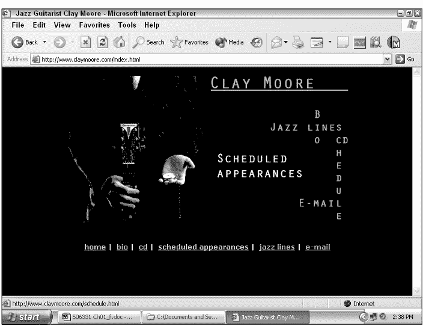

图 1-1：JavaScript 让你能够快速轻松地为网站添加交互式功能

遗憾的是，随着力量的增强，复杂性也增加了——但这正是这个全新的、改进的、更好的《JavaScript 傻瓜书》的意义。如果你不是一个顶尖的程序员，可以使用书中的技术和示例脚本来创建具有持久效果的交互式网页。在接触 JavaScript 代码之前，你可能想花点时间熟悉我在本章中涵盖的基础知识。在这里，我为你提供了尽可能快开始使用 JavaScript 所需的所有背景！

## 什么是 JavaScript？（提示：它并不是）

JavaScript 是一种你可以使用的脚本语言——结合 HTML 使用来创建交互式页面。脚本语言是一种旨在让人们轻松访问预构建组件的编程语言。在 JavaScript 的情况下，这些预构建组件是构成网页的构建块（链接、图像、插件、HTML 表单元素、浏览器配置等）。你不需要了解任何 HTML 就可以使用这本书；为了尽可能快地开始使用 JavaScript，我为你提供了所有必要的背景！如果你对了解更多信息感兴趣，可以查看《JavaScript 傻瓜书》，由 Wiley 出版。


### 它非常快！

JavaScript 除了相对容易上手之外，它的运行速度也很快。大多数脚本语言都是解释执行的（而不是编译的）。当你使用 C++ 等编译型语言进行编程时，在运行代码之前，你必须重新格式化或编译你的代码文件。这个中间步骤可能需要几秒钟到几分钟甚至更。

另一方面，JavaScript 这种解释型语言的妙之处在于，当你对代码（在这种情况下，是对你的 JavaScript 脚本）进行更改时，你可以立即测试更改；而不需要先编译脚本。跳过编译步骤可以在 Web 页面开发的调试阶段节省大量时间。

使用 JavaScript 这种解释型语言的另一个大优势是，测试解释型脚本并不像编译语言那样是一个“全有或无”的问题。例如，如果一个 20 行脚本的第 10 行包含语法错误，你脚本的前半部分可能仍然运行，你将立即获得反馈。在编译型程序中，同样的错误会导致程序根本无法运行。


解释型语言的缺点是测试是基于信誉的。因为没有编译器来催促你，你可能会忍不住将测试推到最后一刻，或者更糟——完全跳过它。然而，请记住，无论你创建的网站是为了业务还是为了，它都是对你的反映；如果你想在潜在客户、合作伙伴和朋友面前展现最佳形象，测试是必不可少的。（坦率地说，几年前，访问你网站的访客可能会忽略一两个带有 bug 的脚本。如今的网站标准要高得多。） 幸运的是，第 17 章充满了许多有用的调试技巧，可以帮助你在测试 JavaScript 代码时尽可能轻松。

### 所有人都在用！

（好吧，几乎所有人都在用！）

目前有两个通用可用的 Web 浏览器支持 JavaScript：微软的 Internet Explorer 和 Netscape/AOL 的 Navigator。（从 4.0 版本开始，Navigator 成了 Communicator 的同义词，尽管从技术上讲，Netscape Communicator 包含的组件比单纯 Navigator 浏览器要多。）这两个浏览器几乎垄断了浏览器市场；几乎每个浏览网页的人都在使用其中一种，因此具备查看和创建支持 JavaScript 的 Web 页面的能力。

## 第一部分：为了乐趣和利润构建杀手级 页面

### JavaScript 和 HTML

你可以将 JavaScript 视为 HTML 的扩展；如果你愿意，可以叫插件。

它是这样工作的：HTML 标签创建对象；JavaScript 让你能够操作这些对象。例如，你使用 `<BODY>` 和 `</BODY>` 标签创建一个 Web 页面或文档。如表 1-1 所示，在创建文档之后，你可以使用 JavaScript 与之交互。例如，你可以使用一个名为 `onload` 事件的特殊 JavaScript结构在文档加载到 Web 浏览器时触发操作——也许播放一段简短的欢迎曲。（我在第 13 章中介绍事件处理器。）你使用 JavaScript 交互的其他 HTML 对象示例包括：窗口、文本字段、图像和嵌入的 Java Applet。

| 表 1-1 创建和使用对象 |
| :--- | :--- | :--- |
| 对象 | HTML 标签 | JavaScript |
| Web 页面 | `<BODY>...</BODY>` | document |
| 图像 | `` | document.Image |
| HTML 表单 | `<FORM name="myForm">...</FORM>` | document.myForm |
| 按钮 | `<INPUT TYPE="button" NAME="Button">` | document.myForm.myButton |

要向 Web 页面添加 JavaScript，你必须在 HTML 文件中嵌入 JavaScript 代码。在嵌入 JavaScript 代码的所在行之后，你可以在响应事件处理器或 HTML 链接时引用或调用该 JavaScript 代码。

在 HTML 文件中嵌入 JavaScript 代码时，你有两个选择：

- 你可以使用 `<SCRIPT>` 和 `</SCRIPT>` 标签将 JavaScript 直接包含在 HTML 文件中。

在下面的示例中，HTML 文件的顶部定义了一个名为 `processOrder()` 的 JavaScript 函数。在 HTML 文件的下方，该 JavaScript 函数与一个事件处理器关联——具体来说，是 processOrder 按钮的 `onClick` 事件处理器。（换句话说，当用户点击 processOrder 按钮时，包含在 processOrder() 函数中的 JavaScript 代码就会运行。）

```html
<HTML>
<HEAD>
<SCRIPT LANGUAGE="JavaScript">
  // JavaScript 语句在这里
  function processOrder() {
    // 更多的 JavaScript 语句在这里
  }
</SCRIPT>
</HEAD>
<BODY>
<FORM NAME="myForm">
<INPUT TYPE="button" NAME="processOrder" VALUE="Click to process your order" onclick="processOrder();">
..
</HTML>
```

- 你可以使用 `<script>` 和 `</script>` 标签将单独的外部 JavaScript 文件（一个仅包含 JavaScript 语句并带有 .js 扩展名的文件）包含到 HTML 文件中。

```html
<HTML>
<HEAD>
<SCRIPT LANGUAGE="JavaScript" SRC="myJSfile.js">
</SCRIPT>
</HEAD>
<BODY>
<A HREF="javascript:processOrder();">Click here to process your order.</A>
</BODY>
</HTML>
```

> 请记住，这些打印页面中的大多数示例都集中在代码的 JavaScript 部分（自然地！）。但我包含了你从 CD-ROM 创建示例所需的 HTML，所以你只需要创建示例即可。

由于 Web 页面不仅仅是 HTML，JavaScript 提供了 HTML 之外的对象。此外，JavaScript 还提供了某些平台特定的对象。

在一起，所有构成 Web 网站的对象——HTML 对象、浏览器相关的平台对象以及内置在 JavaScript 语言中的特殊对象——统被称为文档对象模型 (DOM)。

由于 JavaScript 无法访问除浏览器包含对象以外的任何对象（除了我在第 6 章中讨论的 cookie），因此没有人可以使用 JavaScript 打开秘密的拨号连接、擦除用户的硬盘或执行其他恶意行为。

第一部分：为了乐趣和利润构建杀手级 页面

### JavaScript 和你的浏览器

你需要使用 Netscape Navigator 7.1（或更高版本）或 Microsoft Internet Explorer 6.0（或更高版本）来使用我演示的 JavaScript 功能。


- 并非所有浏览器都相同：Internet Explorer 对 JavaScript 的支持与 Navigator 有不同，而且 JavaScript 的支持随浏览器版本而异。详情请参阅第 5 章。

尽管可以使用旧版本的浏览器创建和查看 JavaScript 脚本，但我建议安装最新版本的 Navigator 或 Internet Explorer。每个产品的最新版本都有最新的 JavaScript 和错误修复。你可以使用其他浏览器（如 Opera）或其他 Internet 协议（如 FTP）下载最新 Navigator 或 Internet Explorer 并尝试。本章的“我需要准备什么？”部分介绍了获取和安装支持 JavaScript 浏览器的细节。现在你需要 Navigator 或 Internet Explorer 来处理 JavaScript，这意味着你必须运行支持这些浏览器的客户端平台之一。（Mac 操作系统和 Windows 都支持 Navigator 和 Internet Explorer。）

- 你需要意识到，人们可能会使用其他不支持 JavaScript 的浏览器来查看你的 Web 页面——或者他们可能会使用关闭了 JavaScript 支持的浏览器。无论何种情况，你无法保证每个访问你页面的人都能看到你的 JavaScript 作品。（有关此主题的更多信息请参阅第 5 章。）

### JavaScript 和浏览器安全

在计算机比繁殖还快的时代，浏览器安全是一个重要问题。你可能会感到宽慰，JavaScript 不构成安全威胁。因为 JavaScript 无法访问浏览器对象以外的任何对象（除了我在第 6 章中讨论的 cookie），没有人可以使用 JavaScript 打开秘密的拨号连接、擦除用户的硬盘或执行其他恶意行为。换言之，JavaScript 受内置于支持 JavaScript 浏览器的安全控制。

## 我可以用 JavaScript 做什么是 Web 语言做不到的？

HTML。DHTML。XML。JavaScript。Java。Flash。涉及到 Web 开发时，海量的语言和开发工具可能会让人感到困惑——你可能会在结哪种语言最适合哪种任务。

事实是，每种语言的设计初衷都是为了特定的任务，JavaScript 也不例外。表 1-2 显示了 JavaScript 最适合（以及最不适合）执行的任务类型。JavaScript 最适合客户端（基于浏览器）的任务。

### 表 1-2 使用 JavaScript 完成正确的任务

| 任务 | JavaScript 有用吗？ | JavaScript 和 CSS (DHTML) 有用吗？ |
|---|---|---|
| 为用户提供用的反馈 | 是 | 否 |
| 自定义页面外观 | 是 | 是（比单用 JavaScript 更复杂） |
| 检查或更改 HTML 表单数据 | 是 | 否 |
| 创建简单动画 | 是 | 是（比单用 JavaScript 更复杂） |
| 创建复杂动画 | 否 | 否 |
| 执行服务器端处理 | 否 | 否 |

JavaScript 通过与 HTML 和级联样式表（CSS）协作来实现它的魔法。以下是它的工作原理：HTML 和 CSS 允许你使用标签构建块或对象创建静态 Web 页面。JavaScript 则允许你检查和操作这些对象，为静态页面添加交互性和简单动画。（换句话说，要使用 JavaScript，你需要使用 HTML；而要利用动态 HTML（或 DHTML）特性，你需要同时使用 HTML 和 CSS。）

通过使用 JavaScript，你可以让网站易于导航，并根据查看者是谁、访问者使用什么浏览器以及当前是什么什么时间来定制你的页面。你甚至可以创建简单的（但有效的）

## 让你的网站易于用户导航

常用的方法是使用 JavaScript 增强你的页面，使其更易导航。例如，你可以使用 JavaScript 来：

- 创建可展开的网站地图。
- 添加工具提示——当用户将鼠标悬停在网站的特定区域时，显示的有用短文本。
- 当用户将鼠标拖过屏幕特定区域时切换图像。（这种效果被称为“鼠标悬停”（mouse rollover），它可以帮助用户一眼判断网页的哪些部分是交互式或可点击的。）
- 检查用户输入的数据，如果他们输入了无效内容则弹出有用建议。
- 在用户提交表单后显示感谢信息。
- 将内容加载到多个帧中（例如点击和拖动鼠标），以便用户可以同时查看多块相关信息。

除了用户触发的事件（如点击和拖动鼠标），JavaScript 还能识别自动事件——例如，将 Web 页面加载到浏览器中。（详情请查看第 5 章，包括响应自动事件运行的示例脚本。）

## 动态调整你网站的外观

每个人都喜欢与众，访问你网站的人也不例外。通过使用 JavaScript，你可以根据以下标准为不同用户定制页面的外观：

- 访问者查看页面时使用的特定浏览器类型和版本
- 当前日期或时间
- 用户上次访问你页面时的行为
- 用户的声明偏好
- 你能想象的任何其他标准

## 创建酷炫的动态动画效果

许多人认为为 Web 创建动画需要 JavaScript，但事实并非如此。尽管 JavaScript 绝不会被认为是创建高密度动画的最有效方法，但你可以将 JavaScript 与级联样式表结合（这种组合有时被称为 HTML）来创建各种非常棒的动画效果。事实上，使用 JavaScript 是实现常见效果（如悬停效果）最简单的方法，你可以在第 8 章中看到。

## 我需要什么才能开始？

我希望你迫不及待要开始你的第一个支持 JavaScript 的 Web 页面了！不过，首先要是……你对 JavaScript 能为你做什么已经有了了解，并且可能已经对第一次尝试有了具体的想法。现在是深入研究准备工作了：你开始需要什么，以及如果你还没有，该如何获取。在完成设置后，你就可以进入真正的实操阶段了！

## 硬件

就本书，我假设你正从一台个人电脑或 Mac 开始你的 JavaScript 冒险。你的机器（或者用俗语说的“机子”）应该是奔腾 PC 或更高级别的配置（除非是 Power Mac），并且应该至少有 32MB 内存和至少 25MB 的空闲硬盘空间。如果这些要求听起来不合理，请请教你当地的硬件专家；每个组织似乎至少有一位专家。（通过大量的尝试和错误，我发现大多数硬件专家对含糖的零食食品反应非常灵敏。）

你还需要一种可以让你连接到互联网的硬件。这种硬件通常由一个调制解调调器（modem）和一条电话线组成，尽管一些人会选择更快的方案，如电缆或 DSL（数字用户线路）。取决于你的电脑，你可能安装了内置调制解调器——许多整机都带有内置调制解调器。如果没有，你可以在当地的折扣店买一个。调制解调器之间的区别因素是线路速度：越快越好。（现在的大多数电脑都预装了 56.6 Kbps 号，但 28.8 也完全可用。）如果你还没有调制解调器，考虑购买你价格范围内最快的型号；当你尝试加载带有多个图形的 Web 页面时（每个图形加载都需要非常、久的时间，因为图形文件通常很大），你会非常感谢自己的。

## 软件

就本书，我假设你有一台运行着 Mac OS 9 或更高版本，或者一台安装了 Windows 95、Windows NT、Windows 98、Windows 2000、Windows XP 或 Linux 的个人电脑。（目前 Linux 只有 Netscape Navigator 可用。）

我假设你有创建文本文件的方法。（大多数操作系统都自带了各种文本编辑器和文字处理器，其中任何一个都可以很好地创建 JavaScript 脚本。）

在随书的 CD 中，你可以找到一些优秀的文本编辑工具，它们是专为创建 JavaScript 文件而设计的。

## JavaScript 特定的软件

你需要一个 Web 浏览器。在本书期间，Navigator（Netscape Communication 的商业 Web 浏览器）和微软的 Internet Explorer 是唯一支持 JavaScript 的浏览器。所以，第一要务是获取一份 Navigator 或 Internet Explorer。（你在书中看到的示例是使用运行在 Windows XP 上的 Netscape Navigator 和 Internet Explorer 展示的。）

大多数个人电脑都已安装了 Internet Explorer。检查你的特定电脑是否也是如此，选择“开始+所有程序”并寻找 Internet Explorer。

### Netscape Navigator

Netscape Navigator 7.x 版本将浏览器与消息、Web 构建以及其他互联网相关的功能包在在一起。

你可以通过访问以下网站下载副本（该网站提供了分步说明）：

```
http://channels.netscape.com/ns/browsers/default.jsp
```

当然，我假设你已经安装了 Web 浏览器，或者你有访问 FTP 的权限。（FTP 是文件传输协议，是一种让你从他人的机器上下载文件的 Internet 应用程序。）

### Internet Explorer

如果你是微软粉丝，你可能想下载一份 Internet Explorer。从以下网站免费下载（或支付少量费用订购 CD-ROM 副本），该网站提供了易于遵循的安装说明：

```
www.microsoft.com/windows/ie/default.htm
```

# 第 1 章：关于 JavaScript 你想的一切

## 文档

有关最新的 Netscape Navigator 和 Microsoft Internet Explorer 文档及技术支持，请查看以下 URL：

```
http://channels.netscape.com/ns/browsers/default.Jsp
```

```
www.microsoft.com/windows/ie/default.htm
```

你可以查看或下载《Core JavaScript Reference》副本，这是 Netscape 解释 JavaScript 基础和语言概念 JScript 的文档，请访问以下网页：

```
http://devedge.netscape.com/central/javascript/
```

微软对其 JavaScript 兼容脚本语言（JScript）的文档可以在此处找到：

```
http://msdn.microsoft.com/library/default.asp?url=/library/en-us/script56/html/js56jsoriScript.asp
```

或者你可以访问 `http://msdn.microsoft.com` 并搜索关于脚本的文档。

# 第 2 章：编写你的第一个脚本

### 本章内容

- 设计你的第一个 JavaScript 应用
- 创建一个 HTML 文件
- 创建并附加脚本
- 运行 JavaScript 应用

了解新脚本语言细节的最佳方法之一就是直接上手并创建一个脚本——这正是本章要教你如何做的！实际上，本章教给你的将不仅仅是创建一个脚本；它还教了你如何创建一个 JavaScript 应用。JavaScript 单身并不算什么什么，它确实需要与 HTML 配合工作。因此，一个 JavaScript 应用至少包含一个脚本和一个 HTML 文件。

本章涵盖了 JavaScript 开发的每一个单独的方面，从产生一个实用的想法到实现、测试和执行该想法。我不假设你具备任何先验知识，即使你对 JavaScript 或 Web 是完全新手，也可以跟随本章中的示例。而且由于我使用的示例演示了大多数常见的 JavaScript 结构——包括语句、变量、运算符、函数和事件处理程序——你可以将这里展示的策略和代码应用到你自己的创作中。

所以，打开你的电脑，卷起袖子，准备好享受乐趣吧！

## 从想法到运行的 JavaScript 应用

就像伟大的艺术一样，优秀的软件并不是凭空产生的。创建任何一种都需要你先进行一些规划，然后你必须使用一个工具——配合某种逻辑过程——将你的计划转化为具体的东西。

在本节中，你将熟悉创建 JavaScript 应用所需要的的基础工具：一个简单的文本编辑器和一个支持 JavaScript 的浏览器。你还将很好地了解创建 JavaScript 应用需要遵循的逻辑过程（在编程领域被称为开发周期）。

### 想法？！我有一百万个！

创建一个出色的 JavaScript 应用的第一步是准确决定你想让应用程序做什么。为访问者提供一些反馈？执行一些计算？更多想法，请查看 ScriptSearch.com 的 JavaScript 部分：`scriptsearch.com/JavaScript`


本书描述了许多你想用 JavaScript 实现的事务——从验证用户输入到创建鼠标悬停效果。更多想法，请查看 ScriptSearch.com 的 JavaScript 部分：`scriptsearch.com/`

当你心中有一个清晰的想法时，花几分钟时间在纸上写下你的想法。这个阶段——用书面文字明确你想让应用完成的任务——在专业软件开发中具有悠久的实用历史。这一步被正式称为“需求阶段”，完成这一步让你能够在过程结束时测试你的应用。（嘿，如果你都不知道它确切应该如何工作，你就没法测试它了！）

以下是我在本节中描述的第一个 JavaScript 谚言应用的需求：

> 我想创建一个显示当前日期和时间的网页。

注意，需求可以用你自己的话描述。你不需要填写正式的需求文档，或者（天哪！）在流程图上费尽心机。一个简单简洁的描述就能完美胜任。

### 第 1 部分：创建一个 HTML 文件

当你拿到脚本需求后，就可以开始编码了。首先，你需要创建一个 HTML 文件。要做到这一点，你将使用诸如 Windows 操作系统自带的记事本这样的文本编辑器。

如果你正在创建一个包含嵌入 JavaScript 语句的 HTML 文件——例如在本章中描述的那种——确保你给文件命名的包含 `.htm` 或 `.html` 扩展名。

由于本书完全关于 JavaScript，我不会详细介绍如何使用文字处理软件。相反，我将向你展示如何使用文本编辑器创建你的文件。

#### 代码列表 2-1：日期和时间戳应用程序的 HTML 代码

```html
<HTML>
<HEAD>
<TITLE>显示当前日期和时间（基础示例）</TITLE>
</HEAD>
<BODY>
<P>这是我的第一个 JavaScript 应用程序的 HTML 文本。</P>
</BODY>
</HTML>
```

代码列表 2-1 中的代码显示如下：

- **标题：** 标题文本“Displaying the current date and time (basic example)”出现在文档窗口的标题栏中。
- **一段文本：** “This is the HTML text for my first JavaScript application”这段文本出现在网页正文中。

图 2-2 显示了代码列表 2-1 中的 HTML 代码在 Netscape 7.1 中的外观。

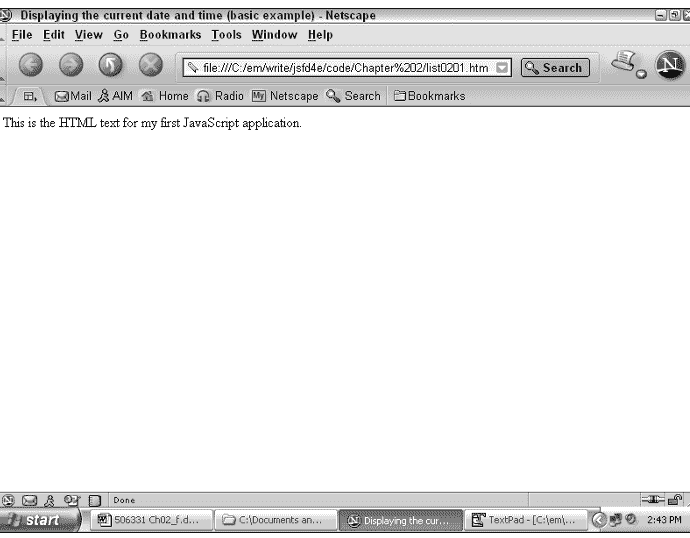

**图 2-2：** Navigator 中显示的日期和时间戳应用程序的 HTML 部分。

### 数字处理

如果某些 JavaScript 程序员利用了特定版本的 JavaScript 代码，他们会将 `<SCRIPT>` 标签的 `LANGUAGE` 属性设置为 `JavaScript1.1`、`JavaScript1.2` 或 `JavaScript1.3`（与旧版 JavaScript 相对比例如，你可以使用以下任一选项：

```html
<SCRIPT LANGUAGE="JavaScript">
  (JavaScript 代码版本 1.0 或以上)
</SCRIPT>
```

```html
<SCRIPT LANGUAGE="JavaScript1.2">
  (JavaScript 代码版本 1.2 或以上)
</SCRIPT>
```

```html
<SCRIPT LANGUAGE="JavaScript1.3">
  (JavaScript 代码版本 1.3 或以上)
</SCRIPT>
```

- Navigator 2.0 和 Internet Explorer 3.0 支持 JavaScript 1.0。
- Navigator 3.0x、Internet Explorer 3.0x 和 4.0x 支持 JavaScript 1.1。
- Navigator 4.0 到 4.05 支持 JavaScript 1.2。
- Navigator 4.06 到 4.5 支持 JavaScript 1.3。
- Internet Explorer 5.x 支持 JavaScript 5.x（在很大程度上与 JavaScript 1.3 兼容）。
- Navigator 6.0、7.1 以及 Internet Explorer 6 支持 JavaScript 1.5。

呼！如果你不确定要使用哪种版本的 JavaScript 或旧版 JavaScript 构造，那么将 `LANGUAGE` 属性指定为 `JavaScript1.3`（而不是 `JavaScript`）并不会提供额外的 JavaScript 支持。它只是防止那些不支持 JavaScript 1.3 版本的浏览器尝试解释夹在 `<SCRIPT LANGUAGE="JavaScript1.3">` 和 `</SCRIPT>` 标签之间的 JavaScript 语句。

我的建议：坚持使用“JavaScript”标准构造，谨慎使用尖端的 JavaScript 构造，并尽可能在尽可能多的浏览器（以及浏览器版本）中测试你的脚本。

这种方法的麻烦之处在于，跟踪 Navigator 和 Internet Explorer 众多版本中的 JavaScript 支持情况就足够让一个全职会计师忙不过来了！看看下面的内容，你就明白我的意思了：

尽管图 2-2 中的网页看起来像那样，但它只完成了一半。页面上没有日期或时间戳。

这就是 JavaScript 发挥用场的地方！你需要获取当前的日期和时间，并将其显示在页面上。在接下来的两个章节中，你将了解到创建此类脚本所需的所有知识——以及需要附加到 HTML 文件中的内容。

### 第二部分：创建你的脚本

当你有一个可以运行的 HTML 文件时（例如之前图 2-2 所示），就可以开始创建你的脚本了。

对于在本章前面提到的“创意？！我有一百万个！”中的日期和时间戳应用程序，你需要创建一个执行以下操作的脚本：

- 获取当前的日期和时间
- 在网页上显示当前的日期和时间。

完成所有这些所需的 JavaScript 代码比你想象的要简单。在第 3 章中，你将详细熟悉每一行 JavaScript 代码，包括注释、变量和方法。现在，看看代码列表 2-2。

#### 代码列表 2-2：日期和时间戳应用程序的 JavaScript 代码

```javascript
// 获取当前的日期和时间
var todays_date = new Date();

// 在网页上显示当前的日期和时间
document.write(todays_date);
```

当你浏览代码列表 2-2 时，请注意：

- HTML 注释描述了 JavaScript 的功能。
- 第一条语句通过创建一个 `Date` 对象的实例来获取日期和时间。
- 第二条语句使用 `write` 方法来显示 `todays_date`。（注：OCR 文本此处包含了一些伪迹，已为了清晰起见进行了修正）。

#### 代码列表 2-3：包含嵌入 JavaScript 的完整 HTML 文件

```html
<HTML>
<HEAD>
<TITLE>显示当前日期和时间（基础示例）</TITLE>
</HEAD>
<BODY>
<P>这是我的第一个 JavaScript 应用程序的 HTML 文本。</P>
<SCRIPT LANGUAGE="JavaScript">
<!-- 隐藏脚本
// 获取当前的日期和时间
var todays_date = new Date();
// 在网页上显示当前的日期和时间
document.write(todays_date);
// 结束隐藏 -->
</SCRIPT>
<NOSCRIPT>
你必须运行一个启用 JavaScript 的 Web 浏览器（例如最新版本的 Microsoft Internet Explorer 或 Netscape Navigator），才能充分利用此页面的功能。
</NOSCRIPT>
</BODY>
</HTML>
```

它们需要使用启用 JavaScript 的 Web 浏览器才能充分利用你的 Web 页面的功能。

### 测试你的脚本

当你有一个包含嵌入 JavaScript 代码的 HTML 文件时（如之前在列表 2-3 中所示），你就可以准备好测试你的 JavaScript 应用了！（这部分是真正有趣的部分。）

要测试 JavaScript 应用，你只需要将包含 JavaScript 的 HTML 文件加载到支持 JavaScript 的 Web 浏览器中。图 2-3 显示了列表 2-3 中的代码加载到 Netscape 7.1 浏览器后的外观。

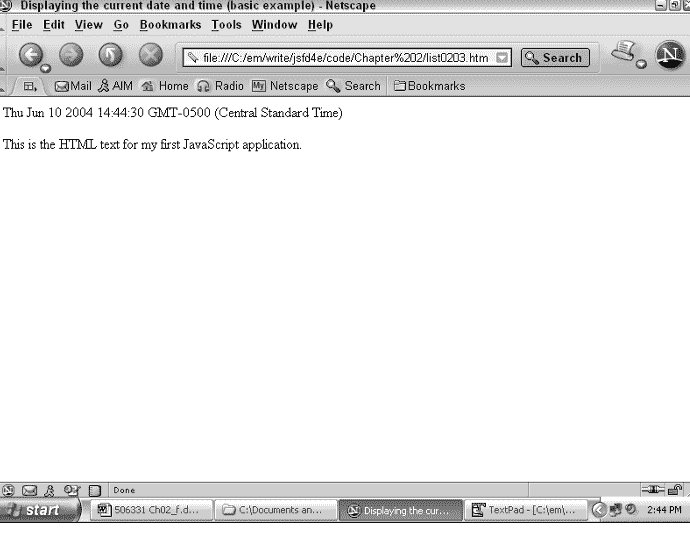

**图 2-3：** 在 Netscape 7.1 中显示的日期和时间戳应用程序。

注意：你可以在第 3 章中找到一个版本更复杂的日期和时间戳应用程序。

如果你在浏览器中加载列表 2-3 中的代码，并看到与图 2-3 类似的网页，恭喜你！你成功测试了你的第一个 JavaScript 脚本。

然而，如果你没有看到与图 2-3 类似的网页，请不要绝望。很有可能是由于以下情况之一引起的：

- 没有加载正确的 HTML 文件。如果你是从头开始创建 HTML 文件的，你可能无意中写错了一个语句或引入了错误。没关系；你稍后可以修复它。（第 17 章包含了许多调试脚本的技巧）。现在，尝试从配套 CD 加载 `bugfreelist203.htm` 文件。
- 你没有启用 JavaScript 的浏览器。请确保你使用的是 Microsoft Internet Explorer 6.0（或更高版本）或 Netscape Navigator 7.1（或更高版本）。
- 你的浏览器关闭了 JavaScript 支持。Netscape Navigator 和 Microsoft Internet Explorer 都提供了关闭 JavaScript 支持的方法。当你关闭浏览器中的 JavaScript 支持并加载包含 JavaScript 的 Web 页面时，你的浏览器将忽略所有 JavaScript 代码。就就像它们不存在一样！

为了确保开启了 JavaScript 支持，请执行以下操作：

- 如果你使用 Netscape Navigator 7.x，选择 `Edit -> Preferences`，双击 `Advanced` 菜单选项显示 `Scripts & Plugins` 菜单选择。点击 `Scripts & Plugins` 选择并确保勾选择了 `Enable JavaScript for Navigator`。
- 如果你使用 Internet Explorer 6.x，选择 `Tools -> Internet Options -> Security`。然后选择 `Internet Web Content` 区域，点击 `Custom Level` 按钮，向下滚动直到找到 `Active Scripting`（活动脚本）类别。最后，确保勾选了 `Enable`（启用，位于 Active Scripting 选项正下方）。

# 第 3 章：JavaScript 语言基础

## 本章内容

- 了解 JavaScript 语法
- 组合 JavaScript 表达式和语句
- 使用浏览器检测脚本练习 JavaScript 语言基础
- 理解条件
- 探索函数

尽管 JavaScript 是一种非常强大的语言，但你使用它的方式可以简化两个主要概念：语法和 JavaScript 对象模型（也称为对象模型）。

语法是指你编写 JavaScript 代码时必须遵循的规则。存在许多语法规则，但你不需要理解它们——就像你需要理解并遵循英语规则来写出英语母语者能理解的句子一样。

文档对象模型（DOM）是指你可以使用 JavaScript 访问和操作的 Web 组件或对象。就像在用英语写故事之前可能需要具备英语单词词汇一样，在编写自己的 JavaScript 脚本之前，你可能对 DOM 有一定的熟悉。（我将第 4 章留给了 DOM）。本章将为你提供编写自己的脚本所需的语法知识！

## JavaScript 语法

规定人类与 JavaScript 解释器（Web 浏览器中理解并执行 JavaScript 代码的部分）通信方式的规则被称为 JavaScript 语法。尽管你可能会对 JavaScript 语法的所有技术细节感到有些压力（尤其是刚开始时），但你可以专注于以下几点，它们是你代码的构建块：

- **注释 (Comments)**：注释是人类可读的（而非 JavaScript 解释器可读的）描述，你可以将其添加到脚本中，以使脚本更易理解和维护。
- **条件 (Conditionals)**：条件是你添加到脚本中的逻辑结构，用于在运行时判断某个特定条件是否为真或为假。最基本的条件是 `if-else`。
- **函数 (Functions)**：函数是命名的语句组，你定义一次，然后重复使用来帮助你的内容。
- **循环 (Loops)**：循环是条件的特殊形式。你可以向脚本中添加循环，多次更改某个特定条件（无论你使用什么 JavaScript 代码），直到该条件变为真或假。循环的常见示例包括 `for`、`while` 和 `do-while` 循环。
- **运算符 (Operators)**：运算符是连词的答案。运算符包括逗号以及你用于比较和给变量赋值的赋值符号。
- **变量 (Variables)**：变量是命名的占位符，代表你在脚本中处理的数据位。

我将在后续章节中讨论每一个这些构建块：

### 不要忘记你的注释

JavaScript 解释器会忽略注释。但注释对阅读脚本的人类来说非常有用（当你完成脚本并将其搁几个月后，可能会感激这些注释！）

你可以用两种方式编写 JavaScript 注释。每种注释都可以出现在脚本的任何位置。

第一种注释是单行注释。它以两个斜杠开始，只适用于一行。这里是单行注释的示例：

```javascript
// 单行注释不需要结束斜杠。
```

第二种注释是多行注释。因为它跨越多行，所以你必须告诉它何时开始（使用斜杠）何时结束（使用星号和斜杠）。例如：

```javascript
/* 此注释可以跨越多行。但始终记得关闭它；如果你忘记了，显示脚本时会出现奇怪的错误。 */
```

不要在 JavaScript 代码中重叠或嵌套多条注释。如果你这样做，JavaScript 解释器会产生错误。


记住，JavaScript 脚本是位于 HTML 文件 `<SCRIPT>` 和 `</SCRIPT>` 标签之间的代码。你不能使用 HTML 注释字符 `<!--` 和 `-->` 来创建 JavaScript 注释，也可以使用 JavaScript 注释字符 (`//` 和 `/* */`) 来创建 HTML 注释。

### 基本条件

JavaScript 提供了几种条件表达式，你可以用它们在运行时测试条件。最常用的条件是 `if-else` 和 `switch` 语句。

#### if-else

`if-else` 条件表达式是 JavaScript 中最强大的结构之一。

你使用 `if-else` 来测试条件：

- 如果条件为真，JavaScript 解释器执行 `if` 句之后的所有语句。
- 如果条件为假，JavaScript 解释器执行 `else` 句之后的所有语句（如果存在 `else` 句的话）。

以下是使用 `if-else` 的通用描述：

```javascript
if (condition) {
  statements
} else {
  statements
}
```

大括号 (`{ }`) 将语句组合成一个大的块。例如，如果你在一个 `if` 条件后紧跟三个 JavaScript 语句，且这三个语句都用大括号括起来，那么当条件真时，JavaScript 解释器会执行所有三个语句。

方括号 (`[ ]`) 意味着整个 `else` 子句是可选的。你实际上并不需要在 JavaScript 代码中编写方括号；你只需要在需要时添加 `else` 子句，在不需要时将其省略即可。

假设你想确定正在运行哪种浏览器，以便相应调整你的 Web 页面。（正如你在第 5 章中看到的，Internet Explorer 和 Netscape Navigator 提供的 JavaScript 支持存在差异。）列表 3-1 显示了如何使用 `if-else`（以及内置的 `navigator` 对象）来实现这一目标。

#### 列表 3-1：JavaScript if-else 示例

```javascript
if (navigator.appName == "Microsoft Internet Explorer") {
    document.write("You're running Microsoft IE");
} else {
    if (navigator.appName == "Netscape") {
        document.write("You're running Netscape");
    } else {
        document.write("You're not running Microsoft IE or Netscape");
    }
}
```

列表 3-1 中的 JavaScript 代码将内置 `navigator` 对象的 `appName` 属性值与字符串 "Microsoft Internet Explorer" 进行比较。（文本字符串是一组字符，你将其作为一个整体块进行操作）。

- 如果条件为真（`appName` 的值确实是 `Microsoft Internet Explorer`），JavaScript 代码将执行下一条语句，在网页上显示 "You're running Microsoft IE"。
- 如果条件为假（`appName` 的值不是 `Microsoft Internet Explorer`），JavaScript 代码将测试 `appName` 的值是否等于 `Netscape`：
  - 如果第二个条件为真，JavaScript 解释器会在网页上显示 "You're running Netscape"。
  - 如果第二个条件为假，JavaScript 解释器会在网页上显示 "You're not running Microsoft IE or Netscape"。

你可能会注意到列表 3-1 包含两个 `if-else` 语句，一个嵌套在另一个内部。从技术上说，你可以根据需要嵌套任意数量的 `if-else` 语句，在某些情况下你需要一个或两个嵌套的 `if-else` 来完成工作；然而，你可能希望考虑使用 `switch` 语句（我在下一节中描述）。`switch` 语句在多次测试条件时效率高得多。

一些 JavaScript 程序员会在每个语句末尾加上分号，如下所示：

```javascript
if (a == b) { // 如果 a 等于 b
    c = d; // 将 d 的值赋值给 c 变量，
    e = f; // 将 f 的值赋值给 e 变量，
    // 并字符串 "American Beauty"
    // 赋值给名为 favoriteMovie 的变量
    favoriteMovie = "American Beauty";
}
```

在 JavaScript 中分号是可选的，但有一个例外。如果你在同一行放置了多个 JavaScript 语句，必须用分号分隔这些语句。例如：

```javascript
// 错误！
c = d = f; favoriteMovie = "American Beauty"

// 正确（虽然有点难读）
c = d; e = f; favoriteMovie = "American Beauty"
```

#### switch

`switch` 语句提供了一种简单的方法来检查表达式是否匹配一组值，而无需使用一系列的 `if-else` 语句。

其语法如下：

```javascript
switch (expression) {
    case label :
        statement
        break
    case label :
        statement
        break
        ...
    default : statement
}
```

假设你想检查一个值，并找出它是否匹配若干预定义值之一。列表 3-2 显示了你如何使用 `switch` 语句来实现这一目标。

#### 列表 3-2：使用 switch 语句匹配值

```javascript
switch (month) {
case 0:
    displayMonth = "January"
    break;
case 1:
    displayMonth = "February"
    break;
case 2:
    displayMonth = "March"
    break; 
case 3:
    displayMonth = "April"
    break;
case 4:
    displayMonth = "May"
    break;
case 5:
    displayMonth = "June"
    break;
case 6:
    displayMonth = "July"
    break;
case 7:
    displayMonth = "August"
    break;
case 8:
    displayMonth = "September"
    break;
case 9:
    displayMonth = "October"
    break;
case 10:
    displayMonth = "November"
    break;
case 11:
    displayMonth = "December"
    break;
default: displayMonth = "INVALID";
}
```

列表 3-2 中的代码测试 `month` 变量的值。如果 `month` 包含数字 0，变量 `displayMonth` 被设置为 "January"。如果 `month` 包含数字 1，`displayMonth` 被设置为 "February" —— 以此类推，一直持续全 12 个月份。

配套 CD 包含一个 `date_and_time.htm` 文件，是列表 3-2 的副本。注意，如果你忘记写 `break` 语句，JavaScript 解释器会穿透。

### 完全功能性

函数是一组命名的 JavaScript 语句，你可以在脚本顶部声明它，并多次调用。在脚本中添加一个可重用的函数——而不是添加多个版本的代码——可以减少你的打字量（可能），以及潜在的 bug 数量。

将脚本组织成函数，就像整理衣柜一样，看起来像是大量的额外工作却毫无用处——毕竟你并不要这样做。你的脚本和衣柜即使杂乱无章也是可以工作的。当你需要在这种混乱中快速找到某个问题（或一条完美的皮带）时，回报就会出现！

#### 定义函数

这是函数定义的语法：

```javascript
function name(parameter [, parameter] [..., parameter]) {
  return value
}
```

这是一个示例：

```javascript
function calculateTotal(numberOrdered, itemPrice) {
  var totalPrice = (numberOrdered * itemPrice) + salesTax
  return totalPrice
}
```

这段代码片段定义了一个 `calculateTotal` 函数，它接受两个参数：`numberOrdered` 和 `itemPrice`。该函数使用这两个参数（加上额外的变量 `salesTax`）计算 `totalPrice` 变量，并返回给最初调用它的 JavaScript 代码。

你的函数可以接受任意数量的参数（包括没有），用逗号分隔。你通常会在函数体内引用这些参数值（否则，何必使用它们呢），所以要给它们命名有意义的名字。换句话说，可以用 `x` 和 `y` 替换 `numberOrdered` 和 `itemPrice`，代码同样有效。只是没那么易于阅读或维护了！

由于可选的 `return` 语句非常重要，我专门用了一个节来介绍它的用法。（参见“从函数返回值”章节）。

#### 调用函数

在声明函数（我在上一节中描述了它）之后，你就可以调用该函数。调用函数的方法是指定函数名，后跟一个左括号、用逗号分隔的参数以及一个右括号。例如：

```javascript
alert("Total purchases come to " + calculateTotal(10, 19.95));
```

注意，你可以将函数调用嵌入到另一个表达式中。在这里，`calculateTotal(10, 19.95)` 实际上是发送给 `alert()` 方法表达式的一部分。（你将在第 4 章中找到所有的方法，但目前，你可以将它们视为特殊的函数。）

#### 从函数返回值

你使用 `return` 语句从函数返回一个值。想象你正在请求一位朋友为你查阅某些信息。如果你的朋友确实去研究了，但忘记把结果传给你，你会感到很失望。在这种情况下，你就像一段正在调用函数的 JavaScript 代码，而你的朋友就是你调用的函数。基本上，无论函数所做的事情有多有用，如果它不将结果返回给它的代码段，它的任务就还没有完成。

`return` 关键字的语法非常简单：

```javascript
return expression
```

以下是它的运行示例：

```javascript
function calculateTotal(numberOrdered, itemPrice) {
  var totalPrice = (numberOrdered * itemPrice) + salesTax
  return totalPrice;
}
// 现在函数已经定义，可以调用了
```

```javascript
document.write("The total amount to remit to us is " + calculateTotal(3, 4.99));
```

在示例代码中，`document.write()` 方法调用了 `calculateTotal()` 函数。`calculateTotal()` 函数返回 `totalPrice` 变量的值，然后 `document.write()` 方法将该值显示在 页面上。

### 循环

循环是强大的结构，你可以用它反复迭代一系列 JavaScript 语句。JavaScript 支持多种供选择的循环，包括 `for` 循环和 `for-in` 循环，以及 `while` 循环和 `do-while` 循环。如下一节所示，每个循环都是为特定情况而定制的。

#### for 循环

`for` 循环让你能够快速、轻松地步进或遍历多个项目。例如，假设你想找出用户在他们的 Web 浏览器中是否安装了特定的插件。你可以使用 `for` 循环逐个遍历每个插件。

首先，看一眼 `for` 循环的通用形式。

```javascript
for ([initial expression]; [condition]; [update expression]) {
  
}
```

`for` 循环引入了三个对你来说可能是新学的术语：初始化表达式、条件和更新表达式。它们的工作原理如下：

1. JavaScript 解释器执行初始化表达式。
   初始化表达式几乎总是一个数字（通常是 0，因为 JavaScript 数组从 0 开始），并赋值给一个变量，例如 `i=0`。
2. JavaScript 解释器循环检查条件以判断其是否为真。
   条件将第 1 步中的变量与某些程序员定义的常量进行比较；例如 `i<10`。如果值确实小于 10，那么 `i<10` 语句就为真。
3. 如果值为真，JavaScript 解释器会执行 `for` 循环体中的所有语句，然后评估更新表达式。
   更新表达式通常增加初始化表达式的值，例如 `i++` 或 `each++`。虽然这看起来有点奇怪，但并不是拼写错误。它是一个运算符，在其相邻的变量上加 1。将 `each++` 想象成输入 `eachOne = eachOne + 1` 的简写。
4. 现在变量已经增加了，JavaScript 解释器回到第 2 步，查看条件的值是否仍为真，如果是的话，整个过程将重新开始。（这就是为什么它被称为循环！）
   当然，条件的值可能不再为真。当这种情况发生时，JavaScript 解释器会跳出 `for` 循环，并从循环后的第一个语句开始继续执行。

创建一个始终为真的 `for` 循环条件是可能的。犯这种错误最简单的方法是指定一个不改变的更新，从而导致无限循环，因为条件始终为真。在实践中，这会导致浏览器崩溃和会话崩溃。`for` 循环会一直重复直到条件为假。循环体的执行次数与条件为真的次数相同。

在之前的代码之后，这是一个 `for` 循环的示例：

```javascript
for (i = 0; i < 10; i++) {
  document.write(i);
}
```

正如你预期的，当循环执行时，屏幕上会显示：

```
1 2 3 4 5 6 7 8 9 10
```


#### for-in 循环

如果你喜欢 `for`，你就会喜欢 `for-in` 循环。你使用 `for-in` 循环来遍历、迭代对象的所有属性，如下：

```javascript
for (var in object) {
}
```

作为一个示例，这里有一个函数，你可以用它遍历给定对象的所有属性并显示每个属性名称和值：

```javascript
function displayProperties(inputObject, inputObjectName) {
  var result = ""

  for (var eachProperty in inputObject) {
    result += inputObjectName + ": = " + eachProperty + ": = " + inputObject[eachProperty] + "<BR>"
  }

  return result
}
```

这段代码初看起来可能很复杂，但当你理解了 `for-in` 循环的作用后，就很直观了：

1. 代码声明了一个接受两个参数的函数 `displayProperties()`：`inputObject` 和 `inputObjectName`。这是调用该函数的一种方法：
   - `document.write(displayProperties(document, "document"));`
2. JavaScript 解释器跳转到 `displayProperties()` 定义，这次用 `document` 替换参数 `inputObject`，用字符串 "document" 替换 `inputObjectName`。
3. 在 `for-in` 循环内部，JavaScript 解释器遍历对象的所有属性。每当遇到新属性时，解释器会将新属性赋值给 `eachProperty` 变量。然后解释器构造一个字符串并将该字符串加到 `result` 变量的末尾。
4. 在 `for-in` 循环遍历对象的所有属性后，`result` 变量包含了该对象中所有属性名称和值的很长字符串。（详情请参阅第 4 章。）

当你试图跟踪脚本中的错误时，显示（或者用程序员术语称为“转储”/dumping）对象的属性值是非常实用的。像 `document.write()` 这样的方法可以让你确切地知道解释器认为这些对象是怎样的（这有时与你认为它们是的方式是不一样的）。

查看 `ch3_forin.htm` 文件可以查看 `for-in` 循环的示例。

#### while 循环

`while` 循环的作用是在某个程序员定义的条件为真时，执行某些操作——即执行一个或多个 JavaScript 语句。

显然，你需要确保 `while` 循环体中的语句之一会以某种方式改变条件，以便它在某个时刻变为为假。

这里是 `while` 循环的通用版本：

```javascript
while (condition) {
  statements
}
```

在接下来的代码中，你将看到 `while` 循环运行的实际 JavaScript 示例。

```javascript
var totalInventory=700
var numberPurchased=200
while (totalInventory > numberPurchased) {
  totalInventory = totalInventory - numberPurchased
  numberSales++
}
document.write("Our stock supply will support * " + numberSales + " of these bulk sales*")
```

暂时进入一下 JavaScript 解释器的视角，看看它是如何运行的！（记住，你现在是 JavaScript 解释器，所以请严肃一点。）

当总库存大于购买数量时 . . . 嗯，700 大于 200。从总库存中减去购买数量，并将销售数量加 1。现在销售数量是 1。完成了一次循环。

当总库存大于购买数量时 . . . 嗯。总库存是 500，它仍然大于 200，我需要从总库存中减去购买数量，并向销售数量再加 1。现在销售数量是 2。完成了两个循环。

当总库存大于购买数量时…… 好的，现在总库存是 300，仍然大于 200。从总库存中减去购买数量，将销售数量加 1。现在销售数量是 3。完成了三个循环。

当总库存大于购买数量时.... . . 嘿！不是了！总库存是 100，购买数量是 200。我不干了。

这是我将写入它的内容：我们的库存供应将支持 3 笔此类批量销售。

了解另一部分人是怎么思考的，很有趣吧？

#### do-while 循环

`do-while` 循环与我在上一节描述的 `while` 循环非常相似。两者之间的主要区别在于，不像 `while` 根据根据条件的值可能永远不执行，`do-while` 循环在循环开始执行时总是至少执行一次。

查看 `do-while` 循环的语法：

```javascript
do {
  statements
}
while (condition)
```

这是一个真实生活中的示例：

```javascript
var article = "a"
do {
  var answer = prompt("Would you like to purchase " +
  article + " t-shirt? If so, enter the size., "L")
  article = answer + "ANOTHER"
} while (answer != null)
```

这段 JavaScript 代码第一次执行时，用户看到一个包含此消息的对话框：Would you like to order a t-shirt? If so, enter the size. 第二次执行 `do-while` 循环（以及之后每次点击对话框上的 OK 按钮时），会出现此消息：Would you like to order ANOTHER t-shirt? If so, enter the size.

加载 `data_gathering.htm` 文件查看此处所示 `do-while` 代码的运行示例。


### 没关系！使用 continue 和 break 改变主意

`continue` 和 `break` 语句都用于循环内部，以改变循环的行为。（`break` 语句也可以用在 `switch` 语句内部）。

当 JavaScript 解释器遇到 `break` 语句时，解释器会跳出正在处理的循环，并从循环后的第一行开始重新解释。

相比之下，`continue` 语句也告诉 JavaScript 解释器停止它正在做的工作，但规模小一些。`continue` 语句告诉解释器停止当前正在处理的循环，并跳回循环开头，继续正常执行。

`continue` 和 `break` 语句对于规则的例外情况非常有用。例如，你可能想以相同的方式处理所有项目，但两个特殊情况除外。只需记住 `break` 会完全跳出循环，而 `continue` 会停止迭代执行，然后继续循环。

以下是一个在循环内部使用 `break` 语句的示例：

```javascript
var totalInventory=700, numberPurchased=200, numberSales=0
while (totalInventory > numberPurchased) {
  totalInventory=totalInventory - numberPurchased
  numberSales++
  if (numberSales > 2) {
    break
  }
}
```

当销售数量大于 2 时（换句话说，当销售数量达到 3 时），`break` 语句会导致解释器完全跳出循环。这是一个在 `for` 循环中使用 `continue` 的示例：

```javascript
for (var i = 0; i < 10; i++) {
  if (i == 5) {
    continue
  }
  document.write(i);
}
```

在这段代码中，当 `i` 为 5 时，`continue` 语句会跳过循环体的剩余部分并进入下一次迭代。输出将是 012346789。

### 运算符

那么，运算符的优先级到底是如何运作的呢？嗯，假设 JavaScript 解释器在你的脚本中运行了以下语句：

```javascript
alert("Grand total: * + getTotal(3 * 4 / 10) + tax++)");
```

解释器知道它的工作是评估该语句，因此它做的第一件事是扫描 `alert()` 之间的所有内容。当它找到下一组括号时，它就知道从哪里开始了。它在心里想：“好的，如果我从 `getTotal()` 获取返回值。然后我会评估 `(3 * 4 / 10)`。在 `(3 * 4 / 10)` 内部，我会先做除法，然后是乘法。现在我要把它加到 `tax` 变量上。好了，最后要做件事是将整个结果相加，得到一个显示的字符串。”

坦率地说，如果你记不住优先级顺序也没关系。只需要像你在中学代数课上做的那样，用括号将表达式分组即可。因为括号的优先级高于所有其他运算符，你可以强制 JavaScript 覆盖其默认优先级顺序，并按照最符合你逻辑的方式评估表达式！

#### 赋值运算符

赋值运算符允许你为变量赋值。尽管除了可以进行直接的一一赋值外，你还可以使用某些赋值运算符作为简写，根据另一个值来增加变量。表 3-3 描述了这一过程的工作原理。

**表 3-3 JavaScript 赋值运算符（优先级从低到高）**

| 赋值 | 替代方法 | 描述 |
| :--- | :--- | :--- |
| x = y | （无） | （赋值） |
| x += y | x = x + y | （加法） |
| x -= y | x = x - y | （减法） |
| x *= y | x = x * y | （乘法） |
| x /= y | x = x / y | （除法） |
| x %= y | x = x % y | （取模） |

表 3-3 中的优先级从低到高，因此 JavaScript 解释器首先评估任何取模运算，然后是除法，然后乘法，依此类推。

#### 比较运算符

在比较两个值或表达式时，你可以比较相等性，如表 3-4 所示。

**表 3-4 JavaScript 比较运算符**

| 运算符 | 示例 | 含义 |
| :--- | :--- | :--- |
| == | x == y | x 等于 y |
| != | x != y | x 不等于 y |
| < | x < y | x 小于 y |
| > | x > y | x 大于 y |
| <= | x <= y | x 小于等于 y |
| >= | x >= y | x 大于等于 y |
| ? | x = (y < 0) ? -y : y | 如果 y 小于零，则将 -y 赋值给 x；否则将 y 赋值给 x |

#### 逻辑运算符

逻辑运算符接收逻辑操作数（也称为布尔操作数），它们也返回布尔值。布尔值只有两种可能：真（true）或假（false）。当你看到两个由逻辑运算符隔的表达式时，JavaScript 解释器首先解析表达式以判断每个表达式是真还是假，然后解析整个语句。

- 如果一个表达式等于非零值，则该表达式被视为真。
- 如果一个表达式等于零，则该表达式被视为假。

表 3-5 描述了 JavaScript 可用的逻辑运算符。

**表 3-5 JavaScript 逻辑运算符**

| 运算符 | 含义 | 示例 |
| :--- | :--- | :--- |
| && | 与 | if (x == y && a != b) |
| \|\| | 或 | if (x < y \|\| a < b) |
| ! | 否 | if (!x) |

#### new 和 this 运算符

有两个运算符专门设计用于与对象配合：`new` 和 `this`。

`new` 运算符允许你在 JavaScript 中创建自己的对象。（有关内置对象的列表，请参阅第 4 章。）

当你使用 `new` 运算符配合一个定义了某种类型对象的函数时，你可以创建该类型对象的实例（或几十个实例）。

解释这一点的最好方法是使用例子。假设你想写一个脚本，让用户输入关于多个人的信息——例如，家庭成员或员工。你可以创建一个通用的函数 `person`，然后使用 `new` 和 `this` 运算符创建 `person` 函数的多个实例并自定义每个实例。这里是一个通用的 `person` 函数示例：

```javascript
function person(inputName, inputAge, inputSex, inputOccupation) {
  this.name = inputName
  this.age = inputAge
  this.sex = inputSex
  this.occupation = inputOccupation
}
```

你在这里看到的 `person()` 函数接收四个参数，分别对应 `inputName`、`inputAge`、`inputSex` 和 `inputOccupation`。然后 `person()` 函数立即将这些输入值赋值给它自己的实例属性。（`this.name` 变量设置为 `inputName`，`this.age` 变量设置为 `inputAge` 变量，依此类推。）

> **注意！**
> 一个常见的错误，即使对于（尤其是！）资深程序员来说也是，就是使用单等号（`=`，赋值运算符）来代替双等号（`==`，比较运算符），反之亦然。语句 `x = 6` 将值赋值给 `x`。另一方面，`x == 6` 是比较 `x` 是否等于 6。错误地用 `==` 代替 `=` 是一个非常常见的错误。
> ```javascript
> if (x = 6) // 看起来这像是在比较 6，但实际上是将 6 赋值给 x
> ```

这里是 JavaScript 解释器执行这些语句的方式：

1. 第一条语句将变量传递给 `pet()` 函数并将生成的对象赋值给 `Boots` 变量。
   当该语句完成后，`Boots` 变量包含以下属性：
   - `Boots.name = "Boots"`
   - `Boots.kind = "cat"`
   - `Boots.color = "orange striped"`
2. 第二条语句将 `Boots.kind` 的值（即 "cat"）传递给 `ftalk()` 函数。
3. `ftalk()` 函数包含一条语句：“如果变量是 cat，就在屏幕上打印 meow meow.”

所以，因为字符串 "cat" 被传递给了 `ftalk()` 函数，你在屏幕上看到了 meow-meow-meow。

如果你现在还不清楚创建对象和方法，在你有机会加载并尝试配套盘中的 `ch2_new_this.htm` 文件后，你就会明白了。

```javascript
function pet(inputName, inputAge, inputSex, inputOccupation) {
  this.name = inputName
  this.age = inputAge
  this.sex = inputSex
  this.occupation = inputOccupation
}

function ftalk(kindOffset) {
  if (kindOffset == "dog") {
    document.write("bow-wow!");
  } else if (kindOffset == "cat") {
    document.write("meow-meow-meow!");
  }
}

var Boots = new pet("Boots", "cat", "orange striped");
Boots.talk();
```

### 使用变量

变量是变量的命名占位符。你使用 `var` 关键字构造一个声明变量的表达式，并（可选地）初始化它的值。要声明变量，你可以输入：

```javascript
var myCat;
```

这告诉 JavaScript 解释器：“嘿，这里有一个变量，把它命名为 myCat，好吗？”

初始化变量意味着为变量设置某个值，你通常在声明变量的同时进行操作。这是你如何初始化变量 `myCat` 的：

```javascript
var myCat = "Fluffy";
```

在编写本文时，JavaScript 的下一个版本即 2.0 版本预计将于今年晚些时候定稿，并（如果运气的话）被即将推出的浏览器支持 —— 它将提供 C 和 C++ 程序员熟悉的强类型变量。对你来说，这意味着当浏览器支持 JavaScript 2.0 时，你可以使用整数和数字等变量描述符来精确地声明你希望每个变量包含什么类型的值。但在那之前，变量是没有描述符的。

在你声明一个变量之后 ——无论你是否使用 `var` 关键字 —— 你都可以在脚本中使用赋值运算符（`=`）来重置它的变量值。变量的名称可以是任何合法的标识符（如果你想使用字母、数字、特殊字符），而值可以是任何表达式。（合法的表达式是你在本章中看到的任何标点符号正确的表达式：一个 `if-else` 表达式、一个赋值表达式等。）

变量只有在它的作用域（scope）内才是有效的。当变量在作用域内时，它被定义在你尝试访问的语句之间。例如，如果你在 `displayReport()` 函数内部定义了一个变量 `firstName`，那么你可以在 `displayReport()` 的大括号内部引用该变量。如果你尝试在另一个函数内部访问，你将得到一个错误。如果你想在函数之间复用变量（打冷颤 —— 那种做法是疯狂的），你可以在脚本顶部、在声明任何函数之前声明该变量。这样，变量的作用域就是整个脚本，所有的函数都能看到它。请看下面的代码示例：

```javascript
function displayReport() {
  var firstName = document.myForm.firstName.value

  alert('Click OK to see the report for ' + firstName)
  // 使用 firstName 是没问题的；它在
  // 在同一组大括号内部声明了
}

function displayGraph() {
  alert('Here's the graph for ' + firstName) // 错误！
  // firstName 没有在这个
  // 函数的大括号内定义！
}
```

正如你从这段代码片段的注释所示，在 `displayReport()` 函数内部使用 `firstName` 变量是完全可以的，因为 `firstName` 变量在 `displayReport()` 函数内部任何地方都在作用域内。然而，在 `displayGraph()` 中使用 `firstName` 是允许的。对于 `displayGraph()` 来说，在其作用域内并没有声明过名为 `firstName` 的东西！

### 字面量（Literally speaking）

有时你想使用一个数字、一个字符串或某些你确定永远不会改变的值。例如，假设你想写一个在计算中使用 `pi` 的脚本。与其创建一个 `pi` 变量并给它赋值 `3.14159`，不如直接在你的计算中使用数字 `3.14159`。不存储在变量中的值被称为字面量（literals）。

以下是 JavaScript 中字面量的示例：

```javascript
alert("Sorry, you entered your e-mail address incorrectly."); // 字符串字面量
x = 1.34155 // 浮点面量
if (answer == true) // 布尔字面量
document.write("The total number of users is " + 1234) // 整数字面量
```

### 综合运用：构建 JavaScript 表达式和语句

在本章前面的“JavaScript 语法”中，你可以熟悉 JavaScript 语言的各个细节。在本节中，我将演示如何将这些组件组合起来，创建 JavaScript 表达式和语句。

JavaScript 脚本由 JavaScript 语句组成，而语句又由 JavaScript 表达式组成。JavaScript 表达式是变量、运算符、字面量（非变化的值）和关键字的任何组合，可以被 JavaScript 解释器求值。

例如，以下都是有效的 JavaScript 表达式：

```javascript
new Date()

numberSold * salesPrice

"Thanks for visiting my site, " + document.myForm.yourName.value
```

这三个示例各略有不同，但它们都有一个共同点：它们可以被求值为某些东西。第一个示例求得为当前日期；第二个求得为数字；第三个求得为字符串。（字符串是一组作为单个整体处理的字符组。）

要创建一个 JavaScript 语句，你所做的只是将一个或多个 JavaScript 表达式组合在一起（在下面的代码中**加粗**显示）。例如：

```javascript
var todays_date = new Date();

calculateTotal(numberSold * salesPrice);

alert("Thanks for visiting my site. " + document.myForm.yourName.value);
```

在处显示的第一个语句中，当前日期被赋值给名为 `todays_date` 的变量。在第二个语句中，由 `numberSold` 和 `salesPrice` 变量相产生的数字被传递给 `calculateTotal()` 函数。在第三个语句中，“Thanks for visiting my site ” 字符串出现在对话框中。

JavaScript 表达式和 JavaScript 语句之间的区别似乎很深奥，但从长远来看，理解这种区别回报丰厚。它可以帮助你将 JavaScript 表达式识别为句子片段，将 JavaScript 语句识别为完整的句子。虽然一个完全由句子片段组成的内部备忘录可能不会给你带来问题（除非你的职业恰好是老师），但由表达式组成的 JavaScript 脚本确实会引起问题——以运行时错误的形式。

为了防止这些错误（并节省你调试它们花费的时间），你需要构建完整的 JavaScript 语句。在接下来的章节中，我将使用三个实用的脚本来演示如何这样做。

### 浏览器检测脚本

在过去，在 Web 出现之前，开发者在编写第一行代码之前就能确切知道他们的观众将使用什么硬件和软件来运行他们的应用程序。（换句话说，这些开发者预先知道了应用程序的目标。）利用这些信息，开发者可以放心地实现他们的应用程序，因为他们知道应用程序代码在实际环境中的表现将与在测试实验室中的表现完全一致。

Web 上并非如此。用户可以根据他们喜欢的任何平台来查看 Web 页面。例如，他们可能会使用 Mac、PC、UNIX 终端或运行某些版本的 Netscape Navigator、Internet Explorer 或市场上提供的其他几十种 Web 浏览器之一的手持设备。遗憾的是，用户的选择会影响他们运行你支持 JavaScript 的 Web 页的能力，正如本章中所看到的。

#### 难道大家不能和平共处吗？ECMA 标准

Netscape（连同来自 Sun Microsystems 的部分）早在20 世纪 90 年代初就发明了 JavaScript，这并不意外，JavaScript 的支持最早出现在 Netscape 浏览器中（如果你是历史迷，的话是 Netscape Navigator 2.0）。

随后，微软发布了 Internet Explorer 3.0 版本，它具有了他们自己的与 JavaScript 兼容的脚本语言 —— JScript。然而，这两个浏览器的脚本实现之间存在细微差异，随着每个后续版本的出现，这些差异继续扩大。

ECMAScript 语言规范（称为 ECMA-262）描述了脚本语言应该如何在符合 ECMA 标准的浏览器中实现，而不是它是如何被实现的。1998 年，Netscape 决定将创建正式 JavaScript 标准的任务交给 ECMA，这是一个由来自世界各地的公司组成的国际标准组织。（Netscape 和微软都是 ECMA 成员。）从理论上说，这是一件好事。允许一个相对中立的群体决定实现跨浏览器 Web 脚本语言的最佳、最有效的方法。遗憾的是，从创建标准到实现它之间存在时间。另一个原因是软件公司倾向于在标准中建立额外的专有功能。（正是导致需要标准的这种固有倾向！）

底线情况是：尽管 ECMAScript 提供了增加浏览器间一致性的潜力，但 JavaScript 实现的最终决定权来自于浏览器它们本身 ——而不是规范。

最流行的 Web 浏览器 —— Internet Explorer 和 Netscape Navigator 都支持 JavaScript。尽管它们的创建者声称支持，但这两个浏览器支持不同版本的以下元素：

- JavaScript 语言
- JavaScript 设计用于访问的文档模型

遗憾的是，并没有单一的更新来源可以列出哪个版本的浏览器支持哪些 JavaScript 特性。最好的办法是访问 Netscape 和微软的 JavaScript 文档页面以获取最新的特性支持信息：

- `http://channels.netscape.com/ns/browsers/default.jsp`
- `www.microsoft.com/windows/ie/default.htm`

这意味着，如果你想使用一个 Internet Explorer 支持但 Netscape Navigator 不支持的 JavaScript 特性，你面临三个选择：

- 假设所有访问你网站的人都运行着 Internet Explorer。如果你正在创建一个内网（目标用于公司私有网络的应用程序），那么这个假设可能是正确的；在这种情况下，你可能知道所有员工都安装了 Internet Explorer。然而，如果你想让你的页面在广域网上可用，那么这个假设是不明智的。当你这样做时，可能会可能会疏远那些使用 Netscape 或其他微软浏览器访问你页面的访客。
- 不要使用该特性。你可以选择只使用真正跨平台的 JavaScript 特性；即在 Internet Explorer 和 Netscape Navigator 中工作方式相同的 JavaScript 特性。在大多数情况下，这是简单的方法，前提是你能够跟上每个新浏览器版本中提供的快速变化的 JavaScript 支持。但在某些情况下，避免某个特性可能并不是选项（例如，如果你正在为你的老板或客户创建一个页面）。
- 创建一个脚本来检测你的浏览器是否正在运行，并据此动态调整你的页面。这让你兼得两者的之好：你可以使用你需要的特殊浏览器特性，而且不会疏远运行不同浏览器的用户。（你确实需要创建多个页面来支持多个浏览器，这会增加你的工作量。）

在列表 3-3 中，我演示了上述列表中的最后一个选项：一个可以识别用户运行的是 Internet Explorer、Netscape Navigator 还是其他浏览器的脚本。该脚本随后显示相应的 Web 页面。图 3-1 显示了该脚本加载到 Netscape 7.1 时的样子，图 3-2 显示了它加载到 Internet Explorer 6.0 时的样子。

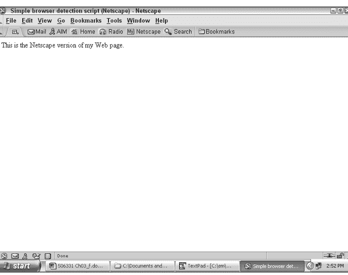

**图 3-1：** 在 Netscape Navigator 7.1 中显示的浏览器检测脚本。

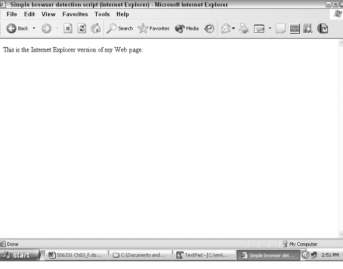

**图 3-2：** 在 Internet Explorer 6.0 中显示的浏览器检测脚本。

你可以尝试列表 3-3 所示的代码：只需加载你在随附 CD 上找到 list0302.htm 文件。

#### 列表 3-3：浏览器检测脚本

```html
<HTML>
<HEAD><TITLE>简单的浏览器检测</TITLE>
<SCRIPT LANGUAGE="JavaScript" TYPE="text/javascript">
<!-- 隐藏脚本
// 如果用户运行 IE，则自动加载
// HTML 文件 ie_version.htm
// if/else 语句开始：
// "Microsoft Internet Explorer" 是一个字符串字面量
// == 是比较运算符
if (navigator.appName == "Microsoft Internet Explorer") {
  // "ie_version.htm" 是一个字符串字面量
  window.location = "ie_version.htm";
  // == 是比较运算符
}

// 否则，如果用户运行 Netscape，则加载
// HTML 文件 netscape_version.htm
else {
  // 嵌套的 if/else 语句：
  if (navigator.appName == "Netscape") {
    // == 是比较运算符
    window.location = "netscape_version.htm";
    // == 是比较运算符
  }

  // 如果用户运行某些其他浏览器，
  // 显示消息并继续加载此通用的
  // Web 页面。
  else {
    document.write("您没有运行 Microsoft IE 或 Netscape.");
  }
}

//--> 结束隐藏
</SCRIPT>
</HEAD>
<BODY>
这是我的 Web 页面的通用版本。
</BODY>
</HTML>
```

你在列表 3-3 中使用的代码结合了注释、条件和运算符，创建了两个完整的 JavaScript 语句。

在阅读代码时，请注意以下几点：

- 内置 `navigator` 对象的 `appName` 属性预加载了两个文本字符串之一："Microsoft Internet Explorer"（如果加载的浏览器是 Internet Explorer）或 "Netscape"（如果加载的浏览器是 Netscape）。
- 将用户位置对象的 `window` 属性设置为一个新的 Web 页面，会导致该新页面自动加载。

确定运行的是哪个品牌的浏览器相对容易，你可以从列表 3-3 的代码中看出。然而，确定浏览器版本要困难得多——并且超出了本书的范围。虽然内置的 `navigator` 对象确实包含一些有用的属性，如 `codeName`、`appName`、`appVersion`、`user`、`language` 和 `platform`，你可以使用 `alert()` 方法显示它们——但这些属性都不直观，在浏览器之间也不一致。关于浏览器版本检测的更多信息，请访问 `http://developer.netscape.com/docs/examples/javascript/browser_type_oo.html`。


### 日期格式脚本

在第 2 章中，我引入了一个简单的日期和时间戳脚本，它可以捕当前的日期和时间并将其显示在 Web 页面上，如下：

> Sat May 22 19:46:47 CDT 2004

在本节中，我将演示如何将常量、条件、运算符和变量组合成 JavaScript 语句，这些语句不仅可以获取当前的日期和时间，还可以对日期和时间进行格式化，使其以人类易读的形式出现，如下：

> 晚上好！2004 年5 月 22 日 - 晚上 8:24。

你可以查看列表 3-4 中的代码。


你可以在随附 CD 上找到列表 3-4 中的代码。

#### 列表 3-4：日期格式脚本


## 第 3 章：JavaScript 语言基础

```javascript
// 我们将下午 5 点（军事时间 17 点）之后到
// 晚上 9 点（军事时间 21 点）之前的时间称为“晚上”
if (hours > 17 && hours < 21) {
  greeting = "Good evening!";
  ampm = "p.m.";
  hours = 12;
}
```

```javascript
// 我们将 9 点到午夜称为“深夜”
if (hours > 20) {
  greeting = "Good night!";
  ampm = "p.m.";
  hours = 12;
}
```

```javascript
// 我们希望分钟在是个位数时，
// 在前面显示一个“0”。例如，
// 与其不是显示 1:4 p.m.，我们希望看到 1:04 p.m.。
if (minutes < 10) {
  minutes = "0" + minutes;
}
```

```javascript
// + 是字符串连接运算符
var displayGreeting = displayMonth +
  + today.getDate() +
  + today.getFullYear() +
  + ":" + hours + ":" + minutes + ":" + ampm
```

```javascript
document.println(displayGreeting)
// --> 完成隐藏
```

你在列表 3-4 中看到的代码有点长，但只要将其拆解开来，是可以理解的。

首先，代码在 `today` 变量中获取了当前的日期和时间。然后，代码调用与 `Date` 对象相关的 `getMonth()` 方法来获取当前月份（0 到 11 之间的数字）。

`switch` 语句执行 `month` 变量的内容，并将相应的文本字符串（如“January”、“February”等，一直到“December”）赋值给 `displayMonth` 变量。

几个 `if-then` 语句检查 `hours` 变量，以确定合适的时间段（“a.m.”或“p.m.”）以及合适的问候语（“Good morning!”、“Good afternoon!”、“Good evening!”或“Good night!”）。

倒数第二个语句组合了一个名为 `displayGreeting` 的消息，最后，最后一个语句将 `displayGreeting` 写入 Web 页面。

## 数据收集脚本

从访问你网站的人那里收集信息是你使用 JavaScript 能够做的最有用的事情之一。在列表 3-5 中，我向你展示了如何将脚本、条件、函数、循环、运算符和变量组合成捕捉用户输入的 JavaScript 语句。这些语句随后根据该输入进行计算。

图 3-3、图 3-4 和图 3-5 展示了数据收集脚本的运行。

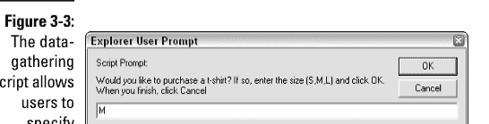

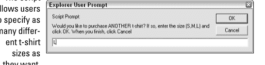

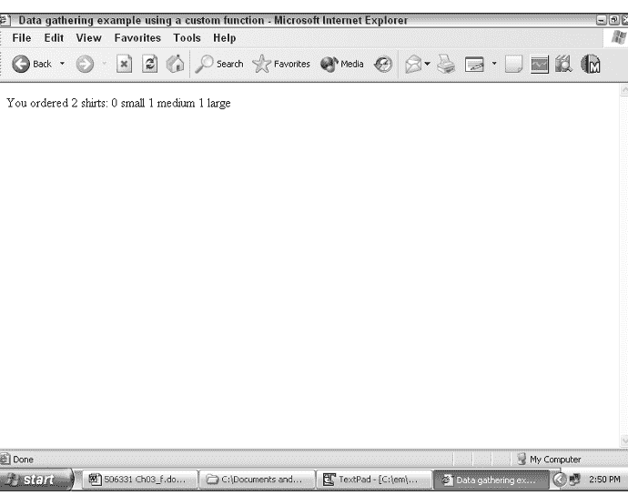

图 3-5：当用户完成订购时，JavaScript 计算订购的总数

你可以在附带的 CD 上找到列表 3-5 所示的代码。只需加载 `list0304.html` 文件即可。

## 列表 3-5：数据收集脚本

```html
<HTML>
<HEAD>
<TITLE>使用自定义函数进行数据收集示例</TITLE>
<SCRIPT LANGUAGE="JavaScript">
<!-- 向不支持 JavaScript 的浏览器隐藏此内容 -->

// 以下语句声明了变量。
// = 是赋值运算符。
var article = "*";
var numShirts = 0;
var smallShirts = 0;
var medShirts = 0;
var largeShirts = 0;
```

（续）

### 列表 3-5（续）

```javascript
// 以下是一个函数声明。
function calc_shirts(sizeShirt) {

    // 在已订购的各尺寸衬衫数量上加 1，
    // 直到总订购衬衫数量。

    if (sizeShirt == "S" || sizeShirt == "s") {
        // ++ 是单递增运算符。
        smallShirts++;
        numShirts++;
    }
    else if (sizeShirt == "M" || sizeShirt == "m") {
        medShirts++;
        numShirts++;
    }

    else if (sizeShirt == "L" || sizeShirt == "l") {
        largeShirts++;
        numShirts++;
    }

// 以下是一个 do-while 循环。
do {
    // 以下这行代码会弹出一个 JavaScript
    // answer = prompt();
    // 如果用户点击“取消”，则变量 'answer' 
    // 被设置为 null

    var answer = prompt("您想购买一件 " +
        article +
        + "T 恤 吗？如果是，请输入尺寸 (S,M,L) 并点击 OK。当
        finish后，点击取消", "M")

    // 将 'answer' 改为 'ANOTHER' 以使显示
    // 消息在下次（以及后续）
    // 时间中符合语法规则。
    article = "ANOTHER";

    if (answer == null) {
        calc_shirts(answer);
    }
} while (answer != null);
```

```javascript
document.writeln("你订了" + smallShirts + " 小号\n" + medShirts + "中号\n" + largeShirts + "大号");
```

```javascript
// --> 完成隐藏
```

## 第 4 章：熟悉文档对象模型 (DOM)

特殊的内置方法被称为“事件处理器”，它们与自动触发和用户发起的事件相关联。例如，将 Web 页面加载到浏览器被视为一个事件；点击按钮也是。你用于在事件发生时触发某些 JavaScript 代码的处理器分别是 `onload` 和 `onClick`。

在接下来的章节中，我将带你深入探讨这四类对象中的每一种，以及你如何使用它们来创建强大的 JavaScript 脚本！

从概念上来说，无论你是使用 Internet Explorer、Netscape Navigator 还是其他浏览器查看 Web 页面，DOM 都是相同的。但在实践中，为 Internet Explorer 和 Netscape Navigator 实现的 DOM 版本是不同的——你必须注意这些差异，否则可能会创建某些用户无法查看的脚本。详情请参阅本章后的“浏览器对象模型”部分。


## 对象性 (Object-ivity)

在极客术语中，对象是现实世界事物的软件表示。理论上讲，任何人、地方、事物或功能都可以表示为一个对象。

但在实践中，你用 JavaScript 处理的对象属于以下四类中的前三种：

- 使用 HTML 标签定义的对象。这一类包括文档、链接、applet、文本字段、窗口等。就本书而言，JavaScript 脚本总是附加在 HTML 文档上的。通过使用 JavaScript，你可以访问附加到脚本的 HTML 文档中定义的任何对象。（要查看访问 HTML 对象的脚本示例，请检查本章的列表 4-3）
- 由 Web 浏览器自动定义的对象。一个例子是 `navigator` 对象，尽管它的名字如此，但它包含了当前运行的浏览器的配置和信息，即使该浏览器恰好是 Internet Explorer。（要查看访问浏览器对象的脚本示例，请参阅第 3 章）
- 内置于 JavaScript 的对象，例如 `Date` 和 `Number`。（要查看访问内置 JavaScript 对象的脚本示例，请参阅第 3 章）
- 你自己使用 JavaScript 的 `new` 操作符创建的对象。（要查看你如何使用 JavaScript 创建并访问自己的对象的示例，请参阅第 3 章。）

就像它们在现实世界中的对应物一样，软件对象通常与特定的特性和行为相关。然而，由于这是一个计算机主题，程序员不能将这些信息称为特性和行为。不，那样就太没趣了。程序员将特性称为**属性 (properties)**（或 **attributes**），将行为称为**方法 (methods)**——某些以 `on` 开头的事件行为除外，例如 `onload`、`onResize` 和 `onSubmit`。程序员将这些称为特殊的事件处理器。


属性 (Properties) 和属性 (Attributes) 实际上是一回事，但某些 JavaScript 程序员倾向于区分以下两者：

- Properties（属于 JavaScript 对象）
- Attributes（与 HTML 对象关联）

由于你编写的 JavaScript 代码是创建对象、属性、方法和事件处理器的，因此理解这些面向对象的术语的含义对于计划编写自己代码的人来说至关重要。

你可以这样想：

- 对象 (Objects) 总是名词。
- 属性 (Properties) 是形容词。
- 方法 (Methods) 是动词。
- 事件处理器 (Event handlers) 是带了前缀的动词。

明白了吗？查看表 4-1 可以看到一些常见对象定义的示例。

### 表 4-1 示例对象定义

| 对象类型 | 对象（名词） | 属性（形容词） | 方法（动词） | 事件处理器 ("on" + 动词） |
| :--- | :--- | :--- | :--- | :--- |
| HTML | button | 如 name, type 和 value | click() | onClick |
| HTML | link | 如 href, port, protocol 等 | （无） | 如 onClick, onMouseOver, onKeyPress 等 |
| HTML | form | 如 action, elements, length 等 | 如 reset() 和 submit() | 如 onReset 和 onSubmit |
| 浏览器 | Navigator | 如 appVersion, appName, language 和 platform | Enabled() | （无） |
| JavaScript | Number | 如 MAX_VALUE 和 MIN_VALUE | toString() | （无） |
| 程序员定义 | customer | 如 address 和 creditHistory | 如 change(), changeName() 和 placeOrder() | （无） |

## 对象属性 (Object properties)

属性是描述对象的特征。JavaScript 中提供的大多数对象都有自己的一组属性（附录 C 包含了按字母顺序排列的 JavaScript 属性）。例如，图像对象通常与表 4-2 所示的属性关联。

### 表 4-2 与图像对象相关的属性

| 图像属性 | 说明 |
| :--- | :--- |
| border | 图像周围显示的边框厚度，单位为像素 |
| complete | 图像是否加载（true 或 false） |
| height | 图像的高度，单位为像素 |
| hspace | 图像两侧留出的的像素数 |
| left | 首先加载的小图像文件名 |
| name | 图像的内部名称（你通过 JavaScript 代码引用的名称） |
| src | 嵌入 HTML 文档的图像文件名 |
| vspace | 图像上下留出的的像素数 |
| width | 图像的宽度，单位为像素 |

在运行时，所有对象属性都有对应的值，无论它是显式定义的还是由浏览器填充。例如，考虑使用列表 4-1 中的 HTML 代码创建的图像对象。

### 列表 4-1：使用 `` 标签创建图像对象

```html
<BODY>
  
</BODY>
```

假设你的电脑上有一个文件 `myPicture.jpg`，在运行时，当你将 HTML 代码段加载到浏览器并查询属性时，对应的值将如表 4-3 所示。你可以通过调用 `alert` 方法来查询属性；例如 `alert(document.companyLogo.src)`。

### 表 4-3 访问图像属性

| 属性名 | 值 |
| :--- | :--- |
| document.companyLogo.src | file:///myPicture.jpg |
| document.companyLogo.name | companyLogo |
| document.companyLogo.height | 200 |
| document.companyLogo.width | 500 |
| document.companyLogo.border | 1 |
| document.companyLogo.complete | true |

## 疯狂中自有章法！

方法以任何其他名称（某些程序员称其为行为或成员函数）都是定义对象可以表现的特定行为的函数。

例如，考虑你即将熟悉的老朋友 HTML 按钮。由于你可以点击 HTML 按钮，所以按钮对象有一个关联的 `click()` 方法。当你使用 JavaScript 调用按钮的 `click()` 时，结果与用户点击该按钮一样。

与属性和事件处理器不同，JavaScript 中的方法后面总是跟着括号，如 `click()`。这种习惯有助于程序员记住方法通常（但并非总是）需要参数。例如，与 `window` 对象关联的 `alert` 方法允许你创建一个特殊的弹出窗口（警报窗口）在屏幕上显示信息。因为创建一个弹出窗口本身没用，所以 `alert()` 方法要求你传递给一个包含你想显示的文本的参数：

```javascript
function checkTheEmailAddress() {
	window.alert("Sorry, the e-mail address you entered is not complete. Please try again.");
}
```

某些对象（例如内置的 `window` 对象）关联有一系列方法。你可以使用 `open()` 方法打开窗口；使用 `write()` 和 `writeln()` 方法在窗口上显示文本；使用 `scroll()`、`scrollBy()` 和 `scrollTo()` 窗口向上或向下滚动，依此类推。

正如同引用对象、属性或事件处理器一样，在 JavaScript 中引用方法时，必须在该方法之前加上它所属特定对象的名称。表 4-4 显示了如何调用对象方法的示例。

### 表 4-4 调用对象方法

| JavaScript 代码段 | 作用 |
| :--- | :--- |
| annoyingText.blink() | 调用与字符串对象关联的 `blink()` 方法。具体来说，它会让名为 `annoyingText` 的字符串对象闪烁。 |
| self.frame.focus() | 调用与框架对象关联的 `focus()` 方法。具体来说，它将输入焦点设置到一个框架（该框架本身与主窗口关联）。 |
| document.infoForm.requestFreeInfoButton.click() | 调用与按钮对象关联的 `click()` 方法。具体来说，这段代码点击了名为 `InfoButton` 的按钮，该按钮包含名为 `infoForm` 的表单中。（infoForm 包含在主 HTML 文档中。） |

## 为什么要使用方法？

JavaScript DOM 中定义的许多方法都是用户只需点击鼠标即可完成的操作：例如，停止窗口加载（`stop()` 方法）；聚焦到特定的输入字段（`focus()` 方法）；打印窗口内容（`print()` 方法）等。为什么要费劲在脚本中包含方法调用呢？

一言以蔽之，是为了自动化。你可能想创建一个在一个事件中执行几项操作的网页。例如，当用户加载你的网页时，你可能希望聚焦到特定的输入字段，打开一个小的“新特性”窗口，并自动显示今天的日期。通过使用方法，你可以完成这一切——而用户不需要亲自去操作！

要查看 JavaScript 方法调用的示例，请查看配套光盘上的 `ch3_methods.htm` 文件。

在第 2 章中你可以看到另一个方法运行的示例，附录 C 列出了 JavaScript DOM 中供你使用的所有方法。

## 如何处理“饥饿”的事件？通过事件处理器！

事件处理器是一种特殊的方法，当特定事件发生时，支持 JavaScript 的 Web 浏览器会自动触发它。事件处理器让你（作为 JavaScript 程序员）能够根据事件执行任何你喜欢的指令——从执行计算到显示消息，这些事件包括：

- 用户将网页加载到浏览器
- 用户停止网页加载
- 用户在输入字段中输入或更改某些信息
- 用户点击图像或链接
- 用户提交或重置表单

例如，当用户将网页加载到浏览器时，与该页面（或文档）关联的 `onload` 事件处理器就会执行；当用户点击 HTML 按钮时，该 HTML 的 `onClick` 事件处理器就会执行；依此类推。

这里有一个如何调用内置事件处理器的示例：

```html
<BODY
onload=window.alert('Hello!');
onload=window.alert('Goodbye!');
</BODY>
```

要查看在 JavaScript 中调用事件处理器的示例，请检查配套光盘上的 `ch3_events.htm` 文件。

请看看本节中的代码段。有两个事件处理器与 `<BODY>` 和 `</BODY>` 标签关联。文档对象在 HTML 中使用 `document` 对象进行定义。其中一个事件处理器命名为 `onload`；另一个也是 `onload`。

正如你可能猜到的，将此代码加载到网页会导致出现 `Hello!` 消息。加载另一个页面或完全关闭浏览器会导致出现 `Goodbye!` 消息。事件处理是一件棒的事。通过它，你可以确定用户何时以及具体如何与网页的某部分进行交互，并根据你的需要对该操作做出响应。

附录 C 包含了 JavaScript 支持的所有事件处理器列表。要查看更多 JavaScript 事件处理器的运行示例，请查看第 2 章。

## 函数

与方法类似，函数也是行为——但相似性仅此而已。

- 函数是独立的 JavaScript 代码块，可以反复地被重用。
- 与方法不同，函数不与特定对象关联。

JavaScript 语言提供了一些内置函数，但你也可以创建自己的函数，根据需要创建任意数量。

假设你想创建一个 HTML 表单，让用户输入她的年龄和拥有的宠物数量。你可以创建一个 JavaScript 函数来检查一个数字，并确保它在某些参数之间——例如 0 到 100 之间。在创建这样的函数后，你可以调用它两次：一次验证用户输入的年龄，另一次验证她拥有的宠物数量。如果你计划创建许多经过 JavaScript 增强的网站，这种创建可用函数的能力可以为你节省一些时间。

列表 4-2 显示了如何在 JavaScript 中定义和使用函数。

### 列表 4-2：在 JavaScript 中定义和调用自定义函数

```javascript
<SCRIPT LANGUAGE="JavaScript">

function checkNumber(number) {

  if (number > 0 && number < 100) {

    ///////////////////////////////////////////////////
    // 如果数字大于 0 且小于 100
    // 弹出“恭喜”消息并返回
    ///////////////////////////////////////////////////
    alert("The number you specified is valid.");
    return true;

  } else {

    ///////////////////////////////////////////////////
    // 否则，数字为负数或超过 100
    // 弹出一条消息并返回 false
    ///////////////////////////////////////////////////
    alert("The number you specified is invalid. Please try again.");
    return false;

  }

}
```

样式表，或称为 CSS。幸运的是，浏览器制造商都注意到了这一点：Navigator 和 Internet Explorer 都支持 CSS。

CSS 允许你描述 Web 页面上的文本元素希望如何呈现的。例如，你可能决定所有一级标题显示为蓝色，所有二级标题显示为红色，而其他段落都使用斜体。为了实现这个目标，你只需要：

- 在你的 HTML 代码中添加 CSS 描述符。
- 使用 JavaScript 引用你的 CSS 描述符。

CSS 与脚本语言的结合通常被称为 DHTML。

CSS 是一个非常宽泛的话题。本书专注于 JavaScript，因此我在这里不会深入进入 CSS 的细碎细节。相反，在接下来的章节中，我将为你创建对象以及使用 JavaScript 访问这些对象所需的实用信息。如果想深入了解 CSS，我建议参考 Steve Callihan (Que) 编写的 *Cascading Style Sheets by Example*。或者通过将浏览器指向 www.w3.org/Style/CSS 查看万维网联盟的级联样式规范。


## 定义 CSS 对象

在定义 CSS 对象时，你有两种选择：

- 使用 HTML `<STYLE>` 标签将样式与 HTML 标签关联。这是一个示例：

```html
<HTML>
<HEAD>
<STYLE TYPE="text/css">
H1 {color: red;}
</STYLE>
</HEAD>
<BODY>
<H1>这个标题是红色的！</H1>
<H2>这个标题是普通的黑色;</H2>
</BODY>
</HTML>
```

这段代码将红色与文档正文中出现的每个 `<H1>` 标签关联起来。

- 使用另一个 HTML 标签的 ID 定义自定义命名的 CSS 对象。例如：

```html
<HTML>
<HEAD>
<STYLE TYPE="text/css">
#blueHeading {color: blue;}
</STYLE>
</HEAD>
<BODY>
<H1 id="blueHeading">我的蓝色标题</H1>
</BODY>
</HTML>
```

在这种情况下，CSS 对象的名称是 `blueHeading` —— 你可以轻松地使用这个名称通过 JavaScript 访问 CSS 对象。这就是我在本章示例脚本中演示的方法。

无论你如何定义 CSS 对象，你都可以使用 JavaScript 和 DOM 访问这些对象。为了最大限度地减少你所需的 CSS 知识量——毕竟这是一本关于 JavaScript 的书——我演示了第二种方法。


## 使用 JavaScript 访问 CSS 对象

定义 CSS 对象后，你可以使用 JavaScript 访问该对象。以下代码展示了：

```javascript
document.getElementById("blueheading").style.fontStyle="italic";
```

你在这里看到的 JavaScript 代码使用了 `getElementById` 方法将 `blueheading` 元素的 `fontStyle` 属性设置为斜体 —— 以斜体显示标题。

除了 `fontStyle` 属性外，你还可以使用各种方法访问多种 CSS 属性（例如 background-color、background-image、font-weight、font-size、text-align、indent 等）。

在接下来的三个章节的示例中，我将向你介绍几种不同的 CSS 属性和方法。如需完整列表，请咨询浏览器的 DOM 引用。（一个很好的在线参考是 http://msdn.microsoft.com/library/default.asp?url=/workshop/author/shtml/reference/objects.asp.）

## DHTML 脚本示例：动态添加文本

使用纯 HTML，所见即所得：当页面文本加载时，用户看到的就是它的样子。但当你把 JavaScript 和 CSS 加入进来之后！使用这种强大的组合，你可以创建一个脚本，在页面加载后添加或更改网页上文本的外观。

要理解我的意思，请看图 4-1、4-2 和 4-3。

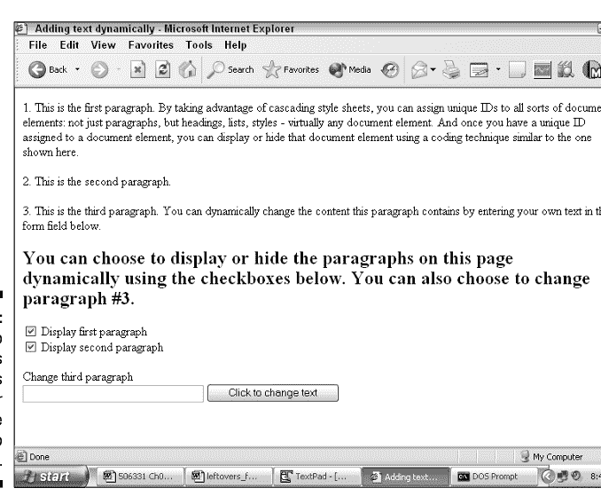

图 4-1：此网页用户显示（或隐藏）段落：
- 显示第一个段落
- 显示第二个段落
- 更改第三个段落

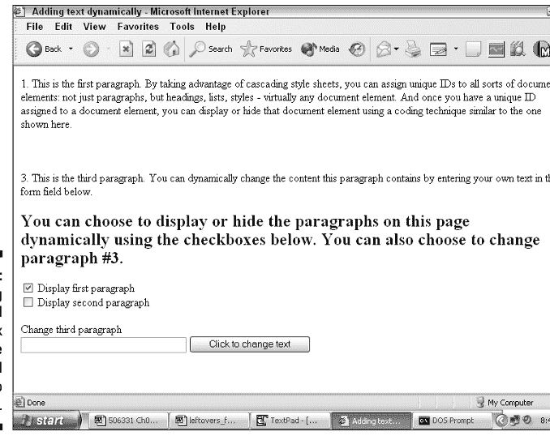

图 4-2：取消勾选第二个复选框会导致第二个段落消失。

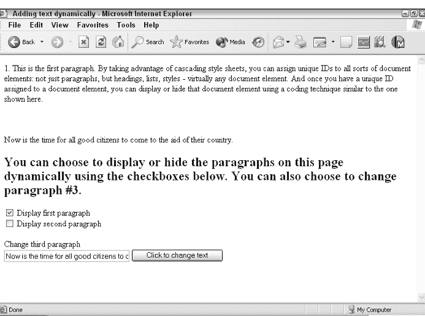

图 4-3：用用户提供的文本替换第三个段落。

你可以通过加载配套光盘上的 `list403.html` 文件来实验代码列表 4-3 中的示例脚本。

## 代码列表 4-3：允许用户在页面上动态添加或更改文本

```html
<FORM name="myForm">
// 当用户勾选或取消勾选复选框时，会调用 displayText() 函数
<INPUT TYPE="checkbox" NAME="grafbox" CHECKED onclick="displayText();">\n显示第一段
<br>
<INPUT TYPE="checkbox" NAME="grafbox" CHECKED onclick="displayText();">\n显示第二段
<br>
更改第三段
<br>
<INPUT TYPE="text" NAME="changeableText" defaultValue="Type here" SIZE="35">
// 当用户点击“点击更改\n// 文本”按钮时，会调用 searchText() 函数
<INPUT TYPE="button" VALUE="Click to change text" onclick="changeText();">
</FORM>
```

列表 4-3 中的代码分别定义了三个 CSS 段落：`graf1`、`graf2` 和 `graf3`。当用户选择 HTML 复选框中的其中一个时，`displayText()` 函数会更改与 `graf1` 和 `graf2` 关联的可见性属性，根据用户的选择显示（或隐藏）每个段落。

当用户在文本字段中输入文本并点击“更改文本”按钮时，JavaScript 解释器会调用 `changeText()` 函数。`changeText()` 函数使用 DOM 方法访问段落文本并替换为用户提供的文本。

## 示例 HTML 脚本：动态定位文本

你可以结合 JavaScript 和 CSS，在运行时更改页面元素的位置。

为了完成此任务，你首先使用 CSS 创建元素；然后使用 JavaScript 访问并移动这些元素。图 4-4 和 4-5 显示了一个可以响应用户点击按钮而移动的文本元素。

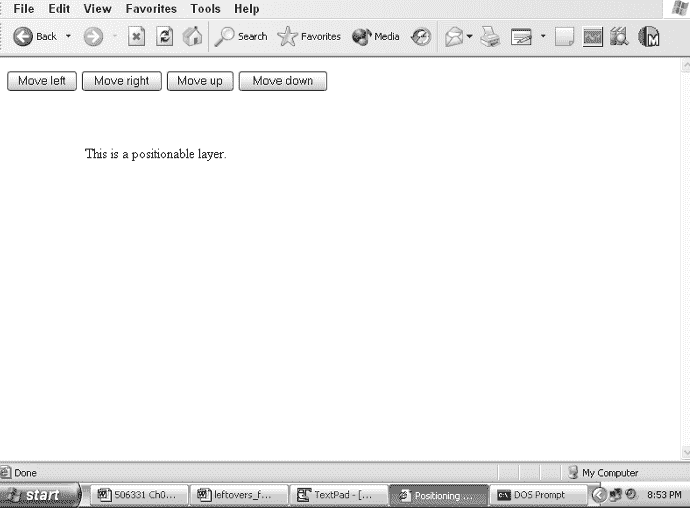

图 4-4：点击按钮后，此文本元素可以向左、右、上、下移动。

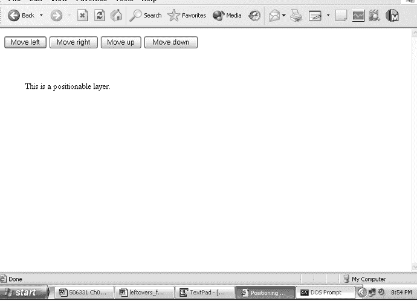

图 4-5：点击“左移”按钮会将文本元素向左移动。

你可以通过加载配套光盘上的 `list404.html` 文件，对列表 4-4 中的示例脚本进行实验。

当你浏览列表 4-4 中的代码时，请特别关注 HTML `<div>` 标签和 JavaScript `move()` 函数。

### 列表 4-4：允许用户更改网页元素的位置

```html
<HTML>
<HEAD>
<TITLE>动态定位内容</TITLE>
<SCRIPT LANGUAGE="JavaScript" TYPE="text/javascript">
<!-- 对不支持 JavaScript 的浏览器隐藏 -->
function move(direction) {
 var layerText = document.getElementById("mylayer");
 switch(direction) {
  // 如果调用 move 时传入的参数为 "left"，则重新定位文本
  // 层，使其距离窗口左侧 50 像素。
  case "left":
  layerText.style.left = 50;
  break;
  case "right":
  layerText.style.left = 150;
  break;
  case "up":
  layerText.style.top = 50;
  break;
  case "down":
  layerText.style.top = 150;
  break;
}
// --> 结束隐藏
</SCRIPT>
</HEAD>
<BODY>
// 创建一个名为 myLayer 的 CSS 对象，并将其放置距离窗口
// 顶部 100 像素、距离窗口左侧 100 像素的位置。
<DIV ID="myLayer" STYLE="position:absolute; left:100; top:100;">
<P>这是一个可以定位的层。</P>
</div>
<FORM>
// 点击四个按钮中的任何一个都会带不同的参数调用 move() 函数
<INPUT TYPE="button" NAME="myLayer" VALUE="向左移动" onclick="move('left');">
<INPUT TYPE="button" NAME="myLayer" VALUE="向右移动" onclick="move('right');">
<INPUT TYPE="button" NAME="myLayer" VALUE="向上移动" onclick="move('up');">
<INPUT TYPE="button" NAME="myLayer" VALUE="向下移动" onclick="move('down');">
</FORM>
</BODY>
</HTML>
```

在列表 4-4 显示的示例代码中，使用 HTML `<div>` 标签在屏幕上创建并显示了一个可定位的层。当用户点击按钮之一（例如，“向左移动”按钮）时，JavaScript 解释器会调用 `move()` 函数，并传入值 `left`。

在 `move()` 函数内部，JavaScript 解释器首先通过名称识别该可定位的层，然后使用 `switch` 条件语句来确定移动该层的方向。

## 示例 HTML 脚本：即时更改页面外观

在这里你将了解到如何更改背景和文本颜色等网页特性。首先，查看图 4-6 和图 4-7；然后看一眼列表 4-5 中的代码。

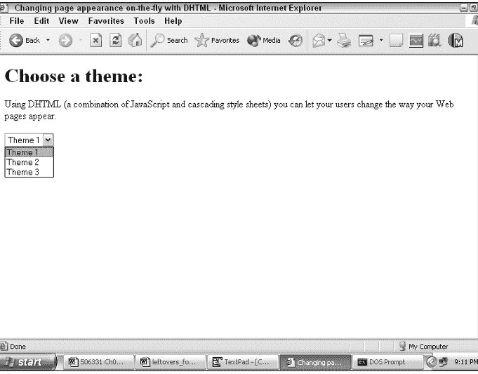

图 4-6：此网页为用户提供了主题选择。

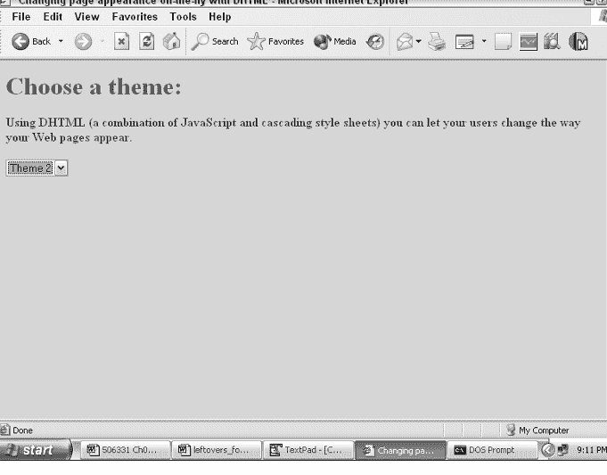

图 4-7：选择主题、背景和标题颜色。

## 列表 4-5

```html
<HTML>
<HEAD>
<TITLE>即时更改页面外观</TITLE>
<SCRIPT LANGUAGE="JavaScript" TYPE="text/javascript">
<!-- 对不支持 JavaScript 的浏览器隐藏 -->
function changeTheme() {
switch(myForm.themes.selectedIndex) {
  case 0:
    // 更改背景和前景（文本）颜色。
    document.body.bgColor = "blue";
    document.body.txtColor = "yellow";
    // 更改标题颜色。
    document.getElementById("heading1").style.color = "pink";
    break;
  case 1:
    document.body.bgColor = "pink";
    document.body.txtColor = "green";
    // 更改标题颜色。
    document.getElementById("heading1").style.color = "red";
    break;
  case 2:
    document.body.bgColor = "green";
    document.body.txtColor = "red";
    // 更改标题颜色。
    document.getElementById("heading1").style.color = "pink";
    document.getElementById("heading1").style.fontWeight="bold";
    break;
}
// --> 结束隐藏
</SCRIPT>
</HEAD>
<BODY>
// 创建一个名为 heading1 的标题元素。
<H1 ID="heading1">选择主题：</h1>
// 创建一个名为 graff1 的段落元素。
<P ID="graff1">使用 HTML（JavaScript 和层叠样式表的结合），你可以让用户更改网页显示的方式。</P>
// 创建一个名为 myForm 的表单。
// 当用户选择一个新主题时，会调用 changeTheme() 函数。
<FORM NAME="myForm">
<select name="themes" onChange="changeTheme();">
  <option value="theme1">主题 1</option>
  <option value="theme2">主题 2</option>
  <option value="theme3">主题 3</option>
</select>
</FORM>
</BODY>
</HTML>
```

当你要在脚本中引用以下任何对象时，你都需要使用该对象的完全限定名称，如下列表中的“语法（Syntax）”列所示。`window` 对象是这一规则的唯一例外。默认情况下，每个 Web 页面都包含一个全局性的“祖父级”窗口，无论你选择包含多少个窗口。由于这个整体窗口是存在的，当你引用它包含的某个对象时，不需要特意提到它。

例如，这两个 JavaScript 代码段都将名为 `myImage` 的图像对象的 `src` 属性设置为 "happycat.jpg"：

```
window.document.myForm.myImage.src="happycat.jpg"
document.myForm.myImage.src="happycat.jpg"
```

以下是在 Netscape Navigator 中使用的基本对象列表。你可以在附录 C 中找到 Navigator 7.1 DOM 实现的所有对象列表，包括相关的属性、方法和事件处理程序。或者查看 Netscape 详尽 DOM 参考文档：www.mozilla.org/docs/dom/domref/dom_shortTOC.html。

| 对象 | 语法 |
|---|---|
| window | window (optional) document |
| document | document.applets[0] |
| area | document.someAnchor |
| anchor | document.someArea |
| classes | document.classes |
| form | document.someForm |
| button | document.someForm.someButton |
| checkbox | document.someForm.someCheckbox |
| fileUpload | document.someForm.someFileElement |
| hidden | document.someForm.someHidden |
| image | document.someForm.someImage |
| password | document.someForm.somePassword |
| radio | document.someForm.someRadio |
| reset | document.someForm.someReset |
| select | document.someForm.someSelect |
| submit | document.someForm.someSubmit |
| text | document.someForm.someText |
| textarea | document.someForm.someTextArea |
| ids | document.ids |
| layers | document.layers |
| link | document.someLink |
| object | document.someObject |
| plugin | document.embeds[0] |
| tags | document.tags |
| frame, parent, self, top | (这些都是 window 的同义词) |
| history | history |
| location | location |
| menubar | menubar |
| navigator | navigator |
| personalbar | personalbar |
| scrollbar | scrollbar |
| statusbar | statusbar |
| toolbar | toolbar |

## JavaScript 数据类型

用 JavaScript 执行的大部分工作涉及程序员定义的对象，例如用户在你的 HTML 表单中输入的值、基于这些值进行的一些计算等。

大多数编程语言要求你声明变量作为占位符来存储要处理的每条数据。不仅如此，编程语言还要求你提前指定这些变量预期包含的数据类型。（这一要求对这些语言的编译器来说很容易，但对我们程序员来说很难！）

JavaScript 也要求你声明变量来表示数据位。但因为 JavaScript 是一种弱类型语言，你不一定预先声明变量类型，也不需要像在 C 和 C++ 语言那样进行某些转换。这是一个示例：

```javascript
var visitor // 定义一个名为 "visitor" 的变量
// 没有特定类型
var visitor = "george" // 将 "visitor" 重置为文本字符串
var visitor = 3         // 将 "visitor" 重置为数值
var visitor = null      // 将 "visitor" 重置为 null
```

你可以不显式指定字符串或数值数据类型（如此代码段所示），因为 JavaScript 解释器会在运行时处理任何给定变量关联的值类型。

JavaScript 有两种数据类型要求你显式指定：Array 和 Date 数据类型。你必须显式声明 Array 和 Date 类型的变量，因为 JavaScript 解释器需要知道关于这些类型值的某些额外细节才能正确地存储它们。

JavaScript 支持以下数据类型：

- **Array**：有序集合。例如：
```javascript
var animals = new Array("cat", "dog", "mouse") // 加载数组
var firstAnimal = animals[0] // 访问第一个元素
var secondAnimal = animals[1] // 访问第二个元素
var thirdAnimal = animals[2] // 访问第三个元素
```

- **Boolean**：布尔数据类型（只有 true 或 false 的值）。例如：
```javascript
var cookieDetected = false
var repeatVisitor = true
```

- **Date**：时间和日期类型。例如：
```javascript
var today = new Date() // 当前时间/日期系统
var newYears = new Date(2001, 0, 1) // 特定日期
```

- **Null**：表示不存在的特殊数据类型。
```javascript
if (emailAddress == null) { // 检查是否为 null
alert("Please enter an email address")
} // Null 不等于 0 (零)。
```

- **Number**：数值数据类型。例如：
```javascript
var numberHits = 1234 // 隐含数值数据类型
var numberHits = Number(1234) // 显式
```

- **String**：字符串（文本）数据类型。例如：
```javascript
alert("This is a string") // 隐式双引号字符串
alert('So is this') // 隐式单引号字符串
var myString = String("Yet another string") // 显式
```

## 剩余部分：Math 对象

JavaScript 提供了一个工具对象供你在脚本中使用。Math 对象——并不属于 DOM 本身——即：

```javascript
var x = Math.PI // 给 "x" 赋值 pi 值
var y = Math.round(158.32) // 给 "y" 赋值 158.32 的四舍五入结果
var z = Math.sqrt(49) // 给 "z" 赋值 49 的平方根
```

查看附录 C 获取 Math 对象相关的所有属性和方法的列表。

## Microsoft Internet Explorer

微软的文档对象模型通常被称为 DHTML DOM，即动态超文本标记文档模型。尽管微软的 DHTML DOM 基于相同的万维网规范，但它与 Netscape 的实现略有不同。如果你的脚本存在于一个 DOM 而不是另一个，请记住这一点，否则你的脚本将只在一个支持的浏览器中运行。（参见第 5 章获取可在两个浏览器中运行的跨平台脚本技巧。）

微软的 DHTML DOM 描述了你可以通过 JavaScript 的所有对象，以便创建在 Internet Explorer 中完美执行的脚本。以下是在 Internet Explorer 中使用的基本对象列表。

| 对象 | 语法 |
|---|---|
| window | window (optional) document |
| applet | document.applets[0] |
| anchor | document.someAnchor |
| area | document.someArea |
| form | document.someForm |
| button | document.someForm.someButton |
| checkbox | document.someForm.someCheckbox |
| file | document.someForm.someFileElement |
| hidden | document.someForm.someHidden |
| image | document.someForm.someImage |
| password | document.someForm.somePassword |
| radio | document.someForm.someRadio |
| reset | document.someForm.someReset |
| select | document.someForm.someSelect |
| submit | document.someForm.someSubmit |
| text | document.someForm.someText |
| textarea | document.someForm.someTextArea |
| link | document.someLink |
| object | document.someObject |
| plugin | document.embeds[0] (不，这不是笔错误!) |
| frame | someFrame |
| frameset | someFrames |
| history | history |
| location | location |
| navigator | navigator |
| clientInformation | clientInformation |

你可以在附录 C 中找到 Internet Explorer 6.0 DOM 实现中的对象列表，包括相关的属性、方法和事件处理程序。查看微软自己的详尽 HTML DOM 参考：

```
http://msdn.microsoft.com/workshop/author/html/reference/objects.asp
```

# 第二部分：创建动态网页

《第五次波浪》作者 Rich Tennant 著

> “噢，我来搞定——我以前在一家互联网接入公司负责技术支持。”

## 在这一部分……

在本部分中，你将找到实用的方法来创建向不同用户显示不同内容的网页。第 5 章将向你展示如何根据用户运行的浏览器自动修改页面显示方式。第 6 章介绍了如何创建能够记住访问客的网页，第 7 章演示了如何操作浏览器帧和窗口以创建复杂的导航方案。

最棒的是，你将看到第二部分介绍的所有技术的真实工作示例。（这些示例也包含在书附带的光盘中，所以你甚至不需要输入代码。）

# 第 5 章：检测用户的浏览器环境

### 本章内容

- 理解不同浏览器之间 JavaScript 支持的差异（以及差异原因）
- 应用跨平台脚本创建的策略
- 利用浏览器检测脚本利用高级 JavaScript 特性

如今 Web 开发者面临的最大挑战不是基于硬件或软件的，而是基于“湿件”的（Wetware —— 一个指人类大脑所谓柔软性的术语——是极客对人类的俗称）。这个挑战是试图让创建 Web 浏览器的公司对 JavaScript 等浏览器支持技术的单一标准实现达成一致！

在目前，某人安装的浏览器品牌、浏览器版本以及底层操作系统都会影响该用户查看你支持 JavaScript 的网页的能力。作为一名 JavaScript 开发者，你需要意识到浏览器之间 JavaScript 实现的差异，并据此编写脚本。如果你不这样做，最终可能会创建一个只在你自己电脑上运行的“花哨”脚本。

## 穿过浏览器迷宫

根据最新报告，微软（Microsoft）和网景（Netscape）都承诺在其各自浏览器的未来版本支持 ECMAScript 标准（我在第 3 章中详细讨论）。

即使 Internet Explorer 和 Netscape Navigator 完全符合 ECMAScript 标准（且不提供额外功能），相同的 JavaScript 脚本在两个浏览器中的执行结果仍可能不同。为什么呢？为了让 JavaScript 成为一种真正的跨浏览器语言，语法和文档对象模型（DOM）必须保持一致。

ECMA-262 通过定义标准语言规范让 JavaScript 跨越了浏览器的边界，但它并没有定义 DOM。正如你在第 4 章中看到的，尽管万维网联盟（W3C）努力定义统一标准，但这两个浏览器的 DOM 远非完全相同。

幸运的是，正如你在下一节看到的，你不依赖 JavaScript 实现和对象模型之间的差异来编写出色的跨浏览器脚本。你只需要在运行时识别差异，并据此显示自定义网页。

## 检测特性

通过使用 JavaScript，你可以检测用户正在使用什么种类以及哪个版本的浏览器查看你的页面——这些有用信息可以让你动态自定义网页，为用户提供最佳可能的查看体验。但品牌和版本并不是你可以使用 JavaScript 检测到的唯一浏览器相关信息。你还可以确定用户安装了哪些 Java Applet 和浏览器插件，他们在访问你的页面之前直接访问了哪个网页（称为引用页），甚至包括用户的偏好设置。继续阅读以了解如何操作！

## 浏览器标识和版本

确定哪些浏览器正在加载你的脚本的最可靠方法是询问。你可以使用 JavaScript 以编程的方式在脚本开头添加一些代码，查询 DOM 中特定浏览器的详细信息。当你确定了是哪个品牌、型号和版本的浏览器尝试加载你支持 JavaScript 的网页时，你就可以据此显示页面。

实现此功能最简单的方法是使用 `<MARQUEE>` 标签，这是一个 HTML 标签（以及相应的脚本对象），由 Internet Explorer（从 3.x 版本开始）支持）。问题是某些版本的 Navigator 不支持 `<MARQUEE>` 标签。当不支持跑马灯的浏览器加载包含 `<MARQUEE>` 标签的网页时，可能会执行以下操作之一：

- 静态显示滚动文本，或完全不显示
- 忽略你与跑马灯相关的 JavaScript 代码
- 生成 JavaScript 错误

确保观众看到你想让他们看到的一种方法是使用 JavaScript 检查加载脚本的浏览器是否为 Internet Explorer。

- 如果是，你可以放心地使用 `<MARQUEE>` 标签。
- 如果浏览器不是 Internet Explorer，你可以用另一种引人注目的方式显示滚动信息——例如，显示为加粗、居中的标题。

列表 5-1 显示了一个“嗅探器”脚本的代码，该脚本检查环境（嗅探）浏览器设置，并将字符串文本显示为滚动跑马灯或加粗、居中的标题，取决于加载脚本的浏览器是否为 Internet Explorer。

## 每次都是定制化适配

为每个浏览器为你的每个网页创建不同的版本，可以确保所有人都能获得最佳体验。遵循此点的良好设计方法是：

1. 以纯文本形式提供绝对必要的信息（如内容）。
2. 尽可能通过使用图层提供额外信息。
3. 如果你想利用通过滚动行吸引注意的启用 JavaScript 的网页。

快速看一眼列表 5-1，并查看图 5-1 和 5-2，这些图展示了这在 Netscape Navigator 7.0 中的外观。另请参见图 5-3 和 5-4，它们显示了脚本在 Microsoft Explorer 6.0 中的外观。我将在本节的剩余部分详细描述 5-1 中的脚本如何一步工作，以便你将这里看到的原理应用于你的浏览器嗅探脚本。

你可以在附带的光盘文件 `0501.htm` 中找到列表 5-1 的代码。在你自己的浏览器中尝试吧！

## 列表 5-1：嗅探浏览器版本

```html
<SCRIPT LANGUAGE="JavaScript" TYPE="javascript/text">
<!-- 对不支持 JavaScript 的浏览器隐藏 -->
if (navigator.appName == "Internet Explorer") {
    // 创建适用于 MSIE 的特定网页
    document.write("你正在运行 Microsoft IE，它支持 MARQUEE 滚动。");
    var builtInScroll = "<FORM NAME=MyForm><MARQUEE ID=abc DIRECTION=LEFT BEHAVIOR=SCROLL AMOUNT=4>JavaScript For Dummies...><MARQUEE><INPUT TYPE=\"button\" VALUE=\"开始滚动\" NAME=startscroll onclick=\"document.all.abc.start()\"><INPUT TYPE=\"button\" VALUE=\"停止滚动\" NAME=stopscroll onclick=\"document.all.abc.stop()\"></FORM>";
} else {
    if (navigator.appName == "Netscape") {
        document.write("你正在运行 Netscape，它对 MARQUEE 滚动没有提供一致的支持");
    } else {
        document.write("你没有运行 Microsoft IE 或 Netscape");
    }
}

// 显示两个重要的 navigator 属性的内容
alert("navigator.appName is: " + navigator.appName +
    " + navigator.appVersion is: " + navigator.appVersion);

// 显示适当的网页
document.write(builtInScroll);

// 完成隐藏
</SCRIPT>
```

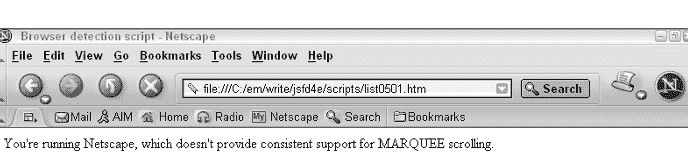

图 5-1：Navigator 7.0 中显示的浏览器嗅探脚本：appName 和 appVersion 的值

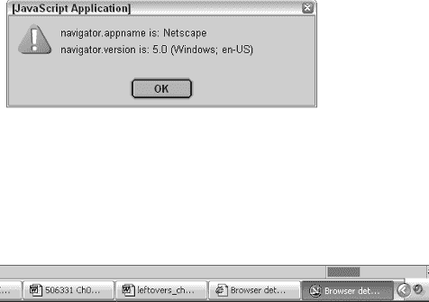

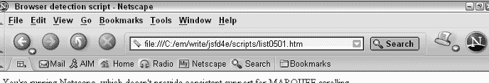

图 5-2：由于此脚本运行在 Navigator 中，因此文字居中并加粗显示。

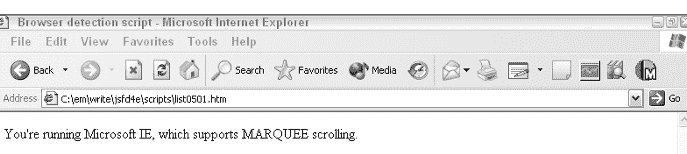

图 5-3：在 Internet Explorer 6.0 中显示的浏览器嗅探脚本。注意 appVersion 的值。

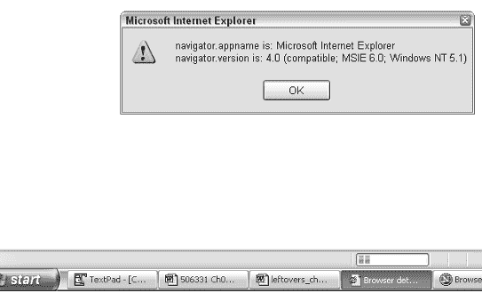

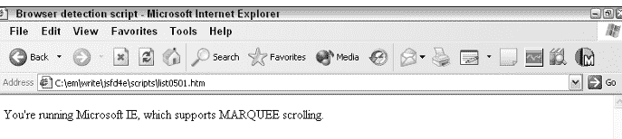

图 5-4：此脚本在浏览器中运行，因此文字是滚动且受用户控制的。

列表 5-1 中看到的代码使用 `if-else` 语句来检查内置 `navigator.appName` 属性的内容，并判断用户是否正在运行 Internet Explorer。（`navigator.appName` 的值为 "Microsoft Internet Explorer" 意味着用户正在运行 Internet Explorer。）

- 如果用户正在运行 Internet Explorer，JavaScript 代码将向屏幕写入一条消息，如图 5-1 所示。（你正在运行 Microsoft IE，它支持 MARQUEE 滚动。）


# 检测用户的浏览器环境

- 创建一个名为 `builtInScroll` 的变量，包含显示滚动文本所需的全部 HTML 代码——以及用户可以开启或关闭的按钮。

- 如果用户没有运行 Internet Explorer，JavaScript 代码将：
  - 创建变量 `builtInScroll`，它包含显示滚动、加粗文本所需的全部 HTML 代码。
  - 检查 `navigator.appName` 属性以确定用户运行的是 Netscape Navigator 还是其他浏览器。
  - 根据 `navigator.appName` 属性的值显示适当的消息。

无论用户运行的是哪个浏览器，JavaScript 代码都会：
  - 显示一个弹窗消息，描述 `navigator.appName` 和 `navigator.appVersion` 属性的内容。
  - 将 `builtInScroll` 的内容写入屏幕。

内置 `navigator` 对象存储了许多不同的浏览器信息。你可以检查 `navigator.appVersion` 属性的内容，以确定运行的是哪个特定浏览器的哪个版本（例如 6.0 或 7.0）。遗憾的是，目前还没有标准的版本命名方法。例如，注意图 5-1 中 `appVersion` 的值为 5.0——尽管实际运行的 Navigator 版本是 7.0。同样注意在图 5-3 中，`appVersion` 的值列为 4.0，而不是你预期的 6.0（尽管字符串 MSIE 6.0，即运行的 Internet Explorer 实际版本，作为 `navigator.appVersion` 值的一部分出现）。确定运行的浏览器正确版本，可以遵循以下步骤：


1. 与每个浏览器厂商确认，以找到每个浏览器版本对应的 `appVersion`。例如：
   - 你可以通过访问 http://msdn.com 找到关于 Internet Explorer 支持的 `navigator` 对象的所有信息（包括 `navigator` 属性）。
   - 要查看 Netscape 如何支持内置对象，请检查 http://msdn.com。

2. 如果必要，使用 `String` 方法 `indexOf()`，它返回两个值之一：如果未找到给定字符串则返回 -1；如果找到，则返回字符串的位置。

```javascript
if (navigator.appVersion.indexOf("6.0") == -1) {
  alert("The 6.0 was not found");
} else {
  alert("The 6.0 was found");
}
```

## 嵌入对象

- Internet Explorer 和 Netscape 都支持嵌入式对象。

## 检测嵌入对象

下方显示了两个嵌入对象：

1. 由 QuickTime 免费提供的示例电影（Sample.mov）。注意：IE 将 applet 识别为对象。IE 不识别浏览器插件（IE 支持 ActiveX 对象而不是插件）。
2. 由 Sun Microsystems 免费提供的示例 Java applet（Java:Clock.class）。注意：Navigator 将 applet 识别为 applet。

图 5-5：在 Netscape Navigator 中检查嵌入对象。
图 5-6：检测到对象：1 个嵌入对象。
图 5-7：检测插件：25 个浏览器插件。
图 5-8：检测 applet：1 个 Java applet。

在 Internet Explorer 中执行的相同代码（见列表 5-2）行为略有不同，正如你在图 5-9、5-10、5-11、5-12 和 5-13 中看到的那样。当你点击“检测插件（Detect Plug-ins）”时，由于检测到的插件数量始终为零，因为 Internet Explorer 并不识别也不实现插件。

下方显示了两个嵌入对象：

1. 由 QuickTime 免费提供的示例电影（Sample.mov）。注意：IE 将 applet 识别为对象。IE 不识别插件（IE 支持 ActiveX 对象而不是插件）。
2. 由 Sun Microsystems 免费提供的示例 Java applet（JavaCheck.class）。注意：Navigator 将 applet 识别为对象。

图 5-10：在 Internet Explorer 中检测嵌入的 QuickTime 对象。
图 5-11：……以及在 Internet Explorer 中的一个 Java applet。
图 5-12：IE 不支持插件。
图 5-13：在 IE 中，applet 与任何其他嵌入对象没有区分。

查看列表 5-2。当你浏览代码时，请注意检测不同类型嵌入内容的相似之处。在每种情况下，你都检查与内置数组关联的 `length` 属性（`navigator.plugins.length`、`document.embeds.length` 和 `document.applets.length`）。`length` 属性用于检测插件、嵌入对象和嵌入 applet。

### 列表 5-2：检测嵌入对象

```html
<HTML>
<HEAD>
<TITLE>检测嵌入对象（applet, 插件,等）</TITLE>
<SCRIPT LANGUAGE="JavaScript" TYPE="text/javascript">
<!-- 对不支持 JavaScript 的浏览器隐藏内容 -->
// detectPlugins 函数检测 Navigator 插件（先前在 Netscape Navigator 浏览器中下载并安装的软件卡匣）。
function detectPlugins() {
  if (navigator.plugins.length > 0) {
    var pluginDescription = "";
    for (var numPlugins = 0; numPlugins < navigator.plugins.length; numPlugins++) {
      pluginDescription = pluginDescription + " * " + navigator.plugins[numPlugins].name;
    }
    alert(navigator.plugins.length + " 浏览器插件已检测: " + pluginDescription);
  } else {
    alert("未检测到浏览器插件。（记住，IE 不支持插件）。");
  }
}

// detectApplets() 函数通过 APPLET 标签检测 Web 页面中的 Java applet - 但要检测在 Microsoft Explorer 中运行的页面中的 applet，你需要了解 applet 方法：document.applets['name'].someMethod();
function detectApplets() {
  if (document.applets.length > 0) {
    alert(document.applets.length + " Java applet 已检测。（记住，IE 将 applet 计为嵌入对象）。");
  } else {
    alert("未检测到 Java applet.");
  }
}

// detectEmbeds() 函数检测通过 EMBED 或 OBJECT 标签嵌入 Web 页面中的内容。
// document.embeds 数组的长度代表 Web 页面中嵌入对象的数量。
// 额外的 embeds 属性的存在取决于每个嵌入对象的实现。
function detectEmbeds() {
  if (navigator.appName == "Microsoft Internet Explorer") {
    // 用户正在运行 IE，所以检查使用 OBJECT 标签嵌入的对象。
    // 使用 OBJECT 属性的嵌入对象的 ReadyState 属性可以包含 3 个值之一：
    // 0 = 已初始化
    // 1 = 正在加载
    // 4 = 加载完成并准备就绪
    if (document.sample.readyState == 4) {
      alert("检测到示例对象");
    }
    if (document.clock.readyState == 4) {
      alert("检测到 clock 嵌入对象");
    }
  } else if (navigator.appName == "Netscape") {
    // 用户正在运行 Navigator，所以检查使用 EMBED 标签嵌入的对象。
    if (document.embeds.length > 0) {
      alert(document.embeds.length + " 个嵌入对象已检测。");
    } else {
      alert("未检测到嵌入对象。");
    }
  }
}
// --> 结束隐藏
</SCRIPT>
</HEAD>
<BODY>
下方显示了两个嵌入对象：
<OL>
  <li><b>由 QuickTime 免费提供的示例电影（Sample.mov）。</b> 注意：IE 将 applet 识别为对象。IE 不识别浏览器插件。（IE 支持 ActiveX 对象而不是插件）</li>
  <li><b>由 Sun Microsystems 免费提供的示例应用（Java:Clock.class）。</b> 注意：Navigator 将 applet 识别为 applet。</li>
</OL>
使用 OBJECT 标签在用于 Navigator 的页面中嵌入 ActiveX 组件；使用 EMBED 标签在用于 IE 的页面中嵌入插件。
<!-- -->
<OBJECT classid="02BFF505-8C17-4B23-BC80-D3488AB6B7" width="320" height="250" ID="0" CODEBASE="http://www.apple.com/quicktime/qtplugin">
  <PARAM name="SRC" value="c:Program Files\QuickTime\Sample.mov">
  <PARAM name="AUTOPAY" value="true">
  <PARAM name="CONTROLLER" value="true">
  <EMBED src="c:Program Files\QuickTime\Sample.mov" width="320" height="250"/>
</EMBED>
</OBJECT>
<!-- (继续) -->
<!-- 此 Java applet 由 Sun Microsystems 免费提供。更多信息请访问 http://java.sun.com/open/applets/clock.html。APPLET 标签在 HTML 4.0 中已弃，这意味着程序员鼓励使用 OBJECT 标签（而不是 APPLET 标签）在 Web 页面中嵌入 Java applet。未来的浏览器可能不再支持 APPLET 标签。 -->
<APPLET id="clock" codebase="classes" code="JavaClock.class" width="150" height="150">
  <PARAM name="bgcolor" value="#FFFFFF">
  <PARAM name="border" value="*">
  <PARAM name="color" value="#dddddd">
  <PARAM name="font" value="TimesRoman|BOLD|18">
  <PARAM name="delay" value="100">
  <PARAM name="hcolor" value="0000FF">
  <PARAM name="link" value="http://java.sun.com/">
  <PARAM name="nhcolor" value="#00FF00">
  <PARAM name="mcolor" value="#000000">
  <PARAM name="tradplus" value="#800">
  <PARAM name="anchor" value="#FF0000">
</APPLET>
<FORM>
  <INPUT type="button" value="检测嵌入对象" onclick="detectEmbeds()">
  <INPUT type="button" value="检测插件" onclick="detectPlugins()">
  <INPUT type="button" value="检测 applet" onclick="detectApplets()">
</FORM>
</BODY>
</HTML>
```

请记住，你可以使用两种方法检测 Netscape Navigator 插件：通过检查 `navigator.plugins[]` 数组和通过检查 `document.embeds[]` 数组，如列表 5-2 所示。然而，由于 Internet Explorer 不支持插件，这些数组在 Internet Explorer 中始终为空。

使用 `<EMBED>` 或 `<OBJECT>` 标签嵌入的对象会被添加到 `document.embeds[]` 数组中。

`document.plugins[]` 数组是 `document.embeds[]` 数组的同义词，但由于 `document.plugins[]` 数组看起来与 `navigator.plugins[]` 数组非常相似——后者包含完全不同类型的对象——当你想要确定文档中嵌入的 `<OBJECT>` 和 `<EMBED>` 标签数量时，我建议坚持使用 `document.embeds[]` 数组。


## 引用页

引用页是用户在加载你的页面之前直接加载的页面。你可以使用 JavaScript 在运行时确定引用页——这对于跟踪统计数据非常有用。（有些程序员喜欢记录用户通过哪些链接进入他们的 Web 页面。）

要识别引用页，你需要检查 `document` 对象的 `referrer` 属性，如下方的 JavaScript 代码所示：

```javascript
if (document.referrer == "") {
  document.write("You pulled this page fresh in a browser.");
} else {
  document.write("You were referred to this page by " + document.referrer);
}
```

上面的代码段确定 `document.referrer` 的值：
- `document.referrer` 的值为空（空白），用户直接在地址栏中输入了 Web 页面的名称。
- `document.referrer` 的值不为空，`document.referrer` 包含引用页名称。


配套 CD 中的 `detecting_referrer_base.htm` 和 `detecting_referrer.htm` 文件允许你测试在本节中描述的代码。要使用这些文件，请将它们上传到 Web 服务器，在 Web 浏览器中加载 `detecting_referrer_base.htm` 文件，并点击出现的链接。


你必须将你的 HTML 文件上传到 Web 服务器才能测试在本节中看到的代码；在本地测试时，`document.referrer` 的值始终为空。

## 用户偏好

如果你的用户可以选择他们偏好查看你 Web 页面的方式，那不是太棒了吗？如果你使用 JavaScript，他们就可以！你可以在 Web 页面加载之前立即向用户提供一系列选项——然后通过反馈显示用户想要看到的页面。

例如，在图 5-14 和 5-15 中，你提示用户分别选择偏好的背景颜色和文本颜色：图 5-16 显示了结果：一个包含用户偏好颜色的 Web 页面。

**图 5-14：** Explorer 提示

| 脚本提示 | |
| :--- | :--- |
| 询问用户的偏好。你想要什么背景 颜色？（红、绿、白、黄等） | 确定。 |
| [cancel] | 取消 |

**图 5-15：** Explorer 提示

| 脚本提示 | |
| :--- | :--- |
| 用户可以输入文本颜色。你想要什么文本 颜色？（红、绿、白、黄等） | 确定。 |
| [cancel] | 取消 |


列表 5-3 中的代码可在配套 CD 获取；只需加载 `list0503.htm` 文件即可。

### 列表 5-3：检测用户偏好

```html
<HTML>
<HEAD>
<TITLE>Detecting user preferences (and customizing display)</TITLE>
<SCRIPT LANGUAGE="JavaScript" type="text/javascript">
<!-- 隐藏不支持 JavaScript 的浏览器 -->

// 询问用户的颜色偏好
var backgroundColor = prompt("What BACKGROUND color would you like? (red, green, white, yellow, etc.)", "pink");

var textColor = prompt("TEXT color would you like? (red, green, white, yellow, etc.).", "blue");

// 显示用户的偏好
document.write("<body BGCOLOR=\"" + backgroundColor + "\" TEXT=\"" + textColor + "\">");

// 完成 -->
</SCRIPT>
</HEAD>
<BODY>
</BODY>
</HTML>
```

# 第 6 章：Cookie 就这样了

幸运的是，Cookie 内置了防止这两种威胁的保护措施。无论你使用 JavaScript 还是其他语言，你都无法绕过浏览器施加的以下常识限制：

- **Cookie 的存储位置**：例如，Windows XP Internet Explorer 6.x 将 Cookie 存储为单独的文本文件，并将其放在以下目录：
```
C:\Documents and Settings\Owner\Cookies
```
运行在 Windows 上的 Netscape Navigator 7.0 将 Cookie 组合到一个名为 `cookies.txt` 的单文件中，并将其置于一个类似下面的随机生成的目录中：
```
C:\Documents and Settings\Owner\Application Data\Mozilla\profiles\default\klamsdn.slt
```

- **Cookie 文件可以有多大**：Internet Explorer 和 Netscape Navigator 都将 Cookie 文件限制在 4K。

- **任何网站可以在用户驱动器上放置多少个 Cookie**：Internet Explorer 和 Netscape 都将限制设定为每个网站 20 个 Cookie，每个浏览器总共 300 个 Cookie。

- **哪些网站有权访问 Cookie**：Cookie 的可见性是可配置的。（你可以在本章的“配置支持”部分查看如何配置 Cookie 访问）。

> Cookie 允许 Web 开发者在用户不知情的情况下收集有关用户的详细营销信息。通过将 CGI 程序和 Java applet 等客户端应用程序结合使用，Web 开发者可以保存、检查和解释用户与 Web 网站之间的每一次交互。每一次点击、每一次击键、每一笔信用卡购买都可以用于自定义用户下次访问支持 Cookie 的网站时所看到的内容。

幸运的是，对 Cookie 这种类似于“老大哥”的特性感到不适的用户有一种选择：他们可以配置浏览器以限制 Cookie 支持，或者干脆将其关闭。（你将在下一节中看到配置 Cookie 的示例。）

## 从用户的角度查看 Cookie

理解 Cookie 如何运作的最好方法是从用户的角度来看待它们。在本节中，我将展示如何在你的浏览器中配置 Cookie 支持、访问支持 Cookie 的网站并检查实际的 Cookie 文件。完成后，你将拥有所有所需的背景知识，以便可以直接开始使用 JavaScript 代码创建 Cookie。

## 配置 Cookie 支持

Netscape Navigator 和 Internet Explorer 都允许用户指定 Cookie 支持的级别。

在 Netscape Navigator 7.x 中，你通过以下步骤配置 Cookie 支持：

1. 选择 Edit（编辑）: Preferences（首选项）: Privacy & Security（隐私与安全）: Cookies。
2. 在弹出的 Cookies 对话框中选择以下选项之一，如图 6-1所示：
   - Disable Cookies（禁用 Cookie）。
   - Enable Cookies for the Originating Web Site Only（仅为源网站启用 Cookie，而不是域内的任何服务器）。
   - Enable Cookies Based on Customizable Privacy Settings（根据可自定义的隐私设置启用 Cookie。点击 View 按钮根据 Cookie 设置网站发布的隐私策略设置隐私设置）。
   - Enable All Cookies（启用所有 Cookie）。


图 6-1：在 Netscape Navigator 7.x 中配置 Cookie 支持。

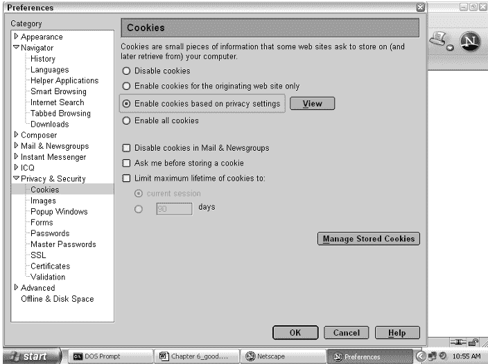

点击 Cookies 对话框中的 Manage Stored Cookies（管理存储的 Cookie）按钮可以查看存储在计算机上的 Cookie。

正如你可能猜到的，禁用 Cookie 支持的用户无法从你用 JavaScript 创建的 Cookie 访问脚本中受益。提醒用户需要开启 Cookie 支持以充分利用你的网站的一种方法是直接告诉他们！只需在支持 Cookie 的 Web 页面顶部包含以下句子：本网站需要你开启 Cookie 支持。

要在 Internet Explorer 中配置 Cookie 支持，请遵循以下步骤：

1. 选择 Tools（工具）: Internet Options（Internet 选项）。
2. 在弹出的 Internet Options 对话框中，点击 Privacy（隐私）标签。
3. 将 Privacy 标签页左侧的滑块从顶部（Block All Cookies 选项，如图 6-2 所示）移动到底部（Accept All Cookies 选项）。
中间选项有 High（高）、Medium High（中高）、Medium（中）和 Low（低）。你可以点击 Advanced（高级）按钮来自定义选项。

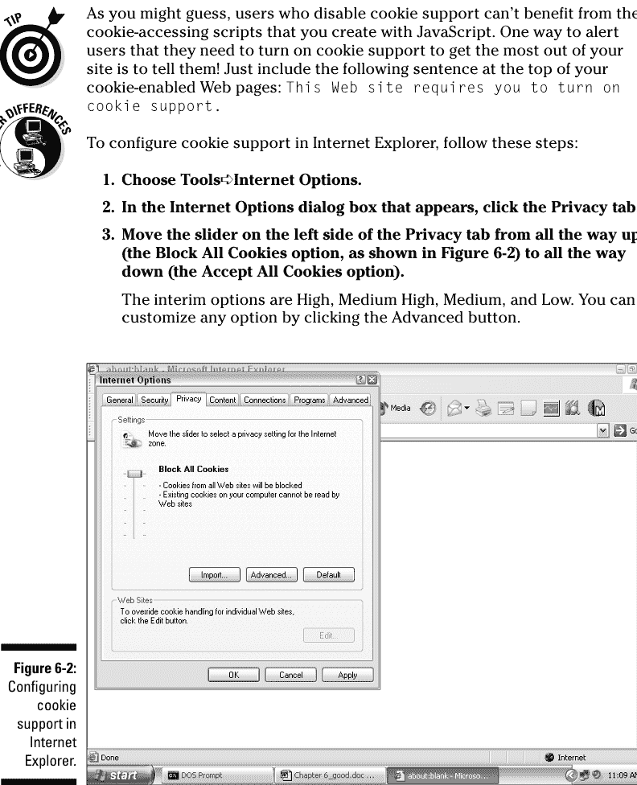
图 6-2：在 Internet Explorer 中配置 Cookie 支持。

## 访问支持 Cookie 的网站

当你的浏览器配置为接受 Cookie 时，你就可以放心地浏览支持 Cookie 的网站了。图 6-3 显示了如何使用 Cookie 来识别访问者并向他们提供自定义的问候和选项。（你将在本章的“根据 Cookie 内容显示内容：重复访问脚本”中了解到如何创建类似的自定义问候。）

## 探索 Cookie 文件

本节展示了当你访问支持 Cookie 的网站时底层发生了什么。

在 Netscape Navigator 7.1 中，你可以通过选择 Edit:Preferences:Privacy & Security:Cookies 并管理 Stored Cookies 来检查 Cookie 文件。弹出的 Cookie Manager 对话框如图 6-4 所示。

你可以通过由 Netscape Navigator 生成器加载文件 `C:\Documents and Settings\Application Data\Mozilla\profiles\default\klamsbd\cookies.txt` 来获取原始 Cookie 文件。

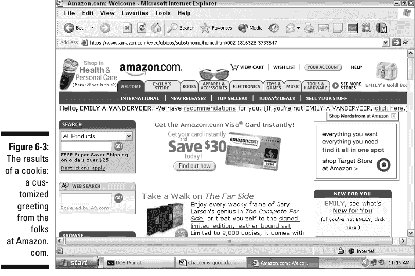

> 图 6-3 如何使用 Cookie 来识别访问者并向他们提供自定义的问候和选项。
> Cookie 允许 Web 开发者在用户不知情的情况下收集有关用户的详细营销信息。

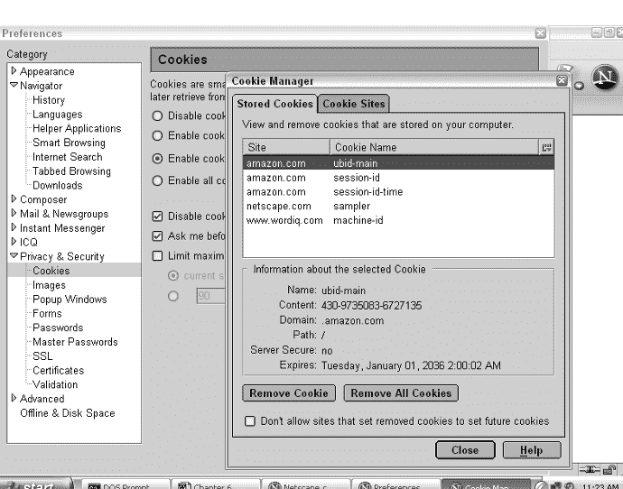
图 6-4：Cookie Manager 对话框。

## 保存和检索用户信息

处理 Cookie 涉及两个操作：创建或设置 Cookie；以及访问已创建的 Cookie。通常，你只能在用户第一次访问网站时创建一个 Cookie。之后，你可以随心所欲地访问该 Cookie。接下来的章节将展示如何操作。

## 设置 Cookie

文档对象的 `cookie` 属性持有所有与文档相关的 Cookie。

要创建并设置 Cookie，你必须定义一个变量/值对，表示 Cookie 的名称和 Cookie 的内容 (`name=value`)。由于 Cookie 值不能包含分号、逗号或空格，我建议在存储 Cookie 值时使用 JavaScript 内置的 `escape()` 函数，在检索 Cookie 值时使用 JavaScript 内置的 `unescape()` 函数。(`escape()` 函数会编码字符串中的逗号和空格，而 `unescape()` 函数会重构它们。)除了这个限制外，Cookie 值可以包含任何你想要的内容！

除了强制性的名称和值，你还可能为 Cookie 定义可选的、分号分隔的属性（见表 6-1）。

| 表 6-1 | JavaScript Cookie 属性 |
| --- | --- |
| Attribute（属性） | Description（描述） |
| `expires=expirationDate;` | Cookie 过期的日期（以毫秒为单位，之后浏览器将其删除）。过期日期通常以标准格林尼治标准时间（GMT）存储。（你可以使用 Date 对象的 `toGMTString()` 方法格式化 GMT 日。） |
| `path=path;` | Cookie 内容可以传输到的 CGI 程序路径。默认值是源服务器的根路径。 |
| `domain=domain;` | Cookie 可以传输到的域名（例如，www.acme.com）。默认受限。（详情请参见“Cookie 安全问题”部分。） |
| `secure` | 指定此 Cookie 只能通过安全协议（如 https）传输。 |

要创建一个 Cookie 并将其存储在用户的硬盘上，你只需要将 `document.cookie` 属性赋值于一个包含所需的名称/值对以及可选的、以分号分隔的 Cookie 属性的字符串，如下代码段所示（摘自本章稍后出现的列表 6-1）：

```javascript
document.cookie = name + "=" + escape(value) +
  ((expires == null) ? "" : (";expires=" + expires.toGMTString())) +
  ((path == null) ? "" : (";path=" + path)) +
  ((domain == null) ? "" : (";domain=" + domain)) +
  ((secure == true) ? ";secure" : "");
```

这种看起来像对象的语法 `(condition) ? something : somethingElse` 是 JavaScript 的简写，表示“如果此条件为真，则添加某些；否则，添加 somethingElse”：

例如，这是 JavaScript 解释器看待该 JavaScript 语句的方式：

```javascript
((expires == null) ? "" : (";expires=" + expires.toGMTString()))
```

它心想：“如果 `expires` 的值为 null，则向 `document.cookie` 属性添加 ""。否则，向 `document.cookie` 属性添加字符串 `expires=someGMTFormattedDate`”。

你可以在第 3 章中找到更多关于条件运算符 `?:` 的信息。

## 访问 Cookie

你可以使用 JavaScript 为 Cookie 设置属性（具体来说 `expires`、`path`、`domain` 和 `secure` 属性，正如我在“设置 Cookie”节中所描述的），但你无法通过 JavaScript 访问这些属性。相比之下，你可以访问 Cookie 的值。

这种看似异常——能够设置无法检索的属性——当你仔细考虑时是合理的。所有这些属性都与安全有关，防止它们被修改有助于 Cookie 的完整性和安全性。一旦你发放了 Cookie，只有 Web 浏览器对 Cookie 属性拥有隐私权限。

要访问 Cookie 的值，你需要查询与 `document` 对象关联的 `cookie` 属性。（可以在本章前面的“设置 Cookie”中查看如何设置 Cookie 属性。）

查看以下 JavaScript 代码段：

```javascript
var endstr = document.cookie.indexOf(";", offset);
return unescape(document.cookie.substring(offset, endstr));
```

这段代码包含两个语句：
- 第一条语句使用 `indexOf()` 方法来识别 `myCookie=userName;` 字符串中 `=` 和 `;` 之间的部分（换句话说，即识别 `userName` 字符串的存储值）。
- 第二条语句对 `userName` 的存储值进行反转义（反转义是为了解码在设置 Cookie 时编码的任何特殊字符）。

你可以在本章稍后的列表 6-1 中找到该代码段的可运行版本。

## 根据 Cookie 内容显示内容：重复访客脚本

你可以创建一个脚本，通过使用 Cookie 将用户的姓名保存到用户的硬盘上来注册用户。在随后的访问该网站时，脚本会从用户的硬盘中访问 Cookie，识别用户名，并使用该信息显示自定义的问候语。图 6-5 显示了重复访客脚本的一种，用户必须先注册他们的姓名。

在许多现实应用中，你可能希望使用服务器端技术（如 CGI 脚本）来创建和访问 Cookie。由于 CGI 脚本超出了本书的范围，在本章中，我将向你展示如何使用 JavaScript 创建和访问 Cookie。（CGI 和 JavaScript 之间的语法不同，但你交互的基础是相同的。）

在用户注册姓名后，如图 6-5 所示，注册表单再次出现。用户可以选择他们的浏览器、关闭电脑并离开一周。当他们回来并尝试访问注册页面时，脚本会识别出他们已经注册，并加载带有自定义问候语的“仅限注册用户”页面（参见图 6-6）。

### Cookie 示例 I

你必须注册才能访问我网站的其他部分。要注册，请输入全名，然后点击标记为“Register”的按钮。

Wolfgang A. Mozart

图 6-5：使用 Cookie 注册用户输入。

### Cookie 示例 II

欢迎来到我网站的注册部分，Wolfgang A. Mozart！

图 6-6：引导注册客人进入保留页面。

我根据图 6-5 和图 6-6 中的两个动作，分两个部分实现了重复访客脚本：

- **Cookie 示例 I**（针对未注册用户页面）：该脚本注册用户的姓名，在用户的机器上存储 Cookie，并加载“仅限注册用户”页面。
- **Cookie 示例 II**（针对注册用户页面）：该脚本访问 Cookie 并显示自定义的问候语。

当你创建一个 Cookie 时，可以指定过期时间。临时 Cookie 仅在会话期间保留在内存中；它们不会保存到用户的硬盘上。Cookie 示例 I 和 Cookie II 脚本分别显示在 `list601.htm` 和 `list602.htm` 文件中。你可以在配套光盘中找到它们。

### 列表 6-1：Cookie 示例 I（注册页面）

```javascript
// 你预期传入的第四个参数是路径。
// 如果没有第四个参数，将 path 变量设为 null。
var path = (argc > 3) ? argv[3] : null;

// 你预期传入的第五个参数是域名。
// 如果没有第五个参数，将 domain 变量设为 null。
var domain = (argc > 4) ? argv[4] : null;

// 你预期传入的第六个参数是 true 或 false。
// 取决于此 Cookie 是否安全（仅可以通过 https 传输到安全服务器）或不安全。
// 如果没有第六个参数，将 secure 变量设为 false。
var secure = (argc > 5) ? argv[5] : false;

// 设置 Cookie。
document.cookie = name + "=" + escape(value) +
  ((expires == null) ? "" : (";expires=" + expires.toGMTString())) +
  ((path == null) ? "" : (";path=" + path)) +
  ((domain == null) ? "" : (";domain=" + domain)) +
  ((secure == true) ? ";secure" : "");
```

```javascript
function register(username, value) {
  if (username == "" || username == null) {
    // 缺少名称，将此用户注册为“未知用户”。
    username = "Unknown User";
  }

  // 如果不存在 Cookie 'MyCookie' . . .
  if (getCookie("MyCookie") == null) {
    // 将过期日期设为今天。
    var expdate = new Date();
    // 设置过期日期（JavaScript 将其存储为毫秒）为正好一年后的日期。
    expdate.setTime(expdate.getTime() + (1000 * 60 * 60 * 24 * 365));
    setCookie("MyCookie", username, expdate);
    alert("感谢您的注册，" + username + "！点击 OK 进入网站的注册部分。");

    // 将用户引导至预留给注册用户的页面。
    location.href = "list0602.htm";
  }
}
```

```javascript
///////////////////////////////////////////////////////
// 此代码检查用户机器上是否存在名为 'myCookie' Cookie。
//
// 如果存在，说明用户已经注册，因此将用户引导至网站中仅限注册用户的部分。
//
// 如果用户机器上不存在名为 'myCookie' 的 Cookie，则要求用户注册。
///////////////////////////////////////////////////////

// 如果存在 "myCookie" Cookie . . .
if (getCookie('myCookie') != null) {
  // 然后将用户的浏览器重定向到名为 "list0602.htm" 的密码保护页面
  location.href = "list0602.htm";
}
```

```html
</SCRIPT>
</HEAD>
<BODY>
//#2 (从这里到 </BODY> 标签)
<H1>Cookie 示例 I</H1>
<FORM NAME="loginForm">
在访问网站的其他部分之前，您必须先注册。要注册，请输入您的全名；然后点击 Register（注册）按钮。
<P>
<INPUT TYPE="text" NAME="fullName" SIZE=35>
<BR>
<INPUT TYPE="button" VALUE="Register" onclick="register(loginForm.fullName.value)">
</FORM>
</BODY>
</HTML>
```

以下是 JavaScript 解释器处理列表 6-1 中代码的快速概述：

1. 解释器首先检查是否存在名为 `myCookie` 的 Cookie。如果存在该 Cookie，解释器——理解为该用户之前注册过——会加载 `list0602.htm`。
2. 如果不存在此类 Cookie，解释器将加载注册页面，包含一个输入框和一个 Register（注册）按钮。
3. 当用户点击 Register 按钮时，解释器开始执行 `register()` 函数，该函数反过来调用 `setCookie()` 方法在用户机器上存储 Cookie。该 Cookie 包含用户名和过期日期。
4. 在 `register()` 函数存储 Cookie 后，`register()` 函数将加载注册用户页面。

查看列表 6-2 以查看如何访问 Cookie 来创建并显示自定义内容的示例。

### 列表 6-2：Cookie 示例 II：显示自定义问候

```html
<HTML>
<HEAD>
<TITLE>Cookie 示例 II：自定义问候（源自《傻瓜》，第 4 版）</TITLE>
<SCRIPT LANGUAGE="JavaScript">
<!-- 开始隐藏 -->

function getCookieVal(offset) {
  var endstr = document.cookie.indexOf(";", offset);
  if (endstr == -1) {
    endstr = document.cookie.length;
  }
  return unescape(document.cookie.substring(offset, endstr));
}

function getCookie(name) {
  var arg = name + "=";
  var argLength = arg.length;
  var cookieLength = document.cookie.length;
  var i = 0;
  while (i < cookieLength) {
    var j = i + argLength;
    if (document.cookie.substring(i, j) == arg) {
      return getCookieVal(j);
    }
    i = i + 1;
  }
  return null;
}

///////////////////////////////////////////////////////
// 此代码检查用户机器上是否存在名为 'myCookie' Cookie。
//
// 如果存在，说明用户已经注册，因此将用户引导至网站中仅限注册用户的部分。
//
// 如果用户机器上不存在名为 'myCookie' 的 Cookie，则要求用户注册。
///////////////////////////////////////////////////////

// 如果存在 "myCookie" Cookie . . .
var nameOfVisitor = getCookie('myCookie');

if (nameOfVisitor != null) {
  var documentText = "<BODY><h1>Cookie 示例 II</h1><p>欢迎来到网站部分，";
  documentText += nameOfVisitor;
  documentText += "</p>";
} else {
  var documentText = "<BODY><h1>Cookie 示例 II</h1><p>抱歉！只有注册用户可以访问此页面。</p>";
}

document.write(documentText);

// 结束隐藏 --
</SCRIPT>
</HEAD>
</HTML>
```

## 你不能让 Cookie 掉！

你无法通过 JavaScript 直接删除 Cookie，原因在于只有浏览器才能写入用户的硬盘（这种安全措施防止了 Cookie 对用户的硬盘造成危害）。

你可以通过 JavaScript 做的是将 Cookie 的过期时间设为过去。这会导致 Web 浏览器自动删除 Cookie。

```javascript
function deleteCookie() {
  var expired = new Date();
  // 你无法通过 JavaScript 从用户机器上删除 Cookie，所以将其过期日期设为过去。

  // 首先，将 expired 变量设为过去。
  expired.setTime(expired.getTime() - 1000000000);

  // 然后，获取 Cookie
  var cookieValue = getCookie('myCookie');

  // 最后，将 Cookie 的过期时间设为过去的日期。
  document.cookie = 'myCookie' + "=" + cookieValue + ";expires=" + expired.toGMTString();
}
```

# 第 7 章：处理浏览器窗口和框架

- 使用 JavaScript 打开和关闭弹出窗口
- 定位内联窗口
- 在框架之间共享信息

浏览器窗口和框架是用户查看 Web 页内容的窗口。

作为 Web 设计师，你可以选择在单个浏览器窗口创建 Web 页，这是标准方法。但通过 JavaScript，你可以做得更多。你可以在单独窗口中显示内容并关闭这些窗口。你甚至可以使用框架在单个浏览器窗口内显示多个 HTML 文档，并在框架之间共享信息。

通过 JavaScript，你可以创建各种复杂的窗口和框架效果。本章将教你如何操作。

> 是否在网站中包含 HTML 框架是一个个人设计决定。有些人喜欢框架，是因为它们不仅能让你创建新的导航结构，还能提供指向其他网站的链接，同时防止用户浏览到这些链接网站并离开你的网站。框架的实现可能比较复杂，有些人不喜欢它隐藏了 URL 信息（基本上，在框架中打开的链接的 URL 不显示在浏览器的地址栏中）。例如，要查看框架中打开的链接的 URL，你不能直接点击链接；必须右键点击并选择“属性”（Internet Explorer）或“框架：查看页面信息”（Navigator）。

## 浏览器窗口操作

每个网页对应一个浏览器窗口是基础的、最原始的开发方法——对于许多应用程序来说，这种方法运行良好。但有时你可能想显示多个窗口。例如，假设你是一个正在创建一个语言艺术网站的老师。你可能想包含指向词汇单词的超链接，这样当访问者点击其中一个超链接时，该链接单词的字典定义就会出现在另一个独立的弹出窗口中。

如果你决定创建一个显示多个浏览器窗口的网页，你就需要知道如何操作这些额外窗口。例如，你需要知道如何在额外窗口中定位内容以及如何关闭这些窗口。在本节中，我将向你展示如何从单个网页打开并操作多个窗口。

显示新窗口（称为弹出窗口 pop-ups）可能会让用户感到恼火，请务必谨慎使用。此外，请记住，许多用户购买或下载了免费的第三方拦截软件（例如你可以在 http://toolbar.google.com 找到 Google 工具栏），或者在浏览器中关闭了 JavaScript 支持以避免弹出窗口。当他们访问你的网站时，这些工具将阻止你的功能逻辑。


## 打开和关闭新浏览器窗口

在 Web 设计中，一种流行的观点是尽可能（当然，是在合理范围内）让访问者在找到你的网站后留在你的网站上。例如，添加指向其他网站的超文本链接——虽然很有用——但可能会适得其反，在访问者还没有真正查看之前就将他们引导到了他人的网站。此外，谁知道你的访问者何时（或是否）会回来呢？

解决这种情况的一种方法是让你页面的 HTML 链接在新浏览器窗口中打开下一个网站。访问者可以根据需要从你的网站或其他网站之间自由浏览，而无需离开你的网站。这是一个双赢局面！请查看图 7-1 和图 7-2 以理解我的意思。

在图 7-2 中，你可以看到创建一个新窗口如何保持原始浏览器窗口完好。（点击“关闭窗口”按钮会导致新打开的窗口消失。）

### 列表 7-1：创建（并销毁）新浏览器窗口

```javascript
<SCRIPT LANGUAGE="JavaScript">
var newWindow = null;

function popup() {
  newWindow = open("list0702.htm", "secondWindow", "scrollbars,resizable,width=500,height=400");
}

function shutDown() {
  if (newWindow && !newWindow.closed) {
    newWindow.close();
  }
}
</SCRIPT>
```

要创建新浏览器窗口并自动加载新文档，你需要使用与窗口对象关联的 `open()` 方法，如列表 7-1 所示。如你所见，`open()` 方法接受三个参数：

- 你想加载到新窗口的 URL（在此例中为 `list0702.htm`）
- 此窗口的名称（在此例中为 `secondWindow`）
- 一个配置选项字符串

在此例中，你创建的窗口具有滚动条、调整大小选项，并以 500 x 400 像素的初始尺寸出现。（快速查看图 7-1 可以看到可见的滚动条。你可以通过在自己的浏览器中加载随附 CD 上的 `list0701.htm` 文件来验证其他特性。）

要关闭已打开的窗口，你只需要通过使用打开窗口的名称调用 `window.close()` 方法，如下：`newWindow.close()`。

## 控制浏览器窗口的外观

当使用带有参数的函数时，创建多个浏览器窗口是非常简单的。

### 列表 7-2：使用自定义函数创建多个窗口

```javascript
<SCRIPT LANGUAGE="JavaScript">
var newWindow = null;

function popUp(win) {
  var windowFile = win + ".htm";
  newWindow = open(windowFile, "secondWindow", "scrollbars,resizable,width=500,height=400");
}
</SCRIPT>
</HEAD>
<BODY>
<h2>当使用带有参数的函数时，打开多个窗口是非常简单的。</h2>
<FORM>
<INPUT TYPE="button" VALUE="Open window #1" onclick="popUp('one')">
<INPUT TYPE="button" VALUE="Open window #2" onclick="popUp('two')">
<INPUT TYPE="button" VALUE="Open window #3" onclick="popUp('three')">
</FORM>
```

列表 7-2 中的代码定义了一个名为 `popUp()` 的函数，它接受单个参数。当用户点击 #1 按钮时，字符串 `'one'` 被发送到 `popUp()` 函数。`popUp()` 使用此传入参数来识别窗口 (`one`) 以及要打开的 HTML 文件 (`one.htm`)。

你可以通过打开随附 CD 上的 `list0702.htm` 文件，在自己的浏览器中尝试列表 7-2 中的代码。

## 定位新窗口

当你打开新窗口时，浏览器会决定该窗口的位置，如之前的图 7-2 所示。然而，你可以使用 JavaScript 精确告诉浏览器将其放在哪里！以下代码向你展示如何这样做：

```javascript
var leftPosition = screen.width / 2;
var newWindow = window.open("one.htm", "secondWindow", "width=225,height=200,left=" + leftPosition + ",top=0");
```

你可以控制的窗口位置是 `left` 和 `top`。这里的 JavaScript 代码计算左位置——在此情况下，计算值为屏幕宽度的一半。计算值存储在变量 `leftPosition` 中，并作为 `window.open()` 函数所需的 `left` 属性的值。

## 框架操作

脚本框架是任何 Web 开发人员工具箱中宝贵的补充。通过结合 HTML 框架和 JavaScript，你可以在页面的一侧展示静态的、可点击的目录；而在页面的另一侧，你可以展示与每个条目对应的文本。

查看图 7-5 以查看页面左侧简单框架目录的示例。

框架的一个优势是，它们允许你独立地显示不同的 HTML 内容。因此，如图 7-3 所示，即使用户滚动右侧框架，左侧框架也保持可见。此外，点击左侧框架中的链接会在右侧框架中自动加载相应的内容。

## 创建 HTML 框架

由于本书的重点不是 HTML，因此我不会详细介绍创建 HTML 框架。相反，我将向你展示需要了解的基础语法，以便理解 JavaScript 和文档对象模型（DOM）是如何融入其中的。如果你想了解更多关于创建 HTML 框架的知识，可能想买一本 Wiley 出版公司出版 Ed Titt 和 Natanya Pitts 编写的《HTML 4 傻瓜书》（第 4 版）。列表 7-3 显示了你创建框架所需的代码片段，即使用 HTML 文件将框架组合在一起。`list0703.htm`（左框架的目录）和 `pub_l.htm`（右框架的内容）。

你可以通过打开配套 CD 中的这些文件来查看本节所示代码的运行示例：`list0703.htm`、`pub_l.htm` 和 `pub_c.htm`。

### 列表 7-3：创建索引和内容框架的 HTML 语法

```html
<FRAMESET COLS="125, *" BORDER="0" FRAMESPACING="0" FRAMEBORDER="NO">
  <!-- 定义源文件、名称和显示细节 -->
  <FRAME SRC="pub_l.htm" NAME="leftnav" SCROLLING="AUTO" NORESIZE MARGINHEIGHT="0" MARGINWIDTH="0" LEFTMARGIN="0" TOPMARGIN="0" TARGET="body">
  <!-- 定义源文件、名称和显示细节 -->
  <FRAME SRC="pub_c.htm" NAME="content" SCROLLING="AUTO" NORESIZE MARGINHEIGHT="0" MARGINWIDTH="0" LEFTMARGIN="0" TOPMARGIN="0" TARGET="body">
</FRAMESET>
```

仔细观察列表 7-3 中的 HTML 代码，找到两个框架定义：

- `leftnav`（对应 HTML 文件 `pub_l.htm`）
- `content`（对应 HTML 文件 `pub_c.htm`）

`pub_l.htm` 文件包含目录列表（换句话说，就是目录），而 `pub_c.htm` 文件包含相应的文本。图 7-4 和 7-5 显示了这两个文件在 Internet Explorer 中单独加载时的样子。（请参考图 7-3 查看它们连接后的样子）。

在将它们放入框架之前，单独查看这些页面有助于你理解如何将它们结合起来以达到最佳效果。

图 7-4：单独显示的目录
图 7-5：文本与图 7-4 中的目录对应的内容。

### 电子出版

电子出版（或简称电子出版）为你提供了向全球读者推广、销售和分发作品的手段。这是多么原子化的民主。对于每一份手稿，一个出版社——即刻拥有！无需候补名单。无需等待你那本翻破了的手稿被纽约的出版社变成你的。无需在邮箱里收到密如牛毛的通知。这是数字出版行业的一个常态，而该行业正在不断演变。你必须决定哪些标题可能具有潜力和需求（通常基于文学考量或你是否是名人）。

准入门槛越低，对于任何拥有五十美元和电话连接的普通人来说，作为一个出版社进入这个新行业就越容易。尽管有人夸张的说法认为，任何人——电子出版所依赖的各种——例如让你能够按需打印并装订单本书的硬件等等——都掌握了向全球读者出版、销售和分发作品的手段。这是多么原子化的民主。对于每一份手稿，一个出版社——即刻拥有！无需候补名单。无需等待你那本翻破了的手稿被纽约的出版社变成你的。这与传统出版行业截然相反，在传统行业中，由少数守门人决定哪些书具有潜力，哪些则没有（通常基于文学考量或你是否是名人）。遗憾的是，这个新行业的准入门槛继续降低，使得任何拥有五十美元和激情的普通人都能建立电子出版商。正如一个电子出版商所说的，这允许你在线打印和装订简单的书籍，而限制电子化的手段还处于开发阶段。

## 框架之间的数据共享

在本节的示例中，右侧的内容根据用户在左框架中的点击进行重新加载。因此，负责右侧重新加载的代码可以在 `pub_l.htm` 中找到。这种方法可以帮助用户快速导航网站，并且对于组织小型网站甚至是包含大部分内容的大型网站非常有用。

```javascript
// 将第二个传入的 URL 加载到之前定义的为 "content" 的容器框架中
parent.content.location.href = contentURL;
```

然后向 `loadTwoFrames()` 函数传递两个 URL 字符串。例如：

```html
<A HREF="Javascript:loadTwoFrames('some.htm', 'another.htm')">
```

或者

```html
<INPUT TYPE="button" VALUE="Load Two Frames" onclick="loadTwoFrames('some.htm', 'another.htm')">
```

## 别把我圈起来！

正如你可以在自己的框架中显示别人的网页页面一样，那些人也可以在他们的框架中显示你的网页。

在某些情况下，你可能希望防止你的网站被嵌入。例如，假设你花费了几周时间创建一个精美、图形资源丰富的、且针对特定显示器尺寸和分辨率优化的网站。然后，假设我过来从我的网站上添加了一个指向你网站的链接——但我选择将你那精彩、像素完美的网站挤进一个极小的 2x2 英寸框架里！（更糟糕的是，我是一个爱猫人士，所以我用我心爱的 Bifi 的图像包围了那个 2 英寸的框架——这样你的网站看起来就像是从我猫的嘴里探出来的）。

为了防止他人在框架中显示你的文档，你可以在文档的页头中添加以下脚本：

```html
<HEAD>
  <SCRIPT LANGUAGE="JavaScript">
  <!-- 开始对不支持 JavaScript 的浏览器进行隐藏 -->
  // 如果此页面被加载到框架中...
  if (top != self) {
    // 将原始框架页面替换为被框架页面
    top.location.href = location.href;
  }
  // 停止隐藏 --
  </SCRIPT>
</HEAD>
```

# 第三部分：让你的网站方便访问者导航和使用

## Rich Tennant 的《第五波浪》

> “我无法在我的 PC 上运行这个‘工作技能’程序，所以我更换了主板，升级了 BIOS，并写了一个程序将其链接到我的个人数据库。它告诉我我技术上并没天赋，应该去从事销售工作。”

## 在这一部分……

在本部分中，你将找到让你的网页方便访问者导航和使用的实用方法。第 8 章将向你展示如何创建滚动、热点和导航栏（这些是当用户点击或鼠标悬停在图像上时做出响应的图形图片的术语）。第 9 章，你将看到如何创建时尚的下拉菜单和滑动菜单。第 10 章演示了如何通过添加 JavaScript 地图来描述你网站的内容，第 11 章完成了本部分，向你展示如何创建工具提示——当访问者鼠标悬停在你网站的指定区域时显示的有用提示。

# 第 8 章：创建交互式图像

## 本章内容

- 创建幻灯片和其他简单的动画效果
- 使用 JavaScript 使图像可点击
- 组合可点击图像创建交互式导航栏
- 探索 JavaScript 事件处理器

正如任何上过 Web 的人都能告诉你的那样，一张好画胜过千言。图像为你的网站增添了视觉冲击。它们还让你能够包含无法以任何其他方式呈现的信息。（你能想象在不使用照片的情况下描述一组古董灯吗？）

由于图像在 JavaScript 中被表示为可编程对象，你可以通过创建交互式图像来超越静态图像——交互式图像是在用户点击或在其上方拖动鼠标时做出恰当响应的图像。继续阅读了解所有精彩细节！

## 创建简单动画

通常，当你在网页上看到酷炫的动画时，你看到的是以下之一：

- **Java applet**：Java applet 是用 Java 语言编写的小型软件应用程序，当你加载页面时，浏览器会从 Web 服务器将它们下载到你的机器上。
- **插件**：插件是一种特殊的软件，你可以将插件下载到浏览器中，并允许应用程序在网页内部执行。Flash 是一种流行的动画插件（来自 Macromedia 的友善朋友们）。
- **动画 GIF**：GIF 代表图形交换格式，它描述了一种压缩图像文件的特殊方法。普通的 GIF 文件用于传输图像到 Web。动画 GIF 是一系列打包在一起的普通 GIF —— 就像那些可能拥有孩子的卡通翻页书，每一页都包含一幅独立的画。当你翻动这些页码（或加载动画 GIF）时，这些独立的图像就会从一个流向另一个，从而创建动画效果。

动画 GIF 是 Web 动画的流行选择，因为：
- 大多数浏览器都支持它们。
- 不需要单独下载（与插件不同）。
- 它们不占用客户端资源（与某些 Java applet 不同）。

你也可以用 JavaScript 创建简单动画。你可能这样做有很好的理由：
- 创建 JavaScript 动画节省了用户的时间。（JavaScript 动画不需要预先插件，也不需要在执行期间像 applet 那样下载。）
- 创建 JavaScript 动画避免了研究另一种编程语言（如 Java）或研究使用动画制作工具（如 Macromedia 的 Fireworks）的麻烦。

缺点是什么？因为 JavaScript 并不是专门为创建动画设计的，所以它没有针对此目的进行优化——这意味着 JavaScript 中不存在用于核心动画执行的特殊构建函数和压缩技术。换句话说，JavaScript 动画可能比较简单。

## 想象一下

在使用 JavaScript 创建交互式图像时，需要记住的一点是用户有能力在浏览器中关闭图像加载。如果你依赖图像来传达页面的大部分信息，而用户配置了浏览器不显示图像，那么你的页面至少是处于活动状态的！

以下是用户关闭图像加载采取的步骤：

**Navigator 用户**
1. 选择“编辑：偏好设置”。
2. 点击“隐私与安全”选项。
3. 点击“图像”选项。
4. 选择“不加载任何”框。

**Internet Explorer 用户**
1. 选择“工具：Internet 选项”。
2. 点击“高级”选项卡。
3. 滚动到“多媒体”并取消勾选“显示图片”复选框。

## 图像

如果你好奇为什么 Web 用户不想看到图像，是因为图像文件相对较大，在大多数连接速度下下载需要很长时间。每个用户都有拨号调制解调器；许多用户在使用可能会中断的 56K 拨号连接。由于图像并不是免费的，没有时间时间的用户选择关闭图像加载，以便以最短的时间完成在线任务。

你可以像这样将图像添加到你的网页页面中：

```html

```

### 列表 8-1：使用 HTML 创建图像

```html

```

正如你从图 8-1 和 8-2 中看到的，你在 `` 标签中定义的 `TITLE` 属性提供了一点点交互性。当运行 Internet Explorer 6.0 或 Netscape Navigator 7.1 的用户鼠标悬停在定义的图像上时，它会自动显示一条有用信息。

但如果你想要更多的交互性呢？如果你想更含蓄地显示你的有用信息——比如，在窗口底部？（一些专业的 Web 设计师认为，在创建临时遮挡鼠标指针周围所有区域的消息时，这种方法会让 Web 用户感到不那么困惑。）如果你希望图像的不同部分弹出不同的消息或响应不同的鼠标点击呢？

运气不错，这些场景正是为 JavaScript 量身定制的！正如你在接下来的章节中看到的，让普通的静态图像具有交互性只需添加几个 JavaScript 事件处理程序即可轻松实现。

## 眼见有，眼见无：图像的开启与关闭

最简单的动画是图像从原始视图变化，然后变回来。请看图 8-3 和图 8-4，看看得益于 JavaScript 内置函数 `setTimeout()` 的递归调用，你的笑脸是如何变化的。

负责此简单动画的相关代码在列表 8-2 中。通过使用图像操作和 JavaScript 内置的 `setTimeout` 函数查看简单的开启/关闭动画。如果你想加载并实验动画示例，请使用附带 CD 中的 `list0802.htm` 文件。

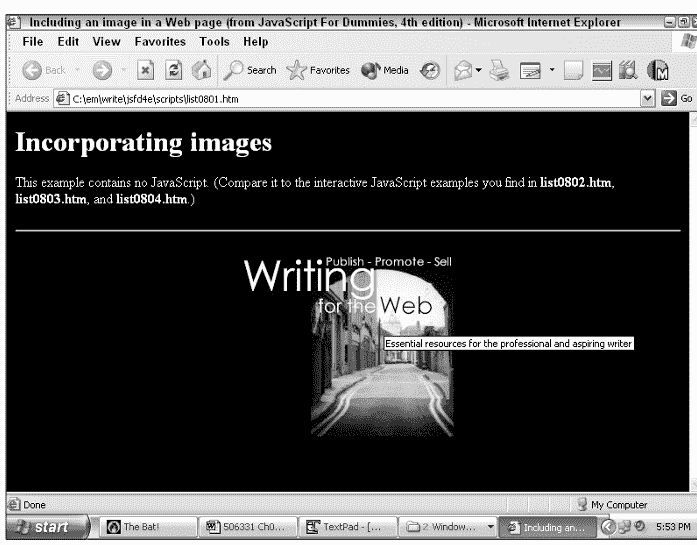

### 简单的开启/关闭动画

这种动画效果通过 JavaScript 交换预加载的图像来实现。请注意，点击浏览器上的停止按钮不会影响动画。

图 8-3：中性表情 ...

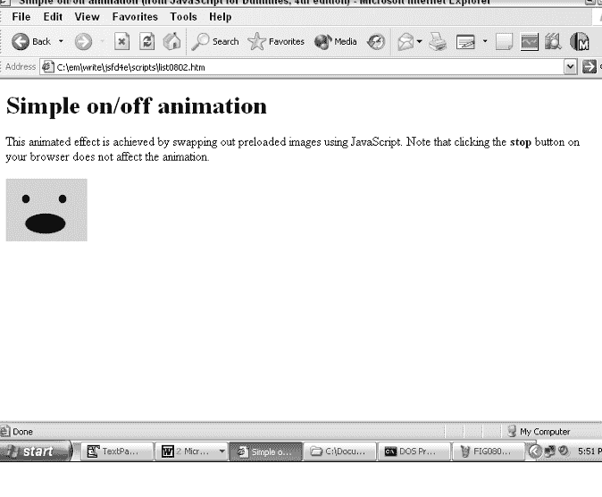

图 8-4：... 每秒变成一次惊讶的表情。

### 列表 8-2：使用 JavaScript 的 `setTimeout()` 函数创建简单动画

```javascript
// 全局变量声明
var whichimg = 1;
var nextImage;

/////////////////////////////////
// swap() 函数替换与第一个输入参数 (id) 关联的图像，将其替换为第二个输入参数 (newSrc) 指定图像。
/////////////////////////////////
function swap(id, newSrc) {
  var theImage = findImage(document, id, 0);
  if (theImage) {
    theImage.src = newSrc;
  }
}

/////////////////////////////////
// 此函数将当前图像替换为传入的参数 newImage；
// 然后它每秒调用自己一次，每次传递一个不同的 newImage。
// 结果是一个简单的开启/关闭动画。
function animate(newImage) {
  swap('animatedFace', newImage);

  if (whichimg == 1) {
    nextImage = "surprised.gif";
    whichimg = 0;
  } else {
    nextImage = "neutral.gif";
    whichimg = 1;
  }
  // setTimeout() 设置了持续交换以创建动画。
  setTimeout("animate('" + nextImage + "')", 1000);
}
```

### 列表 8-2（续）

```html
// 页面加载时立即调用 animate() 函数。
<BODY onload="animate('surprised.gif')">
  <!-- 此处定义了动画（图像）的尺寸。 -->
  
</BODY>
</HTML>
```

列表 8-2 中的 JavaScript 代码依赖于两个图像文件来创建动画：

- `neutral.gif`：这张黄色正方形图像包含两只黑眼睛和一条直线作为嘴巴，看起来表情中性。
- `surprised.gif`：这张图像是惊讶的表情。（好吧，好吧，它只是一个用大圆代替直线作为嘴巴的笑脸。这是艺术家的演绎！）

以下是 JavaScript 解释器执行列表 8-2 中代码的顺序——也可以说是窥探解释器的思维：

1. HTML `` 标签的命名和 `` 动画占位符帧（动画期间图像交替出现的页面位置）。在 `` 标签中，名称为 `animatedFace`，尺寸为 104 x 80 像素。
2. 随着页面加载，`onload` 事件处理程序执行 `animate()` 函数，并发送源文件名（具体为 `surprised.gif`）。
3. `animate()` 函数调用 `swap()` 函数来交换与 `animatedFace` 占位符帧关联的源文件。现在，`animatedFace` 对应的不再是原始的 `neutral.gif`，而是 `surprised.gif`。
4. 通过使用全局定义的变量 `whichimg` 和 `nextImage`，`animate()` 函数记录它刚刚交换了哪个图像，并通过调用 `setTimeout()` 函数排队下一个图像。`setTimeout()` 函数每秒调用一次 `animate()` 函数，交替向 `animate()` 传递 `neutral.gif` 和 `surprised.gif` 文件名。

## 幻灯片：显示系列图像

有时你想使用 JavaScript 设置一个幻灯片：让你的用户点击按钮并查看不同的图像，而不一定跳转到另一个页面。图 8-5 到 8-7 显示了点击按钮将图像从一个视图更改到另一个视图的过程。

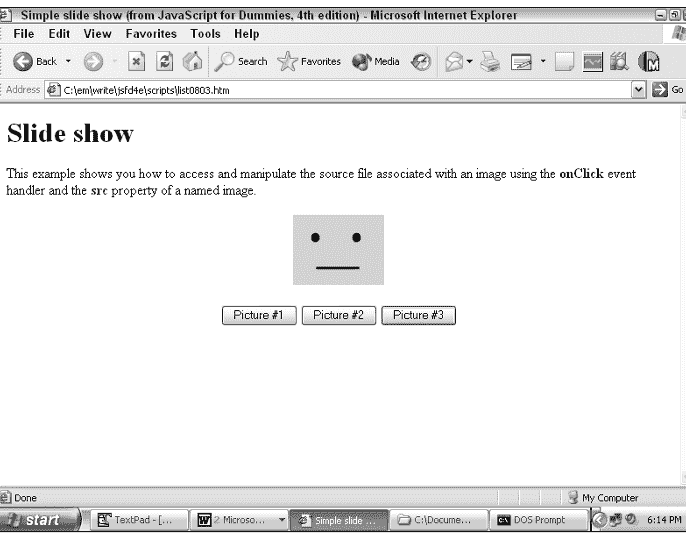

图 8-5：页面加载时默认显示中性表情。

此示例展示了如何使用 `onClick` 处理程序和命名图像的 `src` 属性访问并操作与图像关联的源文件。

图 8-6：点击“图片 #1”按钮显示图像。

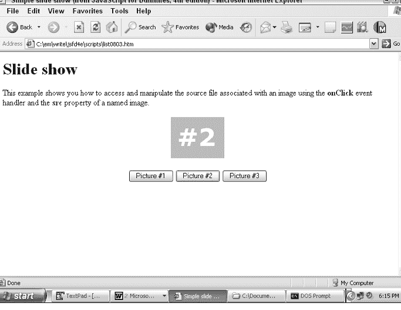

图 8-7：继续点击按钮以循环图像。

创建简单幻灯片所需的 JavaScript 代码出现在列表 8-3 中。列表 8-3 中的代码位于附带 CD 的 `list0803.htm` 中。


### 列表 8-3：创建用户激活的幻灯片

```javascript
///////////////////////////////////////
// 此 swap() 函数根据输入参数构建一个文件名，然后将幻灯片的源设置为该文件名
// 注意：初始图像决定了幻灯片“帧”的大小。切换到较大的图像会导致图像适应初始图像“帧”。
///////////////////////////////////////
function swap(newImage) {
    var fileName = newImage.toString() + ".gif";
    document.slideshow.src = fileName;
}
// 停止隐藏 --
</SCRIPT>
</HEAD>
<BODY>
<h1>Slide show</h1>
此示例展示了如何使用 `onClick` 处理程序和命名图像的 `src` 属性访问并操作与图像关联的源文件。

<!-- 此处指定了初始图像（脸） -->


<!-- 这三个 onClick 事件处理程序调用 swap() 函数显示用户选择的图像 -->
<INPUT TYPE="button" VALUE="Picture #1" onclick="swap('1')">
<INPUT TYPE="button" VALUE="Picture #2" onclick="swap('2')">
<INPUT TYPE="button" VALUE="Picture #3" onclick="swap('3')">
</BODY>
</HTML>
```

看到列表 8-3 代码底部的 `` 标签了吗？`` 标签定义了页面首次出现时显示的初始图像（如图 8-5 所示），并为该初始幻灯片的占位符命名。

当用户点击任一一个按钮——图片 #1、图片 #2 或图片 #3 时，该按钮的 `onclick` 事件处理程序就会启动，并调用 `swap()` 函数，向 `swap()` 函数传递相应的数字：1、2 或 3。在 `swap()` 函数内部只有两行 JavaScript 代码：

```javascript
var fileName = newImage.toString() + ".gif";
document.slideshow.src = fileName;
```

第一行创建了一个变量 `fileName`，并根据 `onclick` 处理程序中 `swap()` 的参数分配一个字符串。（你使用 `toString()` 方法在加上 `.gif` 之前转换 `newImage` 的值）。在 JavaScript 解释器解释此行后，`fileName` 包含以下字符串之一：`1.gif`、`2.gif` 或 `3.gif`。（这些文件名对应于附带 CD 实际 GIF 文件。）`swap()` 函数的第二行将此新的 `fileName` 分配给幻灯片占位符的内置 `src` 属性。（通过从文档对象导航到所有对象再到命名的图像对象来指定文档中的特定图像。）

## 创建鼠标悬停、热点和导航栏

交互式图像帮助你快速方便地与用户交流。在 Web 上创建交互式图像的流行方法有：

- **鼠标悬停**：当用户将光标悬停在图像上时外观会变化的图像。鼠标悬停通常与链接关联，因此当用户点击鼠标悬停时，网络浏览器会加载新的 Web 页面。
- **热点**：热点与鼠标悬停类似，不同之处在于热点指的是图像的交互部分。你可以将单个图像划分以创建多个热点。
- **导航栏**：最后，导航栏是一组链接——通常以鼠标悬停或热点的形式显示——允许用户浏览你 Web 网站的所有页面。

后续章节将向你展示如何使用 JavaScript 创建这些酷炫的效果。

## 创建简单的悬停效果

Rollover 一词描述当用户用鼠标指针悬停在图像上时，图像的颜色、字体、大小或其他属性发生的变化。图 8-8 显示了 E-Publishing 按钮首次加载到 Internet Explorer 时的状态（白色）。

如图 8-9 所示，将鼠标悬停在你实现的具有悬停效果的导航按钮上，会提供一种视觉提示，帮助用户识别点击鼠标按钮时可以预期效果（文本颜色从白色变为紫色，让用户模糊地知道他们正悬停在一个按钮上！）

悬停效果通常用于创建导航栏，但你可以使用悬停效果让网站的任何图形部分对鼠标事件做出响应。


图 8-8：按钮初始版本使用白色图像。

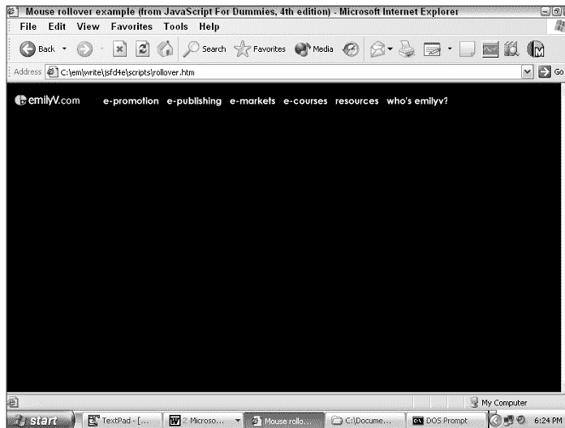
图 8-9：鼠标滑过时对比色的响应。

创建鼠标悬停效果非常简单。只需遵循以下计划：

1. 选择两个尺寸完全相同的图像：一个用于默认显示，另一个用于响应 `mouseover` 事件的显示。

区分这两个版本的一种方法是使用“开启/关闭”术语。从现在起，我将这些图像分别称为“关闭图像”和“开启图像”，即当你的鼠标停在图像外的某处时显示一个，当鼠标在图像上时显示另一个。

你可以通过两种方式获取图像：
- 你可以使用现成的图像。许多图形工具都带有一个现成的图像库；你也可以找到图像——有些免费的，有些可以购买。
- 你可以使用图像创建工具（如 Paint Shop Pro 6 或更高版本）创建自己的图像。（你可以在随附 CD-ROM 上找到 Paint Shop 6 的试用版。）

一种流行的方法是创建一个你喜欢的导航按钮并保存为“关闭图像”——然后更改按钮颜色并立即保存另一个副本作为“开启图像”。

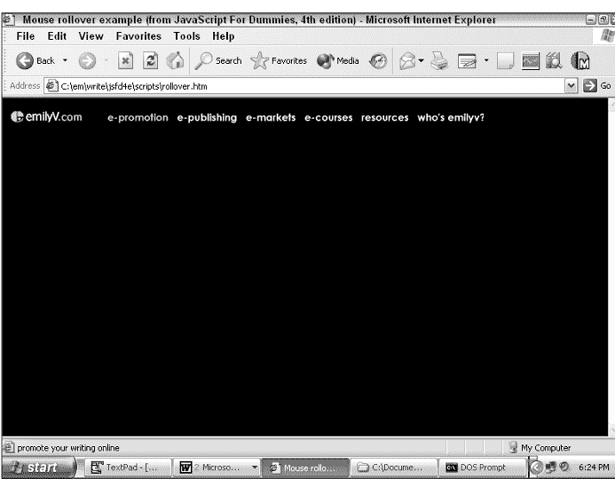


# 第四部分：与用户交互

第 5 波
作者：Rich Tennant

> “你在网络上参加了一个‘昆虫服装俱乐部’吗？真酷！你在哪里买到那么小的按钮？”

## 在本部分中...

第四部分包含了大量制作专业级 Web 页面的信息，酷到可能让你让自己惊讶！第 12 章将教你如何从访问你网站的人那里收集并验证输入——包括帮助你设计友好型 Web 页面并与用户有效沟通的技巧。在第 13 章中，你将学会如何通过将脚本钩到用户事件（如击键或鼠标点击），将 Web 页面转换为 Web 应用程序。最后，第 14 章向你介绍了 JavaScript 错误处理技术，你可以利用这些技术将通用的错误信息（这会让你的游客感到沮丧）替换为特定的、适当的、友好的错误信息。

## 第 12 章

## 处理表单

## 本章内容

- 从用户处获取信息
- 验证用户输入
- 给用户提供实用的反馈

如果你熟悉 HTML 填充表单，你就知道它们有多么用。在你的 Web 页面上添加 HTML 表单可以让你的访问者快速、方便地与你通信。用户可以在 HTML 表单中输入评论、联系信息或其他任何内容。然后，在用户提交表单的瞬间，这些信息就会自动传输给你（好吧，严格来说，是传输给你的 Web 服务器）。

尽管 HTML 表单本身已经很棒，但通过使用 JavaScript，你可以创建智能表单——能够立即纠正用户输入错误、计算数值并提供反馈的表单。在开发者术语中，JavaScript 为你提供了一种执行客户端数据验证（有时被称为数据清洗）的方法，这是任何设计良好的软件的重要组成部分，从简单的页面到完整的在线应用程序都是如此。

### 使用 HTML 表单字段捕获用户输入

JavaScript 为传统的 HTML 表单增加了两个非常实用的功能：

- JavaScript 允许你直接在客户端立即检查并验证用户输入。
- JavaScript 允许你给用户提供即时反馈。

我将在接下来的章节中解释这两个功能。

### 创建输入验证脚本

在过去，Web 开发人员必须编写服务器端的通用网关接口（`CGI`）程序来处理用户输入。那种方法目前仍在使用，虽然有效，但效率低下。

例如，想象你想允许访问者订阅你的电子事报，于是你创建了一个包含单个输入字段“E-Mail Address”（电子邮件地址）的 HTML 表单。想象一个访问者不小心在该字段中输入了 `XYZ`（而不是有效的电子邮件地址，如 `Janed@aol.com`）。E-Mail Address 的内容必须从用户的 Web 浏览器一路传输到你的服务器，你的 `CGI` 程序才能够检查这些信息并确定 `XYZ` 是无效的。

相反，通过 JavaScript，你可以在用户的浏览器内部立即判断输入值是否有效——这为用户节省了宝贵的时间。（同时也让你自己省去了研究如何用 C、C++ 或 Perl 编写 `CGI` 程序的麻烦！）

## 人人异异：使用正则表达式进行数据验证

编写脚本就像生活中的其他事情一样：通常，解决任何特定问题都有不止一种方法。一些 JavaScript 程序员喜欢详细说明我在本章中演示代码的原因——换句话说，就是使用尽可能多的代码行来创建一个人类可读且可行的脚本。另一些 JavaScript 程序员则为了简洁而牺牲人类可读性，认为代码行越少意味着调试工作越少。

对于属于后一阵营的人来说，正则表达式可能非常有用。正则表达式是一种特殊的模式，你可以用它指定文本字符串。例如，这里有一个描述 `somebody@some_suffix` 地址的正则表达式：

```
/^\w+@\w+\.\w{3}$/
```

看起来很可怕！但当你将其拆解成小块时，你就理解它是如何工作的了，正如表 12-1所示。

## 第 12 章：处理表单

输入验证通常属于以下三个类别之一：

- 存在性：测试某个值是否存在。
- 数值：确保信息仅为数字。
- 模式：测试特定的约定，例如电话号码中的标点符号、电子邮件地址、社会安全码或日期。

在列表 12-1 中，我们展示了验证极其常见的模式类别：电子邮件地址所需的 JavaScript 代码。（本章中的表单脚本部分演示了存在性和数值验证的示例）

图 12-1 显示了此代码的运行情况。你可以通过将附带 CD 中的 `list1201.htm` 文件加载到你的浏览器中来尝试这些技术。


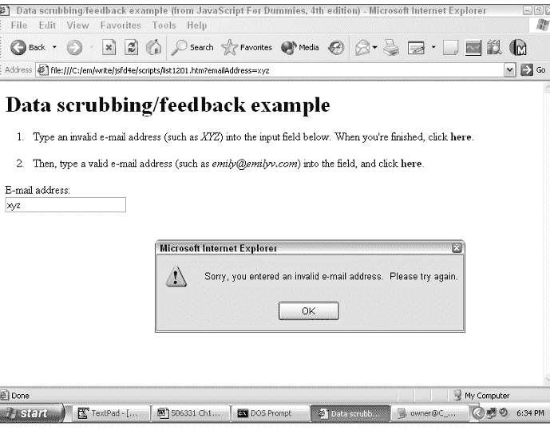

## 数据清洗/反馈示例

1. 在下面的输入字段中输入无效的电子邮件地址（如 `XYZ`）。完成后，点击此处。
2. 然后，在字段中输入有效的电子邮件地址（如 `email@example.com`），并点击此处。

电子邮件地址：

图 12-1:
嘿，那不是电子邮件地址！

## 列表 12-1：验证电子邮件地址模式的脚本

```javascript
<SCRIPT LANGUAGE="JavaScript" TYPE="text/javascript">

/****************************************************************/

// 此函数测试有效电子邮件地址中的
// 标点字符 (. , 和 @)

/****************************************************************/

function isValidEmail(inputValue) {

    var foundAt = false
    var foundDot = false
    var atPosition = -1
    var dotPosition = -1

    // 遍历电子邮件地址的每个字符
    // 当检测到（如果检测到）@ 符号和点时，设置标记。

    for (var i=0; i<inputValue.length; i++) {

        if (inputValue.charAt(i) == "@") {
            foundAt = true
            atPosition = i
        } else if (inputValue.charAt(i) == ".") {
            foundDot = true
            dotPosition = i
        }

    }

    // 如果找到了 @ 和点，且
    // 顺序正确

    if (foundAt && foundDot && atPosition < dotPosition) {
        // 这是一个有效的电子邮件地址。
        alert("Thanks for entering a valid email address!")
        return true
    } else {
        // 电子邮件地址无效。
        return false
    }
}
```


# 第12章：处理表单

在列表 12-1 中，我们展示了验证极其常见的模式类别：电子邮件地址所需的 JavaScript 代码。（本章中的表单脚本部分演示了存在性和数值验证的示例）

图 12-1 显示了此代码的运行情况。你可以通过将附带 CD 中的 `list1201.htm` 文件加载到你的浏览器中来尝试这些技术。


## 数据清洗/反馈示例

1. 在下面的输入字段中输入无效的电子邮件地址（如 XYZ）。完成后，点击此处。
2. 然后，在字段中输入有效的电子邮件地址（如 `email@example.com`），并点击此处。

电子邮件地址：

图 12-1:
嘿，那不是电子邮件地址！

## 列表 12-1：验证电子邮件地址的 JavaScript 代码

```javascript
<SCRIPT LANGUAGE="JavaScript" TYPE="text/javascript">

/****************************************************************/

// 此函数测试有效电子邮件地址中的

// 标点字符 (. , 和 @)

/****************************************************************/

function isValidEmail(inputValue) {

    var foundAt = false

    var foundDot = false

    var atPosition = -1

    var dotPosition = -1

    // 遍历电子邮件地址的每个字符

    // 当检测到（如果检测到）@ 符号和点时，设置标记。

    for (var i=0; i<inputValue.length; i++) {

        if (inputValue.charAt(i) == "@") {

            foundAt = true

            atPosition = i

        } else if (inputValue.charAt(i) == ".") {

            foundDot = true

            dotPosition = i

        }

    }

    // 如果找到了 @ 和点，且

    // 顺序正确

    if (foundAt && foundDot && atPosition < dotPosition) {

        // 这是一个有效的电子邮件地址。

        alert("Thanks for entering a valid email address!")

        return true

    } else {

        // 电子邮件地址无效。

        return false

    }

}

</SCRIPT>
```

# 第12章：处理表单（续）

你可以从附光盘中的列表 12-2 中找到正则表达式代码。只需查找 `regexp.htm` 文件即可。

### 调用验证脚本

对于浏览网页的人来说，没有什么比在表单中输入一堆信息、点击表单的提交按钮，然后在漫长的等待之后——看到一条类似“你填写的内容有误”的通用错误消息更让人恼火了。

JavaScript 允许你根据需要检查每个输入字段，并弹出即时反馈，让用户知道（在他们按 Tab 键跳到长表单末尾之前）他们需要进行修正。

在列表 12-3 所示的 JavaScript 代码中，`isValidEmail()` 函数（我在列表 12-1 中定义）是从 HTML `text` 元素的事件处理程序中调用的。结果是？在 `text` 元素中输入电子邮箱地址并点击网页上的其他地方，将触发 `isValidEmail()` 函数的执行（参见图 12-1）。

- **列表 12-3：** 在 `onblur` 事件处理程序中调用 `isValidEmail()` 函数

```html
<BODY>

  <h1>数据清洗/反馈</h1>

  <DL>

    <LI>在下方的输入框中输入无效的电子邮箱地址（如 <i>XYZ</i>）。完成后，点击 <B>这里</B></li>

    <P>

      <LI>然后，在输入框中输入一个有效的电子邮箱地址（如 <i>email@emily.com</i>），并点击 <B>这里</B></li>

    </P>

  </DL>

  电子邮箱地址:

  <BR>

  // 使用在 emailAddress 字段中输入的值调用 isValidEmail()。

  <INPUT TYPE="text" SIZE="25" NAME="emailAddress" onblur="isValidEmail(this.value)">

</FORM>

</BODY>
```

# 第四部分：与用户交互

## 整合汇总：订单表单验证脚本

在本节的示例中，你将看到如何创建一个智能表单，该表单通过两种不同的方式验证用户数据：

- **在字段处：** 你可以在用户通过 Tab 键离开字段时立即对独立字段进行验证。独立字段是指你要求的字段（例如信用卡购买时需要的信用卡号），无论用户在任何其他字段中输入了什么。你在在本章较早的“创建输入验证脚本”中看到过字段级验证的示例。
- **在表单处：** 你希望在用户完成整个表单并点击表单的提交按钮时验证依赖字段。依赖字段是指根据用户在一个或多个字段中输入了的内容，你可能会验证也可能不验证的字段。例如，除非用户指定想要接收你的电子邮件简报，否则你可能不需要提供电子邮箱地址。

## 数字辅助

JavaScript 提供了几个内置函数，帮助你识别一个值是否为数字：

- **`parseInt()`:** 尝试将一个值转换为整数；返回整数值或 `NaN`（如果该值无法转换为数字）。这两种情况界定如下：

```javascript
var result = parseInt("123")
```

结果被设置为数值 123。

```javascript
var result = parseInt("Emily")
```

结果被设置为 `NaN`（不是数字）。

- **`parseFloat()`:** 尝试将一个值转换为浮点数（小数）；返回浮点值或 `NaN`（如果该值无法转换为数字）。这些示例向你展示了如何使用：

```javascript
var result = parseFloat("45.6")
```

结果变量被设置为数值 45.6。

```javascript
var result = parseFloat("grumpy")
```

结果变量被设置为 `NaN`。

- **`isNaN()`:** 该函数代表“Not a Number”（不是数字）；如果传递它的值不是数字，则返回 `true`；如果是数字，则返回 `false`。（是的，我知道双重否定很令人困惑，不是吗？）这里有两个示例：

```javascript
var result = isNaN(3)
```

结果被设置为 `false`，3 是一个数字。

```javascript
var result = isNaN("George")
```

结果被设置为 `true`，因为字符串不是数字。

# 第12章：处理表单（续）

你在本章看到的示例是针对一个名为 Webmeister 的虚拟公司。为了让访客能够请求服务的个性化报价，公司决定创建一个 HTML 表单，并挂载 JavaScript 脚本来管理这些目标：

- **验证必填字段是否存在条目：** 为了成功提交请求，Webmeister 的访客必须输入服务类别、姓和名以及至少一种联系方式（电话或电子邮件）。在接下来的章节中，`exists()` 函数实现了这些检查。存在性验证在字段级和表单级都会进行。
- **验证模式：** 脚本必须检查电话和电子邮箱地址以确保它们有效。`isValidPhoneNumber()` 和 `isValidEmail()` 函数分别在表单上实现这些检查。
- **验证数字字段：** `isNaN()` 函数协助验证表单上的数字。

图 12-2 显示了完成后的请求样式：要查看负责图 12-2 的代码，请打开附光盘中的文件。

图 12-2：虚拟公司 Webmeister 的订单表单。

### 测试存在性

通过在 HTML 表单字段的事件处理程序上挂载验证脚本，你可以要求用户提供值。在例例中，Webmeister 的开发者希望确保请求有姓和名。列表 12-4 向你展示了实现此所需的 JavaScript 代码。

## 列表 12-4：测试输入值的存在性

```javascript
function exists(inputValue) {

    var aCharExists = false;

    // 遍历 inputValue，使用 charAt()

    // 检测非空格字符。

    for (var i=0; i<inputValue.length; i++) {

        if (inputValue.charAt(i) != " " && inputValue.charAt(i) != "*") {

            aCharExists = true;

            break;

        }

    }

    return aCharExists;

}

// firstName 的值在用户通过 Tab 键离开时时被发送到 exists() 函数。

<INPUT TYPE="text" NAME="firstName" SIZE="25" onblur="if (!exists(this.value)) {

    alert('Please enter a first name');

}">

// lastName 的值在用户通过 Tab 键离开时被发送到 exists() 函数。

<INPUT TYPE="text" NAME="lastName" SIZE="35" onblur="if (!exists(this.value)) {

    alert('Please enter a last name');

}">
```

列表 12-4 中的代码根据以下原理工作：`exists()` 函数接收一个值（命名足够合理：`inputValue`）。一旦 `exists()` 函数接收到该值，它就会检查该值是否包含非空格字符。非空格字符或默认值 `false` 将返回给调用代码。

如果你查看列表下方，你会看到两个调用 `exists()` 函数的输入字段，其中一个：

```html
<INPUT TYPE="text" NAME="firstName" SIZE="25" onblur="if (!exists(this.value)) {

    alert('Please enter a first name');

}">
```

之前的 JavaScript 语句为 `firstName` 字段的 `onblur` 事件处理程序定义了一个值。当用户模糊 `firstName` 字段时，`firstName` 的值传递给 `exists()` 函数。如果 `exists()` 返回 `false` 值（`!` 运算符是“如果此为假”的简写），则会弹出消息提醒用户输入名字。现在，当用户点击“Your First Name”字段并在未输入值的情况下按 Tab 键离开时，代码会显示一条提醒消息（参见图 12-3）。

## 测试数值值

你可以通过在 HTML 表单字段的事件处理程序上挂载数字验证脚本，要求用户为该字段提供有效的数字。要查看执行此验证所需的 JavaScript 代码示例，请查看列表 12-5。

图 12-3：每个人都必须（并输入）名字。

## 列表 12-5：测试以确保一个值为数字

```javascript
// 定义 isNumber() 函数

function isNumber(inputValue) {

  // 假设一开始一切都是好的。

  var result = true

  // 如果 parseFloat() 返回 false，则说明在第一个位置

  // 检测到了非数字字符。

  if (parseFloat(inputValue)) {

    result = false

  }

  // 否则，检查

  // 剩余的数字。

  else {

    for (var i=0; i<inputValue.length; i++) {

      if (inputValue.charAt(i) != "*") {

        if (!parseFloat(inputValue.charAt(i))) {

          result = false

          break

        }

      }

    }

    // 返回 true（inputValue 是有效数字）或

    // false（无效无效）。

  }

  return result

}

...

```

```javascript
function isValidPhoneNumber(inputValue) {

  for (var i=0; i<inputValue.length; i++) {

    // 在另一个自定义函数内部调用 isNumber() 函数

    if (isNumber(inputValue.charAt(i))) {

      digitsFound++

    }

  }

}
```

`isNumber()` 函数的定义使用了 JavaScript 内置函数 `parseFloat()` 来过滤掉所有非数字开头的值。（如果 `parseFloat()` 遇到的第一个字符无法转换为数字，则该函数返回 `NaN`。）

在第一个字符是数字但后续字符不是数字的情况下（例如，为了捕获像 5F5-1212 这样的错误），`isNumber()` 会遍历 `inputValue` 中的所有剩余字符，以检查是否检测到非数字字符。

列表 12-5 中的最后几语句向你展示了如何调用 `isNumber()` 函数的示例。在这个示例中，`isValidPhoneNumber` 函数（你将在下一节详细检查它）作为其验证程序的一部分调用了 `isNumber()` 函数。

### 测试模式

本章之前介绍过的列表 12-1 展示了你可能如何验证一个非常常见的模式：电子邮件地址。在这里，你看到了模式验证的另一个常见用处的示例：确保用户验证了电话号码。列表 12-6 显示了你可能

## 列表 12-6：验证电话号码

```javascript
// 定义 isValidPhoneNumber() 函数

function isValidPhoneNumber(inputValue) {

var digitsFound = 0

// 遍历 inputValue 查看它

// 包含了多少个数字。

for (var i=0; i<inputValue.length; i++) {

 if (isNumber(inputValue.charAt(i))) {

  digitsFound++

}

}

// 如果 inputValue 包含至少 10 个

// 数字，假设它是一个有效的电话号码。

if (digitsFound >= 10) {

  return true

} else {

  return false

}

...

// 调用 isValidPhoneNumber() 函数

if (!isValidPhoneNumber(inputValue)) {

alert("除非您提供电话号码，否则我们无法通过电话联系您\n（请确保包含区号）。谢谢！")

}

```

你在列表 12-6 中使用的代码用于检查一个值是否包含至少十个数字；如果是，则该值将作为有效的电话号码通过测试。

有时你想创建比这更严谨的模式。例如，你可能希望确保用户在电话号码中包含括号和破折号。关于如何实现这一点（以及一些注意事项）的示例，请参见侧栏“模式匹配的替代方法”。

### 表单级验证

有时你想在用户输入值或跳离开该字段时立即对字段进行验证。（列表 12-4 向你展示了一个独立字段验证的示例）。

但有时，你想等到用户完成信息输入后再开始验证。例如，Web 表单允许用户指定他们希望通过电子邮件还是电话接受联系。必须至少选择一个选项，如果在用户离开电子邮件字段的瞬间触发验证将是毫无用处的（而且是令人烦恼的）。毕竟，该用户很可能打算选择电话号码选项；在用户填写完整个表单之前，你无法得知。


## 模式匹配的替代方法

如果你需要定义比我在列表 12-6 中描述的电话号码更严谨的模式，请查看此侧栏中的 JavaScript 代码，它要求用户按以下格式输入电话号码：这种方法的用处是什么？它确保用户输入的完全是你希望他们输入的，从而减少了误解的概率。缺点是你预期的用户输入一串字符，这在最好的情况下也是困难的（请记住互联网是全球性的，对你可能熟悉的模式对世界上其他地方的人可能完全陌生）。正如你在示例所示，与对象相关的 `substring()` 方法允许你将一个值分成块，并确保每个块都是有效的。例如，此代码指示解释器分别提取并检查电话号码的区号、交换和线路部分。遵循此点的良好规则是：如果你必须以特定格式收集信息，请根据用途调整此示例。但如果你可以通过更少的检查获取（如我描述的电话号码程序），就用它吧。

# 第12章：处理表单（续）

```javascript
function isNumber(entry) {

  if (entry) {

    // 将 openParen 设置为 entry 的第一个字符。

    var openParen = entry.substring(0,1)

    // 将 areaCode 设置为接下来 3 个字符。

    var areaCode = entry.substring(1,4)

    // 将 closeParen 设置为第 5 个字符。

    var closeParen = entry.substring(4,5)

    // 将 exchange 设置为第 6, 7, 8 个字符。

    var exchange = entry.substring(5,8)

    // 将 dash 设置为第 9 个字符。

    var dash = entry.substring(8,9)

    // 将 line 设置为第 10 到 13 个字符。

    var line = entry.substring(9,13)

    // 以下的 if 语句检查了所有部分，

    // 如下所示：如果 openParen 不等于 "("

    // 或者 areaCode 不是数字

    // 或者 closeParen 不等于 ")"

    // ... 等此类推。

    if (

      (openParen != "(") ||

      (!isNumber(areaCode)) ||

      (closeParen != ")") ||

      (!isNumber(exchange)) ||

      (dash != "-") ||

      (!isNumber(line))

    ) {

      alert("电话号码错误。请按以下格式输入：(123)456-7890");

    }

  }

}

<form NAME="FeedbackForm">

<BR>请按以下格式输入电话号码<BR>(123)456-7890

<INPUT TYPE="text" NAME="homePhone" VALUE="" SIZE=13 onBlur="isNumber(this.value)">

...>

```

# 第四部分：与用户交互（续）


# 第12章：处理表单（续）

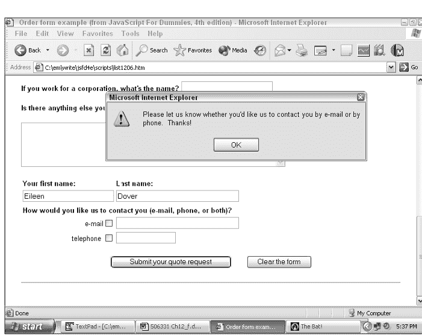

图 12-4：使用表单级验证确保至少填写了一个选项。

## 列表 12-7：使用 validateForm() 函数实现依赖性验证检查

```html
<HTML>

<HEAD>

<TITLE>订单示例（自《JavaScript 入门教程》，第 4 版）</TITLE>

<SCRIPT LANGUAGE="JavaScript" TYPE="text/javascript">

<!-- 对未启用 JavaScript 的浏览器隐藏此脚本 -->

// 检查值是否包含非数值数据。

/////////////////

function isANumeric(inputValue) {

// 假设一切正常。

var result = true

// 如果 parseFloat 返回 false，则在第一个位置

// 检测到了非数字字符。

// if (parseFloat(inputValue)) {

    result = false

}

// 否则，我们仍然必须检查其余

// 数字，所以一次一次处理 inputValue

// 字符，如果遇到任何非数字字符

// 则将 result 设置为 false。

else {

    for (var i=0; i<inputValue.length; i++) {

        if (inputValue.charAt(i) != '*') {

            if (parseFloat(inputValue.charAt(i))) {

                result = false

                break

            }

        }

    }

}

```

```javascript
// 返回 true（inputValue 是一个有效数字）或

// false（无效无效）。

return result

```

```javascript
////////////////////////////////////////////////////////////////////

// 检查输入值是否包含 "@"

// 和 "."

////////////////////////////////////////////////////////////////////

function isValidEmail(inputValue) {

    var foundAt = false

    var foundDot = false

    // 遍历 inputValue 寻找

    // "@" 和 "."

    for (var i=0; i<inputValue.length; i++) {

        if (inputValue.charAt(i) == "@") {

            foundAt = true

        }

        else if (inputValue.charAt(i) == ".") {

            foundDot = true

        }

    }

}

```

```javascript
// 如果都找到了 "@" 和 "."，则假设

// 电子邮件地址是有效的；否则，

// 返回 false 让调用代码知道

// 电子邮件地址是无效的。

if (foundAt && foundDot) {

    return true

} else {

    return false

}

```

```javascript
////////////////////////////////////////////////////////////////######

// 检查输入值是否包含十个或更多

// 数字。这种方法允许用户输入美国式的

// 电话格式，例如 (123)456-7890，

// 以及欧洲式的（例如 123.456.7890）。

////////////////////////////////////////////////////////////////######

function isValidPhoneNumber(inputValue) {

    var digitsFound = 0;

    // 遍历 inputValue 查看包含

    // 多少个数字。

    for (var i=0; i<=inputValue.length; i++) {

        if (isNumber(inputValue.charAt(i))) {

            digitsFound++

        }

    }

    // 如果 inputValue 包含至少 10 个

    // 数字，假设它是一个有效的号码。

    if (digitsFound >= 10) {

        return true

    } else {

        return false

    }

}

////////////////////////////////######################

// 检查字符的存在。

//（空格不计入内）。

////////////////////////////////////////////////######

```

```javascript
function exists(inputValue) {

  var aCharExists = false

  // 遍历 InputValue，使用 charAt()

  // 方法来检测非空格字符。

  for (var i=0; i<=inputValue.length; i++) {

    if (inputValue.charAt(i) != " " && inputValue.charAt(i) != "*") {

      aCharExists = true

      break

    }

  }

  return aCharExists

}

// 执行在所有数据输入完成后才能执行

// 的跨字段检查。

/////////////////////////////////////////////////////////////////

function validateForm() {

  var rc = true

  // 依赖性检查 #1：确保选择了服务类别

/////////////////////////////////////////////////////////////////

  // 访问者按顺序检查以下

  // 选项以获得准确的报价：

  // 查看他们是否对

  // 设计、维护或促销服务感兴趣。

  /////////////////////////////////////////////////////////////////

  if (document.form.designChoice.checked &&

      document.form.mainChoice.checked &&

      document.form.promoChoice.checked) {

    alert("检查你是否对我们的设计、

    维护或促销服务感兴趣，以便我们能提供

    更准确的报价。谢谢！")

    rc = false

  }

}

// 依赖性检查 #2：确保如果用户勾选了“员工”，

// 则公司名称必须存在

```

```javascript
///////////////////////////////////////

// 如果是员工，他们需要指定

// 公司名称。

///////////////////////////////////////

if (document.form.bizChoice[1].checked) {

    if (!document.form.corpName.value) {

        alert("你勾选了员工，请填写你

//工作的公司名称？")

        rc = false

    }

}

///////////////////////////////////////

// 依赖性检查 #3：双重检查

// 姓氏是否存在

///////////////////////////////////////

// 访问者需要输入

// 姓氏。

if (!document.form.firstName.value ||

    document.form.lastName.value) {

    alert('请输入你的姓氏。谢谢！')

    rc = false

}

///////////////////////////////////////

// 依赖性检查 #4：确保用户输入了

// 电子邮件地址或电话号码

///////////////////////////////////////

// 访问者需要告知是通过

// 电子邮件还是电话

if (document.form.emailChoice.checked &&

    document.form.phoneChoice.checked) {

    alert('请告诉我们希望通过电子邮件

还是电话联系你。谢谢！')

    rc = false

}

///////////////////////////////////////

// 依赖性检查 #5：如果用户选择了

// 联系方式，则确保电子邮件

// 地址存在。

///////////////////////////////////////

// 访问者告诉我们想通过

// 电子邮件联系，如果他们没有填写

// （电子邮件）（与电话相同）。

```

```javascript
if (document.form.emailChoice.checked &&

    !isValidEmail(document.form.emailAddr.value)) {

    alert('如果没有有效的电子邮件地址，我们无法通过电子邮件联系你。谢谢！')

    rc = false;

} else {

    if (document.form.phoneNumber.checked &&

    !isValidPhoneNumber(document.form.phoneNumber.value)) {

        alert('如果没有有效的电话号码，我们无法通过电话联系你（请确保包含区号）。谢谢！');

        rc = false;

    }

}

if (rc) {

    // 如果 rc 变量非零，则表单数据

    // 顺利通过）；

    alert('谢谢！我们将很快与您联系报价。');

}

return rc;

```

```javascript
// ---->

</SCRIPT>

</HEAD>

```

```html
<BODY>

<H1>订单示例</H1>

<HR>

...

```

```html
<P>

<HR>

<TABLE WIDTH="100%" SPACING="10" CELLPADDING="10" ORDER=0">

<TR>

<TD>

<FONT FACE="Helvetica, Arial, Verdana" SIZE="2">

// 依赖性验证在用户尝试提交表单时执行

<FORM NAME="quoteForm" onsubmit="return validateForm();">\n<P>

<B>你对哪些服务感兴趣？（勾选所有适用项）</B>

<P>

网站设计 <INPUT TYPE="CHECKBOX" NAME="designChoice" VALUE="design"

&nbsp;&nbsp;&nbsp;&nbsp;

网站维护 <INPUT TYPE="CHECKBOX" NAME="mainChoice"

VALUE="main"&nbsp;&nbsp;&nbsp;&nbsp;

在线促销

<INPUT TYPE="CHECKBOX" NAME="promoChoice" VALUE="promo"

<P>

>*
```

# 第12章：处理表单（续）

**你为什么要建立网站？（或者，如果你已经有一个网站了，你用它做什么？）**

<textarea name="purpose" COLS="60" ROWS="5" WRAP="VIRTUAL">
</textarea>

**你想把照片放入你的网站中吗？**
- 是 <input type="RADIO" name="pixChoice" VALUE="hasPix" CHECKED>
- 否 <input type="RADIO" name="pixChoice" VALUE="hasNoPix">

**你是否有一个或多个想在你的网站上推广/销售的产品？**
- 是 <input type="RADIO" name="cdChoice" VALUE="hasProducts" CHECKED>
- 否 <input type="RADIO" name="cdChoice" VALUE="hasNoProducts">

**你是小企业主主，还是在大型公司工作？**
- 小企业主主 <input type="RADIO" name="bizChoice" VALUE="Owner" CHECKED>
- 员工 <input type="RADIO" name="bizChoice" VALUE="isEmployee">

**如果你在公司工作，公司名称是什么？**
<input type="TEXT" name="corpName" SIZE="25">

**为了给你提供准确的报价，你认为还有其他我们需要知道的信息吗？**

<textarea name="extraInfo" COLS="60" ROWS="5" WRAP="VIRTUAL">
</textarea>

| 你的名： | 姓： |
| :--- | :--- |
| <input type="TEXT" name="firstName" SIZE="25" onBlur="if (exists(this.value)) { alert('Please enter a first name'); }"> | <input type="TEXT" name="lastName" SIZE="35" onBlur="if (exists(this.value)) { alert('Please enter a last name'); }"> |

### 列表 12-7（续）

```html
| 你希望我们如何联系你（电子邮件、电话或两者兼有）？ |

| :--- |

| 电子邮件 <input type="CHECKBOX" name="emailChoice" VALUE="email"> |

| <input type="TEXT" name="emailAddr" SIZE="35"> |

| 电话 <input type="CHECKBOX" name="phoneChoice" VALUE="phone"> |

| <input type="TEXT" name="phoneNumber" SIZE="15"> |

<center>

<input type="SUBMIT" VALUE="提交你的报价请求">

&nbsp;&nbsp;&nbsp; <input type="RESET" VALUE="清除表单">

</center>

</html>
```

在列表 12-7 的代码中，`validateForm()` 函数执行五个依赖于字段的验证程序，该函数在用户尝试提交表单时执行。（将 `validateForm()` 函数附加到 `quoteForm` 的 `onsubmit` 事件处理器上就能看到这一点！）

# 第13章：处理用户触发的事件

**本章内容**

- 熟悉事件（events）与事件处理器（event handlers）之间的区别
- 查看与不同对象相关的事件
- 查看事件处理器的实际运行

JavaScript 帮助你将静态 Web 页面转换为交互式 Web 应用程序。是什么特性让这种客户端交互成为可能呢？正是谦逊而可爱的事件处理器。你可以将处理器想象成小小的软件蹦蹦绳，将自定义的 JavaScript 代码绑定到事件上，例如点击按钮或链接、加载页面、在输入字段中输入数据等。

你在整本书中都能看到事件处理器的示例。在本章中，我重点关注大多数开发者认为最实用的事件处理器——与窗口、鼠标、表单和键盘事件相关的事件处理器。在这里，你将了解到如何创建并将基本脚本附加到此类用户驱动的事件上，如打开 Web 页面窗口、移动鼠标指针、与表单交互以及按键。

## 事件与事件处理器简述

在 Web 编程术语中，事件是 Web 页面发生的任何事情。事件示例包括：

- 窗口或框架的打开或关闭
- 鼠标指针移动到图像、链接或 HTML 表单上
- 点击或双击鼠标
- 按键按下

# 第四部分：与用户交互（续）

通过 JavaScript，你可以对任何事件执行操作。例如，当用户打开 Web 页面、悬停在某个区域、在表单中输入内容或点击按钮时显示文本。

许多程序员发现四类事件处理器是最实用的：窗口事件、鼠标事件、表单事件和键盘事件。在接下来的章节中，我将向你展示这四类重要事件的示例。

### 表 13-1 常见事件

| 事件处理器 | 支持的对象 | 事件（触发时……） |
| :--- | :--- | :--- |
| onblur | 元素 | 元素失去焦点。 |
| onclick | 元素 | 元素点击。 |
| ondblclick | 元素 | 连续点击两次。 |
| oncontextmenu | 元素 | 用户右键点击。 |
| onchange | 元素 | 用户更改值。 |
| onerror | 图像 | 图像加载失败或损坏。 |
| onfocus | 元素 | 元素获得输入焦点。 |
| onkeydown | 元素 | 用户按下键。 |
| onkeypress | 元素 | 用户按下并释放键（结合了 onkeydown 和 onkeyup）。 |
| onkeyup | 元素 | 用户释放之前按键。 |
| onload | 图像、窗口 | 元素加载成功。 |
| onmousedown | 元素 | 用户按下鼠标按钮（但未释放）。 |
| onmousemove | 窗口、框架 | 用户在窗口或框架上移动鼠标。 |
| onmouseout | 元素 | 鼠标移出元素。 |
| onmouseover | 元素 | 鼠标移入元素。 |
| onmouseup | 元素 | 用户释放之前点击的鼠标按钮。 |
| onreset | 表单 | 表单重置；要么用户点击重置按钮，要么程序员调用了 `form.reset()` 方法。 |
| onresize | 窗口、框架 | 用户调整窗口或框架的大小。 |
| onsubmit | 表单 | 表单提交；要么用户点击提交按钮，要么程序员调用了 `form.submit()` 方法。 |
| onunload | 窗口 | 用户卸载文档（通过关闭浏览器或加载另一个文档）。 |

# 第13章：处理用户触发事件（续）

## 事件就是一切

Navigator 和 Internet Explorer 都支持事件对象（`Event object`），它专为高级事件处理场景设计。理论上，你可以使用事件对象来捕获并检查发生事件的细微细节。例如，如果用户点击了鼠标按钮，你可以使用与事件对象相关的方法和属性来确定用户点击了哪个鼠标按钮，甚至是点击时指针的坐标。如果用户按了某个键，你可以使用与事件对象相关的方法和属性来确定访问者按了哪个键（或按键组合）。这种可能性是无数的。然而，在本文编写期间的浏览器之间，JavaScript 对事件对象的支持并不一致——而且关于 Navigator 支持的文档几乎不存在。有关事件对象以及它在 Internet Explorer 中如何实现的更多信息，请参阅：

```
http://msn.microsoft.com/workshop/author/html/reference/objects/obj_event.asp
```

### 窗口事件

大多数 Web 浏览器熟悉的一种事件是弹出窗口广告——当你将 Web 页面加载到浏览器时自动出现的微小（或并不微小）窗口。弹出广告绑定在 `onload` 事件处理程序上（有时是 `onunload` 事件处理程序，当你尝试离开某个站点时，它可能会向你投放额外的弹出广告）。

除了 `onload` 和 `unload` 处理程序外，窗口和帧（一种特殊的窗口）还支持包括 `onBlur`、`onFocus` 和 `onResize` 在内的事件处理程序，如表 13-2 所示。

| 表 13-2 | 与窗口和帧相关的事件处理程序 |
| --- | --- |
| 事件处理程序 | 事件（当……时触发处理程序） |
| onBlur | 元素失去输入焦点。（点击元素外部或切标签离开元素将导致该元素的输入焦点。） |
| onFocus | 元素获得焦点。 |
| onLoad | 元素加载成功。 |
| onMove | 用户移动或调整窗口或帧的大小。 |
| onResize | 用户调整窗口或帧的大小。 |
| onunload | 用户卸载文档（通过关闭浏览器或加载另一个文档）。 |

你通过为窗口事件处理程序定义值来触发窗口事件的 JavaScript 代码。例如，以下代码在用户卸载（关闭或离开）Web 页面时显示告别消息。

```html
<BODY OnUnload="alert('Goodbye, and thank you for stopping by my Web site');">
```

### 鼠标事件

鼠标事件使得如悬停效果（见第 8 章）和工具提示（见第 11 章）等酷的交互效果成为可能。当鼠标指针移动——或在其他区域点击时，不会发生此类对象。例如，以下代码将两个函数（`displayTooltip()` 和 `hideTooltip()`）绑定到与 HTML 定义区域相关的 `mouseover` 和 `mouseOut` 处理程序上。

```html
<MAP name="PicMap" id="PicMap">

<AREA shape="rect" COORDS="226,25,302,82" HREF="#"

onMouseOut="hideTooltip('tooltip')"

onMouseOver="displayTooltip(event,'tooltip')">

```

表 13-3 描述了额外的鼠标事件以及与这些事件相关的对象和处理程序。

| 与鼠标相关的事件处理程序 | 支持的对象 | 当……时触发事件处理程序 |
| :--- | :--- | :--- |
| mouseDown | 按钮, 复选框, document, 文件上传, （和区域）图像, 链接, 密码, 单选框, 重置, 选择, 提交, Textarea | 用户按下鼠标按钮（但未释放）。 |
| mouseOut | （和区域）图像, 链接 | 鼠标移出元素。 |
| mouseOver | （和区域）图像, 链接 | 鼠标移动到元素上。 |
| mouseUp | 按钮, 复选框, document, 文件上传, （和区域）图像, 链接, 密码, 单选框, 重置, 选择, 提交, Textarea | 用户释放之前点击过的鼠标按钮。 |

### 表单事件

HTML 定义了一些表单元素或控件（推送按钮、单选按钮、复选框等）。这些元素中的每一个都与相应的事件处理程序相关。

例如，在一个按钮的生命周期中可以发生多次事件。例如，该按钮可以被点击、双击、接收输入焦点和失去输入焦点。JavaScript 事件处理程序可以检测并处理这些每一个独立的事件——点击、双击、聚焦和失焦。看看以下代码就知道我的意思：

```html
<INPUT TYPE="button" NAME="pushButton" VALUE="Push me!" onclick="doSomething()">
```

该语句是 HTML 语法和内联 JavaScript 的混合，定义了一个 HTML 按钮元素。除了 `TYPE`、`NAME` 和 `VALUE` 属性外，该语句还为按钮定义了一个 `onclick` 事件处理程序。在运行时，当用户点击 Push Me! 按钮时，JavaScript 解释器会自动调用 `doSomething()` 函数。表 13-4 列出了元素的事件处理程序。

| 事件处理程序 | 支持的表单元素 | 事件（当……时触发处理程序） |
| :--- | :--- | :--- |
| onBlur | 按钮, 复选框, 文件上传, 密码, 单选框, 重置, 选择, 提交, Text, Textarea | 元素失去焦点。（点击元素外部或切标签离开元素将夺走该元素的输入焦点。） |
| onChange | 复选框, 文件上传, 密码, 单选框, 选择, Text, Textarea | 元素发生（例如，用户在 Text 元素中输入或点击单选框）并失去输入焦点。 |
| onClick | 按钮, 复选框, 文件上传, 密码, 单选框, 重置, 选择, 提交, Textarea | 用户点击元素。 |

| 表 13-4 | 支持的表单元素 | 事件（当……时触发处理程序） |
| :--- | :--- | :--- |
| onDoubleClick | 按钮, 复选框, 文件上传, 密码, 单选框, 重置, 选择, 提交, Textarea | 用户连续点击两次。 |
| onFocus | 按钮, 复选框, 文件上传, 密码, 单选框, 重置, 选择, 提交, Textarea | 元素获得焦点。 |
| onKeyDown | 按钮, 复选框, 文件上传, 密码, 单选框, 重置, 选择, 提交, Textarea | 用户按下按键。 |
| onKeyPress | 按钮, 复选框, 文件上传, 密码, 单选框, 重置, 选择, 提交, Textarea | 用户按下并释放按键（结合了 keyDown 和 onKeyUp 处理程序）。 |
| onKeyUp | 按钮, 复选框, 文件上传, 密码, 单选框, 重置, 选择, 提交, Textarea | 用户释放之前按过的键。 |
| onMouseDown | 按钮, 复选框, 文件上传, 密码, 单选框, 重置, 选择, 提交, Textarea | 用户按下鼠标按钮（但未释放）。 |
| onMouseUp | 按钮, 复选框, 文件上传, 密码, 单选框, 重置, 选择, 提交, Textarea | 用户释放之前点击过的鼠标按钮。 |
| onreset | 表单 | 表单重置（用户点击重置按钮或程序调用了 `form.reset()`）。 |
| onSubmit | 表单 | 表单提交（用户点击提交按钮或程序调用了 `form.submit()`）。 |

## 利用窗口事件行善

有些使用弹出广告的人本质是邪恶的，而另一些人认为这是 Web 技术的合法使用。无论你在争论中持什么立场，请注意存在弹出杀死软件，某些用户会下载并安装它来避免弹出广告。也要知道，许多用户拒绝再次访问向他们轰炸广告的站点。

### 键盘事件

键盘事件发生在 Web 页面加载时用户按下按键。除了捕获整体的 `keyPress` 事件外，你还可以单独捕获（并响应）用户按下按键后释放按键的操作。

以下示例代码将自定义 JavaScript 函数 `disallowInput()` 绑定到与对象相关的 `onKeyPress` 事件处理程序上：

```html
<body onKeyPress="disallowInput()">
```

有关支持键盘事件的其他对象的详细信息，请查看表 13-5

## 表 13-5 键盘相关事件处理程序

| 事件处理程序 | 支持的对象 | 当……时触发事件处理程序 |
| --- | --- | --- |
| onKeyDown | 按钮, 复选框, document, 文件上传, 图像, 链接, 密码, 单选框, 重置, 选择, 提交, Text, Textarea | 用户按下按键。 |
| onKeyPress | 按钮, 复选框, document, 文件上传, 图像, 链接, 密码, 单选框, 重置, 选择, 提交, Text, Textarea | 用户按下并释放按键（结合了 keyDown 和 onKeyUp 处理程序）。 |
| onKeyUp | 按钮, 复选框, document, 文件上传, 图像, 链接, 密码, 单选框, 重置, 选择, 提交, Text, Textarea | 用户释放之前按过的键。 |

# 第14章：处理运行时错误

**本章内容**
- 熟悉运行时错误和异常
- 了解 try、catch 和 throw 语句

异常处理支持——一种预测错误并优雅地从错误中恢复的技术——在 C++ 等语言中已支持长时间，最终在 Internet Explorer 5.x 和 Navigator 6.x 中才在 JavaScript 中实现。

### 异常基础

从技术上讲，异常是脚本处理过程中发生的任何意外情况（无论好坏）。但从实际角度来说，异常几乎总是意味着一个错误。异常可能源于：

- JavaScript 错误
- 意料之外的用户输入错误
- 用户浏览器、操作系统或硬件配置出现问题

尝试让代码访问不存在的对象（如数组元素、属性等）是异常的常见来源，这些异常会在你的 JavaScript 代码在某人的浏览器中执行时发生。

如果你正在创建一个商业 JavaScript 应用程序，你将希望利用 JavaScript 的异常处理能力。在商业环境中，允许用户查看如 `File Found or No Such Object` 等晦涩的系统生成错误是不可接受的。虽然使用 try 和 catch 块预测并处理这些错误可能无法防止错误的发生，但它确实提供了机会：

- **安抚用户。** 你可以使用 JavaScript 的异常处理函数显示消息，告诉用户发生了错误，但正在被妥善处理。（这种方法比让晦涩的系统信息或空白屏幕令用户困惑和报警好得多。）
- **为用户提供有用且适当的建议。** 你可以解释错误的原因并为用户提供未来避免该错误的提示。

### 处理异常

你通过创建两个特殊的 JavaScript 函数或代码块：try 块和 catch 块来处理异常。然后，在任何可能产生错误的语句中，使用关键字 `throw` 将错误抛出到 catch 块。列表 14-1 中的代码为你展示了这一点。

请在配套光盘的 `list1401.htm` 中查找列表 14-1 中的代码。

## 列表 14-1：使用 try-catch 和 throw 处理异常

```javascript
<SCRIPT LANGUAGE="JavaScript" TYPE="text/javascript">

function getMonthName(monthNumber) {

    // JavaScript 数组从 0 开始，而不是 1，所以

    // 减去 1。

    monthNumber = monthNumber - 1

    // 创建一个数组并填充（它） 12 个值

    var months = new Array("Jan","Feb","Mar","Apr","May","Jun","Jul","Aug","Sep","Oct","Nov","Dec")

    // 如果传入的 monthNumber 在 0 到 11 之间，返回相应的

    // 月份名称。

    if (months[monthNumber] != null) {

        return months[monthNumber]

    }

    // 否则，发生了异常，因此抛出

    // 异常。

    else {

        // 此语句将错误直接

        // 抛出到 catch 块。

        throw "InvalidMonthNumber";

    }

}

////////////////////

// try 块包裹了主 JavaScript

// 处理代码。try 块内任何产生

// 异常的 JavaScript 语句都将

// 自动将该异常抛出到

// catch 块中的异常处理代码，

//////////////////////

try {

    // 调用 getMonthName() 函数并传入

    // 无效月份（没有 13 月！）

    // 看看会发生什么。

    alert(getMonthName(13));

    alert("如果抛出异常，我们永远不会到达这里。");

}

catch (error) {

    alert("遇到了 " + error + " 异常。请联系程序供应商。");

}

// 在现实情况下

</SCRIPT>
```

请查看图 14-1 以查看运行列表 14-1 中的代码在 Internet Explorer 中生成的错误。

# 第五部分：十之篇

## 第15章：十大（或左右）在线 JavaScript 资源

## Netscape

Netscape DevEdge 网站包含了大量关于 JavaScript 入门的信息，包括完整的语言参考、指南文章和示例代码。它还提供了一个可下载的 JavaScript 调试器。

```
http://devvedge.netscape.com
```

## Microsoft

微软维护着一个信息丰富的网站，致力于其 JavaScript 兼容语言 JScript。文档、教程、示例代码以及与 JScript 相关的新闻组，仅仅是可以在这里找到的优质资源之一。

```
http://msdn.microsoft.com/scripting/javascript/default.htm
```

## Builder.com

CNET Builder 的 JavaScript 部门除了提供复制粘贴的 JavaScript 代码外，还有技巧和教程。

```
http://builder.com/1200-31-5084860.html
```

## Webmonkey

Webmonkey 维护着一个强大的 JavaScript 代码库，其中不仅有丰富的脚本，还有一个实用的浏览器参考图表、HTML 和 CSS 的速查表——而且全部免费供用。

```
http://hotwired.lycos.com/webmonkey/reference/javascript_code_library
```

## Project Cool's JavaScript QuickStarts

Project Cool 的 JavaScript QuickStarts 提供实用的 JavaScript（以及 DHTML）教程。从基础到高级，所有内容都组织成整洁、易于理解的小块，供 JavaScript 初学者使用。

```
www.devx.com/projectcool
```

## EarthWeb.com

EarthWeb.com 的 JavaScript 网站提供了一个巨大的剪切脚本库——涵盖从导航到多媒体的所有脚本。

```
http://webdeveloper.earthweb.com/webjs
```

## About.com

About.com 上的专注于 JavaScript 的网页包含了关于各种可以想象的 JavaScript 相关主题的文章、教程和可下载脚本——包括我个人最喜欢的：故障排除。

```
http://javascript.about.com/compute/javascript
```

## IRT.org

Internet Related Technologies 的 JavaScript 部门提供了一个关于常见（及已解答）脚本相关问题的详尽知识库。

```
http://developer.irt.org/script/script.htm
```

## WebReference.com

WebReference.com 的原生 JavaScript 资源列表包含了指向在线 JavaScript 杂志、脚本存档等内容的链接。

```
www.webreference.com/programming/javascript/index.html
```

## ScriptSearch.com

ScriptSearch.com 维护着巨大的 JavaScript 脚本数据库，从广告横幅到视觉特效应有尽有。

```
http://scriptsearch.internet.com/JavaScript/
```

## 不要错过的新闻组

之前章节列出的网站是非常的信息来源。但有时，你必须向真人发送消息并开门见山地提问。新闻组可以非常节省时间，特别是在研究特定的操作方法和已知漏洞时。

要访问新闻组，你需要定义一个新闻服务器。通常，你在浏览器安装和配置过程中会设置 Web 服务器和新闻服务器，但你也可以在稍后添加新闻支持。

要参与用户组（通过查看他人的消息或发布你的作品），你需要从 Web 模式切换到获取新闻。要做到这一点，请从浏览器菜单中检查“窗口> 邮件和新闻组”，或者如果你是 Internet Explorer 粉丝，请检查“工具> 邮件和新闻> 阅读新闻”。

> 有关配置你的浏览器软件以访问群组的详细信息，请查看你的浏览器（在其他窗口中，联系微软或 Netscape 的技术支持）或查看一本关于该主题的好书，例如由 John R. Levine、Carol Baroudi 和 Margaret Levine Young 编写、Wiley 出版公司出版的《网络入门教程》第 9 版。

> 新闻组统称为 Usenet。有关新闻组的更多信息——哪里寻找新闻、如何编写有效的帖子，甚至如何创建你自己的小组——请访问

```
http://groups.google.com
```

虽然用户组会来来去，但以下组已成为 JavaScript 相关开发的最佳场所：

- 如果你只关注一个用户组，请选择这一个。这个组的参与非常多，目前是初学者和高级脚本编写者的顶尖 JavaScript 信息组：
- `comp.lang.javascript`
（`it.comp.lang.javascript` 和 `de.comp.lang.javascript` 新闻组是流量很大的意大利语和德语组。）
- 获取答案：
- `comp.infosystems.`
- 微软的脚本专注于：
- `microsoft.www.authoring.javascript`

# 第16章：十（或左右）常见错误以及如何避免

**本章内容**

- 捕捉拼写错误
- 修复不匹配的标签
- 在 HTML 标签之间放置 JavaScript 语句
- 将数字视为字符串
- 将字符串视为数字
- 寻找逻辑错误

## HTML 问题

由于 JavaScript 语句嵌入在 HTML 中，你发现的某些错误实际上是 HTML 错误。例如，以下是一个 HTML 错误（`TYE="button"` 应该是 `TYPE="button"`）：

```html
<INPUT TYE="button" NAME="testButton" VALUE="test"
OnClick="test()>
```

在这种情况下，JavaScript 解释器不会显示错误，因为这不关它的。如果你的页面没有按预期运行，且 JavaScript 没有提示你，你可能正在处理 HTML 错误。如果发生这种情况（且你无法在本章找到解决方案），请查阅良好的 HTML 参考书，例如 Ed Till 和 Natasha Pitts 编写的《HTML 入门教程》第 4 版。

### 破坏“完美伴侣”

JavaScript 脚本通常充满了成对出现：起始和结束标签的对（得益于 HTML）、括号和花括号的对、单引号和双引号的对。JavaScript 解释器将成对之间的内容视为一个整体，因此如果成对中的半部分缺失，解释器就会感到困惑——在某些情况下，是非常地困惑！

以下是一些你不想在 JavaScript 中将其拆散的“完美伴侣”的具体示例。

### 孤独的角括号

查看以下代码，你认为显示内容将包含两个文本元素：一个用于存储名字，另一个用于存储姓。但事实并非如此，因为缺少了一个角括号。

```html
<FORM NAME="myForm">

...

First name: <INPUT TYPE="text" NAME="firstName" LENGTH=15

Last name: <INPUT TYPE="text" NAME="lastName" LENGTH=30>

...
```

如果一个文本元素没有出现——没有错误信息，什么都没有，只是在元素应该出现的地方有一片空白——那么可能的罪魁祸首就是该不可见文本元素正前方的一行缺少了角括号。

### 孤独的标签

你在列表 16-1 中使用的代码描述了一个微小的脚本，也许是对启用 JavaScript 的 Web 页面的首次尝试。乍看之下，你没有发现任何异常。但如果你加载这个脚本，你会发现某些地方绝对有问题！

- **列表 16-1：** 缺少标签的 HTML 源代码

```html
...

<HEAD>

<SCRIPT LANGUAGE="JavaScript">

function test() {

  var aString = "some text"

```

- **列表 16-1（续）：**

```html
alert("aString is " + aString)

// 应该缺失的 </SCRIPT> 结束标签。

<HEAD>

<BODY>

<FORM NAME="myForm">

<INPUT TYPE="button" NAME="testButton" VALUE="test"
onclick="test()"

<P>

First name: <INPUT TYPE="text" NAME="FirstName" LENGTH=15>

Last name: <INPUT TYPE="text" NAME="lastName" LENGTH=30>

</FORM>

</BODY>

</HTML>
```

前述代码片段中缺少 `</SCRIPT>` 标签，导致页面什么都不显示——零、全无、什么都没有——而不是你预期的主体和元素。

每当元素拒绝出现时，请检查你的 HTML 语句，看看是否双部分标签的起始半部分（如 `<TITLE>`、`<SCRIPT>` 或 `<body>`）缺少了结束半部分（分别为 `</TITLE>`、`</SCRIPT>` 和 `</body>`）。

### 孤独的括号

当你仔细查看以下 `test()` 函数的主体时，可以很容易发现第三行缺少了一个括号：

```javascript
function test() {

var aString = "some text"

alert("aString is " + aString)

```

然而，随着你 JavaScript 技能的提高，你可能会发现自己正在组合很长的语句。此外，每个长得巨大的语句都可能包含许多对括号，通常嵌套几层——而这正是你最容易犯这种错误的时候。

除非你用于创建脚本的编辑器提供了自动括号对检查工具，否则你需要肉眼检查代码以发现并纠正这个错误。

### 孤独的引号

仔细看以下示例：

```html
<INPUT TYPE="button" NAME="testButton" VALUE="test"
onclick="test('hello')">
```

这里的错误是单词 `hello` 后面没有闭合的双引号。之前的代码没有产生错误；它只是禁用了 `testButton` 对象的 `onClick` 处理程序。

纠正后的语句如下：

```html
<INPUT TYPE="button" NAME="testButton" VALUE="test"
onclick="test('hello')">
```

### 将脚本语句放在错误的位置

每当元素拒绝出现时，检查你的 HTML 语句，看看双部分标签的起始半部分（例如 `<TITLE>`、`<SCRIPT>` 或 `<body>`）是否缺少了对应的结束半部分（分别为 `</TITLE>`、`</SCRIPT>` 和 `</body>`）。

当你是 JavaScript 新手时，记住这些顺序可能很困难。例如，脚本语句只有在 `<SCRIPT>` 和 `</SCRIPT>` 标签之间才是合法的。如果你把它们放在其他地方，就会产生意想不到的结果。当你加载页面并查看时，就会发现某些异常。查看列表 16-2 明白我的意思：

- **列表 16-2：** 放置错误的脚本语句的源代码

```html
<SCRIPT LANGUAGE="JavaScript">

function testit(inputValue) {

// 设置一个临时字符串变量。

var aString = "" + inputValue;

</SCRIPT>
```

### 错误嵌套引号

嵌套单双引号很棘手。例如，以下是完全合法的：

```html
onclick='alert("This is an example")'
```

如果你在单引号中嵌套单引号，例如：

```html
onclick='alert('This is another example')'
```

如果你在双引号中嵌套双引号，就像这样：

```html
onclick="alert("Oops!")"
```

这将产生语法错误。如果你必须包含引号，可以对其转义：

```html
onclick="alert('This doesn\'t cause a problem')"
```

### 将数字视为字符串

人类倾向于过度关注文本和数字之间的差异——至少在大多数情况下并非如此。例如，当你写英文时，不需要对数字做任何特殊处理。在 JavaScript 中，将数字视为字符串（如列表 16-3 所示）都会产生错误。

- **列表 16-3：** 将数字视为字符串处理的 JavaScript 源代码

```html
<SCRIPT LANGUAGE="JavaScript">

function testit(inputValue) {

// 你在下一行使用的 bold() 方法与 String 对象相关联（而不是 Number 对象）。

document.write(inputValue.bold())

document.close();

}

<FORM NAME="myForm">

// onClick 事件处理程序

// 将数字 2 传递给 testit() 函数。

<INPUT TYPE="button" NAME="testButton" VALUE="test"
onclick="testit(2)">
```

问题发生在数字 2 从 onclick 事件处理程序的定义传递给 `testit()` 函数时，该函数并没有准备好处理数字。如果你查看 `testit()` 函数，你可以看到它是获取输入值（在本例中为数字 2）并尝试对其调用字符串的 `bold()` 方法。这是不可行的。你只能对字符串调用字符串的方法，而 2 并不是字符串！

有时你会向一个数字发送字符串，并让该函数将其作为字符串处理。在这些情况下，你只需要在函数中添加如下代码：

```javascript
function testit(inputValue) {

// 设置一个临时字符串变量。

var aString = "" + inputValue;

// 将输入值放入临时

// 字符串变量中。

aString += inputValue;

// 对 inputValue 的字符串版本调用

// bold() 方法。

document.write(aString.bold());

}
```

现在，你可以向 `testit()` 函数发送任何你想要的值，而 `testit()` 的表现会很完美！

### 将字符串视为数字

上一个章节展示了将数字视为字符串时会发生什么。正如你可能猜的那样，反过来 —— 将字符串视为数字也会在 JavaScript 中引起麻烦。让我通过列表 16-4 中的代码片段来向你解释。

- **列表 16-4：** 包含将字符串视为数字的 JavaScript 源代码

```javascript
function calculateTax(inputNumber) {

  return inputNumber * .50

}

<input type="button" name="calculateTaxButton"
value="Calculate"
onclick="alert('The tax is ' + calculateTax('baked'))">
```


当你点击 Calculate（计算）按钮时，字符串 "baked" 会发送到 `calculateTax()` 函数，该函数会立即乘以 .50。现在，如果你能算出 "baked" 乘以 .50 的结果，那么你的数学水平就比我这辈子都要好。（哦，也许它是“半熟”的！）JavaScript 也不知道，所以它返回一个内置值 `NaN`，这是 JavaScript 表达“我不知道这到底是什么鬼，但我知道它不是一个数字（Not a Number）！”的方式。

再次，在 JavaScript 中就像在生活中一样，你可以做任何你想做的事 —— 只要你知道如何操作。如果你想创建一个期望数字但能优雅处理字符串的函数，你只需要在函数的最顶部添加几行代码。列表 16-5 向你展示了如何实现。


## 第 16 章：十（左右）最常见的 JavaScript 错误

**列表 16-5：** 期望数字但处理字符串的 JavaScript 函数源代码

```javascript
function calculateTax(inputNumber) {

  // 如果 inputNumber 是字符串，myNumber 将为 false。

  var myNumber = parseFloat(inputNumber)

  // 如果 inputNumber 实际上是一个数字，

  // 执行必要的计算。

  if (myNumber) {

    return myNumber * .50

  }

  // 否则，显示错误。

  else {

    alert("向一个期望数字的函数传递了非数值")

    return "unknown"

  }

}

<input type="button" name="calculateTaxButton"
  value="Calculate"
  onclick="alert('The tax is ' + calculateTax('baked'))" />
```

在这个改进的、测试性更好的版本中，`calculateTax()` 函数做的第一件事是检查它是否能将收到的任何值转换为数字。如果可以，它会在必要时转换该值，然后对该值进行计算。例如，你可以传递一个数字或像 "1234.56" 这样的字符串给 `calculateTax()`，而不是字符串 "baked"。如果 `calculateTax()` 函数无法进行转换（"baked"  own转换成什么数字？），它会意识到无法转换此值，便懒得进行任何计算，而是提醒用户。

## 偏离重点：逻辑错误

逻辑错误是最难追踪的错误，因为它们不会产生特定类型的错误信息。（例如，你永远不会看到 JavaScript 解释器吐出“显然，这不是你计算 20 年贷款利息的方法”这样的信息。）

JavaScript 解释器怎么可能知道你在逻辑上正尝试做什么呢？与人类不同，它无法读取你的代码、分析它，并与其他解释器商量以确定你的代码是否接近于完成某些合理的任务。JavaScript 会扫描你的代码查找语法错误。如果你想给用户提供提交表单的选项，但在他们选择是时不实际提交表单 —— 那随你。JavaScript 不是你妈！

`alert()` 方法在代码中显示变量的内容非常有用。通常，当你看到变量的内容时……

```javascript
alert("The tax is " + calculateTax("baked"));
```

## 忽视兼容性

没有什么比花费几个小时创建一个脚本，发布到服务器，然后它在某个浏览器中失败更让人沮丧了。JavaScript 的支持情况在 Internet Explorer 和 Navigator 等不同版本之间存在。以下是克服这个可怕的浏览器问题的四个建议：

- 包含浏览器检测代码。第 3 章向你展示如何创建一个检测访问者浏览器并根据功能采取不同行为的脚本。
- 始终在多个浏览器中测试你的脚本。文档可能是错误的，浏览器检测代码可能会发生故障。因此，在你将启用 JavaScript 的页面发布到服务器之前（从而让全世界看到它们），请务必在尽可能多的浏览器中测试它们。尽管 America Online 浏览器拥有相当大的市场份额，但它经常被 JavaScript 开发者忽略。你可以从 http://free.aol.com 下载该浏览器的免费副本。
- 与其下载并安装多个浏览器，你可以利用在线服务（如 NetMechanic）来帮助你发现跨浏览器错误，访问此处：www.netmechanic.com/cabrands/zdnet/browsercheck

## 第 17 章：调试脚本的十（左右）技巧

### 本章内容

- 将代码与设计对比
- 使用 alert 追踪错误
- 从在线资源获取帮助
- 查看过程中的代码
- 拆分函数
- 将用户错误转换为有用信息
- 熟悉 JavaScript 调试工具

在第 16 章中，你看到了 JavaScript 程序员倾向于犯的一些常见错误（或 bug）。本章扩展了这一主题，向你展示如何用最快速、最直接的方法定位并修正你引入的任何 bug。许多语言的编译器和解释器都带有调试工具。遗憾的是，JavaScript 还没有多少调试工具。我将在本章晚些时候向你介绍这些工具 —— 以及关于如何快速、轻松地调试 JavaScript 代码的极佳建议。

调试就像洗碗。这两项家务都不特别有趣，但都是必须的，而且完成后你总是会感觉好得多。

## JavaScript 读取的是你的代码，而不是你的脑子！

奇怪的是，成功消除 bug 第一步是确定你是否真的遇到了它。如果你的 JavaScript 脚本运行方式不符合你的预期，那么你可能正在处理一个 bug。然而，你的脚本可能完全按照设计在运行，问题出在你对脚本“应该如何工作”的理解上。

在过去，程序员们会创建流程图——由一页又页的小符号和线条组成，描述了他们希望程序在运行时如何运行。流程图已不再流行——这并不是因为它们是一个坏主意，而是因为创建它们花费的时间几乎与编写程序本身一样多。

现如今，大多数程序员发现，在设计过程中编写伪代码（pseudocode）很有帮助。这样，在测试期间，他们就有一个可以参考的东西——可以说是一块金石，帮助他们明确潜在的 bug 是在他们的 JavaScript 代码中，还是在他们的编程逻辑中。

伪代码是 JavaScript 和程序员自然语言的简写组合。由于这个工具的设计目标是让程序员尽可能感到简单自然，因此并没有硬性规定来精确定义如何编写伪代码。

例如，假设你的目标是计算通过你的网站下达国际订单的总价（包括销售税）。以下是你的伪代码可能的样子示例：

- 1. 用户点击提交（Submit）按钮。
- 2. 如果是美国订单，计算税率（根据 `myForm.state` 查找税率）并将计算出的税费存储在 `totalTax` 中；否则 [如果不是美国订单该怎么办？]
- 3. 将订购的小部件数量（`myForm.numWidgets`）乘以单价（`myForm.price`）……

尽管编写伪代码对你理清网页的需求非常有帮助，但在你完成网页实现后，追踪逻辑中的 bug 时，它是绝对不可或缺的。

### 不要让你的注释只留存在自己心里

在编写 JavaScript 代码时养成写注释的习惯，对调试这些代码会有极大帮助。（你可能会惊讶于，在你创建脚本到代码出现异常之间，你竟然会忘记这么多内容，这期间可能跨越了几个周甚至几个月！）

如果你创建了伪代码来帮助规划和设计脚本，请尝试将该伪代码作为 JavaScript 注释的基础。这样做有助于未来的自己（或必须调试你脚本的其他人）精确理解代码试图实现什么。

### 隔离 bug

如果你遇到了一个真正的 bug，你需要尝试锁定它，并精确确定哪些行代码受到了影响。以下是一些示例，帮助你根据线索反向查找：

- 问题是否在页面加载时立即发生？如果是，那么问题要么与 HTML 相关，要么位于你设置的处理 `onLoad` 事件的 JavaScript 代码中。
- 问题是否在用户在输入框中使用文本时发生？检查与该字段关联 `onChange` 和 `onBlur` 事件处理器。
- 当用户点击按钮时，事情是否变得错乱？检查该按钮的 `onClick` 事件处理代码。
- 当用户关闭窗口时是否出错了？罪魁祸首可能潜伏在处理 `onUnload` 事件语句的函数中。

首先，决定一个搜索起点——比如，从某一个 `onClick` 事件处理器中调用的函数开始（我把它称为 `buggyFunction()`）。下一步是再深入一点。例如，在你的 JavaScript 代码中添加一个测试按钮来执行该函数，如下所示：

```html
<INPUT TYPE="button" NAME="testButton" VALUE="Test" onclick="buggyFunction(123,'abc')">
```

在第一行中，你向有问题的函数发送了数字和字符串字面量。这个过程有助于你判断函数本身是否有 bug，还是问题出在你原始代码传递给函数的变量上。

如果函数在接收到数字和字符串字面量后表现不正常，你就知道 bug 在你的函数中。如果它表现正常，你则需要检查原始 `onClick` 发送给函数的参数（见本章节后后的“显示变量值”部分）。

隔离 bug 的一种方法是注释掉函数中除一两个语句以外的所有代码。通过这种方法，你可以专注于你想要详细检查的语句。注释掉一段代码，如下所示：

```javascript
// someVariable = someResult;
```

在进行任何更改之前，为你的原始 HTML 或脚本文件制作一份备份。没有什么比在识别问题之前修改字段更令人沮丧的了，结果发现修改后比开始时还要糟——而且忘记了代码最初长什么样！你可能还想研究版本控制工具，例如 CVS (www.cvhome.org)。版本控制工具允许你跟踪文件的不同版本，这样即使你不小心回到了上一个版本，也可以随时回到较早的正常版本。

### 查阅文档

《JavaScript Guide》和《JavaScript Reference》是关于 Netscape 实现的 JavaScript 语言的最新资源。在浏览器中书签或下载这些文档，可以确保在需要时它们触手可及！

http://devedge.netscape.com/central/javascript

Internet Explorer 通过微软脚本语言 JavaScript 实现 JavaScript。查看以下 URL 可获取关于所有 JavaScript 相关事项的完整描述：

http://msn.microsoft.com/scripting/javascript.htm

### 显示变量值

调试技术涉及在各个阶段显示变量的值。例如，假设你有一个函数，其工作是计算订单的总费用。根据你对应该计算的总额的理解，你确定该函数返回了一个错误的值；但你不知道为什么。

通过列表 17-1 中看到的调试语句，在过程的每个阶段（从函数开始到计算返回值的语句）看到 JavaScript 的运行情况是非常容易的。

**列表 17-1：** 使用 Alert 语句追踪 bug


```javascript
var price=3.50

function calculatePrice(numberWidgets) {

    // 在函数开始检查变量。

    alert("Inside calculatePrice, numberWidgets is " + numberWidgets);

    var totalPrice = 0;

    // 100 元或以下的订单不计算税

    if (numberWidgets >= 10) {

        // 测试该语句

        // 是否编写正确。

        alert("Apparently numberWidgets is 11 or higher");

        var tax = calculateTax(numberWidgets * price);

        totalPrice = tax + (numberWidgets * price);

    }

    else {

        alert("numberWidgets is 10 or less so no tax calculated");

        totalPrice = numberWidgets * price;

    }

    // 显示有助于计算的所有值

    // 有助于你发现错误。

    alert("totalPrice is $" + totalPrice + " based on a per-item price of $" + price);

    return totalPrice;

}
```

列表 17-1 中的代码包含了四个 `alert()` 调用。每个 `alert()` 都在 `calculatePrice()` 逻辑的不同点显示值，如下系列图所示：

- 如图 17-1 所示，第一个 `alert` 显示了在 `calculatePrice()` 函数开始时 `numberWidgets` 变量的值。
- 如图 17-2 所示，第二个 `alert` 帮助你判断你的语句是否编写正确。
- 第三个 `alert` 让你在代码的单点检查多个值，如图 17-3 所示。

你的逻辑越复杂，这种技术就越能帮助你定位错误。但无论你发现了什么，请记住一点：在追踪完脚本中的错误后，务必记得删除调试语句。忘记这么做可能会非常尴尬！

我曾和一位程序员共事过，他认为自己已经删除了所有的调试语句，但他漏掉了一个。导致该调试语句出现的条件极低，以至于他完全忘记了它的存在！直到那时，几十名该程序员的老板、老板的老板以及公司最重要的客户都在会议上对该应用程序进行“审问”。你猜怎么着：调试语句真的弹出来了！如果你使用文本编辑器中提供的搜索/替换功能搜索脚本中所有 `alert()` 方法的出现处，就可以避免这种不幸而尴尬的局面。

### 将大块语句拆分为较小的函数

将你创建的函数大小限制在一个屏幕的范围内是良好的设计实践。（你不一定得听我的，调试一两次复杂的、庞然大物般的函数应该说服你了。）

限制函数的大小可以给你带来这些让你更轻松的优势：

- **增加你的代码复用能力。** 函数越小、越独立，你就越可能在其他语境中复用该函数。例如，假设你写了一个名为 `isPhoneNumber()` 的大函数来判断输入值是否为有效电话号码。移除处理验证的语句并将这些语句组织成一个名为 `isValid` 的独立函数，这样你就得到了一个函数，你可以在 `isPhoneNumber()` 中调用它，也可以在任何需要数字验证的函数（如 `isValidCreditCardNumber()` 或 `isValidAge()` 等）调用它。
- **降低你的挫败感。** 小函数比大函数容易调试得多，因为人类更容易在大脑中模拟小函数并理解它们委托的部分。

大到无法在普通显示器上显示的函数从复用的角度来看往往设计得很糟糕。也就是说，通常（我之所以说通常，是因为这是一个通用法则）当一个函数变得很大时，是因为你正试图让它执行多个概念性任务。理想情况下，一个函数应该只实现一个概念任务。

### 完善排除法

当你追查错误时，有时找出**不是**引起问题的原因与找出是什么引起的原因同样重要。例如，如果你的 HTML 代码中存在错误，无论如何搜索和测试你的 JavaScript 代码，都不会帮助你修复问题。

虽然我不能具体告诉你如何定位错误（如果我行，我就富了！），但我可以告诉你，优秀的程序员有一套通用的模式：

1. 创建测试用例。测试用例是一个单一的、真实的场景，描述用户可能如何与你的页面进行交互。例如，对于一个教育网站，你的测试用例可能包括：
   - 学生搜索特定的信息
   - 老师发布课程计划

2. 对于每个测试用例（确保你已经有了它们），加载你的页面，并将发生的情况与你的预期结果进行比较。如果你发现预期与实际情况之间存在差异，要做的是弄清楚问题是否与你的浏览器或 JavaScript 有关。

#### 调试浏览器问题

除非你刚刚下载并安装了新版本，否则浏览器不太可能出现问题。

**症状：** 浏览器没有启动，或者启动了但无法加载任何文件。

**定位策略：** 如果你刚刚重新安装了浏览器，尝试再次安装。如果问题仍然存在，请浏览技术帮助。

#### 追踪 HTML 错误

如果你是 HTML 新手，在熟练之前可能会犯几个错误。别担心，HTML 是一个文档非常详尽的领域！

**症状：** 你的网页只显示了你认为应该显示的部分（例如，缺少了按钮或其他定义的元素）。或者相反，你的网页显示的内容比你预期的多（例如，某些 JavaScript 语句直接显示在了屏幕上）。

**定位策略：** 准确记录显示了什么（或没显示什么）。如果只显示了定义的前两个元素，检查定义第二个元素的代码。如果第二个元素包含在一个标签对中（例如，在 `<body>` 和 `</body>` 标签之间），检查结束标签是否放置正确且拼写正确。如果出现了不该出现的 JavaScript 语句，记下该语句显示的第一个单词。在 HTML 源文件中和检查行中找到该单词。确保你记得包含了开头和结束的 `<script>` 和 `</script>` 标签。

#### 检查 JavaScript 代码

作为 JavaScript 程序员，你的大部分错误可能发生在——嗯，发生在你的 JavaScript 代码中。

**症状：** 任何在表单提交之前显示的错误几乎肯定都是 JavaScript 错误。表单提交前的错误可能发生在用户事件响应（例如，点击计算按钮或输入文本）或在计算某些数字的过程中。

**定位策略：** 在这里你显示变量值和拆分函数的技能就大显身手了。在将错误追踪到某个事件或计算后，尝试隔离该事件或计算。创建一个测试按钮，通过带有各种参数来调用相关的函数，观察每种情况下发生了什么。如果一个函数很长，将其拆分并分别测试每个函数。

### 利用他人的经验

当你遇到一个棘手的的错误时，你真的会感激第 15 章列出的 Usenet 用户组（称为新闻组）。你不仅可以浏览这些小组查看是否其他人已经遇到过你正在苦恼的问题，还可以发布一条包含代码段和错误描述的消息。许多新闻组贡献者们对他们调试他人代码的能力感到自豪，技术支持人员（包括一些 Netscape 和微软的大师）经常将监控新闻组作为工作的一部分。

请记住，无论你感到多么沮丧，或者你的问题有多紧急，在发布之前，你都应该在新闻组存档中查找是否有与你的问题类似的情况。很有可能某个问题已经至少被发布过一次（甚至可能是十次），你的小组组员会感激你在发布新帖之前先对之前的帖子进行调整。

### 运用传统的试错法

当所有其他方法都失败时，做点什么——随便做什么都可以。对你的代码进行一些修改，哪怕是小改，然后加载页面看看会发生什么。JavaScript 解释器让这一切变得快速而简单。如果代码更改不起作用，将代码恢复原状并重试。无论你做什么，不要害怕尝试。你所能的最糟糕的事情就是让浏览器崩溃——相信我，浏览器崩溃是致命的（如果真的是致命的，我就活不到现在写这本书了！）。

如果你像我一样，倾向于保守，请养成一个习惯：一旦代码开始正常运行或者每隔一段时间，就将源代码复制到安全的地方。这样，如果发生了不可思议的事情，你在编辑文件时不小心弄乱了它，你可以恢复到最近的良好代码。

我能给你的最佳建议就是享受其中。你犯的错误越多，你就能独立发现得越多——你创建支持 JavaScript 的 Web 页面也会变得越容易。

### 试用 try 和 catch 异常处理！

异常处理——一种预判并优雅地从错误中恢复的技术——长期以来一直在 C++ 等语言中支持，终于在 Internet Explorer 和 Navigator 的 5.x 和 6.x 版本中分别为 JavaScript 实现了。

从技术上讲，异常是脚本处理过程中发生的任何意外情况，无论好坏。然而在现实中，异常几乎总是一个错误。异常可能直接源于 JavaScript 错误、意料之外的用户输入，或来自用户浏览器、操作系统甚至硬件配置的问题。尝试让你的代码访问不存在的对象（如数组元素、属性、文件等）是当你的 JavaScript 代码在某处执行时可能发生异常的常见来源。

如果你正在创建一个商业 JavaScript 应用程序，你希望利用 JavaScript 的异常处理能力。在商业环境中，允许用户查看如“找不到文件”（File Not Found）或“无对象”（NoSuch Object）等系统生成的加密错误是不可接受的。虽然使用 try catch 块预判并处理这些错误可能会防止错误发生，但它给了你机会：

- 安抚用户。你可以使用 JavaScript 的异常处理函数显示消息，告诉用户发生了错误但已得到妥当处理。（这种方法比让晦涩的系统消息或空白屏幕令用户困惑和报警好得多）。
- 为用户提供有用、合适的建议。你可以解释错误的原因，并为用户提供未来避免该错误的提示。

你通过创建两个特殊的 JavaScript 函数或代码块来处理异常：try 块和 catch 块。（因为这两个独立的代码块总是一起使用，所以它们通常被称为 try-catch 块。）在发生可能产生错误的情况时，你使用 `throw` 关键字来抛出一个错误。列表 17-2 显示了将如何操作。

**列表 17-2：** 使用 try-catch 和 throw 处理异常

```javascript
<SCRIPT LANGUAGE="JavaScript" TYPE="text/javascript">

function getMonthName(numberNumber) {

  // JavaScript 数组从 0 开始，而不是 1，所以

  // 减去 1。

  numberNumber = numberNumber - 1;

  // 创建一个数组并填充 12 个值。

  var months = new Array("Jan", "Feb", "Mar", "Apr", "May", "Jun", "Jul",
    "Aug", "Sep", "Oct", "Nov", "Dec");

  // 如果月份数组元素与传入的

  // 数字匹配，那很好；返回数组

  // 元素。

  if (months[numberNumber] != null) {

    return months[numberNumber]

  }

  // 否则，发生了异常，所以抛出

  // 异常。

  else {

    // 此语句直接将错误

    // 抛出到 catch 块。

    throw "InvalidMonthNumber";

  }

}

/////////////////////////////////////////////////

// try 块包裹了主 JavaScript

// 处理代码。try 块内任何产生

// 异常的 JavaScript 语句都会自动

// 将该异常抛给 catch 块中的

// 异常处理代码，

/////////////////////////////////////////////////

// try 块

try {

    // 调用 getMonthName 函数

    // 看看会发生什么

    alert(getMonthName(13));

}

// catch 块

catch (error) {

    // 在现实情况下，你可能想

    // 包含：

    alert("An " + error + " was encountered.");

}

</SCRIPT>
```

根据你的应用程序，你可能希望在 catch 块中包含比图 17-4 所示的简单弹窗消息更多的处理代码。例如，你可能希望包含 JavaScript 语句来检查捕获的异常，确定它是什么种异常，并进行相应的处理。

在识别被抛出的异常时，你局限于字符串字面量。与其 `InvalidMonthNumber`，你可以创建并抛出一个复杂的自定义异常对象（使用我在第 3 章描述的函数和 `new` 运算符）。

有关 Netscape 异常处理（包括示例）的更多信息，请访问：

`http://developer.netscape.com/docs/manuals/js/core/javascript/stmt.html#101153`

查看微软如何进行同样的操作，请查看此：

`http://msdn.microsoft.com/library/default.asp?url=/library/en-us/javascript/html/jsmstry.asp`

### 利用调试工具

Netscape 和微软提供了调试工具。它们是：

- Netscape Navigator 内置 JavaScript 控制台（适用于 Navigator 7.x）
- Microsoft Internet Explorer 内置错误显示

在本节描述的内置工具外，Netscape 和微软还提供了可以免费下载的独立脚本调试器。Venman 是为 Netscape Navigator 7.x 创建的免费 JavaScript 调试器。虽然该 JavaScript 调试器的支持最好，但你可以从 www.hacksrus.com/~ginda/venkman 获取最新文档（下载自己的副本）。微软提供了一个脚本调试器，你可以用于 JavaScript 脚本（以及使用其他脚本语言编写的脚本，例如微软的 VBScript）。下载微软调试器的副本，请浏览器访问：

`www.microsoft.com/downloads/details.aspxFamilyID=2f465be0-94fd-4569-b3c4-dffdl19ccd99&language=en`

#### Netscape 的 JavaScript 控制台

Netscape Navigator 7.x 自带有一个名为 JavaScript 控制台的 JavaScript 调试工具，如图 17-5 所示。

你可以通过以下两个操作之一显示图 17-5 所示的 JavaScript 控制台：

- 从 Netscape Navigator 主菜单中选择“工具：Web 开发：JavaScript 控制台”。
- 在 Netscape Navigator 的导航栏中输入 `javascript:` 并按回车键。

显示 JavaScript 控制台后，你可以通过两种方式调试 JavaScript 代码：

- 通常，将一个包含脚本的 HTML 文件加载到 Netscape Navigator 中。这样做时，脚本生成的任何错误都会显示在控制台中，如图 17-6 所示。

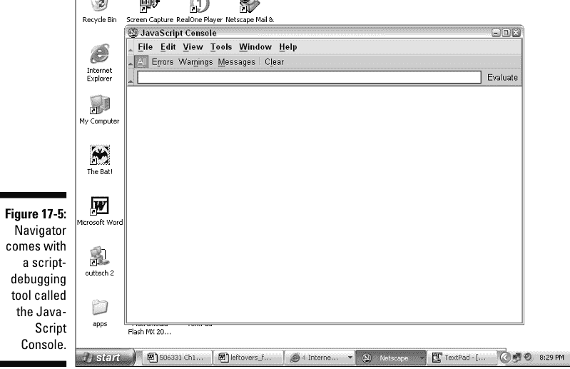

如图 17-6 所示，在 error.htm 文件的第 4 行检测到一个 JavaScript 错误。

如果你查看 error.htm（在附带的光盘上可以找到副本），你会看到这段 HTML/JavaScript 代码：

```html
<HTML>
<HEAD>
<SCRIPT LANGUAGE="JavaScript" TYPE="text/javascript">
alert("This is a " + problem);
```

图 17-6 所示的 JavaScript 控制台消息为：`problem is not defined`。而且，如果你数到第 4 行，你会发现变量 `problem` 在在使用之前没有定义。（你可以在第 3 章学习如何定义变量）。

- 直接在控制台的评估字段中输入 JavaScript 代码。你可以直接在 JavaScript 控制台上的评估字段中输入 JavaScript 代码，并点击“评估（Evaluate）”按钮获取即时反馈。请看图 17-7。


图 17-7：直接在控制台中输入 JavaScript 可以获得即时反馈。

#### Microsoft Internet Explorer 的内置错误显示

当将包含 JavaScript 错误的 Web 页面加载到 Internet Explorer 时，可以在屏幕左下角的状态栏中看到一个图标。双击弹出窗口将显示 JavaScript 错误——以及修复该错误的行。查看图 17-8 以了解我

图 17-8 显示 Internet Explorer 在 HTML 文件的第 4 行遇到了一个错误：即 `problem` 未定义。

果然，如果你查看以下 HTML 代码（在附带的光盘上可以找到错误文件 `error.htm` 的副本），你会发现第 4 行引用了一个名为 `problem` 的未定义变量。（我在第 3 章中演示了如何定义变量。）

```html
<html>
<HEAD>
<SCRIPT LANGUAGE="JavaScript" TYPE="text/javascript">
alert("This is a " + + problem);
...
```

图 17-8：双击状态栏图标显示 JavaScript 错误。

## 附录 A：JavaScript 保留字

附录中列出的单词对于当前版本的 Navigator 和 Internet Explorer 中实现的 JavaScript 解释器具有特殊含义（或为未来版本保留）。如果你尝试使用这些单词中的任何一个执行其设计用途之外的操作，JavaScript 解释器会在你尝试运行脚本时生成错误。例如，不要尝试使用这些单词中的任何一个来命名变量、函数、方法或对象。除了附录中列出的保留字外，在命名自己的变量和函数时，现有对象、属性和方法也是被禁止的。例如，JavaScript 解释器会忽略名为 `toString()` 的自定义函数——这是一个现有方法的名称。附录 C 列出了许多现有的 JavaScript 对象、属性和方法。

- abstract
- boolean
- break
- byte
- case
- catch
- char
- class
- comment
- const
- continue
- debugger
- default
- delete
- do
- else
- enum
- export
- extends
- false
- final
- finally
- float
- for
- function
- goto
- if
- implements
- import
- in
- instanceof
- int
- interface
- label
- long
- native
- new
- null
- package
- private
- protected
- public
- return
- short
- static
- super
- switch
- synchronized
- throw
- try
- typeof
- void
- while
- with

## 附录 B：JavaScript 颜色

附录提供了预定义颜色的字母顺序列表，你可以在 JavaScript 中使用的这些颜色具有十六进制值：

```javascript
document.write(aqua")
```

为了确保你页面中的颜色显示正确，可以使用以下颜色组合：

| 颜色 | 十六进制值 |
|---|---|
| aliceblue | #F0F8FF |
| antiquewhite | #FAEBD7 |
| aqua | #00FFFF |
| aquamarine | #70FFEA |
| azure | #FFFFFF |
| beige | #F5F5DC |
| bisque | #FFE4C4 |
| black | #000000 |
| blanchedalmond | #FFEBCD |
| blue | #0000FF |
| blueviolet | #8A2BE2 |
| brown | #A52A2A |
| burlywood | #DEB887 |
| cadetblue | #5F9EA0 |
| chartreuse | #7FFF00 |
| chocolate | #D2691E |
| coral | #FF7F50 |
| cornflowerblue | #6495ED |
| cornsilk | #FFF8DC |
| crimson | #DC143C |
| cyan | #00FFFF |
| darkblue | #00008B |
| darkcyan | #008B8B |
| darkgoldenrod | #B8860B |
| darkgray | #A9A9A9 |
| darkgreen | #006400 |
| darkkhaki | #BDB76B |
| darkmagenta | #8B008B |
| darkolivegreen | #556B2F |
| darkorange | #FF8C00 |
| darkorchid | #9932CC |
| darkred | #8B0000 |
| darksalmon | #E9967A |
| darkseagreen | #8FBC8F |
| darkslateblue | #483D8B |
| darkslategray | #2F4F4F |
| darkturquoise | #00CED1 |
| darkviolet | #9400D3 |
| deeppink | #FF1493 |
| deepskyblue | #00BFFF |
| dimgray | #696969 |
| dodgerblue | #1E90FF |
| firebrick | #B22222 |
| floralwhite | #FFFAF0 |
| forestgreen | #228B22 |
| fuchsia | #FF00FF |
| gainsboro | #DCDCDC |
| ghostwhite | #F8F8FF |
| gold | #FFD700 |
| goldenrod | #DAA520 |
| gray | #808080 |
| green | #008000 |
| greenyellow | #ADFF2F |
| honeydew | #F0FFF0 |
| hotpink | #FF69B4 |
| indianred | #CD5C5C |
| indigo | #4B0082 |
| ivory | #FFFFF0 |
| khaki | #F0E68C |
| lavender | #E6E6FA |
| lavenderblush | #FFF0F5 |
| lawngreen | #7CFC00 |
| lemonchiffon | #FFFACD |
| lightblue | #ADD8E6 |
| lightcoral | #F08080 |
| lightcyan | #E0FFFF |
| lightgoldenrodyellow | #FAFAD2 |
| lightgreen | #90EE90 |
| lightgray | #D3D3D3 |
| lightpink | #FFB6C1 |
| lightsalmon | #FFA07A |
| lightseagreen | #20B2AA |
| lightskyblue | #87CEFA |
| lightslategray | #778899 |
| lightsteelblue | #B0C4DE |
| lightyellow | #FFFFE0 |
| lime | #00FF00 |
| limegreen | #32CD32 |
| linen | #FAF0E6 |
| magenta | #FF00FF |
| maroon | #800000 |
| mediumaquamarine | #66CDAA |
| mediumblue | #0000CD |
| mediumorchid | #BA55D3 |
| mediumpurple | #9370DB |
| mediumseagreen | #3CB371 |
| mediumslateblue | #7B68EE |
| mediumspringgreen | #00FA9A |
| mediumturquoise | #48D1CC |
| mediumvioletred | #C71585 |
| midnightblue | #191970 |
| mintcream | #F5FFFA |
| mistyrose | #FFE4E1 |
| moccasin | #FFE4B5 |
| navajowhite | #FFDEAD |
| navy | #000080 |
| oldlace | #FDF5E6 |
| olive | #808000 |
| olivedrab | #6B8E23 |
| orange | #FFA500 |
| orangered | #FF4500 |
| orchid | #DA70D6 |
| palegoldenrod | #EEE8AA |
| palegreen | #98FB98 |
| paleturquoise | #AFEEEE |
| palevioletred | #DB7093 |
| papayawhip | #FFEFD5 |
| peachpuff | #FFDAB9 |
| peru | #CD853F |
| pink | #FFC0CB |
| plum | #DDA0DD |
| powderblue | #B0E0E6 |
| purple | #800080 |
| red | #FF0000 |
| rosybrown | #BC8F8F |
| royalblue | #4169E1 |
| saddlebrown | #8B4513 |
| salmon | #FA8072 |
| sandybrown | #F4A460 |
| seagreen | #2E8B57 |
| seashell | #FFF5EE |
| sienna | #A0522D |
| silver | #C0C0C0 |
| skyblue | #87CEEB |
| slateblue | #6A5ACD |
| slategray | #708090 |
| snow | #FFFAFA |
| springgreen | #00FF7F |
| steelblue | #4682B4 |
| tan | #D2B48C |
| teal | #008080 |
| thistle | #D8BFD8 |
| tomato | #FF6347 |
| turquoise | #40E0D0 |
| violet | #EE82EE |
| wheat | #F5DEB3 |
| white | #FFFFFF |
| whitesmoke | #F5F5F5 |
| yellow | #FFFF00 |
| yellowgreen | #9ACD32 |

## 附录 C：文档对象模型参考

你可以将此附录看作是一个按字母排序的快速查阅表，列出了你在 JavaScript 中交互的文档对象模型的大部分对象、属性、方法和事件处理器（JavaScript 中可用的内置函数也列在本文附录的后半部分）。

> 实现文档对象模型的厂商们——Netscape 和微软——显然有理由让某些而非所有对象名称以大写字母开头！JavaScript 是一种大小写敏感的语言，这意味着如果对象以小写（或大写）字母开头，你必须以那种方式访问它。

### 文档对象模型

我按照对象按字母顺序对文档对象模型 (DOM) 进行了组织。如果你需要查找特定的属性或方法——例如 `prompt()` ——并且不知道它属于哪个对象，可以快速查看本书书末尾的索引。

本附录尽可能地保持了最新状态，但由于新浏览器版本的定期发布（它们可能会实现略有不同的 DOM），你可能会发现浏览器支持的 DOM 与此处列出的之间存在细微差异。事实上，Netscape 和 Internet Explorer 都已承诺继续修改它们的 DOM，直到它们符合 ECM 标准，并让开发者可以信赖两个浏览器中相同的对象存在且行为完全相同——但那一天尚未到来。关于对象实现的最终定论，包括对本文附录中找到的任何元素的详细描述，请访问 Netscape 和微软的网站。

Internet Explorer 的 DOM：

`http://msdn.microsoft.com/workshop/author/html/reference/objects.asp`

Netscape Navigator 的 DOM：

`http://dev.netscape.com/library/manuals/`

#### Anchor

- 描述：HTML 锚点。
- 创建：`<A name="...">`
- 访问方式：`document.anchors`
- 属性：`name`

#### Area

- 描述：HTML 热点。
- 创建：`<AREA name="...">`
- 访问方式：`document`

#### Applet

- 描述：页面中的 Applet。
- 创建：`<APPLET name="...">`
- 访问方式：`document.applets`
- 属性：`name`

#### arguments

- 描述：传递给函数的参数集合。
- 创建：`arguments`
- 访问方式：`function`

#### Array

- 描述：数组集合。
- 创建：`Array()`
- 访问方式：`document`
- 属性：`length`

#### Boolean

- 描述：布尔值。
- 创建：`Boolean(value)`
- 访问方式：`document`
- 属性：`constructor`

#### Button

- 描述：HTML 中的按钮。
- 创建：`<button name="...">`
- 访问方式：`document`
- 属性：`name`, `type`

#### Checkbox

- 描述：HTML 表单中的复选框。
- 创建：`<input type="checkbox" name="...">`
- 访问方式：`document`
- 属性：`checked`, `defaultChecked`, `form`, `name`

#### clientInformation

- 描述：浏览器配置详细信息。仅 Internet Explorer 支持。
- 创建：自动创建。
- 访问方式：`window`
- 属性：`appCode`, `appMinorVersion`, `appName`, `appVersion`, `browserLanguage`, `cookieEnabled`, `cpuClass`, `onLine`, `platform`, `systemLanguage`, `userAgent`, `userLanguage`, `userProfile`

#### crypto

- 描述：定义可以使用实现数字签名的加密方法。仅 Netscape Navigator 支持。
- 创建：自动创建。
- 访问方式：`window`
- 方法：`random()`, `signText()`

#### Date

- 描述：用于创建、操作和格式化日期值的对象。
- 创建：
```
aDate = new Date()
aDate = new Date(milliseconds)
aDate = new Date(dateString)
aDate = new Date(yr_num, mo_num, day_num, [hr_num, min_num, sec_num, ms_num])
```
- 访问方式：`constructor`, `prototype`
- 属性：
- 方法：`getDate()`, `getDay()`, `getFullYear()`, `getHours()`, `getMilliseconds()`, `getMinutes()`, `getMonth()`, `getSeconds()`, `getTime()`, `getTimezoneOffset()`, `getUTCDate()`, `getUTCDay()`, `getUTCFullYear()`, `getUTCHours()`, `getUTCMilliseconds()`, `getUTCMinutes()`, `getUTCMonth()`, `getUTCSeconds()`, `getYear()`, `parse()`, `setDate()`, `setFullYear()`, `setHours()`, `setMilliseconds()`, `setMinutes()`, `setMonth()`, `setSeconds()`, `setTime()`, `setUTCDate()`, `setUTCFullYear()`, `setUTCHours()`, `setUTCMilliseconds()`, `setUTCMinutes()`, `setUTCMonth()`, `setUTCSeconds()`, `setYear()`, `toGMTString()`, `toLocaleString()`, `toSource()`, `toString()`, `toUTCString()`, `UTC()`, `valueOf()`

#### document

- 描述：当前加载的 HTML 文档；提供了向用户显示 HTML 输出的方法。
- 创建：`<BODY> . . </BODY>`
- 访问方式：`window.document` (或 `document`)
- 属性：`alinkColor`, `anchors[]`, `applets[]`, `bgColor`, `cookie`, `domain`, `embeds`, `fgColor`, `formName`, `forms[]`, `images[]`, `lastModified`, `linkColor`, `links[]`, `plugins`, `referrer`, `title`, `URL`, `vlinkColor`
- 仅限 Netscape Navigator：`classes`, `height`, `ids`, `tags`, `width`
- 仅限 Internet Explorer：`activeElement[]`, `charset`, `children[]`, `defaultCharset`, `expando`, `parentWindow`, `readyState`
- 方法：`close()`, `handleEvent()`, `open()`, `write()`, `writeln()`
- 仅限 Netscape Navigator：`captureEvents()`, `contextual()`, `getSelection()`, `releaseEvents()`, `routeEvent()`
- 仅限 Internet Explorer：`elementFromPoint()`
- 事件处理器：`onClick`, `onDblClick`, `onKeyDown`, `onKeyUp`, `onMouseDown`, `onMouseUp`

#### elements[]

- 描述：HTML 文档中包含的表单元素的集合。
- 创建：`<FORM NAME="formName"> . .</FORM>`
- 访问方式：`document.formName.elements[]`
- 属性：`defaultChecked`, `defaultValue`, `form`, `length`, `name`, `options[]`, `selectedIndex`, `type`, `value`
- 方法：`blur()`, `click()`, `focus()`, `select()`
- 事件处理器：`onBlur`, `onChange`, `onClick`, `onFocus`

#### event

- 描述：JavaScript 中多个预定义事件之一，例如鼠标点击、文本输入或文档加载。当事件发生时，此对象会自动作为参数传递给事件处理器。
- 创建：由浏览器自动创建。
- 访问方式：`window.event`（或直接使用 `event`）
- 属性（仅限 Netscape Navigator）：`data`, `height`, `modifiers`, `pageX`, `pageY`, `screenX`, `screenY`, `target`, `type`, `which`, `width`
- 属性（仅限 Internet Explorer）：`altKey`, `button`, `cancelBubble`, `clientX`, `clientY`, `ctrlKey`, `fromElement`, `keyCode`, `offsetX`, `offsetY`, `reason`, `returnValue`, `screenX`, `screenY`, `shiftKey`, `srcElement`, `srcFile`, `toElement`, `type`, `x`, `y`
- 方法：无
- 事件处理器：无

#### FileUpload

- 描述：HTML 表单上的文件上传元素。（文件上传元素允许用户选择或指定文件作为 Web 应用程序的输入。）
- 创建：`<FORM NAME="formName"> . . <INPUT TYPE="file" NAME="fileUploadName"> . </FORM>`
- 访问方式：`document.formName.fileUploadName` 或 `formName[i]`
- 属性：`form`, `name`, `type`, `value`
- 方法：`blur()`, `handleEvent()`, `select()`
- 事件处理器：`onBlur`, `onChange`, `onFocus`

#### Form

- 描述：一个 HTML 表单。HTML 表单允许用户输入文本并与复选框、单选按钮、选择列表等元素交互。表单可以配置为用户提交表单时自动将数据提交到 Web 服务器。
- 创建：`<FORM NAME="formName"> . . </FORM>`
- 访问方式：`document.formName`
- 属性：`action`, `elements[]`, `encoding`, `length`, `name`, `target`
- 方法：`handleEvent()`, `reset()`, `submit()`
- 事件处理器：`onChange`, `onSubmit`

#### Frame

- 描述：一个 HTML 显示框架。
- 创建：`<FRAME> . . . </FRAME>`
- （见 window。）

#### Function

- 描述：由 JavaScript 解释器预处理的一段 JavaScript 代码块。
- 创建：`new Function ([arg1, arg2[, . . . argN]], functionBody) or function functionName([param, param[, . . . param]], { statements })`
- 访问方式：`functionName`
- 属性：`arguments[]`, `arity`, `caller`, `length`, `prototype`
- 方法：`apply()`, `call()`, `toSource()`, `toString()`, `valueOf()`
- 事件处理器：无

#### Hidden

- 描述：一个不显示的 HTML 表单字段，用于向 Web 服务器持有并传输计算后的值。
- 创建：`<FORM NAME="formName"> . . . <INPUT TYPE="hidden" NAME="hiddenName" . . . </FORM>`
- 访问方式：`document.formName.hiddenName` 或 `formName.elements[i]`
- 属性：`form`, `name`, `type`, `value`
- 方法：无

#### History

- 描述：用户访问过的 URL 集合。
- 创建：由浏览器自动创建。
- 访问方式：`window.history`, `frame.history`, 或直接使用 `history`
- 属性：`current`, `length`, `next`, `previous`
- 方法：`back()`, `forward()`, `go()`
- 事件处理器：无

#### Image

- 描述：HTML 文档中包含的图像。
- 创建：``
- 访问方式：
```
document.imageName
document.images[i]
document.images.length
```
- 属性：`border`, `complete`, `height`, `hspace`, `lowsrc`, `name`, `src`, `vspace`, `width`
- 方法：`handleEvent()`
- 事件处理器：`onAbort`, `onError`, `onKeyDown`, `onKeyUp`, `onLoad`

#### java

- 描述：用于访问包 `java.*` 中任何 Java 类的顶层对象。
- 创建：由支持 Java 的浏览器自动创建。
- （见 JavaPackage。）

#### JavaArray

- 描述：Java 数组的 JavaScript 表示。
- 创建：返回数组的 Java 方法。
- 访问方式：通过调用单个 Java Applet 定义的方法。
- 属性：`length`
- 方法：`toString()`
- 事件处理器：无

#### JavaClass

- 描述：Java 类的 JavaScript 表示。
- 创建：由支持 Java 的浏览器自动创建。
- （见 JavaPackage。）

#### JavaObject

- 描述：Java 对象的 JavaScript 表示。
- 创建：任何返回对象类型的 Java 方法。
- 访问方式：通过调用单个 Java Applet 定义的方法。
- 属性：由单个 Java Applet/方法决定。
- 方法：由单个 Java Applet/方法决定。
- 事件处理器：无

#### JavaPackage

- 描述：Java 包的 JavaScript 表示。
- 创建：由支持 Java 的浏览器自动创建。
- 访问方式：通过调用单个 Java Applet 定义的方法。
- 属性：由单个 Java Applet/方法决定。
- 方法：由单个 Java Applet/方法决定。
- 事件处理器：无

#### Link

- 描述：HTML 文档中的超文本链接。
- 创建：`<A>`, 或 `document.link()`
- 访问方式：`document.links[i]`, `document.links.length`
- 属性：`hash`, `host`, `href`, `pathname`, `text`, `x`, `y`
- 方法：`handleEvent()`
- 事件处理器：无

#### location

- 描述：当前加载的 URL。
- 创建：由浏览器自动创建。
- 访问方式：`window.location`（或直接使用 `location`）
- 属性：`hash`, `host`, `pathname`, `port`, `search`
- 方法：`reload()`, `replace()`
- 事件处理器：无

#### Math

- 描述：包含数学常量和函数的内置对象。
- 创建：由浏览器自动创建。
- 访问方式：`Math`
- 属性：`E`, `LN10`, `LN2`, `LOG10E`, `LOG2E`, `PI`, `SQRT1_2`, `SQRT2`
- 方法：`abs()`, `acos()`, `asin()`, `atan()`, `atan2()`, `ceil()`, `cos()`, `exp()`, `floor()`, `log()`, `log10()`, `max()`, `min()`, `pow()`, `random()`, `round()`, `sin()`, `sqrt()`, `tan()`
- 事件处理器：无

#### MIMEType / MimeType

- 描述：浏览器支持的 MIME 类型（例如 .pdf）。
- 创建：由 Netscape Navigator 自动创建。
- 访问方式：
```
navigator.mimeTypes[i]
navigator.mimeTypes["type"]
navigator.plugins[i].mimeTypes[j]
navigator.mimeTypes.length
```
- 属性：`description`, `enabledPlugin`, `suffixes`, `type`
- 方法：无
- 事件处理器：无

#### navigator

- 描述：浏览器配置详情。
- 创建：由浏览器自动创建。
- 访问方式：`window.navigator`（或直接使用 `navigator`）
- 属性：`appCodeName`, `appName`, `appVersion`, `language`, `mimeTypes`, `plugins`, `userAgent`
- 方法：`javaEnabled()`, `plugins.refresh()`, `preference()`, `savePreferencesEnabled()`
- 事件处理器：无

#### netscape

- 描述：用于访问包 `netscape.*` 下任何 Java 类的顶层对象。
- 创建：由 Netscape Navigator 自动创建。
- （见 JavaPackage。）

#### Number

- 描述：原始数值值的 JavaScript 对象包装器。
- 创建：`aNumber = new Number(value)`
- 访问方式：`aNumber`
- 属性：`constructor`, `MAX_VALUE`, `MIN_VALUE`, `NaN`, `NEGATIVE_INFINITY`, `POSITIVE_INFINITY`, `prototype`
- 方法：`toSource()`, `toString()`, `valueOf()`
- 事件处理器：无

#### Object

- 描述：所有其他对象均派生自的原始 JavaScript 对象类型。
- 创建：
```
anObject = new Object() or anotherObject = new Object(anObject)
```
- 访问方式：`anObject`, `anotherObject`
- 属性：`constructor`, `prototype`
- 方法：`eval()`, `toSource()`, `toString()`, `unwatch()`, `valueOf()`, `watch()`
- 事件处理器：无

#### Option

- 描述：HTML 选择列表中的一个选项。
- 创建：`<FORM NAME="formName"><SELECT NAME="selectName"><OPTION></SELECT></FORM>` 或 `new Option([text, value[, defaultSelected[, selected]]])`
- 访问方式：`document.formName.select.options[i]`
- 属性：`defaultSelected`, `index`, `length`, `selected`, `text`, `value`
- 方法：无
- 事件处理器：无

#### Packages

- 描述：一个顶层对象，用于在 JavaScript 代码中访问 Java 类。
- 创建：由支持 Java 的浏览器自动创建。
- 访问方式：取决于 Java 包。
- 属性：`className`, `java`, `netscape`, `sun`
- 方法：取决于 Java 包。
- 事件处理器：无

#### Password

- 描述：包含在 HTML 表单中的密码字段。当用户在密码字段中输入文本时，星号 (`*`) 会隐藏这些内容。
- 创建：`<FORM NAME="formName"> . . <INPUT TYPE="password" NAME="passwordName"> . . </FORM>`
- 访问方式：`document.formName.passwordName` or `formName.elements[i]`
- 属性：`defaultValue`, `form`, `name`, `type`, `value`
- 方法：`blur()`, `focus()`, `handleEvent()`, `select()`
- 事件处理器：`onBlur`, `onFocus`

#### Plugin

- 描述：安装在 Netscape Navigator 中的插件应用模块。
- 创建：Netscape Navigator（在安装浏览器插件时）。
- 访问方式：`navigator.plugins[i]`
- 属性：`description`, `filename`, `length`, `name`
- 方法：无
- 事件处理器：无

#### Radio

- 描述：包含在 HTML 表单中的一组单选按钮中的一个单选按钮。用户可以使用一组单选按钮从列表中选择一项。
- 创建：`<FORM NAME="formName"> . . <INPUT TYPE="radio" NAME="radioName"> . . </FORM>`
- 访问方式：`document.formName.radioName` or `formName.elements[i]`
- 属性：`checked`, `defaultChecked`, `form`, `name`, `type`, `value`
- 方法：`blur()`, `click()`, `focus()`, `handleEvent()`
- 事件处理器：`onBlur`, `onClick`, `onFocus`

#### RegExp

- 描述：包含正则表达式的模式。此对象提供了属性和方法，用于使用正则表达式在字符串中查找和替换匹配。
- 创建：`/pattern/flags` 或 `new RegExp("pattern"[, "flags"])`
- 访问方式：正则表达式是棘手的。你将正则表达式用于模式匹配应用程序。以下是一个示例：
```
<SCRIPT LANGUAGE="JavaScript1.2">
RegularExpression = /(\w+)(\w+)/;
oldString="John Smith";newString=oldString.replace(RegularExpression, "$2, $1");
document.write(newString)
</SCRIPT>
```
(此脚本显示 Smith, John。)
欲了解信息，请访问此页面：
`http://developer.netscape.com/docs/manuals/js/client/jsref/regexp.htm`
- 属性：`$1` ... `$9`, `constructor`, `global`, `ignoreCase`, `input`, `lastIndex`, `lastMatch`, `lastParen`, `leftContext`, `multiline`, `prototype`, `rightContext`, `source`
- 方法：`compile()`, `exec()`, `test()`, `toSource()`, `toString()`, `valueOf()`
- 事件处理器：无

#### Reset

- 描述：HTML 表单上的重置按钮。此按钮将表单中的所有元素重置为默认值。
- 创建：`<FORM NAME="formName"> . . <INPUT TYPE="reset" NAME="resetName"> . . </FORM>`
- 访问方式：`document.formName.resetName` or `formName.elements[i]`
- 属性：`form`, `name`, `type`, `value`
- 方法：`blur()`, `click()`, `focus()`, `handleEvent()`
- 事件处理器：`onBlur`, `onClick`, `onFocus`

#### screen

- 描述：包含描述屏幕（显示器）和颜色的属性。
- 创建：由浏览器自动创建。
- 访问方式：`availHeight`, `availLeft`, `availTop`, `availWidth`, `colorDepth`, `height`, `pixelDepth`, `width`
- 方法：无
- 事件处理器：无

#### Select

- 描述：包含在 HTML 表单中的选择列表。根据列表的创建方式，用户可以从列表中选择一个或多个项目。
- 创建：`<FORM NAME="formName"><SELECT NAME="selectName"></SELECT></FORM>`
- 访问方式：`document.formName.selectName` or `formName.elements[i]`
- 属性：`form`, `length`, `name`, `options`, `selectedIndex`, `type`
- 方法：`blur()`, `focus()`, `handleEvent()`
- 事件处理器：`onBlur`, `onChange`, `onFocus`

#### String

- 描述：表示一系列由引号界定的字符的对象。
- 创建：`aString = new String("value")` 或 `aString = "value"`
- 访问方式：`aString`
- 属性：`constructor`, `length`, `prototype`
- 方法：`anchor()`, `big()`, `blink()`, `bold()`, `charAt()`, `charCodeAt()`, `concat()`, `fixed()`, `fontcolor()`, `fontsize()`, `fromCharCode()`, `indexOf()`, `italics()`, `lastIndexOf()`, `link()`, `match()`, `replace()`, `search()`, `slice()`, `small()`, `split()`, `strike()`, `sub()`, `substr()`, `substring()`, `sup()`, `toLowerCase()`, `toSource()`, `toString()`, `toUpperCase()`, `valueOf()`
- 事件处理器：无

#### Style

- 描述：指定 HTML 元素样式的对象。
- 创建：`document.classes.tagName` 或 `document.context()`
- 访问方式：查看以下页面：
`http://developer.netscape.com/docs/manuals/js/communicator/dynhtml/index.htm`
- 属性（仅限 Navigator）：

#### Submit

- 描述：包含在 HTML 表单中的提交按钮。此按钮发送要处理的信息。
- 创建：`<FORM NAME="formName"> . . <INPUT TYPE="submit" NAME="submitName" . . </FORM>`
- 访问方式：`document.formName.submitName` or `formName.elements[i]`
- 属性：`form`, `name`, `type`, `value`
- 方法：`blur()`, `focus()`, `handleEvent()`
- 事件处理器：`onBlur`, `onClick`, `onFocus`

#### sun

- 描述：用于访问 `sun` 包中任何 Java 类的顶层对象。
- 创建：由支持 Java 的浏览器自动创建。
- 访问方式：`Packages.sun`
- （参见 Packages。）

#### Text

- 描述：包含在 HTML 表单中的文本字段。
- 创建：`<FORM NAME="formName"> . . <INPUT TYPE="text" NAME="txtName"> . . </FORM>`
- 访问方式：`document.formName.txtName` or `formName.elements[i]`
- 属性：`defaultValue`, `form`, `name`, `type`, `value`
- 方法：`blur()`, `focus()`, `handleEvent()`, `select()`
- 事件处理器：`onBlur`, `onChange`, `onFocus`, `onSelect`

#### TextArea

- 描述：包含在 HTML 表单中的文本区域（多行文本输入字段）。
- 创建：`<FORM NAME="formName"><TEXTAREA NAME="textarea"> . . </TEXTAREA></FORM>`
- 访问方式：`document.formName.textareaName` or `formName.elements[i]`
- 属性：`defaultValue`, `form`, `name`, `type`, `value`
- 方法：`blur()`, `focus()`, `handleEvent()`, `select()`
- 事件处理器：`onBlur`, `onChange`, `onFocus`, `onSelect`

#### window

- 描述：浏览器窗口或帧。
- 创建：
```
<BODY>
<FRAMESET>
<FRAME NAME="frameName">
window.open("windowName")
</FRAMESET>
</BODY>
```
- 访问方式：
  - `self`
  - `window`
  - `window.frames[i]`
  - `window.frameName`
- 属性：`closed`, `defaultStatus`, `document`, `frames[]`, `history`, `length`, `location`, `Math`, `navigator`, `offscreenBuffering`, `opener`, `parent`, `screen`, `status`, `top`, `window`
- 仅限 Netscape Navigator：`crypto`, `innerHeight`, `innerWidth`, `java`, `locationbar`, `menubar`, `netscape`, `outerHeight`, `outerWidth`, `Packages`, `pageXOffset`, `pageYOffset`, `personalbar`, `screenX`, `screenY`, `scrollbars`, `statusbar`, `toolbar`
- 仅限 Internet Explorer：`clientInformation`, `event`
- 方法：`alert()`, `blur()`, `clearInterval()`, `clearTimeout()`, `close()`, `confirm()`, `focus()`, `moveBy()`, `moveTo()`, `prompt()`, `resizeBy()`, `resizeTo()`, `scroll()`, `scrollBy()`, `scrollTo()`, `setInterval()`, `setTimeout()`
- 仅限 Netscape Navigator：`atob()`, `back()`, `btoa()`, `captureEvents()`, `disableExternalCapture()`, `enableExternalCapture()`, `find()`, `forward()`, `handleEvent()`, `home()`, `print()`, `releaseEvents()`, `routeEvent()`, `sethotkeys()`, `setResizable()`, `setOptions()`, `stop()`
- 仅限 Internet Explorer：`navigate()`
- 事件处理器：`onBlur`, `onDragDrop`, `onError`, `onFocus`, `onLoad`, `onMove`, `onResize`, `onUnload`

### 全局属性

- `Infinity`
- `NaN` (不是数字)
- `Undefined`

### 内置 JavaScript 函数

#### escape()

- 描述：返回 ISO-Latin-1 字符集中参数的十六进制编码。`escape()` 函数及其反向函数 `unescape()` 通常用于从 JavaScript 脚本安全地发送特殊字符到另一个程序（例如 Java applet）。例如，可以使用 `escape()` 函数对特殊字符进行编码，并将结果发送到另一个程序，该程序可以使用等同于 `escape()` 函数的方法解码该字符——反之亦然。（如果不使用此编码过程发送特殊字符可能会导致错误。你可以将 ISO-Latin-1 字符集理解为许多编程语言都能理解的最小公约数语言。）
- 语法：`escape("valueToBeEncoded")`
- 示例：
```
escape("&") // 返回 & 的十六进制等值，即 "%26"
```

#### eval()

- 描述：在不引用特定对象的情况下评估 JavaScript 代码字符串。
- 语法：`eval("value")` 其中 `value` 是表示 JavaScript 表达式、语句或系列语句的字符串。该表达式可以包含现有对象的变量和属性。
- 示例：
```
eval(new String("2+2")) // 返回一个包含 "2+2" 的 String 对象
```

#### isFinite()

- 描述：评估参数以确定其是否为有限数字。如果参数是 NaN、正无穷或负无穷，此方法返回 false；否则返回 true。
- 语法：`isFinite(value)`
- 示例：
```
isFinite(123) // 返回 true
```

#### isNaN()

- 描述：评估参数以确定其是否不是一个数字。如果传递的是 NaN 则返回 true，否则返回 false。
- 语法：`isNaN(value)`
- 示例：
```
isNaN(123) // 返回 false
```

#### Number()

- 描述：将指定的对象转换为数字。
- 语法：`Number(anObject)`
- 示例：
```
alert(Number(d)) // 显示一个包含 "819199440000." 的对话框
```

#### parseFloat()

- 描述：解析字符串参数并返回浮点数。
- 语法：`parseFloat("value")`
- 示例：
```
var x = "3.14" // 返回 3.14
```

#### parseInt()

- 描述：解析字符串参数并返回指定进制或基数的整数。（如果未提供进制，则假设基数为 10。）
- 语法：`parseInt(string[, radix])`
- 示例：
```
parseInt("1111", 2) // 返回 15
parseInt("15", 10) // 返回 15
```

#### String()

- 描述：将指定的对象转换为字符串。
- 语法：`String(anObject)`
- 示例：
```
aDate = new Date();
alert(String(aDate)) // 显示 "Thu Aug 18 04:37:00 GMT 0000"
```


### encode()

**描述：** 为数据元素或脚本添加编码。对元素进行编码可以防止其在未经用户许可的情况下传递给服务器。

**语法：** `encode(element)` 其中 `elementName` 是属性、变量或对象。如果省略，`encode` 将被添加到脚本本身。

**示例：**

```
encode(window.default)
```

### unescape()

**描述：** 返回指定十六进制值的 ASCII 字符串。

**语法：** `unescape("value")` 其中 `value` 是字符串。

**示例：**

```
unescape("%26") // 返回 &
```

### decode()

**描述：** 返回指定的十六进制值的 ASCII 字符串。

**语法：** `decode(element)` 其中 `elementName` 是属性、变量或对象。

**示例：**

```
decode(window.default)
```

# 附录 D：特殊字符

有时在字符串中需要表示特殊字符。由于不使用此编码过程发送特殊字符可能会导致错误。你可以将 ISO-Latin-1 字符集理解为许多编程语言都能理解的最小公约数语言。

以下是常用的特殊字符：

| 字符 | JavaScript 转义字符 | Unicode |
| :--- | :--- | :--- |
| 单引号 | `\'` | `\u0027` |
| 反斜线 | `\\` | `\u005C` |
| 退格符 | `\b` | `\u0008` |
| 回车 | `\r` | `\u000D` |
| 双引号 | `\"` | `\u0022` |
| 换页 | `\f` | `\u000C` |
| 换行 | `\n` | `\u000A` |
| 制表符 | `\t` | `\u0009` |

八进制、十六进制和 Unicode 的其他特殊字符见以下列表：

| 八进制 | 十六进制 | Unicode | 描述 | 字符 |
| :--- | :--- | :--- | :--- | :--- |
| `\240` | `\xA0` | `\u00A0` | 不换行空格 |  |
| `\241` | `\xA1` | `\u00A1` | 反感叹号 | ¡ |
| `\242` | `\xA2` | `\u00A2` | 美分符号 | ¢ |
| `\243` | `\xA3` | `\u00A3` | 英镑符号 | £ |
| `\244` | `\xA4` | `\u00A4` | 通用货币符号 | ¤ |
| `\245` | `\xA5` | `\u00A5` | 日元符号 | ¥ |
| `\246` | `\xA6` | `\u00A6` | 断开竖线 | ¦ |
| `\247` | `\xA7` | `\u00A7` | 节符号 | § |
| `\250` | `\xA8` | `\u00A8` | 分音或变音符号 | ¨ |
| `\251` | `\xA9` | `\u00A9` | 版权符号 | © |
| `\252` | `\xAA` | `\u00AA` | 女性序数 | ª |
| `\253` | `\xAB` | `\u00AB` | 左双角括号 | « |
| `\254` | `\xAC` | `\u00AC` | 逻辑非符号 | ¬ |

| 八进制 | 十六进制 | Unicode | 描述 | 字符 |
| :--- | :--- | :--- | :--- | :--- |
| `\255` | `\xAD` | `\u00AD` | 软连字符 |  |
| `\256` | `\xAE` | `\u00AE` | 注册符号 | ® |
| `\257` | `\xAF` | `\u00AF` | 长音符号 | ¯ |
| `\260` | `\xB0` | `\u00B0` | 度符号 | ° |
| `\261` | `\xB1` | `\u00B1` | 正负号 | ± |
| `\262` | `\xB2` | `\u00B2` | 上标二 | ² |
| `\263` | `\xB3` | `\u00B3` | 上标三 | ³ |
| `\264` | `\xB4` | `\u00B4` | 锐扬符号 | ´ |
| `\265` | `\xB5` | `\u00B5` | 微米符号 | µ |
| `\266` | `\xB6` | `\u00B6` | 段落符号 | ¶ |
| `\267` | `\xB7` | `\u00B7` | 中点 | · |
| `\270` | `\xB8` | `\u00B8` | 变音符号 | ¸ |
| `\271` | `\xB9` | `\u00B9` | 上标一 | ¹ |
| `\272` | `\xBA` | `\u00BA` | 男性序数指示符 | º |
| `\273` | `\xBB` | `\u00BB` | 右指向双角号 | » |
| `\274` | `\xBC` | `\u00BC` | 四分之一 | ¼ |
| `\275` | `\xBD` | `\u00BD` | 二分之一 | ½ |
| `\276` | `\xBE` | `\u00BE` | 四分之三 | ¾ |
| `\277` | `\xBF` | `\u00BF` | 反问号 | ¿ |

## 大写字母

| 八进制 | 十六进制 | Unicode | 描述 | 字符 |
| :--- | :--- | :--- | :--- | :--- |
| `\300` | `\xC0` | `\u00C0` | 带重音的 A | À |
| `\301` | `\xC1` | `\u00C1` | 带锐音符的 A | Á |
| `\302` | `\xC2` | `\u00C2` | 带抑扬符的 A | Â |
| `\303` | `\xC3` | `\u00C3` | 带波浪的 A | Ã |
| `\304` | `\xC4` | `\u00C4` | 带变音符号的 A | Ä |
| `\305` | `\xC5` | `\u00C5` | 带环的 A | Å |
| `\306` | `\xC6` | `\u00C6` | AE 连字 | Æ |
| `\307` | `\xC7` | `\u00C7` | 带变音符号的 C | Ç |
| `\310` | `\xC8` | `\u00C8` | 带重音的 E | È |
| `\311` | `\xC9` | `\u00C9` | 带锐音符的 E | É |
| `\312` | `\xCA` | `\u00CA` | 带抑扬符的 E | Ê |
| `\313` | `\xCB` | `\u00CB` | 带变音符号的 E | Ë |
| `\314` | `\xCC` | `\u00CC` | 带重音的 I | Ì |
| `\315` | `\xCD` | `\u00CD` | 带锐音符的 I | Í |
| `\316` | `\xCE` | `\u00CE` | 带抑扬符的 I | Î |
| `\317` | `\xCF` | `\u00CF` | 带变音符号的 I | Ï |
| `\320` | `\xD0` | `\u00D0` | 带斜划的 D | Ð |
| `\321` | `\xD1` | `\u00D1` | 带波浪的 N | Ñ |
| `\322` | `\xD2` | `\u00D2` | 带重音的 O | Ò |
| `\323` | `\xD3` | `\u00D3` | 带锐音符的 O | Ó |
| `\324` | `\xD4` | `\u00D4` | 带抑扬符的 O | Ô |
| `\325` | `\xD5` | `\u00D5` | 带波浪的 O | Õ |
| `\326` | `\xD6` | `\u00D6` | 带变音符号的 O | Ö |
| `\327` | `\xD7` | `\u00D7` | 乘法符号 | × |
| `\330` | `\xD8` | `\u00D8` | 带斜划的 O | Ø |
| `\331` | `\xD9` | `\u00D9` | 带重音的 U | Ù |
| `\332` | `\xDA` | `\u00DA` | 带锐音符的 U | Ú |
| `\333` | `\xDB` | `\u00DB` | 带抑扬符的 U | Û |
| `\334` | `\xDC` | `\u00DC` | 带变音符号的 U | Ü |
| `\335` | `\xDD` | `\u00DD` | 带锐音符的 Y | Ý |
| `\336` | `\xDE` | `\u00DE` | TH | Þ |

## 小写字母

| 八进制 | 十六进制 | Unicode | 描述 | 字符 |
| :--- | :--- | :--- | :--- | :--- |
| `\340` | `\xE0` | `\u00E0` | 带重音的 a | à |
| `\341` | `\xE1` | `\u00E1` | 带锐音符的 a | á |
| `\342` | `\xE2` | `\u00E2` | 带抑扬符的 a | â |
| `\343` | `\xE3` | `\u00E3` | 带波浪的 a | ã |
| `\344` | `\xE4` | `\u00E4` | 带变音符号的 a | ä |
| `\345` | `\xE5` | `\u00E5` | 带环的 a | å |
| `\346` | `\xE6` | `\u00E6` | ae 连字 | æ |
| `\347` | `\xE7` | `\u00E7` | 带变音符号的 c | ç |
| `\350` | `\xE8` | `\u00E8` | 带重音的 e | è |
| `\351` | `\xE9` | `\u00E9` | 带锐音符的 e | é |
| `\352` | `\xEA` | `\u00EA` | 带抑扬符的 e | ê |
| `\353` | `\xEB` | `\u00EB` | 带变音符号的 e | ë |
| `\354` | `\xEC` | `\u00EC` | 带重音的 i | ì |
| `\355` | `\xED` | `\u00ED` | 带锐音符的 i | í |
| `\356` | `\xEE` | `\u00EE` | 带抑扬符的 i | î |
| `\357` | `\xEF` | `\u00EF` | 带变音符号的 i | ï |
| `\360` | `\xF0` | `\u00F0` | 带斜划的 d | ð |
| `\361` | `\xF1` | `\u00F1` | 带波浪的 n | ñ |
| `\362` | `\xF2` | `\u00F2` | 带重音的 o | ò |
| `\363` | `\xF3` | `\u00F3` | 带锐音符的 o | ó |
| `\364` | `\xF4` | `\u00F4` | 带抑扬符的 o | ô |
| `\365` | `\xF5` | `\u00F5` | 带波浪的 o | õ |
| `\366` | `\xF6` | `\u00F6` | 带变音符号的 o | ö |
| `\367` | `\xF7` | `\u00F7` | 乘法符号 | ÷ |
| `\370` | `\xF8` | `\u00F8` | 带斜划的 o | ø |
| `\371` | `\xF9` | `\u00F9` | 带重音的 u | ù |
| `\372` | `\xFA` | `\u00FA` | 带锐音符的 u | ú |
| `\373` | `\xFB` | `\u00FB` | 带抑扬符的 u | û |
| `\374` | `\xFC` | `\u00FC` | 带变音符号的 u | ü |
| `\375` | `\xFD` | `\u00FD` | 带锐音符的 y | ý |
| `\376` | `\xFE` | `\u00FE` | TH | þ |
| `\377` | `\xFF` | `\u00FF` | 带变音符号的 y | ÿ |

# 附录 E：关于光盘

本附录介绍了随书附带光盘的内容，以及如何安装这些内容并运行示例。以下是为那些不及待的读者提供的内容预览：

- 书中出现的每个 HTML/JavaScript 列表的完整工作副本
- 丰富的 JavaScript 开发工具
- 示例中使用的音频和图像文件

## 如何充分利用此光盘

学习 JavaScript 的最佳方法是在阅读每个章节时加载脚本并与其交互。如果可行，我建议在拿起书之前（或者至少在读完四分之一之前）安装光盘的内容。这样，当你遇到书中某个列表时，就可以双击你已经安装的相应 HTML 文件进行练习！

尝试修改一行 JavaScript 代码并看看会发生什么。你不必担心，因为你可以随时从光盘重新安装。祝你愉快！

## 光盘内容

### Dreamweaver 试用版
Dreamweaver 是一款工业级 Web 开发工具，可运行在 Windows 和 Power Mac 上；它还与 Macromedia 的 Web 动画开发工具 Flash 配合使用。如需购买您自己的副本——或获取更多关于 Dreamweaver 的信息，请访问：

```
http://www.macromedia.com/software/dreamweaver/
```

### Macromedia HomeSite 30 天评用版
来自 Macromedia 的 HomeSite 是一款适用于 Windows 的 HTML 编辑器，具有许多让 Web 编程变得轻而易举的功能。你可以快速添加和检查标签、锚点以及格式化。你可以在此处找到更新：

```
http://www.macromedia.com/software/homesite
```

### Paint Shop Pro 评用版
JASC Inc. 的 Paint Shop Pro 是一款适用于 Windows 的图形查看和编辑工具。你可以在此处找到更新：

```
http://www.jasc.com/products/paintshoppro
```

### SmartMenus DHTML 菜单
来自 SmartMenus.org，这是一个快速、稳定的 DHTML 菜单创建工具，非商业性网站免费使用。使用条件和示例菜单请访问：

```
http://www.smartmenus.org/forum/
```

### Web Weaver 演示版
来自 McWeb Software 的 Web Weaver 是一款适用于 Windows 平台的专业 HTML 编辑器。“金牌”版本提供了拼写检查以及其他评用版中不包含的功能。详情请访问：

```
http://www.mcwebsoftware.com
```

## 如果你遇到问题（关于光盘的问题）

我尽力分享了可以在最低系统要求的电脑上运行的共享软件。遗憾的是，你的电脑配置可能不同，某些程序可能由于某些原因无法正常运行。

如果你在使用此光盘上的共享软件时遇到问题，最可能的两个问题是你的内存（RAM）不足，或者有其他程序正在运行影响了程序的安装或运行。如果你收到“内存不足”或“设置继续”等错误信息，请尝试以下建议，然后再次尝试使用软件：

- 关闭电脑上运行的所有防病毒软件。安装程序有时会模拟病毒活动，可能会让你的电脑错误地认为感染了病毒。
- 关闭所有正在运行的程序。运行的程序越多，留给其他程序的内存就越少。安装程序通常会更新文件和程序。因此，如果你保持其他程序运行，安装可能无法正常工作。
- 为你的电脑增加内存。诚然，这是一个激进且相当昂贵的步骤。然而，增加内存确实有助于提高电脑速度，并允许同时运行更多程序。

如果你在安装光盘中的项目时仍然遇到困难，请拨打 Wiley, Inc. 客户服务电话 800-762-2974（美国境外：317-572-3994），访问我们的网站 `http://www.wiley.com/techsupport`。Wiley 仅对安装和其他通用质量控制项目提供技术支持；有关应用程序本身的技术支持，请咨询程序的供应商或作者。

如需额外订单或请求其他 Wiley 产品的信息，请拨打 800-225-5945。

# 索引

### 符号

- `+`（加法运算符），51
- `&&`（“与”逻辑运算符），51
- `<>`（尖括号），263
- `*/`（星号、正斜杠），37
- `@`（符号），219
- `\`（反斜杠）、`+`（加号），219
- `()`（调用运算符），230
- `^`（脱字符符号），219
- `,` 函数，声明，42
- 优先级顺序，51
- `?`（条件运算符），51
- `[]`（方括号），38
- `-`（递减运算符），50
- `$`（美元符号），219
- `.`（点符号），219
- `==`、`!=`（相等性运算符），51
- `!`（感叹号），230
- `/`（正斜杠），219
- `/*`（正斜杠、星号），37
- `>`（大于），263
- `++`（递增运算符），50
- `<`（小于），263
- `%`（取模运算符），50
- `-`（负号运算符），51
- `||`（“或”逻辑运算符），51
- `;`（分号）
  - 表达式，检查，39
  - 优先级顺序，51
- `[]`（方括号），38
- `sun.*` 包，323
- 顶层 Java 类 (`java`)，312
- 加法运算符 (`+`)，51
- 地址输入，验证，216, 217–220
- 地址，Web
  - 准确性，列表，3
  - 当前加载 (`location`)，314
  - 在框架中打开，143
  - 已访问 (`history`)，312
- 广告，弹出式
  - `alert` 创建，79
  - 消息，230
  - 事件处理器，243–244
  - 软件阻止，147, 247
- `alert` 窗口，创建，79
- Allen, Dan (Tooltip 创建者)，211
- WebMenus (Software)
  - 站点地图，200
- America Online 浏览器，261
- 锚点超链接，304
- 锚点属性，153
- “与”逻辑运算符 (`&&`)，51
- 尖括号 (`<`)，263
- 动画，描述，157–161
  - 热点，168
  - 导航栏，168
  - 悬停效果，168–171
  - 图像系列，165–168
  - 支持，17
  - 开启/关闭图像，161–164
  - Web 页面，17
  - Web 站点，18
- applet 描述，157
- DOM 引用 (`applet`)，304
- 脚本附加到 HTML 文件，30–32
- HTML 文件，创建，25–28
- 脚本，创建，29
- 测试脚本，32–33
- 关于 JavaScript Web 页面，257
- 访问浏览器，123–134
- CSS 对象与 JavaScript，86
- Java 类 (`netscape`)，316
- 多个 Java 类 (`packages`)，317
- 书末的 CD，338
- 存档，新闻组，283
- TARGET 属性，153
- 参数，字符串
- 浮点数，解析和返回 (`parseFloat()`)，326
- 指定基数或基础 (`parseInt()`)，327
- DOM，305
- 函数，声明，42
- 数组数据，99
- ASCII 字符串，十进制编码 (`escape()`)，228
- 赋值运算符，描述，52
- 优先级，51
- 星号、正斜杠 (`*`)，37
- 符号 at，219
- JavaScript Cookie，132, 133
- 属性，76
- 边框图像，77
- 访问，12
- 配置细节 (`ClientInformation`)，307
- 配置 (`navigator`)，315–316
- 崩溃，283
- 常见兼容性错误，270–271
- JavaScript 支持，13, 16
- 对象由...，75, 96
- 问题，调试，281
- 运行，328
- 支持，DOM，303–304
- tooltip 格式化，201
- 窗口或框架 (`window`)，324
- 反斜杠、加号 (`\`、`+`)，219
- Baroudi, Carol (Internet For Dummies)，258
- Debbie (Bare Bones)，338
- 二元和一元运算符，50
- `_blank` 属性，153
- 闪烁文本，80
- 阻塞框架，154
- 弹出广告，147, 247
- 创建异常的块，250–252
- 模糊相关的事件处理器，聚焦，240, 243
- 用户输入，捕获，220, 221
- 布尔值，描述，99
- DOM，306
- 非数字 (`NaN`)，判断 (`isNaN()`)，222
- 计算错误，282
- 调用运算符 (`()`) 优先级，51
- 调用函数，描述，43
- 调用验证脚本，221
- 悬停时切换图像 (`swap()`)，176–177
- 级联样式表。CSS，大小写敏感，JavaScript，262
- `catch` 块，250–254, 284
- 分类，DOM (文档对象模型)，75–77
- CD，书末的
- 章节，338
- 使用 Mac OS，337–338
- 使用 Microsoft Windows，336–337
- 问题，处理，340
- 系统要求，336
- CDR Site Map Pro 2.1 工具，200
- CGI (通用网关接口)，描述，125–126
- 输入验证，216
- 路径，132
- 引号分隔的集合 (`string`)，321
- 有效输入，219
- HTML 表单中的复选框
- 模糊，240
- 更改，241, 245
- DOM，306–307
- 检查数据级别，222
- 设计，223
- 存在性，测试，224–225
- 完整形式，228–231
- 实现，231–238
- 数字，检查参数，82

- Cookie（续）
  - 设置（创建），131–133
  - 支持，确认，128–129
  - 浏览网站，61
  - 从你的视角查看，127–133
- 跨平台特性，61
- 相关的数字签名方法 (`crypto`)，370
- CSS（级联样式表）
  - 使用 JavaScript 访问，86
  - 使用时机，85–86
  - 定义，85–86
  - JavaScript，17
  - 菜单类，185
  - 侧边栏菜单，189
  - 提示框样式，205–206
  - 与 HTML5 使用，9
- 大括号 (`{}`)，38
- CVS 版本控制工具，276
- 异常处理，283–287
- Internet Explorer 工具，287, 290–291
- 隔离，275–276
- Navigator 工具，287–290
- 新闻组，咨询，282–283
- 排除法，280–282
- 地理编码，与之澄清需求，274
- 语句，拆分为较小的函数，279–280
- 试错法，283
- 变量值，显示，276–279
- 小数
  - 解析字符串并返回 (`parseFloat()`)，326
  - 将值转换为 (`parseFloat()`)，222
- 声明函数，42
- 递减运算符，`--`，50
- 通过过期删除 Cookie，132, 142
- 描述
  - Danastre Maker，339
- 数据
  - 帧，共享，152–154
  - JavaScript 类型，98–100
  - 层级，表单验证，222
  - 脚本收集，68–71
  - 数据可访问。参见 DOM
- 数据验证
  - 定义，215
  - 正则表达式，使用，216
- 日期和时间值 (`Date` 对象)
  - Cookie 过期，139
  - 描述，99
  - DOM，308
  - 时间戳应用
    - HTML 代码，26–27
    - JavaScript 代码，259
    - 脚本，附加到 HTML 文件，30–32
  - 日期格式脚本，64–68
- 调试
  - 浏览器，281
  - 检查，282
  - 注释及，275
  - 描述，273
  - 文档，咨询，276
  - HTML 激活区域，204–205
  - 表单验证脚本，223
  - 网站地图，191–192
  - 网页，17–18
- 设计 CSS 网页 (Schmitt)，205
- 检测，浏览器描述，59–64
- ECMAScript 标准，105–106
  - 嵌入对象，112–121
  - 创建和版本，106–112
  - 用户偏好，122–123
  - 网页引用页，加载，121
- HTML (动态 HTML)
  - 演变，9
  - 菜单，181
  - 页面外观，动态更改，93–96
  - 动态定位文本，90–93
  - 文本，动态添加，86–90
  - 提示框，201
  - 使用，17
- HTML 菜单工具 (Apcom Software)，190, 338
- HTML 菜单工具 (Milonic Solutions)，190, 339
- HTML 菜单工具 (SmartMenus)，19, 211
- 数字签名，307
- 显示
  - Cookie，134–142
  - 缺失部分，调试，281–282
  - 对象属性，47
  - 下拉菜单，195
  - 屏幕属性和颜色 (`Screen`)，320
  - 滑动菜单屏幕属性，189
- 文档对象模型。参见 DOM
- 文档卸载，242, 243
- 文档
  - 浏览器，270
  - 错误，调试，276
  - JavaScript，21
  - 美元符号 (`$`)，219
- DOM (文档对象模型)
  - 访问类 (`netscape`)，316
  - 参数，305
  - 数组 (`Array`)，313
  - 布尔值 (`true`/`false`)，306
  - 浏览器配置细节 (`Client`)，307
  - 浏览器配置 (`navigator`)，315–316
  - 浏览器支持，96, 303–304
  - 类别，75–77
  - HTML 表单中的复选框，306–307
  - 类 (`Class`)，313
  - 类，顶层对象访问 (`Java`)，312
  - 类，访问 (`包`)，317
  - 代码函数，311
  - 对象集合 (`数组`)，305
  - 日期和时间值 (`Date`)，308
  - 描述，15, 73
  - 数字签名，相关的密码学方法 (`crypto`)，370
  - 显示屏幕属性和颜色 (`screen`)，320
  - 动态对象，84–86
  - ECMA 标准及，106
  - 事件处理器，81–82
  - 预定义事件，309–310
  - Java 小程序 (`applet`)，304
  - 数学常量和函数 (`math`)，79–81
  - MIME 类型，浏览器支持 (`mimeType`)，315
  - Netscape Navigator，96–100
  - 对象模型，74–75
  - 对象类型，316–317
  - 包 (`Package`)，313–314
  - HTML 表单中的密码，318
  - 正则表达式模式 (`Regex`)，319
  - 插件应用，Navigator (`plugins`)，318
  - 原始数值 (`number`)，316
  - 属性，77–79
  - HTML 表单中的推送按钮，306
  - 引号分隔的字符集 (`string`)，321
  - HTML 表单中的单选按钮，318–319
  - 重置按钮，HTML 表单，320
  - HTML 元素的样式，321–322
  - 提交按钮，HTML 表单，322
  - 包，313
  - 文本区域（多行输入），HTML 表单，323
  - 文本字段，HTML 表单，323
  - 当前加载的 URL (`location`)，314
  - 访问过的 URL (`history`)，312
  - 窗口或帧 (`window`)，324
- DOM (文档对象模型) 提示工具 (Allen)，211
- 点符号 (`.`)，219
- Dreamweaver (Macromedia)，339
- 属性值，47
- 动态 HTML。参见 HTML
- 动态 HTML: 权威参考
- 动态对象，DOM (文档对象模型)，84–86
- 脚本语句，错误，265–266
- 字符串，视为数字，268–269
- 系统生成的，249–250
- 标签，缺失，263–264
- 字体排版，262
- 错误，调试
  - 浏览器，281
  - 检查，282
  - 注释及，275
  - 描述，273
  - 文档，咨询，276
  - 异常处理，283–287
- EarthWeb 在线资源，257
- JavaScript 的易用性，11–12
- ECMA (欧洲计算机协会) 脚本标准
  - 浏览器，用户偏好，105–106
  - 描述，60
  - 描述，19, 157–161
- 事件绑定到，282
- 描述，239–240
- 表单，245–246
- 鼠标，244
- Navigator 和 Internet Explorer，支持，243
- 预定义的 DOM，309–310
- 窗口，247
- 错误处理器
  - 描述，250–252
  - 错误，调试，283–287
- 异常处理
  - 描述，217
  - 表单验证脚本，224–225
- 感叹号 (`!`)，230
- 存在性，测试，224–225
- 表达式
  - 检查不同值 (`switch` 语句)，39–41
  - JavaScript 语言，58–59
- 反馈
  - 解释器穿透，41
  - HTML，215
  - 字段，依赖验证，222
- 文件
  - Cookie，查看，130–131
  - 额外的 JavaScript，157
  - 上传元素，HTML 表单 (`fileUp`)，240
- 文件 (超文本标记语言)
  - 创建，25–28
  - 脚本，附加到，30–32
- 文件传输协议 (FTP)，16
- 文件名图像，77
- 图像文件关闭，157
- 有限数字，求值参数 (`isFinite()`)，326
- Flash 动画插件，157
- 浮点数
  - 解析字符串并返回 (`parseFloat()`)，326
  - 将值转换为 (`parseFloat()`)，222
- 表单
  - 子表绑定，238
  - 依赖字段，验证，222
  - HTML 文档中的元素 (`elements`)，309
  - 事件，245–246
  - 推送按钮，306
  - HTML 表单中的单选按钮，318–319
  - 重置按钮，HTML 表单，320
  - 选择列表 (`select`)，320–321
  - 提交，322
- 标签，14
- `target` 属性，153
- 文本字段，323
- 用户输入，捕捉，215–221
- 表单验证
  - 层级，222
  - 设计，223
  - 存在性，测试，224–225
  - 反馈，230
  - 完整表单，228, 230–231
  - 实现，231–238
  - 数字，检查，82–84
  - 数值，测试，225–227
  - 模式匹配，替代方案，227–229
  - 模式，227–228
  - 正则表达式使用，216, 219
- 正斜杠 (`/`)，219
- 正斜杠星号 (`/*`)，37

## 函数，内置的

- 向数据元素或脚本中添加内容 (`taint()`)，327
- ASCII 字符串，用于十六进制解码返回 (`unescape()`)，328
- 将对象转换为数字 (`Number()`)，326
- DOM，325–326
- 有限数字，对参数进行评估 (`isFinite()`)，326
- 浮点数，解析字符串并返回 (`parseFloat()`)，326
- 返回参数的十六进制编码 (`escape()`)，325
- 从数据元素或脚本中移除内容 (`untaint()`)，328
- 特殊基数，通过解析字符串并返回 (`parseInt()`)，327
- 字符串，在不引用特定对象的情况下评估 (`eval()`)，325

## 帮助，弹出窗口

- 添加到 Web 页面 (`` 标签)，159
- 提示框的设计，205–206
- 描述，18
- HTML 标签，211
- HTML，202–203
- HTML 地图，指定活动区域，用于显示和隐藏的 JavaScript 函数，206–207
- 鼠标指针，响应的自定义函数，207–208
- 简单的，创建，209–211
- 第三方脚本，211
- 十六进制字符，330–334
- 返回参数的十六进制编码 (`escape()`)，325
- 隐藏元素：
  - 注释，31
  - 表单字段（隐藏），311
  - 层次级结构，顶层窗口，153
- HomeSite (Macromedia)，339
- 热点
  - 图像，168
  - 区域，切割成多个，177–180
- 《HTML 4 For Dummies》 (Tittel and Pitts)，11
- HTML (超文本标记语言)。另见
  - 跟踪错误，281–282
  - 在文字处理器中创建，25
  - 框架显示，311
  - 文档 (`document`)，308–309
  - 常见错误，262
  - 文件，25–32
  - 表单，215–216, 310
  - 超链接，添加 (`<a>` 标签)，197–198
  - 与 JavaScript，14–15, 17
  - 需要页眉，21
  - 地图，设计活动区域，204–205
  - MARQUEE，106–107
  - 新闻组，259
  - 对象，定义，75
  - 列表选择选项，317
  - 站点地图层，关联 (`<span>` 标签)，196
  - 样式，关联，85
  - 缺失的标签，263–264
  - 具有...工具 (`<AREA>` 标签)，201, 202–203

## G

- GIF (图形交换格式)，动画，158
- 全局属性，DOM (文档对象模型)，325
- Goodman, Danny (Dynamic HTML: The Definitive Reference)，181
- 图形。见 Images
  - 图形交换格式 (GIF)，动画，158
- 大于 (`>`)，263
- 自定义问候语，140–142

## H

- 事件处理器 (`handler`)
  - 按钮点击 (`onClick`)，11
  - 描述，75, 240
  - DOM，81–82
  - 列出的处理器，240–242
  - 弹出窗口广告，243–244
  - 侧边菜单，190
- 异常处理器 (`handler`)
  - 描述，250–252
  - 错误，283–287
- 硬件，1–2, 396
- 图像高度，77

## HTML (超文本标记语言) 表单

- 提交前的错误，282
- 依赖字段验证，222
- HTML 文档中的元素 (`elements`)，309
- 事件，245–246
- 推送按钮，306
- 单选按钮，318–319
- 重置按钮，320
- 选择列表 (`select`)，320–321
- 提交，242, 322
- 标签，14
- `TARGET` 属性，153
- 文本字段，323
- 用户输入，捕获，215–221

## HTML (超文本标记语言) 表单验证

- 数据级别，222
- 设计，223
- 存在性测试，224–225
- 反馈意见，230
- 全功能表单，228–231
- 实现，231–238
- 数字，参数检查，82–84
- 数值，测试，225–227
- 模式匹配的替代方案，228–229
- 模式，227–228
- 使用正则表达式，216, 219
- 超链接 (`anchor`)，304
- 数据帧，152–154
- 到热点，180
- 超链接组。见导航栏
- 超文本链接，314
- 鼠标悬停，169–171
- 标签，14
- 提示框 (`tooltip`)，203
- 开启与关闭 (`setTimeout`)，161–164
- 实现脚本，233–238
- 作用域变量，56
- 增强功能，9–10
- 递增运算符 (`++`)，50
- 索引
- 内容，链接，152
- 帧，使用显示，149, 150
- 信息
- 浏览器检查，270
- 错误，调试，276
- 初始表达式，44
- 初始化变量，56
- 输入表单
  - 提交前的错误，282
  - 依赖字段验证，222
  - HTML 文档中的元素 (`elements`)，309
  - 事件，245–246
  - 推送按钮，306
  - 单选按钮，318–319
  - 重置按钮，320
  - 选择列表 (`select`)，320–321
  - 提交，242, 322
  - 标签，14
  - `TARGET` 属性，153
  - 文本字段，323
  - 用户输入，捕获，215–221
- 输入验证
  - 数据级别，222
  - 设计，223
  - 存在性测试，224–225
  - 反馈意见，230
  - 全功能表单，228–231
  - 实现，231–238
  - 数字，参数检查，82–84
  - 数值，测试，225–227
  - 模式匹配的替代方案，228–229
  - 模式，227–228
  - 使用正则表达式，216, 219
- `if-else` 提示框，206–207
- 图像地图，305
- 图像。见鼠标悬停
- 添加到 Web 页面 (`` 标签)，158–159
- 切成多个热点，177–180
- 在 HTML 文档中，312
- 中断加载 (`onAbort`)，240
- 鼠标事件处理器，244
- 关联属性，77–78

## 整数，值转换 (`parseInt()`)，222
- 交互式图像。见动画；鼠标悬停
- Internet Explorer (Microsoft)
  - 浏览器检测脚本，62
  - Cookie 支持，配置，129
  - 存储，131
  - 调试工具，288–290
  - 文档和技术支持，21
  - DOM，100–101
  - 源代码，查看，11
  - 异常处理，287
  - HTML 提示框格式，201
  - 通过 JavaScript 支持 JavaScript，12, 33, 60
  - JavaScript 文档，270, 276
  - 软件，20
  - 状态栏，查看，177–178
  - 特定版本的 JavaScript 代码，28
  - 编写网站到，61
- 《Internet For Dummies》 (Levine, Baroudi, and Young)，258
- Internet 硬件，19
- 相关技术 JavaScript 资源，257
- 解释型语言，13
- 中断加载图像，240
- 窗口的，80
- 内网应用，61
- IRT (相关技术) JavaScript 资源，257
- 隔离错误，275–276

## Java 类

- 访问 (`netscape`)，316
- (JavaScript) DOM，313
- 包，访问，317
- 顶层访问 (`java`)，312

## JavaScript

- 动画事件，19
- 错误，检查，282
- 代码块（函数），311
- 颜色值，297–302
- 数据类型，98–100
- 文档和技术支持，21
- 易用性，11–12
- 显示和隐藏的函数，提示框，206–207
- 需要的硬件，19
- 与 HTML 和 CSS，14–15, 17
- 增强功能，9–10
- 名称更改，12
- 预留字，295–296
- 示例事件，9
- 作为脚本语言，10–11
- 安全性，16
- 需要的软件，20
- 速度，13
- Web 浏览器支持，13, 16
- 网站导航，18

## JavaScript 应用

- 将脚本添加到 HTML 文件，31–32
- 描述，23
- 创建 HTML 文件，25–28
- 需求，29
- 创建脚本，29

## JavaScript

- 调试器，287
- 描述，12
- 文档和技术支持，21, 270
- 组，259
- 逻辑运算符
  - 描述，53
- 循环
  - 行为 (`break`)，49
- 语言
  - 浏览器检测脚本，59–64
  - 注释，36–41
  - 数据收集，68–71
  - 日期格式，64–68
  - 表达式，58–59
  - 函数，32–50
  - 字面量，50–56
  - 运算符，50–51
  - 语法，35–36
  - 作用域变量，56
- 层
  - 关联，182–186
  - 关联 `<span>` 标签，196
- 左侧窗口位置，148
- 初始表达式，57
- 输入输入，215–221
- 《Internet For Dummies》 (Levine...)，258
- LiveScript，12
- 加载图像，77, 241, 243
- `locateImage()` 函数，176
- 逻辑错误，269–270
- DHTML，181
  - 下拉式菜单，193–196
  - 侧边，186–190
  - 第三方组件，190
  - 消息，状态栏，179–180
- 方法，DOM (文档对象模型)，74, 79–81
- Microsoft Internet Explorer
  - 浏览器检测脚本，62
  - Cookie 支持，配置，129
  - 存储，131
  - 调试工具，288–290
  - 文档和技术支持，21
  - DOM，100–101
  - 源代码，查看，11
  - 异常处理，287
  - HTML 提示框格式，201
  - 通过 JavaScript 支持 JavaScript，12, 33, 60
  - JavaScript 文档，270, 276
  - 软件，20
  - 状态栏，查看，177–178
  - 特定版本的 JavaScript 代码，28
  - 编写网站到，61
- 链接
  - 来自数据，152–154
  - 热点，180
  - 链接组。见导航栏
  - 排序的链接。见站点地图
- 字面量，58
- Math 对象，100
  - 常量和函数，314–315
  - 运算符优先级，51
- McWeb Site Weaver，339
- 使，浏览器检测的，106–112
- Macromedia Dreamweaver，339
- Macromedia HomeSite，339
- 地图，Web
  - 描述，191–192
  - 帧，添加到下拉菜单，196–197
  - 目标链接，添加，197–199
  - 第三方工具，199–200
- 管理输入，230

## 微软 Internet Explorer（续）

- 异常处理，288
- HTML 提示工具格式，201
- 通过 JavaScript 的 JavaScript 支持，12, 33, 60
- JScript 文档，270, 276
- 软件，20
- 状态栏，查看，177–178
- 特定版本的 JavaScript 代码，28
- 编写以满足需求的网站，61
- 微软在线资源，256
- 微软脚本窗口组，259
- 微软 Windows XP，2
- Milonic DHTML 菜单，190
- MIME 类型，浏览器支持的 (`mimeType`)，315
- 错误，常见的
  - 尖括号，263
  - 浏览器无法运行，270–271
  - HTML，262, 281–282
  - 逻辑中的，269–270
  - 嵌套引号，位置错误，266
  - 数字，视为数字，267–268
  - 括号，缺失，264
  - 引号，缺失，265
  - 脚本语句，位置错误，265–266
  - 字符串，视为数字，268–269
  - 系统生成的，249–250
  - 标签，263–264
  - 排版上的，262
- 修改输入数据，230
- 取模运算符 (`%`)，50
- 月份，40
- 鼠标
  - 事件，244
  - `onClick` 事件，显示，185, 245–246
  - 指针，对提示工具的响应，207–208
  - 滑动菜单，190
  - 鼠标悬停，168, 169–171
  - 使用鼠标移动元素，244
- 多个项目，通过 (`for` 循环) 步进函数，44–45
- 多个窗口，创建，147–148
- 多行注释，37
- 名称
  - 图像，77
  - 开启/关闭图像文件，174
- 名称更改，JavaScript，12
- 导航栏
  - 动画，168, 171–177
  - 描述，18, 168, 181
  - 预加载图像，172–174
  - 单个图像，划分为多个热点区域，177–180
  - 悬停时切换图像，174–177
- Navigator (Netscape)
  - 浏览器检测脚本，62
  - Cookie 启动，配置，128–129
  - 调试工具，287–290
  - 文档模型引用，209
  - 文档，21, 270
  - DOM，96–100
  - 事件源码，查看，11
  - 事件属性，309
  - 事件支持，243
  - 异常处理，252, 287
  - JavaScript 支持开启，12
  - 对象，列出的，97–98
  - 软件，20
  - 技术支持，21
  - 特定版本的 JavaScript 代码，28
- 否定运算符 (`-`)，51
- 嵌套引号，位置错误，266
- NetMechanic 在线浏览器检测服务，271
- NetObjects ScriptBuilder，339
- Netscape Edge 网站，256
- Netscape, ECM 标准，60
- Netscape Navigator：参见 Navigator (Netscape)
- `new` 运算符，54–56, 75
- 新闻组
  - 错误，关于发生的，282–283
  - 在线资源，258–259
- 非数字，判断 (`isNaN()`)，222
- 记事本文本编辑器，25, 26
- `null` 数据，99
- 数字
  - 支持的数据类型，99
  - 有限的，评估 (`isFinite()`) 的参数，326
  - 参数，检查，82–84
  - 视为字符串，常见的错误相关，267–268
  - 用户输入，识别，222
  - 验证，219, 223
  - 值，在表单验证脚本中测试，217, 225–227
- 定义的，36
- 列出的，50–51
- 逻辑的，53
- `new` 和 `this`，54–56
- 优先级，51–52
- “或”逻辑运算符 (`||`)，51
- 或 选项，验证条目 228, 230
- 数据级，222
- 设计，223
- 反馈礼仪，230
- 完整形式，228–231
- 实现，231–238
- 数值，测试，225–227
- 模式匹配，替代方案，228–229
- 模式，227–228
- 对象模型，279
- 对象属性，遍历 (`for` 循环)，46–47
- 正则表达式，319
- 赋值，55
- 逻辑，53
- 进制，34
- 字符串，一组限定字符
- 字符串，缺失，265
- 返回，327
- 注册，用户，12
- 正则表达式，319
- 预留字，295–296
- 选择列表，320
- 分号 (`;`)，39

## 重置按钮，320
- 事件处理程序，243–244
- 调试，287–291
- 错误，283
- Internet Explorer，287
- Navigator，287–290
- 新闻组，258–259

## String 参数

- 浮点数，解析并返回 (`parseFloat()`)，326
- 指定基数或进制 (`parseInt()`)，解析并返回，327
- 样式，321–322。另参见 StyleMaker (Daner)，339
- 提交按钮，HTML 表单，322
- `sun.*` 包，访问，323
- 多浏览器，271
- 脚本，323–324
- 文本
  - 外观，使用 CSS 控制，85
  - 动态添加，HTML 脚本，86–90
  - 图像替代文本，159
  - 示例应用程序，27
- 文本区域，323
- 文本编辑器，25
- 文本字段，323
- 第三方产品
  - HTML 菜单组件，190
  - 站点地图，199–200
  - 提示框脚本，211
- `this` 运算符，54–56
- `throw` 块，250–252, 285–286
- 时间戳应用
  - HTML 代码，26–27
  - JavaScript，29
  - 脚本，附加到 HTML 文件，30–32
- 时间值 (`Date` 对象)
  - Cookie 过期，136
  - 描述，99
  - DOM，308
- 标题
  - 图像，160
  - 文本，27
- Tittel, Ed (HTML 4 For Dummies)，11
- 提示框 (`tooltips`)
  - 添加到网页 (`` 标签)，159
  - 为提示框定义样式，205–206
  - 描述，18
  - HTML 标签，201
  - HTML，202–203，指定活动区域，204–205
  - 用于显示和隐藏的 JavaScript 函数，206–207
  - 鼠标指针，自定义函数响应于，207–208
  - 简单的，创建，209–211
  - 第三方脚本，211
- `top` 属性，153
- 顶部窗口位置，控制，148
- 顶层窗口，框架层次结构，153
- 动画，17
- Cookie，配置，128–129
- DOM，303–304
- 事件，243
- JavaScript，13, 16
- 插件，15
- 浏览网站，130
- 鼠标悬停时切换项目
  - 调用 `swap()` 函数，176–177
  - 描述，18, 174–175
  - `locateImage()` 函数，176
- 语法
  - 书中语法的，尽可能准确的重要性，3
  - JavaScript，35–36
  - 排版错误，常见的，262
- 目录
  - 框架的，示例，150, 151
  - 索引，152
  - 标签，缺失，263–264
- 污染 (`tainting`)
  - 添加到数据元素或脚本 (`taint()`)，327
  - 从数据元素或脚本移除 (`untaint()`)，328
- `TARGET` 属性，框架，152–153
- 目标平台，59
- 目标超链接，添加，197–199
- 技术支持，21
- 电话号码，验证，227–228
- 测试
  - 条件 (`if-else` 条件判断)，37–39
  - 导入，13
- 鼠标悬停时切换图像
  - 调用 `swap()` 函数，176–177
  - 描述，18, 174–175
  - `locateImage()` 函数，176
  - `swap()` 函数，175
- 事务状态，查看 Cookie
- 遍历项目，44–45
- 试错法调试方法，283
- 真/假值
  - 描述，99
  - 非数字 (`NaN`)，判断输入 (`isNaN()`)，222
- `try` 块，250–252, 284–285
- 排版错误，常见的，262

## U

- 一元运算符优先级，51
- 下划线，验证，219
- Unicode 字符，330–334
- 卸载文档，243
- 更新表达式，44–45
- 大写字母，330–331
- URL (统一资源定位符)
  - 列出的准确性，3
  - 当前加载的 (`location`)，314
  - 在框架中打开的链接，查看，143
  - 已访问 (`history`)，312
- Usenet 组，258–259, 282–283
- 用户
  - Cookie，从此处查看，127–131
  - 对...礼貌，230
  - 反馈，提供，17
  - 识别，126
  - 偏好，解码，122–123
  - 基于...重复内容，134–142
- 用户输入，捕获
  - 模糊事件处理器 (`onblur`)，220
  - 调用验证脚本，221
  - 数据收集脚本，68–71
  - HTML 表单，215–216
  - 输入验证脚本，216–221
  - 数字，识别，222
  - 正则表达式，数据验证，216
- 用户触发事件
  - 绑定到，282
  - 描述，239–240
  - 表单，245–246
  - 鼠标，244
  - Navigator 和 Internet Explorer，支持，243
  - 预定义的，DOM，309–310
  - 窗口，243–244, 247
- 用户触发事件处理器
  - 按钮按下 (`onClick`)，11
  - 描述，75, 240
  - DOM，81–82
  - 列出的，240
  - 弹出广告，243–244
  - 滑动菜单，190

## V

- 验证
  - 数据级别，222
  - 设计，223
  - 存在，测试，224–225
  - 反馈礼仪，230
  - 完整表单，228–231
  - 实现，231–238
  - 数字，检查参数，82–84
  - 数值，225–227
  - 模式匹配，替代方案，228–229
  - 模式，测试，227–228
  - 正则表达式，216, 219
- 值
  - 不同的，表达式 (`switch` 语句)，39–41
  - 函数，返回，43
  - 变量，显示，276–279
  - 内容，显示 (`alert()`)，270
  - 数据类型，98–100
  - 定义，36
  - JavaScript 语言，56–57
  - 值，显示 JavaScript 调试器，287
- 版本，浏览器，106–112
- 访问。见用户
- Visual Quick Pro (OpenCube)，190

## W

- Web 地址
  - 列出的准确性，3
  - 当前加载的 (`location`)，314
  - 在框架中打开的链接，查看，143
  - 已访问 (`history`)，312
- Web 浏览器。另见框架；窗口
  - 访问，12
  - 配置细节 (`ClientInformation`)，307
  - 配置 (`navigator`)，315–316
  - 不兼容错误，常见的，270–271
  - JavaScript 支持，13, 16
  - 由...定义，75, 96
  - 问题，调试，281
  - 支持，DOM，303–304
  - 提示格式，201
  - 窗口或框架 (`window`)，324
- 网页
  - 外观，动态更改，93–96
  - 外观，自定义，17
  - 交互式，创建，10
  - 引用页，加载，121
  - 标签，14
  - 页面布局，控制。另见 CSS
- Web 服务器处理，17
- 网站
  - 外观，自定义，18
- Web Weaver (McWeb Software)，339
- WebDeveloper 站点，186
- Webmonkey 在线资源，256
- WebReference 在线资源，258
- 宽度图像，77
- 窗口
  - 描述，143–144
  - 事件处理器，240
  - 事件，243–247
  - 多个，创建，147–148
  - 打开并关闭新的，144–147
  - 定位，148
  - 调整大小或移动，242
  - 停止加载，80
  - 卸载，242
- Windows XP (Microsoft)，2
- 文字处理器，25
- 词汇，保留，295–296

## X

- x, y 坐标，查找，205
- Xtreme SiteExpert 7 站点地图工具，200

## Y

- Young, Margaret Levine (Internet For Dummies)，258

## Z

- Zorn, Walter (Tooltip 创建者)，211

# Wiley Publishing, Inc. 最终用户许可协议

**请阅读此内容。** 在打开随本书“本书”附带的软件包之前，您应该仔细阅读这些条款和条件。这是您与 Wiley Publishing, Inc. ("WPI") 之间的许可协议“协议”。通过打开随附的软件包，您即确认您已阅读并接受以下条款和条件。如果您不同意且不受此类条件的约束，请立即将本书和未打开的软件包退回到您有权获得全额退款的地方。

## 1. 许可授予

WPI 授予您（个人或实体）一项非独占许可，允许您在单台计算机（无论是标准计算机或多用户网络的工作站组件）上仅出于您的个人或业务目的使用随附的软件程序（统称为“软件”）。当软件被加载到临时内存（RAM）或安装到永久内存（硬盘、CD-ROM 或其他存储设备）时，软件即在计算机上运行。WPI 保留所有未明确授予的权利。

## 2. 所有权

WPI 是磁盘或 CD-ROM “软件介质”上软件编译的所有权利、所有权和利益（包括版权）的拥有者。软件介质上记录的单独程序的版权归作者或授权版权所有者所有。软件的所有权及相关权利归 WPI 及其许可方所有。

## 3. 使用和转让限制

(a) 您仅可以 (i) 为了备份或存档制作软件的一个副本，或 (ii) 将软件传输到单块硬盘，前提是您保留原始文件用于备份或存档。您不能 (i) 租赁或出租软件，(ii) 通过局域网或其他网络系统或任何订阅系统或公告板系统复制软件，或 (iii) 修改、改编或基于软件创建衍生作品。

(b) 您可以永久性地转让软件和用户文档的所有权利，前提是受让人同意受本协议条件的约束且不保留副本。如果软件是更新，任何转让必须包含最新的更新和所有之前的版本。

## 4. 单独程序的使用限制

您必须遵循本书“随附的 CD”附录中为每个单独程序指定的详细要求和限制。这些限制也包含在软件介质上记录的单独许可协议中。这些限制可能包括要求在运行软件一段时间后，必须支付注册费或停止使用。通过打开软件包，您即是同意遵守“随附的 CD”附录和软件介质上详细说明的单独程序的许可和限制。本软件介质上的任何材料均不得以原始或修改后的形式用于商业目的进行再次分发。

## 5. 有限保修

(a) WPI 保证在正常使用下，软件和介质没有材料和工艺上的缺陷，保修期为购买本书之日起六十（60）天。如果 WPI 在保修期内收到材料或工艺缺陷的通知，WPI 将更换缺陷的软件介质。

(b) WPI 以及本书作者对所有其他明示或暗示的保证均不承担责任，包括但不限于对商品适销性和特定用途的适用性的暗示性保证，这些保证均适用于软件、程序、其中包含的源代码和/或本书中描述的技巧。WPI 不保证软件中包含的功能将满足您的需求，也不保证软件的运行将无错误。

(c) 本保修赋予您特定的法律权利，您可能还拥有因司法管辖区不同而异的其他权利。

## 6. 补救措施

(a) WPI 的全部责任以及您对材料和工艺缺陷的唯一补救措施限于更换软件介质，您可以连同补救说明副本向以下地址寄回 WPI：Software Media Fulfillment, JavaScript For Dummies, 4th Edition, Wiley Publishing, Inc., 10475 Crosspoint Blvd., Indianapolis, IN 46256，或拨打 1-800-762-2974。请预留四至六周交付时间。如果软件介质由于事故、滥用、误用或应用不当引起，本保修失效。任何替换介质的保修期为原保修期的剩余期限或三十（30）天，以较长者为准。

(b) 在任何情况下，WPI 或作者对因使用或无法使用本书或软件而引起的任何损害（包括但不限于业务利润损失、业务中断、信息丢失或任何其他费用）概不负责，即使 WPI 已告知此类损害的可能性。

（由于某些司法管辖区不允许排除或限制后果性或偶然损害的责任，上述排除或限制可能不适用于您。）

## 7. 美国政府限制权利

为或代表美国政府使用、复制或披露该软件，受 DFARS 252.227-7013 技术数据和计算机软件条款第 (c)(1)(ii) 段所述限制，或 FAR 52.227-19 商业计算机软件 - 限制权利条款第 (c)(1) 和 (2) 段，以及 NASA 补充条款中相应的类似条款的限制。

## 8. 通用

本协议构成了双方的完整理解，并撤销和取代了之前所有的口头或书面协议，除非由双方签署的书面文件特别提到本协议，否则不得进行修改或修订。本协议应优先于任何可能与本协议冲突的其他文件。如果本协议包含的一或多项条款被任何法院或法庭判定为无效、非法或其他不可执行，则其他所有条款应保持完全有效。

# 傻瓜系列丛书

轻松完成更多工作并享受更多乐趣的方法

## 个人理财

另有供应：

- 遗产规划傻瓜书 (0-7645-5501-4)
- 401(k) 计划傻瓜书 (0-7645-5468-9)
- 节约生活傻瓜书 (0-7645-5463-4)
- 微软 Money "X" 傻瓜书 (0-7645-1689-2)
- 共同基金傻瓜书 (0-7645-5329-1)
- 个人破产傻瓜书 (0-7645-5498-0)
- Quicken "X" 傻瓜书 (0-7645-1663-9)
- 股票投资傻瓜书 (0-7645-5511-5)
- 2003 税务傻瓜书 (0-7645-5475-1)

## 商业与职业

另有供应：

- 商业计划傻瓜书 (0-7645-5365-8)
- 咨询傻瓜书 (0-7645-5034-9)
- 酷炫现金傻瓜书 (0-7645-5375-3)
- 人力资源傻瓜书 (0-7645-5131-0)
- 管理傻瓜书 (0-7645-5838-7)
- QuickBooks 全能参考傻瓜书 (0-7645-1963-8)
- 销售傻瓜书 (0-7645-5363-1)
- 小微企业傻瓜书 (0-7645-5093-4)
- 开启 eBay 创业傻瓜书 (0-7645-1547-0)

## 健康、运动与健身

另有供应：

- 胆固醇控制傻瓜书 (0-7645-5540-2)
- 减肥傻瓜书 (0-7645-5126-4)
- 高血压傻瓜书 (0-7645-5424-7)
- 市场营销傻瓜书 (0-7645-5358-5)
- 绝经期傻瓜书 (0-7645-5458-1)
- 营养傻瓜书 (0-7645-5498-0)
- 健身傻瓜书 (0-7645-5542-2)
- 甲状腺傻瓜书 (0-7645-5424-7)
- 力量训练傻瓜书 (0-7645-5131-0)
- 瑜伽傻瓜书 (0-7645-5093-4)

## 园艺与爱好

另有供应：

- 汽车维修傻瓜书 (0-7645-5089-6)
- 象棋傻瓜书 (0-7645-5003-9)
- 居家维护傻瓜书 (0-7645-5215-5)
- 收纳傻瓜书 (0-7645-5300-9)
- 钢琴傻瓜书 (0-7645-5232-4)
- 扑克傻瓜书 (0-7645-5118-3)
- 缝纫傻瓜书 (0-7645-5356-8)
- 园艺设计傻瓜书 (0-7645-5511-5)
- 玫瑰傻瓜书 (0-7645-5475-1)
- 手工制作傻瓜书 (0-7645-1689-2)

## 食品与葡萄酒

另有供应：

- 烘焙傻瓜书 (0-7645-5051-9)
- 中国菜傻瓜书 (0-7645-5247-3)
- 圣诞节美食傻瓜书 (0-7645-5407-7)
- 糖尿病患者饮食傻瓜书 (0-7645-5230-9)
- 烧烤傻瓜书 (0-7645-5076-4)
- 低脂食谱傻瓜书 (0-7645-5037-5)
- 慢炖傻瓜书 (0-7645-5240-6)

## 旅游

另有供应：

- 美国国家公园傻瓜书 (0-7645-6204-5)
- 墨西哥最佳度假傻瓜书 (0-7645-2662-2)
- 加勒比海傻瓜书 (0-7645-5450-X)
- 邮轮旅行傻瓜书 (0-7645-5459-6)
- 欧洲傻瓜书 (0-7645-5456-9)
- 爱尔兰傻瓜书 (0-7645-6199-5)
- 法国傻瓜书 (0-7645-5292-4)
- 伦敦傻瓜书 (0-7645-5416-6)
- 巴黎傻瓜书 (0-7645-5494-8)
- 房车旅行傻瓜书 (0-7645-5443-3)
- 迪士尼与奥兰多傻瓜书 (0-7645-5444-1)

## 电脑基础

另有供应：

- 电脑全能参考傻瓜书 (0-7645-0791-9)
- 电脑升级与修复傻瓜书 (0-7645-1665-5)
- 掌上电脑傻瓜书 (0-7645-0744-X)
- Windows XP 傻瓜书 (0-7645-0893-8)
- Treo 与 Visor 傻瓜书 (0-7645-1673-6)
- Windows XP 快速参考傻瓜书 (0-7645-0897-0)
- 电脑故障排除傻瓜书 (0-7645-1669-8)

## 商业软件

另有供应：

- Excel 数据分析傻瓜书 (0-7645-1661-2)
- 微软 CRM 傻瓜书 (0-7645-1698-1)
- 微软 Project 2002 傻瓜书 (0-7645-6628-0)
- Excel 2002 全能参考傻瓜书 (0-7645-0728-3)
- Office XP 傻瓜书 (0-7645-0830-X)
- Excel 2002 快速参考傻瓜书 (0-7645-0829-6)
- Outlook 2002 傻瓜书 (0-7645-0828-8)
- GoldMine "X" 傻瓜书 (0-7645-0848-8)

## 变聪明！访问 www.dummies.com

- 查找更多 For Dummies 书目
- 浏览在线文章
- 注册 Dummies eTips™
- 查看 For Dummies 健身视频和其他产品
- 从我们的在线书店下单

通俗易懂的语言解决日常挑战。

# 傻瓜指南

帮助你拓宽视野，实现潜力

## 互联网

另有供应：

- 美国在线 7.0 傻瓜指南 (0-7645-1624-8)
- 在线家谱学傻瓜指南 (0-7645-0807-5)
- 互联网全方位参考傻瓜指南 (0-7645-1659-0)
- Internet Explorer 6 傻瓜指南
- 互联网快速参考指南 (0-7645-1645-0)
- 互联网隐私傻瓜指南 (0-7645-0866-6)
- 在线研究傻瓜指南 (0-7645-0546-7)
- 线上创业傻瓜指南 (0-7645-1655-8)

## 数字化媒体

另有供应：

- CD 和 DVD 录制傻瓜指南 (0-7645-1627-2)
- 数字摄影全方位参考傻瓜指南 (0-7645-1800-3)
- 数字摄影快速参考傻瓜指南 (0-7645-0750-5)
- 音乐家庭录音室傻瓜指南 (0-7645-1634-5)
- MP3 傻瓜指南 (0-7645-0858-X)
- 绘图精灵 "X" 傻瓜指南 (0-7645-2440-2)
- 照片修饰与修复傻瓜指南 (0-7645-1662-0)
- 扫描仪傻瓜指南 (0-7645-0783-4)

## 图形

另有供应：

- Adobe Acrobat 5 PDF 傻瓜指南 (0-7645-1652-3)
- Fireworks 4 傻瓜指南 (0-7645-0804-0)
- Illustrator 10 傻瓜指南 (0-7645-3636-2)

全书书店均有销售。访问 www.dummies.com 或拨打 1-877-762-2974 直接订购。

# 傻瓜指南

你成功所需的建议与解释

## 自助、灵性与宗教

另有供应：

- 圣经傻瓜指南 (0-7645-5296-1)
- 佛教傻瓜指南 (0-7645-3359-6)
- 基督教穷人傻瓜指南 (0-7645-5300-6)
- 约会傻瓜指南 (0-7645-5072-1)
- 犹太教傻瓜指南 (0-7645-5299-6)
- 陶艺训练傻瓜指南 (0-7645-5417-4)
- 怀孕傻瓜指南 (0-7645-5074-8)
- 重燃浪漫傻瓜指南 (0-7645-5303-8)
- 灵性傻瓜指南 (0-7645-5298-8)
- 婚礼傻瓜指南 (0-7645-5055-1)

## 宠物

另有供应：

- 拉布拉多猎犬傻瓜指南 (0-7645-5281-3)
- 鱼缸傻瓜指南 (0-7645-5156-6)
- 鸟类傻瓜指南 (0-7645-5267-8)
- 狗傻瓜指南 (0-7645-5270-4)
- 鼬猫傻瓜指南 (0-7645-5259-7)
- 牧羊犬傻瓜指南 (0-7645-5280-5)
- 金色猎犬傻瓜指南 (0-7645-5318-9)
- 杰克·罗塞尔梗犬傻瓜指南 (0-7645-5268-6)
- 幼犬与训练傻瓜指南 (0-7645-0876-8)

## 教育与考试备考

另有供应：

- 化学傻瓜指南 (0-7645-5430-1)
- 英语语法傻瓜指南 (0-7645-5322-4)
- 法语傻瓜指南 (0-7645-5193-0)
- GMAT 考试傻瓜指南 (0-7645-5251-1)
- GRE 傻瓜指南 (0-7645-5427-1)
- 意大利语傻瓜指南 (0-7645-5196-5)
- 论文写作傻瓜指南 (0-7645-5426-3)
- SAT 傻瓜指南 (0-7645-5472-7)
- 美国历史傻瓜指南 (0-7645-5249-4)
- 世界历史傻瓜指南 (0-7645-5422-2)

全书书店均有销售。访问 www.dummies.com 或拨打 1-877-762-2974 今日订购。

# 傻瓜指南

我们为复杂的课题揭开迷纱

## Web 开发

另有供应：

- ASP.NET 傻瓜指南 (0-7645-0866-0)
- 建站傻瓜指南 (0-7645-0720-6)
- ColdFusion "X" 傻瓜指南 (0-7645-1672-8)
- 网页全方位参考傻瓜指南 (0-7645-1542-7)
- FrontPage 2002 傻瓜指南 (0-7645-0821-0)
- HTML 4 快速参考指南 (0-7645-0721-4)
- Media Studio "X" 全方位参考傻瓜指南 (0-7645-1799-6)
- Web 设计傻瓜指南 (0-7645-0823-7)

## 编程与数据库

另有供应：

- 入门编程傻瓜指南 (0-7645-0835-0)
- Crystal Reports "X" 傻瓜指南 (0-7645-1641-8)
- Java 与 XML 傻瓜指南 (0-7645-1658-2)
- Java 2 傻瓜指南 (0-7645-0663-1)
- Oracle 傻瓜指南 (0-7645-0880-0)
- Perl 傻瓜指南 (0-7645-0776-1)
- PHP 与 MySQL 傻瓜指南 (0-7645-0657-9)
- SQL 傻瓜指南 (0-7645-0737-0)
- Visual Basic .NET 傻瓜指南 (0-7645-0836-9)
- Visual Studio .NET 全方位参考傻瓜指南 (0-7645-1626-4)

## Linux、网络与认证

另有供应：

- CCNP 全方位认证傻瓜指南 (0-7645-0884-5)
- Cisco 网络傻瓜指南 (0-7645-1668-X)
- CISSP 傻瓜指南 (0-7645-1670-1)
- CIW 基础带光盘傻瓜指南 (0-7645-1635-3)
- 防火墙傻瓜指南 (0-7645-0884-9)
- 家庭网络傻瓜指南 (0-7645-0857-1)
- 红帽 Linux 全方位参考傻瓜指南 (0-7645-2442-9)
- TCP/IP 傻瓜指南 (0-7645-1760-0)
- UNIX 傻瓜指南 (0-7645-0419-3)

全书书店均有销售。访问 www.dummies.com 或拨打 1-877-762-2974 直接订购。
