# JavaScript初学者指南

探索如何创建动态、用户友好的网站！

第 3 版

光盘版 NetObjects® ScriptBuilder 试用版！

# 给我们普通人的参考指南！

Emily A. Vander Veer

《JavaScript™ 傻快指南》作者

快速参考

# JavaScript™

第 3 版

作者 Emily A. Vander Veer

909 Third Avenue

New York, NY 10022

www.wiley.com

商标：Wiley Publishing 标志、For Dummies、The Dummies 标识以及 A Reference for the Rest of Us!。The Dummies Ways、Dummies Daily、The Fun and Easy Way、Dummies.com 以及相关贸易装均为 Wiley Publishing, Inc. 在美国及其他国家的商标，未经各自所有者书面许可，不得使用。

责任限制/保修声明：尽管出版商和作者在编写本书时付出了努力，但他们对内容的准确性、完整或及时性不作任何陈述或保证。除了隐含的销售性或特定用途的适用性保证外，代表或销售材料不得创建或扩展任何保证。此处包含的建议和策略可能不适用于您的情况。您应该咨询专业顾问。出版商和作者均对任何直接、间接或其他商业损害（但不限于特殊、附带、后果或其他损害）不承担责任

欲了解更多关于我们其他产品和服务的通用信息或获取技术支持，请拨打 800-762-2974 联系我们的客户服务部门，美国境外拨打 317-572-3993 或传真 317-572-4002。

Wiley 还以各种电子格式出版我们的书籍。纸质书中的某些内容在电子书中可能不可用。

# 国会图书馆编目数据：

国会图书馆控制号：00-106297

ISBN: 0-7645-0633-1

美国制造

109876

# 关于作者

自由职业作家兼 Web 专家 **Emily A. Vander Veer** 编写了多本关于互联网相关技术和趋势的书以及无数文章。你可以访问她的网站 `http://www.emilyv.com.`。

# 献辞

献给 CMM，这位终极伙伴。

# 作者致谢

非常感谢 Gareth Hancock 让我有机会编写这本书的初版；感谢我的项目编辑 Marla Reece-Hall 在重塑这个全新的改进版时给出的明智建议；感谢编程专家 Colin Banfield 对本书的技术准确性进行评审；并感谢 Wiley 出版公司所有其他不懈努力的专业人士，没有他们，这本书将无法完成。

# 出版社致谢

我们对这本书感到自豪；请通过我们的在线注册表单（www.dummies.com/register/）向我们提交您的意见。

帮助这本书上市的人员包括：

**策划、编辑与媒体开发**

**制作部**

- **项目编辑：** Marie Reece-Hall

- **项目协调员：** Nancee Reeves

- **策划编辑：** Debra Williams Cauley

- **排版与设计：** Beth Brooks, Jason Guy, Gabrielle McCann, Tracy K. Oliver, Kristin Pinkett, Brent Savage, Jacque Schneider, Brian Torwelle, Jeremy Unger

- **校对编辑：** Teresa Artman

- **技术编辑：** Colin Banfield

- **权限编辑：** Karen Krikorian

- **校对员：** Laura Albert, Corey Bowen, John Greenough, Susan Moritz, York Production Services, Inc.

- **助理媒体开发专家：** Megan Decraene

- **索引员：** York Production Services, Inc.

- **编辑经理：** Constance Carlisle

- **媒体开发经理：** Heather Heath Dismore

- **编辑助理：** Candace Nicholson, Sarah Shupert

# 通用与管理

- **Wiley 技术出版集团：** Richard Swadley，副总裁兼执行集团出版经理：Bob Ipsen；Barry Pruett，副总裁兼出版经理；Mary Badnarek，副总裁兼出版；编辑总监；Mary C. Corder，编辑总监；Andy Cummings，编辑总监

- **Wiley 制造：** Carol Tobin，制造总监

- **Wiley 营销：** John Helmus，助理副总裁，营销总监

- **Wiley 制作服务：** Gerry Fahey，制作服务执行总监；Debbie Stailey，编排服务总监

# 安装说明.................................................................. 384

# 引言

欢迎来到 JavaScript Web 编程的美妙世界。如果你以前接触过 HTML，但想为你的页面增加更多活性和冲击力，或者即使你一生从未写过一行代码，但渴望加入信息高速的浪潮，那么这本书就是为你准备的。

（尽管我不假设你熟悉 HTML，但你想要用 JavaScript 实现的大部分操作都是与 HTML 创建的对象进行交互——因此，如果你有一份良好的 HTML 参考资料，你将更快地理解书中的示例。可以考虑一下 Ed Tittel 和 Steve James 编写的《自学 HTML》，第3版（由 IDG Books Worldwide, Inc. 出版）。

我会尽力通过现实案例来描述 JavaScript 的工作原理——而不是使用任何看不见的 foo (bar)。当认为使用正式符号解释内容比较合理时，我会这样做，但不会用通白的英语进行总结。最重要的是，我包含了大量的示例程序，展示了你可以在页面中实现的各种功能。

本书附带了一张配套 CD 盘。该 CD 盘包含了文中所有的示例代码列表，以及许多其他有趣的脚本、示例和开发工具。根据经验，我可以告诉你，熟悉 JavaScript 的最好方法是在阅读每个章节时加载脚本并与其进行交互。如果可行，我建议你在开始阅读章节之前立即安装 CD 盘的内容。这样，当你遇到书中的代码时，只需双击已安装的相应 HTML 文件即可。这有助于加强你对书中描述的每个 JavaScript 概念的理解。有关更多信息和安装 CD 盘的说明，请参阅书末的“关于 CD 盘”附录。）

# JavaScript 傻瓜书 第 3 版

- 已安装 Windows 95、Windows NT 或 Macintosh 系统，并满足以下条件：

- 如果运行 Windows 95/NT，需要 Pentium 或更快的处理器、至少 16MB 内存以及至少 25MB 的空闲磁盘空间

- Macintosh 用户需要 PowerPC 或更快的处理器、至少 16MB 内存以及至少 10MB 的空闲磁盘空间

- 拥有一份 Netscape Navigator 6.0 或 Microsoft Internet Explorer 5.5 副本（如果你还没有，第 1 章将告诉你如何获取）。

# 关于本书

你可以把这本书看作一个老朋友，他从零开始，通过艰辛的摸索学会了门道，现在现在想帮助你快速上手。在书中，你可以找到一切内容：从 JavaScript 基础和常见陷阱，到那些令人脸脸的愚蠢问题的答案（还有一些非常酷的技巧），所有内容都从初学 JavaScript 编程者的视角进行解释。虽然你在这书中没有找到关于 HTML 的解释，但你可以在配套的 CD 中找到运行示例，其中包含了理解 JavaScript 所需的所有 HTML。

书中包含的一些示例主题包括：

- 创建交互式 Web 页面

- 使用 JavaScript 验证用户输入

- 测试和调试你的 JavaScript 脚本

- 调整你的脚本以解决跨浏览器问题

- 将 JavaScript 与其他技术集成，例如 Java applet、Netscape 插件和 ActiveX 控制

使用 JavaScript 构建智能 Web 页面可能会让你无所从心——如果你听它的的话。你可以用 JavaScript 做很多事情！为了将信息量降至最低，本书重点关注实际考虑的因素，帮助你以最短的时间让你的交互式页面运行起来。

# 本书中使用的约定

规则非常简单。所有代码都以等宽字体显示，如下所示的 HTML 行：

```html
<TITLE>JavaScript For Dummies</TITLE>
```

# 引言

请确保你完全遵循示例的语法。有时，如果你添加或删除空格或以不同的大小写输入关键字，脚本就能正常工作；但有时却不行——而你希望把时间花在有趣的 Bug 上，而不是由空格错误引起的错误。（如果你像我一样，可以直接从 CD 粘贴可运行的代码示例，以进一步减少语法错误！）

在代码中使用代码字体输入的任何内容代表字母。这些项通常是 JavaScript 关键字，并且需要直接输入。*斜体*中是占位符，你可以用其他值替换它们。例如，在下面的代码行中，你可以替换 state 和 confusion，并完全省略等号，但你需要按照显示的方式输入 var。

```javascript
var state = "confusion"
```

由于本书的页边距限制，有时代码示例会从一行折叠到另一行。你可以按照出现的方式完全复制代码；JavaScript 没有行延续符。JavaScript 只有一个地方你不能换行仍保持代码有效——即两个引号之间。例如，以下行是无效的：

```javascript
var fullName = "George
Washington"
```

此外，当你在代码中使用像这样的省略号时：...你就知道我省略了脚本的一部分，以帮助你关注我正在讨论的部分。或者，我在 CD 上放置了更多代码（如 JavaScript 周围的 HTML）以节省纸张。

书中列出的所有 URL 在编写时都是准确的。然而，由于互联网是一个动态的媒介，当你尝试它们时，可能可能已经无法访问了。如果是这样，请尝试使用搜索引擎（如 Yahoo! 或 Webcrawler）来帮助你找到寻找的难以捉摸的网站。

# 你不需要阅读的内容

好的，你可以阅读“技术细节”（Technical Stuff）图标旁边的文本，但你不需要理解发生了什么！“技术细节”图标指向深度信息，解释了为什么事物会那样运行（如果你有心情的话很有趣，但对于充分利用我提供的 JavaScript 示例并非必须）。

# 愚的假设

每个人都要从某个地方开始，对吧？我对你这个读者有以下假设并开始：

- 你知道如何使用鼠标和键盘在应用程序中导航。

- 你想为了兴趣、盈利或因为构建它们是你工作的一部分而构建交互式 Web 页面。

- 你拥有或可以获得可用的互联网连接。

- 你拥有或可以获得一份 Netscape Navigator 6.0 或 Microsoft Internet Explorer 5.5 副本。

# 本书的结构

本书包含五个大部分。每个部分包含若干章节。你可以根据喜从头到尾阅读本书，也可以在某个特定主题需要帮助时随时深入学习。（不过，如果你是 JavaScript 新手，先快速浏览第一部分也无害。）以下是五部分每部分中可以找到的内容：

# 第一部分：为了兴趣和利润构建杀手 Web 页面

这部分解释了如何将 JavaScript 从抽象概念转变为你面前屏幕上发生的现象。它将带你逐步获取选择的 Netscape Navigator 或 Microsoft Internet Explorer，发现如何访问和修改文档对象模型，并编写和测试你的第一个脚本。第一部分还包含了 JavaScript 语言的概述。

# 第二部分：为你的 Web 页面添加智能

当你完成第二部分时，你将看到常见 JavaScript 应用的示例代码，例如动态检测用户的浏览器、格式化并显示时间和日期，以及使用 cookie 为重复访问者存储信息。

# 第三部分：让 Web 页面交互化

第三部分的章节致力于帮助你创建可以轻松交互的 Web 页面。

# 第四部分：你的网站

第四部分的章节向你介绍了如何使用 JavaScript 自动化任务等。

# 第五部分：结论

最后部分总结了书中其他部分的有用提示。

# 第六部分：附录

在书末你可以找到一些参考资料，包括保留字、颜色值和特殊字符。

# 本书中使用的图标

你是否有过在阅读时只想找方法直奔主题的时候？所以，本书被组织成易于吸收的小块，并配有引目的图标，让你一目了然。

- 此图标标记了你可以在 CD 上找到的一些酷东西。

- 此图标让你知道将会有非常技术的信息。如果你只想看核心，可以跳过它。

- 在提示图标旁边，你将找到实用的技巧和方法，以充分利用你的 JavaScript。

- 这些小珍珠可以帮助你理解，所以请注意。

- 当你看到此图标时，将出现你绝对不想错过的酷网站 URL。

- 在跳入并应用任何章节中的信息之前，请查看这些图标旁边的文本——它们将节省你大量的时间麻烦！

- 浏览器图标会提醒你 Netscape Navigator 实现 JavaScript 的方式与 Internet Explorer 实现方式之间的重要差异。

# 接下来做什么

所以，你还在等什么？选一个主题，任何主题，然后深入其中。或者，如果你像我一样，从开始读，直到你兴奋得放下书并亲自尝试。记住：从现在起，你的生活将分为两个主要时期——掌握 JavaScript 之前和掌握 JavaScript 之后。祝得愉快！

## 第一部分：为了趣味与利润打造杀手级网页

Rich Tennant 著第五波


## 在这一部分中...

JavaScript 是目前最酷的 Web 工具之一——它的使用正在像野火一样席蔓延。作为超文本标记语言（HTML）的扩展，JavaScript 允许你访问并操作构成 Web 页的所有组件。通过 JavaScript，你可以创建所谓的“智能”网页：这些页面能够验证输入、进行计算，并根据结果做出呈现决策。你完全可以在客户端上完成所有这一切，而无需学习像 C 或 C++ 这样工业级的语言！

第一部分将向你介绍 JavaScript，然后一步一步带你完成创建首个脚本的过程。最后，这部分将让你熟悉基础的 JavaScript 编程概念——从语法到文档对象模型，涵盖了创建复杂的自定义脚本所所需的所有知识。

## 第一章：关于 JavaScript 你想知道的一切（但你都不敢问！）

## 本章内容

- 理解 JavaScript 的工作定义

- 消除常见的 JavaScript 误区

- 开始使用 JavaScript 工具

- 寻找在线信息

你是否曾浏览过包含非常酷功能的网站，例如：

- 鼠标悬停时会发生变化的图像？

- 幻灯片动画？

- 带有弹出消息的输入表单，可以帮助你正确填写字段？

- 欢迎重复访问者的定制化消息？

利用 JavaScript 和你正在阅读的这本书，你可以创建所有这些效果甚至更多！图 1-1 中的网页向你展示了你可以期待在自己的网站上创建的此类示例。

## 第一部分：为了趣味与利润打造杀手级网页

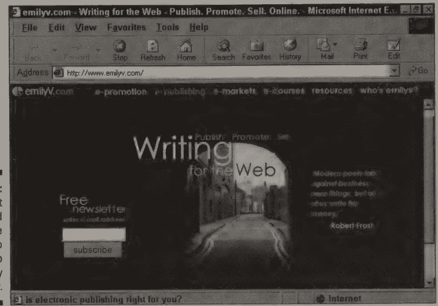

图 1-1：JavaScript 让你能够快速轻松地为网站添加交互功能。

自从《JavaScript Dummies》上一个版本以来，情况发生了很多变化。首先，JavaScript 已经从一种相对基础脚本语言演变成了一门独立的编程语言。

好消息是，你可以使用 JavaScript 创建比以往任何时候都更令人惊的 Web 网站。坏消息是，JavaScript 语言本身比早期版本要复杂一些——但这正是为什么我们需要这本全新的、改进的、测试更完善的《JavaScript Dummies》了！即使你不是一名顶尖程序员，你也可以使用书中的技术和示例脚本来创建具有丰富动画的交互式、“智能”网页。

在开始学习 JavaScript 代码进阶之旅之前，你可能想花点时间熟悉本章介绍的基础知识。这样，你就拥有了尽快开始使用 JavaScript 所需的所有背景知识！

## 什么是 JavaScript？（提示：它和 Java 不是 Java！）

JavaScript 是一种你可以使用的脚本语言——配合 HTML 使用来创建交互式 Web 页。脚本语言是一种旨在让人们轻松访问预构建组件的编程语言。在 JavaScript 的情况下，这些预构建组件是构成 Web 页的基石（链接、图像、插件、HTML 元素、浏览器配置详情等）。

你不需要了解任何 HTML 就能很好地利用这本书；我解释了创建和使用书中 JavaScript 示例所需的全部 HTML 内容。如果你对学习更多 HTML 感感兴趣，我建议查看一本专门介绍该主题的好书。可以尝试的是 Ed Tittel 和 Steve James 编写的《傻瓜指南》第三版（由 IDG Books Worldwide, Inc. 出版）。


## 第一章：关于 JavaScript 你想知道的一切...

### 它很简单！（某种程度上）

JavaScript 以易用闻名，是因为：

- 文档模型的大部分（语言中定义你可以在 JavaScript 中操作的组件类型或对象的部分）非常直观。

- 例如，如果你想在点击按钮时触发某种事件，你可以访问与按钮对象相关的事件处理器；如果你想在提交 HTML 表单时触发事件，你可以访问与该对象相关的 `onSubmit` 事件处理器。（通过检查和实验运行的脚本，你将在书中熟悉 JavaScript 对象模型。你也可以查看附录 C，它列出了构成文档模型的所有对象）。

- 当你将网页加载到浏览器中并好奇作者是如何用 JavaScript 创建该效果时，百分之九十九的情况下，你满足好奇心的办法只需要点击查看源代码（在浏览器中选择“查看页面”，在 Internet Explorer 中选择“查看源代码”）（第 3 章描述了负责这些的 .js 文件）。这种源代码的“自由查看”在像 Java 这样的编译型编程语言中是不可能的，它帮助你通过示例来理解编程。

话虽如此，精通 JavaScript 也并不是轻而易举的。导致复杂性增加的主要因素之一是，市场上两个主要的支持 JavaScript 的浏览器（Netscape Navigator 和 Microsoft Internet Explorer）对 JavaScript 的实现方式不同。Netscape 直接支持 JavaScript——这并不意外，因为 Netscape 正是它的提出者。相反，Internet Explorer 通过提供其自己的语言 JScript 来间接支持 JavaScript。

## 第一部分：为了趣味与利润打造杀手级网页

尽管 Netscape 和微软都声称 JavaScript 和 JavaScript 分别是“开放、标准的脚本语言”，但没有哪家公司提供了明确、详尽的关于

- 在各自的过渡浏览器版本中实现了哪些版本的 JavaScript（例如，Navigator 4.6 和 Internet Explorer 5.5）

- 每个版本的 JavaScript 包含了哪些编程功能

- 每个版本的 JavaScript 与其他版本 JavaScript 的对比（如第 4 章所示，它们存在显著差异）

总之，创建跨浏览器的 JavaScript 网页难度大约在 1 到 10 分的 6 分左右（1 分最容易，10 分代表最难掌握的技术）。别担心。凭借对 HTML 的理解以及你在书中提供的技巧和示例脚本，你很快就能成为 JavaScript 高手！

## 名字有什么学究？

很久以前，JavaScript 被称为 LiveScript。出于一种经典的“如果用才华赢得他们，就用营销迷惑他们”的策略，Netscape 改了名字，以利用当时对 Java（Netscape 合作伙伴 Systems 开发的另一种编程语言）日益增长的兴趣。事实证明这种策略成功了；遗憾的是，许多新手误认为 JavaScript 是 Java，反之亦然。

事实：Java 和 JavaScript 的区别在于 Web 这一巨大的客户端/服务器应用程序，JavaScript 让你访问 Web 客户端（即浏览器），而 Java 让你访问 Web 服务器。

Java 与 JavaScript 的相似之处在于它们都是为 Web 开发的对象型语言。无需进入语法、解释器、变量类型和即时编译器的细节，你只需要记住这种区别。这种区别有助于你决定使用哪种语言创建你梦想中的 Web。如果你想要实现的内容是在 Web客户端范围内（换句话说，通过与 HTML、浏览器插件和 Java 应用程序交互），JavaScript 是你的最佳选择。但如果你想做更高级的操作——例如与服务器端数据库进行交互——你就需要研究 Java 或其他服务器端替代方案。

## 第一章：关于 JavaScript 你想知道的一切...

## 它很快！

JavaScript 除了相对容易上手之外，速度也非常快。和大多数脚本语言一样，它是*解释型*的（而不是编译型的）。当你使用 C++ 这样的编译语言进行编程时，你在运行代码之前必须始终重新格式化或编译你的代码文件。这个中间步骤可能需要几秒钟到几分钟不等。

另一方面，JavaScript 这种解释型语言的妙之处在于，当你对代码进行更改——在这种情况下，即对你的 JavaScript 脚本进行更改时——你可以立即测试这些更改；无需先编译脚本文件。跳过编译步骤可以在 Web 开发的调试阶段节省大量时间。

使用像 JavaScript 这样的解释型语言的另一个优点是，测试解释型脚本并不像编译型语言那样是一个“全或无”的假设。例如，如果一个 20 行脚本的第 10 行包含语法错误，你的脚本的前半部分将会运行；你仍然会立即获得反馈。在编译程序中，同样的错误将导致程序无法运行。

解释型语言的缺点是测试是基于信誉的。因为没有编译器来催促你，你可能会忍不住把测试留到最后一刻——或者更糟——完全跳过。记住：无论你创建的网站是为了业务还是兴趣，它都是对你的反映——如果你想在潜在客户、同事和朋友面前展现最好的自己，测试是必不可少的。（几年前，访问你网站的人可能会忽略一两个 Bug 脚本，但坦率地说，现在的标准要高得多。）坦率地说，第 17 章充满了许多让你的 JavaScript 代码测试尽可能痛苦的帮助。

## 所有人都在用！（好吧，几乎所有人！）

目前有两个通用的 Web 浏览器支持 JavaScript：微软的 Internet Explorer 和 Netscape/AOL Navigator。（从 4.0 版本开始，Navigator 成了 Communicator 的代名词，尽管从技术上说，Netscape Communicator 包含的组件比 Navigator Web 浏览器更多。）这两个浏览器几乎垄断了浏览器市场；几乎每个上网的人都在使用其中之一（因此具有查看和创建启用 JavaScript 的 Web 页的能力）。

## 14 第一部分：为了乐趣和利润构建杀手网页

Web 浏览器并不是唯一提供 JavaScript 支持的软件工具；然而，Netscape 的 Web 服务器也支持 JavaScript，尽管是一个特殊的服务器端版本。

本书侧重于客户端 JavaScript，这是迄今为止最流行、最广泛的形式。不过，Netscape 确实开发了一种特殊的 JavaScript 版本，它运行在某些 Web 服务器而不是 Web 浏览器中。关于服务器端 JavaScript 的更多信息，请访问：

```
http://developer.netscape.com/docs/manuals/ss.js/1_4/contents.htm
```

## JavaScript 和 HTML

你可以将 JavaScript 认为是 HTML 的扩展；或者说，它是一个插件。

它是这样工作的：HTML 标签创建对象；JavaScript 让你操作这些对象。例如，你使用 HTML 的 `<body>` . . `</body>` 标签创建一个 Web页面文档。一旦创建了该文档，你就使用一个特殊的 JavaScript 结构——`onload` 事件处理器来触发动作——也许——当文档加载到 Web 浏览器时。你使用 JavaScript 交互的其他 HTML 对象示例包括窗口、文本字段、图像和嵌入的 Java Applet。

请记住，这些打印页面中的大多数示例都集中在代码的 JavaScript 部分（自然然）。但是，我包含了 CD-ROM 上创建这些示例所需的 HTML，这样你就不需要费力从头开始创建网页了！

然而，由于 Web 并非仅由 HTML 组成，JavaScript 提供的不仅仅是对 HTML 对象的访问；它还提供了对浏览器平台特定对象的访问。浏览器插件（如 RealAudio 和 Adobe Acrobat）、特定查看器浏览器的名称和版本以及当前日期，都是你可以使用 JavaScript 处理的非 HTML 对象示例。

组成网站的所有对象——HTML 对象、与浏览器和平台相关的对象以及直接内置在 JavaScript 语言中的特殊对象——统称为文档对象模型（简称 DOM）。

## JavaScript 和你的 Web 浏览器

你需要使用 Netscape Navigator 4.0（或更高）或 Microsoft Internet Explorer 5.0（或更高）来使用书中所示的 JavaScript 最新增强功能。

并不是所有浏览器都是平等的：Internet Explorer 对 JavaScript 的支持与 Navigator 有显著不同。详情，请参阅第 4 章“JavaScript：非标准的标准”。

虽然你可以用这些浏览器的旧版本创建和查看 JavaScript 脚本，但我建议你安装 Navigator 或 Internet Explorer 的最新版本。（管他的什么呢——它们都是免费的！）每个产品的最新版本都增加了最新的 JavaScript 特性和错误修复；它们也是你在书书中图表和示例中所描述的版本。

你可以使用另一个浏览器，如 Opera 或 America Online（甚至是另一种 Internet 协议，如 FTP）来下载 Navigator 或 Internet Explorer 的最新版本并尝试一下。本中的“我需要什么来开始？”专门介绍了获取和安装启用 JavaScript 浏览器的细节。目前，只需说明：

- 你需要 Navigator 或 Internet Explorer 来使用 JavaScript，这意味着你必须拥有。

## 我需要什么才能开始？

希望你已经迫不及待要编写支持 JavaScript 的 Web 页面了！不过，首先要……”你已经对 JavaScript 能为你做什么有了初步了解，而且到目前你对第一次尝试已经有了具体的想法。现在是时候进入准备工作了：你开始需要什么，以及在你没有这些工具时如何获取它们。完成设置后，你就可以开始那些真正有趣的内容了！

## 硬件

就本书而言，我假设你正通过个人电脑或 Macintosh 电脑开始你的 JavaScript 之旅。你的机器（或者用俗话来说）应该是 Pentium PC 或更高配置（除非是 Power Mac），并且应该至少有 32MB 的内存和至少 25MB 的空磁盘空间。如果这些要求听起来不合理，请请教你当地的硬件专家；每个组织似乎至少都有一个专家。（通过大量的尝试，我发现大多数硬件专家对含糖的零食反应非常灵敏。）

你还需要安装可以让你连接互联网的硬件。这些硬件通常由调制解器和电话线组成。根据你的电脑，你可能安装了内置调制解器（很多电脑都自带调制解器）。如果没有，你可以在当地的电脑折扣店购买调制解器。调制解器之间的区别因素是线路速度：越快越好。（如今大多数电脑可以使用预装的 56.6 Kbps 型号，但 14.4 或 28.8 的也完全没。）如果你还没有调制解器并需要购买，请考虑购买你价格范围内最快的调制解器；当你尝试查看带有许多图片的漂亮 Web 页面时，每张图片加载都需要非常非常长时间（因为图形文件通常很大），你会非常感激的。

## 软件

就本书而言，我假设你有一台 Macintosh 电脑，或者一台安装了 Windows 95、Windows NT、Windows 98、Windows 2000 或 Linux 的个人电脑。（目前，Linux 只有 Netscape Navigator 可用。）

我假设你有某种创建文本文件的方法。（大多数操作系统都自带了各种文本编辑器和文字处理器，其中任何一种都可以很好地创建 JavaScript 脚本。）

在随书的 CD 中，你将发现一些专门为创建 JavaScript 文件设计的优秀文本编辑工具。

## JavaScript 特定软件

你还需要一个 Web 浏览器。在本书期间，Navigator（Netscape Communication 的商业 Web 浏览器）和微软的 Internet Explorer 是唯一支持 JavaScript 的通用浏览器。因此，第一要任务是获取一份 Navigator 或 Internet Explorer。

## 第 1 章：关于 JavaScript 你想知道的一切……

（本书中看到的示例是在 Windows 95 上使用 Netscape Navigator 和 Internet Explorer演示的。）

大多数个人电脑都预装了 Internet Explorer。要确定你的特定电脑是否也是如此，请选择开始->程序，并寻找 Internet Explorer。

### Netscape Navigator

Netscape 6.x 版本将 Navigator 浏览器与消息传递、Web 构建和其他与互联网相关的各种功能包在了一起。

你可以访问以下网站下载副本（该网站提供了分步骤的安装说明）：

```
http://www.netscape.com/download/index.html
```

当然，我假设你已经安装了 Web 浏览器，或者你能够访问 FTP。（FTP 是文件传输协议的缩写，是一种让你从他人的机器上获取文件的 Internet 应用程序。）如果你愿意，可以以廉宜的价格在 CD-ROM 上购买 Navigator 副本（详情请见 Netscape 网站）。

### Internet Explorer

如果你是微软的粉丝，你可能想下载一份 Internet Explorer。从以下网站免费下载（或以廉宜的价格在 CD-ROM 上订购副本），该网站提供了易于遵循的指令：

```
http://www.microsoft.com/windows/ie/default.htm
```

## 文档

要获取最新的 Netscape Navigator 和 Microsoft Internet Explorer 文档，请查看以下 URL：

```
http://netscape.com/communicator/index.html
http://www.microsoft.com/windows/ie/default.htm
```

获取 JavaScript 手册副本，请访问：

```
http://netscape.com/docs/manuals/javascript.html
```

## 第 2 章：你的第一个脚本

在本节中，你将熟悉创建 JavaScript 所需的基础工具：编辑器、支持 JavaScript 的浏览器。你还将良好了解需要遵循的逻辑过程，称为开发周期。

### 想法？！我有一堆

创建 JavaScript 应用程序的第一步是确定你到底想让程序做什么。为用户提供某些反馈？执行某些计算？在弹出窗口显示请求的信息？

书中描述了许多你想用 JavaScript 做的事情——从验证输入到创建悬停效果。更多信息，请查看：

```
http://www.scriptsearch.com/pages/14.shtml
```

### 从想法到应用程序

就像艺术一样，优秀的软件并非凭空产生。它需要你先进行规划，然后使用工具结合逻辑过程将你的计划转化为具体的东西。

一旦你有了清晰的想法，花几分钟在纸上记下你的想法。这个阶段——明确你想让应用程序实现的任务——在专业软件开发中历史悠。完成这一步让你能够在最后测试你的应用程序。

以下是本节 JavaScript 应用程序的需求：

> 我想创建一个 Web 页面，根据用户输入生成格言。首先，我想询问几个单词。然后，我想用 JavaScript 将这些词插入著名的格言中并在弹出窗口中显示结果。

> 噢，是的，我还想定义某种默认值，以防有人在不输入任何单词的情况下尝试生成格言。

注意，需求可以用自己的话描述；不需要填写正式的需求文档，也不（天哪！）费力绘制流程图。简单简洁的描述就足够了。

### 第一部分：创建 HTML 文件

一旦你拿到了脚本需求，就准备好冲上代码雪道了！

## 第2章：编写你的第一个个脚本

首先，如上述要求所示，你需要创建一个网页。你通过在文本编辑器中输入 HTML 代码，并将该代码保存为计算机硬盘上的一个单独文件来完成，这一点正如下文所示。


由于这本书完全关于 JavaScript —— 而不是 HTML —— 因此我不会对 HTML 语言进行详细介绍。相反，我只会在需要描述用 JavaScript 可以实现的各种奇妙功能时，才会描述相关的 HTML。如果你需要一份关于 HTML 的良好介绍，我推荐 Ed Title 和 Steve James 编写的《傻瓜学 HTML》（HTML For Dummies）第3版（由 IDG Books Worldwide, Inc. 出版）。

在本书中，你将使用记事本文本编辑器。为什么？因为它是 Windows 操作系统免费提供的！（而且很好用。）但如果你在机器上安装了其他你更喜欢的文本编辑程序来创建脚本，请尽管使用它。（事实上，我在第15章中会向你介绍一些针对 JavaScript 优化的酷炫文本编辑器，你可以通过附带的光盘进行测试。）只需确保你使用文本编辑器来创建脚本和 HTML 文件，而不是使用文字处理软件。区别在于：当你使用文字处理程序保存文件时，该程序会在保存文件中添加特殊的非文本字符。遗憾的是，HTML 和 JavaScript 解释器只能解释文本；它们无法解释包含特殊字符的文字处理文件。


关于不使用文字处理器创建 HTML 或 JavaScript 脚本的规则有一个例外。有些文字处理器允许你以 HTML 或纯文本格式保存文件。如果你的文字处理器支持以 HTML 或纯文本格式保存文件，那么你可以使用该文字处理器来创建 HTML 和脚本文件。否则，你需要使用像记事本这样的文本编辑器。

许多文字处理应用程序都提供了以纯文本格式保存的方法。例如，要在 Microsoft Windows 中以纯文本格式保存文件，只需点击“文件：另存为”，从“保存类型”中选择“仅文本 (.txt)”即可。

以下是使用记事本创建文件需要遵循的步骤：

1. 点击“开始”→“程序”→“附件”→“记事本”，打开记事本编辑窗口，如图2-1所示。

2. 当记事本编辑窗口出现时，输入你的 HTML 和 JavaScript 代码。

3. 完成输入后，点击“文件”→“保存”保存文件。

如果你正在创建一个嵌入 JavaScript 语句的 HTML 文件 —— 例如本章描述的那个 —— 请确保你给文件名包含 .HTM 或 .HTML 扩展名。

# 第一部分：为了乐趣和利润构建出色的网页

> **提示** 本章演示的脚本嵌入在 HTML 文件中，这是实现 JavaScript 脚本最常见的方法。然而，你也可以将脚本实现为单独的文件（使用 JS 扩展名），然后从 HTML 文件中显式引用该 JavaScript。你可以在第14章中看到这种技术的示例。

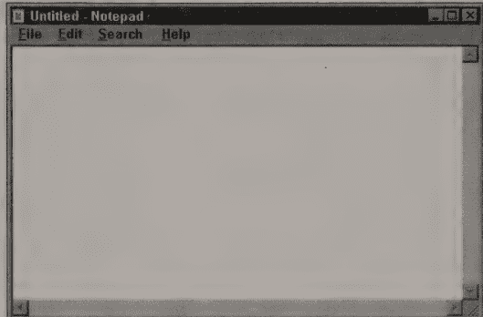

图 2-1：记事本编辑窗口。

代码列表 2-1 显示了谚语生成应用程序的 HTML 代码。

在光盘上：要查看列表 2-1 中的代码在 Web 浏览器中的行为，请将配套光盘上的文件 `list0201.htm` 加载到 Netscape Navigator 或 Internet Explorer 中。

## 代码列表 2-1：谚语生成应用程序的 HTML 代码

```html
<HTML>
<HEAD>
<TITLE>JavaScript 谚语生成器（出自《傻瓜学 JavaScript》第3版）</TITLE>
</HEAD>
<body>
<CENTER><h1>JavaScript 谚语生成器</h1></CENTER>
要生成谚语，请输入一个名词和一个形容词；然后点击下方看到的下方“点击此处生成谚语”按钮。
```

```html
<P>
如果你犯了错误或只想重新开始，请点击
“清除”按钮。
<P>
<FORM NAME="proverbForm">
名词：
<INPUT NAME="Noun" SIZE="25">
<P>
形容词：
<INPUT NAME="userAdjective" SIZE="25">
<BR>
<P>
<INPUT TYPE="button" NAME="proverbButton" VALUE="点击此处
生成谚语">
<INPUT TYPE="reset" VALUE="清除表单">
</FORM>
</body>
</HTML>
```

如果你熟悉 HTML，你可能会注意到列表 2-1 中的代码显示了：

- 一段文本。这些文字描述了谚语生成器的用途，以及供用户遵循的简单指令。

- **两个输入字段。** 这些是用户可以在其中输入自己的单词的输入字段。

- **一个按钮。** 当用户准备好生成自定义谚语时，可以点击此按钮。

- **一个重置按钮。** 用户可以点击此按钮清除输入字段并重新开始。

以下是列表 2-1 中的 HTML 代码在 Netscape 6.0 Web 浏览器中的显示效果：

# 第一部分：为了乐趣和利润构建出色的网页

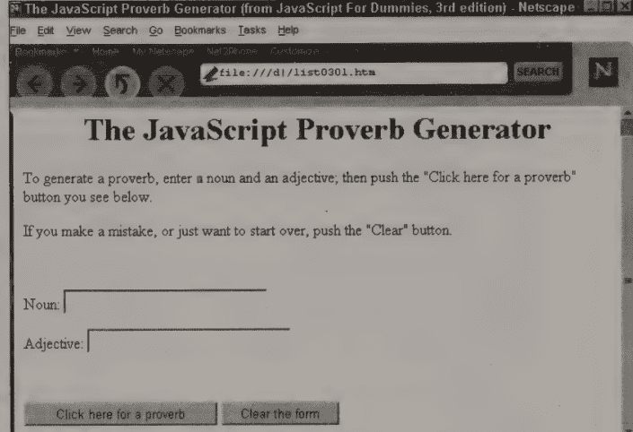

图 2-2：谚语生成器的 HTML 部分。

虽然图 2-2 的网页看起来不错，但它只完成了一半：这就是 JavaScript 介入的地方。

## 第二部分：创建并附加脚本

一旦你有了如图 2-2 所示的 HTML 文件，你就可以开始：

- 使用用户在输入字段中输入的任何内容在点击按钮时生成自定义谚语。

- 使用弹出框显示谚语。

- 在用户忘记输入时提供默认值。

列表 2-2 中的 JavaScript 代码比你想象的要简单！你可能会注意到列表 2-2 显示了：

- 一段文本。

- 两个输入字段（见本章之前的章节）。

如果你想将列表 2-2 的代码加载到你自己的浏览器中并进行实验，请查看配套光盘上的 `list0201.htm`。


## 代码列表 2-2：谚语生成器的 HTML 代码和嵌入 JavaScript

```html
<HTML>
<HEAD>
<TITLE
JavaScript 谚语生成器（出自《傻瓜学 JavaScript》第3版）</TITLE>

<!-- 向非 JavaScript 浏览器隐藏此文件 -->
<SCRIPT>
// 开始 JavaScript 脚本

function displayProverb(noun, adjective) {
/*===========================================
此函数的作用通过将用户提供的
单词插入“模板”中来构造谚语。此函数
接受两个参数且不返回值。
============================

// 如果用户没有输入名词，则使用“iron”作为默认。
if (!noun) {
    noun = "iron"
}

// 如果用户没有输入形容词，则使用“hot”作为默认。
if (!adjective) {
    adjective = "hot"
}

// 使用弹出框构造并显示谚语
window.alert("当 "
+ noun
+ 是 "
+ adjective
+ "!");
}
// 停止隐藏 --
//  JavaScript 脚本
</SCRIPT>

<HEAD>

<BODY onload="document.proverbForm.userNoun.select()">
<CENTER><h1>JavaScript 谚语生成器</h1></CENTER>
要生成谚语，请输入一个名词和一个形容词；然后

点击下方看到的“点击此处生成谚语”按钮。</H3>
<P>
如果你犯了错误或只想重新开始，请点击
“清除”按钮。</P>
<P>
<FORM NAME="proverbForm">
名词：
<INPUT NAME="userNoun" SIZE="25">
<P>
形容词：
<INPUT NAME="userAdjective" SIZE="25">
<P>
<BR>
<P>
<INPUT TYPE="button" NAME="proverbButton"
VALUE="点击此处生成谚语"
onclick="displayProverb(document.proverbForm.userNoun.value,
document.proverbForm.userAdjective.value)">

<INPUT TYPE="reset" VALUE="清除表单">
</FORM>
</BODY>
</HTML>
```

## 第 2 章：编写你的第一个脚本

本章后续部分将对列表 2-2 中看到的所有 JavaScript 语句进行逐步说明，标题为“脚本角色表（按出现顺序）”。现在，当你浏览列表 2-2 时，只需注意以下点：

- 名为 `proverbButton` 按钮的 `onClick` 事件处理器调用了 `displayProverb()` 函数。你可以在列表底部看到此操作（参见以 `onClick="displayProverb ?` 开头的 JavaScript 语句）。

- JavaScript 语句的作用是：在运行时，当用户点击标记为“Click Here for a Proverb”（点击此处获取谚语）的按钮时，解释器向 `displayProverb()` 函数提供两部分信息：用户输入的名词和形容词。

- 定义在文件顶部的 `displayProverb()` 函数生成并显示自定义的谚语。JavaScript 函数定义在列表 2-2 顶部，以语句 `function displayProverb(noun, adjective) (` 开始。

- `displayProverb()` 函数的执行逻辑是：当 JavaScript 解释器调用此函数并向其提供两个信息位（用户输入的名词和形容词）时，该函数会构建自定义的谚语并将其显示在屏幕上。

## 测试脚本

一旦你有了一个包含嵌入 JavaScript 代码的 HTML 文件（如列表 2-2 所示），你就可以测试你的 JavaScript 应用了！（这确实是最有趣的部分。）

要要测试 JavaScript 应用，你只需要将包含 JavaScript 的 HTML 文件加载到支持 JavaScript 的 Web 浏览器中。图 2-3 显示了列表 2-3 中的代码加载到 Netscape 6 浏览器后的样子。

## 第一部分：为了乐趣和利润构建顶级的 Web 页面

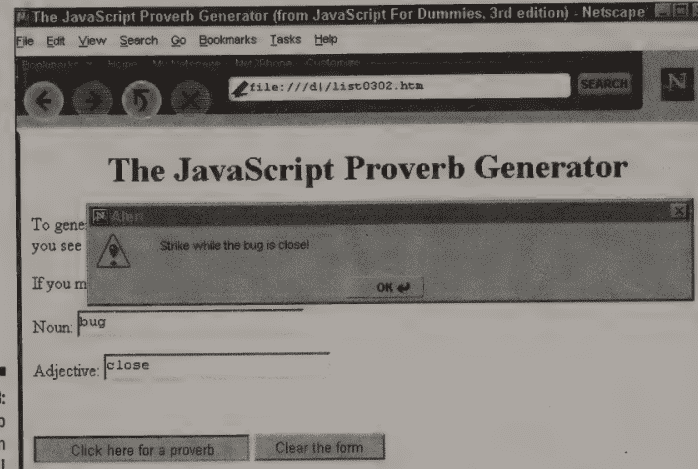

**图 2-3：**

运行中的谚语生成器！

Netscape Navigator 和 Microsoft Internet Explorer 都提供了一种“关闭”JavaScript 支持的方法。当你从浏览器中关闭 JavaScript 支持并加载包含 JavaScript 的 Web 页面时，你的浏览器将忽略所有的 JavaScript 代码。就好像它们不存在一样！

如果你从配套光盘加载了 `list0202.htm`，点击“Click Here for a Proverb”按钮，但没有看到类似于图 2-3 所示的自定义谚语，请尝试以下操作：

- 如果你使用 Netscape Navigator 6.x，点击 Edit->Preferences Advanced，并确保“Enable JavaScript”旁边的框已勾选。

- 如果你使用 Internet Explorer 5.x，点击 Tools->Options->Security。然后选择 Internet Web Content Zone（Internet 区域区域），点击 Custom Level（自定义级别），向下滚动直到找到 Active Scripting（活动脚本）类别。最后，确保 Enable（位于 Active Scripting 下方）旁边的单击按钮已勾选。


## 脚本角色表（按出现顺序）

这一部分让你近距离接触 JavaScript。具体来说，你将检查在本章前面列表 2-2 中所示的创建谚语生成器应用的 JavaScript 语句。

当你完成这一章时，你将完全清楚该谚语脚本是如何运作的。不仅如此，你还学会了如何将所有的基础 JavaScript 语言概念和结构应用到自己的脚本编写工作中！

## 使用 `<SCRIPT>` 标签将 JavaScript 嵌入 HTML

HTML 是一种标签语言，它支持的标签之一是 `<SCRIPT>...</SCRIPT>` 标签对。

`<SCRIPT>...</SCRIPT>` 标签允许你将脚本——无论是用 JavaScript 编写还是其他脚本语言（如 VBScript）——插入到 HTML 文档中。

通过将起始脚本标签 `<SCRIPT>` 分别放置在起始和结束的 `<HEAD>` 和 `<BODY>` 标签之间，你可以将脚本插入到 HTML 文档的 head 或 body 中。


在 HTML 文档的 head 中插入脚本会导致脚本立即运行，在浏览器显示 HTML 文档的 body 之前！这种技术允许你使用 JavaScript 操作 Web 页面的 body，正如你在第 5 章中看到的。

下面的列表 2-3 显示了谚语生成示例中脚本标签的样子。

### 列表 2-3：在 HTML 文档的头部插入 JavaScript 脚本

```html
<HTML>
<HEAD>
<SCRIPT LANGUAGE="JavaScript">
  .. 
</SCRIPT>
</HEAD>
```

## 第一部分：为了乐趣和利润构建顶级的 Web 页面

列表 2-3（续）

这里是脚本标签的完整语法：

```html
<SCRIPT
LANGUAGE="nameOfLanguage"
TYPE="mimeType"
SRC="sourceFileName"
CHARSET="isoCharset"
</SCRIPT>
```

其中：

`nameOfLanguage` 是 JavaScript 或其他表示有效脚本语言的字符串。

`mimeType` 是 text/JavaScript，或者其他表示有效 MIME 类型的字符串。（如果你好奇的话，MIME 代表多用途互联网邮件扩展！MIME 类型有时也被称为内容类型或媒体类型。）


你必须为 `nameOfLanguage` 或 `mimeType` 之一指定一个值。

`sourceFileName`（可选）是外部脚本文件的文件名；例如 `myfile.js`（当你使用 SRC 属性时指定）。

`isoCharset`（可选）是你希望浏览器使用的字符集（如果不指定值，默认使用 ISO-8859）。

尽管难以置信，并非所有浏览器都支持 JavaScript。当然，这些浏览器占据了市场份额。

## 第 2 章：编写你的第一个脚本

## 数字处理

某些开发者会将 `<SCRIPT>` 标签的 `LANGUAGE` 设置为 JavaScript1.1、JavaScript1.2 或 JavaScript1.3（而不是普通的 JavaScript），如果他们的脚本利用了特定版本的 JavaScript。例如，你可以使用以下选项：

- Navigator 2.0 和 Internet Explorer 3.0 支持 JavaScript 1.0

- Navigator 3.0x 和 Internet Explorer 3.0x、4.0x 支持 JavaScript 1.1

- Navigator 4.0 到 4.05 支持 JavaScript 1.2

- Navigator 4.06 到 4.5 支持 JavaScript 1.3

- Navigator 6.0x 和 Internet Explorer 5.x 支持 JavaScript 1.5

- Internet Explorer 5.x 支持 JavaScript 1.3（兼容性）

```html
<SCRIPT LANGUAGE="JavaScript">
  ..（基础 JavaScript 1.0）
</SCRIPT>
```

```html
<SCRIPT LANGUAGE="JavaScript1.2">
  ..（在版本 1.2 中引入的一些 JavaScript 代码）
</SCRIPT>
```

```html
<SCRIPT LANGUAGE="JavaScript1.3">
  ..（在版本 1.3 中引入的一些 JavaScript 代码）
</SCRIPT>
```

这种方法的困难之处在于：仅仅跟踪 Navigator 和 Internet Explorer 许多版本的 JavaScript 支持就足以让一个全职会计师忙不过来！看看下面的内容，就知道我的意思了：

当你成功识别支持你所使用的 JavaScript 结构的 JavaScript 或 JScript 版本时，使用 JavaScript1.3 作为值（而不是在属性中使用 JavaScript1.3 并不会提供额外的 JavaScript 支持。它只是防止那些不支持夹在 `<SCRIPT LANGUAGE="JavaScript1.3"></SCRIPT>` 标签之间的 JavaScript 语句的浏览器执行它们。）

## 34 第一部分：为了乐趣和利润构建顶级的网页

请查看下方的列表 2-4 以了解我的意思。

## 列表 2-4：向不支持 JavaScript 的浏览器隐藏 JavaScript 语句

```html
<HTML>
<HEAD>
<TITLE>JavaScript 谚语生成器（源自《初学者 JavaScript》，第 3 版）</TITLE>

<SCRIPT LANGUAGE="JavaScript">
<!-- 向不支持 JavaScript 的浏览器隐藏此文件 -->


// 现在停止隐藏 --
</SCRIPT>
```

如果你熟悉 HTML，你可能知道 `<!--` 标记 HTML 注释的开始，而 `-->` 标记 HTML 注释的结束。因此，实际上，每个支持 HTML 的浏览器（根据定义，现存所有浏览器都是如此）都会忽略这两个符号之间的所有内容。

然而，支持 JavaScript 的浏览器理解紧跟在开启标签后面的 HTML 注释预示着脚本即将到来——并且它们会非常顺畅地处理你的 JavaScript 代码，非常感谢。

结果是？只需两行代码——`<!--` 和 `//` 符号——你就可以在不支持 JavaScript 的浏览器中隐藏脚本语句，同时让支持 JavaScript 的浏览器能够看到它们。很酷，对吧？

请确保将起始和结束隐藏符号 `<!--` 和 `-->` 分别放在单独的行上。将其中任何一个与 JavaScript 语句放在同一行可能会导致不支持 JavaScript 的浏览器显示你的 JavaScript 代码，就好像隐藏符号不存在一样。

HTML 注释结束标签前的双斜杠（`//`）是 JavaScript 注释运算符。你将在本章稍后的“请给我注释！”部分了解更多关于 JavaScript 注释的知识。

## 第 2 章：编写你的第一个脚本

## 功能完备

函数是软件层面的“黑盒”：它们允许程序员为一组 JavaScript 语句命名，然后通过简单的引用或*调用*函数来反复、不断地重用这些语句。

这里是关于 JavaScript 函数的简单粗略的描述：

- **函数可以（但没必须）接受值。** 在在本章的谚语生成器示例中，正如列表 2-5 所示，`displayProverb()` 函数接受两个值：一个名词和一个形容词。

- **函数会执行实用的事情。** 在函数体内部，你可以放置任何你喜欢的 JavaScript 语句。在本章的谚语生成器示例中（如列表 2-5 所示），`displayProverb()` 函数：

    - 检查是否传递了名词；如果没有，函数将名为 `noun` 的变量赋值默认值 "iron"（铁）。

    - 检查是否传递了形容词。如果没有，函数将为名为 `adjective` 的变量赋值默认值 "hot"（热）。

    - 使用名词和形容词的值构造并显示一条自定义的谚语。

- **函数可以（但没必须）返回一个值。** 通常情况下，调用函数的 JavaScript 语句期望返回一个答案——即使它预期的答案是 `true`（意味着在数字计算过程中一切顺利）或 `false`（如果没那么顺畅的话）。在列表 2-5 的示例中，`displayProverb()` 不返回值，而在 `onClick` 事件处理程序中调用 `displayProverb()` 函数时也不期望返回值。（关于从函数返回值和接受函数返回值的示例，请参阅第 3 章）。

## 列表 2-5：定义和调用 `displayProverb()` 函数

```html
<HTML>
<HEAD>
<TITLE>JavaScript 谚语生成器（源自《初学者 JavaScript》，第 3 版）</TITLE>
<SCRIPT LANGUAGE="JavaScript">
<!-- 向不支持 JavaScript 的浏览器隐藏此文件 -->
function displayProverb(noun, adjective) {
    // 如果用户没有输入名词，则输入 "iron" 作为默认。
```

（续）

## 36 第一部分：为了乐趣和利润构建顶级的网页

## 列表 2-5（续）

```javascript
  if (!noun) {
    noun = "iron"
  }
  // 如果用户没有输入形容词，则输入 "hot" 作为
   默认。
  if (!adjective) {
    adjective = "hot"
  }
  // 使用 alert框构造并显示谚语
  window.alert("Strike while the "
    + noun
    + " is "
    + adjective
    + "!")
}
```

```html
<INPUT TYPE="button" NAME="proverbButton"
VALUE="点击获取谚语"
onclick="displayProverb(document.proverbForm.user.value,document.proverbForm.userAdjective.value)">
```

哦，在定义自定义 JavaScript 函数时还有一点需要记住：确保你将所有的 JavaScript 语句都放在函数的大括号内，如下所示（如列表 2-5 所示）；如果你这样做这样做，会在运行时遇到 JavaScript 错误。

```javascript
function displayProverb(noun, adjective) {
  // 所有构成 displayProverb()
  // 函数的 JavaScript 语句
  // 都放在这里。
}
```

即使你不打算重用许多相关的 JavaScript，仍然应该考虑将它们组织成函数。为什么呢？因为想出一个具有描述性的函数名有助于你理清你的。

## 请给我注释！

注释是你添加到脚本中的说明文字，用于描述它。因为它们并不是严格必要的（JavaScript 解释器会忽略它们），许多程序员不会在代码中添加注释——但他们应该这样做。

## 列表 2-6：JavaScript 注释帮助人类一眼看代码

```javascript
function displayProverb(noun, adjective) {
  /*
   该函数的目的是通过将用户提供的
   单词插入模板来构造自定义谚语。
   该函数接受两个参数且不返回值。
  */

  // 如果用户没有输入名词，则输入 "iron" 作为默认。
  if (!noun) {
    noun = "iron"
  }
  // 如果用户没有输入形容词，则输入 "hot" 作为。
  if (!adjective) {
    adjective = "hot"
  }

  // 使用 alert 框构造并显示谚语
  window.alert("Strike while the "
    + noun
    + " is "
    + adjective
    + "!")
}
```

## 如果如此，那么

`if ... then` 语句是最广泛使用的用条件表达式之一。该语句允许你测试一个条件，如果条件为真则执行一组 JavaScript 语句，如果条件为假则执行另一组（或者什么都不执行）。

## 38 第一部分：为了乐趣和利润构建顶级的网页

请查看列表 2-7，查看 `if ... then` 语句在本章的谚语生成器示例中是如何。

## 列表 2-7：使用 if 语句而不使用对应的

```javascript
function displayProverb(noun, adjective) {
  // 如果用户没有输入名词，则输入 "iron" 作为默认。
  if (!noun) {
    noun = "iron"
  }
  // 如果用户没有输入形容词，则输入 "hot" 作为默认。
  if (!adjective) {
    adjective = "hot"
  }
}
```

初看之下，列表 2-7 所示第一个 if 语句的条件 (`!noun`) 看起来有点奇怪。这是因为它将逻辑非运算符（`!`，在第 3 章中描述）与名为 `noun` 的变量结合在一起。在英语中，

```javascript
if (!noun) {
  noun = "iron"
}
```

翻译为：“如果变量 `noun` 没有定义任何值，则将变量 `noun` 赋值为 iron。”

## 使用方法的优点

方法是与 JavaScript 对象关联的特殊类型的函数。你可能想浏览一下第 3 章的讨论，我在那里详细介绍了方法。

在本章描述的谚语生成器示例中，你看到了一个方法在运行：`window.alert()` 方法。看一眼列表 2-8，看看调用内置 `window.alert()` 方法的代码是什么样的。

## 列表 2-8: 调用内置的 alert() 方法

与 `window` 对象关联

```javascript
function displayProverb(noun, adjective) {
  // 使用 alert 对话框构建并显示谚语
  window.alert("Strike while the \
    + noun\
    + is \
    + adjective\
    + "");
}
```

在列表 2-8 所示的代码段中，正在发生两件事：

- 正在构建一个字符串

- 两个独立的文本部分（Strike while the, is, 和 adjective!）


- 两个变量（`noun` 和 `adjective` 的值）

- 构建好的字符串被传递给与 `window` 对象关联的 `alert()` 方法。然后，`alert()` 方法将该字符串显示在屏幕上供用户查看。

你在 JavaScript 中调用方法的方法与调用普通函数的方法一样：

区别在于，你使用**全限定名（fully-qualified names）**来引用方法。

全限定名指定了方法所属的对象，并在其之前列出了包含该对象的所有对象。例如，`click()` 方法的全限定名可能是 `document.myForm.myButton.click()`。全限定名称有助于 JavaScript 解释器区分不同对象上的相同方法。例如，通过全限定，你可以创建一个包含三个按钮的 HTML 表单，并分别对这三个按钮调用 `click()` 方法，如下：

```javascript
document.myForm.buttonOne.click()
document.myForm.buttonTwo.click()
document.myForm.buttonThree.click()
```

`alert()` 方法是 JavaScript 中“始终对方法调用进行全限定”规则的极少数例外之一。因为 JavaScript 解释器知道 Web 页面层级顶部只有一个 `window`（并不意外，它就叫 `window`），所以你不需要指定 `window.alert()`；直接使用 `alert()` 就能很好地完成工作。然而，由于具体化并无坏处——特别是与像 JavaScript 解释器这样对语义严谨的人打交道——我建议你始终使用全限定的方法名。

## 第 40 页 第一部分：为了乐趣和利润构建杀手级网页

这样，你就不需要记住哪些方法代表了遵循规则的例外了！

## 那些大胆的事件处理器

事件处理器允许你在每当预定义事件发生时触发一系列 JavaScript 语句。

在本章描述的谚语生成器示例中，每当用户点击推按钮时，JavaScript 解释器就会触发 `displayProverb()` 函数（换句话说，每当与该按钮关联点击事件发生时）。查看列表 2-9 中的代码以理解我的意思！

- 列表 2-9：将函数调用与 `onClick` 事件处理器关联

```html
<INPUT
 TYPE="button"
 NAME="proverbButton"
 VALUE="Click here for a proverb"
 onclick="displayProverb(document.proverbForm.userNoun.value, document.proverbForm.userAdjective.value)">
```

看到列表 2-9 中的最后一条语句了吗？以 `onClick=` 开头的那个语句。该语句将 `onClick` 事件处理器与名为 `proverbButton` 的 HTML 按钮关联。（注意在 HTML `<INPUT` 标签开始和结束 `>` 之间都定义了 NAME 和 onClick 属性）。

你可以在关联对象的 HTML 标签内部为其他事件处理器提供操作。例如，以下代码告诉 JavaScript 解释器在每当文档加载时调用 `doSomething()` 函数。

```html
<BODY onLoad="doSomething()">
```

接下来的代码段在 `inputField` 元素失去焦点（blur）时触发名为 `doSomethingElse()` 的 JavaScript 函数。

```html
<INPUT TYPE="select" NAME="inputField"
 onBlur="doSomething()">
```

## 第 2 章：编写你的第一个脚本

请查看附录 C 获取 JavaScript 中可用事件处理器的完整列表。

在给事件处理器赋值时，你不局限于单一 JavaScript 语句；你可以指定任意数量的 JavaScript 语句——只要你用分号将它们隔开，如下所示：

```html
<INPUT
TYPE="button"
NAME="proverbButton"
VALUE="Click here for a proverb"
onclick="displayProverb(document.proverbForm.userNoun.value,
document.proverbForm.userAdjective.value);
calculateSomething(); printSomething();
displaySomething()"
```

## 第 3 章

# JavaScript 编程概念

## 本章内容

- 查看 JavaScript 语法（表达式、函数、变量和运算符）

- 理解对象模型是如何工作的

- 熟悉 Netscape Navigator 的对象模型

- 熟悉 Internet Explorer 的对象模型

尽管 JavaScript 是一种非常强大的语言，但你的使用方式可以归纳为两个主要概念：1) 语法，以及 2) JavaScript 对象模型（也称为*文档对象模型*）。

语法是指你编写 JavaScript 代码时必须遵循的规则。语法规则并不多，但你确实需要理解它们——就像理解并遵循英语语法规则才能写出英语母语者能懂的句子一样。

文档对象模型（DOM）是指你可以使用 JavaScript 访问和操作的 Web 页面组件或对象。就像在你用英语写故事之前需要掌握英语单词词汇一样，在编写自己的 JavaScript 脚本之前，你必须对 DOM 有一定程度熟悉。

一旦你有机会浏览完这一章，你就掌握了编写自己的脚本所需的所有知识！

# JavaScript 语法

规定人类与解释器通信的规则和制度被称为语法。尽管你可能对所有这些技术细节感到有些无从措（尤其是刚开始时！），但你只需要关注这几点，它们是你代码的基石：

## 第一部分：为了乐趣和利润构建杀手级网页

- 表达式：你结合关键字、函数、变量和运算符来创建你想传递的表达式。

- 函数：函数是命名的语句组，你定义一次即可重复使用。

- 变量：变量是代表数据的占位符。

- 运算符：运算符是 JavaScript 对连词的回答：你用于比较和赋值等的符号。

## 表达你自己

定义表达式就像定义一个英语短语一样，涵盖了相当广泛的领域。通常，一个 JavaScript 表达式由运算符（如 `+`, `-` 将在本章详细介绍）和操作数（变量和字面量）组成，它们共同被 JavaScript 解释器求值。例如，查看以下表达式：

```javascript
new Date()
666 + (123 + 79) + (myAge)
document.myForm.form.value + " to see you, " +
document.myForm.yourName.value
```

这三个示例各不相同，但它们有一个共同点：都可以求值。第一个示例求得当前日期；第二个得到一个数字（我不会告诉你具体的数字）；第三个求得一个字符串（字符串是你作为单个块操作的字符组）。这就是表达式：它是变量、运算符、字面量（不变的值）和关键字的组合，并可以被 JavaScript 解释器求值。

# 不要把你的注释留给自己

JavaScript 解释器会忽略注释。然而，注释很有价值：它们对于向脚本的人类读者解释事情非常有用。（顺便说，也将你自己考虑——当你完成一个脚本并搁几个月后，你可能会感激这些注释）

你可以用两种方式编写 JavaScript 注释。任何类型的注释都可以出现在脚本的任何位置，且出现次数任意。

## 第 3 章：JavaScript 编程概念

第一种注释是单行注释。它以两个正斜杠开头，且仅适用于一行。第二种注释是多行注释。因为它可以跨越多行，所以你必须告诉它从哪里开始（使用正斜杠后跟一个星号）以及在哪里结束（使用星号后跟一个正斜杠）。例如：

```javascript
// 单行注释不需要结束斜杠。
/* 这条注释可以跨越多行。但请始终记住
关闭它；如果你忘记了，在尝试显示脚本时会产生奇怪的错误。 */
```

记住，JavaScript 脚本是 HTML 文件中 `<script>...</script>` 标签之间的代码行。你不能使用 HTML 注释字符 `<!--` 开始注释行并用 `-->` 结束来创建 JavaScript 注释，也不能使用 JavaScript 注释字符（`//` 和 `/*`）创建 HTML 注释。


不要在 JavaScript 代码中重叠或嵌套多行注释。如果你这样做了，JavaScript 解释器将生成错误。

## 完好状态：if...else

`if...else`（也称为条件）表达式用于测试一个条件，该条件通常是另一个表达式（快速读三遍！）。如果条件为真，JavaScript 解释器将执行 `if` 子句之后的所有语句。如果条件为假，JavaScript 解释器将执行 `else` 子句之后的所有语句（如果 `else` 子句存在）。如何使用 `if...else` 的通用描述如下：

```
if (condition) {
  statements
} else {
  statements
}
```

大括号 `{` 和 `}` 将语句组合成一个大的代码块。例如，如果你在 `if` 条件后跟着三个大括号（且它们都被大括号包围），当条件为真时，JavaScript 解释器将执行所有这些语句。

方括号 `[` 和 `]` 意味着整个 `else` 子句是可选的。你实际上不需要在 JavaScript 代码中放置方括号；你只需要根据需要添加 `else` 子句，不需要时省略它。

假设你想帮助用户进行区分大小写的输入。你可以使用 JavaScript 来测试用户的偏好，并相应地使输入符合大写或小写字母。你的用户不必担心输入 BOB 而不是 bob。列表 3-1 显示了 `if...else` 的实际应用。

## 46 第一部分：为了乐趣和利润构建强大的 Web 页面

## 列表 3-1：JavaScript if...else 示例

```javascript
// 如果用户选择了大写，
if (caseSelection == "upper") {
    // 将姓和姓的值转换为全大写
    document.form1.firstName.value =
    document.form1.firstName.value.toUpperCase()
    document.form1.lastName.value =
    document.form1.lastName.value.toUpperCase()
} else {
    // 否则，将名和姓的值转换为全小写
    document.form1.firstName.value =
    document.form1.firstName.value.toLowerCase()
    document.form1.lastName.value =
    document.form1.lastName.value.toLowerCase()
}
```

一些 JavaScript 程序员会在每个语句结束处加分号，如下：

```javascript
if (a == b) { // 如果 a 等于变量 b
    c = d; // 将 d 的值赋值给变量 c
    e = f; // 将 f 的值赋值给变量 e
    // 并将字符串 "American Beauty"
    // 赋值给名为 favoriteMovie 的变量
    favoriteMovie = "American Beauty";
}
```

分号在 JavaScript 中可选的，但有一个例外。如果你在同一行中放置了多个语句，则必须用分号分隔这些语句。例如：

```javascript
c = e = f favoriteMovie = "American Beauty" // 错误！
c = d; e = f; favoriteMovie = "American Beauty"; // 正确（虽然有点难读）
```

## for 循环：它不再仅仅是为了早餐了

`for` 循环让你能够快速、方便地遍历许多项目。例如，你创建了一个包含 HTML 多选框元素的 Web 页面。在某个时刻，你可能想知道用户选择了可用选项中的哪一个。

你可以使用 `for` 循环来实现！

`ch3_forloop.htm` 展示了使用 `for` 循环检测被选元素的示例。


## 第 3 章：JavaScript 编程概念

遗憾的是，在你对它进行研究之前，`for` 循环看起来有点“极客”。这是因为它源自 C 语言，该语言以其惊叹的简洁和强大而闻名。

以下是通用格式的副本：

```
for ([initial expression]; [condition]; [update expression]) {
  statements
}
```

`for` 循环引入了三个对你来说可能是新的术语：*初始化表达式*（initial expression）、*条件*（condition）和*更新表达式*（update expression）。以下是它的工作原理：

- 1. **JavaScript 解释器查看初始化表达式。** 初始化表达式几乎总是是一个变量声明或赋值。

- 2. **在每次迭代之前评估条件。** 如果条件为真，循环继续；如果为假，循环终止。

- 3. **在每次迭代之后执行更新表达式。** 这就是你通常增加循环计数器的地方。

`for` 循环是自动化重复任务的强大工具。通过掌握它，你将能够编写出高效得多且简洁的代码。

## 第 3 章：JavaScript 编程概念

```javascript
function displayProperties(inputObject, inputObjectName) {
  // 将结果初始化为空字符串
  var result = ""

  // 遍历传入对象中的每个属性
  for (var eachProperty in inputObject) {
    // 将对象的名称、属性名称
    // 以及属性值拼接到
    // result 变量中。（字符串相加）
    // 使用 + 号拼接字符串被称为“字符串拼接”

    result += inputObjectName + "." + eachProperty +
      + ": " + inputObject[eachProperty] + "<BR>"
  }

  // 现在 result 变量包含了一份精美的报告，
  // 显示对象中所有属性的内容。

  return result
}
```

好吧，这段代码看起来很凌乱，但在理解了 `for...in` 循环的作用后，它就非常直观了。以下是它的工作原理：

该代码定义了一个 `displayProperties()` 函数。调用该函数的方法如下：

```javascript
document.writeln(displayProperties(document, "document"))
```

JavaScript 解释器会跳转到 `displayProperties()` 的定义处，这次它用 `document` 对象替换参数 `inputObject`，用字符串 `"document"` 替换参数 `inputObjectName`。

在 `for...in` 循环内部，JavaScript 解释器会遍历 `document` 的所有属性。每当遇到一个新的属性时，它会被赋值给变量 `eachProperty`。然后，它会构建一个字符串并将其添加到变量 `result` 的末尾。当 `for...in` 循环遍历 `document` 的所有属性后，`result` 变量将包含一个长字符串，其中包含了 `document` 对象中所有属性的名称和值。

当你试图追踪脚本错误时，显示（或者程序员术语中的“倾储”）对象的值非常有用。这样的函数可以让你确切地知道解释器是如何看待对象的（有时它的呈现方式与你认为的并不相同）。

## 第一部分：为了兴趣和利润构建顶级的网页


查看 `ch3_for_in.htm` 可以看到 `for...in` 循环的示例。

## 消磨时间

`while` 循环的作用是：当程序员定义的条件为真时，执行某些操作——即执行一个或多个 JavaScript 语句。

显然，你需要确保 `while` 循环体内的语句之一会以某种方式改变 `while` 条件，以便它在某一点不再为真。

```javascript
while (condition) {
  statements
}
```

这是一个 `while` 循环运行的示例：

```javascript
var totalInventory=700, numberPurchased=200, numberSales=0
while (totalInventory > numberPurchased) {
  totalInventory=totalInventory - numberPurchased
  numberSales++
}
document.writ("我们的库存供应将支持 " + numberSales + " 笔批量销售")
```

进入 JavaScript 解释器的虚拟视角思考分钟，看看这一切是如何运作的！（记住，你现在是 JavaScript 解释器了，所以严肃点。）

当总库存大于购买数量时 . . 看看，700 大于 200。好的。从总库存中减去购买数量，并将销售数加一。现在的销售数是 1。完成了一个循环。

当总库存大于购买数量时 . . 嗯……现在总库存是 500，它仍然大于 200，所以我从总库存中减去购买数量，并向销售数再加一。现在的销售数是 2。完成了两个循环。

当总库存大于购买数量时 . . 好的，现在总库存是 300，仍然大于 200。从总库存中减去购买数量，向销售数再加一。现在的销售数是 3。完成了三个循环。

当总库存大于购买数量时 . . 嘿！不是了！总库存是 100，而购买数量是 200。我走了。

这是我将在屏幕上写入的内容：我们的库存供应将支持 3 笔批量销售。

了解另一类人是如何思考的感觉不错，不是吗？

## 第 3 章：JavaScript 编程概念

## Dooby dooby doo

`do-while` 循环与上一节描述的 `while` 循环非常相似。两者的主要区别在于：`while` 循环取决于循环开始执行时 `while` 条件是否为真来决定是否执行，而 `do-while` 循环至少执行一次。（换句话说，选择 `do-while` 循环还是 `while` 循环在很大程度上取决于个人选择，因为它们产生的结果相似。）

查看 `do-while` 循环的语法：

```javascript
do {
  statements
}
while (condition)
```

这是一个真实世界的示例：

```javascript
do {
  // 下行代码会弹出一个 JavaScript 提示框。
  // 如果用户点击“取消”，变量 "answer" 将被设为 null。
  answer = prompt("你想购买 " + article
  + " 恤恤吗？如果是的话，请输入尺寸。", "特大号")
  // 将 "a" 改为 "ANOTHER" 以修改显示消息
  answer = "ANOTHER"
}
while (answer != null)
```

## ... 始终检查标签 (label)

`label` 语句提供了一种对一组其他语句进行标记的方法，让你能够像引用 `break` 或 `continue` 一样引用它们（`break` 和 `continue` 语句在上一节已描述）。

换句话说，JavaScript 解释器根据 `break` 跳出循环。使用 `label`，你可以重定向解释器从一组语句开始继续（而不是默认的重置位置，即循环的开头）。

这是其语法：

```javascript
label :
  statements
```

```javascript
switch (expression) {
  case label :
    statement
    break
  case label :
    statement
    break
  ..
  default : statement
}
```

假设你想检查一个值，并发现它是否匹配以下字符串之一："S", "s", "M", "m", "L", "l"。（也许你正在卖 T 恤，需要知道用户下单的是什么尺码。）以下是如何使用 `switch` 语句实现这一点的：

```javascript
var answer
answer = prompt("What size t-shirt do you wear? (L, M, S)");
switch (answer) {
  case "L":
    case "l":
      alert("Thanks for buying a large t-shirt")
      break
  case "M":
    case "m":
      alert("Thanks for buying a medium t-shirt")
      break
  case "S":
    case "s":
      alert("Thanks for buying a small t-shirt")
      break
  default: alert("I have no idea what size you want!");
}
```

注意，如果你忘记在每个 `case` 后面加上 `break` 语句（这很容易遗漏），解释器将“贯穿”并执行所有语句，直到找到 `break` 或检测到 `switch` 语句的结束。例如，在前面的代码段中，如果我们删除了所有的 `break` 语句，值为 "l" 的 `answer` 将导致解释器调用每一个 `alert()` 方法，一个一个不落地！

查看 `ch3_switch.html` 以查看上述 JavaScript 代码的运行示例。

## 懒惰打字者的救星：with

`with` 是一种简写形式，当你想要引用同一个对象的多个属性时，它可以帮助你节省击键次数。（你将在本章稍后的“对象定义”部分了解关于对象的所有内容。）例如，如果你想连续显示文档对象的几个属性，而不是像这样写：

```javascript
document.writeln(document.lastModified)
document.writeln(document.location)
document.writeln(document.title)
```

你可以这样写：

```javascript
with (document) {
  writeln(lastModified)
  writeln(location)
  writeln(title)
}
```

在这段代码中，JavaScript 假设你在 `with` 子句内部引用的任何属性都属于 `document` 对象；你不需要为每个属性显式输入 `document`。

## var（对你来说这是一个变量，哥们！）

**variable**（变量）是值的命名占位符。使用 **var** 关键字来构建一个声明变量的表达式，然后（可选地）初始化它的值。要声明变量，你可以输入如下内容：

```javascript
var myCat // 变量名可以是你想要的任何内容
```

这告诉 JavaScript 解释器：“嘿，来了一个变量，把它命名为 myCat，好吗？”

初始化变量意味着给变量赋一个值，你通常在声明变量的同时完成这一操作。以下是初始化你的 `myCat` 的方法：

```javascript
var myCat = "Fluffy"
```

从技术上讲，你可以在 JavaScript 中使用 **var** 关键字声明变量，所以：`myCat = "Fluffy"`。然而，使用 **var** 关键字来声明你所有的变量是一个好主意；这有助于 JavaScript 解释器正确处理同名变量的作用域。

在声明变量之后——你可以在脚本的后半部分使用赋值运算符 (=) 来重置它的值。变量名可以是任何合法的标识符（你想使用字母和数字，而不是特殊字符），而值可以是任何合法的表达式。（一个*合法表达式*是你在本章中看到的任何标点符号正确的表达式：一个 *if...else* 表达式、一个赋值表达式，等等。）

## 56 第一部分：为了乐趣和利润构建杀手级网页

一个变量只有在它处于作用域内时才有效。变量在作用域内意味着它在访问它的语句之前已经过声明。

例如，如果你在 `displayReport()` 函数内部定义了一个名为 `firstName` 的变量，你只能在 `displayReport()` 的大括号内引用它。如果你尝试在另一个函数内部使用它。如果你想在函数之间复用变量（听起来很疯狂），你可以在脚本顶部声明它，在任何函数之前。这样，所有的函数都能“看到”它。查看下面的代码示例：

```javascript
function displayReport() {
  var firstName = document.myForm.givenName.value

  alert("Click OK to see the report for " + firstName);
  // 在这里使用 firstName 是问题，因为它是在同一个大括号内部声明的。
}

function functionGraph() {
  alert("Here's the graph for " + firstName) // 错误！
  // firstName 没有在这个函数
  // 大括号内定义！
}
```

正如你从代码片段的注释中看到的，`displayReport()` 函数在 `displayReport()` 内部使用 `firstName` 是完全正确的；它在 `displayReport()` 的任何地方都处于作用域内。是不可能的

## 函数调用

函数调用是对于其他——调用函数的专业术语。看到 `calculateTotal(inputNumber, inputPrice)` 这行代码了吗？这就是一个函数调用。

注意，你还可以将函数调用嵌入在另一个表达式中。也就是说，`calculateTotal(inputNumber, inputPrice)` 实际上是发送给 `alert()` 方法的一部分。

## 返回发送者

你使用 `return` 关键字从函数返回值。为了理解为什么你可能需要从函数返回值，想象你请求一个朋友帮你收集信息。如果你的朋友确实完成了你要求的研究，却忘了把结果传给你，你会感到非常失望，不是吗？想象你是一段正在调用函数的 JavaScript 代码，而你的朋友就是你所调用的函数。

## 第 3 章：JavaScript 编程概念

## 运算符已就绪

运算符就像连词。还记得五年级的英语课吗？（如果你是个动画片爱好者，可能还记得《Conjunction Junction, What's Your Function?》“And, but, and or, they会带你走得很远……”）咳咳。

运算符像连词一样，允许你将多个短语组合在一起形成表达式。

运算符分为两类：二元运算符，意味着运算符的两侧必须有两个项目（或称为操作数）；以及一元运算符，意味着只需要一个操作数。

表 3-1 给出了基本运算符的概述。JavaScript 解释器总是先计算等号右边的表达式，然后将计算出的值赋值给变量——有两个例外：一元递减运算符 (`--`) 和一元递增运算符(`++`)。

### 表 3-1 JavaScript 运算符

*在所有示例中，x 初始被设置为 11。*

| 运算符 | 含义 | 示例 | 结果 | 为什么 |
| :--- | :--- | :--- | :--- | :--- |
| % | 取模 | x = x % 5 | x = 1 | 11 / 5 = 2 余 1，所以在这种情况下取模返回 1 |
| ++ | 递增 | x = x++ | x = 11 | 当你放在变量后面时，++ 在赋值后应用 |
| | | x = ++x | x = 12 | 当你放在变量之前时，++ 在赋值前应用 |
| -- | 递减 | x = x-- | x = 11 | 当你放在变量后面时，-- 在赋值后应用 |
| | | x = --x | x = 10 | 当你放在变量之前时，-- 在赋值前应用 |
| - | 否定 | x = -x | x = -11 | 将正数转为负数，反之亦然 |
| + | 加法 | x = x + x | x = 22 | 11 + 11 等于 22 |

某些运算符非常普通；例如，我们大多数人对加法和否定都很熟悉。不过，递增运算符有点奇怪，因为你永远不会在程序列表之外看到 `++` 或 `--`，但取决于你把它们放在变量之前还是之后，它们的行为会有不同！

就像在数学中一样，求值顺序也适用于包含多个运算符的语句。除非你使用括号，否则 JavaScript 解释器将遵循表 3-2 所示的优先级顺序（从优先级最低的逗号，到优先级最高的括号）。

### 表 3-2 JavaScript 运算符优先级（从低到高）

| 运算符 | 语法 |
| :--- | :--- |
| 分号 | ; (分隔出现在同一行的 JavaScript 语句) |
| 逗号 | , |
| 赋值 | =, +=, -,, *=, /=, %= |
| 条件 | ? |
| 逻辑“或” | \|\| |
| 逻辑“与” | && |
| 相等 | ==, != |
| 关系 | <, <=, >, >= |
| 数学 | +, -, *, /, % |
| 一元 | !, -, +, --, ++, -- (否定、递增和递减运算符) |
| 调用 | () |

那么，这具体是如何运作的呢？如下：假设 JavaScript 解释器在你的脚本中遇到以下语句：

```javascript
alert("Grand total: " + getTotal() + (3 * 4 / 10) + tax++)
```

解释器知道它的工作是计算该语句，所以它做的第一件事是扫描 `alert()` 括号之间的所有内容。当它找到下一组括号时，它就知道了从哪里开始。它心想：“好的，首先我从 `getTotal()` 获取返回值。然后我计算 `(3 * 4/10)`。在内部我会先做除法，再做乘法。现在我把它加到 `tax` 变量上。好了，最后要做的是将整个部分加起来得到一个字符串。”

坦率地说，如果你记不住优先级顺序也没关系。像你在高中代数课上那样对表达式分组。因为括号的优先级高于所有其他运算符，你可以强制 JavaScript 覆盖它的默认优先级顺序，并按照你认为最逻辑的方式来计算表达式！

## 你明天的作业

赋值运算符允许你为变量赋值。不过，除了能够直接的一一赋值外，你还可以使用某些赋值运算符作为一种简写，根据另一个值来增加值。表 3-3 描述了这一过程的工作原理。

### 表 3-3 JavaScript 赋值运算符（优先级从低到高）

| 赋值 | 替代方法 | 描述 |
| :--- | :--- | :--- |
| x = y | (无) | (赋值) |
| x += y | x=x+y | (加法) |
| x -= y | x=x-y | (减法) |
| x *= y | x=x*y | (乘法) |
| x /= y | x=x/y | (除法) |
| x %= y | x=x%y | (取模) |

表 3-3 中的优先级是从低到高的，所以 JavaScript 解释器会先计算取模操作，然后是乘法，以此类推。

与什么比较？

比较两个值时，你可以像表 3-4 所示比较相等性。

### 表 3-4 比较运算符

| 运算符 | 示例 | 含义 |
| :--- | :--- | :--- |
| == | x == y | x 等于 y |
| != | x != y | x 不等于 y |
| < | x < y | x 小于 y |
| > | x > y | x 大于 y |
| <= | x <= y | x 小于等于 y |
| >= | x >= y | x 大于等于 y |

## 逻辑运算符

逻辑运算符接收布尔操作数，它们也返回布尔值。如果一个表达式非零，则该表达式为 *true*；如果一个表达式等于零，则被视为 *false*。表 3-5 描述了 JavaScript 可用的逻辑运算符。

### 表 3-5 逻辑运算符

| 运算符 | 示例 | 含义 |
| :--- | :--- | :--- |
| && | if (x && y) | 与 |
| \|\| | if (x \|\| y) | 或 |
| ! | if (!x) | 非 |

即使是经验丰富的程序员也会误用单等（=，赋值运算符）代替双等（==，比较运算符），反之亦然。语句 `x = 6` 将 6 赋值给 x；而 `x == 6` 则比较 6 与 x。

```javascript
if (x = 6) { // 初看起来这看起来像是在比较 6 与 x，但它并没有——它将 6 赋值给 x
  document.writeln("x 是 6，没错。")
}
```

## 创建：new, this

`new` 运算符允许你在 JavaScript 中创建你自己的自己的对象。（关于内置对象的列表，请参阅本章的“对象模型”。）

当你使用 `new` 运算符配合一个定义对象类型的函数时，你可以创建该类型对象的实例（或多个实例）。

这种方法的这种方法是一个示例：

```javascript
function person(inputName, inputAge, inputSex) {
  this.name = inputName;
  this.age = inputAge;
  this.sex = inputSex;
  this.occupation = inputOccupation;
}
```

首先，你需要定义一个通用的类型。你已经熟悉函数了，所以这个示例——定义一个名为 person 的通用类型——看起来也很熟悉。`person()` 函数接受四个参数，分别对应名称、年龄、性别和职业。然后 `person()` 函数立即将这些输入值赋值给它自己的属性。（name 设置为 inputName，age 设置为 inputAge，以此类推。）

（在这个示例中，`this` 关键字是 person 的缩写。JavaScript 解释器知道你正处于名为 person 的函数内部，因此它会自动用函数名替换 `this` 关键字，这样你就不需要写出整个函数名了。）

## 第一部分：为了乐趣和利润构建极级的网页

现在，每当你想创建一个特定的、具体的 person（人）实例时，可以这样操作：

```javascript
jennifer = new person("Jennifer McLaughlin", 33, "F", "lion tamer")
```

上面的代码段使用了 `new` 运算符，结合预定义的通用 `person()` 函数，创建了一个特定的 `person` 实例。该实例的名字是 Jennifer McLaughlin，年龄 33 岁，性别为 F，职业是狮子驯兽师。

在执行完前述语句后，你可以像使用 JavaScript 中的任何内置对象一样使用对象 `jennifer`。

如果你认为只有属性而没有方法的对象有点无聊，那么你是对的。以下是如何在你创建的对象上添加你自己的方法的方法：

```javascript
function ftalk(kindOfPet) {
  if (kindOfPet == "dog") {
    document.write("bow-wow!")
  }
  else {
    if (kindOfPet == "cat") {
      document.write("meow-meow-meow")
    }
  }
function pet(inputName, inputKind, inputColor) {
  this.name = inputName
  this.kind = inputKind
  this.color = inputColor
  this.ftalk(inputKind)
}
```

从概念上说，向对象添加方法的方法就是创建 JavaScript 函数并从其中一个引用另一个。

例如：看到 `pet()` 函数的定义了吗？它包含了三个属性：name、kind 和 color。它还有一个一个方法，叫做 `talk`。你知道 `talk` 是一个方法而不是属性，因为它被赋值为一个函数，而不是变量。

请耐心听，看到它实际运行后，一切都会变得清晰的！

以下代码创建了一个 `pet` 实例并将该实例命名为 `Boots`；然后它调用与 boots 相关的 `talk()` 方法。

```javascript
Boots = new pet("Boots", "cat", "orange striped")
Boots.talk
```

## 第3 章：JavaScript 编程概念

以下是 JavaScript 解释器执行这两个 JavaScript 语句的方式：

- 1. 第一条语句将三个变量传递给 `pet()` 构造函数，并将生成的对象赋值给名为 `Boots` 的变量。

当第一条语句处理完毕后，`Boots` 变量包含一个与以下三个属性关联的对象：

- Boots.name = "Boots"
- Boots.kind = "cat"
- Boots.color = "orange striped"

- 2. 第二条语句 `Boots.talk()` 将 `Boots.kind` 的值（即 "cat"）传递 `ftalk()` 函数。

- 3. `ftalk()` 函数包含一个 `if` 语句，内容为：“如果输入变量是 cat，则在屏幕上打印 meow-meow-meow。”

所以因为字符串 "cat" 被传递给了 `ftalk()` 函数，你在屏幕上看到了 meow-meow-meow。

如果你现在还不清楚如何创建对象和方法，那么在你有机会加载并操作伴随光中的 `ch2_objects.htm` 之前，你就会明白了。

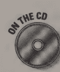

## 又是遗漏部分？

几个 JavaScript 运算符 `typeof` 和 `void` 似乎不属于任何其他运算符类别。当你看到它们如何被使用时，你就会明白我的意思。

## typeof

`typeof` 运算符可以应用于任何 JavaScript 对象，以确定它是什么类型的对象。例如，如果你将 `typeof` 运算符应用于字符串，它将返回 "string"；如果你将其应用于数字，它将返回 "number"；如果你将其应用于 `true`，它将返回 "boolean" —— 此类推，适用于每种存在的类型的对象。以下是 `typeof` 的运行示例：

```javascript
typeof "My friend Flicka" // 返回 "string"
typeof false               // 返回 "boolean"
typeof 69                  // 返回 "number"
typeof document.lastModified // 返回 "string"
typeof Math               // 返回 "function"
typeof someVariable      // 返回变量类型
```

## 第一部分：为了乐趣和利润构建极级的网页

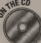

查看 HTML 文件 `ch3_typeof.htm` 以查看 `typeof` 对各种 JavaScript 对象返回了什么。

## void

`void` 运算符是一个奇怪的野兽；你用它来告诉 JavaScript 什么都不做。（只有程序员才会造出一个唯一目的就是做什么都不做的运算符，你不觉得吗？）也许你认为一个什么都不做的运算符没有太大用处。嗯，你是对的 —— 除非有一个非常重要的例外：当你想要使用一个需要函数值的编程结构，但由于（出于什么原因）你不想给它提供值时。

我不会在这个运算符上花费太多时间，因为你可能不需要经常使用它，甚至根本不需要。目前，请记住 `void()` 是存在的，并且它可以被用来“欺骗”一个需要值的属性。

例如，假设你想使用 `<AREA>` 和 `<MAP>` 标签创建一个图像，当用户拖动鼠标经过该图像时它会有反应，但当用户点击该图像时什么都不做。`<AREA>` 标签要求你为 `HREF` 属性提供一个值，如下所示。但如果你为 `HREF` 提供值，图像将响应点击。为了防止这一点，你可以使用 `void` 运算符：

```html
<AREA HREF="javascript:void(0)">
```

## 对象模型总是

由于 JavaScript 是基于对象的，从对象的角度思考比从函数的角度思考要容易得多。事实上，我只需要填写几个细节（同事的名字、它们的功能、长什么样），你就能对它的一天有一个完整的了解。

- 特殊的内置方法，被称为事件处理器（event handlers），与原子和用户触发的事件相关。例如，将网页加载到浏览器中是一个事件；点击按钮也是如此。事件处理器允许在这些事件发生时触发某些 JavaScript 代码，分别为 `onload` 和 `onClick`。

继续阅读以深入了解这四个类别中的每一个以及你如何使用它们创建自己的强大的 JavaScript 脚本！

## 第3 章：JavaScript 编程概念

文档模型（DOM）通过描述以下内容完成这项非常有用的任务：

- 进入网页的所有对象，如表单、图像、按钮和文本。
- 与每个对象相关的描述性属性。例如，图像对象可以与特定的高度和宽度相关。
- 与每个对象相关的行为或方法。例如，名为 `blink()` 的 JavaScript 方法允许你在网页上显示闪烁的文本。
- 特殊的内置方法，被称为事件处理器，与原子和用户触发的事件相关。例如，将网页加载到浏览器中是一个事件；点击按钮也是如此。事件处理器允许在这些事件发生时触发某些 JavaScript 代码，分别为 `onload` 和 `onClick`。

从概念上说，无论你在 Internet Explorer、Netscape Navigator 还是其他浏览器中查看网页，DOM 都是相同的。但在实践中，为 Internet Explorer 和 Netscape Navigator 实现的 DOM 版本略有不同。详。

例如，在 C++ 或 Smalltalk 等面向对象的语言中，如果你有一个名为 `push button` 的对象类，你可以继承它来定义名为 `red push` 和 `skinny green pushbutton` 的新类。由于 JavaScript 是基于对象而不是面向对象的，你可以使用内置对象（均在附录 C 中详细说明）并创建新的对象，但你不能基于给定的对象创建新的对象类。使用 JavaScript，你可以创建一个派自 HTML 按钮的新、可复用的按钮类。

## 对象性

在计算机术语中，对象（object）是现实世界事物的软件表示。从理论上讲，任何人、地点、事物或概念（嘿；听起来很像一个名词，不是吗？）都可以被表述为一个对象。

在实践中，你在 JavaScript 中处理的大多数对象都属于以下四类中的前三类：

- 使用 HTML 标签定义的对象，例如文档、链接、Applet、文本字段、窗口等。（为了本书的方便，JavaScript 脚本始终附加在 HTML 文档上。通过 JavaScript，你可以访问脚本所附加的 HTML 文档中定义的任何对象。要查看脚本访问 HTML 对象的示例，请参阅第 2 章的列表 2-2。）

- 由 Web 浏览器自动定义的对象。一个例子是 `navigator` 对象，尽管它的名字是如此，但它包含了当前正在使用的浏览器的配置和版本信息。（要查看脚本访问浏览器对象的示例，请翻到第 4 章。）

- 内置于 JavaScript 中的的对象，例如 `Date` 和 `Number`。（要查看脚本访问内置 JavaScript 对象的示例，请参阅第 5 章。）

- 由你自己使用 JavaScript `new` 运算符创建的对象。（要查看如何使用 JavaScript 创建和访问自己的对象的示例，请参阅第 5 章。）

就像它们在现实世界的对应物一样，软件对象通常与特定的特征和行为相关。然而，由于这是一个计算机主题，我们不能将这些信息称为特征和行为。不，那样就太没趣了。程序员将特征称为**属性**（properties）或**特性**（attributes），将行为称为**方法**（methods）——某些以 "on" 开头的特定事件行为除，例如 `onLoad`、`Resize` 和 `onSubmit`。程序员称这些特殊的“on-方法”处理器。

Properties 和 attributes 实际上是同一回事，但某些 JavaScript 程序员倾向于将 properties（属于 JavaScript 对象）和 attributes（与 HTML 对象关联）区分开来。

由于你编写的大多数 JavaScript 代码涉及对象、属性、方法和事件处理程序，因此对于计划编写自己脚本的人来说，理解这些面向对象的术语至关重要的。保持这些概念清醒的一种方法是回想六年级的英语课：对象始终是名词；属性是形容词；方法是动词；事件处理程序是在动词前面加上了 "on"。明白了吗？请看表 3-6 以查看一些常见对象定义的示例。

## 第 3 章：JavaScript 编程概念

| 表 3-6 示例对象定义 | 对象类型（名词） | 对象（形容词） | 属性（动词） | 方法 | 事件处理程序 ("on" + 动词) |
| :--- | :--- | :--- | :--- | :--- | :--- |
| HTML | button | name | click() | onClick |
| | | type | | | |
| | | value | | | |
| HTML | link | href | ---- | onClick |
| | | port | | onMouseOver |
| | | protocol | | onKeyPress |
| | | ... | | | |
| HTML | form | action | reset() | onReset |
| | | elements | submit() | onSubmit |
| | | length | | | |
| | | ... | | | |
| Browser | Navigator | appVersion java | ---- | |
| | | appName | Enabled() | | |
| | | language | | | |
| | | platform | | | |
| JavaScript | Number | MAX_VALUE | toString() | ---- | |
| | | MIN_VALUE | | | |
| Custom | customer | name | change | | |
| | | address | changeName() | | |
| | | credit | placeOrder() | | |
| | | History | | | |

## 自主出售：对象属性

属性是描述对象的特性。JavaScript 中提供的大多数对象都有自己的一组属性。（附录 C 列出了按字母排序的 JavaScript 属性。）

例如，图像对象通常与以下属性关联：

| 属性 | 描述 |
|---|---|
| src | 要嵌入 HTML 文档的图像文件名 |
| name | 图像的内部名称（使用 JavaScript 代码引用的名称） |
| height | 图像的高度，单位为像素 |
| width | 图像的宽度，单位为像素 |
| border | 图片周围显示的边框厚度，单位为像素 |
| complete | 图片是否加载成功（true 或 false） |
| hspace | 图像两侧留白的像素数 |
| vspace | 图像上下留留的像素数 |
| lowsrc | 先加载的小尺寸图像的文件名 |

在运行时，所有对象属性都有对应的值，无论是显式定义的还是由 Web 浏览器填充的。例如，考虑使用以下 HTML 代码创建的图像对象：

```html
<BODY>

</BODY>
```

假设你的电脑上有一个名为 `myPicture.jpg` 的文件，在运行时，当你将上述 HTML 代码段加载到 Web 浏览器并查询属性时，对应的值如下：

| 属性名 | 值 |
|---|---|
| document.companyLogo.src | c:///file/myPicture.jpg |
| document.companyLogo.name | companyLogo |
| document.companyLogo.height | 200 |
| document.companyLogo.width | 500 |
| document.companyLogo.border | 1 |
| document.companyLogo.complete | true |

## 第 3 章：JavaScript 编程概念

| JavaScript 代码段 | 功能 |
|--- | --- |
| document.infoForm.requestForFreeIconButton.click() | 调用与按钮对象相关的 click() 方法；具体来说，这段代码点击了位于 infoForm 表单中的 requestForFreeIconButton 按钮。（infoForm 包含在主 HTML 文档中。） |

要查看 JavaScript 中方法调用的示例，请参阅随附光盘中的 `ch3_method-ods.htm`。

你可以在第 2 章看到另一个方法运行的示例，附录 C 列出了 JavaScript 文档对象模型（DOM）中可使用的所有方法。

## 如何处理事件？事件处理器！

事件处理器是一种特殊的方法，当特定事件发生时，支持 JavaScript 的 Web 浏览器会自动触发该方法。事件处理器允许你（JavaScript 程序员）能够根据事件执行任何你喜欢的指令——从执行计算到显示消息，例如：

- 用户将 Web 页面加载到浏览器中
- 用户停止网页加载
- 用户在输入字段中输入或更改某些信息
- 用户点击图像、按钮或链接
- 用户提交或重置表单

例如，当用户将网页加载到浏览器时，与该页面（或文档）关联的 `onload` 处理器会执行；当用户点击 HTML 按钮时，HTML 按钮的 `onClick` 事件处理器会执行；此类推。

这是一个如何调用内置事件处理器的示例：

```html
<BODY
  onload="window.alert('Hello!');"
  onunload="window.alert('Goodbye!');"
</BODY>
```

## 为什么要使用方法？

JavaScript 文档对象模型中定义的许多方法，用户只需点击鼠标即可完成：例如，停止窗口加载（`stop()` 方法）、聚焦于特定输入字段（`focus()` 方法）、打印窗口内容（`print()` 方法）等。那么，为什么还要费尽劲在你的脚本中包含方法调用呢？

简而言之，是为了自动化。假设你想创建一个 Web 页面，使其响应单个事件执行几项操作。例如，当用户加载你的 Web 页面时，你可能希望聚焦于某个输入字段，打开一个较小的“新特性”窗口，并自动显示今天的日期。使用方法，你可以完成这一切——而无需用户亲自动操作！

要查看 JavaScript 中调用事件处理器的示例，请查看随附光盘中的 `ch3_events.htm`。

查看上方列出的代码段。你看到与 `document` 对象关联的两个事件处理器了吗？（document 对象在 HTML 中使用 `<body>...</body>` 标签定义。）一个事件处理器命名为 `onload`；另一个是 `onUnload`。

正如你可能猜到的，将此代码加载到 Web 页面会导致出现“Hello!”消息。加载另一个页面或完全关闭浏览器会导致出现“Goodbye!”消息。事件处理是一件很棒的事情。通过它，你可以弄清并精确了解用户如何与你的 Web 页面交互，并根据需要对该操作做出响应。

附录 C 包含了 JavaScript 支持的所有事件处理器列表。要查看更多 JavaScript 事件处理器运行的额外示例，请查看第 2 章。

## 函数

与方法类似，函数也是行为——但相似性仅此此。与方法不同，函数不与特定对象关联。相反，函数是独立的 JavaScript 代码段，可以反复多次使用。JavaScript 语言提供了一些内置函数，但你也可以创建自己的函数——根据需要创建多少个。

这里有一个示例。假设你想创建一个 HTML 表单，要求用户输入年龄和拥有的宠物数量。你可以创建一个 JavaScript 函数来检查一个数字并确保它在合理范围内——例如 0 到 100 之间。一旦创建了这样的函数，你就可以调用两次：一次验证用户输入的类型，另一次验证他们拥有的宠物数量。如果你计划创建许多增强了 JavaScript 的网站，这种创建复用函数的能力可以为你节省大量时间。

列表 3-2 显示了如何在 JavaScript 中定义和使用函数：

## 列表 3-2：在 JavaScript 中定义和调用自定义函数

```javascript
<SCRIPT LANGUAGE="JavaScript">
function checkNumber(aNumber) {
    if (aNumber > 0 && aNumber < 100) {
        ///////////////////////////////////////////////////////
        // 如果数字大于0且小于
        // 100。
        // 弹出一个“恭喜”消息并返回一个
        // 表示成功的值
        ///////////////////////////////////////////////////////
        alert("The number you specified is valid (it is
        between 0 and 100).")
        return 1
    }
    ///////////////////////////////////////////////////////
    // 否则，该数字要么为负数，要么超过100。
    else {
        alert("The number you specified is invalid.");
        return 0
    }
}
```

# 78 第一部分：为了乐趣和利润构建杀手级的网页

| 对象 | 语法 |
|---|---|
| textarea | document.someForm.someTextarea |
| ids | document.ids |
| layers | document.layers |
| link | document.someLink |

| 对象 | 语法 |
|---|---|
| object | document.someObject |
| plugin | document.embeds[0] |
| tags | document.tags |
| frame, parent, self, top（这些都是的同义词） | |
| history | history |
| location | location |
| locationbar | locationbar |
| menubar | menubar |

| 对象 | 语法 |
|---|---|
| navigator | navigator |
| personalbar | personalbar |
| scrollbar | scrollbar |
| statusbar | statusbar |
| toolbar | toolbar |

## JavaScript 数据类型

你想要用 JavaScript 执行的大部分操作都涉及程序员定义的对象，例如用户输入到你的 HTML 表单中的值、你根据这些值进行的某些计算等。

大多数编程语言要求你声明特殊的占位符（称为变量）来保存你想要处理的每条数据。不仅如此，大多数编程语言要求你预先指定你期望这些变量包含什么类型的数据。（这一要求让这些语言的编译器变得更简单，但却给我们程序员增加了负担！）

JavaScript 也要求你声明变量来表示数据片段。（请参阅本章前面的“JavaScript 语法”以查看如何在 JavaScript 中声明变量。）但由于 JavaScript 是一种松散类型语言，你不一定需要预先变量的类型；也不需要像在 C 和 C++ 等语言中那样进行某些转换。这是一个示例：

```javascript
var visitor // 定义了一个名为 "visitor" 的变量，
// 没有特定类型
visitor = "emily@emily.com" // 将 "visitor" 设置为
// 文本字符串 "emily@emily.com";
```

## 第 3 章：JavaScript 编程概念

```javascript
visitor = 3      // 将 "visitor" 重置为数值
visitor = null    // 将 "visitor" 重置为 null
```

如代码段所示，你不需要显式地指定字符串或数值数据类型，JavaScript 解释器会在运行时处理并确定任何变量关联的值类型。

尽管如此， JavaScript 要求你显式指定两种数据类型：Array 和 Date。你必须显式声明 Array 和 Date 类型的变量，因为 JavaScript 解释器需要知道关于这些类型值的额外细节，以便正确存储它们。表 3-7 描述了 Array、Date 以及 JavaScript 支持的所有其他数据类型。

### 表 3-7 JavaScript 数据类型

| 数据类型 | 描述 |
|---|---|
| Array | 有序集合 |
| Boolean | 布尔数据类型（仅限 true 或 false 的值） |

示例：

```javascript
var animals = new Array("cat", "dog", "mouse")
// 加载数组
var firstAnimal = animals[0] // 访问第一个元素
var secondAnimal = animals[1] // 访问第二个元素
var thirdAnimal = animals[2] // 访问第三个元素
```

示例：

```javascript
var cookieDetected = false
var repeatVisitor = true
```

### Date

时间和日期数据类型

示例：

```javascript
var today = new Date() // 通过系统时获取当前时间/日期
```

# 80 第一部分：为了乐趣和利润构建杀手级的网页

### 表 3-7（续）

| 数据类型 | 描述 |
| --- | --- |
| | var newYearsDay = new Date(2001, 01, 01) // 特定日期 |
| null | 表示不存在的特殊数据类型（注意 null 不等于 0） |
| 示例： | if (emailAddress == null) { // 检查是否为 null alert("请输入电子邮件地址") } |
| Number | 数值数据类型 |
| 示例： | var numberHits = 1234 // 隐式数值数据类型 var numberHits = new Number(1234) // 显式 |
| String | 字符串（文本）数据类型 |
| 示例： | alert("This is a string") // 带双引号的隐式字符串 alert('So is this') // 带单引号的隐式字符串 var myString = new String("Yet another string") // 显式 |

## 剩余：Math 对象

JavaScript 提供了一个实用对象供你的脚本尝试使用。该对象——Math 对象并不是文档对象模型本身的一部分（也就是说，它不代表网页的构性组件）。它不是一种数据类型，它只是一个为你提供的独立对象，当你需要更多数学常量或函数时可以使用。以下是一些示例：

```javascript
var x = Math.PI // 为 "x" 赋值 pi 的值
var y = Math.round(158.32) // 为 "y" 赋值 158.32 的结果
var z = Math.sqrt(49) // 为 "z" 赋值 49 的平方根
```

查看目录 C 获取与 Math 对象相关的所有属性和方法的完整列表。

## 第 3 章：JavaScript 编程概念

## Microsoft Internet Explorer 的对象模型

微软的文档对象模型通常被称为 DHTML DOM，这是动态超文本标记语言文档对象模型的字母字母缩写（DHTML，或动态 HTML，是指你使用 JavaScript 等脚本语言来使网页具有交互性——这在行动导向的营销术语中翻译为“动态”！）

虽然微软的 DHTML 模型基于万维网联盟的标准，但与 Netscape 的实现有所不同。如果你的脚本引用了在某个浏览器中不存在的对象，它将只会运行在该浏览器中。（跳转到第 4 章查找创建跨浏览器脚本的技巧）。

你可以在 Internet Explorer 中找到所有可以使用 JavaScript 访问的对象，包括相关的属性、方法和事件处理程序，见目录 C。或者查看微软自己的 DHTML DOM 参考：

```
http://msdn.microsoft.com/workshop/author/html/objects.asp
```

| 对象 | 语法 |
|---|---|
| window | window（可选） |
| document | document |
| applet | document.applets[0] |
| anchor | document.someAnchor |
| area | document.someArea |
| document.someForm |
| button | document.someForm.someButton |
| checkbox | document.someForm.someCheckbox |
| file | document.someForm.someFile |
| hidden | document.someForm.someHidden |
| image | document.someForm.someImage |
| password | document.someForm.somePassword |
| radio | document.someForm.someRadio |
| reset | document.someForm.someReset |
| select | document.someForm.someSelect |
| submit | document.someForm.someSubmit |
| text | document.someForm.someText |

# 82 第一部分：为了乐趣和利润构建杀手级的网页

| 对象 | 语法 |
| --- | --- |
| textarea | document.someForm.someTextarea |
| link | document.someLink |
| object | document.someObject |
| plugin | document.embeds[0]（不，这不是笔误！） |
| embed | document.embeds[0] |
| frame | someFrame |
| frameset | someFrames |
| history | history |
| location | location |
| navigator | navigator |
| clientInformation | clientInformation |

# 第二部分
# 为你的网页
# 添加智能

Rich Tennant 的第五波

## 在这一部分中...

在这一部分，你将发现创建向不同用户显示不同网页的实用方法。第 4 章将你如何根据用户运行的浏览器自动修改网页显示方式。第 5 章将教你如何将时间和日期整合到页面中；第 6 章描述了你如何创建可以“记住”访问者的网页。

最棒的是，你看到了第二部分中介绍的所有技术的真实活动运行示例。（这些示例也包含在书末的 CD-ROM 中，所以你甚至不需要输入代码。）

## 第 4 章

## 我在观察！检测你的用户浏览器环境

## 本章内容

- 理解不同浏览器之间 JavaScript 支持的差异（以及为何产生差异）
- 应用跨平台脚本创建的策略
- 查询浏览器对象
- 操控字符串
- 通过浏览器检测脚本利用高级 JavaScript 特性

今天 Web 开发者面临的最大挑战不是基于硬件或软件的，而是基于“人”的（we-based，这个词指的是人类大脑所谓的延展性——极客术语，意指“人类”）。而挑战在于……如何让创建 Web 浏览器的公司对 JavaScript 等浏览器支持技术达成统一的单一实现！

在目前的情况下，某人安装的浏览器品牌——以及浏览器版本和底层操作系统——都会影响他们查看启用 JavaScript 的 Web 页面的能力。作为 JavaScript 开发者，你需要意识到不同浏览器之间 JavaScript 实现的差异，并据此编写脚本。如果你这样做，你最终可能会写出一个只能在你自己电脑上运行的“奇技淫巧”！

## JavaScript：非标准的标准

在 Web 出现之前的过去，开发者在写第一行代码之前，就已经确切知道观众将使用什么硬件和软件运行他们的程序。（换句话说，这些开发者预先知道了他们程序的目标平台。）利用这些信息，开发者可以放心地实现他们的程序，因为他们知道程序代码在实际环境中的行为与在测试实验室完全一致。

Web 世界并非如此。用户可以根据他们选择的任何平台来查看 Web 页面——更准确地说，是 Web 应用程序。例如，他们可能会使用 Macintosh、PC、UNIX 设备，或运行某些版本的 Navigator、Internet Explorer 或市场上其他几十种 Web 浏览器的手持设备。遗憾的是，正如本章所示，用户的选择会影响他们运行你启用 JavaScript 的 Web 页面的能力。

最流行的两种 Web 浏览器——Internet Explorer 和 Netscape Navigator 的最新版本都支持 JavaScript。尽管它们的创建者声称支持某种由欧洲计算机厂商协会（ECMA）创建的所谓 ECMA 标准（我将在下一节中详细讨论），但这两个浏览器对这些元素的支持版本也略有不同：

- JavaScript 语言
- JavaScript 语言旨在访问的文档对象模型

### 难道难道就不能和平相处吗？
## ECMA 标准

Netscape（在太阳系统公司的帮助下）早在 20 世纪 90 年代初发明了 JavaScript，因此 JavaScript 支持首先出现在 Netscape 浏览器中（如果你是历史迷，那是 Netscape Navigator 2.0）并不意外。

不久，微软发布了 Internet Explorer 3.0 版本，其特点是支持他们自己的 JavaScript 兼容脚本语言——JavaScript。然而，这两个浏览器的脚本实现之间存在细微差异，而且随着每个后续版本的出现，这些差异仍在不断扩大。

1998 年，Netscape 决定将创建正式 JavaScript 标准的任务交给 ECMA，这是一个由来自世界各地公司组成的国际标准组织。（Netscape 和微软都是 ECMA 成员）。从理论上讲，这是一件很棒的事！它允许一个相对非正式的小群体来决定实现浏览器 Web 脚本语言的最佳、最高效的方法。遗憾的是——软件虽如此，生活亦如此——现实世界中的实现情况尚未完全达到标准所承诺的完美。

ECMAScript 语言规范称为 ECMA-262，描述了在符合 ECMA 标准的浏览器中应该如何实现脚本语言；而不是它是如何被实现的。因此，尽管 ECMA 具有统一 JavaScript 实现并为开发者提供一致的、跨浏览器 JavaScript 执行平台的潜力，但最新的 Navigator 和 Internet Explorer 浏览器之间仍然存在 JavaScript 支持的差异。这些差异的原因之一是创建标准与匆忙实现并发布标准之间存在不可避免的延迟；另一个原因是软件公司固有的倾向于用额外的专有特性来修饰标准（正是这种倾向导致了最初对标准的需要！）。

底线情况是：尽管 ECMAScript 具有增加浏览器间一致性的潜力，但 JavaScript 实现的最终决定权来自浏览器本身，而不是规范。

## 穿梭于浏览器迷宫

根据最新报告，微软和 Netscape 承诺在其各自浏览器的未来版本中支持 ECMAScript 标准。请检查确保你使用的 Internet Explorer 或 Netscape Navigator 版本完全支持 ECMAScript 标准。即使该版本不支持，你仍然拥有你需要的语言特性。

## 你可以不要的功能

在 ECMAScript 和万维网联盟（W3C）DOM 标准出现之前，Internet Explorer 和 Netscape Navigator 支持的某些专有功能可能活不了多久了。（换句话说，随着微软和 Netscape 竞相争夺成为“最符合标准的”，这两个浏览器可能会停止对这些功能的支持。）

然而，即使以下功能继续被支持，我强烈建议你尽量不要在 JavaScript 代码中包含它们。避开这些功能有助于确保你的脚本能被最广泛的观众看到。

| Netscape 专有功能 | 微软专有功能 |
| :--- | :--- |
| `document.layers[]` | `document.all` |
| `document.tags` | `document.styleSheets[]` |
| `document.ids` | |
| `<MARQUE>` 和 `<BGSOUND>` | `document.classes` |

## 浏览器侦探脚本

确定哪些浏览器正在加载你的脚本最可靠的方法是程序化地“询问！”：使用 JavaScript 在脚本开头添加一些代码，查询文档对象模型以获取特定浏览器的细节。当你确定了是哪个品牌、哪个版本的浏览器正尝试加载启用 JavaScript 的页面时，你可以相应地显示页面。

实现此功能最简单的方法是使用 `<MARQUE>` 标签，它是 Internet Explorer（从 3.x 版本开始）支持的 HTML 标签（相应的脚本对象）。问题是，Navigator 以及许多其他浏览器完全不支持 `<MARQUE>` 标签！不支持的浏览器加载包含 `<MARQUE>` 标签的页面时，可能会静态地显示滚动文本，或者根本不显示；你的相关的 JavaScript 代码可能会产生 JavaScript 错误。

确保你的观众看到你想让他们看到的内容的方法是，使用 JavaScript 查看加载脚本的浏览器是否为 Internet Explorer 3.x 或更高版本。如果是，你可以放心地使用 `<MARQUE>` 标签。如果浏览器不是 Internet Explorer 3.x 或更高版本，你可以用另一种引人注目的方式显示滚动信息——例如，作为加粗居中的标题。

列表 4-1 显示了脚本代码，根据加载脚本的浏览器是否为 Internet Explorer 3.x 及以上，以 1) 滚动幕或 2) 加粗居中的标题的形式显示文本字符串。这个浏览器“嗅探”脚本模仿了 Netscape Navigator 提供的：

```
http://developer.netscape.com/docs/examples/javascript/browser_type_00.html
```

## 第四章：我发现了！检测你用户的浏览器环境

### 每次都是量身定制

为存在的每一个不同浏览器版本为每一个 Web 页面创建不同的版本，可以确保所有用户都能获得良好的体验。但这意味着维护工作的场噩梦！

一个值得遵循的设计方法是：

- 1. 以纯文本、旧版浏览器支持的文本形式提供绝对核心的信息（如联系信息），而不是使用滚动的 JavaScript 幕帘（marquee）。

- 2. 尽可能使用跨浏览器技术提供额外的信息和效果。例如，并非所有浏览器都实现了层（layers），但根据你想要实现的效果，你可能可以使用图像切换技术（如你在第 9 章中看到的）或动画 GIF 文件来代替。GIF 代表图形交换格式（graphics interchange format）。你可以在 http://animation.about.com/arts/animationubgif.htm 找到更多关于动画 GIF 的信息，包括免费动画软件的链接。

- 3. 如果你想利用最新、最强大的 Web 效果（谁不想不想尝试一下呢？），请结合本章所示的浏览器“嗅探器”（sniffer）脚本来实现它们。例如，假设你想创建一个具有以下功能的 JavaScript 启用 Web 页面：

    - 吸引读者的注意来滚动一行文本
    - 允许用户停止（并重启）滚动动作

快速查看代码列表 4-1；查看图 4-1 和图 4-2，它们分别展示了该脚本在 Netscape Navigator 6.0 和 Microsoft Internet Explorer 5.5 中的外观。我在本章的剩余部分将逐步详细描述代码列表 4-1 中脚本的工作原理，这样你就可以将在这里看到的原理应用到你自己的浏览器嗅探脚本中了！

列表 4-1 显示的文件名为 `list0401.htm`，位于附带光盘中。在你自己的浏览器中查看它吧！

## 代码列表 4-1：嗅探浏览器版本

```javascript
<HTML>
<HEAD><TITLE>JavaScript 浏览器“嗅探器" (来自《傻呆 JavaScript》，第3版)</TITLE>
<SCRIPT LANGUAGE="JavaScript">
function IS () {
  // 将所有字符转换为小写以简化测试
testing
var agt=navigator.userAgent.toLowerCase();
// *** 浏览器版本 ***
// 注意：在 IE5 上，此返回 4，因此使用 is.ie5up 来检测 IE5。
this.major = parseInt(navigator.appVersion);
this.minor = parseFloat(navigator.appVersion) &&
this.nav = ((agt.indexOf('mozilla')!=-1) &&
(agt.indexOf('spoofer')==-1) && -1) &&
(agt.indexOf('compatible')!=-1) &&
(agt.indexOf('opera')==-1) &&
(agt.indexOf('webtv')!=-1);
this.nav2 = (this.nav && (this.major == 2));
this.nav3 = (this.nav && (this.major == 3));
this.nav4 = (this.nav && (this.major == 4));
this.nav4up = (this.nav && (this.major >= 4));
```


# JavaScript 浏览器检测与环境识别

## 代码实现

```javascript
this.navonlly = (this.nav && (agt.indexOf('nav') != -1) != -1);
(this.agt.indexOf('nav') != -1));

this.nav5 = ((this.nav && (this.major == 5)) && (this.minor == 5));
this.nav6 = (agt.indexOf('msie') != -1);

this.ie3 = (this.ie && (this.major < 4));
this.ie4 = (this.ie && (this.major == 4)) && (agt.indexOf('msie 5.') != -1);
this.ie4up = (this.ie && (this.major >= 4));
this.ie5 = (this.ie && (this.major == 4)) && (agt.indexOf('msie 5.') != -1);
this.ie5up = (this.ie && this.ie3 && !this.ie4);

// 已知 Bug：如果嵌入了 AOL4、IE3 浏览器或者它是打开的浏览器窗口，则返回 false。因此 is.aol, is.aol3 和 is.aol4 属性并不 100% 可靠。

this.aol = (agt.indexOf('aol') != -1);
this.aol3 = (this.aol && this.ie3);
this.aol4 = (this.aol && this.ie4);

this.opera = (agt.indexOf('opera') != -1);
this.webtv = (agt.indexOf('webtv') != -1);

// *** JavaScript 版本检查 ***

if (this.nav2 || this.ie3) {
    this.js = 1.0;
} else if (this.nav3 || this.opera) {
    this.js = 1.1;
} else if ((this.nav4 && (this.minor <= 4.05)) || this.ie4) {
    this.js = 1.2;
} else if ((this.nav4 && (this.minor > 4.05)) || this.ie5) {
    this.js = 1.3;
} else if (this.nav5) {
    this.js = 1.4;
} else if (this.nav6) {
    this.js = 1.5;
}

// 注意：当发布新版本时，更新此代码。
// 现在我们尝试提供向上兼容性，以便未来的 Nav 和 IE 至少显示 JS 1.x。始终与 JS 版本进行兼容性检查。

else if (this.nav && (this.major > 6)) {
    this.js = 1.6;
}

// 技巧：对于其他浏览器没有主意
this.js = 0.0;

// *** 平台 ***

this.win = ((agt.indexOf('win') != -1) || (agt.indexOf('16') != -1));

// 注意：在 Opera 3.0 上，字符串包含 "Windows 95/NT"，所以你无法区分 Win95 和 NT。

this.win95 = ((agt.indexOf('win95') != -1) || (agt.indexOf('windows 95') != -1));

// 这是 16 位的？

this.win16 = ((agt.indexOf('win16') != -1) || (agt.indexOf('16bit') != -1) || (agt.indexOf('windows 3.1') != -1) || (agt.indexOf('windows 16-bit') != -1));

this.win31 = ((agt.indexOf('windows 3.1') != -1) || (agt.indexOf('windows 16') != -1) || (agt.indexOf('windows 16-bit') != -1));

// 注意：可能无法检测 Win98。
// - 在 Nav 4.x 之前，你会得到 "Windows"。
// - 在 Mercury 上，32 位版本在 Win98 上运行仍返回 "Win95"。

this.win98 = ((agt.indexOf('win98') != -1) || (agt.indexOf('windows 98') != -1));
this.winnt = ((agt.indexOf('winnt') != -1) || (agt.indexOf('windows nt') != -1));
this.win32 = (this.win95 || this.winnt || this.win98 || ((this.major > 4) && (navigator.platform == "Win32")) || (agt.indexOf("os/32-bit") != -1));
this.os2 = ((agt.indexOf("os/2") != -1) || (navigator.app.indexOf("os/2") != -1) || (agt.indexOf("ibm-webexplorer") != -1));
this.mac = (agt.indexOf("mac") != -1);
this.mac68k = (this.mac && (agt.indexOf("68k") != -1) || (agt.indexOf("68000") != -1));
this.macppc = (this.mac && (agt.indexOf("ppc") != -1) || (agt.indexOf("powerpc") != -1));
this.sun = (agt.indexOf("sunos") != -1);
this.sun4 = (agt.indexOf("sun 4") != -1);
this.sun5 = (agt.indexOf("sun 5") != -1);
this.sun186 = (this.sun && agt.indexOf("i86") != -1);
this.irix = (agt.indexOf("irix") != -1) || SGI;
this.irix5 = (agt.indexOf("irix 5") != -1) || (agt.indexOf("irix 6") != -1);
this.irix6 = (agt.indexOf("irix6") != -1);
this.hpux = (agt.indexOf("hp-ux") != -1);
this.hpux9 = (this.hpux & agt.indexOf("0.9") != -1);
this.hpux10 = (this.hpux & agt.indexOf("10.0") != -1);
this.aix = (agt.indexOf("aix") != -1);
this.aix1 = (agt.indexOf("aix 1") != -1);
this.aix2 = (agt.indexOf("aix 2") != -1);
this.aix3 = (agt.indexOf("aix 3") != -1);
this.aix4 = (agt.indexOf("aix 4") != -1);
this.linux = (agt.indexOf("linux") != -1);
this.sco = (agt.indexOf("sco") != -1) || (agt.indexOf("unix_sv") != -1);
this.unixware = (agt.indexOf("unix_system") != -1);
this.mpras = (agt.indexOf("ncr") != -1);
this.reliant = (agt.indexOf("reliant") != -1);
this.dec = ((agt.indexOf("dec") != -1) || (agt.indexOf("osf1") != -1) || (agt.indexOf("alphasver") != -1) || (agt.indexOf("utltrix") != -1) || (agt.indexOf("alphastation") != -1) || (agt.indexOf("sinix") != -1));
this.freebsd = (agt.indexOf("freebsd") != -1);
this.bsd = (agt.indexOf("x11") != -1) || this.sun || this.unix;
this.unix = (this.irix || this.unixware || this.mpras || this.reliant || this.dec || this.sinix || this.aix || this.linux || this.freebsd);
this.vms = ((agt.indexOf("vax") != -1) || (agt.indexOf("openvms") != -1));
```

## 页面加载与脚本执行顺序

```javascript
// 结束函数声明
var is;
var isIE3Mac = false;

// 此部分专门为 Mac 版 IE3 设计
if ((navigator.appVersion.indexOf("Mac") != -1 && (navigator.userAgent.indexOf("MSIE") != -1 && parseInt(navigator.appVersion) == 3))) {
    isIE3Mac = true;
} else {
    is = new Object();
    var builtInScroll;
    if (is.ie4up || is.ie5up) {
        // 支持 MARQUEE 元素，因此我们使用它
        InScroll = '<FORM NAME="myForm"><MARQUEE ID=abc DIRECTION=LEFT BEHAVIOR=SCROLL SCROLLAMOUNT=2>JavaScript For Dummies...</MARQUEE><INPUT TYPE="button" VALUE="Start scrolling" onclick="document.all.abc.start()"><INPUT TYPE="button" VALUE="Stop scrolling" NAME="stopScroll" onclick="document.all.abc.stop()"></FORM>';
    }
}
```

```javascript
else {
    // 显示一个吸引人的、不滚动的备选方案
    builtInScroll = '<CENTER><H1>JavaScript For Dummies...</H1></CENTER>';
}
document.write(builtInScroll);
```

## 94 第二部分：为你的网页添加智能

## 列表 4-1（续）

## 法庭秩序！

列表 4-1 中的代码初看起来可能有点令人生畏，但一旦你理解了发生了什么，它其实非常直观。（在你读完这一章后，你就会了！）

你首先需要注意的是 JavaScript 语句的顺序。JavaScript 解释器按照从上到下的顺序处理 JavaScript 语句，因此是解释器解释列表 4-1 中代码的顺序：

1. `Is()` 函数声明是出现在起始 `<SCRIPT>` 标签后的第一个语句，因此该函数声明最先处理。JavaScript 解释器处理 `Is()` 函数并将其保留在内存中，准备在某行代码调用 `Is()` 时立即采取行动。

2. 标记 `Is()` 函数声明结束的右括号，你会看到一个 `if ... else` 语句，它用于判断浏览器是否运行在 Macintosh 上的 Internet Explorer 3。JavaScript 解释器第二个处理这个 `if ... else` 语句。

## 第 4 章：我来偷看！检测用户的浏览器环境

3. 在该 `if ... else` 语句的 `else` 部分，你看到了最后一个 `if ... else` 语句。这个最后的 `if ... else` 语句调用 `Is()` 函数来确定加载的浏览器是否为 Internet Explorer 3 或更高版本。查看列表 4-2 以查看这三个语句以及它们之间的相互关系。这个经过大幅节取的“嗅探器”脚本演示了 JavaScript 语句按从上到下的处理顺序。

## 列表 4-2：显示嗅探过程的代码

```html
<HTML>
<HEAD>
<TITLE>JavaScript 浏览器“嗅探器”(来自《JavaScript For Dummies》，第三版)</TITLE>
<SCRIPT LANGUAGE="JavaScript">
function Is() {
    var isIE;
    var isIE3Mac = false;

    // 此部分专门为 Mac 上的 IE3 设计
    if ((navigator.appVersion.indexOf("Mac") != -1 && (navigator.userAgent.indexOf("MSIE") != -1 && (parseInt(navigator.appVersion) == 3)))) {
        isIE3Mac = true;
    } else {
        is = new Is();
        var builtInScroll;

        if (is.ie3up || is.ie4up || is.ie5up) {
            // 支持 MARQUEE 元素，因此使用它
            builtInScroll = '<FORM NAME="myForm"><MARQUEE ID=abc DIRECTION=LEFT BEHAVIOR=SCROLL SCROLLAMOUNT=2>JavaScript For Dummies...</MARQUEE><INPUT TYPE="button" VALUE="Start scrolling" NAME="startscroll" onclick="document.all.abc.start()">INPUT TYPE="button" VALUE="Stop scrolling" NAME="stopScroll" onclick="document.all.abc.stop()"></FORM>';
        }
    }
}
</SCRIPT>
</HEAD>
<BODY>
</BODY>
</HTML>
```

（续）

## 96 第二部分：为你的网页添加智能

## 列表 4-2（续）

你可以将 JavaScript 脚本放在 Web 文档的 `head` 中（如列表 4-2 所示，位于起始 HTML `<HEAD>` 标签和结束 HTML `</HEAD>` 标签之间），或者 `body` 中（位于起始 HTML `<body>` 标签和结束 HTML `</body>` 标签之间）。如果你愿意，甚至可以在 Web 文档的 `head` 和 `body` 中都放置脚本！

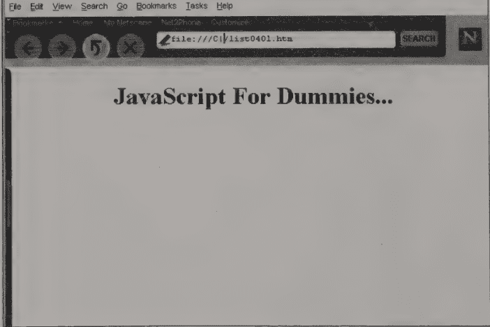

图 4-1：Navigator 6.0 中显示的浏览器嗅探器脚本。

## 第 4 章：我来偷看！检测用户的浏览器环境

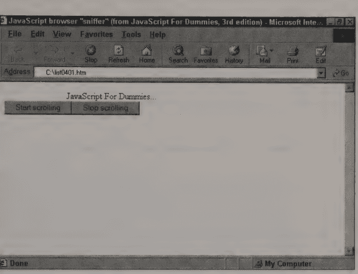

图 4-2：Internet Explorer 5.5 中显示的浏览器嗅探器。

## 变量：全局思考，局部行动

变量是在你在 JavaScript 中定义的命名占位符，然后向它们填充你任何喜欢的值。如果你以前没有处理过变量，它们起初可能会让你觉得是一个奇怪的概念——但相信我，它们将成为你编程时最好的朋友！

## 大家请注意！

在考虑脚本位置时，需要记住两点：

- 放在 Web 文档 `head` 中的脚本会在放在 Web 文档 `body` 中的脚本之前被处理。一种良好的做法是将包含你创建的所有自定义函数的脚本放在 Web 文档的 `head` 中。这样，JavaScript 解释器就能直接遇到它们，确保你的函数可以被文档 `body` 中随后出现的任何 JavaScript 语句访问。

- 你并不限于每个文档 `head` 或 `body` 只能有一个脚本；你可以在任何部分包含任意数量的脚本。（你可能想在单个 Web 文档上附加多个脚本的原因之一，如果你计划利用外部脚本。）

## 100 第二部分：为你的网页添加智能功能

分号语句结束符是可选的——除非你试图将多个语句挤在同一行中。如果你在同一行上放置了多个 JavaScript 语句，则必须用分号将它们分隔开。

例如，当你将插列表 4-3 中的代码段加载到 Internet Explorer 5.5 浏览器时，你会看到这些值：

- `navigator.userAgent` 的值为 `Mozilla/4.0 (compatible; MSIE 5.5: Windows 95)`
- 赋值给变量 `agt` 的值为 `mozilla/4.0 (compatible; msie 5.5: windows 95)`

在 JavaScript 中，与其他编程语言一样，变量可以是局部的也可以是全局的。局部变量是在你在函数内部定义的变量——就像你在列表 4-3 中看到的变量一样。局部变量仅在包含局部变量声明的函数内部可用（可见）。

另一方面，全局变量是你在脚本顶部、任何函数声明之前定义的变量。由于你是在任何单个函数的作用域之外声明它们的，因此全局变量可以从脚本中的所有函数访问。变量的作用域是指该变量在何地方是可以访问的。如果你在函数中定义一个变量，该函数就是该变量的作用域；如果你在脚本开头定义一个变量，脚本中的所有函数共同构成该变量的作用域。

我将在下一节中详细介绍如 `indexOf()` 这样的字符串处理方法。现在，继续变量声明的主题，请看列表 4-3 中的第二个变量声明和赋值语句：

```javascript
this.major = parseInt(navigator.appVersion);
```

前面的语句引入了一个内置的 JavaScript 关键字：`this` 关键字，它是“我现在就在这儿”的缩写。（至少在德克萨斯州我们是这么这么说的！）

使用这个关键字可以将一个普通函数变成一个对象生成器。当你使用 `new` 运算符调用包含这些语句的函数时（如下所示），你会创建一个全新的对象实例。

```javascript
var is = new Is(); // 创建一个 Is 对象的新实例
```

上面的语句创建了一个名为 `is` 的新变量，并为其赋值了一个通过调用 `Is()` 函数生成的全新对象。由于 `Is()` 函数中的语句（如你在列表 4-3 中所示）为 `this.major` 和 `this.minor` 赋值，因此这些值也可以从新创建的变量获取！看这里：

## 第 4 章：我来偷！检测你用户的浏览器环境 101

```javascript
var abc = new Is();
// 现在你可以访问 abc.major 和 abc.minor

var is = new Is();
// 现在你可以访问 is.major 和 is.minor

var browser = new Is();
// 现在你可以访问 browser.major 和 browser.minor
```

## 字符串处理（别担心，这是合法的！）

本章演示的浏览器“嗅探器”脚本的大部分（你可能从列表 4-1 中记得）是由 JavaScript 语句组成的，这些语句通过检查字符串来确定加载浏览器的类型、型号和版本。例如，下面这条代码询问：“当前”加载的浏览器是否是 Internet Explorer？

```javascript
this.ie = (agt.indexOf("msie") != -1);
```

JavaScript 字符串非常像英语单词或句子：它可以包含字母、数字，甚至是特殊字符，如空格或标点符号。在前面的 JavaScript 语句中，“msie" 就是一个字符串。

由于我们人类倾向于用单词和句子来思考，在 JavaScript 中检查和处理字符串是一项相当常见的操作。（我所说的“处理”，是指改变字符的大小写、提取字符、合并两个或多个字符串——这类操作。）幸运的是，文档对象模型和 JavaScript 的内置字符串支持提供了许多你可以执行操作的函数和方法！

在本节中，你将逐步查看“嗅探器”脚本中使用的字符串处理方法。

## 字符串飞行

每当你创建一个字符串对象——你可以使用以下任何 JavaScript 语句来实现——你都会由于 JavaScript 而自动获得一系列内置属性和方法。我将在本章介绍一些最常用的方法。要获得适用于你的字符串处理任务的所有属性和方法的完整列表，请参考：

```
http://developer.netscape.com/docs/manuals/js/client/jsref/string.html#1193317
```

## 第二部分：为你的网页添加智能功能

### 创建字符串

你可以创建这样的简单字符串：

```javascript
var string1 = "My dog has fleas."
var string2 = 'So does my cat.'
var string3 = new String("What just bit me?")
```

为了获得更复杂的结果或显示字段值的组合而添加字符串，请使用这些示例：

| 示例 | 结果 |
| :--- | :--- |
| `var string4 = string1 + string2 + string3` | 合并 string1、string2 和 string3 并将结果赋值给 string4 |
| `var string5 += string1` | 将 string1 添加到 string5 的末尾 |

像这样使用 `length` 属性，结果代表 `string1.length` 的长度。

以下示例是一些实用的字符串方法：

| 方法 | 返回值 |
| :--- | :--- |
| `string1.toLowerCase()` | 返回全小写的 string1 |
| `string1.toUpperCase()` | 返回全大写的 string1 |
| `string1.indexOf("abc")` | 如果找到则返回 "abc" 的位置，否则返回 -1 |
| `string1.concat(string2, string3)` | 合并（连接）string1、string2 和 string3 |
| `string1.substring(11, 16)` | 返回从第 11 个字符开始的子字符串 |

## 第 4 章：我来偷！检测你用户的浏览器环境

## 处理字符串

然而，对于某些对象的内容（例如 `navigator`），列表 4-4 中的示例显示：

```javascript
function Is() {
    // 使用内置的
    this.major = 0;
    this.minor = 0;
}
```

### toLowerCase()

`toLowerCase()` 返回的值（如果你运行的是 Internet Explorer 5.5）：

```
mozilla/4.0 (compatible; msie 5.5; windows 95)
```

### parseInt()

你在列表 4-4 中看到的第二个变量赋值语句是这一条：

```javascript
this.major = parseInt(navigator.appVersion);
```

## 第 4 章：我发现了！检测您的用户的浏览器环境

除非另行指定，否则 `parseInt()` 函数假设按 10 进制转换。你可以通过向 `parseInt()` 函数传递一个可选的基数（radix）参数来请求非 10 进制转换，如下：

```javascript
parseInt(aString, "16") // 16 进制计算
```

### indexOf()

在列表 4-4 中看到的第三个也是最后一个变量赋值是：

```javascript
this.nav = ((agt.indexOf('mozilla') == -1) && (agt.indexOf('spoofer') == -1) && (agt.indexOf('compatible') == -1) && (agt.indexOf('opera') == -1) && (agt.indexOf('webt') == -1));
```

上述语句使用了与字符串对象的 `indexOf()` 方法来确定变量是否包含某个字符串。

以下是 `indexOf` 方法的工作原理。你传递要查找的字符串，如果匹配成功，它将返回在找到匹配项之前所计数的字符数。如果没有匹配项，`indexOf()` 返回 -1。

假设变量 `agt` 在运行时包含以下字符串（如果你正在运行 Netscape Navigator 6.0，确实如此）：

```
mozilla/5.0 (windows; win95; en-us; m14) netscape6/6.0b1
```

当 JavaScript 解释器运行列表 4-4 中看到的第三个也是最后一个变量赋值时，会将值 `true` 赋值给 `this.nav` 变量。为什么？因为 JavaScript 解释器执行了这些测试：

- 找到匹配项。在 `mozilla/5.0 (windows; win95; en-us; m14) netscape6/6.0b1` 中找到了 `mozilla`。
- 比较匹配结果。`agt.indexOf()` 返回 0，因为解释器在找到匹配项之前计算了 0 个字符。因为 0 不等于 (`!= -1`)，所以第一个条件为真。
- 未找到任何匹配项。`spoofer`、`compatible`、`opera` 或 `webt` 都不包含在 "mozilla/5.0 (windows; win95; en-us; m14) netscape6/6.0b1" 字符串中，这些其他条件测试也都为真。
- 将结果赋值给 `this.nav`。因为所有条件测试为真，解释器在 `this.nav` 变量中放置了值 `true`。


## 谈谈我的 JavaScript 生成

在本章前面的部分中讨论的所有代码的目的都是在运行时精确确定是哪种浏览器正在加载特定的脚本。在你知道自己正在处理哪种浏览器后，有趣的部分来了：你为该类型的浏览器显示合适的 Web 页面！这正是在你在本节中将看到如何做的。

查看列表 4-5，查看浏览器（“嗅器”）示例的一部分，它根据加载的浏览器是 Internet Explorer 还是其他浏览器生成两个不同的 Web 页面。

### 列表 4-5：根据加载浏览器的类型生成两个 Web 页面

```javascript
var builtInScroll;
if (is.ie3up || is.ie4up || is.ie5up) {
    // 支持 MARQUEE 元素，因此使用它
    builtInScroll = '<FORM NAME="myForm"><MARQUEE ID=abc DIRECTION=LEFT BEHAVIOR=SCROLL SCROLLAMOUNT=2>JavaScript For Dummies...</MARQUEE><INPUT TYPE="button" VALUE="Start scrolling" NAME="startscroll" onclick="document.all.abc.start()"><INPUT TYPE="button" VALUE="Stop scrolling" NAME="stopScroll" onclick="document.all.abc.stop()"></FORM>';
} else {
    // 显示一个吸引人的非滚动的替代方案
    builtInScroll = '<CENTER><H1>JavaScript For Dummies...</H1></CENTER>';
}
document.write(builtInScroll);
```

以下是列表 4-5 中代码的作用。首先，它声明了一个名为 `builtInScroll` 的变量。

然后，它判断加载的浏览器是否为 Internet Explorer。执行此判断的 JavaScript 行：

```javascript
if (is.ie3up || is.ie4up || is.ie5up)
```

用英语来说，上述语句检查加载的浏览器是否为 Internet Explorer 3 版或更高版本 (`ie3up`)、Internet Explorer 4 版或更高版本 (`ie4up`) 或 Internet Explorer 5 版或更高版本 (`ie5up`)。

当此 `if` 条件解析为真时——也就是说，加载的浏览器是 Internet Explorer 3、4、5 或更高版本时，列表 4-5 中的代码将变量 `builtInScroll` 赋值为一组 HTML 语句。这些语句在执行时，会在页面上显示 Internet Explorer 专有的滚动灯幕（marquee）。

相反，如果此条件解析为假——也就是说，加载的浏览器不是 Internet Explorer 3、4、5 或更高版本，那么列表 4-5 中的代码将变量 `builtInScroll` 赋值为一组 HTML 语句，这些语句静静地作为标题显示消息（而不是作为滚动文本）。

最后，是 `document.write(builtInScroll)`。

`Date` 的另一个常用用途显示当前日期。


## 第 5 章：制作每一个日期

- 捕获当前时间
- 熟悉内置 Date
- 执行日期计算
- 显示当前日期

JavaScript 提供了一个特殊的内置对象，称为 `Date`。你使用此对象来捕获时间。因为它是一个对象，`Date` 带有许多你用来访问日期和时间的方法。

在使用 `Date` 方法之前，你必须先创建一个 `Date` 类型的变量。你使用 `new` 运算符创建变量，如下：

```javascript
new Date()
new Date(milliseconds)
new Date(dateString)
new Date(yr_num, mo_num, day_num [, hr_num, min_num, sec_num])
```

# 第二部分：为你的 Web 页面添加智能

Date 的语法可以总结为：你可以在 JavaScript 中创建 Date 的两种基本方法：

- ...

## 列表 5-1：使用特定的日期/时间信息构建 Date 对象

```javascript
// 使用字符串创建日期
var birthDay = new Date("October 21, 1963")

// 使用年、月、日、时、分、秒创建日期
var graduation = new Date(1990, 7, 12, 10, 30, 01)

// 根据自 1970 年以来经过的毫秒数创建日期。（嘿，你得从某处起步的！）
var wedding = new Date(710485200000)

// 显示新创建的日期。
// "\n" 在显示中插入换行符，这样三条信息就会在警报框中分别三行显示。
alert("Date #1 = " + birthDay + "\nDate #2 = " + graduation + "\nDate #3 = " + wedding);
```

图 5-1 显示了当你将列表 5-1 中的代码加载到 Netscape Navigator 6.0 时的样子。请注意 `Date` 构造函数是如何自动为你添加星期几的。

JavaScript 与许多其他编程语言一样，计数的方式与我们人类略有不同。具体来说，它从 0 开始计数月份，而不是从 1。因此，要创建一个一年的第一个月份一月的日期，你必须为 `mo_num` 指定值为 0。


## 日期构造函数

```text
此脚本演示了使用特定日期信息构建日期的三种不同方法：

- 1. 使用字符串，1963 年 10 月 21 日
- 2. 使用年、月、日（以及小时、分钟和秒）：1990, 9, 12, 10, 30, 01
- 3. 使用自 1970 年以秒数：710485200000
```

`file:///c/list0501.html`

## 112 第二部分：为你的网页添加智能功能

列表 5-2 中的代码段显示了当调用 `Date` 构造函数且不传递任何参数时，它是如何获取当前日期和时间的。

如果你愿意，可以将列表 5-2 中的代码（随附 CD 上的 list0502.htm）加载到你的浏览器中。CD 上的文件包含了此简单页面的完整 HTML。

## 列表 5-2：加载此网页查看现在是几点！

```html
<SCRIPT LANGUAGE="JavaScript">
document.write("This page last updated: " + new Date())\n</SCRIPT>
```

如你在图 5-2 所示，结果是当前的日期和时间（该脚本加载到我的 Web 浏览器时的日期和时间）。

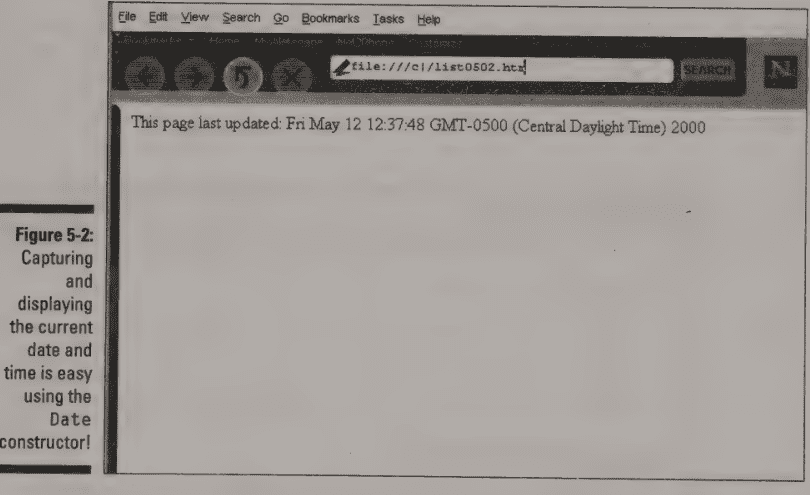

`Date` 对象支持几十种方法。表 5-1 列出了一些最方法。

## 第 5 章：让每一天都有意义

| 表 5-1 使用 Date 方法标记时间 |
| :--- | :--- |
| 方法 | 返回值 |
| `getDate()` | 根据本地时间返回指定日期的几几 |
| `getDay()` | 根据本地时间返回指定日期的星期几 |
| `getFullYear()` | 根据本地时间返回指定日期的年份 |
| `getHours()` | 根据本地时间返回指定日期的小时 |
| `getMilliseconds()` | 根据本地时间返回指定日期的毫秒 |
| `getMinutes()` | 根据本地时间返回指定日期的分钟 |
| `getMonth()` | 根据本地时间返回指定日期的月份 |
| `getSeconds()` | 根据本地时间返回指定日期的秒 |
| `getTime()` | 根据本地时间返回指定日期时间对应的数值 |
| `getUTCDate()` | 根据协调世界时（UTC）返回指定日期的几几 |
| `getUTCDay()` | 根据协调世界时（UTC）返回指定日期的星期几 |
| `getUTCFullYear()` | 根据协调世界时（UTC）返回指定日期的年份 |
| `getUTCHours()` | 根据协调世界时（UTC）返回指定日期的几时 |
| `getUTCMilliseconds()` | 返回 UTC 指定日期的毫秒 |
| `getUTCMinutes()` | 返回 UTC 指定日期的分钟 |
| `getUTCMonth()` | 返回 UTC 指定日期的月份 |

## 114 第二部分：为你的网页添加智能功能 | 表 5-1（续） |

| 方法 | 返回值 |
| :--- | :--- |
| `getUTCSeconds()` | 返回 UTC 指定日期的秒 |
| `getUTCYear()` | 返回 UTC 指定日期的年份 |
| `toUTCString()` | 返回 UTC 格式的字符串 |
| `toLocaleString()` | 使用本地习惯转换日期的字符串 |
| `toString()` | 返回 Date 对象的字符串 |
| `getTime()` | 返回自 1970 年的毫秒数 |

## 第5章：让每一个日期都有意义

```javascript
if (hours > 12) {
    hours -= 12;
}

// 我们将六点到八点之间视为“傍晚”
else if (hours > 17 && hours < 21) {
    greeting = "Good evening!";
    ampm = "p.m.";
    hours -= 12;
}

// 我们将九点到午夜视为“深夜”
if (hours > 20) {
    greeting = "Good night!";
    ampm = "p.m.";
    hours -= 12;
}

// 我们希望如果分钟是个位数，在它们前面显示“0”（例如，而不是 1:4 p.m.）
if (minutes < 10) {
    minutes = "0" + minutes;
}

// 在屏幕上显示格式化后的时间。
// ("\n" 在页面上插入换行符以使消息格式整齐。)
document.write(greeting + " \n" + hours + ":" + minutes + " " + ampm);
```

<script>

要查看列表 5-3 中的代码加载到 Netscape Navigator 6.0 时的外观，请参考图 5-3。你可以内置方法访问属性，以你选择的任何自定义格式显示日期和时间。以下是列表 5-3 中代码的工作原理。首先，创建一个 Date 对象（称为 today）。接下来，分别使用 `getHours()` 和 `getMinutes()` 方法从 Date 对象中提取小时和分钟。在获取了小时数（一个 0 到 23 之间的整数，取决于一天中的时间）后，你就可以判断是早上、下午、傍晚还是深夜。为了做到，你需要将 `hours` 变量与相应的范围进行比较，例如在本例中，早上为 6:00 a.m. 到 11:59 a.m.，下午为 12 p.m. 到 5:59 p.m.，依此类推。

第二部分：为你的页面添加智能

## 详细说明：日期格式化脚本

在本节中，我将向你展示如何检查 JavaScript 日期、对其进行格式化并将其显示在网页上。由于这种脚本可能会在多个页面上使用，我还会向你展示如何将其实现为外部脚本，这样你可以创建一次并在许多不同的 HTML 文档反复使用。

外部脚本是单独于任何 HTML 文档保存的 JavaScript 语句。按照习惯，外部 JavaScript 文件名始终包含扩展名。某些浏览器——特别是 Internet Explorer 3.x 及旧版本——不支持外部脚本。

查看列表 5-4，查看一个以良好的自定义格式显示当前日期的外部 JavaScript 脚本。

你在列表 5-4 中看到的可以在配套光盘上找到。寻找文件名 `list04.js`。

### 列表 5-4：此外部 JavaScript 脚本格式化日期

```javascript
// 对不支持 JavaScript 的浏览器隐藏内容
// 获取当前日期
today = new Date();

// 获取当前月份
month = today.getMonth();

// 为月份数字附加显示名称
switch (month) {
    case 0:
        displayMonth = "January";
        break;
    case 1:
        displayMonth = "February";
        break;
    case 2:
        displayMonth = "March";
        break;
    case 3:
        displayMonth = "April";
        break;
    case 4:
        displayMonth = "May";
        break.
    case 5:
        displayMonth = "June";
        break;
    case 6:
        displayMonth = "July";
        break;
    case 7:
        displayMonth = "August";
        break;
    case 8:
        displayMonth = "September";
        break;
    case 9:
        displayMonth = "October";
        break;
    case 10:
        displayMonth = "November";
        break;
    case 11:
        displayMonth = "December";
        break;
    default:
        displayMonth = "INVALID";
}
document.write(displayMonth + " " + today.getDate() + "," + today.getFullYear());
// 停止隐藏 --
```

列表 5-4 中的代码获取当前日期和时间，并访问名为 `today` 的变量。然后它获取当前日期的月份部分，并将其存名为 `month` 的变量中。

获取 `month` 的值后，列表 5-4 中的代码使用 JavaScript 的 `switch` 语句确定相应的月份名称——January、February、March 等。（有关 `switch` 的更多信息，包括为什么它比一长串 `if` 语句容易用得多，请查看第 3 章关于条件的讨论。）

最后，列表 5-4 中的代码按照图 5-3 所示显示月份、日期和年份。

## 第6章：命运如此

在本章中

- 详细研究 cookie
- 理解 cookie 的优势和局限性
- 设置和检索 cookie 值
- 创建一个识别之前访问者的脚本

在深入研究代码之前，我想详细解释一下什么是 Cookie（饼）以及它们是如何工作的。

## 为什么要使用 Cookie？

Cookie 允许你在用户的计算机上存储有关该用户访问的信息，并在随后的访问中重新检索这些信息。这种能力对于 Web 开发者来说是一个巨大的福音，因为它让他们能够创建为为访访客提供个性化显示的网站。

Web 开发者使用 Cookie 的最常见原因有两点：

- **识别访问者。** 你可以检测用户之前是否访问过你的网站，并自定义该用户在后续访问时看到的内容。例如，你可以通过名字问候访问者，告诉他们自上次上次访问以来你的网站发生了变化，根据他们之前的购买或网站导航习惯显示自定义页面，等等。
- **保存事务状态。** 你可以保存你的网站与访问者浏览器之间任何长耗事务的状态，以防止中断。例如，想象一下，我正在你的网站上填写一份很长的表单，突然间——我的狗追逐桌子下的猫。它们打斗起来，等我反应过来时，我的电脑插头已经从墙上的插座上拔掉了！如果你的网站使用了 Cookie，我就可以把我的畜生赶到后院，插好电脑，重新加载你的网页——然后从我离开的地方继续。如果你的网站*没有*使用 Cookie，我就必须从头开始填写表单。

## Cookie 安全问题

Cookie 已经安全地使用了几年，而且由于它们的使用受到 Web 浏览器的严格限制，因此它们在潜在安全威胁列表中处于中等水平。尽管如此，它们在某些程序员圈子中仍然极具争议，原因有两点：

- **Cookie 通过直接在用户的硬盘硬盘上存储信息，跨越了 Web 浏览器的传统界限。** 有些人认为 Cookie 会损坏他们的计算机，要么是因为在硬盘上存储了海量数据导致电脑无法正常工作，要么是因为病毒感染了电脑。

幸运的是，Cookie 内置了防止这两种威胁的保护措施！无论你使用 JavaScript 还是其他语言，你都无法绕过 Web 浏览器实施的以下常识限制：

- **Cookie 存放的位置。** 例如，Internet Explorer 5.5 将 Cookie 存储为单独的文本文件并放在以下目录：
  ```
  C:\Windows\Profiles\[YourName]\Cookies
  ```
- Netscape Navigator 6.0 将 Cookie 组合成一个名为 cookies.txt 的文件，并将它们传到以下目录：
  ```
  C:\Program Files\Netscape\Users\50\default\cookies.txt
  ```
- **Cookie 文件可以有多大。** Internet Explorer 和 Netscape Navigator 都将 Cookie 文件限制为 4K。
- **任何给定网站在用户硬盘上放置的 Cookie 数量。** Internet Explorer 和 Netscape Navigator 都将限制设定为每个网站 20 个 Cookie，每个浏览器总共 300 个 Cookie。
- **哪些网站可以访问 Cookie。** Cookie 的可见性是可以配置的。（你可以在本章的“品尝 Cookie”部分查看如何配置 Cookie 访问。）但无论你如何配置 Cookie，最可见的范围限于单个域内的网站。例如，由 www.someDomain.com 页面创建的 Cookie 永远无法被 www.someOtherDomain.com 的页面查看。

Cookie 让 Web 开发者能够在用户不知情或未经同意的情况下收集有关用户的详细营销信息。通过将 Cookie 与 CGI 程序和 Java applet 等客户端应用程序结合，Web 开发者可以保存、检查和解释用户与网站之间的几乎每一次交互。每一次点击、每一次按键、每一笔信用卡购买都可以被用于自定义用户下次访问支持 Cookie 的 Web 网站时看到的内容。

幸运的是，对 Cookie 的这种类似“老大哥”的监控感到不适的用户有种选择：他们可以配置浏览器来限制 Cookie 支持或完全关闭它。（你会在下一节中看到这方面的示例。）

## 品尝 Cookie

理解 Cookie 如何工作的最好方法之一是从用户的角度来看待它们。在这一节中，我将展示如何在你的浏览器中配置 Cookie 支持，访问一个支持 Cookie 的网站，并检查实际的 Cookie 文件。完成后，你将拥有所有直接进入制作 Cookie 的 JavaScript 代码所需的背景知识！

## 配置 Cookie 支持

Netscape Navigator 和 Internet Explorer 都允许用户指定 Cookie 支持的级别。

在 Netscape Navigator 6.0 中，你通过以下步骤配置 Cookie 支持：

1. **点击 编辑（Edit）→ 选项（Preferences）→ 高级（Advanced）→ Cookies。**
2. 从出现的 Cookie 菜单中选择以下选项之一，如图 6-1 所示：
   - 接受所有 Cookie
   - 仅接受标记为返回其原始服务器的 Cookie（而不是原始域中的任何服务器）
   - 完全禁用 Cookie 支持


正如你猜到的，禁用 Cookie 支持的用户无法从你用 JavaScript 创建的访问 Cookie 的脚本中受益。提醒用户需要开启 Cookie 支持以充分利用你的网站的一种方法就是告诉他们！只需在你支持 Cookie 的网页顶部包含以下句子：*本网站需要你开启 Cookie 支持。*

图 6-1：在 Netscape Navigator 中配置 Cookie 支持。

## 访问支持 Cookie 的网站

一旦你的浏览器配置为接受 Cookie，你就可以放心地浏览支持 Cookie 的网站了！Cookie 通常用于识别访问者并向他们提供自定义问候，如图 6-3 所示。（你将在本章后面的“重复脚本”部分学习创建类似的问候。）

## 探索 Cookie 文件

上一节展示了使用 Cookie 的网站的结果；这一节将向你展示访问支持 Cookie 的网站时内部发生了什么。

在 Netscape Navigator 6.0 中，你可以通过点击 编辑→高级→Cookies 并点击查看（View）按钮来检查 Cookie 文件。出现的 Cookie 器对话框如图 6-4 所示。

在 Internet Explorer 中配置 Cookie 支持：

1. 工具（Tools）→ Internet选项（Internet Options）。
2. 点击 安全（Security）选项卡。
3. 点击 Web 内容（Web content）区域。
4. 点击自定义级别（Custom Level）。
5. 滚动 Cookie 设置对话框直到看到 Cookie 选项，如图 6-2 所示。
   - *允许存储在计算机上的 Cookie
     - 禁用：不允许存储任何 Cookie
     - 启用：允许存储任何网站的 Cookie
     - 提示：让 Internet Explorer 在每次网站尝试存储 Cookie 时通知你
   - *允许会话 Cookie（不存储）
     - 禁用：禁止在内存中设置任何临时 Cookie
     - 启用：允许来自任何及所有网站的临时 Cookie
     - 提示：指定 Internet Explorer 在每次网站尝试创建临时 Cookie 时提醒你


**图 6-2：在 Internet Explorer 中配置 Cookie 支持。**

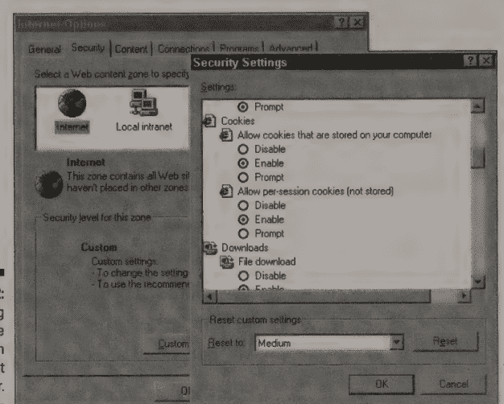

**图 6-3：Cookie 的结果：来自 Amazon.com 人员的自定义问候。**

## 第6章：Cookie 就是这样的 129

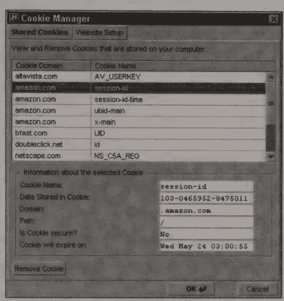

图 6-4：查看 amazon.com 域名设置的 cookie 内部。

你可以使用以下两种额外方法之一来检查 Netscape Navigator 生成的 cookie：

- 在已加载的 Web 页面的 Netscape 搜索窗口中输入 `JavaScript:alert(document.cookie);` 并点击搜索，即可看到一个包含与该页面相关的所有 cookie 的弹出窗口。
- 你可以通过将 `C:\Program Files\Netscape\Users50\default\cookies.txt`（这是 Netscape Navigator 6.0 存储 cookie 的文本文件）加载到你喜欢的编辑器中，来获取原始 cookie 文件。

Internet Explorer 将生成的 cookie 存储在以下目录：`C:\Windows\Profiles\[username]\Cookies`。Cookie 文件名采用 `username@domain[timestamp].txt` 的格式。例如，在我的机器上，在访问 Amazon.com 后，存在以下文件：

```
C:\Windows\Profiles\emily\Cookies\emily@amazon[3].txt
```

加载 Web 页后，你也可以在 Internet Explorer 的地址栏中输入 `JavaScript:alert(document.cookie);`。点击前往后，你会看到一个包含该页面相关的所有 cookie 的弹出窗口。

## 130 第二部分：为你的 Web 页面添加智能

## 重访客脚本

在本节中，你将看到如何创建一个脚本，通过使用 cookie 将用户名保存到磁盘来注册用户。在后续访问该网站时，该脚本会从磁盘访问 cookie，识别用户名，并使用该信息显示自定义的问候。图 6-5 显示了访问客脚本的第一阶段，用户必须首先注册他们的姓名。


在许多实际应用中，你可能希望使用服务器端技术（如 CGI 脚本）来创建和访问 cookie。由于 CGI 脚本超出了本书的范围，在第十一章中，我将向你展示如何使用 JavaScript 来创建和访问 cookie。（CGI 脚本与 JavaScript 之间的语法有所不同，但与 cookie 交互的基本方法是相同的。）

用户注册姓名后，如图 6-5 所示，他们再也看不见注册表单。用户可以关闭浏览器、关闭电脑并去度假一周。当他们回来并尝试尝试访问注册页面时，脚本会识别出他们已经注册，并使用自定义的问候加载“仅限注册用户页面”（参见图 6-6）。

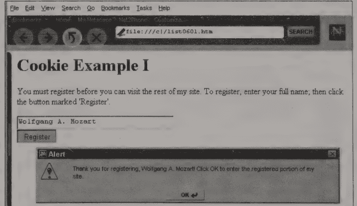

**图 6-5：** 使用 cookie 注册用户输入。

## 第6章：Cookie 就是这样的 131

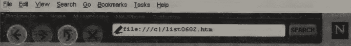

## Cookie 示例 II

欢迎来到我网站的注册部分，Wolfgang A. Mozart！

图 6-6：引导你的已注册访客进入预留页面。


我根据图 6-5 和 6-6 中的两个动作，分两实现了重访客脚本：

- *Cookie 示例 I（“未注册用户”页面）。* 该脚本注册用户名，在用户的机器上存储 cookie，并加载“仅限注册用户”页面。
- *Cookie 示例 II（“仅限注册用户”页面）。* 该脚本访问 cookie 并显示自定义问候。

当你创建一个 cookie 时，指定一个过期日期。在指定日期之后，将无法访问该 cookie。过期时间为 null 将 cookie 标记为临时性。（临时性 cookie 仅在用户浏览器会话持续保留在内存中；它们不会被保存到磁盘。）在示例代码 6-1 中，我们指定了从 cookie 创建时起一年的过期日期。

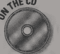

这两个脚本分别显示在代码列表 6-1 和 6-2 中。你可以在附带的 CD-ROM 上的 list0601.htm 和 list0602.htm 中找到完整的重访客脚本。

### 代码列表 6-1：Cookie 示例 I：注册表单

```html
<HTML>
<HEAD>
<TITLE>Cookie 示例 I：注册页面（源自《自学 JavaScript》，第 3 版）</TITLE>
<SCRIPT LANGUAGE="JavaScript">
<!-- 开始隐藏
function getCookieVal(offset) {
    // 此函数返回 "myUserName" 字符串中 = 和 ; 之间的部分
    var endstr = document.cookie.indexOf(":", offset);
    if (endstr == -1) {
        endstr = document.cookie.length;
    }
    return unescape(document.cookie.substring(offset, endstr));
}

function getCookie(cookieName) {
    // 此函数返回 "myUserName" 字符串中 = 和 ; 之间的部分
    var arg = cookieName + "=";
    var alen = arg.length;
    var clen = document.cookie.length;
    var i = 0;
    while (i < clen) {
        var j = i + alen;
        if (document.cookie.substring(i, j) == arg) {
            return getCookieVal(j);
        }
        i = document.cookie.indexOf(" ", i) + 1;
        if (i == 0) break;
    }
    return null;
}

// 如果用户的机器上不存在名为 'myCookie' 的 cookie，则要求用户注册。
///////////////////////////////////////////////////////
// 如果存在 "myCookie" cookie . . . .
if (getCookie('myCookie') != null) {
    // 将用户的浏览器重定向到受密码保护的名为 "list0602.htm" 的页面
    location.href = "list0602.htm";
}
// 结束隐藏 -->
</SCRIPT>
</HEAD>

<body>
// 2 (从这里到闭合的 </body>标签)
<h1>Cookie 示例 I</h1>

<FORM NAME="loginForm">
在访问网站的其他部分之前，您必须先注册。要进行注册，请输入您的全名；然后点击标记为“Register”（注册）的按钮。
<P>
<INPUT TYPE="text" NAME="fullName" SIZE=35>
<BR>
<INPUT TYPE="button" VALUE="Register" onclick="register(loginForm.fullName)">
</FORM>
</body>
</HTML>
```

这里是 JavaScript 解释器处理列表 6-1 中代码的快速概述：

1. 解释器首先检查是否存在名为 myCookie 的 cookie。如果存在这样的 cookie，解释器——理解为该用户之前注册过——将加载 list0602.htm。
2. 如果不存在此类 cookie，解释器将加载注册页面，包含一个输入字段和一个标记为 Register 的按钮。
3. 当用户点击 Register 按钮时，解释器开始执行 `register()` 函数，该函数反过来调用 `setCookie()` 方法在用户的机器上存储 cookie。cookie 包含用户的名称和过期日期。
4. 在 `register()` 函数之后，`register()` 函数加载“已注册用户”页面。

## 136 第二部分：为您的网页添加智能功能

## 混合主 Cookie 配方

文档对象的 `cookie` 属性持有与文档关联的所有 cookie。

要创建一个 cookie，你必须定义一个变量/值对，该对代表 cookie 的名称和 cookie 的内容（name=value）。由于 cookie 值不能包含分号、逗号或空格，因此在存储 cookie 值时，使用 JavaScript 内置的 `escape()` 函数是一个好主意。该值（`escape()` 编码字符串中存在的任何分号、逗号和空格；`unescape()` 则重建它们）。除了这个限制外，cookie 值可以包含任何你想要的内容！（有些程序员想出了花哨的加密方案；另人则坚持使用基于文本的字符串。

除了强制性的名称和值，你还可以为 cookie 定义以下可选的、分号分隔的属性（参见表 6-1）。

| 表 6-1 | JavaScript Cookie 属性 |
| :--- | :--- |
| 属性 | 说明 |
| `expires=expirationDate` | cookie 过期后的日期，以毫秒为单位（由 Web 浏览器删除）。过期日期通常存储在标准的格林威治时间（GMT）格式中。（使用 Date 对象的 GMT 方法以 GMT 格式化日期）。 |
| `path=path` | cookie 内容可以传输到的 CGI 程序的路径。默认是源服务器的根路径。 |
| `domain=domain` | cookie 可以传输到的域名（例如，www.acme.com）。默认受限（详情请参见“Cookie 安全问题”章节）。 |
| `secure` | 指定此 cookie 只能通过如 https 等安全协议传输。 |

要创建一个 cookie 并将其存储在磁盘上，你只需要将 `document.cookie` 属性设置为一个包含所需的名称/值对以及任何可选的、分号分隔的 cookie 属性的字符串，如下所示摘自列表 6-1 代码片段：

## 第 6 章：Cookie 就是如此运作的

```javascript
document.cookie = name + "=" + escape(value) + ((expires == null) ? "" : ("; expires=" + expires.toGMTString())) + ((path == null) ? "" : ("; path=" + path)) + ((domain == null) ? "" : ("; domain=" + domain)) + ((secure == true) ? "; secure" : "");
```

这种晦涩、看起来奇怪的语法 —— `(condition) ? something : someElse` 是 JavaScript 的简写，表示“如果此条件为真，则添加某些；否则，添加另一个。”

例如，这里是 JavaScript 解释器解释以下 JavaScript 语句的方式：“如果 expires 的值为 null，则向 document.cookie 添加空字符串；否则，将 expires 字符串=someGMTDate 添加到 cookie 中：”

```javascript
((expires == null) ? "" : ("; expires=" + expires.toGMTString()))
```

你可以在第 3 章找到更多关于条件运算符 `? :` 的信息。

你可以使用 JavaScript 为 cookie 设置属性（具体是“混合主 Cookie 配方”章节介绍的 `expires`、`path`、`domain` 和 `secure` 属性），但你不能使用 JavaScript 访问这些属性。（与之相反，你可以访问 cookie 的值，如列表 6-1 和 6-2 所示）。

在你提供 cookie 之后，只有 Web 浏览器知道 cookie 的属性。这种看似奇怪的状态——能够设置你却无法检索的属性——当你仔细考虑时，实际上是合乎逻辑的。所有这些属性都与安全有关；防止它们被修改有助于维护 cookie 的完整性和安全性。

## 列表 6-2：显示自定义问候

```javascript
// 此代码检查用户的机器上是否存在名为 'myCookie' 的 cookie。
// 如果存在，则用户已经“登录”，因此显示问候，否则显示错误信息。
var nameOfVisitor = getCookie('myCookie');
if (nameOfVisitor != null) {
    var documentText = "<body><h1>Cookie 示例 II</h1>欢迎访问网站的注册部分，";
    documentText += nameOfVisitor + "!</body>";
} else {
    var documentText = "<body><h1>Cookie 示例 II</h1>对不起！只有已注册的用户才能访问此页面。</body>";
}
document.write(documentText);
// 结束隐藏 -->
</SCRIPT>
</HEAD>
</HTML>
```

在列表 6-2 中，正在发生的是以下情况：

1. JavaScript 解释器在用户的机器上寻找名为 myCookie 的 cookie。
2. 如果存在名为 myCookie 的 cookie，JavaScript 解释器将使用注册用户的名称构造并显示自定义问候。
3. 如果不存在此类 cookie，JavaScript 解释器将构造一条错误消息。

## 第二部分：为您的网页添加智能功能

## 你不能让我过期……我不走了！

你不能使用 JavaScript 直接删除 cookie，简单原因是只有浏览器可以主动写入磁盘。（正是这种安全措施防止了 cookie 能够对用户的硬盘造成破坏）。

你可以在 JavaScript 中做的是将 cookie 的过期日期更改为很久以前的日期。这样做会导致 Web 浏览器自动删除新过期的 cookie。

```javascript
function deleteCookie() {
    var expired = new Date();
    // 你不能使用 JavaScript 直接从用户的机器删除 cookie 文件，因此通过将过期日期设置为过去的日期来将其标记为过期。

    // 首先，将 exp 变量设置为过去的一个日期 . . . .
    expired.setTime(expired.getTime() - 1000000000);

    // 然后，获取 cookie
    var cookieValue = getCookie('myCookie');

    // 最后，将 cookie 的过期日期设置为很久以前的日期。
    document.cookie = 'myCookie' + "=" + cookieValue + "; expires=" + expired.toGMTString();
}
```

# 第三部分：让你的网页具有交互性

第五波浪：Rich Tennant


> “噢，我能让我们搞定——我以前在一家接入公司做技术支持的。”

在本部分中……

在本部分中，你将找到实用的方法来创建能够对用户交互做出相应响应的网页。第 7 章将向你展示如何创建按钮，并在用户每次点击它们时都会触发脚本。第 8 章和第 9 章你将看到如何使用 JavaScript 让图形在用户点击或将鼠标悬停上方时做出响应。第 10 章将完成这一部分，向你展示如何收集和验证来自访问你网站用户的输入——包括经过时间考验的技巧，帮助你设计用户友好的网页并与用户进行有效沟通。

## 第 7 章：按钮就绪！

本章内容

- 熟悉 HTML 按钮元素
- 理解 JavaScript 事件处理器
- 将事件处理器附加到 HTML 按钮、提交（submit）、重置（reset）和单选框（radio）元素

你可能已经知道，如果你读过这本书的其他任何章节，JavaScript 可以帮助你将静态网页转换为交互式 Web 应用程序。那么，让这种客户端交互成为可能的特性是什么呢？正是谦逊且可爱的事件处理器。你可以将事件处理器想象成小弹簧，将自定义的 JavaScript 代码绑定到诸如点击按钮或链接、加载页面、在输入字段中输入数据等事件上。

你将在书中看到事件处理器的示例；现在，在本章中，我重点关注大多数开发者最先想要探索的事件处理器——与 HTML 按钮相关的事件处理器。在这里你将发现如何创建并将基本脚本不仅附加到按钮和单选框元素，还包括至关重要的表单控制提交和重置元素。

## 选一个按钮——随便选！

HTML 定义了几种按钮元素：推送按钮（push buttons）、单选框（radio buttons）以及两个特殊的内置按钮：提交（submit）和重置（reset）。每一个按钮在配合 JavaScript 事件处理器定义时都允许访问者与你的页面进行交互。

工作原理如下：在一个按钮的生命周期中，可能会发生多个事件。例如，该按钮可以被点击、双击、获得输入焦点和失去输入焦点。JavaScript 事件处理器可以检测并处理这些每一个独立事件——点击（click）、双击（double click）、聚焦（focus）和模糊（blur）。看看下面的代码以理解我的意思。

```html
<INPUT TYPE="button" NAME="pushButton" VALUE="Push me!" OnClick="doSomething()">
```

上述语句混合了 HTML 语法和内联 JavaScript，它定义了一个 HTML 按钮元素。除了 TYPE、NAME 和 VALUE 属性外，该语句还为按钮分配了一个 `onClick` 处理器。在运行时，当用户点击标记为“Push Me”的按钮时，JavaScript 解释器会自动调用函数 `doSomething()`。

分配给事件处理器的 JavaScript 语句（如上所示）是唯一可以出现在起始和结束 `<script> ... </script>` 标签范围之外的 JavaScript 语句。


表 7-1 列出了所有你可以使用 JavaScript 处理的按钮相关事件。（这些事件的完整描述出现在侧边栏，“处理页面和屏幕上的大事件！”）

在“定制按钮：按钮和单选框元素”节中，我将详细向你展示如何为按钮和单选框元素定义事件处理器。由于重置和提交按钮的工作方式不同，它们值得专门讨论；我将在“现成按钮：重置和提交元素”节中介绍它们。

| 表 7-1 HTML 按钮相关事件处理器 |
| :--- | :--- | :--- |
| 元素 | HTML 定义 | 支持的事件处理器 |
| button | `<INPUT TYPE="button" ... >` | onClick, onMouseDown, onMouseUp, onFocus, onBlur |
| radio | `<INPUT TYPE="radio" ... >` | (与按钮相同) |
| reset | `<INPUT TYPE="reset" ... >` | (与按钮相同) |
| submit | `<INPUT TYPE="submit" ... >` | (与按钮相同) |
| form | `<FORM ... >` | onReset, onSubmit |

Netscape Navigator 和 Internet Explorer 对事件处理器提供了不同程度的支持，因为它们还支持 JavaScript、HTML 以及 HTML 扩展的许多其他功能……嗯，你懂意思的。此外，由于事件处理本质上依赖于平台，在 Macintosh 和 Unix 系统上实现的浏览器对事件提供了不同程度的支持。坏消息是：在本文编写期间，微软和 Netscape 目前均未提供最新的参考，来详尽地说明最新版本的 Navigator 或 Internet Explorer 的 JavaScript 事件处理。好消息是？你想要使用 JavaScript 处理的大多数事件都记录在接下来的侧边栏中。如需更多事件处理信息，请访问相应浏览器的网站：

```
http://developer.netscape.com/docs/manuals/js/client/jsref/handlers.htm
http://msdn.microsoft.com/workshop/author/dhtml/reference/events.asp
```

## 处理页面和屏幕上的大事件！

按钮并不是支持事件处理器的客户端对象，表单以及许多其他对象也是，如表 7-2 所示。

| 表 7-2 支持事件处理器的客户端对象 |
| :--- | :--- | :--- |
| 事件处理器 | 支持的对象 | 触发事件的时机…… |
| onAbort | Image | 图片被中断。 |
| onBlur | Button, Checkbox, document, FileUpload, Radio, Submit, Textarea | 失去输入焦点。 |
| onChange | Checkbox, FileUpload, Radio, Select, Textarea | 元素改变（例如通过 Tab 键）。 |

## 146 第三部分：让你的网页具有交互性

| 表 7-2（续） |
| :--- | :--- | :--- |
| 事件处理器 | 支持的对象 | 触发事件的时机…… |
| onClick | Button, Checkbox, document, FileUpload, Image, Link, Reset, Submit, Textarea | 被点击一次（onMouseDown 和 onMouseUp 的组合）。 |
| onDoubleClick | Button, Checkbox, document, FileUpload, Image, Link, Reset, Submit, Textarea | 连续点击两次（双击）。 |
| onError | Image | 图片加载失败，可能不存在或损坏。 |
| onFocus | Button, Checkbox, document, FileUpload, Radio, Submit, Textarea, window (frame) | 获得输入焦点。 |
| onKeyDown | Button, Checkbox, document, FileUpload, Image, Link, Reset, Submit, Textarea | 用户按下键。 |
| onKeyPress | Button, Checkbox, document, FileUpload, Image, Link, Reset, Submit, Textarea | 用户释放按键（onKeyDown 和 onKeyUp 的组合）。 |
| onKeyUp | Button, Checkbox, document, FileUpload, Image, Link, Reset, Submit, Textarea | 用户释放之前按下的键。 |
| onLoad | Image, window (frame) | 元素加载成功。 |

## 第 7 章：按钮就绪！

| 表 7-2（续） |
| :--- | :--- | :--- |
| 事件处理器 | 支持的对象 | 触发事件的时机…… |
| onMouseDown | Button, Checkbox, document, FileUpload, Image (and Area), Link, Radio, Reset, Submit, Textarea | 用户按下鼠标按钮（但未释放）。 |
| onMouseOut | Image (and Area), Link | 鼠标离开元素。 |
| onMouseOver | Image (and Area), Link | 鼠标滑过元素。 |
| onMouseUp | Button, Checkbox, document, FileUpload, Image (and Area), Link, Radio, Reset, Submit, Textarea | 用户释放之前点击过的按钮。 |
| onMove | window (frame) | 用户移动或调整窗口/帧的大小。 |
| onReset | form | 表单重置；用户点击重置按钮，或程序员调用了 `form.reset()` 方法。 |
| onResize | window (frame) | 用户调整窗口/帧的大小。 |
| onSubmit | form | 表单提交；用户点击提交按钮，或程序员调用了 `form.submit()` 方法。 |
| onUnload | window | 用户卸载文档（通过关闭浏览器或加载另一个文档）。 |

## 定制按钮：按钮和单选框元素

为按钮和单选框元素附加事件处理器，是使用 JavaScript 中实验事件处理最简单且最好的方法。

列表 7-1 中的代码显示了一个定义一组单选按钮和一个普通推入按钮的脚本，它们都与事件处理程序关联。请查看图 7-1 和图 7-2 以查看这些代码的运行情况！图 7-1 显示此启用了 JavaScript 的页面包含一个按钮元素和三个单选元素。

图 7-2 和图 7-3 显示了响应用户在页面上操作的警告框（alert boxes）的使用。

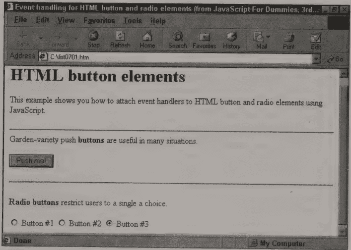

图 7-1：设置带有事件按钮的 Web 页面。

图 7-2：点击标记为“Push Me”的按钮会调用按钮元素的 onclick 处理程序。

## 第 7 章：按钮大作战！149

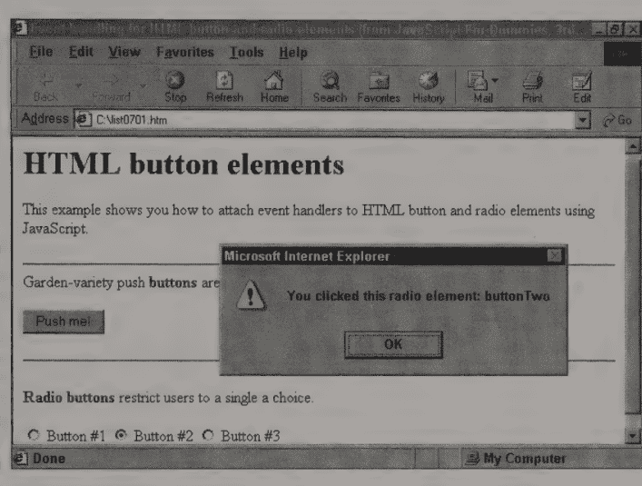

## HTML 按钮元素

此示例向你展示了如何使用 JavaScript 为 HTML 按钮和单选元素附加事件处理程序。

图 7-3：点击单选按钮会调用单选按钮的 onClick 处理程序。

单选按钮限制用户只能选择一种选项。

- 按钮 #1
- 按钮 #2
- 按钮 #3

完成我的电脑

从配套光盘加载文件 `list071.htm`，以查看列表 7-1 中的示例在浏览器中的显示效果。

## 列表 7-1：为按钮和单选元素创建事件处理程序

```html
<HTML>
<HEAD>
<TITLE>HTML 按钮和单选元素的事件处理（源自《JavaScript 入门》，第3 版）</TITLE>
<SCRIPT LANGUAGE="JavaScript">
/////////////////////////////////////////////////////////////////////
// 你可以修改此脚本以练习与按钮元素关联的任何事件处理程序。（与按钮关联的所有事件处理程序列表在《JavaScript 入门》第 3 版第 7 章中提供）。
//
// 要查看 onclick 事件处理程序的实际运行，例如，你只需要将（在 HTML 按钮声明内部）
// onclick="showEvent(this, 'click')"
</SCRIPT>
</HEAD>
<BODY>
</BODY>
</HTML>
```

（接上）


# 第 7 章：按钮大作战！

## 列表 7-1：为按钮和单选元素创建事件处理程序

```html
<HTML>
<HEAD>
<TITLE>HTML 按钮和单选元素的事件处理（源自《JavaScript 入门》，第3 版）</TITLE>
<SCRIPT LANGUAGE="JavaScript">
/////////////////////////////////////////////////////////////////////
// 你可以修改此脚本以练习与按钮元素
// 关联的任何事件处理程序。（与按钮关联的所有
// 事件处理程序列表在《JavaScript 入门》第 3 版
// 第 7 章中提供）。
//
// 要查看 onclick 事件处理程序的实际运行，
// 例如，你只需要将（在 HTML 按钮声明内部）
//
// onclick="showEvent(this, 'click')"
//
// with
//
// onclick="showEvent(this, 'double click')
/////////////////////////////////////////////////////////////////////////

function showEvent(incomingButton, event) {
    alert("你 " + event + " 了此 " + incomingButton.type + 
    " 元素：" + incomingButton.value)
}
</SCRIPT>
</HEAD>
<BODY>
<FORM NAME="myForm">
<H1>HTML 按钮元素</H1>
<P>
此示例展示了如何使用 JavaScript 为 HTML
按钮和单选元素附加事件处理程序。
</P>
<P>
<HR>普通的推入 <B>按钮</B> 在很多
情况下都很有用。
</P>
<INPUT TYPE="button" NAME="pushButton" VALUE="Push me!"
// 按钮的 onClick 事件处理程序
onClick="showEvent(this, 'click')">
<P>
<HR>
<B>单选按钮</B> 限制用户只能选择一种选项。
</P>
<INPUT TYPE="radio" NAME="radioGroup" VALUE="buttonOne"
// 第一个单选按钮的 onClick 处理程序
onClick="showEvent(this, 'click')"> 按钮 #1

<INPUT TYPE="radio" NAME="radioGroup" VALUE="buttonTwo"
// 第二个单选按钮的 onClick 处理程序
onClick="showEvent(this, 'click')"> 按钮 #2

<INPUT TYPE="radio" NAME="radioGroup" VALUE="buttonThree"
// 第三个单选按钮的 onClick 处理程序
onClick="showEvent(this, 'click')"> 按钮 #3
</FORM>
</BODY>
</HTML>
```

观察列表 7-1，你会看到四个不同的按钮定义：一个元素和三个单选按钮元素。在这些 HTML 定义的每一个中，都插入了以下行 HTML 事件处理程序定义 JavaScript 代码：

```
onclick="showEvent(this, 'click')"
```

此行代码导致 JavaScript 解释器在用户点击关联按钮时调用 `showEvent()` 函数。内置的 JavaScript 值将以字符串 `'click'` 的形式传递给 `showEvent()`，使得 `showEvent()` 函数能够创建并显示图 7-2 和图 7-3 中的自定义消息。

注意，`onclick` 事件处理程序的值必须用引号包围。（单引号或双引号都是标准的编程做法。）

你可以将 `onclick` 事件处理程序的值设置为任何有效的 JavaScript 语句。你可以将该值设置为一组语句的字符串，只要用分号将它们隔开，例如：

```
onclick="showEvent(this, 'click'); somethingElse(); doThisNow()"
```

（关于此关键字的更多信息请参阅第 2 章。）

## 现成按钮：重置和提交元素

重置和提交元素是特殊的按钮，点击它们时会分别重置和提交 HTML 表单。（知道它们能做些什么是件好事。）

请记住，在此示例（列表 7-2）所示的 HTML 文档的 `<body>` 中没有指定 CGI 脚本，表单数据实际上并没有提交到 Web 服务器；点击提交按钮的唯一结果是图 7-5 所示地址字段的变化以及文档重新加载。“订单表单”部分描述了所需的 HTML 代码。


图 7-1：设置带有事件按钮的 Web 页面。


图 7-2：点击标记为“Push Me”的按钮会调用按钮元素的 onclick 处理程序。


图 7-3：点击单选按钮会调用单选按钮的 onClick 处理程序。

单选按钮限制用户只能选择一种选项。

- 按钮 #1
- 按钮 #2
- 按钮 #3

加载配套光盘中的 `list071.htm`，以查看列表 7-1 中的示例在浏览器中的显示效果。

# 第 7 章：按钮准备就绪！

第 10 章中的示例进一步扩展了此示例，提供了一些常用的输入验证脚本。

列表 7-3 中的示例代码位于配套光盘 `list07073.htm` 上。请查看！订单表单演示了 `onClick`、`onFocus`、`onReset` 和 `onSubmit` 事件处理程序。

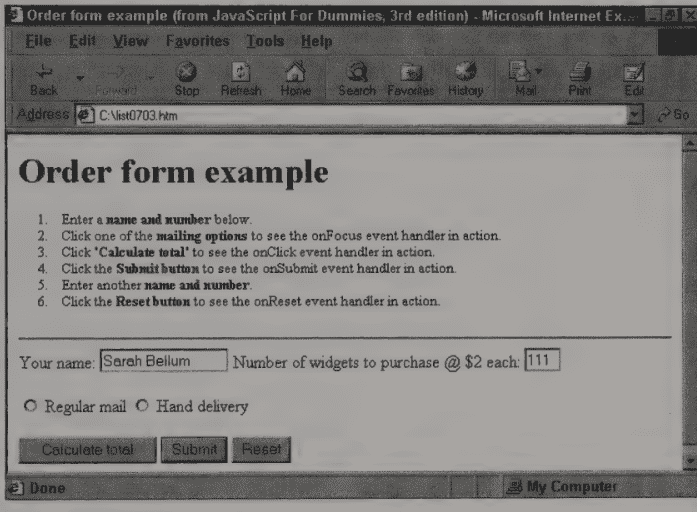

1. 输入名称和数字。
2. 点击邮件选项之一，查看 `onFocus` 事件处理程序的作用。
3. 点击“计算总额”查看 `onClick` 事件处理程序的作用。
4. 点击“提交”按钮查看 `onSubmit` 事件处理程序的作用。
5. 输入另一个名称和数字。
6. 点击重置按钮查看 `onReset` 事件处理程序的作用。

订单表单示例

您的姓名：[Sarah Bellum] 要购买的部件数量（每个 2 美元）：[111]

- 普通邮件
- 手工送货

[计算总额] [提交] [重置]

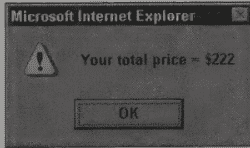

图 7-6：表单接受文本字符串和一个整数。
图 7-7：计算价格按钮的 `onClick` 事件处理程序计算价格。

## 列表 7-3：使用事件处理程序创建交互式订单表单

```html
<HTML>
<TITLE>订单表单示例（自《JavaScript入门》，第 3 版）</TITLE>
<SCRIPT LANGUAGE="JavaScript">

// 声明全局变量
var numWidgets

function clearGlobalValues() {
/////////////////////////////////////////////////////////////////
// 将全局变量设置为空字符串
/////////////////////////////////////////////////////////////////
    numWidgets = ""
}

function checkOrder() {
/////////////////////////////////////////////////////////////////
// 如果用户订购了内容，继续将表单
// 数据提交到服务器；否则，则不必操作。
/////////////////////////////////////////////////////////////////
    if (numWidgets == "" || numWidgets == null || numWidgets == 0) {
        alert("请指定订购部件数量并再次点击提交。")
        return false
    }
    else {
/////////////////////////////////////////////////////////////////
// 如果此脚本为与 HTML <FORM> 元素相关的
// METHOD 和 ACTION 属性定义了值，
// 表单内容将自动发送到由 ACTION 属性值指定的 CGI
// 
//
// 例如，如果此脚本定义了以下
// <FORM> 定义，表单内容将自动
// 传输到位于 /cgi-bin/tmail 目录（Web 服务器上的）
// 的 tmail.cgi CGI 脚本
// 即此 HTML 文件所在的位置）。
// //
// // <FORM NAME="myForm"
//     onSubmit="return checkOrder()"
//     METHOD="POST"
//     ACTION="/cgi-bin/tmail/t.cgi">
// /////////////////////////////////////////////////////////
        alert("感谢您的订单！");
        return true;
    }
}

function calcTotalPrice() {
///////////////////////////////////////////////////////////////////////
    // 将全局变量 "numWidgets" 设置为
    // 用户输入的值（除非用户之前输入过值；
    // 如果则不要设置）。
///////////////////////////////////////////////////////////////////////
    if (numWidgets) {
        numWidgets = document.form.numWidgets.value
    }
    alert("您的总价为 $" + (numWidgets * 2));
}

</SCRIPT>
<HEAD>
<BODY>
<FORM NAME="myForm" onSubmit="return checkOrder()"
      onReset="clearGlobalValues()">

<H1>订单表单示例</H1>
<FONT SIZE="2">
<OL>
    <LI>在下方输入**名称和数字**。
    <LI>点击**邮件选项**之一，查看
    onFocus 事件处理程序的作用。
    <LI>点击**‘计算总额’**查看 onClick
    处理程序的作用。
    <LI>点击**提交按钮**查看 onSubmit 处理程序的作用。
    <LI>输入另一个**名称和数字**。
    <LI>点击**重置按钮**查看 onReset 事件处理程序的作用。
</OL>
</FONT>
<HR>
您的姓名：
<INPUT TYPE="text" SIZE="15" NAME="username">
要购买的部件数量（每个 2 美元）：
<INPUT TYPE="text" SIZE="3" NAME="numberWidgets">
<P>
<INPUT TYPE="radio" NAME="mailOptions" VALUE="regular"
onFocus="alert('此选项不收取额外费用。')"> 普通邮件
<INPUT TYPE="radio" NAME="mailOptions" VALUE="regular"
onFocus="alert('请注意，非美国订单不提供手工送货')"> 手工送货
<P>
<INPUT TYPE="button" NAME="calcTotal" VALUE="计算
总额"
onClick="calcTotalPrice()">
<INPUT TYPE="submit" VALUE="提交">
<INPUT TYPE="reset" VALUE="重置">
</FORM>
</BODY>
</HTML>
```


重要事项：请记住，使用 `return false` 时表单将阻止提交。如果返回 `true`，表单将提交。

# 第 8 章：完美图像

## 162 第三部分：让你的网页交互起来

列表 8-1 中的代码实现了这些功能：

- 分别使用 `` 标签的 `SRC`、`HEIGHT` 和 `WIDTH` 属性将名为 splash.jpg 的图像文件插入到 241 像素宽、 208 像素高的空间内。
- 使用 `` 标签的 `TITLE` 属性定义提示信息。当运行 Microsoft Internet Explorer 的用户鼠标悬停在此图像上时，TITLE 属性的内容会自动显示。
- 使用 `` 标签的 `ALT` 属性为图像定义替代文本描述。`ALT` 属性的内容将出现在无法显示图片的浏览器、配置为不显示图片的浏览器以及图像根本不存在的情况下。图 8-2 显示了列表 8-1 中的代码在关闭了图像加载的 Internet Explorer 5.5 中的显示效果。

查看图 8-1 以了解列表 8-1 中的行 HTML 代码在 Internet Explorer 5.5 中的显示情况。在 Internet Explorer 中将鼠标光标悬停在图像上，会显示图像标题标题属性的内容。


## 想象一下

在使用 JavaScript 创建交互式图像时，需要记住的一点是用户有能力在浏览器中关闭图像加载。如果你依赖图像来传递页面的大部分信息和交互性，而你的用户配置了浏览器不显示图像，那么你的页面将毫无作用，起码是这样！

以下是用户关闭图像加载所采取的步骤：

### Navigator 用户

1. 点击 **编辑（Edit）** -> **选项（Preferences）**
2. 点击 **高级（Advanced）** 选项
3. 取消 **自动加载图像（Automatically load images）** 旁边的复选框

### Internet Explorer 用户

1. 点击 **工具（Tools）** -> **Internet 选项（Internet Options）**
2. 点击 **高级（Advanced）** 选项卡。
3. 滚动到 **多媒体（Multimedia）**，取消 **显示图片（Show Pictures）** 旁边的复选框。

如果你好奇为什么 Web 服务器会选择不查看图像，是因为图像相对较大，在适中的连接速度下下载需要很长时间。并不是每个用户都有缓存调制调制解调器；我们许多人仍在使用 56K 拨号连接，这种连接偶尔会断开！因为图像通常是免费的（我确定你不会免费的！），没有时间时间的用户可能会选择关闭图像加载，以便以最短的时间完成在线任务。

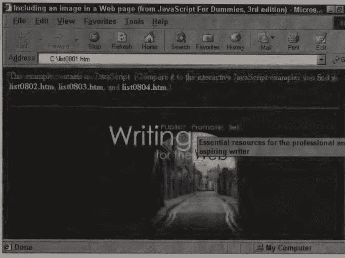

**图 8-1：** 根据鼠标位置显示消息。

有关 Navigator 和 Internet Explorer 中对 `Image` 对象支持的最新细节，请查看以下网站：

```
http://developer.netscape.com/docs/manuals/js/client/jsref/image.htm
```

```
http://msdn.microsoft.com/workshop/author/html/reference/objects/img.asp
```

从图 8-1 和图 8-2 可以看出，你在 HTML `` 标签定义中定义的 `TITLE` 属性会在运行 Internet Explorer 的用户鼠标悬停在定义的图像上时，自动提供有用的信息。

但如果你想要更多的交互性呢？如果你想更隐晦地显示你的有帮助信息呢——例如，在窗口底部？（一些专业的 Web 设计师认为，这种方法比创建一个临时遮挡鼠标指针周围一切的消息对 Web 初学者来说不那么困惑）。如果你想让图像的不同部分不同的消息或对不同的点击做出响应怎么办？

嗯，你幸运了：这些场景是为 JavaScript 量身定制的！正如你在接下来的章节中看到的，让普通的 HTML 图像具有交互性只需添加几个 JavaScript 处理程序，非常简单。

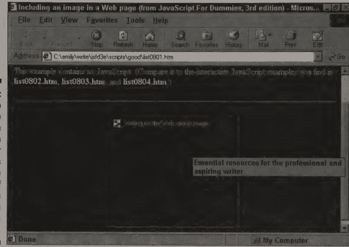

图 8-2：在浏览器中禁用图像加载的用户看到的是图像 `ALT` 标签的内容，而不是图片。

## 启动页脚本

在本节中，你将看到如何创建一个满足以下要求的图像：

- 当用户将鼠标指针悬停在图像上时，在文档的状态栏中显示消息。
- 响应鼠标点击。

图 8-3 和图 8-4 显示了在本节中创建的交互式图像在 Netscape Navigator 中的显示。

列表 8-2 中的代码通过向图像的事件处理程序附加 JavaScript 代码创建了这些图页面，使图像对鼠标事件做出响应。

## 列表 8-2：响应鼠标事件

```html
<HTML>
<HEAD>
<TITLE>使用鼠标事件处理程序创建可点击图像（节自《JavaScript 入门指南》，第3版）</TITLE>
</HEAD>
<BODY BGCOLOR="black" TEXT="white">
```

## 第 8 章：完美图像

### 创建可点击的图像

将鼠标指针悬停在图像上会导致消息显示在窗口底部（名为 `status` 状态栏的窗口属性）。点击图像上的任何地方都会弹出窗口。

```html
<P>
<HR>
<CENTER>

</CENTER>
</P>
```

图 8-3：将鼠标指针悬停在图像上会在状态栏中显示消息。

图 8-4：点击图像上的任何地方都会弹出窗口。

## 启动页的重塑

本节将本章之前的第一个启动页示例（你在本章前面的“启动页脚本”中看到的那个）推向新的高度。

在这里，你将看到如何将一张图像切割成小块，然后将每个小块与一个独立的事件处理器关联起来。结果是？一张智能图像会根据用户点击图像的位置而做出不同的响应。

HTML 区域（及其关联事件处理器）允许你将图像切割成多个图像热点，即图像中对应于特定消息或操作的区域（参见列表 8-3）。如图 8-5 所示，鼠标悬停在标记有“Publish（发布）”的图像区域上，状态栏中会出现一条与发布相关的消息。图 8-6 显示了针对图像不同部分的类似技巧。此外，你还可以指定一个较大的区域在状态栏中显示更通用的消息（参见图 8-7）。

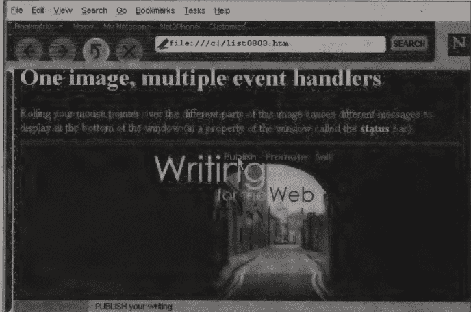

图 8-5：创建对应的状态栏消息：对应页面上鼠标的位置。

图 8-6：鼠标悬停在标记有“Promote（推广）”的图像区域上，状态栏中会出现与推广相关的消息。

## 一张图像，多个事件处理器


将鼠标悬停在此图像的不同部分，会在窗口底部名为“状态栏（status bar）”的窗口属性中显示不同的消息。


推广：你的写作。

图 8-7：在状态栏中显示标准消息。

## 一张图像，多个事件处理器

将鼠标悬停在此图像的不同部分，会在窗口底部名为“状态栏（status bar）”的窗口属性中显示不同的消息。

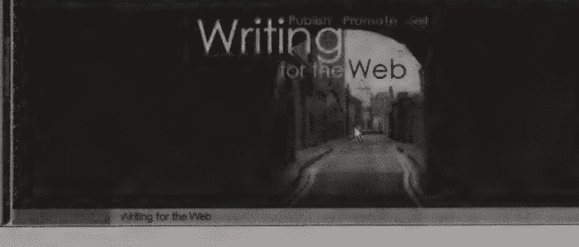

网页写作

## 170 第三部分：让你的网页具有交互性

列表 8-3 (list0803.htm) 向你展示了当用户鼠标悬停在图像的特定区域时，如何在状态栏中显示自定义消息。

## 列表 8-3：指定图像热点

```html
<HTML>
<HEAD>
<TITLE>为单张图像附加多个事件处理器（源自《自学 JavaScript》，第 3 版）</TITLE>
</HEAD>
<BODY BGCOLOR="black" TEXT="white">
<h1>一张图像，多个事件处理器</h1>
鼠标指针滑过图像的不同部分，会在窗口底部显示不同的消息（在名为 <B>status</B> 状态栏的窗口属性中）。
<P>
<HR>
<P>
<CENTER>
<!-- HTML 区域切割了单个图像。为每个区域定义单独事件处理器，允许你根据用户鼠标移动或点击的位置，在窗口状态栏中显示不同的消息。 -->

<MAP name="newsplash">
<AREA
onMouse="window.status='Writing for the Web';
return true"
onMouseOut="window.status='';\ return true"
shape=POLY target=_top
coords=1,2,1,46,78,48,80,197,240,201,239,183,92,94,2
>
<AREA
onMouseOver="window.status='SELL your writing';
return true"
onMouseOut="window.status='';\ return true" shape=RECT
target=_top
coords=216,0,241,16
<AREA>
```

## 第 8 章：完美图片 171

```html
onMouseover="window.status='PROMOTE your writing':
return true
onMouseout="window.status=''; return true" shape=RECT
target=_top
coords=149,0,209,15
>
<AREA
onMouseOver="window.status='PUBLISH your writing':
return true
onMouseout="window.status=''; return true" shape=RECT
target=_top
coords=94,0,140,14
>
</MAP>

</CENTER>
<BODY>
</HTML>
```

HTML 区域是允许你将图像切割成独立部分的构造结构。图像本身保持不变；你定义的区域仅允许你定义与该图像交互的任意方式。

你可以根据需要为图像定义任意数量的区域，并按你喜意调整大小和形状（多亏于 `coords` 属性）。你使用 HTML `<AREA>` 和 `<MAP>` 标签来定义区域，如列表 8-3 所示。每个区域都可以定义自己的事件处理器。

列表 8-3 定义了四个独立的区域：

- 一个包含写有“Publish（发布）”的图像部分。与该区域关联的 `onMouseOver` 事件处理器显示消息“PUBLISH your writing”。
- 一个包含写有“Promote（推广）”的图像部分。与该区域关联的 `onMouseOver` 事件处理器显示消息“PROMOTE your writing”。
- 一个包含写有“Sell（出售）”的图像部分。与该区域关联的 `onMouseOver` 事件处理器显示消息“SELL your writing”。
- 一个包含写有“Publish（发布）”的图像部分。与该区域关联的 `onMouseOver` 事件处理器显示消息“PUBLISH your writing”。

为了创建不同的区域，你需要知道坐标。如今大多数图形工具（包括 Macromedia 和 Adobe Fireworks）都允许你创建区域，然后生成所需的坐标。


# 第 8 章：完美图片 175

```html
<A onMouseOver="displayMsg('writing-related resources'); return true" MouseOut="displayMsg(''); return true" href="res.htm"></A>
```

```html
// 另一个通过 HTML 链接实现的图像
<A onMouseOver="displayMsg('who is emilyv?'); return true" MouseOut="displayMsg(''); return true" href="who.htm"></A>
```

你在列表 8-4 中看到的代码使用 HTML 的 `<A>` `</A>` 标签定义了几个链接。每个链接代表导航栏中的单个导航按钮。我将下方的代码拆解开，以便你查看每行代码的作用：

```html
<!-- HTML 链接（锚点）标签起始标签 -->
<A
<!-- MouseOver 事件处理程序在状态栏显示消息 -->
MouseOver="displayMsg('who is emilyv?'); return true
<!-- MouseOut 事件处理程序在鼠标移出时关闭消息 -->
MouseOut="displayMsg(''); return true
<!-- 指定点击此图像/链接时加载的页面 -->
href="who.htm"
<!-- HTML 图像标签起始标签 -->

height=12
<!-- 指定图像的宽度（像素） -->
width=89
<!-- 指定图像源文件的名称 -->
src="who_p.gif"
<!-- 关闭图像/链接周围的默认边框 -->
border=0
<!-- HTML 链接（锚点）标签结束标签 -->
</A>
```

# 176 第三部分：让你的 Web 页面交互起来


## 内部原理

你可能会选择使用 HTML/JavaScript 生成工具来帮助你设计和实现 Web 页面。这些工具（你可以在随附 CD 中找到一些）对于开发如本章所示的交互图像和热点等酷功能非常有帮助。

然而，由于并不是所有工具在所有情况下都能生成无完美的代码——而且因为你有时想要自定义生成的代码，使其完全按照你想要的方式运行——即使是资深开发工具用户，也会参考本章中的描述和示例。

## 链接到电子邮件

有一个导航按钮——你在图 8-8 中看到的 Logo——在响应鼠标点击时的行为与其他按钮不同。以下是直接来自列表 8-4 的最新代码：

```html
<A onmouseover="displayMsg('emily.com home'); return true" onMousemouseout="displayMsg('emilyemail.com'); return true" HREF="mailto:emilyemail.com" 
```

看看上面 `HREF` 属性的定义。注意被赋值的值（`mailto:emilyemail.com`？）。在图 8-10 中，你可以看到点击 logo 导航按钮的结果。


`HREF` 属性的值可以是许多不同协议之一：`file`（文件）；`mailto`（邮件）；`news`（新闻）和 `telnet`（远程终端）是最常见的。（当你没有指定协议时，解释器会假设该值指向与 HTML 源文件位于相同目录下的文件。）而不是加载 Web 页面（这是 `http:` 协议告诉 Web 浏览器在点击相应链接时的操作），`mailto:` 协议会指示 Web 浏览器向冒号后的用户发送一封电子邮件。

# 第 8 章：完美图片

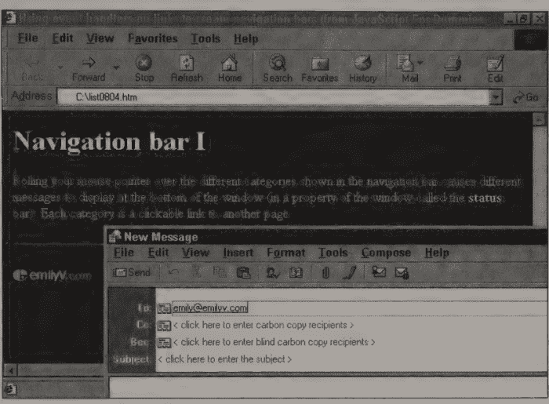

图 8.10：为用户提供一种快速联系你的方式。

# 第 9 章

## 悬停吧，小孩子！好鼠标！

- 本章内容
- 使用 JavaScript 创建图像悬停效果（image rollovers）
- 使用预加载图像优化页面性能
- 熟悉数组

在 Web 开发的黑暗时代，人们使用当时手头唯一的工具：简单的超文本链接来创建导航栏。这种方法并没有问题；它有效，而且容易实现。（事实上，有些网站仍然在 JavaScript 的轻微帮助下使用链接，你可以用酷炫的悬停效果替换简单链接——当使用鼠标悬停在它们上方时会产生视觉响应的动态导航栏。）

除了为你的 Web 页面增加精致的外观，悬停效果实际上让用户在你的网站上导航更加容易！详情请看下。

## 什么是悬停（Rollover）？

“Rollover”一词描述一种图像（通常是作为导航按钮的图像），当用户用鼠标指针悬停在其上方时它会改变颜色、字体、大小或其他方面。图 9-1 显示了电子出版按钮在首次加载到 Internet Explorer 外观（白色）。

正如你从图 9-2 所示，将鼠标悬停在你实现的具有悬停功能的导航按钮上，提供了一个视觉提示，帮助用户识别点击鼠标按钮时可以期待什么。（文本颜色从白色变为紫色的变化让用户知道按钮即将被点击！）

# 180 第三部分：让你的 Web 页面交互起来

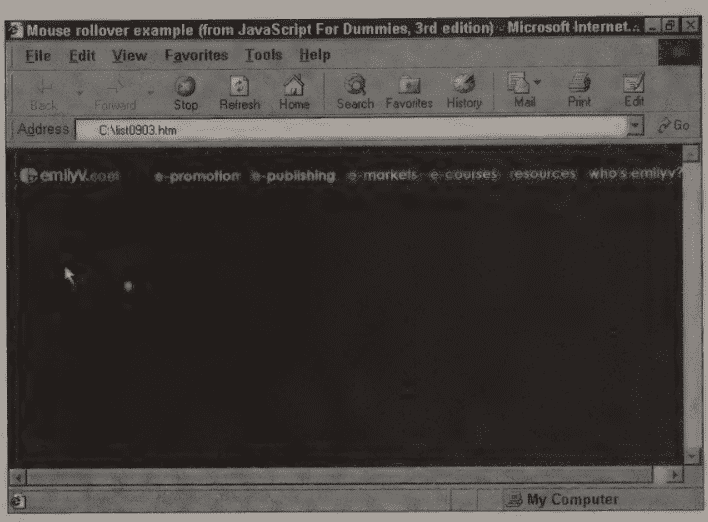

图 9-1：使用白色图像作为按钮的初始版本。

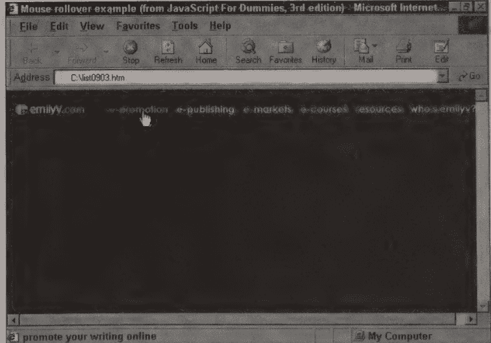

图 9-2：当鼠标经过时，对比色的产生响应。

# 第 9 章：悬停吧，小孩子！好鼠标！

并没有法律规定你必须将悬停技术用于导航栏。你可以使用悬停效果让你网站上的任何图形对鼠标事件做出响应（悬停的另一个常见用途是创建交互式启动页）。创建鼠标悬停非常简单（可能比你想的要简单）。只需遵循此计划：

- 选择两个尺寸完全相同的图像：一个用于默认显示，另一个用于响应鼠标悬停（mouseover）。保持这两个版本区分开的一种方法是使用 on/off（开启/关闭）术语。分别将它们称为关闭图像（off image）和开启图像（on image），因为当你的鼠标停留在某处的关闭位置时显示其中一个，当鼠标在开启位置时显示另一个。你可以获取图像，并：
- 使用预加载图像来优化页面性能，以确保用户在鼠标悬停时立即看到效果。你可以使用 JavaScript 库中的一些免费的图像。
- 悬停效果不仅能为你的 Web 页面增加精致的外观，实际上让用户在你的网站上导航更加容易！
- 使用 JavaScript 创建图像悬停效果
- 熟悉数组
- 本章内容
- 使用 JavaScript 创建图像悬停效果
- 使用预加载图像优化页面性能
- 熟悉数组
- 本章内容
- 使用 JavaScript 创建图像悬停效果
- 使用预加载图像优化页面性能
- 熟悉数组
- 本章内容
- 使用 JavaScript 创建图像悬停效果
- 使用预加载图像优化页面性能
- 熟悉数组

## 第 9 章：滚过去吧，男孩！好老鼠！183

```javascript
<SCRIPT LANGUAGE="JavaScript">
function preloadImages() {
  // 参见下文中的 #1

  if (document.images) {
    // 参见下文中的 #2
    var imgFiles = preloadImages.arguments;
    // 参见下文中的 #3
    var preloadArray = new Array();

    // 参见下文中的 #4
    for (var i=0; i < imgFiles.length; i++) {
      // 创建一个新的 Image 对象并将其
      // preloadArray 数组与源文件关联，从而将
      // 该图像加载到内存中

      preloadArray[i] = new Image;
      preloadArray[i].src = imgFiles[i];
    }
  }
  // 停止隐藏 -->
</SCRIPT>
</HEAD>
<BODY BCOLOR="#000000" TEXT="#FFFFFF" LINK="#FFFFFF"
LINK="#CCCCCC" ALINK="#CCCCCC">
// 第二个脚本调用在第一个脚本中
//定义的 preloadImages() 函数

<SCRIPT LANGUAGE="JavaScript">
<!--
  // 预加载此文件中使用的所有图像
  // （标志，以及所有白色和紫色
  // 导航按钮）。
-->
// 参见下文中的 #5
```

## 184 第三部分：让你的网页交互起来

### 列表 9-1（继续）

```javascript
preloadImages('logo.jpg', 
  'pro_p.gif', 'pub_p.gif', 'mkt_p.gif', 'crs_p.gif', 
  'res_p.gif', 'who_p.gif', 'pro_w.gif', 'pub_w.gif', 
  'mkt_w.gif', 'crs_w.gif', 'res_w.gif', 'who_w.gif');
//--
<SCRIPT>
```

列表 9-1 中的代码于 `preloadImages()` 函数的定义开始

以下是 JavaScript 解释器通过此函数检查文档的方式：

- 1. 首先，解释器检查 `document.images` 属性，以查看此文档是否出现了任何图像占位符（`` 标签）。
- 2. 如果文档中存在一个或多个 `` 标签，解释器会创建一个名为 `imgFiles` 的变量，包含所有发送给 `preloadImages()` 函数的参数。
- 3. 你创建的每个函数都可以使用 `arguments` 属性。
- 4. 接下来，解释器通过结合使用 `new` 运算符和 JavaScript 内置的 `Array()` 构造函数创建一个名为 `preloadArray` 的新变量。结果是一个空数组。
- 5. 最后，解释器填充了 `preloadArray` 数组（并预加载了此网页所需的所有图像）。
- 6. 你在列表 9-1 中使用的第二个脚本——放置在 document `<body> . . </body>` 标签之间的那个——在用户将网页加载到浏览器中时就会立即执行。

此脚本调用了 `preloadImages()` 函数，并将此页面所需的所有图像文件传递给它。

你可能会发现，通过文件名中使用简单的标记系统来区分你的开启/关闭图像文件是有帮助的。在这个例中，`w` 代表白色导航按钮；`p` 表示紫色导航按钮。因此，在这个例中，`pro_p.gif` 是关闭状态的 E 促销导航按钮的名称，而 `pro_w.gif` 是相应的开启状态导航按钮的名称。

## 设置切换会（swap meet）

当用户的浏览器使用用户在前一节中看到的方案将切换图像加载到内存时，你需要某种方法在响应鼠标悬停（mouseover）事件时切换这些图像。如果你快速浏览过第 7 章，可能已经猜到了，你是使用与每个导航按钮关联的 `onMouse` 事件处理程序来实现的。查看列表 9-2 中的代码以了解我的意思！我将在列表之后提供大量的解释来帮助你消化这段代码。

### 列表 9-2：使用 mouseover 事件切换图像

```javascript
<HEAD>
<SCRIPT LANGUAGE="JavaScript">

// 定义切换函数
function swap(id, newsrc) {
  var theImage = locateImage(id);
  if (theImage) {
    theImage.src = newsrc;
  }
}
///////////////////////////////////////
// locateImage() 函数接收图像的名称
// 并返回与该名称关联的 Image 对象。
///////////////////////////////////////

function locateImage(name) {
  var theImage = false;
  if (document.images) {
    theImage = document.images[name];
  }
  if (theImage) {
    return theImage;
  }
  return (false);
}
</SCRIPT>
</HEAD>

<body>
<A HREF="pro.htm"
onMouseOut="swap('promo_pic','pro_w.gif')"
// 从 onmouseover 处理器调用 swap() 函数
mouseover="swap('promo_pic','pro_p.gif')" A
```

## 186 第三部分：让你的网页交互起来

为了帮助你理顺列表 9-2 中的代码，我解释了 `swap()` 函数是如何工作的；然后我解释了当你从 `onMouseOut` 和 `mouseover` 处理器调用 `swap()` 函数时会发生什么。

### 定义 swap 函数

你在列表 9-2 中看到的 `swap()` 函数接受两个参数：

- `id`，代表你想要切换的图像名称
- `newsrc`，代表你想要显示的图像的文件名

以下是 `swap()` 函数内部的逻辑：

首先，通过 `locateImage(id)` 创建名为 `theImage` 的变量，并赋值你想要切换的图像（如果找到了图像，则将其 `src` 赋值为 `newsrc`）。

```javascript
function swap(id, newsrc) {
    var theImage = locateImage(id);
    if (theImage) { // 如果找到了图像
        theImage.src = newsrc;
    }
}
```

### 创建 locateImage 函数

如果你对 `locateImage` 函数如何工作感兴趣，你就来对地方了。在前一节所示，`swap()` 函数使用 `locateImage()` 来定位它所需的图像。以下是 `locateImage()` 的代码：

```javascript
function locateImage(name) {
// 从空变量 theImage 开始
    var image = false;
// 如果文档定义了图像
    if (document.images) {
// 查找图像
        image = document.images[name];
    }
// 如果 theImage 存在，将其返回给调用函数
    if (theImage) {
        return image;
    }
// 否则，向调用函数返回 false
    return (false);
}
```

## 第 9 章：滚过去吧，男孩！好老鼠！

### 调用 swap() 函数

为了执行切换，你必须两次切换图像：当用户移动到图像上，以及用户再次离开时。你通过在 `onMouseEnter` 和 `onMouseOut` 事件处理器中调用 `swap()` 函数来实现这一点，如下列表 9-2 所示：

```javascript
// 因为图像被实现为链接，点击
// 图像会自动加载 pro.htm 文件
```

```javascript
<A HREF="pro.htm"
onMouseOut="swap('promo_pic','pro_w.gif')"
onmouseover="swap('promo_pic','pro_p.gif')" A
```

注意这段代码，E 促销图像的初始值是 `pro_w.gif`（白色按钮）；图像的名称是 `promo_pic`。（你知道这意味着 `` 标签的 `SRC` 属性被设置为 `pro_w.gif`，而 `` 标签的 `NAME` 属性被设置为 `promo_pic`。）

现在看看 `mouseover`。此语句将 `promo_pic` 图像从白色版本切换到 `pro_p.gif`（紫色版本）。

当 `onMouseOut` 事件处理器触发时，`promo_pic` 图像变回 `pro_w.gif`（变回白色版本）。

## 完整内容

列表 9-3 整合了创建切换所需的所有元素，包括 `preloadImages()` 和 `swap()` 函数。看看！

列表 9-3 中的示例——包括所有的图像和引用的 HTML 文件——可以在配套光盘获得。只需在浏览器中加载 `list0903.htm` 即可查看此代码运行。

### 列表 9-3：使用 preloadImages() 和 swap() 创建切换

```javascript
<HTML>
<HEAD><TITLE>鼠标切换示例（节自
JavaScript For Dummies, 第3版）</TITLE>
<SCRIPT LANGUAGE="JavaScript">
```

# 188 第三部分：让你的网页具有交互性

# 列表 9-3（续）

```javascript
<!-- 向未启用 JavaScript 的浏览器隐藏此脚本
/////////////////////////////////
// displayMsg() 函数在浏览器窗口的
// 底部显示消息。
/////////////////////////////////

function displayMsg(message) {
    window.status = message;
}
/////////////////////////////////
// preloadImages() 函数预加载所有的
// “翻转”图像，以便当用户鼠标悬停在
// 导航按钮上时，翻效果会立即
// 发生。（如果你不预加载图像，
// 用户第一次鼠标悬停在每个
// 导航按钮上时，“mouseover”图像必须
// 从 Web 服务器传输，导致一种令人不观的延迟。）
/////////////////////////////////
function preloadImages() {
    // 如果文档中嵌入了图像 . .
    if (document.images) {
        // 将 imgFiles 变量赋值为包含所有
        // 作为参数传递给 preloadImages()
        // 函数的图像文件所组成的数组。
        var imgFiles = preloadImages.arguments;
        // 创建一个名为 preloadArray 的新数组
        var preloadArray = new Array();
        // 对于每一个作为参数发送给
        // preloadImages() 的图像文件（共13个） . . .
        for (var i=0; i < imgFiles.length; i++) {
            // 在 preloadArray 数组中
            // 创建一个新的 Image 对象
            // 并与源文件关联
            // 从而将图像加载到内存。

            preloadArray[i] = new Image();
            preloadArray[i].src = imgFiles[i];
        }
    }
}
```

# 第 9 章：鼠标翻转，孩子！好鼠标！189

```javascript
/////////////////////////////////////////////////////////////////
// swap() 函数接受两个参数 -
// Image 对象的名称以及图像文件名称
// 并用新文件替换 Image 对象的旧文件；
```

```javascript
function swap(id, newSrc) {

    var theImage = locateImage(id);

    if (theImage) {

        theImage.src = newSrc;

    }

}
```

```javascript

/////////////////////////////////////////////////////////////////

// locateImage() 函数接受图像的名称

// 并与该名称关联的 Image 对象

// 返回给调用代码。

/////////////////////////////////////////////////

```

```javascript

function locateImage(name) {

    var theImage = false;

    if (document.images) {

        theImage = document.images[name];

    }

    if (theImage) {

        return theImage;

    }

    return (false);

}

```

```html

// 停止隐藏 -->

<SCRIPT>

<HEAD>

<BODY BGCOLOR="000000" TEXT="#FFFFFF" LINK="#FFFFFF"

VLINK="#CCCCCC" ALINK="#CCCCCC">

<SCRIPT LANGUAGE="JavaScript">

<!---

preloadImages('logo.jpg', 'pro_p.gif', 'pub_p.gif',

    'mkt_p.gif',

    'crs_p.gif', 'res_p.gif', 'who_p.gif', 'pro_w.gif',

    'pub_w.gif',

    'mkt_w.gif', 'crs_w.gif', 'res_w.gif', 'who_w.gif');

//-->

</SCRIPT>

```

（续）

# 190 第三部分：让你的网页具有交互性

# 列表 9-3（续）

```html

<TABLE ORDER="0" CELLPADDING="0" CELLACING="0">

<TR>

<TD VALIGN="TOP" ALIGN="LEFT">

<TABLE ORDER="0" CELLPADDING="0" CELLACING="0"

WIDTH="125">

<TR><TD>

<A href="index.html" TARGET="top" onMouseOver="displayMsg('example.com home'); return true"

onMouseOut="displayMsg(''); return true">

</A>

</TD></TR></TABLE></TD>

<TD VALIGN="CENTER" ALIGN="RIGHT">

<TABLE ORDER="0" CELLPADDING="0" CELLACING="0"

WIDTH="486">

<TR><!-- 占位行，1. -->

<TD></TD>

<TD></TD>

<TD></TD>

<TD></TD>

<TD></TD>

<TD></TD>

<TD></TD>

<TD></TD>

<TD></TD>

<TD></TD>

<TD></TD>

<TD></TD>

<TD></TD>

</TR>

<TR><!-- 第1 行 --

# 第 9 章：鼠标翻转，好鼠标！191

```html
<TD><A href="pro.htm" TARGET="top"
onMouseOut="swap('promo_pic','promo_w.gif');
displayMsg(''); return true"
MouseOver="swap('promo_pic','promo_p.gif');
displayMsg('promote online');
return true></TD>
```

```html
<TD></TD>
```

```html
<TD><A href="pub.htm" TARGET="top"
onMouseOut="swap('pub_pic','pub_w.gif');
displayMsg(''); return true"
MouseOver="swap('pub_pic','pub_p.gif');
displayMsg('is electronic publishing for you?'); return true></TD>
```

```html
<TD></TD>
```

```html
<TD><A href="mkt.htm" TARGET="top"
onMouseOut="swap('mkt_pic','mkt_w.gif');
displayMsg(''); return true"
MouseOver="swap('mkt_pic','mkt_p.gif');
displayMsg('find online markets for
your work'); return true></TD>
```

```html
<TD></TD>
```

```html
<TD><A href="crs.htm" TARGET="top"
onMouseOut="swap('course_pic','crs_w.gif');
displayMsg(''); return true"
MouseOver="swap('course_pic','crs_p.gif');
displayMsg('take an online writing course');
return true></TD>
```

```html
<TD></TD>
```

（续）

# 192 第三部分：让你的网页具有交互性

# 列表 9-3（续）

```html
<TD><A href="res.htm" TARGET="top"
onMouseOut="swap('res_pic','res_w.gif');
displayMsg(''); return true"
MouseOver="swap('res_pic','res_p.gif');
displayMsg('writing-related resources');
return true></TD>
<TD></TD>
<TD><A href="who.htm" TARGET="top"
onMouseOut="swap('who_pic','who_w.gif');
displayMsg(''); return true"
MouseOver="swap('who_pic','who_p.gif');
displayMsg('who is empty?'); return true></TD>
<TD></TD>
<TD></TD>
<TR>
</TABLE>
</HTML>
```

9-3 初看时有点令人生畏。所有这些代码第一眼看上去都非常目不从心！但为了创建如图 9-1 和 9-2 所示的导航栏（带有完整的翻转效果），所有这些代码都是必要的。

如果你仔细观察，会发现列表 9-3 中的 JavaScript 语句与列表 9-1 和 9-2 中的语句是相同的；列表 9-3 新新的是用于从单个图像构建导航栏的 HTML `<table>` 语句。（好的，`displayMsg()` 函数和调用在列表 9-3 中也是新的——它们与你在第 8 章中看到的完全相同）。

创建翻转效果需要你为每个翻转效果定义一个 `` 标签或占位符。在行中精确对齐这些 `` 标签需要使用 `<table>` 语句。（你可以通过一本良好的 Web 设计书籍了解更多关于网页布局和操作的信息。最好的书籍之一是 Jennifer Niederst 编写的《Web Design in a Nutshell》。）

## 194 第三部分：让你的网页交互起来

## K.I.S.S.（保持简单，姐妹！）

你可以创建的最简单的交互效果是文本值随鼠标改变颜色。你通过访问与 HTML 相关的 style 对象来实现这种效果，如下：

```html
<li onmouseover="this.style.color='red'"
mouseout="this.style.color='black'">Netscape Navigator
```

```html
<li onmouseover="this.style.color='red'"
mouseout="this.style.color='black'">Opera
```

侧边栏的代码显示了从 1 (Netscape Navigator) 到 4 (Opera) 的浏览器列表。鼠标从黑色变为红色——然后变为黑色。第 2 章描述的 JavaScript 关键字为引用 HTML 元素提供了方便的方法。

```html
<li onmouseover="this.style.color='red'"
mouseout="this.style.color='black'">Microsoft Internet Explorer
```

要查看此代码的运行示例，请查看光盘中的 rollover.htm。

```html
<li onmouseover="this.style.color='red'"
mouseout="this.style.color='black'">America Online
```


## 第 10 章 收集与验证用户输入

## 本章内容

- 从用户那里获取信息
- 验证用户输入
- 给用户实用的反馈

如果你熟悉 HTML 表单，就知道它们有多用了。在你的网页上添加 HTML 表单可以让访问者快速方便地进行交流。用户可以在 HTML 表单中输入评论、联系信息或任何内容。然后，在用户提交表单的瞬间，这些信息会自动传输到这里（技术上是传输到你的 Web 服务器）。

尽管 HTML 表单本身很棒，但 JavaScript 让它们变得更好！使用 JavaScript，你可以创建智能表单：能够立即纠正用户错误、计算数值并提供反馈。用开发者的话，JavaScript 提供了一种执行客户端数据验证（有时称为数据清洗）的方法——这是任何设计良好的软件组成部分！

- JavaScript 允许你在客户端立即检查并验证用户输入。
- JavaScript 允许你给用户即时反馈。

## 196 第三部分：让你的网页交互起来

我将在接下来两个节中解释这两个功能。Netscape 贴心地提供了一个 JavaScript 数据验证教程，附带了你可以下载并整合到自己脚本中的示例代码。查看它：

```
http://developer.netscape.com/docs/examples/javascript/regexp/overview.html
```

## 清洗用户输入

在过去，Web 开发者必须编写服务器端 CGI 程序来处理用户输入。那种方法仍然在使用，但效率很低。

例如，假设你想让访问者订阅你的每月电子报，因此你创建一个包含名为“电子邮件”的输入字段的 HTML 表单。然后假设访问者不小心在该字段中输入了 XYZ。在从用户的浏览器传输到你的 Web 服务器之前你的 CGI 程序才能检查信息并判断 XYZ 无效。

另一方面，使用 JavaScript，你可以在用户的浏览器内部立即判断输入值是否有效——节省了用户的宝贵时间，也省去了你自己研究用 C、C++ 或 Perl 创建 CGI 程序的麻烦！

输入验证通常属于以下三类之一：

- **存在性 (Existence)**：测试值是否存在。
- **数值型 (Numeric)**：确保信息仅为数字。
- **模式型 (Pattern)**：测试特定的约定，例如电话号码、社会安全码或日期中的标点。

在列表 10-1 中，你将验证常用模式类所需的 JavaScript 代码：电子邮件地址。本章中的表单脚本部分演示了存在验证、数值验证以及模式验证的示例。

图 10-1 显示了此代码的运行；你可以加载 list100 来尝试这些技术。


## 噢，不！一切都模糊了！

on-blur（失去焦点）事件处理程序的名称与“焦点”的概念有关。当你点击一个对象时，说该对象获得了焦点。因此，默认情况下，当你点击某个内容时，该对象会变得模糊，并且该对象失去了焦点。

然后点击其他地方而不改变任何内容（元素失去焦点或变为模糊）。

以下是 JavaScript 解释器执行的几个常见的模糊相关事件处理程序的简要介绍：

- `onFocus`: 当元素获得焦点时执行（用户通过 Tab 键切换到它或点击它）。
- `onChange`: 当元素失去焦点且其内容被修改时执行。
- `onSelect`: 当用户选择部分或全部文本（你指定的 `text` 或 `textarea` 元素内部）时执行。`onSelect` 的行为与 `onFocus` 类似：在元素获得焦点且用户也选择了文本时发生。
- `onBlur`: 当用户点击某个元素（元素获得焦点）并且

## 创建订单表单脚本

在本节的示例中，你将看到如何创建一个智能表单，通过两种不同的方式验证用户数据：

- 在字段级别：你可以在用户离开字段时立即验证独立字段。独立字段是你要求必须的字段（例如信用卡购买时的信用卡号），无论用户对任何其他字段输入了什么。
- 在表单级别：你希望在用户点击表单提交（Submit）按钮时验证依赖字段。依赖字段是你可能验证也可能不验证的字段，取决于用户在一个多个其他字段上的输入。例如，除非用户指定他们想接收你的邮件列表，否则你不需要电子邮件地址。

你在这里看到的是名为 Webmasters 的虚拟 Web 设计公司。为了允许访问者请求 Web 设计服务的个性化报价，该公司决定创建一个 HTML 表单并挂载 JavaScript 脚本以实现这些设计目标：

- 验证必填字段条目是否存在：要成功提交请求，Webmasters 的访问者必须输入服务类别、姓、名以及至少一种联系方式（电话或电子邮件）。如列表 10-3 所示，`exists()` 函数实现了这些验证检查。存在性验证同时发生在字段级别和表单级别。

## 第 10 章：寻找与收集（以及验证）用户输入 201

- 验证两个模式字段：脚本必须检查电话和电子邮件地址以确保它们是有效的。`isValidPhoneNumber()` 和 `isValidEmail()` 函数分别在表单级别实现这些验证检查。
- 验证数值字段：通用的 `isNumber()` 函数协助在表单级别验证电话号码。

图 10-2 显示了完成后的报价请求示例外观。

要完整查看图 10-2 对应的代码 `list1006.htm`，请从配套的 CD-ROM 中打开该文件。

## 哇！太有深度了，哥们儿！

你可以通过在字段的其中一个事件处理程序上挂载存在性验证脚本，来要求用户为 HTML 表单字段提供值。

在例例中，Webmeister 的开发者希望确保请求报价的人同时输入了姓和名。列表 10-3 显示了实现这一常见设计需求所需的 JavaScript 代码。


图 10-2：虚拟 Webmeister 公司的订单表单。

## 202 第三部分：让你的 Web 页面交互起来

列表 10-3：测试输入值是否存在

```javascript
function exists(inputValue) {
    var aCharExists = false

    // 遍历 inputValue，使用 charAt() 
    // 方法来检测非空格字符。

    for (var i=0; i<inputValue.length; i++) {
        if (inputValue.charAt(i) != " " && inputValue.charAt(i) != "") {
            aCharExists = true
            break
        }
    }
    return aCharExists
}
```

// 只要用户离开 firstName 字段，firstName 字段的值就会发送给 exists() 函数

`<INPUT TYPE="TEXT" NAME="firstName" SIZE="25" onBlur="if (!exists(this.value)) { alert('Please enter a first name'); }">`

// 只要用户离开 lastName 字段，lastName 字段的值就会发送给 exists() 函数

`<INPUT TYPE="TEXT" NAME="lastName" SIZE="35" onBlur="if (!exists(this.value)) { alert('Please enter a last name'); }">`

列表 10-3 中的代码基于以下原理工作：

`exists()` 函数接收一个输入值（恰恰地命名为 `inputValue`）。一旦 `exists()` 接收到此值，它就会检查该值是否包含空白字符。将非空白字符或默认值 `false` 返回给调用代码。

如果你看列表的下方，你会看到调用 `exists()` 函数的两个输入字段，包括这一个：

```javascript
<INPUT TYPE="TEXT" NAME="firstName" SIZE="25" onBlur="if (!exists(this.value)) { alert('Please enter a first name'); }">
```

## 第 10 章：寻找与收集（以及验证）用户输入 203

前面的 JavaScript 语句为 `firstName` 字段的 `onChange` 事件处理程序定义了一个值。当用户失去 `firstName` 字段焦点时，`firstName` 的值会被传递给 `exists()`。如果 `exists()` 返回 `false`，就会弹出一个消息提醒用户输入姓名。现在，当用户点击其他地方而不改变任何内容时（元素失去焦点或变为模糊）。

以下是 JavaScript 解释器执行的几个常见的模糊相关事件处理程序的简要介绍：

- `onFocus`: 当元素获得焦点时执行（用户通过 Tab 键切换到它或点击它）。
- `onChange`: 当元素失去焦点且其内容被修改时执行。
- `onSelect`: 当用户选择部分或全部文本（你指定的 `text` 或 `textarea` 元素内部）时执行。`onSelect` 的行为与 `onFocus` 类似：在元素获得焦点且用户也选择了文本时发生。
- `onBlur`: 当用户点击某个元素（元素获得焦点）并且

你可以要求用户为 HTML 表单字段提供值，通过在字段的其中一个事件处理程序上挂载存在性验证脚本。

在例中中，Webmeister 的开发者希望确保请求报价的人同时输入了姓和名。列表 10-3 显示了实现这一常见设计需求所需的 JavaScript 代码。

前面的 JavaScript 语句为 `firstName` 字段的 `onChange` 事件处理程序定义了一个值。当用户失去 `firstName` 字段焦点时，`firstName` 的值会被传递给 `exists()`。如果 `exists()` 返回 `false`，就会弹出一个消息提醒用户输入姓名。现在，当用户点击其他地方而不改变任何内容时（元素失去焦点或变为模糊）。

`exists()` 函数接收一个输入值（恰恰地命名为 `inputValue`）。一旦 `exists()` 接收到此值，它就会检查该值是否包含空白字符。将非空白字符或默认值 `false` 返回给调用代码。

如果你看列表的下方，你会看到调用 `exists()` 函数的两个输入字段，包括这一个：

```javascript
<INPUT TYPE="TEXT" NAME="firstName" SIZE="25" onBlur="if (!exists(this.value)) { alert('Please enter a first name'); }">
```

## 206 第三部分：让你的网页具有交互性

## 列表 10-5（续）

```javascript
// 统计包含多少个数字 i++
for (var i=0; i<=inputValue.length; i++) {
    if (isNumber(inputValue.charAt(i))) {
        digitsFound++
    }
}
// 如果 inputValue 包含至少10个
// 数字，假设它是一个有效的电话号码
if (digitsFound >= 10) {
    return true
} else {
    return false
}
// 调用 isValidPhoneNumber 函数
if (!isValidPhoneNumber(inputValue)) {
    alert("我们无法通过电话与您联系，除非您的号码包含包含区号）。谢谢！")
}
```

你在列表 10-5 中使用的代码会检查一个值是否包含至少十个数字；如果是，该值将通过有效电话号码的测试。

有时你可能想为此创建更严格的模式。例如，你可能希望确保用户在电话号码中包含括号和破折号。关于如何实现此点的示例（以及一些注意事项），请参阅本节的侧边栏“模式匹配的替代方法”。

## 模式匹配的替代方法

如果你需要定义一个比列表 10-5 中描述的电话号码示例更严格的模式，请查看此侧边栏中的 JavaScript 代码，它要求用户按以下格式输入电话号码：

(512)555-1212

正如你在后续示例所示，与 JavaScript 内置字符串对象相关的 `substring()` 方法允许你将一个值拆分成若干块，并确保每个块都是有效的。例如，这段代码指示解释器分别提取并检查电话号码的模式、区号、交换机和线路号部分。

这种方法的益处是什么？它确保用户输入的内容完全符合你的要求，从而减少了沟通误解的概率。缺点是，你要求用户完全按照你想要的方式输入一系列字符——这个过程在最好的情况下也是困难的！

## 第 10 章：搜寻与收集（并验证）用户输入 207

（请记住，Web 是全球性的，你可能熟悉的模式对世界上其他地区的人来说可能完全陌生。）

如果格式允许，请务必调整此 JavaScript 代码示例以适用于自己的用途。但如果你能通过较少的检查（比如我在列表 10-5 中描述的电话号码验证程序）来完成，那就尽管去做！

遵循此点的良好设计规则是：如果你必须按照特定格式收集信息

```javascript
function isPhoneNumber(entry){
  if (entry) {
    // 将 openParen 设置为 entry 的第一个字符
    var openParen = entry.substring(0,1)

    // 将 areaCode 设置为后续 3 个字符
    var areaCode = entry.substring(1,4)

    // 将 closeParen 设置为第 5 个字符
    var closeParen = entry.substring(4,5)

    // 将 exchange 设置为第 6, 7, 8 个字符
    var exchange = entry.substring(5,8)

    // 将 dash 设置为第 9 个字符
    var dash = entry.substring(8,9)

    // 将 line 设置为第 10 到 13 个字符
    var line = entry.substring(9,13)

    // 下面的语句检查所有部分，
    // 如下所示：
    // 如果 openParen 不等于 "("
    // 或者 areaCode 不是数字
    // 或者 closeParen 不等于 ")"
    // // ...以此此类推。

if (
  (openParen != "(") ||
  (!isNaN(areaCode)) ||
```

（续）

```javascript
(closeParen != ")" ||
(!isNumber(exchange)) ||
(dash != "-") ||
(!isNumber(line))
alert("电话号码错误。请按以下格式重新输入：(123)456-7890")
}

<FORM NAME="feedbackForm">
<BR>请输入您的家庭电话号码
<BR>格式如下：(123)456-7890
<INPUT TYPE="text" NAME="phone" VALUE="" SIZE=13
onBlur="isPhoneNumber(this.value)">
```

## 通过表单级验证进行整合

有时，你希望在用户输入值或离开字段（按 Tab ）时立即对字段进行验证。（列表 10-3 显示了独立字段验证的示例。）

但有时，你可能希望在用户完成信息输入后才开始验证。例如，Webmeister 表单允许用户指定希望通过电子邮件还是电话与他们联系。至少必须选择一个选项，如果在用户离开电子邮件字段的瞬间就触发验证，将是毫无意义的（而且令人厌烦的）！毕竟，用户可能正打算选择电话号码选项；在用户完成整个表单之前，你无法得知这一点。

对于依赖性字段验证，更好的方法是等到用户尝试提交表单时再执行你的验证脚本，如列表 10-6 所示（此处省略）。现在，如果用户尝试在没有输入电话号码或电子邮件的情况下提交表单，

## 第 10 章：搜寻与收集（并验证）用户输入 209

**图 10-4：** 使用表单级验证

**列表 10-6：** 实现依赖性验证

```html
<HTML>
<HEAD>
<TITLE>订单表</TITLE>
<SCRIPT LANGUAGE="JavaScript">
// 检查输入是否包含非数字数据
function isNumber(inputValue) {
  var result = true;

  // 如果发现任何非数字字符，将 result 设置为 false
  for (var i=0; i<inputValue.length; i++) {
    if (isNaN(inputValue.charAt(i))) {
      result = false
      break
    }
  }
  return result;
}

// 检查输入是否包含 "@" 和 "."
function isValidEmail(inputValue) {

  var foundAt = false
  var foundDot = false

  // 遍历输入寻找 "@" 和 "."
  for (var i=0; i<inputValue.length; i++) {
    if (inputValue.charAt(i) == "@") {
      foundAt = true
    } else if (inputValue.charAt(i) == ".") {
      foundDot = true
    }
  }

  // 如果找到了 "@" 和 "."，假设电子邮件地址有效；
  // 否则返回 false以便调用代码知道地址无效
  if (foundAt && foundDot) {
    return true
  } else {
    return false
  }
}

// 检查输入是否包含至少10个数字
function isAValidPhoneNumber(inputValue) {
    var digitsFound = 0

    // 遍历输入统计包含多少个数字
    for (var i=0; i<inputValue.length; i++) {
        if (isNaN(inputValue.charAt(i))) {
            digitsFound++
        }
    }

    // 如果 inputValue 至少包含10个数字，
    // 假设它是一个有效的电话号码
    if (digitsFound >= 10) {
        return true
    } else {
        return false
    }
}
</SCRIPT>
</HEAD>
</HTML>
```

## 212 第三部分：让你的网页具有交互性

## 列表 10-6（续）

```javascript
///////////////////////////////////////////////////////////////////////
// 执行跨字段检查，这些检查在所有数据
// 输入完成之前无法进行。
///////////////////////////////////////////////////////////////////////

// validateForm() 执行所有依赖字段验证
function validateForm() {

    var rc = true

    // 依赖性检查 #1：确保选择了
    // 服务类别

    ///////////////////////////////////////////////////////////////////////
    // 访问者需要选择以下选项之一
    // 以获得准确的报价：
    // 确定他们是否对
    // 设计、维护或推广服务感兴趣
    ///////////////////////////////////////////////////////////////////////

    if (document.quoteForm.designChoice.checked &&
        document.quoteForm.mainChoice.checked &&
        document.quoteForm.promoChoice.checked) {
        alert("请勾选您是否对我们的
        设计、维护或推广服务感兴趣，以便
        我们为您提供更准确的报价。谢谢！");
        rc = false
    }

    // 依赖性检查 #2：确保如果
    // 用户勾选了“员工”，
    // 则存在公司名称

    ///////////////////////////////////////////////////////////////////////
    // 如果访问者是员工，他们需要指定
    // 公司的名称。
    ///////////////////////////////////////////////////////////////////////

    if (document.quoteForm.bizChoice[1].checked) {
        if (!document.quoteForm.corpName.value) {
            alert("您已指定自己是员工，
            能否请输入您就职公司的
            名称？谢谢！");
            rc = false
        }
    }

    // 依赖性检查 #3：双重检查姓和

```

## 第 10 章：搜索与采集（并验证）用户输入

```javascript
// 姓的存在
///////////////////////////////////////
// 访问者需要包含他们的名
// 和姓。
///////////////////////////////////////
if (document.quoteForm.firstName.value ||
    document.quoteForm.lastName.value) {
    alert("请输入您的完整姓名（包括名和
        姓）。谢谢！")
    rc = false
}

// 依赖性检查 #4：确保用户输入
// 电子邮件
// 地址或电话号码
///////////////////////////////////////
// 访问者需要指定电子邮件
// 地址或电话号码。
///////////////////////////////////////
if (document.quoteForm.emailChoice.checked &&
    document.quoteForm.phoneChoice.checked) {
    alert("请告诉我们您希望我们通过
        通过电子邮件还是电话与您联系。谢谢！")
    rc = false
}

// 依赖性检查 #5：确保电子邮件地址
// 存在
//（如果用户选择了电子邮件联系选项）
///////////////////////////////////////
// 访问者告诉我们希望我们通过
// 电子邮件与他们联系，如果他们没有输入
// 电子邮件地址（电话也是如此）。
///////////////////////////////////////
if (document.quoteForm.emailChoice.checked &&
    !isValidEmail(document.quoteForm.emailAddr.value)) {
    alert("除非您提供一个有效的
        电子邮件地址，否则我们无法通过电子邮件与您联系。谢谢！")
    rc = false
}
else {
    if (document.quoteForm.phoneChoice.checked &&
        !isValidPhoneNumber(document.quoteForm.phoneNumber.value)) {
```

## 214 第三部分：让你的网页具有交互性

## 列表 10-6（续）

```javascript
alert("除非您提供电话号码（请确保包含
        区号），否则我们无法通过电话与您联系。谢谢！");
rc = false;
}
if (rc) {
// 如果 rc 变量非零，则表单数据
// 顺利通过了！
alert("谢谢！我们将很快与您联系报价。");
return rc;
}
<!-- -->
<SCRIPT>
</HEAD>

<BODY>
<h1>订单表单示例</h1>
<HR>
...
<P>
<HR>
<TABLE WIDTH="100%" CELLACING="10" CELLPADDING="10"
BORDER=0>
<TR>
<TD>
<FONT FACE="Helvetica, Arial, Verdana" SIZE="2">
// 当用户尝试提交表单时，会执行
// 依赖性验证检查
<FORM NAME="quoteForm" onSubmit="return validateForm();">
<P>
<B>您对我们的哪些服务感兴趣？</B> 勾选适用项）。
<P>
网站设计 <INPUT TYPE="CHECKBOX" NAME="designChoice"
VALUE="design"&nbsp;&nbsp;&nbsp;&nbsp;
网站维护 <INPUT TYPE="CHECKBOX" NAME="maintChoice"
VALUE="maint"&nbsp;&nbsp;&nbsp;&nbsp;
在线推广<INPUT TYPE="CHECKBOX" NAME="promoChoice"
VALUE="promo"
<P>
<B>您为什么想要网站？（或者，如果您已经有了，
您用它做什么？)</B>
<P>
<TEXTAREA NAME="purpose" COLS="60" ROWS="5" WRAP="VIRTUAL">
```

```html
</TEXTAREA>
<P>
<B>您想将照片整合到您的网站中吗？</B>
<BR>
是 <INPUT TYPE="RADIO" NAME="pixChoice"
VALUE="hasPix"
CHECKED>
否 <INPUT TYPE="RADIO" NAME="pixChoice"
VALUE="hasNoPix">

<P>
<B>您是否有想在您的网站上推广的一个或多个产品？</B>
是 <INPUT TYPE="RADIO" NAME="cdChoice"
VALUE="hasProducts"
CHECKED>
否 <INPUT TYPE="RADIO" NAME="cdChoice"
VALUE="hasNoProducts">

<P>
<B>您是小型企业主，还是在公司工作？</B>
<BR>
小型企业主 <INPUT TYPE="RADIO" NAME="bizChoice"
VALUE="isOwner"
CHECKED>
员工 <INPUT TYPE="RADIO" NAME="bizChoice"
VALUE="isEmployee">

<P>
<B>如果您在公司工作，公司名称是？</B>
<INPUT TYPE="TEXT" NAME="corpName" SIZE="25">

<P>
<B>为了给您提供准确的报价，我们还需要了解其他信息吗？</B>
<TEXTAREA NAME="extraInfo" COLS="60" ROWS="5" WRAP="VIRTUAL">
<P>
</TEXTAREA>
<TABLE>
<TR>
<TD>
<FONT FACE="Helvetica, Arial, Verdana" SIZE="2">您的名：</B>
</TD>
<TD>
<FONT FACE="Helvetica, Arial, Verdana" SIZE="2">姓：</B>
</TD>
<TR>
<TD>
<INPUT TYPE="TEXT" NAME="firstName" SIZE="25" onBlur="if
(exists(this.value)) { alert('请输入名'); }
TD>
```

## 216 第三部分：让你的网页具有交互性

## 列表 10-6（续）

```html
<INPUT TYPE="TEXT" NAME="LastName" SIZE="35" onBlur="if
(!exists(this.value)) { alert('请输入姓')}"></TD>
</TR>
<TR>
<TR>
<TD COLSPAN="2">
<FONT FACE="Helvetica, Arial, Verdana" SIZE="2"><B>您希望我们如何与您联系（电子邮件、电话或两者都有）？</B>
</FONT>
</TD>
<TR>
<TD ALIGN="RIGHT">
<FONT FACE="Helvetica, Arial, Verdana" SIZE="2">电子邮件<INPUT TYPE="CHECKBOX" NAME="emailChoice"
VALUE="email">
</FONT>
</TD>
<TD>
<INPUT TYPE="TEXT" NAME="emailAddr" SIZE="35">
</TD>
</TR>
<TR>
<TD ALIGN="RIGHT">
<FONT FACE="Helvetica, Arial, Verdana" SIZE="2">电话<INPUT TYPE="CHECKBOX" NAME="phoneChoice"
VALUE="phone">
</FONT>
</TD>
<TD>
<INPUT TYPE="TEXT" NAME="phoneNumber" SIZE="15">
</TD>
</TR>
</TABLE>
<P>
<CENTER>
<INPUT TYPE="SUBMIT" VALUE="提交您的报价请求"
&nbsp;&nbsp;&nbsp;&nbsp; <INPUT TYPE="RESET"
VALUE="清空表单">
...
</CENTER>
</html```

## 第 10 章：搜索与采集（并验证）用户输入

## 217

正如你从列表 10-6 中的代码所示，`validateForm()` 函数执行五个定义的字段验证程序，并在用户尝试提交表单时运行。（将 `validateForm()` 函数附加到 quoteForm 的 `onSubmit` 事件处理程序就起到了作用！）


## 向用户表达你的想法

给用户提供适当、及时的反馈，可以是令人困惑的网站与高效且易于使用的网站之间的区别。在决定如何与用户交互时，请记住以下几点：

-   **检测错误**。在某些情况下，你可能能够处理（极客术语：修改）输入以适应你的需求，而完全不打扰用户。例如，仅仅因为你想看到大写字母的值，并不意味着用户必须以大写输入。与其显示错误并要求用户重试，你可以轻松地使用 `toUpperCase()` 方法自己将输入转换为大写。

-   **不要大叫！** 没有人喜欢被吼，像**这样的全大写并且以感叹号结尾的消息是不行的！**说你需要说的话；使用正常的大小写和标点符号。

-   **要具体**。有时你并不特别意乎用户输入什么（例如，如果你要求的是自由类型，或者用户对你的产品发表评论）。在其他时候，用户输入的内容至关重要。因此，务必在页面上提前告知用户预期的格式。当需要弹出错误消息时，请确保它告诉用户其输入的具体哪里有问题。（格式无效。请重试，是不计数的！）

-   **给你的用户喘机会**。因为你现在是验证用户输入的专家了，并不意味着你每次都必须弹出错误消息。

-   **给你的用户点赞**。不要只把反馈留给用户输入错误内容的时候，确保用户事情正在按计划进行也是有用的。例如，当表单通过所有验证检查时，让用户知道。

-   **测试直到崩溃**。确保（这本是不说而喻，但永远以防）对你的表单进行仔细测试，涵盖用户可能出现的每一个错误（或一系列错误）。对于用户来说，在发现问题并纠正后仍然陷入无法消除的错误循环中，没有什么比这更令人沮丧的了！

## 第 11 章

## 再次使用框架！

**本章内容**

- 使用 JavaScript 操作框架
- 创建一个简单的 JavaScript 页面地图
- 创建一个可折叠的 JavaScript 站点地图

框架允许你在单个浏览器窗口内显示多个 HTML 文档。通过 JavaScript，你可以创建各种复杂的框架效果！以下两种是最实用（也是最常见）的框架效果，且你在本章的示例中都能看到：

- 使用框架创建动态站点地图
- 使用框架显示超链接文档

当你完成本章后，你将掌握足够的 JavaScript 如何与框架交互的知识，从而创建出你自己的酷炫效果。

是否在你的网站中包含 HTML 框架是一个取决于个人的设计决定。有些人非常喜欢框架，因为它们不仅允许你创建原生的导航结构（如本章中看到的网站），还可以在提供超链接的同时，防止用户浏览到其他超链接站点。缺点是什么？框架的实现可能非常复杂，而且有些人不喜欢它们“隐藏”URL 信息的特性。例如，要查看在框架中打开的链接的 URL，你不能直接点击链接；必须右键点击并选择“在新窗口中打开”（Internet Explorer）或“在新窗口中打开链接”（浏览器）。然而，如果你决定实现框架，JavaScript 可以帮助你最有效地利用它们。

## 220 第三部分：让你的网页具有交互性

## 逐个处理页面

脚本框架是任何 Web 开发者工具箱中非常有价值的补充。通过 HTML 框架和 JavaScript 的结合，你可以在页面的一侧展示一个静态的、可的目录；然后在页面的另一侧，你可以展示与每个目录条目对应的文本。请查看图 11-1 和图 11-2 以了解目录。图 11-1 显示了我的网站，该网站左侧有一个简单的框架目录示例，右侧是内容。

框架的用处之一是它们允许相互独立地显示不同的 HTML 文件。例如，如图 11-2 所示，即使用户滚动右侧框架，左侧框架仍保持可见。此外，点击左侧框架中的链接会在你右侧看到的框架中自动加载相应的内容。

我在我将在接下来的章节中解释的这种方法，可以帮助用户快速浏览站点，并且对于组织小型站点——甚至是包含大量文本的大型站点——都非常实用。

图 11-1：使用框架将网站索引与内容文本分离。

## 第 11 章：再次使用框架！

框架是一种你使用 HTML 标签创建并使用 JavaScript 和文档对象模型（DOM）进行操作的特殊窗口。由于本书重点侧重于 HTML，我没有进行非常详细的介绍。因为我不关注 HTML，我没有深入…………的的的的的的的 the the the the the the the

# 第 11 章：再次框架！

## 命中目标

当你在 HTML 中创建链接（或锚点、区域、base 或表单）时，你可以选择为与这些 HTML 元素关联的 `TARGET` 属性指定值。`TARGET` 属性的有效值包括任何之前命名的帧或窗口，或者以下内置值之一。（列表 11-2 展示了如何为与链接关联的 `TARGET` 属性指定 `__top` 值_ 的示例。）

| 值 | 它的含义是什么？ |
| --- | --- |
| `_blank` | 在全新的窗口中打开链接 |
| `_parent` | 在此窗口或帧的父窗口/父帧中打开链接 |
| `_self` | 在此窗口或帧中打开链接 |
| `_top` | 在根窗口或帧中打开链接 |

```html
<A>
....
// 当用户点击“为什么我不能发表文章？”链接时，
// 位于 pro_c.htm#cantget 的锚点将加载到
// 名为 content 的帧（frame）中
  frame content

<A HREF="pub.c.htm#cantget" TARGET="content">
为什么我不能发表文章?</A>

<A HREF="pub.c.htm#rescue" TARGET="content">
电子出版来救援！</A>

<A>
三种类型的电子出版商</A>

<A HREF="pub.c.htm#choose" TARGET="content">
选择电子出版商</A>

<A HREF="pub.c.htm" TARGET="content">
每个作家必须了解的电子出版知识</A>

// 当用户点击“emily.com 首页”链接时，
// 一个新页面 (home.htm) 将替换当前页面

<A HREF="home.htm" TARGET="_top">
emily.com 首页</A>
```

我在列表 11-2 中定义的每个链接都包含一个 `TARGET` 属性值。除一个例外外，`TARGET` 被设置为 `content` —— 这是列表 11-1 中定义的右侧帧的名称。将帧的名称分配给链接的 `TARGET` 属性会导致该链接加载到命名的帧中，正如你在列表 11-2 中看到的那样。

你需要对这个例外进行变动：在列表 11-2 的底部，你看到最后一个定义的链接为 `TARGET` 属性分配了 `__top` 值。当用户点击标记为 emily.com home 的链接时，页面将变为 `home.htm` 的内容。

`_top` 是一个内置值，翻译为“此窗口/帧层级中的顶层窗口究竟是什么”。（本章中的侧边栏“命中目标” 描述了你可以为 `TARGET` 属性指定的所有内置值）。

如果指定的 `TARGET` 值既不匹配 a) 之前定义的名称，也不匹配 b) 你在“命中目标”侧边栏中看到的内置值之一，将导致关联的链接加载到一个全新的窗口中。因此，如果你期望链接在帧中打开，而它却弹出了新窗口，请检查你的源代码；你可能拼写错误了！

本节的示例展示了如何根据用户点击另一个帧来加载其中一个帧的内容。要根据用户点击链接来加载两个帧，你可以创建一个类似下方的 JavaScript 函数：

```javascript
function loadTwoFrames(leftURL, contentURL) {
    // 加载传入的第一个 URL
    // 加载到之前在 HTML 文件中
    // 定义为 "leftNav" 的容器帧中
    // 就像你在列表 11-1 中看到的那样

    parent.leftNav.location.href=leftURL

    // 加载传入的第二个 URL
    // 加载到之前定义为 "content"
    // 的容器帧中
    parent.content.location.href=contentURL
}
```

然后向 `loadTwoFrames()` 函数传递两个 URL 字符串；例如：

```html
<A HREF="javascript:loadTwoFrames('some.htm', 'another.htm')">
```

## 创建可折叠索引

任何用过 Windows 实用程序（见图 11-5）的人都知道可折叠目录有多好用。点击图 11-5 中的任何加号图标都会展开关联的目录；点击减号图标则会折叠目录。图 11-5 左侧显示的可折叠列表是按逻辑化、层级化的方式组织和展示大量信息的一种奇妙且实用的方法。

通过结合免费的、预定义的 JavaScript 库和 HTML 帧（frames），你可以为你的网站创建类似的可折叠列表。

## 查看库

当计算机程序员谈论“库”（libraries）时，他们指的不是你可以去书的书的书！在术语中，库是一组函数——有时免费，有时不免费——你可以在自己的代码中引用并调用这些函数。要实现 JavaScript 库，你将它们作为 `.js` 文件使用，并在 `<SCRIPT>` 标签的帮助下将其包含在你自己的文件中，如下所示（完整的工作示例可以在列表 11-3 中看到）：

```html
// 使用 SRC 属性包含 JavaScript 库
<SCRIPT LANGUAGE="JavaScript"
SRC="someFile.js">
</SCRIPT>
```

## 调用代码


上述代码中的第一个脚本声明将 `someFile` 整合到 HTML 文档中。第二个脚本声明显示了如何调用一个名为 `someFunction()` 的函数——该函数由 `someFile.js` 库定义。将 JavaScript 代码组织成可重用的库有以下益处：

- 减少错误。在 JavaScript 库经过充分测试后，你就可以放心地重用它了（与将 JavaScript 函数复制并粘贴到每个 HTML 文件中相比）。
- 提高性能。一份 JavaScript 库加载到内存中，JavaScript 解释器就可以访问，无论有多少个页面（一个还是几十个）引用它。

Netscape 的友善们有一个库名为 `list.js`，目前可用并提供折叠列表功能。你将在本书的“概述你的网站”章节中看到如何创建一个完整的目录。你可以从以下网站免费下载 `list.js`：

```
http://developer.netscape.com/docs/technote/collapse/index.html
```

使用库可能简单也可以困难，取决于库开发者如何记录库！Netscape 在示例中很好地记录了库。列表 11-3 向你展示如何整合 `list.js` 并使用它包含的 JavaScript 函数创建一个折叠列表。

### 列表 11-3：使用 Netscape list.js 库创建折叠列表

```html
<HTML>
<HEAD><TITLE>使用 Netscape list.js 创建折叠列表（节选 JavaScript For Dummies 第三版）</TITLE>

//  list.js 库
<SCRIPT LANGUAGE="JavaScript" SRC="list.js"></SCRIPT>

<SCRIPT LANGUAGE="JavaScript">
function init() {
  // 指定列表尺寸
  var width = 350, height = 22;

  // 创建新列表！
  // List() 函数在 list.js 中定义并记录
  myList = new List(true, width, height, "CCCCCC");

  // 向列表添加两个项目
  myList.addItem("Computer");
  myList.addItem("Text editor");

  // 创建一个“子”列表
  subList = new List(false, width, height, "CCCCCC");

  // 向新的（子）列表添加三个项目
  subList.addItem("Netscape Navigator");
  subList.addItem("Internet Explorer");
  subList.addItem("America Online");

  // 将子列表附加到原始列表并
  // 给它一个条目。
  myList.addList(subList, "Browsers");
}
</
```

#### 列表 11-3（续）

```html
// 列表（包含子列表）现在存在
// 内存中，因此将其显示在屏幕上
myList.build(100,20);

<SCRIPT>
<HEAD>
<BODY ONLOAD="init();">
</BODY>
</HTML>
```

### 第 11 章：再次框架！

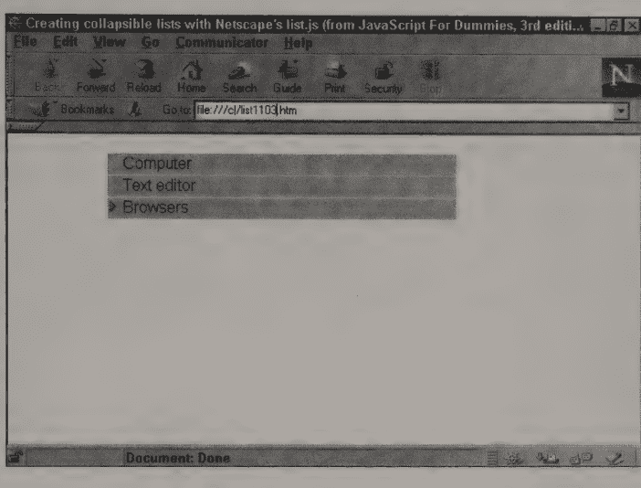

图 11-6：在顶层列表中使用箭头表示有更多信息。

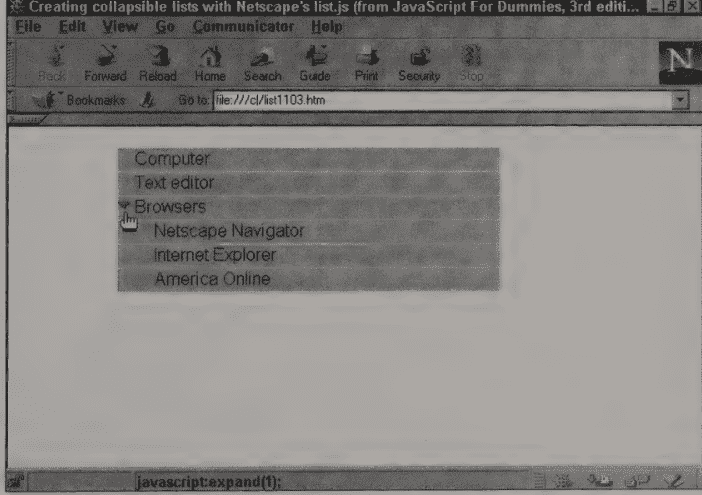

图 11-7：展开列表并切换上下箭头。

### 第四部分：自动化你的网站

Rich Tennant 著，《第五波》


> “我无法在我的个人电脑上让这个‘工作技能’程序运行，于是我更换了主板，升级了 BIOS，并写了一个程序将其连接到我的个人数据对冲中。它告诉我我没有技术天赋，应该去从事销售工作。”

### 在这一部分中……

第四部分充满了你可以利用的信息，可以让 Web 页面变得酷炫到让你自己都感到惊讶！在这里，你将看到如何使用动态 HTML（即最新的 JavaScript 技术）创建看起来很复杂的页面布局。你还将发现一些鲜为人知的技巧，例如如何跟踪用户在你的网页上的停留时间、如何为页面设置密码，以及如何创建动态效果（如内容的自动滚动和数字钟）。你也将了解到如何将 Java applet、Netscape 插件和 ActiveX 组件嵌入到你的网页中——并使用 JavaScript 语句操作你嵌入的组件。

### 第 12 章：DHTML 动力！

#### 本章内容

- 熟悉动态 HTML (DHTML)
- 操作图像和数组
- 创建简单的动画和幻灯片

动态 HTML 或 DHTML 指用于创建动态 Web 网页的客户端语言和标准集合，这些网页在加载到用户的 Web 浏览器后会发生变化。

构成 DHTML 的语言和标准包括：

- HTML（当然了！）
- JavaScript
- 层叠样式表 (CSS)
- 文档对象模型 (DOM)

由于这是一本关于 JavaScript 的书，我在本章中的重点是 JavaScript 和文档对象模型，以及它们如何结合起来构建 DHTML——简而言之，你可以如何使用 JavaScript 访问并操作 DOM 创建酷的动态效果，包括幻灯片和简单的动画。

虽然本章中的示例包含了 HTML 和层叠样式表代码，但我没有花费大量时间深入描述这两种语言。如果你对了解更多关于 DHTML（包括 HTML 和层叠样式表）感兴趣，可能会查看一本专门介绍这些主题的好书。值得查看的一本是 Michael Hyman 写的《Dynamic HTML For Dummies, Second Edition》（IDG Books Worldwide, Inc.）。

第 3 章描述了文档对象模型并展示了如何访问它；附录 C 介绍 Internet Explorer 和 Netscape Navigator 的文档对象模型。


### 动画特效

通常，当你在网页上看到酷炫的动画时，你看到的是以下内容之一：

- **Java applet**：Java applet 是用 Java 语言编写的小型软件应用程序，当你加载页面时，浏览器会从 Web 服务器将其下载到你的机器上。
- **插件 (plug-in)**：插件是一种你可以下载的特殊软件，它可以“插入”你的浏览器，并允许执行程序在网页内部运行。Flash 是一种流行的动画插件（来自 Macromedia 的优秀同仁们）。
- **动态 GIF**：GIF 代表图形交换格式，它描述了一种压缩图像文件的特殊方法。普通 GIF 文件用于在 Web 上传输图像。动态 GIF 是一堆组合在一起的普通 GIF——非常像你小时候可能拥有过的翻页书，每一页都有一幅画。当你翻动翻页书页（或加载动态 GIF）时，这些独立的图像就会从一张流到另一张，从而创建动画效果。动态 GIF 是 Web 动画的流行选择，因为大多数浏览器都支持它们，不需要单独下载。

### 幻灯片

有时你想使用 JavaScript 设置一个幻灯片：让用户点击按钮查看不同的图像或“滑动切换”，而不一定跳转到另一个 Web 页面。

图 12-3 至 12-5 显示了点击按钮将图像从一个视图变为另一个视图的过程。

### 第 12 章：DHTML 动力十足！

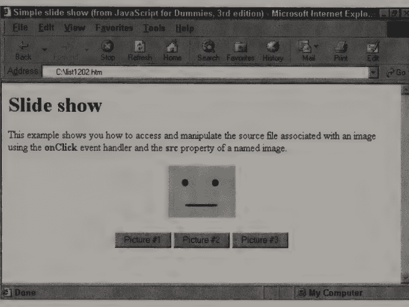

图 12-3：页面加载后，默认显示一个中性脸。

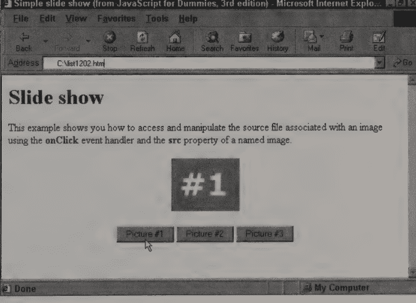

图 12-4：点击图片 #1 自动显示 #1 图像。

### 幻灯片

此示例演示了如何使用 `onClick` 事件处理器和命名图像的 `src` 属性来访问并操作与图像关联的源文件。

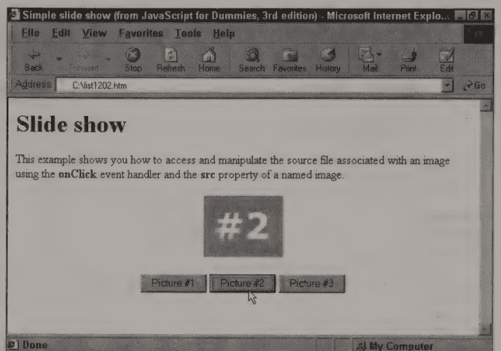

图 12-5：持续点击按钮以循环图像。

创建简单幻灯片示例所需的 JavaScript 代码出现在列表 12-2 中。

列表 12-2 中的代码位于配套 CD 的 `list1202.htm` 中。

### 列表 12-2：创建用户激活的幻灯片

```javascript
//// 此 swap() 函数根据
// 输入参数构造文件名，然后将
// 幻灯片图像源设置为
// 该文件名。
//
// 注意：初始图像决定了
// 幻灯片“帧”的大小。切换到
// 较大的图像会导致该图像
// 被压缩以适应初始图像“帧”。
function swap(newImage) {
```

```javascript
var fileName = newImage.toString() + ".gif"
document.all.slideshow.src = fileName

// 停止隐藏 -->
</SCRIPT>
</HEAD>

<BODY>
<h1>幻灯片</h1>
此示例向你展示了如何使用
<B>onClick</B> 事件处理器和命名图像的
<B>src</B> 属性来访问并操作
与图像关联的源文件。
...

<!-- 此处指定要显示的初始图像（脸） -->


<P>
<!-- 这三个 onclick 事件处理器调用 swap()
// 函数来显示用户选择的图像 -->

<INPUT TYPE="button" VALUE="Picture #1" onclick="swap('1')">
<INPUT TYPE="button" VALUE="Picture #2" onclick="swap('2')">
<INPUT TYPE="button" VALUE="Picture #3" onclick="swap('3')">
```

查看代码底部的 `` 标签。该 `` 标签定义了该内容的占位符。当用户点击任何按钮（1、2 或 3）时，`` 事件处理器就会启动并调用 `swap()` 函数：

```javascript
var fileName = newImage.toString() + ".gif"
document.all.slideshow.src = fileName
```

第一行创建一个变量 `fileName` 并给其赋值一个字符串。第二行将 `fileName` 赋值给...（此处原文为重复字符，已按要求处理）。

（如果你觉得上一行代码有点深奥，别担心！我将在下一节中进一步讨论样式对象，你可以在第 3 章中了解更多关于文档对象模型（DOM）的知识——包括如何像上面所示使用点符号进行导航。）

### 你真的非常有型！

级联样式表（Cascading Style Sheets）允许 Web 开发人员将信息的呈现方式（粗体、下划线、红色、绿色、居中等）与信息本身分离来。由于你使用级联样式表定义的显示属性变成了浏览器文档对象模型的一部分，你可以使用 JavaScript 动态地操作这些属性。列表 12-4 展示了如何实现这一点！

#### 列表 12-4：操作级联样式表属性

```javascript
<SCRIPT LANGUAGE="JavaScript">
function changeColor(newColor) {
  // 通过引用 UPTR ID 选择器更改文本颜色
  document.all.UPTR.style.color = newColor
}
</SCRIPT>

// 定义级联样式表
<STYLE TYPE="text/css">
/* ============
定义一个名为 UPTR 的 ID 选择器，使关联
文本居中并以全大写形式显示。
================= */

// 定义 UPTR ID 选择器
#UPTR {
  color: red;
  text-align: center;
  text-transform: uppercase;
}
```

##### 列表 12-4（继续）

```html
<STYLE>
</HEAD>
<BODY>
<h1>动态更改 CSS 属性</h1>
<P ID="UPCTR">
默认情况下，此段落显示为红色、居中且全大写，因为它关联了一个特殊定义的 ID 选择器（称为 UPCTR）。<BR>
</P>
点击按钮会更改与 UPCTR ID 选择器关联的颜色属性的值。
<INPUT TYPE="button" VALUE="更改文本颜色：绿色" onclick="changeColor('green')">
<INPUT TYPE="button" VALUE="更改文本颜色：红色" onclick="changeColor('red')">
```

在这个示例中，你在 Web 页面上显示的文本会根据用户点击“更改文本颜色：绿色”还是“更改文本颜色：红色”按钮，从绿色变为红色。

你在列表 12-4 中看到的大部分代码都是 HTML 和级联样式表声明。你想查看的 JavaScript 代码是 `changeColor()` 函数：

```javascript
document.all.UPCTR.style.color = newColor
```

这行 JavaScript 通过将一个新颜色（用户选择并通过 onClick 事件处理器传递给 `changeColor()` 的颜色）赋值给文本元素的颜色属性，更改了显示文本的颜色。

### 第 13 章：时间就是一切

#### 本章内容

- 熟悉 JavaScript 的内置时间方法和函数
- 调度函数在稍后执行
- 创建计时器来记录用户活动的时间
- 自动和按需刷新 Web 内容

你的 Web 页面越复杂，就越可能需要 JavaScript 的内置时间函数和方法。这些函数和方法允许你调度常见任务进行自动执行。例如，你可以自动刷新 Web 页面内容，或者在预定的一段时间后显示提醒。

你还可以使用 JavaScript 的内置时间函数和方法来跟踪用户在你的页面上不同活动上花费的时间——对于想要了解人们如何使用网站的 Web 开发人员来说，这是一个非常有用的功能。

#### 准备好了，开始！在 JavaScript 中跟踪时间

除了用于计算当前日期和时间的 `Date()` 函数外，JavaScript 还提供了几个与 `Window` 对象关联的时间相关方法。查看表 13-1 以获取这些方法的概述。

##### 表 13-1 内置时间相关 Window 方法

| 名称 | 描述 |
| :--- | :--- |
| `setInterval(code, interval)` | 每隔间隔执行一次代码（间隔必须为毫秒）；返回一个 id |
| `clearInterval(id)` | 停止执行用 `setInterval()` 调度的代码 |
| `setTimeout(code, interval)` | 在超时后执行代码（间隔必须为毫秒）；返回一个 id |
| `clearTimeout(id)` | 停止执行用 `setTimeout()` 调度的代码 |

你将在接下来的章节中看到这些方法的实际用法，以及 `Date()` 函数。

#### 计时器脚本

记录两个 JavaScript 事件之间经过的时间——例如，在文档加载（load 事件）和用户点击按钮（click 事件）之间的时间是很容易的！正如你在列表 13-1 中所示，你只需要遵循以下步骤：

##### 为什么要跟踪用户在你的 Web 页面上花费的时间？

当然是为了衡量你页面的有效性！一些示例包括：

- 确定平均用户在点击“立即购买！”按钮之前阅读产品描述需要多长时间
- 确定平均用户在输入反馈意见上花费了多少时间
- 确定平均用户在选择订阅（或选择不订阅）之前阅读邮件描述的多少时间

为了分析你使用 JavaScript 收集的时间数据，你需要将详情发送到 Web 服务器（通过隐藏输入字段或其他机制），这样你就可以一次合并并检查大量用户的统计数据。

1. 在 `onLoad` 事件处理器中调用内置的 `Date()` 函数，记录文档加载的精确时间。
2. 在 `onClick` 事件处理器中再次调用 `Date()`，记录用户点击按钮的精确时间。
3. 计算两个时间之间的差。

##### 列表 13-1：记录事件之间的时间

```html
<HTML>
<HEAD>
// 变量全局声明
// （在任何函数外部）
var startTime;
var stopTime;
<SCRIPT LANGUAGE="JavaScript">
// #1: 调用 startTimer() 开始计时
function startTimer() {
  // 记录开始时间
  startTime = new Date();
}

// #2: 当用户点击按钮时，执行 stopTimer()
function stopTimer() {
  // 记录停止时间
  stopTime = new Date();
  // #3: 计算这些时间之间的差
  // 并在弹出框中显示它
  var elapsedTime = stopTime - startTime;
  alert("你在此页面花费了 " + (elapsedTime/1000) + " 秒.")
}
</SCRIPT>
<TITLE>记录事件之间的时间</TITLE>
</HEAD>
<BODY>
<h1>JavaScript 中的计时操作</h1>
此脚本跟踪你点击下方按钮的时间（计时在页面加载时开始）。
<p>将 elapsedTime 变量传回 Web 服务器（例如通过隐藏字段），允许你处理并绘制访问者在网站上花费的时间图。</p>
<form>
<input type="button" value="点击此处停止计时" onclick="stopTimer()">
</form>
</BODY>
</HTML>
```

**图 13-1:** 点击按钮停止计时并显示经过的时间。

#### 暂停即刷新（指的是内容刷新！）

有时你会发现每隔一段时间自动刷新 Web 内容很有用。例如，如果你在网站上销售的小部件价格波动很大，你可能希望经常刷新这些价格，以确保你的用户拥有尽可能最新的购买信息。

你在列表 13-2 中看到的 JavaScript 代码使用与 `Window` 对象关联的 `setInterval()` 方法每十秒刷新一次内容。

`setInterval()` 方法与你在列表 13-3 中演示的 `setTimeout()` 方法相似，有一个区别。这些片段说明：

`setTimeout()` 等待指定的时间，然后只调用一次指定的代码。

```javascript
// someFunction() 在一
// 分（60000 毫秒）后调用
var timerId = setTimeout("someFunction()", 60000);
```

`setInterval()` 会在你指定的每个间隔后反复调用你指定的代码。

```javascript
// otherFunction() 每隔 10
// 秒（10,000 毫秒）被调用一次
var timerId = setInterval("otherFunction", 10000);
```

请查看列表 13-2 以了解 `setInterval()` 的实际用法。

##### 列表 13-2：使用 Window 对象的 setInterval() 方法刷新内容


```html
<HEAD><TITLE>自动刷新内容（节选《JavaScript 快速教程》，第3版）</TITLE><SCRIPT LANGUAGE="JavaScript">
// 此全局变量由下面定义的两个函数共享。

// 声明一个名为 timerId 的全局变量
var timerId
</SCRIPT>

// 页面一加载完成，setInterval() 就会安排页面
// 每 10 秒重加载一次。它通过调用此窗口 location 对象的
// reload() 方法来实现。（location 对象）
// 代表此页面的 URL。）
<BODY onload="timerId = setInterval('self.location.reload()', 10000);">
<h1>正在自动刷新内容！</h1>
本页面将每十秒自动刷新一次（就好像你点击了按钮栏上的**刷新按钮**一样）。
<P>
如需停止刷新，请点击下方的链接。
</P>
<P>
当用户点击“停止”按钮时，clearInterval() 会清除间隔（并停止再次调用 reload() 方法）
<A HREF="javascript:clearInterval(timerId)">停止自动刷新</A>
</FORM>
</BODY>
</HTML>
```

### 第 13 章：时机决定了一切

`setInterval()` 期望接收两个变量：你想要执行的代码，以及你希望 JavaScript 解释器在执行该代码之前等待的毫秒数。在这种情况下，`reload()` 方法每隔 10,000 毫秒（即每 10 秒）执行一次。

此外，如你在上面的代码所示，`javascript:clearInterval(timerId)` 的值被赋值给 `<A>` 标签的 `HREF` 属性。该值使用 `javascript:` 协议从 `<HTML>` 标签内部调用 `clearInterval()` 函数。

如果你仔细观察列表 13-2，你会看到 `setInterval()` 和 `clearInterval()` 在被调用。

`setInterval()` 被赋值给 `onload` 事件处理程序，因此它在文档加载到浏览器时就会立即执行。`setInterval()` 告诉 JavaScript 解释器每隔 10 秒执行一次与 `location` 对象关联的 `reload()` 方法，一直到永远。`setInterval()` 返回一个唯一的标识符（如果你非要知道的话，它是基于当前日期和时间的！），该标识符存储在全局声明的 `timerId` 变量中。你需要保留这个标识符以便清除（并停止 `reload()` 方法的自动执行）。

`clearInterval()` 在用户点击“停止自动刷新”链接时立即执行。因为向 `clearInterval` 传递了 `timerId`，它知道要清除由 `setInterval()` 调用建立的唯一间隔。

你可以使用 `setInterval()` 和 `clearInterval()` 来自动刷新你喜欢的任何方法或函数；你并不限于刷新 Web 页面内容。


#### 我从不喜欢的 META 技巧

你在列表 13-2 中使用的方法只是刷新 Web 内容的一种方式。另一种方法是通过 HTML `<META>` 标签，如下所示。（下面的代码即使在用户在浏览器中关闭了 JavaScript 的情况下也有效，这与列表 13-2 不同。选择哪种方法取决于你！）

```html
<HEAD>
<!-- 每隔 10 秒刷新一次内容 -->
<META http-equiv="refresh" content="10">
</HEAD>
```

#### 按需刷新内容

按需刷新内容更加简单；事实上，从技术上讲，你可以允许用户使用简单的 HTML 链接刷新内容——完全不需要使用 JavaScript！

列表 13-3 中的代码向你展示了两种方法：使用简单的 HTML 链接，以及使用 `setTimeout()` 调用 `reload()` 方法。图 13-2 显示了列表 13-3 中的代码在加载到 Navigator（浏览器）时的样子。

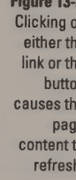

##### 列表 13-3：使用 setTimeout() 刷新内容

```html
<HTML>
<HEAD>
<TITLE>按需刷新内容（节选《JavaScript 快速教程》，第3版）</TITLE>
</HEAD>
<BODY>
<h1>按需刷新内容</h1>
本页面将每十秒自动刷新一次（就好像你点击了按钮栏上的**刷新按钮**一样）。
<P>
如需停止刷新，请点击下方的链接。
</P>
<P>
当用户点击“停止”按钮时，clearInterval() 会清除间隔（并停止再次调用 reload() 方法）
<A HREF="javascript:clearInterval(timerId)">停止自动刷新</A>
</P>
<input type="button" value="立即刷新" onclick="setTimeout('self.location.reload()', 10000)">
</BODY>
</HTML>
```

（注：列表 13-3 的 OCR 文本跨越了页面；上面的结构是根据提供的 OCR 段重建的。）

##### 列表 13-4：使用 setTimeout() 停止刷新！

```javascript
// 安排在 2 分钟后执行 someFunction()
var timerId = setTimeout("someFunction()", 120000);
```

```javascript
// 取消超时以便 someFunction() 不被调用
clearTimeout(timerId)
```


### 第 14 章：JavaScript 技巧

#### 本章内容

- 显示网站更新信息
- 启动 Java 程序
- 为站点设置密码保护
- 创建窗口
- 检测浏览器插件
- 自动滚动文本
- 让用户自定义查看页面的方式

你无法使用 JavaScript 访问用户的硬盘（除非通过浏览器的安全的 cookie 机制，你在第 6 章会学到）。你还无法使用 JavaScript 将信息传回 Web 服务器（如果你需要将信息传回 Web 服务器，可以设置 HTML 表单；当用户提交表单时，表单数据将上传到 Web 服务器进行检查和处理。）

将表单数据传输到 Web 服务器的传输是 HTML 的职责，而不是 JavaScript。有关表单提交过程的详细信息，请参考良好的 HTML 书，如《HTML 快速教程》。

除此之外，你可以用 JavaScript 做任何事情。特别是现在：随着每个新版本的发布，JavaScript 语言以及与其交互的文档对象模型变得越来越复杂。在本章中，你将看到 JavaScript 创建的一些酷炫实用的效果。从与 Java 程序交互到为你的网站设置密码保护，本章包含了每个人的内容——无论你是为了兴趣还是利润创建 Web 页面。你可以在自己的开发工作中直接使用这些示例，或者让它们启发你创建自己的震撼 JavaScript 效果！

#### 设置日期保持新鲜度

网络空间的人们被宠坏了：他们期望访问的网页能提供新鲜内容。（“新鲜”通常意味着每天更新！）

要让访问者知道你的网站有多新，最简单的方法是在你的内容末尾添加一条“网站最后更新时间”的消息。

你用来创建网站的许多工具都会自动在你的网页上添加此类消息。如果你的工具没有此功能（或者你想显示当前日期，以营造内容是新的错觉），你只需要插入几行 JavaScript 代码，类似于我在列表 14-1 中向你展示的那些。

不过，在添加此代码之前，请看图 14-1，它向你展示了列表 14-1 中的 JavaScript 代码在 Internet Explorer 中的外观。


##### 列表 14-1：添加新鲜日期

```javascript
<SCRIPT LANGUAGE="JavaScript">
<!-- 对不支持 JavaScript 的浏览器隐藏
// 此示例使用当前日期为网站“标记日期”
// 获取当前日期
today = new Date();

// 获取当前月份
month = today.getMonth();

// 为月份数字附加一个显示名称
// switch 语句为 getMonth() 返回的
// 通用格式月份分配月份
switch (month) {
case 0:
    displayMonth = "January"
    break;
case 1:
    displayMonth = "February"
    break;
case 2:
    displayMonth = "March"
    break;
case 3:
    displayMonth = "April"
    break;
case 4:
    displayMonth = "May"
    break;
case 5:
    displayMonth = "June"
    break;
case 6:
  displayMonth = "July"
  break;
case 7:
  displayMonth = "August"
  break;
case 8:
  displayMonth = "September"
  break;
case 9:
  displayMonth = "October"
  break;
case 10:
  displayMonth = "November"
  break;
case 11:
  displayMonth = "December"
  break;
default:
  displayMonth = "INVALID"
}
```

```javascript
// 要硬编码网站最后更新的
// 日期，只需将你想使用的日期字符串
// 传递给 writeln()，如下所示：
// document.write("Site last updated: May 20, 2000")
// 在网页上显示日期
document.write("Site last updated: " \
  + displayMonth
  + " " \
  + today.getDate()
  + " " \
  + today.getFullYear());
```

列表 14-1 中的脚本在网页上显示当前日期，正如你在图 14-1 中看到的那样。（如果你确实每天更新网站，这种方法非常方便。）

要显示特定日期，你只需将日期字符串传递给脚本底部的 `writeln()` 方法即可。例如：

```javascript
document.writeln("Site last updated Monday, August 28, 2000")
```

##### 新鲜度日期标记

- 图 14-1：为网页标记日期提醒访问者他们有新内容可以分享。

一些 Web 设计工具提供了自动显示你网站文件更改日期的方法。在这个示例中，你使用了当前日期；你也可以硬编码它。无论哪种方式，你都使用 `write()` 方法在屏幕上显示信息。

#### 优秀的 Applet

Java applets 是用 Java 编程语言编写的程序，可以嵌入到你的网页中。在运行时，Java applets 从 Web 服务器流到用户的浏览器，并直接在浏览器的 Java 执行环境中执行。

支持 Java 的浏览器（如 Internet Explorer 和 Netscape Navigator）自带一个完整的 Java 执行环境，通常称为 Java 虚拟机，简称 JVM。

你使用 HTML 标签在网页中嵌入 applet —— 使用 `<APPLET>` 或 `<OBJECT>` 标签。但在你将它们嵌入页面后，你可以使用 JavaScript 与它们交互——例如，调用它们定义的方法或访问它们暴露的属性。列表 14-2 向你展示了如何操作。


##### 列表 14-2：使用 JavaScript 调用 Java Applet 方法

```html
<BODY>
<html>
此 Java applet 可以从 JavaScript 免费获取。
欲了解更多信息，请访问
http://www.javascript.com/openstudio/index.html
```

##### 与 applets 交互

一旦 applet 嵌入网页中，你就可以调用为该 applet 定义的任何方法。按照惯例，applets 支持 `start()` 和 `stop()` 方法；大多数也支持其他方法。

```html
<BR>
<P>//将 Java applet 嵌入网页中。浏览器在 "classes" 子目录中寻找 JavaClock.class 代码
<APPLET CODEBASE="classes" CODE="JavaClock.class" WIDTH="150" HEIGHT="150">
<PARAM NAME="bgcolor" VALUE="#FFFFFF">
<PARAM NAME="border" VALUE="5">
<PARAM NAME="color" VALUE="#dddddd">
<PARAM NAME="font" VALUE="Times Roman|BOLD|18">
<PARAM NAME="delay" VALUE="100">
<PARAM NAME="color" VALUE="#000FF">
<PARAM NAME="link" VALUE="http://java.sun.com/">
<PARAM NAME="hcolor" VALUE="#00FF00">
<PARAM NAME="ncolor" VALUE="#000000">
<PARAM NAME="radius" VALUE="80">
<PARAM NAME="shcolor" VALUE="#FF0000">
</APPLET>
<P>
<FORM>
//调用 applet 的 stop() 方法，停止时钟
<INPUT TYPE="button" VALUE="Stop the clock"
onclick="document.applets[0].stop()">

//调用 applet 的 start() 方法，重启时钟“滴答”运行
<INPUT TYPE="button" VALUE="Start the clock"
onclick="document.applets[0].start()">
</FORM>
</BODY>
```

图 14-2 展示了列表 14-2 中的代码是如何运作的。简而言之，applet 定义了两个方法：`stop()` 和 `start()`。从 JavaScript 调用这些方法——在本例中，通过点击事件触发——如下：

```javascript
onclick="document.applets[0].stop()"
```

```javascript
onclick="document.applets[0].start()"
```

（注：此处原文文本在图 14-2 之后出现了部分乱码或重复，已根据上下文逻辑进行了清理处理，确保翻译文意准确。）

（注：由于原文最后一段存在明显的文本错乱和重复（如 "applets[0]" 等占位符的异常堆砌），翻译时已根据技术逻辑进行了修正，以保持技术文档的可读性。）

##### 列表 14-3（续）

```html
</SCRIPT>
</HEAD>
// 当用户尝试加载页面时，
// getPassword() 函数会立即被调用
<BODY onLoad="getPassword()">
</BODY>
</HTML>
```

执行列表 14-3 中的代码将弹出你在图 14-3 中所示的显示界面。你在图 14-3 中看到的输入字段已通过传递给 `prompt()` 方法的参数预加载了一堆 `x`，你可以在列表 14-3 中看到这些参数。为了输入密码值，用户可以删除这些 `x` 或直接在它们上方打字。

图 14-3：用户输入有效密码以查看受限制的页面。


如果用户输入了有效密码（在此情况下，密码是 `secret`），该用户就能看到受密码限制的页面，例如图 14-4 所示页面。

正如你在图 14-3 中看到的，在这个示例中，正确的密码 `secret` —— 出现在 `prompt` 的文本中。我这样做是为了，如果你在尝试列表 14-3 中的代码时不小心丢失了在书中的位置，你将知道正确密码是什么，以便你可以运行该示例！当然，在现实生活中，你不会以这种方式显示正确密码。

相反，如果用户输入了错误的密码，就会出现另一个（带有错误的）Web 页面——如图 14-5 所示的页面。

### 第 14 章：JavaScript 技巧


图 14-4：你的代码显示了受限制访问的 Web 页面。


图 14-5：你的 JavaScript 监视器显示了一个带有错误信息的 Web 页面。

#### 安全防护毯

HTML 表单可以包含一个名为密码（password）要素的输入元素。你可以像这样创建一个密码元素：

```html
<FORM>
  <INPUT TYPE="password" ...>
</FORM>
```

同样，我在本章向你展示的示例适用于某些应用，但不适用于那些需要严格安全措施的应用（JavaScript 无法加密密码信息）。

如果你需要真实的、健壮的安全措施，你需要绕过 JavaScript 平庸的安全性，而采用此类解决方案：

- 在密码从客户端传输到服务器时对其加密
- 允许你批准或拒绝对 Web 服务器的访问（在向浏览器发送受保护信息之前）

密码元素 ——就像我在本章中演示的密码保护示例一样 —— 代表了在网站上实现安全的一种快速且简单的方法。然而，另一种方法是无懈可击的。例如，虽然密码元素在输入时不会显示在屏幕上，但它在发送到 Web 服务器时并没有被加密。


技术上，你在这里看到的方法被认为是一种相对不安全的解决方案。为什么？因为包含秘密密码的代码以文本格式存储在 HTML 文件中（正如你在列表 14-3 中所示），并下载到浏览器中。虽然普通冲浪者看不到秘密密码，但不法手段的黑客可以。尽管如此，这种方法对于限制非生命威胁性秘密信息的访问是快速、简单且有效的。（换句话说，如果你在这里看到的 JavaScript 密码保护方法是为了为一个大学聚会制作一个包含尴尬高中照片的网站，并限制校友的访问，那么它是可以的；但对于公司机密和财务数据等高度敏感信息是不合适的。）

#### 机会窗口

在 Web 设计领域，一种流行的流派是尽可能（当然，在合理范围内）让访客在发现你的网站后留在你的网站上。例如，为你的网站添加超链接——虽然很有用——可能会由于将你的访客引向他人的网站而适得其反。毕竟，谁知道你的访客是否（以及何时）回来？

解决这种局面的一种方法是让你页面的 HTML 链接在新窗口中打开下一个网站。访客可以从你的网站自由浏览到其他网站，而无需离开你的网站。这是一个双赢的局面！看看图 14-6 和 14-7 了解我的意思。

### 第 14 章：JavaScript 技巧

打开一个新窗口（来自《JavaScript For Dummies》第3版）……


#### 打开新窗口

你可以用 JavaScript 创建一个新的浏览器窗口，并可以：

- 使用 URL 自动加载窗口
- 动态地向窗口写入内容

图 14-6：主浏览器窗口提供了一个链接。在图 14-7 中，你看到创建一个新窗口来显示链接如何保持原始浏览器窗口完好。

打开一个新窗口（来自《JavaScript For Dummies》第3版）……


图 14-7：新窗口打开以显示链接内容，原始窗口保持不变。

（注：由于提供的原文文本似乎存在重复或截断，已根据上下文完成翻译对齐）

#### 检测已插入的内容

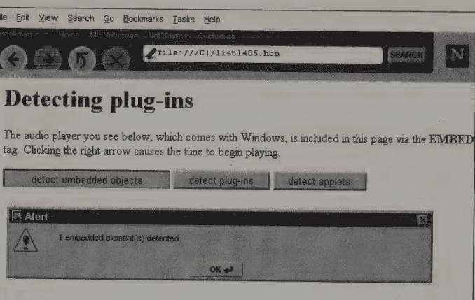

**图 14-8：** 在 Netscape Navigator 中检查嵌入式对象。

图 14-9 显示了点击“检测嵌入对象”（Detect Embedded Objects）按钮如何显示此文档中 `<EMBED>` 和 `<OBJECT>` 标签的总数。你可以点击 OK 循环查看每个按钮和消息。（点击“检测插件”（Detect Plug-Ins）将显示你在自己的机器上下载并安装的插件数量；点击“检测 Applet”（Detect Applets）将显示嵌入文档的 Java applet 数量——此处数量为 1，因为在列表 14-5 的代码中没有包含 `<APPLET>` 标签）

相同的代码 —— 列表 14-5 —— 在 Internet Explorer 中运行看起来略有不同，但功能相同。事实上，行为上的唯一区别在于，当你点击“检测插件”（Detect Plug-Ins）按钮时，检测到的插件数量始终为无，因为 Internet Explorer 不识别或实现插件。

现在来看列表 14-5。当你快速浏览代码时，注意不同类型嵌入内容的相似之处。在每情况下，你通过检查与内置数组关联的 `length` 属性（`navigator.plugins.length`、`document.embeds.length` 和 `document.applets.length`）分别检测插件、嵌入的对象和 applet。

### 第 14 章：JavaScript 技巧

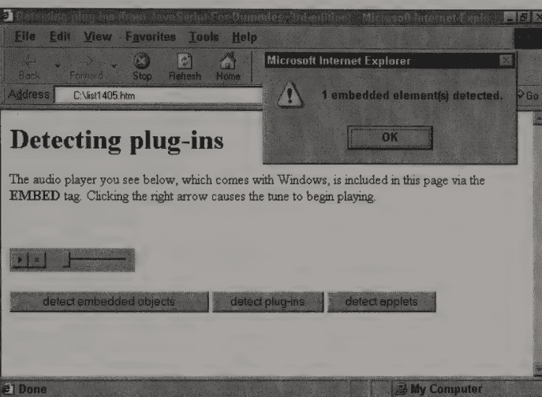

图 14-9：在 Internet Explorer 中检查嵌入对象。

#### 列表 14-5：检测已插入的内容

```javascript
<HTML><TITLE>检测插件（节自 JavaScript 入门教程，第 3 版）</TITLE>
<SCRIPT LANGUAGE="JavaScript">
///////////////////////////////////////////////////////
// detectPlugins() 函数检测
// Navigator 插件（软件“卡带”）
// 它们之前已下载并安装
// 在 Navigator 浏览器中。
// 注意：Navigator 6.0 尚未完全
// 实现嵌入内容。
///////////////////////////////////////////////////////
function detectPlugins() {
    if (navigator.plugins.length > 0) {
        alert(navigator.plugins.length + " plug-ins detected");
    }
    else {
        alert("未检测到插件。\n记住，IE 不支持插件。")
    }
}
```

（继续）

##### 列表 14-5（继续）

```javascript
// 检测 Navigator 插件的另一种方法
// 是检查 mimeTypes[] 数组，如下所示：
// if (navigator.mimeTypes["application/pdf"] != null) ...
// 你也可以这样查询特定的插件
// 如下：
// if (navigator.plugins["Shockwave"] != null) ...
```

```javascript
///////////////////////////////////////
// detectEmbeds() 函数检测
// 通过 EMBED 或 OBJECT 标签
// 嵌入 Web 页面的内容。
//
// document.embeds 数组的长度
// 代表嵌入 Web 页面对象的数量。
```

```javascript
// 额外的 embeds[] 属性是否存在
// 取决于每个嵌入对象的实现。
///////////////////////////////////////
function detectEmbeds() {

    if (document.embeds.length > 0) {
        alert(document.embeds.length + " embedded element(s) detected.");

    // 因为这个嵌入对象为 SRC 属性定义了值，
// 如果你愿意，可以检查 src 属性，
// 如下所示：
//    document.embeds[].src

    } else {
        alert("未检测到嵌入元素。");
    }
}
```

```javascript
///////////////////////
// detectApplets() 函数检测
// 通过 APPLET 标签嵌入
// Web 页面的 applet。
//
// document.applets 数组的长度
// 代表嵌入 Web 页面的 applet 数量。
```

```javascript
// applets 属性是否存在
// 取决于每个 applet 实现。
///////////////////////
function detectApplets() {

  if (document.applets.length > 0) {
    alert(document.applets.length + " Java applets detected.");
  } else {
    alert("未检测到 Java applet.");
  }
}
```

```html
</SCRIPT>
</HEAD>
<BODY>
<h1>检测插件</h1>
<p>
<form>
<input type="button" value="嵌入对象" onclick="detectEmbeds()">
<input type="button" value="插件" onclick="detectPlugins()">
<input type="button" value="applet" onclick="detectApplets()">
</form>
</body>
</HTML>
```

#### 滚动

请记住，Navigator 不支持 `<MARQUEE>` 标签，但 Internet Explorer 支持。对于某些应用程序，滚动文本（水平或垂直）可以提供一种引人注目的变化。一种选择是使用 `<MARQUEE>` 标签。


要创建滚动效果，你遵循以下计划：

1. 使用与窗口关联的 `scrollTo()` 方法将屏幕滚动到指定位置。
2. 使用与窗口关联的 `setTimeout()` 和 `clearTimeout()` 方法反复调用 `scrollTo()`。

你在列表 14-6 中的示例在加载即刻就开始自动滚动。这给人的感觉就像用户正在缓慢向下移动滚动条。


#### 因人而异

通过 JavaScript，你可以为用户提供他们想要查看你的网站的机会。通过在 `onload` 事件处理程序中触发 `prompt()` 方法并使用用户的响应来构建 HTML 文档的 `<body>` 部分。列表 14-7 展示了一个简单的示例。

##### 列表 14-6：自动滚动页面内容

```javascript
<SCRIPT LANGUAGE="JavaScript">
var position = 0
/////////////////////////////////////

// 垂直滚动 1000 像素（这足够在
// 标准窗口中显示此页面的内容。）
//////////////////////////////////////
// scrollIt 函数
function scrollIt() {
  if (position != 1000) {
    position++;

// 因为在这种情况下只想垂直滚动，
// 我们继续向 scrollTo() 函数传递 0，
// 但每次调用 scrollTo() 时增加
// position 变量的值。这使得
// 滚动效果看起来非常平滑。
// 垂直滚动窗口
    window.scrollTo(0, position);
    clearTimeout(timer);
// 再次调用 scrollIt 函数
    var timer = setTimeout("scrollIt()", 25);
  }
}
```

```html
</SCRIPT>
</HEAD>
// 页面加载时立即调用 scrollIt() 函数
<BODY onLoad="scrollIt()">
```

##### 列表 14-7：动态自定义页面外观

```javascript
<SCRIPT LANGUAGE="JavaScript">
////////////////////////////////////
// 你可以使用 JavaScript 决定
```

```javascript
// 页面加载前的用户偏好
// - 然后使用这些
// 偏好来恰当的显示 Web 页面内容
///////////////////////////////////

// 询问用户的颜色偏好
var displayColor = prompt("你想要什么背景颜色？", "red")

// 默认文本颜色为黑色
var textColor = "black"

// 如果用户选择了黑色背景，将
// 文字更改为白色以便显示

if (displayColor == "black" || displayColor == "#000000" ||
displayColor == null) {
  textColor = "white"
}

// 显示页面内容
// BODY 标签和文档内容由以下代码生成
document.writeln("<BODY BGCOLOR=" + displayColor + " TEXT=" +
textColor + " >你选择了 " + displayColor + 
"</BODY>")

</SCRIPT>
```

图 14-10 显示了用户如何通过输入颜色名称来选择背景，该颜色将出现在下一页，如图 14-11 所示。

| 图 14-10：红色、黑色、黄色、蓝色... 选一个颜色，随你喜欢！ | Explorer 用户提示 脚本提示：你想要什么背景颜色？[确定] [取消] 黄色 | |

### 第 14 章：JavaScript 技巧

自定义页面显示（节自《JavaScript 入门》，第3版）- Microsoft Internet...

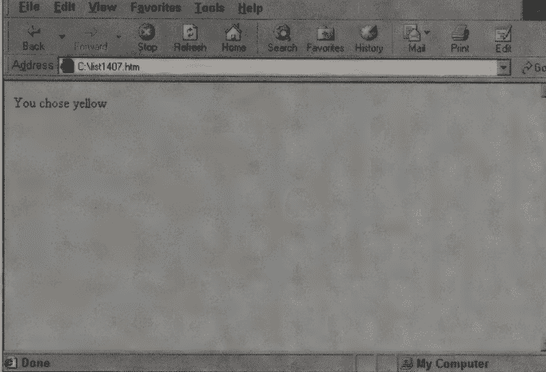

图 14-11：此用户选择了一个刺眼的黄色背景。

当你将脚本放在列表 14-7 中位于起始和结束的 HTML `<HEAD>...</HEAD>` 标签之间时，脚本语句会立即执行 — 在 Web 页面加载之前。`prompt()` 方法会提示用户输入他们喜欢的颜色；然后该颜色将用于构建和显示文档正文。（如果用户点击“取消”，将显示默认颜色方案，即黑色背景上的白色文字。）

#### 插入，左侧入场

理论上，将 JavaScript 收集的用户输入整合到 HTML 标签中的另一种方法（除了列表 14-7 中所示的方法外）是使用 `JavaScript` 实体。JavaScript 实体是一个左侧由与符号和左大括号包围，右侧由右大括号和分号包围的 JavaScript 语句，如下：

`&{...};`

JavaScript 实体允许你将 JavaScript 语句的结果赋值给 HTML 属性。这里有一个 JavaScript 实体的示例：

```html
<BODY
BGCOLOR="&{getBackgroundColor();}">
```

遗憾的是，虽然某些旧版本的 Internet Explorer 和 Netscape Navigator 支持 JavaScript 实体，但最新版本并不完全支持 JavaScript 实体。

### 第五部分：十之五篇

Rich Tennant 著《第五波》

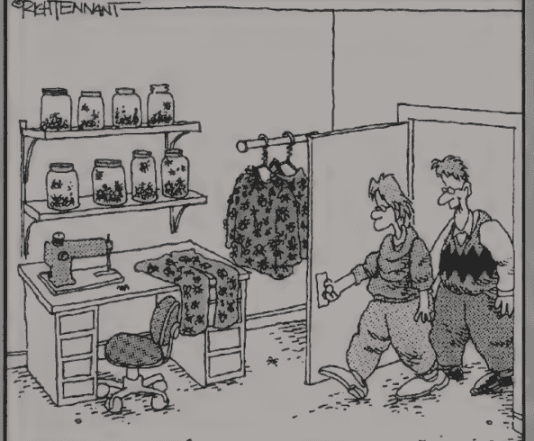

> “你是网络上‘昆虫服装俱乐部’的一员吗？真酷！你从哪里弄来那么小的按钮的？”

#### 在这一部分 ...

第五部分从列出一些优秀的 JavaScript 相关的 Web 网站开始，这些网站充满了关于 JavaScript 各方面的有用信息。如果你觉得有必要与真人讨论你的 JavaScript 脚本，第 15 章甚至为你提供了一些用户组的列表，让你能够这样做。

在这些在线资源之后，是一个章节，解释了你在实现 Web 页面时可能遇到的最常见错误（以及如何避免它们的提示）。最后，任何一本值回票价的编程书籍如果没有至少几种实用的调试技术，都是不完整的。第 17 章为你提供了许多与错误相关的提示，让调试 — 如果不是完全愉快 — 至少是完全可以忍受的！

### 第 15 章：十大（或大约）在线 JavaScript 资源

#### 本章内容

- 查找和使用 JavaScript 教程
- 阅读 JavaScript 常见问题 (FAQs)
- 在线寻找酷炫的 JavaScript 示例
- 利用重要的与 JavaScript 相关的新闻组

获取如何做某事的帮助比现在任何时候都更简单。为什么呢？当然是因为互联网！从根植于政府和大学机构开始，互联网一直是一个紧密的、主要以学术为主的社区，直到几年前。不可避免的是，商业主义抬头，并对所有事情都产生了巨大的影响 — 而且并不全是坏事。（例如，互联网的商业化直接导致了 Web 工具和语言的扩散。）

尽管营销和广告在互联网上已常见，但分享和智力协作的精神并没有消失。帮助他人（可能在此过程中顺便炫耀一下）是一种基本的快乐。而且因为访问互联网相对廉价且方便，每个人都在尽情分享 — 当你访问本章列出的 URL 和新闻组时。

#### 值得查看的十个 Web 网站

不再多说，直接进入正题：一份无法抗拒的优质 JavaScript 相关的 Web 资源列表。你可以在这里找到提示、教程、示例和最新的文档。Netscape 的 Developer Central 包含了大量入门 JavaScript 的信息，包括完整的语言参考、指南文章和示例代码。它还提供了一份已知错误列表（针对 Navigator 版本）。

```
http://developer.netscape.com/tech/javascript/
```

Microsoft 维护着一个致力于其语言的信息丰富的站点，文档、示例代码以及访问 JavaScript 相关的新闻组只是你在这里找到的一些极佳资源。

```
http://msdn.microsoft.com/
```

尽管用户组层出不穷，但以下资源已成为 JavaScript 相关开发的必经之地：

- 如果你只关注一个用户组，请关注这一个。该组人气非常高，是目前顶尖的 JavaScript 信息小组，适用于新手和高级脚本编写者：
  - `comp.lang.javascript`
  - (`it.comp.lang.javascript` 和 `de.comp.lang.javascript` 是高流量的意大利语和德语版本。)

- 在此处获取 HTML 问题的解答：
  - `comp.infosystems.www.authoring.html`

- 微软的公共脚本新闻组侧重于 JScript 技巧和问题：
  - `microsoft.public.scripting.javascript`

- JavaScript “冠军”们监控着 Netscape 的脚本新闻组。（此新闻组只能通过特殊的安全新闻服务器访问。有关如何访问此新闻组的简单说明，请访问 `http://developer.netscape.com/support/faqs/champions/javascript.html`）
  - `netscape-devs.javascript`

### 第五部分：十之数系列

### 第 16 章：十（左右）种常见的 JavaScript 错误（以及如何避免）

#### 本章内容

- 拼写错误
- 不匹配的组合
- 在 HTML 标签之间放置脚本语句
- 错误地嵌套引号
- 将数字视为字符串
- 将字符串视为数字
- 逻辑错误

每个 JavaScript 作者都会犯错。（实际上，我更喜欢反过来想——是 JavaScript 解释器由于没有弄明白我们对某些东西的意思而犯了错。没错！就是这样！）大多数时候，你犯的错误属于本章列出的类别之一。好消息是，这些错误都很容易修正。更好的消息是，当 JavaScript 遇到错误时，它会快速且明确地告诉你。

查看本书的配套 CD 以查看散落在本章中的示例列表。我根据列表命名了文件，以便你轻松找到。例如，你可以在文件 `list1601.htm` 中找到列表 16-1。

#### 匆匆忙输入导致的错误

拼写和大小写错误极易成为所有 JavaScript 编写者中最常见的错误，从最青涩的新手到最老练的老兵皆如此。

#### HTML 烦恼

由于 JavaScript 语句嵌入在 HTML 文件中，你可能会发现某些错误实际上是 HTML 错误。例如，以下是一个 HTML 错误（`TYE="button"` 应该是 `TYPE="button"`）：

```html
<INPUT TYPE="button" NAME="testButton" VALUE="test"
onclick='test()'>
```


在这种情况下，JavaScript 解释器不会显示错误信息，因为该错误与它无关。发生的情况是，你的按钮元素将无法正常显示。处理 HTML 错误时，如果发生这种情况（且你在本章中没有找到解决方案），请查看良好的 HTML 参考书，例如由 Ed Titel 和 Steve James 编写的《HTML 傻瓜》第3版（由 IDG Books Worldwide, Inc. 出版）。

如果你的页面行为不符合预期，且 JavaScript 没有向你报警，你可能是

JavaScript 解释器对正确的拼写非常严苛：除非你正确拼写名称，否则你无法访问对象、属性、方法、变量或函数。例如，以下代码会产生错误：

```javascript
var identification = "ABC"
alert("The id number is " + identificatin) // 错误：
变量拼写错误
```

JavaScript 解释器对大小写敏感，这意味着在对象、属性、方法、变量或函数名称中，不能用大写字母替换小写字母：

```javascript
alert("Broadcast network ID - " + identification.TOLOWERCASE()) // 错误：正确的方法名是 toLowerCase()
```

为了检测并修正这些错误：

- 在编写 JavaScript 代码时要意识到，拼写和大小写的一致性对于无 Bug 的语句至关重要
- 利用你的编辑器提供的任何拼写检查工具或点击式方法名插入工具

# 第 16 章：十（左右）种最常见的 JavaScript 错误

## 破坏一对完美的配对

JavaScript 脚本通常充满了成对的内容：起始和结束标签的对（归功于 HTML）、括号和大括号的对、单双双引号的对。JavaScript 解释器将成对之间的内容视为整体，因此如果配对中的一半缺失，解释器就会感到困惑——在某些情况下是极其困惑！

以下是一些你不希望在 JavaScript 中破坏的“完美配对”的特定示例。

### 孤独的角括号

查看以下代码，你会认为显示将包含两个文本元素：一个用于存储名字，另一个用于存储姓氏。但事实并非如此，因为缺少了一个结束角括号。

```html
<FORM NAME="myForm">
First name: <INPUT TYPE="text" NAME="firstName" LENGTH=15
// LENGTH=15 之后缺少一个角括号
Last name: <INPUT TYPE="text" NAME="lastName" LENGTH=30>
```

如果一个文本元素没有出现——没有错误信息，什么都没有，只是在元素应该出现的地方是空白——请立即怀疑紧邻不可见文本元素之前的行缺少角括号。

### 孤独的标签

你在列表 16-1 中看到的代码描绘了一个微型脚本，可能是启用 JavaScript 的 Web 页面的首次尝试。初看之下，你可能没有发现任何异常。但如果你加载这个脚本，你会发现绝对有问题！

- 列表 16-1：包含缺失标签的源码

```html
<HEAD>
<SCRIPT LANGUAGE="JavaScript">
function test() {
  var aString = "some text"
  alert("aString is " + aString)
}
```

（继续）

列表 16-1（继续）

```html
// 缺少了应该在这里的 </SCRIPT> 标签。
<HEAD>
<BODY>
<FORM NAME="myForm">
<INPUT TYPE="button" NAME="testButton" VALUE="test"
onclick="test()">
<P>
First name: <INPUT TYPE="text" NAME="firstName" LENGTH=15>
Last name: <INPUT TYPE="text" NAME="lastName" LENGTH=30>
</FORM>
</BODY>
</HTML>
```

上述代码中缺失 `</SCRIPT>` 标签会导致页面显示你预期的元素。

### 孤独的括号

当你仔细查看以下示例中 `test()` 的函数体时，可以很容易地发现缺失的括号。然而，随着你 JavaScript 技能的增长，你可能会发现许多对括号，它们通常嵌套了十几层——那时你最容易犯这种错误。

```javascript
function test() {
var aString = "some text"
alert("aString is " + aString
// 应该有一个括号结束上一个语句
}
```

除非你创建脚本的编辑器提供了自动配对检查实用，否则你需要肉眼检查代码来捕捉这个错误。

### 孤独的引号

仔细看下面的示例：

```html
<INPUT TYPE="button" NAME="testButton" VALUE="test"
onClick='test("hello")
```

这里的错误是 `hello` 之后没有出现结束的双引号。

不匹配的引号在 Internet Explorer 5.5 和 Netscape Navigator 6.0 中表现出来。在 Internet Explorer 中，前面的代码会生成一个未终止字符串常量（unterminated string constant）错误。在 Navigator 中，代码不会产生错误——它只是禁用了 `test` 的 `onClick` 处理程序。

以下是修正后语句的样式：

```html
<INPUT TYPE="button" NAME="testButton" VALUE="test"
OnClick='test("hello")'>
```

### 将脚本语句放在了错误的地方

当你是 JavaScript 新手时，记住这些顺序可能会有点困难。例如，JavaScript 语句只有在放在 `<SCRIPT>` 和 `</SCRIPT>` 标签之间，或者赋值给事件处理程序的值时才是有效的。如果你忘记并将它们放在其他地方，注定会得到意想不到的结果。

好消息是，一旦你加载页面并看一看，就会发现不对劲——因为你的源代码直接显示在页面上！查看列表 16-2 所示源码以理解我的意思。

#### 列表 16-2：包含错误放置脚本语句的源码

```javascript
<SCRIPT LANGUAGE="JavaScript">
function test(inputValue) {
  alert("Wow, I sure do love JavaScript! " 
"Here's what the public is saying about JavaScript: " 
+
inputValue)
}
</SCRIPT>
// addNumbers 函数被错误地定义在 </SCRIPT> 标签下方
function addNumbers(numberOne, numberTwo) {
  return numberOne + numberTwo
}
```

当你执行列表 16-2 中的代码时，你并没有看到 JavaScript 错误，但你确实在屏幕上看到了 `addNumbers()` 函数的文本。（你之所以没有看到 JavaScript 错误，是因为 JavaScript 解释器无法访问开始和结束 `<SCRIPT>` 标签之外的任何语句——*除非该语句是事件处理程序的值*）。

将 `</SCRIPT>` 标签移动到 `addNumbers()` 函数闭合大括号之后，可以修复此脚本，使 JavaScript 解释器将 `addNumbers()` 解释为 JavaScript 代码。

每当你看到你精心编写的 JavaScript 语句以鲜艳色彩出现在你的页面上时，你完全可以确定问题在于你的语句超出了 `<SCRIPT>...` 标签的范围。将这些语句移回它们所属的位置，它们就能正常工作了。

### 错误地嵌套引号

将单引号和双引号嵌套在一起（所示）是完全合法的：

```html
OnClick="alert('This is an example of nested quotes.')"
```

或者

```html
onClick='alert("This is another example of nested quotes.")'
```

只要确保你没有在双引号内嵌套双引号，或者在单引号内嵌套单引号，如下所示：

```html
onClick="("Oops! These incorrectly nested quotes generate a syntax error!")'
```

### 将数字视为字符串

人类倾向于对文本和数字之间的差异不加较——至少在大多数语境下如此。例如，当你写一个英语句子时，你不需要做任何特殊处理来包含数字。（即使你写了 333 个）。

尽管，对于大多数编程语言来说，数字和文本字符串是两个完全不同的东西，JavaScript 例外。在 JavaScript 中，尝试将数字视为字符串（如列表 16-3 所示）每次都会产生错误。

#### 列表 16-3：包含将数字视为字符串的语句的源码

```javascript
<SCRIPT LANGUAGE="JavaScript">
function testIt(inputValue) {
// 你在下一行看到的 bold() 方法与
// 字符串对象（而不是 Number 对象）相关
document.write(inputValue.bold())
document.close()
}
</SCRIPT>

<FORM NAME="myForm">
// 下面的 onclick 事件处理程序将数字 2
// 给 testIt() 函数
<INPUT TYPE="button" NAME="testButton" VALUE="test"
onclick="testIt(2)">
```

当数字 2 从未设置为处理数字的 `onclick` 事件处理程序定义传递时，问题就发生了。如果你查看 `testIt()` 函数，你可以看到它正在获取任何输入值（在这种情况下是数字 2），并尝试在其上调用字符串的 `bold()` 方法。而这是行不通的。你只能在字符串上调用字符串函数，而 2 并不是字符串！（如果你想了解更多关于字符串的信息，请参阅第 3 章。）

有时你可能想向函数发送一个数字，并让该函数将其作为字符串处理。在这些情况下，你只需要在函数中添加类似下面的代码行：

```javascript
function testIt(inputValue) {
// 设置一个临时字符串变量
var aString ="

// 将输入值放入临时
// 字符串变量
aString += inputValue

// 在 inputValue 的字符串版本上调用// bold() 方法
document.write(aString.bold())
}
```

现在，你可以向 `testIt()` 函数发送任何你想要的值，而 `testIt()` 将表现得很好！

### 将字符串视为数字

上一节展示了将数字视为字符串时会发生什么。正如你猜的那样，反过来——将字符串视为数字——也会在 JavaScript 中引起麻烦。让我通过列表 16-4 所示的代码段来解释。

#### 列表 16-4：包含将字符串视为数字的语句的源码

```javascript
function calculateTax(inputNumber) {
    return inputNumber * .50
}

<INPUT TYPE="button" NAME="calculateTaxButton"
      VALUE="Calculate"
      onclick="The tax is " + calculateTax('baked')">
```

当你点击 Calculate 按钮时，字符串传递给 `calculateTax()` 函数，在那里它立即被乘以 .50。现在，如果你能告诉我 `baked` 乘以 `.50` 的结果是什么，那你的数学水平就比我好多了。（好吧，也许是“半熟”的吧！）JavaScript 并不知道，所以它显示一个内置值 `NaN`，它代表“我不知道这到底是什么鬼，但我知道它不是数字（Not A Number）！”

再次，在 JavaScript 中就像在生活中一样，你几乎可以做任何事情——只要你知道如何这样做！如果你想创建一个期望数字但能优雅处理字符串的函数（在编程圈中，“优雅地”是一个委婉说法，意思是“不会在你脸上爆炸”），你只需要在函数的最顶端添加几行代码。列表 16-5 向你展示了这一点。

#### 列表 16-5：期望数字但处理字符串的函数源码

```javascript
function calculateTax(inputNumber) {
    // 如果 inputNumber 是字符串，myNumber 将为 false
    var myNumber = parseFloat(inputNumber)

    // 如果 inputNumber 确实是一个数字，
    // 执行必要的计算。
    if (myNumber) {
        return myNumber * .50
    }
    // 否则，显示错误
    else {
        alert("A non-numeric value was passed to a function
               that expected a number")
    }
}
```

逻辑错误是最难追踪的，因为它们不会产生特定类型的错误（例如，你永远看不到 JavaScript 消息）。JavaScript 解释器如何可能知道你想做什么？它无法读取你的代码、分析它，并与其他解释器协商以确定它是否完成了任务。你追踪逻辑错误的方法只有老办法：通过研究代码、显示变量的内容、进行修改并重新测试。

## 浏览器兼容性

JavaScript 的支持不仅在 Internet Explorer 和 Navigator 之间不同，在这些浏览器的版本之间也不同。如果脚本在一个浏览器中表现正常而在另一个浏览器中崩溃，你就遇到了著名的浏览器兼容性问题。这里有克服这一开发者噩梦三个建议：

1. 在“上线”之前始终在多个浏览器中测试你的脚本。在将启用 JavaScript 的页面发布到你的 Web 服务器之前（以此让全世界看到），确保你在尽可能多的浏览器中测试它们。尽管 America Online 具有很大的市场份额，但经常被 JavaScript 开发者忽略。你可以从 `http://free.aol` 下载此浏览器的免费版本。

与其下载安装多个浏览器，你可以利用在线服务（如 Net Mechanic）帮助你在该网站发现跨浏览器错误：

```
http://www.netmechanic.com/cabrands/zdnet/browsercheck/
```

2. 检查文档。了解哪些 JavaScript 语句被浏览器支持、哪些不支持唯一方法是查看该浏览器的技术文档。

* Netscape 的客户端 JavaScript 语言参考：`http://developer.netscape.com/docs/manuals/js/client/jsre/objintro.htm`

* Microsoft 的兼容 JavaScript 语言参考：`http://msdn.microsoft.com/scripting/javascript/default.htm`

3. 包含浏览器检测代码。第 4 章向你展示了如何创建一个脚本，它可以实时检测访问者的浏览器，并根据不同的浏览器能力出不同的行为。

# 第 17 章

## 调试脚本的十（或更多）技巧

**本章内容**

- 将代码与设计规范进行对比
- 使用警告（alerts）追踪 bug
- 从在线资源获取帮助
- 观察运行中的代码
- 拆分函数
- 将用户错误转换为有用信息

在第 16 章中，你看到了 JavaScript 作者倾向于犯的一些常见错误（或 bug）。本章将扩展这一主题，向你展示最快速、最直接的方法来定位并纠正你无意引入代码的任何 bug。许多语言的编译器和解释器都配备了调试工具；遗憾的是，JavaScript 目前还没有多少调试工具。这意味着目前你必须依靠自己的机智——以及本章提供的建议。

调试就像洗碗。虽然这两项家务都不好玩，但它们都是必要的，而且在完成后你总会感觉好许多！不过，调试不必是一项令人可畏的家务。你可能会发现，通过一点帮助（比如本章介绍的技巧）和一点经验，这项工作会变得越来越容易。

Microsoft 提供了一个免费的脚本调试器，你可以单独下载，也可以配合 Internet Explorer 使用，以逐步执行、检查和调试你的 JavaScript 脚本。更多信息，请访问此页面：

```
http://msdn.microsoft.com/scripting/default.htm?scripting/debugger/default.htm
```

Netscape 也提供了一个免费下载的脚本调试器。遗憾的是，你可能会发现如果你下载的是 Navigator 的测试版本，该调试工具将是不兼容的。关于兼容性以及最新完整版本的详情，请访问：

```
http://developer.netscape.com/software/tools/index.html
```

# JavaScript 读取的是你的代码，而不是你的大脑！

奇怪的是，成功扩展 bug 的第一步是确定你是否真的遇到了它！如果你的 JavaScript 脚本运行方式不符合你的预期，那么你正在处理一个 bug。或者，你的脚本可能正按照设计运行，而问题出在你对脚本*应该*如何运行的理解上。

在过去，程序员们创建流程图：一页又一页的小符号和线条，描述了他们希望程序在运行时表现的方式。流程图已不再流行——这并不是因为它们是一个坏主意，而是因为创建它们花费的时间几乎和编写程序本身一样多。

如今，大多数程序员发现，在设计过程中编写伪代码（pseudo-code）很有帮助。然后，在测试期间，这些程序员就有东西可以参考——可以说是一个试金石，有助于澄清潜在的 bug 是在他们的 JavaScript 代码中，还是在他们的编程逻辑中。

伪代码是 JavaScript 和程序员自然语言的简写组合。由于这个工具的设计旨在尽可能让程序员感到简单和自然，因此没有硬性规则来精确定义如何编写伪代码。

例如，假设你的目标是计算通过你的网站下达的国际订单的总价（包括销售税，如果有的话）。以下是你的伪代码可能采取的过程示例：

1. 当用户点击提交按钮时……
2. 如果是美国订单（根据 `myForm.state` 计算税率）并将其存入 `totalTax`
   否则（如果是非美国订单！）
3. 将订购的小部件数量（`myForm.numWidgets`）乘以价格（`myForm.price`）……

尽管编写伪代码对于帮助你理清网页的需求很有用，但在你完成网页的实现后，当涉及到追踪逻辑中的 bug 时，你会发现它是绝对不可或缺的。

## 第 17 章：调试脚本的十（或更多）技巧

### 不要把你的注释只留给自己

在编写 JavaScript 代码时养成编写注释的习惯，在需要调试代码时会有巨大的帮助。（令人惊讶的是，从你创建脚本到几周甚至几个月后代码出现异常这段时间内，你竟然会忘记多少内容！）

如果你创建了伪代码来帮助规划和设计脚本，请尝试将该伪代码作为 JavaScript 注释的基础。这样做有助于未来（或接手调试你脚本任务的其他人）精确地理解代码要实现什么。

### 隔离 Bug

如果你遇到了真正的 bug，你需要锁定它并精确确定是哪些代码行受了影响。这里是一些示例，可以帮助你从线索反向推导：

- 问题是在页面加载的瞬间发生的吗？如果是，问题可能与 HTML 有关，或者位于你设置的处理 `onLoad` 事件的代码中。
- 它是在用户在输入字段中输入文本时发生的吗？检查与该字段相关的 `onChange` 和 `onBlur` 事件处理器。
- 当用户点击按钮时，事情是否变得错乱？检查该按钮的 `onClick` 事件处理代码。
- 当用户关闭窗口时是否出了问题？罪魁祸首可能潜伏在你的 `onload` 事件处理语句中。

首先，决定一个开始搜索的地方——比如，从其中一个 `onClick` 事件处理器中调用的函数开始（我称之为 `buggyFunction()`）。下一步是再深挖一下。例如，尝试在你的 JavaScript 代码中添加一个按钮来执行同一个函数，如下所示：

```html
<INPUT TYPE="button" NAME="testButton" VALUE="Test" onclick="buggyFunction(12)">
```

在第一行中，你发送了数字和字符串。这个过程有助于你判断函数本身是否有 bug——还是问题出在变量上。

给故障函数传递一些数字字面量而不是变量。看看发生了什么。如果函数仍然失败，你就知道 bug 在你的函数中。（参见本章的“显示变量值”部分。）

设置一个特殊函数来测试你的代码是一个好主意，因为这样你就不会修改原始代码。在你发现并纠正错误之前，你的目标是尽可能少地更改源代码，以免在文件中引入新的 bug。

如果 `myFunction()` 过来调用了其他函数，请应用相同的策略。从附加到测试按钮的 `onClick` 事件处理器开始，依次调用其他每个函数，看看它们的执行是否符合预期。一步步来是追踪那些狡猾 bug 的唯一方法。

### 查阅文档

《客户端 JavaScript 指南》是目前关于 Netscape 实现的 JavaScript 语言的最新资源。在浏览器中书签该指南，可以确保在需要时它随手可得！

```
http://developer.netscape.com/docs/manuals/js/jsguide/contents.htm
```

你可能知道，Internet Explorer 通过 Microsoft 脚本语言 JavaScript 实现 JavaScript。查看以下 URL 以获取与 JavaScript 相关的完整描述：

```
http://msdn.microsoft.com/scripting/javascript/default.htm
```

### 显示变量值

一种实用的调试技术是在变量生命中的各个阶段显示它们的值。例如，假设你有一个函数其工作是计算订单的总费用。根据你对总费用计算方式的理解，你已经确定该函数总是返回一个错误的值；你只是不知道为什么。

#### 列表 17-1：使用 alert 显示语句追踪错误（Bug）

```javascript
var price=3.50
function calculatePrice(numberWidgets) {
  // 在函数开始处检查变量
  alert("Inside calculatePrice, numberWidgets is " + numberWidgets);
  var totalPrice = 0
  // 100 个或更少的订单不计算税
  if (numberWidgets >= 10) {
    // 测试 "if" 语句的编写是否正确
    alert("Apparently numberWidgets is 11 or higher");
    var tax = calculateTax(numberWidgets * price);
    totalPrice = tax + (numberWidgets * price);
  }
  else {
    alert("numberWidgets is 10 or less so no tax calculated");
    totalPrice = numberWidgets * price;
  }
  // 显示所有参与计算的数值
  alert("totalPrice is $" + totalPrice + " based on a per-item price of $" + price);
  return totalPrice;
}
```

列表 17-1 中的代码包含四个 `alert()` 调用。每个 `alert()` 会在 `calculatePrice()` 逻辑的不同点显示变量的值，如接下来的系列图片所示。第 1 个 alert 显示 `calculatePrice()` 函数开始时 `numberWidgets` 变量的值，如图 17-1 所示。第 2 个 alert（如图 17-2 所示）帮助你判断语句编写是否正确。第 3 个 alert 让你在代码的某一点检查多个值（见图 17-3）。

你的逻辑越是错综复杂，这种技术就越能帮助你定位错误。但无论你发现了什么答案，请记住一点：在追踪并修复脚本中的错误后，务必记得删除 `alert` 语句。忘记删除可能会非常尴尬！

我曾和一位程序员共事，他认为自己已经删除了所有的调试语句，但漏掉了一个。由于导致该调试语句出现的频率极低，他完全把这事儿忘了！直到那时，几十个人——包括该程序员的老板、老板的老板以及公司最重要的客户——都在一个会议上评估该应用程序。你猜对了：它弹出了那个调试语句！这种最不幸且最令人尴尬的情况，如果你使用文本编辑器中可用的搜索/替换功能搜索脚本中所有 `alert` 的出现处，是可以避免的。

### 将大块语句拆分为较小的函数

将你创建的函数的大小限制在一个屏幕的文本内是良好的设计实践。（不过，你不一定得听我的。偶尔调试一次复杂的、巨型无霸函数应该就能让你信服了！）

限制函数的大小可以带给你这些更轻松的优势：

- **增加你的代码复用能力。** 函数越小、越独立，你就越有可能在其他语言中复用该函数。例如，假设你写了一个名为 `isPhoneNumber()` 的大函数来判断输入值是否为有效手机号码。移除处理数字验证的语句并将这些语句组织成一个独立的、名为 `isNumber()` 的函数，你就得到了一个通用函数，你不仅可以从 `isPhoneNumber()` 调用它，还可以从任何需要数字验证的函数（如 `isValidCreditNumber()`、`isValidAge()` 等）调用它。
- **降低你的挫败感。** 小函数的调试比大函数容易得多，仅仅因为对于人类来说，脑中推演和理解小函数比理解那些巨大的对手容易得多。

大到无法在普通显示器上显示的函数，从复用的角度来看往往设计得很糟糕。也就是说，通常（我用“*通常*”是因为这只是一个通用规则）当一个函数变得很大时，它大是因为你正试图让它执行超过一个概念性任务。理想情况下，一个函数只是*一个*概念性任务的实现。

### 完善排除法

当你在追查错误时，有时弄清楚什么*不是*导致问题的与弄清楚什么*导致了问题同样重要。例如，如果你的 HTML 代码中有错误，无论如何搜索和测试你的 JavaScript 代码，对解决问题都没有帮助。

虽然我不能*确切*告诉你如何定位错误（如果我能的话！），但我可以告诉你，优秀的程序员在调试时会遵循一个通用的模式：

#### 1. 创建多个测试用例。

测试用例是描述用户可能如何交互的单一场景。例如，你的测试用例可能包括：

- 一个学生正在搜索信息
- 一个老师发布课程
- 一个对学校政策感兴趣的家长

#### 2. 对于每个测试用例，加载你的页面

准确记录显示了什么（或没有显示什么）。如果只显示了你定义的第一个元素，检查该行之后的源代码。如果第二个元素包含在一个标签对中（例如，在 `<body>` 和 `</body>` 标签之间），检查闭合标签的放置和拼写是否正确。

如果出现了不该出现的 JavaScript 语句，记下该语句中第一个单词。然后在 HTML 源文件中找到该单词，并检查其前的一行。

##### 症状

你的网页只显示了你认为应该显示的部分。相反，你的网页显示的内容比你预期的多。（例如，某些 JavaScript 语句显示在了屏幕上。）

##### 调试浏览器

除非你刚刚安装了新版本，否则不太有问题。如果仍然有问题，请尝试重新安装。

##### 检查 JavaScript 代码

作为一名 JavaScript 程序员，你大多数错误都会出现在——嗯，出现在你的 JavaScript 代码中。

##### 症状

任何在表单提交前出现的错误几乎都是 JavaScript 错误。表单之前的错误可能发生在响应用户事件（例如，点击按钮或输入文本），或者发生在计算某些数字的过程中。

##### 完善策略

这里是你显示变量值和拆分函数的技能发挥用场的地方。当你将错误追踪到某个事件或计算后，尝试隔离该事件或计算。创建一个测试按钮来执行相关的函数。

执行函数意味着用各种参数调用它，以观察每种情况。如果函数很长，将其拆分并单独执行每个生成的函数。

##### 追踪 HTML

如果你是 HTML 新手，在掌握之前可能会犯一些错误。

### 利用他人的经验

当你遇到棘手的错误时，你真的会非常感激第 15 章列出的 Usenet 用户组（称为新闻组）。你不仅可以浏览这些组查看是否其他人已经遇到过你正在苦恼的问题，还可以发布一条包含代码段和错误描述的消息。许多新闻组的贡献者以他们调试他人代码的能力而自豪，技术支持人员（包括一些 Netscape 大师）经常作为其工作的一部分监控新闻组。

请记住，无论你感到多么沮丧，或者你的问题有多紧急，在发布之前，你都应该在新闻组存档中查找是否有与你相似的问题。很有可能某些类似的问题至少被发布过一次（也许是十次），你的小组组员会感激你在开启新争论之前先对帖子进行了适应性调整的。

### 运用传统的试错法

当其他方法都失效时，就做点什么吧——随便什么都行。对代码进行更改，记录下更改，然后加载页面查看发生了什么。JavaScript 解释器让这种测试变得既快速又简单。如果代码更改无效，将代码还原原状并重试。无论你做什么，不要害怕尝试。你能做的最坏事情就是让浏览器崩溃——相信我，浏览器崩溃并不是致命的（如果那是致命的，我就活不到写完这本书了！）

如果你像我一样需要采取保守态度，那么在源文件开始周期性地出现异常后，养成立即将其复制到安全位置的习惯。这样，万一发生了不可思议的事情（你在编辑文件时脑中误操作了），你也可以随时回退到上一个良好的副本。

我能给你的最佳建议就是享受其中。你犯的错误越多，你就能独立弄明白越多——这样你创建下一个支持 JavaScript 的 Web 页面就会越容易。

### 只管尝试并捕获我的异常处理！

异常处理——一种预测并优雅地从错误中恢复的技术，在 C++ 等语言中已长期支持——它终于在 Internet Explorer 和 Navigator 的 5.x 和 6.x 版本中分别为 JavaScript 实现。

从技术上讲，异常是脚本处理过程中发生的任何意外情况（无论好坏）。在现实中，异常几乎总是错误。（归根底，没消息就是好消息！）。异常可能直接源于 JavaScript 错误、意想不到的用户输入错误，或来自用户浏览器、操作系统或硬件配置的问题。尝试让你的代码访问不存在的对象（数组元素、属性或文件等）是 JavaScript 代码在某人的浏览器中执行时可能出现的异常常见来源。

如果你正在创建一个商业级 JavaScript 应用程序，你希望利用 JavaScript 的异常处理能力。让用户看到诸如“找不到文件（File Not Found）”或“无此类对象（No Such Object）”等晦涩的系统生成错误只会显得很糟糕！虽然使用 `try` 和 `catch` 块预测并处理错误可能无法防止错误的发生，但它给了你机会：

- 安抚用户。你可以使用 JavaScript 的异常处理函数显示一条消息，告诉用户发生了错误，但正在被妥善处理（这种方法比让晦涩的系统消息或空白屏幕让用户困惑和报警好得多）。
- 为用户提供有用且的建议。你可以解释错误的原因，并为用户提供未来避免该错误的提示。

你通过创建两个特殊的 JavaScript 函数来处理异常：一个 `try` 块和一个 `catch` 块。然后，在任何可能产生错误的语句中，你使用 `throw` 关键字来抛出错误。列表 17-2 代码展示了如何操作。

#### 列表 17-2：使用 try...catch 和 throw 处理异常

```javascript
<SCRIPT LANGUAGE="JavaScript">
function getMonthName(monthNumber) {
  // JavaScript 数组从 0 开始，而不是 1，所以
  // 减去 1
  monthNumber = monthNumber - 1

  // 创建一个数组并填充 12 个值
  var months = new
    Array("Jan","Feb","Mar","Apr","May","Jun","Jul",
      "Aug","Sep","Oct","Nov","Dec")

  // 如果月份数组元素对应于传入的
  // 数字，很好；返回数组
  // 元素。

  if (months[monthNumber] != null) {
    return months[monthNumber]
  }

  // 否则，发生了异常，所以抛出一个
  // 异常。
  else {
    // 此语句将错误直接抛给 catch
    // 块。
    throw "InvalidMonthNumber"
  }
}
// "try" 块包裹了主要的 JavaScript
// 处理代码。try 块内任何产生
// 异常的 JavaScript 语句都会
// 将该异常抛给 "catch" 块中的
// 异常处理代码。

// try 块
try {
    // 使用无效的月份 # 调用 getMonthName() 函数
    //（没有第 13 个月！）并看看发生了什么。
    alert(getMonthName(13))
}
// catch 块
catch (error) {
    // 在此处处理错误
    alert("Error: " + error);
}
```

# 附录 A

## JavaScript 关键字

本附录中列出的单词在当前版本的 Navigator 和 Internet Explorer 中实现的 JavaScript 解释器中具有特殊含义（或为未来版本预留）。如果你尝试将这些单词用于其设计用途之外的任何操作，当你尝试运行脚本时，JavaScript 解释器将生成错误。例如，不要尝试使用这些中的任何一个来命名变量、函数、方法或对象。

- abstract | final | public
- boolean | finally | return
- break | float | short
- byte | for | static
- case | function | super
- catch | goto | switch
- char | if | synchronized
- class | implements | this
- comment | import | throw
- const | in | throws
- continue | instanceof | transient
- debugger | int | true
- default | interface | try
- delete | label | typeof
- do | long | var
- double | native | void
- else | new | volatile
- enum | null | while
- export | package | with
- extends | private
- false | protected

# 附录 B

## JavaScript 颜色值

以下是 JavaScript 中可用的所有预定义颜色的字母列表。当你在 JavaScript 代码中引用颜色时，可以使用人类可读的颜色名称（例如 `aliceblue`）或它们的十六进制等效值（`F0F8FF`）。例如，以下 JavaScript 语句是等价的：

```javascript
document.write(someString.fontcolor("aqua"))
document.write(someTextString.fontcolor("00FFFF"))
```

然而，请记住，只有加粗显示的颜色才被认为是绝对安全的。这十种颜色 —— `aqua`、`black`、`blue`、`cyan`、`fuchsia`、`magenta`、`red`、`white` 和 `yellow` 在几乎所有计算机显示器上的显示都是相同的，我已经用星号 (*) 标记了它们。其余 130 种颜色在旧电脑显示器上查看时可能无法正常显示。某些颜色组合在你的 Web 浏览器中看起来可能很好，但在其他浏览器上可能难以阅读（甚至不可见）。

为了保险起见，在将你的 Web 页面发布给全世界之前，请确保在可能的计算机配置上进行测试。

| 颜色 | 十六进制 | 颜色 | 十六进制 |
|---|---|---|---|
| aliceblue | F0F8FF | blue* | 0000FF |
| antiquewhite | FAEBD7 | blueviolet | 8A2BE2 |
| aqua* | 00FFFF | brown | A52A2A |
| aquamarine | 7FFFD4 | burlywood | DEB887 |
| azure | F0FFFF | cadetblue | 5F9EA0 |
| beige | F5F5DC | chartreuse | 7FFF00 |
| bisque | FFE4C4 | chocolate | D2691E |
| black* | 000000 | coral | FF7F50 |
| blanchedalmond | FFEBCD | cornflowerblue | 6495ED |
| cornsilk | FFF8DC | gainsboro | DCDCDC |
| crimson | DC143C | ghostwhite | F8F8FF |
| cyan* | 00FFFF | gold | FFD700 |
| darkblue | 00008B | goldenrod | DAA520 |
| darkcyan | 008B8B | gray | 808080 |
| darkgoldenrod | B8860B | green | 008000 |
| darkgray | A9A9A9 | greenyellow | ADFF2F |
| darkgreen | 006400 | honeydew | F0FFF0 |
| darkkhaki | BDB76B | hotpink | FF69B4 |
| darkmagenta | 8B008B | indianred | CD5C5C |
| darkolivegreen | 556B2F | indigo | 4B0082 |
| darkorange | FF8C00 | ivory | FFFFF0 |
| darkorchid | 9932CC | khaki | F0E68C |
| darkred | 8B0000 | lavender | E6E6FA |
| darksalmon | E9967A | lavenderblush | FFF0F5 |
| darkseagreen | 8FBC8F | lawngreen | 7CFC00 |
| darkslateblue | 483D8B | lemonchiffon | FFFACD |
| darkslategray | 2F4F4F | lightblue | ADD8E6 |
| darkturquoise | 00CED1 | lightcoral | F08080 |
| darkviolet | 9400D3 | lightcyan | E0FFFF |
| deeppink | FF1493 | lightgoldenrodyellow | FAFAD2 |
| deepskyblue | 00BFFF | lightgreen | 90EE90 |
| dimgray | 696969 | lightgrey | D3D3D3 |
| dodgerblue | 1E90FF | lightpink | FFB6C1 |
| firebrick | B22222 | lightsalmon | FFA07A |
| floralwhite | FFFAF0 | lightseagreen | 20B2AA |
| forestgreen | 228B22 | lightskyblue | 87CEFA |
| fuchsia* | FF00FF | lightslategray | 778899 |
| gainsboro | DCDCDC | lightsteelblue | B0C4DE |
| ghostwhite | F8F8FF | lightyellow | FFFFE0 |
| gold | FFD700 | lime | 00FF00 |
| goldenrod | DAA520 | limegreen | 32CD32 |
| gray | 808080 | linen | FAF0E6 |
| green | 008000 | magenta* | FF00FF |
| greenyellow | ADFF2F | maroon | 800000 |
| honeydew | F0FFF0 | mediumaquamarine | 66CDAA |
| hotpink | FF69B4 | mediumblue | 0000CD |
| indianred | CD5C5C | mediumorchid | BA55D3 |
| indigo | 4B0082 | mediumpurple | 9370DB |
| ivory | FFFFF0 | mediumseagreen | 3CB371 |
| khaki | F0E68C | mediumslateblue | 7B68EE |
| lavender | E6E6FA | mediumspringgreen | 00FA9A |
| lavenderblush | FFF0F5 | mediumturquoise | 48D1CC |
| lawngreen | 7CFC00 | mediumvioletred | C71585 |
| lemonchiffon | FFFACD | midnightblue | 191970 |
| lightblue | ADD8E6 | mintcream | F5FFFA |
| lightcoral | F08080 | mistyrose | FFE4E1 |
| lightcyan | E0FFFF | moccasin | FFE4B5 |
| lightgoldenrodyellow | FAFAD2 | navajowhite | FFDEAD |
| lightgray | D3D3D3 | navy | 000080 |
| lightgreen | 90EE90 | oldlace | FDF5E6 |
| lightpink | FFB6C1 | olive | 808000 |
| lightsalmon | FFA07A | olivedrab | 6B8E23 |
| lightseagreen | 20B2AA | orange | FFA500 |
| lightskyblue | 87CEFA | orangered | FF4500 |
| lightslategray | 778899 | orchid | DA70D6 |
| lightsteelblue | B0C4DE | palegoldenrod | EEE8AA |
| lightyellow | FFFFE0 | palegreen | 98FB98 |
| lime | 00FF00 | paleturquoise | AFEEEE |
| limegreen | 32CD32 | palevioletred | DB7093 |
| linen | FAF0E6 | papayawhip | FFEFD5 |
| magenta* | FF00FF | peachpuff | FFDAB9 |
| maroon | 800000 | peru | CD853F |
| mediumaquamarine | 66CDAA | pink | FFC0CB |
| mediumblue | 0000CD | plum | DDA0DD |
| mediumorchid | BA55D3 | powderblue | B0E0E6 |
| mediumpurple | 9370DB | purple | 800080 |
| mediumseagreen | 3CB371 | red* | FF0000 |
| mediumslateblue | 7B68EE | rosybrown | BC8F8F |
| mediumspringgreen | 00FA9A | royalblue | 4169E1 |
| mediumturquoise | 48D1CC | saddlebrown | 8B4513 |
| mediumvioletred | C71585 | salmon | FA8072 |
| midnightblue | 191970 | sandybrown | F4A460 |
| mintcream | F5FFFA | seagreen | 2E8B57 |
| mistyrose | FFE4E1 | seashell | FFF5EE |
| moccasin | FFE4B5 | sienna | A0522D |
| navajowhite | FFDEAD | silver | C0C0C0 |
| navy | 000080 | skyblue | 87CEEB |
| oldlace | FDF5E6 | slateblue | 6A5ACD |
| olive | 808000 | slategray | 708090 |
| olivedrab | 6B8E23 | snow | FFFAFA |
| orange | FFA500 | springgreen | 00FF7F |
| orangered | FF4500 | steelblue | 4682B4 |
| orchid | DA70D6 | tan | D2B48C |
| palegoldenrod | EEE8AA | teal | 008080 |
| palegreen | 98FB98 | thistle | D8BFD8 |
| paleturquoise | AFEEEE | tomato | FF6347 |
| palevioletred | DB7093 | turquoise | 40E0D0 |
| papayawhip | FFEFD5 | violet | EE82EE |
| peachpuff | FFDAB9 | wheat | F5DEB3 |
| peru | CD853F | white* | FFFFFF |
| pink | FFC0CB | whitesmoke | F5F5F5 |
| plum | DDA0DD | yellow* | FFFFF0 |
| powderblue | B0E0E6 | yellowgreen | 9ACD32 |


| bisque | FFE4C4 | chocolate | D2691E |
| black* | 000000 | coral | FF7F50 |
| blanchedmond | FFEBCD | cornflowerblue | 6495ED |
| cornsilk | FFF8DC | gainsboro | DCDCDC |
| crimson | DC143C | ghostwhite | F8F8FF |
| cyan* | 0FFFF | gold | FFD700 |
| darkblue | 00008B | goldenrod | DAA520 |
| darkcyan | 008B8B | gray | 808080 |
| darkgoldenrod | B8860B | green | 008000 |
| darkgray | A9A9A9 | greenyellow | AD2F2F |
| darkgreen | 006400 | honeydew | F0FFF0 |
| darkkhaki | BDB76B | hotpink | FF69B4 |
| darkmagenta | 800B8B | indianred | DC5C5C |
| darkolivegreen | 556B2F | indigo | 4B02B2 |
| darkorange | FF8C00 | ivory | FFFFF0 |
| darkorchid | 9932CC | khaki | F0E6BC |
| darkred | 8B0000 | lavender | E6E6FA |
| salmon | E9967A | lavenderblush | FF0F5 |
| darkseagreen | 8FCBC | lawngreen | 7CF00 |
| slateblue | 483DB8 | lemonchiffon | FFAC |
| hsl | 2F4F4 | lightblue | ADD8E6 |
| darkturquoise | 00CED1 | lightcoral | F0080 |
| darkviolet | 9400D3 | lightcyan | E0FFFF |
| deepblue | FF1493 | lightgoldenyellow | FADAD0 |
| deepskyblue | 00BFFF | lightgreen | 90EE90 |
| gray | 696969 | lightgrey | D3DD3 |
| dodgerblue | 1E90FF | lightpink | FFB6C1 |
| firebrick | B2222 | lightsalmon | FFA07A |
| floralwhite | FFAFA0 | lightseagreen | 20B2AA |
| forestgreen | 228B22 | lightblue | 87CEFA |
| fuchsia* | FF00FF | lightslategray | 77899 |

# 附录 C：文档对象模型参考

你可以将此附录看作按字母排序的快捷表，列出了构成你与 JavaScript 交互的对象模型的所有属性、方法和事件处理器。（JavaScript 中可用的内置函数也列在后半部分。）

> 实现文档对象模型的人 —— Netscape 和微软 —— 当然有理由让某些而非所有对象以大写字母开头！JavaScript 是一种大小写敏感的语言，这意味着如果一个对象以小写（或大写）开头，你必须以那种方式访问它。

## 文档对象模型

我按照对象的字母顺序组织了文档对象模型；如果你需要查找特定的属性或方法 —— 例如 `prompt()` ，但不知道它属于哪个对象，可以快速查看一下书末的索引。

本附录尽可能保持了最新状态，但由于新浏览器版本的定期发布（每个版本可能实现略有不同的文档对象模型），你可能会发现浏览器支持的对象模型与此处列出的模型之间存在细微差异。事实上，Netscape 和 Internet Explorer 都已承诺，在它们都符合 ECMA 标准的那一天，将继续修改它们的对象模型。

## Area (区域)

**描述**：将图像的区域定义为图像映射。

**查看链接**

## arguments (参数)

**描述**：传递给函数的参数集合。

**如何创建**：
```
function functionName() { functionStatements }
```

**如何访问**：`arguments`（在函数体内部）

**属性**：`callee`, `caller`, `length`

**方法**：无

**事件处理程序**：无

## Array (数组)

**描述**：对象的集合。

**如何创建**：
```
arrayName = new Array(arrayLength) or
arrayName = new Array(element0, element1, ..., elementN)
```

**如何访问**：`arrayName[i]`

**属性**：`constructor`, `index`, `input`, `length`, `prototype`

**方法**：`concat()`, `join()`, `length()`, `pop()`, `push()`, `reverse()`, `shift()`, `slice()`, `sort()`, `splice()`, `toSource()`, `toString()`, `unshift()`, `valueOf()`

**事件处理程序**：无

## Boolean (布尔值)

**描述**：一个布尔值（true/false）。

**如何创建**：
```
booleanName = new Boolean(value) (构造函数) or
booleanName = Boolean(value) (转换函数)
```

**如何访问**：`booleanName`

**属性**：`constructor`, `prototype`

**方法**：`toSource()`, `toString()`, `valueOf()`

**事件处理程序**：无

## Button (按钮)

**描述**：包含在 HTML 表单中的推送按钮。

**如何创建**：`<FORM NAME="formName"> . . <INPUT TYPE="button" NAME="buttonName"> . . </FORM>`

**如何访问**：`document.formName.buttonName` 或 `formName.elements[i]`

**属性**：`form`, `name`, `type`, `value`

**方法**：`blur()`, `click()`, `focus()`, `handleEvent()`

**事件处理程序**：`onBlur`, `onClick`, `onFocus`, `onMouseDown`, `onMouseUp`

## Checkbox (选择框)

**描述**：包含在 HTML 表单中的选择框。（选择框是一个切换开关，允许用户点击或取消某个值。）

**如何创建**：`<FORM NAME="formName"> . . <INPUT TYPE="checkbox" NAME="checkboxName"> . . </FORM>`

**如何访问**：`document.formName.checkbox` 或 `formName.elements[i]`

**属性**：`checked`, `defaultChecked`, `name`, `type`, `value`

**方法**：`blur()`, `click()`, `focus()`, `handleEvent()`

**事件处理程序**：`onBlur`, `onClick`, `onFocus`

## clientInformation (客户端信息)

**描述**：浏览器配置详情；仅由 Internet Explorer 支持。（Internet Explorer 也支持 `navigator` 对象。）

**如何创建**：由 Internet Explorer 自动创建

**如何访问**：`window.clientInformation`（或直接使用 `clientInformation`）

**属性**：`appCodeName`, `appMinorVersion`, `appName`, `appVersion`, `browserLanguage`, `cookieEnabled`, `cpuClass`, `onLine`, `platform`, `systemLanguage`, `userAgent`, `userLanguage`, `userProfile`

**方法**：`javaEnabled()`, `taintEnabled()`

**事件处理程序**：无

## crypto (加密)

**描述**：该对象定义了与加密相关的方法，开发者可以使用它们来实现数字签名；仅由 Netscape Navigator 支持。

**如何创建**：由 Netscape Navigator 自动创建

**如何访问**：`window.crypto`（或直接使用 `crypto`）

**属性**：无

**方法**：`random()`, `signText()`

**事件处理程序**：无

## Date (日期)

**描述**：一个允许你创建、操作和格式化日期和时间的对象。

**它创建了**：
```
aDate = new Date()
aDate = new Date(milliseconds)
aDate = new Date(dateString)
aDate = new Date(yr_num, mo_num, day_num, hr_num, min_num, sec_num, ms_num)
```

**如何访问**：`aDate`

**属性**：`constructor`, `prototype`

**方法**：`getDate()`, `getDay()`, `getFullYear()`, `getHours()`, `getMilliseconds()`, `getMinutes()`, `getMonth()`, `getSeconds()`, `getTime()`, `getTimeOffset()`, `setUTCDate()`, `getUTCDate()`, `getUTCFullYear()`, `getUTCHours()`, `getUTCMilliseconds()`, `getUTMinutes()`, `getUTCM()`, `getUTCSeconds()`, `getYear()`, `parse()`, `setDay()`, `setFullYear()`, `setMonth()`, `setSeconds()`, `setTime()`, `setUTCDate()`, `setUTCFullYear()`, `setUTCHours()`, `setUTCMilliseconds()`, `setUTMinutes()`, `setUTCM()`, `setUTCSeconds()`, `setYear()`, `toGMTString()`, `toLocaleString()`, `toSource()`, `toString()`, `UTC()`, `valueOf()`

**事件处理程序**：无

## document (文档)

**描述**：当前加载的 HTML 文档；提供了向用户显示 HTML 输出的方法。

**它创建了**：`<body> . . </body>`

**如何访问**：`window.document`（或直接使用 `document`）

**属性**：`linkColor`, `anchors[]`, `applets[]`, `bgColor`, `cookie`, `domain`, `embeds`, `fgColor`, `formName`, `forms[]`, `images[]`, `lastModified`, `linkColor`, `links[]`, `plugins[]`, `referrer`, `title`, `URL`, `vlinkColor`

**属性 (Netscape Navigator)**：`classes`, `height`, `ids`, `tags`, `width`

**属性 (Internet Explorer)**：`activeElement`, `all[]`, `charset`, `children[]`, `defaultCharset`

## elements (元素)

**描述**：表单中的元素集合。

**如何创建**：`<FORM NAME="formName"> . . <INPUT TYPE="checkbox" NAME="checkboxName"> . . </FORM>`

**如何访问**：`document.formName.checkbox` 或 `formName.elements[i]`

**属性**：`checked`, `defaultChecked`, `name`, `type`, `value`

**方法**：`blur()`, `click()`, `focus()`, `handleEvent()`

**事件处理程序**：`onBlur`, `onClick`, `onFocus`

## event (事件)

**描述**：JavaScript 中多个预定义发生事件之一，例如鼠标点击、文本输入。

**如何创建**：由浏览器自动创建。

**如何访问**：`window.event`（或直接使用 `event`）

**属性 (Netscape Navigator)**：`classes`, `height`, `ids`, `tags`, `width`

**属性 (Internet Explorer)**：`activeElement`, `all[]`, `charset`, `children[]`, `defaultCharset`

## FileUpload (文件上传)

**描述**：HTML 表单中的文件上传元素。该元素允许用户选择或指定文件作为输入。

**如何创建**：`<FORM NAME="formName"> . . <INPUT TYPE="file" NAME="fileName"> . . </FORM>`

**如何访问**：`document.formName.fileName` 或 `formName.elements[i]`

**属性**：`form`, `name`, `type`, `value`

**方法**：`blur()`, `focus()`, `select()`

**事件处理程序**：`onBlur`, `onChange`, `onFocus`

## Form (表单)

**描述**：HTML 表单。HTML 表单允许用户输入文本并与元素交互。表单可以配置为在提交时自动将数据提交到 Web 服务器。

**如何创建**：`<FORM NAME="formName"> . . </FORM>`

**如何访问**：`document.formName`

**属性**：`action`, `elements[]`, `encoding`, `length`, `method`, `name`, `target`

**方法**：`reset()`, `submit()`

**事件处理程序**：`onReset`, `onSubmit`

## History (历史)

**描述**：用户访问过的 URL 集合。

**如何创建**：由浏览器自动创建。

**如何访问**：`window.history`, `frame.history` 或直接使用 `history`

**属性**：`current`, `length`, `next`, `previous`

**方法**：`back()`, `forward()`, `go()`

**事件处理器**：无

## Image

**描述**：包含在 HTML 文档中的图像。

**如何创建它**：``

**如何访问**：
```
document.imageName
document.images[i]
document.images.length
```

**属性**：`border`, `complete`, `height`, `hspace`, `lowsrc`, `name`, `src`, `vspace`, `width`

**方法**：`handleEvent()`

**事件处理器**：`onAbort`, `onError`, `onKeyDown`, `onKeyUp`, `onDestroy`, `onLoad`

## java

**描述**：一个用于访问包 `java.*` 包中任何 Java 类的顶层对象。

**如何创建它**：由支持 Java 的浏览器自动创建。

（参见 `packages.java`）

## JavaArray

**描述**：Java 数组的 JavaScript 表示。

**如何创建它**：任何返回数组的 Java 方法。

**如何访问**：通过调用单个 Java applet 定义的方法。

**属性**：`length`

**方法**：`toString()`

**事件处理器**：无

## JavaClass

**描述**：Java 类的 JavaScript 表示。

**如何创建它**：由支持 Java 的浏览器自动创建。

（参见 `packages.JavaClass`）

## JavaObject

**描述**：Java 对象的 JavaScript 表示。

**如何创建它**：任何返回对象类型的 Java 方法。

**如何访问**：通过调用单个 Java applet 定义的方法。

**属性**：由单个 Java applet/方法决定。

**方法**：由单个 Java applet/方法决定。

**事件处理器**：无

## JavaPackage

**描述**：Java 包的 JavaScript 表示。

**如何创建它**：由支持 Java 的浏览器自动创建。

**如何访问**：`Packages.JavaPackage`

**属性**：由单个 Java 包决定。

**方法**：由单个 Java 包决定。

**事件处理器**：无

## Link

**描述**：包含在 HTML 文档中的超链接。

**如何创建它**：`<A>`, `<AREA>`, 或 `String.link()`

**如何访问它**：`document.links[i]`（单个链接）或 `document.links.length`（文档中链接的数量）

**属性**：`hash`, `host`, `host`, `href`, `pathname`, `port`, `protocol`, `search`, `target`, `text`, `x`, `y`

**方法**：`handleEvent()`

**事件处理器**：`onDbClick`, `onMouseOut`, `onMouseEnter` (`<A>`) `onClick`, `onDbClick`, `onKeyDown`, `onKeyPress`, `onKeyUp`, `mouseDown`, `MouseOut`, `onMouseUp`, `onMouseEnter` (`<A> or String.link()`)

## Location

**描述**：当前加载的 URL。

**如何创建它**：由浏览器自动创建。

**如何访问**：`window.location`（或直接使用 `location`）

**属性**：`hash`, `host`, `hostname`, `href`, `pathname`, `port`, `protocol`, `search`

**方法**：`reload()`, `replace()`

**事件处理器**：无

## Math

**描述**：一个包含数学常量和函数属性及方法的内置对象。

**如何创建它**：由浏览器自动创建。

**如何访问**：`Math`

**属性**：`E`, `LN10`, `LN2`, `LOG10E`, `LOG2E`, `PI`, `SORT1_2`, `SORT2`

**方法**：`abs()`, `acos()`, `asin()`, `atan()`, `atan2()`, `ceil()`, `cos()`, `exp()`, `nfloor()`, `log()`, `max()`, `min()`, `pow()`, `random()`, `round()`, `sin()`, `nqrt()`, `tan()`

**事件处理器**：无

## MimeType

**描述**：浏览器支持的 MIME 类型（多部分互联网邮件扩展，如 pdf）。

**它创建什么**：由 Netscape Navigator 自动创建。

**如何访问**：
```
navigator.mimeTypes[i]
navigator.mimeTypes["type"]
navigator.plugins[i].mimeTypes[j]
navigator.mimeTypes.length
```

**属性**：`description`, `enabledPlugin`, `suffixes`, `type`

**方法**：无

**事件处理器**：无

## navigator

**描述**：浏览器配置详情。

**如何创建它**：由浏览器自动创建。

**如何访问**：`window.navigator`（或直接使用 `navigator`）

**属性**：`codeName`, `appName`, `appVersion`, `language`, `mimeTypes`, `platform`, `plugins`, `userAgent`

**方法**：`javaEnabled()`, `plugins.refresh()`, `preference()`, `savePreferences()`, `taintEnabled()`

**事件处理器**：无

## netscape

**描述**：一个用于访问 `netscape.*` 包中任何 Java 类的顶层对象。

**如何创建它**：由 Netscape Navigator 自动创建。

（参见 `Packages.JavaClass`）

## Number

**描述**：用于原始数值的 JavaScript 对象包装器。

**如何创建它**：`aNumber = new Number(value)`

**如何访问**：`aNumber`

**属性**：`constructor`, `MAX_VALUE`, `MIN_VALUE`, `NaN`, `NEGATIVE_INFINITY`, `POSITIVE_INFINITY`, `prototype`

**方法**：`toSource()`, `toString()`, `valueOf()`

**事件处理器**：无

## Object

**描述**：所有其他对象均派生的原始 JavaScript 对象类型。

**如何创建它**：
```
anObject = new Object()
anotherObject = new Object(anObject)
```

**如何访问**：`anObject`, `anotherObject`

**属性**：`constructor`, `prototype`

**方法**：`eval()`, `toSource()`, `toString()`, `unwatch()`, `valueOf()`, `watch()`

**事件处理器**：无

## Option

**描述**：HTML select 列表中的选项。

**如何创建它**：`<FORM NAME="formName"><SELECT NAME="selectName"><OPTION></SELECT></FORM>`
```
new Option([text[, value[, defaultSelected[, selected]]])
```

**如何访问**：`document.formName.selectName.options[i]`

**属性**：`defaultSelected`, `index`, `length`, `selected`, `text`, `value`

**方法**：无

**事件处理器**：无

## Packages

**描述**：一个用于从 JavaScript 代码内部访问 Java 类的顶层对象。

**如何创建它**：由支持 Java 的浏览器自动创建。

**如何访问**：取决于 Java 包。

**属性**：`className`, `java`, `netscape`

**方法**：取决于 Java 包。

**事件处理器**：无

## Password

**描述**：HTML 表单中的密码字段。当用户在密码字段输入文本时，星号(*) 会隐藏文本。

**如何创建它**：`<FORM NAME="formName">. . . <INPUT TYPE="password" NAME="passwordName"> . . ?></FORM>`

**如何访问**：
```
document.formName.password
formName.elements[i]
```

**属性**：`defaultValue`, `form`, `name`, `type`

**方法**：`blur()`, `focus()`, `handleEvent()`

**事件处理器**：`onBlur`, `onFocus`

## Plugin

**描述**：安装 Netscape Navigator 中的插件应用程序。

**它创建什么**：Netscape Navigator（浏览器）。

**如何访问**：`navigator.plugins[i]`

**属性**：`description`, `filename`, `length`, `name`

**方法**：无

**事件处理器**：无

## Radio

**描述**：表单中的单选按钮。用户可以使用单选按钮从列表中选择项目。

**如何创建它**：`<FORM NAME="formName">. . . <INPUT TYPE="radio" NAME="radioName" . . ?></FORM>`

**如何访问**：`document.formName.radioName` or `radioName.elements[i]`

**属性**：`checked`, `defaultChecked`, `form`, `name`, `type`, `value`

**方法**：`blur()`, `click()`, `handleEvent()`

**事件处理器**：`onBlur`, `onClick`, `onFocus`

## RegExp

**描述**：包含正则表达式的模式。此对象提供了属性和方法，用于在字符串中查找和替换匹配。

**如何创建它**：
```
/pattern/flags
new RegExp("pattern", "flags")
```

**如何访问**：正则表达式是棘手的动物。你使用正则表达式进行模式匹配应用。以下是一个示例：
```
<SCRIPT LANGUAGE="JavaScript1.2">
aExpression = /(\w+)\s(\w+)/;
oldString = "John Smith"
newString=oldString.replace(aExpression, "$2, $1")
document.write(newString)
</SCRIPT>
```
（此脚本显示 Smith, John。）

更多信息请访问此页面：
```
http://developer.netscape.com/docs/manuals/js/client/jsref/gexpp.htm
```

**属性**：`$1`, `...`, `$9`, `$`, `__$`, `$$`, `+`, `'$'`, `constructor`, `ignoreCase`, `input`, `lastIndex`, `lastMatch`, `lastParen`, `leftContext`, `$iline`, `prototype`, `rightContext`, `source`

**方法**：`compile()`, `exec()`, `test()`, `toSource()`, `toString()`

## Reset

**描述**：HTML 表单上的重置按钮。此按钮将表单中的所有元素重置为默认值。

**如何创建它**：`<FORM NAME="formName">. . . <INPUT TYPE="reset" NAME="formName" . . .></FORM>`

**如何访问**：`document.formName.reset` or `formName.elements[i]`

**属性**：`form`, `name`, `type`, `value`

**方法**：`blur()`, `click()`, `focus()`, `handleEvent()`

## screen

**描述**：包含描述显示屏（显示器）和颜色的属性。

**创建方式**：由浏览器自动创建。

**如何访问**：`screen`

**属性**：`availHeight`, `availLeft`, `availTop`, `availWidth`, `colorDepth`, `height`, `pixelDepth`, `width`

**方法**：无

**事件处理器**：无

## Select

**描述**：包含在 HTML 表单中的选择列表。用户可以根据列表的创建方式，从选择列表中选择一个或多个项目。

**创建方式**：`<FORM NAME="formName"><SELECT NAME="selectName"></SELECT></FORM>`

**如何访问**：`document.formName.selectName` 或 `formName.elements[i]`

**属性**：`form`, `length`, `name`, `options`, `selectedIndex`, `type`

**方法**：`blur()`, `focus()`, `handleEvent()`

**事件处理器**：`onBlur`, `onChange`, `onFocus`

## String

**描述**：代表一组由引号界定的字符的对象。

**创建方式**：`aString = new String("value")` 或 `aString = "value"`

**如何访问**：`aString`

**属性**：`constructor`, `length`, `prototype`

**方法**：`anchor()`, `big()`, `blink()`, `bold()`, `charAt()`, `charCode()`, `concat()`, `fixed()`, `fontColor()`, `fontSize()`, `fromCharCode()`, `indexOf()`, `italics()`, `lastIndexOf()`, `link()`, `match()`, `replace()`, `search()`, `slice()`, `small()`, `split()`, `strike()`, `sub()`, `substr()`, `string()`, `sup()`, `toLowerCase()`, `toSource()`, `toString()`, `valueOf()`

**事件处理器**：无

## Style

**描述**：一个指定 HTML 元素样式的对象。

**创建方式**：
```
document.classes.className.tagName
document.contextual( . . )
document.ids.elementName
document.tags.tagName
```

**如何访问**：访问以下页面：
```
http://developer.netscape.com/docs/manuals/communicator/dynhtml/index.htm
```

**属性（仅限 Netscape Navigator）**：`backgroundColor`, `backgroundImage`, `borderBottomWidth`, `borderColor`, `borderLeftWidth`, `borderRightWidth`, `borderStyle`, `borderTopWidth`, `clear`, `color`, `display`, `fontFamily`, `fontSize`, `fontStyle`, `fontWeight`, `lineHeight`, `listStyleType`, `marginBottom`, `marginLeft`, `marginRight`, `marginTop`, `paddingBottom`, `paddingLeft`, `paddingRight`, `paddingTop`, `textAlign`, `textDecoration`, `textIndent`, `transform`, `whiteSpace`

**属性（仅限 Internet Explorer）**：`background`, `background-Attachment`, `backgroundColorPosition`, `backgroundPositionY`, `backgroundColorRepeat`, `border`, `borderBottom`, `borderBottomColor`, `borderBorderStyle`, `borderBottomWidth`, `borderColor`, `borderLeft`, `borderColor`, `borderLeftStyle`, `borderLeft`, `borderRight`, `borderRight`, `borderRightStyle`, `borderWidth`, `borderStyle`, `borderTop`, `borderTopColor`, `borderTop`, `borderTop`, `borderWidth`, `clear`, `clip`, `color`, `cssText`, `cursor`, `display`, `filter`, `font`, `fontFamily`, `fontSize`, `paddingTop`, `fontVariant`, `fontWeight`, `height`, `left`, `letterSpacing`, `lineHeight`, `listStyle`, `listStyle`, `listPosition`, `listStyleType`, `margin`, `marginBottom`, `marginLeft`, `marginRight`, `marginTop`, `overflow`, `paddingBottom`, `paddingLeft`, `paddingRight`, `marginTop`, `paddingTop`, `pageBreakAfter`, `pageBreakBefore`, `pixelHeight`, `pixelLeft`, `pixelTop`, `pixelWidth`, `posHeight`, `position`, `posLeft`, `posTop`, `paddingTop`, `styleFloat`, `textAlign`, `textDecoration`, `indent`, `textTransform`, `top`, `verticalAlign`, `visibility`, `width`, `zIndex`

**方法**：`borderWidth()`, `margins()`, `paddings()`

**事件处理器**：无

## Submit

**描述**：包含在 HTML 表单中的提交按钮。此按钮将表单信息发送进行处理。

**创建方式**：`<FORM NAME="formName"> . . <INPUT TYPE="submit" NAME="submitName"> . . </FORM>`

**如何访问**：`document.formName.submitName` 或 `formName.elements[i]`

**属性**：`form`, `name`, `type`, `value`

**方法**：`blur()`, `click()`, `focus()`, `handleEvent()`

**事件处理器**：`onBlur`, `onClick`, `onFocus`

## sun

**描述**：一个用于访问包 `sun.*` 包中任何 Java 类的顶层对象。

**创建方式**：由支持 Java 的浏览器自动创建。

**如何访问**：`Packages.sun`

（参见 `Packages`）

## Text

**描述**：包含在 HTML 表单中的文本字段。

**创建方式**：`<FORM NAME="formName"> . . <INPUT TYPE="text" NAME="textName"> . . . </FORM>`

**如何访问**：`document.formName.textName` 或 `formName.elements[i]`

**属性**：`defaultValue`, `form`, `name`, `type`, `value`

**方法**：`blur()`

**事件处理器**：`onBlur`, `onChange`, `onFocus`, `onSelect`

## Textarea

**描述**：包含在 HTML 表单中的文本区域元素（多行文本输入字段）。

**创建方式**：`<FORM NAME="formName"><TEXTAREA NAME="textareaName"> . . </TEXTAREA></FORM>`

**如何访问**：`document.formName.textareaName` 或 `formName.elements[i]`

**属性**：`defaultValue`, `form`, `name`, `type`, `value`

**方法**：`blur()`, `focus()`, `handleEvent()`, `select()`

**事件处理器**：`onBlur`, `onChange`, `onFocus`, `onSelect`

## window

**描述**：浏览器窗口或框架。

**创建方式**：
```
<BODY>
<FRAMESET>
<FRAME NAME="frameName">
window
```

**如何访问**：`window`

# 内置函数

## escape()

**描述**：返回参数在 ISO-1 字符集中的十六进制编码。

**语法**：`escape("value")`

**示例**：`escape("&")` // 返回 "%26"

## eval()

**描述**：在不引用特定对象的情况下评估代码字符串。

**语法**：`eval("value")`，其中 value 是一个表示表达式、语句或系列语句的字符串。

**示例**：`eval(new String("2+2"))` // 返回一个包含 "2+2" 的 String 对象

## isFinite()

**描述**：评估参数以确定其是否为有限数字。如果参数是 NaN、正无穷大或负无穷，则该方法返回 false；否则返回 true。

**语法**：`isFinite(value)`

**示例**：`isFinite(123)` // 返回 true

## isNaN()

**描述**：评估参数以确定其是否不是数字。如果传递 NaN 则返回 true，否则返回 false。

**语法**：`isNaN(value)`

**示例**：`isNaN(123)` // 返回 false

## Number()

**描述**：将指定的对象转换为数字。

**语法**：`Number(anObject)`
```
aDate = new Date("December 17, 1995 03:24:00")
alert(Number(aDate)) // 显示包含 "819199440000" 的对话框
```

## parseFloat()

**描述**：解析字符串参数并返回浮点数。

**语法**：`parseFloat("value")`
```
var x = "3.14" // 返回 3.14
```

## parseInt()

**描述**：解析字符串参数并返回指定基数的整数。（如果未提供 radix，则假设基数为 10。）

**语法**：`parseInt(string, radix)`
```
parseInt("1111", 2) // 返回 15
parseInt("15", 10) // 返回 15
```

## String()

**描述**：将指定的对象转换为字符串。

**语法**：`String(anObject)`

**示例**：
```
aDate = new Date(430054663215)
alert(String(aDate)) // displays "Thu Aug 18 04:37:43 GMT-0700 (Pacific Daylight Time) 1983."
```

## taint()

**描述**：对数据元素或脚本添加污染。（对 JavaScript 元素进行污染可以防止该元素在未经用户允许的情况下被传递到服务器。）

**语法**：`taint([dataElementName])` 其中 dataElementName 是要污染的属性、变量、函数或对象。如果省略，则将污染添加到脚本本身上。

**示例**：`taintedStatus=taint(window.defaultStatus)`

## unescape()

**描述**：返回指定的十六进制编码值的 ASCII 字符串。

**语法**：`unescape("value")` 其中 value 是一个包含形如 "%xx" 字符的字符串，xx 为 2 位十六进制数。

**示例**：`unescape("%26")` // returns "&"

## untaint()

**描述**：从数据元素或脚本移除污染。（对 JavaScript 元素进行污染可以防止该元素在未经用户允许的情况下被传递到服务器。）

**语法**：`untaint([dataElementName])` 其中 dataElementName 是要移除污染的属性、变量、函数或对象。

**示例**：`untaintedStatus=untaint(window.defaultStatus)`

# 附录 D：特殊字符

有时你需要在 JavaScript 字符串中表示特殊字符。特殊字符的常见示例包括空格、货币符号和非英语字符。

当你在 JavaScript 中表示特殊字符时，你有多种选择：你可以使用转义字符、Web 标准字符集 Latin-1 (ISO 8859-1) 的八进制或十六进制表示，或者对于包括 6.0 及更高版本的 Netscape Navigator —— 使用 Unicode。

ISO 8859 和 Unicode 标准允许表示数以万计的字符：足以表示大多数已知的人类语言！虽然我无法将所有字符都放入此附录中，但下表描述了最常见的特殊字符，以及 JavaScript 支持的十六进制和八进制表示。

字符集是不断演进的标准。要获取 JavaScript 国际化和支持的字符集的最新消息 —— 以及查找本附录未列出的特殊字符的表示法，请查看 Netscape JavaScript 手册中描述支持特殊字符的部分：
```
http://developer.netscape.com/docs/manuals/js/jsguide/ident.htm.
```

有关 Unicode 标准的更多信息，请访问 Unicode 主页：
```
http://www.unicode.org.
```

以下是在 JavaScript 代码中使用特殊字符的示例：
```
alert('JavaScript For Dummies\u00A9 costs $29.99 in the U.S., 195\xA5 in Japan, and \x2316 in Britain.');
```

以下是最常用的特殊字符：

| 字符 | JavaScript 转义字符 | Unicode |
| --- | --- | --- |
| 退格符 | `\b` | `\u0008` |
| 分页符 | `\f` | `\u000C` |
| 换行符 | `\n` | `\u000A` |
| 回车符 | `\r` | `\u000D` |
| 制表符 | `\t` | `\u0009` |
| 单引号 | `\'` | `\u0027` |
| 双引号 | `\"` | `\u0022` |
| 反斜杠 | `\\` | `\u005C` |

其他常见特殊字符的八进制、十六进制和 Unicode 表示法出现在以下列表中：

| 八进制 | 十六进制 | Unicode | 描述 | 字符 |
| --- | --- | --- | --- | --- |
| `\240` | `\xA0` | `\u00A0` | 不断空格 |  |
| `\241` | `\xA1` | `\u00A1` | 反倒感叹号 | ¡ |
| `\242` | `\xA2` | `\u00A2` | 美分符号 | ¢ |
| `\243` | `\xA3` | `\u00A3` | 镑符号 | £ |
| `\244` | `\xA4` | `\u00A4` | 通用货币符号 | ¤ |
| `\245` | `\xA5` | `\u00A5` | 日元符号 | ¥ |
| `\246` | `\xA6` | `\u00A6` | 破竖线 | ¦ |
| `\247` | `\xA7` | `\u00A7` | 节符号 | § |
| `\250` | `\xA8` | `\u00A8` | 分音符号或变音符号 | ¨ |
| `\251` | `\xA9` | `\u00A9` | 版权符号 | © |
| `\252` | `\xAA` | `\u00AA` | 女性序数指示 | ª |
| `\253` | `\xAB` | `\u00AB` | 左向双尖角 | « |
| `\254` | `\xAC` | `\u00AC` | 逻辑非符号 | ¬ |
| `\255` | `\xAD` | `\u00AD` | 软连字符 |  |
| `\256` | `\xAE` | `\u00AE` | 注册符号 | ® |
| `\257` | `\xAF` | `\u00AF` | 变音 | ¯ |
| `\260` | `\xB0` | `\u00B0` | 度符号 | ° |
| `\261` | `\xB1` | `\u00B1` | 加负符号 | ± |
| `\262` | `\xB2` | `\u00B2` | 上标二 | ² |
| `\263` | `\xB3` | `\u00B3` | 上标三 | ³ |
| `\264` | `\xB4` | `\u00B4` | 重音符号 | ´ |
| `\265` | `\xB5` | `\u00B5` | 微符号 | µ |
| `\266` | `\xB6` | `\u00B6` | 段落 | ¶ |
| `\267` | `\xB7` | `\u00B7` | 中点 | · |
| `\270` | `\xB8` | `\u00B8` | 倒尾钩 | ¸ |
| `\271` | `\xB9` | `\u00B9` | 上标一 | ¹ |
| `\272` | `\xBA` | `\u00BA` | 男性序数指示 | º |
| `\273` | `\xBB` | `\u00BB` | 右向双尖角 | » |
| `\274` | `\xBC` | `\u00BC` | 四分之一 | ¼ |
| `\275` | `\xBD` | `\u00BD` | 二分之一 | ½ |
| `\276` | `\xBE` | `\u00BE` | 四分之三 | ¾ |
| `\277` | `\xBF` | `\u00BF` | 倒问号 | ¿ |

### 大写字母

| 八进制 | 十六进制 | Unicode | 描述 | 字符 |
| --- | --- | --- | --- | --- |
| `\300` | `\xC0` | `\u00C0` | 重音 A | À |
| `\301` | `\xC1` | `\u00C1` | 锐音 A | Á |
| `\302` | `\xC2` | `\u00C2` | 抑音 A | Â |
| `\303` | `\xC3` | `\u00C3` | 波浪号 A | Ã |
| `\304` | `\xC4` | `\u00C4` | 变音 A | Ä |
| `\305` | `\xC5` | `\u00C5` | 环形 A | Å |
| `\306` | `\xC6` | `\u00C6` | AE | Æ |
| `\307` | `\xC7` | `\u00C7` | 尾音 C | Ç |
| `\310` | `\xC8` | `\u00C8` | 重音 E | È |
| `\311` | `\xC9` | `\u00C9` | 锐音 E | É |
| `\312` | `\xCA` | `\u00CA` | 抑音 E | Ê |
| `\313` | `\xCB` | `\u00CB` | 变音 E | Ë |
| `\314` | `\xCC` | `\u00CC` | 重音 I | Ì |
| `\315` | `\xCD` | `\u00CD` | 锐音 I | Í |
| `\316` | `\xCE` | `\u00CE` | 抑音 I | Î |
| `\317` | `\xCF` | `\u00CF` | 变音 I | Ï |
| `\320` | `\xD0` | `\u00D0` | 划线 D | Ð |
| `\321` | `\xD1` | `\u00D1` | 波浪 N | Ñ |
| `\322` | `\xD2` | `\u00D2` | 重音 O | Ò |
| `\323` | `\xD3` | `\u00D3` | 锐音 O | Ó |
| `\324` | `\xD4` | `\u00D4` | 抑音 O | Ô |
| `\325` | `\xD5` | `\u00D5` | 波浪 O | Õ |
| `\326` | `\xD6` | `\u00D6` | 变音 O | Ö |
| `\327` | `\xD7` | `\u00D7` | 乘法符号 | × |
| `\330` | `\xD8` | `\u00D8` | 撇线 O | Ø |
| `\331` | `\xD9` | `\u00D9` | 重音 U | Ù |
| `\332` | `\xDA` | `\u00DA` | 锐音 U | Ú |
| `\333` | `\xDB` | `\u00DB` | 抑音 U | Û |
| `\334` | `\xDC` | `\u00DC` | 变音 U | Ü |
| `\335` | `\xDD` | `\u00DD` | 锐音 Y | Ý |
| `\336` | `\xDE` | `\u00DE` | TH | Þ |

### 小写字母

| 八进制 | 十六进制 | Unicode | 描述 | 字符 |
| --- | --- | --- | --- | --- |
| `\340` | `\xE0` | `\u00E0` | 重音 a | à |
| `\341` | `\xE1` | `\u00E1` | 锐音 a | á |
| `\342` | `\xE2` | `\u00E2` | 抑音 a | â |
| `\343` | `\xE3` | `\u00E3` | 波浪号 a | ã |
| `\344` | `\xE4` | `\u00E4` | 变音 a | ä |
| `\345` | `\xE5` | `\u00E5` | 环形 a | å |
| `\346` | `\xE6` | `\u00E6` | ae | æ |
| `\347` | `\xE7` | `\u00E7` | 尾音 c | ç |
| `\350` | `\xE8` | `\u00E8` | 重音 e | è |
| `\351` | `\xE9` | `\u00E9` | 锐音 e | é |
| `\352` | `\xEA` | `\u00EA` | 抑音 e | ê |
| `\353` | `\xEB` | `\u00EB` | 变音 e | ë |
| `\354` | `\xEC` | `\u00EC` | 重音 i | ì |
| `\355` | `\xED` | `\u00ED` | 锐音 i | í |
| `\356` | `\xEE` | `\u00EE` | 抑音 i | î |
| `\357` | `\xEF` | `\u00EF` | 变音 i | ï |
| `\360` | `\xF0` | `\u00F0` | 划线 d | ð |
| `\361` | `\xF1` | `\u00F1` | 波浪 n | ñ |
| `\362` | `\xF2` | `\u00F2` | 重音 o | ò |
| `\363` | `\xF3` | `\u00F3` | 锐音 o | ó |
| `\364` | `\xF4` | `\u00F4` | 抑音 o | ô |
| `\365` | `\xF5` | `\u00F5` | 波浪 o | õ |
| `\366` | `\xF6` | `\u00F6` | 变音 o | ö |
| `\367` | `\xF7` | `\u00F7` | 除法符号 | ÷ |
| `\370` | `\xF8` | `\u00F8` | 撇线 o | ø |
| `\371` | `\xF9` | `\u00F9` | 重音 u | ù |
| `\372` | `\xFA` | `\u00FA` | 锐音 u | ú |
| `\373` | `\xFB` | `\u00FB` | 抑音 u | û |
| `\374` | `\xFC` | `\u00FC` | 变音 u | ü |
| `\375` | `\xFD` | `\u00FD` | 锐音 y | ý |
| `\376` | `\xFE` | `\u00FE` | 符号 þ | þ |
| `\377` | `\xFF` | `\u00FF` | 变音 y | ÿ |

# 附录 E：关于 CD

本附录介绍了随书光盘（CD-ROM）的内容，以及如何安装这些内容并运行每个示例。对于那些等不及待的读者，这里是内容的抢先预览：

- 书中出现的每个 HTML/JavaScript 代码列表的完整可运行副本
- 丰富的实用 JavaScript 开发工具
- 示例中使用的音频和图像文件

## 如何充分利用此 CD

熟悉 JavaScript 的最好方法是在阅读每一章时，加载脚本并与其进行交互。如果方便的话，我建议你在拿起书之前安装 CD 中的内容（或者至少在读到超过四分之一的进度之前）。这样，当你在书中遇到某个代码列表时，只需双击你已经安装的相应 HTML 文件，大功告成！交互式学习就此开始。如果你真的想确保自己理解了某个概念，请务必不仅花时间运行每个文件，还要花时间玩玩它们。修改一行 JavaScript 代码看看会发生什么。你不会出错的，因为你可以随时从 CD 重新安装。

文中各处提到了这些示例。其中一些设计用于加强你正在发现的概念；另一些则是为了成为真实的、活的、可运行的脚本，你可以将其整合到自己的 Web 页面中。享受其中！

## 系统要求

请确保你的计算机符合此处列出的最低系统要求。如果你的计算机不符合这些大部分要求，你在使用 CD 内容时可能会遇到问题。

- 基于 Pentium 的 PC，或配备 Power PC 处理器的 Mac OS 计算机。
- Microsoft Windows 95 或更高版本，Windows NT 4.0 或更高版本，或 Mac OS 系统软件 8.5 或更高版本。
- Netscape Navigator 6.0 或 Microsoft Internet Explorer 5.5 的副本。（如果你还没有，第 1 章将告诉你如何获取并安装它）。
- 计算机上至少安装 16MB 总内存，为了获得最佳性能，我建议配备 Windows 的 PC 和配备 PowerPC 处理器的 Mac OS 计算机至少安装 32 MB。
- Windows PC 需要至少 25MB 硬盘空间，Mac OS 计算机需要至少有 10MB 可用硬盘空间，以安装此 CD 中的所有软件。（如果你不安装每个程序，需要的空间会更少。）
- CD-ROM 驱动器 —— 双倍速（2x）或更快速。
- PC 声卡。（Mac OS 计算机内置了音频支持）。
- 能够显示至少 256 色或灰度级的显示器。
- 速度至少为 14,400 Kbps 的调制解调器和互联网连接（用于连接万维网）。

如果你需要更多关于基础知识的信息，请查看 Dan Gookin 写的《PC For Dummies》第7版，或 David Pogue 写的《Mac For Dummies》第6版（均由 IDG Books Worldwide, Inc. 出版）。

## 在 Microsoft Windows 下使用 CD

要将 CD 中的项目安装到硬盘，请按照以下步骤操作：

1. 将 CD 插入 CD-ROM 驱动器并关闭驱动器门。
2. Windows 用户：点击“开始”按钮并点击“运行”。
3. 在出现的对话框中，输入 `D:\SETUP.EXE`。
   你们大多数人可能使用的是 Windows。在 Windows 的“我的电脑”中，你的 CD-ROM 驱动器列为 D 盘。如果你的 CD-ROM 驱动器使用不同的字母，请输入该字母代替 D。
4. 点击运行对话框中的“确定”。
   出现一个许可协议窗口。
5. 仔细阅读许可协议，明智地点头，然后点击“接受”按钮。
   点击“接受”后，你将再也不会受到许可协议窗口的困扰。CD 界面出现。
6. 点击类别名称查看该类别下的产品列表。
7. 点击产品名称，并点击窗口顶部的“信息”按钮获取有关该产品的更多信息。
   界面会打开一个文本文件（对于大多数人来说，就是 Windows 免费自带的记事本编辑器中的文本文件），它简要描述了程序的功能以及你可能需要了解的安装程序时的任何特殊信息。当你读完这些信息后，请务必关闭记事本。
8. 要安装软件，只需点击“安装”按钮并按照屏幕上的设置说明。
   安装完成后，界面通常会重新出现在其他打开的窗口前面。有时安装会让 Windows 产生困惑，并将界面留在后台。要将界面带到前景，只需在界面窗口的任何地方点击一次。
9. 要安装其他项目，请重复步骤 6 到 8。
10. 完成安装你选择的软件后，点击“退出”按钮关闭界面。你现在可以弹出 CD 了。小心将其放回书的塑料封内妥善保存。

## 在 Mac OS 计算机上使用 CD

要将 CD 中的项目安装到硬盘，请按照以下步骤操作：

1. 将 CD 插入计算机的 CD-ROM 驱动器并关闭驱动器门。
   稍后，代表你刚刚插入的 CD 的图标会出现在你的 Mac 桌面上。这个图标很可能像一张 CD-ROM。
2. 双击“Read Me First”（先读）图标。
   此文本文件包含有关 CD 程序的信息以及你需要了解的任何最后指令（我们未在本附录中涵盖关于在 CD 上安装程序的说明）。
3. 双击 CD 图标显示 CD 内容。
4. 点击产品名称，并点击窗口顶部的“Info”按钮获取有关该产品的更多信息。
   界面会打开一个文本文件，它简要描述了程序的功能以及你可能需要了解的安装程序时的任何特殊信息。当你读完这些信息后，请务必关闭该文件。
5. 要安装软件，只需点击“Install”按钮并按照屏幕上的设置说明。
   安装完成后，界面通常会重新出现在其他打开的窗口前面。有时安装会让系统产生困惑，并将界面留在后台。要将界面带到前景，只需在界面窗口的任何地方点击一次。
6. 要安装其他项目，重复步骤 3 到 5。
7. 完成安装你选择的软件后，点击“Quit”按钮关闭界面。你现在可以弹出 CD 了。小心将其放回书的塑料封内妥善保存。

## 故障排除

最可能的问题是你为你想要使用的程序没有足够的内存（RAM），或者有其他程序正在运行影响了程序的安装或运行。如果你收到“内存不足”或“安装无法继续”等错误信息，请尝试以下一种或多种方法，再次尝试使用软件：

- 关闭电脑上的任何杀毒软件。安装程序有时会模拟病毒活动，可能会让电脑错误地认为自己被病毒感染。
- 关闭所有正在运行的程序。运行的程序越多，其他程序的可用内存就越少。安装程序还会更新文件和程序。因此，如果你运行其他程序，安装可能无法正常工作。
- 让你的本地电脑商店增加内存。诚然，这是一个激进且有些昂贵的步骤。但是，如果你使用的是 Windows 95 PC 或带有 PowerPC 芯片的 Mac OS 电脑，增加内存确实可以提高电脑速度，并允许更多程序同时运行。

如果安装光盘中的项目仍有问题，请拨打 Hungry Minds 客户服务电话：800-762-2974（美国境外：317-572-3993）。

# 索引

## A

- About.com 网站，285
- ActiveX 对象，271
- agt 变量，98
- alert 显示语句，302–304
- alert 方法，38–39, 72
- Allaire HomeSite 4.5，356
- America browser，298
- Anchor 对象，322
- 尖括号，291
- 动画 GIF，236
- 动画 GIF 网站，89
- 动画
    - 隐藏和显示图像，244–244
    - 开启/关闭类型，237–239
    - 视图，17, 236
    - 幻灯片，240, 242–243
- Applet 对象，322
- APPLET 标签，271
- Area 对象，323
- AREA 标签，66
- 定义，为图片定义，171
- 参数，323
- Array 对象，323
- 将 JavaScript 语句的结果赋值给 HTML，279
- 赋值运算符，61
- 附加外部脚本，120
- 属性，68
- 自动滚动，276–277
- 布尔值，62
- break 语句，51–52
- 浏览器。另见 Microsoft Internet Explorer；Netscape Navigator
    - 动画和，237
    - Cookie，125
    - 调试问题，306
    - 设计网页和，89
    - 文档对象模型，87
    - 文档网站，19
    - 事件处理和，145
    - 事件对象，154
    - 对非启用 JavaScript 的类型隐藏代码，32, 34
    - 图像和，162
    - JavaScript 和，12
    - 插件，270–271
    - 查询文档对象模型，88–89
    - 提交按钮和，159
    - 在其中测试页面，297–298
    - 关闭 JavaScript 支持，30
    - 与特定版本的代码和，33
- 浏览器，66
    - 浏览器的“嗅探器”脚本代码，89–90, 92–94
    - 基于此生成页面，106–107
    - IndexOf 方法，105
    - 语句顺序，94
    - parseInt 函数，104–105
    - 目的，88
    - 字符串代码，102
    - 其中的字符串，101
    - toLowerCase 方法，103
    - 变量，定义，98–100
- Bugs。另见在 JavaScript 1.2 中调试错误, 121

## B

- BBEdit Lite 5.5.1，357
- 二元运算符，59
- 布尔对象，324
- 内置函数
    - 列表，343–345
    - 概述，249
- 按钮元素
    - 事件处理器，用于，144
    - OnClick 事件处理器，149–151
    - 概述，143, 147
- 按钮对象，324
- 客户端 JavaScript 语言，302, 347
- 支持事件处理器的客户端对象，145–147
- CNET.com 网站，284
- 复制，286
- 代码库。另见库。
- 可折叠目录
    - 代码，229–230
    - 示例，227
    - 颜色，随鼠标悬停时更改，194
- 调用函数
    - 代码，35–36, 57, 75–76
    - 描述，35
    - 调用 Java 方法，262–263
- 层叠样式表，247–248
- 解释器的大小写敏感性，290, 321
- catch 块，309–311
- 系统要求，354
- contents 文件夹，356
- 开发工具，356–357
- 使用 Mac OS 安装，355–356
- 使用 Microsoft Windows 安装，354–355
- 文本编辑，18
- 用途，353
- CGI（通用网关接口），16
    - 程序，123
- changeColor 函数，248
- 复选框对象，324
- clearInterval 方法，255
- clearTimeout 方法，257
- 点击事件，166
- click 方法，72
- 客户端对象，325
- 客户端 JavaScript，14
    - 代码，37
    - 调试和，301
    - 类型，44
- 商业性的，283
- 通用网关接口，16
- 比较运算符，62
- 编译语言，13
- 条件，47
- 条件运算符，137
    - if...then 语句，37–38
    - if...else，45
- 对 Cookie 级别的支持，126–127
- 框架连接，224
- 内容框架
    - 创建，221, 223–224
    - 索引链接，连接到，224, 226
    - 自动刷新内容，253, 255
    - 按需内容，256–257
- continue 语句，51–52
- 书中的约定，2–3
- document 对象的 cookie 属性，136
- Cookie
    - 属性用于，136–137
    - CGI 脚本和，130
    - 对 Cookie 级别的支持，126, 127
    - 创建，136
    - 删除，140
    - 描述，123
    - 过期日期，131, 140
    - 探索文件，127
    - 访问者脚本，130–131, 133–135
    - 安全问题，124–125
    - 用途，124
    - 访问网站，127
- 复制代码，286
- 版权，286
- 月份计数，111
- 创建
    - Cookie，136
    - 期望数字但接受字符串，296
    - 导航栏图像链接，172–174
    - 内容框架，121, 223–224
- 鼠标悬停，181, 187, 189–190
- 简单鼠标悬停，194
- 加密对象，325
- 大花括号，45, 76
- 自定义欢迎代码，137–139
- 自定义外观，277–279
- 日期格式脚本，118–120
- Date 函数，249, 251–252
- Date 对象
    - 使用无信息构建，112
    - 使用特定信息构建，110–111
    - 日期格式脚本，118–120
    - 变体，115
    - 方法用于，112, 114
    - 网站，115
    - 概述，109, 326
    - 语法，110
- 调试。另见错误
    - 浏览器问题，306
    - 检查文档，302
    - 注释和，301
    - 显示值，302–304
    - 异常处理，308–311
    - HTML 代码，306
    - JavaScript 1.2, 121
    - JavaScript 代码，307
    - 限制大小，305
    - 新闻组帮助，307
    - 概述，299
    - 消除过程，305–306
    - 伪代码和，300
    - 尝试与错误方法，308
    - 反向查找，301–302
- 声明
    - 函数，55
    - 变量，55
- 定义
    - 图像区域，171
    - 函数，35–36, 75–76
    - 变量，98–100
- 删除，140
- 依赖字段，200
- 用于 Netscape 的数据，78–80
- 数据
    - 代码，197–198
    - 字段，201
    - 个别字段，199
    - 数值脚本，203–205
    - 概述，196
- 电话号码脚本，206
- 教程网站，196

## D

- DHTML
    - 与 Microsoft Explorer 的，81
    - 概述，235
- 显示属性，49
- 显示函数，48
- do while 循环，51
- 文档对象
    - cookie 属性的，136
    - 描述，71
- 文档对象模型
    - 动画和，237
    - 浏览器和，87
    - 描述，11, 44
    - 事件处理器，73–74
    - 函数，74, 76
    - 方法，71–74
    - Netscape Navigator，77
    - 对象属性，69–70
    - 查询，88–89
    - 资源，104
    - 网站，321
- Dreamweaver 2，357
- 倾储，49
- 动态 HTML。另见 DHTML。
- 嵌入函数，58
- 语句结束运算符，100
- 无限循环，47
- 等号运算符，63
- 错误。另见调试
    - 浏览器不兼容性，297–298
    - 等号使用，63
    - HTML 错误，290
    - JavaScript 保留关键字和，315
- 逻辑类型，297
- 嵌套引号，294
- 概述，289
- 脚本语句位置，293–294
- 拼写，289
- 将数字视为字符串，294–296
- 不匹配的对，291–292
- 转义函数，136, 343
- 欧洲计算机制造商协会（ECMA），86
- eval 函数，343
- 事件
    - 描述，143
    - 记录间隔时间，250
    - 触发，11
- 事件处理器
    - 赋值给，41
    - 模糊相关的，200
    - 浏览器和，145
    - 按钮元素的，143–144, 147
    - 支持事件处理器的客户端对象，145–147

## E

- 电子邮件地址模式脚本，197–198
- 电子邮件地址验证脚本，199
- 电子邮件，链接到，176
- ECMA 标准
    - 跨浏览器兼容性和，87
    - 概述，86
- elements[] 对象，327
- EMBED 标签，270
- onSubmit, 158
- onSubmit 和 onReset, 152–154
- 订单表单脚本, 154–155, 157–158
- 概述, 40, 73–74
- 单选元素和, 147
- 重置和提交元素和, 151
- Event 对象, 154, 327
- 异常处理, 308–311
- 存在性验证脚本, 201–202
- exists 函数, 202
- cookies 的过期日期, 131, 140
- 表达式
    - break 语句, 51–52
    - 注释和, 44
    - 条件类型, 45
    - continue 语句, 51–52
    - 描述, 44
    - do while 循环, 51
    - for 循环, 46–48
    - for...in, 48–49
    - label 语句, 55
    - 合法类型, 55
    - 概述, 44
    - switch 语句, 53–54
    - while 循环, 50
    - with 语句, 54
- 外部脚本
    - 附加到 HTML 文件, 120
    - 描述, 118
    - 格式化日期, 119–120
- focus 方法, 74
- for 循环, 46–48
- form.* 也也是 HTML 表单
- 防止自动重置; 订单表单脚本
- Form 对象, 328
- form 对象，事件处理程序, 152–154
- FORM 标签, 159
- 表单级验证脚本, 208–209, 211–215, 217
- 表单
    - 数据验证, 196–200
    - 持久化验证脚本, 201–202
    - 表单级验证脚本, 208–209, 211–215, 217
    - JavaScript 特性和, 195
    - 数字验证脚本, 203–205
    - 电话号码验证脚本, 205–206
    - 防止自动重置, 159
    - 测试, 217
- for...in, 48–49
- Frame 对象, 328
- frames 帧
    - 可折叠式目录, 227
    - 可折叠式目录，代码, 229–230
    - 连接, 224, 226
    - 索引和内容，创建, 221, 223–224
    - 一次点击加载两个, 226
    - 概述, 219
    - 防止显示网站, 222
    - 目录示例, 220
- FTP (文件传输协议), 19
- 完全限定名, 39
- 完全限定属性, 71
- 函数
    - 使用的优势, 57
    - 内置函数，列表, 343–345
    - 内置，概述, 249
    - 调用, 57
- 给用户的反馈, 217
- 文件
    - cookies, 查看, 127, 129
    - 命名, 184
    - 保存为纯文本格式, 23
    - 存储, 120
- FileUpload 对象, 328
- 防火墙, 265
- 流程图, 300

## F

- 函数（续）
    - 定义和调用, 35–36, 75–76
    - 描述, 44
    - 嵌入, 58
    - 限制大小, 305
    - 概述, 35, 74, 76
    - 返回值, 58
    - 语法, 57
    - 使用代码测试, 302
    - 函数调用, 58
- function 关键字, 57
- Function 对象, 329
- 其中的错误, 290
- JavaScript 和, 14
- 单选元素, 147
- 重置和提交元素, 151
- 用途, 259
- HTML 文件，创建, 22–25
- HTML 表单
    - JavaScript 特性和, 195
    - 密码元素, 268
- HTML 生成开发工具, 193

## G

- Gamelan 网站, 285
- 生成工具, 176
- 基于浏览器的类型, 106–107
- GIF, 动画类型, 236
- 全局属性, 342
- 全局变量, 100
- Go 网站, 181
- 图形交换 (GIF)，动画类型, 236
- 识别访问者, 124
- ID Worldwide Service, 358
- if...else 语句, 45
- if...then 语句, 37–38
- image
    - 添加到页面, 161–163
    - 浏览器和, 162
    - 使用 mouseover 处理, 184, 186
    - 隐藏和显示, 244–246
    - 交互式, 161
    - 导航栏和, 172–174, 176
    - 使用 onclick 处理, 167
    - 使用 mouseout 处理, 166
    - 预加载, 181–182


- 创建 rollover, 187, 189–190
- 来源, 181
- 启动页脚本, 168, 170–171
- 启动页脚本, 164

`image` 对象
- 事件处理程序, 167
- , 330
- 网站, 163
- 属性, 69–70
- `image` 标签, 161–163, 243
- 增量运算符, 60

# H

停止执行, 257

硬件要求
- 针对 CD, 354
- 概述, 1, 18

`HEAD` 标签, 279
- 隐藏对象, 329
- 脚本标签, 32, 34

`History` 对象, 329

热点
- 描述, 168
- 设计, 170–171

HTML
- 属性, 176
- 按钮元素, 143–144, 147
- 调试, 306

# 索引 365

- 独立字段验证, 200

`index` 帧
- 连接到内容, 224, 226
- 创建, 221, 223–224
- `indexOf`, 105
- 初始表达式, 47
- 初始化变量, 55
- 插入脚本, 31–32
- 与用户交互, 217
- 交互式特性, 9, 16
- 交互式图片, 161
- 中期浏览器发布, 12

Internet Explorer. 参见 Microsoft Explorer

Internet 资源. 参见 newsgroups
- 解释型语言, 13

内网, 265

`isNumber` 函数, 205

`isPhoneNumber` 函数, 206–208

`isValidEmail` 函数, 198–199

`isFinite` 函数, 343

`isNaN` 函数, 203, 344

迭代, 48–49
- 浏览器和, 11–13, 15
- 客户端类型, 14
- 自定义页面, 17
- 调试代码, 307
- 描述, 10
- 特性, 11
- 硬件要求, 1, 18
- HTML 和, 14
- 添加智能功能, 16
- 交互式特性, 16
- 解释型语言的, 13
- 与 Java Java, 12
- 局限性, 259
- 其中的关键字, 315
- 软件要求, 1, 18
- 版本特定代码, 33
- 版本, 121

JavaScript 
- 想法的澄清, 22
- 描述, 21

HTML 文件，创建, 22–25
- 脚本，创建和附加, 26–27
- 脚本, 29–30
- 创建工具, 21

JavaScript 编写指南网站, 19

JavaScript 实体, 279

JavaScript 解释器, 67

JavaScript 网站, 264

JScript, 11, 86

# J

- Java applet
- 从中调用方法, 262–263
- 描述, 236
- Java 与 JavaScript 比较, 12

Java 执行环境, 262
- `java` 对象, 330

`JavaArray` 对象, 330

`JavaClass` 对象, 331

`JavaClock` 示例, 262–263

`JSONObject` 对象, 331

`JavaPackage` 对象, 331

JavaScript
- 优势, 15
- 创建动画, 177

# L

- `label` 语句, 53

合法表达式, 55

库
- 优势, 228
- 可折叠式列表, 229–230
- 描述, 227
- 限制大小函数, 305

`Link` 对象, 332
- 链接邮件, 176
- 字面量, 56

`load` 事件, 250–252

加载
- 帧, 226
- 加载到新窗口, 268–270

`loadFrames` 函数, 226

本地变量, 100

`locateimage` 函数, 186

`Location` 对象, 332

记录时间事件, 250–252

逻辑错误, 297

逻辑运算符, 62

弱类型语言, 78

# M

Mac OS, 安装
- 使用, 355–356

处理
- 级样式表属性, 247–248
- `MAP` 标签, 66
- `META` 标签, 88, 276

`Math` 对象
- 添加到对象, 64–65
- 内置，概述, 249
- 脚本, 38–39
- 描述, 38, 67–68
- 指向, 72–73
- 时间相关对象, 249

Microsoft
- 异常处理, 311
- 专有特性, 87
- 脚本调试器网站, 300

Netscape Navigator
- 配置 cookie 支持, 126
- 查看 cookie 文件, 127, 129
- `crypto` 对象, 325
- 插件按钮 (Plug-Ins), 271
- 检测插件, 276

`document` 对象模型, 77, 81

`document` 对象模型信息
网站, 322
- 文档, 19
- 下载和安装, 19

JavaScript 和, 11, 13, 15

JavaScript 数据类型, 78–80

`Math` 对象, 80

插件，和, 270–271

`netscape` 对象, 334

多用途互联网邮件扩展扩展 (MIME), 271

`MimeType` 对象, 333

修改用户输入, 217

鼠标事件，响应于, 164

鼠标滚动. *参见* `onmouseover` 事件处理器
- 脚本, 166
- 创建, 181, 187, 189–190, 192
- 描述, 16, 179
- 预加载图片, 182, 184
- 简单, 194

多行注释, 45

多用途互联网邮件扩展

命名
- 文件, 184
- 函数, 57

导航栏
- 创建图片, 172–174
- 链接到邮件, 176

`onmouseover` 事件处理器, 184, 186–187
- 概述, 172
- 预加载图片, 182, 184
- 创建滚动, 187, 189–190, 192, 194

# 索引 367

`navigator` 对象
- 信息, 104
- 概述, 333

嵌套引号, 294

NetObjectsBuilder 3, 357

Netscape
- `Number` 函数, 344
- `Number` 对象, 334
- 数字验证脚本, 203–255

# 0

浏览器"嗅器"，脚本, 88

客户端 JavaScript 语言参考, 298, 347

代码库网站, 230

数据验证教程网站, 196

DevEdge FAQ 网站, 285

异常处理信息, 311

JavaScript 和, 86

专有特性, 87

脚本调试器网站, 300

Netscape Navigator
- 配置 cookie 支持, 126
- 查看 cookie 文件, 127, 129
- `crypto` 对象, 325
- 插件按钮 (Plug-Ins), 271
- 检测插件, 276

`document` 对象模型, 77, 81

`document` 对象模型信息
网站, 322
- 文档, 19
- 下载和安装, 19

JavaScript 和, 11, 13, 15

JavaScript 数据类型, 78–80

`Math` 对象, 80

插件，和, 270–271

`netscape` 对象, 334

`new` 运算符, 63–65

新闻组 (newsgroups)
- 调试, 307

JavaScript 相关开发, 287
- 概述, 286

记事本文本编辑器, 235

数字
- 创建期望数字但接受字符串的函数, 296
- 视为字符串, 294–295
- 将字符串视为, 296

对象
- 定义, 68–69
- 描述, 67
- 方法, 68, 71–74
- 属性, 68–70
- 类型, 68
- 对象模型, 66–67. *参见* `document`

对象模型
- `Object` 对象, 322, 334
- `OBJECT` 标签, 271
- 基于对象与面向对象语言的比较, 67

`OnBlur` 事件处理器, 199–200

`OnChange` 事件处理器, 200

`OnClick` 事件处理器, 73, 149–151, 166, 251–252

`OnFocus` 事件处理器, 200

`OnLoad` 事件处理器, 73, 251–252

`MouseOut` 事件处理器, 167

`MouseOver` 事件处理器, 184, 186–187

## 368 JavaScript 傻瓜，第3版

运算符（续）
- 逻辑类型, 62
- `new`, 63–65
- 优先级, 60–61
- `typeof`, 65
- `void`, 66
- `Option` 对象, 335
- 表单脚本
- 对应的代码, 155, 157–158
- `print` 方法, 74
- Project Cool JavaScript Zone 网站, 284
- `prompt` 方法, 266, 277–279
- 属性
- 描述, 67–68
- 全限定类型, 71
- 视图, 69–70
- 专有特性, 87
- 谚语生成器应用程序
- HTML 和 JavaScript 代码, 27, 29
- HTML 代码, 24–25
- 伪代码, 300
- 概述, 154
- 语句顺序, 94

## • p •

- `Packages` 对象, 335
- page. 见 Web page
- Paint Shop Pro, 357
- 参数, 72
- 括号，不匹配, 292
- `parseFloat` 函数, 203, 205, 344
- `parseInt` 函数, 104–105, 203, 344
- HTML 表单的密码元素, 268
- `Password` 对象, 335
- 密码保护方案, 265–266, 268
- 模式匹配, 206–208
- 电话验证脚本, 205–206
- picture. 见 image
- 放置
- cookie 的, 125
- 脚本的, 97, 293–294
- 纯文本格式, 23
- 插件
- 浏览器的, 270
- 描述, 236
- 检测, 271–274, 276
- `Plugin` 对象, 336
- `preloads` 函数, 182, 184
- 预加载图像, 181–182, 184
- 防止
- 表单自动重置, 159
- 框架化网站显示, 222

## • q •

- 引号
- 嵌套错误, 294
- 不匹配, 292

## • r •

- 单选框元素
- 对应的 `onClick` 事件处理器, 149–151
- 概述, 147
- `Radio` 对象, 336
- 刷新内容
- 自动间隔, 253, 255
- 需需, 256–257
- `RegExp` 对象, 336–337
- 注册表单代码, 131, 133–135
- `reload` 方法, 256–257
- 重复访客脚本
- 自定义问候, 137–139
- 概述, 130–131
- 注册表单, 131, 133–135
- 需求阶段, 22
- 保留字, 315
- 重置元素
- 对应的 `onReset` 事件处理器, 152–154
- 概述, 151
- `Reset` 对象, 337
- `return` 语句, 58
- 从函数返回值, 58
- 代码复用, 305
- 悬停效果, 17. 另见 mouse rollover

## • S •

- 保存
- 纯文本格式的文件, 23
- 事务状态, 124
- 变量作用域, 100
- `screen` 对象, 338
- 脚本
- 创建和附加, 26–27, 29
- 插入, 31–32
- 放置, 97, 293–294
- 测试, 29–30
- `SCRIPT` 标签
- 附加外部脚本, 120
- 及其函数, 76
- 隐藏, 32, 34
- `LANGUAGE` 属性, 33
- 概述, 31–32
- `SOURCE` 属性, 227
- 脚本语言
- 月份计数, 111
- 描述, 10
- 弱类型类型, 76
- 基于对象与面向对象的比较, 67
- ScriptSearch.Com 网站, 225
- 滚动文本效果，创建, 276–277
- `scrollTo` 方法, 276
- 安全问题
- cookies, 124–125
- HTML 表单, 268
- 密码保护, 265–266, 268
- `Select` 对象, 338
- 分号语句结束符运算符, 46, 100
- 服务器端 JavaScript 网站, 14
- `setInterval` 方法, 253, 255
- `setTimeout` 函数, 237–239
- `setTimeout` 方法, 256–257
- 大喊, 217
- `showEvent` 函数, 151
- 单行注释, 45
- Site Last Updated 消息, 260–261
- 幻灯片，创建, 240–242–243
- 软件需求, 1, 18
- 源代码
- 查看, 11
- 查看并复制, 286
- 特殊字符, 347–349, 351–352
- 拼写错误, 289
- slash page redux 脚本
- 标记为热点, 170–171
- 视图, 168
- slash page 脚本
- 对应的 `onClick` 事件处理器和, 166
- 对应的 `MouseOutOver` 事件处理器和, 167
- 对应的 `MouseOver` 事件处理器和, 166
- 概述, 164
- 响应鼠标事件, 164
- 方括号, 45
- 特殊字符标准, 347
- 无状态, 123
- 语句顺序, 94
- `stop` 方法, 74
- 保存文件, 120
- 字符串
- 对应的代码, 102
- 创建期望数字但接受字符串的函数, 296
- 描述, 44
- `indexOf` 方法, 105
- 视图, 101
- `parseInt` 函数, 104–105
- 对应的特殊字符, 347–349, 351–352
- `toLowerCase` 方法, 103
- 视为数字, 296
- 将数字视为, 294–295

## 370 JavaScript 入门傻瓜，第3版

- `String` 函数, 345
- 字符串操作语句
- 合并字符串, 102
- 创建字符串, 102
- 对应的方法, 102
- 概述, 101
- `String` 对象, 338
- `style` 对象, 194, 339
- StyleMaker 1.4, 357
- 提交按钮, 159
- 提交元素
- 对应的 `onSubmit` 事件处理器, 152–154
- 概述, 151
- `Submit` 对象, 340
- `substring` 方法, 206–208
- `sun` 对象, 340
- SurfMap JavaScript, 357
- `swap` 函数
- 调用, 187
- 概述, 186
- 幻灯片和, 243
- `switch` 语句, 53
- *另见运算符*
- 描述, 44
- 表达式和, 15
- 函数声明, 57
- 概述, 43
- `return` 语句, 58
- 分号语句结束符, 46
- 变量, 55
- 目标平台, 85
- 测试用例, 306
- 视图, 101
- 页面视图, 70
- 浏览器中的, 297
- 文本格式, 23
- 滚动效果，创建, 276–277
- 文本编辑器, 115
- `Text` 对象, 341
- `Textarea` 对象, 341
- `this` 关键字, 100
- 时间相关方法, 249
- 切换函数, 245
- `toLowerCase` 方法, 103
- 工具, 176
- 生成, 217
- Web 开发, 193
- 临时, 131
- `try` 块, 309–311
- 关闭, 215
- 图像加载, 162
- JavaScript 支持, 30
- 错误, 289
- `typeof` 运算符, 65
- 表格, 230
- 用例, 227
- 注册表单, 131, 133–135
- 注册表单代码, 131, 133–135
- 重置元素
- 对应的 `onReset` 事件处理器, 152–154
- 概述, 151
- `Reset` 对象, 337
- 语句, 58
- 从函数返回值, 58
- 代码复用, 305
- 悬停效果, 17. 另见 mouse rollover

## • U •

- 一元运算符, 59
- `unescape` 函数, 136
- Unicode 标准, 345
- 不匹配对
- 角度括号, 291
- 视图, 291
- 引号, 292
- 更新的, 47
- URL
- 加载到新窗口, 268–270
- 在框架中的, 219
- Usenet, 285
- 幻灯片，创建, 240–242–243
- 交互, 217

## • W •

- 警告图标, 88
- Web page. 见 Web page
- 浏览器兼容性, 89
- 浏览器中的, 297
- 访问 cookie, 127
- Site Last Updated 消息, 260–261
- 测试, 311
- 在浏览器中的, 297
- 时间相关的, 250
- 时间相关方法, 249
- 切换函数, 245
- `toLowerCase` 方法, 103
- 工具, 176
- 生成, 217
- Web 开发, 193
- 临时, 131
- `try` 块, 309–311
- 关闭, 215
- 图像加载, 162
- JavaScript 支持, 30
- 错误, 289
- `typeof` 运算符, 65
- 表格, 230
- 用例, 227
- 注册表单, 131, 133–135
- 注册表单代码, 131, 133–135
- 重置元素
- 对应的 `onReset` 事件处理器, 152–154
- 概述, 151
- `Reset` 对象, 337
- 语句, 58
- 从函数返回值, 58
- 代码复用, 305
- 悬停效果, 17. 另见 mouse rollover

# Notes

# Notes

# Notes

# Notes

# Notes

# Notes

# Notes

# Notes

# Notes

## Wiley Publishing, Inc.

终端用户许可协议

**请仔细阅读。** 在打开随本书（以下简称"本书"）中附带的软件软件包之前，您应该仔细阅读这些条款和条件。本协议是您与 Wiley Publishing, Inc.（以下简称 "WPI"）之间的一份许可协议（以下简称"协议"）。打开随附的软件软件包即表示您已阅读并接受以下条款和条件。如果您不同意并希望受某些条款的约束，请将本书和未打开的软件包退回您获取它们的地方，以获得全额退款。

- **1. 许可授予。** WPI 授予您（个人或实体）一项非排他性许可，允许在单台计算机（无论是标准计算机还是多用户网络组件）上使用随附的软件程序（合称为"软件"）的一份副本，该许可用于您的个人或业务目的。当软件被加载到临时内存（RAM）或安装到永久内存（硬盘、CD-ROM 或其他存储设备）时，该软件即视为计算机。WPI 保留本文中未明确授予的所有权利。

- **2. 所有权。** WPI 是记录在磁盘或 CD-ROM（合称为"软件介质"）上的软件编译物的所有权利、权和利益（包括版权）。记录在软件介质上的各个程序的版权归每个程序的作者或其他授权版权所有者所有。软件的所有权及与其相关的所有专有权仍归 WPI 及其许可持有人所有。

- **3. 使用和转让的限制。**

(a) 您仅可以 (i) 为备份或归档目的制作软件的一份副本，或 (ii) 将软件传输到单个硬盘，前提是您保留原始版本用于备份或归档。您不能 (i) 租赁或租赁软件，(ii) 通过局域网或其他网络系统，或通过任何计算机订阅系统或公告板系统复制或复制软件，或 (iii) 修改、适配或基于软件创建衍生作品。

- (b) 您不得对软件进行反向工程、反编译或反汇。您可以在永久性设备上传输软件和文档，前提是接收方同意本协议的条款和条件，且您不保留任何副本。如果软件是更新或已更新，任何转让都必须包含最新版本和所有之前的版本。

- **4. 个体程序的使用限制。** 您必须遵循本书附录 E 中详细列出的每个单独程序的特定要求和限制。这些限制也包含在记录在软件介质上的各个单独许可协议中。这些限制可能包括：在使用程序一段特定时间后，用户必须支付注册费或停止使用。通过打开软件软件包，即表示您同意遵守附录 E 和软件介质上详细说明的这些单独程序的许可和限制。本软件介质上的任何材料或本书中列出的材料均不得以原始或修改后的形式为了商业目的重新分发。

# 5. 有限保证。

(a) WPI 保证软件和软件介质在自购买本书之日起六十（60）天内的正常使用下没有材料和工艺缺陷。如果 WPI 在保修期内收到材料或工艺缺陷的通知，WPI 将更换有缺陷的软件介质。

(b) WPI 和本书作者不排除所有其他明示或暗示的保证，包括但不限于对商品适用性和特定用途的暗示保证。对于软件、程序、其中包含的代码以及/或本书中描述的技术，WPI 不保证软件包含的功能将满足您的要求，或软件的运行将是免费的。

(c) 本有限保证赋予了您特定的法律权利，您可能还有随司法管辖区而异的其他权利。

# 6. 救济措施。

(a) WPI 对材料和工艺缺陷的责任以及您的唯一救济措施仅限于更换软件介质，您可以将软件介质连同收据副本退回以下地址：Software Media Fulfillment Dept., JavaScript For Dummies, 3rd Edition, Wiley Publishing., 10475 Crosspoint Blvd., Indianapolis, IN 46256，或拨打 1-800-762-2974。请留出四周的交付时间。如果软件介质由于意外、滥用或使用不当，则本有限保证失效。任何更换的软件介质将在原保修期的剩余期内或三十（30）天内获得保证，以较者为准。

(b) WPI 或作者均不对因使用或无法使用本书或软件而引起的任何损害（包括但不限于业务利润损失、业务中断、业务信息丢失或任何其他金损失）承担责任，即使 WPI 已被告知此类损害的可能性。

(c) 由于某些司法管辖区不允许排除或限制对间接或附带损害的责任，上述限制或排除可能不适用于您。

# 7. 美国政府受限权利。代表美国、其机构和/或工具（以下简称"美国政府"）使用、发布或披露软件，须受适用的联邦收购条例（FAR）补充条款中第 (c)(i)(ii) 段所述的限制。

8. 通用条款。本协议构成了双方的完整理解，并撤销并取代了所有之前的协议，除非经双方签署的书面文件，否则不得修改或修订。如果本协议包含的一个或多个条款被任何法院或法庭判定为无效、非法或其他不可执行，其他条款应保持完全有效。

## 安装说明

按照以下步骤将 CD 上的项目安装到硬盘上：

- 1. 将 CD 插入计算机的 CD-ROM 驱动器并关闭驱动门。

- 2. Windows 用户：点击"开始"按钮并点击"运行"。

- 3. 在出现的对话框中，输入 `D:\SETUP.EXE`，其中 D 是您的 CD-ROM 驱动器。

- 4. 点击运行对话框中的"确定"。

- 5. 阅读许可协议，点头，然后点击"接受"，出现 CD 界面。

CD 界面分为三个区域：窗口左侧的分类按钮、产品窗口（形状像 Forummies 标志）以及顶部的安装、信息和退出按钮。

当第一次打开界面时，产品窗口显示使用 CD 的说明。分类按钮列出了 CD 上提供的软件类别。

- 6. 点击分类按钮查看该类别下的产品列表。

- 7. 点击产品名称，如果您想查看程序说明，点击顶部的信息按钮获取有关产品的更多信息。

- 8. 要安装产品，只需点击"安装"按钮并按照屏幕上的设置操作。

- 9. 要安装其他项目，重复步骤 6 至 8。

- 10. 完成所选软件的安装后，点击"退出"按钮关闭界面。现在可以弹出 CD 了。小心将其放回书的塑料封内妥善保存。

更多信息，请参阅"关于 CD"附录。

一旦拆封此软件包，即表示您接受本产品包含的最终用户许可协议和/或 GNU 通用公共许可证的条款和条件。

# 您创建动态、交互式 Web 应用程序的关键！

# 探索如何：

用通俗易懂的英语解释 JavaScript 在最新版本的 Web 浏览器中的工作原理！

- 使用表单、动画等增强 Web 页面的互动

- 为用户提供定制设计的 Web 页面

- 在 Netscape Navigator 和 Internet Explorer 中获取 JavaScript 支持

- 测试和调试脚本

- 试用最新的 JavaScript 工具

加入我们吧！使用本友好的指南来构建强大的交互式 Web 网站 —— 无需掌握困难的编程语言！在书中，你将获得相关技巧，将 JavaScript 与其他技术结合，以创建令人印象深刻的多媒体应用程序，包括用户友好的表单、Cookies、警报框消息等。

> Emily A. Vander Veer 编写了多本关于 Web 技术和趋势的书籍以及大量文章，包括《自呆教程 JavaScript 快速参考》。

# 变得聪明！

www.dummies.com

Web Weaver 98、Windows版 HomeSite 4.5* 以及 NetObjects ScriptBuilder HTML 编辑和脚本工具试用版

SurfMap v2.1 和 Dreamweaver 3.0 Web 创作工具试用版

PaintShop Pro™ 评估版

- 注册赢精美奖品

- 浏览专属文章和摘选

- 获取免费的 Dummies Daily 电子邮件通讯

- 与作者聊天并评论其他书籍

- 与我们交流，提问并获取答案

所有内容都在奖励 CD-ROM 中

运行 Windows 95 或更早版本、Windows NT 4 或更高版本、或运行 OS 7.5.5 或更高版本的 68k0 Mac。更多要求和细节请参阅"关于 CD-ROM"附录。

| 价格 | 代码 |
| :--- | :--- |
| 24.99 美元 | 52499 |
| 37.99 元 | |
| 23.99 英镑（含增值税） | 0-76445-506338 |
