# JavaScript初学者指南

涵盖了 JavaScript 基础及其他内容的更新与扩展！

CD-ROM 附示例脚本和脚本构建工具

给我们普通人的参考书！

在 dummies.com 享免费电子贴士*

Emily Vander Veer

《创建网页》合著者

《傻瓜全能桌面指南》

WILEY Wiley Publishing, Inc.

## 关于作者

自由职业作家和 Web 大师 Emily Veer 撰写了多本关于互联网技术的书籍和无数文章。你可以通过以下邮箱与她联系。

## 献辞

献给 D。

## 作者致谢

非常感谢 Gareth 给我编写这个版本的机会；感谢所有让这一切成为可能的人。

## 出版者致谢

我们对这本书感到自豪；请通过我们的在线表单向我们提供反馈：

```javascript
document.fgColor = "red";

document.getElementById("heading1").style.color="pink";

document.getElementById("graf1").style.fontWeight="bold";

break;

}

}

// -- 完成隐藏

</SCRIPT>

<BODY>

// 创建命名的标题元素。

<H1 ID="heading1">选择一个主题：</H1>

// 创建命名的段落元素。

<P ID="graf1">使用 HTML5（JavaScript 和级联样式表的结合）你可以让用户更改其 Web 页面的显示方式。</P>
```

（继续）

# 96 第一部分：为了乐趣和利润构建极品网页

# 列表 4-5（继续）

```html
<FORM NAME="myForm">

// 当用户选择新主题时，调用 changeTheme() 函数。

<select name="themes" onChange="changeTheme();">

  <option value="theme1">主题 1</option>

  <option value="theme2">主题 2</option>

  <option value="theme3">主题 3</option>

</select>

</FORM>

<BODY>

</HTML>
```

当你浏览列表 4-5 中的代码时，注意文档正文中创建了两个 CSS 对象：`heading1` 和 `graf`。当用户选择一个主题时，JavaScript 解释器调用 `changeTheme()` 函数，该函数使用 `switch` 语句确定用户选择了哪个主题。

页的外观——背景颜色、前景颜色、标题颜色和段落文本字体——根据用户的选择进行设置。

## 浏览器模型

# JavaScript 类型

你想用 JavaScript 做的大部分工作涉及程序员定义的对象，例如用户输入到 HTML 中的值、你根据这些值进行的某些计算等。

大多数编程语言要求你声明占位符（称为变量）来存储你想处理的每部分数据。不仅如此，大多数编程语言还要求你预先指定你期望这些变量包含的数据类型。（这一要求让这些语言的编译器更容易工作，但对我们程序员来说更难！）

JavaScript 也要求你声明变量来表示数据。但由于 JavaScript 是一种弱类型语言，你不需要预先声明变量的类型，也不需要像 C 和 C++ 语言那样进行某些转换。这是一个示例：

```javascript
var visitor // 定义名为 "visitor" 的变量

// 没有特定类型

var visitor = "george" // 将 visitor 重置为文本字符串

var visitor = 3 // 将 visitor 重置为数值值

var visitor = null // 将 visitor 重置为 null
```

## 第 4 章：熟悉文档模型

JavaScript 要求你显式指定两种数据类型：`Array`（数组）和 `Date`（日期）类型。你必须显式声明 `Array` 和 `Date` 类型的变量，因为 JavaScript 解释器需要了解关于这些值的某些额外细节，以便正确存储它们。

JavaScript 支持以下数据类型：

- **Array（数组）**：一个有序集合。例如：

```javascript
var animals = new Array("cat", "dog", "mouse") // 加载数组

var firstAnimal = animals[0] // 访问第一个数组元素

var secondAnimal = animals[1] // 访问第二个元素

var thirdAnimal = animals[2] // 访问第三个元素
```

- **Boolean（布尔）**：真/假数据类型（值仅为 true 或 false）。例如：

```javascript
var cookieDetected = false

var repeatVisitor = true
```

- **Date（日期）**：时间数据类型。例如：

```javascript
var today = new Date() // 通过系统时钟获取当前时间/日期

var newYearsDay = new Date(2001, 01, 01) // 特定日期
```

- **Null（空）**：一种表示不存在的特殊数据类型。

```javascript
if (emailAddress == null) // 检查是否为空

alert("Please enter an e-mail address")
```

`Null` 不等于 0（零）。

- **Number（数字）**：数值数据类型。例如：

```javascript
var numberHits = 1234 // 隐式数值数据类型

var numberHits = new Number(1234) // 显式
```

- **String（字符串）**：字符串（文本）数据类型。例如：

```javascript
alert("This is a string") // 带双引号的隐式字符串

alert("So is this") // 带引号的隐式字符串

var myString = new String("Yet another string") // 显式
```


# 100 第一部分：为了乐趣和利润构建杀手级网页

JavaScript 支持额外的数据类型，包括 `Function`（函数）和 `RegExp`（正则表达式）类型。由于这些数据类型经常被使用，我在这里不再描述它们。关于如何使用这些数据类型的详情，请查看 http://devedge.netscape.com/library/manuals/2000/javascript/1/guide。


## 遗留部分：Math 对象

JavaScript 提供了一个用于你脚本尝试的工具对象。这个对象——`Math` 对象并不是 DOM 本身的一部分（也就是说，它不代表 Web 页面的概念组件）。它也不是一种数据类型。它仅仅是一个独立的对象，供你在任何需要数学常数或函数时使用。以下是一些示例：

```javascript
var x = Math.PI // 为 "x" 赋值 pi 值

var y = Math.round(158.32) // 为 "y" 赋值 158.32 的舍入结果

var z = Math.sqrt(49) // 为 "z" 赋值 49 的平方根
```

请查看附录 C 获取与 `Math` 对象相关的属性和方法的完整列表。

# 微软 Internet Explorer

微软的文档对象模型通常被称为 HTML DOM，它是 Hypertext Markup Language（超文本标记语言）文档模型的字母缩写。尽管微软的 HTML DOM 基于与 Netscape Navigator 相同的标准——世界万网联盟 DOM 规范，但它与 Netscape 的实现略有不同。如果你编写的脚本存在于一个 DOM 而不存在于另一个 DOM 中的对象，记住这一点非常重要，因为你的脚本将在仅支持该对象的浏览器中运行。（请参见第 5 章有关创建适用于两个浏览器的跨平台脚本的提示。）

微软的 HTML DOM 描述了你可以用 JavaScript 访问的所有对象，以便在 Internet Explorer 中创建执行完美的脚本。以下是在 Internet Explorer 中使用的基础对象简列表。

| 对象 | 语法 |
| --- | --- |
| window | window (可选) |
| document | document |
| applet | document.applets[0] |
| anchor | document.someAnchor |
| area | document.someArea |

# 第 4 章：熟悉文档对象模型 101

| 对象 | 语法 |
| --- | --- |
| form | document.someForm |
| button | document.someForm.someButton |
| checkbox | document.someForm.someCheckbox |
| file | document.someForm.someFileElement |
| hidden | document.someForm.someHidden |
| image | document.someForm.someImage |
| password | document.someForm.somePassword |
| radio | document.someForm.someRadio |
| reset | document.someForm.someReset |
| select | document.someForm.someSelect |
| submit | document.someForm.someSubmit |
| text | document.someForm.someText |
| textarea | document.someForm.someTextArea |
| link | document.someLink |
| object | document.someObject |
| plugin | document.embeds[0] (不，这不是拼写错误！) |
| embed | someFrame |
| frame | |
| frameset | someFrames |
| history | history |
| location | location |

查看附录 C 获取与 `Math` 对象相关的属性和方法的完整列表。

```javascript
msdn.microsoft.com/html/reference
```

# 102 第一部分：为了乐趣和利润构建杀手级网页

## 检测你的浏览器


# 第二部分：创建动态页面


# 第 5 章：检测你的用户

在本章中：

- 术语
- 浏览器

## 第 5 章：检测用户的浏览器环境

- 静态地显示滚动文本或完全不显示
- 忽略与 marquee 相关的 JavaScript 代码
- 生成 JavaScript 错误

确保观众看到他们想看的内容的一种方法是使用 JavaScript 检查加载脚本的浏览器是否为 Internet Explorer。

- 如果是，你可以放心地使用 `<MARQUEE>` 标签。
- 如果浏览器不是 Internet Explorer，你可以用另一种引人注目的方式显示滚动信息——例如，显示为**加粗且居中的标题**。

列表 5-1 显示了一个“嗅探器”脚本的代码，该脚本用于探测浏览器设置，并将字符串显示为滚动跑码（marquee）或加粗居中的标题，具体取决于加载脚本的浏览器是否为 Internet Explorer。

## 每次都是定制化的

为存在的每一个不同浏览器版本为你的每个页面创建不同的版本，可以确保所有用户都能获得最佳体验。但这同时也代表了一场维护噩梦！

在（第 8 章）或使用动画 GIF 文件代替。（GIF 代表图形交换格式）。你可以在 http://animation.about/com/animation/msubgif.htm 找到更多关于动画 GIF 的信息，包括如何免费使用动画软件。

遵循此点的良好设计是：

1. 以纯文本、任何浏览器都支持的格式提供绝对关重要的信息（如联系信息）——这比滚动的 JavaScript marquee 跑码要好得多。
2. 尽可能通过跨浏览器技术提供额外的信息和效果。例如，并非所有浏览器都实现了图层（layers），但根据你想实现的效果，你可能可以使用图像交换技术（如你在第...章中看到的那种）来凑合。
3. 如果你想利用最棒且强大的 Web 效果（谁不想呢？），请结合嗅探器脚本来实现——嗅探器脚本是一种可以“嗅”出用户运行的是哪种浏览器的脚本——如本章所示。例如，你可以创建一个启用 JavaScript 的 Web 页面，通过滚动一行文本来吸引观众的注意力，并允许用户停止（并重启）滚动动作。


## 108 页 第二部分：创建动态 Web 页面

快速浏览列表 5-1，并查看图 5-1 和图 5-2，这些图展示了该脚本在 Netscape Navigator 7.0 中的外观。另另图 5-3 和图 5-4，它们展示了相同脚本在 Microsoft Internet Explorer 6.0 中的外观。我将用本部分的剩余部分详细描述列表 5-1 中脚本的每一个原理，这样你就可以将在这里看到的原理应用到自己的浏览器嗅探脚本中了。

你可以在附带光盘中的文件 `list0501.htm` 中找到列表 5-1 中的代码。在在你自己的浏览器中查看它吧！


## 列表 5-1：嗅探浏览器版本

```javascript
<SCRIPT LANGUAGE="JavaScript" TYPE="javascript/text">

-- 对不支持 JavaScript 的浏览器隐藏内容

if (navigator.appName == "Microsoft Explorer") {

// 创建一个 MSIE 特有的 Web 页面

document.write("You're running Microsoft IE, which supports MARQUEE scrolling.");

var builtInScroll = "<FORM NAME=MyForm><MARQUEE ID=abc DIRECTION=LEFT BEHAVIOR=SCROLLAMOUNT=4>JavaScript For Dummies...<MARQUEE><INPUT TYPE=button VALUE="Start scrolling NAME=startscroll onclick="document.all.abc.start()"><INPUT TYPE=button VALUE="Stop scrolling NAME=stopscroll onclick="document.all.abc.stop()"></FORM>>";

} else {

// 创建一个不使用 MSIE 特有功能的 Web 页面

var builtInScroll = "<CENTER>JavaScript For Dummies...</H></CENTER>";

if (navigator.appName == "Netscape") {

document.write("You're running Netscape, which doesn't provide consistent support for MARQUEE scrolling.");

} else {

document.write("You're not running Microsoft IE or Netscape");

}

// 显示两个重要的 navigator 属性的内容

alert("* " + navigator.appName + "\n" + navigator.appVersion + " is: " + navigator.appVersion());

// 显示适当的 Web 页面

document.write(builtInScroll)

// 完成

</SCRIPT>
```

## 第 5 章：检测用户的浏览器环境

## 109 页

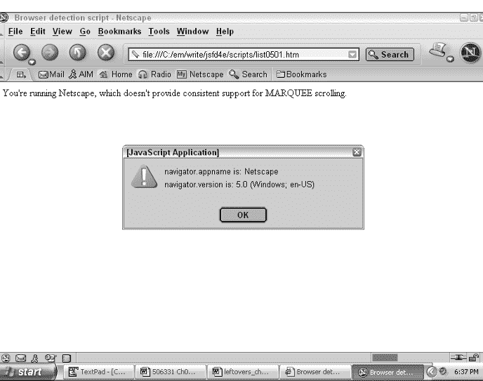
图 5-1：在 Navigator 7.0 中显示的浏览器嗅探脚本。注意 `appVersion` 的值为“正在运行 Netscape，它对 MARQUEE 滚动不提供一致的支持”。

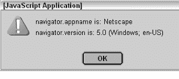
图 5-2：因为此脚本在 Navigator 中运行，文本以居中且加粗的形式显示。`appVersion` 为正在运行 Netscape，它对 MARQUEE 滚动不提供一致的支持。

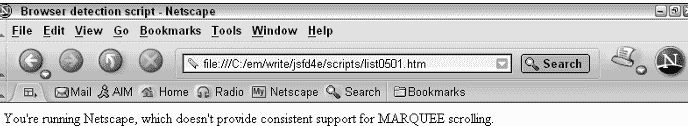
自学 JavaScript

## 110 页 第二部分：创建动态 Web 页面

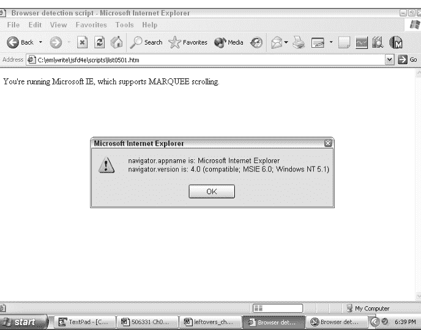
图 5-3：在 Internet Explorer 6.0 中显示的浏览器嗅探脚本。注意 `appVersion` 的值。

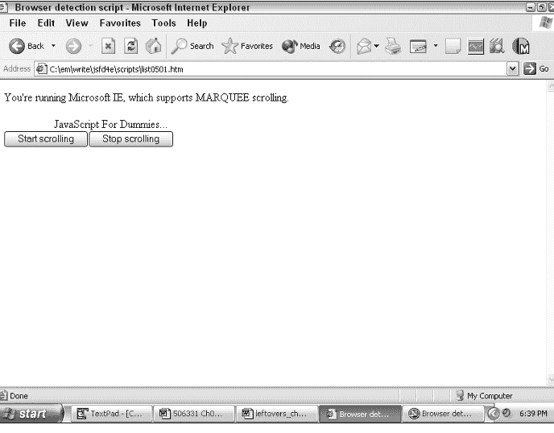
图 5-4：此脚本在浏览器中运行，因此文本是滚动的且由用户控制的。

## 注意

第 5 章：检测用户的浏览器环境

你在列表 5-1 中看到的代码使用 `if-else` 语句检查内置 `navigator.appName` 属性的内容，并判断用户是否正在运行 Internet Explorer。（`navigator.appName` 的值为 "Internet Explorer" 表示用户正在运行 Internet Explorer。）

- 如果是，你可以放心地使用 `<MARQUEE>` 标签。
- 如果浏览器不是 Internet Explorer，你可以用另一种引人注目的方式显示滚动信息——例如，显示为加粗且居中的标题。

列表 5-1 显示了一个“嗅探器”脚本的代码，该脚本用于探测浏览器设置，并将字符串显示为滚动跑码（marquee）或加粗居中的标题，具体取决于加载脚本的浏览器是否为 Internet Explorer。

内置 `navigator` 对象包含了许多属性。例如，你可能可以使用图像交换技术来凑合（如你在第...章中看到的那种）

无论用户运行哪种浏览器，`navigator` 对象都包含了许多属性。例如，你可能可以使用图像交换技术来凑合（如你在第...章中看到的那种）

所有浏览器都支持的 HTML 属性的。

要确定用户是否安装了特定的插件内容，你需要执行以下步骤：

1. 询问每个浏览器制造商以了解期望的 `appVersion` 值。例如
- 你可以通过访问 http://msn.microsoft.com/library/ 找到关于 `navigator` 对象的所有信息（包括 `appVersion` 属性）

## 第5章：检测用户的浏览器环境

- **Navigator 和 Internet Explorer**：`document.embeds[]` 数组包含了所有通过 `<OBJECT>` 标签（Internet Explorer）和 `<EMBED>` 标签（Netscape Navigator）嵌入到文档中的对象列表。`document.applets[]` 数组包含了所有通过 `<APPLET>` 标签嵌入到文档中的应用程序（applets）列表。
- **Navigator**：`navigator.plugins[]` 数组包含了 Navigator 支持的所有插件列表。（热门插件包括 Adobe Acrobat 和 Apple QuickTime。）`navigator.mimeTypes[]` 数组包含了 Navigator 支持的所有 MIME 类型列表。（MIME，全称“多用途互联网邮件扩展扩展”，指的是 Navigator 可以理解和显示的文件类型。常见的 MIME 类型示例包括 Adobe 的便携文档框架（.pdf）和 RealNetworks 的 RealAudio（.ram）。）

`<APPLET>` 标签在 HTML 4.0 中已被废弃，这意味着鼓励程序员使用 `<OBJECT>` 或 `<EMBED>` 标签（代替 `<APPLET>`）在 Web 页面中嵌入 Java 应用程序。未来的浏览器可能不再支持 `<APPLET>` 标签。尽管我演示了如何通过 `document.applets[]` 数组检测 Java 应用程序，但仍然存在包含 `<APPLET>` 标签的 Web 页面。

在 IE 中，`navigator.plugins[]` 和 `navigator.mimeTypes[]` 数组始终为 null，因为 IE 使用 ActiveX 对象代替了插件。要检测在 Internet Explorer 中查看的文档嵌入内容，请访问 `document.embeds[]` 数组。

检测插件内容可能有点复杂。幸运的是，你在列表 5-2 中看到的代码帮助你理解嵌入对象与插件之间的区别。

在扫描代码列表之前，请查看图 5-5 至 5-8，这些图显示了在 Netscape Navigator 中加载的列表 5-2 代码。然后查看图 5-9 至 5-12，这些图显示了在 IE 中加载的相同代码。

你可以通过将随光 CD 中的 `list10502.htm` 加载到自己的网络浏览器中来尝试列表 5-2 中的代码。为了复制本章所示示例，你可以从 www.apple.com/quicktime/download 下载 Apple QuickTime 副本。

图 5-6 显示了点击“检测嵌入对象”（Detect Embedded Objects）按钮如何显示文档中 `<EMBED>` 和 `<OBJECT>` 标签的总数。如图 5-7 所示，“检测插件”（Detect Plug-Ins）按钮显示了已下载并安装的浏览器插件数量；如图 5-8 所示，点击“检测应用程序”（Detect Applets）按钮，将显示使用 `<APPLET>` 标签嵌入到文档中的 Java 应用程序数量。

下方显示了两个嵌入对象：

- 1. 由 Quick-Time 免费提供的示例电影（Sample.movie）。注意：IE 将应用程序识别为对象。IE 不识别浏览器插件。（IE 支持 ActiveX 对象而非插件。）
- 2. 由 Sun Microsystems 免费提供的示例 Java 应用程序（Java:Clock.class）。Navigator 将应用程序识别为 applets。

图 5-5：在 Netscape Navigator 中检查嵌入对象。

图 5-6：检测对象：1 个嵌入对象。

图 5-7：检测插件：25 个浏览器插件。

图 5-8：检测应用程序：1 个 Java 应用程序。

在 Internet Explorer 中执行的相同代码——列表 5-2——略有不同，正如你在图 5-9、5-10、5-11、5-12 和 5-13 中所示。当你点击“检测插件”时，检测到的插件数量为零，因为 Internet Explorer 不识别或实现插件。

下方显示了两个嵌入对象：

- 1. 由 QuickTime 提供的示例电影（Sample.mov）。注意：IE 将应用程序识别为对象。IE 不识别浏览器插件（IE 支持 ActiveX 对象而非插件）。
- 2. 由 Sun Microsystems 提供的示例 Java 应用程序（JavaCheck.class）。Navigator 将应用程序识别为 applets。

图 5-9：在 IE 中检查嵌入对象。

图 5-10：检测嵌入的 QuickTime...

图 5-11：...以及一个 Java 应用程序。

图 5-12：IE 不支持插件。

图 5-13：在 IE 中，应用程序与任何嵌入对象没有区别。

看一眼列表 5-2。当你快速浏览代码时，请注意检测不同类型嵌入内容的相似之处。在每个情况下，你都检查了与内置数组相关的 `length` 属性（`navigator.plugins.length`、`document.embed.length` 和 `document.applets`）。`length` 属性用于检测插件、嵌入对象和嵌入应用程序。

## 列表 5-2：检测嵌入对象

```html
<HTML>

<TITLE>检测嵌入对象（应用程序、插件等）</TITLE>

<SCRIPT LANGUAGE="JavaScript" TYPE="text/javascript">

<!-- 针对不支持 JavaScript 的浏览器隐藏 -->

///////////////////////////////////

// detectPlugins() 函数检测

// Navigator 浏览器插件（软件“卡匣”）

// 它们之前已经在 Netscape Navigator 浏览器中下载

// 并安装了。

////////////////////////////////////

function detectPlugins() {

  if (navigator.plugins.length > 0) {

    var pluginDescription = "";

    for (var numPlugins = 0; numPlugins < navigator.plugins.length; numPlugins++) {

      numPlugins++;

      pluginDescription = pluginDescription + " * " +

      navigator.plugins[numPlugins-1].name;

    }

    alert(navigator.plugins.length + " 个浏览器插件: " +

    pluginDescription);

  } else {

    alert("未检测到插件。（记住，IE 不支持插件）。");

  }

}

/////////////////////

// detectApplets() 函数检测通过

// <APPLET> 标签嵌入 Web 页面的 Java

// 应用程序——仅适用于 Netscape Navigator。

// 在 Microsoft Internet Explorer 中运行应用程序，

// 你需要了解应用程序：例如，

// document.applets['nameOfApplet'].some();

// document.applets 数组的长度代表

// 嵌入页面的对象数量。

// 额外的 applets[] 属性和方法取决于

// 每个应用程序的实现。

function detectApplets() {

  if (document.applets.length > 0) {

    alert(document.applets.length + " 个 Java 应用程序。（记住，IE 将应用程序识别为嵌入对象）。");

  } else {

    alert("未检测到 Java 应用程序。");

  }

}

////////////////////////////////////////////////

// detectEmbeds() 函数检测通过

// <EMBED> 或 <OBJECT> 标签嵌入 Web 页面的内容。

//

// document.embeds 数组的长度代表

// 嵌入页面的对象数量。

//

// 额外的 embeds[] 属性取决于

// 每个嵌入对象的实现。

////////////////////////////////////////////////

function detectEmbeds() {

  if (navigator.appName == "Microsoft Internet Explorer") {

    // 用户正在运行 IE，所以检查通过

    // <OBJECT> 标签嵌入的对象。

    //

    // 使用 object 属性的嵌入对象的 ReadyState 

    // 可能包含三个值之一：

    // 0 = 已初始化

    // 1 = 正在加载

    // 4 = 加载完成并就绪

    if (document.OTsample.readyState == 4) {

      alert("检测到 OTsample 嵌入对象");

    }

    if (document.clock.readyState == 4) {

      alert("检测到 clock 嵌入对象");

    }

  } else {

    if (navigator.appName == "Netscape") {

      // 用户正在运行 Navigator，所以检查

      //通过 <EMBED> 标签嵌入的对象。

      if (document.embeds.length > 0) {

        alert("检测到 " + document.embeds.length + " 个嵌入对象。");

      }

    }

  }

}

}
else {

  alert("No embedded objects detected.");

}

// --> 结束隐藏

<SCRIPT>

```

```html
<HEAD>

<BODY>

下方显示两个嵌入对象：

<OL>

<li><b>由 QuickTime 免费提供的示例电影 (Sample.mov)。</b>

注意：IE 将 applet 识别为对象。IE 不识别浏览器插件。

(IE 支持 ActiveX 对象而不是插件)。

<li><b>由 Sun Microsystems 免费提供的 示例 applet (JavaClock.class)</b>

注意：Navigator 将 applet 识别为 applet。

</OL>
```

```html
nYou>你使用 OBJECT 标签将 ActiveX 组件嵌入到面向 MSIE 的

页面中；你使用 EMBED 标签将插件嵌入到面向 Navigator 的页面中。

请注意 SRC

变量的值必须指定。

<!--

<OBJECT CLASS="clsid:02BF2505-8BC17-4B23-BC80-D3488ADDDC6B"

WIDTH="320"HEIGHT="250"

ID="Qtsample"

CODEBASE="http://www.apple.com/quicktime/qtplugin.cab"

<PARAM name="SRC" VALUE="c:\Program Files\QuickTime\Sample.mov">

<PARAM name="AUTOPLAY" VALUE="true"

<PARAM name="CONTROLLER" VALUE="true"
```

```html
<EMBED SRC="c:\Program Files\QuickTime\Sample.mov" WIDTH="320"

HEIGHT="250" AUTOPLAY="true" CONTROLLER="true"

PLUGINSPACE="http://www.apple.com/quicktime/"/

</EMBED>
```

```html
</OBJECT>
```

（续）

# 120 第二部分：创建网页

# 列表 5-2（续）

```html
<!--

此 Java applet 可从 Sun Microsystems 免费获取。

更多信息，请

访问 http://java.sun.com/openstudio/applets/clock.html

注意：APPLET 标签在 HTML 4.0 中已弃用，

这意味着鼓励程序员使用 OBJECT 标签

（代替 APPLET 标签）在

网页中中嵌入 Java applet。未来的浏览器可能不再支持 APPLET 标签。

//-->

<APPLET id="clock" CODEBASE="classes" class="JavaClock.class" WIDTH="150"

HEIGHT="150">

<PARAM NAME="bgcolor" VALUE="#FFFFFF">

<PARAM NAME="border" VALUE="*">

<PARAM NAME="color" VALUE="#ddddd">

<PARAM NAME="font" VALUE="TimesRoman|BOLD|18">

<PARAM NAME="delay" VALUE="100">

<PARAM NAME="hcolor" VALUE="0000FF">

<PARAM NAME="link" VALUE="http://java.sun.com/"

<PARAM NAME="nhcolor" VALUE="#0DFF00">

<PARAM NAME="mcolor" VALUE="#000000">

<PARAM NAME="nradius" VALUE="#000">

<PARAM NAME="ncolor" VALUE="#FF0000">

</APPLET>

<FORM>

<INPUT TYPE="button" VALUE="detect embedded objects" onclick="detectEmbeds()"

<INPUT TYPE="button" VALUE="detect plug-ins" onclick="detectPlugins()"

<INPUT TYPE="button" VALUE="detect applets" onclick="detectApplets()"

</FORM>

<body>

</html
```

记住，你可以使用两种方法检测 Netscape Navigator 插件：通过检查 `navigator.plugins[]` 数组和通过使用 `navigator.mimetypes[]` 数组，如列表 5-2 所示。然而，由于 Internet Explorer 不支持插件，这些数组在 IE 中始终是空的。

使用 `<EMBED>` 或 `<OBJECT>` 标签嵌入的对象会被添加到 `document.embeds[]` 数组中。


## 第 5 章：检测用户的浏览器环境


`document.plugins[]` 数组是 `document.embeds[]` 数组的同义词，但由于 `document.plugins[]` 数组看起来与 `navigator.plugins[]` 数组非常相似——后者持有完全不同类型的对象——我建议当你想要确定文档中嵌入的 `<OBJECT>` 和 `<EMBED>` 标签数量时，坚持使用 `document.embeds[]` 数组。

# 引用页

引用页是用户在加载你的网页之前直接加载的页面。你可以使用 JavaScript 在运行时确定引用页——这对于你统计数据非常有用。（有些程序员精确地知道用户通过哪些链接进入他们的页面的。）

要识别引用页，你需要检查 对象的 `referrer` 属性，如下面的 JavaScript 代码所示：

```javascript
if (document.referrer == "") {

  document.println("你是直接在浏览器中打开此页面的");

}

else {

  document.println("你是通过 " + document.referrer + " 跳转到此页面的");

}
```

上面的代码片段确定 `document.referrer` 的值在代码片段中表示为 `""`：

- `document.referrer` 的值为空（空白），用户直接在地址栏中输入了网页的名称。
- `document.referrer` 的值不为空，`document.referrer` 包含引用页的名称。

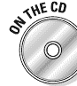

配套光盘中的 `detecting_referrer_base.htm` 和 `detecting_referrer.htm` 文件允许你测试我在本节描述的代码。要使用这些文件，请将它们上传到 Web 服务器，在 浏览器中加载 `detecting_referrer_base.htm` 文件，并点击出现的链接。


你必须将 HTML 文件上传到 Web 服务器才能测试在本节中看到的代码；在本地测试时，`document.referrer` 的值总是为空。

# 第二部分：创建网页

## 用户偏好

如果用户可以选择他们偏好的方式，那不是很好吗？嗯，如果你使用 JavaScript，例如图 14 和图 15，可以向用户展示他们想要的颜色。


## 126 第二部分：创建动态网页

Web 服务器：它们人生的使命是在 Web 服务器和 Web 客户端之间往返传输数据。由于本书专用于 JavaScript，在本章的后后部分，我将向你展示如何使用 JavaScript 来创建和交互 cookie，而不是使用 C/C++、Perl 或其他更传统的 cookie 处理语言。

在深入代码之前，我将先详细解释什么是 cookie 以及它们是如何运作的。

## 为什么要使用 cookie？

Cookie 允许你在用户的计算机上存储有关该用户访问的信息，并在用户再次访问你的网站时检索这些信息。开发者使用 cookie 的常见原因有两个：

- **识别访问者：** 你可以检测用户之前是否访问过你的网站，并自定义用户后续访问时看到的内容。例如，你可以通过名字问候访问者，告诉他们自上次访问以来你的网站发生了什么，根据他们之前的购买记录、网站导航习惯等显示定制化页面。
- **保存事务状态：** 你可以存储你的网站与访问者浏览器之间任何长时间事务的状态，以防止中断。例如，想象我正在你的网站网站上填写一份长表单，这时我的狗突然在桌子下追逐我的猫。它们打斗在一起，等我反应过来时，我的电脑插头从墙插座上拔掉了！如果你的网站使用 cookie，我可以把我的那些畜生赶到院子里，重新插好机器，刷新你的网页，并从我离开的地方继续。如果你的网站没有使用 cookie，我就必须从头开始填写表单。

## Cookie 安全问题

cookie 已经安全地使用了几年，而且它们受到 Web 浏览器的严格管理，因此它们在潜在安全威胁列表中的排名靠后。尽管如此，它们在某些程序员圈内仍然极具争议，原因有二：

- Cookie 通过直接将信息存储在用户的硬盘器上，跨越了 Web 浏览器的传统边界。一些人担心 cookie 可能会通过感染病毒损坏计算机，或通过在硬盘上存储如此大量的数据导致导致计算机无法正常工作。

## 第 6 章：cookie 的破碎也就如此

幸运的是，cookie 自带了防止这些威胁的内置保护措施。无论你使用 JavaScript 还是其他语言，都无法突破浏览器施加的以下常识限制：

- * Cookie 放置的位置：例如，运行在 Windows XP 的 Internet Explorer 6.6 将 cookie 存储为单独的文本文件，并放在以下目录：

```
C:\Documents and Settings\Owner\Cookies
```

运行在 Windows XP 的 Netscape Navigator 7.0 将它们合并成一个名为 cookies.txt 的单文件，并将其放在一个类似下面的随机生成的目录中：

```
C:\Documents and Settings\Owner\Application Data\Mozilla\profiles\default\klamsdn.slt
```

- * Cookie 文件可以有多大：Internet Explorer 和 Netscape Navigator 都将 cookie 文件限制为 4K。
- * 你可以在用户的驱动器上放置多少 cookie：Internet Explorer 和 Netscape Navigator 都将限制设为每个网站 20 个 cookie，每个浏览器总共 300 个 cookie。
- * 哪些网站有权 cookie 的 cookie：cookie 的可见性是可配置的。（你可以在本章的“配置支持”部分查看如何配置 cookie 访问）。

> Cookie 允许 Web 开发者在这些用户不知情的情况下收集有关用户的详细营销信息。通过将 cookie 与 CGI 程序和 Java applet 等客户端应用程序结合使用，Web 开发者可以保存、检查和解释用户与网站之间的每一次交互。每一次点击、每一次击键、每一笔信用卡购买都可以用于定制用户下次访问启用 cookie 的网站时所看到的内容。

幸运的是，对 cookie 的这种类似“老大哥”的特性感到不适的用户有一个选择：他们可以配置浏览器来限制 cookie 支持或完全将其关闭。（你将在下一节中看到配置 cookie 的示例。）

## 从用户的角度看 cookie

理解 cookie 如何运作的最好方法之一是从用户的角度来看待它们。在本节中，我将向你展示如何在浏览器中配置 cookie 支持、访问启用 cookie 的网站，并检查一个实际的 cookie 文件。完成后，你就拥有了所有背景知识，可以直接开始使用 JavaScript 代码创建 cookie。

## 128 第二部分：创建动态网页

## 配置 cookie 支持

Netscape Navigator 和 Internet Explorer 都允许用户指定 cookie 支持的级别。

在 Netscape Navigator 7.x 中，你通过以下步骤配置 cookie 支持：

- 1. 选择编辑 (Edit)：偏好 (Preferences)：隐私与安全 (Privacy & Security)：Cookies。
- 2. 在出现的 Cookies 对话框中选择以下选项之一，如图 6-1 所示：
  - * 禁用 cookie (Disable Cookies)。
  - * 仅为源网站启用 cookie (Enable Cookies for the Originating Web Site Only)（相对于源域内的任何服务器）。
  - * 根据可自定义的隐私设置启用 cookie (Enable Cookies Based on Customizable Privacy Settings)。（点击“查看”按钮以根据 cookie 设置网站的发布策略设置隐私设置。）
  - * 启用所有 cookie (Enable All Cookies)。

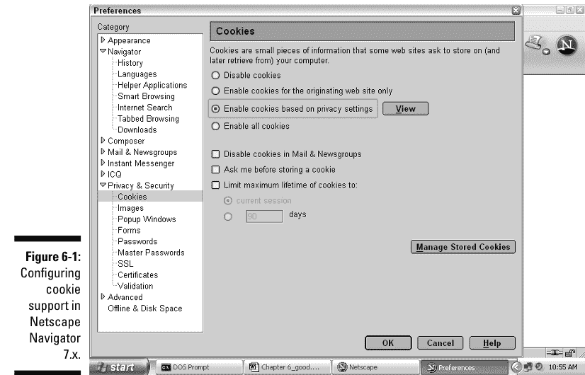

图 6-1：在 Netscape Navigator 7.x 中配置 cookie 支持。

## 第 6 章：cookie 的破碎也就如此

在 Cookies 对话框中点击“管理存储的 cookie (Manage Stored Cookies)”按钮以查看存储在计算机上的 cookie。

正如你可能猜到的，禁用 cookie 支持的用户无法从 cookie 中获益。

## 设置 cookie

文档对象的 `cookie` 属性持有所有与文档关联的 cookie。

要创建并设置 cookie，你必须定义一个变量/值值对，表示 cookie 的名称和 cookie 的内容（name=value）。由于 cookie 值不能包含分号、逗号或空格，我建议在存储 cookie 值时使用 JavaScript 内置的 `escape()` 函数，在检索 cookie 值时使用 JavaScript 内置的 `unescape()` 函数（`escape()` 函数会编码字符串中存在的逗号和空格，而 `unescape()` 函数则会重构这些字符）。除了此限制外，cookie 值几乎可以包含你喜欢的任何内容！（有些程序员想出了各种花哨的加密方案，但他们仍然倾向于使用简单的基于文本的字符串。）

除了强制性的名称和值之外，你可能还会为 cookie 定义可选的、以分号分隔的属性（参见表 6-1）。

| 属性 | 描述 |
| --- | --- |
| expires=expirationDate | cookie 过期的日期（以毫秒为单位），之后 Web 浏览器将其删除。过期日期通常以标准格林尼治标准时间（GMT）格式存储。（你可以使用 Date 对象的 `toGMTString()` 方法以 GMT 格式格式化日期。） |
| path=path; | cookie 内容可以传输到的 CGI 程序的路径。默认是源服务器的根路径。 |
| domain=domain; | cookie 可以传输到的域（例如，www.acme.com）。默认受限。（详情请参见“Cookie 安全问题”章节。） |
| secure | 指明此 cookie 只能通过如 https 等安全协议传输。 |

## 第 6 章：Cookie 就是这样碎掉的 133

要创建一个 cookie 并将其存储在用户的硬盘上，你所做的就是将 `document.cookie` 属性设置为一个包含所需的名称/值对以及可选的、以分号分隔的 cookie 属性的字符串，如下代码段所示（摘自列表 6-1，它出现在本章的后面）：

```javascript
document.cookie = name + "=" + escape(value) +

(expires == null) ? "" : (; expires=" + expires.toGMTString() + ")"

(path == null) ? "" : (; path=" + path + ")"

(domain == null) ? "" : (; domain=" + domain + ")"

(secure == true) ? "; secure="";
```

这种晦涩、外观奇怪的语法 `(condition) ? something : somethingElse` 是 JavaScript 的简写，表示“如果此条件为真，则添加 something；否则，添加 somethingElse”。

例如，JavaScript 解释器是如何看到这段 JavaScript 的

```javascript
((expires == null) ? "" : (; expires=" + expires.toGMTString())))
```

它会认为：“如果 expires 的值为 null，则向 document.cookie 属性添加 ""。否则，向 document.cookie 属性添加字符串 expires=someGMTDate。”

你可以在第 3 章中找到更多关于条件运算符 `?:` 的信息。

## 访问 cookie

你可以通过 JavaScript 设置 cookie 的属性（通过使用 JavaScript，具体是 `expires`、`path`、`domain` 和 `secure` 属性，正如我在“设置 cookie”部分描述的那样），但你无法通过 JavaScript 访问这些属性。相比之下，你可以访问 cookie 的值。


这种看似矛盾的情况——能够设置你无法检索的属性——当你仔细考虑时其实是有道理的。所有这些属性都与安全有关，防止它们被修改有助于维护 cookie 的完整性和安全性。在你发出 cookie 后，只有 Web 浏览器可以私有地访问 cookie 属性。

要访问 cookie 的值，你需要查询与文档对象关联的 `cookie` 属性。（你在本章前面的“设置 cookie”中已经看到如何设置 cookie 属性。）

查看以下 JavaScript 代码段：

```javascript
var endstr = document.cookie.indexOf(":", offset);

return unescape(document.cookie.substring(offset, endstr));
```

这段代码包含两个语句：

- 第一条语句使用 `indexOf()` 方法识别 `myCookie=userName:` 字符串中 `=` 和 `:` 之间的部分（换句话说，识别 `userName` 字符串的存储值）。
- 第二条语句对 `userName` 的存储值进行反转（反转是自动化的，用于解码设置 cookie 时编码的任何特殊字符）。

你可以在本章后面的列表 6-1 中找到此代码段的可运行版本。


## 根据 cookie 内容显示内容：重复访问者脚本

你可以创建一个脚本，通过 cookie 使用用户的名称在用户的硬盘上注册用户。在随后的访问该网站时，脚本会从用户的硬盘中访问 cookie，识别用户名，并使用该信息显示自定义的问候。图 6-5 显示了重复访问者脚本的一种，用户必须先注册他们的姓名。

在许多现实应用中，你希望使用服务器端技术（如 CGI 脚本）创建并访问 cookie。由于 CGI 脚本超出了本书的范围，在本章中我将向你展示如何使用 JavaScript 创建和访问 cookie。（CGI 和 JavaScript 之间的语法不同，但你交互的基础是相同的。）


当用户注册了姓名后（如图 6-5 所示），表单就会消失。用户可以关闭浏览器并离开。当他们回来并尝试访问页面时，脚本会识别出他们已经注册，并加载带有自定义问候的页面（见图 6）。

## 第 6 章：Cookie 就是这样碎掉的

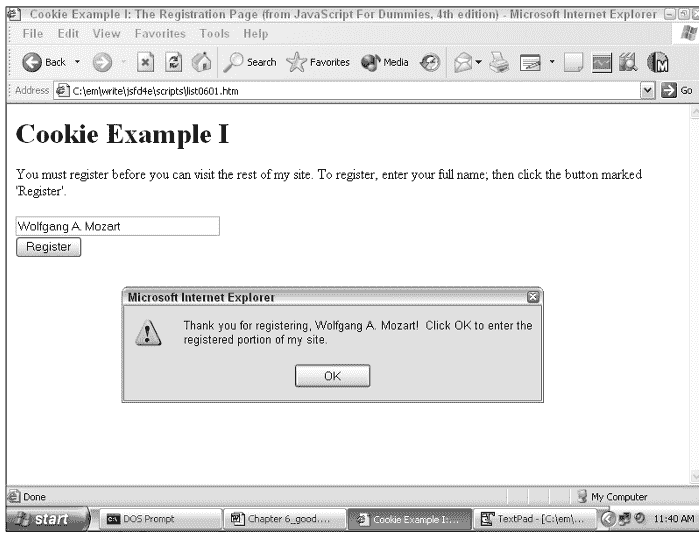

## Cookie I

你必须注册后才能访问我的网站的其他部分。要注册，输入你的全名，然后点击标记为“注册”的按钮。

Wolfgang Mozart

图 6-5：使用 cookie 注册用户。

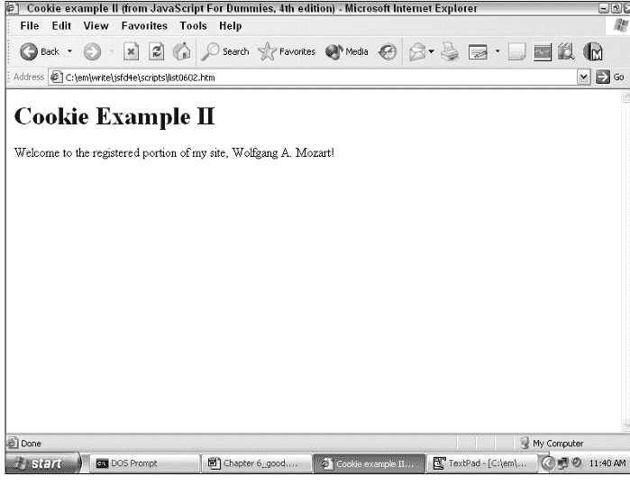

## Cookie II

欢迎来到我的注册部分，注册 Mozart！

图 6-6：引导游客进入页面。

## 136 第二部分：创建页面

我根据图 6-5 和 6-6 中的操作分两部分实现了重复访问者脚本：

- **Cookie I（用户页面）**：该脚本注册用户名，在该用户上存储 cookie，并加载注册用户页面。
- **Cookie II（仅限用户页面）**：该脚本访问 cookie 并显示自定义问候。

当你创建 cookie 时，可以指定过期日期。在指定的过期日期后，cookie 将无法被访问。过期值为空值会将 cookie 标记为*临时的*（临时 cookie 只在用户会话期间留在内存中，不会保存到用户的硬盘）。在列表 6-1 的示例中，你看到从 cookie 创建起的一年。

Cookie I 和 Cookie II 脚本分别位于列表 6-1 和 6-2 中。你可以在配套光盘上的 `list0601.htm` 和 `list0602.htm` 文件找到它们。


## 列表 6-1：Cookie I：注册表单

```html
<HTML>

<HEAD><TITLE>Cookie I：注册页面（取自 JavaScript 入门，第 4 版）</TITLE>

<SCRIPT LANGUAGE="JavaScript" TYPE="text/javascript">

<!-- Begin header

function getCookie(offset) {

    // 此函数返回

    // my "cookieuserName" 字符串中

    // = 和 : 之间的部分

    var endstr = document.cookie.indexOf(":", offset);

    if (endstr == -1) {

        endstr = document.cookie.length;

    }

    return unescape(document.cookie.substring(offset, endstr));

}

function getCookie(cookieName) {

    // 你必须拆解 cookie 文本。为了这一点，

    // 你首先要弄清楚 "myCookie=" 中有多少个字符

    var arg = cookieName + "=";

    var arg = arg.length;

    // 现在查找整个 cookie 字符串的长度

    var cookieLength = document.cookie.length;

    // 如果 cookie 存储为对象，

    // 生活将会变得简单得多！

    // 但现在，你必须逐个字符遍历

    // cookie 的内容

    // 以检索所存储的内容。

    var i = 0;

    // 当 "*" 计数器小于 cookie 中的

    // 字符数时 . .

    while (i < cookieLength) {

        // 根据 "myCookie" 中字符的个数

        // 对 "j" 计数器进行偏移

        var j = i + arg;

        // 如果你在 cookie 内容中找到 "myCookie*" 

        if (document.cookie.substring(i, j) == arg) {

            // 返回与 "myCookie" 关联的值

            return getCookieVal(j);

        }

        if (i == 0) {

            break

        }

    }

    return null;

function setCookie(name, value) {

    // 捕获传递给

    // setCookie() 函数的所有参数。

    var argv = setCookie.arguments;

    // 确定传递给

    // 此函数的参数个数

    var argc = setCookie.arguments.length;

    // 你期望传入的第三个参数是

    //过期日期。

    // 如果没有第三个参数，将 expires

    // 变量设为 null；

    // (过期为 null 将 cookie 标记为

    // 临时。临时 cookie 不会保存到

    // 硬盘上。)

    var expires = (argc > 2) ? argv[2] : null;

// 你期望传入的第四个参数是

// 路径。

// 如果没有第四个参数，将 path

// 变量设为 null。

var path = (argc > 3) ? argv[3] : null;

// 你期望传入的第五个参数是

// 域名。

// 如果没有第五个参数，将 domain

// 变量设为 null。

var domain = (argc > 4) ? argv[4] : null;

// 你期望传入的第六个参数是

// 一个真或假值。

// 取决于此安全 cookie 是否可以

// 仅通过 https 传输到安全服务器

// 如果没有第六个参数，将 secure

// 变量设为 false。

var secure = (argc > 5) ? argv[5] : false;

// 设置 cookie。

document.cookie = name + "=" + escape(value) +

((expires == null) ? "" : (";expires=" + expires.toGMTString() + ")) +

((path == null) ? "" : (";path=" + path)) +

((domain == null) ? "" : (";domain=" + domain)) +

((secure == true) ? "" : (";secure=" + secure + "));"));

}

function register(username) {

    if (username == "" || username == null) {

        // 缺少名称，将此用户注册为“未知用户”。

        username = "Unknown User";

    }

}

// 如果不存在 cookie 'MyCookie' . .

if(getCookie("MyCookie") == null) {

    // 将过期日期设为今天。

    var expdate = new Date();

    // 以毫秒形式存储

    // 恰好一年后的日期。

    expdate.setTime(expdate.getTime() + (1000 * 60 * 60 * 24 * 365));

    setCookie("MyCookie", username, expdate);

    alert("感谢您的注册，*" + username + " *! 点击 OK 进入

网站的注册区域。");

}

// 将用户引导至为注册用户

预留的页面。

location.href = "list0602.htm";

/////////////////////////////////////////////////////////////////////

// 这段代码检查用户机器上是否存在名为 'myCookie'

// 的 cookie。

//

// 如果存在，说明用户已经注册，因此将用户

// 引导至仅限注册用户访问的部分。

//

// 如果用户机器上不存在名为 'myCookie' 的

// cookie，则让用户注册。

/////////////////////////////////////////////////////////////////////

// 如果存在 "myCookie" cookie . . .

if(getCookie('myCookie') != null) {

    // 将用户的浏览器重定向到

    // 受密码保护的页面 "list0602.htm"

    location.href="list0602.htm";

}

// 隐藏结束 -->

<SCRIPT>

<HEAD>

<BODY>

//@ (从这里到结束 </BODY> 标签)

<H1>Cookie 示例 I</H1>

<FORM NAME="loginForm">

在访问网站其他部分之前，您需要注册。要注册，请输入

您的全名；然后点击注册按钮。

<P>

<INPUT TYPE="text" NAME="fullName" SIZE=35>

<BR>

<INPUT TYPE="button" VALUE="Register"

onClick="register(loginForm.fullName.value)">

</FORM>

</BODY>

</HTML>
```

以下是 JavaScript 解释器处理列表 6-1 中代码的简要说明：

1. 解释器首先检查是否存在名为 myCookie 的 cookie。如果存在这样的 cookie，解释器——理解为该用户之前注册过——会加载 list0602.htm。
2. 如果不存在 cookie，解释器加载带有输入框和注册按钮的页面。
3. 当用户点击注册按钮时，解释器开始执行 `register()` 函数，该函数反过来调用 `setCookie()` 方法来存储用户的名称和过期日期。
4. `register()` 函数存储 cookie 后，加载“仅限用户”页面。

查看列表 6-2 以了解如何访问 cookie 并显示自定义欢迎。

## 列表 6-2：Cookie 示例 II：显示自定义欢迎

```html
<HTML>

<HEAD><TITLE>Cookie 示例 II：自定义欢迎（JavaScript）</TITLE>

<SCRIPT LANGUAGE="JavaScript">

// 开始隐藏 -->

function getCookieVal(offset) {

    var arg = name + "=";

    var arg = arg.length;

    // 现在查找整个 cookie 字符串的长度

    var cookieLength = document.cookie.length;

    // 如果 cookie 存储为对象，

    // 生活将会变得简单得多！

    // 但现在，你必须逐个字符遍历

    // cookie 的内容

    // 以检索所存储的内容。

    var i = 0;

    // 当 "*" 计数器小于 cookie 中的

    // 字符数时 . .

    while (i < cookieLength) {

        // 根据 "myCookie" 中字符的个数

        // 对 "j" 计数器进行偏移

        var j = i + arg;

        // 如果你在 cookie 内容中找到 "myCookie*"

        if (document.cookie.substring(i, j) == arg) {

            // 返回与 "myCookie" 关联的值

            return getCookieVal(j);

        }

        if (i == 0) {

            break

        }

    }

    return null;

}

function setCookie(name, value) {

    // 捕获传递给

    // setCookie() 函数的所有参数。

    var argv = setCookie.arguments;

    // 确定传递给

    // 此函数的参数个数

    var argc = setCookie.arguments.length;

    // 你期望传入的第三个参数是

    // 过期日期。

    // 如果没有第三个参数，将 expires

    // 变量设为 null；

    // (过期为 null 将 cookie 标记为

    // 临时。临时 cookie 不会保存到

    // 硬盘上。)

    var expires = (argc > 2) ? argv[2] : null;

// 你期望传入的第四个参数是

// 路径。

// 如果没有第四个参数，将 path

// 变量设为 null。
```


# 浏览器窗口与框架的操作

## 本章内容
- 使用 JavaScript 打开和关闭弹出窗口
- 定位浏览器窗口
- 使用 JavaScript 在框架之间共享信息

> 浏览器窗口和框架是用户查看你的 Web 页面内容的窗口。

作为一名 Web 页面设计师，你可以选择在单个浏览器窗口中创建 Web 页面，这是标准做法。但通过 JavaScript，你可以做更多事情。你可以在独立的窗口中显示内容，并自动关闭这些窗口。你甚至可以使用框架在单个浏览器窗口内显示多个 HTML 文档，然后使用 JavaScript 在这些框架之间共享信息。

通过 JavaScript，你可以创建出各种复杂的窗口和框架效果。本章将向你展示如何实现。

是否在你的 Web 站点中包含 HTML 框架取决于个人的设计决定。有些人非常喜欢框架，因为它们不仅允许你创建创新的导航结构，还能让你提供指向其他网站的超链接，同时防止用户浏览离开并放弃你的网站。框架的实现可能很复杂，而且有些人不喜欢它们隐藏 URL 信息的特性。（基本上，在框架中打开的链接的 URL 不显示在浏览器的地址栏中。）例如，要查看框架中打开的链接的 URL，你不能只点击链接；必须右键点击并选择“属性”（Internet Explorer）或“框架：页面信息”（Navigator）。然而，如果你决定实现框架，JavaScript 可以帮助你最有效地利用它们。

## 浏览器窗口的操作

每个 Web 页面对应一个浏览器窗口是开发中最基础、最简单的方法——对于许多应用程序来说，这种方法运行良好。但有时你想要显示多个窗口。例如，想象你是一个正在创建语言艺术 Web 站点的老师。你可能想包含指向词汇的超链接，这样当访问者点击其中一个超链接时，该链接词的字典定义就会出现在单独的弹出窗口中。

如果你创建一个显示多个浏览器窗口的 Web 页面，你需要知道如何操作这些额外的窗口。例如，你需要知道如何在额外窗口中定位内容以及如何关闭这些额外窗口。在本节中，我将向你展示如何从单个 Web 页面打开并操作窗口。

显示新窗口（称为 pop-windows 或简单的 pop-ups）可能会让用户感到困扰，因此请务必谨慎使用。此外，请记住，许多用户购买或下载了免费的第三方弹出窗口拦截软件（例如可以在 `http://toolbar.google.com` 找到 Google 工具栏），或者在浏览器中关闭了 JavaScript 支持以避免弹出窗口。当他们访问你的网站时，这些情况不值得你费心精力。

### 打开和关闭新浏览器窗口

Web 设计中一种流行的观点是：尽所能（当然，是在合理范围内）让访问者在发现你的站点后尽可能留在你的站点上。例如，添加指向其他网站的超文本链接——尽管这可能会适得其反，在访问者查看完你的站点之前就把他们引向其他人的 Web 站点。此外，谁又知道你的访问者是否还会回来呢？

解决这种情况的一种方法是，让你页面的 HTML 链接在新浏览器窗口中打开下一个站点。访问者可以根据需要从你的站点和其他站点之间自由浏览，而无需离开你的站点。这是一个双赢局面！请看图 7-1 和图 7-2 以理解我的意思。

在图 7-2 中，你会看到创建一个新窗口如何保持原始浏览器窗口完整。（点击“关闭窗口”按钮会导致新打开的窗口消失。）

图 7-1：点击“打开窗口”按钮会打开一个你可以预填链接的窗口。

图 7-2：将 URL 加载到独立窗口中可以将你的访问者留在首页。

在 JavaScript 中创建这样的新窗口非常简单。列表 7-1 向你展示了如何操作。

要在你自己的浏览器中尝试列表 7-1 中的代码，请打开在随附 CD 上找到的 `list0701.htm` 文件。

#### 列表 7-1：创建（并销毁）新浏览器窗口

```javascript
<SCRIPT LANGUAGE="JavaScript">

var newWindow = null;

function popup() {
  newWindow = open("list0702.htm", "secondWindow",
  "scrollbars,resizable,width=500,height=400");
}

function shutDown() {
  if (newWindow && !newWindow.closed) {
    newWindow.close();
  }
}

</SCRIPT>
```

要创建一个新窗口并自动加载新文档，你需要使用与窗口对象关联的 `open()` 方法，如列表 7-1 所示。如你所见，`open()` 方法接受三个参数：

- 你想要加载到新窗口中的 URL（在本例中为 `list0702.htm`）
- 此新窗口的名称（在本例中为 `secondWindow`）
- 一个配置选项字符串

在这个示例中，你创建的窗口具有滚动条、用户调整大小选项，并以 500 x 400 像素的初始尺寸出现。（快速查看图 7-1 可以看到可见的滚动条。你可以通过在自己的浏览器中从随附 CD 加载 `list0701.htm` 文件来验证其他特性。）

要关闭窗口，你只需要通过窗口名称调用 `close()` 方法：`newWindow.close();`。

### 定位新窗口

当你打开一个窗口时，浏览器会决定将其放在哪里，如之前的图 7-2 所示。然而，你可以准确地告诉浏览器把它放在哪里——当然，使用 JavaScript！

以下代码向你展示如何这样做：

```javascript
var leftPosition = screen.width / 2;
var newWindow = window.open("one.htm", "secondWindow",
"width=225,height=200,left=" + leftPosition + ",top=0");
```

你可以控制的窗口放置位置是左（`left`）和顶（`top`）。这里看到的 JavaScript 代码计算了左侧位置的值——在本例中，计算结果等于屏幕宽度的一半。计算值存储在变量 `leftPosition` 中，并作为 `window.open()` 函数期望的 `left` 属性的值。结果是？新显示窗口的左侧正好位于屏幕中央。

### 框架的操作

脚本框架是任何 Web 开发者工具箱中非常有价值的补充。通过结合 HTML 框架和 JavaScript，你可以在页面的一侧展示静态的、可点击的目录；然后在页面的另一侧，你可以展示与每个目录条目对应的文本。

框架的好处之一是它们允许你独立显示 HTML 文件。例如，如果用户滚动图 7-3，左框架将保持可见——右框架移动。此外，在左侧框架中点击链接会自动在右侧的框架中加载相应的内容。

图 7-3：使用框架显示索引和相关内容。

我在接下来的章节中解释的这种方法，有助于快速导航网站，并且对于组织小型网站——甚至是包含大量文本的大型网站非常有用。

## 创建 HTML 框架

因为本书并不侧重于创建 HTML 表单。相反，我向你展示需要了解的关于 JavaScript 和文档对象模型（DOM）如何融入其中的基本语法。如果你想了解更多关于创建 HTML 框架的知识，可能想要买 Ed Tittel 和 Natanya Pitts 编写、Wiley Publishing, Inc. 出版的《HTML 4 For Dummies》（第四版）。列表 7-3 显示了创建框架所需的代码片段，使用 HTML 文件将框架组合在一起。`list0703.htm` 文件调取了 `pub_l.htm` 文件（左侧框架的目录）和 `pub_c.htm` 文件（右侧框架的内容）。

你可以通过打开随附 CD 盘中的这些文件来查看本节所示代码的运行示例：`list0703.htm`、`pub_l.htm` 和 `pub_c.htm`。

#### 列表 7-3：创建索引和内容框架的 HTML 语法

```html
<FRAMESET COLS="125, *"
  BORDER="0"
  FRAMESPACING="0"
  FRAMEBORDER="NO">
  <!-- 定义左侧框架的源文件、名称和显示细节 -->
  <FRAME SRC="pub_l.htm"
    NAME="leftnav"
    SCROLLING="AUTO"
    NORESIZE
    MARGINHEIGHT="0"
    MARGINWIDTH="0"
    LEFTMARGIN="0"
    TOPMARGIN="0"
    TARGET="body">
  <!-- 定义右侧框架的源文件、名称和显示细节 -->
  <FRAME SRC="pub_c.htm"
    NAME="content"
    SCROLLING="AUTO"
    NORESIZE
    MARGINHEIGHT="0"
    MARGINWIDTH="0"
    LEFTMARGIN="0"
    TOPMARGIN="0"
    TARGET="body">
</FRAMESET>
```

仔细查看列表 7-3 中的 HTML 代码以找到两个框架定义：

- `leftnav`（对应 HTML 文件 `pub_l.htm`）
- `content`（对应 HTML 文件 `pub_c.htm`）

`pub_l.htm` 文件包含一个链接列表（换句话说就是目录），而 `pub_c.htm` 文件包含相应的文本。图 7-4 和 7-5 显示了这两个文件在 Internet Explorer 中单独加载时的样子。（参考图 7-3 查看它们连接在一起时的样子）。

在将它们放入框架之前，单独查看页面可以帮助你理解如何将它们结合起来以获得最佳效果。

图 7-4：单独显示的目录

## 电子出版

一种营销和销售你作品的新方式——还是作家最糟糕的噩梦？

电子出版（或称 e-publishing）管理着发布、销售和分发你作品的手段——面向全世界的读者。

一种跨时代的民主。对于每一份手稿，都有一个出版商——即刻响应。不需要诱饵。不需要等待你那份投递的手稿在纽约的各个出版社之间流转。不需要在你的信箱里收到拒稿信。

这是数字出版行业的一个缩影，在这里，任何人都可以发布并触及全球的读者，这些读者可能具有潜力（且通常基于文学考量或你是否是名人）。

准入门槛的无疑降低并持续推动该行业的发展，使得任何手里有五十美元钞票和电话连接的普通人（Tom, Dick, or Harry）都可能作为电子出版商经营。尽管有广泛说法认为，电子出版所依赖的技术——例如，让你能够按需打印和装订单本书的硬件等等……

图 7-5：文本对应于图 7-4 所示的目录。

## 框架之间的数据共享

在本节的示例中，右侧的内容根据用户在左侧框架中的点击进行重新加载。因此，自然地，负责重新加载的代码可以在左侧框架的源码 `pub_l.htm` 中找到。查看列表 7-4 所示的相关语法。这段来自 `pub_l.htm` 的代码片段将链接列表连接到相应的内容。

#### 列表 7-4：将索引链接连接到内容

```html
<!-- 当用户点击简介（Introduction）链接时，
     pro_c.htm@top 处的锚点加载到
     名为 content 的框架中 -->
<a href="pro_c.htm#top" target="content">Introduction</a>

<!-- 当用户点击无法发布？（Can't Get Published?）链接时，
     名为 content 的框架加载 pub_c.htm -->
<a href="pub_c.htm" target="content">Why Can't I Get Published?</a>

<!-- 当用户点击救援（Rescue）链接时，
     名为 content 的框架加载 pub_c.htm -->
<a href="pub_c.htm" target="content">Rescue!</a>

<!-- 当用户点击类型（Types）链接时，
     名为 content 的框架加载 pub_c.htm -->
<a href="pub_c.htm" target="content">Types of E-Publishing</a>

<!-- 当用户点击选择（Choose）链接时，
     名为 content 的框架加载 pub_c.htm -->
<a href="pub_c.htm" target="content">Choosing an E-Publisher</a>

<!-- 当用户点击指南（Guide）链接时，
     名为 content 的框架加载 pub_c.htm -->
<a href="pub_c.htm" target="content">What Every Writer Must Know About E-Publishing</a>

<!-- 当用户点击 Emily.com 首页（Home）链接时，
     home.htm 替换当前页面 -->
<a href="home.htm" target="_top">Emily.com Home</a>
```

列表 7-4 中的每个链接都包含一个 `TARGET` 属性值，除了最后一个链接外，`TARGET` 属性被设置为 `content` —— 即我们在图 7-3 中所示的右侧框架。将框架名称分配给链接的 `TARGET` 属性会导致链接在命名框架中加载，正如我们之前看到的。

### 目标 target

| 值 | 含义 |
| --- | --- |
| `_blank` | 在新窗口中打开链接 |
| `_parent` | 在父窗口或框架中打开链接 |
| `_self` | 在当前窗口或框架中打开 |
| `_top` | 在根窗口或框架中打开 |

当你在 HTML 中创建链接（或锚点、base 或表单）时，可以选择为这些 HTML 元素指定 `TARGET` 属性值。（参见第 11 章关于指定 `_top` 值的示例）。

你可能会以不同的方式处理最后一个链接。在列表 7-4 的底部，你看到最后一个定义的链接将 `TARGET` 属性赋值为 `_top`。当用户点击链接时，页面变为 `home.htm` 的内容。

`_top` 是一个内置值，翻译为“当前窗口/框架层级中的顶层窗口”（在本章的侧边栏“目标 target”中描述了你可以为 `TARGET` 属性指定的所有内置值）。

如果你指定的 `TARGET` 值既不匹配定义的框架名称，也不匹配侧边栏“目标 target”中看到的任何内置值，那么关联的链接将在新窗口中加载。如果你期望链接在框架中打开，它却弹出了新窗口，请检查你的源代码。很可能是你写错了字母！

本节的示例展示了如何根据用户在另一个框架中的点击来加载一个框架的内容。要根据用户的点击加载两个框架，你可以创建一个类似下面的 JavaScript 函数：

```javascript
function loadTwoFrames(leftURL, contentURL) {
  // 将第一个传入的 URL
  // 加载到之前在 HTML 文件中定义
  // 为 "leftNav" 的容器框架中
  // 正如列表 7-3 所示
  parent.leftNav.location.href = leftURL;

  // 将第二个传入的 URL
  // 加载到之前定义的
  // "content" 容器框架中
  parent.content.location.href = contentURL;
}
```

然后向 `loadTwoFrames()` 函数传递两个 URL 字符串。例如：

```html
<A HREF="javascript:loadTwoFrames('some.htm', 'another.htm')">
```

或者

```html
<INPUT TYPE="button" VALUE="Two Frames" onclick="loadTwoFrames('some.htm', 'another.htm')">
```

## 不要把我圈起来！

正如你可以在自己的框架中显示别人的网页一样，他们也可以在他们的框架中显示你的网页。

在某些情况下，你可能希望防止你的网站被嵌入框架。例如，假设你花费几周时间创建一个精美、图形丰富的网站，并针对特定的显示器尺寸和屏幕分辨率进行了优化。然后，假设我过来了并从我的网站上添加了一个指向你网站的链接——但我选择通过将你精妙的、像素完美的尺寸挤在一个微小的 2x2 英寸框架内来显示它！（糟糕的是，我是一个爱猫人士，所以我用我心爱的 Bifi 的图像围着这个 2x2 英寸的框架——这样你的网站看起来就像从我猫的嘴里露出来。）

为了防止他人在框架中显示你的文档，你可以在文档的 head 区域添加以下短脚本：

```html
<HEAD>
<SCRIPT LANGUAGE="JavaScript">
<!-- 开始对不支持 JavaScript 的浏览器隐藏内容 -->
// 如果此页面被加载到框架中...
  if (top != self) {
    // 用框架内的页面替换原始的框架页
    top.location.href = location.href;
  }
// 停止隐藏 -->
</SCRIPT>
</HEAD>
```

---

# 第三部分：让你的网站方便访问、导航和使用

## Rich Tennant 的《第五波浪》

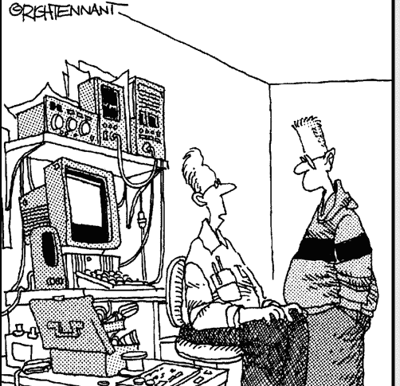

> “我无法在我的 PC 上运行这个‘职场技能’程序，所以我更换了主板，升级了 BIOS，并写了一个程序将其连接到我的个人数据库。它告诉我我没有技术天赋，应该从事销售工作。”

## 在这一部分中……

在这一部分，你将找到让你的网页方便访问者导航和使用的实用方法。第 8 章向你展示如何创建切换效果、热点和导航栏（这些是当用户点击或鼠标悬停在图像上会有响应的图形图像的花哨名称）。在第 9 章中，你将看到如何创建酷的下拉菜单和滑动菜单。第 10 章演示了你如何通过添加 JavaScript 地图来描述你网站的内容，第 11 章完成了这一部分，向你展示如何创建工具提示——即当访问者鼠标悬停在你网站的指定区域时显示的有用提示。

---

# 第 8 章：创建交互式图像

## 本章内容
- 创建幻灯片和其他简单的动画效果
- 使用 JavaScript 使图像可点击
- 组合可点击图像以创建交互式导航栏
- 探索 JavaScript 事件处理器

正如任何浏览过 Web 的人都能告诉你的那样，一张图胜过千言。图像为你的网站增添了视觉冲击力。它们还让你能够包含其他方式完全无法呈现的信息。（你能想象在不使用照片的情况下尝试描述一组古董灯吗？）

由于图像在 JavaScript 中被表示为可编程对象，你可以通过创建交互式图像来超越静态图像——当用户点击或在图像上拖动鼠标时，图像会做出相应的响应。继续阅读以获取所有精彩的细节！

## 创建简单动画

通常，当你在网页上看到酷炫的动画时，你看到的是以下之一：

- **Java applet**：Java applet 是用 Java 编程语言编写的小型软件应用程序，当你加载页面时，浏览器会将它们从 Web 服务器下载到你的机器上。
- **插件**：插件是一种特殊的软件，你可以将插件下载到浏览器中，并允许应用程序在网页内部执行。Flash 是一个流行的动画插件（来自 Macromedia 的优秀团队）。
- **动态 GIF**：GIF 代表图形交换格式，它描述了一种压缩图像文件的特殊方法。GIF 文件用于在 Web 上传输图像。动态 GIF 是一系列普通 GIF 包装在一起——就像那些可能给孩子看的翻页书，每一页都包含一张独立的画。当你翻动翻页书（或加载动态 GIF）时，这些独立的画从一个切换到另一个，产生动画效果。

动态 GIF 是 Web 动画的热门选择，因为：
- 大多数浏览器支持它们。
- 不需要单独下载（不像插件）。
- 它们不占用大量的客户端资源（不像某些 Java applet）。

你也可以用 JavaScript 创建简单动画。你可能这样做有两个非常好的理由：
- 创建 JavaScript 动画可以节省你的用户的时间。（JavaScript 动画不需要像插件那样预先下载，也不像 applet 那样在执行期间下载。）
- 创建 JavaScript 动画可以省去研究另一种编程语言（如 Java）或研究如何使用动画制作工具（如 Macromedia 的）的麻烦。

缺点是什么？因为 JavaScript 并不是专门为创建动画设计的，它没有为此目的进行优化——这意味着需要专门构建的动画工具才能获得最佳性能。

接下来的章节将向你展示如何使用 JavaScript 创建这些酷炫的效果。

## 此时此彼，转瞬即逝：图像的开启与关闭

最简单的动画当属图像从原始视图变化，然后变回来。请看图 8-3 和图 8-4，看看得益于 JavaScript 内置函数 `setTimeout()` 的递归调用，你的笑脸是如何变化的。

负责实现此简单动画的相关代码位于列表 8-2 中。通过图像操作和 JavaScript 内置的 `setTimeout()` 函数查看这个简单的开启/关闭动画。如果你想加载并尝试动画示例，请使用随附 CD 光盘中的 `list0802.htm` 文件。

图 8-3：中性脸……

图 8-4：……每秒钟变换成另一张惊讶的脸。

#### 列表 8-2：使用 JavaScript 的 `setTimeout()` 函数创建简单动画

```javascript
// 全局变量声明
var whichimg = 1;
var nextImage;

/////////////////////////////////////
// swap() 函数替换与第一个输入
// 参数 (id) 关联的图像
// 为第二个输入参数 (newSrc)
// 指定图像
/////////////////////////////////////
function swap(id, newSrc) {
  var theImage = findImage(document, id, 0);
  if (theImage) {
    theImage.src = newSrc;
  }
}

/////////////////////////////////////
// 此函数将当前图像
// 替换为传入的参数 newImage；
// 然后它每秒调用一次自己，
// 每次向自身传递不同的 newImage。
// 结果是一个简单的
// 开启/关闭动画。
function animate(newImage) {
  swap('animatedFace', newImage);
  if (whichimg == 1) {
    nextImage = "surprised.gif";
    whichimg = 0;
  } else {
    nextImage = "neutral.gif";
    whichimg = 1;
  }
  // setTimeout() 设置了创建动画的
  // 连续交换
  setTimeout("animate('" + nextImage + "')", 1000);
}

// 隐藏结束 -->
</SCRIPT>
</HEAD>
```

#### 列表 8-2（续）

```html
<!-- animate() 函数在页面加载时立即被调用。 -->
<BODY onload="animate('surprised.gif')">
<!-- 定义了动画（图像）的尺寸。 -->

</BODY>
</HTML>
```

列表 8-2 中的 JavaScript 代码依赖于两个图像文件来创建动画：
- `neutral.gif`：这张黄色正方形图像包含两只黑眼睛和一条直线形状的嘴巴，呈现出中性表情。
- `surprised.gif`：这张图像是惊讶的脸。（好吧，好吧，它只是一个带大圆圈嘴巴而不是直线的笑脸。这是一种艺术家的诠释！）

以下是 JavaScript 解释器执行列表 8-2 中代码的顺序——这可以看作是对解释器思维的窥探：
1. HTML `` 标签定义了图像在动画期间交替出现的页面位置。在 `` 标签中，其名称为 `animatedFace`，尺寸为 104 x 80 像素。
2. 随着页面加载，`onload` 事件处理器执行 `animate()` 函数，并发送一个源文件名（`surprised.gif`）。
3. `animate()` 函数调用 `swap()` 函数来交换与 `animatedFace` 占位符关联的源文件。现在，不是原始的 `neutral.gif`，`animatedFace` 持有 `surprised.gif`。
4. 通过全局定义的变量 `whichImg` 和 `nextImage`，`animate()` 函数记录了哪个图像刚刚交换，并通过调用 `setTimeout()` 函数队列了下一个图像。`setTimeout()` 函数每秒调用一次 `animate()` 函数，交替传递 `neutral.gif` 和 `surprised.gif` 文件名。

## 幻灯片：显示一系列图像

有时你想使用 JavaScript 设置幻灯片：一种让用户点击按钮并查看不同图像，而不一定跳转到另一个页面的方法。图 8-5 到 8-7 显示了点击按钮将图像从一个视图更改到另一个视图的过程。

图 8-5：幻灯片初始视图……

图 8-6：……点击“下一张”……

图 8-7：……显示下一张图片。

（注：原文中图片说明重复，已精简合并）

## 创建简单的鼠标悬停效果

“Rollover”一词描述当用户用鼠标指针悬停在图像上时，图像的颜色、字体、大小或其他属性发生的变化。图 8-8 显示了电子出版按钮首次加载到 Internet Explorer 时的外观（白色）。

如图 8-9 所示，将鼠标悬停在实现为悬停效果的导航按钮上，可以提供一种视觉提示，帮助用户识别在点击鼠标按钮时可以预期结果。（文本颜色从白色变为紫色的变化让用户确切地知道他们正悬停在一个按钮上！）

鼠标悬停通常用于创建导航栏，但你可以使用鼠标悬停让网站的任何图形部分对鼠标事件做出响应。

图 8-8：初始按钮使用白色图像。

图 8-9：悬停时按钮变为紫色。

创建鼠标悬停效果非常简单。只需遵循以下计划：

1. 选择两个尺寸完全相同的图像：一个用于默认显示，另一个用于在响应鼠标悬停（`mouseover`）事件时显示。
   保持这两个版本清晰的一种方法是使用“开启/关闭”的命名约定。从现在起，我分别将这些图像称为“关闭图像”和“开启图像”，当你的鼠标不在图像上时显示一个，当在图像上时显示另一个。
   你可以通过两种方式获取图像：
   - 你可以使用现成的图像。许多图形工具都带有一个设计图像库；你也可以在网上找到——有些是免费的，有些是出售的。
   - 你可以使用图像创建工具（如 Paint Shop Pro 6 或更高版本）创建你自己的图像。（你可以在附带的 CD-ROM 上找到 Paint Shop Pro 6 的试版。）
   一种流行的方法是创建一个你喜欢的导航按钮并将其保存为关闭图像——然后更改按钮颜色并立即另存为另一个副本作为开启图像。

   没有图形方面的天赋？GoGraph 在 `www.gograph.com` 提供免费下载的图标和图形。

2. 创建两个 JavaScript 函数，一个附加到 `onMouseOver` 事件处理器，另一个附加到 `onMouseOut` 事件处理器。
   以下是两个使用 `swap()` 函数将名为 `mkt_pic` 的图像从白色版本 (`mkt_w.gif`) 切换到紫色版本 (`mkt_p.gif`) 的示例。

```html
<A HREF="mkt.htm"
   onMouseOver="swap('mkt_pic','mkt_p.gif');"
   onMouseOut="swap('mkt_pic','mkt_w.gif');">
   
</A>
```

你可以在附带的 CD 中的 `rollover.htm` 文件中找到图 8-8 和图 8-9 所需代码的可运行版本——其中包含了 `swap()` 函数以及以下 JavaScript。

3. 添加一个可选的（但建议的）JavaScript 函数，用于预加载所有图像。
   预加载图像有助于确保用户在第一次使用鼠标悬停图像时，不需要等待额外的图像从 Web 服务器下载。

我将在接下来的章节中展示这三个步骤是如何协同工作的，你将看到如何一步步构建一个带有悬停效果的典型导航栏。

## 通过组合悬停效果创建导航栏

导航栏（如之前图 8-8 和图 8-9 所示）是帮助用户在网站中导航的绝佳工具。经常——因为导航栏仅仅是悬停效果与指向不同 Web 页面链接的组合——正如你将在接下来的章节中看到的，它们很容易组装。

我在本章演示的导航栏创建方法是老式的、手动代码的方法。所见即所得的可视化工具（如 Macromedia Dreamweaver）让创建导航栏的过程变得更加简单无痛。

## 预加载图像

你并不需要预加载悬停图像，但这样做是一个好主意。使用预加载的图像会让你的悬停效果运行得顺畅得多，从而给你的访问者提供更好的体验。

为什么预加载图像是个好主意？默认情况下，浏览器只在需要时才获取图像。当用户第一次把鼠标悬停在图像上时，他们不需要等待。不幸的是，如果用户的连接缓慢或 Web 服务器过载，图像可能需要一段时间才能到达。在此期间，浏览器不会发生变化，用户看不到悬停效果。

预加载所有图像有助于用户立即看到悬停效果。要预加载，你只需使用 JavaScript 创建 `Image` 实例，然后在这些实例中填充要预加载的文件名。你在页面加载时就这样做；当用户阅读你的页面文本时，图像正在后台加载。当用户准备好点击时，所有图像已加载就绪！

我将其分为三个部分以帮助理解。列表 8-4 向你展示了如何预加载图像。

#### 列表 8-4：页面加载时预加载图像

```javascript
function preloadImages() {
  // 步骤 1
  if (document.images) {
    // 步骤 2
    var imgFiles = arguments;
    // 步骤 3
    var preloadArray = new Array();
    // 步骤 4
    for (var i = 0; i < imgFiles.length; i++) {
      // 在 preloadArray 数组创建一个新的 Image 对象，
      // 并与源文件关联，从而将该图像加载到内存中。
      preloadArray[i] = new Image();
      preloadArray[i].src = imgFiles[i];
    }
  }
}
</SCRIPT>
</HEAD>
<BODY BGCOLOR="#000000" TEXT="#FFFFFF" LINK="#FFFFFF" VLINK="#CCCCCC" ALINK="#CCCCCC">
<!-- 第二个脚本调用第一个脚本定义的 preloadImages 函数。 -->
<SCRIPT LANGUAGE="JavaScript" TYPE="text/javascript">
  // 此文件中使用的所有图像
  //（Logo 以及所有的白色和紫色导航按钮）。
  // 步骤 5
  preloadImages(
    'logo.gif',
    'pro_p.gif', 'pub_p.gif', 'mkt_p.gif', 'crs_p.gif',
    'res_p.gif', 'who_p.gif', 'pro_w.gif', 'pub_w.gif',
    'mkt_w.gif', 'crs_w.gif', 'res_w.gif', 'who_w.gif'
  );
</SCRIPT>
</BODY>
</HTML>
```

1. 解释器检查 `document.images` 是否存在（即浏览器是否支持图像对象）。
2. 解释器将传递给函数的参数（图像文件名列表）赋值给 `imgFiles`。
3. 创建一个空数组 `preloadArray` 用于存储 `Image` 对象。
4. 解释器遍历 `imgFiles`，为每个文件名创建 `Image` 对象并设置 `src` 属性，从而触发下载。
5. 页面加载时，第二个脚本块调用 `preloadImages()` 并传入所有需要的图像文件名。结果是页面一加载，JavaScript 就会立即预加载所有的导航栏图像。

你可能会发现，在文件名中使用简单的标记系统来区分开启/关闭状态的图像会有帮助。此示例中的文件名 `_w` 代表白色导航按钮；`_p` 表示紫色导航按钮。在本例中，`pro_p.gif` 是电子促销导航按钮开启时的图像名称，而 `pro_w.gif` 是该按钮关闭时对应的图像名称。

## 在鼠标悬停时切换图像

当用户的浏览器使用如前一节所示的方案将你的图像加载到内存中时，你需要某种方法在响应鼠标悬停（`mouseover`）事件时切换这些图像。你通过使用与每个导航按钮关联的 `onMouseOver` 和 `onMouseOut` 事件处理器来实现这一点。列表之后将是详细的说明：

#### 列表 8-5：使用 `onMouseOver` 事件切换图像

```javascript
<HEAD>
<SCRIPT LANGUAGE="JavaScript" TYPE="text/javascript">
// 定义 swap() 函数
function swap(id, newsrc) {
  var image = locateImage(id);
  if (image) {
    image.src = newsrc;
  }
}

/////////////////////////////////////////////////
// locateImage() 函数接收图像名称
// 并返回与该名称关联的 Image 对象。
/////////////////////////////////////////////////
function locateImage(name) {
  var theImage = false;
  if (document.images) {
    theImage = document.images[name];
  }
  if (theImage) {
    return theImage;
  }
  return (false);
}
// 隐藏结束 -->
</SCRIPT>
</HEAD>
```

```html
<A HREF="promo.htm"
   onMouseOut="swap('promo_pic','promo_w.gif')"
   onMouseOver="swap('promo_pic','promo_p.gif')">
   
</A>
```

为了帮助你理解列表 8-5 中的代码，我将首先解释调用 `swap()` 函数时发生了什么；然后，我会解释在 `onMouseOut` 和 `onMouseOver` 处理器上发生了什么。

### 定义 `swap()` 函数

你在列表 8-5 中定义的 `swap()` 函数接受两个参数：
- `id`：代表你想要切换的图像名称
- `newsrc`：代表你想要显示的新图像的文件名

以下是 `swap()` 函数体内部发生的操作：
首先，创建了一个名为 `theImage` 的变量，并赋值为你想要切换的预加载图像。（为了创建 `theImage`，使用了 `locateImage()` 函数。我将在下一节中解释 `locateImage()` 的内部工作机制。）
其次，更改 `theImage` 的 `src` 属性，这会导致浏览器显示新图像。图像切换完成，如下：

```javascript
function swap(id, newsrc) {
    var theImage = locateImage(id);
    if (theImage) { // 如果找到了图像
        theImage.src = newsrc; // 切换它
    }
}
```

### 创建 `locateImage()` 函数

如果你对 `locateImage()` 函数感兴趣，那么你来对地方了。正如你在上一节看到的，`swap()` 函数使用 `locateImage()` 来定位它需要切换的图像。

以下是 `locateImage()` 函数的代码：

```javascript
function locateImage(name) {
  // 从一个名为 theImage 的空变量开始
  var theImage = false;
  // 如果文档定义了图像
  if (document.images) {
    // 将我们正在寻找的图像赋值给 theImage。
    theImage = document.images[name];
  }
  // 如果图像存在，则将其返回给调用函数。
  if (theImage) {
    return theImage;
  }
  // 否则，向调用函数返回 false。
  return (false);
}
```

### 调用 `swap()` 函数

要实现悬停效果，你必须切换两次图像：当用户移动到图像上时，以及用户再次离开时。这是通过在 `onMouseOver` 和 `onMouseOut` 处理器中调用 `swap()` 函数实现的，如列表 8-5 节选所示：由于图像被实现为链接，点击图像会自动加载对应的页面。

```html
<A HREF="pro.htm"
   onMouseOut="swap('promo_pic','pro_w.gif')"
   onMouseOver="swap('promo_pic','pro_p.gif')">
   
</A>
```

注意这段代码中，电子促销图像的初始值为 `pro_w.gif`（白色按钮）；图像的名称是 `promo_pic`。（你知道这些信息是因为 `` 标签的 `SRC` 属性设置为 `pro_w.gif`，而 `` 标签的 `NAME` 属性设置为 `promo_pic`。）

现在看 `onMouseOver` 事件处理器。这条语句将 `promo_pic` 图像从白色版本切换到 `pro_p.gif`（紫色版本）。

当 `onMouseOut` 事件处理器触发时，`promo_pic` 图像变回 `pro_w.gif`（回到白色版本）。多亏了 `<A>` 标签，当用户点击图像时，用户的浏览器会加载一个处理所有内容的新页面：`pro.htm`。

## 将单个图像切割成多个热点

HTML 区域（及其关联的事件处理器）允许将图像切割成多个热点，即图像中对应于消息或操作的区域（参见列表 8-6）。将鼠标悬停在标记为 Publish 的图像区域（如图 8-10 所示），会导致状态栏中出现与发布相关的消息。图 8-11 显示了在状态栏显示更通用状态的类似技巧（参见图 8-12）。注意：如果你运行的是 Internet Explorer 且没有状态栏，请选择“查看” -> “状态栏”。

图 8-10：状态栏消息与鼠标在页面上的位置对应。

### 一张图像，多个事件处理器

将鼠标指针悬停在此图像的不同部分会导致窗口底部显示不同的消息（位于窗口的一个名为状态栏的属性中）。

图 8-11：悬停在标记为 Promote 的图像区域会导致与推广相关的消息出现在状态栏。

图 8-12：当用户悬停在图像的任何未定义热点区域时，状态栏会出现标准消息。

列表 8-6 (`list0806.htm`) 显示了如何在用户悬停在图像的特定区域时在状态栏上显示自定义消息。

#### 列表 8-6：设计图像热点

```html
<HTML>
<HEAD>
<TITLE>为单个图像附加多个事件处理器（节选《JavaScript For Dummies》第四版）</TITLE>
</HEAD>
<BODY BGCOLOR="black" TEXT="white">
<h1>一张图像，多个事件处理器</h1>
<p>将鼠标指针悬停在该图像的不同部分会导致窗口底部显示不同的消息（位于窗口的一个名为 <B>status</B> 的属性中）。</p>
<p>HTML 区域“切割”了单个图像。通过为每个区域定义单独的处理器，根据用户鼠标移动或点击的位置在窗口的状态栏中显示不同的消息。</p>


<MAP NAME="newsplash">
<AREA
  onMouseOver="window.status='Writing for the Web'; return true"
  onMouseOut="window.status=''; return true"
  SHAPE="POLY"
  COORDS="1,2,41,67,48,80,197,240,239,18,93,12,94,2"
  TARGET="_top">
<AREA
  onMouseOver="window.status='SELL your writing'; return true"
  onMouseOut="window.status=''; return true"
  SHAPE="RECT"
  TARGET="_top"
  COORDS="26,0,241,16">
<AREA
  onMouseOver="window.status='PROMOTE your writing'; return true"
  onMouseOut="window.status=''; return true"
  SHAPE="RECT"
  TARGET="_top"
  COORDS="149,0,209,15">
<AREA
  onMouseOver="window.status='PUBLISH your writing'; return true"
  onMouseOut="window.status=''; return true"
  SHAPE="RECT"
  TARGET="_top"
  COORDS="94,0,140,14">
</MAP>
</BODY>
</HTML>
```

HTML 区域是让你将一张图像切割成不同部分的结构。图像本身保持原位，而你定义的区域允许你定义与图像交互的任意区域。

你可以根据需要为图像定义许多区域，并按喜好调整尺寸和形状（感谢 `COORDS` 属性）。你通过 HTML `<AREA>` 和 `<MAP>` 标签来定义区域，如列表 8-6 所示。每个区域都可以定义自己的处理器。

列表 8-6 定义了四个独立的区域：
- 图像中显示 Publish（发布）的部分。与该区域相关的 `onMouseOver` 处理器会显示消息 "PUBLISH your writing"。
- 图像中显示 Promote（推广）的部分。与该区域关联的 `onMouseOver` 处理器会显示消息 "PROMOTE your writing"。
- 图像中显示 Sell（出售）的部分。与该区域关联的 `onMouseOver` 事件处理器会显示消息 "SELL your writing"。
- 前述区域未描述的剩余部分。与此剩余区域关联的 `onMouseOver` 事件处理器会显示通用消息 "Writing for the Web"。

要为热点添加链接，你只需要为 `<AREA>` 标签的 `HREF` 属性定义一个值，如下代码所示：

```html
<AREA
  onMouseOver="window.status='PROMOTE your writing'; return true"
  onMouseOut="window.status=''; return true"
  SHAPE="RECT"
  TARGET="_top"
  COORDS="149,0,209,15"
  HREF="http://www.SomePromotionPage.com">
```

要在图像内定义不同的区域，你需要知道描述该区域的 x,y 坐标。市面上大多数图形处理工具（包括 Macromedia Fireworks 和 Adobe ImageReady）都允许你导入图片，勾勒你想要创建的区域，然后——砰！——它们就会为你生成必要的坐标。

---

# 第 9 章：创建菜单

## 本章内容
- 使用 DHTML 创建下拉列表菜单
- 创建动态滑动菜单
- 利用第三方 HTML 菜单工具

动态 HTML（或 DHTML）是指你用于创建 Web 页面的客户端语言和标准集合，这些页面在加载到用户的 Web 浏览器后，可以动态地更改外观。

贡献于 DHTML 的语言和标准包括：
- HTML
- JavaScript
- 级联样式表 (CSS)
- 文档对象模型 (DOM)

我在本章中的重点是 JavaScript 和文档对象模型，以及它们如何结合并有助于 DHTML ——简而言之，就是你如何使用 JavaScript 来访问并操作 DOM，从而创建酷的动态效果，包括下拉菜单和滑动菜单。我还会引导你关注一些第三方菜单组件（如果你更愿意购买并自定义菜单，而不是自己制作的话）。

尽管本章的示例包含了 HTML 和级联样式代码，但我并未花很多时间深入描述这些语言。如果你对进一步了解 DHTML、HTML 和级联样式表感兴趣，你可能想查看一本专门研究这些主题的好书。值得查看的是 Danny Goodman 写的《Dynamic HTML: The Definitive Reference, 2nd Edition》（O'Reilly & Associates）。

第 4 章描述了文档对象模型 (DOM) 并向你展示如何访问它。附录 C 介绍了 Internet Explorer 和 Netscape Navigator 的 DOM。

## 熟悉菜单

Web 语言中的菜单与餐厅菜单相似：选项的集合。菜单帮助你以美感组织内容 —— 并帮助用户快速找到他们想要的内容。由于菜单通常涉及动态内容的定位和隐藏，你不能仅使用 JavaScript 创建菜单；而是使用 HTML、级联样式表、JavaScript 和 DOM。在接下来的章节中，我将演示两种菜单：下拉菜单和滑动菜单。

### 下拉菜单

如果你的电脑运行 Windows，你将会熟悉下拉菜单：点击此处查看更多项目。

图 9-1：这个 DHTML 菜单是一个很好的导航工具。

下拉菜单（如你在图 9-2 中看到的）是有用的，因为它们允许你有效地组织内容 —— 换句话说，在用户点击它之前，菜单不会改变。下拉菜单是一种流行的方法。

图 9-2：简单的下拉菜单允许用户选择更多项目。

列表 9-1 中的代码创建了图 9-2 中的下拉菜单。浏览代码时你会发现大部分代码是：
- 自定义函数 `displayMenu()`
- 与 `onClick` 处理器关联的两次 `displayMenu()` 调用

你可以在随附 CD 的 `list0901.htm` 文件中找到运行的代码。

#### 列表 9-1：创建一个下拉菜单

```html
<HTML>
<HEAD>
<TITLE>Using HTML to Create Pull-down Menus (For Dummies, 4th Edition)</TITLE>
<SCRIPT LANGUAGE="JavaScript" TYPE="text/javascript">
<!-- 兼容旧浏览器 -->
function displayMenu(currentMenu) {
    var thisMenu = document.getElementById(currentMenu).style;

    // 根据需要展开/收起菜单
    // 如果菜单是展开的，将其收起
    if (thisMenu.display == "block") {
        thisMenu.display = "none";
    } else {
        // 如果菜单是收起的，将其展开
        thisMenu.display = "block";
    }
    return false;
}
// 结束隐藏 -->
</SCRIPT>

<STYLE TYPE="text/css">
/* "menu" 类的样式定义 */
.menu { display: none; margin-left: 20px; }
</STYLE>
</HEAD>

<BODY>
<h1>使用 JavaScript 的帮助</h1>
<h2>(点击展开/收起分类)</h2>
<h3>
<!-- 调用资源菜单。 -->
<a href="dummy1.html" onclick="return displayMenu('resMenu')">Resources</a>
</h3>
<span class="menu" id="resMenu">
<a href="http://msdn.netscape.com/channels/browsers/default.jsp">JavaScript 文档 (Nav)</a><br>
<a href="http://www.microsoft.com/windows/ie/default.html">JavaScript 文档 (IE)</a><br>
<a href="http://www.mozilla.org/docs/dom/ref/dom_shortOC.html">DOM 参考 (Nav)</a><br>
<a href="http://msdn.microsoft.com/workshop/author/dhtml/reference/objects.asp">DOM 对象 (IE6)</a><br>
<a href="http://www.scriptsearch.com/JavaScript">ScriptSearch</a>
</span>

<h3>
<!-- 调用书籍菜单。 -->
<a href="dummy2.html" onclick="return displayMenu('bookMenu')">Books</a>
</h3>
<span class="menu" id="bookMenu">
<a href="http://www.dummies.com">Dummies</a><br>
<a href="http://www.powells.com">Powells</a><br>
<a href="http://www.amazon.com">Amazon</a><br>
<a href="http://www.ebay.com">Ebay</a><br>
<a href="http://www.barnesandnoble.com">Barnes & Noble</a>
</span>
</BODY>
</HTML>
```

除非你是 HTML 和 CSS 用户，否则列表 9-1 中的代码看起来可能非常令人生畏。别担心！一步步来，代码就会迎刃而解。以下四个项目（在列表 9-1 代码中加了粗体的部分）是最重要的：
1. JavaScript `displayMenu()` 函数接受一个代表当前菜单的参数。
2. `displayMenu()` 函数内部的 JavaScript 代码获取与当前菜单关联的文档对象并存储在变量 `thisMenu` 中。
3. 代码使用 `thisMenu` 对象的 `display` 属性来判断菜单是展开的还是收起的。
4. 如果当前菜单是展开的，代码将其收起；如果当前菜单是收起的，代码将其展开。
5. `menu` 类的级联样式定义。HTML `<STYLE>` 标签定义名为 `menu` 的样式类。与 `menu` 类关联的每个 HTML 组件（见列表最后一项）都共享 `<STYLE>` 标签之间的样式特性。

- 浏览器使用相同的菜单类定义同时显示 `resMenu` 和 `bookMenu` 层。
- `resMenu` 和 `bookMenu` 层都存储为文档对象，其 `display` 属性是可访问（且可操作）的 JavaScript。

HTML 和 CSS 是宽泛且复杂的话题。如果你对这里介绍的这些主题有更深入的信息需求，WebDeveloper.com 提供了丰富的免费 HTML 和 CSS 资源。你可以分别访问 `http://webdeveloper.com/html` 和 `http://webdeveloper.com/html/css_links.html` 查看它们。

### 滑动菜单

滑动菜单与下拉菜单在一个重要点上不同：在滑动菜单中，菜单选项是响应 `onMouseOver` 事件而动态呈现的。换句话说，对于滑动菜单而言，用户无需点击菜单项即可看到额外的菜单；他们只需要将鼠标移动到某个项目上，菜单就出现了！

图 9-1 之前所示的菜单是一个滑动菜单，图 9-3 所示的菜单也是如此。

看一眼列表 9-2 中的代码，它创建了图 9-3 所示的滑动菜单。（它看起来有点丑，但我会在本节的剩余部分描述重要的部分。）当你快速浏览代码时，请注意一个 JavaScript 函数 —— `displayMenu()` —— 以及与 `onMouseOver` 和 `onMouseOut` 事件处理器相关的 `displayMenu()` 调用。

我已在附带的 CD 中包含了列表 9-2 中的工作代码，文件名为 `list0902.htm`。

#### 列表 9-2：创建滑动菜单

```html
<HTML>
<HEAD>
<TITLE>使用 HTML 创建滑动菜单（来自《JavaScript For Dummies》，第 4 版）</TITLE>
<SCRIPT LANGUAGE="JavaScript" TYPE="text/javascript">
<!-- 对旧版浏览器隐藏 -->
// 自定义 JavaScript 函数 displayMenu()
function displayMenu(currentPosition, nextPosition) {
  // 获取位于屏幕当前位置 currentPosition 的对象
  var whichMenu = document.getElementById(currentPosition).style;

  if (displayMenu.arguments.length == 1) {
    // 只发送了一个参数，所以我们需要
    // 确定 "nextPosition" 的值
    if (parseInt(whichMenu.top) == -5) {
      // 只有两个可能的值：一个
      // 用于 onMouseOver (-5) 另一个用于 onMouseOut (-90)。所以我们想
      // 从现有位置切换到另一个
      // 位置：例如，如果位置是 -5，则将 nextPosition 设置为 -90...
      nextPosition = -90;
    } else {
      // 否则，将 nextPosition 设置为 -5
      nextPosition = -5;
    }
  }
  // 使用 "nextPosition" 的值重新定位菜单
  whichMenu.top = nextPosition + "px";
}
// 隐藏的结束 -->
</SCRIPT>

<STYLE TYPE="text/css">
<!---
.menu { position: absolute; font: 12px arial, helvetica, sans-serif; background-color: #CCCCCC; left: 0; top: 90px; }
#resMenu { left: 105px; width: 130px; }
#bookMenu { left: 145px; width: 160px; }
A { text-decoration: none; color: #000000; }
A:hover { background-color: pink; color: blue; }
--->
</STYLE>
</HEAD>

<BODY BGCOLOR="white">
<!-- 将 displayMenu 的调用与 onMouseOver 和 onMouseOut 事件处理器关联。 -->
<DIV ID="resMenu" CLASS="menu" onMouseOver="displayMenu('resMenu', -5)" onMouseOut="displayMenu('resMenu', -90)">
<a href="http://www.msn.com/ns/browsers/default.jsp">JavaScript 文档 (Nav)</a><br>
<a href="http://www.microsoft.com/windows/ie/default.html">JavaScript 文档 (IE)</a><br>
<a href="http://www.mozilla.org/docs/dom/dom_short.html">DOM 文档 (Nav)</a><br>
<a href="http://www.microsoft.com/workshop/author/dhtml/reference/object.asp">DOM (IE)</a>
</DIV>
```


# 第 9 章：创建菜单

滑动菜单高度依赖于三项：

- 层叠样式表：当创建滑动菜单时，使用层叠样式表。
- 屏幕属性：使用屏幕属性来决定在何处显示菜单。
- JavaScript：使用 JavaScript 关联 `mouseover` 和 `mouseout` 事件处理器，使菜单在鼠标移入时显示，在鼠标移出时消失。当你查看列表 9-2 中的代码时，请特别注意以下几点：
    - 自定义 JavaScript 函数 `displayMenu()`：它接受两个参数：`currentPosition` 和 `nextPosition`。`displayMenu()` 函数使用这些参数来决定菜单是展开还是收起。
    - 样式表定义：`<STYLE>` 和 `</STYLE>` 标签之间的代码构成层叠样式表：
        - 字体 两个菜单共用的样式出现在 `.menu` 中。
        - 资源菜单的特定样式出现在 `#resMenu`。
        - 书籍菜单的特定样式出现在 `#bookMenu`。
        - 鼠标悬停在链接上时的样式分别出现在 `A` 和 `A:hover` 中。

# 第 10 章：创建可折叠站点地图

## 本章内容

- 使用 DHTML 创建可折叠站点地图
- 在框架集（frameset）内部定位站点地图
- 通过目标超链接（targeted hyperlinks）将站点地图与内容关联
- 利用第三方站点地图脚本

在第 9 章中，我演示了如何使用动态 HTML（或 DHTML）来创建一个简单的下拉菜单，如此处所示。第 9 章将 HTML、JavaScript、文档对象模型（DOM）和级联样式表（CSS）结合，形成了一种创建交互网页的强大方法。

> **提示**：本章中的示例包含了 HTML 和级联样式表代码，我没有花费大量时间描述这两种语言。如果你对了解更多关于 DHTML（包括 HTML 和级联样式表）的内容，可能想查看专门介绍这些主题的好书。值得查看的是 Danny Goodman 编写的《Dynamic HTML: The Definitive Reference, 2nd Edition》（O'Reilly 出版）。

在本章中，我将向你介绍如何将第 9 章中看到的简单下拉菜单转换为一种名为“可折叠站点地图”的实用站点导航工具。可折叠站点地图——类似于 Microsoft Windows 等流行应用程序中使用的（见图 10-1）——可以帮助访问你网站的用户快速、轻松地找到网站上的信息。

## 站点地图基础

站点地图（如图 10-1 所示）是一种能够以整洁、清晰且易于用户的方式组织你网站内容的菜单。

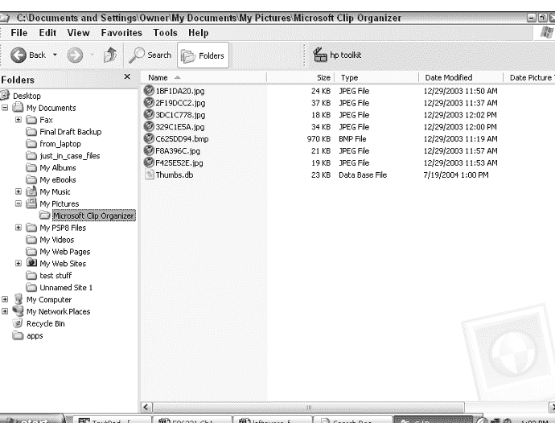
**图 10-1：站点地图可以一眼看出内容的层级。**

站点地图的目的是帮助访问者快速找到内容；站点地图最好设计为无修饰的组织链接列表。如果你将网站比作一本书，那么站点地图就是目录。

通常，你会将一个类似于图 10-1 右上角所示站点地图链接添加到你网站中的每个 Web 页面。当用户点击站点地图时，会显示一个包含下拉列表（类似于图 10-1 中的列表）的页面。

总的来说，复杂的网站需要站点地图。如果你的网站少于 25 个页面，你可能不需要站点地图——尽管如果你想做的话，完全可以创建一个！

> **注意**：站点地图——无论设计得多么巧妙——都可能导致内容组织混乱。将站点地图视为一种额外的导航工具，而不是有序、规划良好的网站的替代品。

创建站点地图的方法有很多种。在接下来的章节中，我将演示一种流行的方法：将下拉菜单与框架（frames）结合，创建一个始终在页面一侧保持可见，同时在页面另一侧显示内容的站点地图。

## 重新回顾下拉菜单

在第 9 章中，你看到了一个通过结合 HTML、JavaScript 和级联样式表创建的用于虚构编织网站的简单下拉菜单示例。在本章中，我将向你展示如何通过使用框架（我在第 7 章中讨论过框架）来调整下拉菜单，以创建如图 10-2 所示的站点地图。

创建图 10-2 所示的站点地图涉及三个步骤，我将在本节及后续章节中进一步解释它们：

1. 创建下拉菜单
2. 添加框架集（frameset）
3. 添加目标超链接

你使用 HTML、JavaScript 和级联样式表的结合来创建站点地图。列表 10-1 中使用的代码负责生成图 10-2 所示的站点地图。

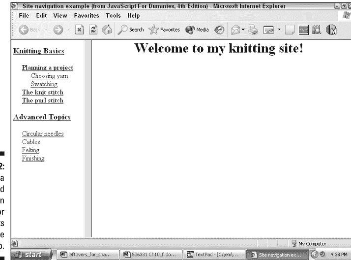
**图 10-2：点击加粗的选项可以展开或收起站点地图。**

列表 10-1 显示的代码位于随附 CD 中，文件名为 `sitemap.htm`。

## 列表 10-1：简单的下拉菜单

```html
<HTML>
<HEAD>
<TITLE>使用 HTML 创建站点地图（源自《JavaScript For Dummies, Edition》）</TITLE>
<SCRIPT LANGUAGE="JavaScript" TYPE="text/javascript">
<!-- 对其他浏览器隐藏 -->
function displayMenu(currentMenu) {
  var thisMenu = document.getElementById(currentMenu).style;
  // 如果菜单是展开的，则收起它。
  if (thisMenu.display == "block") {
    thisMenu.display = "none";
  }
  else {
    // 如果菜单是收起的，则展开它。
    thisMenu.display = "block";
  }
  return false;
}
// 结束隐藏 -->
</SCRIPT>
<STYLE TYPE="text/css">
<!--
.menu {display:none; margin-left:20px;}
-->
</STYLE>
</HEAD>
<BODY bgcolor="#FFFFFF">
<H3>
<a href="dummy1.html" onclick="return displayMenu('basicMenu')">编织基础</a>
</H3>
<span class="menu" id="basicMenu">
<b><a href="dummy1.html" onclick="return displayMenu('basicMenu')">编织基础</a></b>
</span>
```

## 列表 10-1 代码解析

为了理解列表 10-1 中代码的工作原理，请仔细查看以下内容：

```html
<span class="menu" id="basicMenu">
<b><a href="dummy1.html" onclick="return displayMenu('basicMenu')">编织基础</a></b>
</span>
```

## 列表 10-2：添加框架集

在阅读列表 10-2 中的代码时，请特别注意 HTML 标签 `<FRAMESET>`、`</FRAMESET>` 和 `<FRAME>`。（我加粗了这些标签，以便你快速找到。）

`<FRAMESET>` 和 `</FRAMESET>` 为两个框架创建一个容器，分别命名为 `sitemap` 和 `content`，它们由 `<FRAME>` 标签创建。左帧的源是 `sitemap.html`，右帧的源是 `content.html`。如果你查看 `sitemap.html` 文件（位于配套 CD 中），你会发现它就是列表 10-1 中的代码。如果你查看 `content.html` 文件（也位于配套 CD 中），你会发现它是之前在图 10-2 中显示的标题：欢迎来到你的站点地图网站！

结果如何？当你将文件 `list1022.html` 加载到 Web 浏览器时，`<FRAMESET></FRAMESET>` 和 `<FRAME>` 标签会在左帧中显示下拉菜单（存储为 `sitemap.html`），并在右帧中显示初始内容（存储为 `content.html`）。详情请参阅下一节。

## 汇总整合：添加带目标的超链接

如果没有超链接，站点地图就没多大用；毕竟，网站的整个意义在于引导用户发现你网站中的 Web 页面。

你使用 HTML `<A>` 标签添加超链接，如下所示：

```html
<A href="someFile.html">
```

当你使用框架时，你需要定义 `TARGET` 属性以及 `HREF` 属性。当你像这样定义想要让链接内容出现的框架值（value）时：

```html
<A href="someFile.html" TARGET="someFrameName">
```

如果你已经有机会浏览了列表 10-2，你会注意到框架的名称是 `content`。因此，在列表 10-1 的代码中添加带目标的超链接时，你定义 `TARGET="content"`，如下所示：

```html
<a href="yarn.html" TARGET="content">选择毛线</a><br />
<a href="watching.html" TARGET="content">织样</a><br />
...
<a href="knit.html" TARGET="content">针织法</a><br />
<a href="purl.html" TARGET="content">上罗法</a><br />
<a href="circular.html" TARGET="content">环形针-棒针</a><br />
```

```html
<a href="cables.htm" TARGET="content">麻花编</a><br />
<a href="felting.htm" TARGET="content">毛毡</a><br />
<a href="finishing.htm" TARGET="content">后期处理</a><br />
```

你可以从这段代码看出，点击 Yarn（毛线）链接会导致 content 帧中的 HTML 文件 `yarn.htm` 出现（即列表 10-2 描述的右帧）。点击 Swatching（织样）链接会导致 HTML 文件 `swatching.htm` 现在 content 帧中。

## 列表 10-3：汇总整合：更新为引用超链接的站点地图代码

```html
<HTML>
<HEAD>
<TITLE>使用 HTML 创建站点地图（选自《初学者 JavaScript》，第4 版）</TITLE>
<SCRIPT LANGUAGE="JavaScript" TYPE="text/javascript">
<!-- 对旧版浏览器隐藏 -->
function displayMenu(currentMenu) {
  var thisMenu = document.getElementById(currentMenu).style;
  // 如果菜单是展开的，则收起它。
  if (thisMenu.display == "block") {
    thisMenu.display = "none";
  }
  else {
    // 如果菜单是收起的，则展开它。
    thisMenu.display = "block";
  }
  return false;
}
// 隐藏结束 -->
</SCRIPT>
<STYLE TYPE="text/css">
<!---
.menu {display:none; margin-left:20px;}
--->
</STYLE>
</HEAD>
<BODY BGCOLOR="#FFFFFF">
<H3>
<a href="dummy.html" onclick="return displayMenu('basicMenu')">编织基础</a>
</H3>
<span class="menu" id="basicMenu">
<b><a href="dummy3.htm" onclick="return displayMenu('subMenu')" TARGET="content">项目规划</a><br /></b>
<span class="menu" id="subMenu">
<a href="yarn.htm" TARGET="content">选择毛线</a><br />
<a href="cascading.htm" TARGET="content">织样</a><br />
</span>
<b><a href="knit.htm" TARGET="content">针织法</a><br /><br />
<a href="purl.htm" TARGET="content">上罗法</a><br /><br />
</span>
<H3>
<a href="dummy2.html" onclick="return displayMenu('advMenu')">高级主题</a>
</H3>
<span class="menu" id="advMenu">
<a href="circular.htm" TARGET="content">环形针</a><br />
<a href="cables.htm" TARGET="content">麻花编</a><br />
<a href="felting.htm" TARGET="content">毛毡</a><br />
<a href="finishing.htm" TARGET="content">后期处理</a><br />
</span>
</BODY>
</HTML>
```

## 利用第三方站点地图工具

毫无疑问：从零开始创建 HTML 站点地图需要相当的编程知识——不仅涉及 JavaScript，还涉及 HTML 和层叠样式表（CSS）。如果你不想花费时间和精力去弄清楚手动编写 HTML 站点地图所需的所有内容，你可能会发现第三方站点地图工具正是你所需要的。第三方站点地图工具——你可以在 Web 上找到一些以低成本甚至免费获取的工具——允许你以最少的精力创建自定义的站点地图。（当然，缺点是这些脚本的外观或行为可能并不相同。）

以下列表代表了可用工具的一部分，是你寻找完美站点地图工具的良好起点：

- 下载 Likno Software 的菜单创建产品 AllMenus，这是一个易用的站点地图生成器。详情请查看 Web 上的 Likno Software。
- 适用于大型网站。XtremeSite 7 允许你自动更新站点地图。（如果你经常添加或删除页面，你可能会发现自动更新是不可或缺的。）访问 `extreme.com/sitexpert` 了解更多。
- CDR 的 Site Map Pro 2.1 使用向导（一种易用的界面）让创建跨浏览器站点地图变得尽可能简单。你可以从 `sitipro.com` 获取最新版本。

# 第 11 章：创建弹出式帮助（提示）

## 本章内容

- 探索基础 HTML 提示
- 将 HTML 提示拆分为若干小块
- 熟悉活动区域和鼠标事件
- 使用第三方提示脚本

如果你使用 Internet Explorer 或 Netscape Navigator 浏览 Web，你可能对鼠标移动到某些 Web 页面图像时弹出的提示信息很熟悉。这些提示信息旨在为用户提供额外信息——从鼠标指针所指单词的定义到复杂的学术引用。因为提示可以让网站导航变得更加容易和有趣，所以它们值得添加到自己的 Web 页面中。

你可以使用旧的 HTML 标签为 Web 页面添加基础提示。问题是 Internet Explorer 支持 `ALT` 属性，而 Netscape Navigator 支持 `TITLE` 属性。（从 6.x 版本开始，Internet Explorer 6.x 现在也支持 `TITLE`，但某些用户可能安装了更早版本的 Internet Explorer。）例如，添加图像，或者在显眼的黄色背景上显示大号字体——你就没机会了。HTML 的 `ALT` 和 `TITLE` 属性不允许此类自定义。

## 纯 HTML 提示

在图 11-1 和 11-2 的示例中，你看到了一个 DHTML 提示和一个纯 HTML 提示。

如图 11-1 所示，DHTML 提示（显示“Left cousin”的那个）以大字体出现。相比之下，HTML 提示（“Sarah”）较小。将鼠标指针移动到图片的其他部分时，提示将会消失。其他提示会在适当的时候出现；例如，将鼠标指针移动到右侧时会显示“Right cousin”提示。

**图 11-1：你可以自定义 DHTML 提示，这是与纯 HTML 提示相比的一个明显优势。**

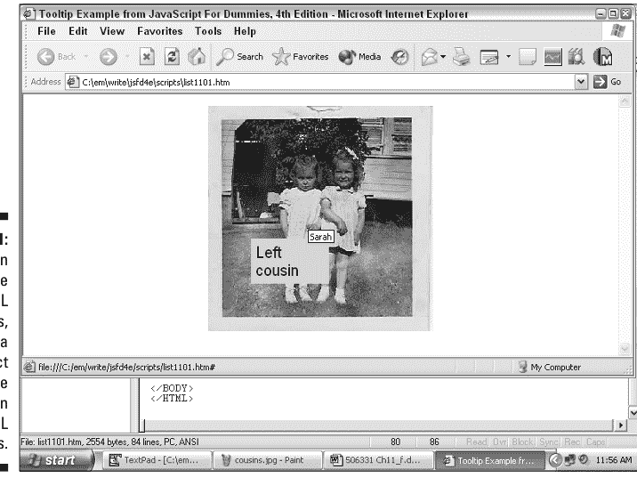

**图 11-2：将鼠标指针移动到照片的另一个部分会显示不同的提示。**

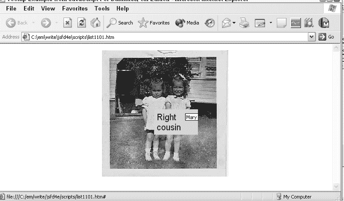

```text
file:///C:/cm/venite/jdfme/scripts/lt1101.html
<MAP>
上面的代码定义了一个映射
</MAP>
```

要创建图 11-1 所示的 HTML 提示，你需要如下所示为 `<AREA>` 标签关联 `ALT` 属性指定值：

```html
<MAP NAME="PicMap">
<AREA SHAPE="rect" COORDS="112,91,136,315" HREF="#" ALT="Sarah" />
<AREA SHAPE="rect" COORDS="180,81,200,320" HREF="#" ALT="Mary" />
</MAP>
```

这段代码显示了一个 280 x 280 像素的图像，上方覆盖了一个映射（名称为 PicMap），该映射定义了两个矩形区域。当用户移动到其中一个区域（坐标对应于 112,91,136,315）时，会出现 HTML 提示 Sarah。当用户移动到图片的另一个区域（由坐标 180,81,200,320 定义）时，会出现提示 Mary。

要创建一个在 Netscape Navigator 中出现的提示，你需使用 `TITLE` 属性来代替 `ALT` 属性：例如 `TITLE="Mary"`。

正如你将在接下来的章节中看到的，创建 DHTML 提示所需的代码要稍微复杂一些。

## 构建 DHTML 提示

使用 DHTML 创建提示涉及四个独立的步骤。我在这里描述这四个步骤，并在随后的章节中，我将为你提供用于图 11-1 和图 11-2 的示例代码。

1. 创建一个包含一个或多个指定区域的 HTML 映射。
   这一步与你用于创建 HTML 提示时使用的步骤相同。
2. 使用 HTML `<STYLE>` 和 `</STYLE>` 标签为提示定义样式。
   为提示定义样式会自动创建一个 JavaScript 可以访问的对象。
3. 创建自定义 JavaScript 函数来访问和更改提示对象。
   JavaScript 函数的目的是：如果提示尚未可见则显示它，如果它已可见则隐藏它。
4. 包含两个对自定义 JavaScript 函数的调用（参见步骤 3）：一个调用与 `onmouseover` 事件处理器关联（用于显示提示），另一个调用与 `onmouseout` 事件处理器关联（用于隐藏提示）。
   这些调用会导致提示在鼠标指针进入指定区域时出现，在鼠标指针离开指定区域时消失。

## 创建 HTML 映射并指定激活区域

当你创建 DHTML 提示时，需要做的第一件事是定义你希望激活的 Web 页面区域——即，你希望你的 Web 页面的哪些区域在响应用户鼠标指针时显示提示。在决定了页面的哪些区域需要激活后，使用 HTML 创建一个映射和多个激活区域，如列表 11-1 所示。

### 列表 11-1：定义 HTML 映射并指定激活区域

```html
<!-- 从 <MAP> 到 </MAP> 定义了一个 HTML 映射和激活区域。 -->
<MAP NAME="PicMap" ID="PicMap">
<AREA SHAPE="rect" COORDS="112,91,136,315" HREF="#" ALT="Sarah" />
<AREA SHAPE="rect" COORDS="180,81,200,320" HREF="#" ALT="Mary" />
<AREA SHAPE="rect" COORDS="59,26,208,64" HREF="#" ALT="bougainvillea" />
<AREA SHAPE="rect" COORDS="226,25,303,82" HREF="#" ALT="needs point" />
</MAP>
```

```html
<!-- 在图像上覆盖映射 -->

```


将鼠标指针移动到照片的另一个部分会显示不同的提示。


提示在鼠标指针进入指定区域时出现，在鼠标指针离开指定区域时消失。

## 为提示定义样式

第二步是使用 `<STYLE>` 和 `</STYLE>` 标签为提示定义样式。这会自动创建一个 JavaScript 可以访问的对象。列表 11-2 显示了样式定义。

### 列表 11-2：为提示定义样式

```html
<STYLE TYPE="text/css">
<!--
.tooltipStyle {background-color: pink; width: 100px; font: 20px arial, helvetica, sans-serif; padding: 5px; position: absolute; visibility: hidden;}
-->
</STYLE>
```

## 创建 JavaScript 函数

第三步是创建自定义 JavaScript 函数 `displayTip()` 和 `hideTip()` 来访问和更改提示对象。列表 11-3 显示了这些函数。

### 列表 11-3：创建 displayTip() 和 hideTip() 函数

```javascript
<SCRIPT LANGUAGE="JavaScript" TYPE="text/javascript">
<!-- 对旧版浏览器隐藏 -->
var latestBrowser = false;

if (document.getElementById) {
  latestBrowser = true;
}

function displayTip(theEvent, currentElement) {
  var tooltip;
  if (latestBrowser) {
    tooltip = document.getElementById(currentElement).style;
  } else {
    tooltip = eval("document.all." + currentElement + ".style");
  }

  if (document.all) {
    tooltip.pixelTop = parseInt(theEvent.y) + 2;
    tooltip.pixelLeft = Math.max(2, parseInt(theEvent.x) - 75);
  } else {
    if (latestBrowser) {
      tooltip.top = parseInt(theEvent.pageY) + 2 + "px";
      tooltip.left = Math.max(2, parseInt(theEvent.pageX) - 75) + "px";
    } else {
      tooltip.top = parseInt(theEvent.pageY) + 2;
      tooltip.left = Math.max(2, parseInt(theEvent.pageX) - 75);
    }
  }
  tooltip.visibility = "visible";
}

function hideTip(currentElement) {
  var tooltip;
  if (latestBrowser) {
    tooltip = document.getElementById(currentElement).style;
  } else {
    tooltip = eval("document.all." + currentElement + ".style");
  }
  tooltip.visibility = "hidden";
}
// 隐藏脚本结束 -->
</SCRIPT>
```

## 将函数调用绑定到鼠标事件

第四步是包含对自定义 JavaScript 函数的调用：一个与 `onmouseover` 事件处理器关联，另一个与 `onmouseout` 事件处理器关联。列表 11-4 显示了这一绑定过程。

### 列表 11-4：将 displayTip() 和 hideTip() 调用绑定到鼠标事件

```html
<MAP NAME="PicMap" ID="PicMap">
<AREA SHAPE="rect" COORDS="112,91,136,315" HREF="#"
  onMouseOut="hideTip('tooltip1')"
  onmouseover="displayTip(event,'tooltip1')" ALT="Sarah" />
<AREA SHAPE="rect" COORDS="180,81,200,320" HREF="#"
  onMouseOut="hideTip('tooltip2')"
  onmouseover="displayTip(event,'tooltip2')" ALT="Mary" />
<AREA SHAPE="rect" COORDS="226,208,200,684" HREF="#"
  onMouseOut="hideTip('tooltip3')"
  onmouseover="displayTip(event,'tooltip3')" ALT="bougainvillea" />
<AREA SHAPE="rect" COORDS="226,25,303,282" HREF="#"
  onMouseOut="hideTip('tooltip4')"
  onmouseover="displayTip(event,'tooltip4')" ALT="needs paint" />
</MAP>

<SPAN CLASS="tooltipStyle" ID="tooltip1">left cousin</SPAN>
<SPAN CLASS="tooltipStyle" ID="tooltip2">Right cousin</SPAN>
<SPAN CLASS="tooltipStyle" ID="tooltip3">Iree</SPAN>
<SPAN CLASS="tooltipStyle" ID="tooltip4">Shutters</SPAN>
```

列表 11-4 中的大部分代码也出现在本章的列表 11-1 中。这里添加的新代码部分是 `onMouseOut` 和 `onmouseover` 定义。

如你从列表 11-4 所示，JavaScript 函数 `displayTip()` 被绑定到每个活动区域的 `onmouseover` 事件处理器，而 JavaScript 函数 `hideTip()` 被绑定到这些相同活动区域的 `onMouseOut` 事件处理器上。（要查看 `displayTip()` 和 `hideTip()` 函数的 JavaScript 代码，请翻到列表 11-3。）

如果你对更多关于事件和事件处理器（包括 `onMouseOut` 和 `onmouseover`）的内容感兴趣，请翻到第 13 章，该章专门介绍这些主题。


这意味着在运行时，当用户将鼠标移动到其中一个活动区域上（活动区域使用 `<AREA>` 标签定义）时，JavaScript 解释器会调用 `displayTip()` 函数，并发送以下两个参数：

1. 适当的事件对象。
2. 要显示的提示框名称：`tooltip1`、`tooltip2`、`tooltip3` 或 `tooltip4`。（提示框名称和内容通过使用 `<SPAN>` 和 `</SPAN>` 标签定义，如列表 11-4 所示。）

然后，当用户离开活动区域时，JavaScript 解释器会调用 `hideTip()` 函数，并发送要隐藏的提示框名称。

## 汇总整合：使用 DHTML 创建简单的提示框

有时你会发现实验一个包含 DHTML 提示框所有必要元素的运行脚本非常有用：定义你想要创建提示框的活动区域的 HTML 代码、定义提示框外观的样式代码，以及告诉 Web 浏览器显示（或隐藏）适当提示框的 JavaScript 代码。

在列表 11-5 中，你可以发现一个完整的脚本。列表 11-5 提取了列表 11-1 到 11-4 中看到的代码，以演示每个部分是如何组合在一起的。

你可以在配套 CD 的文件 `list1105.htm` 中找到列表 11-5 中的代码。

### 列表 11-5：全部内容：一个运行的提示框脚本

```html
<HTML>
<HEAD>
<TITLE>JavaScript for Dummies, 第4 版中的提示框示例</TITLE>
<SCRIPT TYPE="text/javascript" LANGUAGE="JavaScript">
<!-- 为旧浏览器隐藏脚本 -->
var latestBrowser = false;
if (document.getElementById) {
  latestBrowser = true;
} else {
  latestBrowser = false;
}

function displayTip(theEvent, currentElement) {
  var tooltip;
  if (latestBrowser) {
    tooltip = document.getElementById(currentElement).style;
  } else {
    tooltip = eval("document.all." + currentElement + ".style");
  }

  if (document.all) {
    tooltip.pixelTop = parseInt(theEvent.y) + 2;
    tooltip.pixelLeft = Math.max(2, parseInt(theEvent.x) - 75);
  } else {
    if (latestBrowser) {
      tooltip.top = parseInt(theEvent.pageY) + 2 + "px";
      tooltip.left = Math.max(2, parseInt(theEvent.pageX) - 75) + "px";
    } else {
      tooltip.top = parseInt(theEvent.pageY) + 2;
      tooltip.left = Math.max(2, parseInt(theEvent.pageX) - 75);
    }
  }
  tooltip.visibility = "visible";
}

function hideTip(currentElement) {
  var tooltip;
  if (latestBrowser) {
    tooltip = document.getElementById(currentElement).style;
  } else {
    tooltip = eval("document.all." + currentElement + ".style");
  }
  tooltip.visibility = "hidden";
}
// 隐藏脚本结束 -->
</SCRIPT>

<STYLE TYPE="text/css">
<!--
.tooltipStyle {background-color: pink; width: 100px; font: 20px arial, helvetica, sans-serif; padding: 5px; position: absolute; visibility: hidden;}
-->
</STYLE>
</HEAD>

<BODY>
<MAP NAME="PicMap" ID="PicMap">
  <AREA SHAPE="rect" COORDS="112,91,136,315" HREF="#"
  onMouseOut="hideTip('tooltip1')" onmouseover="displayTip(event,'tooltip1')" ALT="Sarah" />
  <AREA SHAPE="rect" COORDS="180,81,200,320" HREF="#"
  onMouseOut="hideTip('tooltip2')" onmouseover="displayTip(event,'tooltip2')" ALT="Mary" />
  <AREA SHAPE="rect" COORDS="226,208,200,684" HREF="#"
  onMouseOut="hideTip('tooltip3')" onmouseover="displayTip(event,'tooltip3')" ALT="bougainvillea" />
  <AREA SHAPE="rect" COORDS="226,25,303,282" HREF="#"
  onMouseOut="hideTip('tooltip4')" onmouseover="displayTip(event,'tooltip4')" ALT="needs paint" />
</MAP>

<SPAN CLASS="tooltipStyle" ID="tooltip1">left cousin</SPAN>
<SPAN CLASS="tooltipStyle" ID="tooltip2">Right cousin</SPAN>
<SPAN CLASS="tooltipStyle" ID="tooltip3">Iree</SPAN>
<SPAN CLASS="tooltipStyle" ID="tooltip4">Shutters</SPAN>


</BODY>
</HTML>
```

## 利用第三方提示脚本

如果你不想花费时间和精力去弄清楚手动编写 DHTML 提示所需的所有内容，你可能会发现第三方提示工具正是你所需要的。第三方提示工具——你可以在 Web 上找到一些以低成本甚至免费获取的工具——允许你以最少的精力创建自定义的提示。

以下列表代表了可用工具的一部分：

- **Walter Zorn 的 Tooltip**：一个功能强大、免费的跨浏览器工具。访问 `walterzorn.de/tooltip/tooltip_e.htm`。
- **OverLib**：另一个流行的免费库。访问 `bosrup.com/web/overlib/`。

# 第 12 章：处理表单

## 本章内容

- 创建输入验证脚本
- 各人有志：使用正则表达式进行数据验证
- 调用验证脚本
- 将一切整合于整体：订单验证脚本
- 给他们反馈

输入验证通常属于以下三个类别之一：

- **存在性**：测试一个值是否存在。
- **数字**：确保信息仅为数字。
- **模式**：测试特定的规范，例如电话号码中的标点符号、电子邮件地址、社会安全号码或日期。

在列表 12-1 中，我们展示了验证极其常见的模式类别：电子邮件地址所需的 JavaScript 代码。（本章中的订单表单脚本部分演示了存在性和数字验证的示例，以及模式验证。）

图 12-1 显示了这段代码的运行情况。你可以通过将随附 CD 中的 `list1201.htm` 文件加载到你的 Web 浏览器中尝试这些技术。

**图 12-1：嘿，那不是电子邮件地址**


## 数据清洗/反馈示例

在下方的输入字段中输入一个无效的电子邮件地址（如 `XYZ`）。完成后，点击此处。

2. 然后，在字段中输入有效的电子邮件地址（如 `email@example.com`），并点击此处。

电子邮件地址：`xyz`

## 列表 12-1：验证电子邮件地址模式的脚本

```javascript
<SCRIPT LANGUAGE="JavaScript" TYPE="text/javascript">
///////////////////////////////////////////////////////
// 此函数测试有效电子邮件地址中包含
// 的标点字符 (. , 和 @)
///////////////////////////////////////////////////////

function isAValidEmail(inputValue) {
    var foundDot = false;
    var foundAt = false;
    var atPosition = -1;
    var dotPosition = -1;

    // 遍历电子邮件地址的每一个字符
    // 当检测到 @ 符号和点时（如果）
    // 设置标记位。

    for (var i = 0; i < inputValue.length; i++) {
        if (inputValue.charAt(i) == "@") {
            foundAt = true;
            atPosition = i;
        }
        else if (inputValue.charAt(i) == ".") {
            foundDot = true;
            dotPosition = i;
        }
    }

    if (foundAt && foundDot && atPosition < dotPosition) {
        alert("感谢提供电子邮件地址！");
        return true;
    } else {
        alert("抱歉，你输入的地址无效。");
        return false;
    }
}
</SCRIPT>
```

## 调用验证脚本

对于网页用户来说，没有什么比这更令人烦恼了：在表单中输入大量信息，点击表单的提交按钮，然后在漫长的等待之后——看到一条通用的错误消息，提示你填写的内容有误。

JavaScript 允许你根据需要检查每个输入字段，并弹出即时反馈让用户知道（在他们 Tab 到长表单末尾之前）他们需要进行修正。

在列表 12-3 所示的 JavaScript 代码中，`isValidEmail()` 函数（我在列表 12-1 中定义）是从 HTML 文本元素的处理程序中调用的。结果是？在文本元素中输入电子邮件地址并点击网页上的其他地方，就会触发 `isValidEmail()` 函数的执行（参见图 12-1）。

### 列表 12-3：从 onblur 事件处理程序调用 isValidEmail() 函数

```html
<BODY>
<h1>数据清洗/反馈</h1>
<ul>
  <li>在下方的输入字段中输入一个无效的电子邮件地址（例如 <i>XYZ</i>）。完成后，点击 <b>这里</b>。</li>
  <li>然后，在字段中输入一个有效的电子邮件地址（例如 <i>emily@emilyv.com</i>），并点击 <b>这里</b>。</li>
</ul>
<FORM NAME="myForm">
E-mail address（电子邮件地址）
<BR>
<!-- 使用在 emailAddress 文本字段中输入的值调用 isValidEmail()。 -->
<INPUT TYPE="text" SIZE="25" NAME="emailAddress"
onblur="isValidEmail(this.value)">
</FORM>
</BODY>
```

## 将一切整合于整体：订单验证脚本

在本节的示例中，你将看到如何创建一个智能表单，通过两种不同的方式来验证数据：

- **在字段级**：你可以在用户离开某个字段时立即对该独立字段进行验证。独立字段是你要求必须填写的字段（例如信用卡购买时需要的信用卡号），无论用户对任何其他字段使用了什么。（你在本章稍前的“创建输入验证脚本”中已经看到过字段级验证的示例。）
- **在表单级**：你希望在用户完成整个表单并点击表单的提交按钮时，验证依赖字段。依赖字段是指根据用户对一个或多个其他字段的使用，你可能验证也可能不验证的字段。例如，除非用户指定他们希望接收你的电子通讯，否则你可能不要求电子邮件地址。


## 数值辅助

JavaScript 提供了几个内置函数，可以帮助识别一个值是否为数字：

- `parseInt()`：尝试将一个值转换为整数；返回整数值或 `NaN`（如果该值无法转换为数字）。这两行代码说明：
  ```javascript
  var result = parseInt("123");
  // 变量 result 被设置为数值 123。
  var result = parseInt("Emily");
  // 结果被设置为 NaN（不是数字）。
  ```
- `parseFloat()`：尝试将一个值转换为浮点数（小数）；返回浮点数值或 `NaN`（如果该值无法转换为数字）。这些示例向你展示了如何：
  ```javascript
  var result = parseFloat("45.6");
  // 变量 result 被设置为数值 45.6。
  var result = parseFloat("grumpy");
  // 变量 result 被设置为 NaN。
  ```
- `isNaN()`：此函数代表 Not a Number，如果传递给它的值不是数字，则返回 `true`，否则返回 `false`（是的，双重否定很困惑，不是吗？）。这里有两个示例：
  ```javascript
  var result = isNaN(3);
  // 变量 result 被设置为 false；3 是一个数字。
  var result = isNaN("George Clooney");
  // 变量 result 被设置为 true，因为字符串值不是数字。
  ```

你在本章看到的示例针对一家名为 Webmeister 的虚构 Web 设计公司。为了让访问者请求 Web 服务的个性化报价，公司决定创建一个 HTML 表单并附加 JavaScript 脚本以实现这些设计目标：

- **验证必填字段的有效性**：为了成功提交请求，Webmeister 的访问者必须输入服务类别、姓和名，以及至少一种联系方式（电话或电子邮件）。在后续章节的代码中，`exists()` 函数实现了这些验证检查。在本示例中，存在性验证在字段级和表单级上都进行了。
- **验证两个模式字段**：脚本必须检查电话号码和电子邮件地址以确保它们是有效的。`isValidPhoneNumber()` 和 `isValidEmail()` 分别在表单级实现这些验证检查。
- **验证数值字段**：通用的 `isNumber()` 函数辅助在表单级验证数字。

图 12-2 显示了订单的样子。

**图 12-2：表单**


## 检查存在性

你可以通过在字段事件处理程序上附加验证脚本，要求用户提供值。在本示例中，Webmeister 开发者想要确保姓名存在。列表 12-4 向你展示了必要的 JavaScript。

### 列表 12-4：测试值的存在性

```javascript
function exists(inputValue) {
    var aExists = false;

    // 使用 charAt 遍历 inputValue
    for (var i = 0; i < inputValue.length; i++) {
        if (inputValue.charAt(i) != " " && inputValue.charAt(i) != "") {
            aExists = true;
            break;
        }
    }

    return aExists;
}
```

列表 12-4 中的代码基于这些原理：`exists()` 函数接收一个输入值（即 `inputValue`）。一旦 `exists()` 函数接收到该值，就会检查该值是否包含非空格字符。返回非空格字符或默认值 `false`。

如果你查看列表下方，你会看到调用 `exists()` 函数的两个输入字段，包括这个：

```html
<INPUT TYPE="text" NAME="firstName" SIZE="25" onblur="if (!exists(this.value)) { alert('Please enter a first name'); }">
<INPUT TYPE="text" NAME="lastName" SIZE="35" onblur="if (!exists(this.value)) { alert('Please enter a last name'); }">
```

之前的 JavaScript 语句为 `onblur` 事件处理程序的 `firstName` 字段定义了值。当用户失去 `firstName` 字段焦点时，值会被传递给 `exists()` 函数。如果 `exists()` 返回 `false`（`!` 运算符是“如果为假”的简写），就会弹出消息提醒用户输入名字。当用户点击“您的名字”字段并在不输入任何值的情况下离开时，代码会显示提醒消息（参见图 12-3）。

**图 12-3：每个人都必须有（并输入）姓名。**

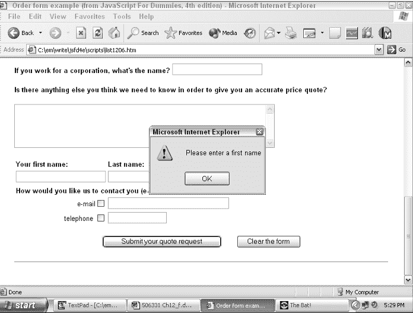

## 测试数值值

你可以通过在字段事件处理程序上附加数值验证脚本，要求用户为 HTML 表单字段提供有效的数字。关于执行此验证的 JavaScript 代码示例，请看列表 12-5。

### 列表 12-5：测试以确保一个值是数字

```javascript
// 定义 isNumber() 函数
function isNumber(inputValue) {
  // 假设刚开始一切都是正确的。
  var result = true;

  // 如果 parseFloat() 返回 NaN，则在第一个位置
  // 检测到了一个非数字字符。
  if (isNaN(parseFloat(inputValue))) {
    result = false;
  }
  // 否则，检查剩余的数字。
  else {
    for (var i = 0; i < inputValue.length; i++) {
      if (inputValue.charAt(i) != " ") {
        if (isNaN(parseFloat(inputValue.charAt(i)))) {
          result = false;
          break;
        }
      }
    }
  }
  // 返回 true（inputValue 是一个有效数字）或 false（无效）。
  return result;
}

function isValidPhoneNumber(inputValue) {
  var digitsFound = 0;
  for (var i = 0; i < inputValue.length; i++) {
    // 在另一个自定义函数内部调用 isNumber() 函数
    if (isNumber(inputValue.charAt(i))) {
      digitsFound++;
    }
  }
}
```

`isNumber()` 函数定义使用了 JavaScript 内置函数 `parseFloat()` 来过滤掉所有不是以数字开头的值。（如果 `parseFloat()` 遇到的第一个字符无法转换为数字，则 `parseFloat()` 函数返回 `NaN`。）

如果第一个字符是数字但后续字符不是的（例如，为了捕获类似 `5F5-1212` 的错误），`isNumber()` 会遍历 `inputValue` 中的所有剩余字符，以检查是否检测到非数字字符。

列表 12-5 中的最后几条语句向你展示了如何调用 `isNumber()` 函数的示例。在这个示例中，`isValidPhoneNumber` 函数（你将在下一节详细检查它）作为其验证程序的一部分调用了 `isNumber()` 函数。

## 测试模式

本章之前展示过的列表 12-1 演示了你可能如何验证一个非常常见的模式：电子邮件地址。在这里，你看到了模式验证的另一个常见用例：确保用户输入有效的电话号码。列表 12-6 显示了具体代码。

### 列表 12-6：验证电话号码

```javascript
// 定义 isValidPhoneNumber() 函数
function isValidPhoneNumber(inputValue) {
    var digitsFound = 0;

    // 遍历输入以查看它包含多少个数字
    for (var i = 0; i < inputValue.length; i++) {
        if (isNumber(inputValue.charAt(i))) {
            digitsFound++;
        }
    }

    // 如果 inputValue 包含至少 10 个数字，假设它是有效的电话号码。
    if (digitsFound >= 10) {
        return true;
    } else {
        return false;
    }
}

// 调用 isValidPhoneNumber() 函数
if (!isValidPhoneNumber(inputValue)) {
    alert("除非你提供电话号码，否则我们无法通过电话联系你（请确保包含区号）。谢谢！");
}
```

你在列表 12-6 中使用的代码检查一个值是否包含十个数字；如果是，则该值就通过了有效电话号码的测试。

有时你想要创建比这更严格的模式。例如，你可能希望确保用户在电话号码中包含括号和连字符。有关如何实现此点的示例（以及一些注意事项），请参阅侧边栏“模式匹配的替代方法”。

## 表单级验证

有时你希望在用户输入值或通过 Tab 键离开字段时立即验证字段。（列表 12-4 向你展示了一个独立验证的示例。）

但有时你希望在用户完成信息输入之前再开始验证。例如，Web 表单允许用户指定希望通过电子邮件还是电话接受联系。必须至少选择一个选项，如果用户一离开电子邮件字段就触发验证，将是毫无用的（且令人厌烦的）。毕竟，该用户很可能打算选择电话号码选项；在用户填完整个表单之前，你无法获知。

**图 12-4：使用表单级验证来确保至少填写了一个选项。**


### 侧边栏：模式匹配的替代方法

如果你需要定义一个比我在列表 12-6 中描述的电话号码示例更严格的模式，请查看此侧栏中的 JavaScript 代码，它要求用户按以下格式输入电话号码：

```
(512)555-1212
```

正如你在下面的示例所示，`substring()` 方法允许你将一个值分成若干块，并确保每个块都是有效的。例如，这段代码指示解释器分别提取并检查括号、区号和线路。

```javascript
function isValidPhoneNumberStrict(inputValue) {
  // 检查格式 (XXX)XXX-XXXX
  if (inputValue.length != 13) return false;
  if (inputValue.substring(0,1) != "(") return false;
  if (inputValue.substring(4,5) != ")") return false;
  if (inputValue.substring(8,9) != "-") return false;
  // 检查区号、前缀、线路号是否为数字
  var areaCode = inputValue.substring(1,4);
  var prefix = inputValue.substring(5,8);
  var lineNum = inputValue.substring(9,13);
  return isNumber(areaCode) && isNumber(prefix) && isNumber(lineNum);
}
```

这种方法的用处是？它确保用户输入的完全是你希望他们输入的内容，从而减少了误解的可能性。缺点是，你期望用户输入一串完全符合要求的字符——这个过程充其量是困难的！（请记住，Web 是全球性的，你可能熟悉的模式在世界其他地区的人可能并不熟悉。）

一个可以遵循的良好规则是：除非你绝对必须定义一种比列表 12-6 中描述的电话号码示例更严格的模式，否则请使用宽松的验证。

## 给他们反馈

给予用户适当、及时的反馈可能是困惑网站与高效易用网站之间的区别。以下是在你决定如何与用户交互时需要考虑的几点。

- **某些情况下，你可能能够调整输入数据以适应自己，而完全不打扰用户。** 例如，仅仅因为你希望看到大写字母并不意味着用户必须以大写字母输入。显示错误并请求用户重试，不如你可以轻松地使用字符串的 `toUpperCase()` 方法将其转换为大写。
- **不要大吼！** 没有人喜欢被大吼，全大写且以感叹号结尾的消息都是在大喊！你想说什么就说什么，只需使用正常的大小写和标点符号。
- **通常情况下，不要特别关心用户输入什么**（例如，如果你是在要求对产品提供自由意见）。在其他时候，用户使用的内容是关键的。对于那些关键的时刻，务必在页面上让用户知道期望的格式。
- **给你的用户拍拍掌。** 不要只在用户输入错误时才提示。让用户知道一切按计划进行同样有用。例如，当表单通过所有验证检查时告诉他们。
- **当你确实需要弹出错误消息时，请确保它告诉用户他们的输入到底出了什么问题。** “格式无效”请避免！
- **测试它。** 确保你仔细测试你的表单，涵盖用户可能预期的每种错误。很少有用户比陷入一个拒绝消失的错误循环更感到沮丧了，即使他们已经发现了问题并纠正了它。

**图 12-5：订单示例（摘自《JavaScript 入门》，第 4 版） - Microsoft Internet Explorer**

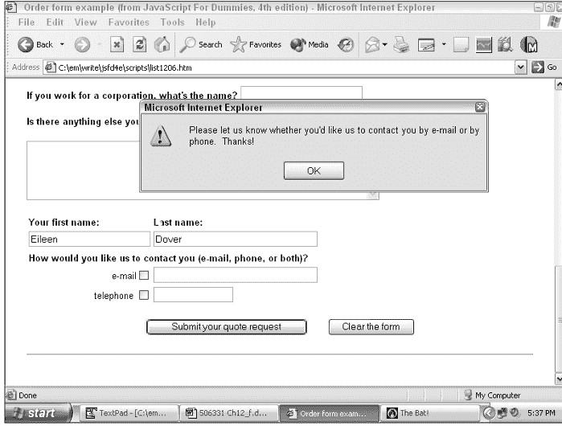

## 列表 12-7：使用 validateForm() 函数实现依赖性验证检查

```html
<HTML>
<HEAD>
<TITLE>订单示例（摘自《JavaScript 入门》，第 4 版）</TITLE>
<SCRIPT LANGUAGE="JavaScript" TYPE="text/javascript">
<!-- 对未启用 JavaScript 的浏览器隐藏此脚本 -->
///////////////////////////////////////////////////////
// 检查值是否包含非数字数据。
///////////////////////////////////////////////////////
function isANumber(inputValue) {
  // 假设一切都是正确的。
  var result = true;

  // 如果 parseFloat 返回 NaN，则在第一个位置
  // 检测到非数字字符。
  if (isNaN(parseFloat(inputValue))) {
      result = false;
  }
  // 否则，我们还需要检查剩余的数字，因此逐个检查 inputValue 的字符，如果遇到任何非数字字符，将 result 设置为 false
  else {
      for (var i = 0; i < inputValue.length; i++) {
          if (inputValue.charAt(i) != " ") {
              if (isNaN(parseFloat(inputValue.charAt(i)))) {
                  result = false;
                  break;
              }
          }
      }
  }
  // 返回 true（inputValue 是一个有效数字）或 false（无效）。
  return result;
}

// 检查输入值是否包含 "@" 和 "."
function isValidEmail(inputValue) {
    var foundAt = false;
    var foundDot = false;

    // 遍历 inputValue 寻找 "@" 和 "."
    for (var i = 0; i < inputValue.length; i++) {
        if (inputValue.charAt(i) == "@") {
            foundAt = true;
        } else if (inputValue.charAt(i) == ".") {
            foundDot = true;
        }
    }

    // 如果都存在了 "@" 和 "."，则假设电子邮件地址是有效的；否则返回 false，以便调用代码知道电子邮件地址是无效。
    if (foundAt && foundDot) {
        return true;
    } else {
        return false;
    }
}

/////////////////////////////////////////////////
// 检查输入值是否包含十个或更多数字。这种方法允许用户输入美国式的电话格式，例如 (123)456-7890，以及欧洲风格的（例如 123.456.7890）。
///////////////////////////////////////////////////////
function isValidPhoneNumber(inputValue) {
    var digitsFound = 0;

    // 遍历 inputValue 以查看它包含多少个数字。
    for (var i = 0; i < inputValue.length; i++) {
        if (isNumber(inputValue.charAt(i))) {
            digitsFound++;
        }
    }

    // 如果 inputValue 包含至少 10 个数字，假设它是一个有效的电话号码。
    if (digitsFound >= 10) {
        return true;
    } else {
        return false;
    }
}

/////////////////////////////////////////////////////
// 检查字符是否存在。（不计入空格）。
///////////////////////////////////////////////////////
function exists(inputValue) {
    var aCharExists = false;

    // 遍历 inputValue，使用 charAt() 方法检测非空格字符。
    for (var i = 0; i < inputValue.length; i++) {
        if (inputValue.charAt(i) != " " && inputValue.charAt(i) != "") {
            aCharExists = true;
            break;
        }
    }
    return aCharExists;
}

///////////////////////////////////////////////////////////////////////
// 执行跨字段检查，这些检查在所有数据都完成之前无法进行。
///////////////////////////////////////////////////////////////////////
function validateForm() {
    var rc = true;

    // 依赖检查 #1：确保勾选了服务类别
    // 访问者必须勾选以下选择之一以获得准确的报价：即他们是否对设计、维护或推广服务感兴趣。
    if (!document.quoteForm.designChoice.checked &&
        !document.quoteForm.mainChoice.checked &&
        !document.quoteForm.promoChoice.checked) {
        alert("请检查您是否对我们的设计、维护或推广服务感兴趣，以便我们为您提供更准确的报价。谢谢！");
        rc = false;
    }

    // 依赖检查 #2：确保如果用户勾选了“员工”，则公司存在
    // 如果访问者是员工，他们需要指定公司名称。
    if (document.quoteForm.bizChoice[1].checked) {
        if (!document.quoteForm.corpName.value) {
            alert('您指定了是员工，那么可以输入公司名称吗？');
            rc = false;
        }
    }

    // 依赖检查 #3：双重检查姓名是否都存在
    // 访问者需要姓和名。
    if (!exists(document.quoteForm.firstName.value) ||
        !exists(document.quoteForm.lastName.value)) {
        alert('请输入您的姓名（名和姓）。谢谢！');
        rc = false;
    }

    // 依赖检查 #4：确保用户输入了电子邮件地址或电话号码
    // 访问者需要指定电子邮件或电话号码。
    if (!document.quoteForm.emailChoice.checked &&
        !document.quoteForm.phoneChoice.checked) {
        alert('请告诉我们您希望通过电子邮件还是电话联系我们。谢谢！');
        rc = false;
    }

    // 依赖检查 #5：如果用户选择了电子邮件联系选项，则确保电子邮件地址存在
    // 访问者告诉我们希望我们通过电子邮件联系他们，如果他们没有填写电子邮件地址（电话也是如此）。
    if (document.quoteForm.emailChoice.checked &&
        !isValidEmail(document.quoteForm.emailAddr.value)) {
        alert('除非您提供有效的电子邮件地址，否则我们无法通过电子邮件联系您。谢谢！');
        rc = false;
    } else if (document.quoteForm.phoneChoice.checked &&
        !isValidPhoneNumber(document.quoteForm.phoneNumber.value)) {
        alert('除非您提供电话号码，否则我们无法通过电话联系您（请确保包含区号）。谢谢！');
        rc = false;
    }

    if (rc) {
        // 如果 rc 变量为 true，则表单数据顺利通过了验证
        alert('谢谢！我们很快就会为您提供报价。');
    }
    return rc;
// -->
</SCRIPT>
</HEAD>

<BODY>
...
<!-- 表单 HTML 结构省略，核心验证逻辑见上方 validateForm 函数 -->
</BODY>
</HTML>
```

# 第 13 章：处理用户触发的事件

## 本章内容

- 熟悉事件与事件处理器的区别
- 查看与不同对象相关的事件
- 观察事件处理器的运行

JavaScript 帮助你将静态的 Web 页面转换为交互式的 Web 应用程序。是什么功能让这种客户端交互成为可能呢？谦虚而可爱的事件处理器。你可以将处理器想象成小小的软件弹簧，将自定义的 JavaScript 代码绑定到事件，例如点击按钮或链接、加载页面、在输入字段中输入数据等。

你可以在整本书中看到事件处理器的示例。在本章中，我将重点介绍大多数开发者认为最有用的事件处理器——与窗口、鼠标、表单和键盘事件相关的事件处理器。在这里，你将了解到如何创建并将本质脚本附加到此类用户驱动事件，如打开 Web 页面窗口、移动鼠标指针、与 HTML 表单交互以及按下按键。

## 事件与事件处理器概述

在 Web 编程术语中，事件是 Web 页面上发生的任何事情。

事件的示例包括：

- 窗口或框架的打开或关闭
- 鼠标指针移动到图像、链接或 HTML 表单上或离开
- 在页面任何地方点击或双击鼠标
- 按下键

通过使用 JavaScript，你可以对任何事件执行操作。例如，当用户打开 Web 页面时播放一首欢迎曲；当用户鼠标悬停在 Web 页面某个区域时显示解释性文本；在用户输入数据时立即进行验证；以及对按键做出响应。

### 处理事件

你通过向单个元素附加事件处理器来处理事件。事件处理器仅仅是属性-值对，允许你在事件发生时进行捕获并响应。例如，以下代码定义了一个按钮，点击它时会调用一个 JavaScript 函数。

```html
<input type="button" onclick="calculate()">
```

Netscape 和 Internet Explorer 提供了你可以处理的不同级别的事件。此外，由于事件处理依赖于平台，表 13-1 列出了浏览器支持的事件。

| 事件处理器 | 支持的对象 | 事件（触发时机……） |
| :--- | :--- | :--- |
| `onblur` | 元素 | 元素失去输入焦点。 |
| `onchange` | 复选框、文件上传、单选、选择、Textarea | 用户在元素中输入文本。 |
| `onclick` | 按钮、复选框、文件上传、图像、单选、选择、提交、Textarea | 元素被点击一次。 |
| `ondblclick` | 按钮、复选框、文件上传、图像 | 元素连续点击两次。 |
| `onerror` | 图像 | 图像未完成加载或损坏。 |
| `onfocus` | 按钮、复选框、文件上传、单选、选择、Textarea | 元素获得输入焦点。 |


| 事件处理程序 | 支持的对象 | 事件（当...时触发事件处理程序） |
| :--- | :--- | :--- |
| `onkeydown` | 按钮、复选框、文件上传、单选、选择、Textarea | 用户按下按键。 |
| `onkeypress` | 按钮、复选框、文件上传、单选、选择、Textarea | 用户按下并释放按键（结合了 `onkeydown` 和 `onkeyup`）。 |
| `onkeyup` | 按钮、复选框、文件上传、单选、选择、Textarea | 用户释放之前按下的按键。 |
| `onload` | 图像、窗口（框架） | 元素加载成功。 |
| `onmousedown` | 按钮、复选框、文件上传、图像、单选、选择、提交、Textarea | 用户按下鼠标按钮（但不释放）。 |
| `onmouseout` | 图像（及区域）、链接 | 鼠标移出元素。 |
| `onmouseover` | 图像（及区域）、链接 | 鼠标移动到元素上。 |
| `onmouseup` | 按钮、复选框、文件上传、图像、单选、选择、提交、Textarea | 用户释放之前点击的鼠标按钮。 |
| `onmove` | 窗口（框架） | 用户移动或调整框架大小。 |
| `onreset` | 表单 | 表单重置；用户点击重置按钮，或者程序员调用了 `form.reset()` 方法。 |
| `onresize` | 窗口（框架） | 用户调整窗口大小。 |
| `onSubmit` | 表单 | 表单被提交；用户点击提交按钮，或者程序员调用了 `form.submit()` 方法。 |
| `onunload` | 窗口 | 用户卸载文档（通过关闭浏览器或加载另一个文档）。 |

许多程序员发现四类事件处理器是最常用的：窗口相关的事件、鼠标相关的事件、表单相关的事件和按键相关的事件。在接下来的章节中，我将向你展示这四类重要事件的每一个示例。

## 第 13 章：处理用户触发的事件

## 事件就是一切

Navigator 和 Internet Explorer 都支持 `Event` 对象的概念，该对象专为高级事件处理场景设计。理论上，你可以使用 `Event` 对象来捕获并检查发生事件的细微细节。例如，如果用户点击了鼠标按钮，你可以使用与 `Event` 对象相关的方法和属性来确定用户点击了哪个鼠标按钮，甚至确定点击时指针的坐标。如果用户按下了一个键，你可以使用与 `Event` 对象相关的方法和属性来确定访客按了哪个键（或哪个按键组合）。可能性是多多的。然而，在本书期间，JavaScript 对 `Event` 对象的支持在浏览器之间并不一致——关于 Navigator 支持的文档几乎不存在。有关 `Event` 对象以及它在 Internet Explorer 中如何实现的更多信息，请参阅：

```
http://msn.microsoft.com/workshop/author/html/reference/objects/obj_event.asp
```

## 窗口事件

大多数网络用户所熟悉的事件之一是弹出广告——当你将 Web 页面加载到浏览器时自动出现的一个微小（或不那么小）窗口。弹出广告绑定在 `onload` 事件处理程序上（有时 `onload` 事件处理程序也会在你尝试离开某个站点时用额外的弹出广告来拦截你）。

除了 `onload` 和 `onunload` 事件处理程序外，窗口和帧（一种特殊的窗口）还支持表 13-2 所示的事件处理程序，包括 `onBlur`、`onFocus` 和 `onResize`。

| 表 13-2 | 窗口及相关的事件处理程序 |
| :--- | :--- |
| 事件处理程序 | 事件（当...时触发事件处理程序） |
| `Blur` | 元素失去输入焦点。（点击元素外部或点开元素将夺去该元素的输入焦点。） |
| `onfocus` | 元素获得焦点。 |
| `onLoad` | 元素加载成功。 |
| `onMove` | 用户移动或调整窗口或帧的大小。 |
| `onResize` | 用户调整窗口或帧的大小。 |
| `onload` | 用户卸载文档（通过关闭浏览器或加载另一个文档）。 |

你通过为窗口的事件处理程序定义值来触发窗口事件的 JavaScript 代码。例如，以下代码在用户卸载（关闭或离开）Web 页面时显示告别消息。

```
<BODY onload="alert('Goodbye, and thank you for stopping by my Web site');">
```

## 鼠标事件

鼠标事件使得酷的交互效果成为可能，例如悬停（见第 8 章）和工具提示（见第 11 章）。当鼠标指针移动到某些物体上或点击某些物体时，会发生此类对象鼠标事件。例如，以下代码将两个函数（`displayTooltip()` 和 `hideTooltip()`）绑定到与 HTML 定义区域相关的 `mouseOver` 和 `mouseOut` 处理程序上。

```
<MAP name="PicMap" id="PicMap">
<AREA SHAPE="rect" COORDS="226,25,302,82" HREF="#"
mouseOut="hideTooltip('tooltip4')"
mouseOver="displayTooltip(event,'tooltip4')">
```

表 13-3 描述了额外的鼠标事件以及与这些事件相关的对象和处理程序。

| 事件处理程序 | 支持的对象 | 事件（当...时触发事件处理程序） |
| :--- | :--- | :--- |
| `mouseDown` | Button, Checkbox, document, FileUpload, Image (and Area), Link, Password, Radio, Reset, Select, Submit, Textarea | 用户按下了鼠标按钮（但未释放）。 |
| `mouseOut` | Image (and Area), Link | 鼠标移出元素。 |
| `mouseOver` | Image (and Area), Link | 鼠标移入元素。 |
| `mouseUp` | Button, Checkbox, document, FileUpload, Image (and Area), Link, Password, Radio, Reset, Select, Submit, Textarea | 用户释放了之前点击的鼠标按钮。 |

## 表单事件

HTML 定义了一些表单元素或控件（推入按钮、单选按钮、复选框等）。这些元素中的每一个都与相应的事件处理程序相关。

例如，在一个按钮的生命周期中可以发生多个事件。例如该按钮可以被点击、双击、接收输入焦点和失去输入焦点。JavaScript 事件处理程序可以检测并处理这些每个事件——点击、双击、聚焦和模糊。请看以下代码：

```
<INPUT type="button" name="pushButton" onclick="doSomething()">
```

该语句是 HTML 语法的混合，并与 `TYPE` 和 `NAME` 属性一起定义了事件处理程序。在运行时，当用户点击按钮时，表 13-4 列出了额外的事件处理程序。

| 表 13-4 | 表单元素的事件处理程序 |
| :--- | :--- |
| 事件处理程序 | 支持的元素 | 事件（当...时触发事件处理程序） |
| `onBlur` | 元素失去焦点。（点击元素外部或点开元素将夺去该元素的输入焦点。） |
| `onChange` | 元素发生变化（例如，用户在其中输入）。 |
| `onClick` | 元素被点击。 |
| `ondblclick` | 元素连续被点击两次。 |
| `onfocus` | 元素获得焦点。 |
| `onkeydown` | 用户按下了一个键。 |
| `onkeypress` | 用户按下并释放了一个键（它结合了 `onkeydown` 和 `onkeyup` 处理程序）。 |
| `onkeyup` | 用户释放了之前按下的键。 |
| `onmousedown` | 用户按下了鼠标按钮（但未释放）。 |
| `onmouseup` | 用户释放了之前点击的鼠标按钮。 |
| `onreset` | 表单被重置；用户点击了重置按钮，或者程序员调用了 `form.reset()` 方法。 |
| `onSubmit` | 表单被提交；用户点击了提交按钮，或者程序员调用了 `form.submit()` 方法。 |

## 将窗口事件用于善意，而非作恶

一些使用弹出广告的人本质上是恶意的，而另人认为这是 Web 技术的合法利用。无论你在争论中处于哪一方，请注意存在弹出杀手软件，一些网络用户下载并安装它来避免弹出广告。也要知道，许多网络用户拒绝访问充斥着弹出广告的网站。

## 键盘事件

当 Web 页面加载时，用户按下按键就会发生键盘相关的事件。除了捕获整体的 `keypress` 事件外，你还可以单独捕获（并响应）用户按下键和释放键的操作。

以下示例代码将名为 `disallowInput()` 的自定义 JavaScript 函数绑定到与 `document` 对象相关的 `onKeyPress` 处理程序上：

```
<BODY onKeyPress="disallowInput();">
```

表 13-5 键盘相关事件处理程序

| 事件处理程序 | 支持的对象 | 事件（当...时触发事件处理程序） |
| :--- | :--- | :--- |
| `keyDown` | Button, Checkbox, document, FileUpload, Image, Link, Password, Radio, Reset, Select, Submit, Textarea | 用户按下了一个键。 |
| `onkeypress` | Button, Checkbox, document, FileUpload, Image, Link, Password, Radio, Reset, Select, Submit, Textarea | 用户按下并释放了一个键（它结合了 `onkeydown` 和 `onkeyup` 处理程序）。 |
| `onkeyup` | Button, Checkbox, document, FileUpload, Image, Link, Password, Radio, Reset, Select, Submit, Textarea | 用户释放了之前按下的键。 |

# 第 14 章：处理运行时错误

- 本章将介绍
- 熟悉运行时错误和异常
- 了解 `try`、`catch` 和 `throw` 语句

异常处理支持 —— 一种预判错误并优雅地从错误中恢复的技术 —— 长期以来一直在 C++ 等语言中得到支持，直到后来 Internet Explorer 5.x 和 Navigator 6.x 才在 JavaScript 中最终实现。

## 异常基础知识

从技术上讲，异常是脚本处理过程中发生的任何意料之外的情况（无论好坏）。然而，从实践角度来说，异常几乎总是意味着错误。异常可能源于：

- JavaScript 错误
- 意料之外的用户输入错误
- 用户的浏览器、操作系统或硬件配置出现的问题

如果你正在创建一个商业 JavaScript 应用程序，你会希望利用 JavaScript 的异常处理能力。在商业环境中，允许用户查看诸如“找不到文件”（File Not Found）或“无此类对象”（No Such Object）等晦涩的系统生成错误是不可接受的。虽然使用 `try` 和 `catch` 块来预测并处理这些错误可能无法防止错误的发生，但它确实为你提供了机会来：

- 安抚用户。你可以使用 JavaScript 的异常处理函数显示一条消息，告诉用户发生了错误，但正在得到恰当的处理。（这种方法远比让晦涩的系统消息或空白屏幕令用户困惑和恐慌要得多。）
- 为用户提供有用且适当的建议。你可以解释错误的原因，并为用户提供未来避免该错误的提示。

## 处理异常

你通过创建两个特殊的 JavaScript 函数（或块）来处理异常：一个 `try` 块和一个 `catch` 块。然后，在任何可能产生错误的语句中，你使用 `throw` 关键字将错误抛出到 `catch` 块。列表 14-1 向你展示了如何操作。

请在附带光盘的 `list1401.htm` 文件列表中列表 14-1 中的代码。

# 列表 14-1：使用 try-catch 和 throw 处理异常

```javascript
<SCRIPT LANGUAGE="JavaScript" TYPE="text/javascript">
function getMonthName(monthNumber) {
    // JavaScript 数组从 0 开始，而不是 1，所以
    // 需要减去 1。
    monthNumber = monthNumber - 1;

    // 创建一个数组并填入 12 个值
    var months = new Array("Jan","Feb","Mar","Apr","May","Jun",
        "Aug","Sep","Oct","Nov","Dec");

    // 如果传入的 monthNumber 在 0 到 11 之间，
    // 返回对应的月份名称。
    if (months[monthNumber] != null) {
        return months[monthNumber];
    }

    // 否则，发生了异常，所以抛出
    // 异常。
    else {
        // 这条语句将错误直接
        // 抛到 catch 块。
        throw "InvalidMonthNumber";
    }

// try 块包裹了主处理
// 代码。try 块内部内部任何产生
// 异常的 JavaScript 语句都将
// 自动将该异常抛给 catch 
// 块中的处理代码。
try {
    // 使用无效月份调用 getMonthName() 函数
    //（没有第 13 个月！）
    // 看看会发生什么。
    alert(getMonthName(13));
    alert("如果抛出异常，我们将运行到这里.")
}
// catch 块
catch (error) {
    alert("遇到了 " + error + " 异常。请联系程序供应商。");
    // 在现实情况下，你可能希望
    // 在此处包含错误处理代码，
    // 检查异常并给用户提供特定的
    // 信息（如果可能，甚至尝试
    // 解决问题）。
}
```

查看图 14-1 以查看运行列表 14-1 中的代码在 Internet Explorer 中生成的错误。

图 14-1：一个错误

列表 14-1 中执行的第一段代码是你在 `try` 块中看到的代码：

```javascript
alert(getMonthName(13))
```

由于 `months` 数组中只定义了 12 个月，因此向 `getMonthName()` 传递值 13 会导致抛出异常（"InvalidMonthNumber"），如下所示：

```javascript
throw "InvalidMonthNumber";
```

所有抛出的异常都将由 `catch` 块中存在的任何代码自动处理，因此你在图 14-1 中看到的消息（在列表 14-1 所示的 `catch` 块代码中定义）会在异常抛出时自动出现。

如果你想编写无懈可击的 JavaScript 代码，你需要识别你的特定脚本中可能导致异常的所有事件（例如用户可能采取的操作、操作系统可能生成的错误条件），并为每个事件实现一个 `try-catch` 块。

根据你的应用程序，你可能希望在 `catch` 块中包含比图 14-1 所示的简单弹出消息更多的处理代码。例如，你可能希望包含 JavaScript 语句来检查被捕获的异常，确定它是什么类型的异常，并对其进行恰当处理。

在识别抛出的异常时，你不局限于字符串字面量。与其使用 `invalidMonthNumber`，你可以创建一个并抛出一个复杂的自定义对象（通过使用我在第 3 章中描述的函数和 `new` 操作符）。

有关 Netscape 如何实现异常处理（包括示例）的更多信息，请访问：

`http://developer.netscape.com/docs/js/core/stmt.html#1011537`

要查看微软对 Internet Explorer 执行相同的操作，请查看此页面：

`http://msdn.microsoft.com/library/default.asp?url=/library/en-us/javascript7/html/jstry.catch`

# 第五部分：十之

## 第 15 章：十（或更多）在线 JavaScript 资源

- 本章将介绍
- 寻找和使用 JavaScript 教程
- 在线寻找酷示例
- 利用重要的 JavaScript 新闻组

现在为某事寻求帮助比以往任何时候都容易。为什么？当然是因为互联网！互联网从政府和大学机构起源，直到十年前才一直是一个紧密的、以学术为主的社区。不可避免地，商业主义抬头了，并对所有网络事物产生了巨大的影响——而且并不全是坏事。（例如，互联网的商业化直接导致了 JavaScript 等 Web 工具和语言的流行。）

### 十个值得检查的网站

话话说说，直接进入正题：一份不可抗拒的 JavaScript 相关资源列表。你可以在这里找到提示、技巧、教程、示例和最新的文档。网站 URL 位于提供的资源描述之后。

#### 网景 (Netscape)

Netscape DevEdge 网站包含了关于入门 JavaScript 的丰富信息，包括完整的语言参考、指南文章和示例代码。它还提供了一个可下载的 JavaScript 调试器。

```
http://devedge.netscape.com
```

#### 微软 (Microsoft)

微软维护着一个致力于其兼容语言 JavaScript 的信息丰富的网站。文档、教程、示例代码以及访问 JavaScript 相关的新闻组只是你可以在这里找到的一些优质资源。

```
http://msdn.microsoft.com/scripting/javascript/default.htm
```

#### Builder.com

CNET Builder.com 的 JavaScript 部分不仅提供了技巧和教程，还提供了可复制的 JavaScript 代码。

```
http://builder.com/1200-31-5084860.html
```

#### Webmonkey

Webmonkey 维护着一个强大的 JavaScript 代码库，不仅包含丰富的脚本，还有一个实用的浏览器参考图表、HTML 和 CSS 速查表——而且这一切都是免费获取的。

```
http://hotwired.lycos.com/webmonkey/reference/javascript_code_library
```

#### Project Cool 的 JavaScript 快速上手

Project Cool's JavaScript QuickStarts 提供了实用的 JavaScript（以及 HTML）教程。从基础到高级，所有内容都组织成整齐、易于理解的小区块，适合 JavaScript 初级学者。

```
www.devx.com/projectcool
```

#### EarthWeb.com

EarthWeb.com 的 JavaScript 网站提供了一个巨大的剪贴脚本库——涵盖从导航到多媒体的各种脚本。

```
http://webdeveloper.earthweb.com/webjs
```

#### About.com

About.com 上的 Focus on JavaScript 页面包含了关于各种可能的 JavaScript 相关主题的文章、教程和可下载脚本——包括我个人最喜欢的：故障排除。

```
http://javascript.about.com/compute/javascript
```

#### IRT.org

Internet Related Technologies (IRT) 的 JavaScript 部分提供了针对常见（及已解答）脚本相关问题的详尽知识库。

```
http://developer.irt.org/script/script.htm
```

#### WebReference.com

WebReference.com 的自制 JavaScript 资源列表包含了指向在线 JavaScript 杂志、脚本存档以及更多内容的链接。

```
www.webreference.com/programming/javascript/index.html
```

#### ScriptSearch.com

ScriptSearch.com 维护着巨大的 JavaScript 脚本数据库，从广告横幅到视觉特效应有尽有。

```
http://scriptsearch.internet.com/JavaScript/
```

### 手住，小偷！

在本章中描述的大多数网站都是商业网站，而且无例外，它们提供的 JavaScript 源代码都明确标记为“免费下载”。（尽管在下载之前，你可能需要注册电子邮件地址，不过这些公司会将你加入到他们的电子邮件列表中。）

但如果你在寻找脚本，并不局限于商业网站。你可以从任何地方剪并粘贴嵌入的 JavaScript 源代码，无论是否获得网站管理员的许可，只需点击“查看→查看源代码”（在 Internet Explorer 中）或“查看→页面源代码”（在 Navigator 中）即可。（这就是为什么密码保护和其他其他高度敏感的功能通常不在 JavaScript 中实现的原因之一！）

有一需要注意的是：如果你遇到包含版权声明的源码，在使用前请联系作者或网站管理员寻求许可。如果有疑问，请不要逐行复制；相反，请观察程序员是如何解决问题的，并根据整体方法制定你的解决方案。

### 不容错过的小组

前节列出的网站是信息的良好来源。但有时，你只需要向一个真实存在的人发送消息并开门见山地提问。新闻组可以节省大量时间，特别是在研究特定的“如何做”和已知漏洞时。

要访问新闻组，你需要定义一个新闻服务器。通常情况下，你会在浏览器安装和配置过程中设置 Web 服务器和新闻服务器，但你也可以稍后添加新闻支持。

要参与用户组（查看他人的消息或发布你的新闻），你需要从 Web 切换到获取新闻。要做到这一点，请使用 Navigator 菜单中的“窗口<邮件与新闻组”，或者如果你是 Internet Explorer 的粉丝，请使用“工具<邮件和新闻<阅读新闻”。

> 有关配置你的浏览器软件以访问新闻组的详细说明，请咨询你的浏览器（换句话说，联系微软或网景的技术支持部门），或者查阅关于该主题的好书，例如《互联网》

# 第 16 章：十（左右）最常见的 JavaScript 错误（以及如何避免它们）

- 捕捉拼写错误
- 修复不匹配的配对
- 在 HTML 标签内嵌套引号
- 将数字视为字符串
- 将字符串视为数字
- 发现逻辑错误

## 拆散快乐的伴侣

JavaScript 脚本通常以成对的形式编写：起始和结束标签成对（多亏于 HTML）、括号和花括号成对、单引号和双引号成对。JavaScript 解释器将成对之间的内容视为一个整体，因此如果成对缺失了一半，解释器就会感到困惑——在某些情况下，是极其困惑！

以下是几个在 JavaScript 中你不希望被拆散的“快乐伴侣”的具体示例。

### 孤独的角括号

观察代码，你可能会认为显示将包含两个文本元素：一个存储名字，另一个存储姓氏。但事实并非如此，因为缺少了一个 `<` 角括号。

```html
<FORM NAME="myForm>
..
First name: <INPUT TYPE="text" NAME="firstName" LENGTH=15
Last name: <INPUT TYPE="text" NAME="lastName" LENGTH=30>
..
```

如果一个元素没有出现——没有错误信息，什么都没有，在元素本该出现的地方只剩下空白——那么可能的嫌疑人就是该不可见文本元素正上方的一行缺少角括号。

### 孤独的标签

你在列表 16-1 中看到的代码描述了一个非常微小的脚本，也许是对启用 JavaScript 的网页的首次尝试。乍看之下，你没有发现任何异常。然而，如果你加载这个脚本，你会发现绝对有问题！

#### 列表 16-1：包含缺失标签的 HTML 源码

```html
..
<HEAD>
<SCRIPT LANGUAGE="JavaScript">
function test() {
  var aString = "some text"
```

（续）

#### 列表 16-1（续）

```html
alert("aString is " + aString)
//本该缺失的 </SCRIPT> 结束标签。
<HEAD>
<<body>
<FORM NAME="myForm">
<INPUT TYPE="button" NAME="testButton" VALUE="test"
onclick="test()"
<P>
First name: <INPUT TYPE="text" NAME="FirstName" LENGTH=15>
Last name: <INPUT TYPE="text" NAME="lastName" LENGTH=30>
</FORM>
</body>
<HTML>
```

上述代码段中缺失 `</SCRIPT>` 结束标签导致页面什么都不显示——空空，什么都没有——而不是你预期的主体和元素。

每当元素拒绝出现时，请检查你的 HTML 语句，看看双部分标签的起始半部分（例如 `<TITLE><SCRIPT>` 或 `<body>`）是否缺少了对应的结束半部分（分别为 `</TITLE></SCRIPT>` 和 `</body>`）。

### 孤独的括号

当你仔细观察以下 `test()` 函数的体时，你可以很容易地发现第三行缺少了括号：

```javascript
function test() {
var aString = "some text"
alert("aString is " + aString)
}
```

然而，随着你 JavaScript 技能的提高，你可能会发现自己正在编写极长的语句。此外，每一条极长的语句都可能包含许多对括号，而且通常嵌套几层——这正是你最容易犯这种错误的地方。

除非你用于创建脚本的编辑器提供了自动括号对检查工具，否则你需要通过肉眼观察代码来发现并纠正这个错误。

### 孤独的引号

仔细看下面的示例：

```html
<INPUT TYPE="button" NAME="testButton" VALUE="test"
onClick="test('hello')">
```

这里的错误在于 `hello` 单词之后没有结束双引号。之前的代码没有产生错误；它只是禁用了 `testButton` 对象的 `onClick` 处理器。

以下是纠正后的语句：

```html
<INPUT TYPE="button" NAME="testButton" VALUE="test"
onClick="test('hello')">
```

### 将脚本语句放在错误的地方

当你刚接触 JavaScript 时，记住顺序可能会有点困难。例如，JavaScript 语句只有在 `<SCRIPT>` 和 `</SCRIPT>` 标签之间，或者作为赋值给事件处理程序的值时才有效。如果你忘记并将它们放在别处，注定会得到意想不到的结果。

好消息是，当你一加载并查看页面时，就会发现有问题。

#### 列表 16-2：包含位置错误的脚本语句的 HTML 源码

```html
<SCRIPT TYPE="text/javascript">
function test(inputValue) {
  // 以下 onClick处理器
// 将数字 2 发送给 testIt() 函数。

<INPUT TYPE="button" name="testButton" VALUE="2"
onclick="testIt(2)">
</SCRIPT>
```

### 将数字视为字符串

```javascript
// 将输入值放入临时
// 字符串变量中。
aString += inputValue

// 在 inputValue 的字符串版本上
// 调用 bold() 方法。
document.write(aString.bold());
```

你可以向 `testIt()` 函数发送任何你喜欢的值，而 `testIt()` 的表现会非常完美！

### 将字符串视为数字

前一节展示了当你将数字视为字符串时会发生什么。正如你猜到的那样，反过来 —— 将字符串视为数字在 JavaScript 中同样会导致麻烦。让我通过列表 16-4 中的代码片段来向你解释。

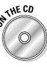

#### 列表 16-4：包含将字符串视为数字的 JavaScript 源代码语句

```javascript
function calculateTax(inputNumber) {
  return inputNumber * .50
}

<INPUT TYPE="button" NAME="calculateTaxButton"
VALUE="Calculate"
onclick="alert('The tax is " + calculateTax('baked'))">
```

当你点击按钮时，`baked` 字符串被传递到 `calculateTax()` 函数，并立即乘以 `.50`。现在，如果你能算出 `baked` 乘以 `.50` 的结果，那你比以前任何时候都更像数学家了。（哦，也许它是“半熟的”！）JavaScript 也不知道，所以它返回一个内置值 `NaN`，这是 JavaScript 表达“我不知道这到底是什么鬼，但我知道它不是数字（Not a Number）！”的方式。

再次强调，在 JavaScript 中和在生活中一样，你可以做任何你想做的事 —— 只要你知道如何操作。如果你想创建一个期望数字但能优雅处理字符串的函数，你只需要在函数的最顶端添加几行代码。列表 16-5 展示了如何操作。

#### 列表 16-5：期望数字但处理字符串的 JavaScript 函数源代码

```javascript
function calculateTax(inputNumber) {
// 如果 inputNumber 是字符串，则 number 将为 false。
var number = parseFloat(inputNumber)

// 如果 inputNumber 实际上是一个数字，
// 执行必要的计算。
if (number) {
  return number * .50
}
// 否则，显示错误。
else {
  alert("A-numeric value was passed to a function that expected a number")
  return "unknown"
}

<INPUT TYPE="button" NAME="calculateTaxButton"
VALUE="Calculate"
onclick="alert('The tax is " + calculateTax(baked))">
```

在这个改进且测试更好的的版本中，`calculateTax()` 函数做的第一件事是检查它是否能将收到的任何值转换为数字。如果可以，它会在需要时转换该值，然后对所需值执行计算。例如，你可以将数字或如 `"1234.56"` 之类的字符串传递给 `calculateTax()`，而不是字符串 `baked`。如果 `calculateTax()` 函数无法进行转换（`"baked"` 能转换成数字？），它会识别出无法转换此值，不再费忙进行任何计算，而是提醒用户。

### 偏离重点：逻辑错误

逻辑错误是最难追踪的错误，因为它们会产生特定类型的错误信息。（你永远不会看到 JavaScript 解释器吐出“显然，这不是你计算 20 年贷款利息的方法”这样的信息。）

JavaScript 解释器如何可能知道你在逻辑上试图做什么？与人类不同，它无法读取你的代码、分析它，并与其他解释器商量以确定你的代码是否接近完成某些合理任务。JavaScript 会扫描你的代码以寻找语法错误。如果你想给用户提交表单的选项，但在他们点击“是”时并不实际提交表单 —— 那取决于你的决定。

JavaScript 不是你妈妈！

追踪逻辑错误的唯一方法是老办法：通过研究你的代码、显示变量的内容、进行更改并重新重新测试。

正如你在示例中看到的，`alert()` 方法对于在整个代码中显示变量的内容非常有用。通常，当你看到变量的内容时，你会立即发现逻辑错误。（例如，一个你预期的应为 1000 的值显示为 ~3 —— 这样你就知道负责该值的计算包含错误）。

```javascript
alert("Made to the first if-else statement inside the calculateOrder() and the value of someValue is " + someValue);
```

### 忽略浏览器兼容性


没有什么比这更沮丧的了：花费几个小时创建一个奇妙、令人深刻的脚本，将其发布到你的 Web 服务器，然后有人访问你的 Web 电子邮件带回坏消息：它在我的浏览器中不起作用！

JavaScript 的支持差异并非出现在 Internet Explorer 和 Navigator 之间，而是这些浏览器的版本之间。如果一个脚本在一个浏览器中表现符合预期，但在另一个浏览器中崩溃，你就遇到了可怕的浏览器兼容性问题。以下是克服这一每个 Web 开发者生存之噩梦的四个建议：

- 放弃最新、最强大的 JavaScript 特性；坚持核心特性。不要急于整合最新的 JavaScript 特性；尽可能依靠核心特性。
- 始终检查文档。当坚持核心特性可行或理想时，尽管使用私有特性 ——只需查看目标浏览器的技术文档以确定其实现方式。
  - Netscape 的客户端端 JavaScript 参考文档：
    `http://devedge.netscape.com/central/javascript`
  - Microsoft 的 JavaScript 参考文档：
    `http://msdn.microsoft.com/scripting/javascript/default.htm`
- 浏览器检测代码。第 3 章向你展示了如何创建一个检测访问者浏览器并根据不同浏览器具有不同行为的脚本。
- 在将 JavaScript 页面发布到你的 Web 服务器（从而让全世界看到）之前，始终尽可能在多个浏览器中进行测试。文档可能是错误的，浏览器检测代码可能会故障。尽管 America Online 浏览器拥有相当大的市场份额，但它经常被 JavaScript 开发者忽略。你可以从 `http://free.aol.com` 下载该浏览器的免费副本。

与其下载安装多个浏览器，你可以利用在线服务（如 NetMechanic）来帮助发现跨浏览器 Bug，访问该网站：

`www.netmechanic.com/cobrands/zdnet/browsercheck`

# 第 17 章：调试脚本的十（或）技巧

- 本章内容
- 将代码与设计规范对比
- 使用 alerts 追踪 Bug
- 从在线资源寻求帮助
- 在运行过程中观察代码
- 拆分函数
- 将用户错误转换为有用信息

在第 16 章中，我们看到了 JavaScript 程序员倾向于犯的一些常见错误（或 Bug）。本章扩展了这一主题，向你展示最快速、直接的方法来定位并纠正你在代码中引入的任何 Bug。许多语言编译器和解释器都配备了调试工具。遗憾的是，目前 JavaScript 还没有多少调试工具。我将在章晚些时候向你介绍这些工具 —— 以及关于如何快速快捷地调试 JavaScript 代码的良好建议。

## JavaScript 读取的是你的代码，而不是你的脑子！

奇怪的是，成功消除 bug 第一步取决于你是否真的遇到了一个 bug。如果你的 JavaScript 脚本运行方式不符合你的预期，那么你可能正在处理一个 bug。然而，你的脚本可能正按照设计运行，问题出在你对该脚本应该如何工作的理解上。

在过去，程序员们会创建流程图——那些由一页页小符号和线条组成的，描述了他们希望程序在运行时的行为。流程图已不再流行——这并不是因为它们是个坏主意，而是因为创建它们花费的时间几乎和编写程序本身一样多。

如今，大多数程序员发现将编写伪代码作为设计过程的一部分非常有帮助。这样，在测试期间，他们就有东西可以参考——可以说是一个金石，帮助他们明确潜在的 bug 是在 JavaScript 代码中还是在编程逻辑中。

伪代码是 JavaScript 和程序员自然语言的简写组合。由于这个工具的设计目标是让程序员尽可能感到简单自然，因此没有硬性规则来精确定义如何编写伪代码。

例如，假设你的目标是计算通过你的网站下达的国际订单的总价格（包括销售税，如果有的话）。以下是你的伪代码可能看起来的示例：

1. 用户点击按钮。
2. 如果是美国订单，根据 `myForm.state` 计算税率（查找税率）并将计算出的税额存储在 `totalTax` 中；否则 [非美国订单该怎么办？]
3. 将订购的部件数量（`myForm.numWidgets`）乘以价格（`myForm.price`）……

编写伪代码对于帮助你理清网页的需求非常有用，但在完成网页实现后追踪逻辑中的 bug 时，它是绝对不可缺的。

### 不要把注释只留存在脑子里

在编写 JavaScript 代码时养成注释的习惯，对调试这些代码会有很大帮助。（你可能会惊讶地发现，从你创建脚本到代码运行异常之间，你竟然会忘记这么多东西，这可能隔了几周甚至几个月！）

如果你创建了伪代码来帮助规划和设计脚本，请尝试将该伪代码作为 JavaScript 注释的基础。这样做有助于未来的你（或必须调试你脚本的人）精确地理解代码正尝试实现什么。

### 隔离 bug

如果你遇到了真正的 bug，你需要尝试锁定它，并精确确定哪些代码行受到了影响。这里是一些示例，可以帮助你根据线索反向查找：

- 问题是否发生在页面加载瞬间刻？如果是，问题要么与 HTML 有关，要么位于你用于处理 `onLoad` 事件的 JavaScript 代码中。
- 当用户在输入字段中使用文本时是否发生问题？检查与该字段关联的 `onChange` 和 `onBlur` 事件处理器。
- 当用户点击按钮时，事情是否变得错乱？检查该按钮的 `onClick` 事件处理代码。
- 当用户关闭窗口时是否出错了？祸首可能潜伏在处理 `unload` 事件处理语句的函数中。

首先，决定一个搜索起点——例如，从其中一个 `onClick` 事件处理程序调用的函数开始（我称之为 `buggyFunction()`）。下一步是再深入一点。例如，在你的 JavaScript 代码中添加一个测试按钮来执行该函数，如下：

```html
<input type="button" name="testButton" value="Test" onclick="buggyFunction(123, "abc")">
```

在第一行中，你向该函数发送了数字和字符串字面量。这个过程有助于你确定是函数本身有 bug，还是问题出在你原始代码传递给函数的变量上。

如果在传递了数字和字符串字面量后，函数行为不正确，你就知道 bug 在你的函数中。如果它行为正确，则你需要检查原始 `onClick` 向函数发送的参数。（参见本章后文的“显示变量值”部分。）

隔离 bug 的一种方法是注释掉函数中除一或两个 `us` 语句以外的所有代码。通过这种方法，你可以专注于你想要详细检查的语句。要注释掉一段代码，你可以在每行之前放置 JavaScript 注释，如下所示：

```javascript
// 某些要注释掉的代码
```

在进行任何更改之前，请复制你的文件。像 CVS 这样的版本控制工具允许你随时回到之前的版本。

### 显示变量值

尽管调试涉及在各个阶段显示变量的值。例如，假设你有一个函数，其工作是计算总成本。根据你对总额的理解，你确定这个函数总是返回一个错误的值；你只是不知道为什么。

通过示例 17-1 中看到的调试语句，可以很容易地观察每个阶段发生的情况（从函数开始到计算返回值的语句）。

#### 示例 17-1：使用 Alert 语句追踪 bug

```javascript
var price=3.50

function calculatePrice(numberWidgets) {
  // 检查函数开始位置的变量。
  alert("Inside calculatePrice, numberWidgets is " + numberWidgets);

  var totalPrice = 0;

  // 100 个或更少的订单不计算税费
  if (numberWidgets >= 10) {
    // 测试以确保该语句
    // 代码编写是正确的。
    alert("Apparently numberWidgets is 11 or higher");
    var tax = calculateTax(numberWidgets * price);
    totalPrice = tax + (numberWidgets * price);
  }

  else {
    alert("numberWidgets is 10 or less so no tax calculated");
    totalPrice = numberWidgets * price;
  }

  // 显示所有对计算有贡献的值
  alert("totalPrice is $" + totalPrice + " based on a per-item price of $" + price);

  return totalPrice;
}
```

### 使用 `alert()` 追踪错误

点击 `alert()` 按钮，会弹出一个对话框并显示变量的值，这有助于你理解计算中的错误。

在计算的不同阶段检查这些值，可以帮助你定位逻辑错误。

### 将大代码块拆分为小函数

函数越小，调试就越容易。

**减少挫败感。**

### 优化排除过程

当你调试时，找出哪些不是问题的语句非常有用的。在调试 HTML 时，找出问题的方法：

1. 创建测试用例。测试用例是描述某人如何交互的场景
   - 搜索
   - 发帖
   - 查看
2. 对于每个测试用例，记录你预期的结果并对比实际情况。如果你发现预期与实际有差异，首先要找出

### 利用他人的经验

当你遇到难题时，你会非常感谢第 15 章列出的 Usenet 用户组。不仅可以浏览小组看看是否已经遇到过你正在苦恼的问题，你还可以发布一个包含代码段和错误描述的消息。许多新闻组贡献者们对他们调试他人代码的能力感到自豪，而技术支持人员（包括一些 Netscape 和微软的大师）经常作为工作的一部分监控新闻组。

**请记住**，无论你感到多么沮丧，或者你的问题有多么紧急，在发布之前，你都应该查阅新闻组存档，看看是否有与你相似的问题。很有可能某些类似的问题至少被发布过一次（甚至可能是几十次），你的组员们会感激你在发布新帖子之前先对之前的帖子进行了调整。

### 运用传统的试错法

当其他所有方法都失败时，做点什么——随什么都可以。对你的代码进行修改，改动一个地方，然后加载页面看看会发生什么。JavaScript 解释器让这一切变得既快速又简单。如果代码不起作用，将代码恢复原状并重试。无论你做什么，都不要害怕尝试。你能做的最坏事情就是让浏览器崩溃——相信我，浏览器崩溃并不是致命的。（如果那是致命的，我就活不到现在来写这本书了！）

如果你像我一样，倾向于保守，那么养成一个习惯：一旦代码开始正常运行或者每隔一段时间，就将源代码复制到安全的地方。这样，如果发生了不可思议的事情，你在编辑文件时不小心弄乱了它，你可以恢复到最近一次良好的代码。

我能给你的最佳建议就是享受其中。你犯的错误越多，你就能独立发现越多问题——你创建支持 JavaScript 的 Web 页面也会越容易。

### 试用 try-catch 异常处理！

异常处理支持——一种预判并优雅地从错误中恢复的技术，已经在 C++ 等语言中支持——最终在 Internet Explorer 和 Navigator 的 5.x 和 6.x 版本中分别为 JavaScript 实现了。

从技术上讲，异常是脚本处理过程中发生的任何意外情况，无论好坏。然而，在现实中，异常几乎总是一个错误。异常可能直接源于 JavaScript 错误、意料之外的用户输入，或者来自用户浏览器、操作系统、甚至硬件配置的问题。尝试让你的代码访问不存在的对象（如数组元素、属性、文件等）是你的 JavaScript 代码在服务器上执行时可能发生异常的常见来源。

如果你正在创建一个商业级 JavaScript 程序，你可能想要利用 JavaScript 的异常处理能力。在商业环境中，允许用户查看诸如“找不到文件”或“此类对象”等晦涩的系统生成错误是不可接受的。虽然通过 `catch` 块预判和处理错误可能无法防止错误发生，但它给了你机会：

- 安抚用户。你可以使用 JavaScript 的异常处理函数显示消息，告诉用户发生了错误，但正在被妥善处理。（这种方法远比让晦涩的系统消息或空白屏幕让用户困惑和警觉好得多）。
- 为用户提供帮助且适当的建议。你可以解释错误的原因，并为用户提供未来避免该错误的提示。

你通过创建两个 JavaScript 函数或块来处理异常：一个 `try` 块和一个 `catch` 块。（因为这两个独立的块总是一起使用的的，所以它们通常被称为 `try-catch` 块。）在这些块中，对于一个可能产生错误的事件，你使用 `throw` 关键字来抛出一个错误。代码列表 17-2 中的代码向你展示了如何操作。

#### 代码列表 17-2：使用 try-catch 和 throw 处理异常

```javascript
<SCRIPT LANGUAGE="JavaScript" TYPE="text/javascript">
function getMonthName(number) {  // JavaScript 数组从 0, 1 开始，所以
  // 减 1。
  number = number - 1;

  // 创建一个数组并填充 12 个值。
  var months = new Array("Jan", "Feb", "Mar", "Apr", "May", "Jun", "Jul",
  "Aug", "Sep", "Oct", "Nov", "Dec");

  // 如果月份数组元素对应于传入的
  // 数字，那很好；返回数组
  // 元素。
 if (months[number] != null) {
    return months[number]
  }
// 否则发生了异常，所以抛出一个
// 异常。
else {
    // 这条语句将错误直接
    // 抛到 catch 块。
    throw "InvalidMonthNumber";
}
/////////////////////////////////////////////////
// try 块包裹了主要的 JavaScript
// 处理代码。块内任何产生异常
// 的 JavaScript 语句都将自动
// 将该异常抛给 catch 块中的
// 异常处理代码，
///////////////////////////////////////
// try 块
try {
    // 调用 getMonthName() 函数并传入
    // 无效的月份（没有 13 月！）
    // 看看会发生什么。

    alert(getMonthName(13));
    alert("如果抛出了异常，我们永远不会到达这里。");
}
// catch 块
catch (error) {
    alert("遇到了一个 " + error + " 异常。请联系程序供应商。");
    // 在现实情况下，你可能想
// 在此处包含错误处理代码，
// 检查异常并给用户提供特定的
// 信息（如果可能的话，甚至尝试修复问题）。
}
}
```

查看图 17-4 以查看运行列表 17-2 中的代码在 Internet Explorer 中生成的错误。

#### 图 17-4：使用 try-catch 和 throw 处理异常

运行列表 17-2 中的代码在 Internet Explorer 中生成的错误如下：

```javascript
alert(getMonthName(13))
```

由于 `months` 数组中只有 12 个元素，给 `getMonthName` 传递 13 会抛出异常（"InvalidMonthNumber"），如下文所示：

```javascript
function getMonthName(number) {
  throw "InvalidMonthNumber";
}
```

所有异常都会由 `catch` 块中的代码自动处理，因此抛出异常时就会显示图 17-4。如果你想编写真正健壮的 JavaScript 代码，你需要识别所有可能导致异常的事件（例如用户的操作、操作系统生成的错误等），并为每个事件实现 `try-catch` 块。

根据你的应用程序，你可能希望在 `catch` 块中包含比图 17-4 所示的简单弹出消息更多的处理代码。对于识别抛出的异常，你受限于字符串字面量。而不是 `InvalidMonthNumber`，你可以创建并抛另一个自定义异常对象（通过我在第 3 章描述的 function 和 `new` 运算符）。

有关 Netscape 异常内容的更多信息（包括示例），请访问

```
http://developer.netscape.com/docs/manuals/js/core/javascript/stmt.html#101153
```

要查看微软如何这样做，请检查此页面：

```
http://msdn.microsoft.com/library/default.asp?url=/library/en-us/javascript/html/jsmstry.asp
```

### 利用调试工具

Netscape 和微软提供了免费的 JavaScript 调试工具。它们包括

- Netscape Navigator 内置的 JavaScript 控制台（适用于 Netscape Navigator 7.x）
- Microsoft Explorer 内置的错误显示

除了本节描述的内置调试工具外，Netscape 和微软还提供了免费下载的独立脚本调试器。Venman 是为 Netscape Navigator 7.x 创建的免费 JavaScript 调试器。虽然对这个 JavaScript 调试器的支持最好，但你可以从 `www.hacksrus.com/~ginda/venkman` 获取最新文档并下载自己的副本。微软提供了一个脚本调试器，用于调试 JavaScript 脚本（以及使用其他脚本语言编写的脚本，例如微软的 VBScript）。要下载微软脚本调试器的副本，你的浏览器访问

```
www.microsoft.com/downloads/details.aspxFamilyID=2f465be0-94fd-4569-b3c4-dffdl19ccd99&language=en
```

#### Netscape 的 JavaScript 控制台

Netscape Navigator 7.x 配备了一个名为 JavaScript 控制台的 JavaScript 调试工具，如图 17-5 所示。

你可以通过执行两个操作之一显示图 17-5 所示的 JavaScript 控制台：

- 从 Netscape Navigator 主菜单中选择 工具(Tools):Web 开发(Web Development):JavaScript 控制台(JavaScript Console)。
- 在 Netscape Navigator 的导航栏中输入 `javascript:` 并回车。

显示 JavaScript 控制台后，你可以通过两种方式调试 JavaScript 代码：

- 像通常一样将包含脚本的 HTML 文件加载到 Netscape Navigator 中。当你这样做时，脚本在控制台中生成的任何错误都会如图 17-6 所示。

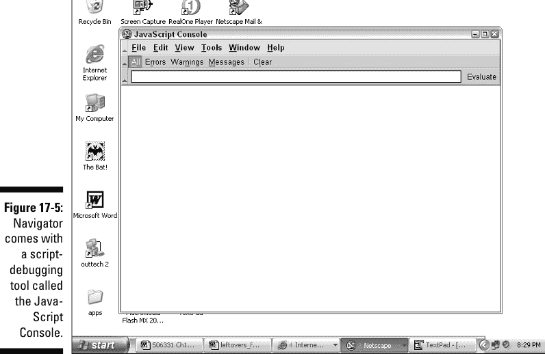

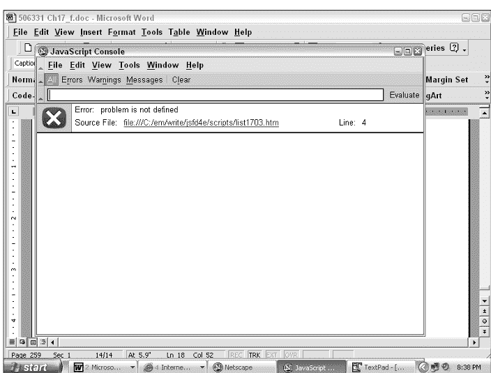

图 17-6 Netscape 控制台中出现的 JavaScript 错误。

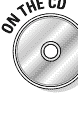

如你在图 17-6 所示，在 `error.htm` 文件的第 4 行检测到一个 JavaScript 错误。

如果你查看 `error.htm`（你可以在附带的 CD 上找到它的副本），你会看到这段 HTML/JavaScript 代码：

```
<HTML>
<HEAD>
<SCRIPT LANGUAGE="JavaScript" TYPE="text/javascript">
alert("This is a " + problem);
```

图 17-6 所示的 JavaScript 控制台消息显示为：`problem is not defined`。果不其然，数到第 4 行，你会发现变量 `problem` 在使用之前未定义。（你可以在第 3 章中学习如何定义变量。）

- 直接在控制台的评估字段中输入 JavaScript 代码。你可以直接在 JavaScript 控制台上找到的评估字段中输入 JavaScript 代码，并点击评估(Evaluate) 按钮获得即时反馈。请看图 17-7 以了解我的意思。

**图 17-7：** 直接向控制台输入 JavaScript 代码可以为你提供即时反馈。

#### Microsoft Internet Explorer 的内置错误显示

当你将包含 JavaScript 错误的 页面加载到 Internet Explorer 时，你可以在屏幕左下角的状态栏看到一个图标。双击该图标会显示一个描述 JavaScript 错误的弹出窗口——以及修复该错误的提示。请参阅图 17-8 以查看我...

图 17-8 显示 Internet Explorer 在 HTML 文件的第 4 行遇到了一个错误：即 `problem` 未定义。

果不其然，如果你查看以下 HTML 代码（你可以在附带的 CD 上找到错误文件 `error.htm` 的副本），你会发现第 4 行引用了一个名为 `problem` 的未定义变量。（我在第 3 章中演示了如何定义变量。）

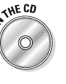

```
<HTML>
<HEAD>
<SCRIPT LANGUAGE="JavaScript" TYPE="text/javascript">
alert("This is a " + problem);
n...
```

图 17-8：双击状态栏图标显示 JavaScript 错误。

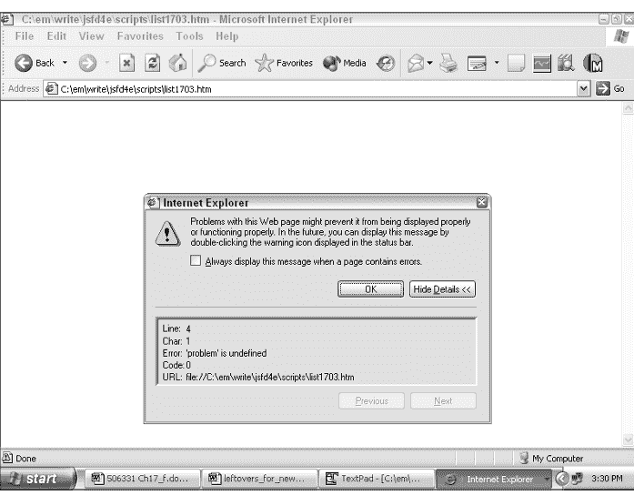

# 第六部分：附录

## Rich Tennant 的《第五波》

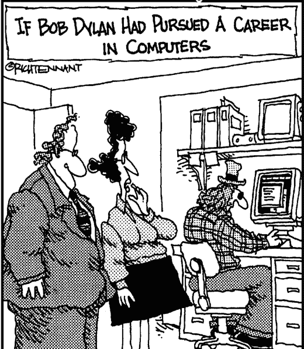

> “他是开发应用方面的天才，但感谢天谢地有电子邮件，因为他说话时我一句话也听不懂。”

## 在这一部分 . . .

包含了大量帮助你开发复杂且有趣的脚本的资源。在这里，你将找到一个代码中不能使用的单词列表，以及许多你会包含在内的快捷键和对象。

JavaScript 保留了某些单词，你不希望在代码中将其作为变量名、函数名或其他用户定义的元素。附录 A 列出了这些特殊单词。JavaScript 还为你提供了几个选项，以确保你在页面中想要的颜色以你预期的方式出现（或接近预期方式），你可以在附录 B 中找到相关信息。

虽然附录 C 没有包含对每个可能的对象的每种解释，但你可以找到几乎所有你需要的对象以及它们对应的方法和属性，以及关于哪些对象是浏览器感知的提示。最后，你可以使用附录 D 中的特殊字符，确保你的 Web 页面符合全球市场和用户的需求。

## 附录 A：JavaScript 保留字

附录中列出的单词对于当前版本的 Navigator 和 Internet Explorer 中实现的 JavaScript 解释器具有特殊含义（为未来版本预留）。如果你尝试使用这些单词中的任何一个来命名变量、函数或对象，JavaScript 解释器时会报错。除了此处列出的保留字外，由于某些预定义的对象、属性和方法，JavaScript 解释器时会报错。

| 关键字 | 关键字 |
| :--- | :--- |
| `abstract` | `break` |
| `byte` | `case` |
| `char` | `comment` |
| `const` | `continue` |
| `default` | `delete` |
| `else` | `export` |
| `extends` | `finally` |
| `for` | `function` |
| `get` | `goto` |
| `in` | `instanceof` |
| `interface` | `int` |
| `label` | `long` |
| `native` | `null` |
| `package` | `protected` |
| `public` | `return` |
| `static` | `switch` |
| `throw` | `true` |
| `typeof` | `var` |
| `void` | `with` |

## 附录 B：JavaScript 颜色值

本附录列出了所有可用的颜色的十六进制值。你可以使用附录中列出的预定义颜色名称，也可以使用它们的十六进制值。

| 颜色 | 十六进制 |
| :--- | :--- |
| aliceblue | #F0F8FF |
| antiquewhite | #FAEBD7 |
| aqua | #00FFFF |
| aquamarine | #7FFFD4 |
| azure | #F0FFFF |
| beige | #F5F5DC |
| bisque | #FFE4C4 |
| black | #000000 |
| blanchedalmond | #FFEBCD |
| blue | #0000FF |
| blueviolet | #8A2BE2 |
| brown | #A52A2A |
| burlywood | #DEB887 |
| cadetblue | #5F9EA0 |
| chartreuse | #7FFF00 |
| chocolate | #D2691E |
| coral | #FF7F50 |
| cornflowerblue | #6495ED |
| cornsilk | #FFF8DC |
| crimson | #DC143C |
| cyan | #00FFFF |
| darkblue | #00008B |
| darkcyan | #00CED1 |
| darkgoldenrod | #DAA520 |
| darkgray | #A9A9A9 |
| darkgreen | #006400 |
| darkkhaki | #BDB76B |
| darkmagenta | #8B008B |
| darkolivegreen | #556B2F |
| darkorange | #FF8C00 |
| darkorchid | #9932CC |
| darkred | #8B0000 |
| darksalmon | #E9967A |
| darkseagreen | #8FBC8F |
| darkslateblue | #483D8B |
| darkslategray | #2F4F4F |
| darkturquoise | #00CED1 |
| darkviolet | #9400D3 |
| deeppink | #FF1493 |
| deepskyblue | #00BFFF |
| dimgray | #696969 |
| dodgerblue | #1E90FF |
| firebrick | #B22222 |
| floralwhite | #FFFAF0 |
| forestgreen | #228B22 |
| fuchsia | #FF00FF |
| gainsboro | #DCDCDC |
| ghostwhite | #F8F8FF |
| gold | #FFD700 |
| goldenrod | #DAA520 |
| gray | #808080 |
| green | #008000 |
| greenyellow | #ADFF2F |
| honeydew | #F0FFF0 |
| hotpink | #FF69B4 |
| indianred | #CD5C5C |
| indigo | #4B0082 |
| ivory | #FFFFF0 |
| khaki | #F0E68C |
| lavender | #E6E6FA |
| lavenderblush | #FFF0F5 |
| lawngreen | #7CFC00 |
| lemonchiffon | #FFFACD |
| lightblue | #ADD8E6 |
| lightcoral | #F08080 |
| lightcyan | #E0FFFF |
| lightgoldenrodyellow | #FAFAD2 |
| lightgray | #D3D3D3 |
| lightgreen | #90EE90 |
| lightpink | #FFB6C1 |
| lightsalmon | #FFA07A |
| lightseagreen | #20B2AA |
| lightskyblue | #87CEFA |
| lightslategray | #778899 |
| lightsteelblue | #B0C4DE |
| lightyellow | #FFFFE0 |
| lime | #00FF00 |
| limegreen | #32CD32 |
| linen | #FAF0E6 |
| magenta | #FF00FF |
| maroon | #800000 |
| mediumaquamarine | #66CDAA |
| mediumblue | #0000CD |
| mediumorchid | #BA55D3 |
| mediumpurple | #9370DB |
| mediumseagreen | #3CB371 |
| mediumslateblue | #7B68EE |
| mediumspringgreen | #00FA9A |
| mediumturquoise | #48D1CC |
| mediumvioletred | #C71585 |
| midnightblue | #191970 |
| mintcream | #F5FFFA |
| mistyrose | #FFE4E1 |
| moccasin | #FFE4B5 |
| navajowhite | #FFDEAD |
| navy | #000080 |
| oldlace | #FDF5E6 |
| olive | #808000 |
| olivedrab | #6B8E23 |
| orange | #FFA500 |
| orangered | #FF4500 |
| orchid | #DA70D6 |
| palegoldenrod | #EEE8AA |
| palegreen | #98FB98 |
| paleturquoise | #AFEEEE |
| palevioletred | #DB7093 |
| papayawhip | #FFEFD5 |
| peachpuff | #FFDAB9 |
| peru | #CD853F |
| pink | #FFC0CB |
| plum | #DDA0DD |
| powderblue | #B0E0E6 |
| purple | #800080 |
| red | #FF0000 |
| rosybrown | #BC8F8F |
| royalblue | #4169E1 |
| saddlebrown | #8B4513 |
| salmon | #FA8072 |
| sandybrown | #F4A460 |
| seagreen | #2E8B57 |
| seashell | #FFF5EE |
| sienna | #A0522D |
| silver | #C0C0C0 |
| skyblue | #87CEEB |
| slateblue | #6A5ACD |
| slategray | #708090 |
| snow | #FFFAFA |
| springgreen | #00FF7F |
| steelblue | #4682B4 |
| tan | #D2B48C |
| teal | #008080 |
| thistle | #D8BFD8 |
| tomato | #FF6347 |
| turquoise | #40E0D0 |
| violet | #EE82EE |
| wheat | #F5DEB3 |
| white | #FFFFFF |
| whitesmoke | #F5F5F5 |
| yellow | #FFFF00 |
| yellowgreen | #9ACD32 |

## 附录 C：文档模型引用

你可以将此附录看作一个按字母排序的备查表，其中列出了构成你在 JavaScript 中交互的文档对象模型的大对象、属性、方法和事件处理程序（JavaScript 中可用的内置函数也列在本附录的后半部分）。

实现文档模型的人们——Netscape 和微软——显然有理由让某些对象以大写字母开头，而不是全部！JavaScript 是一种区分大小写的语言，这意味着如果一个对象以小写（或大写）字母开头，你必须以那种方式访问它。

### 文档对象模型

我按照对象按字母顺序组织了文档对象模型 (DOM)。如果你需要查找特定的属性或方法——例如 `prompt()` 但不知道它属于哪个对象——请快速查看书末尾的索引。

本附录已经尽可能达到了人类所能达到的最新状态，因为新浏览器版本经常发布（这可能意味着略有不同的 DOM），可能会发现你的浏览器支持的 DOM 与此处列出的之间存在某些细微差异。事实上，Netscape 和 Internet Explorer 都已承诺继续修改它们的 DOM，直到它们符合 ECMA 标准，并且开发者可以信赖两个浏览器中的同一个对象存在且行为完全相同——但那一天尚未到来。关于对象实现的最终解释，包括对本附录中找到的任何元素的详细描述，请访问 Netscape 和微软的网站。

Internet Explorer 的：

```
http://msdn.microsoft.com/workshop/author/dhtml/reference/
```

Netscape Navigator 的：

```
http://developer.netscape.com/docs/manuals/js/client/objcont.htm
```

### Date

**描述：** 一个用于创建、操作和格式化日期时间值的对象。

**如何创建它：**

```javascript
aDate = new Date()
```

```javascript
aDate = new Date(milliseconds)
```

```javascript
aDate = new Date(dateString)
```

```javascript
aDate = new Date(yr_num, mo_num, day_num, [hr_num, min_num, sec_num, ms_num])
```

**如何访问它：** `constructor`, `prototype`

**属性：** 无


# 方法
`getDate()`, `getDay()`, `getFullYear()`, `getHours()`, `milliseconds()`, `getMinutes()`, `getMonth()`, `getSeconds()`, `getTime()`, `getTimezoneOffset()`, `getUTCDate()`, `getUTCFullYear()`, `getUTCHours()`, `getUTCMilliseconds()`, `getUTCMinutes()`, `getUTCSeconds()`, `getYear()`, `parse()`, `setDay()`, `setFullYear()`, `setHours()`, `setMilliseconds()`, `setMinutes()`, `setMonth()`, `setSeconds()`, `setTime()`, `setUTCDate()`, `setUTCHours()`, `setUTCMilliseconds()`, `setUTCMinutes()`, `setUTCMonth()`, `setUTCSeconds()`, `setYear()`, `toGMTString()`, `toLocaleString()`, `toString()`, `toUTCString()`, `UTC()`, `valueOf()`

# 事件处理程序
无

# document

## 描述
当前加载的 HTML 文档；提供了向用户显示 HTML 输出的方法。

## 如何创建它
`<BODY> .. </BODY>`

## 如何访问它
`window.document` (或直接使用 `document`)

## 属性
`alinkColor`, `anchors[]`, `applets[]`, `bgColor`, `cookie`, `domain`, `embeds`, `fgColor`, `formName`, `forms[]`, `images[]`, `lastModified`, `linkColor`, `links[]`, `plugins[]`, `referrer`, `title`, `URL`, `vlink`

### Netscape Navigator 仅限
`classes`, `height`, `ids`, `tags`, `width`

### Internet Explorer 仅限
`activeElement`, `[]`, `charset`, `children[]`, `defaultCharset`, `expando`, `parentWindow`, `readyState`

## 方法
`close()`, `handleEvent()`, `open()`, `write()`, `writeln()`

### Netscape Navigator 仅限
`captureEvents()`, `contextual()`, `getSelection()`, `releaseEvents()`, `routeEvent()`

### Internet Explorer 仅限
`elementFromPoint()`

## 事件处理程序
`onClick`, `onDblClick`, `keyDown`, `onKeyUp`, `onKeyUp`, `onMouseDown`, `onMouseUp`

# elements[]

## 描述
HTML 文档中包含的表单元素集合。

## 它创建了
`<FORM NAME="formName"> .. </FORM>`

## 如何访问它
`document.formName.elements[]`

## 属性
`defaultChecked`, `defaultValue`, `form`, `length`, `name`, `options[]`, `selectedIndex`, `type`, `value`

## 方法
`blur()`, `click()`, `focus()`, `select()`

## 事件处理程序
`onBlur`, `onChange`, `onClick`, `onFocus`

# event

## 描述
JavaScript 中定义的若干预定义事件之一，例如鼠标点击、文本输入或文档加载。当事件发生时，此对象会自动作为参数传递给事件处理程序。

## 如何创建它
由浏览器自动创建。

## 如何访问它
`window.event` (或直接使用 `event`)

## 属性（Netscape Navigator 仅限）
`data`, `height`, `modifiers`, `pageX`, `pageY`, `screenX`, `screenY`, `target`, `type`, `which`, `width`

## 属性（Internet Explorer 仅限）
`altKey`, `button`, `cancelBubble`, `clientX`, `clientY`, `ctrlKey`, `fromElement`, `keyCode`, `offsetX`, `offsetY`, `reason`, `returnValue`, `screenX`, `screenY`, `shiftKey`, `srcElement`, `srcFilter`, `toElement`, `type`, `x`, `y`

## 方法
无

## 事件处理程序
无

# FileUpload

## 描述
HTML 表单上的文件上传元素。（文件上传元素允许用户选择或指定文件作为 Web 应用程序的输入。）

## 如何创建它
`<FORM NAME="formName"> .. <INPUT TYPE="file" NAME="fileUploadName"> ..></FORM>`

## 如何访问它
`document.formName.fileUploadName` 或 `formName.elements[i]`

## 属性
`form`, `name`, `type`, `value`

## 方法
`blur()`, `handleEvent()`, `select()`

## 事件处理程序
`onBlur`, `onChange`, `onFocus`

# Form

## 描述
HTML 表单。HTML 表单允许用户输入文本并与复选框、单选按钮、选择列表等元素交互。表单可以配置为用户提交表单时自动将数据提交到 Web 服务器。

## 如何创建它
`<FORM NAME="formName"> .. </FORM>`

## 如何访问它
`document.formName`

## 属性
`action`, `elements[]`, `encoding`, `length`, `method`, `name`, `target`

## 方法
`handleEvent()`, `reset()`, `submit()`

## 事件处理程序
`onSubmit`

# Frame

## 描述
HTML 显示框架。

## 如何创建它
`<FRAME> .. </FRAME>`

(见 window.)

# Function

## 描述
一段将由 JavaScript 解释器进行预处理的 JavaScript 代码。

## 如何创建它
`new Function ([arg1[, arg2[, ... argN]], functionBody)` 或 `function functionName([param[, param[ ... { statements }])`

## 如何访问它
`FunctionName`

## 属性
`arguments[]`, `arity`, `caller`, `length`, `prototype`

## 方法
`apply()`, `call()`, `toSource()`, `toString()`, `valueOf()`

## 事件处理程序
无

# Hidden

## 描述
一种不显示的 HTML 表单字段，用于存储并向 Web 服务器传输值值。

## 如何创建它
`<FORM NAME="formName"> .. <INPUT TYPE="hidden" NAME="hiddenName" .. </FORM>`

## 如何访问它
`document.formName.hiddenName` 或 `formName.elements[i]`

## 属性
`form`, `name`, `type`, `value`

## 方法
无

# History

## 描述
用户访问过的 URL 集合。

## 如何创建它
由浏览器自动创建。

## 如何访问它
`window.history`, 或直接使用 `history`

## 属性
`current`, `length`

## 方法
`back()`, `forward()`

## 事件处理程序
无

# Image

## 描述
HTML 文档中的图像。

## 如何创建它
``

## 如何访问它
`document.imageName` 或 `images.length`

## 属性
`border`, `complete`, `height`, `hspace`, `name`, `src`, `vspace`, `width`

## 方法
`handleEvent()`

## 事件处理程序
`onAbort`, `onError`, `keyDown`, `onKeyUp`

# java

## 描述
用于访问包中任何类的顶层对象。

## 如何创建它
由浏览器自动创建。

(见 JavaPackage.)

# JavaArray

## 描述
Java 数组的 JavaScript 表示。

## 如何创建它
返回数组的方法。

## 如何访问它
调用单个 applet的方法。

## 属性
`length`

## 方法
`toString()`

## 事件处理程序
无

# JavaClass

## 描述
Java 类的 JavaScript 表示。

## 如何创建它
由浏览器自动创建。

(见 JavaPackage.)

# JavaObject

## 描述
Java 对象的 JavaScript 表示。

## 如何创建它
返回对象类型的方法。

## 如何访问它
调用单个 applet的方法。

## 属性
由单个 applet/方法决定。

## 方法
由单个 applet/方法决定。

## 事件处理程序
无

# JavaPackage

## 描述
Java 包的 JavaScript 表示。

## 如何创建它
由浏览器自动创建。

## 如何访问它
`Packages.JavaPackage`

## 属性
由单个 Java 包决定。

## 方法
由单个 Java 包决定。

## 事件处理程序
无

# Link

## 描述
HTML 文档中的超链接。

## 如何创建它
`<A>`, `<AREA>`, 或 `String.link()`

## 如何访问它
`document.links[i]`（单个链接）或 `document.links.length`（文档中的链接数量）

## 属性
`hash`, `host`, `hostName`, `href`, `pathname`, `port`, `protocol`, `search`, `target`, `text`, `x`, `y`

## 方法
`handleEvent()`

## 事件处理程序
`onDoubleClick`, `onMouseOut`, `onMouseEnter` (<>), `onClick`, `onDoubleClick`, `onKeyDown`, `onKeyUp`, `onMouseDown`, `onMouseOut`, `onMouseEnter`, `mouseOver` (<A> 或 `String.link()`)

# location

## 描述
当前加载的 URL。

## 如何创建它
由浏览器自动创建。

## 如何访问它
`window.location` (或直接使用 `location`)

## 属性
`hash`, `host`, `hostname`, `href`, `pathname`, `port`, `protocol`, `search`

## 方法
`reload()`, `replace()`

## 事件处理程序
无

# Math

## 描述
包含数学常量和和方法的内置对象。

## 如何创建它
由浏览器自动创建。

# 附录 C：文档模型引用

# Math

## 如何访问
`Math`

## 属性
`E`, `LN10`, `LN2`, `LOG10E`, `LOG2E`, `PI`, `SQRT1_2`, `SQRT2`

## 方法
`abs()`, `acos()`, `asin()`, `atan()`, `atan2()`, `ceil()`, `cos()`, `exp()`, `floor()`, `log()`, `max()`, `min()`, `pow()`, `random()`, `round()`, `sin()`, `sqrt()`, `tan()`

## 事件处理器
无

# MimeType

## 描述
一种 MIME 类型（多部分互联网邮件扩展类型，例如浏览器支持的 .pdf）。

## 创建方式
由 Netscape Navigator 自动创建。

## 如何访问
```
navigator.mimeTypes[i]
navigator.mimeTypes["type"]
navigator.plugins[i].mimeTypes[j]
navigator.mimeTypes.length
```

## 属性
`description`, `enabledPlugin`, `suffixes`, `type`

## 方法
无

## 事件处理器
无

# navigator

## 描述
浏览器配置详情。

## 创建方式
由浏览器自动创建。

## 如何访问
`window.navigator`（或直接使用 `navigator`）

## 属性
`appName`, `appName`, `appVersion`, `language`, `mimeTypes`, `platform`, `plugins`, `userAgent`

## 方法
`javaEnabled()`, `plugins.refresh()`, `preference()`, `savePreferences()`, `taintEnabled()`

## 事件处理器
无

# netscape

## 描述
一个顶级对象，用于访问包 `netscape.*` 中的任何 Java 类。

## 创建方式
由 Netscape Navigator 自动创建。

（请参见 JavaPackage。）

# Number

## 描述
用于原始数值的 JavaScript 对象包装器。

## 创建方式
`aNumber = new Number(value)`

## 如何访问
`aNumber`

## 属性
`constructor`, `MAX_VALUE`, `MIN_VALUE`, `NaN`, `NEGATIVE_INFINITY`, `POSITIVE_INFINITY`, `prototype`

## 方法
`toString()`, `valueOf()`

## 事件处理器
无

# Object

## 描述
所有其他对象都派生的原始 JavaScript 对象类型。

## 创建方式
```
anObject = new Object() or anotherObject = new Object(anObject)
```

## 如何访问
`anObject`, `anotherObject`

## 属性
`constructor`, `prototype`

## 方法
`eval()`, `toSource()`, `toString()`, `unwatch()`, `valueOf()`, `watch()`

## 事件处理器
无

# Option

## 描述
HTML select 列表中的选项。

## 创建方式
`<FORM NAME="formName"><SELECT NAME="schemaName"><OPTION></SELECT></FORM>` 或 `new Option([text, value[defaultSelected[, selected]])`

## 如何访问
`document.formName.selectName.options[f]`

## 属性
`defaultSelected`, `index`, `length`, `selected`, `text`, `value`

## 方法
无

## 事件处理器
无

# Packages

## 描述
用于在 JavaScript 代码中访问 Java 类的顶级对象。

## 创建方式
由支持 Java 的浏览器自动创建。

## 如何访问
取决于 Java 包。

## 属性
`className`, `java`, `netscape`, `sun`

## 方法
取决于 Java 包。

## 事件处理器
无

# 第六部分：附录

# Password

## 描述
包含在 HTML 表单中的密码字段。当用户在密码字段中输入文本时，星号（*）会隐藏该文本以免可见。

## 创建方式
`<FORM NAME="formName"> . . <INPUT TYPE="password" NAME="passwordName"> . . </FORM>`

## 如何访问
`document.formName.passwordName` or `formName.elements[i]`

## 属性
`defaultValue`, `form`, `name`, `type`, `value`

## 方法
`blur()`, `focus()`, `handleEvent()`, `select()`

## 事件处理器
`onBlur`, `onFocus`

# Plugin

## 描述
安装在 Netscape Navigator 中的插件应用程序模块。

## 创建方式
Netscape Navigator（在浏览器插件安装时）。

## 如何访问
`navigator.plugins[i]`

## 属性
`description`, `filename`, `length`, `name`

## 方法
无

## 事件处理器
无

# Radio

## 描述
包含在 HTML 表单中的一组单选按钮中的一个。用户可以使用一组单选按钮从列表中一个项目。

## 创建方式
`<FORM NAME="formName"> . . <INPUT TYPE="radio" NAME="radioName"> . . </FORM>`

## 如何访问
`document.formName.radioName` or `formName.elements[i]`

## 属性
`checked`, `defaultChecked`, `form`, `name`, `type`, `value`

## 方法
`blur()`, `click()`, `focus()`, `handleEvent()`

## 事件处理器
`onBlur`, `onClick`, `onFocus`

# RegExp

## 描述
包含正则表达式的模式。此对象提供了属性和方法，用于使用正则表达式在字符串中查找和替换匹配。

## 创建方式
`/pattern/flags`

`new RegExp("pattern"[, "flags"])`

## 如何访问
正则表达式是棘手的动物。你将正则表达式用于模式匹配应用程序。以下是一个示例：

```
<SCRIPT LANGUAGE="JavaScript1.2">
RegularExpression = /(\w+)(\w+)/;
oldString="John Smith";nnewString=oldString.replace(aRegularExpression, $2,$1);
document.write(newString)
</SCRIPT>
```

（此脚本显示 Smith, John。）

更多信息，请访问此页面：

```
http://developer.netscape.com/docs/manuals/js/client/jsref/regexp
```

## 属性
`$1`, `$2`, `$3`, `$4`, `$5`, `$6`, `$7`, `$8`, `$9`, `constructor`, `global`, `ignoreCase`, `input`, `lastIndex`, `lastMatch`, `lastParen`, `leftContext`, `multiline`, `prototype`, `rightContext`, `source`

## 方法
`compile()`, `exec()`, `test()`, `toSource()`, `toString()`, `valueOf()`

## 事件处理器
无

# Reset

## 描述
HTML 表单上的重置按钮。此按钮将表单中的所有元素重置为默认值。

## 创建方式
`<FORM NAME="formName"> . . <INPUT TYPE="reset" NAME="resetName"> . . </FORM>`

## 如何访问
`document.formName.resetName` or `formName.elements[i]`

## 属性
`form`, `name`, `type`, `value`

## 方法
`blur()`, `click()`, `focus()`, `handleEvent()`

## 事件处理器
`onBlur`, `onFocus`

# screen

## 描述
包含描述屏幕（显示器）和颜色的属性。

## 创建方式
由浏览器自动创建。

## 如何访问
`availHeight`, `availLeft`, `availTop`, `availWidth`, `colorDepth`, `height`, `pixelDepth`, `width`

## 方法
无

## 事件处理器
无

# Select

## 描述
包含在 HTML 表单中的选择列表。用户可以从选择列表中选择一个或多个项目，取决于列表如何创建。

## 创建方式
`<FORM NAME="formName"><SELECT NAME="selectName"></SELECT></FORM>`

## 如何访问
`document.formName.selectName` or `formName.elements[i]`

## 属性
`form`, `length`, `name`, `options`, `selectedIndex`, `type`

## 方法
`blur()`, `focus()`, `handleEvent()`

## 事件处理器
`onBlur`, `onChange`, `onFocus`

# String

## 描述
表示由引号界定的字符序列的对象。

## 创建方式
`aString = new String("value")` or `aString = "value"`

## 如何访问
`aString`

## 属性
`constructor`, `length`, `prototype`

## 方法
`anchor()`, `big()`, `bold()`, `charAt()`, `charCode()`, `concat()`, `fixed()`, `fontColor()`, `fontSize()`, `fromCharCode()`, `indexOf()`, `lastIndexOf()`, `link()`, `match()`, `replace()`, `slice()`, `split()`, `strike()`, `substr()`, `substring()`, `sup()`, `toLowerCase()`, `toSource()`, `toUpperCase()`, `valueOf()`

## 事件处理器
无

# Style

## 描述
指定 HTML 元素样式的对象。

## 创建方式
`document.classes.className`

`document.ids.tagName`

## 如何访问
参见以下页面：

```
http://developer.netscape.com/docs/manuals/communicator/dynhtml/index.htm
```

## 属性（仅限 Netscape Navigator）
`backgroundColor`, `background Image`, `borderBottomWidth`, `borderColor`, `borderLeftWidth`, `border RightWidth`, `borderStyle`, `borderTopWidth`, `clear`, `color`, `display`, `borderLeft`, `borderColor`, `borderLeftStyle`, `border RightWidth`, `borderStyle`, `borderTopColor`, `clear`, `cursor`, `borderTopStyle`, `display`, `filter`, `font`, `family`, `fontSize`, `fontStyle`, `variant`, `fontWeight`, `height`, `letterSpacing`, `lineHeight`, `listStyle`, `listImage`, `listStyle`, `listPosition`, `listType`, `margin`, `marginBottom`, `marginRight`, `marginTop`, `overflow`, `paddingBottom`, `paddingLeft`, `paddingRight`, `paddingTop`, `pageAfter`, `pageBreak Before`, `pixelLeft`, `pixelHeight`, `pixelTop`, `pixelWidth`, `posHeight`, `position`, `posLeft`, `posTop`, `posWidth`, `styleFloat`, `textAlign`, `textDecoration`, `textIntent`, `textTransform`, `top`, `verticalAlign`, `visibility`, `width`, `z-index`

## 属性（仅限 Internet Explorer）
`background`, `background-Attachment`, `backgroundColor`, `backgroundImage`, `backgroundPosition`, `backgroundRepeat`, `border`, `border PositionX`, `backgroundPositionY`, `borderColor`, `borderStyle`, `borderTopWidth`, `borderColor`, `borderLeft`, `borderLeftStyle`, `border RightWidth`, `borderStyle`, `borderTopColor`, `clear`, `cursor`, `borderTopStyle`, `display`, `filter`, `font`, `family`, `fontSize`, `fontStyle`, `variant`, `fontWeight`, `height`, `letterSpacing`, `lineHeight`, `listStyle`, `listImage`, `listStyle`, `listPosition`, `listType`, `margin`, `marginBottom`, `marginRight`, `marginTop`, `overflow`, `paddingBottom`, `paddingLeft`, `paddingRight`, `paddingTop`, `pageAfter`, `pageBreak Before`, `pixelLeft`, `pixelHeight`, `pixelTop`, `pixelWidth`, `posHeight`, `position`, `posLeft`, `posTop`, `posWidth`, `styleFloat`, `textAlign`, `textDecoration`, `textIntent`, `textTransform`, `top`, `verticalAlign`, `visibility`, `width`, `z-index`

## 方法
`borderWidth()`, `margins()`, `paddings()`

## 事件处理器
无

# Submit

## 描述
包含在 HTML 表单中的提交按钮。此按钮发送要处理的信息。

## 创建方式
`<FORM NAME="FormName"> . . <INPUT TYPE="submit" NAME="submitName"> . . </FORM>`

## 如何访问
`document.formName.submitName` or `formName.elements[1]`

## 属性
`form`, `name`, `type`, `value`

## 方法
`blur()`, `click()`, `focus()`, `EventHandler()`

## 事件处理器
`onBlur`, `onClick`, `onFocus`

# 附录 C：文档对象模型引用

# sun

## 描述
用于访问 sun 包中任何 Java 类的顶层对象。

## 如何创建
由支持 Java 的浏览器自动创建。

## 如何访问
`Packages.sun`

（参见 Packages。）

# Text

## 描述
包含在 HTML 表单中的文本字段。

## 如何创建
`<FORM NAME="formData"> . . <INPUT TYPE="text" NAME="txtName"> . . </FORM>`

## 如何访问
`document.formName.txtName` 或 `formName.elements[i]`

## 属性
`defaultValue`, `form`, `name`, `type`, `value`

## 方法
`blur()`, `focus()`, `handleEvent()`, `select()`

## 事件处理器
`onBlur`, `onChange`, `onFocus`, `onSelect`

# TextArea

## 描述
包含在 HTML 表单中的文本区域（多行文本输入字段）。

## 如何创建
`<FORM NAME="formData"><TEXTAREA NAME="textarea Name"> . . </TEXTAREA></FORM>`

## 如何访问
`document.formName.textareaName` 或 `formName.elements[i]`

## 属性
`defaultValue`, `form`, `name`, `type`, `value`

## 方法
`blur()`, `focus()`, `handleEvent()`, `select()`

## 事件处理器
`onBlur`, `onChange`, `onFocus`, `onSelect`

# window

## 描述
浏览器窗口或帧。

## 如何创建
```
<BODY>

<FRAMESET>

<FRAME NAME="frameName">

window.open("windowName")
```

## 如何访问
`self`

`window`

`window.frames[i]`

`window.frameName`

## 属性
`closed`, `defaultStatus`, `document`, `frames[]`, `history`, `length`, `location`, `Math`, `navigator`, `offscreenBuffering`, `opener`, `parent`, `screen`, `status`, `top`, `window`

### 仅限 Netscape Navigator
`crypto`, `innerHeight`, `innerWidth`, `jav`, `location bar`, `menubar`, `netscape`, `outerHeight`, `outerWidth`, `Packages`, `pageXOffset`, `pageOffset`, `personalbar`, `screenY`, `scrollbars`, `statusbar`, `status`, `toolbar`

### 仅限 Internet Explorer
`clientInformation`, `event`

## 方法
`alert()`, `blur()`, `clearInterval()`, `setTimeout()`, `close()`, `confirm()`, `focus()`, `moveBy()`, `moveTo()`, `open()`, `prompt()`, `resizeBy()`, `resizeTo()`, `scroll()`, `scrollBy()`, `scrollTo()`, `setInterval()`, `setTimeout()`

### 仅限 Netscape Navigator
`atob()`, `back()`, `btoa()`, `captureEvents()`, `disableExternalCapture()`, `enableExternalCapture()`, `find()`, `forward()`, `handleEvent()`, `home()`, `print()`, `releaseEvents()`, `routeEvent()`, `sethotkeys()`, `setResizable()`, `setOptions()`, `stop()`

### 仅限 Internet Explorer
`navigate()`

## 事件处理器
`onBlur`, `onDragDrop`, `onError`, `onFocus`, `onload`, `onMove`, `onResize`, `onload`

# 全局属性
`Infinity`

`NaN` (不是数字)

`Undefined`

# 内置 JavaScript 函数

## escape()

### 描述
返回 ISO-Latin-1 字符集中参数的十六进制转码。`escape()` 函数及其反向函数 `unescape()` 通常用于从 JavaScript 脚本安全地将特殊字符到另一个程序（例如 Java applet）。例如，你可以使用 `escape()` 函数对特殊字符进行编码，并将结果值发送到另一个程序，然后该程序可以使用等同于 `unescape()` 的函数解码该字符——反之亦然。（不使用此编码过程发送特殊字符可能会导致错误。你可以将 ISO-Latin-1 字符集理解为许多编程语言都能理解的最小公约数语言。）

### 语法
`escape(valueToBeEncoded)`

### 示例
```
escape("&") // 返回 & 的十六进制等值即 "26"
```

## eval()

### 描述
在不引用特定对象的情况下评估 JavaScript 代码字符串。

### 语法
`eval("value")` 其中 value 是一个表示 JavaScript 表达式、语句或系列语句的字符串。该表达式可以包含现有对象的变量和属性。

### 示例
```
eval(new String("2+2")) // 返回包含 "2+2" 的 String 对象
```

## isFinite()

### 描述
评估参数以确定其是否为有限数字。如果参数是 NaN、正无穷或负无穷，该方法返回 false；否则返回 true。

### 语法
`isFinite(value)`

### 示例
```
isFinite(123) // 返回 true
```

## isNaN()

### 描述
评估参数以确定其是否不是数字。如果传入 NaN 则返回 true，否则返回 false。

### 语法
`isNaN(value)`

### 示例
```
isNaN(123) // 返回 false
```

## Number()

### 描述
将指定的对象转换为数字。

### 语法
`Number(anObject)`

### 示例
```
alert (Number(d)) // 显示包含 "819199440000." 的对话框
```

## parseFloat()

### 描述
解析字符串参数并返回浮点数。

### 语法
`parseFloat("value")`

### 示例
```
var x = "3.14" // 返回 3.14
```

## parseInt()

### 描述
解析字符串参数并返回指定进制或基数的整数。（如果未提供进制，则假设为基 10。）

### 语法
`parseInt(string[, radix])`

### 示例
```
parseInt("15") // 返回 15
parseInt("15", 16) // 返回 21
```

## String()

### 描述
将指定的对象转换为字符串。

### 语法
`String(anObject)`

### 示例
```
aDate = new Date() // 返回 "Thu Aug 18 04:30:00 GMT"
```

## taint()

### 描述
给元素添加标记。（标记元素会防止其被传递到服务器。）

### 语法
`taint(element)`

### 示例
```
taint(window)
```

## unescape()

### 描述
返回指定十六进制编码的 ASCII 字符串。

### 语法
`unescape("value")` 其中 value 是一个包含类似 "%xx" 格式字符的字符串，xx 为两位数字。

### 示例
```
unescape("%26") // 返回 "&"
```

## untaint()

### 描述
移除元素上的标记。

### 语法
`untaint(element)`

### 示例
```
untaint(window)
```

# 附录 D

# 特殊字符

有时你需要在字符串中表示特殊字符。特殊字符的常见示例包括空白、货币符号和非英语字符。

在 JavaScript 中表示特殊字符时，你有多种选择：你可以使用转义、八进制或十六进制形式的 Web 标准字符集 Latin-1 (ISO 8859-1)，或者对于包括 6.0 及更高版本在 Netscape Navigator——使用 Unicode。

ISO 8859 和 Unicode 标准共同允许使用数以千计的字符——足以表示大多数已知的人类语言。我无法将它们全部放入此附录中，下面的表格应该涵盖你的大多数字符需求。它列出了最常用的特殊字符，以及 JavaScript 支持的十六进制和八进制表示。

字符集是不断演进的标准。要获取 JavaScript 国际化和支持字符集的最新动态——以及查找附录中未列出的特殊字符的表示——请查看 Netscape JavaScript 手书中描述支持特殊字符的章节：

```
http://devdevge.netscape.com/library/manuals/2000/javascript/1.5/guide/ident.html#1009568
```

关于 Unicode 标准的更多信息，请访问 Unicode 首页：

```
www.unicode.org
```

以下是在 JavaScript 代码中使用特殊字符的示例：

```
alert("*JavaScript For Dummies\u00A9\' costs $29.99 in the U.S., 195\xA5 in Japan, and \24316 in Britain.")
```

以下是最常用的特殊字符：

| 字符 | JavaScript 转义字符 | Unicode |
| --- | --- | --- |
| 单引号 | `\'` | `\u0027` |
| 反斜杠 | `\\` | `\u005C` |
| 退格符 | `\b` | `\u000b` |
| 回车符 | `\r` | `\u000D` |
| 双引号 | `\"` | `\u0022` |
| 换分页 | `\f` | `\u000C` |
| 换行 | `\n` | `\u000A` |
| 制表符 | `\t` | `\u0009` |

其他常用特殊字符的八进制、十六进制和 Unicode 表表示法出现在以下列表中：

| 八进制 | 十六进制 | Unicode | 描述 | 字符 |
| --- | --- | --- | --- | --- |
| `\240` | `\xA0` | `\u00A0` | 不换行空格 |  |
| `\241` | `\xA1` | `\u00A1` | 倒感叹号 | ¡ |
| `\242` | `\xA2` | `\u00A2` | 分数符号 | ¢ |
| `\243` | `\xA3` | `\u00A3` | 符号符号 | £ |
| `\244` | `\xA4` | `\u00A4` | 通用货币符号 | € |
| `\245` | `\xA5` | `\u00A5` | 日元符号 | ¥ |
| `\246` | `\xA6` | `\u00A6` | 破竖线 | ¦ |
| `\247` | `\xA7` | `\u00A7` | 节符号 | § |
| `\250` | `\xA8` | `\u00A8` | 制音符号或变音符号 | ¨ |
| `\251` | `\xA9` | `\u00A9` | 版权符号 | © |
| `\252` | `\xAA` | `\u00AA` | 女性序数符号 | ª |
| `\253` | `\xAB` | `\u00AB` | 左指双尖号 | « |
| `\254` | `\xAC` | `\u00AC` | 逻辑非符号 | ¬ |

| 八进制 | 十六进制 | Unicode | 描述 | 字符 |
|---|---|---|---|---|
| `\255` | `\xAD` | `\u00AD` | 软连字符 | ­ |
| `\256` | `\xAE` | `\u00AE` | 注册符号 | ® |
| `\257` | `\xAF` | `\u00AF` | 长音符号 | ¯ |
| `\260` | `\xB0` | `\u00B0` | 度符号 | ° |
| `\261` | `\xB1` | `\u00B1` | 正负号 | ± |
| `\262` | `\xB2` | `\u00B2` | 上标二 | ² |
| `\263` | `\xB3` | `\u00B3` | 上标三 | ³ |
| `\264` | `\xB4` | `\u00B4` | 重音符号 | ´ |
| `\265` | `\xB5` | `\u00B5` | 微米符号 | µ |
| `\266` | `\xB6` | `\u00B6` | 段落符号 | ¶ |
| `\267` | `\xB7` | `\u00B7` | 中点 | · |
| `\270` | `\xB8` | `\u00B8` | 软尾符号 | ¸ |
| `\271` | `\xB9` | `\u00B9` | 上标一 | ¹ |
| `\272` | `\xBA` | `\u00BA` | 男性序数符号 | º |
| `\273` | `\xBB` | `\u00BB` | 右指双尖号 | » |
| `\274` | `\xBC` | `\u00BC` | 四分之一之一 | ¼ |
| `\275` | `\xBD` | `\u00BD` | 分之一二 | ½ |
| `\276` | `\xBE` | `\u00BE` | 三分之一三 | ⅓ |
| `\277` | `\xBF` | `\u00BF` | 倒问号 | ¿ |

## 大写字母

| 八进制 | 十六进制 | Unicode | 描述 | 字符 |
|---|---|---|---|---|
| `\300` | `\xC0` | `\u00C0` | 带反音符的 A | À |
| `\301` | `\xC1` | `\u00C1` | 带抑扬符 A | Á |
| `\302` | `\xC2` | `\u00C2` | 带光符 A | Â |
| `\303` | `\xC3` | `\u00C3` | 带波浪号 A | Ã |
| `\304` | `\xC4` | `\u00C4` | 带变音符号 A | Ä |
| `\305` | `\xC5` | `\u00C5` | 带环形符号 A | Å |
| `\306` | `\xC6` | `\u00C6` | AE | Æ |
| `\307` | `\xC7` | `\u00C7` | 带软尾符号 C | Ç |
| `\310` | `\xC8` | `\u00C8` | 带反音符 E | È |
| `\311` | `\xC9` | `\u00C9` | 带抑扬符 E | É |
| `\312` | `\xCA` | `\u00CA` | 带光符 E | Ê |
| `\313` | `\xCB` | `\u00CB` | 带变音符号 E | Ë |
| `\314` | `\xCC` | `\u00CC` | 带反音符 I | Ì |
| `\315` | `\xCD` | `\u00CD` | 带抑扬符 I | Í |
| `\316` | `\xCE` | `\u00CE` | 带光符 I | Î |
| `\317` | `\xCF` | `\u00CF` | 带变音符号 I | Ï |
| `\320` | `\xD0` | `\u00D0` | 带斜线线 D | Ð |
| `\321` | `\xD1` | `\u00D1` | 带波浪号 N | Ñ |
| `\322` | `\xD2` | `\u00D2` | 带反音符 O | Ò |
| `\323` | `\xD3` | `\u00D3` | 带抑扬符 O | Ó |
| `\324` | `\xD4` | `\u00D4` | 带光符 O | Ô |
| `\325` | `\xD5` | `\u00D5` | 带波浪号 O | Õ |
| `\326` | `\xD6` | `\u00D6` | 带变音符号 O | Ö |
| `\327` | `\xD7` | `\u00D7` | 乘法符号 | × |
| `\330` | `\xD8` | `\u00D8` | 带斜线 O | Ø |
| `\331` | `\xD9` | `\u00D9` | 带反音符 U | Ù |
| `\332` | `\xDA` | `\u00DA` | 带抑扬符 U | Ú |
| `\333` | `\xDB` | `\u00DB` | 带光符 U | Û |
| `\334` | `\xDC` | `\u00DC` | 带变音符号 U | Ü |
| `\335` | `\xDD` | `\u00DD` | 带抑扬符 Y | Ý |
| `\336` | `\xDE` | `\u00DE` | THORN | Þ |
| `\337` | `\xDF` | `\u00DF` | 小写 s | ß |

## 小写字母

| 八进制 | 十六进制 | Unicode | 描述 | 字符 |
|---|---|---|---|---|
| `\340` | `\xE0` | `\u00E0` | 带反音符的 a | à |
| `\341` | `\xE1` | `\u00E1` | 带抑扬符 a | á |
| `\342` | `\xE2` | `\u00E2` | 带光符 a | â |
| `\343` | `\xE3` | `\u00E3` | 带波浪号 a | ã |
| `\344` | `\xE4` | `\u00E4` | 带变音符号 a | ä |
| `\345` | `\xE5` | `\u00E5` | 带环形符号 a | å |
| `\346` | `\xE6` | `\u00E6` | ae | æ |
| `\347` | `\xE7` | `\u00E7` | 带软尾符号 c | ç |
| `\350` | `\xE8` | `\u00E8` | 带反音符 e | è |
| `\351` | `\xE9` | `\u00E9` | 带抑扬符 e | é |
| `\352` | `\xEA` | `\u00EA` | 带光符 e | ê |
| `\353` | `\xEB` | `\u00EB` | 带变音符号 e | ë |
| `\354` | `\xEC` | `\u00EC` | 带反音符 i | ì |
| `\355` | `\xED` | `\u00ED` | 带抑扬符 i | í |
| `\356` | `\xEE` | `\u00EE` | 带光符 i | î |
| `\357` | `\xEF` | `\u00EF` | 带变音符号 i | ï |
| `\360` | `\xF0` | `\u00F0` | 带斜线线 d | ð |
| `\361` | `\xF1` | `\u00F1` | 带波浪号 n | ñ |
| `\362` | `\xF2` | `\u00F2` | 带反音符 o | ò |
| `\363` | `\xF3` | `\u00F3` | 带抑扬符 o | ó |
| `\364` | `\xF4` | `\u00F4` | 带光符 o | ô |
| `\365` | `\xF5` | `\u00F5` | 带波浪号 o | õ |
| `\366` | `\xF6` | `\u00F6` | 带变音符号 o | ö |
| `\367` | `\xF7` | `\u00F7` | 除法符号 | ÷ |
| `\370` | `\xF8` | `\u00F8` | 带斜线 o | ø |
| `\371` | `\xF9` | `\u00F9` | 带反音符 u | ù |
| `\372` | `\xFA` | `\u00FA` | 带抑扬符 u | ú |
| `\373` | `\xFB` | `\u00FB` | 带光符 u | û |
| `\374` | `\xFC` | `\u00FC` | 带变音符号 u | ü |
| `\375` | `\xFD` | `\u00FD` | 带抑扬符 y | ý |
| `\376` | `\xFE` | `\u00FE` | 符号 | þ |
| `\377` | `\xFF` | `\u00FF` | 带变音符号 y | ÿ |

# 附录 E

# 关于 CD

本附录介绍了随书附带的 CD-ROM 内容以及如何安装内容并运行示例。以下是给那些等不及的人的预览：

- 书中出现的所有 HTML/JavaScript 列表完整副本
- 丰富的 JavaScript 开发工具
- 示例中使用的音频和图像文件

## 充分利用此 CD

熟悉 JavaScript 的最佳方法是在阅读每一章时加载脚本并交互。如果可行，我建议安装 CD 中的内容。当你在书中遇到列表时，双击它看看会发生什么。修改一行代码看看。享受吧！

## 系统要求

确保你的计算机符合此处列出的最低要求。如果你的计算机不符合大部分要求，使用 CD 内容时可能会遇到问题。

- 基于 Pentium 的 PC，或带有 Power PC 处理器的 Mac OS 计算机。
- Microsoft Windows 98 或更高版本，Windows NT4 或更高版本，或 Mac OS 系统软件 8.5 或更高版本。
- Netscape Navigator 7.0 或 Microsoft Internet Explorer 6.0 副本（如果你还没有，第一章告诉了如何获取）。
- 计算机安装了至少 16MB 总内存。为了获得更好的性能，我建议配备 Windows 和带有 Power 处理器的 Mac OS 计算机配备 32MB 内存。
- Windows PC 硬盘至少有 25MB 空间或 Mac 计算机硬盘至少有 10MB 可用空间以安装此 CD 中的所有软件（如果不安装每个程序，需要的空间更少）。
- CD-ROM 驱动器——双速（2x）或更快。
- PC 的声卡。（Mac OS 计算机内置音频支持）。

## 安装步骤

- Mac 用户注意：桌面上将出现 CD 图标。双击该图标打开 CD，然后双击“Start”（启动）图标。
- 2. 阅读许可协议，如果您想使用此 CD，请点击“Proceed”（继续）按钮。点击继续后，许可协议窗口将不再再次出现。

CD 界面出现。该界面允许您只需点击一个（或两个）按钮即可安装程序并运行演示。

## 《自学 JavaScript》章节文件

书中出现的每个章节列表都包含随附 CD 的 `CHAPTERS` 文件夹中。使用的命名规范为 `list####.htm`，其中 `####` 对应特定的章节和列表编号。例如，您可以在文件名 `list0801.htm` 中找到 List8-1。

除了章节列表外，CD 还包含供您审阅的多媒体文件和其他文件。要查看这些项目的列表和描述，请参阅位于 `CHAPTERS` 文件夹下的 `LISTINGS.TXT` 文件。

您可能会发现将 `CHAPTERS` 文件夹复制到硬盘上更方便。要安装这些文件，您可以从 CD-ROM 界面选择安装选项。

## 你将找到

除了包含 JavaScript 章节列表的 HTML 文件外，随附 CD 上还有以下开发工具。许多工具是试用版或共享软件，这意味着如果您喜欢该产品并经常使用，则需要直接联系公司安排购买一套属于您自己的。

来自 Apcom Software, Inc. 的 **Apcom HTML Menu** 是一种共享工具，您可以使用它无需编码即可创建自定义 HTML 菜单。HTML 支持在 Windows、Mac 或 Unix 上浏览的 Internet Explorer、Navigator 以及其他浏览器。更多详情请访问您的 Web 浏览器：

```
http://html-menu.com
```

**BBEdit (Demo.)** 来自 Bare Bones Software，适用于 Macintosh 的 BBEdit 编辑器也是优秀的 HTML 编辑器。访问以下网址获取有关 BBEdit 和 Bare Bones 的详情：

```
http://www.barebones.com/products/bedit/index.shtml
```

**Dreamweaver 试用版**。Dreamweaver 是一款工业级的 Web 开发工具，可以在 Windows 和 Power Mac 上运行；它还与 Macromedia 的 Web 动画开发工具 Flash 配合使用。要购买一份属于自己的副本——或获取更多关于 Dreamweaver 的信息——请访问：

```
http://www.macromedia.com/software/dreamweaver/
```

**Macromedia HomeSite 30 天评估版**。来自 Macromedia 的 HomeSite 是一款 Windows HTML 编辑器，具有许多功能让 Web 编程变得简单。您可以添加并检查标签、锚点以及匹配质量。您可以在此处找到更新：

```
http://www.macromedia.com/software/homesite
```

**Paint Shop Pro 评估版**。JASC Inc. 的 Paint Shop Pro 是一款适用于 Windows 的共享软件图形查看和编辑工具。您可以在此处找到更新：

```
http://www.jasc.com/products/paintshoppro
```

**SmartMenus DHTML Menu**。来自 SmartMenus.org，这是首款稳定的 DHTML 菜单创建工具，非商业性网站可免费使用。使用条件和示例菜单请参阅：

```
http://www.smartmenus.org/forum/
```

**Web Weaver 演示版**。McWeb Software 的 Web Weaver 是适用于 Windows 平台的专业 HTML 编辑器。“金色”版本提供了拼写检查以及评估版中未找到其他功能。详情请访问：

```
http://www.mcwebsoftware.com/webweaver.asp
http://www.mcwebsoftware.com
```

## 如果你遇到问题（关于 CD 的）

我尽力寻找可以在最低系统要求的计算机上运行的共享程序。遗憾的是，您的电脑可能不同，某些程序可能由于原因无法正常运行。

如果您在使用此 CD-ROM 上的共享软件时遇到问题，同样的问题可能是您的内存（RAM）不足，或者有其他程序影响了程序的安装或运行。如果您收到如“Not enough memory”（内存不足）或“Setup continue”（继续设置）之类的错误消息，请尝试以下一项或建议，然后重新尝试使用软件：

- 关闭计算机上运行的所有防病毒软件。安装程序有时会模拟病毒活动，可能会让计算机错误地认为正被病毒感染。
- 关闭所有运行中的程序。运行的程序越多，提供其他程序的内存就越少。安装程序通常更新文件和程序。因此，如果您保持其他程序运行，安装可能无法正常工作。
- 让本地电脑商店为电脑增加更多 RAM。承认这是一个激进且有些昂贵的步骤。然而，增加内存确实有助于提高计算机速度，并允许更多程序同时运行。

如果您在从 CD 安装项目时仍遇到困难，请拨打 Wiley, Inc. 客户服务电话 800-762-2974（美国境外：317-572-3994），访问我们的网站 `http://www.wiley.com/techsupport`。Wiley 仅为安装和其他通用质量控制项目提供技术支持；对于应用程序本身的技术支持，请咨询程序的供应商或作者。

如需下额外订单或请求其他 Wiley 产品的信息，请拨打 800-225-5945。

# 索引

## 符号

- `+` (加法运算符), 51
- `&&` ("与"逻辑运算符), 51
- `<>` (角括号), 263
- `*` (星号、斜杠), 37
- `@` (符号), 219
- `\` (反斜杠、加号), 219
- `()` (调用运算符), 230
- `^` (脱号), 219
- `?` (条件运算符), 51
- `[]` (花括号), 38
- `-` (减法运算符), 50
- `$` (美元符号), 219
- `.` (点), 219
- `==`, `!=` (相等运算符), 51
- `!` (感叹号), 230
- `/` (斜杠), 219
- `/*` (斜杠、星号), 37
- `>` (大于), 263
- `+` (递增运算符), 50
- `<` (小于), 263
- `%` (取模运算符), 50
- `-` (负值运算符), 51
- `||` ("或"逻辑运算符), 51
- `;` (分号), 39
- `[]` (方括号), 38
- `top-level Java class` (`java`), 312
- `+` (加法运算符), 51
- `address input`, validating, 216
- `currently loaded` (`location`), 314
- `opened in frame`, viewing, 143
- `visited` (`history`), 312
- `advertisement`, pop-up, 230
- `error messages`, 243–244
- `software barring`, 147, 247
- `alert window`, creating, 79
- `Allen, Dan` (DOM), 211
- `site map tool`, 200
- `America Online browser`, 261
- `anchor attribute`, 153
- `"and" logical operator (&)`, 51
- `angle brackets (<)`, 263
- `animation` described, 19, 157–161
- `hotspots`, 168
- `navigation bars`, 168–171
- `slideshow of images`, 165–168
- `turning images on and off`, 161–164
- `let` described, 157
- `script to HTML file`, 30–32
- `HTML file`, creating, 25–28
- `requirements`, determining, 24
- `script`, creating, 29
- `testing script`, 32–33

## A

- `About JavaScript page`, 257
- `accessing browser`, 12
- `cooks`, 133–134
- `CSS objects with JavaScript`, 86
- `Java class` (`netscape`), 316
- `multiple Java classes` (`packages`), 317

### Aster

- `Apcom Software HTML Menu` described, 190
- `back-of-the-book CD`, 338
- `archives`, newsgroup, 283
- `are TARGET attribute`, 153
- `argument`, floating point number, parsing and returning (), 326
- `specified radix or base` (`parseInt()`), parsing and returning, 327
- `arguments DOM`, 305
- `function`, declaring, 42
- `array data`, 99
- `ASCII string`, returning for specified encoding (`unescape()`), 328
- `assignment operators` described, 52, 51
- `asterisk`, forward slash (`*/`), 37
- `at symbol (@)`, 219
- `attributes JavaScript cookies`, 132, 133
- `properties versus`, 76
- `automatic events`, 18, 80
- `border`, image, 77
- `browser`. See also frame: window
- `accessing`, 12
- `configuration details` (`ClientInformation`), 307
- `configuration`(`navigator`), 315–316
- `cashing`, 283
- `incompatibility errors`, common, 270–271
- `JavaScript support`, 13, 16
- `object defined by`, 75, 96
- `problems`, debugging, 281
- `running`, 38
- `support`, 303–304
- `tooltip formatting incompatibility`, 201
- `window or frame` (`window`), 324
- `browser-detection script` described, 59–64
- `ECMAScript standard`, 105–106
- `embedded objects`, 112–121
- `make and version`, 106–112
- `user preferences`, 122–123
- `Web page reference logger`, 121
- `bugs`. errors, debugging
- `button blurring`, 240, 245
- `clicking`, 241
- `HTML form`, 79, 306, 318–319
- `HTML sample error`, 262
- `mouse`, releasing, 244
- `onClick event handler`, 11, 18
- `tags`, 14
- `text`, manipulating, 90–93

## B

- `backslash`, w plus sign (`w`), 219
- `Baroudi, Carol` (`Internet For Dummies`), 258
- `BBEdit` (`Bare Bones Software`), 338
- `behaviors`. See methods, DOM
- `binary and unary operators`, 50
- `_blank attribute`, 153
- `binking text`, 80
- `blocking-frames`, 154
- `pop-up advertisements`, 147, 247
- `blocks`, creating exceptions with, 250–254–284
- `blur-related event handlers`
- `focus`, changing, 240, 243
- `boolean value`
- `user input`, capturing, 220
- `described`, 99
- `DOM`, 306
- `Not a Number`, judging entry (`ISNAN()`), 222

## C

- `calculation bug`, 202
- `call operator (()) precedence`, 51
- `calling functions` described, 43
- `swapping images on rollover` (`swap()`), 176–177
- `calling validation script`, 221
- `carat (^)`, 219
- `Cascading Styles Sheets`. CSS
- `case-sensitivity`, JavaScript, 262
- `catch block`, 250–254–284
- `categories`, DOM (Document Object Model), 75–77
- `CD`，书末附
- `书籍章节文件`，338
- `配合 Mac OS`，037–338
- `配合 Microsoft Windows`，336–337
- `问题`，处理，340
- `系统要求`，336
- `CDR 站点 Map Pro 2.1 工具`，200
- `CGI`（通用网关接口）
    - `详述`，125–126
    - `输入验证`，216
    - `路径`，132
    - `字符`
    - `引号分隔的字符串集`，321
- `HTML 表单中的复选框`
    - `模糊`，240
    - `更改`，241, 245
    - `DOM`，306–307
- `检查`
    - `数据级别`，222
    - `设计`，223
    - `存在性`，已测试，224–225
    - `完整表单`，228, 230–231
    - `实施`，231–238
    - `数字`，检查参数，82–84
    - `数值值`，225–227
    - `模式匹配的替代方案`，228–229
    - `模式`，测试，227–228
    - `带有正则表达式`，219, 216
- `访问`（网络），316
- `(JavaClass)` DOM，313
- `包`，访问
    - `访问顶层对象访问`（`Java`），312
- `客户端`，也称为框架；
    - `访问`，122
    - `配置细节`
    - (`clientInformation`)，307
    - `配置` (`navigator`)，315–316
- `缓存`，283
    - `常见不兼容错误`，270–271
    - `JavaScript 脚本`，13, 16
    - `由对象定义`，75, 96
    - `问题`，调试，281
    - `运行`，确定，38
    - `支持`，DOM，303–304
    - `工具提示格式化`，201
    - `窗口或框架` (`window`)，324
    - `关闭新窗口`，144–147
- `CNET Builder 网站`，256
- `文本中的代码规范`，3
- `对象集合`，305
- `颜色`
    - `背景和文本`，用户的选择，123
    - `JavaScript 值`，297–302
- `逗号 ()`
    - `函数`，声明，42
    - `优先级顺序`，51
- `注释`
    - `条件判断`，37
    - `详述`，36
    - `错误`，调试，275, 276
    - `表达式`，检查不同值（`switch` 语句），39–41
    - `隐藏`，39
    - `JavaScript 语言`，36–41
    - `行`，识别，299
    - `多行`，37
    - `单行`，36
    - `测试条件`（`if else` 条件判断），37–39
- `通用网关接口`。见 CGI
- `比较运算符`，53
- `编译型语言`，13
- `comp.long.javascript 新闻组`，259
- `条件`
    - `在适当处执行`（`while` 循环），47–48
    - `for` 循环，44
    - `重复执行一次时`（`do-while` 循环），48
    - `条件运算符 (?)`，51
- `条件判断`
    - `注释`，37
    - `拒绝`，36
    - `内容`，快速指南：见 map
- `转换`
    - `对象转数字` (`Number()`)，326
    - `值转十进制` (`parseFloat`)，222
- `Cookie`
    - `访问`，133–134
    - `使用优势`，126–127
    - `内容`，显示，134–142
    - `过期删除`，132, 146
    - `详述`，125–126
    - `文件`，查看，130–131
    - `安全问题`，126–27
    - `配置`，128–133
    - `浏览网站`，61
    - `从你的视角`，127–131
    - `跨平台特征`，61
    - `加密数字签名方法` (`crypto`)，370
- `CSS`（层叠样式表）
    - `配合 JavaScript`，86
    - `使用优势`，84–88
    - `定义`，85–86
    - `JavaScript`，17
    - `菜单类`，195
    - `滚动菜单`，189
    - `工具提示样式`，205–206
    - `配合 HTML 使用`，9
    - `大括号 {}`，38
    - `CVS 版本控制`，276
    - `异常处理`，283–287
    - `Internet Explorer 实例`，287, 290–291
    - `隔离`，275–276
    - `Navigator 工具`，287–290
    - `组组`，咨询，282–282
    - `过程`，280–282
    - `伪代码`，带有，274
    - `语句`，拆分为较小的，279–280
    - `尝试错误法`，283
    - `变量值`，显示，276–279
    - `解析字符串并返回` (`parseFloat()`)，326
    - `转换为` (`parseFloat`)，222
    - `声明函数`，42
    - `减运算符 --`，50
    - `过期删除`，132, 162
    - `数据帧`，共享，152–154
    - `级别`，表单验证，222
    - `JavaScript 类型`，98–100
    - `脚本`，收集，68–71
    - `定义`，215
    - `带有正则表达式`，216
    - `日期和时间值` (`Date 对象`)过期，136
    - `DOM`，308
    - `JavaScript 代码`，29
    - `脚本`，附接到 HTML 文件，30–32
    - `日期格式化脚本`，64–68
    - `调试`，浏览器，281
    - `检查`，282
    - `注释和`，275
    - `咨询`，276
    - `表单脚本`，223
    - `站点地图`，191–192
    - `网页设计` (`Schmitt`)，205
    - `详述`，59–64
    - `ECMAScript 标准`，105–106
    - `嵌入对象`，112–121
    - `创建和版本`，106
    - `用户偏好`，122–123
    - `页面外观`，动态更改，93–96
    - `文本定位`，动态，86–90
    - `工具`，使用，17
    - `HTML 菜单工具` (`Adobe Software`)，190, 338
    - `HTML 菜单工具` (`Microsoft Solutions`)，190, 339
    - `HTML 菜单工具` (`Smarties`)，190, 340
    - `HTML 提示工具` (`Zorn, Later`)，211
    - `数字签名`，307
    - `显示队列`，134–142
    - `缺失部分`，调试，281–282
    - `对象属性`，47
    - `下拉菜单`，195
    - `屏幕属性和颜色` (`Screen`)，320
    - `滚动菜单属性`，189
- `文档对象模型`。见 DOM
    - `文档卸载`，242, 243
    - `浏览器文档`，270
    - `错误`，调试，276
    - `JavaScript`，21
    - `美元符号 ($)`，219

## DOM（文档对象模型）

- `访问类` (`netscape`)，316
- `参数`，305
- `数组` (`Array`)，394
- `布尔值` (`true/false`)，306
- `浏览器配置细节` (`ClientInformation`)，307
- `浏览器配置` (`navigator`)，315–316
- `浏览器支持`，96, 103–304
- `类别`，75–77
- `HTML 表单中的复选框`，306–307
- `类` (`Class`)，313
- `访问顶层对象访问`（`Java`），312
- `类类`，访问（`包`），317
- `代码函数`，311
- `对象集合` (`数组`)，305
- `日期和时间值` (`Date 对象`)，308, 详述，15, 73
- `数字签名`，加密相关方法 (`crypto`)，307
- `显示屏幕属性和颜色` (`screen`)，320
- `动态对象`，84–86
- `e 的使用`，11
- `与 ECMA 标准以及`，106
- `事件处理器`，81–82
- `事件`，预定义的，309–310
- `文件上传元素`，HTML 表单 (`fileupload`)，310
- `HTML 文档中的表单元素` (`elements`)，309
- `函数`，内置的，325–328
- `全局属性`，325
- `隐藏的 HTML 表单字段` (`hidden`)，311
- `HTML 显示框架`，311
- `HTML 文档` (`document`)，308–309
- `HTML 表单`，310
- `HTML 选择列表选项`

# 索引

- `存在性`，测试, 217
- `表单验证脚本`, 224–225
- `表达式`
    - `检查不同的值`
    - (`switch` 语句), 39–41
    - `函数`，嵌入式, 43
    - `JavaScript 语言`, 58–59

## F

- `穿透`（falls through），解释器, 41
- `反馈`
    - `HTML`, 215
    - `表单验证脚本`, 230
    - `字段`，验证, 222
- `文件`
    - `cookie`, 查看, 130–131
    - `额外的 JavaScript`, 157
    - `本地文件`，加载问题, 281
    - `上传元素`，HTML 表单 (`fileUp`), 240, 310
    - `文件`, (超文本标记语言)
        - `创建`, 25–28
        - `脚本`，附加到, 30–32
    - `文件传输协议` (`FTP`), 16
- `文件名`
    - `图像`，关闭图像, 157
    - `有限数字`，对参数进行评估 (`isFinite()`), 326
    - `Flash 动画插件`, 157
- `浮点数`
    - `解析字符串并返回` (`parseFloat()`), 326
    - `将调值调整为` (`parseFloat()`), 222
- `表单`
    - `提交前的错误`, 282
    - `依赖字段`，验证, 222
    - `HTML 文档中的元素` (`elements`), 309
    - `事件`, 245–246
    - `推射按钮`, 300
    - `单选按钮`, 318–319
    - `重置按钮`, 330
    - `选择列表` (`select`), 320–321
    - `提交`, 342
    - `标签`, 14
    - `TARGET 属性`, 153
    - `文本字段`, 323
    - `用户输入`，捕获, 215–221
- `表单验证`
    - `数据级别`, 222
    - `设计`, 223
    - `存在性`，测试, 224–225
    - `反馈礼仪`, 230
    - `完整表单`, 228, 230–231
    - `实现`, 231–238
    - `数字`，检查参数, 82–84
    - `数值`，测试, 225–227
    - `模式匹配的替代方案`, 228–229
    - `术语`, 227–228
    - `带有正则表达式` 216, 219
        - `正斜杠` (/), 219
        - `正斜杠、星号` (*), 219
- `框架` (`frame`)
    - `添加到下拉菜单站点`, 196–197
    - `动画占位符`, 164
    - `阻塞`, 154
    - `创建`, 149–151
    - `数据`，共享, 152–154
    - `描述`, 148–149
    - `事件处理器`, 240, 243
    - `输入循环`, 80
    - `调整尺寸或移动`, 242, 243
    - `target 属性`, 153
    - `目标超链接`，添加, 197–199
- `FTP` (文件传输协议), 16
- `全量验证`, 228, 230–231
- `完全限定名`，对象, 97
- `完全限定对象`, 78
- `函数`
    - `调用`, 43
    - `声明`, 36, 42
    - `DOM`, 82
    - `在正确条件下执行` (`while` 循环), 47–48
    - `先执行一次后在正确条件下执行` (`do-while` 循环), 48
    - `遍历所有对象属性` (`for` 循环), 46–47
    - `循环行为`，改变 (`Continue` 和 `break` 语句), 49–50
    - `循环`, 44
    - `逐步处理多个项目` (`for` 循环), 44–45
    - `值`，返回, 13
- `内置函数`
    - `添加到数据元素或脚本` (`parseInt()`), 327
    - `用于十六进制解码的 ASCII 字符串`，返回 (`unescape()`), 328
    - `将对象转换为数字` (`Number()`), 326
    - `DOM`, 325
    - `有限数字`，对参数进行评估 (`isFinite()`), 326
    - `浮点数`，解析字符串并返回 (`parseFloat()`), 326
    - `参数的十六进制编码` (`escape()`), 325
    - `从数据元素或脚本中移除` (`parseInt()`), 327
    - `字符串`，在无特定对象的情况下评估 (`event()`), 325
    - `帮助`，弹出式
    - `添加到 Web` (`` 标签), 159
    - `描述`, 188
    - `HTML 标签`, 202–203
    - `HTML 地图`，指定活动区域, 206–207
    - `用于显示和隐藏的 JavaScript 函数`，响应, 207–208
    - `鼠标指针`，自定义函数，简单，创建, 209–211
    - `第三方脚本`, 211
    - `十六进制字符`, 330–334
    - `参数的十六进制编码`，返回 (`escape()`), 325
    - `隐藏元素`：注释, 31
    - `表单字段` (`隐藏`), 311
    - `层次级结构`，顶层窗口, 153
    - `Home` (`Macromedia`), 339
    - `热点`, 168
    - `图像`，切割成多个, 177–180
    - `错误`，跟踪, 281–282
    - `在文字处理器中创建`, 25
    - `文档` (`document`), 308–309
    - `错误`, 262
    - `表单`, 215–216, 310
    - `超链接`，带有 `<A>` 标签, 197–198
    - `和`, 14–15
    - `知识要求`, 11
    - `地图`，活动区域, 204–205
    - `新闻组`, 259
    - `对象`，定义, 75
    - `选择列表选项`, 317
    - `站点地图`，关联 (`<span>` 标签), 196
    - `样式`，关联, 85
    - `标签`，缺失, 263–264
    - `提示框`，格式化 (`<AREA>` 标签), 201, 202–203

## G

- `GIF` (图形界面)，动画, 158
- `全局属性`, DOM (文档对象模型), 325
- `Goodman, Danny` (`Dynamic HTML: Definitive Reference`), 181
- `图形`，见界面 (`GIF`)，动画, 158
- `大于符号` (>), 263
- `问候`，自定义, 140–142

## H


# 索引

## 处理器
- 按钮按下 (`onClick`), 11
- 描述, 75, 240
- 异常，描述, 250–252

## DOM
- 定义, 81–82
- 方法, 74–81
- 事件支持, 243
- 对象, 96–100, 100–101
- 文档模型, 209

## 列出
- 240–242

## 弹出广告
- 234–244

## 错误
- 283–287
- 调试, 276
- 运行时, 249–252, 283–287
- 常见
  - 尖括号, 263
  - 浏览器不兼容, 270–271
  - HTML, 262, 281–282
  - 逻辑, 269–270
  - 嵌套引号位置错误, 266
  - 编号被视为字符串, 267–268
  - 运算符, 54
  - 括号缺失, 264
  - 引号缺失, 265
  - 脚本语句位置错误, 265–266
  - 字符串被视为数字, 268–269
  - 系统生成, 249–250
  - 标签缺失, 263–264
  - 排版, 262

## 硬件
- 1–2, 196

## 高, 图像
- 77

## HTML (超文本标记语言)
- 表单提交前, 282
- 表单验证
  - 数据级别, 222
  - 设计, 223
  - 存在性测试, 224–225
  - 反馈礼仪, 230
  - 完整表单, 230–231
  - 实现, 231
  - 数字检查参数, 82–84
  - 数值测试, 225–227
  - 模式匹配替代方案, 228–229
  - 模式, 227–228
  - 正则表达式, 216, 219
  - 超链接目标 (锚点), 304
- 文档中的元素, 309
- 事件, 245–246
- 推射按钮, 306
- 单选按钮, 318–319
- 重置按钮, 320
- 选择列表 (`select`), 320–321
- 提交, 242, 322
- 标签, 14
- `TARGET` 属性, 153
- 文本字段, 323
- 用户输入捕获, 215–221
- 层
  - 定义, 128–186
  - 站点关联 `<SPAN>` 标签, 196
- 提示框格式, 201

## 依赖字段验证
- 222

## 超链接
- 数据帧, 152–154
- 热点, 180
- 超链接组 (见导航栏)
- 列表原始链接 (见站点地图)
- 超文本链接, 314
- 鼠标悬停, 169–171
- 标签, 14
- 提示框, 203
- 开启和关闭 (`setTimeout()`, 161–164)
- 实现表单验证脚本, 223–238
- 作用域变量, 56
- 增强功率, 9–10
- 增运算符 (`++`), 50

## 索引
- 内容标题链接, 152
- 框架显示方式, 149, 150
- 浏览器形成检查, 270
- 错误调试, 276
- JavaScript, 21
- 初始表达式, 44
- 输入表单提交前错误, 282
- 依赖字段验证, 222
- HTML 文档元素, 309
- 事件, 245–246
- 推射按钮, 306
- 单选按钮, 318–319
- 重置按钮, 320
- 选择列表 (`select`), 320–321
- 提交, 242, 322
- 标签, 14
- `TARGET` 属性, 153
- 文本字段, 323
- 用户输入捕获, 215–221
- 用户 (见 HTML 表单)

## JavaScript
- 调试器 (`debugger`), 287
- 描述, 12
- 文档与技术支持, 21, 269, 270
- 新闻组, 259
- 逻辑运算符
  - 描述, 53
  - 优先级, 51
- 循环
  - 行为改变 (`continue` 和 `break` 语句), 49–50
  - 定义, 36
  - 函数, 44
  - 小写字母, 333–334
- 浏览器检测, 59–64
- 注释, 36–41
- 数据收集脚本, 68–71
- 日期格式脚本, 64–68
- 表达式, 58–59
- 函数, 32–50
- 字面量, 58
- 运算符, 50–56
- 语句, 58–59
- 语法, 35–36
- 变量, 56–57
- 版本特定代码, 28
- 速度, 36
- 拼写精度, 22

## K
- 键盘事件, 241, 246, 247

## L
- 左窗口位置控制, 148
- 法律表达式
  - 小于 (`<`), 263
  - 字母输入, 219
- Levine, R. (Internet For Dummies), 258
- Likno Software AllMenus 地图工具, 200
- 加载图像, 77, 241, 243
- `locateImage()` 函数, 176
- 逻辑错误, 269–270
- DHTML, 181
- 下拉菜单, 182–186, 193–196
- 第三方组件, 190
- 消息状态栏, 179–180

## M
- Macintosh 系统要求, 2, 19
- Macromedia Dreamweaver, 339
- Macromedia HomeSite, 339
- `make` 浏览器检测, 106–112
- Web 地图
  - 描述, 191–192
  - 框架添加到下拉菜单, 196–197
  - 下拉菜单, 193–196
  - 目标超链接添加, 197–199
  - 第三方工具, 199–200
- 批量输入数据, 230
- `Math` 对象, 100
- 数学 (见数字、常数和函数), 314–315
- 运算符优先级, 51
- McWeb Web Server Weaver, 339
- 链接
  - 数据帧, 152–154
  - 指向热点, 180
- 链接组 (见导航栏)
- 有序列表链接 (见地图)
- 字面量, 58
- LiveScript, 12

## Microsoft Internet Explorer
- 浏览器检测脚本, 62
- Cookie 脚本配置, 129
- Cookies 存储, 131
- 调试工具, 280, 290–291
- 文档与技术支持, 21
- 异常处理, 287
- HTML 提示框格式, 201
- JavaScript 支持, 12, 33, 60
- JScript 文档, 270, 276
- 软件, 20
- 状态栏查看, 177–178
- 版本特定 JavaScript 代码, 28
- 编写站点以满足需求, 61
- Microsoft 在线资源, 256
- Microsoft 公共脚本窗口, 259
- Microsoft Windows XP, 2
- Milonic Dictionaries HTML Menu, 190
- MIME 类型浏览器支持 (`mimetype`), 315

## 修改输入数据
- 230

## 取模运算符
- (`%`), 50

## 月份匹配
- 40

## 鼠标
- 点击事件显示, 185, 245–246
- 指针提示框, 207–208
- 悬停, 168–171
- 移动元素, 244

## 多个项目
- 通过 `for` 循环, 44–45

## 多个窗口
- 创建, 147–148

## 多行注释
- 37

## 名称
- 图像, 77
- 开启/关闭文件, 174
- 名称更改 (JavaScript), 12

## 导航栏
- 动画, 168, 171–177
- 描述, 19, 168
- 预加载图像, 172–174
- 单个图像到多个图像悬停, 177–180

## Navigator (Netscape)
- 浏览器检测脚本
- Cookie 状态配置, 128–129
- 调试工具, 287–290
- 文档模型, 209
- DOM, 96–100
- 事件源代码, 11
- 事件属性, 309
- 事件支持, 243
- 异常处理, 252, 287
- HTML 提示框格式, 201
- JavaScript 支持开启, 33
- 对象, 97–98
- 技术支持, 211
- 版本特定 JavaScript 代码, 28

## 否定运算符
- (`!`), 51

## 嵌套引号位置错误
- 266

## 服务
- 271

## Netscape
- Objects ScriptBuilder, 339
- DevEdge 站点, 256
- ECM 标准, 60

## 新运算符
- 54–56, 75

## 新闻组
- 错误咨询, 282–283
- 在线资源, 258–259

## 非数字判断
- `isNaN()`, 222

## Notepad 编辑器
- 25, 26

## 数字
- 空数据, 99
- 有限评估参数 (`isFinite()`), 82–84
- 参数, 326
- 被视为字符串 (常见错误), 267–268
- 用户输入识别, 222
- 验证, 219, 223
- 值 (订单验证脚本), 217, 225–227

## 运算符
- 定义, 36
- 列表, 50–51
- 逻辑, 53
- `new` 和 `this`, 54–56
- 优先级, 51–52
- "或" 逻辑运算符 (`||`), 51
- 或选项验证, 228, 230
- 赋值, 52
- 二元和一元, 50
- 常见混淆, 54
- 比较, 53

## 订单验证脚本
- 数据级, 222
- 设计, 223
- 存在性测试, 224–225
- 反馈礼仪, 230
- 完整表单, 228–231
- 实现, 231–238
- 数值测试, 225–227
- 模式匹配替代方案, 228–229
- 模式测试, 227–228

## 对象模型
- 74–75

## 对象属性遍历
- `for` 循环, 46–47

## 对象类型
- 316–317

## 八进制字符表示
- 330–334

## 开启/关闭图像动画
- 161

## 悬停
- 169–171

## 在线资源
- Focus on JavaScript 页面, 257
- CNET Builder, 256
- EarthWeb, 256
- HTML 和 CSS, 186
- IRT JavaScript 部分, 257
- Microsoft, 256
- Netscape DevSite, 256
- 新闻组, 258–259
- Project's JavaScript QuickStarts, 256
- ScriptSearch, 258
- WebMonkey, 258
- WebReference, 258

## OpenCube Visual QuickMenu Pro
- 190

## 打开窗口
- 144–147

## Opera 浏览器
- 16, 211

## 页面
- 外观动态更改, 93–96
- 外观自定义, 17
- 交互式创建, 10
- 引用页, 11
- 布局控制, 14
- 段落, 86

## 占位符
- 164

## 应用
- Navigator 插件, 312

## 描述
- 157

## 支持
- 243

## 弹出
- 164

## 弹出窗口
- 259

## 帮助
- 255

## 提示
- 169

## 消息
- 230

## 框架
- 164

## 处理器
- 243

## 脚本
- 211

## 窗口
- 283

## 提交
- 282

## 优先级
- 51–52

## 价格
- 315

## 图像预加载
- 172, 174

## 逻辑错误
- 269

## 变量错误
- 274

## 方法错误
- 276

## 文本错误
- 270

## 页面错误
- 275

## 尝试错误
- 275

## 布局错误
- 275

## 状态错误
- 274

## 属性
- 309

## 调试
- 287

## 文档
- 209

## 响应
- 243

## 开启
- 252

## 元素
- 244

## 格式
- 201

## 重置按钮 (HTML 表单)
- DOM, 320
- 事件处理器, 246–247
- 使用代码, 280

## 鼠标悬停 (rollover)
- 见鼠标悬停

## 多个窗口的盖章式操作
- 147–148

## 运行时错误
- 调试, 283–287
- 描述, 249–252

## SmartMenus HTMLtl 菜单
- 190, 339

## 嗅探器脚本
- 107–112

## 软件
- 错误调试, 287–291
- Internet Explorer, 20
- JavaScript 脚本特定, 20
- 必要, 20
- Netscape Navigator, 20

## 网站地图
- 199–200

## 提示工具脚本
- 211

## 源代码查看
- 11

## 特殊字符
- 329–334

## 特殊特效
- 描述, 195–161
- 热点, 168
- JavaScript 示例, 9
- 导航栏, 168
- 鼠标悬停, 168–171
- 幻灯片图片序列, 165–168
- 源代码查看, 11
- 支持, 17
- 开启和关闭图像, 161–164

## 速度 (JavaScript)
- 36

## 拼写 (JavaScript 精度)
- 22

## 方括号
- (`[]`), 38

## Web 的无状态性
- 125

## 语句
- 拆分为较小函数调试, 279–280
- JavaScript 语言, 58–59
- 行识别, 29
- 脚本位置错误, 265–266

## 状态栏
- 热点查看, 177–178
- 消息显示自定义, 179–180

## 遍历多个项目
- `for` 循环, 44–45

## 停止
- 图像加载, 240
- 窗口加载, 80

## 字符串
- 支持的数据类型, 99
- 不引用特定对象情况下 (`eval()`), 325
- 异常处理, 287
- 视为数字错误 (常见), 268–269
- 验证, 219, 228–229

## S
- Schmitt, Christopher (Designing CSS Web Pages), 205
- ScriptBuilder (NetObjects), 339
- 脚本编写
  - 语言 (JavaScript 作为), 10–11
  - 语句位置错误, 265–266
- ScriptSearch 在线资源, 258
- 数据清洗 (见数据验证)
- 安全问题
  - Cookies, 126–132
  - JavaScript, 16
  - 选择列表 (`select`), 320–321
  - `_self` 属性, 153
- 分号 (`;`)
  - 表达式检查, 39
  - 优先级, 51
- 服务器
  - 访问, 12
  - 处理, 17
  - 设置 Cookies, 131–133
- 单个图像切割成多个热点, 177–180
- 单行注释, 36
- 网站
  - 外观自定义, 18
  - 导航, 18
- 网站地图
  - 描述, 191–192
  - 框架添加到下拉菜单, 196–197
  - 下拉菜单, 193–196
  - 目标超链接添加, 197–199
  - 第三方工具, 199–200
  - Site Map 2.1 (CDR 工具), 200
  - SiteX7 (Xtreme) 网站地图工具, 200
- 幻灯片图片序列, 165–168
- 滑动菜单, 186–190

## 字符串参数
- 浮点数解析并返回 (`parseFloat()`), 326
- 指定基数或底解析并返回 (`parseInt()`), 327

## 样式
- 321–322 (见 CSS)

## StyleMaker (Daner)
- 339

## 提交按钮 (HTML 表单)
- 322

## sun* 包访问
- 323

## 支持
- 动画, 17
- Cookie 配置, 128–129
- DOM, 303–304
- 事件, 243
- JavaScript, 13, 16
- 插件, 15
- 浏览网站, 130
- 鼠标悬停时交换项目
  - 调用 `spawn()`, 176–177
  - 描述, 18, 174–175
  - `locateImage()`, 176
  - `swap()`, 175

## 语法
- 书的完全导入, 3
- JavaScript, 35–36
- 打印错误 (常见), 226
- 多种浏览器, 271
- 脚本, 32–33

## 文本
- 外观用 CSS 控制, 85
- 动态添加 (HTML 脚本), 86–90
- 图像替代, 159
- 示例应用, 27
- 文本区域, 323
- 编辑器, 25
- 字段, 223

## 第三方产品
- HTML 菜单组件, 190
- 网站地图, 199–320
- 提示工具脚本, 211
- `this` 运算符, 54–56

## `throw` 块
- 250–252, 285–286

## 时间戳应用
- HTML 代码, 26
- JavaScript, 29
- 脚本附加到 HTML 文件, 30–32

## 时间值 (Date 对象)
- Cookie 过期, 136
- 描述, 99
- DOM, 308

## 标题
- 图像, 160
- 文本, 27

## Titled (HTML 4 For Dummies)
- 11

## 提示工具
- 添加到网页 (`` 标签), 159
- 定义样式, 205–206
- HTML 标签, 201–203
- HTML 地图指定活动区域, 204–205
- 显示和隐藏的 JavaScript 函数, 206–207
- 鼠标指针响应, 207–208
- 简单创建, 209–211
- 第三方脚本, 211

## 属性
- `_top`, 153
- 顶部位置控制, 148
- 顶层窗口层次结构, 153

## 目录
- 框架化示例, 150, 151
- 索引链接, 152
- 标签缺失, 263–264

## 污染 (tainting)
- 添加到元素或脚本 (`tain()`), 327
- 从元素或脚本移除 (`untain()`), 328

## `TARGET` 属性 (框架)
- 152–153

## 目标平台
- 59

## 电话号码验证
- 227–228

## 测试
- 条件 (`if-else`), 37–39
- 导入, 13

## 鼠标悬停时的图像交易
- 调用 `swap()` 函数, 176–177
- 描述, 18, 174–175
- `locateImage()` 函数, 176
- `swap()` 函数, 175

## 试错调试方法
- 283

## true/false 值
- 描述, 99
- DOM, 306
- 不是数字判断输入 (`isNumber()`), 222
- `try` 块, 250–252, 284–285
- 打印错误 (常见), 262

## 用户触发事件
- 绑定到, 282
- 描述, 239–240
- 表单, 245–246
- 键盘, 247
- 鼠标, 244
- Navigator 和 Internet Explorer 支持, 243
- 预定义 (DOM), 309–310
- 窗口, 243–244, 247

## 用户触发事件处理器
- 按钮点击 (`onClick`), 11
- 描述, 75, 240
- DOM, 82
- 列出, 240–242
- 弹出广告, 243–244
- 滑动菜单, 190

## 一元运算符优先级
- 51

## 数字下划线验证
- 219

## Unicode 字符
- 330–334

## 卸载文档
- 243

## 更新表达式
- 44–45

## 大写字母
- 330–331

## URL (统一资源定位符)
- 列出的准确性, 3
- 当前加载 (`location`), 314
- 在框架中打开的链接查看, 143
- 访问历史, 312

## Usenet 组
- 258–259, 282–283

## 用户
- Cookies 来自任何, 127–131
- 礼貌, 230
- 反馈提供, 17
- 识别, 126
- 偏好检测, 122–123
- 根据...重复内容, 134–142

## 用户输入捕获
- 模糊事件处理器, 220
- 调用验证脚本, 221
- 数据收集脚本, 68–71
- HTML 表单, 215–216
- 输入验证脚本, 216–221
- 数字识别, 222
- 正则表达式用数据验证, 216

## 验证
- 数据级别, 222
- 设计, 223
- 存在性测试, 224–225
- 反馈礼仪, 230
- 完整表单, 228–231
- 实现, 231–338
- 数字检查参数, 82–84
- 数值测试, 225–227
- 模式匹配替代方案, 228–229
- 三元运算符测试, 227–228
- 使用正则表达式, 216, 219

## 值
- 不同的检查表达式 (`switch` 语句), 39–41
- 函数返回, 43
- 变量显示, 276–279

## 变量
- 内容显示 (`alert()` 方法), 270
- 数据类型, 98–100
- 定义, 36
- JavaScript 语言, 56–57
- 值在调试错误时显示, 276–279

## Venkman JavaScript 调试器
- 288

# 用户许可协议

**请阅读本文。** 在打开随书附的软件包之前，您应该仔细阅读这些条款和条件。这是您与 Wiley Publishing, Inc. 之间的许可协议。通过打开软件包，您接受以下内容：

## 1. 许可授予
WPI 授予你（个人或实体）一个非排他性许可，允许你使用随附的一个程序之一（统称为“软件”），仅供你在单台计算机（无论是标准计算机还是多用户网络）上的个人或业务之目的使用。当软件在计算机上运行时，它会被加载到临时内存（RAM）中或安装到永久内存中。WPI 保留所有未授予的权利。

## 2. 所有权
WPI 是光盘或光带上软件组合的所有权利、所有和利益，包括版权。软件媒体上记录的单独程序的版权归其作者或授权人所有。

## 3. 使用和转让限制
(a) 你只能为了备份或归档目的制作一份软件副本，或 (ii) 将软件转移到单个硬盘，前提是保留原始文件以供备份或归档。你不能通过局域网或其他网络系统或任何其他计算机订阅系统或公告板系统租赁或复制软件，或 (iii) 修改、适应或基于软件创建衍生作品。
(b) 你不得对软件进行反向工程、反编译或反汇编。转让人同意接受本协议的条款和条件且不保留副本。如果软件是更新或已更新，任何转让都必须包含最新更新以及所有之前的版本。

## 5. 有限质保
(a) WPI 保证软件和介质自本书购买之日起六十（60）天内在正常使用下没有材料和工艺缺陷。如果 WPI 在质保期内收到材料或工艺缺陷的通知，WPI 将更换缺陷的软件介质。
(b) WPI 和本书作者对软件、程序、其中包含的源代码和/或本书中描述的技术，不承担任何其他保证，无论是明示还是暗示的，包括（但不限于）对适销适用性和特定用途的适用性的暗示性保证。WPI 不保证软件中包含的功能将满足您的需求，也不保证软件的运行将无错误。
(c) 这赋予了您特定的法律权利，您可能还拥有因司法管辖区而异的其他权利。

## 6. 救济措施
(a) WPI 对材料和软件介质缺陷的全部责任以及您的唯一救济措施，是将连同您的收据副本向以下地址退回 WPI：Software Media Fulfillment Dept., Java: For Dummies, 4th Edition, Wiley Publishing, Inc., 10475 Crownpoint Blvd., Indianapolis, IN 46256，或拨打 1-800-762-2974。请留出四到六周的时间交付。如果软件介质由于事故、滥用或误用，本质保失效。任何更换的软件介质将在原质保期剩余时间内或三十（30）天内，以较长者为准。
(b) 在任何情况下，WPI 或作者对因使用或无法使用本书或软件而引起的任何损害（包括但不限于业务利润损失、业务中断、信息或任何金钱损失）均不负责，即使 WPI 已被告知此类损害的可能性。

## 7. 美国政府限制性权利
在美国或代表美国的使用、出版或披露，以及任何/或“美国政府”工具，受 DFARS 252.227 第 (c)(1)(ii) 段所述限制，以及 FAR 52.227-701 第 (1) 和 (2) 段的条款限制。

## 8. 通用
本协议构成双方之间的完整理解，并撤销了双方此前签署的所有口头或书面协议。如果本协议中的任何一项或多项被任何法院或法庭判定无效、非法或不可执行，其余条款仍应具有法律效力。

# 更多 For Dummies 系列书籍

## 个人财务
- [遗产规划 For Dummies](0-7645-5501-4)
- [401(k) For Dummies](0-7645-5468-9)
- [节约生活 For Dummies](0-7645-5463-4)
- [聪明理财 For Dummies](0-7645-5511-5)
- [投资入门 For Dummies](0-7645-5475-1)
- [税务 For Dummies](0-7645-5329-1)
- [共同基金 For Dummies](0-7645-5498-0)
- [破产 For Dummies](0-7645-1663-9)

## 商业职业
- [商业计划 For Dummies](0-7645-5386-8)
- [咨询 For Dummies](0-7645-5039-4)
- [酷酷现金 For Dummies](0-7645-5375-9)
- [人力资源 For Dummies](0-7645-5131-0)
- [管理 For Dummies](0-7645-5131-0)
- [QuickBooks 全合参考 For Dummies](0-7645-1963-8)
- [销售 For Dummies](0-7645-5368-1)
- [小型企业 For Dummies](0-7645-5093-4)
- [eBay For Dummies](0-7645-1547-0)

## 健康、运动与健身
- [控制胆固醇 For Dummies](0-7645-5440-9)
- [减肥 For Dummies](0-7645-5126-4)
- [高血压 For Dummies](0-7645-5247-7)
- [艺术 For Dummies](0-7645-5358-0)
- [更年期 For Dummies](0-7645-5458-1)
- [营养 For Dummies](0-7645-5180-9)
- [力量 For Dummies](0-7645-5342-9)
- [甲状腺 For Dummies](0-7645-5385-2)
- [体重训练 For Dummies](0-7645-5168-2)
- [瑜伽 For Dummies](0-7645-5117-5)

## 园艺与爱好
- [汽车维修 For Dummies](0-7645-5089-6)
- [象棋 For Dummies](0-7645-5003-9)
- [家居维护 For Dummies](0-7645-5215-5)
- [组织 For Dummies](0-7645-5300-3)
- [钢琴 For Dummies](0-7645-5105-1)
- [扑克 For Dummies](0-7645-5232-5)
- [缝纫 For Dummies](0-7645-5118-3)
- [攀岩 For Dummies](0-7645-5356-9)
- [玫瑰 For Dummies](0-7645-5202-3)
- [缝纫 For Dummies](0-7645-5137-0)

## 食品与葡萄酒
- [调酒 For Dummies](0-7645-5051-9)
- [中国菜 For Dummies](0-7645-5247-3)
- [圣诞节 For Dummies](0-7645-5407-7)
- [糖尿病食谱 For Dummies](0-7645-5230-9)
- [烧烤 For Dummies](0-7645-5076-4)
- [低油饮食 For Dummies](0-7645-5035-7)
- [慢炖锅 For Dummies](0-7645-5240-6)

## 旅行
- [美国国家公园 For Dummies](0-7645-6204-5)
- [加勒比 For Dummies](0-7645-545-X)
- [邮轮度假 For Dummies](0-7645-5459-X)
- [欧洲 For Dummies](0-7645-5456-9)
- [爱尔兰 For Dummies](0-7645-6199-5)
- [伦敦 For Dummies](0-7645-5416-6)
- [墨西哥最佳度假村 For Dummies](0-7645-2662-2)
- [巴黎 For Dummies](0-7645-5409-8)
- [华特 For Dummies](0-7645-5444-3)

## 计算机基础
- [升级 For Dummies](0-7645-0791-5)
- [修复 For Dummies](0-7645-0665-5)
- [Windows XP For Dummies](0-7645-0893-6)
- [Windows XP For Dummies](0-7645-0897-0)
- [电脑故障排除 For Dummies](0-7645-1689-8)

## 商业软件
- [Microsoft CRM For Dummies](0-7645-1698-1)
- [Microsoft Project 2002 For Dummies](0-7645-6228-0)
- [Excel 数据分析 For Dummies](0-7645-1661-2)
- [Excel 2002 全合参考 For Dummies](0-7645-0829-6)
- [Office XP For Dummies](0-7645-0830-X)
- [Outlook 2002 For Dummies](0-7645-0228-8)
- [GoldMine For Dummies](0-7645-0848-8)

## 变聪明！访问 www.dummies.com
- 查找更多 For Dummies 系列书籍列表
- 浏览在线文章
- 注册 For Dummies 电子提示
- 查看 For Dummies 健身视频和其他产品
- 从我们的在线商店订购

各大书店均有出售。访问 www.dummies.com 或拨打 1-877-762-2974 直接订购。

# 傻瓜指南

帮助你拓宽视野，实现你的潜力

## 互联网
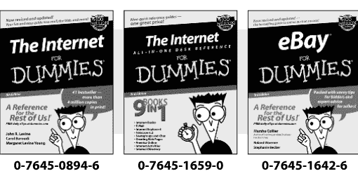

### 更多可选
- 傻瓜指南 America Online 7.0 (0-7645-1624-8)
- 傻瓜指南家谱学 (0-7645-0807-5)
- 傻瓜指南互联网全合集 (0-7645-1659-0)
- 傻瓜指南 Internet Explorer 6
- 傻瓜指南互联网快速参考手册 (0-7645-1645-0)
- 傻瓜指南网络隐私 (0-7645-0866-6)
- 傻瓜指南在线检索 (0-7645-0546-7)
- 傻瓜指南在线创业 (0-7645-1655-8)

## 数字媒体
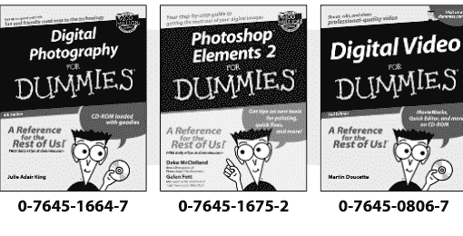

### 更多可选
- 傻瓜指南 CD 和 DVD 录制 (0-7645-1627-2)
- 傻瓜指南数字摄影全合集 (0-7645-1800-3)
- 傻瓜指南数字摄影快速参考手册 (0-7645-0750-5)
- 傻瓜指南音乐家家庭影院 (0-7645-1634-5)
- 傻瓜指南 MP3 (0-7645-0858-X)
- 傻瓜指南 Paint Shop "X" (0-7645-2440-2)
- 傻瓜指南照片修饰与修复 (0-7645-1662-0)
- 傻瓜指南扫描仪 (0-7645-0783-4)

## 图形设计
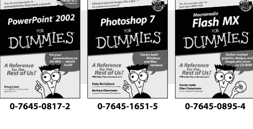

### 更多可选
- 傻瓜指南 Adobe Acrobat 5 (0-7645-1652-3)
- 傻瓜指南 Fireworks 4 (0-7645-0804-0)
- 傻瓜指南 Illustrator 10 (0-7645-3636-2)
- 傻瓜指南 QuarkPress 5 (0-7645-0643-9)
- 傻瓜指南 Visio 2000 (0-7645-0635-8)

凡有售书的地方均有。访问 www.dummies.com 或拨打 1-877-262-2974 直接订购。

## 傻瓜指南

你成功所需的建议与解释

## 自助、灵性与宗教

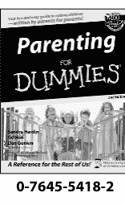


### 更多可选
- 傻瓜指南圣经 (0-7645-5296-1)
- 傻瓜指南佛教 (0-7645-5359-3)
- 傻瓜指南基督徒穷人 (0-7645-5500-6)
- 傻瓜指南恋爱 (0-7645-5072-1)
- 傻瓜指南犹太教 (0-7645-5299-6)
- 傻瓜指南陶艺训练 (0-7645-5417-4)
- 傻瓜指南怀孕 (0-7645-5074-8)
- 傻瓜指南重燃浪漫 (0-7645-5308-3)
- 傻瓜指南灵性 (0-7645-5298-8)
- 傻瓜指南婚礼 (0-7645-5055-1)

## 宠物


### 更多可选
- 傻瓜指南拉布拉多寻回犬 (0-7645-5281-3)
- 傻瓜指南鱼缸 (0-7645-5156-6)
- 傻瓜指南鸟类 (0-7645-5267-8)
- 傻瓜指南狗 (0-7645-5274-0)
- 傻瓜指南雪貂鼠 (0-7645-5259-7)
- 傻瓜指南牧羊犬 (0-7645-5280-5)
- 傻瓜指南金毛寻回犬 (0-7645-5267-8)
- 傻瓜指南马 (0-7645-5318-3)
- 傻瓜指南杰克罗素梗 (0-7645-5268-6)
- 傻瓜指南幼犬养 (0-7645-0876-8)

## 教育与教学


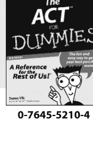

### 更多可选
- 傻瓜指南化学 (0-7645-5430-1)
- 傻瓜指南英语语法 (0-7645-5322-4)
- 傻瓜指南法语 (0-7645-5193-0)
- 傻瓜指南 GMAT 考试 (0-7645-5251-1)
- 傻瓜指南意大利语 (0-7645-5196-5)
- 傻瓜指南研究论文 (0-7645-5426-3)
- 傻瓜指南 SAT 考试 (0-7645-5472-7)
- 傻瓜指南美国史 (0-7645-5249-X)
- 傻瓜指南世界史 (0-7645-5242-2)

凡有售书的地方均有。访问 www.dummies.com 或拨打 1-877-2974 直接订购。

## 傻瓜指南

我们让复杂领域变得不再神秘

## Web 开发
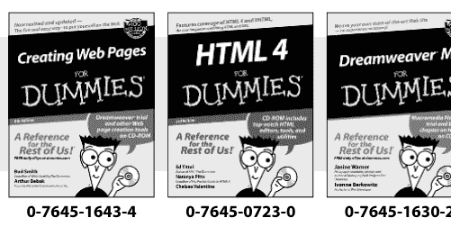

### 更多可选
- 傻瓜指南 ASP.NET (0-7645-0866-0)
- 傻瓜指南建立网站 (0-7645-0720-6)
- 傻瓜指南 ColdFusion "MX" (0-7645-1672-8)
- 傻瓜指南创建网页全合集 (0-7645-1542-X)
- 傻瓜指南 FrontPage 2002 (0-7645-0821-0)
- 傻瓜指南 HTML 4 快速参考手册 (0-7645-0721-4)
- 傻瓜指南 Macromedia Studio "MX" 全合集 (0-7645-1799-6)
- 傻瓜指南 Web 设计 (0-7645-0823-7)

## 编程与数据库
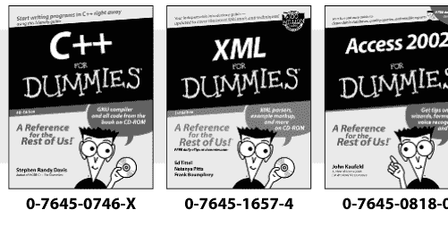

### 更多可选
- 傻瓜指南初级编程 (0-7645-0835-0)
- 傻瓜指南 Crystal Reports "X" (0-7645-1641-8)
- 傻瓜指南 Java & XML (0-7645-1658-2)
- 傻瓜指南 Java 2 (0-7645-1658-2)
- 傻瓜指南 JavaScript (0-7645-0663-1)
- 傻瓜指南 Perl (0-7645-0776-1)
- 傻瓜指南 PHP 和 MySQL (0-7645-0657-9)
- 傻瓜指南 SQL (0-7645-0737-0)
- 傻瓜指南 VisualBasic.NET (0-7645-0867-9)
- 傻瓜指南 Visual Studio .NET 全合集 (0-7645-1626-4)

## LINUX、网络与认证
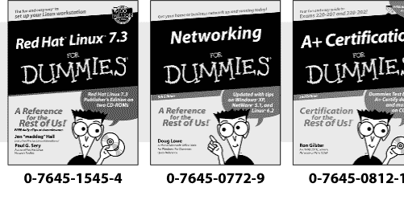

### 更多可选
- 傻瓜指南 CCNP 全合集认证 (0-7645-0884-5)
- 傻瓜指南思科网络 (0-7645-1668-X)
- 傻瓜指南 CISSP (0-7645-1670-1)
- 傻瓜指南 CIW 基础（含 CD-ROM） (0-7645-1635-3)
- 傻瓜指南防火墙 (0-7645-0884-9)
- 傻瓜指南家庭网络 (0-7645-0857-1)
- 傻瓜指南红帽 Linux 全合集 (0-7645-2442-9)
- 傻瓜指南 TCP/IP (0-7645-1760-0)
- 傻瓜指南 UNIX (0-7645-0419-3)

凡有售书的地方均有。访问 www.dummies.com 或拨打 1-877-2974 直接订购。


