# JavaScript 高级指南：使用 JavaScript 编程特性、技术和模块解决日常问题（英文版）


# 作者

# Ockert J. Du Preez


# 献给

我的妻子和女儿

Elmarie du Preez 和 Michaela du Preez

# 关于作者

**Ockert du Preez** 一直热爱计算机，但从未想过自己会成为一名系统开发者，更不用说编写编程书籍了！

他对编程的真正兴趣始于 1998 年，当时他遇到了 `Visual C++ 6` 和 `Visual Basic 6`。

除了妻子，编程是他最大的热爱。

多年来，他一直在 `CodeGuru`、`DevX`、`Developer.com` 和 `Database Journal` 等平台编写在线文章。2009 年至 2017 年，微软的 `.NET` MVP。

你可以在这里找到他的 Visual Studio 书籍：

[`rb.gy/kgnsbg`](https://rb.gy/kgnsbg)

# 致谢

首先，我要感谢上帝给我写这本书的勇气。我要感谢 BPB Publications 的所有人，给了我这个编写和出版这本书的机会。

感谢我的妻子和女儿一直对我的信任。

最后，我要感谢我的批评者。没有他们的批评，我永远无法写出这本书。

# 前言

从头到尾，本书将涵盖 JavaScript 语言的所有复杂细节！你将获得所有 `Statements`（语句）、`Functions`（函数）和 `Operators`（运算符）的概述。然后你将学习有趣的内容，包括：`Classes`（类）、`Prototypes`（原型）、`Promises`（承诺）和 `Generators`（生成器）。你将学习数组以及如何让脚本实现逻辑。最后，你将学习如何将 JavaScript 与其他语言结合。

## 目标

*   学习什么是 JavaScript
*   了解早期的浏览器大战

JavaScript 是**万维网**（**WWW**）的核心技术之一。JavaScript 是一种高级、解释型编程语言，这意味着它的大多数指令可以直接执行，而无需编译。JavaScript 最吸引人的特性是它能够让网页具有交互性。JavaScript 语言支持动态类型、函数、基于原型的面向对象以及大量的 API，允许你处理数组、文本、正则表达式、日期和**文档对象模型**（**DOM**）。

JavaScript 最初仅在网络浏览器的客户端实现，但现在，JavaScript 引擎已嵌入到许多其他类型的宿主软件中，包括：

*   Web 服务器和数据库中的服务端
*   允许使用 JavaScript 编写移动和桌面应用程序的运行时环境

通过嵌入其他类型的宿主，这些软件使得 JavaScript 更加多功能、强大，并且对跨平台的变化更有适应性。

# JavaScript 历史

为了更深入地了解 JavaScript 的历史，让我们快速看看“浏览器战争”这个术语。

# 浏览器战争

顾如其名，浏览器战争是浏览器之间的竞争，主要是关于市场份额的竞争。在 20 世纪 90 年代后期，第一次浏览器战争发生在微软 Internet Explorer 和 Netscape Navigator 之间。

第一次浏览器战争从 1995 年开始，持续到 2001 年。Netscape Navigator 曾是最广泛使用的网络浏览器，因为微软在 1995 年 8 月仅作为 Windows 95 Plus! 包的一部分发布了 Internet Explorer 1.0。

三个月后，微软免费下载发布了 Internet Explorer 2.0。Internet Explorer 4 改变了一切。Internet Explorer 4 被集成到 Microsoft Windows 中，这导致了 Netscape Navigator 的衰落，因为用户觉得在已经有 Internet Explorer 浏览器的情况下，没有必要下载另一个浏览器。

第一次浏览器战争结束时，Internet Explorer 在其市场份额上已没有其他严肃的竞争对手，从而结束了 Web 浏览器的快速创新。

随着 Internet Explorer 使用份额的下降以及 Firefox、Google Chrome、Safari、Opera 等浏览器的流行，浏览器战争在 21 世纪 10 年代初加剧。

# JavaScript 的诞生

Netscape Communications 的创始人 Marc Andreessen 设想了一种更具动态的 Web 体验。他不想只显示无法兼顾用户活动的静态网页，他想要更多。问题在于，想要一种包含自动化、动画和基础用户交互的更动态 Web 体验，需要一种轻量级的脚本语言，这种语言要让非程序员也能使用，并且能够与 `DOM` 直接交互。

Mocha 出生了。Mocha 将成为一种简单且动态的 Web 脚本语言。JavaScript 之父 Brendan Eich 出现了。Netscape Communications 聘请 Eich 为他们的浏览器开发 Scheme（一种轻量级 Lisp 方言）。Scheme 是强大、动态且函数式的。几个月后，Mocha 的原型在 1995 年 5 月集成到 Netscape Communicator 中。不久后，它被更名为 LiveScript。1995 年 12 月，Mocha/LiveScript 被更名为 JavaScript，并作为一种用于客户端浏览器任务的脚本语言推出。

# 为什么选择 JavaScript?

很难想象一个没有 JavaScript 的 Web。

# JavaScript 特性

JavaScript 是世界上最流行的语言之一。它被用于创建交互式网站、移动应用，甚至是服务端应用程序。JavaScript 是一种多功能且灵活的语言，可以用于各种任务。

JavaScript 的一些特性包括：

*   动态类型
*   基于原型的面向对象
*   异步编程

JavaScript 是一门强大的语言，为开发者提供了许多机会。如果你对 Web 开发感兴趣，学习 JavaScript 是必修之路。

# JavaScript 特性总结

在本章中，我们探索了 JavaScript 的历史及其特性。我们还学习了为什么 JavaScript 是一门强大且多功能的语言。在下一章中，我们将学习更多关于 JavaScript 对象以及如何使用它们。

## 问题

1. 谁创建了 JavaScript？
2. 写出 JavaScript 的四个特性。
3. JavaScript 相比 HTML 有什么优势？

# 第 2 章

## JavaScript 对象

## 引言

在任何编程语言中，对象都是任何应用程序的基石。在对象内部存储信息并检索其值对于速度至关重要。

在对象内部存储信息并利用它们有许多方法。我们将学习 JavaScript 对象是什么，然后快速查看原始类型（primitives）。我们将通过五种方式创建对象。最后，我们将探索 `this` 关键字以及它的含义在不同用法下的何不同。

## 结构

*   JavaScript 对象
*   `this` 关键字

## 目标

*   理解 JavaScript 对象以及如何创建它们
*   学习如何创建对象
*   理解并使用 `this` 关键字

## JavaScript 对象

对象是具有属性和方法的东西。属性描述对象。方法是该对象可以执行的操作。基本上，在 JavaScript 中，万物皆可对象。除了原始类型外，所有的 JavaScript 值都是对象。在详细介绍内置对象之前，让我们先探索原始类型。

## 原始值和原始数据类型

原始值是不具有属性或方法的值。原始数据类型就是具有原始值的数据。JavaScript 有 7 种原始数据类型。它们是：

*   string
*   number
*   bigint
*   boolean
*   undefined
*   null
*   symbol

让我们逐一个探索这些原始数据类型。

### string

字符串代表文本数据。如果允许我表现得技术化一点：JavaScript 字符串原始数据类型简单来说是一组 16 位无符号整数值的集合。字符串中的每个项目都占据字符串中的一个位置，从 0 开始。

### number

`number` 类型表示整数和浮点数。

### bigint

`bigint` 类型表示任意精度的整数。

### boolean

`boolean` 类型表示逻辑实体，只有两个值：`true` 和 `false`。

### undefined

`undefined` 类型表示未定义的值。

### null

`null` 类型表示空值。

### symbol

`symbol` 类型表示唯一的标识符。

## 创建对象

在 JavaScript 中有多种创建对象的方法。我们将探索以下五种方式：

*   对象字面量语法
*   `new` 关键字
*   `Object.create()`
*   `Object.assign()`
*   ES6 classes

让我们探索一下区别。

### 对象字面量语法

对象字面量是创建对象最简单的方法。它使用花括号 `{}` 来定义对象及其属性。

```javascript
var objStudent = {
  Course: "JavaScript"
};

var objCar = {
  make: "BMW",
  model: "i8 Roadster",
  price: 2329300
};

console.log(objCar); // 输出 {make: "BMW", model: "i8 Roadster", price: 2329300}
console.log(objCar.model); // 输出 i8 Roadster
```

### 使用 ‘new’ 配合内置对象函数

在基于类的面向对象编程 (`OOP`) 中，构造函数是一种特殊的子程序，用于创建对象。构造函数通过初始化对象的成员为新对象做好准备。要创建一个新对象，必须使用 `new` 关键字配合 `Object()` 构造函数，如下所示：

```javascript
var house = new Object();
```

这创建并初始化了一个名为 `house` 的新对象。我们可以使用下面的代码为此对象添加属性：

```javascript
house.bedrooms = 3;
house.bathrooms = 2;
house.garages = 2;
house.hasSwimmingPool = false;
house.hasOutsideWalls = true;
```

你可以看到，为使用 `Object()` 构造函数创建的对象属性可能会变成一项繁琐的任务，并且涉及大量的输入工作。我们上面创建的 `house` 对象具有 `bedrooms` 属性、`bathrooms`、`garages`，以及表示是否存在游泳池或外墙的布尔值属性。

如果我们必须创建数百个 `house` 对象怎么办？让我们看看如何通过使用自定义构造函数让这段代码更短一些。

### 使用 ‘new’ 配合自定义构造函数

在创建自定义构造函数时，你基本上是为对象的属性和方法创建了一个模板。你只需要创建一次函数，然后向它传递必要的属性，而不是像之前在“使用 `new` 配合内置对象构造函数”部分所示那样手动输入每个属性和每个设置。

让我们再次以 `house` 对象为例创建自定义构造函数：

```javascript
function House(_bed, _bath, _garage, _pool, _walls) {
  this.bedRooms = _bed;
  this.bathRooms = _bath;
  this.garages = _garage;
  this.hasSwimmingPool = _pool;
  this.hasOutsideWalls = _walls;
}
```

构造函数的名称是 `House`。括号内有五个参数：`_bed`、`_bath`、`_garage`、`_pool` 和 `_walls`。这些参数将用于向 `House` 函数传递信息。在构造函数内部，每个属性都被赋值为它自己的参数。记住，这仅仅是一个模板，目前还没有值。

现在我们有了构造函数，根据它来创建对象就很简单了。方法如下：

```javascript
var houseOne = new House(4, 2, 2, false, true);
var houseTwo = new House(3, 1, 1, true, false);
console.log(houseOne);
console.log(houseTwo);
```

### Object.create()

`Object.create()` 方法创建一个新对象，使用现有的对象来提供新创建的对象的 `__proto__`。

```javascript
let Course = {name: 'Web Programming'};
let Subject = Object.create(Course, { name: { value: 'JavaScript' } });
console.log(Subject.name); // Output: JavaScript
console.log(Subject.Course); // Output: Web Programming (通过原型链访问)
```

### Object.assign()

`Object.assign()` 方法用于将所有可枚举属性的值从一个或多个源对象复制到目标对象。它将返回目标对象。

你有一个 `Student` 对象正在学习 `Web Programming` 课程，并且目前正忙于名为 `JavaScript` 的科目。你可以通过 `Object.assign` 的帮助来实现这一点，如下所示：

```javascript
let Course = {Coursename: 'Web Programming'};
let Subject = {Subjectname: 'JavaScript'};
let Student = Object.assign({}, Course, Subject);
console.log(Student.Coursename); // Output: Web Programming
console.log(Student.Subjectname); // Output: JavaScript
```

### ES6 classes

使用 ES6（ECMAScript 6 或 JavaScript 6）类就像使用 `new` 关键字配合用户定义的构造函数一样。构造函数简单地被类所取代。这是一个简短的示例：

```javascript
class Car {
  constructor(_make, _model) {
    this.carMake = _make;
    this.carModel = _model;
  }
}

myCar = new Car("BMW", "i8 Roadster");
console.log(myCar.carMake); // BMW
console.log(myCar.carModel); // i8 Roadster
```

## `this` 关键字

`this` 关键字指向它所属的对象。它的值根据使用位置的不同而不同。

### 单独使用

单独使用时，`this` 指向全局对象（浏览器中为 `window`）。

```javascript
var objWindow = this; // returns [object Window]
```

### 在函数中

在函数中，`this` 指向全局对象（非严格模式下）。

```javascript
function mainWindow() {
  return this; // returns [object Window]
}
```

### 在严格模式下的函数中

在严格模式下，函数中的 `this` 是 `undefined`。

```javascript
"use strict";
function mainWindowStrict() {
  return this; // returns undefined
}
```

### 在事件中

当 `this` 在事件中使用时，`this` 指向接收事件的 HTML 元素：

```html
<button onclick="this.style.display='none'">Click Me!</button>
```

## 结论

在本章中，我们探索了 JavaScript 中的对象。我们学习了各种对象创建技术：对象字面量、`new` 关键字、自定义构造函数、`Object.create()`、`Object.assign()` 方法和 ES6 类。最后，我们学习了 `this` 关键字的不同实现方式。

在下一章中，我们将学习 JavaScript 语句（它们是什么以及如何构造）和 JavaScript 关键字。

## 问题

1. `Object.create()` 和 `Object.assign()` 方法的区别是什么？
2. 什么是用户定义的构造函数？
3. 解释参数（parameter）。

# 第 3 章

## JavaScript Statements

## Introduction

没有语句，就不会有程序。语句是发送给解释器或编译器的指令。你组合语句的方式对于整个脚本的成功至关重要。是的，这听起来有点极端，但如果你使用没有空格或换行的粗糙代码，它很快就会变得混乱。

在本节中，你将学习 JavaScript 语句是什么，以及为了可读性和理解性组合它们有多重要。

## Structure

本章涵盖的主题有：

*   语句结构
*   空格和换行

## 目标

*   学习如何创建 JavaScript 语句
*   学习空格和换行

## 语句结构

JavaScript 程序由多条语句组成。语句通常以分号（`;`）结束。

```javascript
var objWidth, objHeight;
objWidth = 500;
objHeight = 100;
var size = objWidth + " x " + objHeight;
document.getElementById("displaySizeLabel").innerHTML = size; /*显示屏幕尺寸*/
```

你也可以在一行中包含多个语句，只要它们之间用分号隔开，如下例所示：

```javascript
var a = 1; var b = 2; var c = a + b;
```

通过用分号隔开，三个语句被合并了一行。

## JavaScript 代码块

代码块将语句组合在一起。因为语句被分组在代码块内部，它们会被一起执行。在代码块中组合语句的常用方法是使用函数。JavaScript 函数的格式如下：

```javascript
function functionName(parameters) {
  // statement_1;
  // statement_2;
  // statement_3;
}
```

函数以关键字 `function` 开始。左括号和右括号允许你为函数输入参数。代码块存在于函数的左右大括号之间。在 *第 5 章：JavaScript 函数* 中，我们将更深入地探讨函数。

单独的代码块也可以出现在另一个代码块（如函数）内部。例如，一个函数可以包含分组的语句，如 `while` 循环、`for` 循环或 `if` 语句。这里是对每种语句的简短说明和示例。

## 语句分组

JavaScript 中的语句分组包括循环和条件测试。JavaScript 中的循环是一段重复执行的代码块，直到某个条件变为真。条件是用于进行测试的事物，例如：如果某个值小于 100，则应该发生某些事情。条件语句是判断特定条件为真还是为假的语句，例如：是否输入了名称。

接下来的几个代码块将演示各种循环和条件测试。

### while 循环

`while` 循环只要指定的条件存在，就会循环执行代码块。让我们来看一个示例：

```javascript
var counter = 0;
while (counter <= 100) {
  document.write(counter + "<br>");
  counter++;
}
```

### for 循环

`for` 循环与 `while` 循环略有不同。`while` 循环被称为*条件*循环（它在某个条件存在时循环，或者直到某个条件变为真），而 `for` 循环是计数器循环。通过 `for` 循环，你可以精确指定循环从哪里开始，在哪里停止。为了演示区别，我保持了与上面 `while` 循环相同的参数。`for` 循环将从 `0` 循环到 `100`。

```javascript
for (let i = 0; i <= 100; i++) {
  document.write(i + "<br>");
}
```

它随后会将循环计数器的值写入文档。正如你所见的，不需要手动增加循环变量，因为它是自动增加的。我现在不会细说太详细，因为循环将在 *第 14 章：循环* 中进行详细解释。

### if 语句

JavaScript 的 `if` 语句在特定条件为真时执行分组的语句。这里有一个小示例：

```javascript
var counter = 60;
if (counter > 50) {
  alert("stop it!");
  break;
}
```

上面的 `if` 语句也通过使用大括号将一组语句组合在一起。在上面的示例中，它判断 `counter` 变量是否大于 `50`。如果是，它将显示一个带有 `stop it!` 的弹出框；如果 `counter` 小于或等于 `50`，则什么都不会发生。我现在不会细说太详细，因为 `if` 语句将在 *第 13 章：控制流语句* 中进行详细解释。

## 空格和换行

代码会变得非常杂乱，你可能会更快迷失在代码中。想象一个包含 1000 行的脚本。进一步想象你必须更改其中某处的几行。现在，如果没有空格，你将挣苦于寻找你的函数和分组语句何时结束。你将在寻找需要编辑的地方时面临极大困难。

这就是空格和换行的用武之地。空格允许你以一种优化的方式格式化代码的流。

### 空格

空格简单地添加空格、制表符或换行符，以便你的代码更具读性。JavaScript 解释器忽略空格。

#### 没有空格的 while 循环

```javascript
var counter=0;while(counter<=100){document.write(counter+"<br>");counter++;}
```

#### 没有空格的 for 循环

```javascript
for(let i=0;i<=100;i++){document.write(i+"<br>");}
```

#### 没有空格的 if

```javascript
var counter=60;if(counter>50){alert("stop it!");break;}
```

正如你所见的，代码不再容易阅读了，尽管代码并不长。现在，想象有一个包含几十个 `if` 语句和循环组合在一起的长脚本。不仅对你来说，对你团队中的其他开发者来说，跟踪代码都将极其困难。你现在可能知道脚本中发生的一切切，但一个月后可能就不如此了。

让我们让代码变得漂亮起来！

#### 带有空格的 while 循环

```javascript
var counter = 0;
while (counter <= 100) {
  document.write(counter + "<br>");
  counter++;
}
```

#### 带有空格的 for 循环

```javascript
for (let i = 0; i <= 100; i++) {
  document.write(i + "<br>");
}
```

#### 带有空格的 if

```javascript
var counter = 60;
if (counter > 50) {
  alert("stop it!");
  break;
}
```

代码看起来已经清晰多了。通过添加换行符，你可以让它更易读。

### 换行符

一条长的 JavaScript 语句可以分成多行。通常，超过 80 个字符的行会让阅读和跟踪代码变得困难。像这样的行就很长：

```javascript
var size = screen.width + " x " + screen.height + " pixels " + "Color Depth: " + screen.colorDepth + " bits";
```

一个很好的断行位置是在运算符之后（*第 4 章：JavaScript 运算符* 将详细介绍运算符），如下下面的代码段所示：

```javascript
var size = screen.width + " x " + screen.height + " pixels " +
  "Color Depth: " + screen.colorDepth + " bits";
```

## JavaScript 关键字

JavaScript 关键字是保留字，不能用作变量名、函数名或标签。以下是 JavaScript 关键字列表：

| `arguments` | `boolean` |
| :--- | :--- |
| `byte` | `catch` |
| `class` | `continue` |
| `default` | `do` |
| `else` | `eval` |
| `extends` | `final` |
| `float` | `function` |
| `if` | `import` |
| `instanceof` | `interface` |
| `long` | `new` |
| `package` | `protected` |
| `return` | `static` |
| `switch` | `this` |
| `throws` | `TRUE` |
| `typeof` | `void` |
| `while` | `yield` |

**表 3.1：** JavaScript 关键字

在本书的学习过程中，我们将涵盖这些关键字，因为本章只是一个介绍。

## 结论

在本章中，我们学习了 JavaScript 语句的细节。我们学习了如何创建语句、语句是如何形成的，然后学习了空白字符和换行。最后，我们快速查看了可用的 JavaScript 关键字。

# 第 4 章：JavaScript 运算符

## 引言

运算符允许我们对不同的操作数进行操作。这些操作数可以是我们想要加、减、乘、除的对象名称。有很多运算符，每个运算符都有自己的功能。本章将解释什么是运算符，并将它们分为类别和类型以便更好地理解，并提供了如何使用常用运算符的实用示例。

## 目标

*   什么是运算符？
*   了解什么是算术运算符
*   理解赋值运算符
*   学习运算符优先级

## 什么是运算符？

运算符可以被解释为行为几乎像函数的结构，但在语义或语法上与普通函数不同。有许多类型的运算符，甚至还有我们很快将涵盖的类别。一些常用的运算符包括：

| 运算符类型/类别 | 运算符(s) |
| :--- | :--- |
| 算术 | `+ - * / % ** ++ --` |
| 比较 | `== === != !== > < >= <= ?` |
| 逻辑 | `&& || !` |
| 赋值 | `= += -= *= /= %= **=` |

主要运算符可以归类为实现相似目标的任何运算符类别。主要运算符包括算术、赋值、比较和逻辑运算符。我将在接下来的几个表格和标题中逐一强调每个主要类型。

## 算术运算符

算术运算符主要用于对数字进行算术运算。JavaScript 中可用的算术运算符如表 4.2 所示：

| 运算符类型 | 运算符 | 描述 |
| :--- | :--- | :--- |
| 算术 | `+` | 加法 |
| 算术 | `-` | 减法 |
| 算术 | `*` | 乘法 |
| 算术 | `**` | 幂 |
| 算术 | `/` | 除法 |
| 算术 | `%` | 取模（余数） |
| 算术 | `++` | 增一 |
| 算术 | `--` | 减一 |

**表 4.2：** 算术运算符

## 比较运算符

比较运算符用于确定值之间的相等性或差异：

| 运算符类型 | 运算符 | 描述 |
| :--- | :--- | :--- |
| 比较 | `==` | 等于 |
| 比较 | `===` | 值和类型相等 |
| 比较 | `!=` | 不相等 |
| 比较 | `!==` | 值不等或类型不相等 |
| 比较 | `>` | 大于 |
| 比较 | `<` | 小于 |
| 比较 | `>=` | 大于等于 |
| 比较 | `<=` | 小于等于 |
| 比较 | `?` | 三元运算符 |

**表 4.3：** 条件运算符

## 逻辑运算符

逻辑运算符用于确定值之间的逻辑关系。JavaScript 中可用的逻辑运算符如表 4.4 所示：

| 运算符类型 | 运算符 | 描述 |
| :--- | :--- | :--- |
| 逻辑 | `&&` | 逻辑与 |
| 逻辑 | `||` | 逻辑或 |
| 逻辑 | `!` | 逻辑非 |

**表 4.4：** 逻辑运算符

## 赋值运算符

赋值运算符将值赋给变量。JavaScript 中可用的赋值运算符如表 4.5 所示：

| 运算符 | 示例 | 等价 |
| :--- | :--- | :--- |
| `=` | `a = b` | `a = b` |
| `+=` | `a += b` | `a = a + b` |
| `-=` | `a -= b` | `a = a - b` |
| `*=` | `a *= b` | `a = a * b` |
| `/=` | `a /= b` | `a = a / b` |
| `%=` | `a %= b` | `a = a % b` |
| `**=` | `a **= b` | `a = a ** b` |

**表 4.5：** 赋值运算符

## 运算符子类型

除了作为运算符具有不同功能外，还有使用各种运算符构建语句的多种方法。在大多数情况下，你需要两个操作数（运算符作用于的对象）和一个运算符。有时你可能需要三个操作数和两个运算符。我所称的运算符子类型列在下方：

*   一元
*   二元
*   三元

## 一元运算符

当运算符是一元的时，意味着该运算符只有一个操作数。接下来的示例显示了一些一元运算符的用法：

1.  打开你任选择的文本编辑器，并输入以下 HTML 和 JavaScript 代码

```html
<html>
<body>
  <h1>一元运算符</h1>
  <p>以下代码演示了对操作数进行的一元操作</p>
  <script>
    let a = 1;
    let b = 1;
    let c = 5;
    let d = 5;
    a = -a;
    alert(a); // -1, 应用了一元否定
    b = +b;
    alert(b); // +1, 应用了一元加法
    c++;
    alert(c); // 6, 应用了增一
    d--;
    alert(d); // 4, 应用了减一
  </script>
</body>
</html>
```

2.  以 HTML 扩展名保存文件，例如 `Chapter 4.1.html`。

3.  双击文件并在默认浏览器中打开它。

一旦加载，该网页将连续产生四个警告框（alert boxes）。在上面的示例中，输出了以下答案：

`名为 a 的变量值为 -1。` 这是因为我们对其进行了取反，将其变为负数。

`名为 b 的变量值为 1。` 它没有变化，因为已经是正数了。

`名为 c 的变量值为 6。` 我们在它现有的值 5 的基础上加了 1。

`名为 d 的变量值为 4。` 我们在它现有的值 5 的基础上减去了 1。

## 二元运算符

当一个运算符是二元的时，它有两个操作数。下面的示例展示了一些二元运算符的操作：

1. 打开你任选的文本编辑器，并输入以下 HTML 和 JavaScript 代码：

```html
<html>
<body>
  <h1>Binary Operators</h1>
  <p>The following code demonstrates Binary operations on operands</p>
  <script>
    let a = 1;
    let b = 2;
    let c = 5;
    let d = 2;
    var e;
    a = a + b;
    alert(a); // 3, 将 b 的值加到 a 上
    b = b - c;
    alert(b); // -1, 从 b 中减去 c 的值
    e = c % d;
    alert(e); // 1, 余数为 1
  </script>
</body>
</html>
```

2. 以 HTML 扩展名保存文件，例如 `Chapter 4.2.html`。

3. 双击文件并在默认浏览器中打开它。

一旦加载，该网页将连续产生三个警告框。在上面的示例中，输出了以下答案：

`名为 a 的变量值为 3。` 这是因为将 b 的值加到了 a。

`名为 b 的变量值为 -1。` 从 b 中减去了 c 的值。

`名为 e 的变量值为 1。` 余数为 1。

## 三元运算符

三元运算符是一种接受三个操作数的运算符。下面的示例展示了三元运算符的操作：

1. 打开你任选的文本编辑器，并输入以下 HTML 和 JavaScript 代码：

```html
<html>
<body>
  <h1>Ternary Operators</h1>
  <p>The following code demonstrates Ternary operations on operands</p>
  <script>
    // 常规 if 条件
    var age = 21;
    var canEnterCollege;
    if (age > 18) {
      canEnterCollege = "Old enough";
    }
    else {
      canEnterCollege = "Too young";
    }
    alert(canEnterCollege);
    // 使用三元条件运算符简化
    var canEnterCollege = (age < 18) ? "Too young" : "Old enough";
    alert(canEnterCollege);
  </script>
</body>
</html>
```

2. 以 HTML 扩展名保存文件，例如 `Chapter 4.3.html`。

3. 双击文件并在默认浏览器中打开它。

一旦加载，该网页将连续产生两个警告框。在上面的示例中，输出了以下答案。

名为 `canEnterCollege` 的变量值为 `Old enough`。在第一个控制流语句中（我们将在 *第 13 章：控制流语句* 中介绍控制流语句），我们测试变量 `age` 是否大于 `18`。如果是，警告框将显示 `Old enough`；`else`，另一个警告框将显示 `Too young`。

在代码的最后部分，注意同时使用了 `?` 和 `:`。条件写在括号中——在本例中，为 `age < 18`。如果条件为真，则执行 `?`（问号）旁边的代码；如果条件为假（`age` 不小于 18），则触发 `:`（冒号）旁边的代码。

## 运算符优先级

如果表达式包含多个运算符，其执行顺序由它们的优先级顺序定义，即优先级。下表显示了 JavaScript 中的运算符优先级（从高到低）：

| 运算符类型 | 逐个运算符 |
| :--- | :--- |
| 分组 | `()` |
| 成员访问 | `.` |
| 计算的成员访问 | `[]` |
| new (带参数列表) | `new ()` |
| 函数调用 | `()` |
| 可选链 | `?.` |
| new (不带参数列表) | `new` |
| 后置递增 | `++` |
| 后置递减 | `--` |
| 逻辑非 | `!` |
| 按位非 | `~` |
| 一元加号 | `+` |
| 一元取反 | `-` |
| 前缀递增 | `++` |
| 前缀递减 | `--` |
| 一元类型 | `typeof` |
| 一元 void | `void` |
| 一元删除 | `delete` |
| 一元 await | `await` |
| 幂 | `**` |
| 乘法 | `*` |
| 除法 | `/` |
| 余数 | `%` |
| 加法 | `+` |
| 减法 | `-` |
| 按位左移 | `<<` |
| 按位右移 | `>>` |
| 无符号右移 | `>>>` |
| 小于 | `<` |
| 小于或等于 | `<=` |
| 大于 | `>` |
| 大于或等于 | `>=` |
| 在 | `in` |
| 实例类型 | `instanceof` |
| 等于 | `==` |
| 不等于 | `!=` |
| 严格相等 | `===` |
| 严格不相等 | `!==` |
| 按位与 | `&` |
| 按位异或 | `^` |
| 按位或 | `|` |
| 逻辑与 | `&&` |
| 逻辑或 | `||` |
| 空值合并 | `??` |
| 条件（三元） | `? :` |
| 赋值 | `= += -= *= /= %= **=` |
| 逗号 | `,` |

### 还没有结束

到为止我们学习了许多函数和各种运算符，但我们可以使用运算符来拼接字符串。字符串将在 *第 12 章：原始类型* 中介绍，并在 *第 2 章：对象* 中提到过。

运算符可以用于判断类型，还有按位运算符。我们将在后续内容介绍它们。

## 总结

在本章中，我们探索了运算符的世界。我们学习了什么是运算符，以及它们不同的类型和分组。我们对一元、二元和三元运算符进行了一些有趣的示例。最后，我们对运算符优先级进行了简单的介绍。

# 第 5 章

## JavaScript 函数

## 引言

函数让事情发生。我们作为程序员编写函数是为了在代码中重复使用。每个函数在何时可以使用或何时应该触发，这取决于调用（invocation）。我们向函数传递信息以产生相似但又不同的结果。

## 结构

*   什么是函数？
*   函数声明
*   参数
*   默认值
*   函数表达式

## 目标

*   理解函数
*   学习如何声明函数
*   学习函数参数
*   理解函数表达式

通俗地来说，`function` 是一个返回特定值的代码块。它可以被比作脚本或程序内部的一个小型子程序，从另一个方法或函数中调用（或触发）。调用它的方法、函数或对象将使用被调用函数返回的值。函数应该始终返回一个值。如果没有指定返回值，则将返回 `undefined`。

JavaScript 中的函数是一等对象，这意味着它们可以拥有属性和方法。任何函数都由一个声明或表达式、可选参数和默认值组成。

## 函数声明

通过声明函数，你告诉解释器该函数应该被存储在内存中以备后用。当函数从代码的某处被调用时，就会发生这种情况。要声明一个函数，你应该使用类似于以下的代码：

```javascript
function functionName(parameters) {
  // code block
}
```

首先编写 `function` 关键字。这是为了告诉解释器你正在创建一个函数。名称紧随 `function` 关键字之后。它可以是任何名称，JavaScript 关键字除外，并记住它是区分大小写的。在括号内，你可以包含一个用逗号分隔的参数列表。这是一个小例子：

```javascript
function showGreeting() {
  alert('Good morning!');
}
```

在上面的代码段中，创建了一个名为 `showGreeting` 的没有任何参数的函数，并显示一个包含 `Good morning!` 消息的警告框。

## 你有了一个函数，现在怎么办？

嗯，函数如果没有从某处被调用（或触发），它是无法运行的。在调用函数时，你只需要引用函数名并包含它的可选参数。函数可以从以下任何方式被调用：

*   当事件发生时
*   当被直接调用时
*   自执行

## 事件触发的函数示例

以下是一个如何从按钮点击或鼠标移动等事件调用函数的示例：

1. 打开你任选的文本编辑器并输入以下 HTML 和 JavaScript 代码：

```html
<html>
<body>
  <h1>Invoke function from button click</h1>
  <p>The following code Calls a function from a button click</p>
  <script>
    function showGreeting() {
      alert('Good morning!');
    }
  </script>
  <button onclick="showGreeting()">Greeting</button>
</body>
</html>
```

2. 将文件保存为 HTML 扩展名，例如 `Chapter 5.1.html`。

3. 双击文件在默认浏览器中打开它。

正如你将看到的，页面正常加载，还没有弹出警告框。这是因为我们从按钮的点击事件中调用了该函数。如果没有点击按钮，函数将不会执行。

点击按钮，注意弹出的消息，如下截图所示：

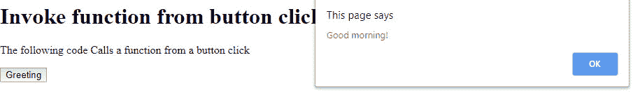

**图 5.1：** 从按钮点击调用的函数

## 直接调用的函数示例

以下是一个如何直接调用函数的示例：

1. 打开你任选的文本编辑器并输入以下 HTML 和 JavaScript 代码：

```html
<html>
<body>
  <h1>Invoke function directly</h1>
  <p>The following code Calls a function just after the function is created</p>
  <script>
    function showGreeting() {
      alert('Good morning!');
    }
    showGreeting();
  </script>
</body>
</html>
```

2. 将文件保存为 HTML 扩展名，例如 `Chapter 5.2.html`。

3. 双击文件在默认浏览器中打开它。

## 自执行函数示例

以下是一个如何自动调用函数的示例。这意味着它是一个函数，但不需要添加单独的调用来触发它，因为它调用了它自己：

1. 打开你任选的文本编辑器并输入以下 HTML 和 JavaScript 代码：

```html
<html>
<body>
  <h1>Self-Invoke function expression</h1>
  <p>The following code creates a function and invokes it automatically</p>
  <script>
    (function showGreeting(){
      alert('Good morning!');
    })()
  </script>
</body>
</html>
```

2. 将文件保存为 HTML 扩展名，例如 `Chapter 5.3.html`。

3. 双击文件在默认浏览器中打开它。

这里的函数声明看起来有一点不同，原因是因为我们现在创建了一个函数表达式（我们将在本章稍后部分介绍函数表达式）。名为 `showGreeting` 的函数被创建并自动执行，无需手动调用。

## 参数

参数或函数参数是用来传递给函数的额外数据。函数随后可以以它喜欢的方式使用并操纵该参数。在函数中包含参数的另一个好处是，你可以传递不同的值作为参数，函数仍然会相应地工作。

这里是一个如何使用其参数向函数发送不同值的示例：

1. 打开你任选的文本编辑器并输入以下 HTML 和 JavaScript 代码：

```html
<html>
<body>
  <h1>Function Parameters</h1>
  <p>The following code creates a function with parameters and makes use of the parameters inside the function</p>
  <script>
    function showGreeting(from, message) { // arguments: from, message
      alert(from + ': ' + message);
    }
    showGreeting('Ockert', 'Hello!'); // Outputs - Ockert: Hello!
    showGreeting('BPB', "Hi!"); // Outputs - BPB: Hi!
  </script>
</body>
</html>
```

2. 将文件保存为 HTML 扩展名，例如 `Chapter 5.4.html`。

3. 双击文件在默认浏览器中打开它。

声明了一个名为 `showGreeting` 带有两个参数 `from` 和 `message` 的函数。在代码块内部调用了警告框并将值复制到参数中。第一次调用 `showGreeting` 函数包括：`Ockert`、`Hello!`。第二次调用 `showGreeting` 函数包括：`BPB`、`Hi!`。当运行此脚本时，你将看到两个警告框相继弹出。第一个警告包含输入数据；第二个警告包含最后的输入数据。

## 默认值

当未提供参数时，它的值将变为 `undefined`。例如，如果你这样做：

```javascript
function showGreeting(from, message) { // arguments: from, message
  alert(from + ': ' + message);
}
showGreeting('Ockert'); // Outputs - Ockert: undefined
```

这是完全可以的，解释器不会产生错误。这就是默认值发挥作用的地方。你可以给参数一个默认值，这样即使没有提供值，它仍然有一个可以使用的设置默认值。

这是一个小例子：

```javascript
function showGreeting(from, message = 'Hey there!') { // arguments: from, message
  alert(from + ': ' + message);
}
showGreeting('Ockert'); // Outputs - Ockert: Hey there!
```

## 函数表达式

JavaScript 函数也可以通过表达式定义，并且通常存储在变量中。该变量随后可以被作函数使用。这是一个小例子：

```javascript
var answer = function (operand1, operand2) { return operand1 * operand2; };
```

在 `Chapter 12: Variables` 中，我们将对变量和函数进行更详细的介绍。

## 总结

在本章中，我们通过一些很好的示例学习了 `JavaScript` 函数。我们学习了 `Functions` 如何改进我们的代码，以及如何通过参数和默认值进一步改进它。在本书稍后部分（在 `Chapter 12: Variables` 中），我们将再次回到函数并探索函数表达式的世界。

在下一章中，我们将深入探讨 JavaScript 类。你将学习如何创建 JavaScript 类、属性、方法以及混入（Mixins）。你还将了解 JavaScript 中现有的类以及继承。

## 问题

1. 解释 `function` 术语。
2. 列出调用函数的三个方式。
3. 什么是参数（parameter）？
4. 给出一个带有默认值的函数示例。
5. 解释 `function expression` 术语。

# 第二部分：JavaScript 的力量

## 引言

第二部分将直接进入 JavaScript 的真实威力。理解 JavaScript 的运行原理对于创建极其强大的网站和 Web 应用至关重要。在本节中，你将学习如何创建类，然后学习原型、属性和承诺，最后是生成器和模块。

本节将包含以下章节：

1. 类
2. 原型
3. 属性
4. 承诺
5. 生成器
6. 模块

# 第 6 章：JavaScript 类

## 引言

JavaScript 类创建了其子对象的结构。虽然 JavaScript 并不是一种完全的面向对象编程（`OOP`）语言，但它仍然包含许多 OOP 特性。学习如何使用类对于创建适当的可重用对象至关重要。

在本章中，我们将专注于 JavaScript 类。你将学习创建类的不同方法以及如何从类实例化子对象。接下来是属性和方法。你将学习如何创建基础属性和方法，以为你的类提供更好的结构和适应性。最后，你将快速了解继承。内容很多，让我们开始开始吧！

## 结构

*   什么是类？
    *   创建类
    *   类声明
    *   类表达式
*   属性
    *   属性的属性
*   方法
    *   静态方法
*   继承

## 目标

*   学习什么是类
*   理解属性的概念
*   理解方法的概念
*   学习什么是继承

## 什么是类？

在 OOP 中，类是一个模板或蓝图，可以根据它创建对象。JavaScript 中的类是函数的一种类型，可以通过类声明或类表达式来创建。

## 创建类

在 JavaScript 中创建类本质上只有两种方式，它们是：

*   声明类
*   使用类表达式

让我们来看看每种示例。

## 类声明

要声明一个类，你只需要使用 `class` 关键字并提供类的名称，以及一个 `constructor`。`constructor` 是一种特殊的方法，可以在其中对对象进行初始化，并且会被自动调用。你也可以在这里为类提供参数并对它们进行初始化。初始化是为对象或变量分配（设置）初始值。这是一个示例：

```javascript
class Student {
  constructor(studentName, studentCourse) {
    this.studentName = studentName;
    this.studentCourse = studentCourse;
  }
}
```

在上面的代码中，我们创建了一个名为 `Student` 的类。`constructor` 函数接收两个提供的参数。这两个参数是 `studentName` 和 `studentCourse`。

让我们进一步探讨。下面的示例显示了如何声明一个类、初始化它的某些对象并在类外部使用该类：

```html
<html>
<body>
  <h1>类声明示例</h1>
  <p>类声明示例示例</p>
  <script>
    class Student {
      constructor(studentName, studentCourse) {
        this.studentName = studentName;
        this.studentCourse = studentCourse;
      }
      showInfo() {
        alert('Student: ' + this.studentName + ' is doing: ' + this.studentCourse);
      }
    }
    // 使用:
    student = new Student('Ockert', 'JavaScript');
    student.showInfo();
  </script>
</body>
</html>
```

1. 以 HTML 扩展名保存文件，例如 `Chapter 6.1.html`。

2. 双击文件在默认浏览器中打开它。

将出现一个与下一个截图类似的警告框：`Img_06_01.jpg`

**图 6.1：** 类声明的运行

让我解释一下发生了什么：我们创建了 `Student` 类及其 `constructor` 函数。然后我们初始化了 `studentName` 和 `studentCourse` 变量。在 `Student` 类内部，你创建了一个名为 `showInfo` 的函数。`showInfo` 函数显示一个带有提供的 `studentName` 和 `studentCourse` 的警告框。然后我们创建了一个名为 `student` 的对象（注意 JavaScript 是区分大小写的）。在 student 对象内部，你提供了详细信息，如你的名字（在这种情况下是我的）和课程。最后，你从 `student` 对象调用 `showInfo` 函数，这就会显示图 6.1 所示的警告框。

现在你已经知道如何创建类，让我们看看如何创建表达式来创建类。

## 类表达式

类就像函数一样，可以定义在表达式内部，正如第 5 章：函数中所述。类表达式可以是命名的，也可以是不命名的。让我们对两者都做一个示例。

下面的示例显示了一个匿名类表达式示例：

```html
<html>
<body>
  <h1>匿名类表达式示例</h1>
  <p>匿名类表达式示例示例</p>
  <script>
    let Student = class {
      constructor(studentName, studentCourse) {
        this.studentName = studentName;
        this.studentCourse = studentCourse;
      }
      showInfo() {
        alert('Student: ' + this.studentName + ' is doing: ' + this.studentCourse);
      }
    };
    // 使用:
    var student = new Student('Ockert', 'JavaScript');
    student.showInfo();
  </script>
</body>
</html>
```

1. 以 HTML 扩展名保存文件，例如 `Chapter 6.2.html`。

2. 双击文件在默认浏览器中打开它。

好的，这里发生了什么？你通过使用表达式创建了一个匿名类。然后你创建了一个 `constructor`，初始化了参数并创建了 `showInfo` 函数来显示输入的值。

下面的示例显示了一个命名的类表达式示例：

```html
<html>
<body>
  <h1>命名的类表达式示例</h1>
  <p>命名的类表达式示例示例</p>
  <script>
    let student = class Student {
      constructor(studentName, studentCourse) {
        this.studentName = studentName;
        this.studentCourse = studentCourse;
      }
      showInfo(){
        alert('Student: ' + this.studentName + ' is doing: ' + this.studentCourse);
      }
    };
    // 使用:
    var newStudent = new student('Ockert', 'JavaScript');
    newStudent.showInfo();
  </script>
</body>
</html>
```

1. 以 HTML 扩展名保存文件，例如 `Chapter 6.3.html`。

2. 双击文件在默认浏览器中打开它。

如你所见，它与之前的两个示例非常相似，但仍然有所不同。你在类表达式中为类指定名称，创建了构造函数，然后创建了一个基于链接 `Student` 类的 `newStudent` 对象。

## 属性

属性描述了一个对象。任何对象都具有某些可以设置和检索的属性。以汽车对象为例，可以为汽车设置许多属性，这些包括：

*   汽车品牌
*   汽车型号
*   变速箱
*   燃料类型
*   颜色
*   座位数量

尽管汽车有不同的品牌、型号、颜色、变速箱和燃料类型，但每辆汽车仍然被归类为汽车。为什么？因为汽车对象仍然是由相同的汽车模板或类创建的。

在本章之前的所有代码示例中，我们已经学习了如何设置属性。这些属性被称为实例属性。这里需要注意的重要的一点是，你使用了点表示法（dot notation）来设置属性的值并进行赋值。让我们更进一步。

要访问 JavaScript 属性，请使用以下语法：

`objectName.property      // student.studentName`

OR

`objectName["property"]      // student["studentName"]`

OR

`objectName[expression];      // newStudent = "studentName"; student[newStudent]`

你可能想知道如何向对象添加新属性呢？嗯，这非常简单！你只需要给它一个值即可。这里有一个示例：

`student.studentCourse = "JavaScript";`

等号左侧包含对象，然后是它的属性。等号右侧包含将存储在属性中的值。

### 属性的属性

属性最常见的特征是它的值和名称。你通过它的名称来访问属性，但它提供了请求的值。这里就变得复杂了！某些属性是不可写入的，这意味着它们是只读的且不能更改。某些属性无法通过循环遍历。它们必须是可枚举的（enumerable）。某些属性不能被删除。

这些都取决于特定属性的属性（或标记）。主要有三个可以设置的属性（或标记）。它们是：

*   `writable`: 决定属性的值是否可以更改。
*   `enumerable`: 属性可以在循环列表中列出？
*   `configurable`: 允许删除属性或修改属性。

为了访问任何属性的属性，你可以使用 `Object.getOwnPropertyDescriptor` 方法。你提供想要查询的对象，然后是该对象的属性。这是一个小练习。

以下示例显示了 `Object.getOwnPropertyDescriptor` 的用法：

1.  打开你喜欢的文本编辑器，并输入以下 HTML 和 JavaScript 代码：

```html
<html>
<body>
  <h1>Object.getOwnPropertyDescriptor example</h1>
  <p>Object.getOwnPropertyDescriptor example</p>
  <script>
    let student = class Student {
      constructor(studentName, studentCourse) {
        this.studentName = studentName;
        this.studentCourse = studentCourse;
      }
      showInfo() {
        let descriptor = Object.getOwnPropertyDescriptor(newStudent, 'studentName');
        alert(JSON.stringify(descriptor, null, 2));
      }
    };
    // Usage:
    var newStudent = new student('Ockert', 'JavaScript');
    newStudent.showInfo();
  </script>
</body>
</html>
```

2.  以 HTML 扩展名保存文件，例如 `Chapter 6.4.html`。

3.  双击文件在默认浏览器中打开它。

在上面的代码段中，你创建了一个对象。然后在 `showInfo` 方法中，你利用 `getOwnPropertyDescriptor` 方法来调查 `newStudent` 对象中 `studentName` 属性的属性。

`studentName` 属性的属性：

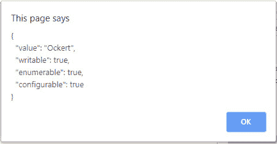

**图 6.2:** studentName 属性

要更改这些属性，你应该使用 `Object` 类的 `defineProperty` 方法。

下一个示例将 `studentName` 属性的 `writable` 属性改为 `false`。这意味着该属性现在是只读的，无法通过代码更改：

```javascript
Object.defineProperty(newStudent, "studentName", {
  writable: false
});
newStudent.studentName = "Test"; // Error: Cannot assign to read only property 'studentName'
```

如果在浏览器中运行上述代码段的代码，产生的错误：

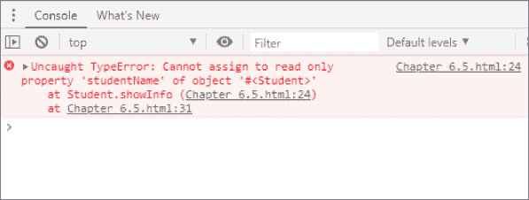

**图 6.3:** defineProperty 错误

在第 8 章：属性中，我们将更详细地讨论 getter（getters）和 setter（setters）、标记（flags）和描述符（descriptors）。

## 方法

任何编程语言中的方法都意味着对象可以做什么。因此，在我们持续的学生对象示例上下文中，学生对象可以考试、通过或未通过考试、旷课、上到或不交学费。

在我们所做的所有练习中，我们使用了 `showInfo`。接下来的示例显示了如何创建一个方法：

```html
<html>
<body>
  <h1>Method example</h1>
  <p>Method example</p>
  <script>
    let student = class Student {
      constructor(studentName, studentCourse) {
        this.studentName = studentName;
        this.studentCourse = studentCourse;
      }
      AllInfo() {
        return 'Student: ' + this.studentName + ' is doing: ' + this.studentCourse;
      }
    };
    // Usage:
    var newStudent = new student('Ockert', 'JavaScript').AllInfo();
    alert(newStudent);
  </script>
</body>
</html>
```

1.  打开你喜欢的文本编辑器，并输入以下 HTML 和 JavaScript 代码。

2.  以 HTML 扩展名保存文件，例如 `Chapter 6.5.html`。

3.  双击文件在默认浏览器中打开它。

你创建了带有其属性的类。`AllInfo` 方法返回一个包含学生姓名、学生课程和一些组成漂亮句子的文本字符串。然后你创建了一个名为 `newStudent` 的新学生对象，赋予了它初始化值，并立即调用了 `AllInfo` 函数。最后，alert 框显示了结果。

### 静态方法

静态方法与普通方法略有不同。静态方法是在类本身中创建的，而不是在使用类的对象（原型）上。这意味着你不能在对象上调用静态方法，但可以在类上调用。

以下示例显示了静态方法的用法：

```javascript
class Student {
  constructor(name) {
    this.name = name;
  }
  static createAnonymous() {
    return new Student("Anonymous");
  }
}

let anon = Student.createAnonymous();
console.log(anon.name); // Anonymous
```

## 继承

对象从其他对象继承特征。在本章的早些部分，我提到了汽车对象。我解释了每辆汽车都有四个轮子和其他共同特征，但卡车或巴士又是呢？

虽然卡车的轮子通常比四个多，但它们仍然是车辆家族的一部分。巴士可能有四个轮子，但它们的座位比汽车和卡车多得多；尽管如此，它们仍然是车辆家族的一部分。

另一个例子是你从父母那里继承特征。你可能拥有母亲的头发和眼睛，可能拥有父亲的性格，但你仍然是独一无二的，你依然是你自己。这个过程被称为继承。

在 `Chapter 7: Prototypes` 中，我们将进一步探索继承，并使用 Mixins（混合器）来在不需要继承的情况下使用不同类的方法。

## 结论

在本章中，我们学习了 JavaScript 类以及如何使用它们。我们学习了为什么类非常重要，以及我们如何向 JavaScript 类添加属性和方法。我们在本章中创建了许多示例，因为这是学习任何东西最简单的方法！熟能生巧。

在下一章中，我们将处理原型。虽然我们在本章中接触了这一主题，但我们将深入探讨。我们还将学习继承、Mixins 和原始类型的重要性。

## 问题

1. 解释 `class` 术语。
2. 列出创建类的两种方法。
3. 方法和静态方法之间有什么区别？
4. 列出属性的三个特征（attributes）。
5. 解释继承术语。

# 第 7 章：JavaScript 原型

## 引言

JavaScript 中的原型使我们能够让代码更加面向对象。JavaScript 原型帮助我们很好地构建对象。是的，类也做相同的事情，但原型解决了普通 JavaScript 类的几个缺点。

有许多不同的原型，我们将研究其中几个。本章的有趣部分从继承和 Mixins 开始，通过我们可以从其他 JavaScript 类中借用属性和方法。

## 结构

*   什么是原型？
*   原型继承
*   Mixins

## 目标

*   学习不同类型的原型
*   理解原型的需求
*   理解原型继承
*   理解 Mixins

## 什么是原型？

JavaScript 中的原型使我们能够让代码更加面向对象。JavaScript 原型帮助我们很好地构建对象。是的，类也做相同的事情，但原型解决了普通 JavaScript 类的几个缺点。

JavaScript 中有两种原型，即 `prototype` 和 `[[Prototype]]`：

*   `prototype`：原型被赋值为你在 JavaScript 中创建的任何函数的属性，正如 `Chapter 6: JavaScript Classes` 中解释的那样。
*   `[[Prototype]]`：每个由运行上下文访问的对象都有一个 `[[Prototype]]` 属性，当读取对象的某个属性不可用时，就会读取它。

好了，这现在听起来真的不太通，对吗？不。让我们仔细观察。

我们在 `Chapter 6: JavaScript Classes` 中学习过，你可以使用构造函数来创建对象。来看下面的示例：

```javascript
function Student(studentFirstName, studentLastName) {
  this.studentFirstName = studentFirstName;
  this.studentLastName = studentLastName;
  this.studentFullName = function() {
    return this.studentFirstName + " " + this.studentLastName;
  }
}

var student1 = new Student("Ockert", "du Preez");
var student2 = new Student("BPB", "Publications");
console.log(student1);
console.log(student2);
```

函数 `Student` 是 `Student` 对象的构造函数。它包含了名和姓参数，或者在本例中，是属性。`studentFullName` 是一个组合名和姓字符串的函数。

然后创建了两个 `Student` 对象：`student1` 和 `student2`，结果显示在控制台窗口中。

现在，看这段代码，似乎没有任何异常之处。确实如此。它创建了两个 `Student` 构造函数的副本，分别用于 `student1` 和 `student2`。这意味着使用 `Student` 构造函数创建的每个对象都将拥有它自己的方法和属性副本。这正是问题出现的地方。构造函数中的 `studentFullName` 方法通过拥有它的两个实例浪费了内存，并且在每个独立的对象中都执行相同的操作。

我们通过创建原型来解决这个问题。

每当创建一个函数时，JavaScript 引擎都会自动向其添加一个原型属性。这被称为原型对象，它默认包含它自己的构造函数。构造函数指向该原型对象作为属性的那个函数。你使用 `functionName.prototype` 访问函数的原型属性。

`Figure 7.1` 显示 `Student` 构造函数包含一个指向原型对象的原型属性。该原型对象包含一个指向回函数的构造函数。

函数的 `prototype` 属性是一个对象，它包含两个属性：

*   `constructor` 属性：它指向 `Student` 函数。
*   `__proto__` 属性：它指向构造函数的原型对象。

### 在原型对象上添加属性

通过在原型对象上附加属性和方法，你可以让使用该构造函数创建的所有对象都共享这些内容。

在下一个练习中，你将向原型对象上附加属性和方法。

以下示例演示了如何向原型对象添加属性：

```html
<html>
<body>
<h1>Add properties to prototype object example</h1>
<p>Add properties to prototype object example</p>
<script>
function Student(studentFirstName, studentLastName) {
  this.studentFirstName = studentFirstName;
  this.studentLastName = studentLastName;
  this.studentFullName = function() {
    return this.studentFirstName + " " + this.studentLastName;
  }
}
var student1 = new Student("Ockert", "du Preez");
var student2 = new Student("BPB", "Publications");
// Method 1 - dot notation
Student.prototype.studentID = 'Student001';
console.log(Student.prototype.studentID);
// Method 2 - square brackets
Student.prototype["studentCourse"] = 'JavaScript';
console.log(Student.prototype);
</script>
</body>
</html>
```

2. 以 HTML 扩展名保存文件，例如 `Chapter 7.3.html`。

3. 双击该文件在默认浏览器中打开它。

4. 如果浏览器是 Google Chrome，按下 `Ctrl` + `Shift` + `J` 打开控制台窗口。控制台窗口将与下方的[图 7.4] 类似：

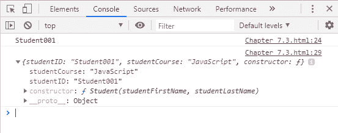

**图 7.4：** 添加到原型对象的属性

如果你仔细观察，你会注意到我使用了两种不同的技术向原型对象上附加属性。

我使用的第一种方法是使用点符号（dot notation）向 `Student` 原型添加了 `studentID` 属性和值。我使用的下一种方法是方括号。我利用方括号符号技术将 `studentCourse` 及其值附加到 `Student` 原型对象上。

## 原型继承

例如，假设我们有各种学生。你真的想为每个学生创建一个独立的类，或者为每个函数原型创建一个独立的实现吗？所有的 `Student` 对象都包含相似的属性和方法。`Car` 对象包含比其他汽车相似的方法和属性。

现在，如果我们只是想获取一个现有的对象并扩展它呢？答案是原型继承。继承意味着从其他原型继承特征（方法或属性）。继承的好处是，在你继承了对象特征后，可以对其进行扩展，这在创建对象和原型时节省了大量工作，因为你不需要重新创建相似的对象。

让我们来看一个例子。

以下练习演示了如何创建一个原型或类：

```html
<html>
<body>
<h1>prototypal inheritance example</h1>
<p>prototypal inheritance example</p>
<script>
function Student(studentFirstName, studentLastName) {
  this.studentFirstName = studentFirstName;
  this.studentLastName = studentLastName;
}
Student.prototype.attendClass = function(timeIn, timeOut) {
  console.log(this.studentFirstName + ' arrived for class at: ' + timeIn + ' and left at ' + timeOut);
};
Student.prototype.writeExam = function() {
  console.log(this.studentFirstName + ' is writing exam.');
};

function ProgrammingStudent(studentFirstName, studentLastName, language) {
  Student.call(this, studentFirstName, studentLastName);
  this.language = language;
}
ProgrammingStudent.prototype = Object.create(Student.prototype);
ProgrammingStudent.prototype.constructor = ProgrammingStudent;

const student1 = new Student('Ockert', 'du Preez');
student1.attendClass('10:00', '14:00');
student1.writeExam();

const progStudent = new ProgrammingStudent('Jane', 'Doe', 'JavaScript');
progStudent.attendClass('09:00', '13:00');
progStudent.writeExam();
console.log(progStudent.language);
</script>
</body>
</html>
```

2. 以 HTML 扩展名保存文件，例如 `Chapter 7.4.html`。

3. 双击该文件在默认浏览器中打开它。

4. 如果浏览器是 Google Chrome，按下 `Ctrl` + `Shift` + `J` 打开控制台窗口。控制台窗口将与下方的[图 7.5] 类似：

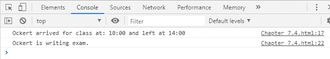

**图 7.5：** 原型继承示例输出

在上面的练习中，你使用函数创建了 `Student` 并包含了 `studentFirstName` 和 `studentLastName` 参数。然后你向原型添加了两个方法。其中一个是 `attendClass`，另一个是 `writeExam`。正如你所见，`ProgrammingStudent` 类在创建时没有 `attendClass` 和 `writeExam` 方法，但现在包含了它们。这是因为 `ProgrammingStudent` 类的原型通过这一行代码从 `Student` 类继承了方法和属性：

`ProgrammingStudent.prototype = Object.create(Student.prototype)`

基于我们创建的 `Student` 原型，如果我们想向原型添加编程、Web 设计或文字处理功能，必须为每个功能重复这段代码。

## 混入 (Mixins)

JavaScript 的一个局限性是我们只能继承一个对象，因为一个对象只能有一个 `Prototype`。JavaScript 的另一个局限性是一个类只能扩展另一个其他类。如果我们想合并两个或多个不同类的特征呢？或者，如果我们想混合不同的类呢？

答案是混入（Mixins）。

混入是一个包含方法的类，其他类可以使用这些方法而无需继承自它。

在下一个练习中，你将创建一个带有方法的 Mixin，然后将此 Mixin 连接到现有的类中。

```html
<html>
<body>
<h1>Mixin example</h1>
<p>Mixin example</p>
<script>
// mixin
let HumanMixin = {
  cry() {
    alert('Stop crying');
  },
  laugh() {
    alert('Be happy');
  }
};

function Student(studentFirstName, studentLastName) {
  this.studentFirstName = studentFirstName;
  this.studentLastName = studentLastName;
}
Student.prototype.attendClass = function(timeIn, timeOut) {
  console.log(this.studentFirstName + ' arrived for class at: ' + timeIn + ' and left at ' + timeOut);
};
Student.prototype.writeExam = function() {
  console.log(this.studentFirstName + ' is writing exam.');
};

function ProgrammingStudent(studentFirstName, studentLastName, language) {
  Student.call(this, studentFirstName, studentLastName);
  this.language = language;
}
ProgrammingStudent.prototype = Object.create(Student.prototype);
ProgrammingStudent.prototype.constructor = ProgrammingStudent;

// copy the methods from HumanMixin
Object.assign(ProgrammingStudent.prototype, HumanMixin);

const progStudent = new ProgrammingStudent('Ockert', 'du Preez', 'JavaScript');
progStudent.laugh();
</script>
</body>
</html>
```

2. 将文件保存为 HTML 扩展名，例如 `Chapter 7.6.html`。

3. 双击文件在默认浏览器中打开它。

4. 如果浏览器是 Google Chrome，按下 `Ctrl` + `Shift` + `J` 打开控制台窗口。下方将显示一个类似 `Figure 7.7` 的警框：


**图 7.7:** Mixin 方法

部分代码看起来很熟悉。我尝试让练习尽可能简单，并让每个练习都建立在上一个练习的基础上。让我们分析一下这些代码。

你创建了一个名为 `HumanMixin` 的 Mixin，包含两个方法：`cry()` 和 `laugh()`。你创建了一个 `Student` 类，然后利用继承创建了一个基于 `Student` 类的 `ProgrammingStudent` 类。这意味着 `ProgrammingStudent` 现在包含了它自己的方法和属性，以及继承自 `Student` 类的方法和属性。

通过以下代码，你使用 `Object` 的 `assign` 方法将 Mixin 的方法复制到目标类中。最后，你简单地使用了 `laugh` 方法，该方法现在也存在于 `ProgrammingStudent` 类中：

`Object.assign(ProgrammingStudent.prototype, HumanMixin);`

`const progStudent = new ProgrammingStudent('Ockert', 'du Preez', 'JavaScript'); progStudent.laugh();`

## 结论

在本章中，我们学习了 JavaScript 原型（prototypes）。为了充分利用 JavaScript 的力量，你需要了解它的面向对象特性，例如原型。原型允许你通过继承和 Mixins 来扩展 JavaScript 类。

在下一章中，我们将深入研究 JavaScript 属性。你将学习如何正确创建属性。我们将转向为属性创建 getter（get 器）和 setter（set 器），以及更复杂的特性，如属性标志和属性描述符。

## 问题

1. 解释什么是原型（prototype）。
2. 使用原型有哪些好处？
3. 解释什么是原型继承。
4. 为什么要使用 Mixins？
5. 如何将属性附加到原型上？

# 第 8 章

## JavaScript 属性

## 介绍

JavaScript 中的属性允许你在应用程序生命周期内存储和设置各种值。通过在属性中存储信息，可以为应用程序提供更好的结构。

在本节中将创建属性并学习如何将每个属性的特征设为可写或只读。你将学习对象属性和访问器属性（accessor properties）之间的区别。最后，你将学习 getter 和 setter 的内部细节。

## 结构

*   什么是属性？
*   属性的属性
*   Getter 和 setter

## 目标

*   学习什么是属性
*   理解属性
*   创建属性

## 什么是属性？

在*第 6 章：类*中，我们看到过对象具有某些属性。例如，这里有属性包括：

*   品牌
*   型号
*   变速箱
*   颜色
*   座位数量


属性最常见的特征是它的值和名称。为了访问任何属性的特征，你可以使用 `getOwnPropertyDescriptor` 方法。你提供想要查询的对象，然后是属性名。

下面的示例展示了 `getOwnPropertyDescriptor` 的用法：

```html
<html>
<body>
  <h1>Object.getPropertyDescriptor example</h1>
  <p>Object.getPropertyDescriptor example</p>
  <script>
    let student = class {
      constructor(studentName, studentCourse) {
        this.studentName = studentName;
        this.studentCourse = studentCourse;
      }
      showInfo() {
        let descriptor = Object.getOwnPropertyDescriptor(newStudent, 'studentName');
        alert(JSON.stringify(descriptor, null, 2));
      }
    };

    // Usage:
    var newStudent = new student('Ockert', 'JavaScript');
    newStudent.showInfo();
  </script>
</body>
</html>
```

## 属性特征

属性的特征取决于赋值。共有三个：

*   **writable**（可写性）：决定属性的值是否可以被更改。
*   **enumerable**（可枚举性）：属性可以在循环中被列出吗？
*   **configurable**（可配置性）：允许删除属性或修改属性特征。

这些都取决于某个特定属性的特征（或标志）。某些属性是只读的，无法更改。设置属性时，使用点符号法。这是一个示例：

```javascript
studentCourse = "JavaScript";
```

这非常简单！下方将显示一个类似 `Figure 7.7` 的警框：


**图 7.7:** Mixin 方法

**图 8.1：** `studentName` 属性

要更改这些属性，你应该使用 `Object` 类的 `defineProperty` 方法。下一个示例将 `studentName` 属性的 `writable` 属性改为 `false`。这意味着该属性现在是只读的，无法通过代码进行更改：

```javascript
Object.defineProperty(newStudent, "studentName", {
  writable: false
});
```

```javascript
newStudent.studentName = "Test"; // Error: 无法赋值给只读属性 'studentName'
```

*图 8.2* 显示了在浏览器中运行类似上述代码段的代码时的错误：

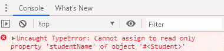

**图 8.2：** `defineProperty` 错误

现在我们对属性有了正确的理解，让我们继续为属性创建 getters（get 器）和 setters（set 器）。

## Getters and setters

到为止，在书中我主要处理的是数据属性。另一种类型的属性被称为访问器属性（accessor property）。这意味着这些类型的属性实际上是能够获取和设置值的函数，但从外部看是普通的属性。

访问器属性包含 `getter` 和 `setter` 方法，如下：

```javascript
let object = {
  get propertyName() {
    // 在获取 object.propertyName 时执行代码
  },
  set propertyName(value) {
    // 在设置 object.propertyName = value 时执行代码
  }
};
```

在上面的对象声明中，你会注意到一个 `get` 和一个 `set`。当请求对象的属性时，会执行 `get`。例如：`c = Object.Color`。get 函数将把对象的 `Color` 属性的值返回给变量为 `c`。

`Set` 用于给属性赋值。例如：`Object.Color = Red`。通过使用 setter，`Color` 属性将被设置为 `Red`。

让我们做一个小练习，让你看到使用 getters 和 setters 是多么简单。

1.  打开你喜欢的文本编辑器，并输入以下 HTML 和 JavaScript 代码：

```html
<html>
<body>
    <h1>Property Getters and Setters example</h1>
    <p>Property Getters and Setters example</p>
    <script>
    let Student = {
        studentName: "Ockert",
        studentSurname: "du Preez",
        get studentFullName() {
            return `${this.studentName} ${this.studentSurname}`;
        },
        set studentFullName(value) {
            [this.studentName, this.studentSurname] = value.split(" ");
        }
    };
    Student.studentFullName = "BpB Publications";
    alert(Student.studentName); //BPB
    alert(Student.studentFullName); //BpB Publications
    </script>
</body>
</html>
```

2.  以 HTML 扩展名保存文件，例如 `Chapter 8.3.html`。

3.  双击文件在默认浏览器中打开它。

通过使用 setter，你将 `studentFullName` 属性设置为 `BPB Publications`。如果没有属性 setter 而是属性字母，你可能会得到错误。通过使用属性 getter，你获取了属性当前值的访问。打开时，将显示两个警告框。一个显示 `BpB`，另一个显示 `BpB Publications`。

*图 8.3* 显示了基于上述示例给出的警告框组合：

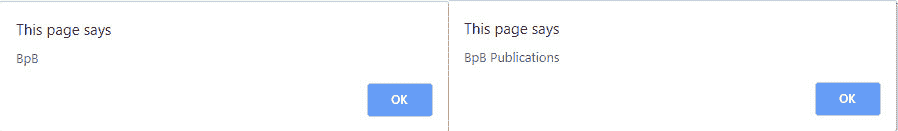

**图 8.3：** Getter 和 setter 属性

就像本章之前解释的属性标记一样，访问器也有描述符（descriptors）。让我们来看看。

访问器描述符与数据属性的描述符略有不同。访问器属性没有 `writable` 描述符，但包含 get 和 set 函数。访问器描述符具有：

*   **get**: 读取属性时工作。
*   **set**: 设置属性时调用。
*   **enumerable**: 属性是否可以被列出。
*   **configurable**: 允许删除属性。

JavaScript 语言的一个优秀特性是它能够异步地执行任务。同步任务可能会阻塞其他需要的任务，从而延迟指令的执行。能够独立地执行任务而无需担心它们何时完成是非常有帮助的。这种设置也非常简单。

在本节中，你将学习如何创建 promises 以在你的页面上启用更多 `async` 特性。我们还将查看回调函数（callbacks）以及如何链多个 promises。

## 结构

* JavaScript Promises 描述
* 同步与异步方法
* Promise 链式
* 回调函数与 Promise 化（Promisification）
* 微任务（Microtasks）与宏任务（macrotasks）
* Promise 方法

## 目标

* 学习什么是 Promises
* 理解同步方法与异步方法之间的区别
* 理解宏任务与微任务之间的区别
* 学习如何让多个 promise 协同工作

## JavaScript Promises 描述

字典对名词 `promise`（承诺）的解释如下：一种承诺将做某事或某事将会发生的保证。那么，当双方之间达成一个承诺时会发生什么呢？

承诺给了一方某事将会完成的保证。任务是由承诺方完成还是其他人完成并不重要。基于给出的保证，另一方可以据此制定计划。

承诺可以被履行，也可以被违背。这就是不同路线产生的地方，并且需要考虑不同的场景。当承诺被履行时，一方对该承诺产生有所预期。这允许该方利用承诺的输出来进行其后续的行动或计划。当承诺被违背时，一方应该知道承诺未被履行的原因。一旦一方知道承诺未被履行的原因，他们就可以计划下一步要做什么或如何处理。

在做出承诺后，双方都对任务将会完成有一个保证，并且可以根据承诺被履行或违背的情况来决定行动方案。

做出承诺的一方可能根本不回应。那种情况下会发生什么？

在这种情况下，一方应该设定一个时间阈值。例如：如果承诺方在给定时间内没有响应，承诺方可能会意识到由于不可预见的情况，承诺可能无法被履行。即使如此，如果承诺方的回复比预期时间要晚，也没关系，因为承诺方可能已经制定了备用计划。

## JavaScript promises

JavaScript promise 的工作方式与上述解释的普通 promise 类似。你可以将处理程序与异步操作的成功值或失败原因相关联。异步方法不是立即返回成功或失败值，而是返回一个 promise，以便最终提供适当的值。

一个 Promise 有三种状态：

* `pending`：这是 promise 的初始状态。promise 既没有完成（fulfilled）也没有被拒绝（另外两个状态）。
* `resolved`：这意味着 promise 的操作已成功完成。
* `rejected`：这意味着 promise 的操作失败了。

JavaScript promises 也可以被一个值完成，也可以被一个原因（一个错误）拒绝。取决于发生了这哪种情况，由 promise 的 `then` 方法队列的相关处理程序就会被调用。我们现在来看一些示例。

以下示例展示了一个已解析 promise 的运行：

1. 打开你喜欢的文本编辑器并输入以下 HTML 和 JavaScript 代码：

```html
<html>
<body>
<h1>Promise resolve example</h1>
<p>Promise resolve example</p>
<script>
let promise = new Promise(function(resolve, reject) {
setTimeout(() => resolve("Success!"), 5000); //5000 毫秒 = 5 秒
});
promise.then(
result => alert(result), // 如果成功， 5 秒后显示"Success!"
error => alert(error) // 不运行
);
</script>
</body>
</html>
```

2. 以 HTML 扩展保存文件，例如 `Chapter 9.1.html`。

3. 双击文件在默认浏览器中打开。

在上述代码段中，你创建了一个带有两个参数——`resolve` 和 `reject` 的新 `Promise`。在 Promise 内部，你利用内置的 JavaScript 定时函数 `setTimeout` 来启动计时器。5 秒后，它应该显示消息 `Success!`。

当 `Promise` 完成其任务时，它将返回一个拒绝消息或一个解析消息。在这种情况下，将弹出一个带有 `Success!` 消息的警告框。看起来就像下方的 [图 9.1]：

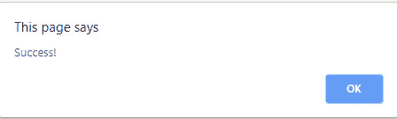

**图 9.1：** Resolved Promise

接下来我们来看一个拒绝 promise 的示例。

以下示例展示了一个被拒绝 promise 的运行：

1. 打开你喜欢的文本编辑器并输入以下 HTML 和 JavaScript 代码：

```html
<html>
<body>
<h1>Promise resolve example</h1>
<p>Promise resolve example</p>
<script>
let promise = new Promise(function(resolve, reject) {
setTimeout(() => reject(new Error("Failure!")), 5000); //5000 毫秒 = 5 秒
});
promise.then(
result => alert(result), // 不运行
error => alert(error) // 5 秒后显示"Error: Failure!"
);
</script>
</body>
</html>
```

2. 以 HTML 扩展保存文件，例如 `Chapter 9.2.html`。

3. 双击文件在默认浏览器中打开。

当 `Promise` 完成其任务时，它将返回一个拒绝消息或一个解析消息。在这种情况下，会显示一个带有 `Error: Failure!` 消息的警告框。看起来就像下方的 [图 9.2]：

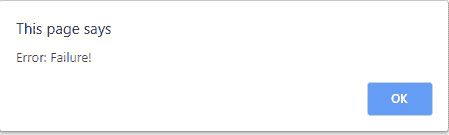

**图 9.2：** Rejected Promise

我之前提过异步和同步方法及任务，但它们究竟是什么？让我们详细介绍一下。

## 同步与异步方法

假设你开始了自己的纸蛋糕业务。规模相对较小，所以你与客户有直接互动。他们会订一个或两个蛋糕，你烘焙相应数量的蛋糕，然后交付蛋糕。这是同步行为，因为它是一个“请求并获取”的场景。

进一步想象，你的蛋糕非常畅销，你变得越来越忙，甚至还提到了特许经营！你无法同时出现在不同的地方。你无法同时为不同的客户服务。你需要帮助。这就是异步性的用武之地。异步允许你将订单放在等待列表中，并在你能够完成的时候完成它们。

当 JavaScript 执行同步任务时，浏览器会停止页面的加载（或渲染），以便执行代码。这会阻塞页面完成加载，直到代码执行完毕。

异步的操作方式与同步相反。当 JavaScript 执行异步任务时，代码将与页面的其余内容并行处理。这意味着页面不会停止加载，也不会减慢页面的加载速度。

让我们通过一个示例演示同步任务与异步任务之间的区别。

以下示例展示了同步调用的运行：

1. 打开你喜欢的文本编辑器并输入以下 HTML 和 JavaScript 代码：

```html
<html>
<body>
<h1>Synchronous methods example</h1>
<p>Synchronous methods example</p>
<script>
console.log("First");
console.log("Second");
console.log("Third");
</script>
</body>
</html>
```

2. 以 HTML 扩展保存文件，例如 `Chapter 9.3.html`。

3. 双击文件在默认浏览器中打开。

4. 如果浏览器是 Google Chrome，请按 `Ctrl` + `Shift` + `J` 打开控制台窗口。

指令将一个接一个地按顺序执行。万遇其中某条指令执行耗时过长，下一条指令将等待其完成后再运行。你的控制台窗口应该类似于下方的 `Figure 9.3`：

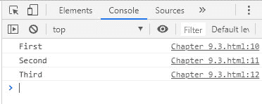

**图 9.3：** 同步调用的执行

以下示例显示了异步调用的执行：

1.  打开你选择的文本编辑器，并输入以下 HTML 和 JavaScript 代码：

```html
<html>
<body>
<h1>Asynchronous methods example</h1>
<p>Asynchronous methods example</p>
<script>
console.log("Hello")
setTimeout(function()
{
console.log("Ockert")
}, 3000);
console.log("My name is ")
</script>
</body>
</html>
```

2.  用 HTML 扩展名保存文件，例如 `Chapter 9.4.html`。

3.  双击文件在默认浏览器中打开它。如果浏览器是 Google Chrome，请按 `Ctrl` + `Shift` + `J` 打开控制台窗口。

第一个执行的语句将向控制台窗口打印 `Hello` 的语句。它会启动 `Timer`，但仍会继续执行下一条打印 `My name` 的语句。当计时器完成后，它将打印我的名字。如你所见，它并没有等待计时器完成任务再继续。你的控制台窗口应该类似于下方的 `Figure 9.4`：

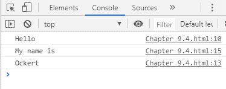

**图 9.4：** 异步调用的执行

现在你已经对异步调用有了更好的理解，让我们重新关注 Promise（承诺）。

## Promise 链式调用

如果我们把异步任务更进一步一步会怎样？如何做？嗯，想象你有一系列需要按顺序执行的异步任务。换句话说，你希望在 `method_1` 完成后调用 `method_2`，当 `method_2` 完成后，你想调用 `method_3`，依此类推。这就是链式调用大用用场。

你可以通过使用 `.then` 关键字在 Promise 中链式连接任意数量的方法。以下示例展示了如何链式调用 Promise：

1.  打开你选择的文本编辑器，并输入以下 HTML 和 JavaScript 代码：

```html
<html>
<body>
<h1>Chaining promises example</h1>
<p>Chaining Promises example</p>
<script>
var Method_1 = function() {
var promise = new Promise(function(resolve, reject){
setTimeout(function() {
console.log('Method_1 Done.');
resolve({string: '1'});
}, 3000);
});
return promise;
};
var Method_2 = function(strTemp) {
var promise = new Promise(function(resolve, reject){
setTimeout(function() {
console.log('Method_2 Done.');
resolve({newString: strTemp.string + '2'});
}, 3000);
});
return promise;
};
var Method_3 = function(strTemp) {
var promise = new Promise(function(resolve, reject){
setTimeout(function() {
console.log('Method_3 Done.');
resolve({endString: strTemp.newString});
}, 3000);
});
return promise;
};
Method_1()
.then(Method_2)
.then(Method_3);
</script>
</body>
</html>
```

2.  用 HTML 扩展名保存文件，例如 `Chapter 9.5.html`。

3.  双击文件在默认浏览器中打开它。如果浏览器是 Google Chrome，请按 `Ctrl` + `Shift` + `J` 打开控制台窗口。

上面的示例中有三个异步方法。你还会注意到，每个方法都包含一个带有 `resolve` 参数的 Promise。这就是秘诀所在。当异步方法成功完成时，它会将 `resolve` 参数传递给下一个异步方法。该参数包含一个简单的字符串值，并传递给下一个方法。

这些信息随后并没有被真正使用，但字符串会不断增长。如果发生了某些错误，`resolve` 参数将失败，Promise 也会失败。

每个方法都包含一个计时器，在三秒后打印一段文本。如果一切进展顺利，你的控制台窗口应该类似于下方的 `Figure 9.5`：

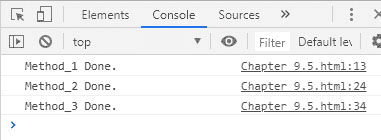

**图 9.5：** Promise 链式调用

继续讨论异步任务和方法，那些水平稍高或经验更丰富的读者可能会很惊讶，为什么我还没有提到回调函数（callbacks）。好吧，我正尝试系统化地讲解，特别是对于新手来说。

## 回调函数与 Promise 化

我现在将讲解回调函数，稍后会谈论 Promise 化，因为它们是关联的。

## 回调

回调就是一个在另一个函数执行后执行的函数。听起来很简单，让我们来看一个简单的复杂的例子。

以下示例创建了一个回调：

1.  打开你选择的文本编辑器，并输入以下 HTML 和 JavaScript 代码：

```html
<html>
<body>
<h1>Callback example</h1>
<p>Callback example</p>
<script>
function DisplayName(name, surname, callback){
document.write(`Welcome ${name + surname}!<br>`);
callback();
}
function EnjoyMessage(){
document.write('Enjoy.');
}
DisplayName('Ockert', 'du Preez', EnjoyMessage);
</script>
</body>
</html>
```

2.  用 HTML 扩展名保存文件，例如 `Chapter 9.6.html`。

3.  双击文件在默认浏览器中打开它。

在上面的例子中，你创建一个名为 `DisplayName` 的函数。它接受三个参数：`name`、`surname` 和 `callback`。下一行你使用 `document.write` 写入文本；然而问题是它什么时候执行的？

嗯，代码最后一行调用了 `DisplayName` 函数。你向它传递了名字和姓氏，然后传递了 `EnjoyMessage` 函数。`EnjoyMessage` 函数就是回调函数，当另一个函数执行完成后它就会运行。

看，这并不难！

你的网页浏览器应该类似于：`Figure 9.6`：

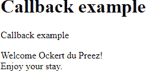

**图 9.6：** 回调函数的执行

现在我们对回调函数有了更多了解，让我们来看看 Promise 化（Promisification）。

## Promise 化

Promise 化是将接受回调的函数转换为返回 Promise 的函数的过程。

以下示例展示了转换回调函数的快速方法：

1.  打开你选择的文本编辑器，并输入以下 HTML 和 JavaScript 代码：

```html
<html>
<body>
<h1>Promisification example</h1>
<p>Promisification example</p>
<script>
function promiseDisplayName(name, surname) {
return new Promise((resolve, reject) =>
DisplayName(name, surname, (err, result) =>
// 如果有错误，则 reject；否则 resolve
err ? reject(err) : resolve(result)
)
);
}
// 像这样调用：
promiseDisplayName('Ockert', ' Du Preez').then(result => {
// 解析
}).catch(err => {
// 错误
});
</script>
</body>
</html>
```

2.  用 HTML 扩展名保存文件，例如 `Chapter 9.7.html`。

3.  双击文件在默认浏览器中打开它。

回调函数和 Promise 有它们自己的用处。有些任务可以很容易地 Promise 化。

## 微任务与宏任务

微任务（microtask）简单来说就是一个短函数（名副如此），它在创建它的函数退出后执行。JavaScript 中的 Promises 利用微任务来运行它们的回调函数。

宏任务（macrotask）是任何通过事件回调、程序启动或定时器触发而运行的 JavaScript 代码。

让我来解释一下，它们之间主要有两个区别。

第一个区别是，当一个宏任务退出时，JavaScript 事件循环会检查该宏任务是否正在将控制权交给任何其他代码。如果不是，事件循环将继续运行微任务队列中存在的所有微任务。

第二个区别是，当一个微任务通过使用 `queueMicrotask()` 方法向其队列中添加更多微任务时，这些新的微任务将在下一个任务运行之前执行。这是因为事件循环会不断调用微任务，直到队列中没有剩余的任务为止。

让我们通过一个实际示例来看来看。

下面的示例展示了如何对链进行链式：

1.  打开你任的文本编辑器，并输入以下 HTML 和 JavaScript 代码：

```html
<html>
<body>
    <h1>Microtasks versus Macrotasks example</h1>
    <p>Microtasks versus Macrotasks example</p>
    <script>
        let firstCallback = () => console.log("Fifth. First callback has run with setTimeout");
        let secondCallback = () => console.log("Fourth. Second callback");
        let doTasks = () => {
            let result = 1;
            queueMicrotask(secondCallback);
            for (let i = 5; i <= 20; i++) {
                result *= i;
            }
            return result;
        };
        console.log("First");
        setTimeout(firstCallback, 0);
        console.log(`Second Answer: ${doTasks()}`);
        console.log("Third");
    </script>
</body>
</html>
```

2.  以 HTML 扩展名保存文件，例如 `Chapter 9.8.html`。

3.  双击该文件在默认浏览器中打开它。如果浏览器是 Google Chrome，按下 `Ctrl` + `Shift` + `J` 打开控制台窗口。

上面的代码示例使用 `queueMicrotask()` 调度了一个微任务。该微任务并不是在函数退出时处理，而是在主程序退出时处理的。`doTasks()` 函数调用了 `queueMicrotask()`，但被调用的微任务直到整个程序退出时才会触发，因为那是任务存在的时候，且执行栈上没有其他内容。请注意任务执行的顺序。

你的屏幕将类似于下方的 *图 9.7*：

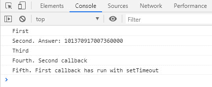

**图 9.7：** 宏任务与微任务

由于我们使用了 `queueMicrotask` 方法，任务执行的顺序与我们输入任务的顺序不同。

## Promise 方法

`Promise` 类中在 `Promise` 类中包含了几个静态方法。它们是：

*   `Promise.all`
*   `Promise.allSettled`
*   `any`
*   `Promise.race`
*   `Promise.resolve/reject`

我在本整个章节中已经涵盖了 `resolve` 和 `reject`，所以让我专注于其他的方法一段时间吧。

## Promise.all

当你需要并行运行许多 promise 并等待它们全部就绪时，应该使用 `all` 方法。`Promise.all` 接收一个 promise 数组并返回一个新的 promise。只有当所有列出的 promise 都已处理（settled）时，这个新的 promise 才会解析。它们的结果数组将成为它的结果。

例如，下面的 `Promise.all` 方法将在 3 秒后解析，然后它的结果被存储为数组 `[1, 2, 3]`：

```javascript
Promise.all([
    new Promise(resolve => setTimeout(() => resolve(1), 3000)), // 1
    new Promise(resolve => setTimeout(() => resolve(2), 2000)), // 2
    new Promise(resolve => setTimeout(() => resolve(3), 1000)) // 3
]).then(alert);
```

尽管第一个 promise 花的时间最长，但它仍然位于数组的前位。

## Promise.allSettled

`Promise.all` 的问题是，如果任何 promise 被拒绝（reject），它就会拒绝。它需要所有结果才能继续。如果你想获取信息，但如果一个请求失败，你仍然想要其他成功的信息，这时 `Promise.allSettled` 就派上用场了。让我们来看下一个代码段：

```javascript
const prom_1 = Promise.resolve(5);
const prom_2 = new Promise((resolve, reject) => setTimeout(reject, 100, 'fail'));
const promArray = [prom_1, prom_2];
Promise.allSettled(promArray).then((results) =>
    results.forEach((result) =>
    console.log(result.status)));
```

我们将得到以下输出：

`fulfilled`

`rejected`

尽管有一个被拒绝的，它仍然继续处理所有的 promise，而没有立即拒绝整个结果数组。

## Promise.any

`Promise.any()` 接收一个 `Promise` 对象数组，一旦数组中的任何一个 promise 完成（fulfill），就会返回一个单一 promise，该 promise 以该 promise 的值进行解析。

## Promise.race

等待第一个处理的 promise 并获取它的结果。因此，哪个 promise 最快完成，哪个就成为结果。其他的将被忽略。

## 结论

在本章中，我们学习了 JavaScript Promises。我们学习了如何创建它们，以及在当今面向 Web 的世界中 Promises 的真实需求。我们学习了如何将多个微任务合并为一个 promise，从而改变它们，并学习了 `Promise` JavaScript 类的各种方法。

在下一章中，我们将深入研究 JavaScript 生成器（generators）和迭代器（iterators）。你将学习什么是生成器和迭代器以及如何正确使用它们。

## 问题

1.  列出 4 个 `Promise` 方法。
2.  宏任务和微任务之间有什么区别？
3.  回调和 Promise 化（Promisification）之间有什么区别？
4.  同步和异步任务之间有什么区别？
5.  定义术语：JavaScript `Promise`。

# 第十章

## JavaScript 生成器与迭代器

## 引言

能够循环或遍历列表（无论是字符序列、数字数组还是自定义列表）对于任何 Web 应用程序都是至关重要的。然而，技巧在于知道在什么情况下使用哪种方案。

本节将通过实际练习和指导教你生成器、迭代器和可迭代对象。你还将学习异步迭代器与普通迭代器之间的区别，生成器也是如此。

## 结构

*   什么是生成器？
*   生成器的优势
*   迭代器
*   可迭代对象
*   异步迭代器 vs. 异步生成器

## 目标

* 学习什么是生成器
*   学习什么是迭代器
*   学习什么是可迭代对象
*   理解生成器的优势
*   比较普通迭代器与异步迭代器
*   比较普通生成器与异步生成器

是的，你也可以使用 `return` 语句结束生成器函数，或者让生成器函数运行到结束，但你也可以包含 `yield` 语句，它允许你临时暂停函数的执行。

普通函数和生成器函数之间的另一个区别是，普通的 JavaScript 函数只能返回一个值，而生成器函数可以在 `yield` 的帮助下返回多个值。这提供了一个连续的返回值流。

让我们来看一个简单的示例。下面的示例演示了普通循环函数和生成器函数之间的区别：

1.  打开你选择的文本编辑器并输入以下 HTML 和 JavaScript 代码：

```html
<html>
<body>
  <h1>Quick Generator Function example</h1>
  <p>Quick Generator Function example</p>
  <script>
    //Normal loop
    for (let i = 0; i < 5; i += 1) {
      console.log(i);
    }
    //立即返回 0, 1, 2, 3, 4

    //Generator Loop
    function * genFunctionForLoop(_number) {
      for (let i = 0; i < _number; i += 1) {
        yield console.log(i);
      }
    }
    const genLoop = genFunctionForLoop(5);
    genLoop.next(); // 0
    genLoop.next(); // 1
    genLoop.next(); // 2
    console.log("I am Paused!");
    genLoop.next(); // 3
    genLoop.next(); // 4
  </script>
</body>
</html>
```

2.  以 HTML 扩展名保存文件，例如 `Chapter 10.1.html`。

3.  双击文件在默认浏览器中打开它。

4.  如果浏览器是 Google Chrome，按下 `Ctrl` + `Shift` + `J` 打开控制台窗口。

你将看到初始的 `for` 循环会立即向控制台窗口打印 `0` 到 `5`，没有任何中断。然后你通过使用星号 `*` 标识它创建了一个生成器函数。在函数内部，你使用了 `yield` 关键字来返回下一个值。

你将生成器函数赋值给变量，以便跟踪每次迭代。注意我在循环中包含了一个字符串 `I am paused`。发生了什么？生成器函数进行了循环，在第三次迭代后暂停，向控制台窗口写入字符串：`I am paused`，然后继续循环。

你的控制台窗口应该像所示所示 *图 10.1*：

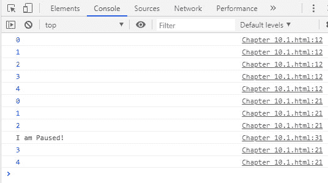

**图 10.1：** 生成器函数示例

我之前提到你需要使用星号 (`*`) 符号来创建生成器函数，我已经在本章第一个代码段中向你展示了，但这里有更多创建生成器函数的快速方法：

```javascript
function * generator () {}
function* generator () {}
function *generator () {}
let generator = function * () {}
let generator = function* () {}
let generator = function *() {}
```

在生成器函数内部每次调用 `next()` 时，`yield` 表达式都会返回一个包含两个参数的对象，它们是：

*   `value`: 返回的值。
*   `done`: 生成器是否可以继续执行？当 `done` 返回 `true` 时，生成器函数已完成运行。

后面是关于它们的详细信息。

## 生成器的优势

JavaScript 生成器有两个主要优势，它们是：

*   懒性求 (Lazy evaluation)
*   内存效率

让我们详细查看。

## 懒性求

这会将表达式的求推迟到需要其值为止。这意味着如果不需要该值，它就不会存在。值是按需计算。

让我们来看一个简单的示例。下面的示例演示了懒性求：

1.  打开你选择的文本编辑器并输入以下 HTML 和 JavaScript 代码：

```html
<html>
<body>
  <h1>Lazy Evaluation example</h1>
  <p>Lazy Evaluation example</p>
  <script>
    function * genPowerFunction(number, power) {
      let start = number;
      while(true) {
        yield Math.pow(start, power);
        start++;
      }
    }
    const genPower = genPowerFunction(5, 2);
    console.log(genPower.next()); //25 = 5*5
    //console.log(genPower.next()); // 36 = 6*6
    //console.log(genPower.next()); //49 = 7*7
    //console.log(genPower.next()); // 64 = 8*8
  </script>
</body>
</html>
```

2.  以 HTML 扩展名保存文件，例如 `Chapter 10.2.html`。

3.  双击文件在默认浏览器中打开它。

4.  如果浏览器是 Google Chrome，按下 `Ctrl` + `Shift` + `J` 打开控制台窗口。

`genPowerFunction` 生成器函数提供了一系列数字的幂。例如，5 的 2 次幂序列将是 25(5²)，或者 6 的 `2` 次幂是 36 (6²)。当我们创建变量对象 `genPower = genPowerFunction(5, 2)` 时，我们只创建了生成器对象。没有任何值被计算。现在，只有当调用 `genPower.next()` 时，25 才会计算并返回。

## 内存效率

生成器因为懒性求而是内存高效的。与普通函数不同，它只生成需要的值，并且执行被推迟到需要时。

## 迭代器

JavaScript 迭代器是一个定义序列的对象，并在终止时返回值。

迭代器通过拥有 `next()` 方法来实现迭代协议，该方法返回一个与生成器具有相同属性的对象。可以通过调用 `next()` 显式迭代器。它们是：

*   `value`: 序列中的下一个值
*   `done`: 如果序列中的最后一个值已被消费，则为 true

现在来做个快速练习！下面的示例创建了一个范围迭代器：

1.  打开你选择的文本编辑器并输入以下 HTML 和 JavaScript 代码：

```html
<html>
<body>
  <h1>Iterator example</h1>
  <p>Iterator example</p>
  <script>
    function iteratorRange(iStart = 0, iEnd = Infinity, iStep = 1) {
      let next = iStart;
      let Count = 0;
      const iterator = {
        next: function() {
          let result;
          if (next < iEnd) {
            result = { value: next, done: false };
            next += iStep;
            Count++;
          } else {
            result = { value: Count, done: true };
          }
          return result;
        }
      };
      return iterator;
    }
    let iterate = iteratorRange(1, 20, 2);
    let result = iterate.next();
    while (!result.done) {
      console.log(result.value); // 1 3 5 7 9 11 13 15 17 19
      result = iterate.next();
    }
  </script>
</body>
</html>
```

2.  以 HTML 扩展名保存文件，例如 `Chapter 10.3.html`。

3.  双击文件在默认浏览器中打开它。

4.  如果浏览器是 Google Chrome，按下 `Ctrl` + `Shift` + `J` 打开控制台窗口。

上面的示例创建了一个简单的范围迭代器，定义了从起始数字到结束数字且等间隔的整数序列。

你的屏幕应该像所示所示 *图 10.2*：

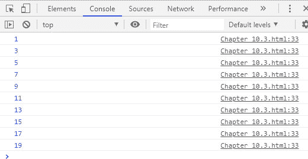

**图 10.2：** 范围迭代器

范围从 1 开始，到 20 结束，每隔一个数字。

## 可迭代对象

任何定义了迭代行为的对象都是可迭代的。这意味着任何可以进行循环的对象都是可迭代的。以下内置类型都是可迭代的：

*   数组 (Arrays)
*   类型数组 (TypedArrays)
*   字符串 (Strings)
*   Maps
*   Sets
*   参数 (Arguments)
*   DOM 元素

你也可以创建自己的可迭代对象。这里有一个小示例。

```html
<html>
<body>
  <h1>Iterable example</h1>
  <p>Iterable example</p>
  <script>
    const iterableMusicCollection = {
      allBands: {
        Metal: [
          'Iron Maiden',
          'Metallica',
          'Anthrax'
        ],
        Rock: [
          'Def Leppard',
          'Guns n Roses',
          'Bon Jovi',
          'Nickelback'
        ],
        Rap: [
          'Snoop Dogg',
          'Eminem',
          'Dr. Dre'
        ],
      },
      [Symbol.iterator]() {
        const genres = Object.values(this.allBands);
        let BandIndex = 0;
        let GenreIndex = 0;
        return {
            next() {
                const bands = genres[GenreIndex];
                const BandsComplete = !(BandIndex < bands.length);
                if (BandsComplete) {
                    GenreIndex++;
                    BandIndex = 0;
                }
                const GenreComplete = !(GenreIndex < genres.length);
                if (GenreComplete) {
                    return {
                        value: undefined,
                        done: true
                    };
                }
                return {
                    value: genres[GenreIndex][BandIndex++],
                    done: false
                }
            }
        };
      }
    };
    for (const band of iterableMusicCollection) {
      console.log(band);
    }
  </script>
</body>
</html>
```

2. 以 HTML 扩展名保存文件，例如 `Chapter 10.4.html`。

3. 双击文件在默认浏览器中打开。

4. 如果浏览器是 Google Chrome，按下 `Ctrl` + `Shift` + `J` 打开控制台窗口。

这段代码看起来比实际情况要复杂。以下是执行过程：你创建了一个数组，其中包含特定流派的喜爱的乐队列表。然后，你创建了迭代器 `Symbol` 并告诉它应该从哪里获取信息。接着，你进行了几次非常重要的检查。这些检查用于判断每个流派中的乐队是否遍历完毕，然后检查所有流派是否已循环完毕。这很重要，因为迭代器需要知道何时停止；否则它将一直持续迭代。最后，你将每个流派的所有乐队打印到控制台中。

你的屏幕看起来应该类似于下面的图 10.3：

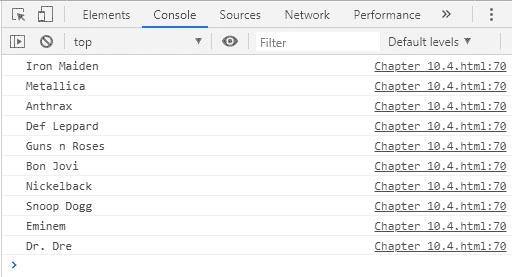

**图 10.3**

我的音乐口味可能不符合每个人的口味，但你仍然欢迎尝试你自己的喜爱的音乐人。

## 异步迭代器 vs 异步生成器

在第 9 章：JavaScript Promises 中，我讨论了异步和同步任务以及方法。这里有一点简单的复习。

假设你开始了自己的自己的纸蛋糕业务。规模相对较小，所以你可以与客户直接互动。他们会订购一两个纸蛋糕，你烘焙相应数量的纸蛋糕，然后交付。这是同步行为，因为它是一个“请求并获取”的场景。

进一步想象，你的纸蛋糕非常畅销，你变得越来越忙，甚至有人提到了特许经营！你无法同时出现在不同的地方。你无法同时为不同的客户提供服务。你需要帮助。这就是异步派上用场。异步允许你将订单放入等待列表中，并在你可以且如果可以的情况下完成它们。

在 JavaScript 中，执行同步任务意味着浏览器必须停止页面渲染，以完成 JavaScript 代码的执行。这会阻塞页面完全渲染，直到代码执行完成。

当执行异步任务时，JavaScript 代码将与页面的其他内容并行处理。异步任务不会减慢页面的其他部分，并度地减少加载外部 JavaScript 文件对页面渲染过程的影响。

## 异步迭代器

异步迭代器按需对异步数据进行迭代。普通迭代器和异步迭代器之间存在一些语法上的差异。普通迭代器看起来如下代码段所示：

```javascript
let iRange = {
  start: 1,
  finish: 5,
  [Symbol.iterator]() {
    return {
      current: this.start,
      end: this.finish,
      next() {
        if (this.current <= this.end) {
          return { done: false, value: this.current++ };
        } else {
          return { done: true };
        }
      }
    }
  }
};
for(let val of iRange) {
  alert(val);
}
```

## 代码段 1：普通迭代器

迭代器将从 1 开始持续到 5。当当前值在范围内时，它会递增，一旦超出范围，它将通知迭代器它无法再迭代了。

`现在，让我们来看看同样的例子，但是作为异步迭代器：`

```javascript
let iRange = {
  start: 1,
  finish: 5,
  [Symbol.asyncIterator]() {
    return {
      current: this.start,
      end: this.finish,
      async next() {
        await new Promise(resolve => setTimeout(resolve, 1000));
        if (this.current <= this.end) {
          return { done: false, value: this.current++ };
        } else {
          return { done: true };
        }
      }
    }
  }
};
(async () => {
  for await (let val of iRange) {
    alert(val);
  }
})()
```

## 代码段 2：异步迭代器

你可能已经看到了普通迭代器和异步迭代器之间的细微差异。如果还没有，这里是几个不同：

*   异步迭代器使用 `Symbol.asyncIterator`，而普通迭代器使用 `Symbol.iterator`。
*   异步 `next()` 方法必须返回 promise。Promise 在第 9 章：JavaScript Promises 中讨论过。

## 异步生成器

普通生成器和异步生成器之间的主要区别是异步生成器返回一个 promise。让我们来看：

```javascript
function* quickSequence(begin, end) {
  for (let i = begin; i <= end; i++) {
    yield i;
  }
}
for(let val of quickSequence(1, 5)) {
  alert(val);
}
```

## 代码段 3：普通生成器

上面的生成器创建了一个 1 到 5 之间的序列。现在，让我们来看看具有异步能力的相同函数：

```javascript
async function* quickSequence(begin, end) {
  for (let i = begin; i <= end; i++) {
    await new Promise(resolve => setTimeout(resolve, 1000));
    yield i;
  }
}
(async () => {
  let gen = quickSequence(1, 5);
  for await (let val of gen) {
    alert(val);
  }
})();
```

## 代码段 4：异步生成器函数

异步生成器返回一个 promise，并使用 `await` 来 `yield` 另一个数字。

## 结论

这一章比其他部分有点难！我们学习了生成器（generators）和迭代器（Iterators）是如何工作的。我们还学习了什么是迭代器（iterables）以及为什么我们需要迭代器和生成器。最后，我们确定了异步迭代器与普通迭代器以及生成器之间的区别。

下一章是书中“JavaScript 力量”部分的最后一章。我们将学习模块是什么，以及它们如何影响代码的清晰度。

## 问题

1. 解释术语 generator。
2. 迭代器和生成器之间的区别是什么？
3. 列出生成器的两个优点。
4. 解释术语 iterable。
5. `yield` 是什么？

# 第 11 章

## 模块

## 引言

模块允许你将逻辑从页面逻辑中移动出来。我们可以从模块中导入函数，也可以从模块中导出函数，这非常用户友好。

在本节中，你将学习模块是什么。你将看到导出和导入模块函数是多简单。然后我们将深入讨论 CORS 以及它可能引起的问题以及 CORS 错误的解决方案。最后，你将学习对你的模块进行打包。

## 结构

*   什么是模块？
*   导出模块
*   导入模块
*   CORS
*   动态导入
*   nomodule
*   打包工具

## 目标

*   创建模块
*   导出模块函数
* 在 JavaScript 和 HTML 中导入模块函数
* 了解模块的优点
* 了解 CORS 以及如何解决 CORS 问题
* 了解什么是模块打包器（Bundlers）

## 什么是模块？

在`第 1 章：JavaScript 的力量及其用途`中，我们讨论了 JavaScript 语言的历史和起源。快进十二十年后，这种语言已经有了巨大的增长，对其的需求也更加迫切。

过去 JavaScript 仅用于提供交互和一些脚本任务，而现在它的用途要广泛得多。简单来说：没有 JavaScript，2019 年就没有网页。

在过去，当开发者需要在页面中实现类似的功能时，他们只需将脚本复制粘贴到每个页面，或者创建 JavaScript 库。组织大型且通用的脚本是一项困难且麻烦的任务。幸运的是，今天存在一种组织大型脚本的机制，这些被称为模块。

## 模块

模块是一个包含 JavaScript 代码的文件，它允许你将 Web 应用程序拆分为逻辑单元。模块是自包含的，具有独特且特定的功能。这允许开发者在移除某些模块或添加新模块，而不会破坏整个应用程序。

## 模块的优点

使用模块的优点包括：

* **可重用性**：拥有可重用的脚本或函数可以节省大量时间。你不需要在不同的地方编辑相同的代码；不需要在不同的地方进行相同的更改。模块中的代码是可重用的——需要时只需在模块内部进行更改，代码就可以轻松在不同的地方使用。
* **可维护性**：模块是自包含的。模块减少了对脚本代码部分的依赖，因为更新模块与其他代码是解耦的。
* **避免命名空间污染**：顶层函数范围之外的变量是全局变量。这会导致命名空间污染，即无关的代码共享全局变量。模块允许通过为变量创建私有空间来避免这个问题。

## 使用模块

可以使用 `export` 和 `import` 关键字从一个模块调用另一个模块的函数并交换功能。

## 导出模块

`export` 标识你想要向其他模块暴露的变量和函数。解释如何导出函数最好的方法就是亲自实践，所以让我们来练习吧！

以下示例创建一个包含两个函数的型模块，这些函数可以被导出供其他模块使用：

1. 打开你喜欢的文本编辑器并输入以下 JavaScript 代码：

```javascript
export function sayHello(name) {
alert(`Hello, ${name}!`);
}
export function sayBye(name) {
alert(`Bye, ${name}!`);
}
```

2. 以 `.mjs` 扩展保存文件，例如 `greet.mjs`。

通过使用 `.mjs` 扩展保存文件，你表示该文件中没有其他代码，从而使其成为一个模块。`.mjs` 扩展有助于保持你的 JavaScript 模块和 JavaScript 类更有组织。此模块包含两个简单的函数，只需产生一个带有特定欢迎语的警告框。

这里需要注意的最重要的一点是小单词：`export`。它允许从其他模块该函数。

我们将在本章中继续使用这个示例，所以暂时保持该文件不变。

## 导入模块

`import` 关键字允许你从其他模块导入功能。让我们看看如何从现有模块将函数导入另一个模块中：

1. 打开你喜欢的文本编辑器并输入以下 JavaScript 代码：

```javascript
import {sayHello} from './greet.mjs';
import {sayBye} from './greet.mjs';
alert(sayHello); // function…
sayHello('Ockert'); // Hello, Ockert!
alert(sayBye); // function…
sayBye('Ockert'); // Bye, Ockert!
```

2. 以 `.mjs` 扩展保存文件，例如 `main.mjs`。

如你所示，从其他模块导入函数非常简单。你只需要使用 `import` 关键字从目标模块导入所需的函数。因此，在上面的代码中，你从名为 `greet.js` 的模块中导入了 `sayHello` 和 `sayBye` 函数。

函数导入后，就可以像普通函数一样使用。现在让我们看看如何将函数导入到 HTML 网页中。

以下示例演示了如何将模块导入到你的网页页面中：

1. 打开你喜欢的文本编辑器并输入以下 HTML 和 JavaScript 代码：

```html
<!doctype html>
<body>
<h1>Import module functions example</h1>
<p>Import module functions example</p>
<script type="module">
import {sayHello} from './greet.mjs';
import {sayBye} from './greet.mjs';
document.body.innerHTML = sayHello('Ockert');
//document.body.innerHTML = sayBye('Ockert');
</script>
</body>
</html>
```

2. 以 HTML 扩展保存文件，例如 `Chapter 11.1.html`。

3. 双击文件在默认浏览器中打开它。

4. 如果浏览器是 Google Chrome，按下 `Ctrl` + `Shift` + `J` 打开控制台窗口。

我们将脚本类型标识为模块，然后导入函数。现在，这可能有效也可能无效，如下方的 `图 11.1` 所示。为什么？因为 CORS：

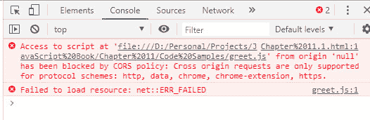

**图 11.1:** 控制台窗口中的错误

另一种导入模块的方法是。

以下示例演示了如何将模块导入到你的网页页面中：

```html
<html>
<body>
<h1>Import module functions example</h1>
<p>Import module functions example</p>
<script type="module" src="greet.mjs"></script>
<script>
document.body.innerHTML = sayHello('Ockert');
document.body.innerHTML = sayBye('Ockert');
</script>
</body>
</html>
```

2. 以 HTML 扩展保存文件，例如 `Chapter 11.2.html`。

3. 双击文件在默认浏览器中打开它。

4. 如果浏览器是 Google Chrome，按下 `Ctrl` + `Shift` + `J` 打开控制台窗口。

脚本文件的源被设置为目标模块。这稍微快一点且更易读。两个网页都可能因为**跨源资源共享**（**CORS**）产生错误。让我解释一下它。

## 跨源资源共享 (CORS)

**跨源资源共享** (**CORS**) 利用额外的 HTTP Header 通知浏览器允许 Web 应用程序访问不同源的选资源。这通常发生在 Web 应用程序请求与其自身不同域、协议或端口的资源时。

CORS 添加了新的 HTTP Header 来描述哪些源允许从 浏览器读取信息。对于 GET 和 POST 以外的 HTTP 请求方法，可能会对服务器数据产生副作用，浏览器应该预检请求。这通过 `HTTP OPTIONS` 请求方法向服务器询问支持的方法。

这是它的工作原理。

假设用户访问了以下网站：[`www.javascriptforgurus.com`](http://www.javascriptforgurus.com)，该网站上的一个页面尝试跨源请求以从 [`service.javascriptforgurus.com`](http://service.javascriptforgurus.com) 获取一些数据。兼容 CORS 的浏览器将尝试以以下方式向 `service.javascriptforgurus.com` 发起跨源请求。

兼容 CORS 的浏览器发送一个带有 `Origin` Header 的 `OPTIONS` 请求到 [`service.javascriptforgurus.com`](http://service.javascriptforgurus.com)，该 Header 包含父页面的域：

`http://www.javascriptforgurus.com`

`http://service.javascriptforgurus.com` 处的服务器可能会返回以下任意内容：

* `Access-Control-Allow-Origin` 头部，显示哪些站点被允许。例如：

    `Access-Control-Allow-Origin: http://www.javascriptforgurus.com`

* 带有通配符的 `Access-Control-Allow-Origin` 头部，允许所有域。例如：

    `Access-Control-Allow-Origin: *`

* 错误页面

## CORS 预检请求

之前我提到浏览器应该对请求进行 `preflight`（预检）。在执行跨域请求时，兼容 CORS 的浏览器会插入 `preflight` 请求，以确定它们是否有权限执行该操作。这里是一个简单的示例：

`OPTIONS /`

`Host: service.javascriptforgurus.com`

`Origin: http://www.javascriptforgurus.com`

如果 `service.javascriptforgurus.com` 接受该操作，它将返回以下头部：

`Access-Control-Allow-Origin: http://www.javascriptforgurus.com`

`Access-Control-Allow-Methods: PUT, DELETE`

另一个示例如下。此示例演示了客户端在发送 `DELETE` 预检请求之前，向服务器询问其是否允许 `DELETE` 请求：

`OPTIONS http://www.javascriptforgurus.com`

`Access-Control-Request-Method: DELETE`

`Access-Control-Request-Headers: origin, x-requested-with`

`Origin: http://www.javascriptforgurus.com`

以下是服务器的响应：

`HTTP/1.1 204 No Content`

`Connection: keep-alive`

`Access-Control-Allow-Origin: http://www.javascriptforgurus.com`

`Access-Control-Allow-Methods: POST, GET, OPTIONS, DELETE`

`Access-Control-Max-Age: 86400`

因为服务器响应了 `Access-Control-Allow-Methods`，所以服务器允许该请求。但我们仍然面临 CORS 问题。我什么意思？嗯，你做的练习仍然抛出 CORS 错误，如图 1.1 所示。我们该如何修复这个问题？

其实有很多绕过 CORS 错误的方法；这里有几种在 Google Chrome 中可能有效：

* Origin & CORS Changer
* 命令提示符 (Command Prompt)
* Out of blink CORS

## Origin & CORS Changer

`Origin & CORS Changer` Chrome 插件允许你发送跨域请求并覆盖源和 CORS 头部，而不会接收错误。使用以下步骤安装 `Origin & CORS Changer` 插件：

1. 导航到：`https://chrome.google.com/webstore/detail/origin-cors-changer/digfaphondkpccljibejppibc?hl=US`
2. 点击 `Add to Chrome` 按钮将此扩展程序添加到 Chrome。如图 2 所示。
3. 如必要，重启浏览器。
4. 你会发现地址栏旁边有一个小图标。这就是该扩展。点击它，会出现下一个屏幕。
5. 点击 `SWITCH ON` 按钮，开启此扩展。
6. 这应该可以解决问题。

## 命令提示符 (Command Prompt)

命令提示符用于执行输入的命令，例如通过脚本和批文件自动化任务、执行管理功能以及排除 Windows 问题。以下步骤将以禁用安全模式打开 Google Chrome：

1. 关闭所有 Google Chrome 实例。
2. 按键盘上的 Windows 键。
3. 输入 `cmd`。按 `Enter`。
4. 命令提示符窗口将出现，如图 4 所示。
5. 输入以下命令并按回车：

   `CD "Program Files (x86)\Google\Chrome\Application"`

   这意味着更改目录（文件夹）到 Chrome 应用程序文件所在。
6. 输入以下命令并按 `Enter`。屏幕如图 5 所示：

   `Chrome.exe --disable-web-security`

   OR

   `chrome.exe --user-data-dir="C://Chrome dev session" --disable-web-security`

   OR

   `chrome.exe --disable-web-security --disable-gpu --user-data-dir="C://Chrome dev session"`

7. 这将启动禁用了安全的 Chrome，这可能不是一个完全好的主意。

现在，让我们来看 Out of blink CORS 设置。

## Out of blink CORS

Out of blink CORS 是 Chrome 的设置，你可以用它来启用或禁用 CORS 检查。使用以下步骤禁用 Out of blink CORS：

1. 打开你的 Chrome 浏览器（如果尚未打开）
2. 导航到：`chrome://flags/#out-of-blink-cors`
3. 在 `Out of blink CORS` 设置旁边，从下拉菜单中选择 `Disabled`，如图 6 所示。

## 动态导入

动态导入允许你在需要时按需加载模块。这与静态导入不同，静态导入在文件加载时就会加载所有模块。动态导入使用 `import()` 函数，它返回一个 Promise。

以下示例演示了动态导入：

```javascript
button.addEventListener('click', async () => {
  const module = await import('./module.mjs');
  module.someFunction();
});
```

## nomodule

`nomodule` 属性允许你为不支持模块的旧版浏览器提供回退脚本。支持模块的浏览器会忽略带有 `nomodule` 属性的脚本。

以下示例演示了 `nomodule` 的用法：

```html
<script type="module" src="modern.js"></script>
<script nomodule src="old.js"></script>
</body>
</html>
```

2. 以 HTML 扩展名保存文件，例如 `Chapter 11.5.html`。

如果使用现代浏览器，所有的模块都可以被解析和使用。然而，当使用旧版浏览器时，它会使用旧的 JavaScript 文件。

## 打包工具 (Bundlers)

在大型网站中，使用 `webpack`、`Rollup` 或 `Parcel` 等打包工具来整合脚本总是更容易。

打包工具可以实现以下功能：

* 分析模块的依赖关系，包括导入以及嵌套导入。
* 构建一个包含所有模块的单一文件。
* 移除无法到达的代码。
* 移除未使用的导出。
* 压缩文件。这将移除空格并将变量替换为更短的名字。

我已经提到了三个流行的打包工具（`webpack`、`Rollup`、`Parcel`），让我快速告诉你们它们的作用。

## 关于打包工具的简要笔记

* `webpack`: `webpack` 是一个用于现代 JavaScript 应用的静态模块打包器。它构建一个依赖图，映射你项目所需的每个模块，并生成一个或多个包。你可以在这里找到 `webpack`：[`webpack.js.org/concepts/`](https://webpack.js.org/concepts/)
* `rollup.js`: `Rollup` 将较小的代码片段编译成更大的整体，例如库或应用程序。你可以在这里找到 `Rollup`：https://rollupjs.org/guide/en/
* `parcel.js`: `Parcel` 是一个 Web 应用打包器，提供快速性能且需要零配置。在此处找到 `Parcel`：[`parceljs.org/getting_started.html`](https://parceljs.org/getting_started.html)

较小的网站可能不需要使用打包工具，但请记住：导入越多，可能瓶颈就越多，对于某个特定函数是否存在的困惑也越多。

## 结论

在本章中，我们学习了什么是模块，以及你为什么要以及如何使用它们。你了解了它的好处，以及当旧版浏览器不支持模块时会发生什么。你学习了 `CORS` 和一些可用工具，特别是在开发阶段。你学习了各种可用的打包工具。

在下一章中，我们将通过解释变量、数据类型和作用域来开启*高效使用 JavaScript* 章节。

## 问题

1. 给出一个导出模块函数的示例。
2. 给出一个导入模块函数的示例。
3. 解释为什么动态导入是如此不同。
4. `nomodule` 属性是做什么用的？
5. 解释 `CORS` 术语。

# 第三部分

## 高效使用 JavaScript

## 引言

第三部分将深入探讨 JavaScript 的真实威力。理解 JavaScript 的运行机制对于创建极其强大的网站和 Web 应用至关重要。在本节中，你将学习如何创建类，然后学习原型、属性和承诺，最后是生成器和模块。

本节包含以下章节：

1. 变量
2. 控制流语句
3. 循环
4. 代码质量

# 第 12 章

## 变量

## 引言

变量是用于存储信息的命名容器。该容器存储在内存中并持有临时值。

在本节中，你将学习什么是变量。你将学习如何声明变量，最重要的是，你将学习 JavaScript 语言中的各种原始数据类型。这节课程充满了练习，让我们开始吧！

## 结构

* 声明变量
* 作用域
* 原始类型

## 目标

* 学习如何声明变量。
* 理解变量作用域
* 创建并使用各种内置原始类型：
    * String（字符串）
    * Boolean（布尔值）
    * Number（数字）
    * BigInt
    * Symbol（符号）
    * Null
    * undefined

## 声明变量

你通过 `var` 关键字创建变量。此过程创建一个命名的内存位置，准备存储值。

你通过以下方式创建变量：

```javascript
var progStudent;
```

变量已创建，目前没有值。在本章稍后的部分，我将为你介绍 `undefined` 原始类型。

我们有了变量，现在呢？我们需要在里面存储一个值。我们通过给它赋值来实现，如下所示：

```javascript
progStudent = "Ockert du Preez";
```

在赋值时，你在左侧指定变量名，然后使用赋值运算符（即等号），最后提供你想存储在该变量中的值。这里是另外两个例子：

```javascript
var Age;
Age = 41;
```

或者

```javascript
var Grades;
Grades = 75.5;
```

或者

```javascript
var progStudent = "Ockert du Preez", Age = 41, Grades = 75.5;
```

一些命名规则如下：

* 对象名可以包含字母、数字、下划线甚至美元符号。
* 对象名可以以字母或 `_` 开头。
* 对象名区分大小写，`varname` 与 `varName` 和 `VarName` 不同。
* JavaScript 关键字不能作为名称。

我想提到的最后一点是创建变量的作用域，如后文所示。

## 作用域

变量的作用域意味着它在何处是可知的。简单来说：在家里，只有你的亲家人认识你；在公司，你的同事认识你。JavaScript 有两种作用域：

* 局部
* 全局

## 局部作用域与全局作用域

局部变量仅在定义它的函数内部可见。全局变量具有全局作用域，这意味着可以在代码的任何地方定义它。

## 原始类型

在第 2 章：JavaScript 对象 中，我简要提到了原始类型（Primitives）。这里有一个快速复习。原始值是不具有属性或方法的值。原始数据类型仅仅是具有原始值的数据。JavaScript 中实际上有七种原始类型，它们是：

* string
* number
* BigInt
* null
* undefined
* boolean
* Symbol

其他所有内容都是对象。

### String

JavaScript 字符串数据类型表示文本数据。字符串的示例包括：

* 'Ockert'
* "BpB"
* "1"

与许多编程语言不同，这里没有单独的字符数据类型。JavaScript 字符串是不可变的，这意味着一旦创建了字符串，就无法修改。你可以通过对原始字符串进行操作来创建另一个字符串，使用的函数如 `String.concat()`（将两个字符串连接在一起）和 `String.substr()`（允许你提取字符串的一部分）。

我稍后会详细介绍字符串函数。

现在，我如何识别或设置字符串呢？

### 引号

你在这个主题的开头注意到我将所有字符串都放在了引号内。但是，如果你仔细看，你会发现我使用了两种类型的引号：单引号和双引号。识别字符串的另一种方法是使用反引号（backticks）。

单引号（`'`）和双引号（`"`）本质上是相同的，唯一需要记住的是你不能用单引号开头并双引号结束字符串，反之亦然。通过让你所有的字符串看起来都一样来保持某种标准，这会让将来更容易识别它们。

## 反引号 (Backticks)

反引号（`` ` ``）允许你通过用 `${...}` 包裹表达式将其嵌入字符串中。在本书书中我们一直在进行这种用例，但让我们通过一个小型的练习来复习一下记忆吧。

下面的示例演示了如何在你的网页中使用反引号：

1.  打开你选择的文本编辑器并输入以下 HTML 和 JavaScript 代码：

```html
<!doctype html>
<html>
<body>
<h1>Backticks example</h1>
<p>Backticks example</p>
<script>
function sum(a, b) {
return a + b;
}
alert(`1 + 2 = ${sum(1, 2)}.`); // 1 + 2 = 3.
</script>
</body>
</html>
```

2.  以 HTML 扩展名保存文件，例如 `Chapter 12.1.html`。

3.  双击该文件并在默认浏览器中打开它。

在这里我们简单地创建了一个相加两个对象的函数，然后将其显示在警框框中，如下截图所示：

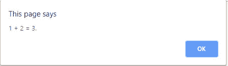

**图 12.1：** 反引号

我非常喜欢反引号的一个特性是允许一个字符串跨多行。如果我用单引号或双引号执行上述的操作，JavaScript 编译器将会报错。

```javascript
let students = `Students:
* Ockert
* BpB
* John
* Peter
* William
* Jessica`;
alert(students);
```

*图 12.2* 显示了上述代码执行后的样子：

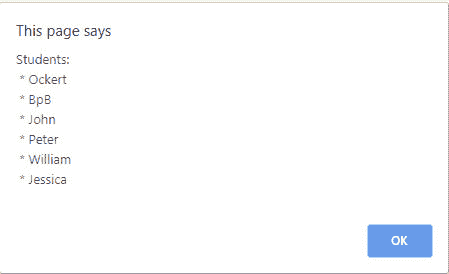

**图 12.2：** 用于多行字符串的反引号

然而，你仍然可以使用单引号和双引号创建多行字符串。你通过在字符串内部插入换行符（写作 `\n`）来实现这一点。下一行代码产生的结果与之前所示的反引号包裹的多行引号完全相同。

```javascript
let students = "Students:\n * Ockert\n * BpB\n * John\n * Peter\n * William\n* Jessica";
alert(students);
```

特殊字符 `\n`（换行）被插入到字符串必须拆分为新行的位置或位置上。

说到特殊字符，让我们更详细查看下一个。

## 特殊字符

特殊字符是指不是字母、数字、符号或标点符号的字符。*表 12.1* 列出了一些常见的特殊字符：

| 字符 | 描述 |
| :--- | :--- |
| `\n` | 换行 |
| `\r` | 回车。通常使用 `\n` 和 `\r` 的组合在文本文件中创建新行。 |
| `\'` | 单引号 |
| `\"` | 双引号 |
| `\\` | 反斜杠 |
| `\t` | 制表符 |
| `\b, \f, \v` | 退格符、分页符、垂直制表符。主要为了兼容性而保留。 |
| `\xXX` | Unicode 字符。例如：`\x6F` 等于 `O`。 |
| `\uXXXX` | Unicode 符号。例如，`\u00AE` 等于注册符号 `®`。 |


**表 12.1：** 特殊字符

注意，所有特殊字符必须以反斜杠开头。从这个意义上说，它被称为转义字符。

## 字符串属性

基本值如 `Ockert du Preez` 不是一个对象，因此它不能拥有属性或方法。然而，JavaScript 为基本值提供了方法和属性，因为这些值在执行方法和属性时被视为对象。

`length` 属性返回给定字符串中的字符数。下面的示例演示了字符串长度属性：

1.  打开你选择的文本编辑器并输入以下 HTML 和 JavaScript 代码：

```html
<!doctype html>
<html>
<body>
<h1>String length Property</h1>
<p>String length Property</p>
<script>
var str = new String( “Ockert du Preez” );
document.write(“str.length is:” + str.length);
</script>
</body>
</html>
```

2.  以 HTML 扩展名保存文件，例如 `Chapter 12.2.html`。

3.  双击该文件并在默认浏览器中打开它。

答案将是 `15`，因为 `length` 属性包含了空格。

## 字符串方法

下表列出了标准的字符串方法：

**表 12.2：** 字符串方法

| 方法 | 描述 |
| :--- | :--- |
| `charAt()` | 获取指定索引处的字符。 |
| `charCodeAt()` | 获取指定索引字符的 Unicode。 |
| `concat()` | 连接两个或多个字符串。 |
| `endsWith()` | 确定字符串是否以指定的子字符串结束。 |
| `fromCharCode()` | 将 Unicode 转换为字符。 |
| `includes()` | 判断字符串是否包含指定的子字符串。 |
| `indexOf()` | 获取指定值在字符串中第一次出现的索引。 |
| `lastIndexOf()` | 获取指定值在字符串中最后一次出现的索引。 |
| `localeCompare()` | 比较两个字符串。 |
| `match()` | 字符串与正则表达式进行匹配。 |
| `repeat()` | 重复字符串。 |
| `replace()` | 将字符串中的字符串或模式替换为另一个字符串。 |
| `search()` | 字符串与正则表达式进行搜索。 |
| `slice()` | 提取字符串的一部分。 |
| `split()` | 将字符串拆分为子字符串。 |
| `startsWith()` | 确定字符串是否以指定的子字符串开头。 |
| `substr()` | 提取字符串的部。 |
| `substring()` | 提取字符串的一部分。 |
| `toLocaleLowerCase()` | 将字符串转换为小写。 |
| `toLocaleUpperCase()` | 将字符串转换为大写。 |
| `toLowerCase()` | 将字符串转换为小写。 |
| `toString()` | 创建一个表示指定字符串对象的字符串。 |
| `toUpperCase()` | 将字符串转换为大写。 |
| `trim()` | 移除字符串开头和结尾的空白。 |
| `valueOf()` | 返回基本值。 |

下面的示例演示了 `charAt` 字符串方法的使用：

1.  打开你选择的文本编辑器并输入以下 HTML 和 JavaScript 代码：

```html
<!doctype html>
<html>
<body>
<h1>String charAt method</h1>
<p>String charAt method</p>
<script>
var str = new String( “Ockert du Preez” );
document.writeln(`<br />str.charAt(0) is:` + str.charAt(0));
document.writeln(`<br />str.charAt(1) is:` + str.charAt(1));
document.writeln(`<br />str.charAt(2) is:` + str.charAt(2));
document.writeln(`<br />str.charAt(3) is:` + str.charAt(3));
document.writeln(`<br />str.charAt(4) is:` + str.charAt(4));
document.writeln(`<br />str.charAt(5) is:` + str.charAt(5));
</script>
</body>
</html>
```

2.  以 HTML 扩展名保存文件，例如 `Chapter 12.3.html`。

3.  双击该文件并在默认浏览器中打开它。

创建了一个包含我名字和姓氏的字符串。然后使用 `charAt` 获取指定索引处的字符。例如：0 是字符串的第一个字符。

`Number` 类型是一个双精度 64 位二进制值。它可以存储浮点数或范围在 `-(2⁵³ -1)` 到 `(2⁵³ -1)` 之间的整数。数字类型还有三个特殊值：`+Infinity`、`-Infinity` 和 `NaN`（不是数字）。常量 `Number.MAX_VALUE` 和 `Number.MIN_VALUE` 可用于确定 `+Infinity` 和 `-Infinity` 之间的最大或最小值。你还可以使用 `Number.isSafeInteger()` 或 `Number.MAX_SAFE_INTEGER` 和 `Number.MIN_SAFE_INTEGER` 来检查一个数字是否在双精度浮点范围内。

## Number 属性

原始类型数字具有以下属性：

**表 12.3:** Number 属性

| 属性 | 描述 |
| :--- | :--- |
| `EPSILON` | 两个可表示数字之间的最小间隔 |
| `MAX_SAFE_INTEGER` | 最大安全整数 |
| `MAX_VALUE` | 最大可表示正数 |
| `MIN_SAFE_INTEGER` | 最小安全整数 |
| `MIN_VALUE` | 最接近零的正数 |
| `NaN` | 不是数字 |
| `NEGATIVE_INFINITY` | 负无穷 |
| `POSITIVE_INFINITY` | 正无穷 |

现在我们已经熟悉了数字类型的属性，让我们来看看它的方法。

## Number 方法

原始类型数字具有以下方法：

**表 12.4:** Number 方法

| 方法 | 描述 |
| :--- | :--- |
| `isFinite` | 该值是否为有限数字？ |
| `isInteger` | 该值是否为整数（整数字）？ |
| `isNaN` | 该值是否不是数字？ |
| `isSafeInteger` | 该值是否为 `-(2⁵³ -1)` 到 `(2⁵³ -1)` 之间的整数 |
| `parseFloat` | 将参数解析为浮点数 |
| `parseInt` | 将参数解析为整数 |
| `prototype.toExponential` | 科学计数法表示字符串 |
| `prototype.toFixed` | 固定点计数法 |
| `prototype.toLocaleString` | 语言敏感的数字表示法 |
| `prototype.toPrecision` | 以固定点或科学计数法以指定的精确度表示数字 |
| `prototype.toSource` | Number 对象的对象字面量 |
| `prototype.toString` | 数字的字符串表示 |
| `prototype.valueOf` | 返回对象的原始值 |

让我们来一个快速的练习吧！以下示例演示了几个数字方法的使用：

1.  打开你任的文本编辑器，并输入以下 HTML 和 JavaScript 代码：

```html
<!doctype html>
<body>
<h1>Number methods</h1>
<p>Number methods</p>
<script>
var num = 9.76386;
var n = num.toExponential(3);
document.writeln("<br />" + n);
var x = 6.351;
x.toFixed(2);
document.writeln("<br />" + x);
var numObj = new Number(42);
var nn = numObj.valueOf();
document.writeln("<br />" + nn);
</script>
</body>
</html>
```

2.  以 HTML 扩展名保存文件，例如 `Chapter 12.4.html`。

3.  双击文件在默认浏览器中打开它。

如你所示，使用数字方法非常简单。在上面的练习中，你显示了一个数字的指数值，获取了另一个数字的固定值并显示了第三个数字的值。*图 12.4* 显示了结果：

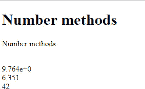

**图 12.4:** Number 方法

说到数字，让我们快速看一眼 `BigInt` 原始类型。

## BigInt

你可能对数字原始类型的限制感兴趣。简单回顾一下：它在 `-(2⁵³ -1)` 和 `(2⁵³ -1)` 之间。现在，如果你有一个更大的数字怎么办？这就是 `BigInt` 用用用场。`BigInt` 表示大于 `(2⁵³ -1)` 的整数。创建一个 `BigInt` 非常简单，你只需要在整数字面量后添加一个 `n`，或者调用函数 `BigInt()`。

让我们来一个快速的练习吧！以下示例演示了如何创建 BigInt：

1.  打开你任的文本编辑器，并输入以下 HTML 和 JavaScript 代码：

```html
<!doctype html>
<body>
<h1>Creating BigInts</h1>
<p>Creating BigInts</p>
<script>
const num1 = 9007199254740991n;
const num2= BigInt(9007199254740991);
const num3 = BigInt("9007199254740991");
</script>
</body>
</html>
```

2.  以 HTML 扩展名保存文件，例如 `Chapter 12.5.html`。

3.  双击文件在默认浏览器中打开它。

注意我在创建 `num1` 对象时在长数字后面添加的 `n`。`num2` 是通过 `BigInt` 函数创建的，`num3` 也是如此，但为 `num3` 提供的是一个字符串，它会被转换为 `BigInt` 数字。

## Null 与 undefined

Null 意味着无。它是值的刻意缺失。Undefined 意味着变量已经创建，但还没有被赋值。

一个简单的示例可能会有所帮助；让我们来看看。以下示例演示了如何创建 BigInt：

1.  打开你任的文本编辑器，并输入以下 HTML 和 JavaScript 代码：

```html
<!doctype html>
<body>
<h1>null versus undefined</h1>
<p>null versus undefined</p>
<script>
var nullVar = null;
if (nullVar)
document.writeln("<br />nullVar is not null");
else
document.writeln("<br />nullVar is null");
var undefinedVar;
document.writeln("<br />" + undefinedVar);
</script>
</body>
</html>
```

2.  以 HTML 扩展名保存文件，例如 `Chapter 12.6.html`。

3.  双击文件在默认浏览器中打开它。

在这里我创建了一个名为 `nullVar` 的变量并将其初始化为 `null`。这意味着没有值，所以检查 `nullVar` 变量值的 `if` 语句将产生一行说明 `nullVar` 是 null 的输出。

然后我创建了另一个名为 `undefinedVar` 的变量没有给它赋值。将写入的行将说明 `undefinedVar` 是 undefined。为什么？因为对象被创建了但没有填充任何值。*图 12.5* 显示了代码的运行：

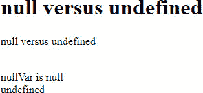

**图 12.5:** Null 与 undefined

## Boolean

现在我们已经知道了如何存储数字和字符串值，以及像 null 和 undefined 这样的复杂值，我们可以转向一个更简单的原始类型 Boolean。

Boolean 值可以是 true 或 false 的值。如果不是 true，它就是 false，反之亦然。Boolean 经常用于二进制选项，例如男或女、冷或热等。Boolean 不包含方法，只有一个 `length` 属性。

快速查看 Boolean 作用的方法是做另一个练习。

1.  打开你任的文本编辑器，并输入以下 HTML 和 JavaScript 代码：

```html
<!doctype html>
<body>
<h1>Boolean example</h1>
<p>Boolean example</p>
<script>
var varYES = true;
var varNO = false;
if(varYES)
{
alert("This code executes");
}
if(varNO)
{
alert("This code does not execute");
}
</script>
</body>
</html>
```

2.  以 HTML 扩展名保存文件，例如 `Chapter 12.7.html`。

3.  双击文件在默认浏览器中打开它。

如你所示，我在这里使用了另一个 if 语句，实际上是两个 `if` 语句。我将在 *第 13 章：控制流语句* 中更详细介绍 if 语句。这些 if 语句检查传递的对象包含什么值。如果它包含真值，则执行其块中的代码，如*图 12.6*所示：

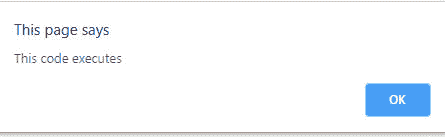

**图 12.6:** Boolean 测试

最后一个我想谈的原始类型是 Symbol 原始类型

符号（Symbol）代表一个唯一的标识符，并且被保证是唯一的。

这里有一个短小的示例。下面的示例演示了如何创建和使用符号：

1.  打开你选择的文本编辑器，并输入以下 HTML 和 JavaScript 代码

```html
<!doctype html>
<body>
<h1>Symbol example</h1>
<p>Symbol example</p>
<script>
  let student = {
  name: “Ockert”
  };
  let id = Symbol(“id”);
  student[id] = 123;
  alert( student[id] );
</script>
</body>
</html>
```

2.  以 HTML 扩展名保存该文件，例如 `Chapter 12.8.html`。

3.  双击该文件在默认浏览器中打开它

运行后，ID `idsymbol` 会被赋值给 `student` 对象，它将产生 `123`。

## 结论

在本章中，我们学习了数据类型和变量。没有变量，你就无法存储任何信息或对信息进行操作。最重要的是，你已经学会了哪种数据类型适用于哪种用途。

在下一章中，我们将深入探讨控制流语句。虽然你可能在本书中见过它们，但在随后的章节中，我们将解释如何使用控制流语句在脚本中包含逻辑的所有细节。

## 问题

1.  什么是变量？

2.  局部作用域和全局作用域之间的区别是什么？

3.  列出七种原始数据类型。

4.  列出三个字符串函数。

5.  什么是符号？

# 第 13 章

## 控制流语句

## 简介

控制流语句根据其执行的条件或微小测试来决定你脚本的执行流。这些测试可以包括测试一天的时间、用户的年龄，或者是否提供了某些特定信息。

在本节中，你将学习什么是控制流语句，以及哪些语句最适合你的特定需求。你将学习如何利用 `if` 语句、`else…if` 语句和 `else` 来根据情况执行代码。然后，你将学习 `switch` 语句和条件运算符如何为你节省时间。最后，你将学习如何嵌套语句。

## 结构

*   控制流语句定义
*   if
*   else…if
*   else
*   switch
*   嵌套语句
*   条件运算符‘`?’`

## 目标

*   理解控制流语句的工作原理。
*   利用 `if` 语句测试条件。
*   利用 `else…if` 语句测试多个条件。
*   当条件为假时利用 `else` 语句。
*   理解 `switch` 语句的工作原理。
*   理解如何嵌套 `if` 语句和 `switch` 语句。
*   知道如何使用条件运算符。

## 控制流语句定义

语句是逐行执行的。浏览解释器从上到下开始执行语句。这被称为脚本或程序的控制流。很多时候，脚本的控制流可以根据某些条件发生改变。这些条件判断是开发者作为开发者需要测试的未知值或情况。

一个很好的例子是，如果网站要求输入密码。如果没有输入文本，或者输入的密码太短，会发生什么？根据这些情况，应该执行不同的代码分支。如果输入的密码是错误的呢？应该执行另一条代码。如果输入的密码是正确的呢？随后执行的分支将允许用户进一步进入网站。

我们如何做到这一点？答案很简单。控制流语句如 `if`、`if…else`、`else`、`switch` 和条件运算符。让我们来看其中的每一个。

## if 语句

如果你中了票你会做什么？我知道我会怎么做！我会还清所有债务，买一辆好车。退休和我妻子孩子一起住在一个远离世俗、荒无人烟的地方。听我解释；我正试图表达一个观点。

晚上到了，你会做什么？你打开灯，当黎明来临时，你开始关灯。下雨了，而你在外面。如果你有伞，你就把它拿出来使用。如果你没有伞，你就去寻找避难所。

注意我在类比中不断使用的那个两个字母关键词了吗？

`if` 语句在脚本中的工作方式一样。它只是不同的平台。你需要测试的几点内容如下：

*   用户交互
*   脚本中的某些事件或情况
*   计算机事件。

为了解释得更清楚。你可能需要检查变量的状态以完成任务。例如，如果未提供某些信息，用户无法继续进入网站。或者，你可能忙于以下事务：

```html
<!doctype html>
<body>
<h1>Symbol example</h1>
<p>Symbol example</p>
<script>
  let student = {
  name: “Ockert”
  };
  let id = Symbol(“id”);
  student[id] = 123;
  alert( student[id] );
</script>
</body>
</html>
```

这也许是 `if` 语句最基本的演示。因为 `time` 是一个 `Date` 对象，我们可以访问 `Date` 属性如 `getHours`。

```html
<!doctype html>
<body>
<h1>Symbol example</h1>
<p>Symbol example</p>
<script>
  var time = new Date().getHours();
  if (time < 12) {
    greeting = “Good morning”;
  }
  document.write(greeting);
</script>
</body>
</html>
```

如果小时小于 12，那么另一个变量 `greeting` 将填充为：`Good morning`。最后，greeting 的值被写入页面。


**图 13.1：** if 语句的应用

有时一个 `if` 语句是不够的。这就是 `else…if` 语句。

## else…if 语句

`else…if` 语句用于检查多个条件。如果原始条件不存在，流跳转到下一个 `else…if` 语句，如果该条件不存在，它继续到下一个，以此此类推。如果所有条件都不，则什么都不会发生，所有 `if` 和 `else…if` 语句中的代码都不会被执行。

下面的示例添加了一个 `else…if` 语句：

```html
<!doctype html>
<body>
<h1>Symbol example</h1>
<p>Symbol example</p>
<script>
  var time = new Date().getHours();
  if (time < 12) {
    greeting = “Good morning”;
  }
  else if (time < 18) {
    greeting = “Good afternoon”;
  }
  document.write(greeting);
</script>
</body>
</html>
```

2.  以 HTML 扩展名保存该文件，例如 `Chapter 13.2.html`。

3.  双击该文件在默认浏览器中打开它。

如果时间小于 18，那么 greeting 变量 `greeting` 将包含消息 `Good afternoon`。

之前我提到过，当没有 `else…if` 条件存在时，什么都不会发生。好吧，我们可以让某些事情发生！

## else 语句

`else` 语句用于在特定条件不存在时执行。所以，回到我最初那个关于我中彩票的类比。如果我没有中彩票，我必须继续工作而不能退休。在上面的两个练习中，如果时间既小于 12 也小于 18，那么目前什么都不会发生。

让我们改变一下！下面的示例添加了一个 `else` 语句：

1. 打开你选择的文本编辑器，并输入以下 HTML 和 JavaScript 代码：

```html
<!doctype html>
<body>
<h1>If Statement example</h1>
<p>If Statement example</p>
<script>
var time = new Date().getHours();
if (time < 12) {
greeting = “Good morning”;
}
else if (time < 18) {
greeting = “Good afternoon”;
}
else {
greeting = “Good evening”;
}
document.write(greeting);
</script>
</body>
</html>
```

2. 将该文件保存为 HTML 扩展名，例如 `Chapter 13.3.html`。

3. 双击该文件并在默认浏览器中打开。

当时间既小于 12 也小于 18 时，问候语将是 `Good evening`。

## switch 语句

在 JavaScript 中，你可以使用 `switch` 语句代替多个 `if` 和 `else if` 语句。`switch` 语句提供了一种更具描述性的方法来检查值相对于多个变体。

下面的示例展示了如何创建一个 `switch` 语句：

1. 打开你选择的文本编辑器，并输入以下 HTML 和 JavaScript 代码：

```html
<!doctype html>
<body>
<h1>Switch Statement example</h1>
<p>Switch Statement example</p>
<script>
var objDay = new Date();
switch (objDay.getDay())
{
case 0:
console.log(“Sunday”);
break;
case 1:
console.log(“Monday”);
break;
case 2:
console.log(“Tuesday”);
break;
case 3:
console.log(“Wednesday”);
break

case 4:
console.log(“Thursday”);
break;
case 5:
console.log(“Friday”);
break;
case 6:
console.log(“Saturday”);
break;
default:
console.log(“Choose a proper day”);
break;
}
</script>
</body>
</html>
```

2. 将该文件保存为 HTML 扩展名，例如 `Chapter 13.4.html`。

3. 双击该文件并在默认浏览器中打开。

它看起来比实际情况复杂得多！你创建了一个名为 `objDay` 的新 `Date` 对象。然后，`switch` 语句开始测试当前是星期几。这是通过使用 `getDay()` 方法实现的。根据是哪一天，该会被记录到控制台中。在我的情况下，第 0 是 `Sunday`（星期日），第 6 是 `Saturday`（星期六）。如果你眼睛更敏锐，你会注意到每个 case 语句之间的小小的 `break;`。这是为了表示当前分支的代码已执行完毕，不应继续执行其他 case。最后，放在那里的 `default` 是当没有任何 case 满足时的值。让我们通过快速修改上面的代码再做另一个例子：

1. 打开你选择的文本编辑器，并输入以下 HTML 和 JavaScript 代码：

```html
<!doctype html>
<body>
<h1>Switch Statement example</h1>
<p>Switch Statement example</p>
<script>
var objDay = new Date();
switch (objDay.getDay())
{
case 0:
case 5:
case 6:
console.log(“Weekend!”);
break;
case 1:
case 2:
case 4:
console.log(“Work”);
break;
case 3:
console.log(“Off”);
break;
}
</script>
</body>
</html>
```

2. 将该文件保存为 HTML 扩展名，例如 `Chapter 13.5.html`。

3. 双击该文件并在默认浏览器中打开。

这里有一些不同之处。你可能会注意到 case 0 和 5 并没有以 `break` 语句结束。为什么？因为 case 0、5 和 6 执行的是相同的操作，即 `Weekend`（周末）。这被称为“分组”，可以节省大量时间，而无需编写重复的代码。case 1、2 和 4 也是如此，它们代表工作日。例如，case 3 (`Wednesday`，星期三）将是休息。

现在我们已经理解了这些语句的基础知识，让我们来来点复杂的吧！

## 嵌套语句

嵌套意味着它被放置在类似的结构中。好吧，这告诉我不多！嵌套 `if` 语句是另一个 `if` 语句内部的 `if` 语句。嵌套 `switch` 语句是另一个 `switch` 语句内部的 `switch` 语句。让我们来看看嵌套 `if` 语句的操作：

1. 打开你选择的文本编辑器，并输入以下 HTML 和 JavaScript 代码：

```html
<!doctype html>
<body>
<h1>Nested If Statement example</h1>
<p>nested If Statement example</p>
<script>
var studentAge = 15;
if( studentAge < 18 )
{
document.write(“Under the age of 18!<br>”);
document.write(“Needs parent’s consent to enroll.`);
}
else
{
if (studentAge >= 18 && studentAge <= 60 )
{
document.write(“Eligible to enroll<br>”);
document.write(“Please continue to application page.”);
}
else
{
document.write(“Older than most students here.<br>”);
document.write(“Would you prefer a softer chair and different time slot?”);
}
}
}
</script>
</body>
</html>
```

2. 将该文件保存为 HTML 扩展名，例如 `Chapter 13.6.html`。

3. 双击该文件并在默认浏览器中打开。

如你所见，在代码中包含空白有助于观察脚本的流程。创建了一个名为 `studentAge` 的变量并赋值为 15。外层 `if` 语句测试 `studentAge` 是否小于 18。如果 `studentAge` 小于 18（目前它确实为 15），则页面将告知用户年龄未满 18 岁，且父母需要对学生的入学授权。

这里是有趣开始的地方。

在 `else` 语句中（意味着 `studentAge` 变量的值为 18 或更高），我放置了另一个 `if` 语句。这就是嵌套。嵌套的 `if` 语句检查 `studentAge` 是否大于或等于 18 且小于或等于 60。如果这两个条件都满足，即 `studentAge` 大于或等于 18 且小于或等于 60，页面将通知用户其有资格入学。

如果 `studentAge` 大于 60，嵌套 `if` 语句的 `else` 子句就会触发，并告知用户他们可能比其他人大，并询问是否需要更软的椅子。

所有可能的结果都显示在下面的图 13.2 中：

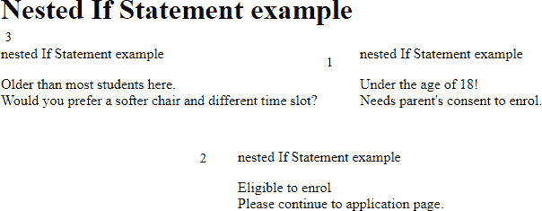

**图 13.2:** 嵌套 if 语句结果

让我们来疯狂一下，接着看看嵌套 `switch` 语句：

1. 打开你选择的文本编辑器，并输入以下 HTML 和 JavaScript 代码：

```html
<!doctype html>
<body>
<h1>Nested Switch Statement example</h1>
<p>Nested Switch Statement example</p>
<script>
var Stops = 30;
var Location = ‘South Africa’;
switch(Location)
{
case ‘South Africa’:
switch(Stops)
{
case 10:
document.write(‘Visiting 10 places in 10 days’);
break;
case 20:
document.write(‘Visiting 20 places in 20 days’);
break;
case 30:
document.write(‘Visiting 30 places in 30 days’);
break;
}
break;
case ‘India’:
switch(Stops)
{
case 5:
document.write(‘Visiting 5 places in 5 days’);
break;
case 15:
document.write('Visiting 15 places in 15 days');
break;
case 25:
document.write('Visiting 25 places in 25 days');
break;
}
break;
case ‘America’:
switch(Stops)
{
case 7:
document.write('Visiting 7 places in 7 days');
break;
case 14:
document.write('Visiting 14 places in 14 days');
break;
case 21:
document.write('Visiting 21 places in 21 days');
break;
}
break;
}
</script>
</body>
</html>
```

2. 将文件以 HTML 扩展名保存，例如 `Chapter 13.7.html`。

3. 双击该文件在默认浏览器中打开它。

大量的输入……

这里发生的情况是一个微型旅游网站，潜在游客可以选择想要访问的国家以及在所选国家访问的数量。

有三个国家：`America`、`India` 和 `South Africa`。每个国家在每个地方都有独特的 `Stops`数量。因此，当选择南非洲时，你有 10、20 和 30 个站点的可选；而如果你选择印度，你将有 5、15 和 25 个站点。

## 条件运算符 ‘？’

在第 4 章：JavaScript 运算符中，我介绍过三元运算符。三元运算符也称为条件运算符。该运算符之所以被称为三元，是因为它接受三个操作数才能运行。

三元运算符接受的三个操作数是：

* 条件
* 真表达式
* 假表达式

以下是其外观的一个小示例：

`Condition ? Value if true : Value if false`

条件是进行测试的内容。当条件为真时，执行问号后面的代码；如果条件为假，则执行冒号后面的代码。

让我们来看嵌套 `if` 语句的运行：

1. 打开你任用的文本编辑器，并输入以下 HTML 和 JavaScript 代码：

```html
<!doctype html>
<body>
<h1>条件语句示例</h1>
<p>条件语句示例</p>
<script>
var studentAge = 19;
var greeting = (studentAge < 18) ? “Not Allowed” : “Welcome!”;
document.write(greeting);
</script>
</body>
</html>
```

2. 将文件以 HTML 扩展名保存，例如 `Chapter 13.8.html`。

3. 双击该文件在默认浏览器中打开它。

变量 `studentAge` 的值被经过了测试，因此成为了条件。如果 `studentAge` 小于 `18`，则页面上将打印 `Not Allowed`；否则（正如当前情况，因为 `studentAge` 为 `19`），网页上将打印 `Welcome!`。

## 总结

在本章中，我们进行了大量的实操练习，演示了各种控制流语句的使用。你学习了脚本的大部分内容仅取决于需要测试的逻辑和条件。你看到了 `switch` 语句、`if` 语句与条件运算符之间的区别。

在下一章中，我们将学习 JavaScript 中的各种循环。

## 问题

1. 为什么你会使用 `switch` 语句而不是 `else…if` 语句？

2. 什么是三元运算符？

3. 为什么你会使用 `else` 子句？

4. 解释“条件”这一术语。

# 第 14 章

## 循环

## 简介

在任何编程环境或语言中，你都无法避免循环。JavaScript 拥有多种类型的循环，包括计数循环和条件循环。JavaScript 还包含了提前退出循环或跳过迭代的功能。

在本节中，你将学习 JavaScript 中存在哪些循环以及它们在语法和内部工作原理上的差异。你将进行大量的实践练习，因为通过实践学习总是更容易。

## 结构

* JavaScript 循环
* `for`
* `for…in`
* `for…of`
* `while`
* `do…while`
* 退出循环
    * `break` 语句
    * 带有标签的 `break`
* `continue` 语句

## 目标

* 识别 JavaScript 中不同的循环。
* 利用 `for` 循环执行固定次数。
* 利用 `for…in` 循环遍历对象属性。
* 利用 `for…of` 循环遍历数组、字符串、Maps 和 NodeLists。
* 利用 `while` 循环根据条件进行循环。
* 学习如何退出循环。

## JavaScript 循环

循环是重复的内容。在 JavaScript 中，有几种类型的循环可以使用来多次重复一段代码块。最常见的循环是 `for`、`for…in`、`for…of`、`while` 和 `do…while`。

循环是一种只要特定条件为真就会不断重复的结构。

 JavaScript 提供了以下循环：

* `for`
* `for…in`
* `for…of`
* `while`
* `do…while`

`for` 循环是最常见的循环。当你知道想要循环执行代码块的次数时，可以使用它。`for` 循环的语法为：

`for (initialization; condition; increment/decrement)`

`initialization` 是设置循环变量的地方。`condition` 是每次迭代之前测试的内容。如果条件为真，则执行循环体。`increment/decrement` 是在每次迭代后更新循环变量的内容。

这是一个 `for` 循环的示例：

```javascript
for (var i = 0; i < 10; i++) {
  document.write(i + "<br>");
}
```

在这个示例中，变量 `i` 被初始化为 `0`。每次迭代之前测试条件 `i < 10`。如果条件为真，则执行 `document.write(i)`。在每次迭代后，`i` 加 1。这会持续进行直到 `i` 不再小于 10。

`while` 循环用于在你不知道想要循环执行代码块的次数，但知道应该停止循环的条件时。`while` 循环的语法为：

```javascript
while (condition) {
  // 要执行的代码
}
```

`condition` 在每次迭代之前测试。如果条件为真，则执行循环体。如果为假，则循环不运行。

这是一个 `while` 循环的示例：

```javascript
var i = 0;
while (i < 10) {
  document.write(i + "<br>");
  i++;
}
```

在这个示例中，变量 `i` 被初始化为 `0`。每次迭代之前测试条件 `i < 10`。如果条件为真，则执行 `document.write(i)`。然后，`i` 加 1。这会持续进行直到 `i` 不再小于 10。

`do…while` 循环类似于 `while` 循环，但在测试条件之前，循环体至少会执行一次。`do…while` 循环的语法为：

```javascript
do {
  // 要执行的代码
} while (condition);
```

这是一个 `do…while` 循环的示例：

```javascript
var i = 0;
do {
  document.write(i + "<br>");
  i++;
} while (i < 10);
```

在这个示例中，变量 `i` 被初始化为 `0`。代码体执行一次，打印 `0`。然后测试条件 `i < 10`。如果为真，循环再次运行。这会持续进行直到 `i` 不再小于 10。

`for…in` 循环用于遍历对象的属性。`for…in` 循环的语法为：

```javascript
for (var property in object) {
  // 要执行的代码
}
```

这是一个 `for…in` 循环的示例：

```javascript
var person = {name: "John", age: 30, city: "New York"};
for (var property in person) {
  console.log(property + ": " + person[property]);
}
```

`for…of` 循环用于遍历数组、字符串、Maps 和 NodeLists 的值。`for…of` 循环的语法为：

```javascript
for (var value of iterable) {
  // 要执行的代码
}
```

这是一个 `for…of` 循环的示例：

```javascript
var fruits = ["apple", "banana", "cherry"];
for (var fruit of fruits) {
  console.log(fruit);
}
```

有时你想提前退出循环或跳过迭代。对于这种情况，可以使用 `break` 和 `continue` 语句。

`break` 语句用于跳出循环。

```javascript
for (var i = 0; i < 10; i++) {
  if (i === 5) {
    break;
  }
  document.write(i + "<br>");
}
```

`continue` 语句用于跳过当前迭代并移动到下一个。

```javascript
for (var i = 0; i < 10; i++) {
  if (i === 5) {
    continue;
  }
  document.write(i + "<br>");
}
```

你也可以配合标签使用 `break` 和 `continue` 来跳出嵌套循环。

```javascript
outerLoop:
for (var i = 0; i < 10; i++) {
  for (var j = 0; j < 10; j++) {
    if (i === 2 && j === 2) {
      break outerLoop;
    }
    document.write(i + ", " + j + "<br>");
  }
}
```

`for` 循环从 `9` 开始。然后你进行测试以确保 `i` 大于 `-1`，最后循环使用递减运算符进行递减。运算符在`第 4 章：JavaScript 运算符`中讨论过。最终结果如下一个截图所示：

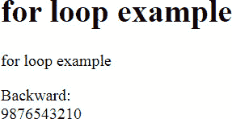

**图 14.2：** 逆向 for 循环

`for` 循环也经常与数组结合使用。数组将在`第 16 章：数组`中进行讨论，所以稍后会进行详细介绍。`for` 循环有几种变体，让我们检查一下它们。

## for…in

`for…in` 语句遍历对象的属性。它的语法如下：

```
for (variable in object)
{
  Statement(s)
}
```

如你所见，这个 `for` 循环与我们之前讨论的完全不同。在此语境中，变量是当前属性的临时占位符。在此语文中，对象是被遍历的那个对象。让我们做一个小练习。

这是一个更实用的例子。下一个示例展示了 `for…in` 循环的运行。

1. 打开你喜欢的任何文本编辑器并输入以下 HTML 和 JavaScript 代码：

```html
<!doctype html>
<body>
  <h1>for…in loop example</h1>
  <p>for…in loop example</p>
  <script>
    var student = {studentName: “Ockert”, studentSubject: “JavaScript”, studentAge: 41};
    var output = “”;
    var stu;
    for (stu in student)
    {
      output += student[stu] + “</br>”;
      document.write(“<b>” + ‘${stu}’ + “</b> = “ + ‘${student[stu]}’ + “</br>”);
    }
    document.write(“<p>” + output);
  </script>
</body>
</html>
```

2. 以 HTML 扩展名保存文件，例如 `Chapter 14.3.html`。

3. 双击文件在默认浏览器中打开它。

这个练习合二为一。让我们拆解一下：创建一个名为 `student` 的对象。它的属性包括 `studentName`、`studentSubject` 和 `studentAge`。我们创建了两个名为 `output` 和 `stu` 的变量。然后开始 `for…in` 循环。`stu` 变量作为 `student` 对象内部属性的占位符。此循环将运行三次，因为学生对象有三个属性。`output` 变量会被加上当前属性的值。`+=` 运算符表示将新值加到现有值，正如`第 4 章：JavaScript 运算符`中所解释的那样。下一行使用反引号加粗写入属性名及其设置，正如`第 12 章：变量`中所解释的那样。最后，`output` 变量的值也会写入页面。

最终输出如`图 14.3`：

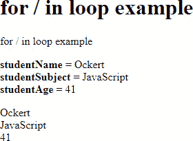

**图 14.3：** for…in 循环

我想讨论的下一个也是最后一个 `for` 语句是 `for…of` 语句。

## for…of

`for…of` 循环遍历可迭代数据结构，如数组、字符串、NodeLists 和 Maps。它的语法如下：

```
for (variable of iterable)
{
  Statement(s)
}
```

它看起来与 `for…in` 循环相似，不同在于它遍历的是内容。它遍历一个可迭代对象。在`第 10 章：JavaScript 生成器和迭代器`中你已经学习过迭代对象是可以重复的东西，因此在这种情况下，变量会遍历迭代对象的每个部分直到完成。为了给出更好的解释，让我们做一个练习！

下一个示例展示了 `for…of` 循环的运行。

1. 打开你喜欢的任何文本编辑器并输入以下 HTML 和 JavaScript 代码：

```html
<!doctype html>
<body>
  <h1>for…of loop example</h1>
  <p>for…of loop example</p>
  <script>
    var subject = ‘JavaScript’;
    var s;
    for (s of subject)
    {
      document.write(s + “<br >”);
    }
  </script>
</body>
</html>
```

2. 以 HTML 扩展名保存文件，例如 `Chapter 14.4.html`。

3. 双击文件在默认浏览器中打开它。

首先，创建一个名为 `subject` 的变量并赋值为 `JavaScript`。创建另一个名为 `s` 的变量。开始 `for…of` 循环。变量 `s` 等于存储在 `subject` 变量中的字符串 `JavaScript` 中的一个字符。它被写入页面，如`图 14.4`所示：

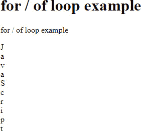

**图 14.4：** for…of 循环运行

让我们再做另一个例子。这个例子将遍历数组，数组将在`第 16 章：数组`中更详细地介绍。

下一个示例展示了 `for…of` 循环遍历数组。

1. 打开你喜欢的任何文本编辑器并输入以下 HTML 和 JavaScript 代码：

```html
<!doctype html>
<body>
  <h1>for…of loop example</h1>
  <p>for…of loop example</p>
  <script>
    var arraySubjects = [‘JavaScript’, ‘HTML’, ‘CSS’, ‘PHP’, ‘jQuery’];
    var sub;
    for (sub of arraySubjects) {
      document.write(sub + “<br >”);
    }
  </script>
</body>
</html>
```

2. 以 HTML 扩展名保存文件，例如 `Chapter 14.5.html`。

3. 双击文件在默认浏览器中打开它。

`arraySubjects` 是我们 true 数组。数组存储了多个值，所以从某种意义上说，数组是一组同名的变量。该数组提供了五个字符串，现在这五个字符串都存储在一个地方，即数组中。

创建了一个变量 `sub`。与 `for…in` 示例以及上一个 `for…of` 示例一样，该变量将用于获取数组（或值组）中的当前值。然后，我们只需简单地将该值写入页面，如`图 14.5`所示：

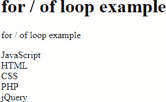

**图 14.5：** 遍历数组的 for…of 循环

让我们条件循环。

## while

`while` 循环只要给定条件为真就会执行代码块。它的语法如下：

```
while (condition)
{
  Statement(s)
}
```

这很简单。条件可以是测试一个值是否为假，或者例如一个数值是否小于 100。只要条件存在，语句就会重复。这被称为条件循环，因为与 `for` 循环指定起始和结束参数不同，在 `while` 循环中，你可能不知道它将执行几次。

让我们做一个真正的例子。

下一个示例展示了条件循环的威力：

1. 打开你喜欢的任何文本编辑器并输入以下 HTML 和 JavaScript 代码：

```html
<!doctype html>
<body>
  <h1>while loop example</h1>
  <p>while loop example</p>
  <script>
    let total = 0;
    while (total < 100) {
      let newVal = + prompt(“Enter a number”, ‘’);
      total += newVal;
    }
    alert( ‘Total: ‘ + total );
  </script>
</body>
</html>
```

2. 以 HTML 扩展名保存文件，例如 `Chapter 14.6.html`。

3. 双击文件在默认浏览器中打开它。

在上面的练习中，你创建了一个名为 `total` 的变量并赋值为 `0`。`while` 循环检查 `total` 变量是否小于 `100`。这意味着如果 `total` 变量变为 100 或更多，循环应该退出。

在循环内部，另一个名为 `newVal` 的变量接收提示框中输入的任何值，然后这个值会被加到 `total` 变量上。

这里非常重要的一点是，测试的是变量 `total` 的值，如果值在循环某处没有发生变化，循环将是无限循环且永远不会结束，例如 total 永远不会变成 100 或更多。

打开此页面时，你将看到一个类似于图 14.6 的框，你可以在其中输入数字。现在，你可以每次输入 `1`，它会不断累加 `1` 直到达到 `100`。或者你可以输入 `50` 和 `50`，甚至直接输入 `100`。

如果你每次都 `1`，它将循环 `100` 次；如果你再次输入 `50` 和 `50`，它将循环两次；如果你立即输入 `100`，它将只循环一次。要测试这一点，在达到 `100` 后刷新页面，并尝试不同的数字组合：

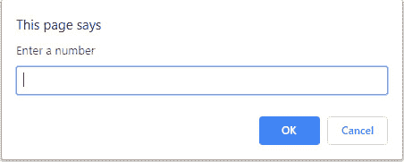

**图 14.6：** 运行中的 while 循环

`do…while` 循环（我将在下文中介绍）与 `while` 循环几乎相同，让我们来看一下：

## do…while

`do…while` 循环也是一种条件循环，就像你之前做的 `while` 循环一样。它们只有一个主要区别：在 `while` 循环中，条件是在循环开始时测试的，而在 `do…while` 循环中，条件是在循环结束测试的。这意味着循环将至少执行一次。它的语法如下：

```
do
{
  Statement(s)
} while (condition);
```

下一个示例演示了 `do…while` 循环。

1. 打开你选择的文本编辑器，并输入以下 HTML 和 JavaScript 代码：

```html
<!doctype html>
<body>
<h1>while 循环示例</h1>
<p>while 循环示例</p>
<script>
  let i = 0; // 更改为 6
  do
  {
    i += 1;
    document.write(i);
  } while (i < 5);
</script>
</body>
</html>
```

2. 将文件保存为 HTML 扩展名，例如 `Chapter 14.7.html`。

3. 双击该文件在默认浏览器中打开它。

这段代码在运行时将简单地在页面上输出 `12345`。现在由于条件是在循环结束时评估的，这可能会带来麻烦。例如，如果你在循环之前将 `1` 的值改为 `6` 而不是 `0`，循环仍然会执行一次并产生 `7`。

## 退出循环

有时你可能提前退出循环。在这种情况下，你应该使用 `break` 语句。你有两种方法在循环中使用 `break` 语句：

* `break`
* 带有标签的 `break`

让我们看看它们是如何工作的。

## break

你可以通过在想要退出的地方包含 `break` 语句来退出循环。这通常基于一个已变为真的条件。

下一个示例演示了如何提前退出循环。

1. 打开你选择的文本编辑器，并输入以下 HTML 和 JavaScript 代码：

```html
<!doctype html>
<body>
<h1>使用 break 退出循环的示例</h1>
<p>使用 break 退出循环的示例</p>
<script>
  var num = "";
  var i = 0;
  while (i < 5)
  {
    num += "<br>当前数字: " + i;
    i++;
    if (i === 3)
    {
      break;
    }
  }
  document.write(num);
</script>
</body>
</html>
```

2. 将文件保存为 HTML 扩展名，例如 `Chapter 14.8.html`。

3. 双击该文件在默认浏览器中打开它。

循环本应该从 0 循环到 5，但 `if` 语句测试了 `i` 是否为 `3`。如果是，循环应该通过 `break` 语句退出。图 14.7 显示了未完成的循环。

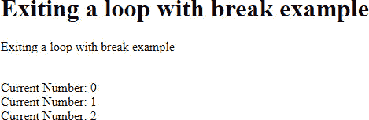

**图 14.7：** 循环提前退出

让我们增加一个花样。

## 带有标签的 break

正如你所看到的，`break` 语句会导致循环提前退出。你可以通过包含一个标签并跳转到该标签来指定开始执行代码的位置。你只需要添加一个带标签的语句，并在之后添加代码即可。

让我们来看一个例子。

下一个示例演示了如何使用标签提前退出循环。

1. 打开你选择的文本编辑器，并输入以下 HTML 和 JavaScript 代码：

```html
<!doctype html>
<body>
<h1>使用 break 退出循环的示例</h1>
<p>使用 break 退出循环的示例</p>
<script>
  let i = 0;
  let j = 0;
  Repeat: while (true)
  {
    document.write('外层: ' + i + '<br>');
    i++;
    j = 1;
    while (true)
    {
      document.write('内层: ' + j + '<br>');
      j++;
      if (i === 5 && j === 5)
      {
        break Repeat;
      }
      else if (j === 5)
      {
        break;
      }
    }
  }
</script>
</body>
</html>
```

（注：原文中关于 `break with label` 的部分文本有些杂乱，我已根据提供的代码字符串重构了逻辑。）

# 第 15 章

## 调试

给我看一个没有任何错误的脚本，我就给你看“尼湖湖水怪”。虽然在浏览网站时，它看起来似乎是完美的，而且从任何意义上来说，它确实如此，但它曾经存在大量的错误，也许现在可能仍然存在。错误会发生。失误也会发生。这是编程的一部分。然而，技巧之处在于你如何处理它们。

JavaScript 中主要有两种类型的错误；它们是：

*   **语法错误 (Syntax errors)**：语法错误发生在输入代码时。当人打字速度很快时，他或她并不总是能立即发现错误。这些错误可能很难找到，除非你手头有一个调试工具，否则你可能需要逐行扫描代码。

*   **逻辑错误 (Logical errors)**：逻辑错误让开发者陷入噩梦。这些错误通常发生在你预期某个结果但实际发生了不同情况时。例如：假设你想把背景变成蓝色，并编写了相关代码，但背景最终变成了红色。这就是逻辑错误。

*   **运行时错误 (Runtime errors)**：运行时错误发生在用户正在使用页面时。假设用户输入了错误信息或提供了格式错误的信息。这些都是运行时错误，你应该能够处理它们。

为了修复这些任何一类型的错误，你需要工具。记住，JavaScript 并没有一个带有调试工具和功能的全功能 `IDE`（集成开发环境），因此可用的选项并不多。

## JavaScript 调试语言特性

JavaScript 语言包含两个调试特性；它们是：

*   控制台窗口 (the console window)
*   `debugger` 关键字

让我们进入更多细节。

## 控制台窗口

控制台窗口比你想象的要强大得多！你不仅可以向它输出重要内容，还可以对某些过程计时，查看它们需要多长时间。这可能是一个长循环或复杂的语句。毕竟，速度在 Web 应用中至关重要。

## console.log

`console.log` 函数的功能是将信息输出到浏览器的控制台窗口。在目前为止的所有课程中，我一直在控制台窗口演示各种代码输出，但以防你忘记，让我们来做一个小练习，演示 `console.log()` 的用法。

*   打开你任选的文本编辑器并输入以下 HTML 和 JavaScript 代码：

```html
<html>
<body>
<h1>console.log Output</h1>
<p>The following code demonstrates the use of console.log</p>
<script>
console.log(“I love JavaScript”);
var myObj = { firstname : “Ockert”, lastname : “du Preez” };
console.log(myObj);
var myArr = [“JavaScript”, “CSS”, “HTML5”, “jQuery” ];
console.log(myArr);
</script>
</body>
</html>
```

*   用 HTML 扩展名保存文件，例如 `Chapter 15.1.html`。

*   双击该文件在默认浏览器中打开它。

*   在 Google Chrome 中按 `Ctrl` + `Shift` + `J` 或 `F12` 打开控制台窗口。

当控制台窗口打开时，你将看到被写入其中的三个不同类型的内容。首先是字符串：`I love JavaScript!`，然后是显示我名字和姓氏的对象。最后，数组的内容也被打印出来。*图 15.1** 显示了结果：

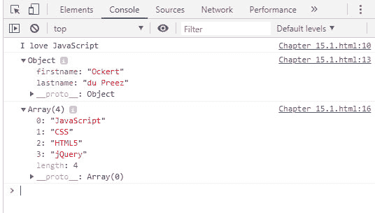

**图 15.1：** console.log

控制台窗口的另一个有用功能是 `console.time` 关键字。

## console.time 和 console.timeEnd 关键字

有时你需要确保代码在每个浏览器上运行得足够快。为此，你可以使用 `console` 对象的 `time()` 和 `timeEnd` 方法分别启动和停止内置计时器。让我们来快速快速练习！

1.  打开你任选的文本编辑器并输入以下 HTML 和 JavaScript 代码：

```html
<html>
<body>
<h1>console timing features</h1>
<p>The following code demonstrates the use of console.time and console.timeEnd</p>
<script>
console.time(‘Timer1’);
var items = [];
for(var i = 0; i < 500000; i++){
items.push({index: i});
}
console.timeEnd(‘Timer1’);
</script>
</body>
</html>
```

2.  用 HTML 扩展名保存文件，例如 `Chapter 15.2.html`。

3.  双击该文件在默认浏览器中打开它。

4.  在 Google Chrome 中按 `Ctrl` + `Shift` + `J` 或 `F12` 打开控制台窗口。

我得到的输出显示在*图 15.2*中：

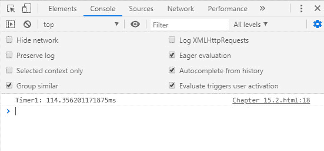

**图 15.2：** console timing features

控制台告诉我们，完成 `for` 循环的所有迭代耗时 `114` 毫秒。你指定了计时器应该在哪里开始，在哪里结束。

## 更多 console 方法

`console` 对象包含了许多其他方法来帮助调试。它们列在下表中：

**表 15.1：** 控制台方法

| 方法 | 描述 |
| :--- | :--- |
| `assert()` | 如果断言为假，则向控制台写入错误消息 |
| `clear()` | 清空控制台 |
| `count()` | 记录 count() 函数被调用的次数 |
| `error()` | 向控制台输出错误消息 |
| `group()` | 在控制台中创建一个新的内联分组 |
| `groupCollapsed()` | 在控制台中创建一个新的折叠内联分组 |
| `groupEnd()` | 退出控制台中的当前内联分组 |
| `info()` | 向控制台输出信息消息 |
| `table()` | 将表格数据显示为表格 |
| `trace()` | 向控制台输出堆栈跟踪 |
| `warn()` | 向控制台输出警告消息 |

让我们来做一个练习！

还有几个 console 方法，下一个练习将演示：

1.  打开你任选的文本编辑器并输入以下 HTML 和 JavaScript 代码：

```html
<html>
<body>
<h1> more console methods</h1>
<p>The following code demonstrates the use of console methods</p>
<script>
var myObj = { firstname : “Ockert”, lastname : “du Preez” };
console.assert(document.getElementById(“demo”), myObj);
console.clear();
for (i = 0; i < 10; i++) {
console.count();
}
console.error(“I am a mistake!”);
console.log(“Hello world!` `- Normal”);
console.group();
console.log(“Hello again!` `- Inside a group”);
console.info(“I love JavaScript!”);
function myFunction() {
anotherFunction();
}
function anotherFunction() {
console.trace();
}
console.warn(“This is a warning!”);
console.table([“JavaScript”, “HTML5”, “CSS”]);
</script>
</body>
</html>
```

2.  用 HTML 扩展名保存文件，例如 `Chapter 15.3.html`。

3.  双击该文件在默认浏览器中打开它。

4.  在 Google Chrome 中按 `Ctrl` + `Shift` + `J` 或 `F12` 打开控制台窗口。

上述代码的输出如下方的所示：

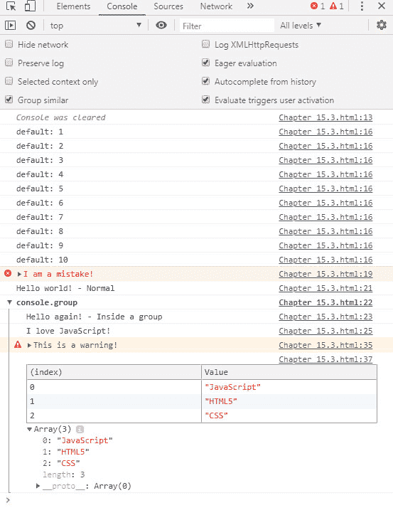

**图 15.3：** 更多 console 方法

如所见，控制台比想象的要强大得多。通过使用 `assert`、`warn` 和 `error` 方法，你可以快速检查错误，通过分组和表格方法，你可以组织数据的输出。

接下来的 JavaScript 调试语言特性是 `debugger` 关键字，将在后面解释。

接下来的这个小练习演示了 `debugger` 关键字的使用：

1.  打开你任选的文本编辑器，并输入以下 HTML 和 JavaScript 代码：

```html
<html>
<body>
<h1>debugger 语句</h1>
<p>以下代码演示了 debugger 语句的使用</p>
<script>
var x = 30 * 5;
debugger;
document.getElementbyId(“Answer”).innerHTML = x;
</script>
</body>
</html>
```

2.  以 HTML 扩展名保存文件，例如 `Chapter 15.4.html`。

3.  双击该文件在默认浏览器中打开它。

4.  在 Google Chrome 中按 `Ctrl` + `Shift` + `J` 或 `F12` 打开控制台窗口。

屏幕将显示暂停的浏览器窗口：

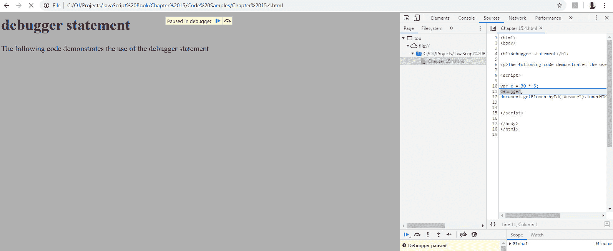

**图 15.4：** 调试器中暂停的代码

如你所见，在调试模式下，屏幕会变成灰色并高亮 debugger 所在的行。此外，注意浏览器窗口中的黄色黄色窗口。它显示代码已在调试器中暂停，并提供了两个按钮。Resume execution（恢复执行）将继续执行代码，直到遇到下一个断点（如果有的话）。Step over the next function（单步下一个函数）将进入下一行（在本例中）。如果按下 `Resume`，下一行将显示为错误，因为文档中不存在 `Answer` 字段。

让我们看看如何处理运行时错误。

## try 和 catch 块

`try…catch` 语句处理运行代码时可能发生的错误。你将可能出错的代码放在 `try` 块中，调试器会尝试执行它。如果发生错误，`catch` 块中的代码将触发。这可以防止页面崩溃以及浏览器产生错误。

你可以选择性在 `catch` 块之后添加一个 `finally` 语句，它无论是否发生错误都会执行。

下一个练习演示了 `try…catch` 语句的使用。

1.  打开你任选的文本编辑器，并输入以下 HTML 和 JavaScript 代码：

```html
<!DOCTYPE html>
<html>
<body>
<p>try and catch</p>
<p>请输入一个 15 到 20 之间的数字：</p>
<input id=”userInput” type=”text">
<button type=”button” onclick=”Check()">测试输入</button>
<p id=”output”></p>
<script>
function Check() {
  var message, x;
  message = document.getElementById(“output”);
  message.innerHTML = “”;
  x = document.getElementById(“userInput”).value;
  try {
    if(x == “”) throw “is Empty”;
    if(isNaN(x)) throw “not a number”;
    if(x > 20) throw “too high”;
    if(x < 15) throw “too low”;
  }
  catch(err) {
    message.innerHTML = “Input “ + err;
  }
}
</script>
</body>
</html>
```

2.  以 HTML 扩展名保存文件，例如 `Chapter 15.5.html`。

3.  双击该文件在默认浏览器中打开它。

4.  在 Google Chrome 中按 `Ctrl` + `Shift` + `J` 或 `F12` 打开控制台窗口。

输出示例所示：

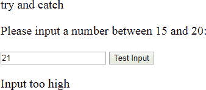

**图 15.5：** try and catch 示例

`try` 块用于确定用户输入到 `userInput` 字段的内容。如果数字在 `15` 到 `20` 之间，什么都不会发生；换句话说，不会产生错误。然而，如果没有输入值、输入单词而不是数字、或者值大于 `20`（如 `Figure 15.5`所示），或值小于 `15`，将抛出错误并在 `catch` 块内部处理。

## 编码风格

每种编程语言都有一套开发者应该遵循的不成文规则。好吧，并非完全不成文，而是一些被遵循的规则，你可以称之为标准，以提高代码的可读性。这是必要的，因为脚本可能会变得非常非常长，你很快就会在大量糟糕的变量和对象名称以及混乱的条件语句和循环中迷失。

## 变量和对象名称

变量命名主要有两种规范，即：驼峰命名法（camel case）和帕斯命名法（pascal case）。它们在大写方式上有所不同，如下：

* `camelCase`
* `PascalCase`

在本书中，我尽量保持 `camelCase` 命名规范。

使用大写的全局变量也很常见。

变量名可以包含字母、数字、美元符号和下划线。以下是几个例子：

`full_Name`

`student1`

`student_Name$`

但记住，你应该在整个脚本始终保持相同的命名规范。变量在 `第 12 章：变量` 中已经讨论过。

## 运算符和缩进

运算符的通用规则是在所有操作数之间始终保持空格格。比较以下内容：

`Result=varibale1+variable2`

对比

`Result = varibale1 + variable2`

空格让代码更易读。运算符在 `第 4 章：JavaScript 运算符` 中讨论过。

说到空格，当你在代码中使用控制流语句 `第 13 章：控制流语句` 或使用函数 `第 5 章：JavaScript 函数` 时，你绝对应该利用空格来提高代码流。比较以下代码段：

```javascript
var time = new Date().getHours();
if (time < 12) {
  greeting = “morning”;
} else if (time < 18) {
  greeting = “afternoon”;
} else {
  greeting = “evening”;
}
```

对比

```javascript
var time = new Date().getHours();
if (time < 12) {greeting =“morning”;}else if (time < 18) {greeting =“afternoon”;}else {greeting =“evening”;}
```

（注：根据文本上下文重构）

带有空格的部分要易读得多。这可能是一个非常简单的例子，但当嵌套控制流语句时，你会感到困惑。

## 对象规则

`第 2 章：对象` 定义的常见做法如下：

* 左括号应放在与对象名称同一行。
* 在属性名和值之间使用冒号和一个空格。
* 仅对字符串值使用引号，除非数值应该是字符串。
* 最后一个属性-值对之后不需要逗号。
* 右括号应放在新行，且没有领先空格。
* 用分号结束对象定义。

这是一个使用了所有规则的小示例：

```javascript
var student = {
  firstName: “Ockert”,
  lastName: “du Pz”,
  age: 41,
  course: “JavaScript”
};
```

很容易看出对象由什么组成。

## 注释

注释用于描述代码正在做什么。相信我，在太晚之前你不会这有多重要。想象你在解决一个复杂的问题，过了一段时间你解决了。进一步想象你没有添加注释来描述代码，并在 6 个月后回到代码处进行更新。记住你做了什么以及在哪里做的可能极其困难。

另一个需要记住的事实是，你可能在团队环境中工作。注释可以帮助理解理解团队成员的代码，反之亦然。

注释有两种类型：

* 单行注释
* 多行注释

让我们仔细观察。

## 单行注释

单行注释可以放在一行的任何位置，例如：

```javascript
var objstudent; //在此处声明学生对象
```

在上述代码中，注释以两个斜杠开头，并放在对象声明之后。

## 多行注释

多行注释可以跨多行，例如：

```javascript
/*这个条件语句测试时间
显示的结果取决于一天中的时间*/
```

`创建者：OJ du Preez`

`2019 */`

```javascript
var time = new Date().getHours();
if (time < 12) {
  greeting = “Good morning”;
}
else if (time < 18) {
  greeting = “Good afternoon”;
}
else {
  greeting = “Good evening”;
}
document.write(greeting);
```

正杠和星号之间的代码描述了代码的功能以及开发者。

注释不会显示在网页上；它们仅用于信息提示。

## 结论

这是*高效使用 JavaScript*（Using JavaScript Productively）章节的最后一章。在本章中，我们学习了编写良好代码以及利用所有可用调试和编码工具的重要性。代码结构越良好，导航和调试就越易如反。

在下一章中，我们将开启*高级概念*（Advanced Concepts）章节，并将涵盖 JavaScript 中的数组。虽然你可能已经见过这个术语，甚至在书中的代码中使用过它们，但你并不了解所有的复杂细节以及如何高效地使用它们。这就是你接下来要做的。

## 问题

1. 写出 JavaScript 中两种最常见的错误类型

2. `console.time` 和 `console.timeEnd` 关键字的作用是什么？

3. 如何在调试器中暂停代码？

4. 为什么需要使用 `try…catch`？

5. 写出 JavaScript 中的两种注释类型。

# 第四部分

## 高级概念

## 引言

第 4 节探索了 JavaScript 的一些高级概念。第 16 章涉及数组。你将学习如何高效地创建和使用数组。第 17 章探索了正则表达式的世界，并演示了搜索字符串中的文本以及限制文本输入有多简单。第 18 章将函数向前迈进了一大步，解释了部分应用和柯里化等函数编程概念。

本节包含：

1. 数组
2. 正则表达式
3. 部分应用与柯里化。

# 第 16 章

## JavaScript 数组

## 引言

数组让你能够在命名的容器内存储多个值。你通过使用数组的索引来访问数组元素。

在本节中，你将学习如何向数组中添加和删除元素，如何访问项目以及如何遍历数组。

## 结构

*   数组
    * 创建数组
        * 向数组中添加项目
        * 从数组中删除项目
    * 多维数组

## 目标

* 理解数组是什么以及你可以用它们做什么。
* 了解向数组中添加元素的各种方式。
* 了解从数组中删除项目的各种方式。
* 了解什么是多维数组。

## 数组

在某些情况下，普通的对象是不够的。如果我有一组想要存储的信息（例如结果）怎么办？在这种情况下，一个对象无法存储多个值。数组是一个组织良好的值列表。你可能记得我在书中到为止已经多次提到过这个术语，但我从未详细地解释过它。

## 创建数组

创建数组本质上有两种方法：

* `let arr = new Array();`
* `let arr = [];`

虽然后者更受青睐，但我将从实践角度解释两种方法。

## 方法 1

第一种方法利用 `Array` 关键字来创建数组。有一种简单的方法和一种困难的方法，正如你很快将在接下来的练习中看到的：

1. 打开你任选的文本编辑器，并输入以下 HTML 和：

```javascript
var time = new Date().getHours();
if (time < 12) {
  greeting = “Good morning”;
}
else if (time < 18) {
  greeting = “Good afternoon”;
}
else {
  greeting = “Good evening”;
}
document.write(greeting);
```

控制台窗口显示了 `Sachin` 和 `CSS`，如预期所示。尝试操作其他元素，不要害怕在初始数组中添加更多元素。


数组的妙之处在于，你可以通过向其添加或删除元素来操作它的元素。你还可以在特定位置插入元素并从特定位置删除元素。

# 向数组中添加项

数组在向其添加项时，功能性强大得令人惊讶。你可以将元素添加到数组的开头、末尾或数组的中间。

## 使用 push 向数组的末尾添加项

为了向数组的末尾添加元素，你需要使用 `push` 方法，如下所示：

```javascript
let arrStudents = ["Ockert", "Sachin", "Shoaib"]; //Easy
arrStudents.push("John");
```

John 被添加到数组的末尾

## 使用 unshift 向数组的开头添加项

利用 `unshift` 向数组的开头添加项。这里有一个小示例：

```javascript
let arrStudents = ["Ockert", "Sachin", "Shoaib"];
arrStudents.unshift("Sam");
```

Sam 现在位于开头。

## 使用 splice 向数组的中间添加项

要向数组的中间（或开头、结尾以外的任何地方）添加项，你需要使用 `splice` `array` 方法。如下所示：

```javascript
let arrStudents = ["Ockert", "Sachin", "Shoaib"];
arrStudents.splice(2, 0, "Peter");
```

在这里 `Peter` 被放置在数组的第三位置。`splice` 方法的一点是，你也可以删除项，但在这种情况下你提供了 `0`，因为你不想删除项，你只是想插入。

为了将所有的添加方法整合在一起，让我们来快速做个练习：

1.  打开你喜欢的文本编辑器，并输入以下 HTML 和 JavaScript 代码：

```html
<html>
<body>
<h1>Adding Array elements</h1>
<p>Adding Array elements</p>
<script>
let arrStudents = ["Ockert", "Sachin", "Shoaib"];
console.log(arrStudents);
arrStudents.push("John");
console.log(arrStudents);
arrStudents.unshift("Sam");
console.log(arrStudents);
arrStudents.splice(2, 0, "Peter");
console.log(arrStudents);
</script>
</body>
</html>
```

2.  用 HTML 扩展保存文件，例如 `Chapter 16.4.html`。

3.  双击文件在默认浏览器中打开。

4.  在 Google Chrome 中按 `Ctrl` + `Shift` + `J` 或 `F12` 打开控制台窗口。

输出下所示：

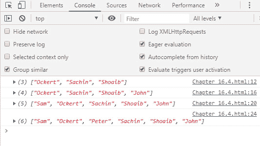

**图 16.3:** 添加数组元素

初始数组包含三个项。John 被添加到末尾，然后 Sam 被添加到数组的开头。最后，Peter 被添加到中间。删除项的操作也类似，让我们来看

# 从数组中移除项

数组在从它们中移除项时也同样多功能。你可以从数组的开头和末尾删除项。你还可以从数组的中间删除项。

为了从数组的末尾删除一个项，你需要使用 `pop()` 方法。让我们实际操作一下：

1.  打开你喜欢的文本编辑器，并输入以下 HTML 和 JavaScript 代码：

```html
<html>
<body>
<h1>Removing Array elements</h1>
<p> Removing Array elements</p>
<script>
let arrStudents = ["Ockert", "Sachin", "Shoaib"];
console.log(arrStudents);
arrStudents.pop();
console.log(arrStudents);
</script>
</body>
</html>
```

2.  用 HTML 扩展保存文件，例如 `Chapter 16.5.html`。

3.  双击文件在默认浏览器中打开。

4.  在 Google Chrome 中按 `Ctrl` + `Shift` + `J` 或 `F12` 打开控制台窗口。

结果数组显示在如下所示：

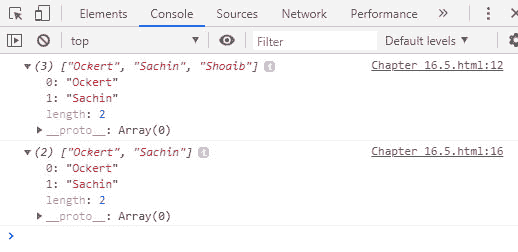

**图 16.4:** 在数组末尾移除项

初始数组包含三个元素，现在只剩下两个。这是由于 `pop()` 方法删除了数组的最后一个项 (`Shoaib`)。现在让我们从前面和中间移除项

为了从数组的开头移除一个项，你需要使用 `shift` 方法。使用 `splice` 方法从中间移除项：

1.  打开你喜欢的文本编辑器，并输入以下 HTML 和 JavaScript 代码：

```html
<html>
<body>
<h1>Adding Array elements</h1>
<p>Adding Array elements</p>
<script>
let arrStudents = ["Ockert", "Sachin", "Shoaib"];
console.log(arrStudents);
arrStudents.push("John");
console.log(arrStudents);
arrStudents.unshift("Sam");
console.log(arrStudents);
arrStudents.splice(2, 0, "Peter");
console.log(arrStudents);
</script>
</body>
</html>
```

2.  用 HTML 扩展保存文件，例如 `Chapter 16.4.html`。

3.  双击文件在默认浏览器中打开。

4.  在 Google Chrome 中按 `Ctrl` + `Shift` + `J` 或 `F12` 打开控制台窗口。

输出下所示：


**图 16.3:** 添加数组元素

初始数组包含三个项。John 被添加到末尾，然后 Sam 被添加到数组的开头。最后，Peter 被添加到中间。删除项的操作也类似，让我们来看

# 多维数组

数组在从它们中移除项时也同样多功能。你可以从数组的开头和末尾删除项。你还可以从数组的中间删除项。

为了解释这个，或者至少更清晰一点，让我们快速做个练习：我们一直在处理一维数组，但现在谈谈多维数组。

1.  打开你喜欢的文本编辑器，并输入以下 HTML 和 JavaScript 代码：

```html
<html>
<body>
<h1>Multidimensional Array</h1>
<p>Multidimensional Array</p>
<script>
var emp1 = ["Ockert", 15, 25000];
var emp2 = ["Jack", 30, 50000];
var emp3 = ["Joseph", 45, 75000];
var emp4 = ["William", 60, 100000];
var emp5 = ["Paul", 75, 125000];
var salaries = [emp1, emp2, emp3, emp4, emp5];
for(var i = 0; i < salaries.length; i++) {
document.write(salaries[i] + "</br>");
}
</script>
</body>
</html>
```

2.  用 HTML 扩展保存文件，例如 `Chapter 16.7.html`。

3.  双击文件在默认浏览器中打开。

4.  在 Google Chrome 中按 `Ctrl` + `Shift` + `J` 或 `F12` 打开控制台窗口。

写入页面的文本如下所示：

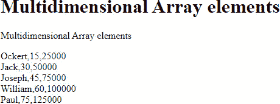

**图 16.6:** 多维数组

创建了五个数组。每个包含一个字符串值和两个数值。然后创建了另一个数组，它包含了五个数组，因此变成了多维。最后，使用 `for` 循环遍历数组，并将其打印到页面上，如所示。

# 总结

在本章中，我们学习了如何使用数组。你学习了如何从数组中移除项以及向数组中添加项。你还学习了什么是多维数组。

在下一章中，我们将介绍 JavaScript 中的正则表达式。

# 问题

1.  定义数组术。

2.  `shift` 方法的作用是什么？

3.  举例使用 `splice` 移除数组项的例子。

4.  什么是多维数组？

5.  `pop` 方法的作用是什么？

在字符串中搜索文本可能是困难的，特别是当你只知道字符串中短语的一部分时。幸运的是，JavaScript 包含了正则表达式。正则表达式帮助你通过特殊字符和模式的组合来识别文本部分。

在本节中，你将学习如何使用正则表达式来识别特定的文本片段。

## 结构

*   正则表达式定义

*   正则表达式修饰符/标志（flags）

*   正则表达式模式

## 目标

*   了解正则表达式。

*   了解如何使用修饰符/标志来改进搜索结果。

*   利用模式搜索文本或短语。

## 正则表达式定义

`JavaScript` 中的正则表达式是用于匹配字符串中各种字符组合的模式。这些字符序列形成搜索模式，可以用于搜索字符串内部的文本以及替换字符串中的文本。它可以是一个单个字符，也可以是一个更复杂的模式。

正则表达式可以通过以下两种方式之一构建：

*   使用正则表达式字面量（regular expression literal）

*   调用 `RegExp` 对象的构造函数。

让我们进入更多细节。

## 使用正则表达式字面量

正则表达式字面量由包含在斜杠之间的模式组成，例如：

```javascript
let exp = /ab+c/;
```

正则表达式字面量有助于正则表达式在脚本加载时被编译。如果一个正则表达式保持不变，使用正则表达式字面量可以提高性能。

## 调用 RegExp 对象的构造函数

你通过使用关键字 `new`（在 `第 2 章：JavaScript 对象` 中已解释）来调用 `RegExp` 对象的构造函数，例如：

```javascript
let exp = new RegExp('ab+c');
```

当你知道正则表达式模式可能会发生，或者你不知道模式并正在从其他来源获取它时，这种方法是最好的。

正则表达式模式可以由简单字符组成，例如 `/xyz/`，也可以由简单字符和特殊字符组合，例如 `/xy*z/` 或 `/Student Number (\d+)\.\d*/`。稍后我会详细介绍模式。现在，让我们来看正则表达式的修饰符。

## 正则表达式修饰符/标志

所有的正则表达式都可以包含影响搜索的修饰符或标志。`JavaScript` 有 6 个标志，如下表所示：

| 修饰符 | 描述 |
| :--- | :--- |
| `i` | 不区分大小写的搜索 |
| `g` | 搜索所有匹配项 |
| `m` | 多行模式 |
| `s` | 启用点全模式（dotall） |
| `u` | 启用全 Unicode 支持 |
| `y` | 粘性模式（Sticky mode）。在精确位置搜索 |

**表 17.1:** 正则表达式标志

正则表达式显然有很多需要学习的，但我觉得我们可以做一个快速练习，将我们目前所学的内容整合在一起。

这个练习利用了上述标志和 `match` 方法（字符串函数在 `第 12 章：变量` 中介绍过）来使用正则表达式查找某些文本。

1.  打开你选择的文本编辑器并输入以下 HTML 和 JavaScript 代码：

```html
<html>
<body>
    <h1>RegEx Example 1</h1>
    <p>RegEx Example 1</p>
    <script>
        let str = "Ob-La-Di, ob-la-da";
        document.write( str.match(/Ob/gi) + "</br>" );
        let result = str.match(/La/i);
        document.write( result[0] + "</br>" );
        document.write( result.length + "</br>" );
        // Details:
        document.write( result.index + "</br>" );
        document.write( result.input + "</br>" );
        try {
            let matches = str.match(/JavaScript/);
            if (!matches.length) {
            }
        } catch(err) {
            document.write("Error in the line above");
        }
    </script>
</body>
</html>
```

2.  用 HTML 扩展保存文件，例如 `Chapter 17.1.html`。

3.  双击文件在默认浏览器中打开它。

上述代码的输出显示如下所示：

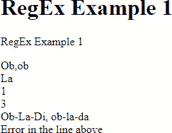

**图 17.1:** `string.match` 正则表达式

我首先创建一个包含 `Ob-La-Di, ob-la-da` 的字符串。这是一首 1968 年发行的披头士老歌，仍然是经典。无论如何，然后我使用了字符串的 `match` 方法来搜索术语 `Ob`。因为我提供了 `g` 和 `i` 修饰符，它忽略字符串中的大小写搜索了所有的 `Ob` 实例。

接下来，我创建名为 `results` 的变量，它将是正则表达式搜索 `La` 的结果。注意我在这里没有包含 `g` 标志，所以只会找到第一个实例。它的索引是。最后，我包含了 `try` 和 `catch` 块来演示当没有匹配项时该做什么。

## 正则表达式模式

正则表达式模式可以由简单字符组成，例如 `/xyz/`，也可以由简单字符和特殊字符组合，例如 `/xy*z/` 或 `/Student Number (\d+)\.\d*/`。以下是你可以使用的特殊字符列表：

| 字符 | 描述 |
| :--- | :--- |
| `\` | 当反斜杠位于字符之前，表示该字符是特殊的且不进行解释 |
| `^` | 匹配输入的开头 |
| `$` | 匹配输入的结尾 |
| `*` | 匹配前面的表达式 0 次或多次 |
| `+` | 匹配前面的表达式 1 次或多次 |
| `?` | 匹配前面的表达式 0 次或 1 次 |
| `.` | 匹配除换行符以外的单个字符 |
| `(x)` | 匹配 `x` 并记录结果 |
| `(?:x)` | 匹配 `x` 但不记录结果 |
| `x(?=y)` | 仅当 `x` 后面跟着 `y` 时匹配 `x` |
| `x(?!y)` | 仅当 `x` 后面不是 `y` 时匹配 `x` |
| `(?<=y)x` | 仅当 `x` 前面是 `y` 时匹配 `x` |
| `(?<!y)x` | 仅当 `x` 前面不是 `y` 时匹配 `x` |
| `x|y` | 匹配 `x` 或 `y`（当没有匹配到 `x` 时） |
| `{n}` | 匹配表达式 `n` 次 |
| `{n,}` | 匹配前面的表达式至少 `n` 次 |
| `{n,m}` | 匹配前面的表达式至少 `n` 次最多 `m` 次 |
| `[xyz]` | 匹配括号内的任意一个字符 |
| `[^xyz]` | 匹配不在括号内的任意内容 |
| `[\b]` | 匹配退格符 |
| `\b` | 匹配单词字符与非单词字符之间的边界 |
| `\B` | 匹配以下位置：<br>* 字符串第一个字符之前<br>* 字符串最后一个字符之后<br>* 两个单词字符之间<br>* 两个非单词字符之间<br>* 空字符串。 |
| `\cX` | 匹配字符串中的控制字符 |
| `\d` | 匹配数字字符 |
| `\D` | 匹配非数字字符 |
| `\f` | 匹配分页符 |
| `\n` | 匹配换行符 |
| `\r` | 匹配回车符 |
| `\s` | 匹配空白字符 |
| `\S` | 匹配非空白字符的字符 |
| `\t` | 匹配制表符 |
| `\v` | 匹配垂直制表符 |
| `\w` | 匹配任何字母数字字符 |
| `\W` | 匹配任何非单词字符 |
| `\0` | 匹配 NULL 字符 |
| `\xhh` | 匹配代码为 `hh` 的字符（两个十六进制数字） |
| `\uhhhh` | 匹配代码为 `hhhh` 的字符（四个十六进制数字） |

**表 17.2:** 特殊字符模式

让我们来做个快速练习吧！

1. 打开你任选的文本编辑器，并输入以下 HTML 和 JavaScript 代码：

```html
<html><body><h1>RegEx Example 2</h1><p>RegEx Example 2</p><script>
var Num = /^\d{10}$/;
console.log(Num.test('7795483645'));
var Dt = /^(\d{1,2}-){2}\d{2}(\d{2})?$/;
console.log(Dt.test('01-01-1990'));
console.log(Dt.test('01-01-90'));
var Txt = /^(.{3}\.){3}.{3}$/;
console.log(Txt.test('abc.def.123.456'));
console.log(Txt.test('abc.def.ghi.jkl'));
</script></body></html>
```

2. 以 HTML 扩展名保存文件，例如 `Chapter 17.2.html`。

3. 双击该文件在默认浏览器中打开。

4. 在 Google Chrome 中按 `Ctrl` + `Shift` + `F12` 打开控制台窗口。

这看起来非常复杂！其实其实不是。让我来拆解一下。

* 变量 `Num` 包含一个正则表达式模式。

    * 在此模式中，你通过在开头包含 `^` 在字符串结尾包含 `$` 来确保匹配跨越整个字符串。

    * 表达式中的 `\d` 匹配数字。

    * `{10}` 精确匹配前一个表达式 10 次。

* 变量 `Dt` 也以 `^` 开头并以 `$` 结尾，以便查看整个字符串。

    * 第一个左括号开始第一个子表达式。

    * `\d{1,2}` 匹配 1 个数字，但最多可以有 2 个数字。

    * 匹配一个连字符 `-`。

    * 右括号结束第一个子表达式。

    * `{2}` 将第一个子表达式匹配 2 次。

* 变量 `Txt` 仅允许由四个三字母组组成的字符串输入，每组之间由点隔开。

在每个表达式中，都使用了 `test` 方法。该方法将返回 `true` 或 `false`，取决于表达式是否匹配成功。

结果如如下截图所示：

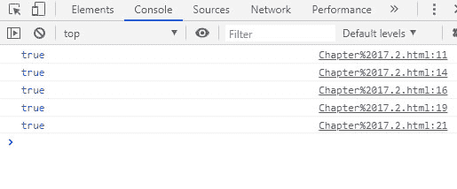

**图 17.2:** 运行中的正则表达式

所有测试均成功。

让我们再做另一个练习，确保你理解了这些概念。

1. 打开你任选的文本编辑器，并输入以下 HTML 和 JavaScript 代码：

```html
<html><body><h1>RegEx Example 3</h1><p>RegEx Example 3</p><script>
var regex1 = /lo{2}t/;
console.log(regex1.test('loot'));
console.log(regex1.test('lot'));
var regex2 = /[hm]ail/;
console.log(regex2.test('hail'));
console.log(regex2.test('mail'));
console.log(regex2.test('nail'));
var regex3 = /\d+/;
console.log(regex3.test('7'));
console.log(regex3.test('77845'));
console.log(regex3.test('77777723'));
var regex4 = /(green|red) apple/;
console.log(regex4.test('green apple'));
console.log(regex4.test('red apple'));
console.log(regex4.test('orange apple'));
</script></body></html>
```

2. 以 HTML 扩展名保存文件，例如 `Chapter 17.3.html`。

3. 双击该文件在默认浏览器中打开。

4. 在 Google Chrome 中按 `Ctrl` + `Shift`+ `J` 或 `F12` 打开控制台窗口。

[图 17.3] 显示了测试结果：

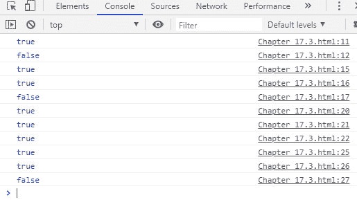

**图 17.3:** 更多的正则表达式测试

让我们来看看这里测试了什么。第一个对象 `regex1` 测试了两个单词：`loot` 和 `lot`。`loot` 成功了，但 `lot` 没有。为什么？因为你指定了在结尾的 `t` 之前需要 2 个字符。

对象 `regex2` 在测试 `hail` 和 `mail` 时成功，但测试 `nail` 时失败。这是因为正则表达式模式中没有指定字符 `n`。它只指定了 `h` 和 `m`。

`regex3` 的所有测试都成功，因为它们都包含至少一个数字。

`regex4` 测试 `green apple` 或 `red apple`。当提供文本 `orange apple` 时，它失败了。

## 结论

在本章中，我们学习了什么是正则表达式，以及在搜索文本或验证文本时如何有效地使用它们。这是一项重要的技能，但幸运的是，一旦你掌握了修饰符和模式，它并不复杂。

下一章是*高级概念* 部分的最后一章。你将再次回顾函数，然后深入研究柯里化（currying）和偏函数（partials）。

## 问题

1. 定义正则表达式术语。

2. 写出构造正则表达式的两种方法。

3. 写出三个正则表达式标志。

# 第 18 章

## 偏函数与柯里化

## 引言

JavaScript 函数可以变得更加简单，并在需要时自定义以使用特定参数。

在本节中，你将学习普通 JavaScript 函数、偏函数和柯里化之间的区别。

## 结构

* 偏函数

* 柯里化

## 目标

* 理解偏函数应用函数式编程概念。

* 理解柯里化函数式编程概念。

## 偏函数

偏函数或偏应用在不真正完全求值函数的情况下，固定函数的几个参数的值。这会产生另一个参数较少的函数，随着函数链的进行，将值绑定到一个或多个参数上。

JavaScript 包含一个名为 `bind` 的内置方法，它可以作用于任意数量参数的函数并绑定任意数量参数。

要调用 `bind` 方法，请使用以下语法：

`function.prototype.bind(thisValue, [argument1], [argument2], …)`

`bind` 方法将函数转换为新函数，其隐式的 `this` 参数为该值，且初始参数始终如给定的那样。

为了更好地理解偏函数的概念，让我们做一个实际练习，并像往常逐个拆解它。

1. 打开你任选的文本编辑器，并输入以下 HTML 和 JavaScript 代码：

```html
<html><body><h1>Partials Example</h1><p>Partials Example</p><script>
function add (x, y) {
return x + y;
}
function double (num) {
return add(2, num);
}
function addAgain (x, y) {
return x + y;
}
var doubleAgain = addAgain.bind(null, 2);
console.log(double);
console.log(doubleAgain);
</script></body></html>
```

2. 以 HTML 扩展名保存文件，例如 `Chapter 18.1.html`。

3. 双击该文件在默认浏览器中打开。

4. 如果浏览器是 Google Chrome，按 `Ctrl` + `Shift` + `J` 打开控制台窗口。

上述代码的输出如下所示所示：

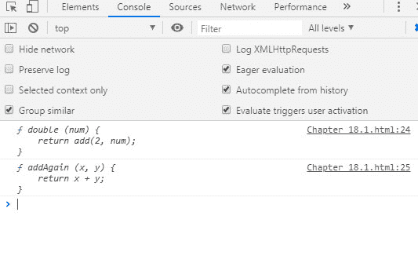

**图 18.1:** 偏函数绑定示例

函数 `add` 是 JavaScript 中调用和使用函数的普通方式。函数 `addAgain` 展示了绑定的实际应用。你可以看到，并不是所有的参数都提供了值，但 JavaScript 编译器完全没有抱怨。

让我们做一个更复杂的例子。

1. 打开你任选的文本编辑器，并输入以下 HTML 和 JavaScript 代码：

```javascript
function addStudent(fullName, age, course) {
    var message = '"' + fullName + ', ' + age + '," ' +
    course + ' added to database.';
    console.log(message);
}
var student_1 = addStudent.bind(null, "Ockert");
student_1(41, "JavaScript");
var student_2 = addStudent.bind(null, "du Preez", 41, "JavaScript");
student_2();
```

2. 以 HTML 扩展名保存文件，例如 `Chapter 18.2.html`。

3. 双击该文件在默认浏览器中打开它。

4. 如果浏览器是 Google Chrome，按下 `Ctrl` + `Shift` + `J` 打开控制台窗口。

输出如截图所示：

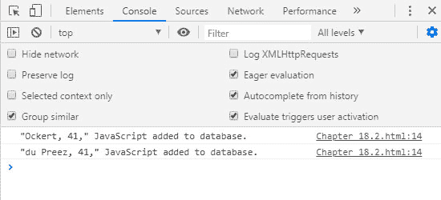

**图 18.2：** 复杂函数的 `bind` 示例。

原始函数 `addStudent` 包含三个参数：`fullName`、`age` 和 `course`。传递给此函数的任何内容都会带有友好的消息打印在控制台窗口中。`student_1` 变量通过提供一个值绑定到 `addStudent` 函数。在下一行中，另外两个参数值被提供给绑定函数。`student_2` 也绑定到了 `addStudent` 函数，但提供了一个额外的参数。

让我们来看一个更复杂的例子。

1.  打开你任选的文本编辑器并输入以下 HTML 和 JavaScript 代码：

```html
<html>
<body>
<h1>Partials Example</h1>
<p>Partials Example</p>
<script>
function listArgs() {
    return Array.prototype.slice.call(arguments);
}
function add(arg1, arg2) {
    return arg1 + arg2
}
var list_1 = listArgs(1, 2, 3);
var result_1 = add(1, 2);
var list_2 = listArgs.bind(null, 41);
var list_3 = add.bind(null, 41);
var list_4 = list_2();
var list_5 = list_2(1, 2, 3);
var result_2 = list_3(5);
var result_3 = list_3(5, 10);
console.log(list_1);
console.log(list_2);
console.log(list_3);
console.log(list_4);
console.log(list_5);
console.log(result_1);
console.log(result_2);
console.log(result_3);
</script>
</body>
</html>
```

2. 以 HTML 扩展名保存文件，例如 `Chapter 18.3.html`。

3. 双击该文件在默认浏览器中打开它。

4. 如果浏览器是 Google Chrome，按下 `Ctrl` + `Shift` + `J` 打开控制台窗口。

输出如截图所示：

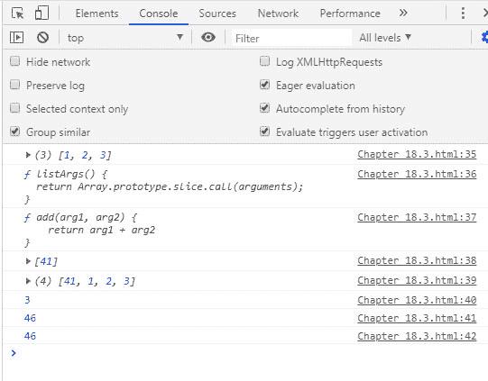

**图 18.3：** 数组与函数绑定

## 柯里化 (Currying)

柯里化将一个具有多个参数的函数转换为嵌套函数的序列。它会持续返回一个新函数，该函数接收当前参数，直到所有参数耗尽。

这是一个简单的示例。

1.  打开你任选的文本编辑器并输入以下 HTML 和 JavaScript 代码：

```html
<html>
<body>
<h1>Currying Example</h1>
<p>Currying Example</p>
<script>
function add_1(a, b, c) {
    return a + b + c;
}
function add_2(a) {
    return (b) => {
        return (c) => {
            return a + b + c
        }
    }
}
console.log(add_1(2,4,6));
console.log(add_2(1)(2)(3))
</script>
</body>
</html>
```

2. 以 HTML 扩展名保存文件，例如 `Chapter 18.4.html`。

3. 双击该文件在默认浏览器中打开它。

4. 如果浏览器是 Google Chrome，按下 `Ctrl` + `Shift` + `J` 打开控制台窗口。

上述代码的输出如截图所示：

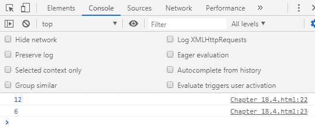

**图 18.4：** 柯里化示例

第一个函数 `add_1` 是一个普通的 JavaScript 函数，并会被输出到控制台。函数 `adds_2` 是柯里化的示例。它将函数拆分为多个函数，每个函数接受一个参数。在这种情况下，有 3 个参数，因此会有 3 个内联函数。

## 总结

在 *AdvancedConcepts* 章节的最后一个章节中，我们学习了如何在 JavaScript 中使用函数式编程特性。你学习了如何利用部分应用（partial applications）来根据需求操纵函数的参数。最后，你看到了柯里化是如何使用内联函数的。

在接下来的最后一个章节中，我们将向你介绍各种基于 JavaScript 的语言和语言变体，如 AJAX、jQuery 和 JSON。

## 问题

1. 定义部分应用（partials）这一术语。

2. 什么是柯里化？

# 第 V 部分

## JAVASCRIPT 与朋友

# 第 19 章

## JavaScript 与其他语言

## 引言

JavaScript 已经存在了很久，而且还将存在更久。像任何编程语言一样，它影响了许多不同的语言。

在本节中，你将学习如何将 JavaScript 与 AJAX、jQuery 和 JSON 结合使用。在课程后面的部分，你将快速了解受 JavaScript 影响的语言，如 TypeScript、ActionScript 和 CoffeeScript。

## 结构

*   jQuery 和 JavaScript

*   JSON 和 JavaScript

*   AJAX 和 JavaScript

*   基于 JavaScript 或受 JavaScript 影响的语言

## 目标

*   理解什么是 jQuery 以及如何使用。

*   理解什么是 JSON 和 AJAX 以及如何在 JavaScript 中使用它们。

*   了解 ActionScript、CoffeeScript 和 TypeScript 如何工作。

## 其他语言

在整书中，你一直结合 HTML 使用 JavaScript，因为 HTML 是任何网页的基础。如果你还记得，在[第 1 章：JavaScript 的威力概述及其目的] 中，我提到过 JavaScript 的历史。另一种语言如 `CSS`（**层联样式表**）也让人联，它是任何网页都无法实现的语言。但是，世界上有很多语言。

## jQuery 和 JavaScript

jQuery 由 *John Resig* 于 2006 年创立。jQuery 是一个跨平台的 JavaScript 库。它是封装在一起的 JavaScript 代码集合，比 JavaScript 更快、更容易地访问。它的主要用途是简化 HTML DOM 的遍历和操作，外加事件处理、CSS 动画和 AJAX（稍后我会谈论 AJAX）。jQuery 还提供了在 JavaScript 库之上创建插件的能力。

JavaScript 和 jQuery 之间的一些重要区别下表所示：

| JavaScript | jQuery |
| :--- | :--- |
| 弱类型动态语言。 | 丰富且轻级的 JavaScript 库。 |
| 从头开始编写所有代码。 | 包含预定义的函数。 |
| 开发者在开发时必须考虑浏览器兼容性。 | jQuery 是跨浏览器兼容的。 |
| 运行 JavaScript 不需要额外的插件。 | 网页必须包含 jQuery 库脚本链接。 |
| 代码行长。 | 代码更少。 |
| 学习困难。 | 相对容易学习。 |

**表 19.1：** JavaScript 对比 jQuery

让我们通过几个练习快速查看代码编写上的差异。

1.  打开你任选的文本编辑器并输入以下 HTML 和 JavaScript 代码：

```html
<html
<head>
<script src= "https://ajax.googleapis.com/ajax/libs/jquery/3.4.1/jquery.min.js"></script>
</head>
<body>
<h1>jQuery versus JavaScript 1</h1>
<p>jQuery versus JavaScript 1</p>
<input id="button1" type="button" value="click Me!" //>
<script>
$('#button1').click(function() {
    alert("BpB");
});
</script>
</body>
</html>
```

2. 以 HTML 扩展名保存文件，例如 `Chapter 19.1.html`。

3. 双击文件在默认浏览器中打开它。

本次练习的第一部分演示了 jQuery 的处理方式；现在，让我们用纯 JavaScript 实现相同的功能。

1. 打开你选择的文本编辑器，并输入以下 HTML 和 JavaScript 代码：

```html
<html>
<body>
<h1>jQuery versus JavaScript 2</h1>
<p>jQuery versus JavaScript 2</p>
<input id="button1" type="button" value="click Me!"/>
<script>
document.getElementById("button1").addEventListener('click', function(){
alert("BpB");
});
</script>
</body>
</html>
```

2. 以 HTML 扩展名保存文件，例如 `Chapter 19.2.html`。

3. 双击文件在默认浏览器中打开它。上述上述两个练习执行的是相同的操作。第一个是用 jQuery 实现的，第二个是使用 JavaScript 实现的。通过打开上述练习中的任何一个，你将在下方看到一个类似于图 19.1 的屏幕：

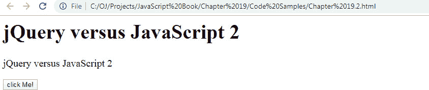

**图 19.1：** jQuery 与 JavaScript

让我们来看代码。考虑到这只是演示 JavaScript 和 jQuery 之间差异的小示例，这两个练习的代码都相对很少。让我解释一下关键。

在之前的第一个程序中，你写了以下代码：

```html
<head>
<script src= "https://ajax.googleapis.com/ajax/libs/jquery/3.4.1/jquery.min.js">
</script>
</head>
```

这段代码将 jQuery 库导入到你的页面。因为你将其放在 HTML 文档的 head 部分，它是完整页面的一部分，库中的方法会在其他任何内容之前加载。在 JavaScript 中，你不需要包含特殊的库来完成当前的任务（在本例中）。

然后，你创建了一个普通的输入按钮并执行了以下操作：

```javascript
<script>
$('#button1').click(function() {
alert("BpB");
});
</script>
```

为按钮绑定了一个点击事件处理器，显示一个带有文本 `BpB` 的警报框。非常简单且非常高效。

在之前的第二个程序中，你不需要导入库。你也创建了一个按钮输入并执行了以下操作：

```javascript
<script>
document.getElementById("button1").addEventListener('click', function(){
alert("BpB");
});
</script>
```

你首先必须通过 `getElementById` 方法获取名为 `button1` 的对象。之后，你必须通过添加一个监听事件的监听器手动为按钮绑定事件处理器。这也会显示一个带有文本 `BpB` 的警报框。

## JSON 和 JavaScript

**JSON** 代表 **JavaScript 对象表示法**。它实际上并不是完全不同的编程语言，但许多初学者会混淆 JSON 和 JavaScript。JSON 是一种用于存储和传输数据的轻量级格式。它是自描述的，主要用于从服务器向网页发送数据。

如果你看这个名字，你会看到 JavaScript Object Notation，那么 JavaScript 对象和 JSON 之间的真实区别是什么？让我来回答。

### JavaScript 对象

对象是拥有属性和方法的实体。属性描述对象。方法是该对象可以执行的操作。基本上，JavaScript 中的一切万物都可以是对象。除了原始类型外，所有的 JavaScript 值都是对象。在详细介绍内置对象之前，让我们快速探索一下原始类型。

### Object 数据类型

对象也是变量，但与原始类型不同，对象可以在其中存储多个值。对象存储键值对的数据集合和复杂实体。对象内部的信息以键值对的形式存储。键通常是属性名。值是该属性的值，例如：

```javascript
var objStudent = {
Name : "Ockert",
Course : "JavaScript",
Year : 2019
};
```

在上面的代码段中，创建了一个名为 `objStudent` 的新 JavaScript 对象。`objStudent` 包含三个属性，即 `Name`、`Course` 和 `Year`。

### 创建 JavaScript 对象

现在我们对对象有了更多了解，让我们来看看如何创建它们。可以使用以下任何一种方式创建对象：

*   对象字面量语法
*   `new` 关键字
*   `Object.create()`
*   `Object.assign()`
*   ES6 类

让我逐一解释它们。

### 对象字面量语法

这种方法非常易理解且执行速度快。这是一个示例：

```javascript
var objCar = {
make : "BMW",
model : "i8 Roadster",
price : 2329300
};
```

这个示例看起来可能非常熟悉。如果你仔细查看“Object 数据类型”部分中之前的代码段，你会发现这两个代码示例具有相同的相似之处。`var` 关键字创建了对象。大括号包含用冒号分隔的属性和值，每个属性之间用逗号分隔。

现在创建的对象名为 `objCar`。它包含 make、model 和 price 属性。为了使用 `objCar` 对象，你可以编写如下的语句：

```javascript
console.log(objCar); // 输出 {make: "BMW", model: "i8 Roadster", price: "2329300"}
console.log(objCar.make); // 输出 BMW
console.log(objCar.model); // 输出 i8 Roadster
console.log(objCar.price); // 输出 2329300
```

### new 关键字

使用 `new` 关键字创建对象类似于在基于类的语言（如 C# 或 Java）中创建对象。使用 `new` 关键字创建对象有两种方法：

*   **配合内置 Object 构造函数使用**：在基于类的面向对象编程中，构造函数是一种用于创建对象的特殊子程序。构造函数通过初始化对象的成员为使用做好准备。创建一个新对象，你必须配合 `Object()` 构造函数使用 `new` 关键字：

```javascript
var house = new Object();
```

这创建并初始化了一个名为 `house` 的新对象。我们可以通过如下代码为该对象添加属性：

```javascript
house.bedrooms = 4;
house.bathrooms = 2;
house.garages = 2;
house.hasSwimmingPool = false;
house.hasOutsideWalls = true;
```

可见，为使用 `Object()` 构造函数创建的对象创建属性可能会变成一项相当繁琐的任务，并且涉及大量输入。我们上面创建的 house 对象拥有卧室属性、浴室、车库属性，以及指示是否存在游泳池或外墙的布尔属性。

如果我们需要创建成百个 house 对象怎么办？让我们看看如何通过使用自定义构造函数让这些代码更短一点。

*   **配合自定义构造函数使用**：在创建自定义构造函数时，你基本上是为对象的属性和方法创建了一个模板。你只需要创建一次函数，然后只需传递必要的属性，而不是像之前在“配合内置 Object 构造函数使用”部分所示那样手动输入每个属性和每个设置。

让我们再次以 house 对象为示例创建一个自定义构造函数：

```javascript
function House(_bed, _bath, _garage, _pool, _walls) {
this.bedRooms = _bed;
this.bathRooms = _bath;
this.garages = _garage;
this.hasSwimmingPool = _pool;
this.hasOutsideWalls = _walls;
}
```

构造函数的名称为 `House`。在括号内有五个参数：（`_bed`、`_bath`、`_garage`、`_pool` 和 `_walls`）。这些参数将用于向 `House` 函数传递信息。在构造函数内部，每个属性都将被设置为其对应的参数。记住，这仅仅是一个模板，目前还没有任何值。

现在我们已经有了构造函数，基于它创建对象就很简单了。方法如下：

```javascript
var houseOne = new House(4, 2, 2, false, true);
var houseTwo = new House(3, 1, 1, true, false);
```

上面的 `houseOne` 变量是一个新的 `House` 对象。它有 4 卧室、2 间浴室、2 个车库、没有游泳池且有外墙。相比之下，`houseTwo` 变量有 3 卧室、1 间浴室、1 个车库、一个游泳池，且没有外墙。

### 创建 JSON 对象

JSON 对象写在花括号内，并可以包含多个键/值对，如下所示：

```json
{"firstName":"Ockert", "lastName":"du Preez"
```

你可以更进一步，在一个 `Student` 对象中包含更多的 `firstName` 和 `lastName`，例如：

```json
{
  "Student":[
    {"firstName":"Ockert", "lastName":"du Preez"},
    {"firstName":"William", "lastName":"Shakespeare"},
    {"firstName":"Stephen", "lastName":"King"}
  ]
}
```

### 有效 JSON 的规则

以下内容在 JSON 格式中都是允许的：

-   空对象和空数组。
-   字符串可以包含任何 Unicode 字符。
-   Null 是一个有效的 JSON 值。
-   所有对象的属性应始终使用双引号。
-   数字值必须是十进制格式。
-   数组中不允许有尾随逗号。

让我们通过 JavaScript 对 JSON 编码和解码进行一个快速练习：

1.  打开你选择的文本编辑器，并输入以下 HTML 和 JavaScript 代码：

```html
<html>
<body>
    <h1>Encoding and Decoding JSON</h1>
    <p>Encoding and Decoding JSON</p>
    <script>
        const encodeData = {
            name: "Ockert du Preez",
            age: 41,
            title: "JavaScript Guru"
        }
        const encodeStr = JSON.stringify(encodeData);
        console.log(encodeStr);
        const decodeStr = '{
            "name":"Ockert du Preez",
            "age":41,
            "title":"JavaScript Guru"
        }';
        const decodeData = JSON.parse(decodeStr);
        console.log(decodeData.title);
    </script>
</body>
</html>
```

2.  以 HTML 扩展名保存文件，例如 `Chapter 19.3.html`。

3.  双击文件在默认浏览器中打开它。如果浏览器是 Google Chrome，按下 `Ctrl` + `Shift` + `J` 打开控制台窗口：

控制台窗口中的输出所示：

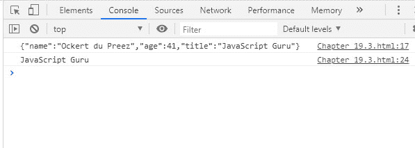

**图 19.2：** JSON 的编码与解码

让我分析一下这里发生了什么。

首先，创建了一个名为 `encodeData` 的 JavaScript 对象，并赋予了名称、年龄和标题等值。然后，一个名为 `encodeString` 的变量利用 `JSON` 中的 `stringify` 方法将 JavaScript 对象转换为 JSON 对象。

其次基本上是相反的。你提供了一个 JSON 对象给 `JSON` 的 `parse` 方法，以将其转换为普通的 JavaScript 对象。

## AJAX 和 JavaScript

AJAX 不是一种编程语言。AJAX 代表异步 JavaScript 和 XML，它利用了：

-   浏览器内置的 `XMLHttpRequest` 对象，用于从 Web 服务器请求数据。
-   JavaScript 和 HTML DOM，用于显示或使用这些数据。

AJAX 的强大之处在于它允许通过与后台 Web 服务器交换数据来异步更新网页页面，这意味着可以更新网页的部分内容而无需重新加载整个页面。

以下是 AJAX 工作原理的分解：在网页上发生了一个事件：

-   JavaScript 创建一个 `XMLHttpRequest` 对象。
-   `XMLHttpRequest` 对象向 Web 服务器发送请求。
-   服务器处理该请求。
-   服务器将响应返回给网页。
-   JavaScript 读取响应。
-   JavaScript 执行适当的操作。

下一个小练习将演示如何使用 JavaScript 和另一种名为 `PHP` 的脚本语言来使用 AJAX。PHP 是一种服务器脚本语言，因此请记住 `PHP` 文件必须存在于服务器上，练习才能完全运行：

1.  打开你选择的文本编辑器，并输入以下 HTML 和 JavaScript 代码：

```php
<?php
if(isset($_GET["studentFirstName"]) && isset($_GET["studentLastName"])) {
    $fname = htmlspecialchars($_GET["studentFirstName"]);
    $lname = htmlspecialchars($_GET["studentLastName"]);
    $studentFullName = $studentFirstName." ".$studentLastName;
    echo "Hello, $studentFullName! Welcome!";
} else {
    echo "Hi there, stranger! Welcome!";
}
?>
```

2.  以 HTML 扩展名保存文件，例如 `greet.php`。

3.  打开你选择的文本编辑器，并输入以下 HTML 和 JavaScript 代码：

```html
<!DOCTYPE html>
<head>
    <script>
        function showStudentName() {
            var request = new XMLHttpRequest();
            request.open("GET", "greet.php?studentFirstName=Ockert&studentLastName=du Preez");
            request.onreadystatechange = function() {
                if(this.readyState === 4 && this.status === 200) {
                    document.getElementById("result").innerHTML = this.responseText;
                }
            };
            request.send();
        }
    </script>
</head>
<body>
    <h1>AJAX Example</h1>
    <p>AJAX Example</p>
    <div id="result">
        <p>Result will be displayed here</p>
    </div>
    <button type="button" onclick="showStudentName()">Show Full Name</button>
</body>
</html>
```

4.  以 HTML 扩展名保存文件，例如 `Chapter 19.4.html`。

5.  双击文件在默认浏览器中打开。如所述，如果 PHP 文件保存在服务器上且一切设置正确，加载此文档时不会出现错误。

这里发生了什么？`greet.php` 是存在于服务器上的 PHP 文件。它测试 `studentFirstName` 和 `studentLastname` 字段是否包含信息。如果是，它们的值将分别存储在两个 PHP 变量对象 `fname` 和 `lname` 中。

`studentFullName` PHP 变量由空格分隔的 `fname` 和 `lname` 变量组成。如果提供了值，将出现一条用全名问候学生的消息；否则，将出现一条问候陌生人的消息。

在你创建的 `Chapter19.4html` 文件中，你创建了一个函数 `showStudentName`。该函数的作用是调用 `greet.php` 文件中的逻辑，组合给定的名和姓。如果函数执行成功，它将在名为 `result` 的 `div` 中显示全名。

### CoffeeScript

CoffeeScript 可编译为 JavaScript。CoffeeScript 添加了受 Ruby、Python 和 Haskell 启发的语法糖，以增强 JavaScript 的可读性。

假设你在 CoffeeScript 中有如下函数：

```javascript
add =(a,b) ->
c=a+b
console.log "Answer is: "+c
```

它在 JavaScript 中等价于：

```javascript
(function() {
  var add;
  add = function(a, b) {
    var c;
    c = a + b;
    return console.log("Answer is: " + c);
  };
}).call(this);
```

虽然 CoffeeScript 使用的代码较少，但理解起来可能会稍微困难。这两个函数本质上是相同的，即两个数字相加并提供答案。

### TypeScript

TypeScript 命令行编译器可以作为 Node.js 包安装，请访问以下 URL：

[`www.typescriptlang.org/index.html#download-links`](https://www.typescriptlang.org/index.html#download-links)

这里是一个如何在 TypeScript 中创建类的简短示例：

1. 打开你任的文本编辑器并输入以下代码：

   ```typescript
   class Car {
     make: String;
     model: String;
     doors: Number;
     isAutomatic: Boolean;
     constructor(make: make, model: String, doors: Number, isAutomatic: Boolean) {
       this.make = make;
       this.model = model;
       this.doors = doors;
       this.isAutomatic = isAutomatic;
     }
     make(): void {
       console.log('Car Make and model: ${this.make}, ${this.model}. Number of doors: ${this.doors}' );
     }
   }
   let newCar = new Car('Lamborghini', 'Aventador', 2, false);
   newCar.make();
   ```

2. 以指定的扩展名保存文件，例如 `Car.ts`。

由于 TypeScript 可以扩展 JavaScript 的功能，这看起来与普通的 JavaScript 类非常相似。

## 结论

在本章中，我们学习了如何使用 JavaScript 以及受其影响的其他变体和语言。jQuery、AJAX 和 JSON 都是足以独立成一本书的话题。你还看到了其他语言的样貌以及它们与 JavaScript 的对比。

## 问题

1. 什么是 jQuery？

2. 什么是 JSON？

3. 什么是 AJAX？

4. 列举两种受 JavaScript 影响的语言。

5. JavaScript 仍然很困难吗？
