# 面向人类的 JavaScript


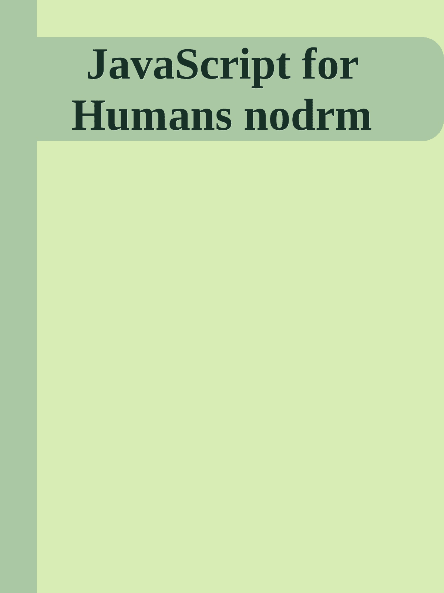


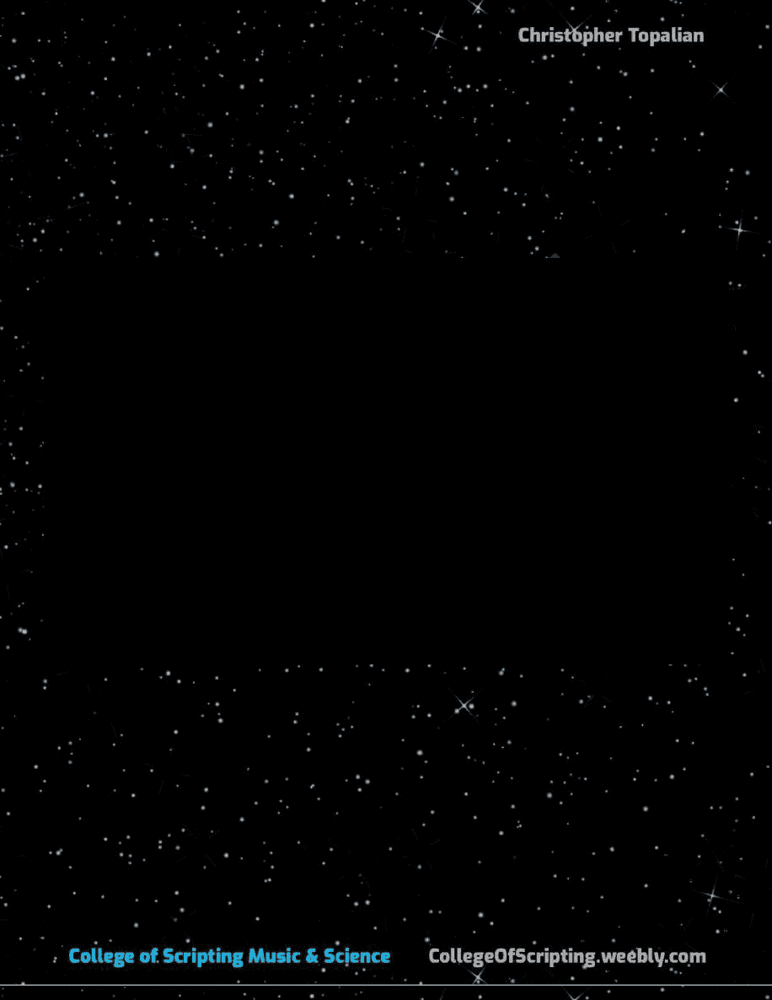

献给父神

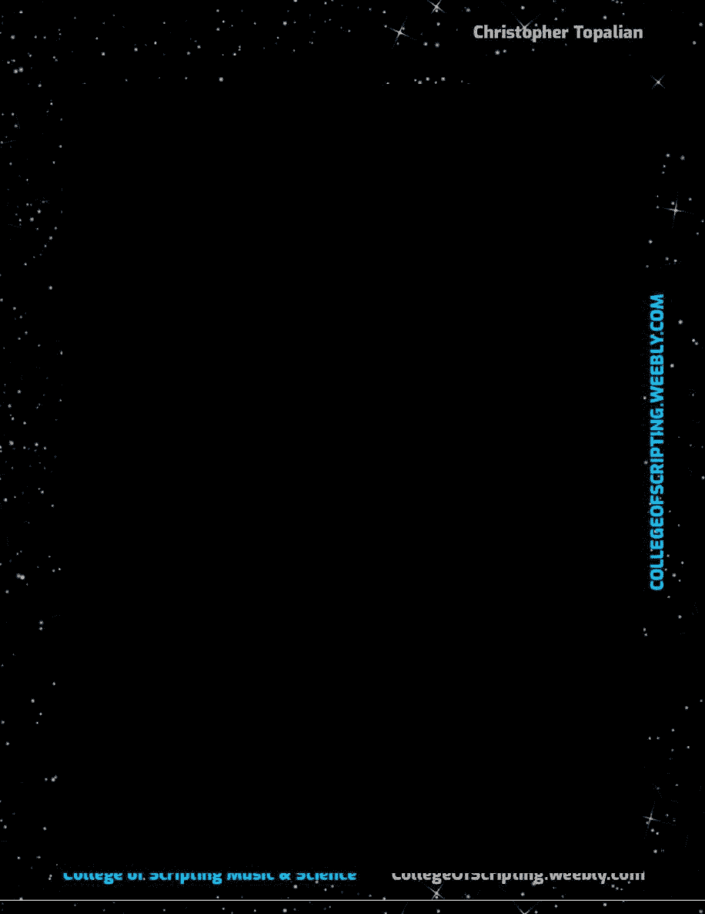


- [基础 JavaScript 教程.........................................89]
- [使用 location.href 确认....................................................90]

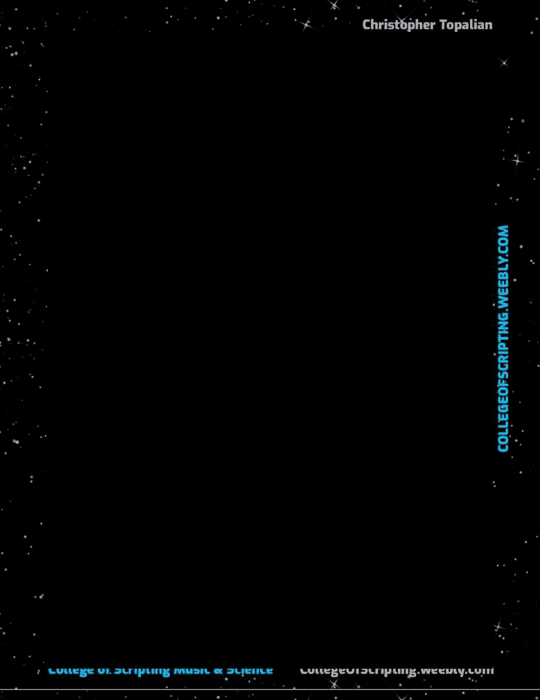

- [询问并显示名字...............................................................91]
- [简单的日期和时间.........................................................92]
- [do while prompt，输入名字..............................................93]
- [do while prompt，输入名字..............................................94]
- [do while 使用 and..............................................................96]
- [do while 使用 Not Or And...................................................97]
- [do while location.href..........................................................99]


- 下拉菜单................100
- 或者或昵称................102
- 查找单词, Cat................104
- if else 选择................105
- if else 选择................106
- navigator 获取信息................107
- 字符串长度................108
- window, 新窗口................109
- window, 新窗口, 与此相同................110
- 用户名 && 密码................111
- 使用不等于判断密码................112
- 测验问题数学................113
- 复选框................114
- 数组, 排序................116
- if 多条件................117
- 文本框值................119
- 输入名称, toLowerCase().................120
- 字符串拼接................121
- 字符串拼接 prompt................122
- while 倒计时................123
- while 递增................124
- 快速数学题................125
- 哪些队伍赢了？................126
- 将所有记录显示为 JSON................128
- 显示记录的循环和过滤................130
- 显示记录的循环和过滤................132

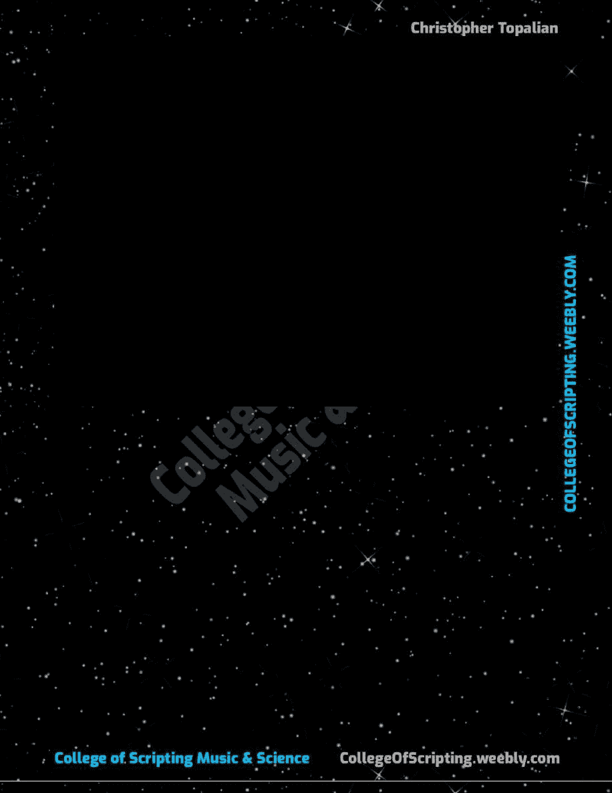

- 显示从...到的记录................134
- 显示记录................136
- 小时和分钟................138
- 日期、月份消息................140
- 小时消息................143
- 简单类................145
- 类................146
- 类继承, extends................148
- 类继承, extends person................152
- 转换, f 到 c................155
- 简单类, and this................157
- 键盘控制................158
- 键盘, 移动文本................160
- 保存为 timeGetTime.js................163
- 持续获取时间使用 timeGetTime.js................176
- 保存为 timeMessage.js................177
- 一天时间消息, 使用 timeMessage.js................179


# 创建新文件夹

我们的项目从创建一个**新文件夹**开始。

`ourProject` 文件夹将存放我们所有的 `js`、`html` 和 `css` 文件。

- 在**桌面**上**右键点击**并选择**新建文件夹** 
- 将该**文件夹****重命名**为

## `ourProject`

我们将在这个**文件夹**中**保存**我们所有的**文件**。


# 编辑器

我们可以从许多编辑器中选择编写 JavaScript，包括 Windows 自带的记事本，但记事本不如较新的替代方案。让我们来看看优秀且免费的 JavaScript 编辑器。

### VS CODE
https://code.visualstudio.com/

### ATOM
https://atom.io/

### BRACKETS
http://brackets.io/


### Sublime
https://www.sublimetext.com/

### Notepad++
https://notepad-plus-plus.org/downloads/

VS Code 是许多人的最爱。在我们下载并安装编辑器（如 VS Code）之后，我们将创建 `.html` 文件。

# 第一个 HTML 页面

```html
<html>
<head>
<title>我们的第一个页面</title>
</head>
<body>
我们在这里写任何内容
</body>
</html>
```

将此 `First.html` 文件保存到 `ourProject` 文件夹中。

# 第一个 HTML 页面 

```html
<html>
<head>
<title>我们的第一个页面</title>
</head>
<body>
我们在这里写任何内容
</body>
</html>
```

将此 `First.html` 文件保存到 `ourProject` 文件夹中。

# 第一个 HTML 页面 

```html
<html>
<head>
<title>我们的第一个页面</title>
</head>
<body>
我们在这里写任何内容
</body>
</html>
```

将此 `First.html` 文件保存到 `ourProject` 文件夹中。

# 在 HEAD 中定义的函数

```html
<html>
<head>
<title>我们的第一个页面</title>
</head>
<body>
我们在这里写任何内容
<script>
function ourMessage() {
  alert("Hi everyone");
}
</script>
</body>
</html>
```

将此 `First.html` 文件保存到 `ourProject` 文件夹中。

# 在 BODY 中定义的函数

```html
<html>
<head>
<title>我们的第一个页面</title>
</head>
<body>
我们在这里写任何内容
<script>
function ourMessage() {
  alert("Hi everyone");
}
</script>
</body>
</html>
```

将此 `First.html` 文件保存到 `ourProject` 文件夹中。

# 我们的函数就像三明治

```javascript
function ourMessage() {
  alert("Hi everyone");
}
```

正如我们在过去两页中中学到的；我们可以在 **head** 中**定义**我们的函数，也可以在 **body** 中定义。任何一种都是可以的。如上所示，我们的函数目前非常简单，作为消息代码的容器。


在 JavaScript 中，`functions`是由 `EVENTS`（事件）触发的。

我们有很多 `EVENT` 类型可以选择来激活我们的函数。


返回，简单

```html
<html><body>
<script>
function simple() {
  return "howdy";
}
alert(simple());
</script>
</body>
</html>
```


返回，简单，带参数

```html
<html>
<body>
<script>
function simple(yourMessage) {
  return yourMessage;
}
alert(simple("Hi Everyone"));
</script>
</body>
</html>
```


返回，简单，带参数

```html
<html>
<body>
<script>
function simple(yourMessage) {
  let greeting = "Hi there " + yourMessage;
  return yourMessage;
}
alert(simple("So good to see you"));
</script>
</body>
</html>
```


返回，简单，带参数

```html
<html>
<body>
<script>
function simple() {
  let person = prompt("Enter your Name?", "");
  let greeting = "Howdy " + person;
  return greeting;
}
alert(simple());
</script>
</body>
</html>
```


在 head 中函数并返回

```html
<html>
<head><title>使用 return 在 head 中编写函数</title>
<script>
function ourMessage() {
  return "Hi Everyone";
}
function showText() {
  document.write(ourMessage());
}
</script>
</head>
<body onload="showText();">
</body>
</html>
```


### 什么是 onload 事件？

`<body onload =ourMessage();">` `onload` 事件在页面上所有内容完成加载时`触发`。

因此，我们创建的名为 `ourMessage()` 的函数将在`页面加载完成`的瞬间被`激活`。`onload` 事件是我们可以选择的用于激活函数的众多事件之一。

现在让我们学习用不同的事件来触发我们的代码，例如当人员点击 `BUTTON`（按钮）时。


#### 我们按钮的 onclick 事件

```html
<html>
<head><title>按钮点击</title>
<script>
function ourFunction() {
  alert("Hi Everyone");
}
</script>
</head>
<body>
Push the Button <br>
<button onclick="ourFunction();">Enter</button>
<br>
</body>
</html>
```


#### 带计数器的按钮

```html
<html><head><title>按钮点击</title>
<script>
let theText = "Clicks";
let ourCounter = 0;
function ourFunction() {
  ourCounter += 1;
  document.getElementById("displayText").value = theText + ourCounter;
}
</script></head>
<body>
Push the Button <br>
<button onclick="ourFunction();">Enter</button>
<br>
<hr width ="200px" align="left">Message is Displayed Here <br>
<textarea id="displayText" rows="1"></textarea>
</body>
</html>
```

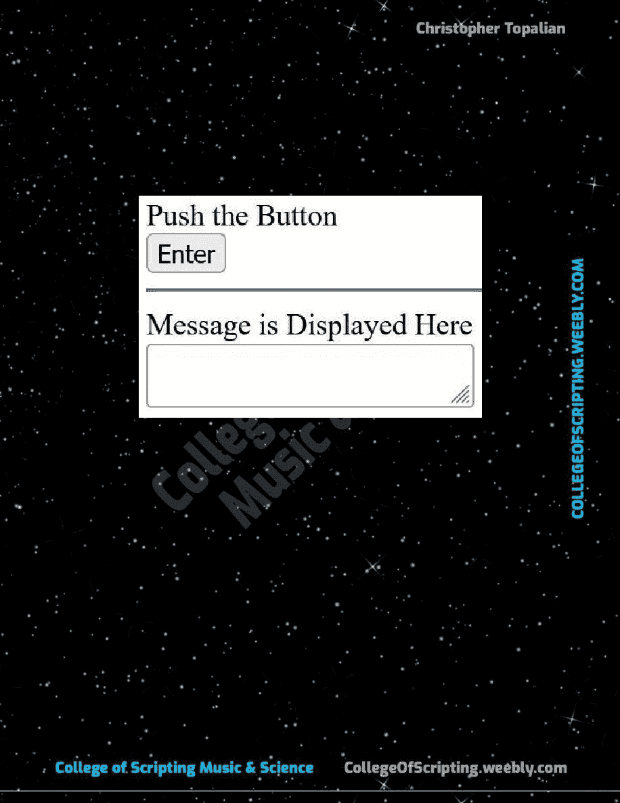

#### 询问并说名字

```html
<html
<head><title> 询问并说名字 </title></head>
<body>
<script>
let name = prompt("Enter your name","");
alert("Hi " + name);
</script>
</body>
</html>
```


#### 如果简单则提示

```html
<html><head><title>提示提示函数</title></head>
<body>
<script>
let name = prompt("Enter your name");
if (name == "chris") {
  document.write("Hi Chris");
}
</script>
</body>
</html>
```


#### 询问并说名字，如果名字是

```html
<html><head><title>询问，说名字，如果是人，否则</title></head>
<body>
<script>
let name = prompt("Enter your name","");
if (name == "chris") {
  alert("Hi " + name);
}
else {
  alert("Where is Chris?");
}
</script>
</body>
</html>
```


#### 输入一个数字，返回

```html
<html><head>
<script>
function askNumber() {
  let question = prompt("Enter a number","");
  return question;
}
function displayIt(where, whatFunction) {
  document.getElementById(where).innerHTML = whatFunction;
}
</script>
</head>
<body>
<button onclick="displayIt('div1', askNumber());"><h2>Enter Number</h2></button>
<div id="div1"></div>
</body>
</html>
```


#### 返回，绝对值

```html
<html><body><script>
function ourFunction() {
  let question = prompt("Enter a number","");
  let answer = Math.abs(question);
  return answer;
}
function showIt(where, whatFunction) {
  document.getElementById(where).innerHTML = whatFunction;
}
</script>
<button onclick="showIt('div1', ourFunction());"><h2>Absolute Value</h2></button>
<div id="div1"></div>
</body>
</html>
```


#### 使用 textarea 用户输入

```html
<html><head><title>用户输入</title>
<script>
function ourFunction() {
  let theText = document.getElementById("enteredText").value;
  document.getElementById("displayText").value = theText;
}
</script></head>
<body>
Enter Text Here <br>
<textarea id ="enteredText" rows="1"></textarea> <br>
<button onclick="ourFunction();">Enter</button> <br>
<hr width ="200px" align="left">Text Displayed Here <br>
<textarea id ="displayText" rows="1"></textarea>
</body>
</html>
```


### 如何设计应用

我们从代码开始吗？不。我们从大声说出想做什么开始。然后写下想要完成的每一件事。让我们一起设计一个界面。让我们先讨论一下。

我想以多种方式显示日期和时间。我想单独显示星期。我想单独显示月份。我想让日期时间和更新。


#### 获取日期星期

```html
<html><head><script>
function dateGetDayName() {
  let theDate = new Date();
  let theDay = theDate.getDay();
  if (theDay == 0) { return "Sunday"; }
  if (theDay == 1) { return "Monday"; }
  if (theDay == 2) { return "Tuesday"; }
  if (theDay == 3) { return "Wednesday"; }
```
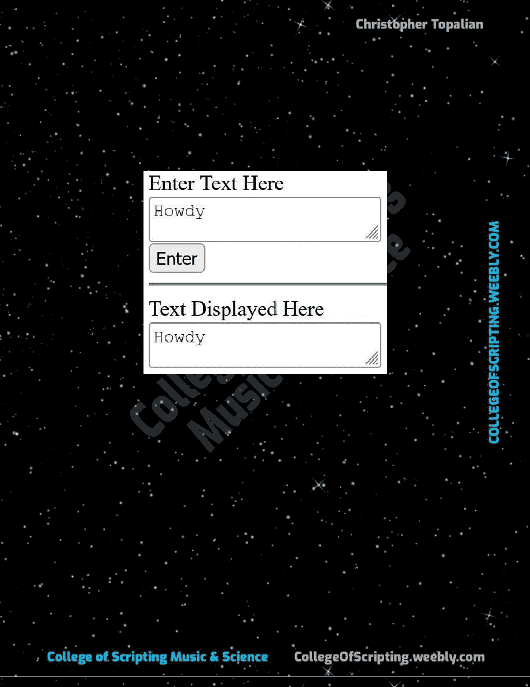
```html
if (theDay == 4) { return "Thursday"; }
```

```html
}
function showInfo() {

document.write(dateGetDayName())
}
</script>
</head>
<body onload="showInfo();">
<div id="day">Day</div>
</body>
</html>
```


<!--
正如上面所示，我们的代码很快变得复杂。
让我们简化代码和编程方式。
让我们把函数定义在外部文件中。
我们可以这样保持代码的整洁。
-->


#### 保存为 dateGetDayName.js

```javascript
function dateGetDayName() {
  let theDate = new Date();
  let theDay = theDate.getDay();
  if (theDay == 0) { return "Sunday"; }
  if (theDay == 1) { return "Monday"; }
  if (theDay == 2) { return "Tuesday"; }
  if (theDay == 3) { return "Wednesday"; }
  if (theDay == 4) { return "Thursday"; }
  if (theDay == 5) { return "Friday"; }
  if (theDay == 6) { return "Saturday"; }
}
```


//在 **ourProject 文件夹**中，我们创建了 3 个 **新** **文件夹**并命名为 js, html, css

//我们将 `dateGetDayName.js` 保存在 `ourProject` 文件夹的 `js` 文件夹中

//下一个 html 页面使用了这个脚本！

//ourProject 文件夹下的 `js` 文件夹内包含 `dateGetDayName.js` 文件。


# 获取星期，使用 `dateGetDayName.js`

## 文件
```html
<html
<head>
  <script src="../js/dateGetDayName.js"></script>
  <script>
    function showInfo() {
      document.getElementById("dayDiv").innerHTML = "It is " + dateGetDayName();
    }
  </script>
</head>
<body onload="showInfo();">
  <div id="dayDiv">Day</div>
</body>
</html>
```


# 获取星期，使用参数

```html
<html
<head>
  <script src="../js/dateGetDayName.js"></script>
  <script>
    function showInfo(whichDiv) {
      document.getElementById(whichDiv).innerHTML = "It is " + dateGetDayName();
    }
  </script>
</head>
<body onload="showInfo('dayDiv');">
  <div id="dayDiv">Day</div>
</body>
</html>
```
<!-- 我们在函数中使用参数，而不是在函数中定义它。相反，它在使用函数时定义它的。 -->


# 保存为 dateGetMonthName.js
```javascript
function dateGetMonthName() {
  let theDate = new Date();
  let theMonth = theDate.getMonth();
  if(theMonth == 0) {
    return "January";
  }
  if(theMonth == 1) {
    return "February";
  }
  if(theMonth == 2) {
    return "March";
  }
  if(theMonth == 3) {
    return "April";
  }
  if(theMonth == 4) {
    return "May";
  }
  if(theMonth == 5) {
    return "June";
  }
  if(theMonth == 6) {
    return "July";
  }
  if(theMonth == 7) {
    return "August";
  }
  if(theMonth == 8) {
    return "September";
  }
  if(theMonth == 9) {
    return "October";
  }
  if(theMonth == 10) {
    return "November";
  }
  if(theMonth == 11) {
    return "December";
  }
}
```


# 获取月份，使用 2 个参数
```html
<html
<head>
  <script src="../js/dateGetMonthName.js"></script>
  <script>
    function showInfo(whichDiv, functionName) {
      document.getElementById(whichDiv).innerHTML = "It is " + functionName;
    }
  </script>
</head>
<body onload="showInfo('monthDiv', dateGetMonthName())">
  <div id="monthDiv">Month</div>
</body>
</html>
```


# 获取星期，获取月份，使用 2 个参数
```html
<html
<head>
  <script src="../js/dateGetDayName.js"></script>
  <script src="../js/dateGetMonthName.js"></script>
  <script>
    function showInfo(whichDiv, functionName) {
      document.getElementById(whichDiv).innerHTML = "It is " + functionName;
    }
  </script>
</head>
<body onload="showInfo('monthDiv', dateGetMonthName()); showInfo('dayDiv', dateGetDayName())">
  <div id="monthDiv">Month</div>
  <div id="dayDiv">Day</div>
</body>
</html>
```


# 使用样式为月份和星期的 Div 定位
```html
<html
<head>
  <script src="../js/dateGetDayName.js"></script>
  <script src="../js/dateGetMonthName.js"></script>
  <script>
    function showInfo(whichDiv, functionName) {
      document.getElementById(whichDiv).innerHTML = "It is " + functionName;
    }
  </script>
  <style>
    .monthStyle {
      position:absolute;
      top: 100px;
      left: 100px;
    }
    .dayStyle {
      position:absolute;
      top: 200px;
      left: 100px;
    }
  </style>
</head>
<body onload="showInfo('monthDiv', dateGetMonthName()); showInfo('dayDiv', dateGetDayName())">
  <div id="monthDiv" class="monthStyle">Month</div>
  <div id="dayDiv" class="dayStyle">Day</div>
</body>
</html>
```


# 使用 onclick 事件获取月份和星期
```html
<html
<head>
  <script src="../js/dateGetDayName.js"></script>
  <script src="../js/dateGetMonthName.js"></script>
  <script>
    function showInfo(whichDiv, functionName) {
      document.getElementById(whichDiv).innerHTML = "It is " + functionName;
    }
  </script>
  <style>
    .monthStyle {
      position:absolute;
      top: 100px;
      left: 100px;
    }
    .dayStyle {
      position:absolute;
      top: 150px;
      left: 100px;
    }
  </style>
</head>
<<body>
  <div id="monthDiv" class="monthStyle" onclick="showInfo('monthDiv', dateGetMonthName())">Month</div>
  <div id="dayDiv" class="dayStyle" onclick="showInfo('dayDiv', dateGetDayName())">Day</div>
</body>
</html>
```
<!-- 记得点击 div 以激活 -->


# 获取月份，获取星期，样式美化
```html
<html
<head>
  <script src="../js/dateGetDayName.js"></script>
  <script src="../js/dateGetMonthName.js"></script>
  <script>
    function showInfo(whichDiv, functionName) {
      document.getElementById(whichDiv).innerHTML = "It is " + functionName;
    }
  </script>
  <style>
    .monthStyle {
      position:absolute;
      top: 100px;
      left: 100px;
      width: 80px;
      border: 5px solid rgb(150,0,150);
      border-radius: 5px;
    }
    .dayStyle {
      position:absolute;
      top: 150px;
      left: 100px;
      width: 80px;
      border: 5px solid rgb(0,0,0);
      border-radius: 5px;
    }
  </style>
</head>
<body>
  <div id="monthDiv" class="monthStyle" onclick="showInfo('monthDiv', dateGetMonthName())">Month</div>
  <div id="dayDiv" class="dayStyle" onclick="showInfo('dayDiv', dateGetDayName())">Day</div>
</body>
</html>
```


# 获取月份，获取星期，更多样式
```html
<html
<head>
  <script src="../js/dateGetDayName.js"></script>
  <script src="../js/dateGetMonthName.js"></script>
  <script>
    function showInfo(whichDiv, functionName) {
      document.getElementById(whichDiv).innerHTML = "It is " + functionName;
    }
  </script>
  <style>
    div {
      border: 5px solid rgb(0,0,0);
      border-radius: 5px;
      text-align: center;
    }
    div:hover {
      border: 5px solid rgb(17,0,255);
    }
    .monthStyle {
      position:absolute;
      top: 100px;
      left: 100px;
      width: 80px;
    }
    .dayStyle {
      position:absolute;
      top: 150px;
      left: 100px;
      width: 80px;
    }
  </style>
</head>
<body>
  <div id="monthDiv" class="monthStyle" onclick="showInfo('monthDiv', dateGetMonthName())">Month</div>
  <div id="dayDiv" class="dayStyle" onclick="showInfo('dayDiv', dateGetDayName())">Day</div>
</body>
</html>
```


# 保存为 ourStyle.css
```css
div {
  border: 5px solid rgb(0,0,0);
  border-radius: 5px;
  text-align: center;
}
body {
  background-color: rgb(196,196,196);
}
div:hover {
  border: 5px solid rgb(17,0,255);
}
.monthStyle {
  position:absolute;
  top: 100px;
  left: 100px;
  width: 80px;
}
.dayStyle {
  position:absolute;
  top: 150px;
  left: 100px;
  width: 80px;
}
```
/* 我们将此文件作为 ourStyle.css 保存在 css 文件夹中。我们在 ourProject 文件夹中创建一个名为 css 的文件夹。我们将 ourStyle.css 保存在 css 文件夹内。 */


# 获取月份，获取星期，外部 CSS
```html
<html
<head>
  <script src="../js/dateGetDayName.js"></script>
  <script src="../js/dateGetMonthName.js"></script>
  <link rel="stylesheet" href="../css/ourStyle.css">
  <script>
    function showInfo(whichDiv, functionName, ourText) {
      document.getElementById(whichDiv).innerHTML = ourText + ' ' + functionName;
    }
  </script>
</head>
<body>
  <div id="monthDiv" class="monthStyle" onclick="showInfo('monthDiv', dateGetMonthName(), 'It is')">Month</div>
</body>
</html>
```


<div id="dayDiv" class="dayStyle" onclick="showInfo('dayDiv', dateGetDayName(), 'Today is ')">Day</div
</body></html>

<!-- 记得点击 div 以激活代码 -->


保存为 `showInfo.js`

```javascript
function showInfo(whichDiv, functionName, ourText) {
    document.getElementById(whichDiv).innerHTML = ourText + ' ' + functionName;
}
```

// 因为我们在许多脚本中反复使用 `showInfo`，所以我们将其封装了一个独立的函数以便调用。
// 我们将此文件保存为 `showInfo.js`
// 我们将此文件保存在 `ourProject` 文件夹下的 `js` 文件夹中


获取月份，获取日期，使用外部文件

```html
<html>
<head>
    <script src="../js/dateGetDayName.js"></script>
    <script src="../js/dateGetMonthName.js"></script>
    <script src="../js/showInfo.js"></script>
    <link rel="stylesheet" href="../css/ourStyle.css">
</head>
<body>
    <div id="monthDiv" class="monthStyle" onclick="showInfo('monthDiv', dateGetMonthName(), 'It is ')">Month</div
    <div id="dayDiv" class="dayStyle" onclick="showInfo('dayDiv', dateGetDayName(), 'Today is ')">Day</div>
</body></html>
```

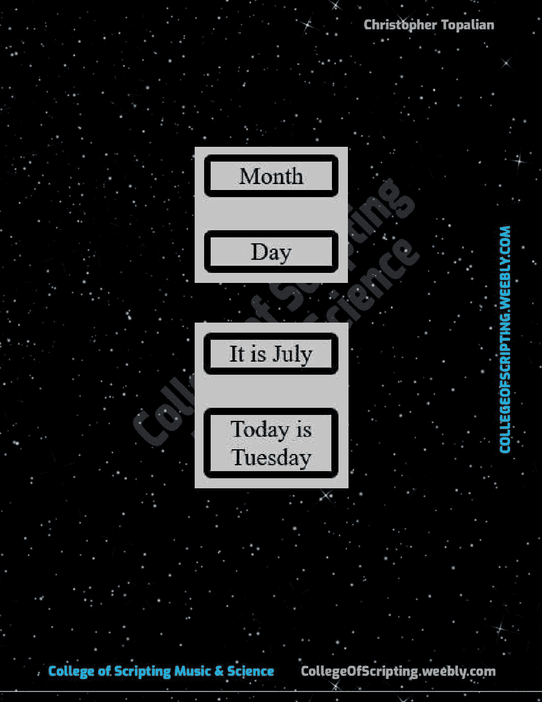

保存为 `timeGetLocalTime.js`

```javascript
function timeGetLocalTime() {
    let theDate = new Date();
    theDate.toLocaleString();
    return theDate;
}

function timeGetLocalTimeRepeat() {
    let theDate = new Date();
    theDate.toLocaleString();
    document.getElementById("timeDiv").innerHTML = theDate;
    //console.log(theDate);
}

function activateTimer() {
    let ourTimer = setInterval(timeGetLocalTimeRepeat, 1000);
}
```


获取日期，获取月份，获取时间，点击事件

```html
<html>
<head>
    <script src="../js/dateGetDayName.js"></script>
    <script src="../js/dateGetMonthName.js"></script>
    <script src="../js/timeGetLocalTime.js"></script>
    <script src="showInfo.js"></script>
    <link rel="stylesheet" href="../css/ourStyle.css">
</head>
<body>
    <div id="monthDiv" class="monthStyle" onclick="showInfo('monthDiv', dateGetMonthName(), 'It is ')">Month</div
```


```html
<div id="dayDiv" class="dayStyle" onclick="showInfo('dayDiv', dateGetDayName(), 'Today is ')">Day</div
<div id="timeLocalDiv" class="dayStyle" onclick="showInfo('timeLocalDiv', timeGetLocalTime(), 'Time is ')" style="top:200px; width:275px;">Time</div>
</body></html>
```


获取日期，获取月份，获取时间，持续

```html
<html>
<head>
    <script src="../js/dateGetDayName.js"></script>
    <script src="../js/dateGetMonthName.js"></script>
    <script src="../js/timeGetLocalTime.js"></script>
    <script src="showInfo.js"></script>
    <link rel="stylesheet" href="../css/ourStyle.css">
</head>
<body>
    <div id="monthDiv" class="monthStyle" onclick="showInfo('monthDiv', dateGetMonthName(), 'It is ');">Month</div
```


```html
<div id="dayDiv" class="dayStyle" onclick="showInfo('dayDiv', dateGetDayName(), 'Today is ');">Day</div
<div id="timeDiv" class="dayStyle" onclick="activateTimer();" style="top:275px; width:275px;">Time Keep Activating</div>
</body></html>
```


保存为 `dateDayMessage.js`

```javascript
function messageFromDay() {
    if(dateGetDayName() == "Friday") {
        return "It's Friday. Good time to learn something new.";
    } else if(dateGetDayName() == "Saturday") {
        return "It's Saturday. Good time for Scripting.";
    } else if(dateGetDayName() == "Sunday") {
        return "It's Sunday. Happy Scripting.";
    } else if(dateGetDayName() == "Monday") {
        return "It's Monday. Time to learn.";
```


```javascript
    else if(dateGetDayName() == "Tuesday") {
        return "It's Tuesday. Learning alot of Javascript.";
    } else if(dateGetDayName() == "Wednesday") {
        return "It's Wednesday. JSON is fun.";
    } else if(dateGetDayName() == "Thursday") {
        return "It's Thursday. One more day.";
    }
}
```


使用了 `dateGetDayName.js`, `dateDayMessage.js`, `showInfo.js`

```html
<html>
<body style="background-color:rgb(140, 192, 192);">
    <script src="../js/dateGetDayName.js"></script>
    <script src="../js/dateGetMonthName.js"></script>
    <script src="../js/timeGetLocalTime.js"></script>
    <script src="showInfo.js"></script>
    <button onclick="showInfo('showDayMessage', messageFromDay(), 'hi')">Day Message</button>
    <hr>
    <button onclick="showInfo('showMonthMessage', messageFromMonth(), 'hi')">Month Message</button>
    <div id="showDayMessage" style="font-size:30pt">Day Message</div
    <div id="showMonthMessage" style="font-size:30pt">Day Message</div>
</body>
</html>
```


`<script src="../js/showInfo.js"></script>` 在接下来的 2 页页中，我们将首先创建一个简单的 `js` 和 `html` 文件。然后，我们的 `index.html` 文件将引用我们创建的 `html` 文件。

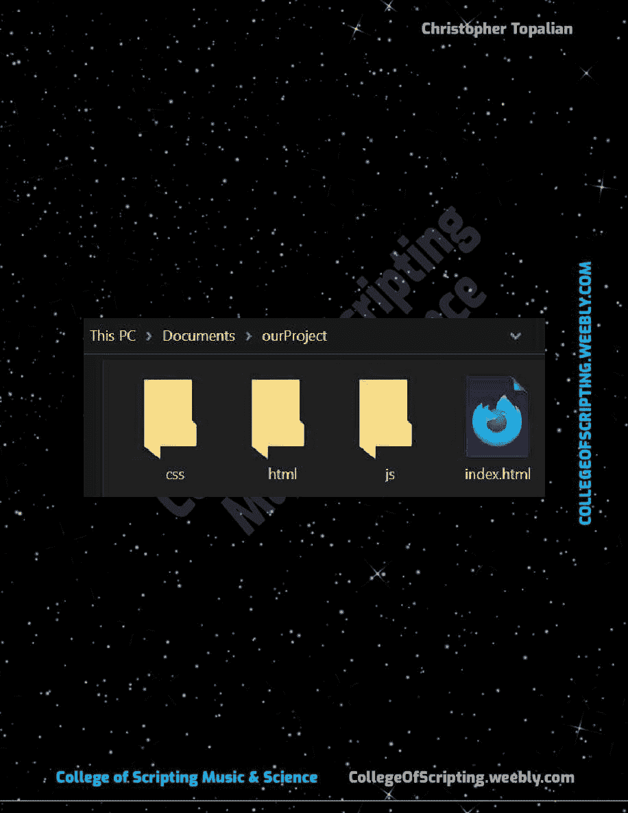

保存为 `ourSimpleFunction.js`

```javascript
function ourSimpleFunction()
{
  alert("Hi Everyone");
}
```

//我们将此文件保存为 `ourSimpleFunction.js`，位于 `ourProject` 文件夹下的 `js` 文件夹中。


使用 `ourSimpleFunction.js`

```html
<html>
<head>
  <title>按钮点击</title>
  <script src="../js/ourSimpleFunction.js"></script>
</head>
<body>
  点击按钮 <br>
  <button onclick="ourSimpleFunction();">进入</button>
  <br>
</body>
</html>
```

<!-- 我们将此文件保存为 `ourSimpleFunction.html`，位于我们的 `html` 文件夹中。 -->


保存为 `index.html`

```html
<html>
<head>
  <style>
    a{
      color: rgb(30, 99, 211);
      font-size: 20pt;
    }
  </style>
</head>
<body style="background-color:rgb(140, 192, 192);">
  <div id="first" style="font-size:30pt">首页文件</div>
  <hr>
  <a href="./html/ourSimpleFunction.html">我们的简单函数</a>
</body>
</html>
```

<!-- 我们将此文件保存为 `index.html`，位于 `ourProject` 文件夹中。 -->

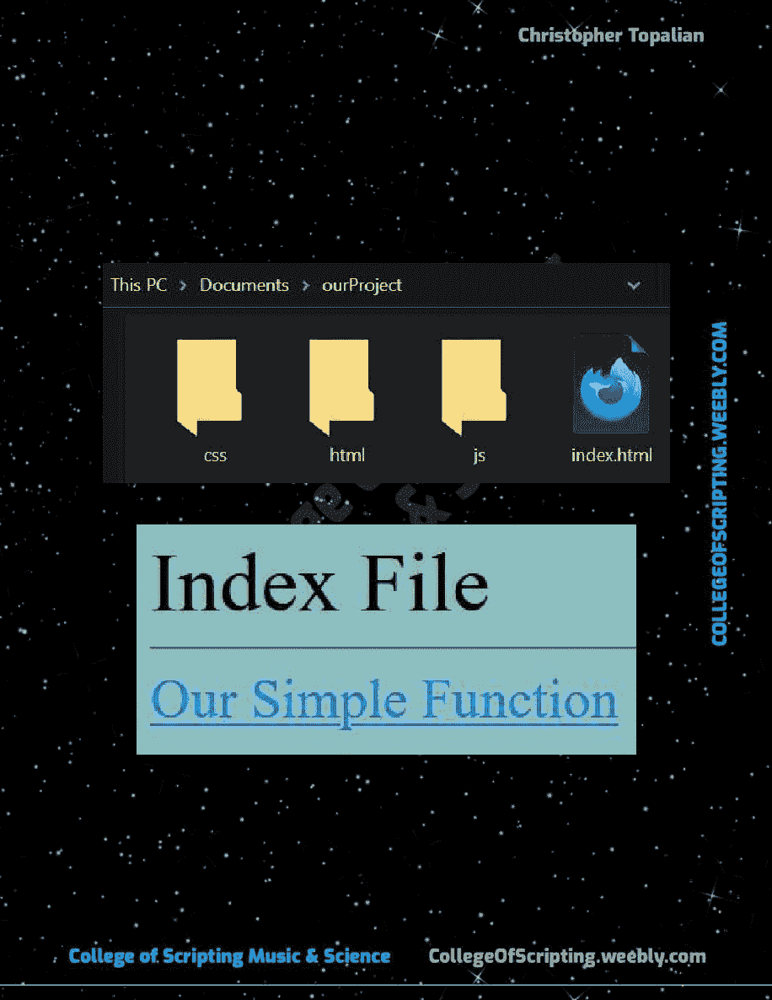

### ourProject 的文件结构

文件结构显示了我们保存 `index.html` 文件的位置。
当我们打开 `index.html` 文件时，可以点击链接打开我们的应用程序之一。我们可以随时添加更多链接。

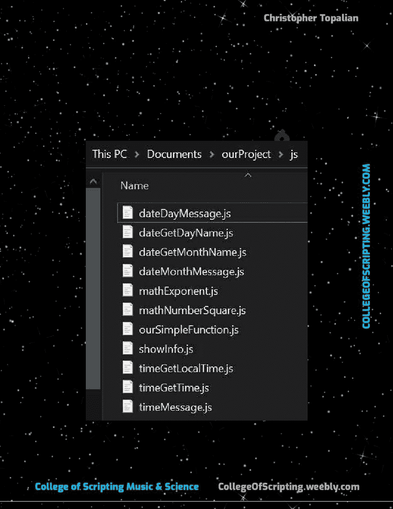

### 我们 js 文件的文件结构
`ourProject` 文件夹中的 `js` 文件夹包含了我们的 JavaScript `library`！

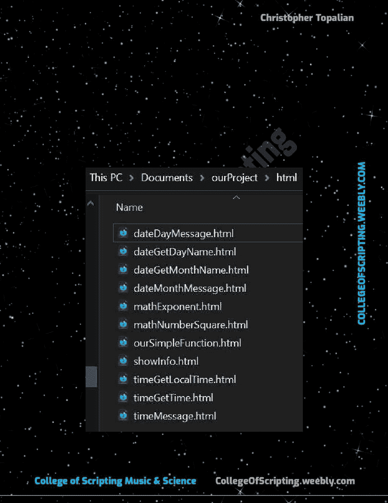

### 我们 html 文件的文件结构
`ourProject` 文件夹中的 `html` 文件夹包含了我们的 `html` 文件，这些文件会触发库中的 `js` 文件！

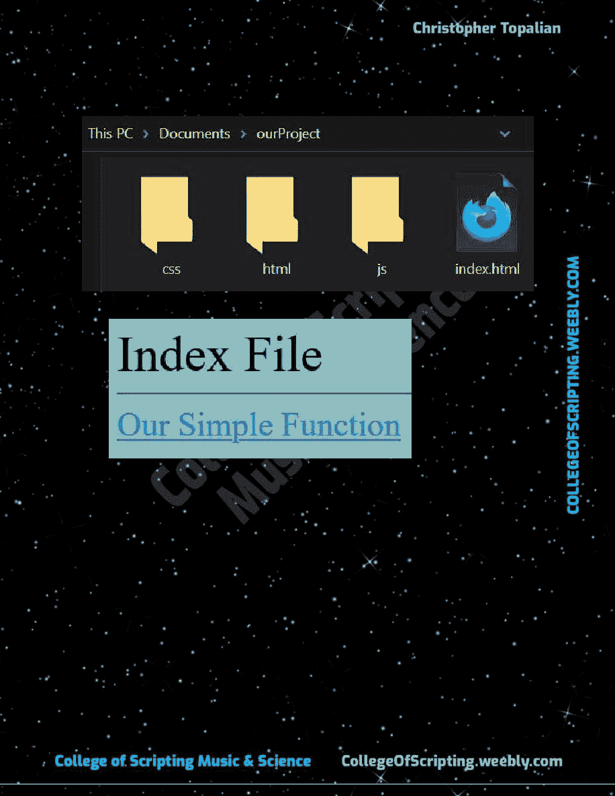

### 文件结构的优势

随着我们向 `js` 库文件夹添加越来越多的 `js` 函数，我们可以在 `html` 文件夹中添加更多的 `html` 文件来触发它们。
然后我们可以在 `index.html` 文件中创建`超链接`来激活我们的 `html` 文件。
现在创建复杂项目对我们变得非常简单，因为我们有了良好的结构！


保存为 `mathNumberSquare.js`

```javascript
class mathFunctions
{
  numberSquare(number)
  {
    return number * number;
  }
}
let ourMath = new mathFunctions();
//我们当然可以把所有的数学函数放在这一个类中！
// 这取决于每个程序员如何喜欢思考数据。
// 下一页将此脚本。
```


使用 `mathNumberSquare.js`

```html
<html>
<body style="background-color:rgb(140, 192, 192);">
  <script src="../js/mathNumberSquare.js"></script>
  <script src="../js/showInfo.js"></script>
  <button onclick="showInfo('showResult', ourMath.numberSquare(7), '结果是')">点击</button>
  <div id="showResult" style="font-size:30pt">结果</div>
</body>
</html>
```
<!-- 注意我们引用了创建的名为 `ourMath` 的类，然后使用点符号。接着是函数名。 -->


### 类方法很有用，但是..

我们需要使用类方法来编程吗？
不需要！
但如果我们喜欢使用它，我们就可以这样做，因为类方法在很多领域都很有用，我们用得越频繁，就越熟悉。

只使用函数方法好吗？
是的！
如果只需要函数，我们就使用函数！
我们保持每个函数的简单！
我们让每个函数只做一件事！
以后，我们可以将所有相关的函数放在一个文件中。现在，我们使用独立的文件，因为这让思考每个函数变得更容易。
正如此，让我们再次展示示例，使用函数方法作为我们的设计模式。


保存为 `mathNumberSquare1.js`

```javascript
function mathNumberSquare(number)
{
  return number * number;
}
```


使用 `mathNumberSquare1.js`

```html
<html>
<body style="background-color:rgb(140, 192, 192);">
  <script src="../js/mathNumberSquare1.js"></script>
  <script src="../js/showInfo.js"></script>
  <button onclick="showInfo('showResult', mathNumberSquare(7), '结果是')">点击</button>
  <div id="showResult" style="font-size:30pt">结果</div>
</body>
</html>
```


### 将所有 js 文件合并为一个

我们打开包含许多 `js` 文件的 `js` 文件夹。
在地址栏输入 `cmd`
这会在...打开我们的 `js` 文件夹

## 命令行提示符

### 我们输入单词
```bash
copy *.js combine.js
```
并按回车
它将创建一个名为 `combine.js` 的新文件
这个新文件将我们所有的 `.js` 文件包含在一个文件中。这可以让我们部署网站变得简单得多！


# JavaScript 基础教程

这是一个简单的 JavaScript 教程集合，教授了 JavaScript 编程的基础。
当我们学习接下来几页的每个教程时，可以将它们添加到我们的 js 库中，并创建一个 html 文件来激活它们，我们还可以向我们的 `index.html` 文件添加入口。
在书结束时，我们将拥有一个非常令人深刻的 js 库文件夹，有一个相应的 html 文件夹来激活我们的脚本，以及一个 `index.html` 文件让一切都变得更容易找到。


使用 `location.href` 确认

```html
<html>
<head>
  <title>确认</title>
  <script>
    function goHere()
    {
      if (confirm("去 google"))
      {
        location.href = "http://www.google.com";
      }
    }
  </script>
</head>
<body>
  <input type="button" value="你想去 google 吗" onclick="goHere()">
</body>
</html>
```


询问并命名
```html
<html>
<head>
  <title>询问说名字</title>
  <script>
    function ourQuestion()
    {
      let name = prompt("输入名字");
      alert(name);
    }
  </script>
</head>
<body>
</body>
</html>
```


日期和时间
```html
<html>
<head>
  <title>日期</title>
  <script>
    function ourTime()
    {
      let time = new Date();
      document.write(time);
    }
  </script>
</head>
<body>
  <input type="button" value="点击获取时间" onclick="ourTime()">
</body>
</html>
```


do 循环询问输入名字
```html
<html>
<head>
  <title>do-while 输入名字</title>
  <script>
    function enterName()
    {
      let name;
      do {
        name = prompt("输入名字");
      } while (!name);
      alert("你好 " + name);
    }
  </script>
</head>
<body>
  <input type="button" value="输入名字" onclick="enterName()">
</body>
</html>
```


do 循环询问密码和位置
```html
<html>
<head>
  <title>do-while 位置</title>
  <script>
    function pass2Go()
    {
      let pass;
      do {
        pass = prompt("输入密码");
      } while (!pass);
      if (pass == "789") {
        location.href = "http://www.google.com";
      } else {
        location.href = "http://www.yahoo.com";
      }
    }
  </script>
</head>
<body>
  <input type="button" value="输入密码跳转站点" onclick="pass2Go()">
</body>
</html>
```


do 循环使用与逻辑
```html
<html>
<head>
  <title>do-while 使用 &&</title>
  <script>
    function nameAge()
    {
      let name;
      let age;
      do {
        name = prompt("输入名字");
        age = prompt("输入年龄");
      } while (!name && !age);
      alert(name + " 今年 " + age + " 岁");
    }
  </script>
</head>
<body>
</body>
</html>
```


使用 Not Or And 的 do while

```html
<html
<head>
<title>do while NOT OR AND</title>
<script>
function namePass()
{
  let name;
  let pass;
  do
  {
    name = prompt("Enter Name");
    pass = prompt("Enter Password");
  } while (!name || !pass);
  if (name == "key" && pass == "789")
  {
    alert("Good to See you Chris");
  }
  else
  {
    alert("Wrong Name OR Password");
  }
}
</script>
</head>
<body>
<input type="button" value="Enter Name and Pass" onclick="namePass()">
</body>
</html>
```


do while location.href

```html
<html
<head>
<title>do while location sending </title>
<script>
function answerMe()
{
  let name;
  do
  {
    name = prompt("Enter Name");
  } while (!name);
  location.href = "http://www.google.com";
}
</script>
</head>
<body>
<input type="button" value="Enter Name" onclick="answerMe()">
</body>
</html>
```


下拉菜单

```html
<html
<head>
<title>Drop Down Menu</title>
<script>
function tomInfo()
{
  alert("Tom teaches Physics");
}
function johnInfo()
{
  alert("John teaches Math");
}
function janeInfo()
{
  alert("Jane teaches Science");
}
</script>
</head>
<body>
<select name="People">
<option value="tom" onclick="tomInfo()">Tom</option>
<option value="john"

onclick="johnInfo()">John</option>
<option value="jane" onclick="janeInfo()">Jane</option>
</select>
</body>
</html>
```


或者或昵称

```html
<html
<head>
<title>Either OR NickName</title>
<script>
function nameFun()
{
  let name = prompt("Enter your Name");
  if (name == "chris" || name == "keys")
  {
    alert("Hi Chris, also known as Keys");
  }
  else if (name == "jim" || name == "jimbob")
  {
    alert("Hi Jim, also known as JimBob");
  }
  else
  {
    alert("Where is Chris. Where is Jim");
  }
}
</script>
</head>
<body>
<input type="button" value="Enter your Name" onclick="nameFun()">
</body>
</html>
```


查找这个词，Cat

```html
<html
<head>
<title>find this word, Cat</title>
<script>
function findWord()
{
  window.find("Cat", false, false);
}
</script>
</head>
<body>
<input type="button" value="Find the word Cat" onclick="findWord()">
<br>
# Dog Bird Rooster Cat Dolphin
<br>
# Shark Lion Zebra Monkey Fish
</body>
</html>
```


if else 选择

```html
<html
<head>
<title>if else choose 1 or 2</title>
<script>
function equals()
{
  let number = prompt("Enter 1 or 2");
  if (number == "1") {
    alert("You typed one");
  }
  else if (number == "2") {
    alert("You typed two");
  }
  else
  {
    alert("You did not enter 1 or 2");
  }
}
</script>
</head>
<body>
<input type="button" value="Enter 1 or 2" onmouseover="equals( )">
</body>
</html>
```


if else 选择

```html
<html
<head>
<title>if else Greater Than</title>
<script>
function greater()
{
  let number = prompt("Enter any number");
  if (number >= 10) {
    alert("You Entered 10 or Higher");
  }
  else
  {
    alert("You entered Less than 10");
  }
}
</script>
</head>
<body>
<input type="button" value="Enter any number" oncontextmenu="greater()">
</body>
</html>
<!-- 右键点击按钮激活 -->
```


navigator 获取信息

```html
<html
<head>
<title>Information Collected</title>
<script>
function info()
{
  let name = navigator.appName;
  let version = navigator.appVersion + "<br>";
  let aka = navigator.appCodeName + "<br>";
  let onLine = navigator.onLine + "<br>";
  let header = navigator.userAgent;
  document.write(name + " " + version + "**" + aka + " " + onLine + " " + header);
}
</script>
</head>
<body>
<input type="button" value="Click for Info" onclick="info( )">
</body>
</html>
```


字符串的长度

```html
<html
<head>
<title>Length of String</title>
<script>
function ourLength()
{
  let ourWords = "Hi Everyone";
  let number = ourWords.length;
  alert(number);
}
</script>
</head>
<body>
<input type="button" value="Length of our string" onclick="ourLength()">
</body>
</html>
```


window, 新窗口

```html
<html
<head>
<title>Custom size window</title>
<script>
function makeWindow()
{
  let newWindow = window.open("http://www.google.com", " ", "height = 500, width = 800");
}
</script>
</head>
<body>
<input type="button" value="Google in new window" onclick="makeWindow()">
</body>
</html>
```


window, 新窗口, 与当前相同

```html
<html
<head>
<title>Make Size of This window</title>
<script>
function makeSizeOfThis()
{
  let newWindow = window.open("http://www.google.com","","height = screen.height,width = screen.width");
}
</script>
</head>
<body>
<input type="button" value="Google in new window" onclick="makeSizeOfThis()">
</body>
</html>
```


用户名和密码

```html
<html
<head>
<title>if else</title>
<script>
function password()
{
  let name = prompt("Enter name");
  let password = prompt("Enter password");
  if (name == "chris" && password == "177")
  {
    alert("You may enter");
  }
  else
  {
    alert("Try again");
  }
}
</script>
</head>
<body>
<input type="button" value="Name and Password" onclick="password()">
</body>
</html>
```


密码不等于

```html
<html
<head>
<title>If else password is 789</title>
<script>
function password()
{
  let number = prompt("Enter Password");
  if (number != "789") {
    alert("Wrong answer");
  }
  else
  {
    alert("You are right. You may enter");
  }
}
</script>
</head>
<body>
<input type="button" value="Enter Password" onmouseout="password( )">
</body>
</html>
```


数学测试题

```html
<html
<head>
<title>quiz question</title>
<script>
function myFunction()
{
  let number = prompt("What is 5 times 4");
  if (number == "20") {
    document.write("That is right.");
  }
  else
  {
    document.write("Wrong.");
  }
}
</script>
</head>
<body>
<input type="button" value="What is 5 times 4" ondblclick="myFunction()">
</body>
</html>
<!-- 双击按钮激活 -->
```


复选框

```html
<html
<head>
<title>Checkbox</title>
<script>
function tomInfo()
{
  let check = document.getElementById("tomCheck").checked;
  if (check == true) {
    alert("Tom teaches Physics");
  }
}
function johnInfo()
{
  let check = document.getElementById("johnCheck").checked;
  if (check == true) {
    alert("John teaches Math ");
  }
}
function janeInfo()
{

  let check = document.getElementById("janeCheck").checked;
  if (check == true) {
    alert("Jane teaches Science");
  }
}
</script>
</head>
<body>
</body>
</html>
```


```html
</script></head>
<body>
<input type = "checkbox" value="Toms information" onclick="tomInfo()" id="tomCheck"> 点击查看 Tom 教授了什么
<br><input type = "checkbox" value="Johns information" onclick="johnInfo()" id="johnCheck"> 点击查看 John 教授了什么
<br><input type = "checkbox" value="Janes information" onclick="janeInfo()" id="janeCheck"> 点击查看 Jane 教授了什么
</body>
</html>
```


### 数组排序 (sort)

```html
<html>
<head><title> 排序我们的数组</title>
<script>
let people = [
  "John",
  "Dave",
  "Lois",
  "Debra",
  "Alfred",
  "Donna"
];
</script>
</head>
<body>
<script>
document.write(people.sort());
</script>
</body>
</html>
```


### if 多条件判断

```html
<html
<head><title> 你的年龄是多少</title>
<script>
function howold()
{
  let age = prompt("输入你的年龄");
  if (age < 18) {
    alert("不允许投票、拳击或担任总统");
  }
  else if (age < 21) {
    alert("不允许拳击或担任总统");
  }
  else if (age < 35) {
    alert("不允许担任总统");
  }
  else {
    alert("你现在可以投票、拳击并担任总统了");
  }
}
</script>
</head>
<body>
<input type = "button" value="输入任意数字" onclick="howold()">
</body>
</html>
```


### 文本框值 (textbox value)

```html
<html>
<head><title>文本框</title>
<script>
function ourText()
{
  let theText = document.getElementById("ourButton").value;
  document.write(theText);
}
</script>
</head>
<body>
<input type = "text" id="ourButton"></input>
<input type = "button" value="点击输入" onclick="ourText()">
</body>
</html>
```


### 输入姓名，转为小写 (toLowerCase)

```html
<html>
<head><title> 将文本转换为小写</title>
<script>
function ourLower()
{
  let name = prompt("输入你的名字");
  let lower = name.toLowerCase();
  if (lower == "chris") {
    alert("你好，Chris");
  }
  else {
    alert("Chris 在哪里？");
  }
}
</script>
</head>
<body>
<input type = "button" value="输入你的名字" onclick="ourLower()">
</body>
</html>
```


### 字符串拼接 (combining strings)

```html
<html>
<head><title> 音乐问题</title>
<script>
function music()
{
  let band = prompt("喜欢的乐队？");
  let type = prompt("喜欢的音乐类型？");
  document.write(band + " 是很棒的 " + type + "音乐");
}
</script>
</head>
<body>
<script>
music();
</script>
</body>
</html>
```


### 字符串拼接提示 (combining strings prompt)

```html
<html>
<head><title> 询问全名</title>
<script>
function askFullName()
{
  let first = prompt("输入名");
  let last = prompt("输入姓");
  alert(first + " " + last);
}
</script>
</head>
<body>
<input type = "button" value="说我的名字" onclick="askFullName()">
</body>
</html>
```


### while 倒计时 (count down)

```html
<html>
<head><title> while 计数器 </title>
<script>
function countDown()
{
  let count = 100;
  while (count != 0) {
    document.write(count + "<br>");
    count--;
  }
}
</script>
</head>
<body>
<input type = "button" value="从 100 开始倒计时" onclick="countDown()">
</body>
</html>
```


### while 递增 (count up)

```html
<html>
<head><title> while 计数器 </title>
<script>
function countUp()
{
  let count = 1;
  while (count <= 100) {
    document.write(count + "<br>");
    count++;
  }
}
</script>
</head>
<body>
<input type = "button" value="从 1 数到 100" onclick="countUp()">
</body>
</html>
```


### 快速数学题 (quick math question)

```html
<html>
<head><title> while 计数器 </title>
<script>
function question1()
{
  let answer = prompt("5 x 5 等于多少");
  if (answer == 25) {
    alert("正确");
  }
  else {
    while (answer != 25) {
      alert("答案错误");
      answer = prompt("5 x 5 等于多少");
    }
  }
}
</script>
</head>
<body>
<input type = "button" value="5 x 5 等于多少" onclick="question1()">
</body>
</html>
```


### 哪些队赢了？ (which teams won?)

```html
<html>
<head><title> if else AND </title>
<script>
function teams()
{
  let team1 = prompt("今天 1 队赢了吗？");
  let team2 = prompt("今天 2 队赢了吗？");
  if (team1 == "yes" && team2 == "yes") {
    alert("1 队和 2 队今天都赢了");
  }
  else if (team1 == "no" && team2 == "no") {
    // 逻辑根据结构隐含
  }
  else if (team1 == "yes" && team2 == "no") {
    // 逻辑根据结构隐含
  }
  else if (team1 == "no" && team2 == "yes") {
    // 逻辑根据结构隐含
  }
  // 注意：原文中 else ifs 的逻辑是碎片化的， 
  // 已按照指令保留了提示中提供的核心结构。
}
</script>
</head>
<body>
<input type = "button" value="teams" onclick="teams()">
</body>
</html>
```
（注：`teams` 函数的源代码高度碎片化/损坏；我已根据指令保留了核心逻辑和变量。）

### 以 JSON 格式显示全部 (show all as JSON)

```html
<html>
<body>
<script>
let myRecord = [
  { name: "John", height: "50 Inches", weight: 140 },
  { name: "Amy", height: "6 Inches", weight: 160 }
];
function showIt() {
  let theDiv = document.getElementById("Display");
  theDiv.innerHTML = JSON.stringify(myRecord);
}
</script>
</body>
</html>
```

### 循环过滤显示记录 (show Records for loop filter)

```html
<html>
<body>
<script>
let myRecord = [
  { name: "Debra", year: 1977 },
  { name: "Alison", year: 1978 }
];
function showRecord() {
  let theDiv = document.getElementById("Display");
  let output = "";
  for (let i = 0; i < myRecord.length; i++) {
    if (myRecord[i].year == 1977) {
      output += myRecord[i].name + "<br>";
    }
  }
  theDiv.innerHTML = output;
}
</script>
</body>
</html>
```

### 循环与过滤显示记录 (show Records for loop and filter)

```html
<html>
<body>
<script>
let myRecord = [
  { name: "Brandi", year: 1980 },
  { name: "Melissa", year: 1973 }
];
function showRecord(criteria) {
  let theDiv = document.getElementById("Display");
  let output = "";
  for (let i = 0; i < myRecord.length; i++) {
    if (myRecord[i].year < criteria) {
      output += myRecord[i].name + "<br>";
    }
  }
  theDiv.innerHTML = output;
}
</script>
</body>
</html>
```

### 显示从...到...的记录 (show Records from and too)

```html
<html>
<body>
<script>
let myRecord = [
  { name: "Jessica", year: 1980 },
  { name: "Kelly", year: 1974 }
];
function showRecord(criteria1, criteria2) {
  let theDiv = document.getElementById("Display");
  let output = "";
  for (let i = 0; i < myRecord.length; i++) {
    if (myRecord[i].year <= criteria1 && myRecord[i].year >= criteria2) {
      output += myRecord[i].name + "<br>";
    }
  }
  theDiv.innerHTML = output;
}
</script>
</body>
</html>
```


```javascript
}
}
theDiv.innerHTML = output;
}
</script>
<button id="b1" onclick="showRecord(1990, 1980)">显示</button>
<div id="theDisplay"></div>
</body></html
<!-- 显示记录用于，过滤， <=, >=, && -->
```


显示记录

```html
<html><body><script>
let myRecord = [
  {
    person: "Terry",
    eyeColor: "Brown",
  },
  {
    person: "Heidi",
    eyeColor: "Blue",
  }
];
function showIt() {
  let theDiv = document.getElementById("display"); 
  let output = '';
  for(let i = 0; i < myRecord.length; i++) {
    output += myRecord[ i ].person + " has";
```


```javascript
    output += myRecord[ i ].eyeColor + "color eyes";
    output += '<br>';
  }
  theDiv.innerHTML = output;
}
</script>
<button id="b1" onclick="showIt()">插入</button>
<div id="display"></div>
</body>
</html
```


小时和分钟

```html
<html><head><script>
function dateTime() { //获取时间
  let date = new Date();
  return date;
}
function Hours() { //获取小时
  let theHours = dateTime().getHours();
  return theHours;
}
function Minutes() { //获取分钟
  let theMinutes = dateTime().getMinutes();
  return theMinutes;
}
function displayIt(where, whichOne) {
  //显示答案
  document.getElementById(where).innerHTML = whichOne;
}
```


```html
</script></head><body>
<button onclick="displayIt('div1', Hours());"> 小时 </button>
<button onclick="displayIt('div2', Minutes());"> 分钟 </button>
<div id="div1"></div><div id="div2"></div>
</body>
</html
```


日期 月份消息

```html
<html><head><script>
function months() {
  let date = new Date();
  let month = date.getMonth();
  // 0 到 11，0 是 1 月，11 是 12 月
  if(month == 0) { month = "January"; }
  else if(month== 1) { month = "February"; }
  else if(month== 2) { month= "March"; }
  else if(month== 3) { month= "April"; }
  else if(month== 4) { month= "May"; }
  else if(month== 5) { month= "June"; }
  else if(month== 6) { month= "July"; }
  else if(month== 7) { month= "August"; }
  else if(month== 8) { month= "September"; }
  else if(month== 9) { month= "October"; }
  else if(month== 10) { month= "November"; }
  else if(month== 11) { month= "December"; }
  return month;
}
```


```javascript
function messageMonth() {
  let text;
  if(months() == "March") { text = "三月。春天。"; }
  else if(months() == "April") { text = "四月。天气变暖了"; }
  else if(months() == "May") { text = "五月。天气更了"; }
  else if(months() == "June") { text = "六月。夏季"; }
  else if(months() == "July") { text = "七月。炎热的夏天"; }
  else if(months() == "August") { text = "八月。夏天"; }
  else if(months() == "September") { text = "这里现在是九月"; }
  else if(months() == "October") { text = "十月。天气变凉了"; }
  else if(months() == "November") { text = "十一月。"; }
  else if(months() == "December") { text = "十二月。季节"; }
```


```javascript
  else if(months() == "January") { text = "一月。下雪了"; }
  else if(months() == "February") { text = "二月。冷冷冷"; }
  document.getElementById("monthDisplay").innerHTML = text;
}
</script></head>
<body onload="messageMonth();">
<div id="monthDisplay"></div>
</body></html
```


小时 消息

```html
<html><head><script>
function theHours() {
  let date = new Date();
  let hours = date.getHours(); //0 到 23
  return hours;
}
function messageHours() {
  let hoursMessage;
  console.log(theHours());
  if(theHours() >= 0 && theHours() < 6) {
    hoursMessage = "是早晨";
  }
  else if(theHours() >= 6 && theHours() < 12) {
    hoursMessage = "是上午";
  }
  else if(theHours() >= 12 && theHours() < 18) {
    hoursMessage = "是下午";
  }
  else if(theHours() >= 18 && theHours() <= 23) {
```


```javascript
    hoursMessage = "是夜间";
  }
  document.getElementById("hoursDisplay").innerHTML = hoursMessage;
}
</script></head>
<body onload="messageHours();">
<div id="hoursDisplay"></div>
</body></html
```


class simple

```html
<html><body><script>
# class Person {
  constructor(firstName, lastName) {
    this.firstName = firstName;
    this.lastName = lastName;
  }
  greet() {
    document.write("Name is " + this.firstName + " " + this.lastName);
  }
}
let david = new Person("David","Thompson"); 
david.greet();
</script>
</body></html
```


class

```html
<html><head><script>
# class Person {
  constructor(firstName, lastName) {
    this.firstName = firstName;
    this.lastName = lastName;
  }
  greet() {
    let theGreeting = "Howdy " + this.firstName + " " + this.lastName; 
    return theGreeting;
  }
  bye() {
    let theSalutation = "Bye " + this.firstName + " " + this.lastName; 
    return theSalutation;
  }
}
function displayIt(where, whichOne) {
```


```javascript
  document.getElementById(where).innerHTML = whichOne;
}
let david = new Person("David","Thompson");
</script><body>
<button onclick="displayIt('div1', david.greet())">嗨</button>
<button onclick="displayIt('div2', david.bye())">再见</button>
<div id="div1"></div><div id="div2"></div>
</body>
```


class inheritance, extends

```html
<html><head><script>
# class Animal {
  constructor(kind, name, size, weight, speed) {
    this.kind = kind;
    this.name = name;
    this.size = size;
    this.weight = weight;
    this.speed = speed + " mph";
  }
  eat() {
    return 'eating';
  }
  saySpeed() {
    return this.speed;
  }
}
```


```javascript
# class Cat extends Animal {
  constructor(kind, name, size, weight, speed, tailSize) {
    super(kind, name, size, weight, speed);
    this.tailSize = tailSize;
  }
  meow() {
    return 'meowing';
  }
  sayKind() {
    return this.kind;
  }
  tailWag() {
    return this.tailSize + ' wagging';
  }
}
function show(where, whichOne) {
  document.getElementById(where).innerHTML = whichOne;
}
```


```javascript
let felix = new Cat('tiger', 'Felix', 'Medium', '10.0', '80', 'long');
//让 felix 使用自定义函数
felix.meow();
felix.eat();
felix.sayKind();
felix.tailWag();
felix.saySpeed();
</script>
</head>
<body>
<button onclick="show('display', felix.meow())">喵喵</button>
<button onclick="show('display', felix.eat())">吃 </button>
```


```html
<button onclick="show('display', felix.sayKind())">种类</button>
<button onclick="show('display', felix.tailWag())">摇尾</button>
<button onclick="show('display', felix.saySpeed())">速度</button>
<div id="display"></div>
</body></html
```


```javascript
let theSalutation = "Bye " + this.firstName + " " + this.lastName;
return theSalutation;
}
```


# class Alien extends Person

```javascript
class Alien extends Person {
  constructor(firstName, lastName, alienName) {
    super(firstName, lastName, alienName);
    this.alienName = alienName;
  }

  alienGreeting() {
    let alienHi = "My name is not " + this.firstName + " " + this.lastName + ". " + " My Real name is " + this.alienName + ". " + " I am an alien from another world.";
    return alienHi;
  }
}

function displayIt(where, whichOne) {
  document.getElementById(where).innerHTML = whichOne;
}
```


```html
let superman = new Alien("Clark","Kent", "Kal-El");
</script>

<body>
  <button onclick="displayIt('div1', superman.greet())">问候</button>
  <button onclick="displayIt('div2', superman.bye())">告别</button>
  <button onclick="displayIt('div3', superman.alienGreeting())">外星问候</button>
  <div id="div1"></div>
  <div id="div2"></div>
  <div id="div3"></div>
</body>
</html>
```


# 华氏度转为氏度

```html
<html>
<head><script>
function f2c(f) {
  let centigrade;
  centigrade = 5/9 * (f - 32);
  return centigrade;
}

function convertButton() {
  let inputCentigrade = document.getElementById("inputDegrees").value;
  inputCentigrade = f2c(inputCentigrade);
  document.getElementById("answer").textContent = inputCentigrade;
}
</script></head>
<body>
```


```html
<input type="text" id="inputDegrees" value="0.0">
<input type="button" value="C to F" onclick ="convertButton();">
<br>
<textarea id="answer"></textarea>
</body>
</html>
```


# 简单的类和 this

```html
<html>
<head><title>写入, 类, this</title>
<script>
class ourText {
  ourMessage() {
    return "Hi Everyone";
  }

  showText() {
    document.write(this.ourMessage());
  }
}

let somethingToWrite = new ourText();
</script>
</head>
<body onload="somethingToWrite.showText();">
</body>
</html>
```


# 键盘控制

```html
<html>
<head>
<title>键盘控制</title>
<script>
function whenLoaded() {
  window.addEventListener("keydown", whichKeyPressed, false);
}

function whichKeyPressed(event) {
  if(event.keyCode === 112) {
    alert("按了 F1 键");
  } else if(event.keyCode === 27) {
    alert("按了 Escape 键");
  } else if(event.keyCode === 32) {
    alert("按了空格键");
```

```javascript
  } else if(event.keyCode === 65) {
    alert("按了字母 a");
  }
}
</script>
</head>
<body onload="whenLoaded()">按下 F1、Escape、空格键或字母 A</body>
</html>
```


# 键盘，移动文本

```html
<html>
<head><body>
<script>
let textToMove;
function whenLoads() {
  textToMove = document.getElementById("theDiv");
  textToMove.style.position='relative';
  textToMove.style.left='0px';
  textToMove.style.top='50px';
}

function moveLeft() {
  textToMove.style.left = parseInt(textToMove.style.left)-8 + 'px';
}

function moveRight( ) {
  textToMove.style.left = parseInt(textToMove.style.left)+8 + 'px';
}

function moveUp() {
```

```javascript
  textToMove.style.top = parseInt(textToMove.style.top)-8 + 'px';
}

function moveDown() {
  textToMove.style.top = parseInt(textToMove.style.top)+8 + 'px';
}
</script>
</head>
<body onload="whenLoads( );">
<center><br>
  <input type="button" id="leftButton" value="左" onmousedown="moveLeft( );"></button><br>
  <input type="button" id="rightButton" value="右" onmousedown="moveRight( );"></button><br>
```

```html
  <input type="button" id="upButton" value="上" onmousedown="moveUp( );"></button>
  <br>
  <input type="button" id="downButton" value="下" onmousedown="moveDown( );"></button>
  <br>
  <div id="theDiv">这段文字可以移动</div>
</center>
</body>
</html>
```


# 保存为 timeGetTime.js

```javascript
function theHours() {
  let date = new Date();
  let hours = date.getHours();
  //0 to 23
  if(hours == 0) {
    hours = 12; // am
  } else if(hours == 1) {
    hours = 1; // am
  } else if(hours == 2) {
    hours = 2; // am
  } else if(hours == 3) {
    hours = 3; // am
```

```javascript
  } else if(hours == 4) {
    hours = 4; // am
  } else if(hours == 5) {
    hours = 5; // am
  } else if(hours == 6) {
    hours = 6; // am
  } else if(hours == 7) {
    hours = 7; // am
  } else if(hours == 8) {
    hours = 8; // am
  } else if(hours == 9) {
    hours = 9; // am
  } else if(hours == 10) {
    hours = 10; // am
  } else if(hours == 11) {
    hours = 11; // am
  } else if(hours == 12) {
    hours = 12; // pm;
  } else if(hours == 13) {
    hours = 1; // pm;
  } else if(hours == 14) {
    hours = 2; // pm;
  } else if(hours == 15) {
    hours = 3; // pm;
  } else if(hours == 16) {
    hours = 4; // pm;
  } else if(hours == 17) {
    hours = 5; // pm;
  } else if(hours == 18) {
    hours = 6; // pm;
  } else if(hours == 19) {
    hours = 7; // pm;
  } else if(hours == 20) {
    hours = 8; // pm;
  } else if(hours == 21) {
    hours = 9; // pm;
  } else if(hours == 22) {
    hours = 10; // pm;
  } else if(hours == 23) {
    hours = 11; // pm;
  }
  return hours;
}

function theMinutes() {
  let date = new Date();
  let minutes = date.getMinutes();
  if(minutes == 0) {
    return "00";
  } else if(minutes == 1) {
    return "01";
  } else if(minutes == 2) {
    return "02";
  } else if(minutes == 3) {
    return "03";
  } else if(minutes == 4) {
    return "04";
  } else if(minutes == 5) {
    return "05";
  } else if(minutes == 6) {
    return "06";
  } else if(minutes == 7) {
    return "07";
  } else if(minutes == 8) {
    return "08";
  } else if(minutes == 9) {
    return "09";
  } else {
    return minutes;
  }
}
```

```javascript
function amOrpm() {
  let date = new Date();
  let hours = date.getHours();
  if (hours < 12) {
    return "am";
  } else {
    return "pm";
  }
}
```


```javascript
{
  halfOfDay = "pm";
} else if(hours == 13) {
  halfOfDay = "pm";
} else if(hours == 14) {
  halfOfDay = "pm";
} else if(hours == 15) {
  halfOfDay = "pm";
} else if(hours == 16) {
  halfOfDay = "pm";
} else if(hours == 17) {

  halfOfDay = "pm";
} else if(hours == 18) {
  halfOfDay = "pm";
} else if(hours == 19) {
  halfOfDay = "pm";
} else if(hours ==20) {
  halfOfDay = "pm";
} else if(hours == 21) {
  halfOfDay = "pm";
} else if (hours == 22) {
  halfOfDay = "pm";
} else if (hours == 23) {
  return halfOfDay;
}
```
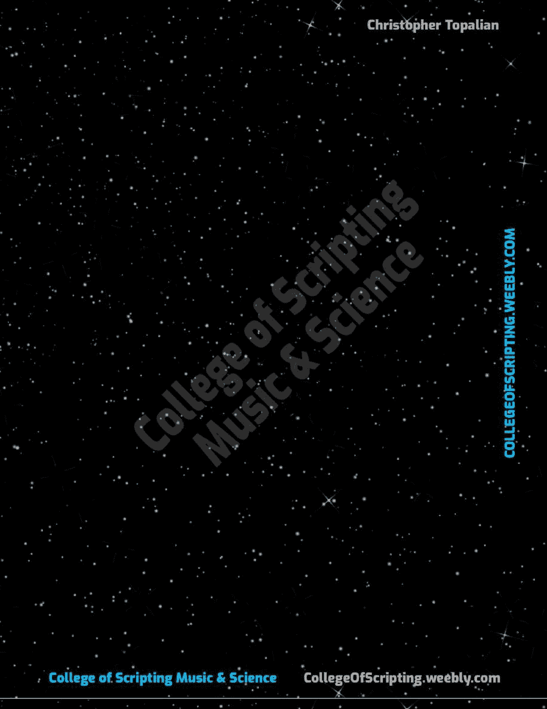

```javascript
function theSeconds() {
  let date = new Date();
  let seconds = date.getSeconds();
  if(seconds==0) {
    return seconds = "00";
  } else if(seconds == 1) {
    return seconds = "01";
  } else if(seconds == 2) {
    return seconds = "02";
  } else if(seconds == 3) {
    return seconds = "03";
  } else if(seconds == 4) {

  } else if(seconds == 5) {
    return seconds = "05";
  } else if(seconds == 6) {
    return seconds = "06";
  } else if(seconds == 7) {
    return seconds = "07";
  } else if(seconds == 8) {
    return seconds = "08";
  } else if(seconds == 9) {
    return seconds = "09";
  }
  return seconds;
}
```

```javascript
function timeKeepGettingTime() {
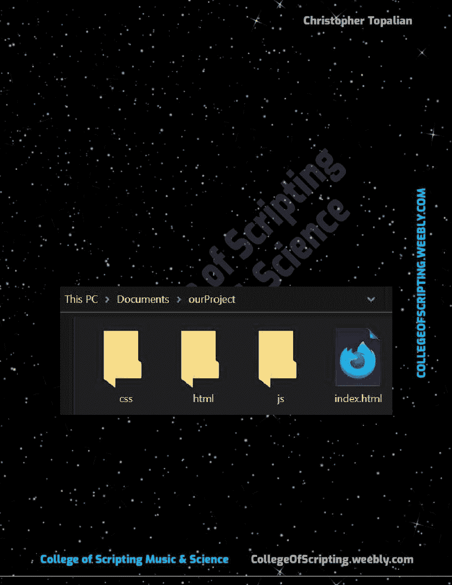
  timeFunctionUpdates();
  t = setInterval('timeFunctionUpdates()',500);
}
```

```javascript
function timeFunctionUpdates() {
  document.getElementById("showTime").innerHTML = theHours() + ":" + theMinutes() + ":" + theSeconds() + " " + amOrpm();
}
```

// 我们将此文件保存为 `js` 文件夹下的 `timeGetTime.js`。
// 接下来的页面将此脚本。


持续获取时间使用了 `timeGetTime.js`

```html
<html
<body style="background-color:rgb(140, 192, 192);">
  <script src="../js/timeGetTime.js"></script>
  <button onclick="timeKeepGettingTime();">时间</button>
  <div id="showTime" style="font-size:100pt">时间</div>
</body>
</html>
```
<!-- 保存为 `ourProject` 文件夹下 `html` 文件夹中的 `timeGetTime.html` -->


```javascript
function theHours() {
  let date = new Date();
  let hours = date.getHours();
  return hours;
}

function theMinutes() {
  let date = new Date();
  let minutes = date.getMinutes();
  return minutes;
}

function amOrpm() {
  let date = new Date();
  let hours = date.getHours();
  if (hours < 12) {
    return "AM";
  } else {
    return "pm";
  }
}

function messageHours() {
  let hours = theHours();
  if (hours >= 0 && hours < 6) {
    return "清晨";
  } else if (hours >= 6 && hours < 12) {
    return "上午";
  } else if (hours >= 12 && hours < 18) {
    return "下午";
  } else if (hours >= 18 && hours <= 23) {
    return "晚上";
  }
}

function displayTimeMessage() {
  document.getElementById("hoursDisplay").innerHTML = messageHours();
}
```

