# 给急躁程序员准备的 JavaScript (ES2020 版)


> “这是一本详尽的资源，但去除了许多编程书中充斥的废话——解释正如标题承诺的那样通俗易懂且直击要点！测试和练习是检查并巩固知识非常有用的功能。你完全可以很快地读完这本书，并上手 JavaScript。”
>
> — Pam Selle，thewebibivore.com

> “最适合现代 JavaScript 的入门读书。”
>
> — Tejinder Singh，IBM 高级软件工程师

> “这就是 JavaScript。没有冗余内容。没有框架。没有第三方库。如果你想学习 JavaScript，你需要这本书。”
>
> — Shelley Powers，软件工程师/作家

# 目录

- [1 背景](#1-背景)
- [2 常见问题：书籍与辅助材料](#2-常见问题书籍与辅助材料)
- [3 为什么选择 JavaScript？（附录）](#3-为什么选择-javascript附录)
- [4 JavaScript 的本质（附录）](#4-javascript-的本质附录)
- [5 JavaScript 的演进与版本](#5-javascript-的演进与版本)
- [6 常见问题：JavaScript](#6-常见问题javascript)
- [II 初步](#ii-初步)
- [III 变量与值](#iii-变量与值)
- [IV 原始值](#iv-原始值)
- [V 控制流与数据](#v-控制流与数据)
- [VI 模块化](#vi-模块化)
- [VII 集合](#vii-集合)
- [VIII 异步性](#viii-异步性)
- [IX 更多标准库](#ix-更多标准库)
- [杂题](#杂题)
- [附录](#附录)

## 1 背景

### 1.1 关于本书

#### 1.1.1 本书中包含什么？

本书通过提供尽可能一致的现代视角，让初学者学习 JavaScript 变得不再那么充满挑战。

亮点：

- 初始阶段关注现代特性，以便快速上手。
- 大多数章节都提供了测试驱动的练习题和测验。
- 可选的高级章节允许你深入探索。

不需要预先 JavaScript 知识，但你应该知道如何编程。

#### 1.1.2 本书未涵盖哪些内容？

- 某些高级语言特性未进行详细解释，但提供了相关材料的引用——例如，我在 ExplorerJS.com 上的其他 JavaScript 书籍，它们可以在线免费阅读。
- 本书精细地专注于语言本身。未描述仅浏览器的特性等。

#### 1.1.3 这本书对于没有耐心的人来说是不是太长了？

你可以通过几种方式来阅读这本书。其中一种方法是跳过大部分内容以便快速开始。详细信息请参阅 [§2.1.1 “我应该以什么顺序阅读书中的内容？”](#211-我应该按什么顺序阅读书中的内容)。

### 1.2 预览与购买本书

#### 1.2.1 我如何预览书籍、练习和测验？

访问本书的主页：

- 本书的所有核心章节都可以在线阅读。
- 前半部分的测试驱动练习可以下载。
- 前半部分的测验可以在线尝试。

#### 1.2.2 如何购买本书的电子版？

《给急躁程序员看的 JavaScript》（JavaScript for Impatient Programmers）有两个数字版本：

- 电子书：PDF, EPUB, MOBI, HTML（均无 DRM 数字版权保护）
- 带有练习和测验的电子书

本书的主页描述了如何购买它们。

#### 1.2.3 如何购买本书的纸质版？

《给急躁程序员看的 JavaScript》纸质版可以在亚马逊上购买。

### 1.3 本书有什么新内容？

与本书的 ES2019 版本相比，作了以下更改：

- 运算符：用于默认值的空值合并运算符 (`??`)。
- BigInt – 任意精度整数：书中处处提到了 BigInt（原始值、假值等）。
- 类型数组：`BigInt64Array`, `BigUint64Array`：新类型（例如在 `DataViews` 中）。
- 模块：重写的关于 `import.meta` 的章节。
- 对象：用于属性访问和方法调用的可选链。
- Promise：全新的“处理 Promise 数组”章节。
- 正则表达式：标志 `/g`, `/y` 以及 `lastIndex` 属性。
- 删除的章节：环境：变量底层原理。该章节不再适合书中。我会尝试在某个地方免费发布。

### 1.4 关于作者

Axel Rauschmayer 博士专注于 JavaScript 和 Web 开发。他从 1995 年开始开发应用程序。1999 年，他在一家国际化的初创公司担任技术经理。2006 年，他进行了第一次关于 Ajax 的演讲。2010 年，他在慕尼黑大学获得计算机科学博士学位。

自 2011 年以来，他一直在 2ality.com 博客撰写 Web 开发文章，并编写了多本关于 JavaScript 的书籍。他曾为 eBay、美国银行和 O'Reilly Media 提供培训和演讲。

他住在德国慕尼黑。

### 1.5 致谢

- 封面由 Fran Gaye 设计
- 本书部分内容由 Adaobi Obi Tulton 编辑。
- 感谢回答问题、讨论语言话题等：
  - Allen Wirfs-Brock (@awbjs)
  - Benedict Meurer (@meurer)
  - Brian Terlson (@bterlson)
  - Daniel Ehrenberg (@littledan)
  - Jordan Harband (@ljharb)
  - Maggie Pint (@maggiepint)
  - Mathias Bynens (@mathias)
  - Myles Borins (@MylesBorins)
  - Rob Palmer (@robpalmer2)
  - Šime Vidas (@simevidas)
  - 以及许多其他人
- 感谢审阅：
  - Johannes Weber (@jowe)

## 2 常见问题：书籍与辅助材料

### 2.1 如何阅读本书

#### 2.1.1 我应该按什么顺序阅读书中的内容？

本书是三合一的：

- 你可以使用它尽快地上手 JavaScript。这种“模式”适合没有耐心的人：
  - 从第 7 章“概述”开始阅读。
  - 跳过所有标记为“高级”的章节和节，以及所有的快速参考。
- 它能让你对当前的 JavaScript 有一个全面的了解。在这种“模式”下，你阅读所有内容，不跳过高级内容和快速参考。
- 它可以作为参考。如果你对某个主题感兴趣，可以通过目录或索引找到相关信息。由于基础和高级内容是混合的，所有内容通常位于同一个地方。

测试和练习在帮助你实践和记忆所学知识方面起着重要作用。

#### 2.1.2 为什么有些章节和节被标记为“(高级)”

有几个章节和节被标记为“(高级)”。其意图是你最初可以跳过它们。也就是说，你只需阅读基础（非高级）内容，就可以快速获得 JavaScript 的实用性知识。

随着你知识的进阶，你之后可以回到部分或全部高级内容。

#### 2.1.3 为什么有些章节被标记为“(赠送)”

赠送章节仅在本书的付费版本（纸质版和电子书）中提供。它们列在完整的目录中。

### 2.2 我拥有电子版

#### 2.2.1 我如何提交反馈和纠错？

本书的 HTML 版本（在线版，或付费版中的无广告存档）在每个章节的末尾都有一个允许提供反馈的链接。

#### 2.2.2 我如何获取在 Payhip 下载内容的更新？

- 购买收据邮件包含一个链接。你始终可以在该处下载文件的最新版本。
- 如果你在购买时选择了订阅邮件，每当有新内容时你都会收到邮件。如果想稍后开启，必须联系 Payhip（payhip.com 底部）。

#### 2.2.3 我可以从“Ebooks”包升级到“Ebooks + 练习 + 测试”包吗？

可以。相关操作说明在本书的主页上。

### 2.3 我拥有纸质版

#### 2.3.1 我可以获得电子版的折扣吗？

如果你购买了纸质版，可以获得电子版的折扣。纸质版的主页解释了如何操作。

遗憾的是，反向是不可能的：如果你购买了电子版，无法获得纸质版的折扣。

#### 2.3.2 我可以提交错误或查看已提交的错误吗？

在本书的主页上，你可以提交错误或查看已提交的错误。

#### 2.3.3 是否有包含书中 URL 的在线列表？

纸质版的主页有一个包含书中 URL 的在线列表。

### 2.4 符号与约定

#### 2.4.1 什么是类型签名？为什么我在书中看到了静态类型？

例如：

```typescript
function greet(name: string): string {
  return "Hello, " + name;
}
```

#### 2.4.2 带有图标的注释意味着什么？

以下图标贯穿全书，用于提供额外信息：

- 💡 提示：这是一个提示。
- ⚠️ 警告：这是一个关于潜在问题的警告。
- ❓ 问题：这是一个你可能会考虑的问题。
- 📝 练习：这是一个练习。
- ✍️ 测试：这是一个测试。
- 📖 详情：提供了更多细节。

## 3 为什么选择 JavaScript？（附录）

### 3.1 JavaScript 的缺点

（原文此处内容缺失，保留标题结构）

### 3.2 JavaScript 的优点

#### 3.2.3 语言

- 有许多库可用，它们通过 JavaScript 世界中事实上的标准 —— npm 软件注册表获取。
- 如果你对“纯原生” JavaScript 不满意，添加更多功能相对容易：
  - 你可以通过 `Babel` 将未来和现代的语言特性编译到当前和过去版本的 JavaScript。
  - 你可以通过 `TypeScript` 和 `Flow` 添加静态类型。
  - 你可以使用 `ReasonML`，它大致等同于带有 JavaScript 语法的 OCaml。它可以被编译为 JavaScript 或原生代码。
- 这种语言非常灵活：它是动态的，并且同时支持面向对象编程和函数式编程。
- 对于这样一种动态语言来说，JavaScript 的速度已经变得惊人地快：
  - 每当速度不够快时，你可以切换到 `WebAssembly`，这是一种构建在大多数 JavaScript 引擎中的通用虚拟机。它可以以近乎原生的速度运行静态代码。

### 3.3 JavaScript 的优缺点：创新

JavaScript 生态系统中充满了创新：实现用户界面的新方法、优化软件交付的新方式等。优点是你将不断学习新知识。缺点是不断的变化有时会让人精疲力竭。坦率地说，最近事情有所放缓：所有的 ES6（它是语言的一次重大现代化）正趋于定型，某些工具和工作流也是如此。

> 测验
>
> 参见测验应用。

## 4 JavaScript 的本质（附录）

### 4.1 JavaScript 的影响

当 JavaScript 于 1995 年创建时，它受到了几种编程语言的影响：

- JavaScript 的语法很大程度上基于 `Java`。
- `Self` 启发了 JavaScript 的原型继承。
- 闭包和环境借自 `Scheme`。
- `AWK` 影响了 JavaScript 的函数（包括 `function` 关键字）。
- JavaScript 的字符串、数组和正则表达式参考了 `Perl`。
- `HyperTalk` 启发了通过浏览器中的 `onClick` 实现的事件处理。

随着 ECMAScript 6，新的影响引入了 JavaScript：

- 生成器借自 `Python`。
- 箭头函数的语法来自 `CoffeeScript`。
- `C++` 贡献了 `const` 关键字。
- 解构赋值受到 `Lisp` 的解构绑定启发。
- 模板字面量来自 `E` 语言（在其中被称为准字面量）。

### 4.2 JavaScript 的本质

这是该语言的几个特征：

- 它的语法是 C 语言族的一部分（大括号等）。
- 它是一门动态语言：大多数对象可以在运行时以各种方式更改，可以直接创建对象等等。
- 它是一门动态类型语言：变量没有固定类型，你可以给给定的（可变的）变量分配任何值。
- 它具有函数式编程特性：一等函数、闭包、部分应用 `bind()` 等。
- 它具有面向对象特性：可变状态、对象、继承、类等。
- 它经常静默失败：详情请参阅下一节。
- 它以源代码的形式部署。但这些源代码通常会经过混淆处理（重写以占用更少的存储）。而且还有二进制源码格式的计划。
- JavaScript 是 Web 平台的一部分——它是构建浏览器的语言。但它也被用于其他地方——例如，在 `Node.js` 中，用于服务器、Shell 和 Shell 脚本。
- JavaScript 引擎通常会在底层优化效率较低的语言机制。但在底层，如果数组具有连续的索引，它们将以连续方式存储数组。

#### 4.2.1 JavaScript 经常静默失败

JavaScript 经常静默失败。让我们来看两个例子。

第一个例子：如果操作符的操作数没有适当的类型，它们将根据需要进行转换。

```javascript
> '3' * '5'
15
```

第二个例子：如果算术计算失败，你得到的是错误值，而不是异常。

```javascript
> 1 / 0
Infinity
```

静默失败的原因是历史性的：直到 ECMAScript 3，JavaScript 还没有异常。从那时起，它的设计者一直试图避免静默失败。

### 4.3 开始学习 JavaScript 的技巧

这里是一些帮助你上手 JavaScript 的技巧：

- 花些时间真正了解这门语言。传统的 C 风格语法掩盖了这是一门非常不传统的语言这一事实。要学习那些特性及其背后的原理。这样你就能更好地理解和欣赏这门语言。
- 除了细节，这本书还教了一些简单的经验规则以确保安全——例如，“始终使用 `===` 来判断两个值是否相等，永远不要使用 `==`。”
- 语言工具让使用 JavaScript 变得更简单。例如：
  - 你可以通过 `TypeScript` 或 `Flow` 对 JavaScript 进行静态类型化。
  - 你可以通过 `ESLint` 等代码检查工具检查问题和反模式。
  - 你可以通过 `Prettier` 等代码格式化工具自动格式化代码。
- 与社区建立联系：
  - `Twitter` 在 JavaScript 程序员中很流行。作为一种介于口语和书面语之间的交流方式，它非常适合。
  - 许多地方可以聚在一起学习 JavaScript。
  - 阅读书籍和博客。

## 5 JavaScript 的演进与版本

### 5.1 JavaScript 是如何创建的

（原文此处内容缺失，保留标题结构）

### 5.2 JavaScript 的标准化

（原文此处内容缺失，保留标题结构）

### 5.3 ECMAScript 版本时间线

（原文此处内容缺失，保留标题结构）

### 5.4 Ecma 技术委员会 39 (TC39)

TC39 是负责演进 JavaScript 的委员会。严格来说，其成员是公司：Adobe、Apple、Facebook、Google、Microsoft、Mozilla、Opera、Twitter 等。也就是说，这些本是激烈竞争对手的公司正为了这种语言的利益而共同工作。

每两个月，TC39 都会举行会议，由成员指派的代表和专家参加。会议纪要发布在 GitHub 仓库中公开。

### 5.5 TC39 流程

随着 ECMAScript 6 的出现，当时使用的发布流程中存在的两个问题变得显而易见：

- 如果功能早期已经就绪，但发布之间的时间间隔过长，它们必须等待很长时间才能发布。而那些后期就绪的功能又为了赶上截止日期而仓忙上线。
- 功能通常在实现和使用之前很久就已经设计好了。关于实现和使用的设计缺陷在太晚之后才发现。

针对这些问题，TC39 制定了新的 TC39 流程：

- ECMAScript 特性是独立设计的，并经过多个阶段，从阶段 0（“草案”）开始，到阶段 4（“完成”）结束。
- 后期阶段需要原型实现和真实世界的测试，从而在设计和实现之间建立起反馈循环。
- ECMAScript 版本每年发布一次，包含所有在截止日期前达到阶段 4 的功能。

结果是：更小、增量式的发布，其功能已经经过了实地测试。

ES2016 是第一个按照 TC39 流程设计的 ECMAScript 版本。

#### 5.5.1 提示：按单个功能和阶段来思考，而不是按 ECMAScript 版本

在包括 ES6 在内，最常见的做法是根据 ECMAScript 版本来考虑 JavaScript —— 例如，“这个浏览器支持 ES6 吗？”

从 ES2016 开始，最好按单个功能来思考：一旦某个功能达到阶段 4，你就可以使用它（如果你的目标 JavaScript 引擎支持它）。你不需要等到下一次 ECMAScript 发布。

图 5.1：每个 ECMAScript 特性提案都会经过从 0 到 4 编号的阶段。冠军是支持功能作者的 TC39 成员。Test 262 是一套测试集，用于检查 JavaScript 引擎对语言规范的符合性。

| 阶段 | 描述 | 细节 |
| :--- | :--- | :--- |
| 阶段 0 | 草案 | 选择冠军 |
| 阶段 1 | 提案 | TC39 提供帮助；首次规范文本，2 个实现 |
| 阶段 2 | 草稿 | 可能标准化；规范完成 |
| 阶段 3 | 候选 | 已完成，需要实现的反馈；Test 262 验收测试 |
| 阶段 4 | 完成 | 准备好标准化 |

### 5.6 常见问题：TC39 流程

#### 5.6.1 [我喜欢的提议功能]进展如何？

如果你想知道各种提议功能处于什么阶段，请查看 GitHub 提案仓库。

#### 5.6.2 有 ECMAScript 特性的官方列表吗？

有的，TC39 仓库列出了已完成的提案，并提到了它们引入的 ECMAScript 版本。

### 5.7 JavaScript 的进化：不破坏 Web

偶尔会提出一种通过移除旧功能和怪异行为来清理 JavaScript 的想法。这个想法的吸引力显而易见，但它有巨大的缺点。

假设我们创建了一个新的 JavaScript 版本，它与之前所有的缺陷都不后向兼容。结果，我们将遇到以下问题：

- JavaScript 引擎变得臃肿：它们需要同时支持旧版本和新版本。IDE 和构建工具也是如此。
- 程序员需要知道并持续意识到不同版本之间的差异。
- 你可以将所有现有的代码迁移到新版本（这可能是一项大量工作）。或者你可以混合版本，重构会变得更加困难，因为你无法在不同版本之间移动代码。
- 你必须以某种方式为每段代码（无论是文件还是嵌入网页的代码）指定它是用什么语言编写的。例如，严格模式是 ES5 的一个稍微干净的版本。

那么解决方案是什么？我们能既要到蛋糕又吃到它吗？为 ES6 选择的方法被称为“JavaScript”：

- 新版本始终向后兼容（但可能会发生微小的清理）。
- 旧功能不会被移除或修复。相反，会引入它们的更好版本。一个例子是用 `let` 声明变量 —— 它是 `var` 的改进版本。
- 如果语言某些方面发生了变化，是通过新的语法构造实现的。例如，`yield` 只位于生成器内部（生成器是在 ES6 中引入的）。模块和类中的所有代码都是严格模式。

## 6 常见问题：JavaScript

### 6.1 哪些是良好的 JavaScript 参考资料？

请参阅 [§7.3 “JavaScript 参考”](#73-javascript-参考)。

### 6.2 我如何知道哪些 JavaScript 特性被支持？

此书通常会提到支持情况。对于更详细的信息，可以查看以下表格：

- ECMAScript 兼容性表（MDN）
- Node.js 兼容性表（官方）
- “Can I use...” 文档说明哪些功能（包括浏览器支持）。

### 6.3 我可以在哪里查看计划中的 JavaScript 特性？

请查阅以下来源：

- [§5.5 “TC39 流程”](#55-tc39-流程)描述了功能是如何计划的。
- [§5.6 “常见问题：TC39 流程”](#56-常见问题tc39-流程)回答了相关的各种问题。

### 6.4 为什么 JavaScript 经常静默失败？

JavaScript 经常静默失败。让我们来看例子。

第一个例子：如果运算符的操作数类型不对，它们会进行转换。

```javascript
> '3' * '5'
15
```

第二个例子：如果算术计算失败，你会得到一个错误值而不是异常。

```javascript
> 1 / 0
Infinity
```

### 6.5 为什么我们不能通过移除怪异行为和过时功能来清理 JavaScript？

这个问题在 [§5.7 “JavaScript 的进化：不破坏 Web”](#57-javascript-的进化不破坏-web) 中得到了解答。

### 6.6 我如何快速尝试一段 JavaScript 代码？

[§9.1 “尝试 JavaScript 代码”](#91-尝试-javascript-代码) 解释了如何做到这一点。

## II 初步

## 7 宏观视角

### 7.1 你在本书中学习了什么？

本书教授的是 JavaScript 语言。它专注于语言本身，但偶尔会瞥一下可以使用 JavaScript 的两个平台：

- 浏览器
- Node.js

Node.js 对 Web 开发非常重要，体现在：

- 你可以使用 JavaScript 编写服务器端软件。
- 你还可以用它编写命令行软件（如 Unix shell、PowerShell 等）。许多 JavaScript 相关的工具都是基于（并通过 Node.js 执行）的。
- Node 的软件仓库 `npm` 已成为安装工具（如编译器和构建工具）以及库的主流方式 —— 即使对于客户端开发也是如此。

### 7.2 浏览器和 Node.js 的结构

| JS 标准库 | 平台 API |
| :--- | :--- |
| JavaScript 引擎 | 平台核心 |

图 7.1：两个 JavaScript 平台 Web 浏览器和 Node.js 的结构。API “标准库”和“平台 API”托管在一个基础层之上，该基础层包含一个 JavaScript 引擎和一个特定平台的“核心”。

- 基础层由 JavaScript 引擎和特定平台的“核心”功能组成。
- 两个 API 建立在这一基础之上：
  - JavaScript 标准库是 JavaScript 本身的一部分，运行在引擎之上。
  - 平台 API 也可以通过 JavaScript 获取——它提供了对特定平台功能的访问。例如：
    - 在浏览器中，如果你想进行任何与用户界面相关的操作，需要使用特定平台的 API：响应鼠标点击、播放声音等。
    - 在 Node.js 中，特定平台的 API 允许你读取和写入文件、通过 HTTP 下载数据等。

### 7.3 JavaScript 参考

当你有关于 JavaScript 的问题时，网络搜索通常会有帮助。我为你推荐以下在线资源：

- MDN web docs：涵盖了各种 Web 技术，如 CSS、HTML、JavaScript 等。一个极佳的参考资料。
- Node.js Docs：记录了 Node.js API。
- ExploringJS：我的关于 JavaScript 的书籍比本书更详细，并且可以在线免费阅读。你可以按 ECMAScript 版本查找特性：
  - ES1–ES5：Speaking JavaScript
  - ES6：Exploring ES6
  - ES2016–ES2017：Exploring ES2016 and ES2017
  - 等。

### 7.4 进阶阅读

（原文此处内容缺失，保留标题结构）

## 8 语法

### 8.1 JavaScript 语法概览

（原文此处内容缺失，保留标题结构）

### 8.2 （高级）

（原文此处内容缺失，保留标题结构）

### 8.3 标识符

（原文此处内容缺失，保留标题结构）

### 8.4 语句与表达式

（原文此处内容缺失，保留标题结构）

### 8.5 歧义语法

（原文此处内容缺失，保留标题结构）

### 8.6 分号

（原文此处内容缺失，保留标题结构）

### 8.7 自动分号插入 (ASI)

（原文此处内容缺失，保留标题结构）

### 8.8 分号：最佳实践

（原文此处内容缺失，保留标题结构）

### 8.9 严格模式与宽松模式

（原文此处内容缺失，保留标题结构）

## 9 控制台：交互式 JavaScript 命令行

### 9.1 尝试 JavaScript 代码

（原文此处内容缺失，保留标题结构）

### 9.2 console.* API：打印数据及更多

（原文此处内容缺失，保留标题结构）

## 10 断言 API

### 10.1 软件开发中的断言

（原文此处内容缺失，保留标题结构）

### 10.2 断言在书中是如何使用的

（原文此处内容缺失，保留标题结构）

### 10.3 常规比较与深层比较

（原文此处内容缺失，保留标题结构）

### 10.4 快速查阅：module assert

（原文此处内容缺失，保留标题结构）

## 11 从开始学习测验与练习

### 11.1 测验

（原文此处内容缺失，保留标题结构）

### 11.2 练习

（原文此处内容缺失，保留标题结构）

### 11.3 JavaScript 中的单元测试

（原文此处内容缺失，保留标题结构）

## III 变量与值

## 12 变量与赋值

### 12.1 let

（原文此处内容缺失，保留标题结构）

### 12.2 const

（原文此处内容缺失，保留标题结构）

### 12.3 在 const 和 let 之间做抉择

（原文此处内容缺失，保留标题结构）

### 12.4 变量的作用域

（原文此处内容缺失，保留标题结构）

### 12.5 （高级）

（原文此处内容缺失，保留标题结构）

### 12.6 术语：静态与动态

（原文此处内容缺失，保留标题结构）

### 12.7 全局变量与全局对象

（原文此处内容缺失，保留标题结构）

### 12.8 声明：作用域与激活

（原文此处内容缺失，保留标题结构）

### 12.9 闭包

（原文此处内容缺失，保留标题结构）

## 13 值

### 13.1 什么是类型？

（原文此处内容缺失，保留标题结构）

### 13.2 JavaScript 的类型层次结构

（原文此处内容缺失，保留标题结构）

### 13.3 语言规范中的类型

（原文此处内容缺失，保留标题结构）

### 13.4 原始值与对象

（原文此处内容缺失，保留标题结构）

### 13.5 运算符 typeof 和 instanceof：值的类型是什么？

（原文此处内容缺失，保留标题结构）

### 13.6 类与构造函数

（原文此处内容缺失，保留标题结构）

### 13.7 类型之间的转换

（原文此处内容缺失，保留标题结构）

## 14 运算符

### 14.1 理解运算符

（原文此处内容缺失，保留标题结构）

### 14.2 加法运算符 (+)

（原文此处内容缺失，保留标题结构）

### 14.3 赋值运算符

（原文此处内容缺失，保留标题结构）

### 14.4 相等：== vs. ===

（原文此处内容缺失，保留标题结构）

### 14.5 排序运算符

（原文此处内容缺失，保留标题结构）

### 14.6 用于默认值的空值合并运算符 (??)

（原文此处内容缺失，保留标题结构）

### 14.7 各种运算符

（原文此处内容缺失，保留标题结构）

## IV 原始值

## 15 undefined 和 null

### 15.1 undefined 与 null

（原文此处内容缺失，保留标题结构）

### 15.2 undefined 和 null 的出现

（原文此处内容缺失，保留标题结构）

### 15.3 检查 undefined 或 null

（原文此处内容缺失，保留标题结构）

### 15.4 undefined 和 null 没有属性

（原文此处内容缺失，保留标题结构）

### 15.5 undefined 和 null 的历史

（原文此处内容缺失，保留标题结构）

## 16 布尔值

### 16.1 转换为布尔值

（原文此处内容缺失，保留标题结构）

### 16.2 假值与真值

（原文此处内容缺失，保留标题结构）

### 16.3 基于真值的检查

（原文此处内容缺失，保留标题结构）

### 16.4 条件运算符 (?)

（原文此处内容缺失，保留标题结构）

### 16.5 二元运算符：与 (x && y)，或 (x || y)

（原文此处内容缺失，保留标题结构）

### 16.6 逻辑非 (!)

（原文此处内容缺失，保留标题结构）

## 17 数字

### 17.1 数字同时用于浮点数和整数

（原文此处内容缺失，保留标题结构）

### 17.2 数字字面量

（原文此处内容缺失，保留标题结构）

### 17.3 算术运算符

（原文此处内容缺失，保留标题结构）

### 17.4 转换为数字

（原文此处内容缺失，保留标题结构）

### 17.5 错误值

（原文此处内容缺失，保留标题结构）

### 17.6 错误值：NaN

（原文此处内容缺失，保留标题结构）

### 17.7 错误值：Infinity

（原文此处内容缺失，保留标题结构）

### 17.8 数字的精度：小心处理小数

（原文此处内容缺失，保留标题结构）

### 17.9 （高级）

（原文此处内容缺失，保留标题结构）

### 17.10 背景：浮点数精度

（原文此处内容缺失，保留标题结构）

### 17.11 JavaScript 中的整数

（原文此处内容缺失，保留标题结构）

### 17.12 位运算符

（原文此处内容缺失，保留标题结构）

### 17.13 快速查阅

（原文此处内容缺失，保留标题结构）

## 18 数学

### 18.1 属性

（原文此处内容缺失，保留标题结构）

### 18.2 指数、根号

（原文此处内容缺失，保留标题结构）

### 18.3 四舍五入

（原文此处内容缺失，保留标题结构）

### 18.4 三角函数

（原文此处内容缺失，保留标题结构）

### 18.5 各种函数

（原文此处内容缺失，保留标题结构）

### 18.6 来源

（原文此处内容缺失，保留标题结构）

## 19 BigInt

### 19.1 为什么需要 BigInt？

（原文此处内容缺失，保留标题结构）

### 19.2 BigInt

（原文此处内容缺失，保留标题结构）

### 19.3 BigInt 字面量

（原文此处内容缺失，保留标题结构）

### 19.4 用于 BigInt 的运算符

（原文此处内容缺失，保留标题结构）

### 19.5 BigInt 构造函数

（原文此处内容缺失，保留标题结构）

### 19.6 转换为其他类型

（原文此处内容缺失，保留标题结构）

### 19.7 BigInt 数组

（原文此处内容缺失，保留标题结构）

### 19.8 BigInt 操作

（原文此处内容缺失，保留标题结构）

### 19.9 BigInt 常见问题

（原文此处内容缺失，保留标题结构）

## 20 Unicode

### 20.1 码点与单元

（原文此处内容缺失，保留标题结构）

### 20.2 UTF-8 编码

（原文此处内容缺失，保留标题结构）

### 20.3 字形簇

（原文此处内容缺失，保留标题结构）

## 21 字符串

### 21.1 字符串字面量

（原文此处内容缺失，保留标题结构）

### 21.2 访问字符串

（原文此处内容缺失，保留标题结构）

### 21.3 字符串拼接

（原文此处内容缺失，保留标题结构）

### 21.4 转换为字符串

（原文此处内容缺失，保留标题结构）

### 21.5 字符串比较

（原文此处内容缺失，保留标题结构）

### 21.6 Unicode 码点、字形簇

（原文此处内容缺失，保留标题结构）

### 21.7 快速查阅：字符串

（原文此处内容缺失，保留标题结构）

## 22 模板字符串

### 22.1 模板字符串的使用

（原文此处内容缺失，保留标题结构）

### 22.2 模板字符串字面量

（原文此处内容缺失，保留标题结构）

### 22.3 标签表达式

（原文此处内容缺失，保留标题结构）

### 22.4 模板字符串语法

（原文此处内容缺失，保留标题结构）

### 22.5 （高级）

（原文此处内容缺失，保留标题结构）

### 22.6 多行模板字符串

（原文此处内容缺失，保留标题结构）

### 22.7 模板字符串导出

（原文此处内容缺失，保留标题结构）

## 23 符号

### 23.1 符号用例

（原文此处内容缺失，保留标题结构）

### 23.2 公共符号

（原文此处内容缺失，保留标题结构）

### 23.3 符号命名

（原文此处内容缺失，保留标题结构）

## V 控制流与数据

## 24 控制语句

### 24.1 控制流条件

（原文此处内容缺失，保留标题结构）

### 24.2 break 和 continue

（原文此处内容缺失，保留标题结构）

### 24.3 if 语句

（原文此处内容缺失，保留标题结构）

### 24.4 switch 语句

（原文此处内容缺失，保留标题结构）

### 24.5 while 循环

（原文此处内容缺失，保留标题结构）

### 24.6 do-while 循环

（原文此处内容缺失，保留标题结构）

### 24.7 for 循环

（原文此处内容缺失，保留标题结构）

### 24.8 for-of 循环

（原文此处内容缺失，保留标题结构）

### 24.9 for-await-of 循环

（原文此处内容缺失，保留标题结构）

### 24.10 for-in 循环（避免）

（原文此处内容缺失，保留标题结构）

## 25 异常处理

### 25.1 动机：抛出和捕获异常

（原文此处内容缺失，保留标题结构）

### 25.2 throw

（原文此处内容缺失，保留标题结构）

### 25.3 try 语句

（原文此处内容缺失，保留标题结构）

### 25.4 错误类

（原文此处内容缺失，保留标题结构）

## 26 可调值

### 26.1 函数的种类

（原文此处内容缺失，保留标题结构）

### 26.2 普通函数

（原文此处内容缺失，保留标题结构）

### 26.3 特殊函数

（原文此处内容缺失，保留标题结构）

### 26.4 更多种函数和方法

（原文此处内容缺失，保留标题结构）

### 26.5 函数和方法的返回值

（原文此处内容缺失，保留标题结构）

### 26.6 参数处理

（原文此处内容缺失，保留标题结构）

### 26.7 动态评估代码：eval(), new Function() （高级）

（原文此处内容缺失，保留标题结构）

## VI 模块化

## 27 模块

### 27.1 ECMAScript 模块语法概览

（原文此处内容缺失，保留标题结构）

### 27.2 JavaScript 源码格式

（原文此处内容缺失，保留标题结构）

### 27.3 在我们拥有模块之前，我们只有脚本

（原文此处内容缺失，保留标题结构）

### 27.4 ES6 之前创建的模块系统

（原文此处内容缺失，保留标题结构）

### 27.5 ECMAScript 模块

（原文此处内容缺失，保留标题结构）

### 27.6 具名导出和导入

（原文此处内容缺失，保留标题结构）

### 27.7 默认导出和导入

（原文此处内容缺失，保留标题结构）

### 27.8 导出和导入的更多细节

（原文此处内容缺失，保留标题结构）

### 27.9 npm 包

（原文此处内容缺失，保留标题结构）

### 27.10 模块命名

（原文此处内容缺失，保留标题结构）

### 27.11 模块规范符

（原文此处内容缺失，保留标题结构）

### 27.12 通过 import() 动态加载模块 [ES2020]

（原文此处内容缺失，保留标题结构）

### 27.13 import.meta.url

（原文此处内容缺失，保留标题结构）

### 27.14 Polyfills：模拟原生平台特性（高级）

（原文此处内容缺失，保留标题结构）

## 28 简单对象

### 28.1 什么是对象？

（原文此处内容缺失，保留标题结构）

### 28.2 作为记录的对象

（原文此处内容缺失，保留标题结构）

### 28.3 展开到对象字面量 (...) [ES2018]

（原文此处内容缺失，保留标题结构）

### 28.4 方法

（原文此处内容缺失，保留标题结构）

### 28.5 用于属性访问和方法调用的可选链（高级） [ES2020]

（原文此处内容缺失，保留标题结构）

### 28.6 作为字典的对象（高级）

（原文此处内容缺失，保留标题结构）

### 28.7 标准方法（高级）

（原文此处内容缺失，保留标题结构）

### 28.8 进阶主题

（原文此处内容缺失，保留标题结构）

## 29 原型链与类

### 29.1 原型链

（原文此处内容缺失，保留标题结构）

### 29.2 类

（原文此处内容缺失，保留标题结构）

### 29.3 类的私有数据

（原文此处内容缺失，保留标题结构）

### 29.4 子类化

（原文此处内容缺失，保留标题结构）

### 29.5 常见问题：对象

（原文此处内容缺失，保留标题结构）

## VII 集合

## 30 同步迭代

### 30.1 什么是同步迭代？

（原文此处内容缺失，保留标题结构）

### 30.2 核心迭代构造：可迭代对象和迭代器

（原文此处内容缺失，保留标题结构）

### 30.3 手动迭代

（原文此处内容缺失，保留标题结构）

### 30.4 实践中的迭代

（原文此处内容缺失，保留标题结构）

### 30.5 快速参考：同步迭代

（原文此处内容缺失，保留标题结构）

## 31 数组 (Array)

### 31.1 数组在 JavaScript 中的两个角色

（原文此处内容缺失，保留标题结构）

### 31.2 基础数组操作

（原文此处内容缺失，保留标题结构）

### 31.3 for-of 与数组 [ES6]

（原文此处内容缺失，保留标题结构）

### 31.4 类数组对象

（原文此处内容缺失，保留标题结构）

### 31.5 将可迭代值和类数组值转换为数组

（原文此处内容缺失，保留标题结构）

### 31.6 创建并填充任意长度的数组

（原文此处内容缺失，保留标题结构）

### 31.7 多维数组

（原文此处内容缺失，保留标题结构）

### 31.8 更多数组特性（高级）

（原文此处内容缺失，保留标题结构）

### 31.9 添加和删除元素（破坏性与非破坏性）

（原文此处内容缺失，保留标题结构）

### 31.10 方法：迭代与转换 (.find(), .map(), .filter(), 等)

（原文此处内容缺失，保留标题结构）

### 31.11 sort()：数组排序

（原文此处内容缺失，保留标题结构）

### 31.12 快速参考：Array<>

（原文此处内容缺失，保留标题结构）

## 32 类型数组 (Typed Arrays)：处理二进制数据（高级）

### 32.1 API 基础

（原文此处内容缺失，保留标题结构）

### 32.2 元素类型

（原文此处内容缺失，保留标题结构）

### 32.3 关于类型数组的更多信息

（原文此处内容缺失，保留标题结构）

### 32.4 快速参考：索引 vs 偏移量

（原文此处内容缺失，保留标题结构）

### 32.5 快速参考：ArrayBuffers

（原文此处内容缺失，保留标题结构）

### 32.6 快速参考：类型数组

（原文此处内容缺失，保留标题结构）

### 32.7 快速参考：DataViews

（原文此处内容缺失，保留标题结构）

## 33 Map (Map)

### 33.1 使用 Map

（原文此处内容缺失，保留标题结构）

### 33.2 示例：计数器统计

（原文此处内容缺失，保留标题结构）

### 33.3 关于 Map 键的更多细节（高级）

（原文此处内容缺失，保留标题结构）

### 33.4 缺失的 Map 操作

（原文此处内容缺失，保留标题结构）

### 33.5 快速参考：Map<K,V>

（原文此处内容缺失，保留标题结构）

### 33.6 常见问题：Map

（原文此处内容缺失，保留标题结构）

## 34 弱Map (WeakMap)

### 34.1 WeakMap 是黑盒

（原文此处内容缺失，保留标题结构）

### 34.2 WeakMap 的键是弱引用持用的

（原文此处内容缺失，保留标题结构）

### 34.3 示例

（原文此处内容缺失，保留标题结构）

### 34.4 WeakMap API

（原文此处内容缺失，保留标题结构）

## 35 Set (Set)

### 35.1 使用 Set

（原文此处内容缺失，保留标题结构）

### 35.2 使用 Set 的示例

（原文此处内容缺失，保留标题结构）

### 35.3 哪些元素被认为是相等的？

（原文此处内容缺失，保留标题结构）

### 35.4 缺失的操作

（原文此处内容缺失，保留标题结构）

### 35.5 快速参考：Set<T>

（原文此处内容缺失，保留标题结构）

### 35.6 常见问题：Set

（原文此处内容缺失，保留标题结构）

## 36 弱Set (WeakSet)

### 36.1 示例：使用方法标记对象安全使用

（原文此处内容缺失，保留标题结构）

### 36.2 WeakSet API

（原文此处内容缺失，保留标题结构）

## 37 解构

### 37.1 解构的初探

（原文此处内容缺失，保留标题结构）

### 37.2 构建 vs. 提取

（原文此处内容缺失，保留标题结构）

### 37.3 可以在哪里进行解构？

（原文此处内容缺失，保留标题结构）

### 37.4 对象解构

（原文此处内容缺失，保留标题结构）

### 37.5 数组解构

（原文此处内容缺失，保留标题结构）

### 37.6 解构示例

（原文此处内容缺失，保留标题结构）

### 37.7 如果模式不匹配会发生什么？

（原文此处内容缺失，保留标题结构）

### 37.8 哪些值不能被解构？

（原文此处内容缺失，保留标题结构）

### 37.9 （高级）

（原文此处内容缺失，保留标题结构）

### 37.10 默认值

（原文此处内容缺失，保留标题结构）

### 37.11 参数定义与解构相似

（原文此处内容缺失，保留标题结构）

### 37.12 嵌套解构

（原文此处内容缺失，保留标题结构）

## 38 同步生成器（高级）

### 38.1 什么是同步生成器？

（原文此处内容缺失，保留标题结构）

### 38.2 从生成器中调用生成器（高级）

（原文此处内容缺失，保留标题结构）

### 38.3 背景：外部迭代 vs. 内部迭代

（原文此处内容缺失，保留标题结构）

### 38.4 生成器的用例：复用遍历

（原文此处内容缺失，保留标题结构）

### 38.5 生成器的高级特性

（原文此处内容缺失，保留标题结构）

## VIII 异步性

## 39 JavaScript 中的异步编程

### 39.1 JavaScript 异步编程路线图

（原文此处内容缺失，保留标题结构）

### 39.2 调用堆栈

（原文此处内容缺失，保留标题结构）

### 39.3 事件循环

（原文此处内容缺失，保留标题结构）

### 39.4 如何避免阻塞 JavaScript 进程

（原文此处内容缺失，保留标题结构）

### 39.5 交付结果的模式

（原文此处内容缺失，保留标题结构）

### 39.6 异步代码的缺点

（原文此处内容缺失，保留标题结构）

### 39.7 资源

（原文此处内容缺失，保留标题结构）

## 40 用于异步编程的 Promise

### 40.1 使用 Promise 的基础

（原文此处内容缺失，保留标题结构）

### 40.2 示例

（原文此处内容缺失，保留标题结构）

### 40.3 错误处理：不要混合拒绝与异常

（原文此处内容缺失，保留标题结构）

### 40.4 基于 Promise 的函数同步启动，异步完成

（原文此处内容缺失，保留标题结构）

### 40.5 Promise 组合器：处理 Promise 数组

（原文此处内容缺失，保留标题结构）

### 40.6 并发与 Promise.all()（高级）

（原文此处内容缺失，保留标题结构）

### 40.7 Promise 链的技巧

（原文此处内容缺失，保留标题结构）

## 41 异步函数：基础

### 41.1 异步函数

（原文此处内容缺失，保留标题结构）

### 41.2 从异步函数返回

（原文此处内容缺失，保留标题结构）

### 41.3 await：处理 Promise

（原文此处内容缺失，保留标题结构）

### 41.4 （高级）

（原文此处内容缺失，保留标题结构）

### 41.5 立即调用的异步函数

（原文此处内容缺失，保留标题结构）

### 41.6 并发与 await

（原文此处内容缺失，保留标题结构）

### 41.7 使用异步函数的技巧

（原文此处内容缺失，保留标题结构）

## 42 异步迭代

### 42.1 基础异步迭代

（原文此处内容缺失，保留标题结构）

### 42.2 异步生成器

（原文此处内容缺失，保留标题结构）

### 42.3 针对 Node.js 流的异步迭代

（原文此处内容缺失，保留标题结构）

## IX 更多标准库

## 43 正则表达式 (RegExp)

### 43.1 创建正则表达式

（原文此处内容缺失，保留标题结构）

### 43.2 语法

（原文此处内容缺失，保留标题结构）

### 43.3 标志位

（原文此处内容缺失，保留标题结构）

### 43.4 正则表达式对象的属性

（原文此处内容缺失，保留标题结构）

### 43.5 处理正则表达式的方法

（原文此处内容缺失，保留标题结构）

### 43.6 标志位 /g、/y 以及属性 .lastIndex（高级）

（原文此处内容缺失，保留标题结构）

### 43.7 处理正则表达式的技巧

（原文此处内容缺失，保留标题结构）

## 44 日期 (Date)

### 44.1 最佳实践：避免使用内置 Date

（原文此处内容缺失，保留标题结构）

### 44.2 时间标准

（原文此处内容缺失，保留标题结构）

### 44.3 背景：日期时间格式 (ISO)

（原文此处内容缺失，保留标题结构）

### 44.4 时间值

（原文此处内容缺失，保留标题结构）

### 44.5 创建日期

（原文此处内容缺失，保留标题结构）

### 44.6 Getters 和 setters

（原文此处内容缺失，保留标题结构）

### 44.7 将日期转换为字符串

（原文此处内容缺失，保留标题结构）

## 45 创建与解析 JSON (JSON)

### 45.1 JSON 的发现与标准化

（原文此处内容缺失，保留标题结构）

### 45.2 JSON 语法

（原文此处内容缺失，保留标题结构）

### 45.3 使用 JSON API

（原文此处内容缺失，保留标题结构）

### 45.4 自定义字符串化与解析（高级）

（原文此处内容缺失，保留标题结构）

### 45.5 常见问题

（原文此处内容缺失，保留标题结构）

## 杂题

## 46 下一步：Web 开发概览（赠送）

### 46.1 缓解焦虑感的技巧

（原文此处内容缺失，保留标题结构）

### 46.2 Web 开发中值得学习的内容

（原文此处内容缺失，保留标题结构）

### 46.3 示例：基于工具的 JavaScript 工作流

（原文此处内容缺失，保留标题结构）

### 46.4 JavaScript 工具概述

（原文此处内容缺失，保留标题结构）

### 46.5 与 JavaScript 无关的工具

（原文此处内容缺失，保留标题结构）

## 附录

## 47 索引

（原文此处内容缺失，保留标题结构）


- §46 “下一步：Web 开发概览”提供了对 Web 开发更全面的观察。

# 第 8 章

## 语法

### 目录

- 8.1 JavaScript 语法的概述
  - 8.1.1 基础语法
  - 8.1.2 模块
  - 8.1.3 合法的变量名和属性名
  - 8.1.4 命名风格
  - 8.1.5 命名的大小写
  - 8.1.6 更多命名规范
  - 8.1.7 分号应该放在哪里？
- 8.2 （高级）
- 8.3 标识符
  - 8.3.1 有效标识符（变量名等）
  - 8.3.2 保留字
- 8.4 语句 vs. 表达式
  - 8.4.1 语句
  - 8.4.2 表达式
  - 8.4.3 什么在什么地方是允许的？
- 8.5 歧义语法
  - 8.5.1 相同语法：函数声明和函数表达式
  - 8.5.2 相同语法：对象字面量和块
  - 8.5.3 消除歧义
- 8.6 分号
  - 8.6.1 分号的经验法则
  - 8.6.2 分号：控制语句
- 8.7 自动分号插入 (ASI)
  - 8.7.1 意外触发的 ASI
  - 8.7.2 意外未触发的 ASI
- 8.8 分号：最佳实践
- 8.9 严格模式 vs. 宽松模式
  - 8.9.1 开启严格模式
  - 8.9.2 严格模式下的改进

## 8.1 JavaScript 语法的概述

### 8.1.1 基础语法

注释：

```javascript
// 单行注释

/*
多行
注释
*/
```

原始类型值：

```javascript
// 布尔值
true
false
```

```javascript
// 数字（JavaScript 数字类型）
123
```

```javascript
// 字符串（JavaScript 字符串类型）
"abc"
```

断言描述了计算的结果，如果结果不符合预期将抛出异常。例如，加 1 的结果必须是：

```javascript
assert.equal(7 + 1, 8);
```

`assert.equal()` 是带有两个参数的方法调用：实际结果在书的后文中会解释。输出到浏览器或 Node.js：

```javascript
// 输出一个值（另一个方法调用）
console.log('Hello!');
```

运算符：

```javascript
// 布尔运算符
assert.equal(true && false, false); // 与
```

```javascript
// 布尔运算符
assert.equal(true || false, true); // 或
```

```javascript
// 数字运算符
assert.equal(3 + 4, 7);
assert.equal(5 - 1, 4);
assert.equal(9 / 3, 3);
```

```javascript
// 字符串运算符
assert.equal('a' + 'b', 'ab');
assert.equal('I ' + 3 + ' monkeys', 'I 3 monkeys');
```

```javascript
// 比较运算符
assert.equal(3 < 4, true);
assert.equal(3 <= 4, true);
assert.equal('abc' === 'abc', true);
assert.equal('abc' !== 'def', true);
```

声明变量：

```javascript
let x; // 声明 x（可变的）
x = 3 * 5; // 给 x 赋值
```

```javascript
let y = 3 * 5; // 声明并赋值
const z = 8; // 声明 z（不可变的）
```

控制流语句：

```javascript
// 条件语句
if (x < 0) { // x 小于零吗？
  x = -x;
}
```

普通函数声明：

```javascript
// add() 有参数 a 和 b
function add1(a, b) {
  return a + b;
}
// 调用函数 add1()
assert.equal(add1(5, 2), 7);
```

箭头函数表达式（用于函数调用和方法调用）：

```javascript
const add2 = (a, b) => { return a + b };
// 调用函数 add2()
assert.equal(add2(5, 2), 7);
```

等同于 `add2`：

```javascript
const add3 = (a, b) => a + b;
```

之前的代码包含两个箭头函数（表达式和语句将在本文后面解释）：

```javascript
// 主体为代码块的箭头函数
(a, b) => { return a + b }

// 主体为表达式的箭头函数
(a, b) => a + b
```

对象：

```javascript
// 通过对象字面量创建普通对象
const obj = {
  first: 'Jane', // 属性
  last: 'Doe', // 属性
  getFullName() { // 属性（方法）
    return this.first + ' ' + this.last;
  }
}
```

```javascript
// 获取属性值
assert.equal(obj.first, 'Jane');
// 设置属性值
obj.first = 'Janey';
```

```javascript
// 调用方法
assert.equal(obj.getFullName(), 'Jane Doe');
```

数组（数组也是对象）：

```javascript
// 通过数组字面量创建数组
const arr = ['a', 'b', 'c'];
```

```javascript
// 获取数组元素
assert.equal(arr[1], 'b');
// 设置数组元素
arr[1] = 'B';
```

### 8.1.2 模块

每个模块都是单独的文件。考虑两个包含模块的文件：

```text
file-tools.mjs
main.js
```

`file-tools.mjs` 中的模块导出其函数 `isTextFilePath()`：

```javascript
export function isTextFilePath(filePath) {
  return filePath.endsWith('.txt');
}
```

`main.js` 中的模块导入了整个模块 `path` 和函数 `isTextFilePath()`：

```javascript
// 将整个模块作为命名空间对象 `path` 导入
import * as path from 'path';
// 导入 file-tools.mjs 的单个导出
import {isTextFilePath} from './file-tools.mjs';
```

### 8.1.3 合法的变量名和属性名

变量名和属性的语法类别称为标识符。标识符允许包含字符：

- Unicode 字母：A–Z, a–z（等）
- `$`, `_`
- Unicode 数字：0–9（等）
  - 变量名不能以数字开头

某些单词在 JavaScript 中有特殊含义，被称为保留字。例如：`if`, `true`, `const`。

保留字不能用作变量名：

```javascript
const if = 123;
// SyntaxError: Unexpected token if
```

但它们允许作为属性名：

```javascript
> const obj = { if: 123 };
> obj.if
123
```

### 8.1.4 命名风格

- 类: `MyClass`
- 常量: `MY_CONSTANT`
  - 常量也经常使用驼峰命名法：`myConstant`

### 8.1.6 更多命名规范

以下命名规范在 JavaScript 中非常流行。

如果参数名以下划线开头（或就是一个下划线），意味着该参数未被使用——例如：

```javascript
arr.map((_, x, i) => i)
```

如果对象的属性名以下划线开头，则该属性是私有的：

```javascript
class ValueWrapper {
  constructor(value) {
    this._value = value;
  }
}
```

### 8.1.7 分号放在哪里？

在语句的末尾：

```javascript
const x = 123;
func();
```

但如果该语句以大括号结尾，则不需要加：

```javascript
while (false) {
  //...
} // 不需要分号

function func() {
  //...
} // 不需要分号
```

然而，在这样的语句后添加分号并不是语法错误——它被解释为一个空语句：

```javascript
// 函数声明后跟一个空语句
function func() {
  //...
};
```

> 测验：基础

查看测验应用。

## 8.2 (高级)

本章剩余的所有章节都是高级内容。

## 8.3 标识符

### 8.3.1 有效标识符（变量名等）

首字符：

- Unicode 字母（包括带重音符号的字符如 `é` 和 `ü`，以及非拉丁字母的字符，如 `α`）
- `$`
- `_`

后续字符：

- 合法的起始字符
- Unicode 数字（包括东阿拉伯数字）
- 一些其他 Unicode 标记和标点符号

示例：

```javascript
const ε = 0.0001;
const строка = '';
let _tmp = 0;
const $foo2 = true;
```

### 8.3.2 保留字

保留字不能用作变量名，但可以作为属性名。

所有的 JavaScript 关键字都是保留字：

```text
await break case class const continue debugger default delete
do else export extends finally for function if import instanceof
let return static switch this throw try typeof var void with
yield
```

以下标记也是关键字，但目前在语言中尚未使用：

```text
enum implements package protected interface private public
```

以下字面量是保留字：

```text
true false null
```

从技术上说，这些词并不是保留字，但你也应该避免使用它们，因为它们实际上起到了关键字的作用：

```text
Infinity NaN undefined async
```

你也不应该使用全局变量名（`String`, `Math` 等）来命名你自己的变量和参数。

## 8.4 语句 vs. 表达式

在本节中，我们将探索 JavaScript 如何区分两种语法结构：语句（statements）和表达式（expressions）。之后，我们将发现这可能会导致问题，因为相同的语法根据使用位置的不同可以有不同的含义。

> 我们假装只有语句和表达式

为了简单起见，我们假装 JavaScript 中只有语句和表达式。

### 8.4.1 语句

语句是一段可以执行并执行某种操作的代码。例如，如果这段代码是一个语句：

```javascript
let myStr;
if (myBool) {
  myStr = 'Yes';
} else {
  myStr = 'No';
}
```

另一个语句的示例是：函数声明。

```javascript
function twice(x) {
  return x + x;
}
```

### 8.4.2 表达式

表达式是一段可以求值并产生一个值的代码。例如，括号之间的代码就是一个表达式：

```javascript
let myStr = (myBool ? 'Yes' : 'No');
```

括号之间使用的运算符 `? :` 称为三元运算符（ternary operator）。它是 `if` 语句的表达式版本。

让我们看更多表达式示例。我们输入表达式，REPL 会为我们求值：

- `'ab' + 'cd'` → `abcd`
- `Number('123')` → `123`
- `true || false` → `true`

### 8.4.3 哪里可以使用什么？

JavaScript 源代码中的当前位置决定了你允许使用哪种语法结构：

- 函数的体必须是语句的序列：

```javascript
function max(x, y) {
  if (x > y) {
    return x;
  } else {
    return y;
  }
}
```

- 函数调用或方法调用的参数必须是表达式：

```javascript
console.log('ab' + 'cd', Number('123'));
```

然而，表达式可以作为语句使用。这时它们被称为表达式语句（expression statements）。反之不然：当上下文需要表达式时，你不能使用语句。

下面的代码证明任何表达式 `bar()` 既可以是表达式也可以是语句——取决于上下文：

```javascript
function f() {
  console.log(bar()); // bar() 是表达式
  bar(); // bar() 是语句
}
```

## 8.5 歧义语法

JavaScript 有一些语法结构是歧义的：根据是在语句上下文还是表达式上下文，解释不同。本节将解释这种现象及其产生的问题。

### 8.5.1 相同语法：函数声明与函数表达式

函数声明是一个语句：

```javascript
function id(x) {
  return x;
}
```

函数表达式是一个表达式：

```javascript
const id = function(x) {
  return x;
};
```

### 8.5.2 相同语法：对象字面量与块

在以下代码中，`{}` 是对象字面量：

```javascript
const obj = {};
```

这是一个空块：

```javascript
{}
```

### 8.5.3 消除歧义

歧义只发生在语句上下文：当解析器遇到这种语法时，它不知道它是函数声明还是表达式。如果你想让表达式以 `{` 开头，必须将其括在括号中：

```javascript
(function (x) { console.log(x) })('abc');
```

## 8.6 分号

### 8.6.1 分号规则

每条语句都以分号结束：

```javascript
const x = 3;
someFunction('abc');
ni++;
```

但以块结尾的语句除外：

```javascript
function foo() {
  // ...
}
if (y > 0) {
  // ...
}
```

以下情况相当微妙：

```javascript
const func = () => {}; // 分号！
```

整个声明（一个语句）以分号结束，但内部是一个箭头函数表达式。那不是以大括号结尾的语句，而是嵌入的箭头函数表达式。这就是为什么末尾有一个分号。

### 8.6.2 分号：控制语句

控制语句的体本身是一个语句。例如，这是 `while` 循环的语法：

- `while (condition) statement`

体可以是单个语句：

- `while (a > 0) a--;`

但块也是语句，因此是控制语句的合法体：

```javascript
while (a > 0) {
  a--;
}
```

如果你想让循环体为空，第一个选项是空语句（只有一个分号）：

- `while (processNext() > 0);`

第二个选项是空块：

- `while (processNext() > 0) {}`

## 8.7 自动分号插入 (ASI)

虽然建议总是编写分号，但在 JavaScript 中大多数分号是可选的。实现这种可能的机制是自动分号插入（ASI）。在某种程度上，它可以修正语法错误。

ASI 的工作原理如下。语句的解析会持续，直到出现以下情况之一：

- 分号
- 换行终止符后跟着一个非法标记

换句话说，ASI 可以被视为在换行处插入了分号。接下来的章节将介绍 ASI 的陷阱。

### 8.7.1 意外触发的 ASI

关于 ASI 的好消息是——如果你不依赖它并且始终编写分号——那么你只需要注意一个陷阱。那就是 JavaScript 禁止在某些标记之后直接换行。如果你确实插入了换行符，系统也会插入一个分号。

这种情况下最具有实际意义的标记是 `return`。例如，考虑以下代码：

```javascript
return
{
  first: 'jane'
};
```

这段代码被解析为：

```javascript
return;
{
  first: 'jane';
}
;
```

即：

- 不带操作数的 return 语句：`return;`
- 代码块开始：`{`
- 带有标签 `first` 的表达式语句：`'jane';`
- 代码块结束：`}`
- 空语句：`;`

为什么 JavaScript 要这样做呢？它是为了防止在 `return` 之后的一行中返回返回值。

### 8.7.2 意外未触发的 ASI

在某些情况下，当你认为 ASI 应该触发时，它并没有触发。这让不喜欢分号的人的生活变得更加复杂，因为他们需要注意这些情况。以下是三个示例。还有更多。

示例 1：非预期的函数调用。

```javascript
a = b + c
(d + e).print()
```

解析为：

```javascript
a = b + c(d + e).print();
```

示例 2：非预期的除法。

```javascript
a = b
/hi/g.exec(c).map(d)
```

解析为：

```javascript
a = b / hi / g.exec(c).map(d);
```

示例 3：非预期的属性访问。

```javascript
someFunction()
['ul', 'ol'].map(x => x + x)
```

执行为：

```javascript
const propKey = ('ul', 'ol'); // 逗号运算符
assert.equal(propKey, 'ol');

someFunction()[propKey].map(x => x + x);
```

## 8.8 分号：最佳实践

我建议你始终编写分号：

- 我喜欢它给代码带来的视觉结构——你可以清晰地看到语句何时结束。
- 需要牢记的规则更少。
- 大多数 JavaScript 程序员都使用分号。

然而，也有许多人不喜欢分号带来的视觉杂乱。如果你是其中之一：不写分号的代码是*合法的*。我建议你使用工具来帮助避免错误。以下是两个示例：

- 自动格式化工具 Prettier 可以配置为不使用分号。它会自动修复问题。例如，如果它遇到以方括号开头的行，会在前面加上一个分号。
- 静态检查器 ESLint 有一条规则可以告诉你你偏好的样式（始终使用分号或尽可能少），并对关键问题向你发出警告。

## 8.9 严格模式 vs. 宽松模式

从 ECMAScript 5 开始，JavaScript 有两种执行 JavaScript 的*模式*：

- 普通的“宽松”模式是脚本的默认模式（作为模块的前身并受浏览器支持的代码片段）。
- 严格模式是模块和类的默认模式，并且可以在脚本中开启（如何开启后文会解释）。在这种模式下，删除了普通模式的几个陷阱，并会抛出更多异常。

在现代 JavaScript 代码中很少遇到宽松模式，因为代码几乎总是位于模块中。在本书中，我假设严格模式总是开启的。

### 8.9.1 切换到严格模式

在脚本文件和 CommonJS 模块中，你可以通过在第一行放入以下代码为整个文件切换到严格模式：

```javascript
'use strict';
```

这个“指令”的巧妙之处在于，5 之前的 ECMAScript 版本会简单地忽略它：它是一个无任何作用的表达式语句。

你也可以为单个函数开启严格模式：

```javascript
function functionInStrictMode() {
  'use strict';
}
```

### 8.9.2 严格模式下的改进

让我们看看严格模式比宽松模式做得更好的三件事。仅在这一小节中，所有代码片段都在宽松模式下执行。

#### 8.9.2.1 宽松模式陷阱：修改未声明的变量创建全局变量

在非严格模式下，修改未声明的变量会创建一个全局变量。

```javascript
function sloppyFunc() {
  undeclaredVar = 123;
}
sloppyFunc();
// 创建了全局变量 `undeclaredVar`
assert.equal(undeclaredVar, 123);
```

严格模式处理得更好，并抛出 `ReferenceError`。这使得检测拼写错误变得更容易。

```javascript
function strictFunc() {
  'use strict';
  undeclaredVar2 = 123;
}
assert.throws(
  () => strictFunc(),
  {
    name: 'ReferenceError',
    message: 'undeclaredVar2 is not defined'
  }
);
```

`assert.throws()` 表示其第一个参数（函数）在调用时会抛出 `ReferenceError`。

#### 8.9.2.2 函数声明在严格模式下是块作用域，在宽松模式下是函数作用域

在严格模式下，通过函数声明创建的变量仅存在于内部块中：

```javascript
function strictFunc() {
  'use strict';
  function foo() { return 123 }
}
foo(); // ReferenceError
assert.throws(
  () => strictFunc(),
  {
    name: 'ReferenceError',
    message: 'foo is not defined',
  }
);
```

在宽松模式下，函数声明是函数作用域的：

```javascript
function sloppyFunc() {
  function foo() { return 123 }
}
assert.equal(sloppyFunc(), 123);
```

#### 8.9.2.3 宽松模式在修改不可变数据时不抛出异常

在严格模式下，如果你尝试修改不可变数据将获取异常：

```javascript
function strictFunc() {
  'use strict';
  true.prop = 1; // TypeError
}
assert.throws(
  () => strictFunc(),
  {
    name: 'TypeError',
    message: "Cannot create property 'prop' on boolean 'true'"
  }
);
```

在宽松模式下，赋值会静默失败：

```javascript
function sloppyFunc() {
  true.prop = 1; // 静默失败
  return true.prop;
}
assert.equal(sloppyFunc(), undefined);
```

# 第 9 章

## 控制台：交互式命令行

### 目录

- 9.1 尝试 JavaScript 代码
  - 9.1.1 浏览器控制台
  - 9.1.2 Node.js REPL
  - 9.1.3 其他选项
- 9.2 console.* API：打印数据及更多
  - 9.2.1 打印值：console.log(stdout)
  - 9.2.2 打印错误信息：console.error(stderr)
  - 9.2.3 通过 JSON.stringify() 打印嵌套对象

## 9.1 尝试 JavaScript 代码

你有许多方法可以快速运行 JavaScript 代码。以下小节描述了其中一些。

### 9.1.1 浏览器控制台

浏览器拥有所谓的控制台：交互式命令行，你可以通过 `console.log()` 向其打印文本，并在其中运行代码。打开控制台的方法因浏览器而异。图 9.1 显示了 Chrome 的控制台。

要查找如何在你的浏览器中打开控制台，你可以搜索“[浏览器名称] open console”。以下是常用浏览器的页面：

- Apple Safari
- Google Chrome
- Microsoft Edge
- Mozilla Firefox

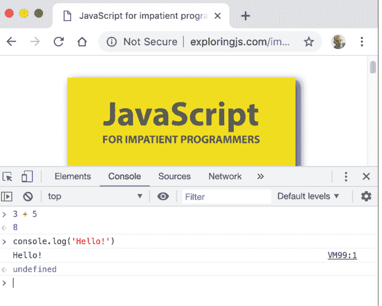

图 9.1：访问网页时，浏览器“Google Chrome”的控制台已打开（位于窗口下半部分）。

### 9.1.2 Node.js REPL

REPL 代表“读取-求值-打印循环”（read-eval-print loop），基本上意味着命令行。要使用它，你首先通过操作系统命令从命令行启动 Node。然后与它的交互看起来如图 9.2 所示：`>` 之后的文本是用户的输入；其他所有内容都是 Node.js 的输出。

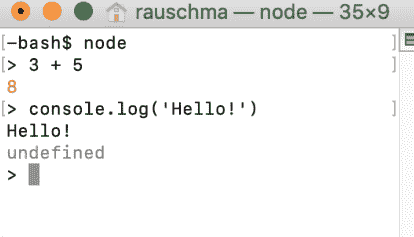

```
rauschma — node — 35x9
-bash$ node
> 3 + 5
8
> console.log('Hello!')
Hello!
undefined
> 
```

图 9.2：启动和使用 Node.js REPL（交互式命令行）。

> 阅读：REPL 交互

我偶尔会通过 REPL 交互演示 JavaScript。这时我也会使用大于符号 (`>`) 来标记输入——例如：

> `3 + 5`
> `8`

### 9.1.3 其他选项

其他选项包括：

- 有许多 Web 应用允许你在浏览器中实验 JavaScript——例如 Babel 的 REPL。
- 还有用于运行 JavaScript 的原生应用和 IDE 插件。

> 控制台通常在非严格模式下运行

在 JavaScript 中，大多数代码（例如模块）都是在严格模式下执行的。然而，控制台通常在非严格模式下运行。因此，当你使用控制台执行本书中的代码时，可能会得到略有不同的结果。

## 9.2 console.* API：打印数据及更多

在浏览器中，console 是你可以调出的通常被隐藏的内容。对于 Node.js，console 是 Node.js 当前正在运行的终端。

完整的 `console.*` API 记录在 MDN 文档和 Node.js 网站上。它不是 JavaScript 语言标准的一部分，但浏览器和 Node.js 都支持许多功能。

在本章中，我们只查看以下两种打印数据的方法（“打印”意味着在控制台中显示）：

- `console.log()`
- `console.error()`

### 9.2.1 打印值：console.log() (stdout)

该操作有两个变体：

```typescript
console.log(...values: any[]): void
console.log(pattern: string, ...values: any[]): void
```

#### 9.2.1.1 打印多个值

第一个变体在控制台中打印值的（文本表示形式）：

```javascript
console.log('abc', 123, true);
// 输出：
// abc 123 true
```

在末尾，`console.log()` 总是打印一个换行符。因此，如果你带有零参数调用它，它只会打印一个换行符。

### 9.2.1.2 使用替换打印字符串

第二个变体执行字符串替换：

```javascript
console.log('Test: %s %j', 123, 'abc');
// 输出：
// Test: 123 "abc"
```

这些是你可以用于替换的某些指令：

- `%s` 将对应的值转换为字符串并插入。

```javascript
console.log('%s %s', 'abc', 123);
// 输出：
// abc 123
```

- `%o` 插入对象的字符串表示。

```javascript
console.log('%o', {foo: 123, bar: 'abc'});
// 输出：
// {foo: 123, bar: "abc"}
```

- `%j` 将值转换为 JSON 字符串并插入。

```javascript
console.log('%j', {foo: 123, bar: 'abc'});
// 输出：
// {"foo":123,"bar":"abc"}
```

- `%%` 插入单个 `%` 号。

```javascript
console.log('%s%%', 99);
// 输出：
// 99%
```

### 9.2.2 打印错误信息：console.error() (stderr)

`console.error()` 的工作与 `console.log()` 相同，但它记录的内容被认为是错误信息。对于 Node.js，这意味着在 Unix 上输出会发送到 stderr 而不是 stdout。

### 9.2.3 通过 JSON.stringify() 打印嵌套对象

`JSON.stringify()` 偶尔对于打印嵌套对象很有用：

```javascript
console.log(JSON.stringify({first: 'Jane', last: 'Doe'}, null, 2));
```

输出：

```json
{
  "first": "Jane",
  "last": "Doe"
}
```

# 第 10 章

## 断言 API

### 目录

- 10.1 软件开发中的断言
- 10.2 断言在书中是如何被使用的
  - 10.2.1 通过断言在代码示例中记录结果
  - 10.2.2 通过断言实现测试驱动练习
- 10.3 常规比较 vs. 深度比较
- 10.4 快速参考：module assert
  - 10.4.1 常规相等
  - 10.4.2 深度相等
  - 10.4.3 预期异常
  - 10.4.4 另一个工具函数

## 10.1 软件开发中的断言

在软件开发中，断言是用于验证代码是否符合预期的工具。如果断言失败，它通常会抛出一个异常。例如：

```javascript
import { assert } from 'assert';
assert.equal(1 + 1, 2);
```

## 10.2 断言在书中是如何被使用的

在书中，断言用于验证逻辑的正确性。

### 10.2.1 通过断言在代码示例中记录结果

在代码示例中，使用断言来确保结果是正确的。例如：

```javascript
import { assert } from 'assert';
assert.strictEqual(true, true);
```

### 10.2.2 通过断言实现测试驱动练习

你可以通过断言来实现测试驱动开发（TDD）。例如：

```javascript
import { assert } from 'assert';
function sum(a, b) { return a + b; }
assert.equal(sum(2, 3), 5);
```

## 10.3 常规比较 vs. 深度比较

常规比较使用 `===` 来比较值。因此，对于对象，它们是不相等的：

```javascript
import { assert } from 'assert';
assert.strictEqual({}, {}); // 这将失败
```

而深度比较则用于比较对象的内容。例如：

```javascript
import { assert } from 'assert';
assert.deepEqual({a: 1}, {a: 1});
```

## 10.4 快速参考：module assert

对于完整的文档，请参阅 Node.js 文档。

### 10.4.1 常规相等

```javascript
import { assert } from 'assert';
assert.equal(5, '5'); // 这会通过，因为它使用了相等
```

### 10.4.2 深度相等

```javascript
import { assert } from 'assert';
assert.deepEqual({a: 1}, {a: 1});
```

### 10.4.3 预期异常

```javascript
import { assert } from 'assert';
assert.throws(() => { throw new Error('fail'); }, /fail/);
```

- `function throws(block: Function, message?: string): void`

```javascript
assert.throws(
  () => {
    null.prop;
  }
);
```

- `function throws(block: Function, error: Function, message?: string): void`

```javascript
assert.throws(
  () => {
    null.prop;
  },
  TypeError
);
```

- `function throws(block: Function, error: RegExp, message?: string): void`

```javascript
assert.throws(
  () => {
    null.prop;
  },
  /TypeError: Cannot read property 'prop' of null/
);
```

- `function throws(block: Function, error: Object, message?: string): void`

```javascript
assert.throws(
  () => {
    null.prop;
  },
  {
    name: 'TypeError',
    message: "Cannot read property 'prop' of null"
  }
);
```

### 10.4.4 另一个工具函数

- `function fail(message: string | Error): never`

被调用时始终会抛出一个 `AssertionError`（断言错误）。这在单元测试中偶尔有用。

```javascript
try {
  functionThatShouldThrow();
  assert.fail();
} catch (_) {
  // 成功
}
```

> 测验

查看测验应用。

# 第 11 章

## 开始使用测验和练习

### 目录

- 11.1 测验
- 11.2 练习
  - 11.2.1 安装练习
  - 11.2.2 运行练习
- 11.3 JavaScript 中的单元测试
  - 11.3.1 典型的测试
  - 11.3.2 AVA 中的异步测试

在大多数章节中，都有测验和练习。这些是付费功能，可以查看全面的预览。本章将解释如何开始使用它们。

## 11.1 测验

安装：

- 下载并解压 `impatient-js-quiz.zip`

运行测验应用：

- 在网络浏览器中打开 `impatient-js-quiz/index.html`
- 你将看到所有测验的目录 (TOC)。

## 11.2 练习

### 11.2.1 安装练习

要安装练习：

- 下载并解压 `impatient-js-code.zip`
- 遵循 `README.txt` 中的说明操作

### 11.2.2 运行练习

- 本书通过路径引用这些练习。
  - 例如：`exercises/quizzes-exercises/first_module_test.mjs`
- 在每个文件内部：
  - 第一行包含运行该练习的命令。
  - 随后的行描述了你需要做什么。

## 11.3 JavaScript 中的单元测试

本书中的所有练习都是通过 AVA 测试框架运行的测试。本节将进行简要介绍。

### 11.3.1 典型的测试

典型的测试代码分为两部分：

- 部分 1：被测试的代码。
- 部分 2：对代码的测试。

以以下两个文件为例：

- `id.mjs`（被测试的代码）
- `id_test.mjs`（测试代码）

#### 11.3.1.1 部分 1：代码

代码本身位于 `id.mjs` 中：

```javascript
export function id(x) {
  return x;
}
```

这里的关键点是：你任何想要测试的内容都必须导出（export）。否则，测试代码将无法访问它。

#### 11.3.1.2 部分 2：测试


> 不用担心测试的精确细节

你不需要担心测试的精确细节：它们总是已经为你实现好了。因此，你只需要阅读它们，而不需要编写它们。

代码的测试位于 `id_test.mjs` 中：

```javascript
// npm t demos/quizzes-exercises/id_test.mjs

import test from 'ava'; // (A)
import {strict as assert} from 'assert'; // (B)
import {id} from './id.mjs'; // (C)

test('My test', t => { // (D)
  assert.equal(id('abc'), 'abc'); // (E)
});
```

这一行测试的核心是 E - 断言：`assert.equal()` 指明了 `id('abc')` 的预期结果为 `'abc'`。

至于其他行：

- 最开头的注释显示了运行测试的 shell 命令。
- 行 A：我们导入了测试框架。
- 行 B：我们导入了断言库。AVA 内置了断言，AVA 的切换让我们保持与原生 Node.js 的兼容。
- 行 C：我们导入了要测试的函数。
- 行 D：我们定义了一个测试。这是通过调用 `test()` 函数实现的。

### 11.3.2 AVA 中的异步测试

#### 11.3.2.1 回调异步处理 (via callbacks)

#### 11.3.2.2 Promise 异步处理 (via Promises)

#### 11.3.2.3 Async 函数异步处理 (via async functions)

异步函数总是返回一个 Promise。因此，`await` 方便地获取结果。如果代码抛出异常，它会处理 Promise 的拒绝（rejected）。

# 第三部分

# 变量

# 第 12 章

## 变量与赋值

### 目录

- 12.1 let
- 12.2 const
  - 12.2.1 不变性
  - 12.2.2 循环
- 12.3 在 const 和 let 之间选择
- 12.4 变量的作用域
  - 12.4.1 变量遮蔽 (Shadowing)
- 12.5 (高级)
- 12.6 术语：静态与动态
  - 12.6.1 静态现象：变量的作用域
  - 12.6.2 动态现象：函数调用
- 12.7 全局变量与全局对象
  - 12.7.1 globalThis [ES2020]
- 12.8 声明：作用域与激活
  - 12.8.1 const 和 let：暂时性死区
  - 12.8.2 函数声明与早期激活
  - 12.8.3 类声明不会提前激活
  - 12.8.4 var：变量提升（部分激活）
- 12.9 闭包 (Closures)
  - 12.9.1 绑定变量与自由变量
  - 12.9.2 什么是闭包？
  - 12.9.3 示例：递增器工厂
  - 12.9.4 闭包的用例

这些是 JavaScript 声明变量的主要方式：

- `let`：声明可变变量。
- `const`：声明常量（不可变变量）。

在 ES6 之前，还有 `var`。但它有很多怪癖，在现代 JavaScript 中最好尽量避免使用。你可以在《Speaking JavaScript》中了解更多相关信息。

## 12.1 let

通过 `let` 的变量是可变的：

```javascript
let i;
i = 0;
i = i + 1;
assert.equal(i, 1);
```

你也可以同时声明并赋值：

```javascript
let i = 0;
```

## 12.2 const

通过 `const` 的变量是不可变的。你必须立即初始化：

```javascript
const i = 0; // 必须初始化

assert.throws(
  () => { i = i + 1 },
  {
    name: 'TypeError',
    message: 'Assignment to constant variable.'
  }
);
```

### 12.2.1 const 和不可变性

在 JavaScript 中，`const` 只意味着绑定（变量名与值之间的关联）是不可变的。值本身可能是可变的，例如示例中的 `obj`。

```javascript
const obj = { prop: 0 };

// 允许：更改 `obj` 的属性
obj.prop = obj.prop + 1;
assert.equal(obj.prop, 1);

// 不允许：给 `obj` 赋值
assert.throws(
  () => { obj = {} },
  {
    name: 'TypeError',
    message: 'Assignment to constant variable.'
  }
);
```

### 12.2.2 const 和循环

你可以在 `for-of` 循环中使用 `const`，其中每次迭代都会创建一个新的绑定：

```javascript
const arr = ['hello', 'world'];
for (const elem of arr) {
  console.log(elem);
}
// 输出：
// 'hello'
// 'world'
```

但在普通的 `for` 循环中，你必须使用 `let`：

```javascript
const arr = ['hello', 'world'];
for (let i=0; i<arr.length; i++) {
  const elem = arr[i];
  console.log(elem);
}
```

## 12.3 在 const 和 let 之间做决定

我建议遵循以下规则来决定使用 `const` 还是 `let`：

- `const` 表示不可变的绑定，变量永远不会改变其值。优先使用它。
- `let` 表示变量的值会改变。只有在你无法使用 `const` 时才使用它。

> 练习：`exercises/variables-assignment/const_excr.mjs`

## 12.4 变量的作用域

变量的作用域是程序中可以访问它的区域。考虑以下代码：

```javascript
// 作用域 A。可访问：x
const x = 0;
assert.equal(x, 0);
// 作用域 B。可访问：x, y
const y = 1;
assert.equal(x, 0);
assert.equal(y, 1);
// 作用域 C。可访问：x, y, z
const z = 2;
assert.equal(x, 0);
assert.equal(y, 1);
assert.equal(z, 2);
}
// 外部。不可访问：x, y, z
assert.throws(
  () => console.log(x),
  {
    name: 'ReferenceError',
    message: 'x is not defined',
  }
);
```

- 作用域 A 是 x 的（直接）作用域。
- 作用域 B 和 C 是作用域 A 的内部作用域。
- 作用域 A 是作用域 B 和 C 的外部作用域。

每个变量在其直接作用域以及该作用域内的所有嵌套作用域中都是可访问的。

通过 `const` 和 `let` 声明的变量被称为块作用域变量，因为它们的作用域始终是最内层的块。

### 12.4.1 变量遮蔽（Shadowing）

你不能在同一层级声明同一个变量：

```javascript
assert.throws(
  () => {
    eval('let x = 1; let x = 2');
  },
  {
    name: 'SyntaxError',
    message: "Identifier 'x' has already been declared"
  }
);
```

为什么要用 `eval()`？

`eval()` 推迟了解析（因此推迟了 `SyntaxError`），直到 `assert.throws()` 的回调执行。如果我们不使用它，在解析这段代码时就会产生错误，导致 `assert.throws()` 无法执行。

但是，你可以嵌套一个块，并使用与块外部相同的变量名 `x`：

```javascript
const x = 1;
assert.equal(x, 1);
{
  const x = 2;
  assert.equal(x, 2);
}
assert.equal(x, 1);
```

在块内部，内部的 `x` 是唯一可访问的同名变量。内部的 `x` 被称为遮蔽了外部的 `x`。一旦离开该块，就可以再次访问旧值。

> 测验：基础

查看测验应用。

## 12.5 (高级)

所有剩余章节都是高级内容。

## 12.6 术语：静态 vs 动态

这两个形容词描述了编程语言中的现象：

- 静态（Static）意味着事物与源代码有关，可以在不执行代码的情况下确定。
- 动态（Dynamic）意味着在运行时。

让我们来看看这两个术语的示例。

### 12.6.1 静态现象：变量

变量作用域是静态的。考虑以下代码：

```javascript
function f() {
  const x = 3;
}
```

变量作用域是静态的。它不是运行时。

### 12.6.2 动态现象：函数调用

函数调用是动态的。考虑以下代码：

```javascript
function g() {
  if (true) {
    const x = 1;
  }
}
```

函数调用是动态的。

## 12.7 全局变量与全局对象

全局作用域是 JavaScript 最外层的作用域。它有两种变量：对象变量（通过全局对象管理）和普通声明变量。每个 ECMAScript 模块都有自己的包含在全局作用域。

全局对象是根。具体来说：

- 声明变量是在脚本顶层通过 `const`、`let` 和 `class` 声明创建的。
- 全局对象也称为 `globalThis`。它可以用于创建、读取和删除全局变量。

### 12.7.1 globalThis [ES2020]

`globalThis` 提供了一个标准的方式来访问全局对象，无论在什么环境中运行。

## 12.8 声明：作用域与激活

这些是声明的两个关键方面：

- 作用域（Scope）：声明实体可以在哪里被看到？这是一个静态属性。
- 激活（Activation）：我什么时候可以访问某个实体？这是一个动态属性。某些实体一旦进入其作用域就可以被访问。对于其他实体，我们必须等待到执行到达它们的声明处。

表 12.1 声明的各个方面。“重复”（Duplicates）描述一个声明可以在（每个作用域内）使用相同的名称。“全局属性”（Global prop.）描述在全局作用域下执行时向全局对象添加属性的声明。TDZ 指暂时性死区（后文会详细解释）。(*) 函数通常是块级作用域的，但在宽松模式下是函数作用域的。

| 声明类型 | 作用域 | 激活 | 重复 | 全局属性 |
|---|---|---|---|---|
| const | 块级 | 声明 (TDZ) | x | |
| let | 块级 | 声明 (TDZ) | x | |
| function | 块级 (*) | 开始 | ✓ | ✓ |
| class | 块级 | 声明 (TDZ) | x | |
| import | 模块 | 与 export 相同 | x | |
| var | 函数级 | 开始，部分 | ✓ | ✓ |

详见 §27.5 "ECMAScript modules"。接下来的章节将更详细地描述其他构造。

### 12.8.1 const 和 let：暂时性死区

对于 JavaScript 来说，TC39 需要决定在直接作用域内、在声明之前访问一个常量会发生什么：

```javascript
{
  console.log(x); // 这里会发生什么？
  const x;
}
```

一些可能的方法是：

1. 在当前作用域周围的作用域中解析名称。
2. 得到 undefined。
3. 报错。

方法 1 被拒绝了，因为该语言中没有这种方法的先例，因此这对于 JavaScript 程序员来说不符合直觉。

方法 2 被拒绝了，因为 x 不再是一个常量——它在声明前后的值是不同的。

`let` 使用了与 `const` 相同的方法 3，因此它们的工作方式相似，并且易于相互切换。

变量作用域结束与执行其声明之间的时间被称为该变量的暂时性死区（TDZ）：

- 在这段时间内，该变量被视为未初始化的（就像它拥有某种特殊值一样）。
- 如果你访问一个未初始化的变量，将得到一个 `ReferenceError`。
- 一旦到达变量声明处，该变量将被设置为初始化器的值（通过赋值符号指定）或 undefined（如果没有初始化器的话）。

以下代码说明了暂时性死区：

```javascript
if (true) { // 进入 `tmp` 的作用域，TDZ 开始
  // tmp 是未初始化的；
  assert.throws(() => (tmp = 'abc'), ReferenceError);
  assert.throws(() => console.log(tmp), ReferenceError);

  let tmp; // TDZ 结束
  assert.equal(tmp, undefined);
}
```

下一个示例显示了暂时性死区确实是具有时间性的（与时间有关）：

```javascript
if (true) { // 进入 `myVar` 的作用域，TDZ 开始
  const func = () => {
    console.log(myVar); // 后执行
  };

  // 访问 `myVar` 会导致 `ReferenceError`

  let myVar = 3; // TDZ 结束
  func(); // OK，在 TDZ 之外调用
}
```

尽管 `func()` 位于 `myVar` 声明之前并使用了该变量，但仍然可以调用 `func()`。但我们必须等到 `myVar` 的暂时性死区结束。

### 12.8.2 函数声明与早期激活

> 关于函数的更多信息

在本节中，我们正在使用函数——在我们还没有机会正确学习它们之前。希望一切仍然通顺。每当不通时，请参阅可调用值。

函数声明在进入其作用域时总是会被执行，无论它位于内部何位置。这使得你可以在声明之前调用函数 `foo()`：

```javascript
assert.equal(foo(), 123); // OK
function foo() { return 123; }
```

`foo()` 的早期激活意味着之前的代码等同于：

```javascript
function foo() { return 123; }
assert.equal(foo(), 123);
```

如果你通过 `const` 或 `let` 声明函数，则它不会早期激活。在下面的示例中，你只能在声明后使用：

```javascript
assert.throws(
  () => bar(), // 声明之前
  ReferenceError
);

const bar = () => { return 123; }; // 声明之后
```

即使函数 `g()` 没有被早期激活，只要我们遵循以下规则，它也可以被先前的函数 `f()`（在同一作用域内）调用：`f()` 必须在 `g` 声明之后被调用。

```javascript
const f = () => g();
const g = () => 123;
```

### 12.8.3 类声明不会提前激活

类声明不会提前激活，它们也有暂时性死区。

### 12.8.4 var：变量提升（部分激活）

`var` 声明会被提升到函数作用域的顶部，但初始化不会被提升。

## 12.9 闭包

### 12.9.1 绑定变量与自由变量

### 12.9.2 什么是闭包？

```javascript
function funcFactory(value) {
  const func = () => value;
  return func;
}

const func = funcFactory('abc');
assert.equal(func(), 'abc'); // (A)
```

`funcFactory` 返回一个赋值给 `func` 的闭包。因为 `func` 与其出生地的变量有连接，当它在行 A 被调用时，它仍然可以访问自由变量的值（尽管它已经“逃逸”了作用域）。

> JavaScript 中的所有函数都是闭包

JavaScript 通过闭包支持静态作用域。因此，每个函数都是闭包。

### 12.9.3 示例：一个增量器工厂

以下函数返回增量器。增量器是一个内部存储一个数字的函数。当它被调用时，它会将参数加到该数字上进行更新，并返回新值。

```javascript
function createInc(startValue) {
  return (step) => {
    startValue += step;
    return startValue;
  };
}
const inc = createInc(5);
assert.equal(inc(2), 7);
```

我们可以看到，在行 A 创建的函数在自由变量 `startValue` 中保留了它的内部数字。这次，我们不仅是从出生作用域读取，还利用它来存储我们会修改并在跨函数调用中持久的数据。

我们可以通过局部变量在出生作用域中创建更多的存储槽：

```javascript
function createInc(startValue) {
  let index = -1;
  return (step) => {
    startValue += step;
    return [index, startValue];
  };
}
const inc = createInc(5);
assert.deepEqual(inc(2), [0, 7]);
assert.deepEqual(inc(2), [1, 9]);
assert.deepEqual(inc(2), [2, 11]);
```

### 12.9.4 闭包的用例

闭包有什么用？

- 首先，它们仅仅是静态作用域的实现。作为如此，它们为回调函数提供了上下文数据。
- 它们也可以被函数用于存储跨函数调用时持久的状态。`createInc()` 就是这样一个例子。
- 它们还可以为对象（通过字面量或类产生）提供私有数据。具体工作原理在《探索 ES6》中有解释。

> 测验：进阶

查看测验应用。

# 第 13 章

## 值

### 目录

- 13.1 什么是类型？
- 13.2 JavaScript 的类型层次结构
- 13.3 语言规范中的类型
- 13.4 原始值与对象
  - 13.4.1 原始值（简写：primitives）
  - 13.4.2 对象
- 13.5 运算符 typeof 和 instanceof：值的类型是什么？
  - 13.5.1 typeof
  - 13.5.2 instanceof
- 13.6 类和构造函数
  - 13.6.1 与原始类型关联的构造函数
- 13.7 类型之间的转换
  - 13.7.1 类型之间的显式转换
  - 13.7.2 强制类型（类型之间的自动转换）

在本章中，我们将检查 JavaScript 拥有什么类型的值。

> 支持工具：===

在本章中，我们偶尔会使用严格相等运算符。如果 `a` 和 `b` 相等，则 `a === b` 求结果为 `true`。具体含义见 §14.4.2 “严格相等 (=== 和 !==)”。

## 13.1 什么是类型？

在本章中，我将类型视为值的集合——例如，`boolean` 类型是集合 `{ false, true }`。

## 13.2 JavaScript 的类型层次结构

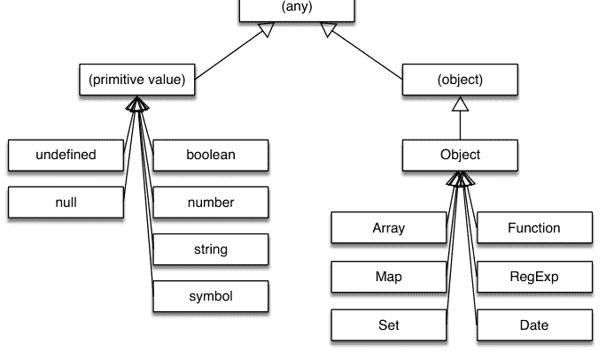

图 13.1：JavaScript 类型的部分层次结构。缺失了错误类、与原始类型关联的类等。该图暗示了并非所有对象都是 `Object` 的实例。

## 13.3 语言规范中的类型

语言规范定义了 JavaScript 的类型系统。

## 13.4 原始值与对象

### 13.4.1 原始值（简写：primitives）

原始值是不可变的，按值传递。

### 13.4.2 对象

一个对象的标识性（identity）就像是一个指向堆上对象实际数据的指针（或透明引用，可以将其想象为 JavaScript 引擎的共享主内存）。

当将对象赋值给变量或将其作为参数传递给函数时，拷贝的是该标识性。每个字面量都会在堆上创建一个全新的对象并返回其标识性。

```javascript
const a = {}; // 全新的空对象
// 将 `a` 中的标识性 传递给 `b`:
const b = a;

// 现在 `a` 和 `b` 指向同一个对象
// (它们“共享”该对象):
assert.equal(a === b, true);

// 修改 `a` 也会改变 `b`
a.foo = 123;
assert.equal(b.foo, 123);
```

JavaScript 使用垃圾回收来管理内存：

```javascript
let obj = { prop: 'value' };
obj = {};
```

`obj` 的旧值 `{ prop: 'value' }` 变成了垃圾（不再使用）。JavaScript 将在某个时间自动回收垃圾（将其从内存中移除），如果有足够的空闲内存，可能永远不会回收。

> 详情：按标识性传递

> “按标识性传递”意味着对象的标识性（透明引用）按值传递。这种方法也称为“按共享传递”。

### 13.4.2 对象通过标识性进行比较

对象通过标识性进行比较（这是我的术语）：两个变量只有在包含相同的对象标识性时才是相等的。如果它们指向内容相同的不同对象，它们是不相等的。

```javascript
const obj = {}; // 全新的空对象
assert.equal(obj === obj, true); // 相同的标识性
assert.equal(obj === {}, false); // 标识性不同，内容相同
```

## 13.5 运算符 typeof 和 instanceof：值的类型是什么？

`typeof` 和 `instanceof` 两个运算符让你判断给定的 `x` 具有什么类型：

```javascript
if (typeof x === 'string') ...
if (x instanceof Array) ...
```

它们之间有什么区别？

- `typeof` 区分规范中的 7 种类型（减去了一个遗漏，增加了一个）。
- `instanceof` 测试哪个类创建了给定的值。

> 经验法则：`typeof` 用于原始值；`instanceof` 用于对象。

### 13.5.1 typeof

表 13.1：`typeof` 运算符的结果。

| x | typeof x |
|---|---|
| undefined | 'undefined' |
| null | 'object' |
| Boolean | 'boolean' |
| Number | 'number' |
| Bigint | 'bigint' |
| String | 'string' |
| Symbol | 'symbol' |
| Function | 'function' |
| 所有其他对象 | 'object' |

表 13.1 列出了 `typeof` 的所有结果。它们大致对应语言规范中的 7 种类型。遗憾的是有两个差异，它们是语言的特性：

- `typeof null` 返回 `'object'` 而不是 `'null'`。这是一个 Bug。遗憾的是它无法修复。TC39 尝试这样做，但破坏了 Web 上太多的代码。
- 函数的 `typeof` 应该是 `'object'`（函数也是对象）。为函数引入单独类别会引起混淆。

以下是使用 `typeof` 的几个示例：

```javascript
> typeof undefined
'undefined'
> typeof 123n
'bigint'
> typeof 'abc'
'string'
> typeof {}
'object'
```

> 练习：关于 typeof 的两个练习
> - `exercises/values/typeof_exrc.mjs`
> - 额外练习：`exercises/values/is_object_test.mjs`

### 13.5.2 instanceof

该运算符回答一个问题：值 `x` 是否是由类 `C` 创建的？


> `instanceof C`

例如：

```
> (function() {}) instanceof Function
true
> {{}} instanceof Object
true
> [] instanceof Array
true
```

原始值不是任何东西的实例：

```
> 123 instanceof Number
false
> '' instanceof String
false
> '' instanceof Object
false
```

> 练习：instanceof
`exercises/values/instanceof_exrc.mjs`

## 13.6 类和构造函数

JavaScript 原始的对象工厂是构造函数：即普通函数，如果你通过 `new` 运算符调用它们，它们会返回自身的“实例”。

ES6 引入了类，它们主要是构造函数的更好语法。

在本书中，我交替使用“构造函数”和“类”这两个术语。

类可以被视为将规范中的单一类型 object 划分为子类型——它们为我们提供了比规范限制的 7 种更多的类型。每个类都是它所创建对象的类型。

### 13.6.1 与原始类型关联的构造函数

每个原始类型（`undefined` 和 `null` 的规范内置类型外）都有一个关联的构造函数（视为类）：

- 构造函数 `Boolean` 与布尔值关联。
- 构造函数 `Number` 与数字关联。
- 构造函数 `String` 与字符串关联。
- 构造函数 `Symbol` 与符号关联。

这些函数中的每一个都扮演着多个角色——例如 `Number`：

- 你可以将其作为函数并将值转换为数字：

```
assert.equal(Number('123'), 123);
```

- `Number.prototype` 为数字提供了属性——例如方法 `toString()`：

```
assert.equal((123).toString(), Number.prototype.toString());
```

- `Number` 作为命名空间并为数字创建函数——例如：

```
assert.equal(Number.isInteger(123), true);
```

- 最后，你也可以将 `Number` 作为类并创建对象。这些对象与真实的数字不同，应该避免。

```
assert.equal(new Number(123), 123);
assert.equal(new Number(123).valueOf(), 123);
```

### 13.6.1 包装值

构造函数也被称为包装类型，因为它们提供了原始值转换为对象的标准方法。在此过程中，原始值被“包装”在对象中。

```
const prim = true;
assert.equal(typeof prim, 'boolean');
assert.equal(prim instanceof Boolean, false);
```

```
const wrapped = Object(prim);
assert.equal(typeof wrapped, 'object');
assert.equal(wrapped instanceof Boolean, true);
```

```
assert.equal(wrapped.valueOf(), prim); // 解包实践中很重要，但它在语言规范内部用于提供原始属性。
```

## 13.7 类型之间的转换

值转换为其他类型有两种方式：

- 显式转换：通过如 `String()` 等函数。
- 强制转换（coercion）：当操作无法处理时发生。

### 13.7.1 显式类型转换

与原始类型关联的函数将值转换为该类型：

```
> Boolean(0)
false
> Number('123')
123
> String(123)
'123'
```

可以使用 `Object()` 将值转换为对象：

```
> Object(123)
'object'
```

下表详细描述了它的工作原理：

| x | Object(x) |
|---|---|
| undefined | {} |
| null | {} |
| boolean | Boolean(x) |
| number | Number(x) |
| bigint | BigInt (抛出 TypeError) |
| string | String(x) |
| symbol | Symbol (抛出 TypeError) |
| object | x |

### 13.7.2 强制转换（类型之间的自动转换）

对于许多操作，如果类型不匹配，JavaScript 会自动转换操作数。这种自动转换被称为*强制转换（coercion）*。

例如，乘法运算符将其操作数转换为数字：

```
> '7' * '3'
21
```

许多内置函数也会强制转换。例如，`parseInt()` 将其参数转换为字符串（遇到第一个非数字字符停止）：

```
> parseInt(23.45)
23
```

练习：将值转换为原始值
`exercises/values/conversion_exrc.mjs`

## 测验
查看 app。

# 第14 章

## 运算符

14.1 理解运算符 . . . . . . . . . . . . . . . . . . . . 101
14.1.1 运算符强制转换操作数到适当类型 . . . . . . . 102
14.1.2 大多数运算符只与原始值工作 . . . . . . . . . . . 102
14.2 加法运算符 (+) . . . . . . . . . . . . . . . . . . . . . . . 102
14.3 赋值运算符 . . . . . . . . . . . . . . . . . . . . . . . 103
14.3.1 基础赋值运算符 . . . . . . . . 103
14.3.2 复合赋值运算符 . . . . . . . 103
14.3.3 所有复合赋值运算符列表 . . . . . . . 103
14.4 等等：==，对比 === . . . . . . . . . . . . . . . . . . . . . . . 104
14.4.1 弱相等 (== 和 !=) . . . . . . . . . . . . . . . . . 104
14.4.2 严格相等 (=== 和 !==) . . . . . . . . . . . . . . . 105
14.4.3 建议：始终使用严格相等 . . . . . . 105
14.4.4 比 ===Object.is() 更加严格 . . . . 106
14.5 排序运算符 . . . . . . . . . . . . . . . . . . . . . . . . . . . . . . . 107
14.6 空值合并运算符 (??) 用于默认值 [ES2020] . . . . 107
14.6.1 示例：计数匹配项 . . . . . . . . . . . . . . . . . . . . 108
14.6.2 示例：为属性指定默认值 . . . . . . . 108
14.6.3 使用解构赋值默认值 . . . . . . . 108
14.6.4 遗留方法：使用逻辑或 (||) 用于默认值 . . . . 108
14.7 其他各种运算符 . . . . . . . . . . . . . . . . . . . . . . . . . 109
14.7.1 逗号运算符 . . . . . . . . . . . . . . . . . . . . 109
14.7.2 void 运算符 . . . . . . . . . . . . . . . . . . . . . . 109

* 操作符会将操作数强制转换为相应的类型
* 大多数操作符只对原始值有效

## 14.1.1 操作符会将操作数强制转换为相应的类型

如果操作符获取的操作数类型不正确，它很少抛出异常。相反，它会强制转换（自动转换）操作数，以便对其进行操作。让我们来看两个例子。

首先，乘法运算符只能与数字一起。因此，它在计算结果之前会将字符串转换为数字。

```javascript
'7' * '3'
```

其次，用于访问对象属性的方括号运算符 (`[]`) 只能处理字符串和符号。所有值都会被强制转换为字符串：

```javascript
const obj = {};

obj['true'] = 123;

// 将 true 强制转换为字符串 'true'
assert.equal(obj[true], 123);
```

## 14.1.2 大多数运算符只对原始值有效

如前所述，大多数运算符只对原始值有效。如果操作数是一个对象，它会被强制转换为原始值——例如：

```javascript
> [1,2,3] + [4,5,6]
'1,2,34,5,6'
```

为什么？加号运算符首先将其操作数强制转换为原始值：

```javascript
> String({1,2,3})
'1,2,3'
> String({4,5,6})
'4,5,6'
```

接下来，它拼接这两个字符串：

```javascript
> '1,2,3' + '4,5,6'
'1,2,34,5,6'
```

## 14.2 加号运算符 (+)

加号运算符在 JavaScript 中的工作方式如下：

- 首先，它将两个操作数都转换为原始值。然后它切换到一种模式之一：
  - 字符串模式：如果两个原始值中的其中一个是字符串，那么它将另一个转换为字符串，拼接两个字符串并返回结果。
  - 数字模式：否则，它将两个操作数都转换为数字，将它们相加并返回结果。

字符串模式允许我们使用 `+` 来组装字符串：

```javascript
> 'There are ' + 3 + ' items'
'There are 3 items'
```

数字模式意味着，如果两者都不是字符串（或变为字符串的对象），所有内容都将被强制转换为数字：

```javascript
> 4 + true
5
```

`Number(true)` 是 1。

## 14.3 赋值运算符

### 14.3.1 普通赋值运算符

普通赋值运算符用于更改已声明的存储位置：

```javascript
x = value; // 赋值给之前声明的变量
obj.propKey = value; // 赋值给属性
arr[index] = value; // 赋值给数组元素
```

变量声明中的初始化器也可以被视为赋值的形式：

```javascript
const x = value;
let y = value;
```

### 14.3.2 复合赋值运算符

给定一个运算符 `op`，这两种赋值方式是等价的：

```javascript
myvar op = value
myvar = myvar op value
```

如果 `op` 是 `+`，那么我们得到了运算符 `+=`，它的工作方式如下。

```javascript
let str = '';

str += '<b>';
str += 'Hello!';
str += '</b>';
```

```javascript
assert.equal(str, '<b>Hello!</b>');
```

### 14.3.3 所有复合赋值运算符列表

- 算术运算符：`+=` `-=` `*=` `/=` `%=` `**=`
  - `+=` 也适用于字符串拼接
- 位运算运算符：`<<=` `>>=` `>>>=` `&=` `^=` `|=`

## 14.4 等价性：== vs. ===

JavaScript 有两种等价运算符：松散相等 (`==`) 和严格相等 (`===`)。建议始终使用后者。

### == 和 === 的其他名称

- `==` 也称为双等号（double equals）。它在语言规范中的正式名称是抽象等价比较。
- `===` 也称为三连等号（triple equals）。

## 14.4.1 宽松相等 (== 和 != )

松散相等是 JavaScript 的怪异之一。它经常强制转换操作数。其中一些转换是有意义的：

```javascript
'123' == 123
true
```

```javascript
false == 0
true
```

另一些则没那么：

```javascript
'' == 0
true
```

如果（且仅当！）另一个操作数是原始值时，对象会被强制转换为原始值：

```javascript
[1, 2, 3] == '1, 2, 3'
true
['1', '2', '3'] == '1,2,3'
true
```

如果两个操作数都是对象，它们只有在是同一个对象时才相等：

```javascript
[1, 2, 3] == ['1', '2', '3']
false
[1, 2, 3] == [1, 2, 3]
false
```

```javascript
const arr = [1, 2, 3];
arr == arr
true
```

最后，`==` 认为 `undefined` 和 `null` 是相等的：

```javascript
undefined == null
true
```

## 14.4.2 严格相等 (=== 和 !==)

严格相等永远不进行强制转换。两个值只有在它们具有相同类型时才相等。让我们回顾一下之前与 `==` 运算符的交互，看看 `===` 运算符做了什么：

```javascript
> [1,2,3] === ['1','2,3']
false
> [1,2,3] === [1,2,3]
false
```

```javascript
const arr = [1, 2, 3];
arr === arr
true
```

## 14.4.3 建议：始终使用严格相等

## 14.4.4 比 === 更严格：Object.is()

## 14.5 排序运算符

## 14.6 空值合并运算符 (??) 用于默认值 [ES2020]

### 14.6.1 示例：计数匹配项

```javascript
function countMatches(regex, str) {
  const matchResult = str.match(regex);
  return (matchResult ?? []).length;
}
```

```javascript
assert.equal(
  countMatches(/a/g, 'ababa'), 3);
assert.equal(
  countMatches(/b/g, 'ababa'), 2);
assert.equal(
  countMatches(/x/g, 'ababa'), 0);
```

如果正则表达式在 `str` 中有一个或多个匹配项，则 `.match()` 返回一个数组（`Array`）。如果没有匹配项，它遗憾的是会返回 `null`（而不是空数组）。我们通过 `??` 运算符修复了这个问题。

我们也可以使用可选链：
```javascript
matchResult?.length ?? 0;
```

### 14.6.2 示例：为属性指定默认值

```javascript
function getTitle(fileDesc) {
  return fileDesc.title ?? ('Untitled');
}
```

```javascript
const files = [
  {path: 'index.html', title: 'Home'},
  {path: 'tmp.html'}
];
```

```javascript
assert.deepEqual(
  files.map(f => getTitle(f)),
  ['Home', 'Untitled']);
```

### 14.6.3 使用解构赋值默认值

在某些情况下，解构也可以用于默认值——例如：

```javascript
function getTitle(fileDesc) {
  const {title = 'Untitled'} = fileDesc;
  return title;
}
```

### 14.6.4 传统方法：使用逻辑或 (||) 作为默认值

在 ECMAScript 2020 和空值合并运算符出现之前，逻辑或被用于默认值。这有一个缺点。

`||` 在处理 `undefined` 和 `null` 时表现符合预期：

```
> undefined || 'default'
'default'
> null || 'default'
'default'
```

但它也会对所有其他虚假值（falsy values）返回默认值——例如：

```
> false || 'default'
'default'
> 0 || 'default'
'default'
> 0n || 'default'
'default'
> '' || 'default'
'default'
```

对比一下 `??` 的工作方式：

```
> undefined ?? 'default'
'default'
> null ?? 'default'
'default'
> false ?? 'default'
false
> 0 ?? 'default'
0
> 0n ?? 'default'
0n
> '' ?? 'default'
''
```

布尔值、字符串、数字、对象的运算符：在本书的其他部分会有介绍。

接下来的两个章节将讨论两个很少使用的运算符。

## 14.7.1 逗号运算符

逗号运算符有两个操作数，它会计算两者并返回第二个：

```
> 'a', 'b'
'b'
```

关于该运算符的更多信息，请参阅《Speaking JavaScript》。

## 14.7.2 void 运算符

`void` 运算符计算其操作数并返回 `undefined`：

```
> void (3 + 2)
undefined
```

关于该运算符的更多信息，请参阅*Speaking JavaScript*。

## 测验
参见测试应用。

# 第四部分

# 原型值

# 第 15 章

## 非值 undefined 和 null

| 目录 | |
|---|---|
| 15.1 undefined vs. null | 113 |
| 15.2 undefined 和 null 的出现情况 | 114 |
| 15.2.1 undefined 的出现情况 | 114 |
| 15.2.2 null 的出现情况 | 114 |
| 15.3 检查 undefined 或 null | 115 |
| 15.4 undefined 和 null 没有属性 | 115 |
| 15.5 undefined 和 null 的历史 | 116 |

编程语言通常有一种名为 `null` 的“非值”。它表示变量当前没有指向任何对象——例如，当它尚未被初始化时。
相比之下，JavaScript 有两个值：`undefined` 和 `null`。

## 15.1 undefined vs. null

这两个值非常相似，并且经常互换。因此，它们的区别是微妙的。语言本身做了以下区分：

- `undefined` 意味着“未初始化”（例如变量）或“不存在”（例如对象的属性）。
- `null` 意味着“有意地缺失任何对象值”（来自语言规范的引言）。

程序员可能会做出以下区分：

- `undefined` 是语言使用的非值（当某些东西未初始化等时）。
- `null` 意味着“显式关闭”。也就是说，它有助于实现一种类型，该类型包含了有意义的值和代表“无意义的值”的元值。这种类型在函数式编程中被称为可选类型（option type）或可能类型（maybe type）。

## 15.2 undefined 和 null 的出现情况

接下来的章节描述了 `undefined` 和 `null` 在语言中出现的地方。我们将遇到几种机制，这些机制将在本书后部分详细解释。

### 15.2.1 undefined 的出现情况

未初始化的变量 `myVar`：

```javascript
let myVar;
assert.equal(myVar, undefined);
```

参数 `x` 未提供：

```javascript
function func(x) {
  return x;
}
assert.equal(func(), undefined);
```

属性 `unknownProp` 缺失：

```javascript
const obj = {};
assert.equal(obj.unknownProp, undefined);
```

如果你没有显式指定，通过 `return` 语句返回 `undefined`：

```javascript
function func() {
  return;
}
assert.equal(func(), undefined);
```

### 15.2.2 null 的出现情况

当你将正则表达式（如 `/a/`）与字符串（如 `'x'`）匹配时，要么得到一个对象（如果匹配成功），要么得到 `null`（如果匹配失败）：

```
> /a/.exec('x')
null
```

JSON 格式不支持 `undefined`，只支持 `null`：

```
> JSON.stringify({a: undefined, b: null})
'{"b":null}'
```

## 15.3 检查 undefined 或 null

检查：

```javascript
if (x === undefined || x === null) {
  // ...
}
```

## 15.4 undefined 和 null 没有属性

`undefined` 和 `null` 是在尝试读取属性时会抛出异常的两个值。为了探索这一点，让我们使用以下函数：

```javascript
function getFoo(x) {
  return x.foo;
}
```

如果我们将 `getFoo()` 应用于各种值，可以看到它只对 `undefined` 和 `null` 失败：

```
> getFoo(undefined)
TypeError: Cannot read property 'foo' of undefined
> getFoo(null)
TypeError: Cannot read property 'foo' of null
> getFoo(true)
undefined
> getFoo({})
undefined
```

## 15.5 undefined 和 null 的历史

在 Java（影响了 JavaScript 的许多方面）中，初始化值取决于变量的静态类型：

- 对象类型的变量初始化为 `null`。
- 每个原始类型都有自己的初始化值。例如，`int` 变量初始化为 0。

在 JavaScript 中，每个变量都可以持有对象值和原始值。因此，如果 `null` 意味着“不是对象”，JavaScript 还需要一个代表“既不是对象也不是值”的初始化值。这个初始化值就是 `undefined`。

## 测验
参见测试应用。

# 第 16 章

## 布尔值

| 目录 | |
|---|---|
| 16.1 转换为布尔 | 117 |
| 16.2 虚假值和真值 | 118 |
| 16.3 基于真值的检查 | 119 |
| 16.4 条件运算符 (? :) | 121 |
| 16.5 二元逻辑运算符：与 (x && y)，或 (x || y) | 122 |
| 16.6 逻辑非 (!) | 123 |

## 16.1 转换为布尔

原始类型 boolean 包含两个值——`false` 和 `true`：

```javascript
> typeof false
'boolean'
> typeof true
'boolean'
```

### “转换为 [type]”的含义

“转换为 [type]”是“将任意值转换为类型 [type]的值”的简写。

这里有三种将任意值 `x` 转换为布尔值的方法。

- `Boolean(x)`：最具描述性；推荐使用。
- `x ? true : false`：使用了条件运算符（在本章稍后的部分进行解释）。
- `!!x`：使用了逻辑非运算符 (`!`)。该运算符会将操作数强制转换为布尔值。它会对结果再次应用一次。

表 16.1 描述了各种值如何转换为布尔值。

| | | Boolean(x) |
| :--- | :--- | :--- |
| undefined | false |
| null | false |
| boolean | x (无变化) |
| number | 0 为 false, NaN → true; 其他数字 → true |
| bigint | 0 为 false; 其他数字 → true |
| string | '' → false; 其他字符串 → true |
| symbol | true |
| object | 始终为 true |

## 16.2 假值（Falsy）和真值（Truthy）

在检查 `if` 语句、`while` 循环或 `do-while` 循环的条件时，JavaScript 的工作方式可能与你预期的不同。以以下条件为例：

```javascript
if (value) {
```

在许多编程语言中，该条件等同于：

```javascript
if (value === true) {
```

然而，在 JavaScript 中，它等同于：

```javascript
if (Boolean(value) === true) {
```

也就是说，JavaScript 检查 value 转换为布尔值是否真。这种检查非常常见，因此引入了以下名称：

- 如果一个值转换为布尔值时为真，则被称为**真值 (truthy)**。
- 如果一个值转换为布尔值时为假，则被称为**假值 (falsy)**。

每个值要么是真，要么是假。参考表 16.1，我们可以列出详细的假值列表：

- `undefined`
- `null`
- Boolean: `false`
- Numbers: `0`, `NaN`
- Bigint: `0n`
- String: `''`

所有其他值（包括所有对象）都是真值：

- `Boolean('abc')` -> `true`
- `Boolean({})` -> `true`
- `Boolean([])` -> `true`

### 16.2.1 检查真值或假值

```javascript
if (x) {
  // x 是真值
}

if (!x) {
  // x 是假值
}

if (x) {
  // x 是真值
} else {
  // x 是假值
}

const result = x ? 'truthy' : 'falsy';
```

最后一行使用的条件运算符将在本章稍后进行解释。

> 练习：真值性
`exercises/booleans/truthiness_exrc.mjs`

## 16.3 基于真值的存在性检查

在 JavaScript 中，如果你读取一个不存在的内容（例如缺失的参数或缺失的属性），你通常会得到结果 `undefined`。在这种情况下，存在性检查等同于将值与 `undefined` 进行比较。例如，以下代码检查对象 `obj` 是否拥有属性 `.prop`：

```javascript
if (obj.prop === undefined) {
  // obj 拥有属性 .prop
}
```

由于 `undefined` 是假值，我们可以此检查简化为：

```javascript
if (obj.prop) {
  // obj 拥有属性 .prop
}
```

### 16.3.1 陷阱：基于真值的存在性检查不精确

基于真值的存在性检查有一个陷阱：它们并不精确。考虑之前的示例：

```javascript
if (obj.prop) {
  // obj 拥有属性 .prop
}
```

如果满足情况，语句体将被跳过：

- `obj.prop` 缺失（在这种情况下，JavaScript 返回 `undefined`）。

然而，在以下情况下也会跳过：

- `obj.prop` 是 `undefined`。
- `obj.prop` 是任何其他假值（`null`, `0`, `''`, 等）。

在实践中，这很少引起问题，但你必须意识到这个陷阱。

### 16.3.2 用例：是否提供了参数？

真值检查通常用于判断函数调用者是否提供了参数：

```javascript
function func(x) {
  if (!x) {
    throw new Error('Missing parameter x');
  }
  // ...
}
```

优点是，这种模式成熟且简短。它能正确地为 `undefined` 和 `null` 抛出错误。

缺点是，存在前面提到的陷阱：代码也会对所有的假值抛出错误。

另一种替代方案是检查 `undefined`：

```javascript
if (x === undefined) {
  throw new Error('Missing parameter x');
}
```

### 16.3.3 用例：属性是否存在？

真值检查通常用于判断属性是否存在：

```javascript
function readFile(fileDesc) {
  if (!fileDesc.path) {
    throw new Error('Missing property: .path');
  }
  // ...
}
readFile({ path: 'foo.txt' }); // 无错误
```

这种模式也是成熟的，并具有通常的注意事项：它不仅在属性缺失时抛出错误，当属性存在且具有任何假值时也会抛出错误。

如果你想检查属性是否存在，你必须使用 `in` 运算符：

```javascript
if (!('path' in fileDesc)) {
  throw new Error('Missing property: .path');
}
```

## 16.4 条件运算符 (? :)

条件运算符是 `if` 语句的表达式版本。它的语法为：

`<condition> ? <thenExpression> : <elseExpression>`

它的求值如下：

- 如果 `condition` 为真，求值 `thenExpression`。
- 否则，求值 `elseExpression`。

## 16.5 二元逻辑运算符：与 (x && y)，或 (x || y)

## 16.6 逻辑非 (!)

表达式 `!x` 的求值如下：

1. 求值 `x`。
2. 如果它是真，返回 `false`。
3. 否则，返回 `true`。

示例：

```javascript
!false // true
!true // false
!0 // true
!NaN // true
!'' // true
```

# 第 17 章

## 数字

- 17.1 数字同时用于浮点数和整数
- 17.2 字面量
  - 17.2.1 整数字面量
  - 17.2.2 浮点字面量
  - 17.2.3 整数字面量的语法陷阱
- 17.3 算术运算符
  - 17.3.1 二元算术运算符
  - 17.3.2 一元加 (+) 和 减 (-)
  - 17.3.3 增 (++) 和 减 (--)
- 17.4 转换为数字
- 17.5 错误值
- 17.6 错误值 NaN
  - 17.6.1 检查 NaN
  - 17.6.2 在数组中查找 NaN
- 17.7 错误值 Infinity
  - 17.7.1 Infinity 作为默认值
  - 17.7.2 检查 Infinity
- 17.8 数字的精度：处理小数要小心
- 17.9 (高级)
- 17.10 背景：浮点数精度
  - 17.10.1 浮点数的简化表示法
- 17.11 JavaScript 中的整数
  - 17.11.1 转换为整数
  - 17.11.2 JavaScript 中整数的范围
  - 17.11.3 安全整数
- 17.12 位运算符
  - 17.12.1 内部，位运算符在 32 位整数上工作
  - 17.12.2 位非
  - 17.12.3 二进制位运算符
  - 17.12.4 位移位运算符
  - 17.12.5 b32(): 以二进制表示法显示无符号 32 位整数
- 17.13 快速参考：数字
  - 17.13.1 数字的全局函数
  - 17.13.2 Number 的静态属性
  - 17.13.3 Number 的静态方法
  - 17.13.4 Number 方法：原型
  - 17.13.5 来源

JavaScript 有两种类型的数值值：

- 数字（Numbers）是 64 位浮点数，也用于较小的整数（范围在正负 53 位以内）。
- `BigInt` 表示任意精度的整数。

本章介绍了数字。`BigInt` 将在本书的后半部分介绍。

## 17.1 数字同时用于浮点数和整数

JavaScript 中同时用于整数和浮点数的 `number` 类型：

```
98
123.45
```

然而，所有的数字都是双精度（doubles），即是根据 IEEE 浮点算术标准（IEEE 754）实现的 64 位浮点数。

整数仅仅是不带小数部分的浮点数：

```
> 98 === 98.0
true
```

注意，在底层，大多数 JavaScript 引擎通常能够使用真实的整数，从而获得所有的性能和存储大小优势。

## 17.2 数字字面量

让我们检查数字字面量。

### 17.2.1 整数字面量

几个整数字面量允许您使用不同的进制表示值：

```javascript
// 二进制 (base 2)
assert.equal(0b11, 3);
```

```javascript
// 八进制 (base 8)
assert.equal(0o10, 8);
```

### 17.2.2 浮点数字面量

浮点数只能以 10 进制表示。

分数：

```
> 35.0
35
```

指数：`eN` 表示 ×10^N

```
> 3e2
300
> 3e-2
0.03
> 0.3e2
30
```

### 17.2.3 语法陷阱：整数字面量的属性

访问整数字面量的属性会引入一个陷阱：如果整数字面量后面跟着一个点，那么该点会被解释为小数点：

```
7.toString(); // 语法错误
```

有四种规避此陷阱的方法：

- `7.0.toString()`
- `(7).toString()`
- `7..toString()`
- `7 .toString()` // 点前有空格

## 17.3 算术运算符

### 17.3.1 二元算术运算符

表 17.1 JavaScript 的二元算术运算符。

| 运算符 | 名称 | 示例 |
|---|---|---|
| `n + m` | 加法 | `3 + 4 → 7` |
| `n - m` | 减法 | `9 - 1 → 8` |
| `n * m` | 乘法 | `3 * 2.25 → 6.75` |
| `n / m` | 除法 | `5.625 / 5 → 1.125` |
| `n % m` | 余数 | `8 % 5 → 3` <br> `-8 % 5 → -3` |
| `n ** m` | 幂 | `4 ** 2 → 16` |

#### 17.3.1.1 % 是余数运算符

`%` 是余数运算符（remainder），而不是模运算符（modulo）。它的结果符号与第一个操作数的符号一致：

```
> 5 % 3
2
> -5 % 3
-2
```

有关余数和模区别的更多信息，请参阅 2ality 上的博客“Remainder operator vs. modulo operator (with JavaScript code)”。

### 17.3.2 一元加 (+) 和取反 (-)

表 17.2 总结了两个一元加 (`+`) 和取反 (`-`)。

| 运算符 | 名称 | 示例 |
|---|---|---|
| `+n` | 一元加 | `+(-7) → -7` |
| `-n` | 一元取反 | `-(-7) → 7` |

这两个运算符都会将操作数强制转换为数字：

```
> +'5'
5
> +'-12'
-12
> -'9'
-9
```

因此，一元加允许我们将任意值转换为数字。

### 17.3.3 递增 (++) 和递减 (--)

增运算符 `++` 存在前缀版本和后缀版本。在两个版本中，它都会破坏性地对其操作数加 1。因此，其操作数必须是一个可以更改的存储位置。

减运算符 `--` 的原理相同，但是从其操作数减 1。接下来的两个示例解释了前缀版本和后缀版本之间的区别。

表 17.3 总结了增、减运算符。

| 运算符 | 名称 | 示例 |
|---|---|---|
| `v++` | 递增 | `v=0; [v++, v] -> [0, 1]` |
| `++v` | 递增 | `v=0; [++v, v] -> [1, 1]` |
| `v--` | 递减 | `v=1; [v--, v] -> [1, 0]` |
| `--v` | 递减 | `v=1; [--v, v] -> [0, 0]` |

前缀 `++` 和 `--` 改变操作数并返回它们。

```javascript
let foo = 3;
assert.equal(++foo, 4);
assert.equal(foo, 4);
```

```javascript
let bar = 3;
assert.equal(--bar, 2);
assert.equal(bar, 2);
```

后缀 `++` 和 `--` 返回操作数并改变它们。

```javascript
let foo = 3;
assert.equal(foo++, 3);
assert.equal(foo, 4);
```

```javascript
let bar = 3;
assert.equal(bar--, 3);
assert.equal(bar, 2);
```

#### 17.3.3.1 操作数：并非变量

你也可以将这些运算符应用于属性值：

```javascript
const obj = { a: 1 };
++obj.a;
assert.equal(obj.a, 2);
```

以及数组元素：

```javascript
const arr = [ 4 ];
arr[0]++;
assert.deepEqual(arr, [5]);
```

## 17.4 转换为数字

有三种方法值转换为数字：

- `Number(value)`
- `+value`
- `parseFloat(value)` (不同！)

建议使用 `Number()`。表 17.4 总结了它的工作原理。

表 17.4：值转换为数字。

| x | Number(x) |
|---|---|
| undefined | NaN |
| null | 0 |
| boolean | `false` -> 0, `true` -> 1 |
| number | x (无变化) |
| bigint | 抛 TypeError |
| string | '' -> 0 - 忽略前后空格 |
| symbol | 抛 TypeError |
| object | 可配置（例如通过 `.valueOf()`） |

示例：

```javascript
assert.equal(Number(123.45), 123.45);
assert.equal(Number(''), 0);
assert.equal(Number('\n123.45\t'), 123.45);
assert.equal(Number('xyz'), NaN);
```

对象转换为数字是可以配置的——例如通过 `.valueOf()`：

```
> Number({ valueOf() { return 123 } })
123
```

## 17.5 错误值

发生错误时返回两种数值：

- `NaN`
- `Infinity`

## 17.6 错误值：NaN

`NaN` 是“不是数字”的缩写。有趣的是，JavaScript 将其视为数字。

```
> typeof NaN
'number'
```

何时返回 `NaN`？

如果无法解析数字，返回 `NaN`：

```
> Number('$$$')
NaN
> Number(undefined)
NaN
```

如果无法执行操作，返回 `NaN`：

```
> Math.log(-1)
NaN
> Math.sqrt(-1)
NaN
```

如果操作数或参数为 `NaN`（为了传播错误），返回 `NaN`：

```
> NaN - 3
NaN
> 7 ** NaN
NaN
```

### 17.6.1 检查 NaN

`NaN` 是 JavaScript 中唯一不等于自身的值：

```javascript
const n = NaN;
assert.equal(n === n, false);
```

以下是检查值 `x` 是否为 `NaN` 的几种方法：

```javascript
const x = NaN;
assert.equal(Number.isNaN(x), true); // 优先
assert.equal(Object.is(x, NaN), true);
assert.equal(x !== x, true);
```

最后一行，我们使用比较特性来检测 `NaN`。

### 17.6.2 在数组中查找 NaN

某些数组方法找不到 `NaN`：

```
> [NaN].indexOf(NaN)
-1
```

其他方法可以：

```
> [NaN].includes(NaN)
true
> [NaN].findIndex(x => Number.isNaN(x))
0
> [NaN].find(x => Number.isNaN(x))
NaN
```

遗憾的是，没有简单的经验法则。你必须检查每个方法如何处理 `NaN`。

## 17.7 错误值：Infinity

何时返回错误值 `Infinity`？

如果数字太大，返回 `Infinity`：

```
> Math.pow(2, 1023)
8.98846567431158e+307
> Math.pow(2, 1024)
Infinity
```

如果除以零，返回 `Infinity`：

```
> 5 / 0
Infinity
> -5 / 0
-Infinity
```

### 17.7.1 Infinity 作为默认值

`Infinity` 大于所有其他数字（`NaN` 除外），使其成为良好的默认值：

```javascript
function findMinimum(numbers) {
  let min = Infinity;
  for (const n of numbers) {
    if (n < min) min = n;
  }
  return min;
}
```

```javascript
assert.equal(findMinimum([5, -1, 2]), -1);
assert.equal(findMinimum([]), Infinity);
```

### 17.7.2 检查 Infinity

这是检查值是否为 `Infinity` 的两种常用方法：

```javascript
const x = Infinity;
assert.equal(x === Infinity, true);
assert.equal(Number.isFinite(x), false);
```

练习：比较数字
`exercises/numbers-math/find_max_test.js`

## 17.8 数字的精度：小心处理小数

在内部，JavaScript 浮点数使用 2 进制表示（根据 IEEE 754 标准）。这意味着小数（10 进制）并不总是能被精确表示的：

```
> 0.1 + 0.2
0.30000000000000004
> 1.3 * 3
3.9000000000000004
> 1.4 * 10000000000000000
13999999999999998
```

因此，在 JavaScript 中执行算术运算时，你需要考虑舍入误差。

继续阅读以了解这一现象的解释。

> 测试：基础
测试应用。

## 17.9 （进阶）

本章剩余的所有章节都是进阶内容。

## 17.10 背景：浮点数精度

在 JavaScript 中，数字的计算并不总是产生正确的结果——例如：

```
> 0.1 + 0.2
0.30000000000000004
```

为了理解为什么，我们需要探索 JavaScript 浮点数在内部是如何工作的。它使用三个整数来实现这一点，总共占用 64 位存储空间（双精度）：

| 组件 | 大小 | 整数范围 |
| --- | --- | --- |
| 符号 (Sign) | 1 位 | [0, 1] |
| 小数位 (Fraction) | 52 位 | [0, 2^52−1] |
| 指数 (Exponent) | 11 位 | [-1023, 1024] |

由这些整数表示的浮点数计算方式如下：`(-1)^sign × 0b1.fraction × 2^exponent`

这种表示法无法编码零，因为它的第二个组件（涉及小数位）始终有一个领先的 1。因此，零是通过特殊的指数 -1023 和小数位 0 来编码的。

### 17.10.1 浮点数的简化表示

为了方便进一步讨论，我们简化了表示法：

- 我们不使用 2 进制（二进制），而是使用 10 进制（十），因为这是大多数人熟悉的。
- 小数位是一个自然数，被解释为分数（小数点后的数字）。我们切换到尾数（mantissa），一个被解释为自身的整数。因此，指数的使用方式发生了变化，但它的基本作用没有改变。
- 由于尾数是一个整数（带有自己的符号），我们不再需要单独的符号。

新的表示法工作如下：`mantissa × 10^exponent`

让我们尝试用这种表示法处理浮点数：

- 对于数字 -123，我们需要尾数：

```
> -123 * (10 ** 0)
123
```

- 对于数字 1.5，我们想象尾数后面有一个点。我们使用负指数将一个数字向左移动：

```
> 15 * (10 ** -1)
1.5
```

- 对于数字 0.25，我们将两个数字向左移动：

```
> 25 * (10 ** -2)
0.25
```

带有负指数数的表示也可以写成分母带有正指数的分数：

```
> 15 * (10 ** -1) === 15 / (10 ** 1)
true
> 25 * (10 ** -2) === 25 / (10 ** 2)
true
```

这些分数有助于理解为什么存在一些我们的编码无法表示的数字：

- 1/10 可以表示。它已经具有所需的格式：分母是 10 的幂。
- 1/2 可以表示为 5/10。我们通过将分子和分母乘以 5，将分母中的 2 变成了 10 的幂。
- 1/4 可以表示为 25/100。我们通过将分子和分母乘以 25，将分母中的 4 变成了 10 的幂。
- 1/3 无法表示。没有办法将分母变成 10 的幂。（10 的质因数是 2 和 5。因此，任何只包含这些质因数的分母都可以通过将分子和分母乘以 2 和 5 来转换为 10 的幂。如果分母有不同的质因数，那么我们就无能为力。）

在结束之旅之前，我们回到 2 进制：

- 0.5 = 1/2 可以用 2 进制表示，因为分母已经是 2 的幂。
- 0.25 = 1/4 可以用 2 进制表示，因为分母已经是 2 的幂。
- 0.1 = 1/10 无法用 2 进制表示，因为分母无法转换为 2 的幂。
- 0.2 = 2/10 无法表示，因为分母无法转换为 2 的幂。

现在我们可以看到为什么 `0.1 + 0.2` 不产生正确结果：在内部，两个操作数都无法被精确表示。精确计算小数的唯一方法是切换到 10 进制。对于许多编程语言，2 进制是默认的，10 进制是一个选项。例如，Java 有 `BigDecimal` 类，Python 有 `decimal` 模块。JavaScript 计划添加类似的内容：ECMAScript 提案 `Decimal` 目前处于第 0 阶段。

## 17.11 JavaScript 中的整数

整数是普通的（浮点）数字，没有小数：

```javascript
Number.isInteger(1.0) // true
```

在本节中，我们将查看处理这些数字的工具。JavaScript 支持 `BigInt`，它是真正的整数。

### 17.11.1 转换为整数

将数字转换为整数的方法是使用 `Math` 对象的方法：

- `Math.floor(n)`：返回最大的 `≤ n` 的整数。

  ```
  > Math.floor(2.1)
  2
  > Math.floor(2.9)
  2
  ```

- `Math.ceil(n)`：返回最小的 `≥ n` 的整数。

  ```
  > Math.ceil(2.1)
  3
  > Math.ceil(2.9)
  3
  ```

- `Math.round(n)`：返回最接近 `n` 的整数——例如：

  ```
  > Math.round(2.4)
  2
  > Math.round(2.5)
  3
  ```

- `Math.trunc(n)`：移除 `n` 的任何小数部分，将其转换为整数。

  ```
  > Math.trunc(2.1)
  2
  > Math.trunc(2.9)
  2
  ```

有关舍入的信息，请参阅 §18.3。

### 17.11.2 整数范围

这些是 JavaScript 中重要的整数范围：

- 安全整数：`[-2^53, 2^53-1]` 被 JavaScript “安全地”表示（更多请见下一节）。
  - 精度：53 位加符号
  - 范围：`[-2^53, 2^53-1]`
- 数组索引：
  - 精度：32 位，无符号
  - 范围：`[0, 2^32-1]`（排除最大长度）
- 类型化数组（Typed Arrays）具有较大的 53 位范围（安全且无符号）
- 位运算符（按位或，等）：
  - 精度：32 位
  - 无符号移位 (`>>>`)：无符号，`[0, 2^32-1]`
  - 所有其他位运算符：有符号，`[-2^31, 2^31-1]`

### 17.11.3 安全整数

这是 JavaScript 中安全的整数范围（53 位加符号）：

```
[-2^53, 2^53-1]
```

如果一个整数由精确的一个 JavaScript 数字表示，它就是安全的。考虑到 JavaScript 数字被编码为分数乘以 2 的幂，更大的整数也可以表示，但它们之间存在间隙。

例如（1801439850941984 是 `2^54`）：

```
> 1801439850941984
1801439850941984
> 1801439850941985
1801439850941984
> 1801439850941986
1801439850941984
> 1801439850941987
1801439850941988
```

`Number` 的属性决定了一个整数是否安全：

```javascript
assert.equal(Number.MAX_SAFE_INTEGER, (2 ** 53) - 1);
assert.equal(Number.MIN_SAFE_INTEGER, -Number.MAX_SAFE_INTEGER);
```

```javascript
assert.equal(Number.isSafeInteger(5), true);
assert.equal(Number.isSafeInteger('5'), false);
assert.equal(Number.isSafeInteger(5.1), false);
assert.equal(Number.isSafeInteger(Number.MAX_SAFE_INTEGER), true);
assert.equal(Number.isSafeInteger(Number.MAX_SAFE_INTEGER+1), false);
```

练习：检测安全整数
`exercises/numbers-math/is_safe_integer_test.js`

#### 17.11.3 安全计算

让我们看看涉及不安全整数的计算。

以下结果是错误的且不安全的，它的两个操作数都是安全的：

```
> 90071992547740990 + 3
90071992547740992
```

以下结果是安全的，但错误的。第一个操作数是不安全的；第二个操作数是安全的：

```
> 90071992547740995 - 10
90071992547740986
```

因此，表达式 `a op b` 的结果是正确的当且仅当：

`isSafeInteger(a) && isSafeInteger(b) && isSafeInteger(a op b)`

也就是说，操作数和结果都必须是安全的。

## 17.12 位运算符

### 17.12.1 在内部，位运算符对 32 位整数进行操作

在内部，JavaScript 的位运算符对 32 位整数进行操作。它们按照以下步骤产生结果：

- 输入（JavaScript 数字）：1–2 个操作数首先转换为 JavaScript 数字（64 位浮点数），然后转换为 32 位整数。
- 运算：实际操作处理 32 位整数并产生一个 32 位整数。
- 输出（JavaScript 数字）：在返回结果之前，它会被转换回 JavaScript 数字。

#### 17.12.1 操作数和结果的类型

对于每个位运算符，本书都提到了其操作数和结果的类型。每种类型始终是以下两种之一：

| 类型 | 描述 | 范围 |
|---|---|---|
| `Int32` | 有符号 32 位整数 | 包含符号的32 位 `[-2^31, 2^31-1]` |
| `Uint32` | 无符号 32 位整数 | 32 位 `[0, 2^32-1]` |

考虑到之前提到的步骤，我建议假设位运算符在内部对无符号 32 位整数进行操作（“运算”步骤），而 `Int32` 和 `Uint32` 只影响 JavaScript 数字与整数之间的转换（“输入”和“输出”步骤）。

### 17.12.2 将 JavaScript 数字显示为无符号 32 位整数

在执行位运算符时，偶尔将 JavaScript 数字以二进制表示显示为无符号 32 位整数会有帮助。这就是 `b32()` 所做的（其实现将在后文所示）：

```javascript
assert.equal(
b32(-1),
'11111111111111111111111111111111');
assert.equal(
b32(1),
'00000000000000000000000000000001');
assert.equal(
b32(2 ** 31),
'10000000000000000000000000000000');
```

### 17.12.2 位取反

| 操作 | 名称 | 类型签名 |
|---|---|---|
| `~num` | 位取反，反码 | `Int32 -> Int32` |

位取反运算符会反转其操作数的每一个二进制位：

```
> b32(~0b010)
'11111111111111111111111111111101'
```

这种所谓的反码在某些算术运算中类似于负数。例如，在反码上加上一个整数结果总是 -1：

```
> 4 + ~4
-1
> 11 + ~11
-1
```

### 17.12.3 二进制位运算符

| 操作 | 名称 | 类型签名 |
|---|---|---|
| `num1 & num2` | 位与 | `Int32 × Int32 -> Int32` |
| `num1 | num2` | 位或 | `Int32 × Int32 -> Int32` |
| `num1 ^ num2` | 位异或 | `Int32 × Int32 -> Int32` |

二进制位运算符通过组合操作数的位来产生结果：

```
> (0b1010 & 0b0011).toString(2).padStart(4, '0')
'0010'
> (0b1010 | 0b0011).toString(2).padStart(4, '0')
'1011'
> (0b1010 ^ 0b0011).toString(2).padStart(4, '0')
'1001'
```

### 17.12.4 位移位运算符

| 操作 | 名称 | 类型签名 |
|---|---|---|
| `num << count` | 左移 | `Int32 × Uint32 -> Int32` |
| `num >> count` | 有符号右移 | `Int32 × Uint32 -> Int32` |
| `num >>> count` | 无符号右移 | `Uint32 × Uint32 -> Uint32` |

移位运算符将二进制位向左或向右移动：

```
> (0b10 << 1).toString(2)
'100'
```

`>>` 保留最高位，`>>>` 不保留：

```
> b32(0b10000000000000000000000000000010 >> 1)
'11000000000000000000000000000001'
> b32(0b01000000000000000000000000000010 >>> 1)
'00100000000000000000000000000001'
```

### 17.12.5 b32(): 以二进制表示显示无符号 32 位整数

我们已经使用几次 `b32()`。以下是它的实现：

```javascript
/**
* 返回一个表示 n 的 32 位无符号整数的字符串，
* 使用二进制表示。
*/
function b32(n) {
  // 确保最高位不被解释为符号
  return (n >>> 0).toString(2).padStart(32, '0');
}

assert.equal(b32(6), '00000000000000000000000000000110');
```

`n >>> 0` 意味着向右移位 0 位。因此，它会将 `n` 强制转换为 32 位整数：

```
> 12 >>> 0
12
> -12 >>> 0
4294967284
> (2**32 + 1) >>> 0
1
```

## 17.13 快速参考：数字

### 17.13.1 数字的全局函数

JavaScript 有以下全局函数：

- `isFinite()`
- `isNaN()`
- `parseFloat()`
- `parseInt()`

然而，使用 `Number` 的相应方法（如 `Number.isFinite()`）更好。这些方法是在 ES6 中引入的，将在下方讨论。

### 17.13.2 Number 的静态属性

| 属性 | 类型 | 描述 |
|---|---|---|
| `EPSILON` | number | 1 与下一个可表示浮点数之间的差异。通常，epsilon 提供了浮点运算误差的界限。大约 2.2204460492503e-16 |
| `MAX_SAFE_INTEGER` | number | JavaScript 可以表示的最大整数 (`2^53-1`)。 |
| `MAX_VALUE` | number | 最大正有限数。大约 1.79e308 |
| `MIN_SAFE_INTEGER` | number | JavaScript 可以表示的最小整数 (`-2^53+1`)。 |
| `MIN_VALUE` | number | 最小正数。大约 5e-324 |
| `NaN` | number | 等于全局变量 `NaN`。 |
| `NEGATIVE_INFINITY` | number | 等于 `-Infinity`。 |
| `POSITIVE_INFINITY` | number | 等于全局变量 `Infinity`。 |

### 17.13.3 Number 的静态方法

- `isFinite(number: number): boolean` 如果 `n` 是实际数字（既不是 `Infinity` 也不是 `-Infinity` 或 `NaN`），则返回 `true`。

```
> Number.isFinite(Infinity)
false
> Number.isFinite(-Infinity)
false
> Number.isFinite(NaN)
false
```

- `isInteger(num: number): boolean` 如果 `num` 是数字且没有小数部分，则返回 `true`。

```
> Number.isInteger(-17)
true
> Number.isInteger(33)
true
> Number.isInteger(33.1)
false
> Number.isInteger('33')
false
> Number.isInteger(NaN)
false
```

- `isNaN(num: number): boolean` 如果 `num` 的值为 `NaN`，则返回 `true`：

```
> Number.isNaN(NaN)
true
> Number.isNaN(123)
false
> Number.isNaN('abc')
false
```

- `isSafeInteger(num: number): boolean` 如果 `num` 是数字且无损表示整数，则返回 `true`。

- `parseFloat(str: string): number` 将参数转换为字符串并解析为浮点数。对于将字符串转换为数字，使用 `Number()`（忽略前后空格）通常是 `Number.parseFloat()` 更好的选择（后者忽略无效的尾部字符可能会隐藏问题）。

```
> Number.parseFloat(' 123.4')
123.4
> Number(' 123.4')
123.4
```

- `parseInt(str: string, radix=10): number` 将参数转换为字符串并解析为整数，忽略领先空格和无效的尾部字符：

```
> Number.parseInt(' 123')
123
```

参数 `radix` 指定要解析数字的基数：

```
> Number.parseInt('101', 2)
5
> Number.parseInt('FF', 16)
255
```

不要使用此方法将数字转换为整数：转换为字符串的效率很低。在第一个非数字之前停止不是移除数字小数部分的良好算法。这里有一个出错的例子：

```
> Number.parseInt(1e21, 10) // 错误
1
```

使用 `Math` 的舍入函数之一将数字转换为整数更好：

```
> Math.trunc(1e21) // 正确
1e+21
```

### 17.13.4 Number.prototype 的方法

（存储数字方法的地方。）

- `toExponential(fractionDigits?: number): string` 返回一个通过指数计数法表示数字的字符串。通过 `fractionDigits`，你可以指定乘以指数的数字显示多少位数（默认显示所需的位数）。

示例：数字太小，无法通过 `.toString()` 获取正指数：

```
> 1234..toString()
'1234'
> 1234..toExponential() // 3 位小数
'1.234e+3'
> 1234..toExponential(5)
'1.23400e+3'
> 1234..toExponential(1)
'1.2e+3'
```

示例：小数部分不够小，无法通过 `.toString()` 获取负指数：

```
> 0.003.toString()
'0.003'
> 0.003..toExponential()
'3e-3'
```

- `toFixed(fractionDigits=0): string` 返回数字的无指数表示法，舍入到 `fractionDigits` 位。

```
> 0.00000012.toString() // 使用指数计数法
'1.2e-7'
> 0.00000012.toFixed(10) // 不使用指数法
'0.0000001200'
> 0.00000012.toFixed()
'0'
```

如果数字为 `10^21` 或更大，即使使用 `.toFixed()` 也会使用指数法：

```
> (10 ** 21).toFixed()
'1e+21'
```

- `toPrecision(precision?: number): string` [ES3]

用法与 `.toString()` 类似，但 `precision` 指定了应该显示的位数。如果缺少 `precision`，则使用 `.toString()`。

```
> 1234.toPrecision(3) // 需要指数计数法
'1.23e+3'
> 1234.toPrecision(4)
'1234'
> 1234.toPrecision(5)
'1234.0'
> 1.234.toPrecision(3)
'1.23'
```

- `toString(radix=10): string` [ES1]

返回数字的字符串表示。

默认情况下，你得到一个 10 进制的结果：

```
> 123.456.toString()
'123.456'
```

如果你想让数字具有不同的进制，可以通过 `radix` 指定它：

```
> 4.toString(2) // 二进制（底为2）
'100'
> 4.5.toString(2)
'100.1'
> 255.toString(16) // 十六进制（底为16）
'ff'
> 255.66796875.toString(16)
'ff.ab'
> 1234567890.toString(36)
'kf12oi'
```

`parseInt()` 提供了逆操作：它将包含给定进制整数（无小数！）数字的字符串转换为数字。

```
> parseInt('kf12oi', 36)
1234567890
```

### 17.13.5 来源

- Wikipedia
- TypeScript 内置类型定义
- JavaScript MDN Web 文档
- ECMAScript 语言规范

> 测验：高级
查看测验应用。

# 第 18 章

## Math

| 目录 | |
| :--- | :--- |
| 18.1 数据属性 | 147 |
| 18.2 指数、根、对数 | 148 |
| 18.3 四舍五入 | 149 |
| 18.4 三角函数 | 150 |
| 18.5 其他各种函数 | 152 |
| 18.6 来源 | 153 |

`Math` 是一个具有处理数字的数据属性和方法的对象。你可以将其看作一个简版的模块：它在 JavaScript 拥有模块很久以前就已经创建了。

## 18.1 数据属性 [ES]

- `Math.E`: 数字 [ES1] - 自然常数，自然对数的底，约为 2.718281828459045。
- `Math.LN10`: 数字 [ES1] - 10 的自然对数，约为 2.302585092994046。
- `Math.LN2`: 数字 [ES1] - 2 的自然对数，约为 0.6931471805599453。
- `Math.LOG10E`: 数字 [ES1] - 以 10 为底的 e 的对数，约为 0.4342944819032518。
- `Math.LOG2E`: 数字 [ES1] - 以 2 为底的 e 的对数，约为 1.4426950408889634。
- `Math.PI`: 数字 [ES1] - 数学常数 π，周长与直径的比，约为 3.141592653589793。
- `Math.SQRT1_2`: 数字 [ES1] - 1/2 的平方根，约为 0.7071067811865476。
- `Math.SQRT2`: 数字 [ES1] - 2 的平方根，约为 1.4142135623730951。

## 18.2 指数、根、对数

- `Math.cbrt(x: number): number` [ES6] - 返回 `x` 的立方根。

```
> Math.cbrt(8)
2
```

- `Math.exp(x: number): number` [ES1] - 返回 `e^x`。

```
> Math.exp(1)
2.718281828459045
```

- `Math.expm1(x: number): number` [ES6] - 返回 `Math.exp(x) - 1`。对于非常小的 `x`，这比 `Math.exp(x) - 1` 更精确。

- `Math.log(x: number): number` [ES1] - 返回 `x` 的自然对数。

```
> Math.log(Math.E)
1
```

- `Math.log1p(x: number): number` [ES6] - 返回 `Math.log(1 + x)`。对于非常小的 `x`，这比 `Math.log(1 + x)` 更精确。

- `Math.log10(x: number): number` [ES6] - 返回以 10 为底的 `x` 的对数。

- `Math.log2(x: number): number` [ES6] - 返回以 2 为底的 `x` 的对数。

- `Math.pow(x: number, y: number): number` [ES1] - 返回 `x^y`。

```
> Math.pow(2, 3)
8
```

- `Math.sqrt(x: number): number` [ES1] - 返回 `x` 的平方根。

```
> Math.sqrt(4)
2
```

## 18.3 四舍五入

- `Math.ceil(x: number): number` [ES1] - 返回大于或等于 `x` 的最小整数。

```
> Math.ceil(2.1)
3
> Math.ceil(2.9)
3
```

- `Math.floor(x: number): number` [ES1] - 返回小于或等于 `x` 的最大整数。

```
> Math.floor(2.1)
2
> Math.floor(2.9)
2
```

- `Math.round(x: number): number` [ES1] - 返回最接近 `x` 的整数。

```
> Math.round(2.4)
2
> Math.round(2.5)
3
```

- `Math.trunc(x: number): number` [ES6] - 移除 `x` 的小数部分。

```
> Math.trunc(2.1)
2
> Math.trunc(2.9)
2
```

- `Math.fround(x: number): number` [ES6] - 返回最接近 `x` 的 32 位浮点数表示。

- `Math.sign(x: number): number` [ES6] - 返回 `x` 的符号：`-1`、`0` 或 `1`。

## 18.4 三角函数

- `Math.acos(x: number): number` [ES1] - 返回 `x` 的反余弦。

- `Math.acosh(x: number): number` [ES6] - 返回 `x` 的反双曲余弦。

- `Math.asin(x: number): number` [ES1] - 返回 `x` 的反正弦。

- `Math.asinh(x: number): number` [ES6] - 返回 `x` 的反双曲正弦。

- `Math.atan(x: number): number` [ES1] - 返回 `x` 的反正切。

- `Math.atan2(y: number, x: number): number` [ES1] - 返回从 x 轴到点 `(x,y)` 的角度。

- `Math.atanh(x: number): number` [ES6] - 返回 `x` 的反双曲正切。

- `Math.cos(x: number): number` [ES1] - 返回 `x` 的余弦。

```
> Math.cos(0)
1
> Math.cos(Math.PI)
-1
```

- `Math.cosh(x: number): number` [ES6] - 返回 `x` 的双曲余弦。

- `Math.sin(x: number): number` [ES1] - 返回 `x` 的正弦。

```
> Math.sin(0)
0
> Math.sin(Math.PI / 2)
1
```

- `Math.sinh(x: number): number` [ES6] - 返回 `x` 的双曲正弦。

- `Math.tan(x: number): number` [ES1] - 返回 `x` 的正切。

```
> Math.tan(0)
0
> Math.tan(1)
1.5574077224654902
```

- `Math.tanh(x: number): number` [ES6] - 返回 `x` 的双曲正切。

## 18.5 其他各种函数

- `Math.abs(x: number): number` [ES1] - 返回 `x` 的绝对值。

```
> Math.abs(3)
3
> Math.abs(-3)
3
> Math.abs(0)
0
```

- `Math.clz32(x: number): number` [ES6] - 统计 32 位整数 `x` 中前导零比特的个数。用于 DSP 算法。

```
> Math.clz32(0b01000000000000000000000000000000)
1
> Math.clz32(0b00100000000000000000000000000000)
2
> Math.clz32(2)
30
```

- `Math.max(...values: number[]): number` [ES1] - 返回参数中的最大值。

- `Math.min(...values: number[]): number` [ES1] - 返回参数中的最小值。

- `Math.random(): number` [ES1] - 返回一个伪随机数，范围 `[0, 1)`。

- `Math.hypot(...values: number[]): number` [ES6] - 返回参数平方和的平方根。

- `Math.imul(x: number, y: number): number` [ES6] - 返回两个 32 位整数的乘法结果（像 C 语言一样）。

- `Math.sign(x: number): number` [ES6] - 返回 `x` 的符号。

## 18.6 来源

- Wikipedia
- TypeScript 内置类型定义
- JavaScript MDN Web 文档
- ECMAScript 语言规范


* `Math.max(...values: number[]): number` [ES1]

将值转换为数字并返回最大的值。

```
> Math.max(3, -5, 24)
```

* `Math.min(...values: number[])` [ES6]

将值转换为数字并返回最小值。

```
> Math.min(3, -5, 24)
```

* `Math.random(): number` [ES1]

返回一个伪随机数 $n$，其中 $0 \le n < 1$。

计算一个随机整数 $i$，其中 $0 \le i < \max$：

```javascript
function getRandomInteger(max) {
  return Math.floor(Math.random() * max);
}
```

* `Math.sign(x: number): number` [ES6]

返回数字的符号：

```
> Math.sign(-8)
> Math.sign(0)
> Math.sign(3)
```

## 18.6 Sources

* Wikipedia
* TypeScript 内置类型
* MDN JavaScript Web 文档
* ECMAScript 语言规范

# 第 19 章

## Bigints – 任意精度整数 [ES2020] (早期访问)

* 目录

- 19.1 为什么需要 bigints?
- 19.2 Bigints
  - 19.2.1 整数突破 53 位限制
  - 19.2.2 示例：使用 bigints
- 19.3 BigInt 字面量
- 19.4 为 bigints 重用数字运算符（重载）
  - 19.4.1 算术运算符
  - 19.4.2 排序运算符
  - 19.4.3 位运算符
  - 19.4.4 宽松相等 (==) 和不相等 (!=)
  - 19.4.5 严格相等 (===) 和不相等 (!==)
- 19.5 包装构造函数 BigInt
  - 19.5.1 作为构造函数和函数的 BigInt
  - 19.5.2 BigInt.prototype.* 方法
  - 19.5.3 BigInt.* 方法
  - 19.5.4 强制转换与 64 位整数
- 19.6 将 bigints 强制转换为其他原始类型
- 19.7 针对 64 位值的 TypedArrays 和 DataView 操作
- 19.8 Bigints 和 JSON
  - 19.8.1 bigints 的序列化
  - 19.8.2 bigints 的解析
- 19.9 FAQ: Bigints
  - 19.9.1 如何决定何时使用数字何时使用 bigints?
  - 19.9.2 为什么不直接增加数字的精度?

# 19 Bigints – 任意精度整数 [ES2020] 早期访问

在本章中，我们将查看 bigints，其存储空间根据需要增长和收缩。

## 19.1 为什么需要 bigints?

在 ECMAScript 2020 之前，JavaScript 处理整数的方式如下：

- 双精度浮点数类型 (IEEE 754)。
- 在底层，大多数 JavaScript 引擎如果一个数字没有小数且在某个范围内，它会被内部存储为小整数。
- V8 引擎的小整数范围是 $-2^{31}$ 到 $2^{31}-1$ (来源)。

有时，我们需要超过 53 位的整数——例如：

- Twitter 使用 64 位整数表示 ID (来源)。
- 金融技术使用所谓的 bigints 来表示金额。

## 19.2 Bigints

`Bigint` 是一种用于整数的原始数据类型。bigints 没有固定的大小；它们的大小适应它们所表示的整数。

一个 bigint 字面量是一个一个或多个数字，后缀带有 `n`——例如：

```javascript
123n
```

运算符如 `-` 和 `*` 被重载并可用于 bigints：

```javascript
> 123n * 456n
56088n
```

Bigints 是原始值。`typeof` 对它们返回一个新的结果：

```javascript
> typeof 123n
'bigint'
```

### 19.2.1 整数突破 53 位限制

JavaScript 数字在内部表示为分数乘以指数（详见 17.10 “浮点数精度”）。因此，如果我们超过了 $2^{53}-1$，仍然有一些整数可以被表示，但它们之间存在间隙：

```javascript
> 2**53 // safe
9007199254740992
> 2**53 - 1 // safe
9007199254740991
```

```javascript
> 2**53 // unsafe，同下一个整数
9007199254740992
> 2**53 + 1
9007199254740993
> 2**53 + 2
9007199254740994
> 2**53 + 3
9007199254740996
> 2**53 + 4
9007199254740996
> 2**53 + 5
9007199254740996
```

Bigints 允许我们突破 53 位：

```javascript
> 2**53n
9007199254740992
> 2**53n + 1n
9007199254740993
> 2**53n + 2n
9007199254740994
```

### 19.2.2 示例：使用 bigints

这是使用 bigints 的样子（代码基于提案中的示例）：

```javascript
/**
 * 接收一个 bigint 作为参数并返回一个 bigint
 */
function nthPrime(nth) {
  if (typeof nth !== 'bigint') {
    throw new TypeError();
  }
  function isPrime(p) {
    for (let i = 2n; i < p; i++) {
      if (p % i === 0n) return false;
    }
    return true;
  }
  let n = 2n;
  while (true) {
    if (isPrime(n)) {
      return n;
    }
    n++;
  }
}
```

## 19.3 BigInt 字面量

像数字字面量一样，bigint 字面量支持多种进制：

- 十进制：`123n`
- 十六进制：`0xFFn`
- 二进制：`0b1101n`
- 八进制：`0o777n`

负 bigint 由一元减号产生。

## 19.4 为 bigints 重用数字运算符（重载）

### 19.4.1 算术运算符

二进制 `+`、`*`、`**` 按照预期工作：

```javascript
> 7n + 3n
10n
```

混合 bigints 和字符串是可以的：

```javascript
> 6n + ' apples'
'6 apples'
```

`/` 向零取整（类似于 `Math.trunc()`）：

```javascript
> 1n / 2n
0n
```

一元 `-` 按照预期工作：

```javascript
> - (-64n)
64n
```

bigint 不支持一元 `+` 因为许多代码依赖它将操作数转换为数字：

```javascript
> +23n
TypeError: 无法将 BigInt 值转换为数字
```

### 19.4.2 排序运算符

排序运算符 `<`、`>=`、`<=` 按照预期工作：

```javascript
> 17n <= 17n
true
> 3n > -1n
true
```

比较 bigints 和数字没有任何风险。因此，我们可以混合 bigints 和数字：

```javascript
> 3n > -1
true
```

### 19.4.3 位运算符

#### 19.4.3.1 数字的位运算符

位运算符将数字解释为 32 位整数。这些整数可以是无符号或有符号的。如果是符号的，整数的负数是其补码（将整数与其补码相加——忽略溢出——产生零）：

```
> 2**32-1 >> 0
-1
```

由于这些整数固定的大小，最高位指示了符号：

```javascript
> 2**31 >> 0 // 最高位为 1
-2147483648
> 2**31 - 1 >> 0 // 最高位为 0
2147483647
```

#### 19.4.3.2 BigInt 的按位运算符

对于 bigint，按位运算符将负号解释为无限的补码——例如：

- `-1` 是 `·111111`（1 向左侧无限延伸）
- `-2` 是 `·1111110`
- `-3` 是 `·1111101`
- `-4` 是 `·1111100`

也就是说，负号更像是一个外部标记，而不是被表示为实际的比特位。

#### 19.4.3.3 位取反运算符 (~)

位取反运算符 (`~`) 会反转所有位：

```
> ~0b10n
-3n
> ~0n
-1n
> ~-2n
1n
```

#### 19.4.3.4 二进制位运算符 (&, |, ^)

将二进制位运算符应用于 bigint 时，其工作方式与应用于数字类似：

```
> (0b010n | 0b011n).toString(2)
'1111'
> (0b010n & 0b011n).toString(2)
'10'
> (0b010n | -1n).toString(2)
'-1'
> (0b010n & -1n).toString(2)
'1010'
```

#### 19.4.3.5 有符号位移运算符 (<< 和 >>)

bigint 的有符号位移运算符会保留数字的符号：

```
> 2n << 1n
4n
> -2n << 1n
-4n
> 2n >> 1n
1n
> -2n >> 1n
-1n
```

回 `-1` 是一个向左侧无限延伸的 1 的序列。这就是为什么移动它不会改变它：

```
> -1n >> 20n
-1n
```

#### 19.4.3.6 无符号右移运算符 (>>>)

bigint 没有无符号右移运算符：

```
> 2n >>> 1n
TypeError: BigInts have no unsigned right shift, use >> instead
```

为什么？无符号右移的原理是 0 从“左侧”移入。换句话说，它假设二进制位数是有限的。

然而，对于 bigint，没有“左侧”，它们的二进制位是无限延伸的。

有符号右移即使在位数无限的情况下也能起作用，因为最高位被保留了。因此，它可以适用于 bigint。

### 19.4.4 弱相等 (==) 和不相等 (!=)

弱相等 (`==`) 和不相等 (`!=`) 会对值进行类型转换：

```
> 0n == false
true
> 1n == true
true
```

```
> 123n == 123
true
```

```
> 123n == '123'
true
```

### 19.4.5 严格相等 (===) 和不相等 (!==)

严格相等 (`===`) 和不相等 (`!==`) 只有在值具有相同类型时才认为相等：

```
> 123n === 123
false
> 123n === 123n
true
```

## 19.5 包装构造函数 BigInt

与数字类似，bigint 有关联的包装构造函数 `BigInt`。

### 19.5.1 作为构造函数和函数的 BigInt

- `new BigInt()`: 抛出 `TypeError`。
- `BigInt(x)` 将任意值 `x` 转换为 bigint。其工作方式与 `Number()` 类似，但有几处差异，这些在表 19.1 中总结，并在后续子节中进行了详细说明。

表 19.1：将值转换为 bigint。

| x | BigInt(x) |
|---|---|
| undefined | 抛出 TypeError |
| null | 抛出 TypeError |
| boolean | false -> 0n, true -> 1n |
| number | 示例: 123 -> 123n; 非整数 -> 抛出 RangeError |
| bigint | x (无变化) |
| string | 示例: '123' -> 123n; 无法解析 -> 抛出 SyntaxError |
| symbol | 抛出 TypeError |
| object | 可配置（例如通过 `.valueOf()`） |

#### 19.5.1.1 转换 undefined 和 null

如果 `x` 为 `undefined` 或 `null`，则抛出 `TypeError`：

```
> BigInt(undefined)
TypeError: Cannot convert undefined to a BigInt
> BigInt(null)
TypeError: Cannot convert null to a BigInt
```

#### 19.5.1.2 转换字符串

如果字符串不表示整数，`BigInt()` 会抛出 `SyntaxError`（而 `Number()` 返回错误值 `NaN`）：

```
> BigInt('abc')
SyntaxError: Cannot convert abc to a BigInt
```

不允许使用后缀 `'n'`：

```javascript
> BigInt('123n')
SyntaxError: Cannot convert 123n to a BigInt
```

bigint 字面量的所有进制都是允许的：

- `BigInt('123')` -> `123n`
- `BigInt('0xFF')` -> `255n`
- `BigInt('0b1101')` -> `13n`

#### 19.5.1.3 非整数产生异常

```
> BigInt(123.45)
RangeError: The number 123.45 cannot be converted to BigInt
> BigInt(123)
123n
```

#### 19.5.1.4 转换对象

对象如何转换为 bigint 是可以配置的——例如通过重写 `.valueOf()`：

```
> BigInt({valueOf() { return 123n }})
123n
```

### 19.5.2 BigInt.prototype 方法

`BigInt.prototype` “继承”了原始 bigint：

- `BigInt.prototype.toLocaleString(radix?)`
- `BigInt.prototype.toString(radix?)`
- `BigInt.prototype.valueOf()`

### 19.5.3 BigInt.* 方法

- `BigInt.asIntN(width, int)`: 转换为 width 位（有符号）。影响值的表示方式。
- `BigInt.asUintN(width, int)`: 转换为 width 位（无符号）。

### 19.5.4 强制转换 64 位整数

强制转换允许我们创建特定位数的整数。如果我们想限制为 64 位整数，可以始终转换：

```javascript
const uint64a = BigInt.asUintN(64, 12345);
const uint64b = BigInt.asUintN(64, 67890);
const result = BigInt.asUintN(64, uint64a + uint64b);
```

## 19.6 将 bigint 转换为原始类型

此表显示了将 bigint 转换为原始类型的情况：

| 转换为 | 显式转换 | 强制转换（隐式） |
|---|---|---|
| boolean | `Boolean(0n)` -> false<br>`Boolean(int)` -> true | `0n` -> false<br>`int` -> true |
| number | `Number(7n)` -> 7 (示例) | `int` -> TypeError (1) |
| string | `String(7n)` -> '7' (示例) | `7n` -> '7' (示例) |

脚注：

(1) bigint 不支持一元 `+`，因为许多代码依赖于将其操作数转换为数字。

## 19.7 用于 64 位值的 TypedArrays 和 DataView 操作

多亏了 Typed Arrays 和 DataViews 可以支持 64 位值：

- Typed Array 构造函数：
  - `BigInt64Array`
  - `BigUint64Array`
- DataView 方法：
  - `DataView.prototype.getInt64()`
  - `DataView.prototype.setBigInt64()`
  - `DataView.prototype.getUint64()`
  - `DataView.prototype.setUint64()`

## 19.8 BigInt 和 JSON

JSON 标准是固定的不会改变。优点是旧的 JSON 解析代码永远不需要更新。缺点是 JSON 无法扩展包含 bigint。

字符串化 bigint 会抛出异常：

```
> JSON.stringify(123n)
TypeError: Do not know how to serialize a BigInt
> JSON.stringify([123n])
TypeError: Do not know how to serialize a BigInt
```

### 19.8.1 字符串化 bigint

因此，我们最好的选择是将 bigint 存储在字符串中：

```javascript
const bigintPrefix = '[[bigint]]';
```

```javascript
function bigintReplacer(key, value) {
  if (typeof value === 'bigint') {
    return bigintPrefix + value;
  }
  return value;
}
```

```javascript
const data = { value: 9007199254740993n };
assert.equal(
  JSON.stringify(data, bigintReplacer),
  '{"value":"[[bigint]]9007199254740993"}'
);
```

### 19.8.2 解析 bigint

以下代码显示了如何解析上一个示例中产生的字符串：

```javascript
function bigintReviver(key, value) {
  if (typeof value === 'string' && value.startsWith(bigintPrefix)) {
    return BigInt(value.slice(bigintPrefix.length));
  }
  return value;
}

const str = '{"value":"[[bigint]]9007199254740993"}';
assert.deepEqual(
  JSON.parse(str, bigintReviver),
  { value: 9007199254740993n }
);
```

## 19.9 FAQ: Bigints

### 19.9.1 我如何决定何时使用数字，何时使用 bigint？

我的建议是：

- 使用数字处理最多 53 位的值以及用于数组索引。理由：它们已经无处不在，并且被许多引擎高效处理（特别是如果它们在 31 位以内）。出现场景包括：
  - `Array.prototype.forEach()`
  - `Array.prototype.entries()`
- 使用 bigint 处理大数值：如果你的无小数值无法放入 53 位，你只能选择移动到 bigint。

所有现有的 Web API 只返回和接受数字，并且只会根据具体情况升级为 bigint。

### 19.9.2 为什么不直接像处理 bigint 那样增加数字的精度？

理论上可以将数字拆分为整数和双精度，但这将会给语言引入许多新的复杂性（若干仅限整数运算符等）。我草拟了简要概述。

## 致谢：

* 感谢 Daniel Ehrenberg 评审此内容的早期版本。
* 感谢 Dan Callahan 评审了此内容的早期版本。

# 第 20 章

## Unicode —— 简介介绍

(高级)

| 节 | 页码 |
| :--- | :--- |
| 20.1 代码点 vs. 码单元 | 167 |
| 20.1.1 代码点 | 168 |
| 20.1.2 编码 Unicode 代码点：UTF-32, UTF-16, UTF-8 | 168 |
| 20.2 Web 开发中使用的编码：UTF-16 和 UTF-8 | 170 |
| 20.2.1 内部源码：UTF-16 | 170 |
| 20.2.2 字符串：UTF-16 | 170 |
| 20.2.3 文件中的源码：UTF-8 | 170 |
| 20.3 字形簇 – 真正的字符 | 170 |

Unicode 是用于世界上各种文字系统中表示和管理文本的标准。几乎所有处理文本的现代软件都支持 Unicode。该标准由 Unicode 联盟（Unicode Consortium）维护。标准每年发布一个新版本（包含新的 emoji 等）。Unicode 1.0.0 版本于 1991 年 10 月发布。

## 20.1 代码点 vs. 码单元

理解 Unicode 有两个概念至关重要：

* 代码点（Code points）是表示 Unicode 字符的数字。
* 码单元（Code units）是编码代码点以存储或传输 Unicode 文本的数字。一个或多个码单元编码单个代码点。每个码单元的大小相同，具体取决于所使用的编码格式。最流行的格式 UTF-8 具有 8 位码单元。

### 20.1.1 代码点

第一版本的 Unicode 使用 16 位代码点。从那时起，字符数量大幅增加，代码点的大小也扩展到了 21 位。这 21 位被划分为 17 个平面（planes），每个平面占 16 位：

- 平面 0：基础多语言平面 (BMP)，`0x0000`–`0xFFFF`
  - 包含几乎所有现代语言的字符（拉丁字母、亚洲文字等）以及许多符号。
- 平面 1：补充多语言平面 (SMP)，`0x10000`–`0x1FFFF`
  - 支持历史文字系统（例如埃及象形文字和楔形文字）以及额外的现代文字系统。
  - 支持 emoji 和许多其他符号。
- 平面 2：补充表意平面 (SIP)，`0x20000`–`0x2FFFF`
  - 包含额外的 CJK（中、日、韩）汉字。
- 平面 3–13：未分配
- 平面 14：补充特殊用途平面 (SSP)，`0xE0000`–`0xEFFFF`
  - 包含非图形字符，如标签字符和字形变选择器。
- 平面 15–16：补充私用区 (SUA A/B)，`0xF0000`–`0x10FFFF`
  - 可供 ISO 和 Unicode 联盟之外的实体分配字符。未标准化。

平面 1-16 被称为补充平面或星际平面（astral planes）。

让我们检查几个字符的代码点：

```javascript
> 'A'.codePointAt(0).toString(16)
'41'
> 'ü'.codePointAt(0).toString(16)
'fc'
> 'π'.codePointAt(0).toString(16)
'3c0'
> '©'.codePointAt(0).toString(16)
'a9'
> '😂'.codePointAt(0).toString(16)
'1f602'
```

代码点的十六进制值告诉我们，前四个字符位于平面 0（16 位以内），而该 emoji 位于平面 1。

### 20.1.2 编码 Unicode 代码点：UTF-32, UTF-16, UTF-8

编码代码点的主要方法是三种 Unicode 转换格式 (UTFs)：UTF-32、UTF-16、UTF-8。每个格式中的数字表示其码单元的大小（位）。

#### 20.1.2.1 UTF-32 (Unicode 转换格式 32)

UTF-32 使用 32 位存储码单元，导致每个代码点对应一个码单元。该格式是唯一固定长度编码的格式；其他格式都使用不同数量的码单元来编码单个代码点。

#### 20.1.2.2 UTF-16 (Unicode 转换格式 16)

UTF-16 使用 16 位码单元。它如下方式编码代码点：

- 存储 BMP（Unicode 的前 16 位）。
- 星际平面：`0x10000`–`0x10FFFF` 被编码为两个码单元。
  - 高位 10 位（高位代理项）：`0xD800`–`0xDBFF`
  - 低位 10 位（低位代理项）：`0xDC00`–`0xDFFF`

#### 20.1.2.3 UTF-8 (Unicode 转换格式 8)

UTF-8 使用变长编码。它与 ASCII 向后兼容。

| 代码点范围 | 字节 | 二进制格式 |
| :--- | :--- | :--- |
| 00000000–0000007F | 1 | `0xxxxxxx` |
| 00000080–000007FF | 2 | `110xxxxx 10xxxxxx` |
| 00000800–0000FFFF | 3 | `1110xxxx 10xxxxxx 10xxxxxx` |
| 010000–10FFFF | 4 | `11110xxx 10xxxxxx 10xxxxxx 10xxxxxx` |

## 20.2 Web 开发中使用的编码：UTF-16 和 UTF-8

Web 开发中使用的 Unicode 格式是 UTF-16 和 UTF-8。

### 20.2.1 内部源码：UTF-16

ECMAScript 内部使用 UTF-16 表示代码。

### 20.2.2 字符串：UTF-16

JavaScript 字符串中的字符基于 UTF-16。

```javascript
> const smiley = '😎';
> smiley.length
2
> smiley === '\uD83D\uDE42'
true
```

### 20.2.3 文件中的源码：UTF-8

HTML 和 JavaScript 始终被编码为 UTF-8。例如，HTML 文件通常这样开头：

```html
<!doctype html>
<html>
<head>
<meta charset="UTF-8">
```

## 20.3 字形簇 – 真正的字符

一旦考虑到世界上许多文字系统，“字符”的概念就会变得异常复杂。

一方面，存在由代码点表示的 Unicode 字符。

另一方面，是字形簇（grapheme clusters）。字形簇与屏幕或纸张上显示的符号最对应。它被定义为“一个水平可分割的文本单元”。编码一个字形簇需要一个或多个代码点字符。

例如，梵文的“kshi”由 4 个代码点编码。我们使用扩展运算符 (`...`) 将字符串拆分为包含代码点字符的数组：

```javascript
> [...'क् षि']
['\u0915', '\u094d', '\u0937', '\u093f']
```

国旗 emoji 也是字形簇，由两个代码点字符组成——例如日本国旗：

```javascript
> [...'🇯🇵']
['\u1f1ef', '\u1f1f5']
```

# 第 21 章

## 字符串

目录

- 21.1 普通字符串字面量
- 21.1.1 转义
- 21.2 访问字符和码点
  - 21.2.1 访问 JavaScript 字符
  - 21.2.2 通过 for-of 和展开运算符访问 Unicode 码点字符
- 21.3 通过 + 进行字符串拼接
- 21.4 转换为字符串
  - 21.4.1 对象字符串化
  - 21.4.2 自定义对象的字符串化
  - 21.4.3 值的字符串化的另一种方式
- 21.5 比较字符串
- 21.6 文本的原子：Unicode 字符、JavaScript 字符、字形簇
  - 21.6.1 使用码点工作
  - 21.6.2 使用代码单元（字符码）工作
  - 21.6.3 注意：字形簇
- 21.7 快速参考：字符串
  - 21.7.1 转换为字符串
  - 21.7.2 字符的数值
  - 21.7.3 字符串运算符
  - 21.7.4 String.prototype：查找与匹配
  - 21.7.5 String.prototype：提取
  - 21.7.6 String.prototype：组合
  - 21.7.7 String.prototype：变换
  - 21.7.8 来源

字符串是 JavaScript 中的原始值，并且是不可变的。这意味着，与字符串相关的操作总是产生新字符串，而永远不会改变现有字符串。

## 21.1 普通字符串字面量

普通字符串字面量由单引号或双引号界定：

```javascript
const str1 = 'abc';
const str2 = "abc";
assert.equal(str1, str2);
```

单引号使用得更频繁，因为它更容易提到 HTML，而在 HTML 中双引号是首选。

下一章将介绍模板字符串字面量，它可以为你提供：

- 字符串插值
- 多行
- 原始字符串字面量（反斜杠没有特殊含义）

### 21.1.1 转义

反斜杠允许创建特殊字符：

- Unix 换行：`'\n'`
- Windows 换行：`'\r\n'`
- 制表符：`'\t'`
- 反斜杠：`'\\'`

反斜杠还允许你在字符串字面量内部使用该字面量的界定符：

```javascript
assert.equal(
  "She said: \"Let's go!\"",
  'She said: "Let\'s go!"'
);
```

## 21.2 访问字符和码点

### 21.2.1 访问 JavaScript 字符

JavaScript 字符没有额外的数据——字符始终以字符串的形式表示。

```javascript
const str = 'abc';
```

```javascript
// 读取给定索引处的字符
assert.equal(str[1], 'b');
```

```javascript
// 统计字符串中的字符
assert.equal(str.length, 3);
```

### 21.2.2 通过 for-of 和展开运算符访问 Unicode 码点字符

通过 `for-of` 或展开运算符 (`...`) 遍历字符串会访问 Unicode 码点字符。每个码点由 1–2 个 JavaScript 字符编码。更多信息请参见 §21.6 “文本的原子：Unicode 字符、JavaScript 字符、字形簇”。

这是如何通过 `for-of` 遍历字符串的码点的：

```javascript
for (const ch of 'x@y') {
  console.log(ch);
}
// 输出：
// 'x'
// '@'
// 'y'
```

而这是如何通过展开运算符将字符串转换为码点字符数组的：

```javascript
assert.deepEqual([...'x@y'], ['x', '@', 'y']);
```

## 21.3 通过 + 进行字符串拼接

如果至少有一个操作数是字符串，加法运算符 (`+`) 会将任何非字符串转换为字符串并拼接结果：

```javascript
assert.equal("a" + "b", "ab");
assert.equal("a" + 1, "a1");
```

## 21.4 转换为字符串

这些是将值转换为字符串的三种方式：

- `String(x)`
- `'' + x`
- `x.toString()`

注意：`String()` 适用于 `undefined` 和 `null`。

示例：

```javascript
assert.equal(String(undefined), "undefined");
assert.equal(String(null), "null");
```

```javascript
assert.equal(String(false), "false");
assert.equal(String(true), "true");
```

```javascript
assert.equal(String(123.45), "123.45");
```

陷阱对于布尔值：如果你通过 `String()` 将布尔值转换为字符串：

```javascript
> String(false)
'false'
> String(true)
'true'
```

### 21.4.1 对象字符串化

普通对象的默认字符串表示没有用：

```javascript
> String({a: 1})
'[object Object]'
```

数组有更好的字符串表示，但它仍然隐藏了信息：

```javascript
> String(['a', 'b'])
'a,b'
```

```javascript
> String([1, 2])
'1,2'
> String(['1', '2'])
'1,2'
```

```javascript
> String([true])
'true'
> String(['true'])
'true'
> String(true)
'true'
```

字符串化函数，返回它们的源代码：

```javascript
> String(function () {return 4})
'function () {return 4}'
```

### 21.4.2 自定义对象的字符串化

通过实现 `toString()` 方法，你可以覆盖内置的对象字符串化方式：

```javascript
const obj = {
  toString() {
    return 'hello';
  }
};

assert.equal(String(obj), 'hello');
```

### 21.4.3 值的字符串化的另一种方式

JSON 数据格式是 JavaScript 值的文本表示。因此，`JSON.stringify()` 也可以用于将值转换为字符串：

```
> JSON.stringify({a: 1})
'{"a":1}'
> JSON.stringify(['a', 'b'])
'["a","b"]'
```

由于 JSON 只支持 `null`、布尔值、数字、字符串、数组和对象（它总是将对象视为通过对象字面量创建的）。

提示：第三个参数允许你控制多行输出并指定缩进量——例如：

```javascript
console.log(JSON.stringify({first: 'Jane', last: 'Doe'}, null, 2));
```

该语句产生以下输出：

```json
{
  "first": "Jane",
  "last": "Doe"
}
```

## 21.5 比较字符串

字符串可以通过以下运算符进行比较：

```javascript
< <= >= >
```

有一个重要的注意事项需要考虑：这些运算符根据 JavaScript 字符的数值进行比较。这意味着 JavaScript 使用字符串的顺序与字典和电话簿使用的顺序不同：

```
> 'A' < 'B' // 正确
true
> 'a' < 'B' // 不正确
false
> 'a' < 'b' // 正确
true
```

正确比较文本超出了本书的范围。它通过 ECMAScript International化 API (`Intl`) 支持。

## 21.6 文本的原子：Unicode 字符、JavaScript 字符、字形簇

快速回顾 §20 “Unicode – 简介”：

- Unicode 字符由码点（code points）表示——范围为 21 位的数字。
- 在 JavaScript 字符中，Unicode 是基于 UTF-16 编码格式通过代码单元（code units）实现的。每个代码单元是一个 16 位数字。需要一个到两个代码单元来编码单个码点。
- 因此，每个 JavaScript 字符由一个代码单元表示。在 JavaScript 标准库中，代码单元也称为字符码（char codes）。它们是 JavaScript 字符的数值。
- 字形簇（grapheme clusters，用户感知的字符）是在屏幕或纸张上显示的书写符号。需要一个或多个 Unicode 字符来编码单个字形簇。

以下代码演示了 Unicode 字符包含一个或两个 JavaScript 字符。我们统计后者的 `.length`。

```javascript
// 3 个 Unicode 字符，3 个 JavaScript 字符：
assert.equal('abc'.length, 3);

// 1 个 Unicode 字符，2 个 JavaScript 字符：
assert.equal('😂'.length, 2);
```

下表总结了我们探索的概念：

| 实体 | 数值表示 | 大小 | 编码方式 |
|---|---|---|---|
| 字形簇 | | | 1+ 码点 |
| Unicode 字符 | 码点 | 21 位 | 1–2 代码单元 |
| JavaScript 字符 | UTF-16 代码单元 | 16 位 | |

### 21.6.1 使用码点

让我们探索 JavaScript 处理码点的工具。

码点转义（code point escape）允许你以十六进制形式指定码点。它产生一个或两个 JavaScript 字符。

```javascript
> '\u{1F642}'
'🙂'
```

`String.fromCodePoint()` 将单个码点转换为 1–2 个 JavaScript 字符：

```javascript
> String.fromCodePoint(0x1F642)
'🙂'
> String.fromCodePoint(0xA9)
'©'
```

`.codePointAt()` 将 1–2 个 JavaScript 字符转换为单个码点：

```javascript
> '🙂'.codePointAt(0).toString(16)
'1f642'
```

你可以迭代字符串，这会访问 Unicode 字符（而不是 JavaScript 字符）。迭代将在本书的后部分描述。迭代的一种方法是通过 `for-of` 循环：

```javascript
const str = '@🙂';

assert.equal(str.length, 3);

for (const codePointChar of str) {
  console.log(codePointChar);
}
```

```javascript
// 输出：
// '@'
// '🙂'
```

将 (`...`) 展开到数组字面量中也是基于迭代并访问 Unicode 字符的：

```javascript
> [...'@🙂']
['@', '🙂']
```

这使其成为统计 Unicode 字符的良好工具：

```
> [...'@🙂'].length
2
> '@🙂'.length
3
```

### 21.6.2 使用代码单元（字符码）

字符串的索引和长度基于 JavaScript 字符（由 UTF-16 代码单元表示）。

要以十六进制形式指定代码单元，你可以使用代码单元转义：

```javascript
> '\uD83D\uDE42'
'🙂'
```

你可以使用 `String.fromCharCode()`。字符码是标准库中代码单元的名称：

```javascript
> String.fromCharCode(0xD83D) + String.fromCharCode(0xDE42)
'🙂'
```

要获取字符的字符码，使用 `.charCodeAt()`：

```javascript
> '@🙂'.charCodeAt(0).toString(16)
'40'
> '@🙂'.charCodeAt(1).toString(16)
'd83d'
```

### 21.6.3 注意：字形簇

在处理可能用任何人类语言编写的文本时，最好在字形簇的边界处分割，而不是在 Unicode 字符的边界处。

TC39 正在开发 `Intl.Segmenter`，这是 ECMAScript 国际化 API 的一项提案，旨在支持 Unicode 分段（沿字形簇边界、单词边界、句子边界等）。

在该提案成为标准之前，你可以使用现有的若干库之一（在网络上搜索“JavaScript grapheme”）。

## 21.7 快速参考：字符串

字符串是不可变的；没有任何字符串方法会修改它们自身的字符串。

### 21.7.1 转换为字符串

表 21.2 描述了如何将各种值转换为字符串。

表 21.2：将值转换为字符串。

| x | String(x) |
|---|---|
| undefined | 'undefined' |
| null | 'null' |
| boolean | false → 'false', true → 'true' |
| number | 示例：123 → '123' |
| bigint | 示例：123n → '123' |
| string | x (输入，保持不变) |
| symbol | 示例：Symbol('abc') → 'Symbol(abc)' |
| object | 可通过，例如 `toString()` 配置 |

### 21.7.2 字符的数值

- 字符码：代表数值形式的 Unicode 代码单元的 JavaScript 字符名称。
  - 大小：16 位，无符号
  - 将数字转换为字符：`String.fromCharCode()` [ES1]
  - 将字符转换为数字：`String.prototype.charCodeAt()` [ES1]
- 码点：代表数值形式的 Unicode 字符。
  - 大小：21 位，无符号（每个平面 16 位）
  - 将数字转换为字符：`String.fromCodePoint()` [ES6]
  - 将字符转换为数字：`String.prototype.codePointAt()` [ES6]

### 21.7.3 字符串运算符

- 通过 `[]` 访问字符

```javascript
const str = 'abc';
assert.equal(str[1], 'b');
```

- 通过 `+` 拼接字符串

```javascript
assert.equal('a' + 'b' + 'c', 'abc');
```

### 21.7.4 String.prototype：查找与匹配

- `.endsWith(searchString: string, endPos=this.length): boolean` [ES6]
  如果字符串以 `searchString` 结尾则返回 `true`。否则返回 `false`。

```javascript
> 'foo.txt'.endsWith('.txt')
true
> 'abc'.endsWith('cd', 4)
true
```

- `.includes(searchString: string, startPos=0): boolean` [ES6]
  如果字符串在 `startPos` 处包含 `searchString` 则返回 `true`。否则返回 `false`。

```javascript
> 'abc'.includes('b')
true
> 'abc'.includes('b', 2)
false
```

- `.indexOf(searchString: string, minIndex=0): number` [ES1]
  返回 `searchString` 在字符串中出现的最小索引或 `-1`。返回的索引会大于等于 `minIndex`。

```javascript
> 'abab'.indexOf('a')
0
> 'abab'.indexOf('a', 1)
2
> 'abab'.indexOf('c')
-1
```

- `.lastIndexOf(searchString: string, maxIndex=Infinity): number` [ES1]
  返回 `searchString` 在字符串中出现的最高索引或 `-1`。返回的索引会小于等于 `maxIndex`。

```javascript
> 'abab'.lastIndexOf('ab')
2
> 'abab'.lastIndexOf('ab', 1)
0
> 'abab'.lastIndexOf('c')
-1
```

- `.match(regexp: string | RegExp): RegExpMatchArray | null` [ES3]
  如果 `RegExp` 没有设置 `/g` 标志，`.match()` 返回字符串中的第一个匹配。如果没有匹配则返回 `null`。在执行之前提到的步骤之前，结果具有以下类型：

```javascript
interface RegExpMatchArray extends Array<string> {
  index: number;
  input: string;
  groups: undefined | {
    [key]: string;
  }
}
```

数字捕获组变为数组索引（这就是为什么该类型扩展了 `Array`）。命名捕获组（ES2018）位于 `.groups`。示例：

```javascript
> 'ababb'.match(/a(b+)/)
[ 'ab', 'b', index: 0, input: 'ababb', groups: undefined ]
> 'ababb'.match(/a(?<foo>b+)/)
[ 'ab', index: 0, input: 'ababb', groups: { foo: 'b' } ]
> 'ababb'.match(/x/)
null
```

- `.match(regexp: string | RegExp): string[] | null` [ES3]
  如果设置了 `RegExp` 的 `/g` 标志，`.match()` 返回所有匹配项的数组，如果没有匹配则返回 `null`。

```javascript
> 'ababb'.match(/a(b+)/g)
[ 'ab', 'ab' ]
> 'ababb'.match(/a(?<foo>b+)/g)
[ 'ab', 'ab' ]
> 'ababb'.match(/x/g)
null
```

- `.search(regexp: string | RegExp): number` [ES3]
  返回 `RegExp` 在字符串中出现的索引。如果 `RegExp` 是字符串，则被用于创建正则表达式（类似于 `RegExp()` 的参数）。

```javascript
> 'a2b'.search(/[0-9]/)
1
> 'a2b'.search('[0-9]')
1
```

- `.startsWith(searchString: string, startPos=0): boolean` [ES6]
  如果 `searchString` 出现在字符串索引 `startPos` 处则返回 `true`。否则返回 `false`。

```javascript
> '.gitignore'.startsWith('.')
true
> 'abcde'.startsWith('bc', 1)
true
```

### 21.7.5 String.prototype：提取

- `.slice(start=0, end=this.length): string` [ES3]
  返回从索引 `start`（包含）到索引 `end`（不包含）的字符串子串。如果索引为负数，则使用其加上长度（`-1` 变为 `length-1` 等等）。

```javascript
> 'abc'.slice(1, 3)
'bc'
> 'abc'.slice(1)
'bc'
> 'abc'.slice(-2)
'bc'
```

- `.split(separator: string | RegExp, limit?: number): string[]` [ES3]
  将字符串分割为子串数组——出现在分隔符之间的字符串。分隔符可以是字符串：

```javascript
> 'a | b | c'.split('|')
[ 'a ', ' b ', ' c ' ]
```

它也可以是正则表达式：

```javascript
> 'a : b : c'.split(/: /)
[ 'a ', ' b ', ' c' ]
> 'a : b : c'.split(/(:)/)
[ 'a ', ':', '', ' b ', ':', '', ' c' ]
```

最后的调用演示了正则表达式中的组捕获变为返回的数组。

**警告：** `.split('')` 将字符串分割为 JavaScript 字符。在处理星际 Unicode 字符（编码为两个 JavaScript 字符）时效果并不佳。例如，表情符号是：

```javascript
> '🙂X🙂'.split('')
[ '\uD83D', '\uDE42', 'X', '\uD83D', '\uDE42' ]
```

相反，使用展开更好：

```javascript
> [...'🙂X🙂']
[ '🙂', 'X', '🙂' ]
```

- `.substring(start: number, end=this.length): string` [ES1]
  使用 `.slice()` 代替此方法。`.substring()` 在旧版引擎中的实现并不一致，且不支持负数索引。

### 21.7.6 String.prototype：组合

- `.concat(...strings: string[]): string` [ES3]
  返回字符串与多个字符串拼接后的结果。`'a'.concat('b')` 等同于 `'a'+'b'`。后者更常用。

```javascript
> 'ab'.concat('cd', 'ef', 'gh')
'abcdefgh'
```

- `.padEnd(len: number, fillString=''): string` [ES2017]
  在字符串末尾附加 `fillString`（其片段），直到达到指定的长度。如果长度已经达到或超过 `len`，则返回原字符串不作任何更改。

```javascript
> '#'.padEnd(2)
'# '
> 'abc'.padEnd(2)
'abc'
> '#'.padEnd(5, 'abc')
'#abca'
```

- `.padStart(len: number, fillString=''): string` [ES2017]
  在字符串开头添加 `fillString`（其片段），直到达到指定的长度。如果长度已经达到或超过 `len`，则返回原字符串不作任何更改。

```javascript
> '#'.padStart(2)
' #'
> 'abc'.padStart(2)
'abc'
> '#'.padStart(5, 'abc')
'abca#'
```

- `.repeat(count=0): string` [ES6]
  返回重复了 `count` 次的字符串。

```javascript
> '*'.repeat()
''
> '*'.repeat(3)
'***'
```

### 21.7.7 String.prototype：变换

- `.normalize(form: 'NFC'|'NFD'|'NFKC'|'NFKD' = 'NFC'): string` [ES6]
  根据 Unicode 规范化形式对字符串进行规范化。

- `.replace(searchValue: string | RegExp, replaceValue: string): string` [ES3]
  将 `searchValue` 的匹配项替换为 `replaceValue`。如果 `searchValue` 是字符串，则只替换第一个完全匹配项。如果 `searchValue` 是不带 `/g` 标志的正则表达式，则只替换第一个匹配项。如果 `searchValue` 是带有 `/g` 标志的正则表达式，则替换所有匹配项。

```javascript
> 'x.x'.replace('.', '#')
'#x.'
> 'x.x'.replace(/./, '#')
'#.x'
> 'x.x'.replace(/./g, '#')
'#.#'
```

`replaceValue` 中的特殊字符：

- `$$`: 变为 `$`
- `$n`: 变为第 `n` 个数字捕获组的内容
- `$&`: 变为整个匹配项
- `$``: 变为匹配项之前的所有内容
- `$'`: 变为匹配项之后的所有内容

示例：

```javascript
> '2020-04 b'.replace(/([0-9]{4})-([0-9]{2})/, '$2|')
'04| b'
> '2020-04 b'.replace(/([0-9]{4})-([0-9]{2})/, '$&|')
'2020-04| b'
> '2020-04 b'.replace(/([0-9]{4})-([0-9]{2})/, '|$1|')
'|2020| b'
```

同样支持命名捕获组（ES2018）：

- `$<name>` 变为命名组的捕获内容

示例：

```javascript
assert.equal(
  '2020-04 b'.replace(/(?<year>[0-9]{4})-(?<month>[0-9]{2})/, '|$<month>|'),
  '|04| b'
);
```

- `.replace(searchValue: string | RegExp, replacer: (...args: any[]) => string): string` [ES2023]
  如果第二个参数是函数，匹配项将被替换为函数返回的字符串。其参数 `args` 为：
  - `matched`: 整个匹配项
  - `g1`: string|undefined. 第 1 个数字捕获组的内容
  - `g2`: string|undefined. 第 2 个数字捕获组的内容
  - `offset`: number. 匹配项在输入字符串中的位置
  - `input`: string. 整个输入字符串

```javascript
const regexp = /([0-9]{4})-([0-9]{2})/
const replacer = (all, year, month) => '|' + all + '|';
assert.equal(
  '2020-04 b'.replace(regexp, replacer),
  '|2020-04| b'
);
```

同样支持命名捕获组。如果有命名组，则会在对象属性最后添加一个参数：

```javascript
const regexp = /(?<year>[0-9]{4})-(?<month>[0-9]{2})/;
const replacer = (...args) => {
  const groups = args.pop();
  return '|' + groups.month + '|';
}
assert.equal(
  '2020-04 b'.replace(regexp, replacer),
  '|04| b'
);
```

- `.toUpperCase(): string` [ES1]
  返回字符串的副本，其中所有字母都被转换为大写。对于不同字母表，的效果取决于 JavaScript 引擎。

```javascript
> 'a2b'.toUpperCase()
'A2B'
```

- `.toLowerCase(): string` [ES1]
  返回字符串的副本，其中所有字母都被转换为小写。对于不同字母表，的效果取决于 JavaScript 引擎。

```javascript
> 'A2B'.toLowerCase()
'a2b'
```

- `.trim(): string` [ES3]
  返回字符串的副本，其中开头和结尾的空白（空格、制表符、行终止符等）被移除。

```javascript
> '\n  abc '.trim()
'abc'
```

- `.trimEnd(): string` [ES2019]
  与 `.trim()` 类似，但只修剪字符串的结尾：

```javascript
> ' abc '.trimEnd()
' abc'
```

- `.trimStart(): string` [ES2019]
  与 `.trim()` 类似，但只修剪字符串的开头：

```javascript
> ' abc '.trimStart()
'abc '
```

### 21.7.8 来源

* TypeScript 内置类型
* MDN JavaScript 文档
* ECMAScript 规范

## 练习：使用字符串方法

`exercises/strings/remove_test.mjs`

## 测验

查看测验应用。

# 第 22 章

## 使用模板字面量和标签模板

目录

- 22.1 辨析：“template”
- 22.2 模板字面量
- 22.3 标签模板
  - 22.3.1 熟化与原始模板字符串（高级）
  - 22.3.2 标签函数库：lit-html
  - 22.3.3 标签函数库：re-template-tag
  - 22.3.4 标签函数库：graphql-tag
- 22.4 原始字符串字面量
- 22.5 (高级)
- 22.6 多行模板字面量和缩进
  - 22.6.1 用于取消缩进的标签
  - 22.6.2 修复 .trim()
- 22.7 通过模板字面量进行简单建模
  - 22.7.1 更复杂的示例
  - 22.7.2 简单的 HTML 转义

在深入研究模板字面量和标签模板这两个功能之前，我们先来看 `template` 的多种含义。

## 22.1 辨析：“template”

这三个事物显著不同，尽管名称中都包含 `template` 且看起来相似：

- 模板是从数据到文本的函数。它在 Web 开发中常用，通常通过文件定义。例如，以下模板为 Handlebars 库定义模板：

```html
<div class="entry">
  <h1>{{title}}</h1>
  <div class="body">
    {{body}}
  </div>
</div>
```

这个模板有两个步骤：获取模板文本，例如从文件。

```javascript
const tmplFunc = Handlebars.compile(TPL_TEXT); // 编译字符串
const data = {title: 'My page', body: 'Welcome to my page!'};
const html = tmplFunc(data);
```

## 22.2 模板字面量

与普通字符串字面量相比，它有两个新功能。首先，支持字符串插值：如果你在 `${}` 中放入动态计算的值，它会被转换为字符串并插入到字面量返回的字符串中。

```javascript
const MAX = 100;

function doSomeWork(x) {
  if (x > MAX) {
    throw new Error(`At most ${MAX} allowed: ${x}!`);
  }
}

assert.throws(
  () => doSomeWork(101),
  {message: 'At most 100 allowed: 101!'}
);
```

其次，模板字面量可以跨行：

```javascript
const str = `this is
a text with
multiple lines`;
```

模板字面量始终产生字符串。

## 22.3 标签模板

行 A 中的表达式是一个*标签模板*。它等同于调用 `tagFunc()`，并传入行 B 数组中列出的参数。

```javascript
function tagFunc(...args) {
  return args;
}

const setting = 'dark mode';
const value = true;

assert.deepEqual(
  tagFunc`Setting ${setting} is ${value}!`, // (A)
  [['Setting ', ' is ', '!'], 'dark mode', true] // (B)
);
```

第一个反引号之前的函数被称为*标签函数*。它的参数是：

- *模板字符串*（第一个参数）：一个包含位于插值表达式 `${}` 周围文本片段的数组。
  - 在示例中：`['Setting ', ' is ', '!']`
- *替换值*（剩余参数）：插值的内容。
  - 在示例中：`'dark mode'` 和 `true`
- 字面量中的静态（固定）部分（模板字符串）与动态部分（替换值）是分开的。

标签函数可以返回任意值。

### 22.3.1 熟化与原始模板字符串（高级）

到目前为止，我们只看到了模板字符串的*熟化解释*。但标签函数可以获取两种解释方式：

- *熟化解释*（cooked interpretation）：反斜杠具有特殊含义。例如，`\t` 产生一个制表符。这种模板字符串的解释以数组形式存储在第一个参数中。
- *原始解释*（raw interpretation）：反斜杠没有特殊含义。例如，`\t` 产生两个字符——一个反斜杠和一个字母 `t`。这种模板字符串的解释存储在第一个参数（数组）的 `.raw` 属性中。

以下标签函数 `cookedRaw` 同时使用了这两种解释：

```javascript
function cookedRaw(templateStrings, ...substitutions) {
  return {
    cooked: [...templateStrings], // 仅复制数组元素
    raw: templateStrings.raw,
    substitutions,
  };
}

assert.deepEqual(
  cookedRaw`tab${'sub'}\nnewline`,
  {
    cooked: ['tab', '\nnewline'],
    raw: ['tab', '\\nnewline'],
    substitutions: ['sub'],
  }
);
```

原始解释允许通过 `String.raw`（后文描述）和类似的应用使用原始字符串字面量。

标签模板非常适合支持嵌入式语言（所谓的领域特定语言）。我们将继续看几个示例。

### 22.3.2 标签函数库：lit-html

`lit-html` 是一个基于标签模板的模板化库，被前端框架 Polymer 使用。

```javascript
import { html, render } from 'lit-html';

const template = (items) => html`
<ul>
${repeat(items,
  (item) => item.id,
  (item, index) => html`<li>${index}. ${item.name}</li>`
)}
</ul>
`;
```

`repeat()` 是一个用于循环的自定义函数。它的第 2 个参数为第 3 个参数返回的值生成唯一键。注意该参数所使用的嵌套标签模板。

### 22.3.3 标签函数库：re-template-tag

`re-template-tag` 是一个用于组合正则表达式的简单库。用 `re` 标记的模板产生表达式。主要优势是你可以通过 `${}`（行 A）插值正则表达式和纯文本：

```javascript
const RE_YEAR = re`(?<year>[0-9]{4})`;
const RE_MONTH = re`(?<month>[0-9]{2})`;
const RE_DAY = re`(?<day>[0-9]{2})`;
const RE_DATE = re`${RE_YEAR}-${RE_MONTH}-${RE_DAY}/u`; // (A)
```

```javascript
const match = RE_DATE.exec('2017-01-27');
assert.equal(match.groups.year, '2017');
```

### 22.3.4 标签函数库：graphql-tag

`graphql-tag` 库允许你通过模板创建 GraphQL 查询：

```javascript
import gql from 'graphql-tag';

const query = gql`
{
  user(id: 5) {
    firstName
    lastName
  }
}
`;
```

此外，还有插件可以在 Babel、TypeScript 等中预编译此类查询。

## 22.4 原始字符串字面量

原始字符串字面量是通过标签函数 `String.raw` 实现的。在这些字符串中，反斜杠不会产生任何特殊作用（例如转义字符等）。

```javascript
assert.equal(String.raw`\back`, `\\back`);
```

当数据包含反斜杠时，这非常有帮助——例如包含正则表达式的字符串：

```javascript
const regex1 = /^\\/;
const regex2 = new RegExp('\\\\');
const regex3 = new RegExp(String.raw`\\`);
```

所有的正则表达式都是等价的。对于普通字面量，你必须写两次反斜杠来转义该字面量。而在原始字符串字面量中，你不需要这样做。

原始字符串字面量对于指定 Windows 文件路径也有用：

```javascript
const WIN_PATH = String.raw`C:\foo\bar`;
assert.equal(WIN_PATH, `C:\\foo\\bar`);
```

## 22.5 （高级）

所有剩余章节均为高级内容。

## 22.6 多行模板字面量与缩进

如果你在模板字面量放入多行文本，有两个目标：维护代码的缩进以及控制输出字符串。例如：

```javascript
const text = `
  line1
  line2
`;
```

在上面的示例中，输出字符串将包含领先空格。如果你想移除它们，可以使用 `.trim()` 方法：

```javascript
const text = `
  line1
  line2
`.trim();
```

然而，处理缩进的一种更健壮的方法是使用去除共同领先空白的辅助函数。

```javascript
const text = indent`
  line1
  line2
`;
```

这允许你保持代码整洁，而不会在生成的字符串中包含缩进。

## 22.7 通过模板字面量进行简单的模板

```javascript
function renderTable(rows) {
  return `
<table>
${rows.map(row => `
  <tr>
    <td>${row.name}</td>
    <td>${row.email}</td>
  </tr>
`).join('')}
</table>
`;
}
```

### 22.7.2 简单的 HTML 转义

以下函数对纯文本进行转义，使其在 HTML 中原样显示：

```javascript
function escapeHtml(str) {
  return str
    .replace(/&/g, '&amp;') // 先处理！
    .replace(/>/g, '&gt;')
    .replace(/</g, '&lt;')
    .replace(/"/g, '&quot;')
    .replace(/'/g, '&#39;')
    .replace(/\//g, '&#96;');
}

assert.equal(escapeHtml('Rock & Roll'), 'Rock &amp; Roll');
assert.equal(escapeHtml('<blank>'), '&lt;blank&gt;');
```

- 练习：HTML 模板
- 带有额外挑战的练习题：`exercises/template-literals/templating_test.mjs`
- 测验
- 查看测验应用。

# 第 23 章

## 符号 (Symbols)

- 23.1 符号的用例
- 23.1.1 符号：常量值
- 23.1.2 符号：唯一属性键
- 23.2 公共符号
- 23.3 符号的转换

符号是通过工厂函数 `Symbol()` 创建的原始值：

```javascript
const mySymbol = Symbol('mySymbol');
```

该参数是可选的，用于提供一个描述，主要用于调试。

一方面，符号类似于对象，因为通过 `Symbol()` 创建的每个值都是唯一的，并且不通过值进行比较：

```
> Symbol() === Symbol()
false
```

另一方面，它们的行为也像原始值。它们必须通过 `typeof` 进行分类：

```javascript
const sym = Symbol();
assert.equal(typeof sym, 'symbol');
```

并且它们可以作为对象中的属性键：

```javascript
const obj = {
  [sym]: 123,
};
```

## 23.1 符号的用例

符号的主要用例包括：

- 常量值
- 唯一属性键

### 23.1.1 符号：常量值

假设你想创建代表红、橙、黄、绿、蓝、紫色的常量。一种简单的方法是使用字符串：

```javascript
const COLOR_BLUE = 'Blue';
```

优点是记录该常量会产生有用的输出。缺点是存在漏掉某个颜色相关无关值的风险，因为两个内容相同的字符串被认为是相等的：

```javascript
const COLOR_BLUE = 'Blue';
const MOOD_BLUE = 'Blue';
assert.equal(COLOR_BLUE, MOOD_BLUE);
```

我们可以通过符号来解决这个问题：

```javascript
const COLOR_BLUE = Symbol('Blue');
const MOOD_BLUE = Symbol('Blue');
assert.notEqual(COLOR_BLUE, MOOD_BLUE);
```


const `COLOR_BLUE` = `Symbol('Blue')`;

const `MOOD_BLUE` = `Symbol('Blue')`;

```
assert.notEqual(COLOR_BLUE, MOOD_BLUE);
```

让我们使用带符号值的常量来实现一个函数：

```javascript
const `COLOR_RED` = `Symbol('Red')`;
const `COLOR_ORANGE` = `Symbol('Orange')`;
const `COLOR_YELLOW` = `Symbol('Yellow')`;
const `COLOR_GREEN` = `Symbol('Green')`;
const `COLOR_BLUE` = `Symbol('Blue')`;
const `COLOR_VIOLET` = `Symbol('Violet')`;
```

```javascript
function `getColor`(`color`) {
  switch (`color`) {
    case `COLOR_RED`:
      return `COLOR_GREEN`;
    case `COLOR_ORANGE`:
      return `COLOR_BLUE`;
    case `COLOR_YELLOW`:
      return `COLOR_VIOLET`;
    case `COLOR_GREEN`:
      return `COLOR_RED`;
    case `COLOR_BLUE`:
      return `COLOR_ORANGE`;
    case `COLOR_VIOLET`:
      return `COLOR_YELLOW`;
    default:
  }
}
```

```javascript
throw new `Exception`('Unknown color: ' + `color`);
}

assert.equal(`getComplement`(`COLOR_YELLOW`), `COLOR_VIOLET`);
```

### 23.1.2 符号：唯一属性键

对象中属性（字段）的键在两个级别上使用：

- 程序运行在基础级别。该层级的键反映了程序要解决的问题。
- 库和 ECMAScript 运行在元级别。该层级的键供运行在基础级别数据和代码的服务使用。其中一个键就是 `'toToString'`。

以下代码演示了差异：

```javascript
const `pt` = {
  x: 7,
  y: 4,
  `toString`() {
    return `${this.x}, ${this.y}`;
  }
};

assert.equal(`String`(`pt`), (7, 4));
```

属性 `.x` 和 `.y` 存在于基础级别。它们保存 `pt` 所代表点的坐标，并用于解决问题——点的点的计算。方法 `.toString()` 存在于元级别。它被 JavaScript 用于将此对象转换为字符串。

元级别属性绝不能干扰基础级别属性。这意味着它们的键绝不能重叠。当语言和库都对元级别做出贡献时，这是很困难的。例如，现在可以给元级别的方法命名，如 `toString`，这些可能会与现有的基础级别名称冲突。Python 的解决方案是在符号名称前后加上双下划线：`__init__`、`__iter__`、`__hash__` 等。

作为属性键的符号是唯一的。符号与字符串的属性不冲突。假设我们正在实现一个该键的方法。将符号转换为字符串确实有用。但警告用户可能不小心将符号转换为字符串（一种不同类型的属性键）是有意义的：

```javascript
const `specialMethod` = `Symbol`('specialMethod');

const `obj` = {
  [`specialMethod`]() { // (A)
    return id;
  }
};
```

## 23.2 公共符号

在 ECMAScript 内部起作用的符号被称为公共符号。例如：

- `Symbol.iterator`：使对象可迭代。关于此主题的更多信息，请参见 §30 “迭代”。
- `Symbol.hasInstance`：自定义 `instanceof` 的工作方式。如果对象实现了该键的方法，它可以用于运算符的右侧。

```javascript
const `PrimitiveNull` = {
  [`Symbol.hasInstance`](`x`) {
    return `x` === null;
  }
};

assert.equal(null instanceof `PrimitiveNull`, true);
```

- `Symbol.toStringTag`：影响默认的 `.toString()` 方法。

```text
> String({})
'[object Object]'
> const obj = { [Symbol.toStringTag]: 'is no money' };
> String(obj)
'[object is no money]'
```

注意：覆盖 `.toString()` 也有用。

练习：公共符号

- `Symbol.toStringTag`: `exercises/symbols/to_tag.ejs`
- `Symbol.hasInstance`: `exercises/symbols/has_instance.ejs`

## 23.3 符号的转换

将符号转换为另一种原始类型会怎样？表 23.1 提供了答案。

### 表 23.1 符号转换为原始类型的类型

| 类型 | 显式转换 | 强制转换（隐式） |
| --- | --- | --- |
| boolean | `Boolean(sym)` -> OK | `!sym` -> OK |
| number | `Number(sym)` -> `TypeError` | `sym + 2` -> `TypeError` |
| string | `String(sym)` -> OK | `'' + sym` -> `TypeError` |
| | `sym.toString()` -> OK | `` `${sym}` `` -> `TypeError` |

符号的一个陷阱是在将其转换为其他内容时经常抛出异常。背后的逻辑是什么？首先，转换为数字永远没有意义，应该被警告。其次，将符号转换为字符串对于诊断输出确实有用。但警告用户无意中将符号转换为字符串（另一种类型的属性键）也是有意义的：

```javascript
const `obj` = {};
const `sym` = `Symbol`();

assert.throws(
  () => { `obj`['' + `sym` + ''] = true },
  { message: 'Cannot convert a Symbol value to a string' }
);
```

缺点是处理符号的异常变得更加复杂。在使用加号运算符组合字符串时，必须显式转换符号：

```text
> const mySymbol = Symbol('mySymbol');
> 'Symbol I used: ' + mySymbol
TypeError: Cannot convert a Symbol value to a string
> 'Symbol I used: ' + String(mySymbol)
'Symbol I used: Symbol(mySymbol)'
```

# 第五部分
## 控制流与数据流

## 第24 章
## 控制流语句

| 目录 | |
| :--- | :--- |
| 24.1 控制流语句的条件 | 208 |
| 24.2 控制循环：break 和 continue | 208 |
| 24.2.1 break | 208 |
| 24.2.2 带有标签的 break：退出任何带标签语句 | 209 |
| 24.2.3 continue | 209 |
| 24.3 if 语句 | 210 |
| 24.3.1 if 语句的语法 | 210 |
| 24.4 switch 语句 | 211 |
| 24.4.1 switch 语句的第一个示例 | 211 |
| 24.4.2 别忘记 return 或 break！ | 212 |
| 24.4.3 空 case 子句 | 212 |
| 24.4.4 通过 default 子句检查非法值 | 213 |
| 24.5 while 循环 | 213 |
| 24.5.1 while 循环的示例 | 214 |
| 24.6 do-while 循环 | 214 |
| 24.7 for 循环 | 214 |
| 24.7.1 for 循环的示例 | 215 |
| 24.8 for-of 循环 | 215 |
| 24.8.1 const: for-of 对比 for | 216 |
| 24.8.2 遍历可迭代对象 | 216 |
| 24.8.3 遍历数组的[索引, 元素]对 | 216 |
| 24.9 for-await-of 循环 | 217 |
| 24.10 for-in 循环（避免使用） | 217 |

本章涵盖了以下控制流语句：

- `if` 语句 (ES1)
- `switch` 语句 (ES3)
- `while` 循环 (ES1)
- `do-while` 循环 (ES3)
- `for` 循环 (ES1)
- `for-of` 循环 (ES6)
- `for-await-of` 循环 (ES2018)
- `for-in` 循环 (ES1)

在介绍具体的控制流语句之前，让我们先了解两个控制循环的运算符。

## 24.1 控制流语句的条件

`if`、`while` 和 `do-while` 的条件在原则上是布尔的。然而，条件只需要是真值（truthy，强制转换为布尔值时为真）即可被接受。换句话说，这两个控制流语句是等价的：

```javascript
if (`value`) {}

if (`Boolean`(`value`) === true) {}
```

这是所有假值（falsy）的列表：

- `undefined`, `null`
- `false`
- `0`, `NaN`
- `0n`
- `''`

其他所有值均为真值。更多信息请参阅 §16.2 “假值与真值”。

## 24.2 控制循环：break 和 continue

`break` 和 `continue` 两个运算符可以在语句内部用于控制循环和其他语句。

### 24.2.1 break

`break` 有两个版本：一个带有操作数，另一个不带操作数。后者版本可以在以下语句中使用：`while`, `do-while`, `for`, `for-of`, `for-await-of`, `for-in` 和 `switch`。它会立即离开当前语句：

```javascript
for (const `x` of ['a', 'b', 'c']) {
  console.log(`x`);
  if (`x` === 'b') break;
  console.log('--');
}

// 输出:
// 'a'
// '--'
// 'b'
```

### 24.2.2 带有标签的 break：退出任何带标签语句

带有操作数的 `break` 可以在任何地方工作。它的操作数是一个标签（label）。标签可以放在任何语句前面，包括块。`break foo` 会离开标签为 `foo` 的语句。

```javascript
`foo`: // 标签
if (`condition`) break `foo`; // 带标签的 break
// ..
}
```

在接下来的示例中，我们使用带标签的 `break` 在成功时（A 行）以不同的方式退出循环。然后我们跳过紧跟在循环之后的内容，那是我们在失败时会到达的地方。

```javascript
function `findSuffix`(`stringArray`, `suffix`) {
  let `result`;
  `search_block`: {
    for (const `str` of `stringArray`) {
      if (`str`.endsWith(`suffix`)) {
        // 成功:
        `result` = `str`;
        break `search_block`;
      }
    }
    // 失败:
    `result` = null;
  }
  return `result`;
}
```

### 24.2.3 continue

`continue` 运算符跳过当前循环迭代的剩余部分，并开始下一次迭代。它可以在 `while`, `do-while`, `for`, `for-of`, `for-await-of`, `for-in` 中使用。

```javascript
for (const `x` of ['a', 'b', 'c']) {
  if (`x` === 'b') continue;
  console.log(`x`);
}
// 输出:
// 'a'
// 'c'
```

带标签的 `continue` 也可以工作，类似于带标签的 `break`。

## 24.3 if 语句

### 24.3.1 if 语句的语法

```javascript
if (`condition`) {
  `thenStatement`
} else {
  `elseStatement`
}
```

`else` 子句是可选的。

## 24.4 switch 语句

### 24.4.1 switch 语句的第一个示例

```javascript
function `isWeekDay`(`name`) {
  switch (`name`) {
    case 'Monday':
    case 'Tuesday':
    case 'Wednesday':
    case 'Thursday':
    case 'Friday':
      return true;
    case 'Saturday':
    case 'Sunday':
      return false;
  }
}

assert.equal(`isWeekDay`('Wednesday'), true);
assert.equal(`isWeekDay`('Sunday'), false);
```

### 24.4.2 别忘记 return 或 break！

如果 `case` 子句没有以 `return`、`break` 或 `throw` 结束，执行将“落入”下一个 `case` 子句。

### 24.4.3 空 case 子句

空 `case` 子句可用于分组多个值（如上例所示）。

### 24.4.4 通过 default 子句检查非法值

如果 `switch` 表达式没有其他匹配项，则会跳转到默认子句。这使得对于错误检查非常有用：

```javascript
function `isWeekDay`(`name`) {
  switch (`name`) {
    case 'Monday':
    case 'Tuesday':
    case 'Wednesday':
    case 'Thursday':
    case 'Friday':
      return true;
    case 'Saturday':
    case 'Sunday':
      return false;
    default:
      throw new `Error`('Illegal value: ' + `name`);
  }
}

assert.throws(
  () => `isWeekDay`('January'),
  {message: 'Illegal value: January'}
);
```

练习：switch
- `exercises/control-flow/number_to_month_test.mjs`
- 额外练习：`exercises/control-flow/is_object_via_switch_test.mjs`

## 24.5 while 循环

`while` 循环具有以下语法：

```javascript
while (`condition`) {
  `statements`
}
```

在每次循环迭代之前，`while` 会评估条件：

- 如果结果为 `false`，则循环结束。
- 如果结果为真值（truthy），则再执行一次 `while` 体。

### 24.5.1 while 循环示例

以下代码使用了 `while`。在每次循环迭代中，它通过 `arr.shift()` 移除第一个元素并将其记录。

```javascript
const `arr` = ['a', 'b', 'c'];
while (`arr`.length > 0) {
  const `elem` = `arr`.shift(); // 移除第一个元素
  console.log(`elem`);
}

// 输出：
// 'a'
// 'b'
// 'c'
```

如果条件始终评估为 `true`，那么 `while` 就是一个无限循环：

```javascript
while (true) {
  if (`Math.random`() === 0) break;
}
```

## 24.6 do-while 循环

`do-while` 循环的工作与 `while` 非常相似，但它是在循环迭代之后检查条件，而不是之前。

```javascript
let `input`;
do {
  `input` = `prompt`('Enter text:');
  console.log(`input`);
} while (`input` !== 'q');
```

`prompt()` 是 Web 浏览器可用的全局函数。它提示用户输入文本并返回该文本。

## 24.7 for 循环

`for` 循环具有以下语法：

```javascript
for (`initialization`; `condition`; `post_iteration`) {
  `statements`
}
```

第一行是循环头，控制循环体（循环的剩余部分）执行的频率。它包含三个部分，每个部分都是可选的：

- `initialization`：为循环设置变量等。在这里声明的变量仅在循环内部存在。
- `condition`：在每次循环迭代之前都会检查此条件。如果它为假值（falsy），则循环停止。
- `post-iteration`：在每次循环迭代后执行此代码。

因此，`for` 循环大致等同于以下 `while` 循环：

```javascript
`initialization`
while (`condition`) {
  `statements`
  `post_iteration`
}
```

### 24.7.1 for 循环示例

例如，这是如何通过 `for` 循环从零计数到二的：

```javascript
for (let `i`=0; `i`<3; `i`++) {
  console.log(`i`);
}
// 输出：
// 0
// 1
// 2
```

这是如何通过 `for` 循环记录 `Array` 的内容的：

```javascript
const `arr` = ['a', 'b', 'c'];
for (let `i`=0; `i`<`arr`.length; `i`++) {
  console.log(`arr`[`i`]);
}
// 输出：
// 'a'
// 'b'
// 'c'
```

如果你省略了头部的三个部分，将得到一个无限循环：

```javascript
for (;;) {
  if (`Math.random`() === 0) break;
}
```

## 24.8 for-of 循环

`for-of` 循环遍历可迭代对象（iterable）——一种支持迭代协议的数据容器。每个迭代值都存储在变量中，如头部指定的所示：

```javascript
for (`iteration_variable` of `iterable`) {
  `statements`
}
```

迭代变量通常通过变量声明创建：

```javascript
const `iterable` = ['hello', 'world'];
for (const `elem` of `iterable`) {
  console.log(`elem`);
}
// 输出：
// 'hello'
// 'world'
```

但你也可以使用一个已经存在的（可变的）变量：

```javascript
const `iterable` = ['hello', 'world'];
let `elem`;
for (`elem` of `iterable`) {
  console.log(`elem`);
}
```

### 24.8.1 const: for-of 对比 for

注意在 `for-of` 循环中可以使用 `const`。迭代变量对于每次迭代仍然可以是不同的（它在迭代期间不能改变）。将其想象为在新的作用域中每次执行一次 `const`。

相比之下，`for` 循环通过 `let` 或 `var` 声明变量。

### 24.8.2 遍历可迭代对象

如前，`for-of` 适用于任何可迭代对象，而不仅仅是 `Arrays` —— 例如 `Sets`：

```javascript
const `set` = new `Set`(['hello', 'world']);
for (const `elem` of `set`) {
  console.log(`elem`);
}
```

### 24.8.3 遍历 Array 的 [index, element] 数组

最后，你也可以 `for-of` 遍历 `Array` 的 `[index, element]` 条目：

```javascript
const `arr` = ['a', 'b', 'c'];
for (const [`index`, `elem`] of `arr`.entries()) {
  console.log(`${index} -> ${elem}`);
}
// 输出：
// 0 -> 'a'
// 1 -> 'b'
// 2 -> 'c'
```

练习：for-of `exercises/control-flow/array_to_string_test.mjs`

## 24.9 for-await-of 循环

`for-await-of` 类似于 `for-of`，但它处理异步可迭代对象而不是同步的。它只能在 `async` 函数和生成器中使用。

```javascript
for await (const `item` of `asyncIterable`) {
  // ...
}
```

`for-await-of` 在异步迭代章节中有详细描述。

## 24.10 for-in 循环（避免）

建议：不要使用 `for-in` 循环。`for-in` 有几个陷阱。因此，最好避免它。

这是一个正确使用 `for-in` 的示例，包含了样板代码（A）：

```javascript
function `getPropertyNames`(`obj`) {
  const `result` = [];
  for (const `key` in `obj`) {
    if (`Object.prototype.hasOwnProperty`.call(`obj`, `key`)) { // (A)
      `result`.push(`key`);
    }
  }
  return `result`;
}

assert.deepEqual(
  `getPropertyNames`({a: 1, b: 2}),
  ['a', 'b']
);

assert.deepEqual(
  `getPropertyNames`(['a', 'b']),
  ['0', '1'] // 字符串！
);
```

我们可以不使用 `for-in` 实现相同的功能，这通常是更好的：

```javascript
function `getPropertyNames`(`obj`) {
  const `result` = [];
  for (const `key` of `Object.keys`(`obj`)) {
    `result`.push(`key`);
  }
  return `result`;
}
```

练习：查看 app。

# 第25 章
## 异常处理

目录
- 25.1 动机：抛出和捕获异常
- 25.2 throw
- 25.2.1 创建错误对象的选项
- 25.3 try 语句
- 25.3.1 try 块
- 25.3.2 catch 子句
- 25.3.3 finally 子句
- 25.4 错误类
- 25.4.1 错误对象的属性

本章涵盖了 JavaScript 如何处理异常。

> 为什么 JavaScript 不频繁地抛出异常？
> JavaScript 直到 ES5 才支持异常。这解释了为什么该语言及其标准库稀少地使用它们。

## 25.1 动机：抛出和捕获异常

考虑以下代码。它将存储在文件中的配置读取到包含 `Profile` 类实例的 `Array` 中：

```javascript
function `readProfiles`(`filePaths`) {
  const `profiles` = [];
  for (const `filePath` of `filePaths`) {
    try {
      const `profile` = `readOneProfile`(`filePath`);
      `profiles`.push(`profile`);
    } catch (`err`) { // (A)
      console.log('Error in: ' + `filePath`, `err`);
    }
  }
  return `profiles`;
}
```

```javascript
function `readOneProfile`(`filePath`) {
  const `profile` = new `Profile`();
  const `file` = `openFile`(`filePath`);
  // (将 `file` 中的数据读取到 `profile`）
  return `profile`;
}
```

```javascript
function `openFile`(`filePath`) {
  if (!`fs.existsSync`(`filePath`)) {
    throw new `Error`('Could not find file ' + `filePath`); // (B)
  }
  // ...（打开路径为 `filePath` 的文件）
}
```

## 25.2 throw

这是 `throw` 语句的语法：

```javascript
throw `value`;
```

任何值都可以被抛出，但最好抛出 `Error` 及其子类的实例。

```javascript
throw new `Error`('Problem!');
```

### 25.2.1 创建错误对象的选项

- 使用 `Error`。在 JavaScript 中，这比在更静态的语言中限制更少，因为你可以向实例添加自定义的属性：

```javascript
const `err` = new `Error`('Could not find the file');
`err`.filePath = `filePath`;
throw `err`;
```

- 使用 JavaScript 的 `Error` 子类之一（后文会列出）。
- 自己实现 `Error` 子类。

```javascript
class `MyError` extends `Error` {
}
function `func`() {
  throw new `MyError`('Problem!');
}

assert.throws(
  () => `func`(),
  `MyError`
);
```

## 25.3 try 语句

`try` 语句的最完整版本如下：

```javascript
try {
  `try_statements`
} catch (`error`) {
  `catch_statements`
} finally {
  `finally_statements`
}
```

你可以按照如下组合这些句：

- `try-catch`
- `try-finally`
- `try-catch-finally`

从 ECMAScript 2019 开始，如果你对被抛出的值不感兴趣，可以省略 `catch` 参数 (`error`)。

### 25.3.1 try 块

`try` 块可以被视为语句的体。这是我们执行普通代码的地方。

### 25.3.2 catch 子句

如果异常到达 `try` 块，它将被赋值给 `catch` 子句，并执行该子句中的代码。接下来，执行将在 `try` 语句后正常继续。如果发生以下情况，执行可能会发生变化：

- `catch` 块内部有 `return`、`break` 或 `throw`。
- 存在 `finally` 子句（它在 `try` 语句结束之前总是执行）。

下面的代码演示了在 A 行抛出的值确实在 B 行被捕获。

```javascript
const `errorObject` = new `Error`();
function `func`() {
  throw `errorObject`; // (A)
}

try {
  `func`();
} catch (`err`) { // (B)
  assert.equal(`err`, `errorObject`);
}
```

### 25.3.3 finally 子句

`finally` 子句内部的代码始终会在 `try` 语句结束时执行——无论 `try` 块或 `catch` 子句发生了什么。

让我们来看 `finally` 的常见用例：你创建了一个资源，并希望在完成工作后始终销毁它，无论在处理过程中发生了什么。你可以这样实现：

```javascript
const `resource` = `createResource`();
try {
  // 对 `resource` 进行操作。可能会抛出错误。
} finally {
  `resource`.destroy();
}
```

#### 25.3.3.1 finally 总是执行

`finally` 子句总是执行的，即使抛出了错误（A 行）：

```javascript
let `finallyWasExecuted` = false;
assert.throws(
  () => {
    try {
      throw new `Error`(); // (A)
    } finally {
      `finallyWasExecuted` = true;
    }
  },
  `Error`
);
assert.equal(`finallyWasExecuted`, true);
```

即使存在 `return` 语句（A 行）：

```javascript
let `finallyWasExecuted` = false;
function `func`() {
  try {
    return; // (A)
  } finally {
    `finallyWasExecuted` = true;
  }
}
`func`();
assert.equal(`finallyWasExecuted`, true);
```

## 25.4 错误类

`Error` 是所有内置错误类的公共超类。它拥有以下子类（此处引用 ECMAScript 规范）：

- `RangeError`：表示值不在允许的值的集合或范围内。
- `ReferenceError`：表示检测到无效的引用值。
- `SyntaxError`：表示发生了解析错误。
- `TypeError`：用于在没有其他 `NativeError` 对象能恰当指示失败原因时，指示操作未成功。
- `URIError`：表示其中一个全局 URI 处理函数的使用方式与其定义不兼容。

### 25.4.1 Error 实例对象的属性

考虑 `err = new Error('Hello!');`：

```javascript
const `err` = new `Error`('Hello!');
assert.equal(`String`(`err`), 'Error: Hello!');
```

`err` 的两个属性特别有用：

- `.message`：仅包含错误消息。
  `assert.equal(err.message, 'Hello!');`
- `.stack`：包含堆栈跟踪。所有主流浏览器都支持它。
  `assert.equal(err.stack.trim(), 'Error: Hello!\n    at ch_exception-handling.mjs:1:13');`

练习：异常处理
`exercises/exception-handling/call_function_test.mjs`

## 测验
查看测验应用。

# 第 26 章
# 可调用值

# 目录

| 节 | 页码 |
| :--- | :--- |
| 26.1 函数种类 | 225 |
| 26.2 普通函数 | 226 |
| 26.2.1 函数声明的组成 | 226 |
| 26.2.2 普通函数的角色 | 227 |
| 26.2.3 普通函数的名称 | 227 |
| 26.3 特化函数 | 228 |
| 26.3.1 特化函数仍然是函数 | 228 |
| 26.3.2 建议：优先使用特化函数 | 229 |
| 26.3.3 箭头函数 | 229 |
| 26.4 更多种函数和方法 | 231 |
| 26.5 从函数和方法返回返回值 | 232 |
| 26.6 参数处理 | 233 |
| 26.6.1 术语：参数 (parameters) 与 实参 (arguments) | 233 |
| 26.6.2 术语：回调 (callback) | 233 |
| 26.6.3 参数过多或不足 | 234 |
| 26.6.4 参数默认值 | 234 |
| 26.6.5 剩余参数 (Rest parameters) | 234 |
| 26.6.6 命名参数 | 235 |
| 26.6.7 模拟命名参数 | 236 |
| 26.6.8 在函数调用中展开 (...) | 236 |
| 26.7 动态评估代码：eval(), new Function()（高级） | 237 |
| 26.7.1 eval() | 238 |
| 26.7.2 new Function() | 238 |
| 26.7.3 建议 | 239 |

## 26.1 函数种类

JavaScript 有两类函数：

- 普通函数可以扮演多种角色：
  - 真实函数 (Real function)
  - 方法
  - 构造函数
- 特化函数只能扮演这些角色中的一个——例如：
  - 箭头函数只能是真实函数。
  - 方法只能是方法。
  - 类只能是构造函数。

接下来的两节将解释所有这些内容的含义。

## 26.2 普通函数

下面的代码展示了实现（大致）相同事情的三种方法：创建一个普通函数。

```javascript
// 函数声明（语句）
function `ordinary1`(`a`, `b`, `c`) {
  //...
}

// const 加匿名函数表达式
const `ordinary2` = function (`a`, `b`, `c`) {
  //...
};

// const 加具名函数表达式
const `ordinary3` = function `myName`(`a`, `b`, `c`) {
  // 'myName' 在此处可用
};
```

正如我们在 §12.8 “声明：作用域与激活”中所看到的，函数声明会被早期激活，而变量声明（例如通过 `const`）不会。

函数声明和函数表达式的语法非常相似。上下文决定了它们是什么。关于这种语法歧义的更多信息，请参阅 §8.5 “歧语法”。

### 26.2.1 函数声明的组成

让我们通过示例来检查函数声明的组成：

```javascript
function `add`(`x`, `y`) {
  return `x` + `y`;
}
```

- `add` 是函数声明的名字。
- `add(x, y)` 是函数声明的头部。
- `x` 和 `y` 是参数。
- 大括号 (`{` 和 `}`) 及其之间的所有内容是函数声明的体。
- `return` 语句显式地从函数返回一个值。

### 26.2.2 普通函数扮演的角色

考虑上一节中的以下函数声明：

```javascript
function `add`(`x`, `y`) {
  return `x` + `y`;
}
```

该函数声明创建了一个名为 `add` 的普通函数。作为一个普通函数，`add()` 可以扮演以下三种角色：

- 实体函数（Real function）：通过调用执行。
  `assert.equal(add(2, 1), 3);`
- 方法（Method）：存储在属性中，通过方法调用执行。
  `const obj = { addMethod: add };`
  `assert.equal(obj.addMethod(2, 4), 6);` // (A)
- 构造函数/类（Constructor function/class）：通过 `new` 调用。
  `const inst = new add();`
  `assert.equal(inst instanceof add, true);`
  （顺带提一下，类的名称通常以大写字母开头。）

在行 A 中，`obj` 被称为方法调用的接收者（receiver）。在方法内部可以通过 `this` 访问它。

在 JavaScript 中，我们区分：

- 实体函数 `function`
- 普通函数扮演的角色：实体函数 `real function`

在许多其他编程语言中，实体函数只扮演一个角色：函数。因此，同一个名称的函数可以同时用于这两种用途。

### 26.2.3 普通函数的名称

函数表达式的名称仅在函数内部可访问，函数可以使用它来指代自己（例如用于自递归）：

```javascript
const `func` = function `funcExpr`() { return `funcExpr`; };
assert.equal(`func`(), `func`);

// 名称 `funcExpr` 只存在于函数内部：
assert.throws(() => `funcExpr`(), `ReferenceError`);
```

相比之下，函数声明的名称在当前作用域内可访问：

```javascript
function `funcDecl`() { return `funcDecl`; }
// 名称 `funcDecl` 存在于当前作用域
assert.equal(`funcDecl`(), `funcDecl`);
```

## 26.3 特化函数

特化函数是普通函数的单一用途版本。它们中的每一个都针对单一角色进行了特化处理：

- 箭头函数的目的是成为实体函数：
  `const arrow = () => { return 123 };`
  `assert.equal(arrow(), 123);`
- 方法的目的是成为方法：
  `const obj = { method() { return 'abc' } };`
  `assert.equal(obj.method(), 'abc');`
- 类的目的是成为构造函数：
  `class MyClass { /* ... */ }`
  `const inst = new MyClass();`

除了更优雅的语法外，每种特化函数还支持某些特性，使得它们在工作上比普通函数更好。

- 箭头函数在本章中介绍。
- 方法将在单对象章节中介绍。
- 类将在类章节中介绍。

表 26.1 列出了普通函数和特化函数的能力。

### 表 26.1：四种函数的能力。“词法 this（Lexical this）”意味着它是由箭头函数的周围环境定义的，而不是由方法定义的。

| | 函数调用 | 方法调用 | 构造函数调用 |
| --- | --- | --- | --- |
| 普通函数 | ✓ (this undefined) | ✓ | ✓ |
| 箭头函数 | ✓ | (lexical this) | × |
| 方法 | ✓ (this undefined) | ✓ | × |
| 类 | × | × | ✓ |

### 26.3.1 特化函数仍然是函数

需要注意的是，箭头函数、方法和类仍然被归类为函数：

```javascript
> (() => {}) instanceof `Function`
true
> ({ method() { }}).method instanceof `Function`
true
> (class `SomeClass` {}) instanceof `Function`
true
```

### 26.3.2 建议：优先使用特化函数

通常情况下，你应该优先使用特化函数而不是普通函数，特别是类和方法。不过，箭头函数和普通函数之间的选择就没那么明确：

- 另一方面，普通函数将 `this` 作为一个隐式参数。在函数调用期间，参数被设置为 `undefined` —— 这不是你想要的。箭头函数像处理任何其他变量一样处理它。详情请参阅 [28.4.6 "避免 this 的陷阱"](https://example.com)。
- 另一方面，函数声明的语法（产生一个普通函数）如果你在内部不使用 `this`，它最等同于：

```javascript
function `funcDecl`(`x`, `y`) {
  return `x` * `y`;
}
const `arrowFunc` = (`x`, `y`) => {
  return `x` * `y`;
};
```

### 26.3.3 箭头函数

箭头函数被引入 JavaScript 有两个原因：

1. 提供一种简洁的创建函数的方法。
2. 让处理实体函数变得更简单：你无法在普通函数内部引用周围作用域的 `this`。

接下来，我们将首先查看箭头函数的语法，然后查看它们如何帮助解决问题。

#### 26.3.3.1 箭头函数的语法

让我们回顾一下箭头函数的语法。这里：

```javascript
// 以下看起来像普通函数：
const `f` = function(`x`, `y`) {
  return `x` + `y`;
};
```

如果箭头函数只有一个表达式体，则可以省略大括号和 `return` 语句：

```javascript
const `f` = (`x`, `y`) => `x` + `y`;
```

如果箭头函数只有一个参数，则可以省略括号：

```javascript
const `f` = `x` => `x` + `y`;
```

如果箭头函数没有参数，必须使用空括号：

```javascript
const `f` = () => 123;
```

如果箭头函数有多个参数，必须使用括号：

```javascript
const `f` = (`x`, `y`, `z`) => `x` + `y` + `z`;
```

如果箭头函数有默认参数，格式如下：

```javascript
const `f` = (`x`, `y` = 10) => `x` + `y`;
```

如果箭头函数使用剩余参数，格式如下：

```javascript
const `f` = (`x`, ...`args`) => `x` + ...`args`;
```

如果箭头函数有一个块体，必须使用大括号：

```javascript
const `f` = (`x`, `y`) => {
  console.log(`x`, `y`);
  return `x` + `y`;
};
```

#### 26.3.3.2 词法 this

在 JavaScript 中，箭头函数没有自己的 `this`。相反，它们捕获定义所在周围作用域的 `this`。

考虑以下代码：

```javascript
const `person` = {
  name: 'Alice',
  `greet`() {
    setTimeout(function() {
      console.log('Hello, my name is', this.name);
    }, 1000);
  }
};
`person`.`greet`();
```

输出将是 "Hello, my name is undefined"，因为普通函数内部的 `this` 是全局对象（严格模式下为 `undefined`）。为了修复这个问题，我们可以使用箭头函数：

```javascript
const `person` = {
  name: 'Alice',
  `greet`() {
    setTimeout(() => {
      console.log('Hello, my name is', this.name);
    }, 1000);
  }
};
`person`.`greet`();
```

输出将是 "Hello, my name is Alice"，因为箭头函数捕获了 `greet` 方法的 `this`。

这就是为什么箭头函数经常用于 `this` 应取决于周围上下文的回调。

#### 26.3.3.3 返回对象字面量

如果你想从箭头函数返回一个对象字面量，必须将对象包裹在括号中，以防止 JavaScript 将其误认为是块级体：

```javascript
// 这是错误的：
const `f` = () => { a: 1 };
// 这是对的：
const `f` = () => ({ a: 1 });
```

## 26.4 更多种函数和方法

- 同步生成器函数有助于实现返回同步迭代器的函数。同样存在同步生成器方法。
- 异步生成器函数有助于实现返回异步迭代器的函数。同样存在异步生成器方法。

这就留下了 4 种（2 × 2）函数和方法：

- 同步 vs. 异步
- 生成器 vs. 单结果

表 26.2 给出了创建这 4 种函数和方法的语法概述。

### 表 26.2：创建函数和方法的语法。最后一列指定了该实体产生多少个值。

| | 同步函数 | 同步方法 | 结果 | 值 |
|---|---|---|---|---|
| 单结果 | `function f() {}`<br>`f = function () {}`<br>`f = () => {}` | `{ m() {} }` | value | 1 |
| 生成器 | `function* f() {}`<br>`f = function* () {}` | `{ *m() {} }` | 可迭代器 | 0+ |
| 异步单结果 | `async function() {}`<br>`f = async () {}`<br>`f = async () => {}` | `{ async m() {} }` | `Promise` | 1 |
| 异步生成器 | `async function* f() {}`<br>`f = async function* () {}` | `{ async *m() {} }` | 异步迭代器 | 0+ |

## 26.5 从函数和方法返回值

（本节提到的所有内容均适用于函数和方法。）

`return` 语句显式地从函数返回一个值：

```javascript
function `func`() {
  return 123;
}
assert.equal(`func`(), 123);
```

另一个示例：

```javascript
function `boolToYesNo`(`bool`) {
  if (`bool`) {
    return 'Yes';
  } else {
    return 'No';
  }
}
assert.equal(`boolToYesNo`(true), 'Yes');
assert.equal(`boolToYesNo`(false), 'No');
```

如果函数结束时，你没有显式返回任何内容，JavaScript 会为你返回 `undefined`：

```javascript
function `noReturn`() {
  // 无显式返回
}
assert.equal(`noReturn`(), undefined);
```

## 26.6 参数处理

再次，在本节中我只提到函数，但一切同样适用于方法。

### 26.6.1 术语：参数 (parameters) vs. 实参 (arguments)

`parameter` 和 `argument` 这两个术语基本上的意思相同。如果你愿意，可以对它们进行如下区分：

- Parameters（参数）是函数定义的一部分。它们也被称为形式参数。
- Arguments（实参）是函数调用的一部分。它们也被称为实际参数。

### 26.6.2 术语：回调 (callback)

回调（callback）或回调函数是作为函数或方法调用的参数传入的函数。

以下是回调的示例：

```javascript
const `myArray` = ['a', 'b'];
const `callback` = (`x`) => console.log(`x`);
`myArray`.forEach(`callback`);
// 输出:
// 'a'
// 'b'
```

JavaScript 广泛使用 `callback` 一词。

在其他编程语言中，`callback` 往往有更窄的含义：它指的是通过函数值参数来异步传递结果的模式。在这种含义下，回调（或延续 continuation）在函数完全完成计算后被调用。

作为一种异步模式的回调，将在异步编程章节中描述。

### 26.6.3 参数过多或不足

如果函数提供的参数数量与函数定义中预期的数量不同，JavaScript 不会报错：

- 多余的参数会被忽略。
- 缺失的参数将被设置为 `undefined`。

例如：

```javascript
function `foo`(`x`, `y`) {
  return [`x`, `y`];
}
// 参数过多：
assert.deepEqual(`foo`('a', 'b', 'c'), ['a', 'b']);
// 参数预期的数量：
assert.deepEqual(`foo`('a', 'b'), ['a', 'b']);
// 参数不足：
assert.deepEqual(`foo`('a'), ['a', undefined]);
```

### 26.6.4 参数默认值

参数默认值指定了当未提供参数时使用的值——例如：

```javascript
function `f`(`x`, `y`=0) {
  return [`x`, `y`];
}
assert.deepEqual(`f`(1), [1, 0]);
assert.deepEqual(`f`(undefined), [undefined, 0]);
```

`undefined` 也会触发默认值：

```javascript
assert.deepEqual(`f`(undefined, undefined), [undefined, 0]);
```

### 26.6.5 剩余参数 (Rest parameters)

剩余参数通过在标识符前加三个点 (`...`) 来定义。在函数或方法调用期间，它接收所有剩余的参数。如果没有额外的参数，它为空数组——例如：

```javascript
function `f`(`x`, ...`y`) {
  return [`x`, `y`];
}
assert.deepEqual(`f`('a', 'b', 'c'), ['a', ['b', 'c']]);
assert.deepEqual(`f`(), [undefined, []]);
```

#### 通过剩余参数强制执行参数数量

```javascript
function `createPoint`(`x`, `y`) {
  return {`x`, `y`};
}
// 等同于 {x, y}
```

这是强制调用者始终提供参数的方法：

```javascript
function `createPoint`(...`args`) {
  if (`args`.length !== 2) {
    throw new `Error`('Please provide 2 arguments!');
  }
  const [`x`, `y`] = `args`; // 在这里通过解构访问 args 的元素
}
```

### 26.6.6 命名参数 (Named parameters)

当有人调用函数时，调用者提供的参数会被分配给接收的参数。执行映射的两种常用方式：

1. 位置参数：如果位置相同，则分配给参数。位置参数的形式如下：`selectEntries(3, 2)`。
2. 命名参数：如果名称相同，则分配给参数。JavaScript 没有命名参数，但你可以模拟它们。例如，这是只有命名参数的形式：`selectEntries({start: 3, end: 2})`。

命名参数有几个优点：

- 它们使代码自解释，因为每个参数都有描述性标签。
- 参数顺序无关（只要名称正确）。
- 处理多个可选参数非常方便：调用者可以轻松提供可选参数的任何子集，而不需要意识到他们省略了哪些（使用位置参数时，必须填充）。

### 26.6.7 模拟命名参数

JavaScript 没有真正的命名参数。模拟它们的官方方法是通过对象：

```javascript
function `selectEntries`({`start`=0, `end`=-1, `step`=1}) {
  return {`start`, `end`, `step`};
}
```

此函数使用解构来访问其单个参数的属性。它使用的模式是空对象的缩写：

```javascript
> `selectEntries`({})
```

但如果不带任何参数调用函数，它将不起作用：

```javascript
> `selectEntries`()
TypeError: Cannot destructure property `start` of 'undefined' or 'null'.
```

你可以通过为整个模式提供默认值来修复。此默认值适用于简单的参数定义：如果参数缺失，则使用默认值。

```javascript
function `selectEntries`({`start`=0, `end`=-1, `step`=1} = {}) {
  return {`start`, `end`, `step`};
}
assert.deepEqual(
  `selectEntries`(),
  { start: 0, end: -1, step: 1 }
);
```

### 26.6.8 将 (...) 展开到函数调用

如果你在函数调用的参数前面加上三个点 (`...`)，就会对其进行展开。这意味着参数必须是一个可迭代对象，并且迭代后的值变成参数。换句话说，单个参数被扩展为多个参数——例如：

```javascript
function `func`(`x`, `y`) {
  console.log(`x`);
  console.log(`y`);
}
const `someIterable` = ['a', 'b'];
`func`(...`someIterable`); // 等于 func('a', 'b')
// 输出:
// 'a'
// 'b'
```

展开和剩余参数使用相同的语法 (`...`)，但它们的作用相反：

- 剩余参数用于定义函数或方法。它们将参数收集到数组中。
- 展开参数用于调用函数或方法。它们将可迭代对象转换为参数。

#### 26.6.8.1 示例：在 Math.max() 中展开

`Math.max()` 返回其零或多个参数中的最大值。遗憾的是，它不能用于数组，但展开为我们提供了解决方法：

```javascript
> `Math.max`(-1, 5, 11, 3)
11
> `Math.max`(...[-1, 5, 11, 3])
11
> `Math.max`(-1, ...[-5, 11, 3])
11
```

#### 26.6.8.2 示例：展开到 Array.prototype.push()

同样，数组方法 `.push()` 破坏性地将其零或多个参数添加到数组末尾。JavaScript 没有破坏性追加另一个数组到数组的方法。再次，我们通过展开解决了这个问题：

```javascript
const `arr1` = ['a', 'b'];
const `arr2` = ['c', 'd'];
`arr1`.push(...`arr2`);
assert.deepEqual(`arr1`, ['a', 'b', 'c', 'd']);
```

练习：参数处理
- 位置参数：`exercises/callables/positional_parameters_test.js`
- 命名参数：`exercises/callables/named_parameters_test.js`

## 26.7 动态评估代码：eval(), new Function()（高级）

接下来，我们将查看两种动态评估代码的方法：`eval()` 和 `new Function()`。

### 26.7.1 eval()

给定一个包含 JavaScript 代码的字符串 `str`，`eval(str)` 会评估该代码并返回结果：

```javascript
> `eval`('2 ** 4')
16
```

调用 `eval()` 有两种方式：

- 直接调用：通过函数调用。此时，其参数中的代码将在当前作用域内求值。
- 间接调用：不通过函数调用。此时它将在全局作用域内评估其代码。

“不通过函数调用”意味着“任何看起来与 `eval(...)` 不同的调用方式”，例如：
- `eval.call(undefined, '...')`
- `(0, eval('...'))` 使用逗号运算符
- `globalThis.eval('...')`
- `const e = eval; e('...')`
- 等。

下面的代码说明了二者的区别：

```javascript
globalThis.myVariable = 'global';
function `func`() {
  const `myVariable` = 'local';
  // 直接 eval
  assert.equal(`eval`('myVariable'), 'local');
  // 间接 eval
  assert.equal(`eval`.call(undefined, 'myVariable'), 'global');
}
```

在上下文中评估代码是安全的，因为代码访问的内部机制较少。

### 26.7.2 new Function()

`new Function()` 创建一个函数对象并按如下方式调用：

```javascript
const `func` = new `Function`('param_1', ..., 'param_n', 'func_body');
```

上述语句等同于下一个语句。注意 `param_1` 等参数不再位于字符串字面量内部。

```javascript
const `func` = function (`param_1`, ..., `param_n`) {
  `func_body`
};
```

在这个示例中，我们两次创建了同一个相同的函数，首先通过 `new Function()`，然后通过函数表达式：

```javascript
const `times1` = new `Function`('a', 'b', 'return a * b');
const `times2` = function (`a`, `b`) { return `a` * `b` };
```

> `new Function()` 创建的是非严格模式函数。
> 通过 `new Function()` 创建的函数是松散的（sloppy）。

### 26.7.3 建议

尽量避免对代码进行动态评估：

- 它存在安全风险，因为可能允许攻击者以你的代码的权限执行任意代码。
- 它可能被禁用——例如在浏览器中，通过内容安全策略（CSP）。

很多时候，JavaScript 已经足够动态，所以你不需要 `eval()` 或类似的工具。在下面的示例中，我们用 `eval()` 做的事情（A 行）完全可以通过不使用它来实现（B 行）。

```javascript
const `obj` = {a: 1, b: 2};
const `propKey` = 'b';
assert.equal(`eval`('obj.' + `propKey`), 2); // (A)
assert.equal(`obj`[`propKey`], 2); // (B)
```

如果你必须动态评估代码：

- 优先使用 `new Function()` 而非 `eval()`：它始终在全局上下文中执行代码，且函数为评估代码提供了一个整洁的接口。
- 优先使用间接 `eval` 而非直接 `eval`：在全局上下文中评估代码更安全。

## 测验
参见测验应用。

# 第六部分
# 模块化

# 第 27 章
## 模块

# 目录

- 27.1 概述：ECMAScript 模块的语法
  - 27.1.1 导出
  - 27.1.2 导入
- 27.2 JavaScript 源码格式
  - 27.2.1 内置模块之前的代码是用 ECMAScript 5 编写的
- 27.3 在我们拥有模块之前，我们拥有脚本
- 27.4 ES6 之前创建的模块系统
  - 27.4.1 服务端：CommonJS 模块
  - 27.4.2 客户端：AMD（异步模块定义）模块
  - 27.4.3 JavaScript 模块的特性
- 27.5 ECMAScript 模块
  - 27.5.1 ES 模块：语法、语义、加载器
- 27.6 具名导出和导入
  - 27.6.1 具名导出
  - 27.6.2 具名导入
  - 27.6.3 命名空间导入
  - 27.6.4 具名导出样式：内联（进阶）
- 27.7 默认导出和导入
  - 27.7.1 默认导出的两种样式
  - 27.7.2 作为具名导出的默认导出（进阶）
- 27.8 导出和导入的更多细节
  - 27.8.1 导入是导出的只读视图
  - 27.8.2 ESM 对循环导入的透明支持（进阶）
- 27.9 npm 包
  - 27.9.1 包安装在 node_modules/ 目录内
  - 27.9.2 为什么 npm 可以安装前端库？
- 27.10 模块命名
- 27.11 模块标识符
  - 27.11.1 模块标识符的分类
  - 27.11.2 浏览器中的 ES 模块标识符
  - 27.11.3 Node.js 上的 ES 模块标识符
- 27.12 通过 import() 动态加载模块 [ES2020]
  - 27.12.1 示例：动态加载模块
  - 27.12.2 import() 的用例
- 27.13 import.meta.url
  - 27.13.1 import.meta.url 和 class URL
  - 27.13.2 Node.js 上的 import.meta.url
- 27.14 Polyfills：模拟平台功能（进阶）
  - 27.14.1 本节的来源

## 27.1 概述：ECMAScript 模块的语法

### 27.1.1 导出

```javascript
// 具名导出
export function `foo`() {}
export const `foo` = 1;
export {`foo`, `b` as `bar`};
```

```javascript
// 默认导出
export default function `foo`() {} // 带可选名称的声明
// 'const' 的替换（必须恰好有一个值）
export default 123;
```

```javascript
// 从其他模块重导出
export * from './some-module.mjs';
export {`foo`, `b` as `bar`} from './some-module.mjs';
```

### 27.1.2 导入

```javascript
// 具名导入
import {`foo`, `b` as `b`} from './some-module.mjs';
```

```javascript
// 命名空间导入
import * as `someModule` from './some-module.mjs';
```

```javascript
// 默认导入
import `someModule` from './some-module.mjs';
```

```javascript
// 组合：
import `someModule`, * as `someModule` from './some-module.mjs';
import `someModule`, {`foo`, `b` as `b`} from './some-module.mjs';
```

```javascript
// 空导入（用于带有副作用的模块）
import './some-module.mjs';
```

## 27.2 JavaScript 源码格式

当前 JavaScript 模块的格局非常多样：ES6 引入了内置模块，但之前的源码格式仍然存在。理解后者有助于理解前者，让我们调查一下。接下来的章节描述了以下交付源码的方式：

- 脚本（Scripts）是在全局作用域中运行的代码片段。它们是模块的前身。
- CommonJS 模块是一种主要在服务器上使用的模块格式（例如通过 Node.js）。
- AMD 模块是一种主要在浏览器使用的模块格式。
- ECMAScript 模块（ESM）是 JavaScript 的内置模块格式。它取代了所有格式。

### 表 27.1：交付 JavaScript 源码的方式。

| | 脚本 | CommonJS 模块 | AMD 模块 | ECMAScript 模块 |
|---|---|---|---|---|
| 环境 | 浏览器 | 服务器 | 浏览器 | 浏览器和服务器 |
| 加载 | 同步 | 同步 | 异步 | 异步 |
| 文件扩展名 | .js | .js, .cjs | .js | .js, .mjs |

## 27.2.1 内置模块之前的代码是用 ECMAScript 5 编写的

在我们拥有内置模块（通过 ES6 引入）之前，你看到的所有代码都是 ES5 的。其中包含：

- ES5 没有 `const` 和 `let`，只有 `var`。
- ES5 没有箭头函数，只有函数表达式。

## 27.3 在我们拥有模块之前，我们拥有脚本

最初，浏览器只有脚本——在全局作用域中执行的代码片段。作为一个示例，考虑一个通过以下 HTML 加载脚本文件的 HTML：

```html
<script src="other-module1.js"></script>
<script src="other-module2.js"></script>
<script src="my-module.js"></script>
```

主文件是 `my-module`，我们在这里模拟一个模块：

```javascript
var `myModule` = (function () { // 立即执行函数开启
// 导入（通过全局变量）
var `importedFunc` = `otherModule1`.`importedFunc`;
```


# 27 模块

## 27.1 立即调用函数表达式 (IIFE)

```javascript
var importedFunc2 = otherModule2.importedFunc2;

// Body
function internalFunc() {
  // ...
}
function exportedFunc() {
  importedFunc1();
  importedFunc2();
  internalFunc();
}

// 导出（赋值给全局变量 `myModule`）
return {
  exportedFunc: exportedFunc,
}; // 关闭 IIFE
```

`myModule` 是一个全局变量，被赋值为立即调用函数表达式的结果。该函数表达式从第一行开始，最后一行被调用。

这种封装代码片段的方式被称为立即调用函数表达式（IIFE，由 Ben Alma 命名）。我们从 IIFE 中获得了什么？`var` 不是块级作用域的（如 `const` 和 `let`），它是函数作用域的：为声明的变量创建新作用域的唯一方法是通过函数或方法（使用 `const` 和 `let`），你可以使用函数、方法或块 `{}`。因此，示例中的 IIFE 从全局作用域隐藏了所有以下变量并最大限度地减少了冲突：`importedFunc`、`importedFunc2`、`internalFunc` 和 `exportedFunc`。

注意，我们以特定的方式使用 IIFE：在最后，我们选择想要导出的内容并通过对象字面量返回它。这被称为揭示模块模式（revealing module pattern，由 Christian Heilmann 命名）。

这种模拟模块的方法存在几个问题：

- 脚本文件中的库通过全局变量导出和导入功能，存在命名冲突的风险。
- 依赖关系没有显式声明，脚本没有内置方法来加载其依赖的脚本。因此，网页不仅需要加载所需的脚本，还需要加载这些脚本的依赖项、依赖的依赖项等。而且必须按照正确的顺序进行！

## 27.2 ES6 之前创建的模块系统

在 ECMAScript 6 之前，JavaScript 并没有内置模块。因此，利用语言的灵活语法在语言内部实现了自定义模块系统。其中两个流行的方案是：

- CommonJS（面向服务器端）
- AMD（异步模块定义，面向客户端）

### 27.2.1 服务端：CommonJS 模块

原始的 CommonJS 模块标准是为服务器和桌面级平台设计的。它是原始 Node.js 模块系统的基础，并在那里获得了巨大的普及。Node 的 npm 包管理器以及允许在客户端使用 Node 模块的工具（browserify、webpack 等）促进了这种普及。

从现在起，CommonJS 模块指的是该标准的 Node.js 版本（带有一些额外功能）。这是一个 CommonJS 模块的示例：

```javascript
// 导入
var importedFunc1 = require('./other-module1.js').importedFunc1;
var importedFunc2 = require('./other-module2.js').importedFunc2;

// Body
function internalFunc() {
  //
  //
}
function exportedFunc() {
  importedFunc1();
  importedFunc2();
  internalFunc();
}

// 导出
module.exports = {
  exportedFunc: exportedFunc,
};
```

CommonJS 的特征可以概括如下：

- 为服务器设计。
- 模块旨在同步加载（导入者在被导入模块加载和执行时等待）。
- 语法紧凑。

### 27.2.2 客户端：AMD（异步模块定义）模块

AMD 模块格式的创建是为了比 CommonJS 格式在浏览器中更易使用。它最流行的实现是 RequireJS。以下是一个 AMD 模块的示例。

```javascript
define(['./other-module1.js', './other-module2.js'],
  function (otherModule1, otherModule2) {
    var importedFunc1 = otherModule1.importedFunc1;
    var importedFunc2 = otherModule2.importedFunc2;

    function internalFunc() {
      // ...
    }

    function exportedFunc() {
      importedFunc1();
      importedFunc2();
      internalFunc();
    }

    return {
      exportedFunc: exportedFunc,
    };
  }
);
```

AMD 的特征可以概括如下：

- 为浏览器设计。
- 模块旨在异步加载。对于浏览器来说这是一项关键要求，因为代码不能等待模块完成下载。必须被通知模块已可用。
- 语法稍微复杂。

优点是，AMD 模块可以直接执行。相比之下，CommonJS 模块必须在部署前进行编译，或者必须生成并动态评估自定义的源代码（类似于 `eval`）。

### 27.2.3 ES 模块的特征

观察 CommonJS 和 AMD，可以发现它们的相似之处：

- 模块具有零或多个命名导出。
- 要导出某些内容，我们在声明前面加上 `export` 关键字。未导出的实体是模块私有的，且无法从外部访问。
- 模块可以有零或多个命名导入。
- 要重命名导入，我们使用 `as` 关键字。

## 27.3 ECMAScript 模块

ECMAScript 模块 (ESM) 随 ES6 引入。它们有新的优势：

- 语法比 CommonJS 更紧凑。
- 支持死代码消除（dead code elimination）。
- 静态分析。

### 27.3.1 ES 模块：语法、语义、加载器 API

ES 模块的全标准包含以下部分：

- 语法（代码如何编写）：什么是模块？如何声明导入？
- 语义（代码如何执行）：绑定是如何导出的？
- 用于配置模块加载的程序加载器 API。

第一部分和第二部分随 ES6 引入。第三部分正在进行中。

## 27.4 命名导出与导入

### 27.4.1 命名导出

每个模块可以有零或多个命名导出。

例如，考虑以下两个文件：

```
lib/my-math.mjs
main.js
```

模块 `my-math.mjs` 有两个命名导出：`square` 和 `LIGHTSPEED`。

```javascript
// 未导出，模块私有
function times(a, b) {
  return a * b;
}
export function square(x) {
  return times(x, x);
}
export const LIGHTSPEED = 299792458;
```

### 27.4.2 命名导入

模块 `main.js` 有一个命名导入 `square`：

```javascript
import {square} from './lib/my-math.mjs';
assert.equal(square(3), 9);
```

它可以重命名其导入：

```javascript
import {square as sq} from './lib/my-math.mjs';
assert.equal(sq(3), 9);
```

#### 27.4.2.1 语法陷阱：命名导入不是解构

命名导入和解构看起来相似：

```javascript
import {foo} from './bar.mjs'; // 导入
const {foo} = require('./bar.mjs'); // 解构
```

但它们是不同的：

- 导入与其导出保持连接。
- 你可以在解构模式内部再次进行解构，但导入语句中的 `{ }` 不能嵌套。
- 重命名的语法不同：

```javascript
import {foo as f} from './bar.mjs'; // 导入
const {foo: f} = require('./bar.mjs'); // 解构
```

原理：解构让人想到对象字面量（包括嵌套），而导入则引发了重命名的想法。

> 练习：命名导出
>
> exercises/modules/export_named_test.mjs

### 27.4.3 命名空间导入

命名空间导入是命名导入的替代方案。如果我们对模块进行命名空间导入，它将变成一个对象，其属性就是命名导出。如果我们使用命名空间导入，`main.mjs` 看起来如下所示：

```javascript
import * as myMath from './lib/my-math.mjs';
assert.equal(myMath.square(3), 9);
```

```javascript
assert.deepEqual(
  Object.keys(myMath), ['LIGHTSPEED', 'square']
);
```

### 27.4.4 命名导出样式：内联子句（高级）

我们目前看到的命名导出样式是内联的：我们通过在导出前加上 `export` 关键字来导出。

但我们也可以使用导出子句。例如，`lib/my-math.mjs` 使用导出子句时如下所示：

```javascript
function times(a, b) {
  return a * b;
}
function square(x) {
  return times(x, x);
}
const LIGHTSPEED = 299792458;
```

```javascript
export { square, LIGHTSPEED }; // 有分号！
```

通过导出子句，我们可以在导出之前进行重命名并在内部使用不同的名称：

```javascript
function times(a, b) {
  return a * b;
}
function sq(x) {
  return times(x, x);
}
const LS = 299792458;
```

```javascript
export {
  sq as square,
  LS as LIGHTSPEED, // 尾逗号可选
};
```

## 27.5 默认导出和导入

每个模块最多有一个默认导出。其核心思想是模块本身就是默认导出的值。

> 避免混合命名导出和默认导出
>
> 一个模块可以同时拥有命名导出和默认导出，但通常每个模块只坚持一种导出样式更好。

作为默认导出的示例，考虑以下两个文件：

```
my-func.mjs
main.mjs
```

模块 `my-func.mjs` 有一个默认导出：

```javascript
const GREETING = 'Hello';
export default function () {
  return GREETING;
}
```

模块 `main.mjs` 导入了导出的函数：

```javascript
import myFunc from './my-func.mjs';
assert.equal(myFunc(), 'Hello');
```

注意语法上的区别：命名导入周围的大括号 `{}` 表示我们正在进入模块内部，而默认导入指代的就是模块本身。

> 默认导出的用例有哪些？
>
> 默认导出的常见用例是一个包含单个函数或单个类的模块。

### 27.5.1 默认导出的两种样式

执行默认导出有两种风格样式。

首先，你可以用 `export default` 标记声明：

```javascript
export default function foo() {} // 无分号
export default class Bar {} // 也没有分号！
```

其次，你可以直接导出值。在那种样式下，`export default` 本身非常像一个声明。

```javascript
export default 'abc';
export default foo();
export default /*xyz*/;
export default 5 * 7;
export default { no: false, yes: true };
```

#### 27.5.1.1 为什么有两种默认导出样式？

原因是 `export default` 不能用于标记 `const`：由于 `const` 可以定义多个值，但 `export default` 恰好需要一个值。考虑以下假设性代码：

```javascript
// 这不是合法的 JavaScript！
export default foo = 1, bar = 2, baz = 3;
```

使用这段代码，你不知道这三个值中的哪一个是默认导出。

> 练习：默认导出
>
> exercises/modules/export_default_test.mjs

### 27.5.2 作为命名导出的默认导出（高级）

在内部，默认导出仅仅是一个名称为 `default` 的命名导出。作为示例，考虑之前带有默认导出的 `my-func.mjs` 模块：

```javascript
const GREETING = 'Hello';
export default function () {
  return GREETING;
}
```

以下模块 `my-func2.mjs` 等同于该模块：

```javascript
const GREETING = 'Hello';
function greet() {
  return GREETING;
}
```

```javascript
export {
  greet as default,
}
```

对于导入，我们可以使用普通的默认导入：

```javascript
import myFunc from './my-func2.mjs';
assert.equal(myFunc(), 'Hello!');
```

或者我们可以使用命名导入：

```javascript
import {default as myFunc} from './my-func2.mjs';
assert.equal(myFunc(), 'Hello!');
```

默认导出也可以通过命名空间导入的 `.default` 属性可用：

```javascript
import * as mf from './my-func2.mjs';
assert.equal(mf.default(), 'Hello!');
```

#### default 作为变量名是非法的吗？

`default` 不能作为变量名，但它可以作为导出名称，也可以作为属性名：

```javascript
const obj = {
  default: 123,
}
assert.equal(obj.default, 123);
```

## 27.6 导出和导入的更多细节

### 27.6.1 导入是只读视图

到目前为止，我们直观地使用了导入和导出，一切似乎都按预期工作。但现在是时候仔细观察了。

## 27.7 模块命名

```javascript
// /home/jane/proj/main.mjs
import * as theModule from 'the-package/the-module.mjs';
```

为了找到 `the-module.mjs`（Node.js 模块 ES 模块使用 `.mjs` 文件扩展名），Node.js 会沿着节点模块链向上并搜索以下位置：

- `/home/jane/proj/node_modules/the-package/the-module.mjs`
- `/home/jane/node_modules/the-package/the-module.mjs`
- `/home/node/node_modules/the-package/the-module.mjs`

### 27.7.1 为什么可以使用 npm 安装前端库？

在 `node_modules` 目录中查找已安装的模块只有 Node.js 支持这一点。那么为什么我们也可以用 npm 安装供浏览器使用的库呢？

这是通过打包工具（如 webpack）实现的，这些工具会在代码部署到网上之前对其进行编译和优化。在编译过程中，npm 包中的代码会被调整，以便在浏览器中运行。

### 27.7.2 模块命名风格

对于模块文件名以及它们导入到的变量，目前没有既定的最佳实践。

在本章中，我使用了以下命名风格：

- 模块文件名使用短横线命名（dash-cased）并以小写字母开头：
  - `/my-module.mjs`
  - `/some-func.mjs`
- 命名空间导入的名称使用小写和驼峰命名（camel-cased）：
  ```javascript
  import * as myModule from './my-module.mjs'
  ```
- 默认导入的名称使用小写和驼峰命名：
  ```javascript
  import someFunc from './some-func.js'
  ```

这种风格背后的逻辑依据是什么？

- npm 包名中不使用大写字母（见源码）。因此，我们避免使用驼峰命名，以便让“本地”文件的命名与 npm 包保持一致。仅使用小写字母可以减少大小写敏感文件系统与不敏感文件系统之间的冲突；前者可以区分字母相同但大小写不同的文件，后者则不会。
- 将短横线文件名转换为驼峰命名 JavaScript 变量有明确的规则。由于我们使用了命名空间导入，这些规则适用于命名空间导入和默认导入。

我也喜欢下划线命名（underscore-cased）的模块文件名，因为你可以直接将这些名称用于命名空间导入（无需转换）：

```javascript
import * as my_module from './my_module.mjs'
```

但这种风格不适用于默认导入：我喜欢命名空间对象使用下划线，但对于函数等并不是很好的选择。

## 27.8 模块标识符

模块标识符是标识模块的字符串。它们在浏览器和 Node.js 中的工作方式略有不同。在查看差异之前，我们需要了解模块标识符的不同类别。

### 27.8.1 模块标识符的分类

在 ES 模块中，我们区分以下类标识符。这些类别源自 CommonJS。

- **相对路径**：以点开头。例如：
  - `./some/other/module.mjs`
  - `../lib/counter.mjs`
- **绝对路径**：以斜杠开头。例如：
  - `/home/jane/file-tools.mjs`
- **URL**：包含协议（技术上，路径也是 URL）。例如：
  - `https://example.com/some-module.mjs`
  - `file://home/john/tmp/main.mjs`
- **裸路径**：不以点、斜杠或协议开头，由不带扩展的文件名组成。例如：
  - `lodash`
  - `the-package`
- **深度导入**：以裸路径开头并包含至少一个斜杠。例如：
  - `the-package/dist/the-module.mjs`

### 27.8.2 浏览器中的 ES 模块标识符

浏览器处理模块标识符的方式如下：

- 相对路径、绝对路径和 URL 按预期工作。它们都指向真实文件（与 CommonJS 不同，后者允许你省略文件扩展名等）。
- 模块的文件扩展并不重要，只要它们以 `text/javascript` 内容类型提供服务即可。
- 裸路径将如何被处理尚不清楚。你可能可以通过查找表将它们映射到其他标识符。

请注意，像 webpack 这样将模块合并为较少文件的打包工具对标识符的要求通常比浏览器更松。这是因为它们在构建/编译时（而不是运行时）运行，并通过遍历文件系统来搜索文件。

### 27.8.3 Node.js 中的 ES 模块标识符

Node.js 对 ES 模块的支持仍然很新。你可能需要通过命令行进行切换。详情请参 Node.js 文档。

Node.js 处理模块标识符的方式如下：

- 相对路径的解析方式与网络浏览器相同——相对于当前模块的路径。
- 目前不支持绝对路径。作为解决方法，你可以使用以 `file://` 开头的 URL。
- 裸路径被解释为包名并相对于最近的 `node_modules` 解析。应该加载哪个模块通过查看 `package.json` 中的 "main" 属性来决定（类似于 CommonJS）。
- 深度导入也相对于最近的 `node_modules` 目录解析。它们包含文件名，因此始终很清楚加载了哪个模块。

除了裸路径外，所有标识符必须引用实际文件。这意味着 ESM 不支持以下功能：

- CommonJS 会自动添加文件扩展名。
- 如果存在带有 "main" 属性的 `package.json`，CommonJS 可以导入目录。
- 如果存在 `index.js`，CommonJS 可以导入目录。

所有内置的 Node.js 模块都可以通过裸路径访问，并具有命名导出——示例：

```javascript
import * as path from 'path';
import { strict as assert } from 'assert';

assert.equal(path.join('a/b/c', '../d'), 'd');
```

#### 27.8.3.1 Node.js 中的文件名扩展名

Node.js 支持默认的文件扩展名：

- `.mjs` 用于 ES 模块
- `.cjs` 用于 CommonJS 模块

`.js` 扩展名代表 ESM 或 CommonJS。具体是哪一个通过最近的 `package.json`（在当前目录、父目录等）配置。以这种方式使用 `package.json` 是独立于包的。

#### 27.8.3.2 将非文件源码解释为 CommonJS 或 ESM

并不是所有的源代码都来自文件。你也可以通过标准输入（stdin）、`eval` 和 `print` 发送代码。`input-type` 选项让你指定如何解释此类代码：

- CommonJS：`input-type=commonjs`
- ESM：`input-type=module`

## 27.9 动态加载模块通过 import()

到目前为止，导入模块的唯一方法是 `import` 语句。该语句有几个局限性：

- 你必须在模块的顶层使用它。
- 模块标识符是固定的。也就是说，你无法根据条件导入内容。

`import()` 运算符改变了这一点。让我们看一个它的示例。

### 27.9.1 示例：动态加载

考虑以下文件：

```
lib/my-math.mjs
main.mjs
main2.mjs
```

我们已经见过 `my-math.mjs`：

```javascript
// 导出到模块
function times(a, b) {
  return a * b;
}
export function square(x) {
  return times(x, x);
}
export const LIGHTSPEED = 2997258;
```

这是在 `main1.mjs` 中使用 `import()` 的方式：

```javascript
const dir = './lib/';
const moduleSpecifier = dir + 'my-math.mjs';

function loadConstant() {
  return import(moduleSpecifier)
    .then(myMath => {
      const result = myMath.LIGHTSPEED;
      assert.equal(result, 2997258);
      return result;
    });
}
```

`then()` 方法是 Promise 的一部分，它是处理异步结果的机制，将在以后讨论。

上述代码中有两点在之前是不可能的：

- 我们在非顶层导入函数。
- 模块标识符来自一个变量。

接下来，我们将在 `main2.js` 中实现相同的功能，但通过所谓的 `async` 函数，这可能需要 Promise 语法。

```javascript
const dir = './lib/';
const moduleSpecifier = dir + 'my-math.mjs';

async function loadConstant() {
  const myMath = await import(moduleSpecifier);
  const result = myMath.LIGHTSPEED;
  assert.equal(result, 2997258);
  return result;
}
```

> 为什么 import() 是运算符而不是函数？
>
> 尽管它工作起来像函数，但 `import()` 是一个运算符：为了相对于调用它的模块来解析模块标识符。普通函数无法像运算符那样隐式地接收这种信息。它需要，例如，一个参数。

### 27.9.2 import() 的用例

#### 27.9.2.1 按需加载

Web 应用的一些功能不需要在启动时就存在，它们可以按需加载。这时 `import()` 帮助你将此类功能放入模块中——示例：

```javascript
button.addEventListener('click', event => {
  import('./dialogBox.mjs')
    .then(dialogBox => {
      dialogBox.open();
    })
    .catch(error => {
      /* Error handling */
    });
});
```

#### 27.9.2.2 模块的条件加载

我们可能希望根据某个条件是否真来加载模块。例如，一个包含 polyfill（垫片）的模块，可以在旧版平台上使用新功能：

```javascript
if (isLegacyPlatform()) {
  import('./my-polyfill.mjs')
    .then((...));
}
```

#### 27.9.2.3 计算属性模块说明符

对于国际化等应用，能够动态计算模块说明符将非常有帮助：

```javascript
import(`messages_${locale}.mjs`)
  .then((...));
```

## 27.10 import.meta.url

`import.meta` 对象持有当前模块的元数据。它最重要的属性是 `import.meta.url`，它包含一个带有当前模块文件 URL 的字符串。例如：

`https://example.com/code/main.mjs`

### 27.10.1 import.meta.url 和 URL 类

`URL` 类可以通过浏览器和 Node.js 中的变量访问。你可以在 Node.js 文档中查询其功能。在使用 `import.meta.url` 时，它的构造函数特别有用：

```typescript
new URL(input: string, base?: string|URL)
```

参数 `input` 包含要解析的 URL。如果提供了第二个参数 `base`，则它可以是相对路径。

换句话说，此构造函数允许我们相对于基础 URL 解析相对路径：

> `URL('other.mjs', 'https://example.com/code/main.mjs').href`
> `'https://example.com/code/other.mjs'`
>
> `URL('../other.mjs', 'https://example.com/code/main.mjs').href`
> `'https://example.com/code/other.mjs'`

这就是 URL 实例指向位于当前模块旁边的数据文件 txt 的方式：

```javascript
const urlOfData = new URL('data.txt', import.meta.url);
```

### 27.10.2 Node.js 中的 import.meta.url

在 Node.js 中，`import.meta.url` 始终是一个带有文件 URL 的字符串——例如：

`file://Users/rauschma/my-module.mjs`

#### 27.10.2.1 示例：读取模块的兄弟文件

许多 Node.js 文件系统操作接受路径字符串或 URL 实例。这使能够从当前模块读取兄弟文件 `data.txt`：

```javascript
import * as fs from 'fs';
function readData() {
  // data.txt 位于当前模块旁边
  const urlData = new URL('data.txt', import.meta.url);
  return fs.readFileSync(urlData, {encoding: 'UTF-8'});
}
```

#### 27.10.2.2 fs 模块和 URL

对于 fs 模块的大多数函数，我们可以通过以下方式引用文件：

- 路径——字符串或 Buffer 实例中。
- URL——URL 实例中（带有协议:）。

关于此主题的更多信息，请参阅 Node.js API 文档。

#### 27.10.2.3 file: URL 与路径之间的转换

Node.js 的 `url` 模块有两个用于在 file: URL 和路径之间转换的函数：

- `fileURLToPath(url: string): string`
  将 file: URL 转换为路径。
- `pathToFileURL(path: string): URL`
  将路径转换为 file: URL。

如果你需要一个可以在本地文件系统中使用的路径，那么 URL 实例的 `.pathname` 属性并不总是有效：

```javascript
assert.equal(
  new URL('file:///tmp/%with%20space.txt').pathname,
  '/tmp/with%20space.txt'
)
```

因此，使用 `fileURLToPath()` 更好：

```javascript
import * as url from 'url';
assert.equal(
  url.fileURLToPath('file:///tmp/with%20space.txt'),
  '/tmp/with%20space.txt'); // Unix 上的结果
```

同样，`pathToFileURL()` 的功能不仅仅是在路径前加上 `file://`。

## 27.11 Polyfills：模拟原生 Web 平台功能（进阶）

> 后端也有 polyfills
>
> 这一部分关于前端开发和浏览器，但类似的思路也适用于后端开发。

Polyfills 有助于解决我们在使用 JavaScript 开发 Web 应用时面临的冲突。

- 一方面，我们想使用现代 Web 平台功能，让应用变得更好/或让开发更简单。
- 另一方面，应用应该尽可能在浏览器上运行。

给定一个 Web 平台功能 X：

- X 的 **polyfill** 是一段代码。如果它在已经内置支持 X 的平台上执行，它什么都不做。否则，它会在平台上提供该功能。在后一种情况下，被填充的功能（在很大程度上）与原生实现没有区别。为了实现这一点，polyfill 通常会进行全局更改。它可能会修改全局数据或配置全局模块加载器。Polyfills 通常被封装为模块。
- polyfill 术语是由 Remy Sharp 创造的。
- **speculative polyfill**（推测性 polyfill）是针对提议中的 Web 平台功能（尚未标准化）的 polyfill。
- 替代术语：polyfill
- X 的 **replica**（副本）是一个在本地复制 X 的 API 和功能的库。此类库独立于 X 的原生（以及全局）实现存在。Replica 是本节引入的新术语。替代术语：ponyfill。
- 还有 **shim**（垫片），但它没有通用的定义。它的含义大致与 polyfill 相同。

每当我们的 Web 应用启动时，它必须首先执行所有可能在任何地方都不可用的功能的 polyfills。之后，我们可以确定那些功能是原生可用的。

### 27.11.1 本节来源

- 什么是 Polyfill? Remy Sharp
- replica 术语的灵感：拉斯维加斯的埃菲尔铁塔
- 关于“polyfill”及相关术语的有用澄清：“Polyfills and the evolution of the Web”。Andrew Betts 编辑。

> 练习
>
> 参见测试应用。

# 第 28 章

# 单对象

- 28.1 什么是对象？ . . . . . . . . . . . . . . . . . . . . . . . . . . . . . . 267
- 28.1.1 对象的角色：记录 vs. 字典 . . . . . . . . . . . . . . . . . 267
- 28.2 对象作为记录 . . . . . . . . . . . . . . . . . . . . . . . . . . 267
- 28.2.1 对象字面量：属性 . . . . . . . . . . 267
- 28.2.2 对象字面量：简写 . . . . . . . . . . 268
- 28.2.3 获取属性 . . . . . . . . . . . . . . . . . . . . . . . . . . . . . . . 268
- 28.2.4 设置属性 . . . . . . . . . . . . . . . . . . . . . . . . . . . . . 268
- 28.2.5 对象字面量：方法 . . . . . . . . . . 269
- 28.2.6 对象字面量：访问器 . . . . . . . . . . . . . . . . . . . . . . . . 269
- 28.3 展开到对象字面量 (...) [ES2018] . . . . . . . . . . 270
- 28.3.1 展开的用例：拷贝对象 . . . . . . . . . . . . . . . . . . 271
- 28.3.2 展开的用例：缺失属性的默认值 . . . . . . . . . . . . . 271
- 28.3.3 展开的用例：非破坏性更改属性 272
- 28.4 方法 . . . . . . . . . . . . . . . . . . . . . . . . . . . . . . . . . . . . . 272
- 28.4.1 值为函数的方法 . . . . . . . . . . . . . . . . . . . . 272
- 28.4.2 .call(): 通过参数指定 this . . . . . . . . . . . . . . . . . . 273
- 28.4.3 .bind(): 填充 this 和参数 274
- 28.4.4 this 陷阱：提取方法 275
- 28.4.5 this 陷阱：意外覆盖 276
- 28.4.6 避免 this 的陷阱 . . . . . . . . . . . . . . . . . . . . . . . . . . 278
- 28.4.7 在不同上下文中的 this 值 . . . . . . . . . . . . . . . . . . . . . . . 278
- 28.5 属性访问和方法调用的可选链（进阶）[ES2020] 279
- 28.5.1 示例：可选属性访问 . . . . . . . . . . . . . . . . . . . . . 279
- 28.5.2 详细介绍运算符（进阶） 280
- 28.5.3 短路机制（进阶）. . . . . . . . . . . . . . . . . . . . . . . 281
- 28.5.4 常见问题 . . . . . . . . . . . . . . . . . . . . . . . . . 281
- 28.6 对象作为字典（进阶）. . . . . . . . . . . . . . . . . . . . . . . . 282
- 28.6.1 任意固定字符串作为属性键 282
- 28.6.2 计算属性键 . . . . . . . . . . . . . . . . . . . . . . . . 283
- 28.6.3 in 运算符：是否存在给定键的属性？ 284
- 28.6.4 删除属性键 . . . . . . . . . . . . . . . . . . . . . . . 284
- 28.6.5 列出属性键 . . . . . . . . . . . . . . . . . . . . . . . . 284
- 28.6.6 通过 Object.values() 列出属性项 286
- 28.6.7 通过 Object.entries() 列出属性项 286
- 28.6.8 属性是确定性列出的 . . . . . . . . . 286
- 28.6.9 通过 Object.fromEntries() 组装对象 287
- 28.6.10 将对象作为字典的陷阱 289

## 28.7 标准方法（进阶）

- 28.7.1 .toString() . . . . . . . . . . . . . . . . . . . . . . . . . . 290
- 28.7.2 .valueOf() . . . . . . . . . . . . . . . . . . . . . . . . . . 290

## 28.8 高级主题

- 28.8.1 Object.assign([ES6]) . . . . . . . . . . . . . . . . . . 290
- 28.8.2 冻结对象 [ES5] . . . . . . . . . . . . . . . . . . 291
- 28.8.3 属性属性和属性描述符 [ES5] 291

在本书中，JavaScript 的面向对象编程 (OOP) 分四步引入。本章涵盖第 1 部分；下一章涵盖 2–4 部分。步骤如下（图 28.1）：

1. **单对象（本章）：** 作为 JavaScript 基础 OOP 构建块的对象是如何孤立工作的？
2. **原型链（下一章）：** 每个对象都有一个零或多个原型对象的链。原型是 JavaScript 的核心继承机制。
3. **类（下一章）：** JavaScript 的*类*是对象的工厂。类与其实例之间的关系基于原型继承。
4. **子类化（下一章）：** *子类*与其父类之间的关系也基于原型继承。

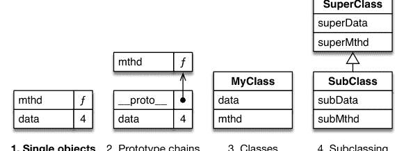

1. Single objects 2. Prototype chains 3. Classes 4. Subclassing

## 28.1 什么是对象？

在 JavaScript 中：

- 对象是一组*属性*（键值对项）。
- 属性键只能是字符串或符号。

### 28.1.1 对象的角色：记录 vs. 字典

对象在 JavaScript 中扮演着两种角色：

- **记录**：作为记录的对象具有固定数量的属性，其键在开发时是已知的。它们的值可以是不同的类型。
- **字典**：作为字典的对象具有可变数量的属性，其键在开发时是未知的。它们的所有值都具有相同的类型。

这些规则影响了本章对对象的解释方式：

- 首先，我们将探索“作为记录的对象”。尽管属性键在底层是字符串或符号，但在本章的这部分中，它们对我们来说将以固定标识符的形式出现。
- 随后，我们将探索“作为字典的对象”。请注意，Maps 通常比对象是更好的字典。然而，我们将会遇到的一些操作也对“作为记录的对象”同样有用。

## 28.2 作为记录的对象

让我们首先探索对象的*记录*角色。

### 28.2.1 对象字面量：属性

对象字面量是创建“作为记录的对象”的一种方式。它们是 JavaScript 的一个特性：你可以直接创建对象——不需要类！这是一个示例：

```javascript
const jane = {
  first: 'Jane',
  last: 'Doe', // 可选的尾逗号
}
```

在示例中，我们通过对象字面量创建了一个对象，它以大括号 `{}` 开始并结束。在内部，我们定义了两个*属性*（键值对项）：

- 第一个属性具有第一个键 `first` 和值 'Jane'。
- 第二个属性具有键 `last` 和值 'Doe'。

我们稍后将展示指定属性键的其他方法，但使用这种指定方式，它们必须遵循 JavaScript 变量名的规则。例如，你可以使用 `first_name` 作为属性键，但不能使用 `first-name`。不过，允许保留字：

```javascript
const obj = {
  if: true,
  const: true
};
```

为了检查各种操作对对象的影响，我们会在本章的后续偶尔使用 `Object.keys(this)`。它列出属性键：

```javascript
> Object.keys({a:1, b:2})
['a', 'b']
```

### 28.2.2 对象字面量：属性值简写

每当属性的值通过变量名定义，且该名称与键相同时，你可以省略键。

```javascript
function createPoint(x, y) {
  return {x, y};
}
assert.deepEqual(
  createPoint(9, 2),
  {x: 9, y: 2 }
);
```

### 28.2.3 获取属性

这是获取（读取）属性的方法（行 A）：

```javascript
const jane = {
  first: 'Jane',
  last: 'Doe'
};
```

```javascript
// 获取属性 .first
assert.equal(jane.first, 'Jane'); // (A)
```

获取一个未知属性会产生 `undefined`：

```javascript
assert.equal(jane.unknownProperty, undefined);
```

### 28.2.4 设置属性

这是设置（写入）属性的方法：

```javascript
const obj = {
  prop: 1
};
assert.equal(obj.prop, 1);
obj.prop = 2; // (A)
assert.equal(obj.prop, 2);
```

我们刚刚通过设置更改了现有属性。如果我们设置一个未知属性，就会创建一个新项：

```javascript
const obj = {}; // 空对象
assert.deepEqual(
  Object.keys(obj), []);
```

```javascript
obj.unknownProperty = 'abc';
assert.deepEqual(
  Object.keys(obj), ['unknownProperty']);
```

### 28.2.5 对象字面量：方法

以下代码显示了如何通过对象字面量创建方法 `.says()`：

```javascript
const jane = {
  first: 'Jane', // 数据属性
  says(text) {
    return `${jane.first} says ${text}`; // (A)
  }, // 逗号作为分隔符（末尾可选）
}
assert.equal(jane.says('hello'), 'Jane says "hello"');
```

在方法调用 `jane.says('hello')` 期间，`jane` 被称为方法调用的接收者并赋值给特殊变量。这使得方法 `.says()` 能够访问行 A 中的兄弟属性 `.first`。

### 28.2.6 对象字面量：访问器

JavaScript 中有两种访问器：

- **getter**（取值器）是一个通过获取属性来调用的类方法实体。
- **setter**（设置器）是一个通过设置属性来调用的类方法实体。

#### 28.2.6.1 Getters

通过在方法定义前加上修饰 `get` 来创建 getter：

```javascript
const jane = {
  first: 'Jane',
  last: 'Doe',
  get full() {
    return `${jane.first} ${jane.last}`;
  }
}
```

```javascript
assert.equal(jane.full, 'Jane Doe');

jane.first = 'John';

assert.equal(jane.full, 'Jane Doe');
```

#### 28.2.6.2 Setters

通过在方法定义前加上修饰 `set` 来创建 setter：

```javascript
const jane = {
  first: 'Jane',
  last: 'Doe',
  set full(fullName) {
    const parts = fullName.split(' ');
    this.first = parts[0];
    this.last = parts[1];
  }
}
```

```javascript
jane.full = 'Richard Roe';
assert.equal(jane.first, 'Richard');
assert.equal(jane.last, 'Roe');
```

> 练习：通过对象字面量创建对象
>
> exercises/single-objects/color_point_object_test.mjs

## 28.3 展开到对象字面量中 (...) [ES2018]

在函数调用内部，展开 (`...`) 将可迭代对象的迭代值转换为参数。

在对象字面量内部，展开属性会将另一个对象的属性添加到当前对象中：

```javascript
> const obj = {foo: 1, bar: 2};
> {...obj, baz: 3}
{ foo: 1, bar: 2, baz: 3 }
```

如果键冲突，以最后一个为准：

```javascript
> const obj = {foo: 1, bar: 2};
> {...obj, foo: 3}
{ foo: 3, bar: 2 }
```

### 28.3.1 展开的用例：拷贝对象

### 28.3.2 展开的用例：缺失属性的默认值

### 28.3.3 展开的用例：非破坏性更改属性

## 28.4 方法

### 28.4.1 方法是值为函数的属性

让我们回顾一下引入方法的示例：

```javascript
const jane = {
  first: 'Jane',
  says(text) {
    return `${this.first} says ${text}`;
  },
};
```

令人惊讶的是，方法是函数：

```javascript
assert.equal(typeof jane.says, 'function');
```

为什么呢？我们在关于回调值的章节中学习过，普通函数可以扮演多种角色。方法就是其中之一。因此，在底层，`jane` 大致如下：

```javascript
const jane = {
  first: 'Jane',
  says: function (text) {
    return `${this.first} says ${text}`;
  }
};
```

### 28.4.2 .call(): 通过参数指定 this

请记住，每个函数 `someFunc` 也是一个对象，因此它也拥有方法。其中一种方法就是 `.call()` – 它允许你在调用函数的同时通过参数来指定 `this`：

```javascript
someFunc.call(thisValue, arg1, arg2, arg3);
```

#### 28.4.2.1 方法与 .call()

如果你进行方法调用，这是一个通过调用的接收者来填充的隐式参数：

```javascript
const obj = {
  method(x) {
    assert.equal(this, obj); // 隐式参数
    assert.equal(x, 'a');
  }
};

obj.method('a'); // 接收者是 `obj`
```

最后一行的方法调用设置如下：

```javascript
obj.method.call(obj, 'a');
```

顺带提一下，这意味着实际上有两个不同的运算符：

1. 用于访问属性的：`obj.prop`
2. 用于进行方法调用：`obj.prop()`

在 (2) 中，并不是 (1) 后面跟着函数调用运算符 `()`。相反，(2) 额外为 `this` 指定了一个值。

#### 28.4.2.2 函数与 .call()

如果你调用的是一个普通函数，这个隐式参数 `this` 也会提供——它被隐式设置为 `undefined`：

```javascript
function func(x) {
  assert.equal(this, undefined); // 隐式参数
  assert.equal(x, 'a');
}
```

```javascript
func('a');
```

最后一行的方法调用设置如下：

```javascript
func.call(undefined, 'a');
```

在函数调用期间 `this` 被设置为 `undefined`，这表明它是仅在方法调用期间才需要的特性。

接下来，我们将检查使用 `this` 的陷阱。在此之前，我们需要另外一个工具：函数的 `.bind()` 方法。

### 28.4.3 .bind(): 预填充 this 和函数的参数

`.bind()` 是函数对象的另一个方法。该方法的调用方式如下：

```javascript
const boundFunc = someFunc.bind(thisValue, arg1, arg2);
```

`.bind()` 返回一个新函数 `boundFunc()`。调用该函数会执行 `someFunc()`，并将 `this` 设置为 `thisValue`，传入这些参数，随后传入 `boundFunc()` 的参数。

也就是说，这两个函数调用是等价的：

```javascript
boundFunc('a', 'b')
someFunc.call(thisValue, arg1, arg2, 'a', 'b')
```

#### 28.4.3.1 .bind() 的替代方案

另一种预填充 `this` 和参数的方法是使用箭头函数：

```javascript
const boundFunc = (...args) =>
  someFunc.call(thisValue, arg1, arg2, ...args);
```

#### 28.4.3.2 .bind() 的实现

考虑到上一节，`.bind()` 可以如下实现为一个真实的函数：

```javascript
function bind(func, thisValue, ...boundArgs) {
  return (...args) =>
    func.call(thisValue, ...boundArgs, ...args);
}
```

#### 28.4.3.3 示例：绑定一个真实函数

对真实函数使用 `.bind` 有些不直观，因为你必须为 `this` 提供一个值。由于它在函数调用期间是 `undefined`，因此通常将其设置为 `undefined` 或 `null`。

在接下来的示例中，我们创建了 `add8()`，这是一个带参数的函数，通过将 `add()` 的第一个参数绑定到 `8`。

```javascript
function add(x, y) {
  return x + y;
}
```

```javascript
const add8 = add.bind(undefined, 8)
assert.equal(add8(1), 9);
```

#### 28.4.3.4 示例：绑定方法

在下面的代码中，我们将方法 `.says()` 转换为独立函数 `func()`：

```javascript
const jane = {
  first: 'Jane',
  says(text) {
    return `${this.first} says ${text}`; // (A)
  }
}
```

```javascript
const func = jane.says.bind(jane, 'hello');
assert.equal(func(), 'Jane says "hello"');
```

通过 `.bind()` 设置此值至关重要。否则，`func()` 将无法正常工作，因为 A 行使用了 `this`。

### 28.4.4 陷阱：提取方法

我们现在对函数和方法有了相当了解，并准备好查看调用方法和 `this` 的陷阱：如果不小心，从对象调用方法可能会失败。

在下面的示例中，我们提取了方法 `jane.says()`，将其存储在变量 `func` 中，并调用 `func()`。

```javascript
const jane = {
  first: 'Jane',
  says(text) {
    return `${this.first} says ${text}`;
  }
}
```

```javascript
const func = jane.says; // 提取方法
assert.throws(
  () => func('hello'), // (A)
  {
    name: 'TypeError',
    message: "Cannot read property 'first' of undefined"
  }
);
```

A 行中的函数调用等同于：

```javascript
assert.throws(
  () => jane.says.call(undefined, 'hello'), // `this` 是 undefined
  {
    name: 'TypeError',
    message: "Cannot read property 'first' of undefined"
  }
);
```

那么我们为什么需要它？我们需要使用 `.bind()` 来提取方法 `jane.says()`：

```javascript
const func2 = jane.says.bind(jane);
assert.equal(func2('hello'), 'Jane says "hello"');
```

`.bind()` 确保了当我们调用 `func()` 时 `this` 始终是 `jane`。你也可以使用箭头函数提取方法：

```javascript
const func3 = text => jane.says(text);
assert.equal(func3('hello'), 'Jane says "hello"');
```

#### 28.4.4.1 示例：提取方法

以下是你在实际开发中可能会看到的代码简化版本：

```javascript
class ClickHandler {
  constructor(id, elem) {
    this.id = id;
    // ...
  }
  handleClick() {
    // ...
  }
}
```

在 A 行中，我们没有正确提取方法 `.handleClick()`。相反，我们应该这样做：

```javascript
elem.addEventListener('click', this.handleClick.bind(this));
```

## 28.5 属性访问和方法调用的可选链（高级） [ES2020]

存在以下类型的可选链操作：

```javascript
obj?.prop // 可选静态属性访问
obj?.[expr] // 可选动态属性访问
func?.(<arg0, arg1>) // 可选函数或方法调用
```

其大致思路是：

- 如果问号之前的值既不是 `undefined` 也不是 `null`，则执行问号后面的操作。
- 否则，返回 `undefined`。

### 28.5.1 示例：可选静态属性访问

考虑以下数据：

```javascript
const persons = [
  {
    surname: 'Zoe',
    address: {
      street: 'Sesame Street',
      number: '123',
    },
  },
  {
    surname: 'Mariner',
  },
  {
    surname: 'Carmen',
    address: {},
  },
];
```

我们可以使用可选链来安全地提取街道名称：

```javascript
const streetNames = persons.map(
  p => p.address?.street?.name);
assert.deepEqual(
  streetNames, ['Sesame Street', undefined, undefined]
);
```

#### 28.5.1.1 通过空值合并处理默认值

空值合并运算符允许我们使用默认值 'no street' 代替 `undefined`：

```javascript
const streetNames = persons.map(
  p => p.address?.street?.name ?? 'no name');
assert.deepEqual(
  streetNames, ['Sesame Street', 'no name', 'no name']
);
```

### 28.5.2 运算符详细说明（高级）

#### 28.5.2.1 可选静态属性访问

这两个表达式等价：

```javascript
obj?.prop
(obj !== undefined && obj !== null) ? obj.prop : undefined
```

示例：

```javascript
assert.equal(undefined?.prop, undefined);
assert.equal(null?.prop, undefined);
assert.equal({prop:1}.prop, 1);
```

#### 28.5.2.2 可选动态属性访问

这两个表达式等价：

```javascript
obj?.[expr]
(obj !== undefined && obj !== null) ? obj[expr] : undefined
```

示例：

```javascript
const key = 'prop';
assert.equal(undefined?.[key], undefined);
assert.equal(null?.[key], undefined);
assert.equal({prop:1}?.[key], 1);
```

#### 28.5.2.3 可选函数或方法调用

这两个表达式等价：

```javascript
func?.(arg0, arg1)
(func !== undefined && func !== null) ? func(arg0, arg1) : undefined
```

示例：

```javascript
assert.equal(undefined?.(123), undefined);
assert.equal(null?.(123), undefined);
assert.equal(String?.(123), '123');
```

注意，如果其左侧不可调用的，则该运算符会产生错误：

```javascript
assert.throws(
  () => true?.(123),
  TypeError);
```

为什么？思路是该运算符只容忍故意的遗漏。不可调用的值（`undefined` 和 `null` 之外）可能是一个错误并应该被报告而不是被规避。

### 28.5.3 短路逻辑（高级）

在属性访问和函数/方法调用的链中，一旦遇到第一个可选链在其左侧遇到 `undefined` 或 `null`，评估就会停止：

```javascript
function isInInvoked(obj) {
  let invoked = false;
  obj?.a.b.m(invoked = true);
  return invoked;
}

assert.equal(
  isInInvoked({a: {b: {m()}}}), true);

// ?. 的左侧是 undefined
// 赋值操作未执行
assert.equal(
  isInInvoked(undefined), false);
```

这种行为与普通的运算符/函数不同，JavaScript 总是会在评估运算符/函数之前评估所有操作数/参数。这被称为短路逻辑。其他短路运算符有：

- `a && b`
- `a || b`
- `c ? t : e`

### 28.5.4 常见问题

#### 28.5.4.1 为什么 o?.[x] 和 f?.() 中有点？

这两个可选运算符的语法并不理想：

```javascript
obj?.[expr]               // 更好：obj?[expr]
func?.(arg0, arg1) // 更好：func?(arg0, arg1)
```

遗憾的是，这种不优雅的语法是必要的，因为区分语法（第一个表达式）和条件运算符（第二个表达式）太复杂了：

```javascript
obj?['a', 'b', 'c'].map(x => x+x)
obj ? ['a', 'b', 'c'].map(x => x+x) : []
```

#### 28.5.4.2 为什么 null?.evaluate 的结果是 undefined 而不是 null？

运算符 `?.` 主要关于它的右侧部分：`.prop` 是否存在？如果不存在，及早停止。因此，保留其左侧的信息很少用。然而，仅有一个“提前终止”值确实可以简化问题。

## 28.6 对象作为字典（进阶）

### 28.6.1 任意固定字符串作为属性键

### 28.6.2 计算属性键

### 28.6.3 in 运算符：是否存在给定键的属性？

### 28.6.4 删除属性键

### 28.6.5 列出属性键

表 28.1：列出自身（非继承）键的标准库方法。所有这些方法都返回一个包含字符串和/或 symbol 的数组。

| 方法 | 可枚举 | 非可枚举 | 字符串 | Symbol |
|---|---|---|---|---|
| `Object.keys()` | ✓ | | ✓ | |
| `Object.getOwnPropertyNames()` | ✓ | ✓ | ✓ | |
| `Object.getOwnPropertySymbols()` | ✓ | ✓ | | ✓ |
| `Reflect.ownKeys()` | ✓ | ✓ | ✓ | ✓ |

表 28.1 中的每种方法都会返回一个包含参数对象自身属性键的数组。在方法名称中，你可以看到以下区分：

- **属性键**可以是字符串也可以是 symbol。
- **属性名**是指值为字符串的属性。
- **属性符号**是指值为 symbol 的属性键。

下一节将描述“可枚举性”并演示每种方法。

#### 28.6.5.1 可枚举性

可枚举性是属性的一个属性。非可枚举属性会被某些操作忽略——例如，`Object.keys()`（见表 28.1）和扩展属性。默认情况下，属性是可枚举的。这个示例展示了如何更改这一点。它还演示了列出属性键的不同方式。

```javascript
const enumerableSymbolKey = Symbol('enumerableSymbolKey');
const nonEnumSymbolKey = Symbol('nonEnumSymbolKey');
```

```javascript
// 通过对象字面量创建可枚举属性
const obj = {
  enumerableString: 1,
  [enumerableSymbolKey]: 2,
}

// 对于非可枚举属性，我们需要更强大的工具
Object.defineProperties(obj, {
  nonEnumStringKey: {
    value: 3,
    enumerable: false,
  },
  [nonEnumSymbolKey]: {
    value: 4,
    enumerable: false,
  },
});
```

```javascript
assert.deepEqual(
  Object.keys(obj),
  [ 'enumerableString' ]);
assert.deepEqual(
  Object.getOwnPropertyNames(obj),
  [ 'enumerableString', 'nonEnumStringKey' ]);
assert.deepEqual(
  Object.getOwnPropertySymbols(obj),
  [ enumerableSymbolKey, nonEnumSymbolKey ]);
assert.deepEqual(
  Reflect.ownKeys(obj),
  [
    'enumerableString', 'nonEnumStringKey',
    enumerableSymbolKey, nonEnumSymbolKey,
  ]);
```

`Object.defineProperties()` 将在本章稍后部分解释。

### 28.6.6 通过 Object.values() 列出属性值

`Object.values()` 列出对象所有可枚举属性的值：

```javascript
const obj = {foo: 1, bar: 2};
assert.deepEqual(
  Object.values(obj),
  [1, 2]);
```

### 28.6.7 通过 Object.entries() 列出属性项

`Object.entries()` 列出可枚举属性的键值对。每个对被编码为一个包含两个元素的数组：

```javascript
const obj = {foo: 1, bar: 2};
assert.deepEqual(
  Object.entries(obj),
  [
    ['foo', 1],
    ['bar', 2],
  ]);
```

> 练习：Object.entries/find_key_test.mjs

### 28.6.8 属性按确定性顺序列出

对象的自身（非继承）属性始终按照以下顺序列出：

1. 包含整数索引的字符串键的属性（包括数组索引）：
   按数字升序排列
2. 剩余的字符串键属性：
   按照它们被添加的顺序排列
3. symbol 键的属性：
   按照它们被添加的顺序排列

以下演示了如何根据这些规则对属性键进行排序：

```javascript
> Object.keys({b:0, a:0, 10:0, 2:0})
[ '2', '10', 'b', 'a' ]
```

> 属性的顺序
>
> ECMAScript 规范详细描述了属性是如何排序的。

### 28.6.9 通过 Object.fromEntries() 组合对象

给定一个包含 `[key, value]` 键的可迭代对象，`Object.fromEntries()` 会创建一个对象：

```javascript
assert.deepEqual(
  Object.fromEntries([['foo',1], ['bar',2]]),
  {
    foo: 1,
    bar: 2
  }
)
```

`Object.fromEntries()` 是 `Object.entries()` 的相反操作。

为了演示这两者，将在接下来的小节中使用它们来实现来自 Underscore 库的两个工具函数。

#### 28.6.9.1 示例：pick(object, ...keys)

`pick` 返回对象的拷贝，仅包含作为参数提到的键的属性：


```javascript
const address = {
  street: 'Evergreen Terrace',
  number: '742',
  city: 'Springfield',
  state: 'NT',
  zip: '49007'
};
assert.deepEqual(
  pick(address, 'street', 'number'),
  {
    street: 'Evergreen Terrace',
    number: '742',
  }
)
```

我们可以如下所示实现 `pick(object, ...keys)`：

```javascript
function pick(object, ...keys) {
  const filteredEntries = Object.entries(object)
    .filter(([key]) => keys.includes(key));
  const result = {};
  for (const [key, value] of filteredEntries) {
    result[key] = value;
  }
  return result;
}
```

### 28.6.9.2 示例：invert(object)

`invert` 返回对象的拷贝，其中键和值是对调的：

```javascript
assert.deepEqual(
  invert({a: 1, b: 2, c: 3}),
  {1: 'a', 2: 'b', 3: 'c'}
);
```

我们可以这样实现 `invert(object)`：

```javascript
function invert(object) {
  const reversed = {};
  for (const [key, value] of Object.entries(object)) {
    reversed[value] = key;
  }
  return reversed;
}
```

### 28.6.9.3 fromEntries() 的简化实现

以下代码是 `fromEntries()` 的简化版本：

```javascript
function fromEntries(iterable) {
  const result = {};
  for (const [key, value] of iterable) {
    let coercedKey;
    if (typeof key === 'symbol') {
      coercedKey = key;
    } else {
      coercedKey = String(key);
    }
    result[coercedKey] = value;
  }
  return result;
}
```

### 28.6.9.4 Object.entries() 的填充（Polyfill）

如果平台上不存在 `Object.entries()`，可以使用以下代码进行填充：

```javascript
if (!Object.entries) {
  Object.entries = function(obj) {
    const res = [];
    for (const key in obj) {
      if (Object.prototype.hasOwnProperty.call(obj, key)) {
        res.push([key, obj[key]]);
      }
    }
    return res;
  };
}
```

### 28.6.10 使用对象字典的陷阱

如果你使用通过字面量创建的对象作为字典，需要注意两个陷阱。第一个陷阱是会继承 `Object.prototype` 的属性；第二个陷阱是在现代 JavaScript 中，`__proto__` 是通过原型链实现的。

- 如果可以，使用 Maps。它们是字典的解决方案。
- 如果不行，使用处理对象的库。
- 如果可以，使用无原型的对象。

以下代码演示了使用无原型的对象：

```javascript
const dict = Object.create(null); // 无原型
assert.equal('toString' in dict, false); // (A)
dict['__proto__'] = 123;
assert.deepEqual(Object.keys(dict), ['__proto__']);
```

练习：使用对象字典

`exercises/single-objects/simple_dict_test.mjs`

## 28.7 标准方法（进阶）

`Object.prototype` 定义了几个可以重写以配置对象处理方式的标准方法。两个重要的有：

- `.toString()`
- `.valueOf()`

### 28.7.1 .toString()

`toString()` 决定了如何将对象转换为字符串：

```javascript
> String({toString() { return 'Hello!' }})
'Hello!'
> String({})
'[object Object]'
```

### 28.7.2 .valueOf()

`valueOf()` 决定了如何将对象转换为数字：

```javascript
> Number({valueOf() { return 123 }})
123
> Number({})
NaN
```

## 28.8 高级主题

以下小节提供了一些高级主题的概述。

### 28.8.1 Object.assign() [ES6]

`Object.assign()` 是一个工具方法：

```javascript
Object.assign(target, source_1, source_2, ...)
```

该表达式将 `source_1` 的所有属性赋值给 `target`，然后是 `source_2` 的属性，以此类推。最后，它返回 `target` ——例如：

```javascript
const target = { foo: 1 };

const result = Object.assign(
  target,
  {bar: 2},
  {baz: 3, bar: 4}
);
assert.deepEqual(
  result, { foo: 1, bar: 4, baz: 3 }
);
// target 被修改并返回：
assert.equal(result, target);
```

### 28.8.2 冻结对象 [ES5]

`Object.freeze(obj)` 使 `obj` 变得完全不可变：你无法更改属性、添加属性，或更改其原型——例如：

```javascript
const frozen = Object.freeze({x: 2, y: 5});
assert.throws(
  () => frozen.x = 7,
  {
    name: 'TypeError',
    message: /Cannot assign to read only property 'x'/
  }
);
```

有一种情况：`Object.freeze(obj)` 实际上是浅冻结的。也就是说，只有 `obj` 的属性被冻结，而存储在属性中的属性并没有被冻结。

- 更多信息

关于冻结和其他锁定对象的更多信息，请参阅《Deep JavaScript》。

### 28.8.3 属性描述和属性描述符 [ES5]

正如对象由属性组成一样，属性也由属性（attributes）组成。属性的值只是多个属性中的一个。其他的包括：

- writable（可写性）：是否可以更改属性的值？
- enumerable（可枚举性）：该属性是否会被 `Object.keys()`、展开操作等方法包含。

当你使用处理属性属性的操作之一时，属性是通过属性描述符（property descriptors）指定的：其中每个属性代表一个属性。例如，这是你如何读取属性 `obj` 的属性的。

```javascript
const obj = { foo: 123 };
assert.deepEqual(
  Object.getOwnPropertyDescriptor(obj, 'foo'),
  {
    value: 123,
    writable: true,
    enumerable: true,
    configurable: true
  }
);
```

而这是你如何设置属性 `obj.bar` 的属性的。

```javascript
const obj = {
  foo: 1,
  bar: 2,
};
assert.deepEqual(Object.keys(obj), ['foo', 'bar']);

// 从 Object.keys() 中隐藏属性 `bar`
Object.defineProperty(obj, 'bar', {
  enumerable: false,
});

assert.deepEqual(Object.keys(obj), ['foo']);
```

扩展阅读：

- 可枚举性在本章前面的部分有更详细的介绍。
- 关于属性属性和属性描述符的更多信息，请参阅《Deep JavaScript》。

## 测验

参见测验应用。

# 第 29 章

## 原型链与类

| 内容 | 页码 |
|---|---|
| 29.1 原型链 | 294 |
| 29.1.1 JavaScript 的操作：所有属性 vs 自身属性 | 295 |
| 29.1.2 陷阱：只有原型链的第一个成员被变异 | 295 |
| 29.1.3 使用原型的技巧（高级） | 296 |
| 29.1.4 通过原型共享数据 | 297 |
| 29.2 类 | 299 |
| 29.2.1 用于人的类 | 299 |
| 29.2.2 类的底层原理 | 300 |
| 29.2.3 类定义：原型属性 | 301 |
| 29.2.4 类定义：静态属性 | 302 |
| 29.2.5 instanceof 运算符 | 302 |
| 29.2.6 为什么我推荐类 | 303 |
| 29.3 类的私有数据 | 303 |
| 29.3.1 私有数据：命名规范 | 303 |
| 29.3.2 私有数据：WeakMaps | 304 |
| 29.3.3 私有数据的更多技术 | 305 |
| 29.4 子类化 | 305 |
| 29.4.1 子类的底层原理（高级） | 306 |
| 29.4.2 详细介绍 instanceof（高级） | 307 |
| 29.4.3 内置对象的原型链（高级） | 307 |
| 29.4.4 分发方法调用 vs 直接方法调用（高级） | 310 |
| 29.4.5 混入类（高级） | 311 |
| 29.5 常见：对象 | 313 |
| 29.5.1 为什么对象保留属性的插入顺序？ | 313 |

在本书中，JavaScript 的面向对象编程（OOP）风格分四步引入。本章涵盖了第 2-4 步，上一章涵盖了第 1 步。步骤如下（图 29.1）：

## 29.1 原型链与类

- 1. 单个对象（上一章）：作为 JavaScript 基础 OOP 构建模块的对象是如何孤立工作的？
- 2. 原型链（本章）：每个对象都有一个由零或多个原型对象组成的链。原型是 JavaScript 的核心继承机制。
- 3. 类（本章）：JavaScript 的类是对象的工厂。类与其实例之间的关系基于原型继承。
- 4. 子类化（本章）：子类与其父类之间的关系也基于原型继承。


## 29.2 类

```javascript
describe() {
  return 'Person named '+this.name;
};
```

```javascript
assert.equal(jane.describe(), 'Person named Jane');
assert.equal(tarzan.describe(), 'Person named Tarzan');
```

我们有两个非常相似的对象。它们都拥有名为 `.name` 和 `.describe` 的属性。此外，方法 `.describe()` 也是相同的。我们该如何避免重复这个方法呢？

我们可以将它移动到一个名为 `PersonProto` 的对象中，并将该对象设为 `jane` 和 `tarzan` 的原型：

```javascript
const PersonProto = {
  describe() {
    return 'Person named ' + this.name;
  },
};
const jane = {
  __proto__: PersonProto,
  name: 'Jane',
};
const tarzan = {
  __proto__: PersonProto,
  name: 'Tarzan',
};
```

原型的名称反映了 `jane` 和 `tarzan` 都是人。

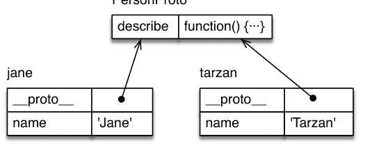

图 29.4：对象 `jane` 和 `tarzan` 通过它们共同的原型 `PersonProto` 共享了 `.describe()`。

图 29.4 展示了这三个对象是如何连接的。底部的对象现在包含了 `jane` 和 `tarzan` 特有的属性。顶部的对象包含了它们之间共享的属性。

当我们调用方法 `jane.describe()` 时，它指向该方法调用的接收者 `jane`（图表的左下角）。这就是为什么该方法仍然有效的原因。`tarzan.describe()` 的原理也是类似的。

## 29.2 类

```javascript
assert.equal(jane.describe(), 'Person named Jane');
assert.equal(tarzan.describe(), 'Person named Tarzan');
```

我们现在准备好学习类（classes）了，类本质上是用于设置原型链的紧凑语法。在底层，JavaScript 的类是非传统的。但这是你只有在真正使用它们时才会发现的。对于用过其他面向对象编程语言的人来说，它们应该感到很熟悉。

### 29.2.1 人的类

我们之前处理过 `jane` 和 `tarzan` 这两个代表人的单一对象。

让我们使用类声明（class declaration）来实现一个人对象的工厂：

```javascript
class Person {
  constructor(name) {
    this.name = name;
  }
  describe() {
    return 'Person named '+this.name;
  }
}
```

现在可以通过 `new Person()` 来创建 `jane` 和 `tarzan` 了：

```javascript
const jane = new Person('Jane');
assert.equal(jane.name, 'Jane');
assert.equal(jane.describe(), 'Person named Jane');

const tarzan = new Person('Tarzan');
assert.equal(tarzan.name, 'Tarzan');
assert.equal(tarzan.describe(), 'Person named Tarzan');
```

`Person` 类拥有以下方法：

- 普通方法 `.describe()`
- 特殊方法 `.constructor()`，它在创建新实例并初始化该实例后被直接调用。它接收传递给 `new` 操作符的参数（在类名之后）。如果你不需要任何参数来设置新实例，可以省略构造函数。

### 29.2.1.1 类表达式

有两种类的定义方式：

- 类声明（Class declarations），我们在上一节中已经见过。
- 类表达式（Class expressions），我们接下来将看到。

类表达式有匿名和命名的两种：

```javascript
// 匿名类表达式
const Person = class { ... };
```

```javascript
// 命名类表达式
const Person = class MyClass { ... };
```

命名类表达式的名称工作原理与命名函数表达式的名称类似。

这是对类的初步了解。我们很快会探索更多特性，但首先我们需要学习类的内部原理。

### 29.2.2 类的底层原理

类的底层有很多东西。让我们来看 `jane` 的图表（图 29.5）。

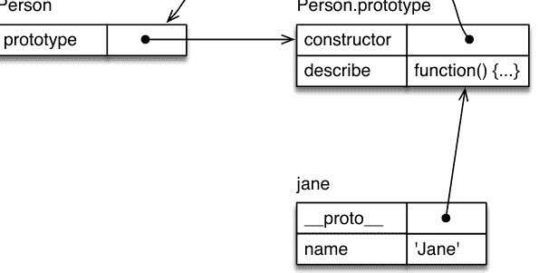

图 29.5：`Person` 类拥有 `.prototype` 属性，该属性指向一个对象，该对象是所有 `Person` 实例的原型。`jane` 就是其中一个实例。

`Person` 类的主要目的是在右侧建立原型链（`jane`，后面跟着 `.prototype`）。这种略显奇怪的方法之所以是为了向后兼容：在类出现之前，构造函数（通过 `new` 操作符调用的普通函数）经常被用作对象的工厂。类大部分是构造函数的更好语法，因此与旧代码保持兼容。这解释了为什么函数类型是：

```
typeof Person
'function'
```

在本书中，我交替使用“构造（函数）”和“类”这两个术语。很容易混淆 `__proto__` 和 `.prototype`。希望 2.5 节能解释清楚它们之间的区别。

- `__proto__` 是用于访问对象原型的伪属性。
- `.prototype` 是一个普通属性，特殊之处在于 `new` 操作符使用它的方式。这个名字并不理想：`Person.prototype` 指向的不是 `Person` 的原型，而是所有 `Person` 实例的原型。

（高级）

2.5 节中还有一个我们尚未查看的细节：`Person.prototype.constructor` 指向 `Person`：

```javascript
Person.prototype.constructor === Person
```

这种差异是为了向后兼容。坦率说，这种差异在实践中产生很少问题；如果你顺着类的伪装去操作，通常没问题。

练习：编写一个类

`exercises/proto-chains-classes/point_class_test.mjs`

### 29.2.3 类定义：原型属性

类声明中的所有结构创建原型属性——属于类的实例。

```javascript
class Foo {
  constructor(prop) {
    this.prop = prop;
  }
  protoMethod() {
    return 'protoMethod';
  }
  get protoGetter() {
    return 'protoGetter';
  }
}
```

```javascript
const foo = new Foo(123);
foo.prop; // 123
foo.protoMethod(); // 'protoMethod'
foo.protoGetter; // 'protoGetter'
```

### 29.2.4 类定义：静态属性

类声明中的所有结构创建静态属性——属于类本身。

```javascript
class Bar {
  static staticMethod() {
    return 'staticMethod';
  }
  static get staticGetter() {
    return 'staticGetter';
  }
}
```

静态方法和静态获取器的用法如下：

```javascript
Bar.staticMethod(); // 'staticMethod'
Bar.staticGetter; // 'staticGetter'
```

### 29.2.5 `instanceof` 运算符

`instanceof` 运算符可以告诉你一个值是否是某个类的实例：

```javascript
new Person('Jane') instanceof Person; // true
({}) instanceof Person; // false
({}) instanceof Object; // true
[] instanceof Array; // true
```

我们将在查看子类后更详细探讨 `instanceof` 运算符。

### 29.2.6 为什么我推荐类

我推荐使用类是因为以下原因：

- 类是对象创建和继承的通用标准，现在被框架（React, Angular, Ember 等）广泛支持。
- 它们有助于工具。
- 可以子类内置构造函数如 `Error`。

## 29.3 类的私有数据

### 29.3.1 私有数据：命名规范

在下面的代码中，属性 `._counter` 和 `._action` 是私有的。

```javascript
class Countdown {
  constructor(counter, action) {
    this._counter = counter;
    this._action = action;
  }
  dec() {
    this._counter--;
    if (this._counter === 0) {
      this._action();
    }
  }
}

// 这两个属性并不是私有的：
assert.deepEqual(
  Object.keys(new Countdown()),
  ['_counter', '_action']
);
```

使用这种技术你无法获得任何保护，且私有名称可能会冲突。优点是它很容易使用。

### 29.3.2 私有数据：WeakMaps

另一种技术是使用 WeakMaps。其具体工作原理在 WeakMaps 章节中解释。以下是预览：

```javascript
const _counter = new WeakMap();
const _action = new WeakMap();

class Countdown {
  constructor(counter, action) {
    _counter.set(this, counter);
    _action.set(this, action);
  }
  dec() {
    let counter = _counter.get(this);
    counter--;
    _counter.set(this, counter);
    if (counter === 0) {
      _action.get(this)();
    }
  }
}

// 这两个伪属性是真正的私有的：
assert.deepEqual(
  Object.keys(new Countdown()),
  []
);
```

这种技术提供了防止外部访问的显著保护，且不会发生名称冲突。但它使用起来也更复杂。

### 29.3.3 私有数据的更多技术

本书解释了类中私有数据最重要的技术。未来可能还会有内置的支持。详情请参阅 ECMAScript 提案“Class Public Instance Fields & Private Instance Fields”。

在《Exploring ES6》中解释了一些额外的技术。

## 29.4 子类化

类也可以子类（“扩展”）现有的类。例如，下面的 `Employee` 派生自 `Person`：

```javascript
class Person {
  constructor(name) {
    this.name = name;
  }
  describe() {
    return `Person named ${this.name}`;
  }
  static logNames(persons) {
    for (const person of persons) {
      console.log(person.name);
    }
  }
}
```

```javascript
class Employee extends Person {
  constructor(name, title) {
    super(name);
    this.title = title;
  }
  describe() {
    return super.describe() + ` (${this.title})`;
  }
}
```

```javascript
const jane = new Employee('Jane', 'CTO');
assert.equal(
  jane.describe(),
  'Person named Jane (CTO)'
);
```

两个注释：

- 在 `.constructor()` 方法内部，你必须通过 `super()` 调用父构造函数才能访问 `this`。这是因为在调用父构造函数之前 `this` 并不存在（这种现象是类特有的）。
- 静态方法也会继承。例如，`Employee` 继承了静态方法 `.logNames()`：

```javascript
> 'logNames' in Employee
true
```

练习：子类化

`exercises/proto-chains-classes/color_point_class_test.mjs`

### 29.4.1 子类的底层原理（进阶）

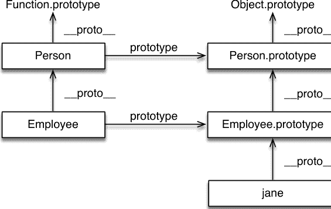

图 29.6：这些组成类 `Person` 及其子类 `Employee` 的对象。左列关于类。右列关于 `Employee` 实例 `jane` 及其原型链。

上一节中的类 `Person` 和 `Employee` 由几个对象组成（图 29.6）。理解这些对象如何相互关联的关键洞察是，存在两条原型链：

- 右侧的实例原型链。
- 左侧的类原型链。

#### 29.4.1.1 实例原型链（右侧列）

实例原型链从 `jane` 开始，通过 `Employee.prototype` 和 `Person.prototype` 继续。原型链在此处结束，但我们又得到了一个对象：`Object.prototype`。这个原型为几乎所有的对象提供服务，这就是为什么它也包含在这里：

```javascript
> Object.getPrototypeOf(Person.prototype) === Object.prototype
true
```

#### 29.4.1.2 类原型链（左侧列）

在类原型链中，`Employee` 在先，`Person` 随其。之后，链通过 `Function.prototype` 继续，这是因为 `Person` 是一个函数，并且需要 `Function.prototype` 的服务。

```javascript
> Object.getPrototypeOf(Person) === Function.prototype
true
```

### 29.4.2 详细介绍 instanceof（进阶）

我们还没有看到 `instanceof` 实际上是如何工作的。给定表达式：

- `x instanceof C`

`instanceof` 如何确定 `x` 是否为 `C` 的实例（或其子类）？它通过检查 `C.prototype` 是否在 `x` 的原型链中来实现此。也就是说，以下表达式等价：

```javascript
C.prototype.isPrototypeOf(x)
```

如果回到图 29.6，我们可以确认原型链引导我们得到了以下正确答案：

- `jane instanceof Employee` // true
- `jane instanceof Person` // true
- `jane instanceof Object` // true

### 29.4.3 内置对象的原型链（进阶）

接下来，我们将利用子类的知识来理解内置对象的原型链。让我们使用工具：

```javascript
const p = Object.getPrototypeOf;
```

#### 29.4.3.1 对象的原型链

让我们通过检查原型链来开始：

```javascript
> p({}) === Object.prototype
true
```

这个原型为几乎所有对象提供服务，这就是为什么它也包含在这里的：


图 29.7：对象的原型链从对象开始，继续到 `Object.prototype`。

#### 29.4.3.2 类的原型链

```javascript
> p(Employee.prototype) === Person.prototype
true
> p(Person.prototype) === Object.prototype
true
```

#### 29.4.3.3 数组的原型链

`[]` 的原型链看起来是怎样的？

```javascript
> p([]) === Array.prototype
true
> p(Array.prototype) === Object.prototype
true
```

#### 29.4.3.4 函数的原型链

最后，函数的原型链告诉我们函数是对象：

```javascript
> p(function() {}) === Function.prototype
true
> p(Function.prototype) === Object.prototype
true
```

#### 29.4.3.5 Object 的实例对象

通过字面量创建的对象通常都是 `Object` 的实例：

```javascript
> {} instanceof Object
true
> () => {} instanceof Object
true
```

#### 29.4.3.6 伪属性 `__proto__` 具体是如何工作的？

伪属性 `__proto__` 是类通过 getter 和 setter 实现的。它可以这样实现：

```javascript
class Object {
  get __proto__() {
    return Object.getPrototypeOf(this);
  }
  set __proto__(other) {
    Object.setPrototypeOf(this, other);
  }
  // ...
}
```

这意味着你可以通过创建一个原型链中不包含 `Object.prototype` 的对象来关闭 `__proto__`（参见上一节）：

```javascript
> '__proto__' in {}
true
> '__proto__' in Object.create(null)
false
```

### 29.4.4 分派调用与直接方法调用（进阶）

让我们研究类中方法调用是如何工作的。我们回顾之前的 `jane`：

```javascript
class Person {
  constructor(name) {
    this.name = name;
  }
  describe() {
    return 'Person named '+this.name;
  }
}
const jane = new Person('Jane');
```

图 29.9 有一个带有 jane 原型链的图。

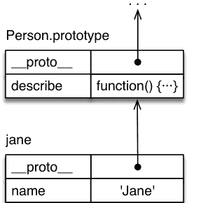

图 29.9：jane 的原型链从 jane 继续到 `Person.prototype`。

普通方法调用是分派的——`jane.describe()` 方法调用分为两个步骤：

- 分派：在 jane 的原型链中找到第一个键为 'describe' 的属性并获取其值。
- 调用：调用该值，并将 `this` 设置为 jane。

```javascript
const func = jane.describe;
func.call(jane);
```

这种动态查找方法并调用的方法被称为动态分派。

你可以直接进行该方法调用，而不进行分派：

```javascript
Person.prototype.describe.call(jane)
```

注意，这始终指向原型链的开头。这使得 `.describe()` 能够访问 `.name`。

#### 29.4.4.1 借用方法

当你处理 `Object.prototype` 的方法时，直接调用方法会变得有用。例如，`Object.prototype.hasOwnProperty(k)` 用于检查对象是否具有键为 `k` 的非继承属性：

```javascript
> const obj = { foo: 123 };
> obj.hasOwnProperty('foo')
true
> obj.hasOwnProperty('bar')
false
```

然而，在对象的原型链中，可能另一个键为 'hasOwnProperty' 的属性，它会覆盖 `Object.prototype` 中的方法。此时分发的方法无法工作：

```javascript
> const obj = { hasOwnProperty: true };
> obj.hasOwnProperty('bar')
TypeError: obj.hasOwnProperty is not a function
```

解决方法是使用直接调用：

```javascript
> Object.prototype.hasOwnProperty.call(obj, 'bar')
false
> Object.prototype.hasOwnProperty.call(obj, 'hasOwnProperty')
true
```

这种直接方法调用通常简写如下所示：

```javascript
> ({}).hasOwnProperty.call(obj, 'bar')
false
> ({}).hasOwnProperty.call(obj, 'hasOwnProperty')
true
```

这种模式看起来可能效率低下，但大多数引擎都会对这种模式进行优化，因此性能不应该是问题。

### 29.4.5 混入类（高级）

JavaScript 的类系统只支持单继承。这意味着每个类最多有一个超类。绕过这一限制的方法之一是通过称为“混入类”（mixin classes，简称 mixins）的技术。

其核心思想是：假设我们想让类 `C` 继承两个超类 `S1` 和 `S2`。这将是多重继承，JavaScript 并不支持。

我们的方法是将 `S1` 和 `S2` 转换为子类的混入类：

```javascript
const S1 = (Sup) => class extends Sup { /*...*/ };
const S2 = (Sup) => class extends Sup { /*...*/ };
```

这两个函数中的每一个都返回一个扩展了给定超类 `Sup` 的类。我们如下所示创建类 `C`：

```javascript
class C extends S2(S1(Object)) {
  /*...*/
}
```

现在我们有了一个类 `C`，它扩展了类 `S2`，`S2` 扩展了类 `S1`，`S1` 又扩展了 `Object`（大多数类都是隐式扩展它的）。

#### 29.4.5.1 示例：用于品牌管理的混入

我们实现了一个混入 `Branded`，它包含了用于设置和获取对象品牌的辅助方法：

```javascript
const Branded = (Sup) => class extends Sup {
  setBrand(brand) {
    this.brand = brand;
    return this;
  }
  getBrand() {
    return this._brand;
  }
};
```

我们使用这个混入来实现 `Car` 品牌管理：

```javascript
class Car extends Branded(Object) {
  constructor(model) {
    super();
    this._model = model;
  }
  toString() {
    return `${this.getBrand()} ${this._model}`;
  }
}
```

以下代码证实了混入有效：`Car` 拥有 `Branded` 的 `.setBrand()` 方法。

```javascript
const modelT = new Car('Model T').setBrand('Ford');
assert.equal(modelT.toString(), 'Ford Model T');
```

#### 29.4.5.2 混入的益处

混入释放了单继承的限制：

- 同一个类可以扩展一个超类和零或多个混入。
- 同一个混入可以被多个类使用。

## 29.5 FAQ：对象

### 29.5.1 为什么对象保留了属性的插入顺序？

原则上，对象是无序的。属性排序的主要目的是为了列出条目、键或值的操作是确定性的。这有助于，例如测试。

- 测验

查看测验应用。

# 第 VII 部分

# 集合

# 第 30 章

## 同步迭代

- 目录

* **30.1 什么是同步迭代的？** 317
* **30.2 核心迭代结构：迭代对象和迭代器** 318
* **30.3 手动迭代** 319
    * 30.3.1 通过 while 迭代可迭代对象 319
* **30.4 实践中的迭代** 320
    * 30.4.1 迭代数组 320
    * 30.4.2 迭代集合 320
* **30.5 快速参考：同步迭代** 321
    * 30.5.1 可迭代数据源 321
    * 30.5.2 迭代结构 321

## 30.1 什么是同步迭代的？

同步迭代是一种*协议*（接口加上使用规则的规则），它连接了 JavaScript 中的两类实体：

- **数据源**：一方面，数据以各种形状和大小出现。在 JavaScript 的标准库中，你有线性数据结构 `Array`、有序集合 `Set`（元素按添加时间排序）、有序字典 `Map`（条目按添加时间排序）等等。
- **数据消费者**：另一方面，数据是按顺序被消费的。

迭代协议连接了这两者。

## 30.2 核心迭代结构：迭代对象和迭代器

两个规则（由接口描述）形成了迭代的核心：

- 可迭代对象（iterable）是一个键为 `Symbol.iterator` 的对象。它返回一个迭代器。
- 迭代器（iterator）是遍历的指针；它通过 `.next()` 方法返回值。

这些是迭代接口的类型定义（TypeScript 语法）：

```typescript
interface Iterable<T> {
  [Symbol.iterator](): Iterator<T>;
}

interface Iterator<T> {
  next() : IteratorResult<T>;
}

interface IteratorResult<T> {
  value: T;
  done: boolean;
}
```

接口用法如下：

- 通过键为 `Symbol.iterator` 的方法向可迭代对象请求迭代。
- 迭代器通过其 `.next()` 方法返回值。
- 值不是直接返回，而是封装在具有两个属性的对象中：
  - `.value` 是迭代的值。
  - `.done` 表示迭代结束。最后一个迭代值之后为 true，之前为 false。

## 30.3 手动迭代

这是一个使用协议的示例：

```javascript
const iterable = ['a', 'b'];

// 可迭代对象是迭代器的工厂：
const iterator = iterable[Symbol.iterator]();

// 调用 .next() 直到 .done 为 true：
assert.deepEqual(
  iterator.next(), { value: 'a', done: false });
assert.deepEqual(
  iterator.next(), { value: 'b', done: false });
assert.deepEqual(
  iterator.next(), { value: undefined, done: true });
```

### 30.3.1 通过 while 迭代可迭代对象

以下代码演示了如何使用 while 循环迭代可迭代对象：

```javascript
function logAll(iterable) {
  const iterator = iterable[Symbol.iterator]();
  while (true) {
    const {value, done} = iterator.next();
    if (done) break;
    console.log(value);
  }
}

logAll(['a', 'b']);
// 输出:
// 'a'
// 'b'
```

练习：手动使用同步迭代

`exercises/sync-iteration-use/sync_iteration_manually_exrc.mjs`

## 30.4 实践中的迭代

我们已经看到了如何手动使用迭代协议，而该协议并不是为了直接使用的——它是为了通过构建在其基础上的更高层级语言结构来使用的。本节将展示其具体形式。

### 30.4.1 遍历数组

JavaScript 的数组（Arrays）是可迭代的。这使得我们能够使用 `for-of` 循环：

```javascript
const myArray = ['a', 'b', 'c'];

for (const x of myArray) {
  console.log(x);
}
// 输出:
// 'a'
// 'b'
// 'c'
```

通过数组模式进行解构赋值（后文会解释）在底层中也使用了迭代：

```javascript
const [first, second] = myArray;
assert.equal(first, 'a');
assert.equal(second, 'b');
```

### 30.4.2 遍历 Set

JavaScript 的 `Set` 数据结构是可迭代的。这意味着 `for-of` 是有效的：

```javascript
const mySet = new Set().add('a').add('b').add('c');
for (const x of mySet) {
  console.log(x);
}
// 输出:
// 'a'
// 'b'
// 'c'
```

数组解构也是如此：

```javascript
const [first, second] = mySet;
assert.equal(first, 'a');
assert.equal(second, 'b');
```

## 30.5 快速参考：同步迭代

### 30.5.1 可迭代数据源

以下内置数据源是可迭代的：

- 数组 (Arrays)
- 字符串 (Strings)
- Maps
- Sets
- （浏览器：DOM 数据结构）

要遍历对象的属性，你需要诸如 `Object.keys()` 和 `Object.entries()` 这样的辅助函数。这是必要的，因为属性存在于一个独立于数据结构层级的不同层级。

### 30.5.2 迭代构造

以下构造结构基于迭代：

- 通过数组模式进行解构：
  `const [x,y] = iterable;`
- for-of 循环：
  `for (const x of iterable) {...}`
- `Array.from()`:
  `const arr = Array.from(iterable);`
- 展开（通过 `...`）到函数调用和数组字面量：
  `func(...iterable);`
  `const arr = [...iterable];`
- `new Map()` 和 `new Set()`:
  `const m = new Map(iterableOverPairs);`
  `const s = new Set(iterableOverElements);`
- `Promise.all()` 和 `Promise.race()`:
  `const promise1 = Promise.all(iterableOverPromises);`
  `const promise2 = Promise.race(iterableOverPromises);`
- `yield*`:

```javascript
function* generatorFunction() {
  yield* iterable;
}
```

## 测验

参阅测验应用。

# 第 31 章

## 数组 (Array)

# 目录

| 章节 | 标题 | 页码 |
| :--- | :--- | :--- |
| 31.1 | 数组在 JavaScript 中的两个角色 | 324 |
| 31.2 | 基础数组操作 | 324 |
| 31.2.1 | 创建、读取、写入数组 | 324 |
| 31.2.2 | 数组的 .length | 325 |
| 31.2.3 | 清空数组 | 325 |
| 31.2.4 | 展开到数组字面量 [ES6] | 326 |
| 31.2.5 | 数组：列出索引和条目 [ES6] | 326 |
| 31.2.6 | 是否为数组值？ | 327 |
| 31.3 | for-of：遍历元素 [ES6] | 327 |
| 31.3.1 | for-of：遍历 [索引, 元素] 对 | 328 |
| 31.4 | 类数组对象 | 328 |
| 31.5 | 将可迭代和类数组值转换为数组 | 329 |
| 31.5.1 | 通过展开 (...) 将可迭代对象转换为数组 | 329 |
| 31.5.2 | 通过 Array.from() 将可迭代对象和类数组对象转换为数组（高级） | 329 |
| 31.6 | 创建并填充任意长度的数组 | 330 |
| 31.6.1 | 你是否需要创建一个稍后完全填充的空数组？ | 330 |
| 31.6.2 | 你是否需要创建一个填充了原始值的数组？ | 330 |
| 31.6.3 | 你是否需要创建一个填充了对象的数组？ | 331 |
| 31.6.4 | 你是否需要创建一个整数范围？ | 331 |
| 31.6.5 | 如果元素全是整数或浮点数，你是否会使用类型数组 (Typed Array) | 331 |
| 31.7 | 多维数组 | 331 |
| 31.8 | 数组特性（高级） | 332 |
| 31.8.1 | 数组索引是特殊的 | 332 |
| 31.8.2 | 数组是字典并可以有空 | 333 |
| 31.9 | 添加和删除元素（破坏性和非破坏性） | 335 |
| 31.9.1 | 在数组头部添加元素 | 335 |
| 31.9.2 | 在数组末尾追加元素 | 336 |
| 31.9.3 | 删除元素 | 336 |

## 31.1 数组在 JavaScript 中的两个角色

数组在 JavaScript 中有两个角色：

- 元组 (Tuples)：作为元组的数组具有固定数量的元素。每个元素的类型不同。
- 序列 (Sequences)：作为序列的数组具有可变数量的元素。

值得注意的是，序列数组非常灵活，你可以将它们用作（传统的）栈和队列（见后文章节）。

## 31.2 基础数组操作

### 31.2.1 创建、读取、写入数组

创建数组的最佳方法是通过数组字面量：

```javascript
const arr = ['a', 'b', 'c'];
```

数组字面量以 `[]` 开始并结束。它创建了一个包含三个元素的数组：'a'、'b' 和 'c'。

读取数组元素需要放入索引（索引从零开始）：

```javascript
assert.equal(arr[0], 'a');
```

更改数组元素需要向某个索引赋值：

```javascript
arr[0] = 'x';
assert.deepEqual(arr, ['x', 'b', 'c']);
```

### 31.2.2 数组的 .length

每个数组都有一个 `.length` 属性，用于读取和更改数组元素的数量。

数组的长度总是最高索引加 1：

```javascript
const arr = ['a', 'b'];
arr.length; // 2
```

如果你在长度所在的索引处写入数组，就会追加一个元素：

```javascript
arr[arr.length] = 'c';
// arr 现在是 ['a', 'b', 'c']
```

### 31.2.3 清空数组

要清空数组，你可以通过将其 `.length` 设置为零：

```javascript
const arr = ['a', 'b', 'c'];
arr.length = 0;
assert.deepEqual(arr, []);
```

或者你可以将一个新的空数组赋值给存储它的变量：

```javascript
let arr = ['a', 'b', 'c'];
arr = [];
assert.deepEqual(arr, []);
```

### 31.2.4 展开到数组字面量 [ES6]

在数组字面量内部，展开元素（spread element）由三个点号 (`...`) 后面紧跟一个表达式组成。它的结果是该表达式被求值，然后进行迭代。每个迭代值都会变成一个额外的数组元素——例如：

```javascript
const iterable = ['b', 'c'];
['a', ...iterable, 'd']; // ['a', 'b', 'c', 'd']
```

这意味着我们可以使用展开来创建一个数组的拷贝：

```javascript
const original = ['a', 'b', 'c'];
const copy = [...original];
```

展开也方便于将数组（以及其他字面量）合并到数组中：

```javascript
const arr1 = ['a', 'b'];
const arr2 = ['c', 'd'];
const concatenated = [...arr1, ...arr2, 'e'];
assert.deepEqual(
  concatenated,
  ['a', 'b', 'c', 'd', 'e']
);
```

由于展开需要迭代，只有当值是可迭代的（iterable）时它才有效：

```javascript
[...'abc']; // 字符串是可迭代的
// ['a', 'b', 'c']
[...123];
// TypeError: number 123 is not iterable
[...undefined];
// TypeError: undefined is not iterable
```

> 展开到数组字面量是浅拷贝

与展开到对象字面量类似，展开到数组字面量创建的是浅拷贝。这意味着嵌套的数组不会被拷贝。

### 31.2.5 数组：列出索引和项 [ES6]

`.keys()` 方法列出数组的索引：

```javascript
const arr = ['a', 'b'];
assert.deepEqual(
  [...arr.keys()], // (A)
  [0, 1]
);
```

`.keys()` 返回一个迭代器。在行 A 中，我们通过展开获取一个数组。

列出数组索引与列出属性不同。前者产生数字；后者产生字符串化的数字（除了非索引属性键外）：

```javascript
const arr = ['a', 'b'];
arr.prop = true;
assert.deepEqual(
  Object.keys(arr),
  ['0', '1', 'prop']
);
```

`.entries()` 方法以[索引, 元素]对的形式列出数组的内容：

```javascript
const arr = ['a', 'b'];
assert.deepEqual(
  [...arr.entries()],
  [[0, 'a'], [1, 'b']]
);
```

### 31.2.6 一个值是否是数组？

以下是检查一个值是否为数组的两种方法：

- `[] instanceof Array` // true
- `Array.isArray([])` // true

`instanceof` 通常可以用。如果值可能来自其他 realm（域），请使用新的 `Array.isArray()`。大致来说，realm 是 JavaScript 全局作用域的实例。某些 realm 之间是隔离的（例如浏览器中的 Web Workers），但也存在可以在其之间移动数据的 realm——例如浏览器中的同源 iframe。`instanceof Array` 检查 x 的原型链，因此如果 x 是来自另一个 realm 的数组，它将返回 false。

`typeof` 将数组归类为对象：

- `typeof []` // 'object'

## 31.3 for-of 与数组 [ES6]

我们已经遇到过 for-of 循环。本节简要回顾如何将它用于数组。

### 31.3.1 for-of：遍历元素

接下来的 for-of 循环遍历数组的元素。

```javascript
for (const element of ['a', 'b']) {
  console.log(element);
}
// 输出:
// 'a'
// 'b'
```

### 31.3.2 for-of：遍历 [索引, 元素]对

接下来的 for-of 循环遍历 [索引, 元素]对。解构赋值（稍后会描述）使用了方便的语法在 for-of 头部设置索引和元素。

```javascript
for (const [index, element] of ['a', 'b'].entries()) {
  console.log(index, element);
}
// 输出:
// 0, 'a'
// 1, 'b'
```

## 31.4 类数组对象

某些在数组上运行的操作只需要最少条件：值只需要是类数组即可。类数组值是具有以下属性的对象：

- `length`: 存储类数组对象的长度。
- `[0]`: 存储索引为 0 的元素。

如果你使用数字作为属性名，它们会被强制转换为字符串。因此，`[0]` 获取键为 '0' 的属性值。

例如，`Array.from()` 接受类数组对象并将其转换为数组：

```javascript
// 如果省略了 .length，它将被解释为 0
assert.deepEqual(
  Array.from({}),
  []
);
```

```javascript
assert.deepEqual(
  Array.from({length:2, 0:'a', 1:'b'}),
  ['a', 'b']
);
```

类数组对象的 TypeScript 接口为：

```typescript
interface ArrayLike<T> {
  length: number;
  [n: number]: T;
}
```

类数组对象在现代 JavaScript 中相对罕见；在 ES6 之前；现在你不经常看到它们。

## 31.5 将可迭代值和类数组值转换为数组

将可迭代值和类数组值转换为数组有两种常用方法：展开和 `Array.from()`。

### 31.5.1 通过展开将可迭代值转换为数组

```javascript
const iterable = ['a', 'b'];
const arr = [...iterable];
assert.deepEqual(arr, ['a', 'b']);
```

### 31.5.2 通过 Array.from() 将可迭代值转换为数组

```javascript
const iterable = ['a', 'b'];
const arr = Array.from(iterable);
assert.deepEqual(arr, ['a', 'b']);
```

## 31.6 创建并填充数组

创建数组的最佳方法是使用字面量。但是，你可能在开发时不知道其长度，或者可能需要灵活的长度。那么我推荐以下创建和填充数组的技术。

### 31.6.1 你需要创建一个稍后填充的空数组吗？

创建一个稍后填充的空数组：

```javascript
new Array(3); // [ , , ]
```

注意结果有空位（槽）——字面量中的最后一个逗号总是被忽略的。

### 31.6.2 你需要创建一个填充原始值的数组吗？

填充原始值的数组：

```javascript
new Array(3).fill(0); // [0, 0, 0]
```

警告：如果你对 `.fill()` 使用对象，每个数组元素将引用该对象（共享它）。

```javascript
const arr = new Array(3).fill({});
arr[0].prop = true;
assert.deepEqual(
  arr, [
    {prop: true},
    {prop: true},
    {prop: true},
  ]
);
```

下一个小节将解释如何解决这个问题。

### 31.6.3 你需要创建一个填充对象的数组吗？

```javascript
Array.from({length: 3}, () => ({})); // [{}, {}, {}]
```

### 31.6.4 你需要创建一个整数范围吗？

```javascript
function createRange(start, end) {
  return Array.from({length: end-start}, (_, i) => i+start);
}
assert.deepEqual(
  createRange(2, 5),
  [2, 3, 4]
);
```

这里是另一种从零开始创建整数范围的巧妙技巧：

```javascript
/** 返回一个迭代器 */
function createRange(end) {
  return new Array(end).keys();
}
assert.deepEqual(
  [...createRange(4)],
  [0, 1, 2, 3]
);
```

这是因为 `.keys()` 会处理未定义元素并列出它们的索引。

### 31.6.5 如果元素全是整数或浮点数，请使用类型数组

如果你处理的是整数或浮点数数组，请考虑类型数组，它们是为此目的而创建的。

## 31.7 多维数组

```javascript
function initMultiArray(...dimensions) {
  function initMultiArrayRec(dimIndex) {
    if (dimIndex === dimensions.length) {
      return 0;
    } else {
      const dim = dimensions[dimIndex];
      const arr = [];
      for (let i=0; i<dim; i++) {
        arr.push(initMultiArrayRec(dimIndex+1));
      }
      return arr;
    }
  }
  return initMultiArrayRec(0);
}

const arr = initMultiArray(4, 3, 2);
arr[3][2][1] = 'X'; // 每个维中的最后一个
assert.deepEqual(arr, [
  [[ 0, 0 ], [ 0, 0 ], [ 0, 0 ]],
  [[ 0, 0 ], [ 0, 0 ], [ 0, 0 ]],
  [[ 0, 0 ], [ 0, 0 ], [ 0, 0 ]],
  [[ 0, 0 ], [ 0, 0 ], [ 0, 'X' ]]
]);
```

## 31.8 更多数组特性（高级）

在本节中，我们将介绍一些在处理数组时并不经常遇到的现象。

### 31.8.1 数组索引是（稍微特殊的）属性键

你可能会认为数组元素很特殊，因为你是通过数字来访问它们的。但用于此操作的方括号运算符 `[]` 与访问属性的运算符是相同的。它会将任何值（非符号类型）强制转换为字符串。因此，数组元素是（几乎）普通的属性（A 行），且使用数字或字符串作为索引并没有区别（B 行和 C 行）：

```javascript
const arr = ['a', 'b'];
arr.prop = 123;
assert.deepEqual(
  Object.keys(arr),
  ['0', 'prop'] // (A)
);
```

```javascript
assert.equal(arr[0], 'a'); // (B)
assert.equal(arr['0'], 'a'); // (C)
```

让事情变得更加困惑的是，这仅仅是语言规范定义的方式（如果说是 JavaScript 的理论）。大多数 JavaScript 引擎在底层进行了优化，并实际上使用整数来访问数组元素（即 JavaScript 的实践）。

用于数组元素的属性键（字符串！）被称为索引。如果一个字符串 `str` 转换为 32 位无符号整数再转换回字符串等于原始值，那么它就是一个索引。

写成公式为：

```javascript
ToString(ToUint32(str)) === str
```

#### 31.8.1.1 列出索引

在列出属性键时，索引会被特殊对待——它们总是排在前面，并按数字排序（'2' 排在 '10' 之前）：

```javascript
const arr = [];
arr.prop = true;
arr[1] = 'b';
arr[0] = 'a';
assert.deepEqual(
  Object.keys(arr),
  ['0', '1', 'prop']
);
```

注意 `.length`、`.entries()` 和 `.keys()` 将数组索引视为数字并忽略非索引属性：

```javascript
assert.equal(arr.length, 2);
assert.deepEqual(
  [...arr.keys()], [0, 1]
);
assert.deepEqual(
  [...arr.entries()], [[0, 'a'], [1, 'b']]
);
```

我们使用了扩展元素 `(...)` 将 `.keys()` 和 `.entries()` 返回的可迭代对象转换为数组。

### 31.8.2 数组和字典可以有空洞

在 JavaScript 中，我们区分两种数组：

- 如果所有索引 $0 \le i < arr.length$ 都存在，则该数组是**密集的**。也就是说索引形成了一个连续的范围。
- 如果索引范围存在空洞，则数组是**稀疏的**。也就是说某些索引缺失。

JavaScript 中的数组可以是稀疏的，因为数组实际上上是从索引到值的字典。

> **建议：避免空洞**
> 到目前为止，我们只见过密集的数组，确实建议避免空洞：它们会让你的代码变得复杂，而且数组方法对它们的处理并不一致。此外，JavaScript 引擎会优化密集的数组，使其运行更快。

#### 31.8.2.1 创建空洞

你可以在赋值元素时跳过索引来创建空洞：

```javascript
const arr = [];
arr[0] = 'a';
arr[2] = 'c';
assert.deepEqual(Object.keys(arr), ['0', '2']); // (A)
assert.equal(0 in arr, true); // 元素
assert.equal(1 in arr, false); // 空洞
```

在 A 行中，我们使用了 `Object.keys(arr)`；`keys()` 将空洞视为 `undefined` 且不会显示它们。

另一种创建空洞的方法是在数组字面量中跳过元素：

```javascript
const arr = ['a', , 'c'];
assert.deepEqual(Object.keys(arr), ['0', '2']);
```

你也可以删除元素：

```javascript
const arr = ['a', 'b', 'c'];
assert.deepEqual(Object.keys(arr), ['0', '1', '2']);
delete arr[1];
assert.deepEqual(Object.keys(arr), ['0', '2']);
```

#### 31.8.2.2 数组操作如何处理空洞？

遗憾的是，数组操作处理空洞有许多不同的方式：

某些数组操作会移除空洞：

- `['a', ,'b'].filter(x => true)` // `['a', 'b']`

某些数组操作会忽略空洞：

- `['a', ,'a'].every(x => x === 'a')` // `true`

某些数组操作会保留空洞：

- `['a', ,'b'].map(x => 'c')` // `['a', , 'c']`

某些数组操作将空洞视为 `undefined`：

- `Array.from(['a', ,'b'], x => x)` // `['a', undefined, 'b']`
- `['a', ,'b'].entries()` // `[[0, 'a'], [1, undefined], [2, 'b']]`

`.keys()` 的工作方式与 `Object.keys()` 不同（字符串 vs 数字，空洞的处理）：

```javascript
[...['a', ,'b'].keys()]; // [0, 1, 2]
Object.keys(['a', ,'b']); // ['0', '2']
```

这里没有统一的规则。如果数组如何处理空洞很重要，最好的方法是进行测试。

## 31.9 添加和删除元素（破坏性和非破坏性）

JavaScript 的数组非常灵活，更像栈。本节探索了添加和移除元素的方法。大多数操作可以是破坏性的（修改数组），也可以是非破坏性的（产生一个副本）。

### 31.9.1 在数组头部添加元素

在以下代码中，破坏性地向 `arr1` 和 `arr2` 前插入单个元素：

```javascript
const arr1 = ['a', 'b'];
arr1.unshift('x', 'y');
assert.deepEqual(arr1, ['x', 'y', 'a', 'b']);

const arr2 = ['a', 'b'];
arr2.unshift('x', 'y');
assert.deepEqual(arr2, ['x', 'y', 'a', 'b']);
```

扩展操作允许我们将数组 `unshift` 到 `arr2`。非破坏性的前插入通过扩展元素完成：

```javascript
const arr = ['a', 'b'];
assert.deepEqual(['x', 'y', ...arr], ['x', 'y', 'a', 'b']); // 未变
```

### 31.9.2 在数组末尾追加元素

在代码中，破坏性地向 `arr1` 和 `arr2` 追加单个元素：

```javascript
const arr1 = ['a', 'b'];
arr1.push('x', 'y');
assert.deepEqual(arr1, ['a', 'b', 'x', 'y']);

const arr2 = ['a', 'b'];
arr2.push('x', 'y');
assert.deepEqual(arr2, ['a', 'b', 'x', 'y']);
```

扩展操作允许我们将数组 `push` 到 `arr2`。非破坏性的追加通过扩展元素完成：

```javascript
const arr1 = ['a', 'b'];
assert.deepEqual([...arr1, 'x', 'y'], ['a', 'b', 'x', 'y']); // 未变

const arr2 = ['a', 'b'];
assert.deepEqual([...arr2, 'x', 'y'], ['a', 'b', 'x', 'y']); // 未变
```

### 31.9.3 移除元素

这些是三种破坏性移除元素的方法：

```javascript
// 破坏性地移除第一个元素：
const arr1 = ['a', 'b', 'c'];
assert.equal(arr1.shift(), 'a');
assert.deepEqual(arr1, ['b', 'c']);

// 破坏性地移除最后一个元素：
const arr2 = ['a', 'b', 'c'];
assert.equal(arr2.pop(), 'c');
assert.deepEqual(arr2, ['a', 'b']);
```


// 在任何位置移除一个或多个元素：

```javascript
const arr3 = ['a', 'b', 'c', 'd'];

assert.deepEqual(arr3.splice(1, 2), ['b', 'c']);

assert.deepEqual(arr3, ['a', 'd']);
```

`.slice()` 将在本章末尾的快速引用介绍。通过剩余元素进行解构允许我们非破坏地从数组开头移除元素（解构将在后文介绍）。

## 31.10 方法：迭代与转换 (`.find()`, `.map()`, `.filter()`, 等)

```javascript
const arr1 = ['a', 'b', 'c'];

// 忽略第一个元素，提取剩余元素
const [ , ...arr2] = arr1;
```

```javascript
assert.deepEqual(arr2, ['b', 'c']);

assert.deepEqual(arr1, ['a', 'b', 'c']); // 未变！
```

遗憾的是，剩余元素必须是数组的最后一个。因此，你只能用它来提取后缀。

- 练习：通过数组实现队列 `exercises/arrays/queue_array_test.mjs`

## 31.10 方法：迭代与转换 (`.find()`, `.map()`, `.filter()`, 等)

在本节中，我们将介绍用于遍历数组和转换数组的方法。

### 31.10.1 用于迭代和转换方法的回调

所有的迭代和转换方法都使用回调。前者将所有迭代值传递给回调；后者规定了如何转换数组。

这些回调的类型签名如下：

```typescript
callback: (value: T, index: number, array: Array<T>) => boolean
```

也就是说，回调接收三个参数（可以忽略其中任何一个）：

- `value` 是最重要的。该参数持有当前正在处理的迭代值。
- `index` 可以额外告诉回调迭代值的索引。
- `array` 指向整个数组（例如，在其中搜索答案）。此参数允许你为此类算法编写可重用的回调。

回调预期的返回值取决于它被传递的方法。可能性包括：

- `.map()` 用其回调返回的值填充结果：
  ```javascript
  ['a', 'b', 'c'].map(x => x + x)
  // ['aa', 'bb', 'cc']
  ```
- `.find()` 返回第一个回调返回 true 的数组元素：
  ```javascript
  ['a', 'bb', 'ccc'].find(str => str.length >= 2)
  // 'bb'
  ```

所有这些方法稍后都会详细地介绍。

## 31.10.2 查找元素：`.find()`, `.findIndex()`

`.find()` 返回第一个回调函数返回真值的元素（如果找不到任何项，则返回 `undefined`）：

```javascript
> [6, -5, 8].find(x => x < 0)
-5
> [6, 5, 8].find(x => x < 0)
undefined
```

`.findIndex()` 返回第一个回调函数返回真值的索引（如果找不到任何项，则返回 `-1`）：

```javascript
> [6, -5, 8].findIndex(x => x < 0)
1
> [6, 5, 8].findIndex(x => x < 0)
-1
```

`.findIndex()` 可以如下实现：

```javascript
function findIndex(arr, callback) {
  for (const [i, x] of arr.entries()) {
    if (callback(x, i, arr)) {
      return i;
    }
  }
  return -1;
}
```

## 31.10.3 `.map()`: 在赋予元素新值的同时进行复制

`.map()` 返回接收者的修改后的副本。副本中的元素是将 `map` 的回调函数应用于元素产生的结果。通过示例理解这些内容会更容易：

```javascript
> [1, 2, 3].map(x => x * 3)
[ 3, 6, 9 ]
> ['how', 'are', 'you'].map(str => str.toUpperCase())
[ 'HOW', 'ARE', 'YOU' ]
> [true, true, true].map((x, index) => index)
[ 0, 1, 2 ]
```

`.map()` 可以如下实现：

```javascript
function map(arr, mapFunc) {
  const result = [];
  for (const [i, x] of arr.entries()) {
    result.push(mapFunc(x, i, arr));
  }
  return result;
}
```

## 31.10 方法：迭代与转换 (`.find()`, `.map()`, `.filter()`, 等)

```javascript
// 练习：通过 .map() 为行编号
// exercises/arrays/number_lines_test.mjs
```

## 31.10.4 `.flatMap()`: 映射到零或多个值

`Array<T>.prototype.flatMap()` 的类型签名如下：

```typescript
.flatMap<U>(
  callback: (value: T, index: number, array: T[]) => U|Array<U>,
  thisValue?: any
): U[]
```

`.map()` 和 `.flatMap()` 都接受一个函数回调作为参数，该回调控制输入 `Array` 如何转换为输出 `Array`：

- `.map()`，每个输入 `Array` 元素被精确地转换为一个输出元素。即回调返回单个值。
- `.flatMap()`，每个输入 `Array` 元素被转换为零或多个输出元素。即回调返回一个值的 `Array`（它也可以返回非 `Array` 值，但这种情况很罕见）。

这是 `.flatMap()` 的实际用法：

```javascript
> ['a', 'b', 'c'].flatMap(x => [x, x])
[ 'a', 'a', 'b', 'b', 'c', 'c' ]
> ['a', 'b', 'c'].flatMap(x => [x])
[ 'a', 'b', 'c' ]
> ['a', 'b', 'c'].flatMap(x => [])
[]
```

### 31.10.4.1 简单实现

你可以如下所示实现 `.flatMap()`。注意：此实现比内置版本更简单，内置版本例如会执行更多检查。

```javascript
function flatMap(arr, mapFunc) {
  const result = [];
  for (const [index, element] of arr.entries()) {
    const x = mapFunc(element, index, arr);
    // 我们允许 mapFunc() 返回非 Array
    if (Array.isArray(x)) {
      result.push(...x);
    } else {
      result.push(x);
    }
  }
  return result;
}
```

`.flatMap()` 有什么用？让我们来看看用例！

### 31.10.4.2 用例：同时进行过滤和映射

`Array` 方法 `.map()` 的结果始终与其调用的 `Array` 长度相同。因此，它的回调无法跳过它感兴趣的 `Array` 元素。`.flatMap()` 的这一点在下一个示例中非常有用。我们将使用以下函数 `processArray()` 创建一个 `Array`，然后通过 `.flatMap()` 对其进行过滤和映射：

```javascript
function processArray(arr, callback) {
  return arr.map(x => {
    try {
      return { value: callback(x) };
    } catch (e) {
      return { error: e };
    }
  });
}
```

接下来，我们通过 `processArray()` 创建一个结果 `Array`：

```javascript
const results = processArray([1, -5, 6], throwNegative);

assert.deepEqual(results, [
  { value: 1 },
  { error: new Error('Illegal value: -5') },
  { value: 6 }
]);
```

```javascript
function throwNegative(value) {
  if (value < 0) {
    throw new Error('Illegal value: ' + value);
  }
}
```

现在我们可以使用 `.flatMap()` 从 `results` 中提取值或错误：

```javascript
const values = results.flatMap(
  result => result.value ? [result.value] : []
);

assert.deepEqual(values, [1, 6]);

const errors = results.flatMap(
  result => result.error ? [result.error] : []
);

assert.deepEqual(errors, [new Error('Illegal value: -5')]);
```

### 31.10.4.3 用例：映射到多个值

`Array` 方法 `.map()` 将每个输入 `Array` 元素映射到一个输出元素。但如果我们将其映射到多个输出元素呢？这在下面的示例中变得必要：

```javascript
> stringsToCodePoints(['many', 'a', 'moon'])
[ 'm', 'a', 'n', 'y', 'a', 'm', 'o', 'o', 'n' ]
```

我们想要将 `Array` 转换为 Unicode 字符 `Array`（code points）。以下函数通过 `.flatMap()` 实现了这一点：

```javascript
function stringsToCodePoints(arr) {
  return arr.flatMap(str => [...str]);
}
```

# 练习：`flatMap()`

- `exercises/arrays/convert_to_numbers_test.mjs`
- `exercises/arrays/replace_objects_test.mjs`

## 31.10.5 `.filter()`: 保留部分元素

`Array` 方法 `.filter()` 返回所有返回 `true` 值的元素的 `Array`。例如：

```javascript
> [-1, 2, 5, -7, 6].filter(x => x >= 0)
[ 2, 5, 6 ]
> ['a', 'b', 'c', 'd'].filter((x, i) => i % 2 == 0)
[ 'a', 'c' ]
```

`.filter()` 可以如下实现：

```javascript
function filter(arr, filterFunc) {
  const result = [];
  for (const [i, x] of arr.entries()) {
    if (filterFunc(x, i, arr)) {
      result.push(x);
    }
  }
  return result;
}
```

# 练习：通过 `.filter()` 删除空行

```javascript
// exercises/arrays/remove_empty_lines_test.mjs
```

## 31.10.6 `.reduce()`: 从 `Array` 导出值（高级）

`.reduce()` 方法是计算 `Array` 摘要的强大工具。可以是任何类型的值：

- 一个数字。例如，`arr` 所有元素的和。
- 一个 `Array`。例如，`arr` 的副本，其中每个元素都是原始元素的两倍。
- 等等。

`reduce` 在函数式编程中也称为 `fold`（折叠）。一个缺点是它可能让代码难以理解。

`.reduce()` 具有以下类型签名（在 `Array<T>` 内部）：

```typescript
.reduce<U>(
  callback: (accumulator: U, element: T, index: number, array: T[]) => U,
  init?: U
) : U
```

`T` 是 `Array` 元素的类型，`U` 是摘要的类型。两者可能不同。`accumulator` 只是“摘要”的另一个名称。

为了计算 `Array` 的摘要，`.reduce()` 一次将所有 `Array` 元素喂给回调：

```javascript
const accumulator_0 = callback(init, arr[0]);
const accumulator_1 = callback(accumulator_0, arr[1]);
const accumulator_2 = callback(accumulator_1, arr[2]);
// 等
```

`callback` 将之前计算的和（存储在参数 `accumulator` 中）与当前 `Array` 元素合并并返回下一个 `accumulator`。`reduce()` 的结果是最后的 `accumulator` —— 它已经访问了所有元素。

换句话说：`callback` 完成了大部分工作；`.reduce()` 只是以一种有用的方式调用它。

你可以说 `callback` 将 `Array` 元素折叠到 `accumulator` 中。这就是为什么这个操作在函数式编程中被称为“fold”。

### 31.10.6.1 第示例

让我们来看看 `.reduce()` 的实际用法：函数 `addAll` 计算 `Array` `arr` 中所有数字的和。

```javascript
function addAll(arr) {
  const startSum = 0;
  const callback = (sum, element) => sum + element;
  return arr.reduce(callback, startSum);
}
```

```javascript
assert.equal(addAll([1, 2, 3]), 6); // (A)
assert.equal(addAll([7, -4]), 5);
```

在这种情况下，`accumulator` 包含了回调已经访问的所有元素的和。

结果 `6` 是如何从 A 中的 `Array` 推导出来的？通过回调的以下调用：

```javascript
callback(0, 1) -> 1
callback(1, 2) -> 3
callback(3, 3) -> 6
```

或者，我们可以通过 `for-of` 循环实现 `addAll(arr)`：

```javascript
function addAll(arr) {
  let sum = 0;
  for (const element of arr) {
    sum = sum + element;
  }
  return sum;
}
```

很难说这两种实现中哪种“更好”：基于 `.reduce` 的稍微简洁，而基于 `for-of` 的可能稍微更容易理解——特别是如果你不熟悉函数式编程。

### 31.10.6.2 示例：通过 `.reduce()` 索引

以下函数是 `Array` 方法 `indexOf()` 的实现。它返回 `searchValue` 在 `array` 内部首次出现的索引：

```javascript
const NOT_FOUND = -1;
function indexOf(arr, searchValue) {
  return arr.reduce(
    (result, elem, index) => {
      if (result !== NOT_FOUND) {
        // 我们已经找到了东西：不要改变任何
        return result;
      } else if (elem === searchValue) {
        return index;
      } else {
        return NOT_FOUND;
      }
    },
    NOT_FOUND);
}
```

```javascript
assert.equal(indexOf(['a', 'b', 'c'], 'b'), 1);
assert.equal(indexOf(['a', 'b', 'c'], 'x'), -1);
```

`.reduce()` 的一个局限性是它无法提前结束（在 `for-of` 循环中，你可以 `break`）。在这里，我们一旦找到了结果，就会一直返回它。

## 31.10.6.3 示例：数组元素翻倍

函数 `double(arr)` 返回 `inArr` 的一个拷贝，其所有元素都乘以 2：

```javascript
function double(inArr) {
  return inArr.reduce(
    (outArr, element) => {
      outArr.push(element * 2);
      return outArr;
    },
    []);
}
assert.deepEqual(
  double([1, 2, 3]),
  [2, 4, 6]);
```

我们通过向其中推入元素来修改初始值 `[]`。非破坏性的、更具函数式的 `double(..)` 版本如下：

```javascript
function double(inArr) {
  return inArr.reduce(
    // 不要改变 'outArr', 返回一个新数组
    (outArr, element) => [...outArr, element * 2],
    []);
}
assert.deepEqual(
  double([1, 2, 3]),
  [2, 4, 6]);
```

这个版本更优雅，但速度较慢且占用更多内存。

## 练习：`.reduce()`

- 通过 `.reduce()` 实现 `map`：`exercises/arrays/map_via_reduce_test.mjs`
- 通过 `.reduce()` 实现 `filter`：`exercises/arrays/filter_via_reduce_test.mjs`
- 通过 `.reduce()` 实现 `countMatches`：`exercises/arrays/count_matches_via_reduce_test.mjs`

## 31.11 `.sort()`：数组排序

`.sort()` 具有以下类型定义：

```typescript
sort(compareFunc?: (a: T, b: T) => number): this
```

默认情况下，`.sort()` 对元素的字符串表示进行排序。这些表示通过 `>` 进行比较。该运算符按字典顺序进行比较（第一个字符权重最高）。在排序数字时你可以看到这一点：

```javascript
> [200, 3, 10].sort()
[ 10, 200, 3 ]
```

## 31.11 `.sort()`: 数组排序

在对人类语言字符串进行排序时，你需要意识到它们是根据代码单元值（字符代码）进行比较的：

```javascript
> ['pie', 'cookie', 'éclair', 'Pie', 'Cookie', 'Éclair'].sort()
[ 'Cookie', 'Pie', 'cookie', 'pie', 'Éclair', 'éclair' ]
```

可以看出，所有无重音的大写字母都在所有无重音的小写字母之前，而小写字母在重音字母之后。如果你想对人类语言进行正确的排序，请使用 JavaScript 国际化 API —— `Intl`。

注意 `.sort()` 是原地排序的；它会改变并返回接收者：

```javascript
> const arr = ['a', 'c', 'b'];
> arr.sort() === arr
true
> arr
[ 'a', 'b', 'c' ]
```

### 31.11.1 自定义排序顺序

你可以通过参数 `compareFunc` 自定义排序顺序，它必须返回一个数字：

- 如果 `a < b`，返回负数
- 如果 `a === b`，返回零
- 如果 `a > b`，返回正数

> 记忆这些规则的提示：负数小于 0（以此类推）。

### 31.11.2 数字排序

你可以使用此函数对数字排序：

```typescript
function compareNumbers(a, b) {
  if (a < b) {
    return -1;
  } else if (a === b) {
    return 0;
  } else {
    return 1;
  }
}
assert.deepEqual(
  [200, 3, 10].sort(compareNumbers),
  [3, 10, 200]);
```

以下是一个快速但粗略的替代方案。

```javascript
> [200, 3, 10].sort((a, b) => a - b)
[ 3, 10, 200 ]
```

这种方法的缺点是：

- 它很晦涩。
- 如果 `a-b` 变成很大的正数或负数，存在数值溢出或下溢的风险。

### 31.11.3 对象排序

如果你想对对象排序，也需要使用比较函数。例如，以下代码展示了如何按年龄对对象排序：

```typescript
const arr = [{age: 200}, {age: 3}, {age: 10}];
assert.deepEqual(
  arr.sort((obj1, obj2) => obj1.age - obj2.age),
  [{age: 3}, {age: 10}, {age: 200}]
);
```

## 31.12 快速参考：`Array<T>`

图例：

- `R` 方法不改变数组（非破坏性）。
- `W` 方法改变数组（破坏性）。

### 31.12.1 `new Array()`

`new Array(n)` 创建一个长度为 `n` 的数组，包含 `n` 个空位（holes）：

```typescript
// 尾部逗号总是被忽略
// 因此：逗号的数量 = 空位的数量
assert.deepEqual(new Array(3), [,,,]);
```

`new Array()` 创建空数组。然而，我建议始终使用 `[]`。

### 31.12.2 `Array` 的静态方法

- `R` `Array.from<T>(iterable: Iterable<T> | ArrayLike<T>): T[]` [ES6]
- `W` `Array.from<T,U>(iterable: Iterable<T> | ArrayLike<T>, mapFunc: (v: T, k: number) => U, thisArg?: any): U[]` [ES6]

将迭代器或类数组转换为数组。可选的输入值在添加到输出数组之前可以通过 `mapFunc` 进行转换。

示例：

```javascript
> Array.from(new Set(['a', 'b'])) // 迭代器
[ 'a', 'b' ]
> Array.from({length: 2, 0:'a', 1:'b'}) // 类数组
[ 'a', 'b' ]
```

- `R` `Array.of<T>(items: T[]): T[]`

此静态方法主要用于 `Array` 的子类：

```javascript
class MyApp extends Array {
  // ...
}
assert.equal(Array.of('a', 'b') instanceof MyApp, true);
```

### 31.12.3 `Array<T>.prototype` 方法

- `R` `.concat(...items: Array<T> | T): T[]` 返回接收者与所有 `items` 合并的新数组。非数组参数（如示例中的 `'b'`）被视为单个元素：
```javascript
> ['a'].concat('b', ['c', 'd'])
[ 'a', 'b', 'c', 'd' ]
```
- `W` `.copyWithin(target: number, start: number, end=this.length): number` [ES6] 将从（包含）`start` 到（不包含）`end` 的元素复制到 `target`。正确处理重叠。如果 `start` 是负数，则会加上长度。
```javascript
> ['a', 'b', 'c', 'd'].copyWithin(0, 2)
[ 'c', 'd', 'c', 'd' ]
```
- `R` `.entries(): Iterable<[number, T]>` [ES6] 返回关于 `[索引, 元素]` 对的迭代器：
```javascript
> Array.from(['a', 'b'].entries())
[ [ 0, 'a' ], [ 1, 'b' ] ]
```
- `R` `.every(callback: (value: T, index: number, array: Array<T>) => boolean): boolean` 如果 `callback` 对每个元素都返回真值，则返回 `true`。否则，在收到假值时停止。该方法对应数学中的全称量（for all）：
```javascript
> [1, 2, 3].every(x => x > 0)
true
> [1, 2, 3].every(x => x < 0)
false
```
- `R` `.find(predicate: (value: T, index: number, array: Array<T>) => any): T | undefined` [ES6] 返回第一个使 `predicate` 返回真值的元素。如果没有这样的元素，则返回 `undefined`。
```javascript
> [1, 2, 3].find(x => x > 0)
1
> [1, 2, 3].find(x => x < 0)
undefined
```
- `R` `.findIndex(predicate: (value: T, index: number, array: Array<T>) => any): number` [ES6] 返回第一个使 `predicate` 返回真值的索引。如果没有这样的元素，则返回 `-1`。
```javascript
> [1, 2, 3].findIndex(x => x > 0)
0
> [1, 2, 3].findIndex(x => x < 0)
-1
```
- `R` `.flat(depth = 1): any[]` [ES2019] “平坦化”数组：它进入数组内部的数组并创建一个拷贝，其中在 `depth` 层或更深层的值会被移动到顶层。
```javascript
> [1, 2, [3, 4], [[5, 6]]].flat(0) // 无变化
[ 1, 2, [3, 4], [5, 6] ]
> [1, 2, [3, 4], [[5, 6]]].flat(1)
[ 1, 2, 3, 4, [5, 6] ]
> [1, 2, [3, 4], [[5, 6]]].flat(2)
[ 1, 2, 3, 4, 5, 6 ]
```
- `R` `.flatMap<U>(callback: (value: T, index: number, array: T[]) => U|Array<U>, thisValue?: any): U[]` [ES2019] 结果通过对原始数组的每个元素调用 `callback()` 并拼接返回值产生。
```javascript
> ['a', 'b', 'c'].flatMap(x => [x, x])
[ 'a', 'a', 'b', 'b', 'c', 'c' ]
> ['a', 'b', 'c'].flatMap(x => [x])
[ 'a', 'b', 'c' ]
> ['a', 'b', 'c'].flatMap(x => [])
[]
```
- `R` `.forEach(callback: (value: T, index: number, array: Array<T>) => void, thisArg?: any): void` [ES5] 为每个元素调用回调。
```javascript
['a', 'b'].forEach((x, i) => console.log(x, i))
// 输出:
// 'a', 0
// 'b', 1
```
`for` 循环通常是更好的选择：它更快，支持 `break` 并且遍历任意迭代器。

- `R` `.includes(searchElement: T, fromIndex: 0): boolean` [ES2016] 如果接收者包含值为 `searchElement` 的元素则返回 `true`，否则返回 `false`。搜索从 `fromIndex` 开始。
```javascript
> [0, 1, 2].includes(1)
true
> [0, 1, 2].includes(5)
false
```

- `R` `.indexOf(searchElement: T, fromIndex: 0): number` [R, ES5] 返回第一个严格等于 `searchElement` 的元素的索引。如果没有这样的元素，则返回 `-1`。从 `fromIndex` 开始搜索，访问索引。
```javascript
> ['a', 'b', 'a'].indexOf('a')
0
> ['a', 'b', 'a'].indexOf('a', 1)
2
> ['a', 'b', 'a'].indexOf('c')
-1
```

- `R` `.join(separator = ','): string` [R, ES1] 通过拼接所有元素的字符串表示创建一个字符串，用分隔符分隔。
```javascript
> ['a', 'b', 'c'].join('##')
'a##b##c'
> ['a', 'b', 'c'].join()
'a,b,c'
```

- `R` `.keys(): Iterable<number>` [R, ES6] 返回关于接收者键的迭代器。
```javascript
> [...['a', 'b'].keys()]
[ 0, 1 ]
```

- `R` `.lastIndexOf(searchElement: T, fromIndex=this.length-1): number` [R, ES5] 返回与 `searchElement` 严格相等的元素索引。如果没有该元素，则返回 `-1`。从索引 `fromIndex` 开始搜索，并向低索引访问。
```javascript
> ['a', 'b', 'a'].lastIndexOf('a')
2
> ['a', 'b', 'a'].lastIndexOf('a', 1)
0
> ['a', 'b', 'a'].lastIndexOf('c')
-1
```

- `R` `.map<U>(mapFunc: (value: T, index: number, array: Array<T>) => U, thisArg?: any): U[]` [R, ES5] 返回一个新数组，其中每个元素都是对接收者对应元素应用 `map` 函数的结果。
```javascript
> [1, 2, 3].map(x => x * 2)
[ 2, 4, 6 ]
> ['a', 'b', 'c'].map((x, i) => i)
[ 0, 1, 2 ]
```

- `W` `.pop(): T | undefined` [W, ES3] 删除并返回接收者的最后一个元素。即它是 `.push()` 的相反操作。
```javascript
const arr = ['a', 'b', 'c'];
arr.pop()
// 'c'
arr
[ 'a', 'b' ]
```

- `W` `.push(...items: T[]): number` [W, ES3] 在接收者的末尾添加零或多个项。即它将接收者的末尾视为栈。返回值为改变后接收者的长度。它是 `.pop()` 的相反操作。
```javascript
const arr = ['a', 'b'];
arr.push('c', 'd')
// 4
arr
[ 'a', 'b', 'c', 'd' ]
```

- `R` `.reduce<U>(callback: (accumulator: U, element: T, index: number, array: T[]) => U, init?: U): U` [R, ES5] 该方法产生接收者的摘要：它将所有数组元素传递给回调函数，回调函数将当前摘要（参数 `accumulator`）与当前数组结合并返回下一个累加器：
```javascript
const accumulator_0 = callback(init, arr[0]);
const accumulator_1 = callback(accumulator_0, arr[1]);
const accumulator_2 = callback(accumulator_1, arr[2]);
// 等等
```
`.reduce()` 的结果是访问所有数组元素后回调函数的最后结果。
```javascript
> [1, 2, 3].reduce((acc, x) => acc + x, 0)
6
> [1, 2, 3].reduce((acc, x) => acc + String(x), '')
'123'
```
如果没有提供 `init`，则使用索引为 0 的数组元素，并访问索引为 1 的元素。因此，数组的长度至少为 1。

- `R` `.reduceRight<U>(callback: (accumulator: U, element: T, index: number, array: T[]) => U, init?: U): U` [R, ES5] 工作原理类似于 `.reduce()`，但它反向访问数组元素，从最后一个元素开始。
```javascript
> [1, 2, 3].reduceRight((acc, x) => acc + String(x), '')
'321'
```

- `W` `.reverse(): this` [W, ES1] 重新排列接收者的元素，使其处于反序状态，并返回接收者。
```javascript
const arr = ['a', 'b', 'c'];
arr.reverse()
// [ 'c', 'b', 'a' ]
arr
[ 'c', 'b', 'a' ]
```

- `W` `.shift(): T | undefined` [W, ES3] 删除并返回接收者的第一个元素。它是 `.unshift()` 的相反操作。
```javascript
const arr = ['a', 'b', 'c'];
arr.shift()
// 'a'
arr
[ 'b', 'c' ]
```

- `R` `.slice(start=0, end=this.length): T[]` [R, ES3] 返回一个包含接收者元素的新数组，其索引在 `start`（包含）和 `end`（不包含）之间。
```javascript
> ['a', 'b', 'c', 'd'].slice(1, 3)
[ 'b', 'c' ]
> ['a', 'b'].slice() // 浅拷贝
[ 'a', 'b' ]
```
允许使用负索引并加上 `.length`：
```javascript
> ['a', 'b', 'c'].slice(-2)
[ 'b', 'c' ]
```

- `R` `.some(callback: (value: T, index: number, array: Array<T>) => boolean, thisArg?: any): boolean` [R, ES5] 如果回调函数对至少一个元素返回真（truthy），则返回 `true`。否则返回 `false`。它一旦接收到真值就会停止。该方法对应数学中的存在量化（“存在”）。
```javascript
> [1, 2, 3].some(x => x < 0)
false
> [1, 2, 3].some(x => x > 10)
true
```

- `W` `.sort(compareFunc?: (a: T, b: T) => number): this` [W, ES1] 排序接收者并返回它。默认情况下，它根据元素的字符串表示进行字典序排序。你可以通过 `compareFunc` 自定义顺序。
```javascript
> const arr = ['a', 'b', 'c'];
> arr.sort()
[ 'a', 'b', 'c' ]
```

## 32 类型数组：处理二进制数据（进阶）

- 32.7.1 `new DataView()` . . . . . . . . . . . . . . . . . . . . . 369
- 32.7.2 `DataView.prototype` 的属性 . . . . . . . . . . . . . . 370

## 32.1 API 基础

Web 上的数据是：JSON 文件、HTML 文件、CSS 文件、JavaScript 代码等。JavaScript 使用其内置字符串可以很好地处理此类数据。

然而，在 2011 年之前，它不能很好地处理二进制数据。《类型数组规范 1.0》于 2011 年 2 月 8 日发布，提供了处理二进制数据的工具。随着 ECMAScript 6 的发布，类型数组被添加到语言核心中，并获得了之前只有普通 `Array` 才具备的方法（如 `.map()`、`.filter()` 等）。

### 32.1.1 类型数组的用例

类型数组的主要用途包括：

- 处理二进制数据：管理图像数据、操纵二进制数据、处理网络协议等。
- 与原生 API 交互：原生 API 通常以二进制格式接收和返回数据，这在 ES6 之前的 JavaScript 中无法很好地存储或操纵。这意味着每当你与此类 API 通信时，数据都必须从 JavaScript 转换为二进制再还原。类型数组消除了这一瓶颈。与原生 API 通信的一个例子是 WebGL，类型数组最初是为了它创建的。文章《类型数组：浏览器中的二进制数据》（Ilmari Heikkinen 编写）中的“类型数组的历史”章节有更多信息。

### 32.1.2 类：`ArrayBuffer`、类型数组、`DataView`

类型数组在 `ArrayBuffer` 实例中存储二进制数据：

```javascript
const buf = new ArrayBuffer(4); // 长度为 4 字节
// 初始化为零
```

`ArrayBuffer` 本身是一个黑盒：如果你想访问其数据，必须将其封装在另一个对象中——视图对象。有两种视图对象可用：

- **类型数组**：作为具有相同类型的索引元素序列访问数据。示例包括：
  - `Uint8Array`：元素是无符号 8 位整数。无符号意味着它们的范围从零开始。
  - `Int16Array`：元素是有符号 16 位整数。有符号意味着它们有符号位，可以是负数、零或正数。
  - `Float32Array`：元素是 32 位浮点数。
- **`DataView`**：作为各种类型（`Uint8`、`Int16`、`Float32` 等）查看数据，你可以在任何字节偏移处进行读写。

图 32.1 显示了 API 的类图。

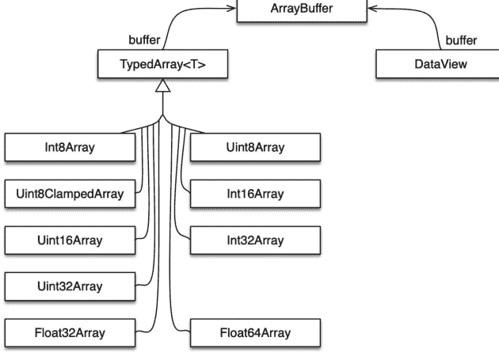

### 32.1.3 使用类型数组

类型数组的使用方式类似于普通 `Array`，但有一些显著区别：

- 类型数组将数据存储在 `ArrayBuffer` 中。
- 所有元素都初始化为零。
- 所有元素具有相同的类型。向类型数组写入值会将其强制转换为该类型。读取值会产生普通数字或 `bigint`。
- 类型数组的长度是不可变的；不能更改。
- 类型数组不能有空洞。

#### 32.1.3.1 创建类型数组

以下代码显示了创建相同类型数组的三种不同方法：

```javascript
// 参数：类型数组或类数组对象
const ta1 = new Uint8Array([0, 1, 2]);
const ta2 = Uint8Array.of(0, 1, 2);
const ta3 = new Uint8Array(3); // 类型数组的长度
ta3[0] = 0;
ta3[1] = 1;
ta3[2] = 2;

assert.deepEqual(ta1, ta2);
assert.deepEqual(ta1, ta3);
```

#### 32.1.3.2 被封装的 `ArrayBuffer`

```javascript
const typedArray = new Int16Array(2); // 2 个元素
assert.equal(typedArray.length, 2);
```

```javascript
assert.deepEqual(
  typedArray.buffer, new ArrayBuffer(4)); // 4 字节
```

#### 32.1.3.3 获取和设置元素

```javascript
const typedArray = new Int16Array(2);
```

```javascript
assert.equal(typedArray[1], 0); // 初始化为 0
typedArray[1] = 72;
assert.equal(typedArray[1], 72);
```

### 32.1.4 使用 `DataView`

`DataView` 的使用方式如下：

```javascript
const dataView = new DataView(new ArrayBuffer(4));
assert.equal(dataView.getInt16(0), 0);
assert.equal(dataView.getUint8(0), 0);
dataView.setUint8(0, 5);
```

## 32.2 元素类型

表 32.1：`Array` API 支持的元素类型。

| 元素 | 类型数组 | 字节 | 描述 |
| :--- | :--- | :--- | :--- |
| `Int8` | `Int8Array` | 1 | 8 位有符号整数 | ES6 |
| `Uint8` | `Uint8Array` | 1 | 8 位无符号整数 | ES6 |
| `Uint8C` | `Uint8ClampedArray` | 1 | 8 位无符号整数（钳位） | ES6 |
| `Int16` | `Int16Array` | 2 | 16 位有符号整数 | ES6 |
| `Uint16` | `Uint16Array` | 2 | 16 位无符号整数 | ES6 |
| `Int32` | `Int32Array` | 4 | 32 位有符号整数 | ES6 |
| `Uint32` | `Uint32Array` | 4 | 32 位无符号整数 | ES6 |
| `BigInt64` | `BigInt64Array` | 8 | 64 位有符号整数 | ES2020 |
| `BigUint64` | `BigUint64Array` | 8 | 64 位无符号整数 | ES2020 |
| `Float32` | `Float32Array` | 4 | 32 位浮点数 | ES6 |
| `Float64` | `Float64Array` | 8 | 64 位浮点数 | ES6 |

表 32.1 列出了这些元素类型。这些类型（例如 `Int32`）出现在两个位置：

- 在类型数组中，指定元素的类型。例如，所有 `Int32Array` 元素都是 `Int32`。这是类型数组中唯一的不同之处。
- 在 `DataView` 中，当你使用 `.getInt32()` 和 `.setInt32()` 等方法时，它们是访问 `ArrayBuffer` 的窗口。

类型 `Uint8C` 是特殊的：`DataView` 不支持它，仅适用于 `Uint8ClampedArray`。这种类型数组被 `canvas` 使用（替换 `ImageData`）。`Uint8C` 和 `Uint8` 之间的溢出和欠位处理方式不同（见下一节）。

类型数组和 `ArrayBuffer` 使用数字和 `bigint` 来导入和导出值：

- `BigInt64` 和 `BigUint64` 通过 `bigint` 处理。例如，setter 接收并返回 `bigint`。
- 所有其他类型通过数字处理。

### 32.2.1 处理溢出和欠位

通常，当值超出元素范围时，使用取模运算将其转换为范围内的值。对于有符号和无符号整数，这意味着：

- 最大值加一转换为最小值（无符号整数为 0）。
- 最小值减一转换为最大值。

以下函数说明了欠位是如何工作的：

```javascript
function setAndGet(typedArray, value) {
  typedArray[0] = value;
  return typedArray[0];
}
```

无符号 8 位整数的取模转换：

```javascript
const uint8 = new Uint8Array(1);

// 最大值范围
assert.equal(setAndGet(uint8, 255), 255);

// 溢出
assert.equal(setAndGet(uint8, 256), 0);

// 最小值范围
assert.equal(setAndGet(uint8, 0), 0);

// 欠位
assert.equal(setAndGet(uint8, -1), 255);
```

有符号 8 位整数的取模转换：

```javascript
const int8 = new Int8Array(1);

// 最大值范围
assert.equal(setAndGet(int8, 127), 127);

// 溢出
assert.equal(setAndGet(int8, 128), -128);

// 最小值范围
assert.equal(setAndGet(int8, -128), -128);

// 溢出
assert.equal(setAndGet(int8, -129), 127);
```

钳位扩展有所不同：

- 所有欠位值都转换为最小值。
- 所有溢位值都转换为最大值。

```javascript
const uint8c = new Uint8ClampedArray(1);

// 最大值范围
assert.equal(setAndGet(uint8c, 255), 255);

// 溢出
assert.equal(setAndGet(uint8c, 256), 255);

// 最小值范围
assert.equal(setAndGet(uint8c, 0), 0);

// 溢出
assert.equal(setAndGet(uint8c, -1), 0);
```

### 32.2.2 字节序

每当类型（如 `Uint16`）被存储为多个字节序列时，字节序就变得重要：

- **大端序**：最高字节在前。例如，`Uint16` 值 `0x4321` 存储为两个字节——先是 `0x43`，后是 `0x21`。
- **小端序**：最低字节在前。例如，`Uint16` 值 `0x4321` 存储为两个字节——先是 `0x21`，后是 `0x43`。

字节序往往根据每个 CPU 架构固定下来，并在原生 API 中保持一致。类型数组用于与这些 API 通信，这就是为什么它们的字节序遵循平台且无法更改。

另一方面，协议和二进制文件的字节序因格式而异，但在跨平台时是固定的。因此，我们必须能够以任何字节序访问数据。`DataView` 利用了这种情况，并允许你在获取或设置值时指定字节序。

引用维基百科关于字节序的描述：

- 大端序表示是数据网络中最常见的约定；互联网协议族协议中的字段（如 IPv4、IPv6、TCP 和 UDP）按大端序传输。由于这个原因，大端字节序也被称为网络字节序。
- 小端序存储在微处理器中很流行，部分是因为 Intel 公司对微处理器设计产生了深远的历史影响。
- 也可以其他排序。这些通常被称为中间端序或混合端序。

## 32.3 关于类型数组的更多信息

在本节中，`ElementType` 代表 `Int8Array`、`Uint8Array` 等。`ElementType` 是 `Int8`、`Uint8` 等。

### 32.3.1 静态方法 `ElementTypeArray.from()`

该方法的类型签名如下：

```typescript
.from<S>(
  source: Iterable<S>|ArrayLike<S>,
  mapfn: S => ElementType, thisArg?: any
): ElementTypeArray
```

例如，普通数组可以使用此方法进行转换：

```javascript
assert.deepEqual(
  Uint16Array.from([0, 1, 2]),
  Uint16Array.of(0, 1, 2));
```

类型数组也是可迭代的：

```javascript
assert.deepEqual(
  Uint16Array.from(Uint8Array.of(0, 1, 2)),
  Uint16Array.of(0, 1, 2));
```

`source` 也可以是一个类数组对象：

```javascript
assert.deepEqual(
  Uint16Array.from({0:0, 1:1, 2:2, length: 3}),
  Uint16Array.of(0, 1, 2));
```

可选的 `mapfn` 在 `source` 的元素成为结果的元素之前对它们进行转换。为什么要一次性完成映射和转换这两个步骤呢？与通过 `.map()` 分别映射相比，它有两个优势：

1. 不需要中间数组或类型数组。
2. 在转换为具有不同精度的类型数组时，出错的概率更低。

继续阅读关于第二个优势的解释。

#### 32.3.1.1 陷阱：在类型数组类型转换时进行映射

静态方法 `.from()` 可以可选地在类型数组类型之间进行映射和转换。使用该方法时出错概率更低。

为了了解原因，让我们先将一个类型数组转换为更高精度的类型数组。如果我们使用 `.from()` 进行映射，结果将是正确的。否则，我们必须先转换，然后映射：

```javascript
const typedArray = Int8Array.of(127, 126, 125);

assert.deepEqual(
  Int16Array.from(typedArray, x => x * 2),
  Int16Array.of(254, 252, 250));

assert.deepEqual(
  Int16Array.from(typedArray).map(x => x * 2),
  Int16Array.of(254, 252, 250)); // OK

assert.deepEqual(
  Int16Array.from(typedArray).map(x => x * 2),
  Int16Array.of(-2, -4, -6)); // 错误
```

如果我们从类型数组转换为低精度的类型数组，通过 `.from()` 进行映射会产生正确的结果。我们必须先映射，然后转换。

```javascript
assert.deepEqual(
  Int8Array.from(Int16Array.of(254, 252, 250), x => x / 2),
  Int8Array.of(127, 126, 125));

assert.deepEqual(
  Int8Array.from(Int16Array.of(254, 252, 250).map(x => x / 2)), // OK
  Int8Array.of(-1, -2, -3)); // 错误
```

问题在于，如果我们使用 `.map()`，那么输入类型和输出类型是相同的。相比之下，`.from()` 从任意输入类型转换为你通过其接收者指定的输出类型。

### 32.3.2 类型数组是可迭代的

类型数组是可迭代的。这意味着你可以使用 `for-of` 循环和其他基于迭代的机制：

```javascript
const ui8 = Uint8Array.of(0, 1, 2);

for (const byte of ui8) {
  console.log(byte);
}
// 输出:
// 0
// 1
// 2
```

`ArrayBuffer` 和 `DataView` 是不可迭代的。

### 32.3.3 类型数组 vs 普通数组

类型数组与普通数组非常相似：它们有 `.length`，可以通过下标运算符 `[]` 访问元素，并且它们拥有大多数标准数组方法。它们与普通数组的区别在于以下方面：

- 类型数组拥有缓冲区。类型数组的元素并不存储在 `ta` 中，而是存储在关联的 `ArrayBuffer` 中，可以通过 `ta.buffer` 访问。
```javascript
const ta = new Uint8Array(2); // 2
assert.deepEqual(ta.buffer, new ArrayBuffer(4)); // 4 字节
```
- 类型数组初始化为零：`new Array(4)` 创建一个不包含任何元素的普通数组。它只有空位；`new Uint8Array(4)` 创建的元素全为 0 的类型数组。
```javascript
assert.deepEqual(new Uint8Array(4), Uint8Array.of(0, 0, 0, 0));
```
- 类型数组的所有元素具有相同类型：设置元素会将值转换为相应类型。
```javascript
const ta = new Uint8Array(1);
ta[0] = 257; // 256 (溢出)
assert.equal(ta[0], 1); // 数字
```
- 类型数组的长度由其 `ArrayBuffer` 决定，且永远固定（除非切换到不同的 `ArrayBuffer`）。
```javascript
const ta = new Uint8Array(1);
assert.equal(ta.length, 1);
```
- 普通数组可以有空位；类型数组不能。

### 32.3.4 将类型数组转换为普通数组

要将普通数组转换为类型数组，你可以将其传递给类型数组构造函数（接受类数组对象）或 `..from()`（接受迭代对象）。例如：

```javascript
const ta = new Uint8Array([0, 1, 2]);
const ta2 = Uint8Array.from([0, 1, 2]);
assert.deepEqual(ta, ta2);
```

要将类型数组转换为普通数组，可以使用展开运算符或 `.from()`（因为类型数组是可迭代的）：

```javascript
assert.deepEqual(
  [...Uint8Array.of(0, 1, 2)],
  [0, 1, 2]);
```

### 32.5 合并类型数组

类型数组没有 `.concat()` 方法，像普通数组那样。变通方法是使用 `.set()`，接收如下：

```javascript
function concatenate(resultConstructor, ...arrays) {
  let totalLength = 0;
  for (const arr of arrays) {
    totalLength += arr.length;
  }
  const result = new resultConstructor(totalLength);
  let offset = 0;
  for (const arr of arrays) {
    result.set(arr, offset);
    offset += arr.length;
  }
  return result;
}

assert.deepEqual(
  concatenate(Uint8Array, Uint8Array.of(1, 2), Uint8Array.of(3, 4)),
  Uint8Array.of(1, 2, 3, 4));
```

## 32.4 快速引用：索引 vs 偏移量

在准备 `ArrayBuffer`、类型数组和 `DataView` 的快速引用之前，我们学习索引和偏移量的区别：

- 下标运算符 `[]` 只能使用非负索引（从 0 开始）。在普通数组中，写入负索引会创建属性：
```javascript
const arr = [6, 7];
arr[-1] = 5;
assert.deepEqual(Object.keys(arr), ['0', '1', '-1']);
```
- 类型数组中的索引，写入负索引会被忽略：
```javascript
const tarr = Uint8Array.of(6, 7);
tarr[-1] = 5;
assert.deepEqual(Object.keys(tarr), ['0']);
```
- 数组、类型数组和 `DataView` 方法的索引可以是负的。如果是，它将与实体长度相加产生实际索引。因此，`-1` 指最后一个元素，`-2` 指倒第二个。普通数组的方法工作方式：
```javascript
const u8 = Uint8Array.of(0, 1, 2);
assert.deepEqual(u8.slice(-1), Uint8Array.of(2));
```
- 类型数组和 `DataView` 方法的偏移量必须是非负的——例如：
```javascript
const dataView = new DataView(new ArrayBuffer(4));
assert.throws(
  () => dataView.getUint8(-1),
  {
    name: 'RangeError',
    message: 'Offset is outside the bounds of the DataView'
  }
);
```

一个参数是索引还是偏移量只能通过查看文档确定；没有简单的规则。

## 32.5 快速引用：`ArrayBuffer`

`ArrayBuffer` 存储二进制数据，旨在通过类型数组和 `DataView` 进行访问。

### 32.5.1 `new ArrayBuffer()`

构造函数的类型为：

```typescript
new ArrayBuffer(length: number);
```

调用此构造函数会创建一个容量为 `length` 字节的新实例。这些字节最初都初始化为 0。

你无法更改 `ArrayBuffer` 的长度；只能创建一个不同长度的新实例。

### 32.5.2 `ArrayBuffer` 的静态方法

- `ArrayBuffer.isView(arg: any)`: 如果 `arg` 是一个对象且是 `ArrayBuffer` 的视图（即它是一个类型数组或 `DataView`），则返回 `true`。

### 32.5.3 `ArrayBuffer.prototype` 的属性

- `get .byteLength(): number` 返回此 `ArrayBuffer` 以字节为单位容量。
- `.slice(startIndex: number, endIndex=this.byteLength)` 创建一个 `ArrayBuffer`，其中包含此 `ArrayBuffer` 中索引大于或等于 `startIndex` 且小于 `endIndex` 的字节。`start` 和 `end` 可以为负数（详见 §32.4 “快速参考：索引 vs 偏移量”）。

## 32.6 快速参考：类型数组

各种 `TypedArray` 对象的属性分两个步骤介绍：

1. `TypedArray`：首先，查看所有 `TypedArray` 类的抽象超类（在本章开头的类图中显示）。调用 `super TypedArray` 无法直接从 JavaScript 访问。`TypedArray.prototype` 包含了所有 `TypedArray` 的方法。
2. `<ElementTypeArray>`：具体的 `TypedArray` 类称为 `Uint8Array`、`Int16Array`、`Float32Array` 等。这些是你通过 `new`、`.of` 和 `.from()` 使用的类。

### 32.6.1 `TypedArray<T>` 的静态方法

所有 `TypedArray` 方法都被其子类（`Uint8Array` 等）继承。`TypedArray` 是抽象的。因此，你始终通过子类来使用这些方法，子类可以拥有这些直接实例。

- `.from<S>(source: Iterable<S>|ArrayLike<S>, mapfn: S => T, thisArg?): instanceof this` 将可迭代对象（包括数组和类型数组）或类数组对象转换为此类的实例（使用 `instanceof this` 是为了表达这一事实）。
```javascript
assert.deepEqual(
  Uint16Array.from([0, 1, 2]),
  Uint16Array.of(0, 1, 2));
```
可选的 `mapfn` 在 `source` 的元素成为结果的元素之前对其进行转换。
```javascript
assert.deepEqual(
  Int16Array.from(Int8Array.of(127, 126, 125), x => x * 2),
  Int16Array.of(254, 252, 250));
```

- `.of(...items: bigint[]): instanceof this` (`BigInt64Array`, `BigUint64Array`)
- `.of(...items: number[]): instanceof this` (所有其他类型数组) 创建一个新实例，其元素是此类型数组的元素（强制转换为元素类型）。
```javascript
assert.deepEqual(
  Int16Array.of(-1234, 5, 67),
  new Int16Array([-1234, 5, 67]));
```

### 32.6.2 `TypedArray<>.prototype` 的属性

通过 `TypedArray` 方法访问的索引可以是负数（它们像传统的数组方法那样）。偏移量必须是非负的。详情请参阅 §32.4 “快速参考：索引 vs 偏移量”。

#### 32.6.2.1 类型数组特有的属性

以下属性类型数组特有的；普通数组不具备这些属性：

- `get .buffer(): ArrayBuffer` 返回支持此类型数组的缓冲区。
- `get .length(): number` 返回此类型数组缓冲区中的元素长度。
- `get .byteLength(): number` 返回此类型数组缓冲区的字节大小。
- `get .byteOffset(): number` 返回类型数组在其 `ArrayBuffer` 内部“起始”位置的偏移量。
- `.set(typedArray: TypedArray, offset=0): void`
- `.set(arrayLike: ArrayLike<bigint>, offset=0): void` (`BigInt64Array`, `BigUint64Array`)
- `.set(arrayLike: ArrayLike<number>, offset=0): void` (所有其他类型数组) 将第一个参数的所有元素拷贝到此类型数组中。参数索引为 0 处的元素被写入此类型数组的索引 `offset` 处（以此类推）。关于类数组对象的更多信息，请参阅 §31.4 “类数组对象”。
- `.subarray(startIndex=0, endIndex=this.length): TypedArray<T>` 返回一个新的类型数组，它与此类型数组具有相同的缓冲区，但范围（通常）较小。如果 `startIndex` 是正数，则结果类型数组的第一个元素是 `this[startIndex]`，第二个是 `this[startIndex+1]`（以此类推）。如果 `startIndex` 是负数，它将进行适当的转换。

#### 32.6.2.2 数组方法

以下方法与普通数组的方法基本相同：

- `.copyWithin(target: number, start: number, end=this.length): this`
- `.entries(): Iterable<[number, T]>`
- `.every(callback: (value: T, index: number, array: TypedArray) => boolean, thisArg?: any): boolean`
- `.fill(value: T, start=0, end=this.length): this`
- `.filter(callback: (value: T, index: number, array: TypedArray) => boolean, thisArg?: any): TypedArray<T>`
- `.find(predicate: (value: T, index: number, array: TypedArray) => boolean, thisArg?: any): T | undefined`
- `.findIndex(predicate: (value: T, index: number, array: TypedArray) => boolean, thisArg?: any): number`
- `.forEach(callback: (value: T, index: number, array: TypedArray) => void, thisArg?: any): void`
- `.includes(searchElement: T, fromIndex=0): boolean`
- `.indexOf(searchElement: T, fromIndex=0): number`
- `.join(separator: ','): string`
- `.keys(): Iterable<number>`
- `.lastIndexOf(searchElement: T, fromIndex=this.length-1): number`
- `.map<U>(callback: (value: T, index: number, array: TypedArray) => U, thisArg?: any): U[]`
- `.reduce<U>(callback: (accumulator: U, element: T, index: number, array: TypedArray) => U, init?: U): U`
- `.reduceRight<U>(callback: (accumulator: U, element: T, index: number, array: TypedArray) => U, init?: U): U`
- `.reverse(): this`
- `.slice(start=0, end=this.length): TypedArray<T>`
- `.some(callback: (value: T, index: number, array: TypedArray) => boolean, thisArg?: any): boolean`
- `.sort(compareFunc?: (a: T, b: T) => number): this`
- `.toString(): string`
- `.values(): Iterable<T>`

关于这些方法的详情，请参阅 §31.12 “`Array` 的方法”。

### 32.6.3 `new <ElementType>Array`

所有类型数组构造函数都遵循 `Array` 的模式，其中 `Array` 指的是缓冲区。在本节的剩余部分，“ElementType” 指的是以下之一：

- `Float32Array`, `Float64Array`
- `Int8Array`, `Int16Array`, `Int32Array`, `BigInt64Array`
- `Uint8Array`, `Uint16Array`, `Uint32Array`, `BigUint64Array`

每个类型数组根据其接收的参数类型行为有所不同：

### 32.6.4 类型数组的属性

- `static <ElementType>Array.BYTES_PER_ELEMENT: number` 存储单个 `<ElementType>` 元素所需的字节数：
> `Uint8Array`: 1
> `Int16Array`: 2
> `Float64Array`: 8

### 32.6.5 类型数组原型的属性

- `get <ElementType>Array.prototype.BYTES_PER_ELEMENT: number` 与 `<ElementType>Array.BYTES_PER_ELEMENT` 相同。

## 32.7 `DataView`

### 32.7.1 `new DataView()`

```typescript
new DataView(buffer: ArrayBuffer, byteOffset=0, byteLength=buffer.byteLength - byteOffset)
```
创建一个 `DataView`，其数据存储在 `buffer` 中。它从 `byteOffset` 开始访问缓冲区并具有给定的 `byteLength`。

### 32.7.2 `DataView.prototype` 的属性

在本节中，“ElementType”指的是以下任何类型数组：

`DataView` 的属性如下：

- `get .buffer(): ArrayBuffer` 返回 `DataView` 的缓冲区。
- `get .byteLength(): number` 返回 `DataView` 可以访问的字节数。
- `get .byteOffset(): number` 返回 `DataView` 从缓冲区的哪个偏移量开始访问。
- `.getElementType(byteOffset: number, littleEndian=false): bigint` (`BigInt64`, `BigUint64`)
- `.getElementType(byteOffset: number, littleEndian=false): number` (所有其他元素类型) 从此 `DataView` 的缓冲区中读取值。
- `.setElementType(byteOffset: number, value: bigint, littleEndian=false): void` (`BigInt64`, `BigUint64`)
- `.setElementType(byteOffset: number, value: number, littleEndian=false): void` (所有其他元素类型) 将值写入此 `DataView` 的缓冲区。

## 33 Map (映射)

+ 目录
- **33.1 使用 `Map`** . . . . . . . . . . . . . . . . . . . . . 372
  - 33.1.1 创建 `Map` . . . . . . . . . . . . . . . . . . . . . 372
  - 33.1.2 复制 `Map` . . . . . . . . . . . . . . . . . . . . . 372
  - 33.1.3 处理单个条目 . . . . . . . . . . . . . . . 372
  - 33.1.4 确定 `Map` 的键和大小并清空它 . . . . . . 373
  - 33.1.5 获取 `Map` 的键和值 . . . . . . . . . . . . . 373
  - 33.1.6 获取 `Map` 的条目 . . . . . . . . . . . . . 373
  - 33.1.7 按插入顺序列出：条目、值 . . . . . . 374
  - 33.1.8 转换 `Map` 和对象 . . . . . . . . . . . . 374
- **33.2 示例：计数** . . . . . . . . . . . . . . 375
- **33.3 关于 `Map` 键的更多细节（高级）** . . . . . . 375
  - 33.3.1 哪些键被认为是相等的？ . . . . . . . . . . . . . . 376
- **33.4 缺失的 `Map` 操作** . . . . . . . . . . . . . . . . 376
  - 33.4.1 对 `Map` 进行映射和过滤 . . . . . . . . . . . . . . 376
  - 33.4.2 合并 `Map` . . . . . . . . . . . . . . . . . . . 377
- **33.5 快速参考：`Map<K, V>`** . . . . . . . . . . . . . . . 378
  - 33.5.1 构造函数 . . . . . . . . . . . . . . . . . . . . . 378
  - 33.5.2 `Map<K, V>` 原型：处理单个条目 . . 378
  - 33.5.3 `Map<K, V>` 原型：处理所有条目 . . 379
  - 33.5.4 `Map<K, V>` 原型：迭代和循环 . . 379
  - 33.5.5 本节来源 . . . . . . . . . . . . . . . . . 380
- **33.6 FAQ：`Map`** . . . . . . . . . . . . . . . . . . . . . . 381
  - 33.6.1 我什么时候应该使用 `Map`，什么时候应该使用对象？ . . 381
  - 33.6.2 我什么时候会在 `Map` 中使用对象作为键？ . . . . . . 381
  - 33.6.3 为什么 `Map` 保留了条目的插入顺序？ . . . . 381
  - 33.6.4 为什么 `Map` 有 `.size`，而 `Array` 有 `.length`？ . . . . . 381

在 ES6 之前，JavaScript 还没有用于字典的数据结构，人们通常使用（或滥用）对象作为从字符串到任意值的字典。ES6 引入了 `Map`，它是从任意值到任意值的字典。

## 33.1 使用 `Map`

`Map` 实例将键映射到值。单个键值映射被称为一个 _entry_（条目）。

### 33.1.1 创建 `Map`

创建 `Map` 有三种常见方法。
首先，你可以使用不带任何参数的构造函数来创建一个空的 `Map`：

```javascript
const emptyMap = new Map();
assert.equal(emptyMap.size, 0);
```

其次，你可以向构造函数传递一个包含“键值对”（具有两个元素的数组）的可迭代对象：

```javascript
const map = new Map([
  [1, 'one'],
  [2, 'two'],
  [3, 'three'], // 尾处的逗号会被忽略
]);
```

第三，`.set()` 方法向 `Map` 添加条目，并且是链式调用的：

```javascript
const map = new Map()
  .set(1, 'one')
  .set(2, 'two')
  .set(3, 'three');
```

### 33.1.2 复制 `Map`

正如我们将看到的，`Map` 也是关于键值对的可迭代对象。因此，你可以使用构造函数创建一个 `Map` 的副本。该副本是 _浅的_；键和值是相同的；它们并没有复制。

```javascript
const original = new Map()
  .set(false, 'no')
  .set(true, 'yes');

const copy = new Map(original);
assert.deepEqual(original, copy);
```

### 33.1.3 处理单个条目

`.set()` 和 `.get()` 用于写入和读取值（给定键）：

```javascript
const map = new Map();
map.set('foo', 123);
assert.equal(map.get('foo'), 123);

// 未知的键：
```


# 33 Maps (Map)

## 33.1 使用 Maps

### 33.1.1 创建 Maps

创建 Maps 有三种常见方式。

首先，你可以使用不带参数的构造函数创建一个空的 Map：

```javascript
const emptyMap = new Map();
assert.equal(emptyMap.size, 0);
```

其次，你可以将包含键值对的可迭代对象（例如数组）传递给构造函数：

```javascript
const map = new Map([
  ['foo', 1],
  ['bar', 2],
]);
```

第三，`.set()` 方法向 Map 添加条目并支持链式调用：

```javascript
const map = new Map();
map.set('foo', 1).set('bar', 2);
```

### 33.1.2 添加、获取、检查、删除条目

`.set()` 添加或更新条目。

```javascript
const map = new Map();
map.set('foo', 1);
```

`.get()` 获取键对应的值。

```javascript
assert.equal(map.get('foo'), 1);
```

`.has()` 检查键是否存在。

```javascript
assert.equal(map.has('foo'), true);
```

`.delete()` 删除条目。

```javascript
assert.equal(map.delete('foo'), true);
assert.equal(map.has('foo'), false);
```

### 33.1.3 如果条目缺失，使用默认值

```javascript
assert.equal(map.get('bar'), undefined);

// 如果条目缺失，使用默认值 ' '
assert.equal(map.get('bar'), ' ');
```

### 33.1.4 确定 Map 的大小并清空它

`.size` 返回 Map 中条目的数量。`.clear()` 移除 Map 的所有条目。

```javascript
const map = new Map()
  .set('foo', true)
  .set('bar', false);
assert.equal(map.size, 2);

map.clear();
assert.equal(map.size, 0);
```

### 33.1.5 获取 Map 的键和值

`.keys()` 返回 Map 键的可迭代对象：

```javascript
const map = new Map()
  .set(false, 'no')
  .set(true, 'yes');

for (const key of map.keys()) {
  console.log(key);
}
// 输出：
// false
// true
```

可以使用展开运算符 (`...`) 将 `.keys()` 返回的可迭代对象转换为数组：

```javascript
assert.deepEqual(
  [...map.keys()],
  [false, true]
);
```

`.values()` 的工作类似于 `.keys()`，但针对值。

### 33.1.6 获取 Map 的条目

`.entries()` 返回 Map 条目的可迭代对象：

```javascript
const map = new Map()
  .set(false, 'no')
  .set(true, 'yes');

for (const entry of map.entries()) {
  console.log(entry);
}
// 输出：
// ['false', 'no']
// ['true', 'yes']
```

展开运算符 (`...`) 将 `.entries()` 返回的可迭代对象转换为数组：

```javascript
assert.deepEqual(
  [...map.entries()],
  [[false, 'no'], [true, 'yes']]
);
```

Map 也是条目的可迭代对象。在下面的代码中，我们使用解构来访问 Map 的键和值：

```javascript
for (const [key, value] of map) {
  console.log(key, value);
}
// 输出：
// false no
// true yes
```

### 33.1.7 按插入顺序列出：条目、键、值

Map 在列出条目、键或值时会记录它们创建的顺序：

```javascript
const map1 = new Map([
  ['a', 1],
  ['b', 2],
]);
assert.deepEqual([...map1.keys()], ['a', 'b']);

const map2 = new Map([
  ['b', 2],
  ['a', 1],
]);
assert.deepEqual([...map2.keys()], ['b', 'a']);
```

### 33.1.8 Map 与对象

只要 Map 只使用字符串和符号作为键，就可以将其转换为对象（通过 `Object.fromEntries()`）：

```javascript
const map = new Map([
  ['a', 1],
  ['b', 2],
]);
const obj = Object.fromEntries(map);
assert.deepEqual(
  obj, {a: 1, b: 2}
);
```

你也可以将对象转换为具有字符串或符号键的 Map（通过 `Object.entries()`）：

```javascript
const obj = {
  a: 1,
  b: 2,
};
const map = new Map(Object.entries(obj));
assert.deepEqual(
  map, new Map([['a', 1], ['b', 2]])
);
```

## 33.2 示例：计数字符

`countChars(chars)` 返回一个 Map，将字符映射到出现次数：

```javascript
function countChars(chars) {
  const charCounts = new Map();
  for (let ch of chars) {
    ch = ch.toLowerCase();
    const prevCount = charCounts.get(ch) ?? 0;
    charCounts.set(ch, prevCount + 1);
  }
  return charCounts;
}
```

```javascript
const result = countChars('AaBccc');
assert.deepEqual(
  result,
  new Map([['a', 2], ['b', 1], ['c', 3]])
);
```

## 33.3 关于 Map 键的更多细节（高级）

任何值都可以作为键，即使是对象：

```javascript
const map = new Map();
const KEY1 = {};
const KEY2 = {};

map.set(KEY1, 'hello');
map.set(KEY2, 'world');

assert.equal(map.get(KEY1), 'hello');
assert.equal(map.get(KEY2), 'world');
```

### 33.3.1 哪些键被认为是相等的？

所有的 Map 操作都需要检查一个值是否等于其中一个键。它们通过内部操作 `SameValueZero` 实现，该操作的作用类似于 `===`，它将 `NaN` 视为它本身。

因此，你可以像使用其他值一样在 Map 中使用 `NaN` 作为键：

```javascript
const map = new Map();
map.set(NaN, 123);
assert.equal(map.get(NaN), 123);
```

不同的对象始终认为是不同的。这是无法更改的（尚未——相等性配置已在 TC39 的长期路线图上）。

```javascript
assert.equal(new Map().set({}, 1).set({}, 2).size, 2);
```

## 33.4 缺失的 Map 操作

### 33.4.1 对 Map 进行映射和过滤

你可以对 Array 进行 `.map()` 和 `.filter()`，但对 Map 没有这样的操作。解决方案是：

1. 将 Map 转换为 `[键, 值]` 对的数组。
2. 对数组进行映射或过滤。
3. 将结果转换回 Map。

我将使用以下 Map 来演示它是如何工作的：

```javascript
const originalMap = new Map()
  .set(1, 'a')
  .set(2, 'b')
  .set(3, 'c');
```

映射 `originalMap`：

```javascript
const mappedMap = new Map( // 步骤 3
  [...originalMap] // 步骤 1
    .map(([k, v]) => [k * 2, '_' + v]) // 步骤 2
);
assert.deepEqual(
  [...mappedMap],
  [[2, 'a'], [4, 'b'], [6, 'c']]
);
```

过滤 `originalMap`：

```javascript
const filteredMap = new Map( // 步骤 3
  [...originalMap] // 步骤 1
    .filter(([k, v]) => k < 3) // 步骤 2
);
assert.deepEqual(
  [...filteredMap],
  [[1, 'a'], [2, 'b']]
);
```

步骤 1 是通过在数组字面量中展开 (`...`) 完成的。

### 33.4.2 合并 Maps

目前没有合并 Maps 的方法，这就是为什么我们必须使用与前一节类似的变通方法。

让我们合并这两个 Map：

```javascript
const map1 = new Map()
  .set(1, '1a')
  .set(2, '1b')
  .set(3, '1c');
```

```javascript
const map2 = new Map()
  .set(2, '2b')
  .set(3, '2c')
  .set(4, '2d');
```

为了合并 `map1` 和 `map2`，我们通过展开 (`...`) 将它们转换为数组，并拼接这些数组。之后，我们将结果转换回 Map。所有这些操作都在行 A 中完成。

```javascript
const combinedMap = new Map([...map1, ...map2]); // (A)
assert.deepEqual(
  [...combinedMap],
  [[1, '1a'], [2, '2b'], [3, '2c'], [4, '2d']]
);
```

## 33.5 快速参考：Map<K, V>

注意：为了简洁，我假定所有键都具有相同的类型 K，所有值都具有相同的类型 V。

### 33.5.1 构造函数

- `new Map(entries?: Iterable<[K, V]>) [ES6]`

如果你不提供参数 `entries`，则会创建一个空 Map。如果你提供一个包含 `[key, value]` 对的可迭代对象，这些对将作为条目添加到 Map 中。

```javascript
const map = new Map([
  [1, 'one'],
  [2, 'two'],
  [3, 'three'], // 末尾逗号被忽略
]);
```

### 33.5.2 Map<K, V>.prototype: 处理单个条目

- `.get(key: K): V [ES6]`

返回 `key` 在此 Map 中映射的值。如果 Map 中不存在该键，则返回 `undefined`。

```javascript
const map = new Map([[1, 'one'], [2, 'two']]);
assert.equal(map.get(1), 'one');
assert.equal(map.get(5), undefined);
```

- `.set(key: K, value: V): this [ES6]`

将给定的键映射到给定值。如果已存在该键的条目，则对其进行更新。否则，将创建一个新条目。此方法返回 `this`，这意味着你可以链式调用它。

```javascript
const map = new Map([[1, 'one'], [2, 'two']]);
map.set(1, 'ONE!')
  .set(3, 'THREE!');
assert.deepEqual(
  [...map.entries()],
  [[1, 'ONE!'], [2, 'two'], [3, 'THREE!']]
);
```

- `.has(key: K): boolean [ES6]`

返回给定的键是否存在于此 Map。

```javascript
const map = new Map([[1, 'one'], [2, 'two']]);
assert.equal(map.has(1), true); // 键存在
assert.equal(map.has(5), false); // 键不存在
```

- `.delete(key: K): boolean`

如果存在键为 `key` 的条目，将其移除并返回 `true`。否则，什么都不会发生并返回 `false`。

```javascript
const map = new Map([[1, 'one'], [2, 'two']]);
assert.equal(map.delete(1), true);
assert.equal(map.delete(5), false); // 什么都不发生
assert.deepEqual(
  [...map.entries()],
  [[2, 'two']]
);
```

### 33.5.3 Map<K, V>.prototype: 处理所有条目

- `.size: number`

返回 Map 有多少条条目。

```javascript
const map = new Map([[1, 'one'], [2, 'two']]);
assert.equal(map.size, 2);
```

- `.clear(): void`

从此 Map 中移除所有条目。

```javascript
const map = new Map([[1, 'one'], [2, 'two']]);
assert.equal(map.size, 2);
map.clear();
assert.equal(map.size, 0);
```

### 33.5.4 Map<K, V>.prototype: 迭代与循环

迭代和循环按照条目添加到 Map 的顺序进行的。

- `.entries(): Iterable<[K, V]>`

返回一个迭代器，包含 Map 中每个条目的 `[key, value]` 对。

```javascript
const map = new Map([[1, 'one'], [2, 'two']]);
for (const entry of map.entries()) {
  console.log(entry);
}
// 输出:
// [1, 'one']
// [2, 'two']
```

- `.forEach(callback: (value: V, key: K, this: Map<K, V>) => void, thisArg?: any): void`

第一个参数是回调函数，它会为 Map 中的每个条目调用一次。如果提供了 `thisArg`，则每次调用时将其设置为它。否则，将其设置为 `undefined`。

```javascript
const map = new Map([[1, 'one'], [2, 'two']]);
map.forEach((value, key) => console.log(value, key));
// 输出:
// 'one', 1
// 'two', 2
```

- `.keys(): Iterable<K> [ES6]`

返回一个 Map 中所有键的可迭代对象。

```javascript
const map = new Map([[1, 'one'], [2, 'two']]);
for (const key of map.keys()) {
  // ...
}
```

- `.values(): Iterable<V> [ES6]`

返回 Map 中所有值的可迭代对象。

```javascript
const map = new Map([[1, 'one'], [2, 'two']]);
for (const value of map.values()) {
  // ...
}
```

- `[Symbol.iterator](): Iterable<[K, V]>`

返回一个包含 Map 中每个条目 `[key, value]` 对的可迭代对象。

```javascript
const map = new Map([[1, 'one'], [2, 'two']]);
for (const [key, value] of map) {
  // ...
}
```

# 34 WeakMaps (WeakMap)

仅拥有 `WeakMap` 的人就能影响 `WeakMap` 中从键到值的映射关系。

## 34.1 WeakMap 的键是弱引用的

`WeakMap` 的键被认为是*弱引用*的：通常情况下，如果一个对象引用了另一个对象，后者无法像前者那样被垃圾回收。在 `WeakMap` 中，情况有所不同：如果一个对象作为键且没有在其他地方被引用，那么即使 `WeakMap` 仍然存在，它也可以被垃圾回收。这也会导致相应的条目被移除（但没有办法观察到）。

### 34.1.1 所有的 WeakMap 键必须是对象

所有的 `WeakMap` 键必须是对象。如果你使用原始值，将会报错：

```javascript
const wm = new WeakMap();
wm.set(123, 'test'); // TypeError: Invalid value used as weak map key
```

如果使用原始值作为键，`WeakMap` 将不再是黑盒了。但鉴于原始值永远不会被垃圾回收，你实际上无法从弱引用的键中获益，直接使用普通的 `Map` 即可。

### 34.1.2 用例：为对象附加值

这是 `WeakMap` 的主要用例：你可以用它们外部为对象附加值——例如：

```javascript
const wm = new WeakMap();

{
  const obj = {};
  wm.set(obj, 'attachedValue'); // (A)
}
// (B)
```

在 A 行中，我们为 `obj` 附加了一个值。在 B 行中，即使 `wm` 仍然存在，`obj` 已经被垃圾回收了。这种为对象附加值的技术等同于将对象的属性存储在外部。如果 `wm` 是一个属性，之前的代码看起来如下：

```javascript
{
  const obj = {};
  obj.wm = 'attachedValue';
}
```

## 34.2 示例

### 34.2.1 通过 WeakMaps 缓存计算结果

通过 `WeakMaps`，你可以将之前计算的结果与对象关联，而无需担心内存管理。以下函数 `countOwnKeys()` 就是一个示例：它统计 `WeakMap` 缓存中的结果。

```javascript
const cache = new WeakMap();

function countOwnKeys(obj) {
  if (cache.has(obj)) {
    return [cache.get(obj), 'cached'];
  } else {
    const count = Object.keys(obj).length;
    cache.set(obj, count);
    return [count, 'computed'];
  }
}
```

如果我们在对象 `obj` 上使用它，你可以看到结果只在第一次调用时计算，而第二次调用时使用了缓存值：

```javascript
const obj = { foo: 1, bar: 2 };
assert.deepEqual(countOwnKeys(obj), [2, 'computed']);
assert.deepEqual(countOwnKeys(obj), [2, 'cached']);
```

### 34.2.2 在 WeakMaps 中保留私有数据

在下面的代码中，`WeakMaps` `_counter` 和 `_action` 用于存储 `Countdown` 虚拟属性的值：

```javascript
const _counter = new WeakMap();
const _action = new WeakMap();

class Countdown {
  constructor(counter, action) {
    _counter.set(this, counter);
    _action.set(this, action);
  }

  dec() {
    let counter = _counter.get(this);
    counter--;
    _counter.set(this, counter);
    if (counter === 0) {
      _action.get(this)();
    }
  }
}

// 这两个伪属性是真正的私有的：
assert.deepEqual(
  Object.keys(new Countdown()),
  []
);
```

这是 `invoked` 的使用方式：

```javascript
let invoked = false;
const cd = new Countdown(3, () => invoked = true);

cd.dec(); assert.equal(invoked, false);
cd.dec(); assert.equal(invoked, false);
cd.dec(); assert.equal(invoked, true);
```

## 34.3 WeakMap API

`WeakMap` 的构造函数和四个方法的工作原理与其等效方法相同：

- `new WeakMap<K, V>(entries?: Iterable<[K, V]>) [ES6]`
- `.delete(key: K): boolean [ES6]`
- `.get(key: K): V [ES6]`
- `.has(key: K): boolean [ES6]`
- `.set(key: K, value: V): this [ES6]`

# 35 Sets (Set)

## 35.1 使用 Sets

### 35.1.1 创建 Sets

创建 Sets 有三种常见方式。

首先，你可以使用不带参数的构造函数创建一个空的 Set：

```javascript
const emptySet = new Set();
assert.equal(emptySet.size, 0);
```

其次，你可以将迭代器（例如数组）传递给构造函数。新 Set 的值：

```javascript
const set = new Set(['red', 'green', 'blue']);
```

第三，`.add()` 方法向 Set 添加元素并支持链式调用：

```javascript
const set = new Set();
set.add('red');
set.add('green');
set.add('blue');
```

### 35.1.2 添加、移除、检查成员关系

`.add()` 向 Set 添加元素。

```javascript
const set = new Set();
set.add('red');
```

`.has()` 检查一个元素是否是 Set 的成员。

```javascript
assert.equal(set.has('red'), true);
```

`.delete()` 从 Set 中移除一个元素。

```javascript
assert.equal(set.delete('red'), true); // 已删除
assert.equal(set.has('red'), false);
```

### 35.1.3 确定 Set 的大小并清空它

`.size` 返回 Set 中元素的数量。

```javascript
const set = new Set();
set.add('foo');
set.add('bar');
assert.equal(set.size, 2);
```

`.clear()` 移除 Set 的所有元素。

```javascript
set.clear();
assert.equal(set.size, 0);
```

### 35.1.4 遍历 Sets

Sets 是可迭代的，`for-of` 循环如你预期般工作：

```javascript
const set = new Set(['red', 'green', 'blue']);
for (const x of set) {
  console.log(x);
}
// 输出:
// 'red'
// 'green'
// 'blue'
```

你可以看到，Sets 保持插入顺序。也就是说，元素总是按照它们被添加的顺序进行遍历。

鉴于 Sets 是可迭代的，你可以使用扩展 (`...`) 将它们转换为数组：

```javascript
const set = new Set(['red', 'green', 'blue']);
const arr = [...set]; // ['red', 'green', 'blue']
```

## 35.2 使用 Sets 的示例

### 35.2.1 从数组移除重复项

将数组转换为 Set 再转换回来可以移除数组中的重复项：

```javascript
assert.deepEqual(
  [...new Set([1, 2, 1, 2, 3, 3, 3])],
  [1, 2, 3]
);
```

### 35.2.2 创建 Unicode 字符（代码点）集合

字符串是可迭代的，因此可以作为 `new Set()` 的参数：

```javascript
assert.deepEqual(
  [...new Set('abc')],
  [...new Set(['a', 'b', 'c'])]
);
```

## 35.3 哪些 Set 元素被认为是相等的

与 Map 键一样，Set 元素的比较方式与 `===` 相似，但 `NaN` 与自身相等。

```javascript
const set = new Set([NaN, NaN, NaN]);
assert.equal(set.size, 1);
assert.equal(set.has(NaN), true);
```

与 `===` 一样，两个不同的对象永远不会被认为是相等的（目前没有办法改变这一点）：

```javascript
const set = new Set();
set.add({});
assert.equal(set.size, 1);
set.add({});
assert.equal(set.size, 2);
```

## 35.4 缺失的 Set 操作

Sets 缺少了几种常用操作。此类操作通常可以通过以下方式实现：

- 通过扩展到数组字面量将输入的 Sets 转换为数组。
- 在数组上执行该操作。
- 将结果转换为 Set 并返回。

### 35.4.1 并集 (a U b)

计算两个 Sets `a` 和 `b` 的并集意味着创建一个包含 `a` 和 `b` 中所有元素的 Set。

```javascript
const a = new Set([1, 2, 3]);
const b = new Set([4, 3, 2]);

// 使用扩展连接两个迭代器
const union = new Set([...a, ...b]);
assert.deepEqual([...union], [1, 2, 3, 4]);
```

### 35.4.2 交集 (a ∩ b)

计算两个 Sets `a` 和 `b` 的交集意味着创建一个包含 `a` 中同时存在于 `b` 中的元素的 Set。

```javascript
const a = new Set([1, 2, 3]);
const b = new Set([4, 3, 2]);

const intersection = new Set(
  [...a].filter(x => b.has(x))
);
assert.deepEqual([...intersection], [2, 3]);
```

### 35.4.3 差集 (a \ b)

计算两个集合 `a` 和 `b` 之间的差异意味着创建一个包含 `a` 中但不在 `b` 中的元素的集合。这种操作有时被称为减法（−）。

```javascript
const a = new Set([1, 2, 3]);
const b = new Set([4, 3, 2]);

const difference = new Set(
  [...a].filter(x => !b.has(x))
);
assert.deepEqual([...difference], [1]);
```

### 35.4.4 对 Set 进行映射

Set 没有 `.map()` 方法。但我们可以借用 Array 的方法：

```javascript
const set = new Set([1, 2, 3]);
const mappedSet = new Set([...set].map(x => x * 2));
assert.deepEqual([...mappedSet], [2, 4, 6]);
```

### 35.4.5 过滤 Set

我们不能直接使用 `.filter()`，所以需要使用 Array 的方法：

```javascript
const set = new Set([1, 2, 3, 4, 5]);
const filteredSet = new Set([...set].filter(x => (x % 2) === 0));
assert.deepEqual([...filteredSet], [2, 4]);
```

## 35.5 快速参考：Set<T>

### 35.5.1 构造函数

- `new Set<T>(values?: Iterable<T>) [ES6]`

如果你不提供参数值，则创建一个空的 Set。如果提供了，则迭代后的值将作为元素添加到 Set 中。例如：

```javascript
const set = new Set(['red', 'green', 'blue']);
```

### 35.5.2 Set.prototype：单个集合元素

- `.add(value: T): this [ES6]`

将值添加到此 Set。该方法返回此，这意味着它可以进行链式调用。

```javascript
const set = new Set(['red']);
set.add('green').add('blue');
assert.deepEqual([...set], ['red', 'green', 'blue']);
```

- `.delete(value: T): boolean [ES6]`

从此 Set 中删除值。如果删除了内容则返回 `true`，否则返回 `false`。

```javascript
const set = new Set(['red', 'green', 'blue']);
assert.equal(set.delete('red'), true); // 发生了删除
assert.deepEqual([...set], ['green', 'blue']);
```

- `.has(value: T): boolean [ES6]`

检查值是否在此 Set 中。

```javascript
const set = new Set(['red', 'green']);
assert.equal(set.has('red'), true);
assert.equal(set.has('blue'), false);
```

### 35.5.3 Set<T>.prototype：所有 Set 元素

- `get .size: number [ES6]`

返回此 Set 中有多少个元素。

```javascript
const set = new Set(['red', 'green', 'blue']);
assert.equal(set.size, 3);
```

- `.clear(): void [ES6]`

移除此 Set 中的所有元素。

```javascript
const set = new Set(['red', 'green', 'blue']);
assert.equal(set.size, 3);
set.clear();
assert.equal(set.size, 0);
```

### 35.5.4 Set<T>.prototype：迭代与循环

- `.values(): Iterable<T> [ES6]`

返回一个对此 Set 所有元素的迭代器。

```javascript
const set = new Set(['red', 'green']);
for (const x of set.values()) {
  console.log(x);
}
// 输出:
// 'red'
// 'green'
```

- `[Symbol.iterator](): Iterable<T> [ES6]`

迭代 Set 的默认方式。与 `.values()` 相同。

```javascript
const set = new Set(['red', 'green']);
for (const x of set) {
  console.log(x);
}
// 输出:
// 'red'
// 'green'
```

- `.forEach(callback: (value: T, key: T, theSet: Set<T>) => void, thisArg?: any): void [ES6]`

将此 Set 的每个值传递给 `callback()`。`value` 和 `key` 都包含当前元素。引入这种冗余是为了让此回调函数的签名与 `Map.prototype.forEach()` 的回调函数相同。

你可以通过 `thisArg` 指定回调的集合。如果你忽略它，它为 `undefined`。

```javascript
const set = new Set(['red', 'green']);
set.forEach(x => console.log(x));
// 输出:
// 'red'
// 'green'
```

### 35.5.5 与 Map 的对称性

以下两个方法主要存在是为了让 Sets 和 Maps 具有相似的接口。每个 Set 的处理方式就像一个 Map 条目，其键和值都是该元素。

- `.entries(): Iterable<[T, T]> [ES6]`
- `.keys(): Iterable<T> [ES6]`

能够将 Set 转换为 Map：

```javascript
const set = new Set(['a', 'b', 'c']);
const map = new Map(set.entries());
assert.deepEqual(
  [...map.entries()],
  [['a', 'a'], ['b', 'b'], ['c', 'c']]
);
```

## 35.6 FAQ：Sets

### 35.6.1 为什么 Sets 有 .size 而 Arrays 有 .length?

该问题的答案见 §3.6.4 "为什么 Maps 有 .size 而 Arrays 有 .length?"。

# 36 WeakSets (WeakSet)

- 36.1 示例：标记对象为安全 ... 95
- 36.2 WeakSet API ... 96

`WeakSets` 与 `Sets` 类似，有以下区别：

- 它们持有对象而不防止被垃圾回收。
- 它们是黑盒：只有当我们同时拥有 Set 和值时，无法从 `WeakSet` 中获取任何数据。支持的方法只有 `.add()`, `.delete()`, `.has()`。由于无法对它们进行迭代，因此没有这些用例。它们允许我们标记对象。

## 36.1 示例：标记对象为安全使用

Domenic 展示了如何确保方法仅应用于已创建的实例：

```javascript
const foos = new WeakSet();

class Foo {
  constructor() {
    foos.add(this);
  }

  method() {
    if (!foos.has(this)) {
      throw new TypeError('Incompatible object!');
    }
  }
}

const foo = new Foo();
foo.method(); // OK

const obj = {};
Foo.prototype.method.call(obj); // 抛出异常
```

## 36.2 WeakSet API

`WeakSet` 的构造函数和三个方法与其等效方法相同：

- `new WeakSet<T>(values?: Iterable<T>) [ES6]`
- `.add(value: T): this [ES6]`
- `.delete(value: T): boolean [ES6]`
- `.has(value: T): boolean [ES6]`

# 37 解构 (Destructuring)

- 37.1 解构初探 ... 98
- 37.2 构造与提取 ... 98
- 37.3 可以在哪里解构? ... 99
- 37.4 对象解构 ... 100
- 37.4.1 属性简写 ... 100
- 37.4.2 剩余属性 ... 101
- 37.4.3 语法陷阱：通过对象解构赋值 ... 101
- 37.5 数组解构 ... 102
- 37.5.1 数组解构适用于任何可迭代对象 ... 102
- 37.5.2 剩余元素 ... 102
- 37.6 解构示例 ... 102
- 37.6.1 数组解构：交换变量值 ... 103
- 37.6.2 数组解构：返回数组的操作 ... 103
- 37.6.3 对象解构：多个返回值 ... 103
- 37.7 如果模式没有任何内容会发生什么? ... 104
- 37.7.1 对象解构与缺失属性 ... 104
- 37.7.2 数组解构与缺失元素 ... 104
- 37.8 哪些值不能解构? ... 104
- 37.8.1 你不能对 undefined 和 null 进行对象解构 ... 104
- 37.8.2 你不能对不可迭代值进行数组解构 ... 105
- 37.9（进阶） ... 105
- 37.10 默认值 ... 105
- 37.10.1 数组解构中的默认值 ... 106
- 37.10.2 对象解构中的默认值 ... 106
- 37.11 参数定义与解构相似 ... 106
- 37.12 嵌套解构 ... 107

## 37.1 解构初探

在普通赋值中，你每次提取一个数据项——例如：

```javascript
const arr = ['a', 'b', 'c'];
const x = arr[0]; // 提取
const y = arr[1]; // 提取
```

在解构中，你可以通过接收数据的位置的模式同时提取多个数据项。在前面的代码中，`=` 的左侧就是这样的位置之一。在下面的代码中，A 行中的方括号是一个解构模式：

```javascript
const arr = ['a', 'b', 'c'];
const [x, y] = arr; // (A)
assert.equal(x, 'a');
assert.equal(y, 'b');
```

这段代码的作用与前面的代码相同。

注意，模式比数据“小”：我们只提取我们需要的内容。

## 37.2 构造与提取

为了理解什么是解构，请考虑 JavaScript 有两种相反的操作：

- 你可以构造复合数据，例如通过设置属性和通过对象字面量。
- 你可以从复合数据中提取数据，例如通过获取属性。

```javascript
const jane = { first: 'Jane', last: 'Doe' };

// 提取：一次提取一个属性
const f1 = jane.first;
const l1 = jane.last;
assert.equal(f1, 'Jane');
assert.equal(l1, 'Doe');

// 提取：多个属性（新增！）
const {first: f2, last: l2} = jane; // (A)
assert.equal(f2, 'Jane');
assert.equal(l2, 'Doe');
```

行 A 中的操作是新的：我们声明了两个变量 `f2` 和 `l2`，并通过解构（多变量提取）来初始化它们。

行 A 的后续部分是一个*解构模式*：

```javascript
{first: f2, last: l2}
```

解构模式在语法上与用于多变量构造的字面量相似。它们应该在数据接收数据的地方（例如赋值的左侧）使用，而不是在数据创建数据的地方（例如赋值的右侧）使用。

## 37.3 可以在哪里进行解构？

解构模式可以用于“数据汇聚点位置”，例如：

- 变量声明：
  ```javascript
  const [a] = ['x'];
  assert.equal(a, 'x');

  let [b] = ['y'];
  assert.equal(b, 'y');
  ```
- 赋值：
  ```javascript
  let b;
  [b] = ['z'];
  assert.equal(b, 'z');
  ```
- 参数定义：
  ```javascript
  const f = ([{x}]) => x;
  assert.equal(f([{x: 'a'}]), 'a');
  ```

注意，变量声明包含了 `for-of` 循环中的 `const` 和 `let` 声明：

```javascript
const arr = ['a', 'b'];
for (const [index, element] of arr.entries()) {
  console.log(index, element);
}
// 输出：
// 0, 'a'
// 1, 'b'
```

在接下来的两个章节中，我们将深入研究两种解构：对象解构和数组解构。

## 37.4 对象解构

对象解构允许你通过看起来像对象字面量的模式来批量提取属性值：

```javascript
const address = {
  street: 'Evergreen Terrace',
  number: '742',
  city: 'Springfield',
  state: 'NT',
  zip: '49007'
};
```

```javascript
const { street: s, city: c } = address;
assert.equal(s, 'Evergreen Terrace');
assert.equal(c, 'Springfield');
```

你可以将该模式视为放置在数据之上的透明罩：模式的键 `'street'` 在数据中有匹配项。因此，值 `'Evergreen Terrace'` 被赋值给模式变量 `s`。

你也可以对原始值进行对象解构：

```javascript
const {length: len} = 'abc';
assert.equal(len, 3);
```

你也可以对数组进行对象解构：

```javascript
const {0: x, 2: y} = ['a', 'b', 'c'];
assert.equal(x, 'a');
assert.equal(y, 'c');
```

为什么能行？数组索引也是属性。

### 37.4.1 属性值简写

对象字面量支持属性值简写，对象模式也是如此：

```javascript
const { street, city } = address;
assert.equal(street, 'Evergreen Terrace');
assert.equal(city, 'Springfield');
```

> 练习：对象解构
> `exercises/destructuring/object_destructuring_exrc.js`

### 37.4.2 剩余属性

在对象字面量中，你可以有扩展属性。在对象模式中，你可以有剩余属性（必须放在最后）：

```javascript
const obj = { a: 1, b: 2, c: 3 };
const { a: propValue, ...remaining } = obj; // (A)
assert.equal(propValue, 1);
assert.deepEqual(remaining, {b: 2, c: 3});
```

剩余变量（如 `remaining`，见行 A）被赋值为一个包含所有未在模式中提到的数据属性的对象。

`remaining` 也可以被看作是非破坏性地从 `obj` 中移除属性的结果。

### 37.4.3 语法陷阱：通过对象解构赋值

如果我们在赋值中使用解构，就会遇到语法歧义的陷阱——你不能用大括号开头语句，因为 JavaScript 会认为你正在开始一个代码块：

```javascript
let prop;
assert.throws(
  () => eval('{prop} = { prop: "hello" }'),
  {
    name: 'SyntaxError',
    message: 'Unexpected token ='
  }
);
```

> 为什么用 `eval()`？`eval()` 延迟了解析（因此延迟了语法错误）。如果我们不使用它，在代码被解析时就会得到错误，且 `assert.throws()` 永远不会执行。解决方法是将赋值包裹在括号中：

```javascript
let prop;
({prop} = { prop: 'hello' });
assert.equal(prop, 'hello');
```

## 37.5 数组解构

数组解构允许你通过看起来像数组字面量的模式来批量提取元素值：

```javascript
const [x, y] = ['a', 'b'];
assert.equal(x, 'a');
assert.equal(y, 'b');
```

你可以通过在模式内部留空来跳过元素：

```javascript
const [, y] = ['a', 'b', 'c']; // (A)
assert.equal(y, 'b');
```

行 A 中的数组模式第一个元素是空的，因此索引为 0 的元素被忽略了。

### 37.5.1 数组解构适用于可迭代对象

数组解构适用于任何可迭代值，而不仅仅是数组：

```javascript
// Set 是可迭代的
const mySet = new Set(['a', 'b', 'c']);
const [first, second] = mySet;
assert.equal(first, 'a');
assert.equal(second, 'b');
```

```javascript
// 字符串是可迭代的
const [a, b] = 'xyz';
assert.equal(a, 'x');
assert.equal(b, 'y');
```

### 37.5.2 剩余元素

在数组字面量中，你可以有扩展元素。在数组模式中，你可以有剩余元素（必须放在最后）：

```javascript
const [x, y, ...remaining] = ['a', 'b', 'c', 'd']; // (A)
assert.equal(x, 'a');
assert.equal(y, 'b');
assert.deepEqual(remaining, ['c', 'd']);
```

剩余元素（如 `remaining`）被赋值为包含所有未提及元素的数组。

## 37.6 解构示例

### 37.6.1 数组解构：交换变量

你可以使用数组解构在不需要临时变量的情况下交换两个变量：

```javascript
let x = 'a';
let y = 'b';
[x, y] = [y, x]; // 交换
assert.equal(x, 'b');
assert.equal(y, 'a');
```

### 37.6.2 数组解构：返回数组的操作

当操作返回数组时，数组解构非常有用，例如正则表达式：

```javascript
// 跳过索引 0 的元素（整个匹配项）
const [, year, month, day] = /^(\d{4})-(\d{2})-(\d{2})$/.exec('2999-12-31');
assert.equal(year, '2999');
assert.equal(month, '12');
assert.equal(day, '31');
```

### 37.6.3 对象解构：多个返回值

如果函数返回多个值——无论是封装为数组还是封装为对象——解构都很有用。

考虑一个在数组中查找元素的 `findElement()` 函数：

```javascript
function findElement(arr, predicate) {
  for (let index = 0; index < arr.length; index++) {
    const value = arr[index];
    if (predicate(value)) {
      // 我们找到了东西：
      return { value, index };
    }
  }
  // 我们没有找到任何东西：
  return { value: undefined, index: -1 };
}
```

解构帮助我们处理 `findElement()` 的结果：

```javascript
const arr = [7, 8, 6];
const { value, index } = findElement(arr, x => x % 2 === 0);
assert.equal(value, 8);
assert.equal(index, 1);
```

由于我们使用的是属性键，提及 `value` 和 `index` 的顺序并不重要：

```javascript
const { index, value } = findElement(arr, x => x % 2 === 0);
```

关键在于，如果我们只对结果之一感兴趣，解构就能很好地工作：

```javascript
const arr = [7, 8, 6];
const { value } = findElement(arr, x => x % 2 === 0);
assert.equal(value, 8);

const { index } = findElement(arr, x => x % 2 === 0);
assert.equal(index, 1);
```

所有这些便利性的结合使得这种处理多个返回值的方法非常通用。

## 37.7 如果模式部分没有匹配任何内容会怎样？

如果模式的一部分没有匹配项会发生什么？与我们使用非批量操作时发生的情况：你得到 `undefined`。

### 37.7.1 对象解构与缺失的属性

如果对象模式中的属性在右侧没有匹配项，你得到 `undefined`：

```javascript
const {prop: p} = {};
assert.equal(p, undefined);
```

### 37.7.2 数组解构与缺失的元素

如果数组模式中的元素在右侧没有匹配项，你得到 `undefined`：

```javascript
const [x] = [];
assert.equal(x, undefined);
```

## 37.8 哪些值不能被解构？

### 37.8.1 你不能对 undefined 和 null 进行对象解构

对象解构仅在要解构值为 `undefined` 或 `null` 时才会失败。也就是说，每当通过点运算符访问属性失败时，对象解构也会失败。

```javascript
assert.throws(
  () => { const {prop} = undefined; },
  {
    name: 'TypeError',
    message: "Cannot destructure property `prop` of " +
      "'undefined' or 'null'."
  }
);

assert.throws(
  () => { const {prop} = null; },
  {
    name: 'TypeError',
    message: "Cannot destructure property `prop` of " +
      "'undefined' or 'null'."
  }
);
```

### 37.8.2 你不能对非迭代值进行数组解构

数组解构要求被解构的值是可迭代的。因此，你不能对 `undefined` 和 `null` 进行数组解构。你也不能对不可迭代的对象进行数组解构：

```javascript
assert.throws(
  () => { const [x] = {}; },
  {
    name: 'TypeError',
    message: '{} is not iterable'
  }
);
```

## 37.9 (高级)

剩余的所有章节都是高级内容。

## 37.10 默认值

通常情况下，如果模式没有匹配项，对应的变量将被设置为 `undefined`：

```javascript
const {prop: p} = {};
assert.equal(p, undefined);
```

如果你想使用不同的值，需要指定一个默认值（通过 `=` 指定）：

```javascript
const {prop: p = 123} = {}; // (A)
assert.equal(p, 123);
```

在行 A 中，我们为 `p` 指定了默认值为 `123`。之所以使用该默认值是因为我们正在解构的数据没有名为属性 `prop`。

### 37.10.1 数组解构中的默认值

在这里，有两个默认值被赋值给变量 `x` 和 `y`，因为在解构的数组中不存在对应的元素。

```javascript
const [x=1, y=2] = [];
assert.equal(x, 1);
assert.equal(y, 2);
```

数组模式中第一个元素的默认值为 `1`；第二个元素的默认值为 `2`。

### 37.10.2 对象解构中的默认值

你也可以为对象解构指定默认值：

```javascript
const {first: f='', last: l=''} = {};
assert.equal(f, '');
assert.equal(l, '');
```

在被解构的对象中既不存在属性 `first` 也不存在属性键 `last`。因此，使用了默认值。

使用属性简写，这段代码会变得更简单：

```javascript
const {first='', last=''} = {};
assert.equal(first, '');
assert.equal(last, '');
```

## 37.11 参数定义与解构相似

考虑到我们在本章中学到的内容，参数定义与数组模式（剩余元素、默认值等）有许多共同之处。事实上，以下两个函数声明是等价的：

```javascript
function f1(pattern1, pattern2) {
  // ...
}
```

```javascript
function f2(...args) {
  const [pattern1, pattern2] = args;
  // ...
}
```

## 37.12 嵌套解构

到目前为止，我们只在解构模式内部使用变量作为赋值目标（数据点）。但你也可以将模式作为赋值目标，这允许你嵌套任意深度的模式：

```javascript
const arr = [
  { first: 'Jane', last: 'Bond' },
  { first: 'Lars', last: 'Croft' }
];
const [{ first }] = arr; // (A)
assert.equal(first, 'Jane');
```

在行 A 的数组模式内部，索引 0 处有一个嵌套对象。

嵌套模式可能会变得难以理解，因此最好适度使用。

# 38 同步生成器（高级）

## 38.1 什么是同步生成器？

同步生成器是始终返回迭代器的函数定义和方法的特殊版本：

```javascript
// 生成器函数声明
function* genFunc1() { /*...*/ }

// 生成器函数表达式
const genFunc2 = function* () { /*...*/ }

// 对象中的生成器方法定义
const obj = {
  *generatorMethod() {
    // ...
  }
};

// 类中的生成器方法定义
class MyClass {
  *generatorMethod() {
    // ...
  }
}
```

`(*)` 将函数和方法标记为生成器：

- 函数：`function*` 是 `function` 关键字和星号的组合。
- 方法：`*` 是一个修饰符（类似于 `get`）。

### 38.1.1 生成器函数返回迭代器并通过 `yield` 填充它们

当你调用生成器函数时，它返回一个迭代器（实际上是可迭代的）。生成器通过 `yield` 运算符填充该迭代器：

```javascript
function* genFunc1() {
  yield 'a';
  yield 'b';
}

const iterable = genFunc1();
// 将迭代器转换为数组以检查内容：
assert.deepEqual([...iterable], ['a', 'b']);

// 你也可以使用 for-of 循环
for (const x of genFunc1()) {
  console.log(x);
}
// 输出：
// 'a'
// 'b'
```

### 38.1.2 `yield` 暂停生成器函数

使用生成器函数涉及以下步骤：

- 调用函数返回一个迭代器（也是可迭代的）。
- 重复迭代 `iter` 会调用 `.next()`。每次跳转到生成器函数的体内，直到遇到返回值的 `yield`。

因此，`yield` 不仅仅向迭代器添加值——它还会暂停并退出生成器函数：

- 像 `return` 一样，`yield` 返回函数体并返回值（`.next()`）。
- 与 `return` 不同，如果你重复调用 `.next()`，执行会在 `yield` 之后继续。

通过以下生成器函数检查这意味着：

```javascript
let location = 0;
function* genFunc2() {
  location = 1; yield 'a';
  location = 2; yield 'b';
  location = 3;
}
```

为了使用 `genFunc2()`，必须首先创建迭代器/可迭代对象 `iter`。`genFunc2()` 现在暂停在它的主体之前。

```javascript
const iter = genFunc2();
// genFunc2() 现在暂停在它的主体之前：
assert.equal(location, 0);
```

`iter` 实现了迭代器协议。因此，我们通过 `.next()` 控制 `genFunc2()` 的执行。调用该方法会恢复暂停的 `genFunc2()` 并执行直到遇到 `yield`。然后暂停，`.next()` 返回 `yield` 的操作数：

```javascript
assert.deepEqual(
  iter.next(), {value: 'a', done: false}
);
// genFunc2() 现在直接暂停在第一个 `yield` 之后：
assert.equal(location, 1);
```

注意，产出的值 `'a'` 被封装在一个对象中，这是迭代器始终交付值的方式。

我们调用 `iter.next()` 再次从之前暂停的地方继续。一旦遇到第二个 `yield`，`genFunc2()` 暂停，`.next()` 返回产出的值 `'b'`：

```javascript
assert.deepEqual(
  iter.next(), {value: 'b', done: false}
);
// genFunc2() 现在直接暂停在第二个 `yield` 之后：
assert.equal(location, 2);
```

我们再次调用一次 `iter.next()`，执行一直离开 `genFunc2()` 的主体：

```javascript
assert.deepEqual(
  iter.next(), {value: undefined, done: true}
);
// 我们已经到了 genFunc2() 的结束：
assert.equal(location, 3);
```

这一次，`.next()` 结果的 `.done` 属性为 `true`，这意味着迭代器已完成。

### 38.1.3 为什么 `yield` 会暂停执行？

`yield` 暂停执行有什么好处？为什么它不像数组方法 `.push()` 那样在不暂停的情况下向迭代器填充值？

由于了暂停，生成器提供了许多协程的特性（想象成进程多任务协作）。例如，当你请求迭代器的下一个值时，该值是按需计算的（惰性计算）。以下两个生成器函数演示了这意味着。

> **返回一个关于行的迭代器**
> /
```javascript
function* genLines() {
  yield 'A line';
  yield 'Another line';
  yield 'Last line';
}
```

> **
> * 输入：迭代器
> * 输出：带编号行的迭代器
> /
```javascript
function* numberLines(lineIterable) {
  let lineNumber = 1;
  for (const line of lineIterable) { // 输入
    yield lineNumber + ': ' + line; // 输出
    lineNumber++;
  }
}
```

注意 `numberLines()` 中的 `yield` 出现在 `for` 循环内部。`yield` 可以在循环内部使用，但不能在回调内部（稍后讨论）。

让我们结合两个生成器产生带编号迭代器 `numberedLines`：

```javascript
const numberedLines = numberLines(genLines());
assert.deepEqual(
  numberedLines.next(), {value: '1: A line', done: false}
);
assert.deepEqual(
  numberedLines.next(), {value: '2: Another line', done: false}
);
```

在这里使用生成器的用处是一切都是增量工作的：通过 `numberedLines.next()`，我们向 `numberLines()` 请求单行。反之，它向 `genLines()` 请求单行。

这种增量性继续工作，例如 `genLines()` 从大文件读取行：如果我们向 `numberLines()` 请求一个编号的行，一旦 `genLines()` 从文本文件中读取了第一行，我们就能得到它。

### 38.1.4 示例：对可迭代对象进行映射

以下函数 `mapIter()` 类似于 Array 方法 `.map()`，但它返回的是一个可迭代对象而不是数组，并且按需产生结果。

```javascript
function* mapIter(iterable, func) {
  let index = 0;
  for (const x of iterable) {
    yield func(x, index);
    index++;
  }
}

const iterable = mapIter(['a', 'b'], x => x + x);
assert.deepEqual([...iterable], ['aa', 'bb']);
```

> 练习：过滤可迭代对象
> `exercises/sync-generators/filter_iter_gen_test.mjs`

## 38.2 从生成器中调用生成器（高级）

### 38.2.1 通过 `yield*` 调用生成器

`yield` 只能直接在生成器内部工作——到目前为止我们还没有看到将产生操作委托给另一个函数或方法的方法。

让我们先看看什么是不可行的：在下面的示例中，我们希望 `foo()` 调用 `bar()`，以便后者为前者产生两个值。遗憾的是，朴素的方法失败了：

```javascript
function* bar() {
  yield 'a';
  yield 'b';
}

function* foo() {
  // 如果调用 `bar()`，什么都不会发生
  bar();
}
assert.deepEqual([...foo()], []);
```

为什么这不起作用？函数调用 `bar()` 返回了一个可迭代对象，而我们忽略了它。

我们想要的是 `foo()` 产生 `bar()` 所产生的所有内容。这正是 `yield*` 运算符的作用：

```javascript
function* bar() {
  yield 'a';
  yield 'b';
}
function* foo() {
  yield* bar();
}
assert.deepEqual([...foo()], ['a', 'b']);
```

换句话说，之前的 `foo()` 大致等同于：

```javascript
function* foo() {
  for (const x of bar()) {
    yield x;
  }
}
```

注意 `yield*` 适用于任何可迭代对象：

```javascript
function* gen() {
  yield* [1, 2];
}
assert.deepEqual([...gen()], [1, 2]);
```

### 38.2.2 示例：遍历树

`yield*` 允许我们在生成器中进行递归调用，这在遍历树等递归数据结构时非常有用。例如，以下数据结构：

```javascript
class BinaryTree {
  constructor(value, left=null, right=null) {
    this.value = value;
    this.left = left;
    this.right = right;
  }

  /** 前序遍历 */
  [Symbol.iterator]() {
    yield this.value;
    if (this.left) {
      // 等同于 yield* this.left[Symbol.iterator()]
      yield* this.left;
    }
    if (this.right) {
      yield* this.right;
    }
  }
}
```

方法 `[Symbol.iterator]()` 都支持迭代协议，这意味着我们可以使用 `for` 循环来遍历 `BinaryTree` 的实例：

```javascript
const tree = new BinaryTree('a',
  new BinaryTree('b',
    new BinaryTree('c'),
    new BinaryTree('d')),
  new BinaryTree('e'));

for (const x of tree) {
  console.log(x);
}
// 输出：
// 'a'
// 'b'
// 'c'
// 'd'
// 'e'
```

> 练习：遍历嵌套数组
> `exercises/sync-generators/iter_nested_arrays_test.mjs`

## 38.3 背景：外部迭代 vs. 内部迭代

为了准备下一节，我们想要学习遍历对象“内部”值的两种不同迭代风格：

- 外部迭代（拉取/pull）：你的代码通过迭代协议向对象请求值。例如，`for-of` 循环基于 JavaScript 的迭代协议：

```javascript
for (const x of ['a', 'b']) {
  console.log(x);
}
// 输出：
// 'a'
// 'b'
```

- 内部迭代（推送/push）：你将一个回调函数传递给对象的方法，该方法将值传递给回调。例如，数组有 `.forEach()`：

```javascript
['a', 'b'].forEach((x) => {
  console.log(x);
});
// 输出：
// 'a'
// 'b'
```

下一节包含了这两种迭代风格的示例。

## 38.4 生成器的用例：复用遍历

生成器的一个重要用例是提取和复用遍历。

### 38.4.1 需要复用的遍历

例如，考虑以下函数，它遍历文件树并记录它们的路径（它使用 Node.js API 来实现）：

```javascript
function logPaths(dir) {
  for (const fileName of fs.readdirSync(dir)) {
    const filePath = path.resolve(dir, fileName);
    console.log(filePath);
    const stats = fs.statSync(filePath);
    if (stats.isDirectory()) {
      logPaths(filePath); // 递归调用
    }
  }
}
```

考虑以下目录：

- mydir/
  - a.txt
  - b.txt
  - subdir/
    - c.txt

让我们记录 `mydir` 内部的路径：

```javascript
// 'mydir/a.txt'
// 'mydir/b.txt'
// 'mydir/subdir'
// 'mydir/subdir/c.txt'
```

我们如何复用这种遍历并做一些记录路径以外的事？

### 38.4.2 内部迭代（推送/push）

复用遍历代码的一种方法是通过内部迭代：每个遍历到的值都会被传递给回调（A 行）。

```javascript
function visitPaths(dir, callback) {
  for (const fileName of fs.readdirSync(dir)) {
    const filePath = path.resolve(dir, fileName);
    callback(filePath); // (A)
    const stats = fs.statSync(filePath);
    if (stats.isDirectory()) {
      visitPaths(filePath, callback);
    }
  }
}
const paths = [];
visitPaths('mydir', p => paths.push(p));
assert.deepEqual(
  paths,
  ['mydir/a.txt',
  'mydir/b.txt',
  'mydir/subdir',
  'mydir/subdir/c.txt']
);
```

### 38.4.3 外部迭代（拉取/pull）

另一种遍历树代码的方法是通过外部迭代：我们可以写一个生成器来产生遍历到的值（A 行）。

```javascript
function* iterPaths(dir) {
  for (const fileName of fs.readdirSync(dir)) {
    const filePath = path.resolve(dir, fileName);
    yield filePath; // (A)
    const stats = fs.statSync(filePath);
    if (stats.isDirectory()) {
      yield* iterPaths(filePath);
    }
  }
}
const paths = [...iterPaths('mydir')];
```

## 38.5 生成器的高级特性

《探索 ES6》中关于生成器的章节涵盖了两个超出本书范围的特性：

- `yield` 也可以通过 `.next()` 的参数接收数据。
- 生成器也可以返回值（而不是 `yield` 它们）。这些值不是迭代值，但可以通过 `yield*` 获取。

# 第八部分

# 异步性

# 39 JavaScript 中的异步编程

## 39.1 JavaScript 异步编程路线图

- 39.1.1 同步函数
- 39.1.2 JavaScript 在单进程中顺序执行任务
- 39.1.3 基于回调的异步函数
- 39.1.4 基于 Promise 的异步函数
- 39.1.5 异步函数
- 39.1.6 下一步

## 39.2 调用堆栈

## 39.3 事件循环

## 39.4 如何避免阻塞 JavaScript 进程

### 39.4.1 浏览器的用户界面可能会被阻塞

### 39.4.2 我们如何避免阻塞浏览器？

### 39.4.3 休息

### 39.4.4 运行到完成语义

## 39.5 交付异步结果的模式

### 39.5.1 通过事件交付异步结果

### 39.5.2 通过回调交付异步结果

## 39.6 异步代码：缺点

## 39.7 资源


```javascript
function main() {
  divideCallback(12, 3,
  (err, result) => {
    if (err) {
      assert.fail(err);
    } else {
      assert.equal(result, 4);
    }
  });
}
```

当存在异步函数调用时：

`divideCallback(x, y, callback)`

随后会发生以下步骤：

- `divideCallback()` 向服务器发送请求。
- 当前任务 `main()` 完成，可以执行其他任务。
- 当来自服务器的响应到达时，它是以下者之一：
  - 一个错误 `r`：则将后续任务添加到队列中
    `taskQueue.enqueue(() => callback(err));`
  - 一个结果 `r`：则将后续任务添加到队列中。
    `taskQueue.enqueue(() => callback(null, r));`

## 39.1.4 基于 Promise 的异步函数

Promise 包含两层含义：

- 一种让处理回调变得更简单的标准模式。
- 它是构建异步函数（下一节的主题）的机制。

调用基于 Promise 的函数的形式所示：

```javascript
function main() {
  dividePromise(12, 3)
  .then(result => assert.equal(result, 4))
  .catch(err => assert.fail(err));
}
```

## 39.1.5 Async 函数

看待 async 函数的一种方式是为基于 Promise 的代码提供了更好的语法：

```javascript
async function main() {
  try {
    const result = await dividePromise(12, 3); // (A)
    assert.equal(result, 4);
  } catch (err) {
    assert.fail(err);
  }
}
```

我们在行 A 中调用的 `dividePromise()` 与上一节中的基于 Promise 的函数相同。但现在我们有了看起来像同步的语法来处理该调用。`await` 只能在特殊的函数内部使用，即 async 函数内部（注意函数前面的关键字 `async`）。`await` 会暂停当前的异步函数并从中返回。一旦等待的结果准备就绪，函数的执行将从它停止的地方继续。

## 39.1.6 下一步工作

- 在本章，我们将看到同步函数调用是如何工作的。我们将探索 JavaScript 通过其事件循环在单个进程中退出代码的方式。
- 本章还描述了通过回调实现的异步性。
- 随后的章节将涵盖 Promises 和 async 函数。
- 这系列关于异步编程的章节以异步迭代结束，异步迭代与同步迭代相似，但迭代值是异步交付的。

## 39.2 调用栈 (Call Stack)

每当一个函数调用另一个函数时，我们需要记住在最后一个函数完成后返回到哪里。这通常通过栈来实现——调用栈：调用者将要返回的位置推入栈中，被调用者在完成后跳转到该位置。

这里有一个发生了多次调用的示例：

```javascript
function h(z) {
  const error = new Error();
  console.log(error.stack);
}

function g(y) {
  h(y + 1);
}

function f(x) {
  g(x + 1);
}

f(3);
// done
```

最初，在运行这段代码之前，调用栈是空的。在执行第 11 行的函数 `f(3)` 后，栈中有三个条目：

- 第 12 行（顶层作用域的位置）
- 第 10 行（`f()` 中的位置）
- 第 7 行（`g()` 中的位置）

在执行第 6 行的函数 `h(y + 1)` 后，栈中有四个条目：

- 第 3 行（`h()` 中的位置）
- 第 7 行（`g()` 中的位置）
- 第 10 行（`f()` 中的位置）
- 第 12 行（顶层作用域的位置）

在第 3 行记录错误，会产生以下输出：

```
Error:
  at h (demos/async-js/stack_trace.mjs:2:17)
  at g (demos/async-js/stack_trace.mjs:6:3)
  at f (demos/async-js/stack_trace.mjs:9:3)
  at demos (demos/async-js/stack_trace.mjs:11:1)
```

## 39.3 事件循环 (Event Loop)

## 39 JavaScript 中的异步编程

```javascript
function clearTimeout(handle?: any): void
```

`setTimeout()` 在浏览器和 Node.js 中均可用。下一个小节将展示其用法。

> setTimeout() 允许任务休息

查看 `setTimeout()` 的另一种方式是：当前任务暂停，并在稍后通过回调继续。

## 39.4.4 执行到完成语义 (Run-to-completion semantics)

JavaScript 对任务提供了一种保证：

- 每个任务在下一个任务执行之前总是会执行完毕（“运行到完成”）。

因此，它们不需要担心数据在处理过程中被修改（并发修改）。这简化了 JavaScript 的编程工作。

接下来的示例演示了这一保证：

```javascript
console.log('start');
setTimeout(() => {
  console.log('callback');
}, 0);
console.log('end');

// 输出:
// 'start'
// 'end'
// 'callback'
```

`setTimeout()` 将其参数放入任务队列。因此，该参数会在当前代码段（任务）完全完成后执行。

参数 `ms` 仅指定任务何时被放入队列，而不是具体的运行时间。它甚至可能永远运行——例如，如果队列中它之前有一个永不结束的任务。这就是为什么即使参数 `ms` 为 0，之前的代码也会在记录 `'callback'` 之前先记录 `'end'`。

## 39.5 交付异步结果的模式

为了避免在等待耗时操作完成时阻塞主进程，JavaScript 通常以异步方式交付结果。以下是实现此点的三种流行模式：

- 事件 (Events)
- 回调函数 (Callbacks)
- Promises

### 39.5.1 通过事件交付异步结果

事件作为一种模式的工作原理如下：

- 它们用于异步交付值。
- 它们执行零次或多次。
- 该模式中包含三种角色：
  - 事件（一个对象）承载要交付的数据。
  - 事件监听器是一个通过参数接收事件的函数。
  - 事件源发送事件并允许你注册事件监听器。

JavaScript 世界中存在该模式的多种变体。接下来我们将看三个示例。

#### 39.5.1.1 事件：IndexedDB

IndexedDB 是内置在网页浏览器中的数据库。以下是使用它的示例：

```javascript
const openRequest = indexedDB.open('MyDatabase', 1); // (A)
```

```javascript
openRequest.onsuccess = (event) => {
  const db = event.target.result;
  // ...
};
```

```javascript
openRequest.onerror = (error) => {
  console.error(error);
};
```

indexedDB 创建请求对象的方式不寻常。例如，在 A 行中，操作是 "open"，方法是 `.open()`，而请求对象是 `openRequest`。

- 操作的参数是通过请求对象提供的，而不是通过方法的参数提供的。例如，事件监听器（函数）存储在属性 `.onsuccess` 和 `.onerror` 中。
- 操作的调用通过方法（A 行）被添加到任务队列中。这意味着，我们在调用已经被添加到队列之后才配置了该操作。只有“执行到完成”语义才能让我们免受竞态条件的影响，并确保操作在当前代码片段完成后运行。

#### 39.5.1.2 事件：XMLHttpRequest

XMLHttpRequest API 允许我们在网页浏览器内部进行下载。这就是我们下载文件 http://example.com/textfile.txt 的方式：

```javascript
const xhr = new XMLHttpRequest(); // (A)
xhr.open('GET', 'http://example.com/textfile.txt'); // (B)
xhr.onload = () => { // (C)
  if (xhr.status == 200) {
    processData(xhr.responseText);
  } else {
    assert.fail(new Error(xhr.statusText));
  }
};
xhr.onerror = () => { // (D)
  assert.fail(new Error('Network error'));
};
xhr.send(); // (E)
function processData(str) {
  assert.equal(str, 'Content of textfile.txt\n');
}
```

使用此 API，我们首先创建一个请求对象（A 行），然后配置它，最后激活它（E 行）。配置包括：

- 指定使用哪种 HTTP 请求方法（B 行）：GET, POST, PUT 等。
- 注册一个监听器（C 行），如果可以下载内容，该监听器会被通知。在监听器内部，我们需要判断下载的内容是否包含请求的内容或告知我们发生了错误。请注意，大部分结果数据是通过请求对象 `xhr` 交付的。（我不喜欢这种输入和输出数据的混合方式。）
- 注册一个监听器（D 行），如果发生网络错误，该监听器会被通知。

#### 39.5.1.3 事件：DOM

我们已在 §39.4.1 “浏览器界面可以被阻塞”中见过 DOM 事件。接下来的代码也处理点击事件：

```javascript
const element = document.getElementById('my-link'); // (A)
element.addEventListener('click', clickListener); // (B)
function clickListener(event) {
  event.preventDefault(); // (C)
  console.log(event.shiftKey); // (D)
}
```

我们首先请求浏览器获取 ID 为 'my-link' 的 HTML 元素（A 行）。为所有点击事件添加监听器（B 行）。在监听器中，我们首先告诉浏览器执行默认操作（C 行）——跳转到链接的目标。如果当前按下 Shift 键，我们将记录到控制台（D 行）。

### 39.5.2 通过回调交付异步结果

回调是处理异步结果的另一种模式。它们仅用于一次性结果，其优点是比它们更简洁。

作为一个示例，考虑一个函数 `readFile()`，它会读取文本文件并异步返回其内容。如果 `readFile()` 使用 Node.js 风格的回调，调用方式如下：

```javascript
readFile('some-file.txt', {encoding: 'utf8'},
  (error, data) => {
    if (error)
      assert.fail(error);
    return;
    assert.equal(data, 'Content of textfile.txt\n');
  });
```

## 39.6 异步代码：缺点

异步代码可能是复杂的。主要问题之一是“回调地狱”，多个回调相互嵌套导致代码难以阅读和维护。另一个问题是错误处理，因为捕获异步回调中发生的错误可能困难。然而，通过 Promises 和 async/await，这些问题可以得到更有效的管理。

# 40 异步编程中的 Promises

在本章中，我们将探索 Promise，这是另一种交付异步结果的模式。

> 推荐阅读
>
> 本章在上一章的基础上，介绍了 JavaScript 异步编程的背景知识。

## 40.1 使用 Promise 的基础

Promise 是一种异步交付结果的模式。

### 40.1.1 使用基于 Promise 的函数

以下代码是使用基于 Promise 的函数 `addAsync` 的示例（其实现稍后显示）：

```javascript
addAsync(3, 4)
  .then(result => { // 成功
    assert.equal(result, 7);
  })
  .catch(error => { // 失败
    assert.fail(error);
  });
```

Promise 与事件模式类似。有一个对象（Promise），我们在其中注册回调函数：

- 方法 `.then()` 注册处理结果的回调。
- 方法 `.catch()` 注册处理错误的回调。

基于 Promise 的函数返回一个 Promise，并在其完成时（如果且的话）发送结果或错误。Promise 将其传递给相关的回调。

与事件模式不同，Promise 针对一次性结果进行了优化：

- 结果（或错误）会被缓存，因此在结果（或错误）发送之前或之后注册回调都不要关系。
- 我们可以链式调用 Promise 方法 `.then()` 和 `.catch()`，因为它们都返回 Promise。这有助于按顺序调用多个异步函数。

稍后会详细介绍这一点。

### 40.1.2 什么是 Promise？

什么是 Promise？有两种看待它的方式：

- 一方面，它是最终将交付的最终结果的占位符或容器。
- 另一方面，它是一个我们可以在其中注册监听器的对象。

### 40.1.3 实现基于 Promise 的函数

这是一个基于 Promise 的函数实现，用于相加两个数 `x` 和 `y`：

```javascript
function addAsync(x, y) {
  return new Promise(
    (resolve, reject) => { // (A)
      if (x === undefined || y === undefined) {
        reject(new Error('Must provide two parameters'));
      } else {
        resolve(x + y);
      }
    }
  );
}
```

`addAsync()` 立即调用 Promise 构造函数。该函数的实际实现位于传递给构造函数的回调中（行 A）。该回调提供了两个函数：

- `resolve` 用于交付结果（在成功时）。
- `reject` 用于交付错误（在失败时）。

### 40.1.4 Promise 的状态

图 40.1：Promise 可以处于三种状态之一：pending（待定）、fulfilled（已完成）或 rejected（已拒绝）。如果一个 Promise 处于最终（非待定）状态，则被称为 `settled`（已就绪）。

图 40.1 描绘了 Promise 可能处于的三种状态。Promise 专门用于一次性结果，并保护我们免受竞态条件（注册太早或太晚）：

- 如果我们过早注册 `.then()` 回调或 `.catch()` 回调，一旦 Promise 处于 settled 状态，就会收到通知。
- 一旦 Promise 处于 settled，结算值（结果或错误）会被缓存。因此，如果在结算后调用 `.then()` 或 `.catch()`，它们将接收缓存的值。

此外，一旦 Promise 处于 settled 状态，它的状态和结算值就无法更改。这有助于使代码具有可预测性，并强制了 Promise 的一次性本质。

Promise 可能永远不会处于 settled 状态。例如：

```javascript
new Promise(() => {})
```

### 40.1.5 Promise.resolve():创建一个带有给定值已完成的 Promise

`Promise.resolve(x)` 创建一个以值 `x` 为完成状态的 Promise：

```javascript
Promise.resolve(123)
.then(x => {
  assert.equal(x, 123);
});
```

如果参数已经是 Promise，则将其原封不动返回：

```javascript
const abcPromise = Promise.resolve('abc');
assert.equal(abcPromise, abcPromise);
```

因此，给定一个任意值，我们确保我们有一个 Promise。

### 40.1.6 Promise.reject():创建一个带有给定值已拒绝的 Promise

```javascript
const myError = new Error('My error!')
Promise.reject(myError)
.catch(err => {
  assert.equal(err, myError);
});
```

### 40.1.7 在 .then() 中返回和抛出异常

`.then()` 处理完成的情况。它还会返回一个新的 Promise。

#### 40.1.7.1 返回非 Promise 值

首先，回调返回一个非 Promise 值。因此，`.then()` 返回的 Promise 以该值为完成状态：

```javascript
Promise.resolve('abc')
.then(str => {
  return str; // A
})
.then(str => {
  // str 是完成状态
});
```

#### 40.1.7.2 返回 Promise

其次，回调可以返回一个 Promise。因此，`.then()` 返回的 Promise 取决于内部：

```javascript
Promise.resolve('abc')
.then(str => {
  return new Promise(resolve => {
    resolve(str);
  });
})
.then(str => {
  // str 也是完成状态
});
```

#### 40.1.7.3 抛出异常

第三，回调可以抛出异常。因此，`.then()` 返回的 Promise 被该异常拒绝：

```javascript
const myError = new Error('My error!');
Promise.resolve('abc')
.then(str => {
  throw myError;
})
.catch(err => {
  assert.equal(err, myError);
});
```

## 40.2 示例

通过实际运行 Promise 有助于理解它们。让我们来看一些示例。

### 40.2.1 Node.js: 异步读取文件

考虑以下包含 JSON 数据的文本文件 `person.json`：

```json
{
  "first": "Jane",
  "last": "Doe"
}
```

让我们来看两个版本的代码，它们读取此文件并将其解析为对象。首先是基于回调的版本，然后是基于 Promise 的版本。

#### 40.2.1.1 基于回调的版本

以下代码读取该文件的内容并将其转换为 JavaScript 对象。它基于 Node.js 风格的回调：

```javascript
import * as fs from 'fs';
fs.readFile('person.json', (error, text) => {
  if (error) { // (A)
    // 失败
    assert.fail(error);
  } else {
    // 成功
    try {
      const obj = JSON.parse(text); // (C)
      assert.deepEqual(obj, {
        first: 'Jane',
        last: 'Doe'
      });
    } catch (e) {
      // 无效 JSON
      assert.fail(e);
    }
  }
});
```

`fs` 是一个用于文件系统操作的 Node.js 内模块。我们使用基于回调的函数 `fs.readFile()` 来读取名为 `person.json` 的文件。如果成功，内容将通过参数以字符串的形式传递。在 C 行中，我们将基于文本的 JSON 数据 转换为 JavaScript 对象。JSON 是一个带有用于消费和生成 JSON 方法的对象。它是 JavaScript 标准库的一部分，并在本书中有相关介绍。

请注意，这里有两种错误处理机制：A 行中的 `if` 负责由 `fs.readFile` 报告的异步错误，而 B 行中的 `try` 负责由 `JSON.parse()` 报告的同步错误。

#### 40.2.1.2 基于 Promise 的版本

以下代码使用了 `readFileAsync()`，它是 `fs.readFile` 基于 Promise 的版本（通过 `.promisify()` 创建），我们在此处对其进行解释：

```javascript
readFileAsync('person.json')
  .then(text => // (A)
    // 成功
    const obj = JSON.parse(text);
    assert.deepEqual(obj, {
      first: 'Jane',
      last: 'Doe'
    });
  .catch(err => // (B)
    // 失败：文件 I/O 错误或 JSON 语法错误
    assert.fail(err);
  );
```

函数 `readFileAsync()` 返回一个 Promise。在 A 行，我们通过 `.then()` 方法指定了一个成功回调。`then` 回调中剩余的代码是同步的。

`.then()` 返回一个 Promise，这允许在 B 行调用 Promise 方法 `.catch()`。我们用它来指定失败回调。

注意，`.catch()` 让我们可以处理 `readFileAsync()` 的异步错误和 `JSON.parse()` 的同步错误，因为 `.then()` 回调内部的异常会导致拒绝（rejected）。

### 40.2.2 浏览器: Promise 化 XMLHttpRequest

我们之前见过用于 Web 浏览器下载数据的基于事件 XMLHttpRequest API。以下函数为该 API 提供了 Promise：

```javascript
function httpGet(url) {
  return new Promise((resolve, reject) => {
    const xhr = new XMLHttpRequest();
    xhr.onload = () => {
      if (xhr.status === 200) { // (A)
        resolve(xhr.responseText);
      } else {
        // 某些错误（404 等）
        reject(new Error(xhr.statusText)); // (B)
      }
    };
    xhr.onerror = () => {
      reject(new Error('Network error')); // (C)
    };
    xhr.open('GET', url);
    xhr.send();
  });
}
```

注意 XMLHttpRequest 的结果和错误是如何通过 `resolve()` 和 `reject()` 处理的：

- 成功的结果会导致返回的 Promise 变为已完成（fulfilled）（A 行）。
- 错误会导致 Promise 被拒绝（rejected）（B 行和 C 行）。

这是使用 `httpGet()` 的方法：

```javascript
httpGet('http://example.com/textfile.txt')
.then(content => {
  assert.equal(content, 'Content of textfile.txt\n');
})
.catch(error => {
  assert.fail(error);
});
```

> 练习：为 Promise 设置超时 `exercises/promises/promise_timeout_test.mjs`

### 40.2.3 Node.js: util.promisify()

`promisify` 是一个实用函数，可以将基于回调的函数转换为基于 Promise 的函数。也就是说，我们从这种类型签名：

```typescript
f(arg1, ..., argn, (err: Error, result: T) => void) : void
```

变为这种类型签名：

```typescript
f(arg1, ..., argn) : Promise<T>
```

以下代码复制了基于回调的 `fs.readFile`（A 行）并使用了它：

```javascript
import * as fs from 'fs';
import { promisify } from 'util';

const readFileAsync = promisify(fs.readFile); // (A)

readFileAsync('some-file.txt', {encoding: 'utf8'})
  .then(text => {
    assert.equal(text, 'The content of some-file.txt');
  })
```

练习：

- 使用 `promisify()` `exercises/promises/read_file_test.mjs`
- 自己实现 `promisify()` `exercises/promises/my_promisify.mjs`

### 40.2.4 浏览器: fetch()

```javascript
fetch('http://example.com/textfile.txt')
.then(response => {
  if (!response.ok) {
    throw new Error('Network response was not ok');
  }
  return response.text();
})
.then(text => {
  assert.equal(text, 'Content of textfile.txt\n');
})
.catch(error => {
  assert.fail(error);
});
```

练习：

- 使用 `fetch()` `exercises/promises/fetch_test.mjs`
- 模拟 `fetch()` `exercises/promises/fetch_mock_test.mjs`
- 处理 `fetch()` `exercises/promises/fetch_error_test.mjs`

## 40.4 基于 Promise 的函数同步开始，异步完成

大多数基于 Promise 的函数执行如下：

- 它们的执行立即开始，是同步（在当前任务中）。
- 但 Promise 的返回保证是异步完成（在稍后的任务中）——如果存在的话。

以下代码演示了这一点：

```javascript
function asyncFunc() {
  console.log('asyncFunc');
  return new Promise(
    (resolve, reject) => {
      console.log('new Promise()');
      resolve();
    })
  );
}
console.log('START');
asyncFunc()
  .then(() => {
    console.log('.then()'); // (A)
  });
console.log('END');
```

```
// 输出：
// 'START'
// 'asyncFunc'
// 'new Promise()'
// 'END'
// '.then()'
```

我们可以看到 `new Promise()` 的回调在代码结束之前执行，而结果在之后交付（A 行）。

这种方法的好处是：

- 同步开始避免了竞态条件，因为我们可以依赖基于 Promise 的函数的执行顺序。
- 链式 Promise 不会饿其他任务的处理时间，因为在 Promise 稳定之前，总会有间隙，此时事件循环可以运行。

基于 Promise 的函数总是异步返回结果；我们可以确定它永远不会有同步返回。这种可预测性使得代码更易维护。

关于这种方法的更多信息

Isaac Z. Schlueter 著《为异步设计 API》(Designing APIs for Asynchrony)

## 40.5 Promise 组合器：对 Promise 数组操作

### 40.5.1 内置的 Promise 组合器

Promise 组合器的工作原理如下：

- 它的输入是一个包含一个或多个 Promise 的可迭代对象（iterable）。
- 它的输出是一个单一的 Promise P。

本节其余部分包含了 JavaScript 内置的所有 Promise 组合器列表。

### 40.5.1.1 Promise.all() [ES6]

```javascript
Promise.all<T>(promises: Iterable<Promise<T>>): Promise<Array<T>>
```

- P 的完成（Fulfillment）：如果所有输入的 Promise 都已完成。
- 值（Value）：一个包含输入 Promise 的完成值的数组。
- P 的拒绝（Rejection）：如果其中一个输入的 Promise 被拒绝。
- 值（Value）：被拒绝的 Promise 的拒绝值。
- 短路（Short-circuits）：是。
- 用例：处理带有 Promise 的数组（拒绝将终止处理）。
- 引入于：ECMAScript 6

### 40.5.1.2 Promise.race() [ES6]

```javascript
Promise.race<T>(promises: Iterable<Promise<T>>): Promise<T>
```

- P 的决议（Settlement）：如果第一个输入的 Promise 状态已确定。
- 值（Value）：该输入 Promise 的决议值。
- 短路（Short-circuits）：是。
- 用例：对多个 Promise 中的第一个决议状态做出反应。
- 引入于：ECMAScript 6

### 40.5.1.3 Promise.allSettled() [ES2020]

```javascript
Promise.allSettled<T>(promises: Iterable<Promise<T>>): Promise<Array<SettlementObject<T>>>
```

- P 的完成（Fulfillment）：如果所有输入的 Promise 都已决议。
- 值（Value）：一个数组，其中每个输入 Promise 对应一个决议对象。决议对象包含决议类型和决议值。
- P 的拒绝（Rejection）：如果在遍历输入 Promise 时发生错误。
- 短路（Short-cuts）：否。
- 用例：处理带有 Promise 的数组（拒绝不会终止处理）。
- 引入于：ECMAScript 2020

图例：

- 短路：在某些情况下，输出 Promise 可能会提前决议（在输入 Promise 决议之前）。关于其如何工作的更多信息将在后文中给出。

### 40.5.2 “Promise 组合器”术语的详细定义

组合器模式是函数式编程中用于构建结构的一种模式。它基于两种函数：

- 原生函数（简写：pr）创建原子单元。
- 组合器函数（简写：combinators）将原子和/或复合部分组合以创建复合部分。

在 JavaScript Promise 中：

- 原生函数包括：`Promise.resolve()`, `Promise.reject()`
- 组合器包括：`Promise.all()`, `Promise.race()`, `Promise.allSettled()`

接下来，我们将仔细查看 `Promise.all()`、`Promise.race()` 和 `Promise.allSettled()`。

### 40.5.3 Promise.all() [ES6]

这是 `Promise.all()` 的类型签名：

```javascript
Promise.all<T>(promises: Iterable<Promise<T>>): Promise<Array<T>>
```

`Promise.all()` 返回一个 Promise，其状态如下：

- 如果所有 promise 都完成，则为完成。
- 此时它的完成值是一个包含 promise 完成值的数组。
- 如果至少有一个 Promise 被拒绝，则为拒绝。
- 此时它的拒绝值是该 Promise 的拒绝值。

这是一个 Promise 完成的快速演示：

```javascript
const promises = [
  Promise.resolve('result a'),
  Promise.resolve('result b'),
  Promise.resolve('result c'),
]
Promise.all(promises)
  .then(arr => assert.deepEqual(
    arr, ['result a', 'result b', 'result c']
  ));
```

以下示例演示了当至少有一个输入的 Promise 被拒绝时会发生什么：

```javascript
const promises = [
  Promise.resolve('result a'),
  Promise.resolve('result b'),
  Promise.reject('ERROR'),
];
Promise.all(promises)
  .catch((err) => assert.equal(
    err, 'ERROR'
  ));
```

图 40.2 展示了 `Promise.all()` 的工作原理。

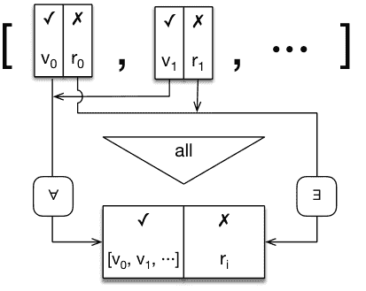

图 40.2：Promise 组合器 `Promise.all()`

#### 40.5.3.1 通过 Promise.all() 实现异步 .map()

数组转换方法（如 `.map()`、`.filter()` 等）是为了同步计算设计的。例如：

```javascript
function timesTwoSync(x) {
  return 2 * x;
}
const arr = [1, 2, 3];
const result = arr.map(timesTwoSync);
assert.deepEqual(result, [2, 4, 6]);
```

如果 `.map()` 的回调函数是一个基于 Promise 的函数（将普通值映射到 Promise 的函数）会发生什么？那么 `.map()` 的结果将是一个 Promise 数组。这意味着普通代码无法工作。幸运的是，我们可以通过 `Promise.all()` 来修复这个问题：它将 Promise 数组转换为一个包含普通值数组的已完成 Promise。

```javascript
function timesTwoAsync(x) {
  return new Promise(resolve => resolve(x * 2));
}
const arr = [1, 2, 3];
const promiseArr = arr.map(timesTwoAsync);
Promise.all(promiseArr)
  .then(result => {
    assert.deepEqual(result, [2, 4, 6]);
  });
```

#### 40.5.3.2 一个更真实的 .map() 示例

接下来，我们将使用 `.map()` 和 `Promise.all()` 从网络下载文件。为了这一点，我们需要以下函数：

```javascript
function downloadText(url) {
  return fetch(url)
    .then((response) => { // (A)
      if (!response.ok) { // (B)
        throw new Error("file not found");
      }
      return response.text(); // (C)
    });
}
```

`downloadText()` 使用基于 Promise 的 fetch API 以字符串形式下载文件：

- 异步获取响应（行 A）。
- `response.ok`（行 B）检查是否存在错误。
- 如果没有错误，则使用 `.text()`（行 C）获取内容。

在下面的示例中，下载文件：

```javascript
const urls = [
  'http://example.com/first.txt',
  'http://example.com/second.txt'
];

const promises = urls.map(url => downloadText(url));
Promise.all(promises)
  .then(results => {
    // 处理下载的结果
  });
```

#### 40.5.3.3 Promise.all() 的简单实现

这是 `Promise.all()` 的简单实现（安全性）：

```javascript
function all(iterable) {
  return new Promise((resolve, reject) => {
    let index = 0;
    let elementCount = 0;
    let anErrorOccurred = false;
    const result = [];

    for (const promise of iterable) {
      promise.then(
        (value) => {
          if (anErrorOccurred) return;
          result[index] = value;
          elementCount++;
          if (elementCount === result.length) {
            resolve(result);
          }
        },
        (err) => {
          if (anErrorOccurred) return;
          anErrorOccurred = true;
          reject(err);
        }
      );
      index++;
    }

    if (index === 0) {
      resolve([]);
      return;
    }
  });
}
```

### 40.5.4 Promise.race() [ES6]

`Promise.race()` 返回一个 Promise q，它在第一个 Promise p 决议时决议。具有 p 相同的决议值。

在下面的演示中，完成的 Promise（行 A）在拒绝的（行 B）之前完成。因此，结果是完成的（行 C）。

```javascript
const promises = [
  new Promise((resolve, reject) =>
    setTimeout(() => resolve('result'), 100)), // (A)
  new Promise((resolve, reject) =>
    setTimeout(() => reject('ERROR'), 200)), // (B)
];
Promise.race(promises)
  .then((result) => assert.equal(result, 'result')); // (C)
```

在下一个演示中，拒绝先发生：

```javascript
const promises = [
  new Promise((resolve, reject) =>
    setTimeout(() => resolve('result'), 200)),
  new Promise((resolve, reject) =>
    setTimeout(() => reject('ERROR'), 100)),
];
Promise.race(promises)
  .then(
    (result) => assert.fail(),
    (err) => assert.equal(err, 'ERROR')
  );
```

注意，`Promise.race()` 返回的 Promise 在其 Promise 中的第一个一个决议时决议。这意味着 `Promise.race([])` 的结果永远不会决议。

图 40.3 展示了 `Promise.race()` 的工作原理。

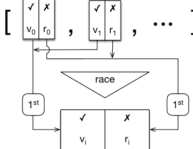

图 40.3：Promise 组合器 `Promise.race()`

#### 40.5.4.1 使用 Promise.race() 设置 Promise超时

在本节中，我们将使用 `Promise.race()` 来设置Promise超时。以下辅助函数将多次使用：

```javascript
function resolveAfter(ms, value=undefined) {
  return new Promise((resolve, reject) => {
    setTimeout(() => resolve(value), ms);
  });
}
```

`resolveAfter()` 返回一个 Promise，在 ms 毫秒后用 value 解析。

该函数超时一个 Promise：

```javascript
function timeout(timeoutInMs, promise) {
  return Promise.race([
    promise,
    resolveAfter(timeoutInMs,
      Promise.reject(new Error('Operation timed out'))),
  ]);
}
```

`timeout()` 返回一个 Promise，其状态（settlement）与以下两个 Promise 中先完成状态的那个相同：

1. 参数 `promise`
2. 在 `timeoutInMs` 毫秒后被拒绝（rejected）的 Promise

为了产生第二个 Promise，`timeout()` 利用了这样一个事实：用一个拒绝的 Promise 去解析一个处理中的（pending）Promise 会导致后者变为被拒绝。

让我们来看看 `timeout(0)` 的运行情况。在这里，输入的 Promise 在超时发生之前就已经完成了（fulfilled）。因此，输出的 Promise 也是完成的。

```javascript
timeout(20, resolveAfter(100, 'Result!'))
.then(result => assert.equal(result, 'Result!'));
```

在这里，超时在输入的 Promise 完成之前就发生了。因此，输出的 Promise 被拒绝了。

```javascript
timeout(100, resolveAfter(2000, 'Result!'))
.catch(err => assert.deepEqual(err, new Error('Operation timed out')));
```

理解“Promise 超时”意味着什么很重要：

- 如果输入的 Promise 完成得足够快，它的状态会被传递给输出的 Promise。
- 如果它没有足够快完成，输出的 Promise 就会被拒绝。

也就是说，超时只会防止输入的 Promise 影响输出（因为一个 Promise 只能完成一次）。它并不会完成产生输入 Promise 的异步操作。那是另一个的话题。

#### 40.5.4.2 Promise.race() 的简单实现

这是 `Promise.race()` 的一个简化实现（例如，它没有执行任何安全检查）：

```javascript
function race(iterable) {
  return new Promise((resolve, reject) => {
    let settlementOccurred = false;
    for (const promise of iterable) {
      promise.then(
        (value) => {
          if (settlementOccurred) return;
          settlementOccurred = true;
          resolve(value);
        },
        (err) => {
          if (settlementOccurred) return;
          settlementOccurred = true;
          reject(err);
        }
      );
    }
  });
}
```

### 40.5.5 Promise.allSettled() [ES2020]

这一次，类型签名稍微复杂了一点。你可以直接跳到第一个演示，它应该更容易理解。

这是 `Promise.allSettled()` 的类型：

```typescript
Promise.allSettled<T>(promises: Iterable<Promise<T>>)
  : Promise<Array<SettlementObject<T>>>
```

它返回一个数组的 Promise，该数组具有以下类型签名：

```typescript
type SettlementObject<T> = FulfillmentObject<T> | RejectionObject;
```

```typescript
interface FulfillmentObject<T> {
  status: 'fulfilled',
  value: T;
}
```

```typescript
interface RejectionObject {
  status: 'rejected',
  reason: unknown;
}
```

`Promise.allSettled()` 返回一个 Promise。一旦所有 Promise 都已完成，输出就会被填充为一个数组。数组的每个元素对应于 `promises` 中的一个 Promise `p`：

- 如果 `p` 完成且值为 `v`，则 `e` 是
  `{ status: 'fulfilled', value: v }`
- 如果 `p` 被拒绝且拒绝值为 `r`，则 `e` 是
  `{ status: 'rejected', reason: r }`

除非遍历 promises 时发生错误，否则输出的 Promise 永远不会拒绝。

图 40.4 展示了 `Promise.allSettled()` 是如何工作的。

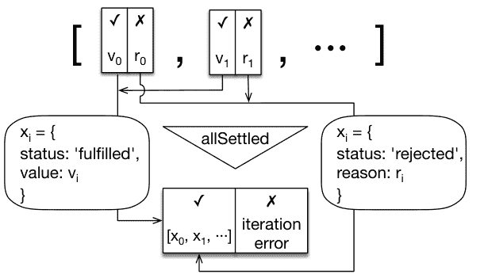

图 40.4：Promise 组合器 `.allSettled()`。

#### 40.5.5.1 Promise.allSettled() 的第一个演示

这是一个关于 `Promise.allSettled()` 如何工作的快速第一个演示：

```javascript
Promise.allSettled(
  Promise.resolve('a'),
  Promise.reject('b'),
)
.then(arr => assert.deepEqual(arr,
  { status: 'fulfilled', value: 'a' },
  { status: 'rejected', reason: 'b' },
));
```

#### 40.5.5.2 Promise.allSettled() 的更长示例

下一个示例与 `.map()` `Promise.all()` 的示例类似（我们从那里借用了函数 `downloadText()`）：我们正在下载多个文件，其 URL 存储在一个数组中。然而，这一次我们不想在出现错误时停止，而是希望继续下去。`Promise.allSettled()` 允许我们这样做：

```javascript
const urls = [
  'http://example.com/exists.txt',
  'http://example.com/missing.txt'
];

const result = Promise.allSettled(
  urls.map(u => downloadText(u))
).then(
  arr => assert.deepEqual(
  arr,
  {
    status: 'fulfilled',
    value: 'Hello!',
  },
  {
    status: 'rejected',
  }
));
```

## 40.7 Promise 链式技巧

### 40.7.1 链式错误：丢失尾部

问题：

```javascript
// 不要这样做
function foo() {
  const promise = asyncFunc();
  promise.then(result => {
    // ...
  });
  return promise;
}
```

计算从 `asyncFunc()` 返回的 Promise 开始。此后，通过 `.then()` 创建了另一个 Promise。`foo()` 返回了前者，但应该返回后者。修复方法如下：

```javascript
function foo() {
  const promise = asyncFunc();
  return promise.then(result => {
    // ...
  });
}
```

### 40.7.2 链式错误：嵌套

问题：

```javascript
// 不要这样做
asyncFunc1()
  .then(result1 => {
    return asyncFunc2()
    .then(result2 => { // (A)
      // ...
    });
  });
```

第 A 行的 `.then` 是嵌套的。使用扁平的结构会更好：

```javascript
asyncFunc1()
  .then(result1 => {
    return asyncFunc2();
  })
  .then(result2 => {
    // ...
  });
```

### 40.7.3 链式错误：不必要的过度嵌套

这是另一个可以避免的嵌套示例：

```javascript
// 不要这样做
asyncFunc1()
  .then(result1 => {
    if (result1 < 0) {
      return asyncFuncA()
      .then(resultA => 'Result: ' + resultA);
    } else {
      return asyncFuncB()
      .then(resultB => 'Result: ' + resultB);
    }
  });
```

我们可以再次获得扁平的结构：

```javascript
asyncFunc1()
  .then(result1 => result1 < 0 ? asyncFuncA() : asyncFuncB())
  .then(resultAB => {
    return 'Result: ' + resultAB;
  });
```

### 40.7.4 并不是所有的嵌套都是坏的

在以下代码中，我们实际上从嵌套中获益：

```javascript
db.open()
  .then(connection => { // (A)
    return connection.select({ name: 'Jane' })
      .then(result => { // (B)
        // 处理结果
        // 使用 'connection' 执行更多查询
      })
  })
  .finally(() => {
    connection.close(); // (C)
  });
```

我们在第 A 行接收到一个异步结果。在第 B 行中，我们进行嵌套，以便在回调函数内部以及第 C 行中访问变量 `connection`。

### 40.7.5 链式错误：创建 Promise 而不是链式调用

问题：

```javascript
// 不要这样做
class Model {
  insertInto(db) {
    return new Promise((resolve, reject) => { // (A)
      db.insert(this.fields)
      .then(resultCode => {
        this.notifyObservers({event: 'created', model: this});
        resolve(resultCode);
      }).catch(err => {
        reject(err);
      });
    })
  }
  // ...
}
```

在第 A 行中，我们创建了一个 Promise 来交付 `db.insert()` 的结果。这是不必要的冗余，并且可以被简化：

```javascript
class Model {
  insertInto(db) {
    return db.insert(this.fields)
      .then(resultCode => {
        this.notifyObservers({event: 'created', model: this});
        return resultCode;
      });
  }
  // ...
}
```

核心思想是，我们不需要创建一个 Promise；我们可以返回 `.then()` 调用的结果。一个额外的好处是，我们不需要捕获并重新拒绝 `db.insert()` 的失败。我们只需将其拒绝状态传递给 `.insertInto()` 的调用者即可。

# 41 异步函数

目录

- 41.1 异步函数：基础
- 41.1.1 异步构造结构
- 41.2 从异步函数中返回
- 41.2.1 异步函数总是返回 Promise
- 41.2.2 返回的 Promise 不会被封装
- 41.2.3 执行异步函数：同步开始，异步结算（进阶）
- 41.3 await：与 Promise 协作
- 41.3.1 await 与已完成的 Promise
- 41.3.2 await 与被拒绝的 Promise
- 41.3.3 await 是浅层的（无法在回调函数中使用）
- 41.4 （进阶）
- 41.5 立即调用的异步箭头函数
- 41.6 并发与 await
- 41.6.1 顺序执行异步函数
- 41.6.2 并发执行异步函数
- 41.7 使用函数的技巧
- 41.7.1 “发后即忘”
- 41.7.2 使用 await 有意义

大致来说，异步函数提供了更好的语法。为了使用异步函数，我们应该理解以下内容：

## 41.1 异步函数：基础

> 异步函数是基于 Promise 的

考虑以下异步函数：

```javascript
async function asyncFunc() {
  try {
    const response = await fetch(url);
    const json = await response.json();
    return json;
  } catch (error) {
    console.error(error);
  }
}
```

关于异步函数的一些观察：

- 异步函数用 `async` 关键字标记。
- 在异步函数内部，每当 Promise 结算时，我们使用 `await` 操作符
  - 如果 Promise 已完成，`await` 返回其完成的值。
  - 如果 Promise 被拒绝，`await` 抛出拒绝的原因。
- 异步函数的结果始终是一个 Promise
  - 任何显式或隐式返回的值都将用于完成 Promise。
  - 任何抛出的异常都将用于拒绝 Promise。

`fetchJsonAsync()` 和 `fetchJsonViaPromises()` 的调用方式相同，例如：

```javascript
fetchJsonAsync('http://example.com/person.json')
  .then(obj => {
    assert.deepEqual(obj, {
      first: 'Jane',
      last: 'Doe',
    });
  });
```

### 41.1.1 异步构造结构

JavaScript 有以下可调用实体的异步版本。它们的角色总是真实的函数或方法。

```javascript
// 异步函数声明
async function func1() {}
```

```javascript
// 异步函数表达式
const func2 = async function () {};
```

```javascript
// 异步箭头函数
const func3 = async () => {};
```

```javascript
// 对象字面量中的异步方法定义
const obj = { async m() {} };
```

```javascript
// 类定义中的异步方法定义
class MyClass { async m() {} }
```

## 41.2 从异步函数中返回

### 41.2.1 异步函数总是返回 Promise

每个异步函数总是返回一个 Promise。

在异步函数内部，我们通过 `return` 完成结果 Promise（第 A 行）：

```javascript
async function asyncFunc() {
  return 123; // (A)
}

asyncFunc()
.then(result => {
  assert.equal(result, 123);
});
```

像往常一样，如果没有显式地返回任何内容，将为我们返回 `undefined`：

```javascript
async function asyncFunc() {
}

asyncFunc()
.then(result => {
  assert.equal(result, undefined);
});
```

我们通过 `throw` 拒绝返回的 Promise（A 行）：

```javascript
async function asyncFunc() {
  throw new Error('Problem!'); // (A)
}

asyncFunc()
.catch(err => {
  assert.deepEqual(err, new Error('Problem!'));
});
```

### 41.2.2 返回的 Promise 不会被再次包装

如果我们从异步函数中返回一个 Promise，那么 `p` 将变成函数的结果（或者说，结果会“锁定”在该 Promise 上，并且行为完全一致）。这意味着，该 Promise 不会被再次包装在另一个 Promise 中。

```javascript
async function asyncFunc() {
  return Promise.resolve('abc');
}

asyncFunc()
.then(result => assert.equal(result, 'abc'));
```

回想在以下情况下，任何 `q` 的处理方式都是类似的：

- `new Promise((resolve, reject) => { ... })` 内部的 `resolve(q)`
- `return q.then(result => { ... })`
- `return q.catch(err => { ... })`

### 41.2.3 执行异步函数：同步开始，异步结算（高级）

异步函数的执行如下：

- 当异步函数启动时，会创建结果对应的 Promise `p`。
- 接着执行函数体。执行可以通过两种方式离开函数体：
  - 执行可以在就绪时**永久地**离开：
    - 一个 `return` 完成 `p`。
    - 一个 `throw` 拒绝 `p`。
  - 执行也可以在通过 `await` 等待另一个 Promise `q` 的就绪时**临时地**离开。异步函数会被暂停，执行离开它。一旦 `q` 就绪，执行将恢复。
- 在执行首次离开函数体（无论是永久还是临时）后，返回该 Promise。

注意，结果 `p` 的通知是异步发生的，这与 Promise 的通常情况是一致的。

以下代码演示了异步函数是同步启动的（A 行），然后当前任务完成（C 行），最后结果 Promise 是异步地结算的（B 行）。

```javascript
async function asyncFunc() {
  console.log(`asyncFunc() starts`); // (A)
  return 'abc';
}
asyncFunc().
.then(x => { // (B)
  console.log(`Resolved: ${x}`);
});
console.log(`Task ends`); // (C)
```

```javascript
// 输出:
// 'asyncFunc() starts'
// 'Task ends'
// 'Resolved: abc'
```

## 41.3 await: 工作中的 Promise

`await` 运算符只能在异步函数和异步生成器（在 42.2 节“异步生成器”中解释过）中使用。它的操作数通常是一个 Promise，并会导致执行以下步骤：

- 当前异步函数被暂停并从其返回。这一步与同步生成器中 `yield` 的工作原理类似。
- 最终，当前任务完成，任务队列的处理继续。
- 当且只要 Promise 就绪时，`await` 函数在一个新任务中恢复：
  - 如果 Promise 已完成（fulfilled），`await` 返回完成值。
  - 如果 Promise 被拒绝（rejected），`await` 抛出拒绝值。

继续阅读了解 `await` 如何处理各种状态下的 Promise。

### 41.3.1 await 和已完成的 Promise

如果其操作数最终是一个已完成的 Promise，`await` 将返回其完成值：

```javascript
assert.equal(await Promise.resolve('yes!'), 'yes!');
```

非 Promise 值也是允许的，并且它们会被直接传递（同步地传递，不会暂停异步函数）：

```javascript
assert.equal(await 'yes!', 'yes!');
```

### 41.3.2 await 和被拒绝的 Promise

如果其操作数是一个被拒绝的 Promise，那么 `await` 将抛出拒绝值：

```javascript
try {
  await Promise.reject(new Error());
  assert.fail(); // 我们永远不会到达这里
} catch (e) {
  assert.equal(e instanceof Error, true);
}
```

- 练习：通过异步函数 Fetch API `exercises/async-functions/fetch_json2_test.mjs`

### 41.3.3 await 是浅层的（我们无法直接使用它）

如果我们在异步函数内部并想通过 `await` 暂停它，我们必须直接在该函数内部操作；我们不能在嵌套函数（如回调函数）中使用它。也就是说，暂停是浅层的。

例如，以下代码无法执行：

```javascript
async function downloadContent(urls) {
  return urls.map((url) => {
    await httpGet(); // 语法错误！
  });
}
```

原因是普通的箭头函数不允许在函数体内部使用 `await`。

好了，让我们尝试一个异步函数：

```javascript
async function downloadContent(urls) {
  return urls.map(async (url) => {
    await httpGet();
  });
}
```

唉，这也不行：`.map()`（因此 `downloadContent()`）返回的是一个包含 Promise 的数组，而不是一个包含值的数组。

### 41.4 (高级)

一种可能的解决方案是使用 `Promise.all()` 来解开所有的 Promise：

```javascript
async function downloadContent(urls) {
  const promiseArray = urls.map(async (url) => {
    return httpGet(); // (A)
  });
  return Promise.all(promiseArray);
}
```

这可以改进吗？可以的：在 A 行中，我们通过 `await` 解开了一个 Promise，结果却立即通过 `return` 将其重新包装。如果我们省略了 `await`，我们甚至不需要异步函数了：

```javascript
async function downloadContent(urls) {
  const promiseArray = urls.map(
    url => httpGet()
  );
  return Promise.all(promiseArray); // (B)
}
```

- 练习：映射和过滤 `exercises/async-functions/map_test.mjs`

## 41.5 立即调用的异步函数

如果我们在异步函数外部进行 `await`（例如在模块的顶层），那么我们可以立即 `await` 一个箭头函数：

```javascript
(async () => { // 开始
  const promise = Promise.resolve('abc');
  const value = await promise;
  assert.equal(value, 'abc');
})();
```

立即调用的箭头函数的结果是一个 Promise：

```javascript
(async () => { // 开始
  const promise = Promise.resolve('abc');
  const value = await promise;
  assert.equal(value, 'abc');
})();
```

## 41.6 await 与并发

在接下来的章节中，我们将使用辅助函数 `delay`：

```javascript
/**
 * 在指定的毫秒后解析
 */
function delay(ms) {
  return new Promise((resolve, reject) => {
    setTimeout(resolve, ms);
  });
}
```

注意，结果 `p` 的通知是异步发生的，这与 Promise 总是如此。

```javascript
async function paused(id) {
  console.log('START' + id);
  return id;
}
```

如果我们用 `await` 前缀多个函数的调用，那么它们是按顺序执行的：

```javascript
async function sequentialAwait() {
  const result1 = await paused('first');
  assert.equal(result1, 'first');
  const result2 = await paused('second');
  assert.equal(result2, 'second');
}

// 输出:
```


// 'START first'

// 'END first'

// 'START second'

// 'END second'

如果我们想并发运行多个函数，我们可以使用 `Promise.all()` 方法：

```javascript
async function concurrentPromiseAll() {
  const result = await Promise.all([
    paused('first'), paused('second')
  ]);
  assert.deepEqual(result, ['first', 'second']);
}

// 输出:
// 'START first'
// 'START second'
// 'END first'
// 'END second'
```

这里，两个异步函数是同时启动的。一旦它们都就绪，`await` 会给我们完成值。因此，以下代码与上一个一样是并发的：

```javascript
async function concurrentAwait() {
  const resultPromise1 = paused('first');
  const resultPromise2 = paused('second');
  assert.equal(await resultPromise1, 'first');
  assert.equal(await resultPromise2, 'second');
}

// 输出:
// 'START first'
// 'START second'
// 'END first'
// 'END second'
```

## 41.7 使用异步函数的贴士

### 41.7.1 如果我们“触发后置不管”，则不需要 await

在处理基于 Promise 的函数时，不需要 `await`；只有当我们想要暂停并等待返回的 Promise 就绪时才需要它。如果我们只想启动一个异步操作，就不需要：

```javascript
async function asyncFunc() {
  const writer = openFile('someFile.txt');
  writer.write('hello'); // 不等待
  writer.write('world'); // 不等待
  await writer.close(); // 等待文件关闭
}
```

在此代码中，我们没有 `await` `.write()`，因为我们不在乎它何时完成。我们确实想等待 `.close()` 完成。

注意：每次对 `.write()` 调用都是同步启动的。这防止了竞态条件。

### 41.7.2 有时 await 并忽略结果是有意义的

有时使用 `await` 即使忽略其结果也是有意义的——例如：

```javascript
await longRunningAsyncOperation();
console.log('Done!');
```

在这里，我们正在使用 `await` 来等待一个长时间的异步操作。这确保了日志记录确实在该操作完成*之后*发生。

# 第 42 章

# 异步迭代

## 目录

- 42.1 基础异步迭代
  - 42.1.1 协议：异步迭代
  - 42.1.2 直接使用异步迭代
  - 42.1.3 通过 for-await-of 使用异步迭代
- 42.2 异步生成器
  - 42.2.1 示例：通过异步生成器创建异步迭代对象
  - 42.2.2 示例：将同步迭代器转换为异步迭代器
  - 42.2.3 示例：将异步迭代器转换为数组
  - 42.2.4 示例：转换异步迭代器
  - 42.2.5 示例：对异步迭代器进行 map 操作
- 42.3 在 Node.js 流上的异步迭代
  - 42.3.1 Node.js 流：通过回调 (push) 实现异步
  - 42.3.2 Node.js 流：通过异步迭代 (pull) 实现异步
  - 42.3.3 示例：从数据块到行

# 必备知识

对于本章，你应该熟悉：

- `Promise`
- 异步函数

## 42.1 基础异步迭代

### 42.1.1 协议：异步迭代

为了理解异步迭代是如何工作的，让我们先回顾一下同步迭代。它包含以下接口：

```typescript
interface Iterable<T> {
  [Symbol.iterator]() : Iterator<T>;
}

interface Iterator<T> {
  next() : IteratorResult<T>;
}

interface IteratorResult<T> {
  value: T;
  done: boolean;
}
```

- `Iterable`（可迭代对象）是一个可以通过迭代访问内容的数据结构。它是迭代器的工厂。
- `Iterator`（迭代器）是迭代的工厂，我们通过调用 `.next()` 方法来获取它。
- 每个 `IteratorResult`（迭代结果）包含被迭代的 `.value` 和一个布尔值 `.done`，后者在最后一个元素之后为 `true`，在此之前为 `false`。

对于异步迭代协议，我们只想改变一件事：产生的值应该是异步交付的。这里有两种可能的方案：

- `.value` 可以包含一个 `Promise<T>`。
- `.next()` 可以返回 `Promise<IteratorResult<T>>`。

换句话说，问题在于是对值进行封装，还是对整个迭代结果进行封装。

这必须是后者，因为当 `.next()` 返回结果时，它开始了一个异步计算。该计算是否产生值或信号迭代结束，只有在完成后才能确定。因此，`.done` 和 `.value` 都需要封装在 `Promise` 中。

异步迭代的接口如下：

```typescript
interface AsyncIterable<T> {
  [Symbol.asyncIterator]() : AsyncIterator<T>;
}

interface AsyncIterator<T> {
  next() : Promise<IteratorResult<T>>; // (A)
}

interface IteratorResult<T> {
  value: T;
  done: boolean;
}
```

与同步接口唯一的区别在于 `.next()` 的返回类型（第 A 行）。

### 42.1.2 直接使用异步迭代

以下代码直接使用了异步迭代协议：

```javascript
const asyncIterable = syncToAsyncIterable(['a', 'b']); // (A)
const asyncIterator = asyncIterable[Symbol.asyncIterator]();

// 调用 .next() 直到 .done 为 true：
asyncIterator.next() // (B)
  .then(iteratorResult => {
    assert.deepEqual(
      iteratorResult,
      { value: 'a', done: false });
    return asyncIterator.next();
  })
  .then(iteratorResult => {
    assert.deepEqual(
      iteratorResult,
      { value: 'b', done: false });
    return asyncIterator.next();
  })
  .then(iteratorResult => {
    assert.deepEqual(
      iteratorResult,
      { value: undefined, done: true });
  });
```

### 42.1.3 通过 for-await-of 使用异步迭代

```javascript
const asyncIterable = syncToAsyncIterable(['a', 'b']);

for await (const x of asyncIterable) {
  console.log(x);
}
```

## 42.2 异步生成器

异步生成器同时是两个者：

- 异步函数（输入）：我们可以使用 `await` 和 `for-await-of` 获取数据。
- 返回异步迭代对象的生成器（输出）：我们可以使用 `yield` 和 `yield*` 产生数据。

如下所示：

```javascript
async function* asyncGen() {
  // 输入：Promises，异步迭代对象
  const x = await somePromise;
  for await (const y of someAsyncIterable) {
    // ...
  }
  yield someValue;
  yield* otherAsyncGen();
}
```

### 42.2.1 示例：通过异步生成器创建异步迭代对象

来看一个示例。以下代码创建一个包含三个数字的异步迭代对象：

```javascript
async function* yield123() {
  for (let i=1; i<=3; i++) {
    yield i;
  }
}
```

`yield123()` 的结果符合异步迭代协议吗？

```javascript
(async () => {
  const asyncIterable = yield123();
  const asyncIterator = asyncIterable[Symbol.asyncIterator]();
  assert.deepEqual(
    await asyncIterator.next(),
    { value: 1, done: false }
  );
  assert.deepEqual(
    await asyncIterator.next(),
    { value: 2, done: false }
  );
  assert.deepEqual(
    await asyncIterator.next(),
    { value: 3, done: false }
  );
  assert.deepEqual(
    await asyncIterator.next(),
    { value: undefined, done: true }
  );
})();
```

我们将代码封装在了一个立即执行的异步箭头函数中。

### 42.2.2 示例：将同步迭代器转换为异步迭代器

以下异步生成器将一个同步迭代器转换为异步迭代器。它实现了我们之前使用过的 `syncToAsyncIterable()` 函数。

```javascript
async function* syncToAsyncIterable(syncIterable) {
  for (const elem of syncIterable) {
    yield elem;
  }
}
```

注意：在这种情况下，输入是同步的（不需要 `await`）。

### 42.2.3 示例：将异步迭代器转换为数组

以下函数是之前练习题的解决方案。它将异步迭代器转换为数组（类似于扩展运算符的操作，但针对的是异步迭代器而非同步迭代器）。

```javascript
async function asyncIterableToArray(asyncIterable) {
  const result = [];
  for await (const value of asyncIterable) {
    result.push(value);
  }
  return result;
}
```

注意，在这种情况下我们可以使用异步生成器：我们通过 `for-await-of` 获取输入，并返回一个封装在 Promise 中的数组。后者的要求排除了异步生成器的使用。

这是对 `asyncIterableToArray()` 的测试：

```javascript
async function* createAsyncIterable() {
  yield 'a';
  yield 'b';
}

const asyncIterable = createAsyncIterable();

assert.deepEqual(
  await asyncIterableToArray(asyncIterable), // (A)
  ['a', 'b']
);
```

注意行 A 中的 `await`，它是为了解包由 `asyncIterableToArray()` 返回的 Promise。为了让 `await` 起作用，这段代码片段必须在异步函数内部运行。

### 42.2.4 示例：转换异步迭代器

让我们实现一个异步生成器，通过转换现有的异步迭代器来产生一个新的异步迭代器。

```javascript
async function* timesTwo(asyncNumbers) {
  for await (const x of asyncNumbers) {
    yield x * 2;
  }
}
```

为了测试这个函数，我们使用了上一节中的 `asyncIterableToArray()`。

```javascript
async function* createAsyncIterable() {
  for (let i=1; i<=3; i++) {
    yield i;
  }
}

assert.deepEqual(
  await asyncIterableToArray(timesTwo(createAsyncIterable())),
  [2, 4, 6]
);
```

> 练习题：异步生成器
>
> 警告：我们就会看到 `async-iteration/number_lines_test.js` 的解决方案
>
> - exercises/async-iteration/number_lines_test.js

### 42.2.5 示例：对异步迭代器进行 map 操作

提醒一下，对同步迭代器进行 map 操作的方法如下：

```javascript
function* mapSync(iterable, func) {
  let index = 0;
  for (const x of iterable) {
    yield func(x, index);
    index++;
  }
}

const syncIterable = mapSync(['a', 'b', 'c'], s => s.repeat(3));
assert.deepEqual(
  [...syncIterable],
  ['aaa', 'bbb', 'ccc']
);
```

异步版本如下：

```javascript
async function* mapAsync(asyncIterable, func) { // (A)
  let index = 0;
  for await (const x of asyncIterable) { // (B)
    yield func(x, index);
    index++;
  }
}
```

注意同步实现和异步实现是多么相似。唯一的两点区别是行 A 中的 `async` 和行 B 中的 `await`。这等同于从同步函数转换为异步函数——我们只需要添加 `async` 关键字和偶尔使用的 `await` 即可。

为了测试 `mapAsync()`，我们使用了辅助函数 `asyncIterableToArray()`（在本章之前已展示）：

```javascript
async function* createAsyncIterable() {
  yield 'a';
  yield 'b';
}

const mapped = mapAsync(
  createAsyncIterable(), s => s.repeat(3));

assert.deepEqual(
  await asyncIterableToArray(mapped), // (A)
  ['aaa', 'bbb']
);
```

再次，我们需要解包一个 Promise（行 A），并且这段代码片段必须嵌套在异步函数内部。

- 练习题：filterAsyncIter()
  exercises/async-iteration/filter_async_iter_test.mjs

## 42.3 对 Node.js 流进行异步迭代

### 42.3.1 Node.js 流：通过回调（推）实现异步

传统上，从 Node.js 流中异步读取数据是通过回调完成的：

```javascript
function main(inputFilePath) {
  const readStream = fs.createReadStream(inputFilePath, {
    encoding: 'utf8', highWaterMark: 1024
  });
  readStream.on('data', (chunk) => {
    console.log('>>> ' + chunk);
  });
  readStream.on('end', () => {
    console.log('### DONE ###');
  });
}
```

这意味着流处于控制状态，并将数据推给读者。

### 42.3.2 Node.js 流：通过异步迭代（拉）实现异步

从 Node.js 10 开始，我们也可以使用异步迭代来从流中读取：

```javascript
async function main(inputFilePath) {
  const readStream = fs.createReadStream(inputFilePath, {
    encoding: 'utf8', highWaterMark: 1024
  });
  for await (const chunk of readStream) {
    console.log('>>> ' + chunk);
  }
  console.log('### DONE ###');
}
```

这一次，读者处于控制并从流中拉取数据。

### 42.3.3 示例：块转行

Node.js 流遍历块。以下异步生成器创建一个按行的异步迭代器：

```javascript
/**
 * 参数：块（字符串）
 * 结果：行的异步迭代器
 */
async function* chunksToLines(chunksAsync) {
  let previous = '';
  for await (const chunk of chunksAsync) {
    previous += chunk;
    let eolIndex;
    while ((eolIndex = previous.indexOf('\n')) >= 0) { // Windows '\r\n' 或 '\n'
      const line = previous.slice(0, eolIndex);
      yield line;
      previous = previous.slice(eolIndex + 1);
    }
  }
  if (previous.length > 0) {
    yield previous;
  }
}
```

让我们将 `chunksToLines()` 应用于块的异步迭代器：

```javascript
async function* chunkIterable() {
  yield 'First';
  yield 'Second';
  yield 'Third';
}

const linesIterable = chunksToLines(chunkIterable());

assert.deepEqual(
  await asyncIterableToArray(linesIterable),
  ['First', 'Second', 'Third']
);
```

现在我们有了异步迭代器，可以使用之前练习题的解决方案——行号：

```javascript
async function* numberLines(linesAsync) {
  let lineNumber = 1;
  for await (const line of linesAsync) {
    yield lineNumber + ': ' + line;
    lineNumber++;
  }
}

const numberedLines = numberLines(linesIterable());

assert.deepEqual(
  await asyncIterableToArray(numberedLines),
  ['1: First', '2: Second', '3: Third', '4: Fourth']
);
```

## 43 正则表达式 (RegExp)

## 目录

- 43.1 创建正则表达式
  - 43.1.1 字面量与构造函数
  - 43.1.2 克隆和非破坏性修改正则表达式
- 43.2 语法
  - 43.2.1 语法字符
  - 43.2.2 基础原子
  - 43.2.3 Unicode 属性转义 [ES2018]
  - 43.2.4 字符类
  - 43.2.5 量词
  - 43.2.6 分组与反向引用
  - 43.2.7 断言
    - 43.2.7.1 前瞻断言
    - 43.2.7.2 后置断言 [ES2018]
  - 43.2.8 分选择 (|)
- 43.3 标志
  - 43.3.1 通过 /u 使用 Unicode 模式
- 43.4 正则表达式的方法
  - 43.4.1 regExp.test(str)
  - 43.4.2 regExp.exec(str)
  - 43.4.3 str.match(regExp)
  - 43.4.4 str.matchAll(regExp)
  - 43.4.5 str.replace(searchValue, replacementValue)
  - 43.4.6 str.split(separator)
- 43.5 标志 /g, /y 以及属性 .lastIndex（进阶）
  - 43.5.1 标志 /g 和 /y
  - 43.5.2 正则表达式属性 .lastIndex
  - 43.5.3 /g 和 /y 的陷阱
  - 43.5.4 .lastIndex 的用例：从给定索引开始匹配
  - 43.5.5 总结：.global (/g) 和 .sticky (/y)
  - 43.5.6 总结
- 43.6 使用正则表达式的技巧
  - 43.6.1 为正则表达式转义任意文本
  - 43.6.2 匹配所有或无

功能可用性

除非另有说明，每个正则表达式功能自 ES3 起均可用。

## 43.1 创建正则表达式

### 43.1.1 字面量与构造函数

创建正则表达式的两种主要方式：

- 字面量：静态编译（在加载时）。

```javascript
/abc/ui
```

- 构造函数：动态编译（在运行时）。

```javascript
new RegExp('abc', 'ui')
```

这两种正则表达式都包含两个部分：

- 主体 `abc` – 实际的正则表达式。
- 标志 `u` 和 `i`。标志配置了模式如何被解释。可用标志列表将在本章后面给出。`/i` 启用不区分大小写的匹配。

### 43.1.2 克隆和非破坏性修改正则表达式

`RegExp()` 构造函数有两种变体：

- `new RegExp(pattern: string, flags = '')` [ES3]

根据指定的 `pattern` 创建正则表达式。如果缺少 `flags`，则使用空字符串 `''`。

- `new RegExp(regExp: RegExp, flags = RegExp.flags)` [ES6]

克隆 `regExp`。如果提供了 `flags`，则由它决定克隆体的标志。

第二种变体用于在修改正则表达式的同时克隆它们。标志是不可变的，这是更改它们的唯一方法——例如：

```javascript
function copyAndAddFlags(regExp, flagsToAdd='') {
  // 构造函数不允许重复标志；
  // 确保没有重复：
  const newFlags = [...new Set(regExp.flags + flagsToAdd)].join('');
  return new RegExp(regExp, newFlags);
}

assert.equal(/abc/i.flags, 'i'); // 从 i 修复
assert.equal(copyAndAddFlags(/abc/i, 'g').flags, 'gi');
```

## 43.2 语法

### 43.2.1 语法字符

在正则表达式的顶层，以下语法字符是特殊的。它们通过在前面加一个反斜杠 (`\`) 来进行转义：

```
\ ^ $ . * + ? ( ) [ ] { }
```

在正则表达式字面量中，我们必须转义斜杠：

```javascript
> /\//.test('/')
```

在 `new RegExp()` 的参数中，我们不需要转义斜杠：

```javascript
> new RegExp('/').test('/')
true
```

### 43.2.2 基础原子

原子是正则表达式的构建块。

- 模式字符是除 (`^`, `$`, 等) 以外的所有字符。模式字符匹配自身。示例：`A` `b` `c`
- `.` 匹配任何字符。我们可以使用标志 `/s` (点全匹配模式) 来控制点是否匹配终止符（下文将详细介绍）。
- 字符转义（每个转义匹配一个单一固定字符）：
  - `\f`: 分页符 (FF)
  - `\n`: 换行符 (LF)
  - `\r`: 回车 (CR)
  - `\t`: 制表符
  - `\v`: 垂直制表符
  - 任意控制字符：`\cA` (Ctrl-A), ..., `\cZ` (Ctrl-Z)
  - Unicode 编码：`\u00E4`
  - Unicode 点（需要标志 `/u`）：`\u{1F4D0}`
- 字符类转义（每个转义匹配字符集中的一个）：
  - `\d`: 数字（相当于 `[0-9]`）
  - `\w`: “单词”字符（相当于 `[A-Za-z0-9_]`），与编程语言中的标识符相关
  - `\W`: 非单词字符
  - `\s`: 空白字符（空格、制表符、换行符等）
  - `\S`: 非空白
- Unicode 属性转义 [ES2018]: `\p{White_Space}`, `\P{White_Space}`, 等。
- 需要标志 `/u`。
- 在下一个小节中描述。

### 43.2.3 Unicode 属性转义 [ES2018]

#### 43.2.3.1 Unicode 字符属性

在 Unicode 标准中，每个字符都有*属性*——描述它的元数据。属性在定义字符的本质属性方面起着重要作用。引用 Unicode 标准，字符的语义由其标识、规范化属性和行为决定。以下是属性的几个示例：

- 名称 (Name)：一个唯一的名称，由大写字母、数字、连字符和空格组成——例如：
  - `A`: Name = LATIN CAPITAL LETTER
  - `😊`: Name = SLIGHTLY SMILING FACE
- 通用类别 (General_Category)：对字符进行分类——例如：
  - `x`: General_Category = Lowercase_Letter
  - `$`: General_Category = Currency_Symbol
- 空白 (White_Space)：用于不可见字符，如空格、制表符和换行——例如：
  - `\t`: White_Space = True
  - `\pi`: White_Space = False
- 年龄 (Age)：引入该字符的 Unicode 标准版本——欧元符号在 2.1 版本添加。
  - `€` Age = 2.1
- 块 (Block)：代码点的连续范围。区块不重叠，且名称是唯一的。
  - `A`: Block = Basic (范围 U+0000..U+07F)
  - `😊`: Block = Emoticons (范围 U+1600..U+16FF)
- 脚本 (Script)：一个或多个写入系统使用的字符集。某些脚本支持多种语言。例如，英语、法语。

#### 43.2.3.2 属性转义的语法

属性转义的语义取决于：

- `\p{属性}`：匹配具有属性的字符。
- `\P{属性}`：匹配不具有属性的字符。

### 43.2.4 字符类

字符类允许我们定义自己的字符集合。

```javascript
> /[abc]/.test('a')
true
> /[abc]/.test('d')
false
```

#### 43.2.4.1 字符类中的范围

```javascript
> /[a-z]/.test('b')
true
> /[a-z]/.test('A')
false
```

#### 43.2.4.2 否定字符类

```javascript
> /[^abc]/.test('a')
false
> /[^abc]/.test('d')
true
```

#### 43.2.4.3 字符类中的转义

在字符类中，大多数特殊字符失去其特殊含义。例外情况：

- `]` 结束字符类。
- `\` 开始转义。
- `^` 在开头表示否定。
- `-` 表示范围（如果不在开头或结尾）。

```javascript
> /[\]]/.test(']')
true
> /[\-]/.test('-')
true
```

### 43.2.5 量词

量词指定前一个原子可以重复多少次。

| 量词 | 含义 |
| :--- | :--- |
| `?` | 0 或 1 次 |
| `*` | 0 次或多次 |
| `+` | 1 次或多次 |
| `{n}` | 恰好 n 次 |
| `{n,}` | 至少 n 次 |
| `{n,m}` | n 到 m 次 |

默认情况下，量词是贪婪的——它们匹配尽可能多的内容。在量词后添加 `?` 使其变为非贪婪（惰性）。

```javascript
> 'aaaa'.match(/a+/g)
[ 'aaaa' ]
> 'aaaa'.match(/a+?/g)
[ 'a', 'a', 'a', 'a' ]
```

### 43.2.6 分组与反向引用

#### 43.2.6.1 捕获组

捕获组用括号 `()` 表示。它们捕获匹配的子字符串以供后续使用。

```javascript
> /(a)(b)/.exec('ab')
[ 'ab', 'a', 'b', index: 0, input: 'ab', groups: undefined ]
```

#### 43.2.6.2 非捕获组

非捕获组 `(?:...)` 仅用于分组，不捕获内容。

```javascript
> /(?:a)(b)/.exec('ab')
[ 'ab', 'b', index: 0, input: 'ab', groups: undefined ]
```

#### 43.2.6.3 命名捕获组 [ES2018]

命名捕获组 `(?<name>...)` 允许通过名称引用捕获内容。

```javascript
> /(?<first>a)(?<second>b)/.exec('ab').groups
{ first: 'a', second: 'b' }
```

#### 43.2.6.4 反向引用

反向引用 `\n` (n 为数字) 或 `\k<name>` 引用之前捕获组的内容。

```javascript
> /(a)\1/.test('aa')
true
> /(?<char>a)\k<char>/.test('aa')
true
```

### 43.2.7 断言

断言匹配位置而非字符。

#### 43.2.7.1 前瞻断言

**正前瞻断言：** `(?=pattern)` 如果 pattern 匹配后续的内容，则匹配。

示例：后面跟着 X 的小写字母序列。

```javascript
> 'abc def'.match(/[a-z]+(?=X)/g)
[ 'abc' ]
```

注意 X 并不是匹配到的字符串的一部分。

**否定前瞻断言：** `(?!pattern)` 如果 pattern 不匹配后续的内容，则匹配。

示例：后面没有跟着 X 的小写字母序列。

```javascript
> 'abc def'.match(/[a-z]+(?!X)/g)
[ 'ab', 'def' ]
```

#### 43.2.7.2 后置断言 [ES2018]

**正后置断言：** `(?<=pattern)` 如果 pattern 匹配之前的内容，则匹配。

示例：前面有 X 的小写字母序列。

```javascript
> 'Xabc def'.match(/(?<=X)[a-z]+/g)
[ 'abc' ]
```

**否定后置断言：** `(?<!pattern)` 如果 pattern 不匹配之前的内容，则匹配。

示例：前面没有 X 的小写字母序列。

```javascript
> 'Xabc def'.match(/(?<!X)[a-z]+/g)
[ 'bc', 'def' ]
```

示例：将 "js" 替换为 "html"，但不在 "Node.js" 中。

```javascript
> 'Node.js: index.js and main.js'.replace(/(?<!Node)\.js/g, '.html')
'Node.js: index.html and main.html'
```

### 43.2.8 分选择 (|)

注意：此运算符的优先级较低。如有必要请使用分组：

- `^aa|zz$` 匹配所有以 `aa` 开头或以 `zz` 结尾的字符串。注意 `|` 的优先级低于 `^` 和 `$`。
- `(aa|zz)$` 匹配字符串 `'aa'` 和 `'zz'`。
- `^a(a|z)zz$` 匹配字符串 `'aaz'` 和 `'azz'`。

## 43.3 标志

表 43.1：JavaScript 支持的正则表达式标志。

| 字面量标志 | 属性名 | ES | 描述 |
| :--- | :--- | :--- | :--- |
| `g` | `global` | ES3 | 多次匹配 |
| `i` | `ignoreCase` | ES3 | 不区分大小写匹配 |
| `m` | `multiline` | ES3 | `^` 和 `$` 匹配每行 |
| `s` | `dotAll` | ES2018 | 点号匹配行终止符 |
| `u` | `unicode` | ES6 | Unicode 模式（推荐） |
| `y` | `sticky` | ES6 | 匹配项之间没有字符 |

JavaScript 中可以使用以下正则表达式标志（表 43.1 提供了简要概述）：

- `/g`：从根本上改变了后续方法的工作方式。
  - `RegExp.prototype.test()`
  - `RegExp.prototype.exec()`
  - `String.prototype.match()`

具体解释见 §43.5 "标志 /g 和 /y"。简而言之，如果没有 `/g`，这些方法只考虑输入字符串中正则表达式的第一个匹配项。有了 `/g`，它们会考虑所有匹配项。

- `/i`：`ignoreCase`：开启不区分大小写的匹配：

```javascript
> /a/.test('A')
false
> /a/i.test('A')
true
```

- `/m`：`multiline`：如果开启此标志，`^` 匹配每行的开头，`$` 匹配每行的结尾。如果关闭，`^` 匹配整个输入字符串的开头，`$` 匹配整个输入字符串的结尾。

```javascript
> 'a1\na2\na3'.match(/a./gm)
[ 'a1', 'a2', 'a3' ]
> 'a1\na2\na3'.match(/a./g)
[ 'a1' ]
```

- `/u`：`unicode`：此标志开启正则表达式的 Unicode 模式。这将在下一节中解释。

- `/y`：`sticky`：此标志主要与 `/g` 结合使用才有意义。当两者都开启时，任何匹配都必须紧跟在上一个匹配之后（即它必须从正则表达式对象的 `lastIndex` 处开始）。因此，第一个匹配必须在索引 0 处。

```javascript
> 'a1a2a3'.match(/a./gy)
[ 'a1', 'a2' ]
> 'a1a2 a3'.match(/a./gy) // 第一个匹配必须在索引 0 处
null
```

> `'a1a2 a3'.match(/a./g)`
> `[ 'a1', 'a2', 'a3' ]`

`/y` 的主要用途是分词（在解析期间）。

- `/s`：`dotAll`。默认情况下，点号不匹配行终止符。开启此标志后，它可以匹配它们：

```javascript
> /./.test('\n')
false
> /./s.test('\n')
true
```

如果不支持 `/u` 的变方案：使用 `[^]` 代替点号。

```javascript
> /[^]/.test('\n')
true
```

### 43.3.1 通过 /u 使用 Unicode 模式

标志 `/u` 开启正则表达式的特殊 Unicode 模式。它启用了多项功能：

- 在模式中，我们可以使用 Unicode 转义字符如 `\u{...}` 来指定字符。代码单元转义 `\uXXXX` 仅有一个范围（对应于基础平面）。
- 在模式中，我们可以使用 Unicode 属性转义如 `\p{White_Space}`。
- 许多转义现在被禁止了。例如：`\uXXXX` 字符总是匹配其自身：

```javascript
> /\u{61}/u.test('a')
true
```

如果没有 `/u`，某些字符在用反斜杠转义后仍然会匹配其自身：

```javascript
> /\a/u.test('a')
false
```

使用 `/u` 时：

- `\p` 开始一个 Unicode 属性转义。
- “自匹配”转义字符是被禁止的。作为结果，它们现在可以用于未来的新功能。
- 匹配 Unicode 字符（码点），而不是 JavaScript 字符（代码单元）。

接下来的小节详细解释了最后一项。它们使用以下字符来解释何时代码单元是 Unicode 字符，何时是 JavaScript 字符：

```javascript
const codePoint = '𝌂';
const codeUnits = '\uD834\uDD42'; // UTF-16
assert.equal(codePoint, codeUnits); // false!
```

## 43.4 正则表达式的方法

### 43.4.1 regExp.test(str)

`test()` 方法检查正则表达式是否匹配字符串，返回布尔值。

```javascript
> /a/.test('abc')
true
```

### 43.4.2 regExp.exec(str)

`exec()` 方法返回匹配的详细信息。

```javascript
> /(a)(b)/.exec('ab')
[ 'ab', 'a', 'b', index: 0, input: 'ab', groups: undefined ]
```

### 43.4.3 str.match(regExp)

`match()` 方法根据是否有 `/g` 标志返回不同结果。

```javascript
> 'ab'.match(/a/)
[ 'a', index: 0, input: 'ab', groups: undefined ]
> 'ab ab'.match(/a/g)
[ 'a', 'a' ]
```

### 43.4.4 str.matchAll(regExp)

`matchAll()` 返回所有匹配的迭代器，需要 `/g` 标志。

```javascript
> [...'ab ab'.matchAll(/a/g)]
[ [ 'a', index: 0, input: 'ab ab', groups: undefined ], [ 'a', index: 3, input: 'ab ab', groups: undefined ] ]
```

### 43.4.5 str.replace(searchValue, replacementValue)

`replace()` 方法用于替换匹配项。

```javascript
> 'ab'.replace(/a/, 'x')
'xb'
> 'ab ab'.replace(/a/g, 'x')
'xb xb'
```

### 43.4.6 str.split(separator)

`split()` 方法按分隔符分割字符串，分隔符可以是正则表达式。

```javascript
> 'a:b:c'.split(/:/)
[ 'a', 'b', 'c' ]
```

## 43.5 标志 /g, /y 以及属性 .lastIndex（进阶）

在本节中，我们检查 RegExp 标志 `/g` 和 `/y` 如何工作，以及它们如何依赖 RegExp 属性 `.lastIndex`。我们将发现一个可能尚未考虑过的 `.lastIndex` 用例。

### 43.5.1 标志 /g 和 /y

这些标志可以总结如下：

- `/g` (`.global`) 激活多个正则表达式操作的多重匹配模式。
- `/y` (`.sticky`) 类似于 `/g`，但匹配之间不能存在间隙。

以下两个正则表达式完全忽略 `/g` 和 `/y`：

- `String.prototype.search(regExp)`
- `String.prototype.split(regExp)`

所有其他操作在某种程度上都受到它们的影响。

#### 43.5.1.1 标志 /g (`.global`) [ES3]

让我们看看多重匹配是什么样的。

##### 43.5.1.1.1 `.exec()` 和 `/g`

如果没有 `/g`，`.exec()` 总是返回首次匹配的匹配对象：

```javascript
> const re = /#/;
> re.exec('##-#')
{ 0: '#', index: 0, input: '##-#' }
> re.exec('##-#')
{ 0: '#', index: 0, input: '##-#' }
```

如果有 `/g`，它每次调用返回一个新匹配，并在没有更多匹配项时返回 `null`：

```javascript
> const re = /#/g;
> re.exec('###')
{ 0: '#', index: 0, input: '###' }
> re.exec('###')
{ 0: '#', index: 1, input: '###' }
> re.exec('###')
{ 0: '#', index: 2, input: '###' }
> re.exec('###')
null
```

##### 43.5.1.1.2 `.replace()` 和 `/g`

如果没有 `/g`，`.replace()` 只会替换第一个匹配项：

```javascript
> '##'.replace(/#/, 'x')
'x#'
```

带有 `/g` 时，`.replace()` 会替换所有匹配项：

```javascript
> '##-#'.replace(/#/g, 'x')
'xx-x'
```

##### 43.5.1.1.3 `.matchAll()` 和 `/g`

`.matchAll()` 只有在设置了 `/g` 时才有效，并返回所有匹配对象：

```javascript
const re = /#/g;
[...'###'.matchAll(re)]
[
  { 0: '#', index: 0, input: '###' },
  { 0: '#', index: 1, input: '###' },
  { 0: '#', index: 2, input: '###' }
]
```

#### 43.5.1.2 标志 `/y` (`.sticky`) [ES6]

我们目前将 `/y` 与 `/g` 一起使用（称为“无间隙的 g”）。为了单独理解 `/y`，我们需要学习 RegExp 属性 `.lastIndex`，我们很快就会讲到。

##### 43.5.1.2.1 `.exec()` 和 `/gy`

带有 `/gy` 时，`.exec()` 返回的每个匹配都必须紧接着上一个匹配。这就是为什么在下面的示例中它只返回了两个匹配：

```javascript
const re = /#/gy;
> re.exec('##-#')
{ 0: '#', index: 0, input: '##-#' }
> re.exec('##-#')
{ 0: '#', index: 1, input: '##-#' }
> re.exec('##-#')
null
```

##### 43.5.1.2.2 `.replace()` 和 `/gy`

带有 `/gy` 时，`.replace()` 会替换所有匹配项，只要它们之间没有间隙：

```javascript
> '##-#'.replace(/#/gy, 'x')
'xx-#'
```

##### 43.5.1.2.3 `.matchAll()` 和 `/gy`

带有 `/gy` 时，`.matchAll()` 只对相邻的匹配返回匹配对象：

```javascript
const re = /#/gy;
[...'##-#'.matchAll(re)]
[
  { 0: '#', index: 0, input: '##-#' },
  { 0: '#', index: 1, input: '##-#' },
]
```

### 43.5.2 正则表达式属性 `.lastIndex`

正则表达式属性 `.lastIndex` 只有在至少使用了标志 `/g` 或 `/y` 时才会生效。

对于受其影响的正则表达式操作，它控制匹配的起始位置。

#### 43.5.2.1 `.lastIndex` 和 `/g`

例如，`.exec()` 使用 `.lastIndex` 来记住它当前在输入字符串中的位置：

```javascript
const re = /[a-z]/g;
re.lastIndex
0
[re.exec('a-b'), re.lastIndex]
[ { 0: 'a', index: 0, input: 'a-b' }, 1 ]
[re.exec('a-b'), re.lastIndex]
[ { 0: 'b', index: 2, input: 'a-b' }, 3 ]
[re.exec('a-b'), re.lastIndex]
[ null, 0 ]
```

`.matchAll()` 尊重 `.lastIndex` 但不会改变它：

```javascript
const re = /#/g; re.lastIndex = 1;
[...'##-#'.matchAll(re)]
[
  { 0: '#', index: 1, input: '##-#' },
  { 0: '#', index: 3, input: '##-#' },
]
re.lastIndex
1
```

`.replace()` 忽略 `.lastIndex` 并将其置为零：

```javascript
const re = /#/g; re.lastIndex = 1;
'##-#'.replace(re, 'x')
'xx-x'
> re.lastIndex
0
```

总结来说，对于某些操作，`/g` 意味着在 `.lastIndex` 或之后进行匹配。

#### 43.5.2.2 `.lastIndex` 和 `/y`

对于 `/y`，`.lastIndex` 意味着：恰好在 `.lastIndex` 处匹配。它的工作方式就像正则表达式的开头被锚定在 `.lastIndex` 上。

注意，`^` 和 `$` 继续正常工作；它们将匹配锚定在输入字符串的开头或结尾，除非设置了 `.multiline`。此时它们锚定在行的开头或结尾。

```javascript
如果设置了 /y，多次执行 exec（即使没有设置 /g）：
> const re = /#/y; re.lastIndex = 1;
> [re.exec('#-'), re.lastIndex]
[ { 0: '#', index: 1, input: '#--' }, 2 ]
> [re.exec('#-'), re.lastIndex]
[ null, 0 ]
```

如果使用了 `/y` 而没有使用 `/g`，`.replace` 会替换在 `.lastIndex` 处找到的第一个项。它会更新 `.lastIndex`。

```javascript
const re = /#/y; re.lastIndex = 1;
> '##-#'.replace(re, 'x')
'x#-#'
> re.lastIndex
2
> '##-#'.replace(re, 'x')
'xx-#'
```

### 43.5.3 `/g` 和 `/y` 的陷阱

#### 43.5.3.1 陷阱：无法内联带有 `/g` 或 `/y` 的正则表达式

带有 `/g` 创建的正则表达式无法内联。例如，在下面的 while 循环中，正则表达式每次都会重新创建。因此 `.lastIndex` 始终为零，循环永远不会结束。

```javascript
let matchObj;
// 无限循环
while ((matchObj = /a+/g.exec('bbaaa'))) {
  console.log(matchObj[0]);
}
```

对于 `/y` 情况相同。

#### 43.5.3.2 陷阱：移除 `/g` 或 `/y` 会破坏代码

如果代码对带有 `/g` 的 `.exec()` 结果进行循环，那么没有 `/g` 会导致无限循环：

```javascript
function collectMatches(regExp, str) {
  const matches = [];
  let matchObj;
  // 无限循环
  while (matchObj = regExp.exec(str)) {
    matches.push(matchObj[0]);
  }
  return matches;
}
collectMatches(/a+/, 'bbaaa'); // 缺少标志 /g
```

#### 43.5.3.3 陷阱：添加 `/g` 或 `/y` 会破坏代码

对于 `.test()` 还有一个坑：它受 `.lastIndex` 影响。因此，如果我们想检查正则表达式是否匹配字符串，正则表达式不能带有 `/g`。否则，每次调用 `.test()` 都会得到不同的结果：

```javascript
> const regExp = /a/g;
> [regExp.test('Xa'), regExp.lastIndex]
[ true, 1 ]
> [regExp.test('Xa'), regExp.lastIndex]
[ false, 0 ]
> [regExp.test('Xa'), regExp.lastIndex]
[ true, 1 ]
```

第一次调用产生匹配并更新 `.lastIndex`。第二次调用未找到匹配并重置 `.lastIndex`。

再次，这个问题也存在于 `/y`：

```javascript
> const regExp = /^a/y;
> [regExp.test('Xa'), regExp.lastIndex]
[ false, 0 ]
> [regExp.test('Xa'), regExp.lastIndex]
[ false, 0 ]
> [regExp.test('Xa'), regExp.lastIndex]
[ false, 0 ]
```

#### 43.5.3.4 陷阱：如果 `.lastIndex` 不是零，代码可能会产生意外结果

考虑到所有受 `.lastIndex` 影响的正则表达式操作，我们必须小心在开始时 `.lastIndex` 为零。否则，它们可能会得到意外的结果：

```javascript
function countMatches(regexp, str) {
  let count = 0;
  while (regexp.test(str)) {
    count++;
  }
  return count;
}

const myExp = /a/g;
myExp.lastIndex = 4;
assert.equal(countMatches(myExp, 'babaa'), 1); // 应该是 3
```

通常，新创建的表达式中 `.lastIndex` 为零，我们不会显式设置它。但如果多次使用正则表达式，`.lastIndex` 可能会变为非零。

#### 43.5.3.5 避免 `/g`, `/y` 和 `.lastIndex` 陷阱的措施

作为处理 `/g` 和 `.lastIndex` 的示例，我们回到之前示例中的 `countMatches()`。如何防止错误的正则表达式破坏代码？让我们来看三种方法。

##### 43.5.3.5.1 抛出异常

首先，如果未设置 `/g` 或 `.lastIndex` 不是零，我们可以抛出异常：

```javascript
function countMatches(regexp, str) {
  if (!regexp.global) {
    throw new Error('Flag g of RegExp must be set');
  }
  if (regexp.lastIndex !== 0) {
    throw new Error('regexp.lastIndex must be zero');
  }

  let count = 0;
  while (regexp.test(str)) {
    count++;
  }
  return count;
}
```

##### 43.5.3.5.2 复制正则表达式

其次，我们可以复制参数。这样做的好处是 RegExp 不会被改变。

```javascript
function countMatches(regexp, str) {
  const cloneFlags = regexp.flags + (regexp.global ? '' : 'g');
  const clone = new RegExp(regexp.source, cloneFlags);
  let count = 0;
  while (clone.test(str)) {
    count++;
  }
  return count;
}
```

### 43.5.4 `.lastIndex` 的用法：从给定索引开始匹配

除了存储状态，`.lastIndex` 还可以从指定的索引开始匹配。本节描述了如何操作。

#### 43.5.4.1 示例：检查正则表达式是否在给定索引匹配

由于 `.test()` 受 `/y` 和 `.lastIndex` 的影响，我们可以用它来检查正则表达式是否在字符串的给定索引匹配：

```javascript
function matchesStringAt(regExp, str, index) {
  if (!regExp.sticky) {
    throw new Error('Flag /y of regex must be set');
  }
  regExp.lastIndex = index;
  return regExp.test(str);
}

assert.equal(
  matchesStringAt(/x+/y, 'axxx', 0), false);
assert.equal(
  matchesStringAt(/x+/y, 'axxx', 2), true);
```

由于 `/y`，regExp 被锚定在 `.lastIndex`。

注意，我们不能使用断言 `^`，因为它会将正则表达式锚定在输入字符串的开头。

#### 43.5.4.2 示例：从给定索引开始查找匹配的位置

`.search()` 允许我们找到正则表达式匹配的位置：

```javascript
> '#--'.search(/#/)
0
```

遗憾的是，我们无法更改 `.search()` 开始查找匹配的位置。作为变通方案，我们可以使用 `.exec()` 来搜索：

```javascript
function searchAt(regexp, str, index) {
  if (!regexp.global && !regexp.sticky) {
    throw new Error('必须设置 regExp 的 /g 或 /y 标志');
  }
  regexp.lastIndex = index;
  const match = regexp.exec(str);
  if (match) {
    return match.index;
  } else {
    return -1;
  }
}

assert.equal(
  searchAt(/#/g, '#--', 0), 0);
assert.equal(
  searchAt(/#/g, '#--', 1), 3);
```

#### 43.5.4.3 示例：在给定索引处替换

当使用 `/gy` 时，`.replace()` 会执行一次替换——如果位于 `.lastIndex` 处有匹配。

```javascript
function replaceOnceAt(str, regexp, replacement, index) {
  if (!regexp.sticky && !regexp.global) {
    throw new Error('必须设置 /y 标志，不能设置 /g 标志');
  }
  regexp.lastIndex = index;
  return str.replace(regexp, replacement);
}

assert.equal(
  replaceOnceAt('aa aaa a', /a/gy, 'X', 0), 'Xa aaa a');
assert.equal(
  replaceOnceAt('aa aaa a', /a/gy, 'X', 3), 'aa Xaa a');
assert.equal(
  replaceOnceAt('aa aaa a', /a/gy, 'X', 8), 'aa aaa X');
```

### 43.5.5 总结：`.global` (/g) 和 `.sticky` (/y)

这两个方法完全不受 `/g` 和 `/y` 的影响：

- `String.prototype.search()`
- `String.prototype.split()`

| 标志 /g | 调用 | `.lastIndex` | 标志 /y |
| :--- | :--- | :--- | :--- |
| `.exec()` | 0+ | 在 `.lastIndex` 或之后 | ✓ 已更新。同于 `/y` |
| | MatchObject \| null | | |
| `.test()` | 0+ | 在 `.lastIndex` 或之后 | ✓ 已更新。同于 `/y` |
| | boolean | | |
| `.replace()` | 1 | 所有匹配项 | ✓ 重置 `/g` (在无间隙时) |
| | string | | |
| `.match()` | 1 | | ✓ 重置 `/g` (在无间隙时) |
| | MatchObject \| null \| Array\<string> | | |
| `.matchAll()` | 1 | 在 `.lastIndex` 或之后 | ✓ 保持不变。`/g` (在无间隙时) |
| | Iterable\<MatchObject> | | |

图例说明：

- 列 "#" 指定了方法交付的结果数量。
- `.lastIndex` 意味着 `.lastIndex` 是否被更新。
- MatchObject 意味着匹配对象。
- 操作是否受 `.lastIndex` 影响？
  - ✓ 是：`.lastIndex` 被更新或保持不变。
  - 否：默认情况下 `.lastIndex` 不受影响，但某些操作会将其重置为零。

| 标志 /y | # | 结果 | `.lastIndex` |
| :--- | :--- | :--- | :--- |
| `.exec()` | 0+ | `.lastIndex` 处的 null/MatchObject | ✓ 已更新 |
| `.test()` | 0+ | `.lastIndex` 处的 boolean | ✓ 已更新 |
| `.replace()` | 1 | `.lastIndex` 处的字符串出现 | ✓ 已更新 |
| `.match()` | 1 | null/MatchObject (同于 `.exec()`) | ✓ 已更新 |
| `.matchAll()` | | TypeError | | |

> 一个 JavaScript 生成的结果表格
>
> 我写了一个 Node.js 脚本来打印结果表格。

### 43.5.6 总结

正则表达式属性 `.lastIndex` 有两个显著的缺点：

- 它使正则表达式具有**状态性**：
  - 我们现在必须注意正则表达式的状态以及如何使用它们。
- 对于许多情况，我们也无法通过冻结使其变为不可变。
- 对 `.lastIndex` 的支持在正则表达式操作之间是不一致的。

相反，`.lastIndex` 也为我们提供了额外的有用功能：我们可以规定匹配开始的位置（针对某些操作）。

## 43.6 使用正则表达式的技巧

### 43.6.1 为正则表达式转义任意文本

以下函数对任意文本进行转义，以便在将其放入正则表达式时能够被字面匹配：


```javascript
function escapeForExp(str) {
  return str.replace(/[\\$.*?()[\]{}|]/g, '\$&'); // (A)
}
assert.equal(escapeForRegExp('yes?'), String.raw('yes?'));
assert.equal(escapeForRegExp('_g'), String.raw('_g'));
```

在 A 中，我们转义了语法字符。我们需要有选择性，因为正则表达式标志 `/u` 禁止了许多转义——例如 `\u-`。普通方法 `.replace()` 只允许替换纯文本。通过 `escapeForRegExp()`，我们可以绕过这一限制并多次替换纯文本：

```javascript
const plainText = ':;';
const regExp = new RegExp(plainText, 'ug');
assert.equal(
  '-: :) -;'.replace(regExp, '© ¤ ©')
);
```

### 43.7.2 匹配所有或无匹配

有时，我们需要一个匹配所有或无内容的正则表达式——例如作为默认值：

- 匹配所有：`/(?:)?/`

空分组 `()` 匹配所有。我们使其变为非捕获（通过 `?:`），以避免不必要的工作。

```
> /(?:)?.test('')
true
> /(?:)?.test('abc')
true
```

- 无匹配：`/^.*/`

`^` 只匹配字符串开头。点 `.` 将匹配移过了第一个字符，现在 `^` 不匹配任何内容。

```
> /^.*/.test('')
false
> /^.*/.test('abc')
false
```

## 第 44 章

## 日期 (Date)

本章介绍了 JavaScript 处理日期的 API —— `Date` 类。

### 44.1 最佳实践：避免使用内置 Date

JavaScript 的 `Date` API 使用起来非常麻烦。因此，最好依赖库来处理日期相关的任务。流行的库包括：

- Moment.js
- Day.js
- Luxon
- js-joda
- date-fns

参考博客文章“为什么你不应该使用 Moment.js...”了解这些库的优缺点。

此外，TC39 正在为 JavaScript 开发新的 API：Temporal。

### 44.1.1 选择日期库的考虑因素

有两个需要注意的参数：

- 摇树优化可以显著减小库的大小。这是一种仅部署某些被引用的导出项的技术。函数比类更容易进行摇树优化。

- 对时区的支持：如后文所述，`Date` 不支持时区，这引入了许多陷阱并是一个关键缺陷。确保你的库支持时区。

### 44.2 时间标准

### 44.2.1 背景：UTC vs Z vs GMT

UTC、Z 和 GMT 是指定时间的几种方式，它们相似但有细微区别：

- UTC（协调世界时）是所有时区依据的标准。时区是相对于它指定的。也就是说，没有国家或领土将 UTC 作为其本地时区。

- Z（零度时）是一种军事时区，在航空和军事领域用作 UTC+0 的另一种名称。

- GMT（格林威治标准时间）是欧洲和非洲国家使用的时区。它是 UTC 加上若干小时，因此与 UTC 时间相同。

来源：

- “Difference Between GMT and UTC” at TimeAndDate.com
- “Z – Zulu Time Zone (Military Time)” at TimeAndDate.com

### 44.2.2 日期不支持时区

`Date` 支持以下时间标准：

- 本地时区（取决于当前位置）
- UTC
- 时间偏移量（相对于 UTC）

### 44.3 背景：日期时间格式 (ISO)

根据操作的不同，只有部分选项可用。例如，在将日期转换为字符串或提取日期等时间单位时，你只能在本地时区和 UTC 之间选择。

在内部，日期以 UTC 格式存储。在与本地时区之间转换时，必要的偏移量是通过日期确定的。在下面的示例中，本地时区为 Europe/Paris：

```javascript
// CEST (中欧夏令时间)
assert.equal(
  new Date('2122-06-29').getTimezoneOffset(), -120
);
```

```javascript
// CET (中欧时间)
assert.equal(
  new Date('2122-12-29').getTimezoneOffset(), -60
);
```

每当你创建或转换日期时，你需要注意正在使用的时间标准——例如：`new Date()` 使用本地时区，而 `.toISOString()` 使用 UTC。

```
> new Date(2077, 0, 27).toISOString()
'2077-01-26T23:00:00.000Z'
```

日期将 `0` 解析为 1 月。27 号的日期是本地时区，但在 UTC 中是 26 号。

## 记录每个操作支持的时间标准

在本章的剩余部分，每个操作都将注明其支持的时间标准。

### 44.2.2.1 无法指定时区的缺点

无法指定时区有两个缺点：

- 这使得无法支持多个时区。
- 可能会导致与特定位置相关的 bug。例如，上一个示例产生的结果取决于执行它的位置。为了安全起见：
  - 尽可能使用基于 UTC 的操作
  - 在解析字符串时使用 Z 或时间偏移量（更多信息请见下一节）。

### 44.3.1 提示：附加一个 Z 以使日期解析具有确定性

如果你在字符串末尾添加一个 Z，日期解析在不同位置就不会产生不同的结果：

- 没有 Z：输入是 1 月 27 日（Europe/Paris 时区），输出是 1 月 26 日（UTC）。

```
> new Date('2077-01-27T00:00:00').toISOString()
'2077-01-26T23:00:00.000Z'
```

- 有 Z：输入是 1 月 27 日，输出是 1 月 27 日。

```
> new Date('2077-01-27T00:00:00Z').toISOString()
'2077-01-27T00:00:00.000Z'
```

### 44.4 时间值

时间值通过自 UTC 1970 年 1 月 1 日 00:00:00 起的毫秒数表示日期。

时间值可以用于创建 `Date`：

```javascript
const timeValue = 0;
assert.equal(
  new Date(timeValue).toISOString(),
  '1970-01-01T00:00:00.000Z'
);
```

将 `Date` 强制转换为数字返回时间值：

- `Number(new Date(123))`

排序操作会将其操作数转换为数字。因此，你可以使用这些运算符来比较 `Date`：

```javascript
assert.equal(
  new Date('1972-05-03') < new Date('2001-12-23'), true
);
```

```javascript
// 内部：
assert.equal(7369200000 < 100906500000, true);
```

#### 44.4.1 创建时间值

以下方法创建时间值：

- `Date.now()` : 数字 (UTC)
  返回当前时间作为时间值。

- `Date.parse(dateStr)`: 数字 (本地时区, 偏移量)
  解析 `dateStr` 并返回时间值。

- `Date.UTC(year, month, day?, hours?, seconds?, milliseconds?)`: 数字 (UTC)
  返回指定日期的时间值。

#### 44.4.2 获取和设置时间值

- `Date.prototype.getTime()` : 数字 (UTC)
  返回 `Date` 对应的时间值。

- `Date.prototype.setTime(timeValue)` (UTC)
  通过 `timeValue` 设置日期。

### 44.5 创建 Date

#### 44.5.1 通过数字创建日期

`new Date(year: number, month: number, date?: number, hours?: number, minutes?: number, milliseconds?: number)` (本地时区)

有两个陷阱：

- 对于月份，`0` 是 1 月，`1` 是 2 月等。
- 如果 `0 ≤ year ≤ 99`，则会加上 1900：

```
> new Date(12, 1, 22).getFullYear()
1912
```

这就是为什么在本章的其他地方我们避免使用两位数年份而始终使用四位数年份。但在这种情况下我们没有选择。

示例：

```javascript
> new Date(2007, 0, 27, 21, 49).toISOString() // UTC+1
'2007-01-27T20:49:00.000Z'
```

注意输入的小时 (21) 与输出的小时 (20)。前者指的是本地时区，后者指的是 UTC。

#### 44.5.2 从字符串解析日期

`new Date(dateTimeStr: string)` (本地时区, UTC, 偏移量)

如果末尾有 Z，则使用 UTC：

```
> new Date('2007-01-27T00:00:00Z').toISOString()
'2007-01-27T00:00:00.000Z'
```

如果末尾没有 Z 或时间偏移量，则使用本地时区：

```
> new Date('2007-01-27T00:00.00').toISOString() // UTC+1
'2007-01-26T23:00:00.000Z'
```

如果字符串仅包含日期，则被解释为 UTC：

```
> new Date('2007-01-27').toISOString()
'2007-01-27T00:00:00.000Z'
```

#### 44.5.3 创建日期其他方法

- `new Date(timeValue: number)` (UTC)
- `new Date()` (UTC)

```
> new Date(0).toISOString()
'1970-01-01T00:00:00.000Z'
```

与 `new Date(Date.now())` 相同。

### 44.6 Getter 和 setter

#### 44.6.1 时间单位 getter 和 setter

`Date` 有时间单位的 getter 和 setter——例如：

- `Date.prototype.getFullYear()`
- `Date.prototype.setFullYear(num)`

这些 getter 和 setter 符合以下模式：

- 本地时区：
  - `Date.prototype.get<Unit>()`
  - `Date.prototype.set<Unit>(num)`

- UTC:
  - `Date.prototype.getUTC<Unit>()`
  - `Date.prototype.setUTC<Unit>(num)`

支持的时间单位有：

- FullYear (年份)
- Month (月份): (0–11)。陷阱：`0` 是 1 月等。
- Date (日期): 月份 (1–31)
- Day (仅限 getter): 星期 (0–6，`0` 是星期日)
- Hours (小时): (0–23)
- Minutes (分钟): (0–59)
- Seconds (秒): (0–59)
- Milliseconds (毫秒): (0–999)

有一个 getter 不符合上述模式：

- `Date.prototype.getTimezoneOffset()`

返回本地时区与 UTC 之间的分钟差。例如，对于 Europe/Paris，返回 -120 (CEST，中欧夏令时间) 或 -60 (CET，中欧时间)：

```
> new Date('2122-06-29').getTimezoneOffset()
-120
> new Date('2122-12-29').getTimezoneOffset()
-60
```

### 44.7 将日期转换为字符串

示例日期：

```javascript
const d = new Date(0);
```

#### 44.7.1 带有时间的字符串

- `Date.prototype.toTimeString()` (本地时区)

```
> d.toTimeString()
'01:00:00 GMT+0100 (中欧标准时间)'
```

#### 44.7.2 带有日期的字符串

- `Date.prototype.toDateString()` (本地时区)

```
> d.toDateString()
'Thu Jan 01 1970'
```

#### 44.7.3 带有日期和时间的字符串

- `Date.prototype.toString()` (本地时区)

```
> d.toString()
'Thu Jan 01 1970 01:00:00 GMT+0100 (中欧标准时间)'
```

- `Date.prototype.toUTCString()` (UTC)

```
> d.toUTCString()
'Thu Jan 01 1970 00:00:00 GMT'
```

- `Date.prototype.toISOString()` (UTC)

```
> d.toISOString()
'1970-01-01T00:00:00.000Z'
```

#### 44.7.4 其他方法

以下三个方法并不真正属于 ECMAScript，而是属于 ECMAScript 国际化 API。该 API 具有格式化日期的功能（包括对时区的支持），但没有解析日期的功能。

- `Date.prototype.toLocaleString()`
- `Date.prototype.toLocaleDateString()`
- `Date.prototype.toLocaleTimeString()`

## 第 45 章

## 创建和解析 JSON (JSON)

### 45.1 JSON 的发现与标准化

Douglas Crockford 在 2001 年在 json.org 上发布了 JSON 规范。他解释道：

> 我并不声称自己发明了 JSON，因为它在自然界已经存在。当我发现它时，给它取了名，描述了它的用处，也许我是第一个偶然撞上这个想法的人。

后来，JSON 被标准化为 ECMA-404：

- 第一版：2013 年 10 月
- 第二版：2017 年 12 月

### 45.1.1 JSON 的语法已冻结

### 45.2 JSON 语法

JSON ("JavaScript 对象表示法") 是一种使用文本编码数据的存储格式。它的语法是 JavaScript 表达式的子集。例如，考虑存储在文件中的以下文本：

```json
{
  "first": "Jane",
  "last": "Porter",
  "married": true,
  "friends": ["Tarzan", "Cheeta"]
}
```

JSON 由以下部分组成：

- 对象字面量
- 数组字面量
- 原子类型：`null`（但不是 `undefined`）、布尔值、数字（排除 `NaN`, `-Infinity`）、字符串（必须使用双引号）

因此，你无法在 JSON 中（直接）表示循环结构。

### 45.3 使用 JSON API

全局命名空间对象 `JSON` 包含了用于处理 JSON 数据的方法。

#### 45.3.1 `JSON.stringify(data, replacer?, space?)`

`JSON.stringify()` 将 JavaScript 数据转换为 JSON 字符串。在本节中，我们忽略了 `replacer` 参数；它将在 §45.4 “自定义字符串化和解析”中进行解释。

##### 45.3.1.1 结果：单行文本

如果你只提供了第一个参数，`JSON.stringify()` 返回单行文本：

```javascript
assert.equal(
  JSON.stringify({foo: ['a', 'b']}),
  '{"foo":["a","b"]}'
);
```

##### 45.3.1.2 结果：缩进的行树

如果你为 `space` 提供一个非负整数，`JSON.stringify()` 将根据嵌套层级通过空格返回一个或多行：

```javascript
assert.equal(
  JSON.stringify({foo: ['a', 'b']}, null, 2),
  `{
  "foo": [
    "a",
    "b"
  ]
}`
);
```

##### 45.3.1.3 关于 JavaScript 数据如何字符串化的细节

原始值：

- 支持的原始值会按预期方式进行字符串化：
  - `JSON.stringify('abc')` -> `'"abc"'`
  - `JSON.stringify(123)` -> `'123'`
  - `JSON.stringify(null)` -> `'null'`

- 不支持的数字：
  - `JSON.stringify(NaN)` -> `'null'`
  - `JSON.stringify(Infinity)` -> `'null'`

- BigInt：抛出 `TypeError`
  - `JSON.stringify(123n)` -> `TypeError: Do not know how to serialize a BigInt`

- 其他不支持的原始值不会被字符串化；它们产生结果 `undefined`：
  - `JSON.stringify(undefined)` -> `undefined`
  - `JSON.stringify(Symbol())` -> `undefined`

对象：

- 如果对象有一个 `.toJSON()` 方法，则该方法的结果会被字符串化：
  - `JSON.stringify({toJSON: () => true})` -> `'true'`

  `Date` 有一个 `.toJSON()` 方法，返回字符串：
  - `JSON.stringify(new Date(2999, 11, 31))` -> `'2999-12-30T23:00:00.000Z'`

- 包装过的原始值会被解包装并字符串化：
  - `JSON.stringify(new Boolean(true))` -> `'true'`
  - `JSON.stringify(new Number(123))` -> `'123'`

- 数组会被字符串化为数组字面量。不支持的数组元素会被字符串化为 `null`：
  - `JSON.stringify([undefined, 123])` -> `'[null,123]'`

- 除函数以外的所有对象字符串化为对象字面量：
  - `JSON.stringify({a: true})` -> `'{"a":true}'`

#### 45.3.2 `JSON.parse(text, reviver?)`

#### 45.3.3 示例：在 JSON 与对象之间转换

### 45.4 自定义字符串化和解析（高级）

#### 45.4.1 `JSON.stringify()`: 指定要字符串化的对象属性

如果 `JSON.stringify()` 的第二个参数是数组，则只有提到的对象属性会被包含在结果中：

```javascript
const obj = {
  a: 1,
  b: {
    c: 2,
    d: 3,
  },
};
assert.equal(
  JSON.stringify(obj, ['b', 'c']),
  '{"b":{"c":2}}'
);
```

#### 45.4.2 `JSON.stringify()` 和 `JSON.parse()`：值访问者

我所谓的值访问者是一个转换 JavaScript 数据的函数：

- `JSON.stringify()` 让 `replacer` 参数中的值访问者在字符串化之前转换 JavaScript 数据。
- `JSON.parse()` 让 `reviver` 参数中的值访问者在返回之前转换解析后的 JavaScript 数据。

#### 45.4.3 示例：访问值

```javascript
class Point {
  constructor(x, y) {
    this.x = x;
    this.y = y;
  }
  toJSON() {
    return this.x;
  }
}
const p = new Point(1, 2);
JSON.stringify(p); // '1'

const parsed = JSON.parse('{"x":1}', (key, value) => {
  if (key === 'x') {
    return value * 10;
  }
  return value;
});
parsed.x; // 10
```

#### 45.4.4 示例：字符串化不支持的值

`JSON.stringify()` 对正则表达式对象没有特殊支持——它将它们当作普通对象一样进行字符串化：

```javascript
const obj = {
  name: 'abc',
  regex: /abc/ui,
};
assert.equal(
  JSON.stringify(obj),
  '{"name":"abc","regex":{}}'
);
```

我们可以通过一个替换函数（`replacer`）来修复这个问题：

```javascript
function replacer(key, value) {
  if (value instanceof RegExp) {
    return {
      __type__: 'RegExp',
      source: value.source,
      flags: value.flags
    };
  } else {
    return value; // 不做修改
  }
}
assert.equal(
  JSON.stringify(obj, replacer, 2),
  `{
  "name": "abc",
  "regex": {
    "__type__": "RegExp",
    "source": "abc",
    "flags": "iu"
  }
}`
);
```

#### 45.4.5 示例：解析不支持的值

要用 `JSON.parse()` 解析上一节的结果，我们需要一个还原器（`reviver`）：

```javascript
function reviver(key, value) {
  // 简单的检查
  if (value && value.__type__ === 'RegExp') {
    return new RegExp(value.source, value.flags);
  } else {
    return value;
  }
}
const str = `{
  "name": "abc",
  "regex": {
    "__type__": "RegExp",
    "source": "abc",
    "flags": "iu"
  }
}`;
assert.deepEqual(
  JSON.parse(str, reviver),
  {
    name: 'abc',
    regex: /abc/ui
  }
);
```

### 45.5 常见问题

#### 45.5.1 为什么 JSON 不支持注释？

Douglas Crockford 在 2012 年 5 月 1 日的一篇 Google+ 文章中解释了原因：

> 我从 JSON 中删除了注释，是因为我看到人们利用它们来存放解析指令，这种做法会破坏互操作性。我知道缺少注释让某些人感到难过，但不应该这样。
>
> 假设你正在使用 JSON 来保存配置文件，并且你想对它们进行注释。尽管插入你喜欢的任何注释吧。在将其交给你的 JSON 解析器之前，先通过 JSMin [一个 JavaScript 压缩化工具] 处理一下。

## 第 X 部分

# 杂题

## 第 46 章

## 下一步：Web 开发概览（额外内容）

### 46.1 防止感到压力过大的技巧

Web 开发是一个不断变化的领域。面对这种变化，你如何避免感到压力过大？

- 专注于你经常使用的 Web 技术。
- 关注基础知识。

### 46.2 Web 开发值得学习的内容

- JavaScript 框架：React, Angular, Vue, Ember, Svelte。
- 编译器：将代码转换为另一种格式。
- 打包工具：将所有模块合并成单个文件。
- 静态检查：
  - Linter：检查反模式。
  - 类型检查器。
- 版本控制：git
- 应用必须通过 HTTPS 提供。
- 应用必须有一个 Web 应用清单，指定应用名称和图标（多种分辨率）。
- Service Worker：运行在后台、独立进程中的应用基础层。它的职责之一是在没有网络连接时保持应用运行。此外，有两种机制可以实现这一点：在后台同步数据；接收服务器推送的消息。

学习 Web 开发的原因——包括 JavaScript 之外——参考 MDN 文档。

### 46.2.1 关注 WebAssembly (Wasm)!

WebAssembly 是一种构建在大多数浏览器中的虚拟机。你可以获得以下的工作分配：

- JavaScript 用于动态的、高层的代码。
- WebAssembly 用于静态的、低层的代码。

对于静态代码，WebAssembly 非常快：C/C++ 代码编译为 WebAssembly 的速度大约是编译为原生代码速度的 50%。使用场景包括支持新的视频格式、机器学习、游戏等。

WebAssembly 是各种语言的编译目标。这意味着 JavaScript 将被编译为 WebAssembly 还是会被其他语言取代？

#### 46.2.1.1 JavaScript 会被编译为 WebAssembly 吗？

JavaScript 引擎针对其高度动态的执行了大量优化。如果你想将 JavaScript 编译为 WebAssembly，你必须在 WebAssembly 之上实现这些优化。结果将比当前的引擎慢，并且基础代码相似。因此，你不会获得任何收益。

#### 46.2.1.2 JavaScript 会被其他语言取代吗？

WebAssembly 意味着 JavaScript 即将被其他语言取代吗？WebAssembly 让在浏览器中支持 JavaScript 以外的语言变得更容易。但这些语言在该平台上面临着严峻挑战：

- 所有的浏览器 API 都是基于 JavaScript 的。
- 其他语言的运行时（标准库等）会产生额外的内存开销，而 JavaScript 的运行时已经内置在浏览器中。
- 此外，JavaScript 生态系统的许多部分（例如调试）仍在开发中。

对于动态代码，JavaScript 的运行相对快。在可见的未来，它可能仍然是高级代码最受欢迎的选择。对于低级代码，将更多静态语言（如 Rust）编译为 WebAssembly 是一个非常有趣的选项。考虑到它是一个虚拟机，关于 WebAssembly 并没有实际意义上的学习内容。但值得关注它在 Web 开发中的作用。它也正作为一种独立的虚拟机而流行；WebAssembly 接口 (WASI)。

### 46.3 示例：基于工具的工作流

```html
<script src="code.js"></script>
<script src="library.js"></script>
```


图 46.1：一个经典的简单 Web 应用：一个 HTML 文件引用一个 JavaScript 文件，后者赋予了前者交互性。JavaScript 使用了一个必须由 HTML 文件加载的库。图 46.1 描述了一个经典的 Web 应用——当时 Web 开发还没有现在这么复杂（无论好坏）：

- `index.html` 包含在 Web 浏览器中打开的 HTML 文件。
- `code.js` 包含了被下载并放在 `index.html` 旁边的 JavaScript 代码。
- 该代码依赖于 `library.js`，因为 HTML 文件需要加载它。`code.js` 无法手动完成这一点。

从那时起，JavaScript 的工作流变得更加复杂。图 46.2 展示了这样的工作流——一种基于打包器（bundler）的工作流。让我们检查涉及此工作流的各个部分（数据、工具、技术）：

- 它本身由多个 TypeScript 编写的模块组成——TypeScript 是 JavaScript 的超集。每个文件都是一个 ECMAScript 模块加上类型注解。应用程序使用的库现在通过 npm 包管理器安装。它还透明地处理了传递性依赖。


图 46.2：这是使用打包器开发 Web 应用的工作流。我们的 Web 应用由多个模块组成。我们告诉 webpack 从哪一个开始执行（即所谓的入口点）。然后它分析入口点的导入、其他导入等，以确定运行应用程序需要哪些代码。所有这些代码都被放在一个单一的脚本文件中。

- 所有的 TypeScript 文件通过加载器（webpack 的一个插件）编译为 JS。
- 工具 `webpack` 将纯 JavaScript 文件合并成一个单一的脚本文件。这个过程被称为打包（bundling）。打包有两个原因：
  1. 在 Web 浏览器中下载单个文件通常更快。
  2. 在打包期间，你可以执行各种优化，例如移除未使用的代码。

基本结构仍然相同：HTML 文件通过 `<script>` 元素加载 JavaScript 脚本文件。但是：

- 代码现在是模块化的，而无需 HTML 文件感知这些模块。
- `bundle.js` 仅包含运行程序所需的代码（相对于 `library.js` 的所有内容）。
- 我们使用包管理器来安装代码依赖的库。
- 库不是通过全局变量访问的，而是通过 ES 模块标识符。在现代浏览器中，你也可以将包作为模块（作为脚本文件）交付。

### 46.4 JavaScript 工具概览

现在我们有了一个工作流，让我们来看看 JavaScript 世界中流行的各种类别工具。你将看到工具的类别和特定工具名称。前者更为重要。随着工具的流行和过时，名称会发生变化，但我想让你至少看到其中一些。

#### 46.4.1 构建：从你编写的 JavaScript 到你部署的 JavaScript

构建 JavaScript 意味着从你编写的 JavaScript 到你部署的 JavaScript。以下工具通常会涉及此过程：

- 转译器：转译器是将源代码编译为另一种源码的编译器。JavaScript 社区中有两种流行的转译器：
  - `Babel` 将即将到来和现代 JavaScript 特性编译为语言的旧版本。这意味着你可以在代码中使用新特性，并在旧版浏览器上运行它。
  - `TypeScript` 是 JavaScript 的超集。粗略来说，它是 JavaScript 的最新版本加上静态类型。

- 压缩器：压缩器将 JavaScript 编译为等效的、更小的（字符更少）的 JavaScript。它通过重命名变量、移除注释、移除空白等来实现。例如，给定以下输入：

```javascript
let numberOfOccurrences = 5;
if (Math.random()) {
  // Math.random() is not zero
  numberOfOccurrences++;
}
```

- 预处理器：让你能够编写紧凑的 CSS（有时通过控制流结构等进行增强），这些代码会被展开为可部署的、更详细的 CSS。
- 框架：提供布局、外观良好的用户界面组件等帮助。
- 图片：自动优化位图图像的大小等。

# 第十一部分

# 附录

## 第 47 章

## 索引

- `!x`, 123
- `++x`, 128
- `x++`, 128
- `+x`, 128
- `,` (逗号运算符), 109
- `--x`, 128
- `x--`, 128
- `-x`, 128
- `x && y`, 122
- `x + y`, 102
- `x - y`, 127
- `x / y`, 127
- `x << y`, 139
- `x === y`, 105
- `x >>> y`, 139
- `x >> y`, 139
- `x ?? d`, 107
- `x & y`, 139
- `x ** y`, 127
- `x * y`, 127
- `x ^ y`, 139
- `x || y`, 123
- `x /= y`, 127
- `=`, 103
- `c ? t : e`, 121
- `__proto__`, 294
- `~x`, 139
- AMD 模块, 247
- 匿名函数表达式, 226
- 参数 vs 形参, 233
- 数组 (Array), 323
- 数组空洞, 333
- 数组索引, 332
- 数组字面量, 324
- 密集数组, 333
- 多维数组, 331
- 数组的作用, 324
- 稀疏数组, 333
- 数组解构, 401
- 类数组对象, 328
- `ArrayBuffer`, 356
- 箭头函数, 229
- ASI (自动分号插入), 853
- `assert` (模块), 67
- 断言, 65
- 赋值运算符, 103
- `async`, 463
- 异步函数, 461
- 异步函数*, 474
- `async`-`await`, 461
- 异步生成器, 474
- 异步迭代器, 471
- 异步迭代, 471
- 异步迭代器, 471
- 异步编程, 421
- 属性的属性, 291
- 自动分号插入 (ASI), 853
- 访问器 (对象字面量), 269
- 加法, 102
- `await` (异步函数), 465
- `await` (异步生成器), 475
- 大端序, 360
- 大整数 (`bigint`), 155
- `BigInt64Array`, 356
- `BigUint64Array`, 356
- 二进制整数字面量, 126
- 绑定 (变量), 78
- 按位与, 139
- 按位非, 139
- 按位或, 139
- 按位异或, 139
- `Boolean()`, 117
- 绑定变量, 88
- `break`, 208
- 打包工具 (`bundler`), 536
- 打包, 536
- 条件运算符, 121
- `console`, 59
- `console.error()`, 63
- `console.log()`, 62
- `const`, 78
- 构造函数 (普通函数的作用), 227
- 转换为 [类型], 117
- 协调世界时 (UTC), 512
- 深拷贝对象, 271
- 浅拷贝对象, 271
- 调用栈, 424
- 回调 (异步模式), 433
- 回调函数, 233
- 驼峰法 (camel case), 47
- 驼峰命名, 47
- 连字符法 (dash case), 47
- 烤肉命名 (kebab case), 47
- 蛇形命名 (snake case), 47
- 下划线命名 (underscore case), 47
- `catch`, 221
- 类 (class), 299
- 类声明, 299
- 类定义, 299
- 类表达式, 299
- 混入 (mixin), 311
- 类私有数据, 303
- 闭包, 88
- 代码点, 167
- 代码单元, 167
- 强制转换, 98
- Promise 组合器, 456
- 逗号运算符, 109
- CommonJS 模块, 247
- 恒等性比较, 95, 按值比较, 94
- 计算属性键, 283
- 字符串拼接, 355
- 连字符命名 (dash case), 47
- `DataView`, 356
- 日期 (date), 511
- 日期浮点字面量, 127
- 十进制整数字面量, 126
- 递减运算符 (前缀), 128
- 递减运算符 (后缀), 128
- 对象的拷贝, 271
- 默认导出, 251
- 默认值 (解构), 405
- 默认值 (参数), 234
- 默认值运算符 (`??`), 107
- `delete`, 284
- 删除属性, 284
- 密集数组, 333
- 属性的描述符, 291
- 解构操作, 335
- 解构, 397
- 数组解构, 401
- 对象解构, 400
- 字典 (对象的作用), 267
- 直接方法调用, 310
- 分发方法调用, 310
- 除以运算符, 127
- `do`-`while`, 214
- 动态 `this`, 230
- 动态 vs. 静态, 181
- 早期激活, 85
- Ecma, 32
- ECMA-262, 32
- ECMAScript, 32
- ECMAScript 模块, 248
- `each`, 311
- 字节序 (类型数组), 360
- 可枚举性, 285
- 可枚举性 (属性), 285
- 等于运算符, 105
- ES 模块, 248
- 转义 (HTML), 197
- `eval()`, 237
- 求值表达式, 50
- 事件 (异步模式), 429
- 事件循环, 425
- 异常, 219
- 入门练习, 71
- 幂, 127
- 导出, 249
- 默认导出, 251
- 命名导出, 249
- `if`, 50
- `extends`, 305
- 外部迭代, 415
- 提取方法, 275
- `false`, 117
- 假值 (falseness), 118
- `finally`, 222
- 标志位 (正则表达式), 484
- `Float32Array`, 356
- `Float64Array`, 356
- 浮点字面量, 127
- `for`, 214
- `for`-`await`, 274
- `for`-`in`, 217
- `for`-`of`, 215
- 自由变量, 88
- 冻结对象, 291
- 已决定的 (Promise 状态), 435
- 函数声明, 226
- 匿名函数表达式, 225
- 命名函数表达式, 226
- 箭头函数, 229
- 普通函数, 225
- 普通函数的作用, 227
- 特殊函数, 225
- 函数*, 409
- 垃圾回收, 95
- 异步生成器, 474
- 同步生成器, 409
- getter (对象字面量), 269
- 全局, 83
- 全局对象, 82
- 全局作用域, 82
- 全局变量, 82
- `globalThis`, 82
- GMT (格林威治时间), 512
- 字素簇 (grapheme cluster), 170
- 格林威治时间 (GMT), 512
- 堆, 95
- 提升, 87
- 数组中的空洞, 333
- 标识符, 47
- 对象的恒等性, 94
- `if`, 210
- IIFE (立即调用函数), 246
- 立即调用函数 (IIFE), 246
- 导入, 250
- `import()`, 260
- 命名导入, 250
- 命名空间, 251
- `in`, 284
- 递增运算符 (前缀), 128
- 递增运算符 (后缀), 128
- 数组索引, 332
- `Infinity`, 132
- 多重继承, 311
- 单一继承, 311
- `instanceof`, 95, 302
- `Int16Array`, 356
- `Int32Array`, 356
- `Int8Array`, 356
- 整数, 135
- 安全整数, 137
- 整数迭代, 415
- 可迭代对象 (异步), 471
- 可迭代对象 (同步), 318
- 异步迭代, 476
- 外部迭代, 415
- 内部迭代, 415
- 同步迭代, 317
- 迭代器 (异步), 471
- 迭代器 (同步), 318
- JSON (数据格式), 519
- `JSON` (命名空间), 519
- 连字符命名 (kebab case), 47
- 关键字, 49
- 标签, 209
- 左移运算符, 139
- `let`, 78
- 词法作用域, 230
- 列出属性, 284
- 小端序, 360
- 逻辑与, 122
- 逻辑非, 123
- 逻辑或, 123
- `Map`, 371
- `Map` vs. 对象, 381
- `Math` (命名空间), 147
- 方法, 272
- 方法 (对象), 269
- 方法 (普通函数的作用), 227
- 直接方法调用, 310
- 分发方法调用, 310
- 提取方法, 275
- 最小化, 536
- 减法运算符 (二进制), 127
- 减法运算符 (一元), 128
- 混入类, 311
- 模块, 258
- 模块, 247
- CommonJS 模块, 247
- 多维数组, 331
- 多重继承, 311
- 多个返回值, 403
- 乘法, 127
- 命名导出, 249
- 命名函数表达式, 226
- 命名导入, 250
- 命名参数, 235
- 命名空间导入, 251
- `NaN`, 131
- `node_modules`, 256
- `npm`, 255
- `npm` 包, 255
- `null`, 113
- 空值合并运算符 (`??`), 107
- 对象, 265
- 对象字面量, 267
- 对象 vs. `Map`, 381
- 对象 vs. 原始值, 93
- `Object()`, 99
- 深度拷贝, 271
- 浅拷贝, 271
- 冻结对象, 291
- 属性, 291
- 属性属性, 291
- 属性描述符, 291
- 属性键, 284
- 属性键 (计算), 283
- 属性键 (引用), 282
- 属性名, 284
- 属性值 (最短), 268
- 删除属性, 284
- 原型, 294
- 原型链, 294
- 公共已知符号, 202
- 对象的角色, 267
- 普通函数的作用, 227
- 执行完成语义, 428
- 安全整数, 137
- 变量作用域, 79
- 脚本, 245
- `self`, 83
- 数组序列, 324
- `Set`, 387
- `Set`, 387
- 设置器 (对象字面量), 269
- 已决定的 (Promise 状态), 435
- 影子处理, 81
- 对象的浅拷贝, 271
- `shim`, 264
- 右移运算符, 139
- 单一继承, 311
- 宽松模式 (sloppy mode), 55
- 蛇形命名 (snake case), 47
- 稀疏数组, 333
- 特殊函数, 225
- 模块标识符, 258
- 推测性填充, 264
- 将 (...) 展开到方法调用中, 236
- 展开到数组字面量, 326
- 展开到对象字面量, 270
- 语句, 50
- 入门练习, 71
- 引用属性, 282
- 真实函数 (普通函数的作用), 227
- 接收者, 269
- 记录 (对象的作用), 267
- `RegExp`, 483
- 正则表达式, 483
- 正则表达式字面量, 484
- 被拒绝的 (Promise 状态), 435
- 取余运算符, 127
- REPL, 61
- 副本, 264
- `require`, 247
- 保留关键字, 49
- 剩余元素 (数组解构), 402
- 剩余参数 (方法调用), 234
- Promise 的状态, 435
- 静态, 302
- 静态 vs. 动态, 81
- 严格模式, 55
- 字符串, 173
- `String()`, 175
- 填充程序 (polyfill), 264
- 推测性填充, 264
- 填充, 264
- 原始值, 93
- 原始值 vs. 对象, 93
- 类私有数据, 303
- 渐进 Web 应用, 532
- `prollyfill`, 264
- `Promise`, 433
- Promise 组合器, 446
- Promise 的状态, 435
- `Promise.all()`, 447
- `Promise.allSettled()`, 453
- `Promise.race()`, 450
- 属性列表, 284
- 属性 (对象), 267
- 属性属性, 291
- 属性描述符, 291
- 属性键, 284
- 属性键 (计算), 283
- 属性键 (引用), 282
- 属性名, 284
- 属性值 (最短), 268
- 删除属性, 284
- 原型, 294
- 原型链, 294
- 公共已知符号, 202
- TC39, 33
- TC39 流程, 33
- TDZ (暂时性死区), 84
- 技术委员会 39 (Technical Committee 39), 33
- 模板字符串字面量 (template literal), 190
- 暂时性死区 (temporal dead zone), 84
- 三元运算符 (ternary operator), 121
- `this`, 269
- `this`, 动态, 230
- `this`, 词法, 230
- `this`, 陷阱, 278
- `this`, 值, 278
- `throw`, 220
- 时间值 (time value), 515
- 乘运算符, 127
- 幂运算符, 127
- 编译 (transpilation), 536
- 转译器 (transpiler), 536
- 树摇 (tree-shaking), 536
- `true`, 117
- 真值性 (truthiness), 118
- 真值 (truthy), 118
- `try`, 221
- 元组 (`Array` 的角色), 324
- 类型 (type), 91
- 类型层次 (type hierarchy), 92
- 类型签名 (type signature), 21
- 类型数组 (Typed Array), 355
- `typeof`, 95
- `TypeScript`, 536
- `Uint16Array`, 356
- `Uint32Array`, 356
- `Uint8Array`, 356
- `Uint8ClampedArray`, 356
- `undefined`, 113
- 下划线命名法 (underscore case), 47
- Unicode (统一码), 167
- Unicode 转换格式 (UTF), 168
- 单元测试 (unit test), 72
- 无符号右移运算符, 139
- UTC (协调世界时), 512
- UTF (Unicode 转换格式), 168
- UTF-16, 169
- UTF-32, 168
- UTF-8, 169
- 变量, 绑定 (variable, bound), 88
- 变量, 自由 (variable, free), 88
- 变量, 作用域 (variable, scope of), 79
- `void` 运算符, 109
- Wasm (WebAssembly), 533
- `WeakMap`, 383
- `WeakMap`, 383
- `WeakSet`, 395
- `WeakSet`, 395
- Web Worker, 427
- WebAssembly, 533
- `while`, 213
- `window`, 83
- 包装类型（针对原始类型）, 98
- `yield` (同步生成器), 410
- `yield` (异步生成器), 475
- `yield*` (同步生成器), 413
- `yield*` (异步生成器), 475
- Z (祖鲁时区), 512
- 祖鲁时区 (Zulu Time Zone (Z)), 512
