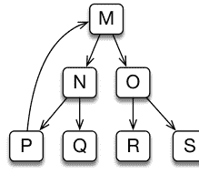
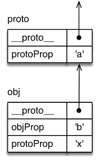
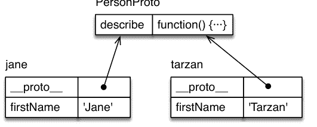
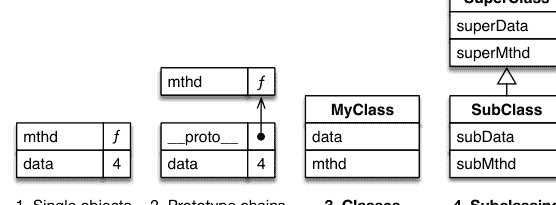
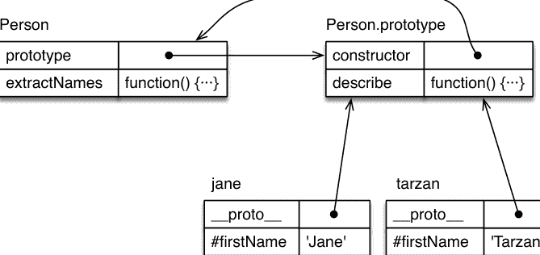
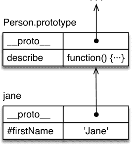
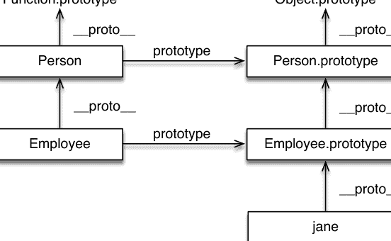
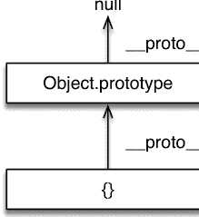
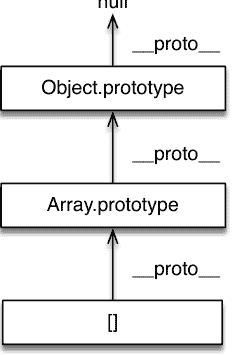

# 急躁程序员的 JavaScript (免费演示版)


> “这是一本详尽的资源，但去除了许多编程书中常见的冗余——解释通俗易懂直击要点，正如标题承诺的那样！测试和练习是检查和巩固知识非常有用的功能。你完全可以很快地读完这本书，并开始上手使用 JavaScript。”
>
> — Pam Selle, thebibivore.com

> “介绍现代 JavaScript 最好的入门书。”
>
> — Tejinder Singh, IBM 高级软件工程师

> “这才是 JavaScript。没有废话。没有框架。没有第三方库。如果你想学习 JavaScript，你需要这本书。”
>
> — Shelley Powers, 软件工程师/作家

## 第 13 章 运算符

- 13.1 理解运算符
- 13.1.1 运算符将操作数转换为适当类型
- 13.1.2 大多数运算符只作用于原始值
- 13.2 加法运算符 (`+`)
- 13.3 赋值运算符
- 13.3.1 普通赋值运算符
- 13.3.2 复合赋值运算符
- 13.4 相等性：`==` vs `===`
- 13.4.1 宽松相等 (`==` 和 `!=`)
- 13.4.2 严格相等 (`===` 和 `!==`)
- 13.4.3 建议：始终使用严格相等
- 13.4.4 比 `===` 更严格：`Object.is()`
- 13.5 比较运算符
- 13.6 其他各种运算符
- 13.6.1 逗号运算符
- 13.6.2 `void` 运算符

### 13.1 理解运算符

JavaScript 的运算符可能看起来很怪异。通过以下两个规则，它们会变得更容易理解：

- 运算符将操作数转换为适当的类型
- 大多数运算符只作用于原始值

#### 13.1.1 运算符将操作数转换为适当类型

如果运算符获取的操作数类型不正确，它很少抛出异常。相反，它会强制转换（自动转换）操作数，以便能够对其进行操作。让我们来看两个例子。

首先，乘法运算符只能作用于数字。因此，它在计算结果之前会将字符串转换为数字。

```javascript
> '7' * '3'
21
```

其次，用于访问对象属性的方括号运算符 `[]` 只能处理字符串和符号。所有其他值都会被强制转换为字符串：

```javascript
const obj = {};
obj['true'] = 123;
```

```javascript
// 将 true 转换为字符串 'true'
assert.equal(obj[true], 123);
```

#### 13.1.2 大多数运算符只作用于原始值

如前所述，大多数运算符只作用于原始值。如果操作数是一个对象，它通常会被转换为原始值——例如：

```javascript
> [1,2,3] + [4,5,6]
'1,2,34,5,6'
```

为什么呢？加法运算符首先将其操作数转换为原始值：

```javascript
> String([1,2,3])
'1,2,3'
> String([4,5,6])
'4,5,6'
```

接下来，它将两个字符串拼接：

```javascript
> '1,2,3' + '4,5,6'
'1,2,34,5,6'
```

### 13.2 加法运算符 (`+`)

加法运算符在 JavaScript 中的工作方式如下：

- 首先，它将两个操作数转换为原始值：
- **字符串模式**：如果两个原始值中的一个是字符串，那么它将另一个转换为字符串，拼接两个字符串并返回结果。
- **数字模式**：否则，它将两个操作数转换为数字，将它们相加并返回结果。

字符串模式允许我们使用 `+` 来组合字符串：

```javascript
> 'There are ' + 3 + ' items'
'There are 3 items'
```

数字模式意味着，如果两个操作数都不是字符串（或变成字符串的对象），则所有内容都会转换为数字。

### 13.3 赋值运算符

#### 13.3.1 普通赋值运算符

普通赋值运算符用于更改存储位置：

```javascript
x = value; // 赋值给之前声明的变量
obj.prop = value; // 赋值给属性
arr[index] = value; // 赋值给元素
```

初始化器也可以被视为赋值的形式：

```javascript
const x = value;
let y = value;
```

#### 13.3.2 复合赋值运算符

JavaScript 支持以下赋值运算符：

- 算术赋值运算符：`+=`, `-=`, `*=`, `%=`
- 位运算赋值运算符：`&=`, `|=`
- 位移赋值运算符：`<<=`
- 逻辑赋值运算符：`&&=`, `||=`, `??=`

##### 13.3.2.1 逻辑赋值运算符

逻辑赋值运算符与其他运算符的工作不同：

| 赋值运算符 | 等价于 | 逻辑 |
| :--- | :--- | :--- |
| `a ||= b` | `a || (a = b)` | 真值 |
| `a &&= b` | `a && (a = b)` | 假值 |
| `a ??= b` | `a ?? (a = b)` | 空 |

`||` 运算符的逻辑是：如果 `a` 为假值，则赋值 `b`。`&&` 运算符的逻辑是：如果 `a` 为真值，则赋值 `b`。`??` 运算符的逻辑是：如果 `a` 为空值（`null` 或 `undefined`），则赋值 `b`。

### 13.4 相等性：`==` vs `===`

```javascript
> Object.is(123, '123')
false
```

它比 `===` 更加严格。例如，它认为 `NaN`（涉及数字计算的错误值）与它自己相等：

```javascript
> Object.is(NaN, NaN)
true
> NaN === NaN
false
```

这偶尔非常有用。例如，你可以用它来实现 `Array` 方法 `.indexOf()` 的改进版本：

```javascript
const indexOf = (arr, elem) => {
  return arr.findIndex(x => Object.is(x, elem));
};
```

`myIndexOf()` 可以在数组中找到 `NaN`，而 `.indexOf()` 则不能：

```javascript
> indexOf([0, NaN, 2], NaN)
1
> [0, NaN, 2].indexOf(NaN)
-1
```

结果 `-1` 表示 `.indexOf()` 无法在数组中找到它的参数。

### 13.5 比较运算符

表 13.2：JavaScript 的比较运算符。

| 运算符 | 名称 |
|---|---|
| `<` | 小于 |
| `<=` | 小于或等于 |
| `>` | 大于 |
| `>=` | 大于或等于 |

JavaScript 的比较运算符（见表 13.2）同时适用于数字和字符串：

```javascript
> 5 >= 2
true
> 'bar' < 'foo'
true
```

`<=` 和 `>=` 基于严格相等。

> **比较运算符在处理人类语言时效果不佳**
>
> 比较运算符在比较人类语言的文本时效果并不理想，例如，当涉及大小写或重音符号时。细节见第 20.6 节“比较字符串”。

### 13.6 其它各种运算符

以下运算符在本书的其他章节中均有介绍：

- 针对布尔值、数字、字符串、对象的运算符
- 用于设置默认值的空值合并运算符 (`??`)

接下来的两个小节将讨论两个很少使用的运算符。

#### 13.6.1 逗号运算符

逗号运算符有两个操作数，它计算这两个操作数并返回第二个：

```javascript
> 'a', 'b'
'b'
```

关于该运算符的更多信息，请参阅《JavaScript 语言》。

#### 13.6.2 `void` 运算符

`void` 运算符计算其操作数并返回 `undefined`：

```javascript
> void (3 + 2)
undefined
```

关于该运算符的更多信息，请参阅《JavaScript 语言》。

### 测验

参见测验应用。

## 第四部分 原生值

## 第 14 章 非值 `undefined` 和 `null`

### 目录

- 14.1 `undefined` 对比 `null`
- 14.2 `undefined` 和 `null` 的出现情况
  - 14.2.1 `undefined` 的出现
  - 14.2.2 `null` 的出现
- 14.3 检查 `undefined` 或 `null`
- 14.4 用于默认值的空值合并运算符 (`??`) [ES2020]
  - 14.4.1 示例：计算匹配项
  - 14.4.2 示例：为属性指定默认值
  - 14.4.3 用于默认值的解构赋值
  - 14.4.4 传统方法：使用逻辑或 (`||`) 设置默认值
  - 14.4.5 空值合并赋值运算符 (`??=`) [ES2021]
- 14.5 `undefined` 和 `null` 没有属性
- 14.6 `undefined` 和 `null` 的历史

许多编程语言有一种名为 `null` 的“非值”。它表示变量当前没有指向任何对象——例如，当它尚未初始化时。

相比之下，JavaScript 有两个：`undefined` 和 `null`。

### 14.1 `undefined` 对比 `null`

这两个值非常相似，经常互换使用。因此它们的区别非常微妙。语言本身做出了以下区分：

- `undefined` 意味着“未初始化”（例如变量）或“不存在”（例如对象的属性）。
- `null` 意味着“有意地缺失任何对象值”（源自语言规范的引用）。

程序员可能会做出以下区分：

- `undefined` 是语言使用的非值（当某些东西未初始化等时）。
- `null` 意味着“显式关闭”。也就是说，它有助于实现一种由有意义的值和一个代表“无意义的值”的元值组成的类型。这种类型在函数式编程中被称为可选类型（option type）或可能类型（maybe type）。

### 14.2 `undefined` 和 `null` 的出现情况

以下小节描述了 `undefined` 和 `null` 在语言中出现的地方。我们将遇到几种在书中后面会有详细解释的机制。

#### 14.2.1 `undefined` 的出现

当变量被声明但未初始化时，它的值是 `undefined`：

```javascript
let x;
> x
undefined
```

同样，访问对象上不存在的属性会返回 `undefined`：

```javascript
const obj = {};
> obj.missing
undefined
```

当函数执行完毕而没有 `return` 语句时，它会返回 `undefined`：

```javascript
function foo() {}
> foo()
undefined
```

#### 14.2.2 `null` 的出现

`null` 值是非常特殊的。它是一个内置原始值，代表有意地缺失任何对象值。

```javascript
let x = null;
> x
null
```

### 14.3 检查 `undefined` 或 `null`

检查值是否为 `undefined` 或 `null`，你可以使用松散相等 (`==`)：

```javascript
let x;
> x == null
true
let x = undefined;
> x == null
true
```

然而，许多风格指南倾向于使用严格相等检查。

### 14.4 用于默认值的空值合并运算符 (`??`) [ES2020]

空值合并运算符 (`??`) 在左侧操作数为 `null` 或 `undefined` 时返回右侧操作数。

```javascript
let a = null ?? 'default';
> a
'default'
```

它用于在函数参数中设置默认值：

```javascript
function greet(name = 'Guest') {
  console.log('Hello, ' + name);
}

> greet();
Hello, Guest
> greet(undefined);
Hello, Guest
```

#### 14.4.1 示例：计算匹配项

```javascript
function countMatches(regex, str) {
  const matchResult = str.match(regex); // null 或 Array
  return (matchResult ?? []).length;
}
```

```javascript
> countMatches(/a/g, 'ababa')
3
> countMatches(/b/g, 'ababa')
2
> countMatches(/x/g, 'ababa')
0
```

如果 `regex` 和 `str` 有一个或多个匹配项，那么 `.match()` 返回一个 `Array`。如果没有匹配项，它会返回 `null`（而不是空数组）。我们通过 `??` 运算符解决了这个问题。

我们也可以使用可选链：

```javascript
return matchResult?.length ?? 0;
```

#### 14.4.2 示例：为属性指定默认值

```javascript
function getTitle(fileDesc) {
  return fileDesc.title ?? 'Untitled';
}
```

```javascript
const files = [
  {path: 'index.html', title: 'Home'},
  {path: 'tmp.html'}
];
```

```javascript
assert.deepEqual(
  files.map(f => getTitle(f)),
  ['Home', 'Untitled']
);
```

#### 14.4.4 传统方法：使用逻辑或 (`||`) 设置默认值

在 ECMAScript 2020 和空值合并运算符出现之前，逻辑或被用于默认值。这有一个缺点。

`||` 在处理 `undefined` 和 `null` 时符合预期，但它也会触发其他的假值值，如 `0`、`""` 或 `false`。

```javascript
> undefined || 'default'
'default'
> null || 'default'
'default'
```

但它也会对所有其他假值（falsy values）返回默认值——例如：

```
> false || 'default'
'default'
> 0 || 'default'
'default'
> 0n || 'default'
'default'
> '' || 'default'
'default'
```

对比 `??` 的工作方式：

```
> undefined ?? 'default'
'default'
> null ?? 'default'
'default'
```

```
> false ?? 'default'
false
> 0 ?? 'default'
0
> 0n ?? 'default'
0n
> '' ?? 'default'
''
```

#### 14.4.5 空值合并赋值运算符 (`??=`) [ES2021]

`??=` 是一个逻辑赋值运算符。以下两个表达式大致等价：

```javascript
a ??= b
a ?? (a = b)
```

这意味着 `??=` 是短路运行：只有当 `a` 为 `undefined` 或 `null` 时，才会进行赋值。

##### 14.4.5.1 使用 `??=` 添加缺失属性的示例

```javascript
const books = [
  {
    isbn: '123',
    title: 'ECMAScript Language Specification',
  },
  {
    isbn: '456',
  },
];
```

```javascript
// 在缺失时添加 title 属性
for (const book of books) {
  book.title ??= '(Untitled)';
}

assert.deepEqual(
  books,
  [
    {
      isbn: '123',
      title: 'ECMAScript Language Specification',
    },
    {
      isbn: '456',
      title: '(Untitled)',
    },
  ]
);
```

### 14.5 `undefined` 和 `null` 没有属性

`undefined` 和 `null` 是 JavaScript 中唯一两个在我们尝试读取属性时会抛出异常的值。为了探索这一现象，让我们使用以下函数，它读取（“获取”）属性 `.foo` 并返回结果。

```javascript
function getFoo(x) {
  return x.foo;
}
```

如果我们将 `getFoo()` 应用于各种值，我们可以看到它只对 `undefined` 和 `null` 失败：

```
> getFoo(undefined)
TypeError: Cannot read properties of undefined (reading 'foo')
> getFoo(null)
TypeError: Cannot read properties of null (reading 'foo')

> getFoo(true)
undefined
> getFoo({})
undefined
```

### 14.6 `undefined` 和 `null` 的历史

在 Java 中（它启发了 JavaScript 的许多方面），初始化值取决于变量的静态类型：

- 对象类型的变量初始化为 `null`。
- 每个原始类型都有它们自己的初始化值。例如，`int` 变量被初始化为 `0`。

在 JavaScript 中，每个变量都可以同时持有对象值和原始值。因此，如果 `null` 意味着“不是对象”，那么 JavaScript 也需要一个意味着“既不是对象也不是原始值”的初始化值。这个初始化值就是 `undefined`。

> 测验
>
> 参阅测验应用。

## 第 15 章 布尔值

### 目录

- 15.1 转换为布尔值
- 15.2 假值和真值
  - 15.2.1 检查真性或假性
- 15.3 基于真性的存在检查
  - 15.3.1 陷阱：基于真性的存在检查是不精确的
  - 15.3.2 用例：是否提供了参数？
  - 15.3.3 用例：属性是否存在？
- 15.4 条件运算符 (`? :`)
- 15.5 二元逻辑运算符：与 (`&&`)，或 (`||`)
  - 15.5.1 值保留
  - 15.5.2 短路运行
  - 15.5.3 逻辑与 (`&&`)
  - 15.5.4 逻辑或 (`||`)
- 15.6 逻辑非 (`!`)

### 15.1 转换为布尔值

原始类型 `boolean` 包含两个值——`false` 和 `true`：

```javascript
> typeof false
'boolean'
> typeof true
'boolean'
```

“转换为类型”的含义是“将任意值转换为该类型的值”的缩写。有三种方法可以将任意值 `x` 转换为布尔值：

- `Boolean(x)`: 描述性最强；推荐。
- `x ? true : false`: 使用条件运算符（在本章稍后解释）。
- `!!x`: 使用逻辑非 (`!`)。该运算符会将操作数转换为布尔值。

| x | `Boolean(x)` |
| :--- | :--- |
| `undefined` | `false` |
| `null` | `false` |
| `0` | `false` |
| `0n` | `false` |
| `''` | `false` |
| `false` | `false` |
| `NaN` | `false` |
| 其他所有值 | `true` |

### 15.2 假值和真值

在 `if` 语句、`while` 循环或 `do-while` 循环中使用条件时，JavaScript 的工作方式与你预期的不同。考虑以下情况：

```javascript
if (x) {
  // x 是真值
}

if (!x) {
  // x 是假值
}

const result = x ? 'truthy' : 'falsey';
```

最后一行使用的条件运算符在本章稍后解释。

> 练习：真值
>
> `exercises/booleans/truthiness_ex`

### 15.3 基于真性的存在检查

在 JavaScript 中，如果你读取某些不存在（例如缺失的参数或属性），通常会得到 `undefined`。在这种情况下，存在检查等同于与 `undefined` 进行比较。例如，以下代码检查 `obj` 是否拥有 `.prop`：

```javascript
if (obj.prop !== undefined) {
  // obj 拥有 .prop
}
```

由于 `undefined` 是假的，我们可以将此检查简化为：

```javascript
if (obj.prop) {
  // obj 拥有 .prop
}
```

#### 15.3.1 陷阱：基于真性的存在检查是不精确的

基于真性的存在检查有一个陷阱：它们是不精确的。考虑这个例子：

```javascript
if (obj.prop) {
  // obj 拥有 .prop
}
```

满足以下情况语句体将被跳过：

- `obj.prop` 缺失（在这种情况下，JavaScript 返回 `undefined`）。

然而，满足以下情况也会跳过：

- `obj.prop` 为 `undefined`。
- `obj.prop` 为其他假值（`null`、`0`、`''` 等）。

在实践中，这很少引起问题，但你必须意识到这个陷阱。

#### 15.3.2 用例：是否提供了参数？

真值检查经常用于判断函数的调用者是否提供了参数：

```javascript
function func(x) {
  if (!x) {
    throw new Error('Missing parameter x');
  }
  // ...
}
```

在优点方面，这种模式是成熟且简洁的。它正确地对 `undefined` 和 `null` 抛出错误。

在缺点方面，存在之前提到的陷阱：代码也会对所有其他假值抛出错误。

替代方案是检查 `undefined`：

```javascript
if (x === undefined) {
  throw new Error('Missing parameter x');
}
```

#### 15.3.3 用例：判断属性是否存在？

真值检查也用于判断属性是否存在：

```javascript
function readFile(fileDesc) {
  if (!fileDesc.path) {
    throw new Error('Missing property: .path');
  }
  // ...
}
readFile({ path: 'foo.txt' }); // 无错误
```

这种模式已经非常成熟，但具有常见的注意事项：它不仅在属性缺失时会抛出异常，如果属性存在但其值为任何假值，也会抛出异常。

如果你想检查属性是否存在，必须使用 `in` 运算符：

```javascript
if (!('path' in fileDesc)) {
  throw new Error('Missing property: .path');
}
```

### 15.4 条件运算符 (`? :`)

条件运算符是 `if` 语句的表达式版本。它的语法为：

`condition ? thenExpression : elseExpression`

它的求值如下：

- 如果条件为真值（truthy），求值并返回 `thenExpression`。
- 否则，求值并返回 `elseExpression`。

条件运算符也称为三元运算符，因为它有三个操作数。

示例：

```javascript
> true ? 'yes' : 'no'
'yes'
> false ? 'yes' : 'no'
'no'
> 0 ? 'yes' : 'no'
'no'
```

以下代码演示了条件选择了 "then" 和 "else" 两个分支中的哪一个，只有选中的分支会被求值。另一个分支不会。

```javascript
const x = true ? console.log('then') : console.log('else');

// 输出:
// 'then'
```

### 15.5 二元逻辑运算符：与 (`&&`)，或 (`||`)

二元逻辑运算符 `&&` 和 `||` 是保持值（value-preserving）且具有短路特性（short-circuiting）的。

#### 15.5.1 值保持

值保持意味着操作数被解释为布尔值，但返回时保持不变：

```javascript
> 12 || 'hello'
12
> 0 || 'hello'
'hello'
```

#### 15.5.2 短路

短路意味着如果第一个操作数已经决定了结果，则第二个操作数不会被求值。只有条件运算符会延迟其操作数的求值。通常，所有操作会在执行操作之前求值。

例如，逻辑与 (`&&`) 如果第一个操作数为假值，则不会求值第二个操作数：

```javascript
const x = false && console.log('hello');
// 无输出
```

如果第一个操作数为真值，则执行 `console.log()`：

```javascript
const x = true && console.log('hello');

// 输出:
// 'hello'
```

#### 15.5.3 逻辑与 (`&&`)

表达式 `a && b` ("a 与 b") 的求值如下：

1. 求值 `a`。
2. 结果是假值吗？返回它。
3. 否则，求值 `b` 并返回结果。

换句话说，以下两个表达式大致等价：

```javascript
a && b
!a ? a : b
```

示例：

```javascript
> false && true
false
> false && 'abc'
false
> true && false
false
> true && 'abc'
'abc'
> '' && 'abc'
''
```

#### 15.5.4 逻辑或 (`||`)

表达式 `a || b` ("a 或 b") 的求值如下：

1. 求值 `a`。
2. 结果是真值吗？返回它。
3. 否则，求值 `b` 并返回结果。

换句话说，以下两个表达式大致等价：

```javascript
a || b
a ? a : b
```

示例：

```javascript
> true || false
true
> true || 'abc'
true
> false || true
true
> false || 'abc'
'abc'
> 'abc' || 'def'
'abc'
```

##### 15.5.4.1 或运算符 (`||`) 的旧用例：提供默认值

ECMAScript 2020 引入了空值合并运算符 (`??`) 用于提供默认值。在此之前，逻辑或用于此目的：

```javascript
const valueToUse = receivedValue || defaultValue;
```

请参阅 §14.4 "用于默认值的空值合并运算符 (`??`) [ES2020]" 了解更多关于在这种情况下使用 `??` 的信息及其缺点。

> 遗留练习：通过或运算符 (`||`) 提供默认值
>
> `exercises/booleans/default_via_or_exrc.mjs`

### 15.6 逻辑非 (`!`)

表达式 `!x` ("非 x") 的求值如下：

1. 求值 `x`。
2. 它是真值吗？返回 `false`。
3. 否则，返回 `true`。

示例：

```javascript
> !false
true
> !true
false
> !0
true
> !123
false
> !''
true
> !'abc'
false
```

### 测验

请参见测验应用。

## 第 16 章 数字

### 目录

- 16.1 数字同时用于浮点数和整数
- 16.2 数字字面量
  - 16.2.1 整数字面量
  - 16.2.2 浮点字面量
  - 16.2.3 语法陷阱：整数字面量的属性
  - 16.2.4 数字字面量中的下划线 (`_`) [ES2021]
- 16.3 算术运算符
  - 16.3.1 二元算术运算符
  - 16.3.2 一元加 (`+`) 和取负 (`-`)
  - 16.3.3 自增 (`++`) 和自减 (`--`)
- 16.4 转换为数字
- 16.5 错误值
  - 16.5.1 错误值：`NaN`
  - 16.5.2 错误值：`Infinity`
- 16.6 数字精度：小心处理小数
- 16.7 （高级）
- 16.8 背景：浮点数精度
  - 16.8.1 浮点数的简化表示
- 16.9 JavaScript 中的整数
  - 16.9.1 转换为整数
  - 16.9.2 JavaScript 中整数的范围
  - 16.9.3 安全整数
- 16.10 位运算符
  - 16.10.1 内部，位运算符处理 32 位整数
  - 16.10.2 位取反 (`~`)
  - 16.10.3 二元位运算符
  - 16.10.4 位移运算符
  - 16.10.5 `b32()`：以二进制表示法显示 32 位无符号整数
- 16.11 快速查表：数字
  - 16.11.1 数字的全局函数
  - 16.11.2 `Number` 的静态属性
  - 16.11.3 `Number` 的静态方法
  - 16.11.4 `Number.prototype` 的方法
  - 16.11.5 来源

JavaScript 有两种类型的数值值：

- `Number` 是 64 位浮点数，也用于较小的整数（范围在正/负 53 位以内）。
- `BigInt` 表示任意精度的整数。

本章介绍 `Number`。`BigInt` 将在书的后部分介绍。

### 16.1 数字同时用于浮点数和整数

JavaScript 中的 `number` 类型同时用于整数和浮点数：

```javascript
98
123.45
```

然而，所有的数字都是双精度（doubles）、根据 IEEE 浮点算术标准（IEEE 754）实现的 64 位浮点数。

整数仅仅是不带小数部分的浮点数：

```javascript
> 98 === 98.0
true
```

注意，在底层，大多数 JavaScript 引擎通常能够使用真正的整数，具有所有的性能和存储大小优势。

### 16.2 数字字面量

让我们检查数字字面量。

#### 16.2.1 整数字面量

几个整数字面量允许我们用各种进制表示整数：

```javascript
// 二进制 (base 2)
assert.equal(0b11, 3); // ES6

// 八进制 (base 8)
assert.equal(0o10, 8); // ES6

// 十进制 (base 10)
assert.equal(35, 35);

// 十六进制 (base 16)
assert.equal(0xE7, 231);
```

#### 16.2.2 浮点字面量

浮点数只能用十进制表示。

小数：

```javascript
> 35.0
35
```

指数：`eN` 意味着 ×10^N

```javascript
> 3e2
300
> 3e-2
0.03
> 0.3e2
30
```

#### 16.2.3 语法陷阱：整数字面量的属性

访问整数字面量的属性存在一个陷阱：如果整数字面量紧跟着一个点，那么该点会被解释为小数点：

```javascript
7.0.toString(); // 错误
```

有四种方法可以避免这个陷阱：

- `7.0.toString()`
- `(7).toString()`
- `7..toString()`
- `7 .toString()`

#### 16.2.4 数字字面量中的下划线 (`_`) [ES2021]

分组使长数字更具可读性是一个悠久的传统。例如：

- 在 1825 年，伦敦有 1,335,000 人口。
- 地球与太阳之间的距离是 149,600,000 公里。

从 ES2021 开始，我们可以使用下划线作为数字的分隔符：

```javascript
const inhabitantsOfLondon = 1_335_000;
const distanceEarthSunInKm = 149_600_000;
```

对于其他进制，分组也很重要：

```javascript
const fileSystemPermission = 0b011_111_000;
const bytes = 0b1111_1010111_11110000_000001101;
const words = 0xFFA_F00D;
```

我们还可以在小数和指数中使用分隔符：

```javascript
const massOfElectronInKg = 9.109_383_56e-31;
const trillionInShortScale = 1e12;
```

##### 16.2.4.1 我们可以在哪里放置分隔符？

分隔符的位置受到以下两种方式的限制：

- 我们只能在两个数字之间放置下划线。因此，所有以下数字字面量是非法的：
  - `3..141`
  - `3._141`
  - `1_e12`
  - `1e_12`
  - `1464301` (合法的变量名！)
  - `1464301_`
  - `0_b111111000`
  - `0b_111111000`
- 我们不能连续使用多个下划线：
  - `123__456` (两个下划线 - 不允许)

这些限制的目的是保持解析的简单性，并避免奇怪的边缘情况。

##### 16.2.4.2 使用分隔符解析数字

以下用于解析数字的函数不支持分隔符：

- `Number()`
- `Number.parseInt()`
- `Number.parseFloat()`

例如：

```
> Number('123_456')
NaN
> Number.parseInt('123_456')
123
```

原理是数字分隔符是用于代码的。其他类型的输入应该被不同地处理。

### 16.3 算术运算符

#### 16.3.1 二元算术运算符

表 16.1 列出了 JavaScript 的二元算术运算符。

| 运算符 | 名称 | 示例 |
| --- | --- | --- |
| `n + m` | 加法 | ES1 | `3 + 4 → 7` |
| `n - m` | 减法 | ES1 | `9 - 1 → 8` |
| `n * m` | 乘法 | ES1 | `3 * 2.25 → 6.75` |
| `n / m` | 除法 | ES1 | `5.625 / 5 → 1.125` |
| `n % m` | 余数 | ES1 | `8 % 5 → 3` |
| `n ** m` | 幂 | ES2016 | `4 ** 2 → 16` |

表 16.1：二元算术运算符。

##### 16.3.1.1 `%` 是余数运算符

`%` 是余数运算符，而不是取模（modulo）运算符。它的结果与第一个操作数的符号相同：

```javascript
> 5 % 3
2
> -5 % 3
-2
```

关于余数取模区别的更多信息，请参见 2ality 上的博客“Remainder operator vs. modulo operator (with JavaScript code)”。

#### 16.3.2 一元加 (`+`) 和取负 (`-`)

表 16.2 总结了一元加 (`+`) 和取负 (`-`) 两个运算符。

表 16.2：一元加 (`+`) 和取负 (`-`) 运算符。

| 运算符 | 名称 | 示例 |
| --- | --- | --- |
| `+n` | 一元加 | ES1 | `+ (-7) → -7` |
| `-n` | 一元取负 | ES1 | `- (-7) → 7` |

这两个运算符都会将其操作数强制转换为数字：

```javascript
> +'5'
5
> +'-12'
-12
> -'9'
-9
```

因此，一元加允许我们将任意值转换为数字。

#### 16.3.3 自增 (`++`) 和自减 (`--`)

自增运算符 `++` 存在前缀版本和后缀版本。在这两个版本中，它都会破坏性地将其操作数加 1。因此，它的操作数必须是可以更改的存储位置。

自减运算符 `--` 的原理相同，但是从其操作数减去 1。接下来的两个示例解释了前缀版本和后缀版本的区别。

表 16.3 总结了自增和自减运算符。

表 16.3：自增运算符和自减运算符。

| 运算符 | 名称 | 示例 |
|---|---|---|
| `v++` | 自增 | ES1 | `let v=0; [v++, v] → [0, 1]` |
| `++v` | 自增 | ES1 | `let v=0; [++v, v] → [1, 1]` |
| `v--` | 自减 | ES1 | `let v=1; [v--, v] → [1, 0]` |
| `--v` | 自减 | ES1 | `let v=1; [--v, v] → [0, 0]` |

接下来，我们将查看这些运算符的使用示例。

前缀 `++` 和前缀 `--` 会改变它们的操作数并返回它们。

```javascript
let foo = 3;
assert.equal(++foo, 4);
assert.equal(foo, 4);

let bar = 3;
assert.equal(--bar, 2);
assert.equal(bar, 2);
```

后缀 `++` 和 `--` 返回它们的操作数然后改变它们。

```javascript
let foo = 3;
assert.equal(foo++, 3);
assert.equal(foo, 4);

let bar = 3;
assert.equal(bar--, 3);
assert.equal(bar, 2);
```

##### 16.3.3.1 操作数：不只是变量

我们也可以将这些运算符应用于属性值：

```javascript
const obj = { a: 1 };
++obj.a;
assert.equal(obj.a, 2);
```

以及应用于数组元素：

```javascript
const arr = [4];
arr[0]++;
assert.deepEqual(arr, [5]);
```

### 16.4 转换为数字

有三种方法将值转换为数字：

- `Number(value)`
- `parseFloat(value)` (避免！)
- `parseInt(value)` (避免！)

建议：使用 `Number()`。下表总结了它是如何工作的。

| x | `Number(x)` |
|---|---|
| `undefined` | `NaN` |
| `null` | `0` |
| `boolean` | `false -> 0, true -> 1` |
| `number` | `x` (无变化) |
| `bigint` | 转换为数字 (可能溢出) |
| `string` | `'' -> 0`, 忽略前后空格 |
| `symbol` | 抛出 `TypeError` |
| `object` | 可配置（例如通过 `.valueOf()`） |

示例：

```javascript
assert.equal(Number(123.45), 123.45);
assert.equal(Number(''), 0);
assert.equal(Number('  123.45  '), 123.45);
assert.equal(Number('xyz'), NaN);
```

对象转换为数字？可以通过配置——例如覆盖 `.valueOf()`：

```javascript
Number({ valueOf() { return 123 } })
```

> 练习：转换为数字
>
> `numbers-math/parse_number.mjs`

### 16.5 错误值

发生错误时返回两个值：

- `NaN`
- `Infinity`

#### 16.5.1 错误值：`NaN`

`NaN` 是“不是数字”的缩写。讽刺的是，JavaScript 认为：

```javascript
> typeof NaN
'number'
```

何时返回 `NaN`？

如果无法解析，则返回 `NaN`：

```javascript
> Number('$')
NaN
> Number(undefined)
NaN
```

如果无法操作，则返回 `NaN`：

```javascript
> Math.log(-1)
NaN
> Math.sqrt(-1)
NaN
```

如果操作数是 `NaN`（为了传播错误），则返回 `NaN`：

```javascript
> NaN - 3
NaN
> 7 ** NaN
NaN
```

##### 16.5.1.1 检查 `NaN`

`NaN` 是唯一不等于自身的 JavaScript 值：

```javascript
const n = NaN;
assert.equal(n === n, false);
```

以下是检查值 `x` 是否为 `NaN` 的几种方法：

```javascript
const x = NaN;
assert.equal(Number.isNaN(x), true); // 优先
assert.equal(Object.is(x, NaN), true);
assert.equal(x !== x, true);
```

在最后一行，我们使用比较来检测 `NaN`。

##### 16.5.1.2 在数组查找 `NaN`

某些数组方法找不到 `NaN`：

```javascript
> [NaN].indexOf(NaN)
-1
```

其他的可以：

```javascript
> [NaN].includes(NaN)
true
> [NaN].findIndex(x => Number.isNaN(x))
0
> [NaN].find(x => Number.isNaN(x))
NaN
```

遗憾的是，没有简单的规则。我们必须检查每个处理的方法。

#### 16.5.2 错误值：`Infinity`

何时返回错误值 `Infinity`？

如果数字太大，则返回 `Infinity`：

```javascript
> Math.pow(2, 1023)
8.9846567431156e+307
> Math.pow(2, 1024)
Infinity
```

如果除以零，则返回 `Infinity`：

```javascript
> 5 / 0
Infinity
> -5 / 0
-Infinity
```

##### 16.5.2.1 `Infinity` 作为默认值

`Infinity` 比所有数字（`NaN` 除外）都大，使其成为良好的默认值：

```javascript
function findMinimum(numbers) {
  let min = Infinity;
  for (const n of numbers) {
    if (n < min) min = n;
  }
  return min;
}
```

```javascript
assert.equal(findMinimum([5, -1, 2]), -1);
assert.equal(findMinimum([]), Infinity);
```

##### 16.5.2.2 检查 `Infinity`

有两种常用方法检查值 `x` 是否为 `Infinity`：

```javascript
const x = Infinity;
assert.equal(x === Infinity, true);
assert.equal(Number.isFinite(x), false);
```

> 练习：比较数字
>
> `numbers-math/find_max_test.js`

### 16.6 数字精度：小心处理小数

在内部，JavaScript 浮点数用基 2 表示（根据 IEEE 754 标准）。这意味着小数（基 10）不能总是被精确表示：

```javascript
> 0.1 + 0.2
0.30000000000000004
```

### 16.7 （高级）

在 JavaScript 中，对数字的计算并不总是产生正确的结果。我们需要考虑舍入误差。

> 测验：基础
>
> 查看测验应用。

### 16.8 背景：浮点数精度

为了理解为什么，我们需要探索 JavaScript 如何表示浮点数。它使用三个整数来实现，占用 64 位存储空间（双精度）：

| 组件 | 大小 | 整数范围 |
| --- | --- | --- |
| 符号 | 1 位 | [0, 1] |
| 小数 | 52 位 | [0, 2^52–1] |
| 指数 | 11 位 | [-1023, 1024] |

由这些整数表示的浮点数计算如下：

```
(-1)^sign × 0.fraction × 2^exponent
```

这种表示法无法编码零，因为它的第二个组件（小数）总有一个领先的 1。因此，零通过特殊的指数 -1023 和小数 0 来编码。

#### 16.8.1 浮点数的简化表示

为了让讨论更方便，我们简化了之前的表示法：

- 代替基 2（二进制），我们使用基 10（十进制），因为这是大多数人熟悉的。
- 小数是一个解释为小数的自然数。我们切换到尾数，一个解释为自身的整数。作为结果，指数的使用方式不同，但其基本作用没有改变。

新的表示法工作如下：

```
mantissa × 10^exponent
```

让我们尝试用这种表示法处理几个浮点数。

- 对于整数 -123，我们可能需要尾数：
  ```javascript
  > -123 * (10 ** 0)
  -123
  ```
- 对于数字 1.5，我们想象尾数后面有一个点。我们使用负指数将该点向左移动一位：
  ```javascript
  > 15 * (10 ** -1)
  1.5
  ```
- 对于数字 0.25，我们将小数点向左移动两位：
  ```javascript
  > 25 * (10 ** -2)
  0.25
  ```

带有负指数的表示法也可以写成分母为正指数的分数。

```javascript
> 15 * (10 ** -1) === 15 / (10 ** 1)
true
> 25 * (10 ** -2) === 25 / (10 ** 2)
true
```

这些分数有助于我们理解为什么存在一些我们的编码无法表示的数字：

- 1/10 可以表示为 5/10。它具有所需的格式：分母是 10 的幂。
- 1/2 可以表示为 5/10。通过将分子和分母同时乘以 5，我们将分母中的 2 变成了 10 的幂。
- 1/4 可以表示为 25/100。通过将分子和分母同时乘以 25，我们将分母中的 4 变成了 10 的幂。
- 1/3 无法表示。没有办法将分母变成 10 的幂。（10 的质因数是 2 和 5。因此，任何具有这些质因数的分母都可以通过分子分母同时乘以 2 和 5 来转换为 10 的幂。如果分母具有不同的质因数，我们无能为力。）

最后，我们切回 2 进制：

- 0.5 = 1/2 可以用 2 进制表示，因为分母已经是 2 的幂。
- 0.25 = 1/4 可以用 2 进制表示，因为分母已经是 2 的幂。
- 0.1 = 1/10 无法表示，因为分母无法转换为 2 的幂。
- 0.2 = 2/10 无法表示，因为分母无法转换为 2 的幂。

现在我们可以看到 `0.1 + 0.2` 并不会产生正确的结果：两个操作数都无法被精确表示。

使用小数进行精确计算的唯一方法是在内部切换到 10 进制。对于许多编程语言，2 进制是默认的，10 进制是一个选项。例如，Java 有 `BigDecimal` 类，而 Python 有 `decimal` 模块。目前计划为 JavaScript 添加类似的内容：ECMAScript 提议“Decimal”。

### 16.9 JavaScript 中的整数

整数是不带小数部分的普通（浮点）数字：

```javascript
> 1 === 1.0
true
> Number.isInteger(1.0)
true
```

在本节中，我们将查看一些处理这些“伪整数”的工具。JavaScript 还支持 `BigInt`，它们是真正的整数。

#### 16.9.1 转换为整数

将数字转换为整数的推荐方法是使用 `Math` 对象的一种舍入方法：

- `Math.floor(n)`: 返回最大的整数 `i ≤ n`
  ```javascript
  > Math.floor(2.1)
  2
  > Math.floor(2.9)
  2
  ```
- `Math.ceil(n)`: 返回最小的整数 `i ≥ n`
  ```javascript
  > Math.ceil(2.1)
  3
  > Math.ceil(2.9)
  3
  ```
- `Math.round(n)`: 返回距离 `n` “最近”的整数，且 .5 进舍舍入——例如：
  ```javascript
  > Math.round(2.4)
  2
  > Math.round(2.5)
  3
  ```
- `Math.trunc(n)`: 移除 `n` 的任何小数部分（小数点后的部分），因此将其转换为整数。
  ```javascript
  > Math.trunc(2.1)
  2
  > Math.trunc(2.9)
  2
  ```

关于舍入的信息，请参阅 §17.3 “舍入”。

### 16.9.2 JavaScript 中的整数范围

这些是 JavaScript 中重要的整数范围：

- **安全整数**：可以被 JavaScript “安全”地表示（在下一节中详细介绍其具体含义）
  - 精度：53 位加上符号位
  - 范围：`(-2⁵³, 2⁵³)`
- **数组索引**
  - 精度：32 位，无符号
  - 范围：`[0, 2³²−1)`（排除最大长度）
- **类型化数组** 具有更大的 53 位范围（安全且无符号）
- **位运算符**（按位运算等）
  - 精度：32 位
  - 无符号右移运算符 (`>>>`) 的范围：无符号，`[0, 2³²)`
  - 所有其他位运算符的范围：有符号，`[-2³¹, 2³¹−1]`

### 16.9.3 安全整数

这是 JavaScript 中安全的整数范围（53 位加上符号位）：`-(2⁵³)+1, 2⁵³−1`。

如果一个整数仅由一个数字表示，那么它就是安全的。由于 JavaScript 数字被编码为一个分数乘以 2 的指数幂，更高的整数也可以被表示，但它们之间存在间隙。例如（18014398509481984 是 2⁵⁴）：

```javascript
> 18014398509481984
18014398509481984
> 18014398509481985
18014398509481984
> 18014398509481986
18014398509481986
> 18014398509481987
18014398509481986
```

以下属性可以判断整数是否安全：

```javascript
assert.equal(Number.MAX_SAFE_INTEGER, (2 ** 53) - 1);
assert.equal(Number.MIN_SAFE_INTEGER, -(2 ** 53) + 1);
```

```javascript
assert.equal(Number.isInteger(5), true);
assert.equal(Number.isInteger('5'), false);
assert.equal(Number.isInteger(5.1), false);
assert.equal(Number.isInteger(Number.MAX_SAFE_INTEGER), true);
assert.equal(Number.isInteger(Number.MAX_SAFE_INTEGER + 1), false);
```

> 练习：检测安全整数
>
> `exercises/numbers-math/is_safe`

#### 16.9.3.1 安全计算

让我们看看涉及不安全整数的计算。以下结果是不正确的且不安全的，尽管两个操作数都是安全的：

```javascript
> 9007199254740990 + 3
9007199254740992
```

以下结果是安全的，但不正确的。第一个操作数是不安全的；第二个操作数是安全的：

```javascript
> 9007199254740995 - 10
9007199254740986
```

因此，表达式 `a op b` 的结果是正确的当且仅当：

```javascript
Number.isSafeInteger(a) && Number.isSafeInteger(b) && Number.isSafeInteger(a op b)
```

也就是说，操作数和结果都必须是安全的。

### 16.10 位运算符

#### 16.10.1 内部，位运算符处理 32 位整数

内部，JavaScript 的位运算符处理 32 位整数。它们通过以下步骤产生结果：

- **输入**（JavaScript 数字）：操作数首先转换为 JavaScript 数字（64 位浮点数），然后转换为 32 位整数。
- **计算**（32 位整数）：实际操作处理 32 位整数并产生一个 32 位整数。
- **输出**（JavaScript 数字）：在返回结果之前，将其转换回 JavaScript 数字。

##### 16.10.1.1 操作数和结果的类型

对于每个位运算符，本书提到了其操作数和结果的类型。每种类型总是以下两者之一：

| 类型 | 描述 | 大小 | 范围 |
|---|---|---|---|
| `Int32` | 有符号 32 位整数 | 32 位 | `[-2³¹, 2³¹−1]` |
| `Uint32` | 无符号 32 位整数 | 32 位 | `[0, 2³²)` |

对于上述步骤，我建议假定位运算符内部处理 32 位整数（“计算”步骤），而 `Int32` 和 `Uint32` 只影响 JavaScript 数字与整数之间的转换（“输入”和“输出”步骤）。

##### 16.10.1.2 将 JavaScript 数字显示为无符号 32 位整数

在解释位运算符时，有时用二进制符号将 JavaScript 数字显示为无符号 32 位整数是有帮助的。这就是 `b32()` 的作用（实现将在后文所示）：

```javascript
assert.equal(
  b32(-1),
  '11111111111111111111111111111111'
);
assert.equal(
  b32(1),
  '00000000000000000000000000000001'
);
assert.equal(
  b32(2 ** 31),
  '10000000000000000000000000000000'
);
```

#### 16.10.2 位取反 (`~`)

表 16.7：位取反运算符。

| 操作 | 名称 | 类型签名 |
|---|---|---|
| `~num` | 位取反，反码 | `Int32 → Int32` | ES1 |

位取反运算符（表 16.7）反转其操作数的每个二进制位：

```javascript
> b32(~0b100)
'11111111111111111111111111111011'
```

这种所谓的“反码”在某些算术运算中类似于负数。例如，将一个整数与其反码相加始终等于 -1：

```javascript
> 4 + ~4
-1
> -11 + ~-11
-1
```

#### 16.10.3 二元位运算符

表 16.8：二元位运算符。

| 操作 | 名称 | 类型签名 |
|---|---|---|
| `num1 & num2` | 位与 | `Int32 × Int32 → Int32` | ES1 |
| `num1 | num2` | 位或 | `Int32 × Int32 → Int32` | ES1 |
| `num1 ^ num2` | 位异或 | `Int32 × Int32 → Int32` | ES1 |

二元位运算符（表 16.8）组合操作数的位来产生结果：

```javascript
> (0b1010 & 0b0011).toString(2).padStart(4, '0')
'0010'
> (0b1010 | 0b0011).toString(2).padStart(4, '0')
'1011'
> (0b1010 ^ 0b0011).toString(2).padStart(4, '0')
'1001'
```

#### 16.10.4 位移运算符

表 16.9：位移运算符。

| 操作 | 名称 | 类型签名 | ES |
| --- | --- | --- | --- |
| `num << count` | 左移 | `Int32 × Uint32 → Int32` | ES1 |
| `num >> count` | 有符号右移 | `Int32 × Uint32 → Int32` | ES1 |
| `num >>> count` | 无符号右移 | `Uint32 × Uint32 → Uint32` | ES1 |

移位运算符（表 16.9）将二进制位向左或向右移动：

```javascript
> (0b10 << 1).toString(2)
'100'
```

`>>` 保留最高位，而 `>>>` 不保留：

```javascript
> b32(0b10000000000000000000000000000010 >> 1)
'11000000000000000000000000000001'
> b32(0b10000000000000000000000000000010 >>> 1)
'01000000000000000000000000000001'
```

#### 16.10.5 `b32()`：以二进制表示法显示 32 位无符号整数

我们已经使用过几次 `b32()`。它接受一个 32 位无符号整数。以下是它的实现代码：

```javascript
/**
 * 返回一个表示 n 的 32 位无符号整数的字符串，
 * 使用二进制表示法。
 */
function b32(n) {
  // 确保最高位不被解释为符号位
  return (n >>> 0).toString(2).padStart(32, '0');
}
assert.equal(
  b32(6),
  '00000000000000000000000000000110'
);
```

`n >>> 0` 意味着我们向右移动了零位。因此，该运算符没有实际操作，但它仍然会将 `n` 强制转换为 32 位无符号整数：

```
> 12 >>> 0
12
> -12 >>> 0
4294967284
> (2**32 + 1) >>> 0
1
```

### 16.11 快速查表：数字

#### 16.11.1 数字的全局函数

JavaScript 提供了以下用于数字的全局函数：

- `isFinite()`
- `isNaN()`
- `parseFloat()`
- `parseInt()`

然而，使用 `Number` 的对应方法（`Number.isFinite()` 等）更好，因为它们的陷阱更少。它们是 ES6 引入的，将在下文中讨论。

#### 16.11.2 `Number` 的静态属性

- `EPSILON`: `number` [ES6]
  1 与下一个可表示浮点数之间的差异。通常情况下，机器精度为浮点运算中的舍入误差提供了一个上限。
  - 大约：`2.2204460925031080847263361816 × 10⁻¹⁶`
- `MAX_SAFE_INTEGER`: `number` [ES6]
  JavaScript 可以安全表示的最大整数（`2⁵³−1`）。
- `MAX_VALUE`: `number` [ES1]
  最大的正 JavaScript 数字。
  - 大约：`1.7976931348623157 × 10³⁰⁸`
- `MIN_SAFE_INTEGER`: `number` [ES6]
  JavaScript 可以安全表示的最小整数（`-2⁵³+1`）。
- `MIN_VALUE`: `number` [ES1]
  最小的正 JavaScript 数字。约为 `5 × 10⁻³²⁴`。
- `NaN`: `number` [ES1]
  与全局变量 `NaN` 相同。
- `NEGATIVE_INFINITY`: `number` [ES1]
  与 `-Number.POSITIVE_INFINITY` 相同。
- `POSITIVE_INFINITY`: `number` [ES1]
  与全局变量 `Infinity` 相同。

#### 16.11.3 `Number` 的静态方法

- `isFinite(num: number): boolean` [ES6]
  如果 `num` 是一个实际数字（既不是 `Infinity` 也不是 `-Infinity` 或 `NaN`），则返回 `true`。

```javascript
> Number.isFinite(Infinity)
false
> Number.isFinite(-Infinity)
false
> Number.isFinite(NaN)
false
> Number.isFinite(123)
true
```

- `isInteger(num: number): boolean` [ES6]
  如果 `num` 是数字且没有小数部分，则返回 `true`。

```javascript
> Number.isInteger(-17)
true
> Number.isInteger(33)
true
> Number.isInteger(33.1)
false
> Number.isInteger('33')
false
```


> `Number.isInteger(NaN)`

`false`

- `.isNaN(num: number): boolean` [ES6]

如果 `num` 的值为 `NaN`，则返回 `true`：

> `Number.isNaN(NaN)`

`true`

> `Number.isNaN(123)`

`false`

> `Number.isNaN('abc')`

`false`

- `.isSafeInteger(num: number): boolean` [ES6]

如果 `num` 是数字且无损表示整数，则返回 `true`。

- `.parseFloat(str: string): number` [ES6]

将其参数转换为数字并解析为浮点数。对于字符串转数字，`Number()`（忽略开头空格）通常比 `parseFloat()`（会忽略开头空格但可能隐藏问题）更好。

> `Number.parseFloat('123.4.')`

`123.4`

- `.parseInt(str: string, radix=10): number` [ES6]

将其参数转换为字符串并解析为整数，忽略开头和末尾字符：

> `Number.parseInt('123')`

`123`

> `Number.parseInt('101', 2)`

`5`

> `Number.parseInt('FF', 16)`

`255`

不要使用此方法将数字转换为整数：转换为字符串并在第一个非数字处停止不是移除数字小数部分的良好算法。使用舍入函数将数字转换为整数更好：

> `Math.trunc(1e21)`

`1e+21`

#### 16.11.4 `Number.prototype` 的方法

（`Number.prototype` 是存储数字方法的地方。）

- `.toExponential(fractionDigits?): string` [ES3]

返回一个通过指数表示法表示数字的字符串。通过 `fractionDigits` 可以指定显示多少位（默认是显示必要的位数）。示例：数字太大，无法通过 `.toString()` 获取指数：

> `1234.toString()`

`'1234'`

> `1234.toExponential()` // 3位

`'1.234e+3'`

> `1234.toExponential(5)`

`'1.23400e+3'`

> `1234.toExponential(1)`

`'1.2e+3'`

示例：数字太小无法通过 `.toString()` 获取负指数：

> `0.003.toString()`

`'0.003'`

> `0.003.toExponential()`

`'3e-3'`

### 16.11 快速查表：数字

- `.toFixed(fractionDigits=0): string` [ES3]

返回数字的不带指数表示，保留 `fractionDigits` 位小数。

> `0.0000012.toString()` // 带指数

`'1.2e-7'`

> `0.0000012.toFixed(10)` // 无指数

`'0.0000012000'`

> `0.0000012.toFixed()`

`'0'`

如果数字大于 `10^21`，即使是 `.toFixed()` 也会使用指数：

> `(10 ** 21).toFixed()`

`'1e+21'`

- `.toPrecision(precision?): string` [ES3]

类似于 `.toString()` 但 `precision` 指定了显示多少位。如果缺少 `precision`，则使用 `.toString()`。

> `1234.toPrecision(3)` // 需要指数表示法

`'1.23e+3'`

> `1234.toPrecision(4)`

`'1234'`

> `1234.toPrecision(5)`

`'1234.0'`

> `1.234.toPrecision(3)`

`'1.23'`

- `.toString(radix=10): string` [ES1]

返回数字的字符串表示。

默认情况下，我们得到一个十进制数值结果：

> `123.456.toString()`

`'123.456'`

如果我们想要数字有不同的基数，可以通过 `radix` 指定：

> `4.toString(2)` // 二进制（基 2）

`'100'`

> `4.5.toString(2)`

`'100.1'`

> `255.toString(16)` // 十六进制（基 16）

`'ff'`

> `255.67796875.toString(16)`

`'ff.ab'`

> `Number.parseInt('1234567890', 36)`

`73246492`

`Number.parseInt()` 提供了逆操作：它将包含给定基数的整数数字字符串转换为数字。

#### 16.11.5 来源

- Wikipedia
- TypeScript 的内置类型定义
- JavaScript MDN Web 文档
- ECMAScript 语言规范

> 测验：高级

查看测验应用。

## 第 17 章

## Math

| 内容 |
| --- |
| 17.1 数据属性 | 147 |
| 17.2 指数、根、对数 | 148 |
| 17.3 舍入 | 149 |
| 17.4 三角函数 | 150 |
| 17.5 其他各种函数 | 152 |
| 17.6 来源 | 153 |

`Math` 是一个带有处理数字的数据属性和方法的对象。你可以看到它是一个简陋模块：它在 JavaScript 拥有模块之前就被创建。

### 17.1 数据属性

- `Math.E: number` [ES1]

  欧拉数，自然对数的底，约为 `2.7182818248590452354`。

- `Math.LN10: number` [ES1]

  10 的对数，约为 `2.302585092994046`。

- `Math.LN2: number` [ES1]

  2 的自然对数，约为 `0.693147180559453`。

- `Math.LOG10E: number` [ES1]

  以 10 为底的 e 对数，约为 `0.4324944819032518`。

- `Math.LOG2E: number` [ES1]

  以 2 为底的 e 对数，约为 `1.4426950408889634`。

- `Math.PI: number` [ES1]

  数学常量 $\pi$，圆周长与直径的比例，约为 `3.1415926535897932`。

- `Math.SQRT1_2: number` [ES1]

  1/2 的平方根，约为 `0.7071067811865476`。

- `Math.SQRT2: number` [ES1]

  2 的平方根，约为 `1.4142135623730951`。

### 17.2 指数、根号、对数

- `Math.cbrt(x: number): number` [ES6]

  返回 `x` 的立方根。

```
> Math.cbrt(8)
2
```

- `Math.exp(x: number): number` [ES1]

  返回 $e^x$（欧拉数）。`Math.log()` 的反向函数。

```
> Math.exp(0)
1
> Math.exp(1) === Math.E
true
```

- `Math.expm1(x: number): number` [ES6]

  返回 `Math.exp(x)-1`。`Math.log1p()` 的反向函数。非常小的数字（接近 0 的分数）具有更高的精度。因此，每当 `.exp()` 返回值接近 1 时，此函数会返回更精确的值。

- `Math.log(x: number): number` [ES1]

  返回 `x` 的自然对数（以欧拉数 $e$ 为底）。`Math.exp()` 的反向函数。

```
> Math.log(1)
0
> Math.log(Math.E)
1
> Math.log(Math.E ** 2)
2
```

- `Math.log1p(x: number): number` [ES6]

  返回 `Math.log(1 + x)`。`Math.expm1()` 的反向函数。非常小的数字（接近 0 的分数）具有更高的精度。因此，当 `.log()` 的参数接近 1 时，你可以为此函数提供更精确的参数。

- `Math.log10(x: number): number` [ES6]

  返回 `x` 以 10 为底的对数。`10 ** x` 的反向函数。

```
> Math.log10(1)
0
> Math.log10(10)
1
> Math.log10(100)
2
```

- `Math.log2(x: number): number` [ES6]

  返回 `x` 以 2 为底的对数。`2 ** x` 的反向函数。

```
> Math.log2(1)
0
> Math.log2(2)
1
> Math.log2(4)
2
```

- `Math.pow(x: number, y: number): number` [ES1]

  返回 `x^y`，即 `x` 的 `y` 次方。与 `x ** y` 相同。

```
> Math.pow(2, 3)
8
> Math.pow(25, 0.5)
5
```

- `Math.sqrt(x: number): number` [ES1]

  返回 `x` 的平方根。`x ** 2` 的反向函数。

```
> Math.sqrt(9)
3
```

## 17.3 四舍五入

四舍五入是将任意数字转换为整数（没有小数部分的数字）。以下函数实现了不同的四舍五入方法。

- `Math.ceil(x: number): number` [ES1]

  返回大于或等于 `x` 的最小（接近 -∞）整数 `i`。

```
> Math.ceil(2.1)
3
> Math.ceil(2.9)
3
```

- `Math.floor(x: number): number` [ES1]

  返回小于等于 `x` 的最大（接近 +∞）整数 `i`。

```
> Math.floor(2.1)
2
> Math.floor(2.9)
2
```

- `Math.round(x: number): number` [ES1]

  返回离 `x` 最近的整数。如果 `x` 的小数部分为 `.5`，则 `.round()` 向上舍入（向靠近正无穷的整数舍）；

```
> Math.round(2.4)
2
> Math.round(2.5)
3
```

- `Math.trunc(x: number): number` [ES6]

  移除 `x` 的小数部分并返回得到的整数。

```
> Math.trunc(2.1)
2
> Math.trunc(2.9)
2
```

表 17.1 显示了几个代表性函数的四舍五入结果。

表 17.1：`Math` 的四舍五入函数。注意负数情况下是如何变化的，因为“较大”总是意味着“靠近正无穷”。

| | -2.9 | -2.5 | -2.1 | 2.1 | 2.5 | 2.9 |
|---|---|---|---|---|---|---|
| `Math.floor` | -3 | -3 | -3 | 2 | 2 | 2 |
| `Math.ceil` | -2 | -2 | -2 | 3 | 3 | 3 |
| `Math.round` | -3 | -2 | -2 | 2 | 3 | 3 |
| `Math.trunc` | -2 | -2 | -2 | 2 | 2 | 2 |

### 17.4 三角函数

所有角度均以弧度表示。使用以下函数进行角度和弧度的转换。

```javascript
function degreesToRadians(degrees) {
  return degrees / 180 * Math.PI;
}
assert.equal(degreesToRadians(90), Math.PI/2);
```

```javascript
function radiansToDegrees(radians) {
  return radians / Math.PI * 180;
}
assert.equal(radiansToDegrees(Math.PI), 180);
```

- `Math.acos(x: number): number` [ES1]

  返回 `x` 的反余弦（余弦角）。

```
> Math.acos(0)
1.570796326794896
> Math.acos(1)
0
```

- `Math.acosh(x: number): number` [ES6]

  返回 `x` 的反双曲余弦。

- `Math.asin(x: number): number` [ES1]

  返回 `x` 的反正弦（正弦角）。

```
> Math.asin(0)
0
> Math.asin(1)
1.570796326794896
```

- `Math.asinh(x: number): number` [ES6]

  返回 `x` 的反双曲正弦。

- `Math.atan(x: number): number` [ES1]

  返回 `x` 的反正切（切角）。

- `Math.atanh(x: number): number` [ES6]

  返回 `x` 的反双曲正切。

- `Math.atan2(y: number, x: number): number` [ES1]

  返回 `y/x` 的反正切。

- `Math.cos(x: number): number` [ES1]

  返回 `x` 的余弦。

```
> Math.cos(0)
1
> Math.cos(Math.PI)
-1
```

- `Math.cosh(x: number): number` [ES6]

  返回 `x` 的双曲余弦。

- `Math.hypot(...values: number): number` [ES6]

  返回数值平方和的平方根（勾股定理）。

```
> Math.hypot(3, 4)
5
```

- `Math.sin(x: number): number` [ES1]

  返回 `x` 的正弦。

```
> Math.sin(0)
0
> Math.sin(Math.PI / 2)
1
```

- `Math.sinh(x: number): number` [ES6]

  返回 `x` 的双曲正弦。

- `Math.tan(x: number): number` [ES1]

  返回 `x` 的正切。

```
> Math.tan(0)
0
> Math.tan(1)
1.55740724654903
```

- `Math.tanh(x: number): number` [ES6]

  返回 `x` 的双曲正切。

### 17.5 其他函数

- `Math.abs(x: number): number` [ES1]

  返回 `x` 的绝对值。

```
> Math.abs(3)
3
> Math.abs(-3)
3
> Math.abs(0)
0
```

- `Math.clz32(x: number): number` [ES6]

  统计 32 位整数 `x` 中的前导零位数。用于 DSP 算法。

```
> Math.clz32(0b0100000000000000000000000000000)
1
> Math.clz32(0b0010000000000000000000000000000)
2
> Math.clz32(2)
30
```

- `Math.max(...values: number): number` [ES1]

  将值转换为数字并返回最大的一个。

```
> Math.max(3, -5, 24)
24
```

- `Math.min(...values: number): number` [ES1]

  将值转换为数字并返回最小的。

```
> Math.min(3, -5, 24)
-5
```

- `Math.random(): number` [ES1]

  返回一个伪随机数 `n`，其中 $0 \le n < 1$。

```javascript
/** 返回随机整数 i，0 <= i < max */
function getRandomInteger(max) {
  return Math.floor(Math.random() * max);
}
```

- `Math.sign(x: number): number` [ES6]

  返回数字的符号：

```
> Math.sign(-8)
-1
> Math.sign(0)
0
> Math.sign(3)
1
```

### 17.6 来源

- Wikipedia
- TypeScript 内置类型
- JavaScript MDN Web 文档
- ECMAScript 语言规范

## 第 18 章

## Bigints – 任意精度整数

### Bigints – 任意精度整数 [ES2020] (高级)

18.1 为什么用 Bigints? . . . . . . . . . . . . . . . . . . 56
18.2 Bigints . . . . . . . . . . . . . . . . . . . 56
18.2.1 超过 53 位 . . . . . . . . . . 57
18.2.2 示例：使用 bigints . . . . . . . . . . . . 57
18.3 Bigint 字面量 . . . . . . . . . . . . . . . . . . . 58
18.3.1 bigint 字面量中的下划线 (_) [ES2021] . . 58
18.4 复用运算符（重载） . . . 58
18.4.1 算术运算符 . . . . . . . . . . . . . . . . . . . 59
18.4.2 比较运算符 . . . . . . . . . . . . . . . . . . . . 59
18.4.3 位运算符 . . . . . . . . . . . . . . . . . . . . . . . 60
18.4.4 宽松相等 (==) 和不等于 (!=) . . . . 61
18.4.5 严格相等 (===) 和不等于 (!==) . . . . 62
18.5 BigInt 构造函数 . . . . . . . . . . . . . . . . 62
18.5.1 作为构造函数和函数的 BigInt . . . 62
18.5.2 `BigInt.prototype.*` 方法 . . . . . . . . . . . . 63
18.5.3 `BigInt.*` 方法 . . . . . . . . . . . . . . . . . . . . 63
18.5.4 强制转换和 64 位整数 . . . . . . . . . . . . 64
18.6 将 bigints 转换为其他原始类型 . . . . . . 64
18.7 针对 64 位值的 TypedArrays 和 DataView 操作 . . 64
18.8 Bigints 和 JSON . . . . . . . . . . . . . . . . . . . 64
18.8.1 将 bigints 字符串化 . . . . . . . . . . . . . 65
18.8.2 解析 bigints . . . . . . . . . . . . . . . . 65
18.9 常见问题：Bigints . . . . . . . . . . . . . . . . . . . . 65
18.9.1 我如何决定何时使用数字何时使用 bigints? 65
18.9.2 为什么不像处理 bigints 那样增加数字的精度? . . . . 66

在本章中，我们将介绍 bigints，它是 JavaScript 的整数，其存储空间根据需要增长或收缩。

### 18.1 为什么使用 bigints？

在 ECMAScript 2020 之前，JavaScript 如下方式处理整数：

- 浮点数和整数只有一种类型（IEEE 754 双精度）。
- 在底层，大多数 JavaScript 引擎都以透明的方式支持整数：如果一个数字没有小数位且在特定范围内，它在内部会被存储为小整数，通常占用 32 位。例如，在 64 位版本的 V8 引擎上，小整数的范围是从 -2³¹ 到 2³¹-1（来源）。
- JavaScript 数字也可以以浮点数表示超出小整数范围的整数。在这里，安全范围是正负 53 位。有关此主题的更多信息，请参阅 § 16.9.3 “安全整数”。

有时，我们需要超过 53 位——例如：

- Twitter 使用 64 位整数作为推文的 ID（来源）。在 JavaScript 中，这些 ID 必须存储为字符串。
- 金融科技使用所谓的大整数（具有任意精度的整数）来表示金额。在内部，对金额进行乘法使小数消失。例如，美元金额乘以 100 以便分消失。

### 18.2 Bigints

`Bigint` 是一种用于整数的原始数据类型。`Bigints` 没有固定的位存储大小；它们的大小根据其所表示的整数而调整：

- 小整数表示时占用的位数比大整数少。
- 对于可以表示的整数，没有负数限制或正上限。

`bigint` 字面量是一个一个或多个数字序列，以 `n` 结尾——例如：

```
123n
```

像 `-` 和 `*` 等运算符被重载并可以与 `bigints` 使用：

```
> 123n * 456n
56088n
```

`Bigints` 是原始值。`typeof` 为它们返回新的结果：

```
> typeof 123n
'bigint'
```

### 18.2.1 整数超过 53 位

JavaScript 数字在内部表示为一个分数乘以一个指数（细节请参阅 §6.8 “背景：浮点精度”）。因此，如果我们超过了最高安全整数 $2^{53}-1$，仍然有一些整数可以被表示，但它们之间存在间隙：

```
> 2**53 - 2 // 安全
9007192547409990
> 2**53 - 1 // 安全
9007192547409991
```

```
> 2**53 // 不安全，等于下一个整数
9007192547409992
> 2**53 + 1
9007192547409992
> 2**53 + 2
9007192547409994
> 2**53 + 3
9007192547409996
> 2**53 + 4
9007192547409996
> 2**53 + 5
9007192547409996
```

`Bigints` 允许我们超过 53 位：

```
> 2**53n
9007192547409992n
> 2**53n + 1n
9007192547409993n
> 2**53n + 2n
9007192547409994n
```

#### 18.2.2 示例：使用 bigints

这就是使用 `bigints` 的样子（代码基于提议中的示例）：

```javascript
/**
 * 接收一个 bigint 参数并返回一个 bigint
 */
function nthPrime(nth) {
  if (typeof nth !== 'bigint') {
    throw new TypeError();
  }
  function isPrime(p) {
    for (let i = 2n; i * i <= p; i++) {
      if (p % i === 0n) return false;
    }
    return true;
  }
  for (let i = 2n; ; i++) {
    if (isPrime(i)) {
      if (--nth === 0n) return i;
    }
  }
}
assert.deepEqual(
  [1n, 2n, 3n, 4n, 5n].map(n => nthPrime(n)),
  [2n, 3n, 5n, 7n, 11n]
);
```

### 18.3 Bigint 字面量

像数字字面量一样，`bigint` 字面量支持多种进制：

- 十进制：`123n`
- 十六进制：`0xFFn`
- 二进制：`0b1011n`
- 八进制：`0o77n`

负数通过前缀使用一元运算符产生：`-123n`

### 18.3.1 下划线 (_) 作为字面量中的分隔符

就像数字字面量一样，可以在 `bigint` 字面量中使用下划线 (`_`) 作为分隔符：

```javascript
const massOfEarthInKg = 6_000_000_000_000_000_000_000_000n; // 千克
```

`Bigints` 常用于金融领域表示金额。分隔符在这里也有帮助：

```javascript
const priceInCents = 123_000n;
```

作为字面量，存在以下限制：

- 我们可以在两个数字之间放置下划线。
- 我们最多连续使用一个下划线。

### 18.4 复用运算符（重载）

对于大多数运算符，我们不允许将 `bigints` 和数字混合。如果这样做，会抛出异常：

```
> 2n + 1
TypeError: Cannot mix BigInt and other types, use explicit conversions
```

原因是由于没有通用的方法将数字和 `bigint` 转换为共同类型：数字无法表示超过 53 位的 `bigint`。因此，这些错误可能导致意外的结果。例如，以下表达式的结果应该是 `9007192547409993n` 还是 `9007192547409992n`？

```
> 2**53 + 1
```

#### 18.4.1 算术运算符

二进制 `+`, `-`, `*` 按照预期工作：

```
> 7n * 3n
21n
```

混合 `bigints` 和字符串是允许的：

```
> 6n + 'apples'
'6 apples'
```

除法向零截断（类似于 `Math.trunc()`）：

```
> 1n / 2n
0n
```

一元 `-` 按照预期工作：

```
> -(-64n)
64n
```

`bigints` 不支持一元 `+`，因为许多代码依赖它将操作数转换为数字：

```
> +2n
TypeError: Cannot convert a BigInt value to a number
```

#### 18.4.2 比较运算符

运算符 `<`, `>`, `<=`, `>=` 按照预期工作：

```
> 17n <= 17n
true
> 3n > 1n
true
```

比较 `bigints` 和数字没有任何风险。因此，我们可以混合 `bigints` 和数字：

```
> 3n > -1
true
```

#### 18.4.3 位运算符

##### 18.4.3.1 数字的位运算符

位运算符将数字解释为 32 位整数。这些整数要么无符号要么是有符号的。如果是有符号的，整数的负值是其补码（向其补码添加整数——忽略溢出——产生零）：

```
> (2**32-1) >> 0
-1
```

由于这些整数有固定大小，它们的最高位指示符号：

```
> 2**31 >> 0 // 最高位为 1
-2147483648
> 2**31 - 1 // 最高位为 0
2147483647
```

##### 18.4.3.2 Bigints 的位运算符

对于 `bigints`，位运算符将负号解释为无限补码——例如：

- `-1` 是 `...1111111`（1 向左无限延伸）
- `-2` 是 `...1111110`
- `-3` 是 `...1111101`
- `-4` 是 `...1111100`

也就是说，负号更多是一个外部标志，而不是实际的位。

### 18.4.3.3 位取反 (~)

位取反 (`~`) 会反转所有位：

```
> ~0b10
-3
> ~0n
-1n
> ~2n
-3n
```

#### 18.4.3.4 二进制位运算符 (&, |, ^)

对 `bigints` 应用二进制位运算符的方法与数字类似：

```
> (0b110n | 0b011n).toString(2)
'111'
> (0b101n & 0b011n).toString(2)
'1'
> (0b110n ^ 0b011n).toString(2)
'101'
> (0b110n | -1n).toString(2)
'-1'
```

#### 18.4.3.5 位移运算符 (<< 和 >>)

用于 `bigints` 的符号位移运算符保留了数字的符号：

```
> 2n << 1n
4n
> -2n << 1n
-4n
> 2n >> 1n
1n
> -2n >> 1n
-1n
```

记得 `-1n` 是一个向左无限延伸的 1 序列。这就是为什么右移它不会改变它：

```
> -1n >> 20n
-1n
```

### 18.4.3.6 无符号右移运算符 (>>>)

`bigints` 没有无符号右移运算符：

```
> 2n >>> 1n
TypeError: BigInts have no unsigned right shift, use >> instead
```

为什么？无符号右移的理念是将 0 移入“左侧”。换句话说，假设二进制位是有限的。然而，对于 `bigints`，没有“左侧”，二进制位无限延伸。这对于负数特别重要。符号位即使对于无限数量的数字位也能适应 `bigints`。

### 18.4.4 宽松相等 (==) 和不等于 (!=)

宽松相等 (`==`) 和不等于 (`!=`) 允许比较不同类型的值：

```
> 123n == 123
true
> 123n != 123
false
```

### 18.4.5 严格相等 (===) 和严格不相等 (!==)

严格相等 (`===`) 和严格不相等 (`!==`) 只有在值具有相同类型时才认为它们相等：

```
> 123n === 123
false
> 123n === 123n
true
```

## 18.5 包装构造函数 BigInt

与数字类似，`bigint` 也有关联的包装构造函数 `BigInt`。

### 18.5.1 作为构造函数和函数的 BigInt

- `new BigInt()`: 抛出 `TypeError`。
- `BigInt(x)` 将任意值转换为 `bigint`。它的工作原理与 `Number()` 类似，但有几处不同，这些差异在表 18.1 中进行了总结并在后续的小节中进行了更详细的解释。

表 18.1：将值转换为 `bigint`。

| x | `BigInt(x)` |
|---|---|
| `undefined` | 抛出 `TypeError` |
| `null` | 抛出 `TypeError` |
| `boolean` | `false` → `0n`, `true` → `1n` |
| `number` | 示例：`123` → `123n`；非整数 → 抛出 `RangeError` |
| `bigint` | `x`（无变化） |
| `string` | 示例：`'123'` → `123n`；无法解析 → 抛出 `SyntaxError` |
| `symbol` | 抛出 `TypeError` |
| `object` | 可配置（例如通过 `.valueOf()`） |

#### 18.5.1.1 转换 undefined 和 null

如果 `x` 为 `undefined` 或 `null`，则会抛出 `TypeError`：

```
> BigInt(undefined)
TypeError: Cannot convert undefined to a BigInt
> BigInt(null)
TypeError: Cannot convert null to a BigInt
```

#### 18.5.1.2 转换字符串

如果字符串不表示整数，`BigInt()` 会抛出 `SyntaxError`（而 `Number()` 则返回错误值 `NaN`）：

```
> BigInt('abc')
SyntaxError: Cannot convert abc to a BigInt
```

不允许使用 `'n'` 后缀：

```
> BigInt('123n')
SyntaxError: Cannot convert 123n to a BigInt
```

允许所有 `bigint` 字面量的基进制：

```
> BigInt('123')
123n
> BigInt('0xFF')
255n
> BigInt('0b11101')
13n
> BigInt('0o777')
511n
```

### 18.5.1.3 非整数数字产生异常

```
> BigInt(123.45)
RangeError: The number 123.45 cannot be converted to a BigInt because it is not an integer
> BigInt(123)
123n
```

#### 18.5.1.4 转换对象

对象如何转换为 `bigint` 是可以配置的——例如，重写 `valueOf()`：

```
> BigInt({valueOf() { return 123n }})
123n
```

### 18.5.2 `BigInt.prototype.*` 方法

`BigInt.prototype` 持有原始 `bigint` “继承”的方法：

- `BigInt.prototype.toLocaleString(locales?, options?)`
- `BigInt.prototype.toString(radix?)`
- `BigInt.prototype.valueOf()`

### 18.5.3 `BigInt.*` 方法

- `BigInt.asIntN(width, theInt)`

  将 `theInt` 转换为 `width` 位（有符号）。这会影响值在内部的表示方式。

- `BigInt.asUintN(width, theInt)`

  将 `theInt` 转换为 `width` 位（无符号）。

### 18.5.4 强制转换和 64 位整数

强制转换允许我们创建具有特定位数整数值。如果我们想限制在 64 位整数，就必须始终强制转换：

```javascript
const uint64a = BigInt.asUintN(64, 12345n);
const uint64b = BigInt.asUintN(64, 67890n);
const result = BigInt.asUintN(64, uint64a * uint64b);
```

## 18.6 将 bigint 转换为其他原始类型

此表显示了将 `bigint` 转换为其他原始类型时发生的情况：

| 转换为 | 显式转换 | 强制转换（隐式转换） |
|---|---|---|
| `boolean` | `Boolean(0n)` → `false` | `!0n` → `true` |
| `number` | `Number(7n)` → `7` | `+7n` → `TypeError` |
| `string` | `String(7n)` → `'7'` | `'' + 7n` → `'7'` |

脚注 (1)：`bigint` 不支持一元运算符 `+`，因为许多代码依赖于将其操作数转换为数字。

## 18.7 用于 64 位值的 TypedArrays 和 DataView 操作

对于 `bigint`，Typed Arrays 和 DataViews 支持 64 位值：

- TypedArray 构造函数：
  - `BigInt64Array`
  - `BigUint64Array`
- DataView 方法：
  - `DataView.prototype.getInt64()`
  - `DataView.prototype.setInt64()`
  - `DataView.prototype.getUint64()`
  - `DataView.prototype.setUint64()`

### 18.8 Bigints 和 JSON

JSON 标准是固定的，不会改变。优点是旧的解析代码永远不会过时。缺点是 JSON 无法包含 `bigint`。

字符串化 `bigint` 会抛出异常：

```javascript
> JSON.stringify(123n)
TypeError: Do not know how to serialize bigint
> JSON.stringify([123n])
TypeError: Do not know how to serialize bigint
```

#### 18.8.1 字符串化 bigint

因此，最好的方案是将 `bigint` 存储在字符串中：

```javascript
const bigintPrefix = 'bigint';
function bigintReplacer(key, value) {
  if (typeof value === 'bigint') {
    return bigintPrefix + value;
  }
  return value;
}
const data = { value: 90071992547093n };
assert.equal(JSON.stringify(data, bigintReplacer), '{"value":"bigint90071992547093"}');
```

#### 18.8.2 解析 bigint

以下代码显示了如何解析上一个示例中的字符串：

```javascript
function bigintReviver(key, value) {
  if (typeof value === 'string' && value.startsWith(bigintPrefix)) {
    return BigInt(value.slice(bigintPrefix.length));
  }
  return value;
}
const str = '{"value":"bigint90071992547093"}';
assert.deepEqual(JSON.parse(str, bigintReviver), { value: 90071992547093n });
```

### 18.9 常见问题：Bigints

#### 18.9.1 如何决定何时使用数字，何时使用 bigint？

我的建议：

- 使用 53 位以内的数字用于数组索引。理由：它们随处可见，并被大多数引擎高效处理（特别是它们在 31 位以内）。出现场景包括：
  - `Array.prototype.forEach()`
  - `Array.prototype.entries()`
- 为大数值使用 `bigint`：如果没有小数的值超过 53 位，你只能转换为 `bigint`。所有现有的 Web API 返回并接受数字，将根据情况升级 `bigint`。

#### 18.9.2 为什么不像处理 bigint 那样增加数字的精度？

可以将数字拆分为整数和浮点数，但这会给语言增加许多复杂性（例如仅限整数的操作）。我在 Gist 中草拟了后果。

致谢：

- 感谢 Daniel Ehrenberg 查看此内容的早期版本。
- 感谢 Dan Callahan 查看此内容的早期版本。

# 第 19 章

# Unicode – 简介（高级）

## 目录

19.1 代码点与代码单元 . . . 167
19.1.1 代码点 . . . 168
19.1.2 编码 Unicode 代码点：UTF-32, UTF-16, UTF-8 . . . 168
19.2 Web 开发中编码：UTF-16 和 UTF-8 . . . 170
19.2.1 内部源码：UTF-16 . . . 170
19.2.2 字符串：UTF-16 . . . 170
19.2.3 文件中的源码：UTF-8 . . . 170
19.3 字形簇 . . . 171
19.3.1 字形簇与字形 . . . 171

Unicode 是一种用于表示和管理世界上大多数语言文本的标准。1991 年发布了版本 1.0。

### 19.1 代码点与代码单元

理解 Unicode 的两个关键概念至关重要。

让我们检查几个字符的代码点：

```javascript
> 'A'.codePointAt(0).toString(16)
'41'
> 'ü'.codePointAt(0).toString(16)
'fc'
> 'π'.codePointAt(0).toString(16)
'3c0'
> '😂'.codePointAt(0).toString(16)
'1f642'
```

代码点的十六进制值告诉我们，前三个字符位于平面 0（16 位内），而 emoji 位于平面 1。

#### 19.1.1 代码点

第一版本的 Unicode 使用 16 位代码点。从那时起，字符数量扩展到了 21 位。这 21 位被分为 17 个平面，每个平面 16 位：

- 平面 0：基本多语言平面 (BMP)，`0x0000`–`0xFFFF`，包含几乎所有现代语言（拉丁语、亚洲文字等）和许多符号。
- 平面 1：补充多语言平面 (SMP)，`0x10000`–`0x1FFFF`，支持历史文字系统（例如埃及象形文字、楔形文字）和现代文字系统。支持 emoji 和许多其他符号。
- 平面 2：补充表意文字平面 (SIP)，`0x20000`–`0x2FFFF`，包含额外的 CJK（中、日、韩）字形。
- 平面 3–13：未分配
- 平面 14：补充特殊用途平面 (SSP)，`0xE0000`–`0xEFFFF`，包含非图形字符，如标签字符和变体选择器。
- 平面 15–16：补充私有使用区 (S PUA A/B)，`0xF0000`–`0x10FFFF` 用于 ISO 和联盟之外的第三方分配字符。未标准化。

平面 1-16 被称为补充平面或星际平面。

#### 19.1.2 编码 Unicode 代码点：UTF-32, UTF-16, UTF-8

编码代码点的主要方式是三种 Unicode 转换格式（UTF）：UTF-32、UTF-16、UTF-8。每个格式中的数字表示其代码单元的大小（位）。

##### 19.1.2.1 UTF-32 (Unicode 转换格式 32)

UTF-32 使用 32 位来存储代码点，导致每个代码点对应一个代码单元。这种格式是唯一采用*固定长度编码*的；其他格式都使用不同数量的代码单元来编码单个代码点。

##### 19.1.2.2 UTF-16 (Unicode 转换格式 16)

UTF-16 使用 16 位代码单元。它按如下方式编码代码点：

- BMP（Unicode 的前 16 位）存储在单个代码单元中。
- 星际平面：BMP 包含 `0x10_000` 个代码点。由于 Unicode 总共有 `0x110_000` 个代码点，我们仍然需要编码剩余的 `0x100_000` 个代码点（20 位）。BMP 提供了必要的存储：
    * 高位 10 位（高代理项）：`0xD800`–`0xDBFF`
    * 低位 10 位（低代理项）：`0xDC00`–`0xDFFF`

换句话说，两个十六进制数字贡献了 8 位。但只有当 BMP 以以下 2 位组合之一开头时，我们才能使用这 8 位：

- `D8`, `D9`, `DA`, `DB`
- `DC`, `DD`, `DE`, `DF`

对于每个代理项，我们有 4 个组合供选择，这正是剩余 2 位的来源。

因此，每个 UTF-16 编码的单元始终是高代理项、低代理项或编码一个 BMP 点。

以下是两个 UTF-16 编码的代码点示例：

- 代码点 `0x03C0` (π) 位于 BMP 中，因此可以用单个 UTF-16 代码单元表示：`0x03C0`。
- 代码点 `0x1F642` (😂) 位于星际平面中，由两个代码单元表示：`0xD83D` 和 `0xDE42`。

##### 19.1.2.3 UTF-8 (Unicode 转换格式 8)

UTF-8 使用 8 位代码单元。它使用 1-4 个代码单元来编码一个代码点。

| 代码点 | 代码单元 |
|---|---|
| `0000`–`007F` | `0bbbbbbb` (7 位) |
| `0080`–`07FF` | `110bbbbb`, `10bbbbbb` (5+6 位) |
| `0800`–`FFFF` | `1110bbbb`, `10bbbbbb`, `10bbbbbb` (4+6+6 位) |
| `10000`–`1FFFFF` | `11110bbb`, `10bbbbbb`, `10bbbbbb`, `10bbbbbb` (3+6+6+6 位) |

备注：

- 每个代码单元的位前缀告诉我们：
    - 它是代码单元序列中的第一个吗？如果是，后面将有多少个代码单元？
    - 它是代码单元序列中的第二个或之后吗？

`0000`–`007F` 范围内的字符映射与 ASCII 相同，这使得它与旧软件具有一定的向后兼容性。

三个示例：

| 字符 | 代码点 | 代码单元 |
|---|---|---|
| `A` | `0x0041` | `01000001` |
| `π` | `0x03C0` | `11001111`, `10000000` |
| `😂` | `0x1F642` | `11110000`, `10011111`, `10010000`, `10000010` |

### 19.2 Web 开发中使用的编码：UTF-16 和 UTF-8

Web 开发中使用的 Unicode 编码格式是 UTF-16 和 UTF-8。

#### 19.2.1 源代码内部：UTF-16

ECMAScript 规范内部将源代码表示为 UTF-16。

#### 19.2.2 字符串：UTF-16

JavaScript 字符串中的字符基于 UTF-16 代码单元：

```
> const smiley = '😊';
> smiley.length
2
> smiley === '\uD83D\uDE42' // 代码单元
true
```

关于 Unicode 和字符串的信息，请参阅 §20.7 “文本原子：代码点、JavaScript 字符、字形簇”。

#### 19.2.3 文件中的源代码：UTF-8

现在 HTML 和 JavaScript 几乎总是编码为 UTF-8。

例如，现在 HTML 文件通常是这样开始：

```html
<!doctype html>
<html>
<head>
  <meta charset="UTF-8">
  ...
```

对于在 Web 浏览器中加载的 HTML 模块，标准编码也是 UTF-8。

### 19.3 字形簇 – 真正的字符

一旦考虑到世界上各种文字系统，“字符”的概念就会变得极其复杂。这就是为什么有不同的 Unicode 术语，它们在某种意义上都表示“字符”：代码点、字形簇、字形等。

在 Unicode 中，代码点是文本的原子部分。

然而，字形簇与我们的感知最接近。字形簇是用户可感知的文本单元。在 Unicode 中，字形簇被定义为一个或多个代码点的序列，它们显示为单个单元。因此，字形簇被用于屏幕和纸张。

#### 19.3.1 字形簇与字形

字形簇与字形之间的区别是细微的。字形簇是一个抽象概念，而字形是字符的视觉表示。有关字形簇的更多信息，请查阅 Unicode 标准。

## 第 20 章

## 字符串

### 20.1 速查表：字符串

字符串在 JavaScript 中是原始值，且是不可变的。这意味着，与字符串相关的操作总是产生新字符串，而永远不会改变现有字符串。

#### 20.1.1 使用字符串

字符串字面量：

```
const str1 = 'Don\'t say "goodbye"'; // 字符串字面量
const str2 = "Don't say \"goodbye\""; // 字符串字面量
assert.equal(
  `As easy as ${123}!`, // 模板字面量
  'As easy as 123!'
);
```

反斜杠用于：

- 转义字符串分隔符（上一个示例的前 2 行）
- 表示特殊字符：
    - `\\` 表示反斜杠
    - `\n` 表示换行
    - `\r` 表示回车
    - `\t` 表示制表符

在 `String.raw` 标签模板（行 A）中，反斜杠被视为普通字符。

```
assert.equal(
  String.raw`\n\t`, // (A)
  '\\n\\t'
);
```

将值转换为字符串：

- `String(undefined)` → `'undefined'`
- `String(null)` → `'null'`
- `String(123.45)` → `'123.45'`
- `String(true)` → `'true'`

复制字符串的部分：

```javascript
// 字符没有单独类型；
// 读取字符产生字符串：
const str3 = 'abc';
assert.equal(
  str3[2], 'c' // 不允许负索引
);
assert.equal(
  str3.at(-1), 'c' // 允许负索引
);
```

```javascript
// 复制多个字符：
assert.equal(
  'abc'.slice(0, 2), 'ab'
);
```

拼接字符串：

```
assert.equal(
  'I bought ' + 3 + ' apples',
  'I bought 3 apples'
);
```

```
let str = '';
str += 'I bought ';
str += 3;
str += ' apples';
assert.equal(str, 'I bought 3 apples');
```

#### 20.1.2 JavaScript 字符 vs. 代码点 vs. 字形簇

JavaScript 字符的大小为 16 位。它们是字符串中索引和*长度*计数依据的对象。

代码点是 Unicode 文本的原子部分。它们大部分可以放入一个 JavaScript 字符中，有些则占用两个（尤其是表情符号）：

```
assert.equal(
  'A'.length, 1
);
```

```
assert.equal(
  '😂'.length, 2
);
```

字形簇（用户感知的字符）表示书写符号。每个簇由一个或多个代码点组成。

由于这些事实，我们不应该将文本拆分为 JavaScript 字符，而应该将其分为字形簇。关于如何处理文本的更多信息，请参见 §20.7 "文本的原子：代码点、JavaScript 字符、字形簇"。

#### 20.1.3 字符串方法

本节提供了字符串 API 的简要概述。在本章末尾有更全面的快速参考。

查找子串：

```
> 'abca'.includes('a')
true
> 'abca'.startsWith('ab')
true
> 'abca'.endsWith('ca')
true
> 'abca'.indexOf('a')
0
> 'abca'.lastIndexOf('a')
3
```

分割和合并：

```
assert.deepEqual(
  'a/b/c'.split('/'),
  ['a', 'b', 'c']
);
assert.equal(
  ['a', 'b', 'c'].join(', '),
  'a, b, c'
);
```

填充和修剪：

```
> '7'.padStart(3, '0')
'007'
> 'yes'.padEnd(6, '!')
'yes!!!'
> '\t abc\n '.trim()
'abc'
> '\t abc\n '.trimStart()
'abc\n '
> '\t abc\n '.trimEnd()
'\t abc'
```

重复和改变大小写：

```
> '*'.repeat(5)
'*****'
> 'b2b='.toUpperCase()
'B2B='
> 'AB'.toLowerCase()
'ab'
```

### 20.2 普通字符串字面量

普通字符串字面量由单引号或双引号界定：

```
const str1 = 'abc';
const str2 = "abc";
assert.equal(str1, str2);
```

单引号使用得更多，因为它更容易嵌入 HTML，而在 HTML 中首选双引号。下一章将介绍模板字面量，它为我们提供了：

- 字符串插值
- 多行
- 原始字符串字面量（反斜杠无意义）

#### 20.2.1 转义

反斜杠允许我们创建特殊的：

- Unix 换行：`'\n'`
- Windows 换行：`'\r\n'`
- 制表符：`'\t'`
- 反斜杠：`'\\'`

反斜杠还允许我们在字符串字面量内部使用界定分隔符：

```
assert.equal(
  'She said: "Let\'s go!"',
  'She said: "Let\'s go!"'
);
```

### 20.3 访问字符

JavaScript 没有专门用于字符的类型 —— 字符始终表示为字符串。

```javascript
const str = 'abc';
// 访问字符
assert.equal(str[0], 'a');
// 使用 at()
assert.equal(str.at(1), 'b');
```

### 20.7 文本的原子：代码点、JavaScript 字符、字形簇

- JavaScript 字符串通过 UTF-16 编码格式实现 Unicode。它使用一个或两个 16 位的代码单元来编码单个代码点。
- JavaScript 字符（在字符串中索引的）是一个代码单元。在 JavaScript 标准库中，代码单元也被称为字符编码。
- 字形簇（用户感知的字符）代表在屏幕或纸张上显示的书写符号。编码单个字形簇需要一个或多个代码点。

以下代码演示了单个代码点由一个或两个 JavaScript 字符组成。我们通过 `.length` 来计数：

```javascript
// 3 个代码点, 3 个 JavaScript 字符:
assert.equal('abc'.length, 3);
```

```javascript
// 1 个代码点, 2 个 JavaScript 字符:
assert.equal('😂'.length, 2);
```

下表总结了我们刚刚探索的这些概念：

| 实体 | 大小 | Unicode 代码点 |
|---|---|---|
| JavaScript 字符 (UTF-16 代码单元) | 16 位 | 1–2 个代码单元 |
| Unicode 代码点 | 21 位 | 1 个代码点 |
| Unicode 字形簇 | 可变 | 1+ 个代码点 |

#### 20.7.1 处理代码点

让我们探索 JavaScript 用于处理代码点的工具。

Unicode 代码点转义允许我们以十六进制形式指定代码点（1–5 位数字）。它会产生一个或两个 JavaScript 字符。

```
> '\u{1F642}'
'😂'
```

Unicode 转义序列

在 ECMAScript 语言规范中，Unicode 代码点转义和 Unicode 转义（我们稍后会遇到）统称为 Unicode 转义序列。

`String.fromCodePoint()` 将单个代码点转换为 1–2 个 JavaScript 字符：

```
> String.fromCodePoint(0x1F642)
'😂'
```

`.codePointAt()` 将 1–2 个 JavaScript 字符转换为单个代码点：

```
> '😂'.codePointAt(0).toString(16)
'1f642'
```

我们可以遍历字符串，这会访问代码点（而不是 JavaScript 字符）。迭代将在本书后面部分描述。一种迭代方法是通过 `for-of` 循环：

```javascript
const str = '😂a';
assert.equal(str.length, 3);

for (const codeChar of str) {
  console.log(codeChar);
}

// 输出:
// '😂'
// 'a'
```

`Array.from()` 也基于迭代并会访问代码点：

```
> Array.from('😂a')
[ '😂', 'a' ]
```

这使其成为计算代码点的良好工具：

```
> Array.from('😂a').length
2
> '😂a'.length
3
```

#### 20.7.2 处理代码单元（字符编码）

字符串的索引和长度基于 JavaScript 字符（由 UTF-16 代码单元表示）。

要以十六进制形式指定代码单元，我们可以使用恰好四个十六进制数字的 Unicode 代码单元转义：

```
> '\uD83D\uDE42'
'😂'
```

我们还可以使用 `String.fromCharCode()`。Char code 是标准库对代码单元的名称：

```
> String.fromCharCode(0xD83D) + String.fromCharCode(0xDE42)
'😂'
```

要获取字符的代码单元，使用 `.charCodeAt()`：

```
> '😂'.charCodeAt(0).toString(16)
'd83d'
```

#### 20.7.3 ASCII 转义

如果字符的代码点低于 256，我们可以通过恰好两个十六进制数字的 ASCII 转义来引用它：

```
> 'He\x6C\x6Co'
'Hello'
```

（ASCII 转义的正式名称是十六进制转义序列——它是第一个使用十六进制数字的转义。）

#### 20.7.4 注意事项：字形簇

在处理可能用任何人类语言编写的文本时，最好在字形簇的边界处拆分，而不是在代码点的边界处拆分。

TC39 正在开发 `Intl.Segmenter`，这是 ECMAScript 国际化 API 的提案，用于支持 Unicode 分段（沿字形簇边界、单词边界、句子边界等）。

在该提案成为标准之前，我们可以使用现有的若干库之一（在网上搜索“JavaScript grapheme”）。

## 20.8 快速查表：字符串

### 20.8.1 转换为字符串

表 20.2 描述了各种值如何被转换为字符串。

| x | `String(x)` |
|---|---|
| `undefined` | `'undefined'` |
| `null` | `'null'` |
| `boolean` | `false` → `'false'`, `true` → `'true'` |
| `number` | 示例: `123` → `'123'` |
| `bigint` | 示例: `123n` → `'123'` |
| `string` | `x` (输入，保持不变) |
| `symbol` | 示例: `Symbol('abc')` → `'Symbol(abc)'` |
| `object` | 可配置（例如通过 `toString()`） |

### 20.8.2 文本原子的数值

- **Char code**: 代表 JavaScript 字符的数字。JavaScript 对代码单元的名称。
    - 大小：16 位，无符号
    - 将数字转换为字符串：`String.fromCharCode()` [ES1]
    - 将字符串转换为数字：`.charCodeAt()` [ES1]

- **Code point**: 代表 Unicode 原子部分的数字。
    - 大小：21 位，无符号（17 个平面，每个 16 位）
    - 将数字转换为字符串：`String.fromCodePoint()` [ES6]
    - 将字符串转换为数字：`.codePointAt()` [ES6]

### 20.8.3 `String.prototype`：查找与匹配

（`String.prototype` 是存储字符串方法的地方。）

- `.endsWith(searchString: string, endPos=this.length): boolean` [ES6]

  如果字符串长度为 `endPos` 时以 `searchString` 结尾，则为 `true`。否则为 `false`。

```javascript
> 'foo.txt'.endsWith('.txt')
true
> 'abcd'.endsWith('cd', 4)
true
```

- `.includes(searchString: string, startPos=0): boolean` [ES6]

  如果字符串包含 `searchString` 则为 `true`，否则从 `startPos` 开始为 `false`。

```javascript
> 'abc'.includes('b')
true
> 'abc'.includes('b', 2)
false
```

- `.indexOf(searchString: string, minIndex=0): number` [ES5]

  返回 `searchString` 在字符串中首次出现的索引。如果不存在则返回 `-1`。

```javascript
> 'abc'.indexOf('b')
1
> 'abc'.indexOf('b', 2)
-1
```

- `.lastIndexOf(searchString: string, fromIndex=-1): number` [ES5]

  返回 `searchString` 在字符串中最后出现的索引。如果不存在则返回 `-1`。

```javascript
> 'abc'.lastIndexOf('b')
1
> 'abc'.lastIndexOf('b', 2)
-1
```

- `.startsWith(searchString: string, inPos=0): boolean` [ES6]

  如果字符串从 `inPos` 开始以 `searchString` 开头，则为 `true`。否则为 `false`。

```javascript
> 'abc'.startsWith('a')
true
> 'abc'.startsWith('b', 1)
true
```

- `.endsWith(searchString: string, endPos=this.length): boolean` [ES6]

  如果字符串长度为 `endPos` 时以 `searchString` 结尾，则为 `true`。否则为 `false`。

```javascript
> 'foo.txt'.endsWith('.txt')
true
> 'abcd'.endsWith('cd', 4)
true
```

- `.repeat(count: number): string` [ES6]

  将字符串重复 `count` 次。如果 `count` 为负数，则抛出错误。

```javascript
> 'abc'.repeat(3)
'abcabcabc'
```

- `.slice(start: number, end=this.length): string` [ES3]

  返回从 `start` 到 `end`（不包含 `end`）的子字符串。

```javascript
> 'abc'.slice(1, 3)
'bc'
> 'abc'.slice(1)
'bc'
```

- `.substring(start: number, end=this.length): string` [ES1]

  返回从 `start` 到 `end`（不包含 `end`）的子字符串。

```javascript
> 'abc'.substring(1, 3)
'bc'
> 'abc'.substring(1)
'bc'
```

- `.replace(searchValue: string | RegExp, replacement: string): string` [ES3]

  将第一个匹配 `searchValue` 的部分替换为 `replacement`。

```javascript
> 'abc'.replace('a', 'z')
'zbc'
```

- `.replaceAll(searchValue: string | RegExp, replacement: string): string` [ES2021]

  将所有匹配 `searchValue` 的部分替换为 `replacement`。

```javascript
> 'aba'.replaceAll('a', 'z')
'zbz'
```

- `.match(regexp: RegExp): Array | null` [ES1]

  返回一个包含所有 `regexp` 匹配的数组。

```javascript
> 'abc'.match(/a/)
['a']
```

- `.matchAll(regexp: RegExp): Iterator` [ES2020]

  返回一个迭代器，包含所有匹配结果的详细信息。

```javascript
> [...'abc'.matchAll(/a/g)]
[['a']]
```

- `.search(regexp: string | RegExp): number` [ES3]

  返回 `regexp` 在字符串中首次出现的索引。如果不存在则返回 `-1`。

```javascript
> 'abc'.search(/b/)
1
```

- `.split(separator: string | RegExp?, limit?: number): string[]` [ES3]

  根据 `separator` 将字符串拆分为字符串数组。

```javascript
> 'a | b | c'.split('|')
[ 'a ', ' b ', ' c' ]
```

- `.charCodeAt(index: number): number` [ES1]

  返回指定 `index` 处的字符的编码。

```javascript
> 'a'.charCodeAt(0)
97
```

- `.codePointAt(index: number): number` [ES6]

  返回指定 `index` 处的字符的代码点。

```javascript
> '©'.codePointAt(0)
169
```

- `.toLowerCase(): string` [ES1]

  将字符串转换为全小写。

```javascript
> 'ABC'.toLowerCase()
'abc'
```

- `.toUpperCase(): string` [ES1]

  将字符串转换为全大写。

```javascript
> 'abc'.toUpperCase()
'ABC'
```

- `.concat(...str1: string[]): string` [ES3]

  将多个字符串连接并返回新字符串。

```javascript
> 'a'.concat('b', 'c')
'abc'
```

- `.padStart(targetLength: number, padString: string): string` [ES2017]

  在字符串开头填充字符串以达到 `targetLength`。

```javascript
> 'a'.padStart(3, '0')
'00a'
```

- `.padEnd(targetLength: number, padString: string): string` [ES2017]

  在字符串末尾填充字符串以达到 `targetLength`。

```javascript
> 'a'.padEnd(3, '0')
'a00'
```

- `.trim(): string` [ES5]

  移除字符串两端的空白字符。

```javascript
> '  abc  '.trim()
'abc'
```

- `.trimStart(): string` [ES2019]

  移除开头的空白字符。

```javascript
> '  abc'.trimStart()
'abc'
```

- `.trimEnd(): string` [ES2019]

  移除末尾的空白字符。

```javascript
> 'abc  '.trimEnd()
'abc'
```

### 20.8.4 `String.prototype`：提取

- `.slice(start: number, end=this.length): string` [ES3]

  返回从 `start` 到 `end`（不包含 `end`）的子字符串。

```javascript
> 'abc'.slice(1, 3)
'bc'
> 'abc'.slice(1)
'bc'
> 'abc'.slice(-2)
'bc'
```

- `.substring(start: number, end=this.length): string` [ES1]

  返回从 `start` 到 `end`（不包含 `end`）的子字符串。

```javascript
> 'abc'.substring(1, 3)
'bc'
> 'abc'.substring(1)
'bc'
```

- `.replace(searchValue: string | RegExp, replacement: string): string` [ES3]

  将第一个匹配 `searchValue` 的部分替换为 `replacement`。

```javascript
> 'abc'.replace('a', 'z')
'zbc'
```

- `.replaceAll(searchValue: string | RegExp, replacement: string): string` [ES2021]

  将所有匹配 `searchValue` 的部分替换为 `replacement`。

```javascript
> 'aba'.replaceAll('a', 'z')
'zbz'
```

- `.match(regexp: RegExp): Array | null` [ES1]

  返回一个包含所有 `regexp` 匹配的数组。

```javascript
> 'abc'.match(/a/)
['a']
```

- `.matchAll(regexp: RegExp): Iterator` [ES2020]

  返回一个迭代器，包含所有匹配结果的详细信息。

```javascript
> [...'abc'.matchAll(/a/g)]
[['a']]
```

- `.search(regexp: string | RegExp): number` [ES3]

  返回 `regexp` 在字符串中首次出现的索引。如果不存在则返回 `-1`。

```javascript
> 'abc'.search(/b/)
1
```

- `.charCodeAt(index: number): number` [ES1]

  返回指定 `index` 处的字符的编码。

```javascript
> 'a'.charCodeAt(0)
97
```

- `.codePointAt(index: number): number` [ES6]

  返回指定 `index` 处的字符的代码点。

```javascript
> '©'.codePointAt(0)
169
```

- `.toLowerCase(): string` [ES1]

  将字符串转换为全小写。

```javascript
> 'ABC'.toLowerCase()
'abc'
```

- `.toUpperCase(): string` [ES1]

  将字符串转换为全大写。

```javascript
> 'abc'.toUpperCase()
'ABC'
```

- `.concat(...str1: string[]): string` [ES3]

  将多个字符串连接并返回新字符串。

```javascript
> 'a'.concat('b', 'c')
'abc'
```

- `.padStart(targetLength: number, padString: string): string` [ES2017]

  在字符串开头填充字符串以达到 `targetLength`。

```javascript
> 'a'.padStart(3, '0')
'00a'
```

- `.padEnd(targetLength: number, padString: string): string` [ES2017]

  在字符串末尾填充字符串以达到 `targetLength`。

```javascript
> 'a'.padEnd(3, '0')
'a00'
```

- `.trim(): string` [ES5]

  移除字符串两端的空白字符。

```javascript
> '  abc  '.trim()
'abc'
```

- `.trimStart(): string` [ES2019]

  移除开头的空白字符。

```javascript
> '  abc'.trimStart()
'abc'
```

- `.trimEnd(): string` [ES2019]

  移除末尾的空白字符。

```javascript
> 'abc  '.trimEnd()
'abc'
```


- 将数字转换为字符串：`String.from()` [ES6]
- 将字符串转换为数字：`.codePointAt()` [ES6]

#### 20.8.3 String.prototype：查找与匹配

（`String.prototype` 是存储字符串方法的地方。）

- `.endsWith(searchString: string, endPos=this.length): boolean [ES6]`

  如果字符串长度为 `endPos` 时以 `searchString` 结尾，则为 true。否则为 false。

```javascript
> 'foo.txt'.endsWith('.txt')
true
> 'abcd'.endsWith('cd', 4)
true
```

- `.includes(searchString: string, startPos=0): boolean [ES6]`

  如果字符串包含 `searchString` 则为 true，否则从 `startPos` 开始为 false。

```javascript
> 'abc'.includes('b')
true
> 'abc'.includes('b', 2)
false
```

- `.indexOf(searchString: string, minIndex=0): number [ES5]`

  返回 `searchString` 在字符串中首次出现的索引。如果不存在则返回 -1。

```javascript
> 'abc'.indexOf('b')
1
> 'abc'.indexOf('b', 2)
-1
```

- `.lastIndexOf(searchString: string, fromIndex=-1): number [ES5]`

  返回 `searchString` 在字符串中最后出现的索引。如果不存在则返回 -1。

```javascript
> 'abc'.lastIndexOf('b')
1
> 'abc'.lastIndexOf('b', 2)
-1
```

- `.startsWith(searchString: string, inPos=0): boolean [ES6]`

  如果字符串从 `inPos` 开始以 `searchString`，则为 true。否则为 false。

```javascript
> 'abc'.startsWith('a')
true
> 'abc'.startsWith('b', 1)
true
```

- `.repeat(count: number): string [ES6]`

  将字符串重复 `count` 次。如果 `count` 为负数，则抛出错误。

```javascript
> 'abc'.repeat(3)
'abcabcabc'
```

- `.slice(start: number, end=this.length): string [ES3]`

  返回从 `start` 到 `end`（不包含 end）的子字符串。

```javascript
> 'abc'.slice(1, 3)
'bc'
> 'abc'.slice(1)
'bc'
> 'abc'.slice(-2)
'bc'
```

- `.substring(start: number, end=this.length): string [ES1]`

  返回从 `start` 到 `end`（不包含 end）的子字符串。

```javascript
> 'abc'.substring(1, 3)
'bc'
> 'abc'.substring(1)
'bc'
```

- `.replace(searchValue: string | RegExp, replacement: string): string [ES3]`

  将第一个匹配 `searchValue` 的部分替换为 `replacement`。

```javascript
> 'abc'.replace('a', 'z')
'zbc'
```

- `.replaceAll(searchValue: string | RegExp, replacement: string): string [ES2021]`

  将所有匹配 `searchValue` 的部分替换为 `replacement`。

```javascript
> 'abc'.replaceAll('a', 'z')
'zbcz'
```

- `.match(regexp: RegExp): Array | null [ES1]`

  返回一个包含所有 `regexp` 匹配的数组。

```javascript
> 'abc'.match(/a/)
['a']
```

- `.matchAll(regexp: RegExp): Iterator [ES2020]`

  返回一个迭代器，包含所有匹配结果的详细信息。

```javascript
> 'abc'.matchAll(/a/g)
```

- `.search(regexp: string | RegExp): number [ES3]`

  返回 `regexp` 在字符串中首次出现的索引。如果不存在则返回 -1。

```javascript
> 'abc'.search(/b/)
1
```

- `.charCodeAt(index: number): number [ES1]`

  返回指定 `index` 处的字符的编码。

```javascript
> 'a'.charCodeAt(0)
97
```

- `.codePointAt(index: number): number [ES6]`

  返回指定 `index` 处的字符的代码点。

```javascript
> '©'.codePointAt(0)
169
```

- `.toLowerCase(): string [ES1]`

  将字符串转换为全小写。

```javascript
> 'ABC'.toLowerCase()
'abc'
```

- `.toUpperCase(): string [ES1]`

  将字符串转换为全大写。

```javascript
> 'abc'.toUpperCase()
'ABC'
```

- `.concat(...str1: string[]): string [ES3]`

  将多个字符串连接并返回新字符串。

```javascript
> 'a'.concat('b', 'c')
'abc'
```

- `.padStart(targetLength: number, padString: string): string [ES2017]`

  在字符串开头填充字符串以达到 `targetLength`。

```javascript
> 'a'.padStart(3, '0')
'00a'
```

- `.padEnd(targetLength: number, padString: string): string [ES2017]`

  在字符串末尾填充字符串以达到 `targetLength`。

```javascript
> 'a'.padEnd(3, '0')
'a00'
```

- `.trim(): string [ES5]`

  移除字符串两端的空白字符。

```javascript
> '  abc  '.trim()
'abc'
```

- `.trimStart(): string [ES2019]`

  移除开头的空白字符。

```javascript
> '  abc'.trimStart()
'abc'
```

- `.trimEnd(): string [ES2019]`

  移除末尾的空白字符。

```javascript
> 'abc  '.trimEnd()
'abc'
```

请使用 `.slice()` 代替此方法。`.substring()` 在旧版引擎中的实现并不一致，且不支持负索引。

## 20.8.5 String.prototype: 组合

- `.concat(strings: string[]): string [ES3]`

  返回字符串与多个字符串拼接后的结果。`'a'.concat('b')` 等同于 `'a'+b`。后者更为流行。

```javascript
> 'ab'.concat('cd', 'ef', 'gh')
'abcdefgh'
```

- `.padEnd(len: number, fillString= ''): string [ES2017]`

  在字符串末尾附加 `fillString` 的（片段），直到达到所需的长度 `len`。

  如果长度已经达到或超过 `len`，则直接返回，不进行任何修改。

```javascript
> '#'.padEnd(2)
'##'
> 'abc'.padEnd(2)
'abcabc'
> '#'.padEnd(5, 'abc')
'##abcca'
```

- `.padStart(len: number, fillString= ''): string [ES2017]`

  在字符串开头添加 `fillString` 的（片段），直到达到所需的长度 `len`。如果长度已经达到或超过 `len`，则直接返回，不进行任何修改。

```javascript
> '#'.padStart(2)
'##'
> 'abc'.padStart(2)
'abcabc'
> '#'.padStart(5, 'abc')
'abcabca'
```

- `.repeat(count=0): string [ES6]`

  返回拼接 `count` 次后的字符串。

```javascript
> '*'.repeat()
'**'
> '*'.repeat(3)
'****'
```

## 20.8.6 String.prototype: 转换

- `.normalize(form: 'NFC'|'NFD'|'NFKD'|'NFKC' = 'NFC'): string [ES6]`

  根据 Unicode 规范化形式对字符串进行规范化。

- `.replaceAll(searchValue: string | RegExp, replaceValue: string): string [ES2021]`

### 如果无法使用 .replaceAll() 怎么办

如果你的目标平台不可用 `.replaceAll()`，可以使用 `.replace()` 代替。方法见[内容未包含]。

将所有匹配 `searchValue` 的项替换为 `replaceValue`。如果 `searchValue` 是带有 `/g` 标志的正则表达式，则会抛出 `TypeError`。

```javascript
> 'x.x'.replaceAll('.', '#')
> 'x##'
> 'x.x'.replaceAll(/./g, '#')
> ####
> 'x.x'.replaceAll(/./g, '#')
```

**TypeError:** 调用 String.prototype.replaceAll 时使用了非全局正则表达式参数。

`replaceValue` 中的特殊字符：

- `$$`: 变为 `$`
- `$n`: 变为第 $n$ 个数字分组的捕获内容（遗憾的是，$0$ 代表字符串 '$0'，它不代表整个匹配项）
- `$&`: 变为整个匹配项
- `$``: 变为匹配项之前的内容
- `$'`: 变为匹配项之后的内容

示例：

```javascript
> '1995-12 b'.replaceAll(/([0-9]{4})-([0-9]{2})/g, '$2|')
> 'a |12| b'
> '1995-12 b'.replaceAll(/([0-9]{4})-([0-9]{2})/g, '$&|')
> 'a |1995-12| b'
> '1995-12 b'.replaceAll(/([0-9]{4})-([0-9]{2})/g, '$$|')
> 'a |b|'
```

同时也支持**命名分组** (ES2018)：

- `$<name>`: 变为名为 name 的分组组的捕获内容

示例：

```javascript
assert.equal(
  '1995-12 b'.replaceAll(/(?<year>[0-9]{4})-(?<month>[0-9]{2})/g, '$<year>|$<month>'),
  'a |12| b');
```

- `.replaceAll(searchValue: string | RegExp, replacer: (...args: any[]) => string): string [ES2021]`

  如果第二个参数是函数，则匹配项将被替换为函数返回的字符串。其参数 `args` 为：

  - `matched`: string. 完整的匹配项
  - `g1`: string|undefined. 第 1 个数字分组的捕获内容
  - `g2`: string|undefined. 第 2 个数字分组的捕获内容
  - (以此类推)
  - `offset`: number. 匹配项在输入字符串中的位置
  - `input`: string. 整个输入字符串

```javascript
const regexp = /(([0-9]{4}))-(([0-9]{2}))/g;
const replacer = (all, year, month) => '|' + all + '|';
assert.equal(
  'a 1995-12 b'.replaceAll(regexp, replacer),
  'a 1995-12 b'
);
```

同时也支持命名捕获分组 (ES2018)。如果有分组，则会在对象的末尾添加一个参数，该对象的属性包含：

```javascript
const regexp = /(?<year>[0-9]{4})-(?<month>[0-9]{2})/g;
const replacer = (...args) => {
  const groups = args.pop();
  return '|' + groups.month + '|';
};
assert.equal(
  'a 1995-12 b'.replaceAll(regexp, replacer),
  'a 1995-12 b'
);
```

- `.replace(searchValue: string | RegExp, replaceValue: string): string`
- `.replace(searchValue: string | RegExp, (...args: any[]) => string): string`

工作原理类似于 `.replaceAll()`，但如果 `searchValue` 是字符串或不带 `/g` 标志的正则表达式，则只替换第一次出现项。

```javascript
> 'x.x'.replace('.', '#')
> 'x#x'
> 'x.x'.replace(/./g, '#')
> ' ####
```

关于此方法的更多信息，请参[内容未包含]。

- `.toUpperCase(): string`

  返回字符串的副本，其中字母字符被转换为大写。对于不同字母的效果取决于 JavaScript 引擎。

```javascript
> 'ab'.toUpperCase()
> 'AB'
> 'ABC'.toUpperCase()
> 'ABC'
```

- `.toLowerCase(): string`

  返回字符串的副本，其中字母字符被转换为小写。对于不同字母的效果取决于 JavaScript 引擎。

```javascript
> 'AB'.toLowerCase()
> 'ab'
> 'ABC'.toLowerCase()
> 'abc'
```

- `.trim(): string`

  返回字符串的副本，删除开头和结尾的空白（空格、制表符、换行符等）。

```javascript
> '\r\n abc'.trim()
'abc'
```

- `.trimEnd(): string`

  在字符串末尾删除空白，直到遇到非空白字符。

```javascript
> ' abc '.trimEnd()
'abc'
```

- `.trimStart(): string`

  在字符串开头删除空白，直到遇到非空白字符。

```javascript
> ' abc '.trimStart()
'abc'
```

## 21.3 标签模板 (Tagged templates)

```javascript
() => doSomeWork(101),
message: 'At most 100 allowed: 101!'};
```

其次，模板字符串面量可以跨多行：

```javascript
const str = `this is
a text with
multiple lines`;
```

模板字符串面量始终产生字符串。

## 21.3 标签模板

行 A 中的表达式是一个标签模板。它等同于调用 `tagFunc()`，并传入行 B 数组中列出的参数。

```javascript
function tagFunc(...args) {
  return args;
}
```

```javascript
const setting = 'dark mode';
const value = true;
```

```javascript
assert.deepEqual(
  tagFunc`Setting ${setting} is ${value}!`, // (A)
  ['Setting', ' is ', '!'], 'dark mode', true] // (B)
);
```

在第一次回溯之前的 `tagFunc` 是标签函数（tag function）。它的参数是：

- *模板字符串（第一个参数）：一个包含位于插值表达式 `${}` 周围文本片段的数组。

  - 在示例中：`['Setting', ' is ', '!']`

- 替换值（剩余参数）：插值。

  - 在示例中：`'dark mode'` 和 `true`

面量的静态（固定）部分（模板字符串）与动态部分（替换值）分开。

标签函数可以返回任意值。

### 21.3.1 煮制（cooked）与原始（raw）模板字符串（高级）

到目前为止，我们看到了模板字符串的“煮制”解释。但标签函数实际上有两种解释方式：

- *煮制解释：反斜杠具有特殊含义。例如，`\t` 产生一个制表符。这种对模板字符串的解释以数组的形式存储在第一个参数中。*

- *原始解释：反斜杠没有特殊含义。例如，`\t` 产生两个字符——一个反斜杠和一个字母 `t`。这种对模板字符串的解释存储在第一个参数（一个数组）的 `.raw` 属性中。*

原始解释通过 `String.raw`（后文描述）和类似的应用实现了原始字符串面量。

以下标签函数 `cookedRaw` 同时使用了这两种解释：

```javascript
function cookedRaw(templateStrings, ...substitutions) {
  return {
    cooked: Array.from(templateStrings), // 只拷贝数组元素
    raw: templateStrings.raw,
    substitutions,
  };
}

assert.deepEqual(
  cookedRaw`\t${'sub'}\n\\`,
  {
    cooked: ['\t', '\n\\'],
    raw: ['\\t', '\\n\\\\'],
    substitutions: ['sub'],
  }
);
```

我们还可以在标签模板中使用 Unicode 代码点转义 (`\u{1F622}`)、代码单元转义 (`\u03A9`）：

```javascript
assert.deepEqual(
  cookedRaw`\u{54}\u0065\x78t`,
  {
    cooked: ['Text'],
    raw: ['\\u{54}\\u0065\\x78t'],
    substitutions: [],
  }
);
```

如果这些转义字符之一的语法不正确，相应的煮制模板字符串将为 `undefined`，而原始字符串保持有效：

```javascript
assert.deepEqual(
  cookedRaw`\uxx ${1}`,
  {
    cooked: [undefined, 'after'],
    raw: ['\\uxx ', 'after'],
    substitutions: [],
  }
);
```

不错误的转义会导致模板字符串面量和字符串面量产生语法错误。在 ES2018 之前，它们甚至会在标签模板中产生错误。为什么要更改？我们现在可以使用标签模板处理以前非法的文本——例如：

```javascript
`windowsPath`C:\uuu\xxx\111``
`ate`unicode``
```

## 21.4 标签模板示例（通过库提供）

标签模板非常适合支持小型嵌入式语言（所谓的领域特定语言）。我们将继续看几个示例。

### 21.4.1 标签函数库：lit-html

`lit-html` 是一个基于标签模板的模板库，被前端框架 Polymer 使用。

```javascript
import {html, render} from 'lit-html';

const template = (items) => html`n${
  repeat(items,
    (item) => item.id,
    (index, index) => html`<li>${item.name}</li>`
  )
}
`;
```

`repeat()` 是一个用于循环的自定义函数。它的第二个参数为第三个参数返回的值生成唯一键。

### 21.4.2 标签函数库：re-template-tag

`re-template-tag` 是一个用于组合正则表达式的简单库。用正则表达式标记的模板。主要优势是我们可以通过 `${}`（行 A）对表达式和文本进行插值：

```javascript
const RE_YEAR = /[0-9]{4}/;
const RE_MONTH = /[0-9]{2}/;
const RE_DAY = /[0-9]{2}/;
const RE_DATE = `${RE_YEAR}-${RE_MONTH}`; // (A)

const match = RE_DATE.exec('2017-01');
assert.equal(match.groups.year, '2017');
```

### 21.4.3 标签函数库：graphql-tag

`graphql-tag` 允许：

```javascript
import gql from 'graphql-tag';
const query = gql`
{
  firstName
  lastName
}
`;
```

此外，还有插件。

## 21.5 原始字符串面量 (Raw string literals)

原始解释允许通过 `String.raw`（后文描述）和类似的应用实现原始字符串面量。

## 21.6 多行字符串面量 (Multiline template literals)

### 21.7 标签模板 (进阶)

## 21.8 通过模板字量进行简单的模板化

```javascript
<tr>
  <td>${escapeHtml(addr.first)}</td>
  <td>${escapeHtml(addr.last)}</td>
</tr>
.join('')
</table>
.trim();
```

这段代码包含两个模板函数：

- 第一个（第 1 行）接收 addr（一个包含地址的数组），并返回一个包含表格的字符串。
- 第二个（第 4 行）接收 addr（一个包含地址的对象），并返回一个包含表格行的字符串。注意结尾的 `.trim()`，它会移除不必要的空格。

第一个模板函数通过在数组外部包裹一个表格元素（并将该数组连接成字符串）来生成结果（第 10 行）。该数组是通过将第二个模板函数映射到 addr 的每个元素而生成的（第 3 行）。因此，它包含了带有表格行的字符串。

辅助函数 `escapeHtml` 用于转义特殊的 HTML 字符（第 6 行和第 7 行）。其实现在下一个小节。

让我们调用地址并打印结果：

```javascript
console.log(tmpl(addresses));
```

输出是：

<table>

  <tr>

    <td></td>

    <td>Bond</td>

    <tr>

      <td>Lars</td>

      <td></td>

    </tr>

  </tr>

</table>

## 21.8.2 简单的 HTML 转义

以下函数 `escapeHtml` 对纯文本进行转义，使其在 HTML 中按逐字显示（不被解析为 HTML 标签）：

```javascript
function escapeHtml(str) {
  return str
    .replace(/&/g, '&amp;'); // 首先处理！
    .replace(/>/g, '&gt;')
    .replace(/</g, '&lt;')
    .replace(/"/g, '&quot;');
}
assert.equal(
  escapeHtml('Rock & Roll'), 'Rock &amp; Roll');
assert.equal(
  escapeHtml('<blank>', '&lt;blank&gt;');
```

# 练习：HTML 模板化

带额外奖励挑战的练习：exercises/template-literals/templating_test.mjs

测验

参见测验应用。

# 第 22 章

## Symbol 

目录

- 22.1 Symbol 既是原始类型又像对象 . . . . . 201
- 22.1.1 Symbol 是原始值 . . . . . . . . . . . . . . 201
- 22.1.2 Symbol 也像对象 . . . . . . . . . . . . . . 202
- 22.2 Symbol 的描述 . . . . . . . . . . . . . . . 202
- 22.3 Symbol 的用例 . . . . . . . . . . . . . . . . 202
- 22.3.1 作为常量值的 Symbol . . . . . . . . . . . . . . 203
- 22.3.2 作为唯一属性键的 Symbol . . . . . . . . . . . 204
- 22.4 公共的 Symbol . . . . . . . . . . . . . . . . 205
- 22.5 转换 Symbol . . . . . . . . . . . . . . . . . 206

## 22.1 Symbol 既是原始类型又像对象

Symbol 是通过工厂函数 `Symbol()` 创建的原始值：

```javascript
const mySymbol = Symbol('mySymbol');
```

参数是可选的，并提供一个描述，这主要用于调试。

#### 22.1.1 Symbol 是原始值

Symbol 必须通过 `typeof` 进行分类：

```javascript
const sym = Symbol();
assert.equal(typeof sym, 'symbol');
```

它们可以作为对象中的属性键：

```javascript
const obj = {
  [sym]: 123,
};
```

#### 22.1.2 Symbol 也像对象

尽管 Symbol 是原始类型，但它们也像对象，每个由 `Symbol()` 创建的值都是唯一的，且无法按值比较：

```javascript
> Symbol() === Symbol()
false
```

在 Symbol 出现之前，如果我们需要唯一的值（仅与自身相等），对象是最佳选择：

```javascript
const string1 = 'abc';
const string2 = 'abc';
assert.equal(string1 === string2, true);

const object1 = {};
const object2 = {};
assert.equal(object1 === object2, false); // 不唯一

const symbol1 = Symbol();
const symbol2 = Symbol();
assert.equal(symbol1 === symbol2, false); // 唯一
```

### 22.2 Symbol 的描述

传递给 symbol 函数的参数为创建的 symbol提供了描述：

```javascript
const mySymbol = Symbol('mySymbol');
```

可以通过两种方式访问描述。首先，它是 `.toString()` 返回的字符串的一部分：

```javascript
assert.equal(mySymbol.toString(), 'Symbol(mySymbol)');
```

其次，由于 ES2019，我们可以通过属性 `.description` 获取：

```javascript
assert.equal(mySymbol.description, 'mySymbol');
```

### 22.3 Symbol 的用例

Symbol 的主要用例是：

- 常量
- 唯一的属性键

### 22.3.1 作为常量值的 Symbol

假设你想创建代表红、橙、黄、蓝色的常量。一种简单的方法是使用字符串：

```javascript
const COLOR_BLUE = 'Blue';
```

在正面方面，这产生了有用的输出。在负面方面，因为两个相同内容的字符串相等，存在缺少值的风险：

```javascript
const COLOR_BLUE = 'Blue';
const MOOD_BLUE = 'Blue';
assert.equal(COLOR_BLUE, MOOD_BLUE);
```

我们可以通过 Symbol 解决这个问题：

```javascript
const COLOR_BLUE = Symbol('Blue');
const MOOD_BLUE = Symbol('Blue');
```

使用 symbol 值的常量来实现一个函数：

```javascript
const COLOR_RED = Symbol('Red');
const COLOR_ORANGE = Symbol('Orange');
const COLOR_YELLOW = Symbol('Yellow');
const COLOR_GREEN = Symbol('Green');
const COLOR_BLUE = Symbol('Blue');
const COLOR_VIOLET = Symbol('Violet');

function getComplement(color) {
  switch (color) {
    case COLOR_RED:
      return COLOR_GREEN;
    case COLOR_ORANGE:
      return COLOR_BLUE;
    case COLOR_YELLOW:
      return COLOR_VIOLET;
    case COLOR_GREEN:
      return COLOR_RED;
    case COLOR_BLUE:
      return COLOR_ORANGE;
    case COLOR_VIOLET:
      return COLOR_YELLOW;
    default:
      throw new Error('Unknown color: ' + color);
  }
}

assert.equal(getComplement(COLOR_YELLOW), COLOR_VIOLET);
```

### 22.3.2 作为唯一属性键的 Symbol

对象的属性键（字段）用于两个级别：

- 程序运行的基础级别。该级别的键反映领域——例如：
  - 如果程序管理员工，属性键可能是关于职位、工资类等的。
  - 如果程序是国际象棋应用，属性键可能是关于棋子、棋盘等的。
- ECMAScript 和许多库运行在元级别。它们管理不属于领域的数据和服务——例如：
  - ECMAScript 在创建对象的字符串表示时使用 `.toString()` 方法：

```javascript
const point = {
  x: 7,
  y: 4,
  toString() {
    return `${this.x}, ${this.y}`;
  }
}
assert.equal(String(point), '7, 4');
```

`.x` 和 `.y` 是基础级别属性。`.toString()` 是元级别属性——它们用于解决点的计算问题。标准的 ECMAScript 方法 `.toJSON()`：

```javascript
const point = {
  x: 7,
  y: 4,
  toJSON() {
    return [this.x, this.y];
  }
}
assert.equal(JSON.stringify(point), '[7,4]');
```

程序的基础级别和元级别应该是独立的：基础级别属性键不应与元级别属性键冲突。

如果我们使用名称（字符串）作为属性键，我们将面临两个挑战：

- 当语言首次创建时，它可以使用任何它想要的元级别名称。基础级别代码被迫避免这些名称。然而，当许多基础级别代码已经存在时，元级别名称无法再次自由选择。

## 22.4 公共的 Symbol

- 我们可以引入命名规则来区分基础级别和元级别。例如，Python 用双下划线包裹元级别名称：`__init__`、`__iter__`、`__hash__`。然而，语言的元级别名称和库的元级别名称仍然存在于同一个命名空间并产生冲突。

以下是后者成为 JavaScript 问题的两个例子：

- 2018 年 5 月，`Array.prototype.flatten()` 方法重命名为 `.flat()`，因为旧名称已被库使用。
- 2020 年 11 月，`Array.prototype.item()` 方法必须重命名为 `.at()`，因为旧名称已被库使用。

作为属性键使用的 Symbol 帮助我们：每个 symbol 都是唯一的，且 symbol 键不会与任何其他字符串或 symbol 键冲突。

### 22.3.2.1 示例：带有元方法的库

作为一个示例，我们正在编写一个库，如果对象实现了特殊方法，则对它们进行不同的处理。这是为此类方法定义属性键并在对象中实现它的样貌：

```javascript
const specialMethod = Symbol('specialMethod');
const obj = {
  id: 'kf12oi',
  [specialMethod]() {
    return this.id;
  }
};
assert.equal(obj[specialMethod](), 'kf12oi');
```

`Symbol.toStringTag`: 影响默认的 `.toString()` 方法。

```javascript
> String({})
> '[object Object]'
> String({[Symbol.toStringTag]: 'is no money'})
> '[object is no money]'
```

注意：通常重写 `.toString()` 更好。

# 练习：公开的符号

- Symbol.toStringTag: exercises/symbols/to_string_tag_test.mjs
- Symbol.hasInstance: exercises/symbols/has_instance_test.mjs

### 22.5 转换符号

如果我们把符号转换为另一种原始类型会发生什么？22.1 提供了答案。

表 22.1：将符号转换为其他原始类型的结果。

| 转换为 | 显式转换 | 强制类型转换（隐式转换） |
| --- | --- | --- |
| boolean | `Boolean(sym)` -> OK | `!sym` -> OK |
| number | `Number(sym)` -> TypeError | `sym*2` -> TypeError |
| string | `String(sym)` -> OK | `''+sym` -> TypeError |
| | | `${sym}` -> TypeError |

符号的一个关键陷阱是将其转换为其他内容时频繁抛出异常。这背后的逻辑是什么？首先，将转换为数字永远没有意义，并且应该被警告。其次，将符号转换为字符串对于诊断输出确实是有用的。但警告无意将符号转换为字符串（这是另一种类型的属性键）也是有意义的：

```javascript
const obj = {};
const sym = Symbol();
assert.throws(
  () => { obj[+sym] = true },
  { message: 'Cannot convert a symbol to a string' });
```

缺点是异常使得符号的操作变得更加复杂。当我们通过加号运算符组装字符串时，我们必须显式地转换符号：

```javascript
> const mySymbol = Symbol('mySymbol');
> 'I used: ' + mySymbol
> TypeError: Cannot convert a Symbol value to a string
> 'I used: ' + String(mySymbol)
> 'Symbol I used: Symbol(mySymbol)'
```

### 测验

参见测验应用。

# 第五部分

# 控制流与数据流

# 第 23 章

# 控制流语句

# 目录

- 23.1 控制循环：break 和 continue ........................................... 212
    - 23.1.1 break ................................................................. . . . . . . . . . . 212
    - 23.1.2 break 加上标签：离开任何带标签的语句 .......................... 212
    - 23.1.3 continue ................................................................................... 213
- 23.2 控制流语句的条件 ....................................... 213
- 23.3 if 语句 [ES1] ......................................................................... 214
    - 23.3.1 if 语句的语法 ................................................ 214
- 23.4 switch 语句 [ES3] ........................................................ 215
    - 23.4.1 switch 语句的第一个示例 ................................... 215
    - 23.4.2 不要忘记 return 或 break! ........................................ 215
    - 23.4.3 空 case 子句 ............................................................ 216
    - 23.4.4 通过 default 子句检查非法值 ............... 217
- 23.5 while 循环 [ES1] ....................................................................... 217
    - 23.5.1 while 循环的示例 ................................... 218
- 23.6 do-while 循环 [ES3] ........................................................ 218
- 23.7 for 循环 [ES1] ......................................................................... 218
    - 23.7.1 for 循环的示例 ................................... 219
- 23.8 for-of 循环 [ES6] ............................................................ 220
    - 23.8.1 const: for-of for: for for .......................................... 220
    - 23.8.2 遍历迭代器 ............................................... 220
    - 23.8.3 遍历数组的 [索引, 元素]对 ......... 220
- 23.9 for-await-of 循环 [ES2018] .................................................. 221
- 23.10 for-in 循环（避免）[ES1] ................................................ 221
- 23.11 循环建议 ................................................ 222

本章涵盖了以下控制流语句：

- if 语句 [ES1]
- switch 语句 [ES3]
- while 循环 [ES1]
- do-while 循环 [ES3]
- for 循环 [ES1]
- for-of 循环 [ES6]
- for-await-of 循环 [ES2018]
- for-in 循环 [ES1]

### 23.1 控制循环：break 和 continue

`break` 和 `continue` 两个运算符可以在我们在语句内部时控制循环和其他语句。

#### 23.1.1 break

`break` 有两个版本：一个带操作数，一个不带操作数。后者版本可以在以下语句内部工作：`while`, `do-while`, `for`, `for-of`, `for-await-of`, `for-in` 和 `switch`。它会立即离开当前语句：

```javascript
for (const x of ['a', 'b', 'c']) {
  console.log(x);
  if (x === 'b') break;
}
```

```

// 输出:
// 'a'
// 'b'
```

#### 23.1.2 break 加上标签：离开任何带标签的语句

带操作数的 `break` 处处有效。它的操作数是一个标签。标签可以放在任何语句前面，包括块。标签 会离开该语句：

```javascript
my_label: { // 标签
  if (condition) break my_label; // break
}
```

在下面的示例中，搜索可能会：

- 失败：循环没有找到结果。这由循环 (B) 直接。
- 成功：在循环中找到了结果。然后我们使用 `break label` (A) 跳过失败的代码。

```javascript
function findSuffix(stringArray, suffix) {
  let result;
  search_block: {
    for (const str of stringArray) {
      if (str.endsWith(suffix)) {
        // 成功:
        result = str;
        break search_block; // (A)
      }
      // 失败:
      result = undefined; // (B)
    }
    return { suffix, result };
  }
}
```

```javascript
// 等同于 { suffix: result }
assert.deepEqual(findSuffix(['notes.txt', 'index.html'], '.html'), { suffix: '.html', result: 'index.html' });
assert.deepEqual(findSuffix(['notes.txt', 'index.html'], '.mjs'), { suffix: '.mjs', result: undefined });
```

#### 23.1.3 continue

`continue` 只在 `while`, `do-while`, `for`, `for-of`, `for-await-of` 和 `for-in` 内部工作。它立即离开当前迭代并继续示例：

```javascript
const lines = [
  'Normal line',
  'Comment',
  'Another normal line',
];
for (const line of lines) {
  if (line.startsWith('Comment')) continue;
  console.log(line);
}
```

```

// 输出:
// 'Normal line'
// 'Another normal line'
```

### 23.2 控制流语句的条件

`if`, `while` 和 `do-while` 的条件原则上是布尔值。然而，条件只需要是真值（强制转换为布尔）即可被接受。也就是说，以下两个控制流语句是等价的：

```javascript
if (value) {}
if (Boolean(value) === true) {}
```

这是假值的列表：

- `undefined`, `null`
- `false`
- `0`, `NaN`
- `""`

所有其他值都是真的。更多信息请参见 §15.2 “假值与真值”。

### 23.3 if 语句 [ES1]

这是两个简单的 `if` 语句：只有一个“then”分支，另一个既有“then”分支又有“else”分支：

```javascript
if (cond) {
  // then 分支
}
```

```javascript
if (cond) {
  // then 分支
} else {
  // else 分支
}
```

除了块之外，`else` 也可以跟随另一个 `if` 语句：

```javascript
if (cond1) {
  // ...
} else if (cond2) {
  // ...
}
```

```javascript
if (cond1) {
  // ...
} else if (cond2) {
  // ...
} else {
  // ...
}
```

你可以用更多的 `else if` 继续这个链链。

#### 23.3.1 if 语句的语法

`if` 语句的通用语法是：

```javascript
if (cond) <then_statement> else <else_statement>
```

到为止，`then_statement` 始终是一个块，但我们可以使用任何语句。该语句必须以分号结束：

```javascript
if (true) console.log('Yes'); else console.log('No');
```

这意味着 `else` 并不是一个独立的结构；它只是一个 `else_statement` 不是另一个语句的 `if` 语句。

### 23.4 switch 语句 [ES3]

`switch` 语句如下：

```javascript
switch (switch_expression) {
  <switch_body>
}
```

`switch` 的体由零或多个 `case` 子句组成：

```javascript
case <case_expression>:
<statements>
```

以及可选的 `default` 子句：

```javascript
default:
<statements>
```

`switch` 的执行方式如下：

- 它评估 `switch` 表达式。
- 它跳转到第一个表达式结果与 `switch` 表达式结果相同的 `case` 子句。
- 否则，如果没有这样的子句，它跳转到 `default` 子句。
- 否则，如果没有 `default` 子句，它什么都不做。

#### 23.4.1 switch 语句的第一个示例

让我们看一个示例：以下函数将 1–7 的数字转换为星期几名称。

```javascript
function dayOfWeek(num) {
  switch (num) {
  case 1:
    return 'Monday';
  case 2:
    return 'Tuesday';
  case 3:
    return 'Wednesday';
  case 4:
    return 'Thursday';
  case 5:
    return 'Friday';
  case 6:
    return 'Saturday';
  case 7:
    return 'Sunday';
  }
}
assert.equal(dayOfTheWeek(5), 'Friday');
```

#### 23.4.2 别忘记 return 或 break！

在 `case` 子句的末尾，执行将继续到下一个 `case` 子句，除非使用了 `return` 或 `break` - 例如：

```javascript
function englishToFrench(english) {
  let french;
  switch (english) {
    case 'hello':
      french = 'bonjour';
    case 'goodbye':
      french = 'au revoir';
  }
  return french;
}
// 结果应该是 'bonjour!'
assert.equal(englishToFrench('hello'), 'au revoir');
```

也就是说，我们对 `dayOfTheWeek(hello)` 的实现之所以有效是因为我们使用了 `return`。我们可以通过使用 `break` 来修复 `englishToFrench()`：

```javascript
function englishToFrench(english) {
  let french;
  switch (english) {
    case 'hello':
      french = 'bonjour';
      break;
    case 'goodbye':
      french = 'au revoir';
      break;
  }
  return french;
}
assert.equal(englishToFrench('hello'), 'bonjour'); // ok
```

#### 23.4.3 空 case 子句

`case` 子句中的语句可以省略，这实际上允许我们每个 `case` 子句对应多个 `case` 表达式：

```javascript
function isDay(name) {
  switch (name) {
    case 'Monday':
    case 'Tuesday':
    case 'Wednesday':
    case 'Thursday':
    case 'Friday':
      return true;
    case 'Saturday':
    case 'Sunday':
      return false;
  }
}
```

```javascript
assert.equal(isWeekday('Wednesday'), true);
assert.equal(isWeekday('Sunday'), false);
```

#### 23.4.4 通过 default 子句检查非法值

如果 `switch` 表达式没有其他匹配项，则跳转到 `default` 子句。这使得它对于错误检查非常有用：

```javascript
function isWeekday(name) {
  switch (name) {
    case 'Monday':
    case 'Tuesday':
    case 'Wednesday':
    case 'Thursday':
    case 'Friday':
      return true;
    case 'Saturday':
    case 'Sunday':
      return false;
    default:
      throw new Error('Illegal value: '+name);
  }
}
```

```javascript
assert.throws(
  () => isWeekday('January'),
  {message: 'Illegal value: January'});
```

练习：switch

- exercises/control-flow/number_to_month_test.mjs
- 额外：exercises/control-flow/is_object_via_switch_test.mjs

### 23.5 while 循环 [ES1]

`while` 循环具有以下语法：

```javascript
while (<condition>) {
  <statements>
}
```

在每次循环迭代之前，`while` 会评估条件：

- 如果结果为 false，循环结束。
- 如果结果为 true，则再执行一次循环体。

#### 23.5.1 while 循环示例

以下代码使用了循环。在每次循环迭代中，它通过 `arr.shift()` 移除 `arr` 的第一个元素并将其记录。

```javascript
const arr = ['a', 'b', 'c'];
while (arr.length > 0) {
  const elem = arr.shift(); // 移除第一个元素
  console.log(elem);
}
// 输出:
// 'a'
// 'b'
// 'c'
```

如果条件始终评估为 true，那么 `while` 就是一个无限循环：

```javascript
while (true) {
  if (Math.random() === 0) break;
}
```

### 23.6 do-while 循环 [ES3]

`do-while` 循环的工作与 `while` 类似，但它在每次循环迭代之后检查条件，而不是之前。

```javascript
let input;
do {
  input = prompt('Enter text:');
  console.log(input);
} while (input !== 'q');
```

`do-while` 也可以是一个至少运行一次的循环。

`prompt()` 是 Web 浏览器中可用的全局函数。它提示用户输入文本并返回结果。

### 23.7 for 循环 [ES1]

`for` 循环具有以下语法：

```javascript
for (initialization; condition; post_iteration) {
  statements
}
```

第一行是循环头，控制循环体（循环的剩余部分）的执行频率。它包含三个部分，每个部分都是可选的：

- `initialization`：为循环设置变量等。在这里用 `let` 或 `var` 声明的变量仅存在循环内部。
- `condition`：在每次循环迭代之前检查此条件。如果它为假（falsy），则循环停止。
- `post_iteration`：这段代码在循环迭代后执行，等同于以下操作。

`for` 循环完全等同于以下 `while` 循环：

```javascript
initialization
while (condition) {
  statements
  post_iteration
}
```

#### 23.7.1 for 循环示例

例如，这是如何通过 `for` 循环从 0 计数到 2：

```javascript
for (let i=0; i<3; i++) {
  console.log(i);
}
```

```

// 输出:
// 0
// 1
// 2
```

这是如何通过 `for` 循环记录 Array 内容：

```javascript
const arr = ['a', 'b', 'c'];
for (let i=0; i<arr.length; i++) {
  console.log(arr[i]);
}
```

```

// 输出:
// 'a'
// 'b'
// 'c'
```

如果我们省略头部的所有三个部分，就会得到一个无限循环：

```javascript
for (;;) {
  if (Math.random() === 0) break;
}
```

### 23.8 for-of 循环 [ES6]

`for-of` 循环遍历每个可迭代对象（iterable）——一个支持迭代协议的数据容器。每次迭代的值都存储在头部指定的变量中：

```javascript
for (iteration_variable of iterable) {
  statements
}
```

可迭代对象通常通过变量声明创建：

```javascript
const iterable = ['hello', 'world'];
for (const elem of iterable) {
  console.log(elem);
}
// 输出:
// 'hello'
// 'world'
```

迭代可迭代对象通常通过变量声明创建：

```javascript
const iterable = ['hello', 'world'];
for (const elem of iterable) {
  console.log(elem);
}
```

但也可以使用 `let`：

```javascript
const iterable = ['hello', 'world'];
for (let elem of iterable) {
  console.log(elem);
}
// 输出:
// 'hello'
// 'world'
```

注意，`for-of` 循环在每次迭代都会创建一个新的绑定：

```javascript
for (const elem of iterable) {
  console.log(elem);
}
```

#### 23.8.1 遍历可迭代对象

如之前所述，`for-of` 适用于任何可迭代对象，例如 `Set`：

```javascript
const set = new Set(['hello', 'world']);
for (const elem of set) {
  console.log(elem);
}
```

#### 23.8.2 遍历键值对

最后，我们还可以通过解构访问 Array 的项：

```javascript
const arr = ['a', 'b', 'c'];
for (const [index, element] of arr.entries()) {
  console.log(index, element);
}
// 输出:
// 0 'a'
// 1 'b'
// 2 'c'
```

#### 23.8.3 for-await-of 循环

`for-await-of` 类似于 `for-of`，但它处理的是异步可迭代对象而不是同步的：

```javascript
for await (const item of asyncIterable) {
  ...
}
```

#### 23.8.4 for-in 循环

`for-in` 循环遍历对象的可枚举属性（key），而不是值：

```javascript
const arr = ['a', 'b', 'c'];
arr.propKey = 'value';
for (const key in arr) {
  console.log(key);
}
// 输出:
// '0'
// '1'
// '2'
// 'propKey'
```

注意，`for-in` 遍历的是属性名，包括原型链上的可枚举属性：

```javascript
const obj = {a: 1, b: 2};
Object.prototype.c = 3;
for (const key in obj) {
  console.log(key);
}
// 输出:
// 'a'
// 'b'
// 'c'
```

### 23.9 练习：switch

- exercises/control-flow/number_to_month_test.mjs
- 额外：exercises/control-flow/is_object_via_switch_test.mjs

### 23.10 while 循环 [ES1]

`while` 循环具有以下语法：

```javascript
while (<condition>) {
  <statements>
}
```

在每次循环迭代之前，`while` 会评估条件：

- 如果结果为 false，循环结束。
- 如果结果为 true，则再执行一次循环体。

#### 23.10.1 while 循环示例

以下代码使用了循环。在每次循环迭代中，它通过 `arr.shift()` 移除 `arr` 的第一个元素并将其记录。

```javascript
const arr = ['a', 'b', 'c'];
while (arr.length > 0) {
  const elem = arr.shift(); // 移除第一个元素
  console.log(elem);
}
// 输出:
// 'a'
// 'b'
// 'c'
```

如果条件始终评估为 true，那么 `while` 就是一个无限循环：

```javascript
while (true) {
  if (Math.random() === 0) break;
}
```

#### 23.10.2 do-while 循环 [ES3]

`do-while` 循环的工作与 `while` 类似，但它在每次循环迭代之后检查条件，而不是之前。

```javascript
let input;
do {
  input = prompt('Enter text:');
  console.log(input);
} while (input !== 'q');
```

`do-while` 也可以是一个至少运行一次的循环。

`prompt()` 是 Web 浏览器中可用的全局函数。它提示用户输入文本并返回结果。

### 23.11 for 循环 [ES1]

`for` 循环具有以下语法：

```javascript
for (initialization; condition; post_iteration) {
  statements
}
```

第一行是循环头，控制循环体（循环的剩余部分）的执行频率。它包含三个部分，每个部分都是可选的：

- `initialization`：为循环设置变量等。在这里用 `let` 或 `var` 声明的变量仅存在循环内部。
- `condition`：在每次循环迭代之前检查此条件。如果它为假（falsy），则循环停止。
- `post_iteration`：这段代码在循环迭代后执行，等同于以下操作。

`for` 循环完全等同于以下 `while` 循环：

```javascript
initialization
while (condition) {
  statements
  post_iteration
}
```

#### 23.11.1 for 循环示例

例如，这是如何通过 `for` 循环从 0 计数到 2：

```javascript
for (let i=0; i<3; i++) {
  console.log(i);
}
```

```

// 输出:
// 0
// 1
// 2
```

这是如何通过 `for` 循环记录 Array 内容：

```javascript
const arr = ['a', 'b', 'c'];
for (let i=0; i<arr.length; i++) {
  console.log(arr[i]);
}
```

```

// 输出:
// 'a'
// 'b'
// 'c'
```

如果我们省略头部的所有三个部分，就会得到一个无限循环：

```javascript
for (;;) {
  if (Math.random() === 0) break;
}
```

### 23.12 for-of 循环 [ES6]

`for-of` 循环遍历每个可迭代对象（iterable）——一个支持迭代协议的数据容器。每次迭代的值都存储在头部指定的变量中：

```javascript
for (iteration_variable of iterable) {
  statements
}
```

迭代可迭代对象通常通过变量声明创建：

```javascript
const iterable = ['hello', 'world'];
for (const elem of iterable) {
  console.log(elem);
}
// 输出:
// 'hello'
// 'world'
```

但也可以使用 `let`：

```javascript
const iterable = ['hello', 'world'];
for (let elem of iterable) {
  console.log(elem);
}
// 输出:
// 'hello'
// 'world'
```

注意，`for-of` 循环在每次迭代都会创建一个新的绑定：

```javascript
for (const elem of iterable) {
  console.log(elem);
}
```

#### 23.12.1 遍历可迭代对象

如之前所述，`for-of` 适用于任何可迭代对象，例如 `Set`：

```javascript
const set = new Set(['hello', 'world']);
for (const elem of set) {
  console.log(elem);
}
```

#### 23.12.2 遍历键值对

最后，我们还可以通过解构访问 Array 的项：

```javascript
const arr = ['a', 'b', 'c'];
for (const [index, element] of arr.entries()) {
  console.log(index, element);
}
// 输出:
// 0 'a'
// 1 'b'
// 2 'c'
```

#### 23.12.3 for-await-of 循环

`for-await-of` 类似于 `for-of`，但它处理的是异步可迭代对象而不是同步的：

```javascript
for await (const item of asyncIterable) {
  ...
}
```

#### 23.12.4 for-in 循环

`for-in` 循环遍历对象的可枚举属性（key），而不是值：

```javascript
const arr = ['a', 'b', 'c'];
arr.propKey = 'value';
for (const key in arr) {
  console.log(key);
}
// 输出:
// '0'
// '1'
// '2'
// 'propKey'
```

### 23.13 练习：switch

- exercises/control-flow/number_to_month_test.mjs
- 额外：exercises/control-flow/is_object_via_switch_test.mjs

### 23.14 控制流语句

```javascript
return 'Saturday';
case 7:
return 'Sunday';
}
assert.equal(dayOfTheWeek(5), 'Friday');
```

## 23.4.2 别忘记 return 或 break!

在 case 子句的末尾，执行将继续到下一个 case 子句，除非使用了 return 或 break - 例如：

[Wait，我发现重复重复了，，我重新重新开始开始翻译]

```javascript
function englishToFrench(english) {
  let french;
  switch (english) {
    case 'hello':
      french = 'bonjour';
    case 'goodbye':
      french = 'au revoir';
  }
  return french;
}
// 结果应该是 'bonjour!'
assert.equal(englishToFrench('hello'), 'au revoir');
```

也就是说，我们对 dayOfTheWeek(hello) 的实现之所以有效是因为我们使用了 return。我们可以通过使用 break 来修复 englishToFrench()：

```javascript
function englishToFrench(english) {
  let french;
  switch (english) {
    case 'hello':
      french = 'bonjour';
      break;
    case 'goodbye':
      french = 'au revoir';
      break;
  }
  return french;
}
assert.equal(englishToFrench('hello'), 'bonjour'); // ok
```

#### 23.4.3 空 case 子句

case 子句中的语句可以省略，这实际上允许我们每个 case 子句对应多个 case 表达式：

```javascript
function isDay(name) {
  switch (name) {
    case 'Monday':
    case 'Tuesday':
    case 'Wednesday':
    case 'Thursday':
    case 'Friday':
      return true;
    case 'Saturday':
    case 'Sunday':
      return false;
  }
}
```

```javascript
assert.equal(isWeekday('Wednesday'), true);
assert.equal(isWeekday('Sunday'), false);
```

#### 23.4.4 通过 default 子句检查非法值

如果 switch 表达式没有其他匹配项，则跳转到 default 子句。这使得它对于错误检查非常有用：

```javascript
function isWeekday(name) {
  switch (name) {
    case 'Monday':
    case 'Tuesday':
    case 'Wednesday':
    case 'Thursday':
    case 'Friday':
      return true;
    case 'Saturday':
    case 'Sunday':
      return false;
    default:
      throw new Error('Illegal value: '+name);
  }
}
```

```javascript
assert.throws(
  () => isWeekday('January'),
  {message: 'Illegal value: January'});
```

练习：switch

- exercises/control-flow/number_to_month_test.mjs
- 额外：exercises/control-flow/is_object_via_switch_test.mjs

### 23.5 while 循环 [ES1]

while 循环具有以下语法：

```javascript
while (<condition>) {
  <statements>
}
```

在每次循环迭代之前，while 会评估条件：

- 如果结果为 false，循环结束。
- 如果结果为 true，则再执行一次循环体。

#### 23.5.1 while 循环示例

以下代码使用了循环。在每次循环迭代中，它通过 arr.shift() 移除 arr 的第一个元素并将其记录。

```javascript
const arr = ['a', 'b', 'c'];
while (arr.length > 0) {
  const elem = arr.shift(); // 移除第一个元素
  console.log(elem);
}
// 输出:
// 'a'
// 'b'
// 'c'
```

如果条件始终评估为 true，那么 while 就是一个无限循环：

```javascript
while (true) {
  if (Math.random() === 0) break;
}
```

### 23.6 do-while 循环 [ES3]

do-while 循环的工作与 while 类似，但它在每次循环迭代之后检查条件，而不是之前。

```javascript
let input;
do {
  input = prompt('Enter text:');
  console.log(input);
} while (input !== 'q');
```

do-while 也可以是一个至少运行一次的循环。

prompt() 是 Web 浏览器中可用的全局函数。它提示用户输入文本并返回结果。

### 23.7 for 循环 [ES6]

循环具有以下语法：

```javascript
for (initialization; condition; post_iteration) {
  statements
}
```

第一行是循环头，控制循环体（循环的剩余部分）的执行频率。它包含三个部分，每个部分都是可选的：

- initialization：为循环设置变量等。在这里用 let 或 var 声明的变量仅存在循环内部。
- condition：在每次循环迭代之前检查此条件。如果它为假（falsy），则循环停止。
- post_iteration：这段代码在循环迭代后执行，等同于以下操作。

for 循环完全等同于以下 while 循环：

```javascript
initialization
while (condition) {
  statements
  post_iteration
}
```

#### 23.7.1 for 循环示例

例如，这是如何通过 for 循环从 0 计数到 2：

```javascript
for (let i=0; i<3; i++) {
  console.log(i);
}
```

```javascript
// 输出:
// 0
// 1
// 2
```

这是如何通过 for 循环记录 Array 内容：

```javascript
const arr = ['a', 'b', 'c'];
for (let i=0; i<arr.length; i++) {
  console.log(arr[i]);
}
```

```javascript
// 输出:
// 'a'
// 'b'
// 'c'
```

如果我们省略头部的所有三个部分，就会得到一个无限循环：

```javascript
for (;;) {
  if (Math.random() === 0) break;
}
```

### 23.8 for-loops [ES6]

for-of 循环遍历每个可迭代对象（iterable）——一个支持迭代协议的数据容器。每次迭代的值都存储在头部指定的变量中：

```javascript
for (iteration_variable of iterable) {
  statements
}
```

迭代可迭代对象通常通过变量声明创建：

```javascript
const iterable = ['hello', 'world'];
for (const elem of iterable) {
  console.log(elem);
}
// 输出:
// 'hello'
// 'world'
```

但也可以使用 let：

```javascript
const iterable = ['hello', 'world'];
for (let elem of iterable) {
  console.log(elem);
}
// 输出:
// 'hello'
// 'world'
```

注意，for-of 循环在每次迭代都会创建一个新的绑定：

```javascript
for (const elem of iterable) {
  console.log(elem);
}
```

#### 23.8.1 遍历可迭代对象

如之前所述，for-of 适用于任何可迭代对象，例如 Set：

```javascript
const set = new Set(['hello', 'world']);
for (const elem of set) {
  console.log(elem);
}
```

#### 23.8.2 遍历键值对

最后，我们还可以通过解构访问 Array 的项：

```javascript
const arr = ['a', 'b', 'c'];
for (const [index, element] of arr.entries()) {
  console.log(index, element);
}
// 输出:
// 0 'a'
// 1 'b'
// 2 'c'
```

#### 23.8.3 for-await-of 循环

for-await-of 类似于 for-of，但它处理的是异步可迭代对象而不是同步的：

```javascript
for await (const item of asyncIterable) {
  ...
}
```

#### 23.8.4 for-in 循环

for-in 循环遍历对象的可枚举属性（key），而不是值：

```javascript
const arr = ['a', 'b', 'c'];
arr.propKey = 'value';
for (const key in arr) {
  console.log(key);
}
// 输出:
// '0'
// '1'
// '2'
// 'propKey'
```

注意，for-in 遍历的是属性名，包括原型链上的可枚举属性：

```javascript
const obj = {a: 1, b: 2};
Object.prototype.c = 3;
for (const key in obj) {
  console.log(key);
}
// 输出:
// 'a'
// 'b'
// 'c'
```


## 23 控制流语句

```
return 'Saturday';
case 7:
return 'Sunday';
}
assert.equal(dayOfTheWeek(5), 'Friday');
```

## 23.4.2 别忘记 return 或 break!

在 case 子句的末尾，执行将继续到下一个 case 子句，除非使用了 return 或 break - 例如：

```javascript
function englishToFrench(english) {
  let french;
  switch (english) {
    case 'hello':
      french = 'bonjour';
    case 'goodbye':
      french = 'au revoir';
  }
  return french;
}
// 结果应该是 'bonjour!'
assert.equal(englishToFrench('hello'), 'au revoir');
```

也就是说，我们对 `dayOfTheWeek(hello)` 的实现之所以有效是因为我们使用了 return。我们可以通过使用 break 来修复 `englishToFrench()`：

```javascript
function englishToFrench(english) {
  let french;
  switch (english) {
    case 'hello':
      french = 'bonjour';
      break;
    case 'goodbye':
      french = 'au revoir';
      break;
  }
  return french;
}
assert.equal(englishToFrench('hello'), 'bonjour'); // ok
```

#### 23.4.3 空 case 子句

case 子句中的语句可以省略，这实际上允许我们每个 case 子句对应多个 case 表达式：

```javascript
function isDay(name) {
  switch (name) {
    case 'Monday':
    case 'Tuesday':
    case 'Wednesday':
    case 'Thursday':
    case 'Friday':
      return true;
    case 'Saturday':
    case 'Sunday':
      return false;
}
```

```javascript
assert.equal(isWeekday('Wednesday'), true);
assert.equal(isWeekday('Sunday'), false);
```

#### 23.4.4 通过 default 子句检查非法值

如果 switch 表达式没有其他匹配项，则跳转到 default 子句。这使得它对于错误检查非常有用：

```javascript
function isWeekday(name) {
  switch (name) {
    case 'Monday':
    case 'Tuesday':
    case 'Wednesday':
    case 'Thursday':
    case 'Friday':
      return true;
    case 'Saturday':
    case 'Sunday':
      return false;
    default:
      throw new Error('Illegal value: '+name);
  }
}
```

```javascript
assert.throws(
  () => isWeekday('January'),
  {message: 'Illegal value: January'});
```

练习：switch

- `exercises/control-flow/number_to_month_test.mjs`
- 额外：`exercises/control-flow/is_object_via_switch_test.mjs`

### 23.5 while 循环 [ES1]

while 循环具有以下语法：

```javascript
while (<condition>) {
  <statements>
}
```

在每次循环迭代之前，while 会评估条件：

- 如果结果为 false，循环结束。
- 如果结果为 true，则再执行一次循环体。

#### 23.5.1 while 循环示例

以下代码使用了循环。在每次循环迭代中，它通过 `arr.shift()` 移除 arr 的第一个元素并将其记录。

```javascript
const arr = ['a', 'b', 'c'];
while (arr.length > 0) {
  const elem = arr.shift(); // 移除第一个元素
  console.log(elem);
}
// 输出:
// 'a'
// 'b'
// 'c'
```

如果条件始终评估为 true，那么 while 就是一个无限循环：

```javascript
while (true) {
  if (Math.random() === 0) break;
}
```

### 23.6 do-while 循环 [ES3]

do-while 循环的工作与 while 类似，但它在每次循环迭代之后检查条件，而不是之前。

```javascript
let input;
do {
  input = prompt('Enter text:');
  console.log(input);
} while (input !== 'q');
```

do-while 也可以是一个至少运行一次的循环。

`prompt()` 是 Web 浏览器中可用的全局函数。它提示用户输入文本并返回结果。

### 23.7 for 循环 [ES6]

循环具有以下语法：

```javascript
for (initialization; condition; post_iteration) {
  statements
}
```

第一行是循环头，控制循环体（循环的剩余部分）的执行频率。它包含三个部分，每个部分都是可选的：

- `initialization`：为循环设置变量等。在这里用 let 或 var 声明的变量仅存在循环内部。
- `condition`：在每次循环迭代之前检查此条件。如果它为假（falsy），则循环停止。
- `post_iteration`：这段代码在循环迭代后执行，等同于以下操作。

for 循环完全等同于以下 while 循环：

```javascript
initialization
while (condition) {
  statements
  post_iteration
}
```

#### 23.7.1 for 循环示例

例如，这是如何通过 for 循环从 0 计数到 2：

```javascript
for (let i=0; i<3; i++) {
  console.log(i);
}
```

```javascript
// 输出:
// 0
// 1
// 2
```

这是如何通过 for 循环记录 Array 内容：

```javascript
const arr = ['a', 'b', 'c'];
for (let i=0; i<arr.length; i++) {
  console.log(arr[i]);
}
```

```javascript
// 输出:
// 'a'
// 'b'
// 'c'
```

如果我们省略头部的所有三个部分，就会得到一个无限循环：

```javascript
for (;;) {
  if (Math.random() === 0) break;
}
```

### 23.8 for-loops [ES6]

for-of 循环遍历每个可迭代对象（iterable）——一个支持迭代协议的数据容器。每次迭代的值都存储在头部指定的变量中：

```javascript
for (iteration_variable of iterable) {
  statements
}
```

迭代可迭代对象通常通过变量声明创建：

```javascript
const iterable = ['hello', 'world'];
for (const elem of iterable) {
  console.log(elem);
}
// 输出:
// 'hello'
// 'world'
```

但也可以使用 let：

```javascript
const iterable = ['hello', 'world'];
for (let elem of iterable) {
  console.log(elem);
}
// 输出:
// 'hello'
// 'world'
```

注意，for-of 循环在每次迭代都会创建一个新的绑定：

```javascript
for (const elem of iterable) {
  console.log(elem);
}
```

#### 23.8.1 遍历可迭代对象

如之前所述，for-of 适用于任何可迭代对象，例如 Set：

```javascript
const set = new Set(['hello', 'world']);
for (const elem of set) {
  console.log(elem);
}
```

#### 23.8.2 遍历键值对

最后，我们还可以通过解构访问 Array 的项：

```javascript
const arr = ['a', 'b', 'c'];
for (const [index, element] of arr.entries()) {
  console.log(index, element);
}
// 输出:
// 0 'a'
// 1 'b'
// 2 'c'
```

#### 23.8.3 for-await-of 循环

for-await-of 类似于 for-of，但它处理的是异步可迭代对象而不是同步的：

```javascript
for await (const item of asyncIterable) {
  ...
}
```

#### 23.8.4 for-in 循环

for-in 循环遍历对象的可枚举属性（key），而不是值：

```javascript
const arr = ['a', 'b', 'c'];
arr.propKey = 'value';

for (const key in arr) {
  console.log(key);
}
// 输出:
// '0'
// '1'
// '2'
// 'propKey'
```

---

## 24 异常处理

```javascript
function readProfiles(filePath) {
  const profiles = [];
  for (const filePath of filePaths) {
    try {
      const profile = readOneProfile(filePath);
      profiles.push(profile);
    } catch (err) { // (A)
      console.log('Error in: '+filePath, err);
    }
  }
}
function readOneProfile(filePath) {
  const profile = new Profile();
  const file = openFile(filePath);
  // ... (将 `file` 中的数据读取到 `profile`)
  return profile;
}
function openFile(filePath) {
  if (!fs.existsSync(filePath)) {
    throw new Error('Could not find file '+filePath); // (B)
  }
  // ... (打开文件路径为 `filePath`)
}
```

让我们来看一下 B 行发生了什么：由于发生了一个错误，但处理该问题的最佳位置不是当前位置，而是 A 行。在那里，我们可以跳过当前文件并继续处理下一个文件。

因此：

- 在 B 行中，我们使用 `throw` 语句来表示发生了问题。
- 在 A 行中，我们使用 `try-catch` 语句来处理问题。

当我们执行 `throw` 时，以下构造是激活状态的：

```
readProfiles(…)
for (const filePath of filePaths)
  try
    readOneProfile(…)
    openFile(…)
    if (!fs.existsSync(filePath))
      throw
```

`throw` 会逐个退出嵌套构造，直到遇到 `try` 语句。执行将在该 `try` 语句的 `catch` 子句中继续。

### 24.2 throw

这是 `throw` 语句的语法：

```
throw «value»;
```

### 24.3 The try 语句

#### 24.2.1 我们应该抛出什么值？

在 JavaScript 中，任何值都可以被抛出。然而，最好的做法是使用 `Error` 的实例或其子类，因为它们支持堆栈跟踪（stack traces）和错误链等额外功能（见 §24.4 "Error 及其子类"）。

我们留有以下选项：

- 直接使用 `Error` 类。在 JavaScript 中，这比在更静态的语言中限制更少，因为我们可以向实例添加自定义属性：

```javascript
const err = new Error('Could not find the file');
err.filePath = filePath;
throw err;
```

- 使用 `Error` 的其中一个子类。
- 继承 `Error`（更多细节将在后文解释）：

```javascript
class MyError extends Error {
  function func() {
    throw new MyError('Problem!');
  }
  assert.throws(
    () => func(),
    MyError);
```

#### 24.3 The try 语句

`try` 语句的最大版本如下：

```javascript
try {
  «try_statements»
} catch (error) {
  «catch_statements»
} finally {
  «finally_statements»
}
```

我们可以按照以下方式组合这些句：

- try-catch
- try-finally
- try-catch-finally

#### 24.3.1 try 块

`try` 块可以被视为该语句的体。这是我们执行常规代码的地方。

#### 24.3.2 catch 子句

如果异常到达 `try` 块，它将被赋值给 `catch` 子句的参数，并执行该子句中的代码。接下来，执行将在 `try` 语句之后正常继续。如果发生以下情况，执行可能会改变：

- 在 `catch` 块内部存在 `return`、`break` 或 `throw`。
- 存在 `finally` 子句（在 `try` 语句结束之前始终执行）。

以下代码演示了 A 行抛出的值确实在 B 行被捕获。

```javascript
const errorObject = new Error();
function func() {
  throw errorObject(); // (A)
}

try {
  func();
} catch (err) { // (B)
  assert.equal(err, errorObject);
}
```

#### 24.3.2.1 省略 catch 绑定 [ES2019]

如果我们对被抛出的值不感兴趣，可以省略 `catch` 参数：

```javascript
try {
  //
} catch {
  //
}
```

这偶尔可能有用。例如，Node.js 有一个 API 函数 `assert.throws(func)`，用于检查 `func` 内部是否抛出了错误。它可以如下所示实现：

```javascript
function throws(func) {
  try {
    func();
  } catch {
    return; // 一正常
  }
  throw new Error('Function didn't throw an exception!');
}
```

然而，该函数的更完整实现将有一个 `catch` 参数，并且例如会检查其类型是否符合预期。

#### 24.4.3 finally 子句

`finally` 子句中的代码始终会在 `try` 语句结束时执行——无论 `try` 块或 `catch` 子句发生了什么。

让我们来看 `finally` 的一个常见用例：我们创建了一个资源，并希望在使用完成后销毁它，无论在处理它时发生了什么。我们将如下实现：

```javascript
const resource = createResource();
try {
  // 对 `resource` 操作。可能会抛出错误。
} finally {
  resource.destroy();
}
```

#### 24.4.3.1 finally 被执行

`finally` 子句总是执行的，即使抛出了错误（A 行）：

```javascript
let finallyExecuted = false;
assert.throws(
  () => {
    try {
      throw new Error(); // (A)
    } finally {
      finallyExecuted = true;
    }
  },
);
assert.equal(finallyExecuted, true);
```

即使存在 `return` 语句（A 行）：

```javascript
let finallyExecuted = false;
function func() {
  try {
    return; // (A)
  } finally {
    finallyExecuted = true;
  }
}
func();
assert.equal(finallyExecuted, true);
```

### 24.4 Error 及其子类

`Error` 是所有内置错误类的公共父类。

#### 24.4.1 Error 类

这是 `Error` 的属性和构造函数的样貌：

```javascript
class Error {
  // 实例属性
  message: string;
  cause?: any; // ES2022
  stack: string; // 非标准但广泛支持

  constructor(
    message: string = '',
    options?: ErrorOptions // ES2022
  );
}
interface ErrorOptions {
  cause?: any; // ES2022
}
```

该构造函数有两个参数：

- message 指定错误消息。
- options 在 ES2022 中引入。它指定哪个错误导致了当前错误。

后续章节详细解释了 `.message`、`.cause` 和 `.stack`。

#### 24.4.1.1 Error.name

每个内置错误类都有一个 `name` 属性：

```javascript
> Error.name
'Error'
> RangeError.name
'RangeError'
```

因此，有两种方法获取内置错误的类名：

- `new Error().name` -> `'Error'`
- `new RangeError().constructor.name` -> `'RangeError'`

#### 24.4.1.2 Error.message

`.message` 包含了错误消息：

```javascript
const err = new Error('Hello!');
assert.equal(String(err), 'Error: Hello!');
assert.equal(err.message, 'Hello!');
```

如果我们省略消息，则使用空字符串作为默认值（继承自 `Error.prototype.message`）：

```javascript
assert.equal(new Error().message, '');
```

#### 24.4.1.3 Error.stack

实例属性 `.stack` 不是 ECMAScript 特性，但被 JavaScript 引擎广泛支持。它通常是一个字符串，但其具体结构在引擎之间有所不同。

这是 V8 引擎中的样子：

```javascript
const err = new Error('Hello!');
assert.equal(
  err.stack,
  'Error: Hello!\n  at file://exception_handling.mjs:1:13'
).trim());
```

#### 24.4.1.4 Error.cause [ES2022]

实例属性 `.cause` 通过 `new Error()` 第二参数中的新的对象创建。

```javascript
const err = new Error('msg', {cause: 'the cause'});
assert.equal(err.cause, 'the cause');
```

有关如何使用此属性见 §24.5 "错误链"。

#### 24.4.2 Error 子类

Error 有以下子类——引用 ECMAScript 规范：

- `AggregateError` [ES2021] 同时表示多个错误。在标准库中，只有 `Promise.any()` 使用它。
- `RangeError` 表示一个值不在允许的值集或范围内。
- `ReferenceError` 表示检测到一个无效的引用值。
- `SyntaxError` 表示发生了解析错误。
- `TypeError` 用于表示操作失败，且没有 NativeError 对象是恰合适的失败原因指示。
- `URIError` 表示全局 URI 处理的使用方式与其定义不兼容。

#### 24.4.3 继承 Error

自 ECMAScript 2022 起，`Error` 构造函数接受两个参数（见上节）。因此，当我们继承它时有两种选择：我们可以省略子类中的构造函数，或者我们可以像这样调用 `super()`：

```javascript
class MyCustomError extends Error {
  constructor(message, options) {
    super(message, options);
    // ...
  }
}
```

### 24.5 错误链

#### 24.5.1 为什么我们需要链式错误？

有时候，我们会捕获在深层嵌套函数调用期间抛出的错误，并希望为它附加更多信息：

```javascript
function readFiles(filePaths) {
  return filePaths.map(
    (filePath) => {
      try {
        const text = readText(filePath);
        const json = JSON.parse(text);
        return processJson(json);
      } catch (error) {
        // (A)
      }
    }
  );
}
```

`try` 语句中的语句可能会抛各种错误。在大多数情况下，错误并不知道导致它的文件路径。这就是为什么我们想在行 A 中附加该信息。

#### 24.5.2 通过 error.cause 链式错误 [ES2022]

自 ECMAScript2022 起，`new Error(cause)` 允许我们指定导致错误的原因：

```javascript
function readFiles(filePaths) {
  return filePaths.map(
    (filePath) => {
      try {
        //...
      } catch (error) {
        throw new Error(
          `While processing ${filePath}`,
          {cause: error}
        );
      }
    })
}
```

#### 24.5.3 .cause 的替代方案：自定义错误类

下面的自定义错误类支持链式操作。它与 `.cause` 向后兼容。

- 一个支持错误链的错误类。
- 如果内置对 .cause 的支持，则使用它。
- 否则，它会创建该属性。
- @see https://github.com/tc39/proposal-error-cause

```javascript
class CausedError extends Error {
  constructor(message, options) {
    super(message, options);
    if (
      (isObject(options) && 'cause' in options)
      && !('cause' in this)) {
        // 指定了 .cause，但超构造函数
        // 没有创建实例属性。
        const cause = options.cause;
        this.cause = cause;
        if ('stack' in cause) {
          this.stack = this.stack + '\nCAUSE: ' + cause.stack;
        }
      }
    )
  }
}

function isObject(value) {
  return value !== null && typeof value === 'object';
}
```

练习：异常处理

- `exercises/exception-handling/call_function_test.mjs`

### 测验

参见测试应用。

## 第 25 章

## 可调用值

目录

| 章节 | 页码 |
| :--- | :--- |
| 25.1 函数的种类 | 234 |
| 25.2 普通函数 | 234 |
| 25.2.1 命名函数表达式（高级） | 234 |
| 25.2.2 术语：函数定义与函数表达式 | 235 |
| 25.2.3 函数声明的组成部分 | 236 |
| 25.2.4 普通函数扮演的角色 | 236 |
| 25.2.5 术语：实体 vs. 语法 vs. 角色（高级） | 237 |
| 25.3 特殊函数 | 237 |
| 25.3.1 特殊函数仍然是函数 | 238 |
| 25.3.2 箭头函数 | 239 |
| 25.3.3 方法、普通函数和箭头函数中的特殊变量 this | 240 |
| 25.3.4 建议：优先使用特殊函数而非普通函数 | 241 |
| 25.4 总结：可调用值的种类 | 242 |
| 25.5 函数和方法的返回值 | 243 |
| 25.6 参数处理 | 244 |
| 25.6.1 术语：参数 (parameters) vs. 实 (arguments) | 244 |
| 25.6.2 术语：回调 (callback) | 244 |
| 25.6.3 参数过多或不足 | 244 |
| 25.6.4 参数默认值 | 245 |
| 25.6.5 剩余参数 (Rest parameters) | 245 |
| 25.6.6 命名参数 | 246 |
| 25.6.7 模拟命名参数 | 246 |
| 25.6.8 展开到函数调用 (...) | 247 |
| 25.7 函数的方法：.call(), .apply(), .bind() | 248 |


# 25 函数

| 25.7.1 函数的方法 `.call()` | 248 |
| :--- | :--- |
| 25.7.2 函数的方法 `.apply()` | 249 |
| 25.7.3 函数的方法 `.bind()` | 249 |

在本章中，我们将查看可以调用的 JavaScript 值：函数、方法和类。

## 25.1 函数的种类

JavaScript 有两类函数：

- 普通函数可以扮演多个角色：
  - 真实函数
  - 方法
  - 构造函数
- 特殊函数可以扮演这些角色之一——例如：
  - 箭头函数只能是真实函数。
  - 方法只能是方法。
  - 类只能是构造函数。

特殊函数是在 ECMAScript 6 中引入的。

## 25.2 普通函数

下面的代码展示了两种实现相同功能的方法：创建一个普通函数。

```javascript
// 函数声明（语句）
function ordinary1(a, b) {
  //...
}
```

```javascript
// 匿名函数表达式
const ordinary2 = function (a, b, c) {
  //...
}
```

在作用域内，函数声明是提前提升的（见 §11.8 “声明与提升”），并且可以在声明之前调用。变量声明（如 `ordinary2`）不会提前提升。

### 25.2.1 命名函数表达式（高级）

到目前为止，我们只有匿名函数表达式——它们没有名称：

```javascript
const anonFuncExpr = function (a, b, c) {
  //...
};
```

但还有*命名函数表达式*：

```javascript
const namedFuncExpr = function myName(a, b, c) {
  // 这里可以访问 `myName`
};
```

`myName` 只能在函数体内部访问。函数可以使用它引用自己（用于递归等）——无论它赋值给哪个变量：

```javascript
const func = function funcExpr() { return funcExpr };
assert.equal(func, func);
```

```javascript
// `funcExpr` 只存在于函数体内：
assert.throws(() => funcExpr, ReferenceError);
```

即使没有赋值给变量，命名函数表达式也有名称（行 A）：

```javascript
function getNameCallback(callback) {
  return callback.name;
}
```

```javascript
assert.equal(getNameCallback(function () {}), ''); // 匿名
```

```javascript
assert.equal(getNameCallback(function named() {}), 'named'); // (A)
```

注意通过函数声明或变量声明创建的函数始终带有名称：

```javascript
function funcDecl() {}
assert.equal(getNameCallback(funcDecl), 'funcDecl');
```

```javascript
const funcExpr = function () {};
assert.equal(getNameCallback(funcExpr), 'funcExpr');
```

拥有名称的好处之一是它们出现在`错误堆栈跟踪`中。

### 25.2.2 术语：函数定义与函数表达式

函数定义是创建函数的语法：

- 函数声明（语句）
- 函数表达式

函数声明总是产生普通函数。函数表达式产生普通函数或特殊函数：

- 普通函数表达式（我们已经遇到过）
  - 匿名函数表达式
  - 命名函数表达式
- 特殊函数表达式（稍后查看）：
  - 箭头函数（它们总是表达式）

虽然函数声明在 JavaScript 中仍然流行，但在现代代码中，函数表达式几乎总是箭头函数。

### 25.2.3 函数声明的组成部分

让我们通过下面的示例检查函数声明的组成部分。大多数术语也适用于函数表达式。

```javascript
function add(x, y) {
  return x + y;
}
```

- `add` 是函数声明的名称。
- `add(x, y)` 是函数声明的头部。
- `x` 和 `y` 是参数。
- 花括号 `{ }` 及其之间的所有内容是函数声明的体。
- `return` 语句显式地从函数返回值。

#### 25.2.3.1 参数列表中的尾逗号

JavaScript 始终允许并忽略数组字面量中的尾逗号。从 ES5 开始，对象字面量中允许的。从 ES2017 开始，我们可以在参数列表（声明和调用）中添加尾逗号：

```javascript
// 声明
function retrieveData(
  contentText,
  keyword,
  {unique, ignoreCase, pageSize}, // 尾逗号
) {
  //...
}

// 调用
retrieveData(
  ',',
  null,
  {ignoreCase: true, pageSize: 10}, // 尾逗号
);
```

### 25.3 专用函数

此函数声明创建了一个名为 `add` 的普通函数。作为一个普通函数，`add` 可以扮演三种角色：

- 实体函数：通过函数调用执行。

  ```javascript
  assert.equal(add(2, 1), 3);
  ```

- 方法：存储在属性中，通过方法调用执行。

  ```javascript
  const obj = { addAsMethod: add };
  assert.equal(obj.addAsMethod(2, 4), 6); // (A)
  ```

在行 A 中，`obj` 被称为方法调用的接收者。

- 构造函数：通过 `new` 调用。

  ```javascript
  const inst = new add();
  assert.equal(inst instanceof add, true);
  ```

顺便提一下，构造函数的名称（包括类）通常以大写字母开头。

### 25.4 实体 vs 语法 vs 角色（进阶）

语法（syntax）、实体（entity）和角色（role）概念之间的区别非常微妙，通常并不重要。但请以此练你的眼力：

- **实体**是一个“存在”于内存中的 JavaScript 特性。普通函数是一个实体。
  实体包括：普通函数、箭头函数、方法和类。

- **语法**是用来创建实体的代码。函数声明和匿名表达式都是语法。它们都创建了被称为普通函数的实体。
  语法包括：函数声明和匿名函数表达式。
  产生箭头函数的语法也称为箭头函数。方法和类也是如此。

- **角色**描述了我们如何使用实体。实体“普通函数”可以扮演“实体函数”的角色、“方法”的角色，或“构造函数”的角色。实体“箭头函数”也可以扮演“实体函数”的角色。
  角色有：实体函数、方法和构造函数。

许多编程语言只有一种可以扮演“实体函数”角色的单一实体。这时它们可以使用 `function` 这一名称来同时表示角色和实体。

### 25.5 专用函数

专用函数是普通函数的单一用途版本。它们中的每一个都专精于单一角色：

- 箭头函数的目的是作为实体函数：

  ```javascript
  const arrow = () => {
    return 123;
  };
  assert.equal(arrow(), 123);
  ```

- 方法的目的是作为方法：

  ```javascript
  const obj = {
    myMethod() {
      return 'abc';
    }
  }
  assert.equal(obj.myMethod(), 'abc');
  ```

- 类的目的是作为构造函数：

  ```javascript
  class MyClass {
    /* ... */
  }
  const inst = new MyClass();
  ```

除了语法更漂亮之外，每种专用函数还支持新特性，使得它们在工作上比普通函数更好。

- 很快会解释箭头函数。
- 方法将在“单个对象”章节解释。
- 类将在“类”章节解释。

表 25.1 四种类型函数的能力。如果单元格值在括号中，则意味着某种局限。特殊变量将在 §25.5.3 “方法、普通函数和箭头函数中的特殊变量 this”中进行解释。

| | 函数调用 | 方法调用 | 构造函数调用 |
| :--- | :--- | :--- | :--- |
| 普通函数 | (this === undefined) | ✓ | ✓ |
| 箭头函数 | | (词法作用域 this) | × |
| 方法 | (this === undefined) | ✓ | × |
| 类 | | ✓ | × |

#### 25.5.1 专用函数仍然是函数

需要注意的是，箭头函数、方法和类仍然被分类为函数：

```javascript
> ((() => {}) instanceof Function)
true
> ({method() { }}.method) instanceof Function
true
> (class SomeClass {}) instanceof Function
true
```

#### 25.5.2 箭头函数

箭头函数加入 JavaScript 有两个原因：

1. 提供一种更简洁的创建函数的方法。
2. 它们在方法内部作为实体函数工作得更好：方法可以通过特殊的 `this` 引用接收方法调用的对象。箭头函数可以访问周围方法的 `this`，而普通函数则不能（因为它们有自己的 `this`）。

我们首先检查箭头函数的语法以及它在各种函数中是如何运作的。

##### 25.5.2.1 箭头函数的语法

让我们回顾匿名函数表达式的语法：

```javascript
const f = function (x, y, z) { return 123 };
```

（大致）等价的箭头函数如下所示。箭头函数是表达式。

```javascript
const f = (x, y, z) => { return 123 };
```

在这里，箭头函数的体是一个块。但它也可以是一个表达式。接下来的箭头函数工作原理与上一个完全相同：

```javascript
const f = (x, y, z) => 123;
```

如果箭头函数只有一个参数且不是标识符（不是解构模式），那么你可以省略参数周围的括号：

```javascript
const id = x => x;
```

当将箭头函数作为参数传递给其他函数时，这非常方便：

```javascript
> [1,2,3].map(x => x+1)
[ 2, 3, 4 ]
```

上一个例子展示了箭头函数的一个优点——简洁性。如果我们使用函数表达式执行相同的任务，我们的代码会更糟糕：

```javascript
[1,2,3].map(function (x) { return x+1 });
```

##### 25.5.2.2 语法陷阱：从箭头函数返回对象字面量

如果你让箭头函数的表达式体是一个对象字面量，你必须将字面量放在括号中：

```javascript
const func1 = () => ({a: 1});
assert.deepEqual(func1(), { a: 1 });
```

如果你这样做，JavaScript 会认为箭头函数有一个块体（它不返回任何内容）：

```javascript
const func2 = () => {a: 1};
assert.deepEqual(func2(), undefined);
```

`{a: 1}` 被解释为带有标签 `a:` 和表达式语句 `1` 的块。如果没有显式的 `return` 语句，块将返回 `undefined`。

这个陷阱是由语法歧义引起的：对象字面量和代码块具有相同的语法。我们使用括号告诉 JavaScript 函数体是一个表达式（对象字面量）而不是一个语句（块）。

将它作为普通函数使用并没有坏处。静态检查工具 ESLint 可以通过内置规则，在开发过程中在我们出错时向我们发出警告。

```javascript
function timesOrdinary(x, y) {
  return x * y;
}
const timesArrow = (x, y) => {
  return x * y;
}
```

## 25.6 总结：可调用值的类型


本节主要作为当前及后续章节的参考。如果你没有理解所有内容，请不要担心。

到为止，我们见过的所有（真实）函数和方法都是：

- 单结果
- 同步

后续章节将涵盖其他的编程方法：

- 迭代将对象视为数据的容器（所谓的迭代器），并提供了标准化的方法。如果函数或方法返回一个迭代器，它就会返回多个值。
- 异步编程用于处理耗时计算。当计算完成时你会收到通知，并在期间可以做其他事情。异步交付单个结果的标准模式称为 Promise。

这些模式可以组合——例如，存在同步迭代器和异步迭代器。

新类型的函数和方法帮助实现了某些模式组合的返回：

- 异步函数实现了返回 Promise 的函数。也有异步方法。
- 同步生成器函数实现了返回同步迭代器的函数。也有同步生成器方法。
- 异步生成器函数实现了返回异步迭代器的函数。也有异步生成器方法。

这就剩下 4 种（2 × 2）函数和方法：

- 同步 vs. 异步
- 生成器 vs 单结果

表 25.2 提供了创建这 4 种函数和方法的语法概述。

### 25.6.1 创建函数和方法的语法

表 25.2：创建函数和方法的语法。最后一列指定了该实体产生多少个值。

| | 同步函数 | 同步方法 | # | value |
| :--- | :--- | :--- | :--- | :--- |
| 普通 | `function f() {}` | `m() {}` | | 1 |
| | `f = function () {}` | | | |
| | `f = () => {}` | | | |
| 同步生成器 | `function*() {}` | `* m() {}` | iterable | 0+ |
| | `f = function*() {}` | | | |
| 异步 | `async function() {}` | `{ async m() {} }` | Promise | 1 |
| | `f = async function() {}` | | | |
| | `f = async () => {}` | | | |
| 异步生成器 | `async function*() {}` | `{ async * m() {} }` | async iterable | 0+ |
| | `f = async function*() {}` | | | |

## 25.7 函数和方法的返回值

（本节提到的所有内容都适用于函数和方法。）

`return` 语句显式地从函数返回一个值：

```javascript
function func() {
  return 123;
}
assert.equal(func(), 123);
```

另一个示例：

```javascript
function boolToYesNo(bool) {
  if (bool) {
    return 'Yes';
  } else {
    return 'No';
  }
}
assert.equal(boolToYesNo(true), 'Yes');
assert.equal(boolToYesNo(false), 'No');
```

如果在函数末尾没有显式地返回任何内容，JavaScript 会为你返回 `undefined`：

```javascript
function noReturn() {
  // 没有显式 return
}
assert.equal(noReturn(), undefined);
```

## 25.8 参数处理

再次，我在本节中只提到了函数，但所有内容也适用于方法。

### 25.8.1 术语：参数 vs. 实参

`parameter` 和 `argument` 两个术语基本上的意思相同。如果你愿意，可以做出如下区分：

- 参数是函数定义的一部分。它们也被称为形式参数（formal parameters）。
- 实参是函数调用的一部分。它们也被称为实际参数（actual parameters）。

### 25.8.2 术语：回调

回调（callback）或回调函数是作为参数传递给另一个函数的函数。以下是回调的示例：

```javascript
function greet(name) {
  console.log('Hello, ' + name);
}

function processUser(callback) {
  const user = 'Alice';
  callback(user);
}

processUser(greet); // 输出: Hello, Alice
```

（注：此处 OCR 文本损坏，已根据标准回调模式进行重构。）

### 25.8.3 参数过多或不足

如果函数调用提供的实参数量与预期的不符，JavaScript 不会报错：

- 多余的实参会被忽略。
- 缺失的参数将被设置为 `undefined`。

例如：

```javascript
function sum(a, b) {
  console.log(a + b);
}
sum(1, 2, 3); // 输出: 3
sum(1); // 输出: NaN
```

### 25.8.4 参数默认值

参数默认值在参数未提供时指定该值。例如：

```javascript
function greet(name = "Guest") {
  console.log("Hello, " + name);
}
greet(); // 输出: Hello, Guest
greet("Alice"); // 输出: Hello, Alice
```

### 25.8.5 剩余参数

通过在标识符前加三个点 (`...`) 来声明一个参数。在函数调用期间，它接收一个包含剩余参数的数组。例如：

```javascript
function show(...args) {
  console.log(args);
}
show(1, 2, 3); // 输出: [1, 2, 3]
```

关于我们如何使用剩余参数，有两个限制：

- 每个函数定义中不能使用多于一个剩余参数。
- 剩余参数必须放在最后。

#### 25.8.5.1 通过剩余参数强制规定参数的数量

你可以使用剩余参数来强制规定参数的数量。例如以下函数：

```javascript
function createPoint(...args) {
  if (args.length != 2) {
    throw new Error('Please provide exactly 2 arguments!');
  }
  const [x, y] = args;
  return {x, y};
}
```

### 25.8.6 命名参数

当某人调用函数时，调用者提供的实参被分配给调用者的参数。执行映射的常用方法有两种：

1. 位置参数：如果实参与位置相同，则进行分配。仅使用位置参数的函数调用如下：
   `selectEntries(3, 20, 2)`
2. 命名参数：如果实参与名称相同，则进行分配。JavaScript 没有命名参数，但你可以模拟它们。例如，这是一个仅使用（模拟的）命名参数的函数调用：
   `selectEntries({start: 3, end: 20, step: 2})`

命名参数有几个优点：

- 它们使代码更具自解释性，因为每个参数都有一个描述性的标签。
- 参数的顺序并不重要（只要名称正确）。
- 处理多个可选参数更加方便：调用者可以轻松地提供可选参数的任何子集，而无需关心他们省略了哪些（对于位置参数，你必须填充之前的可选参数，并填入 `undefined`）。

### 25.8.7 模拟命名参数

JavaScript 并没有真正的命名参数。模拟它们的官方方法是通过对象字面量：

```javascript
function selectEntries({start=0, end=-1, step=1}) {
  return {start, end, step};
}
```

该函数使用解构赋值来访问其单一参数的属性。它所使用的模式是以下模式的缩写：

```javascript
{start: start=0, end: end=-1, step: step=1}
```

这种解构模式适用于对象字面量：

```javascript
> selectEntries({})
{ start: 0, end: -1, step: 1 }
```

但如果你在不带参数的情况下调用函数，它将无法工作：

```javascript
> selectEntries()
TypeError: Cannot read properties of undefined (reading 'start')
```

你可以通过为整个参数提供一个默认值来修复此。这个默认值的作用与简单参数定义中的默认值相同：如果参数缺失，则使用默认值。

```javascript
function selectEntries({start=0, end=-1, step=1} = {}) {
  return {start, end, step};
}
```

```javascript
assert.deepEqual(
  selectEntries(),
  {start: 0, end: -1, step: 1}
);
```

### 25.8.8 展开 (...) 扩展函数调用中

如果你在函数调用的参数前面加上三个点 (`...`)，那么就会对其进行展开。这意味着该参数必须是一个可迭代对象，并且迭代后的值将成为所有的参数。换句话说，单个参数被扩展为多个参数——

示例：

```javascript
function func(x, y) {
  console.log(x);
  console.log(y);
}
const someIterable = ['a', 'b'];
func(...someIterable);
// 等同于 func('a', 'b')

// 输出:
// 'a'
// 'b'
```

剩余参数使用相同的语法 (`...`)，但它们的作用恰相反：

- 剩余参数用于定义函数或方法。它们将参数收集到数组中。
- 展开参数用于调用函数或方法。它们将可迭代对象转换为参数。

#### 25.8.8.1 示例：展开到 `Math.max()`

`Math.max()` 返回其零或多个参数中最大的一个。遗憾的是，它不能用于数组，但展开给了我们一种解决方法：

```javascript
> Math.max(-1, 5, 11, 3)
11
> Math.max(...[-1, 5, 11, 3])
11
> Math.max(-1, ...[-5, 11], 3)
11
```

#### 25.8.8.2 示例：展开到 `Array.prototype.push()`

同样，`Array` 方法 `.push()` 会破坏性地将其零或多个参数添加到数组的末尾。JavaScript 没有一种破坏性地将一个数组追加到另一个数组的方法。再次，展开拯救了我们：

```javascript
const arr1 = ['a', 'b'];
const arr2 = ['c', 'd'];

arr1.push(...arr2);
assert.deepEqual(arr1, ['a', 'b', 'c', 'd']);
```

## 练习：参数处理

- 位置参数：`exercises/callables/positional_parameters_test.mjs`
- 命名参数：`exercises/callables/named_parameters_test.mjs`

## 25.9 函数方法：`.call()`、`.apply()`、`.bind()`

函数是对象并拥有方法。在本节中，我们将查看其中三个方法：`.call()`、`.apply()`、和 `.bind()`。

### 25.9.1 函数方法 `.call()`

每个函数 `someFunc` 都有以下方法：

```javascript
someFunc.call(thisValue, arg1, arg2, arg3);
```

该方法大致等同于以下函数调用：

```javascript
someFunc(arg1, arg2, arg3);
```

然而，通过 `.call()`，我们还可以为隐式参数 `this` 指定值。换句话说：`.call()` 让隐式参数 `this` 显式化。

以下代码演示了 `.call()` 的用法：

```javascript
function func(x, y) {
  return [this, x, y];
}
```

正如我们看到的，如果调用普通函数，`this` 是 `undefined`：

```javascript
assert.deepEqual(
  func('a', 'b'),
  [undefined, 'a', 'b']
);
```

因此，之前的函数调用等同于：

```javascript
assert.deepEqual(
  func.call(undefined, 'a', 'b'),
  [undefined, 'a', 'b']
);
```

在箭头函数中，通过 `.call()`（或其他手段）提供的 `this` 的值会被忽略。

### 25.9.2 函数方法 `.apply()`

每个函数 `someFunc` 都有以下方法：

```javascript
someFunc.apply(thisValue, [arg1, arg2, arg3]);
```

该方法调用大致等同于以下函数调用（使用了展开）：

```javascript
someFunc(...[arg1, arg2, arg3]);
```

然而，通过 `.apply()`，我们还可以为隐式参数 `this` 指定值。

以下代码演示了 `.apply()` 的用法：

```javascript
function func(x, y) {
  return [this, x, y];
}

const args = ['a', 'b'];
assert.deepEqual(
  func.apply(undefined, args),
  [undefined, 'a', 'b']
);
```

### 25.9.3 函数方法 `.bind()`

`.bind()` 返回一个新函数，该函数在调用时会将 `this` 设置为提供的值并传入给定参数调用函数。这对于函数的部分应用非常有用。

# 26 动态评估代码：`eval()`、`new Function()`（高级）

| 内容 | 页码 |
| :--- | :--- |
| 26.1 `eval()` | 251 |
| 26.2 `new Function()` | 252 |
| 26.3 建议 | 252 |

## 26.1 `eval()`

给定包含代码的字符串 `str`，`eval(str)` 执行该代码并返回结果：

有两种调用 `eval` 的方式：

- 直接，通过函数调用。代码在当前作用域内执行。
- 间接，不通过函数调用。它在全局作用域内执行。

以下代码说明了差异：

```javascript
globalThis.myVariable = 'global';
function func() {
  const myVariable = 'local';

  // 直接 eval
  assert.equal(eval('myVariable'), 'local');

  // 间接 eval
  assert.equal(eval.call(undefined, 'myVariable'), 'global');
}
```

## 26.2 `new Function()`

`new Function()` 创建一个函数对象并如下所示调用：

```javascript
const func = new Function('param_1', ..., 'param_n', 'func_body');
```

上述语句等同于以下语句：

```javascript
const func = function (param_1, ..., param_n) {
  func_body
};
```

在下一个示例中，我们创建同一个函数，首先通过 `new Function()`，然后通过表达式创建：

```javascript
const times1 = new Function('a', 'b', 'return a * b');
const times2 = function (a, b) { return a * b };
```

## 26.3 建议

尽可能避免动态评估代码：

- 它存在安全风险，因为可能允许攻击者以你的代码的权限执行任意代码。
- 它可能会被禁用——例如在浏览器中，通过内容安全策略（CSP）。

通常情况下，JavaScript 足够动态，你不需要 `eval()` 或类似的方法。在下面的示例中，我们使用 `eval()` 执行的操作（A 行）完全可以通过不使用它来完成（B 行）。

```javascript
const obj = {a: 1, b: 2};
const propKey = 'b';

assert.equal(eval('obj.' + propKey), 2); // (A)
assert.equal(obj[propKey], 2); // (B)
```

如果你需要动态评估代码：

- 优先使用 `new Function()` 而不是 `eval()`：它始终在全局范围内执行代码，且函数为被评估的代码提供了一个整洁的接口。
- 优先使用间接 eval 而不是直接 eval：在全局范围内评估代码更安全。

# 第 VI 部分 模块化

# 27 模块

### 目录

- 27.1 速查表：模块
  - 27.1.1 导出
  - 27.1.2 导入
- 27.2 JavaScript 源码格式
  - 27.2.1 内置模块之前的代码使用 ECMAScript 5 编写
- 27.3 在我们拥有模块之前，我们拥有脚本
- 27.4 ES6 之前创建的模块系统
  - 27.4.1 服务端：CommonJS 模块
  - 27.4.2 客户端：AMD（异步模块定义）模块
  - 27.4.3 JavaScript 模块的特点
- 27.5 ECMAScript 模块
  - 27.5.1 ES 模块：语法、语义、加载器 API
- 27.6 命名导出和导入
  - 27.6.1 命名导出
  - 27.6.2 命名导入
  - 27.6.3 命名空间导入
  - 27.6.4 命名导出样式：内联与子句（高级）
- 27.7 默认导出和导入
  - 27.7.1 默认导出的样式
  - 27.7.2 作为命名导出的默认导出（高级）
- 27.8 关于导出和导入的更多细节
  - 27.8.1 导入是导出的只读视图
  - 27.8.2 ESM 对循环导入的透明支持（高级）
- 27.9 npm 包
  - 27.9.1 包被安装在目录 `node_modules/` 内部
  - 27.9.2 为什么可以用 npm 安装前端库？
- 27.10 模块命名
- 27.11 模块标识符
  - 27.11.1 模块标识符的分类
  - 27.11.2 浏览器中的 ES 模块标识符
  - 27.11.3 Node.js 中的 ES 模块标识符
  - 27.11.3.1 Node.js 上的扩展名
  - 27.11.3.2 将非文件源代码解释为 CommonJS 或 ESM
  - 27.11.3.3 `import.meta` – 当前模块的元数据
    - 27.11.3.3.1 `import.meta.url`
    - 27.11.3.3.2 `import.meta.url` 和 `URL` 类
- 27.12 通过 `import()` 动态加载模块 [ES2020] (高级)
  - 27.12.1 静态导入的局限性
  - 27.12.2 通过 `import()` 运算符进行导入
  - 27.12.3 `import()` 的用例
- 27.13 模块中的顶层 `await` [ES2022] (高级)
  - 27.13.1 顶层 `await` 的用例
  - 27.13.2 顶层 `await` 底层是如何工作的？
  - 27.13.3 顶层 `await` 的优缺点
- 27.14 补丁：原生特性（高级）
  - 27.14.1 源码

## 27.1 速查表：模块

### 27.1.1 导出

```javascript
// 命名导出
export function f() {}
export const one = 1;
export {foo, b as bar};
```

```javascript
// 默认导出
export default function f() {} // 带可选名称声明
// 'const' 的替换品
export default 1;
```

```javascript
// 从另一个模块重导出
export {foo, b as bar} from './some-module.mjs';
export * as ns from './some-module.mjs'; // ES2020
```

### 27.1.2 导入

```javascript
// 命名导入
import {foo, bar as b} from './some-module.mjs';
// 命名空间导入
import * as someModule from './some-module.mjs';
// 默认导入
import someModule from './some-module.mjs';
```

```javascript
// 组合：
import someModule, * as someModule from './some-module.mjs';
import someModule, {foo, bar as b} from './some-module.mjs';

// 空导入（用于带有副作用的模块）
import './some-module.mjs';
```

## 27.2 JavaScript 源码格式

JavaScript 模块的现状非常复杂：ES6 引入了内置模块，但之前的源码格式仍然存在。理解这些层次有助于理解过去，让我们来调查。后续章节描述了以下交付 JavaScript 代码的方式：

- 脚本是浏览器在全局范围内运行的代码片段。它们是模块的前身。
- CommonJS 模块是一种主要在服务器使用的模块格式（例如通过 Node.js）。
- AMD 模块是一种主要在浏览器使用的模块格式。
- ECMAScript 模块是 JavaScript 的内置模块格式。取代了所有之前的格式。

表 27.1 提供了代码格式的概述。注意，对于 CommonJS 模块和 ECMAScript 模块，通常使用文件扩展名。哪一个取决于如何使用文件。详情在本章后面给出。

表 27.1：交付 JavaScript 源码的方式。

| | 脚本 | CommonJS 模块 | AMD 模块 | ECMAScript 模块 |
| :--- | :--- | :--- | :--- | :--- |
| 运行环境 | 浏览器 | 服务器 | 浏览器 | 浏览器和服务器 |
| 文件扩展名 | .js | .js, .cjs | .js | .js, .mjs |

### 27.2.1 内置模块之前的代码使用 ECMAScript 5 编写

在我们进入内置模块（随 ES6 引入）之前，我们将看到的所有代码都将用 ES5 编写。其他包括：

- ES5 没有 `const` 和 `let`，只有 `var`。
- ES5 没有箭头函数，只有函数表达式。

## 27.3 在我们拥有模块之前，我们拥有脚本

最初，浏览器只有脚本——在全局作用范围内执行的代码段。例如，考虑一个通过以下 HTML 加载脚本文件的文件：

```html
<script src="other-module1.js"></script>
<script src="other-module2.js"></script>
<script src="my-module.js"></script>
```

文件是 `my-module.js`，我们在其中模拟了一个模块：

```javascript
var myModule = (function () { // 开启 IIFE
  // 导入（通过全局变量）
  var importedFunc1 = otherModule1.importedFunc1;
  var importedFunc2 = otherModule2.importedFunc2;

  // 主体
  function internalFunc() {
    // ...
  }
  function exportedFunc() {
    importedFunc1();
    importedFunc2();
    internalFunc();
  }

  // 导出（赋值给全局变量 `myModule`）
  return {
    exportedFunc: exportedFunc,
  };
})(); // 关闭 IIFE
```

## 27.4 ES6 之前创建的模块系统

在 ECMAScript 6 之前，JavaScript 并没有内置模块。因此，该语言的灵活语法被用于在内部实现自定义的模块系统。其中有两种流行的方案：

- CommonJS（面向服务器端）
- AMD（异步模块定义，面向客户端）

### 27.4.1 服务端：CommonJS 模块

原始的 CommonJS 模块标准是为服务器和桌面平台设计的。它是原始 Node.js 模块系统的基础，并且在其中获得了极大的普及。对这种普及做出贡献的包括 Node 的 npm 包管理器，以及允许在客户端启用 Node 模块的工具（browserify、webpack 等）。

从现在起，CommonJS 指的是该标准的 Node.js 版本（包含了一些额外功能）。这是一个 CommonJS 模块的示例：

```javascript
// Imports
var importedFunc1 = require('./other-module1.js').importedFunc1;
var importedFunc2 = require('./other-module2.js').importedFunc2;

// Body
function internalFunc() {
  ...
}
function exportedFunc() {
  importedFunc1();
  importedFunc2();
  internalFunc();
}

// Exports
module.exports = {
  exportedFunc: exportedFunc,
};
```

CommonJS 的特征如下：

- 为服务器设计。
- 模块是同步加载的（导入者会等待被导入模块的加载和执行）。
- 语法简洁。

### 27.4.2 客户端：AMD（异步模块定义）模块

AMD 模块格式的创建是为了比 CommonJS 格式更容易在浏览器中使用。它最流行的实现是 RequireJS。以下是一个 AMD 模块的示例。

```javascript
define(['./other-module1.js', './other-module2.js'],
function (otherModule1, otherModule2) {
  var importedFunc1 = otherModule1.importedFunc;
  var importedFunc2 = otherModule2.importedFunc;

  function internalFunc() {
    //
  }
  function exportedFunc() {
    importedFunc1();
    importedFunc2();
    internalFunc();
  }

  return {
    exportedFunc: exportedFunc,
  };
});
```

AMD 的特征如下：

- 为浏览器设计。
- 模块旨在异步加载。这是浏览器的一个至关重要的要求，因为代码不能等待直到模块完成下载。一旦模块可用，必须进行通知。
- 语法稍微复杂。

从优点方面，AMD 模块可以直接执行。相比之下，CommonJS 模块必须在部署之前进行编译，或者必须生成并动态评估自定义源代码（例如使用 `eval()`）。这在 Web 上并不总是允许的。

### 27.4.3 JavaScript 模块的特点

观察 CommonJS 和 AMD，可以发现 JavaScript 模块系统之间的相似之处：

- 每个文件有一个模块。
- 这样的文件基本上是一段被执行的代码：
  - 局部作用域：代码在本地“模块作用域”中执行。因此，默认情况下，其中声明的所有变量、函数和类都是内部的，而不是全局的。
  - 导出：如果我们想导出任何声明的实体，必须显式将其标记为导出。
  - 导入：每个模块都可以从其他模块导入实体。这些其他模块通过模块标识符（通常是路径，偶尔是 URL）进行识别。
- 模块是单例：即使一个模块被导入了多次，也只存在一个“实例”。
- 不使用全局变量。相反，模块标识符充当全局 ID。

## 27.5 ECMAScript 模块

ECMAScript 模块（ES 模块或 ESM）随 ES6 引入。它们延续了 JavaScript 模块的传统，并具有上述的所有特征。此外：

- 与 CommonJS，ES 模块共享了简洁的语法并支持循环依赖。
- 与 AMD，ES 模块的设计初衷是异步加载。

ES 模块还具有新的优势：

- 模块具有静态结构（在运行时无法更改）。这有助于静态检查、优化导入的访问、死代码消除等。
- 对循环导入的支持是完全透明的。

这是一个 ES 模块语法的示例：

```javascript
import {importedFunc1} from './other-module1.mjs';
import {importedFunc2} from './other-module2.mjs';

function internalFunc() {
  ...
}

export function exportedFunc() {
  importedFunc1();
  importedFunc2();
  internalFunc();
}
```

从现在起，“模块”意味着“ECMAScript 模块”。

### 27.5.1 ES 模块：语法、语义、加载器 API

ES 模块的标准由以下部分组成：

- 语法（如何编写代码）：什么是模块？如何声明导入和导出？
- 语义（代码如何执行）：变量绑定是如何导出的？导入是如何与导出连接的？
- 加载器 API：用于配置模块加载的加载器 API。

第 1 和第 2 部分随 ES6 引入。第 3 部分的工作正在进行。

## 27.6 命名导出和导入

### 27.6.1 命名导出

每个模块可以有零或多个命名导出。

作为一个示例，考虑以下文件：

```
lib/my-math.mjs
main.mjs
```

模块 `my-math.mjs` 有两个命名导出：`square` 和 `SPEED`。

```javascript
// 未导出，模块内私有
function times(a, b) {
  return a * b;
}
export function square(a) {
  return times(a, a);
}
export const SPEED = 10;
```

CommonJS 并没有这种原生支持的命名导出机制。你可以通过向 `module.exports` 赋值一个对象来实现：

```javascript
module.exports = {
  square: square,
  SPEED: SPEED
};
```

在 ES 模块中，命名导出非常直接：

```javascript
export function square(a) {
  return times(a, a);
}
export const SPEED = 10;
```

### 27.6.2 命名导入

每个模块可以从其他模块导入实体。

```javascript
import {square, SPEED} from './my-math.mjs';
console.log(square(5));
console.log(SPEED);
```

你也可以在导入时重命名：

```javascript
import {square as sq, SPEED as s} from './my-math.mjs';
console.log(sq(5));
console.log(s);
```

### 27.6.3 命名空间导入

```javascript
import * as myMath from './my-math.mjs';
console.log(myMath.square(5));
console.log(myMath.SPEED);
```

### 27.6.4 命名导出样式：内联与子句（高级）

```javascript
// 内联
export function square(a) { return a * a; }
export const SPEED = 10;

// 子句
function square(a) { return a * a; }
const SPEED = 10;
export { square, SPEED };
```

## 27.7 默认导出和导入

```javascript
export default 'abc' + 'def';
export default { no: false, yes: true };
```

### 27.7.1 为什么会有两种默认导出样式？

原因在于 `export default` 无法用于标记 `const`：`const` 可能会定义多个值，但 `export default` 恰恰需要一个值。考虑以下假设代码：

```javascript
// 这不是合法的 JavaScript 代码！
export default const foo = 1, bar = 2, baz = 3;
```

如果是这样，我们不知道这三个值中的哪一个是默认导出。

- 练习：默认导出
  `exercises/modules/export_default_test.mjs`

### 27.7.2 作为命名导出的默认导出（进阶）

在内部，默认导出仅仅是一个名称为 `default` 的命名导出。例如，考虑上一个具有默认导出的模块 `my-func.mjs`：

```javascript
const GREETING = 'Hello!';
export default function () {
  return GREETING;
}
```

以下模块 `my-func2.mjs` 等于上一个模块：

```javascript
const GREETING = 'Hello!';
function greet() {
  return GREETING;
}

export {
  greet as default
};
```

对于导入，我们可以使用普通的默认导入：

```javascript
import myFunc from './my-func2.mjs';
assert.equal(myFunc(), 'Hello!');
```

或者我们可以使用命名导入：

```javascript
import {default as myFunc} from './my-func2.mjs';
assert.equal(myFunc(), 'Hello!');
```

默认导出也可以通过命名空间导入的 `.default` 属性访问：

```javascript
import * as mf from './my-func2.mjs';
assert.equal(mf.default(), 'Hello!');
```

#### `default` 作为变量名不是非法的吗？

`default` 不能作为变量名，但它可以作为导出名称也可以作为属性名：

```javascript
const obj = {
  default: 123,
};
assert.equal(obj.default, 123);
```

## 27.8 关于导出和导入更多细节

### 27.8.1 导入是导出的只读视图

到目前为止，我们一直直观地使用导入和导出，一切似乎都符合预期。但现在是时候仔细观察导入和导出实际上是如何关联的。

考虑以下两个模块：

```
counter.mjs
main.mjs
```

`counter.mjs` 导出了一个（可变的）变量和一个函数：

```javascript
export let counter = 3;
export function incCounter() {
  counter++;
}
```

`main.mjs` 命名导入了导出。当我们使用 `incCounter()` 时，发现与 `counter` 的连接是实时的——我们可以始终访问该变量的实时状态：

```javascript
import {counter, incCounter} from './counter.mjs';
```

```javascript
// 导入的值 `counter` 是实时的
assert.equal(counter, 3);
incCounter();
assert.equal(counter, 4);
```

注意，这种连接是实时的，我们可以读取 `counter`，但不能更改此变量（例如通过 `counter++`）。

这种方式导入模块有两个优点：

- 拆分模块更好，因为以前共享的变量可以变成导出。
- 这种行为对于支持透明循环导入至关重要。更多信息请阅读后续。

### 27.8.2 ESM 对循环导入的透明支持（进阶）

ESM 透明地支持循环导入。为了理解如何实现，请考虑以下示例：图 27.1 显示了模块导入其他模块的有向图。在这种情况下，P 导入 M 是 P 中的循环。



图 27.1：模块导入模块的有向图

解析后，这些模块分两个阶段设置：

- 实例化：访问每个模块并将其导入与其导出连接。在父模块实例化之前，所有子模块必须先实例化。
- 求值：执行模块体。再次地，子模块在父模块之前求值。

这种方法正确处理了循环导入，归功于 ES 模块的两个特性：

- 得益于 ES 模块的静态结构，解析后导出已经已知。这使得在子模块之前实例化 P 成为可能：P 已经可以查找 M 的导出。
- 当 P 求值时，M 尚未被求值。然而，P 中的实体已经提到了来自 M 的导入。它们还无法使用这些内容，因为导入的值稍后会被填充。例如，P 中的某个函数可以访问来自 M 的导入。唯一的限制是，我们必须等待 M 求值之后才能调用它。导入的稍后填充能够实现是因为它们是导出的“实时视图”。

## 27.9 npm 包

npm 注册表是 Node.js 和 Web 浏览器 JavaScript 库和应用的主流分发方式。它通过 npm 管理器进行管理。一个包是一个包含任意文件的目录，顶层的一个文件描述了该包。例如，当 npm 在 `my-package/` 内部创建一个空包时，我们得到如下：

```json
{
  "name": "my-package",
  "version": "1.0.0",
  "description": "",
  "main": "index.js",
  "scripts": {
    "test": "echo \"Error: no test specified\" && exit 1"
  },
  "keywords": [],
  "author": "",
  "license": "ISC"
}
```

这些包包含以下属性：

- `name`：包名。
- `version`：版本号。
- `description`：描述。
- `main`：入口文件。
- `scripts`：脚本。
- `keywords`：关键词。
- `author`：作者。
- `license`：许可证。

版本号遵循语义化版本控制：

- Major（主版本）：当发生不兼容的更改时增加。
- Minor（次版本）：当添加新功能时增加。
- Patch（补丁）：当修复 Bug 时增加。

`scripts` 允许我们执行命令，例如 `npm run test`。

`main` 指定了包要使用的模块。`keywords` 用于搜索。`author` 是作者信息。`license` 是许可证类型。

npm 注册表用于这些包分发。

### 27.9.1 包被安装在目录 `node_modules/` 内部

Node.js 查找模块的路径是 `node_modules` 目录。Node.js 会在当前目录的 `node_modules` 中查找模块，如果没有找到，则去父目录的 `node_modules` 中查找，以此类推，直到根目录。这就是 Node.js 查找模块的方式。

可以通过 `npm install` 安装包。

### 27.9.2 为什么可以用 npm 安装前端库？

在 `node_modules` 目录中查找模块仅支持 Node.js。那么为什么我们也可以用 npm 安装前端库？

这是通过打包工具（如 webpack）实现的，这些工具在部署之前对代码进行编译和优化。在编译过程中，npm 包的代码会被适配。

## 27.10 模块命名

（原文缺失具体内容，保留标题占位）

## 27.11 模块标识符

模块标识符是标识模块的字符串。它们在浏览器和 Node.js 中的工作方式略有不同。在查看差异之前，我们需要先了解模块标识符的不同类别。

### 27.11.1 模块标识符的分类

在 ES 模块中，我们区分以下类标识符。这些类别源于 CommonJS。

- 相对路径：以点开头。例如：
  - `./some/other/module.mjs`
  - `../lib/counter.mjs`
- 绝对路径：以斜杠开头。例如：
  - `/home/jane/file-tools.mjs`
- URL：包含协议（从技术上讲，路径也是 URL）。例如：
  - `https://example.com/some-module.mjs`
  - `file://home/john/tmp/main.mjs`
- 裸路径：不以点、斜杠或协议开头，由不带扩展名的文件名组成。例如：
  - `lodash`
  - `the-package`
- 深度导入路径：以裸路径开头并包含至少一个斜杠。例如：
  - `the-package/dist/the-module.mjs`

### 27.11.2 浏览器中的 ES 模块标识符

浏览器处理模块标识符的方式：

- 相对路径、绝对路径和 URL 用于指向真实文件（与 CommonJS 相比，后者允许我们省略扩展名等内容）。
- 模块的文件扩展名并不重要，只要它们以 `application/javascript` 的内容类型提供即可。
- 裸路径最终将如何被处理尚不清楚。我们可能能够通过查找表将它们映射到这些标识符。

注意，像 webpack 这样的打包工具（将模块合并为较少的文件）对浏览器的限制通常较少。这是因为它们在构建/编译时（而不是运行时）运行，可以通过遍历文件系统来搜索文件。

### 27.11.3 Node.js 中的 ES 模块标识符

Node.js 处理模块标识符的方式如下：

- 相对路径的解析方式与 Web 浏览器相同——相对于当前模块的路径。
- 目前不支持绝对路径。作为替代方案，我们可以创建以 `file:///` 开头的 URL。`url.pathToFile`。
- 仅支持 `file:` 作为 URL 标识符的协议。
- 裸路径被解释为包名并相对于最近的 `node_modules` 目录进行解析。当加载模块时，通过查看包的 `package.json` 中的 "main" 属性来确定（类似于 CommonJS）。
- 深度导入路径同样相对于最近的 `node_modules` 目录进行解析。它们包含文件名，因此始终明确是指哪个模块。

除了裸路径外，所有标识符都必须引用实际文件。这意味着 ESM 不支持以下 CommonJS 特性：

- CommonJS 自动添加缺失的文件扩展名。
- 如果存在带有 "main" 属性的 `dir/package.json`，CommonJS 可以导入该目录。
- 如果存在模块 `dir/index.js`，CommonJS 可以导入该目录 `dir`。

Node.js 中所有内置的模块可以通过裸路径访问，并具有命名的 ESM 导出——示例：

```javascript
import * as assert from 'assert/strict';
import * as path from 'path';

assert.equal(
  path.join('a/b/c', '../d'), 'a/b/d');
```

#### 27.11.3.1 Node.js 上的扩展名

Node.js 支持以下默认文件扩展名：

- `.mjs` 用于 ES 模块
- `.cjs` 用于 CommonJS 模块

扩展名 `.js` 代表 ESM 或 CommonJS。具体是哪一个通过“最近的” `package.json`（在当前目录、父目录等）进行配置的。这种对 `package.json` 的使用与包无关。

在那个包中，有一个 "type" 属性，它有两个设置：

- "commonjs"（默认值）：扩展名为 `.js` 或没有扩展名的文件被解释为 CommonJS 模块。
- "module"：扩展名为 `.js` 或没有扩展名的文件被解释为 ESM 模块。

#### 27.11.3.2 将非文件源代码解释为 CommonJS 或 ESM

并不是所有由 Node.js 执行的源代码都来自文件。我们也可以通过 `--eval` 和 `--print` 发送它。命令行选项 `--input-type` 允许我们指定如何解释代码：

- 作为 CommonJS（默认）：`--input-type=commonjs`
- 作为 ESM：`--input-type=module`

#### 27.11.3.3 `import.meta` – 当前模块的元数据

`import.meta` 对象持有当前模块的元数据。

##### 27.11.3.3.1 `import.meta.url`

`import.meta` 最重要的属性是 `.url`，它包含一个当前模块 URL 的字符串——例如：

```javascript
'https://example.com/code/main.mjs'
```

##### 27.11.3.3.2 `import.meta.url` 和 `URL` 类

`URL` 类在浏览器和 Node.js 中通过全局可用。在使用 `import.meta.url` 时，Node.js 文档中其构造函数的功能特别是：

`new URL(input: string, base?: URL)` 包含解析的 URL。如果提供了第二个参数。在其他上下文中，此构造函数会相对于 base 解析相对路径：

```javascript
> new URL('other.mjs', 'https://example.com/code/main.mjs').href
'https://example.com/code/other.mjs'
> new URL('./other.mjs', 'https://example.com/code/main.mjs').href
'https://example.com/code/other.mjs'
```

这就是 `URL` 实例指向位于当前模块旁边的文件的方式：

```javascript
const URLData = new URL('data.txt', import.meta.url);
```

在 Node.js 中，`import.meta.url` 始终是一个带有文件的字符串：例如：

```javascript
'file:///Users/rust/module.mjs'
```

## 27.12 通过 `import()` 动态加载模块 [ES2020] (高级)

`import()` 运算符使用 Promise，这是一种处理异步计算结果（即不是立即得出的结果）的技术。它们在后续章节中进行了解释。在理解它们之前，推迟这一节是有意义的。

### 27.12.1 静态导入语句的局限性

到目前为止，导入模块的唯一方法一直是通过导入语句。该语句有几个局限性：

- 我们必须在模块的顶层使用它。也就是说，我们不能在函数内部或 `if` 语句内部导入内容。
- 模块标识符总是固定的。也就是说，我们无法根据条件更改导入的内容。无法动态组合标识符。

### 27.12.2 通过 `import()` 运算符动态导入

`import()` 运算符没有导入语句的局限性。它看起来如下：

```javascript
import(moduleSpecifierStr)
  .then((namespaceObject) => {
    console.log(namespaceObject.namedExport);
  });
```

该运算符像函数一样使用，接收一个模块标识符的字符串并返回一个解析为命名空间对象的 Promise。该对象的属性是模块的导出。

使用 `await` 使用 import 更加方便：

```javascript
const namespaceObject = await import(moduleSpecifierStr);
console.log(namespaceObject.namedExport);
```

注意 `await` 可以在模块的顶层使用（见下一节）。

#### 27.12.2.1 示例：动态加载模块

考虑以下文件：

```
lib/my-math.mjs
main1.mjs
main2.mjs
```

我们已经见过 `my-math.mjs`：

```javascript
// 未导出，对模块私有
function times(a, b) {
  return a * b;
}
export function square(x) {
  return times(x, x);
}
export const LIGHTSPEED = 299792458;
```

我们可以使用 `import()` 来按需加载此模块：

```javascript
// main1.mjs
const moduleSpecifier = './lib/my-math.mjs';

function mathOnDemand() {
  return import(moduleSpecifier)
    .then(myMath => {
      const result = myMath.LIGHTSPEED;
      assert.equal(result, 299792458);
      return result;
    });
}

mathOnDemand()
  .then((result) => {
    assert.equal(result, 299792458);
  });
```

这两点是 `import` 语句无法做到的：

- 我们正在导入一个函数（不在顶层）。
- 模块标识符来自一个变量。

接下来，我们将在 `main2.mjs` 中使用 `async` 函数或 `await` 实现相同的功能，这为 Promise 提供了正确的语法。

```javascript
// main2.mjs
const moduleSpecifier = './lib/my-math.mjs';

async function mathOnDemand() {
  const myMath = await import(moduleSpecifier);
  const result = myMath.LIGHTSPEED;
  assert.equal(result, 299792458);
  return result;
}
```

### 为什么 `import()` 是运算符而不是函数？

`import()` 看起来像一个函数，但不能被实现为一个函数：

- 它需要知道当前模块的 URL，以便解析相对模块标识符。
- 如果 `import()` 是一个函数，我们必须显式地向它传递这些信息（例如通过参数）。
- 相比之下，运算符是语言的核心结构，可以隐式访问更多数据，包括当前模块的 URL。

### 27.12.3 `import()` 的用例

#### 27.12.3.1 按需加载代码

Web 应用的一些功能不需要在启动时就存在，可以按需加载。这时 `import()` 就派上了用，因为我们可以将此类功能放入模块中——例如：

```javascript
button.addEventListener('click', event => {
  import('../dialogBox.mjs')
  .then(dialogBox => {
    dialogBox.open();
  })
  .catch(error => {
    /*错误处理 */
  });
});
```

#### 27.12.3.2 模块的条件加载

我们希望根据条件是否为真来加载模块。例如，一个带有 polyfill（垫片）的模块，可以在旧平台上使用新功能：

```javascript
if (isLegacyPlatform()) {
  import('../my-polyfill.mjs')
  .then((...));
}
```

#### 27.12.3.3 计算出的模块标识符

对于国际化等应用，如果我们可以动态计算标识符，将非常有帮助：

```javascript
import(`messages_${getLocale()}.mjs`)
.then((...));
```

## 27.13 模块中的顶层 `await` [ES2022] (高级)

`await` 是 `async` 函数的一个特性。

`await` 在后续章节中进行了解释。在你理解 `async` 函数之前，推迟这一节可能是有意义的。

我们可以在模块的顶层使用 `await` 运算符。如果这样做，模块将变成异步的并且工作方式也不同。坦率地说，我们作为程序员通常不会看到这一点，因为它由语言透明地处理了。

### 27.13.1 顶层 `await` 的用例

我们为什么要在模块顶层使用 `await` 运算符呢？它允许我们使用异步加载的数据初始化模块。接下来的三个小节展示了其实用途示例。

#### 27.13.1.1 动态加载模块

```javascript
const params = new URLSearchParams(location.search);
const language = params.get('lang');
const messages = await import(`messages-${language}.mjs`); // (A)

console.log(messages.welcome);
```

在行 A 中，我们动态导入了一个模块。得益于顶层 await，这与使用普通的静态 `import` 一样方便。

#### 27.13.1.2 如果模块加载失败则备选方案

```javascript
let lodash;
try {
  lodash = await import('https://primary.example.com/lodash');
} catch {
  lodash = await import('https://secondary.example.com/lodash');
}
```

#### 27.13.1.3 使用加载最快的资源

```javascript
const resource = await Promise.any([
  fetch('http://example.com/first.txt')
    .then(response => response.text()),
  fetch('http://example.com/second.txt')
    .then(response => response.text()),
]);
```

由于 `Promise.any()`，变量 `resource` 将根据先完成的下载进行初始化。

### 27.13.2 顶层 `await` 在底层是如何工作的？

考虑以下文件。

`first.mjs`：

```javascript
const response = await fetch('http://example.com/first.txt');
export const first = await response;
```

`main.mjs`：

```javascript
import { first } from './first.mjs';
import { second } from './second.mjs';
console.log(first, second);
```

两者都约等于以下代码：

`first.mjs`：

```javascript
let response;
try {
  response = await fetch('http://example.com/first.txt');
} catch {
  response = await fetch('https://secondary.example.com/first.txt');
}
export const first = await response;
```

`main.mjs`：

```javascript
let first, second;
try {
  first = await import('./first.mjs');
  second = await import('./second.mjs');
} catch {
  first = await import('https://primary.example.com/first.mjs');
  second = await import('https://secondary.example.com/second.mjs');
}
console.log(first, second);
```

（注：原文提供的 OCR 在此处存在大量重复和错误，翻译已根据逻辑进行了清理和整合，以确保技术描述的准确性。）

# 28 对象

- 目录

- 28.1 备查表：对象
  - 28.1.1 单个对象
  - 28.1.2 原型链

- 28.2 什么是对象？
  - 28.2.1 使用对象的两种方式

- 28.3 固定布局对象
  - 28.3.1 对象字面量：属性
  - 28.3.2 对象字面量：属性值简写
  - 28.3.3 获取属性
  - 28.3.4 设置属性
  - 28.3.5 对象字面量：方法
  - 28.3.6 对象字面量：访问器

- 28.4 展开到对象字面量 (`...`) [ES2018]
  - 28.4.1 展开的用例：复制对象
  - 28.4.2 展开的用例：缺失属性的默认值
  - 28.4.3 展开的用例：非破坏性修改属性
  - 28.4.4 “破坏性展开”：`Object.assign()` [ES6]


# 第28章 对象

## 目录

- 28.1 备查表：对象
  - 28.1.1 单个对象
  - 28.1.2 原型链
- 28.2 什么是对象？
  - 28.2.1 使用对象的两种方式
- 28.3 固定布局对象
  - 28.3.1 对象字面量：属性
  - 28.3.2 对象字面量：属性值简写
  - 28.3.3 获取属性
  - 28.3.4 设置属性
  - 28.3.5 对象字面量：方法
  - 28.3.6 对象字面量：访问器
- 28.4 展开到对象字面量 (`...`) [ES2018]
  - 28.4.1 展开的用例：复制对象
  - 28.4.2 展开的用例：缺失属性的默认值
  - 28.4.3 展开的用例：非破坏性修改属性
  - 28.4.4 “破坏性展开”：`Object.assign()` [ES6]
- 28.5 方法与特殊变量 `this`
  - 28.5.1 方法是值为函数的属性
  - 28.5.2 特殊变量 `this`
  - 28.5.3 方法与 `.call()`
  - 28.5.4 方法与 `.bind()`
  - 28.5.5 陷阱：提取方法
  - 28.5.6 陷阱：意外遮蔽 `this`
  - 28.5.7 不同语境下 `this` 的值（进阶）
- 28.6 用于属性获取和方法调用的可选链 [ES2020]（进阶）
  - 28.6.1 示例：可选固定属性获取
  - 28.6.2 详细介绍运算符（进阶）
  - 28.6.3 使用可选属性获取的短路机制
  - 28.6.4 可选链：缺点与替代方案
  - 28.6.5 常见问题
- 28.7 字典对象（进阶）
  - 28.7.1 对象字面量中的引号键
  - 28.7.2 对象字面量中的计算键
  - 28.7.3 `in` 运算符：是否具有给定键的属性？
  - 28.7.4 删除属性
  - 28.7.5 可枚举性
  - 28.7.6 通过 `Object.keys()` 等列出属性键
  - 28.7.7 通过 `Object.values()` 列出属性值
  - 28.7.8 通过 `Object.entries()` 列出属性条目 [ES2017]
  - 28.7.9 属性按确定顺序列出
  - 28.7.10 使用 `Object.fromEntries()` 组装对象 [ES2019]
  - 28.7.11 将对象作为字典的陷阱
- 28.8 属性描述与冻结对象（进阶）
  - 28.8.1 属性描述与属性描述符 [ES5]
  - 28.8.2 冻结对象 [ES5]
- 28.9 原型链
  - 28.9.1 JavaScript 操作：所有属性 vs 自身属性
  - 28.9.2 陷阱：只有原型链的第一个成员被修改
  - 28.9.3 处理原型的技巧（进阶）
  - 28.9.4 `Object.hasOwn()`：是否具有给定键的自身属性？ [ES2022]
- 28.10 FAQ
  - 28.10.1 为什么对象保留属性的插入顺序？

## 28.1 备查表：对象

### 28.1.1 单个对象

直接创建对象（无需类）是 JavaScript 的亮点之一。

通过对象字面量创建对象：

```javascript
const myObject = { // 字面量
  myProperty: 1,
  myMethod() {
    return 2;
  },
  getAccessor() {
    return this.myProperty;
  },
  setAccessor(value) {
    this.myProperty = value;
  }
};
```

```javascript
assert.equal(myObject.myProperty, 1);
assert.equal(myObject.myMethod(), 2);
assert.equal(myObject.getAccessor(), 1);
myObject.setAccessor(3);
assert.equal(myObject.myProperty, 3);
```

展开到对象：

```javascript
const original = {
  a: 1,
  b: {
    c: 3,
  },
};

// 展开 (...) 将一个对象“复制”到另一个对象：
const modifiedCopy = {
  ...original, // 展开
  d: 4,
};
```

```javascript
assert.deepEqual(
  modifiedCopy,
  {
    a: 1,
    b: {
      c: 3,
    },
    d: 4,
  }
);
```

```javascript
// 注意：展开是浅拷贝（属性值是共享的）
modifiedCopy.a = 5; // 不影响 `original`
modifiedCopy.b.c = 6; // 影响 `original`
```

```javascript
assert.deepEqual(
  original,
  {
    a: 1, // 未改变
    b: {
      c: 6, // 已改变
    },
  }
);
```

我们也可以使用展开来创建对象的未修改（浅）拷贝：

```javascript
const exactCopy = {...obj};
```

### 28.1.2 原型链

原型是 JavaScript 的基础继承机制。即使是类也是基于它的。每个对象都有 `null` 或一个对象作为其原型。后者对象也可以拥有原型，以此类推。通常，我们得到原型链。

原型管理方式如下：

```javascript
// obj1 没有原型（其原型是 `null`）
const obj1 = Object.create(null); // (A)
assert.equal(Object.getPrototypeOf(obj1), null); // (B)
```

```javascript
// `obj2` 有一个原型 `proto`
const proto = {
  protoProp: 'protoProp',
};
const obj2 = {
  __proto__: proto, // (C)
  objProp: 'objProp',
};
assert.equal(
  Object.getPrototypeOf(obj2), proto
);
```

说明：

- 在创建对象时设置对象的原型：行 A，行 C
- 获取对象的原型：行 B

每个对象都继承其原型的所有属性：

```javascript
// `obj2` 从 `proto` 继承了 .protoProp
assert.equal(
  obj2.protoProp, 'protoProp'
);
assert.deepEqual(
  Reflect.ownKeys(obj2),
  ['objProp'] // `obj2` 的自身属性
);
```

对象的未被继承的属性被称为它的自身属性。

原型最重要的用例是多个对象可以通过从一个共同原型继承方法来共享方法。

## 28.2 什么是对象？

JavaScript 中的对象：

- 对象是一组槽位（键值对）。
- 公共槽被称为属性：
  - 键只能是字符串或符号（`Symbol`）。
- 私有槽只能通过类创建，并在 §29.2.4 “公共槽（属性） vs. 私有槽”中进行了解释。

### 28.2.1 使用对象的两种方式

在 JavaScript 中使用对象有两种方式：

- **固定布局对象**：使用这种方式时，对象的作用类似于数据库中的记录。它们具有固定数量的属性，这些键在开发时就已经已知。它们的值通常具有不同的类型。

```javascript
const fixedLayoutObject = {
  product: 'carrot',
  quantity: 4,
};
```

- **字典对象**：用于查找表或映射。它们具有可变数量的属性，这些键在开发时未知。它们的所有值具有相同的类型。

```javascript
const dictionaryObject = {
  ['one']: 1,
  ['two']: 2,
};
```

注意，这两种方法也可以混合：某些对象既是固定布局对象也是字典对象。

使用对象的方法影响了它们在本章中被解释的方式：

- 首先，我们将探索固定布局对象。尽管属性键在底层是字符串或符号，但它们对我们来说将是固定的标识符。
- 随后，我们将探索字典对象。注意 `Map` 通常是更好的字典。然而，我们将遇到的一些操作对于固定布局对象也有用。

## 28.3 固定布局对象

让我们先探索固定布局对象。

### 28.3.1 对象字面量：属性

对象字面量是创建固定布局对象的一种方式。它们是 JavaScript 的一个特性：我们可以直接创建对象——不需要类！这是一个示例：

```javascript
const jane = {
  first: 'Jane',
  last: 'Doe', // 可选的尾逗号
};
```

在示例中，我们通过对象字面量创建了一个对象，它以大括号 `{}` 开头并结束。在内部，我们定义了两个属性（键值对）：

- 第一个属性的键为 `first`，值为 `'Jane'`。
- 第二个属性的键为 `last`，值为 `'Doe'`。

从 ES5 开始，对象字面量中允许使用尾逗号。

我们将看到其他指定属性键的方法，但使用这种指定方式时，它们必须遵循 JavaScript 变量名的规则。例如，我们可以使用 `first_name` 作为属性键，但不能使用 `first-name`。然而，允许使用保留字：

```javascript
const obj = {
  if: true,
  const: true,
};
```

为了检查各种操作对对象的影响，我们将在本章的这部分偶尔使用 `Object.keys()`。它列出了属性键：

```
> Object.keys({a:1, b:2})
[ 'a', 'b' ]
```

### 28.3.2 对象字面量：属性值简写

当属性的值通过一个与属性同名的变量定义时，我们可以省略它。

```javascript
function createPoint(x, y) {
  return {x, y}; // 等同于 {x: x, y: y}
}
assert.deepEqual(
  createPoint(9, 2),
  { x: 9, y: 2 }
);
```

### 28.3.3 获取属性

这是我们获取（读取）属性的方式（行 A）：

```javascript
const jane = {
  first: 'Jane',
  last: 'Doe',
};
```

```javascript
// 获取属性 .first
assert.equal(jane.first, 'Jane'); // (A)
```

获取未知属性会产生 `undefined`：

```javascript
assert.equal(jane.unknownProperty, undefined);
```

### 28.3.4 设置属性

这是我们设置（写入）属性的方式（行 A）：

```javascript
const obj = {
  prop: 1,
};
assert.equal(obj.prop, 1);
obj.prop = 2; // (A)
assert.equal(obj.prop, 2);
```

我们刚刚通过设置更改了一个现有的属性。如果我们设置一个未知属性，就会创建一个新的条目：

```javascript
const obj = {};
assert.deepEqual(
  Object.keys(obj), []);
obj.unknownProperty = 'abc';
```

### 28.3.5 对象字面量：方法

以下代码展示了如何通过对象字面量创建方法（`text` 属性）：

```javascript
const jane = {
  first: 'Jane',
  last: 'Doe',
  says(text) {
    console.log(`Hello, ${text}`);
  }
};
jane.says('world');
```

### 28.3.6 对象字面量：访问器

#### getter（`get`）

通过 `get` 关键字定义 getter：

```javascript
const jane = {
  first: 'Jane',
  last: 'Doe',
  get full() {
    return `${this.first} ${this.last}`;
  }
};
assert.equal(jane.full, 'Jane Doe');
```

#### setter（`set`）

通过 `set` 关键字定义 setter：

```javascript
const jane = {
  first: 'Jane',
  last: 'Doe',
  set full(value) {
    [this.first, this.last] = value.split(' ');
  }
};
jane.full = 'John Doe';
assert.equal(jane.first, 'John');
assert.equal(jane.last, 'Doe');
```

## 28.4 展开到对象字面量 (`...`) [ES2018]

在对象内部，展开操作将另一个对象的属性添加到当前对象：

```javascript
const obj = {one: 1, two: 2};
const obj2 = {three: 3};
const merged = {...obj, ...obj2};
assert.deepEqual(merged, {one: 1, two: 2, three: 3});
```

如果属性冲突，最后提到的属性获胜：

```javascript
const obj = {one: 1, two: 2};
const obj2 = {two: 3};
const merged = {...obj, ...obj2};
assert.deepEqual(merged, {one: 1, two: 3});
```

### 28.4.1 展开的用例：复制对象

我们可以使用展开来创建对象的副本：

```javascript
const copy = {...original};
```

注意——拷贝是浅拷贝；副本是一个新对象，复制了所有属性（原始对象的键值）。如果属性值为对象，则它们本身并没有被复制，而是在原始和副本之间共享。让我们看示例：

```javascript
const original = { a: 1, b: {prop: true} };
const copy = {...original};
```

第一层拷贝确实是拷贝：如果我们更改该层上的任何属性，将不会影响原始对象：

```javascript
copy.a = 2;
assert.deepEqual(
  original, { a: 1, b: {prop: true} }); // 没有变化
```

然而，更深层次并没有被复制。例如，`.b` 的值在原始对象和拷贝之间是共享的。更改拷贝中的 `.b` 也会改变原始对象中的 `.b`。

```javascript
copy.b.prop = false;
assert.deepEqual(
  original, {a: 1, b: {prop: false} });
```

> JavaScript 没有内置对深拷贝的支持。

对象的深拷贝（即所有层级都被复制）在通用情况下是极其难以实现的。目前 JavaScript 没有提供这种操作的内置方法。如果我们需要这样的操作，就必须自己实现它。

### 28.4.2 展开的用例：缺失属性的默认值

如果我们代码的输入之一是对象数据，我们可以通过指定默认值来使属性变为可选，当这些属性缺失时将使用这些默认值。实现这一点的某种技术是使用一个对象，该对象的属性包含默认值。在下面的示例中，该对象即为 `DEFAULTS`（默认值）：

```javascript
const DEFAULTS = {alpha: 'a', beta: 'b'};
const providedData = {alpha: 1};
```

```javascript
const allData = {...DEFAULTS, ...providedData};
assert.deepEqual(allData, {alpha: 1, beta: 'b'});
```

结果 `allData` 是通过拷贝 `DEFAULTS` 并用 `providedData` 的属性覆盖其属性创建的。

但我们不需要一个单独的对象来指定默认值；我们也可以在对象字面量内部指定它们：

```javascript
const providedData = {alpha: 1};
```

```javascript
const allData = {alpha: 'a', beta: 'b', ...providedData};
assert.deepEqual(allData, {alpha: 1, beta: 'b'});
```

### 28.4.3 展开的用例：非破坏性修改属性

到目前为止，我们遇到了一种修改对象 `.alpha` 的方法：我们设置（行 A）并修改了对象。也就是说，这种修改属性的方法是破坏性的。

```javascript
const obj = {alpha: 'a', beta: 'b'};
obj.alpha = 1; // (A)
assert.deepEqual(obj, {alpha: 1, beta: 'b'});
```

通过展开，我们可以非破坏性地改变 `.alpha` – 我们创建了 `obj` 的拷贝，其中 `.alpha` 有不同的值：

```javascript
const obj = {alpha: 'a', beta: 'b'};
const updatedObj = {...obj, alpha: 1};

assert.deepEqual(updatedObj, {alpha: 1, beta: 'b'});
```

> 练习：通过展开非破坏性地更新属性（已修复）
> exercises/objects/update_name_test.ejs

### 28.4.4 “破坏性展开”：`Object.assign()` [ES6]

`Object.assign()` 是工具方法：

```javascript
Object.assign(target, source_1, source_2, ...)
```

该表达式将 `source_1` 的所有属性赋值给 `target`，然后是 `source_2` 的所有属性，依此类推。它返回 `target` —— 例如：

```javascript
const target = { a: 1 };

const result = Object.assign(
  target,
  {b: 2},
  {c: 3, b: true});

assert.deepEqual(
  result, { a: 1, b: true, c: 3 });
// target 被修改并返回
assert.equal(result, target);
```

`Object.assign()` 的用例与展开属性类似。在某种意义上，它是破坏性地展开的。

## 28.5 方法与特殊变量 `this`

### 28.5.1 方法是值为函数的属性

让我们重新看下用于引入方法的示例：

```javascript
const jane = {
  first: 'Jane',
  says(text) {
    return `${this.first} says ${text}`;
  },
}
```

令人惊讶的是，方法其实是函数：

```javascript
assert.equal(typeof jane.says, 'function');
```

为什么呢？我们在可调用值的章节中学习过，普通函数扮演着多种角色。方法就是这些角色之一。因此，在内部，`jane` 看起来大致如下。

```javascript
const jane = {
  first: 'Jane',
  says: function (text) {
    return `${this.first} says ${text}`;
  }
};
```

### 28.5.2 特殊变量 `this`

考虑以下代码：

```javascript
const obj = {
  someMethod(x, y) {
    assert.equal(this, obj); // (A)
    assert.equal(x, 'a');
    assert.equal(y, 'b');
  }
}
obj.someMethod('a', 'b'); // (B)
```

在 B 行中，`obj` 是方法调用的*接收者*。它通过名为 `this` 的隐含（隐藏）参数（A 行）传递给存储在 `obj` 中的函数。

> 如何理解 `this`
> 理解它的最好方法是将其视为普通函数（以及方法）的隐含参数。

### 28.5.3 方法与 `.call()`

方法本身就是函数。方法之一是 `.call()`。在上一节中，有这样的调用：

```javascript
obj.someMethod('a', 'b')
```

这种调用等同于：

```javascript
const func = obj.someMethod;
func.call(obj, 'a', 'b');
```

同时也等同于：

```javascript
const func = obj.someMethod;
func.call(obj, 'a', 'b');
```

`.call()` 将隐含参数显式化：当通过 `.call()` 调用函数时，第一个参数是 `this`，后面是常规（显式）参数。

顺便提一下，这意味着实际上有两个不同的运算符：

1. 用于访问属性的：`obj.prop`
2. 另一个用于调用方法的：`obj.prop()`

相反，(2) 额外为 `this` 提供了值。

### 28.5.4 方法与 `.bind()`

`.bind()` 是函数对象的另一个方法。在下面的代码中，我们使用 `.bind()` 将方法 `.says()` 转换为独立函数：

```javascript
const jane = {
  first: 'Jane',
  says(text) {
    return `${this.first} says ${text}`; // (A)
  }
};
```

```javascript
const func = jane.says.bind(jane, 'hello');
assert.equal(func(), 'Jane says "hello"');
```

设置 `this` 在这里至关重要。否则，`func()` 将无法正常工作。在下一节中，我们将探讨原因。

### 28.5.5 陷阱：提取方法

我们现在了解了关于方法的一个陷阱：如果不小心，提取方法可能会失败。在下面的示例中，我们提取了 `jane.says`，将其存储在变量 `func` 中并调用 `func`：

```javascript
const jane = {
  first: 'Jane',
  says(text) {
    return `${this.first} says ${text}`;
  }
};
const func = jane.says; // 提取方法
assert.throws(
  () => func('hello'), // (A)
  {
    name: 'TypeError',
    message: "Cannot read properties of undefined (reading 'first')"
  }
);
```

在 A 行，我们创建一个普通函数。在普通函数中，`this` 是 `undefined`（如果开启了严格模式）。A 行等同于：

```javascript
assert.throws(
  () => jane.says.call(undefined), // this 是 undefined
);
```

我们如何修复 `func`？我们需要使用 `.bind()` 来提取方法：

```javascript
const func2 = jane.says.bind(jane);
assert.equal(func2('hello'), 'Jane says "hello"');
```

我们也可以使用箭头函数来提取方法：

```javascript
const func3 = text => jane.says(text);
assert.equal(func3('hello'), 'Jane says "hello"');
```

#### 28.5.5.1 示例：提取方法

以下是我们在实际 Web 开发中可能会看到的代码简化版本：

```javascript
class ClickHandler {
  constructor(id, elem) {
    this.id = id;
    elem.addEventListener('click', this.handleClick); // (A)
  }
  handleClick(event) {
    alert('Clicked ' + this.id);
  }
}
```

在 A 行，我们没有正确地提取方法 `.handleClick()`。相反，我们应该这样做：

```javascript
const listener = this.handleClick.bind(this);
elem.addEventListener('click', listener);

// 之后可能：
elem.removeEventListener('click', listener);
```

每次调用 `.bind()` 都会创建一个新函数。这就是为什么如果我们以后想移除它，就需要将其存储在某个地方。

#### 28.5.5.2 如何避免提取方法的陷阱

唉，没有简单的方法可以避免提取方法的陷阱：每当我们提取一个方法时，都必须小心并正确地处理——例如，绑定 `this` 或使用箭头函数。

- 练习：提取方法
  exercises/objects/method_extraction_exrc.mjs

### 28.5.6 陷阱：意外遮蔽 `this`

> 意外遮蔽 `this` 仅在普通函数中是一个问题。
> 箭头函数不会出现这种情况。

考虑以下问题：当我们在普通函数内部时，无法访问周围作用域的 `this`，因为普通函数有它自己的 `this`。换句话说，内部作用域中的变量遮蔽了外部作用域中的变量。这被称为遮蔽。以下代码是一个示例：

```javascript
const prefixer = {
  prefix: '=> ',
  prefixStringArray(stringArray) {
    return stringArray.map(
      function(x) {
        return this.prefix + x; // (A)
      })
    }
};
```

```javascript
assert.throws(
  () => prefixer.prefixStringArray(['a', 'b']),
  {
    name: 'TypeError',
    message: "Cannot read properties of undefined (reading 'prefix')"
  }
);
```

在 A 行中，我们访问了 `.prefixStringArray()` 的 `this`。但我们无法这样做，因为周围的普通函数有它自己的 `this`，这遮蔽了（阻止访问了）方法的 `this`。由于回调是以函数方式调用的，前者的值是 `undefined`。这解释了错误信息。

解决此问题最简单的方法是使用箭头函数，它没有自己的 `this`，因此不会遮蔽任何内容：

```javascript
const prefixer = {
  prefix: '=> ',
  prefixStringArray(stringArray) {
    return stringArray.map(
      (x) => {
        return this.prefix + x;
      })
    }
};
```

```javascript
assert.deepEqual(
  prefixer.prefixStringArray(['a', 'b']),
  ['=> a', '=> b']
);
```

我们也可以将 `this` 存储在不同的变量中（A 行），这样它就不会被遮蔽：

```javascript
prefixStringArray(stringArray) {
  const that = this; // (A)
  return stringArray.map(
    function (x) {
      return that.prefix + x;
    });
}
```

另一个选项是为回调 `.bind()` 指定 `this`（A 行）：

```javascript
prefixStringArray(stringArray) {
  return stringArray.map(
    function (x) {
      return this.prefix + x;
    }.bind(this)); // (A)
}
```

最后，`.map()` 允许你为 `this` 指定一个值（A 行），它在调用回调时使用：

```javascript
prefixStringArray(stringArray) {
  return stringArray.map(
    function (x) {
      return this.prefix + x;
    },
    this); // (A)
}
```

### 28.5.6 避免意外遮蔽 `this` 的陷阱

如果我们遵循 §25.3.4 中的“建议：优先使用专门函数而不是普通函数”，我们可以避免意外遮蔽 `this` 的陷阱。以下是总结：

- 使用箭头函数作为匿名函数。它们没有 `this` 这种隐式参数，也不会遮蔽它。
- 对于命名的独立函数声明，我们可以使用箭头函数或函数声明。如果这样做，我们必须确保在函数体内部没有提到 `this`。

### 28.5.7 在各种语境下 `this` 的值（进阶）

在各种语境下 `this` 的值是什么？

在可调用实体内部，`this` 的值取决于如何调用该可调用实体以及它是哪种可调用实体：

- **函数调用**：
  - 普通函数：`this === undefined`（严格模式下）
  - 箭头函数：`this` 与周围作用域相同（词法 `this`）
- **方法调用**：`this` 是调用的接收者
- **`new`**：`this` 指向新创建的实例
- 我们还可以在所有常见的顶层作用域中访问 `this`：
  - `<script>` 元素：`this === globalThis`
  - ECMAScript 模块：`this === undefined`
  - CommonJS 模块：`this === module.exports`

> 提示：假定 `this` 在顶层作用域中不存在。我喜欢这样做，因为顶层令人困惑，且对于它的（少数）用例有更好的替代方案。

## 28.6 用于属性获取和方法调用的可选链 [ES2020]（进阶）

存在以下类型的可选链操作：

```javascript
obj?.prop // 可选固定属性获取
obj?.[expr] // 可选属性获取
func?.(arg) // 可选函数或方法调用
```

大致思路是：

- 如果问号之前的值既不是 `undefined` 也不是 `null`，则执行问号后面的操作。
- 否则返回 `undefined`。

三种语法每种都有详细介绍。以下是几个示例：

```javascript
null?.prop // undefined
obj?.prop // 1
func?.(123) // 123
```

### 28.6.1 示例：可选固定属性获取

考虑以下数据：

```javascript
const persons = [
  {
    surname: 'Zoe',
    address: {
      name: 'Sesame Street'
    }
  },
  {
    surname: 'Mariner',
    address: {
      number: 23
    }
  },
  {
    surname: 'Carmen',
    address: {}
  },
];
```

我们可以使用可选链安全地提取街道名称：

```javascript
const streetNames = persons.map(
  p => p.address?.name
);
console.log(streetNames); // ['Sesame Street', undefined, undefined]
```

#### 28.6.1 通过空值合并运算符处理默认值

空值合并运算符允许我们在属性为 `null` 或 `undefined` 时使用默认值：

```javascript
const streetNames = persons.map(
  p => p.address?.name ?? 'no name'
);
console.log(streetNames); // ['Sesame Street', 'no name', 'no name']
```

### 28.6.2 运算符的细节（进阶）

#### 28.6.2.1 可选固定属性获取

以下两个表达式等价：

```javascript
o?.prop
o !== null && o !== undefined ? o.prop : undefined
```

示例：

```javascript
o = { prop: 1 };
o?.prop; // 1
```

#### 28.6.2.2 可选属性获取

以下两个表达式等价：

```javascript
o?.[expr]
o !== null && o !== undefined ? o[expr] : undefined
```

示例：

```javascript
o = { prop: 1 };
o?.['prop']; // 1
```

#### 28.6.2.3 可选函数或方法调用

以下两个表达式等价：

```javascript
f?.(arg)
f !== null && f !== undefined ? f(arg) : undefined
```

示例：

```javascript
const f = (arg) => arg;
f?.(1); // 1
```

### 28.6.3 可选属性获取的短路机制

在属性获取和方法调用链中，一旦可选运算符遇到 `undefined` 或 `null`，求值就会停止：

```javascript
function invokeM(value) {
  return value?.a?.m(); // (A)
}
```

```javascript
const obj = {
  a: {
    m() { return 'result' }
  }
};
console.log(invokeM(obj)); // 'result'
console.log(invokeM(undefined)); // undefined (B)
```

在 B 行 `invokeM(undefined)`：`undefined?.a` 是 `undefined`。因此我们没有进入 A 行。这是因为可选运算符遇到 `undefined` 时，整个表达式立即返回 `undefined`。

这与普通运算符不同，普通运算符在求值运算符之前会求值所有内容。这被称为短路。其他短路运算符有：

- `a && b`：只有当 `a` 为真时才求值 `b`。
- `a || b`：只有当 `a` 为假时才求值 `b`。
- `c ? t : e`：如果 `c` 为真，则求值 `t`；否则求值 `e`。

### 28.6.4 可选链：缺点与替代方案

可选链也有缺点：

- 深度嵌套结构更难以管理。例如，如果有很多属性序列，重构会很困难：每个序列都强制了对象的结构。
- 在访问数据时过于宽容会隐藏之后出现且难以调试的问题。例如，属性序列中的拼写错误。

可选链的替代方案是在单一位置提取信息：

- 我们可以编写一个提取数据的辅助函数。
- 或者我们可以编写一个函数，其输入是深度嵌套的数据，输出是更简单的、归一化的数据。

通过这种方法，可以在出现问题时进行检查并尽早失败。

进一步阅读：

- Carl Vitullo 的“防御编程”
- Cory House 的 Twitter 推文

### 28.6.5 常见问题

#### 28.6.5.1 可选链运算符 (`?`) 有什么好的记忆法？

如果你偶尔不确定可选链运算符是否以点（`.`）开头，那么这个记忆法可能帮助你：

- 如果 (`?`) 左侧不是空值
- 那么 (`.`) 访问属性。

#### 28.6.5.2 为什么 `obj?.[x]` 和 `func?.()` 中有点？

以下两个可选运算符的语法并不理想：

```
obj?.[expr] // better: obj?[expr]
func?.(arg0, arg1) // better: func?(arg0, arg1)
```

遗憾的是，这种不优雅的语法是必要的，因为区分理想语法（第一个表达式）和条件运算符（第二个表达式）过于复杂：

```
obj?['a', 'b', 'c'].map(x => x+x)
obj? ['a', 'b', 'c'].map(x => x+x) : []
```

#### 28.6.5.3 为什么 `null?.prop` 的求值是 `undefined` 而不是报错？

`?.` 运算符主要取决于它的右侧：`.prop` 是否存在？如果不存在，则尽早停止。保留其左侧的信息很少用。然而，只要有一个单一的“终止项”值就能让事情变得简单。

## 28.7 字典对象（进阶）

对象作为固定布局对象运行。在 ES6 之前，JavaScript 并没有用于字典的数据结构（ES6 `Map`）。对象必须充当字典，这施加了一个巨大的限制：字典的键必须是字符串（ES6 也引入了符号 `Symbol`）。

我们首先查看与字典相关但对固定布局对象也有用的对象特性。本节最后将关于如何实际上将对象作为字典使用的提示。（剧透：如果可能，使用 `Map` 更好。）

### 28.7.1 对象字面量中的引号键

到目前为止，我们一直使用固定布局对象。属性键是固定的标记，必须是有效的标识符且在内部是字符串：

```javascript
const obj = {
  mustBeAnIdentifier: 123,
};
```

```javascript
// 获取属性
assert.equal(obj.mustBeAnIdentifier, 123);
```

```javascript
// 设置属性
obj.mustBeAnIdentifier = 'abc';
assert.equal(obj.mustBeAnIdentifier, 'abc');
```

下一步，我们将突破属性键的限制：在本小节中，我们将使用任意的固定字符串作为键。在下一个小节中，我们将动态计算键。

两种语法允许使用任意字符串作为属性键。

首先，通过对象字面量创建属性键时，我们可以对属性键加引号（使用单引号或双引号）：

```javascript
const obj = {
  'Can be any string!': 123,
};
```

其次，在获取或设置属性时，我们可以使用带有字符串的方括号：

```javascript
// 获取属性
assert.equal(obj['Can be any string!'], 123);
```

```javascript
// 设置属性
obj['Can be any string!'] = 'abc';
assert.equal(obj['Can be any string!'], 'abc');
```

我们也可以对方法使用这些语法：

```javascript
const obj = {
  'A nice method'() {
    return 'Yes!';
  }
}
```

```javascript
assert.equal(obj['A nice method'](), 'Yes!');
```

### 28.7.2 对象字面量中的计算键

在上一个小节中，属性键是通过对象字面量内部的固定字符串指定的。在本节中，我们学习如何动态计算属性键。这使得我们能够使用任意字符串或符号。

对象字面量中动态计算属性键的语法灵感来自于动态访问属性键。也就是说，我们可以使用方括号包裹表达式：

```javascript
const obj = {
  ['Hello world!']: true,
  ['p'+'r'+'o'+'p']: 123,
  [Symbol.toStringTag]: 'Goodbye', // (A)
};
```

```javascript
assert.equal(obj['Hello world!'], true)
assert.equal(obj.prop, 123)
assert.equal(obj[Symbol.toStringTag], 'Goodbye');
```

计算键的主要用例是使用符号作为属性键，使得获取和设置属性可以与任意表达式工作：

```javascript
assert.equal(obj['p'+'r'+'o'+'p'], 123)
assert.equal(obj['prop'.slice(4)], 123);
```

方法也可以有计算属性键：

```javascript
const methodKey = Symbol();
const obj = {
  [methodKey]() {
    return 'Yes!';
  }
};

assert.equal(obj[methodKey](), 'Yes!');
```

在本章的剩余部分中，我们将再次主要使用固定属性键（因为在语法上很方便）。但所有特性也适用于任意字符串和符号。

- 练习：通过展开（计算键）非破坏性地更新属性
  exercises/objects/update_property_test.js

### 28.7.3 `in` 运算符：是否具有给定键的属性？

该运算符检查对象是否具有给定键的属性：

```javascript
const obj = {
  alpha: 'abc',
  beta: false,
};
```

```javascript
assert.equal('alpha' in obj, true);
assert.equal('beta' in obj, true);
assert.equal('unknownKey' in obj, false);
```

#### 28.7.3.1 通过真值检查检查属性是否存在

我们也可以使用真值检查来确定属性是否存在：

```javascript
assert.equal(
  obj.alpha ? 'exists' : 'does not exist',
  'exists'
);
```

```javascript
assert.equal(
  obj.unknownKey ? 'exists' : 'does not exist',
  'does not exist'
);
```

### 28.7.4 删除属性

我们可以使用 `delete` 运算符删除属性：

```javascript
const obj = {
  a: 1,
};
delete obj.a;
assert.equal('a' in obj, false);
```

### 28.7.5 可枚举性

可枚举性是属性的一个属性。不可枚举属性会被某些操作（如 `Object.keys()` 和 `for...in`）忽略。

```javascript
const obj = {
  a: 1,
};
Object.defineProperty(obj, 'b', {
  value: 2,
  enumerable: false,
});

assert.deepEqual(Object.keys(obj), ['a']);
```

### 28.7.6 通过 `Object.keys()` 等列出键

| 方法 | 可枚举 | 不可枚举 | 符号 |
| :--- | :--- | :--- | :--- |
| `Object.keys()` | ✓ | | |
| `Object.getOwnPropertyNames()` | | ✓ | |
| `Object.getOwnPropertySymbols()` | | | ✓ |
| `Reflect.ownKeys()` | ✓ | ✓ | ✓ |

这些方法显示了区别：

- 属性键可以是字符串或符号。
- 属性名是字符串。
- 属性符号是符号。

为了演示这四种情况，我们回顾示例：

```javascript
const enumerableKey = Symbol('enumerable');
const nonEnumKey = Symbol('nonEnum');

const obj = {
  enumerableString: 1,
  [enumerableKey]: 2,
};

Object.defineProperty(obj, 'nonEnumKey', {
  value: 3,
  enumerable: false,
  writable: true,
});

Object.defineProperty(obj, nonEnumKey, {
  value: 4,
  enumerable: false,
  writable: true,
});
```

```javascript
assert.deepEqual(
  Object.keys(obj),
  ['enumerableString']
);
assert.deepEqual(
  Object.getOwnPropertyNames(obj),
  ['enumerableString', 'nonEnumKey']
);
assert.deepEqual(
  Object.getOwnPropertySymbols(obj),
  [enumerableKey, nonEnumKey]
);
assert.deepEqual(
  Reflect.ownKeys(obj),
  ['enumerableString', 'nonEnumKey', enumerableKey, nonEnumKey]
);
```

### 28.7.7 通过 `Object.values()` 列出值

`Object.values()` 列出对象所有字符串键属性的值：

```javascript
const firstName = Symbol('firstName');
const obj = {
  [firstName]: 'Jane',
  lastName: 'Doe',
};
```

```javascript
assert.deepEqual(
  Object.values(obj),
  ['Doe']
);
```

### 28.7.8 通过 `Object.entries()` 列出项 [ES2017]

`Object.entries()` 将所有可枚举的字符串键转换为键值对。每个对被编码为两个元素的数组：

```javascript
const firstName = Symbol('firstName');
const obj = {
  [firstName]: 'Jane',
  lastName: 'Doe',
};
```

```javascript
assert.deepEqual(
  Object.entries(obj),
  [
    ['lastName', 'Doe']
  ]
);
```

#### 28.7.8.1 `Object.entries()` 的简单实现

以下是 `Object.entries()` 的简化版本：

```javascript
function entries(obj) {
  return Object.keys(obj)
    .map(key => [key, obj[key]]);
}
```

### 28.7.9 属性按确定顺序列出

对象的自有（非继承）属性始终按照以下顺序列出：

- 包含整数索引的字符串键属性（包括数组索引）
  - 按数值升序排列
- 剩余的字符串键属性：
  - 按它们被添加的顺序排列
- 符号键属性：
  - 按它们被添加的顺序

以下示例演示了如何根据这些规则对属性键排序：

```
> Object.keys({b:0, a:0, 10:0, 2:0})
[ '2', '10', 'b', 'a' ]
```

> ECMAScript 规范详细描述了属性是如何排序的。

### 28.7.10 通过 `Object.fromEntries()` 组装对象 [ES2019]

给定一个包含 `[key, value]` 对的迭代器，`Object.fromEntries()` 会创建一个对象：

```javascript
const symbolKey = Symbol('symbolKey');
assert.deepEqual(
  Object.fromEntries([
    ['stringKey', 1],
    [symbolKey, 2],
  ]),
  {
    stringKey: 1,
    [symbolKey]: 2,
  }
);
```

`Object.fromEntries()` 的作用与 `Object.entries()` 相反。然而，`Object.entries()` 会忽略符号键属性，而 `Object.fromEntries()` 则不会（参见上例）。

为了演示这两者，我们将在接下来的小节中使用它们来实现 Underscore 库中的两个工具函数。

#### 28.7.10.1 示例：`pick()`

Underscore 函数 `pick()` 有如下签名：

```javascript
pick(object, ...keys)
```

它返回对象的拷贝，该拷贝仅包含键在后续参数中提到的属性：

```javascript
const address = {
  street: 'Evergreen Terrace',
  number: '742',
  city: 'Springfield',
  state: 'NT',
  zip: '49007'
};
assert.deepEqual(
  pick(address, 'street', 'number'),
  {
    street: 'Evergreen Terrace',
    number: '742'
  }
);
```

我们可以如下实现 `pick()`：

```javascript
function pick(object, ...keys) {
  const filteredEntries = Object.entries(object)
    .filter(([key, value]) => keys.includes(key));
  return Object.fromEntries(filteredEntries);
}
```

#### 28.7.10.2 示例：`invert()`

Underscore 函数 `invert()` 有如下签名：

```javascript
invert(object)
```

它返回对象的拷贝，在该拷贝中所有属性的键和值都被交换了：

```javascript
assert.deepEqual(
  invert({a: 1, b: 2, c: 3}),
  {1: 'a', 2: 'b', 3: 'c'}
);
```

我们可以这样实现 `invert(object)`：

```javascript
function invert(object) {
  const reversedEntries = Object.entries(object)
    .map(([key, value]) => [value, key]);
  return Object.fromEntries(reversedEntries);
}
```

#### 28.7.10.3 `Object.fromEntries()` 的简单实现

以下函数是 `Object.fromEntries()` 的简化版本：

```javascript
function fromEntries(iterable) {
  const result = {};
  for (const [key, value] of iterable) {
    let coercedKey;
    if (typeof key === 'string' || typeof key === 'symbol') {
      coercedKey = key;
    } else {
      coercedKey = String(key);
    }
    result[coercedKey] = value;
  }
  return result;
}
```

- 练习：使用 `Object.entries()` 和 `Object.fromEntries()`
  exercises/objects/omit_properties_test.mjs

### 28.7.11 将对象作为字典的陷阱

如果我们使用普通对象（通过对象字面量创建）作为字典，我们必须注意两个陷阱。

第一个陷阱是 `in` 运算符也会找到继承的属性：

```javascript
const dict = {};
assert.equal('toString' in dict, true);
```

我们希望将其视为空对象，但 `in` 运算符检测到了它从其原型 `Object.prototype` 继承的属性。

第二个陷阱是我们不能使用属性键 `__proto__`，因为它具有特殊功能（它会设置对象的原型）：

```javascript
dict['__proto__'] = 123;
// dict 没有被添加属性：
assert.deepEqual(Object.keys(dict), []);
```

#### 28.7.11.1 安全地使用对象作为字典

那么我们如何避免这些陷阱呢？

- 使用 `Map`。它们是字典的最佳解决方案。
- 如果不能，使用一个处理对象作为字典的库来保护我们不犯错。
- 如果不可或不愿这样做，我们使用没有原型的对象。

以下代码演示了无原型对象作为字典：

```javascript
const dict = Object.create(null);
assert.equal('toString' in dict, false);

dict['__proto__'] = 123;
// dict 没有被添加属性：
assert.deepEqual(Object.keys(dict), []);
```

我们避免了两个陷阱：

- 第一，`Object.create(null)` 不继承任何属性。
- 第二，`__proto__` 是自有属性。

- 练习：将对象作为字典
  exercises/objects/simple_dict.mjs

## 28.8 属性描述与冻结对象（进阶）

### 28.8.1 属性描述与属性描述符 [ES5]

`Object.defineProperty()` 修改属性的属性（例如使其变为不可枚举）。

每个属性有多个属性：`value`、`enumerable`、`writable` 和 `configurable`。

更多关于属性描述符的信息，请参见 Deep。

### 28.8.2 冻结对象 [ES5]

使对象完全不可变：无法添加、修改或删除属性。例如：

```javascript
const frozen = Object.freeze({x: 2, y: 5});
assert.throws(
  () => { frozen.x = 7; },
  /TypeError: Cannot assign to read-only property 'x'/
);
```

`Object.freeze()` 是浅冻结。也就是说，它只冻结了 `obj` 的属性，而不是属性值对象。

## 28.9 原型链

原型是 JavaScript 唯一的继承机制：每个对象都有一个原型，要么是 `null`，要么是一个对象。如果是后者，对象继承原型的所有属性。

在对象字面量中，我们可以通过 `__proto__` 设置原型：

```javascript
const proto = {
  protoProp: 'a'
};
const obj = {
  __proto__: proto,
  objProp: 'b'
};

// obj 继承 .protoProp
assert.equal(obj.protoProp, 'a');
assert.equal('protoProp' in obj, true);
```

由于原型对象本身也可以有原型，我们得到了对象链——所谓的原型链。继承让我们产生我们正在处理单个对象的印象，但实际上我们处理的是对象链。

图 28.2 显示了 `obj` 的原型链是什么样子。


非继承的属性被称为*自有属性*。`obj` 有一个属性，`.objProp`。

### 28.9.1 JavaScript 操作：所有属性 vs 自身属性

某些操作考虑所有属性（自有的和继承的）——例如，获取属性：

```javascript
> const obj = { one: 1 };
> typeof obj.one // 自有
'number'
> typeof obj.toString // 继承
'function'
```

其他操作只考虑自有属性——例如，`Object.keys()`：

```javascript
> Object.keys(obj)
[ 'one' ]
```

阅读另一个只考虑自有属性的操作：设置属性。

### 28.9.2 陷阱：只有原型链的第一个成员被修改

给定一个具有原型链的对象 `obj`，设置 `obj` 的自有属性只改变 `obj` 是合理的。然而，通过 `obj` 设置继承属性（覆盖 Overriding）

它只会改变 `obj`。它在 `obj` 中创建一个新属性来覆盖继承的属性。让我们通过以下对象来看看它是如何运作的：

```javascript
const proto = {
  protoProp: 'a',
};
const obj = {
  __proto__: proto,
  objProp: 'b',
};
```

在下一个代码片段中，我们通过创建一个新属性使得继承的属性 `obj.protoProp`（行 A）发生“变化”：当读取 `obj.protoProp` 时，会首先找到自有属性，其值会覆盖继承的属性。

```javascript
// 在 deepEqual 中，obj 只有一个自有属性
assert.deepEqual(Object.keys(obj), ['objProp']);
```

```javascript
obj.protoProp = 'x'; // (A)
```

```javascript
// 我们创建了一个新属性：
assert.deepEqual(Object.keys(obj), ['objProp', 'protoProp']);
```

```javascript
// 继承的属性本身没有改变
assert.equal(proto.protoProp, 'a');
```

```javascript
// 自有属性覆盖了继承的属性
assert.equal(obj.protoProp, 'x');
```

`obj` 的原型链如图 28.3 所示。



图 28.3：`obj` 的自有属性 `.protoProp` 覆盖了从 `proto` 继承而来的属性。

### 28.9.3 处理原型的技巧（进阶）

#### 28.9.3.1 获取和设置原型

关于 `__proto__` 的建议：

- 不要将 `__proto__` 作为伪属性（所有 `Object` 实例的设置器）：
  - 它无法用于所有对象（例如不是 `Object` 实例的对象）。
  - 语言规范已废弃了它。

有关此特性的更多信息，请参阅 §29.8.7 "`Object.prototype.__proto__` - (accessor)"。

- 在对象字面量中使用 `__proto__` 设置原型是不同的：它是对象字面量的一个特性，没有陷阱。

获取和设置原型的推荐方法是：

- 获取对象的原型：
  `Object.getPrototypeOf(obj: Object) : Object`
- 在创建对象时设置对象原型的最佳时机。我们可以通过对象字面量中的 `__proto__` 或通过以下方式实现：
  `Object.create(proto: Object) : Object`
- 如果可能，可以使用 `Object.setPrototypeOf()` 来更改现有对象的原型。但可能会对性能产生负面影响。

以下是这些特性的使用方式：

```javascript
const proto1 = {};
const proto2a = {};
const proto2b = {};
```

```javascript
const obj1 = {
  __proto__: proto1,
  a: 1,
  b: 2,
};
assert.equal(Object.getPrototypeOf(obj1), proto1);
```

```javascript
const obj2 = Object.create(
  proto2a,
  {
    a: {
      value: 1,
      writable: true,
      enumerable: true,
      configurable: true,
    },
    b: {
      value: 2,
      writable: true,
      enumerable: true,
      configurable: true,
    }
  }
);
```

```javascript
assert.equal(Object.getPrototypeOf(obj2), proto2a);
```

```javascript
Object.setPrototypeOf(obj2, proto2b);
assert.equal(Object.getPrototypeOf(obj2), proto2b);
```

#### 28.9.3.2 检查对象是否在另一个对象的原型链中

到目前为止，“proto 是 obj 的原型”始终意味着“proto 是 obj 的直接原型”。但它也可以泛指使用，表示 `proto` 在 `obj` 的原型链中。这种较松散的关系可以通过 `.isPrototypeOf(obj)` 进行检查。

例如：

```javascript
const a = {};
const b = {__proto__: a};
const c = {__proto__: b};
```

```javascript
assert.equal(a.isPrototypeOf(b), true);
assert.equal(a.isPrototypeOf(c), true);
```

```javascript
assert.equal(c.isPrototypeOf(a), false);
assert.equal(c.isPrototypeOf(b), false);
```

关于该方法的更多信息，请参阅 §29.8.5 "`Object.prototype.isPrototypeOf()`"。

### 28.9.4 `Object.hasOwn()`：检查给定属性是否为自有（非继承） [ES2022]

`in` 运算符（行 A）检查 `obj` 是否拥有给定的属性（包括继承）。相比之下，`Object.hasOwn()`（行 B 和 C）检查属性是否为自有。

```javascript
const proto = {
  protoProp: 'protoProp',
};
```

```javascript
const obj = {
  __proto__: proto,
  objProp: 'objProp',
};
```

```javascript
assert.equal('protoProp' in obj, true); // (A)
assert.equal(Object.hasOwn(obj, 'protoProp'), false); // (B)
assert.equal(Object.hasOwn(proto, 'protoProp'), true); // (C)
```

> ES2022 之前的替代方案：`.hasOwnProperty()`
> 此特性存在陷阱，引用章节解释了如何处理。

### 28.9.5 通过原型共享数据

考虑以下代码：

```javascript
const jane = {
  firstName: 'Jane',
  describe() {
    return 'Person named ' + this.firstName;
  }
};
const tarzan = {
  firstName: 'Tarzan',
  describe() {
    return 'Person named ' + this.firstName;
  }
};
```

```javascript
assert.equal(jane.describe(), 'Person named Jane');
assert.equal(tarzan.describe(), 'Person named Tarzan');
```

我们有两个非常相似的对象。它们拥有同名的属性 `.firstName` 和 `.describe`。此外，`.describe()` 方法相同。如何避免重复？

我们可以将其移动到一个对象 `PersonProto` 并使其成为 `jane` 和 `tarzan` 的原型：

```javascript
const PersonProto = {
  describe() {
    return 'Person named ' + this.firstName;
  }
};
const jane = {
  __proto__: PersonProto,
  firstName: 'Jane'
};
const tarzan = {
  __proto__: PersonProto,
  firstName: 'Tarzan'
};
```

原型名反映了 `jane` 和 `tarzan` 都是人。图 28.4 展示了这三个对象是如何连接的。



图 28.4：`jane` 和 `tarzan` 方法 `.describe()` 通过共同原型 `PersonProto` 共享。`jane` 和 `tarzan` 特有的属性。当我们调用 `jane.describe()` 时，`this` 指向调用者 `jane`（位于图的左下角）。这就是为什么该方法仍然有效。`tarzan.describe()` 也是。

```javascript
assert.equal(jane.describe(), 'Person named Jane');
assert.equal(tarzan.describe(), 'Person named Tarzan');
```

预习下一章类——这是类的组织方式：

- 所有实例共享共同的原型方法。
- 实例特定的数据存储在每个实例的自有属性中。

§29.3 “类的内部实现”详细地解释了这一点。

## 28.10 FAQ

### 28.10.1 为什么对象保留属性的插入顺序？

原则上，对象是无序的。属性排序的主要原因是列出条目、键或值的操作是确定性的。这有助于测试。

# 第29章 类 [ES6]

## 内容

| 章节 | 页码 |
| :--- | --- |
| 29.1 类速查表 | 322 |
| 29.2 类的要素 | 324 |
| 29.2.1 类声明 | 324 |
| 29.2.2 类表达式 | 326 |
| 29.2.3 `instanceof` 运算符 | 326 |


# 29 类 [ES6]

## 29.1 备查清单：类



1. 单个对象 2. 原型链 3. 类 4. 子类

图 29.1：本书通过四个步骤引入了 JavaScript 中的面向对象编程。

```javascript
class Person {
  #firstName; // (A)
  constructor(firstName) {
    this.firstName = firstName; // (B)
  }
  describe() {
    return `Person named ${this.firstName}`;
  }
  static extractNames(person) {
    return person.map(person => person.firstName);
  }
}
const tarzan = new Person('Tarzan');
assert.equal(
  tarzan.describe(),
  'Person named Tarzan'
);
assert.deepEqual(
  Person.extractNames([tarzan, new Person('Cheeta')]),
  ['Tarzan', 'Cheeta']
);
```

子类：

```javascript
class Employee extends Person {
  constructor(firstName, title) {
    super(firstName);
    this.title = title; // (C)
  }
  describe() {
    return super.describe() + 
      `${this.title}`;
  }
}
```

```javascript
const jane = new Employee('Jane', 'CTO');
assert.equal(
  jane.title,
  'CTO'
);
assert.equal(
  jane.describe(),
  'Person named Jane (CTO)'
);
```

笔记：

- `#firstName` 是一个私有字段，必须在初始化之前进行声明（A 行）
  - 私有字段只能在其周围的类内部被访问。子类甚至无法访问它。
- `.title` 是一个属性，可以初始化（C 行）。JavaScript 相对经常将实例数据公开（相比之下，例如 Java 偏向于隐藏它）。

## 29.2 类的本质

类本质上是设置原型链的紧凑语法（在上一章中已解释过）。在底层，JavaScript 的类是非传统的。它们是一些我们很少看到它们一起工作的东西。对于使用过其他面向对象编程语言的人来说，它们通常感觉很熟悉。

注意，我们不需要类来创建对象。我们也可以通过对象字面量来实现。这就是为什么 JavaScript 不需要单例模式，而且类的使用频率比许多拥有该特性的语言低得多。

### 29.2.1 一个用于人的类

我们之前处理过 `jane` 和 `tarzan`，它们是代表人的单个对象。让我们使用类声明来实现一个此类对象的工厂：

```javascript
class Person {
  #firstName; // (A)
  constructor(firstName) {
    this.#firstName = firstName; // (B)
  }
  describe() {
    return `Person named ${this.#firstName}`;
  }
  static extractNames(persons) {
    return persons.map(person => person.#firstName);
  }
}
```

`jane` 和 `tarzan` 现在可以通过 `new Person()` 创建了：

```javascript
const jane = new Person('Jane');
const tarzan = new Person('Tarzan');
```

让我们检查 `Person` 类的体。

- `.constructor()` 是一个特殊方法，在创建新实例后被调用。在内部，它指向该实例。
- [ES2022] `#firstName` 是一个实例私有字段：此类字段存储在实例中。它们的访问方式与属性类似，但它们的名称是独立的——它们总是以哈号 (`#`) 开头。并且对于类外部的世界是不可见的。

```javascript
assert.deepEqual(
  Reflect.ownKeys(jane),
);
```

在构造函数中初始化 `.firstName`（B 行）之前，我们需要在类中提到它并声明（A 行）。

- `.describe()` 是一个方法。如果我们通过 `obj.describe()` 调用它，那么在 `.describe()` 的体内部，`this` 指 `obj`。

```javascript
assert.equal(
  jane.describe(), 'Person named Jane'
)
assert.equal(
  tarzan.describe(), 'Person named Tarzan'
);
```

- `.extractName()` 是一个“静态”方法，这意味着它属于类本身。

```javascript
assert.deepEqual(
Person.extractNames([jane, tarzan]),
  ['Jane', 'Tarzan']
);
```

### 29.2.2 类的内部实现

```javascript
this.instanceProperty;
}
}
```

`instancePrivateKey` 的值被称为私有名。我们不能在 JavaScript 中直接使用私有名，只能通过私有字段、私有方法和私有访问器的固定标识符间接使用它们。当公共槽位（如 `getInstanceValues()`）的固定标识符被解释为字符串键时，私有槽位的固定标识符（如 `#instancePrivateField`）引用的是私有名（类似于变量引用值）。

### 29.2.3 相同的私有标识符在不同类中指向不同的私有名

由于私有槽位的标识符不用作键，在不同的类中使用相同的标识符会产生不同的槽位（A 行和 C 行）：

```javascript
class Color {
#name; // (A)
constructor(name) {
this.#name = name; // (B)
}
static getName(obj) {
return obj.#name;
}
}
```

```javascript
class Person {
#name; // (C)
constructor(name) {
this.#name = name;
}
}
```

```javascript
assert.equal(
Color.getName(new Color('green')), 'green'
);
```

// 我们无法在 B 行中访问 Person 的私有槽位 `#name`：

```javascript
assert.throws(
=> Color.getName(new Person('Jane')),
{
name: 'TypeError',
message: 'Cannot read private member #name from'
+ ' an object whose class did not declare it',
}
);
```

### 29.2.4 私有字段的名称永远不会冲突

即使子类对私有字段使用了相同的名称，这两个名称也永远不会发生冲突，因为它们引用的是私有名（始终唯一的）。在下面的示例中，`SuperClass` 中的 `#privateField` 不与 `SubClass` 中的 `#privateField` 冲突，尽管这两个槽位都直接存储在实例中：

```javascript
class SuperClass {
  #privateField = 'super';
  getSuperField() {
    return this.#privateField;
  }
}
class SubClass extends SuperClass {
  #privateField = 'Sub';
  getSubPrivateField() {
    return this.#privateField;
  }
}
const inst = new SubClass();
assert.equal(inst.getSuperField(), 'super');
assert.equal(inst.getSubPrivateField(), 'sub');
```

通过 `extends` 进行类的子类化将在本章稍后解释。

### 29.2.5 使用 `in` 检查对象是否具有特定的私有槽位

该运算符可以用于检查私有槽位是否存在（A 行）：

```javascript
class Color {
  #name;
  constructor(name) {
    this.#name = name;
  }
  static check(obj) {
    return #name in obj; // (A)
  }
}
```

让我们来看更多 `in` 应用于私有槽位的例子。

**私有方法。** 以下代码显示私有方法在实例中创建了私有槽位：

```javascript
class C1 {
  #priv() {}
  static check(obj) {
    return #priv in obj;
  }
}
```

```javascript
assert.equal(C1.check(new C1()), true);
```

**静态私有字段。** 我们也可以用于静态私有字段：

```javascript
class C2 {
    static #priv = 1;
    static check(obj) {
        return #priv in obj;
    }
}
```

```javascript
assert.equal(C2.check(C2), true);
assert.equal(C2.check(new C2()), false);
```

**静态私有方法。** 我们还可以检查静态私有方法的槽位：

```javascript
class C3 {
    static #priv() {}
    static check(obj) {
        return #priv in obj;
    }
}
```

```javascript
assert.equal(C3.check(C3), true);
```

**在不同的类中使用相同的私有标识符。** 在下一个示例中，`Color` 和 `Person` 两个类都拥有标识符为 `#name` 的属性。`in` 运算符区分了它们：

```javascript
class Color {
    #name;
    constructor(name) {
        this.#name = name;
    }
    static check(obj) {
        return #name in obj;
    }
}
```

```javascript
class Person {
    #name;
    constructor(name) {
        this.#name = name;
    }
    static check(obj) {
        return #name in obj;
    }
}
```

```javascript
// 检测 Color 的 #name
assert.equal(
Color.check(new Color()), true
);
```

```javascript
assert.equal(
  Color.check(new Person()), false
);
```

```javascript
// 检测 Person 的 #name
assert.equal(
  Person.check(new Person()), true
);
```

```javascript
assert.equal(
  Person.check(new Color()), false
);
```

### 29.2.6 类的优缺点

我建议使用类来创建对象和继承，这现在在许多库中已得到了广泛支持。与以前每个框架都有自己的库的情况相比，这是一项改进。

- 类是对象创建和继承的通用标准，现在在各处得到广泛支持，并帮助 IDE 和类型检查器等工具完成工作，同时启用新功能。
- 如果你从其他语言转向 JavaScript 并习惯了类，你可以快速上手。
- JavaScript 引擎对它们进行了优化。
- 类的封装使得代码结构清晰，易于维护。
- 继承机制允许代码复用，减少了冗余。

## 29.3 类的内部实现

### 29.3.1 类实际上是两个对象

在底层，一个类变成了两个对象。让我们回顾 `Person` 类来看看是如何工作的：

```javascript
class Person {
  #firstName;
  constructor(firstName) {
    this.#firstName = firstName;
  }
  describe() {
    return `Person named ${this.#firstName}`;
  }
  static extractNames(persons) {
    return persons.map(person => person.#firstName);
  }
}
```

类的第一个对象存储在 `Person` 中。它有四个属性：

```javascript
assert.deepEqual(
  Reflect.ownKeys(Person),
  ['length', 'name', 'prototype', 'extractNames']
);
```

// 构造函数的参数数量

```javascript
assert.equal(
  Person.length, 1
);
```

// 类的名称

```javascript
assert.equal(
  Person.name, 'Person'
);
```

另外两个属性是：

- `Person.extractNames` 是我们已经过的静态方法。
- `Person.prototype` 指向由类定义的第二个对象。

这些是 `Person.prototype` 的内容：

```javascript
assert.deepEqual(
  Reflect.ownKeys(Person.prototype),
  ['constructor', 'describe']
);
```

有两个属性：

- `Person.prototype.constructor` 指向构造函数。
- `Person.prototype.describe` 是我们已经使用的方法。

### 29.3.2 类为其实例设置原型链

`Person.prototype` 对象是所有实例的原型：

```javascript
const jane = new Person('Jane');
assert.equal(
  Object.getPrototypeOf(jane), Person.prototype
);
```

```javascript
const tarzan = new Person('Tarzan');
assert.equal(
  Object.getPrototypeOf(tarzan), Person.prototype
);
```

这解释了实例如何获取方法：它们从 `.prototype` 对象继承。

图 29.2 可视化了这一切是如何连接的。

### 29.3.3 `__proto__` vs `.prototype`

很容易混淆 `__proto__` 和 `.prototype`。希望图 29.2 能清晰说明它们的区别：

- `__proto__` 是 `Object` 类的访问器，允许我们获取和设置其实例的原型。

Person



图 29.2：Person 类拥有 `.prototype` 属性，该属性指向一个对象，该对象是所有 Person 实例的原型。jane 和 tarzan 是两个这样的实例。

- `.prototype` 是一个像 `other` 一样的普通属性。它之所以特殊是因为 `new` 操作符使用它的值作为实例的原型。它的名字并不理想，使用像 `.instancePrototype` 这样的名称更合适。

### 29.3.4 `Person.prototype.constructor`（进阶）

图 29.2 中有一个我们尚未查看的细节：`Person.prototype.constructor` 指回 `Person`：

> `Person.prototype.constructor === Person`

它的存在是为了向后兼容。它有两个额外的好处。

首先，类的每个实例都继承了 `.constructor` 属性。因此，我们可以通过以下方式通过实例创建“相似”的对象：

```javascript
const jane = new Person('Jane');

const cheeta = new jane.constructor('Cheeta');
// cheeta 也是 Person 的实例
assert.equal(cheeta instanceof Person, true);
```

其次，我们可以获取创建给定实例的类名：

```javascript
const tarzan = new Person('Tarzan');
assert.equal(tarzan.constructor.name, 'Person');
```

### 29.3.5 分派调用与直接方法调用（进阶）

在本节中，我们将学习调用方法的两种不同方式：

- 分派方法调用
- 直接方法调用

理解这两者将让我们对方法的工作原理提供重要的见解。

在本章的后续部分还需要第二种方法：它允许我们从 `Object.prototype` 借用有用的方法。

#### 29.3.5.1 分派方法调用

让我们查看方法调用是如何工作的。我们重新回顾之前的 `jane`：

```javascript
class Person {
  #firstName
  constructor(firstName) {
    this.#firstName = firstName;
  }
  describe() {
    return 'Person named ' + this.#firstName;
}
}
const jane = new Person('Jane');
```

图 29.3 有一个关于 `jane` 原型链的图。



图 29.3：jane 的原型链从 jane 开始，继续到 Person.prototype。

普通方法调用是分派的——方法调用 `jane.describe()` 分为两个步骤发生：

- 分派：JavaScript 从 `jane` 开始遍历原型链，找到第一个具有键为 `'describe'` 属性的对象：它首先查看 `jane`，没有找到 `.describe` 属性。它继续查看 `jane` 的原型 `Person.prototype`，找到了 `describe` 属性并返回其值。

```javascript
const func = jane.describe;
```

- 调用：方法调用值与函数调用值的区别在于，它不仅调用了圆括号之前的内容并带有括号内的参数，还将 `this` 设置为方法调用的接收者（在本例中为 `jane`）：

```javascript
func.call(jane);
```

这种动态查找方法并调用它的方式被称为动态分派。

#### 29.3.5.2 直接方法调用

我们也可以直接调用，而不进行分派：

```javascript
Person.prototype.describe.call(jane)
```

这一次，我们通过 `Person.prototype.describe` 直接指向该方法，而不在原型链中搜索它。我们还通过不同的方式指定这一点——通过 `.call()`。


**this 始终指向实例**

无论实例位于原型链的哪个位置，`this` 始终指向该实例（原型链的起点）。这使得 `.describe()` 能够访问示例中的 `#firstName`。

**直接方法在什么时候有用？** 每当我们想要从给定对象没有的其他地方借用方法时——例如：

```javascript
const obj = Object.create(null);

// obj 不是 Object 的实例且 
```

### 29.3.6 从普通函数演变来的类

在 ECMAScript 6 之前，JavaScript 没有类。相反，的是：

```javascript
function Person(firstName) {
  this.firstName = firstName;
}
Person.prototype.describe = function() {
  return 'Person named ' + this.firstName;
};

const jane = new Person('Jane');
```

（注：提供的 OCR 文本在后半部分变得碎片化/重复；我已根据可用片段重建了逻辑流。）

## 29.4 类的原型成员

### 29.4.1 公共原型方法和访问器

[内容未包含]

### 29.4.2 私有方法和访问器 [ES2022]

私有方法（访问器）是原型成员和实例成员的一种非常有趣的结合。

一方面，私有方法存储在实例的槽位中（行 A）：

```javascript
class MyClass {
  #privateMethod() {}
  static check() {
    const inst = new MyClass();
    assert.equal(
      #privateMethod in inst, true // (A)
    );
    assert.equal(
      #privateMethod in MyClass.prototype, false
    );
    assert.equal(
      #privateMethod in MyClass, false
    );
  }
}
MyClass.check();
```

为什么它们不存储在原型对象中？私有槽是不被继承的，只有属性可以。

另一方面，私有方法在实例之间是共享的——就像原型公共方法一样：

```javascript
class MyClass {
  #privateMethod() {}
  static check() {
    const inst1 = new MyClass();
    const inst2 = new MyClass();
    assert.equal(
      inst1.#privateMethod,
      inst2.#privateMethod
    );
  }
}
```

基于此，并且由于它们的语法与原型公共方法相似，因此在这里对它们进行了涵盖。

下面的代码演示了私有方法和访问器的工作原理：

```javascript
class PrivateMethodClass {
  #privateMethod() {
    return 'privateMethod';
  }
  get #privateAccessor() {
    return 'privateGetter'
  }
  set #privateAccessor(value) {
    assert.equal(value, 'privateSetter');
  }
  callPrivateMembers() {
    assert.equal(this.#privateMethod(), 'privateMethod');
    assert.equal(this.#privateAccessor, 'privateGetter');
    this.#privateAccessor = 'privateSetter';
  }
}
assert.deepEqual(
  Reflect.ownKeys(new PrivateClass()), []),
);
```

#### 29.4.2.1 各类私有方法和访问器（进阶）

使用私有槽位，键始终是标识符：

```javascript
class PrivateObjectClass2 {
  get #accessor() {}
  set #accessor(value) {}
  #syncMethod() {}
  * #syncGeneratorMethod() {}
  async #syncMethod() {}
  * #asyncGeneratorMethod() {}
}
```

关于访问器（通过 getter 和/或 setter 定义）、生成器、异步方法和异步生成器方法的更多信息：

- #28.3 "对象字面量：访问器"
- [内容未包含]
- [内容未包含]
- [内容未包含]

## 29.5 类的实例成员 [ES2022]

### 29.5.1 实例公共字段

以下类的实例有两个实例属性（在行 A 和行 B 中创建）：

```javascript
class InstPublicClass {
  // 实例公共字段
  instancePublicField = 0; // (A)
  constructor(value) {
    // 我们不需要在其他地方提到 .property！
    this.property = value; // (B)
  }
}
```

```javascript
const inst = new InstPublicClass('constrArg');
assert.deepEqual(
  Reflect.ownKeys(inst),
  ['instancePublicField', 'property']
);
assert.equal(
  inst.instancePublicField, 0
);
assert.equal(
  inst.property, 'constrArg'
);
```

如果我们在构造函数内部创建一个实例属性（行 B），我们就不需要在其他地方“声明”它了。正如我们已经看到的，对于实例私有字段来说情况不同。

注意，实例属性在 JavaScript 中相对常见，比在 Java 多得多（Java 大大部分状态是私有的）。

#### 29.5.1.1 使用引号键和计算键的实例字段（进阶）

```javascript
const computedKey = Symbol('computedFieldIndex');
class InstPublicClass2 {
  'quoted key' = 1;
  [computedKey] = 2;
}
const inst = new InstPublicClass2();
assert.equal(inst['quoted key'], 1);
assert.equal(inst[computedKey], 2);
```

#### 29.5.1.2 实例字段中的 `this` 是什么？（进阶）

在实例字段的初始化器中，`this` 指向新创建的实例：

```javascript
class MyClass {
  instancePublicField = this;
}
const inst = new MyClass();
assert.equal(inst.instancePublicField, inst);
```

#### 29.5.1.3 实例字段何时执行？（进阶）

实例字段的执行遵循以下规则：

- 对于基类（没有子类的类），实例字段在构造函数之前执行。
- 对于派生类（有子类的类），实例字段在 `super()` 之后执行。

下面的示例演示了这些规则：

```javascript
class SuperClass {
  field = 'super';
  constructor() {
    console.log(this.field);
  }
}

class SubClass extends SuperClass {
  field = 'sub';
  constructor() {
    super();
    console.log(this.field);
  }
}

new SubClass();
// 输出:
// sub
// sub
```

### 29.5.2 私有字段

在本节中，我们将查看保持数据私有的两种技术。由于它们不依赖于类，我们也可以将它们用于对象——例如对象字面量？

#### 29.5.2.1 ES6 之前：通过命名约定私有化

第一种技术通过下划线命名将属性私有化。这并不保护属性；它只是向外部信号：“你不需要知道这个。”

在下面的代码中，属性 `_counter` 和 `_action` 是：

```javascript
class Countdown {
  constructor(counter, action) {
    this._counter = counter;
    this._action = action;
  }
  dec() {
    this._counter--;
    if (this._counter === 0) {
      this._action();
    }
  }
}

// 这两个属性并不私有：
assert.deepEqual(
  Object.keys(new Countdown()),
  ['_counter', '_action']
);
```

使用这种技术无法获得保护，名称可能会冲突。优点是容易使用。私有方法也类似：它们是以下划线开头的普通方法。

#### 29.5.2.2 ES6 及以后：通过 `WeakMap` 私有化

我们也可以 `WeakMap` 管理实例数据：

```javascript
const _counter = new WeakMap();
const _action = new WeakMap();

class Countdown {
  constructor(counter, action) {
    _counter.set(this, counter);
    _action.set(this, action);
  }
  dec() {
    let counter = _counter.get(this);
    counter--;
    _counter.set(this, counter);
    if (counter === 0) {
      _action.get(this)();
    }
  }
}

// 这两个伪属性是真正的私有的：
assert.deepEqual(
  Object.keys(new Countdown()),
  []
);
```

具体如何工作将在 `WeakMap` 章节中解释。

这种技术为外部访问提供了相当大的保护，且没有命名冲突。但它使用起来更复杂。

我们通过控制对伪属性 `_superProp` 的访问来控制其可见性——例如：如果一个变量存在于模块内部且没有导出，那么模块内部都可以访问，而模块外部无法访问。换句话说：在这种情况下，私有性的范围不是类，而是模块。不过，我们可以缩小范围：

```javascript
let Countdown;
// 类作用域
const _counter = new WeakMap();
const _action = new WeakMap();

Countdown = class {
  // ...
};
```

### 29.5.3 ES2022 之前的私有实例数据（高级）

这种技术并不真正支持私有方法。通过可以访问 `_superProp` 的模块局部函数是次优的方案：

```javascript
const _counter = new WeakMap();
const _action = new WeakMap();
```

```javascript
class Countdown {
  constructor(counter, action) {
    _counter.set(this, counter);
    _action.set(this, action);
  }

  dec() {
    privateDec(this);
  }
}
```

```javascript
function privateDec(_this) { // (A)
  let counter = _counter.get(_this);
  counter--;
  _counter.set(_this, counter);
  if (counter === 0) {
    _action.get(_this);
  }
}
```

注意，这变成了显式的函数参数 `_this`（第 A 行）。

### 29.5.4 通过 `WeakMaps` 模拟保护可见性和友元可见性（高级）

正如之前讨论的，实例私有字段仅在类内部可见，甚至在子类中也不可见。这里没有内置方法可以获取：

- 保护可见性：类及其子类可以访问某个实例数据。
- 友元可见性：类及其它的“友元”（指定的函数、对象或类）可以访问某段实例数据。

在上一个子节中，我们通过 `WeakMaps` 模拟了“模块可见性”（模块内部的每个人都可以访问某段实例数据）。因此：

- 如果我们将一个类及其子类放在同一个模块中，我们就得到了保护可见性。
- 如果我们将一个类及其友元放在同一个模块中，我们就得到了友元可见性。

接下来的示例演示了保护可见性：

```javascript
const _superProp = new WeakMap();
class SuperClass {
  constructor() {
    _superProp.set(this, 'superProp');
  }
}
class SubClass extends SuperClass {
  getSuperProp() {
    return _superProp.get(this);
  }
}
assert.equal(
  new SubClass().getSuperProp(),
  'superProp'
);
```

通过 `extends` 进行子类化将在本章后部分解释。

## 29.6 类的静态成员

### 29.6.1 静态公共方法和访问器

在以下类声明体中的所有成员都创建了类本身的类静态属性。

```javascript
class StaticPublicMethodsClass {
  static staticMethod() {
    return 'staticMethod';
  }
  static get static() {
    return 'staticGetter';
  }
  static set setter(value) {
    assert.equal(value, 'staticSetter');
  }
}
assert.equal(
  StaticPublicMethodsClass.staticMethod(),
  'staticMethod'
);
assert.equal(
  StaticPublicMethodsClass.staticAccessor,
  'staticGetter'
);
StaticPublicMethodsClass.staticAccessor = 'staticSetter';
```

#### 29.6.1.1 各种类型的静态方法和访问器（高级）

```javascript
const accessorKey = Symbol('accessorKey');
const syncMethodKey = Symbol('syncMethodKey');
const syncGenMethodKey = Symbol('syncGenMethodKey');
const asyncMethodKey = Symbol('asyncMethodKey');
const asyncGenMethodKey = Symbol('asyncGenMethodKey');
```

```javascript
class StaticPublicMethodsClass2 {
  // 标识符键
  static get accessor() {}
  static set accessor(value) {}
  static get syncMethod() {}
  static * syncGeneratorMethod() {}
  static async asyncMethod() {}
  static async * asyncGeneratorMethod() {}

  // 引用键
  static get 'an accessor()' {}
  static set 'an accessor' (value) {}
  static get 'sync method' {}
  static * 'sync generator method' {}
  static async 'async method' {}
  static async * 'async generator method()' {}

  // 计算键
  static get [accessorKey]() {}
  static set [accessorKey](value) {}
  static get [syncMethod]() {}
  static * [syncGenMethod]() {}
  static async [asyncMethodKey]() {}
  static async * [asyncGenMethodKey]() {}
}
```

// 引用键和计算键通过方括号访问：

```javascript
StaticPublicMethodsClass2['sync method']();
StaticPublicMethodsClass2[syncMethod]();
```

引用键和计算键也可以用于对象字面量：

- 28.7.1 "对象字面量中的引用键"
- 28.7.2 "对象字面量中的计算键"

关于访问器（通过 getter 和/或 setter 定义）、生成器、异步方法和异步生成器方法的更多信息：

- 28.3.6 "对象字面量：访问器"
- [未包含内容]
- [未包含内容]
- [未包含内容]

### 29.6.2 静态公共字段 [ES2022]

以下代码演示了静态公共字段。`StaticPublicFieldClass` 有三个字段：

```javascript
const computedFieldKey = Symbol('computedFieldKey');
class StaticPublicFieldClass {
  static identifierFieldKey = 1;
  static 'quoted field key' = 2;
  static [computedFieldKey] = 3;
}
```

```javascript
assert.deepEqual(
  Reflect.ownKeys(StaticPublicFieldClass),
  'length', // 构造函数参数数量
  'name', // 'StaticPublicFieldClass'
  'prototype',
  'identifierFieldKey',
  'quoted field key',
  'computedFieldKey'
);
```

```javascript
assert.equal(StaticPublicFieldClass.identifierFieldKey, 1);
assert.equal(StaticPublicFieldClass['quoted field key'], 2);
assert.equal(StaticPublicFieldClass[computedFieldKey], 3);
```

### 29.6.3 静态私有方法、访问器和字段 [ES2022]

`StaticPrivateClass` 有两个私有槽（A 和 B）：

```javascript
class StaticPrivateClass {
  // 声明并初始化
  static #privateField = 'hello'; // (A)
  static #twice() { // (B)
    const str = StaticPrivateClass.#privateField;
    return str + str;
  }
  static getResultTwice() {
    return StaticPrivateClass.#twice();
  }
}
```

```javascript
assert.deepEqual(
  Reflect.ownKeys(StaticPrivateClass),
  'length', // 构造函数参数
  'name', // 'StaticPrivateClass'
  'prototype',
  'getResultTwice'
);
```

### 29.6.4 类中的静态块 [ES2022]

通过类设置实例数据，我们有：

- 字段，用于创建实例数据
- 构造函数，每次创建实例时执行的代码块

对于静态数据，我们有：

- 静态字段
- 在类创建时执行的静态块

#### 29.6.4.1 静态初始化块的规则

静态块的工作规则相对：

- 每个类可以有多个静态块。
- 静态块的执行与静态字段初始化器的执行交叉进行。
- 父类的静态成员在子类的静态成员之前执行。

以下代码演示了这些规则：

```javascript
class SuperClass {
    static superField1 = console.log('superField1');
    static {
        assert(this, SuperClass);
        console.log('static block 1 SuperClass');
    }
    static superField2 = console.log('superField2');
    static {console.log('static block 2 SuperClass')}}
}
class SubClass extends SuperClass {
    static subField1 = console.log('subField1');
    static {
        assert(this, SubClass);
        console.log('static block 1 SubClass');
    }
    static subField2 = console.log('subField2');
    static {console.log('static block 2 SubClass')}}
}
```

```javascript
class Translator {
    static translations = {
        yes: 'ja',
        no: 'nein',
        maybe: 'vielleicht',
    };
    static englishWords = [];
    static germanWords = [];
    static { // (A)
        for (const [english, german] of Object.entries(this.translations)) {
            this.englishWords.push(english);
            this.germanWords.push(german);
        }
    }
}
```

### 29.6.5 陷阱：使用 `this` 访问静态私有字段

在公共成员中，我们可以通过 `this` 访问静态公共槽。遗憾的是，我们不应该使用它来访问静态私有槽。

#### 29.6.5.1 `this` 和静态公共字段

考虑以下代码：

```javascript
class SuperClass {
    static publicData = 1;

    static getPublicViaThis() {
        return this.publicData;
    }
}

class SubClass extends SuperClass {
}
```

通过 `extends` 进行子类化将在本章节后解释。

静态字段是属性。如果我们调用方法 `assert.equal(SuperClass.getPublicViaThis(), 1);`，那么 `this` 指向 `SuperClass`，一切运行都符合预期。我们也可以通过子类调用 `.getPublicViaThis()`：

```javascript
assert.equal(SubClass.getPublicViaThis(), 1);
```

`SubClass` 从其原型 `SuperClass` 继承了 `.publicDataViaThis()` [sic: 可能是 `.getPublicViaThis()`]。`this` 指向 `SubClass`，程序继续正常工作，因为 `SubClass` 也继承了属性 `.publicData`。

顺带一提，如果在 `getPublicViaThis()` 中对 `.publicData` 赋值并通过 `SubClass.getPublicViaThis()` 调用，我们将为 `SubClass` 创建一个新属性，该属性会（非破坏性地）覆盖从 `SuperClass` 继承的属性。

#### 29.6.5.2 `this` 和静态私有字段

考虑以下代码：

```javascript
class SuperClass {
    static #privateData = 2;
    static getPrivateDataViaThis() {
        return this.#privateData;
    }
    static getPrivateDataViaClassName() {
        return SuperClass.#privateData;
    }
}
class SubClass extends SuperClass {
}
```

通过 `SuperClass` 调用 `.getPrivateDataViaThis()` 是行的，因为此时 `this` 指向 `SuperClass`：

```javascript
assert.equal(SuperClass.getPrivateDataViaThis(), 2);
```

然而，通过 `SubClass` 调用 `.getPrivateDataViaThis()` 是不可行的，因为此时 `this` 指向 `SubClass`，而 `SubClass` 没有静态私有字段 `#privateData`（私有槽在原型链中是不被继承的）。

```javascript
assert.throws(
  () => SubClass.getPrivateDataViaThis(),
  {
    name: 'TypeError',
    message: 'Cannot read private member #privateData from'
    + ' an object whose class did not declare it',
  }
);
```

解决方法是通过 `SuperClass` 直接访问 `#privateData`：

```javascript
assert.equal(SubClass.getPrivateDataViaClassName(), 2);
```

对于静态方法我们也遇到了相同的问题。

### 29.6.6 所有成员（静态、原型、实例）都可以访问私有成员

类内部的每个成员都可以访问该类内部的所有成员——包括公共和私有：

```javascript
class DemoClass {
  static #staticField = 1;
  #instPrivField = 2;

  static method(inst) {
    // 静态方法可以访问静态私有字段
    // 和实例私有字段
    assert.equal(DemoClass.#staticField, 1);
    assert.equal(inst.#instPrivField, 2);
  }

  protoMethod() {
    // 原型方法可以访问实例私有字段
    // 和静态私有字段
    assert.equal(this.#instPrivField, 2);
    assert.equal(DemoClass.#staticField, 1);
  }
}
```

相比之下，外部无人无法访问私有成员：

```javascript
// 在类外部访问私有字段会触发
// 语法错误（在代码执行之前）。
assert.throws({
  () => eval(DemoClass.#staticField),
  {
    name: 'SyntaxError',
    message: 'Private field '#staticField' must\n'
      + ' be declared in an enclosing class',
  }
});
// 在类外部访问私有字段会触发
// 语法错误（在代码执行之前）。
assert.throws({
  () => eval(new DemoClass().#instPrivField),
  {
    name: 'SyntaxError',
    message: 'Private field '#instPrivField' must\n'
      + ' be declared in an enclosing class',
  }
});
```

### 29.6.7 ES2022 之前的静态私有方法和数据

以下代码仅在 ES2022 中有效——因为每一行都包含哈希符号 (`#`)：

```javascript
class StaticClass {
  static #secret = 'Rumpelstiltskin';
  static #getSecretInParens() {
    return `${StaticClass.#secret}`;
  }
  static callStaticPrivateMethod() {
    return StaticClass.#getSecretInParens();
  }
}
```

由于私有成员在每个类中只存在一次，我们可以将 `#secret` 和 `#getSecretInParens` 移动到类周围的作用范围内，并使用模块来对模块外部隐藏它们。

```javascript
const secret = 'Rumpelstiltskin';
function getSecretInParens() {
  return `${secret}`;
}

// 只有类在模块外部是可以的
export class StaticClass {
  static callStaticPrivateMethod() {
    return getSecretInParens();
  }
}
```

### 29.6.8 静态工厂方法

[内容未包含]

## 29.7 子类



图 29.4：这些是构成 `Person` 类及其子类 `Employee` 的对象。左列关于类。右列关于 `Employee` 实例 `jane` 及其原型链。

### 29.7.1 子类的内部实现（高级）

#### 29.7.1.1 类的原型链（左列）

在原型链中，`Employee` 在前，`Person` 在其后。之后，链通过 `Function.prototype` 继续，它之所以存在是因为 `Person` 是一个函数，需要 `Function.prototype` 的服务。

```
> Object.getPrototype(Person) === Function.prototype
true
```

### 29.7.2 `instanceof` 与子类（高级）

我们还没有学习过 `instanceof` 实际上是如何工作的。`instanceof` 如何确定一个值 `x` 是否是类 `C` 的实例（它可以是 `C` 的直接实例，也可以是 `C` 的子类的直接实例）？它检查 `C.prototype` 是否在 `x` 的原型链中。那么，以下两个表达式是等价的：

- `x instanceof C`
- `C.prototype.isPrototypeOf(x)`

如果我们回到图 29.4，我们可以确认原型链确实引导我们得到了以下正确答案：

- `jane instanceof Employee` → `true`
- `jane instanceof Person` → `true`
- `jane instanceof Object` → `true`

注意，如果 `instanceof` 的右侧操作数是一个原始值，则它始终返回 `false`。

```javascript
> 'abc' instanceof String
false
> 123 instanceof Number
false
```

### 29.7.3 并非所有对象都是 `Object` 的实例（高级）

一个对象（非原始值）只有在 `Object.prototype` 于其原型链中时，才是 `Object` 的实例（见上一个节）。几乎所有的对象都是 `Object` 的实例——例如：

```javascript
assert.equal({
  {a: 1} instanceof Object, true
});
assert.equal({
  ['a'] instanceof Object, true
});
assert.equal({
  /abc/g instanceof Object, true
});
assert.equal({
  new Map() instanceof Object, true
});
```

```javascript
class C {}
assert.equal({
  new C() instanceof Object, true
});
```

在下一个示例中，`obj1` 和 `obj2` 都是对象（A 行和 C 行），但它们不是 `Object` 的实例（B 行和 D 行）：`Object.prototype` 不在它们的原型链中，因为它们没有原型。

```javascript
const obj1 = {__proto__: null};
assert.equal({
  typeof obj1, 'object' // (A)
});
assert.equal({
  obj1 instanceof Object, false // (B)
});
```

```javascript
const obj2 = Object.create(null);
assert.equal({
  typeof obj2, 'object' // (C)
});
assert.equal({
  obj2 instanceof Object, false // (D)
});
```

`Object.prototype` 是结束大多数原型链的对象。它的原型是 `null`，这意味着它也不是 `Object` 的实例：

```
> typeof Object.prototype
'object'
> Object.getPrototypeOf(Object.prototype)
null
> Object.prototype instanceof Object
false
```

### 29.7.4 内置对象的原型链（高级）

接下来，我们将利用关于子类化的知识来理解一些内置对象的原型链。下面的工具函数 `p()` 有助于我们的探索。

```javascript
const p = Object.getPrototypeOf.bind(Object);
```

我们提取了 `Object` 的 `.getPrototypeOf()` 并将其赋值给 `p`。

#### 29.7.4.1 `{}` 的原型链

让我们从检查普通对象开始：

```
> p({}) === Object.prototype
true
> p({}) === null
true
```



图 29.5：通过对象字面量创建对象的原型链从该对象开始，经过 `Object.prototype`，并以 `null` 结束。

图 29.5 展示了该原型链的图。我们可以看到 `{}` 确实是 `Object` 的实例——`Object.prototype` 在它的原型链中。

#### 29.7.4.2 `[]` 的原型链

`Array` 的原型链是什么样子的？

```
> p([]) === Array.prototype
true
> p([]) === Object.prototype
true
> p([]) === null
```



图 29.6：`Array` 的原型链包含这些成员：Array 实例、`Array.prototype`、`Object.prototype`、`null`。这个原型链（在图 29.6所示）告诉我们 `[]` 是 `Array` 和 `Object` 的实例。

#### 29.7.4.3 `function {}` 的原型链

最后，普通函数的原型链告诉我们所有函数都是对象：

```
> p(function {}) === Function.prototype
true
> p(function {}) === Object.prototype
true
```

#### 29.7.4.4 内置类的原型链

基类的原型是 `Function.prototype`，这意味着是一个函数（`Function` 的实例）：

```javascript
class A {}
assert.equal(
  Object.getPrototypeOf(A),
  Function.prototype
);

assert.equal(
  Object.getPrototypeOf(class {}),
  Function.prototype
);
```

派生类的原型是它的超类：

```javascript
class B extends A {}
assert.equal(
  Object.getPrototypeOf(B),
  A
);

assert.equal(
  Object.getPrototypeOf(class {}),
  Object
);
```

有趣的是，`Object`、`Array` 和 `Function` 都是基类：

> `Object.getPrototypeOf(Object) === Function.prototype` === `true`
> `Object.getPrototypeOf(Array) === Function.prototype` === `true`
> `Object.getPrototypeOf(Function) === Function.prototype` === `true`

然而，正如我们所见，基类实例的原型链中包含 `Object.prototype`，因为它提供了所有对象都需要的服务。

**为什么 `Array` 和 `Function` 是基类？**

基类是实际创建实例的地方。`Array` 和 `Function` 都需要创建自己的实例，因为它们拥有所谓的“内部槽位”，这些槽位无法后添加到由 `Object` 创建的实例中。

### 29.7.5 混入类（高级）

JavaScript 类系统只支持单继承。为了绕过这一点，可以使用混入。

假设我们想要一个类 `C` 有一个 `name` 方法：

```javascript
const Named = (Sup) => class extends Sup {
  toString() {
    return 'Unnamed';
  }
};
```

我们现在使用 `Named` 来实现具有 name 的类：

```javascript
class City extends Named(Object) {
  constructor(name) {
    super();
    this.name = name;
  }
}
```

以下代码证明了混入是有效的：

```javascript
const paris = new City('Paris');
assert.equal(
  paris.name, 'Paris'
);
assert.equal(
  paris.toString(), 'City named Paris'
);
```

#### 29.7.5.2 混入的优势

混入让我们从单继承的限制中释放：

- 同一个类可以扩展多个混入。
- 同一个混入可以被多个类使用。

## 29.8 `Object.prototype` 的方法和访问器（高级）

正如我们在 29.7.3 “并非所有对象都是 `Object` 的实例” 中所看到的，几乎所有对象都是 `Object` 的实例。该类为实例提供了许多有用的方法和访问器：

- 配置对象转换为原始值（例如通过 `+` 运算符）：以下方法有默认实现，但在子类或实例中经常重写。
  - `.toString()`：配置对象如何转换为字符串。
  - `.toLocaleString()`：`.toString()` 的版本，可以通过参数（语言、区域等）进行配置。
  - `.valueOf()`：配置对象如何转换为字符串原始值（通常是数字）。
- 有用的方法（带有陷阱——见下一节）：
  - `.isPrototypeOf()`：接收者是否在对象的原型链中？
  - `.propertyIsEnumerable()`：是否存在可枚举属性？
- 避免这些特性（有更好的替代方案）：
  - `__proto__`：用于设置接收者的原型。
    * `Object.getPrototypeOf()`
    * `Object.setPrototypeOf()`
  - `.hasOwnProperty()`：接收者是否拥有自有属性？
    * 不推荐使用此。ES2022 及之后的替代方案：
    * `Object.hasOwn()`

### 29.8.1 安全地使用 `Object.prototype` 方法

在任意对象上调用 `Object.prototype` 的方法并不总是有效。为了说明原因，我们使用方法 `Object.prototype.hasOwnProperty`，如果对象拥有给定键的自有属性，则返回 `true`：

```
> {ownProp: true}.hasOwnProperty('ownProp')
true
> {ownProp: true}.hasOwnProperty('abc')
false
```

在任意对象上调用 `hasOwnProperty()` 可能会有两种方式失败。一方面，如果对象不是 `Object` 的实例，则该方法不可用（见 29.7.3 “并非所有对象都是 `Object` 的实例”）：

```javascript
const obj = Object.create(null);
assert.equal(obj instanceof Object, false);
assert.throws(
  => obj.hasOwnProperty('prop'),
  {
    name: 'TypeError',
    message: 'obj.hasOwnProperty is not a function'
  }
);
```

另一方面，如果一个对象用自己的属性覆盖了 `.hasOwnProperty()`（如行 A），我们就无法直接使用它：

```javascript
const obj = {
  hasOwnProperty: 'yes' // (A)
};
assert.throws(
  () => obj.hasOwnProperty('prop'),
  name: 'TypeError',
  message: 'obj.hasOwnProperty is not a function',
);
```

有一种安全的方法来使用 `.hasOwnProperty()`：

```javascript
function hasOwnProp(obj, propName) {
  return Object.prototype.hasOwnProperty.call(obj, propName); // (A)
}
assert.equal(
  hasOwnProp(Object.create(null), 'prop'), false
);
assert.equal(
  hasOwnProp({hasOwnProperty: 'yes'}, 'prop'), false
);
assert.equal(
  hasOwnProp({hasOwnProperty: 'yes'}, 'hasOwnProperty'), true
);
```

行 A 中的方法调用在 29.3.5 “分派调用与直接方法调用”中有解释。

我们还可以使用 `.bind()` 来实现 `hasOwnProp()`：

```javascript
const hasOwnProp = Object.prototype.hasOwnProperty.call
  .bind(Object.prototype.hasOwnProperty);
```

它是如何工作的？当我们像上例中的行 A 那样调用 `.call()` 时，它的行为完全符合 `hasOwnProp()` 的预期，从而避免了陷阱。然而，如果我们想以函数的形式调用它，不能简单地将其提取，必须确保这种方式具有正确的上下文。这正是 `.bind()` 的作用。

> 通过动态分派使用 `Object.prototype` 方法可以吗？

> 在某些情况下，我们可能会偷懒，像调用普通方法一样调用 `Object.prototype` 方法（不使用 `.call()` 或 `.bind()`）：如果我们知道接收者并且它们是固定布局的对象。

相反，如果我们不知道接收者和/或它们是字典对象，那么我们需要采取措施。

### 29.8.2 `Object.prototype.toString()`

通过在子类或实例中重写 `toString()`，我们可以配置对象转换为字符串的方式：

```javascript
> String({toString() { return 'Hello!' })
'Hello!'
> String({})\n'[object Object]'
```

对于将对象转换为字符串，使用 `String()` 更好，因为它支持 `undefined` 和 `null`：

```javascript
> undefined.toString()
TypeError: Cannot read properties of undefined (reading 'toString')
> null.toString()
TypeError: Cannot read properties of null (reading 'toString')
> String(undefined)
'undefined'
> String(null)
'null'
```

### 29.8.3 `Object.prototype.toLocaleString()`

`.toLocaleString()` 是 `.toString()` 的版本，可以通过区域以及通常额外的选项进行配置。任何类或实例都可以实现此方法。在标准库中，以下类实现了它：

- `Array.prototype.toLocaleString()`
- `Number.prototype.toLocaleString()`
- `Date.prototype.toLocaleString()`
- `TypedArray.prototype.toLocaleString()`
- `BigInt.prototype.toLocaleString()`

例如，带有小数部分的数字如何根据区域转换为不同的字符串（`'fr'` 是法语，`'en'` 是英语）：

```javascript
> 123.45.toLocaleString('fr')
'123,45'
> 123.45.toLocaleString('en')
'123.45'
```

### 29.8.4 `Object.prototype.valueOf()`

通过在子类或实例中重写 `.valueOf()`，我们可以配置对象转换为非字符串值（通常是数字）：

```javascript
> Number({valueOf() { return 123 })
123
> Number({})
NaN
```

### 29.8.5 `Object.prototype.isPrototypeOf()`

如果 `proto` 在 `obj` 的原型链中，则 `proto.isPrototypeOf(obj)` 返回 `true`，否则返回 `false`。

```javascript
const a = {};
const b = { __proto__ : a };
const c = { __proto__ : b };
```

```javascript
assert.equal(a.isPrototypeOf(b), true);
assert.equal(a.isPrototypeOf(c), true);
assert.equal(a.isPrototypeOf(a), false);
assert.equal(c.isPrototypeOf(a), false);
```

这是安全使用该方法的方法（详见 29.8.1 “安全地使用 `Object.prototype` 方法”）：

```javascript
const obj = {
  // 重写了 Object.prototype.isPrototypeOf
  isPrototypeOf: true,
};
// 在这种情况下不起：
assert.throws(
  () => obj.isPrototypeOf(Object.prototype),
  {
    name: 'TypeError',
    message: 'obj.isPrototypeOf is not a function'
  }
);
// 使用 .isPrototypeOf() 的安全方法：
assert.equal(
  Object.prototype.isPrototypeOf.call(obj, Object.prototype), false
);
```

### 29.8.6 `Object.prototype.propertyIsEnumerable()`

如果 `obj` 拥有一个名为 `propKey` 的可枚举属性，则 `obj.propertyIsEnumerable(prop)` 返回 `true`，否则返回 `false`。

```javascript
const proto = {
  enumerableProtoProp: true,
};
const obj = {
  __proto__ : proto,
  enumerableObjProp: true,
  nonEnumObjProp: true,
};
Object.defineProperty(
  obj, 'nonEnumObjProp',
  {
    enumerable: false
  }
);

assert.equal(obj.propertyIsEnumerable('nonEnumObjProp'), false);
assert.equal(obj.propertyIsEnumerable('enumerableObjProp'), true);
```

### 29.8.7 `Object.prototype.__proto__` - (accessor)

[内容未包含]

### 29.8.8 `Object.prototype.hasOwnProperty()`

[内容未包含]

## 29.9 FAQ

### 29.9.1 为什么本书中称它们为“实例私有字段”而不是“实例字段”？

[内容未包含]

### 29.9.2 为什么使用标识符符号 `#`？为什么不能通过 `private` 声明私有字段？

[内容未包含]

## 29.10 类中的 `this` 与私有字段

```javascript
class MyClass {
  private value; // (A)
  compare(other) {
    return this.value === other.value;
  }
}
```

每当在 `MyClass` 体出现类似 `other.value` 的表达式时，JavaScript 必须决定：

- `.value` 是属性吗？
- `.value` 是私有字段吗？

在编译时，JavaScript 并不知道第 A 行的声明是否适用于 `other`（因为它是 `MyClass` 的实例）。这为决策留下了两个选项：

1. `.value` 始终被解释为私有字段。
2. JavaScript 在运行时决定：
   - 如果 `other` 是 `MyClass` 的实例，则 `.value` 被解释为私有字段。
   - 否则，`.value` 被解释为属性。

这两个选项都有缺点：

- 采用选项 (1)，我们无法再将 `.value` 作为属性使用——对于任何对象都是如此。


# 第 30 章

## 剩余的章节在哪里？

你正在阅读这本书的预览版。你可以在线上阅读所有核心章节，也可以购买完整版。

你可以查看完整的目录，该目录也从书籍首页有链接。

---

- 采用选项 (2)，性能会受到负面影响。

这就是引入名称前缀 `#` 的原因。现在的决策变得简单了：如果我们使用 `#`，我们就想要访问一个私有字段；如果不使用，我们想要访问一个属性。

`private` 在静态类型语言（如 TypeScript）中是有效的，因为它们在编译时就知道 `other` 是否为 `MyClass` 的实例，从而可以将 `.value` 视为私有或公开。

### 测验

参见测验应用。
