# 儿童的 JavaScript：编程趣味入门指南


# 关于作者

Nick Morgan 是 Twitter 的一名前端工程师。他喜欢所有的编程语言，但对 JavaScript 特别独钟。Nick 住在金山（雾气很大的那里），他的未婚妻和他们毛茸茸的狗 Pancake。他在 [skilldrick.co.uk](http://skilldrick.co.uk) 写博客。

# 关于插画师

Miran Lipovaca 是 *Learn You a Haskell for Great Good!* 的作者。他喜欢拳击、弹贝斯吉，当然还有画画。他对跳舞的骨架和数字 71 非常着迷，当他走过自动门时，他假装自己是在用意念开启它们。

# 关于技术审查员

Angus Croll 是 *If Hemingway Wrote JavaScript* 的作者，他对比 JavaScript 和文学同样痴迷。他在 Twitter 的 UI 框架团队工作，在那里他共同编写了 Flight 框架。他撰写了影响巨大的 *JavaScript, JavaScript* 博客，并在全球各地的会议上演讲。他的特 为 @angustweets。

# 致谢

非常感谢我出色的未婚妻 Philly，在过去的 18 个月里给予我的鼓励和支持。没有她，我真的无法完成。还要感谢我们的狗 Pancake，慷慨地允许我在代码示例中使用他。

感谢 Angus，如果没有他，我不会在这里——金山写这本书。Angus 在 2011 年向我推荐了 Twitter，然后在 2013 年向 Bill Pollock 建议我可能对写你手里的这本书感兴趣。最棒的是，他同意担任技术审查员，指出了许多 JavaScript 错误。

感谢 Bill Pollock、Seph Kramer、Riley Hoffman、Tyler Ortman 以及 No Starch Press 的所有人，他们耐心地指导我完成了这本书的写作。特别感谢 Bill 和 Seph 将我的初稿润色成现在的样子。

感谢年轻的审查员 River Bradley、Damien Champ 和 Alex Chu，他们对早期的 PDF 提供了非常棒的反馈。

最后，感谢 Miran Lipovaca。我是 Miran 多年的粉丝了——他的书 *Learn You a Haskell for Great Good* 是我喜欢的编程书籍之一，书中的插画太棒了。发现他将为我的书作画简直就像梦想成真。他为这本书画的比我想象的还要好，能和他合作我深感荣幸。

# 引言

欢迎阅读《少儿的 JavaScript》！在这书中，你将学习使用 JavaScript 编程，这是 Web 的语言。但不仅如此，你将成为一名程序员——一个不仅*使用*计算机，而且*控制*它们的人。一旦学会了编程，你就可以让计算机听你指挥，让它们做任何你想做的事！

JavaScript 是一门非常棒的编程语言，因为它无处不在。Chrome、Firefox 和 Internet Explorer 等网络浏览器都使用 JavaScript。通过 JavaScript 的力量，网页程序员可以将网页从简单的文档转变为功能齐全的交互式应用程序和游戏。

但不仅限于构建网页。JavaScript 可以运行在 Web 服务器上以创建整个网站，甚至可以用来控制机器人和其他硬件！

# 谁应该读这本书？

这本书是为任何想学习 JavaScript 或第一次开始编程的人准备的。这本书的设计非常适合儿童，但也可以作为所有年龄段初学者的本编程入门书。

通过这本书，你将逐渐建立 JavaScript 知识，从 JavaScript 的简单数据类型开始，然后进入复杂类型、控制结构和函数。之后，你将学习如何编写代码，在用户移动鼠标或按下键盘时做出反应。最后，你将学习 `canvas` 元素，它让你使用 JavaScript 绘制并动画你所想象的任何东西！

在此过程中，你将创建几个游戏来锻炼你的编程技能，并将所学知识付诸实用。

# 如何阅读这本书

首先，请按顺序阅读！这听起来可能像句废话，但很多人想直接跳到有趣的内容，比如制作游戏。但每一章都旨在建立在前面章节的基础上，所以如果你从头开始，当你读到游戏章节时会轻松得多。

编程语言就像口语：你必须学习语法和词汇，这需要时间。提高的唯一方法就是写（并读）大量的代码。你写的 JavaScript 越来越多，你会发现语言的某些部分变成了你的本能，最终你将成为一名流练的 JavaScript 编写。

在阅读时，我鼓励你输入并测试书中的所有代码示例。如果你不完全理解发生了什么，尝试做一些微小的更改来观察它们产生什么效果。如果更改没有产生预期的效果，尝试找出原因。

最重要的是，完成“尝试动手”（Try It Out）和 编程挑战 部分。输入书中出现的代码是良好的第一步，但当你开始编写自己的代码时，你会对编程有更深入的理解。如果你发现某个挑战很有趣，那就坚持下去！想出自己的挑战，在你写过的程序基础上构建更多功能。

# 这本书里有什么？

**第 1 章** 为你快速介绍 JavaScript，并在 Google Chrome 中开始编写 JavaScript。

**第 2 章** 介绍了变量和 JavaScript 使用的基本数据类型：数字、字符串和布尔值。

**第 3 章** 全关于数组，数组用于存储数据列表。

**第 4 章** 关于对象，它们包含键值对。

**第 5 章** 是 HTML 的介绍，这是创建网页的语言。

**第 6 章** 向你展示如何使用 `if` 语句、`for` 循环和其他控制结构获得对代码的更多控制。

**第 7 章** 整合你为止学的所有知识，创建一个简单的吊字猜词游戏。

**第 8 章** 向你展示如何编写自己的函数，以便组合并重用代码块。

**第 9 章** 介绍了 jQuery，这是一个让你使用 JavaScript 轻松控制网页的工具。

**第 10 章** 向你展示如何使用超时、、间隔和事件处理程序让你的代码更具交互性。


[第 11 章] 使用函数、jQuery 和事件处理器来创建一个名为[第 11 章]的游戏。

[第 12 章] 教授了一种名为`面向对象编程`的编程风格。

[第 13 章] 引入了 `canvas` 元素，允许你使用 JavaScript 在网页上绘制图形。

[第 14 章] 基于你在[第 10 章]中学习的动画技术，让你可以使用 `canvas` 创建动画，而[第 15 章] 将向你展示如何用键盘控制这些 `canvas` 动画。

在[第 16 章]和[第 17 章]中，你将使用在前 15 章中学到的所有知识来编写一个完整的贪吃蛇游戏！

**后记**为你提供了一些关于如何学习更多编程知识的建议。

**术语表**包含了你将遇到的许多新词汇的定义。

# 玩开心！

最后一点要记住：玩得开心！编程可以是一项趣味且创造性的活动，就像画画或玩游戏一样（事实上，在本书中你将使用 JavaScript 进行绘画和玩游戏）。一旦你掌握了如何编写代码，唯一的限制就是你的想象力。欢迎来到神奇的计算机编程世界——我希望你玩得愉快！

# 第一部分 基础

# 第 1 章 什么是 JavaScript？

计算机是极其强大的机器，能够完成惊人的壮，例如下国际象棋、提供数千个网页或在几秒钟内完成数百万复杂的计算。但深层次上，计算机其实相当笨。计算机只能执行我们人类告诉它们做的事情。我们使用计算机程序来告诉计算机如何运行，程序只是计算机需要遵循的指令集。没有程序，计算机什么也做不了！

## 认识 JavaScript

更糟糕的是计算机无法理解英语或任何其他口语。计算机程序是用像 JavaScript 这样的`编程语言`编写的。你可能没听说过 JavaScript，但你一定用过它。JavaScript 编程语言用于编写运行在网页中的程序。JavaScript 可以控制网页的外观，或者在观众点击按钮或移动鼠标时让页面响应。

Gmail、Facebook 和 Twitter 等网站使用 JavaScript 让发送邮件、发表评论或浏览网站变得更容易。例如，当你在 Twitter 上阅读 @nostarch 的推文并向下滚动，看到页面底部出现更多推文时，那就是 JavaScript 在起作用。你必须访问几个网站才能发现 JavaScript 为什么令人兴奋。

* JavaScript 让你播放音乐并创建视觉效果。例如，你可以穿过由 Ellie Goulding 的歌曲“Lights”（http://lights.helloenjoy.com/）创建的交互式音乐视频，如图 1-1 所示。
* JavaScript 让你为他人构建工具来让他们创作艺术。Patatap (`http://www.patatap.com/`) 是一种虚拟的“鼓机”，可以创建各种酷炫的声音——以及随之产生的酷炫动画——如图 1-2 所示。

 是经典游戏乒乓（Pong）的 3D 重制，看起来有点像气气冰。你可以和朋友或电脑生成的熊对战，如图 1-3 所示。

![ CubeSlam 游戏完全用 JavaScript 编写的！

## 为什么要学习 JavaScript？

JavaScript 不是世界上唯一的编程语言——事实上，世界上有成百上千种编程语言。但学习 JavaScript 有有很多。首先，它比许多其他编程语言更容易学习（也更有趣）。但最好的可能是，为了编写和运行 JavaScript 程序，你只需要像 Internet Explorer、Mozilla Firefox 或 Google Chrome 这样的网页浏览器。每个网页浏览器都带有一个 JavaScript `解释器`，它能理解如何读取 JavaScript 程序。

一旦你写了一个 JavaScript 程序，你就可以发送链接给别人，他们也可以在电脑的浏览器中运行它！

## 编写一些 JavaScript

让我们在 Google Chrome (`http://www.google.com/chrome/`) 中写一点简单的 JavaScript。在你的计算机上安装 Chrome（如果没有安装），然后打开它并在地址栏中输入 `about:blank`。现在按回车键，你会看到一个空白页面，如图 1-4 所示。

我们将从 Chrome 的 JavaScript 控制台中开始编码，这是程序员测试 JavaScript 程序的秘密方法。在 Microsoft Windows 或 Linux 上，按住 `CTRL` 和 `SHIFT` 键并按 J。在 Mac OS 上，按住 `COMMAND` 和 `OPTION` 键并按 J。

如果你操作正确，你应该能看到一个空白网页，在下方右角括号 `>` 旁边有一个闪烁的光标 `|`，如图 1-4 所示。那就是你编写 JavaScript 的地方！

### 注意

Chrome 控制台会为你的代码文本染色；例如，你输入的文本将是蓝色的，输出将根据其类型着色。在书中，我们在任何使用控制台的地方对代码文本使用类似的颜色。

![Google Chrome 的 JavaScript 控制台 1-4

你在光标处输入代码并按回车键时，JavaScript 应该运行（或`执行`）你的代码并在下一行显示结果（如果有）。例如，在控制台中输入以下内容：

```
3 + 4;
```

现在按回车键。JavaScript 应该在下一行对这个简单的加法运算输出答案 `7`：

```
3 + 4;
7
```

嗯，这很简单。但 JavaScript 不仅仅是一个高级计算器吗？让我们尝试点别的。

# JavaScript 程序的结构

让我们创建一个稍微搞怪一点——一个 JavaScript 程序，用来打印一系列如下所示的猫脸：

```
=^.^=
```


与我们的加法程序不同，这个 JavaScript 程序将占据多行。要在控制台中输入该程序，你必须在每行的末尾按 `SHIFT-ENTER` 来添加新行。（如果你只按 `ENTER`，`Chrome` 将尝试执行你所写的内容，程序将无法按预期运行。我警告过你计算机是愚笨的！）

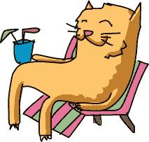

在你的浏览器控制台中输入以下内容：

```javascript
// Draw as many cats as you want!
var drawCats = function (howManyTimes) {
  for (var i = 0; i < howManyTimes; i++) {
    console.log(i + " =^.^=");
  }
};

drawCats(10); // You can put any number here instead of 10.
```

在最后，按 `ENTER` 而不是 `SHIFT-ENTER`。当你这样做时，你应该会看到以下输出：

```
0 =^.^=
1 =^.^=
2 =^.^=
3 =^.^=
4 =^.^=
5 =^.^=
6 =^.^=
7 =^.^=
8 =^.^=
9 =^.^=
```

如果你犯了任何输入错误，你的输出可能看起来非常不同，或者你会得到一个错误。这就是我说的计算机是愚笨的的意思——即使是一段简单的代码，也必须完美，计算机才能理解你想让它做什么！

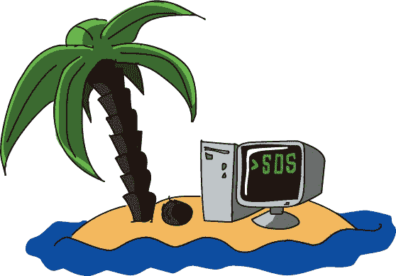

目前我不会详细介绍这段代码是如何*工作*的（我们将在第 8 章 中回到这个程序），但让我们来看看这个程序以及普通 JavaScript 程序的某些特性。

## 语法

我们的程序包含了许多符号，包括括号 `()`、分号 `;`、大括号 `{}`、加号 `+`，以及几个看起来可能有些神秘的单词（如 `var` 和 `console.log()`）。这些都是 JavaScript `语法`(#pr08.html_gloss01_039) 的一部分——也就是说 JavaScript 关于如何组合符号和单词以创建运行程序的规则。

当你学习一种新的编程语言时，最困难的部分之一就是习惯如何编写给计算机的不同类型的指令的规则。当你刚开始时，很容易忘记何时包含括号，或者混淆包含某些值的顺序。但随着你的练习，你将开始逐渐掌握它。

在这本书中，我们将缓慢而稳健地进行，一点一点引入新语法，以便你能够构建日益强大的程序。

## 注释

我们的猫程序的第一行是这样的的：

```javascript
// Draw as many cats as you want!
```

这被称为`注释`(#pr08.html_gloss01_007)。程序员使用注释是为了让其他程序员更容易阅读和理解代码。计算机完全忽略注释。JavaScript 中的注释以两个正斜杠（////`开头。斜杠后的所有内容（在同一行内）都会被 JavaScript 解释器忽略，因此注释对程序的执行不会产生任何影响——它们只是为了提供描述。

在本书的代码中，你会看到描述代码正在发生什么的的注释。当你编写自己的代码时，请添加你自己的注释。这样当你以后查看代码时，你的注释将提醒你代码是如何运行的以及每一步发生了什么。

在我们程序的最后一行还有另一个代码注释。记住，那个 `//` 之后的所有内容都不会被计算机运行！

```javascript
drawCats(10); // You can put any number here instead of 10.
```

代码注释可以单独成行，也可以位于你的代码之后。如果你把 `//` 放在前面，像这样：

```javascript
// drawCats(10);
```

. . . 什么都不会发生！`Chrome` 将整行视为一个注释，即使它是 JavaScript。

一旦你开始在现实世界中阅读 JavaScript 代码，你还会看到像这样的注释：

```javascript
/*
Draw as many cats
as you want!
*/
```

这是一种不同的注释样式，通常用于超过一行的注释。但它们的作用是相同的：`/*` 和 `*/` 之间的所有内容计算机不会运行的注释。

## 你学到的知识

在本章中，你了解了一些关于 JavaScript 是以及它的用途。你还学习了如何使用 Google `Chrome` 浏览器运行 JavaScript，并尝试了一个示例程序。除非我另有说明，书中的所有代码示例都可以（并且应该！）在 `Chrome` 的 JavaScript 控制台中运行。不要只读代码——尝试输入它们！这是学习编程的唯一方法。

在下一章中，你将开始学习 JavaScript 的基础，从你可以处理的三种基本信息类型开始：数字、字符串和布尔。

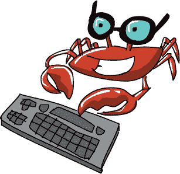

# 第 2 章. 数据类型和变量

编程完全关于处理数据，但*什么是*数据呢？`数据`(#pr08.html_gloss01_039)是我们存储在程序中的信息。

## 数字和运算符

JavaScript 允许你执行基础数学运算，如加、减、乘、除。为了进行这些计算，我们使用符号 `+`、`-`、`*` 和 `/`，它们被称为`运算符`。

你可以像计算器一样使用 JavaScript 控制台。我们已经看到了一个例子，将 3 和 4 相加。让我们尝试一些难的。12,345 加上 56,789 是多少？

```
12345 + 56789;
69134
```

## 运算顺序（等等，看看文本流）

你也可以组合这些简单的操作来制作更复杂的东西，像这样：

```
1234 + 57 * 3 - 31 / 4;
1397.25
```

这变得有点复杂，因为这个计算的结果（答案）将取决于 JavaScript 执行每个操作的顺序。在数学中，规则是乘法和除法始终在加法和减法之前进行，JavaScript 也遵循这条规则。

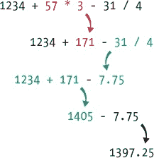


运算符顺序

图 2-1. 运算符顺序：乘、除、加、减

图 2-1 显示了 JavaScript 遵循的顺序。首先，JavaScript 乘以 `57 * 3` 并得到 `171`（红色显示）。然后它除以 `31 / 4` 得到 `7.75`（蓝色显示）。接下来，它加上 `1234 + 171` 得到 `1405`（绿色显示）。最后，它减去 `1405 - 7.75` 得到 `1397.25`，这就是最终结果。

如果你想在执行乘法和除法之前，先进行加法和减法呢？例如，假设你有 1 个兄弟、3 个姐姐和 8 块糖果，你想把糖果平均分给你的 4 个兄弟姐妹（你已经拿走了自己的一份了！）你必须将 8 除以你的兄弟姐妹人数。

这里有一个尝试：

```
8 / 1 + 3;
11
```

这不对！你手里只有 8 块糖果，不能给每个兄弟姐妹 11 块！问题在于 JavaScript 在执行加法之前会执行除法，所以它先用 8 除以 1（等于 8），然后加上 3，结果是 11。为了修复这个问题并让 JavaScript 先执行加法，我们可以使用括号`*()`：

```
8 / (1 + 3);
2
```

这样就对了！每个兄弟姐妹分 2 块糖果。括号强制 JavaScript 在将 8 除以 4 之前先计算 1 加 3。

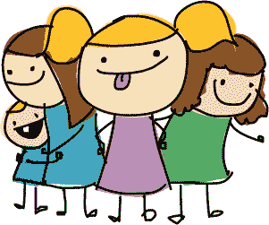

### 试一试！

假设你的朋友正尝试用 JavaScript 计算需要买多少个气球。她要举办派对，希望每个人都有 2 个气球要吹。原本有 15 个人来，但后来她又邀请了 9 人。她尝试了以下代码：

```
15 + 9 * 2;
33
```

但这看起来不对的。

问题在于乘法发生在加法之前。你会如何添加括号来确保 JavaScript 先执行加法呢？你的朋友到底需要多少个气球呢？

## 变量

JavaScript 允许你使用变量 为值命名。你可以把变量想象成一个可以放入一件东西的盒子。如果你在里面放入了其他东西，第一件东西就会消失。

要创建一个新变量，使用关键字 `var`，后面跟着变量名。`关键字 是 JavaScript 中具有特殊含义的单词。在这种情况下，当我们输入 `var` 时，JavaScript 知道我们即将输入一个新变量的名字。例如，这里是如何创建一个名为 `nick` 的新变量：

```
var nick;
undefined
```

我们创建了一个名为 `nick` 的新变量。控制台输出 `undefined` 作为响应。但这不是错误！这只是当一个命令没有返回结果时，JavaScript 的标准做法。什么是返回值呢？例如，当你输入 `12345 + 56789;` 时，控制台返回了 `69134`。在 JavaScript 中创建变量不会返回结果，所以解释器打印了 `undefined`。

要给变量赋值，使用等号：

```
var age = 12;
undefined
```

设置值被称为`assignment`（赋值）（即我们将值 `12` 赋值给变量 `age`）。同样，打印了 `undefined`，因为我们正在创建另一个新变量。（在我接后的示例中，如果输出是 `undefined`，我将不再显示它。）

变量 `age` 现在位于我们的解释器中，并被设置为值 `12`。这意味着如果你单独输入 `age`，解释器将向你显示它的值：

```
age;
12
```

酷！不过变量的值并不是固定不变的（它们被称为变量是因为它们的值可以`变化`），如果你想更新它，只需再次使用 `=` `=`：

```
age = 13;
13
```

这次我没有使用 `var` 关键字，因为变量 `age` 已经存在了。只有当你想要`创建`一个变量，而不是想改变变量的值时，才需要使用 `var`。同样注意，因为我们没有创建新变量，值 `13` 从赋值中返回并打印在下一行。

这个稍微复杂一点的示例在没有括号的情况下解决了之前的糖果问题：

```
var numberOfSiblings = 1 + 3;
var numberOfCandies = 8;
numberOfCandies / numberOfSiblings;
2
```

首先，我们创建一个名为 `numberOfSiblings` 的变量，并给它赋值 `1 + 3`（JavaScript 计算结果为 `4`）。然后，我们创建变量 `numberOfCandies` 并给它赋值 `8`。最后，我们写下 `numberOfCandies / numberOfSiblings`。因为 `numberOfCandies` 是 `8` 而 `numberOfSiblings` 是 `4`，JavaScript 计算 `8 / 4` 并给了我们 `2`。

## 变量命名

小心你的变量名，因为很容易拼错。即使你只是大小写写错了，JavaScript 解释器也不会知道你想表达什么！例如，如果你不小心在 `numberOfCandies` 中使用了小写的 `c`，你会得到一个错误：

```
numberOfcandies / numberOfSiblings;
ReferenceError: numberOfcandies is not defined
```

遗憾的是，JavaScript 只会完全按照你的要求执行。如果你拼错了变量名，JavaScript 不知道你想表达什么，并会显示错误消息。

JavaScript 变量名的另一个棘手问题是它们不能包含空格，这意味着它们可能很难阅读。我可以把变量命名为 `numberofcandies` 而不使用任何大写字母，这会让它更读，因为不清楚单词在哪里结束。这个变量是“numb erof can dies”还是“numberofcan dies”？没有大写字母就很难分辨。

解决这种问题的一种常用方法是每个单词的首字母都大写，如 `NumberOfCandies`。（这种约定被称为`驼峰命名法`，因为它据说看起来像骆驼背上的驼峰。）

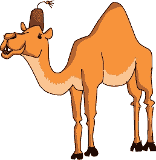

标准做法是变量以小写字母开头，所以除了第一个单词外，每个单词都大写，例如：`numberOfCandies`。（我将在书中遵循这种版本的驼峰命名法，但你可以随心所欲！）

## 使用数学运算创建新变量

你可以通过对旧变量进行数学运算来创建新变量。例如，你可以使用变量找出一年有多少秒——以及你几岁了！让我们从计算一小时有多少秒开始。

### 一小时的秒数

首先，我们创建两个新变量 `secondsInAMinute` 和 `minutesInAnHour`，并将它们都设置为 `60`（因为众所周知，一分钟有 60 秒，一小时有 60 分钟）。然后我们创建一个名为 `secondsInHour` 的变量，并将其设置为 `secondsInAMinute` 乘以 `minutesInAnHour` 的结果。在➊ 处，我们输入 `secondsInHour`，这就像是在说“现在告诉我 secondsInHour 的值！” JavaScript 然后会给你答案：是 `3600`。

```
var secondsInAMinute = 60;
  var minutesInAnHour = 60;
  var secondsInHour = secondsInAMinute * minutesInAnHour;
➊ secondsInHour;
  3600
```

### 一天的秒数

现在我们创建一个名为 `hoursInADay` 的变量，并将其设置为 `24`。接下来我们创建变量 `secondsInADay` 并将其等于 `secondsInHour` 乘以 `hoursInADay`。当我们在➊ 处询问值 `secondsInADay` 时，我们得到了 `86400`，这就是一天的秒数。

```
 var hoursInADay = 24;
  var secondsInADay = secondsInHour * hoursInADay;
➊ secondsInADay;
  86400
```


### 一年的秒数

最后，我们创建变量 `daysInAYear` 和 `secondsInAYear`。变量 `daysInAYear` 被赋值为 `365`，变量 `secondsInAYear` 被赋值为 `secondsInADay` 乘以 `daysInAYear`。最后，我们询问 `secondsInAYear` 的值，它是 `31536000`（超过 3100 万）！


```
var daysInAYear = 365;
var secondsInAYear = secondsInADay * daysInAYear;
secondsInAYear;
31536000
```

### 以秒计算年龄

现在你已经知道一年有多少秒了，你可以轻松地计算出以秒计算的年龄（精确到年份）。例如，当我写这段文字时，我今年 29 岁：

```
var age = 29;
age * secondsInAYear;
914544000
```

要计算你的秒数年龄，输入相同的代码，但将 `age` 的值改为 `your` 年龄。或者直接省掉 `age` 变量，直接使用你的年龄数字，如下所示：

```
29 * secondsInAYear;
914544000
```

我的年龄超过了 9 亿秒！你又是多少秒了？

## 递增与递减

作为一名程序员，你经常需要将包含数字的变量值增加或减少 1。例如，你可能有一个变量，用于记录你今天收到了多少次击掌。每当有人和你击掌时，你就想让该变量增加 1。

增加 1 称为 `incrementing`(#pr08.html_gloss01_020)，减少 1 称为 `decrementing`(#pr08.html_gloss01_012)。你使用运算符 `++` 和 `--` 来进行递增和递减。

```
var highFives = 0;
++highFives;
1
++highFives;
2
--highFives;
1
```

当我们使用 `++` 运算符时，`highFives` 的值会增加 1；当我们使用 `--` 运算符时，它会减少 1。你也可以将这些运算符放在变量*之后*。这样做的效果相同，但返回的值是递增或递减*之前*的值。

```
highFives = 0;
highFives++;
0
highFives++;
1
highFives;
2
```

在这个例子中，我们再次将 `highFives` 设置为 `0`。当我们调用 `highFives++` 时，变量递增了，但打印出的值是递增发生*之前*的值。你可以在最后（两次递增后）看到，如果我们请求 `highFives` 的值，得到的是 `2`。

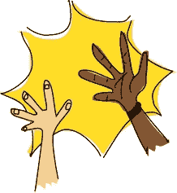

## += (加赋值) 和 –= (减赋值)

要按特定数量增加变量的值，你可以使用以下代码：

```
var x = 10;
x = x + 5;
x;
15
```

在这里，我们从一个名为 `x` 的变量开始，设置为 10。然后，我们将 `x + 5` 赋值给 `x`。因为 `x` 原是 10，所以 `x + 5` 将是 15。我们在这里做的是使用 `x` 的旧值来计算 `x` 的新值。因此，`x = x + 5` 实际上意味着“给 `x` 加 5”。

JavaScript 提供了一种更简单的方法来增加或减少变量的数值，使用 `+=` 和 `-=` 运算符。例如，如果我们有一个变量 `x`，那么 `x += 5` 就等于 `x = x + 5`。`-=` 运算符的工作原理相同，所以 `x -= 9` 等于 `x = x - 9`（“从 `x` 中减去 9”）。这里有一个使用这两个运算符记录视频游戏得分的示例：

```
var score = 10;
score += 7;
17
score -= 3;
14
```

在这个例子中，我们通过将值 `10` 赋值给变量 `score` 来从 10 分开始。然后我们击败了一个怪物，使用 `+=` 运算符让 `score` 增加了 7。（`score += 7` 等于 `score = score + 7`）。在我们击败怪物之前，`score` 是 `10`，10 + 7 等于 17，所以这次操作将 `score` 设置为 `17`。

在击败怪物后，我们撞上了一颗陨石，`score` 减少了 3。同样，`score -= 3` 等于 `score = score - 3`。因为此时 `score` 是 `17`，所以 `score - 3` 等于 `14`，该值被重新赋值给 `score`。

试试看！

还有一些与 `+=` 和 `-=` 类似的运算符。例如，还有 `*=` 和 `/=`。你认为它们是做什么的？尝试一下：

```
var balloons = 100;
balloons *= 2;
???
```

`balloons *= 2` 是做什么的？现在尝试这个：

```
var balloons = 100;
balloons /= 4;
???
```

`balloons /= 4` 是做什么的？

## 字符串

到为止，我们一直在处理数字。现在让我们来看另一种数据类型：`strings`(#pr08.html_gloss01_003)。字符串是字符的序列，可以是字母、数字、标点符号和空格。在 JavaScript 中，字符串用引号括起来。你可以使用单引号 `'` 或双引号 `"`。例如：

```
var greeting = "Hello";
var name = 'World';
```

这两个字符串是等价的。你也可以在字符串中包含引号，只要使用另一种引号即可：

```javascript
var sentence = "It's a beautiful day";
var quote = 'He said, "Hello!"';
```

字符串还可以包含换行符 `\n`：

```javascript
var text = "Line one\nLine two";
```

你可以使用 `+` 运算符连接两个字符串，这被称为拼接：

```javascript
var part1 = "Game";
var part2 = " over";
part1 + part2; // "Game over"
```

你可以使用 `.length` 属性获取字符串的长度：

```javascript
var name = "Alice";
name.length; // 5
```

每个字符都有一个索引（index），索引从 0 开始。因此，字符串中最后一个字符的索引是 `length - 1`。

```javascript
var str = "Hello";
str[0]; // "H"
str[1]; // "e"
str[4]; // "o"
```

你也可以使用 `charAt()` 方法来获取字符：

```javascript
var str = "Hello";
str.charAt(0); // "H"
str.charAt(1); // "e"
```

如果你尝试访问不存在的索引，JavaScript 会返回 `undefined`：

```javascript
var str = "Hello";
str[10]; // undefined
```

但如果你使用 `charAt()` 访问不存在的索引，它会返回一个空字符串 `""`：

```javascript
var str = "Hello";
str.charAt(10); // ""
```

你还可以使用 `slice()` 方法来提取字符串的一个部分：

```javascript
var str = "Hello World";
str.slice(0, 5); // "Hello"
str.slice(6); // "World"
str.slice(-5); // "World"
```

字符串是不可变的（immutable 这意味着这意味着如果你尝试修改字符串中的某个字符，它不会发生变化：

```javascript
var str = "Hello";
str[0] = "J";
str; // "Hello"
```

如果你想修改字符串，必须创建一个新的字符串：

```javascript
var str = "Hello";
str = "J" + str.slice(1);
str; // "Jello"
```


要从字符串的特定位置获取字符，请使用方括号 `[ ]`。只需获取字符串或包含字符串的变量，并将你想要的字符数字放在末尾的一对方括号中。例如，要获取 `myName` 的第一个字符，使用 `myName[0]`，如下：

```
var myName = "Nick";
myName[0];
"N"
myName[1];
"i"
myName[2];
"c"
```

注意，为了获取字符串的第一个字符，我们使用 `0` 而不是 `1`。这是因为 JavaScript（像许多其他编程语言一样）从零开始计数的。这意味着当你想要字符串的第一个字符时，使用 `0`；当你想要第二个字符时，使用 `1`；以此此类推。

让我们来尝试一下我们的秘密代码，我们将消息隐藏在某些单词的第二个字符中。以下是从一系列单词中找到秘密消息的方法：

```
var codeWord1 = "are";
var codeWord2 = "tubas";
var codeWord3 = "unsafe";
var codeWord4 = "?!";
codeWord1[1] + codeWord2[1] + codeWord3[1] + codeWord4[1];
"run!"
```

同样，注意为了获取每个字符串的第二个字符，我们使用了 `1`。

## 切分字符串

要“切下”一个大字符串的一部分，你可以使用 `slice`。例如，你可能想获取一段长电影评论的第一部分，作为预告展示在你的网站上。要使用 `slice`，在字符串（或包含字符串的变量）后加一个点，然后是 `slice` 单词以及圆括号。在括号内部，输入你想要切分的字符串的起始位置和结束位置，并用逗号分隔。图 2-2 显示了如何使用 `slice`。

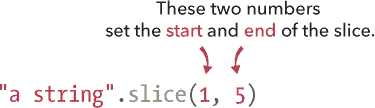

图 2-2. 如何使用 `slice` 获取字符串中的字符。

例如：

```
var longString = "My long string is long";
longString.slice(3, 14);
"long string"
```

括号中的第一个数字是开始切分的字符索引，第二个数字是切分中最后一个字符*之后*的字符索引。图 2-3 显示了它提取了哪些字符，起始值（`3`）和停止值（`14`）用蓝色高亮显示。

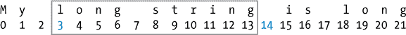

图 2-3. 在上面的示例中，`slice` 获取了灰色框中显示的字符。

在这里我们基本上是在告诉 JavaScript：“从这个较长字符串中从第 3 位开始提取出一个片段，一直持续到第 14 位。”

如果你在 `slice` 后的括号中只包含一个数字，切分的字符串将从该数字开始，一直到字符串的末尾，如下：

```
var longString = "My long string is long";
longString.slice(3);
"long string is long"
```

## 将字符串转换为全大写或全小写字母

如果你有一些文本只想大声喊出来，尝试使用 `toUpperCase` 将其全部转换为大写字母。

```
"Hello there, how are you doing?".toUpperCase();
"HELLO THERE, HOW ARE YOU DOING?"
```

当你对一个字符串使用 `.toUpperCase()` 时，它会创建一个新字符串，其中所有的字母都转换成了大写。

你也可以反过来操作：

```
"hELlo THERE, hOW ARE yOu doINg?".toLowerCase();
"hello there, how are you doing?"
```

正如名称所示，`.toLowerCase()` 将所有字符转换为小写。但句子不应该总是以大写字母开头吗？我们如何获取一个字符串并将首字母变为大写，而将其其余部分转换为小写呢？

### 注意

尝试看看你如何用刚刚学会的工具将 `"hELlo THERE, hOW ARE yOu doINg?"` 转换为 `"Hello there, how are you doing?"`。如果你卡住了，请复习获取单个字符和使用 `slice` 的章节。完成后，回来看看我是怎么做的。

这里有一种方法：

```
➊ var sillyString = "hELlo THERE, hOW ARE yOu doINg?";
➋ var lowerString = sillyString.toLowerCase();
➌ var firstCharacter = lowerString[0];
➍ var firstCharacterUpper = firstCharacter.toUpperCase();
➎ var restOfString = lowerString.slice(1);
➏ firstCharacterUpper + restOfString;
  "Hello there, how are you doing?"
```

让我们逐行分析一遍。在 ➊，我们创建了一个名为 `sillyString` 的新变量并保存我们想要的字符串。在 ➋，我们创建了一个名为 `lowerString` 的新变量并保存我们想要的字符串。在 ➌，我们创建了一个名为 `firstCharacter` 的新变量并保存我们想要的字符。在 ➍，我们创建了一个名为 `firstCharacterUpper` 的新变量并保存我们想要的字符。在 ➎，我们创建了一个名为 `restOfString` 的新变量并保存我们想要的字符串。在 ➏，我们将 `firstCharacterUpper` 和 `restOfString` 相加。


[content]
现在 JavaScript 告诉我们 `hadShower && hasBackpack` 是 `true`。你准备好上学校了！

### || (或)

布尔运算符 `||` 的意思是“或”。它可以读作“or”，甚至读作“or-or”，但有些人也称它为“pipes”（管道），因为程序员把 `|` 字符称为 `pipe`。你可以使用这个运算符配合两个布尔值，判断其中*任何一个*是否为 `true`。

例如，假设你正在准备去上学，需要带一个水果当午餐，但带苹果、橙子或两者都带都无关系。你可以使用 JavaScript 来检查你是否至少有一个，如下所示：

```
var hasApple = true;
var hasOrange = false;
hasApple || hasOrange;
true
```

如果 `hasApple` 或 `hasOrange` 其中一个为 `true`，或者两者都是 `true`，那么 `hasApple || hasOrange` 将为 `true`。但如果*两者*都是 `false`，结果将是 `false`（你什么水果都没有）。

### ! (非)

`!` 仅仅表示“非”。你可以称它为“not”，但很多人称它为“bang”（感叹号有时也被称为 `bang`）。用它来将 `false` 转换为 `true` 或将 `true` 转换为 `false`。这在处理相反的值时非常有用。例如：

```
var isWeekend = true;
var needToShowerToday = !isWeekend;
needToShowerToday;
false
```

在这个示例中，我们把变量 `isWeekend` 设置为 `true`。然后我们将变量 `needToShowerToday` 设置为 `!isWeekend`。`bang` 将值转换为其相反值——如果 `isWeekend` 是 `true`，那么 `!isWeekend` 就*不是* `true`（它是 `false`）。所以当我们询问 `needToShowerToday` 的值时，我们得到 `false`（你今天不需要洗澡，因为今天是周末）。

由于 `needToShowerToday` 是 `false`，所以 `!needToShowerToday` 将为 `true`：

```
needToShowerToday;
false
!needToShowerToday;
true
```

换句话说，你今天*确实不需要*洗澡，这是 *true*。

### 组合逻辑运算符

当你开始组合运算符时，它们就变得有趣了。例如，假设如果*不是*周末*且*你洗了澡*且*你有苹果*或者*你有一个橙子，你就应该去学校。我们可以用 JavaScript 来检查这一切是否都为 `true`，如下：

```
var isWeekend = false;
var hadShower = true;
var hasApple = false;
var hasOrange = true;
var shouldGoToSchool = !isWeekend && hadShower && (hasApple || hasOrange);
shouldGoToSchool;
true
```

在这种情况下，不是周末，你洗过澡了，你没有苹果但有一个橙子——所以你应该去学校。

`hasApple || hasOrange` 放在括号中，是因为我们想确保 JavaScript 先处理那部分。就像 JavaScript 在计算数字时先计算 `*` 后计算 `+` 一样，在逻辑语句中也会先计算 `&&` 后计算 `||`。

## 使用布尔值比较数字

布尔值可以用于回答关于数字的简单“是”或“否”答案的问题。例如，想象你正在经营一个主题公园，其中一个游乐设施有身高限制：游客身高至少要达到 60 英寸，否则可能会掉出来！当有人想玩这个设施并告诉你的身高时，你需要知道这个身高是否大于该高度限制。

### 大于

我们可以使用大于运算符（`>`）来查看一个数字是否大于另一个数字。例如，为了查看游客身高（65 英寸）是否大于高度限制（60 英寸），我们可以将变量 `height` 设置为 `65`，将变量 `heightRestriction` 设置为 `60`，然后使用 `>` 来比较两者：

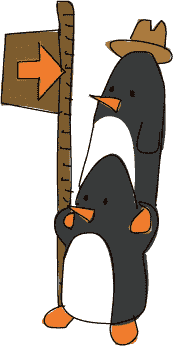

```
var height = 65;
var heightRestriction = 60;
height > heightRestriction;
true
```

通过 `height > heightRestriction`，我们是在让 JavaScript 告诉我们第一个值是否大于第二个值。在这种情况下，游客足够高！

但如果游客身高恰好是 60 英寸呢？

```
var height = 60;
var heightRestriction = 60;
height > heightRestriction;
false
```

噢不！游客不够高！但如果身高限制是 60，那么正好 60 英寸的人不应该被允许吗？我们需要修复这个问题。幸运的是，JavaScript 有另一个运算符 `>=`，它的意思是“大于等于”：

```
var height = 60;
var heightRestriction = 60;
height >= heightRestriction;
true
```

很好，这样好多了——60 *确实*大于等于 60。

### 小于

大于运算符（`>`）的相反运算符是小于运算符（`<`）。如果某个游乐设施只为小儿童设计，这个运算符可能会派用场。例如，假设游客身高为 60 英寸，但游客身高不能超过 48 英寸：

```
var height = 60;
var heightRestriction = 48;
height < heightRestriction;
false
```

我们想知道游客身高是否*小于*限制，所以我们使用 `<`。因为 60 不小于 48，我们得到了 `false`（身高 60 英寸的人对于这个设施来说太高了）。

而且，正如你可能猜到的，我们还可以使用运算符 `<=`，它的意思是“小于等于”：

```
var height = 48;
var heightRestriction = 48;
height <= heightRestriction;
true
```

身高为 48 英寸的人仍然被允许乘坐设施。

### 等于

要找出两个数字是否完全相同，请使用三等号（`===`），它的意思是等于。但注意不要将 `===` 与单等号（`=`）混淆，因为 `===` 的意思是“这两个数字相等吗？”而 `=` 的意思是“将右侧的值保存到左侧的变量”。换句话说，`===` 是提问，而 `=` 是给变量赋值。

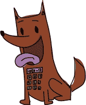

当你使用 `=` 时，变量名必须在左侧，你想要保存到该变量的值必须在右侧。另一方面，`===` 仅用于比较两个值以查看它们是否相同，所以哪个值在哪个边并不重要。

例如，假设你正在和朋友 Chico、Harpo 和 Groucho 一起进行比赛，看谁能猜出你的秘密数字，那个数字是 5。你通过说数字在 1 到 9 之间来让朋友们轻松些，他们开始猜。首先，你将 `mySecretNumber` 设置为 `5`。你的第一个朋友 Chico 猜是 `3`（`chicoGuess`）。让我们看看会发生什么：

```
var mySecretNumber = 5;
var chicoGuess = 3;
mySecretNumber === chicoGuess;
false
var harpoGuess = 7;
mySecretNumber === harpoGuess;
false
var grouchoGuess = 5;
mySecretNumber === grouchoGuess;
true
```

变量 `mySecretNumber` 存储了你的秘密数字。`chicoGuess`、`harpoGuess` 和 `grouchoGuess` 代表你朋友的猜测（不，是 `chicoGuess`、`harpoGuess` 和 `grouchoGuess` 代表你朋友的猜测），我们使用 `===` 来检查每个猜测是否与你的秘密数字相同。你的第三个朋友 Groucho 通过猜 5 赢了。

当你用 `===` 比较两个数字时，只有当两个数字都相同时才会得到 `true`。因为 `grouchoGuess` 是 5 且 `mySecretNumber` 是 5，`mySecretNumber === grouchoGuess` 返回 `true`。其他的猜测没有匹配 `mySecretNumber`，所以返回了 `false`。

你也可以用 `===` 比较两个字符串或两个布尔值。如果你用 `===` 比较不同的类型——例如一个字符串和一个数字——它将始终返回 `false`。

### 双等

现在来让事情复杂一点：JavaScript 有另一个运算符（双等，或 `==`），它的意思是“看似相等”。使用这个运算符来检查两个值是否相同，即使一个是字符串另一个是数字。所有值都有某种类型。所以数字 `5` 与字符串 `"5"` 是不同的，尽管它们看起来是一样的。如果你用 `===` 比较数字 `5` 和字符串 `"5"`，JavaScript 会告诉我们它们不相等。但如果你用 `==` 来比较它们，它会告诉它们是相同的：

```
var stringNumber = "5";
var actualNumber = 5;
stringNumber === actualNumber;
false
stringNumber == actualNumber;
true
```


此时，你可能在心里想：“嗯，用双等号似乎比用三等号要容易得多！”但是，你必须非常小心，因为双等号可能会非常误导性。例如，你认为 `0` 等于 `false` 吗？字符串 `"false"` 呢？当你使用双等号时，`0` 等于 `false`，但字符串 `"false"` 并不等同：

```
0 == false;
true
"false" == false;
false
```

这是因为当 JavaScript 尝试用双等号比较两个值时，它会先尝试将它们转换为相同的类型。在这种情况下，它会将 `Boolean` 转换为数字。如果你将布尔值转换为数字，`false` 变成 `0`，而 `true` 变成 `1`。所以当你输入 `0 == false` 时，你得到的是 `true`！

由于这种奇特的特性，目前最安全的办法可能是一直使用 `===`。

## 来试一试！

当地电影院的经理们请你为他们正在构建的一个新自动化系统编写 JavaScript 代码。他们希望判断某人是否可以进入 PG-13 级电影院。

规则是：如果某人满 13 岁，就可以进入。如果未满 13 岁但有成年人陪同，也可以进入。否则，他们就不能看电影。

```
var age = 12;
var accompanied = true;
???
```

使用 `age` 和 `accompanied` 变量完成这个示例，判断这个 12 岁的孩子是否可以看电影。尝试更改值（例如，将 `age` 设置为 `13` 将 `accompanied` 设置为 `false`），看看你的代码是否仍然能得出正确答案。


## undefined 和 null

最后，我们有两个不符合任何特定模式的值。它们被称为 `undefined` 和 `null`。它们都用来表示“无”，但表达方式略有不同。

`undefined` 是 JavaScript 在某个某值没有值时使用的值。例如，当你创建一个新变量时，如果你没有使用 `=` 运算符为它设置任何值，那么它的值将会被设置为 `undefined`：

```
var myVariable;
myVariable;
undefined
```

`null` 值通常用于你想要明确表示“这里是空的”的时候。

```
var myNullVariable = null;
myNullVariable;
null
```

到目前，你可能不会频繁地使用 `undefined` 或 `null`。如果你创建一个变量但没有设置它的值，你就会看到 `undefined`，因为当 JavaScript 没有某个值的值时，它总是会给你返回 `undefined`。将某物设置为 `undefined` 并不常见；如果你觉得有必要将一个变量设置为“无”，你应该使用 `null` 而不是它。

`null` 只有在你实际上想表达某物不存在时才会被使用，这在偶尔非常有帮助。例如，假设你正在使用一个变量来记录你最喜欢的蔬菜。如果你讨厌所有的蔬菜且没有喜欢的，你可能会将 `favorite vegetable` 设置为 `null`。

将变量设置为 `null` 会让任何阅读代码的人一而易见你你没有喜欢的。如果是 `undefined`，别人可能仅仅会认为你还没得及去设置它。

# 你学到了什么

现在你已经了解了 JavaScript 中所有的基本类型——数字、字符串和 `Booleans`（布尔值），以及特殊值 `null` 和 `undefined`。数字用于数学计算，字符串用于文本，而 `Booleans` 用于回答是或否的问题。`null` 和 `undefined` 值的存在是为了给我们提供一种讨论不存在的事的方法。在接下来的两个章节中，我们将学习数组和对象，它们都是组合类型以创建更复杂的值集合的方法。

# 第 3 章 数组

到目前为止，我们学习了数字和字符串，这些是可以存储和使用的数据类型。但数字和字符串是很单调的。单凭字符串本身没不了做什么。JavaScript 允许你通过 `arrays`（数组）以更有趣的方式创建和分组数据。

例如，如果你的朋友问你最喜欢的三个恐龙是什么，你可以创建一个包含这些恐龙名称的 `array`，按顺序排列：

```
var myThreeDinosaurs = ["T-Rex", "Velociraptor", "Stegosaurus"];
```

所以，与其给朋友提供三个独立的字符串，你只需要使用单个数组 `myThreeDinosaurs` 即可。

### 为什么你应该关注数组？

让我们再次看看恐龙。假设你想用一个程序来跟踪你认识的许多种恐龙。你可以为每个恐龙创建一个变量，如下所示：

```
var dinosaur1 = "T-Rex";
var dinosaur2 = "Velociraptor";
var dinosaur3 = "Stegosaurus";
var dinosaur4 = "Triceratops";
var dinosaur5 = "Brachiosaurus";
var dinosaur6 = "Pteranodon";
var dinosaur7 = "Apatosaurus";
var dinosaur8 = "Diplodocus";
var dinosaur9 = "Compsathus";
```

不过，这个列表用起来很笨拙，因为你明明只需要一个变量却有九个。想象一下如果你正在跟踪 1000 种恐龙！你需要创建 1000 个独立的变量，这几乎几乎是不可能的。

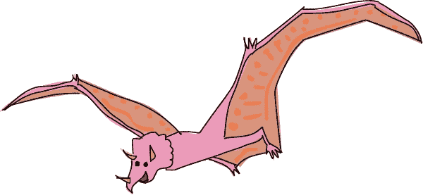

这就像你有一份购物清单，但每件物品都在不同的纸上。你会有一张纸写着“鸡蛋”，另一张写着“面包”，另一张写着“橙子”。大多数人会把他们想买的完整清单写在一张纸上。如果能把所有九项都归类在一个地方，不是简单得多吗？

你可以做到，这就是数组大显身场的地方。

### 创建数组

要创建一个数组，你只需要使用方括号 `[]`。事实上，一个空数组仅仅是一对方括号，如下：

```
[];
[]
```

但谁会在乎空数组呢？让我们用我们的恐龙填满它吧！

要创建一个包含值的数组，在方括号之间输入值，并用逗号分隔。我们可以将数组中的单个值称为 `items`（项目）或 `elements`（元素）。在这个示例中，我们的元素是字符串（我们最喜欢的恐龙名称），所以我们将用引号编写它们。我们将数组存储在一个名为 `dinosaurs` 的变量中：

```
var dinosaurs = ["T-Rex", "Velociraptor", "Stegosaurus",
"Triceratops", "Brachiosaurus", "Pteranodon", "Apatosaurus",
"Diplodocus", "Compsathus"];
```

### 注意

由于这是一本书，且页面宽度有限，我们实际上无法将整个数组放在同一行。这里的  是为了显示我们由于页面太窄而将代码放在额外的一行上。当你把这些输入到计算机时，你可以把它们全部写在一行。

长列表在一行中很难阅读，但幸运的是这不是格式化（或布局）数组的唯一方法。你也可以这样格式化数组：在一开头写左方括号，数组中的每个项目各占一行，最后写一个右方括号，如下：

```
var dinosaurs = [
  "T-Rex",
  "Velociraptor",
  "Stegosaurus",
  "Triceratops",
  "Brachiosaurus",
  "Pteranodon",
  "Apatosaurus",
  "Diplodocus",
  "Compsathus"
];
```

如果你想将其输入到浏览器控制台中，在按下每一行的 `ENTER` 键时需要按住 `SHIFT` 键。否则，JavaScript 解释器会认为你正尝试执行当前不完整的的行。当我们在解释器中工作时，将数组写在一行更方便。

## 访问数组元素


当需要访问数组中的元素时，你使用方括号以及你想要元素的 `index`（索引），如下例所示：

```
dinosaurs[0];
"T-Rex"
dinosaurs[3];
"Triceratops"
```

`index` 是一个与数组中存储值的位置对应（或匹配）的数字。就像字符串一样，数组中的第一个元素位于索引 0，第二个元素位于索引 1，第三个元素位于索引 2，以此此类推。这就是为什么向 `dinosaurs` 数组 索要索引 0 会返回 `"T-Rex"`（列表中的第一个），而索引 3 则会返回 `"Triceratops"`（列表中的第四个）。

能够从数组中访问单个元素是非常有用的。例如，如果你只想向某人展示你最喜欢的恐龙，你不需要整个 `dinosaurs` 数组。相反，你只需要第一个元素：

```
dinosaurs[0];
"T-Rex"
```

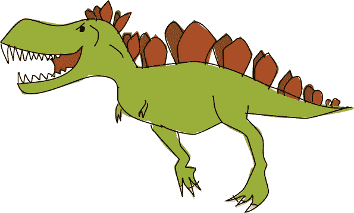

## 在数组中设置或更改元素

你可以使用方括号中的索引来设置、更改甚至向数组添加元素。例如，要将 `dinosaurs` 数组中的第一个元素（`"T-Rex"`）替换为 `"Tyrannosaurus Rex"`，你可以这样做：

```
dinosaurs[0] = "Tyrannosaurus Rex";
```

完成此操作后，`dinosaurs` 数组看起来像这样：

```
["Tyrannosaurus Rex", "Velociraptor", "Stegosaurus", "Triceratops",
"Brachiosaurus", "Pteranodon", "Apatosaurus", "Diplodocus",
"Compsognathus"]
```

你还可以使用带有索引的方括号向数组添加新元素。例如，这里是如何通过方括号单独设置每个元素来创建 `dinosaurs` 数组的：

```javascript
var dinosaurs = [];
dinosaurs[0] = "T-Rex";
dinosaurs[1] = "Velociraptor";
dinosaurs[2] = "Stegosaurus";
dinosaurs[3] = "Triceratops";
dinosaurs[4] = "Brachiosaurus";
dinosaurs[5] = "Pteranodon";
dinosaurs[6] = "Apatosaurus";
dinosaurs[7] = "Diplodocus";
dinosaurs[8] = "Compsognathus";

dinosaurs;
["T-Rex", "Velociraptor", "Stegosaurus", "Triceratops",
"Brachiosaurus", "Pteranodon", "Apatosaurus", "Diplodocus",
"Compsognathus"]
```

首先，我们用 `var dinosaurs = []` 创建一个空数组。然后，通过后续每一行，我们通过一系列 `dinosaurs[]` 条目向列表添加一个值，从索引 0 到索引 8。一旦完成列表，我们就可以查看数组（通过输入 `dinosaurs;`）。我们看到 JavaScript 已经根据索引存储了所有名称。你实际上可以在任何想要的索引处添加元素。例如，要在索引 33 处添加新的（虚构的）恐龙，你可以写道：

```javascript
dinosaurs[33] = "Philosorapt";

dinosaurs;
["T-Rex", "Velociraptor", "Stegosaurus", "Triceratops",
"Brachiosaurus", "Pteranodon", "Apatosaurus", "Diplodocus",
"Compsognathus", ..., "Philosorapt"]
```

索引 8 和 33 之间的元素将是 `undefined`。当你输出数组时，Chrome 会贴心地告诉你有多少个元素，而不是逐个列出它们。

## 在数组中混合数据类型

数组元素并不全都是相同类型。例如，下一个数组包含一个数字（`3`）、一个字符串（`"dinosaurs"`）、一个数组（`["triceratops", "stegaurus", 2.5]`）以及另一个数字（`10`）：

```javascript
var dinosaursAndNumbers = [3, "dinosaurs", ["triceratops", "stegaurus", 2.5], 10];
```

要访问此数组数组中的单个元素，你只需要使用第二组方括号。例如，当 `dinosaursAndNumbers[2]` 返回整个内部数组时，`dinosaursAndNumbers[2][0]` 仅返回该数组的第一个元素，即 `"triceratops"`。

```javascript
dinosaursAndNumbers[2]; // ["triceratops", "stegaurus", 2.5]
dinosaursAndNumbers[2][0]; // "triceratops"
```

当我们输入 `dinosaursAndNumbers[2][0]` 时，我们告诉 JavaScript 查看 `dinosaursAndNumbers` 数组的索引 2，该索引包含数组 `["triceratops", "stegaurus", 2.5]`，并返回该数组索引 0 的值。索引 0 是第二个数组的第一个值，即 `"triceratops"`。

## 数组操作

`Properties`（属性）和 `methods`（方法）帮助你处理数组。属性通常会告诉你关于数组的信息，而方法通常会执行某些操作来更改数组或返回一个新数组。

## 查找数组的长度

有时知道数组中有多少个元素是有用的。例如，如果你不断向 `dinosaurs` 数组中添加恐龙，你可能会忘记你有多少只恐龙了。

数组的 `length` 属性告诉数组中有多少个元素。要找到数组的长度，只需在它的名称末尾添加 `.length`。让我们尝试一下。首先，我们创建一个包含三个元素的新数组：

```javascript
var maniacs = ["Yakko", "Wakko", "Dot"];
maniacs[0]; // "Yakko"
maniacs[1]; // "Wakko"
maniacs[2]; // "Dot"
```

要找到数组的长度，为 `maniacs` 添加 `.length`：

```javascript
maniacs.length; // 3
```

JavaScript 告诉我们数组中有 3 个元素，我们已经知道它们的索引位置是 0、1 和 2。这给了我们一个很有用的信息：数组中的最后一个索引总是数组长度减 1。这意味着无论数组有多长，都有一种简单的方法来访问数组的最后一个元素：

```javascript
maniacs[maniacs.length - 1]; // "Dot"
```

在这里，我们正在向 JavaScript 请求数组中的一个元素。但我们不是在方括号中输入索引数字，而是使用了一点数学运算：数组长度减 1。JavaScript 找到 `maniacs.length`，得到 3，然后减 1 得到 2。然后它返回索引 2 的元素——数组中的最后一个“疯子”，`"Dot"`。

## 向数组添加元素

要向数组末尾添加元素，你可以使用 `push` 方法。在数组名称后添加 `.push`，然后在括号内加上要添加的元素，如下所示：

```javascript
var animals = [];
animals.push("Cat"); // 1
animals.push("Dog"); // 2
animals.push("Llama"); // 3
animals; // ["Cat", "Dog", "Llama"]
animals.length; // 3
```

在这里，我们用 `var animals = []` 创建一个空数组，然后使用 `push` 方法向数组添加 `"Cat"`。然后，再次使用 `push` 添加 `"Dog"` 然后 `"Llama"`。当我们显示 `animals;` 时，我们看到 `"Cat"`、`"Dog"` 和 `"Llama"` 被添加到数组中，顺序与我们输入的相同。

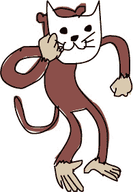

在计算机术中，运行方法被称为调用方法。当你调用 `push` 方法时，会发生两件事。首先，括号中的元素被添加到数组中。其次，返回数组的新长度。这就是为什么每次每次调用 `push` 时你都会看到打印这些数字。

要在数组开头添加元素，可以使用 `.unshift(element)`，如下：

```javascript
animals; // ["Cat", "Dog", "Llama"]
animals[0]; // "Cat"
animals.unshift("Monkey"); // 4
animals; // ["Monkey", "Cat", "Dog", "Llama"]
animals.unshift("Polar Bear"); // 5
animals; // ["Polar Bear", "Monkey", "Cat", "Dog", "Llama"]
animals[0]; // "Polar Bear"
animals[2]; // "Cat"
```


这里我们从一直使用的数组 `["Cat", "Dog", "Llama"]` 开始。然后，当我们使用 `unshift` 将元素 `"Monkey"` 和 `"Polar Bear"` 添加到数组开头时，旧值每次都会向后移动一个索引。因此，原本位于索引 0 ➊ 的 `"Cat"` 现在位于索引 2 ➋ 。

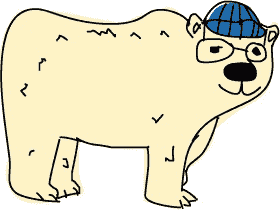

同样，`unshift` 在每次被调用时都会返回数组的新长度，就像 `push` 一样。

## 从数组中移除元素

要从数组中移除最后一个元素，你可以在数组名末尾添加 `.pop()` 将其弹出。`pop` 方法特别有用，因为它执行了两个操作：移除最后一个元素，并将该最后一个元素作为一个值返回。例如，让我们从 `animals` 数组 `["Polar Bear", "Monkey", "Cat", "Dog", "Llama"]` 开始。然后我们将创建一个名为 `lastAnimal` 的新变量，并通过调用 `animals.pop()` 将最后一个动物保存到其中。

```
 animals;
  ["Polar Bear", "Monkey", "Cat", "Dog", "Llama"]
➊ var lastAnimal = animals.pop(); lastAnimal;
  "Llama"
  animals;
  ["Polar Bear", "Monkey", "Cat", "Dog"]
➋ animals.pop();
  "Dog"
  animals;
  ["Polar Bear", "Monkey", "Cat"]
➌ animals.unshift(lastAnimal);
  4
  animals;
  ["Llama", "Polar Bear", "Monkey", "Cat"]
```

当我们在 ➊ 处调用 `animals.pop()` 时，`animals` 数组中的最后一个项 `"Llama"` 被返回并保存到变量 `lastAnimal` 中。`"Llama"` 也从数组中移除，留下了四只动物。当我们在 ➋ 处再次调用 `animals.pop()` 时，`"Dog"` 从数组中移除并返回，数组中剩下三只动物。

当我们对 `"Dog"` 使用 `animal.pop()` 时，我们没有将其保存到变量中，因此该值不再被保存在任何地方了。另一方面，`"Llama"` 被保存到了变量 `lastAnimal` 中，因此我们可以在需要时再次使用它。在 ➌ 处，我们使用 `unshift(lastAnimal)` 将 `"Llama"` 加回数组开头。这让我们得到了一个最终数组 `["Llama", "Polar Bear", "Monkey", "Cat"]`。

`push` 和 `pop` 是一对组合，因为有时你只关心数组的末尾。你可以将一个新项推入数组，然后在准备好使用时将其弹出。我们将在在本章后面的部分介绍使用推入弹出的一些方法。

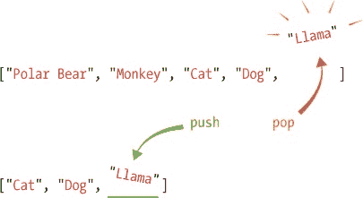

要移除并返回数组的第一个元素，使用 `.shift()`：

```
animals;
["Llama", "Polar Bear", "Monkey", "Cat"]
var firstAnimal = animals.shift();
firstAnimal;
"Llama"
animals;
["Polar Bear", "Monkey", "Cat"]
```

`animals.shift()` 的作用与 `animals.pop()` 相同，但元素是从开头移除的。在这个示例的开始，`animals` 是 `["Llama", "Polar Bear", "Monkey", "Cat"]`。当我们对数组调用 `.shift()` 时，第一个元素 `"Llama"` 被返回并保存到 `firstAnimal` 中。因为 `.shift()` 既移除第一个元素又返回它，所以最后 `animals` 只有 `["Polar Bear", "Monkey", "Cat"]`。

你可以使用 `unshift` 和 `shift` 从数组开头添加和移除项，就像你使用 `push` 和 `pop` 从数组末尾添加和移除项一样。

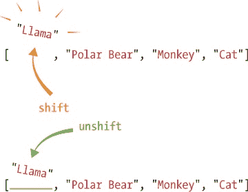

## 合并数组

要将两个数组合并为一个新的单一数组，你可以使用 `firstArray.concat(otherArray)`。`concat` 是 `concatenate`（连接）的缩写，这是一个计算机科学中的高级词汇，指将两个值连接。`concat` 方法将两个数组合并为一个新数组，其中来自 `firstArray` 的值在 `otherArray` 的值之前。

例如，假设我们有一份毛茸动物的列表和另一份鳞片动物的列表，我们想要合并它们。如果我们把所有毛茸动物放在名为 `furryAnimals` 的数组中，将所有鳞片动物放在名为 `scalyAnimals` 的数组中，输入 `furryAnimals.concat(scalyAnimals)` 将创建一个新数组，其中第一个数组的值在开头，第二个数组的值在末尾。

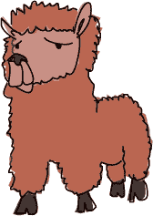

```
var furryAnimals = ["Alpaca", "Ring-tailed Lemur", "Yeti"];
var scalyAnimals = ["Boa Constrictor", "Godzilla"];
var furryAndScalyAnimals = furryAnimals.concat(scalyAnimals);
furryAndScalyAnimals;
["Alpaca", "Ring-tailed Lemur", "Yeti", "Boa Constrictor", "Godzilla"]
furryAnimals;
["Alpaca", "Ring-tailed Lemur", "Yeti"]
scalyAnimals;
["Boa Constrictor", "Godzilla"]
```

（注：“合并数组”部分的源文本包含大量的损坏/乱码文本。我已经对输出进行了清理，以符合符合描述的 `concat` 方法的逻辑流。）


你可以使用 `.join(`separator`)` 来实现相同的功能，但可以在每个值之间使用你自定义的分隔符。分隔符就是你放在括号内的任何字符串。例如，我们可以使用三种不同的分隔符：两边带有空格的连字符`、星号、以及两边带有空格的单词 `sees`。请注意，你需要在分隔符周围加上引号，因为分隔符是一个字符串。

```
var boringAnimals = ["Monkey", "Cat", "Fish", "Lizard"];
boringAnimals.join(" - ");
"Monkey - Cat - Fish - Lizard"
boringAnimals.join("*")
"Monkey*Cat*Fish*Lizard"
boringAnimals.join(" sees ")
"Monkey sees Cat sees Fish sees Lizard"
```

如果你有一个想要转换为字符串的数组，这个方法非常有用。假设你有很多中间名，并把它们存储在一个数组里，连同你的名字和姓氏。你可能会被要求提供一个字符串格式的全名。使用 `join` 并以单个空格作为分隔符，可以将你所有的名字合并成一个字符串：

```
var myNames = ["Nicholas", "Andrew", "Maxwell", "Morgan"];
myNames.join(" ");
"Nicholas Andrew Maxwell Morgan"
```

如果你没有 `join`，你就得写类似这样的代码，这输入起来会非常麻烦：

```
myNames[0] + " " + myNames[1] + " " + myNames[2] + " " + myNames[3];
"Nicholas Andrew Maxwell Morgan"
```

此外，这段代码只有在你恰好有两个中间名时才起作用。如果你有一个或三个中间名，你就必须修改代码。而使用 `join`，你不需要更改任何内容——它会打印出一个包含数组中所有元素的字符串，无论数组有多长。

如果数组中的值不是字符串，JavaScript 会在将它们合并之前将它们转换为字符串：

```
var ages = [11, 14, 79];
ages.join(" ");
"11 14 79"
```

# 数组的实用操作

现在你已经了解了创建和操作数组的多种方法。但利用所有这些属性和方法实际上能做些什么呢？在本节中，我们将编写几个短程序，展示对数组的一些实用操作。

## 寻找回家的路

想象一下：你的朋友来你家了。现在她想带你看看她的家。唯一的问题是，你从未去过她的家，而且之后你得自己找到回家的路。

幸运的是，你有一个聪明的主意来解决这个问题：在去朋友家的路上，你会记录下你看到的所有地标列表。在回家的路上，你将反序遍历列表，每当经过一个地标时就从列表末尾删掉一项，这样你就知道下一步该去哪里了。

### 使用 Push 构建数组

让我们写一些正好执行此操作的代码。我们首先创建一个空数组。数组初始是空的，因为在你实际开始向朋友家走之前，你不知道会看到哪些地标。然后，对于去朋友家路每个地标，我们将把该地标的描述 `push` 到数组的末尾。接着，到了回家的时候，我们将从数组中 `pop` 出每一个地标。

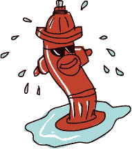

```
var landmarks = [];
landmarks.push("My house");
landmarks.push("Front path");
landmarks.push("Flickering streetlamp");
landmarks.push("Leaky fire hydrant");
landmarks.push("Fire station");
landmarks.push("Cat rescue center");
landmarks.push("My old school");
landmarks.push("My friend's house");
```

在这里我们创建一个名为 `landmarks` 的空数组，然后使用 `push` 来存储你在去朋友家路上经过的所有地标。

### 使用 pop 反向进行

到达朋友家后，你可以检查你的地标数组。果真如此，第一项是 `"My house"`，后面是 `"Front path"`，以此类推直到数组结束，最后一项是 `"My friend's house"`。当需要回家时，你只需要逐个 `pop` 出这些项，你就知道下一步该去哪里。

```
landmarks.pop();
"My friend's house"
landmarks.pop();
"My old school"
landmarks.pop();
"Cat rescue center"
landmarks.pop();
"Fire station"
landmarks.pop();
"Leaky fire hydrant"
landmarks.pop();
"Flickering streetlamp"
landmarks.pop();
"Front path"
landmarks.pop();
"My house"
```

呼，你回到家了！

你注意到没有，你放入数组的第一个地标也是你最后取出来的那个？而你放入数组的最后一个地标又是第一个取出来的？你可能认为你总是想要放入的第一项是先取出的项，但你可以看到，反向遍历数组有时是有用的。

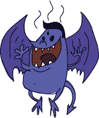

在实际中，使用这种过程非常常见。


事实上，我们可以通过完全省略 `randomIndex` 变量来简化此过程，直接写：

```
randomWords[Math.floor(Math.random() * 4)];
"Princess"
```

### 完整的决策者

现在，让我们创建一个短语数组，并使用这段代码来随机选择其中一个。这就是我们的决策者！我在这里使用注释来展示你可能想问电脑的一些问题。

```javascript
var phrases = [
  "That sounds good",
  "Yes, you should definitely do that",
  "I'm not sure that's a great idea",
  "Maybe not today?",
  "Computer says no."
];
// 我应该再来一杯奶昔吗？
phrases[Math.floor(Math.random() * 5)];
"I'm not sure that's a great idea"
// 我应该做我的作业吗？
phrases[Math.floor(Math.random() * 5)];
"Maybe not today?"
```

在这里我们创建了一个名为 `phrases` 的数组，它存储了不同的建议。现在，每当我们有一个问题时，都可以从 `phrases` 数组中获取一个随机值，它将帮助我们做出决定！

注意，因为我们的决策数组有五个项目，所以我们将 `Math.random()` 乘以 `5`。这将始终返回五个索引位置之一：0, 1, 2, 3 或 4。

### 创建一个随机侮辱生成器

我们可以扩展决策者的示例，创建一个每次运行运行时都会生成一个随机侮辱的程序！

```javascript
var randomBodyParts = ["Face", "Nose", "Hair"];
  var randomAdjectives = ["Smelly", "Boring", "Stupid"];
  var randomWords = ["Fly", "Marmot", "Stick", "Monkey", "Rat"];

  // 从 randomBodyParts 数组中随机选择一个身体部位：
➊ var randomBodyPart = randomBodyParts[Math.floor(Math.random() * 3)];
  // 从 randomAdjectives 数组中随机选择一个形容词：
➋ var randomAdjective = randomAdjectives[Math.floor(Math.random() * 3)];
  // 从 randomWords 数组中随机选择一个单词：
➌ var randomWord = randomWords[Math.floor(Math.random() * 5)];
  // 将所有随机字符串组合成一句话：
  var randomInsult = "Your " + randomBodyPart + " is like a " + 
  randomAdjective + " " + randomWord + "!!!";
  randomInsult;
  "Your Nose is like a Stupid Marmot!!!"
```

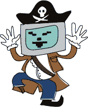

在这里有三个数组，在行 ➊、➋ 和 ➌ 中，我们使用三个索引从每个数组中提取一个随机单词。然后，我们将它们全部组合到变量 `randomInsult` 中，创建一个完整的侮辱。在 ➊ 和 ➋ 我们乘以 3，是因为 `randomAdjectives` 和 `randomBodyParts` 都包含三个元素。同样，我们在 ➌ 处乘以 5，是因为 `randomWords` 的长度为五个。注意，我们在 `randomAdjective` 和 `randomWord` 之间添加了一个带空格的字符串。尝试运行几次这段代码——你每次都会得到一个不同的随机侮辱！

### 试试看！

如果你想表现得更聪明一点，可以将第 ➌ 行替换为以下代码：

```javascript
var randomWord = randomWords[Math.floor(Math.random() * 
randomWords.length)];
```

我们知道总是需要将 `Math.random()` 乘以数组的长度，所以使用 `randomWords.length` 意味着即使数组长度发生变化，我们也不需要修改代码。

另一种构建随机侮辱的方法：

```javascript
var randomInsult = ["Your", randomBodyPart, "is", "like", "a", 
randomAdjective, randomWord + "!!!"].join(" ");
"Your Hair is like a Smelly Fly!!!"
```

在这个示例中，句子的每个单词都是数组中独立的字符串，我们用空格字符将它们连接起来。只有一个地方我们*不*想要空格，那就是 `randomWord` 和 `"!!!"` 之间。在这种情况下，我们使用 `+` 运算符来连接这两个字符串且不留空格。

## 你学到的知识

正如你所看到的，JavaScript 数组是存储值列表的一种方式。现在你知道如何创建和操作数组，并且有许多访问它们元素的方法。

数组是 JavaScript 提供将多个值整合到一个地方的方式之一。在下一章，我们将学习对象（objects），它是将多个值存储为单个单元的另一种方式。对象使用*字符串键*来访问元素，而不是数字索引。

# 编程挑战

尝试这些挑战来练习你在本章中学到的技能。

**#1: 新的侮辱**

用你自己的词汇集创建一个属于你自己的随机侮辱生成器。

**#2: 更复杂的侮辱**

扩展随机侮辱生成器，让它生成诸如“Your [身体部位] is more [形容词] than a [动物]’s [动物身体部位]”这样的侮辱。（提示：你需要创建另一个数组。）

**#3: 使用 + 还是 JOIN?**

制作两个版本的随机侮辱生成器：一个使用 `+` 运算符创建字符串，另一个是使用其他方法创建的（注：原文此处可能漏词，应为 join）。

**#4: 连接数字**

你如何使用 `join` 方法将一个包含 1, 2 和 3 的数组转换为字符串？


在我们的第一个对象中，我们为每个键都加上了引号，但你并不一定需要给键加上引号——这也是有效的 `cat` 对象字面量：

```javascript
var cat = {
  legs: 3,
  name: "Harmony",
  color: "Tortoiseshell"
};
```

JavaScript 知道键将始终是字符串，这就是为什么你可以省略引号。如果你不给键加引号，那么未加引号的键必须遵循与变量名相同的规则：例如，未加引号的键中不允许出现空格。如果你给键加上引号，就可以允许空格：

```javascript
var cat = {
  legs: 3,
  "full name": "Harmony Philomena Snuggly-Pants Morgan",
  color: "Tortoiseshell"
};
```

注意，虽然键始终是一个字符串（无论是否带引号），但该键的值可以是任何类型，甚至可以是包含某个值的变量。


你也可以将整个对象放在一行上，但那样读起来可能更困难：

```javascript
var cat = { legs: 3, name: "Harmony", color: "Tortoiseshell" };
```

# 访问对象中的值

你可以使用方括号访问对象中的值，就像访问数组一样。唯一的区别是，你使用的不是索引（数字），而是键（字符串）。

```javascript
cat["name"];
"Harmony"
```

就像在创建对象字面量时键的引号是可选的，在访问对象中的键时引号也是可选的。不过，如果你不使用引号，代码看起来会稍微不同：

```javascript
cat.name;
"Harmony"
```

这种风格被称为 `点表示法`（dot notation）。我们不需要在对象名后的方括号内输入字符串键名，而是使用一个点，后面跟着键，不需要任何引号。与对象字面量中的未加引号的键一样，只有当键不包含任何特殊字符（如空格）时，这种方法才有效。

与其通过输入键查找值，假设你想获取对象中所有键的列表。JavaScript 提供了一个简单的方法来实现，使用 `Object.keys()`：

```javascript
var dog = { name: "Pancake", age: 6, color: "white", bark: "Yip yap yip!" };
var cat = { name: "Harmony", age: 8, color: "tortoiseshell" };
Object.keys(dog);
["name", "age", "color", "bark"]
Object.keys(cat);
["name", "age", "color"]
```

`Object.keys(anyObject)` 返回一个包含 `anyObject` 所有键的数组。

# 向对象添加值

空对象就像空数组一样，但它使用大括号 `{ }` 而不是方括号 `[]`：

```javascript
var object = {};
```

你可以像向数组添加项一样向对象添加项，但你使用的是字符串而不是数字：

```javascript
var cat = {};
cat["legs"] = 3;
cat["name"] = "Harmony";
cat["color"] = "Tortoiseshell";
cat;
{ color: "Tortoiseshell", legs: 3, name: "Harmony" }
```

在这里，我们从一个名为 `cat` 的空对象开始。然后我们逐个添加了三个键值对。然后，我们输入 `cat;`，浏览器就会显示对象的内容。不过，不同的浏览器输出对象的方式可能不同。例如，Chrome（在我写这段文字时）输出的 `cat` 对象如下：

```javascript
Object {Legs: 3, name: "Harmony", Color: "TortoisesheLL"}
```

虽然 Chrome 按该顺序（`legs`, `name`, `color`）打印键，但其他浏览器可能会以不同的方式打印。这是因为 JavaScript 存储对象时并不按任何特定顺序存储。

数组显然有特定的顺序：索引 0 在索引 1 之前，索引 3 在索引 2 之后。但对于对象，没有明显的方法来为每个项排序。`color` 应该在 `legs` 之前还是之后？这个问题没有“正确”的答案，所以对象简单地存储键而不为其分配任何特定顺序，结果不同的浏览器将以不同的顺序打印键。出于这个原因，你永远不要编写依赖于对象键精确顺序的程序。

## 使用点表示法添加键

在添加新键时也可以使用点表示法。让我们尝试上一个例子，我们从一个空对象开始并其中添加键，但这次我们使用使用点表示法：

```javascript
var cat = {};
cat.legs = 3;
cat.name = "Harmony";
cat.color = "Tortoiseshell";
```

如果你请求一个 JavaScript 不知道的属性，它会返回特殊值 `undefined`。`undefined` 仅仅意味着“这里什么都没有！”例如：

```javascript
var dog = {
  name: "Pancake",
  legs: 4,
  isAwesome: true
};
dog.isBrown;
undefined
```

在这里我们为 `dog` 定义了三个属性：`name`、`legs` 和 `isAwesome`。我们没有定义 `isBrown`，所以 `dog.isBrown` 返回 `undefined`。


# 结合数组和对象

到目前为止，我们只看了包含简单类型（如字符串）的数组和对象。但没有什么阻止你使用数组作为值。例如，一个对象数组可能看起来这样：

```javascript
var dinosaurs = [
  { name: "Tyrosaurus Rex", period: "Cretaceous" },
  { name: "Stegosaurus", period: "Jurassic" },
  { name: "Plateosaurus", period: "Triassic" }
];
```

要获取第一条恐龙的信息，你可以使用我们用过的技术，在方括号中输入索引：

```javascript
dinosaurs[0];
```

如果你想获取第一条恐龙的名字，你可以在方括号中添加键：

```javascript
dinosaurs[0]["name"];
"Tyrosaurus Rex"
```

或者，你可以使用点表示法，例如：

```javascript
dinosaurs[1].period;
"Jurassic"
```

### 注意

你只能对对象使用点表示法，不能对数组使用。

## 朋友数组

现在来看一个更复杂的例子。我们将创建一个朋友数组，其中每个对象也包含一个数组。

```javascript
var anna = { name: "Anna", age: 11, luckyNumbers: [2, 4, 8] };
var dave = { name: "Dave", age: 5, luckyNumbers: [3, 9] };
var kate = { name: "Kate", age: 9, luckyNumbers: [1, 2, 3] };
```

首先，我们创建三个对象并将它们保存到变量 `anna`、`dave` 和 `kate` 中。每个对象都有三个键：`name`、`age` 和 `luckyNumbers`。每个 `name` 键都分配了一个字符串值，每个 `age` 键都分配了一个数字值，每个 `luckyNumbers` 键都分配了一个包含几个数字的数组。

接下来我们将创建一个朋友的数组：

```javascript
var friends = [anna, dave, kate];
```

现在我们有一个保存到变量 `friends` 的数组，其中有三个元素：`anna`、`dave` 和 `kate`（它们分别引用对象）。你可以使用它们在数组中的索引获取这些对象之一：

```javascript
friends[1];
{ name: "Dave", age: 5, luckyNumbers: Array[3] }
```

这获取了数组中的第二个对象 `dave`（索引为 1）。Chrome 为 `luckyNumbers` 数组打印 `Array[3]`，这只是它表示“这是一个包含三个元素的数组”的方式。（你可以使用 Chrome 查看该数组中包含什么；参见在控制台中探索对象）。我们也可以通过在方括号中输入对象的索引，后跟上我们想要的键，来获取对象内部的值：

```javascript
friends[2].name
"Kate"
```

这段代码请求了索引为 2 的元素，即名为 `kate` 的变量，然后请求了该对象中键为 `"name"` 的属性，该属性的值为 `"Kate"`。我们甚至可以从 `friends` 数组内部某一个对象内部的数组中获取一个值，如下所示：

```javascript
friends[0].luckyNumbers[1];
4
```


图 4-2 显示了每个索引。`friends[0]` 是 `friends` 数组索引为 0 的元素，即对象 `anna`。`friends[0].luckyNumbers` 是来自对象 `anna` 的数组 `[2, 4, 8, 16]`。最后，`friends[0].luckyNumbers[1]` 是该数组中索引为 1 的元素，即数值 `4`。

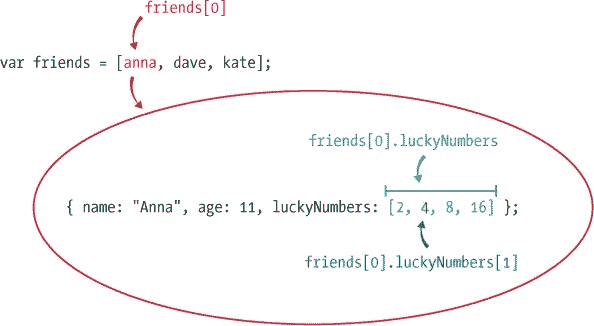

图 4-2. 访问嵌套值

# 在控制台中探索对象

Chrome 允许你深入研究那些在控制台中打印的对象。例如，如果你输入 . . .

```
friends[1];
```

Chrome 将显示如图 4-3 所示的输出。

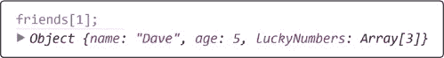

图 4-3. 对象在 Chrome 解释器中的显示方式

左侧的三角形意味着该对象可以展开。点击对象即可展开，你将看到如图 4-4 所示的内容。

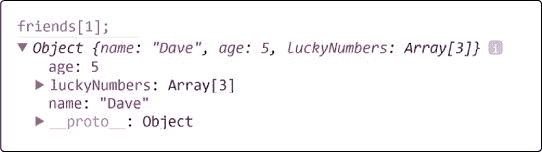

图 4-4. 展开对象

你也可以通过点击 `luckyNumbers` 来展开它（参见图 4-5）。

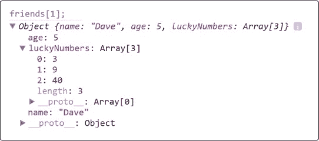

图 4-5. 展开对象中的数组

不要担心那些 `__proto__` 属性——它们与对象的`原型`有关。我们稍后的第 12 章中介绍原型。此外，你会注意到解释器显示了数组的 `length` 属性值。

你还可以查看整个 `friends` 数组并展开数组中的每个元素，如图 4-6 所示。

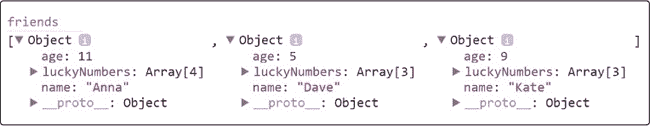

图 4-6. 如 Chrome 解释器所示，friends 数组中的三个对象。

# 对象的实用操作

现在你已经知道了创建对象和向它们添加属性的几种方法，让我们通过尝试一些简单的程序来运用所学吧。

## 记录欠款

假设你决定开一家银行。你向朋友借钱，并想找个办法记录他们每人欠你多少钱。

你可以使用对象作为将字符串和值关联起来的方法。在这种情况下，字符串将是你朋友的名字，而值将是他或她欠你的金额。让我们来看：

```
➊ var owedMoney = {};
➋ owedMoney["Jimmy"] = 5;
➌ owedMoney["Anna"] = 7;
➍ owedMoney["Jimmy"];
  5
➎ owedMoney["Jinen"];
  undefined
```

在 ➊ 处，我们创建了一个名为 `owedMoney` 的新空对象。在 ➋ 处，我们将值 `5` 分配给键 `"Jimmy"`。我们在 ➌ 处执行同样的操作，将值 `7` 分配给键 `"Anna"`。在 ➍ 处，我们获取与键 `"Jimmy"` 关联的值，即 `5`。然后在 ➎ 处，我们获取与键 `"Jinen"` 关联的值，由于我们没有设置它，它是 `undefined`。

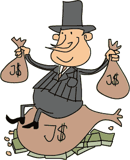

现在想象一下 Jimmy 又借了一些钱（比如 3 美元）。我们可以使用你在第 2 章中看到的加等赋值运算符 (`+=`) 更新我们的对象，并在 Jimmy 欠的金额上加上 3。

```
owedMoney["Jimmy"] += 3;
owedMoney["Jimmy"];
8
```

这相当于说 `owedMoney["Jimmy"] = owedMoney["Jimmy"] + 3`。我们也可以查看整个对象，看看每个朋友欠我们多少钱：

```
owedMoney;
{ Jimmy: 8, Anna: 7 }
```

## 存储电影信息

假设你有一部电影收藏。你想存储关于每部电影的一些信息，例如发行年份、时长和演员。你可以使用对象，其中每个键是电影标题，值是包含细节的对象。

```
var movies = {
  "Finding Nemo": {
    releaseDate: 2003,
    duration: 100,
    actors: ["Albert Brooks", "Ellen DeGener", "Alexander Gould"]
  },
  "Star Wars: Episode VI - Return of Jedi": {
    releaseDate: 1983,
    duration: 134,
    actors: ["Mark Hamill", "Harrison Ford", "Carrie Fisher"]
  },
  "Harry Potter and the Goblet of Fire": {
    releaseDate: 2005,
    duration: 157,
    actors: ["Daniel Radcliffe", "Emma Watson", "Rupert Grint"]
  }
};
```

现在，当你想要关于*《海底总动员》的信息时，很容易找到：

```
var findingNemo = movies["Finding Nemo"];
findingNemo.duration;
100
findingNemo.format;
"DVD"
```

你也可以轻松地向收藏中添加新电影：

```
var cars = {
  releaseDate: 2006,
  duration: 117,
  actors: ["Owen Wilson", "Bonnie Hunt", "Paul Newman"],
  format: "Blu-ray"
};
movies["Cars"] = cars;
```

在这里我们创建了一个关于*汽车总动员*的新对象。然后将其插入到 `movies` 对象中，键 `"Cars"` 下。

现在你正在建立自己的收藏，你可能想要一种简单的方法来列出电影名称。这时 `Object.keys` 就派上用场了：

```
Object.keys(movies);
["Finding Nemo", "Star Wars: Episode VI - Return of Jedi", "Harry Potter and the Goblet of Fire", "Cars"]
```

# 你学到了什么

现在你已经看到了 JavaScript 中对象是如何工作的。它们非常像数组，因为你可以使用它们将许多信息组合在一个单元中。一个主要区别是，你使用字符串来访问对象中的元素，而使用数字来访问数组中的元素。由于这个原因，数组是有序的，而对象不是。

在学习了更多 JavaScript 的功能后，我们将在后面的章节中对对象进行更多操作。在下一章中，我们将学习*条件语句*和*循环`，它们都是为程序添加结构使其更强大的方法。

# 编程挑战

尝试这些挑战来练习操作对象。

**#1: 计分员**

想象你正在和一些朋友玩游戏，你想记录分数。创建一个名为 `scores` 的对象。键将是朋友的名字，值将是分数（都从 0 开始）。随着玩家得分，你必须增加他们的分数。你如何增加 `scores` 对象中玩家的分数？

**#2: 深入挖掘对象和数组**

假设你有以下对象：


```
var myCrazyObject = {
  "name": "A ridiculous object",
  "some array": [7, 9, { purpose: "confusion", number: 123 }, 3.3],
  "random animal": "Banana Shark"
};
```

你会如何用一行 JavaScript 代码从这个对象中提取数字 `123` 呢？在控制台中尝试一下，看看你是否正确。

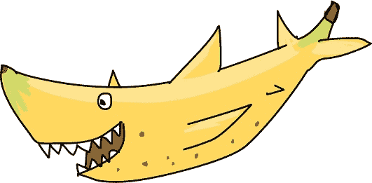

# 第 5 章.HTML 基础

我们目前为止使用的基于浏览器的 JavaScript 控制非常适合尝试短代码段，但为了创建实际程序，我们需要更灵活一些的东西，例如包含了一些 JavaScript 的网页。在本章中，我们将学习如何创建一个基础的 HTML 网页。

`HTML（超文本标记语言）` 是用于制作网页的语言。`HyperText`（超文本）一词指的是通过 `hyperlinks`（超链接）连接的文本，即网页上的链接。`markup language`（标记语言）用于注释文档，使其不仅仅是纯文本。标记告诉软件（如网络浏览器）如何显示文本以及对它进行什么。

在本章中，我将向你展示如何在 `文本编辑器` 中编写 HTML 文档，这是一种用于编写纯文本文件的简单程序，不包含 Microsoft Word 等文字处理器中的那种格式。文字处理文档包含`格式化`文本（具有不同的字体、字体颜色、字体大小等），而文字处理器的设计是为了方便更改文本格式。文字处理器通常还允许你插入图像和图形。

纯文本文件只包含文本，不包含任何关于字体、颜色、大小等信息。你无法在文本文件中放入图像，除非你用文本制作它——例如这只猫。

```
 /\_/\
=( °w° )=
  )   (  //
 (__ __)//
```

## 文本编辑器

我们使用`跨平台`（兼容 Windows、Mac OS 和 Linux）的 Sublime Text 编辑器来编写 HTML。你可以免费下载并使用 Sublime Text，但过了一段时间它会要求你支付许可费用。如果你不喜欢这个主意，我在下方列出了一些完全免费的替代方案。本章中的指令针对 Sublime Text，但由于文本编辑器相对简单，这些指令对任何编辑器都基本适用。

*   `Gedit` 是来自 GNOME 项目的跨平台文本编辑器（[`wiki.gnome.org/Apps/Gedit/`](https://wiki.gnome.org/Apps/Gedit/)`）。
*   对于 Microsoft Windows，`Notepad++`（[`notepad-plus-plus.org/`](http://notepad-plus-plus.org/)）是另一个良好的替代方案。
*   在 Mac OS 上，`TextWrangler`（[`www.barebones.com/products/textwrangler/`](http://www.barebones.com/products/textwrangler/)）是一个不错的选择。

要安装 Sublime Text，请访问 `[`www.sublimetext.com/`](http://www.sublimetext.com/)`。每个操作系统的安装说明都不同，但你应该发现它们非常清晰。如果你遇到任何问题，请尝试 Sublime Text 主页的支持部分。

## 语法高亮

Sublime Text 会通过`语法高亮`为你的程序着色。其设计目的是通过为不同代码分配不同的颜色，让程序更容易被程序员阅读。例如，字符串可能是绿色的，而关键字 `var` 可能是橙色的。

Sublime Text 有许多配色方案可供选择。在书中，我们使用 `IDLE` 配色方案，你可以通过`Preferences（首选项）▸Color Scheme（配色方案）` 在你的屏幕上匹配它。

## 我们的第一个 HTML 文档

一旦安装了 Sublime Text，启动程序并通过 `File（文件）▸New File（新建文件）`创建一个新文件。接下来，选择 `File（文件）▸Save（保存）` 保存你的新空白文件；将其命名为 `page.html` 并保存到桌面上。

现在是写一些 HTML 了。在你的 `page.html` 文件中输入以下文本：

```
<h1>Hello world!</h1>
<p>My first web page.</p>
```

使用 `File（文件）▸Save（保存）` 保存你更新后的 `page.html` 版本。现在让我们看看该页面在浏览器中像什么样。打开 Chrome，选择 `File（文件）▸Open File（打开文件）`，并在桌面上选择 `page.html`。你应该看到类似图 5-1 的内容。

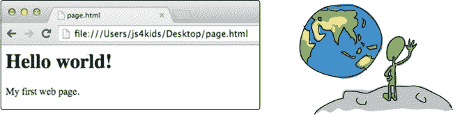

你刚刚创建了第一个 HTML 文档！尽管你是在网页浏览器中查看它，但它实际上不在互联网上。Chrome 在本地打开你的页面，并只是读取你的标记标签以确定对文本做什么。

## 标签和元素

HTML 文档由`elements（元素）`组成。一个元素以`start tag（起始标签）`开始并以`end tag（结束标签）`结束。例如，在我们目前为止的文档两个元素：`h1` 和 `p`。`h1` 元素以起始标签 `<h1>` 开始，以结束标签 `</h1>` 结束。`p` 元素以起始标签 `<p>` 开始，以结束标签 `</p>` 结束。开启标签和关闭标签之间的任何内容都是元素的内。

起始标签由角括号 `<` 和 `>` 包围的元素名称组成。结束标签也一样，但在元素名称之前有一个正斜杠 `/`。

## 标题元素

每个元素都有特殊的含义和用途。例如，`h1` 元素意味着“这是一个一级标题”。你放在 `<h1>` 和 `</h1>` 标签之间的内容将由浏览器显示在单独的一行中，使用大号、粗体字体。

HTML 中有六级标题元素：`h1`、`h2`、`h3`、`h4`、`h5` 和 `h6`。它们看起来像这样：

```
<h1>First-level heading</h1>
<h2>Second-level heading</h2>
<h3>Third-level heading</h3>
<h4>Fourth-level heading</h4>
<h5>Fifth-level heading</h1>
<h6>Sixth-level heading</h6>
```

图 5-2 显示了标题在网页上的样子。

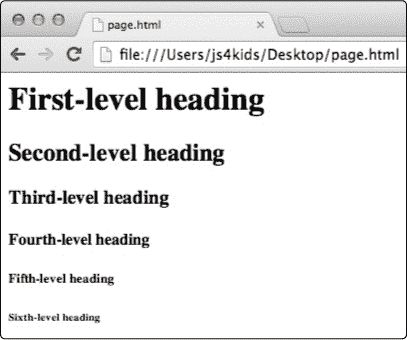

## p 元素

`p` 元素用于定义独立的文本段落。你放在 `<p>` 标签之间的任何文本将显示在独立的段落中，并在段落上方和下方留有一些空间。让我们尝试创建多个 `p` 元素。向你的 `page.html` 文档添加此新行（旧行以灰色显示）：

```
<h1>Hello world!</h1>
<p>My first web page.</p>
<p>Let's add another paragraph.</p>
```

图 5-3 显示了带有新段落的网页。

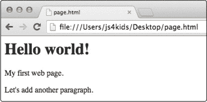

注意，段落出现在不同的行，并被一些空间隔开。这都是由于 `<p>` 标签的。

## HTML 中的空白字符和块级元素

如果没有标签，我们的页面会什么样？让我们来看一下：

```
Hello world!
My first web page.
Let's add another paragraph.
```

图 5-4 显示了我们没有任何标签的页面。

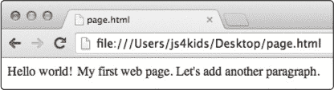

哦不！我们不仅丢失了格式，所有内容都挤在一行长了！这是因为在 HTML 中，所有的空白字符都会合并成单个空格。空白字符指的是任何在页面上产生空白的字符——例如，空格字符、制表符和换行符（当你按下 ENTER 或 RETURN 键时插入的字符）。你在 HTML 文档中在两段文本之间插入的任何空行都会合并成单个空格。


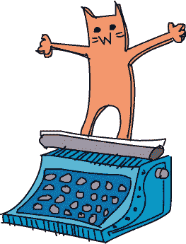

`p` 和 `h1` 元素被称为 `block-level`（块级）元素，因为它们在独立的块中显示内容，从新行开始，并且随后的任何内容也会另起一行。

## 行内元素

让我们为我们的文档添加另外两个元素，`em` 和 `strong`：

```
<h1>Hello world!</h1>
<p>My <em>first</em> <strong>web page</strong>.</p>
<p>Let's add another <strong><em>paragraph</em></strong>.</p>
```

图 5-5 显示了使用新标签后的页面外观。

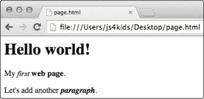

图 5-5。`em` 和 `strong` 元素。

`em` 元素使其内容变为斜体。`strong` 元素使其内容变为粗体。`em` 和 `strong` 元素都是 `inline`（行内）元素，这意味着它们不会像块级元素那样将内容置于新行。

要使内容既**加粗**又*斜体*，请将其放在两个标签内部。注意在上一个示例中，加粗斜体文本的标签顺序顺序为：`<strong><em>paragraph</em></strong>`。正确地`nest`（嵌套）元素非常重要。嵌套意味着如果一个元素位于另一个元素内部，它的开始和结束标签都应该在父元素内部。例如，这种是不允许的：

```
<strong><em>paragraph</strong></em>
```

在这种情况下，闭合标签 `</strong>` 排在闭合标签 `</em>` 之前。浏览器通常不会在你犯下这种错误时提醒你，但嵌套错误可能会导致你的页面以奇怪的方式崩溃。

## 完整的 HTML 文档

到目前为止，我们看到的只是 HTML 的片段。一个完整的 HTML 文档需要一些额外的元素。让我们来看一个完整 HTML 文档的示例以及每个部分的含义。用这些新元素更新你的 `page.html` 文件：

```
<!DOCTYPE html>
<html>
<head>
    <title>My first proper HTML page</title>
</head>

<body>
    <h1>Hello world!</h1>
    <p>My <em>first</em> <strong>web page</strong>.</p>
    <p>Let's add another <strong><em>paragraph</em></strong></p>
</body>
</html>
```

字体 注意

*Sublime Text 应该会自动为你对某些行进行缩进，如示例所示。它实际上是根据标签（如 `<html>`、`<h1>` 等）识别行，并根据嵌套情况进行缩进。不过，Sublime Text 不会对 <head> 和 <body> 标签进行缩进，某些编辑器会这样做。*

图 5-6 显示完整的 HTML 文档。

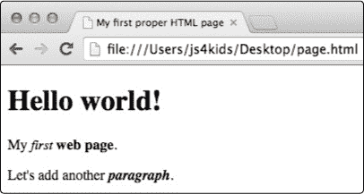

图 5-6。完整的 HTML 文档。

让我们浏览一下 `page.html` 文件中的元素。`<!DOCTYPE html>` 标签只是一个声明。它简单地说：“这是一个 HTML 文档。”接下来是起始标签 `<html>`（闭合标签 `</html>` 在最末尾）。所有的 HTML 文档必须以 `html` 元素作为最外层元素。

`html` 元素内部有两个元素：`head` 和 `body`。`head` 元素包含关于你的 HTML 文档的某些信息，例如包含文档标题的 `title` 元素。例如，注意在图 5-6 中，浏览器标签页标题—“My first proper HTML page”—与我们在 `title` 元素中输入的内容匹配。`title` 元素包含在 `head` 元素中，而 `head` 包含在 `html` 元素中。

`body` 元素包含了浏览器中显示的内容。在这里，我们只是复制了章节之前的 HTML。

## HTML 层级结构

HTML 元素具有清晰的层级结构（或顺序），可以被视为一种倒置的树。你可以在图 5-7 中看到我们的文档作为树的样子。

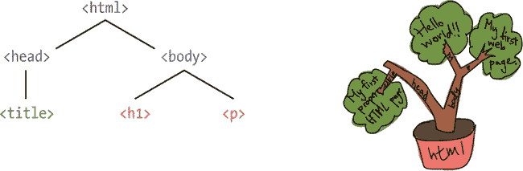

图 5-7。来自图 5-6 的元素，以树的形式显示。

顶层元素是 `html` 元素。它包含了 `head` 和 `body` 元素。`head` 包含 `title` 元素。`body` 包含 `h1` 和 `p` 元素。图 5-8 显示了 `em` 和 `strong` 元素。

## 在你的 HTML 中添加链接

在本章之前，我们学到 `HTML` 代表 *HyperText Markup Language*（超文本标记语言）。HTML 文档可以包含*超链接*（简称 hyperlinks），它们可以带你跳转到其他页面。`a` 元素（锚点）创建一个链接。


现在重新加载页面。当你将鼠标悬悬停在链接上时，你应该看到文本“xkcd: Land of geeky comics!”悬浮在页面上方，如图 5-11 所示。

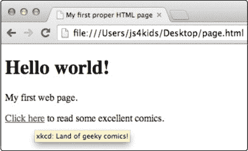

图 5-11. 一个包含带有 title 属性的 [`xkcd.com/`](http://xkcd.com/) 的网页

### 试试看！

创建一个名为 `links.html` 的新文件。它应该包含与我们的 `page.html` 相同的 HTML 结构，但有新的标题、标题以及三个段落（`p`元素）。在每个段落中，包含一个指向你最喜欢的网站的链接。确保所有的 `a` 元素都有 `href` 和 `title` 属性。

# 你学到了什么

在本章中，你学习了 HTML 的基础，这是用于创建网页的语言。我们创建了一个包含指向另一个页面链接的简单页面。

在下一章中，我们将学习如何向网页中嵌入 JavaScript。在我们接下来的几章节中探索 JavaScript 的更多功能时，这将使得创建更大的程序变得容易得多。

这是一本关于 JavaScript 的书，而不是 HTML，所以我只介绍了创建 HTML 文档的最基础知识。以下是你可以在那里学习更多关于 HTML 的资源：

*   Mozilla 开发者网络的 HTML 简介：[`developer.mozilla.org/en-US/docs/Web/Guide/HTML/Introduction`](https://developer.mozilla.org/en-US/docs/Web/Guide/HTML/Introduction)
*   Codecademy 的 HTML 和 CSS 课程：[`www.codecademy.com/tracks/web/`](http://www.codecademy.com/tracks/web/)
*   Mozilla Webmaker：[`webmaker.org/`](https://webmaker.org/)

# 第 6 章 条件判断与循环

条件和循环是 JavaScript 中最重要的两个概念之一。条件 说：“如果某事为 `true`，则执行此。否则，执行那个。”例如，如果你完成了作业，就可以吃冰淇淋，但如果你没有完成作业，你就吃不到冰淇淋。`loop`（循环）说：“只要某事为 `true`，就一直这样做。”例如，只要你口渴，就一直喝水。

条件和循环是强大的概念，是任何复杂程序的关键。它们被称为控制结构，因为它们允许你根据定义的某些条件，控制代码的哪些部分何时以及以多大的频率执行。

我们首先需要介绍如何在 HTML 文件中嵌入 JavaScript，这样我们就可以开始创建比目前看到的更长的程序了。

# 在 HTML 中嵌入 JavaScript

这是我们在第 5 章 中创建的 HTML 文件，新增的部分用彩色表示，现有文本用灰色表示。（为了让这个示例简单一点，我删删除了指向 xkcd 的链接。）

```
<!DOCTYPE html>
<html>
<head>
    <title>我的第一个正式 HTML 页面</title>
</head>

<body>
    <h1>Hello world!</h1>
    <p>我的第一个网页。</p>
    <script>
    var message = "Hello world!";
    console.log(message);
    </script>
</body>
</html>
```

在这里我们添加了一个新元素，称为 `script`。这是 HTML 中的一个特殊元素。对于大多数 HTML 元素，开始和结束标签之间的内容显示在页面上。而对于 `script`，标签之间的所有内容都被视为 JavaScript 并由 JavaScript 解释器运行。

现在来看 `script` 元素内部的代码：

```
var message = "Hello world!";
➊ console.log(message);
```

在 HTML 文件中运行 JavaScript 与在控制台中运行非常不同。当你使用 JavaScript 控制台时，你输入的每行在按下回车键后立即运行，该行的值会打印到控制台上。在网页中，JavaScript 会从上到下一次性运行，除非我们告诉浏览器，否则没有内容会自动打印到控制台。我们可以使用 `console.log` 来打印内容，这将有助于我们在运行程序时更容易看到发生了什么。`console.log` 方法接收任何值并打印（或记录）该值到控制台。例如，如果你在打开 JavaScript 控制台的情况下从本节开始加载 HTML 文件，你会看到：

```
Hello world!
```

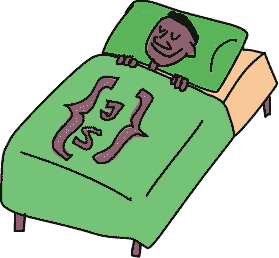

在 ➊ 调用 `console.log(message)`导致字符串 `"Hello world!"` 被打印到控制台上。

现在你已经如何用 JavaScript 编写更长的程序，可以开始学习条件判断了。

## 条件判断

JavaScript 中有两种形式条件语句：`if` 语句和 `if...else` 语句。`if` 语句用于在某事为 `true` 时执行代码。例如，如果你表现很好，就会得到奖励。`if...else` 语句在某事为 `true` 时执行一段代码，在不是 true 时执行另一段。例如，如果你表现很好，就会得到奖励；否则，你会被禁足。

## if 语句

`if` 语句是 JavaScript 控制结构中最简单的。它用于仅在条件为 `true` 时运行代码。回到你的 HTML 文件，将 `script` 元素内的两行替换为以下内容：

```
➊ var name = "Nicholas";
➋ console.log("Hello " + name);
➌ if (name.length > 7) {
➍   console.log("Wow, you have a REALLY long name!");
  }
```

首先，在 ➊ 处我们创建一个名为 `name` 的变量并将其值设置为字符串 `"Nicholas"`。然后我们在 ➋ 处使用 `console.log` 记录字符串 `"Hello Nicholas"`。

在 ➌ 处我们使用 `if` 语句检查 `name` 的长度是否大于 7。如果是，控制台将使用 ➍ 处的 `console.log` 显示 `"Wow, you have a REALLY long name!"`。

如图 6-1 所示，`if` 语句有两个主要部分：条件和体。条件应该是一个布尔值。体是一或多行 JavaScript 代码，当条件为 `true` 时会执行这些代码。

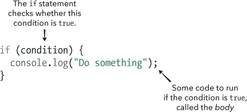

图 6-1. `if` 语句的通用结构。

当你加载带有此 JavaScript 的 HTML 页面时，你应该会在控制台中看到以下内容：

```
Hello Nicholas
Wow, you have a REALLY long name!
```

因为名字 `Nicholas` 有八个字符，`name.length` 返回 `8`。因此，条件 `name.length > 7` 为 `true`，这导致 `if` 语句体被执行，从而记录了这条有点令人惊讶的消息。为了避免触发 `if` 条件，将名字 `Nicholas` 改为 `Nick`（保持其他代码不变）：

```
var name = "Nick";
```

现在保存文件并重新加载页面。这次，条件 `name.length > 7` 为 `false`，因为 `name.length` 是 4。这意味着 `if` 语句体没有执行，打印到控制台上的只有这些内容：

```
Hello Nick
```

`if` 语句体仅在条件为 `true` 时才会执行。当条件为 `false` 时，解释器只是简单的跳过 `if` 语句并移动到下一行。

## if...else 语句

正如我之前说的，`if` 语句仅在条件为 `true` 时执行其体。如果你希望在条件为 `false` 时发生其他事情，你需要使用 `if...else` 语句。

让我们扩展之前的示例：

```
var name = "Nicholas";
console.log("Hello " + name);
if (name.length > 7) {
  console.log("Wow, you have a REALLY long name!"); }
else {
  console.log("Your name isn't very long.");
}
```

这与之前的作用相同，但如果名字不大于七个字符，它会打印一条备选消息。


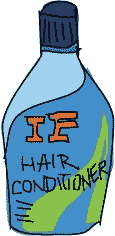

如图 6-2 所示，`if...else` 语句看起来像 `if` 语句，但有两个执行体。关键字 `else` 位于两个执行体之间。在 `if...else` 语句中，如果条件为 `true`，则执行第一个执行体；否则，执行第二个执行体。

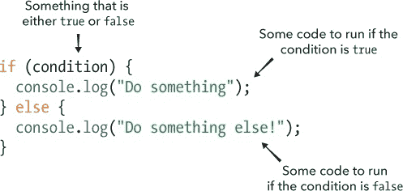

图 6-2. `if...else` 语句的通用结构

## 链式 if...else 语句

通常，我们需要检查一系列条件，并在其中一个条件为 `true` 时执行某些操作。例如，假设你正在点中餐，并选择吃什么。你最喜欢的中国菜是柠檬鸡，所以如果菜单上有，你就会点它。如果菜单上没有，你会点黑豆酱牛肉。如果*那个*也没有在菜单上，你会点糖醋排骨。在极少数情况下，如果这些选项一个都没有，你会点蛋炒饭，因为你知道你去的每家中餐厅都有这一道。

```
var lemonChicken = false;
var beefWithBlackBean = true;
var sweetAndSourPork = true;

if (lemonChicken) {
  console.log("Great! I'm having lemon chicken!");
} else if (beefWithBlackBean) {
  console.log("I'm having the beef.");
} else if (sweetAndSourPork) {
  console.log("OK, I'll have the pork.");
} else {
  console.log("Well, I guess I'll have rice then.");
}
```

要创建一个 `if...else` 语句链，从一个普通的 `if` 语句开始，在其执行体的右括号之后，输入关键字 `else if`，后面跟着另一个条件和另一个执行体。你可以一直这样做，直到条件用完；条件的数量没有限制。如果没有任何条件为 `true`，则执行最后的 `else` 部分。图 6-3 显示了一个通用的 `if...else` 语句链。

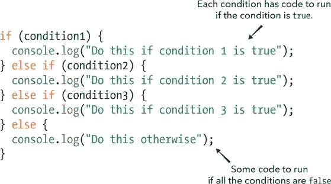

图 6-3. 多个 `if...else` 语句的链

你可以这样读取它：

1. 如果第一个条件为 `true`，执行第一个执行体。
2. 否则，如果第二个条件为 `true`，执行第二个执行体。
3. 否则，如果第三个条件为 `true`，执行第三个执行体。
4. 否则，执行 `else` 执行体。

当你有一个这样一个带有最终 `else` 部分的 `if...else` 语句链时，你可以确保有一个（且只有一个）执行体会被执行。一旦发现 `true` 条件，与其相关的执行体就会被执行，不再检查其他任何条件。如果我们运行上一个示例中的代码，控制台将打印 `I'm having the beef`，因为 `beefWithBlackBean` 是 `if...else` 链中发现的第一个 `true` 条件。如果没有没有任何条件为 `true`，则执行 `else` 执行体。

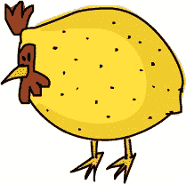

还有另一点需要注意：你不一定非包含最后的 `else`。但是，如果不包含，且没有任何条件为 `true`，那么 `if...else` 链中的任何内容都不会被执行。

```
var lemonChicken = false;
var beefWithBlackBean = false;
var sweetAndSourPork = false;

if (lemonChicken) {
  console.log("Great! I'm having lemon chicken!");
} else if (beefWithBlackBean) {
  console.log("I'm having the beef.");
} else if (sweetAndSourPork) {
  console.log("OK, I'll have the pork.");
}
```

在这个示例中，我们省略了最后的 `else` 部分。因为你喜喜欢的食物一个都没有，所以什么都没有打印出来（看起来你没东西吃了！）。

### 尝试一下！

编写一个带有 `name` 变量的程序。如果 `name` 是你的名字，打印 `Hello me!`；否则打印 `Hello stranger!`。（提示：使用 `===` 来比较 `name` 和你的名字。）

接下来，重写该程序，使得如果 `name` 设置为你父亲的名字，就对他说你好；如果 `name` 是你妈妈的名字，就对她说你好。如果两者都不是，则像以前一样说 `Hello stranger!`。

## 循环

正如我们所，，判断允许你在条件为 `true` 时运行一次代码。相反，循环允许你多次运行一段代码。

## while 循环

最简单的循环类型是 `while` 循环。如图 6-4 所示，`while` 循环以 `while` 关键字开始，后面跟着括号中的一个条件。如果条件为 `true`，则执行大括号中的执行体。

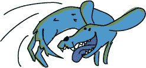

图 6-4. `while` 循环的通用结构

类似于 `if` 语句，如果条件为 `true`，`while` 循环的执行体就会执行。与 `if` 语句不同，执行体执行后会再次检查条件。这个循环持续下去。

### 使用 while 循环数羊

假设你有睡眠困难，想数羊。但为什么不写个程序呢？

```
var sheepCounted = 0;
while (sheepCounted < 10) {
  console.log("I have counted " + sheepCounted + " sheep!");
  sheepCounted++;
}
```

我们创建一个名为 `sheepCounted` 的变量并将其值设置为 0。当我们到达 `while` 循环时，检查 `sheepCounted` 是否小于 10。因为 0 小于 10，大括号内的代码（执行体）运行，记录 `"I have counted " + sheepCounted + " sheep!"` 为“I have counted 0 sheep!”。接下来，`sheepCounted++` 将 `sheepCounted` 的值加 1，我们回到循环开头，反复反复：

```
I have counted 0 sheep!
I have counted 1 sheep!
I have counted 2 sheep!
I have counted 3 sheep!
I have counted 4 sheep!
I have counted 5 sheep!
I have counted 6 sheep!
I have counted 7 sheep!
I have counted 8 sheep!
I have counted 9 sheep!
```

这会一直重复直到 `sheepCounted` 变成 10，此时条件变为 `false`（10 不小于 10），程序移动到循环之后的任何内容。在这种情况下，它打印 `Zzzzzzzzz`。

### 防止死循环

在使用循环时记住这一点：如果你设置的条件永远不会变为 `false`，你的循环将无限循环下去（至少直到你关闭浏览器）。例如，如果你漏掉了 `sheepCounted++;` 这一行，那么 `sheepCounted` 将保持为 0，输出将如下：

```
I have counted 0 sheep!
I have counted 0 sheep!
I have counted 0 sheep!
I have counted 0 sheep!
...
```

因为没有东西可以停止它，程序将永远这样做下去！这被称为 *无限循环*。


`for` 循环使得编写循环变得更加容易，这种循环可以创建一个变量、循环直到条件为 `true`（真），并在每次循环结束时更新该变量。在设置一个 `for` 循环时，你会创建一个变量，指定条件，并说明该变量在每个循环后应该如何变化——这一切在你进入循环体之前就完成了。例如，这里是我们使用 `for` 循环来数羊的方法：

```
for (var sheeped = 0; sheeped < 10; sheeped++) {
  console.log("I have counted " + sheeped + " sheep!");
}
console.log("Zzzzzzz");
```
正如图 6-5 所示的 for 循环通用结构所示，这个 `for` 循环包含三个部分，用分号分隔：初始化、条件和递增。


### 图 6-5. for 循环的通用结构

`setup`（`var sheeped = 0`）在循环开始之前运行。它通常用于创建一个变量来跟踪循环运行的次数。在这里，我们创建了初始值为 `0` 的变量 `sheeped`。`condition`（`sheeped < 10`）在每次执行循环体之前进行检查。如果为 `true`，则执行体；如果为 `false`，一旦 `sheeped` 不再小于 10，循环就会停止。`increment`（`sheeped++`）在每次执行循环体后运行。它通常用于更新循环变量。在这里，我们使用它每次给 `sheeped` 加 1。

`for` 循环通常用于执行固定次数的操作。例如，这个程序将说三次 `Hello!`。

```
var timesSayHello = 3;
for (var i = 0; i < timesSayHello; i++) {
  console.log("Hello!");
}
```
这里是输出结果：
```
Hello!
Hello!
Hello!
```
如果 JavaScript 解释器运行这段代码，它会首先创建一个名为 `timesSayHello` 的变量并将其设置为 3。当我们到达 `for` 循环时，我们运行初始化部分，创建了一个变量 `i` 并将其设置为 0。因为 `i` 等于 0 且 `timesSayHello` 是 3，条件为 `true`，所以我们进入循环体，它只是输出字符串 `"Hello!"`。然后我们运行递增部分，将 `i` 增加到 1。现在再次检查条件。它仍然是 `true`，所以我们运行循环体并再次递增。这种情况会反复发生，直到 `i` 等于 3。此时，条件为 `false`（3 并不小于 3），因此我们退出循环。

### 在数组和字符串中使用 for 循环

`for` 循环的一个非常常见的用途是对数组中的每个元素或字符串中的每个字符进行某种操作。例如，这里有一个 `for` 循环可以打印出动物园里的动物：

```
var animals = ["Lion", "Flamingo", "Polar Bear", "Boa Constrictor"];

for (var i = 0; i < animals.length; i++) {
  console.log("This zoo contains a " + animals[i] + ".");
}
```
在这个循环中，`i` 从 0 开始，一直到 `animals.length` 减 1，在这种情况下是 3。数字 0, 1, 2 和 3 是 `animals` 数组中动物的索引。这意味着每次循环时，`i` 都是不同的索引，而 `animals[i]` 是 `animals` 数组中的另一个动物。当 `i` 为 0 时，`animals[i]` 是 `"Lion"`。当 `i` 为 1 时，`animals[i]` 是 `"Flamingo"`，依此类推。

运行结果将输出：
```
This zoo contains a Lion.
This zoo contains a Flamingo.
This zoo contains a Polar Bear.
This zoo contains a Boa Constrictor.
```


正如你在第 2 章中所示，你可以使用方括号像访问数组元素一样访问字符串中的单个字符。接下来的示例使用 `for` 循环打印名字中的字符：

```
var name = "Nick";

for (var i = 0; i < name.length; i++) {
  console.log("My name contains the letter " + name[i] + ".");
}
```
这将会输出：
```
My name contains the letter N.
My name contains the letter i.
My name contains the letter c.
My name contains the letter k.
```

### 使用 for 循环的其他方式

正如你想象到的，你并不总是必须让循环变量从 0 开始并每次递增 1。例如，这里有一种打印 10,000 以下所有 2 的幂次的方法：

```
for (var x = 2; x < 10000; x = x * 2) {
  console.log(x);
}
```
我们将 `x` 设置为 2，并使用 `x = x * 2` 更新 `x` 的值，这将每次使 `x` 的值翻倍。

### 学习知识

在本章中，你学习了条件和循环。条件用于在条件为 `true` 时运行代码。循环用于多次运行代码。拥有这些能力开启了新的可能性世界。

# 编程挑战

尝试这些挑战来练习使用条件和循环。

**1. 酷炫动物**：编写一个修改数组的 `for` 循环。例如，如果初始数组是：
```
var animals = ["Cat", "Fish", "Lemur", "Komodo Dragon"];
```
那么在你运行循环后，它应该像这样（提示：你需要对每个索引重新赋值）。例如，为了让第一个动物变得酷炫，你可以：

**2. 随机字符串生成器**：制作一个随机字符串生成器。你需要从包含字母表的字符串开始：
```
var alphabet = "abcdefghijklmnopqrstuvwxyz";
```
为了在这个字符串中随机选择字母，你可以更新我们在第 3 章中使用的随机生成器代码：`Math.floor(Math.random() * alphabet.length)`。这将创建一个字符串的随机索引。然后可以使用方括号获取该索引处的字符。要创建随机字符串，从空字符串开始（`var randomString = ""`）。然后创建一个 `while` 循环，只要字符串长度小于 6（或你选择的长度），就会不断向此字符串添加随机字母。你可以使用 `+=` 操作符将新字母添加到字符串尾。循环结束后将其打印到控制台以查看你的作品！

**3. H4CK3R SP34K**：将文本转换为 `h4ck3r sp34k`！互联网上的很多人喜欢用看起来像字母的数字来替换字母。有些像字母的数字包括 `4` 代表 `A`、`3` 代表 `E`、`1` 代表 `I` 以及 `0` 代表 `O`。尽管数字看起来更像大写字母，但我们将替换这些字母的小写版本。为了将普通文本转换为 `h4ck3r sp34k`，我们需要一个输入字符串和一个空字符串：
```javascript
var input = "javascript is awesome";
var output = "";
```


接下来，你需要使用一个 `for` 循环来遍历输入字符串的所有字母。如果字母是 `"a"`，则在输出字符串中添加一个 `"4"`。如果是 `"e"`，则添加 `"3"`。如果是 `"i"`，则添加 `"1"`，如果是 `"o"`，则添加 `"0"`。否则，只需将原始字母添加到新字符串中。和之前一样，你可以使用 `+=` 将每个新字母添加到输出字符串中。

循环结束后，将输出字符串打印到控制台。如果程序运行正常，你应该能看到控制台输出了 `"j4v4scr1pt 1s 4w3s0m3"`。

# 第 7 章 创建猜字游戏

在本章中，我们将构建一个猜字游戏！我们将学习如何使用对话框来让游戏更具有交互性，并从游戏玩家处获取输入。

猜字游戏是一种猜单词的游戏。一个玩家选择一个秘密单词，另一个玩家尝试猜出它。

例如，如果单词是 `TEACHER`，第一个玩家会写下：


猜词的玩家尝试猜单词中的字母。每当他们猜对一个字母时，第一个玩家就会在该字母出现的每个位置填入空白。例如，如果猜词玩家猜中了字母 `E`，第一个玩家会像这样在单词 `TEACHER` 中填充所有的 `E`：


当猜词玩家猜出一个单词中不存在的字母时，他们会失去一分，第一个玩家会根据每次错误猜测画一个小人的一部分。如果第一个玩家在猜词玩家猜出单词之前完成了小人画，猜词玩家就输了。

在我们版本的猜字游戏中，JavaScript 程序将选择单词，而人类玩家将猜字母。我们不会画小人画，因为我们还没有学习如何在 JavaScript 中绘图（我们将在第 13 章 中学习这一点）。

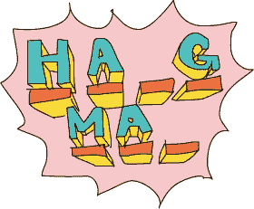

## 与玩家交互

为了创建这个游戏，我们必须有一种方法让猜词玩家（人类）输入他们的选择。一种方法是打开一个弹出窗口（JavaScript 称之为 `prompt`），玩家可以在其中输入内容。

## 创建 Prompt

首先，让我们创建一个新的 HTML 文档。使用**文件**▸**另存为**，将来自第 5 章的 `page.html` 文件另存为 `prompt.html`。要创建一个 prompt，请在 `prompt.html` 的 `<script>` 标签之间输入以下代码并刷新浏览器：

```
var name = prompt("What's your name?");
console.log("Hello " + name);
```

在这里，我们创建了一个名为 `name` 的新变量，并将调用 `prompt("What's your name?")` 返回的值赋值给它。当调用 `prompt` 时，会弹出一个窗口（或 `对话框），它看起来应该像图 7-1。

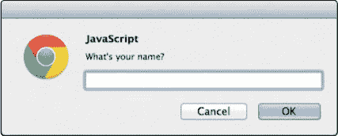

图 7-1. 提示对话框

调用 `prompt("What's your name?")` 会弹出一个带有“What’s your name?”文本以及输入文本框的窗口。对话框底部有两个按钮：Cancel 和 OK。在 Chrome 中，对话框的标题为 `JavaScript`，以此告知你是 JavaScript 打开了提示。

当你在框中输入文本并点击 OK 时，该文本将成为 `prompt` 返回的值。例如，如果我在文本框中输入我的名字并点击 OK，JavaScript 将在控制台中打印如下：

```
Hello Nick
```

因为我在文本框中输入了 `Nick` 并点击了 OK，字符串 `"Nick"` 被保存在变量 `name` 中，`console.log` 打印 `"Hello " + "Nick"`，从而得到 `"Hello Nick"`。

### 注意

在 Chrome 中第二次打开任何类型的对话框时，它会在对话框中添加额外的一，带有一个复选框，显示为“防止此页面创建额外的对话框”。这是 Chrome 用户免受具有大量烦人弹出窗口网页的方法。在本章的练习中，只需保持该框未勾选即可。

### 如果你点击 Cancel 会怎样？

如果你点击 Cancel 按钮，`prompt` 会返回值 `null`。在第 2 章中，我们学习过可以使用 `null` 来表示某些内容是有意为空的。

点击对话框上的 Cancel，你应该看到这个：

```
Hello null
```

在这里，`null` 被 `console.log` 作为字符串打印。通常情况下，`null` 不是字符串，但由于只有字符串可以打印到控制台，而且你告诉 JavaScript 打印 `"Hello " + null`，JavaScript 会将值 `null` 转换为字符串 `"null"` 以便打印。当 JavaScript 将一个值转换为另一种类型时，这被称为*类型转换*（coercion）。

类型转换是 JavaScript 试图变得聪明的例子。无法使用 `+` 运算符组合字符串和 `null`，因此 JavaScript 会尽力处理。在这种情况下，它知道自己需要两个字符串。`null` 的字符串版本是 `"null"`，这就是为什么你看到打印了字符串 `"Hello null"`。

## 使用 confirm 询问是否问题

`confirm` 函数是一种在不使用文本框的情况下通过询问是或否（布尔）答案来获取用户输入的方法。例如，在这里我们使用 `confirm` 询问用户是否喜欢猫（参见图 7-2）。如果是的话，变量 `likesCats` 被设置为 `true`，我们回答“You’re a cool cat!”。如果他们不喜欢猫，`likesCats` 被设置为 `false`，因此我们回答“Yeah, that’s fine.”。

```
var likesCats = confirm("Do you like cats?");
if (likesCats) {
  console.log("You're a cool cat!");
} else {
  console.log("Yeah, that's fine!");
}
```

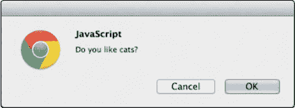

图 7-2. 确认对话框

`confirm` 提示的返回是一个布尔值。如果用户点击图 7-2 中的 OK，则返回 `true`。如果他们点击 Cancel，则返回 `false`。

## 使用 alert 给玩家信息

如果你只想给玩家提供信息，可以使用 alert 对话框显示带有 OK 按钮的消息。例如，如果你认为 JavaScript 非常棒，你可能会使用这个 `alert`：

```
alert("JavaScript is awesome!");
```

图 7-3 显示了这个简单 alert 对话框的样子。

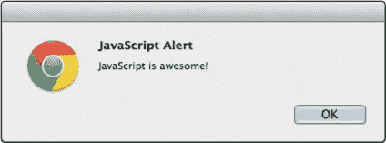

### 为什么用 alert 而不是 console.log

为什么在游戏中使用 alert 而不是 console.log？首先，如果你只是想告诉玩家某些事情，使用 alert 意味着玩家不需要中断游戏去打开控制台查看状态消息。其次，调用 `alert`（以及 `prompt` 和 `confirm`）会暂停 JavaScript 解释器，直到用户点击 OK（`prompt` 和 `confirm` 则点击 Cancel）。这意味着玩家有时间阅读 alert。相比之下，当你使用 `console.log` 时，文本会立即显示，解释器移动到程序中的下一行。

## 设计你的游戏

在我们开始编写猜字游戏之前，让我们思考它的结构。我们的程序需要做几件事：

1.  随机选择一个单词。
2.  获取玩家的猜测。
3.  如果玩家想要退出游戏。
4.  检查玩家的猜测是否为有效字母。
5.  跟踪已猜字母。
6.  显示玩家的进度。
7.  猜出单词后结束。


除了第一个和最后一个任务（为玩家选择一个要猜的单词和结束游戏）之外，这些步骤都需要执行多次，而且我们不知道需要执行多少次（这取决于玩家猜得有多好）。当你需要多次执行同一项操作时，你就知道你需要一个循环。

但这个简单的任务列表并没有真正告诉我们什么操作在什么时候发生。为了对代码结构有更直观的了解，我们可以使用 `pseudocode`（伪代码）。

## 使用伪代码设计游戏

伪代码是程序员经常用于设计程序的一种方便工具。它的意思是“假代码”，它是描述程序如何工作的一种方式，看起来介于书面英语和代码的混合体。伪代码包含循环和条件判断，但除此之外，所有内容都是纯英语。让我们来看看我们游戏的伪代码版本以获得直概念：

```
Pick a random word

While the word has not been guessed {
  Show the player their current progress
  Get a guess from the player

  If the player wants to quit the game {
    Quit the game
  }
  Else If the guess is not a single letter {
    Tell the player to pick a single letter
  }
  Else {
    If the guess is in the word {
      Update the player's progress with the guess
    }
  }
}

Congratulate the player on guessing the word
```

如你所示，这些都不是真实的代码，任何计算机都无法理解。但在我们开始实际编写代码并处理那些杂乱的细节（例如我们将*如何*选择一个随机单词）之前，它让我们对程序将如何构建有了思路。

## 跟踪单词的状态

在之前的伪代码中，第一行之一是：“向玩家显示他们当前的进度”。对于吊字游戏（Hangman），这意味着填充玩家猜对的字母，并显示秘密单词中哪些字母仍然为空。我们该如何做到这一点？我们实际上可以以类似于传统吊字游戏的方式来跟踪玩家的进度：维护一个空格集合，并在玩家猜对字母时填充这些空格。

在我们的游戏中，我们将使用一个针对单词中每个字母的空位数组来实现。我们将其称为答案数组（answer array），并在玩家做出正确猜测时向其填充。我们将用字符串 `""_"` 表示每个空位。

答案数组初始将是一组空条目，数量与秘密单词中的字母数量相等。例如，如果秘密单词是 *fish*，数组看起来如下所示：

```
["_", "_", "_", "_"]
```

如果玩家正确猜中了字母 *i*，我们将第二个空位改为 *i*：

```
["_", "i", "_", "_"]
```

一旦玩家猜中了所有正确字母，完成后的数组将如下所示：

```
["f", "i", "s", "h"]
```

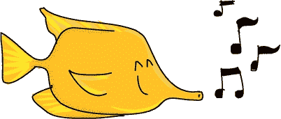

我们还将使用一个变量来跟踪玩家还需要猜的剩余字母数量。每当猜对一个字母时，该变量就会减少 1。一旦它达到 0，我们就知道玩家赢了。

## 设计游戏循环

主游戏发生在一个 `while` 循环内部（在我们的伪代码中，这个循环从“当单词未被猜中”这一行开始）。在这个循环中，我们显示正在猜的单词的当前状态（从全空格开始）；要求玩家进行猜测（并确保它是有效的、单字母猜测）；并且如果该字母出现在单词中，则用该字母更新答案数组。

几乎所有的电脑游戏都是围绕某种循环构建的，通常其基本结构与我们吊字游戏中的循环相同。游戏循环通常执行以下操作：

1. 接收玩家的输入
2. 更新游戏状态
3. 向玩家显示游戏的当前状态

即使是不断变化的游戏也遵循这种类型的循环——它们只是运行得*非常*快。在我们的吊字游戏案例中，程序获取玩家的猜测，如果猜测正确则更新答案数组，并显示答案数组的新状态。

一旦玩家猜中了单词中的所有字母，我们就会显示完整的单词和一条告诉他们赢了的庆祝消息。

## 编写游戏

现在我们已经知道了游戏的整体结构，可以开始查看代码将是什么样的。接下来的章节将带你浏览游戏中的所有代码。之后，你将在一个列表中看到整个游戏代码，你可以自己输入并运行。

## 选择随机单词

我们必须做的第一件事是选择一个随机单词。它看起来是这样的：

```
➊ var words = [
    "javascript",
    "monkey",
    "amazing",
    "pancake"
  ];

➋ var word = words[Math.floor(Math.random() * words.length)];
```

我们在 ➊ 处开始游戏，创建一个单词数组（*javascript*, *monkey*, *amazing* 和 *pancake*）作为我们秘密单词的来源，并将数组保存在 `words` 变量中。单词应该是全小写的。在 ➋ 处，我们使用 `Math.random` 和 `Math.floor` 从数组中选取随机单词。

## 创建答案数组

接下来，我们创建一个名为 `answerArray` 的空数组，并用下划线（`_`）填充以匹配字母数量。

```
var answerArray = [];
➊ for (var i = 0; i < word.length; i++) {
    answerArray[i] = "_";
}
```

➊ 处的 `for` 循环创建一个从 0 开始到（但不包含）`word.length` 的变量 `i`。循环每次运行时，我们向 `answerArray` 添加一个新元素。循环结束后，`answerArray` 的长度将与 `word` 。例如，如果 `word` 是 `"monkey"`（有六个字母），`answerArray` 将是 `["_", "_", "_", "_", "_", "_"]`。

最后，我们创建变量 `remainingLetters` 并将其设置为秘密单词的长度。我们将使用此变量来跟踪剩余多少个字母。每当玩家猜对一个字母时，该值将根据单词中该字母出现的次数*递减*（减少）1。

## 编写游戏循环

游戏循环的骨架如下：

```
while (remainingLetters > 0) {
  // Game code goes here
  // 向玩家显示他们的进度
  // 接收玩家输入
  // 更新 answerArray 和 remainingLetters
}
```

我们使用 `while` 循环，只要 `remainingLetters > 0` 保持 `true`，它就会继续循环。循环体必须为玩家的每一次正确猜测更新 `remainingLetters`。一旦玩家猜中了所有字母，`remainingLetters` 将变为 0，循环结束。

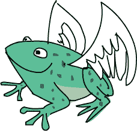

### 显示玩家的进度

我们在游戏循环内部需要做的第一件事是向玩家显示他们当前的进度：

```
alert(answerArray.join(" "));
```

我们通过将 `answerArray` 的元素连接成字符串（使用空格字符作为分隔符），然后使用 `alert` 将该字符串显示给玩家来实现的。例如，假设单词是 *monkey*，玩家目前已猜了 *m*、*o* 和 *e*。答案数组看起来像这样 `["m", "o", "_", "_", "e", "_"]`，而 `answerArray.join(" ")` 将是 `"m o _ _ e _"`。alert 对话框看起来像图 7-4。


现在我们需要从玩家那里获取一个猜测，并确保它是一个单个字符。

```
➊ var guess = prompt("猜一个字母，或点击取消停止游戏。");
➋ if (guess === null) {
    break;
➌ } else if (guess.length !== 1) {
    alert("请输入一个单个字母。");
  } else {
➍   // 使用猜测更新游戏状态
  }
```

在 ➊ 处，`prompt` 获取玩家的猜测并将其保存到变量 `guess` 中。在这一步，总会发生四种情况之一。

首先，如果玩家点击了“取消”按钮，那么 `guess` 将是 `null`。我们在 ➋ 处通过 `if (guess === null)` 检查此条件。如果该条件为 `true`，我们使用 `break` 退出循环。

### 注意事项

你可以在任何循环中使用 `break` 关键字来立即停止循环，无论程序处于循环的哪个位置，或者 `while` 条件当前是否为真。

第二种和第三种可能性是玩家什么都没输，或者输了太多的字母。如果他们什么都没输但点击了“确定”，`guess` 将是空字符串 `""`。在这种情况下，`guess.length` 将为 0。如果他们输入的多于一个字母，`guess.length` 将大于 1。

在 ➌ 处，我们使用 `else if (guess.length !== 1)` 来检查这些条件，确保 `guess` 恰好是一个字母。如果不是，我们会显示一个提示框，说：“请输入一个单个字母。”

第四种可能性是玩家输入了一个有效的单个字母猜测。这时，我们必须使用 ➍ 处的 `else` 语句根据他们的猜测来更新游戏状态，我们将在下一节中完成。

### 更新游戏状态

一旦玩家输入了有效的猜测，我们就必须根据该猜测更新游戏的 `answerArray`。为了做到这一点，我们在 `else` 语句中添加以下代码：

```
➊ for (var j = 0; j < word.length; j++) {
➋   if (word[j] === guess) {
      answerArray[j] = guess;
➌     remainingLetters--;
    }
  }
```

在 ➊ 处，我们创建了一个 `for` 循环，并使用了一个名为 `j` 的新循环变量，它从 0 运行到 `word.length`。（我们在这个循环中使用 `j` 作为变量，是因为在上一个 `for` 循环中已经使用了 `i`。）我们使用这个循环来遍历 `word` 的每一个字母。例如，假设 `word` 是 `pancake`。循环第一次运行时，当 `j` 为 0 时，`word[j]` 将是 `"p"`。下一次，`word[j]` 将是 `"a"`，然后是 `"n"`、`"c"`、`"a"`、`"k"`，最后是 `"e"`。

在 ➋ 处，我们使用 `if (word[j] === guess)` 来检查当前看到的字母是否匹配玩家的猜测。如果是，我们就使用 `answerArray[j] = guess` 用当前的猜测更新答案数组。对于单词中每个匹配 `guess` 的字母，我们会在对应的位置更新答案数组。这之所以行得通，是因为循环变量 `j` 既可以用作 `answerArray` 的索引，也可以用作 `word` 的索引，正如你在图 7-5 中所示。


图 7-5. 同一个索引可以同时用于 `word` 和 `answerArray`。

例如，假设我们刚刚开始玩游戏并到达了 ➊ 处的 `for` 循环。假设 `word` 是 `"pancake"`，`guess` 是 `"a"`，且 `answerArray` 目前如下：

```
["_", "_", "_", "_", "_", "_", "_"]
```

 ➊ 处的 `for` 循环第一次运行时，`j` 是 0，所以 `word[j]` 是 `"p"`。我们的猜测是 `"a"`，所以我们跳过了 ➋ 处的 `if` 语句（因为 `"p" === "a"` 为 `false`）。第二次运行时，`j` 是 1，所以 `word[j]` 是 `"a"`。这与 `guess` 相等，所以我们进入语句的 `if` 部分。行 `answerArray[j] = guess;` 将 `answerArray` 中索引为 1 的元素（第二个元素）设置为 `guess`，所以 `answerArray` 现在看起来如下：

```
["_", "a", "_", "_", "_", "_", "_"]
```

循环的接下来的两次运行时，`word[j]` 分别是 `"n"` 和 `"c"`，它们都不匹配 `guess`。然而，当 `j` 达到 4 时，`word[j]` 再次变为 `"a"`。我们再次更新 `answerArray`，这次将索引为 4 的元素（第五个元素）设置为 `guess`。现在 `answerArray` 看起来如下：

```
["_", "a", "_", "_", "a", "_", "_"]
```

剩余字母不匹配 `"a"`，所以最后两次运行时什么都没有发生。


尝试玩几次游戏。它的运行方式如你预期的那样吗？你能想象出在你玩游戏时，你写的代码正在后台运行吗？


# 你学到了什么

仅仅通过几页的内容，你就创建了第一个 JavaScript 游戏！正如你所看到的，循环和条件判断对于创建游戏或任何交互式计算机程序至关重要。没有这些控制结构，程序只会开始和结束。

在第 8 章中，我们将使用`functions` 来对代码打包，这样你就可以在程序的不同部分运行它们。

# 编程挑战

这里是一些挑战，可以用来构建和改进你在本章中创建的悬字猜游戏。

### #1：更多单词

在 `words` 数组中添加你自己的单词。记得输入全小写的单词。

### #2：大写字母

如果玩家猜了一个大写字母，它将无法与秘密单词中的小写字母匹配。为了解决这个潜在问题，请将玩家的猜测转换为小写。（提示：你可以使用 `toLowerCase` 方法将字符串转换为小写。）

### #3：限制猜测次数

我们的悬字猜游戏允许玩家无限次猜测。添加一个变量来跟踪猜测次数，并在玩家用完猜测次数时结束游戏。（提示：在检查 `remainingLetters > 0` 的同一个 `while` 循环中检查此变量。正如我们在第 2 章中所做的那，你可以使用 `&&` 来检查两个布尔条件是否为 `true`。）

### #4：修复 bug

游戏中有一个 bug：如果你一直猜同一个正确字母，`remainingLetters` 就会一直减少。你能修复它吗？（提示：你可以添加另一个条件来检查 `answerArray` 中的值是否仍然是下划线。如果它不是下划线，那么该字母一定已经被猜过了。）

# 第 8 章. 函数

`function`（函数）是一种封装代码的方式，使其可以重复使用。函数允许我们从程序的多个地方运行相同的代码，而无需反复地复制和粘贴代码。此外，通过将长代码隐藏在函数中并给它一个易于理解的名字，你将能够更好地规划代码，因为你可以专注于组织你的函数，而不是组成它们的各种细微代码细节。将你的代码拆分为更小、更易管理的片段，允许你看到大局，并从更高层次思考你程序的结构。

当你需要在整个程序中反复执行某项计算或操作时，你会发现函数非常有用。在书的前面的部分，你用过各种函数，如 `Math.random`、`Math.floor`、`alert`、`prompt` 和 `confirm`。在本章中，你将学习如何创建自己的函数。

## 函数的基本解剖

图 8-1 显示了函数是如何构建的。大括号之间的代码被称为 `function body`（函数体），就像循环在大括号之间的代码被称为 `loop body`（循环体）一样。


图 8-1. 创建函数的语法

## 创建简单函数

创建一个打印 `Hello world!` 的简单函数。在浏览器中输入以下代码。使用 SHIFT-ENTER 开始每个新行。

```javascript
var ourFirstFunction = function () {
  console.log("Hello world!");
};
```
这段代码创建了一个新函数并将其存在变量 `ourFirstFunction` 中。

## 调用函数

要运行函数内部的代码（函数体），我们需要 `call`（调用）该函数。要调用函数，你输入它的名字后跟一对左括号和右括号，所示。


```javascript
ourFirstFunction();
Hello world!
```
调用 `ourFirstFunction` 会执行函数体，即 `console.log("Hello world!");`，我们要求打印的文本将显示在下一行：`Hello world!`。

但如果你在浏览器中调用此函数，你会发现有第三行，带有一个向左的小箭头，如图 8-2 所示。这是函数的返回值。


图 8-2. 带有返回值的函数调用

`return value`（返回值）是函数输出的值，然后可以在代码的其他地方使用。在这种情况下，返回值是 `undefined`，因为我们没有在体中告诉函数返回任何值。我们所做的只是让它向控制台打印消息，这与返回一个值是不一样的。除非函数体中有内容告诉它返回不同的值，否则函数总是返回 `undefined`。

> 注意：在 Chrome 控制台和本书中的所有代码列表中，返回值始终根据数据类型进行颜色编码，而用 `console.log` 打印的文本始终是黑色的。

## 向函数传递参数

`ourFirstFunction` 每次调用它时都打印相同的行文本，但你可能希望你的函数比这更灵活。函数参数（Arguments）允许我们向函数传递值，以便在改变函数被调用时的行为。无论是在创建函数还是调用函数时，参数始终位于函数括号之间。

以下 `sayHelloHello` 函数使用参数（`name`）向你指定的人打招呼。

```javascript
var sayHelloTo = function (name) {
  console.log("Hello " + name + "!");
};
```
我们在第一行创建函数并将其赋值给变量 `sayHelloTo`。当函数被调用时，它会记录字符串 `"Hello " + name + "!"`，并将 `name` 替换为你作为参数传递给函数的任何值。

图 8-3 显示了带有一个参数的函数的语法。


图 8-3. 创建函数的语法

要调用接收参数的函数，将你想要用于参数的值放在函数名后的括号之间。例如，要向 Nick 打招呼，你可以写道：

```javascript
sayHelloTo("Nick");
Hello Nick!
```

或者，向 Lyra 打招呼，写道：

```javascript
sayHelloTo("Lyra");
Hello Lyra!
```
我们每次调用函数时，传递给 `name` 的参数都会包含在函数打印的字符串中。因此，当我们传递 `"Nick"` 时，控制台打印 `"Hello Nick!"`，当我们传递 `"Lyra"` 时，它打印 `"Hello Lyra!"`。

## 打印猫脸

向函数传递参数的一个可能是为了告诉它执行多少次。例如，`drawCats` 函数向控制台打印猫脸（如下所示：`^.^=`）。我们使用参数 `howManyTimes` 告诉函数要打印多少只猫：


```javascript
var drawCats = function (howManyTimes) {
  for (var i = 0; i < howManyTimes; i++) {
    console.log(i + " =^.^=");
  }
};
```


函数的体部是一个 `for` 循环，它循环的次数由 `howManyTimes` 参数决定（因为变量 `i` 从 0 开始，一直递增到 `howManyTimes` 减 1 为止）。在每次循环中，函数都会记录字符串 `i + " =^.^="`。

当我们使用 `5` 作为 `howManyTimes` 参数调用此函数时，发生的情况如下：

```
drawCats(5);
0 =^.^=
1 =^.^=
2 =^.^=
3 =^.^=
4 =^.^=
```

尝试将 `howManyTimes` 设置为 `100` 来打印出 100 个猫脸！

## 向函数传递多个参数

你可以使用多个参数向函数传递多个值。要添加另一个参数，请在 `function` 关键字后的括号内输入参数，并用逗号将其隔开。图 8-4 显示了带有两个参数函数的语法。


图 8-4. 创建带有两个参数函数的语法

以下函数 `printMultipleTimes` 与 `drawCats` 类似，但有一个名为 `whatToDraw` 的第二个参数。

```
var printMultipleTimes = function (howManyTimes, whatToDraw) {
  for (var i = 0; i < howManyTimes; i++) {
    console.log(i + " " + whatToDraw);
  }
};
```

`printMultipleTimes` 函数会根据你通过参数 `howManyTimes`指定的次数，打印你为 `whatToDraw` 输入的字符串。第二个参数告诉函数要打印什么，而第一个参数告诉函数打印多少次。


调用带有多个参数的函数时，在函数名后的括号内插入你想要使用的值，并用逗号隔开。

例如，使用这个新的 `printMultipleTimes` 函数打印猫脸，你可以这样调用它：

```
printMultipleTimes(5, "=^.^=");
0 =^.^=
1 =^.^=
2 =^.^=
3 =^.^=
4 =^.^=
```

要让 `printMultipleTimes` 打印四次笑脸，你可以这样做：

```
printMultipleTimes(4, "^_^");
0 ^_^
1 ^_^
2 ^_^
3 ^_^
```

当我们调用 `printMultipleTimes` 时，为 `howManyTimes` 传递了参数 `4`，为 `whatToDraw` 传递了 `"^_^"`。结果是，`for` 循环了四次（`i` 从 0 递增到 3），每次打印 `i + " " + "^_^"`。

要画两次字符 `(>_<)`，你可以这样写：

```
printMultipleTimes(2, "(>_<)");
0 (>_<)
1 (>_<)
```

在这种情况下，我们为 `howManyTimes` 传递了 `2`，为 `whatToDraw` 传递了 `"(>_<)"`。

## 从函数返回值

到目前为止我们看到的函数都是使用 `console.log` 向控制台打印文本。这是让 JavaScript 显示值的一种简单且有效的方法，但当我们把值打印到控制台时，无法在程序的后续部分使用该值。如果你希望函数输出该值，以便在代码的其他部分继续使用，该怎么办？

正如在本章前面的部分提到的，函数的输出被称为返回值（return value）。当你调用一个返回值的函数时，你可以在代码的其他部分使用该值（你可以将返回值保存在变量中、将其传递给另一个函数，或者简单地将其与其他代码结合）。例如，下面行代码在 `Math.floor(1.2345)` 用的返回值基础上加上 5：


```
5 + Math.floor(1.2345);
6
```

`Math.floor` 是一个函数，它返回你传递它的数字，并向下取整到最近的整数。当你看到像 `Math.floor(1.2345)` 这样的函数调用时，想象将其替换为该函数调用的返回值，即数字 `1`。

让我们创建一个返回值的函数。函数 `double` 接收参数 `number` 并返回 `number * 2` 的结果。换句话说，此函数返回的值是作为参数数字的两倍。

```
 var double = function (number) {
    return number * 2;
   };
```

要从函数返回一个，使用 `return` 关键字，后跟你想要返回的值。在 ➊，我们使用 `return` 关键字从 `double` 函数返回值 `number * 2`。

现在我们可以调用 `double` 函数来让数字翻倍了：

```
double(3);
6
```

在这里，返回值 (`6`) 就是返回值 (`6`)。

## 将函数调用作为值使用

当你调用一个返回值的函数时，你可以在代码的其他部分使用该值（你可以将返回值保存在变量中、将其传递给另一个函数，或者简单地将其与其他代码结合）。例如，下面行代码在 `Math.floor(1.2345)` 用的基础上加上 5：

```
5 + Math.floor(1.2345);
6
```

`Math.floor` 是一个函数，它返回你传递它的数字，并向下取整到最近的整数。当你看到像 `Math.floor(1.2345)` 这样的函数调用时，想象将其替换为该函数调用的返回值，即数字 `1`。

## 使用函数简化代码

在 第 3 章 中，我们使用了 `Math.random` 和 `Math.floor` 方法从数组中选择随机单词。在本节中，我们将重新创建我们的侮辱生成器，并通过创建函数来简化它。

### 用于选取随机单词的函数

这是我们在 第 3 章 中用于从数组中选择随机单词的代码：

```
randomWords[Math.floor(Math.random() * randomWords.length)];
```

如果我们能将这段代码转换为函数，就可以重复使用它从数组中选取随机单词，而无需每次都输入相同的代码。例如，我们可以这样定义 `pickRandomWord` 函数：

```
var pickRandomWord = function (words) {
  return words[Math.floor(Math.random() * words.length)];
};
```

我们所做的只是将之前的代码封装在函数中。现在，我们可以创建这个 `randomWords` 数组 . .

```
var randomWords = ["Planet", "Worm", "Flower", "Computer"];
```

并使用 `pickRandomWord` 函数从这个数组中选取随机单词，如下：

```
pickRandomWord(randomWords);
"Flower"
```

我们可以对任何数组使用这个相同的函数。例如，这里是如何从姓名数组中选取随机名字：

```
pickRandomWord(["Charlie", "Raj", "Nicole", "Kate", "Sandy"]);
"Raj"
```

### 随机侮辱生成器

现在让我们尝试使用选取随机单词的函数重新创建我们的随机侮辱生成器。首先，让我们回顾一下第 3 章的代码原来的样子：


```javascript
var randomBodyParts = ["Face", "Nose", "Hair"];
var randomAdjectives = ["Smelly", "Boring", "Stupid"];
var randomWords = ["Fly", "Marmot", "Stick", "Monkey", "Rat"];

// Pick a random body part from the randomBodyParts array:
var randomBodyPart = randomBodyParts[Math.floor(Math.random() * 3)];
// Pick a random adjective from the randomAdjectives array:
var randomAdjective = randomAdjectives[Math.floor(Math.random() * 3)];
// Pick a random word from the randomWords array:
var randomWord = randomWords[Math.floor(Math.random() * 5)];
// Join all the random strings into a sentence:
var randomString = "Your " + randomBodyPart + " is like a " + 
randomAdjective + " " + randomWord + "!!!";
randomString;
"Your Nose is like a Stupid Marmot!!!"
```

注意，在段代码中我们多次重复 `words[Math.floor(Math.random() * length)]`。使用我们的 `pickRandomWord` 函数，我们可以将程序重写为：

```javascript
var randomBodyParts = ["Face", "Nose", "Hair"];
var randomAdjectives = ["Smelly", "Boring", "Stupid"];
var randomWords = ["Fly", "Marmot", "Stick", "Monkey", "Rat"];

// Join all the random strings into a sentence:
var randomString = "Your " + pickRandomWord(randomBodyParts) + 
" is like a " + pickRandomWord(randomAdjectives) + 
" " + pickRandomWord(randomWords) + "!!!";

randomString;
"Your Nose is like a Smelly Marmot!!!"
```


这里有处变化。首先，当我们需要从数组中获取随机单词时，使用了 `pickRandomWord` 函数，而不是每次都使用 `words[Math.floor(Math.random() * length)]`。此外，我们没有在将每个随机单词添加到最终字符串之前将其保存到变量，而是直接将函数调用的返回值相加以形成字符串。函数调用可以被视为函数返回的值。所以实际上，我们在这里做的只是字符串相加。如你所见，这个版本的程序易读得多，而且写起来也更容易，因为我们通过使用函数重用了一些代码。

## 将随机吐槽生成器转换为函数

我们可以通过创建一个产生随机吐槽的更大的函数，将我们的随机吐槽生成器更进一步。让我们来看：

```javascript
 generateRandomInsult = function () {
     var randomBodyParts = ["Face", "Nose", "Hair"];
     var randomAdjectives = ["Smelly", "Boring", "Stupid"];
     var randomWords = ["Fly", "Marmot", "Stick", "Monkey", "Rat"];
     // Join all the random strings into a sentence:
     var randomString = "Your " + pickRandomWord(randomBodyParts) + 
     " is like a " + pickRandomWord(randomAdjectives) + 
     " " + pickRandomWord(randomWords) + "!!!";

➊    return randomString;
  };

  generateRandomInsult();
  "Your Face is like a Smelly Stick!!!"
  generateRandomInsult();
  "Your Hair is like a Boring Stick!!!"
  generateRandomInsult();
  "Your Face is like a Stupid Fly!!!"
```

我们的新 `generateRandomInsult` 函数只是将之前的代码放在一个没有参数的函数内部。唯一的添加是在 ➊ 处，我们让函数在最后返回 `randomString`。你可以看到前一个函数的几次示例运行，它每次都会返回一个新的吐槽字符串。

将代码放在一个函数中意味着我们可以不断调用该函数来获取随机吐槽，而不需要在每次想要新吐槽时都复制并粘贴相同的代码。

## 使用 return 提前退出函数

一旦 JavaScript 解释器在函数中遇到 `return`，它就会离开函数，即使函数体中还有更多代码。

使用 `return` 的一种常见方法是，如果函数的任何参数是 `invalid`（无效的），则提前离开函数；也就是说，如果它们不是函数正常运行所需的参数类型。例如，以下函数返回一个字符串，告诉你你名字的第五个字符。如果传递给函数的名称少于五个字符，函数将使用 `return` 立即离开函数。这意味着结尾告诉你名字中第五个字母的 `return` 语句永远不会执行。


```javascript
 var fifthLetter = function (name) {
➊   if (name.length < 5) {
➋     return;
    }

    return "The fifth letter of your name is " + name[4] + ".";
  };
```

在 ➊ 处，我们检查输入名称的长度是否小于五。如果是，我们在 ➋ 处使用 `return` 提前退出函数。

让我们尝试调用这个函数。

```javascript
fifthLetter("Nicholas");
"The fifth letter of your name is h."
```

名字 `Nicholas` 长于五个字符，所以执行了 `return` 语句。尝试较短的名字：

```javascript
fifthLetter("Nick");
undefined
```

名字 `Nick` 短于五个字符，所以函数使用了 `return`。

## 使用多个 return 代替 if...else

我们可以使用多个 `return` 语句代替 `if...else` 语句。例如，假设你正在编写一个根据分数授予奖品的函数。3 分以下是铜牌，3 到 7 分之间是银牌，7 分以上是金牌。如下：


```javascript
 var medalScore = function (score) {
    if (score < 3) {
➊     return "Bronze";
    }

➋   if (score < 7) {
       return "Silver";
    }

➌   return "Gold";
  };
```

在 ➊ 处，如果分数小于 3，我们返回 `"Bronze"`。如果我们到达 ➋ 处，我们就知道分数至少是 3，因为如果小于 3，我们就会返回 `"Bronze"`。如果我们到达 ➌ 处，我们就知道至少至少 7，因为如果小于 7，我们就会返回 `"Silver"`。最后，我们返回 `"Gold"`。

尽管我们使用了多个 `return` 语句，但我们不需要链式 `if...else` 语句。我们使用 `return` 语句来确保只有一个选项被执行（因为函数只会返回一次）。

## 创建函数的简写

编写函数有长写法和简写两种方式。我使用长写法是因为它更清晰地展示了函数是如何存储在变量中的。尽管如此，你应该了解简写形式，因为大量的 JavaScript 代码使用了它。

这是一个长写法函数的示例：

```javascript
var double = function (number) {
  return number * 2;
};
```

简写版本如下：

```javascript
function double(number) {
  return number * 2;
}
```

如你所见，在长写法中，我们显式地创建一个变量并将函数赋值给该变量，因此 `double` 出现在 `function` 关键字之前。

## 你学到的知识


函数允许我们重用代码块。它们可以根据传递的参数执行不同的操作，并可以将值返回到调用函数的代码位置。函数还让我们能够为这段代码赋予一个有意义的名字。例如，`pickRandomWord` 函数的名字就清楚地表示该函数与选取随机单词有关。

在下一章中，我们将学习如何编写可以操作 HTML 文档的 JavaScript。

# 编程挑战

这里有一些挑战，供你练习使用函数。

### #1：使用函数进行算术运算

创建两个函数，`add` 和 `multiply`。每个函数都应该接收两个参数。`add` 函数应该求其参数的和并返回结果，而 `multiply` 应该相乘其参数。

仅使用这两个函数，解决这个简单的数学问题：

```
36325 * 9824 + 777
```

### #2：这些数组相同吗？

编写一个名为 `areArraysSame` 的函数，接收两个数字数组作为参数。如果两个数组相同（即它们的数字相同且顺序相同），则返回 `true`；如果不同则返回 `false`。尝试运行以下代码以确保你的函数工作正常：

```
areArraysSame([1, 2, 3], [4, 5, 6]);
false
areArraysSame([1, 2, 3], [1, 2, 3]);
true
areArraysSame([1, 2, 3], [1, 2, 3, 4]);
false
```

提示 1：你将需要使用 `for` 循环遍历第一个数组中的每个值，以检查它们是否与第二个数组中相同。如果你发现不等的值，可以在 `for` 循环中返回 `false`。

提示 2：如果数组长度不同，你可以提前退出函数并完全跳过 `for` 循环。

### #3：使用函数的猜字游戏

回到你在第 7 章中的猜字游戏。我们将使用函数来重写它。

我在这里重写了最后的猜字游戏代码，但将某些部分代码替换为了函数调用。你只需要编写这些函数即可！

```
// 在这里编写你的函数

var word = pickWord();
var answerArray = setupAnswerArray(word);
var remainingLetters = word.length;

while (remainingLetters > 0) {
  showPlayerProgress(answerArray);
  var guess = getGuess();
  if (guess === null) {
    break;
  } else if (guess.length !== 1) {
    alert("Please enter a single letter.");
  } else {
    var correctGuesses = updateGameState(guess, word, answerArray);
    remainingLetters -= correctGuesses;
  }
}

showAnswerAndCongratulatePlayer(answerArray);
```

这个使用函数版本的代码与第 7 章中的伪代码版本几乎一样。这应该让你对函数在使代码更容易理解方面有多有用有一个初步了解。

以下是你需要填充的函数：

```
var pickWord = function () {
  // 返回一个随机单词
};

var setupAnswerArray = function (word) {
  // 返回答案数组
};

var showPlayerProgress = function (answerArray) {
  // 使用 alert 显示玩家进度
};

var getGuess = function () {
  // 使用 prompt 获取猜测
};

var updateGameState = function (guess, word, answerArray) {
  // 更新 answerArray 并返回一个数字，
  // 显示该猜测在单词中出现的次数，以便 
  // 更新 remainingLetters
};

var showAnswerAndCongratulatePlayer = function (answerArray) {
  // 使用 alert 显示答案并祝贺玩家
};
```

# 第二部分.高级 JavaScript

# 第 9 章.DOM 和 jQuery

到目前为止，我们一直在使用 JavaScript 执行相对简单的事情，如将文本打印到浏览器控制台，或显示警告或提示对话框。但你也可以使用 JavaScript 来操作（控制或修改）并交互你在网页中编写的 HTML。在本章中，我们将讨论两个让你编写出更强大的 JavaScript 的工具：DOM 和 jQuery。

`DOM`，或`文档对象模型`，是允许 JavaScript 访问网页内容的机制。网页浏览器使用 DOM 来跟踪页面上的元素（如段落、标题和其他 HTML 元素），JavaScript 可以以各种方式操作 DOM 元素。例如，你很快就会看到如何使用 JavaScript 将提示对话框中的输入替换 HTML 文档的主标题。


我们还将查看一个名为 jQuery 的有用工具，它让操作 DOM 变得简单得多。jQuery 为提供了一组函数，我们可以用它们选择要操作的元素并对这些元素进行更改。在本章中，我们将学习如何使用 DOM 和 jQuery 编辑现有的 DOM 元素并创建新的 DOM 元素，从而获得完全控制。

## 选择元素

当你加载 HTML 文档时，浏览器会将元素转换为树形结构。这棵树被称为 `DOM`。图 9-1 显示了一个简单的 DOM 树。


## 使用 id 标识元素

HTML 的 `id` 属性允许你为元素分配一个唯一的名称或*标识符*。例如，这个 `h1` 元素有一个 `id`：

```
<h1 id="main-heading">Hello world!</h1>
```

在这个示例中，`"main-heading"` 的 `id` 将让我们能够识别并最终更改特定的标题，而不影响其他元素或其他 `h1` 标题。

## 使用 getById 选择元素

在通过 `id` 唯一标识了一个元素（每个 `id` 必须有唯一的值）后，我们可以使用 DOM 方法 `document.getElementById` 返回 `"main-heading"` 元素：

```
var headingElement = document.getElementById("main-heading");
```

通过调用 `document.getElementById("main-heading")`，我们告诉浏览器寻找 `id` 为 `"main-heading"` 的元素。此调用返回一个与 `id` 对应的 DOM 对象，我们将此 DOM 对象保存到变量 `headingElement` 中。

一旦选择了元素，我们就可以用 JavaScript 对进行操作。例如，我们可以使用 `innerHTML` 属性获取并替换所选元素内的文本：

```
headingElement.innerHTML;
```


这段代码返回 `headingElement` 的 HTML 内容——即我们使用 `getElementById` 选择的元素。在这种情况下，该元素的内容是我们在 `<h1>` 标签之间输入的文本 `Hello world!`。

 使用 DOM 替换标题文本

这是一个使用 DOM 替换标题文本的示例。首先，我们创建一个名为 *dom.html* 的新 HTML 文档，包含以下代码：

```html
<!DOCTYPE html>
<html>
<head>
    <title>Playing with the DOM</title>
</head>

<body>
    <h1 id="main-heading">Hello world!</h1>

    <script>
➊     var headingElement = document.getElementById("main-heading");
➋     console.log(headingElement.innerHTML);
➌     var newHeadingText = prompt("Please provide a new heading:");
➍     headingElement.innerHTML = newHeadingText;
      </script>
</body>
</html>
```


在 ➊，我们使用 `document.getElementById` 获取 `h1` 元素（`id` 为 `"main-heading"`），并将其保存到变量 `headingElement` 中。在 ➋，我们打印 `headingElement.innerHTML` 返回的字符串，这会在控制台中打印 `Hello world!`。在 ➌，我们使用 prompt 对话框向用户请求一个新的标题，并将用户输入的文本保存到变量 `newHeadingText` 中。最后，在 ➍，我们将 `headingElement` 的 `innerHTML` 属性设置为保存在 `newHeadingText` 中的文本。


当你加载此页面时，你应该能看到一个像图 9-2 所示的对话框。


图 9-2. 我们打开了对话框的页面

在对话框中输入文本 `JAVASCRIPT IS AWESOME` 并点击 `OK`。标题会立即更新新文本，如图 9-3 所示。


图 9-3. 标题更改后的页面

通过 `innerHTML` 属性，我们可以使用 JavaScript 更改任何 DOM 元素的内容。

## 使用 jQuery 操作 DOM 树

内置的 DOM 方法很强大，但它们并不容易使用。正因如此，许多开发者使用一套名为 jQuery 的工具来访问和操作 DOM 树。jQuery 是一个 JavaScript 库——它是相关工具（主要是函数）的集合，在本例中，它为我们提供了一种更简单处理 DOM 元素的方法。一旦我们在页面上加载了库，就可以在使用 JavaScript 内置方法和浏览器提供的方法之外，使用该库的函数和方法。

## 在你的 HTML 页面加载 jQuery

要使用 jQuery 库，我们首先通过这行 HTML 代码告诉浏览器加载它：

```html
<script src="https://code.jquery.com/jquery-2.1.0.js"></script>
```

注意，这里的 `<script>` 标签没有内容，它有一个 `src` 属性。`src` 属性允许我们通过包含其 `URL`（网络地址）将 JavaScript 文件插入页面中。在这种情况下，[`code.jquery.com/jquery-2.1.0.js`](https://code.jquery.com/jquery-2.1.0.js) 是 jQuery 网站上特定版本 jQuery（2.1.0 版本）的 URL。

要查看 jQuery 库，请访问该 URL；你会看到添加此 `<script>` 标签后将加载的 JavaScript。不过，整个库包含超过 9000 行复杂的 JavaScript，所以不要指望现在就能理解全部内容！

## 使用 jQuery 替换标题文本

在使用 DOM 替换标题文本中，你学习了如何使用内置 DOM 方法替换文本。在本节中，我们将更新代码，使用 jQuery 来替换标题文本。打开 `dom.html` 并进行所示的更改。

```html
 <!DOCTYPE html>
  <html>
  <head>
      <title>Playing with the DOM</title>
  </head>

  <body><body>
      <h1 id="main-heading">Hello world!</h1>

➊     <script src="https://code.jquery.com/jquery-2.1.0.js"></script>

      <script>
      var newHeadingText = prompt("Please provide a new heading:");
➋     $("#main-heading").text(newHeadingText);
      </script>
  </body>
  </html>
```

在 ➊，我们向页面中添加了一个新的 `<script>` 标签来加载 jQuery。加载 jQuery 后，我们使用 jQuery 函数 `$` 来选择 HTML 元素。

`$` 函数接收一个参数，称为选择器字符串，它告诉 jQuery 从 DOM 树中选择哪个或哪些元素。在这种情况下，我们输入 `"#main-heading"` 作为参数。选择器字符串中的 `#` 字符意味着“ID”，所以我们的选择器字符串 `"#main-heading"` 意味着“`id` 为 `main-heading` 的元素”。

`$` 函数返回一个表示你所选元素的 jQuery 对象。例如，`$("#main-heading")` 返回一个表示 `h1` 元素的 jQuery 对象（该元素的 `id` 为 `"main-heading"`）。

我们现在有了一个表示 `h1` 元素的 jQuery 对象。我们可以通过在 ➋ 处对该 jQuery 对象调用 `text` 方法来修改其文本，传入该元素的新文本，并将保存到变量 `newHeadingText` 中的用户输入替换标题文本。与之前一样，当你加载此页面时，会弹对话框。

## 使用 jQuery 创建新元素

除了使用 jQuery 操控元素外，我们还可以使用 jQuery 创建新元素。例如，若要在 `body` 中添加一个 `p` 元素，我们对 `body` 元素调用 `append`。传递给 `append` 的字符串会被转换为 HTML。

```javascript
$("body").append("<p>This is a new paragraph</p>");
```

`$` 函数选择了 `body`。然后 `append` 方法添加了新元素。图 9-4 显示了我们的文档样式。


图 9-4. 带有新元素的文档

我们也可以在 `for` 循环中使用 `append` 来添加多个元素，如下所示：

```javascript
for (var i = 0; i < 3; i++) {
  var hobby = prompt("Tell me one of your hobbies!");
  $("body").append("<p>" + hobby + "</p>");
}
```

此循环运行三次。每次循环时，都会弹出一个提示对话框，要求用户输入一个爱好。每个爱好随后被放在 `<p>` 标签中并传递给 `append` 方法，该方法将元素添加到 `body` 元素的末尾。图 9-5 显示了我们的文档样式。


图 9-5. 循环添加的额外元素

# 使用 jQuery 制作动画

许多网站使用动画来显示和隐藏内容。例如，如果你正在向页面添加新的段落文本，你可能希望它缓慢淡入，这样它就不会突然出现。

jQuery 让元素动画变得简单。例如，若要让一个元素淡出，我们可以使用 `fadeOut` 方法。要测试此方法，请将 *dom.html* 中第二个脚本元素的内容替换为如下：

```javascript
$("h1").fadeOut(3000);
```

我们使用 `$` 函数选择所有的 `h1` 元素。由于 *dom.html* 只有一个 `h1` 元素（包含文本 `Hello world!` 的标题），该标题被选择并作为一个 jQuery 对象。通过对该 jQuery 对象调用 `.fadeOut(3000)`，我们让标题在 3 秒内逐渐淡出直到消失。（`fadeOut` 的参数单位是毫秒... )

一旦你加载带有此代码的页面，`h1` 元素就会开始淡出。

## jQuery 链式动画


当你对 jQuery 对象调用一个方法时，该方法通常会返回调用该方法的原始对象。例如，`$("h1")` 返回一个代表所有 `h1` 元素的 jQuery 对象，而 `$("h1").fadeOut(3000)` 返回的也是代表所有 `h1` 元素的 jQuery 对象。要更改 `h1` 元素的文本并将其淡出，你可以输入：

```
$("h1").text("This will fade out").fadeOut(3000);
```

像这样连续调用多个方法被称为`链式调用`（`chaining`）。

我们可以在同一个元素上链式调用多个动画。例如，以下是如何链式调用 `fadeOut` 和 `fadeIn` 方法，让一个元素淡出然后立即再次淡入：

```
$("h1").fadeOut(3000).fadeIn(2000);
```

`fadeIn` 动画让一个不可见的元素淡入显示。jQuery 足够聪明，它知道当你像这样链式调用两个动画时，你可能希望它们一个接一个发生。因此，这段代码会在 3 秒内让 `h1` 元素淡出，然后在 2 秒内让它淡入。

jQuery 还提供了两个类似于 `fadeOut` 和 `fadeIn` 的额外动画方法，称为 `slideUp` 和 `slideDown`。`slideUp` 方法通过向上滑动让元素消失，而 `slideDown` 通过向下滑动让它们重新出现。将 `dom.html` 文档中的第二个 `script` 元素替换为以下内容，并刷新页面尝试：

```
$("h1").slideUp(1000).slideDown(1000);
```


在这里选择了 `h1` 元素，让它在 1 秒内向上滑动，然后在 1 秒内向下滑动，直到它重新出现。

## 来试一试！

我们使用 `fadeIn` 让不可见的元素可见。但如果你对一个已经可见的元素或位于正在动画的元素之后的元素调用 `fadeIn`，会发生什么呢？

例如，假设你在 `dom.html` 文档的标题之后添加了一个新的 `p` 元素。尝试使用 `slideUp` 和 `slideDown` 来隐藏和显示 `h1` 元素，看看 `p` 元素发生了什么变化。如果你使用 `fadeOut` 和 `fadeIn` 会怎样？

如果在不进行链式调用的情况下对同一个元素调用 `fadeOut` 和 `fadeIn`，会发生什么？例如：

```
$("h1").fadeOut(1000);
$("h1").fadeIn(1000);
```

尝试将前面的代码放在一个运行五次的 `for` 循环中。会发生什么？

你认为 jQuery 的 `show` 和 `hide` 方法是做什么的？尝试一下它们看看你的判断是否正确。你会如何使用 `hide` 来让一个已经可见的元素淡入呢？

## 你学到的知识

在本章中，你学习了如何通过操作 DOM 元素使用 JavaScript 更新 HTML 页面。正如你看到的，jQuery 为我们提供了更强大的方式来选择元素、更改甚至对它们执行动画。你还学习了一个新的 HTML 属性 `id`，它允许你为元素提供唯一标识符。

在下一章中，你将学习如何控制 JavaScript 的运行时间——例如在定时器结束后或点击按钮时。我们还将查看如何在带有延迟的情况下多次运行同一段代码——例如每秒更新一次时。

## 编程挑战尝试尝试这些挑战来练习更多使用 jQuery 和 DOM 元素可以进行的操作。

### #1：使用 jQuery 列出你的朋友（并让他们闻起来很臭！）

创建一个包含几个朋友名字的数组。使用 `for` 循环为你的每个朋友创建一个 `p` 元素，并使用 jQuery 的 `append` 方法将其添加到 `body` 元素的末尾。使用 jQuery 更改 `h1` 元素，使其显示为 `My friends` 而不是 `Hello world!`。使用 `hide` 方法紧接 `fadeIn` 方法，在提供每个名字时让其淡入。

现在，修改你创建的 `p` 元素，在每个朋友后面添加文本 `smells!`。提示：如果你使用 `$("p")` 选择 `p` 元素，`append` 方法将应用于所有的 `p` 元素。

### #2：让标题闪烁

你如何如何使用 `fadeOut` 和 `fadeIn` 让标题闪烁五次，每秒一次？如何使用 `for` 循环实现这一点？尝试修改你的循环，让它第一次在 1 秒内淡出并淡入，第二次在 2 秒内，第三次在 3 秒内，以此此类推。

### #3：延迟动画

`delay` 方法可以用于延迟动画。使用 `delay`、`fadeOut` 和 `fadeIn`，让你页面上的一个元素淡出，并在 5 秒后再次淡入。

### #4：使用 fadeTo

尝试使用 `fadeTo` 方法。它的第一个参数是毫秒数，与所有其他动画方法都一样。它的第二个参数是 0 到 1 之间的数字。运行以下代码时会发生什么？

```
$("h1").fadeTo(2000, 0.5);
```

你认为第二个参数是什么意思？尝试使用 0 到 1 之间的不同值。


```
 var doHomeworkAlarm = function () {
    alert("Hey! You need to do your homework!");
  }; ➊ var timeoutId = setTimeout(doHomeworkAlarm, 60000);
```

`doHomeworkAlarm` 函数会弹出一个警告对话框，提醒你完成作业。当我们调用 `setTimeout(doHomeworkAlarm, 60000)` 时，我们是在告诉 JavaScript 在 60,000 毫秒（或 60 秒）后执行该函数。在 ➊ 处，我们调用了 `setTimeout` 并并将超时 ID 保存在一个名为 `timeoutId` 的新变量中。

要取消超时，请将超时 ID 传递给 `clearTimeout` 函数，如下所示：

```javascript
clearTimeout(timeoutId);
```

现在 `setTimeout` 将不再调用 `doHomeworkAlarm` 函数了。

## 使用 setInterval 多次调用代码

`setInterval` 函数与 `setTimeout` 类似，不同在于它每隔一个固定的间隔（或“间隔”）就会重复调用提供的函数。例如，如果你想用 JavaScript 更新时钟显示，可以使用 `setInterval` 每秒调用一次更新函数。你调用 `setInterval` 时带有两个参数：你想要调用的函数和间隔的长度（毫秒），如图 10-2 所示。


图 10-2. `setInterval` 的参数

以下是我们如何每秒向控制台打印一条消息：

```javascript
➊ var counter = 1;
➋ var printMessage = function () {
    console.log("You have been staring at your console for " + counter 
  + " seconds");
➌   counter++;
  };

➍ var intervalId = setInterval(printMessage, 1000);
  You have been staring at your console for 1 seconds
  You have been staring at your console for 2 seconds
  You have been staring at your console for 3 seconds
  You have been staring at your console for 4 seconds
  You have been staring at your console for 5 seconds
  You have been staring at your console for 6 seconds
➎ clearInterval(intervalId);
```

在 ➊ 处，我们创建了一个新变量 `counter` 并将其设置为 `1`。我们将使用这个变量来跟踪你盯着控制台的秒数。

在 ➋ 处，我们创建了一个名为 `printMessage` 的函数。这个函数做了两件事：首先，它打印一条消息，告诉你盯着控制台有多久了。然后，在 ➌ 处，它增加 `counter` 变量的值。

接下来在 ➍ 处，我们调用 `setInterval`，传递 `printMessage` 函数和数字 `1000`。这样调用 `setInterval` 意味着“每 1,000 毫秒调用一次 `printMessage`”。就像 `setTimeout` 返回超时 ID 一样，`setInterval` 返回一个间隔 ID，我们将其保存在变量 `intervalId` 中。我们可以使用这个间隔 ID 来告诉 JavaScript 停止执行 `printMessage` 函数。这就是我们在 ➎ 处所做的，使用 `clearInterval` 函数。


**尝试一下！** 修改前面的示例，使其每隔五秒打印一次消息，而不是每秒一次。

## 使用 setInterval 制作动画

事实证明我们可以使用 `setInterval` 来为浏览器中的元素制作动画。基本上，我们需要创建一个移动微小距离元素的函数，然后将该函数带上短间隔传递给 `setInterval`。如果我们让移动足够小且间隔足够短，动画看起来就会很平滑。

让我们通过在浏览器中水平移动文本来制作 HTML 文档中某些文本的位置。创建一个名为 `interactive.html` 的文档，并其中填充以下 HTML：

```html
<!DOCTYPE html>
<html>
<head>
    <title>Interactive</title>
</head>
<body>
    <h1 id="heading">Hello world!</h1>
    <script src="https://code.jquery.com/jquery-1.0.js"></script>
    <script>
    // 我们接下来将填充这里
    </script>
</body>
</html>
```

现在让我们来看 JavaScript 部分。一如既往，将你的代码放在 HTML 文档的 `<script>` 标签内。

```javascript
➊ var leftOffset = 0;

➋ var moveHeading = function () {
➌   $("#heading").offset({ left: leftOffset });
➍   leftOffset++;
➎   if (leftOffset > 200) {
      leftOffset = 0;
    }
};
➏ setInterval(moveHeading, 30);
```

当你打开此页面时，你应该看到标题元素逐渐横跨屏幕，直到它移动了 200 像素；在该这一点，它将跳回开头并重新开始。让我们看看它是如何工作的。

在 ➊ 处，我们创建了变量 `leftOffset`，稍后我们将用它来定位 `Hello world!` 标题。它的初始值为 0，这意味着标题将从页面的左侧开始。


接下来，在 ➋ 处，我们创建了函数 `moveHeading`，稍后我们将用 `setInterval` 调用它。在 `moveHeading` 函数内部，在 ➌ 处，我们使用 `$("#heading")` 选择 id 为 `"heading"` 的元素（我们的 `h1` 元素），并使用 `offset` 方法设置标题的左偏移量——即它距离屏幕左侧的距离。

`offset` 方法接收一个对象，该对象可以包含 `left` 属性（设置元素的左偏移量）或 `top` 属性（设置元素的顶部偏移量）。在这个例子中，我们使用了 `left` 属性并将其设置为我们的 `leftOffset` 变量。如果我们想要一个静态偏移量（即不改变的偏移量），可以将该属性设置为数值值。例如，调用 `$("#heading").offset({ left: 100 })` 将标题元素放置在距离页面左侧 100 像素处。

在 ➍ 处，我们将 `leftOffset` 变量加 1。为了确保标题移动得过远，在 ➎ 处我们检查 `leftOffset` 是否大于 200，如果是，则将其重置为 0。最后，在 ➏ 处，我们调用 `setInterval`，并传入了 `moveHeading` 函数和数字 `30`。

这段代码每 30 毫秒调用一次 `moveHeading` 函数，即每秒约 33 次。每次调用 `moveHeading` 函数时，`leftOffset` 变量都会增加，而该值被用于设置标题元素的位置。因为函数被不断调用，且每次都增加 1，所以标题每 30 毫秒就会横屏幕移动 1 像素。

**尝试一下！** 你可以通过增加每次调用 `moveHeading` 时 `leftOffset` 的增量，或者通过缩短 `setInterval` 调用 `moveHeading` 之间的时间来加快动画。

如何让标题移动的速度翻倍？尝试两种方法。你看到了什么区别？

## 响应用户操作

正如你所见，控制代码执行时间的一种方式是使用 `setTimeout` 和 `setInterval` 函数，它们在经过固定时间后运行函数。另一种方法是在用户执行特定操作（如点击、打字甚至仅仅是移动鼠标）时运行代码。这将允许用户与你的网页进行交互，使页面根据他们的行为做出响应。

## 响应点击


当用户点击浏览器中的一个元素时，会触发一个 `click event`。jQuery 能够轻松地为 `click event` 添加处理器。打开之前创建的 `interactive.html` 文档，使用 `File`▸`Save As` 将其保存为 `clicks.html`，并将其第二个 `script` 元素替换为以下代码：

```
➊ var clickHandler = function (event) {
➋   console.log("Click! " + event.pageX + " " + event.pageY);
  };
➌ $("h1").click(clickHandler);
```

在 ➊ 处，我们创建一个带有单个参数 `event` 的函数 `clickHandler`。当此函数被调用时，`event` 参数将是一个对象，包含有关点击事件的信息，例如点击的位置。在 ➋ 处，在处理器函数内部，我们使用 `console.log` 输出 `event` 对象的 `pageX` 和 `pageY` 属性。这些属性告诉我们事件的 `x`-坐标和 `y`-坐标——换句话说，它们告诉我们点击发生在页面的什么位置。

最后，在 ➌ 处，我们激活了点击处理器。代码 `$("h1")` 选择了 `h1` 元素，调用 `$("h1").click(clickHandler)` 意味着“当 `h1` 元素被点击时，调用 `clickHandler` 函数并传递 `event` 对象。”在这种情况下，点击处理器从 `event` 对象中检索信息，输出点击位置的 `x`-坐标和 `y`-坐标。


在浏览器中重新加载修改后的页面并点击标题元素。每次点击标题，控制台都应该输出新行，如下列表所示。每行显示两个数字：点击位置的 `x`-坐标和 `y`-坐标。

```
Click! 88 43
Click! 63 53
Click! 24 53
Click! 121 46
Click! 93 55
Click! 103 48
```

### 浏览器坐标

在网页浏览器以及大多数编程和图形环境中，`x`-坐标和`y`-坐标的 0 位置位于屏幕的左上角。随着 `x`-坐标的增加，你向页面右侧移动；随着 `y`-坐标的增加，你向下页面移动（参见图 10-3")")）。


图 10-3. 浏览器中的坐标，显示了在坐标 (3, 2) 处的点击

### mousemove 事件

`mousemove` 事件在每次鼠标移动时都会被触发。要尝试一下，创建一个名为 `mousemove.html` 的文件并输入以下代码：

```
 <!DOCTYPE html>
  <html>
  <head>
      <title>Mousemove</title>
  </head>

  <body><body>
      <h1 id="heading">Hello world!</h1>

      <script src="https://code.jquery.com/jquery-2.1.0.js"></script>

      <script>
➊       $("html").mousemove(function (event) {
➋         $("#heading").offset({
           left: event.pageX,
           top: event.pageY
          });
         });
       </script>
   </body>
   </html>
```

在 ➊ 处，我们使用 `$("html") .mousemove(handler)` 为 `mousemove` 事件添加了处理器。在这种情况下，`handler` 是出现在 `mousemove` 之后、`</script>` 之前的整个函数。我们使用 `$("html")` 选择 `html` 元素，这样处理器就会由页面任何地方发生的鼠标移动触发。传递到 `mousemove` 后括号中的函数将在用户每次移动鼠标时被调用。

在这个示例中，我们没有单独创建事件处理器并将函数名传递给 `mousemove` 方法（就像我们之前处理 `clickHandler` 函数时那样），而是直接将处理器函数传递给 `mousemove` 方法。这是编写事件处理器的非常常见的方式，因此熟悉这种语法是有好的。


在 ➋ 处，在事件处理器函数内部，我们选择了标题元素并在其上调用 `offset` 方法。正如我之前提到的，传递给 `offset` 的对象可以具有 `left` 和 `top` 属性。在这种情况下，我们将 `left` 属性设置为 `event.pageX`，将 `top` 属性设置为 `event.pageY`。现在，每次鼠标移动，标题都会移动到那个位置。换句话说，无论你在哪里移动鼠标，标题都会跟随它！

# 你学到的

在本章中，你学习了如何编写仅在你想要运行时运行的 JavaScript。`setTimeout` 和 `setInterval` 函数非常适合在延迟后按特定间隔运行代码。如果你想在用户在浏览器中执行操作时运行代码，可以使用像 `click` 这样的事件。在下一章，我们将把所所得！

# 编程挑战

这里有几个可以进一步探索的挑战。

### 1. 跟随点击

修改之前的 `mousemove` 程序，让标题跟随点击，而不是跟随鼠标。

### 2. 创建你的动画

使用 `setInterval` 让一个 `h1` 动起来。

### 3. 通过点击取消动画

在挑战 #2 的基础上，为标题添加点击处理器。

### 4. 制作一个“点击标题”游戏！

修改挑战 #3，让玩家每次点击时，标题的速度都加快，变得越来越难。


4. 如果玩家点击了宝藏或非常接近宝藏，则祝贺他们，并告诉他们花了多少点击找到了宝藏。

我将向你展示如何在游戏中实现这些功能中的每一个，然后我们将查看完整的代码。

# 使用 HTML 创建网页

让我们来看看游戏的 HTML。我们将使用一个名为 `img` 的新元素来制作宝藏地图，并添加一个 `p` 元素来向玩家显示消息。将以下代码输入到名为 `treasure.html` 的新文件中。

```html
 <!DOCTYPE html>
  <html
  <head>
      <title>寻找埋藏的宝藏!</title>
  </head>

  <body>
      <h1 id="heading">寻找埋藏的宝藏!</h1>

➊     

➌     <p id="distance"></p>

      <script src="https://code.jquery.com/jquery-2.1.0.js"></script>

      <script>
      // 游戏代码写在这里
      </script>
   </body>
   </html>
```

`img` 元素用于在 HTML 文档中包含图像。与我们看过的其他 HTML 元素不同，`img` 不使用结束标签。你只需要一个起始标签，它可以和其他 HTML 标签一样，包含各种属性。在 ➊ 处，我们添加了一个 `id` 为 `"map"` 的 `img` 元素。我们使用 `width` 和 `height` 属性设置该元素的宽度高度，它们都被设置为 `400`。这意味着我们的图像高为 400 像素，宽为 400 像素。

为了告诉文档我们想显示哪张图像，我们在 ➋ 处使用 `src` 属性包含图像的网络地址。在这种情况下，我们链接到 No Starch Press 网站上名为 `treasuremap.png` 的图像。

在 `img` 元素之后的是 ➌ 处的一个空 `p` 元素，我们给它一个 `id` 为 `"distance"`。我们将使用 JavaScript 向此元素添加文本，以告诉玩家他们离宝藏有多近。

## 选择随机宝藏位置

现在为我们的游戏编写 JavaScript。首先，我们需要在宝藏地图图像内部为隐藏的宝藏选择一个随机位置。由于地图的尺寸是 400x400 像素，左上角像素的坐标将是 `{ x: 0, y: 0 }`，右下角的像素将是 `{ x: 399, y: 399 }`。


## 生成随机

为了在宝藏地图内设置随机坐标点，我们为 `x` 值选取一个 0 到 399 之间的随机数，为 `y` 值选取一个 0 到 399 之间的随机数。为了生成这些随机值，我们将编写一个接受 `size` 参数作为输入的函数，并从 0 到（不包含）`size` 之间选取一个随机数：

```javascript
var getRandomNumber = function (size) {
  return Math.floor(Math.random() * size);
};
```

这段代码与我们在前面的章节中用于选取随机单词的代码相似。我们使用 `Math.random` 生成一个 0 到 1 之间的随机数，将其乘以 `size` 参数，然后使用 `Math.floor` 将该数字向下取整为整数。然后我们将结果作为函数的返回值输出。调用 `getRandomNumber(400)` 将返回一个 0 到 399 之间的随机数，这正是我们需要的！

# 设置宝藏坐标

现在让我们使用 `getRandomNumber` 函数来设置宝藏坐标：

```javascript
➊ var width = 400;
  var height = 400;

➋ var target = {
    x: getRandomNumber(width),
    y: getRandomNumber(height)
  };
```

➊ 处的代码部分设置了 `width` 和 `height` 变量，它们代表我们用作宝藏地图的 `img` 元素的宽度和高度。在 ➋ 处，我们创建了一个名为 `target` 的对象，它有两个属性：`x` 和 `y`，代表埋藏宝藏的坐标。`x` 和 `y` 属性都由 `getRandomNumber` 设置。每当我们运行这段代码，我们都会在地图上获得一个新的随机位置，所选坐标将保存在 `target` 变量的 `x` 和 `y` 属性中。

## 点击处理器

点击处理器是当玩家点击宝藏地图时调用的函数。使用以下代码开始构建此函数：

```javascript
$("#map").click(function (event) {
  // 点击处理器代码写在这里
});
```

首先，我们使用 `$("#map")` 选择宝藏地图区域（因为 `img` 元素的 `id` 为 `"map"`），然后进入点击处理器函数。每当玩家点击地图时，大括号之间的函数体就会执行。关于点击的信息将通过 `event` 参数作为对象传递到该函数体中。

这个点击处理器函数需要完成大量工作：它必须增加点击计数器，计算每次点击距离宝藏有多远，并显示消息。在我们填充点击处理器函数的代码之前，我们将定义一些变量并创建其他函数，以帮助执行所有这些步骤。

## 计数点击

我们的点击处理器需要做的第一件事是跟踪总点击次数。为了设置此项，我们在程序开始处（点击处理器之外）创建了一个名为 `clicks` 的变量，并将其初始化为零：

```javascript
var clicks = 0;
```

在点击处理器内部，我们将包含 `clicks++`，以便每当玩家点击地图时，`clicks` 增加 1。

## 计算点击与宝藏之间的距离

为了判断玩家是“热”还是“冷”（靠近宝藏还是离远），我们需要测量玩家点击的位置与隐藏宝藏位置之间的距离。为了做到，我们将编写一个名为 `getDistance` 的函数，如下：

```javascript
var getDistance = function (event, target) {
  var diffX = event.offsetX - target.x;
  var diffY = event.offsetY - target.y;
  return Math.sqrt((diffX * diffX) + (diffY * diffY));
};
```

`getDistance` 函数接收两个对象作为参数：`event` 和 `target`。`event` 对象是传递给点击处理器的对象，它包含了大量关于点击的信息。特别是，它包含两个名为 `offsetX` 和 `offsetY` 的属性，告诉我们点击的 x 和 y 坐标，这正是我们需要的信息。

在函数内部，变量 `diffX` 存储了点击位置与目标之间的水平距离，我们通过从 `event.offsetX`（点击的 x 坐标）减去 `target.x`（宝藏的 x 坐标）来计算。我们以相同的方式计算点之间的垂直距离，并将结果存储为 `diffY`。图 1-2 显示了我们如何为两个点计算 `diffX` 和 `diffY`。


图 11-2. 计算 `event` 和 `target` 之间的水平垂直距离

## 使用勾股定理

接下来，`getDistance` 函数使用*勾股定理*来计算点之间的距离。勾股定理说，对于直角三角形，其中 *a* 和 *b* 代表直角两边的长度，而 *c* 代表对角线边（斜边）的长度，则 *a*² + *b*² = *c*²。在已知 *a* 和 *b* 长度的情况下，通过计算 *a*² + *b*² 的平方根来计算斜边的长度。


要计算事件与目标之间的距离，我们将这两个点看作直角三角形的一部分，如图图 11-3 所示。在 `getDistance` 函数中，`diffX` 是三角形水平边的长度，而 `diffY` 是垂直边的长度。

为了计算点击位置与宝藏之间的距离，我们需要根据长度长度 `diffX` 和 `diffY` 计算出斜边的长度。示例计算方法如图图 11-3 所示。


图 11-3. 计算斜边以找出 `event` 和 `target` 之间的距离

为了获得斜边的长度，我们首先必须对 `diffX` 和 `diffY` 进行平方。然后将这些平方值相加，并使用 JavaScript 函数 `Math.sqrt` 获取平方根。因此，我们计算点击位置与目标之间距离的完整公式如下：

```
Math.sqrt((diffX * diffX) + (diffY * diffY))
```

`getDistance` 函数计算此值并返回结果。

## 告诉玩家距离有多近

一旦我们知道了玩家点击位置与宝藏之间的距离，我们就想显示一个提示，告诉玩家离宝藏有多近，而不是准确告诉他们宝藏离有多远。为此，我们使用这里所示 `getDistanceHint` 函数：


```
var getDistanceHint = function (distance) {
  if (distance < 10) {
    return "Boiling hot!";
  } else if (distance < 20) {
    return "Really hot";
  } else if (distance < 40) {
    return "Hot";
  } else if (distance < 80) {
     return "Warm";
  } else if (distance < 160) {
     return "Cold";
  } else if (distance < 320) {
    return "Really cold";
  } else {
    return "Freezing!";
  }
};
```

该函数根据距离宝藏的距离返回不同的字符串。如果距离小于 10，函数返回字符串 `"Boiling hot!"`。如果距离在 10 到 20 之间，函数返回 `"Really hot"`。随着距离的增加，字符串描述变得越来越“冷”，直到距离大于 320 像素时返回 `"Freezing!"`。

我们通过将消息作为文本添加到网页的 `p` 元素中来显示给玩家。以下代码将放入我们的点击处理程序中，用于计算距离、选择合适的字符串并将该字符串显示给玩家：

```
var distance = getDistance(event, target);
var distanceHint = getDistanceHint(distance);
$("#distance").text(distanceHint);
```

如你所见，我们首先调用 `getDistance`，并将结果保存为变量 `distance`。接下来，我们将该距离传递给 `getDistanceHint` 函数以选择合适的字符串并将其保存为 `distanceHint`。

代码 `$("#distance").text(distanceHint);` 选择 `id` 为 `"distance"` 的元素（在这种情况下为 `p` 元素），并将其文本设置为 `distanceHint`，这样玩家每次点击地图时，我们的网页都会告诉他们离目标有多近。

## 检查玩家是否胜利

最后，我们的点击处理程序需要检查玩家是否获胜。由于像素非常小，我们不再让玩家点击宝藏的精确位置，而是如果他们在 8 像素范围内点击，我们就让他们胜利。

这段代码检查到宝藏的距离并显示一条消息告诉玩家他们赢了：

```
if (distance < 8) {
  alert("Found the treasure in " + clicks + " clicks!");
}
```

如果距离小于 8 像素，这段代码将使用 `alert` 告诉玩家他们找到了宝藏，以及花了多少次点击找到。

# 整合在一起

现在我们已经有了所有的部分，让我们把它们组合成一个脚本。


```
// 获取 0 到 size 之间的随机数
var getRandomNumber = function (size) {
  return Math.floor(Math.random() * size);
};

// 计算点击事件与目标之间的距离
var getDistance = function (event, target) {
  var diffX = event.offsetX - target.x;
  var diffY = event.offsetY - target.y;
  return Math.sqrt((diffX * diffX) + (diffY * diffY));
};

// 获取表示距离的字符串
var getDistanceHint = function (distance) {
  if (distance < 10) {
    return "Boiling hot!";
  } else if (distance < 20) {
    return "Really hot";
  } else if (distance < 40) {
    return "Hot";
  } else if (distance < 80) {
    return "Warm";
  } else if (distance < 160) {
    return "Cold";
  } else if (distance < 320) {
    return "Really cold";
  } else {
    return "Freezing!";
  }
};

var width = 400;
var height = 400;
var clicks = 0;

var target = {
  x: getRandomNumber(width),
  y: getRandomNumber(height)
};

$("#map").click(function (event) {
  clicks++;
  var distance = getDistance(event, target);
  var distanceHint = getDistanceHint(distance);
  $("#distance").text(distanceHint);

  if (distance < 8) {
    alert("Found the treasure in " + clicks + " clicks!");
  }
});
```


在距离显示之后额外显示一段文本显示剩余点击次数，以便玩家知道自己是否即将失败。

# 第 12 章 面向对象编程

第 4 章 讨论了 JavaScript 对象——键值对成对的集合。在本章中，我们将在探索面向对象编程 的同时，学习创建和使用对象的方法。面向对象编程是一种设计和编写程序的方法，使得程序的所有重要部分都由对象来表示。例如，在构建赛车游戏时，你可以使用面向对象编程技术将每辆车表示为一个对象，然后创建多个共享相同属性和功能的汽车对象。

## 简单对象

在第 4 章 中，你学习了对象由属性组成，属性简单来说就是键值对。例如，在下面的代码中，对象 `dog` 代表一只具有 `name`、`legs` 和 `isAwesome` 属性的狗：

```
var dog = {
  name: "Pancake",
  legs: 4,
  isAwesome: true
};
```

一旦我们创建了对象，就可以使用点符号法来访问其属性（在访问对象中的值 中讨论过）。例如，这里是我们可以如何访问 `dog` 对象的 `name` 属性的：

```
dog.name;
"Pancake"
```

我们还可以使用点符号法向 JavaScript 对象添加属性，如下所示：

```
dog.age = 6;
```

这向对象中添加了一个新的键值对（`age: 6`），如下所示：

```
dog;
Object {name: "Pancake", legs: 4, isAwesome: true, age: 6}
```

## 为对象添加方法

在前面的的示例中，我们创建了几个并保存了不同类型值的属性：字符串（`"Pancake"`）、数字（`4` 和 `6`）以及布尔值（`true`）。除了字符串、数字和布尔值外，你还可以将 `function` 保存为对象内部的属性。当你将函数保存为对象的属性时，该属性被称为 `method`（方法）。事实上，我们已经使用过几个内置的 JavaScript 方法，例如数组上的 `join` 方法和字符串上的 `toUpperCase` 方法。

现在让我们看看如何创建我们自己的方法。向对象添加方法的方法一种是使用点符号法。例如，我们可以这样给 `dog` 对象添加一个名为 `bark` 的方法：

```
➊ dog.bark = function () {
➋   console.log("Woof woof! My name is " + this.name + "!");
  };

➌ dog.bark();
  Woof woof! My name is Pancake!
```

在 ➊ 处，我们为 `dog` 对象添加了一个名为 `bark` 的属性并给它赋值一个函数。在 ➋ 处，在这个新函数内部，我们使用 `console.log` 打印 `Woof woof! My name is Pancake`。注意该函数使用了 `this.name`，它获取存储在对象 `name` 属性中的值。让我们仔细查看一下 `this` 关键字是如何工作的。

## 使用 this 关键字

你可以在方法内部使用 `this` 关键字来引用当前调用该方法的对象。例如，当你在 `dog` 对象上调用 `bark` 方法时，`this` 指向 `dog` 对象，因此 `this.name` 指向 `dog.name`。`this` 关键字使得方法更加灵活，允许你将相同的方法添加到多个对象中，并让它访问当前正在调用的任何对象的属性。

### 在多个对象之间共享方法

让我们创建一个名为 `speak` 的新函数，我们可以将其作为方法用于代表不同动物的对象。当在对象上调用 `speak` 时，它将使用对象的名称（`this.name`）和动物发出的声音（`this.sound`）来打印消息。

```
var speak = function () {
  console.log(this.sound + "! My name is " + this.name + "!");
};
```

现在让我们创建另一个对象，以便我们将 `speak` 作为方法添加到它：

```
 var cat = {
   sound: "Miaow",
   name: "Mittens",
➊  speak: speak
 };
```

在这里我们创建了一个名为 `cat` 的新对象，具有 `sound`、`name` 和 `speak` 属性。我们在 ➊ 处设置了 `speak` 属性，并将其赋值为我们之前创建的 `speak` 函数。现在 `cat.speak` 是一个可以通过输入 `cat.speak()` 来调用的方法。由于我们在方法中使用了 `this` 关键字，当我们在 `cat` 上调用它时，它将访问 `cat` 对象的属性。让我们来看看：

```
cat.speak();
Miaow! My name is Mittens!
```

当我们调用 `cat.speak` 方法时，它从 `cat` 对象中检索两个属性：`this.sound`（值为 `"Miaow"`）和 `this.name`（值为 `"Mittens"`）。

我们也可以将同一个 `speak` 函数作为其他对象的方法：


```
var pig = {
  sound: "Oink",
  name: "Charlie",
  speak: speak
};

pig.speak();
Oink! My name is Charlie!

var horse = {
  sound: "Neigh",
  name: "Marie",
  speak: speak
};

horse.speak();
Neigh! My name is Marie!
```

# 使用构造函数创建对象

JavaScript 构造函数 是一种创建对象并赋予它们一组内置属性的函数。将其想象成一台特殊的机器，可以产出大量相同的物品。一旦你设置了构造函数，你就可以用它来制作任意数量的相同物品。为了尝试一下，我们将构建一个赛车游戏的开头，使用 `Car` 构造函数来创建一个具有相似基本属性和方法的车队。

## 构造函数的结构

每当你调用构造函数时，它都会创建一个对象并赋予新对象内置属性。要调用普通函数，你输入函数名后跟一对括号。要调用构造函数，你输入关键字 `new`（它告诉 JavaScript 你想将函数用作构造函数），后面跟着构造函数名称和括号。图 12-1 显示了调用构造函数的语法。


图 12-1. 调用带有两个参数的 `Car` 构造函数的语法

### 释

*大多数 JavaScript 程序员以大写字母开头构造函数名称，以便一眼看出它们与其他函数不同。*

## 创建 Car 构造函数

现在让我们创建一个 `Car` 构造函数，它将为创建的每个新对象添加 `x` 和 `y` 属性。这些属性将在我们绘制时设置每辆车在屏幕上的位置。

### 创建 HTML 文档

在构建构造函数之前，我们需要创建一个新的 HTML 文档。创建一个名为 *cars.html* 的新文件并将 HTML 输入其中：

```html
<!DOCTYPE html>
<html>
<head>
    <title>Cars</title>
</head>

<body>
    <script src="https://code.jquery.com/jquery-2.1.0.js"></script>

    <script>
    // 代码写在这里
    </script>
</body>
</html>
```

### Car 构造函数函数


现在将此代码添加到 `cars.html` 中空的 `<script>` 标签中（替换注释 `// Code goes here`），以创建一个 `Car` 构造函数，它为每辆车分配一组坐标。

```
<script>
var Car = function (x, y) {
  this.x = x;
  this.y = y;
};
</script>
```

我们的新构造函数 `Car` 接收参数 `x` 和 `y`。我们向其添加了属性 `this.x` 和 `this.y`，以便在新对象中存储传递给 `Car` 的 `x` 和 `y` 值。这样，每当我们把 `Car` 作为构造函数调用它时，都会创建一个新对象，其 `x` 和 `y` 属性被设置为我们指定的参数。

### 调用 Car 构造函数

正如我之前提到的，`new` 关键字告诉 JavaScript 我们正在调用一个构造函数来创建一个新对象。例如，要创建一个名为 `tesla` 的汽车对象，请在 浏览器中打开 `cars.html`，然后在 Chrome JavaScript 控制台中输入以下代码：

```
var tesla = new Car(10, 20);
tesla;
Car {x: 10, y: 20}
```

代码 `new Car(10, 20)` 告诉 JavaScript 使用 `Car` 作为构造函数创建一个对象，并将参数 `10` 和 `20` 传递给它的 `x` 和 `y` 属性，然后返回该对象。我们使用 `var tesla` 将返回的对象赋值给变量 `tesla`。

然后当我们输入 `tesla` 时，Chrome 控制台会返回构造函数的名称以及它的 `x` 和 `y` 值：`Car {x: 10, y: 20}`。


# 绘制汽车

为了显示由 `Car` 构造函数创建的对象，我们将创建一个名为 `drawCar` 的函数，在浏览器窗口中每个汽车对象的（(`x`, `y`）位置放置汽车的图像。一旦我们了解了这个函数是如何运作的，我们将在 向 Car 原型添加 draw 方法 中以更符合面向对象的方式重写它。在 `cars.html` 的 `<script>` 标签之间添加此代码：

```
 <script>
   var Car = function (x, y) {
     this.x = x;
     this.y = y;
   };

   var drawCar = function (car) {
➊    var carHtml = '';

➋    var carElement = $(carHtml);

➌    carElement.css({
       position: "absolute",
       left: car.x,
       top: car.y
     });

➍    $("body").append(carElement);
   };
   </script>
```

在 ➊ 处，我们创建一个包含指向汽车图像的 HTML 的字符串。（使用单引号来创建此字符串让我们可以在 HTML 中使用双引号。）在 ➋ 处，我们将 `carHTML` 传递给 `$` 函数，它将其从字符串转换为 jQuery 元素。这意味着 `carElement` 变量现在持有一个带有 `` 标签信息的 jQuery 元素，我们可以在将其添加到页面之前对该元素进行调整。

在 ➌ 处，我们将在 `carElement` 上使用 `css` 方法设置汽车图像的位置。这段代码将图像的左侧位置设置为汽车对象的 `x` 值，将它的顶部位置设置为 `y` 值。换句话说，图像的左边缘将距离浏览器窗口的左边缘 `x` 像素，图像的顶边缘将从窗口顶部向下 `y` 像素。

### 注意事项

在这个示例中，`css` 方法的工作方式类似于我们在 第 10 章 中使用的 `offset` 方法，该方法用于移动页面上的元素。遗憾的是，`offset` 在处理多个元素时效果并不好，由于我们想要绘制多辆汽车，因此我们在这里使用了 `css` 代替它。


最后在 ➍ 处，我们使用 jQuery 将 `carElement` 添加到 `body` 中。这最后一步让了由 `Car` 构造函数创建的对象出现在页面上。（关于如何 `append`，请查看 创建元素）。

# 测试 drawCar 函数

让我们测试 `drawCar` 函数以确保它是有效的。在 `cars.html` 中添加此代码（在 `drawCar` 之后）：

```
 $("body").append(carElement);
var tesla = new Car(20, 20);
var nissan = new Car(100, 200);
```

这里，我们使用 `tesla` 和 `nissan` 坐标 (20, 20) 和 (100, 200)，然后当你打开 `cars.html` 时，你应该在浏览器中看到两辆汽车，正如图 12-2 所示。


# 使用原型自定义对象

现在，让我们添加一些方法来移动汽车，首先从一个 `moveRight` 方法开始，将汽车向其当前位置右移动 5 像素。在定义 `Car.prototype.draw` 之后添加以下代码：

```javascript
Car.prototype.moveRight = function () {
  this.x += 5;
  this.draw();
};
```


```javascript
 this.carElement.css({
    position: "absolute",
    left: this.x,
    top: this.y
  });

  $("body").append(this.carElement);
};

Car.prototype.moveRight = function () {
  this.x += 5;

  this.carElement.css({
    left: this.x,
    top: this.y
  });
};
```

我们将 `moveRight` 方法保存在 `Car.prototype` 中，以便与所有由 `Car` 构造函数创建的对象共享它。通过 `this.x += 5`，我们给汽车的 `x` 值增加了 5，这会让汽车向右移动 5 像素。然后，我们使用 `this.carElement` 上的 `css` 方法来更新浏览器中汽车位置。

在浏览器控制台中尝试 `moveRight` 方法。首先，刷新 `cars2.html`，然后打开控制台并输入这些行代码：

```javascript
tesla.moveRight();
tesla.moveRight();
tesla.moveRight();
```

每当你输入一次 `tesla.moveRight`，顶部的汽车就会向右移动 5 像素。你可以在赛车游戏中使用此方法来显示汽车在赛道上移动。

### 尝试一下！

尝试让 `nissan` 右移。你需要对 `nissan` 调用多少次 `moveRight` 让它与 `tesla` 对齐？

使用 `setInterval` 和 `moveRight` 来制作 `nissan` 的动画，使其横跨浏览器窗口。

# 添加向左、向上和向下移动的方法

现在，我们将为代码添加剩余的方向，以便我们可以在屏幕上向任何方向移动汽车。这些方法基本上与 `moveRight` 相同，所以我们将一次性写完它们。

在 `cars2.html` 中 `moveRight` 代码之后添加以下方法：

```javascript
Car.prototype.moveRight = function () {
  this.x += 5;

  this.carElement.css({
    left: this.x,
    top: this.y
  });
};

Car.prototype.moveLeft = function () {
  this.x -= 5;

  this.carElement.css({
    left: this.x,
    top: this.y
  });
};

Car.prototype.moveUp = function () {
  this.y -= 5;

  this.carElement.css({
    left: this.x,
    top: this.y
  });
};

Car.prototype.moveDown = function () {
  this.y += 5;

  this.carElement.css({
    left: this.x,
    top: this.y
  });
};
```

这些方法每个都通过对每个汽车的 `x` 或 `y` 值加上或减去 5，在指定的方向上移动汽车 5 像素。


# 你学到了什么

在本章中，你学习了 JavaScript 面向对象的基础知识，包括如何创建构造函数来构建新对象，以及如何修改这些构造函数的 `prototype` 属性以便在对象之间共享方法。

在面向对象的程序中，大多数函数都被写成方法。例如，为了画汽车，我们调用汽车的 `draw` 方法；而为了让汽车向右移动，我们调用 `moveRight` 方法。构造函数和原型是 JavaScript 让你创建共享相同方法集的对象的内置方式，但有许多编写面向对象 JavaScript 的方法。（更多关于面向对象 JavaScript 的信息，请参阅 Nicholas C. Zakas 的著作 *The Principles of Object-Oriented JavaScript* [No Starch Press, 2014]。）

以面向对象的方式编写 JavaScript 可以帮助你组织代码。结构良好的代码意味着当你以后回来进行更改时，即使你不记得程序是如何运行的，也会更容易理解原理（这对于较大的程序或当你开始与其他可能需要访问你代码的程序员合作时尤为重要）。例如，在书本书的最后一个项目中，我们将构建一个需要大量代码的贪吃蛇游戏，并将使用对象和方法来组织游戏并处理许多重要功能。

在下一章中，我们将介绍如何使用 `canvas` 元素在网页上绘制和制作线条及形状。

# 编程挑战

尝试这些挑战来练习对象和原型的使用。

### #1：在汽车构造函数中绘图

在 `Car` 构造函数内部添加对 `draw` 方法的调用，这样汽车对象一旦创建，就会自动出现在浏览器中。

### #2：添加速度属性

修改 `Car` 构造函数，为所构建的对象添加一个值为 `5` 的新属性 `speed`。然后，在移动方法中使用该属性代替值 `5`。

现在尝试不同的 `speed` 值，让汽车移动得更快或更慢。

### #3：赛车

修改 `moveLeft`、`moveRight`、`moveUp` 和 `moveDown` 方法，使其接受单个 `distance` 参数（移动的像素数），而不是总是移动 5 像素。例如，要让 `nissan` 汽车向右移动 10 像素，你需要调用 `nissan.moveRight(10)`。

现在，使用 `setInterval` 每 30 毫秒让两辆汽车（`nissan` 和 `tesla`）向右移动一段 0 到 5 之间的不同随机距离。你应该看到两辆汽车在屏幕上移动动画，以不同的速度跳跃。你能猜到哪辆汽车会先到达窗口边缘吗？

# 第三部分. Canvas

# 第 13 章.Canvas 元素

JavaScript 不仅仅是关于文字和数字。你还可以使用 JavaScript 使用 HTML `canvas` 元素绘制图片，你可以将它看作一块空白的画布或一张纸。你可以在这块画布上绘制任何你想要的东西，例如线条、形状和文本。唯一的限制是你的想象力！

在本章中，你将学习在画布上绘制的基础知识。在接下来的章节中，我们将在此基础上创建一个基于画布的 JavaScript 游戏。

# 创建基础 Canvas

作为使用画布的第一步，为 `canvas` 元素创建一个新的 HTML 文档，如下所示。将此文档保存为 `canvas.html`：

```html
 <!DOCTYPE html>
  <html>
  <head>
      <title>Canvas</title>
  </head>

  <body>
➊     <canvas id="canvas" width="200" height="200"></canvas>

      <script>
      // 我们接下来将填充这里
      </script>
  </body>
  </html>
```

如 ➊ 所示，我们创建了一个 `canvas` 元素并给它一个属性为 `"canvas"` 的 `id`，我们将用它在代码中选择该元素。`width` 和 `height` 属性设置 `canvas` 元素的尺寸（像素像素）。在这里我们将两个维度都设置为 `200`。

# 在画布上绘制

现在我们已经构建了一个带有 `canvas` 元素的页面，让我们用 JavaScript 绘制一些矩形。在 `canvas.html` 的 `<script>` 标签之间输入这段 JavaScript。

```javascript
var canvas = document.getElementById("canvas");
var ctx = canvas.getContext("2d");
ctx.fillRect(0, 0, 10, 10);
```

我们将在接下来的部分逐行介绍这段代码。

## 选择并保存 canvas 元素

首先，我们使用 `document.getElementById("canvas")` 选择 `canvas` 元素。正如我们在第 9 章 中看到的，`getElementById` 方法返回一个表示具有提供 `id` 的元素的 DOM 对象。通过代码 `var canvas = document.getElementById("canvas")` 将此对象赋值给变量 `canvas`。


## 获取绘图上下文

接下来，我们从 `canvas` 元素获取*绘图上下文*（drawing context）。绘图上下文是一个 JavaScript 对象，包含了在画布上绘制的所有方法和属性。要获取此对象，我们在 `canvas` 上调用 `getContext` 并并将字符串 `"2d"` 作为参数。此参数表示我们想在画布上绘制一个二维图像。我们使用代码 `var ctx = canvas.getContext("2d")` 将此绘图上下文对象存在变量 `ctx` 中。

## 绘制正方形


最后，在第三行，我们通过调用绘图上下文的 `fillRect` 方法在画布上画了一个矩形。`fillRect` 方法接受四个参数。按照顺序，这些是矩形左上角 (0, 0) 的 `x-` 和 `y-` 坐标，以及矩形的宽度和高度 (10, 10)。在这种情况下，我们说：“在坐标 (0, 0) 处画一个 10 像素乘 10 像素的矩形”，该坐标位于画布的左上角。

当你运行这段代码时，你应该会在屏幕上看到一个小的黑色正方形，如图图 13-1 所示。


图 13-1。我们的第一个画布绘制

## 绘制多个正方形

尝试一些更有趣的东西怎么样？与其只画一个正方形，不如用循环在屏幕上沿对角线向下绘制多个正方形。将 `<script>` 标签中的代码替换为以下内容。当你运行这段代码时，你应该看到一组八个黑色正方形，如图图 13-2 所示：

```
var canvas = document.getElementById("canvas");
var ctx = canvas.getContext("2d");
for (var i = 0; i < 8; i++) {
  ctx.fillRect(i * 10, i * 10, 10, 10);
}
```

前两行与之前的列表相同。在第三行，我们创建了一个从 0 运行到 8 的 `for` 循环。接下来，在循环内部，我们在绘图上下文上调用了 `fillRect`。


图 13-2。使用 for 循环绘制多个正方形

每个正方形左上角的 `x` 和 `y` 位置基于循环变量 `i`。循环第一次执行时，当 `i` 为 0 时，坐标为 (0, 0)，因为 0 × 10 等于 0。这意味着当我们运行代码 `ctx.fillRect(i * 10, i * 10, 10, 10)` 时，我们将在坐标 (0, 0) 处画一个正方形，宽度和高度均为 10 像素乘 10 像素。这是图图 13-2 中的左上角正方形。

循环第二次执行时，当 `i` 为 1 时，坐标为 (10, 10)，因为 1 × 10 等于 10。这次，代码 `ctx.fillRect(i * 10, i * 10, 10, 10)` 在坐标 (10, 10) 处画了一个正方形，但正方形的大小仍然是 10 像素乘 10 像素（因为我们没有更改 `width` 和 `height` 参数）。这是图图 13-2 中靠下的第二个正方形。


由于 `i` 每次循环都递增 1，`x-` 和 `y-` 坐标每次循环都会增加 10 像素，但正方形的宽度和高度保持固定在 10。剩余的六个正方形将在剩余的六次循环中绘制。

### 尝试一看！


现在你已经知道如何在画布上绘制正方形和矩形了，尝试使用 `fillRect` 方法画这个小机器人吧。

提示：你需要绘制六个独立的矩形。我用一个 50 像素乘 50 像素的矩形画了头部。脖子、手臂和腿部的宽度均为 10 像素。

## 改变绘制颜色

默认情况下，当你调用 `fillRect` 时，JavaScript 会绘制一个黑色矩形。要使用不同的颜色，你可以更改绘图上下文的 `fillStyle` 属性。当你将 `fillStyle` 设置为新颜色时，你绘制的所有内容将以该颜色绘制，直到你再次更改 `fillStyle`。

为 `fillStyle` 设置颜色最简单的方法是给它一个颜色字符串。例如：

```
var canvas = document.getElementById("canvas");
var ctx = canvas.getContext("2d");
ctx.fillStyle = "Red";
ctx.fillRect(0, 0, 100, 100);
```

在 ➊ 我们告诉绘图上下文，从现在开始我们绘制的所有内容都应该是红色。运行这段代码应该会在屏幕上画一个亮红色的正方形，如图图 13-3 所示。


图 13-3。红色正方形

### 注意

JavaScript 理解超过 100 种颜色名称，包括 Green, Blue, Orange, Red, Yellow, Purple, White, Black, Pink, Turquoise, Violet, SkyBlue, PaleGreen, Lime, Fuchsia, DeepPink, Cyan 和 Chocolate。你可以在 CSS-Tricks 网站上找到完整列表：[`css-tricks.com/snippets/css/named-colors-and-hex-equivalents/`](http://css-tricks.com/snippets/css/named-colors-and-hex-equivalents/)。


### 尝试一看！

查看 CSS-Tricks 网站（*[`css-tricks.com/snippets/css/named-colors-and-hex-equivalents/`](http://css-tricks.com/snippets/css/named-colors-and-hex-equivalents/))*）并选择你喜欢的颜色。使用这些颜色绘制三个矩形。每个矩形的宽度为 50 像素，高度为 100 像素。它们之间不要留任何空格。你最终会得到类似这样的效果：


……虽然我确定你还能找到比红、绿、蓝更有有趣的颜色！

## 绘制矩形轮廓

正如我们所看到的，`fillRect` 方法绘制的是填充的矩形。如果你想要这个，那没问题，但有时你只想绘制轮廓，就像你使用笔或铅笔一样。要只绘制矩形的轮廓，我们使用 `strokeRect` 方法（*stroke* 一词是轮廓的另一种表达）。例如，运行这段代码应该会画出一个小矩形的轮廓，如图图 13-4 所示：

```
var canvas = document.getElementById("canvas");
var ctx = canvas.getContext("2d");
ctx.strokeRect(10, 10, 100, 20);
```


图 13-4。使用 strokeRect 绘制矩形轮廓

`strokeRect` 方法与 `fillRect` 相同的参数：首先是矩形左上角的 `x-` 和 `y-` 坐标，然后是矩形的宽度和高度。在这个示例中，我们看到一个距离左侧 10 像素、宽 100 像素、高 20 像素的矩形。

使用 `strokeStyle` 属性更改轮廓颜色。要更改线条的粗细，使用 `lineWidth` 属性。例如：

```
var canvas = document.getElementById("canvas");
var ctx = canvas.getContext("2d");
ctx.strokeStyle = "DeepPink";
ctx.lineWidth = 4;
ctx.strokeRect(10, 10, 100, 20);
```

在这里，我们在 ➊ 将线条设置为 `DeepPink`，在 ➋ 将线条宽度设置为 `4` 像素。图图 13-5 显示了生成的矩形。


图 13-5。4 像素宽的深粉矩形

## 绘制线条或路径

画布上的线条被称为路径（paths*）。在画布上绘制路径时，我们使用 *x-* 和 *y-* 坐标来设置线条的起点和终点。通过仔细组合起始和结束坐标，你可以在画布上绘制特定的形状。例如，这就是我们如何绘制图图 13-6 所示的青绿色 *X*：


```javascript
 var canvas = document.getElementById("canvas");
  var ctx = canvas.getContext("2d");
➊ ctx.strokeStyle = "Turquoise";
➋ ctx.lineWidth = 4;
➌ ctx.beginPath();
➍ ctx.moveTo(10, 10);
➎ ctx.lineTo(60, 60);
➏ ctx.moveTo(60, 10);
➐ ctx.lineTo(10, 60);
➑ ctx.stroke();
```


图 13-6. 用 `moveTo` 和 `lineTo` 绘制的青绿色 X

在 ➊ 和 ➋ 处，我们设置线条的颜色和宽度。在 ➌ 处，我们在绘图上下文（保存为 `ctx`）上调用 `beginPath` 方法，告诉画布我们要开始绘制一条新路径。在 ➍ 处，我们调用 `moveTo` 方法并传入两个参数：`x-` 和 `y-` 坐标。调用 `moveTo` 会将我们的虚拟 JavaScript 笔从画布上抬起，并移动到这些坐标处但不绘制任何线条。

要开始绘制线条，我们在 ➎ 处调用 `lineTo` 方法并传入 `x-` 和 `y-` 坐标，这会将虚拟笔放回画布并画出到这些新坐标的路径。在这里，我们绘制了一条从点 (10, 10) 到点 (60, 60) 的线——这是一条从画布左上角到右下角的对角线，形成了 *X* 字的第一条线。


在 ➏ 处，我们再次调用 `moveTo`，这设置了一个新的绘制起始位置。在 ➐ 处，我们再次调用 `lineTo`，绘制出从 (60, 10) 到 (10, 60) 的线——这是一条从画布右上角到左下角的对角线，完成了 *X* 形。

但我们还没有结束！到目前为止，我们只是告诉了画布我们想画什么；还没有真正绘制任何东西。所以在 ➑ 处，我们调用了 `stroke` 方法，它最终让线条出现在屏幕上。

### 尝试一下！

尝试使用 `beginPath`、`moveTo`、`lineTo` 和 `stroke` 方法绘制这个快乐的小火人。你可以使用 `strokeRect` 方法画头部。头部是一个 20 像素乘以 20 像素的正方形，线宽为 4 像素。


# 填充路径

到为止，我们查看了用于绘制矩形轮廓的 `strokeRect`、用于填充矩形的 `fillRect` 以及用于描勒路径轮廓的 `stroke`。路径的对应方法是 `fill`。要用颜色填充闭合路径而不仅仅是绘制轮廓，可以使用 `fill` 方法代替 `stroke`。例如，你可以使用这段代码来绘制图 13-7 所示的简单浅蓝色房屋


```javascript
 var canvas = document.getElementById("canvas");
  var ctx = canvas.getContext("2d");

  ctx.fillStyle = "SkyBlue";
  ctx.beginPath();
  ctx.moveTo(100, 100);
  ctx.lineTo(100, 60);
  ctx.lineTo(130, 30);
  ctx.lineTo(160, 60);
  ctx.lineTo(160, 100);
  ctx.lineTo(100, 100);
➊ ctx.fill();
```


图 13-7. 用路径绘制并用 `fill` 方法填充的浅蓝色房屋

这段代码的工作原理。在将绘图颜色设置为 `SkyBlue` 后，我们用 `beginPath` 开始路径，然后使用 `moveTo` 移动到起始点 (100, 100)。接下来，我们为房屋的每个角都调用了五次 `lineTo`，使用了五组坐标。最后一次调用 `lineTo` 通过返回起点 (100, 100) 完成了路径。

图 13-8 显示了同一座房屋，但每个坐标都标记了标签。


图 13-8. 带有坐标标记的图 13-7 中的房屋

最后，在 ➊ 处，我们调用了 `fill` 方法，它用选定的填充颜色 `SkyBlue` 填充我们的路径。

# 绘制弧和圆

除了在画布上绘制直线外，你还可以使用 `arc` 方法来绘制弧和圆。要绘制一个圆，你需要设置圆的中心坐标和 `radius`（圆心到边缘的距离），并通过提供起始角度和结束角度作为参数，告诉 JavaScript 要绘制圆的几部分。你可以绘制一个完整的圆，也可以只绘制圆的一部分来创建一个弧。

起始和结束角度以 `radians`（弧度）为单位测量。用弧度测量时，圆圆从 0（圆的右侧）开始到 π × 2 弧度。因此，要绘制一个完整的圆，你告诉 `arc` 从 0 弧度画到 π × 2 弧度。图 13-9 显示了一个标记了弧度及其等效度的圆。360° 和 π × 2 弧度都表示一个完整的圆。


图 13-9. 角度和弧度，从圆的右侧开始并顺时针移动

例如，以下代码将创建一个四分之一圆、一个半圆和一个整圆，如图 13-10 所示。

```javascript
 ctx.lineWidth = 2;
  ctx.strokeStyle = "Green";

  ctx.beginPath();
➊ ctx.arc(50, 50, 20, 0, Math.PI / 2, false);
  ctx.stroke();

  ctx.beginPath();
➋ ctx.arc(100, 50, 20, 0, Math.PI, false);
  ctx.stroke();

  ctx.beginPath();
➌ ctx.arc(150, 50, 20, 0, Math.PI * 2, false);
  ctx.stroke();
```


图 13-10. 绘制四分之一圆、半圆和整圆

我们将在后续章节中介绍这三种形状。

## 绘制四分之一圆或弧

第一块代码绘制了一个四分之一圆。在 ➊ 处，调用 `beginPath` 后，我们调用了 `arc` 方法。我们将圆心设置在点 (50, 50)，半径设置为 20。起始角度为 0（从圆的右侧开始绘制弧），结束角度为 `Math.PI / 2`。`Math.PI` 是 JavaScript 引用数字 π 的方式。因为圆圆是 π × 2 弧度，π 弧度意味着半圆，而 π ÷ 2 弧度（我们在这个弧中使用的）则我们了一个四分之一圆。图 13-11 显示了起始和结束角度。


图 13-11. 四分之一圆的起始角度（0 弧度，或 0°）和结束角度（π ÷ 2 弧度））

我们为最后一个参数传递了 `false`，这告诉 `arc` 按顺时针方向绘制。如果你想按逆时针方向绘制，请为这个最后一个参数传递 `true`。


## 绘制半圆


接下来我们画一个半圆。➋ 处的圆弧中心位于 (100, 50)，这位于第一个圆弧（位于 (50, 50））右侧 50 像素处。半径再次为 20 像素。我们再次从 0 弧度开始，这次结束于 `Math.PI`，从而画出一个半圆。图 13-12 显示了起始结束角度。


图 13-12。半圆的起始角度（0 弧度，或 0°）和结束角度（π 弧度，或 180°）

## 画一个完整的圆

在 ➌ 处我们画一个完整的圆。中心位于 (150, 50)，半径为 20 像素。对于这个圆，我们从 0 弧度开始画弧，并在 `Math.PI * 2` 弧度结束，画出一个完整的圆。图 13-13 显示了起始结束角度。


图 13-13。满圆的起始角度（0 弧度，或 0°）和结束角度（π × 2 弧度，或 360°）

# 使用函数画多个圆

如果你只想画圆，`arc` 方法就有点复杂。对于圆来说，你总是想从 0 弧度开始，在 π × 2 弧度结束，而且绘制方向（顺时针或逆时针）并不重要。此外，为了实际画出圆，你始终需要在调用 `arc` 方法之前和之后调用 `ctx.beginPath` 和 `ctx.stroke`。我们可以创建一个画圆的函数，让我们忽略这些细节，这样我们只需要提供 `x`、`y` 和 `radius` 参数。我们现在就来做。

```
var circle = function (x, y, radius) {
  ctx.beginPath();
  ctx.arc(x, y, radius, 0, Math.PI * 2, false);
  ctx.stroke();
};
```

与 `arc` 方法一样，在这个函数内部我们要做的第一件事是调用 `ctx.beginPath`，告诉画布我们要画一条路径。然后我们调用 `ctx.arc`，传递函数参数中的 `x`、`y` 和 `radius` 变量。和之前一样，我们使用 `0` 作为起始角度，`Math.PI * 2` 作为结束角度，并使用 `false` 顺时针画圆。

现在我们有了这个函数，只需通过填充中心坐标和半径作为参数就可以画很多圆。例如，这段代码将画出一些彩色的同心圆：

```
ctx.lineWidth = 4;

ctx.strokeStyle = "Red";
circle(100, 100, 10);

ctx.strokeStyle = "Orange";
circle(100, 100, 20);

ctx.strokeStyle = "Yellow";
circle(100, 100, 30);

ctx.strokeStyle = "Green";
circle(100, 100, 40);

ctx.strokeStyle = "Blue";
circle(100, 100, 50);

ctx.strokeStyle = "Purple";
circle(100, 100, 60);
```

你可以在 图 13-14 中看到它应该的样子。首先，我们将线宽设置为粗 4 像素。然后我们将 `strokeStyle` 设置为 `"Red"` 并使用 `circle` 函数在坐标 (100, 100) 处画一个半径为 10 像素的圆。这就是红色中心环。


图 13-14. 使用我们的 `circle` 函数画的彩色同心圆

然后我们使用相同的技术在相同的位置画一个半径为 20 像素的橙色圆；接着是一个黄色圆，同样在相同的位置，但半径为 30 像素。最后三个圆也在相同的位置，但半径逐渐增大，颜色颜色为绿色、蓝色和紫色。

### 尝试一试！

你会如何修改我们的 `circle` 函数，使其填充圆而不是描边边界？添加第四个参数（布尔值），表示圆应该是填充的还是描边的。传递 `true` 表示你想填充圆。你可以将该参数命名为 `fillCircle`。

使用你修改后的函数，结合描边和填充圆画出这个雪人。


## 你学到的知识

在本章中，你学习了一个名为 `canvas` 的新 HTML 元素。通过画布的绘制上下文，我们可以轻松地绘制矩形、线条和圆，并对它们的位置、线宽、颜色等进行完全控制。

在下一章中，我们将学习如何制作绘制动画，使用我们在 第 9 章 中学的一些技巧。


# 编程挑战

尝试这些挑战来练习在画布上画图。

### #1：画雪人的函数

基于你画雪人的代码（图 13-14），编写一个函数在指定位置画一个雪人，这样调用这个

```
drawSnowman(50, 50);
```

就会在点 (50, 50) 处画雪人。

### #2：画点数组

编写一个接收如下点集数组的函数：

```
var points = [[50, 50], [50, 100], [100, 100], [100, 50], 
[50, 50]];
drawPoints(points);
```

并画一条连接这些点的线。在这个例子中，该函数将画出从 (50, 50) 到 (50, 100) 的线。

现在使用这个函数画以下点：

```
var mysteryPoints = [[50, 50], [50, 100], [25, 120], 
[100, 50], [70, 90], [100, 90]];
drawPoints(mysteryPoints);
```

提示：你可以使用 `points[0][0]` 获取第一个 x 坐标，使用 `points[0][1]` 获取第一个 y 坐标。

### #3：用鼠标画画

使用 jQuery 和 `mousemove` 事件，每当移动鼠标时，在鼠标位置处画一个半径为 3 像素的填充圆。因为这个事件是由鼠标的每一次微小触发的，当你移动鼠标时，这些圆会汇成一条线。

提示：参考 第 10 章 回顾如何响应 `mousemove` 事件。

### #4：画吊字游戏

在 第 7 章 中，我们创建了自己版本的吊字游戏。现在你可以通过每次玩家猜错字母时画出火柴人的一部分，使其更接近真实。


提示：跟踪玩家猜错误的次数。编写一个接收该数字作为参数的函数，并根据传入的数字绘制身体的不同部分。

# 第 14 章. 让画布上的物体移动

让我们使用 `canvas` 和 `setInterval` 画一个正方形并让它缓慢穿过页面。创建一个名为 *canvasanimation.html* 的新文件并添加以下 HTML：


```
<!DOCTYPE html>
<html>
<head>
    <title>Canvas 动画</title>
</head>

<body>
    <canvas id="canvas" width="200" height="200"></canvas>

    <script>
    // 我们将在稍后填充这些内容
    </script>
</body>
</html>
```

现在，将以下 JavaScript 添加到 `script` 元素中：

```javascript
 var canvas = document.getElementById("canvas");
  var ctx = canvas.getContext("2d");

  var position = 0;

  setInterval(function () {
➊   ctx.clearRect(0, 0, 200, 200);
➋   ctx.fillRect(position, 0, 20, 20);

➌   position++;
➍   if (position > 200) {
       position = 0;
    }
➎ }, 30);
```

这段代码的前两行创建了画布（canvas）和上下文（context）。接下来，我们创建了变量 `position` 并将其设置为 `0`，代码为 `var position = 0`。我们将使用这个变量来控制正方形从左到右移动。

现在，我们调用 `setInterval` 来启动动画。`setInterval` 的第一个参数是一个函数，它每次被调用时都会绘制一个新正方形。

## 清除画布

在传递给 `setInterval` 的函数内部，我们在 ➊ 处调用了 `clearRect`，它会清除画布上的一个矩形区域。`clearRect` 方法接受四个参数，用于设置要清除矩形的位置和大小。与 `fillRect` 类似，前两个参数代表矩形左上角的 `x` 和 `y` 坐标，最后两个参数代表宽度和高度。调用 `ctx.clearRect(0, 0, 200, 200)` 会从画布的最左上角开始擦除一个 200x 200 像素的矩形。由于我们的画布恰好是 200x 200 像素，这将清除整个画布。


图 14-1


图 14-1。动画前四步中画布左上角的特写。在每一步中，`position` 增加 1，正方形向右移动 1 像素。

## 绘制矩形

一旦我们清除了画布，在 ➋ 处我们就使用 `ctx.fillRect(position, 0, 20, 20)` 在点 (`position`, 0) 处绘制一个 20 像素的正方形。当我们的程序启动时，正方形将绘制在 (0, 0) 处，因为 `position` 的初始值为 `0`。

## 改变位置

接下来，我们通过 ➌ 处使用 `position++` 将 `position` 增加 1。然后在 ➍ 处，我们通过检查 `if (position > 200)` 来确保 `position` 不大于 200。如果是，我们就将其重置为 `0`。

## 在浏览器中查看动画

当你在浏览器中加载此页面时，`setInterval` 每隔 30 毫秒调用一次提供的函数，或者大约每秒 33 次（此时间间隔由 `setInterval` 的第二个参数设置，在 ➎ 处）。每次调用提供的函数时，它都会清除画布，在 (`position`, 0) 处绘制一个正方形，并增加变量 `position`。结果是，正方形逐渐横跨画布。当正方形到达画布末端（右侧 200 像素处）时，它的位置将被重置为 0。

## 制作正方形大小动画

通过对上一节代码仅进行三处更改，我们可以创建一个变大而不是移动的正方形。以下是该代码的样子：

```javascript
var canvas = document.getElementById("canvas");
var ctx = canvas.getContext("2d");

var size = 0;

setInterval(function () {
  ctx.clearRect(0, 0, 200, 200);
  ctx.fillRect(0, 0, size, size);

  size++;
  if (size > 200) {
    size = 0;
  }
}, 30);
```

正如你所看到的，我们做了两件事。首先，我们不再使用 `position` 变量，而是使用名为 `size` 的变量，它将控制正方形的尺寸。其次，我们不再使用这个变量设置正方形的水平位置，而是使用代码 `ctx.fillRect(0, 0, size, size)` 来设置正方形的宽度和高度。将在画布的左上角绘制一个正方形，宽度和高度都设置为匹配 `size`。由于 `size` 从 `0` 开始，正方形开始将是不可见的。下一次调用函数时，`size` 将变为 `1`，因此正方形将宽 1 像素、高 1 像素。每次绘制正方形时，它都会宽 1 像素、高 1 像素。当你运行这段代码时，你应该能看到画布左上角出现一个正方形并不断增大直到填满整个画布。一旦它填满了整个画布——即 `if (size > 200)`——正方形将消失并从左上角再次开始增长。


图 14-2


图 14-2。在这个动画的每一步中，`size` 增加 1，正方形的宽度和高度增加 1 像素。

## 一只随机的蜜蜂

现在我们已经知道如何在屏幕上移动和放大对象了，让我们尝试一些更有趣的东西。让我们画一只在画布上随机飞行的蜜蜂吧！我们将使用多个圆来绘制蜜蜂，像这样：


动画的工作原理与移动正方形动画非常相似：我们会设置一个位置，然后在动画的每一步中，我们都会清除画布、在该位置绘制蜜蜂并修改位置。区别在于，为了让蜜蜂随机移动，我们需要比处理正方形时更复杂的逻辑来更新蜜蜂的位置。我们将在接下来几个部分中构建此动画的代码。

### 一个新的圆形函数

我们将使用几个圆来绘制蜜蜂，所以首先我们需要创建一个用于填充或轮廓的 `circle` 函数：

```javascript
 var circle = function (x, y, radius, fillCircle) {
    ctx.beginPath();
➊   ctx.arc(x, y, radius, 0, Math.PI * 2, false);
➋   if (fillCircle) {
➌     ctx.fill();
    } else {
➍     ctx.stroke();
    }
  };
```

该函数接受四个参数：`x`、`y`、`radius` 和 `fillCircle`。我们在第 13 章中使用过类似的 `circle` 函数，但这里我们添加了额外参数 `fillCircle`。当我们调用此函数时，该参数应设置为 `true` 或 `false`，它决定了函数是绘制填充圆还是轮廓。

在函数内部，我们在 ➊ 处使用 `arc` 方法创建一个中心在 (`x`, y`) 半径为 `radius` 的圆。之后，我们在 ➋ 处检查 `fillCircle` 参数是否为 `true`。如果是，我们在 ➌ 处使用 `ctx.fill()` 填充圆；否则，我们在 ➍ 处使用 `ctx.stroke()` 绘制轮廓。

### 绘制蜜蜂

接下来，我们创建 `drawBee` 函数来绘制蜜蜂。`drawBee` 函数使用 `circle` 函数根据其 `x` 和 `y` 参数指定的坐标绘制蜜蜂。它看起来像这样：

```javascript
 var drawBee = function (x, y) {
➊   ctx.lineWidth = 2;
    ctx.strokeStyle = "Black";
    ctx.fillStyle = "Gold";

➋   circle(x, y, 8, true);
    circle(x, y, 8, false);
    circle(x - 5, y - 11, 5, false);
    circle(x + 5, y - 11, 5, false);
    circle(x - 2, y - 1, 2, false);
    circle(x + 2, y - 1, 2, false);
  };
```


在代码的 ➊ 处第一部分中，我们为绘制设置了 `lineWidth`、`strokeStyle` 和 `fillStyle` 属性。我们将 `lineWidth` 设置为 `2` 像素，并将 `strokeStyle` 设置为 `Black`（黑色）。这意味着我们用于绘制蜜蜂身体、翅膀和眼睛的轮廓圆将具有粗的黑色边框。`fillStyle` 被设置为 `Gold`（金色），这将蜜蜂身体的圆填充为漂亮的黄色。

在代码的 ➋ 处第二部分中，我们绘制了一系列圆来创建我们的蜜蜂。让我们逐一来看。

第一个圆使用实心圆绘制蜜蜂的身体，中心位于点 (`x`, `y`)，半径为 `8` 像素：

```
circle(x, y, 8, true);
```

由于我们将 `fillStyle` 设置为 `Gold`，这个圆将如所示被填充为黄色：


第二个圆在蜜蜂身体周围绘制一个黑色轮廓，其大小和位置与第一个圆相同：

```
circle(x, y, 8, false);
```

加上第一个圆后，它看起来像这样：


接下来，我们用圆来绘制蜜蜂的翅膀。第一只翅膀是一个轮廓圆，中心位于身体中心左侧 `5` 像素、上方 `11` 像素处，半径为 `5` 像素。第二只翅膀相同，但在身体中心右侧 `5` 像素处。

```
circle(x - 5, y - 11, 5, false);
circle(x + 5, y - 11, 5, false);
```

这些圆后，我们的蜜蜂看起来像这样：


最后，我们绘制眼睛。第一只位于身体中心左侧 `2` 像素、上方 `1` 像素处，半径为 `2` 像素。第二只相同，但在中心右侧 `2` 像素处。

```
circle(x - 2, y - 1, 2, false);
circle(x + 2, y - 1, 2, false);
```

这些圆共同创建了一只蜜蜂，其身体围绕传入 `drawBee` 函数的 (`x`, `y`) 坐标中心。


## 更新蜜蜂的位置

我们将创建一个 `update` 函数来随机改变蜜蜂的 `x` 和 `y` 坐标，使其看起来像在画布上嗡嗡飞飞。`update` 函数接收单个 `coordinate`；我们每次更新一次 `x` 和 `y` 坐标，这样蜜蜂就会随机地左右和上下移动。`update` 函数如下：

```
 var update = function (coordinate) {
➊   var offset = Math.random() * 4 - 2;
➋   coordinate += offset;

➌   if (coordinate > 200) {
      coordinate = 200;
    }
➍   if (coordinate < 0) {
      coordinate = 0;
    }

➎   return coordinate;
  };
```


### 使用偏移值更改坐标

在 ➊ 处，我们创建了一个名为 `offset` 的变量，它将决定当前坐标的变化幅度。我们通过计算 `Math.random() * 4 - 2` 生成 `offset` 值。这将给我们一个于 –2 到 2 之间的随机数。方法如下：单独调用 `Math.random()` 会得到一个 0 到 1 之间的随机数，因此 `Math.random() * 4` 产生一个 0 到 4 之间的随机数。然后减去 2，得到一个 –2 到 2 之间的随机数。

在 ➋ 处，我们使用 `coordinate += offset` 用这个 `offset` 数字来修改我们的坐标。如果 `offset` 是正数，`coordinate` 将增加；如果它是负数，`coordinate` 将减少。例如，如果 `coordinate` 设置为 `100` 且 `offset` 为 `1`，那么在运行 ➋ 处的行后，`coordinate` 将变为 `101`。然而，如果 `coordinate` 是 `100` 且 `offset` 是 `-1`，这会将 `coordinate` 变为 `99`。

### 检查蜜蜂是否到达边缘

在 ➌ 和 ➍ 处，我们通过确保 `coordinate` 永远不会超过 200 或小于 0 来防止蜜蜂离开画布。如果 `coordinate` 大于 200，将其设回 `200`；如果它小于 0，我们将其重置为 `0`。

### 返回更新后的坐标

最后，在 ➎ 处我们返回 `coordinate`。返回 `coordinate` 的新值允许我们在代码的其他部分使用该值。


我们的构造函数非常直接：它只是设置了球的起始位置（`this.x` 和 `this.y`）、球的水平速度（`this.xSpeed`）以及垂直速度（`this.ySpeed`）。我们将起始位置设置为点 (100, 100)，这是我们 200 x 200 像素画布的中心。

`this.xSpeed` 被设置为 `-2`。这将使得球在动画的每一步中向左移动 2 像素。`this.ySpeed` 被设置为 `3`。这将使得球在动画的每一步中向下移动 3 像素。因此，球在每帧之间将沿对角线向下（3 像素）并向左（2 像素）移动。

图 14-5 显示了球的起始位置和运动方向。


图 14-5. 球的起始位置，用箭头指示其方向

## 绘制球

接下来我们将添加一个 `draw` 方法来绘制球。我们将此方法添加到 `Ball` 的原型上，这样任何由 `Ball` 构造函数创建的对象都可以使用它：

```
var circle = function (x, y, radius, fillCircle) {
  ctx.beginPath();
  ctx.arc(x, y, radius, 0, Math.PI * 2, false);
  if (fillCircle) {
    ctx.fill();
  } else {
    ctx.stroke();
  }
};

Ball.prototype.draw = function () {
  circle(this.x, this.y, 3, true);
};
```

首先，我们包含了 `circle` 函数，也就是我们之前在一个新圆函数 中使用的同一个函数。然后，我们将 `draw` 方法添加到 `Ball.prototype` 中。该方法简单地调用 `circle(this.x, this.y, 3, true)` 来画一个圆。圆的中心将位于 (`this.x`, `this.y`)：即球的位置。它的半径为 3 像素。我们将 `true` 作为最后一个参数传递，告诉 `circle` 函数填充该圆。

## 移动球

要移动球，我们只需要根据当前速度更新 `x` 和 `y` 属性。我们将使用下面的 `move` 方法来实现这一点：

```
Ball.prototype.move = function () {
  this.x += this.xSpeed;
  this.y += this.ySpeed;
};
```


我们使用 `this.x += this.xSpeed` 将球的水平速度加到 `this.x` 上。然后 `this.y += this.ySpeed` 将垂直速度加到 `this.y`。例如，在动画开始时，球位于点 (100, 100)，`this.xSpeed` 设置为 `-2`，`this.ySpeed` 设置为 `3`。当我们调用 `move` 方法时，它会从 `x` 值中减去 2 并向 `y` 值加上 3，从而将球放置在点 (98, 103)。这使得球的位置向左移动了 2 像素并向下移动了 3 像素，如图图 14-6 所示。


图 14-6. 动画的前三步，显示了 `x` 和 `y` 属性的变化。

## 球的反弹

在动画的每一步中，我们都会检查球是否撞击了墙壁之一。如果是，我们通过取反其值（乘以 –1）来更新 `xSpeed` 或 `ySpeed` 属性。例如，如果球撞击了底部墙壁，我们就会取反 `this.ySpeed`。所以，如果 `this.ySpeed` 是 `3`，取反它将使其变为 `-3`。如果 `this.ySpeed` 是 `-3`，取反它将将其设回 `3`。


我们将此方法命名为 `checkCollision`，因为它检查球是否撞击了墙壁。

```
 Ball.prototype.checkCollision = function () {
➊   if (this.x < 0 || this.x > 200) {
      this.xSpeed = -this.xSpeed;
    }
➋   if (this.y < 0 || this.y > 200) {
      this.ySpeed = -this.ySpeed;
    }
  };
```

在每一步中，该方法都会通过检查 `x` 是否小于 0 或大于 200 来判断球是否撞击了左墙或右墙。它也会检查 `y` 是否小于 0 或大于 200 来判断顶部或底部。如果满足了任何这些条件，`xSpeed` 或 `ySpeed` 属性就会被取反。

## 让球运动

现在我们可以编写让动画运行起来的代码。这段代码设置了对象，并使用 `setInterval` 在每一步调用绘制和更新球的方法。

```
var canvas = document.getElementById("canvas");
  var ctx = canvas.getContext("2d");

➊ var ball = new Ball();

➋ setInterval(function () {
➌   ctx.clearRect(0, 0, 200, 200);

➍   ball.draw();
    ball.move();
    ball.checkCollision();

➎   ctx.strokeRect(0, 0, 200, 200);
➏ }, 30);
```

在前两行中按照按照设置画布和画布上下文。然后使用 `new Ball()` 创建一个球对象并将其保存在变量 `ball` 中。接下来，我们在 ➋ 处调用 `setInterval`，传递一个函数和数字 `30`。正如你之前看到的，这意味着“每 30 毫秒调用一次函数”。


我们传递给 `setInterval` 的函数做了几件事。首先，它使用 `ctx.clearRect(0, 0, 200, 200)` 在 ➌ 清空画布。之后，在 ➍ 处对 `ball` 对象调用 `draw`、`move` 和 `checkCollision` 方法。`draw` 方法在当前的 x 和 y 坐标处绘制球。`move` 方法根据 `xSpeed` 和 `ySpeed` 属性更新球的位置。最后，`checkCollision` 方法在球撞击墙壁时更新球的方向。

我们在传递给 `setInterval` 的函数中做的最后件事是在 ➎ 处调用 `ctx.strokeRect(0, 0, 200, 200)` 在画布边缘画一条线，这样我们就能看到墙了。

当你运行这段代码时，球应该立即开始向左下方移动。它应该先撞击底部墙壁，。只要你保持浏览器窗口打开，它就会一直在画布上弹跳。

## 你学到的知识


在本章中，我们将来自第 11 章的动画知识与 `canvas` 元素的知识相结合，创建了各种基于 `canvas` 的动画。我们首先从简单的在画布上移动和放大正方形开始。接着，我们让一只蜜蜂在屏幕上随机嗡嗡，最后以一个小球跳动的动画作为结束。

所有这些动画的工作原理基本上相同：我们在特定位置绘制一个特定尺寸的形状，然后更新该尺寸或位置，接着清除画布并重新绘制该形状。对于在 2D 画布上移动的元素，我们通常需要跟踪元素的 `x` 和 `y` 坐标。对于蜜蜂动画，我们在 `x` 和 `y` 坐标上加上或减去随机数。对于跳动的小球，我们将当前的 `xSpeed` 和 `ySpeed` 加到 `x` 和 `y` 坐标上。在下一章中，我们将为 `canvas` 添加交互性，这将允许我们使用键盘来控制绘制到画布上的内容。

# 编程挑战

以下是你可以扩展本章跳动小球动画的几种方法。

## #1：在更大的画布上让球跳动

我们 200x200 像素的画布有点小。如果你想将画布尺寸增加到 400x400 像素或其他任意尺寸怎么办？

不要在整个程序中手动输入画布的宽度和高度，你可以创建 `width` 和 `height` 变量并使用 `canvas` 对象设置这些变量。使用以下代码：

```
var width = canvas.width;
var height = canvas.height;
```

现在，如果你在整个程序中使用这些变量，当你想尝试新尺寸时，只需要更改 HTML 中 `canvas` 元素的属性即可。尝试将画布尺寸更改为 500 像素乘以 300 像素。你的程序还能运行吗？

## #2：随机化 THIS.XSPEED 和 THIS.YSPEED

为了让动画更有趣，在 `Ball` 构造函数中将 `this.xSpeed` 和 `this.ySpeed` 设置为不同的随机数（–5 到 5 之间）。

## #3：制作更多的球

不要只创建一个球，而是创建一个空球数组，并使用 `for` 循环向数组中添加 10 个球。现在，在 `setInterval` 函数中，使用 `for` 循环对每个球进行绘制、移动和碰撞检测。

## #4：让球变得色彩纷纷

制作一些彩色的跳动球怎么样？在 `Ball` 构造函数中设置一个名为 `color` 的新属性，并在 `draw` 方法中使用它。使用来自第 8 章的 `pickRandomWord` 函数为每个球从此数组分配一个随机颜色：

```
var colors = ["Red", "Orange", "Yellow", "Green", "Blue", 
"Purple"];
```

# 第 15 章. 使用键盘控制动画

现在你已经学会了如何操作 `canvas`；绘制和着色对象；以及让对象移动、跳动和放大，让我们通过添加一些交互性来让它活跃起来！

在本章中，你将学习如何让你的 `canvas` 动画在用户按下键盘时做出响应。这样，玩家就可以通过箭头键或键盘上指定的几个字母之一（如经典的 W, A, S, D 游戏控制键）来控制动画。例如，我们不再仅仅让球在屏幕上跳动，而是让玩家使用方向键控制球的移动。

# 键盘事件

JavaScript 可以通过 `键盘事件` 监控键盘。每当用户按下键盘按键时，就会产生一个键盘事件，这与我们在第 10 章中看到的鼠标事件非常相似。对于鼠标事件，我们使用 jQuery 来确定事件发生时光标的位置。对于键盘事件，你可以使用 jQuery 来确定按了哪个键，然后在代码中使用该信息。例如，在本章中，当用户按下左、右、上、下箭头键时，我们将让球向左、右、上、下移动。

我们将使用 `keydown` 事件，它会在用户每次按下按键时被触发，我们将使用 jQuery 为 `keydown` 事件添加一个事件处理器。这样，每当发生 `keydown` 事件时，我们的事件处理器函数就能找出按下的是哪个键，并做出相应的响应。

## 设置 HTML 文件

首先，创建一个包含以下代码的整洁 HTML 文件，并将其保存为 `keyboard.html`。

```
<!DOCTYPE html>
<html>
<head>
    <title>Keyboard input</title>
</head>

<body>
    <canvas id="canvas" width="400" height="400"></canvas>

    <script src="https://code.jquery.com/jquery-2.1.0.js"></script>

    <script>
    // 我们将在接下来填充这些内容
    </script>
</body>
</html>
```

## 添加 keydown 事件处理器

现在，让我们添加一些 JavaScript 来响应 `keydown` 事件。在你的 `keyboard.html` 文件的空 `<script>` 标签内输入此此代码。

```
$("body").keydown(function (event) {
  console.log(event.keyCode);
});
```

在第一行中，我们使用 jQuery 的 `$` 函数选择我们 HTML 中的 `body` 元素，然后调用 `keydown` 方法。`keydown` 方法的参数是一个函数，它会在每次按下按键时被调用。关于 `keydown` 事件的信息通过 `event` 对象传递给该函数。对于这个程序，我们想知道按了哪个键，该信息存储在 `event` 对象的 `event.keyCode` 中。

在函数内部，我们使用 `console.log` 输出 `event` 对象的 `keyCode` 属性：一个代表按下按键的数字。你键盘上的每个键都有唯一的 keycode。例如，空格键的 keycode 是 32，左箭头键是 37。

一旦你编辑了 `keyboard.html` 文件，保存它并在浏览器中打开它。现在打开控制台以便查看输出，点击浏览器主窗口让 JavaScript 记录你的按键。现在，如果你开始按键，相应的 keycode 就会被打印出来。


例如，如果你输入 `hi there`，你应该看到以下输出：

```
72
73
32
84
69
```

你按的每个键都有一个 keycode。H 键是 72，I 键是 73，以此此类。

试试看！

按下各种键查看它们的 keycode。上、下、左、右箭头的 keycode 分什么？SHIFT 和 ENTER 呢？数字键和字母键各有一个自己的 keycode。

## 使用对象将 keycode 转换为名称

为了方便处理按键，我们将使用对象将 keycode 转换为名称，这样按键就更容易识别。在下一个示例中，我们创建了一个名为 `keyNames` 的对象，其中对象的键是 keycode，值是这些键的名称。删除 `keyboard.html` 中的 JavaScript 并将其替换为内容：

```
var keyNames = {
    32: "space",
    37: "left",
    38: "up",
    39: "right",
    40: "down"
  };

  $("body").keydown(function (event) {
➊   console.log(keyNames[event.keyCode]);
  });
```

首先，我们创建了 `keyNames` 对象，并填充了 keycode 32, 37, 38, 39 和 40。`keyNames` 对象使用键值对将 keycode（如 32, 37 等）与相应的标签（例如空格键的 `"space"` 和左方向箭头键的 `"left"`）匹配起来。

然后我们可以使用此对象根据 keycode 查找键的名称。例如，要查找 keycode 32，输入 `keyNames[32]`。这将返回字符串 `"space"`。

在 ➊ 处，我们在 `keydown` 事件处理器中使用 `keyNames` 对象获取刚刚按下的键的名称。如果 `event.keyCode` 引用的事件 keycode 匹配 `keyNames` 对象中的某个键，该函数将记录该键的名称。如果没有匹配的键，此代码将记录 `undefined`。


在浏览器中加载 `keyboard.html`。打开控制台，点击浏览器主窗口，并尝试按下几个键。如果你按了 `keyName` 对象中的五个键之一（方向键或空格键），程序应该打印出该键的名称。否则，它将打印 `undefined`。

### 尝试一下！
在 `keyNames` 对象中添加更多的键值对，以便它能够将更多的键转换为名称。插入 `SHIFT`、`ENTER/RETURN` 和 `ALT/OPTION` 的键码和名称。

# 使用键盘移动小球

现在我们已经可以确定按下的是哪个键，我们可以编写一个程序，使用键盘来控制球的移动。我们的程序将画一个球并让它向右移动。按下方向键将改变球的方向，按下空格键将停止它的移动。如果球移出了画布的边缘，它将绕到另一侧。例如，如果球移出了画布的右边缘，它将再次从左边缘出现并继续向相同的方向移动，如图 15-1 所示。


图 15-1. 如果球移出了画布的右侧，它将从左侧出现。

我们将使用一个名为 `keyActions` 的对象来查找按下的是哪个键，然后利用该信息来设置球移动的方向。我们将使用 `setInterval` 持续更新球的位置，并在新位置重新绘制它。


## 设置画布

首先，我们需要设置画布和上下文对象。打开 `keyboard.html`，并将第二组 `<script>` 标签之间的 JavaScript 代码替换为以下代码：

```
var canvas = document.getElementById("canvas");
var ctx = canvas.getContext("2d");
var width = canvas.width;
var height = canvas.height;
```

在第一行中，我们使用 `document.getElementById` 选择 `canvas` 元素。在第二行中，我们在画布上调用 `getContext` 来获取上下文对象。然后，在 `var width` 和 `var height` 行中，我们将 `canvas` 元素的宽度和高度存储在变量 `width` 和 `height` 中。这样，当我们需要画布尺寸时，就可以使用这些变量，而不需要手动输入数字。现在，如果我们选择更改画布的大小，只需编辑 HTML，JavaScript 代码应该仍然可以工作。

## 定义 circle 函数

接下来，我们为球定义与在第 14 章 中使用的相同的 `circle` 函数。在上一节代码之后添加此函数：

```javascript
var circle = function (x, y, radius, fillCircle) {
  ctx.beginPath();
  ctx.arc(x, y, radius, 0, Math.PI * 2, false);
  if (fillCircle) {
    ctx.fill();
  } else {
    ctx.stroke();
  }
};
```

## 创建 Ball 构造函数

现在我们将创建一个 `Ball` 构造函数。我们将使用这个构造函数来创建移动的球对象。我们将移动这个球的技术与我们在第 14 章 中使用的相同——使用 `xSpeed` 和 `ySpeed` 属性来控制球的水平和垂直速度。在 `circle` 函数之后添加此代码：

```javascript
var Ball = function () {
  this.x = width / 2;
  this.y = height / 2;
  this.xSpeed = 5;
  this.ySpeed = 0;
};
```

我们将 `x` 和 `y` 值（球的位置）设置为 `width / 2` 和 `height / 2`，这样球将从画布的中心开始。我们还将 `this.xSpeed` 设置为 `5`，`this.ySpeed` 设置为 `0`。这意味着球将通过向右移动开始动画（也就是说在每个动画步骤中，它的 `x` 位置增加 5 像素，而 `y` 位置保持不变）。

## 定义 move 方法

在这一节中，我们将定义 `move` 方法。我们将此方法添加到 `Ball.prototype` 中，根据其当前位置、`xSpeed` 和 `ySpeed` 将球移动到新位置。在 `Ball` 构造函数之后添加此方法：


```javascript
 Ball.prototype.move = function () {
    this.x += this.xSpeed;
    this.y += this.ySpeed;

    if (this.x < 0) {
      this.x = width;
    } else if (this.x > width) {
      this.x = 0;
    } if (this.y < 0) {
      this.y = height;
    } else if (this.y > height) {
      this.y = 0;
    }
  };
```

## 定义 draw 方法

我们将使用 `draw` 方法来画球。在 `move` 方法之后添加此代码：


```javascript
Ball.prototype.draw = function () {
  circle(this.x, this.y, 10, true);
};
```

## 创建 setDirection 方法

现在我们必须创建一种设置球的方向的方法。我们将通过一个名为 `setDirection` 的方法来实现。该方法将由我们的 `keydown` 处理程序调用，你将在下一节中看到它。


接下来的代码段使用 `Ball` 构造函数创建一个 `ball` 对象，并监听 `keydown` 事件来设置小球的方向。将此代码添加到 `setDirection` 方法之后：

```
➊ var ball = new Ball();

➋ var keyActions = {
    32: "stop",
    37: "left",
    38: "up",
    39: "right",
    40: "down"
  };

➌ $("body").keydown(function (event) {
➍   var direction = keyActions[event.keyCode];
➎   ball.setDirection(direction);
  });
```

在 ➊ 处，我们通过调用 `new Ball()` 创建了一个球对象。在 ➋ 处，我们创建一个 `keyActions` 对象，用它来将键码转换为对应的方向。这个对象与我们在 Using an Object to Convert Keycodes into Names 中创建的 `keyNames` 对象相同，不同之处对于 32（空格键的键码），我们将标签 `"space"` 替换为 `"stop"`，因为我们希望空格键让球停止移动。

在 ➌ 处，我们使用 jQuery 的 `$` 函数选择 `body` 元素，然后调用 `keydown` 方法来监听 `keydown` 事件。传递给 `keydown` 方法的会在每次按下按键时被调用。

在该函数内部，我们在 ➍ 处使用 `keyActions[event.keyCode]` 查找被按下按键的标签，并将该标签赋值给 `direction` 变量。这会将 `direction` 变量设置为一个方向：按下左箭头键为 `"left"`，按下右箭头键为 `"right"`，按下上箭头键为 `"up"`，按下下箭头键为 `"down"`，按下空格键为 `"stop"`。如果按下任何其他按键，`direction` 将被设置为 `undefined`，动画不会受到影响。

最后，在 ➎ 处，我们调用 `ball` 对象的 `setDirection` 方法并传入方向字符串。正如你之前看到的，`setDirection` 会根据新方向更新小球的 `xSpeed` 和 `ySpeed` 属性。

## 让球动起来

现在我们唯一要做的事就是让球动起来。以下代码看起来应该很熟悉，因为它与我们在第 14 章](#ch14.html "第 14 章 在画布上让物体移动") 中使用的代码非常相似。它使用了我们在之前的章节动画代码中见过的 `setInterval` 函数来定期更新小球的位置。将此代码添加到上一节代码之后：

```javascript
setInterval(function () {
  ctx.clearRect(0, 0, width, height);

  ball.draw();
  ball.move();

  ctx.strokeRect(0, 0, width, height);
}, 30);
```

我们使用 `setInterval` 每隔 30 毫秒调用一次动画函数。该函数首先使用 `clearRect` 清空整个画布，然后调用球的 `draw` 和 `move` 方法。正如我们所看到的，`draw` 方法只是在球的当前位置画一个圆，而 `move` 方法根据其 `xSpeed` 和 `ySpeed` 属性更新球的位置。最后，它使用 `strokeRect` 绘制边框，这样我们就能看到画布的边缘。


## 汇总

现在我们已经过过了所有的代码，为了方便起见，这里是完整的列表。

```javascript
var canvas = document.getElementById("canvas");
var ctx = canvas.getContext("2d");
var width = canvas.width;
var height = canvas.height;

var circle = function (x, y, radius, fillCircle) {
  ctx.beginPath();
  ctx.arc(x, y, radius, 0, Math.PI * 2, false);
  if (fillCircle) {
    ctx.fill();
  } else {
    ctx.stroke();
  }
};

// Ball 构造函数
var Ball = function () {
  this.x = width / 2;
  this.y = height / 2;
  this.xSpeed = 5;
  this.ySpeed = 0;
};

// 根据速度更新球的位置
Ball.prototype.move = function () {
  this.x += this.xSpeed;
  this.y += this.ySpeed;

  if (this.x < 0) {
    this.x = width;
  } else if (this.x > width) {
    this.x = 0;
  } else if (this.y < 0) {
    this.y = height;
  } else if (this.y > height) {
    this.y = 0;
  }
};

// 在当前位置画球
Ball.prototype.draw = function () {
  circle(this.x, this.y, 10, true);
};

// 根据字符串设置球的方向
Ball.prototype.setDirection = function (direction) {
  if (direction === "up") {
     this.xSpeed = 0;
     this.ySpeed = -5;
  } else if (direction === "down") {
     this.xSpeed = 0;
     this.ySpeed = 5;
  } else if (direction === "left") {
     this.xSpeed = -5;
     this.ySpeed = 0;
  } else if (direction === "right") {
     this.xSpeed = 5;
     this.ySpeed = 0;
  } else if (direction === "stop") {
     this.xSpeed = 0;
     this.ySpeed = 0;
  }
};

// 创建球对象
var ball = new Ball();

// 将键码转换为动作名称的对象
var keyActions = {
  32: "stop",
  37: "left",
  38: "up",
  39: "right",
  40: "down"
};

// 每次按键时都会调用的 keydown 处理器
$("body").keydown(function (event) {
  var direction = keyActions[event.keyCode];
  ball.setDirection(direction);
});

// 每 30 毫秒调用一次的动画函数
setInterval(function () {
  ctx.clearRect(0, 0, width, height);

  ball.draw();
  ball.move();

  ctx.strokeRect(0, 0, width, height);
}, 30);
```

## 运行代码

现在我们的程序完成了。当你运行它，你应该看到一个黑球在画布上移动，如图图 15-3 所示。当它到达右侧时，它应该绕到左侧。当你按下箭头键时，球应该改变方向，按下空格键会让它停止。


## 学到的知识

在本章中，你学习了如何编写对键盘事件做出响应的程序。我们使用这些知识创建了一个移动的球，其中球的方向由键盘设置。现在我们可以在画布上绘图、创建动画并根据用户输入更新这些动画，我们可以创建一个简单的画布游戏了！在下一章中，我们将重新创建经典的贪蛇游戏，结合我们目前学到的所有内容。

# 编程挑战

你有几种方法对最后的动画进行改进使其更加复杂。

### #1 墙壁反弹

修改代码，让球从墙壁上反弹，而不是绕到另一侧。提示：当球撞击墙壁时只需反转方向。

### #2 控制速度

球目前每帧动画都移动 5 像素。这是因为 `setDirection` 总是将 `xSpeed` 或 `ySpeed` 设置为 `-5` 或 `5`。为 `Ball` 构造函数创建一个新属性 `speed`，并将其设置为 `5`。然后在 `setDirection` 中用它来代替数字 `5`。

现在，修改你的代码，允许使用数字键将速度设置为 `1` 到 `9`。提示：创建一个名为 `speeds` 的对象，并根据 `keydown` 事件来确定新的（如果有）`speed`。

### #3 灵活控制

修改你的代码，当你按下 Z 键时球会减慢，按下 X 键时球会加速。一旦实现，使用 C 让球变小，使用 V 让它变大。

如果速度低于 0 会发生什么？大小也是如此。在代码中添加检查确保速度和大小永远不会低于 0。


在本章和下一章中，我们将构建自己版本的经典街机游戏——贪蛇。在贪蛇游戏中，玩家使用键盘控制蛇向上、向下、向左或向右移动。当蛇在游戏区域移动时，会出现苹果。当蛇到达苹果时，它会吃掉苹果并变长。但如果蛇撞到墙壁或自己的身体，游戏就会结束。

在创建这个游戏时，你将结合目前为止学的许多工具和技术，包括 `jQuery` 和 `canvas`，以及动画和交互性。在本章中，我们将查看游戏的通用结构，并介绍绘制边界、分数以及结束游戏的代码。在第 17 章]中，我们将编写蛇和苹果的代码，然后将所有内容整合以完成游戏。


# 游戏玩法

图 16-1 显示了我们完成后的游戏样子。在游戏运行期间，我们需要在屏幕上跟踪并绘制四个项目：边界（灰色）、分数（黑色）、蛇（蓝色）和苹果（石柠绿）。


图 16-1. 我们的贪蛇游戏

# 游戏结构

在开始编写代码之前，让我们来看看游戏的整体结构。这段伪代码描述了我们的程序需要执行的操作：

```
设置画布
将分数设置为零
创建蛇
创建苹果

每隔 100 毫秒 {
  清除画布
  在屏幕上绘制当前分数
  按当前方向移动蛇
  如果蛇撞到墙壁或自己 {
    结束游戏
  } 如果如果蛇吃了苹果 {
    分数加 1
    将苹果移动到新位置
    让蛇变长
  }
  对于蛇的每一节 {
    绘制该节
  }
  绘制苹果
  绘制边界
  }

当用户按下按键时 {
    如果按键是箭头 {
      更新蛇的方向
         }
  }
```

在本章和下一章中，我们将编写代码来执行这些步骤的每一步。但首先，让我们聊聊这个程序的主要部分，并规划我们将用于它们的一些 JavaScript 工具。


## 使用 setInterval 使游戏动画化

如伪代码所示，每隔 100 毫秒，我们需要调用一系列函数和方法，来更新并绘制游戏板上的所有内容。就像我们在第 14 章和第 15 章中所做的那样，我们将使用 `setInterval` 通过定期调用这些函数来使游戏动画化。这是我们最终程序中对 `setInterval` 的调用方式所示：

```
var intervalId = setInterval(function () {
  ctx.clearRect(0, 0, width, height);
  drawScore();
  snake.move();
  snake.draw();
  apple.draw();
  drawBorder();
}, 100);
```

在传递给 `setInterval` 的函数中，第一行使用 `clearRect` 清除画布，以便我们可以绘制动画的下一步。接下来我们看到了几个函数和方法调用。注意，这些调用都大致与上一页中伪代码列表中的步骤相对应。

还要注意，我们将间隔 ID 保存在变量 `intervalId` 中。当游戏结束且我们想要停止动画时，我们需要该间隔 ID（参见结束游戏）。

## 创建游戏对象

对于这个程序，我们将使用在第 12 章中学的面向对象风格来表示游戏中的两个主要对象：蛇和苹果。我们将为这些对象每个创建一个构造函数（分别为 `Snake` 和 `Apple`），并在这些构造函数的原型上添加方法（如 `move` 和 `draw`）。

我们还将把游戏板划分为网格，然后创建一个名为 `Block` 的构造函数，我们将用它创建代表网格中正格的对象。我们将使用这些块对象来表示蛇节的位置，并使用单个块对象来存储苹果的当前位置。这些块还将拥有方法，让我们绘制蛇的节和苹果。

## 设置键盘控制

在早期的伪代码中，有一部分专门响应用户的按键按下。为了允许玩家使用键盘上的方向键控制蛇，我们将使用 `jQuery` 来响应按键按下，就像我们在第 15 章中所做的那样。我们将通过查找键码来识别所按下的键，然后根据此设置蛇的方向。


# 游戏设置

现在我们已经概述了程序将如何工作，让我们开始编写代码吧！在本章中，我们将从设置 HTML、画布以及整个程序所需的某些变量开始。然后我们将处理此游戏所需的几个简单的函数：一个用于绘制边界周围的边界，一个用于在屏幕上绘制分数，以及一个用于结束游戏。在下一章中，我们将为蛇和苹果创建构造函数和方法，为箭头按键创建事件处理程序，并将所有内容整合以完成游戏。

## 创建 HTML

要开始编写我们的游戏代码，将以下内容输入你的文本编辑器并将其保存为 `snake.html`。

```
 <!DOCTYPE html>
<html>
<head>
    <title>Snake!</title>
</head>

<body>
    <canvas id="canvas" width="400" height="400"></canvas>

    <script src="https://code.jquery.com/jquery-2.1.0.js"></script>

    <script>
        // 我们接下来将填充这里
    </script>
</body>
</html>
```

在 ➊ 处，我们创建一个 400 x 400 像素的 `canvas` 元素。这是我们绘制所有内容的地方。我们在 ➋ 处包含 jQuery 库，随后是 ➌ 处的另一对 `<script>` 标签，我们将添加控制游戏的 JavaScript。让我们现在开始编写这些 JavaScript。

## 定义 canvas, ctx, width 和 height

首先，我们将定义变量 `canvas` 和 `ctx`，这将允许我们在画布上绘制，以及变量 `width` 和 `height`，用于获取 `canvas` 的宽度和高度。

```
var canvas = document.getElementById("canvas");
var ctx = ctx.getContext("2d");

var width = canvas.width;
var height = canvas.height;
```

HTML 中的代码将宽度和高度设置为 400 像素；如果你在 HTML 中更改这些维度，`width` 和 `height` 将匹配新维度。

## 将画布划分为块

接下来，我们将创建变量来帮助将画布看作 10x10 像素块的网格，如图 16-2 所示。虽然网格是不可见的（也就是说，游戏实际上不会显示它），但游戏中的所有内容都将与其对齐绘制。


图 16-2. 显示游戏块布局的 10 像素网格

蛇和苹果的宽度都为一个块，以便它们能够适应这个网格。对于动画的每一步，蛇都将按照其当前方向精确地移动一个块。

我们将使用这些变量在我们的画布上创建块：

```
var blockSize = 10;
var widthInBlocks = width / blockSize;
var heightInBlocks = height / blockSize;
```


在 ➊ 处，我们创建一个名为 `blockSize` 的变量并设置为 `10`，因为我们希望方块的高度和宽度都为 10 像素。在 ➋ 处，我们创建了 `widthInBlocks` 和 `heightInBlocks` 变量。我们将 `widthInBlocks` 设置为画布宽度除以方块大小，这告诉我们画布有多少个方块宽。同样地，`heightInBlocks` 告诉我们画布有多少个方块高。目前画布的宽和高均为 400 像素，因此 `widthInBlocks` 和 `heightInBlocks` 都将为 `40`。如果你数一下图 16-2（包括边框）中的正方形数量，你会发现它的宽高都是 40 个方块。

## 定义 score 变量

最后，我们定义了 `score` 变量。

```
var score = 0;
```

我们将使用 `score` 变量来跟踪玩家的分数。因为这是程序的开始部分，我们将 `score` 设置为 `0`。每当蛇吃到一个苹果时，我们就将其加 1。


## 绘制边框

接下来，我们将创建一个 `drawBorder` 函数在画布周围绘制一个边框。我们将这个边框设置为一个方块（10 像素）厚。

我们的函数将绘制四个长矩形，每个对应边框的一个边。每个矩形的厚度为 `blockSize`（10 像素），并占据画布的完整宽度或高度。

```
 var drawBorder = function () {
    ctx.fillStyle = "Gray";
➊   ctx.fillRect(0, 0, width, blockSize);
➋   ctx.fillRect(0, height - blockSize, width, blockSize);
➌   ctx.fillRect(0, 0, blockSize, height);
➍   ctx.fillRect(width - blockSize, 0, blockSize, height);
  };
```

首先，我们将 `fillStyle` 设置为灰色，因为我们希望边框是灰色的。然后，在 ➊ 处，我们绘制边框的顶部。在这里，我们绘制了一个从 (0, 0)——画布的左上角开始的矩形，宽度为 `width`（400 像素），高度为 `blockSize`（10 像素）。

接下来，在 ➋ 处，我们绘制边框的底部。这是一个位于坐标 (0, `height - blockSize`) 或 (0, 390) 处的矩形。这是距离画布底部向上 10 像素的位置，位于左侧。和顶部边框一样，这个矩形的宽度为 `width`，高度为 `blockSize`。

图 16-3 显示了顶部和底部边框的样子。


图 16-3. 上和底部边框

在 ➌ 处我们绘制左侧边框，在 ➍ 处我们绘制右侧边框。图 16-4 显示了这两个边缘的添加。


图 16-4. 左右边框（顶部和底部边框显示为较浅的灰色）

## 显示分数

现在让我们写一个 `drawScore` 函数在画布的左上角显示分数，如图 16-1 所示。此函数将使用 `fillText` 上文方法在画布上添加文本。`fillText` 方法接收一个文本字符串以及你想显示该文本的 *x-* 和 *y-* 坐标。例如，

```
ctx.fillText("Hello world!", 50, 50);
```

将在你的画布的 (50, 50) 坐标处写入字符串 `Hello world!`。图 16-5 绘制的字符串 Hello world!") 显示了它那样的样子。


图 16-5. 在点 (50, 50) 绘制的字符串 `Hello world!`

嘿，看，我们在画布上打印了文本！但如果我们想通过调整大小和字体或更改对齐方式来对文本的外观进行更多控制呢？对于我们贪蛇游戏中的分数，我们可能想使用不同的字体，让文本更大，并确保文本精确地出现在左上角，就在边框下方。所以在写我们的 `drawScore` 函数之前，让我们更多地了解 `fillText` 方法并看看在画布上自定义文本的方法。

### 设置基线

决定文本出现位置的位置被称为*基线*（baseline）。默认情况下，文本的左下角与基线对齐。为了改变文本相对于基线出现的位置，我们可以更改 `textBaseline` 属性。该属性的默认值为 `"bottom"`，但你也可以将 `textBaseline` 设置为 `"top"` 或 `"middle"`。图 16-6 显示了对于这些选项的结果。

例如，要在基线下方运行你的文本，输入：

```
ctx.textBaseline = "top";
```

现在，当你调用 `fillText` 时，文本将位于 (50, 50) 下方，正如图 16-7 所示。同样，为了更改文本相对于基线的水平位置，你可以将 `textAlign` 属性设置为 `"left"`、`"center"` 或 `"right"`。图 16-8 显示了结果。

### 设置大小和字体

我们可以通过设置绘图上下文的 `font` 属性来更改绘制文本的大小和字体。此列表显示了一些可以使用的字体：

```
➊ ctx.font = "20px Courier";
  ctx.fillText("Courier", 50, 50);

  ctx.font = "24px Comic MS";
  ctx.fillText("Comic Sans", 50, 100);

  ctx.font = "18px Arial";
  ctx.fillText("Arial", 50, 150);
```

`font` 属性接收一个包含大小你想使用的字体名称的字符串。例如，在 ➊ 处我们将 `font` 属性设置为 `"20px Courier"`，这意味着文本将以 20 像素的大小和 Courier 字体绘制。图 16-9 显示了这些不同字体在画布上绘制时的样子。

## 编写 drawScore 函数

现在我们可以开始编写 `drawScore` 函数，它在画布上绘制显示当前分数的字符串。

```
var drawScore = function () {
  ctx.font = "20px Courier";
  ctx.fillStyle = "Black";
  ctx.textAlign = "left";
  ctx.textBaseline = "top";
  ctx.fillText("Score: " + score, blockSize, blockSize);
};
```


此函数将字体设置为 20 像素的 Courier (`20px Courier`)，使用 `fillStyle` 将颜色设置为黑色，使用 `textAlign` 属性将文本左对齐，然后将 `textBaseline` 属性设置为 `"top"`。

接下来，我们调用 `fillText` 并传入字符串 `"Score: " + score`。

`score` 变量以数字形式存储玩家的当前分数。我们在游戏开始时将初始分数设为 `0`（在定义分数变量）中），所以最初它将显示为 `"Score: 0"`。

当我们调用 `fillText` 时，我们将 `x` 和 `y` 坐标设置为 `blockSize`。由于我们将 `blockSize` 设置为 `10`，这会将分数的基准点设置为 (10, 10)，该点正好位于边框左上角的内部。由于我们将 `textBaseline` 设置为 `"top"`，文本将出现在该基准点正下方，如图 16-10 所示所示。


图 16-10. 分数文本的位置

# 结束游戏

当蛇撞到墙或撞到自己时，我们将调用 `gameOver` 函数来结束游戏。`gameOver` 函数使用 `clearInterval` 停止游戏，并在画布上写入“Game Over”字样。以下是 `gameOver` 函数的内容：

```
var gameOver = function () {
  clearInterval(intervalId);
  ctx.font = "60px Courier";
  ctx.fillStyle = "Black";
  ctx.textAlign = "center";
  ctx.textBaseline = "middle";
  ctx.fillText("Game Over", width / 2, height / 2);
};
```

首先，我们通过调用 `clearInterval` 并传入变量 `intervalId` 来停止游戏。这取消了我们在使用 setInterval 制作动画中创建的 `setInterval` 动画函数。

接下来，我们将字体设置为黑色的 60 像素 Courier，将文本居中，并将 `textBaseline` 属性设置为 `"middle"`。然后我们调用 `fillText`，告诉它使用 `width / 2` 作为 `x` 位置，`height / 2` 作为 `y` 位置来绘制字符串 `"Game Over"`。生成的“Game Over”文本将位于画布的中心位置，如图 16-11 所示所示。


图 16-11. 蛇撞击左墙后的“Game Over”屏幕

## 你学到的知识

在本章中，我们查看了贪蛇游戏的整体轮览以及制作游戏所需的一些函数。你学习了如何在画布上绘制文本，以及如何自定义它的大小、字体和位置。

在下一章中，我们将通过编写蛇和苹果的代码以及处理键盘事件来完成游戏。


# 编程挑战

在继续完成游戏编程之前，你可以尝试以下几个练习。

## #1：整合在一起

虽然我还没有展示游戏的全部代码，但你可以运行绘制边框和分数的代码。取用你的 HTML 文件（来自创建 HTML），并添加设置画布、创建分数、绘制边框和绘制分数的代码。现在你只需要调用 `drawBorder` 和 `drawScore` 就能看到边框和分数。它看起来应该和图 16-10 所示一样。你也可以尝试 `gameOver` 函数，但在调用该函数之前，你需要删除 `clearInterval(intervalId);` 这一行。你还没有创建 `intervalId` 变量，所以现在如果你在不移除该行的情况下调用该函数，它将产生错误。

## #2：让分数动起来

编写你自己的 `setInterval` 调用，使用一个函数每 100 毫秒将分数加 1，然后使用 `drawScore` 函数绘制更新后的分数。记住，你每次都需要使用画布上下文上的 `clearRect` 方法来清除画布。

## #3：在吊字游戏中添加文本

第 13 章中的编程挑战 #4 是使用 `canvas` 在我们的吊字游戏中画出吊字人。尝试使用 `fillText` 方法扩展你的吊字游戏，在吊字人下方绘制当前的单词，如所示。


提示：为了给每个字母下划线，我使用了长 30 像素的描线，每个线之间间隔 10 像素。

如果想增加挑战性，请如右侧所示，将错误的猜测划掉。

# 第 17 章：制作贪蛇游戏：部分 2

在本章中，我们将完成贪蛇游戏的构建。在第 16 章中，我们设置了游戏区域并涵盖了游戏的基本工作原理。现在我们将创建代表游戏中蛇和苹果的对象，并编写一个键盘事件处理器，以便玩家可以使用方向键控制蛇。最后，我们将查看程序的完整代码列表。

在我们为此游戏创建蛇和苹果对象时，我们将使用在第 12 章中学习的面向对象编程技术为每个对象创建构造函数和方法。我们的蛇对象和苹果对象都依赖于一个更基础的区块对象，我们将用它来代表游戏网格上的一个区块。让我们从构建那个简单区块对象的构造函数开始。

# 构建区块构造函数

在本节中，我们将定义一个 `Block` 构造函数，用于创建代表隐藏游戏网格上对象的对象的每个。每个属性 `col`（*column* 的缩写）和 `row`，它们将存储该特定区块在网格上的位置。图 17-1 所示显示了这个网格，其中一些列和行被标记了数字。尽管这个网格实际上出现在屏幕上，但我们的游戏设计使苹果和蛇段始终与它对齐。


图 17-1. Block 构造函数使用的列和行号

在图 17-1 中，包含绿色苹果的区块位于第 10 列第 10 行。蛇头（苹果左侧）位于第 8 列第 10 行。

以下是 `Block` 构造函数的代码：

```
var Block = function (col, row) {
  this.col = col;
  this.row = row;
};
```

列和行值作为参数传递给 `Block` 构造函数，并保存在新对象的 `col` 和 `row` 属性中。

现在我们可以使用此构造函数来创建一个代表游戏网格上特定区块的对象。例如，这里是我们如何创建一个代表第 5 列第 5 行区块的对象：

```
var sampleBlock = new Block(5, 5);
```

## 添加 drawSquare 方法

到为止，这个区块对象允许我们代表网格上的一个位置，但要让某个东西出现在该位置，我们需要在画布上绘制它。接下来，我们将添加两个方法 `drawSquare` 和 `drawCircle`，它们将允许我们在网格上的特定区块中分别绘制正方形或圆形。首先，是 `drawSquare` 方法：


```javascript
 Block.prototype.drawSquare = function (color) {
➊   var x = this.col * blockSize;
➋   var y = this.row * blockSize;
   ctx.fillStyle = color;
   ctx.fillRect(x, y, blockSize, blockSize);
  };
```

在第 12 章中我们学习了，如果你将方法附加到构造函数的 `prototype` 属性上，这些方法将对使用该构造函数创建的任何对象可用。因此，通过向 `Block.prototype` 添加 `drawSquare` 方法，我们使得任何块对象都能使用该方法。


该方法根据块对象的 `col` 和 `row` 属性在指定位置绘制一个正方形。它接受一个参数 `color`，用于确定正形的颜色。要使用 `canvas` 绘制正方形，我们需要提供正方形左上角的 `x` 和 `y` 位置。在 ➊ 和 ➋ 处，我们通过将 `col` 和 `row` 属性乘以 `blockSize` 来计算当前块的 `x` 和 `y` 值。然后，我们将绘图上下文的 `fillStyle` 属性设置为方法的 `color`。最后，我们调用 `ctx.fillRect`，传递计算出的 `x` 和 `y` 值，以及作为正方形宽和高的 `blockSize`。以下是我们在第 3 列第 4 行创建一个块并绘制它的方法：

```javascript
var sampleBlock = new Block(3, 4);
sampleBlock.drawSquare("LightBlue");
```

图 17-2 显示了在画布上绘制的这个正方形，以及正方形测量值的计算方法。


图 17-2. 计算绘制正方形的数值

# 添加 drawCircle 方法

现在处理 `drawCircle` 方法。它与 `drawSquare` 方法非常相似，但它绘制的是一个填充圆而不是正方形。

```javascript
Block.prototype.drawCircle = function (color) {
  var centerX = this.col * blockSize + blockSize / 2;
  var centerY = this.row * blockSize + blockSize / 2;
  ctx.fillStyle = color;
  circle(centerX, centerY, blockSize / 2, true);
};
```

首先，我们通过创建两个新变量 `centerX` 和 `centerY` 来计算圆心的位置。与之前一样，我们将 `col` 和 `row` 属性乘以 `blockSize`，但这次我们还要加上 `blockSize / 2`，因为我们需要圆心的像素坐标，而圆心位于块的中间（如图 17-3 所示）。我们像 `drawSquare` 一样，将上下文的 `fillStyle` 设置为 `color` 参数，然后调用我们可靠的 `circle` 函数，传递 `centerX` 和 `centerY` 作为 `x` 和 `y` 坐标，传递 `blockSize / 2` 作为半径，并传递 `true` 告诉函数填充圆。这是我们在第 14 章中定义的同一个 `circle` 函数，因此我们必须在该程序中再次包含该函数的定义（如你在最终代码中所所示）。


以下是我们在第 4 列第 3 行绘制圆的方法：

```javascript
var sampleCircle = new Block(4, 3);
sampleCircle.drawCircle("LightGreen");
```

图 17-3 显示了该圆以及中心点和半径的计算过程。


图 17-3. 计算绘制圆的数值

# 添加 equal 方法

在我们的游戏中，我们需要知道两个块是否位于相同的位置。例如，如果苹果和蛇头位于相同位置，则意味着蛇吃到了苹果。反之，如果蛇头和蛇尾位于相同位置，则说明蛇与自己碰撞了。

为了方便比较块的位置，我们将在 `Block` 构造函数原型上添加一个方法 `equal`。当我们在一个块对象上调用 `equal` 并传递另一个对象作为参数时，如果它们位于相同位置，该方法将返回 `true`（如果不是，则返回 `false`）。以下是代码：

```javascript
Block.prototype.equal = function (otherBlock) {
  return this.col === otherBlock.col && this.row === otherBlock.row;
};
```

这个方法非常直观：如果两个块（`this` 和 `otherBlock`）具有相同的 `col` 和 `row`，则它们位置相同。

[/content]

### 第二部分翻译

[content]

# 创建 Snake

现在我们要创建蛇。我们将蛇的位置存储在一个名为 `segments` 的数组中，该数组包含块对象。为了移动蛇，我们在数组开头添加一个新的块并移除末尾的块。`segments` 数组的第一个元素将代表蛇头。


## 编写 Snake 构造函数

首先我们需要一个构造函数来创建蛇：

```javascript
 var Snake = function () {
➊   this.segments = [
      new Block(7, 5),
      new Block(6, 5),
      new Block(5, 5)
    ];
➋   this.direction = "right";
➌   this.nextDirection = "right";
  };
```

### 定义 Snake segments

`segments` 属性 ➊ 是一个包含块对象的数组。当我们开始游戏时，该数组将包含 (7, 5)、(6, 5) 和 (5, 5) 的三个块。图 17-4 显示了蛇的这三个初始片段。


图 17-4. 构成蛇的初始块

### 设置移动方向

`direction` 属性 ➋ 存储当前的方向。我们的构造函数还增加了 `nextDirection` 属性 ➌，它存储蛇在下一帧移动的方向。该属性将在玩家按下方向键时由我们的 `keydown` 事件处理器进行更新（参见添加 keydown 事件处理器）。目前，构造函数将这两个属性都设置为 `"right"`，因此在游戏开始时蛇将向右移动。

## 绘制 Snake

要绘制蛇，我们只需要遍历其 `segments` 数组中的每个块，调用我们之前创建的 `drawSquare` 方法。这将为蛇的每个片段绘制一个正方形。

```javascript
Snake.prototype.draw = function () {
  for (var i = 0; i < this.segments.length; i++) {
    this.segments[i].drawSquare("Blue");
  }
};
```


`draw` 方法使用 `for` 循环来操作 `segments` 数组中的每个块对象。在每次循环中，这段代码会获取当前的分段（`this.segments[i]`）并对其调用 `drawSquare("Blue")`，从而在相应的块中绘制一个蓝色的正方形。

如果你想测试 `draw` 方法，可以运行以下代码，它将使用 `Snake` 构造函数创建一个新对象，并调用它的 `draw` 方法：

``````javascript
var snake = new Snake();
snake.draw();
```

# 移动蛇

我们将创建一个 `move` 方法，让蛇沿着它的当前方向移动一个方格。为了移动蛇，我们先添加一个新的头部分段（通过向 `segments` 数组的开头添加一个新的块对象），然后从 `segments` 数组的末尾移除尾部分段。

`move` 方法还会调用一个 `checkCollision` 方法，来检查新头部是否与蛇的其余部分或墙壁碰撞，以及新头部是否吃了苹果。如果新头部与身体或墙壁碰撞，我们将通过调用我们在 第 16 章 中创建的 `gameOver` 函数来结束游戏。如果蛇吃了苹果，我们将增加并将并将移动到一个新位置。


## 添加 move 方法

`move` 方法如下：

```javascript
 Snake.prototype.move = function () {
➊   var head = this.segments[0];
➋   var newHead;

➌   this.direction = this.nextDirection;

➍   if (this.direction === "right") {
      newHead = new Block(head.col + 1, head.row);
    } else if (this.direction === "down") {
      newHead = new Block(head.col, head.row + 1);
    } else if (this.direction === "left") {
      newHead = new Block(head.col - 1, head.row);
    } else if (this.direction === "up") {
      newHead = new Block(head.col, head.row - 1);
    }
�➎   if (this.checkCollision(newHead)) {
      gameOver();
      return;
    }

➏   this.segments.unshift(newHead);

➐   if (newHead.equal(apple.position)) {
      score++;
      apple.move();
    } else {
      this.segments.pop();
    }
  };
```

让我们逐条分析这个方法。

### 创建新头部

在 ➊ 处，我们将 `this.segments` 数组的第一个元素保存在变量 `head` 中。在这个方法中我们会多次引用蛇的第一个分段，因此使用这个变量可以减少一些打字量并让代码更易读。现在，我们不需要反复输入 `this.segments[0]`，只需输入 `head` 即可。

在 ➋ 处，我们创建了变量 `newHead`，用它来存储蛇的新头部块（即我们即将添加的部分）。

在 ➌ 处，我们将 `this.direction` 设置为 `this.nextDirection`，这会更新蛇的移动方向，以匹配最近按下的方向键。（当我们详细查看 `keydown` 事件处理程序时，会看到它是如何工作的。）


#### Direction 和 nextDirection

蛇的 `direction` 属性在动画的每一步中只会被更新一次，因为 `move` 方法每一步只被调用一次。另一方面，`nextDirection` 属性会在玩家按下方向键时随时更新（所以如果他们按得很快，理论上该属性在每个动画步骤中可能会改变多次）。通过保持这两个属性分离，我们可以确保如果玩家在两个动画步骤之间快速按了两个方向键，蛇也不会发生反向转弯。

从 ➍ 开始，我们使用 `if...else` 语句链来确定蛇的方向。在每种情况下，我们都为蛇创建一个新头部并将其保存在变量 `newHead` 中。根据移动方向，我们在现有头部的行或列上加或减 1，以便将新头部直接放置在旧头部旁边（取决于蛇的移动方向：右、左、上或下）。例如，图 17-5 显示了当 `this.nextDirection` 设置为 `"down"` 时，新头部是如何添加到蛇身上的。


图 17-5。当 `this.nextDirection` 为 `"down"` 时创建 `newHead`。

### 检查碰撞并添加头部

在 ➎ 处，我们调用 `checkCollision` 方法来判断蛇是否与墙壁或自身碰撞。稍后我们会查看该方法的代码，但正如你猜的，如果蛇与某些物体碰撞，该方法将返回 `true`。如果发生这种情况，`if` 语句体将调用 `gameOver` 函数来结束游戏并在画布上打印“Game Over”。

调用 `gameOver` 之后的 `return` 关键字会提前退出 `move` 方法，跳过之后的任何代码。只有在 `checkCollision` 返回 `true` 时我们才会到达 `return` 关键字，所以如果蛇没有与任何物体碰撞，我们就执行该方法的剩余部分。

只要蛇没有与物体碰撞，我们在 ➏ 处通过使用 `unshift` 将 `newHead` 添加到 `segments` 数组的开头，从而将新头部添加到蛇的前部。更多关于 `unshift` 方法如何在数组上工作的信息，请参见向数组添加元素。

### 吃苹果

在 ➐ 处，我们使用 `equal` 方法比较 `newHead` 和 `apple.position`。如果两个块位于位置，`equal` 方法将返回 `true`，这意味着蛇吃了苹果。

如果蛇吃了苹果，增加分数并调用苹果的 `move` 方法将其移动到新位置。如果蛇没有吃苹果，我们就对 `this.segments` 调用 `pop`。这会在移除尾部的同时保持蛇的大小不变（因为 `move` 已经在头部添加了一个分段）。（等等，原文实际上说是：）

我们还没有定义 `apple`，所以这个方法目前的形式无法完全工作。如果你想测试它，可以删除 ➐ 处的整个 `if...else` 语句，并将其替换为这一行：

```javascript
this.segments.pop();
```

然后你只需要定义 `checkCollision` 方法，我们接下来就会这样做。

## 添加 checkCollision 方法

每当我们为蛇头部设置新位置时，都必须检查碰撞。碰撞检测是游戏机制中非常常见的步骤，通常是游戏编程中较复杂的方面之一。幸运的是，在我们的贪吃蛇游戏中它相对简单。

我们在贪吃蛇游戏中关心两种碰撞：与墙壁的碰撞以及与自身的碰撞。如果蛇撞击墙，就会发生墙壁碰撞。如果你转向头部使其撞到身体，蛇就会与自身碰撞。在游戏开始时，蛇太短无法与自身碰撞，但在吃掉几个苹果之后就可以。

这里是 `checkCollision` 方法：

```javascript
 Snake.prototype.checkCollision = function (head) {
➊   var leftCollision = (head.col === 0);
    var topCollision = (head.row === 0);
    var rightCollision = (head.col === widthInBlocks - 1);
    var bottomCollision = (head.row === heightInBlocks - 1);

➋   var wallCollision = leftCollision || topCollision || 
      rightCollision || bottomCollision;

➌   var selfCollision = false;

➍   for (var i = 0; i < this.segments.length; i++) {
      if (head.equal(this.segments[i])) {
➎       selfCollision = true;
      }
    }

➏   return wallCollision || selfCollision;
  };
```

### 检查墙壁碰撞


在 ➊ 处，我们创建变量 `leftCollision` 并将其设置为 `head.col === 0` 的值。如果蛇撞到了左侧墙，该变量将为 `true`；也就是说，当它位于第 0 列时。同样，下一行中的变量 `topCollision` 检查蛇头所在的行数，以判断它是否撞到了上墙。

之后，我们通过检查蛇头的列值是否等于 `widthInBlocks - 1` 来检查是否与右侧墙发生碰撞。由于 `widthInBlocks` 被设置为 `40`，因此此操作是检查蛇头是否在第 39 列，这对应于右墙，正如你在之前的图 17-1 中所示。然后，我们对 `bottomCollision` 执行相同的操作，检查蛇头的 `row` 属性是否等于 `heightInBlocks - 1`。

在 ➋ 处，我们使用 `||`（或）运算符通过检查 `leftCollision` 或 `topCollision` 或 `rightCollision` 或 `bottomCollision` 是否为 `true` 来确定蛇是否与墙碰撞。我们将布尔结果保存在变量 `wallCollision` 中。


### 检查自我碰撞

为了确定蛇是否与自己发生碰撞，我们在 ➌ 处创建了一个名为 `selfCollision` 的变量，并将其初始设置为 `false`。然后于 ➍ 处，我们使用一个 `for` 循环遍历蛇的所有片段，使用 `head.equal(this.segments[i])` 来确定新头部是否与任何片段处于同一位置。头部和其他所有片段都是块（blocks），因此我们可以使用为块对象定义的 `equal` 方法来查看它们是否处于同一位置。如果我们发现蛇的任何片段与新头部处于同一位置，我们就知道蛇与自己发生了碰撞，并将 `selfCollision` 设置为 `true`（在 ➎ 处）。

最后，在 ➏ 处，我们返回 `wallCollision || selfCollision`，如果蛇撞到了墙或自身，该结果将为 `true`。

# 使用键盘设置蛇的方向

接下来，我们将编写代码，让玩家使用键盘设置蛇的方向。我们将添加一个 `keydown` 事件处理器来检测箭头键何时被按下，并将蛇的方向设置为匹配该按键。

## 添加 keydown 事件处理器

这段代码处理键盘事件：

```
➊ var directions = {
    37: "left",
    38: "up",
    39: "right",
    40: "down"
  };

➋ $("body").keydown(function (event) {
    var newDirection = directions[event.keyCode];
➌   if (newDirection !== undefined) {
       snake.setDirection(newDirection);
    }
  });
```

在 ➊ 处，我们创建一个对象，将箭头键的键（keycodes）转换为指示其代表方向的字符串（这个对象与我们在响应键盘 中使用的 `keyActions` 对象非常相似）。在 ➋ 处，我们为 `body` 元素上的 `keydown` 事件附加了一个事件处理器。当用户按下按键时（只要他们先点击了网页内部），该处理器就会被调用。

该处理器首先将事件的键转换为方向字符串，然后将该字符串保存在变量 `newDirection` 中。如果键不是 37、38、39 或 40（我们关心的箭头键的键），`directions[event.keyCode]` 将会为 `undefined`。

在 ➌ 处，我们检查 `newDirection` 是否不等于 `undefined`。如果它不为 `undefined`，我们就调用蛇的 `setDirection` 方法，并传递 `newDirection` 字符串。（因为这个 `if` 语句中没有 `else` 分支，如果 `newDirection` 是 `undefined`，那么我们就直接忽略这次按键。）

这段代码还无法工作，因为我们还没有在蛇上定义 `setDirection` 方法。现在来定义它。

## 添加 setDirection 方法

`setDirection` 方法获取从刚才查看的键盘处理器传的新方向，并用它更新蛇的方向。该方法还防止玩家做出会导致蛇立即撞到自己的转向。例如，如果蛇正在向右移动，然后它在没有向上或向下避让的情况下突然向左转，它将与自己发生碰撞。我们将这些称为“非法转向”，因为我们不允许玩家做出这些转向。例如，图 17-6 显示了蛇向右移动时的有效方向和一个非法方向。


图 17-6. 基于当前方向的有效新方向

`setDirection` 方法检查玩家是否尝试进行非法转向。如果是，方法将使用 `return` 提前结束；否则，它会更新蛇对象的 `nextDirection` 属性。

以下是 `setDirection` 方法的代码。

```
 Snake.prototype.setDirection = function (newDirection) {
➊   if (this.direction === "up" && newDirection === "down") {
      return;
    } else if (this.direction === "right" && newDirection === "left") {
      return;
    } else if (this.direction === "down" && newDirection === "up") {
      return;
    } else if (this.direction === "left" && newDirection === "right") {
      return;
    }
➋   this.nextDirection = newDirection;
  };
```

➊ 处的 `if...else` 语句有四个部分，用于处理我们想要防止的四个非法转向。第一部分说，如果蛇正在向上移动（`this.direction` 为 `"up"`）且玩家按下向下箭头键（`newDirection` 为 `"down"`），我们应该通过 `return` 提前退出方法。语句的其他部分以相同的方式处理其他非法转向。

只有当 `newDirection` 是一个有效的新方向时，`setDirection` 方法才会到达最后一行；否则，其中一个 `return` 语句将停止方法。

如果 `newDirection` 被允许，我们在 ➋ 处将其设置为蛇的 `nextDirection` 属性。

# 创建苹果

在这个游戏中，我们将苹果表示为一个包含三个组件的对象：一个 `position` 属性，持有作为块对象的苹果位置；一个 `draw` 方法，我们将用它来绘制苹果；以及一个 `move` 方法，一旦苹果被蛇吃掉，我们将用它来赋予苹果一个新的位置。

## 编写苹果构造函数

构造函数简单地将苹果的 `position` 属性设置为一个新的块对象。

```
var Apple = function () {
  this.position = new Block(10, 10);
};
```

这在第 10 列第 10 行创建一个块对象，并将其分配给苹果的 `position` 属性。我们将使用这个构造函数在游戏开始创建一个苹果对象。

## 绘制苹果

我们将使用这个 `draw` 方法来绘制苹果：

```
Apple.prototype.draw = function () {
  this.position.drawCircle("LimeGreen");
};
```

苹果的 `draw` 方法非常简单，因为所有的工作由 `drawCircle` 方法完成（在添加 drawCircle 方法 中创建）。要绘制苹果，我们只需调用苹果 `position` 属性上的 `drawCircle` 方法，传递颜色 `"LimeGreen"` 以便在指定的块中画一个绿色圆形。

要测试绘制苹果，请运行以下代码：

```
var apple = new Apple();
apple.draw();
```

## 移动苹果

`move` 方法将苹果移动到游戏区域内的随机新位置（也就是说，画布上除边界以外的任何块）。每当蛇吃掉苹果时，我们都会调用此方法，以便苹果在新的位置重新出现。


```javascript
Apple.prototype.move = function () {
  ➊ var randomCol = Math.floor(Math.random() * (widthInBlocks - 2)) + 1;
  var randomRow = Math.floor(Math.random() * (heightInBlocks - 2)) + 1;
  this.position = new Block(randomCol, randomRow);
};
```

在 `➊` 处创建了变量 `randomCol` 和 `randomRow`。这些变量将被设置为可游戏区域内的随机列值和行值。正如在图 17-1 中所示，可游戏区域的列和行范围从 1 到 38，因此我们需要在该范围内选取两个随机数。

为了生成这些随机数，我们可以调用 `Math.floor(Math.random() * 38)`，这将得到一个 0 到 37 之间的随机数，然后将结果加 1 以得到 1 到 38 之间的数字（关于 `Math.floor` 和 `Math.random` 如何工作的更多信息，请参见 `Decision Maker`）。

这正是我们在 `➊` 处创建随机列值时所的操作，但我们没有编写 `38`，而是编写了 `(widthInBlocks - 2)`。这意味着以后更改了游戏的大小，就不需要修改此代码。我们使用相同的方法获取随机行值，即 `Math.floor(Math.random() * (heightInBlocks - 2)) + 1`。

最后，在 `➋` 处，我们使用随机列和行值创建一个新的块对象，并将该块保存到 `this.position` 中。这意味着苹果的位置将更新为游戏区域内某个新随机位置。

你可以如下测试 `move` 方法：

```javascript
var apple = new Apple();
apple.move();
apple.draw();
```

# 整合所有内容

我们的游戏完整代码包含了几乎 200 行 JavaScript！组装完成后，它看起来如下所示：

```javascript
// 设置 canvas
➊ var canvas = document.getElementById("canvas");
var ctx = canvas.getContext("2d");

// 从 canvas 元素获取宽度和高度
var width = canvas.width;
var height = canvas.height;

// 计算块的宽度和高度
var blockSize = 10;
var widthInBlocks = width / blockSize;
var heightInBlocks = height / blockSize;

// 将分数设为 0
var score = 0;

// 绘制边框
➋ var drawBorder = function () {
  ctx.fillStyle = "Gray";
  ctx.fillRect(0, 0, width, blockSize);
  ctx.fillRect(0, height - blockSize, width, blockSize);
  ctx.fillRect(0, 0, blockSize, height);
  ctx.fillRect(width - blockSize, 0, blockSize, height);
};

// 在左上角绘制分数
var drawScore = function () {
  ctx.font = "20px Courier";
  ctx.fillStyle = "Black";
  ctx.textAlign = "left";
  ctx.textBaseline = "top";
  ctx.fillText("Score: " + score, blockSize, blockSize);
};

// 清除间隔并显示 Game Over 文本
var gameOver = function () {
  clearInterval(intervalId);
  ctx.font = "60px Courier";
  ctx.fillStyle = "Black";
  ctx.textAlign = "center";
  ctx.textBaseline = "middle";
  ctx.fillText("Game Over", width / 2, height / 2);
};

// 绘制圆（使用第 14 章的函数）
var circle = function (x, y, radius, fillCircle) {
  ctx.beginPath();
  ctx.arc(x, y, radius, 0, Math.PI * 2, false);
  if (fillCircle) {
    ctx.fill();
  } else {
    ctx.stroke();
  }
};

// Block 构造函数
➌ var Block = function (col, row) {
  this.col = col;
  this.row = row;
};

// 在块的位置绘制正方形
Block.prototype.drawSquare = function (color) {
  var x = this.col * blockSize;
  var y = this.row * blockSize;
  ctx.fillStyle = color;
  ctx.fillRect(x, y, blockSize, blockSize);
};

// 在块的位置绘制圆
Block.prototype.drawCircle = function (color) {
  var centerX = this.col * blockSize + blockSize / 2;
  var centerY = this.row * blockSize + blockSize / 2;
  ctx.fillStyle = color;
  circle(centerX, centerY, blockSize / 2, true);
};

// 检查此块是否与另一个块位于相同位置
Block.prototype.equal = function (otherBlock) {
  return this.col === otherBlock.col && this.row === otherBlock.row;
};

// Snake 构造函数
➍ var Snake = function () {
  this.segments = [
    new Block(7, 5),
    new Block(6, 5),
    new Block(5, 5)
  ];

  this.direction = "right";
  this.nextDirection = "right";
};

// 为蛇的每一节绘制正方形
Snake.prototype.draw = function () {
  for (var i = 0; i < this.segments.length; i++) {
    this.segments[i].drawSquare("Blue");
  }
};

// 创建新头部并添加到蛇的开头，使蛇按当前方向移动
Snake.prototype.move = function () {
  var head = this.segments[0];
  var newHead;

  this.direction = this.nextDirection;

  if (this.direction === "right") {
    newHead = new Block(head.col + 1, head.row);
  } else if (this.direction === "down") {
    newHead = new Block(head.col, head.row + 1);
  } else if (this.direction === "left") {
    newHead = new Block(head.col - 1, head.row);
  } else if (this.direction === "up") {
    newHead = new Block(head.col, head.row - 1);
  }

  if (this.checkCollision(newHead)) {
    gameOver();
  } else {
    this.segments.unshift(newHead);
    this.segments.pop();
  }
};

// 检查蛇的头部是否撞墙壁或自身
Snake.prototype.checkCollision = function (head) {
  if (head.col <= 0 || head.col >= widthInBlocks - 1 || head.row <= 0 || head.row >= heightInBlocks - 1) {
    return true;
  }
  for (var i = 0; i < this.segments.length; i++) {
    if (head.equal(this.segments[i])) {
      return true;
    }
  }
  return false;
};
```


这段代码由多个部分组成。第一部分位于➊处，是设置游戏所有变量的地方，包括 `canvas`、`context`、`width` 和 `height`（我们在第 16 章 中查看过这些内容）。接下来，在➋处，是所有的独立函数：`drawBorder`、`drawScore`、`gameOver` 和 `circle`。

➌处是 `Block` 构造函数的代码，随后是它的 `drawSquare`、`drawCircle` 和 `equal` 方法。然后，在➍处，我们有 `Snake` 构造函数及其所有的方法。之后，在➎处是 `Apple` 构造函数及其 `draw` 和 `move` 方法。

最后，在➏处，你可以看到启动游戏并保持其运行的代码。首先，我们创建了 `snake` 和 `apple` 对象。然后，我们使用 `setInterval` 来启动游戏动画。注意，当我们调用 `setInterval` 时，我们将间隔 ID 保存在变量 `intervalId` 中，以便我们稍后在 `gameOver` 函数中取消它。

传递给 `setInterval` 的函数会在游戏的每一步被调用。它负责在画布上绘制所有内容并更新游戏状态。它清空画布，然后绘制分数、蛇、苹果和边界。它还调用了蛇的 `move` 方法，正如你之前看到的，该方法会让蛇沿其当前方向移动一步。在调用 `setInterval` 之后，在➐处，我们以监听键盘事件并设置蛇的方向的代码结束了。


一如既往，你需要将所有这些代码输入到 HTML 文档的 `script` 元素中。要玩这个游戏，只需在浏览器中加载 `snake.html` 并使用方向键控制蛇的方向即可。如果方向键不起作用，你可能需要点击浏览器窗口以确保它能够接收到按键事件。

如果游戏无法运行，可能是你的 JavaScript 中存在错误。任何错误都会输出在控制台中，因此请在该处查看任何有用信息。如果你无法确定为什么不起工作，请仔细对照之前的代码列表逐行检查每一行。

现在游戏已经运行起来了，你觉得怎么样？你能得多少分？

# 你学到了什么

在本章中，我们使用 `canvas` 元素制作了一个完整的游戏。这个游戏结合了你在整本书中学到的许多数据类型、概念和技术：数字、字符串、布尔值、数组、对象、控制结构、函数、面向对象编程、事件处理器、`setInterval` 以及使用 `canvas` 进行绘制。

既然你已经编写了这个贪蛇游戏，还有很多其他可以使用 JavaScript 编写的简单二维游戏。你可以制作你自己的版本的经典游戏，如弹球游戏、小行星游戏、太空侵略者或俄罗斯块。或者你也可以编写自己的游戏！

当然，你可以使用 JavaScript 编写游戏以外的程序。既然你已经使用 JavaScript 进行了一些复杂的数学计算，你可以用它来帮助数学作业。或者你可能想创建一个网站向世界展示你的编程技能。可能性是无限的！

# 编程挑战

以下是你改进并为游戏添加功能的几种方法。

### #1：让游戏变大

将游戏尺寸改为 500 像素方形。你需要在哪里修改代码才能使其在 500 像素下运行？

### #2：给蛇上色

我们的蛇有点无聊：身体的每一段都是蓝色的。如果你交替颜色来创建条纹，它看起来可能更像真实的蛇。例如，让头部变成绿色，然后在身体其余部分蓝色和黄色之间交替，或者选择你自己的颜色。

### #3：让游戏随着玩而加速

修改游戏，使得每当蛇吃到苹果时，游戏就会加速。要做到这一点，你需要修改代码使用 `setTimeout` 代替 `setInterval`，因为 `setInterval` 会以固定的间隔不断调用函数，且无法更改。相反，你可以通过 `setTimeout` 重复调用函数，并在每次调用时更改超时延迟：

```
var animationTime = 100;
var gameLoop = function () {
  // 绘制和更新游戏的代码应该放在这里
  setTimeout(gameLoop, animationTime);
};

gameLoop();
```

不是使用 `setInterval` 来重复调用函数，而是 `gameLoop` 函数调用了 `setTimeout(gameLoop, animationTime)`，这意味着“在 `animationTime` 毫秒后再次调用 `gameLoop`”。与 `setInterval` 类似，这是一种反复调用函数的方法，每次函数调用之间有简短的暂停。区别在于，你可以通过更改代码中的任何地方 `animationTime` 来轻松修改动画时间，程序将使用该值用于后续的 `setTimeout` 调用。

（这里需要记住的另一点是，你需要找到一种新方法在游戏结束时停止循环。你会怎么做？）

### #4：修复 APPLE.MOVE 方法

每当你移动苹果时，它都会移动到一个新的随机位置，但按照目前的写法，没有任何机制阻止苹果移动到蛇已经占据的方格上。为了防止这种情况，请修改 `move` 方法以考虑蛇身体部分当前的位置。（提示：使用 `while` 循环不断调用 `move`，直到它选取到一个未被蛇占据的位置。）

# 结语：以后向何处去

现在你已经学习了 JavaScript 的基础知识，你准备好进入整个广阔的编程世界了。你可以学习另一种编程语言，也可以选择在 JavaScript 知识的基础上继续深入，将你的技能提升到新水平。你下一步去哪里完全取决于你，这里是一些建议。

# 更多 JavaScript

我们在书中看了很多 JavaScript，但关于这种语言你还有很多可以学习的内容。这些书籍和网站将帮助你了解更多 JavaScript 的细节：

* `JavaScript: The Good Parts` 作者 Douglas Crockford (O’Reilly Media, 2008)
* `Eloquent JavaScript, 2nd Edition,* 作者 Marijn Haverbeke (No Starch Press, 2014)
* `JavaScript: The Definitive Guide, 4th Edition,* 作者 David Flanagan (O’Reilly Media, 2001)
* Mozilla 开发者网络的 JavaScript 资源：`https://developer.mozilla.org/en-US/docs/Web/JavaScript/`
* Codecademy JavaScript 课程：`http://www.codecademy.com/en/tracks/javascript/`

# Web 编程

要创建网站，你需要使用 HTML、CSS 以及 JavaScript。

## HTML

HTML 是用于创建网页的标记语言。我们在第 5 章 中学习了一些基础 HTML，但还有更多要学习。以下是你可以学习更多 HTML 的地方：

* Mozilla 开发者网络的 HTML 简介：`https://developer.mozilla.org/en-US/docs/Web/Guide/HTML/Introduction/`
* Codecademy HTML & CSS 课程：`http://www.codecademy.com/tracks/web/`
* Mozilla Webmaker：`https://webmaker.org/`

## CSS

CSS（Cascading Style Sheets 层级样式表）是用于控制网页外观的语言。在这里学习更多 CSS：

* Mozilla 开发者网络的 CSS 入门：`https://developer.mozilla.org/en-US/docs/Web/Guide/CSS/Getting_started/`
* Codecademy HTML & CSS 课程：`http://www.codecademy.com/tracks/web/`

## 使用 Node.js 进行服务端代码


网页运行在`web servers`（Web 服务器）上。服务器存储网页所有的 HTML、CSS 和 JavaScript，并允许人们通过互联网访问该页面。你还可以为服务器编写程序（称为`server-side` 服务端代码），以便服务器在每次加载网页时生成新的 HTML 文件。例如，当你访问`[http://twitter.com/]` 时，服务器上会运行一个程序，该程序会为你的信息流查找最新的推文，生成一个包含这些推文的 HTML 文件，并将该文件发送到你的浏览器。

Node.js 允许你使用 JavaScript 编写服务端代码。通过以下链接了解更多关于 Node.js 的信息：

*   Node.js 文档：`[http://nodejs.org/]`
*   Node 入门书籍：`[http://www.nodebeginner.org/]`

# 图形化编程

如果你想在 JavaScript 中制作交互式图形，有两种主要选择：`canvas` 元素和 SVG。

## Canvas

我们在本书中学习了 `canvas` 元素的基础知识，但你还可以用它做更多事情。这里是一些你可以用来进一步学习的教程和游戏：

*   Mozilla 开发者网络（MDN）的 Canvas 教程：`[https://developer.mozilla.org/en-US/docs/Web/API/Canvas_API/Tutorial/]`
*   Crunchzilla 的 Code Monster：`[http://www.crunchzilla.com/code-monster/]`

## 使用 Raphaël 使用 SVG

SVG 是一种图像格式，允许你绘制形状并让它们动画，而无需为每个动画步骤从头开始绘制。SVG 编程可能很难上手，但如果你使用名为 Raphaël 的 JavaScript 库，就会简单得多。以下是一些学习 Raphaël 的资源：

*   Raphaël 网站：`[http://raphaeljs.com/]`
*   Raphaël JS 简介：`[http://code.tutsplus.com/tutorials/an-introduction-to-the-raphael-js-library--net-7186/]`

# 3D 编程

记得在`第 13 章`中，我们通过调用 `canvas.getContext("2d")` 告诉 `canvas` 我们想创建一个 2D 绘图上下文吗？使用 `canvas` 进行 3D 图形也是可能的。这是另一个更容易使用库的领域之一，因此我建议使用 three.js 库。这里是一些学习 three.js 的资源：

*   three.js 手册：`[http://threejs.org/docs/index.html#Manual]`
*   three.js 入门指南：`[http://blog.teamtreehouse.com/the-beginners-guide-to-three-js/]`

# 机器人编程

你甚至可以使用 JavaScript 控制机器人！例如，Parrot AR.Drone 是一种你可以使用 Node.js 控制的微型飞行直升机。或者你可以查看 Johnny-Five，这是一个 JavaScript 库，允许你使用 Node.js 控制设备，如 Arduino（一种用于许多自制电子产品和机器人项目的流行微控制器）。以下是一些学习如何 JavaScript 控制机器人和其他设备的资源：

*   node-ar-drone：`[https://github.com/felixge/node-ar-drone/]`
*   NodeCopter：`[http://nodecopter.com/]`
*   NodeBots：`[http://nodebots.io/]`
*   Johnny-Five：`[https://github.com/rwaldron/johnny-five/]`

# 音频编程

JavaScript 还允许你使用 Web Audio API（`application programming interface` 的缩写）在浏览器中进行高级音频编程。你可以使用 Web Audio API 制作音效，甚至创建自己的音乐！这里是一些学习更多 Web Audio API 的资源：

*   Mozilla 开发者网络（MDN）的 Web Audio API：`[https://developer.mozilla.org/en-US/docs/Web/API/Web_Audio_API/]`
*   HTML5 Rocks：入门 Web Audio API：`[http://www.html5rocks.com/en/tutorials/webaudio/intro/]`

# 游戏编程

如果你想在 JavaScript 中进行更多游戏编程，可能想尝试使用 `game engine`（游戏引擎）。游戏引擎是代码集合，处理游戏的许多底层问题（如键盘和鼠标输入），让你专注于让游戏与众不同的部分。这里是一些你可以查看以了解更多游戏编程和游戏引擎的资源：

*   Crafty 游戏引擎：`[http://craftyjs.com/]`
*   Pixi 渲染器：`[https://github.com/GoodBoyDigital/pixi.js]`
*   HTML5 游戏引擎：`[http://html5gameengine.com/]`
*   Udacity HTML5 游戏开发：`[https://www.udacity.com/course/cs255]`
*   Chris Strom 著《儿童 3D 游戏编程》（Pragmatic Programmers, 2013）

# 使用 JSFiddle 共享你的代码

如果你想向世界分享你编写的所有出色的 JavaScript 呢？有很多方法可以实现。简单的方法之一是 JSFiddle (`[http://jsfiddle.net/]`）。只需在框中输入你的 JavaScript，在框中添加任何需要的 HTML，然后点击 Run 运行你的程序。要共享它，点击 Save，这会给你一个可以与任何人共享的 URL。

# 术语表

计算机编程世界充满了各种特殊术语和定义，可能需要时间才能掌握。在这个术语表中，你将找到书中使用的许多编程术语的定义。当你阅读这本书时，如果遇到不理解的术语，可以在这里查找简短的解释。

argument（参数）

可以传递给函数的数值。

array（数组）

JavaScript 值的列表。在数组中，每个值都有一个索引，即该值的数字编号位置。第一个值位于 0，下一个值位于 1，依此类推。

attribute（属性）

HTML 元素中的键值对。你可以使用 HTML 属性来控制元素的某些方面，例如元素链接到何处或元素的大小。

Boolean（布尔值）

可以是 `true` 或 `false` 的值。

call（调用）

执行或运行一个函数。在 JavaScript 中调用函数时，你输入函数名后跟一对括号（括号内可以包含任何参数）。

camel case（驼峰命名法）

一种常见的变量命名方式，其中每个单词的首字母（除第一个单词外）大大写，然后将所有单词连接成一个长单词，例如：`myCamelCaseVariable`。

comment（注释）

程序中不被 JavaScript 解释器执行的文本——注释只是为了向阅读代码的人描述程序。

control structure（控制结构）

一种控制代码运行何时以及运行频率的方法。示例包括条件语句（通过检查条件来控制代码何时运行）和循环（重复执行某段代码若干次）。

conditional statement（条件语句）

在检查条件后执行代码的语句。如果条件为 `true`，则语句将执行一段代码；如果条件为 `false`，它将执行另一段代码或完全停止。示例包括 `if` 语句和 `if...else` 语句。

constructor（构造函数）

用于创建多个对象的函数，以便它们共享内置属性。

data（数据）

我们在计算机程序中存储和操纵的信息。

decrement（递减）

减少变量的值（通常减去 1）。

dialog（对话框）

一个小型弹窗。你可以使用 JavaScript 在浏览器中打开不同类型的对话框，例如 alert（显示消息）或 prompt（提问并接收输入）。

document object model (DOM)（文档对象模型）


Web 浏览器组织和跟踪网页上 HTML 元素的方式。这些元素以树形结构组织，称为 `DOM 树`。JavaScript 和 jQuery 提供了与 `DOM` 交互的方法，用于创建和修改元素。

### element（元素）
HTML 页面的一部分，例如页眉、段落或主体。元素由起始标记和结束标记（决定元素的类型）标记，并包含其之间的所有内容。`DOM 树`由这些元素组成。

### event（事件）
在浏览器中发生的动作，例如用户的鼠标点击或键盘按下。我们可以通过事件处理器来检测并响应这些事件。

### event handler（事件处理器）
每当某个 HTML 元素中发生特定事件时就会调用的函数。例如，在第 11 章游戏中，我们创建了一个事件处理器函数，每当用户点击地图图像时该函数就会调用。

### execute（执行）
运行一段代码，例如程序或函数。

### function（函数）
将多个语句封装在一起的代码，以便它们一起执行。函数使得在程序的不同部分重复某些操作变得容易。函数可以接受参数作为输入，并输出一个返回值。

### increment（递增）
增加变量的值（通常为加 1）。

### index（索引）
指示数组内部值位置的数字。索引可以访问数组中的特定值。

### infinite loop（无限循环）
永远停止停止的循环（通常会导致解释器崩溃）。如果循环条件设置错误，就会发生此错误。

### interpreter（解释器）
读取并运行代码的软件。浏览器包含一个 JavaScript 解释器，我们在整本书中使用它来运行 JavaScript。

### jQuery
一个 JavaScript 库，提供了许多实用的方法用于修改和操作网页上的 DOM 元素。

### key-value pair（键值对）
由一个字符串（称为 `key`）与特定的值（可以是任何类型的值）匹配而成的对。键值对位于 JavaScript 对象内部，用于定义对象的属性和方法。

### keyword（关键字）
JavaScript 中具有特殊含义的单词（例如 `for`、`return` 或 `function`）。关键字不能用变量名。

### library（库）
JavaScript 代码的集合，我们可以将其加载到网页中，以提供额外的函数和方法。在本书中，我们使用 `jQuery` 库，它为我们更方便操作 DOM 的函数和方法。

### loop（循环）
多次执行一段代码的方式。

### method（方法）
作为对象属性的函数。

### null（空）
一种特殊值，用于指示变量被故意留空。

### object（对象）
一组键值对。每个键都是一个字符串，可以与任何 JavaScript 值配对。你可以可以使用键来检索对象中与之配对的任何值。

### object-oriented programming（面向对象编程）
一种利用对象和方法来组织代码并表示程序最重要特征的编程风格。

### programming language（编程语言）
程序员用来告诉计算机做什么的语言。JavaScript 是一种编程语言，但还有许多其他语言。

### property（属性）
对象中键值对的名称。

### prototype（原型）
构造函数的属性。添加到构造函数原型上的任何方法将对由该构造函数创建的所有对象可用。

### return（返回）
离开函数并返回调用该函数的代码的行为。当函数到达其体末尾或遇到 `return` 关键字（用于提前退出函数）时，函数会返回。当函数返回时，它会输出一个返回值（如果未指定特定的返回值，则仅返回空值 `undefined`）。

### selector string（选择器字符串）
表示一个或多个 HTML 元素的字符串。我们可以将此字符串传递给 jQuery 的 `$` 函数来选择这些元素。

### string（字符串）
由引号括的字符列表，用于表示计算机程序中的文本。

### syntax（语法）
关键字、标点符号和其他字符组合以形成可运行的 JavaScript 程序的方式。

### tag（标签）
用于创建 HTML 元素的标记。所有元素从起始标记开始，大多数元素以结束标记结束。这些标记决定了创建什么类型的元素，起始标记可以包含元素的属性。

### text editor（文本编辑器）
用于编写和编辑纯文本的计算机程序，没有任何字体样式或颜色等特殊格式。良好的文本编辑器对于编写纯文本的程序很有帮助。

### undefined（未定义）
当属性或变量等内容没有分配任何特定值时，JavaScript 使用的值。

### variable（变量）
给 JavaScript 值命名的方式。在给变量赋值后，你稍后可以使用变量名来检索该值。

### whitespace（空白字符）
不可见字符，如空格、换行符和制表符。

# Updates
访问 [`www.nostarch.com/javascriptforkids`](http://www.nostarch.com/javascriptforkids) 获取更新、错和其他信息。

# 为好奇的孩子提供更多智能书籍！


**少儿 Python Python**

**编程的趣味介绍**

作者 JASON R. BRIGGS
2012 年 12 月, 344 页, $34.95
ISBN 978-1-59327-407-8
*全彩*


**RUBY WIZARDRY**

**编程导论**

作者 ERIC WEINSTIN
2014 年 12 月, 360 页, $29.95
ISBN 978-1-59327-566-2
*全彩*


**LAUREN**

**消化系统**

作者 GOMORI and HYUN-DONG HAN
2013 年 10 月, 184 页, $17.95
ISBN 978-1-59327-471-9
*全彩*


**ELOQUENT JAVCRIPT, 2ND EDITION**

**现代编程导论**

作者 MARIJ HAVERBE
2014 年 12 月, 400 页, $39.95
ISBN 978-1-59327-584-6
*全彩*


**漫画数据库指南**

作者 TAKAHASHI, SHOKO AZUMA, and TREND-PRO CO., LTD.
2009 年 1 月, 224 页, $19.95
ISBN 978-1-59327-190-9
800.420.7240 or 415.863.9900 | sales@nostarch.com | www.nostarch.com

# Index

### 关于数字索引的说明
索引条目中的链接显示为该条目所在的章节标题。由于某些章节有多个索引标记，一个条目有多个链接并不稀奇。点击任何链接都将直接带你进入正文中标记出现的地方。

### 符号
! (非), 什么是 JavaScript?

" (双引号), `+= (加等赋值) 和 –= (减等赋值)](#ch02.html_iddle011), 创建对象

# (选择器字符串中的 id), 使用 jQuery 替换标题

$ (jQuery 函数), 使用 jQuery 替换标题

(另见 jQuery)

&& (与), 将字符串转换为全大写或全小写, 组合逻辑运算符

' (单引号), 字符串

() (括号), 数字和运算符, 从字符串中获取单个字符, 调用函数

* (乘法), 数字和运算符


`*=` (乘法并赋值), `+=` (加法并赋值) 和 `-=` (减法并赋值), 编程挑战

`+` (加法), 数字与运算符, 连接字符串, 编程挑战, 创建提示词

与字符串结合使用时，连接字符串, 编程挑战, 创建提示词

`++` (递增), 秒数年龄

`+=` (加法并赋值), 递增与递减, 跟踪欠款

`,` (逗号), 向函数传递多个参数

`-` (减法), 数字与运算符

`--` (递减), 秒数年龄

`-=` (减法并赋值), 递增与递减

`.` (点), 无需引号的键 (参见点表示法)

`/` (除法), 数字与运算符

`/=` (除法并赋值), `+=` (加法并赋值) 和 `-=` (减法并赋值)

`:` (冒号), 创建对象

`;` (分号), 数据类型与变量, 防止死循环

`<` (小于), 大于

`=` (赋值), 变量

`==` (双等于), 等于

`===` (全等于), 等于, 链式 if...else 语句

`>` (大于), 组合逻辑运算符

`[]` (方括号), 查找字符串长度, 你为什么要关心数组？, 创建数组, 访问数组元素, 在数组中混合数据类型, 无需引号的键

使用...从字符串访问字符，查找字符串长度

使用...访问数组元素，创建数组, 在数组中混合数据类型

使用...访问对象中的值，无需引号的键

使用...向数组添加元素，访问数组元素

创建数组，你为什么要关心数组？

`{}` (大括号), 对象, 访问对象中的值

`||` (或), `&&` (与), 组合逻辑运算符

### A

加法并赋值 (`+=`) 运算符，递增与递减, 跟踪欠款

加法，数字与运算符, 连接字符串, 编程挑战, 创建提示词

与字符串结合使用时，连接字符串, 编程挑战, 创建提示词

alert 方法，使用 confirm 提问是否问题

与 (`&&`) 运算符，将字符串转换为全大写或全小写, 组合逻辑运算符

动画，使用 setInterval 多次调用代码, 跨页面移动, 动画正方形的大小, 动画正方形的大小, 跳动球！

在画布上使用，跨页面移动, 动画正方形的大小, 动画正方形的大小, 跳动球！

跳动球，跳动球！

改变大小，动画正方形的大小

水平移动，跨页面移动

随机蜜蜂，动画正方形的大小

使用 setInterval，使用 setInterval 多次调用代码

append 方法，创建新元素

append 方法，使用 setInterval 多次调用代码

arc 方法，绘制线条或路径

用于参数，向函数传递多个参数

ch,,.html0iddle0055)

000) , [), 你为什么要关心数组？,](#ch03.html_iddle1055)

 创建数组, 访问数组元素, 在数组中混合数据类型,](#ch03.html_iddle1044)

 无需引号的键

无需引号的键](#ch04.html_iddle1029) (参见点表示法)

无需引号的键](#ch04.html_iddle1045)


- 括号，查找字符串的长度, 对象, 访问对象中的值
- 花括号，对象, 访问对象中的值
- 方括号，查找字符串的长度（参见方括号）
- `break` 关键字，处理玩家输入

### C

- 这里的，查找数组的长度, 调用函数, 向函数传递参数, 术表
- 函数，调用函数, 向函数传递参数, 术表
- 方法，查找数组的长度
- 驼命名法，命名变量, 术表
- canvas 元素，画布元素, 画布元素, 选择并保存 canvas 元素, 绘制多个正方形, 绘制矩形轮廓, 绘制线条或路径, 绘制线条或路径, 填充路径, 让画布上的物体移动, 在页面上移动, 清空画布, 动画正方形的大小, 动画正方形的大小, 小蹦球！, CSS
- 动画，让画布上的物体移动, 在页面上移动, 动画正方形的大小, 动画正方形的大小, 小蹦球！
- 蹦蹦球，小蹦球！
- 改变大小，动画正方形的大小
- 水平移动，在页面上移动
- 随机蜜，动画正方形的大小
- 圆形和弧，填充路径
- 清空，清空画布
- 颜色，绘制多个正方形
- 创建，画布元素
- 线条和路径，绘制线条或路径, 绘制线条或路径
- 绘制，绘制线条或路径
- 填充，绘制线条或路径
- 矩形和正方形，选择并保存 canvas 元素, 绘制矩形轮廓
- 绘制，选择并保存 canvas 元素
- 轮廓化，绘制矩形轮廓
- 资源，CSS
- 级联样式表 (CSS)，CSS
- 链式 if...else 语句，链式 if...else 语句
- 链式 jQuery 动画，链式 jQuery 动画
- Chrome 浏览器和控制台，编写 JavaScript
- `clearInterval` 函数，使用 setInterval 多次调用代码
- `clearRect` 上文方法，在页面上移动
- `clearTimeout` 函数，使用 setTimeout 延迟代码
- 点击事件，响应用户操作
- 类型转换，创建提示框
- 碰撞检测，移动球, 检查碰撞并添加头部
- 冒号 (:)，创建对象
- 逗号 (,)，向函数传递多个参数
- 注释，语法, 更新游戏状态, 术表
- `concat` 方法，从数组中移除元素
- 条件（控制结构中的），if 语句, 链式 if...else 语句, while 循环, 防止死循环
- `for` 循环，防止死循环
- `if` 语句，if 语句
- `if...else` 语句，链式 if...else 语句
- `while` 循环，while 循环
- 条件，条件判断和循环, 在 HTML 中嵌入 JavaScript, 在 HTML 中嵌入 JavaScript, if 语句, 使用 return 提前退出函数, 术表
- `if` 语句，在 HTML 中嵌入 JavaScript
- `if...else` 语句，在 HTML 中嵌入 JavaScript, if 语句, 使用 return 提前退出函数
- `confirm` 函数，创建提示框
- `console`，编写 JavaScript, 创建提示框, 创建数组, 创建对象, 在 HTML 中嵌入 JavaScript, 画布元素, 画布元素, 选择并保存 canvas 元素, 绘制多个正方形, 绘制矩形轮廓, 绘制线条或路径, 绘制线条或路径, 填充路径, 让画布上的物体移动, 在页面上移动, 清空画布, 动画正方形的大小, 动画正方形的大小, 小蹦球！, CSS
- 动画，让画布上的物体移动, 在页面上移动, 动画正方形的大小, 动画正方形的大小, 小蹦球！
- 蹦蹦球，小蹦球！
- 改变大小，动画正方形的大小
- 水平移动，在页面上移动
- 随机蜜，动画正方形的大小
- 圆形和弧，填充路径
- 清空，清空画布
- 颜色，绘制多个正方形
- 创建，画布元素
- 线条和路径，绘制线条或路径, 绘制线条或路径
- 绘制，绘制线条或路径
- 填充，绘制线条或路径
- 矩形和正方形，选择并保存 canvas 元素, 绘制矩形轮廓
- 绘制，选择并保存 canvas 元素
- 轮廓化，绘制矩形轮廓
- 资源，CSS

等等，输入文本有很多重复。我将根据提供的类别重新格式化它。

[content]
*   **括号**：查找字符串的长度
*   **花括号**：对象, 访问对象中的值
*   **方括号**：查找字符串的长度（参见方括号）
*   **`break` 关键字**：处理玩家输入

### C
*   **调用**：查找数组的长度, 调用函数, 向函数传递参数, 术表
*   **函数**：调用函数, 向函数传递参数, 术表
*   **方法**：查找数组的长度
*   **驼命名法**：命名变量, 术表
*   **canvas 元素**：画布元素, 画布元素, 选择并保存 canvas 元素, 绘制多个正方形, 绘制矩形轮廓, 绘制线条或路径, 绘制线条或路径, 填充路径, 让画布上的物体移动, 在页面上移动, 清空画布, 动画正方形的大小, 动画正方形的大小, 小蹦球！, CSS
*   **动画**：让画布上的物体移动, 在页面上移动, 动画正方形的大小, 动画正方形的大小, 小蹦球！
*   **蹦蹦球**：小蹦球！
*   **改变大小**：动画正方形的大小
*   **水平移动**：在页面上移动
*   **随机蜜**：动画正方形的大小
*   **圆形和弧**：填充路径
*   **清空**：清空画布
*   **颜色**：绘制多个正方形
*   **创建**：画布元素
*   **线条和路径**：绘制线条或路径, 绘制线条或路径
*   **绘制**：绘制线条或路径
*   **填充**：绘制线条或路径
*   **矩形和正方形**：选择并保存 canvas 元素, 绘制矩形轮廓
*   **绘制**：选择并保存 canvas 元素
*   **轮廓化**：绘制矩形轮廓
*   **资源**：CSS
*   **级联样式表 (CSS)**：CSS
*   **链式 if...else 语句**：链式 if...else 语句
*   **链式 jQuery 动画**：链式 jQuery 动画
*   **Chrome 浏览器和控制台**：编写 JavaScript
*   **`clearInterval` 函数**：使用 setInterval 多次调用代码
*   **`clearRect` 上文方法**：在页面上移动
*   **`clearTimeout` 函数**：使用 setTimeout 延迟代码
*   **点击事件**：响应用户操作
*   **类型转换**：创建提示框
*   **碰撞检测**：移动球, 检查碰撞并添加头部
*   **冒号 (:)**：创建对象
*   **逗号 (,)**：向函数传递多个参数
*   **注释**：语法, 更新游戏状态, 术表
*   **`concat` 方法**：从数组中移除元素
*   **条件（控制结构中的）**：if 语句, 链式 if...else 语句, while 循环, 防止死循环
*   **`for` 循环**：防止死循环
*   **`if` 语句**：if 语句
*   **`if...else` 语句**：链式 if...else 语句
*   **`while` 循环**：while 循环
*   **条件判断**：条件判断和循环, 在 HTML 中嵌入 JavaScript, 在 HTML 中嵌入 JavaScript, if 语句, 使用 return 提前退出函数, 术表
*   **`if` 语句**：在 HTML 中嵌入 JavaScript
*   **`if...else` 语句**：在 HTML 中嵌入 JavaScript, if 语句, 使用 return 提前退出函数
*   **`confirm` 函数**：创建提示框
*   **`console`**：编写 JavaScript, 创建提示框, 创建数组, 创建对象, 在 HTML 中嵌入 JavaScript, 画布元素, 画布元素, 选择并保存 canvas 元素, 绘制多个正方形, 绘制矩形轮廓, 绘制线条或路径, 绘制线条或路径, 填充路径, 让画布上的物体移动, 在页面上移动, 清空画布, 动画正方形的大小, 动画正方形的大小, 小蹦球！, CSS


向对象添加键，通过向对象中添加值

向对象添加方法，通过面向对象编程

向对象添加属性，通过面向对象编程

双等号 (`==`) 运算符，等于

双引号 (")，` `+=` (加赋值) 和 `-=` (减赋值)，创建对象

绘图上下文（用于 canvas），选择和保存 canvas 元素

### E

元素，HTML，标签与元素, 词汇表

`else` 关键字，if 语句, 链式 if...else 语句

`em` 元素，HTML 中的空白与块级元素

结束标签，HTML，标签与元素, 词汇表

全等 (`===`) 运算符，严格等于, 链式 if...else 语句

错误，游戏代码

事件处理器，响应用户操作, 设计游戏, 选取随机数, 词汇表

事件对象，响应用户操作, 点击处理程序

完全相等 (`===`) 运算符，等于, 链式 if...else 语句

执行，编写一些 JavaScript, 词汇表

### F

`fadeIn` jQuery 方法，链式 jQuery 动画

`fadeOut` jQuery 方法，使用 jQuery 创建新元素

`fadeTo` jQuery 方法，编程挑战

`false` (布尔值)，数据类型与变量, 将字符串全大写或全小写

(另见布尔值)

`fill` 上下文方法，绘制线条或路径, 一个新的圆形函数

`fillRect` 上下文方法，Canvas 元素, 绘制线条或路径, 清除画布, 定义 `score` 变量, 构建块构造函数

`fillStyle` 上下文属性，绘制多个正方形, 绘制蜜, 定义 `score` 变量, 编写 `drawScore` 函数, 构建块构造函数

`fillText` 上下文方法，显示得分, 设置文本基线

寻找埋藏宝宝！游戏，寻找埋藏宝藏！, 寻找埋藏宝藏！, 设计游戏, 使用 HTML 创建网页, 选取随机数, 点击处理程序, 告诉玩家距离有多远, 告诉玩家距离有多远, 告诉玩家距离有多远

计算距离，点击处理程序

点击处理程序，选取随机数

用于...的代码，告诉玩家距离有多远

创建网页，设计游戏

设计，寻找埋藏宝藏！

显示提示，告诉玩家距离有多远

随机化宝藏位置，使用 HTML 创建网页

获胜条件，告诉玩家距离有多远

`floor` 方法，使用 `Math.random()`, 编程挑战

`font` 上下文属性，设置文本基线

`for` 循环，防止死循环

`function` 关键字，向函数传递多个参数

(另见函数)

函数，函数, 调用函数, 调用函数, 向函数传递参数, 向函数传递参数, 向函数传递多个参数, 向函数传递多个参数, 简化代码, 提前返回, 提前返回, 使用 if...else 语句, 词汇表, 词汇表, 词汇表

参数，向函数传递参数](#ch08.html_iddle1252), 向函数传递多个参数

调用，调用函数](#ch08.html_iddle1254), 调用函数

返回，提前返回](#ch08.html_iddle1258), 提前返回

简化，简化代码](#ch08.html_iddle1263)

使用，使用 if...else 语句](#ch08.html_iddle1262)

### G

游戏，编写 JavaScript](#ch01.html_iddle1269), 图形编程

`getContext` 上下文方法，Canvas 元素

`getElementById`使用 id 元素](#ch09.html_iddle1267), Canvas 元素

Google Chrome 浏览器，编写 JavaScript

大于 (`>`) 运算符，逻辑运算符](#ch02.html_iddle1271)

### H

h1 元素，标签与元素](#ch05.html_iddle1272)

Hangman 游戏，创建 Hangman 游戏](#ch07.html_iddle1273), 为什么使用 alert of console?, 设计游戏, 代码游戏循环, 代码游戏循环, 响应玩家输入, 更新游戏状态, 编程挑战, 编程挑战, 编程挑战

用于...的代码，更新游戏状态](#ch07.html_iddle1275)

使用函数创建，编程挑战](#ch08.html_iddle1276)

设计，为什么使用 alert of console?](#ch07.html_iddle1277)

显示玩家进度，代码游戏循环](#ch07.html_iddle1278), 编程挑战, 编程挑战, [Canvas 元素](#ch13.html_iddle1286


hide jQuery 方法，jQuery 链式动画

`href` 属性，链接属性

HTML，HTML 基础, 标签与元素, 完整的 HTML 文档, 完整的 HTML 文档, 在 HTML 中添加链接, DOM 和 jQuery, 更多 JavaScript, 术表, 术表

属性，在 HTML 中添加链接, 术语

元素，标签与元素, 术语

层级，完整的 HTML 文档

嵌套，完整的 HTML 文档

html 元素，完整的 HTML 文档, mousemove 事件

超链接，HTML 基础, HTML 层级

### I

id 属性，使用 id 识别元素, 使用 jQuery 替换标题文本

if 语句，在 HTML 中嵌入 JavaScript

if...else 语句，在 HTML 中嵌入 JavaScript, if 语句, 使用 return 提前退出函数

img 元素，设计游戏, 选取随机数, 绘制汽车

递增，秒数年龄, 术表

数组中的索引，创建数组, 访问数组元素, 在数组中混合数据类型, 合并多个数组, 使用 Math.random(), 术表

和数据类型，在数组中混合数据类型

用...更改元素，访问数组元素

查找，合并多个数组

使用字符串，使用 Math.random()

`indexOf` 方法，合并多个数组

无限循环，用 while 循环数羊, 术表

内联 HTML 元素，HTML 中的空白和块级元素

`innerHTML` 属性，使用 id 识别元素

交互式编程，交互式编程

间隔 ID，使用 setInterval 多次调用代码, 使用 setInterval 让游戏动画, 结束游戏, 整合一切

### J

`join` 方法，查找数组中元素的索引, 编程挑战

jQuery，DOM 和 jQuery, 使用 jQuery 处理 DOM 树, 使用 jQuery 处理 DOM 树, 使用 jQuery 替换标题文本, 使用 jQuery 创建新元素, 使用 jQuery 创建新元素, 用键盘控制动画, 响应键盘, 术表

`$` 函数，使用 jQuery 替换标题文本

用...制作元素，使用 jQuery 创建新元素

用...创建新元素，使用 jQuery 创建新元素

键盘事件，响应...，用键盘控制动画, 响应键盘

页面加载时，使用 jQuery 处理 DOM 树

用...替换页面，使用 jQuery 处理 DOM 树

### K

键值对（在对象中），对象, 创建对象, 面向对象编程, 术表

`keyCode` 属性，添加 keydown 事件处理器, 用键盘设置蛇的方向

keydown 事件，用键盘控制动画, 响应键盘, 用键盘设置蛇的方向

键（在对象中），对象, 创建对象, 创建对象, 向对象添加值, 面向对象编程

添加，向对象添加值

和引号，创建对象

关键字，数字和运算符, 术表

### L

`length` 属性，合并字符串, 处理数组, 创建随机性生成器, 在控制台探索对象

在数组上，处理数组, 创建随机性生成器, 在控制台探索对象

在字符串上，合并字符串

小于 (<) 运算符，大于

库，使用 jQuery 处理 DOM 树, 术表

`lineTo` 上文方法，绘制线条或路径

`lineWidth` 上文属性，绘制轮廓, 绘制蜜

链接，HTML 基础, HTML 层级

字面量，对象

日志，在 HTML 中嵌入 JavaScript

循环，条件语句, while 循环, 防止无限循环, 术表

for 循环，防止无限循环

while 循环，ch06.html_iddle1373]

### M

`Math.floor`，使用 Math.random(), 编程挑战

`Math.PI`，绘制弧和圆

`Math.random`，使用 Math.random()

`Math.sqrt`，使用勾股定理

数学运算符，数字和运算符

方法，创建数组, 查找数组长度, 面向对象编程, 向对象添加方法, 向对象添加方法, 术表

向对象添加，面向对象编程

和 this，向对象添加方法

调用，查找数组长度

在对象间共享，向对象添加方法

`mousemove` 事件，mousemove 事件, 编程挑战

`moveTo` 上文方法，绘制线条或路径

乘法，数字和运算符

乘法赋值 (*=) 运算符，+= (加赋值) 和 –= (减赋值)](#ch02.html_iddle1390), 编程挑战

音乐编程，结识 JavaScript, 音频编程

### N

`new` 关键字，多个对象间共享方法, 绘制汽车

Node.js，CSS


`not` (!) 运算符，[`||` (或)]](#ch02.html_iddle1397)

`null` 值，双等号, 创建提示符, 词表

数字，数据类型与变量, 创建数组, 不带引号的键

### O

面向对象编程，面向对象编程, 词表

`Object.keys` 方法，访问对象中的值, 存储你的电影信息

对象，对象, 对象, 不带引号的键, 访问对象中的值, 向对象添加值, 结合数组与对象, 在控制台中中探索对象, 在控制台中中探索对象, 面向对象编程, 面向对象编程, 在多个对象之间共享方法, 使用原型自定义对象, 词表

访问其中的，不带引号的键

向其中添加键，向对象添加值

向其中添加方法，面向对象编程

向其中添加值，访问对象中的值

与数组结合，结合数组与对象

创建，对象, 面向对象编程

通过原型自定义，使用原型自定义对象

通过控制台探索，在控制台中探索对象

使用构造函数，在多个对象之间共享方法

offset jQuery 方法，使用 setInterval 动画元素, mousemove 事件, 绘制汽车

`offsetX` 和 `offsetY` 事件属性，点击处理器

运算符，数字与运算符

`or` (`||`) 运算符，[`&&` (与)]](#ch02.html_iddle1426), 结合逻辑运算符

### P

`p` 元素，标签与元素

`pageX` 和 `pageY` 事件属性，响应用户操作, mousemove 事件

括号，`()`，数字与运算符, 从字符串中获取单个字符, 调用函数

点 (`.`)，不带引号的键（参见点表示法）

`pi` (`π`),绘制弧和圆

纯文本，HTML 基础

`pop` 方法，向数组添加元素, 寻找回家的路

`prompt` 方法，创建一个挂字猜游戏, 使用 DOM 替换标题文本

属性，数组, 在控制台中探索对象, 面向对象编程, 词表

`prototype` 属性，使用原型自定义对象, 构造函数

原型，在控制台中探索对象, 使用原型自定义对象, 构造函数

伪代码，使用 alert 代替 console.log, 游戏结构

`push` 方法，数组的长度, 寻找回家的路

勾股达定理，点击之间的距离

### Q

队列（数据），通过 pop 反向

引号，[`+=` (加赋值) 和 `-=` (减赋值)]](#ch02.html_iddle1456), 对象

### R

弧度，路径

随机数生成，使用 `Math.random()`](#ch03.html_iddle1459)

`return` 关键字，函数的返回值, 使用函数简化代码, 词表

从函数返回，调用函数, 向函数传递多个参数, 词表

### S

`script` 元素，条件与循环, 使用 jQuery 操作 DOM

选择器字符串，使用 jQuery 替换标题文本, 词表

分号，数据类型与变量, 防止死循环

`setInterval` 方法，多次调用, 多次调用, 跨越页面, 通过 offset 改变坐标, 蹦球, 响应键盘, 使用 setInterval 动画游戏, 移动苹果

和蛇游戏，使用 setInterval 动画游戏, 移动苹果

蹦球，蹦球

移动文本，多次调用

使用画布，跨越页面

使用键盘输入，响应键盘


## D
- 绘制，构建块构造函数, 添加 drawSquare 方法

## C
- 圆，添加 drawSquare 方法
- 正方形，构建块构造函数
- 创建蛇，创建蛇
- 创建块，制作贪吃蛇游戏：第 2 部分
- 使用数组创建，你为什么要关心数组？
- 创建对象，对象
- 更改大小，分割字符串

## E
- 结束游戏，结束游戏, 添加 equal 方法

## G
- 游戏网格，创建 HTML, 定义分数变量, 制作贪吃蛇游戏：第 2 部分
- 游戏玩法，制作贪吃蛇游戏：第 1 部分
- 从字符串中获取单个字符，查找字符串长度
- 查找长度，合并字符串
- 查找数组中元素的索引，查找数组中元素的索引
- 合并，合并字符串

## A
- 添加边框，定义分数变量
- 使用数组添加元素，访问数组元素
- 使用字符串访问字符，查找字符串长度
- 使用数组访问元素，创建数组, 在数组中混合数据类型
- 使用对象访问值，无需引号的键
- 从...访问单个字符，查找字符串长度
- 作为对象键，对象, 创建对象, 无需引号的键

## S
- 平方，使用勾股定理
- src 属性，使用 jQuery 处理 DOM 树, 使用 HTML 创建网页
- 栈（数据结构），通过 pop 反向操作
- 起始标签，标签和元素
- 正方形（隐含）
- 语句，数据类型和变量
- 字符串，数据类型和变量, `+=` (加等赋值) 和 `-=` (减等赋值](#ch02.html_iddle1520), 合并字符串, 合并字符串, 查找字符串长度, 从字符串中获取单个字符, 分割字符串, 查找数组中元素的索引, 对象, 创建对象, 无需引号的键, 在数组和字符串中使用 for 循环, 处理玩家输入
- 切，从字符串中获取单个字符
- 设置，创建 HTML
- 设置方向，使用键盘设置蛇的方向
- 蛇，创建蛇, 绘制蛇, 使用键盘设置蛇的方向
- stroke context 方法，绘制线条或路径, 新的 circle 函数
- strokeRect context 方法，绘制矩形轮廓, 使用偏移值更改坐标, 小球反弹
- strokeStyle context 属性，绘制矩形轮廓, 绘制蜜蜂
- 方括号，[], 查找字符串长度, 你为什么要关心数组？, 创建数组, 访问数组元素, 在数组中混合数据类型, 无需引号的键

## H
- HTML 代码，设置键盘控制
- 处理玩家输入，[ch07.html_iddle1527]

## M
- 移动，绘制蛇
- 在数组中混合数据类型，ch03.html_iddle1508

## L
- 遍历...的每个字符，在数组和字符串中使用 for 循环, 处理玩家输入

## T
- 将数组转换为，查找数组中元素的索引

## U
- 使用勾股定理，[ch11.html_iddle1512]
- 在数组和字符串中使用 for 循环，ch06.html_iddle1526]


版权所有。未经版权所有者和出版者的事先书面许可，不得以任何形式或任何手段（电子或机械，包括复印、录音或通过任何信息存储或检索系统）复制或传输本书。

### 出版信息
- ISBN-10: 1-59327-408-4
- ISBN-13: 978-1-59327-408-5

### 鸣谢
- **出版者：** William Pollock
- **制作编辑：** Riley Hoffman
- **封面插画：** Tina Salameh
- **插画家：** Miran Lipovača
- **开发编辑：** William Pollock 和 Seph Kramer
- **技术审核员：** Angus Croll
- **文字编辑：** Rachel Monaghan
- **排字员：** Riley Hoffman
- **校对员：** Paula L. Fleming

### 联系方式
有关分销、译本或批量销售的信息，请直接联系 No Starch Press, Inc.：

**No Starch Press, Inc.**
245 8th Street, San Francisco, CA 94103
phone: 415.863.9900; info@nostarch.com
[www.nostarch.com](http://www.nostarch.com)

美国国会图书馆控制号：2014953113

### 法律声明
No Starch Press 和 No Starch Press 标志是 No Starch Press, Inc. 的注册商标。此处提到的其他产品和公司名称可能是其各自所有者的商标。我们并未在每次出现商标名称时都使用商标符号，而是仅以编辑方式使用这些名称，并为了商标所有者的利益，无侵犯商标的意图。

本书中的信息按“原样”提供，不提供任何保证。虽然在编写本书时已采取了一切措施，但对于因书中包含的信息直接或间接导致或据称导致导致的任何损失或损害，作者或 No Starch Press, Inc. 均不对任何个人或实体承担任何责任。

No Starch Press
2014-12-02T10:57:26-08:00

