# JavaScript® 儿童趣味指南


# 引言

**《JavaScript for Kids For Dummies》** 是一本介绍 JavaScript 编码基础知识的书。在每一章中，我们都将一步步引导你为网页创建 JavaScript 程序。本书专为所有年龄段、没有任何编码经验的孩子设计，我们致力于以有趣、引人入胜和互动的方式介绍这个技术主题。

JavaScript 是当今世界上使用最广泛的编程语言。这就是为什么我们认为你选择这本书开始你的编码之旅是一个非常棒的决定。

JavaScript 有趣且易于学习！只要有决心和想象力，你很快就能开始创建自己的 JavaScript 程序！

正如去卡内基音乐厅的唯一途径是练习、练习、再练习一样，成为更好的程序员的唯一途径是编码、编码、再编码！

# 关于本书

我们旨在为你“解码” JavaScript 语言，并让你理解其概念。通过能够按照自己的节奏学习，《JavaScript for Kids For Dummies》将让你快速上手。在本书中，你将学习如何创建有趣的游戏和程序。我们甚至会向你展示如何自定义和构建你自己的游戏版本，你可以将其发布到网上并与朋友分享！

无论你对 JavaScript 了解多少，或者你以前从未见过它，这本书都会向你展示如何正确地编写 JavaScript。

## 2 JavaScript for Kids For Dummies

本书涵盖的主题包括以下内容：

- ✔ JavaScript 程序的基本结构
- ✔ JavaScript 表达式和运算符
- ✔ 使用函数构建你的程序
- ✔ 编写循环
- ✔ 使用 JavaScript、HTML5 和 CSS3
- ✔ 使用 if...else 语句做出选择

学习 JavaScript 不仅仅是学习如何编写这种语言。它还涉及到使用围绕该语言建立的工具和社区。在 JavaScript 漫长而激动人心的历史中，JavaScript 程序员已经完善了用于编写 JavaScript 的工具和技术。在整本书中，我们都会提到用于测试、记录和编写更好代码的重要技术和工具！

为了使本书更易于阅读，你需要记住几点提示。首先，所有 JavaScript 代码以及所有 HTML 和 CSS 标记都以等宽字体显示，如下所示：

```
document.write("Hi!");
```

书籍页面的页边距没有你的显示器那么宽，因此 HTML、CSS 和 JavaScript 的长行可能会跨多行显示。请记住，你的计算机将这样的行视为单行 HTML、CSS 或 JavaScript。我们通过在标点符号或空格处换行，然后缩进超出部分来表明所有内容都应该在一行上，如下所示：

```
document.getElementById("thisIsAnElementInTheDocument").
    addEventListener("click", doSomething, false);
```

HTML 和 CSS 并不太关心你使用大写字母、小写字母还是两者的组合。但是，JavaScript 非常在意！为了确保你从书中的代码示例中获得正确的结果，请始终遵循我们使用的相同大小写规则。

# 愚蠢的假设

你不需要成为“编程忍者”或“黑客”就能理解编程。你不需要理解计算机内部的工作原理。你甚至不需要知道如何用二进制计数。

但是，我们确实需要对你做出一些假设。我们假设你能打开电脑，知道如何使用鼠标*和*键盘，并且拥有可用的互联网连接和网页浏览器。如果你已经了解一些关于如何制作网页的知识（这不需要太多！），你将对本书内容有更快的上手速度。

编写和运行 JavaScript 代码所需的其他知识是我们在本书中涵盖的细节，你会发现的一件事是编程需要关注细节。

# 本书中使用的图标

以下是我们本书中使用的图标列表，用于标记特别值得注意的文本和信息。

此图标突出显示你可能感兴趣也可能不感兴趣的技术细节。可以随意跳过此信息，但如果你是技术型的人，你可能会喜欢阅读它。

此图标突出显示有用的提示，向你展示节省时间和精力的简单方法或快捷方式。

每当你看到这个图标时，请密切注意。你不会想忘记你即将阅读的信息——或者，在某些情况下，我们会提醒你一些你已经学过但可能已经忘记的内容。

请小心。此图标警告你应避免的陷阱。

# 本书之外

我们整理了许多你在本书中找不到的额外内容。在线查找以下内容：

- **备忘单：** 可以在 www.dummies.com/cheatsheet/javascriptforkids 在线获取备忘单。在这里，你可以找到有关将 CSS 属性名称转换为 JavaScript 的信息；JavaScript 可以响应的常见网页浏览器事件列表；以及不能用作 JavaScript 变量、函数、方法、循环标签或对象名称的单词列表。
- **网络附加内容：** 在 www.dummies.com/extras/javascriptforkids 上可以找到涵盖其他主题的在线文章。在这些文章中，我们介绍了 HTML5 表单输入技巧、如何命名 JavaScript 变量、JavaScript 故障排除提示等内容。

# 接下来去哪里

用 JavaScript 编码很有趣，当你掌握了一点知识后，交互式 Web 应用程序的世界就是你的了！所以系好安全带！我们希望你喜欢这本书以及我们偶尔分享的智慧箴言。

如果你想向我们展示你对我们的游戏所做的更改和改进，或者你自己想出的程序，你可以在 Facebook（www.facebook.com/watzthisco）、Twitter（www.twitter.com/watzthisco）或通过电子邮件 info@watzthis.com 与我们分享。我们很期待看到你的创意！

# 第一部分

### 什么是 JavaScript？

## 警报！JavaScript 太棒了！

## 本部分内容...

- 编程网页 7
- 理解语法 22
- 发送和接收数据 33
- 操作 Web 应用程序 51

For Dummies 系列可以帮助你入门许多主题。访问 www.dummies.com 了解更多并更多地使用 *For Dummies*！


## 编程Web

**JavaScript是一门强大**且易于学习的语言！在本章中，我们将解释编程的基础知识，介绍JavaScript是什么，并指导你编写你的第一条JavaScript命令。

启动任何新项目最重要的部分之一，就是确保你的工作间配备了所有正确的工具。在本章中，你将安装和配置所有需要的程序，并开始尝试一些真正的JavaScript程序！

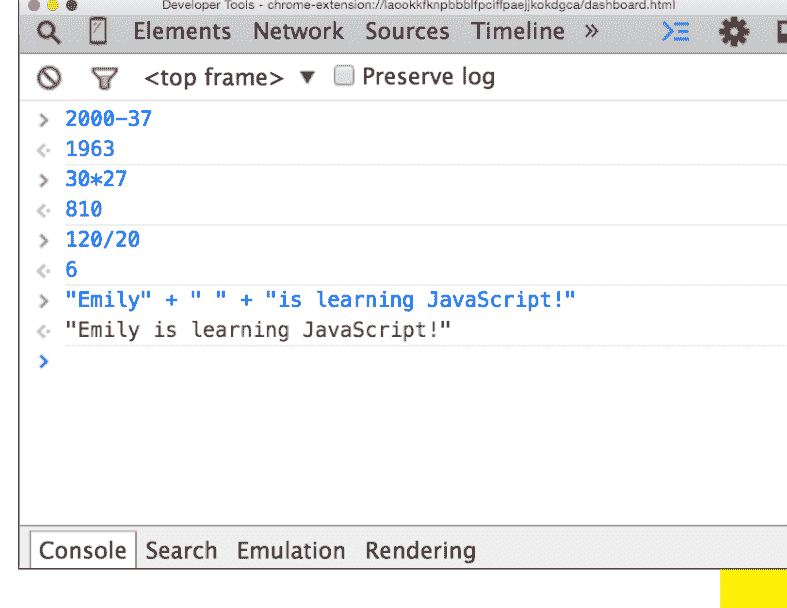

## 第一部分：什么是JavaScript？注意！JavaScript太棒了！

## 什么是编程？

*计算机程序*是一系列计算机能够理解并遵循的指令。*计算机编程*，也称为*编码*，就是我们编写这些指令的过程。计算机无法自行完成任务，它们需要计算机程序来告诉它们做什么。计算机程序员编写代码来让计算机执行各种各样的任务。


计算机程序的另一个名称是*软件*。

**发明编程的女性们**

我们今天所熟知的电子计算机最早发明于20世纪30年代。但是，第一个计算机程序——一套设计由机器执行的指令集——是在19世纪中叶写就的。

第一个计算机程序的作者，因此也是世界上第一位计算机程序员，是一位名叫阿达·洛芙莱斯的女性。她是一位英国数学家，是第一个设想计算机能够做远不止简单数字运算的人。她预见到了计算机能够完成我们今天使用计算机所做的所有事情：包括处理文字、显示图片和播放音乐。她独特的见解为她赢得了“数字女巫”的绰号。

*编译器*是将编程语言转换为机器语言的程序。第一个编译器由格蕾丝·穆雷·霍珀于1944年创造。这一发明促成了可以在不同类型的计算机上运行的计算机程序，并最终促成了JavaScript的诞生。霍珀还被认为发明了*调试*这一术语，用于修复计算机程序中的问题。这个术语的灵感来源于从早期计算机中移除一只真实的飞蛾。霍珀因其对现代计算的贡献而被称为“软件女王”或“了不起的格蕾丝”。

## 第1章：编程Web

计算机程序帮助人们完成成千上万种事情，包括以下方面：

- 播放音乐和视频
- 进行科学实验
- 设计汽车
- 发明药物
- 玩游戏
- 控制机器人
- 引导卫星和宇宙飞船
- 创作杂志
- 教授人们新技能

你能想到更多计算机能做的事情的例子吗？

#### 与计算机对话

每台计算机的核心都是中央处理单元（CPU）。这个CPU由数百万个微小、非常快速的开关（称为*晶体管*）组成，这些开关可以是开或关的状态。这些开关在任何时刻的状态决定了计算机将执行什么操作。

程序员编写的软件通过使用*二进制码*来告诉这些开关何时开启或关闭以及以何种组合开启或关闭。二进制码使用零和一来构成字母、数字和符号，这些可以按顺序组合起来执行任务。

计算机所做的每一件事都是许多零和一的不同组合的结果。例如，要表示小写字母*a*，计算机使用以下二进制码：

```
0110 0001
```

二进制数中的每个零或一称为一个*比特*，八个比特的组合称为一个*字节*。当你听到*千字节*、*兆字节*和*吉字节*这些词来描述文件大小时，它指的就是存储该文件所需的八位二进制码的数量。

表1-1列出了最常用的存储大小。

##### 表1-1 那是多少字节？

| 名称 | 字节数 | 可存储内容 |
| :--- | :--- | :--- |
| 千字节 (KB) | 1,024 | 两到三段文本 |
| 兆字节 (MB) | 1,048,576 | 800页文本 |
| 吉字节 (GB) | 1,073,741,824 | 250首歌（MP3格式） |
| 太字节 (TB) | 1,099,511,627,776 | 350,000张数码照片 |
| 拍字节 (PB) | 1,125,899,906,842,624 | 41,943张蓝光光盘 |

一个典型的小型计算机程序可能包含从几千字节到几兆字节不等的指令、图像和其他数据。因为，在你繁忙的一天中，你不太可能有足够的时间来输入成千上万甚至数百万的1和0，所以如果你想告诉计算机做什么，你需要一个同时掌握人类语言和计算机（或*机器*）语言的翻译。计算机编程语言就是这个翻译。

每个计算机程序都是用计算机编程语言编写的。编程语言允许你编写复杂的指令系列，这些指令可以被翻译（也称为*编译*）成机器语言。通过编译，这些指令最终被转换成计算机能够理解的二进制码。

#### 选择一门语言

人们已经创造了数百种不同的计算机编程语言。你可能会问自己，如果所有编程语言本质上都做同样的事情：将人类语言翻译成机器语言，为什么会有这么多编程语言？这是一个很好的问题！

存在如此多不同编程语言的主要原因有几个。新的编程语言被编写出来，是为了允许程序员

- 以比以前可用的新颖和更好的方式编写程序。
- 为新的或专用类型的计算机编写程序。
- 创造新型软件。

计算机编程语言的示例包括以下几种：

- C
- Java
- JavaScript
- Logo
- Objective C
- Perl
- Python
- Ruby
- Scratch
- Swift
- Visual Basic

## 12 第一部分：什么是JavaScript？注意！JavaScript太棒了！


我们列出的编程语言只是皮毛。要获取更完整的编程语言列表，请访问 http://en.wikipedia.org/wiki/List_of_programming_languages。

有这么多编程语言可供选择，你如何知道该使用哪一种？在许多情况下，答案取决于你想用这些语言做什么。例如，如果你想为iPhone编写应用程序，你有三种选择：Objective C、JavaScript 或 Swift。如果你想编写在Mac或Windows上运行的游戏，你有更多选择，包括C、Java或JavaScript。如果你想制作一个交互式网站，你需要使用JavaScript。

你看到这里的模式了吗？JavaScript无处不在。

## 什么是JavaScript？

在Web的早期，每个网页除了不同大小的纯文本和页面间的链接外，什么都没有。没有Web表单，肯定也没有任何动画，甚至没有不同样式的文本或图片！

我们不是在抱怨！当Web刚出现时，从一页点击到另一页并发现新事物是很令人兴奋的。更令人兴奋的是，Web让任何人都能如此轻松地发布任何内容，并有可能让互联网上的任何其他人阅读到它。

但是，当人们体验到Web能做什么后，他们想要更多的功能！图形、文本颜色、表单以及许多其他功能很快就被引入了。

在Web最早期发明的所有事物中，对后世影响最深远、持续时间最长的是JavaScript。

JavaScript的创造是为了让网页浏览器能够实现交互性。交互式网页的范围很广，从你犯错时提供反馈的简单表单，到在你的网页浏览器中运行的3D游戏。每当你访问一个网站看到有东西在移动，或者看到数据在页面上出现和变化，或者看到交互式地图或基于浏览器的游戏时，很可能背后都有JavaScript在工作。

要查看一些由JavaScript实现的网站示例，请打开你的网页浏览器并访问以下网站：

- ✔ **ShinyText** (http://cabbi.bo/ShinyText)：ShinyText是一个实验性网站，使用JavaScript显示一个单词。你可以调整单词的不同属性，例如反射强度和排斥强度，看看这些变化如何影响当你用鼠标移动单词时字母的反应。图1-1展示了ShinyText的实际效果。


即使你不明白它是如何工作的（我们当然也不明白！），玩ShinyText也很有趣，它是JavaScript可能性的一个绝佳示例。

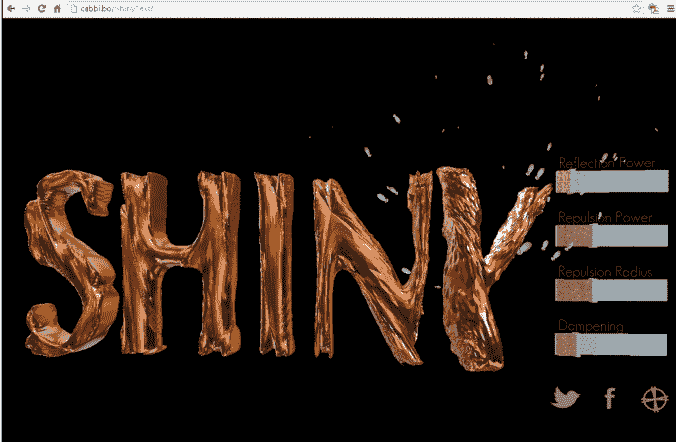

图1-1：ShinyText使用JavaScript生成3D物理模拟。


## 第1章：Web编程

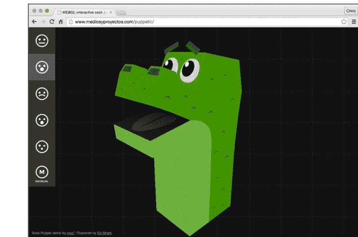

**图 1-2：** 交互式布偶让你能控制一个JavaScript恐龙袜偶。

- ✔ **交互式布偶** (www.mediosyproyectos.com/puppetic)：交互式布偶是另一个3D动画。这次，你可以控制一个JavaScript木偶的动作和面部表情。图1-2展示了看起来相当开心的交互式布偶。
- ✔ **Facebook** (www.facebook.com)：Facebook大量使用了JavaScript（见图1-3）。当你看到流畅的动画或视频播放，或者当帖子列表自动更新时，那就是JavaScript在起作用！


图 1-3：Facebook使用JavaScript做所有事情。

> 其中一些示例使用了Web浏览器的一些非常高级的功能。我们建议您使用最新版本的Google Chrome来查看这些内容。这些示例在较旧的Web浏览器中可能无法正常工作。

### 准备好你的浏览器

使用JavaScript必不可少的工具就是一个Web浏览器。你有很多不同的Web浏览器可供选择，它们几乎都能很好地运行JavaScript。很可能，你的电脑上已经安装了一个Web浏览器。

当今最广泛使用的Web浏览器是Firefox、Safari、Chrome、Internet Explorer和Opera。在本书中，我们将使用Chrome。Google Chrome是目前最流行的Web浏览器。它拥有一系列用于JavaScript开发的强大工具。

如果你还没有安装Chrome，你需要下载并安装它。你可以打开任意一个Web浏览器，访问www.google.com/chrome/browser/desktop来安装Chrome。按照该页面上的说明在你的电脑上安装Chrome。安装好Chrome后，启动它。

在下一节中，我们将向你介绍Chrome开发者工具，它能帮助网站设计师和JavaScript程序员准确了解浏览器内部正在发生什么，从而编写更好的网页和程序。

## 打开Web开发者工具

安装并启动Chrome后，查看浏览器窗口的顶部。在右上角，你会看到三条线。这是Chrome菜单的图标。如果你展开Chrome菜单，你会看到一系列选项，类似于图1-4所示。

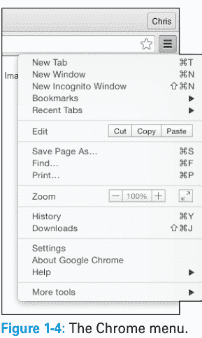

如果你向下滚动到此菜单的底部并选择更多工具，会出现一个新的选项菜单，如图1-5所示。这些隐藏的工具是JavaScript程序员的得力助手。

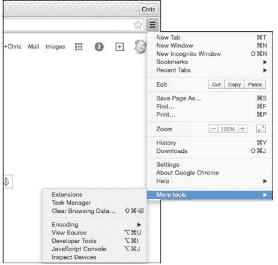

从更多工具菜单中选择开发者工具。一个新面板会在浏览器窗口底部打开，如图1-6所示。

开发者工具为你提供了所有需要的信息，用于了解任何网页的工作原理、测试和改进你自己的网页和JavaScript程序等等。

请注意，开发者工具顶部有一个菜单，包含不同的选项，如元素、网络、源代码、时间线、性能、资源、审计和控制台。如果你点击其中每一个，都会在开发者工具面板中看到一组不同的选项和数据。

我们将在本书中根据需要描述开发者工具的不同组成部分，但目前，开发者工具最重要的部分是标有控制台的部分。现在点击控制台选项卡。

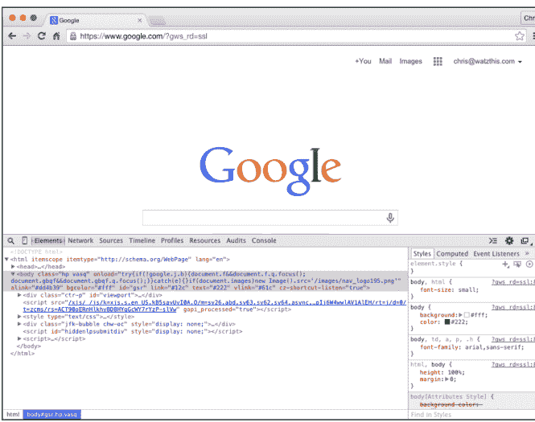

## 介绍JavaScript控制台

开发者工具控制台，也称为JavaScript控制台，如图1-7所示，它为你提供关于当前在浏览器窗口中运行的JavaScript的信息。

如果网页的JavaScript代码中存在错误，你会在控制台中看到有关错误的信息。这是一个非常有用的工具，也是JavaScript控制台的主要功能之一。

控制台的另一个非常酷的功能是，你可以在控制台面板中输入JavaScript代码并运行它。在下一节中，你将了解为什么这很有用以及如何操作。


JavaScript控制台是JavaScript程序员的有用工具，但它也有可能被滥用。如果某个你不认识或不信任的人要求你将代码粘贴到JavaScript控制台中，请务必先弄清楚那段代码的作用。

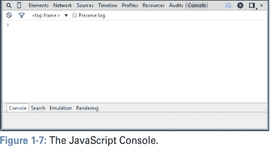

## 运行你的第一条JavaScript命令

现在是时候开始尝试一些真正的JavaScript代码了！如果还没有打开，请从Chrome菜单下的其他工具菜单中选择JavaScript控制台，或者点击开发者工具中的控制台选项卡来打开它。

按照以下步骤运行你的第一条JavaScript命令：

1.  点击JavaScript控制台内部，在 `>` 附近，开始输入代码。
2.  输入 `1 + 1` 然后按回车键（Mac）或Enter键（Windows）。

浏览器会在下一行给出答案。

请注意，当答案返回给你时，它左边有一个指向左边的箭头。这个箭头表示该值来自JavaScript，而不是来自你的输入。任何来自JavaScript的值都称为返回值。你在JavaScript中运行的每个命令都会产生某种返回值。

简单的数学计算是一回事，但JavaScript能做的事情多得多，多得多。让我们尝试一些其他命令，看看我们在这里能多快得到一些答案。

在开始之前，让我们清理控制台，移除其中之前所有的命令、错误和返回值。要清除控制台，请查看左上角并点击那个中间有一条线的圆圈。控制台内的所有内容都将被擦除，现在你有了一个干净的界面。

在 `>` 旁边点击鼠标，尝试以下JavaScript命令。确保在每个命令后按回车键（Mac）或Enter键（Windows）以查看结果。

| JavaScript 命令 | 描述 |
|---|---|
| `2000 - 37` | 这是一个简单的数学问题，但这次我们使用减号从左边的数字中减去右边的数字。 |
| `30 * 27` | 星号 (*) 是告诉JavaScript将数字相乘的方式。 |
| `120 / 20` | 正斜杠 (/) 告诉JavaScript将左边的数字除以右边的数字。 |
| `"Your name" + " " + "is learning JavaScript!"` | 是的，你可以用JavaScript将单词加在一起！当你运行一个将单词加在一起的命令时，它被称为 *连接*。结果将是这些单词组合成一个单词。请注意，上述JavaScript命令中的单词在引号内。这些引号非常重要。我们将在第2章告诉你它们为什么重要。 |
| `Your name + + is learning JavaScript!` | 当你不使用引号时，JavaScript一点也不喜欢这样。它会返回一条包含关键字 `SyntaxError` 的错误消息。语法错误意味着你写了一些无效的JavaScript代码。任何时候你看到语法错误，都意味着你犯了错。仔细检查你的代码，寻找拼写错误、缺失的标点符号或缺失的引号。 |

### 玩转数学

现在轮到你来尝试一些数学问题了！清除上一节中的命令、返回值和错误，然后在控制台中进行实验。

以下是一些帮助你入门的想法：

- 将两个小数相乘。
- 在一行中运行多个命令（例如，`1 + 1 * 4 / 8`）。
- 输入一个没有任何符号的数字，然后运行它。
- 将一个单词（记得使用引号！）加到一个数字（不带引号）上。
- 将一个数字（不带引号）加到一个单词（带引号）上。
- 将你的名字与你偶像的姓氏组合起来。记住在名字和姓氏之间添加一个空格！例如，`"Eva" + " " + "Harry Styles"`。
- 尝试产生极大的返回值。
- 尝试产生极小的返回值。
- 尝试做一个不可能的数学问题，比如除以零。
- 尝试将一个数字乘以一个单词（带引号）。例如，`343 * "hi!"`。这将会产生 `NaN`，它代表“非数字”。


## 第2章
理解语法

**就像口语**有规则（称为*语法*）一样，计算机编程语言也有规则（称为*语法*）。当你理解了JavaScript的基本语法规则后，你会发现它实际上与英语有相似之处。

如果你觉得老师纠正你说“ain't”时已经很严格了，那就等着看JavaScript有多严格吧！如果你犯了某些语法错误，它甚至不会理睬你写的任何代码。

在本章中，你将学习JavaScript语法的基础知识，以及如何避免被“语法警察”批评！

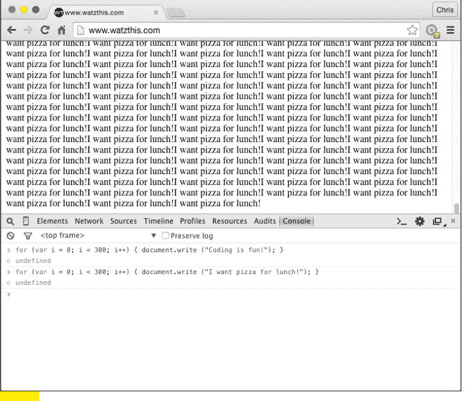

### 精确表达你的意图

为了能够被正确地编译成机器语言指令，程序需要编写得非常精确。


第1章解释了什么是程序，以及程序如何通过一个称为*编译*的过程被翻译成机器语言。

作为程序员，你的工作是思考程序要实现的大局，然后将其分解成计算机可以无误完成的、易于处理的步骤。例如，如果你想要一个机器人下楼给你拿一个三明治，你的指令可能会像这样开始：

1. 将头部转向楼梯。
2. 使用视觉传感器寻找障碍物。
3. 如果发现障碍物，确定它是什么。
4. 如果障碍物是一只猫，尝试通过以下方式引诱猫离开楼梯顶部：
   - 将玩具扔到走廊上
   - 说出猫的名字
   - 用手轻轻推猫，直到它走开
5. 如果没有障碍物，将左脚转向楼梯的方向。
6. 将左脚放在右脚前面。
7. 寻找障碍物。
8. 确定你是否在楼梯顶部。
9. 如果你不在楼梯顶部，将右脚转向楼梯的方向。
10. 将右脚放在左脚前面。
11. 重复步骤1到10，直到你到达楼梯顶部。

你已经写了11条指令，而机器人甚至还没开始下楼，更不用说做三明治了！

一个真实的计算机程序，要告诉机器人下楼并做三明治，需要包含比这里展示的多得多的详细指令。在每一步，每个电机都需要被告知精确的开启时间，每个可能的条件和障碍物都需要被详细描述和处理。

所有这些指令都需要作为单独的JavaScript命令，或*语句*来编写。


你可以通过访问 [http://nodebots.io](http://nodebots.io) 了解更多关于如何用JavaScript控制机器人的信息！

#### 编写语句

在英语中，我们用句子交谈。在JavaScript中，一条给计算机的单独指令称为一个*语句*。就像句子一样，语句由不同的部分组成，并必须遵循某些规则才能被理解。

代码清单2-1展示了一个语句的示例。

```
alert("Coding is fun!");
```

这条语句会使Web浏览器打开一个弹出警告窗口，显示句子“Coding is fun!”。如果你将这条语句输入到Chrome浏览器的JavaScript控制台中，你会看到类似图2-1所示的内容。

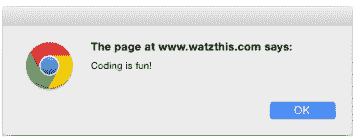

**图2-1：** JavaScript警告语句的输出。

注意代码清单2-1中的语句包含一个关键字、一些符号（括号和引号）以及一些文本（`Coding is fun!`），并以分号结尾。

就像可以用英语写出无数的句子一样，也可以用JavaScript写出无数的语句。

`alert`这个词是JavaScript关键字的一个例子。许多JavaScript语句以关键字开头，但并非所有语句都是如此。

> 分号用于分隔不同的语句，就像句号分隔不同的句子一样。每条语句都应该以分号结尾。

#### 遵循规则

JavaScript有几条必须遵守的规则，你的计算机才能理解你。前两条规则是：

- 拼写很重要。
- 空格不影响。

让我们更详细地看看这些规则。我们将编写一个新的消息打印程序作为示例。代码清单2-2是一个JavaScript程序，它打印出“Coding is fun!”这句话300次。

##### 代码清单2-2 打印消息300次的程序

```
for (var i = 0; i < 300; i++) { document.write ("Coding is fun!"); }
```

按照以下步骤测试此程序：

1. 打开Chrome网页浏览器。
2. 从Chrome菜单下的“更多工具”菜单中打开JavaScript控制台。


你也可以使用键盘组合键打开JavaScript控制台。按 ⌘+Option+J (Mac) 或 Ctrl+Shift+J (Windows)。

3. 将代码清单2-2中的程序在JavaScript控制台上输入到一行中，然后按 Return (Mac) 或 Enter (Windows)。

如果你输入的完全正确，你会看到该消息在浏览器窗口中出现300次，如图2-2所示。

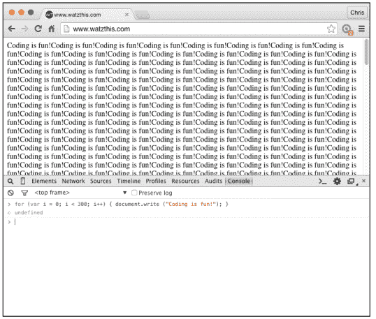

图2-2：运行代码清单2-2中程序的结果。

这个“Coding is fun!”程序使用了一种称为for循环的技术，以便用很少的代码完成多次操作。我们将在第17章和第18章更详细地讨论for循环。

仔细看看代码清单2-2中的代码。注意写入浏览器窗口的文本是用引号括起来的。引号表明这段文本应该被视为文字，而不是JavaScript代码。

#### 在字符串中使用文本

在编程中，我们将引号内的一段文本称为字符串。你可以这样记住这个名字：把引号内的文本想象成一根绳子，上面系着字母、数字和符号。这些字母保持相同的顺序，并且每个字母在绳子上占据一定的空间。

例如，尝试将代码清单2-2中的代码再次输入到你的JavaScript控制台，但将`Coding is fun!`改成另一条消息，比如你午饭或晚饭想吃什么。

图2-3显示了当消息更改为“I want pizza for lunch!”时，代码清单2-2中程序的输出。

你可以键入的任何字符都可以放入字符串中。然而，有一个重要的例外需要记住：如果你想在字符串中使用引号，你必须告诉JavaScript这些引号是字符串的一部分，而不是字符串的结束。

> 提示
> 在字符串中放入引号的方法是在引号前使用反斜杠（\）。在字符串中使用反斜杠告诉JavaScript下一个字符是特殊的，并且不具有其通常的含义。当你在字符串中的引号前添加反斜杠时，这称为转义引号。

例如，如果你想将字符串改为：

```
Joe said, "Hi!"
```

你需要将字符串写成：

```
"Joe said, \"Hi!\""
```

代码清单2-3展示了我们的消息打印程序，其中消息包含了转义引号。

##### 代码清单2-3 转义引号

```
for (var i = 0; i < 300; i++) { document.write ("Joe said, \"Hi!\""); }
```


你现在可能会问自己：“如果反斜杠用于告诉JavaScript下一个字符是特殊的，那我如何打印出一个反斜杠？”问得好！答案是，对于每个需要打印的反斜杠，只需使用两个反斜杠（\\）即可。

与JavaScript中的大多数事情一样，在字符串中使用引号还有另一种方法：用不同的引号将字符串括起来。JavaScript不关心你是使用单引号（'）还是双引号（"）来标记文本为字符串，只要你在字符串的开头和结尾使用相同类型的引号即可。


## 第2章：理解语法

如果你用单引号包围字符串，就可以在字符串内部使用所有双引号，无需转义。但单引号必须转义。

如果你用双引号包围字符串，就可以在字符串内部使用所有单引号，但双引号必须转义。

清单2-4展示了使用单引号包裹字符串，且字符串内部包含双引号的消息打印程序。

```
清单 2-4  单引号内的双引号

for (var i = 0; i < 300; i++) { document.write (' Joe said, "Hi!" '); }
```

### 在代码中使用文本

与字符串不同，引号（单引号或双引号）外部的文本内容和拼写非常重要。在 JavaScript 中，当文本未被引号包围时，它被视为 JavaScript 程序代码的一部分。

JavaScript 代码对拼写和大小写非常挑剔。在 JavaScript 代码中，以下三个词是完全不同的：

- FOR
- for
- For

只有中间那个（`for`）对 JavaScript 有特殊含义。如果你尝试在消息打印程序中使用另外两个，将会得到一个错误，如图2-4所示。

`for` 的特殊含义将在第17章中解释。

JavaScript 对拼写也非常挑剔。很多时候，当我们在编码时某部分无法正常工作，问题往往在于我们不小心漏掉了一个字母或打乱了两个字母的顺序。


就像写作中的拼写错误常常不被察觉一样，这类错误可能非常难以追踪。因此，尽早养成缓慢而仔细输入的习惯，从长远来看，你会节省大量时间！

### 注意空白字符

空白字符是程序中所有的空格、制表符和换行符。JavaScript 会忽略代码中单词之间以及单词与符号之间的空白字符。例如，在我们的消息打印程序中，我们可以通过将其分散到多行来使整个程序更易于阅读，如清单2-5所示。

```
清单 2-5

for (var i = 0; i < 300; i++) {
    document.write ("Coding is fun!");
}
```

清单2-5展示了我们推荐的程序排版方式。

注意，我们在左花括号（`{`）之后和右花括号（`}`）之前插入了换行符。花括号用于将代码片段（也称为 *语句*）分组在一起，形成所谓的 *块*。在这个程序中，它们标记了应重复执行300次的部分——即打印一条消息。

花括号是添加一些空白字符的好地方，这有助于你更轻松地阅读代码。另一个插入换行符的好地方是在每个分号（`;`）之后。在 JavaScript 中，分号用于标记语句的结束，就像句号用于标记英语句子的结束一样。

> **提示**
> 如果你尝试在 Chrome 的 JavaScript 控制台中运行分散在三行的程序，当你在第一行之后按下回车键（Mac）或 Enter 键（Windows）时，会收到一条错误消息。这是因为控制台在你每次按下回车或 Enter 时都会尝试运行你的代码，而第一行（以 `{}` 结尾）不是一个完整的 JavaScript 语句。要在控制台中输入带换行的代码，请在按下前两行后的回车或 Enter 键时按住 Shift 键。

注意，花括号之间的语句是缩进的。缩进有助于阅读代码的人看到这个语句发生在另一个语句内部——即创建循环的 `for` 语句。

> **提示**
> 我们建议使用两个空格或四个空格来缩进语句。有些人使用制表符来缩进语句。使用哪种方式取决于你。但一旦决定，就坚持下去。如果你使用两个空格来缩进块内的代码，就不应该有时使用四个空格或制表符。整洁很重要！

### 添加注释

JavaScript 注释是一种将文本放入程序的方式，这些文本既不是字符串也不是语句。这听起来可能没什么大不了的，但注释之所以如此重要和有用，恰恰是因为它们不会让 JavaScript 执行任何操作。

程序员在代码中使用注释有以下几个原因：

- 告诉未来的自己以及未来处理该程序的其他人，他们为什么以特定方式编写某些内容
- 描述他们编写的代码如何工作
- 给自己留下笔记，说明还需要做什么，或者列出打算在以后进行的改进
- 防止 JavaScript 语句运行

JavaScript 有两种不同类型的注释：单行注释和多行注释。

- **单行注释：** 单行注释会导致同一行中其后的所有内容都成为注释。要创建单行注释，请使用两个紧挨着的斜杠（`//`）。例如，在清单2-6中，前三行是单行注释，第四行包含一个将被执行的语句，后面跟着一个注释。

- **多行注释：** 多行注释是可以超过一行的注释。要创建多行注释，以 `/*` 开始，并以完全相反的 `*/` 结束注释。清单2-7展示了一个多行注释的例子。

#### 清单 2-6 单行注释

```
// 下面的代码不会运行。
// alert("注意！");
// 下一条语句将运行。
alert("祝你有美好的一天！"); // 弹出一条友好的消息
```

#### 清单 2-7 多行注释

```
/*
    AlertMe，由 Chris Minnick 和 Eva Holland 编写

    一个提醒用户他们正在使用名为 AlertMe 的 JavaScript 程序的程序，
    该程序由 Chris Minnick 和 Eva Holland 编写。
*/
```

### 提供与接收数据

程序有各种不同的规模和用途。以下是所有程序共有的三件事：

- 从用户接收信息的方式
- 向用户返回信息的方式
- 在接收和返回之间存储和处理信息的方式

程序从用户接收的信息或数据称为 *输入*。程序返回给用户的内容称为 *输出*。在程序接收输入和产生输出之间的时间段，它需要某种方式来存储和处理输入的各种类型的数据，以便能够产生输出。

是给予还是接受更好，这个问题并不重要！两者皆好。在本章中，你将学习 JavaScript 如何帮助你获取、接收并拥有数据！

> 亲爱的 Eva，
>
> 我们很高兴地通知您，您的歌曲《'Can't Stop Coding!'》已被颁奖委员会评为有史以来的最佳歌曲。
>
> 此致，
> 格莱美奖

### 掌握变量

在现实世界中，当你想存储东西、赠送东西（例如作为礼物）、移动东西或整理东西时，通常会把它放在一个盒子里。

JavaScript 对心形的巧克力盒或装着最新款运动鞋的鞋盒不感兴趣。JavaScript 喜欢的是数据。为了存储和移动数据，JavaScript 使用一种特殊的盒子，称为 *变量*。变量是一个你可以命名的盒子。这个名字将代表该盒子或变量中包含的所有数据。

变量使得同一个程序能够处理不同的输入，从而产生不同的输出。

#### 创建变量

在 JavaScript 中创建变量相当简单。要创建一个变量，你需要使用 `var` 关键字，后跟变量名，然后是一个分号，像这样：

```
var book;
```

作为程序员，在给变量命名时你有很大的灵活性。你可以很有创意地命名变量，但不要过于离谱。最重要的是，你的变量名应该准确地描述存储在其中的数据。

以下每个变量声明都创建了一个具有良好描述性名称的变量。通过查看它们，你大概可以猜出存储在其中的数据是什么样的。

```
var myFirstName;
var favoriteFood;
var birthday;
var timeOfDay;
```

注意我们如何通过在第一个单词之后的每个单词使用大写字母来分隔变量名中的单词。变量名不能


#### 在变量中存储数据

创建变量后，你可以在其中存储任何类型的数据。数据存储后，随时可以调用它。让我们试试看！

1.  在 Chrome 中打开 JavaScript 控制台。
2.  键入以下内容，然后按 Return（Mac）或 Enter（Windows），创建一个名为 `book` 的新变量：
3.  通过键入以下代码，为你的新变量赋值。

```
var book;
```

你已经创建了容器（或变量），并将其命名为 "book"。

当你按下 Return 或 Enter 时，JavaScript 控制台会显示 `undefined` 这个词。这正是你期望发生的事情。JavaScript 只是告诉你代码运行正确，它没什么可说的。

JavaScript 告诉你它没什么可说的，这可能看起来有点奇怪。但是，请相信我们，即使只是 `undefined`，它能说点什么也比完全不理你、一言不发要好得多。

```
book = "JavaScript For Kids For Dummies";
```

你现在已经将数据放入了变量中，数据将存储在那里。

当你按下 Return 或 Enter 时，JavaScript 会响应书的名称。

你只需要在第一次创建和命名变量时键入 **var**。当你想改变变量中的数据时，只需使用变量的名称即可。

4.  现在，暂时忘记这本书的名字。记住了吗？现在，假设你需要回忆这本书的名字，以便告诉你的朋友！要调用变量中的数据或值，只需在控制台中键入变量名即可。因此，键入以下内容：

`book`

控制台会调用赋给 book 变量的字符串并打印出来，如图 3-1 所示。

**图 3-1：** 打印赋给变量的值。

注意，我们在键入时没有使用分号（;）——我们只是在 JavaScript 控制台中使用了变量名。变量名不是完整的 JavaScript 语句，因此不需要分号。我们只是在向 JavaScript 询问变量的值，就像我们问它 `1 + 1` 一样。

5.  现在尝试通过在 JavaScript 控制台中键入以下语句来更改 book 变量的值：

`book = "The Call of the Wild";`

6.  在 JavaScript 控制台中键入 **book** 以检索其新值。

控制台将打印 "The Call of the Wild"（或你作为 `book` 新值输入的任何内容）。

除了文本，变量还可以存储其他几种不同类型的数据。在下一节中，我们将向你展示 JavaScript 理解的每种基本（也称为原始）数据类型。

变量中的数据也可以称为变量的值。

### 理解数据类型

JavaScript 变量只有一个任务——持有和存储数据——它们完成这项任务做得相当好。使用和创建变量很容易。世界上有许多不同类型的数据，如数字、字母和日期。JavaScript 对这些以及其他不同类型的数据做出了一些重要的区分，作为编码者，你需要了解这些。

数据类型是程序区分 03-20-2017 是日期（2017 年 3 月 20 日）还是数学题（3 减去 20，然后用结果减去 2017）的方式。

JavaScript 识别三种基本数据类型：字符串、数字和布尔值。

#### 字符串数据类型

字符串数据类型用于存储文本。我们在第 2 章解释了字符串工作原理的基础知识，但除了存储和打印字符串之外，你还可以使用字符串进行一些其他很酷的操作。

一个很酷的字符串技巧是计算字符串由多少个字符组成。你可以在字符串或保存字符串的变量后使用 .length 来实现这一点。

例如，要找出你在上一节中创建的 book 变量中存储的字符串长度，请在控制台中键入 **book.length**。控制台立即响应一个数字，如图 3-2 所示。

图 3-2：获取字符串的长度。

每个字符串，即使是空字符串，都有一个长度。空字符串的长度当然是 0。因为它是描述字符串的东西，所以我们称 `length` 为字符串的 *属性*。

你会经常在人们谈论 JavaScript 时看到 *property*（属性）这个词。属性是描述某物或属于某物一部分的东西。例如，汽车的颜色是汽车的属性，人的名字是人的属性，字符串的长度是字符串的属性。

除了找出存储在变量中的字符串长度之外，你还可以直接在带引号的字符串后附加 `length` 属性来找出其长度：

```
"I am a string.".length
```

数一下这个句子中的字母。有 10 个——如果算上句末的句号，是 11 个。但当你在 JavaScript 控制台中输入此命令时，得到的结果是 14。你知道为什么吗？

字符串中的空格与字母、标点符号、符号和数字一样重要。就像我们在第 2 章使用的类比，对于 JavaScript 来说，它们都只是字符串上的结（确切地说是 14 个）。

除了属性，字符串还有可以执行或可以对其执行的操作。在编程中，我们把这些可以对某物执行的操作称为 *方法*。

最常用的字符串方法是 `indexOf`。`indexOf` 的作用是查看你的字符串，在其中找到某个字符或一组字符，并告诉你它们的位置。在下面的语句中，我们查找单词 *am* 在字符串中的位置：

```
"I am a string.".indexOf("am");
```

当您在控制台中运行此语句时，结果为 2。尝试重新输入命令，但这次查找大写字母 *I*。

```
"I am a string.".indexOf("I");
```

结果是 0。

这引出了 JavaScript 中一个非常重要的概念，称为从零开始的编号。与人类（有十根手指，通常从数字 1 开始计数）不同，JavaScript 从零开始计数。因此，在上一个示例中，当 JavaScript 想告诉你 I 是字符串中的第一个字符时，它会说 I 位于位置 0。

如果 JavaScript 是运动队的一员，它会自豪地穿上一件印有“We're number 0!”的球衣。

#### 数字数据类型

JavaScript 理解的另一种数据类型是数字数据类型。数字可以是正数或负数，也可以是整数或小数。数字在存储时不需要使用引号。

JavaScript 中可以使用的数字范围非常非常小到非常非常大。我们现在不会用一堆零来让你感到厌烦，但你可以在 JavaScript 中使用的最大数字远大于宇宙中星星的数量。它甚至比宇宙中 *原子* 的数量还要大！JavaScript 可以执行任何你希望它做的数学问题或计数问题。


## 第三章：数据的传递与接收 41

然而，有一点需要特别注意：当你尝试组合两种不同的数据类型时会发生什么，例如字符串和数字。

JavaScript 通常会表现得相当聪明。如果你打开控制台并输入 `"10" + 10`，JavaScript 会假设你希望将这两段数据都视为字符串，然后将它们连接起来，给你结果 1010。

另一方面，如果你输入 `10 * "10"`，JavaScript 会假设你希望字符串 "10" 实际上是数字 10，于是会给你结果 100。JavaScript 这样做是因为它知道字符串无法相乘。

### 布尔数据类型

布尔数据类型只能存储两种可能的值之一：`true` 或 `false`。

布尔值是当你在 JavaScript 中进行比较时得到的结果，我们将在本书第五部分更详细地介绍。如果你问 JavaScript 类似这样的问题："3 等于 30 吗？"，它会返回一个布尔值 `false`。

布尔数据类型以数学家乔治·布尔的名字命名，因此它的首字母总是大写。

让我们用布尔值做一些实验。打开 JavaScript 控制台，尝试输入以下每个语句，每输入一行后按回车键查看结果。注意，我们在每个语句后使用了单行注释来解释其含义。你不需要在控制台中输入这些注释，但如果愿意也可以输入。

```
1 < 10 // 1 小于 10 吗？
100 > 2000 // 100 大于 2000 吗？
2 === 2 // 2 精确等于 2 吗？
false === false // false 精确等于 false 吗？
40 >= 40 // 40 大于或等于 40 吗？
Boolean(0) // 0 的布尔值是什么？
Boolean(false) // false 的布尔值是什么？
"apples" === "oranges" // "apples" 精确等于 "oranges" 吗？
"apples" === "apples" // "apples" 精确等于 "apples" 吗？
```

除了你预料中会为 false 的语句外，JavaScript 还认为以下值为 false：

```
0      null      undefined
""（空字符串）      false
```

### 提示用户输入

既然你知道了变量可以存储不同类型的数据，让我们探索从用户那里获取数据并将其存储在变量中的过程。

向用户请求数据的一种方式是使用 `prompt` 命令。要尝试 `prompt` 命令，请打开 JavaScript 控制台并输入以下内容：

```
prompt("What is your name?");
```

按回车键后，你的浏览器窗口中会出现一个带有文本框的弹出窗口，如图 3-3 所示。

输入你的名字并点击“确定”后，弹出窗口消失，你输入的值会显示在控制台上，如图 3-4 所示。

如果你只想捕获数据然后像鹦鹉一样立即重复它，这当然很好。但如果你想对用户输入的数据进行一些处理呢？为此，你需要将其存储在一个变量中。

### 存储用户输入

要将用户输入的数据存储在变量中，你需要创建一个新变量，然后跟上等号 `=`，再跟上 `prompt` 语句。

```
var username = prompt("What is your name?");
```


重要提示：JavaScript 中的单个等号 (`=`) 称为*赋值运算符*。它的作用是将右边的值放入左边的变量中。我们将在第 9 章更详细地讨论运算符。

当你按回车键时，浏览器中会出现一个弹出窗口，和之前一样。

当你在弹出窗口中输入名字并点击“确定”后，JavaScript 控制台会打印出 `undefined`，表示该语句已完成，没有其他操作需要执行。

要查看你刚刚输入的值，可以在控制台中输入变量名。JavaScript 会返回该变量的值，如图 3-5 所示。

### 响应输入

既然你知道了如何从用户那里获取数据以及如何存储这些数据，让我们看看两种使用 JavaScript 来响应用户的方法。

#### 使用 alert()

`alert()` 命令会在用户的浏览器中弹出一个通知框，其中包含括号之间的任何数据。

如果你想显示一个带有简单字符串消息的 alert，可以通过在 `alert` 后的括号之间用引号括起一条消息来实现。例如，在你的 JavaScript 控制台中输入以下语句：

```
alert("Good job!");
```

当你按回车键时，浏览器会显示一个包含消息 "Good job!" 的警报消息。

通过在括号之间放入不带引号的数字来在 alert 中显示数字。例如，尝试此语句：

```
alert(300);
```

警报弹出窗口会显示数字 300。你甚至可以在 alert 中进行数学运算。例如，试试这个：

```
alert(37*37);
```

警报会显示 37 乘以 37 的结果。

如果你在 `alert` 语句的括号之间放入一个不带引号的单词，JavaScript 会将该单词视为变量。尝试运行以下两条语句：

```
var myNameIs = "your name";
alert(myNameIs);
```

浏览器会弹出一个包含你名字的窗口。

通过将不同的数据类型组合到一个 alert 语句中，你可以开始做一些真正有趣和有用的事情。例如，尝试在你的 JavaScript 控制台中逐行输入以下语句：

```
var firstName = "your name";
var yourScore = 30;
alert("Hi, " + firstName + ". Your current score is: " + yourScore);
```

如你所见，通过使用 `alert()`，你可以创建各种有趣和有信息量的弹出窗口来娱乐和告知用户，例如图 3-6 中的警报。

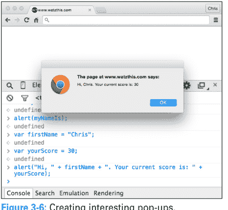

图 3-6：创建有趣的弹出窗口。

> 对象的特殊生命

#### 使用 document.write()

在 JavaScript 中，一个网页被称为一个*文档*。当你使用 JavaScript 更改当前网页上的某些内容时，你是通过告诉 JavaScript 更改文档对象来实现的。

更改当前网页的一种方法是使用 `write` 方法。

方法是可以被执行的东西，或者是某物可以执行的操作。

每个文档（或网页）都有一个 `write` 方法，它会将你放在方法名后的括号之间的任何内容插入到网页中。你可以像使用 `alert()` 一样使用 `document.write()`。例如，打开一个新的空白浏览器窗口，并在你的 JavaScript 控制台中尝试以下语句：

```
document.write("Hi, Mom!");
document.write(333 + 100);
```

注意，第一条语句之后的语句会紧跟在第一条语句之后添加，没有换行或空格。你可以使用字符 `<br>` 在使用 `document.write` 写入文本之前或之后添加空格。例如：

```
document.write("How are you?<br>");
document.write("I'm great! Thanks!<br>");
document.write("That's awesome!");
```

你可以通过在浏览器地址栏中输入 **chrome://newtab** 或打开一个新的浏览器标签页来清除浏览器窗口的当前内容。

在 JavaScript 控制台中输入这三行的结果如图 3-7 所示。

`<br>` 是一个 HTML 标签。我们将在第 5 章更详细地讨论 HTML。

48 第一部分：什么是 JavaScript？警报！JavaScript 真棒！

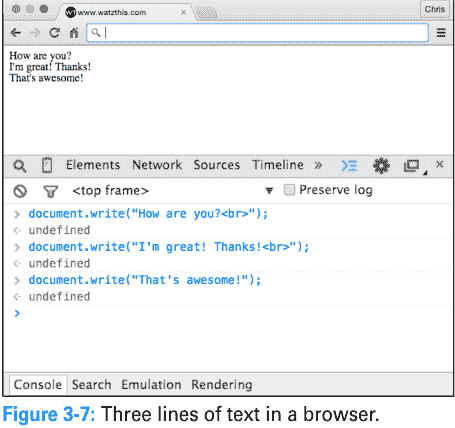

**图 3-7：** 浏览器中的三行文本。

#### 组合输入与输出

现在，让我们组合输入和输出，基于用户的输入来显示自定义输出。这正是 JavaScript 可以为网页所做的核心功能！

在 JavaScript 控制台中按照以下步骤在你的网页浏览器中创建一封给自己的信。确保在每条语句（每个分号）结束后按回车键。

- 1. 输入以下内容以创建一个包含你名字的变量。

```
var toName = "your name";
```

- 2. 输入以下内容以创建一个包含发信人的变量：

```
var fromName = "The Grammy Awards";
```

你可以将 The Grammy Awards 更改为任何你希望收到信件的人。


## 第一部分：什么是JavaScript？注意！JavaScript太棒了！

### 摆弄Web应用程序

**在第一章中，我们讲解并演示了JavaScript控制台。在第二章和第三章中，我们将向你展示如何将多个语句组合在一起形成一个程序。在本章中，我们将更进一步，向你介绍我们最喜欢的JavaScript练习场：JSFiddle。在这里，你将不再是玩秋千和滑梯，而是要摆弄JavaScript语句、HTML标签和CSS样式。**

JSFiddle允许你在Web浏览器中编写和试验JavaScript代码。你可以用它来尝试代码、获取代码反馈、分享代码，甚至可以和朋友一起编写程序！你还将学习如何使用JSFiddle来查看、修改、保存和分享JavaScript Web应用程序。

你可能好奇我们所说的*Web应用程序*是什么意思。Web应用程序（*或Web应用*）是在浏览器中运行的软件，通常由JavaScript驱动。例如，Google Earth就是你可能熟悉的一个流行的Web应用。它可以查找并以高分辨率照片向你展示地球上几乎任何地方。Google Earth也是一个*网站*，因为你可以通过网址或URL访问它。你认为JSFiddle是一个Web应用、一个网站，还是两者都是？它实际上是两者兼有。事实上，每个Web应用程序都是一个网站。然而，并非所有网站都是Web应用程序。

在本章中，你将使用JSFiddle来试验一些动画。最终，你会得到一个可以根据自己的喜好任意定制的JavaScript泡泡机！它之所以叫JSFiddle，是因为你可以用它来“摆弄”JavaScript。那么，让我们开始摆弄吧！

### 介绍JSFiddle

要开始使用JSFiddle，请打开你的Web浏览器并在地址栏中输入**http://jsfiddle.net**。你将看到JSFiddle的网站，如图4-1所示。

JSFiddle的用户界面窗口由三个窗格组成，你可以在其中输入不同类型的代码，包括HTML、CSS和JavaScript。你在这些框中输入的内容的显示结果会出现在“结果”窗格中。左侧的工具栏让你可以配置其他选项，顶部的工具栏则有运行、保存和清理代码的按钮。

提示
你可以通过点击并拖动分隔窗格的边框来调整JSFiddle中任何窗格的大小。

目前，我们主要关注JavaScript窗格。JavaScript窗格的工作方式与JavaScript控制台非常相似。在JSFiddle中，你输入的代码在你告诉它运行之前不会执行。

图4-1：JSFiddle简洁且分区明确的用户界面。

按照以下步骤运行你的第一个JSFiddle程序：

-   1. 点击JavaScript窗格内部。
-   2. 输入以下JavaScript语句：
-   3. 点击顶部工具栏上的“运行”按钮。
-   4. 通过点击“确定”关闭弹出窗口。

```javascript
alert("Hi, everyone!");
```

一个包含消息“Hi, everyone!”的弹出窗口出现了。

这个简单JavaScript程序的行为没什么令人惊讶的。如果你已经读过本书的前三章，你已经熟悉了`alert`语句的工作原理。

运行JavaScript并不是JSFiddle唯一厉害的功能。使用JSFiddle，你还可以使用HTML和CSS窗格来运行与你的JavaScript代码协同工作的代码！在接下来的几节中，我们将更详细地介绍每个窗格并演示它们的用法。但首先，我们快速演示一下JSFiddle能做什么。

### 查看我们的fiddles

我们要告诉你一个秘密。本书中的每个程序都可以在`http://jsfiddle.net/user/forkids/fiddles`查看、运行、复制和把玩。没错！我们已经为你完成了作业！我们已经为你格式化好并测试过了。

这是我们自己的JSFiddle公共仪表盘。公共仪表盘是任何JSFiddle用户都可以与世界分享程序（在JSFiddle中称为“fiddles”）的地方。

虽然我们已经为你输入了每个项目，但重要的是你自己亲历每个项目的每一步，这样才能真正理解。为了充分利用本书，请随意复制、修改、完全更改和重写我们的代码，看看它做了什么，并把它变成你自己的！继续摆弄吧！

### 把玩fiddles

在你太沉迷于查看其他部分和章节的所有酷炫项目之前，先看看一些不属于本书的程序。JSFiddle允许任何人创建帐户并在公共仪表盘上分享他们的程序——许多优秀且经验丰富的JavaScript程序员正是这么做的！

当程序员在JSFiddle上分享他们的程序时，他们同意任何想要的人都可以复制他们的作品、修改它并重新发布。但是，在借用代码时，始终礼貌的做法是注明原作者。我们复制了下面每个程序，以便确保你在查看时它们保持一致。如果你想了解某个程序的原始作者是谁，请从左侧导航栏打开“Fiddle Options”。

按照以下步骤查看并运行我们精彩JSFiddle演示列表中的一些程序：

-   1. 访问我们的公共仪表盘：http://jsfiddle.net/user/forkids/fiddles。
-   2. 你会看到整本书所有示例和项目的列表。
-   3. 你可能需要使用列表底部的页面导航来查看更多结果页面。
-   4. 找到一个听起来有趣的演示并打开它。
-   5. 当程序打开时，它会自动开始运行。

如果你找到一个你喜欢的程序，试着弄清楚它是如何工作的！改变一些值，看看会发生什么。

你在JSFiddle中对程序做的任何操作都不会覆盖原始文件。你可以随意尝试更改，不会有任何坏处。最糟糕的情况不过是程序无法运行。

### 摆弄CSS

JSFiddle中的CSS窗格位于右上角。除了在JSFiddle中使用JavaScript，我们还可以摆弄我们Web应用程序中的层叠样式表（CSS）。CSS允许你更改文本和图形等元素的外观。如果你想更改页面上文本的颜色，就需要使用CSS。

我们将在第六章更详细地介绍CSS。现在，请按照以下步骤尝试更改我们的一个程序：

-   1. 访问 http://jsfiddle.net/forkids/vaj023L5。

你会看到“气泡”演示，如图4-2所示。

图4-2：“气泡”演示。

2. 仔细查看屏幕的四个主要区域。

其中三个有一些代码，第四个正在显示气泡动画。你能仅通过阅读代码就弄清楚其中任何一个可能做什么吗？

3. 查看CSS窗格（在右上角）。

你会看到三行代码。

4. 找到读作`border: 3px solid #FFFFFF;`的代码，并将其更改为`border: 8px solid #FFFFFF;`。

5. 点击顶部工具栏中的“运行”按钮，重新启动动画。

你会注意到气泡的壁变厚了很多，如图4-3所示。

图4-3：气泡壁变厚了！

根据你刚才所做的更改及其对程序输出的影响，你认为语句中`solid`这部分起什么作用？要找出答案，请尝试以下步骤：

1. 在CSS窗格中，将`border:`后的第一个值更改为一个较小的数字（例如2或3），然后点击“运行”。

圆圈的壁又变薄了。


2. 将 `border:` 后的第二个值更改为以下单词之一：

    -   dotted
    -   dashed
    -   double
    -   groove
    -   ridge
    -   inset
    -   outset

3. 点击 **Run** 查看效果。

此值告诉浏览器边框应采用何种样式。图 4-4 展示了将边框样式设置为 **dotted** 的气泡。

现在来看看 `border:` 后的第三个值，当前设置为 `#FFFFFF`。这串字符代表气泡的边框颜色属性。


**图 4-4：** 采用点状边框样式的气泡。

# 第一部分：什么是 JavaScript？警报！JavaScript 真棒！

CSS 中的颜色通常使用一种称为*十六进制表示法*的特殊代码编写，它使用三组从 00 到 FF 的值来告诉浏览器应该混合多少红色、绿色和蓝色。

我们将在第 6 章详细介绍 CSS 颜色。你也可以使用许多你知道的标准颜色名称。表 4-1 列出了网页浏览器能识别的最常见颜色名称。

**表 4-1 标准 HTML 颜色名称**

| 颜色名称 | 十六进制值 | 色板 |
| :--- | :--- | :--- |
| Aqua | #00FFFF |  |
| Black | #000000 |  |
| Blue | #0000FF |  |
| Fuchsia | #FF00FF |  |
| Gray | #808080 |  |
| Green | #008000 |  |
| Lime | #00FF00 |  |
| Maroon | #800000 |  |
| Navy | #000080 |  |
| Olive | #808000 |  |
| Orange | #FFA500 |  |
| Purple | #800080 |  |
| Red | #FF0000 |  |
| Silver | #C0C0C0 |  |
| Teal | #008080 |  |
| White | #FFFFFF |  |
| Yellow | #FFFF00 |  |

# 第一部分：什么是 JavaScript？警报！JavaScript 真棒！

按照以下步骤更改气泡的颜色：

1.  从表 4-1 中选择一个颜色名称或其十六进制代码。
2.  在 CSS 窗格中，用你的新值替换颜色值（#FFFFFF）。
3.  点击 **Run**。

你的新颜色将出现在 **Result** 窗格中。

### 摆弄 HTML

现在看看左上角的 HTML 窗格。与 CSS 和 JavaScript 窗格相比，这个窗格的内容可少多了！

我们将在第 5 章介绍的 HTML，它为网页创建结构，并为 JavaScript 程序提供可以运行的容器。在气泡演示中，HTML 只是在页面上为气泡创建了一个放置区域。

但你可以用 HTML 做更多的事情！要修改气泡演示的 HTML，请尝试以下操作：

1.  将光标放在 `</div>` 之后，输入以下内容：

`<h1>I love bubbles!</h1>`

你的 HTML 窗格现在应该包含以下 HTML 代码：

```
<div id="o"></div><h1>I love bubbles!</h1>
```

HTML 代码实际上被称为 HTML *标记*，原因我们将在第 5 章解释。

2.  按下 **Run** 在 **Result** 窗格中查看你的更改。

现在气泡下方有一条特殊的消息，如图 4-5 所示。


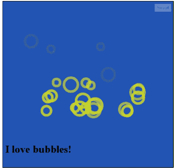

**图 4-5：** 五彩缤纷的气泡，现在附有一条特殊信息。

在 HTML 中，`<h1>` 和 `</h1>` 被称为标签。围绕文本的标签告诉浏览器，这些文本代表特殊的内容。在这里，`<h1>` 代表一级标题，是页面上最大、最重要的标题。

另一个非常有用的 HTML 标签是 `<p>` 标签，它用于标记段落。要插入 `<p>` 标签，请按照以下步骤操作：

1.  在 `</h1>` 标签之后，按 Return（Mac）或 Enter（Windows）键移到下一行。
2.  输入 `<p>`，然后输入任何你想说的话。完成后，输入 `</p>` 来结束段落。
3.  点击 **Run** 在 **Result** 窗格中查看你的更改。

### 摆弄 JavaScript

JavaScript 窗格位于 JSFiddle 界面的左下部分，是真正有趣的事情发生的地方。

1.  在 JavaScript 窗格中，找到 `max = 36` 这一行，将其更改为 `max = 80`。
2.  点击 **Run**。

现在许多气泡（但不是全部）都比以前更大了。

根据你更改 `max` 值时气泡的行为，你猜如果更改 `min = 12` 这一行会发生什么吗？试一试，看看你猜得对不对！

如果你猜 `max` 控制气泡的最大尺寸，`min` 控制气泡的最小尺寸，那你就完全正确了。图 4-6 展示了将 `max` 设置为 80，`min` 设置为 20 后的 **Result** 窗格。

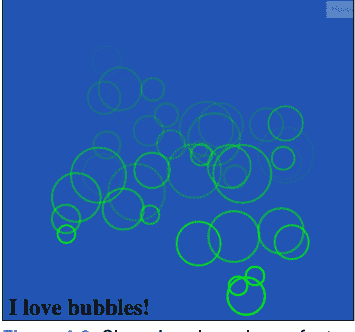

**图 4-6：** 更改 `min` 和 `max` 的值会改变气泡的大小。

JavaScript 窗格中的接下来两行是 `bubbles = 100` 和 `timerDelay = 8000`。你可以使用你已经多次用过的步骤来更改这些值：

1.  更改该值。
2.  点击 **Run** 查看更改的结果。

尝试同时更改这两个值，看看会发生什么。通过摆弄这些值（或者可能只是猜测），你会发现 `bubbles` 的值决定了应该创建多少个气泡，而 `timerDelay` 则与气泡的速度有关。

你能通过实验确切地弄清楚 `bubbles` 和 `timerDelay` 这两个值的作用吗？**提示：** `timerDelay` 的值是以毫秒（或千分之一秒）为单位的数字。所以，8,000 毫秒等于 8 秒。将值更改为 10000，点击 **Run**，然后计算屏幕上的操作时间。然后将值更改为 1000，再次点击 **Run** 并计时。

如果你猜 `bubbles` 控制将创建多少个气泡，`timerDelay` 控制这些气泡出现的速度，那么你就答对了！

### 创建 JSFiddle 帐户

创建 JSFiddle 帐户并不是继续本书学习所必需的，但它会让你以后查看和分享你的作品变得更加容易。

按照以下步骤创建 JSFiddle 帐户：

1.  点击顶部菜单中的 **Fork** 按钮。

    当你基于别人的代码创建自己的程序版本时，这被称为*分叉*（forking）他们的代码。

2.  在浏览器地址栏中选择你的程序的 URL 并复制它，或者把它写在某个地方，以便在创建帐户后使用。

3.  点击屏幕右上角的 **Login/Sign Up** 链接。

    登录页面出现，如图 4-7 所示。

4.  点击登录表单下方的 **Sign Up** 链接。

    创建帐户页面出现。

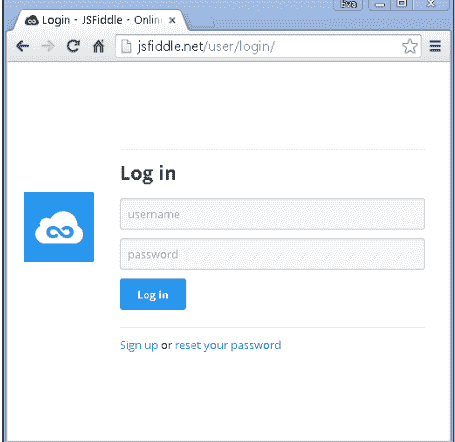

**图 4-7：** JSFiddle 登录页面。

5.  填写创建帐户表单并点击 **Create an Account**。

编辑个人资料页面出现，如图 4-8 所示。如果愿意，你可以在这里进行修改并保存，但这不是必需的。

6.  点击屏幕顶部的 **Editor** 链接。

JSFiddle 主界面出现，你的新用户名显示在屏幕的右上角。

7.  将你在步骤 2 中保存的 URL 粘贴或输入到浏览器地址栏中，然后按 Return 或 Enter 键。

你将返回到你的气泡演示版本。

8.  再次点击 **Fork**，将你的程序版本导入你的新 JSFiddle 帐户。

请注意，浏览器地址栏中的 URL 现在包含了你的 JSFiddle 用户名！


# 第四章：折腾Web应用

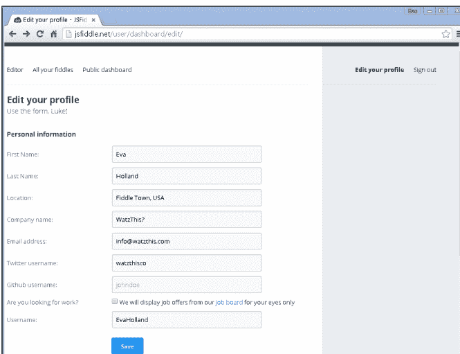

**图4-8：** 编辑个人资料页面。

# 分享你的Fiddle

既然你已经创建了自己的个性化Bubbles演示，现在是时候展示给朋友们看了！

1.  点击顶部工具栏中的Share按钮。

你会看到复制Bubbles演示地址、以全屏模式查看程序以及在Facebook或Twitter上分享程序的选项。

> 如果你想在Facebook或Twitter上分享你的程序，记得标记我们（在Twitter上@watzthisco或访问www.facebook.com/watzthisco），我们会去看看你的创作！


2.  在Share菜单中高亮显示全屏URL，如图4-9所示，然后按 ⌘+C（Mac）或 Ctrl+C（Windows）复制，或者在浏览器中选择“编辑 > 复制”。

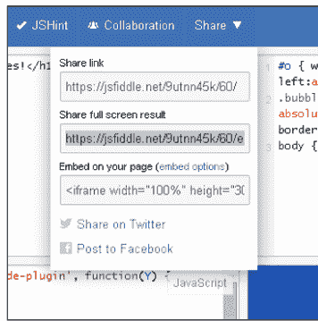

图4-9：高亮显示全屏URL。

3.  打开一个新的浏览器窗口或标签页（按 ⌘+T [Mac] 或 Ctrl+T [Windows]），并将全屏地址粘贴到地址栏中。

气泡会显示在屏幕上，没有代码窗格。


如果Bubbles演示在全屏模式下对你无效，请尝试将浏览器地址栏中的 `https` 更改为 `http`，然后按 Return 或 Enter 键。

如果你想返回到原始的Bubbles程序，可以访问我们的公共仪表板：`https://jsfiddle.net/user/forkids/fiddles`。

但如果你想拥有自己的仪表板，在那里可以创建和保存自己的JSFiddle程序集呢？请继续阅读！

### 保存你的应用

现在你有了自己的账户，就可以创建自己的公共仪表板了。

要在JSFiddle上创建你自己的公共仪表板，请按照以下步骤操作：

1.  当最新的Bubbles应用版本显示在屏幕上时，点击左侧导航栏中的Fiddle Options。

Fiddle Options菜单会打开。

2.  为你的Bubbles程序输入一个名称。

这可以是任何你喜欢的名字，但我们建议在名称中包含 *bubbles* 这个词，这样你以后就能记住它是什么！

3.  点击顶部工具栏中的Update。

4.  点击顶部工具栏中的Set as Base。

每次保存时，JSFiddle都会创建程序的一个新版本。Set as Base按钮会将当前显示的程序版本设置为当有人从你的公共仪表板链接到你的程序时显示的版本。

5.  点击屏幕右上角的你的用户名，并选择Public Dashboard。

你的公共仪表板出现了，其中列出了你的Bubbles程序版本。你的仪表板应类似于图4-10。

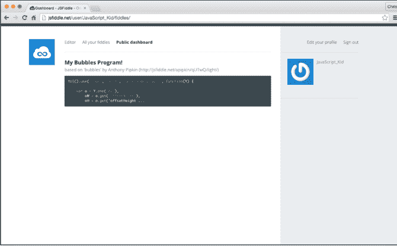

图4-10：你在JSFiddle上的专属公共仪表板！

# 第二部分：为网页添加动画

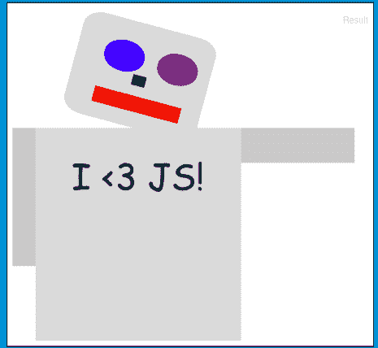

## 本部分内容...

-   JavaScript与HTML 71
-   JavaScript与CSS 89
-   构建动画机器人 104


关于五种HTML5表单输入技巧，请访问 www.dummies.com/extras/javascriptforkids。

# JavaScript与HTML

**JavaScript和网络**就像奶酪和披萨：你可以只选其一，但何必呢？

JavaScript使网页能够根据用户输入动态变化。要充分利用JavaScript和网络的整合，你需要了解一些关于网页如何构建的知识。

在本章中，我们探索网络语言HTML，并向你展示如何使用JavaScript来操作和更改网页内的HTML。

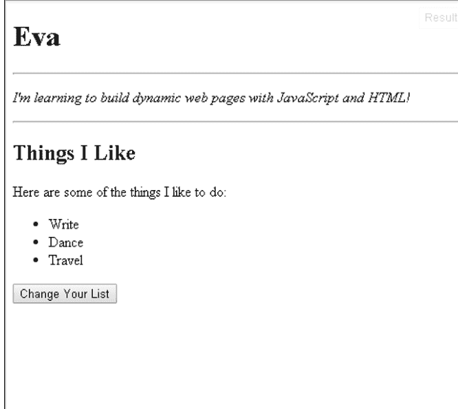

## 编写HTML

HTML代表超文本标记语言。这是一种花哨的说法，意思是HTML是一种用于创建链接（超文本）的语言。然而，HTML远不止是创建链接的语言。

HTML构成了网页中文本、图片和JavaScript所附着的骨架。

## 查看没有HTML时的文本样式

标记语言（如HTML）的发明是为了给文档（如信件、书籍或文章）提供计算机能够理解并处理的结构。

清单5-1展示了一个普通人可以轻松理解的简单列表。

```
清单5-1  一个列表
我需要的东西
胡萝卜
芹菜
菠菜
```

作为一个人，你看到这个列表并立即理解它。但对于计算机来说，这个列表有些问题。例如，计算机无法知道“我需要的东西”是一个标题，而不是列表中的一个项目。图5-1是当在网页浏览器中查看清单5-1时的样子。

为了使这个文本文档能被网页浏览器理解，我们需要使用HTML来“标记它”。

## 使用HTML：一切都是标签

HTML由标签组成。衣服上的标签告诉你衣服的材质和洗涤方法。类似地，HTML中的标签告诉你网页内容的信息。

标签由尖括号（< 和 >）内的关键字组成，然后分为两种基本类型：开始标签和结束标签。以下是一个开始标签的示例：

```
<p>
```

p标签用于将文档中的文本标记为段落。

大多数开始标签也有匹配的结束标签。开始标签和结束标签之间的唯一区别是结束标签的名称前有一个 /。例如，这是结束p标签：

```
</p>
```

要使用标签，只需将要标记的内容（如文本、图像甚至其他标签）放在开始标签和结束标签之间。例如，以下是用HTML标记一段文本的方法。

```
<p>这是一段文本。段落前后都有空格，以便将其与文档中的其他段落分开。</p>
```

当你有一个开始标签、一个结束标签以及它们之间的内容时，我们称整个内容为一个 *HTML元素*。

HTML有一堆标签，你可以用来标记文档的不同部分。标签的示例包括用于段落的 `<p>`、用于图像的 ``、用于音频片段的 `<audio>`、用于视频片段的 `<video>`、用于网页顶部的 `<header>` 以及用于网页底部的 `<footer>`。

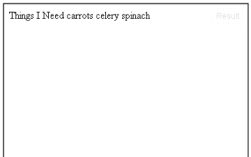

图5-1：清单5-1在JSFiddle中渲染为HTML。

清单5-2展示了清单5-1中的列表标记为HTML文档，由标签和文本组成。

# 清单5-2  一个简单的HTML文档

```
<html>
  <head>
    <title>我的购物清单</title>
  </head>
  <body>
    <h1>我需要的东西</h1>
    <ol>
      <li>胡萝卜</li>
      <li>芹菜</li>
      <li>菠菜</li>
    </ol>
  </body>
</html>
```

图5-2展示了清单5-2中的网页在网页浏览器中查看时的样子。这样好多了，对吧？

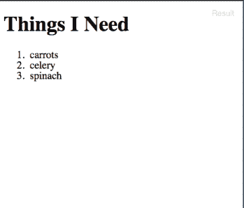

图5-2：清单5-2在JSFiddle中渲染为HTML。

请注意，HTML标签实际上不会出现在网页浏览器中。相反，它们会修改网页浏览器显示文本、图像等的方式。

#### 查看网页的基本结构

一旦你了解了一些关于网页如何构建的知识，创建网页就相当容易了。首先要知道的是，大多数网页共享一个非常相似的基本结构，并且都必须遵守几个基本规则。

创建HTML文档的第一个规则是，标签需要按照正确的顺序打开和关闭。记住标签打开和关闭顺序的一种方法是FILO，即先进后出。

注意清单5-2中的网页以 `<html>` 标签开始，以 `</html>` 标签结束。这是每个网页应该开始和结束的方式。网页中的所有其他标签都在html标签“内部”，并根据FILO关闭。

例如，`<head>` 元素在 `<html>` 内部。因此，结束head标签必须在结束html标签之前。`<ol>` 标签（代表有序列表）在 `<body>` 标签之后，所以 `<ol>` 在 `<body>` 内部，`</ol>` 标签必须在 `</body>` 标签之前。

创建HTML文档的另一个规则是，网页始终有一个head元素和一个body元素。

**head元素：** head元素就像你网页的大脑。JavaScript代码通常放在head元素中，但它不会在网页浏览器窗口中显示。

在清单5-2中，我们在head中只有一个title元素。title显示在浏览器窗口顶部或当您在网页上时浏览器的标签页中。title元素的内容通常也是在搜索结果中显示的链接。


## 第二部分：让网页动起来

`body`元素：你想要在网页浏览器中显示的所有内容都放在`body`元素中。

在代码清单5-2中，我们在`body`里有多个元素。让我们逐一看看：

- `h1`元素：`h1`元素可用于标识网页中最重要的标题。标题通常用于标识文档或网页的章节。例如，如果本章是一个网页，第一个`h1`元素会紧跟在章节引言之后，内容是"编写HTML"。

- `ol`元素：在`h1`元素之后，我们有一个`ol`元素。`ol`代表有序列表。有序列表是一个按特定顺序编号或以字母排序的项目列表。HTML也允许你通过使用`ul`（无序列表）标签来创建无序列表。

- `li`元素：在`ol`元素之后，我们有一个`li`元素。在`ol`或`ul`元素内部，你可以使用任意数量的`li`元素（`li`代表列表项）来创建列表中的各个项目。

### 创建你的第一个网页

请按照以下步骤在JSFiddle中创建你自己的列表。

1. 打开你的网页浏览器，访问`http://jsfiddle.net`。
2. 拖动窗格边框，根据需要调整JSFiddle中HTML窗格的大小。目前我们只会在HTML窗格中操作，所以请确保你感到舒适并有足够的空间。
3. 在HTML窗格中输入以下基本HTML模板。

```html
<html>
  <head>
    <title>HTML Template</title>
  </head>
  <body>
    <h1>A basic HTML template</h1>
  </body>
</html>
```

当你输入`<html>`时，你会从JSFiddle收到一条警告消息，如图5-3所示，它告诉你`<html>`已经包含在输出中。这是因为基本的HTML模板非常基础，JSFiddle会直接帮你添加进去。谢谢，JSFiddle！

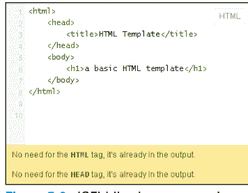

**图5-3：** JSFiddle显示警告。

4. 既然基本模板已经存在，请删除HTML窗口中除`<body>`和`</body>`之间（即h1元素）的所有内容。请始终记住，`<html>`、`<head>`和`<body>`元素应该是每个网页的一部分，即使你在JSFiddle中工作时不需要自己输入它们。

5. 点击运行。`<h1>`和`</h1>`标签之间的文本将显示在输出窗格中，格式为一级标题，如图5-4所示。

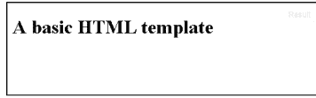

**图5-4：** 在JSFiddle中运行基本HTML模板。

## 了解你的HTML元素

HTML有很多元素。因为这是一本JavaScript书，我们在这里没有篇幅讨论每一个元素。但我们将涵盖足够的内容，让你能够构建一些很棒的网页。对于其余的，你可以在线阅读更多内容。

> **提示**
> 有一些非常好的HTML书籍，例如Ed Tittel和Chris Minnick（Wiley出版社）合著的*《Beginning HTML5 and CSS3 For Dummies》*。你也可以在线找到所有HTML元素的完整列表。我们最喜欢的免费在线资源在`https://developer.mozilla.org/en-US/docs/Web/HTML/Element`。

表5-2列出了最常用的HTML元素，以及它们的用途描述。

#### 表5-2：最常用的HTML元素

| 元素 | 名称 | 描述 |
| :--- | :--- | :--- |
| `<h1>` 到 `<h6>` | 标题（1到6级） | 一个章节标题。 |
| `<p>` | 段落 | 一个段落。 |
| `<em>` | 强调 | 为单词或词语添加强调。在网页浏览器中通常显示为斜体。 |
| `<strong>` | 强烈 | 表示重要性。在网页浏览器中通常显示为粗体文本。 |
| `<a>` | 锚点 | 一个链接。 |
| `<ul>` | 无序列表 | 一个项目符号列表。 |
| `<ol>` | 有序列表 | 一个编号列表。 |
| `<li>` | 列表项 | 有序或无序列表中的一个项目。 |
| `` | 图像 | 一张图片。 |
| `<hr>` | 水平线 | 页面上的一条水平线。 |
| `<div>` | 区域 | 将文档分割成不同部分的一种方式。 |

让我们用你的新元素来玩点有趣的。我们将编写一个关于你自己的有趣网页！

回到JSFiddle，按照以下步骤操作：

1. 删除HTML窗格中的所有内容，然后点击运行。现在输出窗格应该是空白的。
2. 为你的页面创建一个一级标题，使用`h1`元素，并将你的名字放进去。
3. 在一级标题下方放置一个水平线。
4. 添加一个`p`元素，并在起始和结束标签之间输入你最喜欢的一句话、一句关于你自己的话，或以下文本：

我正在学习用JavaScript和HTML构建动态网页！

5. 将`em`元素放在上一步输入的句子周围（在`p`元素内部）。
6. 点击运行。如果你仔细跟着操作，你的代码应该看起来像这样：

```html
<h1>Eva</h1>
<hr>
<p><em> I'm learning to build dynamic web pages with JavaScript and HTML!</em></p>
```

现在输出应该看起来像图5-5（但当然是你自己的信息！）。

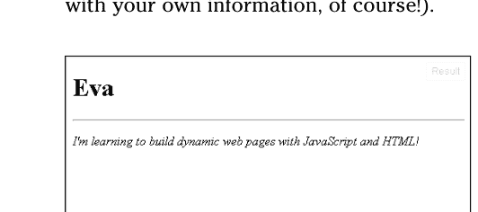

**图5-5：** 一个漂亮主页的开始。

7. 创建另一个水平线，然后是一个新的段落。
8. 创建一个二级标题（使用h2元素），并在其中输入"Things I Like"。
9. 创建一个新段落，并在其中输入以下文本：

```
Here are some of the things I like to do:
```

10. 现在，创建一个有三个空列表项的无序列表。代码如下：

```html
<ul>
  <li></li>
  <li></li>
  <li></li>
</ul>
```

11. 在每个列表项元素中填入你喜欢做的事情。

代码清单5-3展示了我们示例代码现在的样子。

#### 代码清单5-3 更新后的主页

```html
<h1>Eva</h1>
<hr>
<p><em>I'm learning to build dynamic web pages with JavaScript and HTML!</em></p>
<hr>
<h2>Things I Like</h2>
<p>Here are some of the things I like to do:</p>
<ul>
    <li>Write</li>
    <li>Dance</li>
    <li>Travel</li>
</ul>
```

点击运行，在输出窗格中预览你的网页。现在它应该看起来像图5-6。

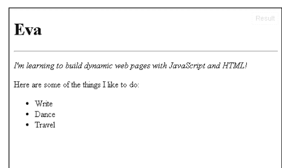

**图5-6：** 主页，带有一个项目列表。

### 为元素添加属性

HTML元素本身就相当强大，它们可以让网页浏览器对你的内容进行一些相当花哨的处理。然而，HTML还有另一个绝招让它变得更好：HTML属性！

HTML属性是向网页浏览器提供更多关于元素信息的一种方式。属性通过所谓的名称/值对添加到元素中。例如，img元素使用属性来指示应显示哪张图片，以及如果文件未找到时应显示什么作为替代：

```html

```

在这个例子中，`src`和`alt`是属性。

HTML中的每个元素都有一组可以添加的属性。有些属性，如`src`和`alt`，会改变元素的行为方式或其功能。其他属性，如`id`属性，只是为浏览器提供更多关于该元素的信息。

`id`属性唯一地标识你文档中的一个元素。例如，你可能有很多`li`元素，但如果你给每个`li`元素一个`id`属性，你就可以将它们区分开来……JavaScript也可以！

在接下来的程序中，我们将大量使用`id`属性。

现在让我们为你主页中的HTML添加一些`id`属性。

1. 给`h1`添加一个`id`属性，标识它包含你的名字。

```html
<h1 id="myName">
```

2. 找到两个`hr`元素之间的`p`元素，并修改起始标签以添加一个`id`为`aboutMe`，像这样：

```html
<p id="aboutMe">
```

3. 为每个列表项添加一个唯一的`id`属性，像这样：

```html
<li id="firstThing"></li>
<li id="secondThing"></li>
<li id="thirdThing"></li>
```


当你添加完 id 属性后，你的网页应该看起来像清单 5-4 那样。

## 清单 5-4  添加 id 属性后的更新主页

```
<h1 id="myName">Eva</h1>
<hr>
<p id="aboutMe"><em>I'm learning to build dynamic web
    pages with JavaScript and HTML!</em></p>
<hr>
<h2>Things I Like</h2>
<p>Here are some of the things I like to do:</p>
<ul>
  <li id="firstThing">Write</li>
  <li id="secondThing">Dance</li>
  <li id="thirdThing">Travel</li>
</ul>
```

点击“运行”在 JSFiddle 中预览网页。你应该会注意到……什么也没发生。网页看起来和没有 id 属性时一模一样。是的，我们知道，这没什么大不了的。但等你看到 JavaScript 能用 id 属性做些什么时就不一样了！

### 使用 JavaScript 修改 HTML

通过使用 JavaScript，你可以根据浏览页面者的输入来修改 HTML 文档的任何部分。本节我们将向你展示具体如何操作。

但在开始之前，我们先来看一下本节使用的几个概念。第一个是一个叫做 `getElementById` 的方法。

正如第 3 章所讨论的，方法是对 JavaScript 程序中的对象执行或由对象执行的一个动作。

#### 使用 getElementById 获取元素

`getElementById` 可能是 JavaScript 程序员与 HTML 直接交互最简单也最常用的方式。它的目的是定位文档中的一个特定元素，以便你可以修改它、删除它或向其添加内容。

定位元素的另一个说法是*选择*元素。

要使用 `getElementById`，首先确保你想要选择的元素有一个 `id` 属性。然后，只需使用以下公式来定位该元素：

```
document.getElementById("id-value")
```

例如，要选择一个 `id` 值为 `myName` 的元素，你可以使用这段代码：

```
document.getElementById("myName")
```

#### 使用 innerHTML 获取元素内的内容

当你有了一个元素后，下一步合乎逻辑的操作就是对其进行修改。

`innerHTML` 是每个元素的一个属性。它告诉你元素的起始标签和结束标签之间有什么，同时也可以让你设置元素的内容。

属性描述了对象的一个方面。它是对象*拥有*的东西，而不是对象*做*的事情。

例如，假设你有如下所示的一个元素：

```
<p id="myParagraph">This is <em>my</em> paragraph.</p>
```

你可以选中该段落，然后使用以下命令更改其 `innerHTML` 的值：

```
document.getElementById("myParagraph").innerHTML = "This is <em>your</em> paragraph!";
```

#### 尝试一下：更改列表

既然你已经对 `getElementById` 和 `innerHTML` 有了一些了解，让我们再来看看我们的 HTML 主页。

你将在主页中添加一个按钮和 JavaScript 代码，让你可以通过点击按钮来更改你最喜欢的事物的列表。

1.  在列表下方添加一个按钮，使用以下 HTML 代码：

```
<button id="changeList" type="button">
    Change Your List
</button>
```

`button` 元素会使浏览器在你的浏览器窗口中创建一个按钮，按钮的标签设置为起始标签和结束标签之间的文本。

2.  在 JavaScript 窗格中创建三个新变量。

```
var item1;
var item2;
var item3;
```

这三个变量将用于保存用户输入的值，然后再将这些值写入网页。

3.  通过在 JSFiddle 的 JavaScript 窗格中添加以下代码，让 JavaScript 关注按钮的点击事件：

```
document.getElementById("changeList").onclick = newList;
```

我们使用一个叫做 `getElementById` 的方法来定位文档中 `id` 属性设置为 `changeList` 的元素。如你所知，这是该按钮的 `id` 值。

当 JavaScript 找到按钮后，我们使用 `onclick` 事件处理程序来告诉它监视该按钮上的点击事件。事件处理程序正如其名。它告诉 JavaScript 如何处理浏览器中发生的不同类型的事件。在这种情况下，是鼠标点击。

如果事件处理程序检测到按钮被点击，我们就让它运行一个我们命名为 `newList` 的函数。函数就像程序中的一个程序。我们将在第 12 章更详细地讨论函数。目前，你需要知道的是，函数不会运行，除非你通过“调用”它们来告诉它们运行。

4.  输入以下代码行，向用户询问新的列表项：

```
function newList(){
  item1 = prompt("Enter a new first thing: ");
  item2 = prompt("Enter a new second thing: ");
  item3 = prompt("Enter a new third thing: ");
  updateList();
}
```

这段代码块的第一行使其成为一个函数。它告诉 JavaScript 不要运行 `{` 和 `}` 之间的代码，直到函数被调用（使用其名称 `newList`）。

在函数内部，我们使用 `prompt` 命令从用户那里收集三个新的列表项。

最后，我们告诉 JavaScript 运行一个叫做 `updateList` 的函数，我们将在下一步中编写这个函数。

5.  告诉 JavaScript 更新这三个列表项。

```
function updateList() {
  document.getElementById("firstThing").innerHTML = item1;
  document.getElementById("secondThing").innerHTML = item2;
  document.getElementById("thirdThing").innerHTML = item3;
}
```

`updateList` 函数使用每个列表项的 `id` 属性值找到它们。然后，它使用一个叫做 `innerHTML` 的方法，将列表项起始标签和结束标签之间的值更改为用户在提示框中输入的值。

`updateList` 函数运行后，三个列表项的值应该会更改为用户输入的新值。

完成后，你在 JavaScript 窗格中的代码应该与清单 5-5 相匹配。在继续之前，请仔细检查，确保没有语法错误。

## 清单 5-5  HTML 主页应用的最终 JavaScript 代码

```
var item1;
var item2;
var item3;

document.getElementById("changeList").onclick = newList;

function newList() {
    item1 = prompt("Enter a new first thing: ");
    item2 = prompt("Enter a new second thing: ");
    item3 = prompt("Enter a new third thing: ");
    updateList();
}

function updateList() {
    document.getElementById("firstThing").innerHTML =
        item1;
    document.getElementById("secondThing").innerHTML =
        item2;
    document.getElementById("thirdThing").innerHTML =
        item3;
}
```

6.  点击“运行”来试用你的新程序。

如果你做的一切都正确，你现在应该能够点击按钮，在三个提示窗口中分别输入新文本，然后看到新项目替换了原来的三个列表项，如图 5-7 所示。

**图 5-7：** 最终的、可更改的列表程序。

### JavaScript 与 CSS

**我们每个人都有**自己独特的风格。一个人可能身着燕尾服，而另一个人可能觉得穿白色牛仔裤和白色 T 恤最自在。时尚来来去去，今天看起来很棒的东西，明天可能就显得很傻。

更换衣服和个人风格赋予我们改变外表的自由。然而，当人们改变衣服时，那些让他们成为他们自己的东西并不会改变。

同样，也可以在不改变网页内容和结构的情况下，改变网页的外观。

用于改变网页样式的语言称为层叠样式表（CSS）。在本章中，我们将向你展示 CSS 是什么，以及你如何使用它来为你的 Web 应用程序添加样式。

CSS 通过为元素添加颜色、边框、背景和不同大小来装饰你的网页。CSS 可以改变元素在屏幕上的位置，甚至可以控制动画等特殊效果！


## 90 第二部分：网页动画

## 认识JavaScript机器人道格拉斯

在这个项目中，你将为一个名为道格拉斯的HTML机器人修改和添加样式。我们今天早上刚从机器人工厂收到了他。他的JavaScript技能非常出色，不需要太多维护（只是偶尔需要一个新变量来玩玩），而且他讲的笑话很棒！

唯一的问题是，他的外表有点无聊！当然，他有一双漂亮的蓝眼睛，他的“I <3 JS!”T恤也很酷。但他看起来并不像我们所认识的那个有趣又呆萌的道格拉斯。所以，让我们给他一个独特的风格吧！

首先，打开你的网络浏览器，登录到公共仪表板 http://jsfiddle.net/user/forkids/fiddles。然后按照以下步骤操作：

- 1. 找到名为“Chapter 6: Robot Style – Start”的小示例，点击标题打开它。

   你也可以直接通过 http://jsfiddle.net/forkids/m9nfspxp 进入机器人应用。

   你会看到一个屏幕，HTML面板中有HTML代码，CSS面板中有一些CSS代码。

- 2. 点击顶部菜单中的Fork，在你自己的JSFiddle账户中创建这个小示例的副本。

现在你就可以开始为道格拉斯添加一些样式了！

## CSS基础

看看JavaScript机器人CSS面板中的前三行代码。

```
body {
    font-family: Arial;
}
```

这三行代码形成了一个CSS*规则*。一个CSS规则由两个主要部分组成：

- **选择器：** 选择器表明CSS规则适用于哪个或哪些元素。在这个例子中，选择器是`body`。

- **声明块：** 声明块包含一个或多个CSS声明，这些声明表明如何为选中的元素设置样式。在这个例子中，我们只有一个声明：`font-family: Arial;`。

## CSS选择器

选择器是CSS规则中位于`{`之前的部分。CSS选择器告诉网络浏览器样式应该应用于哪些HTML元素。

当你选择一个元素来应用样式时，该样式也会应用于所选元素内部的每个元素。

CSS选择器有多种选择元素的方式。让我们在与JavaScript机器人道格拉斯一起工作时，看看其中三种：

- **元素选择器：** 看看JavaScript机器人CSS面板中的前两条规则：

```
body {
    font-family: Arial;
}
p {
    font-size: 1em;
}
```

这两个都是元素选择器的例子。元素选择器使用元素的名称来选择HTML元素。要使用元素选择器，只需键入你想要选择的元素的名称。在这些例子中，我们选择的是`body`元素（使用`<body>`和`</body>`标签）和`p`元素（使用`<p>`和`</p>`标签）。

- **类选择器：** 现在看看JavaScript机器人CSS面板中的第三条CSS规则：

```
.eye {
    background-color: blue;
    width: 20%;
    height: 20%;
    border-radius: 50%;
}
```

类选择器以一个句点（.）开始，后面跟着一个名为class的HTML属性的值。在这个例子中，我们选择所有具有`class="eye"`的元素。如果你看HTML面板，你会发现有两个元素具有`class="eye"`。这两个元素用于制作道格拉斯的两只眼睛。

类选择器非常适合需要将相同样式应用于多个元素的情况。在这个例子中，机器人有两只眼睛，而这两只眼睛有几个共同点（例如，它们都是蓝色的，大小也相同）。

- **ID选择器：** ID选择器以井号（#）开始，并根据元素ID属性的值选择元素。例如，道格拉斯的左眼和右眼有不同的ID属性：

```
#righteye {
    position: absolute;
    left: 20%;
    top: 20%;
}
#lefteye {
    position: absolute;
    left: 60%;
    top: 20%;
}
```

当你需要在HTML文档中选择单个元素时，ID选择器很有用。每个ID属性在文档中必须是唯一的。

如果你查看HTML面板，会发现道格拉斯的左右眼，除了都有class属性外，还有唯一的ID属性。我们添加这些属性是为了能够在道格拉斯的脸上单独定位眼睛。

## CSS声明

CSS声明位于CSS选择器之后的声明块中。声明由两部分组成：

- **属性：** 声明的属性部分告诉应该修改什么。例如，你可以更改元素的颜色、宽度或位置。属性后面必须跟一个冒号（:）。
- **值：** 值告诉应该如何更改属性。

每个声明必须以分号（;）结尾。你可以根据需要在声明块中包含任意多的声明。

例如，具有eye类的元素的声明块包含四个声明：

```
.eye {
    background-color:blue;
    width:20%;
    height:20%;
    border-radius: 50%;
}
```

## CSS属性赋予你风格

CSS属性是改变元素特性的关键。JavaScript机器人道格拉斯漂亮的眼睛颜色、身体和手臂的大小、头部角落的圆度以及不同部分的位置，都由属性的值决定。

让我们通过修改一些不同CSS属性的值来改变道格拉斯的外观：

- 1. 找到`p`元素的CSS规则。
   它目前是CSS面板中的第二条规则。

- 2. 将`font-size`属性的值更改为`2.5em`。

完整的规则现在应该如下所示：

```
p {
  font-size: 2.5em;
}
```

> 指定文本大小有几种不同的方式。最常用的方法是使用像素（`px`）、百分比（`%`）或em（`em`）。当你使用百分比或em时，所选元素的字体大小是基于父元素的字体大小设置的。例如，`2.5em`是所选元素父字体大小的两倍半。我们将在本章后面更详细地介绍百分比和像素。

- 3. 点击Run按钮，在Results面板中查看更改。

道格拉斯现在应该看起来像图6-1。

- 4. 找到`body`元素的CSS规则。

- 5. 将`body`元素的值更改为以下内容，注意引号的使用：

```
"Comic Sans MS", cursive, sans-serif
```

完整的CSS规则现在应该如下所示：

```
body {
  font-family: "Comic Sans MS", cursive, sans-serif;
}
```

- 6. 点击Run按钮查看结果。

接下来，让我们把道格拉斯的眼睛颜色改成和你眼睛一样的颜色！

- 7. 找到包含道格拉斯眼睛颜色的CSS规则。

它目前看起来像这样：

```
.eye {
    background-color:blue;
    width: 20%;
    height: 20%;
    border-radius: 50%;
}
```

- 8. 将`background-color`属性的值更改为你的瞳孔颜色。

例如，如果你的眼睛是棕色的，你可以将其更改为以下内容：

```
background-color: brown;
```

- 9. 点击Run按钮查看结果。

当你使用“brown”这个词时，道格拉斯眼睛变成的颜色在我们看来并不太像棕色，而当你试图让道格拉斯的眼睛变绿时，所使用的颜色也不太可能是任何人眼睛的颜色。为了获得更精确的颜色，你可以使用另一个CSS颜色名称（参见第4章），或者通过使用十六进制表示法创建自己的自定义颜色。

## 使用CSS颜色

CSS颜色描述了网络浏览器通过使用红、绿、蓝的不同组合可以显示的数百万种可能颜色。

这是一个十六进制表示法的CSS颜色示例：

```
#9BE344
```

让我们仔细看看这段代码。

井号（#）表示这是一个十六进制代码。之后，第一和第二个符号（9B）表示要混合到新颜色中的红色色调，第三和第四个符号（E3）表示要混合的绿色色调，第五和第六个符号（44）表示蓝色的量。当这三部分混合时，最终得到的颜色是一种漂亮的绿色。

此时，你可能想知道为什么十六进制表示法将字母和数字结合在一起。答案其实很简单：为了获得更多的可能性。

十六进制表示法就像一个有16根手指的怪物可能会如何计数。例如，人类有十根手指，所以我们有十个不同的数字用于计数：0, 1, 2, 3, 4, 5, 6, 7, 8, 和 9。

然而，如果你有16根手指，你需要发明新的符号来表示额外的手指。计算机经常以8或16为单位计数，因为字节是由8个数字或位组成的。你可以说计算机就像有16根手指的生物。

计算机没有发明新符号，而是用字母来表示9之后的数字。因此，十六进制中的A相当于10，B相当于11，C相当于12，D相当于13，E相当于14，F相当于15。

两位数的十六进制代码从00开始，相当于0，以FF结束，相当于255。

当我们说红色色调应该是00时，我们的意思是它应该完全没有红色。如果我们说它应该是01，我们的意思是它应该只有最少量的红色（可能甚至不会被注意到）。当我们说红色色调应该是FF时，我们的意思是它应该是纯红色。

你不需要猜测每种颜色应该混合多少，你可以使用在线工具，比如`www.colorpicker.com`，来直观地选择颜色。


### 使用 CSS 调整元素大小

HTML 文档中的每个元素都是一个矩形。即使一个元素看起来像圆形（比如道格拉斯的眼睛），它实际上也被当作一个包围该圆形的矩形来处理。因为一切都是矩形，所以你可以通过调整元素的宽度和高度，用 CSS 来改变它们的大小。

当我们在现实世界中测量物体的宽度和高度时，我们使用英寸、厘米或米等度量单位。而在 CSS 世界中测量物体时，我们有几种不同的度量单位。这些包括 `px`（像素）和 `%`（百分比）：

-   **像素：**像素是网页浏览器中可以显示的最小点。当你使用像素指定宽度和高度时，你就是在告诉浏览器一个元素应该有多宽多高。使用像素进行度量的问题在于，它总是以相同的大小显示内容——即使用户的浏览器窗口非常大或非常小。

-   **百分比：**当你使用百分比指定宽度和高度时，你就是在告诉浏览器，让该元素占据其父元素尺寸的一定百分比。

我们为道格拉斯的所有尺寸都指定了百分比。这样做的好处在于，无论你是在手机上还是在时代广场的大屏幕上查看道格拉斯，他的大小都会自动适应屏幕。要看到相对尺寸的神奇效果，请在 JSFiddle 中拖动窗格边框，使结果窗格变大或变小。注意道格拉斯是如何随窗口大小变化的。


你可能听说过*响应式设计*这个术语。响应式设计旨在创建灵活的网页内容，并能够响应用户屏幕的大小。我们指定道格拉斯尺寸的方式就是响应式设计的一个例子。

让我们对道格拉斯的某些部分做些改动：

1.  找到 `eye` 类的 CSS 规则。
2.  将宽度改为 30%，高度改为 30%。

你会注意到道格拉斯的眼睛变大了。但它们也不再位于脸部的中心了，如图 6-3 所示！我们稍后会修复这个问题。

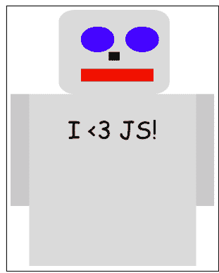

图 6-3：道格拉斯的大眼睛偏离了中心。

3.  找到 `arm` 类的 CSS 规则。

```
.arm {
    background-color: #cacaca;
    position: absolute;
    top: 35%;
    width: 5%;
    height: 40%;
}
```

`.arm` CSS 规则控制两只手臂的颜色和大小。`.arm` 规则还控制手臂距离窗口顶部的距离，这将在下一节中介绍。

4.  将手臂的宽度改为 3%，然后点击运行，让道格拉斯拥有纤细的手臂。
5.  找到道格拉斯左臂的 CSS 规则。
6.  添加属性，使宽度大于高度。

例如：

```
#leftarm {
    position: absolute;
    left: 70%;
    width: 27%;
    height: 5%;
}
```

点击运行查看更改。道格拉斯现在正指向屏幕外，如图 6-4 所示。

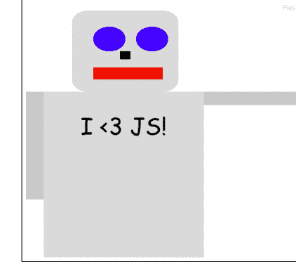

图 6-4：道格拉斯在指！

在最后一步中，你向一个使用 ID 选择器的规则添加了宽度和高度，尽管被选中的元素已经通过类选择器应用了宽度和高度。尽管左臂已经有了宽度和高度，但它采用了 ID 选择器规则中的新宽度和高度。

这就是我们所说的*层叠*（我们终于知道 CSS 名字的由来了！）。

### 理解层叠

机器人的左臂只能有一个宽度和高度。那么，当两个不同的 CSS 规则试图分别设置手臂的宽度和高度时，会发生什么呢？浏览器会在两个 CSS 规则之间进行一场竞赛。

浏览器会考虑诸如哪个 CSS 规则最后设置、哪个规则更具体等因素，以确定实际使用哪个宽度和高度。

在这场层叠竞赛中，ID 属性胜过类属性，因为它们对于单个元素是唯一的，因此比类属性更具体。

### 使用 CSS 定位元素

除了让你能够改变颜色和元素在浏览器中的显示方式外，CSS 还能让你改变元素在屏幕上的出现位置。改变元素出现的位置称为*定位*元素。

让我们改变道格拉斯某些部分的位置：

1.  找到控制道格拉斯右眼的 CSS 规则。

```
#righteye {
    position: absolute;
    left: 20%;
    top: 20%;
}
```

第一个属性 `position` 告诉浏览器如何解释具体的位置属性（例如 `top` 和 `left`）。当你使用绝对定位时，选定的元素（这里是眼睛）可以放置在头部的任何位置，而无需担心头部中的另一个元素会把它推开。如果两个绝对定位的元素被放置在同一个位置，它们会简单地重叠。

右眼被设置为显示在距离头部元素顶部边缘下方 20%（占头部高度的百分比），以及距离左边缘右侧 20%（占头部宽度的百分比）的位置。

2.  通过将 `left` 和 `top` 的值改为更小的百分比，将右眼向左和向上移动。

例如：

```
#righteye {
    position: absolute;
    left: 10%;
    top: 10%;
}
```

点击运行查看结果，如图 6-5 所示。

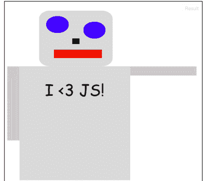

### 自定义你自己的 JavaScript 机器人！

现在轮到你了！运用你在本章学到的知识，随心所欲地对道格拉斯进行各种修改。尝试改变元素的颜色、位置和大小，让他看起来完全符合你的期望！

在 Twitter 或 Facebook 上与我们分享你定制的道格拉斯吧！我们期待着看到你的作品！

## 第七章：构建一个动画机器人

**HTML、CSS 和 JavaScript** 是一个很棒的团队。三者协同工作，在网页浏览器中创造出精彩的效果。

在本章中，我们将所有部分组合起来，让 JavaScript 机器人道格拉斯跳舞！

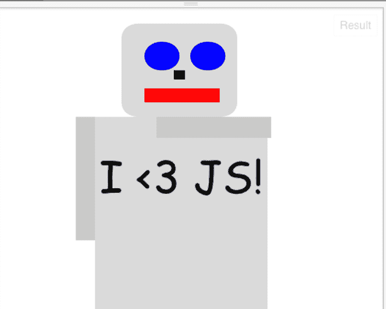

### 使用 JavaScript 更改 CSS

正如你可以使用 JavaScript 更改网页中的 HTML 一样，你也可以使用它来更改 CSS 样式。过程非常相似。

第一步是选择要应用或更改样式的元素。在第五章中，我们向你展示了如何使用 `getElementById` 来实现这一点。例如，要选择道格拉斯的左眼，你可以使用以下代码：

```
document.getElementById("lefteye")
```

选定一个元素后，你可以通过将 `style` 属性附加到选择器，后跟要更改的样式来更改其样式。要更改左眼的颜色，你可以使用以下 JavaScript：

```
document.getElementById("lefteye").style.backgroundColor = "purple";
```

与使用 CSS 更改背景色相比，你注意到这段代码有什么奇怪之处吗？使用 JavaScript 更改样式时，有两条规则：

-   当 CSS 属性只是一个单词时，例如 `margin` 或 `border`，你可以在 JavaScript 中使用相同的 CSS 名称来更改样式。
-   如果 CSS 属性包含连字符（-），则 CSS 属性名会转换为驼峰命名法。因此，`background-color` 变成了 `backgroundColor`。

以下是一些 CSS 属性示例，以及每个属性在 JavaScript 中的写法：

| CSS 属性 | JavaScript 样式属性 |
|---|---|
| background-color | backgroundColor |
| border-radius | borderRadius |
| font-family | fontFamily |
| margin | margin |
| font-size | fontSize |
| border-width | borderWidth |
| text-align | textAlign |
| color | color |


JavaScript 非常注重大小写。JavaScript 样式属性中的大写字母是必需的，属性才能正常工作。

### 使用 JavaScript 修改道格拉斯

使用 JavaScript 修改 CSS 使得元素的外观和位置能够响应用户输入而改变。

我们稍后会让道格拉斯跳舞，但先让我们练习一下对他进行修改：

1.  转到公共仪表板 http://jsfiddle.net/user/forkids/fiddles，找到名为 Chapter 7: Start 的程序，并打开它。

你会看到道格拉斯机器人项目与我们在第六章结束时保留的状态基本一致，如图 7-1 所示。

2.  点击 Fork 按钮，在你自己的 JSFiddle 账户中创建该程序的副本。
3.  在 JavaScript 窗格中输入以下内容，以更改道格拉斯左眼的颜色：

```
document.getElementById("lefteye").style.backgroundColor = "purple";
```

4.  点击运行查看结果。

道格拉斯的左眼将变为紫色，如图 7-2 所示。


## 第7章：构建一个动画机器人

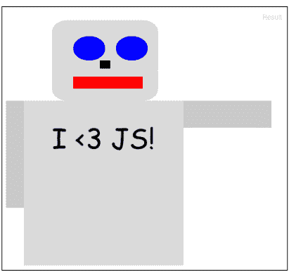

图7-1：道格拉斯，一个不会动的JavaScript机器人。

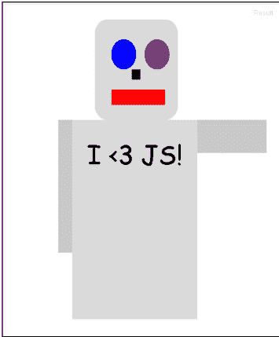

图7-2：道格拉斯的左眼现在是紫色的了。

+   5. 按下回车键（Mac）或Enter键（Windows），在JavaScript面板中开始一个新行，然后输入以下内容：

```
document.getElementById("head").style.transform = "rotate(15deg)";
```

+   6. 点击运行以查看结果。

道格拉斯现在正将头向左倾斜。他看起来准备好跳舞了（参见图7-3）！

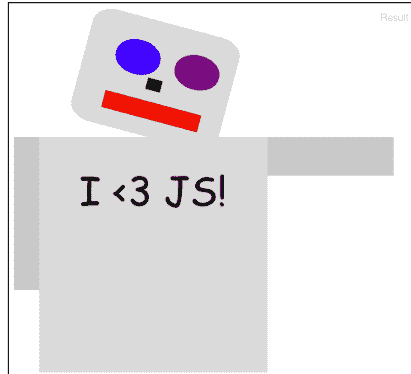

图7-3：道格拉斯准备好跳舞了！

+   7. 在左侧菜单中打开Fiddle选项，给你的程序起一个新名字。

+   8. 点击更新，然后点击设为基准，将你的程序保存到你的公共仪表板。

### 用道格拉斯做实验

使用JavaScript的样式属性自定义道格拉斯有无数种可能性。要开始尝试几种，请尝试将以下每个语句添加到JavaScript窗格中，然后运行它们：

```
// 在他的身体周围放一个2像素宽的实心黑色边框。
document.getElementById("body").style.border = "2px black solid";

// 让他的嘴角变圆。
document.getElementById("mouth").style.borderRadius = "4px";
```

```
// 在他右眼周围放上黄色的点。
document.getElementById("righteye").style.border =
    "4px yellow dotted";

// 改变他左臂的颜色。
document.getElementById("leftarm").style.backgroundColor =
    "#FF00FF";

// 改变文本颜色。
document.getElementById("body").style.color = "#FF0000";

// 给道格拉斯头发。
document.getElementById("head").style.borderTop =
    "5px black solid";
```

现在轮到你了。你能弄清楚如何使用JavaScript完成以下每一项更改吗？

-   让道格拉斯的头向另一边倾斜。
-   让道格拉斯的鼻子变圆。
-   让道格拉斯的右臂变成绿色。
-   让道格拉斯的嘴唇变成粉色。

如果需要帮助，请访问我们JSFiddle上的公共仪表板，查找名为“第7章：用JS改变CSS”的程序。


请记住，JavaScript非常敏感。如果你有拼写错误，或者漏掉一个句点，或者在JavaScript窗格中的任何地方将getElementById拼写错误，所有JavaScript行都将无法运行，而不仅仅是你出错的语句。

### 让道格拉斯跳舞！

既然你知道如何使用JavaScript更改CSS，让我们好好利用这些知识，让道格拉斯更生动活泼！

+   1. 在JSFiddle中打开你的Robot Style程序的最新版本（或从我们公共仪表板中的第7章：Start fiddle），按下JSFiddle中的Fork按钮。
2.  在左侧菜单中打开Fiddle选项，将fiddle的名称更改为“Animated Robot”。
3.  点击更新以保存你的作品。

现在你有了一个用于新的改进版跳舞道格拉斯的新fiddle，你仍然可以从你的公共仪表板访问之前那个不会跳舞的道格拉斯。

道格拉斯不是最棒的舞者，但他确实有几个他引以为豪的动作。第一个是他称之为“眼睛弹跳”的动作。他的眼睛快速向上移动，然后漂浮回原位。相信我们，当他随着节拍做这个动作时，几乎令人着迷。

图7-4展示了道格拉斯正在进行他的一个标志性眼睛弹跳动作的中间过程。

在我们的程序中，你将通过点击道格拉斯的不同部位来控制他的舞蹈。我们从编程他的右眼在被点击时弹跳开始。

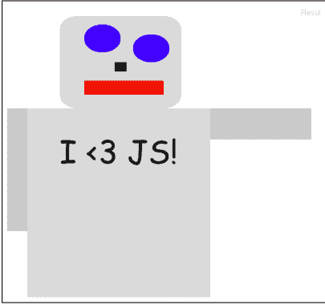

1.  在JavaScript窗格中，输入以下语句：

```
var rightEye = document.getElementById("righteye");
```

这个变量声明为我们创建了一个引用右眼的快捷方式。现在，一旦创建了这个变量，在程序的其余部分中每次需要引用道格拉斯的右眼时，你都可以使用名为rightEye的变量。

2.  告诉JavaScript监听右眼的鼠标点击事件，使用此语句：

```
rightEye.addEventListener("click", moveUpDown);
```

#### 处理事件

事件监听器是一种告诉JavaScript监视某个元素是否有事件发生，然后在该事件发生时执行某些操作（处理它）的方法。

在JavaScript中，我们使用一种叫做addEventListener的方法来告诉程序在事件发生时该做什么。要监听和处理事件，你需要三个部分：

**事件：**当Web浏览器中发生某些事情时，就称之为一个事件。事件的示例包括点击鼠标、按下按键、拖放、将鼠标悬停在某物上以及选择文本。

事件不仅仅是人们用Web浏览器做的事情。其他事件会在你完全未做任何操作的情况下发生。这些包括页面加载、元素显示、代码中发生错误以及动画完成。以下是Web浏览器中最常见的事件：

-   *   click：用户点击鼠标。
-   *   submit：提交表单。
-   *   drag：元素正在被拖动。
-   *   drop：元素被拖动后已放下。
-   copy：用户复制了内容。
-   paste：用户粘贴内容。
-   mouseover：鼠标经过一个元素。
-   load：页面加载。

要监听事件，请将要监听的事件名称放在引号内，置于`addEventListener`方法中。例如：

```
target.addEventListener("click", listener)
```

**事件目标：**创建事件处理程序的下一步是将`addEventListener`方法附加到一个对象上。例如，要监听道格拉斯右眼的`click`事件，你会使用以下代码：

```
rightEye.addEventListener("click", listener);
```

JavaScript将监听其事件的那个元素被称为事件目标。在这种情况下，`rightEye`（你创建的代表`document.getElementById("righteye")`值的变量）就是事件目标。

**监听器：**`addEventListener`语句的第三部分是实际的监听器。这是当事件发生时应该被通知的对象。

对于道格拉斯，我们想通知一个我们将要编写的、名为`moveUpDown`的函数。这个函数将用于使道格拉斯的眼睛上下移动。

```
rightEye.addEventListener("click", moveUpDown);
```

典型的事件处理程序格式如下：

```
target.addEventListener("event", listener);
```

现在你知道了`addEventListener`是如何工作的，让我们回到JavaScript机器人道格拉斯，创建我们希望在有人点击他的眼睛时激活的监听器。

#### 编写一个监听器

到目前为止，JavaScript窗格应该包含以下代码：

```
var rightEye = document.getElementById("righteye");
rightEye.addEventListener("click", moveUpDown);
```

如果你现在运行你的程序，你会发现它什么也不做。那是因为我们还没有创建监听器。

监听器是一个*函数*，或者说是一个在更大的JavaScript程序内部的较小程序。无论何时发生该监听器所附加的事件，监听器函数就会运行。

眼睛弹跳动画的监听器将被命名为`moveUpDown`。按照以下步骤创建`moveUpDown`监听器函数。

+   1. 在JavaScript窗格中最后一行代码之后，按回车键或Enter键几次，插入一些空格。
2.  输入以下内容以开始创建监听器：

```
function moveUpDown(e) {
```

此代码开始你的函数并为其命名。注意括号之间的`e`。当该函数被`addEventListener`函数调用时，`e`将包含一些关于刚刚发生事件的信息，我们可以在函数内部使用这些信息。稍后会详细说明！

+   3. 在左花括号（{）后按回车键或Enter键，然后输入函数的其余部分：

```
var robotPart = e.target;
var top = 0;

var id = setInterval(frame, 10) // 每10毫秒绘制一次
```


## 114 第二部分：网页动画

```javascript
function frame() {
    robotPart.style.top = top + '%';
    top++;
    if (top === 20){
        clearInterval(id);
    }
}
```

这看起来可能有点复杂，但实际上相当简单。在我们解释之前，先来测试一下，确保它能正常工作。

- 4. 点击运行。

如果你输入正确，现在应该能够点击道格拉斯的右眼，看到它弹跳，如图7-5所示。

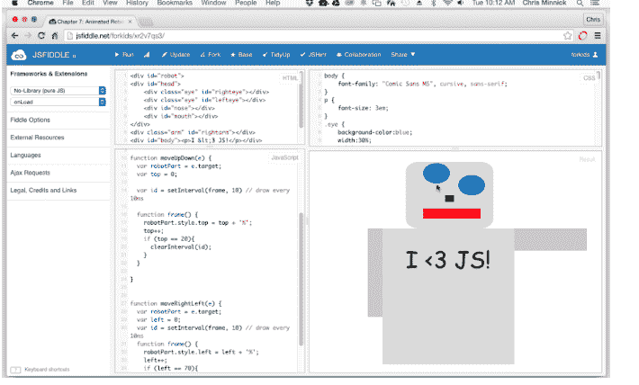

图7-5：点击道格拉斯的眼睛使其弹跳。

如果程序没有正确工作，请仔细检查你的代码。它应该与清单7-1完全一致。

**清单7-1** 在JavaScript窗格中实现眼睛弹跳所需的代码

```javascript
var rightEye = document.getElementById("righteye");
rightEye.addEventListener("click", moveUpDown);

function moveUpDown(e) {
  var robotPart = e.target;
  var top = 0;

  var id = setInterval(frame, 10) // draw every 10ms

  function frame() {
    robotPart.style.top = top + '%';
    top++;
    if (top === 20){
      clearInterval(id);
    }
  }
}
```

如果你输入正确，并且点击道格拉斯的眼睛时它确实弹跳了，请继续阅读，了解这一切是如何工作的！

## 使用JavaScript创建动画

计算机动画，与电影和视频动画一样，是一个技巧。这个技巧依赖于以足够快的速度连续展示一系列图片，使图像看起来在移动。

动画中的每一张图片称为一帧。道格拉斯眼睛弹跳动画的工作原理是，从眼睛位于头顶的位置开始，每隔10毫秒（十分之一秒）在略微不同的位置显示他的眼睛，最终位置距离头顶20%。

图7-6显示了动画过程中眼睛在不同时间点的位置。

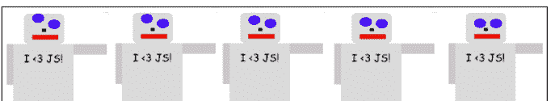

图7-6：道格拉斯眼睛在动画中的不同时间点。

现在，让我们逐步分析代码，看看这种效果是如何用JavaScript创建的。我们将从函数声明后的第一行开始：

```javascript
var robotPart = e.target;
```

这条语句使用事件对象（由addEventListener方法自动提供）来找出被点击的是机器人的哪个部分（哪个元素）。它将关于该元素（本例中为rightEye）的信息存储在一个名为robotPart的新变量中。

这条语句创建一个名为top的新变量，并赋予它值为0：

```javascript
var top = 0;
```

这个top变量将用于在动画的每一帧中定位眼睛。

下面的行使用一个名为setInterval的命令，让动画的魔法发生：

```javascript
var id = setInterval(frame, 10); // draw every 10ms
```

setInterval命令将运行括号中列出的第一个函数，并按照括号中数字确定的时间表执行它。

这个数字是以毫秒（千分之一秒）为单位的等待时间，然后再执行一次该操作。所以，1,000毫秒等于1秒。这个数字越大，动画播放越慢，反之亦然。

## 第7章：构建一个动画机器人

这里我们创建一个新函数（或小程序），它由`setInterval`命令运行，并负责处理创建每个新动画帧的任务：

```javascript
function frame() {
```

在这里，我们将`top`的值设置为我们top变量的值，并在末尾添加%，用于被点击的元素：

```javascript
robotPart.style.top = top + '%';
```

所以，当你第一次点击眼睛时，top将被设置为0%，这将把它放在道格拉斯头顶的最上方。

下面的行使用一个称为*增量运算符*的东西将top的值增加1：

```javascript
top++;
```

我们将在第9章更详细地介绍增量运算符。

在这里，我们通过检查`top`是否等于20来判断动画的最后一帧是否已到达：

```javascript
if (top === 20) {
```

如果`top`等于20，则执行下一条命令。

`clearInterval`语句结束动画：

```javascript
clearInterval(id);
```

最后，我们只需通过关闭所有打开的花括号来清理一切：

```javascript
}
}
}
```

### 动画化另一个元素

现在我们已经编写了`moveUpDown`函数来动画化一只眼睛，动画化另一只眼睛只需添加另一个事件监听器即可。

- 1. 点击“更新”以保存你目前的工作。
- 2. 在`rightEye`变量声明的下方插入以下新的变量声明：
- 3. 在`rightEye`事件处理器的下方插入以下新的事件处理器：
- 4. 点击运行。

```javascript
var leftEye = document.getElementById("lefteye");
```

```javascript
leftEye.addEventListener("click", moveUpDown);
```

现在，点击左眼或右眼都会在被点击的元素上触发`moveUpDown`动画。

### 添加第二个动画函数

道格拉斯可不是个只会一招的机器人。除了眼睛弹跳，他至少还有一招舞蹈动作。他称这一招为“手臂横扫”。这个经典动作涉及左臂从道格拉斯身体的右侧平滑地移动到左侧，同时他的眼睛直视前方。

为了创建手臂横扫动画，我们将添加一个基于`moveUpDown`函数的第二个监听器函数，但我们会稍作修改，以便从左到右而非从上到下地动画化手臂。

- 1. 在另外两个变量的正下方，创建一个表示左臂的新变量：

```javascript
var leftArm = document.getElementById("leftarm");
```

- 2. 在另外两个事件处理器的下方编写一个新的事件处理器。

```javascript
leftArm.addEventListener("click", moveRightLeft);
```

- 3. 选择`moveUpDown`函数，然后按⌘+C（Mac）或Ctrl+C（Windows）复制。
- 4. 将`moveUpDown`函数的副本粘贴到现有的`moveUpDown`函数下方。

现在，我们将修改`moveUpDown()`的副本以创建新的`moveRightLeft`函数。

- 1. 将函数的名称从`moveUpDown`更改为`moveRightLeft`。

```javascript
function moveRightLeft(e) {
```

- 2. 将函数体中的第二行更改为以下内容：

```javascript
var left = 0;
```

- 3. 将frame函数内的第一行更改为以下内容：

```javascript
robotPart.style.left = left + '%';
```

- 4. 将frame函数的第二行更改为以下内容：

```javascript
left++;
```

- 5. 将frame函数的第三行更改为以下内容：

```javascript
if (left === 70) {
```

当你完成修改后，新的`moveRightLeft`函数应该与清单7-2中的代码一致。

**清单7-2** 完成的moveRightLeft函数

```javascript
function moveRightLeft(e) {
    var robotPart = e.target;
    var left = 0;
    var id = setInterval(frame, 10) // draw every 10ms
    function frame() {
        robotPart.style.left = left + '%';
        left++;
        if (left === 70){
            clearInterval(id);
        }
    }
}
```

要保存你的工作并测试新动画，请按“更新”。现在，当你点击道格拉斯的左臂时，你会看到moveRightLeft动画生效，如图7-7所示。

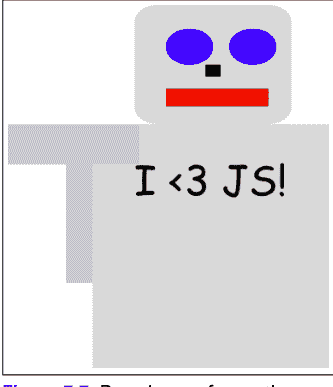

图7-7：道格拉斯表演手臂横扫动作。

JavaScript窗格中完成的代码现在应与清单7-3一致。

#### 清单7-3 实现道格拉斯两个舞蹈动作所需的JavaScript代码

```javascript
var rightEye = document.getElementById("righteye");
var leftEye = document.getElementById("lefteye");
var leftArm = document.getElementById("leftarm");

rightEye.addEventListener("click", moveUpDown);
leftEye.addEventListener("click", moveUpDown);
leftArm.addEventListener("click", moveRightLeft);

function moveUpDown(e) {
    var robotPart = e.target;
    var top = 0;
    var id = setInterval(frame, 10) // draw every 10ms
    function frame() {
        robotPart.style.top = top + '%';
        top++;
        if (top === 20){
            clearInterval(id);
        }
    }
}

function moveRightLeft(e) {
    var robotPart = e.target;
    var left = 0;
    var id = setInterval(frame, 10) // draw every 10ms
    function frame() {
        robotPart.style.left = left + '%';
        left++;
        if (left === 70){
            clearInterval(id);
        }
    }
}
```


# 第122页 第二部分：让网页动起来

现在轮到你来让道格拉斯跳舞了！首先，打开一些音乐，随着节拍点击他的眼睛和手臂！接着，尝试添加一些新的事件处理器，让道格拉斯的不同部位动起来，比如他的鼻子、嘴巴或者右臂！

# 第三部分：获取操作

```html
<div id="car">
  This <span id="modelyear"></span>
dream car can be yours for just:
$<span id="pricetag"></span>
  <div id="body"></div>
  <div id="frontwheel"></div>
  <div id="backwheel"></div>
</div>
```

```css
#car {
  font-family: Arial;
}
#body {
  position: absolute;
  top: 50px;
  width: 80%;
  height: 100px;
  background-color: #000000;
}
```

```javascript
var dreamCar = {
  make: "Oldsmobile",
  model: "98",
  color: "brown",
  year: 1983,
  bodyStyle: "Luxury Car",
  price: 4500
};
document.getElementById("pricetag")
  .innerHTML = dreamCar.price;

document.getElementById("modelyear")
  .innerHTML = dreamCar.year;

document.getElementById("body")
  .style.backgroundColor =
  dreamCar.color;

document.getElementById("body")
  .innerHTML = dreamCar.make + " " +
  dreamCar.model;
```

这辆1983年的梦想之车，仅需：$4500即可归您所有

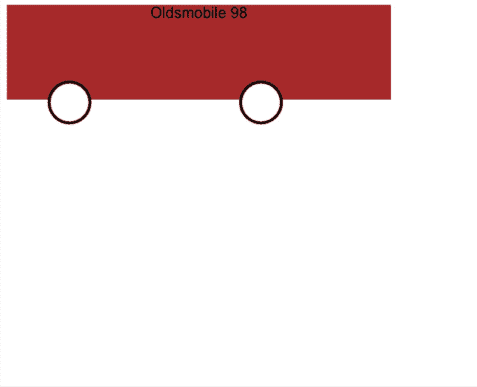

## 在本部分中...

- 用操作数打造你的梦想之车……… 125
- 用运算符将其组合在一起 ………………… 136
- 创建你自己的JavaScript文字游戏…... 153


关于JavaScript变量命名的技巧，请访问 www.dummies.com/extras/javascriptforkids。

### 用操作数打造你的梦想之车

当你使用人类语言说话或写作时，通常会将名词和动词串联起来以形成动作。然后，你可能会用形容词、副词、代词、连词、介词和感叹词来丰富内容。然而，一个句子真正的核心是由名词和动词构成的。

在JavaScript中形成句子被称为*编写语句*。语句主要由操作数（类似于名词）和运算符（类似于动词）组成。

在本章中，你将学习不同类型的操-作数，并通过示例了解如何在JavaScript程序中使用操作数。

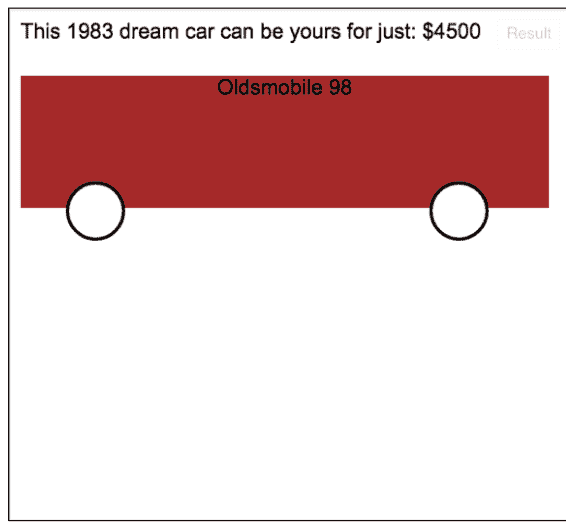

#### 认识你的操作数

JavaScript中的表达式是任何能解析为值的有效代码片段。

当我们说一个表达式“解析为值”时，我们的意思是当计算机完成所有必要的操作后，会产生某种值。例如，

- 表达式 `1 + 1` “解析为” 2。换句话说，它的值就是2。
- 表达式 `x = 7` 是另一种表达式。它将值（7）赋给名为 `x` 的变量。

表达式由操作数（如数字1或变量 `x`）和运算符（如 `=` 或 `+`）组成。操作数可以是我们在第3章中讨论的任何JavaScript数据类型，也可以是对象或数组。

在本章中，我们将向你展示如何创建和使用自己的对象。我们将在第11章中展示如何创建和使用数组。

与其简单地解释操作数可能使用的不同数据类型，不如我们来玩个游戏。我们将列出一些有效的JavaScript操作数，由你来判断每个操作数属于哪种数据类型。

一开始我们会告诉你所有答案，直到你掌握为止。之后，我们仍然会给出所有答案，但会稍微隐藏一下。我们开始吧！

对于以下每个操作数，请告诉我们它是数字、字符串还是布尔值：

- `100`：这很明显是一个数字，因为它没有被引号包围，并且完全由数字组成。
- `"Hello JavaScript World!"`：这是一个字符串，因为它被引号包围。
- `false`：这是一个布尔值，因为它为真或假，并且没有被引号包围。
- `"true"`：这是一个字符串，因为，即使它包含单词 *true*（这似乎会使它成为布尔值），但该单词被引号包围（这使它成为一个字符串）。

现在轮到你了。对于以下每个操作数，请判断它是数字、字符串还是布尔值：

- 187
- "007"
- "Number 9"
- true
- 86
- "It's 5 o'clock somewhere"

你觉得自己做得怎么样？以下是答案：

- 187 是一个数字。
- "007" 是一个字符串。
- "Number 9" 是一个字符串。
- true 是一个布尔值。
- 86 是一个数字。
- "It's 5 o'clock somewhere" 是一个字符串。

操作数并不总是字面值。实际上，更常见的情况是，程序员将值赋给变量，然后将这些变量用作操作数。以下是一些将值赋给变量的语句。对于其中每一个，请确定操作数的数据类型（数字、字符串或布尔值）：

```javascript
distance = 3000
distance = 800 * 4
doTheMath = 7 + 8 + 36 + 18 + 12
countrySong = "mama" + "truck" + "train" + "rain"
```

如果你认为前三个是数字，最后一个是字符串，那么你就答对了！

如果你不相信我们，请尝试以下练习来亲自验证！

1. 通过按 ⌘+Option+J (Mac) 或 Ctrl+Shift+J (Windows) 在Chrome中打开JavaScript控制台。

    JavaScript控制台出现，如图8-1所示。

    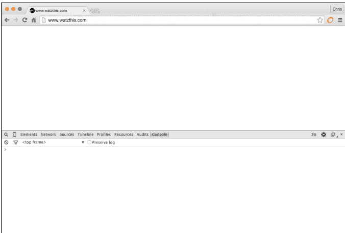

2. 使用 `typeof` 命令来找出一个数字的数据类型。

    例如，输入以下内容：

    ```javascript
    typeof 8
    ```

    JavaScript控制台返回 "number"，如图8-2所示。

    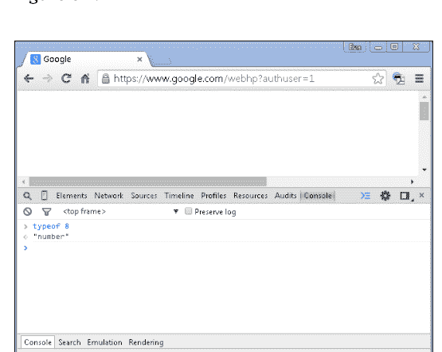

3. 输入以下内容来创建一个变量并使用表达式设置其值：

    ```javascript
    var doTheMath = 7 + 8 + 36 + 18 + 12
    ```

    控制台返回 `undefined`，让你知道它已经完成了工作。

4. 使用 `typeof` 命令找出新变量的类型。

    ```javascript
    typeof doTheMath
    ```

    结果再次是 "number"。

5. 使用以下表达式找出一个字符串的类型：

    ```javascript
    typeof "the cat's favorite toy"
    ```

    结果当然是 `"string"`。

6. 尝试找出一个没有引号的单词的类型，如下所示：

    ```javascript
    typeof automobile
    ```

    这个表达式的结果将是 `"undefined"`。这里发生的情况是，JavaScript将没有引号的单词视为变量。由于我们没有定义名为 `automobile` 的变量，因此请求 `automobile` 变量类型的结果是 `"undefined"`。

### 使用对象

除了基本数据类型（字符串、数字和布尔值）之外，JavaScript中的操作数也可以是对象类型。正如我们在第5章中解释的，JavaScript对象可以拥有*属性*（描述它们的事物）和*方法*（它们可以执行的操作）。

现在，我们将向你展示如何创建自己的对象！要创建一个对象，首先使用 `var` 关键字，就像创建任何变量一样，然后跟一个等号 (=)：

```javascript
var myObject =
```

等号之后，事情就有点不同了。当你创建一个对象时，总是从花括号 ({ 和 }) 开始：

```javascript
var myObject = {};
```

在花括号内，你可以放入多个属性和方法。对象的每个属性或方法都以一个名称（在左边）开始，后跟一个冒号 (:)，然后是一个值。如果一个对象包含多个属性或方法，它们用逗号分隔。

让我们在JSFiddle中练习创建一些对象并查看它们的值：

1. 在网页浏览器中访问 `http://jsfiddle.net`。

    你现在应该有一个空白的fiddle，这意味着屏幕上的所有四个窗格（HTML、CSS、JavaScript和Result）都是空的。

2. 在JavaScript窗格中输入以下内容来创建一个 `dreamCar` 对象：

    ```javascript
    var dreamCar = {
        make: "Oldsmobile",
        model: "98",
        color: "brown",
        year: 1983,
        bodyStyle: "Luxury Car",
        price: 4500
    }
    ```

    请随意以任何你想要的方式定制你的梦想之车！

    注意，在对象中混合使用不同数据类型的属性是完全可以的。例如，在 `dreamCar` 对象中，`make`、`model`、`color` 和 `bodyStyle` 属性都是字符串，而 `year` 和 `price` 是数字。

3. 在对象定义之后，在JavaScript窗格中输入以下内容，以找出 `dreamCar` 对象的类型：

    ```javascript
    alert("The type of dreamCar is: " + typeof dreamCar);
    ```

4. 点击运行。

    一个警告框出现，显示你的 `dreamCar` 是一个对象，如图8-3所示。

    


## 第三部分：理解运算

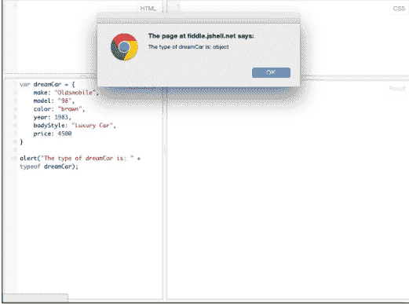

#### 配置你的梦想之车

别光说不练！让我们来配置我们的梦想之车，让它上路吧！

构建任何汽车的第一步都是创建车架。我们将用HTML来完成。

1. 在JSFiddle的HTML窗格中输入以下HTML：

```
<div id="car">
    This <span id="modelyear"></span> dream car can be yours for
    just: $<span id="pricetag"></span>
    <div id="body">
    </div>
    <div id="frontwheel"></div>
    <div id="backwheel"></div>
</div>
```

这段HTML只是为我们的汽车创建了一个基本结构——当然，还有价格标签。在下一步中，我们将为汽车添加一些样式。

##### 第8章：用操作数构建你的梦想之车

133

2. 在CSS窗格中输入以下内容：

```
#car {
    font-family: Arial;
}
#body {
    position: absolute;
    top: 50px;
    width: 80%;
    height: 100px;
    background-color: #000000;
    text-align: center;
}
#backwheel {
    position: absolute;
    left: 10%;
    top: 130px;
    background-color: #ffffff;
    border: 3px solid black;
    border-radius: 50%;
    width: 40px;
    height: 40px;
}
#frontwheel {
    position: absolute;
    left: 55%;
    top: 130px;
    background-color: #ffffff;
    border: 3px solid black;
    border-radius: 50%;
    width: 40px;
    height: 40px;
}
```

太棒了！我们已经构建并设置了一个通用汽车的样式，包括车身、价格标签和车轮。

3. 点击运行按钮，查看目前的效果。

通用汽车的设计出现在结果窗格中，如图8-4所示。

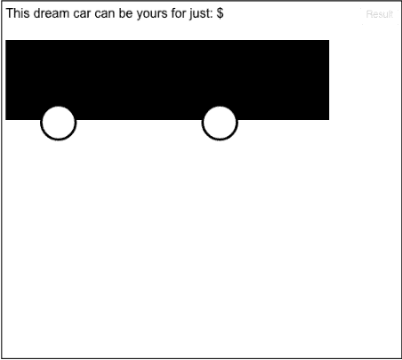

现在，让我们开始用JavaScript个性化定制我们的汽车吧！

- 1. 在JavaScript窗格中创建你的`dreamCar`对象。

   这是我们的对象：

```
var dreamCar = {
    make: "Oldsmobile",
    model: "98",
    color: "brown",
    year: 1983,
    bodyStyle: "Luxury Car",
    price: 4500
};
```

- 2. 编写一条语句，在程序运行时更新汽车的价格：

```
document.getElementById("pricetag").innerHTML = dreamCar.price;
```

**3. 编写一条语句，在价格标签上更新车型年份：**

```
document.getElementById("modelyear").innerHTML = dreamCar.year;
```

**4. 编写一条语句，更新汽车的颜色：**

```
document.getElementById("body").style.backgroundColor = dreamCar.color;
```

**5. 编写一条语句，在车身侧面显示汽车的品牌和型号：**

```
document.getElementById("body").innerHTML = dreamCar.make + " " + dreamCar.model;
```

现在，点击运行按钮，看看你的全新酷炫座驾吧！我们的如图8-5所示。

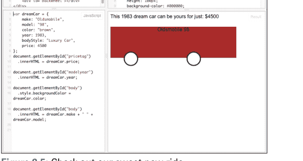

尝试用不同的设置来个性化你的汽车，然后运行程序，看看如何利用对象的属性来改变程序的输出或网页的CSS样式。

## 第9章
用运算符组合一切

**运算符是一种**符号，它使用操作数来执行任务（一个运算）。在本章中，你将了解在JavaScript中可以使用的不同类型的运算符。

JavaScript为每种需求都提供了运算符，还有一些你可能永远用不到的运算符。我们不打算简单地列出所有运算符，而是编写一个程序，让你可以选择运算符、输入操作数，然后查看结果。

这个程序将是一个超级计算器——它不仅能处理数字，还能处理文字和字母。

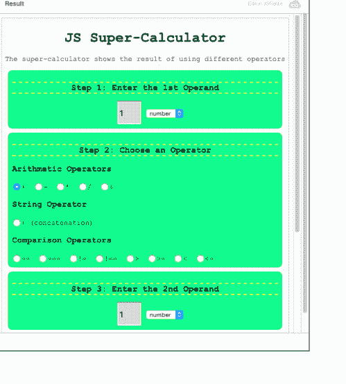

## 介绍超级计算器

你从未见过这样的计算器。朋友们，这个计算器可以处理你日常的算术运算——它可以加、减、乘，甚至还能除。但是等等，它还有更多功能！它还可以接受任意两个数字——没错，是**任意两个数字**——并告诉你当一个数除以另一个数时，余数是多少。我们将这个神奇的功能称为**取模运算**。在这里就能完成你的取模运算！免费！

但这还不是全部！这个超级计算器还能把文字拼接起来！假设你有单词 *Java* 和单词 *Script*，你想把它们拼在一起。你说这不可能？难以置信？有了超级计算器就不再是难题！

超级计算器赋予你将单词拼接在一起的力量——不仅如此，你甚至可以拼接整个句子——使用的是*连接*运算符。别被那么多音节吓到。连接运算符是自袜子以来最伟大的发明，它的样子和加法运算符（一个加号）一模一样。多么简单！只需输入第一个单词，选择连接运算符，输入第二个单词，然后——砰！——你就像专家一样完成连接了。

如果你现在下单，我们还将免费赠送全套的比较运算符！比较运算符接受任意两个值——比如3和8——并告诉你它们是否相同。如果你想知道一个是否比另一个大或小，我们也有相应的运算功能！而且，说到简单——比较的结果总是真或假。进行比较时，你无需为“有点”或“差不多”这样的结果而烦恼！

这个神奇的超级计算器是如何工作的？如何才能拥有一个？我们马上就要告诉你，你的世界将从此不同！

### Fork超级计算器

按照以下步骤打开超级计算器并制作你自己的版本：

- 1. 打开你的网络浏览器，登录 http://jsfiddle.net。

- 2. 访问我们的公共仪表盘 http://jsfiddle.net/user/forkids/fiddles ，找到名为 "Chapter 9 – Super-Calculator" 的程序，或者直接访问超级计算器 http://jsfiddle.net/forkids/LdtbfnL0。

超级计算器的fiddle页面会打开，如图9-1所示。

- 3. 点击顶部菜单中的Fork按钮，在你的JSFiddle账户中制作一份超级计算器的副本。

- 4. 使用左侧菜单中的Fiddle Options，将你的超级计算器重命名为（你的名字）的超级计算器。

- 5. 点击顶部菜单中的Update，然后点击Set as Base。

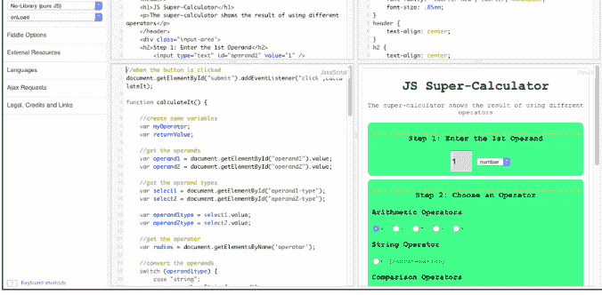

现在你拥有了自己的超级计算器。你已准备好开始学习它的工作原理，并利用它来学习运算符！

### 使用超级计算器

超级计算器允许你查看使用不同运算符的结果。它有两个操作数输入区域，每个区域都有一个下拉菜单，你可以从中选择所输入数据的类型，以及用于选择单个运算符的单选按钮，这些运算符用于涉及那两个操作数的运算。


*单选按钮*是HTML中用来指代可以组合在一起的圆形输入按钮的名称。它们与复选框不同，因为在一个单选按钮组中你只能选择一个选项，但在一个复选框组中你可以选择多个选项。我们猜测它们被称为单选按钮，是因为它们的工作方式与汽车收音机的频道选择按钮相同。按下其中一个按钮会将频道设置为该选择，并取消选择其他按钮。

要开始使用超级计算器，请查看你第一次打开它时结果窗口中的设置。

顶部的输入区域（如图9-2所示）包含一个值，数字1。数据类型下拉菜单设置为数字。

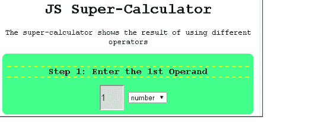

在第一个操作数的输入区域下方是你选择运算符的地方。运算符分为三组：算术运算符、字符串运算符和比较运算符。我们将在本章稍后更深入地研究每一种。现在，请注意，在算术运算符组中，第一个运算符`+`已被选中，如图9-3所示。这当然是加法运算符。

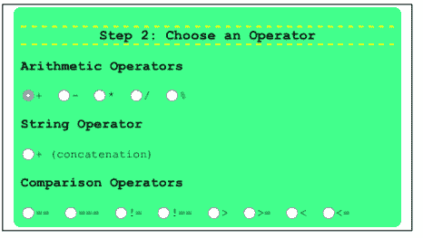

在运算符选择区域下方是第二个操作数的输入区域。默认情况下，这里也设置为数字1，如图9-4所示。

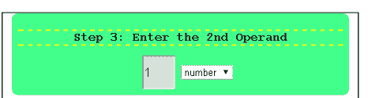

所以，综合起来，超级计算器的默认运算是世界上最基础的数学题：1 + 1。

点击计算器底部的“运算”按钮。

计算器顶部指定的运算及其返回值（换句话说，就是结果）将显示在屏幕的输出部分，如图9-5所示。


### 使用字符串和算术运算符进行超级计算

现在，让我们尝试一些操作，这些操作虽然仍然很简单（因为只涉及两个操作数），但会向你展示一些关于 JavaScript 的有趣之处。

1.  保持操作数的值为默认值（1 和 1），但选择字符串运算符 `+`，并将每个操作数的数据类型更改为字符串。

    现在，当你点击“操作”按钮时，你会看到结果是 `11`，如图 9-6 所示。

2.  保持运算符为连接运算符，并将数据类型保持为字符串。将第一个操作数的值更改为 "Java"，将第二个操作数更改为 "Script"。

    连接 "Java" 和 "Script" 的结果如图 9-7 所示。

    图 9-6：连接 1 和 1 的结果。

    图 9-7：连接 "Java" 和 "Script"。

3.  保持运算符为连接运算符，并将两个数据类型都设置为字符串。将第一个操作数更改为你的名字（后面加一个空格），将第二个操作数更改为你的姓氏。

4.  点击“操作”按钮。

    结果将是一个包含你名字和姓氏的字符串，中间有一个空格。从这个例子中学到的重要一点是，连接操作包括被连接字符串中的任何空格。

5.  将运算符从连接运算符更改为任意算术运算符。将两个数据类型都保持为字符串。

6.  点击“操作”按钮。

    结果如图 9-8 所示，是 `NaN`，意思是“非数字”。JavaScript 无法使用字母执行算术运算，`NaN` 是它告诉你这一点的方式。

    图 9-8：尝试用你的名字做数学运算会导致 NaN。

7.  将第一个操作数更改为 `9`，并将其数据类型更改为数字。

8.  将运算符更改为看起来像百分号的算术运算符（取模运算符）。

    取模运算符当然用于执行取模运算。取模运算告诉你一个数除以另一个数后的余数是多少。

9.  将第二个操作数更改为 `2`，并将其数据类型更改为数字。

10. 点击“操作”按钮。

    操作的结果是 `1`。你明白为什么吗？取模（余数）运算符计算第一个操作数可以被第二个数整除多少次，并返回剩下的部分。

11. 将第二个操作数更改为 `2.5`。

    你能猜出结果会是什么吗？

12. 点击“操作”按钮。

    结果是 `1.5`，因为 9 可以被 2.5 除三次，余数是 1.5，如图 9-9 所示。

    图 9-9：9 除以 2.5 的余数。

13. 将第一个操作数的值更改为 `1000000000000`（一个 1 后面跟着 12 个零，也称为一万亿）。

    **注意：** 不要在数字中使用逗号。

14. 将运算符更改为 `*`。

15. 将第二个操作数的值更改为 `1000000000000`。

16. 点击“操作”！

    结果如图 9-10 所示，看起来很不寻常。这被称为*科学计数法*。它是一种在更紧凑的空间中显示非常大数字的方法。要将这种类型的数字转换为你习惯看到的数字类型，请将小数点向右移动加号后指定的位数。

    图 9-10：一万亿乘以一万亿的结果。

    在这种情况下，JavaScript 给出的一万亿 × 一万亿的结果是 `1e+24`。这转换为一个 1 后面跟着 24 个零。科学计数法读起来比 `100000000000000000000000` 快得多。

### 使用比较运算符进行超级计算

JavaScript 的比较运算符经常用于测试变量的值并根据它们做出选择。最常用于 `if...else` 语句中。（我们将在第 14 章详细介绍 `if...else` 语句。）

比较运算符总是返回 `true` 或 `false`。

让我们回到超级计算器，尝试一些比较操作：

1.  在 JSFiddle.net 中打开你的超级计算器程序。
2.  在第一个操作数的输入字段中输入数字 **5**，并从数据类型下拉菜单中选择数字。
3.  从比较运算符列表中选择相等运算符（`==`）。
4.  在第二个操作数的输入字段中输入相同的数字（**5**），并将数据类型选择为数字。
5.  点击“操作”按钮。

    结果将显示在输出区域，如图 9-11 所示。

    太好了！所以，现在你知道 5 等于 5。

接下来，让我们稍微改变一下，看看比较操作中发生的一些其他有趣的事情。

1.  在两个操作数输入字段中都保留 `5`，但将第一个输入字段的数据类型更改为字符串。
2.  确保相等运算符（`==`）仍然被选中。
3.  点击“操作”按钮。

    你在此操作中所做的是将字符串 "5" 与数字 5 进行比较。结果如图 9-11 所示。

    图 9-11：比较 "5" 和 5。

    此操作的结果很有趣，因为该运算符称为相等运算符，但它说数字 5 和包含数字 5 的字符串是相等的。发生的情况是，相等运算符在进行比较之前，会对包含 5 的字符串执行一种称为*类型转换*的操作，将其转换为数字。

相等运算符的这种类型转换特性可能会成为程序中的错误来源。因此，我们建议你不要使用相等运算符。继续阅读，了解我们推荐使用什么来代替它。

JavaScript 有另一个比较运算符，即严格相等运算符，它不会为你进行类型转换。按照以下步骤尝试严格相等运算符：

1.  将你的两个操作数设置为相同的数字。任何数字都可以，但我们喜欢 37。
2.  将第一个操作数的数据类型更改为数字，将第二个操作数的数据类型更改为字符串。
3.  选择 `===` 比较运算符。这是严格相等运算符。
4.  点击“操作”按钮。

    结果如图 9-12 所示。与相等运算符（`==`）不同，严格相等运算符（`===`）认为一个数字和一个包含该数字的字符串是两个完全不同的东西。

    图 9-12：严格来说，数字和字符串并不相同。

有时，你需要检查事物是否不相等。为此，JavaScript 有不等运算符。它们的工作方式与相等运算符相同，只是方向相反。可以将它们视为相等运算符的“邪恶双胞胎”。

    图 9-13：用不等运算符比较 99 和 "99"。

正如相等运算符（`==`）永远不应被使用一样，它的邪恶双胞胎——不等运算符（`!=`）在程序中也永远不应被使用。

1.  输入一个数字作为第一个操作数（比如 99），并将数据类型设置为数字。
2.  选择不等运算符（`!=`）。
3.  输入 **99** 作为第二个操作数，并将数据类型选择为字符串。
4.  点击“操作”按钮。

    结果如图 9-13 所示，是 `false`，这意味着 `!=` 运算符不认为 99 和 "99" 是不相等的。

```
输出
操作
99!="99"
返回值：
false
```

5.  保持操作数不变，但将运算符更改为严格不等运算符（`!==`）。
6.  点击“操作”按钮。

    结果如图 9-14 所示，是 `true`，这意味着严格不等运算符认为这两个值不相等。

    图 9-14：严格不等运算符。


## 第九章：使用运算符整合一切

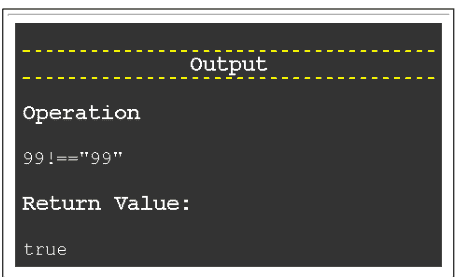

图 9-14：`!==` 运算符识别出字符串和数字是不同的。

比较运算符也可用于测试一个数字是否大于或小于另一个数字。让我们来试试比较运算符：

- 1. 将第一个操作数更改为 10，并选择数字数据类型。
- 2. 将运算符更改为大于（`>`）。\* 大于和小于运算符看起来像鳄鱼。鳄鱼总是想吃掉更大的那个东西。如果鳄鱼的嘴朝向更大的那个东西，结果就会是 `true`！


- 3. 将第二个操作数更改为 5，并选择数字数据类型。
- 4. 点击 **Operate** 按钮。

正如你所料，结果是 `true`；10 大于 5。

JavaScript 还允许你测试一个数字是否大于或等于另一个数字。按照以下步骤来试试：

- 1. 将第一个操作数更改为 10，并选择数字数据类型。
- 2. 将运算符更改为大于或等于（`>=`）。
- 3. 将第二个操作数更改为 10，并选择数字数据类型。
- 4. 点击 **Operate** 按钮。

如图 9-15 所示，结果为 `true`，因为 10 大于或等于 10。


**图 9-15：** 十大于或等于 10。

小于（`<`）和小于或等于（`<=`）运算符的工作方式与大于（`>`）和大于或等于（`>=`）运算符相同。如果你愿意，现在可以自己试试它们！

### 超级计算器技巧

JavaScript 在与运算符配合工作时，其行为方式有一些出人意料之处。但当你理解了背后的逻辑，一切就都说得通了。为了看到更多有趣的 JavaScript 运算符行为，按照以下步骤操作：

- 1. 将第一个操作数更改为 1，数据类型为数字。
- 2. 将运算符更改为加法（`+`）运算符。
- 3. 将第二个操作数更改为 1，数据类型为字符串。
- 4. 点击 **Operate** 按钮。

结果是 `11`。发生的情况是，JavaScript 假定如果你在加法运算中使用了一个字符串值，它会将两个操作数都视为字符串。因此，结果就是字符串 `"1"` 和 `"1"` 的连接。

- 5. 将第一个操作数的数据类型更改为字符串，并将其值更改为 `10`。
- 6. 将运算符更改为大于（`>`）。
- 7. 将第二个操作数的数据类型更改为数字，并将其值更改为 `5`。
- 8. 点击 **Operate** 按钮。

有趣！如图 9-16 所示，结果仍然是 `true`。与相等运算符不同，大于和小于比较运算符没有严格比较值的方式。包含数字的字符串和数字会被当作两个数字进行比较。


图 9-16："10" 大于 5。

这个超级计算器还有许多其他秘密。花些时间玩转它，试着破解它。如果你愿意，可以看看使其工作的 JavaScript、CSS 和 HTML 代码。通读代码中的注释，了解它是如何工作的。

最后，试着对代码做一些修改。你能让超级计算器变得更加“超级”吗？

一如既往，我们期待着看到你的成果！在 Facebook 或 Twitter 上与我们分享你的创作吧！

单词替换游戏提供一个基本的故事结构，并要求你填入不同的词性：名词、动词、形容词、副词等等。仔细想想，这些游戏与 JavaScript 网页应用非常相似。基本结构由 HTML、CSS 和 JavaScript 代码提供。JavaScript 代码中的变量是程序每次运行结果不同的关键。

在本章中，我们将使用字符串连接运算符将你输入的单词与一个故事组合起来，创建一个单词替换游戏。

### 创建你自己的 JavaScript 单词游戏


第十章

#### 创建一个变量故事

对于这个第一个版本的游戏，我们编写了一个关于 JavaScript 机器人道格拉斯冒险的故事。然后我们删除了其中一些单词，并用词性代替它们，以便玩游戏的人可以填写它们。

这是我们关于 JavaScript 机器人道格拉斯的故事，其中某些单词被移除并替换为预期的输入（带下划线）：

一个**形容词**的日子，道格拉斯正在他的**房子里的房间**里**以“-ing”结尾的动词**，读一本关于**颜色 复数名词**的书。
当他**过去式动词**他的**饮料**时，他听到**音乐类型**的音乐在**房子里的不同房间**里播放。
**感叹词！**他惊呼道，一边**过去式动词**跑下楼梯加入那个**形容词**的派对。
道格拉斯跳了**动物名称**舞、**城市名称**扭摆舞，并因跳了最好的电动**动词**而获奖。

现在我们有了故事，让我们围绕它构建一个 JavaScript 程序，该程序将接受用户输入并输出一个定制的——而且是搞笑的——故事。

#### 创建单词替换游戏

这个单词替换游戏利用了你到目前为止在本书中学到的所有内容，包括变量、运算符、事件处理器、HTML、CSS、输入、输出等等！

在我们开始构建游戏之前，让我们先试试它，看看它的实际效果：

- 1. 打开你的网页浏览器，访问我们的 JSFiddle 公共仪表板：<http://jsfiddle.net/user/forkids/fiddles>。
- 2. 找到名为“Chapter 10 – Word Replacement Game”的 fiddle，点击标题打开它。完成的“单词替换游戏”项目将打开。
- 3. 根据你的屏幕尺寸，你可能需要调整“Result”窗格的大小，使其正确显示。左侧带下划线输入区域的标签应全部在屏幕上显示，而不会换行到新行。你还应该在输入问题的右侧看到一个带有虚线边框的非常短的矩形。完成的故事将显示在这里。
- 4. 点击第一个问题上方的下划线，以选择文本输入字段。
- 5. 在输入字段中输入一个值。输入所需值后，按 Tab 键或使用鼠标点击页面上的下一个输入字段并填写该字段。
- 6. 当你填写完所有字段后，点击表单底部的 **Replace It** 按钮。道格拉斯冒险的故事出现在右侧，其中插入了你输入到输入字段中的单词，如图 10-1 所示。

既然你已经了解了程序是如何工作的，让我们从头开始构建它。当你知道如何构建这个游戏时，你将能够添加、改进它，甚至完全改变故事！

按照以下步骤开始从头创建你自己的“单词替换游戏”版本：

- 1. 通过从 Chrome 菜单中选择“新建标签页”或按 ⌘+C (Mac) 或 Ctrl+C (Windows) 来打开一个新的浏览器标签页，并在新标签页中访问 http://jsfiddle.net。


图 10-1：道格拉斯冒险的完成故事。

- 2. 确保你已登录到 JSFiddle，方法是检查你的用户名是否显示在屏幕的右上角。当你登录后，就可以开始了！
- 3. 点击左侧导航栏中的“Fiddle Options”链接，并为你的新程序输入一个名称。例如，你可以称它为“道格拉斯的舞蹈派对”。
- 4. 点击顶部菜单中的“Save”。现在你已经准备好开始编写程序的 HTML 了！

### 编写 HTML

我们的“单词替换游戏”有三个主要区域或部分：

- **问题区域：** 这是输入区域，程序提示你输入单词。
- **按钮区域：** 这是问题下方的区域，包含“Replace It”按钮，该按钮将把你输入的内容添加到故事中。


**故事区域：** 这是点击“替换”按钮后，用户输入与故事内容一起显示的区域。

我们将首先创建这三个区域。我们会使用 `div` 元素来创建每个部分。

1.  在 HTML 面板中输入三个 `<div>` 元素。

每个 `<div>` 都将拥有一个与其用途对应的唯一 `id` 属性。我们的第一个 `<div>` 的 `id` 将是 `inputWords`。我们希望第二个 `<div>` 位于第一个 `<div>` 内部，并将其 `id` 设置为 `buttonDiv`，如下所示：

```
<div id="inputWords">

<div id="buttonDiv"></div>

</div>
<div id="story"></div>
```

2.  接下来，为输入字段创建结构。

我们将使用一个 HTML 无序列表来容纳所有输入字段。在第一个 div 内部使用以下 HTML 标记来创建结构：

```
<ul>
  <li></li>
</ul>
```

3.  在 `<li>` 元素内创建第一个输入字段。

使用 input 元素，并设置 `type="text"` 和 `id="adj1"`，像这样：

```
<input type="text" id="adj1" />
```

请注意，我们在输入字段的关闭括号前添加了一个斜杠（/）。虽然在 HTML5 中这不是必需的，但当你在 `<input>` 和 `<br>` 等元素末尾使用斜杠时，JSFiddle 往往能更好地格式化 HTML 标记。

4.  在输入字段下方使用 `<br>` 标签添加一个标签，然后输入标签文字，像这样：

```
<br />Adjective
```

5.  最后，在单词 `Adjective` 之后输入以下结束标签来关闭 `<li>` 元素：

```
</li>
```

6.  在下一行输入一个 HTML 注释，作为后续将要添加到程序中的其他输入字段的占位符。

```
<!-- put other input fields here -->
```

HTML 注释以 `<!--` 开始，以 `-->` 结束。

7.  在 HTML 面板中所有其他标记的下方输入第三个 `<div>` 元素。

```
<div id="story"></div>
```

如果你正确输入了所有内容，你的 HTML 面板现在应该看起来像这样：

```
<div id="inputWords">
    <ul>
        <li><input type="text" id="adj1" /><br />Adjective</li>
    <!-- put other input fields here -->
    </ul>
</div>
<div id="buttonDiv"></div>
<div id="story"></div>
```

8.  点击 Update 以查看当前 Web 应用程序的输出。

它应该如图 10-2 所示。

**图 10-2：单词替换游戏的开始。**

我们现在要在 HTML 面板中完成的最后一步是创建按钮。

9.  将光标放在 `id` 为 `buttonDiv` 的 `div` 内部，输入以下内容：

```
<button id="replaceButton">Replace it!</button>
```

10. 再次点击 Update。

你现在拥有一个输入字段、该字段下方的一个标签，以及两者下方的一个按钮，如图 10-3 所示。

**图 10-3：基本组件已就位。**

由于所有其他输入字段都只是第一个的副本，我们将不会引导你创建所有这些。你可以复制第一个输入字段来创建其余的，或者随意从我们完成版程序的 HTML 面板中复制它们。

让我们继续前进到 CSS 面板吧！

### 为单词游戏添加样式

在直接开始添加样式之前，让我们先讨论一下如何组织我们的 CSS。

当为一个应用程序使用大量 CSS 时，以某种方式组织它很重要，这样当你稍后想要编辑样式时，可以轻松找到它们。

组织 CSS 文件的一种方法是按照它们应用于 HTML 文档的哪个部分来组织。通常，这种方法会按照 CSS 样式应用于 HTML 中的元素的相同顺序来列出 CSS 样式。

遵循这种方法，我们要样式的第一个元素是 body 元素，然后是输入字段的容器，接着是列表，然后是输入字段，依此类推。

那么，让我们开始添加样式吧！按照以下步骤为单词替换游戏应用样式：

1.  要更改文档中所有文本的字体，请为 body 元素应用 `font-family` 样式。

我们将使用非常有趣的 Comic Sans 字体：

```
body {
    font-family: "Comic Sans MS";
}
```

有关其他常见字体系列的列表，请访问 `www.w3schools.com/cssref/css_websafe_fonts.asp`。

2.  使用以下规则为包含输入字段的部分设置样式：

```
#inputWords {
    float: left;
    width: 45%;
}
```

此规则中的 `float:left` 属性会导致 `<div>` 沿其容器的左边缘放置（在此情况下是文档的 `body` 元素）。其他元素将环绕它流动。

实际上，`float:left` 的作用是使包含输入问题的 `<div>` 放置在包含完成故事的 `<div>` 旁边，而不是在其上方。

3.  使用以下两个规则为列表设置样式：

```
ul {
    list-style-type: none;
    padding: 0px;
    margin: 0px;
}

li {
    line-height: 2em;
    text-transform: uppercase;
    margin-top: 8px;
}
```

以下是这些规则中的每个属性对列表的作用：

- `list-style-type` 属性移除了列表中每个项目左侧的点（项目符号）。
- 将 `padding` 和 `margin` 设置为 `0px` 使列表与页面上的其他文本左对齐。
- 设置 `<li>` 的 `line-height` 会在列表项之间创建更多空间。如果没有这个属性，元素之间的距离会过于接近。

`<li>` 元素的 `text-transform` 属性使输入字段下方的所有输入字段标签显示为全大写字母。

`margin-top` 属性在列表项之间又创建了更多空间。

4.  新 CSS 规则就位后，点击 Update 查看应用程序的最新版本。

接下来的几个样式为输入字段、按钮和故事应用了一些格式。

5.  在 CSS 面板中输入以下内容：

```
input[type=text] {
    border-width: 0 0 1px 0;
    border-color: #333;
}
#buttonDiv {
    text-align: center;
}
#replaceButton {
    margin-top: 30px;
    width: 200px;
}
#story {
    margin-top: 12px;
    width: 45%;
    border: 1px dashed blue;
    padding: 8px;
    float: left;
}
.replacement {
    text-decoration: underline;
    text-transform: uppercase;
}
```

6.  点击 Update 按钮保存你的工作。

你的 Result 面板现在应该如图 10-4 所示。

图 10-4：应用了所有 CSS 样式的 Result 面板。

创建一个优秀的 JavaScript Web 应用程序远不止是 JavaScript 代码。但既然我们已经将这些部分就位，我们已经准备好继续编写 JavaScript 了！

### 编写 JavaScript 代码

我们将在 JavaScript 面板中做的第一件事是为按钮创建一个事件处理器。我们将使用第 7 章中介绍的 `addEventListener` 方法。

```
var replaceButton =
    document.getElementById("replaceButton");
replaceButton.addEventListener("click", replaceIt);
```

第一行创建一个变量（`replaceButton`）来保存对按钮元素的引用。第二行使用该引用将一个函数（`replaceIt`）附加到一个事件（`click`）上。

现在让我们创建 `replaceIt` 函数。

1.  编写一个名为 `replaceIt` 的空函数定义。

```
function replaceIt() {}
```

2.  在大括号内，输入一个换行，然后创建一个变量来引用将显示完成故事的 `<div>` 元素。

```
var storyDiv = document.getElementById("story");
```

我们稍后会回来使用 `storyDiv` 变量。现在，我们的下一个任务是从 HTML 输入字段中检索值。

3.  创建一个变量来保存第一个 HTML 输入字段的值。

```
var adj1 = "<span class='replacement'>"+ document.getElementById("adj1").value + "</span>";
```

请注意，我们使用字符串连接运算符将值（我们通过 `document.getElementById` 获取）包裹在一个 HTML `<span>` 元素中。程序使用这个 `<span>` 元素来为用户输入设置与故事中其他文本不同的样式。

4.  在创建 `adj1` 变量后写一条注释。

```
/* Insert more variable definitions here */
```

这条注释将提醒你，你需要稍后回到这个位置，为你将来添加到 HTML 面板的每个其他 HTML 输入字段添加一个变量。

5.  创建一个变量用于组合故事。

我们将这个变量命名为 `theStory`。

```
var theStory;
```

6.  将故事标题放入 `theStory`，并将标题放入一个 `<h1>` 元素中。

```
theStory = "<h1>Douglas's Dance Party</h1>";
```

7.  使用组合连接/赋值运算符 `+=` 将故事的第一部分添加到 `theStory`。

此运算符将新值添加到变量中已存储的任何值。

```
theStory += "One " + adj1 + " day,";
```


## 第10章：创建你自己的JavaScript文字游戏

8. 再次为你自己添加注释，提醒你需要在完成所有基本功能后，回来添加故事的其余部分。

```
/* 将故事的其余部分放在这里，使用 += 运算符 */
```

9. 使用innerHTML将theStory的值显示在我们为故事创建的div中。

```
storyDiv.innerHTML = theStory;
```

写好这行代码后，JavaScript窗格中的代码现在应该如下所示：

```
var replaceButton = document.getElementById("replaceButton");
replaceButton.addEventListener("click", replaceIt);

function replaceIt() {
    var storyDiv = document.getElementById("story");
    var adj1 = "<span class='replacement'>" + document.getElementById("adj1").value + "</span>";
    /* 在此处插入更多变量定义 */
    var theStory = "<h1>Douglas的舞会</h1>";
    theStory += "在一个" + adj1 + "的日子，";
    /* 将故事的其余部分放在这里，使用 += 运算符 */
    storyDiv.innerHTML = theStory;
}
```

如果你的代码格式不像这段JavaScript代码这样整齐，点击顶部菜单中的TidyUp按钮。这个按钮的功能正如你所想：它会清理所有内容，整齐地设置所有制表符，让你的代码更易于阅读和操作。

现在，你期待已久的时刻到来了！点击顶部菜单中的Update，查看文字替换游戏的第一个版本的实际效果！

尝试在输入字段中输入一个单词，然后点击Replace It按钮，查看你努力工作的成果，如图10-5所示。

**图10-5：** 生成的故事。

#### 完成程序

你现在拥有了文字替换游戏的所有组件。完成它只需要为玩家需要输入的每个额外单词重复以下三个步骤。

1. 复制一个输入字段，并更新`id`属性的值和标签。
2. 复制包含`getElementById`的JavaScript语句，并更改变量名和括号中的值。
3. 将包含新变量的更多文本添加到`theStory`变量中。

让我们尝试这三个步骤，将故事的下一部分（以“-ing”结尾的动词）添加到游戏中。

1. 在你的HTML窗格中选择以下代码并复制它。

```
<li><input type="text" id="adj1" />
<br />Adjective</li>
```

2. 将复制的代码粘贴到原始代码的下一行。
3. 将`id`属性的值更改为`verbIng`。
4. 将输入字段后的标签更改为以下内容：
    Verb (ending in "-ing")
5. 在JavaScript窗格中，复制以下语句：

```
var adj1 = "<span class='replacement'>"+
document.getElementById("adj1").value + "</span>";
```

6. 将复制的代码粘贴到原始代码的下一行。
7. 将变量名更改为`verbIng`，并将`getElementById`后括号中的值更改为`verbIng`。

新的语句现在应该如下所示：

```
var verbIng = "<span class='replacement'>"+
document.getElementById("verbIng").value + "</span>";
```

8. 复制以下语句：

```
theStory += "One " + adj1 + " day,";
```

9. 将副本粘贴到下一行，并修改为如下内容：

```
theStory += " Douglas was " + verbIng;
```

10. 点击Update保存你的工作。

现在测试程序时，它应该如图10-6所示。恭喜，你已经为游戏添加了第二个问题！

重复前面的十个步骤，为你的游戏添加更多问题。完成后，HTML窗格中的标记应与清单10-1中的标记匹配，JavaScript窗格中的代码应与清单10-2匹配。

清单10-1 HTML窗格中完成的标记

```
<div id="inputWords">
    <ul>
        <li><input type="text" id="adj1" /><br>Adjective</li>
        <li><input type="text" id="verbIng" /><br>Verb (ending in "-ing")</li>
        <li><input type="text" id="roomInHouse" /><br>Room in a house</li>
        <li><input type="text" id="color" /><br>Color</li>
        <li><input type="text" id="nounPlural" /><br>Plural noun</li>
        <li><input type="text" id="pastVerb" /><br>Verb (past tense)</li>
        <li><input type="text" id="beverage" /><br>Beverage</li>
        <li><input type="text" id="musicType" /><br>Type of music</li>
        <li><input type="text" id="diffRoom" /><br>Different room in a house</li>
        <li><input type="text" id="exclamation" /><br>Exclamation</li>
        <li><input type="text" id="pastVerb2" /><br>Verb (past tense)</li>
        <li><input type="text" id="adjDance" /><br>Adjective</li>
        <li><input type="text" id="animal" /><br>Animal</li>
        <li><input type="text" id="city" /><br>City</li>
        <li><input type="text" id="verb" /><br>Verb</li>
    </ul>
    <div id="buttonDiv">
    <button id="replaceButton">Replace it!</button>
    </div>
</div>
<div id="story"></div>
```

清单10-2 JavaScript窗格中完成的代码

```
var replaceButton = document.getElementById("replaceButton");
replaceButton.addEventListener("click",replaceIt);

function replaceIt() {
    var storyDiv = document.getElementById("story");
    var adj1 = "<span class='replacement'>"+ document.getElementById("adj1").value + "</span>";
    var verbIng = "<span class='replacement'>"+ document.getElementById("verbIng").value + "</span>";
    var roomInHouse = "<span class='replacement'>"+ document.getElementById("roomInHouse").value + "</span>";
    var color = "<span class='replacement'>"+ document.getElementById("color").value + "</span>";
    var nounPlural = "<span class='replacement'>"+ document.getElementById("nounPlural").value + "</span>";
    var pastVerb = "<span class='replacement'>"+ document.getElementById("pastVerb").value + "</span>";
    var beverage = "<span class='replacement'>"+ document.getElementById("beverage").value + "</span>";
    var musicType = "<span class='replacement'>"+ document.getElementById("musicType").value + "</span>";
    var diffRoom = "<span class='replacement'>"+ document.getElementById("diffRoom").value + "</span>";
    var exclamation = "<span class='replacement'>"+ document.getElementById("exclamation").value + "</span>";
    var pastVerb2 = "<span class='replacement'>"+ document.getElementById("pastVerb2").value + "</span>";
    var adjDance = "<span class='replacement'>"+ document.getElementById("adjDance").value + "</span>";
    var animal = "<span class='replacement'>"+ document.getElementById("animal").value + "</span>";
    var city = "<span class='replacement'>"+ document.getElementById("city").value + "</span>";
    var verb = "<span class='replacement'>"+ document.getElementById("verb").value + "</span>";

    var theStory = "<h1>Douglas的舞会</h1>";
    theStory += "在一个" + adj1 + "的日子，";
    theStory += " Douglas was " + verbIng;
    theStory += " in his " + roomInHouse;
    theStory += ", reading a book about " + color;
    theStory += " " + nounPlural + ".<br><br>";
    theStory += "As he " + pastVerb;
    theStory += " his " + beverage;
    theStory += ", he heard " + musicType;
    theStory += " music playing in the " + diffRoom + ".<br><br>";
    theStory += exclamation + "! he exclaimed, as he ";
    theStory += pastVerb2 + " down the stairs to join the ";
    theStory += adjDance + " party.<br><br>";
    theStory += "Douglas danced the " + animal;
    theStory += " Dance, the " + city + " Shake,";
    theStory += " and took the prize for dancing the best Electric " + verb + ".<br><br>";

    storyDiv.innerHTML = theStory;
}
```

在你输入完所有问题和生成整个故事的JavaScript代码后，它将用你在输入字段中输入的单词替换故事中的所有空白，如图10-6所示。

现在你已经有了我们文字替换游戏的可用副本，可以随意使用顶部菜单中的Fork按钮来制作一个副本，并尝试自定义它来讲述你自己的故事！

如果你的程序没有按预期工作，请仔细检查你的代码，并逐行与我们的代码进行比较。问题可能只是一个小小的拼写错误。访问 www.dummies.com/extras/javascriptforkids 阅读我们关于调试JavaScript程序的提示。

**图10-6：** 可运行的文字替换游戏。


# 第四部分：数组与函数

## 本部分内容 . . .

- 创建与修改数组 ........................ 173
- 实现函数式编程............................................. 190
- 创建愿望清单程序 ........................... 206

关于在JavaScript中使用匿名函数的更多信息，请访问 www.dummies.com/extras/javascriptforkids。

### 创建与修改数组

##### 第11章

**谁不喜欢列表呢？** 列表无处不在，我们在日常生活中时时刻刻都在使用它们。无论你是记录自己喜欢的歌曲、写下今天必须完成的所有事项，还是浏览网络上最可爱的十种动物图片，列表都能帮助我们组织信息并理解世界。

在计算机编程中，我们使用一种叫做*数组*的东西来存储数据列表。在本章中，我们将向你展示如何创建数组、如何修改数组中的值，以及如何利用数组在你的程序中完成有用的任务。

# 第四部分：数组与函数

#### 什么是数组？

数组是一种特殊的变量，它可以用同一个名称存储多个值。你可以把数组想象成一个带有多个抽屉的梳妆台。每个抽屉可以存放不同的物品，但整个东西仍然是你的梳妆台。

如果你想告诉别人袜子在哪个抽屉里，你可以说：“袜子在最上面的抽屉里。”如果袜子在下面的抽屉里，你会说：“它们在从上往下数的第二个抽屉里。”如果你要制作一个列表显示梳妆台每个抽屉里有什么，你会这样做：

- 最上面的抽屉：袜子
- 第二个抽屉：衬衫
- 第三个抽屉：裤子

如果你理解你的梳妆台是如何整理衣服的，那么你对理解JavaScript数组如何组织数据已经有了一个良好的开端。

如果我们想创建一个JavaScript数组来描述梳妆台里的内容，我们可以使用以下代码：

```
var dresser = ["socks", "shirts", "pants"];
```

这个语句创建了三个“抽屉”（或者在JavaScript中称为*元素*）。当你想知道每个元素里有什么时，你可以简单地询问JavaScript。例如，要找出第三个元素里有什么，你可以使用以下代码：

```
dresser[2]
```

`dresser[2]`的值是裤子。

正如我们在第3章中讨论的，JavaScript从零开始计数。所以，数组的第一个元素是编号0，第二个是1，第三个是2。

一个JavaScript数组最多可以容纳42.9亿个元素。所以，几乎任何你想列出的东西都可以放进数组！

现在你已经理解了数组的工作原理，让我们再谈谈如何创建它们。

### 创建和访问数组

创建数组与创建任何变量一样，都以 `var` 关键字开头。然而，为了让你JavaScript知道你创建的对象不仅仅是一个普通变量，你需要在它后面加上方括号。

要创建一个空的数组，只需使用空的方括号，像这样：

```
var favoriteFoods = [];
```

要创建一个包含数据的数组，将值放在方括号内，用逗号分隔，像这样：

```
var favoriteFoods = ["broccoli", "eggplant",
  "tacos", "mushrooms"];
```

#### 存储不同的数据类型

数组可以容纳JavaScript的任何不同数据类型，包括数字、字符串、布尔值和对象。

事实上，单个数组可以包含多种不同的数据类型。例如，下面的数组定义创建了一个包含数字、字符串和布尔值的数组：

```
var myArray = [5, "Hi there", true];
```

就像创建普通变量一样，数组中的字符串值必须包含在单引号或双引号内。

# 第四部分：数组与函数

### 获取数组值

要获取数组元素的值，请使用数组的名称，后跟包含你要检索的元素编号的方括号。例如：

```
myArray[0]
```

使用我们在上一节创建的数组定义，这将返回数字5。

#### 在数组内使用变量

你也可以在数组定义中使用变量。例如，在以下代码中，我们创建两个变量，然后在数组定义中使用这些变量：

```
var firstName = "Neil";
var middleName = "deGrasse"
var lastName = "Tyson";
var Scientist = [firstName, middleName, lastName];
```

由于变量是值的占位符，这三个语句的结果与我们写以下语句完全相同：

```
var Scientist = ["Neil","deGrasse", "Tyson"];
```

要了解更多关于数组的知识，让我们在JavaScript控制台中练习设置、检索和修改数组元素。

#### 修改数组元素值

JavaScript提供了几种修改数组的方法。

第一种方法是给现有数组元素赋予新值。这就像赋值一样简单。在你的JavaScript控制台中按照以下步骤操作，看看这是如何工作的：

1. 使用以下语句创建一个新数组：

    ```
    var people = ["Teddy", "Cathy", "Bobby"];
    ```

2. 使用以下语句打印数组元素的值：

    ```
    console.log(people);
    ```

    JavaScript控制台返回与你在上一步中输入的相同的元素列表。

3. 通过输入以下语句更改第一个元素的值，然后按Return或Enter键：

    ```
    people[0] = "Georgie";
    ```

4. 现在使用以下语句打印数组元素的值：

    ```
    console.log(people);
    ```

    第一个数组元素的值已经从"Teddy"更改为"Georgie"。

现在轮到你了。你能修改数组，使其包含以下名字列表，按此顺序排列吗？

```
Mary, Bobby, Judy, Eddie, Herbie, Tony
```

当你有名字列表或任何列表时，你可以做很多事情，比如排序、添加和删除、比较等等。在下一节中，我们将讨论JavaScript如何通过数组方法简化许多这些任务。

### 使用数组方法

*数组方法*是JavaScript数组内置的、可以对数组执行或应用的功能。这些方法可能是使用JavaScript数组的最佳部分。一旦你知道如何使用它们，你将节省大量的时间和精力。此外，它们也可以非常有趣！

JavaScript的内置数组方法列在表11-1中。

表11-1 JavaScript数组方法

| 方法 | 描述 |
| :--- | :--- |
| concat() | 由当前数组与其他数组和/或值连接而成的新数组。 |
| indexOf() | 返回数组中指定值的第一次出现的位置。如果未找到该值，则返回-1。 |
| join() | 将数组的所有元素连接成一个字符串。 |
| lastIndexOf() | 返回数组中指定值的最后一次出现的位置。如果未找到该值，则返回-1。 |
| pop() | 移除数组的最后一个元素。 |
| push() | 将新项目添加到数组的末尾。 |
| reverse() | 反转数组中元素的顺序。 |
| shift() | 从数组中移除第一个元素并返回该元素，导致数组长度发生变化。 |
| slice() | 选择数组的一部分并将其作为新数组返回。 |
| sort() | 对数组中的元素进行排序后返回数组。（默认排序顺序为字母顺序升序。） |
| splice() | 返回一个由添加到给定数组或从中移除的元素组成的新数组。 |
| toString() | 将数组转换为字符串。 |
| unshift() | 通过添加一个或多个元素返回一个具有新长度的新数组。 |

### 学习数组方法

如果不实际看到数组方法的运行情况，它们可能难以理解，所以让我们进入JSFiddle并尝试一些吧！


## 第11章：创建和修改数组

1.  在网络浏览器中访问 JSFiddle.net 并登录。
2.  打开公共仪表板 http://jsfiddle.net/user/forkids/fiddles。
3.  找到名为“Lesson 11 – Array Methods – Start”的程序，点击标题打开它。
4.  点击顶部菜单中的 Fork 链接，以创建你自己的程序版本。
5.  在 Fiddle Options 下将你的程序名称更改为“（你的名字）Array Methods”。
6.  点击 Update，然后点击顶部菜单中的 Set as Base 来保存你的程序。

程序应该看起来像图 11-1，JavaScript 窗格中有两个数组，HTML 窗格中有两个 HTML 元素，Result 窗格中显示一个标题。

在这个例子中，我们创建一个简单的程序，运行时使用数组方法来修改数组或创建新数组。然后程序将数组作为列表输出到 Result 窗格中。


#### toString() 和 valueOf()

`toString()` 和 `valueOf()` 方法执行相同的操作：它们将数组转换为字符串，每个元素之间用逗号分隔。

我们的程序将在告诉浏览器显示数组值的语句中使用 `toString()`。

按照以下步骤创建输出语句：

1.  点击 JavaScript 窗格内部，按下 Return 或 Enter 键，在创建 `otherPeople` 数组的语句之后插入几行空行。
2.  在新行中输入以下内容：

```
document.getElementById("peopleIKnow").innerHTML = people.toString();
```

此语句将 `people` 数组中的值作为列表写出。

3.  点击 Update 按钮。

`people` 数组中的值显示在 Result 窗格中，如图 11-2 所示。

4.  在 JavaScript 窗格中将 `toString()` 替换为 `valueOf()`。


图 11-2：`people` 数组中的值。

5.  点击 Update。
    Result 窗格应该保持不变，这证明了 `toString()` 和 `valueOf()` 对数组执行相同的操作。

#### concat()

按照以下步骤使用 `concat()` 方法连接两个数组：

1.  在数组定义下方，但在输出语句上方输入以下语句：
    `people = people.concat(otherPeople);`
2.  点击 Update。

`concat()` 方法已将 `people` 数组和 `otherPeople` 数组添加在一起。然后我们使用赋值运算符 (=) 将此操作的结果存储在 `people` 数组中。结果数组如图 11-3 所示。


图 11-3：使用 `concat()` 运算符将两个数组相加的结果。

#### indexOf()

`indexOf()` 数组方法在数组元素中查找一个值并返回该数组的位置。要尝试使用 `people` 数组，按照以下步骤操作：

1.  通过在该行前面加上两个斜杠来注释掉使用 `concat()` 方法的语句，如图 11-4 所示。

注释掉语句将使其不运行，但如果你想稍后再次使用，代码仍会保留。

```
var people = ["Mary", "Bobby", "Judy", "Eddie", "Herbie", "Tony", "Bobby"];
var otherPeople = ["Teddy", "Cathy", "G-berg", "Georgie"];
//people = people.concat(otherPeople);
document.getElementById("peopleIKnow").innerHTML = people.valueOf();
```

图 11-4：注释掉一条语句。

2.  输入以下语句，它将在 people 数组中查找字符串 "Eddie"。

```
people = people.indexOf("Eddie");
```

3.  点击 Update 按钮以保存并运行程序。

Result 窗口显示该字符串在数组中的位置，如图 11-5 所示。


图 11-5：找到 Eddie。

#### join()

`join()` 数组方法的行为类似于 `toString()` 和 `valueOf()` 方法，因为它将数组的元素连接在一起。但是，`join()` 方法有一个非常特殊的功能：它允许你指定应出现在数组元素之间的字符。

要尝试 `join()`，请按照以下步骤操作：

1.  注释掉使用 `indexOf()` 方法的语句。
2.  在注释的语句下方输入以下语句：

```
people = people.join(" # ");
```

3.  点击 Update 链接以保存你的工作并运行程序。

Result 窗格现在应该显示 people 数组中的元素，以 # 分隔，如图 11-6 所示。


**图 11-6：** 使用 `join()`。

#### lastIndexOf()

`lastIndexOf()` 数组方法告诉你包含指定值的最后一个数组元素。

注意，我们的 people 数组在第二个和第七个位置（数组元素编号 1 和 6）都包含名称 Bobby。你认为运行 `lastIndexOf()` 会打印出什么值？使用以下步骤找出答案：

1.  注释掉上一条语句，即使用 `join()` 的语句。
2.  在注释的语句下方输入以下语句：

```
people = people.lastIndexOf("Bobby");
```

3.  点击 Update 保存你的工作并运行你的代码。

结果窗口应显示字符串 "Bobby" 在数组中的最后位置，如图 11-7 所示。


**图 11-7：** "Bobby" 的最后位置。

#### pop()

`pop()` 数组方法移除数组中的最后一个元素并返回该元素。执行以下步骤以查看其实际操作：

1.  注释掉上一条语句。
2.  在注释的语句下方输入以下语句：
    `people = people.pop();`
3.  点击 Update 保存你的工作并运行你的代码。

Result 窗格显示原始 `people` 数组中的最后一项。

请注意，我们的语句不仅从 `people` 数组中移除了最后一项，还将 `people` 数组的值设置为仅该项。如果你想从数组中仅移除最后一项，请继续执行以下步骤。

4.  注释掉上一条语句。
5.  在注释的语句下方输入以下内容：
    `people.pop();`
6.  点击 Update 查看结果。

现在，people 列表具有所有相同的元素，但最后一项已被移除（或“弹出”），如图 11-8 所示。


**图 11-8：Bobby 已从列表中弹出。**

#### push()

`push()` 数组方法将一个元素或多个元素添加到数组的末尾，并返回数组的新元素数量（换句话说，它的长度）。

要尝试 `push()`，请按照以下步骤操作：

1.  注释掉上一条语句。
2.  在注释的语句下方输入以下语句：

```
people = people.push("Teddy");
```

3.  点击 Update。

结果窗口现在显示 `people` 数组的新长度：8。然而，通过将 `people` 的值设置为 `push()` 方法的返回值，我们删除了 `people` 数组的所有元素。让我们再次使用 `push()`，但这次保留 `people` 数组的元素。

4.  注释掉上一条语句。
5.  输入以下内容以修改数组而不将其值更改为返回值：

```
people.push("Teddy");
```

6.  点击 Update 查看结果。

显示了 `people` 数组元素的列表，Teddy 被添加到末尾，如图 11-9 所示。


**图 11-9：** Teddy 被推到末尾的 `people` 数组。

#### reverse()

`reverse()` 方法将你的数组翻转。原本是第一个元素的变成最后一个，原本是最后一个的变成第一个，中间的所有元素也会反转。

按照以下步骤查看 `reverse()` 的操作。

1.  注释掉上一条语句。
2.  在注释的语句之后输入此语句：
    `people = people.reverse();`
3.  点击 Update。

结果将显示在 Result 窗格中，如图 11-10 所示。如果你将结果与原始数组进行比较，你会发现所有内容都处于相反的顺序。


**图 11-10：** 反转数组中的元素。


### `shift()` 和 `unshift()`

`shift()` 方法从数组中移除第一个元素。
要试一下，请按照以下步骤操作：

1.  将之前的语句注释掉。
2.  在已注释的语句后输入以下语句：
    `people.shift();`
3.  点击更新。

结果窗格会显示新的数组，Mary 已从开头被移除，如图 11-11 所示。


`shift()` 方法有一个“孪生兄弟”，叫做 `unshift()`，它向数组的开头添加一个元素。要使用它，请按照以下步骤操作：

1.  将之前的语句注释掉。
2.  在已注释的语句后输入以下语句：
    `people.unshift("Teddy");`
3.  点击更新。

结果窗格显示了人员列表，Teddy 被添加到了开头。

188 第四部分：数组和函数

### `slice()`

`slice()` 方法允许你从数组中选取某些元素来创建一个新数组。请按照以下步骤操作：

1.  将之前的语句注释掉。
2.  在已注释的语句后输入以下内容：
    `people = people.slice(0,3);`
3.  点击更新。

结果窗格显示了执行 `slice()` 方法后 `people` 数组中的元素，如图 11-12 所示。


### `sort()`

`sort()` 方法按字母顺序对数组中的元素进行排序。要使用 `sort()`，请按照以下步骤操作：

1.  将之前的语句注释掉。
2.  在已注释的语句后的一行输入以下内容：
    `people = people.sort();`
3.  点击更新链接。

结果窗格向你展示元素已被重新排序，按字母顺序排列，如图 11-13 所示。


**图 11-13：** 元素已被重新排序。

### `splice()`

`splice()` 方法允许你在特定位置添加或移除元素。要试一下，请按照以下步骤操作：

1.  将之前的语句注释掉。
2.  在最后一条已注释的语句后输入以下内容：
    `people.splice(1,0,"Cathy");`
    这句话的意思是：在第一个元素之后插入值，不移除任何元素（那个0就是这个意思），并插入 `Cathy`。
3.  点击更新。

在结果窗格中，你会看到 `Cathy` 已被添加到 Mary 之后，如图 11-14 所示。


**图 11-14：** 使用 `splice()`。

### 让它发挥作用

函数是 JavaScript 程序的构建块。它们帮助你避免重复代码，并使你的程序更整洁、更灵活！

在本章中，我们将使用函数来创建一个叫做“函数小站”的游戏。

-   点击火车使其加速。
-   点击停止按钮使其停止。
-   尝试让它尽可能接近边缘地停下，但不要撞车。


### 理解函数

*函数*是程序中的程序。函数非常擅长处理程序不同部分可能多次需要的任务。它们也是保持程序内事务有条理的好方法。

#### 内置函数

有些函数是内置在 JavaScript 中的，比如数组、字符串、数字和其他对象的方法。你可以通过后面有括号来识别某个东西是函数。

当一个函数是对象的一部分时（例如 `document` 对象），我们称其为一个*方法*。但它仍然是一个函数。

以下是一些你已经使用过的内置在 JavaScript 中的函数：

```
getElementById()
toString()
addEventListener()
indexOf()
```

你能想到其他你见过的函数吗？

#### 自定义函数

除了内置在 JavaScript 中的函数，你也可以使用我们即将展示的步骤和信息来创建自己的函数！


你无法拼出“fun”（乐趣）这个词，如果没有“function”（函数），你同样也无法编写 JavaScript 代码。因此，编写 JavaScript 代码不可能没有乐趣！

192 第四部分：数组和函数

如果你已经阅读了前面的章节，你已经在演示程序中看到了函数的实际应用。这里有一个函数的例子，它可以为你提供的任何文本添加一个笑脸：

```
function smileyIt(theText) {
    theText += " :)";
    return theText;
}
```

按照以下步骤试用这个函数：

1.  在你的网络浏览器中打开 JSFiddle.net。

你应该有一个空白项目。如果不是空白的，点击屏幕左上角的 JSFiddle 标志。

2.  在 JavaScript 窗格中输入 `smileyIt()` 函数的代码。

3.  点击运行按钮。

注意什么都没有发生。与函数外部的 JavaScript 代码不同，函数内部的代码只有在函数被调用时才会运行。

4.  在函数下方添加以下语句：

```
smileyIt("Hi There!");
```

5.  点击运行链接。

再一次，似乎什么都没有发生。但这次，实际上发生了某些事情。我们只是没有将运行函数的结果报告给你。

6.  修改你在上一步编写的语句，将运行函数的结果放入一个警告弹出窗口中，像这样：

```
alert(smileyIt("Hi there!"));
```

7.  点击运行链接。
如果你正确输入了所有内容，你应该会得到一个警告弹出窗口，显示 `Hi there! :)`，如图 12-1 所示。


`alert()` 是另一个内置 JavaScript 函数的例子！

### 了解函数的组成

函数有特殊的词汇和书写及使用方式。要真正理解函数，你需要能够理解它们的语言。所以，让我们来看几个词，并拆解一个函数看看里面是什么！

#### 定义函数

当你编写一个函数时，这被称为*定义*它。定义一个函数使得该函数内部的代码可以被运行。

定义函数有几种不同的方式。最常见的方式是使用 `function` 关键字，后跟函数名，然后是括号，最后是花括号，像这样：

```
function myFunction() {
    // 语句写在这里
}
```

194 第四部分：数组和函数

另一种定义函数的方法是使用 `new Function` 技术。看起来像这样：

```
var myFunction = new Function() {
    // 语句写在这里
}
```

两种方法都能完成工作，但我们建议使用第一种更常见的技术。

#### 给函数一个头部

函数定义的第一部分叫做*函数头*。函数头包括 `function` 关键字、函数名和括号：

```
function myFunction()
```

#### 填充函数体

接下来是*函数体*。函数体由语句组成，包围在花括号中。例如：

```
{
    // 这是函数体
}
```

#### 调用函数

当你运行函数体内的代码时，这被称为*调用*该函数。要调用一个函数，你只需写出函数名，后跟括号。例如：

```
myFunction();
```

#### 定义参数

*参数*是在函数被调用时可以包含在括号中的值。要定义一个参数，只需给参数一个名字，并将其放在函数定义的括号中。例如：

```
function myFunction(theText) {

}
```

你可以通过用逗号分隔来定义多个参数。

#### 传递实参

当你调用一个函数并在括号中使用一个值时，这被称为*传递一个实参*。例如：

```
myFunction("This is some text");
```

在这种情况下，实参是字符串 `"This is some text"`。

当你*定义*一个函数时，括号中的值被称为*形参*。当将值传递给函数时，它们被称为*实参*。

当你将实参传递给函数时，函数会自动创建一个与形参同名的新变量，并赋予它你传递的实参的值。

#### 返回值

当你调用一个函数并（可选地）传递它一个实参时，函数开始执行它的操作。函数完成其任务后，它会停止运行并产生某种值。函数运行完毕后产生的值被称为其*返回值*。

你可以使用 *return 语句*来设置返回值是什么。例如，以下函数将始终返回数字 3000：

```
function whatsTheNumber(){
  return 3000;
}
```


# 第四部分：数组与函数

要获取或使用函数的返回值，你可以将函数作为操作的一部分来调用。例如，要对函数的结果进行数学运算，你只需将函数作为普通操作数（参见第8章）包含进来，像这样：

```
var theTotal = whatsTheNumber() + 80;
```

当你运行这条语句时，一个等于`whatsTheNumber()`返回值加上80（即3080）的值将被赋给`theTotal`。

如果你没有为函数指定返回值，该函数将返回`undefined`。

### 构建函数 junction

既然你已经了解了函数如何创建和使用的基础知识，让我们来编写一个游戏吧。我们称这个游戏为“函数 junction”。目标是让一列火车尽可能快地沿着轨道行驶，而不在轨道尽头撞毁。

在解释它如何工作以及向你展示如何构建它之前，让我们先来试试！

1. 打开你的网页浏览器，访问 `http://jsfiddle.net/user/forkids/fiddles`。
2. 在我们的公共面板中找到名为“第12章 - 函数 junction”的程序，点击标题打开它。

要玩这个游戏，点击火车。它会以非常慢的速度开始沿轨道移动。如果你再次点击火车，它会稍微加速。再点击几次，它会获得更多的动力。但如果你一直点击，火车最终会快到让你感觉这列疯狂的火车要脱轨了。

如果在火车到达轨道尽头之前你什么都不做，它就会撞毁。你只需点击“停止”按钮就能让火车戛然而止。但你来得及够到它吗？！


和许多电脑游戏一样，实际的游戏玩法远不如叙事描述那样激动人心。但运用你在本章学到的技能，你将能够进行改进，甚至可能把“函数 junction”变成下一个热门游戏！

现在，让我们看看如何构建“函数 junction”。

首先，前往我们部分构建的程序版本，名为“第12章 - 函数 junction - 开始”。你可以在我们的JSFiddle公共面板中找到它。

找到并打开它后，按照以下步骤操作：

1. 点击“Fork”按钮，创建你自己的程序副本。
2. 打开“Fiddle Options”并更改你新程序的名称。
3. 点击“Update”，然后点击“Set as Base”以保存你的程序。

现在我们准备好开始了！

### 浏览 HTML

“函数 junction”的HTML相当简单，我们已经包含了你需要的所有内容。

### 轻触 CSS

现在让我们转到CSS窗格。我们已经包含了这个游戏所需的所有CSS。在向你展示之前，请看图12-2。这是没有任何CSS时的游戏样子。


图12-2：没有任何CSS的函数 junction。

差别很大，是吧？清单12-1展示了我们应用于游戏的所有样式，使其呈现出现在的样子。

##### 清单12-1 函数 junction 的 CSS

```
body {
    font-family: Arial, sans-serif;
}
#container {
    padding: 10px;
    width: 360px;
    height: 80%;
    background-color: #00FF00;
}
#track {
    width: 340px;
    border-top: 2px solid white;
    border-bottom: 2px solid white;
    margin: 20px auto;
}
#train {
    height: 92px;
    width: 100px;
    position: relative;
    left: 0px;
}
#stopButton {
    padding-top: 15px;
    margin: 10px auto;
    background-color: white;
    width: 100px;
    height: 50px;
    color: red;
    text-align: center;
    font-size: 24px;
    line-height: 30px;
}
```

看看每个选择器。注意，除了我们应用于body元素的`font-family`样式外，我们使用的都是ID选择器（以#开头）。

我们在之前的程序中使用了大部分相同的样式，所以不再一一重复讲解。但是，有一两个你应该了解的样式，以便将来可以自定义你的游戏版本。

找到container元素的样式。这些控制着背景的大小和颜色。目前设置为绿色，你可以尝试将其改为其他颜色。另外，如果你想让游戏更宽（让火车行驶更远），你需要在这里调整宽度（以及稍后我们将向你展示的其他几个地方）。

现在找到track元素的样式。这些样式用于白色的火车轨道。我们通过在包含火车的矩形上设置顶部和底部边框来创建轨道的两条线。如果你想让火车行驶更远，这是另一个需要调整的地方（调整`width`属性）。

如果你愿意，花几分钟时间更改样式，然后点击“Run”查看它们在“Result”窗格中的效果。


如果你最终做了不喜欢或破坏游戏外观的操作，可以转到你的公共面板，重新打开你程序的基础版本。

### 编写函数 junction 的 JavaScript

现在，转到JavaScript窗格。

我们已经从程序的起始版本中移除了大部分JavaScript，并用JavaScript注释替换它们，以说明需要完成的工作，如清单12-2所示。


许多注释以`todo:`开头。这是程序员常用的一种方式，用来给自己或其他程序员留下笔记，表明需要完成什么才能完成或改进他们的JavaScript代码。

##### 清单12-2 带有说明待办事项注释的 JavaScript 窗格

```
/*
todo: 创建三个全局变量：
* trainSpeed (初始值 = 250)
* trainPosition (初始值 = 0)
* animation (无初始值)
*/

/*
todo: 监听火车元素上的点击事件，并在事件发生时
            调用一个名为 speedUp 的函数。
*/

/*
todo: 监听停止按钮元素上的点击事件，并在事件发生时
            调用一个名为 stopTrain 的函数。
*/

function speedUp() {
    /*
    todo: 检查火车是否已经以最快速度行驶。
              如果不是，增加速度。
          */

    /*
    如果火车已经在移动，停止它，然后通过调用
              一个名为 frame 的函数以新速度重新启动。
          */
}

function frame() {
    /*
    todo: 重新定位火车并检查
              火车是否撞毁。
          */
}

function stopTrain() {
    /*
    todo: 测试火车是否已经撞毁。如果
            没有，停止火车。
          */
}

function checkPosition(currentPosition) {
    /*
    todo: 检查火车的当前位置，如果它在线路
            尽头，就让它撞毁。
          */
}
```

现在阅读这些说明。如果你愿意，可以在继续我们的分步指导之前，尝试完成尽可能多的项目。

现在，让我们从顶部开始，让这列火车动起来！

1. 第一个指令是创建三个变量，所以在这个注释下方，输入以下语句：

```
var trainSpeed = 250;
var trainPosition = 0;
var animation;
```

2. 下一个指令是监听火车上的点击事件。这仅仅意味着使用与我们早期章节中相同的`addEventListener`函数，将点击事件处理程序附加到`id = "train"`的元素上。使用这段代码：

```
var train = document.getElementById("train");
train.addEventListener("click", speedUp);
```

3. 接下来，我们需要为停止按钮添加一个事件监听器。代码与上一条语句类似：

```
var stopButton = document.getElementById("stopButton");
stopButton.addEventListener("click", stopTrain);
```

4. 现在我们进入正题了。在`speedUp()`函数内部，第一个指令是检查火车是否已经以最高速度行驶。以下是相应的代码：

```
if (trainSpeed > 10) {
    trainSpeed -= 10;
}
```

这段代码测试`trainSpeed`变量的值。如果它大于10，说明火车还能加速，因此下一行代码从`trainSpeed`的值中减去10。


## 第12章：让程序运转起来

动画的速度由 `setInterval` 的第二个参数决定，它表示动画每一步之间等待的时间（以毫秒为单位）。因此，数字越小意味着步骤之间的间隔时间越短，火车的速度就越快。

5.  接下来，在 `speedUp` 函数中要做的就是重启执行动画的循环，但使用新的速度。在上一条语句下方输入这两行：

```
clearInterval(animation);
animation = setInterval(frame, trainSpeed);
```

第一条语句 `clearInterval` 暂停动画。第二条语句使用新的值 `trainSpeed` 启动一个新的 `setInterval` 循环。`setInterval` 函数将调用一个名为 `frame()` 的函数。

6.  接下来，我们需要创建 `frame()` 函数。这个函数与我们在第7章中用于为JavaScript机器人Douglas制作动画的 `frame()` 函数非常相似。我们只需要根据特定情况对其做少许调整。修改你在 Function Junction 程序中的 `frame()` 函数，使其如下所示：

```
function frame() {
    trainPosition += 2;
    train.style.left = trainPosition + 'px';
    checkPosition(trainPosition);
}
```

此函数首先增加 `trainPosition` 变量的值；然后根据 `trainPosition` 的当前值更新火车的位置。火车移动后，它会调用另一个名为 `checkPosition()` 的函数，并将 `currentPosition` 变量传递给它。

7.  接下来，让我们看看 `checkPosition()` 函数。更新 `checkPosition()` 函数以匹配以下内容：

```
function checkPosition(currentPosition) {
    if (currentPosition === 260) {
        alert("Crash!");
        console.log("Crash!");
        clearInterval(animation);
    }
}
```

此函数接受一个参数 `currentPosition`。它测试 `currentPosition` 是否等于260（因为260像素是我们确定的火车撞击点距离轨道左边缘的距离）。如果你想加长你的火车轨道，这里是你需要更改数值的另一个地方。

8.  最后，找到 `stopTrain()` 函数并使其与以下内容匹配：

```
function stopTrain() {
    if (trainPosition < 260) {
        clearInterval(animation);
    }
}
```

当点击停止按钮时，`stopTrain()` 函数会运行。它首先通过将 `trainPosition` 与“终点”数字（本例中为260）进行比较来测试以确保火车尚未撞击。

如果你想增加轨道长度，这是你需要进行调整的最后一个地方。

9.  点击更新以保存你的工作，然后点击火车查看游戏是否按预期工作。

如果你做的一切正确，火车将开始移动！如果它纹丝不动，请仔细检查你的工作。你也可以在JavaScript控制台中查看是否有任何错误信息，这些信息可能有助于追踪问题。

### 轮到你了：加长轨道！

在本章中，我们已经告诉你了需要更改哪些地方来加长火车轨道。现在轮到你来尝试了！

查看CSS和JavaScript，并增加需要增加的值以使火车轨道变长。完成后，点击更新链接来试试！你的火车是否仍然在背景的最边缘处撞击？如果没有，你能找到需要更改什么才能使其正常工作吗？

### 创建一个愿望清单程序

**JavaScript精灵**来告诉我们，如果我们只是使用数组和函数来构建一个愿望清单应用程序，我们就可以拥有不是三个，而是无限的愿望。这对我们来说似乎是一笔相当划算的交易，直到精灵提醒我们，许愿并不能使其成真。总会有陷阱！在本章中，我们将向你展示如何构建一个愿望清单应用程序。

### 介绍愿望清单程序

愿望清单应用程序使用HTML表单从用户那里接受输入，它将输入添加到一个数组和一个HTML列表中。一个打印按钮允许用户创建一个格式精美且排序好的列表，她可以打印出来并交给她选择的精灵。

#### 查看完成的程序

要了解完成的愿望清单程序的外观和功能，请按照以下步骤操作：

1.  通过访问 `http://jsfiddle.net/user/forkids/fiddles` 打开我们在JSFiddle.net上的公共仪表板。
2.  找到名为“Chapter 13 – Wish List – Finished”的程序，并点击标题打开它。

你应该能看到完成的愿望清单程序，如图13-1所示。

**图13-1：** 完成的愿望清单程序。

3.  在HTML输入框中输入一些内容——例如，世界和平——然后点击添加按钮。

你输入的项目将被添加为列表项，并从输入框中移除。

4.  向你的列表中再添加几个项目。

当你添加到大约五或六个项目时，继续下一步。

5.  点击打印你的列表按钮。

会出现一个格式精美的列表，按字母顺序排序，如图13-2所示。

**图13-2：** 可打印的愿望清单。

### 分叉代码

让我们开始吧！要开始构建愿望清单程序，请按照以下步骤操作：

1.  前往我们在JSFiddle.net上的公共仪表板，找到名为“Chapter 13 – Wish List – Start”的程序，并点击其标题打开它。

构建愿望清单应用程序的起点将会打开，如图13-3所示。

**图13-3：** 愿望清单程序的起点。

2.  点击顶部菜单栏中的分叉链接，以创建你自己的程序副本。
3.  通过点击左侧的Fiddle选项菜单项为你的副本起一个新名称。
4.  点击更新，然后点击设为基础来保存你的工作。

此应用程序的起点是一个基本的HTML文档、一些CSS样式，以及一些需要编写的JavaScript的说明和大纲。

如果你想挑战自己，尝试仅使用注释中的说明、你看到的程序完成版本的工作方式，以及你在本书其他地方学到的知识来编写程序。请在继续阅读之前尝试一下！我们会在这里，当你回来时，我们会给你构建此应用程序的详细说明。

# 第四部分：数组与函数

## 编写HTML

与你编写的其他程序一样，构建愿望清单程序的第一步是使用HTML创建结构。HTML的第一行是环绕程序中所有其他内容的 `<div>` 元素的开始标签。

```
<div id="listPage">
```

我们已经为你写好了这个标签，所以不需要再添加它。请按照以下步骤完成HTML：

1.  使用 `<h1>` 元素为页面设置标题。

```
<h1>My Wish List</h1>
```

请注意，包含我们将用于输入愿望的表单的起始部分已经包含在HTML窗格中。它看起来像这样：

```
<div id="formArea">
```

2.  在包含表单的部分内，放入文本输入字段，用户将在此输入列表项。我们将用一个 `<label>` 元素将其包围，将文字“What I want:”放在其左侧。

```
<label>What I want:
    <input type="text" id="iWant" />
</label>
```

3.  接下来，在下一行输入第一个按钮元素（标记为“Add It!”）。

```
<button type="button" id="addIt">Add It!</button>
```

此元素将一个按钮放在与输入字段相同的行上。

4.  在下一行编写打印你的列表按钮。

```
<button type="button" id="printable">Print Your List</button>
```


## 第13章：创建心愿单程序

5. 为了让“打印列表”按钮显示在“添加”按钮的下方，请在第一个按钮之后、下一个按钮之前输入两个 `<br />` 元素：

```
<br /><br />
```

6. 接下来，创建一个 ID 为 "wishList" 的空 `<ul>` 元素。

```
<ul id="wishList"></ul>
```

7. 最后，关闭你在第1步中打开的 `<div>` 元素，该元素包含了程序的所有 HTML 代码。

```
</div>
```

8. 单击“更新”按钮以保存你的工作，并在“结果”窗格中查看 HTML 代码。

它看起来应该如图13-4所示。


如果还没有，你可以删除代码中作为占位符的 HTML 注释，或者将它们更改为任何你认为有助于记住页面不同部分的注释。

完成的 HTML 代码如清单13-1所示。

即使你输入了所有内容都正确，由于空格差异，你的标记可能看起来与我们的不完全一样。单击顶部工具栏中的“Tidy Up”链接，让 JSFiddle 自动整理一下代码。

### 清单 13-1 心愿单程序的 HTML 代码

```
<div id="listPage">
    <h1>My Wish List</h1>
    <div id="formArea">
        <label>What I want:
            <input type="text" id="iWant" />
        </label>
        <button type="button" id="addIt">Add It!</button>
        <br /><br />
        <button type="button" id="printable">Print Your List</button>
    </div>
    <ul id="wishList"></ul>
</div>
```

### 编写 JavaScript 代码

我们现在完成了 HTML 窗格，接下来将重点转向 JavaScript 窗格。你可能需要调整 JavaScript 窗格的大小，为自己提供更多工作空间，如图13-5所示。

心愿单程序的所有函数和 JavaScript 代码都在 JavaScript 窗格中描述。花点时间阅读这些注释。

在本节中，我们将逐一查看这些注释，并用功能性的 JavaScript 代码替换它们。

### 创建事件监听器

心愿单程序有两个按钮。在本节中，我们将创建事件监听器来等待并响应这些按钮上的点击事件：


图13-5：调大 JavaScript 窗格。

1. 找到表示如何开始为打印按钮创建事件监听器的 JavaScript 注释。它看起来像这样：

```
// var printButton =
```

2. 取消注释此行（删除行首的两个斜杠）以创建一个变量声明。创建一个引用打印按钮元素的引用，并将其存储在新的变量中，如下所示：

```
var printButton = document.getElementById("printable");
```

3. 使用 `addEventListener` 方法完成事件监听器。

```
printButton.addEventListener("click", printView);
```

4. 找到表示如何开始为“添加”按钮编写事件监听器的 JavaScript 注释。它看起来像这样：

```
// var addButton =
```

5. 取消注释此行以创建一个变量声明。创建一个对 `addIt` 按钮元素的引用，并将其存储在新的 `addButton` 变量中，如下所示：

```
var addButton = document.getElementById("addIt");
```

6. 使用 `addEventListener` 方法完成事件监听器。

```
addButton.addEventListener("click", addTheThing);
```

现在你已经设置了两个事件监听器。如果你愿意，可以删除告诉你如何创建它们的注释。太棒了！你的前四条语句现在应该看起来像清单13-2。

```
var printButton = document.getElementById("printable");
printButton.addEventListener("click", printView);

var addButton = document.getElementById("addIt");
addButton.addEventListener("click", addTheThing);
```

### 声明全局变量

监听器就位后，让我们继续创建几个在整个程序中将使用的变量。

当你在 JavaScript 代码中创建一个变量，但不是在函数内部时，它被称为*全局变量*。全局变量可以在 JavaScript 程序中的任何地方使用。


在函数内部声明的变量只能在声明它们的函数内部使用。这些变量被称为*局部变量*。

按照以下步骤为心愿单程序创建全局变量：

1. 找到说要创建一个名为 `myList` 的空数组的注释，并用以下数组声明替换它：

```
var myList = [];
```

当你给变量赋空的方括号时，它会创建一个没有元素的数组。然后它将准备好让你根据需要添加元素。

2. 找到下一个说要创建一个名为 `myListArea` 的变量的注释。

在此注释下方是另一个注释，为你开始了变量声明。

3. 取消注释 `myListArea` 变量声明，并按如下方式完成语句：

```
var myListArea = document.getElementById("wishList");
```

现在你已经设置了全局变量。你完成的 JavaScript 代码部分应该看起来像清单13-3。

#### 清单 13-3 事件监听器和全局变量

```
var printButton = document.getElementById("printable");
printButton.addEventListener("click", printView);

var addButton = document.getElementById("addIt");
addButton.addEventListener("click", addTheThing);

var myList = [];
var myListArea = document.getElementById("wishList");
```

### 编写函数

程序的其余部分由处理程序操作的函数组成，例如将项目添加到列表、清空输入字段以便你可以添加更多项目以及创建可打印的列表。

我们将从你单击“添加”按钮时运行的函数 `addTheThing()` 开始。`addTheThing()` 函数在单击“添加”按钮时创建一个对输入字段的引用，然后将其作为参数传递给程序中的另外两个函数。

按照以下步骤编写 `addTheThing()`：

1. 创建一个名为 `theThing` 的变量，并将其赋值给输入字段元素：

    ```
    var theThing = document.getElementById("iWant");
    ```

    这里要记住的重要一点是，这条语句实际上并没有获取输入字段的值——它只是存储了对元素的引用，我们可以稍后使用它来获取值。

2. 将 `theThing` 作为参数传递给函数 `addTheList()`：

    ```
    addTheList(theThing);
    ```

    此函数获取值并将其添加到列表中，即 `addTheList()` 函数。

3. 将 `theThing` 作为参数传递给将输入字段的值重置为空白的函数 `resetInput()`。

    ```
    resetInput(theThing);
    ```

这三条语句就是 `addTheThing()` 函数所需的全部内容。完成后，该函数应如清单13-4所示。

#### 清单 13-4 完成的 addTheThing() 函数

```
function addTheThing() {
    var theThing = document.getElementById("iWant");
    addTheList(theThing);
    resetInput(theThing);
}
```

现在可能是单击“更新”按钮保存工作的好时机。

让我们现在测试程序，看看会发生什么。你认为测试时会发生什么？如果你猜什么也不会发生，你只对了一部分。

当你尝试运行当前形式的程序时，你会得到一个错误。

在你的浏览器中打开 JavaScript 控制台（从 Chrome 更多工具 JavaScript 控制台中选择它），看看单击“更新”或“运行”时会发生什么。如图13-6所示的错误。


图13-6：运行带有未完成函数的心愿单会返回错误。

该错误表明我们的事件监听器之一引用的 `printView` 函数不存在。


# 第四部分：数组与函数

我们暂时还没准备好编写`printView`函数，但我们可以先创建一个名为`printView`的空函数来消除这个错误。

1.  在 JSFiddle 的 JavaScript 窗格中，找到为`printView`函数预留位置的注释。

它看起来像这样：

```
/*function printView, which outputs a nicely formatted
view of the list
function printView() {

}
*/
```

2.  删除函数前的注释，以及函数后的结束注释符。

现在它应该看起来像这样：

```
function printView() {

}
```

`printView`函数现在是一个完全有效的函数了，尽管它的函数体是空的，并且运行时不会执行任何操作。

3.  在你的 JavaScript 控制台中，点击“清除控制台日志”按钮（它看起来像一个带斜线的圆圈）来清除控制台中的所有先前消息。

4.  点击“更新”，查看 JavaScript 控制台中的错误是否已解决。

如果你到目前为止所有步骤都操作正确，就不应该看到任何错误，如图 13-7 所示。


**图 13-7**：运行“愿望清单”程序时未返回任何错误。

5.  在 JavaScript 控制台仍然打开的情况下，在输入框中输入一些内容，然后点击“添加”按钮。

你将在控制台中看到一个新的错误，如图 13-8 所示。


**图 13-8**：`addToList`函数缺失。

# 第四部分：数组与函数

现在我们来通过创建`addToTheList`函数来解决这个错误。

`addToTheList`函数的目的是接受一个参数，将其添加到一个数组，然后将其添加到浏览器窗口中的无序列表。请按照以下步骤创建该函数：

1.  找到描述`addToTheList`函数的注释，并删除它前面的注释和后面的结束注释符。

现在空函数应该看起来像这样：

```
function addToTheList(thingToAdd) {


}
```

2.  在函数体内部编写第一行代码。

```
myList.push(thingToAdd.value);
```

这条语句使用`push()`数组方法将输入框的当前值添加到`myList`数组中。

`push()`数组方法将值添加到数组的末尾。


3.  编写下一条语句，它创建一个新的`<li>`元素。

```
var newListItem = document.createElement("li");
```

`createElement()`方法会在当前浏览器窗口中创建一个新元素。它目前还未显示在任何地方；它只是一个空的`<li>`元素，我们将其存储在一个名为`newListItem`的新变量中。

4.  下一条语句更改新元素的`innerHTML`属性，将输入框的当前值放入其中。

```
newListItem.innerHTML = myList[myList.length - 1];
```

## 第十三章：创建一个愿望清单程序

仔细看看你刚刚输入的语句。记住，其中的每个变量都代表别的东西。让我们从`myList`数组方括号中的值开始分析：

```
myList.length - 1
```

这个表达式返回`myList`数组的长度，然后从中减去 1。我们这里想找出的是数组最后一个元素（也就是我们刚刚添加的元素）的索引号。我们从数组长度中减去 1，是因为数组是从 0 开始计数的。

如果我们的列表上只有一样东西，那么当程序执行`myList[myList.length - 1]`时，它实际执行的是`myList[0]`，其中包含了我们列表上唯一一项的值。

如果你在输入框中输入了“世界和平”，那么整个语句现在可以重写为：

```
newListItem.innerHTML = "World Peace";
```

现在看起来熟悉多了。回想一下，设置一个元素的`innerHTML`属性会更改其开始标签和结束标签之间的所有内容。

由于`newListItem`包含对一个新`<li>`元素的引用，如果你在表单字段中输入了“世界和平”，这条完整的语句就会创建以下元素：

```
<li>World Peace</li>
```

这个元素目前还不存在于 HTML 文档的任何位置。要让它显示出来，我们需要在`addToTheList()`函数中再编写一条语句。

5.  在下一行，输入以下内容：

```
myListArea.appendChild(newListItem);
```

# 第四部分：数组与函数

这条语句使用了另一个新方法`appendChild`，它将我们全新的`<li>`元素添加到由`myListArea`变量引用的元素的内容的末尾。

如果你回顾一下代码，会看到我们创建了全局变量`myListArea`来保存对 ID 属性为“wishList”的`<ul>`元素的引用。

这条语句的作用是向`<ul>`元素添加一个新的列表项，从而在浏览器窗口中显示新项目。

6.  点击“更新”按钮以保存你的工作。

完成后的`addToTheList()`函数如清单 13-5 所示。

```
function addToTheList(thingToAdd) {
    myList.push(thingToAdd.value);
    var newListItem = document.createElement("li");
    newListItem.innerHTML = myList[myList.length - 1];

    myListArea.appendChild(newListItem);
}
```

### 清单 13-5  完成后的 addToTheList() 函数

7.  现在在输入框中输入一些内容，然后点击“添加”按钮。

新项目将被添加到输入框下方的列表中。

8.  再添加几个项目，看看每个项目是如何被添加到列表末尾的，如图 13-9 所示。

表单目前还不能完全正常工作。每次向列表添加一个新值时，旧的值仍然会留在表单字段中。

为了解决这个问题，我们将编写一个名为`resetInput()`的新函数。`resetInput()`函数在每次将项目添加到列表后由`addTheThing()`函数调用。`resetInput()`函数的目的只是清空输入框的值，以便你输入下一个项目。

## 第十三章：创建一个愿望清单程序


**图 13-9：** 新项目被添加到列表末尾。

请按照以下步骤编写`resetInput()`函数。

1.  在 JavaScript 窗格中找到被注释掉的`resetInput()`函数。

它看起来像这样：

```
/* function resetInput, which resets the value of the
input field to blank ("")
function resetInput(inputToReset) {

}
*/
```

2.  取消注释这个空函数。

它应该看起来像这样：

```
function resetInput(inputToReset) {

}
```

3.  在花括号之间输入以下内容：

```
inputToReset.value = "";
```

# 第四部分：数组与函数

`resetInput()`函数在这里只包含一条语句。这条语句将由`inputToReset`变量引用的元素（输入框）的 value 属性更改为空字符串。结果就是输入框中的文本被清空。

4.  点击“更新”链接以保存你的工作。

完成后的`resetInput()`函数如清单 13-6 所示。

### 清单 13-6  完成后的 resetInput() 函数

```
function resetInput(inputToReset) {
    inputToReset.value = "";
}
```

5.  通过向文本框输入几个项目并按下“添加”按钮来测试你的程序。

现在，“愿望清单”程序的基本功能已经完成。你可以将项目输入文本框，这些项目就会被添加到 HTML 列表和数组中。

我们需要创建的最后一个函数是“打印你的列表”按钮的处理程序。`printView()`函数的目的是隐藏表单，并以漂亮的、可打印的格式显示`myList`数组中的每个元素，以便你可以将它交给你的精灵！

请按照以下步骤编写`printView()`函数的函数体。在 JavaScript 窗格中找到空的`printView()`函数。它应该看起来像这样：

```
function printView() {
}
```

1.  创建一个新变量来保存对整个页面的引用。

```
var listPage = document.getElementById("listPage");
```


## 第13章：创建愿望清单程序

1.  创建一个新变量来保存对页面表单区域的引用。

    ```javascript
    var formArea = document.getElementById("formArea");
    ```

2.  通过将CSS display属性的值改为"none"来隐藏表单。

    ```javascript
    formArea.style.display = "none";
    ```

3.  为`listPage`元素添加一个新的class属性，值为"print"。

    ```javascript
    listPage.className = "print";
    ```

    这条语句的作用是将文档中的第一个`div`元素从这个样子：

    ```html
    <div id="listPage">
    ```

    修改成这个样子：

    ```html
    <div id="listPage" class="print">
    ```

    `print`类在CSS中用于以不同方式设置页面样式。换句话说，当`print`类被分配给`listPage` div时，它会更改文档中元素的样式，使用在CSS中为`print`设置的样式属性。

4.  使用此语句清空列表中的所有项目：

    ```javascript
    myListArea.innerHTML = "";
    ```

5.  使用`sort()`数组方法对数组进行排序，使用此语句：

    ```javascript
    myList.sort();
    ```

    此语句按字母顺序对列表中的项目进行排序。

6.  接下来，我们使用一个循环来打印数组中的每个值。键入此语句：

    ```javascript
    for (var i = 0; i < myList.length; i++) {
    ```

    我们在第17章详细讲解循环。这条语句的作用是为数组中的每个项目运行一次其花括号之间的语句。

7.  键入以下内容来编写打印数组元素的语句：

    ```javascript
    wishList.innerHTML += "<li>" + myList[i] + "</li>";
    ```

    此语句向`wishList`添加一个列表项，并将其显示在浏览器窗口中。

8.  在下一行键入一个最终的闭合花括号来关闭循环。

    ```javascript
    }
    ```

9.  通过单击更新按钮来保存你的工作。

完成的`printView()`函数如清单13-7所示。

### 清单13-7 完成的 printView() 函数

```javascript
function printView() {
    var listPage = document.getElementById("listPage");
    var formArea = document.getElementById("formArea");

    formArea.style.display = "none";
    listPage.className = "print";
    myListArea.innerHTML = "";
    myList.sort();

    for (var i = 0; i < myList.length; i++) {
        wishList.innerHTML += "<li>" + myList[i] +
            "</li>";
    }
}
```

10. 向你的愿望清单添加几个项目，然后单击“打印你的列表”按钮。

你会看到一个格式精美的可打印列表，如图13-10所示。


### 打印对话框

现在我们的列表格式精美，让我们创建一个命令，当你单击“打印你的列表”按钮时，程序会自动打开浏览器的打印对话框。

按照以下步骤启用自动打印：

1.  在`printView()`函数中的循环之后，插入以下语句：
    `window.print();`

    此语句运行一个内置方法，称为`print()`，它属于window对象。`print()`方法的目的是告诉浏览器使用默认设置打开打印对话框。

    `window`对象代表JavaScript中的当前浏览器窗口。

2.  单击更新以保存你的更改。

3.  向你的愿望清单添加任意数量的项目，然后单击“打印你的列表”以生成可打印视图。

你的浏览器的打印对话框将会出现，如图13-11所示。

4.  如果你的计算机连接了打印机，尝试打印你的愿望清单。

### 增强愿望清单

我们使用函数和数组设计了该应用程序，使其具有超强的可定制性和可扩展性。未来的增强功能可能包括：

- 添加一个用于链接的输入字段，并将链接存储在第二个数组中
- 将列表项保存到用户的计算机，以便他们稍后可以回来查看
- 能够将列表通过电子邮件发送给其他人

你能想到其他你可能想要添加的增强功能吗？

# 第五部分
选择的自由

谢谢你的订单。
你获得了免费配送！
你的总计是：$500

## 本部分内容 . . .

- 使用 If...Else 语句做出决策... 233
- 使用 Switch 做不同的事... 252
- 选择你自己的冒险... 267

有关JavaScript故障排除提示，请访问 www.dummies.com/extras/javascriptforkids。

### 使用 If...Else 语句做出决策

**当你需要**做出“二选一”或“是/否”决策时，`if...else`语句是你最好的朋友。在本章中，你将学习如何使用`if...else`语句在JavaScript程序中创建和导航选择。

#### 布尔逻辑

在第9章中，我们讨论了JavaScript的比较运算符，并向你展示了它们在JavaScript超级计算器中的工作原理。让我们在这里简要回顾一下比较运算符。

#### 相等

相等运算符是 == 和 ===。两者的区别在于双等号会在不同类型之间转换值。例如，如果你比较 3 和 "3"，== 运算符会说它们相等，而三等号运算符会说它们不相等。

三等号运算符被称为*严格相等运算符*。我们建议你始终使用严格相等运算符以避免错误。

#### 不等

不等运算符通过在相等运算符前加上一个感叹号 (!) 来形成。它们告诉你两个值是否不同。严格不等运算符 (!==) 在比较值时不转换它们的类型，而不等运算符 (!=) 在比较之前会在数据类型之间进行转换。我们建议你始终使用严格不等运算符。

#### 大于和小于

大于 (>) 和小于 (<) 运算符比较数值。记住，大于和小于运算符看起来像鳄鱼，而鳄鱼想吃掉较大的数字。如果鳄鱼的“嘴”朝向较大的数字张开，结果将为 true。

#### 大于等于和小于等于

大于等于和小于等于运算符的工作方式与大于或小于运算符相同，不同之处在于，如果值彼此相等，它们也返回 true。

## 第14章：使用 If...Else 语句做出决策

大于等于和小于等于运算符通过在大于或小于运算符的右侧加上一个等号来形成。例如：

```javascript
3 >= 4 // returns false
4 >= 4 // returns true
4 >= 3 // returns true
3 <= 3 // returns true
3 <= 4 // returns true
4 <= 3 // returns false
```

#### 不大于和不小于

在大于或小于符号后面加上一个感叹号会将它们转换为不大于 (>=!) 或不小于 (<=!)。

> 如果你像我们一样，可能会觉得不大于和不小于运算符令人困惑。我们的建议：不要将 `not` 运算符与大于和小于一起使用。实际上，不大于所做的正好与简单的小于完全相同，而不小于则与大于完全相同。

表14-1显示了你需要知道的所有比较运算符及其示例。

##### 表14-1：你需要了解的所有比较运算符

| 运算符 | 功能 | 为真的示例 |
| --- | --- | --- |
| === | 测试左边的值是否完全等于右边的值。 | 14 === 14 |
| !== | 测试左边的值是否不完全等于右边的值。 | 14 !== 15 |
| > | 测试左边的值是否大于右边的值。 | 15 > 14 |
| < | 测试左边的值是否小于右边的值。 | 14 < 15 |
| >= | 测试左边的值是否大于或等于右边的值。 | 14 >= 14 |

（续）


## 236 第五部分：选择的自由

**表 14-1（续）**
| 运算符 | 功能 | 真值示例 |
| :--- | :--- | :--- |
| <= | 测试左侧的值是否小于或等于右侧的值。 | 14 <= 14 |

### 介绍 if...else 语句

比较运算符本身用处不大。大多数时候，它们用于在 if...else 语句中做出决策。

if...else 语句如下所示：

```
if ([comparison]) {
    // 如果比较为真，则运行这些语句
} else {
    // 如果比较为假，则运行这些语句
}
```

语句的 else 部分是可选的。仅包含一个 if 条件，后跟当比较为真时将运行的语句，这完全有效且常见。


代码清单 14-1 展示了你如何在程序中使用 if...else 的一个示例。

### 代码清单 14-1 使用 if...else

```
var language = prompt("What language do you speak?");

if (language === "JavaScript") {
    alert("Great! Let's talk JavaScript!");
} else {
    alert("I don't know what you're saying.");
}
```

要试用此程序，请按照以下步骤操作：

- 1. 在你的网络浏览器中打开 JSFiddle。
- 2. 点击 JSFiddle 标志创建一个新的空白程序。
- 3. 在 JavaScript 窗格中输入代码清单 14-1 中的代码。
- 4. 点击运行或更新以执行代码。

一个弹出窗口出现，要求你输入文本。

- 5. 在弹出窗口中输入单词 **JavaScript**（注意大写！），然后点击确定。

第一个弹出窗口消失，第二个弹出窗口打开，显示“Great! Let's talk `JavaScript`!”，如图 14-1 所示。


图 14-1：使用 `if...else` 语句在两个路径之间进行选择。

### 没有运算符的变量

有时，你可能希望仅当某个特定变量有值或已声明时才采取特定操作。为此，你只需将变量名放在 `if` 之后的括号中即可。如果变量不存在或没有值，它将导致值为 `false`。

## 238 第五部分：选择的自由

代码清单 14-2 扩展了代码清单 14-1 中的程序，以便在你于提示框中输入 **JavaScript** 时创建一个名为 `speaksJavaScript` 的变量。

如果你正确输入了 **JavaScript**，则 `if` 块内的语句将执行，显示仅面向 JavaScript 用户的特殊消息。如果你输入的不是 **JavaScript**，则 `else` 块内的语句将执行，从而显示不同的消息。

**代码清单 14-2 使用一元运算符**

```
var language = prompt("What language do you speak?");

if (language === "JavaScript") {
    alert("Great! Let's talk JavaScript!");
    var speaksJavaScript = true;
} else {
    alert("I don't know what you're saying.");
}

if (speaksJavaScript) {
    alert("It's great to meet you.");
}
```

### 用逻辑运算符组合比较

逻辑运算符允许你组合多个比较操作。例如，假设你拥有一家披萨店。你的政策是，如果客户的订单金额超过 10 美元并且他们居住在市区内，他们就可以享受免费送货。

在 JavaScript 中，此规则需要两个比较：

- 订单是否超过 10 美元？
- 客户是否位于市区内？

## 第 14 章：使用 If...Else 语句做出决策 239

为了使客户获得免费送货，这两个条件都必须为真。如果其中一个条件不为真，则收取 5 美元的送货费。

在 JavaScript 中，你可以通过使用 *与运算符* (`&&`) 来指定两个条件都需要为真。要在 `if...else` 语句中使用与运算符，你将其放在两个比较表达式之间。然后，用括号将整个组合表达式括起来。

代码清单 14-3 展示了你如何用 JavaScript 编写披萨店的送货规则。

### 代码清单 14-3 JavaScript 中的披萨店免费送货规则

```
if ((deliveryCity === "Anytown") && (orderPrice > 10)) {
    var deliveryPrice = 0;
} else {
    var deliveryPrice = 5;
}
```

作为一项特别优惠，你可能决定无论客户住得多远或订单大小如何，在他们生日当天都提供免费送货。为此，你需要使用 *或运算符* (`||`)。要输入 `or` 运算符，你需要按住 Shift 键，然后按两次键盘上的反斜杠 (\) 字符。

代码清单 14-4 展示了如何用 JavaScript 编写新的免费送货政策。

### 代码清单 14-4 生日当天免费送货

```
if (((deliveryCity === "Anytown") && (orderPrice > 10)) ||
        (birthday === "yes")) {
    var deliveryPrice = 0;
} else {
    var deliveryPrice = 5;
}
```

在下一节中，我们将从这个免费送货政策开始，创建一个程序来管理披萨店的几个不同部分。

## 240 第五部分：选择的自由

### 焕然一新的 JavaScript 披萨店

JavaScript 披萨店是美国 Anytown 镇上的一家小型夫妻店。他们以合理的价格制作美味的披萨并保持简单而自豪。

目前，他们有一个网页，你可以在上面订购他们两种披萨（芝士或意式香肠）中的一种，并且如果你居住在美国 Anytown 镇的市区内，还可以享受免费送货。

然而，顾客们要求更多！他们想要额外的披萨选择。而且其他城市的人们也听说了 JavaScript 披萨店，他们也想订购披萨送货上门！有些人甚至要求在他们生日当天提供特别优惠！

作为 JavaScript 披萨店的 JavaScript 程序员，你的工作就是快速实现这些新功能，让业务持续蓬勃发展！别担心，我们会在这里帮忙。

### 运行应用程序

要测试当前版本的 JavaScript 披萨店网站，请按照以下步骤操作：

1. 在 JSFiddle 上访问我们的公共仪表板：http://jsfiddle.net/user/forkids/fiddles。
2. 找到名为“Chapter 14 – JavaScript Pizzeria – Start”的程序，点击其标题打开它。
3. 输入披萨数量，选择披萨类型，然后点击下单按钮。

总计（每张披萨 10 美元）将显示在表单下方。

就是这样！继续下一节，创建你自己的 JavaScript 披萨店版本，你可以在其中添加新功能。

### 分叉代码（或直接动手）

按照以下步骤创建你自己的 JavaScript 披萨店程序副本，你可以在其中添加新功能：

1. 打开名为“Chapter 14 – JavaScript Pizzeria – Start”的程序。
2. 点击顶部菜单栏中的分叉按钮。
3. 在左侧菜单的 Fiddle 选项中更改程序的名称。
4. 点击更新以保存更改，然后点击设置为基础。

太好了！你准备好开始了！

### 规划披萨店程序的改进

以下是我们将对 JavaScript 披萨店程序进行的三项更改：

- ✔ 添加一种新的披萨类型并收取额外费用。
- ✔ 添加新城市并计算它们的送货费用。
- ✔ 显示送货费用。
- ✔ 添加生日特惠。

这些更改中的每一个都需要一个 `if...else` 语句，以及对 HTML 的一些小改动。

### 将新商品添加到菜单

当前最重要的新功能是美化菜单。厨师发明了一种新的披萨，上面有培根、芝麻菜、苹果、14 种不同的奶酪，还有一根热狗。他称之为至尊披萨。

## 242 第五部分：选择的自由

问题在于，至尊披萨的制作成本非常高——主要是因为那根热狗！在 Anytown 镇很难找到美味的热狗！因此，老板决定每份至尊披萨额外收取 2 美元。

你的工作是将至尊披萨添加到菜单中，并在订购时更新价格。按照以下步骤开始：

1. 查看 HTML 窗格，找到创建披萨列表的地方。

它目前如下所示：

```
<label>What kind of pizzas?
    <select id="typePizza">
        <option value="cheese">Cheese</option>
        <option value="pepperoni">Pepperoni</option>
    </select>
</label>
```

2. 在 <code>select</code> 元素内添加一个新的 <code>option</code> 元素，以创建至尊披萨选项。

它的值应为“supreme”，标签（在 <code>&lt;option&gt;</code> 和 <code>&lt;/option&gt;</code> 之间）应显示 <code>Supreme</code>。

3. 点击更新以保存你的工作，然后测试以确保至尊披萨作为新选项出现在披萨类型下拉列表中，如图 14-2 所示。

4. 找到 <code>calculatePrice()</code> 函数。

它如下所示：

```
function calculatePrice(numPizzas, typePizza) {
    var orderPrice = Number(numPizzas) * 10;
    var extraCharge = 0;

    // calculate extraCharge, if there is one

    orderPrice += extraCharge;
    return orderPrice;
}
```


## 第14章：使用If...Else语句做决策


图14-2：新选项已被添加。

5.  在注释 `calculate extraCharge` 正下方（如果存在的话），输入以下 `if...else` 语句：

```
if (typePizza === "supreme") {
    extraCharge = Number(numPizzas) * 2;
}
```

此语句检查 `typePizza` 变量，查看是否选择了至尊披萨。如果是，它将把披萨数量乘以二，以得到需要加到总价中的美元数。

6.  通过点击“Update”保存你的工作，然后试试看！

如果你选择至尊披萨，你现在应该能看到总价等于你订购的披萨数量乘以12美元，如图14-3所示。

### 向其他城市配送

这家披萨店需要成长！但Anytown的人口只能吃这么多披萨，因此管理层决定开始向其他精心挑选的城市提供配送服务。


**图14-3：** 新的披萨已被添加！

不过有个问题！只送一个披萨或者免费配送到Beverly Hills是不赚钱的。对于订单金额小于或等于10美元的，以及向城外配送的情况，我们需要收取5美元的配送费。

请按照以下步骤实施新规则！

1.  在HTML面板中，找到配送城市的下拉菜单。它目前只有一个选项：Anytown。
2.  向下拉菜单中添加至少两个新选项。

完成后，它应该看起来像这样：

```
<label>Where do you live?
  <select id="deliveryCity">
    <option value="Anytown">Anytown</option>
    <option value="Sacramento">Sacramento</option>
    <option value="Your Town">Your Town</option>
  </select>
</label>
```

你可以用任何你喜欢的内容替换`Your Town`。

3.  点击“Update”保存你的工作，并在“Result”面板中查看你的更改。

4.  在JavaScript面板中，找到 `calculateDelivery()` 函数。

它目前只是将每个人的 `deliveryPrice` 设置为0。

5.  在注释 `calculate delivery price, if there is one` 下方（如果存在的话），插入以下 `if...else` 语句。

```
if ((deliveryCity === "Anytown") && (orderPrice > 10))
  {
    deliveryPrice = 0;
  } else {
    deliveryPrice = 5;
  }
```

6.  点击“Update”按钮保存你的工作，并在“Result”面板中测试表单。

如果你选择了一个非Anytown的城市，或者你的订单价格是10美元，现在将会在总价中增加5美元的配送费。

### 显示配送费

接下来，我们需要在总价上方显示配送费，这样人们就知道他们需要支付什么。

要显示配送费，请按照以下步骤操作：

1.  在 `placeOrder()` 函数中，找到注释 `todo: output the delivery price, if there is one`。

2.  在该注释下方，输入以下 `if...else` 语句：

```
if (deliveryPrice === 0) {
  theOutput += "<p>You get free delivery!</p>";
} else {
  theOutput += "<p>Your delivery cost is: $" + deliveryPrice;
}
```

此 `if...else` 会在 `deliveryPrice` 为0时打印免费配送消息。否则，它会打印配送费。

3.  点击“Update”保存你的更改。然后在“Result”面板中测试表单。

新的免费配送消息如图14-4所示。


**图14-4：** 告诉顾客他们获得免费配送对营销很有帮助！

### 编程实现生日特惠

我们将对程序进行的最后修改是，在顾客生日当天提供免费配送。

要实现此更改，请按照以下步骤操作：

1.  在HTML面板中，通过在配送城市问题之后输入此标记，将生日问题添加到表单中：

```
<label>Is it your birthday?
    <select id="birthday">
        <option value="yes">Yes</option>
        <option value="no">No</option>
    </select>
</label>
```

2.  点击“Update”保存你的工作，并在“Result”面板中查看你的更改。

如果你的“Result”面板看起来不像图14-5，请仔细检查你的代码。你可能还需要插入 `<br/>` 标签，以便在问题之间添加适当的间距。


图14-5：包含新生日问题的“Result”面板。

3.  在 `placeOrder()` 函数中，在其他获取表单字段值的 `getElementById` 语句下方添加以下内容：

```
var birthday = document.getElementById("birthday").value;
```

4.  在 `calculateDelivery` 函数定义中，为 `birthday` 变量添加第三个参数。

```
function calculateDelivery(orderPrice, deliveryCity, birthday)
```

5.  在 `calculateDelivery` 函数中的 `if...else` 语句中，添加一个 `or` 运算符和一个新表达式，以测试 `birthday` 的值是否为“yes”。

```
if (((deliveryCity === "Anytown") && (orderPrice > 10)) ||
    (birthday === "yes")) {
```

6.  修改 `placeOrder()` 函数中调用 `calculateDelivery` 的语句，将 `birthday` 作为参数传递：

```
var deliveryPrice = calculateDelivery(orderPrice, deliveryCity,
    birthday);
```

7.  点击“Update”保存你的工作。

## 清单14-5 完成的JavaScript披萨店程序

```
// listen for button clicks
document.getElementById("placeOrder").addEventListener
    ("click", placeOrder);

/**
 * gets form values
 * calculates prices
 * produces output
 */
function placeOrder() {
    // get form values
    var numPizzas =
        document.getElementById("numPizzas").value;
    var typePizza =
        document.getElementById("typePizza").value;
    var deliveryCity =
        document.getElementById("deliveryCity").value;
    var birthday =
        document.getElementById("birthday").value;

    // get the pizza price
    var orderPrice = calculatePrice(numPizzas, typePizza);

    // get the delivery price
    var deliveryPrice = calculateDelivery(orderPrice,
        deliveryCity, birthday);

    // create the output
    var theOutput = "<p>Thank you for your order.</p>";

    // output the delivery price, if there is one
    if (deliveryPrice === 0) {
        theOutput += "<p>You get free delivery!</p>";
    } else {
        theOutput += "<p>Your delivery cost is: $" +
            deliveryPrice;
    }

    theOutput += "<p>Your total is: $" + (orderPrice +
        deliveryPrice);

    // display the output
    document.getElementById("displayTotal").innerHTML =
        theOutput;
}

/**
 * calculates pizza price
 */
function calculatePrice(numPizzas, typePizza) {
    var orderPrice = Number(numPizzas) * 10;
    var extraCharge = 0;

    // calculate extraCharge, if there is one
    if (typePizza === "supreme") {
        extraCharge = Number(numPizzas) * 2;
    }

    orderPrice += extraCharge;
    return orderPrice;
}

/**
 * calculates delivery price
 */
function calculateDelivery(orderPrice, deliveryCity,
                          birthday) {
    var deliveryPrice = 0;

    // calculate delivery price, if there is one
    if (((deliveryCity === "Anytown") && (orderPrice > 10)) || (birthday === "yes")) {
        deliveryPrice = 0;
    } else {
        deliveryPrice = 5;
    }
    return deliveryPrice;
}
```

## 清单14-6 最终的HTML

```
<h1>JavaScript Pizzeria</h1>

<div id="orderForm">
    <label>How many pizzas do you want?
        <input type="number" id="numPizzas" />
    </label>
    <br />
    <br />
    <label>What kind of pizzas?
        <select id="typePizza">
            <option value="cheese">Cheese</option>
            <option value="pepperoni">Pepperoni</option>
            <option value="supreme">Supreme</option>
        </select>
    </label>
    <br />
    <br />
    <label>Where do you live?
        <select id="deliveryCity">
            <option value="Anytown">Anytown</option>
            <option value="Othertown">Othertown</option>
            <option value="Smalltown">Smalltown</option>
        </select>
    </label>
```


## 第14章：使用 If...Else 语句做决策

```html
<option value="Anytown">Anytown</option>
<option value="Sacramento">Sacramento</option>
<option value="Beverly Hills">Beverly Hills</option>
</select>
</label>
<br />
<br />
<label>Is it your birthday?
<select id="birthday">
<option value="yes">Yes</option>
<option value="no">No</option>
</select>
</label>
<br />
<br />
<button type="button" id="placeOrder">Place Order</button>
</div>
<div id="displayTotal"></div>
```

图14-6展示了今天午餐下单后，最终程序的“结果”窗格。


**图14-6：** 我们的午餐订单。

## 第15章

## 使用 Switch 做不同的事

Switch 语句就像有许多不同出口的高速公路。`switch` 语句通过求值一个表达式，从多个选项中选择一个。这些值就像出口。`switch` 语句中的每个值都被称为一个 **case**。

在本章中，我们将使用 `switch` 语句编写一个日历程序，根据星期几为你提供活动建议。


### 编写 Switch

`switch` 语句以 `switch` 关键字开头，后跟括号中的表达式，然后是一系列不同的选项（称为 *case*）。

`switch` 语句的语法如下所示：

```javascript
switch (expression) {
  case value1:
    //要执行的语句
    break;
  case value2:
    //要执行的语句
    break;
  case default:
    //要执行的语句
    break;
}
```

你可以在 `switch` 语句中放置任意数量的 case。`switch` 语句会尝试将表达式与每个 case 进行匹配，直到找到匹配的 case。然后它会执行该 case 中的语句，直到遇到 `break` 语句，这将导致它退出 `switch` 语句。每个 case 必须以 `break` 语句或分号（`;`）结束。这告诉程序执行 case 内部直到 `break` 语句的所有操作，然后停止。

如果没有 case 与表达式的结果匹配，将运行默认的 case。

让我们看一个例子！清单15-1中的代码要求用户输入他最喜欢的一天。然后程序使用 `switch` 语句，根据用户可能输入的值产生不同的输出。如果用户输入的不是星期几，默认的 `switch` 语句将运行。

254 第五部分：选择的自由

### 清单15-1 为不同输入产生不同结果

```javascript
var myNumber = prompt("Enter your favorite day of the week!");
var theResponse;

switch (myNumber) {
    case "Monday":
        theResponse = "Ack!";
        break;
    case "Tuesday":
        theResponse = "Taco day!";
        break;
    case "Wednesday":
        theResponse = "Halfway there!";
        break;
    case "Thursday":
        theResponse = "It's the new Friday!";
        break;
    case "Friday":
        theResponse = "TGIF! Yeah!";
        break;
    case "Saturday":
        theResponse = "What a day!";
        break;
    case "Sunday":
        theResponse = "Sunday = Funday!";
        break;
    default:
        theResponse = "I haven't heard of that one!";
        break;
}
alert(theResponse);
```

请按照以下步骤在 JSFiddle 中试用此程序：

1.  打开 JSFiddle，通过点击左上角的 JSFiddle 标志创建一个新的空白项目。

## 第15章：使用 Switch 做不同的事

2.  将清单15-1中的代码键入 JavaScript 窗格。

3.  点击顶部菜单中的“运行”链接。

一个 JavaScript 提示框出现，要求你输入你最喜欢的一天。

4.  输入一个星期几，然后点击确定。

`switch` 语句运行。你应该会看到基于你输入的值的结果，如图15-1所示。


### 构建“每日活动”日历

如果你和大多数人一样，有时醒来会想：“今天星期几？”你接下来可能会想：“在今天可以做的所有很棒的事情中，我首先要做的那一件事是什么？”这就是大多数人一天开始出错的地方。他们一开始就走错了路，或者心情不好，或者偏离了正轨。

你难道不希望有一个网页或移动应用能告诉你今天星期几，并且确切地告诉你今天应该做的一件事吗？好吧，别再盼望了，因为你即将构建它！如果你早晨第一件事就是使用这个程序，那么你精神抖擞地开始一天并拥有真正精彩一天的几率将提高110%！保证！

## 第五部分：选择的自由

### 使用“每日活动”日历程序

在我们开始构建之前，让我们先看看完成的“每日活动”日历，看看它能做什么。请按照以下步骤运行它：

1.  访问我们的公共仪表板 `http://jsfiddle.net/user/forkids/fiddles`。

2.  找到名为“第15章 – 每日活动”的程序，并点击其标题打开它。

你会看到标准的 JSFiddle 编辑器，在“结果”窗格中有日期和时间以及一个按钮，如图15-2所示。


*图15-2*：每日活动日历程序。

3.  点击标有“今天我该做什么？”的按钮。

一条消息出现在按钮下方，告诉你应该做什么，如图15-3所示。这条消息在每周的每一天都不同。

### Forking 每日活动日历程序

要开始使用“每日活动”日历，请按照以下步骤操作：

1.  访问我们的 JSFiddle 公共仪表板 `http://jsfiddle.net/user/forkids/fiddles`，找到名为“第15章 – 每日活动 – 开始”的程序。

2.  点击程序的标题在编辑器中打开它。


图15-3：每日的活动。

3.  打开左侧工具栏中的“Fiddle 选项”，将程序的名称更改为*你的名字*的活动日历（将*你的名字*替换为——你猜对了！——你的名字）。

4.  点击“更新”并“设置为基础”以保存你的工作。

5.  通过点击“结果”窗格中的按钮来测试程序。

什么都不会发生，因为 JavaScript 还没有完成。

在向你展示如何完成“每日活动”日历之前，让我们谈谈本章使用的一个重要的内置 JavaScript 对象，即 `Date` 对象。

### 使用 Date 对象

JavaScript `Date` 对象表示 JavaScript 程序中的一个单一时间点。要创建 `Date` 对象的实例，请使用 new 关键字并将结果赋给一个变量名，如下所示：

```javascript
var myDate = new Date();
```

以这种方式创建新的 `Date` 对象会将当前日期赋给该变量。

要测试这一点，请按照以下步骤操作：

1.  在 Google Chrome 中打开 JavaScript 控制台。

2.  在控制台中键入以下内容，然后按 Return（Mac）或 Enter（Windows）。

```javascript
var myDate = new Date();
```

控制台输出 `undefined` 以确认命令已运行。

3.  键入以下内容，然后按 Return 或 Enter。

```javascript
myDate
```

控制台输出你的 `Date` 对象创建的确切日期和时间。

像我们在这本书中讨论的其他 JavaScript 对象一样，`Date` 对象有一堆内置函数（也称为方法），你可以使用它们对 `Date` 对象执行不同的操作。

表15-1列出了可用于从 `Date` 对象获取信息的方法。当你使用方法从对象获取信息时，它被称为 *getter 方法*。

#### 表15-1：Date 对象的 Getter 方法

| 方法 | 功能 |
| :--- | :--- |
| `getDate()` | 获取月份中的日期（1–31）。 |
| `getDay()` | 获取星期几作为数字（0–6）。 |
| `getFullYear()` | 获取年份（yyyy）。 |
| `getHours()` | 获取小时（0–23）。 |
| `getMilliseconds()` | 获取秒的小数部分（0–999）。 |
| `getMonth()` | 获取月份（0–11）。 |
| `getSeconds()` | 获取秒（0–59）。 |
| `getTime()` | 获取时间，以 Unix 时间表示（自 1970 年 1 月 1 日以来的毫秒数）。 |

要使用 `Date` 对象的 getter 方法，请使用句点（或点）将它们附加到对象的实例上。

例如，在 Chrome 开发者控制台中创建一个变量来保存 `Date` 对象后，请按照以下步骤使用一些 getter 方法。

1.  使用以下语句获取星期几（作为数字）：

    `myDate.getDay()`

    JavaScript 控制台响应一个从 0 到 6 的数字，其中 0 等于星期日，6 等于星期六。

2.  使用以下语句获取月份中的日期（作为数字）：

    `myDate.getDate();`

3.  使用以下语句获取月份（作为数字）：

    `myDate.getMonth();`

注意，`getMonth` 和 `getDay` 都是从 0 开始的。在 JavaScript 中，一月的数字是 0。

另一方面，`getDate` 和 `getFullYear` 的数字按预期返回。五月的第二天返回为数字 2，年份 2020 返回为 2020。


## 260 第五部分：选择的自由

除了能够从 `Date` 对象获取值，JavaScript 还允许你设置值。表 15-2 列出了可用于设置 `Date` 对象信息的方法。当你使用方法设置对象中的信息时，这被称为 *setter 方法*。

| 方法 | 功能 |
| :--- | :--- |
| `setDate()` | 设置月份中的日期 (1–31)。 |
| `setDay()` | 将星期几设置为数字 (0–6)。 |
| `setFullYear()` | 设置年份 (yyyy)。 |
| `setHours()` | 设置小时 (0–23)。 |
| `setMilliseconds()` | 设置秒的小数部分 (0–999)。 |
| `setMonth()` | 设置月份 (0–11)。 |
| `setSeconds()` | 设置秒数 (0–59)。 |
| `setTime()` | 设置时间，使用 Unix 时间（自 1970 年 1 月 1 日以来的毫秒数）。 |

要尝试在 JavaScript 控制台中使用一些 setter 方法，请按照以下步骤操作：

1. 使用以下语句创建一个新的 `Date` 对象：

    `var myNewDate = new Date();`

2. 在控制台中输入其名称，找出 `Date` 对象的初始值：

    `myNewDate`

    控制台将 `myNewDate` 对象的当前值打印为字符串。

3. 使用以下语句将月份更改为八月：

    `myNewDate.setMonth(7);`

    控制台返回一个很大的数字。这个数字是 `myNewDate` 对象以 Unix 时间表示的新值。Unix 时间是 JavaScript 内部存储日期的方式。它等于自 1970 年 1 月 1 日以来的毫秒数（千分之一秒）。

4. 输入对象的名称，以人类可读的字符串形式查看新日期。

    `myNewDate`

既然你理解了如何使用 `Date` 对象，让我们将其与 `switch` 语句结合起来，构建活动日历程序。

### 构建活动日历程序

当你首次加载本章的起点程序时，JavaScript 窗格包含起始代码和描述程序功能的注释。清单 15-2 展示了我们的起点代码应该是什么样子。

#### 清单 15-2 活动日历的初始 JavaScript

```javascript
var todayDate = document.getElementById("todaysdate");
var todoButton = document.getElementById("whattodo");

// add a listener to the whattodo button
todoButton.addEventListener("click", displayActivity);

// create a new Date object
var d = new Date();

// call the displayDate() function
displayDate();

function displayDate() {
    // todo: display the current date in the todaysdate div
}

function displayActivity() {
    // todo: find out the day of the week
    /* todo: set a variable, called youShould, with a different string based on what day of the week it is. */

    // todo: output the value of youShould into the thingToDo div
}
```

让我们回顾一下程序目前的功能。试着在代码中找出执行以下各项操作的语句：

- 定义两个新变量来保存程序中将使用的 HTML 元素的引用。
- 创建一个事件监听器来处理按钮点击。
- 创建一个 Date 对象的实例来保存当前日期。
- 调用一个函数来显示当前日期。

完成这些操作后，程序就会停下来等待有人点击“要做什么”按钮。当它检测到按钮点击时，就会运行与事件监听器关联的函数 `displayActivity()`。

你的任务是完成这个程序中的两个函数。

在继续执行分步说明之前，你能自己想出怎么做吗？试一试，准备好后，我们将引导你了解它的工作原理！

1. 找到 `displayDate()` 函数，并在注释下方添加以下语句：

    `todayDate.innerHTML = d;`

    此语句将 `todayDate` 变量引用的 div 元素的 innerHTML 属性设置为 `d` 的值（我们将其创建为 Date 对象）。

2. 单击“更新”以在结果窗格中看到显示的日期。

3. 要使结果窗格中显示的日期更易于阅读，请将其更改为：

    `todayDate.innerHTML = d.toDateString();`

    现在运行它时，它将显示一个更短的日期，仅包含星期几、月份、日期和年份。

4. 找到名为 `displayActivity()` 的函数，并在其内部添加一个语句，以从 `d` 变量获取当前星期几。

    `var dayOfWeek = d.getDay();`

5. 初始化一个变量来保存包含每一天消息的字符串。

    `var youShould;`

6. 编写 `switch` 语句的条件部分，该语句将计算 `dayOfWeek` 变量的值，后跟一个左花括号：

    `switch (dayOfWeek) {`

7. 编写第一个 case，用于值为 0，即星期日：

    `case 0:`

8. 编写一条语句，在星期日时设置 `youShould` 的值，例如：

    `youShould = "Take it easy. You've earned it!";`

9. 编写一个 break 语句，当此 case 为真时结束 `switch` 语句。

    `break;`

10. 为星期的其他每一天编写一个 case。

11. 完成第 6 天（星期六）的 case 后，编写一个 default case，它应该在星期几不是 0 到 6 之间的数字（这种情况可能性极低）时运行。

    ```javascript
    default:
      youShould = "Hmm. Something has gone wrong.";
      break;
    ```

12. 在单独的一行上使用右花括号结束 switch 语句。

    `}`

13. 在 switch 语句下方，编写一条语句，将 `youShould` 字符串输出到 ID 为 `thingToDo` 的 div 中。

    `document.getElementById("thingToDo").innerHTML = youShould;`

当所有语句都写好后，JavaScript 窗格应如清单 15-3 所示。

#### 清单 15-3 完成的程序

```javascript
var todayDate = document.getElementById("todaysdate");
var todoButton = document.getElementById("whattodo");

// add a listener to the whattodo button
todoButton.addEventListener("click", displayActivity);

// create a new Date object
var d = new Date();

// call the displayDate() function
displayDate();

function displayDate() {
  todayDate.innerHTML = d.toDateString();
}

function displayActivity() {
  // find out the day of the week
  var dayOfWeek = d.getDay();

  /* set a variable, called youShould, with a different
            string based on what day of the week it is */

  var youShould;

  switch (dayOfWeek) {
    case 0:
      youShould = "Take it easy. You’ve earned it.";
      break;
    case 1:
      youShould = "Gotta do what ya gotta do!";
      break;
    case 2:
      youShould = "Take time to smell the roses!";
      break;
    case 3:
      youShould = "Don’t forget to eat breakfast!";
      break;
    case 4:
      youShould = "Learn something new today!";
      break;
    case 5:
      youShould = "Make a list of things you like to do.";
      break;
    case 6:
      youShould = "Do one thing from your list of things you like to do.";
      break;
    default:
      youShould = "Hmm. Something has gone wrong.";
      break;
  }

  // output the value of youShould into the thingToDo div
  document.getElementById("thingToDo").innerHTML = youShould;
}
```

完成后，尝试运行它并按下按钮。结果窗格中的输出应如图 15-4 所示。


**图 15-4：** 活动日历程序的输出。

现在你已经拥有了基本的活动日历，这里有一些让它变得更棒的想法：

- ✔ 编写你自己的活动，如果还没有的话！
- ✔ 让它针对每月的每一天都有不同的活动，而不仅仅是每周的每一天。
- ✔ 拥有多条消息——一条针对星期几，一条针对每月的日期，一条针对月份，一条针对年份。
- ✔ 编写 CSS 样式来自定义活动日历的外观。

你能想到其他改进活动日历的想法吗？


### 选择你的冒险

想象你正在爬一棵树。如果你爬上一根树枝，你会看到某些东西，比如一个鸟巢，或者是你生日派对时卡在那里的气球。如果你爬上另一根树枝，你可能会看到其他东西，比如邻居的车库。在 JavaScript 中，使用 `if...else` 或 `switch` 语句在两个或多个路径之间进行选择的技术称为 *分支*。

在本章中，我们将使用分支来编写一个“选择你的冒险”游戏，该程序会在关键时刻询问用户输入以改变故事走向。


**第 268 页 第五部分：选择的自由**

### 规划故事

任何好故事都需要情节。情节是故事发展过程中事件的概要。在编写一个用户输入会影响情节的故事时，作者需要密切注意管理不同的情节线。每条情节线都有相同的开头，但中间和结局则根据用户输入而有所不同。

#### 创建流程图

在一个分支程序中考虑所有不同的选项——并为每种可能性做好规划——是一项对程序员来说非常有价值的技能。

我们将从创建一个提出问题的简单故事开始。这会创建两个分支。每个分支将包含一个问题，从而再创建两个分支。最终，每个选择都会引向两个可能结局中的一个。

可视化故事或程序分支的一个有用工具是流程图。图 16-1 展示了我们互动故事的流程图。

开发故事和程序的下一步是用一些细节来充实情节。


图 16-1：展示故事基本大纲的流程图。

### 编写故事

我们的故事发生在不远的未来的一艘宇宙飞船上。你是这艘飞船的船长，你的任务是飞往火星，接回一个已经停止工作的旧机器人，以便它和它宝贵的实验品可以被送回地球进行研究。

飞船的发射非常完美，但在为期260天的旅程中进行到一周时，你发现你的猫偷溜上了你的飞船。除非情况有所改变，否则你可能没有足够的食物供你们两个享用。你需要决定是调转飞船返航，还是继续飞往火星并听天由命。

如果你调转飞船返航，任务将以猫被送回地球而告终，并且你的老板会因为你没有带回火星机器人而对你大吼大叫。

如果你继续飞往火星，你会因为食物问题感到非常紧张，但你还是每天分一半的食物给猫，因为你是个好人。你抵达火星，发现上一个探访火星机器人的人留下了一个装满美味三明治的大冷藏箱。你将它们和机器人一起打包进飞船，然后返航，作为英雄受到了迎接。

### 玩游戏

像这样的游戏中，最有趣的部分在于你的选择决定了故事如何展开，这在于探索所有不同的可能性。互动故事往往比较短，因为阅读和撰写每一个不同的可能性比撰写或阅读一个单一故事线的故事需要付出更多的努力和时间。

要了解“火星救援！”游戏的运作方式，请按照以下步骤操作：

- 1. 前往我们在 JSFiddle 的公共仪表板：http://jsfiddle.net/user/forkids/fiddles。你会看到我们为本书创建的所有项目列表。
- 2. 通过在公共仪表板中点击“Chapter 16 – Martian Rescue!”的标题来打开该项目。项目打开后，如图 16-2 所示，结果窗格会要求你回答第一个问题。
- 3. 在输入字段中输入你对第一个问题的答案，然后点击 Go 按钮。


根据你的回答，结果窗格中会显示新的文本，并询问你另一个问题。
- 4. 回答新的问题。程序将再次通过继续故事来回应你的选择。
- 5. 回答问题并查看结果，直到游戏结束。
- 6. 点击 JSFiddle 顶部菜单中的 Run 以重新开始程序。你第一次运行程序时的文本将从结果窗格中移除，你会再次看到第一个问题。
- 7. 再次玩游戏，但这次以不同的方式回答问题，以查看不同的信息和故事结局。

现在你已经了解了游戏的运作方式，请继续下一节，我们将向你展示如何对其进行编程，以及如何用你自己的故事来自定义它！

### 分叉代码

我们已经为程序创建了一个起点，包含了所有必要的 HTML 和 CSS，但只编写了部分 JavaScript。请按照以下步骤在你自己的 JSFiddle 账户中复制这个起始程序。

- 1. 如果尚未登录，请登录 JSFiddle。
- 2. 前往我们的 JSFiddle 公共仪表板 http://jsfiddle.net/user/forkids/fiddles 并找到“Chapter 16 – Martian Rescue – Start”项目。
- 3. 通过点击标题打开起始项目。
- 4. 点击顶部菜单中的 Fork 链接，将副本保存到你自己的 JSFiddle 账户。
- 5. 将项目名称更改为“(你的名字)的火星救援”。
- 6. 点击顶部菜单中的 Update and Set as Base 以保存你的工作。

### 逐步解析 HTML 和 CSS

“火星救援！”的 HTML 和 CSS 在起始程序中已经完成。在继续完成 JavaScript 之前，让我们先看看它们。我们将从 HTML 窗格开始。

HTML 由两部分组成，由一个 HTML 注释分隔。HTML 的第一部分创建顶部部分，用于显示故事，以及底部部分，用于显示问题和答案。

代码清单 16-1 展示了这个 HTML 的顶部部分。

```
<div id="story"></div>
<div id="siteFooter">
    <div id="question"></div>
    <div id="answer">Enter your answer:
        <input type="text" id="yourAnswer" />
        <button type="button" id="submit">Go!</button>
    </div>
</div>
```

当程序首次启动时，你在结果窗格中看到的一切，都是这几行 HTML 与 CSS 结合的结果。

图 16-3 展示了 JavaScript 尚未完成时“火星救援！”项目的结果窗格。

请注意，有三个颜色不同的区域：

- 顶部深灰色区域，用于显示故事
- 浅灰色区域，用于显示问题
- 白色区域，用于显示表单和用户输入区域


图 16-3：初始的结果窗格。

然而，如果你查看 HTML 并将其与结果窗格进行比较，你会注意到有些地方不对劲。HTML 明显包含一个输入字段和一个按钮，但这些并没有在结果窗格中显示。为什么？

### 用 display:none 隐藏元素

因为我们只想在询问问题时显示输入字段和按钮，所以我们使用 CSS 隐藏了用户输入字段和按钮。

代码清单 16-2 展示了“火星救援！”完整的 CSS。

```
代码清单 16-2 “火星救援！”的 CSS

* {
    margin: 0px;
}
html, body {
    font-family: Arial, sans-serif;
    height: 100%;
    overflow:hidden;
}
```

**第五部分：选择的自由**

### 代码清单 16-2（续）

```
#story {
    width: 100%;
    color: yellow;
    height: 80%;
    background-color: #333;
    overflow-y:scroll;
}
#site-footer, .story:after {
    position:static;
    bottom: 0;
    height: 20%;
}
#question {
    padding: 10px 0;
    width: 100%;
    background-color: #CCC;
    color: #333;
}
#answer {
    padding: 10px 0;
    width: 100%;
    background-color: #333;
    color: #FFF;
    text-align: center;
    display: none;
}
.storyPart {
    display: none;
}
p {
    margin-top: 1em;
}
```

如果你再次查看 HTML，你会看到输入字段和按钮位于一个 ID 为 `answer` 的 `div` 元素内。

要查看应用于此 `div` 元素的样式，请在 CSS 窗格中查找 ID 选择器为 `answer` 的样式规则。


## 第16章：选择你的冒险

这个样式规则集中的前五个属性设置了元素的背景颜色、文本颜色、内边距和文本对齐方式。然而，最后一个属性设置了 `display` 属性，就像这样：

```
display: none;
```

当 `display` 被设置为 `none` 时，它会关闭元素的显示——换句话说，该元素根本不显示。

通常，程序员会使用 `display: none` 来隐藏那些他们想用 JavaScript 隐藏或显示的元素。当你想显示一个被 CSS 隐藏的元素时，你可以使用 JavaScript 将 `display` 属性的值更改为任何可见值，像这样：

```
document.getElementById("answer").style.display = "block";
```

### 查看（或不查看）故事部分

在创建了“火星救援！”程序三个部分的基础 HTML 下方，你会看到更多的 `div` 元素。每一个都包含一段可能成为故事一部分的文本，这取决于你在程序中做出的选择。

清单 16-3 展示了第一个这样的 `div` 元素。

#### 清单 16-3 第一个 storyPart div

```
<div class="storyPart" id="answer01">
    <p>你是一艘名为“飞翔河马号”的宇宙飞船的船长。有一天，你正在调试飞船引擎，这时你收到了一条来自太空电话的紧急信息：</p>
    <p>“船长，我们的一台火星机器人病了。我们需要你立即前往火星取回它，以便我们修复它并下载其重要实验的结果。”</p>
    <p>你记得今晚应该去参加一个太空童子军会议，你一直非常期待它。但另一方面，其他的太空童子军会理解这个任务非常重要。</p>
    <p>你会怎么做？去火星，还是待在家里？</p>
</div>
```

故事的每个部分都有一个设置为 `storyPart` 的 class 属性和一个唯一的 ID 属性。

相同的 class 属性值可以应用于 HTML 文档中的多个元素，但每个 ID 属性必须是唯一的。

你能猜出为什么当你打开程序时，所有 class 属性值为 `storyPart` 的 `div` 元素都没有在结果窗格中显示吗？如果你猜对了，是因为它们的 CSS `display` 属性被设置为 `none`，那么你猜对了！

看看 CSS 窗格。找到 `.storyPart` 选择器，并注意它里面只有一条样式规则：`display: none;`。

通过为每个具有 `storyPart` 类的元素设置 `display` 属性为 `none`，我们隐藏了它们全部。然后，当时机成熟时，我们可以使用 JavaScript 显示故事的正确部分。

这基本上涵盖了你需要了解的关于 CSS 和 HTML 的一切。现在让我们来谈谈 JavaScript。

### 编写“火星救援！”的 JavaScript

当你第一次打开“火星救援！”的起始程序时，JavaScript 窗格包含如清单 16-4 所示的代码。

让我们一步步完成这个框架代码，并将其完成！

#### 清单 16-4 “火星救援！”的起始 JavaScript

```
// 声明变量
var story = document.getElementById("story");
var siteFooter = document.getElementById("siteFooter");
var question = document.getElementById("question");
var answer = document.getElementById("answer");
var yourAnswer = document.getElementById("yourAnswer");
var submit = document.getElementById("submit");

// 待办事项：创建一个名为 answers 的空数组

/* 待办事项：监听提交按钮上的点击事件，并在事件发生时
    调用 getAnswer() 函数。 */

// 待办事项：调用函数以询问第一个问题

/* askQuestion() 函数根据传入的数字
    询问一个问题 */
function askQuestion(questionNumber) {
}

/* getAnswer() 函数从文本字段获取答案
    并将其推入 answers 数组，然后调用
    continueStory 函数 */
function getAnswer() {
}

/* continueStory() 函数根据 answers 数组中
    一个项目的值显示故事的一部分或一个错误 */
function continueStory(answerNumber) {
}

/* theEnd() 函数结束故事并隐藏输入字段 */
function theEnd() {
}
```

### 创建元素快捷方式

代码的第一部分定义了一些我们需要在程序其余部分使用的全局变量。已经为你完成的部分是创建对 HTML 元素引用的变量。你将使用这些变量作为快捷方式，以避免在程序中一遍又一遍地输入 **document.getElementById**。

当你使用以下语句时，它使你可以使用 `myElement` 代替 `document.getElementById("myElement")`：

```
var myElement = document.getElementById("myElement");
```

这可以使你的代码更容易输入，也使以后阅读起来更加容易。

### 创建一个空数组

在元素快捷方式之后，是一个告诉你要创建一个空数组的注释。

回想第11章，创建一个空数组（一个没有存储任何值的数组）的方法是将变量的值设置为空方括号。要创建一个名为 `answers` 的空数组，请在告诉你要创建它的注释后的下一行输入以下代码。

```
var answers = [];
```

现在你有了一个没有元素的数组。因为你在程序所有函数之外创建了这个数组，所以这个数组可以在程序中的任何地方使用。

> 一个可以在程序内任何地方使用的变量称为 *全局变量*。

### 创建一个事件监听器

JavaScript 窗格中的下一个待办事项是说要监听提交按钮上的点击。*监听* 这个词是编写这段代码的线索。你能猜出我们将使用什么 JavaScript 方法来监听点击吗？如果你猜到我们将使用 `addEventListener`，那就对了！

要编写事件处理程序，请按照以下步骤操作：

-   1. 在告诉你要监听提交按钮点击的注释下方，首先输入提交按钮的快捷方式，后跟一个点：

    `submit.`

-   2. 在点之后，输入 `addEventListener` 关键字，后跟括号。

    `submit.addEventListener()`

-   3. 在 `addEventListener()` 之后的括号内，传递两个参数：你想要监听的事件和当事件发生时将被调用的函数。

    `submit.addEventListener("click", getAnswer);`

很好！现在你有了将用于存储用户响应的数组，并且你已经为按钮设置了一个事件处理程序。但是，如果你现在运行程序，你会发现它似乎没有做任何它以前做不到的事情。它只是在结果窗格中显示相同的三个空白部分。

为了让这个程序做一些有用的事情，我们需要启动某种操作。在“火星救援！”程序中，我们通过调用 `askQuestion()` 函数来开始操作，如 JavaScript 窗格中的下一个待办事项所示。

### 调用 askQuestion() 函数

`askQuestion()` 函数接受一个参数，即 `questionNumber`。`questionNumber` 是要询问用户的问题编号。我们将第一个问题称为问题 #0。

要调用函数并询问第一个问题，请在要求你这样做的注释后输入：

```
askQuestion(0);
```

当你完成待办事项时，删除 `todo` 这个词很有帮助，这样你就知道这个项目已经完成了。

恭喜，你现在已经完成了不在函数内的程序部分。你的 JavaScript 开头现在应该像清单 16-5 所示。

#### 清单 16-5 JavaScript 的开头部分

```
// 声明变量
var story = document.getElementById("story");
var siteFooter = document.getElementById("siteFooter");
var question = document.getElementById("question");
var answer = document.getElementById("answer");
var yourAnswer = document.getElementById("yourAnswer");
var submit = document.getElementById("submit");
var answers = [];

/* 监听提交按钮上的点击事件，并在事件发生时
   调用 getAnswer() 函数 */

submit.addEventListener("click", getAnswer);

// 调用函数以询问第一个问题
askQuestion(0);
```

如果你现在运行程序，你会看到它仍然在结果窗口中没有任何显示。


### 编写函数

我们要编写的第一个函数是提示用户回答问题的函数，即 `askQuestion()` 函数。

要完成 `askQuestion()` 函数，请按照以下步骤操作。

1.  更改答案 `div` 的 display 属性值，使输入框和按钮显示出来，使用以下代码：

```
answer.style.display = "block";
```

此语句使表单在结果窗格中显示出来。

2.  更改 answers 数组的长度，使其与当前被问的问题编号相匹配，使用以下代码：

```
answers.length = questionNumber;
```

此语句使用传递给函数的参数来设置 `answers` 数组的 `length` 属性。我们这样做是为了确保答案始终存储在数组中与其问题对应的位置。例如，当一个问题要求回答“是”或“否”，而用户输入了无效值（如“也许”）时，将数组的长度设置为问题编号，会在再次提问时覆盖这些无效值。

当您将数组的 length 属性设置为一个小于数组实际长度的数字时，新长度之后的元素将被删除。


3.  编写一个 `switch` 语句，使用传递给函数的参数来确定回答哪个问题。

## 第五部分：自由选择

这是 switch 语句的代码：

```
switch (questionNumber) {
    case 0:
        question.innerHTML = "Are you ready to play?";
        break;
    case 1:
        question.innerHTML = "Go to Mars, or stay home?";
        break;
    case 2:
        question.innerHTML = "Risk it, or go home.";
        break;
    default:
        break;
}
```

从技术上讲，在 switch 语句的 default 子句之后使用 break 语句并非必要，因为 switch 在执行完 default 子句后会退出。同样，如果 default 子句不做任何事情（如此处所示），也完全不必指定它。但我们认为，为了保持一致性，这样做仍然是个好主意。

4.  在 switch 语句之后，用一个右花括号结束函数，如下所示：

```
}
```

5.  通过单击“更新”链接保存您的工作。

### 清单 16-6 完成的 askQuestion() 函数

```
/* askQuestion() 根据传递给它的数字提出问题。 */
function askQuestion(questionNumber) {
    answer.style.display = "block";

    // 确保数组长度正确
    answers.length = questionNumber;

    switch (questionNumber) {
        case 0:
            question.innerHTML = "Are you ready to play?";
            break;
        case 1:
            question.innerHTML = "Go to Mars, or stay home?";
            break;
        case 2:
            question.innerHTML = "Risk it, or go home.";
            break;
        default:
            break;
    }
}
```

随着 `askQuestion()` 函数的完成，结果窗格现在开始运作了。您将看到第一个问题显示出来，并且其下方显示出输入框和按钮，如图 16-4 所示。

不过此时，您可以在输入框中输入任何值并按“开始”按钮，但不会发生任何事情。为了让游戏工作，我们需要编写接下来的两个函数。


图 16-4：显示第一个问题。

请按照以下步骤编写 `getAnswer()` 函数。

1.  使用以下语句从输入框获取值并将其转换为大写字母：

```
cleanInput = yourAnswer.value.toUpperCase();
```

2.  使用 `push` 数组方法将用户的答案作为新元素添加到 `answers` 数组的末尾，如下所示：

```
answers.push(cleanInput);
```

3.  重置输入框，清除其当前值，如下所示：

```
yourAnswer.value = "";
```

4.  调用 `continueStory()` 函数，并传递 `answers` 数组中最后一个元素的索引号，使用以下代码：

```
continueStory(answers.length - 1);
```


因为数组从 0 开始计数，所以数组的 *长度*（元素个数）总是比最后一个元素的索引号大 1，这就是为什么我们在上面从长度中减去 1。

5.  用一个右花括号结束 `getAnswer()` 函数。

```
}
```

完成的 `getAnswer()` 函数如清单 16-7 所示。

继续下一节，编写 `continueStory()` 函数。

### 清单 16-7 完成的 getAnswer() 函数

```
/* getAnswer() 从文本字段获取答案，
     将其推入 answers 数组，然后调用
     continueStory 函数 */
function getAnswer() {
    cleanInput = yourAnswer.value.toUpperCase();
    answers.push(cleanInput);
    yourAnswer.value = "";
    continueStory(answers.length - 1);
}
```

### 编写 continueStory()

`continueStory()` 函数使用 `if...else` 语句来判断用户输入的值是否有效，然后根据该输入显示故事的正确部分。

请按照以下步骤编写 `continueStory()`：

1.  编写一个 `switch` 语句，使用参数的值来确定正在问哪个问题。
2.  为游戏中的第一个问题“你准备好开始游戏了吗？”编写 `if...else` 语句。

```
switch (answerNumber) {
  case 0:
    // 插入语句
    break;
  case 1:
    // 插入语句
    break;
  case 2:
    // 插入语句
    break;
  default:
    // 插入语句
    break;
}
```

完成后，`switch` 语句中的第一个 case 应该如下所示：

```
case 0:

if (answers[0] === "YES") {
  story.innerHTML = document.getElementById("answer01").
          innerHTML;
  askQuestion(1);

} else if (answers[0] === "NO") {

    story.innerHTML = document.getElementById("answer02").
                      innerHTML;
    askQuestion(0);

} else {

    story.innerHTML = document.getElementById("err0").innerHTML;
    askQuestion(0);

}

break;
```

让我们逐行分析这段代码：

```
case 0:
```

这一行表示，如果用户回答了第一个问题，则执行以下语句。

```
if (answers[0] === "YES") {
```

这一行表示，如果数组中的第一个元素（对应第一个问题）被设置为“YES”，则执行以下语句。请记住，在 `getAnswer()` 函数中，我们在将用户输入推入数组之前将其转换为大写。因此，用户输入 **yes**、**Yes** 甚至 **yeS**，此语句都将为真。

```
story.innerHTML = document.getElementById("answer01").
                  innerHTML;
```

此语句获取 ID 为 `answer01` 的 `div` 元素内部的 HTML，并用其覆盖 ID 为 `story` 的 `div` 的内容。如果您在 HTML 窗格中找到 ID 等于 `answer01` 的 `div`，您会看到它是故事的开始部分。

## 第 16 章：选择你自己的冒险

当您对“你准备好开始游戏了吗？”这个问题回答“是”时，故事的第一部分将会显示。

```
askQuestion(1);
```

此语句调用 `askQuestion` 函数，并告诉它提出问题 #1。这将导致 `askQuestion` 函数提问“去火星，还是留在家里？”

```
} else if (answers[0] === "NO") {
```

如果用户没有回答“是”，则会运行 `else` 子句。但这里我们在 `else` 子句内部放入了另一个 `if` 语句，以便我们可以测试值是否为“NO”，但前提是答案不是“YES”。

```
story.innerHTML = document.getElementById("answer02").innerHTML;
```

如果答案是“NO”，则将故事 `div` 的 `innerHTML` 设置为相应的消息。

```
askQuestion(0);
```

因为他们说他们还没准备好玩游戏，所以再次问他们第一个问题，直到他们准备好为止。

```
} else {
```

如果用户输入的既不是 Yes 也不是 No，则执行以下操作。

```
story.innerHTML = document.getElementById("err0").innerHTML;
```

将故事 `div` 的值设置为错误消息，告诉他们输入 Yes 或 No。

```
askQuestion(0);
```

再次询问第一个问题，希望他们这次能给出一个有效的答案！


# 第五部分：选择自由

3.  为游戏中另外两个问题编写对应的`case`语句，如下所示：

```javascript
case 1:
  if (answers[1] === "GO TO MARS") {
    story.innerHTML = document.getElementById("answer11").innerHTML;
    askQuestion(2);
  } else if (answers[1] === "STAY HOME") {
    story.innerHTML = document.getElementById("answer12").innerHTML;
    theEnd();
  } else {
    story.innerHTML = document.getElementById("err1").innerHTML;
    askQuestion(1);
  }
  break;
case 2:
  if (answers[2] === "RISK IT") {
    story.innerHTML = document.getElementById("answer21").innerHTML;
    theEnd();
  } else if (answers[2] === "GO HOME") {
    story.innerHTML = document.getElementById("answer22").innerHTML;
    theEnd();
  } else {
    story.innerHTML = document.getElementById("err2").innerHTML;
    askQuestion(2);
  }
  break;
default:
  story.innerHTML = "The story is over!";
  break;
}
```

4.  用一个右花括号结束这个函数。

```javascript
}
```

5.  点击“Update”链接保存你的工作。

完成后的`continueStory()`函数如清单16-8所示。

## 清单16-8 `continueStory()`函数

```javascript
/* continueStory() 根据 answers 数组中某项的值，
显示故事的一部分或一个错误。 */
function continueStory(answerNumber) {
    switch (answerNumber) {
        case 0:
            if (answers[0] === "YES") {
                story.innerHTML = document.getElementById("answer01").innerHTML;
                askQuestion(1);
            } else if (answers[0] === "NO") {
                story.innerHTML = document.getElementById("answer02").innerHTML;
                askQuestion(0);
            } else {
                story.innerHTML = document.getElementById("err0").innerHTML;
                askQuestion(0);
            }
            break;
        case 1:
            if (answers[1] === "GO TO MARS") {
                story.innerHTML = document.getElementById("answer11").innerHTML;
                askQuestion(2);
            } else if (answers[1] === "STAY HOME") {
                story.innerHTML = document.getElementById("answer12").innerHTML;
                theEnd();
            } else {
                story.innerHTML = document.getElementById("err1").innerHTML;
                askQuestion(1);
            }
            break;
        case 2:
            if (answers[2] === "RISK IT") {
                story.innerHTML = document.getElementById("answer21").innerHTML;
                theEnd();
            } else if (answers[2] === "GO HOME") {
                story.innerHTML = document.getElementById("answer22").innerHTML;
                theEnd();
            } else {
                story.innerHTML = document.getElementById("err2").innerHTML;
                askQuestion(2);
            }
            break;
        default:
            story.innerHTML = "The story is over!";
            break;
    }
}
```

我们需要编写的最后一个函数是当故事结束时运行的函数。

### 编写 theEnd()

名为`theEnd()`的函数会打印出故事的最后一行，并隐藏答案`div`的内容——包括问题以及输入框和按钮。要编写`theEnd()`函数，请按照以下步骤操作：

1.  在`theEnd()`的函数体中输入以下语句，以便在`story` div的最后一段文本后打印出“The End”：
    `story.innerHTML += "<p>The End.</p>";`

```javascript
story.innerHTML += "<p>The End.</p>";
```

2.  使用以下语句擦除`question` div中最后提出的问题：

```javascript
question.innerHTML = "";
```

3.  使用以下语句隐藏输入框和按钮：

```javascript
answer.style.display = "none";
```

4.  点击“Update”保存你的工作。

最终的`theEnd()`函数如清单16-9所示。

## 清单16-9 `theEnd()`函数

```javascript
/* theEnd() 结束故事并隐藏输入框 */
function theEnd() {
    story.innerHTML += "<p>The End.</p>";
    question.innerHTML = "";
    answer.style.display = "none";
}
```

这就完成了“火星救援！”程序。点击“Update”和“Set as Base”，然后试试看吧！

如果你做的一切正确，你应该能够以任何你喜欢的方式玩这个游戏。图16-5展示了游戏进行中的结果面板。

你还有其他互动故事的想法吗？你能想到其他方法来修改我们的故事，使其更长、更刺激或更有趣吗？尝试这个程序，并与你的朋友或我们在网上分享你的作品吧！我们期待看到你的成果！


# 第六部分：循环

### 午餐游戏！

你每周有20美元的零用钱用来买午餐。三明治的价格总是在1到5美元之间，但你只有到了学校才知道具体价格。

你的目标是能够买够一周每天的午餐。

你每天想买几个三明治？

| | |
|---|---|
| 2 | 下单 |

第一天，三明治价格是：$2.89。你还剩$14.22。

第二天，三明治价格是：$2.12。你还剩$9.98。

第三天，三明治价格是：$3.94。你还剩$2.10。

今天，三明治价格是：$2.65。你的钱不够了。也许你妹妹会分你一点她的三明治。

这周你买了3次午餐。

## 在本部分中...

-   这个循环是用来干什么的？..................................................................... 295
-   使用 While 循环........................................................................... 309
-   构建一个柠檬水摊位...................................................................... 326


关于 JavaScript 高级循环的更多信息，请访问 www.dummies.com/extras/javascriptforkids。

### 这个循环是用来干什么的？

**For 循环**在你事先知道需要做多少次某件事时很有用。你可以用 for 循环从1数到10，或者从1数到1,000,000。对 JavaScript 来说都一样！

在本章中，我们将学习 JavaScript 中最流行的循环类型之一：for 循环。我们将使用 for 循环来创建我们自己的天气预报应用。

| 星期一预报： | 星期二预报： | 星期三预报： | 星期四预报： | 星期五预报： |
| :--- | :--- | :--- | :--- | :--- |
| 雷暴，35度。 | 多云，55度。 | 局部多云，80度。 | 晴朗，17度。 | 多云，11度。 |

### 介绍 for 循环

`for` 循环是 JavaScript 中最常用的循环类型。下面是一个 `for` 循环的示例，它向 JavaScript 控制台打印500次“Hello, JavaScript!”。

```javascript
for (var counter = 0; counter < 500; counter++) {
    console.log(counter + ": Hello, JavaScript!");
}
```

图17-1展示了这段代码在 JavaScript 控制台中运行时的样子。


这不是循环最令人兴奋的用途，但你肯定能看到，使用循环比输入500条`console.log`语句要容易得多！

让我们更仔细地看看如何编写`for`循环。

#### for 循环的三个组成部分

`for` 循环由三个不同的语句组成：

-   **初始化：** 初始化语句声明一个变量，循环将使用它来跟踪已循环的次数。
-   **条件：** 一个布尔表达式，在循环的每次迭代中进行求值。
-   **最终表达式：** 在每次循环迭代后求值的表达式。

我们的“Hello, JavaScript”循环是这样工作的：

1.  一个新变量——在这个例子中是`counter`——被初始化为值0。
2.  检查`counter`是否小于500。如果是，则运行循环内的语句。在这个例子中，`console.log`语句将打印出“Hello, JavaScript!”。
3.  最终表达式对`counter`变量进行*自增*（加1）。
4.  条件语句再次被求值，以确定`counter`是否仍然小于500。如果是，则再次执行循环内的语句。
5.  最终表达式再次使`counter`自增。
6.  步骤2和3不断运行，直到条件（`counter < 500`）不再为真。

#### 编写和使用 for 循环

`for` 循环的一个非常有用的特性是，你可以使用`for`循环内的计数器来改变循环内语句的输出。这种技术最基本的例子是使用`for`循环进行计数。清单17-1展示了一个在alert语句中显示倒计时的应用。

**清单17-1 JavaScript 倒计时**

```javascript
for (var i = 10; i > 0; i--) {
  alert(i);
}
alert("Blast Off!");
```


# 第六部分：循环

请按照以下步骤测试这个程序：

1.  前往 http://jsfiddle.net，如果尚未登录，请登录。
2.  点击 JSFiddle 图标，创建一个新程序。
3.  将清单 17-1 中的代码输入到 JavaScript 面板。
4.  点击“运行”按钮来执行程序。

一个提示框会显示出来，其中包含数字 10。当你点击提示框中的“确定”后，一个新的提示框会显示数字 9。这样的提示框会持续出现，直到计数器变量（i）的值不再大于 0。此时，循环将退出，并出现最后一个提示框，其中包含短语“Blast Off!”

计数是 `for` 循环的一个很好用途，但你可以用 `for` 循环做一件更好且更有用的事情：遍历数组。

清单 17-2 展示了一个程序，该程序创建了一个包含人名的数组。`for` 循环为每个名字输出相同的句子，只是将名字插入其中。

```
清单 17-2 使用 for 输出数组值

var myFriends = ["Agatha", "Agnes", "Jermaine", "Jack"];

for (var i = 0; i < myFriends.length; i++){
  alert(myFriends[i] + " is my friend.");
}
```

要使用 `for` 循环输出数组中的所有值，你只需使用数组的 `length` 属性来确定数组中有多少个元素，然后执行循环那么多次。

然后，在循环内部，你使用计数器变量（本例中为 i）来输出对应的数组元素。

当你知道如何输出数组元素后，你就可以用 for 循环做各种很酷的事情。例如，在下一节中，我们将使用 for 循环来提供一个随机的五日天气预报！

## 随机天气预报

欢迎来到美国安镇！我们这里有句俗语：“如果你不喜欢这里的天气，等五分钟！”我们是认真的！这里的天气似乎完全随机。一天下雪，第二天又闷热潮湿。真的无法预测——这就是我们聘请你的原因。

你作为我们新任气象学家的工作，就是生成完全随机的天气预报，这样我们就可以将它们印在报纸上，并在电视上谈论它们。

准备好开始了吗？好的，让我们来预报吧！

我们需要做的第一件事是了解如何在 JavaScript 中获取随机值。请继续阅读下一节来了解！

### 使用 Math.random()

JavaScript 有一个内置函数用于生成随机数。这个函数叫做 Math.random()。

每次你运行 Math.random() 函数时，它都会创建一个介于 0 和 1 之间的随机小数。使用这个随机值，你可以做游戏编程所需的各种事情，包括为怪物的移动增加惊喜元素，或者从数组中随机选择元素来创建疯狂的天气预报。

清单 17-3 展示了一个简单的程序，每次运行时都会弹出一个随机值。尝试多次运行该程序（在 JavaScript 控制台或 JSFiddle 中），以验证你不会得到相同的值两次。

**第六部分：循环**

```
清单 17-3 随机数提示
alert(Math.random());
```

图 17-2 显示了我们在 JSFiddle 中运行此语句时得到的随机数。


**图 17-2：一个随机数。**

程序员通常对这些长小数所做的事情是，使用运算符和其他函数来创建他们需要的值或随机值范围。

如果你想要一个介于 0 和 10 之间的随机数，你可以将该随机数乘以 11，像这样：

```
alert(Math.random() * 11);
```

如果你想从结果中移除小数部分，你可以使用 `Math.floor()` 函数，像这样：

```
alert(Math.floor(Math.random() * 11));
```

如果你想要一个介于 10 和 1,000 之间的随机数，你可以将该随机值乘以（最大数减去最小数）的结果，然后将较小的数加到该结果上，像这样：

```
alert(Math.floor(Math.random() * (1000 - 100) + 100));
```

如果你想从数组中随机选择一个元素，其工作原理与从以 0 开始的范围中选取随机数相同。只需将随机数乘以数组的长度。

例如，清单 17-4 创建了一个名为 `myFriends` 的数组，然后使用 `Math.random()` 从该数组中选择一个元素并提示其值。

### 清单 17-4 查找随机朋友

```
var myFriends = ["Agatha", "Agnes", "Jermaine", "Jack"];
var randomFriend = Math.floor(Math.random() *
                        myFriends.length);
alert(myFriends[randomFriend]);
```

当你在 JSFiddle 中运行这个程序时，结果将是一个显示随机朋友名字的提示框，如图 17-3 所示。


**图 17-3：** 选择一个随机朋友。

既然你已经了解了如何使用 JavaScript 获取随机数据，让我们继续编写这个应用吧！

### 编写应用

要编写随机天气预报，请按照以下步骤操作。

1.  前往 `http://jsfiddle.net`，如果尚未登录，请登录。
2.  点击 JSFiddle 图标创建一个新程序。
3.  打开左侧的 Fiddle Options 面板，并为你的程序输入一个名称，例如 **Random Weather**。
4.  点击顶部菜单中的“Save”以保存你的工作并将其发布到你的 Public Dashboard。

302 **第六部分：循环**

5.  在 HTML 面板中，创建一个 `id` 为 `5DayWeather` 的 `div` 元素，像这样：

```
<div id="5DayWeather"></div>
```

6.  在 JavaScript 面板中，首先创建一个包含星期几的数组：

```
var days = ["Monday", "Tuesday", "Wednesday", "Thursday", "Friday"];
```

7.  创建第二个名为 `weather` 的数组。

这个数组中的元素应该是不同类型的天气。请随意加入你能想到的各种天气类型。这是我们的列表：

```
var weather = ["Sunny", "Partly Sunny", "Partly Cloudy",
               "Cloudy", "Raining", "Snowing", "Thunderstorm",
               "Foggy"];
```

8.  创建两个变量——`minTemp` 和 `maxTemp`——用于存储你希望随机天气程序输出的最低和最高温度。

这是我们的数字（以华氏度为单位）：

```
minTemp = 0;
maxTemp = 100;
```

9.  开始一个新函数，名为 `generateWeather()`。

```
function generateWeather() {
```

10. 函数体中的第一行将启动一个 `for` 循环，该循环将遍历每个星期几。

```
for (var i = 0; i < days.length; i++) {
```

11. 声明一个新变量 `weatherToday`，它将从 `weather` 数组中获取一个随机元素。

```
var weatherToday = weather[Math.floor(Math.random() * weather.
                         length)];
```

## 第 17 章：这个循环是干什么的？ 303

12. 声明一个新变量 `tempToday`，它将获取一个介于你的 `minTemp` 和 `maxTemp` 变量值之间的随机温度。

```
var tempToday = Math.floor(Math.random() * (maxTemp - minTemp) + minTemp);
```

13. 使用 `innerHTML` 将 `weatherToday` 和 `tempToday` 的值输出到 `div` 元素内部，方法是将以下代码添加到 JavaScript 面板。

```
document.getElementById("5DayWeather").innerHTML += "<div id='" + days[i] + "' class='" + weatherToday + "'><b>Forecast for " + days[i] + ":</b><br><br>" + weatherToday + " and " + tempToday + " degrees.</div>";
```

请注意，上面的代码将星期几的名称作为 ID 属性添加，将天气类型作为类属性添加。我们稍后将使用这些来使用 CSS 为元素设置样式。

14. 使用闭合花括号关闭循环和函数。

```
}
}
```

15. 最后，在变量声明之后、函数定义之前插入对 `generateWeather` 函数的调用。

```
generateWeather();
```

16. 点击顶部菜单中的“Update”，然后点击“Set as Base”以保存你的工作。

完成的 JavaScript 代码应类似于清单 17-5。

### 清单 17-5 完成的 JavaScript 代码

```
var days = ["Monday", "Tuesday", "Wednesday", "Thursday", "Friday"];
var weather = ["Sunny", "Partly Sunny", "Partly Cloudy", "Cloudy", "Raining", "Snowing", "Thunderstorm", "Foggy"];
```

（续）

304 第六部分：循环

### 清单 17-5（续）

```javascript
var maxTemp = 100;
var minTemp = 0;

generateWeather();

function generateWeather() {
    for (var i = 0; i < days.length; i++) {
        var weatherToday = weather[Math.floor(Math.random() *
                                           weather.length)];
        var tempToday = Math.floor(Math.random() * (maxTemp -
                                            minTemp) + minTemp);

        document.getElementById("5DayWeather").innerHTML +=
            "<div id='" + days[i] + "' class='" +
            weatherToday + "'><b>Forecast for " + days[i] +
            ":</b><br><br>" + weatherToday + " and " +
            tempToday + " degrees.</div>";
    }
}
```

当你运行这个程序时（通过点击JSFiddle顶部菜单中的“运行”），结果是五个工作日，每个工作日后面跟着一个天气预测，如图17-4所示。


**图17-4：** 运行清单17-5的结果。

### 检查结果

现在我们有了一个基本的天气预报，但它在视觉上不是很吸引人。幸运的是，我们有先见之明，在输出中的每个 `div` 上添加了 `id` 和 `class` 属性。

请按照以下步骤在结果窗格中检查输出，并查看由JavaScript添加的HTML元素及其属性：

1.  点击JSFiddle顶部菜单栏中的“更新”或“运行”。结果窗格会更新，显示新的预报列表。
2.  选择 Chrome➜更多工具➜开发者工具。Chrome开发者工具将打开。
3.  点击Chrome开发者工具中的“元素”选项卡。如图17-5所示的“元素”面板将会出现。


**图17-5：** 开发者工具中的元素面板。

306 第六部分：循环

4.  点击“元素”面板左上角的检查工具（它看起来像一个放大镜）。

5.  将鼠标移动到结果窗格上。当鼠标悬停在元素上时，这些元素会高亮显示，如图17-6所示。


**图17-6：** 结果窗格中高亮显示的元素。

6.  当你的鼠标悬停在结果窗格中的某个工作日上时，点击它。元素面板会更新，以高亮显示创建你所点击元素的代码，如图17-7所示。


**图17-7：** 你点击的元素被高亮显示。

7.  点击结果窗格中的其他一些元素，看看每个元素的 `id` 属性、类和内容有何不同。

在下一节中，我们将使用 `id` 和 `class` 属性为程序的输出应用样式。

### 为应用添加样式

通过其 `id` 和 `class` 属性选择元素，我们可以为每一天设置样式，并根据当天预测的天气自定义这些天的外观。

请按照以下步骤为应用添加一些样式：

1.  在CSS窗格中创建一条规则，使用以下代码为每一天设置相同样式。

```css
#Monday, #Tuesday, #Wednesday, #Thursday, #Friday {
    width: 18%;
    height: 200px;
    float: left;
    border: 1px solid black;
    padding: 2px;
    font-family: sans-serif;
    font-size: 12px;
}
```

这条规则为每个工作日创建了边框、宽度和高度、字体系列以及一些内边距。我们还将 `float` 属性设置为 `left`，以使所有日期并排显示而不是堆叠在一起。

2.  使用以下代码为几种不同的天气类型创建规则：

```css
.Sunny {
    background-color: skyblue;
}
.Raining {
    background-color: lightgrey;
}
.Cloudy {
    background-color: #eee;
}
.Thunderstorm {
    background-color: #333;
    color: #fff;
}
```

当 `class` 属性中包含空格时（例如 `Partly Sunny` 和 `Partly Cloudy`），这两个单词会被视为单独的类属性。因此，类值为 `Partly Cloudy` 的元素将使用与 `.Cloudy` 关联的CSS进行样式设置，而类值为 `Partly Sunny` 的元素将使用与 `.Sunny` 关联的CSS进行样式设置。

3.  点击“更新并设为基础”以保存你的工作。结果窗格更新，并以一种新的、更具吸引力的格式显示你的预报，如图17-8所示。


**图17-8：** 完成的天气预报应用。

## 使用While循环

**while循环**会在其条件满足时继续执行循环。`while` 循环会一直做它的工作直到完成——没有任何疑问！

在本章中，我们将使用 `while` 循环编写一个游戏，这个游戏会一直为你购买三明治，直到你钱花光为止。游戏的目标是让你的午餐钱撑过整整一周。

310 第六部分：循环

### 编写一个while循环

与for循环相比，while循环非常简单。它只有一部分——一个布尔表达式——决定循环是否运行并继续运行。

这是一个while循环的例子：

```javascript
while (money > 0) {
    buyThings();
    saveMoney();
    payTaxes();
}
```

只要 `money` 变量的值大于0，这个循环就会执行三个函数——`buyThings()`、`saveMoney()` 和 `payTaxes()`。

for循环有一个改变计数器值的最终表达式。while循环要求你在循环内部有一个或多个表达式，这些表达式可以改变其条件的结果。

我们在while循环内部创建的三个函数调用只是虚构的名字。如果我们真的要编写这些函数，它们需要更新 `money` 变量的值，以便循环在某个点停止（当然，这是我们希望不停止的一个循环！）。

如果你不修改while循环条件中变量的值，你可能会创建所谓的无限循环。无限循环不会损坏你的计算机，但它很可能导致你的Web浏览器冻结，并迫使你强制退出——有丢失任何未保存更改的风险。所以，一定要仔细检查你的while循环，确保它们不是无限的！

while循环可以做到for循环能做的一切，但编码方式略有不同。让我们来看看第17章中我们讨论的for循环的三种用法，并展示如何用while来实现它们。

第18章：使用While循环 311

### 循环特定次数

清单18-1展示了如何使用while循环将 "Hello, JavaScript!" 记录到控制台窗口500次。

**清单18-1** 记录 Hello, JavaScript

```javascript
var i = 0;
while (i < 500) {
    console.log(i + ": Hello, JavaScript!");
    i++;
}
```

请注意，清单18-1中的程序包含了与for循环相同的所有三个部分（初始化、条件和最终表达式），但只有条件在括号内。初始化（`var i = 0;`）在while循环之前，而最终表达式（`i++`）在while循环内部。

### 使用while进行计数

要创建一个计数循环，你只需在每次循环中修改一个变量，并在循环内的其他语句中使用该变量。

清单18-2展示了一个像第17章那样的倒计时，但使用的是while循环。

**清单18-2** 使用while进行倒计时

```javascript
var count = 10;
while (count > 0) {
    alert(count);
    count--;
}
alert("Blast Off!");
```

### 使用while循环遍历数组

使用while循环遍历数组比使用for循环更容易。要使用while循环遍历数组，请将循环中的条件更改为测试数组元素是否已声明。

312 第六部分：循环

要测试元素是否已声明，只需在 `while` 关键字后面的括号中放入数组名和一个计数器变量。

例如，清单18-3展示了一个遍历姓名列表的例子。

**清单18-3** 遍历姓名列表

```javascript
var people = ["Deborah","Carla","Mary","Suzen"];
var i = 0;
while (people[i]) {
    alert(people[i]);
    i++;
}
```

for循环或while循环括号中的条件是一个布尔表达式，这意味着它的求值结果为true或false。当你使用数组元素（例如 `people[5]`）作为布尔表达式时，只要该数组位置上有一个元素，它的值就是true。

### 编写午餐游戏

午餐游戏是一个机会游戏和数学游戏的独特结合。游戏的目标是尝试制定预算，以便你每天都有三明治吃。

但是，关键在于：你上的是世界上最奇怪的学校，在三明治做好之前，你不知道它们会花多少钱——但你必须在一周开始前就买好这一周所有的三明治！

你确实知道三明治的价格总是在1美元到5美元之间。所以，根据你的运气，你能买到的三明治数量大概在4到20个之间。

你愿意承担多大的风险？如果你在周末之前钱花光了，会有人来帮助你，分给你一部分他们的三明治吗？你能吃掉多少个三明治？

所有这些问题，以及更多问题，都将在“午餐游戏”中得到解答。

### 拷贝代码

要开始编写“午餐游戏”，请按照以下步骤操作：

1.  访问我们的 JSFiddle 公共仪表板：http://jsfiddle.net/user/forkids/fiddles。
2.  找到名为“Chapter 18 – Lunch Game – Start”的程序，点击标题打开它。

启动程序将打开，如图 18-1 所示。

我们已经为你编写好了 HTML、CSS 和大部分 JavaScript 代码。唯一需要你完成的工作是编写 `buyLunches()` 函数。

在下一节中，我们将向你展示如何编写它！


### 编写 buyLunches()

清单 18-4 展示了 `buyLunches()` 函数的启动代码和注释。

**清单 18-4** buyLunches() 的起点

```
/*
    buys specified number of sandwiches per day at current
    prices
*/
function buyLunches() {
    /*
    todo:
    * reset the form
    * start a loop
    * get daily sandwich order
    * calculate total price
    * figure out if there's enough money
    * if so: subtract money, increment number of lunches,
    and start loop over
    * if not: display 'out of money' message
    * display total lunches after loop exits
    */
}
```

按照以下步骤编写函数体，以匹配这些说明：

1.  在 `buyLunches()` 函数体内部，调用 `resetForm()` 函数，并初始化一个变量来跟踪当前天数，如下所示：

```
resetForm();
var day = 0;
```

2.  创建一个循环，用于购买三明治，直到钱花完为止。

```
while (money > 0) {
```

3.  通过调用 `getSandwichPrice()` 函数并将其返回值赋给一个变量，来获取当前三明治的价格。

```
var priceToday = getSandwichPrice();
```

此时，可以看一下 `getSandwichPrice` 函数。它的目的是随机生成一个 1 到 5 之间的数字并返回该值。

4.  获取用户在表单字段中输入的三明治数量。

```
var numberOfSandwiches = document.getElementById("numSandwiches").value;
```

5.  通过将想要购买的三明治数量乘以当前三明治价格来计算总价。

```
var totalPrice = priceToday * numberOfSandwiches;
```

6.  判断是否有足够的钱来购买三明治。

```
if(money >= totalPrice) {
```

7.  如果钱足够，从当前余额中减去总价。

```
money = money - totalPrice;
```

恭喜！你已经成功购买了一份午餐！

8.  增加 `lunches` 变量的值，该变量用于跟踪已购买的午餐数量。

```
lunches++;
```

9.  输出一条消息，告诉用户他刚刚购买的三明治价格以及剩余多少钱。

```
document.getElementById("receipt").innerHTML += "<p>On day " + day + ", sandwiches are: $" + priceToday + ". You have $" + money.toFixed(2) + " left.</p>";
```

请注意，我们将 `toFixed()` 方法附加到了 `money` 变量上。`toFixed()` 方法将数字转换为字符串，同时保留括号内指定的小数位数。在这种情况下，因为我们打印的是货币值，所以我们使用两位小数。

10. 接下来，开始编写 if...else 语句的 else 子句，以处理剩余钱数不足以购买指定数量三明治的情况。

```
} else {
```

11. 当 else 子句运行时，输出一条特殊消息，用于用户没有足够钱购买另一份午餐的情况。

```
document.getElementById("receipt").innerHTML += "<p>Today, sandwiches are: $" + priceToday + ". You don't have enough money. Maybe your sister will give you some of her sandwich.</p>";
```

12. 仍然在 else 子句内，将 `money` 的值设置为 0，以防止循环再次运行。

```
money = 0;
```

13. 用花括号结束 if...else 语句和 while 循环。

```
}
}
```

14. 当循环完成时，输出用户本周能够购买的午餐总数。

```
document.getElementById("receipt").innerHTML += "<p>You bought " + lunches + " lunches this week.</p>";
```

15. 用花括号结束函数。

```
}
```

16. 点击顶部菜单中的“Update and Set as Base”以保存你的工作。

### 试用一下

完成的“午餐游戏”如图 18-2 所示。


**图 18-2：** 完成的午餐游戏。

如果你在文本字段中输入一个数字并点击“Place Order”按钮，程序会使用随机的三明治价格来计算你能购买多少份午餐。**请记住：** 一份午餐由一份或多份三明治组成，具体取决于你的输入。

通过向文本输入框输入新的数字并点击“Place Order”按钮来多次尝试该程序。你会看到随机数和每周你能购买的午餐数量变化很大。

图 18-3 展示了运行该程序的一种可能结果。


**图 18-3：运行午餐游戏。**

#### 迁移到你自己的网站

当你有一个引以为傲的游戏，并想通过你自己的网站与世界分享时，你需要超越 JSFiddle 的局限。在本节中，我们将向你展示如何操作！

##### 了解网络托管

每个网站都有一个独特的地址，人们可以用来访问它。为了在互联网上获得你自己的地址，你需要向某种网络托管公司注册。JSFiddle 是一家网络托管公司，它为人们提供了一个免费的测试区域，用于使用 JavaScript、HTML 和 CSS 制作程序。

JSFiddle 很棒，但它也有其局限性，例如它允许任何人复制和修改你的代码，并且它不提供拥有自己的域名（例如 `www.mywebsite.com`）的选项。

大多数网络托管公司会收取月费，以便将你的网页上传到互联网。然而，也有一些公司提供免费试用账户。在本节中，我们将向你展示如何设置和使用 x10Hosting（www.x10hosting.com）的免费试用账户。

x10Hosting 可能会在我们有机会更新本书之前开始对试用账户收费或以其他方式进行更改。如果发生这种情况，你可以通过在网络上搜索“免费网络托管”来找到不同的免费托管选项。

##### 使用 x10Hosting 入门

请按照以下步骤在 x10Hosting 创建账户和网站：

1.  打开你的网络浏览器，访问 www.x10hosting.com。

    你会看到主页，上面有一个标有“Sign Up Now”的按钮，如图 18-4 所示。


**图 18-4：** x10Hosting 的主页。

2.  点击“Create My Account”按钮。

    会出现一个表单，你可以在其中输入你的自定义网站地址的名称。

3.  为你的托管账户选择一个名称，如图 18-5 所示，然后点击“Continue”。


**图 18-5：** 为你的账户选择名称。

4.  在下一个屏幕上，输入你的电子邮件地址并点击“Continue”。
5.  为你的账户选择一个密码，然后点击“Continue”。
6.  点击同意服务条款，然后点击“Submit”完成注册。

    会向你发送一封确认电子邮件。

7.  点击电子邮件中的链接以确认你的账户。

    如果你在几分钟内没有收到电子邮件，请检查你的垃圾邮件文件夹。

8.  当你的账户确认后，点击“Continue”登录。

    你的账户可能需要一分钟才能准备好。如果你看到一条消息告诉你需要等待，请稍作休息，然后在“Continue”按钮可用时返回并点击它。

9.  在下一页输入你的姓名以个性化你的账户，然后点击“Continue”。


## 第十八章：使用 While 循环

10. 当你的域名设置完成后，你会看到一个页面，上面有一个帮助窗口、一个指向你域名的链接，以及一个写着“打开 cPanel”的链接。

11. 点击写着“打开 cPanel”的链接。
    你的控制面板就打开了。

12. 点击“添加网站”链接。

13. 为你的网站命名，保留默认域名的选中状态，并将地址路径文本输入框留空，如图 18-6 所示。

    

    *图 18-6：创建一个新网站。*

14. 点击“添加网站”。
    你的新网站就创建好了，你会看到一个独特的网站地址。
    记下这个网站地址。你稍后会用到它！

15. 点击“继续前往我的网站”。

16. 在你的网站控制面板中，点击“文件管理器”链接。
    一个窗口会打开，显示你网络托管账户中的文件和目录（参见图 18-7）。

    

    *图 18-7：文件管理器。*

17. 点击屏幕顶部的“新建文件”。

18. 将新文件命名为 `lunchgame.html`，然后点击“创建新文件”。

19. 点击新文件以选中它，然后点击顶部菜单中的“代码编辑器”。

20. 如果你第一次使用代码编辑器，会弹出一个窗口要求你选择“编码”；点击“禁用编码检查”链接。
    代码编辑器中会打开一个空白页面。

21. 将清单 18-5 中的 HTML 代码输入到这个空白页面中。

### 清单 18-5 一个标准的 HTML 模板

```html
<!doctype html>
<html>
<head>
<title>Lunch Game</title>
<style>
</style>
<script>
function init() {

}
</script>

</head>
<body onload="init();">

</body>
</html>
```

**22.** 在另一个浏览器标签页中，回到你在 JSFiddle 中的午餐游戏。

**23.** 复制 HTML 窗格中的所有内容，并将其粘贴到代码编辑器中 `lunchgame.html` 文件的 `<body>` 标签之间。

**24.** 复制 JSFiddle 中 CSS 窗格的所有内容，并将其粘贴到 `lunchgame.html` 文件中的 `<style>` 和 `</style>` 标签之间。

**25.** 从 JavaScript 窗格复制前几行代码，直到 `buyLunches()` 函数的声明处，然后将其粘贴到 `lunchgame.html` 文件中 `init()` 函数的函数体内，如清单 **18-6** 所示。

> **提示** 粘贴后请仔细检查你的代码，确保它与清单 18-6 完全匹配。

### 清单 18-6 完成 init() 函数

```javascript
function init() {
    // declare globals
    var money = 20;
    var lunches = 0;

    //display lunch budget
    document.getElementById("money").innerHTML = money;

    //listen for order
    document.getElementById("placeOrder").
                    addEventListener("click", buyLunches);
}
```

`init()` 函数在网页加载后立即运行。

26. 将 JSFiddle 中 JavaScript 窗格的剩余代码粘贴到 `init()` 函数下方，但仍在 `<script>` 和 `</script>` 标签之间。

27. 点击屏幕右上角的“保存”。

28. 点击“保存”按钮左侧的“关闭”。
    如果你收到关于字符编码的消息，只需点击“确定”将其关闭，你就会返回到文件管理器。

29. 在一个新的浏览器标签页中访问你的网站地址。
    你会看到网站中文件的列表。目前，你应该只有一个名为 `cgi-bin` 的文件夹和你的 `lunchgame.html` 文件。
    如果你不想看到这个网页列表，可以创建一个名为 `index.html` 的新 HTML 文件，这样访问你的网站时就会显示它。

30. 点击 `lunchgame.html` 打开午餐游戏。
    午餐游戏会出现在你的浏览器窗口中，如图 18-8 所示。

    

    **图 18-8：** 完成的午餐游戏，托管在你自己的网站上！

# 第十九章：构建一个柠檬水摊位

**在开发你的**随机天气预报程序和午餐应用时，你有了一个天才的商业点子：你可以将这两个程序结合起来，开一个柠檬水摊位！

作为 Anytown 的本地天气预报员，你应该比该地区其他任何柠檬水摊位都有优势。工作原理如下：天气热的时候人们会买更多的柠檬水。天气热的时候，他们也更愿意花更多的钱买柠檬水。通过根据天气情况设定你的柠檬水价格和决定制作多少柠檬水，你可以最大化利润并最小化浪费的柠檬水。

在本章中，你将学习如何构建一个柠檬水摊位游戏。

| 周一天气预报： | 周二天气预报： | 周三天气预报： | 周四天气预报： | 周五天气预报： |
| :--- | :--- | :--- | :--- | :--- |
| 多云，98度。 | 晴间多云，106度。 | 下雨，56度。 | 有雾，45度。 | 下雪，98度。 |

这周你想制作多少杯柠檬水？ *提示：目标要远大！*
这周你打算每杯柠檬水卖多少钱？ *超过0.5美元*
开张营业！

## 游戏玩法

在开始构建柠檬水摊位游戏之前，让我们先试玩一下，看看它是如何运作的！

按照以下步骤打开并玩游戏：

1. 前往我们的 JSFiddle 公共仪表盘：<http://jsfiddle.net/user/forkids/fiddles>。

2. 找到标题为“第19章 – 柠檬水摊位”的程序，点击标题将其打开。
    游戏将打开并运行。你会看到柠檬水摊位游戏，如图 19-1 所示。

    

    **图 19-1：** 柠檬水摊位游戏。

3. 查看结果窗格顶部的本周天气预报。
    这些是游戏将使用的每日天气预报，用于帮助计算你的摊位能卖出多少杯柠檬水。

4. 在标有“本周你想制作多少杯柠檬水？”的字段中输入一个数字。
    记住，你制作的柠檬水是供整周使用的，所以数字应该足够大，这样你才不会在周五之前就卖完！**提示：** 尝试不同的数量，包括一些几百的数值。

5. 输入你想每杯收取的价格。
    你每杯的成本（制作费用）是 0.50 美元，所以请确保你的柠檬水定价高于制作成本。

6. 点击“开张营业”按钮。
    你的每日和每周销售报告将被显示。注意报告的最后一行，它会告诉你赚了多少利润。这个数字是大于 0 还是负数？如果大于 0，干得好！

7. 根据你得到的结果，尝试改变每杯的价格或你制作的杯数，然后再次点击“开张营业”。
    你注意到利润如何随柠檬水价格变化而增减的任何模式了吗？你能弄清楚如何最大化利润并最小化剩余的柠檬水杯数吗？

8. 点击 JSFiddle 顶部菜单中的“运行”以生成新一周的天气，然后再次尝试游戏。

9. 比较每天的售出杯数和温度。
    注意，每日温度会影响你卖出的柠檬水杯数。

现在你已经看到了柠檬水摊位程序的实际运行，让我们退一步，谈谈这个游戏所基于的一些数学和商业理念。


无论你是在经营柠檬水摊位，还是仅仅管理自己的零花钱以及你在漫画书和糖果上的花费，这些基本的经济学原理都适用。

## 商业课

当你开一个柠檬水摊位时，你就是在经营一项业务。作为一个新的企业主，你的首要目标是赚取足够的利润，以便能够继续运营柠檬水摊位。

你可能还有其他经营柠檬水摊位的目标，比如在阳光下度过白天、与顾客交谈获得乐趣，或者学习制作世界上最好的柠檬水。但如果你没有赚取足够的利润来维持柠檬水摊位的运营，你就无法享受拥有柠檬水摊位的其他好处。


为了通过销售柠檬水盈利，你需要了解你的客户以及他们为什么从你这里购买柠檬水。正如你可能有很多不同的理由经营你的柠檬水摊位一样，客户也可能有很多不同的理由从你这里购买柠檬水，并且有许多不同的因素影响他们的决定。其中一些因素可能包括天气、价格、他们有多少钱、你的柠檬水摊位位置以及你的柠檬水味道如何。像买卖柠檬水这样简单的事情实际上可能非常复杂！

为了将柠檬水摊位做成一个游戏，我们需要专注于这个过程中众多因素中的少数几个。

## 盈利

*利润* 是指企业总收入（所有流入的资金）减去支出（企业花费的所有资金）后剩余的部分。


## 330 第六部分：循环

在经营柠檬水摊位时，你可能会有以下所有开支：柠檬、糖、冰块、杯子，以及摊位维护（如油漆、维修等）。你已经计算过，并得出结论：将所有开支加在一起，制作一杯柠檬水的成本大约是0.50美元。为了收回你在柠檬水摊位上的投资，你需要为每杯制作的柠檬水至少赚取0.50美元。

## 了解你的客户

众所周知，Anytown的温度一直在变化，但有一点是肯定的：天气越热，人们买的柠檬水就越多。但如果柠檬水的价格太高，人们就不会购买。

作为柠檬水摊位的老板，你的目标是确定制作多少柠檬水以及定价多少，以实现最大利润。

## 理解数学原理

以下是我们游戏中用来计算每天柠檬水销量的基本公式：

售出杯数 = 温度 ÷ 价格

例如，如果温度是100度，柠檬水价格是2美元，计算如下：

售出杯数 = 100 ÷ 2

结果是你卖出了50杯柠檬水。

然而，如果温度较低，比如50度，公式如下：

售出杯数 = 50 ÷ 2

结果是你只卖出了25杯柠檬水。

但是，如果你将柠檬水价格降低到1美元，计算如下：

售出杯数 = 50 ÷ 1

结果是，在温度较低时，你可以以较低的价格卖出50杯柠檬水。

## 绘制销量、温度和价格关系图

理解售出杯数、温度和价格之间的关系对于掌握游戏至关重要。请按照以下步骤使用3D图表来可视化这种关系：

1. 在网页浏览器中访问 `www.wolframalpha.com`。

你将看到WolframAlpha的主页，如图19-2所示。


图19-2：WolframAlpha主页。

2. 在搜索框中，输入 **3D plot**。

你会看到搜索结果中出现一个“Function to Plot”字段，如图19-3所示。


图19-3：“Function to Plot”字段。

3. 在“Function to Plot”字段下方，点击“Variables and Ranges”链接。

会出现额外的字段，如图19-4所示。


图19-4：变量和范围。

4. 在“Function to Plot”字段中，输入 **z = x/y**。

字母 *z* 代表售出杯数，字母 *x* 代表温度，字母 *y* 代表价格。

5. 在“Lower Limit 1”字段中，输入 0。
“Lower Limit 1”字段代表我们想要为变量 x（对应于我们柠檬水摊位的温度值）绘制的最低值。

6. 在“Upper Limit 1”字段中，输入 100。
这代表我们将绘制的最大温度值。

7. 在“Lower Limit 2”字段中，输入 0。
这代表柠檬水摊位中价格的最低值。

> 警告！
以每杯0美元的价格，你肯定能卖出很多柠檬水，但如果你打算经营生意，我们不建议长期采用这种策略！

8. 在“Upper Limit 2”字段中，输入 10。
你不太可能想向任何人收取超过10美元一杯的柠檬水，所以我们将上限设置为10。

9. 点击输入字段旁边的其中一个橙色等号按钮来绘制你的函数。
结果出现，你会看到一个类似于图19-5所示的图表。

请注意，在图19-5的图表中，售出柠檬水杯数最多的情况发生在温度最高且价格最低时。

> 技术细节
WolframAlpha可以做很多非常有趣的事情！请随意尝试不同的值，并尝试绘制不同的图表。


图19-5：绘制售出杯数、温度和价格之间的关系图。

## 构建游戏

既然你对柠檬水摊位背后的数学原理有了更好的理解，让我们来构建这个游戏！

我们已经为你开始了构建工作，所以第一步是分叉我们的代码，创建你自己的副本。

### 分叉代码

请按照以下步骤创建初始应用程序的副本：

1. 登录JSFiddle，访问我们的公共仪表板 `http://jsfiddle.net/user/forkids/fiddles`。
2. 找到名为“Chapter 19 – Lemonade Stand – Start”的程序，点击其标题打开它。
3. 点击顶部菜单中的Fork链接，创建你自己的程序副本。
4. 打开左侧导航栏中的Fiddle Options，将标题更改为“(Your Name)’s Lemonade Stand。”
5. 点击Update，然后点击Set as Base，保存你自己的柠檬水摊位游戏副本。

### 编写JavaScript

查看柠檬水摊位游戏的初始程序。我们已经编写了足够的HTML和CSS让你开始，但JavaScript窗格完全是空白的。

当你运行程序时，HTML会显示在Results窗格中，但点击按钮不会有任何反应。

让我们逐步介绍柠檬水摊位需要做的每件事，并在过程中编写代码和注释。

### 创建全局变量

我们要做的第一件事是定义一些将在程序中使用的全局变量。我们需要以下内容：

- 一个星期几的数组
- 一个天气类型的数组
- 最小和最大温度值
- 制作一杯柠檬水的成本
- 一个存储每日实际温度的数组

在编写任何代码之前，为这些项目中的每一个在JavaScript窗口中创建注释，如清单19-1所示。

**清单19-1** 为变量创建注释

```
// create days of week array

// define types of weather

// set min and max temperatures

// cost (to you) of a cup of lemonade

// array for storing daily temps
```

现在我们有了注释，请按照以下步骤填写实际的变量声明。

1. 在第一个注释（create days of week array）下，输入以下内容：

```
var days = ["Monday", "Tuesday", "Wednesday", "Thursday", "Friday"];
```

2. 在下一个注释（define types of weather）下，创建一个天气描述的数组。

以下是我们作为示例的数组：

```
var weather = ["Sunny", "Partly Sunny", "Partly Cloudy", "Cloudy", "Raining", "Snowing", "Thunderstorm", "Foggy"];
```

请随意添加或删除任何你喜欢的天气类型。

3. 在下一个注释（set min and max temperatures）下，创建两个新变量，用于保存你希望在游戏使用的最冷和最热温度。

以下是我们示例代码：

```
var maxTemp = 100;
var minTemp = 0;
```

4. 在下一个注释（cost of a cup of lemonade）下，声明一个名为lemonadeCost的变量，并赋予其一个代表制作一杯柠檬水成本的数值（以美元计）。

```
var lemonadeCost = 0.5;
```

5. 创建一个名为 `dailyTemp` 的空数组，用于存储每日温度值。

```
var dailyTemp = [];
```

6. 点击Update保存你的工作。

7. 你的JavaScript窗格现在应该看起来像清单19-2所示。

**清单19-2** 全局变量已创建

```
// create days of week array
var days = ["Monday", "Tuesday", "Wednesday", "Thursday",
           "Friday"];

// define types of weather
var weather = ["Sunny", "Partly Sunny", "Partly Cloudy",
               "Cloudy", "Raining", "Snowing", "Thunderstorm",
               "Foggy"];

// set min and max temps
var maxTemp = 100;
var minTemp = 0;

// cost (to you) of a cup of lemonade
var lemonadeCost = 0.5;

// array for storing daily temps
var dailyTemp = [];
```

### 生成天气

编写程序的下一步是生成天气。幸运的是，我们已经有一个生成随机天气的函数——也就是我们在第17章编写的随机天气应用程序。

我们将对第17章创建的随机天气应用程序中的 `generateWeather` 函数进行一项补充。我们将每日天气存储在一个名为 `dailyTemp` 的全局数组中。


## 338 第六部分：循环

请按照以下步骤编写 `generateWeather` 函数：

- 1. 编写一条注释来描述函数的目的。
- 2. 编写函数头。
- 3. 创建两个函数变量，用于存放当前的天气和温度。
- 4. 启动一个 for 循环，遍历一周中的每一天。
- 5. 从天气数组中获取一个随机元素，并将其赋值给 `weatherToday`。
- 6. 获取一个介于 `minTemp` 和 `maxTemp` 值之间的随机温度。
- 7. 将温度存储在 `dailyTemp` 数组中。
- 8. 输出一条描述当天天气的消息。

```
/**
 为本周生成天气
 */

function generateWeather() {

 var weatherToday;
 var tempToday;

 for (var i = 0; i < days.length; i++) {

  weatherToday = weather[Math.floor(Math.random() * weather.length)];

  tempToday = Math.floor(Math.random() * (maxTemp - minTemp) + minTemp);

  dailyTemp[i] = tempToday;

  document.getElementById("5DayWeather").innerHTML += "<div id='" + days[i] + "' class='" + weatherToday + "'><b>Forecast for " + days[i] + ":</b><br><br>" + weatherToday + " and " + tempToday + " degrees.</div>";

 }
}
```

- 9. 关闭循环和函数。

```
}
}
```

- 10. 在程序加载时调用该函数，请在全局变量声明下方输入以下代码。

```
generateWeather();
```

- 11. 点击“更新”以保存你的工作。

天气生成功能就完成了。如果你一切都做对了，现在应该可以在“结果”窗格中、输入字段的上方看到一个显示本周天气的表格，如图 19-6 所示。

**图 19-6：** 包含天气和输入字段的“结果”窗格。

在继续之前，请将你的 JavaScript 与清单 19-3 中的代码进行比较，确保它们匹配。

## 340 第六部分：循环

### 清单 19-3  完成的全局变量和 generateWeather 函数

```
// 创建星期数组
var days = ["Monday", "Tuesday", "Wednesday", "Thursday",
            "Friday"];

// 定义天气类型
var weather = ["Sunny", "Partly Sunny", "Partly Cloudy",
               "Cloudy", "Raining", "Snowing", "Thunderstorm",
               "Foggy"];

// 设置最低和最高温度
var maxTemp = 100;
var minTemp = 0;

// 一杯柠檬水的成本（对你而言）
var lemonadeCost = 0.5;

// 用于存储每日温度的数组
var dailyTemp = [];

// 生成本周的天气
generateWeather();

/**
 为本周生成天气
**/
function generateWeather() {
    var weatherToday;
    var tempToday;
    for (var i = 0; i < days.length; i++) {
        weatherToday = weather[Math.floor(Math.random() *
                         weather.length)];
        tempToday = Math.floor(Math.random() *
                    (maxTemp - minTemp) + minTemp);
        dailyTemp[i] = tempToday;
        document.getElementById("5DayWeather").innerHTML
            += "<div id='" + days[i] + "' class='" +
            weatherToday + "'><b>Forecast for " + days[i]
            + ":</b><br><br>" + weatherToday + " and " +
            tempToday + " degrees.</div>";
    }
}
```

## 开始营业

我们将创建的下一个函数是用于开启摊位并计算一周内售出柠檬水杯数的函数。

请按照以下步骤编写 `openTheStand` 函数。

- 1. 编写一条描述该函数的注释，然后编写函数头。

```
/**
 计算售出的柠檬水杯数
**/
function openTheStand() {
```

- 2. 创建三个新变量——一个用于存放每日售出的杯数，一个用于存放每周的总数，还有一个用于存放剩余可售出的杯数——并将这三个变量都初始化为 0。

```
var glassesSold = 0; // 每日
var totalGlasses = 0; // 每周
var glassesLeft = 0; // 剩余可售
```

- 3. 调用一个名为 `resetForm()` 的函数，该函数会重置程序的报告区域，以便无需重新启动游戏即可多次运行程序。

```
// 清除之前的结果
resetForm();
```

我们将在完成 `openTheStand()` 之后再编写 `resetForm` 函数。

### 342 第六部分：循环

- 4. 获取表单字段中的值。

```
// 获取输入
var numGlasses = Number(document.getElementById("numGlasses").value);
var glassPrice = Number(document.getElementById("glassPrice").value);
```

- 5. 创建一个新的循环来遍历一周中的每一天。

```
for (var i = 0; i < days.length; i++) {
```

- 6. 计算售出的杯数。

```
// 售出的杯数取决于温度和价格
glassesSold = Math.floor(dailyTemp[i] / glassPrice);
```

- 7. 计算剩余的杯数。

```
// 我们现在还有多少杯？
glassesLeft = numGlasses - totalGlasses;
```

- 8. 编写一个 if...else 语句，检查柠檬水是否已售罄。

```
// 我们不能售出超过库存的数量
if (glassesSold > glassesLeft) {
    glassesSold = glassesLeft;
}
```

如果售出的杯数 (glassesSold) 大于剩余数量，只需将售出杯数变量设置为剩余数量即可。

- 9. 增加每周售出的总杯数。

```
// 增加每周总数
totalGlasses = glassesSold + totalGlasses;
```

- 10. 显示每日的总数。

```
// 显示每日总数
document.getElementById("result").innerHTML += "<p>" + days[i] +
    ", you sold " + glassesSold + " glasses of lemonade.</p>";
```

- 11. 使用花括号结束循环。

```
}
```

- 12. 调用一个将显示每周结果的函数，并传递三个参数：numGlasses、glassPrice 和 totalGlasses。

```
displayResults(numGlasses,glassPrice,totalGlasses);
```

- 13. 输入一个右花括号来结束函数。

```
}
```

- 14. 点击“更新”来保存你的工作。

如果你一切都做对了，你的 `openTheStand` 函数应该与清单 19-4 中的代码匹配。

### 清单 19-4  openTheStand 函数

```
/**
 计算售出的柠檬水杯数
*/
function openTheStand() {
    var glassesSold = 0; // 每日
    var totalGlasses = 0; // 每周
    var glassesLeft = 0; // 剩余可售

    // 清除之前的结果
    resetForm();

    // 获取输入
    var numGlasses = Number(document.
                        getElementById("numGlasses").value);
    var glassPrice = Number(document.
                        getElementById("glassPrice").value);

    for (var i = 0; i < days.length; i++) {

        // 售出的杯数取决于温度和价格
        glassesSold = Math.floor(dailyTemp[i] /
            glassPrice);

        // 我们现在还有多少杯？
        glassesLeft = numGlasses - totalGlasses;

        // 我们不能售出超过库存的数量
        if (glassesSold > glassesLeft) {
            glassesSold = glassesLeft;
        }

        // 增加每周总数
        totalGlasses = glassesSold + totalGlasses;

        // 显示每日总数
        document.getElementById("result").innerHTML +=
            "<p>" + days[i] + ", you sold " + glassesSold +
            " glasses of lemonade.</p>";

    }

    displayResults(numGlasses, glassPrice, totalGlasses);

}
```

## 重置程序

`openTheStand()` 函数首先做的事情之一是调用一个名为 `resetForm()` 的函数。这个函数非常简单。它的唯一目的是清除程序报告区域的内容，以便你可以再次运行程序，而不会将结果添加到上一次输出的底部。

### 清单 19-5  resetForm() 函数

```
/**
 重置游戏，以便可以下新的订单
*/
function resetForm() {
    document.getElementById("result").innerHTML = "";

}
```

编写完 `resetForm()` 函数后，点击“更新”链接来保存你的工作。

## 显示报告

柠檬水摊位游戏中的最后一个函数是 `displayResults()` 函数。该函数使用 `openTheStand()` 函数传递给它的参数来计算每周的结果，并输出一份关于你经营情况的报告。

请按照以下步骤编写 `displayResults()`。

- 1. 编写一条描述该函数的注释和函数头，包含三个参数：weeklyInventory、glassPrice 和 weeklySales。

```
/**
 计算结果并显示报告
*/
function displayResults(weeklyInventory, glassPrice, weeklySales)
{
```

- 2. 通过将售出的总杯数乘以每杯支付的价格来计算你的总收入。

```
var revenue = weeklySales * glassPrice;
```

- 3. 通过将你制作的柠檬水杯数乘以每杯的成本（对你而言）来计算你的支出。

```
var expense = weeklyInventory * lemonadeCost;
```


## 346 第六部分：循环

4. 通过用制造的柠檬水总杯数减去总销售量，计算出剩余的杯数。

```javascript
var leftOver = weeklyInventory - weeklySales;
```

5. 通过用总收入减去总支出，计算你的利润。

```javascript
var profit = revenue - expense;
```

6. 使用以下四条语句写出最终报告：

```javascript
// 打印每周报告
document.getElementById("result").innerHTML += "<p>You sold a total of " + weeklySales + " glasses of lemonade this week.</p>";
document.getElementById("result").innerHTML += "<p>Total revenue: $" + revenue + ".</p>";
document.getElementById("result").innerHTML += "<p>You have " + leftOver + " glasses of lemonade left over.</p>";
document.getElementById("result").innerHTML += "<p>Each glass costs you $" + lemonadeCost + ". Your profit was $" + profit + ".";
```

7. 使用一个右花括号结束该函数。

```javascript
}
```

8. 点击“更新”以保存你的工作。

最终的函数应与清单 19-6 相匹配。

### 清单 19-6：最终的 displayResults 函数

```javascript
/**
 计算结果并显示报告
**/
function displayResults(weeklyInventory, glassPrice,
                       weeklySales) {
    // 计算结果
    var revenue = weeklySales * glassPrice;
    var expense = weeklyInventory * lemonadeCost;
    var leftOver = weeklyInventory - weeklySales;
    var profit = revenue - expense;

    // 打印每周报告
    document.getElementById("result").innerHTML += "<p>You sold a total of " + weeklySales + " glasses of lemonade this week.</p>";
    document.getElementById("result").innerHTML += "<p>Total revenue: $" + income + ".</p>";
    document.getElementById("result").innerHTML += "<p>You have " + leftOver + " glasses of lemonade left over.</p>";
    document.getElementById("result").innerHTML += "<p>Each glass costs you $" + lemonadeCost + ". Your profit was $" + profit + ".";
}
```

## 第19章：构建一个柠檬水摊位

如果你现在运行这个程序，你会发现除了打印随机的天气预报外，它没有任何其他功能。

还有一件事我们需要完成。你知道是什么吗？

如果你说我们需要监听按钮上的点击事件，那就完全正确了。点击事件是让柠檬水摊位运作起来的开关。

按照以下步骤完成程序并进行测试。

1. 在 JavaScript 窗格中的函数声明之前输入以下代码：

```javascript
// 监听订单
document.getElementById("OpenTheStand").addEventListener("click", openTheStand);
```

2. 点击“更新”并“设为基准”以保存你的工作。

JavaScript 窗格中的最终代码应与清单 19-7 相匹配。

### 清单 19-7：柠檬水摊位程序

```javascript
// 创建星期数组
var days = ["Monday", "Tuesday", "Wednesday", "Thursday",
            "Friday"];

// 定义天气类型
var weather = ["Sunny", "Partly Sunny", "Partly Cloudy",
               "Cloudy", "Raining", "Snowing", "Thunderstorm",
               "Foggy"];

// 设置最高和最低温度
var maxTemp = 110;
var minTemp = 32;

// 一杯柠檬水的成本（对你而言）
var lemonadeCost = 0.5;

// 用于存储每日温度的数组
var dailyTemp = [];

// 监听订单
document.getElementById("OpenTheStand").
    addEventListener("click", openTheStand);

// 生成一周的天气
generateWeather();

/**
 为这一周生成天气
**/
function generateWeather() {
    var weatherToday;
    var tempToday;
    for (var i = 0; i < days.length; i++) {
        weatherToday = weather[Math.floor(Math.random() *
            weather.length)];
        tempToday = Math.floor(Math.random() * (maxTemp -
            minTemp) + minTemp);
        dailyTemp[i] = tempToday;
        document.getElementById("5DayWeather").innerHTML
            += "<div id='" + days[i] + "' class='" +
            weatherToday + "'><b>Forecast for " + days[i]
            + ":</b><br><br>" + weatherToday + " and " +
            tempToday + " degrees.</div>";
    }
}

/**
 计算售出的柠檬水杯数
**/
function openTheStand() {
    var glassesSold = 0; // 每日
    var totalGlasses = 0; // 每周
    var glassesLeft = 0; // 剩余可售

    // 清除之前的结果
    resetForm();

    // 获取输入
    var numGlasses = Number(document.
            getElementById("numGlasses").value);
    var glassPrice = Number(document.
            getElementById("glassPrice").value);

    for (var i = 0; i < days.length; i++) {

        // 售出的杯数取决于温度和价格
        glassesSold = Math.floor(dailyTemp[i] /
                glassPrice);

        // 我们现在还有多少杯？
        glassesLeft = numGlasses - totalGlasses;

        // 我们不能卖出超过我们拥有的数量
        if (glassesSold > glassesLeft) {
            glassesSold = glassesLeft;
        }

        // 增加每周总数
        totalGlasses = glassesSold + totalGlasses;

        // 显示每日总数
        document.getElementById("result").innerHTML +=
            "<p>" + days[i] + ", you sold " + glassesSold +
            " glasses of lemonade.</p>";
    }

    displayResults(numGlasses, glassPrice, totalGlasses);
}

/**
 计算结果并显示报告
**/
function displayResults(weeklyInventory, glassPrice,
                       weeklySales) {
    // 计算结果
    var revenue = weeklySales * glassPrice;
    var expense = weeklyInventory * lemonadeCost;
    var leftOver = weeklyInventory - weeklySales;
    var profit = revenue - expense;

    // 打印每周报告
    document.getElementById("result").innerHTML += "<p>You
            sold a total of " + weeklySales + " glasses of
            lemonade this week.</p>";
    document.getElementById("result").innerHTML +=
            "<p>Total revenue: $" + revenue + ".</p>";
    document.getElementById("result").innerHTML += "<p>You
            have " + leftOver + " glasses of lemonade left
            over.</p>";
    document.getElementById("result").innerHTML +=
            "<p>Each glass costs you $" + lemonadeCost + ".
            Your profit was $" + profit + ".";
}

/**
 重置游戏以便可以下新订单
**/
function resetForm() {
    document.getElementById("result").innerHTML = "";
}
```

3. 在标签为“本周你想制作多少杯柠檬水？”的表单字段中输入一个值。
4. 在标签为“本周你将为一杯柠檬水定价多少？”的表单字段中输入一个值。
5. 点击“开业”按钮。

你会看到你每天售出了多少杯柠檬水，以及每周的总数和利润，如图 19-7 所示。

你做得怎么样？你盈利了吗？你能通过改变价格或杯数来增加利润吗？增加利润的方法中，是否有一种比另一种更有效？当你将价格或柠檬水杯数设置得非常大时，会发生什么？当其中任何一个设置得非常小时，又会发生什么？

当你准备好了，继续下一节，获取一些你可能想要对柠檬水游戏进行的改进想法！

## 改进柠檬水游戏

柠檬水游戏很有趣，并展示了几个重要的 JavaScript 原则。然而，到现在为止，你可能已经有了关于如何改进它的想法，使其更具挑战性、更有趣或更逼真。

如果你已经读到了这本书的这一部分，你对 JavaScript 有了很好的理解，你准备好独自前行，开始自己修改和构建程序了。干得漂亮！

这里有一些想法，可以帮助你开始修改柠檬水摊位游戏：

- 允许用户按天而不是按周来控制价格和制作的柠檬水量。
- 将天气类型（下雨、下雪等）纳入计算售出杯数的因素，而不仅仅是使用温度。
- 随机化每杯柠檬水的成本（你支付的价格）。
- 编写更多的 HTML 和 CSS 来改进或仅仅改变游戏的外观。
- 创建一个按钮，为新的一周生成新的随机天气，而不是让玩家在想要新的一周天气时重新开始游戏。


# 第19章：搭建柠檬水摊位

- 将用户的高分保存在一个变量中，并让他们知道自己的成绩是否在游戏间有所提升。
- 根据柠檬的价格和糖的价格，以及制作多少杯柠檬水需要多少柠檬和多少糖，来计算柠檬水的成本。
- 在游戏中创建随机事件，例如暴雪或狗撞翻摊位，这些事件有时会导致某天根本无法售出任何柠檬水。

这些只是对柠檬水摊位游戏可以做出的数百种改进中的一小部分。如果你想分享自己做的改进，请通过 Facebook、Twitter 或发送电子邮件至 `info@watzthis.com` 展示给我们。我们很期待看到你的创意！

# 索引

## 符号与数字

- +（加法），150–151
- &&（与运算符），239
- ==（相等运算符），145–148，234
- >（大于运算符），149，151
- >=（大于或等于运算符），149–150
- !=（不等运算符），148
- ||（或运算符），239
- ===（严格相等运算符），147，234
- !==（严格不等运算符），148–149
- ;（分号）
    - 在 CSS 声明中，93
    - 用于分隔语句，25，31

## A

- 活动日历程序，
    - 255–266
    - 构建，261–266
    - 日期对象，257–261
    - 分叉，256–257
    - 简介，255
    - 使用，256
- addEventListener 方法，
    - 111–113，116，163
- 加法（+），150–151
- 加法运算符，140
- addTheThing() 函数，216，222
- addToTheList() 函数，216，219–222
- `<a>` 元素，79
- alert() 命令，44–46
- alert() 函数，193
- alert 关键字，25
- alt 属性，82
- 与运算符（&&），239
- 动画
    - 使用 JavaScript 创建，115–117
    - JavaScript 机器人道格拉斯，
        - 104–122
        - 添加第二个动画函数，118–122
        - 为另一个元素制作动画，118
        - 手臂挥动动画，118–120
        - 使用 JavaScript 更改 CSS，105–106
        - 使用 JavaScript 创建动画，115–117
        - 尝试道格拉斯，108–109
        - 处理事件，111–113
        - 让道格拉斯跳舞，109–111
        - 使用 JavaScript 修改道格拉斯，106–108
        - 编写一个监听器，113–115
- appendChild() 方法，222
- 传递参数，195
- 算术运算符，140–143
- 手臂挥动动画，118–120
- 数组方法，177–178
    - 在 JSFiddle 中，178–179
- 数组，173–189
    - 更改元素值，176–177
    - 创建和访问，175–176
    - 定义，174–175
    - 空数组，278
    - 概述，173
    - 获取数组值，176
    - 存储不同类型的数据，175
    - 数组内的变量，176
- askQuestion() 函数，280–283，287
- 赋值运算符，43
- 星号（*），用于乘法，20
- `<audio>` 标签，73

## B

- 反斜杠（\）
    - 打印反斜杠，28
    - 在字符串中，27
- *Beginning HTML5 and CSS3 For Dummies*，78
- 起始标签，73
- 二进制代码，9–10
- 位，10
- body 元素，76，91，94，160，161
- 布尔数据类型，41–42
- 分支，定义，267
- 气泡，大小，62
- Bubbles 演示，55–57，60，64
    - 分享你的 fiddle，65–66
- 内置函数，191
- buyLunches() 函数，313，314，323
- 字节，10

## C

- calculateDelivery() 函数，245，247，248
- calculatePrice() 函数，242
- 调用函数，194
- 驼峰命名法，35
- 大小写，29，30，106
- 大写字母，用于变量名中的单词，34
- 层叠
    - 定义，101
    - 理解，101
- 层叠样式表（CSS）
    - 基础，90–91
    - 使用 JavaScript 更改，105–109
    - 函数交汇处，197–200
    - 火星救援！游戏，272–276
    - 调整元素大小，98–101
    - 单词替换游戏，160
- case，switch 语句，253
- 中央处理器（CPU），9
- checkPosition() 函数，203–204
- Chrome 开发者工具
- 类选择器，92
- 清除控制台日志按钮，218
- clearInterval 语句，117
- 代码
    - 用于分组代码的花括号，30
    - 分叉
        - 活动日历程序，256–257
        - 定义，63
- 编程（计算机编程），8
- 颜色名称，HTML，58–59
- 颜色，CSS，96–97
- 颜色样本，十六进制值，58–59
- 注释
    - 编写注释，31–32
    - 多行注释，32
    - 单行注释，32
- 比较运算符，137，145–150
- 编译，定义，10，23
- 编译器，定义，8
- 计算机程序员，第一批，8
- 计算机编程，8
- 计算机程序
    - 定义，8
    - 可以完成的任务示例，9
- concat() 数组方法，178，181
- 连接，20
- 连接/赋值运算符（+=），164
- 连接运算符，137，141，142，153，164
- 条件语句，for 循环，296
- continueStory() 函数，284，285，288–290
- 倒计时，297–298
- CPU（中央处理器），9
- createElement() 方法，220
- CSS（层叠样式表）
    - 基础，90–91
    - 使用 JavaScript 更改，105–109
    - 函数交汇处，197–200
    - 火星救援！游戏，272–276
    - 调整元素大小，98–101
    - 单词替换游戏，160
- CSS 声明，93
- CSS 窗格，55–60
    - 梦想汽车，133
- CSS 属性，93–96
- CSS 规则，91
- CSS 选择器，91–93
- 花括号（{}），创建对象，130
- 花括号（{}），30，31
- currentPosition 变量，203，204
- 顾客，柠檬水摊位游戏，330
- 自定义函数，191–193

## D

- 数据。*另见* 输入
    - 提示用户输入，42–43
- 数据类型，38–42
    - 在数组中，175
    - 布尔型，41–42
    - 组合两种不同类型，41
    - 定义，38
    - 数字型，40–41
    - 操作数的类型，126–129
    - 字符串型，38–40
- dayOfWeek 变量，263
- 调试，术语起源，8
- 声明块，CSS 规则，91
- 定义函数，193–194
- 开发者工具，Chrome，16–18
    - 清除，20
    - 尝试使用，21
    - 简介，18
    - 概览，17
    - 被滥用的潜在风险，18
    - 运行你的第一个命令，19
- displayActivity() 函数，262，263
- displayDate() 函数，262
- display:none，使用此属性关闭元素，273–275
- displayResults() 函数，345，346，350
- `<div>` 元素，79，157，158，161，163，211
- 文档，47
- document.write()，47，49
- 单引号内的双引号，29
- JavaScript 机器人道格拉斯，90–103
    - 动画
        - 添加第二个动画函数，118–122
        - 为另一个元素制作动画，118
        - 手臂挥动动画，118–120
        - 使用 JavaScript 更改 CSS，105–106
        - 使用 JavaScript 创建动画，115–117
        - 尝试道格拉斯，108–109
        - 处理事件，111–113
        - 让道格拉斯跳舞，109–111
        - 使用 JavaScript 修改道格拉斯，106–108
        - 编写一个监听器，113–115
    - 层叠，101
    - CSS 颜色，96–97
    - CSS 声明，93
    - CSS 属性，93–96
    - CSS 选择器，91–93
    - 自定义你自己的机器人，103
    - 使用 CSS 定位元素，101–102
    - 使用 CSS 调整元素大小，98–101
    - 响应式设计，98
- 梦想汽车（dreamCar 对象）
    - 汽车的颜色，135
    - 配置，132–135
    - 创建，131
    - CSS 窗格，133
    - 自定义，134–135
    - 通用汽车，133–134
    - HTML 窗格，132
    - JavaScript 窗格，134
    - 汽车的品牌和型号，135
    - 价格标签上的车型年份，135
    - 价格标签，133–135

## E

- 元素
    - 添加属性，81–83
    - 使用 CSS 定位，101
    - 使用 CSS 调整大小，98
- 元素选择器，91
- `<em>` 元素，78
- 空数组，278
- 结束标签，73
- 相等运算符（==），145–148，234
- 转义引号，27–29
- 事件处理程序
    - addEventListener 方法，111–112
    - 定义，86
- 事件监听器
    - 清单 13-2，214
    - 火星救援！游戏，279
    - 愿望清单程序，212–214
- 事件
    - 定义，111
    - 示例，111
    - 处理，111–113
    - 监听，112
    - 在 Web 浏览器中，111–112
- 事件目标，112
- 眼睛弹跳，110，113，115

## F

- Facebook
    - 使用的 JavaScript，14，15
    - 在 Facebook 上分享你的程序，65
- FF，在十六进制表示法中，97
- FILO（后进先出），75
- 最终表达式，for 循环，297
- float:left 属性，161
- 流程图，268–269
- font-family 样式，160
- 字体大小，94
- `<footer>` 标签，74
- 分叉按钮，63
- 分叉代码
    - 活动日历程序，256–257
    - 定义，63
    - JavaScript 披萨店，241
    - 柠檬水摊位游戏，334–335
    - 午餐游戏，313
    - 火星救援！游戏，271
    - 超级计算器，138–139
    - 愿望清单程序，208–209
- for 循环，295–308
    - 组成部分，296–297
    - 随机天气预报
        - id 和 class 属性，305–307
        - 清单 17-5 最终 JavaScript 代码，303–304
        - Math.random() 函数，299–301
        - 为应用设置样式，307–308
        - 编写应用，301–303
    - 示例，296
    - 编写和使用，297–298
- 正斜杠（/），20
- 帧，在动画中，115
- 函数体，194
- 函数头，194
- 函数交汇处，196–205
    - CSS 窗格，197–200
    - HTML 代码，197
    - JavaScript 窗格，200–204
- function 关键字，193


## 函数

全局变量

- 内置，191
- 调用，194
- 自定义，191–193
- 定义，193–194
- 定义参数，194–195
- 示例，192
- 概述，190–191
- 返回值，195–196
- 愿望清单程序，215–227
  - addTheThing()，216, 222
  - addToList()，216, 219–222
  - printView()，217–218, 224, 226
  - resetInput()，222–224
- 函数技术，194
- 柠檬水摊游戏，335
- 火星救援！游戏，278
- 愿望清单程序，214–215

Google Chrome，14–16
- 开发者工具，16–18
- 安装，16

绘制销售、温度和价格图表，柠檬水摊游戏，331–333
大于运算符 (>)，149, 151
大于等于运算符 (>=)，149–150

## G

## H

游戏
- 函数 Junction，196–205
- 午餐游戏，312–317
- 火星救援！，269–292
- 单词替换，153–170

井号 (#)
- 用于十六进制代码，97
- 用于 ID 选择器，92

head 元素，75
标题，76
<header> 标签，74
十六进制表示法，97
- 用于 CSS 颜色，58

霍珀，格蕾丝·默里，8
<hr> 元素，79
<h1> 元素，76
<h1> 到 <h6> 元素，78–79
HTML（超文本标记语言），72–88
- 气泡演示，60–61
- 使用 JavaScript 更改，83–87
- 定义，72
- 元素，78–81
- 用于函数 Junction，197
- getElementById，84
- 火星救援！游戏，272–276
- 标签，61, 72–75
- 无 HTML 的文本，72
- 用于愿望清单程序，210–212
- 用于单词替换游戏，156

<html> 和 </html> 标签，75, 77
HTML 属性，81–83
HTML 元素，定义，73
HTML 窗格
- 创建你的第一个网页，76–77
- 梦想之车，132
- JSFiddle，60

innerHTML 方法，84–87
innerHTML 属性，220
输入
- 结合输出，48–50
- 定义，33
- 提示用户输入，42–43
- 响应输入，44–46
- 存储用户输入，43–44
inputToReset 变量，224
互动袜子木偶，14

## I

## J

ID 属性，82–83
- ID 选择器和，92–93
- 使用 getElementById 选择元素，84

ID 选择器，92–93
if...else 语句
- 分支，267
- 在两条路径间选择，237
- 简介，236–238
- 和运算符 (&&)，239
- 不带运算符的变量，237–238

 标签，73
自增运算符，117
缩进，31
indexOf() 数组方法，178, 181–182
indexOf() 方法，40
不等运算符 (!=)，148
init() 函数，323–324
初始化语句，for 循环，296

JavaScript 代码
- 数组方法，177–178
- 使用 JavaScript 更改 CSS，105–109
- 使用 JavaScript 更改 HTML，83–87
- 使用 JavaScript 创建动画，115–117
- 使用 JavaScript 的网站示例，13–14
- 函数 Junction，200–204
- 柠檬水摊游戏，335
- 火星救援！游戏
  - askQuestion() 函数，280–283
  - continueStory() 函数，284, 285, 288–290
  - 元素快捷方式，278
  - 空数组，278
  - getAnswer() 清单 16-4 火星救援！的起始 JavaScript，277
  - theEnd() 函数，290–291
  - 编写函数，281–284
- 概述，12–13
- 愿望清单程序，212–229
  - 声明全局变量，214–215
  - 事件监听器，212–214
  - 单词替换游戏代码，163–165

JavaScript 控制台（开发者工具控制台）
- 清除，20
- 实验，21
- 简介，18
- 潜在误用风险，18
- 运行你的第一条命令，19

JavaScript 窗格，JSFiddle，61–63

JavaScript 披萨店，240–251
- 将新项目添加到菜单，241–243
- 配送到其他城市，243–245
- 显示配送费，245–246
- 分支代码，241
- 计划改进，241
- 编程生日特惠，246–248
- 运行当前版本的网站，240

join() 数组方法，178, 182–183

JSFiddle
- 活动日历程序，256–257
- 数组方法，178–179
- 创建账户，63–65
- CSS 窗格，55–60
- HTML 窗格，60
- 简介，52–53
- JavaScript 窗格，61–63
- 登录页面，63–64
- 概述，51
- 尝试 fiddles，54–55
- 公共仪表板，53
- 创建你自己的公共仪表板，67–68
- 运行你的第一个 JSFiddle 程序，53
- 保存你的应用，67–68
- 用户界面，52
- 查看 fiddles，53–54
- 网站，52

## K

千字节，10

## L

- <label> 元素，210
- 编程语言
  - 选择，11–12
  - 示例，11–12
  - 功能，10
- lastIndexOf() 数组方法，183–184
- 柠檬水摊游戏，326–353
  - 构建游戏，334–351
    - 创建全局变量，335–337
    - 分支代码，334–335
    - 编写 JavaScript，335
  - 商业课程，329
  - 显示报告，345–346
  - 完成并测试程序，347–351
  - 生成天气，337–339
  - 绘制销售、温度和价格图表，331–334
  - 改进，352–353
  - 获利，329–330
  - 开张，341–343
  - 玩游戏，327–329
  - 重置程序，344–345
  - 理解数学，330–331
  - 理解你的顾客，330

- 清单 7-3 实现道格拉斯两种舞蹈动作所需的 JavaScript，121
- 清单 10-1 HTML 窗格中已完成的标记，168
- 清单 10-2 JavaScript 窗格中已完成的代码，168–170
- 清单 12-1 函数 Junction CSS，198
- 清单 12-2 带有注释指示操作的 JavaScript 窗格，200

<.>length，38
字符串长度，38–39
小于运算符 (<)，150
小于等于运算符 (<=)，150
<li> 元素，76, 79, 157, 158, 161, 162
- 清单 13-1 愿望清单程序的 HTML，212
- 清单 13-2 事件监听器，214
- 清单 13-3 事件监听器和全局变量，215
- 清单 13-4 完成的 addTheThing() 函数，216
- 清单 13-5 完成的 addToTheList() 函数，222
- 清单 13-6 完成的 resetInput() 函数，224
- 清单 13-7 完成的 printView() 函数，226

换行，30–31
监听器
- 概述，112
- 编写监听器，113–115

- 清单 2-1 一条 JavaScript 语句，24
- 清单 2-2 打印消息 300 次的程序，26
- 清单 2-5 空白使程序更易读，30
- 清单 2-6 单行注释，32
- 清单 2-7 多行注释，32
- 清单 5-1 一个列表，72
- 清单 5-2 一个简单的 HTML 文档，74
- 清单 14-1 使用 if...else，236
- 清单 14-2 使用单词运算符，238
- 清单 14-3 披萨店免费配送规则的 JavaScript，239
- 清单 14-4 生日免费配送，239
- 清单 14-5 完成的 JavaScript 披萨店程序，248–250
- 清单 14-6 最终 HTML，250–251
- 清单 5-3 更新的主页，81
- 清单 5-4 添加了 id 属性的更新主页，83
- 清单 5-5 HTML 主页应用的最终 JavaScript，87–88
- 清单 7-1 JavaScript 窗格中实现眼睛弹跳所需的代码，115
- 清单 7-2 完成的 moveRightLeft 函数，120
- 清单 15-1 为不同输入产生不同结果，254
- 清单 15-2 活动日历的起始 JavaScript，261–262
- 清单 15-3 完成的程序，264–266
- 清单 16-1 HTML 的开头，272
- 清单 16-2 火星救援！的 CSS，273–274
- 清单 16-3 第一个 storyPart div，275–276
- 清单 16-4 火星救援！的起始 JavaScript，277
- 清单 16-5 JavaScript 的开头，280
- 清单 16-6 完成的 askQuestion() 函数，282–283
- 清单 16-7 完成的 getAnswer() 函数，284
- 清单 16-9 theEnd() 函数，291
- 清单 17-1 JavaScript 倒计时，297
- 清单 17-2 使用 for 输出数组值，298
- 清单 17-3 随机数警报，299–300
- 清单 17-4 找到一个随机朋友，301
- 清单 17-5 完成的 JavaScript 代码，303–304
- 清单 18-1 记录 Hello, JavaScript，311
- 清单 18-3 循环遍历姓名列表，312
- 清单 18-4 buyLunches 的起点，314
- 清单 18-5 标准 HTML 模板，323
- 清单 18-6 完成 init() 函数，324
- 清单 19-1 为变量创建注释，335–336
- 清单 19-2 全局变量已创建，337
- 清单 19-3 完成的全局变量和 generateWeather 函数，340–341
- 清单 19-4 openTheStand 函数，343–344
- 清单 19-5 resetForm() 函数，345
- 清单 19-6 最终的 displayResults 函数，346–347
- 清单 19-7 柠檬水摊程序，348–351

- 列表
  - 更改，85–88
  - 有序，76
  - 无序，76
- 局部变量，214
- 逻辑运算符，结合比较，238–239
- 循环，295–308
  - for。*参见* for 循环
  - while
    - 示例，310
    - 简介，309
    - 午餐游戏，312–317
    - 编写，310–311
- 洛芙莱斯，阿达，8


# 索引 365

- 午餐游戏，312-317
  - `buyLunches()` 函数，313，314，323
  - 编码，312-317
  - 分叉代码，313
  - 尝试运行，317
- 网络托管，318-325
- `Math.random()` 函数，299-301
- 兆字节，10
- 方法
  - 数组，177-178
  - 定义，39
  - 访问器，258-259
- 减号，20
- 取模运算，137，143
- `moveRightLeft` 函数，119，120
- `moveUpDown` 监听器函数，113，118，119
- 多行注释，32
- `myElement` 变量，278
- `myListArea` 变量，215，222

## M

- 机器语言
  - 编译成，10
  - 目的，10
- 火星救援！游戏，269-292
  - 分叉代码，271
  - HTML 和 CSS，272-276
  - JavaScript 代码
    - `askQuestion()` 函数，280-283
    - `continueStory()` 函数，284，285，288-290
    - 元素快捷方式，278
    - 空数组，278
    - `getAnswer()` 函数，283，284，286
    - 清单 16-4 火星救援！的起始 JavaScript 代码，277
    - `theEnd()` 函数，290-291
    - 编写函数，281-284
  - 查看（或不查看）故事部分，275-276
  - 玩游戏，269-271
  - 使用 `display:none` 隐藏元素，273-275
  - 编写故事，269
- `Math.floor()` 函数，300

## N

- 名称/值对，82
- `newList` 函数，86
- `newListItem` 变量，220，221
- 数字数据类型，40-41

## O

- 对象
  - 创建，130-131
  - 概述，46
  - 使用，130-132
- `<ol>` 和 `</ol>` 标签，75，79
- `ol` 元素，76
- `openTheStand()` 函数，341，343-345
- 操作数，126
  - 数据类型，126-129
  - 对象类型，130-131
  - 概述，126
  - 超级计算器，139，140
  - 变量作为，127-128
- 操作按钮，140-144，146-151
- 运算符
  - 加法，140
  - 赋值，43
  - 连接，137，141，142，153，164
  - 自增，117
- 运算符，136-152
  - 算术，140-143
  - 比较，137，145-150
  - 定义，136
  - 大于 (>)，149
  - 大于或等于 (>=)，149-150
  - 不等 (!=)，148
  - 小于 (<)，150
  - 小于或等于 (<=)，150
  - 逻辑，与比较结合，238-239
  - 严格相等 (===)，147，234
  - 严格不等 (!==)，148-149
  - 不带运算符的变量，237-238
- 有序列表，76
- 或运算符 (||)，239
- 输出
  - 结合输入和，48-50
  - 定义，33
- `p` 元素（`<p>` 和 `</p>` 标签），61，91
- 百分比，作为度量单位，98-100
- 句点 (.)，用于类选择器，92
- 像素，作为度量单位，98
- `placeOrder()` 函数，245，247，248
- `pop()` 数组方法，178，184-185
- 使用 CSS 定位元素，101
- 价格标签，用于梦想汽车，133-135
- 打印对话框，浏览器的，227-228
- 打印，将“编码很有趣！”打印 300 次的程序，25-26
- `print()` 方法，227
- `printView()` 函数，217-218，224，226，227
- 打印你的列表按钮，208，210-211，224，227
- 利润，柠檬水摊游戏，329-330
- 程序
  - 将“编码很有趣！”打印 300 次的程序，25-26
  - 所有程序的共同之处，33
- 编程（编码），8
- 编程语言
  - 选择，11-12
  - 例子，11-12
  - 功能，10
- `prompt` 命令，42
- 属性，39
  - 在 CSS 声明中，93
- 公共仪表板，53
  - 创建你自己的，67-68
- `push()` 数组方法，178，185-186，220

## P

- `<p>` 和 `</p>` 标签（`p` 元素），61，91
- 参数，194-195
- 传递参数，195

## Q

- 引号
  - 单引号内的双引号，29
  - 转义，27-29
  - 在字符串内，27
  - 单引号，28-29
  - 类型，28-29
  - 使用，20

## R

- 使用 CSS 调整元素大小，98-101
- 响应输入，44-46
- 响应式设计，98-99
- `return` 语句，195
- 返回值，195
  - 定义，19
- `reverse()` 数组方法，178，186
- `robotPart` 变量，116
- 规则，25-27

## S

- 单选按钮，超级计算器，139
- 随机天气预报，299-308
  - id 和 class 属性，305-307
  - 清单 17-5 完成的 JavaScript 代码，303-304
  - `Math.random()` 函数，299-301
  - 为应用设置样式，307-308
  - 编写应用，301-303
- 矩形，HTML 文档中的元素，98
- 余数（取模运算），143，144
- `replaceButton` 变量，163
- 替换它按钮，155-157，165
- 保留字，35
- `resetForm()` 函数，314，341，344，345
- `resetInput()` 函数，222-224
- 重置程序，柠檬水摊游戏，344-345
- 科学记数法，144-145
- 使用 `getElementById` 选择元素，84
- 选择器
  - 类，92
  - CSS，91-93
  - CSS 规则，91
  - 元素，91
  - ID，92-93
- 分号 (;)
  - 在 CSS 声明中，93
  - 分隔语句，25，31
- `setDate()` 方法，260
- `setDay()` 方法，260
- `setFullYear()` 方法，260
- `setHours()` 方法，260
- `setInterval` 命令，116，117，203
- `setMilliseconds()` 方法，260
- `setMonth()` 方法，260
- `setSeconds()` 方法，260
- 设置器方法，260
- `setTime()` 方法，260
- `shift()` 数组方法，178，187
- ShinyText，13
- 单行注释，32
- `slice()` 数组方法，178，188
- 软件，定义，8
- `sort()` 数组方法，178，188-189
- 空格，在字符串中，39
- 间距，25
- `<span>` 元素，164
- `speaksJavaScript` 变量，238
- `speedUp()` 函数，202
- 拼写，25，29
- `splice()` 数组方法，178，189
- `src` 属性，82
- 语句
  - 使用花括号表示，30
  - 定义，24
  - 示例，24-25
  - 缩进，31
  - 使用分号标记结束，31
  - 使用分号分隔，25
  - 编写，125
- `stopTrain()` 函数，204
- `storyDiv` 变量，164
- `<>storyPart` 选择器，276
- 严格相等运算符 (===)，147，234
- 严格不等运算符 (!==)，148-149
- 字符串数据类型，38-40
- 字符串
  - 长度，38
  - 文本内容，27-29
- `<strong>` 元素，79
- 超级计算器
  - 比较运算符，145-150
  - 分叉，138
  - 介绍，137
  - 名称，138
  - 字符串和算术运算符，141-145
  - 使用，139-141
- 开关，概述，9
- `switch` 语句，252-266
  - 分支，267
  - 定义，252
  - 语法，253
  - 编写，253-255
- 语法，22-32
  - 注释，31-32
  - 定义，22
  - 遵循规则，25-27
  - 制作语句，24-25
  - 代码中的文本，29-30
  - 字符串中的文本，27-29
  - 空白，30-31
- 语法错误，定义，20
- 标签
  - 开始，73
  - 结束，73
  - HTML，61，72
  - 标签打开和关闭的顺序，75
- `tempToday()` 变量，303
- 文本
  - 在代码中，29-30
  - 在字符串中，27-29
- 文本大小，指定，94
- `theEnd()` 函数，290-291
- `theStory` 变量，164
- 整理按钮，165，211
- `timerDelay`，62，63
- `toFixed()` 方法，316
- `top` 变量，116，117
- `toString()` 数组方法，178，180-181
- `trainPosition` 变量，203-204
- `trainSpeed` 变量，202-203
- 晶体管，概述，9
- Twitter，分享你的程序，65
- 类型转换，146-147
- 字体，更改，160
- `typeof` 命令，129-130
- 变量
  - 创建，34-35
  - 定义，34
  - 全局，278
  - 柠檬水摊游戏，335
  - 火星救援！游戏，278
  - 心愿单程序，214-215
  - 在数组内部，176
  - 局部，214
  - 命名，34-35
  - 存储数据，36-38
  - 不带运算符，237-238
- `var` 关键字，34
- `<video>` 标签，73

## U

- `<ul>` 元素，76，79
- 无序列表，76
- `unshift()` 数组方法，178，187
- `updateList` 函数，86，87

## V

- `valueOf()` 数组方法，180-181
- 值
  - 数组元素的值，176
  - 更改，176-177
  - 在 CSS 声明中，93
- 变量声明，34

## W

- 天气，生成，柠檬水摊游戏，337-341
- 天气预报应用
  - id 和 class 属性，305-307
  - 清单 17-5 完成的 JavaScript 代码，303-304
  - `Math.random()` 函数，299-301
  - 为应用设置样式，307-308
  - 编写应用，301-303
- 天气预报，柠檬水摊游戏，327
- `weatherToday()` 变量，302
- Web 应用（接近 Web app），定义，51
- 网络浏览器
  - 事件，111-112
  - 概述，14-16
- 网络托管，318-325
- 网页
  - 基本结构，75-76
  - `body` 元素，76
  - 创建你的第一个网页，76-78
  - 作为文档，47
  - `head` 元素，75
  - `h1` 元素，76
  - `li` 元素，76
  - `ol` 元素，76
- 网站，概述，51
- `while` 循环
  - 示例，310
  - 介绍，309
  - 午餐游戏，312-317
  - 编写，310-311
- 空白，30-31
- 心愿单程序，206-229
  - 浏览器的打印对话框，227-228
  - 增强心愿单，228-229
  - 分叉代码，208-209
  - 函数
    - `addTheThing()`，216，222
    - `addToList()`，216，219-222
    - `printView()`，217-218，224，226
    - `resetInput()`，222-224
  - HTML，210-212
  - 介绍，207-208
  - JavaScript 代码，212-229
    - 声明全局变量，214-215
    - 事件监听器，212-214
  - 使用不完整的函数运行，217
  - 查看完成的程序，207-208
- 女性程序员，8
- 单词替换游戏，153-170
  - 按钮区域，156
  - 为其创建故事，154
  - 创建游戏，154-160
    - 编写 HTML，156
    - 完成程序，166-170
    - JavaScript 代码，163-165
  - 问题区域，156
  - 故事区域，157
  - 设置样式，160-163
- 单词，保留，35
- 编写语句，125
- x10Hosting，319-321
- `youShould` 变量，263
- 从零开始编号，概述，40


## 关于作者

**克里斯·明尼克：** 克里斯是一位JavaScript超级英雄，以能解决任何问题而闻名。他喜欢游泳、写作和弹吉他。

**伊娃·霍兰：** 伊娃的超能力是她能把事情办成的能力。她被誉为“协调者”，闻名四方。她喜欢跳舞、写作，以及为派对盛装打扮。

## 献词

本书献给所有0到1100100岁（二进制表示，即十进制68）的孩子们。

## 作者致谢

我们想特别感谢所有为我们提供建议、帮助测试和提出意见的人，包括：卡米尔·麦卡、艾维·杰克逊、贝丝·伯克哈特、马雷克·贝尔斯基、史蒂夫·托、卡罗尔·杰伦、我们的读者和学生、我们的家人和朋友、我们的社交媒体关注者、我们在Wiley的出色团队，以及所有做着酷事并激励我们不断学习的孩子们。

## 出版商致谢

**执行编辑：** 史蒂夫·海耶斯
**项目编辑：** 伊丽莎白·库巴尔
**文字编辑：** 伊丽莎白·库巴尔
**技术编辑：** 卡米尔·麦卡

**项目协调员：** 西迪克·沙伊克
**封面图片：** © Wiley

## **苹果与Mac**

- iPad傻瓜书，第6版
  978-1-118-72306-7
- iPhone傻瓜书，第7版
  978-1-118-69083-3
- Mac大全傻瓜书，第4版
  978-1-118-82210-4
- OS X Mavericks傻瓜书
  978-1-118-69188-5

## **博客与社交媒体**

- Facebook傻瓜书，第5版
  978-1-118-63312-0
- 社交媒体参与傻瓜书
  978-1-118-53019-1
- WordPress傻瓜书，第6版
  978-1-118-79161-5

## **商业**

- 股票投资傻瓜书，第4版
  978-1-118-37678-2
- 投资傻瓜书，第6版
  978-0-470-90545-6

## **个人理财**

- 个人理财傻瓜书，第7版
  978-1-118-11785-9
- QuickBooks 2014傻瓜书
  978-1-118-72005-9
- 小企业营销工具包傻瓜书，第3版
  978-1-118-31183-7

## **职业**

- 求职面试傻瓜书，第4版
  978-1-118-11290-8
- 利用社交媒体求职傻瓜书，第2版
  978-1-118-67856-5
- 个人品牌傻瓜书
  978-1-118-11792-7
- 简历傻瓜书，第6版
  978-0-470-87361-8
- 创办Etsy业务傻瓜书，第2版
  978-1-118-59024-9

## **饮食与营养**

- 减掉腹部脂肪饮食傻瓜书
  978-1-118-34585-6
- 地中海饮食傻瓜书
  978-1-118-71525-3
- 营养学傻瓜书，第5版
  978-0-470-93231-5

## **数码摄影**

- 数码单反摄影大全傻瓜书，第2版
  978-1-118-59082-9
- 数码单反视频与电影制作傻瓜书
  978-1-118-36598-4
- Photoshop Elements 12傻瓜书
  978-1-118-72714-0

## **园艺**

- 草本园艺傻瓜书，第2版
  978-0-470-61778-6
- 散养鸡园艺傻瓜书
  978-1-118-54754-0

## **健康**

- 增强免疫力傻瓜书
  978-1-118-40200-9
- 糖尿病傻瓜书，第4版
  978-1-118-29447-5
- 旧石器时代生活方式傻瓜书
  978-1-118-29405-5

## **大数据**

- 大数据傻瓜书
  978-1-118-50422-2
- 数据可视化傻瓜书
  978-1-118-50289-1
- Hadoop傻瓜书
  978-1-118-60755-8

## **语言与外语**

- 500个西班牙语动词傻瓜书
  978-1-118-02382-2
- 英语语法傻瓜书，第2版
  978-0-470-54664-2
- 法语大全傻瓜书
  978-1-118-22815-9
- 德语基础傻瓜书
  978-1-118-18422-6
- 意大利语傻瓜书，第2版
  978-1-118-00465-4

**e** 同时提供印刷版和电子书格式。


各大书店有售。**欲了解更多信息或直接订购，请访问 www.dummies.com**

## 数学与科学

- 代数一傻瓜书，第2版
  978-0-470-55964-2
- 解剖学与生理学傻瓜书，第2版
  978-0-470-92326-9
- 天文学傻瓜书，第3版
  978-1-118-37697-3
- 生物学傻瓜书，第2版
  978-0-470-59875-7
- 化学傻瓜书，第2版
  978-1-118-00730-3
- 1001道代数二练习题傻瓜书
  978-1-118-44662-1

## Microsoft Office

- Excel 2013傻瓜书
  978-1-118-51012-4
- Office 2013大全傻瓜书
  978-1-118-51636-2
- PowerPoint 2013傻瓜书
  978-1-118-50253-2
- Word 2013傻瓜书
  978-1-118-49123-2

## 音乐

- 布鲁斯口琴傻瓜书
  978-1-118-25269-7
- 吉他傻瓜书，第3版
  978-1-118-11554-1
- iPod与iTunes傻瓜书，第10版
  978-1-118-50864-0

## 编程

- C语言编程入门傻瓜书
  978-1-118-73763-7
- Excel VBA编程傻瓜书，第3版
  978-1-118-49037-2
- Java傻瓜书，第6版
  978-1-118-40780-6

## 宗教与启示

- 圣经傻瓜书
  978-0-7645-5296-0
- 佛教傻瓜书，第2版
  978-1-118-02379-2
- 天主教傻瓜书，第2版
  978-1-118-07778-8

## 自助与人际关系

- 战胜糖瘾傻瓜书
  978-1-118-54645-1
- 冥想傻瓜书，第3版
  978-1-118-29144-3

## 老年人

- 老年人笔记本电脑傻瓜书，第3版
  978-1-118-71105-7
- 老年人计算机傻瓜书，第3版
  978-1-118-11553-4
- 老年人iPad傻瓜书，第6版
  978-1-118-72826-0
- 社会保障傻瓜书
  978-1-118-20573-0

## 智能手机与平板电脑

- 安卓手机傻瓜书，第2版
  978-1-118-72030-1
- Nexus平板电脑傻瓜书
  978-1-118-77243-0
- 三星Galaxy S 4傻瓜书
  978-1-118-64222-1
- 三星Galaxy平板电脑傻瓜书
  978-1-118-77294-2

## 考试准备

- ACT傻瓜书，第5版
  978-1-118-01259-8
- ASVAB傻瓜书，第3版
  978-0-470-63760-9
- GRE傻瓜书，第7版
  978-0-470-88921-3
- 军官候选人考试傻瓜书
  978-0-470-59876-4
- 医师助理考试傻瓜书
  978-1-118-11556-5
- Series 7考试傻瓜书
  978-0-470-09932-2

## Windows 8

- Windows 8.1大全傻瓜书
  978-1-118-82087-2
- Windows 8.1傻瓜书
  978-1-118-82121-3
- Windows 8.1傻瓜书，书+DVD套装
  978-1-118-82107-7

同时提供印刷版和电子书格式。


各大书店有售。**欲了解更多信息或直接订购，请访问 www.dummies.com**

## 随时随地带上傻瓜书！

无论您对电子书充满热情，希望从网络获取更多内容，必须拥有移动应用，还是沉浸在社交媒体中，傻瓜书都能让一切变得简单。


- 访问我们：D标志，bit.ly/JE00
- 喜欢我们：Facebook标志，on.fb.me/1f1ThNu
- 关注我们：Twitter标志，bit.ly/ZDytkR
- 观看我们：YouTube标志，bit.ly/gbOQHn
- 加入我们：LinkedIn标志，linkd.in/1gurkMm
- 固定我们：Pinterest标志，bit.ly/16caOLd
- 圈定我们：Google+标志，bit.ly/1aQTuDQ
- 购买我们：购物袋标志，bit.ly/4dEp9

## 利用力量

For Dummies是参考类别的全球领导者，也是世界上最受信任和推崇的品牌之一。客户现在不仅局限于书籍，他们可以根据需要，以自己想要的格式获取For Dummies内容。让我们帮助您开发一个适合您品牌并帮助您与客户建立联系的解决方案。

## 广告与赞助

在一个强大的多媒体网站上与参与度高的受众建立联系，并将您的信息与专家操作指南内容并列。

定向广告 • 视频 • 电子邮件营销 • 微型网站 • 赞助抽奖活动


## WILEY 最终用户许可协议

请访问 www.wiley.com/go/eula 获取Wiley的电子书EULA。
