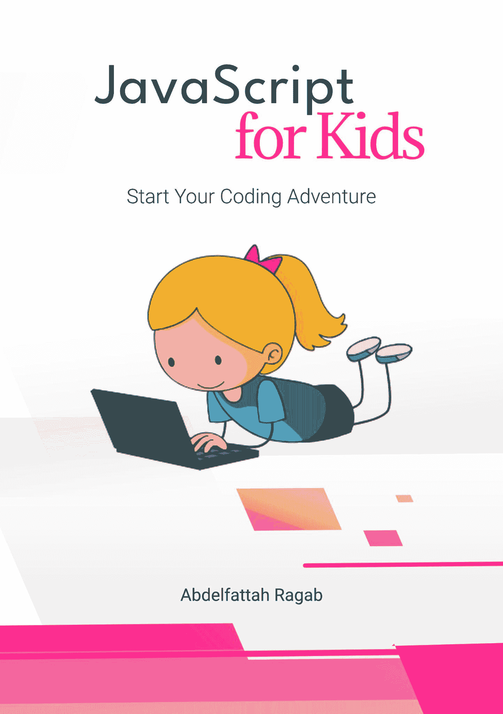
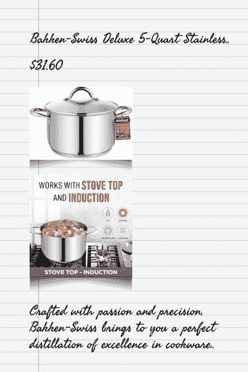
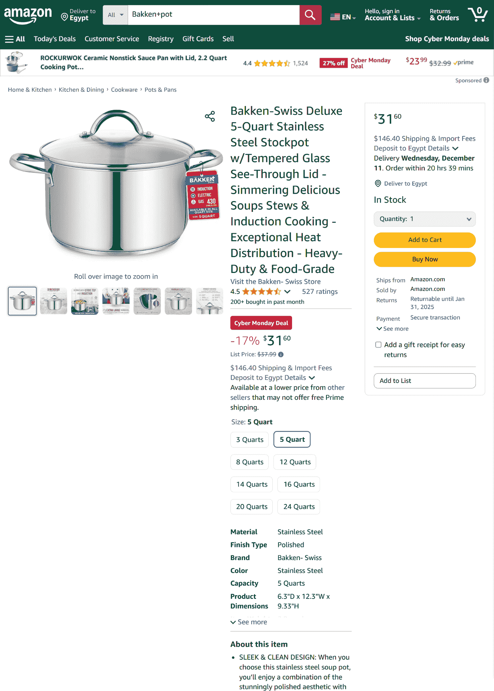
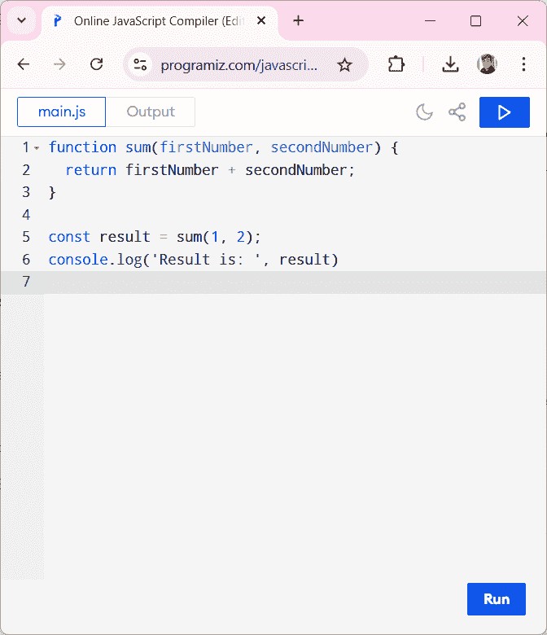
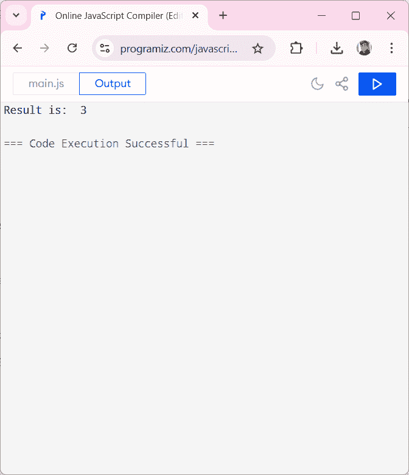
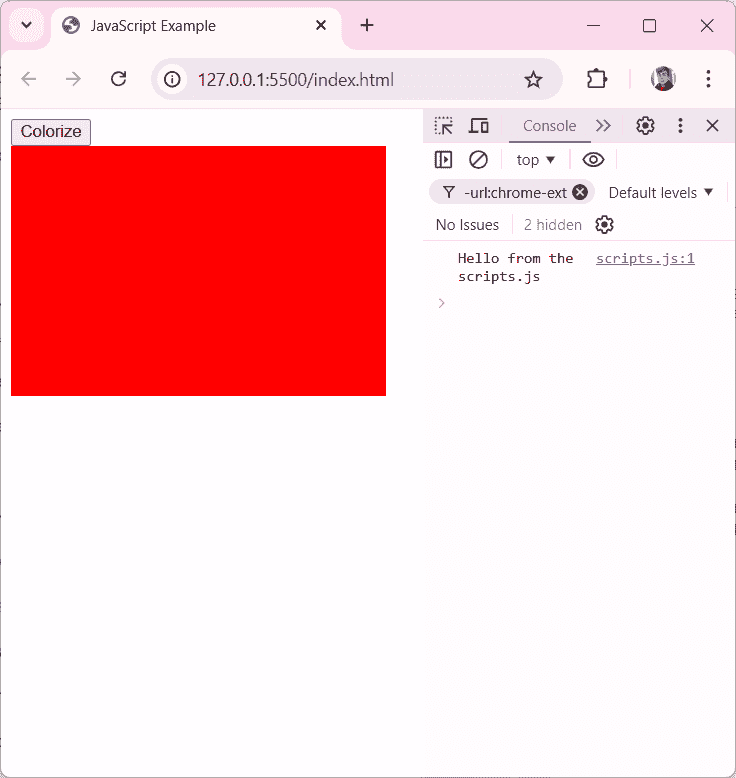
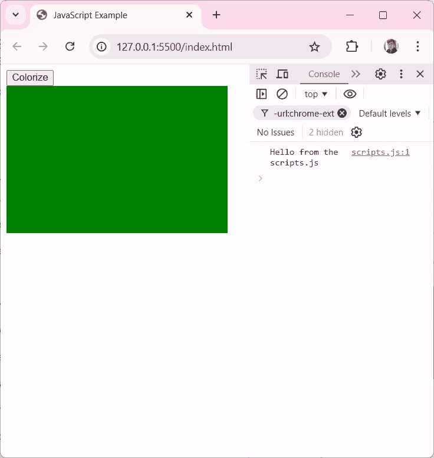
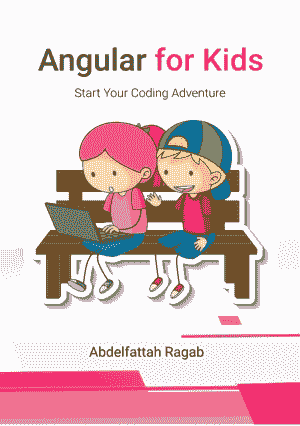
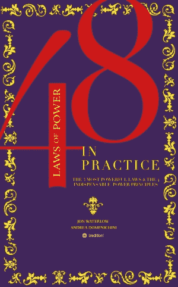
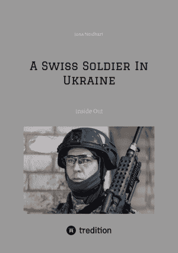

# 少儿 JavaScript：开启你的编程冒险





## 引言

欢迎阅读《少儿 JavaScript：开启你的编程冒险》。

这本书将带你进入 JavaScript 的世界。它是迈向开发网站和移动应用程序的第一步。通过 JavaScript，你可以将你的想法变为现实。学习应该是乐趣的，所以你会觉得像在读一个故事一样。

读完这本书，你将对 JavaScript 有了良好的理解。你已经在现代网页编程的冒险中迈出了第一步。

祝编程愉快！

## 向前进

当你开始学习新主题时，应该对其进行广泛探索，并专注于前进，而不是迷失在细节中。我建议你从不同的来源收集关于同一主题的信息。

时不时休息，寻找问题的简短答案，并使用不同的来源获取不同的观点。如果尝试多次后仍然不理解也不要担心，继续坚持，因为你以后会再次遇到它。

## Java vs JavaScript

Java 和 JavaScript 是不同的编程语言，目标也不同：Java 是一种通用面向对象的语言，用于开发各种平台的应用程序；而 JavaScript 是一种脚本语言，主要用于在网站上创建交互式内容。

## 什么是 JavaScript？

JavaScript 是一种主要用于在网站上创建交互式内容的编程语言。它允许开发者在网页上实现功能，如交互式表单和实时更新，而无需重新加载页面。

JavaScript 最初主要是为了浏览器执行而开发的。你对浏览器熟悉，因为我们一直在使用它们。最流行的浏览器包括 Google Chrome、Microsoft Edge、Mozilla Firefox、Opera 和 Safari。

JavaScript 是一种主要存在并运行在网页浏览器中的编程语言。在 `Node.js` 发布之前情况一直是如此。有了 `Node.js`，你可以在浏览器之外使用 JavaScript 进行服务器端编程。现在我们使用 JavaScript 进行所有类型的编程。

## 网页浏览器是如何工作的？

当你在浏览器中访问网站时，它会访问指定的 `URL`，下载文件并将它们显示在屏幕上。网站由三类型的文件组成，共同构成了你在网上看到的页面。

首先是 HTML 代码，它负责网站的内容，没有样式或编程，只有内容。

假设我们在 Amazon.com 上有一个产品产品页。HTML 包含了产品名称、价格、图片、描述和运费详情。

所有内容都以纯文本形式逐行编写。图像一个接一个地显示，每个图像单独占一行。

想象我给了你一些信息，并让你把它写在笔记本上。

你在第一行写下产品名称，第二行写下价格，以此此类推。

只有信息，没有任何设计或编程。



这正是 HTML 的作用：它以语义化的方式显示信息。无障碍设备从 HTML 中读取信息。它们主要对信息感兴趣。如果你为盲障用户使用屏幕阅读器，它会读取页面的内容。所有的样式都会被忽略。

然而，对于可以看到网站并与网站交互的视力人士来说，样式是重要的。

例如，如果我们对 Amazon 的产品页应用样式，我们可以让标题变大，并将图片放在左侧的独立区域。我们还可以隐藏所有图片，只在轮播图或滑块中显示第一张图片。我们可以使用 CSS 颜色、字体、间距和边框，绘制形状并进行各种事情。



所以，现在你了解了 HTML 和 CSS，但还有第三个组件：JavaScript。

## 什么是编程？

编程是创建一组计算机可以遵循以执行特定任务指令的过程。

## 创建一个小型应用程序

让我们创建一个小型应用程序，以便你理解编程的含义。

该应用程序接收两个数字并应该返回这两个数字之和。

我将创建一个名为 `firstNumber` 的变量和第二个名为 `secondNumber` 的变量。

你可以定义变量 `x` 和 `y`，但专业程序员建议给变量起有意义的名称，以明确创建的目的。当你与他人分享代码时，这非常有用，让他们能够轻松理解你正在尝试做什么。

```javascript
let firstNumber;
let secondNumber;
return firstNumber + secondNumber;
```

在 JavaScript 中，我们使用单词 `let` 来声明变量。然后你可以引用变量名来执行计算。

我们使用单词 `return` 在计算完成后返回最终结果。

为了能够调用它，我们将其插入到函数函数中。

```javascript
function sum(firstNumber, secondNumber) {
  return firstNumber + secondNumber;
}
```

然后你可以这样调用它：

```javascript
const result = sum(1, 2);
console.log('Result is: ', result)
```

`const` 与 `let` 类似，但用于不会改变的常量。我们仍然可以使用 `let`，但我们使用 `const` 来节省内存并防止他人更改它。

`console.log` 用于在浏览器控制台中显示消息。你可以像我做的那样用逗号分隔多个值。我显示了字符串 'Result is: '，后面跟着实际结果。

### 亲自尝试一下

搜索“online javascript compiler”并选择你最喜欢的在线 JavaScript 编译器。

在在线编译器中编写代码并运行。

```javascript
function sum(firstNumber, secondNumber) {
  return firstNumber + secondNumber;
}

const result = sum(1, 2);
console.log('Result is: ', result)
```





**恭喜你！** 你创建了自己的第一个 JavaScript 程序。接下来的所有的都是你所做内容的变体。

## DOM (文档对象模型)

当网页在浏览器中加载时，浏览器会创建页面的 DOM，这本质上是一个树形结构，其中每个节点对应文档的一部分，例如元素、属性和文本。

### JavaScript 和 DOM

JavaScript 允许你访问 `dom`，因此你可以在运行时通过程序化修改网页。

浏览器窗口由 `window` 对象表示，你可以在 JavaScript 中访问它以获取有关位置等信息。

在 JavaScript 中可供使用的另一个重要对象是 `document` 对象，它代表在浏览器中加载的整个 HTML 文档。它提供了访问和操作文档内容的方法。

### document.querySelector()

`document.querySelector()` 方法是 JavaScript 中一个强大的函数，允许你使用 CSS 选择器选择 HTML 元素。

传递给 `querySelector()` 的字符串必须是有效的 CSS 选择器。这与 CSS 有关，所以这里有一些 CSS 选择器的示例。

假设你的网页中有以下 HTML：

```html
<div id="myDiv" class="container">
  <p class="text">Hello, World!</p>
</div>
```

### 按标签名选择元素

要选择第一个段落：

```javascript
let firstParagraph = document.querySelector("p");
```

这将选择加粗的段落元素

```html
<div id="myDiv" class="container">
  <p class="text">Hello, World!</p>
</div>
```

还有一种名为 `querySelectorAll` 的方法，如果你想选择文档中的所有段落，可以使用它。

### 按 id 选择元素

要选择 id 为 `myDiv` 的元素：

```javascript
let myDivElement = document.querySelector("#myDiv");
```

注意 id 前面的 `#`。

这将选择加粗的 div 元素。

```html
<div id="myDiv" class="container">
  <p class="text">Hello, World!</p>
</div>
```

### 按类名选择元素

要选择类名为 `container` 的元素：

```javascript
let myDivElement = document.querySelector(".container");
```


注意类名前的点。

这将选取加粗的 div 元素。

```html
<div id="myDiv" class="container">
  <p class="text">Hello, World!</p>
</div
```

### 操作 DOM

一旦你选取了元素，就可以对它进行任何操作。你可以读取它的内容，修改它的属性（如颜色、大小等）……或者你甚至可以将其从页面上删除，或者进行任何你喜欢的的操作。

### 其他选择器

`document.querySelector` 和 `document.querySelectorAll` 是最近随着 DOM Level 3 规范发布添加的新方法；在它们之前还有其他选择元素的方法，这些方法在今天仍然有效。

- `document.getElementById()`
- `document.getElementsByClassName()`
- `document.getElementsByTagName()`

## 基本数据类型 vs 引用类型

我们将数据类型分为两大类：基本类型和引用类型。

`Primitive types` 是最基础的数据类型，代表单个值。

`Reference types` 是更复杂的数据类型，可以持有值的集合。

### 基本数据类型

- **Number：** 代表整数和浮点数。
```javascript
let num = 42;
```
- **String：** 代表字符序列。
```javascript
let str = "Hello, World!";
```
- **Boolean：** 代表逻辑实体，可以是 true 或 false。
```javascript
let isActive = true;
```

### 引用类型

引用类型是更复杂的数据结构，可以持有值的集合。

- **Object（对象）：** 对象是键值对的集合，可以存储不同类型的多个值，并用于表示现实世界中的实体。
```javascript
let person = {
  name: "Alice",
  age: 30,
  isActive: true
};
```
- **Array（数组）：** 数组是一种特殊的对象，用于存储有序的值集合。数组可以包含任何类型的元素，包括其他数组或对象。
```javascript
let colors = ["red", "green", "blue"];
```

### 默认值

当你声明一个变量时，它的默认值是 `undefined`。

### 运算符

运算符是用于对或多个值或变量执行操作的特殊符号。它们是编程的基础，因为它们允许开发者执行计算并控制程序的流。

#### 算术运算符

算术运算符用于执行数学计算。
- `+`：加法。
- `-`：减法。
- `*`：乘法。
- `/`：除法。

#### 比较运算符

比较运算符用于比较两个值并返回布尔结果（true 或 false）。
- `==`：相等
- `!=`：不相等
- `>`：大于
- `<`：小于

## 条件语句

条件语句根据特定条件控制代码的执行流。它们允许你根据条件的求真值假来执行不同的代码块。

```javascript
let score = 80;
if (score > 60) {
  console.log("You passed!");
} else {
  console.log("You failed.");
}
```

`if` 语句在指定条件为真时执行一个代码块。
`else` 语句在条件为假时执行。

## 三元运算符

三元运算符是 `if...else` 语句的简写形式。

`condition ? expression If True : expression If False;`

```javascript
let score = 80;
const result = score > 60 ? "You passed!" : "You failed.";
console.log(result);
// 输出: You passed!
```

## 循环

循环允许你根据指定的条件重复执行一个代码块。

```javascript
for (let i = 0; i < 5; i++) {
  console.log(i);
}
// 输出: 0, 1, 2, 3, 4
```

你可以使用 `while` 循环编写循环：

```javascript
let count = 0;
while (count < 5) {
  console.log(count);
  count++;
}
// 输出: 0, 1, 2, 3, 4
```

## 事件

事件是系统中发生了某些事的通知。当事件发生时，它可以触发代码中的反应。有许多类型的事件，如鼠标点击、按键按下、窗口大小调整。

例如，我们可以如下所示为按钮绑定事件处理器：

```html
<button id="myButton">Click Me</button>
```

```javascript
const myButton = document.querySelector('#myButton');
myButton.addEventListener('click', () => {
  console.log('Button clicked!');
});
```

## 箭头函数

箭头函数是在 ES6 中引入的。与传统的函数表达式相比，它们提供了更简洁的语法，在处理回调时特别有用。

旧方法：
```javascript
function sum(a, b) {
  return a + b;
}
```

箭头函数：
```javascript
const sum = (a, b) => a + b;
```


```javascript
myDiv.style.backgroundColor = "green";

});

</script>
```

这里是完整代码，完整的 HTML 文件。你可以将其复制并粘贴到 `index.html` 文件中，并启动本地服务器查看效果。

```html
<!DOCTYPE html>
<html lang="en">
<head>
<meta charset="UTF-8" />
<meta name="viewport" content="width=device-width, initial-scale=1.0" />
<title>JavaScript 示例</title>
<script src="scripts.js"></script>
</head>
<body>
<button id="myButton">变色</button>
<div id="myDiv" style="width: 300px; height: 200px; background-color: red"></div>
<script>
const myButton = document.querySelector("#myButton");
myButton.addEventListener("click", () => {
const myDiv = document.querySelector("#myDiv");
myDiv.style.backgroundColor = "green";
});
</script>
</body>
</html>
```





**恭喜你！** 你已经在现实生活中完成了你的第一个 JavaScript 应用程序。

## 接下来做什么？

本书的目标是让你更轻松地上手 JavaScript。我已经为你提供了所有内容的概览，但随着你继续学习 JavaScript，你将学到更多细节。尝试熟悉 HTML 和 CSS，并坚持练习 JavaScript。

不要尝试仅用 JavaScript 就创建真实的应用程序，因为那将花费你大量的时间。

一旦你对 JavaScript 有了信心并准备好构建一个真实的应用程序，你就应该学习新的 JavaScript 框架。我指的是 Angular、React 和 Vue。

它们的作用都是相同的，即构建客户端应用程序。在 Web 开发中，应用程序有两种：服务端应用程序和客户端应用程序。服务端应用程序负责业务逻辑、安全、数据库通信等，而客户端应用程序负责用户界面。

它们收集用户的输入，将其发送到后端服务器，并在后端服务器返回结果后立即显示给终端用户。它们不执行敏感操作，如安全、业务逻辑或与数据库的通信。

有许多编程语言可以创建后端应用程序，如 C#、Java、PHP、Node.JS (JavaScript)、Python 等。

对于前端，主要是 JavaScript 和 TypeScript，配合 Angular、React 和 Vue 等框架。

移动端应用程序是另一种类型，它们与客户端应用程序更相似，并且连接到后端服务器。

今天大多数后端服务器都是基于 REST API 原构建的。服务器提供客户端用于发送和接收数据的端点。

随着时间的推移你会学会一切，不要担心。

你可能需要多次尝试才能理解一个主题，所以请坚持下去，因为你会反复遇到这些主题。

随着时间的推移，你将对该领域建立理解，并以专业的方式处理问题。

祝你学习顺利，我们下个话题再见！

— Abdelfattah Ragab

## 结语

**恭喜你！** 你读完了《儿童少 JavaScript：开启你的编程之旅》。现在你对 JavaScript 有了良好的理解。记住，学习 JavaScript 是一个持续的过程。实践出精兵——构建你自己的项目，尝试你学过的功能，并深入研究在线资源。

感谢你与我一起探索 JavaScript。祝你的编程之旅好运连连。祝编程愉快，祝你的应用程序取得成功！

## 媒体归属

在电脑笔记本电脑上工作的学生

图片来自 [brgfx](https://www.freepik.com/free-vector/students-working-computer-laptops_1503669.htm) 于 Freepik

现代年度报告杂志页传单公司目录

图片来自 [starline](https://www.freepik.com/free-vector/modern-annual-report-magazine-page-flyer-company-catalog_135390347.htm#fromView=search&page=1&position=21&uuid=46d2297f-1be2-49f9-abd4-ba755ef564f9) 于 Freepik

## 不要错过！

当 Abdelfattah Ragab 出版新书时，你将接收电子邮件。这是免费且无义务的。


## Abdelfattah Ragab 的其他作品

♢ 儿童 Angular ♢ CSS Flex 布局 ♢ CSS Grid 网格布局 ♢ CSS 盒模型与布局 ♢ Angular 作品集应用开发

## 关于作者

Abdelfattah Ragab 是一位拥有 20 多年经验的专业软件开发人员。

https://abdelfattah-ragab.com

## 关于出版社

Abdelfattah Ragab 是一位高资深且经验丰富的软件开发人员，在行业内拥有 20 多年的经验。专精前端开发，Abdelfattah Ragab 对 Angular、JavaScript、TypeScript、HTML 和 CSS 有深入的理解。

访问 https://abdelfattah-ragab.com 更多。



## 儿童 Angular

Ragab, Abdelfattah

9783384411686

34 页

[立即购买并阅读（广告）](http://www.mynextread.de/redirect/Kobo/2012001/9783384443243/9783384411686/28f44a00e985e1b51cc4dada09525887?dipaMethod=AUTHOR&ibpPosition=END&orderId=0)

欢迎阅读《儿童 Angular：开启你的编程之旅》。这本书是你进入 Angular 世界的大门。它是你开发网站和移动应用程序的第一步。通过 Angular，你可以将你的想法变为现实。学习应该是充满乐趣的，所以你会感觉像在读一个故事。读完这本书后，你对 Angular 将有良好的理解。你已经在现代 Web 编程之旅中迈出了第一步。祝编程愉快！

[立即购买并阅读（广告）](http://www.mynextread.de/redirect/Kobo/2012001/9783384443243/9783384411686/28f44a00e985e1b51cc4dada09525887?dipaMethod=AUTHOR&ibpPosition=END&orderId=0)


## 我的丈夫、保政员和我

White, Emily

9783384113863

80 页

[立即购买并阅读（广告）](http://www.mynextread.de/redirect/Kobo/2012001/9783384443243/9783384113863/db140da8e8f24c34044bfa8c302ff8a9?dipaMethod=TOPSELLER&ibpPosition=END&orderId=1)

在 Emily White 的情色杰作中沉浸于激情与诱惑的难忘之旅！在 Emily White 最新的迷人情色故事集中，进入一个迷人的世界，在那里，诱惑无边，并配有迷幻的成人漫画（hentai）插画。沉浸在一个宇宙中，每一个词都是一个低语的承诺，每一笔触都是视觉上的魔力，以纯正的动漫风格让幻想变为现实。这个系列是对探索未知欲望深处的大胆邀请，愉悦在大胆的笔触和细节中展开，加速你的心跳。精心制作的成人插画作为感官的门户，将你带入一个每个隐藏的幻想都能得到直率表达的维度。预期内容：
- 文学造诣与感官艺术的融合
- 露骨且迷人的成人插画
- 探索欲望与幻想边界的故事
- 诱惑与引诱的旋风
这不仅仅是一个集；它是你通往动漫色情维度的专属门票，由 Emily White 精心叙述并热烈插画。打开封面，准备好迎接由激情火焰驱动的强烈体验。警告：本集不适合心脏脆弱的人。你准备好跨越那道门槛了吗？

[立即购买并阅读（广告）](http://www.mynextread.de/redirect/Kobo/2012001/9783384443243/9783384113863/db140da8e8f24c34044bfa8c302ff8a9?dipaMethod=TOPSELLER&ibpPosition=END&orderId=1)



## 权力 48 法则实战应用

Waterlow, Jon

9783732387144

84 页


[立即购买并阅读（广告)](http://www.mynextread.de/redirect/Kobo/2012001/9783384443243/9783732387144/8a87ef3ef306f91107c5e4ab3a4822a0?dipaMethod=TOPSELLER&ibpPosition=END&orderId=2)

罗伯特·格林的《权力的 48 法则》震撼了数百万人的生活。成功的商业高管、顶尖的演员和音乐家，甚至是犯罪头目都在运用它。但你又该如何将这些教训应用于你的生活呢？也许你想成为一个现代的马基雅维利。也许你想逃离日常的琐碎，实现你真正的潜力和梦想。又或者，你只是厌倦了自己成为他人游戏的受害者。但是，由于有 48 条法则可供选择，而且其中任何一条似乎都像是对你习惯和思维模式的彻底颠覆，将这些法则付诸实践似乎可能令人无从下手或遥不可及。帮助就在身边。本书基于我们主要的播客系列——《探索权力的 48 法则》，为你提供了将法则付诸实践并为生活带来持久改变所需的所有内容。我们揭示了 **3 条最重要的法则**（你应该从它们开始，且其他法则都建立在此此）以及 **4 个不可或缺的权力原则**（解释法则在当今世界真实运作的具体准则和社交“黑科技”）。掌握了这些知识，《权力的 48 法则》将不再是一本你扫一眼就放在架子上的酷书。它将改变你的生活。

[立即购买并阅读（广告)](http://www.mynextread.de/redirect/Kobo/2012001/9783384443243/9783732387144/8a87ef3ef306f91107c5e4ab3a4822a0?dipaMethod=TOPSELLER&ibpPosition=END&orderId=2)



## 乌克兰的瑞士士兵

Neidhart, Jona
9783384240583 
80 页

[立即购买并阅读（广告)](http://www.mynextread.de/redirect/Kobo/2012001/9783384443243/9783384240583/f843e10a9461d304930fc1208b6aa99a?dipaMethod=TOPSELLER&ibpPosition=END&orderId=3)

为什么一个虔畏上帝的瑞士公民会违反本国法律去为乌克兰战斗？他为什么要反对自己的国家？欧盟和北约能为乌克兰多做些吗？你怎么看？俄罗斯真的像描述的那样糟糕吗？还是说人们在夸大？此外，在战国家士兵的日常生活是怎样的？这种士兵的生活真的像动作电影和游戏中描写的那样充满动作感吗？面对真实的死亡和毁灭又是种什么？真正的战斗是什么感觉？战争中最重要的技能有哪些？如果你对上述问题感兴趣，那么你找到了这本该读的书……

[立即购买并阅读（广告)](http://www.mynextread.de/redirect/Kobo/2012001/9783384443243/9783384240583/f843e10a9461d304930fc1208b6aa99a?dipaMethod=TOPSELLER&ibpPosition=END&orderId=3)


## 妇产科医生

White, Emily
9783384121356 
92 页

[立即购买并阅读（广告)](http://www.mynextread.de/redirect/Kobo/2012001/9783384443243/9783384121356/5e67200e5ccd3105930a86cb8478b4c0?dipaMethod=TOPSELLER&ibpPosition=END&orderId=4)

跟随 Emily White 的色情杰作，沉浸在场令人难忘的激情与诱惑之旅中！在 Emily White 最新的一系列闪耀色情故事集中，进入一个诱惑毫无边界的世界，书中还配有迷人的工口（hentai）插画。沉浸在这个宇宙中，每一个字都是一个低语的承诺，每一笔触都是一次视觉魔力，以纯粹的工口风格让幻想栩如生。这部合集是一次探索欲望未知深度的大胆邀请，在那里，快感以大胆的笔触和细节展开，令你的心跳加速。精心设计的工口插画作为感官的门户，将你带入一个维度，在那里每个隐藏的幻想都能找到毫无掩饰的表达。

**内容期待：**
- 文学造诣与感官艺术的融合
- 露骨且迷人的工口插画
- 探索欲望与幻想边界的故事
- 诱惑与挑逗的旋风

这不仅仅是一个合集；这是你通往工口爱欲维度的专属门票，由 Emily White 细心叙述并热烈插绘。翻开封面，准备好迎接由激情火焰驱动的强烈体验。

**警告：** 本合集不适合心理胆小者。你准备好跨越那道门槛了吗？

[立即购买并阅读（广告)](http://www.mynextread.de/redirect/Kobo/2012001/9783384443243/9783384121356/5e67200e5ccd3105930a86cb8478b4c0?dipaMethod=TOPSELLER&ibpPosition=END&orderId=4)

