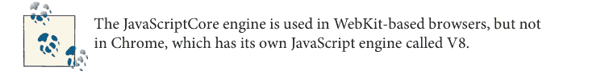
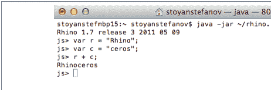
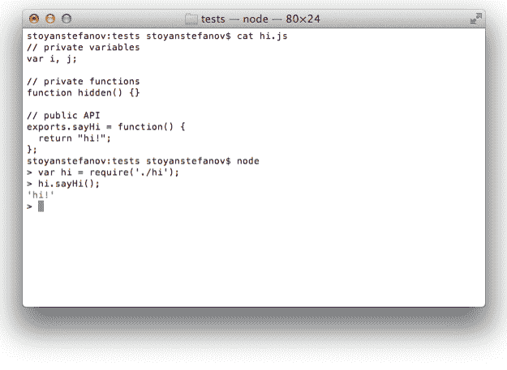

# PHP 开发者 JavaScript 指南


如果你想在 PHP 之外显著扩展你的 Web 开发技能，这本实用的实操书籍将从零开始教你 ECMAScript——JavaScript 的核心语言。你将发现 JavaScript 和 PHP 之间存在一些相似之处，例如条件和循环，但重点在于 JavaScript 独特的对象创建、类（或其缺失）、原型和继承。

对于当今的 Web 开发而言，JavaScript 知识至关重要，无论你是在为客户端、服务端还是移动端构建应用程序——而且你的 PHP 经验将带给你领先的优势。这本书将帮助你快速练掌握 JavaScript，并在你开始编码后作为参考书。

> 读这本书就像是在向未来的自己学习 JavaScript——那个已经成为 JavaScript 专家并发现了时空旅行秘密的你。如果你是一个想要学习 JavaScript 的开发者，可以停止寻找那本完美的书了。就是它了。

- 探索 JavaScript 语法，包括变量、数组、循环和条件
- 学习函数在 JavaScript 中为什么重要——以及它们实际上是对象
- 深入研究 JavaScript 的面向对象特性，包括原型、代码复用和继承
- 检查内置 API 并探索其全局函数、属性和对象
- 学习 ECMAScript 5（该标准的最新版本）中的更新
- 使用常用的设计模式来组织应用程序中的代码

Chris Shiflett，Brooklyn Beta 共同者，Fictive Kin 伙伴

Stoyan Stefanov，Facebook 工程师，YSlow 2.0 性能工具的架构师以及 smash.it 图像优化工具的创建者。他是《JavaScript Patterns》(O'Reilly)、《Object-Oriented JavaScript》(Packt Publishing)、《The Book of Speed》(在线)以及《High Performance JavaScript》(O'Reilly) 的作者。作为 Zend 认证工程师，Stoyan 在 phpied.com 和 jspatterns.com 编写博客。

$14.99 CAN $15.99
ISBN: 978-1-449-32019-5

Twitter: @oreillymedia facebook.com/oreilly


由 Stoyan Stefanov 著

印于美国。

由 O'Reilly Media, Inc. 出版于：1005 Gravenstein Highway North, Sebastopol, CA 95472。

O'Reilly 书籍可用于教育、业务或销售促销目的。大多数书籍也提供在线版 (http://my.safaribooksonline.com)。如需更多信息，请联系我们的企业/机构销售部门：800-998-9938 或 corporate@oreilly.com。

编辑：Mary Tresele
制作编辑：Kara Erbraim
校对：Amanda Kersen
校对：Jasmine Kwityn

索引编员：Meghan Jones, WordCo Indexing
封面设计：Randy Comer
内页设计：David Fututo
插画：Rebecca Demarest

2013年4月：第一版

第一版修订历史：

2013-04-24：首次发布

请访问 http://oreilly.com/catalog/errata.csp?isbn=9781449320195 查看发布详情。

Nutshell Handbook、Nutshell Handbook 标志和 O'Reilly 标志均为 O'Reilly Media, Inc. 的注册商标。《PHP 开发者的 JavaScript》、灰鼠图像以及相关商业装是 O'Reilly Media, Inc. 的商标。

制造商和销售商用于区分其产品的许多标识均被主张为商标。当这些标识出现在本书书中且 O'Reilly Media, Inc. 知晓该商标主张时，这些标识将以全大写或首字母大写形式打印。

在编写本书时已采取一切预防措施，但出版商和作者对错误或遗漏，或使用所含信息造成的损害不负责。


献给 Nathalie, Zlatina 和 Eva


- 本书范围.......................................................................................................................................... 2
- 语言学习环境............................................................................................................... 3
- 浏览器........................................................................................................................................... 4
- JavaScript 核心.............................................................................................................................. 5
- Node.js 和 Rhino............................................................................................................................................ 6
- 较长的示例............................................................................................................................................... 7
- 我们开始吧............................................................................................................................................................... 7

- $ 在 JavaScript 中起什么作用？............................................................................................................... 10
- 值............................................................................................................................................... 11
- typeof 自省...................................................................................................................... 12
- null 和 undefined........................................................................................................................................... 13
- 关联数组........................................................................................................................................... 15
- 三元运算符........................................................................................................................................... 16
- switch............................................................................................................................................... 18
- try-catch........................................................................................................................................................... 18
- while 和 for 循环........................................................................................................................................... 19
- for-in 循环...................................................................................................................................................... 20
- 杂项运算符............................................................................................................................................... 21


字符串拼接 23

类型转换 23

void 24


- 任意数量参数 28
- arguments.length 技巧 29
- 函数是对象 30
- 作用域 32
- 提升 33
- 闭包 35
- 作用域 37
- WebKit 控制台中的作用域链 39
- 保存引用而非值 44
- 练习：onclick 47
- 立即函数 47
- 私有性 49
- 函数的传递与返回 50
- 回调函数不是字符串 52


- 返回对象 56
- 更多细节 57
- 原型 59
- 访问属性 61
- 混淆的点 62
- 对象字面量中的方法 62
- 自身属性 64


- this 或 prototype 66

- 继承 66


- 通过拷贝属性进行继承 68


- 借用方法 71


- 全局对象 73
- 全局属性 74
- 数字 75
- URL 编码 76
- 内置构造函数 76
- Array 81
- RegExp 87
- Function 90
- Number 95
- Boolean 96
- Math 96
- Date 97
- 构造函数回顾 99


- 严格模式 101
- 属性属性 102
- Object.create() 103
- Object.getOwnPropertyDescriptor() 104
- Object.defineProperty() 和 Object.defineProperties() 104
- 循环替代方案 106
- Object.getPrototypeOf() 107
- 数组新增 107
- indexOf() 和 lastIndexOf() 108
- 遍历数组元素 108
- 过滤 109
- Map/Reduce 109
- 字符串修剪 110
- Date 的新增 111
- JSON 112
- 垫片 (Shims) 112

## 7. JavaScript 模式. ..................................................................... 113

- 私有属性 113
- 暴露私有对象 115
- 返回私有数组 116
- 通过 JSON 进行深拷贝 117
- 常量 120
- 命名空间 121
- 模块 123
- 定义 CommonJS 模块 124
- 使用 CommonJS 模块 125
- 使用无无关模块 126
- 设计模式 128
- 单例 128
- 工厂 130
- 文档与测试 133
- 手动 133
- 为代码编写注释 134
- 单元测试 134
- JSLint 135

## 索引. ................................................................................................. 137


首先，非常感谢在 JavaScript 方面提供我帮助的第二次审稿人。非常感谢确保内容正确的审稿人。

接下来，感谢 Alok、Dmitry Soshnikov 和 James，他们审阅了草稿。我对这些人感激不尽。


## 本书使用的规范

本书使用了以下排版规范：


## 使用代码示例


如果你使用的示例超出了合理使用范围或上述许可范围，请随时通过 permissions@oreilly.com 与我们联系。


Safari Books Online 是一个按需数字图书馆，提供来自技术和商业领域领先作者的书籍和视频形式的内容。

技术专业人员、软件开发者、网页设计师以及商业和创意人士将 Safari Books Online 作为研究、解决问题、学习和认证培训的主要资源。


## 如何联系我们

请将有关本书的意见和问题发送出版社：
O'Reilly Media, Inc.
1005 Gravenstein Highway North
Sebastopol, CA 95472
707-829-0515（国际或本地）
707-829-0104（传真）

我们为本书准备了一个网页，在其中列出了错误列表、示例以及任何额外信息。您可以通过 http://oreil.ly/javascript-php 访问该页面。


有关我们书籍、课程、会议和新闻的更多信息，请访问我们的网站：http://www.oreilly.com。

在 Facebook 上找到我们：http://facebook.com/oreilly


在 YouTube 上观看我们：http://www.youtube.com/oreillymedia

# 第1章 引言


图 1-1. 失控的 JavaScript 错误


DOM 代表文档对象模型（Document Object Model）。它是用于处理如 XML、XHTML 和 HTML 等结构化文档的 API（应用程序编程接口）。DOM 是一种语言无关的 API，也存在于 PHP 中。在 JavaScript 中，这个 API 非常容易识别：任何以 `document` 开头的内容都与 DOM 有关。从历史角度来看，DOM 起于 JavaScript，后来由世界维网联盟（W3C）标准化为一种独立于 JavaScript 或任何其他语言的 API。如今，你仍然可以发现原始 DOM（现在称为 DOM）的遗迹——例如 `document`、`images`（页面上的所有图像）和 `document links`（所有链接），它们在版本 1 中被更通用的方法取代，如 `document.getElementById()` 和 `document.getElementsByTagName()`。

BOM 代表浏览器对象模型（Browser Object Model）。对于没有正式定义的东西来说这是一个很好的名字。它是浏览器相关属性和方法的集合，例如可用屏幕尺寸或状态栏。这些属性大部分以全局变量的形式存在（如 `innerWidth`），尽管你不应将其视为窗口 对象的属性（例如 `window.innerHeight`）。BOM 长期没有标准化，所以你可以想象的，不同浏览器之间存在差异。HTML5 开始规范浏览器之间的共同行为，即常见的 BOM 对象。


总而言之，当人们谈论 JavaScript 时，他们指的是一系列主题，包括 DOM、BOM 和 ECMAScript。所以：


## 本书范围

自 Web 早期以来的一件好事是有有了大量高质量 JavaScript 库，例如 jQuery 和 YUI。


## 图 1-2. Web 检查控制台

## JavaScriptCore
如果你使用的是 Mac，它已经自带了一个可以运行 shell 脚本的 JavaScript 解释器。Windows 也内置了命令行 JavaScript 解释器，但缺少控制台。


你可以为它创建别名（alias），这样操作更方便：

- 启动终端应用程序（例如通过在 Spotlight 中输入“terminal”）。
- 输入以下内容：

- 现在你可以通过输入 jsc 即可启动控制台（图 1-3）。


注意，这比浏览器的控制台更加纯净，因为它没有 BOM 和 DOM 的概念，只有核心 JavaScript 语言。





如果你在电脑上安装了 Node.js 或 Rhino，就可以使用它们的控制台，它们的优点可以在任何操作系统上运行。

Node.js 基于 Google 的 V8 JavaScript 引擎。安装后，你可以在终端中输入 `node` 来获取控制台（图 1-4）。


Rhino 是由 Mozilla 用 Java 编写的 JavaScript 解释器。在下载 rhino.file 并将其保存到合适的地方（在我的情况下是主目录），你可以通过输入以下命令打开控制台（图 1-5）：

```
$ java -jar ~/rhino.jar



如果有选择的话，请使用 Node.js。你会发现这个 REPL（读取-评估-打印循环）与使用 `php -a`（甚至更好）在探索和实验该语言方面非常相似。


使用 JavaScriptCore、Node.js 或 Rhino，你可以创建更长的示例并将它们存储在单独的文件中。事实上，这就是用 JavaScript 编写自己的 shell 脚本的方法。你通过传递参数来运行外部文件：

```
$ node test.js
$ java -jar ~/rhino.jar test.js
```


配备了手手的 JavaScript 控制台，你已经准备好开启 JavaScript 之旅了。首先，第二章将检查 JavaScript 语法，重点关注与 PHP 的相似与不同。


就像 PHP 一样，JavaScript 具有类 C 的语法，你会觉得非常熟悉。本章将介绍基础知识，重点介绍变量、数组、循环、条件以及一些杂杂（且略微奇怪）运算符的异同。

### 变量


```php
// PHP
```

JavaScript 中对应的等写法是：

```javascript
var n = 1;
```

这里没有美元符号，只有变量名。和 PHP 一样，你不需要定义变量类型，因为类型是从值推导出来的。所有类型都使用 `var`。


```javascript
var n = 1;      // number
var b = true;   // boolean
var s = "hello"; // string

你可以选择声明一个变量而不初始化它的值。在这种情况下，变量被赋值为特殊值 `undefined`：

```javascript
a; // `a` 具有特殊值 `undefined`
```

重新声明一个现有变量不会将变量值设回 `undefined`：
```javascript
var a = 1;
var a;
// "a" 仍然是 1
```
你可以在一条语句中声明（并可选值初始化）多个变量，只要用逗号分隔并以分号结尾即可：

```javascript
var a = 1, b = 2, c = 3;
```


### null 和 undefined


undefined 类型只有一个值——即 `undefined`。当你声明了一个变量但没有对其进行初始化时，它会被初始化为 `undefined`。此外，当一个函数没有显式返回值时，它会返回 `undefined`：

```javascript
var a;
var b = 1;
b = undefined;
typeof b; // "undefined"
```


```javascript
var b;
b === undefined; // true
b === "undefined"; // false
typeof b === undefined; // false
```

null 类型只有一个值——即 `null`。它很少派用场，但在调用接收大量参数的函数，或者当你想要在未声明变量和未初始化变量之间做出明确区分时，可以传递给函数调用，因为 `undefined` 可能代表其中之一。
惊讶的是，当 `typeof` 与 `null` 值一起使用时会返回 `"object"`：

```javascript
var a = null;
typeof a; // "object"

你可以期待在未来的 ECMAScript 版本中 `typeof` 返回 `"null"`。

### Arrays

在 PHP 中，你使用以下方式定义数组：
```php
// PHP
$a = array(1, 2, 3);
```


```javascript
// JavaScript
var a = [1, 2, 3];
```


```php
// PHP
$a = [1, 2, 3];

var arr = Array(["a", 2, 3]);
var arrgh = new Array(["a", "b", "c"]);
arr; // [1, 2, 3]
arrgh; // ["a", "b", "c"]
```
这些在 JavaScript 中也有效：

后面会有更多关于这种语法的内容，但请记住方括号符号。

像 PHP 一，你可以在数组中混合任何类型的值，其他数组：
```javascript
// JavaScript
var a = [1, "yes", false, undefined, [1, 2]];
```


```javascript
typeof a; // "object"
```


```javascript
var a = [1, 2, 3];
a.length; // 3，像 PHP
```
不幸的是，你不能像 PHP 那样使用 `[]` 添加元素。你需要添加元素的索引是：

```javascript
a[3] = 4;
```
或者，更常见的是使用 `length` 来获取索引：

```javascript
a.length = "five"
```
另一种，有 `push()` 方法，类似于 PHP 的 `array_push()` 函数：

```javascript
a.push(6);
```
执行这些语句的结果是：

```javascript
a; // [1, 2, 3, 4, "five"]
```
你使用索引访问元素，正如你预期的那样：

```javascript
var b = a[4];
b; // "five"
```
### Arrays

JavaScript 中没有关联数组。当你需要时，使用对象。

如果你想这样做：
```php
// PHP
$assoc = array('one' => 1, 'two' => 2);
```


```javascript
// JavaScript
var assoc = {'one': 1, 'two': 2};
```
区别仅在于使用 `:` 代替 `=>` 并用花括号包裹。键的引号（如果是有效的标识符，意味着键可以使用变量名）是可选的：

```javascript
var assoc = {one: 1, two: 2};
```
向这个关联数组/对象/字典添加：

```javascript
assoc.three = 3;
```
移除属性，使用 `delete` 运算符：

```javascript
delete assoc.two;
```
在 ES3 中，除了通过 `for-in` 循环，没有简单的方法可以统计对象的属性数量。你将在后面看到详细介绍。

访问对象的属性，使用点符号：

```javascript
```

或者，使用方括号符号，它看起来更像 PHP 的数组：

assoc["one"] // 1
```

### Conditions


```javascript
var a, b;
if (a === "hello") {
}

`if` 语法等同于 PHP 的：

```javascript
if (a === "hello") {
  // ...
} else if (a === "world") {
  // ...
} else {
}
```

Wait-if-else 结构：

var a, b;
if (a === "hello") {
  // ...
} else if (a === "world") {
  // ...
  // ...
}
```

`if` 语法等同于 PHP 的：
```javascript
var a, b;
if (a === "hello") {
  // ...
} else if (a === "world") {
} else {
  // ...
}
```


```javascript
var a, b;
if (a === "hello") {
  // ...
  // ...
} else {
  // ...
}
```
`if` 语法等同于 PHP 的：

```javascript
var a, b;
if (a === "hello") {
} else if (a === "world") {
  // ...
} else {
  // ...
}

`if` 语法等同于 PHP 的：

```javascript
var a, b;
  // ...
} else if (a === "world") {
  // ...
} else {
  // ...
```

### Ternary Operator

三元运算符是 `if-else` 语句的简写形式。它的形式如下：
`condition ? expressionIfTrue : expressionIfFalse`

例如：

```javascript
var status = (age >= 18) ? "adult" : "minor";
```

三元运算符可以用于赋值：

var price = 100;
var discount = (price > 50) ? 20 : 0;
var finalPrice = price - discount;
```

### Strict Comparison
在 JavaScript 中，有两个相等运算符：`==`（松相等）和 `===`（严格相等）。

`==` 运算符在比较值之前会进行类型转换，这可能导致意想不到的结果。`===` 运算符同时比较值和类型。

```javascript
5 === "5"; // false
null == undefined; // true
null === undefined; // false
```


### Switch

`switch` 语句允许根据不同的条件执行代码块。

```javascript

switch (fruit) {
  case "apple":
    console.log("Apple is a fruit.");
    break;
    console.log("Banana is a fruit.");
  break;
  default:
    console.log("Unknown fruit.");
}

### Try-catch

`try-catch` 块用于处理执行期间的错误。

try {
  // 可能抛出错误的代码
  throw new Error("Something went wrong");
} catch (error) {
  // 处理错误的代码
} finally {
  // 无论是否抛出异常，都会执行的代码
  console.log("Cleanup");
}
```


- 访问的是属性，而不是调用 `getMessage()` 方法

在 JavaScript 中，也有 `finally`（它在 PHP 中也存在，自 5.5 版本开始），但在实践中很少见到，尤其是考虑到 IE 浏览器中在处理它时存在一些 Bug：
```javascript
var msg = ""
try {
    throw new Error("ouch");
} catch (e) {
} finally {
    msg += " - ouch - finally";
}
msg; // 输出 "ouch - finally"
```
如你所见，`finally` 块中的语句始终执行，无论 `try` 块是否抛出错误。

稍后你会看到更多关于变量作用域的内容，但注意 `catch` 块是规则的例外，规则是：没有块作用域，只有函数作用域。在你提供的示例中，`e` 只在 `catch` 内部可见。然而，错误 `e` 是唯一的例外；如果你在 `catch` 块内部定义其他变量，它们会泄露到外部：

```javascript
    throw new Error();
} catch (e) {
    var oops = 1;
}
```
```javascript
typeof e; // "undefined"
typeof oops; // "number"
```


## while 和 for 循环

`while`、`do-while` 和 `for` 循环在 JavaScript 中的工作方式与 PHP 完全相同，两种语言都复制了 C 语法。让我们趣味一下，看一个计算从 1 到 100 之和的示例。


```javascript
var i, $sum;
```


这是一个跨语言的 `while` 循环示例：

```php
$i = 1;

while ($i <= 100) {
  $sum += $i;
}

$i; // 101
```

`$sum` 现在是 5050。


```php
$i = 1;
$sum = 0;

  $sum += $i;
} while ($i <= 100);

$sum; // 5050
```
循环在 PHP 中也是一样的，下面的示例在两种语言中同样有效：

```php
$i = 1;
$sum = 0;
for ($i = 0; $sum <= 100; $i++) {
  $sum += $i;
}
```

在所有这些示例中，`$i` 结束时都是 101而不是 100。你能回答是哪一个吗？

## for-in 循环

在 JavaScript 中，当你需要关联数组时，你使用对象。你遍历对象不是使用 `foreach` 循环，而是使用 `for-in` 循环。
假设你在 PHP 中定义了以下数组：

```php
// PHP
$clothes = array(
  'pants' => 'jeans',
  'shoes' => 'none', // 结尾逗号是允许的，甚至推荐
);
```


```javascript
// JavaScript
var clothes = {
  shirt: 'black',
  shoes: 'none' // 结尾逗号是不的，因为旧版 IE
};
```

在 PHP 中，你这样遍历数据：
```php
// PHP
$out = '';
foreach ($clothes as $key => $value) {
  $out = $key . ': ' . $value . '\n';
```

在 JavaScript 中，你使用 `for-in` 循环：

```javascript
var out = '';
for (var key in clothes) {
  out += key + ': ' + clothes[key] + '\n';
}
```
你无法在循环内部直接访问下一个属性，因此你使用方括号符号 `clothes[key]` 获取值。还要注意，属性枚举的顺序是不保证的，取决于具体的实现。换句话说，`shoes` 可能会出现在 `shirt` 之前。如果你想保持顺序，你需要使用普通数组来存储数据。仅为了说明，如果你暂时忘记了 PHP 中你可以访问 `(foreach)`，你可以执行以下 JavaScript 逻辑：

```php
$out = '';
foreach (array_keys($clothes) as $key) {
}
```

## 杂项运算符


### in

在上节中，`in` 运算符被用于遍历对象的属性。它也可以用于检查属性是否存在于对象中：

if ("shirt" in clothes) {
  // 某些操作
}
```

if ("hat" in clothes) {
  // false
}
```


```javascript
if (typeof clothes["shirt"] !== "undefined") {
  // 某些操作
}

### 字符串连接

当执行 `catch` 块时，`try-catch` 会产生性能影响，在性能敏感的代码路径中应避免使用（即你应该将其移动到循环之外）。


由于 `+` 可以同时用于加法和字符串连接，你也可以使用 `+` 快速转换类型：

```javascript
+"1"; // 将字符串 "1" 转换为数字 1
```

关于类型转换，你可以使用 `!!` 转换为布尔值：

```javascript
!!false // false
```

第一个 `!` 取反，当值为假时返回布尔值真，第二个 `!` 再次取反得到想要的结果。此外，构造函数（你稍后会详细介绍）也可以用于类型转换：

Number("1") === 1; // true
String(100) === "100"; // true
Boolean(0) === false; // true
Boolean(100) === true; // true
```
### void

你可能会另一个运算符是 `void`。它接受任何表达式作为操作数并返回 `undefined`：

```javascript
typeof a === "undefined"; // true
```

`void` 运算符很少用，但有时用在链接的 `href` 中。由于类型运算符，人们经常将其与分组运算符 `()` 混淆，使其看起来像函数调用：

<a href="javascript:void(0)">点击后无反应</a>

这种做法看起来很无害，但仔细想想，它既愚蠢又常见。这里是发生的过程：

1. 用户点击，执行一个 JavaScript 表达式。
3. 分组运算符返回组中的最后一个值，0。
4. 0 被发送给 `void` 运算符。
5. `void` 作为一个黑洞，接收操作数并返回 `undefined`。

忽略无功能链接的损坏语义，人们完全可以将 `href` 设置为 `javascript:undefined`。
### 逗号运算符

逗号运算符是另一个奇怪的运算符。它是 JavaScript 中优先级最低的运算符。它返回传递它的操作数的值：

```javascript
a; // "there"
var a = ("hello", "there", "young", "one");
a; // "one"
```


```
0 && 7 && 1; // 
0, 7, 1;    // 1
```

逗号运算符当你想在 JavaScript 仅期望一个表达式的地方溜入另一个表达式时非常有用。


```javascript
// JavaScript
var a = 100;
var b = a || 200;

// PHP
$a = 100;
$b = $a || 200;
var_dump($b); // bool(true)


# 第 3 章
函数
函数是 JavaScript 中的一个重要主题，因为该语言有许多用处。在最基础的形式中，它们看起来像 PHP 函数：

```javascript
// 基础形式均有效
function sum($a, $b) {
}

sum(3, 5); // 8
```


目前没有语法允许你为函数参数设置默认值（像在 PHP 中经常做的那样）。这计划在 ECMAScript 的未来版本中实现，但目前你必须在函数体内部自己处理。假设你想让第二个参数默认为 2：

```javascript
// PHP
    return $a + $b;
}

// JavaScript
function sum(a, b) {
    // 有时也写成
    // b || (b = 2)
    return a + b;
}
```
这种短语法在很多情况下运行良好，但在这种情况下有点天真，因为 `b || 2` 是一个松散比较。如果你传递 `0` 作为参数，比较将求为 `false` 且 `b` 将变成 `2`：

```javascript
sum(3); // 5
sum(3, 0); // 5，不是你预期的结果

较长的版本是使用 `typeof`：

```javascript
function sum(a, b) {
  return a + b;
}
sum(3, 0); // 3
sum(3); // 5
```
## 任意数量的参数

不必传递函数期望的所有参数，JavaScript 不会报错。换句话说，没有强制参数。如果你需要让某个参数变为必填，你需要在函数体内部强制执行。

你也可以传递比函数期望的更多的参数，这些参数会被愉快地忽略而不产生任何错误：
```javascript
sum(); // NaN (不是数字)
sum(1, 2); // 3
sum(1, 2, 100, 999); // 3
```
你可以准备接收任意数量的参数并优雅地处理这种情况情况。在 PHP 中，你可以使用 `func_get_args()`，它返回一个传递给函数的参数数组。在 JavaScript 中，你使用 `arguments` 类数组对象。它是函数体内部可用的一个对象。它被称为“类数组”，是因为它的属性从索引 0 开始枚举，而且它也像数组一样有一个 `length` 属性：

```javascript
function sum(/* 这里什么都没有 */) {
  for (var i = 0, result = 0; i < arguments.length; i++) {
  }
  return result;
}
```

sum(); // 0
sum(111); // 111
sum(1, 2); // 3
sum(1, 2, 3); // 6
sum(1, 10, 2, 9, 38); // 33

记住，尽管 `arguments` 看起来像数组，但它实际上是一个对象，并且没有像 `push()`、`pop()` 等方法。不过，你可以轻松地将这个类数组对象转换为数组。准备好掌握稍后详细解释的新内容吧：

```javascript
function sum() {
  typeof args.push; // "undefined"
  typeof args.push; // "function"
}
sum();
```


`typeof` 运算符在与函数配合时返回字符串 `"function"`。

## arguments.length 技巧
处理可选参数的一种聪明方法是 JavaScript 使用 `arguments` 对象所建议的方法：

```javascript
// 这里你有一个所有默认参数的函数，就像 PHP 的声明一样：
// function sum($a = 1, $b = 2, $c = 3, $d = 4)
  // 注意：没有 'break'
  switch (arguments.length) {
    case 0: a = 1;
    case 1: b = 2;
    case 2: c = 3;
  }
  return a + b + c + d;
}

sum(); // 10
sum(1, 2); // 5
sum(1, 2, 3); // 6
sum(1, 2, 3, 4); // 10
```


函数总是返回一个值。如果没有使用 `return`，它们将返回 `undefined`：

```javascript
// 显式返回
  return 101;
}
myReturn(); // 101

// 隐式返回
  101;
}
noReturn(); // undefined
```


函数是 JavaScript 中的一个重要主题，因为该语言对它们有许多用处。在最基础的形式中，它们看起来像 PHP 函数：

```javascript
// 基础形式均有效
    return $a + $b;
}

sum(3, 5); // 8
```
## 默认参数

目前没有语法允许你为函数参数设置默认值（像在 PHP 中经常做的那样）。这在 ECMAScript 的未来版本中有计划，但目前你必须在函数体内部自己处理。假设你想让第二个参数默认为 2：

```javascript
function sum($a, $b = 2) {
    return $a + $b;
}

// JavaScript
    b = b || 2;
    // 有时也写成
    // b || (b = 2)
    return a + b;
}

这种短语法在很多情况下运行良好，但在这种情况下有点天真，因为 `b || 2` 是一个松散比较。如果你传递 `0` 作为参数，比较将求为 `false` 且 `b` 将变成 `2`：

```javascript
sum(3); // 5
```

较长的版本是使用 `typeof`：

```javascript
  b = typeof b === "undefined" ? 2 : b;
  return a + b;
}
sum(3, 0); // 3
sum(3); // 5

## 任意数量的参数

不必传递函数期望的所有参数，JavaScript 不会报错。换句话说，没有强制参数。如果你需要让某个参数变为必填，你需要在函数体内部强制执行。


```javascript
sum(); // NaN (不是数字)
sum(1, 2); // 3
sum(1, 2, 100, 999); // 3

你可以准备接收任意数量的参数并优雅地处理这种情况。在 PHP 中，你可以使用 `func_get_args()`，它返回一个传递给函数的参数数组。在 JavaScript 中，你使用 `arguments` 类数组对象。它是函数体内部可用的一个对象。它被称为“类数组”，是因为它的属性从索引 0 开始枚举，而且它也像数组一样有一个 `length` 属性：

```javascript
function sum(/* 这里什么都没有 */) {
    result += arguments[i];
  }
  return result;
}
```
```javascript
sum(); // 0
sum(111); // 111
sum(1, 2); // 3
sum(1, 2, 3); // 6
```

记住，尽管 `arguments` 看起来像数组，但它实际上是一个对象，并且没有像 `push()`、`pop()` 等方法。不过，你可以轻松地将这个类数组对象转换为数组。准备好掌握稍后详细解释的新内容吧：

```javascript
  var args = Array.prototype.slice.call(arguments);
  typeof args.push; // "undefined"
  typeof args.push; // "function"
}
sum();


`typeof` 运算符在与函数配合时返回字符串 `"function"`。


处理可选参数的一种聪明方法是 JavaScript 使用 `arguments` 对象所建议的方法：

```javascript
// 这里你有一个所有默认参数的函数，就像 PHP 的声明一样：
function sum(a, b, c, d) {
  // 注意：没有 'break'
  switch (arguments.length) {
    case 0: a = 1;
    case 1: b = 2;
    case 3: d = 4;
  }
  return a + b + c + d;
}

sum(1); // 3
sum(1, 2); // 5
sum(1, 2, 3); // 6
sum(1, 2, 3, 4); // 10
```
## 返回值

函数总是返回一个值。如果没有使用 `return`，它们将返回 `undefined`：

```javascript
function myReturn() {
  return 101;
}
myReturn(); // 101

function noReturn() {
  101;
}
noReturn(); // undefined
```
## 函数是对象

函数是 JavaScript 中的一个重要主题，因为该语言对它们有许多用处。在最基础的形式中，它们看起来像 PHP 函数：

```javascript
function sum($a, $b) {
    return $a + $b;
}

sum(3, 5); // 8

## 默认参数

目前没有语法允许你为函数参数设置默认值（像在 PHP 中经常做的那样）。这在 ECMAScript 的未来版本中有计划，但目前你必须在函数体内部自己处理。假设你想让第二个参数默认为 2：

// PHP
function sum($a, $b = 2) {
    return $a + $b;
}

function sum(a, b) {
    b = b || 2;
    // 有时也写成
    // b || (b = 2)
    return a + b;
```

这种短语法在很多情况下运行良好，但在这种情况下有点天真，因为 `b || 2` 是一个松散比较。如果你传递 `0` 作为参数，比较将求为 `false` 且 `b` 将变成 `2`：

```javascript
sum(3, 0); // 5，不是你预期的结果
```

较长的版本是使用 `typeof`：

function sum(a, b) {
  b = typeof b === "undefined" ? 2 : b;
  return a + b;
}
sum(3, 0); // 3
```

## 任意数量的参数

不必传递函数期望的所有参数，JavaScript 不会报错。换句话说，没有强制参数。如果你需要让某个参数变为必填，你需要在函数体内部强制执行。
你也可以传递比函数期望的更多的参数，这些参数会被愉快地忽略而不产生任何错误：

```javascript
sum(); // NaN (不是数字)
sum(1, 2); // 3
```

你可以准备接收任意数量的参数并优雅地处理这种情况。在 PHP 中，你可以使用 `func_get_args()`，它返回一个传递给函数的参数数组。在 JavaScript 中，你使用 `arguments` 类数组对象。它是函数体内部可用的一个对象。它被称为“类数组”，是因为它的属性从索引 0 开始枚举，而且它也像数组一样有一个 `length` 属性：

```javascript
  for (var i = 0, result = 0; i < arguments.length; i++) {
    result += arguments[i];
  }
  return result;
}

```javascript
sum(); // 0
sum(111); // 111
sum(1, 2); // 3
sum(1, 10, 2, 9, 38); // 33
```

记住，尽管 `arguments` 看起来像数组，但它实际上是一个对象，并且没有像 `push()`、`pop()` 等方法。不过，你可以轻松地将这个类数组对象转换为数组。准备好掌握稍后详细解释的新内容吧：

function sum() {
  var args = Array.prototype.slice.call(arguments);
  typeof args.push; // "undefined"
  typeof args.push; // "function"
}
```


`typeof` 运算符在与函数配合时返回字符串 `"function"`。
## arguments.length 技巧

处理可选参数的一种聪明方法是 JavaScript 使用 `arguments` 对象所建议的方法：

```javascript
// function sum($a = 1, $b = 2, $c = 3, $d = 4)
function sum(a, b, c, d) {
  // 注意：没有 'break'
  switch (arguments.length) {
    case 0: a = 1;
    case 2: c = 3;
    case 3: d = 4;
  }
  return a + b + c + d;
}
sum(); // 10
sum(1); // 3
sum(1, 2); // 5
sum(1, 2, 3); // 6
sum(1, 2, 3, 4); // 10

## 返回值

函数总是返回一个值。如果没有使用 `return`，它们将返回 `undefined`：

// 显式返回
function myReturn() {
  return 101;
}
myReturn(); // 101
// 隐式返回
function noReturn() {
  101;
}
noReturn(); // undefined

## 函数是对象

函数是 JavaScript 中的一个重要主题，因为该语言对它们有许多用处。在最基础的形式中，它们看起来像 PHP 函数：

// 基础形式均有效
function sum($a, $b) {
    return $a + $b;
}

local; // ReferenceError: local is not defined
is_it_local; // 1
```

以下代码段中的注意事项：
- `true_global` 始终可用用。
- 即使在未执行的代码块内部，`false_global` 也总是被声明，尽管没有初始化。使用它会返回 `undefined`（所有变量的默认值），并且不会报错。
- `local` 在 `sum()` 函数外部永远是不可用的。在它的局部环境之外使用它会导致错误。
- `is_it_local` 在调用 `sum()` 函数之前没有声明，这会导致错误。调用 `sum()` 会为 `is_it_local` 赋值一个值，并由于缺少语句而将其放入全局作用域中。这是你应该避免的，以防止全局命名空间污染。


- 对于“没有块作用域”这一宽泛陈的一些例外：
  - ECMAScript 计划在下一个版本中通过 `let` 代替 `var` 来引入块作用域
  - `catch` 块中的错误对象的作用域限于它所在的块：

try {
  throw new Error("Yuck!");
} catch (err) {
  err.message; // "Yuck!"
}
```

## 变量提升 (Hoisting)

当程序执行进入一个新的作用域时（例如，在一个新的函数、全局作用域或 `eval()` 中），函数中任何地方定义的变量都会移动或提升到作用域的顶部。这是需要注意的，因为可能会让人感到困惑：
```javascript
var a = 1;
function hoistingTest() {
  console.log(a);
  var a = 2;
}
```

hoistingTest(); // 打印 "undefined"，然后是 2


```javascript
function hoistingTest() {
  var a;
  console.log(a);
  console.log(a);
}
```

为了避免困惑，许多开发者采用了一种约定：无论在何处使用，始终在顶部声明所有变量。这可以被看作是一种烦人的手动提升，毕竟，事情本就是这样运行的，而提升是 JavaScript 解释器的工作。但你可以让代码更加显式且更易于读。另一种选择——在需要的地方定义变量——意味着每次读取一个（可能很长的）函数时，都要付出心力：
```javascript
function mine() {
  // 在顶部一次性声明所有变量
  var a, b = 2, c = 3;

  // ...
  a = b;
  // ...
  return c + a;
}

你可以将“单个 var 位于函数顶部”的规则认为类似于定义一个 PHP 类并将所有属性放在类顶部，而不是散落在各个方法中。

## 函数的提升 (Hoisting Functions)


考虑以下示例：

```javascript
// 全局作用域
var express = function () {};
```

```javascript
(function () {
  console.log(typeof declare); // "function"
  console.log(typeof express); // "undefined"

  function declare() {}
})

```javascript
var express = function {};

console.log(typeof declare); // "function"

{}
```

局部函数 `declare()` 和 `express()` 都会通过将它们提升到函数顶部来“遮蔽（shadowing）”同名的全局变量，尽管它们是稍后定义的。但在函数表达式 `express()` 的情况下，只有 `var` 被提升了，而函数声明（`declare()`）连同它的值（实现）一起被提升了。考虑到提升，该函数的作用就像写成这样：
```javascript
// 全局作用域
function declare() {}
var express = function () {};

  // 局部作用域
  function declare() {} // 声明并赋值
  var express = undefined; // 在此处声明

  console.log(typeof declare); // "function"

  express = function () {}; // 在此处实现

  console.log(typeof declare); // "function"
  console.log(typeof express); // "function"
```

## 闭包 (Closures)

闭包是一个函数连同其非局部变量的环境。在 JavaScript 中，每个函数都是闭包，所以闭包并没有特别之处——它们只是函数。但你应该理解函数的行为，因为没有这样做会导致很多调试头疼的问题。
### PHP 中的闭包

PHP 中也存在闭包，从 PHP 5.3 开始。

你已经知道这种使用函数表达式在 JavaScript 中定义函数的常用语法：
```javascript
// JavaScript
var sum = function (a, b) {
  return a + b;
};

这是 PHP 中类似的语法（PHP 5.3 及以上版本）：

```php
// PHP
  return $a + $b;
};
```

```php
$sum = function ($a, $b) {
  return $a + $b;
};
$sum(9, 11); // 20
```
与 JavaScript 不同，PHP 函数无法访问父环境。如果你要在闭包内部使用父作用域的变量，你需要使用 `use` 声明：

```php
// PHP
$global_ten = 10;
function papa() {
  $global_ten;
  $hundred_more = 100;
  $sum = function ($a, $b) use ($global_ten, $hundred_more) {
    return $a + $b + $global_ten + $hundred_more;
  return $sum(9, 11);
}
```

```php
```

在 JavaScript 中，这种访问环境的行为是自动的：

```javascript
var global_ten = 10;

function papa() {
  var hundred_more = 100;
  var sum = function (a, b) {
  };
  return sum(9, 11);
}
```


### 作用域链 (Scope Chain)

每当 JavaScript 解释器进入一个新的函数时，都会查看哪些变量是可用的。它收集这些变量并放入一个特殊的 *variables* 对象中。


*variables* 对象和 *scope* 属性对程序员来说是不可见的，但下面的代码片段 `__variables` 和 `__scope` 用于说明。`(__scope)` 在 ECMAScript 规范中。

如果你不是在另一个内部定义的，它就在全局空间（全局作用域）。宇宙中的这个地方也有包含所有全局作用域变量的 *variables* 对象。全局函数的 *scope* 属性将持有全局对象的引用。


```javascript
var global_ten = 10;
// __variables 对象包含所有全局变量
// {
  papa: function () {...},
  // 所有其他全局
//}
```

function papa() {
  var hundred_more = 100;
  // __variables 对象有 {hundred_more: 100}
  // __scope 属性指向外部
  // 词法环境（换句话说，就是全局 __variables 对象）
```

现实情况用链表形式表示：

papa.__scope -> global __variables
让我们再次查看之前的代码示例，这次带有行号：


```javascript

function papa() {
  var hunred_more = 100;
  var sum = function (a, b) {
    return a + b + global_ten + hunred_more;
  return sum(9, 11);
}

papa(); // 130
```
从第 1 行（程序代码）开始，解释器有一个隐藏的 `__variables` 对象，其中包含了所有的变量（例如 `global_ten` 和 `papa`）。

由于其中一个是一个函数，它需要一个 `__scope` 属性。`papa.__scope` 指向 `global__variables`。

如果解释器需要查找变量的值，查找过程非常简单，因为只有一个地方可以查找：
[global__variables] global_ten, papa

接下来，解释器运行到了第 11 行。它进入函数 `papa()` 并发现自己处于第 4 行。它创建了另一个 `__variables` 对象，其中包含 `hunred_more` 和 `sum`。现在明白为什么需要它：解释器需要找到分散在函数体中的所有变量，并将它们方便地保存在一起。移动到第 5 行，发现 `sum` 也是一个函数，所以它需要一个 `__scope` 属性。现在 `sum.__scope` 指向 `papa()variables`，正如 `sum(which)` 在词法上定义的那样。作用域的链表（链）变为：

sum.__scope -> papa's __variables -> global __variables
现在，如果解释器需要查找变量，它会在 `papa()` 的本地 `__variables` 中查找。如果没有找到该变量，解释器将发现这样一个序列：“好的，我在函数 `papa()` 内部，没有这个名字的局部变量。让我看看 `papa.__scope` 指向哪里。噢，看哪，另一个 `__variables` 东西儿，里面装满了变量；我最好检查一下里面有什么！”

[papa() local __variables] hunred_more, sum
[global __variables] global_ten, papa


原来的局部作用域现在变成了一个闭包，因为现在有了另一个直接局部作用域：

```
sum(1) local __variables__ a, b
[global __variables] global_ten, papa
```

当解释器必须对第 6 行执行算术运算时，它开始寻找值来替换变量。你可以想象解释器在进行如下思考：

// 在 [local] 作用域中找到了，没问题。
b // 也在 [local] 作用域中，太棒了。
global_ten // 嗯，不在 [local] 中，让我深入挖掘。
// sum() 的 _scope 是什么？我明白了，是一个 [closure]！
// 额，[closure] 里也没有，继续吧。
// 它是 [global__variables__]。
// 我在 [global] 作用域中找到了 'global_ten'，真棒！
// 这是最后一次机会，否则我将
// 必须抛出一个错误。
```
hundred_more // 不在 [local] 中，但在 [closure] 中找到了，正常。

你现在看到链（作用域链）是如何以链表的形式创建的，每个函数都知道它的词法 `__scope__`。当解释器需要变量但在本地没有找到时，它开始顺着链接的作用域链查找该变量。

### WebKit 控制台中的作用域链
在 WebKit 控制台中调试（无论是在 Chrome 还是 Safari 中），你可以查看作用域对象以及它们包含的内容。我创建了一个 HTML 文件供你练习。方法如下：

- 1. 在 WebKit 浏览器中加载该文件。
- 2. 在任意地方点击右键并选择“检查元素”调出 Web 检查器。
- 3. 点击 Scripts 标签页。

你会看到类似于图 3-1 所示的内容。

```html
<script>

function papa1() {
  var hundred_more = 100;
  var sum = function(a, b) {
    return a + b + global_ten + hundred_more;
  return sum(0, 11);
}

papa2();

  var hundred_more = 100;
  function innerSum() {
    var sum = function(a, b) {
      return a + b + global_ten + hundred_more;
    };
  }
}
papa2();
</script>
```
图 3-1. Web 检查器中的断点

现在刷新页面，你会看到代码执行停止在第 8 行。查看右侧菜单中的 Scope Variables 部分。你会清晰地看到由 Global（全局）、Closure（闭包）和 Local（局部）部分组成的链，以及内部可用的变量（图 3-2）。

```html
<script>
var global_ten = 10;

function papa1 {
var hundred_more = 100;
function papa2 {
var hundred_more = 100;
function innerSum {
var sum = function(a, b) {
return a + b + global_ten + hundred_more;
return sum(0, 11);
}
}
papa2();
</script>
*(注：由于原文 HTML 代码块包含大量空白行和格式位，译文已保留其逻辑结构)*


```javascript
}
$hundred_more = 100000;
echo $sum(0, 0); // 100
```


```javascript
var hundred_more = 100;
var sum = function (a, b) {
  return a + b + hundred_more;
hundred_more = 100000;
sum(0, 0); // 100000
```

### 循环中的闭包
让我们来看另一个例子，让会变得更加明显。让我们定义一个函数数组：

```javascript
var fns = [];

  for (var i = 0; i < 5; i++) {
    fns.push(function () {
      return i;
    });
  }

definer();
```

在这里，我们从 0 循环到 4，定义了五个函数。你可以像这样调用这些函数：
```javascript
fns[0]();
fns[1]();
fns[2]();
fns[3]();
```

如果你没有读过之前的章节，你可能会天真地认为这些函数调用中的每一个返回的是函数定义时 `i` 的值。但所有五个函数都在同一个环境中定义，并且可以访问同一个局部作用域。

当 `definer()` 返回时，`i` 的值为 5 而不是 4，因为在最后一次迭代中发生了最后一次 `i++`。这是保留在环境中的值，所有五个函数都能看到它。所以：
```javascript
fns[0](); // 5
fns[1](); // 5
fns[2](); // 5
fns[3](); // 5
```

如果你让所有函数都返回递增的值呢？你可以使用另一个闭包将 `i` 的值“局部化”到一个局部变量 `local_i` 中：

```javascript

function definer() {
  for (var i = 0; i < 5; i++) {
    fns.push(function (local_i) {
      return function () {
      };
    })(i);
  }
}

```

这里引入了另一个对象。在这个新的作用域中，有一个局部变量 `local_i`。它用 `i` 的当前值初始化并保留。事实上，这五个函数中的每一个都有自己的环境，与其他四个函数不同。

现在这更像你预期的那样：
```javascript
fns[0](); // 0
fns[1](); // 1
fns[2](); // 2
fns[3](); // 3
```

有一个小改进如何呢：简化 `definer()` 内部的循环？你可以引入一个小的 `binder(i)` 函数，它返回一个带有局部 `i` 值的函数：

```javascript

function binder(i) {
  return function () {
    return i;
  };

function definer() {
  for (var i = 0; i < 5; i++) {
    fns.push(binder(i));
  }

definer();

// 测试
fns[0](); // 0
fns[2](); // 2
fns[3](); // 3
fns[4](); // 4
```


让我们来看一个实际示例，展示相同的思想：引用环境变量是通过引用保留的，而不是通过值。

假设你在 HTML 页面上有三个具有递增 `id` 属性的按钮：

<button id="button-1">one</button>
<button id="button-2">two</button>
<button id="button-3">three</button>
```


```html
<script>
for (var i = 1; i <= 3; i++) {
  document.getElementById('button-' + i).onclick = function () {
  }
}
</script>
```


> "This is button: 4"

你可以在线运行此示例。作为练习，思考如何修改循环，让三个按钮分别返回：

- This is button: 2
- This is button: 3

### 立即执行函数


```javascript
var immediate_one = function () {
  return 1;
};
```

这种语法如何？

这种语法是无效的，因为 `myfunc()` 是使用函数声明定义的，而不是函数表达式。除非考虑到代码在程序中的位置，否则这种差异有时可能是难以察觉的。你可以通过将函数作为分组运算符的操作数来修复此此语法错误：
```javascript
function myfunc() {
  return 1;
};


> "This is button: 4"

你可以在线运行此示例。作为练习，思考如何修改循环，让三个按钮分别返回：

- This is button: 2
- This is button: 3

```


```javascript
// 有效语法
(function myfunc() {
  return 1;
```

立即执行函数是处理 JavaScript 作用域工作方式的一种有用结构。立即执行函数也称为自执行或自调用函数，尽管这听起来很困惑，而且有点绕口。它们也被称为 IIFE（立即调用函数表达式）。

分组运算符 `()` 即使在不需要时也常用于提高可读性。在下面的示例中，两者的值都是 1，但左括号 `()` 的存在向代码阅读者信号这里正在发生什么（否则，很容易将其误认为函数）：
```javascript
var immediate_one = function () {
  return 1;
};

  return 1;
});

immediate_one === easy_one; // true
```
### 初始化

立即执行函数的一个用途是一次初始化。通常，你想进行初始化而不留下全局变量。如果初始化复杂到需要临时变量，你可以将所有的初始化代码封装在立即执行函数中。以下为按钮分配事件处理程序的代码示例：

```javascript
  for (var i = 1; i <= 3; i++) {
    document.getElementById('button-' + i).onclick = function () {
      // ...
    }
  }
```

如果没有立即执行函数，变量将留在全局作用域。正如你所见，函数闭包了所使用的变量，因此得名闭包。

### 私有性
立即执行函数也用于实现私有性。你可以定义在另一个函数的闭包中的全局函数，并共享该闭包的作用域。这里有一个简单的迭代器实现：

```javascript
var next, previous, rewind; // 全局

  // 私有数据
  var index = -1;
  var data = ['eeny', 'meeny', 'miny', 'moe'];
  var count = data.length;

    if (index < count) {
      index++;
    }
    return data[index];
  };
  previous = function () {
    if (index >= 0) {
      index--;
    }
    return data[index];

  rewind = function () {
    index = -1;
  };
})();

在这个示例中，`index`、`data` 和 `count` 是私有的，因为这个迭代器的用户只需要往回的方法，而不应该访问数据和指针，以防他们决定破坏它们。

测试反复：

next(); // "eeny"
next(); // "meeny"
previous(); // "eeny"
```


```javascript
var a;
rewind();
while (a = next()) {
}
```

### 传递和返回函数


之前，有一个函数返回了包含五个函数的数组。没有理由它不能只返回一个函数。


```javascript
function goForIt(a, b, what) {
  return function () {
    return what(a, b);
}
```

此函数接收一个名为 `what` 的参数，预期是一个函数。你也可以将赋值给 `what` 的函数作为回调函数。`goForIt()` 函数返回一个不同的（匿名）函数，该函数返回执行回调的结果：

var sumOneAndTwo = goForIt(1, 2, function (one, two) {
  return one + two;
});
```


```javascript
sumOneAndTwo(); // 3
```


```javascript
return what(a, b);
```


```javascript
what.call(null, a, b);
```


```javascript
what.apply(null, [a, b]);
```


你可以像这样现场定义回调函数：

```javascript
var sumOneAndTwo = goForIt(1, 2, function (one, two) {
});
```

这就像你在 PHP 中传递闭包作为回调一样。


```javascript
function sum(a, b) {
  return a + b;
}

```javascript
var mysum = goForIt(1, 99, sum);
mysum(); // 100
```
```javascript
// 或者
goForIt(1, 99, sum()); // 100
```


注意，你不要将回调包裹在引号中，这意味着你没有把它作为字符串传递：

```javascript
// 错误做法
```

在之前的代码段中，`sum` 是一个函数对象而不是字符串，因此将其包裹在引号中意味着它将尝试将字符串作为函数执行，这是行不通的。


在 PHP 中，传统上回调是使用函数名作为字符串传递给 `call_user_func()` 定义的（例如），但由于语言引入了闭包，这种做法变得越来越少见。

然而，某些浏览器函数（例如 `setTimeout()`）接受回调，并且足够友好，可以处理人们真的传递字符串的情况。

假设你有这样一个函数：
```javascript
function showTime() {
  alert(new Date());
}
```
你可以调度它在 1 秒（1000 毫秒）后执行：

```javascript
setTimeout(showTime, 1000);
```
你也可以看到人们像这样做：

```javascript
setTimeout("showTime()", 1000);
```
这可以行通，但感觉不对劲，因为你预期传递的是一个函数值，而不是字符串。这意味着 `setTimeout()` 会检查你传递的内容，如果是字符串，它会对其求值。一个简单的实现大致如下：

```javascript
function setTimeout(callback, when) {
  // 当时间到了时 ...
  if (typeof callback === "string") {
    function () {
      eval(callback);
    }()
  } else {
  }
}
```

总结来说，你将函数值作为回调传递时时不加引号，也不加 `()`，因为你并不是在传递时执行该函数；你希望在稍后合适的时候再调用它。
最后一点：你有没有注意到你可以通过添加括号来立即执行另一个函数返回的函数？

```javascript
goForIt(11, 22, sum)(); // 33
```
# 第四章

## 面向对象编程

本章讨论了 JavaScript 的面向对象特性，包括对象、构造函数和原型。它还讨论了代码复用和继承。
## 构造函数与类

在 PHP 中，如果你有一个 `Dog` 类，你可以使用以下代码创建该类的 `$fido` 实例：

```php
$fido = new Dog();
```

 JavaScript 有相似的语法：

// JavaScript
var fido = new Dog();
```

一个重要的区别是 `Dog` 在 JavaScript 中并不是类，因为该语言中没有类。`Dog` 只是一个函数。但旨在创建对象的函数被称为构造函数。
在语法上，普通函数和构造函数之间没有区别。区别在于意图。因此，为了可读性，通常惯例是将构造函数名的首字母大写。

当你使用 `new` 算符调用函数时，它总是返回一个对象。该对象在函数体内部被称为 `this`。即使你在函数中没有做任何特殊处理，也会发生这种情况。请记住，否则（在不带 `new` 调用时），每个没有显式返回的函数都会返回 `undefined`：

```javascript
  this.name = "Fido";
  this.sayName = function () {
    return "Woof! " + this.name;
  }
}
fido.sayName(); // "Woof! Fido"
```


如果你在控制台输入 `fido`，你会发现它有两个属性：`name` 和 `sayName`。某些控制台还会显示一个名为 `__proto__` 的特殊属性，但你可以暂时忽略它。

看看 `setName` 属性。由于函数在 JavaScript 中是对象，它们可以赋值给属性，在这种情况下你可以调用它们。在 JavaScript 中，属性和方法之间并没有真正的区别。


当你使用 `new` 调用函数时，会发生以下情况：

1. 在后台自动创建一个通过 `this` 用的的对象。
2. 属性被添加到该 `this` 对象。

```javascript
}
// 开始实际工作...
this.thisIsTheName = "Fido";

// 隐式在结尾...
// return this;
}
var newfido = new Dog();
```

```javascript
newfido.thisIsTheName; // "Fido"
fido.thisIsTheName; // "Fido"

`this instanceof` 这一行检查新创建的 this 对象是否由 Dog 创建的。`var fido = Dog();` 这一行没有使用 `new`，所以它指向全局对象。全局对象显然不是 Dog 创建的。毕竟，它在 Dog 之前就已经存在，所以检查失败并执行了 `return new Dog();` 这一行。


另一种内省并询问“谁创建了你？”的方法是使用所有对象都拥有的 `constructor` 属性。它也是可写的属性，所以它并不真的可靠，如下例所示：

```javascript
function Dog() {}
```

```javascript
fido.constructor === Dog; // true，符合预期
fido.constructor = "I like potatoes"
fido.constructor;
// "I like potatoes"
```

## 原型
原型概念在 PHP 中不存在，但它是 JavaScript 中一个重要的概念。

让我们来看一个例子：

```javascript
  this.name = name;
}
```

```javascript
```

```javascript
Dog.prototype.setName = function () {
  return this.name;

var fido = new Dog("Fluffy");
fido.setName(); // "Fluffy"
```


1. 有一个普通函数 Dog，显然是为了作为构造函数而创建的，因为它以大写 D 开头，并在内部引用了 `this`。
2. 在幕后，Dog() 函数像任何其他函数一样，自动获得了一个名为 `prototype` 的属性。你知道函数是对象，所以它们可以拥有属性。每个函数（无论构造函数还是其他）都会创建一个 `prototype` 属性。
3. 你在原型上添加了一个新属性，名为 `setName`。这个属性恰好是一个函数，所以你可以说它是一个方法。
4. `setName()` 可以访问 `this`。
6. 即使 `setName` 不是 fido 对象的属性，`fido.setName()` 也能正常工作。

对象可以访问不属于它、而是属于创建该对象的构造函数的所谓“原型”的对象的属性和方法。
让我们思考一下；后面会有关于原型的更多内容。


你已经在本书的多个地方看到过对象字面量的用法（例如，讨论如何在 JavaScript 中表示 PHP 的关联数组）。
对象字面量仅仅是键值对，用逗号分隔并用大括号包裹：

```javascript
  name: "Fluffy",
  legs: 4,
  tail: 1
};
```
在最后一个属性后留下尾逗号是不的，因为某些环境（早期的 Internet Explorer 版本）无法处理它并报错。

你也可以从属性（或没有任何属性）开始，稍后添加更多：

```javascript
obj.name = "Fluffy";
obj.legs = 4;
obj.tail = 1;
```


使用对象字面量符号创建对象后，你可以使用点符号访问属性：

```javascript
var desc = obj.name + " has " + obj.legs + " legs and " + obj.tail + " tail(s)";

```javascript
desc; // Fluffy has 4 legs and 1 tail(s)
```


```javascript
var desc = obj["name"] + " has " + obj["legs"] + " legs and " +
obj["tail"] + " tail(s)";
```
```javascript
desc; // Fluffy has 4 legs and 1 tail(s)
```

这并不常见，因为将属性名作为字符串传递比较冗长且有点笨拙。但是当你提前不知道属性名并需要遍历属性时，它是很有用的：
```javascript
var all = [];
for (var property in obj) {
  all.push(property + ": " + obj[property]);
}
```

```javascript
desc; // "name: Fluffy, legs: 4, tail: 1"
```
或者如另一个例子，当属性在运行时求值时

```javascript
var obj = {
  foo: "Foo",
  obar: "Foo + Bar = BFF"
}
```

```javascript
```

```javascript
obj[fprop]; // "Foo"
```


```javascript
obj[fprop + bprop]; // "Foo + Bar"
```
当属性不是有效标识符时，需要方括号表示法（对象字面量中的名称相同）：

```javascript
var fido = {};
fido.number-of-aws = 4; // ReferenceError
```

## 混淆

JavaScript 中的点用于访问属性，但在 PHP 中，它们用于拼接字符串。当你编写 JavaScript 时，经常会混淆目的：
```javascript
// PHP
var world = "wrrld";
var result = "hello " . world;
```
在 JavaScript 中，这不是语法错误。它是这样工作的：

```javascript
"hello".world; // undefined
```
换句话说，由于点的空格是可选的，所以它是这样工作的：

```javascript
"hello".world; // undefined
```
### 字面量中的方法

（此处原文包含大量重复空格/占位符，已根据指令保留格式并仅翻译逻辑内容）


```javascript
function Builder(what) {
  this.mine = what;
}
```
```javascript
var constructed = new Builder("powned");
constructed.mine; // "powned"
```


```
literal.toString(); // "[object Object"
constructed.toString(); // "[object Object]"
```
`toString()` 方法并不是这两个对象中的自有方法（own method）。它是来自原型（prototype）的内容。

如果你想区分“自有属性”和“原型属性”，可以使用另一个名为 `hasOwnProperty()` 的方法，它接受一个字符串作为属性/方法的名称：

```javascript
constructed.hasOwnProperty('mine'); // true
literal.hasOwnProperty('toString'); // false
constructed.hasOwnProperty('toString'); // false
```

literal.hasOwnProperty('hasOwnProperty'); // false
```

让我们来一些内省检查。那个 `toString()` 是从哪里来的？你如何发现哪一个是属于自己的？


对象拥有原型，但它们没有 `__proto__` 属性——只有函数有。然而，许多环境为每个对象提供了一个特殊的 `__proto__` 属性。`__proto__` 并非处处可用，因此对于调试和学习非常有用。`__proto__` 是一个暴露对象与创建该对象的构造函数的原型之间秘密链接的属性：

```
constructed.prototype; // undefined, 对象没有这个属性
```

```javascript
// 秘密链接 - 已暴露
constructed.constructor.prototype === constructed.__proto__; // true

链式使用 `__proto__` 让你追溯源头。源头是内置的 `Object()` 构造函数。

`Object.prototype` 是所有对象的母体。所有对象都继承自它。`toString()` 就是在那里定义的：

Object.prototype.hasOwnProperty('toString'); // true
```

当你从 `constructed` 对象追溯 `toString` 时：

constructed.__proto__.__proto__.hasOwnProperty('toString'); // true
```

那么字面量对象呢？它的链条短一个：

literal.__proto__.hasOwnProperty('toString'); // true
```

这是因为 `literal` 不是由自定义构造函数创建的，这意味着它是在后台通过 `Object()` 创建的，而不是通过继承自 `Object()` 的东西（例如 `Builder()`）创建的。


```javascript
({}).__proto__.hasOwnProperty('toString'); // true
```


### this 或 prototype

当使用构造函数时，你可以将属性添加到 `this` 上或构造函数的原型上。你可能在想应该使用哪一个。


因此，任何计划在实例之间复用和共享的成员都应该添加到原型上，而每个实例中具有不同值的属性应该是添加到 `this` 的自有属性。最常见的情况是方法放在原型上，属性放在 `this` 上，除非它们在实例之间是常量。

谈到代码复用引发了以下问题：你可以通过继承来复用代码吗？


到目前为止你学习了：

- 如何使用字面量符号或构造函数创建对象
- 什么是原型（每个函数的一个属性）
- 对象从它们的原型及其原型的原型继承属性，以此此类推

现在让我们来聊聊继承，因为你可能想知道在没有类的语言中继承是如何工作的。事实证明，实现继承有多种方法，取决于你的目标和偏好。

### 通过原型实现继承
实现继承的默认方法是使用原型。你使用父构造函数创建一个对象，并将其设置为子构造函数的原型。
这里有一个作为基础的构造函数：

```javascript
function NormalObject() {
  this.getName = function () {
    return this.name;
  }
}
```
第二个构造函数：

```javascript
function PreciousObject() {
  this.shiny = true;
}
```

继承部分：
PreciousObject.prototype = new NormalObject();

```javascript
var crystal_ball = new PreciousObject();
crystal_ball.name = 'Ball, Crystal Ball.';
crystal_ball.round = // true
```

> 相比于常见的 `Car extends Vehicle`，本章的示例灵感来自 Jim Bumgardner 的博客文章《珍贵对象的理论》。这是一篇非常有趣的读物，它建议受珍爱的物品（如 J.R. 托尔金小说中的虚构魔戒或 iPhone）具有某些共同的特质。

注意你是如何创建对象并将其赋值给原型的。如果你从类的角度思考，你会预期它继承自另一个。但事实并非如此。在 JavaScript 中，你可以创建一个对象并将其用作原型。由于你自另一个，你可以创建一个对象，无论它是否需要。


这个想法现在以 `Object.create()` 的形式成为了 ECMAScript 5 的一部分，你将在第 6 章中看到。

作为一个闭包和优化的练习，你能修改 `begetObject()` 让 `F()` 不每次都被创建吗？
### “经典” extend()

让我们用另一种实现继承的方式作为结束，这种方法可能最接近 PHP，因为它看起来像一个构造函数继承另一个构造函数；因此，它看起来像一个类继承一个类。

核心原理如下：
```javascript
function extend(Child, Parent) {
  var F = function () {}
  F.prototype = Parent.prototype;
  Child.prototype = new F();
```

使用这种方法，extend() 需要两个构造函数。在 `extend()` 完成后，使用第一个构造函数（子类）创建任何新对象都会通过 `prototype` 属性获得第二个构造函数（父类）的所有属性方法。

> 这种方法通常被称为“经典”方法，因为它最接近类的概念。
在 `extend()` 中只需要额外添加两个小细节：

- 1. 让子类保留对父类的引用，以防万一。
- 2. 将子类的 `constructor` 属性指向子类的构造函数，以防内省时需要（你将在第 5 章看到更多关于该属性的内容）：

function extend(Child, Parent) {
  var F = function () {}
  F.prototype = Parent.prototype;
  Child.prototype = new F();
  Child.prototype.parent = Parent;
}
```

在这种方法中，不涉及 `new Parent()` 的实例。这意味着在父类构造函数内部添加的自有属性不会被继承。只有添加到父类 `prototype` 上的属性会被继承。这在许多场景下都是没问题的。通常情况下，你将想要重用的属性添加到原型上。


```javascript
function Parent() {
  this.name = "Papa"
}
function Child() {
  extend(Child, Parent);
}
```


```javascript
new Child().name; // undefined
new Child().family; // "Bear"
```
而且子类可以访问父类：

```javascript
Child.prototype.parent === Parent; // true
```
### 借用方法

使用 `call()` 和 `apply()` 让你有机会重用代码，而完全不需要处理继承。毕竟，继承的目的是为了帮助我们重用代码。

如果你看到像这样的方法，你可以临时借用它，传递你自己的对象进行绑定：
```javascript
var object = {
  name: "normal",
  sayName: function () {
    return "My name is " + this.name;
}
```

```javascript
var precious = {
  name: "iPhone"
}
```

如果你想在不扩展任何东西的情况下利用 `object.sayName()`，可以直接这样做：
```javascript
object.sayName.call(precious); // "My name is iPhone"
```

如果你将方法借用和经典继承结合起来，你可以同时获得自有属性原型属性：
```javascript
function Parent(name) {
  this.name = name;
}
Parent.prototype.family = "Bear";

```javascript
function Child() {
  Child.prototype.parent.apply(this, arguments);
}

```javascript
extend(Child, Parent);
```


```javascript
var bear = new Child('Cub');
bear.name; // "Cub"
bear.family; // "Bear"
bear.hasOwnProperty('family'); // false
```

### 结论


# 第 5 章

## 内置 API


### 全局对象

你已经了解全局对象了，但让我们回顾一下。每个 JavaScript 环境都有一个全局对象，类似于 PHP 中的 `$GLOBALS` 数组。


你也可以将全局变量视为全局变量。

### 全局属性


- window
- undefined
- NaN


有九个全局函数：

- isNaN
- isFinite
- parseFloat
- eval
- setTimeout
- setInterval
- decodeURI

### 全局对象

有全局对象：

- Array
- Function
- Date
- RegExp
- Error
- Number

### 数字

与数字相关的函数有：
- `isNaN()`: 告诉你是参数是否为 `NaN` 值。
- `isFinite()`: 告诉你是参数是否不是 `Infinity` 值。
- `parseInt()`: 取字符串并返回整数值。
- `parseFloat()`: 解析字符串为浮点数。


```javascript
NaN === NaN; // false
1 * 'two' === NaN; // false
isNaN(1 * 'two'); // true

`parseInt()` 取一个参数和一个第二个参数，后者指定了你如何解析字符串。你可以始终传递 `10` 以确保输入被视为十进制；否则解释器会进行猜测：

```javascript
parseInt('08'); // 8
parseInt('08', 10); // 8
```


另一个例子：一个极客的笑话，说万圣节实际上是圣诞节，因为大家都知道 10 月 31 日 = 12 月 25 日。使用 JavaScript 控制台，你可以检查自己是否懂了这个笑话。October = Oct = 8，December = Dec = Decimal = 10，以此类推：

```javascript
parseInt(31, 8) === parseInt(25, 10); // true

### URL 编码

另外四个全局函数处理 URL 编码：

这些函数类似于 PHP 的 `urlencode()` 和 `urldecode()`。

### encodeURI() 和 decodeURI()
这些与 `encodeURIComponent()` 和 `decodeURIComponent()` 类似，但它们在只对需要编码的部分时产生有效的 URL，而对 `://` 等内容保持不变，将其分为四组：

var url = 'http://phpied.com/search=js php';
encodeURIComponent(url); // "http%3A%2F%2Fphpied.com%2Fsearch%3Djs%20php"
decodeURI(url);         // "http://phpied.com/?search=js%20php"
```


```javascript
var qs = 'helloworld&jello=m o n';
URIComponent(qs); // "hello%3Dworld%26jello%3Dm%20o%20a%20n"
decodeURI(qs);     // "helloworld&jello=m%20o%20a%20n"

你可能还会遇到 `escape()` 和 `unescape()` 函数。它们不是 ECMAScript 的一部分，而是来自 BOM。它们的工作与 `encodeURI()` 和 `encodeURIComponent()` 略有不同，不应使用。

### 内置构造函数


### Object(), Array(), RegExp(), 和 Function()
这些很少被用于创建对象，因为它们有更短的语法版本。然而，无论你如何创建对象，它们的原型都充满了实用的属性。

### String(), Number(), 和 Boolean()

### Date()
拥有大量方法来处理日期。

### Error()

还有两个值得提及的全局对象：

## Math
这不是一个构造函数（所以你不能执行 `var m = new Math()`），而是一个全局对象，你可以在其中找到许多数学相关的属性和方法。例如：
```javascript
Math.min(3, 5); // 3
Math.E; // 2.718281828459045
```

这也不是一个构造函数，而是一个持有编码/解码字符串方法的对象。它是 ECMAScript 5 新增的内容，你将在第 6 章读更多关于它的信息。

让我们详细检查所有这些构造函数。

## Object

`Object` 构造函数如下创建对象：

```javascript
var o = new Object();
```

这等同于对象字面量符号：
var o = {};
鉴于字面量更短，没有理由直接使用构造函数。

使用 `Object()` 时可以省略 `new`，所以 `var o = Object();` 与 `var o = new Object();` 相同。

`Object` 构造函数还接受一个参数。根据参数类型，`Object` 作为一个工厂，并将对象创建的任务委托给另一个构造函数（例如 `String()` 或 `Boolean()`）：

```javascript
var s = new Object('hello');
s.constructor === String; // true
```

这是避免直接调用 `new Object()` 的另一个原因。有时你并不知道会得到什么类型的对象。

### toString()

`toString()` 方法存在于 `Object.prototype` 上，所以你可以这样使用它：

```javascript
var o = {};
o.toString(); // "[object Object]"
```

或者：

```javascript
var o = {};
Object.prototype.toString(o); // "[object Object]"
```

该方法为你提供对象的字符串表示，所以：

```javascript
Object.prototype.toString({}) === Object.prototype.toString({a: 1}); // true
```

`toString()` 方法通常用于测试一个对象是否为数组。事实证明，测试某个东西是否为数组有点棘手（毕竟，数组也是对象）。尽管这看起来有点廉劣，但一个良好且健壮的模式是使用 `toString()`。

考虑以下：

```javascript
var a = [];
var array_like = {
  length: 1,
  0: 1
};
```

如果你进行测试：

```javascript
if ('length' in array_like) {}
```

或者

```javascript
if (array_like.hasOwnProperty('0')) {}
```

（注：原文文本后续部分出现大量重复和乱码，已根据逻辑截断或清理。）


javascript
if (!obj.hasProperty(prop)) {
  continue; // 过滤掉
}

// 在执行实际工作...
}
```

### isPrototypeOf()

正如名称所示，`isPrototypeOf()` 方法可以帮助你对对象进行内省：

```javascript
Array.isPrototypeOf({}); // false
Array.prototype.isPrototypeOf({}); // false
Array.prototype.isPrototypeOf([]); // true
```

该方法同样遵循继承链：

```javascript
Object.prototype.isPrototypeOf({}); // true
// 数组也是对象
```

### constructor

如前所示，`constructor` 是一个属性，通过它可以确定使用了哪个构造函数来创建对象：

```javascript
({}).constructor === Object; // true
({}).constructor === Array; // false
```

由于创建对象时只使用了一个特定的构造函数，因此你不能通过 `constructor` 属性像使用 `isPrototypeOf()` 那样来查找继承链：

```javascript
([]).constructor === Array; // true
([]).constructor === Object; // false
```

这里结束对基础 `Object()` 构造函数的讨论。现在来看数组：

### Array

`Array()` 构造函数使用传递给它的参数作为数组元素创建数组：

```javascript
var a = new Array(1, 2, "boom!");
a.length; // 3
a[0]; // 1
a[1]; // 2
a[2]; // "boom!"
```

省略 `new` 同样有效：

```javascript
var a = Array(1, 2);
a.length; // 2
```

如果你只传递一个参数，且该参数是一个整数，你将得到一个长度等于该参数数值的数组：

```javascript
var a = new Array(12);
a.length; // 12
a[0]; // undefined
```

传递浮点数会导致错误：

```javascript
var a = new Array(1.2); // RangeError: Invalid array length
```

传递字符串像往常一样工作：

```javascript
var a = new Array("12");
a.length; // 1
a[0]; // "12"
```

与其使用 `new Array()`，不如使用数组字面量好得多。它更短，并且在创建只有一个元素的数组时可以避免歧义：

```javascript
var a = []; // 无元素数组
var a = [1, 2, "boom"]; // 三个元素
var a = [12]; // 一个元素
```

所以当你从脑中从 PHP 翻译时，可以这样想：

```php
// PHP < 5.4
$a = array(1, 2);
// PHP 5.4
$a = [1, 2];
```

```javascript
// JavaScript
var a = [1, 2];
```

让我们看看 `Array.prototype` 提供的属性和方法：

### length

与 PHP 中的 `count()` 类似，`length` 属性提供元素的个数：

```javascript
[1, 2, 3, 4].length; // 4
```

但要记住 `length` 是可变的：

```javascript
var a = [1, 2, 3, 4];
a.length; // 4
a.length = 100;
a.length; // 100
```

在这种情况下，元素 `a[4]` 到 `a[99]` 不存在，你会得到 `undefined` 作为它们的值，例如在从 0 到 `a.length` 的循环中。

考虑以下情况：

```javascript
var a = [1, 2, 3, 4];
a.length = 100;
a[10]; // undefined
99 in a; // false
```

与此类似的是示例：

```javascript
var a = [1, 2, 3, 4];
a[99] = undefined;
a.length; // 100
```

区别在于元素 `a[99]` 是存在的，因为你创建了它，即使它的值是 `undefined`。所有元素 `a[4]` 到 `a[98]` 都不存在：

```javascript
var a = [1, 2, 3, 4];
a[99] = undefined;
99 in a; // true
98 in a; // false
a.length; // 100
```

注意与 PHP 的区别。在 PHP 中实现上述代码将得到五个元素，且不会改变 `count($a)` 返回的计数：

```php
// PHP
$a = array(1, 2, 3, 4);
$a[99] = null;
echo count($a); // 5
```

### push()

与 PHP 中的 `array_push()` 一样，`Array.prototype.push()` 将元素追加到数组末尾：

```php
// PHP
$a = array(1, 2);
array_push($a, 3, 4);
```

```javascript
// JavaScript
var a = [1, 2];
a.push(3, 4);
a.toString(); // "1,2,3,4"
```

`Array.prototype.push()` 返回更新后数组的长度：

```javascript
[1, 2].push("a", "b");
```

### pop()

`push()` 的相反操作是 `pop()`。它从数组中删除最后一个元素并返回它：

```php
// PHP
$a = array(1, 2, 3);
$wat = array_pop($a);
echo count($a); // 2
```

```javascript
// JavaScript
var a = [1, 2, 3];
var wat = a.pop();
a.toString(); // "1,2"
```

### unshift()

`Array.prototype.unshift()` 类似于 `push()`，但它将元素添加到数组开头。它返回数组的新长度：

```php
// PHP
$a = array(1, 2);
array_unshift($a, 3, 4);
echo count($a); // 4
```

```javascript
// JavaScript
var a = [1, 2];
a.unshift(3, 4);
a.toString(); // "3,4,1,2"
```

### shift()

`shift()` 是 `unshift()` 的相反操作。它移除数组的第一个元素并返回它：

```php
// PHP
$a = array(1, 2, 3, 4);
$first = array_shift($a);
echo count($a); // 3
```

```javascript
// JavaScript
var a = [1, 2, 3, 4];
var first = a.shift();
a.toString(); // "2,3,4"
```

### concat()

`Array.prototype.concat()` 类似于 `array_merge()`，它将元素连接到数组开头。它返回新数组：

```php
// PHP
$a = array(1, 2);
$b = array_merge($a, array(3, 4));
echo count($b); // 4
```

```javascript
// JavaScript
var a = [1, 2];
var b = a.concat([3, 4]);
b.toString(); // "1,2,3,4"
```

### slice()

`Array.prototype.slice()` 返回数组某部分的浅拷贝，从 `start` 到 `end`：

```javascript
var a = ['one', 'and', 'two', 'and', 'three', 'and', 'four'];
var b = a.slice(2, 5);
b.toString(); // "two,and,three"
```

如果在调用 `slice()` 时省略第二个参数，它默认为长度：

```javascript
var a = ['one', 'and', 'two', 'and', 'three', 'and', 'four'];
var b = a.slice(2);
b.toString(); // "two,and,and,four"
```

如果你传递负数索引，参数的值变为 `a.length + i`。所以，如果你需要最后三个元素，可以这样做：

```javascript
var a = ['one', 'and', 'two', 'and', 'three', 'and', 'four'];
a.slice(-3).toString(); // "three,and,four"
```

这是因为 `a.length` 是 7，参数变为 $7 + (-3)$。
所以它等于：

```javascript
var a = ['one', 'and', 'two', 'and', 'three', 'and', 'four'];
a.slice(4).toString(); // "three,and,four"
```

与 PHP 的 `array_slice()` 相似。

但注意它与 `Array.prototype.slice()` 的区别：`slice()` 接收的是起始索引和要删除的长度，而 `splice()` 接收的是起始索引和结束索引：

```javascript
// PHP
$input = array("red", "green", "blue", "yellow", "purple");
$slice = array_slice($input, 2, 2, "orange");
print_r($input); // "red", "green", "orange", "purple"
print_r($slice); // "blue", "yellow"
```

```javascript
// JavaScript
var input = ["red", "green", "blue", "yellow", "purple"];
var slice = input.slice(2, 2, "orange");
input.toString(); // "red,green,orange,purple"
slice.toString(); // "blue,yellow"
```

你可以添加许多元素来替换切掉的元素，如果它们不是数组，它们将被视为一个元素：

```javascript
var input = ["red", "green", "blue", "yellow", "purple"];
input.splice(2, 2, "orange", ["black", "white", "grey"]);
input.toString(); // "red,green,orange,black,white,grey"
```

### reverse()

顾名其实，`Array.prototype.reverse()` 会反转数组元素的顺序（最后一个元素在前，以此类推），与 PHP 的 `array_reverse()` 类似：

- [1, 2, 3].reverse().toString(); // "3,2,1"

### join()

`Array.prototype.join()` 类似于 PHP 的 `implode()`。它返回一个由数组元素组成的字符串，并用字符串分隔。默认分隔符是逗号：

- [5, 4, 3].join(' '); // "5 > 4 > 3"
[5, 4, 3].join(); // "5,4,3"
// 等于 toString()
[5, 4, 3].join(''); // "543"

在 PHP 中，`implode()` 的反向是 `explode()`，而在 JavaScript 中，`Array.prototype.join()` 的反向是 `String.prototype.split()`，你稍后就会看到。

到这里，你已经完成了数组部分。让我们接下来考虑正则表达式。

## RegExp

`RegExp` 构造函数用于创建正则表达式对象。它可以带 `new` 使用也可以不带。它还存在一种使用正则表达式字面量的替代语法：

```javascript
var re = new RegExp('[a-z]'); // 构造函数
var re = RegExp('[a-z]'); // 不带 `new` 的构造函数
var re = /[a-z]/; // 字面量
```

如你所见，这样更短更简单。只有当你通过拼接字符串动态创建模式时，才需要使用构造函数。


在 ES3 中，用字面量符号定义的正则表达式对象只会在解析阶段创建一次：

```javascript
function gimme() {
  return /[a-z]/;
}

var a = gimme();
var b = gimme();
a === b; // false，但在 ES3 中为 true
```

你还可以指定三个正则修饰符之一：

- global (g)—匹配所有出现情况，而不只是第一个
- multiline (m)—多行模式
- ignoreCase (i)—忽略大小写

你可以以任何顺序设置它们。它们默认都是 false：

```javascript
var re = new RegExp('[a-z]', 'gmi');
var re = /[a-z]/ig;
```

```javascript
// test
re.ignoreCase; // true
re.multiline; // false
```

### test() 和属性

创建正则对象后，你可以使用 `exec()` 和 `test()` 来匹配字符串。`exec()` 返回匹配项，而 `test()` 在至少找到一个匹配项时返回 true/false：

```javascript
re.exec('somestring'); // 返回匹配项
re.test('somestring'); // 返回 true/false
```

正则对象的其他属性如下：

```javascript
re.lastIndex; // 上一次匹配的索引
re.source; // 字符串形式的模式（例如 "[a-z]"）
re.global; // 是否设置了 'g' 标记
re.multiline; // 是否设置了 'm' 标记
re.ignoreCase; // 是否设置了 'i' 标记
```

### exec()

当你使用 `re.exec()` 时，返回值是一个匹配项数组加上另外两个属性：`input` 和 `index`，它们分别是匹配的输入字符串和匹配的索引。让我们详细查看一个示例：

```javascript
var re = /[a-z]+/g;
var result = re.exec('doodle');
result.join(','); // "doodle"
```

数组是对象，所以它们拥有额外的属性是可以的：数字属性 0, 1, 2...

```javascript
result.input; // doodle
result.index; // 0
```

如果你再次调用 `re.exec()`，将得到相同的结果。但正则模式本应该匹配更多内容。要获取所有匹配项，你需要 `g` 修饰符：然后在循环中调用 `re.exec()`，并在匹配结束处获取下一个匹配。

```javascript
var re = /[a-z]+/g;
var str = "doodle";
while (match = re.exec(str)) {
  // 对 match 进行某些操作
  console.log(match);
  re.lastIndex; // 0
}
```

当 `re.exec()` 返回 `null` 时，这信号没有更多匹配项了：

```javascript
var re = /[a-z]+/g;
var str = "doodle";
re.lastIndex; // 0

re.exec(str); // ["doodle", 0]
re.lastIndex; // 6

re.exec(str); // null
re.lastIndex; // 0
```

## Function

你可以使用 `Function` 构造函数创建函数对象：

```javascript
var f = Function('a', 'b', 'return a + b');
f(4, 5); // 9
```

如你所见，这种创建函数的方法很繁琐且带有 `eval()` 的味道，因此应该尽可能避免。虽然 `Function()` 可以明智地用于某些元编程任务，但对于常见问题，你很少需要编写字符串形式的代码。`Function()` 的一个用途是替换 `eval()`，因为 `Function()` 创建了一个局部作用域，并且不会在评估时泄露变量。

```javascript
var code = "a + b";
var f = Function('a', 'b', code);
f(4, 5); // 9
```

### reverse()

顾名其实，`Array.prototype.reverse()` 会反转数组元素的顺序（最后一个元素在前，以此类推），与 PHP 的 `array_reverse()` 类似：

- [1, 2, 3].reverse().toString(); // "3,2,1"

### join()

`Array.prototype.join()` 类似于 PHP 的 `implode()`。它返回一个数组元素组成的字符串，用字符串分隔。默认分隔符是逗号：

- [5, 4, 3].join(' '); // "5 > 4 > 3"
[5, 4, 3].join(); // "5,4,3"
// 等于 toString()
[5, 4, 3].join(''); // "543"

在 PHP 中，`implode()` 的反向是 `explode()`，而在 JavaScript 中，`Array.prototype.join()` 的反向是 `String.prototype.split()`，你稍后就会看到。

到这里，你已经完成了数组部分。让我们接下来考虑正则表达式。

## RegExp

`RegExp` 构造函数用于创建正则表达式对象。它可以带 `new` 使用也可以不带。它还存在一种使用正则表达式字面量的替代语法：

```javascript
var re = new RegExp('[a-z]'); // 构造函数
var re = RegExp('[a-z]'); // 不带 `new` 的构造函数
var re = /[a-z]/; // 字面量
```

如你所见，这样更短更简单。只有当你通过拼接字符串动态创建模式时，才需要使用构造函数。


在 ES3 中，用字面量符号定义的正则表达式对象只会在解析阶段创建一次：

```javascript
function gimme() {
  return /[a-z]/;
}

var a = gimme();
var b = gimme();
a === b; // false，但在 ES3 中为 true
```

你还可以指定三个正则修饰符之一：

- global (g)—匹配所有出现情况，而不只是第一个
- multiline (m)—多行模式
- ignoreCase (i)—忽略大小写

你可以以任何顺序设置它们。它们默认都是 false：

```javascript
var re = new RegExp('[a-z]', 'gmi');
var re = /[a-z]/ig;
```

```javascript
// test
re.ignoreCase; // true
re.multiline; // false
```

### test() 和属性

创建正则对象后，你可以使用 `exec()` 和 `test()` 来匹配字符串。`exec()` 返回匹配项，而 `test()` 在至少找到一个匹配项时返回 true/false：

```javascript
re.exec('somestring'); // 返回匹配项
re.test('somestring'); // 返回 true/false
```

正则对象的其他属性如下：

```javascript
re.lastIndex; // 上一次匹配的索引
re.source; // 字符串形式的模式（例如 "[a-z]"）
re.global; // 是否设置了 'g' 标记
re.multiline; // 是否设置了 'm' 标记
re.ignoreCase; // 是否设置了 'i' 标记
```

### exec()

当你使用 `re.exec()` 时，返回值是一个匹配项数组加上另外两个属性：`input` 和 `index`，它们分别是匹配的输入字符串和匹配的索引。让我们详细查看一个示例：

```javascript
var re = /[a-z]+/g;
var result = re.exec('doodle');
result.join(','); // "doodle"
```

数组是对象，所以它们拥有额外的属性是可以的：数字属性 0, 1, 2...

```javascript
result.input; // doodle
result.index; // 0
```

如果你再次调用 `re.exec()`，将得到相同的结果。但正则模式本应该匹配更多内容。要获取所有匹配项，你需要 `g` 修饰符：然后在循环中调用 `re.exec()`，并在匹配结束处获取下一个匹配。

```javascript
var re = /[a-z]+/g;
var str = "doodle";
while (match = re.exec(str)) {
  // 对 match 进行某些操作
  console.log(match);
  re.lastIndex; // 0
}
```

当 `re.exec()` 返回 `null` 时，这信号没有更多匹配项了：

```javascript
var re = /[a-z]+/g;
var str = "doodle";
re.lastIndex; // 0

re.exec(str); // ["doodle", 0]
re.lastIndex; // 6

re.exec(str); // null
re.lastIndex; // 0
```

## Function

你可以使用 `Function` 构造函数创建函数对象：

```javascript
var f = Function('a', 'b', 'return a + b');
f(4, 5); // 9
```

如你所见，这种创建函数的方法很繁琐且带有 `eval()` 的味道，因此应该尽可能避免。虽然 `Function()` 可以明智地用于某些元编程任务，但对于常见问题，你很少需要编写字符串形式的代码。`Function()` 的一个用途是替换 `eval()`，因为 `Function()` 创建了一个局部作用域，并且不会在评估时泄露变量。

```javascript
var code = "a + b";
var f = Function('a', 'b', code);
f(4, 5); // 9
```

### reverse()

顾名其实，`Array.prototype.reverse()` 会反转数组元素的顺序（最后一个元素在前，以此类推），与 PHP 的 `array_reverse()` 类似：

- [1, 2, 3].reverse().toString(); // "3,2,1"

### join()

`Array.prototype.join()` 类似于 PHP 的 `implode()`。它返回一个数组元素组成的字符串，用字符串分隔。默认分隔符是逗号：

- [5, 4, 3].join(' '); // "5 > 4 > 3"
[5, 4, 3].join(); // "5,4,3"
// 等于 toString()
[5, 4, 3].join(''); // "543"

在 PHP 中，`implode()` 的反向是 `explode()`，而在 JavaScript 中，`Array.prototype.join()` 的反向是 `String.prototype.split()`，你稍后就会看到。

到这里，你已经完成了数组部分。让我们接下来考虑正则表达式。

## RegExp

`RegExp` 构造函数用于创建正则表达式对象。它可以带 `new` 使用也可以不带。它还存在一种使用正则表达式字面量的替代语法：

```javascript
var re = new RegExp('[a-z]'); // 构造函数
var re = RegExp('[a-z]'); // 不带 `new` 的构造函数
var re = /[a-z]/; // 字面量
```

如你所见，这样更短更简单。只有当你通过拼接字符串动态创建模式时，才需要使用构造函数。


在 ES3 中，用字面量符号定义的正则表达式对象只会在解析阶段创建一次：

```javascript
function gimme() {
  return /[a-z]/;
}

var a = gimme();
var b = gimme();
a === b; // false，但在 ES3 中为 true
```

你还可以指定三个正则修饰符之一：

- global (g)—匹配所有出现情况，而不只是第一个
- multiline (m)—多行模式
- ignoreCase (i)—忽略大小写

你可以以任何顺序设置它们。它们默认都是 false：

```javascript
var re = new RegExp('[a-z]', 'gmi');
var re = /[a-z]/ig;
```

```javascript
// test
re.ignoreCase; // true
re.multiline; // false
```

### test() 和属性

创建正则对象后，你可以使用 `exec()` 和 `test()` 来匹配字符串。`exec()` 返回匹配项，而 `test()` 在至少找到一个匹配项时返回 true/false：

```javascript
re.exec('somestring'); // 返回匹配项
re.test('somestring'); // 返回 true/false
```

正则对象的其他属性如下：

```javascript
re.lastIndex; // 上一次匹配的索引
re.source; // 字符串形式的模式（例如 "[a-z]"）
re.global; // 是否设置了 'g' 标记
re.multiline; // 是否设置了 'm' 标记
re.ignoreCase; // 是否设置了 'i' 标记
```

### exec()

当你使用 `re.exec()` 时，返回值是一个匹配项数组加上另外两个属性：`input` 和 `index`，它们分别是匹配的输入字符串和匹配的索引。让我们详细查看一个示例：

```javascript
var re = /[a-z]+/g;
var result = re.exec('doodle');
result.join(','); // "doodle"
```

数组是对象，所以它们拥有额外的属性是可以的：数字属性 0, 1, 2...

```javascript
result.input; // doodle
result.index; // 0
```

如果你再次调用 `re.exec()`，将得到相同的结果。但正则模式本应该匹配更多内容。要获取所有匹配项，你需要 `g` 修饰符：然后在循环中调用 `re.exec()`，并在匹配结束处获取下一个匹配。

```javascript
var re = /[a-z]+/g;
var str = "doodle";
while (match = re.exec(str)) {
  // 对 match 进行某些操作
  console.log(match);
  re.lastIndex; // 0
}
```

当 `re.exec()` 返回 `null` 时，这信号没有更多匹配项了：

```javascript
var re = /[a-z]+/g;
var str = "doodle";
re.lastIndex; // 0

re.exec(str); // ["doodle", 0]
re.lastIndex; // 6

re.exec(str); // null
re.lastIndex; // 0
```

## Function

你可以使用 `Function` 构造函数创建函数对象：

```javascript
var f = Function('a', 'b', 'return a + b');
f(4, 5); // 9
```

如你所见，这种创建函数的方法很繁琐且带有 `eval()` 的味道，因此应该尽可能避免。虽然 `Function()` 可以明智地用于某些元编程任务，但对于常见问题，你很少需要编写字符串形式的代码。`Function()` 的一个用途是替换 `eval()`，因为 `Function()` 创建了一个局部作用域，并且不会在评估时泄露变量。

```javascript
var code = "a + b";
var f = Function('a', 'b', code);
f(4, 5); // 9
```

与 PHP 的 `array_slice()` 相似。

但注意它与 `Array.prototype.slice()` 的区别：`slice()` 接收的是起始索引和要删除的长度（元素数量），而 `splice()` 接收的是起始索引和结束索引：

```javascript
// PHP
$input = array("red", "green", "blue", "yellow", "purple");
$slice = array_slice($input, 2, 2, "orange");
print_r($input); // "red", "green", "orange", "purple"
print_r($slice); // "blue", "yellow"
```

```javascript
// JavaScript
var input = ["red", "green", "blue", "yellow", "purple"];
var slice = input.slice(2, 2, "orange");
input.toString(); // "red,green,orange,purple"
slice.toString(); // "blue,yellow"
```

你可以添加许多元素来替换切掉的元素，如果它们不是数组，它们将被视为一个元素：

```javascript
var input = ["red", "green", "blue", "yellow", "purple"];
input.splice(2, 2, "orange", ["black", "white", "grey"]);
input.toString(); // "red,green,orange,black,white,grey"
```

### reverse()

顾名其实，`Array.prototype.reverse()` 会反转数组元素的顺序（最后一个元素在前，以此类推），与 PHP 的 `array_reverse()` 类似：

- [1, 2, 3].reverse().toString(); // "3,2,1"

### join()

`Array.prototype.join()` 类似于 PHP 的 `implode()`。它返回一个由数组元素组成的字符串，并用字符串分隔。默认分隔符是逗号：

- [5, 4, 3].join(' '); // "5 > 4 > 3"
[5, 4, 3].join(); // "5,4,3"
// 等于 toString()
[5, 4, 3].join(''); // "543"

在 PHP 中，`implode()` 的反向是 `explode()`，而在 JavaScript 中，`Array.prototype.join()` 的反向是 `String.prototype.split()`，你稍后就会看到。

到这里，你已经完成了数组部分。让我们接下来考虑正则表达式。

## RegExp

`RegExp` 构造函数用于创建正则表达式对象。它可以带 `new` 使用也可以不带。它还存在一种使用正则表达式字面量的替代语法：

```javascript
var re = new RegExp('[a-z]'); // 构造函数
var re = RegExp('[a-z]'); // 不带 `new` 的构造函数
var re = /[a-z]/; // 字面量
```

如你所见，这样更短更简单。只有当你通过拼接字符串动态创建模式时，才需要使用构造函数。


在 ES3 中，用字面量符号定义的正则表达式对象只会在解析阶段创建一次：

```javascript
function gimme() {
  return /[a-z]/;
}

var a = gimme();
var b = gimme();
a === b; // false，但在 ES3 中为 true
```

你还可以指定三个正则修饰符之一：

- global (g)—匹配所有出现情况，而不只是第一个
- multiline (m)—多行模式
- ignoreCase (i)—忽略大小写

你可以以任何顺序设置它们。它们默认都是 false：

```javascript
var re = new RegExp('[a-z]', 'gmi');
var re = /[a-z]/ig;
```

```javascript
// test
re.ignoreCase; // true
re.multiline; // false
```

### test() 和属性

创建正则对象后，你可以使用 `exec()` 和 `test()` 来匹配字符串。`exec()` 返回匹配项，而 `test()` 在至少找到一个匹配项时返回 true/false：

```javascript
re.exec('somestring'); // 返回匹配项
re.test('somestring'); // 返回 true/false
```

正则对象的其他属性如下：

```javascript
re.lastIndex; // 上一次匹配的索引
re.source; // 字符串形式的模式（例如 "[a-z]"）
re.global; // 是否设置了 'g' 标记
re.multiline; // 是否设置了 'm' 标记
re.ignoreCase; // 是否设置了 'i' 标记
```

### exec()

当你使用 `re.exec()` 时，返回值是一个匹配项数组加上另外两个属性：`input` 和 `index`，它们分别是匹配的输入字符串和匹配的索引。让我们详细查看一个示例：

```javascript
var re = /[a-z]+/g;
var result = re.exec('doodle');
result.join(','); // "doodle"
```

数组是对象，所以它们拥有额外的属性是可以的：数字属性 0, 1, 2...

```javascript
result.input; // doodle
result.index; // 0
```

如果你再次调用 `re.exec()`，将得到相同的结果。但正则模式本应该匹配更多内容。要获取所有匹配项，你需要 `g` 修饰符：然后在循环中调用 `re.exec()`，并在匹配结束处获取下一个匹配。

```javascript
var re = /[a-z]+/g;
var str = "doodle";
while (match = re.exec(str)) {
  // 对 match 进行某些操作
  console.log(match);
  re.lastIndex; // 0
}
```

当 `re.exec()` 返回 `null` 时，这信号没有更多匹配项了：

```javascript
var re = /[a-z]+/g;
var str = "doodle";
re.lastIndex; // 0

re.exec(str); // ["doodle", 0]
re.lastIndex; // 6

re.exec(str); // null
re.lastIndex; // 0
```

## Function

你可以使用 `Function` 构造函数创建函数对象：

```javascript
var f = Function('a', 'b', 'return a + b');
f(4, 5); // 9
```

如你所见，这种创建函数的方法很繁琐且带有 `eval()` 的味道，因此应该尽可能避免。虽然 `Function()` 可以明智地用于某些元编程任务，但对于常见问题，你很少需要编写字符串形式的代码。`Function()` 的一个用途是替换 `eval()`，因为 `Function()` 创建了一个局部作用域，并且不会在评估时泄露变量。

```javascript
var code = "a + b";
var f = Function('a', 'b', code);
f(4, 5); // 9


### localeCompare()

String.prototype.localeCompare() 类似于 PHP 的 `strcmp()`。它允许你根据字符串排序规则来比较字符串：

```javascript
"JavaScript.localeCompare('Java') > 0; // true
```

如果两个字符串相等，返回 0；如果参数较小，则返回正整数（意味着它在原始字符串之前），否则返回负整数。整数的具体值因不同的 JavaScript 解释器而异。

```javascript
"JavaScript.localeCompare('JavaScript') < 0; // true
```

### split()

String.prototype.split() 类似于 PHP 的 `explode()`。它根据分隔符将字符串拆成数组：

```javascript
"a,b,c".split(','); // ["a", "b", "c"]
```

它还允许分隔符为正则表达式：

```javascript
var s = "JavaScript"; s.split(/a/); // ["J", "v", "Script"]
```

正则表达式可以帮助你解析空格不规范的 CSV（逗号分隔值）数据。例如：

```javascript
"a, b , c".split(/\s*,\s*/); // ["a", "b", "c"]
```

### search()

顾如名，String.prototype.search() 在字符串中查找另一个字符串出现的位置。它的目的与 PHP 的 `strstr()` 相似，但实现上更接近 PHP 的 `strpos()`：

```javascript
var s = "JavaScript"; s.search(/java/); // 1
s.search(/Java/); // 0
```

这里有两点注意：

- 你可以使用正则表达式或字符串进行搜索。
- 小心 0 结果——这是索引 0 处的匹配。如果没有找到匹配项，将得到 -1：

```javascript
// 错误做法
if (!s.search('Java')) {
  // 假阴性，这里会被执行
  alert('not found!');
}
```

```javascript
// 更好
if (s.search('Java') == -1) {
  alert('not found!');
}
```

### replace()

PHP 有 `str_replace()`，而 JavaScript 有 `String.prototype.replace()` 来搜索和替换字符串内容。它们的工作方式不同。

首先，`replace()` 接收一个正则表达式进行搜索：

```javascript
"JavaScript".replace(/a/g, ""); // "JScript"
```

如果你只传递一个字符串，它的内容被用作正则表达式的模式。但在情况下，你无法设置正则表达式模式的 `g` 修饰符，只能替换第一个匹配项：

```javascript
"JavaScript".replace('a', ""); // "Jscript"
```

这是一个常见的错误来源。始终使用正则表达式作为“针”（needle）进行搜索是一个好习惯，即使你只需要替换第一个匹配项。

其次，`replace()` 不像 PHP 那样接收数组作为输入，因此你必须链式调用方法：

```php
// PHP
$s = "JavaScript";
$s = str_replace(array("a", "S"), array("", "$"), $s);
echo $s; // JScript
```

```javascript
// JavaScript
var s = "JavaScript";
s = s.replace(/a/g, "").replace(/s/gi, '$');
s; // JScript
```

最后，`replace()` 可以接受回调函数而不是字面量字符串作为替换。匹配项、匹配索引和原始字符串将作为参数传递给回调函数，回调可以对匹配项进行有趣且有条件的替换。

以下示例显示了带有 HTML 实体代码的小写：

```javascript
var ents = "JavaScript".replace(/[a-z]/g, function (match, index, input) {
  // match 是 a，然后是 v，依此类推
  // 'index' 是匹配项的索引：1, 2, 3, 5, 6...
  // 'input' 是 "JavaScript"
  return "#".concat(match, charCodeAt(index), "");
});
```

结果是：

```javascript
ents; // "J&#97;&#118;&#97;S&#99;&#114;&#105;&#112;&#116";
```

### match()

String.prototype.match() 匹配正则表达式模式，类似于 PHP 的 `preg_match()` 和 `preg_match_all()`：

```php
// PHP
$s = "JavaScript"; $matches;
preg_match("/[A-Z]/", $s, $matches);
preg_match_all("/[A-Z]/", $s, $matches);
print_r($matches); // matches J
print_r($matches); // matches J and S

// JavaScript
var s = "JavaScript";
s.match(/[A-Z]/); // ["J"]
s.match(/[A-Z]/g); // ["J", "S"]
```

当正则表达式没有使用 `g` 修饰符时，该方法的作用相当于正则表达式对象的 `exec()` 方法：

```javascript
"string".match(/[a-z]/); // ["s"]
/[a-z]/.exec("string"); // ["s"]
```

当未找到匹配项时，返回 `null` 而不是空数组：

```javascript
"string".match(/[0-9]/); // null
/[0-9]/.exec("string"); // null
```

## Number

`Number()` 构造函数封装了原始类型。它可以将字符串转换为数字：

- Number("1.1"); // 1.1

在解析 `parseInt()` 或 `parseFloat()` 时它很宽松：

```javascript
Number("3.14"); // 3.14
parseInt("3.14", 10) // 3
parseFloat("3.14", 10) // 3.14
```

`String()` 创建对象，而 `Number()` 返回原始数字：

```javascript
typeof String("1.1"); // "object"
typeof Number("1.1"); // "number"
```

`Number()` 函数上定义了几个常量：

```javascript
Number.MAX_VALUE; // 1.797693134862157e+308
Number.MIN_VALUE; // 5e-324
Number.POSITIVE_INFINITY; // Infinity
Number.NEGATIVE_INFINITY; // -Infinity
```

最后，`Number.prototype` 有三个方法：

```javascript
Number(123).toFixed(2); // "123.00"
Number(1000000000).toExponential(); // "1e+9"
Number(1000000000).toPrecision(3); // "1e+9"
```

如你所示，`Boolean()` 是三个原始包装器中最没用的。它没有额外的属性或方法。它可能很混淆——`new Boolean()` 返回一个对象，而 `Boolean()` 返回布尔：

```javascript
Boolean(true); // true
Boolean(false); // true
```

## Math

`Math` 不是构造函数，而是一个对象（全局对象的属性），用于包含常量和方法。常量有：

```javascript
Math.E; // 2.71828182459045
Math.LN10; // 0.69314718055943
Math.LOG2; // 2.3025850929946
Math.LOG10; // 0.43249481902518
Math.PI; // 3.14159265358979
Math.SQRT_2; // 1.414213562373095
Math.SQRT2; // 1.41421356237095
```

方法非常直接：

```javascript
// 四舍五入
Math.round(5.6); // 6
Math.floor(5.6); // 5
Math.ceil(5.1); // 6
```

```javascript
// 几何
Math.sin(); Math.cos(); Math.tan();
Math.asin(); Math.acos(); Math.atan(); Math.atan2();
```

```javascript
// 最小/最大
Math.max(1, 2, 3, -1); // 3
Math.min(1, 2, 3, -1); // -1
```

```javascript
// 幂和根
Math.sqrt(49); // 7
Math.pow(7, 2); // 49
```

```javascript
// 0 到 1 之间的随机数
Math.random(); // 0.17569437930644
```

```javascript
// 对数/指数
Math.exp();
Math.log();
```

## Error

你可以使用 `new Error()` 或其他错误构造函数抛出自己的错误。这些对象只有两个可靠的跨浏览器属性：`name` 和 `message`。`name` 属性包含构造函数的名称（字符串形式），例如 "ReferenceError" 等。

你完全可以忘记内置错误构造函数并抛出自己的对象：

```javascript
if (2 + 2 > 4) {
  throw {
    name: "CrazyError",
    message: "It's the end of the world as we know it"
  }
}
```

为了完整起见，这里是其他错误构造函数：

- EvalError
- RangeError
- ReferenceError
- SyntaxError
- TypeError
- URIError

## Date

`Date()` 创建日期对象：

```javascript
var d = new Date(2013, 11, 31); // 2013年12月31日
```

你还可以指定可选时、分、秒和毫秒：

```javascript
new Date(2013, 11, 31, 23, 59, 999); // 2014年前1秒
```

或者，你可以从时间戳或字符串创建日期对象：

```javascript
new Date(0); // 1969年12月31日
new Date("December 31, 1969");
```

传递字符串的目的与 PHP 的 `strtotime()` 相似，尽管功能没有那么强大。有两个方法作为 `Date()` 构造函数的属性：

- parse()
- UTC()

`parse()` 等同于将字符串传递给 `new Date()`，只是它返回的是时间戳对象。`Date.UTC()` 类似于带有长参数列表（年、月以及可选的日、时、分、秒、毫秒）的 `Date()` 构造函数，但只返回通用时间的时间戳，而不是本地时间的对象。

然后是许多 `Date.prototype` 方法。它们是自明的，因此没有必要详细讨论。完整列表如下：

```javascript
d = new Date(0); // 1969年12月31日 "local"

// 在我的电脑上是 PST
// 比 UTC 慢8 小时（480分钟）
d.getTimeOffset(); // 480
```

```javascript
// 获取/设置日期
d.setYear(2020); // 16094592000
d.getFullYear(); // 120, 从1900年开始计算的年份

d.FullYear(2020); // 16094592000
d.setFullYear(2020); // 15778368000
d.getFullYear(); // 2019, 本地时间
```

```javascript
// 获取/设置月份
d.setMonth(11); // 15778368000
d.setUTCMonth(11); // 160867200
d.getMonth(); // 10, 11月，因为是本地时间
d.getUTCMonth(); // 11, 12月，作为
```

```javascript
// 获取/设置日期
d.setDate(31); // 160867200000
d.setUTCDate(31); // 16093728000
d.getDate(); // 30, 本地
d.getUTCDate(); // 31
```

```javascript
// 此时，日期已变为
// "Wed 30 Dec 2020" "local"
// "Thu, 31 Dec 2020" UTC
```


```javascript
d.setHours(0); // 1609315200000
d.setUTCHours(0); // 1609286400000
d.getHours(); // 16, because 24 - 8 = 16
d.getUTCHours(); // 0
```

```javascript
d.setMinutes(30); // 1609288200000
d.setUTCMinutes(30); // 1609288200000
d.getMinutes(); // 30
d.getUTCMinutes(); // 30
```

```javascript
d.setSeconds(30); // 1609288230000
d.setUTCSeconds(30); // 1609288230000
d.getSeconds(); // 30
d.getUTCSeconds(); // 30
```

```javascript
// 1000 ms is 1 second, so setting to 1000 moves the
// date 1 second ahead
d.setMilliseconds(1000); // 1609288231000
d.setUTCMilliseconds(1000); // 1609288232000
d.getMilliseconds(); // 0
d.getUTCMilliseconds(); // 0
```

```javascript
d.getTime(); // Unix timestamp
d.getTime(); // 0
```

```javascript
// 其他 toString 变化
d.toString(); // Wed Dec 31 1969 16:00:00 GMT-0800 (PST)
d.toLocaleString(); // Wed Dec 31 1969 16:00:00 GMT-0800 (PST)
d.toUTCString(); // Thu, 01 Jan 1970 00:00:00 GMT
d.toGMTString(); // Thu, 01 Jan 1970 00:00:00 GMT
```

```javascript
d.toDateString(); // Wed Dec 31 1969
d.toLocaleDateString(); // Wednesday, December 31, 1969
```

```javascript
d.toString(); // 16:00:00 GMT-0800 (PST)
d.toLocaleTimeString(); // 16:00:00
```

将对象转换为数字（例如使用 `Number()` 或算术运算）可以让你得到 Unix 时间戳，就像 `getTime()` 一样：

```javascript
var d = new Date();
Number(d) === d.getTime(); // true
new Date().getTime() === +new Date(); // true
```

## 构造函数回顾

到此时，你已经了解了 JavaScript 的构造函数以及它们的属性及其原型的属性。直接将大多数作为构造函数使用是没有意义的，因为有更短的字面量版本，效果一样甚至更好。这里有一个快速备查表：

- **Object()**: 最好使用对象字面量 `{}`。
- **Array()**: 使用字面量 `[]`。
- **RegExp()**: 当模式是静态的时，使用字面量 `/[a-z]/`。
- **Function()**: 使用函数声明或函数表达式代替。
- **String()**: 直接定义一个原始字符串 "string"，并仅将此构造函数用于类型转换。
- **Number()**: 仅用于类型转换；否则，数字定义为原始类型更好。
- **Boolean()**: 无用；直接使用字面量 `true` 和 `false`。
- **Error()**: 直接抛出你自己的错误（例如 `SyntaxError()` 等）。
- **Date()**: 你唯一无法不使用它的构造函数。
- **Math**: 不是构造函数，但是一个用于数学常量和静态方法的有用命名空间。
- **JSON**: 也不是构造函数，但你将在第 6 章再次看到的全局对象。

# 第 6 章
ECMAScript 5

本书大部分内容讨论的是 ECMAScript 3，因为它是该语言发行最广泛的版本。然而，最新的标准是 ECMAScript 5.1（版本 4 是一个最终被废弃的死胡分支）。大多数现代浏览器都支持 ES5。即使你目前需要支持旧浏览器，你也应该知道 ES5 中的新内容。

更新三个主要领域是：

- 引入严格模式
- 对象和属性属性
- 一些新的 API

## 严格模式

严格模式不向后兼容，因此它是一个可选功能。在每个函数或每个程序中，你可以通过以下方式开启严格模式：

```javascript
"use strict";
```

由于这只是一个字符串语句，旧浏览器不会报错并简单地忽略它。但理解严格模式的引擎将以更严格的方式处理你的代码，允许某些 JavaScript 特性和结构通过，而这些特性在多年来被证明是得不偿失的。本书没有教你任何这些阴暗的get，所以你没有什么需要遗忘的知识。

在严格模式下会触发错误的特性示例包括：

- 使用 `with` 语句
- 使用未声明的变量
- 使用 `arguments.callee` 或 `arguments.caller`
- 尝试给只读属性赋值（例如 `window.Infinity = 0`）；
- 尝试删除不可配置属性（你稍后会看到什么是可配置的）
- 具有重复属性的对象字面量

```javascript
// 具有重复属性的对象字面量
var obj = {
  a: 1,
  a: 2
};
```

# 属性属性

ES5 的第二个变化领域是引入属性属性。在 ES3 中，这些属性总是 `true`。这里有一个简单的示例展示了严格和非严格模式的区别：

```javascript
// 非严格模式
var obj = {
  a: 1;
};

// 严格模式
'use strict';
var obj = {
  a: 1;
};
```

描述符（Descriptors）让你对可变性有更多控制。它们允许你定义例如：

```javascript
var descriptor = {
  value: "John",
  enumerable: false,
  writable: false,
  configurable: false
};
```

完整的描述符用于 `secret` 属性：设置了值以及三个属性。`skill` 属性只定义了值。这意味着所有属性都被设置为默认值，即 `false`。

如果你在不带描述符的情况下设置属性，所有属性都为 `true`，就像 ES3 的情况一样：

```javascript
programmer.likes = ['pizza', 'beer', 'coffee'];
```

## 新对象 API

让我们看看这些新的 API，即：

- Object.create()
- Object.defineProperty()
- Object.defineProperties()
- Object.getPropertyDescriptor()

### Object.create()

该方法可以在创建新对象的同时进行操作：考虑以下代码段：

```javascript
var human = {name: "John"};
var programmer = Object.create(
  human,
  {
    secret: stealth_descriptor,
    skill: "Code ninja"
  }
);
```

`programmer` 对象继承自 `human` 对象，因此它拥有（但不拥有）`name` 属性：

```javascript
programmer.name; // "John"
programmer.hasOwnProperty('name'); // false
programmer.__proto__.hasOwnProperty('name'); // true
```

另外两个属性是：

```javascript
programmer.hasOwnProperty('secret'); // true
programmer.hasOwnProperty('skill'); // true
```

### Object.getPropertyDescriptor

`getPropertyDescriptor()` 方法让你检查描述符对象：

```javascript
Object.getPropertyDescriptor(programmer, 'secret').configurable; // false
Object.getPropertyDescriptor(programmer, 'likes').configurable; // true
```

### Object.defineProperty() 和 Object.defineProperties()

`Object.defineProperty()` 和 `Object.defineProperties()` 方法允许你在对象创建之后的的某个时间点使用描述符定义属性：

```javascript
Object.defineProperty(programmer, 'hello', stealth_descriptor);

Object.defineProperties(programmer, {
  goodbye: stealth_descriptor,
  bye: stealth_descriptor
});
```


# # 限制对象的变变

在 ES3 中，所有对象都是可变的，只有内置对象中存在少数例外。有时这不是一个好主意，因为你对象的用户可能会对其进行无法修复的更改。在 ES5 中，你可以限制对对象的访问。例如，你可以通过将它们的 `writable` 属性设置为 `false` 来让某些属性变为只读。

但你仍然对整个对象进行操作：

- 防止扩展（即：不允许添加新属性）
- “密封”（Sealing）一个对象，这意味着在使对象不可扩展的基础上，将所有属性变为不可配置（无法删除它们）
- “冻结”（Freezing）一个对象，这类似于密封，但多了一步步骤：将所有属性设置为不可写（nonwritable）

考虑这个普通对象：

```javascript
var pizza = {
  tomatoes: true,
  cheese: true
}
```

你始终可以添加更多属性：

```javascript
pizza.pepperoni = 'lots';
```

你可以更改和删除属性，因为它们都是可配置且可写的：

```javascript
pizza.cheese = 'mozzarella'
delete pizza.pepperoni; // true
```

然而，如果你防止了扩展，你将无法再次添加属性。你可以使用 `Object.isExtensible()` 检查扩展性，并使用 `Object.preventExtensions()`（不可逆地）禁用扩展：

```javascript
Object.isExtensible(pizza); // true
Object.preventExtensions(pizza); // 返回 `pizza` 对象
Object.isExtensible(pizza); // false
```

```javascript
pizza.broccoli = 'ew'; // 错误，不能再添加属性
typeof pizza.broccoli; // "undefined"
```

此外，当使用 `seal()` 时可以防止删除：

```javascript
Object.isFrozen(pizza); // false
Object.seal(pizza); // 返回 `pizza` 对象
Object.isFrozen(pizza); // true
```

```javascript
delete pizza.cheese; // 错误，无法删除
pizza.cheese; // "mozzarella"
```

不过，你仍然可以更改属性值：

```javascript
pizza.cheese = 'ricotta';
```

但一旦冻结（`freeze()`）对象，一切结束了，所有属性都变为不可写：

```javascript
Object.isFrozen(pizza); // false
Object.freeze(pizza); // 返回 `pizza` 对象
Object.isFrozen(pizza); // true
```

```javascript
pizza.cheese = 'gorgonzola'; // 错误，'cheese' 是只读的
pizza.cheese; // 'ricotta'
```

总结一下：

- `freeze()` 执行了 `seal()` 的工作，并将所有属性的 `writable` 属性设置为 `false`。
- `seal()` 执行了 `preventExtensions()` 的工作，并将所有属性的 `configurable` 属性设置为 `false`。
- `preventExtensions()` 没有设置任何属性，但它不允许你之后再添加更多属性。
- 这些操作都无法恢复（即：没有 `unfreeze()`、`defrost()`、`allowExtensions()` 等）。

# # 循环的替代方案

在 ES3 中，如果你想获取所有属性列表（类似于 PHP 中的 `array_keys()`），你必须使用 `for` 循环。在 ES5 中，你可以使用 `Object.keys()` 或 `Object.getPropertyNames()`。`keys()` 方法提供可枚举属性（那些会在 `for` 循环中的属性），而 `getOwnPropertyNames()` 返回所有属性，无论是否可枚举。

这两种方法只作用于自有属性，除非你没有使用描述符来设置 `enumerable` 属性：

```javascript
var pizza = {tomatoes: true, cheese: true};
Object.keys(pizza); // ["tomatoes", "cheese"]
Object.getOwnPropertyNames(pizza); // ["tomatoes", "cheese"]
```

它们都只处理自有属性，不会返回任何继承自原型的属性。让我们创建一个对象 `pizza_v20`，它继承自 `pizza` 并添加了一些新属性：

```javascript
var pizza_v20 = Object.create(pizza, {
  salami: {value: "lots", enumerable: true},
  sauce: {value: "secret"}
});
```

`keys()` 不返回 `sauce`，因为它不可枚举的，但 `getOwnPropertyNames` 会返回所有属性：

```javascript
Object.keys(pizza_v20); // ["salami"]
Object.getOwnPropertyNames(pizza_v20); // ["sauce", "salami"]
```

它们都没有返回任何 `pizza` 的属性，因为这些属性是继承的：
pizza_v20.cheese; // true
pizza_v20.__proto__ === pizza; // true

# # Object.getPrototypeOf()

总结 ES5 中 `Object()` 的新特性后，让我们来看看 `getPrototype()` 方法。

# # 测试数组内容

两个新方法 `every()` 和 `some()` 让你遍历所有数组元素并返回一个布尔值，取决于数组是否满足你在回调函数中提供的检查条件。

假设你想检查数组是否包含数字。检查逻辑如下：

```javascript
function isEven(num) {
  return num % 2 === 0;
}
```

测试如下：

```javascript
// *所有*数字都是偶数吗？
[1, 2, 4].every(isEven); // false
```

```javascript
// 数组中*某些*（或至少一个）数字是偶数吗？
[1, 2, 4].some(isEven); // true
```


现在让我们将它应用于数组的所有元素上：

```javascript
var input = ['a', 'b', 'c'];
var out = input.map(entity);
out; // ["#97", "#98", "#99"];
```

Array.prototype.reduce() 接收一个数组并使用回调函数将其转换为单个值。

假设你想对数组中的所有数字求和，并在结果上加上 100。因此你可以从 100 开始，迭代地将下一个值加到累加和中：

```javascript
function sum(running_sum, value, index, array) {
  console.log(arguments);
  return running_sum + value;
}
```

```javascript
[1, 2, 3].reduce(sum, 100); // 106
```

在迭代过程中，你将在控制台中看到：

```javascript
[100, 1, 0, Array[3]]
[101, 2, 1, Array[3]]
[103, 3, 2, Array[3]]
```

Array.prototype.reduceRight() 的原理相同，它只是从右到左循环数组元素，这意味着它从最后一个元素开始并向下移动。

在这个例子中，结果是相同的，但你会在控制台中看到不同的输出：

```javascript
[1, 2, 3].reduceRight(sum, 100); // 106
```

输出如下：

```javascript
[100, 3, 2, Array[3]]
[103, 2, 1, Array[3]]
[105, 1, 0, Array[3]]
```

## 字符串修剪

与 PHP 的 trim() 函数类似，ES5 引入了 String.prototype.trim()。

```javascript
" hello".trim(); // "hello"
```

而且这仅在 ES5 中被添加到字符串上。


某些环境还提供了 trimLeft() 和 trimRight()，但它们并不是标准的一部分。

## Date 的新增内容

新增了三个用于处理日期的方法。

Date.now() 是实现 (new Date()).getTime() 或 +new Date() 的更短方式。它返回当前的时间戳：

```javascript
Date.now(); // 1327943271496
Date.now() === +new Date(); // true
```

Date.prototype.toJSON() 是另一个字符串格式化函数：

```javascript
var date = new Date(2012, 11, 31);
date.toDate(); // "Mon Dec 31 2012"
date.toJSON(); // "2012-12-31T08:00:00.000Z"
```

toJSON() 用于以 JSON 格式表示日期非常方便，并在稍后看到的 JSON.stringify() 中。事实上，存在 Date.prototype.toJSON()，它的返回值与 toJSON() 相同：

```javascript
var today = new Date();
today.toJSON() === today.toISOString(); // true
```

## Function.prototype.bind()

由于函数可以作为参数传递，并且在函数内部取决于它是被调用的，因此在使用它时如果不能确定它符合预期似乎是有风险的。考虑这个例子：

```javascript
var breakfast = {
  drink: "coffee",
  eat: "bacon",
  my: function () {
    return this.drink + " & " + this.eat;
  };
};

breakfast.my(); // "coffee and bacon"
```
这里没有意外。然而，你可能想要一个新的引用，例如：

```javascript
var morning = breakfast.my;
morning(); // "undefined and undefined"
```

在这种情况下，这是全局对象，并且没有 drink 或 eat 属性。但你可以将 my() 方法绑定到 breakfast 对象，并使其按预期工作：

```javascript
var morning = breakfast.my.bind(breakfast);
morning(); // "coffee and bacon"
```

## JSON

在结束对 ECMAScript 5 的讨论之前，让我们来看看 JSON 对象。它是 ES5 的一个新增内容，标准化了所有浏览器（包括 IE8+）中已经实现的内容。JSON 代表“JavaScript 对象表示法”，是一种数据交换格式，它使用 JavaScript 对象和数组字面量来编码任意数据。

JSON 有两个（不幸命名的）方法——stringify() 和 parse()——它们对应于 PHP 的 json_encode() 和 json_decode()；

```javascript
JSON.stringify({hello: "world"}); // {'hello': 'world'}
JSON.parse('{"hello": "world"}').hello; // "world"
```

在不支持原生 JSON 的环境中，你可以使用此处提供的 shim（垫片）。

### 垫片 (Shims)

“Shims” 或 “polyfills” 是在旧环境中支持新 API 的方法。在 JavaScript 中，你可以更改内置对象和原型，因此你可以模拟新的 API。这里有一个 shim 的例子：

```javascript
if (!Date.now) {
  Date.now = function () {
    return new Date().getTime();
  }
}
```

或者：

```javascript
// source:
// https://developer.mozilla.org/en-US/docs/JavaScript/Reference/
//         Global_Objects/String/Trim
if (String.prototype.trim) {
  String.prototype.trim = function () {
    return this.replace(/^\s+|\s+$/g, '');
  }
}
```

如你所见，shims 允许你在旧版浏览器中使用现代功能。

### 私有属性

在本节的示例中，私有变量被赋予了公共访问：

```javascript
var my = (function () {
  var hidden_private = 42;
  return {
    hi: 1,
    bye: function () {
      return hidden_private;
    }
  };
})();

my.hi; // 1
my.bye(); // 43
my.hi = 100; // 100
my.bye(); // 142
```
你可以看到，属性 hi 可以在闭包外部被修改，而内部调用 special() 的方法 get() 仍然可以使用更新后的值工作。

### 私有方法

与普通变量一样，你也可以将函数放在闭包内部。它们可以访问内部的所有内容，因此它们可以访问局部变量。这里有一个例子，你有一个 special() 函数，它可以访问局部变量：

```javascript
var my = (function () {
  var hidden_private = 42;
  var public_api = {
    hi: 1,
    get: function () {
      return public_api.hi + hidden_private;
    }
  };
  return public_api;
})();

my.hi; // 1
my.get(); // 43
```

### 暴露私有对象

在本节的示例中，私有函数 special() 被赋予了公共访问：

```javascript
var my = (function () {
  function special() {
    return "ohai";
  }
  return {
    hi: 1,
    get: special
  };
})();
```

另一种这种方法如下：

```javascript
var my = {
  hi: 1,
get: special
};
```

第二个例子更简单且对于大多数用例都良好，但它确实带有某种风险。由于 special() 是一个函数，它也是对象，因为对象是通过引用传递的，这意味着闭包外部的代码可以修改该对象的属性。

让我们考虑一个更简单的例子：

```javascript
var my = (function () {
  function special() {
    return "ohai";
  }
  return {
    hi: 1,
    get: special
  };
})();
```


你可以直接调用 `get()` 方法，或者通过它的 `call` 方法：

```
my.get();              // "ohai"
my.get.call();    // "ohai"
```

然而，如果不是 `event:call:`，用其他内容覆盖 `call` 方法是完全合法的：

```
my.get.call() = "not so special";
```

下次你尝试调用 `call()` 时，将得到错误，因为它不再是可调用的：

```
my.get.call(); // TypeError: call is not a function
```

所以当你公开暴露对象时，必须小心。

### 返回私有数组

之前的示例展示了如何暴露一个函数，但你也可以暴露数组（也是对象）或其他对象。

假设你有一个私有数组，并且对其提供访问权限（但不是写入权限）。如下操作看起来应该是足够的保护：

```
var my = (function () {

  var days = ["Mo", "Tu", "We", "Th", "Fr", "Sa", "Su"];

  return {
    getDays: function () {
      return days;
    }
  };
}());
```

在闭包外部，`getDays` 可以正常工作，你没有直接的方法来访问私有变量 `days`：

```
my.getDays(); // ["Mo", "Tu", "We", "Th", "Fr", "Sa", "Su"]
```

然而，你会获得间接访问，因为数组是一个对象并且它是引用传递的，你可以利用它向数组中添加另一个元素：

```
my.getDays().push('Js'); // 我们每周需要一个 JavaScript 天！
```

而且它确实有效！

```
my.getDays(); // ["Mo", "Tu", "We", "Th", "Fr", "Sa", "Js"]
```

保护数组的一种方法不是直接返回它，而是返回它的拷贝。利用 `slice` 会返回新数组的特性，你可以将其用作通用的拷贝工具：

```
var my = (function () {

  var days = ["Mo", "Tu", "We", "Th", "Fr", "Sa", "Su"];

  return {
    getDays: function () {
      return days.slice();
    }
  };
})();
```

现在，尝试在周末偷偷加入额外的一天将失败：

```
my.getDays().push('Js');
my.getDays(); // ["Mo", "Tu", "We", "Th", "Fr", "Sa", "Su"]
```

如果 `days` 不是一个数组或具有未知属性的对象（某些属性可能是其他对象，这些对象也可能是数组），那么你需要为它创建一个深拷贝并返回它。

### 通过 JSON 进行深拷贝

创建深拷贝最简单的方法是对对象进行 JSON 编码。这可能不是最高效的方法，特别是在不支持 JSON 的浏览器中，但它确实很短：

```
var my = (function () {

  var stuff = {
    a: {
      b: [1, 2]
    }
  }

  return {
    getStuff: function () {
      return JSON.parse(JSON.stringify(stuff));
    }
  };
})()
```

读取访问 `stuff` 但不写入：

```
my.getStuff().a.b.toString(); // "1,2"
```

```javascript
// 修改
my.getStuff().a.b.push(3);
my.getStuff().a.c = "Ch-chchangin";
```

```javascript
// 测试更改？
my.getStuff().a.b.toString(); // "1,2"
typeof my.getStuff().a.c; // "undefined"
```

为了让 `getStuff()` 更高效，你可以使用一个立即执行函数，预计算 JSON 编码/解码，并返回定义时 `stuff` 的快照：

```
var my = (function () {

  var stuff = {
    a: {
      b: [1, 2]
    }
  };

  return {
    getStuff: function () {
      var snap = JSON.parse(JSON.stringify(stuff));
      return function () {
        return snap;
      }
    }(),

    getRealStuff: function () {
      return JSON.parse(JSON.stringify(stuff));
    }
  };
});
```

在这里你有一个匿名函数（注意 `getStuff()` 结尾的 `()`），它克隆了 `stuff snap`。然后这个函数返回一个新函数，该函数仅返回已有的 `snap`。稍后当你执行 `my.getStuff()` 时，执行的是内部函数，它拥有访问 `snap` 的权限，因为 `snap` 和内部函数都是在内部（包装）函数创建的闭包内部创建的。

现在，对 `getStuff()` 的调用返回 `snap`，而它并没有通过克隆来保护。因此，`snap` 可以被篡改，但重要的内容仍然是安全的：

```
my.getStuff().a.b.push(3); // "1,2,3"
my.getStuff().a.b.toString();
my.getRealStuff().a.b.toString(); // "1,2"
```

当然，在 ES3 中，一切都是可变的，没有什么能阻止你覆盖或抹除公共 API `getStuff()` 和 `getRealStuff()`，并摧毁精心保护私有属性和方法的所有心血。事实上，如果你想自掘坟墓，确实有简单的方法：

```javascript
my.getRealStuff = function () {
  return "not so special"; // (此处原文逻辑可能有误)
```

（注：原文提供的示例代码似乎有些混乱，此处已根据逻辑翻译）

# 第7 章：JavaScript 模式

## 暴露模式

与隐私性相关的是所谓的暴露模式。这种模式的理念是，当你提供一个对象时，默认情况下所有内容都是私有的。你可以只暴露你想公开的部分。通过以下示例使用这一点：

```javascript
var my = (function () {

  var stuff = {
    a: {
      b: [1, 2]
    }
  };

  return {
    getStuff: function () {
      return JSON.parse(JSON.stringify(stuff));
    }
  };
})();
```

## 常量

JavaScript 环境提供了 `const` 语句，可以替代 `var`：

```javascript
const PI = 3.14;
```

但在 ES5 中没有常量。你可以通过使用约定或工具来解决这个问题。这两者都有缺点（约定无法强制，而工具对于大多数任务来说大过其实）。如果你考虑使用约定，请注意常见的约定是使用大写字母命名常量。如果你选择工具，可以创建一个实现以下功能的对象：

```javascript
var constant = (function () {
  var constants = {}; // 所有常量放在这里
  var hasProperty = Object.prototype.hasOwnProperty;
  var allowed = { // 只接受原始类型
    string: 1,
    number: 1,
    boolean: 1
  };

  return {
    define: function (name, value) {
      if (this.defined(name)) {
        return false;
      }
      if (!hasOwnProperty.call(allowed, typeof value)) {
        return false;
      }
      constants[name] = value;
      return true;
    },
    defined: function (name) {
      return hasProperty.call(constants, name);
    },
    constant: function (name) {
      if (this.defined(name)) {
        return constants[name];
      }
      return null;
    }
  };
})();
```

使用常量对象：

```javascript
constant.constant('hi'); // null，不存在
constant.defined('hi'); // false
constant.define('hi', 'ho'); // true
// //尝试重新定义常量应该失败
constant.define('hi', 'hoho'); // false
constant.constant('hi'); // "ho"
```

## 命名空间

JavaScript 中没有命名空间，但你完全可以使用对象的属性来实现这一目的。

常见方法是在你的应用程序或库中定义一个全局变量。这样，你所做的一切都将成为该对象的属性。


```javascript
var APP = {};

// 定义我的
APP.my = {
  // ...
};

// 常量
APP.constant = {
  define: function () {
    // ...
  }
  // ...
};

// 其他内容
APP.my.more = {
  // ...
};
```

由于 APP.my 和 APP.constant 是不同的、且可能是巨大的功能块，为了简单起见，将它们实现在不同的文件中是明智之举。（你的构建过程会在生产环境中合并这些文件并对它们进行混淆压缩，以优化性能.）这些代码块可能会在不同情况下被动态包含，而你可能不知道 `constant` 是否已经定义。如果你盲目地执行 `APP.constant = {}`，那么你就会抹掉之前创建的任何同名属性（在这种情况下，你会丢失你所有的常量）。因此，在添加新属性之前进行检查是非常重要的：

```javascript
if (!APP.constant) {
  APP.constant = {
    // ...
  }
}
```

但这可能很快变得非常繁琐，特别是对于深度嵌套的属性，如果有一个通用的 `namespace()` 函数就太好了：

```javascript
// 哎！
if (APP && APP.my && !APP.my.more) {
  APP.my.more = {};
}
```

```javascript
// 更好
APP.namespace('APP.my.more');
```

这里是一个通用的 `namespace()` 函数的实现：

```javascript
var APP = {
  namespace: function (ns) {
    var parts = ns.split('.'),
    parent = APP,

i;

// 去除冗余的全局变量
if (parts[0] === "APP") {
  parts = parts.slice(1);
}

for (let i = 0; i < parts.length; i++) {
  // 如果属性不存在则创建它
  if (typeof parent[parts[i]] === "undefined") {
    parent[parts[i]] = {};
  }
  parent = parent[parts[i]];
}

return parent;

}
```

现在你可以这样做：

```javascript
var my = APP.namespace('APP.my');
my === APP.my; // true

APP.namespace('my.more');
typeof APP.my.more; // "object"
```

## 模块

在 JavaScript 中没有模块的概念，但“模块模式”这一名称通常用于指代本章已讨论过的几个概念，即：

- 使用命名空间将每个模块定义为单个全局对象的的一个属性。
- 使用一个立即执行函数（IIFE）来封装整个模块定义，并在需要时提供私有性，同时为任何临时变量提供定义和初始化模块的地方。
- 立即执行函数返回一个对象（或者如果你倾向于返回一个构造函数），暴露出一个公共的 API。

新模块的整体骨架看起来如下：

```javascript
APP.namespace('my.shiny').module = (function () {

// 依赖的短名称
var shiny = APP.my.shiny;

// 本地/私有变量
var i, j;

// 私有函数
function hidden() {
```

```javascript
// 公共 API
return {
  willUseMe: function () {
    return "Yups";
  }
}
();
```

使用新模块：

```javascript
APP.my.shiny.module.willUseMe(); // "Yups"
```

### CommonJS 模块

另一种组织代码为模块的方法是由 CommonJS 规范提供的。CommonJS 并不是由 Ecma International 或 W3C 等标准机构建立的标准，它是一个由社区驱动的项目，旨在让开发者对编写跨环境 JavaScript 的通用实践达成共识。模块规范只是 CommonJS 内部的一个（尽管是最流行的）子项目。

目前已经有一些浏览器原生实现了 CommonJS 模块，但也有一些环境和框架提供了模块支持。支持 CommonJS 的著名环境之一是 NodeJS。

### 定义 CommonJS 模块

下面的代码片段是一个基础 CommonJS 模块的定义：

```javascript
// 私有变量
var i, j;
```

```javascript
// 私有函数
function hidden() {
```

```javascript
// 公共 API
exports.sayHL = function () {
  return "hi";
};
```

你在这里得到了什么？

- 不需要立即执行函数封装。
- 私有变量和函数就像你定义全局变量一样被定义。然而，CommonJS 的实现会处理并将这些变量变为局部，因此你所的一切默认都是局部的。
- 你向一个特殊的 `exports` 对象添加属性。你添加到 `exports` 中的任何内容将成为你模块的公共可访问 API。

### 使用 CommonJS 模块

你如何从程序或另一个模块中使用此模块？在 NodeJS 中，模块的文件充当模块标识符。因此，如果你将上一个片段的定义保存为名为 `hi.js` 的文件，你就可以这样使用：

```javascript
var hi = require("./hi.js");
hi.sayHi(); // "hi"
```

如你所见，另一个 CommonJS 魔法（除了 `exports` 之外）是名为 `require()` 的函数。它接收一个模块标识符，找到并评估所需的模块，返回该模块的 `exports` 对象（图 7-1）。



图 7-1. 在 NodeJS 控制台中定义和使用 CommonJS 模块

根据环境的不同，你可能可以指定模块标识符。在 NodeJS 中，文件名即为模块标识符……（注：此处原文似乎存在大量重复描述，翻译已按要求保留原文结构）


在本文写作时，最流行的开源 AMD 工具是 RequireJS。

## 设计模式

作为甜点，让我们考虑一下来自“四人帮”（Gang of Four）书中的一些设计模式。请记住，模式是为静态、强类型、基于类的语言设计的，在 JavaScript 这种语言中，实现它们可能非常简单，或者根本没有必要。

### 单例模式

单例模式确保某个类只有一个对象，并为该对象提供单一的全局访问。JavaScript 没有类，所以一个类的单实例是有意义的。此外，所有对象都是唯一的，因此 JavaScript 中的单例可以是对象的另一个名称：

```javascript
var singleton = {a: 1};
var another = {a: 1};
singleton === another; // false
```

如你所见，singleton 已经是一个唯一对象。

> 有时当人们在 JavaScript 中说“单例”时，指的是使用模块模式创建的对象。


### 使用构造函数的单例

但如果你的团队非常固守类的概念，以至于想用构造函数创建所有对象呢？换句话说，你正在寻找行为像这样的东西：

```javascript
function Single() {
  // 魔法！
}
```

```javascript
var a = new Single();
var b = new Single();
a === b; // true
```

由于目标是有一个隐藏的实例（对象），你可以从一个老朋友那里获得帮助——由立即函数创建的闭包：

```javascript
var Single = {function () {
  var instance;
```

```javascript
function Single() {
  // 自身属性
  this.say_what = "Hi";
```

```javascript
}

// 原型属性
Single.say = function () {
  return this.say_what;
};
```

```javascript
return function () {
  if (!instance) {
    instance = new Single();
  }
  return instance;
}
```

```javascript
));
```

实例被保护在闭包内部。同一个闭包包含了本地的 `Single` 构造函数，它的作用就像一个普通的构造函数，你可以向它添加属性，或者向 `Single.prototype` 添加属性。选择哪种方式并不重要：原型的用处是为所有实例提供单一定义，但在这种情况下你只有一个实例 `instance`。

立即函数返回一个赋值给全局变量 `Single` 的函数。你可以用 `new` 调用它：

```javascript
// 获取实例
var a = new Single();
a.say(); // "Hi"
```

只有第一次调用 `new Single` 会创建一个新对象。从那时起，返回私有的 `instance`：

```javascript
// 获取另一个实例，它应该是同一个
var b = new Single();
b.say(); // "Hi"
```

```javascript
// 检查单例是否生效
a === b; // true
a.say === b.say; // true
```

为了简单起见，变量是全局的 `Single`，但它不需要是全局的；你始终可以在 `APP.Single` 命名空间中创建构造函数：

```javascript
APP.Single = (function () {
  // ...
});
```

```javascript
var mysingle = new APP.Single();
mysingle.say(); // "Hi"
```

### 工厂模式

工厂方法模式允许你将对象的创建推到更具体的子类/构造函数中。这允许你在运行时决定使用哪个类/构造函数来创建对象。你通常会向静态工厂 `factory()` 或 `build()` 方法传递一个字符串，该方法会负责找到正确的类以进行实例化。

在 PHP 中，你通常使用前缀来为类命名空间，或者在较新版本中使用真正的命名空间。例如：

```php
// PHP

// 具体实现
class Polygon_Trangle {}
class Polygon_Square {}
class Polygon_Circle {};
```

```php
// 工厂所在的位置
```

```php
Polygon {
    static function factory($name) {
        $class = "Polygon_" . ucfirst(strtolower($name));
        if (class_exists($class)) {
            return $class;
        }
        throw new Exception($class . " doesn't exist");
    }
}
```

```php
// 使用
$tri = Polygon::factory('triangle');
echo get_class($tri); // "Polygon_Triangle"
```

```php
// 抛出异常，没有 Polygon_Rectangle
$rect = Polygon::factory('rectangle');
```

这里最重要的部分是 `return $class;`。PHP 允许你创建预先类的类。在其他语言中，你可能需要一个列出所有已知类的 `switch` 语句。

在 JavaScript 中，你可以映射 `Polygon` 对象并将其作为命名空间，同时也作为存放静态工厂 `factory()` 方法的地方：

```javascript
// JavaScript
var Polygon = {
    factory: function (name) {
        var const = name.charAt(0).toUpperCase() + name.slice(1).toLowerCase();
        if (Polygon[const]) {
            return Polygon[const];
        }
        throw new Error("Polygon. " + name + " doesn't exist");
    }
```

```javascript
};
```

```javascript
// 具体实现
Polygon.Triangle = function () {};
Polygon.Square = function () {};
Polygon.Circle = function () {};
```

```javascript
// 使用
var tri = Polygon.factory('triangle');
tri = Instanceof Polygon.Triangle; // ```

### 装饰器模式

装饰器模式允许你在运行时动态地给对象添加功能。这允许你可以在不修改原始类的情况下扩展其行为。

在 JavaScript 中，你可以使用一个函数来包装一个对象的方法：

```javascript
function Person(name) {
  this.name = name;
}

Person.prototype.say = function() {
  console.log("Hello, I'm " + this.name);
};

function speak(person) {
  var oldSay = person.say;
  person.say = function() {
    console.log("I am also speaking...");
    oldSay.call(this);
  };
}

var p1 = new Person("Alice");
p1.say(); // Hello, I'm Alice
speak(p1);
p1.say(); // I'm also speaking... Hello, I'm Alice
```

这种装饰器模式非常灵活，因为它允许你在运行时组合多个装饰器。

在 JavaScript 中，中，装饰器模式通常通过类，，来装饰装饰器：

```javascript
function Person(name) {
  this.name = name;
}

Person.prototype.say = function() {
  console.log("Hello, I'm " + this.name);
};

function speakDecorator(person) {
  var oldSay = person.say;
  person.say = function() {
    console.log("I am also speaking...");
    oldSay.call(this);
  };
  return person;
}

var p1 = new Person("Alice");
p1.say(); // Hello, I'm Alice
speakDecorator(p1);
p1.say(); // I'm also speaking... Hello, I'm Alice
```

此外，在 ES6 中，你可以使用类和扩展来实现装饰器：

```javascript
class Person {
  constructor(name) {
    this.name = name;
  }
  say() {
    console.log("Hello, I'm " + this.name);
  }
}

function speakDecorator(target) {
  const oldSay = target.say;
  target.say = function() {
    console.log("I am also speaking...");
    oldSay.call(this);
  };
  return target;
}

const p1 = new Person("Alice");
p1.say(); // Hello, I'm Alice
// 注意：原生 ES6 装饰器语法目前仍提案中，通常使用 Babel 等工具支持
```

装饰器模式在 JavaScript 中非常强大，特别是在处理需要动态扩展的对象时。


当然，你随时可以参考 ECMA-262 规范。

## 为代码编写文档

如果你熟悉 PHPDoc 或 JavaDoc，你会很高兴地发现在 JavaScript 的内联注释中可以使用相同的思想：

```javascript
/**
 * 两个数字相
 * @param {Number} a 第一个数字
 * @param {Number} b 第二个数字
 * @return {Number} 结果
 */
function sum(a, b) {
  return a + b;
}
```

你有几个工具可以从注释生成文档，包括 JDoc Toolkit 和 YUIDoc。

在 JavaScript 中，执行某些任务时通常有多种选择（例如继承），文档系统可能无法判断某段代码的，因此它通常会为你提供特殊的特殊标签，如 @inherits、@class 或 @constructor，你可以使用这些标签来声明你的意意图。

## 单元测试

有几个项目可以帮助你测试 JavaScript 代码。其中一个是 Jasmine，它有一种纯英语类型的 API。

假设你想测试以下函数：

```javascript
function Text(txt) {
  this.input = txt;
}
```

```javascript
Text.prototype.get = function () {
  return this.input;
}
```

你的测试文件看起来像这样：

```javascript
describe("Text", function () {
  // 第一个测试
  it('creates objects', function () {
    expect(new Text("wee")).input).toBe("wee");
  });

  // 第二个测试
  it("can get back the input", function () {
    // 设置
    var t = new Text("hello");

    // 多次断言
    expect(t.get()).toBeDefined();
    expect(t.put).toBeUndefined();
    expect(t.get()).toBe('hello');
  });
});
```

除了 Jasmine，在单元测试方面你还有许多选项可选。

对于测试浏览器中的用户交互，你可以使用 Selenium。

还有一个名为 JSCoverage 的工具，你可以在运行单元测试之前对其对代码进行插桩，然后了解测试的代码覆盖率。

## JSLint

JSLint 是一个静态检查你代码的工具，用于寻找潜在的危险模式以及缩进和缺失分号等简单问题。由于 JavaScript 不经过编译，某些错误很容易被掩盖，JSLint 帮助你在代码上线生产之前发现其中一些问题。

JSLint 已移植到许多环境中，并作为许多 IDE 和编辑器的插件可用。你可以轻松地将其集成到你的文本编辑器中，并在保存每个文件时运行它，这将让你对代码的质量更有信心。

一些开发者认为 ESLint 具有限制性且带有主观性，但它有许多选项，所以你可以调整并关闭你不认同的检查。名为 JSHint 的类似工具允许对想要开启的检查进行更精细的控制。另一个是 JavaScript Lint，它基于 Mozilla 的 SpiderMonkey JavaScript 引擎。

## 检查本书书

书中的所有示例都持续通过 JSHint 运行，以确保代码样本的高质量并防止在后期微调中出现回归。然而，由于出于教学目的，书中故意包含了一些错误和坏习惯，因此某些 JSHint 检查被关闭了。现在你已经对 JavaScript 有了这么多了解，你会发现这些幕后的细节很有趣。以下用于检查书籍示例的 JSHint 选项完整列表：

```javascript
var lintopts = {
  indent: 2, // 缩进两个空格
  plusplus: false, // 允许 ++ 和 --
  browser: true, // 假设存在一些常见的浏览器全局变量
  such: // 例如 'document'
  node: true, // 假设代码可以在 node.js 中运行
  // 并定义了如 `global` 等全局变量
  // 允许存在看似无用的表达式，
  // 例如 `a;` // `true`，示例用它显示
  // 结果值
  loopfunc: true, // 允许在循环中定义函数
  // 出于教学目的（关于闭包的部分）
  newcap: false, // 允许调用构造函数（大写函数）
  // 无需再次 `new`，仅用于教学目的
  proto: true, // 允许使用 `__proto__`，这对理解
  // 原型很有帮助，尽管它在所有浏览器中都不支持
};
```


关于书中代码片段如何进行单元测试和检查的更多细节，请参阅这篇博客文章。

## 索引

### A
- AMD, 127–128
- 匿名函数, 32
- apply() 方法, 30
- 继承和， 71
- arguments
- 作为函数，50–53
- 可选的， 29

> 我们希望听到你对改进索引的建议。请发送邮件至 index@oreilly.com。

### B
- 最佳编程实践
- 手动提升， 34
- typeof 运算符和， 12
- void 运算符和， 24
- 块作用域， 32
- BOM, 2–4
- 布尔值
- !! 运算符和， 23
- 声明, 11
- Boolean(), 96
- 浏览器
- 在控制台中访问， 4
- 在全局对象中， 73
- shims 和绑定支持顺序，112

### C
- call(), 方法, 30
- 暴露私有对象, 116
- 实例和，71
- call_user_func() 方法 (PHP), 52
- Chrome, 4
- 在调试作用链中，39–42
- 在 V8 引擎中，6
- 类
- 构造函数与，55–59
- 在 JavaScript 中，4
- 闭包，35–37
- 在 JavaScript 中，36
- 在循环中，45–46
- 在 PHP 中，35
- Array 构造函数，81–87
- Boolean(), 96
- 内置的，76–100
- 类与，55–59
- Date(), 97–99
- 强制，58–59
- Error(), 97
- 函数, 90
- 构造函数，57–58
- Number(), 95
- Object, 96
- 原型, 67
- RegExp 属性， 87
- 单例模式和，29
- 字符串，91

### D
- decode() 方法 (PHP), 84
- decodeURIComponent() 全局函数, 76
- 装饰器,133
- delete 运算符, 15
- 定义,124
- 使用,125

### E
- ECMA JavaScript 标准，134
- ECMAScript (ES3), 3
- ECMAScript 5, 101–112
- Array 函数中，107–110
- date() 函数中，111
- 函数原型中，111
- JSON, 112
- 在 Object APIs 中，103–107
- 属性，102–103
- 严格模式，112
- 字符串修剪中，110
- ECMAScript 5.1 (ES5), 5
- encode() 全局函数, 76
- decodeURIComponent() 全局函数, 76
-错误对象 (try-catch 块),18
- 构造函数，97
- escape() 全局函数 (BOM), 76
- eval() vs. 构造函数，90
- every() 方法 (Array.prototype), 109
- 异常，18
- exec() 方法 (RegExp.prototype), 89
- explode() 函数 (PHP), 93
- exports 对象 (Common),125
- extend() 方法，70

### F
- 工厂模式，130–131
- 假值，17
- filter() 方法 (Array.prototype), 108
- finally 块 (try-catch 块),19
- Firebug 扩展 (Firefox), 4
- Firefox, 4
- float() (PHP), 75
- for, 20
- for 循环，20
- forEach() 方法 (Array.prototype), 108
- 函数构造函数，90
- 函数和，35–36
- 函数声明，34
- 函数表达式，31–32
- 函数作用域，37–41
- 函数语法，31–32
- 函数，90
- 函数与，57–58
- for-循环，20

### G
- get() 方法，116
- getElementById() (document), 2
- getElementsByTagName() (document), 2
- getMessage() 方法，19
- Giamarchi, Andrea, 29

### Symbols
- !! 运算符，23
- (双引号)，11
- $() 函数，11
- $() 函数，10
- GLOBALS (PHP) 的等值，73
- 类型转换，47–50
- & 运算符，24
- (单引号)，11
- () 运算符，31
- + 运算符，23
- 字符串拼接和，23
- (点) 符号，15
- 对象属性，62
- (分号) 运算符，16
- === 运算符，16–17
- _proto_ 属性，65
- | 运算符，24
- 未知数量的，28–29
- 类数组对象，28
- func_get() 方法 (PHP) vs.,28
- Array 原型，81–87
- every() 方法，109
- filter() 方法，108
- forEach() 方法，107
- indexOf() 方法，108
- length 属性，82
- map() 方法，109
- reduce() 方法，109
- reduceRight() 方法，109
- some() 方法，109
- Array.prototype
- lastIndexOf() 方法，108
- 数组，13–15
- (点) 符号和，15
- 向数组添加元素，14
- 关联数组，15
- 声明，13
- delete 运算符，105
- 属性对象中，15
- 返回值，116–117
- 测试元素，109
- 使用 for 循环的元素，20
- 遍历元素，108
- array_filter() 函数 (PHP),109
- array_map() 函数 (PHP),109


全局函数, 74–76

- URL 编码, 76
- 数字, 75–76

全局对象
- 空间实现, 121–123
- Math 对象和, 96
- 属性, 74

- $GLOBALS (PHP), 等价于, 73
- 分组 ()) 运算符, 48

# J

- Jasmine, 134–135
- JavaScript API, 73–100
    - 内置构造函数, 76–100
    - 全局函数, 74–76
    - 全局对象, 73
    - 全局属性, 74
- JavaScript Lint (Mozilla), 135
- JavaScriptCore, 5–6
- join() (Array.prototype), 87
- jscQuery, 2
- jsc (JavaScript 命令行解释器), 5
- JSCoverage, 15
- JSScript, 2
- JSDoc Toolkit, 134
- JSHint, 135
- JSLint, 135
- JSON, 69, 112
    - 使用深拷贝, 117–118

# H

- hasOwnProperty(), 65
- Object 构造函数和, 80
- 十进制数值, 12
- 变量提升 (hoisting)
    - 函数, 34–35
    - 变量, 33–34
- HTML, 2

# I

- if-then-else 结构结构, 15
- 立即函数 (immediate functions), 47–50
    - 与私有数据, 49
- imply() (PHP), 87
- in 运算符, 22
- indexOf() (Array.prototype), 108
- Infinity 属性 (全局对象), 74
- 继承, 66–72
    - apply() 方法和, 69
    -get产生 (begetting objects), 69
    - call() 方法和, 71
    - 拷贝属性, 68
    - extend() 和, 70
    - 通过原型链, 66–72
- 操作, 58
- Internet Explorer, 4
- finally 和, 19
    - JavaScript 手册, 134
    - 对象字面量的执行顺序, 61
    - 字符串拼接的顺序, 23
- intval() 函数 (PHP), 等价于, 75
- Array() 方法 (Array.prototype), 107
- isFinite() 全局函数, 75
- isNaN() 全局函数, 75
- isPrototypeOf() 方法 (Object 构造函数), 81
- is_finite() 函数 (PHP), 等价于, 75
- is_nan() 函数 (PHP), 等价于, 75

# L

- 语言无关 API, 2
- lastIndexOf(Array.prototype), 108
- length 属性 (Array-prototype), 82
- length 属性 (函数), 30
- localeCompare() 方法 (String.prototype), 93
- 循环, 19
    - 其中的闭包, 45–46

# M

- Mac OS, 内置 JavaScript 脚本, 5–6
- JavaScript 手册, 133–134
    - 处理, 34
- map() (Array.prototype), 109
- match() (String.prototype), 95
- Math 对象, 96
    - 心理托管 (mental hosting), 34
    - message 属性 (try-catch 块), 19
    - 方法, 56
    - 对象字面量中的, 62
    - 私有, 114–115
    - 模块模式, 123–124
- 模块
    - AMD, 127–128
    - CommonJS, 124–127
- Milla, 6

# N

- 命名函数表达式, 31
- 命名空间
    - 抽象模块和, 126
    - PHP 中的类, 130
    - 实现, 121–123
- NaN 属性 (全局对象), 74
- new 运算符, 55
- NFE, 31
- Node, 6–7
- NodeJS 环境, 124
- null 值类型, 136
- 数字值
    - 声明, 11
    - 十进制, 12
    - 进制, 12
    - 科学计数法, 12
    - typeof 运算符和, 12
- Number(构造函数), 95–96

# O

- Object API (ESS), 103–107
    - create(method), 103
    - defineProperties(method), 104
    - Property(method), 104
    - getOwnPropertyDescriptor(method), 104
    - getPrototypeOf(method), 107
    - 循环, 106
    - 变更限制, 105
- 对象字面量, 60–63
    - 访问属性, 61
    - 关联数组, 64
    - 其中的方法, 62
    - 构造函数/类, 55–59
    - 继承, 66–72
    - 对象字面量, 60–63
    - 自身属性, 64–66
    - 原型, 59
    - 原型链, 66–72
    - Object 原型, 77–81
    - hasOwnProperty(method), 80
    - isOwnProperty(method), 80
    - enumerable(method), 80
    - toString(method), 79
    - valueOf(method), 80
- 对象
    - 获取, 69
    - 私有暴露, 115–116
    - 方法, 114–115
    - 返回私有数组, 116–117
    - 使用 JSON 深拷贝, 117–118
    - 继承的拷贝, 68
- 属性
    - 描述符对象, 102
    - 属性, 113–118
    - enumerable(method) (Object 构造函数), 80
    - __proto__ 属性, 65
    - 原型, 3
    - 实例, 66–72
    - 自身属性对比, 64–66
    - 运算符对比, 66
    - push(method) (Array.prototype), 14, 83

# R

- reduce() 方法 (Array.prototype), 109
- reduceRight() 方法 (Array.prototype), 109
- RegExp 原型, 87–89
- exec() 方法, 89
- 修饰符, 88
- 属性列表, 88
- test()method, 88
- 正表达式, 87–89
- replace() 方法 (String.prototype), 94
- require() 方法 (CommonJS), 125
- 返回值:
    - 作为函数, 50–53
    - 作为对象, 56–57
    - 模式, 119–120
- reverse() 方法 (Array.prototype), 87
- Rhino, 6–7
    - PHP 中的函数, 类比, 92
- strchr() 函数 (PHP), 93
- strtime() 函数 (PHP), 98
- str_replace() 函数 (PHP), 94
- substr() 函数 (PHP), 92
- substring() 方法 (String.prototype), 92
- switch 控制语句, 18
    - 语法, 9–25
    - 备选函数, 31–32
    - 条件语句, 15–19
    - for, 20
    - 循环, 19–21
    - 运算符, 21–25
    - 值类型, 11–13
    - 变量, 9

# S

- Safari, 4
- Safari 原型链调试, 39–42
- 使用科学计数法声明数值, 12
- 原型链, 37–48
- 属性, 37
- search() 方法 (String.prototype), 93
- Selenium, 135
- ; (分号) 运算符, 31
- shift() 方法 (Array.prototype), 84
- shims, 112
- (单)引号, 11
- 单例模式, 128–129
- 构造函数, (Array.prototype), 86
- slice() 方法
    - 使用私有数组, 16
    - some() 方法 (Array.prototype), 109
    - sort() 方法 (Array.prototype), 95
    - sort() 方法 (PHP), 85
- SpiderMonkey JavaScript 引擎 (Mozilla), 135
- slice() 方法 (Array.prototype), 86
- split() 方法 (String.prototype), 93
- strcm() 函数 (PHP), 93
- 严格模式 (ECMAScript 5), 101–102
- 字符串构造函数, 91–95
- string(s)
    - concat() 方法, 23
    - 拼接, 23
    - 声明, 11
    - 十进制, 12
    - 进制, 12
    - 科学计数法, 12
    - typeof 运算符和, 12
- Number(构造函数), 95–96

# P

- 参数, , 27–28
- parseFloat(全局)函数, 75
- parseInt(全局)函数, 75
- 模式设计, 128–133
- 单例, 128–129
- 模式, 113–136
- AMD 模块, 127–128
- CommonJS 模块, 124–127
- 常量, 120–121
- 设计, 128–133
- 方法, 123–124
- 命名空间, 实现和, 121–123
- 揭示 (revealing), 119–120
- 性能, 19
- php node, 7
- pop(method (Array.prototype), 83
- preg_match(function (PHP), 95
- preg_match_all (function (PHP), 95
- 私有属性, 113–118
- 使用 JSON 深拷贝, 117–118
- 暴露对象, 115–116
- 方法, 114–115
- 返回私有数组, 116–117
- 继承的拷贝, 68
- 描述符对象, 102
- 属性, 113–118
- enumerable(method) (Object 构造函数), 80
- __proto__ 属性, 65
- 原型, 3
- 实例, 66–72
- 自身属性对比, 64–66
- 运算符对比, 66
- push(method) (Array.prototype), 14, 83
