# JavaScript 程序员高级指南：Deitel 开发者系列

## Deitel® 系列

### How to Program 系列

- Java How to Program, 第7版
- C++ How to Program, 第6版
- Visual C++® 2008 How to Program, 第2版
- C How to Program, 第5版
- Internet & World Wide Web How to Program, 第4版
- Visual Basic® 2008 How to Program
- Visual C#® 2008 How to Program, 第3版
- Small Java™ How to Program, 第6版
- Small C++ How to Program, 第5版

### Simply 系列

- Simply C++：应用驱动教程方法
- Simply Java™ Programming：应用驱动教程方法
- Simply C#：应用驱动教程方法
- Simply Visual Basic® 2008, 第3版：应用驱动教程方法

### SafariX Web Books

www.deitel.com/books/SafariX.html

- C++ How to Program, 第5版 & 第6版
- Java How to Program, 第6版 & 第7版
- Simply C++：应用驱动教程方法
- Simply Visual Basic 2008：应用驱动教程方法, 第3版
- Small C++ How to Program, 第5版
- Small Java How to Program, 第6版
- Visual Basic 2008 How to Program
- Visual C# 2008 How to Program, 第3版

### Deitel® 开发者系列

- AJAX, 富互联网应用程序和面向程序员的 Web 开发
- 面向程序员的 C++
- 面向程序员的 C# 2008, 第3版
- 面向程序员的 Java
- 面向程序员的 Javascript

### LiveLessons 视频学习产品

- www.deitel.com/books/LiveLessons/
- Java 基础 第1部分和第2部分
- C# 基础 第1部分和第2部分
- C++ 基础 第1部分和第2部分
- JavaScript 基础 第1部分和第2部分

要关注 Deitel 出版计划，请注册免费的 Deitel® Buzz Online 电子邮件通讯：

www.deitel.com/newsletter/subscribe.html

要与作者联系，请发送电子邮件至：

deitel@deitel.com

有关 Deitel & Associates, Inc. 在全球范围内提供的政府和企业 Dive-Into® 系列现场研讨会信息，请访问：

www.deitel.com/training/

或写信至

deitel@deitel.com

有关 Prentice Hall/Deitel 出版物的持续更新，请访问：

www.deitel.com

www.prenhall.com/deitel

查看我们的资源中心，获取有价值的网络资源，帮助您掌握 Visual C#、其他重要的编程语言、软件以及与互联网和网络相关的主题：

www.deitel.com/ResourceCenters.html


致 Brendan Eich：

感谢您在 Netscape Communications Corporation 工作时创建了 JavaScript 语言。

保罗和哈维·戴特尔

## Deitel 资源中心

我们的资源中心专注于网上可用的大量免费内容。在当今许多热门的编程和技术主题上，查找资源、下载、教程、文档、书籍、电子书、期刊、文章、博客、RSS 订阅源等。有关我们资源中心的最新列表，请访问：

www.deitel.com/ResourceCenters.html

请告诉我们您还想看到哪些其他资源中心！同时，请注册免费的 Deitel® Buzz Online 电子邮件通讯：

www.deitel.com/newsletter/subscribe.html

### 计算机科学

- 函数式编程
- 正则表达式

### 编程

- ASP.NET 3.5
- Adobe Flex
- Ajax
- Apex
- ASP.NET Ajax
- ASP.NET
- C
- C++
- C++ Boost 库
- C++ 游戏编程
- C#
- 代码搜索引擎和代码网站
- 计算机游戏编程
- CSS 2.1
- Dojo
- Facebook 开发者平台
- Flash 9
- 函数式编程
- Java
- Java 认证和评估测试
- Java 设计模式
- Java EE 5
- Java SE 6
- Java SE 7 (Dolphin) 资源中心
- JavaFX
- JavaScript
- JSON
- Microsoft LINQ
- Microsoft Popfly
- .NET
- .NET 3.0
- .NET 3.5
- OpenGL
- Perl
- PHP
- 编程项目
- Python
- 正则表达式
- Ruby
- Ruby on Rails
- Silverlight
- Visual Basic
- Visual C++
- Visual Studio Team System
- Web 3D 技术
- Web 服务
- Windows Presentation Foundation
- XHTML
- XML

### 游戏和游戏编程

- 计算机游戏编程
- 计算机游戏
- 移动游戏
- 数独

### 互联网商业

- 联盟计划
- 竞争分析
- Facebook 社交广告
- Google AdSense
- Google Analytics
- Google 服务
- 互联网广告
- 互联网商业倡议
- 互联网公共关系
- 链接建设
- 基于位置的服务
- 在线潜在客户生成
- 播客
- 搜索引擎优化
- 销售数字内容
- 网站地图
- 网络分析
- 网站盈利
- YouTube 和 AdSense

### Java

- Java
- Java 认证和评估测试
- Java 设计模式
- Java EE 5
- Java SE 6
- Java SE 7 (Dolphin) 资源中心
- JavaFX

### Microsoft

- ASP.NET
- ASP.NET 3.5
- ASP.NET Ajax
- C#
- DotNetNuke (DNN)
- Internet Explorer 7 (IE7)
- Microsoft LINQ
- .NET
- .NET 3.0
- .NET 3.5
- SharePoint
- Silverlight
- Visual Basic
- Visual C++
- Visual Studio Team System
- Windows Presentation Foundation
- Windows Vista
- Microsoft Popfly

### 开源 & LAMP 技术栈

- Apache
- DotNetNuke (DNN)
- Eclipse
- Firefox
- Linux
- MySQL
- 开源
- Perl
- PHP
- Python
- Ruby

### 软件

- Apache
- DotNetNuke (DNN)
- Eclipse
- Firefox
- Internet Explorer 7 (IE7)
- Linux
- MySQL
- 开源
- 搜索引擎
- SharePoint
- Skype
- Web 服务器
- 维基
- Windows Vista

### Web 2.0

- 警报服务
- 注意力经济
- 博客
- 构建网络社区
- 社区生成内容
- Facebook 开发者平台
- Facebook 社交广告
- Google Base
- Google Video
- Google Web Toolkit (GWT)
- 互联网视频
- Joost
- 基于位置的服务
- 混搭应用
- 微格式
- 推荐系统
- RSS
- 社交图谱
- 社交媒体
- 社交网络
- 软件即服务 (SaaS)
- 虚拟世界
- Web 2.0
- Web 3.0
- 小部件

### Dive Into® Web 2.0 电子书

- Web 2 电子书

### 其他主题

- 计算机游戏
- 计算工作
- 小工具和小玩意儿
- 铃声
- 数独

## 前言

> ……挑战在于这些应用程序的设计者：要忘记我们自认为了解的关于 Web 的局限性，并开始想象更广泛、更丰富的可能性。这将会很有趣。

—Jesse James Garrett, Adaptive Path

“Ajax：Web 应用程序的新方法”

(adaptivepath.com/ideas/essays/archives/000385.php)

# 引言

欢迎阅读 *JavaScript for Programmers*！我们努力打造，希望您会发现这是一个内容丰富、引人入胜且富有挑战性的学习体验。在 Deitel & Associates，我们为 Prentice Hall 编写编程语言专业书籍和教科书，在全球各地的组织提供企业培训，并开发互联网业务。

本书反映了当今基于 Ajax 的 Web 2.0 富互联网应用程序开发方法的*客户端*部分。您将在这里学习的技术适用于构建大型 Web 应用程序的资深专业人士。您将找到清晰、直接并促进最佳实践的“工业级”代码示例。

当今的用户习惯于具有丰富图形用户界面 (GUI) 的桌面应用程序，例如 Apple 的 Mac OS X 系统、Microsoft Windows 系统、各种 Linux 系统等使用的界面。用户希望应用程序能够在互联网和 Web 上运行，并与其他应用程序通信。用户希望应用数据库技术来存储和操作他们的业务和个人数据。他们希望应用程序不仅限于桌面甚至某些本地计算机网络，而是能够集成互联网和 Web 组件以及远程数据库。程序员希望以真正可移植的方式使用所有这些功能，以便应用程序无需修改即可在各种平台上运行。

我们专注于基于 Web 应用程序的客户端部分（即通常在 Web 浏览器中运行的部分，例如 Mozilla 的 Firefox、Microsoft 的 Internet Explorer、Apple 的 Safari、Opera、Google 的 Chrome 和其他 Web 浏览器），使用 XHTML、JavaScript、CSS、可扩展标记语言 (XML)、DOM（文档对象模型）和 Ajax（异步 JavaScript 和 XML）等技术。

本书摘自我们 Prentice Hall 教科书 *Internet & World Wide Web How to Program, 4/e* 的前半部分。该书还详细介绍了富互联网应用程序开发的*服务器端*关键技术，包括 Web 服务器、数据库、PHP、Ruby on Rails、ASP.NET/ASP.NET Ajax、JavaServer Faces 和 Web 服务。

也许最重要的是，本书提供了超过 100 个可运行的代码示例，并展示了这些示例在浏览器中呈现时产生的输出。我们展示了所有在完整工作程序的上下文中介绍概念。我们称之为“实时代码方法”。所有源代码均可从 www.deitel.com/books/jsfp/ 下载。

请参阅序言之后的“开始之前”部分，了解下载这些示例的详细信息。

如果您在阅读本书时有任何问题，请发送电子邮件至 deitel@deitel.com——我们将及时回复。有关本书的更新、所有支持软件的状态，以及 Deitel 出版物和服务的最新消息，请访问 www.deitel.com。在 www.deitel.com/newsletter/subscribe.html 注册免费的 Deitel® Buzz Online 电子邮件通讯，并查看 www.deitel.com/ResourceCenters.html 了解我们不断增长的互联网和网络编程、互联网业务、Web 2.0 及相关资源中心列表。我们每周都会在通讯中宣布最新的资源中心。

## 主要特点

以下是 *JavaScript for Programmers* 的一些主要特点：

- 反映了当今基于 Ajax 的 Web 2.0 富互联网应用程序开发方法的客户端方面，您可以在其中创建具有桌面应用程序交互性的 Web 应用程序。
- 涵盖了两种领先的 Web 浏览器——Internet Explorer 和 Firefox。本书中的所有客户端应用程序均可在两种浏览器上正确运行。
- 专注于 Web 2.0 技术和概念。
- 专门章节介绍如何使用“原始” Ajax 和 Dojo JavaScript 库构建支持 Ajax 的 Web 应用程序。本章中的应用程序演示了核心 Web 2.0 功能——部分页面更新和类型提前。
- 重点介绍使用 JavaScript 进行客户端脚本编写。
- 重点介绍 XHTML DOM 操作和 JavaScript 事件。
- 重点介绍使用 JavaScript 进行 XML DOM 操作。
- 客户端案例研究，使您能够与我们托管在 test.deitel.com 上的预实现服务器端应用程序和 Web 服务进行交互。
- 案例研究包括 Deitel 封面查看器（JavaScript/DOM）、通讯录（Ajax）和日历（使用 Dojo 工具包的 Ajax）。

所有这些都经过杰出的行业开发人员和学者的仔细审查。

## JavaScript for Programmers 架构

图 1 展示了 *JavaScript for Programmers* 的架构。本书分为五个部分。第一部分，第 1 章，介绍了互联网、网络和 Web 2.0。

第二部分，第 2-3 章，重点介绍了用于构建网页的标记（XHTML）和呈现（CSS）技术。您需要在多种浏览器和平台上测试您的 Web 应用程序。本书中的示例在 Microsoft 的 Internet Explorer 7 和 Mozilla 的 Firefox 3 浏览器上均可正确执行。大多数示例也将在其他浏览器（如 Opera、Apple 的 Safari 和 Google 的 Chrome）中运行，但可能无法在早期浏览器上运行。本书的 Microsoft Windows 用户应使用 Internet Explorer 7 或 Firefox 3；拥有其他操作系统的读者应安装 Firefox 3。Firefox 2 也可与本书配合使用。

本书的第三部分，第 4-11 章，以八章的篇幅介绍了 JavaScript，包括简介、控制语句、函数、数组和对象。第 10 章重点介绍了使您能够从 JavaScript 操作网页元素的对象和集合。第 11 章演示了 JavaScript 中的事件处理，使您能够响应用户与网页元素的交互。第 4-11 章依赖于第 2-3 章介绍的 XHTML 和 CSS 概念。

本书的第四部分，第 12 章，介绍了 XML 和 RSS——这两种技术在 Web 2.0 应用程序中经常用于在服务器和客户端之间传输数据。最后，我们的介绍以第 13 章关于 Ajax 开发的讲解结束。Ajax 并不是一项新技术——自 1999 年我们第一版《Internet & World Wide Web How to Program》以来，我们一直在撰写除一项之外的所有组件技术，其中许多技术在那之前就已存在。然而，Ajax 是 Web 2.0 和 RIA 的关键技术之一。本章从“原始” Ajax 开发开始，然后讨论使用 Dojo 库的“封装” Ajax 开发。第 12-13 章依赖于第 2-11 章介绍的概念。

## 教学方法

*JavaScript for Programmers* 包含丰富的示例集。本书专注于良好的软件工程原则，并强调程序清晰性。我们是教育工作者，在全球行业课堂上教授前沿主题。Deitels 在 Deitel & Associates, Inc. 的政府、行业、军事和学术客户中教授各级课程。

**实时代码方法。** *JavaScript for Programmers* 充满了“实时代码”示例——每个新概念都在一个完整的、可运行的 Web 应用程序的上下文中呈现，随后立即显示一个或多个屏幕截图以展示应用程序的功能。这种风格体现了我们教授和撰写编程的方式；我们称之为“实时代码方法”。

**语法着色。** 我们对所有代码进行语法着色，类似于大多数集成开发环境和代码编辑器对代码进行语法着色的方式。这提高了代码的可读性——考虑到本书包含约 6,000 行完整、可运行程序的代码，这是一个重要目标。我们的语法着色约定如下：

- 注释以斜体显示
- 关键字以粗斜体显示
- 错误以粗体黑色显示
- 常量和文字值以粗体灰色显示
- 所有其他代码以黑色显示

**代码高亮。** 我们在每个程序的关键代码段周围放置白色矩形。

**使用字体强调。** 我们将关键术语和索引中每个定义出现的页码引用放在 **粗斜体** 文本中，以便于参考。我们使用 **粗体 Helvetica** 字体（例如 **File** 菜单）强调屏幕组件，并使用 Lucida 字体（例如 `int x = 5`）强调程序文本。

**网络访问。** *JavaScript for Programmers* 的所有源代码示例均可从以下地址下载：

www.deitel.com/books/jsfp/

网站注册快速、简单且免费。下载所有示例，然后在阅读相应文本讨论时在浏览器中运行每个程序。对示例进行更改并查看这些更改的效果是增强您的互联网和网络编程学习体验的好方法。

**目标。** 每章开头都有目标陈述。这让您知道可以期待什么，并让您有机会在阅读完本章后确定是否达到了这些目标。

**引言。** 目标之后是引言。有些是幽默的，有些是哲学的，还有一些提供了有趣的见解。我们希望您喜欢将引言与章节内容联系起来。

**大纲。** 章节大纲帮助您以自上而下的方式处理材料，以便您可以预期接下来的内容并设定舒适的学习节奏。

**插图/图表。** 包含丰富的图表、表格、线条图、程序和程序输出。

**编程提示。** 我们包含编程提示，以帮助您关注程序开发的重要方面。这些提示和实践代表了我们从七十年的编程和教学经验中收集的最佳实践。我们的一位读者告诉我们，她觉得这种方法就像数学书中对公理、定理和推论的高亮显示——它为构建良好的软件提供了基础。

- **良好的编程实践** 引起对将帮助您生成更清晰、更易于理解和更易于维护的程序的技术的关注。
- **常见的编程错误** 指出这些常见的编程错误，以减少您犯同样错误的可能性。
- **错误预防提示** 包含暴露错误并将其从程序中移除的建议；许多描述了首先防止错误的技术。
- **性能提示** 突出显示使程序运行更快或最小化其占用内存量的机会。
- **可移植性提示** 帮助您编写可在各种平台上运行的代码，并解释如何实现高度可移植性。
- **软件工程观察** 突出显示影响软件系统（尤其是大型系统）构建的架构和设计问题。

*数千个索引条目。* 我们包含了一个广泛的索引，当您将本书用作参考时特别有用。

## Deitel® Buzz Online 免费电子邮件通讯

每周，免费的 *Deitel® Buzz Online* 通讯都会宣布我们最新的资源中心，并包括对行业趋势和发展的评论、来自我们已出版书籍和即将出版书籍的免费文章和资源的链接、产品发布计划、勘误、挑战、轶事、关于我们公司讲师主导培训课程的信息等。这也是您了解与 *JavaScript for Programmers* 相关问题的好方法。要订阅，请访问：www.deitel.com/newsletter/subscribe.html

## Deitel 在线资源中心

我们的网站 www.deitel.com 提供了数十个关于各种主题的资源中心，包括编程语言、软件、Web 2.0、互联网业务和开源项目。您可以在本书的前几页或 www.deitel.com/ResourceCenters.html 查看资源中心的完整列表。这些资源中心源于我们为支持书籍和业务努力所做的研究。我们列出了许多优秀（主要是免费）的资源，包括教程、文档、软件下载、文章、博客、播客、视频、代码示例、书籍、电子书等。我们在 *Deitel® Buzz Online* 中宣布我们最新的资源中心。

## 致谢

我们非常荣幸地感谢许多人的努力，他们的名字可能不会出现在封面上，但他们的辛勤工作、合作、友谊和理解

## 前言

本书的制作至关重要。Deitel & Associates, Inc. 的许多成员为此项目投入了大量时间——特别感谢 Abbey Deitel 和 Barbara Deitel。

我们还要感谢荣誉实习项目的参与者，他们为本书的出版做出了贡献——Ilana Segall，斯坦福大学数学与计算科学专业学生；Scott Wehrwein，米德尔伯里学院计算机科学专业学生；以及 Mark Kagan，布兰戴斯大学计算机科学、经济学与数学专业学生。

我们很幸运能与 Prentice Hall 专业出版团队中才华横溢、敬业奉献的成员们合作完成此项目。我们感谢 Prentice Hall Professional 主编 Mark Taub、Prentice Hall Professional 执行编辑 John Fuller 以及 Prentice Hall 工程与计算机科学部编辑总监 Marcia Horton 的非凡努力。Carole Snyder 和 Dolores Mars 在组建本书评审团队和管理评审流程方面表现出色。Sandra Schroeder 和 Chuti Prasertsith 在设计本书封面方面做得非常出色。Bob Engelhardt 和 Scott Disanno 在管理本书制作方面表现卓越。

本书改编自我们的著作 *Internet & World Wide Web How to Program, 4/e*。我们希望感谢该书评审人员在相应章节上所做的努力。他们严格遵守紧凑的时间安排，仔细审查了文本和程序，为提高内容的准确性和完整性提供了无数建议。

## 评审人员

Umachitra Damodaran (Sun Microsystems), Vadiraj Deshpande (Sun Microsystems), Molly E. Holtzschlag (W3C), Ralph Hooper (University of Alabama, Tuscaloosa), John-vey Hwang (Splunk, Inc.), Eric Lawrence (Microsoft), Billy B. L. Lim (Illinois State University), Shobana Mahadevan (Sun Microsystems), Anand Narayanaswamy (Microsoft), John Peterson (Insync and V.I.O., Inc.), Jennifer Powers (University of Albany), José Antonio González Seco (Parlamento de Andalucia), Dr. George Semeczko (Royal & SunAlliance Insurance Canada), Steven Shaffer (Penn State University), Karen Tegtmeyer (Model Technologies, Inc.), Eric M. Wendelin (Auto-trol Technology Corporation), Ray-mond F. Wisman (Indiana University) and Daniel Zappala (Brigham Young University).

我们希望您喜欢这本关于激动人心的基于 JavaScript 的客户端 Web 应用程序开发世界的书。在阅读本书时，我们真诚地感谢您对改进文本内容提出的评论、批评、更正和建议。请将所有通信发送至 deitel@deitel.com。我们将及时回复，并在 www.deitel.com/books/jsfp/ 上发布更正和说明。我们希望您喜欢阅读 *JavaScript for Programmers*，就像我们喜欢撰写它一样！

Paul J. Deitel

Dr. Harvey M. Deitel

Maynard, Massachusetts

## 关于作者

**Paul J. Deitel**，Deitel & Associates, Inc. 的首席执行官兼首席技术官，在计算机领域拥有近三十年的经验。Paul 毕业于麻省理工学院斯隆管理学院，主修信息技术。通过 Deitel & Associates, Inc.，他为行业客户提供了 Web 编程、Java、C#、Visual Basic、C++ 和 C 课程，客户包括 Cisco、IBM、Sun Microsystems、Dell、Lucent Technologies、Fidelity、NASA 肯尼迪航天中心、白沙导弹靶场、国家强风暴实验室、Rogue Wave Software、Boeing、Stratus、Hyperion Software、Adra Systems、Entergy、CableData Systems、Nortel Networks、Puma、iRobot、Invensys 等众多公司。他持有 Sun 认证 Java 程序员和 Java 开发人员认证，并被 Sun Microsystems 授予 Java Champion 称号。他曾为波士顿计算机协会分会讲授 Java 和 C++ 课程。他与父亲 Harvey M. Deitel 博士是全球最畅销的编程语言教材作者。

**Dr. Harvey M. Deitel**，Deitel & Associates, Inc. 的董事长兼首席战略官，拥有麻省理工学院的学士和硕士学位，以及波士顿大学的博士学位。在与儿子 Paul J. Deitel 共同创立 Deitel & Associates, Inc. 之前，他在波士顿学院获得了终身教职并担任计算机科学系主任。Harvey 和 Paul 合著了数十本书籍和多媒体包，并且正在撰写更多著作。Deitels 的教材获得了国际认可，已被翻译成日语、德语、俄语、西班牙语、繁体中文、简体中文、韩语、法语、波兰语、意大利语、葡萄牙语、希腊语、乌尔都语和土耳其语。Deitel 博士已向主要公司、学术机构、政府组织和军方提供了数百次专业研讨会。

## 关于 Deitel & Associates, Inc.

Deitel & Associates, Inc. 是一家国际知名的企业培训和写作组织，专注于计算机编程语言、互联网和 Web 软件技术、对象技术教育以及通过其 Web 2.0 互联网商业倡议进行的互联网业务开发。公司提供关于主要编程语言和平台的讲师指导课程，例如 C++、Java、C、C#、Visual Basic、XML、对象技术以及互联网和 Web 编程。Deitel & Associates, Inc. 的创始人是 Paul J. Deitel 和 Dr. Harvey M. Deitel。公司的客户包括许多世界上最大的公司、政府机构、军事部门和学术机构。通过与 Prentice Hall 长达 32 年的出版合作，Deitel & Associates, Inc. 出版了前沿的编程专业书籍、教科书、交互式多媒体 Cyber Classrooms 以及在线和离线 LiveLessons 视频课程。可以通过电子邮件联系 Deitel & Associates, Inc. 和作者：

deitel@deitel.com

要了解更多关于 Deitel & Associates, Inc.、其出版物及其全球 Dive Into® 系列企业培训课程的信息，请访问：

www.deitel.com/training/

并订阅免费的 Deitel® Buzz Online 电子邮件通讯：

www.deitel.com/newsletter/subscribe.html

查看不断增长的在线资源中心列表：

www.deitel.com/ResourceCenters.html

个人希望购买 Deitel 出版物，可以通过以下方式：

www.deitel.com/books/index.html

出版商在批量购买或特别销售时提供本书折扣，这可能包括电子版本和/或针对您的业务、培训目标、营销重点和品牌兴趣的定制封面和内容。有关更多信息，请联系：

美国公司和政府销售

(800) 382-3419

corpsales@pearsontechgroup.com

美国以外的销售，请联系：

国际销售

international@pearsoned.com

访问出版商网站 www.phptr.com。

## 开始之前

请遵循以下说明下载本书的示例，并确保在开始使用本书之前拥有最新的 Web 浏览器。

## 下载 JavaScript for Programmers 源代码

*JavaScript for Programmers* 中的源代码可以从 www.deitel.com/books/jsfp/ 下载为 ZIP 存档文件。注册并登录后，点击 **Download Code Examples and Other Premium Content for Registered Users** 下的示例链接。使用 ZIP 文件解压缩程序（如 WinZip (www.winzip.com)）将示例文件解压到硬盘。在 Windows 上，我们建议将文件解压到 `C:\jsfp_examples` 等文件夹。在 Mac OS X 和 Linux 上，我们建议将文件解压到主文件夹中名为 `jsfp_examples` 的文件夹。

## 本书使用的 Web 浏览器

我们使用 Mozilla Firefox 2 和 3 以及 Microsoft Internet Explorer 7 Web 浏览器测试了本书中的每个示例。开始之前，请确保您的计算机上安装了其中一个或两个浏览器。Internet Explorer 7 仅适用于 Microsoft Windows 操作系统。如果您是 Windows 用户且没有 Internet Explorer 7，可以使用 Microsoft 的 Windows Update 服务从 www.update.microsoft.com 下载。Firefox 适用于大多数平台。您可以从 www.firefox.com 下载 Firefox 3。

本书中的许多示例*在 Internet Explorer 6 中无法工作*。虽然本书中的大多数或所有示例可能在其他最新的 Web 浏览器（如 Opera (www.opera.com)、Apple 的 Safari (www.apple.com/safari/) 和 Google 的 Chrome (www.google.com/chrome/)）上运行，但我们尚未在这些或其他浏览器上测试这些示例。

您现在可以开始阅读 *JavaScript for Programmers* 了。我们希望您喜欢这本书！如果您有任何问题，请通过电子邮件 deitel@deitel.com 联系我们。我们将及时回复。

# 1 引言

> 我们称之为 Web 2.0 的网络复兴浪潮已进入主流。

> ——蒂姆·奥莱利

> 数十亿查询请求如潮水般涌过这些互联网服务器——这是人类集体思想的在线洪流。

> ——约翰·巴特利，《搜索》

> 人们正在利用网络构建他们从未在其他任何地方构建、撰写、绘制或交流过的事物。

> ——蒂姆·伯纳斯-李

> 有些人采纳我们贡献的内容，加以扩展，然后回馈社区。这正是开源成功故事的基本模式。

> ——大卫·海涅迈尔·汉森，接受克里斯·卡尔在 www.Chicagoist.com 的采访

## 学习目标

本章你将学习：

- 互联网与万维网的演进历程。
- Web 2.0 的定义及其对互联网企业与传统企业产生深远影响的原因。
- 富互联网应用程序（RIA）的概念及其构建所依赖的关键软件技术。
- 面向对象技术如何改进软件开发流程。
- JavaScript 作为通用客户端脚本语言的重要性。

## 第1章 引言

1.1 引言

1.2 互联网与万维网的历史

1.3 万维网联盟（W3C）

1.4 Web 2.0

1.5 关键软件趋势：面向对象技术

1.6 JavaScript：基于对象的 Web 脚本语言

1.7 浏览器可移植性

1.8 网络资源

## 1.1 引言

欢迎来到互联网与万维网编程及 Web 2.0 的世界！我们倾力打造了这本希望对你而言兼具知识性、趣味性与挑战性的学习指南。阅读本书时，你可访问 www.deitel.com/books/jsfp/ 获取更新内容与补充资料。

本书涵盖的技术适用于构建大型信息系统的资深专业人士。你将接触到“工业级”代码示例。我们力求以清晰直白的语言，遵循最佳编程与文档规范进行编写。

或许最重要的是，本书包含超过100个可运行的代码示例，并展示了这些示例在浏览器中渲染或在计算机上运行时的输出结果。我们通过完整的可运行程序来呈现所有概念，这种方法我们称之为“活代码示例法”。所有源代码均可从 www.deitel.com/books/jsfp/ 下载。

我们精心设计了“客户端”Web编程的入门教程，采用流行的JavaScript语言以及密切相关的XHTML（可扩展超文本标记语言）、CSS（层叠样式表）和DOM（文档对象模型）技术。我们常将“编程”称为“脚本编写”——原因很快就会明了。

JavaScript是当今基于Web的应用程序开发中最受欢迎的编程语言之一。本书将介绍多种强大的软件技术，助你构建此类应用。我们重点讲解如何运用XHTML、JavaScript、CSS和XML（可扩展标记语言）等技术，构建驻留在客户端的Web应用程序部分（即通常在Mozilla Firefox、Microsoft Internet Explorer、Opera、Google Chrome或Apple Safari等浏览器中运行的部分）。Web应用程序的服务器端通常运行在承载企业关键业务网站的“重型”计算机系统上。通过掌握本书的技术，你将能够构建大型Web应用程序、客户端/服务器架构、数据库密集型“多层”应用的客户端部分。我们的姊妹书《Internet & World Wide Web How to Program》（第4版）既包含《JavaScript for Programmers》中的客户端编程内容，也介绍了多种服务器端编程技术。

为及时了解互联网与Web编程的最新发展，以及Deitel & Associates关于《JavaScript for Programmers》的最新信息，请注册我们的免费电子邮件通讯《Deitel® Buzz Online》：

www.deitel.com/newsletter/subscribe.html

请查阅我们不断扩充的互联网与Web编程及电子商务资源中心列表：

www.deitel.com/resourcecenters.html

我们每周都会在通讯中发布最新的资源中心。本书撰写时的Deitel资源中心列表位于书的前几页。这些资源中心包含关键教程、演示、免费软件工具、文章、电子书、白皮书、视频、播客、博客、RSS订阅源等的链接与说明，将帮助你深入理解本书讨论的大部分主题。

本书的勘误与更新发布于：

www.deitel.com/books/jsfp/

你正踏上一条充满挑战与收获的旅程。希望你能享受《JavaScript for Programmers》的学习过程。如有任何问题，请发送电子邮件至：

deitel@deitel.com

我们将及时回复。

## 1.2 互联网与万维网的历史

20世纪60年代末，本书作者之一（HMD）是麻省理工学院的研究生。他在MIT的Project MAC（现为计算机科学实验室——万维网联盟所在地）的研究由美国国防部高级研究计划局（ARPA）资助。ARPA赞助了一次会议，将数十名ARPA资助的研究生聚集在伊利诺伊大学厄巴纳-香槟分校交流思想。会议期间，ARPA公布了连接约十二所ARPA资助大学和研究机构主计算机系统的网络蓝图。这些系统将通过当时令人惊叹的56 Kbps（即每秒56,000比特）通信线路连接——而当时大多数人（少数能连接者）通过电话线连接计算机的速度仅为每秒110比特。会议气氛热烈。哈佛的研究人员谈论与犹他大学的Univac 1108“超级计算机”通信，以处理计算机图形学研究的相关计算。许多其他引人入胜的可能性也被提出。学术研究即将实现巨大飞跃。会议结束后不久，ARPA着手实施*ARPANET*，它最终演变为今天的*互联网*。

### 快速便捷的通信

实际发展与原计划有所不同。ARPANET早期最重要的收益并非实现研究者共享计算机，而是使研究者能够通过后来被称为*电子邮件*（简称*e-mail*）的方式快速便捷地通信。即使在今天的互联网上，电子邮件和即时通信仍为全球超过十亿人提供各类交流便利。

### 多用户同时收发信息

ARPANET的主要目标之一是允许多用户通过同一通信路径（如电话线）同时收发信息。网络采用*分组交换*技术，将数字数据分割成称为*数据包*的小单元传输。数据包包含地址、错误控制和序列信息。地址信息使数据包能路由至目的地。序列信息帮助将可能因复杂路由机制而乱序到达的数据包重新组装成原始顺序，再呈现给接收者。不同发送者的数据包在同一线路上混合传输。与专用通信线路相比，分组交换技术大幅降低了传输成本。

网络设计为无中心控制运行。若部分网络故障，剩余正常工作的部分仍能通过替代路径可靠地将数据包从发送者路由至接收者。

### 通信协议

ARPANET的通信协议被称为*TCP*——*传输控制协议*。TCP确保消息从发送者正确路由至接收者，并完整无误地到达。

随着互联网发展，全球各组织建立了用于组织内部（即组织内）和组织间（即组织间）通信的网络。各种网络硬件和软件应运而生。如何让这些不同网络相互通信成为一大挑战。ARPA通过开发*IP*——*互联网协议*——成功解决了这一问题，真正创建了“网络的网络”，即当前的互联网架构。这套组合协议现在通常称为*TCP/IP*。

### 互联网的商业应用

最初，互联网使用仅限于大学和研究机构；随后军方开始使用互联网。最终，政府决定允许互联网用于商业目的。起初，研究和军事界存在抵触情绪——这些群体担心随着“网络”用户激增，响应时间会变差。

事实上，情况恰恰相反。企业迅速意识到他们可以优化运营，为客户提供更新更好的服务，因此开始投入巨资开发和增强互联网。这引发了通信运营商、硬件和软件供应商之间的激烈竞争以满足需求。结果是互联网的*带宽*（即信息承载能力）大幅提升，成本急剧下降。

### 万维网

*万维网*使计算机用户能够通过互联网定位和查看几乎所有主题的多媒体文档。尽管互联网最初是为...

## 1.3 万维网联盟（W3C）

数十年前，网络还是一项相对较新的创造。1989年，欧洲核子研究中心（CERN）的*蒂姆·伯纳斯-李*开始开发一种通过超文本文档共享信息的技术。伯纳斯-李将他的发明称为*超文本标记语言（HTML）*。他还编写了通信协议，构成了他新信息系统的骨干，他称之为万维网。特别是，他编写了*超文本传输协议（HTTP）*——一种通过网络发送信息的通信协议。随着1993年Mosaic浏览器的推出，网络使用量激增，该浏览器具有用户友好的图形界面。马克·安德森在NCSA（伊利诺伊大学国家超级计算应用中心）的团队开发了Mosaic，随后创立了Netscape®公司，许多人认为该公司开启了1990年代末爆炸性的互联网经济。Netscape版本的Mosaic浏览器已经由Mozilla公司发展成为极受欢迎的开源Mozilla Firefox浏览器。

**让我们的工作和生活更轻松**

过去，大多数计算机应用程序运行在彼此不相连的计算机上，而今天的应用程序可以编写为在世界各地的计算机之间进行通信。互联网融合了计算和通信技术。它使我们的工作更轻松。它使信息在全球范围内即时、便捷地可访问。它使个人和小企业能够获得全球曝光。它正在改变商业运作的方式。人们可以搜索几乎任何产品或服务的最佳价格。特定兴趣社区可以保持联系。研究人员可以即时了解最新的突破。互联网和网络无疑是人类最深刻的创造之一。

1994年10月，蒂姆·伯纳斯-李创立了一个组织——称为*万维网联盟（W3C）*——致力于为万维网开发非专有的、可互操作的技术。W3C的主要目标之一是使网络普遍可访问——无论能力、语言或文化如何。W3C（www.w3.org）提供了关于互联网和网络技术的广泛资源。

W3C也是一个标准化组织。由W3C标准化的网络技术称为*推荐标准*。W3C推荐标准包括可扩展超文本标记语言（XHTML）、层叠样式表（CSS）、超文本标记语言（HTML）——现在被视为“遗留”技术——以及可扩展标记语言（XML）。推荐标准不是实际的软件产品，而是指定技术角色、语法规则等的文档。

## 1.4 Web 2.0

2003年，人们和企业使用网络以及开发基于网络的应用程序的方式发生了显著变化。*Web 2.0*这个术语由*O'Reilly®媒体*¹的*戴尔·多尔蒂*在2003年创造，用以描述这一趋势。尽管它成为了一个主要的媒体流行词，但很少有人真正知道Web 2.0的含义。通常，Web 2.0公司使用网络作为平台来创建协作的、基于社区的网站（例如，社交网络网站、博客、维基等）。

### Web 1.0

Web 1.0（网络在1990年代和2000年代初的状态）专注于相对较少的公司和广告商为用户访问而生产内容（有些人称之为“宣传册网络”）。Web 2.0则涉及用户——不仅内容通常由用户创建，而且用户帮助组织、共享、混合、评论、更新内容等。看待Web 1.0的一种方式是将其视为讲座，少数教授向大量学生传授知识。相比之下，Web 2.0是一场对话，每个人都有机会发言和分享观点。

### 参与式架构

Web 2.0正在提供新的机会，并以独特的方式连接人们和内容。Web 2.0拥抱参与式架构——一种鼓励用户互动和社区贡献的设计。你，用户，是Web 2.0最重要的方面——事实上，如此重要，以至于2006年《时代》杂志的“年度人物”是“你”。²这篇文章认可了Web 2.0的社会现象——从少数有权势的人向被赋权的多数人的转变。一些流行的博客现在与传统媒体巨头竞争，许多Web 2.0公司几乎完全建立在用户生成的内容之上。对于像MySpace®、Facebook®、Flickr™、YouTube、eBay®和Wikipedia®这样的网站，用户创建内容，而公司提供平台。这些公司信任他们的用户——没有这种信任，用户无法对网站做出重大贡献。

### 集体智慧

参与式架构也影响了软件开发。开源软件可供任何人使用和修改，限制很少或没有。利用集体智慧——即一个庞大而多样化的群体会产生聪明想法的概念——社区协作开发软件，许多人认为这比专有软件更好、更强大。富互联网应用程序（RIA）正在使用具有桌面软件外观和感觉的技术（如Ajax）进行开发，从而增强用户的整体体验。软件即服务（SaaS）——在服务器上运行而非本地计算机的软件——也因复杂的新技术和宽带互联网接入的增加而日益突出。

包括Google™、Yahoo!®、MSN®、Ask™在内的许多搜索引擎，已成为筛选网络上海量内容的必备工具。像del.icio.us和Ma.gnolia这样的社交书签网站允许用户与他人分享他们喜欢的网站。像Digg™、Spotplex™和Netscape这样的社交媒体网站使社区能够决定哪些新闻文章最重要。我们查找这些网站上信息的方式也在改变——人们通过主题或关键词标记（即标记）网络内容，以帮助任何人更有效地定位信息。

### Web服务

Web服务已经出现，并在此过程中激发了许多Web 2.0企业的创建。Web服务允许你快速轻松地将现有应用程序和网站的功能整合到你自己的网络应用程序中。例如，使用Amazon Web Services™，你可以创建一个专业书店来运行你的网站，并通过Amazon Associates计划赚取收入；或者，使用Google™ Maps网络服务与eBay网络服务，你可以构建基于位置的“混搭”应用程序，以在特定地理区域查找拍卖物品。Web服务、廉价的计算机、丰富的高速互联网接入、开源软件以及许多其他要素激发了新的、令人兴奋的、*轻量级商业模式*，人们只需少量投资即可启动。一些在1990年代可能需要数十万甚至数百万美元才能构建的具有丰富而强大功能的网站类型，现在只需名义上的金额即可构建。

### 语义网

未来，我们将看到计算机学会理解网络上数据的含义——语义网的雏形已经出现。硬件、软件和通信技术的持续改进将使令人兴奋的新型应用程序成为可能。

有关Web 2.0主要特征和技术、关键Web 2.0公司以及Web 2.0互联网业务和盈利模式的更多信息，请参阅我们的Web 2.0资源中心www.deitel.com/web2.0/。资源中心还包括有关用户生成内容、博客、内容网络、社交网络、基于位置的服务等信息。我们有许多关于Web 2.0概念和技术的独立资源中心。你可以在本书的前几页以及www.deitel.com/ResourceCenters.html查看我们的资源中心列表。

## 1.5 关键软件趋势：对象技术

作者之一HMD记得1960年代软件开发组织，特别是那些从事大型项目的组织所感受到的巨大挫败感。在他本科期间，他有幸在一家领先的计算机供应商的团队中度过几个夏天，开发分时、虚拟内存操作系统。这对一个大学生来说是一次很棒的经历。但是，在1967年夏天，现实降临，当公司“取消承诺”将数百人工作多年的特定系统作为商业产品生产时。很难让这个叫做软件的东西正确——软件是“复杂的东西”。

软件技术的改进确实出现了，结构化编程以及相关的结构化系统分析和设计学科的好处在1970年代得以实现。然而，直到面向对象编程技术在1990年代被广泛使用，软件开发人员才觉得他们拥有了在软件开发过程中取得重大进展的必要工具。

什么是对象，为什么它们很特别？实际上，对象技术是一种包装方案，帮助我们创建有意义的软件单元。这些单元可以很大，并且高度专注于特定的应用领域。有日期对象、时间对象、工资单对象、发票对象、音频对象、视频对象、文件对象、记录对象等等。事实上，几乎任何名词都可以合理地表示为一个对象。

---

¹ O’Reilly, T, “What is Web 2.0: Design Patterns and Business Models for the Next Generation of Software.” September 2005 <http://www.oreillynet.com/pub/a/oreilly/tim/news/2005/09/30/what-is-web-20.html?page=1>.

² Grossman, L. “TIME’s Person of the Year: You.” TIME, December 2006 <http://www.time.com/time/magazine/article/0,9171,1569514,00.html>.

我们生活在一个由对象构成的世界里。环顾四周，汽车、飞机、人、动物、建筑、交通灯、电梯等等，不一而足。在面向对象语言出现之前，过程式编程语言（如 Fortran、COBOL、Pascal、BASIC 和 C）侧重于动作（动词），而非事物或对象（名词）。生活在对象世界中的程序员主要使用动词进行编程，这使得编写程序变得笨拙。如今，随着 C++、Java、Visual Basic 和 C# 等流行面向对象语言的普及，程序员们继续生活在面向对象的世界中*并且*能够以面向对象的方式进行编程。这比过程式编程更自然，并带来了显著的生产力提升。

过程式编程的一个关键问题是，程序单元无法有效反映现实世界中的实体，因此这些单元的可复用性不高。程序员在每个新项目上“从头开始”，不得不“从零开始”编写类似软件的情况并不少见。这浪费了时间和金钱，因为人们在不断地“重复造轮子”。而采用对象技术，所创建的软件实体（称为类）如果设计得当，往往可以在未来的项目中复用。使用可复用组件库可以大大减少实现某些类型系统所需的工作量（与在新项目中重新发明这些功能所需的工作量相比）。

> **软件工程观察 1.1**
>
> *互联网上提供了大量可复用软件组件的类库。其中许多库是免费的。*

> **软件工程观察 1.2**
>
> *一些组织报告称，面向对象编程带给他们的关键好处并非软件的可复用性，而是软件更易于理解、组织更好、更易于维护、修改和调试。这一点意义重大，因为软件成本中可能高达 80% 并非与开发软件的初始工作相关，而是与软件在其整个生命周期中的持续演进和维护相关。*

## 1.6 JavaScript：面向 Web 的基于对象的脚本语言

JavaScript 是一种功能强大的基于对象的脚本语言，对正确的软件工程技术有很强的支持。从一开始，你就会在 JavaScript 中创建和操作对象。JavaScript 在当今流行的网络浏览器中免费可用。

你会看到 JavaScript 是一种可移植的脚本语言，用 JavaScript 编写的程序可以在许多网络浏览器中运行。实际上，可移植性是一个难以实现的目标。

> **可移植性提示 1.1**
>
> *尽管用 JavaScript 编写可移植程序比用许多其他编程语言更容易，但解释器和浏览器之间的差异使得实现可移植性变得困难。仅仅用 JavaScript 编写程序并不能保证可移植性。你偶尔需要研究平台差异，并相应地编写代码。*

> **可移植性提示 1.2**
>
> *编写 JavaScript 程序时，你需要直接处理跨浏览器可移植性问题。JavaScript 库（如 Dojo（在第 13 章讨论）、Prototype、Script.aculo.us 和 ASP.NET Ajax）隐藏了此类问题，它们提供了强大的、现成的功能，通过使 JavaScript 代码兼容跨浏览器来简化编码。*

### 错误预防提示 1.1

始终在所有目标系统和所有网络浏览器上测试你的 JavaScript 程序。

JavaScript 由 Netscape 创建，该公司开发了第一个广泛成功的网络浏览器。Netscape 和 Microsoft 都通过 ECMA International（前身为欧洲计算机制造商协会）将 JavaScript 标准化为 ECMAScript，发挥了重要作用。Adobe Flash 使用另一种名为 ActionScript 的脚本语言。ActionScript 和 JavaScript 正在当前开发中的 JavaScript 标准的下一个版本（JavaScript 2/ECMAScript 版本 4）中趋于统一。这将产生一种通用的客户端脚本语言，极大地简化 Web 应用程序开发。

## 1.7 浏览器可移植性

确保客户端浏览器上一致的外观和感觉是开发基于 Web 的应用程序面临的重大挑战之一。目前，软件开发人员在创建网络浏览器时必须遵守的标准尚不存在。尽管浏览器共享一组通用功能，但每个浏览器渲染页面的方式可能不同。浏览器有多个版本，并且运行在许多不同的平台（Microsoft Windows、Apple Macintosh、Linux、UNIX 等）上。供应商在每个新版本中添加的功能有时会导致跨平台不兼容问题。显然，开发在所有浏览器的所有版本上都能正确渲染的网页是困难的。在本书中，我们开发的 Web 应用程序将在 Internet Explorer 7 和 Firefox 2（及更高版本）浏览器上运行。大多数示例将在其他最新的浏览器（如 Opera、Apple 的 Safari 和 Google 的 Chrome）中正确运行，但我们没有在这些其他浏览器上明确测试这些应用程序。

### 可移植性提示 1.3

网络上充斥着许多不同的浏览器，这使得作者和 Web 应用程序开发人员难以创建通用的解决方案。W3C 正在努力实现通用客户端平台的目标。

## 1.8 Web 资源

www.deitel.com/

经常访问此站点，获取所有 Deitel & Associates, Inc. 出版物的更新、更正和额外资源。

www.deitel.com/ResourceCenters.html

查看 Deitel 资源中心的完整列表，包括众多编程、开源、Web 2.0 和互联网业务主题。

www.w3.org

万维网联盟 (W3C) 网站提供了 Web 技术的全面描述。对于 W3C 参与的每项互联网技术，该站点都提供了该技术的描述、其对 Web 设计师的好处、该技术的历史以及 W3C 在开发该技术方面的未来目标。

- www.deitel.com/Ajax/
- www.deitel.com/XML/
- www.deitel.com/XHTML/
- www.deitel.com/CSS21/
- www.deitel.com/Dojo/

# 2 XHTML 简介

> 字里行间比遵循文本更容易。

> —亨利·詹姆斯

## 目标

在本章中，你将学习：

- XHTML 文档的重要组成部分。
- 使用 XHTML 创建网页。
- 向网页添加图像。
- 创建和使用超链接来导航网页。
- 标记信息列表。
- 创建包含数据行和列的表格并控制表格格式。
- 创建和使用表单获取用户输入。
- 使用 `<meta>` 标签使网页对搜索引擎可访问。

> 高尚的思想必须有高尚的语言。

> —阿里斯托芬

> 是的，我将从记忆的桌子上抹去所有琐碎而深情的记录。

> —威廉·莎士比亚

> 他有一种奇妙的才能，能将思想紧密打包，并使其便于携带。

> —托马斯·巴宾顿·麦考利

- 2.1 简介
- 2.2 编辑 XHTML
- 2.3 第一个 XHTML 示例
- 2.4 W3C XHTML 验证服务
- 2.5 标题
- 2.6 链接
- 2.7 图像
- 2.8 特殊字符和水平线
- 2.9 列表
- 2.10 表格
- 2.11 表单
- 2.12 内部链接
- 2.13 meta 元素
- 2.14 Web 资源

## 2.1 简介

欢迎来到万维网创造的充满机遇的世界。互联网已有近四十年的历史，但直到 20 世纪 90 年代网络的普及以及最近 Web 2.0 时代的开始，我们所经历的机遇爆发才真正开始。令人兴奋的新发展几乎每天都在发生——创新的速度前所未有。在本章中，你将开发自己的网页。随着本书的深入，你将创建越来越吸引人和功能强大的网页。

本章开始解锁基于 Web 的应用程序开发的力量，使用 *XHTML*——*可扩展超文本标记语言*。在本章后面，我们将介绍更复杂的 XHTML 技术，例如用于更轻松页面导航的*内部链接*、用于从网页访问者收集信息的*表单*以及对于构建来自*数据库*（即存储结构化数据集的软件）的信息特别有用的*表格*。在下一章中，我们将讨论一种称为*层叠样式表™* (CSS) 的技术，该技术使网页在视觉上更具吸引力。

与 C、C++ 或 Java 等过程式编程语言不同，XHTML 是一种*标记语言*，它指定了在 Microsoft Internet Explorer 或 Mozilla Firefox 等网络浏览器中显示的文本格式。

使用 XHTML 时的一个关键问题是将文档的*呈现*（即文档在浏览器中渲染时的外观）与文档信息的*结构*分开。XHTML 基于 HTML（超文本标记语言）——万维网联盟 (W3C) 的一项遗留技术。在 HTML 中，通常同时指定文档的结构和格式。格式可能指定浏览器在网页中放置元素的位置，或用于显示元素的字体和颜色。*XHTML 1.0 Strict* 建议（本书中使用的 XHTML 版本）仅允许文档的结构出现在有效的 XHTML 文档中，而*不允许*其格式。通常，这种格式使用层叠样式表（第 3 章）指定。本章中的所有示例均基于 XHTML 1.0 Strict 建议。

## 2.2 编辑 XHTML

在本章中，我们将以*源代码形式*编写 XHTML。我们通过在文本编辑器（例如，记事本、TextEdit、vi、emacs）中输入内容，并将其保存为 `.html` 或 `.htm` 文件扩展名来创建 *XHTML 文档*。

> **良好编程实践 2.1**
>
> 为描述其功能的文档分配文件名。此实践可以帮助你更快地识别文档。它也通过提供一个易于记忆的名称，帮助那些想要链接到页面的人。例如，如果你正在编写一个包含产品信息的 XHTML 文档，你可能想将其命名为 `products.html`。

运行专用软件的计算机称为 *Web 服务器*，用于存储 XHTML 文档。客户端（例如，Web 浏览器）向 Web 服务器请求特定的*资源*，例如 XHTML 文档。例如，在 Web 浏览器的地址栏中输入 `www.deitel.com/books/downloads.html`，就是向运行在 `www.deitel.com` 上的 Web 服务器请求 `books` 目录中的 `downloads.html` 文件。目前，我们只需将 XHTML 文档放在我们的计算机上，并通过使用 Internet Explorer 或 Firefox 等 Web 浏览器在本地打开它们来渲染它们。

## 2.3 第一个 XHTML 示例

本章介绍 XHTML 标记，并提供屏幕截图以展示浏览器如何渲染（即显示）XHTML。你可以从 `www.deitel.com/books/jsfp/` 下载示例。为了方便起见，我们展示的每个 XHTML 文档都有行号——这些行号不是 XHTML 文档的一部分。在阅读本书时，请在你的 Web 浏览器中打开每个 XHTML 文档，以便按照其原始意图查看和交互。

图 2.1 是一个名为 `main.html` 的 XHTML 文档。这个第一个示例在浏览器中显示消息 "Welcome to XHTML!"。程序中的关键行是第 13 行，它告诉浏览器显示 "Welcome to XHTML!"。现在让我们考虑程序的每一行。

```
<?xml version = "1.0" encoding = "utf-8"?>
<!DOCTYPE html PUBLIC "-//W3C//DTD XHTML 1.0 Strict//EN"
    "http://www.w3.org/TR/xhtml1/DTD/xhtml1-strict.dtd">

<!-- Fig. 2.1: main.html -->
<!-- First XHTML example. -->
<html xmlns = "http://www.w3.org/1999/xhtml">
    <head>
        <title>Welcome</title>
    </head>

    <body>
        <p>Welcome to XHTML!</p>
    </body>
</html>
```

图 2.1 | 第一个 XHTML 示例。（共 2 部分，第 1 部分。）

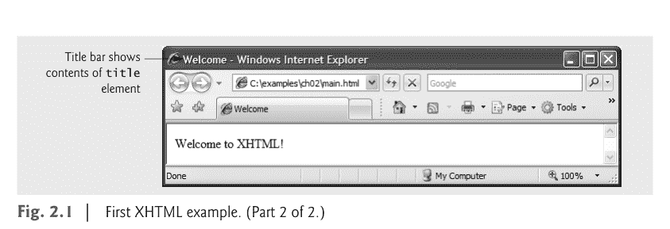

第 1–3 行是 XHTML 文档中必需的，以符合正确的 XHTML 语法。目前，请将这些行复制并粘贴到你创建的每个 XHTML 文档中。这些行的含义将在第 12 章中详细讨论。

第 5–6 行是 *XHTML 注释*。XHTML 文档创建者插入注释以提高标记的可读性并描述文档的内容。注释也有助于其他人阅读和理解 XHTML 文档的标记和内容。当用户将 XHTML 文档加载到 Web 浏览器中查看时，注释不会导致浏览器执行任何操作。XHTML 注释始终以 `<!--` 开头，以 `-->` 结尾。我们的每个 XHTML 示例都包含注释，指定图号和文件名，并提供示例目的的简要描述。后续示例在标记中包含注释，特别是为了突出新功能。

> **良好编程实践 2.2**
>
> 在你的标记中放置注释。注释帮助其他程序员理解标记，协助调试，并列出你不想让浏览器渲染的有用信息。注释也有助于你在将来重新访问文档以修改或更新时理解自己的标记。

XHTML 标记包含代表文档内容的文本和指定文档结构的*元素*。XHTML 文档的一些重要元素是 **html** 元素、**head** 元素和 **body** 元素。html 元素包含 **head 部分**（由 head 元素表示）和 **body 部分**（由 body 元素表示）。head 部分包含有关 XHTML 文档的信息，例如其**标题**。head 部分还可以包含称为*样式表*的特殊文档格式指令和称为*脚本*的客户端程序，用于创建动态网页。（我们将在第 3 章介绍样式表，在第 4 章介绍使用 JavaScript 进行脚本编写。）body 部分包含当用户访问网页时浏览器显示的页面内容。

XHTML 文档使用**开始**和**结束**标签来分隔元素。开始标签由尖括号中的元素名称组成（例如，`<html>`）。结束标签由尖括号中以正斜杠 (/) 开头的元素名称组成（例如，`</html>`）。在此示例中，第 7 行和第 15 行定义了 html 元素的开始和结束。请注意，第 15 行中的结束标签与开始标签同名，但在尖括号内以 / 开头。许多开始标签具有*属性*，提供有关元素的附加信息。浏览器可以使用这些附加信息来确定如何处理元素。每个属性都有一个**名称**和一个**值**，由等号 (=) 分隔。第 7 行为 XHTML 文档中的 html 元素指定了必需的属性 (xmlns) 和值 (http://www.w3.org/1999/xhtml)。目前，只需将第 7 行中的 html 元素开始标签复制并粘贴到你的 XHTML 文档中。我们将在第 12 章讨论 xmlns 属性的详细信息。

> **常见编程错误 2.1**
>
> *未将属性值括在单引号或双引号中是语法错误。但是，某些 Web 浏览器可能仍会正确渲染该元素。*

> **常见编程错误 2.2**
>
> *在 XHTML 元素或属性名称中使用大写字母是语法错误。但是，某些 Web 浏览器可能仍会正确渲染该元素。*

XHTML 文档将 html 元素分为两部分——head 和 body。第 8–10 行使用 head 元素定义页面的 head 部分。第 9 行指定一个 title 元素。这被称为**嵌套元素**，因为它被包含在 head 元素的开始和结束标签内。head 元素也是一个嵌套元素，因为它被包含在 html 元素的开始和结束标签内。title 元素描述网页。标题通常出现在浏览器窗口顶部的**标题栏**中，出现在页面显示的浏览器标签页中，以及当用户将页面添加到其**收藏夹**或**书签**列表中时，作为标识页面的文本，使他们能够返回到他们喜欢的站点。搜索引擎（即允许用户搜索网络的站点）也使用标题进行索引。

> **良好编程实践 2.3**
>
> *缩进嵌套元素可以强调文档的结构并提高可读性。*

> **常见编程错误 2.3**
>
> *XHTML 不允许标签重叠——嵌套元素的结束标签必须出现在文档中包含元素的结束标签之前。例如，嵌套的 XHTML 标签 `<head><title>hello</head></title>` 会导致语法错误，因为包含的 head 元素的结束 `</head>` 标签出现在嵌套的 title 元素的结束 `</title>` 标签之前。*

> **良好编程实践 2.4**
>
> *对网站上的所有页面使用一致的标题命名约定。例如，如果网站名为“Bailey's Website”，则联系页面的标题可能是“Bailey's Website—Contact”。此实践可以帮助用户更好地理解网站的结构。*

第 12 行开始文档的 body 元素。XHTML 文档的 body 部分指定文档的内容，其中可能包括文本和元素。

一些元素，例如第 13 行中的**段落元素**（用 `<p>` 和 `</p>` 表示），标记要在浏览器中显示的文本。放置在 `<p>` 和 `</p>` 标签之间的所有文本构成一个段落。当浏览器渲染段落时，段落文本前后通常会有一个空行。

此文档以两个结束标签（第 14–15 行）结束。这些标签分别关闭 body 和 html 元素。XHTML 文档中的 `</html>` 标签通知浏览器 XHTML 标记已完成。

要打开本章中的 XHTML 示例，请打开你保存本书示例的文件夹，浏览到 ch04 文件夹，然后双击文件以在你的默认的网页浏览器。此时，你的浏览器窗口应与图2.1所示的示例屏幕截图相似。（注意，我们调整了浏览器窗口大小以节省书籍版面空间。）

## 2.4 W3C XHTML 验证服务

编写基于Web的应用程序可能很复杂，XHTML文档必须正确编写，以确保浏览器能正确处理它们。为了促进正确编写文档，万维网联盟（W3C）提供了一个*验证服务*（validator.w3.org），用于检查文档的语法。可以通过提供指定文件位置的URL、将文件上传到validator.w3.org/file-upload.html，或将代码直接粘贴到文本区域来验证文档。上传文件会将文件从用户的计算机复制到互联网上的另一台计算机。W3C的网页指出，该服务名称为**标记验证服务**，并且该验证服务能够验证XHTML文档的语法。本书中的所有XHTML示例均已使用validator.w3.org成功验证。

通过点击**选择...**，用户可以选择自己计算机上的文件进行上传。选择文件后，点击**检查**按钮即可上传并验证文件。如果文档包含语法错误，验证服务将显示描述错误的错误消息。

> **错误预防提示 2.1**
>
> 大多数当前浏览器即使在XHTML文档无效时也会尝试渲染它们。这通常会导致意外且可能不希望出现的结果。请使用验证服务，例如**W3C标记验证服务**，来确认XHTML文档在语法上是正确的。

## 2.5 标题

XHTML文档中的某些文本可能比其他文本更重要。例如，本节中的文本被认为比脚注更重要。XHTML提供了六个*标题*，称为**标题元素**，用于指定信息的相对重要性。图2.2演示了这些元素（h1到h6）。标题元素h1（第13行）被认为是最显著的标题，通常以比其他五个标题（第14-18行）更大的字体渲染。每个后续的标题元素（即h2、h3等）通常以逐渐减小的字体渲染。

> **可移植性提示 2.1**
>
> 用于显示每个标题元素的文本大小在不同浏览器之间可能差异很大。在第3章中，我们将讨论如何控制文本大小和其他文本属性。

> **外观观察 2.1**
>
> 在每个XHTML页面的顶部放置一个标题有助于查看者理解每个页面的目的。

> **外观观察 2.2**
>
> 使用较大的标题来强调网页中更重要的部分。

```
<?xml version = "1.0" encoding = "utf-8"?>
<!DOCTYPE html PUBLIC "-//W3C//DTD XHTML 1.0 Strict//EN"
"http://www.w3.org/TR/xhtml1/DTD/xhtml1-strict.dtd">

<!-- 图 2.2; heading.html -->
<!-- 标题元素 h1 到 h6。 -->
<html xmlns = "http://www.w3.org/1999/xhtml">
<head>
<title>标题</title>
</head>

<body>
<h1>一级标题</h1>
<h2>二级标题</h2>
<h3>三级标题</h3>
<h4>四级标题</h4>
<h5>五级标题</h5>
<h6>六级标题</h6>
</body>
</html>
```

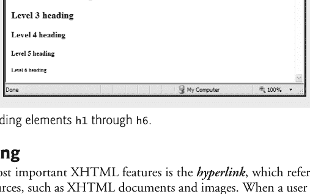

图 2.2 | 标题元素 h1 到 h6。

## 2.6 链接

XHTML最重要的特性之一是超链接，它引用（或链接到）其他资源，例如XHTML文档和图像。当用户点击超链接时，浏览器会尝试执行与之关联的操作（例如，导航到URL、打开电子邮件客户端等）。在XHTML中，文本和图像都可以充当超链接。Web浏览器通常默认将文本超链接加下划线并将其文本颜色设为蓝色，以便用户区分超链接和纯文本。在图2.3中，我们创建了指向四个不同网站的文本超链接。

第14行引入了strong元素，它表示其内容具有高度重要性。浏览器通常以粗体显示此类文本。

链接使用a（锚点）元素创建。第17行定义了一个指向分配给href属性的URL的超链接，该属性指定链接资源的位置，例如网页、文件或电子邮件地址。这个特定的锚点元素将文本Deitel链接到位于http://www.deitel.com的网页。当URL未指明网站上的特定文档时，Web服务器会返回一个默认网页。此页面通常称为index.html；但是，大多数Web服务器可以配置为使用任何文件作为网站的默认网页。如果Web服务器无法找到请求的文档，它会向Web浏览器返回错误指示，浏览器会向用户显示包含错误消息的网页。

```
<?xml version = "1.0" encoding = "utf-8"?>
<!DOCTYPE html PUBLIC "-//W3C//DTD XHTML 1.0 Strict//EN"
   "http://www.w3.org/TR/xhtml1/DTD/xhtml1-strict.dtd">

<!-- 图 2.3: links.html -->
<!-- 链接到其他网页。 -->
<html xmlns = "http://www.w3.org/1999/xhtml">
   <head>
      <title>链接</title>
   </head>

   <body>
      <h1>以下是我喜欢的网站</h1>
      <p><strong>点击名称前往该页面。</strong></p>

      <!-- 创建四个文本超链接 -->
      <p><a href = "http://www.deitel.com">Deitel</a></p>
      <p><a href = "http://www.prenhall.com">Prentice Hall</a></p>
      <p><a href = "http://www.yahoo.com">Yahoo!</a></p>
      <p><a href = "http://www.usatoday.com">USA Today</a></p>
   </body>
</html>
```

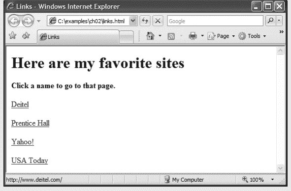

### 链接到电子邮件地址

锚点可以使用`mailto:` URL链接到电子邮件地址。当有人点击这种类型的锚点链接时，大多数浏览器会启动默认的电子邮件程序（例如Microsoft Outlook或Mozilla Thunderbird），以便用户可以向链接的地址撰写电子邮件。图2.4演示了这种类型的锚点。第15-17行包含一个电子邮件链接。电子邮件锚点的形式是`<a href = "mailto:emailAddress">...</a>`。在本例中，我们链接到电子邮件地址deitel@deitel.com。

```
<?xml version = "1.0" encoding = "utf-8"?>
<!DOCTYPE html PUBLIC "-//W3C//DTD XHTML 1.0 Strict//EN"
   "http://www.w3.org/TR/xhtml1/DTD/xhtml1-strict.dtd">

<!-- 图 2.4: contact.html -->
<!-- 链接到电子邮件地址。 -->
<html xmlns = "http://www.w3.org/1999/xhtml">
    <head>
        <title>联系页面</title>
    </head>

    <body>
        <p>
            我的电子邮件地址是
            <a href = "mailto:deitel@deitel.com">
                deitel@deitel.com
            </a>
            。点击该地址，你的默认电子邮件客户端将打开一封电子邮件并将其发送给我。
        </p>
    </body>
</html>
```

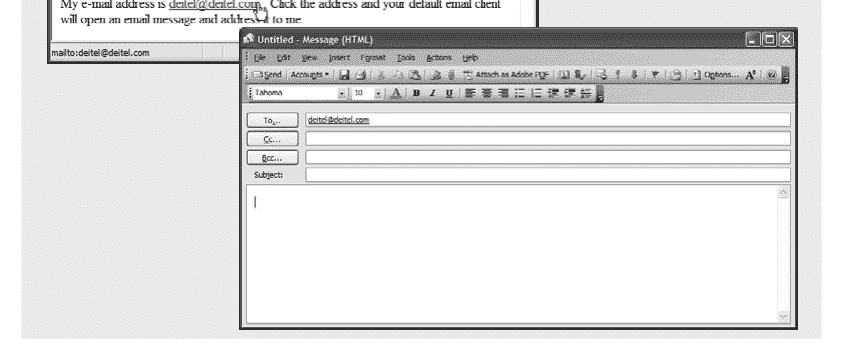

## 2.7 图像

到目前为止讨论的示例演示了如何标记仅包含文本的文档。然而，大多数网页同时包含文本和图像。事实上，图像即使不是必不可少的，也是网页设计中同样重要的部分。Web开发人员使用的三种最流行的图像格式是图形交换格式（GIF）、联合图像专家组（JPEG）和便携式网络图形（PNG）图像。用户可以使用专业软件创建图像，例如Adobe Photoshop Elements (www.adobe.com)、G.I.M.P. (http://www.gimp.org) 和 Inkscape (http://www.inkscape.org)。图像也可以从各种网站获取。图2.5演示了如何将图像合并到网页中。

第14-15行使用*img元素*在文档中插入图像。图像文件的位置由img元素的*src属性*指定。此图像位于与XHTML文档相同的目录中，因此只需要图像的文件名。可选属性*width*和*height*分别指定图像的宽度和高度。你可以

```
<?xml version = "1.0" encoding = "utf-8"?>
<!DOCTYPE html PUBLIC "-//W3C//DTD XHTML 1.0 Strict//EN"
    "http://www.w3.org/TR/xhtml1/DTD/xhtml1-strict.dtd">

<!-- 图 2.5: picture.html -->
<!-- XHTML文件中的图像。 -->
<html xmlns = "http://www.w3.org/1999/xhtml">
    <head>
        <title>图像</title>
    </head>

    <body>
        <p>
            
            
        </p>
    </body>
</html>
```

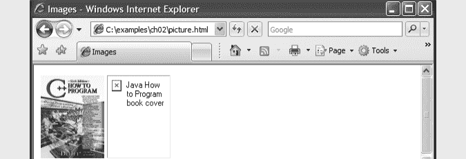

图 2.5 | XHTML文件中的图像。

通过增加或减少图像宽度和高度属性的值来缩放图像。如果省略这些属性，浏览器将使用图像的实际宽度和高度。图像以*像素*（“图片元素”）为单位进行测量，像素代表屏幕上的彩色点。任何图像编辑程序都会有一个显示图像尺寸（以像素为单位）的功能。图2.5中的图像宽度为92像素，高度为120像素。

> **良好的编程实践 2.5**
>
> 始终在``标签内包含图像的宽度和高度。当浏览器加载XHTML文件时，它会立即从这些属性中知道应为图像提供多少屏幕空间，并在下载图像之前就能正确布局页面。

> **性能提示 2.1**
>
> 在``标签中包含宽度和高度属性可以帮助浏览器更快地加载和渲染页面。

> **常见的编程错误 2.4**
>
> 输入改变图像固有宽高比的新尺寸会使图像外观失真。例如，如果你的图像宽200像素，高100像素，你应该确保任何新尺寸都具有2:1的宽高比。

XHTML文档中的每个img元素都必须有一个**alt属性**。如果浏览器无法渲染图像，浏览器将显示alt属性的值。浏览器可能由于多种原因无法渲染图像。它可能不支持图像——就像*基于文本的浏览器*（即只能显示文本的浏览器）的情况一样——或者客户端可能禁用了图像查看以减少下载时间。图2.5显示了Internet Explorer 7渲染一个X符号并显示alt属性的值，表示图像（jhttp.jpg）无法找到。

alt属性帮助你为有残疾的用户创建*可访问的*网页，特别是那些使用基于文本浏览器的视力障碍者。一种称为*语音合成器*的专用软件可以“朗读”alt属性的值，以便视力障碍用户知道浏览器正在显示什么。

一些XHTML元素（称为*空元素*）只包含属性，不标记文本（即，文本不放在开始和结束标签之间）。空元素（例如img）必须终止，可以在开始标签的结束右尖括号（>）内使用*正斜杠字符*（/），或者显式包含结束标签。使用正斜杠字符时，我们在它前面添加一个空格以提高可读性（如第15行和第17行末尾所示）。第16-17行也可以不使用正斜杠字符，而是使用结束`</img>`标签编写，如下所示：

```
</img>
```

### 将图像用作超链接

通过将图像用作超链接，Web开发人员可以创建链接到其他资源的图形化网页。在图2.6中，我们创建了六个不同的图像超链接。

第14-17行通过将img元素嵌套在锚点（a）元素中来创建一个*图像超链接*。img元素的src属性值指定此图像（links.jpg）位于名为buttons的目录中。buttons目录和XHTML文档位于同一目录中。也可以通过将src属性设置为图像的名称和位置来引用来自其他Web文档的图像。请注意，如果你托管一个使用来自另一个站点的图像的公共网页，你应该获得使用该图像的许可，并在你自己的网站上托管该图像的副本。如果你引用另一个网站上的图像，浏览器必须从另一个站点的服务器请求图像资源。单击图像超链接会将用户带到周围锚点元素的href属性指定的网页。请注意，当鼠标悬停在任何类型的链接上时，链接指向的URL会显示在浏览器窗口底部的状态栏中。


# 2.8 特殊字符和水平线

在标记文本时，某些字符或符号（例如 `<`）可能难以直接嵌入 XHTML 文档。某些键盘不提供这些符号，或者这些符号的存在可能导致语法错误。例如，标记

```
<p>if x < 10 then increment x by 1</p>
```

会导致语法错误，因为它使用了小于号字符（`<`），该字符是为开始标签和结束标签（如 `<p>` 和 `</p>`）保留的。XHTML 提供了*字符实体引用*（形式为 `&code;`）来表示特殊字符。我们可以通过编写以下内容来更正上一行：

```
<p>if x &lt; 10 then increment x by 1</p>
```

其中使用了字符实体引用 `&lt;` 来表示小于符号（`<`）。

图 2.7 演示了如何在 XHTML 文档中使用特殊字符。第 24-25 行包含其他特殊字符，这些字符可以表示为字符实体引用（使用单词缩写编码，例如 `&amp;` 表示和号，以及 `&copy;` 用于版权）或*数字字符引用*——十进制或*十六进制（hex）*值，用于表示特殊字符。例如，`&` 字符在十进制和十六进制表示法中分别表示为 `&#38;` 和 `&#x26;`。十六进制数是基数为 16 的数——十六进制数中的数字取值范围为 0 到 15（共 16 个不同的值）。字母 A–F 代表对应于十进制值 10–15 的十六进制数字。因此，在十六进制表示法中，我们可以有像 `876` 这样仅由类似十进制的数字组成的数，像 `DA19F` 这样由数字和字母组成的数，以及像 `DCB` 这样仅由字母组成的数。

在第 31–33 行，我们引入了四个新元素。大多数浏览器将 `del` 元素渲染为删除线文本。使用此格式，用户可以轻松地标记文档修订。要*上标*文本（即将文本提升到基线以上并减小字体大小）或*下标*文本（即将文本降低到基线以下并减小字体大小），请分别使用 `sup` 或 `sub` 元素。第 34–35 行的段落包含一个 `em` 元素，表示其内容应被强调。浏览器通常以斜体字体渲染 `em` 元素。我们还使用字符实体引用 `&lt;` 表示小于号，使用 `&frac14;` 表示分数 1/4（第 34 行）。

除了特殊字符外，本文档还介绍了一个*水平线*，由第 22 行的 `<hr />` 标签表示。大多数浏览器将水平线渲染为一条水平线，其上方和下方各有一个空行。

# 2.9 列表

到目前为止，我们已经介绍了用于链接资源、创建标题、使用特殊字符和插入图像的基本 XHTML 元素和属性。在本节中，我们将讨论如何使用列表在网页上组织信息。在下一节中，我们将介绍另一种用于组织信息的功能，称为表格。图 2.8 以*无序列表*（即不按字母或数字顺序排列其项目的列表）的形式显示文本。无序列表元素 `ul` 创建一个列表，其中每个项目以一个项目符号（称为圆盘）开头。无序列表中的每个条目（第 17 行的元素 `ul`）都是一个 `li`（*列表项*）元素（第 19–22 行）。大多数网页浏览器将每个 `li` 元素渲染在新行上，并带有从行首缩进的项目符号。

## 嵌套列表

列表可以嵌套以表示层次关系，类似于大纲格式。图 2.9 演示了嵌套列表和*有序列表*。有序列表元素 `ol` 创建一个列表，其中每个项目以数字开头。

网页浏览器会缩进每个嵌套列表以表示层次关系。第一个有序列表从第 30 行开始。有序列表中的项目按一、二、三等顺序编号。嵌套的有序列表以相同方式编号。最外层无序列表（第 16 行）中的项目前是圆盘符号。嵌套在第 16 行无序列表内的列表项前是圆形项目符号。虽然本示例中未演示，但后续嵌套的列表项前是方形项目符号。

# 2.10 表格

表格常用于将数据组织成行和列。我们的第一个示例（图 2.10）创建了一个包含六行两列的表格，以显示水果的价格信息。

表格使用 `table` 元素定义（第 15–62 行）。第 15–17 行指定了一个具有多个属性的表格元素的开始标签。`border` 属性以像素为单位指定表格的边框宽度。要创建一个没有边框的表格，请将 `border` 设置为 `"0"`。本示例将属性 `width` 的值设置为 `"40%"`，以将表格宽度设置为浏览器宽度的 40%。开发人员也可以将属性 `width` 设置为指定的像素数。尝试调整浏览器窗口大小，看看窗口宽度如何影响表格宽度。

顾名思义，属性 `summary`（第 16-17 行）描述了表格的内容。语音设备使用此属性使表格更易于视障用户访问。`caption` 元素（第 21 行）描述表格内容，并帮助基于文本的浏览器解释表格数据。大多数浏览器会将 `<caption>` 标签内的文本渲染在表格上方。属性 `summary` 和元素 `caption` 是众多使网页更易于残障用户访问的 XHTML 特性中的两个。

一个表格有三个不同的部分——**head**、**body** 和 **foot**。head 部分（或表头单元格）由 `thead` 元素（第 25-30 行）定义，其中包含列名等表头信息。每个 `tr` 元素（第 26-29 行）定义一个单独的**表格行**。head 部分中的列由 `th` 元素定义。大多数浏览器会将 `th`（表头列）元素格式化的文本居中显示并加粗。表格表头元素嵌套在表格行元素内（第 27-28 行）。

body 部分，即**表格主体**，包含表格的主要数据。表格主体（第 43-60 行）在 `tbody` 元素中定义。在主体中，每个 `tr` 元素指定一行。**数据单元格**包含单个数据项，并在每行中使用 `td`（表格数据）元素定义。

foot 部分（第 34-39 行）由 `tfoot`（表格页脚）元素定义。放置在页脚中的文本通常包括计算结果和脚注。与其他部分一样，foot 部分可以包含表格行，每行可以包含单元格。与 head 部分一样，foot 部分中的单元格使用 `th` 元素创建，而不是表格主体中使用的 `td` 元素。请注意，表格 foot 部分在代码中必须位于 body 部分之上，但表格 foot 显示在表格底部。

## 使用 rowspan 和 colspan

图 2.10 探讨了基本表格的结构。图 2.11 展示了另一个表格示例，并引入了两个新属性，允许你构建更复杂的表格。

表格从第 15 行开始。表格单元格的大小会调整以适应它们包含的数据。文档作者可以使用 `rowspan` 和 `colspan` 属性创建更大的数据单元格。分配给这些属性的值指定一个单元格占据的行数或列数。第 23-26 行的 `th` 元素使用了属性 `rowspan = "2"`，使得包含骆驼图片的单元格可以使用两个垂直相邻的单元格（因此该单元格*跨越*两行）。第 29-32 行的 `th` 元素使用了属性 `colspan = "4"`，将表头单元格（包含 Camelid comparison 和 Approximate as of 6/2007）加宽以跨越四个单元格。

# 2.11 表单

浏览网站时，用户经常需要提供搜索关键词、电子邮件地址和邮政编码等信息。XHTML 提供了一种称为表单的机制，用于从用户那里收集数据。

用户在网页上输入的数据通常会发送到一个 Web 服务器，该服务器提供对网站资源（例如 XHTML 文档、图像）的访问。这些资源要么位于与 Web 服务器相同的机器上，要么位于 Web 服务器可以通过网络访问的机器上。当浏览器请求位于服务器上的网页或文件时，服务器会处理该请求并返回请求的资源。请求包含所需资源的名称和路径以及通信方法（称为*协议*）。XHTML 文档使用超文本传输协议（HTTP）。

图 2.12 是一个简单的表单，它将数据发送到 Web 服务器，然后服务器将表单数据传递给一个程序。该程序处理从 Web 服务器接收到的数据，并通常将信息返回给 Web 服务器。然后 Web 服务器将信息作为 XHTML 文档发送到 Web 浏览器。[注意：此示例演示了客户端功能。如果提交表单（通过点击 **Submit**），将不会发生任何事情，因为我们还不知道如何处理表单数据。在第 13 章中，我们将调用服务器端表单处理程序来处理表单中的数据。]

表单可以包含可视和非可视组件。可视组件包括可点击的按钮和其他用户与之交互的图形用户界面组件。非可视组件称为*隐藏输入*，用于存储你指定的任何数据，例如电子邮件地址和充当链接的 XHTML 文档文件名。表单在第 21-46 行由一个 `form` 元素定义。

属性 `method`（第 21 行）指定表单数据如何发送到 Web 服务器。使用 `method = "post"` 会将表单数据附加到浏览器请求中，该请求包含协议（HTTP）和请求资源的 URL。这种将数据传递给服务器的方法是透明的——用户在表单提交后看不到数据。另一个可能的值 `method = "get"` 会将表单数据直接附加到脚本 URL 的末尾，这在浏览器的*地址*字段中是可见的。

第 21 行 `<form>` 标签中的 `action` 属性指定了 Web 服务器上将被调用来处理表单数据的脚本的 URL。由于我们尚未介绍服务器端编程，我们现在将此属性留空。

第 25-44 行定义了六个 `input` 元素，它们指定了要提供给处理表单的脚本（也称为*表单处理程序*）的数据。有几种类型的 `input` 元素。`input` 的类型由其 `type` 属性决定。此表单使用了一个文本输入、一个提交输入、一个重置输入和三个隐藏输入。

第 35-36 行的 `text` 输入在表单中插入一个*文本框*。用户可以在文本框中输入数据。`label` 元素（第 34-37 行）为用户提供有关 `input` 元素用途的信息。`input` 元素的 `size` 属性指定文本框中可见的字符数。可选属性 `maxlength` 限制输入到文本框中的字符数——在此例中，用户不允许输入超过 30 个字符。

> **外观观察 2.3**
> 为每个表单元素包含一个 `label` 元素，以帮助用户确定每个表单元素的用途。

第 43-44 行的两个 `input` 元素创建了两个按钮。`submit` input 元素是一个按钮。当按下 `submit` 按钮时，用户将被发送到表单 `action` 属性中指定的位置。`value` 属性设置按钮上显示的文本。`reset` input 元素允许用户将所有表单元素重置为其默认值。

重置输入元素的 `value` 属性用于设置按钮上显示的文本（如果省略 `value` 属性，则默认值为 **Reset**）。

第 25–30 行的三个输入元素具有 `type` 属性 `hidden`，这允许你发送非用户输入的表单数据。这三个隐藏输入分别是：数据将发送到的电子邮件地址、电子邮件的主题行，以及表单提交后浏览器将打开的 URL。另外两个输入属性是 **name**（用于标识输入元素）和 **value**（提供将发送（或提交）到 Web 服务器的值）。

> **良好的编程实践 2.6**
> 将隐藏输入元素放在表单的开头，紧跟在 `<form>` 开始标签之后。这种放置方式使文档作者能够快速定位隐藏输入元素。

### 其他表单元素

在前面的示例中，你已经看到了 XHTML 表单的基本元素。既然你已经了解了表单的一般结构，我们将介绍用于创建更复杂表单的元素和属性。图 2.13 包含一个征求用户对网站反馈的表单。

在第 32 行，我们介绍了 `br` 元素，大多数浏览器将其渲染为换行符。`br` 元素之后的任何标记或文本都会在下一行渲染。与 `img` 元素一样，`br` 是一个以正斜杠结尾的空元素示例。我们在正斜杠前添加了一个空格以增强可读性。

`textarea` 元素（第 33–34 行）在表单中插入一个多行文本框，称为 *文本区域*。行数由 `rows` 属性指定，列数（即每行字符数）由 `cols` 属性指定。在此示例中，文本区域高四行，宽 36 个字符。要在文本区域中显示默认文本，请将文本放在 `<textarea>` 和 `</textarea>` 标签之间。默认文本也可以在其他输入类型（如文本框）中通过使用 `value` 属性来指定。

第 41 行的 `password` 输入插入一个具有指定大小（允许的最大字符数）的密码框。密码框允许用户通过使用星号 (`*`) “掩码”输入的信息来输入敏感信息，例如信用卡号和密码。实际输入的值会发送到 Web 服务器，而不是用于掩码输入的字符。

第 47–61 行介绍了 *复选框* 表单元素。复选框使用户能够从一组选项中进行选择。当用户选中一个复选框时，复选框中会出现一个勾选标记。否则，复选框保持为空。每个 `"checkbox"` 输入都会创建一个新的复选框。复选框可以单独使用或分组使用。属于同一组的复选框被分配相同的名称（在本例中为 `"thingsliked"`）。

> **常见的编程错误 2.5**
> *当你的表单中有多个同名的复选框时，你必须确保它们具有不同的值，否则在 Web 服务器上运行的脚本将无法区分它们。*

在复选框之后，我们介绍了另外两种允许用户进行选择的方式。在此示例中，我们介绍了两种新的输入类型。第一种类型是 *单选按钮*（第 71–85 行），通过 `type` `"radio"` 指定。单选按钮类似于复选框，不同之处在于一组单选按钮中一次只能选择一个。一组中的所有单选按钮都具有相同的 `name` 属性，并通过不同的 `value` 属性进行区分。属性-值对 `checked = "checked"`（第 73 行）指示最初选中的单选按钮（如果有）。`checked` 属性也适用于复选框。

> **常见的编程错误 2.6**
> *未将表单中单选按钮的 `name` 属性设置为相同的名称是一个逻辑错误，因为它允许用户同时选择所有按钮。*

`select` 元素（第 94–107 行）提供了一个下拉列表，用户可以从中选择一个项目。`name` 属性标识下拉列表。`option` 元素（第 95–106 行）向下拉列表添加项目。`option` 元素的 `selected` 属性指定最初在 `select` 元素中显示为选中项的项目。如果没有 `option` 元素被标记为 `selected`，浏览器默认选择第一个选项。

# 2.12 内部链接

在本章前面，我们讨论了如何将一个网页超链接到另一个网页。图 2.14 介绍了 *内部链接*——一种使用户能够在同一文档中的不同位置之间跳转的机制。内部链接对于包含许多章节的长文档非常有用。单击内部链接使用户无需滚动整个文档即可找到某个章节。

第 14 行包含一个带有 `id` 属性（设置为 `"features"`）的标签，用于内部超链接。要链接到同一网页中具有此属性的标签，锚元素的 `href` 属性包含 `id` 属性值，并在前面加上井号（如 `#features`）。第 56 行包含一个以 `id` 为 `features` 的超链接作为其目标。在 Web 浏览器中选择此超链接会将浏览器窗口滚动到第 14 行的 `h1` 标签。请注意，你可能需要将浏览器窗口调整为较小的大小并向下滚动，然后单击链接才能看到浏览器滚动到 `h1` 元素。

> **外观观察 2.4**
> 内部超链接在包含大量信息的 XHTML 文档中非常有用。指向页面不同部分的内部链接使用户更容易导航页面——他们无需滚动即可找到所需部分。

虽然本例中未演示，但超链接可以通过指定文档名称后跟井号和 id 值来指定另一个文档中的内部链接，例如：

```
href = "filename.html#id"
```

例如，要链接到 `books.html` 中 `id` 属性为 `booklist` 的标签，`href` 被赋值为 `"books.html#booklist"`。你也可以通过将元素的井号和 id 值附加到任何 URL 后面，将浏览器引导至另一个站点上的内部链接，例如：

```
href = "URL/filename.html#id"
```

# 2.13 meta 元素

搜索引擎通常通过从页面到页面跟踪链接（通常称为蜘蛛爬行或爬网）并保存每个页面的标识和分类信息来编目站点。搜索引擎编目页面的一种方式是读取每个页面 `meta` 元素中的内容，这些元素指定了关于文档的信息。

`meta` 元素的两个重要属性是 **name**（标识 `meta` 元素的类型）和 **content**（提供搜索引擎用于编目页面的信息）。图 2.15 介绍了 `meta` 元素。

第 13-15 行演示了一个 `"keywords"` `meta` 元素。此类 `meta` 元素的 `content` 属性为搜索引擎提供描述页面的单词列表。这些单词会与搜索请求中的单词进行比较。因此，包含 `meta` 元素及其内容信息可以吸引更多观众访问你的网站。

第 16-19 行演示了一个 `"description"` `meta` 元素。此类 `meta` 元素的 `content` 属性以句子形式提供站点的三到四行描述。搜索引擎也使用此描述来编目你的站点，有时会将此信息作为搜索结果的一部分显示。请注意，`meta` 元素的这种用法是搜索引擎优化（SEO）的众多方法之一。有关 SEO 的更多信息，请访问 Deitel 的 SEO 资源中心：www.deitel.com/searchengineoptimization。

> **软件工程观察 2.1**
> *`meta` 元素对用户不可见，必须放在 XHTML 文档的 head 部分内。如果 `meta` 元素不放在此部分，搜索引擎将不会读取它们。*

# 2.14 Web 资源

www.deitel.com/xhtml

访问我们的在线 XHTML 资源中心，获取网络上一些最佳 XHTML 信息的链接。在那里，你会发现分类链接，包括介绍、教程、书籍、博客、论坛、示例章节等。还可以查看关于 XHTML 2（即将推出的 XHTML 标准版本）的链接。

# 第 3 章 层叠样式表™ (CSS)

> 时尚易逝，风格永存。
>
> ——伊夫·圣·洛朗
>
> 只要一种风格能适应它的时代，它就不会过时。当风格与某种心态不相容时，获胜的永远不会是风格。
>
> ——可可·香奈儿
>
> 在边缘工作，脱离中心感知，是多么解放。
>
> ——唐·德里罗
>
> 我已从下层阶级背景逐渐上升到下层阶级前景。
>
> ——马文·科恩

## 目标

在本章中，你将学习：

- 通过创建样式表来控制网站的外观。
- 使用样式表使网站的所有页面具有相同的外观和感觉。
- 使用 `class` 属性应用样式。
- 指定显示文本的精确字体、大小、颜色和其他属性。
- 指定元素背景和颜色。
- 理解盒模型以及如何控制边距、边框和内边距。
- 使用样式表将呈现与内容分离。

## 3.1 简介

在第 2 章中，我们介绍了可扩展超文本标记语言（XHTML），用于标记要在浏览器中呈现的信息。在本章中，我们将重点转向格式化和呈现信息。为此，我们使用一种名为 *层叠样式表™*（CSS）的 W3C 技术，它允许文档作者将网页上元素的呈现（例如字体、间距、颜色）与文档的结构（章节标题、正文、链接等）分开指定。这种 *结构与呈现的分离* 简化了网页的维护和修改。

XHTML 旨在指定文档的内容和结构。虽然它有一些控制呈现的属性，但最好不要将呈现与内容混合。如果网站的呈现完全由样式表决定，网页设计师只需换入一个新的样式表即可完全改变网站的外观。CSS 提供了一种在 XHTML 之外应用样式的方式，允许 XHTML 控制内容，而 CSS 控制其呈现方式。

与 XHTML 一样，W3C 提供了一个 CSS 代码验证器，位于 jigsaw.w3.org/css-validator/。使用此工具验证所有 CSS 代码是一个好主意，以确保你的代码正确并尽可能在更多浏览器上工作。

CSS 是一个很大的主题。因此，我们只能介绍你理解本书其余部分示例所需的基础 CSS 知识。有关更多 CSS 参考和资源，请查看我们的 CSS 资源中心：www.deitel.com/css21。

W3C 的 CSS 规范目前处于第二个主要版本，第三个版本正在开发中。大多数主要浏览器的当前版本支持 CSS 2 中的大部分功能。这使得程序员可以充分利用其特性。在本章中，我们介绍 CSS，演示 CSS 2 中引入的一些功能，并讨论一些即将推出的 CSS 3 功能。阅读本书时，请在 Web 浏览器中打开每个 XHTML 文档，以便你可以按照其原始意图在 Web 浏览器中查看和交互。

请记住，本书中的示例已在 Internet Explorer 7 和 Firefox 2（及更高版本）中进行了测试。许多其他浏览器（例如 Safari、Opera、Konqueror、Chrome）应能正确渲染本章的示例，但我们尚未对其进行测试。本章中的部分示例在较旧的浏览器（如 Internet Explorer 6 及更早版本）中*将无法工作*。在运行本章示例之前，请确保您已安装 Internet Explorer 7（仅限 Windows）或 Firefox（适用于所有主要平台）。

## 3.2 内联样式

你可以通过多种方式声明文档样式。本节介绍*内联样式*，即使用 XHTML 属性 `style` 来声明单个元素的格式。内联样式会覆盖本章后续讨论的其他技术所应用的任何样式。图 3.1 对 `p` 元素应用了内联样式，以更改其字体大小和颜色。

> **良好编程实践 3.1**
> *内联样式并未真正将表现与内容分离。要将相似的样式应用于多个元素，请使用本章稍后介绍的嵌入式样式表或外部样式表。*

第一个内联样式声明出现在第 17 行。属性 `style` 指定元素的样式。每个 **CSS 属性**（本例中为 `font-size`）后跟一个冒号和一个值。在第 17 行，我们声明这个特定的 `p` 元素使用 20 点字体大小。

第 21 行指定了两个属性：`font-size` 和 `color`，它们用分号分隔。在这一行中，我们使用十六进制代码 `#6666ff` 将给定段落的颜色设置为浅蓝色。颜色名称可以代替十六进制代码使用。

## 3.3 嵌入式样式表

使用样式表的第二种技术是*嵌入式样式表*。嵌入式样式表允许你将整个 CSS 文档嵌入到 XHTML 文档的 head 部分。为了实现 CSS 代码与其所样式化的 XHTML 之间的分离，我们将使用 *CSS 选择器*。图 3.2 创建了一个包含四个样式的嵌入式样式表。

`style` 元素（第 12–19 行）定义了嵌入式样式表。放置在 head 中的样式会应用于整个文档中出现的匹配元素。`style` 元素的 `type` 属性指定了描述文件内容的*多用途互联网邮件扩展（MIME）类型*。CSS 文档使用 MIME 类型 `text/css`。其他 MIME 类型包括 `image/gif`（用于 GIF 图像）、`text/javascript`（用于 JavaScript 脚本语言，我们将在第 4–9 章讨论）等。

样式表的主体（第 13–18 行）声明了样式表的 *CSS 规则*。CSS 选择器决定了哪些元素将根据规则被样式化。我们的第一条规则以选择器 `em`（第 13 行）开始，以选择文档中的所有 `em` 元素。第 13 行的 `font-weight` 属性指定了文本的“粗细”。可能的值有 `bold`、`normal`（默认值）、`bolder`（比粗体文本更粗）和 `lighter`（比正常文本更细）。粗细也可以用 100 的倍数指定，范围从 100 到 900（例如，100、200、...、900）。指定为 `normal` 的文本等同于 400，粗体文本等同于 700。然而，许多系统没有能够以这种精度缩放的字体，因此使用 100 到 900 的值可能无法显示预期的效果。

在此示例中，所有 `em` 元素将以粗体显示。我们还对所有 `h1`（第 15 行）和 `p`（第 16–17 行）元素应用了样式。每个规则的主体都包含在花括号（`{` 和 `}`）中。

第 18 行使用了一种新的选择器来声明一个名为 `special` 的*样式类*。样式类定义了可以应用于任何元素的样式。在此示例中，我们声明了类 `special`，它将颜色设置为蓝色。我们可以将此样式应用于任何元素类型，而此样式表中的其他规则仅应用于样式表中定义的特定元素类型（即 `em`、`h1` 或 `p`）。样式类声明以句点开头。我们稍后将讨论如何应用样式类。

嵌入式样式表中的 CSS 规则使用与内联样式相同的语法；属性名后跟一个冒号（`:`）和属性的值。多个属性用分号（`;`）分隔。在 `em` 元素的规则中，`color` 属性指定文本的颜色，`font-weight` 属性使字体加粗。

`font-family` 属性（第 15 行）指定要使用的字体名称。并非所有用户的计算机上都安装了相同的字体，因此 CSS 允许你指定一个以逗号分隔的字体列表，用于特定样式。浏览器会尝试按列表中出现的顺序使用字体。建议在字体列表末尾添加一个*通用字体族名称*，以防其他字体未安装在用户的计算机上。在此示例中，如果系统上找不到 `tahoma` 字体，浏览器将查找 `helvetica` 字体。如果两者都找不到，浏览器将显示其默认的无衬线字体。其他通用字体族包括 `serif`（例如，times new roman、Georgia）、`cursive`（例如，script）、`fantasy`（例如，critter）和 `monospace`（例如，courier、fixedsys）。

`font-size` 属性（第 16 行）指定 12 点字体。除了 `pt`（点）之外，本章稍后将介绍其他可能的度量单位。相对值——`xx-small`、`x-small`、`small`、`smaller`、`medium`、`large`、`larger`、`x-large` 和 `xx-large`——也可以使用。通常，`font-size` 的相对值优于点大小，因为作者不知道每个客户端显示器的具体尺寸。相对的 `font-size` 值允许更灵活地查看网页。

例如，用户可能希望在具有小屏幕的手持设备上查看网页。在样式表中指定 18 点字体大小将导致此类用户一次只能看到一两个字符。但是，如果指定了相对字体大小，例如 `large` 或 `larger`，则实际大小由显示字体的浏览器决定。使用相对大小也使页面对残障用户更易于访问。例如，视力受损的用户可以将其浏览器配置为使用更大的默认字体，所有相对大小都基于此。作者指定为小于主文本的文本仍然以较小的字体大小显示，但对每个用户都清晰可见。可访问性是一个重要的考虑因素——1998 年，国会通过了《1973 年康复法》的第 508 条修正案，要求政府机构的网站必须允许残障用户访问。

第 23 行在 `h1` 元素中使用了 XHTML 属性 `class` 来应用一个样式类——本例中是类 `special`（在第 18 行的样式表中通过 `.special` 选择器声明）。当浏览器渲染 `h1` 元素时，请注意文本在屏幕上显示为 `h1` 元素（第 17 行定义的 Arial 或无衬线字体）和应用的 `.special` 样式类（第 18 行定义的颜色 `#6666ff`）的属性。同时请注意，浏览器仍然会将其默认样式应用于 `h1` 元素——标题仍然以大字体显示。类似地，所有 `em` 元素仍将被浏览器斜体化，但由于我们的样式规则，它们也会加粗。

`p` 元素和 `.special` 类的格式应用于第 34–41 行的文本。在许多情况下，应用于一个元素（*父元素或祖先元素*）的样式也会应用于该元素的嵌套元素（*子元素或后代元素*）。第 35 行中嵌套在 `p` 元素内的 `em` 元素从 `p` 元素*继承*样式（即第 16 行定义的 12 点字体大小），但保留其斜体样式。换言之，为段落定义但未为 `em` 元素定义的样式会应用于 `em` 元素。由于一个属性的多个值可以在同一元素上设置或继承，因此在渲染之前必须将它们简化为每个元素一个样式。我们将在下一节讨论解决这些冲突的规则。

## 3.4 冲突的样式

样式可以由*用户*、*作者*或*用户代理*（例如 Web 浏览器）定义。用户是查看您网页的人，您是作者——编写文档的人——而用户代理是用于渲染和显示文档的程序。样式会“层叠”或一起流动，使得页面上元素的最终外观是通过组合几种方式定义的样式而产生的。用户定义的样式优先于用户代理定义的样式，而作者定义的样式优先于用户定义的样式。

为父元素定义的大多数样式也会被子（嵌套）元素继承。虽然继承大多数样式（如字体属性）是有意义的，但某些属性我们不希望被继承。例如，考虑 `background-image` 属性，它允许程序员将图像设置为元素的背景。如果为 `body` 元素分配了背景图像，我们不希望该图像出现在页面 `body` 中每个元素的背景中。相反，所有子元素的 `background-image` 属性保留其默认值 `none`。在本节中，我们将讨论解决为元素定义的样式与从父元素和祖先元素继承的样式之间冲突的规则。

图 3.2 展示了一个*继承*的例子，其中子 `em` 元素从其父 `p` 元素继承了 `font-size` 属性。然而，在图 3.2 中，子 `em` 元素有一个与（即具有不同于）其父 `p` 元素的 `color` 属性冲突的 `color` 属性。为子元素和后代元素定义的属性比为父元素和祖先元素定义的属性具有更高的*特异性*。冲突的解决倾向于具有更高特异性的属性。换言之，为子元素显式定义的样式比为子元素的父元素定义的样式更具体；因此，子元素的样式优先。图 3.3 说明了继承和特异性的示例。

第 12 行将 `text-decoration` 属性应用于所有 `class` 属性设置为 `nodec` 的 `a` 元素。`text-decoration` 属性为元素中的文本应用*装饰*。默认情况下，浏览器会为 `a`（锚点）元素的文本添加下划线。这里，我们将 `text-decoration` 属性设置为 `none`，以指示浏览器不应为超链接添加下划线。

`text-decoration` 的其他可能值包括 `overline`、`line-through`、`underline` 和 `blink`。[注意：Internet Explorer 不支持 `blink`。] 附加到 `a` 的 `.nodec` 是一个更具体的选择器；此样式将仅应用于在其 `class` 属性中指定 `nodec` 的 `a`（锚点）元素。

> **可移植性提示 3.1**
> 为确保您的样式表在各种 Web 浏览器中正常工作，请在所有将使用您的样式渲染文档的客户端 Web 浏览器上进行测试，并使用 W3C CSS 验证器。

第 13 行指定了 `hover` 的样式，这是一个*伪类*。伪类使作者能够访问文档中未明确声明的内容。**hover 伪类**在用户将鼠标光标移到元素上时动态激活。请注意，伪类通过冒号（无周围空格）与其应用的元素名称分隔。

> **常见编程错误 3.1**
> 在分隔伪类与其应用的元素名称的冒号前后包含空格是一个错误，会导致伪类无法正确应用。

第 14 行使所有作为 `li` 元素子元素的 `em` 元素加粗。在图 3.3 的屏幕输出中，请注意 **Go to the**（包含在第 37 行的 `em` 元素中）没有显示为粗体，因为 `em` 元素不在 `li` 元素中。然而，包含 **with mushrooms**（第 34 行）的 `em` 元素嵌套在 `li` 元素中；因此，它被格式化为粗体。将规则应用于多个元素的语法类似。在第 15 行，我们用逗号分隔选择器，将下划线样式规则应用于所有 `h1` 和所有 `em` 元素。

第 16 行为所有 `ul` 元素分配了 20 像素的左边距。我们将在第 3.9 节详细讨论边距属性。像素是一种*相对长度度量*——其大小根据屏幕分辨率而变化。其他相对长度包括 `em`（字体的 *M* 高度，通常设置为大写 *M* 的高度）、`ex`（字体的 *x* 高度，通常设置为小写 *x* 的高度）和百分比（例如，`font-size: 50%`）。

要将元素设置为以默认文本大小的 150% 显示文本，作者可以使用语法

```
font-size: 1.5em
```

或者，您可以使用

```
font-size: 150%
```

CSS 中可用的其他度量单位是*绝对长度度量*——即不随系统变化的单位。这些单位是 **in**（英寸）、**cm**（厘米）、**mm**（毫米）、**pt**（磅；1 pt = 1/72 in）和 **pc**（派卡；1 pc = 12 pt）。第 17 行指定所有嵌套的无序列表（作为 `ul` 元素后代的 `ul` 元素）的字体大小为 `.8em`。[*注意：*当设置接受度量值的样式属性（例如 `font-size`、`margin-left`）时，如果值为零，则不需要单位。]

> **良好编程实践 3.2**
> 尽可能使用相对长度度量。如果您使用绝对长度度量，您的文档可能在某些客户端浏览器（例如无线电话）上不可读。

## 3.5 链接外部样式表

样式表是创建具有统一主题文档的便捷方式。通过*外部样式表*（即仅包含 CSS 规则的单独文档），您可以为整个网站提供统一的外观和感觉。网站上的不同页面都可以使用相同的样式表。当需要更改样式时，作者只需修改一个 CSS 文件即可在整个网站上进行样式更改。请注意，虽然嵌入式样式表将内容与表示分离，但两者仍包含在单个文件中，这阻止了 Web 设计师和内容作者并行工作。外部样式表通过将内容和样式分离到单独的文件中来解决此问题。

> **软件工程观察 3.1**
> 在开发具有多个页面的网站时，始终使用外部样式表。外部样式表将内容与表示分离，从而实现更一致的外观和感觉、更高效的开发和更好的性能。

图 3.4 展示了一个外部样式表。第 1–2 行是 *CSS 注释*。与 XHTML 注释类似，CSS 注释描述 CSS 文档的内容。注释可以放置在任何类型的 CSS 代码中（即内联样式、嵌入式样式表和外部样式表），并且始终以 `/*` 开始，以 `*/` 结束。浏览器会忽略这些分隔符之间的文本。

## 3.6 元素定位

在 CSS 出现之前，控制 XHTML 文档中元素的定位非常困难——定位由浏览器决定。CSS 引入了 `position` 属性和一种称为 *绝对定位* 的功能，使作者能够更好地控制文档元素的显示方式。图 3.6 演示了绝对定位。

通常，元素在页面上的定位顺序与其在 XHTML 文档中出现的顺序一致。第 11–14 行定义了一个名为 `bgimg` 的样式，应用于页面上的第一个 `img` 元素（i.gif）。将元素的 `position` 指定为 `absolute` 会将其从页面的正常元素流中移除，而是根据其 *包含块级元素*（即 `body` 或 `p` 等元素）的上、左、右或下边距的距离来定位。这里，我们将元素定位为距离其包含元素的上边距和左边距均为 0 像素。在第 28 行，此样式应用于包含在 `p` 元素中的图像。

`z-index` 属性允许你正确地对重叠元素进行分层。`z-index` 值较高的元素会显示在 `z-index` 值较低的元素前面。在此示例中，i.gif 的 `z-index` 最低（1），因此显示在背景中。第 15–18 行的 `.fgimg` CSS 规则为圆形图像（circle.gif，位于第 31–32 行）设置了 `z-index` 为 2，因此它显示在 i.gif 前面。第 34 行的 `p` 元素（Positioned Text）在第 22 行被赋予了 `z-index` 为 3，因此它显示在其他两个元素前面。如果你未指定 `z-index` 或元素具有相同的 `z-index` 值，则元素将按照在文档中遇到的顺序从背景到前景放置。


# 第 3 章 层叠样式表™ (CSS)

## 3.6 定位

### 绝对定位

```xml
<?xml version = "1.0" encoding = "utf-8"?>
<!DOCTYPE html PUBLIC "-//W3C//DTD XHTML 1.0 Strict//EN"
    "http://www.w3.org/TR/xhtml1/DTD/xhtml1-strict.dtd">

<!-- Fig. 3.6: positioning.html -->
<!-- Absolute positioning of elements. -->
<html xmlns = "http://www.w3.org/1999/xhtml">
    <head>
        <title>Absolute Positioning</title>
        <style type = "text/css">
            .bgimg  { position: absolute;
                        top: 0px;
                        left: 0px;
                        z-index: 1 }
            .fgimg  { position: absolute;
                        top: 25px;
                        left: 100px;
                        z-index: 2 }
            .text   { position: absolute;
                        top: 25px;
                        left: 100px;
                        z-index: 3;
                        font-size: 20pt;
                        font-family: tahoma, geneva, sans-serif }
        </style>
    </head>
    <body>
        <p></p>
        
        <p></p>
        
        <p class = "text">Positioned Text</p>
    </body>
</html>
```

图 3.6 | 元素的绝对定位。（第 1 部分，共 2 部分。）

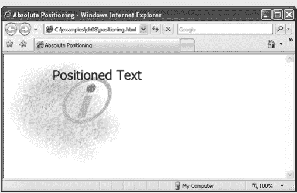

图 3.6 | 元素的绝对定位。（第 2 部分，共 2 部分。）

绝对定位并非指定页面布局的唯一方式。图 3.7 演示了*相对定位*，其中元素相对于其他元素进行定位。

### 相对定位

```xml
<?xml version = "1.0" encoding = "utf-8"?>
<!DOCTYPE html PUBLIC "-//W3C//DTD XHTML 1.0 Strict//EN"
    "http://www.w3.org/TR/xhtml1/DTD/xhtml1-strict.dtd">

<!-- Fig. 3.7: positioning2.html -->
<!-- Relative positioning of elements. -->
<html xmlns = "http://www.w3.org/1999/xhtml">
    <head>
        <title>Relative Positioning</title>
        <style type = "text/css">
            p           { font-size: 1.3em;
                          font-family: verdana, arial, sans-serif }
            span        { color: red;
                          font-size: .6em;
                          height: 1em }
            .super      { position: relative;
                          top: -1ex }
            .sub        { position: relative;
                          bottom: -1ex }
            .shiftleft  { position: relative;
                          left: -1ex }
            .shiftright { position: relative;
                          right: -1ex }
        </style>
    </head>
    <body>
        <p>The text at the end of this sentence
        <span class = "super">is in superscript</span>.</p>
        <p>The text at the end of this sentence
        <span class = "sub">is in subscript</span>.</p>
        <p>The text at the end of this sentence
        <span class = "shiftleft">is shifted left</span>.</p>
        <p>The text at the end of this sentence
        <span class = "shiftright">is shifted right</span>.</p>
    </body>
</html>
```

图 3.7 | 元素的相对定位。（第 1 部分，共 2 部分。）

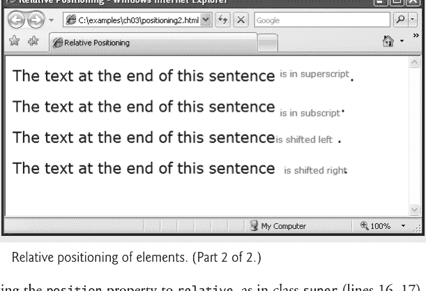

图 3.7 | 元素的相对定位。（第 2 部分，共 2 部分。）

将 `position` 属性设置为 `relative`，如 class `super`（第 16–17 行）所示，会在页面上布局元素，并根据指定的 `top`、`bottom`、`left` 或 `right` 值对其进行偏移。与绝对定位不同，相对定位使元素保持在页面元素的一般流中，因此定位是相对于流中的其他元素。回想一下，`ex`（第 17 行）是字体的 x 高度，是一种相对长度度量，通常等于小写字母 x 的高度。

> **常见编程错误 3.2**
>
> 由于相对定位使元素保持在文档的文本流中，请注意避免意外重叠文本。

### 内联元素与块级元素

我们在第 28 行引入了 `span` 元素。第 13–15 行定义了所有 `span` 元素的 CSS 规则。`span` 的高度决定了它将占据多少垂直空间。`font-size` 决定了 `span` 内文本的大小。

元素 `span` 是一个分组元素——它不会对其内容应用任何固有的格式。其主要目的是将 CSS 规则或 `id` 属性应用于文本的某个部分。元素 `span` 是一个内联级元素——它在不改变文档流的情况下对文本应用格式。内联元素的示例包括 `span`、`img`、`a`、`em` 和 `strong`。`div` 元素也是一个分组元素，但它是一个块级元素。这意味着它单独显示在一行，并被一个虚拟框包围。块级元素的示例包括 `div`、`p` 和标题元素（`h1` 到 `h6`）。我们将在第 3.9 节更详细地讨论内联和块级元素。

## 3.7 背景

CSS 提供了对块级元素背景的控制。CSS 可以为 XHTML 元素设置背景颜色或添加背景图像。图 3.8 在文档的右下角添加了一个公司标志。即使用户上下滚动屏幕，该标志也会固定在角落。

`background-image` 属性（第 11 行）以 `url(fileLocation)` 格式指定图像 `logo.gif` 的 URL。如果找不到图像（以及在图像未覆盖的区域填充），你也可以设置 `background-color` 属性。

`background-position` 属性（第 12 行）将图像放置在页面上。关键字 `top`、`bottom`、`center`、`left` 和 `right` 可单独或组合使用，用于垂直和水平定位。可以通过指定水平长度后跟垂直长度来使用长度定位图像。例如，要将图像水平居中（定位在屏幕距离的 50% 处）并距离顶部 30 像素，请使用

```css
background-position: 50% 30px;
```

```xml
1 <?xml version = "1.0" encoding = "utf-8"?>
2 <!DOCTYPE html PUBLIC "-//W3C//DTD XHTML 1.0 Strict//EN"
3    "http://www.w3.org/TR/xhtml1/DTD/xhtml1-strict.dtd">
4 
5 <!-- 图 3.8: background.html -->
6 <!-- 添加背景图像和缩进。 -->
7 <html xmlns = "http://www.w3.org/1999/xhtml">
8    <head>
9       <title>背景图像</title>
10       <style type = "text/css">
11          body  { background-image: url(logo.gif);
12                  background-position: bottom right;
13                  background-repeat: no-repeat;
14                  background-attachment: fixed;
15                  background-color: #eeeeee }
16          p     { font-size: 18pt;
17                  color: #1144AA;
18                  text-indent: 1em;
19                  font-family: arial, sans-serif; }
20          .dark { font-weight: bold }
21       </style>
22    </head>
23    <body>
24       <p>
25       此示例使用 background-image、
26       background-position 和 background-attachment
27       样式将 <span class = "dark">Deitel
28 &amp; Associates, Inc.</span> 标志放置在页面的
29       右下角。请注意，当你调整浏览器窗口大小时，
30       标志如何保持在正确的位置。background-color
31       填充了没有图像的区域。
32 </p>
33 </body>
34 </html>
```

图 3.8 | 添加背景图像和缩进。（第 1 部分，共 2 部分。）

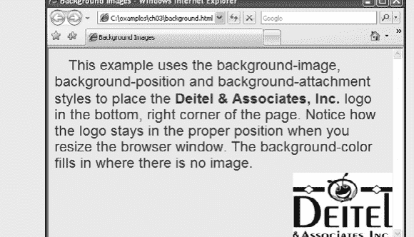

图 3.8 | 添加背景图像和缩进。（第 2 部分，共 2 部分。）

`background-repeat` 属性（第 13 行）控制背景图像的*平铺*，即将多个图像副本并排放置以填充背景。这里，我们将平铺设置为 `no-repeat`，以仅显示背景图像的一个副本。其他值包括 `repeat`（默认值）以垂直和水平平铺图像，`repeat-x` 仅水平平铺图像，或 `repeat-y` 仅垂直平铺图像。

最后一个属性设置 `background-attachment: fixed`（第 14 行）将图像固定在 `background-position` 指定的位置。滚动浏览器窗口不会将图像从其位置移开。默认值 `scroll` 会在用户滚动文档时移动图像。

第 18 行使用 `text-indent` 属性将元素中的第一行文本缩进指定的量，在本例中为 `1em`。作者可以使用此属性创建一个更像小说的网页，其中每个段落的第一行都缩进。

CSS 属性 `font-style` 允许你将文本样式设置为 `none`、`italic` 或 `oblique`（`oblique` 只是比 `italic` 更倾斜——如果系统或字体不支持 `oblique` 文本，浏览器将默认为 `italic`）。

## 3.8 元素尺寸

除了定位元素外，CSS 规则还可以指定每个页面元素的实际尺寸。图 3.9 演示了如何设置元素的尺寸。

> **60 第 3 章 层叠样式表™ (CSS)**

```xml
1 <?xml version = "1.0" encoding = "utf-8"?>
2 <!DOCTYPE html PUBLIC "-//W3C//DTD XHTML 1.0 Strict//EN"
3 "http://www.w3.org/TR/xhtml1/DTD/xhtml1-strict.dtd">
4 
5 <!-- 图 3.9: width.html -->
6 <!-- 元素尺寸和文本对齐。 -->
7 <html xmlns = "http://www.w3.org/1999/xhtml">
8     <head>
9         <title>框尺寸</title>
10        <style type = "text/css">
11            div { background-color: #aaccff;
12                margin-bottom: .5em;
13                font-family: arial, helvetica, sans-serif }
14        </style>
15    </head>
16    <body>
17        <div style = "width: 20%">这是一些
18        放在框中的文本，该框
19        被设置为跨越屏幕宽度的
20        百分之二十。</div>
21 
22        <div style = "width: 80%; text-align: center">
23        这是一些居中的文本，放在一个
24        被设置为跨越屏幕宽度的
25        百分之八十的框中。</div>
26 
27        <div style = "width: 20%; height: 150px; overflow: scroll">
28        这个框只占屏幕宽度的百分之二十，
29        并且具有固定的高度。
30        如果内容溢出怎么办？将
31        overflow 属性设置为 scroll！</div>
32    </body>
33 </html>
```

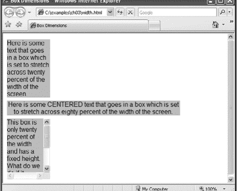

图 3.9 | 元素尺寸和文本对齐。

第 17 行的内联样式说明了如何设置屏幕上元素的 `width`；这里，我们指定 `div` 元素应占据屏幕宽度的 20%。元素的高度可以类似地使用 `height` 属性设置。高度和宽度值也可以指定为相对或绝对长度。例如，

`width: 10em`

将元素的宽度设置为字体大小的 10 倍。大多数元素默认左对齐；但是，可以更改此对齐方式以将元素定位在其他位置。第 22 行将元素中的文本设置为居中对齐；`text-align` 属性的其他值包括 `left` 和 `right`。

在第三个 `div` 中，我们指定了百分比高度和像素宽度。设置元素两个维度的一个问题是，元素内的内容可能超过设定的边界，在这种情况下，元素会变得足够大以容纳所有内容。然而，在第 27 行，我们将 `overflow` 属性设置为 `scroll`，此设置会在文本溢出边界时添加滚动条。

## 3.9 盒模型和文本流

所有块级 XHTML 元素都基于所谓的**盒模型**绘制了一个虚拟框。当浏览器使用盒模型渲染元素时，每个元素的内容都被**内边距**、**边框**和**外边距**包围（图 3.10）。

CSS 使用三个属性控制边框：`border-width`、`border-color` 和 `border-style`。我们在图 3.11 中说明了这三个属性。

属性 `border-width` 可以设置为任何有效的 CSS 长度（例如 `em`、`ex`、`px` 等）或预定义值 `thin`、`medium` 或 `thick`。`border-color` 属性设置颜色。[注意：此属性对于不同的边框样式具有不同的含义。] `border-style` 选项包括 `none`、`hidden`、`dotted`、`dashed`、`solid`、`double`、`groove`、`ridge`、`inset` 和 `outset`。边框 `groove` 和 `ridge` 具有相反的效果，`inset` 和 `outset` 也是如此。当 `border-style` 设置为 `none` 时，不渲染边框。

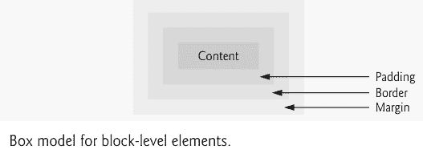

图 3.10 | 块级元素的盒模型。

```xml
1 <?xml version = "1.0" encoding = "utf-8"?>
2 <!DOCTYPE html PUBLIC "-//W3C//DTD XHTML 1.0 Strict//EN"
3   "http://www.w3.org/TR/xhtml1/DTD/xhtml1-strict.dtd">
4 
5 <!-- 图 3.11: borders.html -->
6 <!-- 块级元素的边框。 -->
```

图 3.11 | 块级元素的边框。（第 1 部分，共 2 部分。）

## 3.10 媒体类型

CSS *媒体类型* 允许程序员根据显示页面所使用的媒体类型来决定页面的外观。网页最常用的媒体类型是**屏幕媒体类型**，即标准的计算机屏幕。CSS 2 中的其他媒体类型包括**手持设备**、**盲文**、**听觉** 和 **打印**。手持设备媒体专为移动互联网设备设计，而盲文媒体则用于能够以盲文形式读取或打印网页的设备。听觉样式允许程序员为语音合成网页浏览器提供更多关于网页内容的信息，从而使浏览器能够以合理的方式向视障人士呈现网页。打印媒体类型影响网页打印时的外观。有关 CSS 媒体类型的完整列表，请参阅 `http://www.w3.org/TR/REC-CSS2/media.html#media-types`。

媒体类型允许程序员决定页面在任何一种媒体上的呈现方式，而不影响其他媒体。图 3.13 给出了一个简单的示例，该示例在文档于屏幕上查看时应用一组样式，而在文档打印时应用另一组样式。要查看差异，请查看段落下方的屏幕截图，或使用 Internet Explorer 或 Firefox 中的打印预览功能。

```xml
<?xml version = "1.0" encoding = "utf-8"?>
<!DOCTYPE html PUBLIC "-//W3C//DTD XHTML 1.0 Strict//EN"
    "http://www.w3.org/TR/xhtml1/DTD/xhtml1-strict.dtd">

<!-- 图 3.13: mediatypes.html -->
<!-- CSS 媒体类型。 -->
<html xmlns = "http://www.w3.org/1999/xhtml">
    <head>
        <title>媒体类型</title>
        <style type = "text/css">
            @media all
            {
                body  { background-color: #4488aa }
                h1    { font-family: verdana, helvetica, sans-serif;
                        color: #aaffcc }
                p     { font-size: 12pt;
                        color: white;
                        font-family: arial, sans-serif }
            } /* 结束 @media all 声明。 */
            @media print
            {
                body  { background-color: white }
                h1    { color: #008844}
```

图 3.13 | CSS 媒体类型。（第 1 部分，共 2 部分。）

> **62 第 3 章 层叠样式表™ (CSS)**

```html
<html xmlns = "http://www.w3.org/1999/xhtml">
<head>
<title>边框</title>
<style type = "text/css">
div { text-align: center;
width: 50%;
position: relative;
left: 25%;
border-width: 4px }
.medium { border-width: medium }
.thin { border-width: thin }
.solid { border-style: solid }
.double { border-style: double }
.groove { border-style: groove }
.inset { border-style: inset }
.outset { border-style: outset }
.dashed { border-style: dashed }
.red { border-color: red }
.blue { border-color: blue }
</style>
</head>
<body>
<div class = "solid">实线边框</div><hr />
<div class = "double">双线边框</div><hr />
<div class = "groove">凹槽边框</div><hr />
<div class = "inset">内嵌边框</div><hr />
<div class = "dashed">虚线边框</div><hr />
<div class = "thin red solid">细红色实线边框</div><hr />
<div class = "medium blue outset">中等蓝色凸起边框</div>
</body>
</html>
```

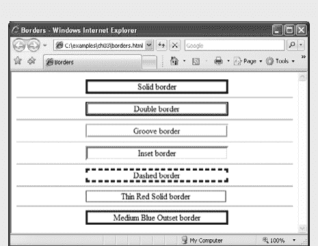

图 3.11 | 块级元素的边框。（第 2 部分，共 2 部分。）

每个边框属性都可以为盒子的单个边进行设置（例如，`border-top-style` 或 `border-left-color`）。请注意，我们通过用空格分隔多个类名来为 XHTML 元素分配多个类，如第 36-37 行所示。

正如我们在绝对定位中看到的，可以将元素从正常的文本流中移除。*浮动* 允许你将元素移动到屏幕的一侧；文档中的其他内容随后会环绕浮动元素流动。图 3.12 演示了如何使用浮动和盒模型来控制整个页面的布局。

```xml
<?xml version = "1.0" encoding = "utf-8"?>
<!DOCTYPE html PUBLIC "-//W3C//DTD XHTML 1.0 Strict//EN"
   "http://www.w3.org/TR/xhtml1/DTD/xhtml1-strict.dtd">

<!-- 图 3.12: floating.html -->
<!-- 浮动元素。 -->
<html xmlns = "http://www.w3.org/1999/xhtml">
   <head>
      <title>文本环绕浮动元素</title>
      <style type = "text/css">
         div.heading { background-color: #bbddff;
                       text-align: center;
                       font-family: arial, helvetica, sans-serif;
                       padding: .2em }
         p           { text-align: justify;
                       font-family: verdana, geneva, sans-serif;
                       margin: .5em }
         div.floated { background-color: #eeeeee;
                       font-size: 1.5em;
                       font-family: arial, helvetica, sans-serif;
                       padding: .2em;
                       margin-left: .5em;
                       margin-bottom: .5em;
                       float: right;
                       text-align: right;
                       width: 50% }
         div.section { border: 1px solid #bbddff }
      </style>
   </head>
   <body>
      <div class = "heading">
      </div>
      <div class = "section">
         <div class = "floated">企业培训与出版</div>
         <p>Deitel &amp; Associates, Inc. 是一家国际知名的企业培训和出版机构，专注于编程语言、互联网/万维网技术和对象技术教育。该公司提供 Java、C++、Visual Basic、C#、C、互联网和 Web 编程、对象技术等课程。</p>
      </div>
      <div class = "section">
         <div class = "floated">前沿编程教材</div>
         <p>通过与 Prentice Hall 的出版合作，Deitel &amp; Associates, Inc. 出版前沿的编程教材、专业书籍、基于交互式 CD-ROM 的多媒体网络课堂、卫星课程以及 DVD 和基于网络的视频课程。</p>
      </div>
   </body>
</html>
```

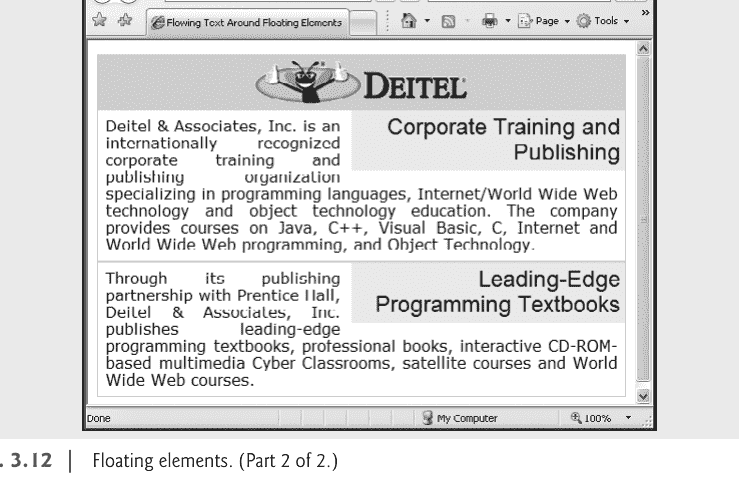

图 3.12 | 浮动元素。（第 1 部分，共 2 部分。）

> **64 第 3 章 层叠样式表™ (CSS)**

查看 XHTML 代码，我们可以看到该文档的一般结构由一个页眉和两个主要部分组成。每个部分包含一个子标题和一段文本。

块级元素（如 `div`）在其内容前后会渲染换行符，因此页眉和两个部分将垂直堆叠显示。在没有我们的样式的情况下，子标题 `div` 也会垂直堆叠在 `p` 标签中的文本上方。然而，在第 24 行，我们在应用于子标题的类 `floated` 中将 `float` 属性设置为 `right`。这会导致每个子标题 `div` 浮动到其包含元素的右边缘，而段落文本将环绕其流动。

第 17 行为所有段落标签分配了 `.5em` 的外边距。`margin` 属性设置边框外部与页面上所有其他内容之间的空间。在第 21 行，我们为浮动的 `div` 分配了 `.2em` 的内边距。`padding` 属性确定元素内部内容与元素边框内部之间的距离。可以使用 `margin-top`、`margin-right`、`margin-left` 和 `margin-bottom` 属性指定元素各边的外边距（第 22-23 行）。内边距可以使用 `padding-top`、`padding-right`、`padding-left` 和 `padding-bottom` 以相同方式指定。要查看外边距和内边距的效果，请尝试将 `margin` 和 `padding` 属性放入注释中并观察差异。

在第 27 行，我们使用边框属性的简写声明为部分框分配了边框。CSS 允许边框的简写赋值，以便你可以在一行中定义所有三个边框属性。此简写的语法为 `border: <width> <style> <color>`。我们的边框为一像素厚、实线，并且与页眉 `div` 的 `background-color` 属性（第 11 行）颜色相同。这使得边框与页眉融为一体，使页面看起来像一个被线条分隔各部分的盒子。

### 3.10 CSS 媒体类型（续）

```css
24 p { font-size: 14pt;
25 color: #4488aa;
26 font-family: "times new roman", times, serif }
27 } /* 结束 @media print 声明。 */
28 </style>
29 </head>
30 <body>
31 <h1>CSS 媒体类型示例</h1>
32
33 <p>
34 此示例使用 CSS 媒体类型来改变页面在打印时的显示方式，
35 以及在其他任何媒体上的显示方式。
36 此文本在屏幕上将以一种字体显示，而在纸上或打印预览中
37 则以另一种字体显示。要在 Internet Explorer 中查看差异，
38 请转到“打印”菜单并选择“打印预览”。在 Firefox 中，
39 请从“文件”菜单中选择“打印预览”。
40 </p>
41 </body>
42 </html>
```

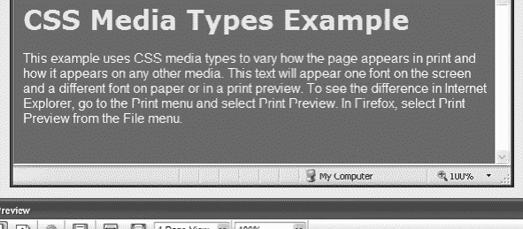

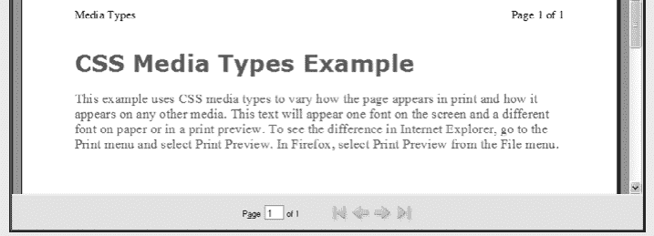

图 3.13 | CSS 媒体类型。（第 2 部分，共 2 部分。）

在第 11 行，我们开始一个适用于所有媒体类型的样式块，由 `@media all` 声明，并包含在花括号（`{` 和 `}`）中。在第 13-18 行，我们为所有媒体类型定义了一些样式。第 20-27 行设置的样式仅在页面打印时应用，以 `@media print` 声明开始，并包含在花括号中。

我们为所有媒体类型应用的样式在屏幕上看起来不错，但在打印页面上效果不佳。彩色背景会消耗大量墨水，而黑白打印机打印的页面可能难以阅读，因为颜色之间对比度不足。此外，像 Arial、Helvetica 和 Geneva 这样的无衬线字体在屏幕上更易阅读，而像 Times New Roman 这样的衬线字体在纸上更易阅读。

> **外观观察 3.1**
>
> 具有深色背景和浅色文本的页面会消耗大量墨水，打印时可能难以阅读，尤其是在黑白打印机上。请使用打印媒体类型来避免此问题。

> **外观观察 3.2**
>
> 通常，无衬线字体在屏幕上看起来更好，而衬线字体在纸上看起来更好。打印媒体类型允许您的网页在屏幕上显示无衬线字体，并在打印时更改为衬线字体。

为了解决这些问题，我们为打印媒体类型应用了特定的样式。我们更改了 `body` 的 `background-color`、`h1` 标签的 `color`，以及 `p` 标签的 `font-size`、`color` 和 `font-family`，使其更适合打印和纸上查看。请注意，这些样式中的大多数与所有媒体类型部分中的声明相冲突。由于打印媒体类型的特异性高于所有媒体类型，因此在打印页面时，打印样式会覆盖所有媒体类型的样式。由于 `h1` 标签的 `font-family` 属性在打印部分未被覆盖，因此即使在打印页面时，它也保留其旧值。

## 3.11 构建 CSS 下拉菜单

下拉菜单是在网站上提供导航链接的一种好方法，无需占用大量屏幕空间。在本节中，我们将再次审视 `:hover` 伪类，并介绍 `display` 属性，以使用 CSS 和 XHTML 创建下拉菜单。

我们已经看到 `:hover` 伪类用于在鼠标悬停时更改链接的样式。我们将以更高级的方式使用此功能，使菜单在鼠标悬停于菜单按钮时出现。我们需要的另一个重要属性是 `display` 属性。它允许程序员决定元素是否在页面上渲染。可能的值包括 `block`、`inline` 和 `none`。`block` 和 `inline` 值将元素显示为块级元素或内联元素，而 `none` 则阻止元素被渲染。下拉菜单的代码如图 3.14 所示。

```xml
1 <?xml version = "1.0" encoding = "utf-8"?>
2 <!DOCTYPE html PUBLIC "-//W3C//DTD XHTML 1.0 Strict//EN"
3   "http://www.w3.org/TR/xhtml1/DTD/xhtml1-strict.dtd">
4
```

图 3.14 | CSS 下拉菜单。（第 1 部分，共 3 部分。）

```html
5 <!-- 图 3.14: dropdown.html -->
6 <!-- CSS 下拉菜单。 -->
7 <html xmlns = "http://www.w3.org/1999/xhtml">
8     <head>
9         <title>
10            下拉菜单
11         </title>
12         <style type = "text/css">
13             body            { font-family: arial, sans-serif }
14             div.menu        { font-weight: bold;
15                              color: white;
16                              border: 2px solid #225599;
17                              text-align: center;
18                              width: 10em;
19                              background-color: #225599 }
20             div.menu:hover a { display: block }
21             div.menu a      { display: none;
22                              border-top: 2px solid #225599;
23                              background-color: white;
24                              width: 10em;
25                              text-decoration: none;
26                              color: black }
27             div.menu a:hover { background-color: #dfeeff }
28         </style>
29     </head>
30     <body>
31         <div class = "menu">菜单
32             <a href = "#">首页</a>
33             <a href = "#">新闻</a>
34             <a href = "#">文章</a>
35             <a href = "#">博客</a>
36             <a href = "#">联系我们</a>
37         </div>
38     </body>
39 </html>
```

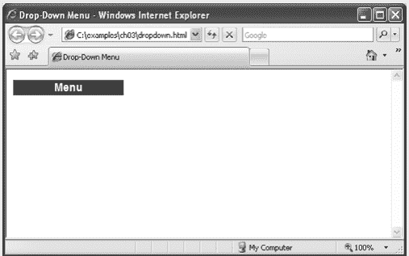

图 3.14 | CSS 下拉菜单。（第 2 部分，共 3 部分。）

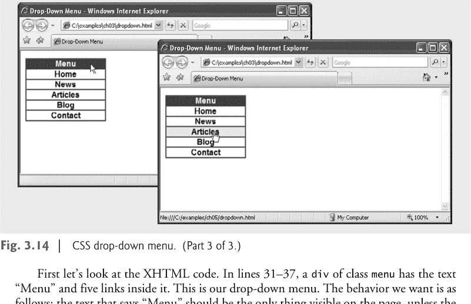

图 3.14 | CSS 下拉菜单。（第 3 部分，共 3 部分。）

首先让我们看看 XHTML 代码。在第 31-37 行，一个类为 `menu` 的 `div` 包含文本“菜单”和五个链接。这就是我们的下拉菜单。我们想要的行为如下：除非鼠标悬停在菜单 `div` 上，否则页面上只应显示“菜单”文本。当鼠标光标悬停在菜单 `div` 上时，我们希望链接出现在菜单下方供用户选择。

为了了解我们如何实现此功能，让我们看看 CSS 代码。有两行代码赋予了我们下拉功能。第 21 行选择菜单 `div` 内的所有链接，并将其 `display` 值设置为 `none`。这指示浏览器不要渲染这些链接。另一个重要的样式在第 20 行。此行中的选择器与第 21 行类似，不同之处在于此行仅选择作为菜单 `div` 子元素且鼠标悬停在其上的 `a`（锚点）元素。此行中的 `display: block` 意味着当鼠标悬停在菜单 `div` 上时，其内部的链接将作为块级元素显示。

第 27 行中的选择器也与第 20 行和第 21 行类似。然而，这次样式仅应用于菜单 `div` 的任何子元素，且当该子元素被鼠标光标悬停时。此样式会更改当前高亮菜单选项的 `background-color`。其余的 CSS 只是为菜单组件添加了美观的样式。请查看屏幕截图或运行代码示例以查看菜单的实际效果。

这个下拉菜单只是更高级 CSS 格式化的一个示例。网上有许多关于 CSS 导航菜单和列表的额外资源。具体来说，请查看 List-o-Matic，这是一个位于 `www.accessify.com/tools-and-wizards/developer-tools/list-o-matic/` 的自动 CSS 列表生成器，以及 Dynamic Drive 的垂直和水平 CSS 菜单库，网址为 `www.dynamicdrive.com/style/`。

## 3.12 用户样式表

用户可以定义自己的*用户样式表*，根据他们的偏好来格式化页面。例如，视力障碍者可能希望增大页面的文本大小。

网页作者需要注意不要无意中用定义的样式覆盖用户偏好。本节讨论*作者样式*和*用户样式*之间可能存在的冲突。

图 3.15 包含一个作者样式。对于所有应用了类 `note` 的 `<p>` 标签，`font-size` 被设置为 `9pt`。

用户样式表是外部样式表。图 3.16 显示了一个用户样式表，它将 `body` 的 `font-size` 设置为 `20pt`，`color` 设置为 `yellow`，`background-color` 设置为 `#000080`。

用户样式表不链接到文档；相反，它们在浏览器的选项中设置。要在 IE7 中添加用户样式表，请选择**工具**菜单中的**Internet 选项...**。在出现的**Internet 选项**对话框（图 3.17）中，单击**辅助功能...**，勾选

```xml
1  <?xml version = "1.0" encoding = "utf-8"?>
2  <!DOCTYPE html PUBLIC "-//W3C//DTD XHTML 1.0 Strict//EN"
3      "http://www.w3.org/TR/xhtml1/DTD/xhtml1-strict.dtd">
4  
5  <!-- 图 3.15: user_absolute.html -->
6  <!-- 用于文本大小的 pt 度量。 -->
7  <html xmlns = "http://www.w3.org/1999/xhtml">
8      <head>
9          <title>用户样式</title>
10         <style type = "text/css">
11             .note { font-size: 9pt }
12         </style>
13     </head>
14     <body>
15         <p>感谢访问我的网站。希望您喜欢它。
16         </p><p class = "note">请注意：本网站即将迁移。请定期查看更新。</p>
17     </body>
18 </html>
```

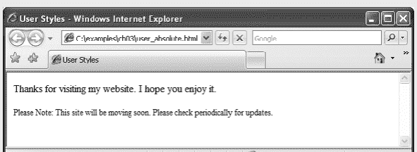

**图 3.15** | 用于文本大小的 pt 度量。

```css
1  /* 图 3.16: userstyles.css */
2  /* 用户样式表 */
3  body    { font-size: 20pt;
4              color: yellow;
5              background-color: #000080 }
```

**图 3.16** | 用户样式表。

## 3.13 CSS 3

W3C 目前正在开发 CSS 3，一些浏览器已经开始实现 *CSS 3* 规范中的一些新功能。我们将讨论一些最有可能包含在 CSS 3 中的即将推出的功能。

CSS 3 将允许对边框进行更高级的控制。除了 `border-style`、`border-color` 和 `border-width` 属性外，你将能够设置多种边框颜色、使用图像作为边框、为方框添加阴影以及创建圆角边框。

CSS 3 中的背景图像将更加通用，允许你设置背景图像的大小、指定偏移量以确定图像在元素中的定位位置，以及在一个元素中使用多个背景图像。还将有属性用于设置文本阴影效果，以及当文本过长无法容纳在其包含元素中时，提供更多文本溢出的选项。

其他功能将包括可调整大小的方框、增强的选择器、多列布局以及更完善的语音（听觉）样式。Web 资源部分将指引你访问 Deitel CSS 资源中心，在那里你可以找到关于 CSS 3 开发和功能的最新信息的链接。

## 3.14 Web 资源

`http://www.deitel.com/css21`

Deitel CSS 资源中心包含指向网络上一些最佳 CSS 信息的链接。在那里，你将找到分类链接，指向教程、参考、代码示例、演示、视频等。查看演示部分，了解布局、菜单和其他网页组件的更高级示例。

# 4 JavaScript：脚本编程简介

> > 言论自由，但事实神圣。
>
> —C. P. 斯科特
>
> > 债权人的记忆力比债务人好。
>
> —詹姆斯·豪厄尔
>
> > 面对抉择时，我总会问：“什么会最有趣？”
>
> —佩吉·沃克
>
> > 社会意义上的平等，可分为条件平等和权利平等。
>
> —詹姆斯·费尼莫尔·库珀

## 目标

在本章中，你将学习：

- 编写简单的 JavaScript 程序。
- 使用输入和输出语句。
- 基本的内存概念。
- 使用算术运算符。
- 算术运算符的优先级。
- 编写决策语句。
- 使用关系和相等运算符。

### 4.1 简介

在第 2 章和第 3 章中，我们介绍了 XHTML 和层叠样式表（CSS）。在本章中，我们开始介绍 *JavaScript* 脚本语言，它有助于采用一种规范的方法来设计计算机程序，从而增强网页的功能和外观。

第 4-9 章详细讨论了 JavaScript——由于其高度可移植性，它已成为基于 Web 应用程序的*事实标准*客户端脚本语言。我们对 JavaScript 的介绍涵盖了客户端脚本（在第 4-11 章中使用），它使网页更具动态性和交互性。

我们现在介绍 JavaScript 编程，并提供示例来说明 JavaScript 的几个重要特性。每个示例都经过仔细分析，逐行讲解。在第 5-6 章中，我们将详细讨论 JavaScript 中的程序开发和程序控制。

在你的计算机上运行 JavaScript 代码示例之前，你可能需要更改浏览器的安全设置。默认情况下，Internet Explorer 7 会阻止本地计算机上的脚本运行，而是在窗口顶部显示一个黄色警告栏。要允许在计算机上的文件中运行脚本，请从**工具**菜单中选择**Internet 选项**。单击**高级**选项卡，向下滚动到**设置**列表的**安全**部分。勾选标记为**允许活动内容在我计算机上的文件中运行**的复选框（图 4.1）。单击**确定**并重新启动 Internet Explorer。现在，你计算机上包含 JavaScript 代码的 XHTML 文档将正常运行。Firefox 默认启用 JavaScript。

1. 不要将脚本语言 JavaScript 与编程语言 Java（来自 Sun Microsystems, Inc.）混淆。Java 是一种成熟的面向对象编程语言。它可用于开发在各种设备上执行的应用程序——从最小的设备（如手机和 PDA）到超级计算机。Java 因开发大规模分布式企业应用程序和 Web 应用程序而广受欢迎。JavaScript 是一种基于浏览器的脚本语言，由 Netscape 开发，并在所有主要浏览器中实现。

2. JavaScript 最初由 Netscape 创建。Netscape 和 Microsoft 都在 ECMA International 将 JavaScript 标准化为 ECMAScript 的过程中发挥了重要作用。有关 ECMAScript 的更多信息，请访问 `www.ecma-international.org/publications/standards/ECMA-262.htm`。

### 4.2 简单程序：在网页中显示一行文本

JavaScript 使用程序员熟悉的符号。我们首先考虑一个简单的*脚本*（或*程序*），它在 XHTML 文档的主体中显示文本 "Welcome to JavaScript Programming!"。所有主要的 Web 浏览器都包含 *JavaScript 解释器*，用于处理用 JavaScript 编写的命令。图 4.2 显示了 JavaScript 代码及其在 Internet Explorer 中的输出。

```xml
<?xml version = "1.0" encoding = "utf-8"?>
<!DOCTYPE html PUBLIC "-//W3C//DTD XHTML 1.0 Strict//EN"
   "http://www.w3.org/TR/xhtml1/DTD/xhtml1-strict.dtd">

<!-- Fig. 4.2: welcome.html -->
<!-- Displaying a line of text. -->
<html xmlns = "http://www.w3.org/1999/xhtml">
   <head>
      <title>A First Program in JavaScript</title>
      <script type = "text/javascript">
         <!--
         document.writeln(
            "<h1>Welcome to JavaScript Programming!</h1>" );
         // -->
      </script>
   </head><body></body>
</html>
```

图 4.2 | 显示一行文本。（共 2 部分，第 1 部分。）

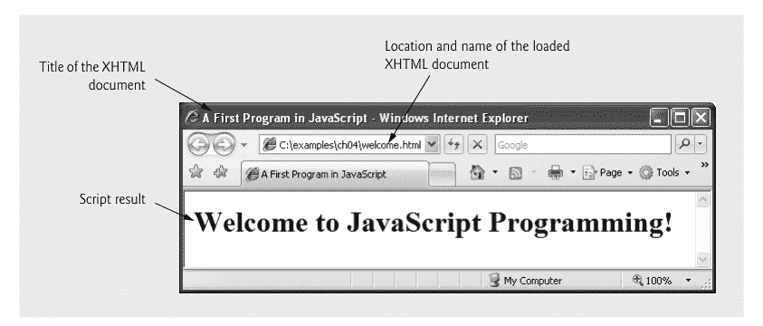

这个程序展示了几个重要的 JavaScript 特性。我们将详细分析 XHTML 文档和脚本的每一行。与前面的章节一样，为了方便起见，我们为每个 XHTML 文档行添加了行号；行号并非 XHTML 文档或 JavaScript 程序的一部分。第 12-13 行执行了脚本的“实际工作”，即在网页中显示短语“欢迎来到 JavaScript 编程！”。

第 8 行表示 XHTML 文档 `<head>` 部分的开始。目前，我们编写的 JavaScript 代码将出现在 `<head>` 部分。浏览器首先解释 `<head>` 部分的内容，因此我们编写的 JavaScript 程序会在 XHTML 文档的 `<body>` 显示之前执行。在后续关于 JavaScript 的章节以及动态 HTML 的章节中，我们将介绍内联脚本，即 JavaScript 代码写在 XHTML 文档的 `<body>` 中。

第 10 行使用 `<script>` 标签向浏览器表明，随后的文本是脚本的一部分。`type` 属性指定了文件的类型以及脚本中使用的脚本语言——在本例中，是一个用 javascript 编写的文本文件。Internet Explorer 和 Firefox 都使用 JavaScript 作为默认的脚本语言。

第 11 行包含 XHTML 开注释标签 `<!--`。一些较旧的网络浏览器不支持脚本。在这些浏览器中，脚本的实际文本通常会显示在网页中。为了防止这种情况发生，许多脚本程序员将脚本代码包含在 XHTML 注释中，这样不支持脚本的浏览器就会简单地忽略该脚本。使用的语法如下：

```html
<script type = "text/javascript">
<!--
script code here
// -->
</script>
```

当不支持脚本的浏览器遇到上述代码时，它会忽略 `<script>` 和 `</script>` 标签以及 XHTML 注释中的脚本代码。支持脚本的浏览器将按预期解释 JavaScript 代码。[注意：一些浏览器需要 JavaScript 单行注释 `//`（参见第 4.4 节的解释）。]

> **可移植性提示 4.1**
>
> *某些浏览器不支持 `<script>...</script>` 标签。如果你的文档需要在这些浏览器中呈现，请将这些标签之间的脚本代码包含在 XHTML 注释中，这样脚本文本就不会作为网页的一部分显示出来。XHTML 注释的结束注释标签 (`--`) 前面有一个 JavaScript 注释 (`//`)，以防止浏览器尝试将 XHTML 注释解释为 JavaScript 语句。*

第 12-13 行指示浏览器的 JavaScript 解释器执行一个*操作*，即在网页中显示包含在*双引号 (")* 之间的*字符串*。字符串有时也称为*字符字符串*、*消息*或*字符串字面量*。我们将双引号之间的字符称为字符串。字符串中单词之间的单个空白字符不会被浏览器忽略。但是，如果字符串中出现连续的空格，浏览器会将它们压缩为一个空格。此外，在大多数情况下，浏览器会忽略前导空白字符（即字符串开头的空白）。

> **软件工程观察 4.1**
>
> *JavaScript 中的字符串可以用双引号 (") 或单引号 (') 括起来。*

第 12-13 行使用了浏览器的*文档对象*，它代表浏览器当前正在显示的 XHTML 文档。文档对象允许你指定要在 XHTML 文档中显示的文本。浏览器包含一套完整的对象，允许脚本程序员访问和操作 XHTML 文档的每个元素。在后面的章节中，我们将在讨论文档对象模型 (DOM) 时概述其中一些对象。

对象驻留在计算机的内存中，包含脚本使用的信息。术语*对象*通常意味着*属性*（数据）和*行为*（方法）与该对象相关联。对象的方法使用属性为*对象的客户端*（即调用方法的脚本）执行有用的操作。方法可能需要额外的信息（*参数*）来执行其操作；这些信息在脚本中方法名称后的括号中括起来。在第 12-13 行中，我们调用文档对象的 *writeln 方法*在 XHTML 文档中写入一行 XHTML 标记。方法名称 `writeln` 后面的括号包含方法 `writeln` 所需的一个参数（在本例中，是浏览器要显示的 XHTML 字符串）。方法 `writeln` 指示浏览器显示参数字符串。如果字符串包含 XHTML 元素，浏览器将解释这些元素并将其呈现在屏幕上。在此示例中，浏览器将短语“欢迎来到 JavaScript 编程！”显示为 h1 级别的 XHTML 标题，因为该短语被包含在 h1 元素中。

第 12-13 行中的代码元素，包括 `document.writeln`、其括号中的参数（字符串）和*分号 (;)*，统称为*语句*。每个语句都以分号结尾（也称为*语句终止符*），尽管 JavaScript 并不要求这样做。第 15 行表示脚本的结束。

> **良好的编程实践 4.1**
>
> 始终在语句末尾包含分号以终止该语句。此表示法澄清了一条语句的结束和下一条语句的开始。

> **常见的编程错误 4.1**
>
> 忘记脚本的结束 `</script>` 标签可能会阻止浏览器正确解释脚本，并可能阻止 XHTML 文档正确加载或呈现。

第 16 行的 `</head>` 标签表示 `<head>` 部分的结束。同样在第 16 行，标签 `<body>` 和 `</body>` 指定此 XHTML 文档有一个空的 body。第 17 行表示此 XHTML 文档的结束。

我们现在准备在网页浏览器中查看我们的 XHTML 文档——在 Internet Explorer 或 Firefox 中打开它。如果脚本没有语法错误，它应该产生图 4.2 所示的输出。

> **常见的编程错误 4.2**
>
> JavaScript 区分大小写。不使用正确的大写和小写字母是语法错误——违反了编程语言中编写正确语句的规则。Internet Explorer 中的 JavaScript 解释器通过在一个单独的弹出窗口中指示发生了运行时错误（即解释器在运行脚本时出现问题）来报告所有语法错误。[注意：要在 IE7 中启用此功能，请从**工具**菜单中选择 **Internet 选项...**。在出现的 **Internet 选项**对话框中，选择**高级**选项卡，然后在**浏览**类别下勾选标记为**显示有关每个脚本错误的通知**的复选框。Firefox 有一个错误控制台，用于报告 JavaScript 错误和警告。可以通过从**工具**菜单中选择**错误控制台**来访问它。]

### 4.3 修改我们的第一个程序

本节通过两个修改图 4.2 中示例的例子，继续介绍 JavaScript 编程。

#### 显示一行彩色文本

脚本可以通过多种方式显示“欢迎来到 JavaScript 编程！”。图 4.3 使用两条 JavaScript 语句在 XHTML 文档中生成一行文本。此示例还使用 CSS 颜色属性以不同的颜色显示文本。

```xml
1  <?xml version = "1.0" encoding = "utf-8"?>
2  <!DOCTYPE html PUBLIC "-//W3C//DTD XHTML 1.0 Strict//EN"
3    "http://www.w3.org/TR/xhtml1/DTD/xhtml1-strict.dtd">
4
5  <!-- Fig. 4.3: welcome2.html -->
6  <!-- Printing one line with multiple statements. -->
7  <html xmlns = "http://www.w3.org/1999/xhtml">
8    <head>
9      <title>Printing a Line with Multiple Statements</title>
10     <script type = "text/javascript">
11       <!--
12         document.write( "<h1 style = \"color: magenta\">" );
```

图 4.3 | 使用单独的语句打印一行。（第 1 部分，共 2 部分。）

```javascript
13 document.write( "Welcome to JavaScript " +
14 "Programming!</h1>" );
15 // -->
16 </script>
17 </head><body></body>
18 </html>
```

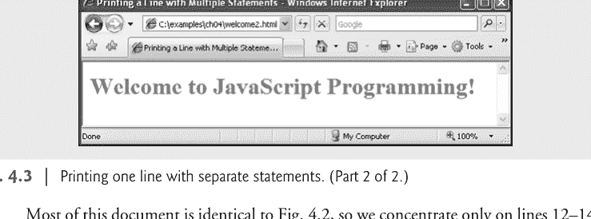

本文档的大部分内容与图 4.2 相同，因此我们只关注图 4.3 的第 12-14 行，这些行在 XHTML 文档中显示一行文本。第一条语句使用文档方法 `write` 来显示一个字符串。与 `writeln` 不同，`write` 在写入其参数后，不会将 XHTML 文档中的输出光标定位到下一行的开头。[注意：输出光标跟踪的是下一个字符在 XHTML 文档中出现的位置，而不是浏览器渲染网页时下一个字符出现的位置。] 在 XHTML 文档中写入的下一个字符会紧跟在使用 `write` 写入的最后一个字符之后。因此，当第 13-14 行执行时，写入的第一个字符“W”会紧跟在使用 `write` 显示的最后一个字符（第 12 行右双引号内的 `>` 字符）之后。每个 `write` 或 `writeln` 语句都会从上一个 `write` 或 `writeln` 语句停止写入字符的地方继续写入字符。所以，在一个 `writeln` 语句之后，下一个输出会出现在下一行的开头。实际上，第 12-14 行中的两条语句产生了一行 XHTML 文本。请记住，JavaScript 中的语句用分号（;）分隔。因此，第 13-14 行仅代表一条完整的语句。JavaScript 允许将长语句拆分成多行。但是，你不能在字符串的中间拆分语句。第 13 行中的 `+` 运算符（在这种用法中称为“连接运算符”）将两个字符串连接在一起，本章稍后将更详细地解释。

> **常见编程错误 4.3**
>
> 在字符串中间拆分语句是语法错误。

请注意，字符 `\"`（在第 12 行中）不会在浏览器中显示。字符串中的**反斜杠**（`\`）是一个*转义字符*。它表示字符串中将使用一个“特殊”字符。当在字符字符串中遇到反斜杠时，下一个字符会与反斜杠组合形成一个*转义序列*。转义序列 `\"` 是**双引号字符**，它会导致一个双引号字符被插入到字符串中。我们使用这个转义序列在 `style` 属性值周围插入双引号，而不会终止字符串。请注意，我们也可以为属性值使用单引号，例如 `document.write( "<h1 style = 'color: magenta'>" );`，因为单引号不会终止双引号字符串。我们稍后将更详细地讨论转义序列。

重要的是要注意，前面的讨论与 XHTML 文本的实际渲染无关。请记住，除非浏览器窗口对于正在渲染的文本来说太窄，或者浏览器遇到一个明确开始新行的 XHTML 元素（例如，`<br/>` 开始新行或 `<p>` 开始新段落），否则浏览器不会创建新的文本行。

> **常见编程错误 4.4**
>
> 许多人混淆了 XHTML 文本的编写和 XHTML 文本的渲染。编写 XHTML 文本会创建将被浏览器渲染以呈现给用户的 XHTML。

#### 显示多行文本

在下一个示例中，我们演示了通过在 `write` 或 `writeln` 方法调用的 XHTML 文本字符串中使用换行 XHTML 标签（`<br/>`），单条语句可以使浏览器显示多行。图 4.4 演示了换行 XHTML 标签的使用。当浏览器渲染 XHTML 文档时，第 12-13 行会产生三行独立的文本。

```xml
1  <?xml version = "1.0" encoding = "utf-8"?>
2  <!DOCTYPE html PUBLIC "-//W3C//DTD XHTML 1.0 Strict//EN"
3     "http://www.w3.org/TR/xhtml1/DTD/xhtml1-strict.dtd">
4
5  <!-- Fig. 4.4: welcome3.html -->
6  <!-- Printing on multiple lines with a single statement. -->
7  <html xmlns = "http://www.w3.org/1999/xhtml">
8     <head>
9        <title>Printing Multiple Lines</title>
10       <script type = "text/javascript">
11          <!--
12          document.writeln( "<h1>Welcome to<br />JavaScript" +
13             "<br />Programming!</h1>" );
14          // -->
15       </script>
16    </head><body></body>
17 </html>
```

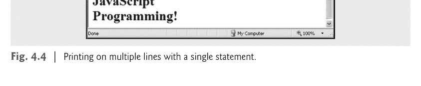

#### 在警告对话框中显示文本

本章的前几个程序在 XHTML 文档中显示文本。有时，在屏幕上“弹出”以吸引用户注意力的称为对话框（或对话框）的窗口中显示信息很有用。对话框通常向浏览网页的用户显示重要消息。JavaScript 允许你轻松地显示一个包含消息的对话框。图 4.5 中的程序在一个称为警告对话框的预定义对话框中将“Welcome to JavaScript Programming!”显示为三行。

脚本中的第 12 行使用浏览器的 `window` 对象来显示一个警告对话框。`window` 对象的 `alert` 方法的参数是要显示的字符串。执行前面的语句会显示图 4.5 第一个窗口中所示的对话框。对话框的标题栏包含字符串 **Windows Internet Explorer**，表示浏览器正在向用户呈现消息。该对话框提供了一个 **确定** 按钮，允许用户通过单击该按钮来**关闭**（即**关闭**）对话框。要关闭对话框，请将**鼠标光标**（也称为**鼠标指针**）定位到 **确定** 按钮上并单击鼠标。Firefox 的警告对话框看起来类似，但标题栏包含文本 [JavaScript Application]。

```xml
1  <?xml version = "1.0" encoding = "utf-8"?>
2  <!DOCTYPE html PUBLIC "-//W3C//DTD XHTML 1.0 Strict//EN"
3      "http://www.w3.org/TR/xhtml1/DTD/xhtml1-strict.dtd">
4
5  <!-- Fig. 4.5: welcome4.html -->
6  <!-- Alert dialog displaying multiple lines. -->
7  <html xmlns = "http://www.w3.org/1999/xhtml">
8      <head>
9          <title>Printing Multiple Lines in a Dialog Box</title>
10         <script type = "text/javascript">
11             <!--
12                 window.alert( "Welcome to\nJavaScript\nProgramming!" );
13             // -->
14         </script>
15     </head>
16     <body>
17         <p>Click Refresh (or Reload) to run this script again.</p>
18     </body>
19 </html>
```

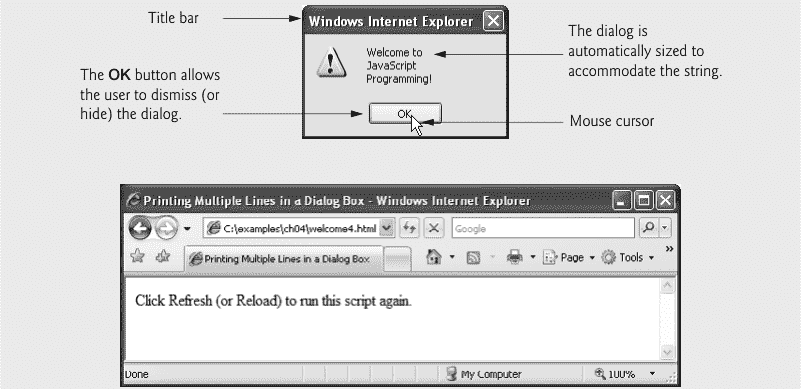

> **常见编程错误 4.5**
>
> 对话框显示纯文本；它们不渲染 XHTML。因此，将 XHTML 元素指定为要在对话框中显示的字符串的一部分会导致标签的实际字符被显示。

请注意，`alert` 对话框包含三行纯文本。通常，对话框会完全按照字符串在双引号之间出现的方式显示字符。但是，请注意对话框不显示字符 `\n`。转义序列 `\n` 是**换行符**。在对话框中，换行符会导致**光标**（即当前屏幕位置指示器）移动到对话框中下一行的开头。图 4.6 列出了一些其他常见的转义序列。表中的 `\n`、`\t` 和 `\r` 转义序列不会影响 XHTML 渲染，除非它们位于 **pre 元素** 中（此元素以固定宽度字体显示其标签之间的文本，完全按照标签之间的格式，包括前导空格字符和连续空格字符）。其他转义序列产生的字符将在纯文本对话框和 XHTML 中显示。

| 转义序列 | 描述 |
| :--- | :--- |
| `\n` | 换行。将屏幕光标定位到下一行的开头。 |
| `\t` | 水平制表符。将屏幕光标移动到下一个制表位。 |
| `\r` | 回车。将屏幕光标定位到当前行的开头；不前进到下一行。回车后输出的任何字符都会覆盖该行上先前输出的字符。 |
| `\\` | 反斜杠。用于在字符串中表示反斜杠字符。 |
| `\"` | 双引号。用于在双引号字符串中表示双引号字符。例如，`window.alert( "\"in quotes\"" );` 在警告对话框中显示 "in quotes"。 |
| `\'` | 单引号。用于在字符串中表示单引号字符。例如，`window.alert( '\'in quotes\'' );` 在警告对话框中显示 'in quotes'。 |

**图 4.6** | 一些常见的转义序列。

### 4.4 使用 prompt 对话框获取用户输入

脚本使你能够在网页向用户显示时，动态生成其部分或全部内容。脚本可以根据用户输入或其他变量（如一天中的时间或客户端使用的浏览器类型）来调整内容。这样的网页被称为*动态*网页，与静态网页相对，因为其内容具有变化的能力。接下来的两个小节将使用脚本来演示动态网页。

#### 4.4.1 动态欢迎页面

我们接下来的脚本在先前脚本的基础上，创建一个动态欢迎页面，该页面获取用户的名字，然后将其显示在页面上。该脚本使用了 `window` 对象的另一个预定义对话框——*prompt* 对话框，它允许用户输入一个可供脚本使用的值。程序要求用户输入一个名字，然后在 XHTML 文档中显示该名字。图 4.7 展示了该脚本和示例输出。[注意：在后续的 JavaScript 章节中，我们将通过 XHTML 表单中的 GUI 组件来获取输入，如第 2 章所介绍。]

```xml
1  <?xml version = "1.0" encoding = "utf-8"?>
2  <!DOCTYPE html PUBLIC "-//W3C//DTD XHTML 1.0 Strict//EN"
3     "http://www.w3.org/TR/xhtml1/DTD/xhtml1-strict.dtd">
4
5  <!-- 图 4.7: welcome5.html -->
6  <!-- 在欢迎屏幕上使用提示框。 -->
7  <html xmlns = "http://www.w3.org/1999/xhtml">
8     <head>
9        <title>使用提示框和警告框</title>
10       <script type = "text/javascript">
11          <!--
12          var name; // 用户输入的字符串
13
14          // 从提示框中读取名字作为字符串
15          name = window.prompt( "请输入您的名字" );
16
17          document.writeln( "<h1>您好，" + name +
18             "，欢迎来到 JavaScript 编程！</h1>" );
19          // -->
20       </script>
21    </head>
22    <body>
23       <p>点击刷新（或重新加载）以再次运行此脚本。</p>
24    </body>
25 </html>
```

图 4.7 | 在欢迎屏幕上使用的提示框。（第 1 部分，共 2 部分。）

第 12 行是一个*声明*，其中包含了 JavaScript *关键字* `var`。关键字是在 JavaScript 中具有特殊含义的单词。语句开头的关键字 `var` 表明单词 `name` 是一个*变量*。变量是计算机内存中的一个位置，可以存储一个值供程序使用。所有变量都有名称、类型和值，并且在程序中使用前应使用 `var` 语句进行声明。虽然使用 `var` 声明变量不是必需的，但我们将在第 7 章 JavaScript：函数 中看到，`var` 有时能确保脚本的正确行为。

变量的名称可以是任何有效的*标识符*。标识符是由字母、数字、下划线（`_`）和美元符号（`$`）组成的一系列字符，不能以数字开头，也不是 JavaScript 的保留关键字。[注意：完整的关键字列表可在图 5.1 中找到。] 标识符不能包含空格。一些有效的标识符包括 `Welcome`、`$value`、`_value`、`m_inputField1` 和 `button7`。名称 `7button` 不是有效的标识符，因为它以数字开头；名称 `input field` 也不是有效的，因为它包含空格。请记住 JavaScript 是*区分大小写*的——大写和小写字母被视为不同的字符，因此 `name`、`Name` 和 `NAME` 是不同的标识符。

> **良好编程实践 4.2**
>
> 选择有意义的变量名有助于脚本“自我文档化”（即，通过阅读脚本本身就能轻松理解，而无需阅读手册或冗长的注释）。

> **良好编程实践 4.3**
>
> 按照惯例，变量名标识符以小写字母开头。每个后续单词应以大写字母开头。例如，标识符 `itemPrice` 的第二个单词 `Price` 以大写字母 P 开头。

> **常见编程错误 4.7**
>
> 在标识符中间拆分语句会导致语法错误。

声明以分号（;）结尾，并且可以跨多行书写，声明中的每个变量用逗号分隔——这被称为*逗号分隔的*变量名列表。多个变量可以在一个声明中声明，也可以在多个声明中声明。

在第 12 行，一个以字符 `//` 开头的*单行注释*说明了该变量在脚本中的用途。这种形式的注释被称为单行注释，因为它在其出现的行末结束。`//` 注释可以出现在 JavaScript 代码行的任何位置，并持续到行尾。

> **良好编程实践 4.4**
>
> 在单独的行上声明每个变量。这种格式允许在每个声明旁边轻松插入描述性注释——这是一个被广泛遵循的专业编码标准。

另一种注释符号便于编写*多行注释*。例如，

```javascript
/* 这是一个多行
   注释。它可以
   跨多行书写。 */
```

是一个跨多行的多行注释。此类注释以分隔符 `/*` 开始，以分隔符 `*/` 结束。解释器会忽略注释分隔符之间的所有文本。

> **常见编程错误 4.8**
>
> 忘记多行注释的分隔符之一会导致语法错误。

> **常见编程错误 4.9**
>
> 嵌套多行注释（即，在另一个多行注释的分隔符之间放置一个多行注释）会导致语法错误。

JavaScript 从 C 编程语言中采用了以 `/*` 和 `*/` 分隔的注释，从 C++ 编程语言中采用了以 `//` 分隔的单行注释。JavaScript 程序员通常更喜欢 C++ 风格的单行注释，而不是 C 风格的注释。在本书中，我们使用 C++ 风格的单行注释。

第 14 行是一个注释，说明了下一行语句的目的。第 15 行调用了 `window` 对象的 `prompt` 方法，该方法显示图 4.8 中的对话框。该对话框允许用户输入一个代表用户名的字符串。

`prompt` 的参数指定了一条消息，告诉用户在文本字段中输入什么。一个可选的第二个参数（与第一个参数用逗号分隔）可以指定在文本字段中显示的默认字符串；我们的代码没有提供第二个参数。在这种情况下，Internet Explorer 显示默认值 `undefined`，而 Firefox 和大多数其他浏览器则使文本字段为空。用户在文本字段中输入字符，然后单击“确定”按钮将字符串提交给程序。我们通常通过 GUI 组件（如本程序中的 `prompt` 对话框）或 XHTML 表单 GUI 组件（我们将在后续章节中看到）从用户那里获取输入。

用户可以在 `prompt` 对话框的文本字段中输入任何内容。对于此程序，无论用户输入什么，都被视为名字。如果用户单击“取消”按钮，则不会向程序发送字符串值。相反，`prompt` 对话框会提交值 `null`，这是一个 JavaScript 关键字，表示变量没有值。请注意，`null` 不是字符串字面量，而是一个预定义的术语，表示值的缺失。然而，将 `null` 值写入文档会在网页上显示单词 `null`。

第 15 行的语句使用赋值运算符 `=` 将 `window` 对象的 `prompt` 方法返回的值（一个包含用户输入字符的字符串——如果单击“取消”按钮，则为默认值或 `null`）赋给变量 `name`。该语句读作：“`name` 获得 `window.prompt( "请输入您的名字" )` 返回的值。” `=` 运算符被称为二元运算符，因为它有两个操作数——`name` 和表达式 `window.prompt( "请输入您的名字" )` 的结果。赋值运算符右侧的表达式总是首先被求值。

> **良好编程实践 4.5**
>
> 在二元运算符的两侧放置空格。这种格式使运算符突出显示，并使程序更具可读性。

第 17–18 行使用 `document.writeln` 显示新的欢迎消息。括号内的表达式使用运算符 `+` 来“添加”一个字符串（字面量 `"<h1>您好，"`）、变量 `name`（用户在第 15 行输入的字符串）和另一个字符串（字面量 `", 欢迎来到 JavaScript 编程！</h1>"`）。JavaScript 有一个用于字符串连接的 `+` 运算符版本，它允许将一个字符串与另一个数据类型的值（包括另一个字符串）组合在一起。此操作的结果是一个新的（通常更长的）字符串。如果我们假设 `name` 包含字符串字面量 `"Jim"`，则表达式求值如下：JavaScript 确定第一个 `+` 运算符的两个操作数（字符串 `"<h1>您好，"` 和变量 `name` 的值）都是字符串，然后将它们连接成一个字符串。接下来，JavaScript 确定第二个 `+` 运算符的两个操作数（第一次连接操作的结果，字符串 `"<h1>您好，Jim"`，和字符串 `", 欢迎来到 JavaScript 编程！</h1>"`）都是字符串，并将它们连接起来。这将产生字符串 `"<h1>您好，Jim，欢迎来到 JavaScript 编程！</h1>"`。浏览器将此字符串作为 XHTML 文档的一部分进行渲染。请注意，`您好，` 和 `Jim` 之间的空格是字符串 `"<h1>您好， "` 的一部分。

正如我们稍后将说明的，用于字符串连接的 `+` 运算符可以在必要时将其他变量类型转换为字符串。因为字符串连接发生在两个字符串之间，JavaScript 必须在继续操作之前将其他变量类型转换为字符串。例如，如果变量 `age` 具有整数值 `21`，则表达式 `"my age is " + age` 的求值结果为字符串 `"my age is 21"`。JavaScript 将 `age` 的值转换为字符串，并将其与现有的字符串字面量 `"my age is "` 连接起来。

浏览器解释完 XHTML 文档的 `<head>` 部分（其中包含 JavaScript）后，接着解释 `<body>`（第 22-24 行）并渲染 XHTML。请注意，XHTML 页面在提示框被关闭之前不会渲染，因为提示框会暂停 `<head>` 中的执行，然后再处理 `<body>`。如果你在输入姓名后点击浏览器的**刷新**（Internet Explorer）或**重新加载**（Firefox）按钮，浏览器将重新加载 XHTML 文档，这样你就可以再次执行脚本并更改姓名。[注意：在某些情况下，可能需要在点击**刷新**或**重新加载**按钮时按住 *Shift* 键，以确保 XHTML 文档正确重新加载。浏览器通常会在内存中保存页面的最近副本，按住 *Shift* 键会强制浏览器下载页面的最新版本。]

#### 4.4.2 整数相加

我们的下一个脚本演示了使用提示对话框从用户获取输入的另一种方式。图 4.9 输入用户通过键盘键入的两个*整数*（如 7、-11、0 和 31914 等整数），计算它们的和并显示结果。

第 12-16 行声明了变量 `firstNumber`、`secondNumber`、`number1`、`number2` 和 `sum`。单行注释说明了每个变量的用途。第 19 行使用提示对话框允许用户输入一个字符串，该字符串代表要相加的两个整数中的第一个。脚本将用户输入的第一个值赋给变量 `firstNumber`。第 22 行显示一个提示对话框以获取要相加的第二个数字，并将此值赋给变量 `secondNumber`。


与前面的示例一样，用户可以在提示对话框中输入任何内容。对于此程序，如果用户输入非整数值或点击取消按钮，将会发生逻辑错误，两个值的和将以 `NaN`（表示非数字）的形式出现在 XHTML 文档中。逻辑错误是由语法正确但产生不期望结果的代码引起的。在第 9 章《JavaScript：对象》中，我们将讨论 `Number` 对象及其可以确定值是否为非数字的方法。

回想一下，提示对话框将用户键入的值作为字符串返回给程序。第 25-26 行将用户输入的两个字符串转换为可用于计算的整数值。函数 `parseInt()` 将其字符串参数转换为整数。第 25 行将函数 `parseInt()` 返回的整数赋给变量 `number1`。第 26 行以类似方式将整数值赋给变量 `number2`。程序中随后对 `number1` 和 `number2` 的任何引用都使用这些整数值。[注意：我们将 `parseInt()` 称为函数而不是方法，因为我们没有在函数调用前加上对象名称（如 `document` 或 `window`）和点号（`.`）。术语“方法”意味着该函数属于特定对象。例如，方法 `writeln()` 属于 `document` 对象，方法 `prompt()` 属于 `window` 对象。]

第 28 行使用加法运算符 `+` 计算变量 `number1` 和 `number2` 的和，并通过赋值运算符 `=` 将结果赋给变量 `sum`。请注意，`+` 运算符既可以执行加法也可以执行字符串连接。在这种情况下，`+` 运算符执行加法，因为两个操作数都包含整数。第 28 行执行此计算后，第 31 行使用 `document.writeln()` 在网页上显示加法结果。第 33 行和第 34 行分别关闭脚本和 head 元素。第 35-37 行渲染 XHTML 文档的 body。使用浏览器的**刷新**或**重新加载**按钮重新加载 XHTML 文档并再次运行脚本。

> **常见编程错误 4.10**
>
> 混淆用于字符串连接的 `+` 运算符和用于加法的 `+` 运算符通常会导致不期望的结果。例如，如果整数变量 `y` 的值为 5，表达式 `"y + 2 = " + y + 2` 的结果是 `"y + 2 = 52"`，而不是 `"y + 2 = 7"`，因为首先将 `y` 的值（即 5）与字符串 `"y + 2 = "` 连接，然后将值 2 与新的、更大的字符串 `"y + 2 = 5"` 连接。表达式 `"y + 2 = " + (y + 2)` 产生字符串 `"y + 2 = 7"`，因为括号确保 `y + 2` 在转换为字符串之前先进行数学计算。

## 4.5 JavaScript 中的数据类型

与其前身语言 C、C++ 和 Java 不同，JavaScript 不要求变量在程序中使用前必须声明类型。JavaScript 中的变量可以包含任何数据类型的值，并且在许多情况下，JavaScript 会自动为你转换不同类型的值。因此，JavaScript 被称为弱类型语言。当在 JavaScript 中声明一个变量但未赋值时，该变量具有未定义的值。尝试使用此类变量的值通常是一个逻辑错误。

当变量被声明时，除非你指定，否则它们不会被赋值。将值 `null` 赋给变量表示它不包含值。

## 4.6 算术运算

许多脚本执行算术计算。算术运算符使用代数中未使用的各种特殊符号。星号（`*`）表示乘法；百分号（`%`）是取余运算符，稍后将讨论。算术运算符是二元运算符——每个运算符作用于两个操作数。例如，表达式 `sum + value` 包含二元运算符 `+` 和两个操作数 `sum` 和 `value`。

JavaScript 提供取余运算符 `%`，它产生除法后的余数。[注意：`%` 运算符在某些编程语言中被称为模运算符。] 表达式 `x % y` 产生 `x` 除以 `y` 后的余数。因此，`17 % 5` 产生 2（即 17 除以 5 等于 3，余数为 2），`7.4 % 3.1` 产生 1.2。在后面的章节中，我们将考虑取余运算符的应用，例如确定一个数是否是另一个数的倍数。JavaScript 中没有用于求幂的算术运算符。（第 6 章《JavaScript：控制语句 II》展示了如何在 JavaScript 中使用 `Math` 对象的 `pow()` 方法执行求幂运算。）

## 4.7 决策制定：相等运算符和关系运算符

本节介绍 JavaScript `if` 语句的一个版本，它允许程序根据条件的真假做出决策。如果条件满足（即条件为真），则执行 `if` 语句体中的语句。如果条件不满足（即条件为假），则不执行 `if` 语句体中的语句。我们很快会看到一个例子。[注意：`if` 语句的其他版本在第 5 章《JavaScript：控制语句 I》中介绍。]

`if` 语句中的条件可以使用图 4.10 中总结的相等运算符和关系运算符来形成。所有关系运算符具有相同的优先级，并从左到右结合。两个相等运算符具有相同的优先级，低于关系运算符的优先级。相等运算符也从左到右结合。

> **常见编程错误 4.11**
>
> 如果运算符 `==`、`!=`、`>=` 和 `<=` 的符号之间包含空格，如 `=`、`!`、`>` 和 `<`，则是一个语法错误。

> **常见编程错误 4.12**
>
> 反转运算符 `!=`、`>=` 和 `<=`，如 `=!`、`=>` 和 `=<`，是一个语法错误。

> **常见编程错误 4.13**
>
> 混淆相等运算符 `==` 和赋值运算符 `=` 是一个逻辑错误。相等运算符应读作“等于”，赋值运算符应读作“赋值”或“获取值”。有些人更喜欢将相等运算符读作“双等号”或“等于等于”。

| 标准代数相等运算符或关系运算符 | JavaScript 相等或关系运算符 | JavaScript 条件示例 | JavaScript 条件含义 |
| :--- | :--- | :--- | :--- |
| *相等运算符* | | | |
| = | == | `x == y` | `x` 等于 `y` |
| ≠ | != | `x != y` | `x` 不等于 `y` |
| *关系运算符* | | | |
| > | > | `x > y` | `x` 大于 `y` |
| < | < | `x < y` | `x` 小于 `y` |
| ≥ | >= | `x >= y` | `x` 大于或等于 `y` |
| ≤ | <= | `x <= y` | `x` 小于或等于 `y` |

图 4.10 | 相等运算符和关系运算符。

图 4.11 中的脚本使用了四个 `if` 语句，在欢迎页面上显示一个与时间相关的问候语。该脚本从用户的计算机获取本地时间，并将其从 24 小时制（0–23）转换为 12 小时制（0–11）。利用这个值，脚本会根据当前时间显示合适的问候语。脚本和示例输出如图 4.11 所示。

```
<?xml version = "1.0" encoding = "utf-8"?>
<!DOCTYPE html PUBLIC "-//W3C//DTD XHTML 1.0 Strict//EN"
   "http://www.w3.org/TR/xhtml1/DTD/xhtml1-strict.dtd">

<!-- 图 4.11: welcome6.html -->
<!-- 使用相等和关系运算符。 -->
<html xmlns = "http://www.w3.org/1999/xhtml">
   <head>
      <title>使用关系运算符</title>
      <script type = "text/javascript">
         <!--
         var name; // 用户输入的字符串
         var now = new Date(); // 当前日期和时间
         var hour = now.getHours(); // 当前小时 (0-23)

         // 从提示框读取姓名作为字符串
         name = window.prompt( "请输入您的姓名" );

         // 判断是否是上午
         if ( hour < 12 )
            document.write( "<h1>早上好，" );

         // 判断是否是下午
         if ( hour >= 12 )
         {
            // 转换为12小时制
            hour = hour - 12;

            // 判断是否在下午6点之前
            if ( hour < 6 )
               document.write( "<h1>下午好，" );

            // 判断是否在下午6点之后
            if ( hour >= 6 )
               document.write( "<h1>晚上好，" );
         } // 结束 if

         document.writeln( name +
            "，欢迎来到JavaScript编程！</h1>" );
         // -->
      </script>
   </head>
   <body>
      <p>点击刷新（或重新加载）以再次运行此脚本。</p>
   </body>
</html>
```

图 4.11 | 使用相等和关系运算符。（第 1 部分，共 2 部分。）

第 12–14 行声明了脚本中使用的变量。请记住，变量可以在一个声明中声明，也可以在多个声明中声明。如果在单个声明中声明了多个变量（如本例所示），变量名之间用逗号（,）分隔。这个变量名列表被称为逗号分隔列表。再次注意每行末尾的注释，它指明了程序中每个变量的用途。还要注意，有些变量在声明时就被赋值了——JavaScript 允许你在声明变量时就为其赋值。

第 13 行将变量 `now` 设置为一个新的 `Date` 对象，该对象包含有关当前本地时间的信息。在第 4.2 节中，我们介绍了 `document` 对象，这是一个封装了与当前网页相关数据的对象。程序员可以选择使用其他对象来执行特定任务或获取特定信息。在这里，我们使用 JavaScript 内置的 `Date` 对象来获取当前本地时间。我们通过使用 `new` 运算符，后跟对象类型 `Date` 和一对圆括号来创建一个对象的新实例。有些对象需要在圆括号中放置参数，以指定要创建的对象的详细信息。在本例中，我们让圆括号为空，以创建一个包含当前日期和时间信息的默认 `Date` 对象。第 13 行执行后，变量 `now` 就引用了这个新的 `Date` 对象。[注意：当我们使用 `document` 和 `window` 对象时，不需要使用 `new` 运算符，因为这些对象总是由浏览器创建的。] 第 14 行将变量 `hour` 设置为一个整数，该整数等于 `Date` 对象的 `getHours()` 方法返回的当前小时数（24 小时制）。第 9 章将更详细地讨论 `Date` 对象的属性和方法，以及对象的一般概念。与前面的示例一样，该脚本使用 `window.prompt()` 允许用户输入一个姓名，作为问候语的一部分显示（第 17 行）。

为了显示正确的时间敏感型问候语，脚本必须确定用户是在上午、下午还是晚上访问页面。第一个 `if` 语句（第 20–21 行）将变量 `hour` 的值与 12 进行比较。如果 `hour` 小于 12，则用户在上午访问页面，第 21 行的语句输出字符串 `"早上好，"`。如果此条件不满足，则不执行第 21 行。第 24 行判断 `hour` 是否大于或等于 12。如果 `hour` 大于或等于 12，则用户在下午或晚上访问页面。执行第 25–36 行以确定合适的问候语。如果 `hour` 小于 12，则 JavaScript 解释器不执行这些行，而是继续执行第 38 行。

第 25 行的左花括号 `{` 开始了一个语句块（第 27–35 行），这些语句在 `hour` 大于或等于 12 时执行——要在 `if` 结构内执行多个语句，请将它们括在花括号中。第 27 行从 `hour` 中减去 12，将当前小时从 24 小时制（0–23）转换为 12 小时制（0–11）。`if` 语句（第 30 行）判断 `hour` 现在是否小于 6。如果是，则时间在中午到下午 6 点之间，第 31 行输出 XHTML h1 元素的开头（`"<h1>下午好，"`）。如果 `hour` 大于或等于 6，则时间在下午 6 点到午夜之间，脚本输出问候语 `"晚上好"`（第 34–35 行）。第 36 行的右花括号 `}` 结束了与第 24 行 `if` 语句关联的语句块。请注意，`if` 语句可以嵌套，即一个 `if` 语句可以放在另一个 `if` 语句内部。判断用户是在下午还是晚上访问页面的 `if` 语句（第 30–31 行和第 34–35 行）仅在脚本已经确定 `hour` 大于或等于 12（第 24 行）时才执行。如果脚本已经确定当前时间是上午，则不会执行这些额外的比较。（第 5 章将更深入地讨论语句块和嵌套 `if` 语句。）最后，第 38–39 行输出 XHTML h1 元素的其余部分（问候语的剩余部分），这部分不依赖于一天中的时间。

> **良好的编程实践 4.6**
>
> 在控制语句（如 `if` 语句）的右花括号后添加注释，以指明语句的结束位置，如图 4.11 的第 36 行所示。

请注意，每个 `if` 语句的第一行末尾没有分号（;）。包含这样的分号会在执行时导致逻辑错误。例如，

```
if ( hour < 12 ) ;
    document.write( "<h1>早上好，" );
```

实际上会被 JavaScript 错误地解释为

```
if ( hour < 12 )
    ;

document.write( "<h1>早上好，" );
```

其中单独一行上的分号——称为空语句——是当 `if` 语句中的条件为真时要执行的语句。当空语句执行时，程序中不会执行任何任务。然后程序继续执行下一条语句，无论条件是真还是假，该语句都会执行。在本例中，无论时间如何，都会打印 `"<h1>早上好，"`。

> **常见的编程错误 4.14**
>
> 在 `if` 语句条件的右括号后立即放置分号通常是一个逻辑错误。该分号会导致 `if` 语句的主体为空，因此无论其条件是否为真，`if` 语句本身都不会执行任何操作。更糟糕的是，`if` 语句原本打算执行的主体语句现在变成了 `if` 语句之后的顺序语句，并且总会被执行。

### 常见的编程错误 4.15

在一系列 `if` 语句中省略条件通常是一个逻辑错误。例如，检查 `hour` 是否大于 12 或小于 12，但不检查 `hour` 是否等于 12，这意味着当 `hour` 等于 12 时，脚本不采取任何操作。务必确保处理所有可能的条件。

注意图 4.11 第 38–39 行中空格的使用。请记住，空白字符（如制表符、换行符和空格）通常会被浏览器忽略。因此，语句可以分成多行，并且可以根据你的偏好进行空格调整，而不会影响程序的含义。但是，拆分标识符和字符串字面量是不正确的。理想情况下，语句应该保持简短，但并非总是能做到这一点。

图 4.12 中的图表显示了本章介绍的运算符的优先级。运算符从上到下按优先级递减的顺序显示。请注意，除了赋值运算符 `=` 之外，所有这些运算符都是从左到右结合的。加法是左结合的，因此像 `x + y + z` 这样的表达式求值时就像写成了 `(x + y) + z`。赋值运算符 `=` 是从右到左结合的，因此像 `x = y = 0` 这样的表达式求值时就像写成了 `x = (y = 0)`，这首先将值 0 赋给变量 `y`，然后将该赋值的结果 0 赋给 `x`。

| 运算符 | 结合性 | 类型 |
| :--- | :--- | :--- |
| * / % | 从左到右 | 乘法 |
| + - | 从左到右 | 加法 |
| < <= > >= | 从左到右 | 关系 |
| == != | 从左到右 | 相等 |
| = | 从右到左 | 赋值 |

图 4.12 | 到目前为止讨论的运算符的优先级和结合性。

## 4.8 网络资源

www.deitel.com/javascript

Deitel JavaScript 资源中心包含指向网络上一些最佳 JavaScript 资源的链接。在那里，你可以找到分类链接，指向 JavaScript 教程、工具、代码生成器、论坛、书籍、库、框架等。

# 5 JavaScript：控制语句 I

> 让我们都向前挪一个位置。
>
> ——刘易斯·卡罗尔
>
> 轮子已转完一圈。
>
> ——威廉·莎士比亚
>
> 牛顿在领悟之前，头上落下了多少苹果啊！
>
> ——罗伯特·弗罗斯特

## 目标

在本章中，你将学习：

- 使用 `if` 和 `if...else` 选择语句在多个备选操作中进行选择。
- 使用 `while` 重复语句在脚本中重复执行语句。
- 计数器控制的循环和哨兵控制的循环。
- 使用自增、自减和赋值运算符。

## 5.1 简介

编写脚本时，理解可用的构建块类型并运用经过验证的程序构建原则至关重要。在本章和第 6 章中，我们将讨论 JavaScript 的控制语句，它们与许多其他高级语言中的控制语句类似。我们还将介绍 JavaScript 的赋值运算符，并探讨其自增和自减运算符。这些额外的运算符可以缩写和简化许多程序语句。

## 5.2 控制语句

JavaScript 提供了三种类型的选择语句；我们将在本章和第 6 章中分别讨论。`if` 选择语句在条件为真时执行（选择）一个操作，如果条件为假则跳过该操作。`if...else` 选择语句在条件为真时执行一个操作，在条件为假时执行另一个不同的操作。`switch` 选择语句（第 6 章）根据表达式的值执行多个不同操作中的一个。

`if` 语句被称为单选语句，因为它选择或忽略单个操作（或者，正如我们即将看到的，单个操作组）。`if...else` 语句是双选语句，因为它在两个不同的操作（或操作组）之间进行选择。`switch` 语句是多选语句，因为它在多个不同的操作（或操作组）之间进行选择。

JavaScript 提供了四种重复语句类型，即 `while`、`do...while`、`for` 和 `for...in`。（`do...while` 和 `for` 在第 6 章介绍；`for...in` 在第 8 章介绍。）`if`、`else`、`switch`、`while`、`do`、`for` 和 `in` 这些词都是 JavaScript 关键字。这些词被语言保留用于实现各种功能，例如 JavaScript 的控制语句。关键字不能用作标识符（例如，用作变量名）。JavaScript 关键字列表如图 5.1 所示。

> 常见编程错误 5.1
>
> 将关键字用作标识符是语法错误。

### JavaScript 关键字

| break | case | catch | continue | default |
|---|---|---|---|---|
| delete | do | else | false | finally |
| for | function | if | in | instanceof |
| new | null | return | switch | this |
| throw | true | try | typeof | var |
| void | while | with | | |

| *JavaScript 保留但未使用的关键字* | | | | |
|---|---|---|---|---|
| abstract | boolean | byte | char | class |
| const | debugger | double | enum | export |
| extends | final | float | goto | implements |
| import | int | interface | long | native |
| package | private | protected | public | short |
| static | super | synchronized | throws | transient |
| volatile | | | | |

图 5.1 | JavaScript 关键字。

如我们所示，JavaScript 只有八种控制结构：顺序结构、三种选择结构和四种重复结构。程序通过根据需要组合控制语句来实现程序的算法。

单入口/单出口控制语句使得构建程序变得容易；控制语句通过将一个语句的出口点连接到下一个语句的入口点而相互连接。这个过程称为控制语句堆叠。我们将了解到，控制语句还有另一种连接方式——控制语句嵌套。因此，JavaScript 程序仅由八种不同类型的控制语句以两种方式组合而成。

## 5.3 `if` 选择语句

选择语句用于在程序中的多个备选操作路径中进行选择。例如，假设考试的及格分数是 60 分（满分 100 分）。那么 JavaScript 语句

```
if ( studentGrade >= 60 )
    document.writeln( "Passed" );
```

确定条件“学生的成绩大于或等于 60”是真还是假。如果条件为真，则在 XHTML 文档中输出 "Passed"，并按顺序执行下一个 JavaScript 语句。如果条件为假，则忽略打印语句，并按顺序执行下一个 JavaScript 语句。

请注意，此选择语句的第二行是缩进的。JavaScript 解释器会忽略空白字符——用于缩进和垂直间距的空格、制表符和换行符。

图 5.2 中的流程图说明了单选 `if` 语句。该流程图包含可能是最重要的流程图符号——菱形符号（或决策符号），它表示需要做出决策。决策符号包含一个表达式，例如一个条件，该条件可以是真或假。决策符号有两个流出线。一个表示当符号中的表达式为真时程序应遵循的路径；另一个表示当表达式为假时程序应遵循的路径。可以在任何计算结果为 JavaScript 布尔类型值的表达式上做出决策（即，任何计算结果为真或假的表达式——也称为布尔表达式）。

> **软件工程观察 5.1**
>
> 在 JavaScript 中，条件中的任何非零数值都计算为真，0 计算为假。对于字符串，任何包含一个或多个字符的字符串计算为真，空字符串（不包含字符的字符串，表示为 `""`）计算为 false。此外，使用 `var` 声明但未赋值的变量计算为 false。

请注意，`if` 语句是一个单入口/单出口控制语句。其余控制语句的流程图也仅包含（除了小圆圈符号和流线）矩形符号（表示要执行的操作）和菱形符号（表示要做出的决策）。这种类型的流程图代表了编程的动作/决策模型。

## 5.4 `if...else` 选择语句

`if` 选择语句仅在条件计算为真时执行指定的操作；否则，跳过该操作。`if...else` 选择语句允许你指定在条件为真时执行与条件为假时不同的操作。例如，JavaScript 语句

```
if ( studentGrade >= 60 )
    document.writeln( "Passed" );
else
    document.writeln( "Failed" );
```

如果学生的成绩大于或等于 60，则在 XHTML 文档中输出 Passed；如果学生的成绩小于 60，则输出 Failed。无论哪种情况，在打印发生后，将按顺序执行下一个 JavaScript 语句（即整个 `if...else` 语句之后的下一个语句）。请注意，结构的 `else` 部分的主体也是缩进的。图 5.3 所示的流程图说明了 `if...else` 选择语句的控制流。

JavaScript 提供了一个运算符，称为条件运算符 (`?:`)，它与 `if...else` 语句密切相关。运算符 `?:` 是 JavaScript 唯一的三元运算符——它接受三个操作数。操作数与 `?:` 一起构成一个条件表达式。第一个操作数是一个布尔表达式，第二个是当表达式计算为真时条件表达式的值，第三个是当表达式计算为假时条件表达式的值。例如，考虑以下语句

```
document.writeln( studentGrade >= 60 ? "Passed" : "Failed" );
```

包含一个条件表达式，如果条件 `studentGrade >= 60` 为真，则计算结果为字符串 "Passed"；如果条件为假，则计算结果为字符串 "Failed"。因此，使用条件运算符的此语句执行的操作与前面的 `if...else` 语句基本相同。条件运算符的优先级较低，因此通常将整个条件表达式放在括号中以确保其正确计算。

嵌套的 `if...else` 语句通过将 `if...else` 语句放在 `if...else` 语句内部来测试多种情况。例如，以下伪代码语句表示程序应为大于或等于 90 的考试成绩打印 A，为 80 到 89 范围内的成绩打印 B，为 70 到 79 范围内的成绩打印 C，为 60 到 69 范围内的成绩打印 D，为所有其他成绩打印 F：

```
if ( studentGrade >= 90 )
    document.writeln( "A" );
else
    if ( studentGrade >= 80 )
        document.writeln( "B" );
    else
        if ( studentGrade >= 70 )
            document.writeln( "C" );
        else
            if ( studentGrade >= 60 )
                document.writeln( "D" );
            else
                document.writeln( "F" );
```

图 5.3 | 双选 `if...else` 语句的流程图。

如果 `studentGrade` 大于或等于 90，所有四个条件都将为真，但只有第一个测试后的 `document.writeln()` 语句会执行。在该特定的 `document.writeln()` 执行之后，外部 `if...else` 语句的 `else` 部分将被跳过。

> 良好的编程实践 5.1
>
> 如果存在多级缩进，每一级应缩进相同的额外空格量。

大多数 JavaScript 程序员更喜欢将前面的 `if` 语句写成

```
if ( grade >= 90 )
    document.writeln( "A" );
else if ( grade >= 80 )
    document.writeln( "B" );
else if ( grade >= 70 )
    document.writeln( "C" );
else if ( grade >= 60 )
    document.writeln( "D" );
else
    document.writeln( "F" );
```

这两种形式是等效的。后一种形式很受欢迎，因为它避免了代码向右的深度缩进。这种深度缩进通常会在一行上留下很少的空间，迫使行被分割，从而降低了程序的可读性。

需要注意的是，JavaScript 解释器总是将 `else` 与前面的 `if` 关联起来，除非通过花括号 (`{}`) 的放置来指示其他方式。这种情况被称为悬挂 else 问题。例如，

```
if ( x > 5 )
    if ( y > 5 )
        document.writeln( "x and y are > 5" );
else
    document.writeln( "x is <= 5" );
```

其缩进似乎表明，如果 x 大于 5，其主体中的 `if` 语句将确定 y 是否也大于 5。如果是这样，嵌套 `if` 语句的主体将输出字符串 "x and y are > 5"。否则，似乎如果 x 不大于 5，`if...else` 语句的 `else` 部分将输出字符串 "x is <= 5"。

当心！前面的嵌套 `if` 语句并不像它看起来那样执行。解释器实际上将前面的语句解释为

```
if ( x > 5 )
    if ( y > 5 )
        document.writeln( "x and y are > 5" );
    else
        document.writeln( "x is <= 5" );
```

其中第一个 `if` 语句的主体是一个嵌套的 `if...else` 语句。此语句测试 x 是否大于 5。如果是，执行将继续测试 y 是否也大于 5。如果第二个条件为真，则显示正确的字符串——"x and y are > 5"。但是，如果第二个条件为假，则显示字符串 "x is <= 5"，即使我们知道 x 大于 5。

要强制前面的嵌套 `if` 语句按其最初意图执行，必须按如下方式编写：

```
if ( x > 5 )
{
    if ( y > 5 )
        document.writeln( "x and y are > 5" );
}
else
    document.writeln( "x is <= 5" );
```

花括号 (`{}`) 向解释器表明第二个 `if` 语句在第一个 `if` 语句的主体中，并且 `else` 与第一个 `if` 语句匹配。

`if` 选择语句在其主体中只期望一个语句。要在 `if` 语句的主体中包含多个语句，请将这些语句括在花括号 (`{` 和 `}`) 中。这也可以在 `if...else` 语句的 `else` 部分中完成。包含在一对花括号中的一组语句称为一个块。

> **软件工程观察 5.2**
>
> 块可以放置在程序中任何可以放置单个语句的地方。

> **软件工程观察 5.3**
>
> 与单个语句不同，块不以分号结尾。但是，块花括号内的每个语句都应以分号结尾。

以下示例在 `if...else` 语句的 `else` 部分中包含一个块：

```
if ( grade >= 60 )
    document.writeln( "Passed" );
else
{
    document.writeln( "Failed<br />" );
    document.writeln( "You must take this course again." );
}
```

在这种情况下，如果 `grade` 小于 60，程序将执行 `else` 主体中的两个语句并打印

Failed.

You must take this course again.

请注意 `else` 子句中两个语句周围的花括号。这些花括号很重要。没有它们，语句

```
document.writeln( "You must take this course again." );
```

将位于 `if` 的 `else` 部分主体之外，并且无论 `grade` 是否小于 60 都会执行。

> **常见的编程错误 5.2**
>
> 忘记界定块的一个或两个花括号可能导致语法错误或逻辑错误。

> **良好的编程实践 5.2**
>
> 一些程序员更喜欢在输入花括号内的单个语句之前，先输入块的开始和结束花括号。这有助于避免遗漏一个或两个花括号。

> **软件工程观察 5.4**
>
> 正如块可以放置在任何可以放置单个语句的地方一样，在这些地方也可能根本没有语句（空语句）。空语句通过在通常放置语句的位置放置分号 (`;`) 来表示。

> **常见的编程错误 5.3**
>
> 在 `if` 语句的条件后放置分号会导致单选 `if` 语句中的逻辑错误和双选 `if` 语句中的语法错误（如果 `if` 部分包含非空主体语句）。

## 5.5 `while` 循环语句

循环语句允许你指定当某个条件保持为真时，脚本应重复执行一个动作。

> **常见的编程错误 5.4**
>
> 如果 `while` 语句的主体从未导致 `while` 语句的条件变为真，则会发生逻辑错误。通常，这种循环结构将永远不会终止——这种错误称为无限循环。Internet Explorer 和 Firefox 都会显示一个对话框，允许用户终止包含无限循环的脚本。

> **常见的编程错误 5.5**
>
> 请记住，JavaScript 是一种区分大小写的语言。在代码中，将关键字 `while` 拼写为大写 W，如 `While`，是语法错误。JavaScript 的所有保留关键字，如 `while`、`if` 和 `else`，都只包含小写字母。

作为 `while` 语句的一个示例，考虑一个旨在找到第一个大于 1000 的 2 的幂的程序段。变量 `product` 初始值为 2：

```
var product = 2;

while ( product <= 1000 )
    product = 2 * product;
```

当 `while` 语句执行完毕时，`product` 包含结果 1024。图 5.4 中的流程图说明了前面 `while` 语句的控制流程。

当脚本进入 `while` 语句时，`product` 为 2。脚本反复将变量 `product` 乘以 2，因此 `product` 依次取值 4、8、16、32、64、128、256、512 和 1024。当 `product` 变为 1024 时，`while` 语句中的条件 `product <= 1000` 变为假。这终止了循环，`product` 的最终值为 1024。执行继续到 `while` 语句之后的下一条语句。[注意：如果 `while` 语句的条件最初为假，则主体语句将永远不会执行。]

## 5.6 计数器控制的循环

考虑以下问题陈述：

一个由十名学生组成的班级参加了一次测验。这次测验的成绩（0 到 100 范围内的整数）对你可用。确定该班级在测验中的平均分。

班级平均分等于成绩总和除以学生人数（本例中为 10）。此问题的程序（图 5.5）必须输入每个成绩，执行平均计算并显示结果。我们使用计数器控制的循环来一次输入一个成绩。在此示例中，当计数器超过 10 时，循环终止。

```
<?xml version = "1.0" encoding = "utf-8"?>
<!DOCTYPE html PUBLIC "-//W3C//DTD XHTML 1.0 Strict//EN"
   "http://www.w3.org/TR/xhtml1/DTD/xhtml1-strict.dtd">

<!-- 图 5.5: average.html -->
<!-- 使用计数器控制的循环计算班级平均分。 -->
<html xmlns = "http://www.w3.org/1999/xhtml">
   <head>
      <title>班级平均分程序</title>
      <script type = "text/javascript">
         <!--
            var total; // 成绩总和
            var gradeCounter; // 已输入的成绩数量
            var grade; // 用户输入的成绩（作为字符串）
            var gradeValue; // 成绩值（转换为整数）
            var average; // 所有成绩的平均值

            // 初始化阶段
            total = 0; // 清除总和
            gradeCounter = 1; // 准备循环

            // 处理阶段
            while ( gradeCounter <= 10 ) // 循环 10 次
            {
```

图 5.5 | 使用计数器控制的循环计算班级平均分。（第 1 部分，共 2 部分。）

## 5.7 算法制定：哨兵控制循环

让我们将班级平均分问题进行一般化。考虑以下问题：

> 开发一个班级平均分程序，该程序在每次运行时能处理任意数量的成绩。

在第一个班级平均分示例中，成绩数量（10个）是预先已知的。而在这个示例中，并未指明用户将输入多少个成绩。程序必须处理任意数量的成绩。那么程序如何确定何时停止输入成绩？又如何知道何时计算并显示班级平均分？

解决此问题的一种方法是使用一个称为哨兵值（也称为信号值、虚拟值或标志值）的特殊值来表示数据输入的结束。用户输入成绩，直到所有有效成绩输入完毕。然后用户输入哨兵值，表示最后一个成绩已输入。

显然，必须选择一个不会与可接受输入值混淆的哨兵值。对于此问题，-1 是一个可接受的哨兵值，因为测验成绩通常是 0 到 100 之间的非负整数。因此，班级平均分程序的一次执行可能会处理如 95、96、75、74、89 和 -1 这样的输入流。程序将计算并打印成绩 95、96、75、74 和 89 的班级平均分（-1 是哨兵值，因此不应参与平均分计算）。

图 5.6 展示了 JavaScript 程序和一个示例执行。虽然每个成绩都是整数，但平均分计算很可能产生一个带小数点的数字（实数）。

```
<?xml version = "1.0" encoding = "utf-8"?>
<!DOCTYPE html PUBLIC "-//W3C//DTD XHTML 1.0 Strict//EN"
   "http://www.w3.org/TR/xhtml1/DTD/xhtml1-strict.dtd">

<!-- 图 5.6: average2.html -->
<!-- 使用哨兵控制循环计算班级平均分。 -->
<html xmlns = "http://www.w3.org/1999/xhtml">
   <head>
      <title>班级平均分程序：哨兵控制循环</title>

      <script type = "text/javascript">
         <!--
         var total; // 成绩总和
         var gradeCounter; // 已输入的成绩数量
         var grade; // 用户输入的成绩（作为字符串）
         var gradeValue; // 成绩值（转换为整数）
         var average; // 所有成绩的平均值

         // 初始化阶段
         total = 0; // 清零总和
         gradeCounter = 0; // 准备循环

         // 处理阶段
         // 提示输入并从用户读取成绩
         grade = window.prompt(
            "输入整数成绩，输入-1退出：", "0" );

         // 将成绩从字符串转换为整数
         gradeValue = parseInt( grade );

         while ( gradeValue != -1 )
         {
            // 将成绩值加到总和
            total = total + gradeValue;

            // 成绩计数器加1
            gradeCounter = gradeCounter + 1;

            // 提示输入并从用户读取成绩
            grade = window.prompt(
               "输入整数成绩，输入-1退出：", "0" );

            // 将成绩从字符串转换为整数
            gradeValue = parseInt( grade );
         } // 结束 while

         // 终止阶段
         if ( gradeCounter != 0 )
         {
            average = total / gradeCounter;

            // 显示考试成绩的平均值
            document.writeln(
               "<h1>班级平均分为 " + average + "</h1>" );
         } // 结束 if
         else
            document.writeln( "<p>未输入任何成绩</p>" );
         // -->
      </script>
   </head>
   <body>
      <p>点击刷新（或重新加载）以再次运行脚本</p>
   </body>
</html>
```

此对话框显示四次。用户输入为 97、88、72 和 -1。

图 5.6 | 使用哨兵控制循环计算班级平均分。（第 2 部分，共 2 部分。）

第 12-16 行声明了变量 `total`、`gradeCounter`、`grade`、`gradeValue`、`average`。变量 `grade` 将存储用户输入到提示对话框中的字符串。变量 `gradeValue` 将存储用户输入到提示对话框中的成绩的整数值。第 19-20 行是赋值语句，将 `total` 初始化为 0，将 `gradeCounter` 初始化为 1。注意，变量 `total` 和 `gradeCounter` 在用于计算之前已被初始化。

> **常见编程错误 5.6**
>
> 未初始化将在计算中使用的变量会导致逻辑错误，产生 `NaN`（非数字）值。必须在变量用于计算之前对其进行初始化。

第 23 行表明，当 `gradeCounter` 的值小于或等于 10 时，`while` 语句继续迭代。第 27 行对应伪代码语句“输入下一个成绩”。该语句在屏幕上显示一个提示对话框，提示信息为“输入整数成绩：”。

用户输入成绩后，第 30 行将其从字符串转换为整数。在本示例中，我们必须将字符串转换为整数；否则，第 33 行的加法语句将是字符串连接语句，而不是数值求和。

程序现在准备递增变量 `gradeCounter`，以表示一个成绩已被处理，并从用户读取下一个成绩。第 36 行将 `gradeCounter` 加 1，这样 `while` 语句中的条件最终将变为 false 并终止循环。此语句执行后，程序继续测试第 23 行 `while` 语句中的条件。如果条件仍为 true，则重复第 27-36 行的语句。否则，程序将继续执行循环体之后的第一条语句（即第 40 行）。

第 40 行将平均分计算的结果赋值给变量 `average`。第 43-44 行在文档中写入一行 XHTML 文本，显示字符串“班级平均分为 ”后跟变量 `average` 的值，作为浏览器中的 `<h1>` 元素。

通过双击 XHTML 文档（从 Windows 资源管理器）在 Web 浏览器中执行此脚本。此脚本将任何用户输入解析为整数。在图 5.5 的示例程序执行中，输入值（100、88、93、55、68、77、83、95、73 和 62）的总和为 794。虽然程序将所有输入视为整数，但程序中的平均分计算并不产生整数。相反，计算产生一个浮点数（即包含小数点的数字）。本例中用户输入的 10 个整数的平均值为 79.4。

> **软件工程观察 5.5**
>
> 如果传递给 `parseInt()` 的字符串包含浮点数值，`parseInt()` 会简单地截断浮点部分。例如，字符串 `"27.95"` 产生整数 27，字符串 `"-123.45"` 产生整数 -123。如果传递给 `parseInt()` 的字符串不是数值，`parseInt()` 返回 `NaN`（非数字）。

JavaScript 实际上在内存中将所有数字表示为浮点数。浮点数通常通过除法产生，如本例所示。当我们用 10 除以 3 时，结果是 3.3333333...，其中 3 的序列无限重复。计算机只分配固定的空间来存储这样的值，因此存储的浮点值只能是近似值。

在此示例中，我们看到控制语句可以按顺序堆叠在一起。`while` 语句（第 31-45 行）之后紧接着是一个 `if...else` 语句（第 48-57 行）。本程序中的大部分代码与图 5.5 中的代码相同，因此我们在此示例中将重点放在新特性上。

第 21 行将 `gradeCounter` 初始化为 0，因为尚未输入任何成绩。请记住，该程序使用的是哨兵控制循环。为了准确记录已输入的成绩数量，脚本仅在处理完一个有效的成绩值后才递增 `gradeCounter`。

请注意图 5.6 中 `while` 循环中的代码块（第 32-45 行）。如果没有花括号，循环体中的最后三条语句将落在循环之外，导致计算机错误地解释代码，如下所示：

```
while ( gradeValue != -1 )
    // add gradeValue to total
    total = total + gradeValue;

// add 1 to gradeCounter
gradeCounter = gradeCounter + 1;

// prompt for input and read grade from user
grade = window.prompt(
    "Enter Integer Grade, -1 to Quit:", "0" );

// convert grade from a string to an integer
gradeValue = parseInt( grade );
```

如果用户在第 25-26 行（即在 `while` 语句之前）没有将哨兵值 -1 作为第一个输入值，这种解释将导致程序进入无限循环。

> **常见编程错误 5.7**
>
> 省略界定代码块的花括号可能导致逻辑错误，例如无限循环。

## 5.8 制定算法：嵌套控制语句

考虑以下问题陈述：

> 一所学院提供一门课程，为学生准备房地产经纪人国家执照考试。去年，一些完成该课程的学生参加了执照考试。自然，学院想知道其学生的表现如何。你被要求编写一个程序来总结结果。你得到了这 10 名学生的名单。每个名字旁边都写着 1（表示学生通过考试）或 2（表示学生未通过）。

你的程序应按如下方式分析考试结果：

1. 输入每个考试结果（即 1 或 2）。每次程序请求另一个考试结果时，在屏幕上显示消息“Enter result”。
2. 统计每种类型考试结果的数量。
3. 显示考试结果摘要，指出通过和未通过的学生人数。
4. 如果超过八名学生通过考试，则打印消息“Raise tuition”。

仔细阅读问题陈述后，我们对问题做出以下观察：

1. 程序必须处理 10 名学生的考试结果。将使用计数器控制循环。
2. 每个考试结果是一个数字——要么是 1，要么是 2。每次程序读取一个考试结果时，程序必须确定该数字是 1 还是 2。我们在算法中测试是否为 1。如果数字不是 1，我们假设它是 2。
3. 使用两个计数器来跟踪考试结果——一个用于统计通过考试的学生人数，另一个用于统计未通过考试的学生人数。

程序处理完所有结果后，必须决定是否有超过八名学生通过考试。JavaScript 程序和两个示例执行如图 5.7 所示。

```
<?xml version = "1.0" encoding = "utf-8"?>
<!DOCTYPE html PUBLIC "-//W3C//DTD XHTML 1.0 Strict//EN"
   "http://www.w3.org/TR/xhtml1/DTD/xhtml1-strict.dtd">

<!-- Fig. 5.7: analysis.html -->
<!-- Examination-results calculation. -->
<html xmlns = "http://www.w3.org/1999/xhtml">
   <head>
      <title>Analysis of Examination Results</title>
      <script type = "text/javascript">
         <!--
         // initializing variables in declarations
         var passes = 0; // number of passes
         var failures = 0; // number of failures
         var student = 1; // student counter
         var result; // one exam result

         // process 10 students; counter-controlled loop
         while ( student <= 10 )
         {
            result = window.prompt( "Enter result (1=pass,2=fail)", "0" );

            if ( result == "1" )
               passes = passes + 1;
            else
               failures = failures + 1;

            student = student + 1;
         } // end while

         // termination phase
         document.writeln( "<h1>Examination Results</h1>" );
         document.writeln(
            "Passed: " + passes + "<br />Failed: " + failures );

         if ( passes > 8 )
            document.writeln( "<br />Raise Tuition" );
         // -->
      </script>
   </head>
   <body>
      <p>Click Refresh (or Reload) to run the script again</p>
   </body>
</html>
```

图 5.7 | 考试结果计算。（第 2 部分，共 2 部分。）

第 13-16 行声明了用于处理考试结果的变量。请注意，JavaScript 允许将变量初始化合并到声明中（`passes` 被赋值为 0，`failures` 被赋值为 0，`student` 被赋值为 1）。某些程序可能需要在每次重复开始时重新初始化；这种重新初始化通常发生在赋值语句中。

考试结果的处理发生在第 19-29 行的 `while` 语句中。请注意，循环中第 23-26 行的 `if...else` 语句仅测试考试结果是否为 1；它假设所有其他考试结果都是 2。通常，你应该验证用户输入的值（即确定这些值是否正确）。

## 5.9 赋值运算符

JavaScript 提供了几个赋值运算符（称为复合赋值运算符）来缩写赋值表达式。例如，语句

```
c = c + 3;
```

可以使用加法赋值运算符 `+=` 缩写为

```
c += 3;
```

`+=` 运算符将运算符右侧表达式的值加到运算符左侧变量的值上，并将结果存储在运算符左侧的变量中。任何形式为

```
variable = variable operator expression;
```

的语句，其中 operator 是二元运算符 `+`、`-`、`*`、`/` 或 `%`（或我们稍后将在文本中讨论的其他运算符），都可以写成

```
variable operator= expression;
```

的形式。

因此，赋值 `c += 3` 将 3 加到 `c` 上。图 5.8 显示了算术赋值运算符、使用这些运算符的示例表达式以及运算符含义的解释。

| 赋值运算符 | 变量初始值 | 示例表达式 | 解释 | 赋值给 |
| :--- | :--- | :--- | :--- | :--- |
| += | c = 3 | c += 7 | c = c + 7 | 10 给 c |
| -= | d = 5 | d -= 4 | d = d - 4 | 1 给 d |
| *= | e = 4 | e *= 5 | e = e * 5 | 20 给 e |
| /= | f = 6 | f /= 3 | f = f / 3 | 2 给 f |
| %= | g = 12 | g %= 9 | g = g % 9 | 3 给 g |

图 5.8 | 算术赋值运算符。

**性能提示 5.1**

当使用算术赋值运算符时，程序员可以编写执行速度稍快的程序，因为赋值左侧的变量不必被求值两次。

**性能提示 5.2**

我们在本文中提到的许多性能提示只带来名义上的改进，因此你可能会倾向于忽略它们。当一个看似名义上的改进被置于一个可能重复多次的循环中时，通常会实现显著的性能提升。

## 5.10 自增和自减运算符

JavaScript 提供了一元自增运算符（`++`）和自减运算符（`--`）（总结在图 5.9 中）。如果变量 `c` 需要增加 1，可以使用自增运算符 `++`，而不是表达式 `c = c + 1` 或 `c += 1`。如果自增或自减运算符放在变量之前，则分别称为前自增或前自减运算符。如果自增或自减运算符放在变量之后，则分别称为后自增或后自减运算符。

> **错误预防提示 5.1**
>
> 前自减和后自减 JavaScript 运算符会导致 W3C XHTML 验证器错误地报告错误。验证器试图将自减运算符解释为 XHTML 注释标签（`<!--` 或 `-->`）的一部分。你可以通过使用减法赋值运算符（`-=`）从变量中减去一来避免此问题。请注意，一旦验证器错误地解析了自减运算符，它可能会报告更多（不存在的）错误。

前自增（或前自减）变量会导致程序将变量增加（减少）1，然后在变量出现的表达式中使用该变量的新值。后自增（后自减）变量会导致程序在变量出现的表达式中使用该变量的当前值，然后将变量增加（减少）1。

| 运算符 | 示例 | 名称 | 解释 |
| :--- | :--- | :--- | :--- |
| ++ | ++a | 前自增 | 将 a 增加 1，然后在 a 所在的表达式中使用 a 的新值。 |
| ++ | a++ | 后自增 | 在 a 所在的表达式中使用 a 的当前值，然后将 a 增加 1。 |
| -- | --b | 前自减 | 将 b 减少 1，然后在 b 所在的表达式中使用 b 的新值。 |
| -- | b-- | 后自减 | 在 b 所在的表达式中使用 b 的当前值，然后将 b 减少 1。 |

图 5.9 | 自增和自减运算符。

## 5.10 自增和自减运算符

图 5.10 中的脚本演示了 `++` 自增运算符的前自增版本和后自增版本之间的区别。后自增变量 `c` 会导致它在 `document.writeln()` 方法调用（第 18 行）中使用之后才递增。前自增变量 `c` 会导致它在 `document.writeln()` 方法调用（第 25 行）中使用之前就递增。该程序显示了 `++` 运算符使用前后变量 `c` 的值。自减运算符 (`--`) 的工作方式类似。

> **良好的编程实践 5.3**
>
> 为了提高可读性，一元运算符应紧邻其操作数放置，中间不留空格。

图 5.7 中的三个赋值语句（分别是第 24、26 和 28 行），

```
passes = passes + 1;
failures = failures + 1;
student = student + 1;
```

可以使用赋值运算符更简洁地写成：

```
passes += 1;
failures += 1;
student += 1;
```

使用前自增运算符写成：

```
++passes;
++failures;
++student;
```

或者使用后自增运算符写成：

```
passes++;
failures++;
student++;
```

这里需要注意的是，当在一个独立的语句中对变量进行自增或自减时，前自增和后自增形式具有相同的效果，前自减和后自减形式也具有相同的效果。只有当变量出现在更大的表达式上下文中时，前自增变量和后自增变量才会产生不同的效果。前自减和后自减的行为类似。

> **常见的编程错误 5.8**
>
> 尝试在非左值表达式（通常称为 lvalue）上使用自增或自减运算符是语法错误。左值表达式是可以出现在赋值操作左侧的变量或表达式。例如，编写 `++(x + 1)` 是语法错误，因为 `(x + 1)` 不是左值表达式。

图 5.11 列出了到目前为止介绍的运算符的优先级和结合性。运算符从上到下按优先级递减的顺序显示。第二列描述了每个优先级级别上运算符的结合性。请注意，条件运算符 (`?:`)、一元运算符自增 (`++`) 和自减 (`--`) 以及赋值运算符 `=`、`+=`、`-=`、`*=`、`/=` 和 `%=` 是从右向左结合的。运算符优先级表（图 5.11）中的所有其他运算符都是从左向右结合的。第三列命名了运算符组。

| 运算符 | 结合性 | 类型 |
| :--- | :--- | :--- |
| ++ -- | 从右向左 | 一元 |
| * / % | 从左向右 | 乘法 |
| + - | 从左向右 | 加法 |
| < <= > >= | 从左向右 | 关系 |
| == != | 从左向右 | 相等 |
| ?: | 从右向左 | 条件 |
| = += -= *= /= %= | 从右向左 | 赋值 |

图 5.11 | 到目前为止讨论的运算符的优先级和结合性。

## 5.11 网络资源

www.deitel.com/javascript/

Deitel JavaScript 资源中心包含指向网络上一些最佳 JavaScript 资源的链接。在那里，你可以找到按类别划分的 JavaScript 教程、工具、代码生成器、论坛、书籍、库、框架等的链接。请务必访问相关的 XHTML (www.deitel.com/xhtml1/) 和 CSS 2.1 (www.deitel.com/css21/) 资源中心。

# 6 JavaScript：控制语句 II

> 并非所有可以计数的东西都重要，也并非所有重要的东西都可以计数。
>
> ——阿尔伯特·爱因斯坦
>
> 谁能掌控自己的命运？
>
> ——威廉·莎士比亚
>
> 常用的钥匙总是光亮的。
>
> ——本杰明·富兰克林
>
> 智能……是制造人造物体，特别是制造工具的工具的能力。
>
> ——亨利·柏格森
>
> 过去的一切优势，都将在最终结果的光芒下被评判。
>
> ——德摩斯梯尼

## 目标

在本章中，你将学习：

- 计数控制循环的要点。
- 使用 `for` 和 `do...while` 循环语句在程序中重复执行语句。
- 使用 `switch` 选择语句执行多重选择。
- 使用 `break` 和 `continue` 程序控制语句。
- 使用逻辑运算符。

## 6.1 简介

第 5 章开始了我们对控制语句的介绍。在本章中，我们将介绍 JavaScript 剩余的控制语句（除了在第 8 章介绍的 `for...in`）。在后面的章节中，你将看到控制结构在操作对象时很有帮助。

## 6.2 计数控制循环的要点

计数控制循环需要：

1. 控制变量（或循环计数器）的名称。
2. 控制变量的初始值。
3. 每次循环时控制变量修改的增量（或减量）（也称为循环的每次迭代）。
4. 测试控制变量最终值以确定是否应继续循环的条件。

为了理解计数控制循环的四个要素，请考虑图 6.1 中显示的简单脚本，该脚本显示 XHTML 文本行，说明了 XHTML 支持的七种不同字体大小。第 12 行的声明命名了控制变量（`counter`），在内存中为其保留空间，并将其初始值设置为 1。`counter` 的声明和初始化也可以通过以下声明和赋值语句完成：

```
var counter; // 声明 counter
counter = 1; // 将 counter 初始化为 1
```

```
<?xml version = "1.0" encoding = "utf-8"?>
<!DOCTYPE html PUBLIC "-//W3C//DTD XHTML 1.0 Strict//EN"
   "http://www.w3.org/TR/xhtml1/DTD/xhtml1-strict.dtd">

<!-- 图 6.1: WhileCounter.html -->
<!-- 计数控制循环。 -->
<html xmlns = "http://www.w3.org/1999/xhtml">
    <head>
        <title>计数控制循环</title>
        <script type = "text/javascript">
            <!--
            var counter = 1; // 初始化

            while ( counter <= 7 ) // 循环条件
            {
                document.writeln( "<p style = \"font-size: " +
                    counter + "ex\">XHTML 字体大小 " + counter +
                    "ex</p>" );
                ++counter; // 递增
            } //结束 while
            // -->
        </script>
    </head><body></body>
</html>
```

图 6.1 | 计数控制循环。（第 2 部分，共 2 部分。）

`while` 语句中的第 16-18 行写入一个段落元素，该元素由字符串 "XHTML font size" 与控制变量 `counter` 的值（代表字体大小）连接而成。一个内联 CSS 样式属性将 `font-size` 属性设置为 `counter` 的值连接到 `ex`。注意转义序列 `\"` 的使用，它被放置在属性 `style` 的值周围。因为双引号字符在 JavaScript 中用于分隔字符串字面量的开始和结束，所以除非在它前面加上 `\` 以创建转义序列 `\"`，否则它不能在字符串内容中使用。例如，如果 `counter` 是 5，前面的语句将生成标记

```
<p style = "font-size: 5ex">XHTML 字体大小 5ex</p>
```

XHTML 允许在属性值周围使用单引号（'）或双引号（"）。JavaScript 允许在字符串字面量中使用单引号。因此，我们可以将单引号放在 `font-size` 属性周围，以生成等效的 XHTML 输出，而无需使用转义序列。

> **常见编程错误 6.1**
>
> 在由双引号界定的字符串字面量内部放置双引号（"）字符，会在脚本解释时导致运行时错误。要作为字符串字面量的一部分显示，双引号（"）字符必须前面加上一个反斜杠（\）以形成转义序列 `\"`。

`while` 语句中的第 19 行在每次循环迭代时（即每次执行循环体时）将控制变量递增 1。`while` 语句中的循环继续条件（第 14 行）测试控制变量的值是否小于或等于 7（条件为真的最终值）。请注意，即使控制变量为 7，此 `while` 语句的体也会执行。当控制变量超过 7 时（即计数器变为 8），循环终止。

## 6.3 `for` 循环语句

`for` 循环语句处理计数器控制循环的所有细节。图 6.2 通过重新实现图 6.1 的脚本，展示了 `for` 语句的强大功能。

当 `for` 语句开始执行时（第 15 行），控制变量 `counter` 被声明并初始化为 1（即 `for` 语句的第一条语句声明了控制变量的名称并提供了控制变量的初始值）。接下来，检查循环继续条件 `counter <= 7`。该条件包含控制变量的最终值（7）。`counter` 的初始值为 1。因此，条件满足（即为真），所以体语句（第 16-18 行）在 XHTML 文档中写入一个段落元素。然后，在表达式 `++counter` 中变量 `counter` 递增，循环继续执行循环继续测试。控制变量现在等于 2，因此未超过最终值，程序再次执行体语句（即执行循环的下一次迭代）。此过程持续进行，直到控制变量 `counter` 变为 8，此时循环继续测试失败，重复终止。

程序通过执行 `for` 语句之后的第一条语句继续。（在本例中，脚本终止，因为解释器到达了脚本的末尾。）

图 6.3 更仔细地查看了图 6.2 中第 15 行的 `for` 语句。`for` 语句的第一行（包括关键字 `for` 以及 `for` 之后括号中的所有内容）通常称为 `for` 语句头。请注意，`for` 语句“完成所有工作”——它指定了使用控制变量进行计数器控制循环所需的每个项目。

请注意，图 6.3 使用了循环继续条件 `counter <= 7`。如果你错误地写成 `counter < 7`，循环将只执行六次。这是一个称为差一错误的常见逻辑错误的例子。

> **常见编程错误 6.2**
>
> 在 `while`、`for` 或 `do...while` 语句的条件中使用不正确的关系运算符或不正确的循环计数器最终值，可能导致差一错误或无限循环。

> **错误预防提示 6.1**
>
> 在 `while` 或 `for` 语句的条件中使用最终值并使用 `<=` 关系运算符将有助于避免差一错误。例如，对于一个用于打印值 1 到 10 的循环，`counter` 的初始值应为 1，循环继续条件应为 `counter <= 10`，而不是 `counter < 10`（这是一个差一错误）或 `counter < 11`（这是正确的）。然而，许多程序员更喜欢所谓的从零开始计数，其中，为了在循环中计数 10 次，`counter` 将初始化为零，循环继续测试将是 `counter < 10`。

`for` 语句的一般格式是

```
for ( initialization; loopContinuationTest; increment )
    statements
```

其中，initialization 表达式命名循环的控制变量并提供其初始值，loopContinuationTest 是测试循环继续条件的表达式（包含条件为真时控制变量的最终值），increment 是递增控制变量的表达式。`for` 语句可以由等效的 `while` 语句表示，其中 initialization、loopContinuationTest 和 increment 放置如下（第 6.7 节讨论了此规则的一个例外）：

```
initialization;

while ( loopContinuationTest )
{
    statements
    increment;
}
```

如果 `for` 语句头中的 initialization 表达式是控制变量的首次定义，则控制变量仍可在脚本中的 `for` 语句之后使用。脚本中可以使用变量名的部分称为变量的作用域。作用域在第 7 章 JavaScript：函数中详细讨论。

> **良好编程实践 6.1**
>
> 在 `for` 语句的初始化和递增部分只放置涉及控制变量的表达式。对其他变量的操作应出现在循环之前（如果它们只执行一次，如初始化语句）或在循环体内（如果它们在每次循环迭代时执行一次，如递增或递减语句）。

`for` 语句中的三个表达式是可选的。如果省略 loopContinuationTest，JavaScript 假定循环继续条件为真，从而创建一个无限循环。如果控制变量在循环之前已初始化，则可以省略 initialization 表达式。如果递增由 `for` 语句体中的语句计算或不需要递增，则可以省略 increment 表达式。`for` 语句中的递增表达式就像 `for` 语句体末尾的独立语句一样起作用。因此，表达式

```
counter = counter + 1
counter += 1
++counter
counter++
```

在 `for` 语句的递增部分都是等效的。许多程序员更喜欢 `counter++` 形式。这是因为控制变量的递增发生在循环体执行之后，因此后递增形式似乎更自然。在我们的例子中，前递增和后递增具有相同的效果，因为被递增的变量没有出现在更大的表达式中。`for` 语句头中的两个分号是必需的。

> **常见编程错误 6.3**
>
> 在 `for` 语句头中使用逗号代替所需的两个分号是语法错误。

> **常见编程错误 6.4**
>
> 在 `for` 语句头的右括号后立即放置分号会使该 `for` 语句的体成为空语句。此代码通常是逻辑错误。

“递增”可以是负数，在这种情况下，循环向下计数。如果循环继续条件最初为假，则不执行 `for` 语句的体。相反，执行继续到 `for` 语句之后的语句。

控制变量经常在 `for` 语句的体中被打印或用于计算，但它不必如此。其他时候，控制变量用于控制重复，但从不在 `for` 语句的体中提及。

> **错误预防提示 6.2**
>
> 虽然控制变量的值可以在 `for` 语句的体中更改，但应避免更改它，因为这样做可能导致细微的错误。

`for` 语句的流程图与 `while` 语句非常相似。例如，图 6.4 显示了 `for` 语句的流程图

```
for ( var counter = 1; counter <= 7; ++counter )
    document.writeln( "<p style = \"font-size: " +
        counter + "ex\">XHTML font size " + counter +
        "ex</p>" );
```

此流程图清楚地表明初始化仅发生一次，并且递增发生在每次执行体语句之后。请注意，除了小圆圈和箭头外，流程图仅包含矩形符号和菱形符号。

## 6.4 使用 `for` 语句的示例

本节中的示例展示了在 `for` 语句中改变控制变量的方法。在每种情况下，我们都编写了相应的 `for` 头。请注意，对于递减控制变量的循环，关系运算符发生了变化。

- a) 控制变量从 1 以 1 为增量变化到 100。

  `for ( var i = 1; i <= 100; ++i )`

- b) 控制变量从 100 以 -1 为增量变化到 1（即，以 1 为减量）。

  `for ( var i = 100; i >= 1; --i )`

- c) 控制变量从 7 以 7 为步长变化到 77。

  `for ( var i = 7; i <= 77; i += 7 )`

- d) 控制变量从 20 以 -2 为步长变化到 2。

  `for ( var i = 20; i >= 2; i -= 2 )`

- e) 控制变量按以下值序列变化：2, 5, 8, 11, 14, 17, 20。

  `for ( var j = 2; j <= 20; j += 3 )`

- f) 控制变量按以下值序列变化：99, 88, 77, 66, 55, 44, 33, 22, 11, 0。

  `for ( var j = 99; j >= 0; j -= 11 )`

### 常见编程错误 6.5

在向下计数的循环的循环继续条件中，未使用正确的关系运算符（例如，在向下计数到 1 的循环中使用 `i <= 1`）通常是一个逻辑错误，当程序运行时会产生不正确的结果。

接下来的两个脚本演示了 `for` 循环语句。图 6.5 使用 `for` 语句对从 2 到 100 的偶数求和。请注意，增量表达式在循环的每次迭代中，当循环体执行后，将控制变量 `number` 增加 2。当 `number` 的值为 102 时（该值不会被加到总和中），循环终止。

请注意，图 6.5 中 `for` 语句的循环体实际上可以通过使用逗号合并到 `for` 头的最右侧（增量）部分，如下所示：

```
for ( var number = 2; number <= 100; sum += number, number += 2)
    ;
```

类似地，初始化 `sum = 0` 也可以合并到 `for` 语句的初始化部分。

```
<?xml version = "1.0" encoding = "utf-8"?>
<!DOCTYPE html PUBLIC "-//W3C//DTD XHTML 1.0 Strict//EN"
    "http://www.w3.org/TR/xhtml1/DTD/xhtml1-strict.dtd">

<!-- 图 6.5: Sum.html -->
<!-- 使用 for 循环结构进行求和。 -->
<html xmlns = "http://www.w3.org/1999/xhtml">
    <head>
        <title>计算从 2 到 100 的偶数之和</title>
        <script type = "text/javascript">
            <!--
            var sum = 0;

            for ( var number = 2; number <= 100; number += 2 )
                sum += number;

            document.writeln( "从 2 到 100 的偶数之和为 " + sum );
            // -->
        </script>
    </head><body></body>
</html>
```

图 6.5 | 使用 `for` 循环结构进行求和。

> 良好的编程习惯 6.2
>
> 尽管 `for` 语句之前的语句和 `for` 语句循环体中的语句通常可以合并到 `for` 头中，但应避免这样做，因为这会使程序更难阅读。

> 良好的编程习惯 6.3
>
> 为了清晰起见，如果可能，请将控制语句头的大小限制为单行。

下一个示例使用 `for` 语句计算复利（按年复利）。考虑以下问题陈述：

> 一个人在年利率为 5% 的储蓄账户中投资了 1000.00 美元。假设所有利息都留在账户中，计算并打印每年年底账户中的金额，持续 10 年。使用以下公式确定金额：
>
> a = p (1 + r)^n
>
> 其中
>
> p 是原始投资金额（即本金）
> r 是年利率
> n 是年数
> a 是第 n 年年底的存款金额。

这个问题涉及一个循环，该循环对资金存入的 10 年中的每一年执行指定的计算。图 6.6 展示了该问题的解决方案，并以表格形式显示结果。

```
<?xml version = "1.0" encoding = "utf-8"?>
<!DOCTYPE html PUBLIC "-//W3C//DTD XHTML 1.0 Strict//EN"
"http://www.w3.org/TR/xhtml1/DTD/xhtml1-strict.dtd">

<!-- 图 6.6: Interest.html -->
<!-- 使用 for 循环计算复利。 -->
<html xmlns = "http://www.w3.org/1999/xhtml">
   <head>
      <title>计算复利</title>
      <style type = "text/css">
         table { width: 100% }
         th    { text-align: left }
      </style>
      <script type = "text/javascript">
         <!--
         var amount; // 当前金额
         var principal = 1000.0; // 本金
         var rate = .05; // 利率

         document.writeln(
            "<table border = \"1\">" ); // 开始表格
         document.writeln(
            "<caption>计算复利</caption>" );
         document.writeln(
            "<thead><tr><th>年份</th>" ); // 年份列标题
         document.writeln(
            "<th>存款金额</th>" ); // 金额列标题
         document.writeln( "</tr></thead><tbody>" );

         // 为每一年输出一行
         for ( var year = 1; year <= 10; ++year )
         {
            amount = principal * Math.pow( 1.0 + rate, year );
            document.writeln( "<tr><td>" + year +
               "</td><td>" + amount.toFixed(2) +
               "</td></tr>" );
         } //end for

         document.writeln( "</tbody></table>" );
         // -->
      </script>
   </head><body></body>
</html>
```

图 6.6 | 使用 `for` 循环计算复利。

第 16-18 行声明了三个变量，并将 `principal` 初始化为 1000.0，`rate` 初始化为 .05。第 20-21 行写入一个 XHTML `<table>` 标签，第 22-23 行写入总结表格内容的标题。第 24-25 行创建表格的标题部分（`<thead>`）、一行（`<tr>`）和一个包含“年份”的列标题（`<th>`）。第 26-28 行为“存款金额”创建一个表格标题，并写入闭合的 `</tr>` 和 `</thead>` 标签。

`for` 语句（第 31-37 行）执行其循环体 10 次，将控制变量 `year` 从 1 递增到 10（请注意，`year` 代表问题陈述中的 `n`）。JavaScript 不包含指数运算符。相反，我们使用 `Math` 对象的 `pow()` 方法来实现此目的。`Math.pow(x, y)` 计算 x 的 y 次幂的值。`Math.pow()` 方法接受两个数字作为参数并返回结果。

第 33 行使用问题陈述中给出的公式执行计算。第 34-36 行写入一行 XHTML 标记，在表格中创建另一行。第一列是当前的年份值。第二列显示 `amount` 的值。第 39 行在循环终止后写入闭合的 `</tbody>` 和 `</table>` 标签。

第 35 行引入了 Number 对象及其 `toFixed()` 方法。变量 `amount` 包含一个数值，因此 JavaScript 将其表示为 Number 对象。Number 对象的 `toFixed()` 方法通过将值四舍五入到指定的小数位数来格式化该值。在第 35 行中，`amount.toFixed(2)` 输出 `amount` 的值，保留两位小数。

变量 `amount`、`principal` 和 `rate` 在此脚本中表示数字。请记住，JavaScript 将所有数字表示为浮点数。此特性在此示例中很方便，因为我们处理的是美元的小数部分，并且需要一种允许其值中包含小数点的类型。

### 关于使用浮点数表示货币金额的警告

不幸的是，浮点数可能会引起问题。这是一个简单的例子，说明了在使用浮点数表示美元金额时可能出现的问题（假设美元金额显示时小数点后保留两位数字）：存储在机器中的两个美元金额可能是 14.234（通常四舍五入为 14.23 用于显示）和 18.673（通常四舍五入为 18.67 用于显示）。当这些金额相加时，它们产生内部总和 32.907，通常四舍五入为 32.91 用于显示。因此，你的打印输出可能显示为

```
14.23
+ 18.67
-------
32.91
```


但是，一个将打印出的单个数字相加的人会期望总和为 32.90。特此警告！

## 6.5 switch 多重选择语句

有时，算法会包含一系列决策，其中对变量或表达式可能假定的每个值分别进行测试，并对每个值采取不同的操作。JavaScript 提供了`switch`多重选择语句来处理此类决策。图 6.7 中的脚本演示了由用户输入的值确定的三种不同的 CSS 列表格式。

```xml
<?xml version = "1.0" encoding = "utf-8"?>
<!DOCTYPE html PUBLIC "-//W3C//DTD XHTML 1.0 Strict//EN"
   "http://www.w3.org/TR/xhtml1/DTD/xhtml1-strict.dtd">

<!-- 图 6.7: SwitchTest.html -->
<!-- 使用 switch 多重选择语句。 -->
```

图 6.7 | 使用 switch 多重选择语句。（第 1 部分，共 4 部分。）

## 130 第6章 JavaScript：控制语句 II

```html
<html xmlns = "http://www.w3.org/1999/xhtml">
    <head>
        <title>在 XHTML 列表格式之间切换</title>
        <script type = "text/javascript">
            <!--
            var choice; // 用户的选择
            var startTag; // 列表项的起始标签
            var endTag; // 列表项的结束标签
            var validInput = true; // 指示输入是否有效
            var listType; // 列表类型的字符串表示

            choice = window.prompt( "选择一种列表样式：\n" +
                "1（编号）、2（字母）、3（罗马数字）", "1" );

            switch ( choice )
            {
                case "1":
                    startTag = "<ol>";
                    endTag =</ol>";
                    listType = "<h1>编号列表</h1>";
                    break;
                case "2":
                    startTag = "<ol style = \"list-style-type: upper-alpha\">";
                    endTag =</ol>";
                    listType = "<h1>字母列表</h1>";
                    break;
                case "3":
                    startTag = "<ol style = \"list-style-type: upper-roman\">";
                    endTag =</ol>";
                    listType = "<h1>罗马数字列表</h1>";
                    break;
                default:
                    validInput = false;
            } //end switch

            if ( validInput == true )
            {
                document.writeln( listType + startTag );

                for ( var i = 1; i <= 3; ++i )
                    document.writeln( "<li>列表项 " + i +</li>" );

                document.writeln( endTag );
            } //end if
            else
                document.writeln( "无效的选择：" + choice );
            // -->
       </script>
   </head>
    <body>
        <p>点击刷新（或重新加载）以再次运行脚本</p>
   </body>
</html>
```

图 6.7 | 使用 switch 多选语句。（第 2 部分，共 4 部分。）

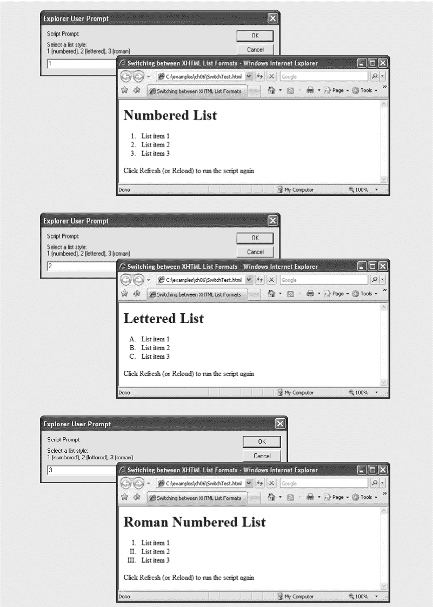

图 6.7 | 使用 switch 多选语句。（第 3 部分，共 4 部分。）

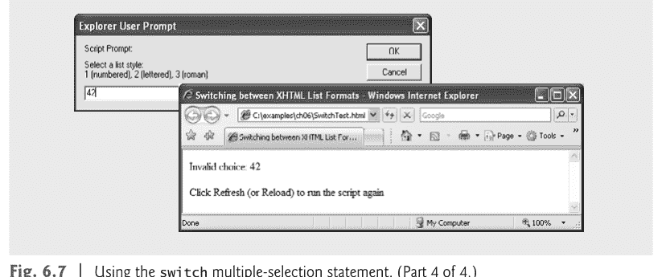

脚本中的第 12 行声明了变量`choice`。该变量存储用户的选择，该选择决定了要显示哪种类型的 XHTML 列表。第 13-14 行声明了变量`startTag`和`endTag`，它们将存储用于创建列表元素的 XHTML 标签。第 15 行声明了变量`validInput`并将其初始化为`true`。脚本使用此变量来确定用户是否做出了有效的选择（由值`true`表示）。如果选择无效，脚本会将`validInput`设置为`false`。第 16 行声明了变量`listType`，它将存储一个指示列表类型的`h1`元素。此标题在 XHTML 文档中出现在列表之前。

第 18-19 行提示用户输入 1 以显示编号列表，输入 2 以显示字母列表，输入 3 以显示罗马数字列表。第 21-40 行定义了一个`switch 语句`，该语句根据用户在提示对话框中输入的值，为变量`startTag`、`endTag`和`listType`赋值。我们使用 CSS 属性`list-style-type`来创建这些不同的列表，该属性允许我们设置列表的编号系统。可能的值包括 decimal（数字——默认值）、lower-roman（小写罗马数字）、upper-roman（大写罗马数字）、lower-alpha（小写字母）、upper-alpha（大写字母）以及其他几种。

`switch`语句由一系列`case 标签`和一个可选的`default case`组成。当控制流到达`switch`语句时，脚本会计算关键字`switch`后括号中的`控制表达式`（本例中为`choice`）。该表达式的值会与每个`case`标签中的值进行比较，从第一个`case`标签开始。假设用户输入了 2。请记住，用户在提示对话框中输入的值会作为字符串返回。因此，字符串`2`会与`switch`语句中每个`case`中的字符串进行比较。如果匹配成功（`case "2":`），则执行该`case`的语句。对于字符串`2`（第 29-32 行），我们将`startTag`设置为一个`ol`开始标签，其`list-style-type`样式属性设置为`upper-alpha`，将`endTag`设置为`</ol>"`以表示有序列表的结束，并将`listType`设置为`"<h1>字母列表</h1>"`。如果控制表达式的值与任何`case`标签都不匹配，则执行`default case`并将变量`validInput`设置为`false`。

第 32 行中的`break`语句使程序控制继续执行`switch`语句之后的第一条语句。使用`break`语句是因为`switch`语句中的`case`会顺序执行。如果在`switch`语句中任何地方都不使用`break`，那么每次匹配成功时，所有剩余`case`的语句都会执行。

接下来，控制流继续到第 42 行的`if`语句，该语句测试变量`validInput`以确定其值是否为`true`。如果是，则第 44-49 行写入`listType`、`startTag`、三个列表项（`<li>`）和`endTag`。否则，脚本在 XHTML 文档中写入文本，表明做出了无效的选择（第 52 行）。

每个`case`可以有多个操作（语句）。`switch`语句与其他语句的不同之处在于，`case`中的多个操作不需要用花括号括起来。通用的`switch`语句（即在每个`case`中使用`break`）的流程图如图 6.8 所示。[注意：作为练习，请绘制不带`break`语句的通用`switch`语句的流程图。]

流程图清楚地表明，每个`case`末尾的`break`语句会导致控制立即退出`switch`语句。对于`switch`语句中的最后一个`case`（或当`default case`出现在最后时），不需要`break`语句，因为程序控制会自动继续执行`switch`语句之后的下一条语句。

> **常见编程错误 6.6**

在`switch`语句中需要`break`语句时忘记使用，这是一个逻辑错误。

> **软件工程观察 6.1**

在`switch`语句中提供`default case`。在没有`default case`的`switch`语句中，未明确测试的`case`会被忽略。包含`default case`可以让你专注于处理异常情况。然而，在某些情况下不需要默认处理。

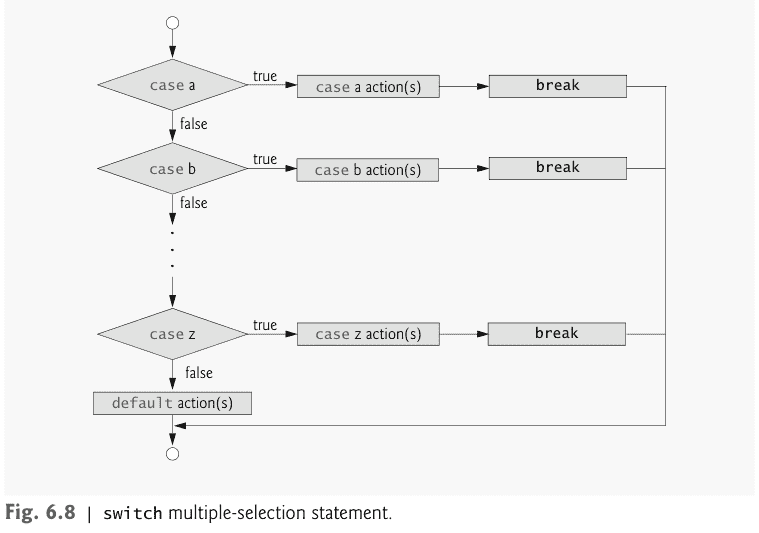

图 6.8 | switch 多选语句。

**良好的编程实践 6.4**

尽管`switch`语句中的`case`子句和`default case`子句可以以任何顺序出现，但将`default`子句放在最后更清晰（也更常见）。

**良好的编程实践 6.5**

在`switch`语句中，当`default`子句列在最后时，其`break`语句不是必需的。一些程序员为了清晰起见以及与其他`case`的对称性而包含此`break`。

请注意，将多个`case`标签列在一起（例如，`case 1: case 2:`，`case`之间没有语句）会对每个`case`执行相同的操作集。

## 6.6 do...while 循环语句

`do...while`循环语句类似于`while`语句。在`while`语句中，循环继续测试发生在循环开始处，在循环体执行之前。`do...while`语句在循环体执行后测试循环继续条件——因此，循环体至少执行一次。当`do...while`终止时，执行继续到`while`子句之后的语句。请注意，如果循环体中只有一条语句，则在`do...while`语句中使用花括号不是必需的。但是，通常会包含花括号，以避免`while`和`do...while`语句之间的混淆。例如，

```javascript
while ( condition )
```

通常被视为`while`语句的头部。没有花括号的单语句体的`do...while`语句如下所示：

```javascript
do
    statement
while ( condition );
```

这可能会引起混淆。最后一行——`while( condition );`——可能被误解为一个包含空语句（单独的分号）的`while`语句。因此，为了避免混淆，具有单语句体的`do...while`语句通常写成如下形式：

```javascript
do
{
    statement
} while ( condition );
```

**良好的编程实践 6.6**

一些程序员即使在不必要的情况下也总是在`do...while`语句中包含花括号。这有助于消除`while`语句和包含单语句体的`do...while`语句之间的歧义。

**错误预防提示 6.3**

当`while`、`for`或`do...while`语句中的循环继续条件永远不会变为`false`时，会导致无限循环。为防止这种情况，请确保`while`或`for`语句的头部之后没有立即出现分号。在计数器控制的循环中，确保控制变量在循环体中递增（或递减）。在哨兵控制的循环中，确保最终输入哨兵值。

图6.9中的脚本使用`do...while`语句来显示六种不同的XHTML标题类型（h1到h6）。第12行声明控制变量`counter`并将其初始化为1。进入`do...while`语句后，第15-17行在文档中写入一行XHTML文本。控制变量`counter`的值用于创建起始和结束的标题标签（例如`<h1>`和`</h1>`）以及要显示的文本行（例如`"This is an h1 level head"`）。第18行在循环底部的循环继续测试发生之前递增计数器。

图6.10中的`do...while`流程图清楚地表明，循环继续测试直到操作至少执行一次后才会发生。

```xml
1  <?xml version = "1.0" encoding = "utf-8"?>
2  <!DOCTYPE html PUBLIC "-//W3C//DTD XHTML 1.0 Strict//EN"
3     "http://www.w3.org/TR/xhtml1/DTD/xhtml1-strict.dtd">
4
5  <!-- 图 6.9: DoWhileTest.html -->
6  <!-- 使用 do...while 循环语句。 -->
7  <html xmlns = "http://www.w3.org/1999/xhtml">
8     <head>
9        <title>使用 do...while 循环语句</title>
10       <script type = "text/javascript">
11          <!--
12             var counter = 1;
13
14             do {
15                document.writeln( "<h" + counter + ">This is " +
16                   "an h" + counter + " level head" +</h" +
17                   counter + ">" );
18                ++counter;
19             } while ( counter <= 6 );
20          // -->
21      </script>
22   </head><body</body>
23</html>
```

图 6.9 | 使用 do...while 循环语句。

图 6.10 | do...while 循环语句流程图。

## 6.7 break 和 continue 语句

`break`和`continue 语句`会改变控制流。`break`语句在`while`、`for`、`do...while`或`switch`语句中执行时，会导致立即退出该语句。程序执行将继续到该结构之后的第一条语句。`break`语句通常用于提前退出循环或跳过`switch`语句的剩余部分（如图6.7所示）。图6.11演示了`for`循环语句中的`break`语句。

```xml
<?xml version = "1.0" encoding = "utf-8"?>
<!DOCTYPE html PUBLIC "-//W3C//DTD XHTML 1.0 Strict//EN"
   "http://www.w3.org/TR/xhtml1/DTD/xhtml1-strict.dtd">

<!-- 图 6.11: BreakTest.html -->
<!-- 在 for 语句中使用 break 语句。 -->
<html xmlns = "http://www.w3.org/1999/xhtml">
   <head>
      <title>
         在 for 语句中使用 break 语句
     </title>
      <script type = "text/javascript">
         <!--
            for ( var count = 1; count <= 10; ++count )
            {
               if ( count == 5 )
                  break; // 仅当 count == 5 时中断循环

               document.writeln( "Count is: " + count + "<br />" );
            } //end for

            document.writeln(
               "Broke out of loop at count = " + count );
         // -->
     </script>
  </head><body</body>
</html>
```

图 6.11 | 在 for 语句中使用 break 语句。（第 1 部分，共 2 部分。）

136 第 6 章 JavaScript：控制语句 II

图 6.11 | 在 for 语句中使用 break 语句。（第 2 部分，共 2 部分。）

在第14-20行的`for`语句的每次迭代中，脚本将`count`的值写入XHTML文档。当第16行的`if`语句检测到`count`为5时，第17行的`break`执行。此语句终止`for`语句，程序继续执行第22行（`for`语句之后紧接着的下一条语句），脚本在此处写入循环终止时`count`的值（即5）。循环仅执行第19行四次。

`continue`语句在`while`、`for`或`do...while`语句中执行时，会跳过循环体中的剩余语句，并继续循环的下一次迭代。在`while`和`do...while`语句中，循环继续测试在`continue`语句执行后立即进行。在`for`语句中，先执行增量表达式，然后进行循环继续测试。这是`for`和`while`之间的一个区别。在`while`中，如果`continue`放置在增量之前不当，可能会导致无限循环。

图6.12在`for`语句中使用`continue`，当第17行的`if`语句确定`count`的值为5时，跳过第20行的`document.writeln`语句。当`continue`语句执行时，脚本跳过`for`语句体的剩余部分。程序控制继续执行`for`语句控制变量的增量，然后进行循环继续测试以确定循环是否应继续执行。

```xml
1 <?xml version = "1.0" encoding = "utf-8"?>
2 <!DOCTYPE html PUBLIC "-//W3C//DTD XHTML 1.0 Strict//EN"
3   "http://www.w3.org/TR/xhtml1/DTD/xhtml1-strict.dtd">
4
5 <!-- 图 6.12: ContinueTest.html -->
6 <!-- 在 for 语句中使用 continue 语句。 -->
7 <html xmlns = "http://www.w3.org/1999/xhtml">
8   <head>
9     <title>
10      在 for 语句中使用 continue 语句
11    </title>
12
```

图 6.12 | 在 for 语句中使用 continue 语句。（第 1 部分，共 2 部分。）

```xml
<script type = "text/javascript">
<!--
for ( var count = 1; count <= 10; ++count )
{
    if ( count == 5 )
        continue; // 仅当 count == 5 时跳过剩余的循环代码

    document.writeln( "Count is: " + count + "<br />" );
} //end for

document.writeln( "Used continue to skip printing 5" );
// -->
</script>
</head><body</body>
</html>
```

图 6.12 | 在 for 语句中使用 continue 语句。（第 2 部分，共 2 部分。）

> **软件工程观察 6.2**

一些程序员觉得`break`和`continue`违反了结构化编程。他们不使用`break`和`continue`，因为这些语句的效果可以通过结构化编程技术来实现。

> **性能提示 6.1**

`break`和`continue`语句在正确使用时，比相应的结构化技术执行得更快。

> **软件工程观察 6.3**

在实现高质量软件工程和实现最佳性能软件之间存在一种张力。通常，其中一个目标的实现是以牺牲另一个目标为代价的。对于除最性能密集型情况之外的所有情况，应遵循以下经验法则：首先使你的代码简单、可读且正确；然后使其快速且小巧，但仅在必要时。

## 6.8 带标签的 break 和 continue 语句

`break`语句可以跳出紧邻的`while`、`for`、`do...while`或`switch`语句。要跳出嵌套的结构集，可以使用带标签的`break`语句。此语句在`while`、`for`、`do...while`或`switch`语句中执行时，会导致立即退出该语句以及任意数量的外层循环语句；程序执行将从带标签语句（前面有标签的语句）之后的第一条语句恢复。带标签的语句可以是一个块（一组用花括号`{}`括起来的语句）。带标签的`break`语句通常用于终止包含`while`、`for`、`do...while`或`switch`语句的嵌套循环结构。图6.13演示了嵌套`for`语句中的带标签`break`。

带标签的块（第12-28行）以一个标签（一个标识符后跟一个冒号）开始。这里，我们使用标签`stop:`。该块包含在第12行末尾和第28行的花括号之间，包括从第13行开始的嵌套`for`语句和第27行的`document.writeln`语句。当第17行的`if`语句检测到`row`

```xml
1  <?xml version = "1.0" encoding = "utf-8"?>
2  <!DOCTYPE html PUBLIC "-//W3C//DTD XHTML 1.0 Strict//EN"
3      "http://www.w3.org/TR/xhtml1/DTD/xhtml1-strict.dtd">
4  
5  <!-- 图 6.13: BreakLabelTest.html -->
6  <!-- 嵌套 for 语句中的带标签 break 语句。 -->
7  <html xmlns = "http://www.w3.org/1999/xhtml">
8      <head>
9          <title>使用带标签的 break 语句</title>
10         <script type = "text/javascript">
11             <!--
12             stop: { // 带标签的块
13                 for ( var row = 1; row <= 10; ++row )
14                 {
15                     for ( var column = 1; column <= 5 ; ++column )
16                     {
17                         if ( row == 5 )
18                             break stop; // 跳转到 stop 块的末尾
19  
20                         document.write( "* " );
21                     } //end for
22  
23                     document.writeln( "<br />" );
24                 } //end for
25  
26                 // 以下行被跳过
27                 document.writeln( "This line should not print" );
28             } // end block labeled stop
29  
30             document.writeln( "End of script" );
31             // -->
32        </script>
33    </head><body</body>
34</html>
```

图 6.13 | 嵌套 for 语句中的带标签 break 语句。（第 1 部分，共 2 部分。）

## 6.9 逻辑运算符

到目前为止，我们只研究了像`count <= 10`、`total > 1000`和`number != sentinelValue`这样的*简单条件*。这些条件是用关系运算符`>`、`<`、`>=`和`<=`以及相等运算符`==`和`!=`来表示的。每个判断只测试一个条件。为了基于多个条件做出判断，我们在单独的语句或嵌套的`if`或`if...else`语句中执行这些测试。

JavaScript 提供了*逻辑运算符*，可用于通过组合简单条件来形成更复杂的条件。逻辑运算符包括`&&`（逻辑与）、`||`（逻辑或）和`!`（逻辑非，也称为*逻辑取反*）。我们将分别考虑这些运算符的示例。

假设在程序的某个时刻，我们希望确保两个条件*都*为真，然后才选择某个执行路径。在这种情况下，我们可以使用逻辑`&&`运算符，如下所示：

```
if ( gender == 1 && age >= 65 )
    ++seniorFemales;
```

这个`if`语句包含两个简单条件。条件`gender == 1`可能被求值以确定，例如，一个人是否为女性。条件`age >= 65`被求值以确定一个人是否为老年人。然后`if`语句考虑组合条件

```
gender == 1 && age >= 65
```

这个条件*当且仅当*两个简单条件都为真时才为真。最后，如果这个组合条件确实为真，则`seniorFemales`的计数增加 1。如果任一或两个简单条件为假，程序将跳过递增操作，并继续执行`if`语句之后的语句。可以通过添加冗余括号使前面的组合条件更具可读性：

```
( gender == 1 ) && ( age >= 65 )
```

图 6.15 中的表格总结了`&&`运算符。该表显示了`expression1`和`expression2`的`false`和`true`值的所有四种可能组合。这种表通常称为*真值表*。JavaScript 对所有包含关系运算符、相等运算符和/或逻辑运算符的表达式求值为`false`或`true`。

| expression1 | expression2 | expression1 && expression2 |
| :--- | :--- | :--- |
| false | false | false |
| false | true | false |
| true | false | false |
| true | true | true |

**图 6.15** | `&&`（逻辑与）运算符的真值表。

现在让我们考虑`||`（逻辑或）运算符。假设我们希望确保两个条件中的*一个或两个*为真，然后才选择某个执行路径。在这种情况下，我们使用`||`运算符，如以下程序段所示：

```
if ( semesterAverage >= 90 || finalExam >= 90 )
    document.writeln( "Student grade is A" );
```

此语句也包含两个简单条件。条件`semesterAverage >= 90`被求值以确定学生是否因整个学期的扎实表现而应获得课程"A"。条件`finalExam >= 90`被求值以确定学生是否因期末考试的出色表现而应获得课程"A"。然后`if`语句考虑组合条件

```
semesterAverage >= 90 || finalExam >= 90
```

如果任一或两个简单条件为真，则授予学生"A"。请注意，只有当两个简单条件都为假时，消息`"Student grade is A"`才*不会*被打印。图 6.16 是逻辑或运算符（`||`）的真值表。

| expression1 | expression2 | expression1 \|\| expression2 |
| :--- | :--- | :--- |
| false | false | false |
| false | true | true |
| true | false | true |
| true | true | true |

**图 6.16** | `||`（逻辑或）运算符的真值表。

`&&`运算符的优先级高于`||`运算符。两个运算符都是从左到右结合。包含`&&`或`||`运算符的表达式仅求值到已知真假为止。因此，对表达式

```
gender == 1 && age >= 65
```

的求值，如果`gender`不等于 1（即整个表达式为假），则立即停止；如果`gender`等于 1（即如果条件`age >= 65`为真，整个表达式仍可能为真），则继续。类似地，如果第一个操作数为`true`，`||`运算符立即返回`true`。逻辑与和逻辑或表达式求值的这种性能特性称为*短路求值*。

JavaScript 提供了`!`（逻辑非）运算符，使程序员能够"反转"条件的含义（即，`true`值变为`false`，`false`值变为`true`）。与组合两个条件（即它们是二元运算符）的逻辑运算符`&&`和`||`不同，逻辑非运算符只有一个条件作为操作数（即它是一元运算符）。逻辑非运算符放在条件之前，以便在原始条件（不带逻辑非运算符）为`false`时选择执行路径，如以下程序段所示：

```
if ( ! ( grade == sentinelValue ) )
    document.writeln( "The next grade is " + grade );
```

条件`grade == sentinelValue`周围的括号是必需的，因为逻辑非运算符的优先级高于相等运算符。图 6.17 是逻辑非运算符的真值表。

| expression | !expression |
| :--- | :--- |
| false | true |
| true | false |

**图 6.17** | `!`（逻辑非）运算符的真值表。

在大多数情况下，你可以通过使用适当的关系或相等运算符以不同的方式表达条件来避免使用逻辑非。例如，前面的语句也可以写成如下形式：

```
if ( grade != sentinelValue )
    document.writeln( "The next grade is " + grade );
```

`continue`语句继续执行紧接其后的`while`、`for`或`do...while`语句的下一次迭代（重复）。`带标签的 continue 语句`，当在重复语句（`while`、`for`或`do...while`）中执行时，会跳过结构体中剩余的语句以及任意数量的外层重复语句，然后继续执行外层`带标签的重复语句`（前面带有标签的重复语句）的下一次迭代。在带标签的`while`和`do...while`语句中，循环继续测试在`continue`语句执行后立即求值。在带标签的`for`语句中，递增表达式执行，然后循环继续测试求值。图 6.14 在嵌套的`for`语句中使用带标签的 continue 语句，以使执行继续到外层`for`语句的下一次迭代。

```xml
<?xml version = "1.0" encoding = "utf-8"?>
<!DOCTYPE html PUBLIC "-//W3C//DTD XHTML 1.0 Strict//EN"
   "http://www.w3.org/TR/xhtml1/DTD/xhtml1-strict.dtd">

<!-- Fig. 6.14: ContinueLabelTest.html -->
<!-- Labeled continue statement in a nested for statement. -->
<html xmlns = "http://www.w3.org/1999/xhtml">
   <head>
      <title>Using the continue Statement with a Label</title>
      <script type = "text/javascript">
         <!--
         nextRow: // target label of continue statement
            for ( var row = 1; row <= 5; ++row )
            {
               document.writeln( "<br />" );
               for ( var column = 1; column <= 10; ++column )
               {
                  if ( column > row )
                     continue nextRow; // next iteration of labeled loop

                  document.write( "* " );
               } //end for
            } //end for
         // -->
     </script>
  </head><body</body>
</html>
```

**图 6.14** | 嵌套`for`语句中的带标签 continue 语句。

带标签的`for`语句（第 13-24 行）以第 12 行的`nextRow`标签开始。当内层`for`语句中的`if`语句（第 19 行）检测到`column`大于`row`时，第 20 行执行，程序控制继续到外层`for`语句控制变量的递增。即使内层`for`语句从 1 计数到 10，一行上输出的`*`字符数也永远不会超过`row`的值。

当`row`等于 5 时，第 18 行的语句执行。此语句终止第 15 行的`for`语句及其外层第 13 行的`for`语句，程序继续到第 30 行的语句（标签块之后的第一个顺序语句）。内层`for`语句仅执行其主体四次。请注意，第 27 行的`document.writeln`语句永远不会执行，因为它包含在标签块中，而外层`for`语句从未完成。

# 7 JavaScript：函数

> 形式永远追随功能。

—路易斯·沙利文

> 合众为一。

（由众多组成。）

—维吉尔

> 噢！唤回昨日，让时光倒流。

—威廉·莎士比亚

> 叫我以实玛利吧。

—赫尔曼·梅尔维尔

> 当你那样叫我时，请微笑。

—欧文·威斯特

## 目标

在本章中，你将学习：

- 如何创建新函数。
- 如何在函数之间传递信息。
- 使用随机数生成的模拟技术。
- 标识符的可见性如何被限制在程序的特定区域。
- 使用 JavaScript 的全局函数。
- 使用递归函数。
- 比较递归与迭代。

## 大纲

- 7.1 简介
- 7.2 函数
- 7.3 程序员定义的函数
- 7.4 函数定义
- 7.5 随机数生成
- 7.6 示例：机会游戏
- 7.7 另一个示例：随机图像生成器
- 7.8 作用域规则
- 7.9 JavaScript 全局函数
- 7.10 递归
- 7.11 递归与迭代

## 7.1 简介

大多数解决现实世界问题的计算机程序都比本书前几章介绍的程序要大得多。经验表明，开发和维护大型程序的最佳方法是将其构建为小的、简单的部分或*模块*。这种技术被称为*分而治之*。本章描述了 JavaScript 的许多关键特性，这些特性有助于大型脚本的设计、实现、操作和维护。

## 7.2 函数

JavaScript 中的模块被称为*函数*。JavaScript 程序是通过将你编写的新函数与 JavaScript 中可用的"预包装"函数和对象组合而成的。属于 JavaScript 对象的预包装函数（例如之前介绍的`Math.pow`和`Math.round`）被称为*方法*。术语"方法"意味着该函数属于特定对象。我们将属于特定 JavaScript 对象的函数称为方法；所有其他函数则称为函数。

JavaScript 提供了多个对象，这些对象拥有丰富的方法集合，用于执行常见的数学计算、字符串操作、日期和时间操作，以及称为数组的数据集合操作。这些对象提供了你经常需要的许多功能。一些常见的 JavaScript 预定义对象及其方法将在第 8 章 JavaScript：数组和第 9 章 JavaScript：对象中讨论。

> 软件工程观察 7.1

避免重复造轮子。使用现有的 JavaScript 对象、方法和函数，而不是编写新的。这可以减少脚本开发时间，并有助于避免引入错误。

> 可移植性提示 7.1

使用 JavaScript 对象内置的方法有助于使脚本更具可移植性。

你可以编写函数来定义特定任务，这些任务可以在脚本的多个点使用。这些函数被称为*程序员定义的函数*。定义函数的实际语句只编写一次，并且对其他函数隐藏。

函数通过编写函数名，后跟左括号，后跟以逗号分隔的零个或多个参数列表，后跟右括号来调用。例如，一个程序员想要将存储在变量`inputValue`中的字符串转换为浮点数并将其添加到变量`total`中，可能会编写

```
total += parseFloat( inputValue );
```

当此语句执行时，JavaScript 函数`parseFloat`将`inputValue`变量中的字符串转换为浮点值，并将该值添加到`total`中。变量`inputValue`是函数`parseFloat`的参数。函数`parseFloat`接受一个浮点数的字符串表示作为参数，并返回相应的浮点数值。函数参数可以是常量、变量或表达式。

方法的调用方式相同，但需要方法所属对象的名称以及方法名前的点号。例如，我们已经见过语法`document.writeln("Hi there.");`。此语句调用`document`对象的`writeln`方法来输出文本。

## 7.3 程序员定义的函数

函数允许你将程序模块化。在函数定义中声明的所有变量都是*局部变量*——它们只能在定义它们的函数中访问。大多数函数都有一个*参数*列表，这些参数提供了通过函数调用在函数之间传递信息的方式。函数的参数也被视为局部变量。当调用函数时，函数调用中的参数被分配给函数定义中的相应参数。

> 软件工程观察 7.2

如果一个函数的任务无法简洁地表达，那么该函数可能执行了太多不同的任务。通常最好将这样的函数分解成几个更小的函数。

## 7.4 函数定义

到目前为止，我们在文本中介绍的每个脚本都由一系列语句和控制结构按顺序组成。这些脚本在浏览器加载网页并评估页面的`<head>`部分时执行。我们现在考虑如何编写自己的自定义函数并在脚本中调用它们。

*程序员定义的函数 square*

考虑一个脚本（图 7.1），它使用函数`square`来计算从 1 到 10 的整数的平方。[注意：我们继续展示许多示例，其中 XHTML 文档的 body 元素为空，文档直接由 JavaScript 创建。在后面的章节中，我们将展示许多 JavaScript 与文档 body 中的元素交互的示例。]

第 15-17 行的`for`语句输出显示从 1 到 10 的整数平方结果的 XHTML。循环的每次迭代计算控制变量`x`的当前值的平方，并通过在 XHTML 文档中写入一行来输出结果。函数`square`在第 17 行通过表达式被调用。

图 6.18 中的脚本通过产生它们的真值表来演示所有逻辑运算符。该脚本产生一个包含结果的 XHTML 表格。

在图 6.18 的输出中，字符串`"false"`和`"true"`表示每个条件中操作数的假和真。条件的结果显示为 true 或 false。请注意，当将连接运算符与布尔值和字符串一起使用时，JavaScript 会自动将布尔值转换为字符串`"false"`或`"true"`。第 16-39 行构建了一个包含结果的 XHTML 表格。

```xml
1  <?xml version = "1.0" encoding = "utf-8"?>
2  <!DOCTYPE html PUBLIC "-//W3C//DTD XHTML 1.0 Strict//EN"
3     "http://www.w3.org/TR/xhtml1/DTD/xhtml1-strict.dtd">
4  
5  <!-- Fig. 6.18: LogicalOperators.html -->
6  <!-- Demonstrating logical operators. -->
7  <html xmlns = "http://www.w3.org/1999/xhtml">
8     <head>
9        <title>Demonstrating the Logical Operators</title>
10        <style type = "text/css">
11           table   { width: 100% }
12           td.left { width: 25% }
13       </style>
14        <script type = "text/javascript">
15           <!--
16           document.writeln(
17              "<table border = "1"" );
18           document.writeln(
19              "<caption>Demonstrating Logical " +
20                 "Operators</caption>" );
21           document.writeln(
22              "<tr><td class = "left">Logical AND (&&</td>" +
23              "<td>false && false: " + ( false && false ) +
24              "<br />false && true: " + ( false && true ) +
25              "<br />true && false: " + ( true && false ) +
26              "<br />true && true: " + ( true && true ) +
27             </td</tr>" );
28           document.writeln(
29              "<tr><td class = "left">Logical OR (||</td>" +
30              "<td>false || false: " + ( false || false ) +
31              "<br />false || true: " + ( false || true ) +
32              "<br />true || false: " + ( true || false ) +
33              "<br />true || true: " + ( true || true ) +
34             </td</tr>" );
35           document.writeln(
36              "<tr><td class = "left">Logical NOT (!</td>" +
37              "<td>!false: " + ( !false ) +
38              "<br />!true: " + ( !true ) +</td</tr>" );
39           document.writeln(</table>" );
40           // -->
41       </script>
42    </head><body</body>
43 </html>
```

图 6.18 | 演示逻辑运算符。（第 1 部分，共 2 部分。）

图 6.18 | 演示逻辑运算符。（第 2 部分，共 2 部分。）

JavaScript 的一个有趣特性是，大多数非布尔值都可以转换为布尔值`true`或`false`。非零数值被认为是`true`。数值零被认为是`false`。任何包含字符的字符串被认为是`true`。空字符串（即不包含字符的字符串）被认为是`false`。值`null`和已声明但未初始化的变量被认为是`false`。所有对象（例如，浏览器的`document`和`window`对象以及 JavaScript 的`Math`对象）被认为是`true`。

图 6.19 显示了到目前为止介绍的 JavaScript 运算符的优先级和结合性。运算符从上到下按优先级递减的顺序显示。

| 运算符 | 结合性 | 类型 |
| :--- | :--- | :--- |
| ++ -- ! | 从右到左 | 一元 |
| * / % | 从左到右 | 乘法 |
| + - | 从左到右 | 加法 |
| < <= > >= | 从左到右 | 关系 |
| == != | 从左到右 | 相等 |
| && | 从左到右 | 逻辑与 |
| \|\| | 从左到右 | 逻辑或 |
| ?: | 从右到右 | 条件 |
| = += -= *= /= %= | 从右到左 | 赋值 |

图 6.19 | 到目前为止讨论的运算符的优先级和结合性。

## 7.5 随机数生成

我们现在简短地、并且希望是有趣地，转向一个流行的编程应用，即模拟和游戏。在本节和下一节中，我们将开发一个结构良好的游戏程序，其中包含多个函数。该程序使用了我们学过的大多数控制语句。

赌场空气中弥漫着某种令人振奋的气息，无论是坐在豪华红木和毛毡制的掷骰子赌桌前的豪赌客，还是在单臂老虎机前投入25美分硬币的玩家。这就是*机会的元素*，即运气可能将口袋里的钱变成一座财富山的可能性。机会的元素可以通过`Math`对象的*随机方法*引入。（记住，我们称`random`为方法，因为它属于`Math`对象。）

考虑以下语句：

```
var randomValue = Math.random();
```

方法`random`生成一个从0.0到（但不包括）1.0的浮点值。如果`random`真正随机地产生值，那么每次调用`random`时，从0.0到（但不包括）1.0的每个值都有相等的*机会*（或*概率*）被选中。

`random`直接产生的值范围通常与特定应用所需的不同。例如，一个模拟抛硬币的程序可能只需要0代表正面，1代表反面。一个模拟掷六面骰子的程序可能需要1到6范围内的随机整数。一个在视频游戏中随机预测下一种将飞过地平线的宇宙飞船类型（有四种可能性）的程序可能需要0–3或1–4范围内的随机整数。

为了演示方法`random`，让我们开发一个程序（图7.3），模拟掷六面骰子20次并显示每次的值。我们使用乘法运算符（*）与`random`如下：

```
Math.floor( 1 + Math.random() * 6 )
```

首先，上述表达式将调用`Math.random()`的结果乘以6，产生一个从0.0到（但不包括）6.0的数字。这被称为缩放

## 148 第7章 JavaScript：函数

```xml
<?xml version = "1.0" encoding = "utf-8"?>
<!DOCTYPE html PUBLIC "-//W3C//DTD XHTML 1.0 Strict//EN"
"http://www.w3.org/TR/xhtml1/DTD/xhtml1-strict.dtd">

<!-- 图 7.1: SquareInt.html -->
<!-- 程序员定义的函数 square。 -->
<html xmlns = "http://www.w3.org/1999/xhtml">
<head>
<title>一个程序员定义的 square 函数</title>
<script type = "text/javascript">
<!--
document.writeln( "<h1>计算1到10的平方</h1>" );

// 计算1到10的平方
for ( var x = 1; x <= 10; x++ )
document.writeln( x + "的平方是" +
square( x ) + "<br />" );

// 以下 square 函数定义仅在函数被显式调用时执行。

// square 函数定义
function square( y )
{
return y * y;
} // 函数 square 结束
// -->
</script>
</head><body</body>
</html>
```

图 7.1 | 程序员定义的 square 函数。

`square(x)`。当程序控制到达此表达式时，程序调用函数`square`（在第23-26行定义）。括号()代表*函数调用运算符*，具有高优先级。此时，程序复制`x`的值（参数），并将程序控制转移到函数`square`的第一行。函数`square`接收`x`值的副本并将其存储在参数`y`中。然后`square`计算`y * y`。结果被传递（返回）到第17行调用`square`的位置。第16-17行将`"The square of "`、`x`的值、字符串`" is "`、函数`square`返回的值以及一个`<br />`标签连接起来，并将该行文本写入 XHTML 文档。此过程重复10次。

函数`square`的定义（第23-26行）表明`square`期望一个参数`y`。函数`square`在其主体中使用此名称来操作从第17行传递给`square`的值。`square`中的*return 语句*将计算结果`y * y`传递回调用函数。请注意，JavaScript 关键字`var`不用于在函数的参数列表中声明变量。

> **常见编程错误 7.1**

*在函数参数列表中使用 JavaScript `var`关键字声明变量会导致 JavaScript 运行时错误。*

在此示例中，函数`square`位于脚本的其余部分之后。当`for`语句终止时，程序控制*不会*顺序流入函数`square`。必须显式调用函数，其主体中的代码才会执行。因此，在此示例中，当`for`语句终止时，脚本终止。

> **软件工程观察 7.3**

*除非函数被显式调用，否则 JavaScript 解释器不会执行函数定义主体中包含的语句。*

函数定义的格式是

```
function function-name( parameter-list )
{
    declarations and statements
}
```

`function-name`是任何有效的标识符。`parameter-list`是一个逗号分隔的列表，包含函数被调用时接收的参数名称。函数调用中应有一个参数对应函数定义中的每个参数。如果函数不接收任何值，则`parameter-list`为空（即，函数名后跟一对空括号）。花括号中的`declarations`和`statements`构成`函数体`。

> **常见编程错误 7.2**

*忘记从应该返回值的函数中返回值是一个逻辑错误。*

> **常见编程错误 7.3**

*在函数定义的参数列表右括号后放置分号会导致 JavaScript 运行时错误。*

> **常见编程错误 7.4**

*在函数中将函数参数重新定义为局部变量是一个逻辑错误。*

## 150 第7章 JavaScript：函数

> **常见编程错误 7.5**

向函数传递与相应参数预期类型不兼容的参数是一个逻辑错误，可能导致 JavaScript 运行时错误。

> **良好编程实践 7.1**

虽然这样做并非不正确，但不要对传递给函数的参数和函数定义中的相应参数使用相同的名称。使用不同的名称可以避免歧义。

> **软件工程观察 7.4**

为了提高软件可重用性，每个函数应限于执行单一、定义明确的任务，并且函数名应有效表达该任务。这样的函数使程序更易于编写、调试、维护和修改。

有三种方式将控制权返回到函数被调用的点。如果函数不返回结果，当程序到达函数结束的右花括号或执行语句时，控制权返回

`return;`

如果函数确实返回结果，语句

`return expression;`

将`expression`的值返回给调用者。当执行`return`语句时，控制权立即返回到函数被调用的点。

## **程序员定义的函数** *maximum*

我们下一个示例中的脚本（图7.2）使用一个名为`maximum`的程序员定义函数来确定并返回三个浮点值中的最大值。

```xml
<?xml version = "1.0" encoding = "utf-8"?>
<!DOCTYPE html PUBLIC "-//W3C//DTD XHTML 1.0 Strict//EN"
   "http://www.w3.org/TR/xhtml1/DTD/xhtml1-strict.dtd">

<!-- 图 7.2: maximum.html -->
<!-- 程序员定义的 maximum 函数。 -->
<html xmlns = "http://www.w3.org/1999/xhtml">
   <head>
      <title>查找三个值中的最大值</title>
      <script type = "text/javascript">
         <!--
         var input1 = window.prompt( "输入第一个数字", "0" );
         var input2 = window.prompt( "输入第二个数字", "0" );
         var input3 = window.prompt( "输入第三个数字", "0" );

         var value1 = parseFloat( input1 );
         var value2 = parseFloat( input2 );
         var value3 = parseFloat( input3 );

         var maxValue = maximum( value1, value2, value3 );

         document.writeln( "第一个数字: " + value1 +
           "<br />第二个数字: " + value2 +
           "<br />第三个数字: " + value3 +
           "<br />最大值是: " + maxValue );

         // maximum 函数定义（从第20行调用）
         function maximum( x, y, z )
         {
           return Math.max( x, Math.max( y, z ) );
         } // 函数 maximum 结束
         // -->
     </script>
  </head>
   <body>
      <p>点击刷新（或重新加载）以再次运行脚本</p>
  </body>
</html>
```

图 7.2 | 程序员定义的 maximum 函数。（第1部分，共2部分。）

三个浮点值由用户通过提示对话框输入（第12-14行）。第16-18行使用函数`parseFloat`将用户输入的字符串转换为浮点值。第20行的语句将三个浮点值传递给函数`maximum`（在第28-31行定义），该函数确定最大的浮点值。此值由函数`maximum`中的`return`语句返回到第20行。返回的值被赋给变量`maxValue`。第22-25行显示用户输入的三个浮点值和计算出的`maxValue`。

注意函数`maximum`的实现（第28-31行）。第一行表明函数的名称是`maximum`，并且函数接受三个参数（`x`、`y`和`z`）来完成其任务。此外，函数体包含一条语句，该语句使用两次调用`Math`对象的`max`方法来返回三个浮点值中的最大值。首先，使用变量`y`和`z`的值调用方法`Math.max`以确定两者中较大的值。接下来，将变量`x`的值和第一次调用`Math.max`的结果传递给方法`Math.max`。最后，第二次调用`Math.max`的结果被返回到调用`maximum`的点（即第20行）。再次注意，脚本在顺序到达函数`maximum`的定义之前就终止了。函数`maximum`主体中的语句仅在从第20行调用该函数时执行。

## 7.6 示例：机会游戏

最受欢迎的机会游戏之一是一种名为"双骰子"的骰子游戏，在世界各地的赌场和后巷中都有玩。游戏规则很简单：

> 玩家掷两个骰子。每个骰子有六个面，分别包含一、二、三、四、五和六个点数。骰子停止后，计算两个朝上面的点数之和。如果第一次投掷的和为7或11，则玩家获胜。如果第一次投掷的和为2、3或12（称为"双骰子"），则玩家输（即"庄家"赢）。如果第一次投掷的和为4、5、6、8、9或10，则该和成为玩家的"点数"。要获胜，必须继续掷骰子，直到"达到你的点数"（即掷出你的点数值）。如果在达到点数之前掷出7，则玩家输。

图7.5模拟了双骰子游戏。玩家在第一次及所有后续投掷中都必须掷两个骰子。运行脚本时，点击`掷骰子`按钮开始游戏。`掷骰子`按钮下方的消息会显示每次投掷后的游戏状态。

```xml
<?xml version = "1.0" encoding = "utf-8"?>
<!DOCTYPE html PUBLIC "-//W3C//DTD XHTML 1.0 Strict//EN"
    "http://www.w3.org/TR/xhtml1/DTD/xhtml1-strict.dtd">

<!-- 图 7.5: Craps.html -->
<!-- 双骰子游戏模拟。 -->
<html xmlns = "http://www.w3.org/1999/xhtml">
    <head>
        <title>模拟双骰子游戏的程序</title>
        <style type = "text/css">
            table   { text-align: right }
            body    { font-family: arial, sans-serif }
            div.red { color: red }
       </style>
        <script type = "text/javascript">
            <!--
            // 用于测试游戏状态的变量
            var WON = 0;
            var LOST = 1;
            var CONTINUE_ROLLING = 2;

            // 程序中使用的其他变量
            var firstRoll = true; // 如果当前投掷是第一次则为 true
            var sumOfDice = 0; // 骰子点数之和
            var myPoint = 0; // 如果第一次投掷未分胜负则为点数
            var gameStatus = CONTINUE_ROLLING; // 游戏尚未结束

            // 处理一次骰子投掷
            function play()
            {
                // 获取页面上的点数字段
                var point = document.getElementById( "pointfield" );

                // 获取页面上的状态 div
                var statusDiv = document.getElementById( "status" );
```

图 7.5 | 双骰子游戏模拟。（第 1 部分，共 4 部分。）

```xml
<?xml version = "1.0" encoding = "utf-8"?>
<!DOCTYPE html PUBLIC "-//W3C//DTD XHTML 1.0 Strict//EN"
    "http://www.w3.org/TR/xhtml1/DTD/xhtml1-strict.dtd">

<!-- 图 7.3: RandomInt.html -->
<!-- 随机整数，移位和缩放。 -->
<html xmlns = "http://www.w3.org/1999/xhtml">
    <head>
        <title>移位和缩放的随机整数</title>
        <style type = "text/css">
            table { width: 50%;
                    border: 1px solid gray;
                    text-align: center }
       </style>
        <script type = "text/javascript">
            <!--
            var value;

            document.writeln( "<table>" );
            document.writeln( "<caption>随机数</caption><tr>" );

            for ( var i = 1; i <= 20; i++ )
            {
                value = Math.floor( 1 + Math.random() * 6 );
                document.writeln( "<td>" + value +</td>" );

                // 每5个条目开始一个新的表格行
                if ( i % 5 == 0 && i != 20 )
                    document.writeln(</tr><tr>" );
            } // end for

            document.writeln(</tr</table>" );
            // -->
       </script>
   </head>
    <body>
        <p>点击刷新（或重新加载）以再次运行脚本</p>
   </body>
</html>
```

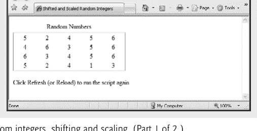

图 7.3 | 随机整数，移位和缩放。（第 1 部分，共 2 部分。）

154 第 7 章 JavaScript：函数

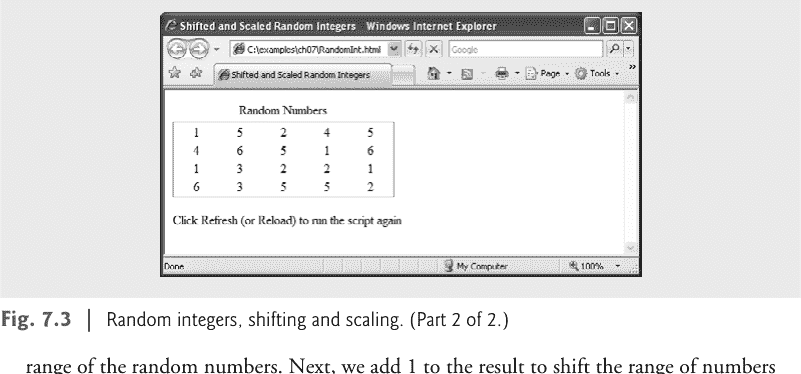

图 7.3 | 随机整数，移位和缩放。（第 2 部分，共 2 部分。）

随机数的范围。接下来，我们将结果加1，以将数字范围移位，从而产生一个在1.0到（但不包括）7.0范围内的数字。最后，我们使用方法`Math.floor`将结果向下舍入到不大于参数值的最接近整数——例如，1.75被舍入为1。图7.3确认结果在1到6的范围内。

为了说明这些数字出现的概率大致相等，让我们用图7.4中的程序模拟掷骰子6000次。从1到6的每个整数应该大约出现1000次。使用浏览器的**刷新**（或**重新加载**）按钮再次执行脚本。

正如程序输出所示，我们使用了Math方法random以及前一个示例中的缩放和移位技术来模拟掷六面骰子。请注意，我们使用了嵌套控制语句来确定六面骰子每个面出现的次数。第12-17行声明并初始化了计数器，以跟踪六个骰子值中每个值出现的次数。第18行声明了一个变量来存储骰子的面值。第21-46行的for语句迭代6000次。在

```xml
<?xml version = "1.0" encoding = "utf-8"?>
<!DOCTYPE html PUBLIC "-//W3C//DTD XHTML 1.0 Strict//EN"
    "http://www.w3.org/TR/xhtml1/DTD/xhtml1-strict.dtd">

<!-- 图 7.4: RollDie.html -->
<!-- 掷六面骰子6000次。 -->
<html xmlns = "http://www.w3.org/1999/xhtml">
    <head>
        <title>掷六面骰子6000次</title>
        <script type = "text/javascript">
            <!--
            var frequency1 = 0;
            var frequency2 = 0;
            var frequency3 = 0;
            var frequency4 = 0;
            var frequency5 = 0;
```

图 7.4 | 掷六面骰子6000次。（第 1 部分，共 3 部分。）

```javascript
var frequency6 = 0;
var face;

// 掷骰子6000次并累积结果
for ( var roll = 1; roll <= 6000; roll++ )
{
    face = Math.floor( 1 + Math.random() * 6 );

    switch ( face )
    {
        case 1:
            ++frequency1;
            break;
        case 2:
            ++frequency2;
            break;
        case 3:
            ++frequency3;
            break;
        case 4:
            ++frequency4;
            break;
        case 5:
            ++frequency5;
            break;
        case 6:
            ++frequency6;
            break;
    } // end switch
} // end for

document.writeln( "<table border = "1">" );
document.writeln( "<thead><th>面值</th>" +
    "<th>频率</th</thead>" );
document.writeln( "<tbody><tr><td>1</td><td>" +
    frequency1 +</td</tr>" );
document.writeln( "<tr><td>2</td><td>" + frequency2 +
   </td</tr>" );
document.writeln( "<tr><td>3</td><td>" + frequency3 +
   </td</tr>" );
document.writeln( "<tr><td>4</td><td>" + frequency4 +
   </td</tr>" );
document.writeln( "<tr><td>5</td><td>" + frequency5 +
   </td</tr>" );
document.writeln( "<tr><td>6</td><td>" + frequency6 +
   </td</tr</tbody</table>" );
// -->
</script>
</head>
<body>
    <p>点击刷新（或重新加载）以再次运行脚本</p>
</body>
</html>
```

图 7.4 | 掷六面骰子6000次。（第 2 部分，共 3 部分。）

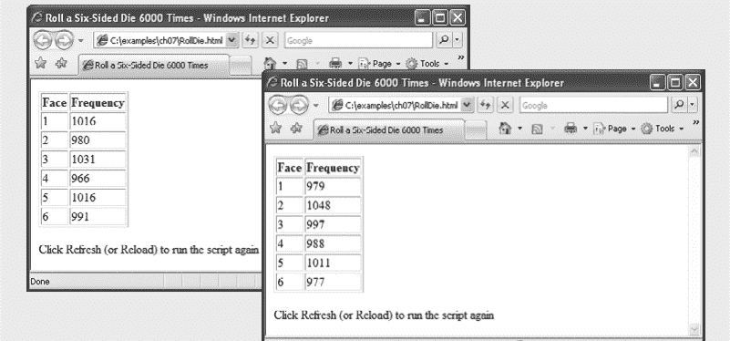

循环的每次迭代中，第23行生成一个1到6的值，存储在`face`中。第25-45行的嵌套switch语句使用随机选择的面值作为其控制表达式。根据`face`的值，程序在循环的每次迭代中递增六个计数器变量之一。请注意，此switch语句中没有提供默认情况，因为第23行的语句只产生值1、2、3、4、5和6。在此示例中，默认情况永远不会执行。在我们学习第8章的数组之后，我们将讨论一种用单行语句替换此程序中整个switch语句的方法。

多次运行程序，并观察结果。请注意，每次执行脚本时，程序都会产生不同的随机数，因此结果应该会有所不同。

random返回的值始终在范围内

```
0.0 ≤ Math.random() < 1.0
```

之前，我们演示了语句

```
face = Math.floor( 1 + Math.random() * 6 );
```

它模拟了掷六面骰子。此语句总是将一个整数（随机）分配给变量`face`，范围在1 ≤ `face` ≤ 6。请注意，此范围的宽度（即范围内的连续整数数量）为6，范围的起始数字为1。参考前面的语句，我们看到范围的宽度由用于缩放random的乘法运算符的数字（前面语句中的6）决定，范围的起始数字等于加到`Math.random() * 6`上的数字（前面语句中的1）。我们可以将此结果概括为

```
face = Math.floor( a + Math.random() * b );
```

其中a是*移位值*（等于所需连续整数范围中的第一个数字），b是*缩放因子*（等于所需连续整数范围的宽度）。

## 第7章 JavaScript：函数

```javascript
if ( firstRoll ) // 骰子的首次投掷
{
    sumOfDice = rollDice();

    switch ( sumOfDice )
    {
        case 7: case 11: // 首次投掷即获胜
            gameStatus = WON;
            // 清空点数字段
            point.value = "";
            break;
        case 2: case 3: case 12: // 首次投掷即失败
            gameStatus = LOST;
            // 清空点数字段
            point.value = "";
            break;
        default:                // 记住点数
            gameStatus = CONTINUE_ROLLING;
            myPoint = sumOfDice;
            point.value = myPoint;
            firstRoll = false;
    } // 结束 switch
} // 结束 if
else
{
    sumOfDice = rollDice();

    if ( sumOfDice == myPoint ) // 通过达到点数获胜
        gameStatus = WON;
    else
        if ( sumOfDice == 7 )   // 因掷出7而失败
            gameStatus = LOST;
} // 结束 else

if ( gameStatus == CONTINUE_ROLLING )
    statusDiv.innerHTML = "再次投掷";
else
{
    if ( gameStatus == WON )
        statusDiv.innerHTML = "玩家获胜。" +
            "点击"投掷骰子"再次游戏。";
    else
        statusDiv.innerHTML = "玩家失败。" +
            "点击"投掷骰子"再次游戏。";

    firstRoll = true;
} // 结束 else
} // 结束 play 函数

// 投掷骰子
function rollDice()
{
    var die1;
    var die2;
    var workSum;

    die1 = Math.floor( 1 + Math.random() * 6 );
    die2 = Math.floor( 1 + Math.random() * 6 );
    workSum = die1 + die2;

    document.getElementById( "die1field" ).value = die1;
    document.getElementById( "die2field" ).value = die2;
    document.getElementById( "sumfield" ).value = workSum;

    return workSum;
} // 结束 rollDice 函数
// -->
</script>
</head>
<body>
<form action = "">
<table>
<caption>Craps</caption>
<tr><td>骰子 1</td>
<td><input id = "die1field" type = "text" />
</td</tr>
<tr><td>骰子 2</td>
<td><input id = "die2field" type = "text" />
</td</tr>
<tr><td>总和</td>
<td><input id = "sumfield" type = "text" />
</td</tr>
<tr><td>点数</td>
<td><input id = "pointfield" type = "text" />
</td</tr>
<tr><td /><td><input type = "button" value = "投掷骰子"
onclick = "play()"</td</tr>
</table>
<div id = "status" class = "red">
点击"投掷骰子"按钮开始游戏</div>
</form>
</body>
</html>
```

图 7.5 | Craps 游戏模拟。（第2部分，共4部分。）

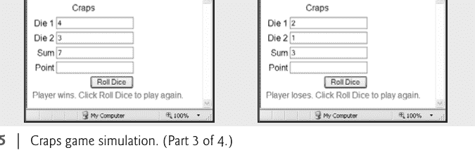

图 7.5 | Craps 游戏模拟。（第3部分，共4部分。）

到目前为止，所有用户与脚本的交互都是通过提示对话框（用户在其中输入程序的输入值）或警告对话框（向用户显示消息，用户可以单击"确定"来关闭对话框）进行的。尽管这些对话框是从用户接收输入和显示消息的有效方式，但它们的功能相当有限。提示对话框一次只能从用户那里获取一个值，而消息对话框一次只能显示一条消息。

### XHTML 表单

更常见的是，通过 XHTML 表单（例如用户输入姓名和地址信息的表单）一次从用户那里接收多个输入，或一次显示多条数据（例如，本例中的骰子值、骰子总和和点数）。为了开始介绍更复杂的用户界面，本程序使用了一个 XHTML 表单（在第2章中讨论）和一个新的图形用户界面概念——GUI *事件处理*。这是我们的第一个示例，其中 JavaScript 响应用户与 XHTML 表单中 GUI 组件的交互而执行。这种交互会引发一个事件。脚本通常用于响应事件。

在讨论脚本代码之前，我们先讨论 XHTML 文档的 body 元素（第105-126行）。本节中的 GUI 组件在脚本中被广泛使用。

第106行开始定义一个 XHTML 表单元素。XHTML 标准要求每个表单都包含一个 action 属性，但由于此表单不将其信息发送到 Web 服务器，因此使用了空字符串（""）。

在本例中，我们决定将表单的 GUI 组件放在一个 XHTML table 元素中，因此第107行开始定义 XHTML 表格。第109-120行创建了四个表格行。每行包含一个带有文本标签的左单元格和一个右单元格中的 input 元素。

创建了四个输入字段（第110、113、116和119行）来显示第一个骰子的值、第二个骰子的值、骰子总和以及当前的点数值（如果有的话）。它们的 id 属性分别设置为`die1field`、`die2field`、`sumfield`和`pointfield`。id 属性可用于应用 CSS 样式并使脚本代码能够引用 XHTML 文档中的元素。因为如果指定了 id 属性，它必须具有唯一的值，所以 JavaScript 可以通过其 id 属性可靠地引用任何单个元素。我们稍后将看到这是如何完成的。

第121-122行创建了第五行，左列中有一个空单元格，后面是`投掷骰子`按钮。按钮的`onclick 属性`指示当 XHTML 文档的用户单击`投掷骰子`按钮时要采取的操作。在本例中，单击按钮会导致调用`play`函数。


### 事件驱动编程

这种编程风格被称为*事件驱动编程*——用户与 GUI 组件交互，脚本收到事件通知并处理该事件。用户与 GUI 的交互“驱动”了程序。按钮单击被称为*事件*。当事件发生时被调用的函数被称为*事件处理函数*或*事件处理程序*。当表单中发生 GUI 事件时，浏览器会调用指定的事件处理函数。在任何事件被处理之前，每个 GUI 组件都必须知道当特定事件发生时将调用哪个事件处理函数。大多数 XHTML GUI 组件都有几种不同的事件类型。事件模型在第 11 章 JavaScript：事件中详细讨论。通过为**投掷骰子**按钮指定 `onclick = "play()"`，我们指示浏览器*监听事件*（特别是按钮单击事件）。这*注册了*该 GUI 组件的*事件处理程序*，使浏览器开始监听该组件上的单击事件。如果未为**投掷骰子**按钮指定事件处理程序，则当用户按下该按钮时，脚本将不会响应。

第 123-125 行分别结束表格和表单元素。在表格之后，创建了一个 `id` 属性为 `"status"` 的 `div` 元素。该元素将由脚本更新，以向用户显示每次投掷的结果。第 13 行中的样式声明将此 `div` 中包含的文本设置为红色。

### 讨论游戏的脚本代码

这个游戏相当复杂。玩家可能在第一次投掷时获胜或失败，也可能在任何后续投掷时获胜或失败。第 18-20 行创建了定义三种游戏状态的变量——游戏获胜、游戏失败和继续投掷骰子。与许多其他编程语言不同，JavaScript 没有提供定义*常量*（即值不能修改的变量）的机制。因此，我们对这些变量名使用全大写字母，以表明我们不打算修改它们的值，并使它们在代码中突出显示——这是真实常量的常见行业实践。

> **良好的编程实践 7.2**
>
> *在应该用作常量的变量名中只使用大写字母（单词之间使用下划线）。这种格式使此类变量在程序中突出显示。*

> **良好的编程实践 7.3**
>
> *使用有意义的变量名而不是字面值（例如 `2`），以使程序更具可读性。*

第 23-26 行声明了几个在整个脚本中使用的变量。变量 `firstRoll` 指示下一次投掷骰子是否是当前游戏中的第一次投掷。变量 `sumOfDice` 保存上次投掷的骰子总和。如果玩家在第一次投掷时没有获胜或失败，变量 `myPoint` 存储点数。变量 `gameStatus` 跟踪游戏的当前状态（`WON`、`LOST` 或 `CONTINUE_ROLLING`）。

我们定义了一个函数 `rollDice()`（第 86-101 行）来投掷骰子并计算和显示它们的总和。函数 `rollDice()` 定义一次，但在程序中的两个地方被调用（第 38 行和第 61 行）。函数 `rollDice()` 不接受参数，因此它有一个空的参数列表。函数 `rollDice()` 返回两个骰子的总和。

用户单击**投掷骰子**按钮来投掷骰子。此操作调用脚本的 `play()` 函数（第 29-83 行）。第 32 行和第 35 行使用 `document` 对象的 `getElementById()` 方法创建了两个新变量，这些变量包含表示 XHTML 文档中元素的对象。`getElementById()` 方法以 `id` 作为参数，查找具有匹配 `id` 属性的 XHTML 元素，并返回一个表示该元素的 JavaScript 对象。第 32 行将一个表示 `pointfield` 输入元素（第 119 行）的对象存储在变量 `point` 中。第 35 行获取一个表示第 124 行 `status` div 的对象。稍后，我们将展示如何使用这些对象来操作 XHTML 文档。

函数 `play()` 检查变量 `firstRoll`（第 36 行）以确定它是 `true` 还是 `false`。如果为 `true`，则此次投掷是游戏的第一次投掷。第 38 行调用 `rollDice()`，该函数从 1 到 6 中选择两个随机值，在前三个文本字段中显示第一个骰子的值、第二个骰子的值和骰子总和，并返回骰子总和。（我们稍后将详细讨论函数 `rollDice()`。）第一次投掷后（如果 `firstRoll` 为 `false`），第 40-57 行中的嵌套 `switch` 语句确定游戏是获胜还是失败，或者是否应该继续进行另一次投掷。第一次投掷后，如果游戏尚未结束，`sumOfDice` 将保存在 `myPoint` 中，并显示在 XHTML 表单的 `point` 文本字段中。

注意第 45、50 和 55 行中文本字段的值是如何更改的。存储在变量 `point` 中的对象允许访问 `pointfield` 文本字段的内容。表达式 `point.value` 访问 `point` 所指文本字段的*value 属性*。value 属性指定了文本字段中要显示的文本。要访问此属性，我们指定表示文本字段的对象（`point`），后跟一个*点*（`.`）和要访问的属性名称（`value`）。这种访问对象属性（也用于访问方法，如 `Math.pow()`）的技术称为*点表示法*。我们将在第 10 章更详细地讨论使用脚本访问 XHTML 页面中的元素。

程序继续执行第 70–82 行的嵌套 `if...else` 语句，该语句使用 `statusDiv` 变量更新显示游戏状态的 `div`。使用对象的*innerHTML 属性*，我们将 `div` 内的文本设置为反映最新状态。第 71、75–76 和 78–79 行将 `div` 的 `innerHTML` 设置为

`Roll again.`

如果 `gameStatus` 等于 `CONTINUE_ROLLING`，设置为

`Player wins. Click Roll Dice to play again.`

如果 `gameStatus` 等于 `WON`，以及设置为

`Player loses. Click Roll Dice to play again.`

如果 `gameStatus` 等于 `LOST`。如果游戏赢了或输了，第 81 行将 `firstRoll` 设置为 `true`，以指示下一次掷骰子开始下一局游戏。

然后程序等待用户再次点击**Roll Dice**按钮。每次用户点击**Roll Dice**，程序都会调用 `play()` 函数，该函数又调用 `rollDice()` 函数为 `sumOfDice` 生成一个新值。如果 `sumOfDice` 与 `myPoint` 匹配，则 `gameStatus` 设置为 `WON`，执行第 70–82 行的 `if...else` 语句，游戏结束。如果 `sum` 等于 7，则 `gameStatus` 设置为 `LOST`，执行第 70–82 行的 `if...else` 语句，游戏结束。点击**Roll Dice**按钮开始新游戏。程序在每次掷骰子时用骰子和总和的新值更新 XHTML 表单中的四个文本字段，并在每次新游戏开始时更新文本字段 `point`。

`rollDice()` 函数（第 86–101 行）定义了自己的局部变量 `die1`、`die2` 和 `workSum`（第 88–90 行）。第 92–93 行选择两个 1 到 6 范围内的随机值，并分别赋值给变量 `die1` 和 `die2`。第 96–98 行再次使用文档的 `getElementById()` 方法查找并更新正确的输入元素，使用 `die1`、`die2` 和 `workSum` 的值。请注意，当整数值赋给每个文本字段的 `value` 属性时，它们会自动转换为字符串。第 100 行返回 `workSum` 的值，供 `play()` 函数使用。

> **错误预防提示 7.1**
>
> 在函数中声明变量时初始化它们有助于避免不正确的结果和警告未初始化数据的解释器消息。

## 7.7 另一个示例：随机图像生成器

随机变化的网页内容为页面添加了动态、有趣的效果。在下一个示例中，我们构建一个*随机图像生成器*，一个每次加载包含该脚本的页面时都显示随机选择图像的脚本。

为了使图 7.6 中的脚本正常工作，包含文件 `RandomPicture.html` 的目录还必须包含七个具有整数文件名（即 `1.gif`、`2.gif`、...、`7.gif`）的图像。包含此脚本的网页在每次加载页面时都会显示这七个图像中的一个，随机选择。

```xml
<?xml version = "1.0" encoding = "utf-8"?>
<!DOCTYPE html PUBLIC "-//W3C//DTD XHTML 1.0 Strict//EN"
    "http://www.w3.org/TR/xhtml1/DTD/xhtml1-strict.dtd">

<!-- Fig. 7.6: RandomPicture.html -->
<!-- Random image generation using Math.random. -->
<html xmlns = "http://www.w3.org/1999/xhtml">
    <head>
        <title>Random Image Generator</title>
       <script type = "text/javascript">
           <!--
           document.write ( "" );
           // -->
       </script>
   </head>
   <body>
       <p>Click Refresh (or Reload) to run the script again</p>
   </body>
</html>
```

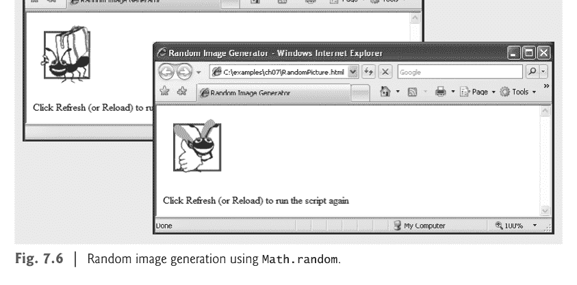

第 12–13 行随机选择一个图像显示在网页上。此 `document.write` 语句在网页中创建一个图像标签，其 `src` 属性设置为 1 到 7 之间的随机整数，并与 `".gif"` 连接。因此，脚本动态地将图像标签的源设置为当前目录中某个图像文件的名称。

## 7.8 作用域规则

第 4–6 章使用标识符作为变量名。变量的属性包括名称、值和数据类型（例如，字符串、数字或布尔值）。我们还使用标识符作为用户定义函数的名称。程序中的每个标识符也有一个作用域。

变量或函数的标识符的*作用域*是程序中可以引用该标识符的部分。在 `head` 元素中声明的*全局变量*或*脚本级变量*可在脚本的任何部分访问，并且据说具有*全局作用域*。因此，脚本中的每个函数都可以潜在地使用这些变量。

在函数内部声明的标识符具有*函数*（或*局部*）*作用域*，并且只能在该函数中使用。函数作用域从声明标识符的函数的左花括号（`{`）开始，到函数的结束右花括号（`}`）结束。函数的局部变量和函数参数具有函数作用域。如果函数中的局部变量与全局变量同名，则全局变量在函数体中被“隐藏”。

> **良好编程实践 7.4**
>
> 避免使用隐藏全局变量名的局部变量名。这可以通过简单地避免在脚本中使用重复的标识符来实现。

图 7.7 中的脚本演示了*作用域规则*，该规则解决了同名全局变量和局部变量之间的冲突。此示例还演示了*onload 事件*（第 52 行），当 XHTML 文档的 `<body>` 完全加载到浏览器窗口中时，该事件调用事件处理程序（`start()`）。

```xml
<?xml version = "1.0" encoding = "utf-8"?>
<!DOCTYPE html PUBLIC "-//W3C//DTD XHTML 1.0 Strict//EN"
  "http://www.w3.org/TR/xhtml1/DTD/xhtml1-strict.dtd">

<!-- Fig. 7.7: scoping.html -->
<!-- Scoping example. -->
<html xmlns = "http://www.w3.org/1999/xhtml">
  <head>
    <title>A Scoping Example</title>
   <script type = "text/javascript">
     <!--
     var x = 1; // global variable

     function start()
     {
       var x = 5; // variable local to function start

       document.writeln( "local x in start is " + x );

       functionA(); // functionA has local x
       functionB(); // functionB uses global variable x
       functionA(); // functionA reinitializes local x
       functionB(); // global variable x retains its value
     }

     document.writeln(
     "<p>local x in start is " + x + "</p>" );
     } // end function start

     function functionA()
     {
       var x = 25; // initialized each time
       // functionA is called

       document.writeln( "<p>local x in functionA is " +
       x + " after entering functionA" );
       ++x;
       document.writeln( "<br />local x in functionA is " +
       x + " before exiting functionA" + "</p>" );
     } // end functionA

     function functionB()
     {
       document.writeln( "<p>global variable x is " + x +
       " on entering functionB" );
       x *= 10;
       document.writeln( "<br />global variable x is " +
       x + " on exiting functionB" + "</p>" );
     } // end functionB
     // -->
   </script>
  </head>
  <body onload = "start()"></body>
</html>
```

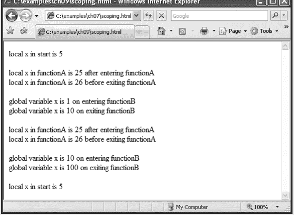

图 7.7 | 作用域示例。（第 2 部分，共 2 部分。）

全局变量 `x`（第 12 行）被声明并初始化为 1。此全局变量在任何声明了名为 `x` 的变量的块（或函数）中都被隐藏。函数 `start()`（第 14–27 行）声明了一个局部变量 `x`（第 16 行）并将其初始化为 5。此变量在 XHTML 文本行中输出，以显示全局变量 `x` 在 `start()` 中被隐藏。脚本定义了另外两个函数——`functionA()` 和 `functionB()`——它们都不接受参数且不返回任何值。每个函数都从函数 `start()` 中调用两次。

函数 `functionA()` 定义局部变量 `x`（第 31 行）并将其初始化为 25。当调用 `functionA()` 时，该变量在 XHTML 文本行中输出，以显示全局变量 `x` 在 `functionA()` 中被隐藏；然后在函数退出前，该变量递增并在 XHTML 文本行中再次输出。每次调用此函数时，局部变量 `x` 都会重新创建并初始化为 25。

函数 `functionB()` 不声明任何变量。因此，当它引用变量 `x` 时，使用的是全局变量 `x`。当调用 `functionB()` 时，全局变量在 XHTML 文本行中输出，乘以 10 并在函数退出前在 XHTML 文本行中再次输出。下次调用函数 `functionB()` 时，全局变量具有其修改后的值 10，该值再次乘以 10，输出 100。最后，程序再次在 XHTML 文本行中输出 `start()` 中的局部变量 `x`，以显示没有函数调用修改 `start()` 中 `x` 的值，因为所有函数都引用了其他作用域中的变量。

## 7.9 JavaScript 全局函数

JavaScript 提供了七个全局函数。我们已经使用了其中两个函数——`parseInt()` 和 `parseFloat()`。全局函数在图 7.8 中进行了总结。

实际上，图 7.8 中的全局函数都是 JavaScript 的 Global 对象的一部分。Global 对象包含脚本中的所有全局变量、脚本中的所有用户定义函数以及图 7.8 中列出的所有函数。由于全局函数和用户定义函数是 Global 对象的一部分，一些 JavaScript 程序员将这些函数称为方法。我们仅在引用为特定对象调用的函数（例如 `Math.random()`）时使用术语“方法”。作为 JavaScript 程序员，您不需要直接使用 Global 对象；JavaScript 会为您引用它。

| 全局函数 | 描述 |
|---|---|
| `escape()` | 接受一个字符串参数，并返回一个字符串，其中所有空格、标点符号、重音字符以及任何其他不在 ASCII 字符集中的字符都以十六进制格式编码，该格式可在所有平台上表示。 |
| `eval()` | 接受一个表示要执行的 JavaScript 代码的字符串参数。当调用 `eval()` 函数时，JavaScript 解释器会评估并执行该代码。此函数允许将 JavaScript 代码存储为字符串并动态执行。[注意：使用 `eval()` 处理用户输入的任何数据被认为是一个严重的安全风险，因为恶意用户可能利用此来运行危险代码。] |

图 7.8 | JavaScript 全局函数。（第 1 部分，共 2 部分。）

| 全局函数 | 描述 |
| :--- | :--- |
| `isFinite()` | 接受一个数值参数，如果参数的值不是 `NaN`、`Number.POSITIVE_INFINITY` 或 `Number.NEGATIVE_INFINITY`（即不是数字或超出 JavaScript 支持范围的数字），则返回 `true`；否则，函数返回 `false`。 |
| `isNaN()` | 接受一个数值参数，如果参数的值不是数字，则返回 `true`；否则返回 `false`。该函数通常与 `parseInt()` 或 `parseFloat()` 的返回值一起使用，以判断结果是否为一个合适的数值。 |
| `parseFloat()` | 接受一个字符串参数，并尝试将字符串的开头部分转换为浮点值。如果转换不成功，函数返回 `NaN`；否则，返回转换后的值（例如，`parseFloat("abc123.45")` 返回 `NaN`，而 `parseFloat("123.45abc")` 返回值 `123.45`）。 |
| `parseInt()` | 接受一个字符串参数，并尝试将字符串的开头部分转换为整数值。如果转换不成功，函数返回 `NaN`；否则，返回转换后的值（例如，`parseInt("abc123")` 返回 `NaN`，而 `parseInt("123abc")` 返回整数值 `123`）。此函数接受一个可选的第二个参数，范围从 2 到 36，用于指定数字的基数（或进制）。基数 2 表示第一个参数字符串是二进制格式，基数 8 表示第一个参数字符串是八进制格式，基数 16 表示第一个参数字符串是十六进制格式。 |
| `unescape()` | 接受一个字符串作为参数，并返回一个字符串，其中所有先前用 `escape()` 编码的字符都被解码。 |

图 7.8 | JavaScript 全局函数。（第 2 部分，共 2 部分。）

## 7.10 递归

我们迄今为止讨论的程序通常被构建为以有纪律的、分层的方式相互调用的函数。*递归函数*是一个直接或间接通过另一个函数调用*自身*的函数。在本节中，我们将介绍一个简单的递归示例。

我们首先从概念上考虑递归；然后我们研究几个包含递归函数的程序。递归问题解决方法有许多共同要素。一个递归函数被调用来解决一个问题。该函数实际上只知道如何处理最简单的情况，或*基本情况*。如果函数以基本情况被调用，它会返回一个结果。如果函数以更复杂的问题被调用，它会将问题分成两个概念部分——函数知道如何处理的部分（基本情况）和函数不知道如何处理的部分。为了使递归可行，后一部分必须类似于原始问题，但必须是它的更简单或更小的版本。因为这个新问题看起来像原始问题，所以函数会调用（调用）它自身的一个新副本来处理这个较小的问题；这个调用被称为*递归调用*，或*递归步骤*。递归步骤通常还包括关键字 `return`，因为它的结果将与函数知道如何解决的问题部分组合起来，形成一个将传递回调用者的结果。

递归步骤在函数的原始调用仍然打开（即，尚未完成执行）时执行。随着函数将每个新子问题分成两个概念部分，递归步骤可能导致更多的递归调用。为了使递归最终终止，每次函数以原始问题的更简单版本调用自身时，越来越小的问题序列必须收敛于基本情况。在这一点上，函数识别基本情况，将结果返回给函数的前一个副本，然后一系列返回沿着调用链向上传递，直到原始函数调用最终将最终结果返回给调用者。

作为这些概念实际应用的一个例子，让我们编写一个递归程序来执行一个流行的数学计算。一个非负整数 *n* 的阶乘，写作 *n*!（读作“*n* 阶乘”），是乘积

$$n \cdot (n - 1) \cdot (n - 2) \cdot \ldots \cdot 1$$

其中 1! 等于 1，0! 被定义为 1。例如，5! 是乘积 $5 \cdot 4 \cdot 3 \cdot 2 \cdot 1$，等于 120。

一个大于或等于零的整数（下例中的 `number`）的阶乘可以使用 `for` 语句*迭代地*（非递归地）计算，如下所示：

```javascript
var factorial = 1;

for ( var counter = number; counter >= 1; --counter )
    factorial *= counter;
```

通过观察以下关系，可以得出阶乘函数的递归定义：

$$n! = n \cdot (n - 1)!$$

例如，5! 显然等于 $5 * 4!$，如下方程式所示：

$$5! = 5 \cdot 4 \cdot 3 \cdot 2 \cdot 1$$

$$5! = 5 \cdot (4 \cdot 3 \cdot 2 \cdot 1)$$

$$5! = 5 \cdot (4!)$$

5! 的计算将如图 7.9 所示进行。图 7.9 (a) 显示了连续的递归调用如何进行，直到 1! 被计算为 1，这终止了递归。图 7.9 (b) 显示了从每个递归调用返回给其调用者的值，直到计算并返回最终值。

图 7.10 使用递归计算并打印 0 到 10 的整数的阶乘。递归函数 `factorial()` 首先测试（第 24 行）终止条件是否为真，即 `number` 是否小于或等于 1。如果是，`factorial()` 返回 1，无需进一步递归，函数返回。如果 `number` 大于 1，第 27 行将问题表示为 `number` 与递归调用 `factorial()` 计算 `number - 1` 的阶乘所返回值的乘积。注意，`factorial( number - 1 )` 是一个比原始计算 `factorial( number )` 更简单的问题。

```xml
<?xml version = "1.0" encoding = "utf-8"?>
<!DOCTYPE html PUBLIC "-//W3C//DTD XHTML 1.0 Strict//EN"
  "http://www.w3.org/TR/xhtml1/DTD/xhtml1-strict.dtd">

<!-- 图 7.10: FactorialTest.html -->
<!-- 使用递归函数进行阶乘计算。 -->
<html xmlns = "http://www.w3.org/1999/xhtml">
  <head>
    <title>递归阶乘函数</title>
   <script type = "text/javascript">
   <!--
     document.writeln( "<h1>1 到 10 的阶乘</h1>" );
     document.writeln( "<table>" );

     for ( var i = 0; i <= 10; i++ )
       document.writeln( "<tr><td>" + i + "!</td><td>" +
         factorial( i ) + "</td></tr>" );

   document.writeln( "</table>" );

   // 函数 factorial 的递归定义
   function factorial( number )
   {
       if ( number <= 1 )  // 基本情况
           return 1;
       else
           return number * factorial( number - 1 );
   } // 结束函数 factorial
   // -->
   </script>
   </head><body></body>
   </html>
```

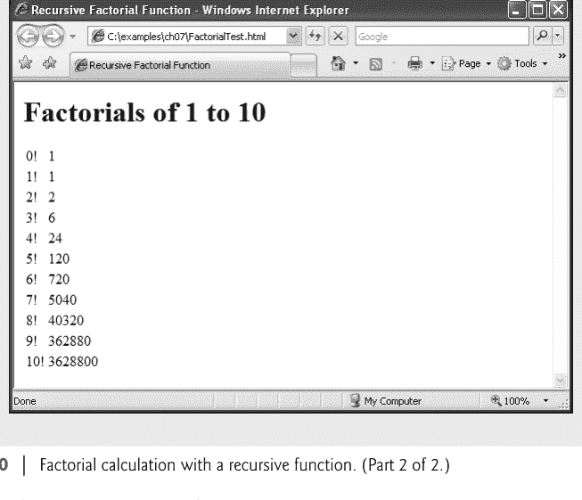

图 7.10 | 使用递归函数进行阶乘计算。（第 2 部分，共 2 部分。）

> **常见编程错误 7.6**
>
> 当需要从递归函数返回值时忘记返回值会导致逻辑错误。

> **常见编程错误 7.7**
>
> 省略基本情况以及错误地编写递归步骤导致其不收敛于基本情况，都是会导致无限递归的错误，最终耗尽内存。这种情况类似于迭代（非递归）解决方案中的无限循环问题。

> **错误预防提示 7.2**
>
> 当脚本似乎进入无限递归时，Internet Explorer 会显示错误消息。Firefox 在检测到问题后会简单地终止脚本。这允许网页用户从包含无限循环或无限递归的脚本中恢复。

## 7.11 递归与迭代

在上一节中，我们研究了一个既可以递归实现也可以迭代实现的函数。在本节中，我们将比较这两种方法，并讨论在特定情况下为何可能选择其中一种方法而非另一种。

迭代和递归都基于控制语句：迭代使用重复语句（例如 `for`、`while` 或 `do...while`）；递归使用选择语句（例如 `if`、`if...else` 或 `switch`）。迭代和递归都涉及重复：迭代显式地使用重复语句；递归通过重复的函数调用来实现重复。迭代和递归都涉及终止测试：迭代在循环继续条件失败时终止；递归在识别到基本情况时终止。迭代（无论是计数器控制的重复）和递归都逐渐接近终止：迭代不断修改计数器，直到计数器取到使循环继续条件失败的值；递归不断产生原始问题的更简单版本，直到达到基本情况。迭代和递归都可能无限进行：如果循环继续测试永远不为假，则迭代中会出现无限循环；如果递归步骤每次没有通过收敛于基本情况的序列来简化问题，或者基本情况不正确，则会出现无限递归。

递归的一个负面方面是，函数调用需要一定的时间和内存空间，这些并未直接用于执行程序指令。这被称为函数调用开销。由于递归使用重复的函数调用，这种开销会极大地影响操作的性能。在许多情况下，使用重复语句代替递归效率更高。然而，有些问题用递归来解决会更优雅（也更容易）。

> **软件工程观察 7.5**
>
> 任何可以用递归解决的问题也可以用迭代（非递归）解决。当递归方法更自然地反映问题并导致程序更易于理解和调试时，通常会选择递归方法而非迭代方法。选择递归解决方案的另一个原因是，迭代解决方案可能并不明显。

> **性能提示 7.1**
>
> 在性能要求高的情况下避免使用递归。递归调用会花费时间并消耗额外的内存。

除了阶乘函数示例（图 7.10）之外，图 12.26 还使用递归来遍历 XML 文档树。

# 8 JavaScript：数组

> 他带着呜咽和泪水，将那些最大的挑拣出来……
>
> ——刘易斯·卡罗尔
>
> 尝试到底，切莫驻足疑虑；
>
> 世间无难事，但凭搜寻终可得。
>
> ——罗伯特·赫里克
>
> 现在去吧，将它写在他们的版上，记在书卷中。
>
>——《以赛亚书》30:8
>
> 它已锁在我的记忆里，
>
> 而你自己将保管它的钥匙。
>
> ——威廉·莎士比亚

## 目标

在本章中，你将学习：

- 使用数组来存储值的列表和表格。
- 声明数组、初始化数组并引用数组的各个元素。
- 将数组传递给函数。
- 对数组进行排序。
- 声明和操作多维数组。

## 8.1 简介

## 8.2 数组

## 8.3 声明和分配数组

## 8.4 使用数组的示例

## 8.5 使用数组的随机图像生成器

### 8.6 引用和引用参数

## 8.7 将数组传递给函数

### 8.8 对数组排序

## 8.9 多维数组

## 8.10 构建在线测验

## 8.1 简介

数组是由相关数据项（有时称为数据项的*集合*）组成的数据结构。JavaScript 数组是“动态”实体，因为它们在创建后可以改变大小。本章演示的许多技术在第 10-11 章中经常使用，我们将介绍允许脚本程序员动态操作 XHTML 文档每个元素的集合。

## 8.2 数组

数组是一组内存位置，它们都具有相同的名称，并且通常类型相同（尽管 JavaScript 中并不强制要求此属性）。要引用数组中的特定位置或元素，我们指定数组的名称和该特定元素在数组中的位置编号。

图 8.1 显示了一个名为 `c` 的整数值数组。该数组包含 12 个*元素*。这些元素中的任何一个都可以通过给出数组名称后跟方括号（`[]`）中的元素位置编号来引用。每个数组中的第一个元素是*第零个*元素。因此，数组 `c` 的第一个元素引用为 `c[0]`，第二个元素引用为 `c[1]`，第七个元素引用为 `c[6]`，通常，数组 `c` 的第 *i* 个元素引用为 `c[i-1]`。数组名称遵循与其他标识符相同的约定。

方括号中的位置编号称为*下标*（或*索引*）。下标必须是整数或整数表达式。请注意，带下标的数组名称是一个左值表达式——它可以用在赋值语句的左侧，将新值放入数组元素中。它也可以用在赋值语句的右侧，将其值赋给另一个左值表达式。

让我们更仔细地检查图 8.1 中的数组 `c`。数组的*名称*是 `c`。数组 `c` 的*长度*是 12，可以通过以下表达式找到：

```javascript
c.length
```

JavaScript 中的每个数组都知道自己的长度。数组的 12 个元素分别称为 `c[0]`、`c[1]`、`c[2]`、...、`c[11]`。`c[0]` 的*值*是 -45，`c[1]` 的值是 6，`c[2]` 的值是 0，`c[7]` 的值是 62，`c[11]` 的值是 78。

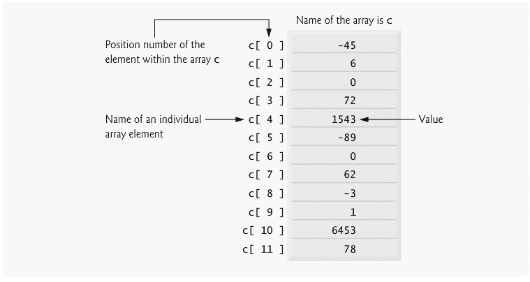

图 8.1 | 包含 12 个元素的数组。

包围数组下标的方括号是 JavaScript 运算符。方括号与圆括号具有相同的优先级。图 8.2 中的图表显示了迄今为止介绍的运算符的优先级和结合性。它们从上到下按优先级递减的顺序显示，旁边是它们的结合性和类型。

| 运算符 | 结合性 | 类型 |
| :--- | :--- | :--- |
| `()` `[]` `.` | 从左到右 | 最高 |
| `++` `--` `!` | 从右到左 | 一元 |
| `*` `/` `%` | 从左到右 | 乘法 |
| `+` `-` | 从左到右 | 加法 |
| `<` `<=` `>` `>=` | 从左到右 | 关系 |
| `==` `!=` | 从左到右 | 相等 |
| `&&` | 从左到右 | 逻辑与 |
| `\|\|` | 从左到右 | 逻辑或 |
| `?:` | 从右到左 | 条件 |
| `=` `+=` `-=` `*=` `/=` `%=` | 从右到左 | 赋值 |

图 8.2 | 迄今为止讨论的运算符的优先级和结合性。

## 8.3 声明和分配数组

数组在内存中占用空间。实际上，JavaScript 中的数组是一个 *Array 对象*。你使用 *new 运算符*来动态分配（为每个数组所需的元素数量请求内存）。new 运算符在程序执行时通过获取足够的内存来存储 new 右侧指定类型的对象来创建对象。创建新对象的过程也称为*创建实例*或*实例化对象*，new 运算符称为*动态内存分配运算符*。数组是对象，必须使用 new 创建。要为整数数组 `c` 分配 12 个元素，请使用语句

```javascript
var c = new Array( 12 );
```

上述语句也可以分两步执行，如下所示：

```javascript
var c; // 声明数组
c = new Array( 12 ); // 分配数组
```

当数组被分配时，元素并未初始化——它们的值是 `undefined`。

> **常见编程错误 8.1**
>
> *假设数组在分配时元素已初始化可能会导致逻辑错误。*

## 8.4 使用数组的示例

本节介绍几个创建和操作数组的示例。

### 创建和初始化数组

图 8.3 中的脚本使用 new 运算符分配一个包含五个元素的 Array 和一个空数组。该脚本演示了初始化现有元素的 Array，并展示了 Array 可以动态增长以容纳新元素。Array 的值显示在 XHTML 表格中。

```xml
<?xml version = "1.0" encoding = "utf-8"?>
<!DOCTYPE html PUBLIC "-//W3C//DTD XHTML 1.0 Strict//EN"
   "http://www.w3.org/TR/xhtml1/DTD/xhtml1-strict.dtd">

<!-- 图 8.3: InitArray.html -->
<!-- 初始化数组的元素。 -->
<html xmlns = "http://www.w3.org/1999/xhtml">
   <head>
      <title>初始化数组</title>
      <style type = "text/css">
         table { width: 10em }
         th    { text-align: left }
      </style>
      <script type = "text/javascript">
         <!--
         // 创建（声明）两个新数组
         var n1 = new Array( 5 ); // 分配五元素 Array
         var n2 = new Array(); // 分配空 Array

         // 为 Array n1 的每个元素赋值
         for ( var i = 0; i < n1.length; ++i )
            n1[ i ] = i;

         // 在数组 n2 中创建并初始化五个元素
         for ( i = 0; i < 5; ++i )
            n2[ i ] = i;

         outputArray( "Array n1:", n1 );
         outputArray( "Array n2:", n2 );

         // 输出标题，后跟一个包含 "theArray" 的下标和元素的两列表格
         function outputArray( heading, theArray )
         {
            document.writeln( "<h2>" + heading + "</h2>" );
            document.writeln( "<table border = \"1\">" );
            document.writeln( "<thead><th>Subscript</th>" +
               "<th>Value</th></thead><tbody>" );

            // 输出每个数组元素的下标和值
            for ( var i = 0; i < theArray.length; i++ )
               document.writeln( "<tr><td>" + i + "</td><td>" +
                  theArray[ i ] + "</td></tr>" );

            document.writeln( "</tbody></table>" );
         } // end function outputArray
         // -->
      </script>
   </head><body></body>
</html>
```

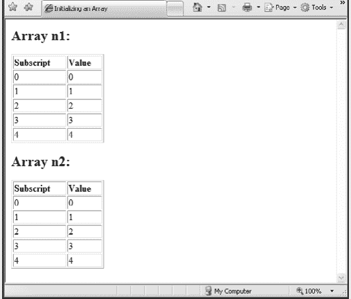

图 8.3 | 初始化数组的元素。（第 2 部分，共 2 部分）

第 17 行创建数组 `n1` 作为包含五个元素的数组。第 18 行创建数组 `n2` 作为空数组。第 21–22 行使用 `for` 语句将 `n1` 的元素初始化为其下标数字（0 到 4）。请注意在 `for` 语句的条件中使用表达式 `n1.length` 来确定数组的长度。在这个例子中，数组的长度是 5，因此只要控制变量 `i` 的值小于 5，循环就会继续执行。对于一个五元素数组，下标值是 0 到 4，因此使用小于运算符 `<` 可以保证循环不会尝试访问数组末尾之外的元素。通常使用从零开始的计数来遍历数组。

第 25–26 行使用 `for` 语句向数组 `n2` 添加五个元素，并将每个元素初始化为其下标数字（0 到 4）。请注意，数组 `n2` 会动态增长以容纳分配给其每个元素的值。

> **软件工程观察 8.1**
>
> *当向原始数组边界之外的元素赋值时，JavaScript 会自动重新分配数组。原始数组的最后一个元素和新元素之间的元素具有未定义的值。*

第 28–29 行调用函数 `outputArray()`（在第 33–46 行定义）以在 XHTML 表格中显示每个数组的内容。函数 `outputArray()` 接收两个参数——一个在显示数组内容的 XHTML 表格之前输出的字符串，以及要输出的数组。第 41–43 行使用 `for` 语句输出定义表格每一行的 XHTML 文本。

> **常见编程错误 8.2**
>
> *引用数组边界之外的元素通常是一个逻辑错误。*

如果数组元素的值是预先知道的，则可以在数组声明中分配和初始化这些元素。有两种方式可以指定初始值。语句

```javascript
var n = [ 10, 20, 30, 40, 50 ];
```

使用方括号（`[` 和 `]`）括起来的逗号分隔的*初始化列表*来创建一个五元素数组，下标为 0、1、2、3 和 4。数组大小由初始化列表中的值数量决定。请注意，前面的声明不需要 `new` 运算符来创建 Array 对象——当解释器遇到包含初始化列表的数组声明时，会提供此功能。语句

```javascript
var n = new Array( 10, 20, 30, 40, 50 );
```

也创建一个五元素数组，下标为 0、1、2、3 和 4。在这种情况下，数组元素的初始值被指定为 `new Array` 后括号中的参数。数组的大小由括号中的值数量决定。也可以通过在初始化列表中使用逗号作为占位符来为数组预留空间，以便稍后指定值。例如，语句

```javascript
var n = [ 10, 20, , 40, 50 ];
```

创建一个五元素数组，第三个元素（`n[2]`）未指定值。

### 使用初始化列表初始化数组

图 8.4 中的脚本创建了三个 Array 对象，以演示如何使用初始化列表初始化数组（第 18–20 行），并使用与图 8.3 中讨论的相同函数 `outputArray()` 在 XHTML 表格中显示每个数组。请注意，当数组 `integers2` 在网页中显示时，下标为 1 和 2 的元素（数组的第二个和第三个元素）在网页中显示为 `undefined`。这两个元素是在脚本第 20 行的声明中未提供值的元素。

```xml
<?xml version = "1.0" encoding = "utf-8"?>
<!DOCTYPE html PUBLIC "-//W3C//DTD XHTML 1.0 Strict//EN"
   "http://www.w3.org/TR/xhtml1/DTD/xhtml1-strict.dtd">

<!-- Fig. 8.4: InitArray2.html -->
<!-- 声明和初始化数组。 -->
<html xmlns = "http://www.w3.org/1999/xhtml">
   <head>
      <title>使用声明初始化数组</title>
      <style type = "text/css">
         table { width: 15em }
         th    { text-align: left }
      </style>
      <script type = "text/javascript">
         <!--
         // 初始化列表指定了元素的数量和每个元素的值。
         var colors = new Array( "cyan", "magenta","yellow", "black" );
         var integers1 = [ 2, 4, 6, 8 ];
         var integers2 = [ 2, , , 8 ];

         outputArray( "Array colors contains", colors );
         outputArray( "Array integers1 contains", integers1 );
         outputArray( "Array integers2 contains", integers2 );

         // 输出标题，后跟一个包含 theArray 的下标和元素的两列表格
         function outputArray( heading, theArray )
         {
            document.writeln( "<h2>" + heading + "</h2>" );
            document.writeln( "<table border = \"1\">" );
            document.writeln( "<thead><th>Subscript</th>" +
               "<th>Value</th></thead><tbody>" );

            // 输出每个数组元素的下标和值
            for ( var i = 0; i < theArray.length; i++ )
               document.writeln( "<tr><td>" + i + "</td><td>" +
                  theArray[ i ] + "</td></tr>" );

            document.writeln( "</tbody></table>" );
         } // end function outputArray
         // -->
      </script>
   </head><body></body>
</html>
```

图 8.4 | 声明和初始化数组。（第 1 部分，共 2 部分）

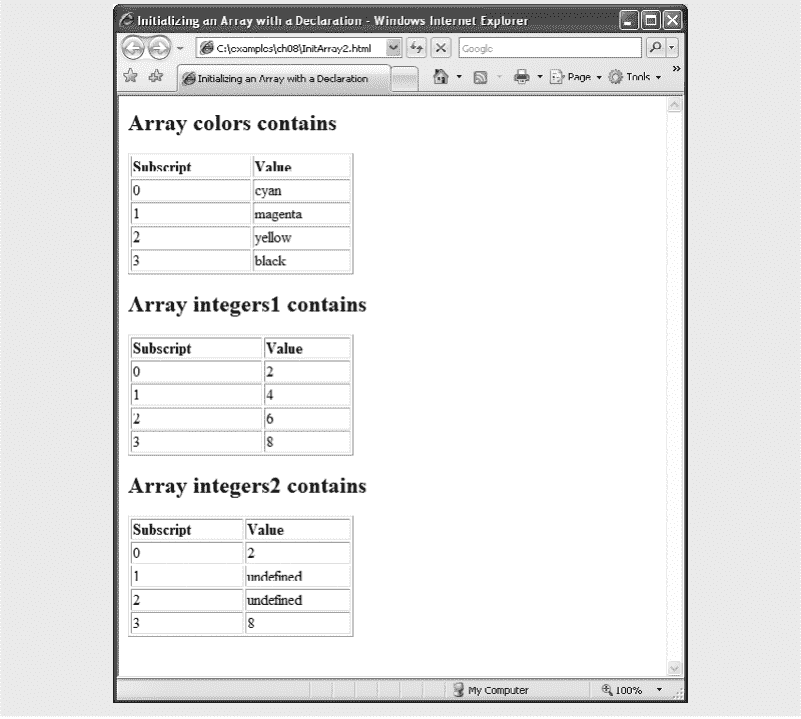

### 使用 for 和 for...in 求数组元素之和

图 8.5 中的脚本对 `theArray` 中包含的值求和，`theArray` 是在第 13 行声明、分配和初始化的 10 元素整数数组。第一个 `for` 语句体中的第 19 行语句执行求和。请注意，为数组 `theArray` 提供的初始值可以通过 XHTML 表单读入程序。

在这个例子中，我们介绍了 JavaScript 的 `for...in` 语句，它使脚本能够对数组中的每个元素执行任务（或者，正如我们将在第 10-11 章中看到的，对集合中的每个元素执行任务）。第 25-26 行展示了 `for...in` 语句的语法。在括号内，我们声明了用于选择关键字 `in` 右侧对象（本例中为 `theArray`）中每个元素的元素变量。使用 `for...in` 时，JavaScript 会自动确定数组中的元素数量。当 JavaScript 解释器遍历 `theArray` 的元素时，变量 `element` 被赋予一个可用作 `theArray` 下标的值。对于数组，赋予的值是从 0 到（但不包括）`theArray.length` 范围内的下标。每个值都被加到 `total2` 上，以产生数组元素的总和。

```xml
<?xml version = "1.0" encoding = "utf-8"?>
<!DOCTYPE html PUBLIC "-//W3C//DTD XHTML 1.0 Strict//EN"
   "http://www.w3.org/TR/xhtml1/DTD/xhtml1-strict.dtd">

<!-- Fig. 8.5: SumArray.html -->
<!-- 对数组元素求和。 -->
<html xmlns = "http://www.w3.org/1999/xhtml">
   <head>
      <title>求数组元素之和</title>

      <script type = "text/javascript">
         <!--
            var theArray = [ 1, 2, 3, 4, 5, 6, 7, 8, 9, 10 ];
            var total1 = 0, total2 = 0;

            // 按顺序遍历数组的元素，并将每个元素的值加到 total1
            for ( var i = 0; i < theArray.length; i++ )
               total1 += theArray[ i ];

            document.writeln( "Total using subscripts: " + total1 );

            // 使用 for...in 语句遍历数组的元素，将每个元素的值加到 total2
            for ( var element in theArray )
               total2 += theArray[ element ];

            document.writeln( "<br />Total using for...in: " + total2 );
         // -->
      </script>
   </head><body></body>
</html>
```

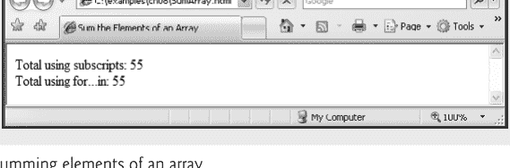

图 8.5 | 对数组元素求和。

> **错误预防提示 8.1**
>
> *在遍历数组的所有元素时，使用 `for...in` 语句以确保只操作数组的现有元素。请注意，`for...in` 语句会跳过数组中的任何未定义元素。*

### 将数组元素用作计数器

在第 7 章中，我们提到有一种更优雅的方式来实现图 7.4 中的掷骰子程序。该程序将一个六面骰子掷了 6000 次，并使用 `switch` 语句来统计每个点数被掷出的总次数。该脚本的数组版本如图 8.6 所示。图 7.4 中的 `switch` 语句被本程序的第 24 行所取代。这一行使用随机生成的骰子点数作为数组 `frequency` 的下标，以确定在每次循环迭代中应递增哪个元素。由于第 23 行的随机数计算产生的是 1 到 6 之间的数字（六面骰子的点数），因此 `frequency` 数组必须足够大，以允许下标值为 1 到 6。一个数组要具有这些下标值，所需的最少元素数量是七个（下标值从 0 到 6）。在本程序中，我们忽略了数组 `frequency` 的第 0 个元素，只使用与骰子各面点数相对应的元素。此外，本程序的第 32-34 行使用了一个循环来生成表格，而在图 7.4 中，该表格是逐行编写的。由于我们可以遍历数组 `frequency` 来帮助生成输出，因此不必像图 7.4 那样逐个枚举每个 XHTML 表格行。

```xml
<?xml version = "1.0" encoding = "utf-8"?>
<!DOCTYPE html PUBLIC "-//W3C//DTD XHTML 1.0 Strict//EN"
   "http://www.w3.org/TR/xhtml1/DTD/xhtml1-strict.dtd">

<!-- Fig. 8.6: RollDie.html -->
<!-- 使用数组而非 switch 的掷骰子程序。 -->
<html xmlns = "http://www.w3.org/1999/xhtml">
   <head>
      <title>掷六面骰子 6000 次</title>
      <style type = "text/css">
         table { width: 15em }
         th    { text-align: left }
      </style>
      <script type = "text/javascript">
         <!--
         var face;
         var frequency = [ , 0, 0, 0, 0, 0, 0 ]; // 留出 frequency[0]
                                                // 未初始化
         
         // 汇总结果
         for ( var roll = 1; roll <= 6000; ++roll )
         {
            face = Math.floor( 1 + Math.random() * 6 );
            ++frequency[ face ];
         } // end for
         
         document.writeln( "<table border = \"1\"><thead>" );
         document.writeln( "<th>点数</th>" +
            "<th>频率</th></thead><tbody>" );
         
         // 为每个点数生成完整的频率表
         for ( face = 1; face < frequency.length; ++face )
            document.writeln( "<tr><td>" + face + "</td><td>" +
               frequency[ face ] + "</td></tr>" );
         document.writeln( "</tbody></table>" );
         // -->
      </script>
   </head>
   <body>
      <p>点击刷新（或重新加载）以再次运行脚本</p>
   </body>
</html>
```

图 8.6 | 使用数组而非 switch 的掷骰子程序。（第 1 部分，共 2 部分。）

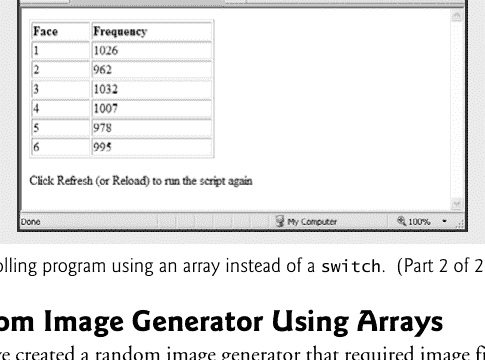

图 8.6 | 使用数组而非 switch 的掷骰子程序。（第 2 部分，共 2 部分。）

## 8.5 使用数组的随机图像生成器

在第 7 章中，我们创建了一个随机图像生成器，它要求图像文件命名为 `1.gif`、`2.gif`、...、`7.gif`。在这个示例（图 8.7）中，我们创建了一个更优雅的随机图像生成器，它不要求图像文件名是整数。这个版本的随机图像生成器使用一个名为 `pictures` 的数组，以字符串形式存储图像文件的名称。脚本生成一个随机整数，并将其用作 `pictures` 数组的下标。脚本输出一个 XHTML `img` 元素，其 `src` 属性包含位于 `pictures` 数组中随机选定位置的图像文件名。

```xml
<?xml version = "1.0" encoding = "utf-8"?>
<!DOCTYPE html PUBLIC "-//W3C//DTD XHTML 1.0 Strict//EN"
   "http://www.w3.org/TR/xhtml1/DTD/xhtml1-strict.dtd">

<!-- Fig. 8.7: RandomPicture2.html -->
<!-- 使用数组的随机图像生成。 -->
<html xmlns = "http://www.w3.org/1999/xhtml">
   <head>
      <title>随机图像生成器</title>
      <style type = "text/css">
         table { width: 15em }
         th    { text-align: left }
      </style>
      <script type = "text/javascript">
         <!--
         var pictures =
         [ "CPE", "EPT", "GPP", "GUI", "PERF", "PORT", "SEO" ];
         
         // 从 pictures 数组中随机选择一张图片，并通过创建 img 标签
         // 并将 src 属性附加到文件名来显示
         document.write ( "" );
         // -->
      </script>
   </head>
   <body>
      <p>点击刷新（或重新加载）以再次运行脚本</p>
   </body>
</html>
```

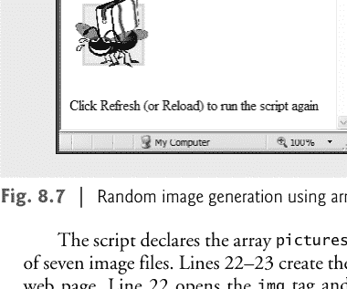

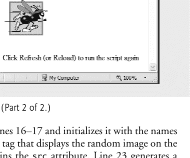

图 8.7 | 使用数组的随机图像生成。（第 2 部分，共 2 部分。）

脚本在第 16-17 行声明了数组 `pictures`，并用七个图像文件的名称初始化它。第 22-23 行创建了在网页上显示随机图像的 `img` 标签。第 22 行打开 `img` 标签并开始 `src` 属性。第 23 行生成一个 0 到 6 之间的随机整数作为 `pictures` 数组的索引，其结果是一个随机选择的图像文件名。表达式

```javascript
pictures[ Math.floor( Math.random() * 7 ) ]
```

的计算结果是来自 `pictures` 数组的一个字符串，然后该字符串被写入文档（第 23 行）。第 23 行通过添加图像文件的扩展名（`.gif`）完成了 `img` 标签。

## 8.6 引用与引用参数

在许多编程语言中，向函数（或方法）传递参数有两种方式：*按值传递*和*按引用传递*。当参数按值传递给函数时，会创建参数值的一个*副本*，并将该副本传递给被调用的函数。在 JavaScript 中，数字、布尔值和字符串是按值传递给函数的。

通过按引用传递，调用者允许被调用的函数直接访问调用者的数据，并允许其根据需要修改数据。这个过程是通过将数据在内存中所在位置的地址传递给被调用的函数来实现的。按引用传递可以提高性能，因为它可以消除复制大量数据的开销，但它也可能削弱安全性，因为被调用的函数可以访问调用者的数据。在 JavaScript 中，所有对象（因此所有数组）都是按引用传递给函数的。

> **错误预防提示 8.2**
>
> 通过按值传递，对被调用函数中副本的修改不会影响调用函数中原始变量的值。这可以防止那些严重阻碍正确可靠的软件系统开发的意外副作用。

> **软件工程观察 8.2**
>
> 与某些其他语言不同，JavaScript 不允许你选择是按值还是按引用传递每个参数。数字、布尔值和字符串按值传递。对象按引用传递给函数。当函数接收到一个对象的引用时，该函数可以直接操作该对象。

> **软件工程观察 8.3**
>
> 当通过 `return` 语句从函数返回信息时，数字和布尔值总是按值返回（即返回一个副本），而对象总是按引用返回。请注意，在按引用传递的情况下，没有必要返回新值，因为对象已经被修改了。

要将对象的引用传递给函数，只需在函数调用中指定引用名称。通常，引用名称是程序用于操作对象的标识符。在被调用函数的函数体中通过其参数名提及该引用，实际上指的是内存中的原始对象，该对象可以被被调用的函数直接访问。在下一节中，我们将使用数组来演示按值传递和按引用传递。

## 8.7 将数组传递给函数

要将数组参数传递给函数（图 8.8），请指定数组的名称（对数组的引用），不带方括号。例如，如果数组 `hourlyTemperatures` 已被声明为

```javascript
var hourlyTemperatures = new Array( 24 );
```

那么函数调用

```javascript
modifyArray( hourlyTemperatures );
```

会将数组 `hourlyTemperatures` 传递给函数 `modifyArray()`。如第 8.2 节所述，JavaScript 中的每个数组对象都知道自己的大小（通过 `length` 属性）。因此，当我们把一个数组对象传递给函数时，我们不需要单独将数组的大小作为参数传递。图 8.3 在我们将数组 `n1` 和 `n2` 传递给函数 `outputArray()` 以显示每个数组的内容时，已经说明了这个概念。

## 8.8 数组排序

JavaScript 中的 Array 对象有一个内置的 `sort()` 方法用于对数组进行排序。图 8.9 演示了 Array 对象的 `sort()` 方法。

```xml
<?xml version = "1.0" encoding = "utf-8"?>
<!DOCTYPE html PUBLIC "-//W3C//DTD XHTML 1.0 Strict//EN"
   "http://www.w3.org/TR/xhtml1/DTD/xhtml1-strict.dtd">

<!-- Fig. 8.9: Sort.html -->
<!-- Sorting an array with sort. -->
<html xmlns = "http://www.w3.org/1999/xhtml">
   <head>
      <title>Sorting an Array with Array Method sort</title>
      <script type = "text/javascript">
         <!--
         var a = [ 10, 1, 9, 2, 8, 3, 7, 4, 6, 5 ];

         document.writeln( "<h1>Sorting an Array</h1>" );
         outputArray( "Data items in original order: ", a );
         a.sort( compareIntegers );  // sort the array
         outputArray( "Data items in ascending order: ", a );

         // output the heading followed by the contents of theArray
         function outputArray( heading, theArray )
         {
            document.writeln( "<p>" + heading +
               theArray.join( " " ) + "</p>" );
         } // end function outputArray

         // comparison function for use with sort
         function compareIntegers( value1, value2 )
         {
            return parseInt( value1 ) - parseInt( value2 );
         } // end function compareIntegers
         // -->
      </script>
   </head><body></body>
</html>
```

图 8.9 | 使用 Array 方法 sort 对数组进行排序。

默认情况下，Array 方法 `sort()`（不带参数）使用字符串比较来确定数组元素的排序顺序。字符串通过其字符的 ASCII 值进行比较。[注意：字符串比较在第 9 章 JavaScript：对象中有更详细的讨论。] 在本例中，我们希望对一个整数数组进行排序。

方法 `sort()` 接受一个可选参数，即一个函数的名称（称为*比较函数*），该函数比较其两个参数并返回以下值之一：

- 如果第一个参数小于第二个参数，则返回负值
- 如果参数相等，则返回零，或者
- 如果第一个参数大于第二个参数，则返回正值

本例使用函数 `compareIntegers()`（在第 27-30 行定义）作为方法 `sort()` 的比较函数。它计算其两个参数的整数值之差（函数 `parseInt()` 确保参数被正确地作为整数处理）。如果第一个参数小于第二个参数，差值将为负值。如果参数相等，差值将为零。如果第一个参数大于第二个参数，差值将为正值。

第 16 行调用 Array 对象 `a` 的 `sort()` 方法，并将函数 `compareIntegers()` 的名称作为参数传递。方法 `sort()` 接收函数 `compareIntegers()` 作为参数，然后使用该函数比较数组 `a` 的元素以确定它们的排序顺序。

> **软件工程观察 8.5**
>
> JavaScript 中的函数被视为数据。因此，函数可以被赋值给变量、存储在数组中，并像其他数据类型一样传递给函数。

## 8.9 多维数组

具有两个下标的多维数组常用于表示由*行*和*列*排列的信息组成的数值表。要标识一个特定的表格元素，我们必须指定两个下标；按照惯例，第一个下标标识元素的行，第二个下标标识元素的列。需要两个下标来标识特定元素的数组被称为***二维数组***。

多维数组可以有超过两个维度。JavaScript 不直接支持多维数组，但允许你指定元素也是数组的数组，从而达到相同的效果。当一个数组包含一维数组作为其元素时，我们可以将这些一维数组想象为表格的行，而这些数组中的位置则为列。图 8.10 展示了一个名为 `a` 的二维数组，它包含三行四列（即一个三乘四的数组——三个一维数组，每个包含 4 个元素）。通常，一个具有 *m* 行和 *n* 列的数组被称为 *m* 乘 *n* 数组。

在图 8.10 中，数组 `a` 中的每个元素都通过形如 `a[i][j]` 的元素名来标识；`a` 是数组名，`i` 和 `j` 是下标，分别唯一标识 `a` 中每个元素的行和列。请注意，第一行中所有元素的名称第一个下标都是 0；第四列中所有元素的名称第二个下标都是 3。

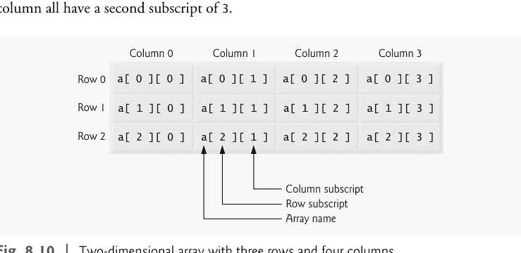

**图 8.10** | 具有三行四列的二维数组。

### 一维数组的数组

多维数组可以在声明中像一维数组一样进行初始化。具有两行两列的数组 `b` 可以通过以下语句声明和初始化：

```javascript
var b = [ [ 1, 2 ], [ 3, 4 ] ];
```

值按行分组在方括号中。数组 `[1, 2]` 初始化元素 `b[0]`，数组 `[3, 4]` 初始化元素 `b[1]`。因此，1 和 2 分别初始化 `b[0][0]` 和 `b[0][1]`。类似地，3 和 4 分别初始化 `b[1][0]` 和 `b[1][1]`。解释器通过计算子初始化器列表（嵌套在最外层数组中的数组）的数量来确定行数。解释器通过计算初始化该行的子数组中的值的数量来确定每行的列数。

### 行长度不同的二维数组

二维数组的行长度可以不同。声明

```javascript
var b = [ [ 1, 2 ], [ 3, 4, 5 ] ];
```

创建了数组 `b`，其中第 0 行包含两个元素（1 和 2），第 1 行包含三个元素（3、4 和 5）。

### 使用 new 创建二维数组

可以动态分配每行列数不同的多维数组，如下所示：

```javascript
var b;
b = new Array( 2 ); // 分配行
b[ 0 ] = new Array( 5 ); // 为第 0 行分配列
b[ 1 ] = new Array( 3 ); // 为第 1 行分配列
```

前面的代码创建了一个具有两行的二维数组。第 0 行有五列，第 1 行有三列。

### 二维数组示例：显示元素值

图 8.11 在声明中初始化二维数组，并使用嵌套的 `for...in` 循环遍历数组（即操作数组的每个元素）。

```xml
<?xml version = "1.0" encoding = "utf-8"?>
<!DOCTYPE html PUBLIC "-//W3C//DTD XHTML 1.0 Strict//EN"
   "http://www.w3.org/TR/xhtml1/DTD/xhtml1-strict.dtd">

<!-- 图 8.11: InitArray3.html -->
<!-- 初始化多维数组。 -->
<html xmlns = "http://www.w3.org/1999/xhtml">
   <head>
      <title>初始化多维数组</title>
      <script type = "text/javascript">
         <!--
         var array1 = [ [ 1, 2, 3 ], // 第一行
                        [ 4, 5, 6 ] ]; // 第二行
         var array2 = [ [ 1, 2 ], // 第一行
                        [ 3 ], // 第二行
                        [ 4, 5, 6 ] ]; // 第三行

         outputArray( "array1 中按行的值", array1 );
         outputArray( "array2 中按行的值", array2 );

         function outputArray( heading, theArray )
         {
            document.writeln( "<h2>" + heading + "</h2><pre>" );

            // 遍历一维数组的集合
            for ( var i in theArray )
            {
               // 遍历每个一维数组的元素
               for ( var j in theArray[ i ] )
                  document.write( theArray[ i ][ j ] + " " );

               document.writeln( "<br />" );
            } // end for

            document.writeln( "</pre>" );
         } // end function outputArray
         // -->
      </script>
   </head><body></body>
</html>
```

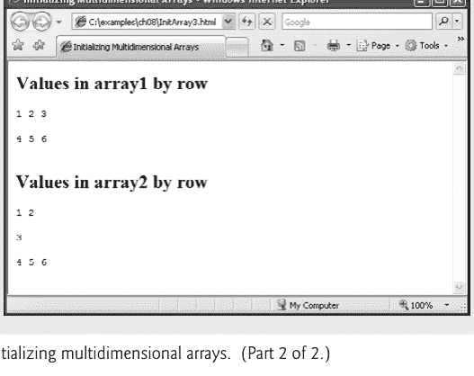

图 8.11 | 初始化多维数组。（第 2 部分，共 2 部分。）

该程序在主脚本（XHTML 的 head 元素中）声明了两个数组。`array1` 的声明（第 12-13 行）在两个子列表中提供了六个初始化器。第一个子列表将数组的第一行初始化为值 1、2 和 3；第二个子列表将数组的第二行初始化为值 4、5 和 6。`array2` 的声明（第 14-16 行）在三个子列表中提供了六个初始化器。第一行的子列表显式地将第一行初始化为两个元素，值分别为 1 和 2。第二行的子列表将第二行初始化为一个元素，值为 3。第三行的子列表将第三行初始化为值 4、5 和 6。

脚本在第 18-19 行调用 `outputArray()` 函数，以在网页上显示每个数组的元素。`outputArray()` 函数（第 21-37 行）接收两个参数——一个在数组前输出的字符串标题和要输出的数组（称为 `theArray`）。注意使用嵌套的 `for…in` 语句来输出每个二维数组的行。外层 `for…in` 语句遍历数组的行。内层 `for…in` 语句遍历当前正在处理的行的列。本例中的嵌套 `for…in` 语句也可以用 `for` 语句编写，如下所示：

```javascript
for ( var i = 0; i < theArray.length; ++i )
{
    for ( var j = 0; j < theArray[ i ].length; ++j )
        document.write( theArray[ i ][ j ] + " " );
    document.writeln( "<br />" );
}
```

在外层 `for` 语句中，表达式 `theArray.length` 确定数组的行数。在内层 `for` 语句中，表达式 `theArray[i].length` 确定数组每行的列数。此条件使循环能够确定每行的确切列数。

### 使用 for 和 for...in 语句进行常见的多维数组操作

许多常见的数组操作使用 `for` 或 `for...in` 语句。例如，以下 `for` 语句将图 8.10 中数组 `a` 的第三行所有元素设置为零：

```javascript
for ( var col = 0; col < a[ 2 ].length; ++col )
    a[ 2 ][ col ] = 0;
```

我们指定了第三行；因此，我们知道第一个下标始终是 2（0 是第一行，1 是第二行）。`for` 循环仅改变第二个下标（即列下标）。前面的 `for` 语句等效于以下语句：

```javascript
a[ 2 ][ 0 ] = 0;
a[ 2 ][ 1 ] = 0;
a[ 2 ][ 2 ] = 0;
a[ 2 ][ 3 ] = 0;
```

以下 `for...in` 语句也等效于前面的 `for` 语句：

```javascript
for ( var col in a[ 2 ] )
    a[ 2 ][ col ] = 0;
```

以下嵌套 `for` 语句计算数组 `a` 中所有元素的总和：

```javascript
var total = 0;

for ( var row = 0; row < a.length; ++row )
    for ( var col = 0; col < a[ row ].length; ++col )
        total += a[ row ][ col ];
```

`for` 语句逐行累加数组的元素。外层 `for` 语句首先将行下标设置为 0，以便内层 `for` 语句可以累加第一行的元素。然后外层 `for` 语句将 `row` 递增到 1，以便累加第二行的元素。接着外层 `for` 语句将 `row` 递增到 2，以便累加第三行的元素。当嵌套 `for` 语句终止时，可以显示结果。前面的 `for` 语句等效于以下 `for...in` 语句：

```javascript
var total = 0;

for ( var row in a )
    for ( var col in a[ row ] )
        total += a[ row ][ col ];
```

## 8.10 构建在线测验

在线测验和投票是流行的网络应用，常用于教育目的或纯粹为了娱乐。网络开发者通常使用简单的 XHTML 表单构建测验，并用 JavaScript 处理结果。数组允许程序员在一个数据结构中表示多个可能的答案选项。图 8.12 包含一个由一个问题组成的在线测验。该测验页面包含本书中使用的一个提示图标，以及一个 XHTML 表单，用户通过选择四个单选按钮中的一个来识别图像所代表的提示类型。在用户选择一个单选按钮选项并提交表单后，脚本会判断用户是否选择了与神秘图像匹配的正确提示类型。检查用户答案的 JavaScript 函数将当前章节和前几章的几个概念结合在一个简洁而实用的脚本中。

```xml
<?xml version = "1.0" encoding = "utf-8"?>
<!DOCTYPE html PUBLIC "-//W3C//DTD XHTML 1.0 Strict//EN"
   "http://www.w3.org/TR/xhtml1/DTD/xhtml1-strict.dtd">

<!-- 图 8.12: quiz.html -->
<!-- 使用 JavaScript 评分的在线测验。 -->
<html xmlns = "http://www.w3.org/1999/xhtml">
   <head>
      <title>在线测验</title>
      <script type = "text/JavaScript">
         <!--
         function checkAnswers()
         {
            var myQuiz = document.getElementById( "myQuiz" );

            // 判断答案是否正确
            if ( myQuiz.elements[ 1 ].checked )
               alert( "恭喜，你的答案正确" );
            else // 如果答案不正确
               alert( "你的答案不正确。请重试" );
         } // 结束函数 checkAnswers
         // -->
      </script>
   </head>
   <body>
      <form id = "myQuiz" onsubmit = "checkAnswers()" action = "" >
         <p>选择与所示图像对应的提示名称：<br />
         
         <br />

         <input type = "radio" name = "radiobutton" value = "CPE" />
         <label>常见编程错误</label>

         <input type = "radio" name = "radiobutton" value = "EPT" />
         <label>错误预防提示</label>

         <input type = "radio" name = "radiobutton" value = "PERF" />
         <label>性能提示</label>

         <input type = "radio" name = "radiobutton" value = "PORT" />
         <label>可移植性提示</label><br />

         <input type = "submit" name = "submit" value = "提交" />
         <input type = "reset" name = "reset" value = "重置" />
      </p>
      </form>
   </body>
</html>
```

图 8.12 | 使用 JavaScript 评分的在线测验。

在讨论脚本代码之前，我们首先讨论 XHTML 文档的 body 元素（第 25–48 行）。body 的 GUI 组件在脚本中扮演着重要角色。

第 26–47 行定义了向用户呈现测验的表单。第 26 行开始 form 元素，并指定 `onsubmit` 属性为 `"checkAnswers()"`，表示当用户提交表单（即点击提交按钮或按回车键）时，解释器应执行 JavaScript 函数 `checkAnswers()`（第 12–21 行）。

第 29 行将提示图像添加到页面。第 32–42 行显示单选按钮和相应的标签，这些标签显示可能的答案选项。第 44–45 行将提交和重置按钮添加到页面。

我们现在来检查用于验证用户提交答案的脚本。第 12–21 行声明了函数 `checkAnswers()`，其中包含评分测验所需的所有 JavaScript。第 17–20 行的 `if...else` 语句判断用户是否正确回答了问题。要求用户识别的图像是错误预防提示图标。因此，测验的正确答案对应于第二个单选按钮。


XHTML 表单的元素可以使用 `getElementById` 单独访问，也可以通过包含表单对象的 `elements` 属性访问。`elements` 属性包含一个包含所有表单控件的数组。单选按钮是 XHTML 表单 `myQuiz` 的一部分，因此我们在第 17 行使用点表示法（`myQuiz.elements[1]`）访问 `elements` 数组。数组元素 `myQuiz.elements[1]` 对应于正确答案（即第二个单选按钮）。最后，第 17 行判断第二个单选按钮的 `checked` 属性是否为 `true`。单选按钮的 `checked` 属性在选中时为 `true`，在未选中时为 `false`。回想一下，在任何给定时间只能选择一个单选按钮。如果属性 `myQuiz.elements[1].checked` 为 `true`，表示选择了正确答案，则脚本会显示祝贺消息。如果单选按钮的 `checked` 属性为 `false`，则脚本会显示另一条消息（第 20 行）。

# 9 JavaScript：对象

> 我那崇高的目标，
>
> 终将及时实现。
>
> ——W. S. 吉尔伯特
>
> 这难道是一个
>
> 隐藏美德的世界吗？
>
> ——威廉·莎士比亚
>
> 继承一个图书馆固然好，
>
> 但自己收集一个更好。
>
> ——奥古斯丁·比勒尔

## 学习目标

在本章中，你将学习：

- 基于对象的编程术语和概念。
- 封装和数据隐藏的概念。
- 面向对象的价值。
- 使用 JavaScript 对象 `Math`、`String`、`Date`、`Boolean` 和 `Number`。
- 使用浏览器的 `document` 和 `window` 对象。
- 使用 cookies。
- 使用 JSON 简单地表示对象。

## 9.1 简介

本章更正式地介绍对象。我们首先简要介绍面向对象的概念。本章其余部分概述了 JavaScript 的几个内置对象，并演示了它们的许多功能。我们还简要介绍了 JavaScript 对象表示法（JSON）——一种人类可读的数据格式，通常用于在客户端和 Web 服务器之间传输数据，也用于在 JavaScript 中创建对象。在接下来的关于文档对象模型和事件的章节中，我们将讨论浏览器提供的对象，这些对象使脚本能够与 XHTML 文档的元素进行交互。

## 9.2 对象技术简介

本节提供面向对象的总体介绍。这里讨论的术语和技术为接下来的章节做铺垫。在这里，你将了解到对象是思考世界和操作 XHTML 文档的脚本的自然方式。在第 4–8 章中，我们使用了内置的 JavaScript 对象——`Math` 和 `Array`——以及 Web 浏览器提供的对象——`document` 和 `window`——来在脚本中执行任务。JavaScript 使用对象来执行许多任务，因此被称为基于对象的编程语言。我们的目标是帮助你培养面向对象的思维方式。CSS、JavaScript 和 Ajax 等技术至少基于本节介绍的一些概念。

### 基本对象技术概念

我们从一些关键术语开始介绍对象技术。在现实世界中，你随处可见对象——人、动物、植物、汽车、飞机、建筑，计算机、显示器等等。人类以对象的方式思考。电话、房屋、交通灯、微波炉和饮水机只是我们周围常见的更多对象。

我们有时将对象分为两类：有生命的和无生命的。有生命的对象在某种意义上是“活的”——它们会移动并做事。无生命的对象不会自行移动。然而，这两种类型的对象都有一些共同点。它们都有**属性**（例如，大小、形状、颜色和重量），并且都表现出**行为**（例如，球会滚动、弹跳、充气和放气；婴儿会哭、睡觉、爬行、走路和眨眼；汽车会加速、刹车和转弯；毛巾会吸水）。我们将研究软件对象所具有的属性和行为的种类。

人类通过研究对象的属性和观察它们的行为来了解现有对象。不同的对象可以具有相似的属性，并表现出相似的行为。例如，可以在婴儿和成人之间，以及人类和黑猩猩之间进行比较。

**面向对象设计（OOD）** 使用与人们描述现实世界对象相似的术语来建模软件。它利用类关系，其中某个类的对象，例如车辆类，具有相同的特征——汽车、卡车、小红车和溜冰鞋有很多共同点。OOD 利用**继承**关系，其中新的对象类通过吸收现有类的特征并添加自己独特的特征而派生出来。“敞篷车”类的对象当然具有更通用的“汽车”类的特征，但更具体地说，车顶可以上下移动。

面向对象设计提供了一种自然且直观的方式来看待软件设计过程——即通过对象的属性、行为和相互关系来建模对象，就像我们描述现实世界对象一样。OOD 还建模对象之间的通信。就像人们互相发送消息一样（例如，中士命令士兵立正），对象也通过消息进行通信。银行账户对象可能会收到一条消息，要求其余额减少一定金额，因为客户提取了该金额的钱。

OOD 将属性和**操作**（行为）**封装**（即包装）到对象中——对象的属性和操作紧密地联系在一起。对象具有**信息隐藏**的特性。这意味着对象可能知道如何通过定义良好的**接口**相互通信，但通常不允许它们知道其他对象是如何实现的——实现细节隐藏在对象本身内部。例如，我们可以有效地驾驶汽车，而无需了解发动机、变速箱、制动器和排气系统内部工作的细节——只要我们知道如何使用油门踏板、制动踏板、方向盘等等。正如我们将看到的，信息隐藏对于良好的软件工程至关重要。

就像汽车设计师一样，网络浏览器的设计师定义了一组对象，这些对象封装了 XHTML 文档的元素，并向 JavaScript 程序员暴露了属性和行为，使 JavaScript 程序能够与这些元素（对象）交互（或编写脚本）。你很快就会看到，浏览器的文档对象包含属性和行为，可以访问 XHTML 文档的每个元素。同样，JavaScript 提供了封装脚本中各种功能的对象。例如，JavaScript 数组对象提供了属性和行为，使脚本能够操作数据集合。数组对象的 `length` 属性（属性）包含数组中的元素数量。数组对象的 `sort` 方法（行为）对数组的元素进行排序。

一些编程语言——如 Java、Visual Basic、C# 和 C++——是**面向对象的**。用这样的语言编程称为**面向对象编程（OOP）**，它允许计算机程序员将面向对象设计实现为可工作的软件系统。另一方面，像 C 这样的语言是*过程化的*，因此编程往往是**面向动作的**。在过程化语言中，编程的单元是**函数**。在面向对象语言中，编程的单元是*类*，对象最终从类*实例化*（OOP中“创建”的术语）。类包含实现操作的函数和构成属性的数据。

过程化程序员专注于编写函数。程序员将执行某些共同任务的动作分组为函数，并将函数分组以形成程序。数据在过程化语言中当然很重要，但观点是数据主要存在于支持函数执行的动作。系统规范中的*动词*帮助过程化程序员确定一组协同工作以实现系统的函数。

### 类、属性和方法

面向对象程序员专注于创建他们自己的**用户定义类型**，称为*类*。每个类包含数据以及操作该数据并为*客户端*（即使用该类的其他类或函数）提供服务的函数集。类的数据组件称为属性。例如，银行账户类可能包括账号和余额。类的函数组件称为方法。例如，银行账户类可能包括存款（增加余额）、取款（减少余额）和查询当前余额的方法。你使用内置类型（以及其他用户定义类型）作为构建新用户定义类型（类）的“构建块”。系统规范中的*名词*帮助你确定一组类，对象从这些类创建，协同工作以实现系统。

类之于对象，就像蓝图之于房屋——类是构建该类对象的“计划”。就像我们可以从一张蓝图建造许多房屋一样，我们可以从一个类实例化（创建）许多对象。你不能在蓝图的厨房里做饭；你可以在房屋的厨房里做饭。你不能在蓝图的卧室里睡觉；你可以在房屋的卧室里睡觉。

类可以与其他类有关系。例如，在银行的面向对象设计中，“银行柜员”类需要与其他类相关联，例如“客户”类、“现金抽屉”类、“保险箱”类等等。这些关系称为*关联*。

将软件打包为类使得未来的软件系统可以*重用*这些类。相关的类组通常打包为可重用的*组件*。就像房地产经纪人常说的，影响房地产价格的三个最重要因素是“地段、地段和地段”，软件开发社区的一些人说，影响软件开发未来的三个最重要因素是“重用、重用和重用”。

确实，借助对象技术，你可以通过组合现有类来构建你需要的大部分新软件，就像汽车制造商组合可互换零件一样。你创建的每个新类都有潜力成为有价值的软件资产，你和其他程序员可以重用它来加速和提高未来软件开发工作的质量。

## 9.3 Math 对象

`Math` 对象的方法允许你执行许多常见的数学计算。如前所述，对象的方法通过编写对象名称后跟一个点（`.`）和方法名称来调用。在方法名称后面的括号中是方法的参数（或以逗号分隔的参数列表）。例如，要计算并显示 900.0 的平方根，你可以写

```
document.writeln( Math.sqrt( 900.0 ) );
```

这调用 `Math.sqrt` 方法计算括号中数字（900.0）的平方根，然后输出结果。数字 900.0 是 `Math.sqrt` 方法的参数。前面的语句将显示 30.0。一些 `Math` 对象方法总结在图 9.1 中。

| 方法 | 描述 | 示例 |
| :--- | :--- | :--- |
| `abs( x )` | x 的绝对值 | `abs( 7.2 )` 是 7.2<br>`abs( 0.0 )` 是 0.0<br>`abs( -5.6 )` 是 5.6 |
| `ceil( x )` | 将 x 四舍五入为不小于 x 的最小整数 | `ceil( 9.2 )` 是 10.0<br>`ceil( -9.8 )` 是 -9.0 |
| `cos( x )` | x 的三角余弦（x 以弧度为单位） | `cos( 0.0 )` 是 1.0 |
| `exp( x )` | 指数方法 e^x | `exp( 1.0 )` 是 2.71828<br>`exp( 2.0 )` 是 7.38906 |
| `floor( x )` | 将 x 四舍五入为不大于 x 的最大整数 | `floor( 9.2 )` 是 9.0<br>`floor( -9.8 )` 是 -10.0 |
| `log( x )` | x 的自然对数（以 e 为底） | `log( 2.718282 )` 是 1.0<br>`log( 7.389056 )` 是 2.0 |
| `max( x, y )` | x 和 y 中的较大值 | `max( 2.3, 12.7 )` 是 12.7<br>`max( -2.3, -12.7 )` 是 -2.3 |
| `min( x, y )` | x 和 y 中的较小值 | `min( 2.3, 12.7 )` 是 2.3<br>`min( -2.3, -12.7 )` 是 -12.7 |
| `pow( x, y )` | x 的 y 次幂 (x^y) | `pow( 2.0, 7.0 )` 是 128.0<br>`pow( 9.0, .5 )` 是 3.0 |
| `round( x )` | 将 x 四舍五入为最接近的整数 | `round( 9.75 )` 是 10<br>`round( 9.25 )` 是 9 |
| `sin( x )` | x 的三角正弦（x 以弧度为单位） | `sin( 0.0 )` 是 0.0 |
| `sqrt( x )` | x 的平方根 | `sqrt( 900.0 )` 是 30.0<br>`sqrt( 9.0 )` 是 3.0 |
| `tan( x )` | x 的三角正切（x 以弧度为单位） | `tan( 0.0 )` 是 0.0 |

图 9.1 | `Math` 对象方法。

### 常见编程错误 9.1

忘记在方法名前加上对象名 `Math` 和点号（`.`）来调用 `Math` 方法是一个错误。

### 软件工程观察 9.1

调用独立函数与调用对象方法的主要区别在于，调用独立函数时不需要对象名和点号。

`Math` 对象定义了几个常用的数学常量，总结在图 9.2 中。[注意：按照惯例，常量的名称全部使用大写字母书写，以便在程序中突出显示。]

### 良好编程实践 9.1

使用 `Math` 对象的数学常量，而不是显式输入常量的数值。

| 常量 | 描述 | 值 |
|---|---|---|
| `Math.E` | 自然对数的底数 (e)。 | 约等于 2.718 |
| `Math.LN2` | 2 的自然对数 | 约等于 0.693 |
| `Math.LN10` | 10 的自然对数 | 约等于 2.302 |
| `Math.LOG2E` | 以 2 为底 e 的对数 | 约等于 1.442 |
| `Math.LOG10E` | 以 10 为底 e 的对数 | 约等于 0.434 |
| `Math.PI` | π——圆的周长与其直径的比值 | 约等于 3.141592653589793 |
| `Math.SQRT1_2` | 0.5 的平方根 | 约等于 0.707 |
| `Math.SQRT2` | 2.0 的平方根 | 约等于 1.414 |

图 9.2 | `Math` 对象的常量。

## 9.4 String 对象

在本节中，我们将介绍 JavaScript 的字符串和字符处理功能。这里讨论的技术适用于处理姓名、地址、电话号码和类似项目。

### 9.4.1 字符和字符串基础

字符是 JavaScript 程序的基本构建块。每个程序都由一系列有意义地组合在一起的字符组成，计算机将其解释为一系列用于完成任务的指令。

字符串是被视为一个单元的一系列字符。字符串可以包含字母、数字和各种特殊字符，例如 `+`、`-`、`*`、`/` 和 `$`。JavaScript 支持称为 Unicode® 的字符集，它代表了世界上大部分语言。字符串是 `String` 类型的对象。字符串字面量或字符串常量（通常称为匿名 `String` 对象）写在双引号或单引号中的字符序列，如下所示：

- "John Q. Doe"（一个姓名）
- '9999 Main Street'（一个街道地址）
- "Waltham, Massachusetts"（一个城市和州）
- '(201) 555-1212'（一个电话号码）

可以在声明中将字符串赋值给变量。声明

```
var color = "blue";
```

用包含字符串 "blue" 的 `String` 对象初始化变量 `color`。字符串可以通过关系运算符（`<`、`<=`、`>` 和 `>=`）和相等运算符（`==` 和 `!=`）进行比较。字符串使用对应字符的 Unicode 值进行比较。例如，表达式 `"hello" < "Hello"` 的计算结果为 `false`，因为小写字母具有更高的 Unicode 值。

### 9.4.2 String 对象的方法

`String` 对象封装了字符串的属性和行为。它提供了许多方法（行为）来完成有用的任务，例如从字符串中选择字符、组合字符串（称为连接）、获取字符串的子字符串、在字符串中搜索子字符串、标记化字符串（即将字符串拆分为单个单词）以及将字符串转换为全大写或全小写字母。`String` 对象还提供了几个生成 XHTML 标签的方法。图 9.3 总结了许多 `String` 方法。图 9.4–9.7 演示了其中一些方法。

| 方法 | 描述 |
| :--- | :--- |
| `charAt( index )` | 返回一个包含指定索引处字符的字符串。如果索引处没有字符，`charAt` 返回一个空字符串。第一个字符位于索引 0。 |
| `charCodeAt( index )` | 返回指定索引处字符的 Unicode 值，如果该索引处没有字符，则返回 `NaN`（非数字）。 |
| `concat( string )` | 将其参数连接到调用该方法的字符串的末尾。调用此方法的字符串不会被修改；而是返回一个新的 `String`。此方法与使用字符串连接运算符 `+` 连接两个字符串相同（例如，`s1.concat(s2)` 与 `s1 + s2` 相同）。 |
| `fromCharCode( value1, value2, ... )` | 将 Unicode 值列表转换为包含相应字符的字符串。 |
| `indexOf( substring, index )` | 从调用该方法的字符串中的位置 `index` 开始搜索子字符串 `substring` 的第一次出现。该方法返回子字符串在源字符串中的起始索引，如果未找到子字符串，则返回 -1。如果未提供 `index` 参数，该方法从源字符串的索引 0 开始搜索。 |
| `lastIndexOf( substring, index )` | 从位置 `index` 开始，向调用该方法的字符串开头方向搜索子字符串 `substring` 的最后一次出现。该方法返回子字符串在源字符串中的起始索引，如果未找到子字符串，则返回 –1。如果未提供 `index` 参数，该方法从源字符串的末尾开始搜索。 |
| `replace( searchString, replaceString )` | 搜索子字符串 `searchString`，并将第一次出现的替换为 `replaceString`，然后返回修改后的字符串，如果未进行替换，则返回原始字符串。 |
| `slice( start, end )` | 返回一个包含从索引 `start` 到索引 `end` 的字符串部分的字符串。如果未指定结束索引，该方法返回从起始索引到源字符串末尾的字符串。负的结束索引指定从字符串末尾开始的偏移量，从最后一个字符之后的位置开始（因此 –1 表示字符串中的最后一个字符位置）。 |
| `split( string )` | 将源字符串拆分为字符串数组（标记），其中其字符串参数指定分隔符（即，表示源字符串中每个标记结束的字符）。 |
| `substr( start, length )` | 返回一个包含从源字符串中索引 `start` 开始的 `length` 个字符的字符串。如果未指定 `length`，则返回一个包含从 `start` 到源字符串末尾的字符的字符串。 |
| `substring( start, end )` | 返回一个包含从源字符串中索引 `start` 到索引 `end`（不包括索引 `end`）的字符的字符串。 |
| `toLowerCase()` | 返回一个将所有大写字母转换为小写字母的字符串。非字母字符不会被更改。 |
| `toUpperCase()` | 返回一个将所有小写字母转换为大写字母的字符串。非字母字符不会被更改。 |
| **生成 XHTML 标签的方法** | |
| `anchor( name )` | 将源字符串包装在一个锚点元素（`<a></a>`）中，`name` 作为锚点名称。 |
| `fixed()` | 将源字符串包装在一个 `<tt></tt>` 元素中。 |
| `link( url )` | 将源字符串包装在一个锚点元素（`<a></a>`）中，`url` 作为超链接位置。 |
| `strike()` | 将源字符串包装在一个 `<strike></strike>` 元素中。 |
| `sub()` | 将源字符串包装在一个 `<sub></sub>` 元素中。 |
| `sup()` | 将源字符串包装在一个 `<sup></sup>` 元素中。 |

图 9.3 | 一些 `String` 对象方法。

### 9.4.3 字符处理方法

图 9.4 中的脚本演示了 `String` 对象的一些字符处理方法，包括 **charAt**（返回特定位置的字符）、**charCodeAt**（返回特定位置字符的 Unicode 值）、**fromCharCode**（返回由一系列 Unicode 值创建的字符串）、**toLowerCase**（返回字符串的小写版本）和 **toUpperCase**（返回字符串的大写版本）。

第 16–17 行使用 `String` 方法 `charAt` 显示字符串 `s`（"ZEBRA"）中的第一个字符。方法 **charAt** 返回一个包含指定索引（本例中为 0）处字符的字符串。字符串中字符的索引从 0（第一个字符）开始，一直到（但不包括）字符串的长度（即，如果字符串包含五个字符，则索引为 0 到 4）。如果索引超出字符串的范围，该方法返回一个空字符串。

第 18–19 行通过调用 `String` 方法 `charCodeAt` 显示字符串 `s`（"ZEBRA"）中第一个字符的字符代码。方法 `charCodeAt` 返回

```
<?xml version = "1.0" encoding = "utf-8"?>
<!DOCTYPE html PUBLIC "-//W3C//DTD XHTML 1.0 Strict//EN"
   "http://www.w3.org/TR/xhtml1/DTD/xhtml1-strict.dtd">

<!-- 图 9.4: CharacterProcessing.html -->
<!-- 字符串方法 charAt、charCodeAt、fromCharCode、toLowerCase 和
   toUpperCase。 -->
<html xmlns = "http://www.w3.org/1999/xhtml">
   <head>
      <title>字符处理方法</title>
      <script type = "text/javascript">
         <!--
            var s = "ZEBRA";
            var s2 = "AbCdEfG";

            document.writeln( "<p>在 '" +
               s + "' 中索引 0 处的字符是 " + s.charAt( 0 ) );
            document.writeln( "<br />在 '"
               + s + "' 中索引 0 处的字符代码是 " + s.charCodeAt( 0 ) + "</p>" );

            document.writeln( "<p>'" +
               String.fromCharCode( 87, 79, 82, 68 ) +
               "' 包含字符代码 87、79、82 和 68</p>" )

            document.writeln( "<p>'" + s2 + "' 的小写形式是 '" +
               s2.toLowerCase() + "'" );
            document.writeln( "<br />'" + s2 + "' 的大写形式是 '"
               + s2.toUpperCase() + "'</p>" );
            // -->
      </script>
   </head><body></body>
</html>
```

图 9.4 | 字符串方法 `charAt`、`charCodeAt`、`fromCharCode`、`toLowerCase` 和 `toUpperCase`。

### 9.4.4 搜索方法

能够在字符串中搜索一个字符或一串字符序列通常很有用。例如，如果你正在创建自己的文字处理程序，你可能希望提供在文档中搜索的功能。图 9.5 中的脚本演示了 `String` 对象的 **indexOf** 和 **lastIndexOf** 方法，它们用于在字符串中搜索指定的子字符串。本例中的所有搜索都是在全局字符串 `letters`（在脚本第 14 行初始化为 "abcdefghijklmnopqrstuvwxyzabcdefghijklmnopqrstuvwxyz"）上执行的。

用户在 XHTML 表单 `searchForm` 的 `inputVal` 文本字段中输入一个子字符串，然后按下 **Search** 按钮来在 `letters` 中搜索该子字符串。点击 **Search** 按钮会调用函数 `buttonPressed`（定义在第 16-29 行）来响应 `onclick` 事件并执行搜索。每次搜索的结果都显示在 `searchForm` 的相应文本字段中。

第 21-22 行使用 `String` 方法 `indexOf` 来确定字符串 `inputVal.value`（即用户在 `inputVal` 文本字段中输入的字符串）在字符串 `letters` 中首次出现的位置。如果找到子字符串，则返回子字符串首次出现的起始索引；否则，返回 -1。

第 23-25 行使用 `String` 方法 `lastIndexOf` 来确定 `inputVal` 中的字符串在 `letters` 中最后一次出现的位置。如果找到子字符串，则返回子字符串最后一次出现的起始索引；否则，返回 -1。

```
<?xml version = "1.0" encoding = "utf-8"?>
<!DOCTYPE html PUBLIC "-//W3C//DTD XHTML 1.0 Strict//EN"
    "http://www.w3.org/TR/xhtml1/DTD/xhtml1-strict.dtd">

<!-- Fig. 9.5: SearchingStrings.html -->
<!-- 使用indexOf和lastIndexOf进行字符串搜索。 -->
<html xmlns = "http://www.w3.org/1999/xhtml">
    <head>
        <title>
            使用indexOf和lastIndexOf搜索字符串
        </title>
        <script type = "text/javascript">
            <!--
            var letters = "abcdefghijklmnopqrstuvwxyzabcdefghijklmnopqrstuvwxyz";

            function buttonPressed()
            {
                var searchForm = document.getElementById( "searchForm" );
                var inputVal = document.getElementById( "inputVal" );

                searchForm.elements[2].value =
                    letters.indexOf( inputVal.value );
                searchForm.elements[3].value =
                    letters.lastIndexOf( inputVal.value );
                searchForm.elements[4].value =
                    letters.indexOf( inputVal.value, 12 );
                searchForm.elements[5].value =
                    letters.lastIndexOf( inputVal.value, 12 );
            } // end function buttonPressed
            // -->
        </script>
    </head>
    <body>
        <form id = "searchForm" action = "">
            <h1>要搜索的字符串是：<br />
                abcdefghijklmnopqrstuvwxyzabcdefghijklmnopqrstuvwxyz</h1>
            <p>输入要搜索的子字符串
            <input id = "inputVal" type = "text" />
            <input id = "search" type = "button" value = "Search"
                onclick = "buttonPressed()" /><br /></p>

            <p>首次出现位于索引
            <input id = "first" type = "text" size = "5" />
            <br />最后一次出现位于索引
            <input id = "last" type = "text" size = "5" />
            <br />从索引12开始的首次出现位于索引
            <input id = "first12" type = "text" size = "5" />
            <br />从索引12开始的最后一次出现位于索引
            <input id = "last12" type = "text" size = "5" /></p>
        </form>
    </body>
</html>
```

图 9.5 | 使用 `indexOf` 和 `lastIndexOf` 进行字符串搜索。

第 25-26 行使用 `String` 方法 `indexOf` 来确定 `inputVal` 文本字段中的字符串在字符串 `letters` 中首次出现的位置，搜索从 `letters` 的索引 12 开始。如果找到子字符串，则返回子字符串（从索引 12 开始）首次出现的起始索引；否则，返回 -1。

第 27-28 行使用 `String` 方法 `lastIndexOf` 来确定 `inputVal` 文本字段中的字符串在 `letters` 中最后一次出现的位置，搜索从 `letters` 的索引 12 开始并向字符串开头方向移动。如果找到子字符串，则返回子字符串（如果在索引 12 之前出现）首次出现的起始索引；否则，返回 -1。

> **软件工程观察 9.2**
>
> `String` 方法 `indexOf` 和 `lastIndexOf`，以及它们可选的第二个参数（搜索的起始索引），对于在大量文本中继续搜索特别有用。

### 9.4.5 分割字符串和获取子字符串

当你阅读一个句子时，你的大脑会将其分解成单个单词或*标记*，每个标记都向你传达意义。将字符串分解成标记的过程称为*标记化*。解释器也执行标记化。它们将语句分解成诸如关键字、标识符、运算符和编程语言的其他元素等独立部分。图 9.6 演示了 `String` 方法 **split**，它将字符串分解成其组成标记。标记之间由*分隔符*分隔，分隔符通常是空白字符，如空格、制表符、换行符和回车符。其他字符也可以用作分隔符来分隔标记。该 XHTML 文档显示了一个包含文本字段的表单，用户可以在其中输入要进行标记化的句子。标记化过程的结果显示在 XHTML `textarea` GUI 组件中。该脚本还演示了 `String` 方法 **substring**，它返回字符串的一部分。

```
<?xml version = "1.0" encoding = "utf-8"?>
<!DOCTYPE html PUBLIC "-//W3C//DTD XHTML 1.0 Strict//EN"
   "http://www.w3.org/TR/xhtml1/DTD/xhtml1-strict.dtd">
  
<!-- Fig. 9.6: SplitAndSubString.html -->
<!-- String对象方法split和substring。 -->
<html xmlns = "http://www.w3.org/1999/xhtml">
   <head>
      <title>String方法split和substring</title>
      <script type = "text/javascript">
         <!--
         function splitButtonPressed()
         {
            var inputString = document.getElementById( "inputVal" ).value;
            var tokens = inputString.split( " " );
            document.getElementById( "output" ).value =
               tokens.join( "\n" ) ;

            document.getElementById( "outputSubstring" ).value =
               inputString.substring( 0, 10 );
         } // end function splitButtonPressed
         // -->
      </script>
   </head>
   <body>
      <form action = "">
         <p>输入要分割成单词的句子<br />
         <input id = "inputVal" type = "text" size = "40" />
         <input type = "button" value = "Split"
            onclick = "splitButtonPressed()" /></p>
  
         <p>分割成单词的句子是<br />
         <textarea id = "output" rows = "8" cols = "34">
         </textarea></p>
  
         <p>输入字符串的前10个字符是
```

图 9.6 | `String` 对象方法 `split` 和 `substring`。

### 9.4.6 XHTML 标记方法

图 9.7 中的脚本演示了 `String` 对象用于生成 XHTML 标记标签的方法。当一个 `String` 对象调用标记方法时，该方法会将 `String` 的内容包裹在相应的 XHTML 标签中。这些方法在脚本处理过程中动态生成 XHTML 时特别有用。

```
<?xml version = "1.0" encoding = "utf-8"?>
<!DOCTYPE html PUBLIC "-//W3C//DTD XHTML 1.0 Strict//EN"
    "http://www.w3.org/TR/xhtml1/DTD/xhtml1-strict.dtd">

<!-- Fig. 9.7: MarkupMethods.html -->
<!-- String 对象 XHTML 标记方法。 -->
<html xmlns = "http://www.w3.org/1999/xhtml">
    <head>
        <title>String 对象的 XHTML 标记方法</title>
        <script type = "text/javascript">
            <!--
            var anchorText = "This is an anchor";
            var fixedText = "This is monospaced text";
            var linkText = "Click here to go to anchorText";
            var strikeText = "This is strike out text";
            var subText = "subscript";
            var supText = "superscript";

            document.writeln( anchorText.anchor( "top" ) );
            document.writeln( "<br />" + fixedText.fixed() );
            document.writeln( "<br />" + strikeText.strike() );
            document.writeln(
                "<br />This is text with a " + subText.sub() );
            document.writeln(
                "<br />This is text with a " + supText.sup() );
            document.writeln( "<br />" + linkText.link( "#top" ) );
            // -->
        </script>
    </head><body></body>
</html>
```

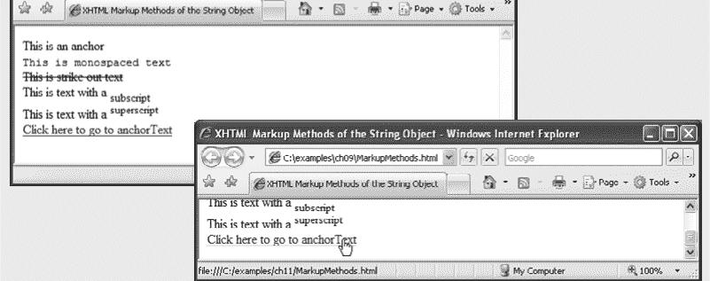

图 9.7 | `String` 对象 XHTML 标记方法。（第 1 部分，共 2 部分。）

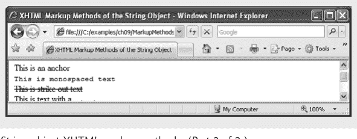

图 9.7 | `String` 对象 XHTML 标记方法。（第 2 部分，共 2 部分。）

第 12–17 行定义了调用 `String` 对象每个 XHTML 标记方法的字符串。第 19 行使用 `String` 方法 **anchor** 将变量 `anchorText`（"This is an anchor"）中的字符串格式化为

```html
<a name = "top">This is an anchor</a>
```

锚点的名称是该方法的参数。此锚点将在本示例后面用作超链接的目标。

第 20 行使用 `String` 方法 **fixed** 通过将变量 `fixedText`（"This is monospaced text"）中的字符串格式化为

```html
<tt>This is monospaced text</tt>
```

来以固定宽度字体显示文本。

第 21 行使用 `String` 方法 **strike** 通过将变量 `strikeText`（"This is strike out text"）中的字符串格式化为

```html
<strike>This is strike out text</strike>
```

来显示带删除线的文本。

第 22–23 行使用 `String` 方法 **sub** 通过将变量 `subText`（"subscript"）中的字符串格式化为

```html
<sub>subscript</sub>
```

来显示下标文本。

请注意，XHTML 文档中生成的行会将单词 subscript 显示得比行中其他部分更小，并且略低于行。

第 24–25 行调用 `String` 方法 **sup** 通过将变量 `supText`（"superscript"）中的字符串格式化为

```html
<sup>superscript</sup>
```

来显示上标文本。

请注意，XHTML 文档中生成的行会将单词 superscript 显示得比行中其他部分更小，并且略高于行。

第 26 行使用 `String` 方法 **link** 通过将变量 `linkText`（"Click here to go to anchorText"）中的字符串格式化为

```html
<a href = "#top">Click here to go to anchorText</a>
```

来创建超链接。

超链接的目标（本例中为 #top）是该方法的参数，可以是任何 URL。在本例中，超链接目标是第 19 行创建的锚点。如果你将浏览器窗口缩小并滚动到网页底部，然后单击此链接，浏览器将重新定位到网页顶部。

## 9.5 Date 对象

JavaScript 的 *Date* 对象提供了用于日期和时间操作的方法。日期和时间处理可以基于计算机的*本地时区*执行，也可以基于世界时间标准的*协调世界时*（缩写为 *UTC*）——以前称为*格林威治标准时间*（*GMT*）。`Date` 对象的大多数方法都有本地时区和 UTC 两个版本。`Date` 对象的方法总结在图 9.8 中。

| 方法 | 描述 |
| :--- | :--- |
| `getDate()`<br>`getUTCDate()` | 返回一个 1 到 31 之间的数字，表示本地时间或 UTC 中的月份中的日期。 |
| `getDay()`<br>`getUTCDay()` | 返回一个 0（星期日）到 6（星期六）之间的数字，表示本地时间或 UTC 中的星期几。 |
| `getFullYear()`<br>`getUTCFullYear()` | 返回本地时间或 UTC 中的四位数年份。 |
| `getHours()`<br>`getUTCHours()` | 返回一个 0 到 23 之间的数字，表示本地时间或 UTC 中自午夜以来的小时数。 |
| `getMilliseconds()`<br>`getUTCMilliseconds()` | 分别返回本地时间或 UTC 中 0 到 999 之间的数字，表示毫秒数。时间以小时、分钟、秒和毫秒存储。 |
| `getMinutes()`<br>`getUTCMinutes()` | 返回一个 0 到 59 之间的数字，表示本地时间或 UTC 中时间的分钟数。 |
| `getMonth()`<br>`getUTCMonth()` | 返回一个 0（一月）到 11（十二月）之间的数字，表示本地时间或 UTC 中的月份。 |
| `getSeconds()`<br>`getUTCSeconds()` | 返回一个 0 到 59 之间的数字，表示本地时间或 UTC 中时间的秒数。 |
| `getTime()` | 返回 1970 年 1 月 1 日与 `Date` 对象中时间之间的毫秒数。 |
| `getTimezoneOffset()` | 返回本地计算机当前时间与 UTC（协调世界时）之间的分钟差。 |
| `setDate(val)`<br>`setUTCDate(val)` | 设置本地时间或 UTC 中的月份日期（1 到 31）。 |
| `setFullYear(y, m, d)`<br>`setUTCFullYear(y, m, d)` | 设置本地时间或 UTC 中的年份。表示月份和日期的第二个和第三个参数是可选的。如果未指定可选参数，则使用 `Date` 对象中的当前值。 |
| `setHours(h, m, s, ms)`<br>`setUTCHours(h, m, s, ms)` | 设置本地时间或 UTC 中的小时。表示分钟、秒和毫秒的第二个、第三个和第四个参数是可选的。如果未指定可选参数，则使用 `Date` 对象中的当前值。 |
| `setMilliseconds(ms)`<br>`setUTCMilliseconds(ms)` | 设置本地时间或 UTC 中的毫秒数。 |
| `setMinutes(m, s, ms)`<br>`setUTCMinutes(m, s, ms)` | 设置本地时间或 UTC 中的分钟。表示秒和毫秒的第二个和第三个参数是可选的。如果未指定可选参数，则使用 `Date` 对象中的当前值。 |
| `setMonth(m, d)`<br>`setUTCMonth(m, d)` | 设置本地时间或 UTC 中的月份。表示日期的第二个参数是可选的。如果未指定此可选参数，则使用 `Date` 对象中的当前日期值。 |
| `setSeconds(s, ms)`<br>`setUTCSeconds(s, ms)` | 设置本地时间或 UTC 中的秒。表示毫秒的第二个参数是可选的。如果未指定此参数，则使用 `Date` 对象中的当前毫秒值。 |
| `setTime(ms)` | 根据其参数——自 1970 年 1 月 1 日以来经过的毫秒数——设置时间。 |
| `toLocaleString()` | 以计算机特定区域设置的形式返回日期和时间的字符串表示。例如，2007 年 9 月 13 日下午 3:42:22 在美国表示为 09/13/07 15:47:22，在欧洲表示为 13/09/07 15:47:22。 |
| `toUTCString()` | 以以下形式返回日期和时间的字符串表示：15 Sep 2007 15:47:22 UTC |
| `toString()` | 以计算机特定区域设置的形式返回日期和时间的字符串表示（在美国为 Mon Sep 17 15:47:22 EDT 2007）。 |
| `valueOf()` | 自 1970 年 1 月 1 日午夜以来的毫秒数时间。（与 `getTime` 相同。） |

图 9.8 | `Date` 对象方法。

图 9.9 的脚本演示了图 9.8 中的许多本地时区方法。第 12 行创建了一个新的 `Date` 对象。`new` 运算符为 `Date` 对象分配内存。空括号表示调用 `Date` 对象的*构造函数*，且不带参数。构造函数是对象的初始化方法。当使用 `new` 分配对象时，构造函数会自动调用。不带参数的 `Date` 构造函数使用本地计算机的当前日期和时间初始化 `Date` 对象。

```
<?xml version = "1.0" encoding = "utf-8"?>
<!DOCTYPE html PUBLIC "-//W3C//DTD XHTML 1.0 Strict//EN"
    "http://www.w3.org/TR/xhtml1/DTD/xhtml1-strict.dtd">

<!-- 图 9.9: DateTime.html -->
<!-- Date 对象的日期和时间方法。 -->
<html xmlns = "http://www.w3.org/1999/xhtml">
    <head>
        <title>日期和时间方法</title>
        <script type = "text/javascript">
            <!--
            var current = new Date();

            document.writeln(
                "<h1>字符串表示和 valueOf</h1>" );
            document.writeln( "toString: " + current.toString() +
                "<br />toLocaleString: " + current.toLocaleString() +
                "<br />toUTCString: " + current.toUTCString() +
                "<br />valueOf: " + current.valueOf() );

            document.writeln(
                "<h1>本地时区的 Get 方法</h1>" );
            document.writeln( "getDate: " + current.getDate() +
                "<br />getDay: " + current.getDay() +
                "<br />getMonth: " + current.getMonth() +
                "<br />getFullYear: " + current.getFullYear() +
                "<br />getTime: " + current.getTime() +
                "<br />getHours: " + current.getHours() +
                "<br />getMinutes: " + current.getMinutes() +
                "<br />getSeconds: " + current.getSeconds() +
                "<br />getMilliseconds: " + current.getMilliseconds() +
                "<br />getTimezoneOffset: " + current.getTimezoneOffset() );

            document.writeln(
                "<h1>为新 Date 指定参数</h1>" );
            var anotherDate = new Date( 2007, 2, 18, 1, 5, 0, 0 );
            document.writeln( "日期: " + anotherDate );

            document.writeln( "<h1>本地时区的 Set 方法</h1>" );
            anotherDate.setDate( 31 );
            anotherDate.setMonth( 11 );
            anotherDate.setFullYear( 2007 );
            anotherDate.setHours( 23 );
            anotherDate.setMinutes( 59 );
            anotherDate.setSeconds( 59 );
            document.writeln( "修改后的日期: " + anotherDate );
            // -->
        </script>
    </head><body></body>
</html>
```

图 9.9 | `Date` 对象的日期和时间方法。

> **软件工程观察 9.3**
>
> 当使用 `new` 分配对象时，对象的构造函数会自动被调用，以在程序中使用该对象之前对其进行初始化。

第 16–19 行演示了 `toString`、`toLocaleString`、`toUTCString` 和 `valueOf` 方法。请注意，`valueOf` 方法返回一个大的整数值，表示从 1970 年 1 月 1 日午夜到 `Date` 对象 `current` 中存储的日期和时间之间的总毫秒数。

第 23–32 行演示了 `Date` 对象用于本地时区的 `get` 方法。请注意，`getFullYear` 方法以四位数字返回年份。同时请注意，`getTimezoneOffset` 方法返回本地时区与 UTC 时间之间的分钟差（即，在执行此示例时，我们的时区相差四小时）。

第 36 行演示了创建一个新的 `Date` 对象，并向 `Date` 构造函数提供 *year*、*month*、*date*、*hours*、*minutes*、*seconds* 和 *milliseconds* 参数。请注意，*hours*、*minutes*、*seconds* 和 *milliseconds* 参数都是可选的。如果未指定其中任何一个参数，则会用零代替。对于 *hours*、*minutes* 和 *seconds* 参数，如果指定了其中任何一个参数右侧的参数，则也必须指定该参数（例如，如果指定了 *minutes* 参数，则必须指定 *hours* 参数；如果指定了 *milliseconds* 参数，则必须指定所有参数）。

第 40–45 行演示了 `Date` 对象用于本地时区的 *set* 方法。`Date` 对象在内部将月份表示为 0 到 11 的整数。这些值与你可能预期的相差一（即，1 表示一月，2 表示二月，...，12 表示十二月）。创建 `Date` 对象时，必须指定 0 表示一月，1 表示二月，...，11 表示十二月。

> **常见编程错误 9.2**
>
> *假设月份用 1 到 12 的数字表示，会导致处理日期时出现差一错误。*

`Date` 对象提供了另外两个可以在不创建新 `Date` 对象的情况下调用的方法——**Date.parse** 和 **Date.UTC**。`Date.parse` 方法接收一个表示日期和时间的字符串作为其参数，并返回从 1970 年 1 月 1 日午夜到指定日期和时间之间的毫秒数。此值可以通过以下语句转换为 `Date` 对象：

```
var theDate = new Date( numberOfMilliseconds );
```

该语句将自 1970 年 1 月 1 日午夜以来的毫秒数传递给 `Date` 构造函数，用于创建 `Date` 对象。

`parse` 方法使用以下规则转换字符串：

- 短日期可以指定为 MM-DD-YY、MM-DD-YYYY、MM/DD/YY 或 MM/DD/YYYY 格式。月份和日期不需要是两位数。
- 指定完整月份名称（例如，“January”）、日期和年份的长日期可以按任何顺序指定月份、日期和年份。
- 字符串中的括号内的文本被视为注释并被忽略。逗号和空白字符被视为分隔符。
- 所有月份和日期名称必须至少有两个字符。名称不需要是唯一的。如果名称相同，则该名称将解析为最后一个匹配项（例如，“Ju”代表“July”而不是“June”）。
- 如果提供了星期几的名称，则会被忽略。
- 所有标准时区（例如，EST 表示美国东部标准时间）、协调世界时（UTC）和格林威治标准时间（GMT）都会被识别。
- 指定小时、分钟和秒时，用冒号分隔。
- 使用 24 小时制格式时，对于中午 12 点之后的时间，不应使用“PM”。

`Date` 方法 `UTC` 返回从 1970 年 1 月 1 日午夜到作为其参数指定的日期和时间之间的毫秒数。`UTC` 方法的参数包括必需的 *year*、*month* 和 *date*，以及可选的 *hours*、*minutes*、*seconds* 和 *milliseconds*。如果未指定 *hours*、*minutes*、*seconds* 或 *milliseconds* 参数中的任何一个，则会用零代替。对于 *hours*、*minutes* 和 *seconds* 参数，如果指定了参数列表中其中任何一个参数右侧的参数，则也必须指定该参数（例如，如果指定了 *minutes* 参数，则必须指定 *hours* 参数；如果指定了 *milliseconds* 参数，则必须指定所有参数）。与 `Date.parse` 的结果一样，`Date.UTC` 的结果可以通过使用 `Date.UTC` 的结果作为参数创建新的 `Date` 对象来转换为 `Date` 对象。

## 9.6 Boolean 和 Number 对象

JavaScript 提供了 **Boolean** 和 **Number** 对象，分别作为布尔真/假值和数字的*包装器*。这些包装器定义了用于操作布尔值和数字的方法和属性。包装器为处理简单数据类型提供了额外的功能。

当 JavaScript 程序需要一个布尔值时，JavaScript 会自动创建一个 `Boolean` 对象来存储该值。JavaScript 程序员可以使用以下语句显式创建 `Boolean` 对象：

```
var b = new Boolean( booleanValue );
```

构造函数参数 *booleanValue* 指定 `Boolean` 对象的值应为 `true` 还是 `false`。如果 *booleanValue* 是 `false`、0、`null`、`Number.NaN` 或空字符串（""），或者未提供任何参数，则新的 `Boolean` 对象包含 `false`。否则，新的 `Boolean` 对象包含 `true`。图 9.10 总结了 `Boolean` 对象的方法。

| 方法 | 描述 |
| :--- | :--- |
| `toString()` | 如果 `Boolean` 对象的值为 `true`，则返回字符串 "true"；否则返回字符串 "false"。 |
| `valueOf()` | 如果 `Boolean` 对象为 `true`，则返回值 `true`；否则返回 `false`。 |

图 9.10 | `Boolean` 对象方法。

JavaScript 会自动创建 `Number` 对象来存储 JavaScript 程序中的数值。JavaScript 程序员可以使用以下语句创建 `Number` 对象：

```
var n = new Number( numericValue );
```

构造函数参数 *numericValue* 是要存储在对象中的数字。虽然你可以显式创建 `Number` 对象，但通常 JavaScript 解释器会根据需要创建它们。图 9.11 总结了 `Number` 对象的方法和属性。

## 9.7 document 对象

`document` 对象用于操作当前在浏览器窗口中显示的文档。`document` 对象拥有许多属性和方法，例如 `document.write` 和 `document.writeln` 方法，这些方法在之前的 JavaScript 示例中都已使用过。图 9.12 展示了本章中使用的 `document` 对象的方法和属性。你可以在我们的 JavaScript 资源中心 (www.deitel.com/javascript) 了解更多关于 `document` 对象的属性和方法。

| 方法或属性 | 描述 |
|---|---|
| `getElementById( id )` | 返回一个 DOM 节点，该节点代表 `id` 属性与 `id` 匹配的 XHTML 元素。 |
| `write( string )` | 将字符串作为 XHTML 代码写入 XHTML 文档。 |
| `writeln( string )` | 将字符串作为 XHTML 代码写入 XHTML 文档，并在末尾添加一个换行符。 |
| `cookie` | 一个字符串，包含当前文档在用户计算机上存储的所有 cookie 的值。参见第 9.9 节，使用 Cookie。 |
| `lastModified` | 此文档最后修改的日期和时间。 |

图 9.12 | 重要的 `document` 对象方法和属性。

## 9.8 window 对象

`window` 对象提供了操作浏览器窗口的方法。以下脚本展示了 `window` 对象的许多常用属性和方法，并使用它们创建了一个跨越多个浏览器窗口的网站。图 9.13 允许用户通过填写 XHTML 表单并点击提交按钮来创建一个全新的、完全自定义的浏览器窗口。该脚本还允许用户向新窗口添加文本，并将窗口导航到不同的 URL。

脚本从第 10 行开始。第 12 行声明了一个变量来引用新窗口。我们将新窗口称为子窗口，因为它是由此脚本中的主窗口（或父窗口）创建和控制的。第 14-50 行定义了 `createChildWindow` 函数，该函数确定用户选择的功能，并使用这些功能创建一个子窗口（但不会向窗口添加任何内容）。第 18-20 行声明了几个变量来存储页面上复选框的状态。第 23-38 行根据相应的复选框是否被选中，将每个变量设置为 "yes" 或 "no"。

```
<?xml version = "1.0" encoding = "utf-8"?>
<!DOCTYPE html PUBLIC "-//W3C//DTD XHTML 1.0 Strict//EN"
    "http://www.w3.org/TR/xhtml1/DTD/xhtml1-strict.dtd">

<!-- 图 9.13: window.html -->
<!-- 使用 window 对象创建和修改子窗口。 -->
<html xmlns = "http://www.w3.org/1999/xhtml">
<head>
<title>使用 Window 对象</title>
<script type = "text/javascript">
    <!--
    var childWindow; // 控制子窗口的变量

    function createChildWindow()
    {
        // 这些变量都包含 "yes" 或 "no"
        // 用于在子窗口中启用或禁用某个功能
        var toolBar;
        var menuBar;
        var scrollBars;

        // 确定工具栏复选框是否被选中
        if ( document.getElementById( "toolBarCheckBox" ).checked )
            toolBar = "yes";
        else
            toolBar = "no";

        // 确定菜单栏复选框是否被选中
        if ( document.getElementById( "menuBarCheckBox" ).checked )
            menuBar = "yes";
        else
            menuBar = "no";

        // 确定滚动条复选框是否被选中
        if ( document.getElementById( "scrollBarsCheckBox" ).checked )
            scrollBars = "yes";
        else
            scrollBars = "no";

        // 显示具有所选功能的窗口
        childWindow = window.open( "", "",
            ",toolbar = " + toolBar +
            ",menubar = " + menuBar +
            ",scrollbars = " + scrollBars );

        // 启用按钮
        document.getElementById( "closeButton" ).disabled = false;
        document.getElementById( "modifyButton" ).disabled = false;
        document.getElementById( "setURLButton" ).disabled = false;
    } // 结束 createChildWindow 函数

    // 将文本框中的文本插入子窗口
    function modifyChildWindow()
    {
        if ( childWindow.closed )
            alert( "您尝试与一个已关闭的窗口进行交互" );
        else
            childWindow.document.write(
                document.getElementById( "textForChild" ).value );
    } // 结束 modifyChildWindow 函数

    // 关闭子窗口
    function closeChildWindow()
    {
        if ( childWindow.closed )
            alert( "您尝试与一个已关闭的窗口进行交互" );
        else
            childWindow.close();

        document.getElementById( "closeButton" ).disabled = true;
        document.getElementById( "modifyButton" ).disabled = true;
        document.getElementById( "setURLButton" ).disabled = true;
    } // 结束 closeChildWindow 函数

    // 将子窗口的 URL 设置为父窗口
    // myChildURL 中的 URL
    function setChildWindowURL()
    {
        if ( childWindow.closed )
            alert( "您尝试与一个已关闭的窗口进行交互" );
        else
            childWindow.location =
                document.getElementById( "myChildURL" ).value;
    } // 结束 setChildWindowURL 函数
    //-->
</script>
</head>
<body>
<h1>你好，这是主窗口</h1>
<p>请勾选要为子窗口启用的功能<br/>
<input id = "toolBarCheckBox" type = "checkbox" value = ""
    checked = "checked" />
<label>工具栏</label>
<input id = "menuBarCheckBox" type = "checkbox" value = ""
    checked = "checked" />
<label>菜单栏</label>
<input id = "scrollBarsCheckBox" type = "checkbox" value = ""
    checked = "checked" />
<label>滚动条</label></p>

<p>请输入您希望在子窗口中显示的文本<br/>
<input id = "textForChild" type = "text"
    value = "<h1>你好，我是一个子窗口。</h1> " />
<input id = "createButton" type = "button"
    value = "创建子窗口" onclick = "createChildWindow()" />
<input id= "modifyButton" type = "button" value = "修改子窗口"
    onclick = "modifyChildWindow()" disabled = "disabled" />
<input id = "closeButton" type = "button" value = "关闭子窗口"
    onclick = "closeChildWindow()" disabled = "disabled" /></p>

<p>另一个窗口的 URL 是：<br/>
<input id = "myChildURL" type = "text" value = "./" />
<input id = "setURLButton" type = "button" value = "设置子窗口 URL"
    onclick = "setChildWindowURL()" disabled = "disabled" /></p>
</body>
</html>
```

图 9.13 | 使用 `window` 对象创建和修改子窗口。

> **外观观察 9.1**
>
> 弹出窗口应谨慎使用。许多用户不喜欢打开额外窗口或调整浏览器大小或位置的网站。一些用户有弹出窗口阻止程序，会阻止新窗口打开。

> **软件工程观察 9.4**
>
> `window.location` 是一个属性，它始终包含当前窗口中显示的 URL 的字符串表示形式。通常，Web 浏览器只允许属于与另一个窗口中页面相同网站的脚本检索另一个窗口的 `window.location` 属性。

函数 `setChildWindowURL`（第 77–84 行）将 `myChildURL` 文本字段的内容复制到子窗口的 `location` 属性。如果子窗口是打开的，第 81–82 行将子窗口的 `location` 属性设置为 `myChildURL` 文本框中的字符串。此操作会更改子窗口的 URL，相当于在窗口的地址栏中输入新 URL 并单击“转到”（或按 Enter 键）。

脚本在第 86 行结束。第 88–116 行包含 XHTML 文档的主体，包括一个包含复选框、按钮、文本框和表单字段标签的表单。脚本使用主体中定义的表单元素从用户获取输入。第 106、108、110 和 115 行指定了 XHTML 按钮的 `onclick` 属性。每个按钮都被设置为在单击时调用相应的 JavaScript 函数。

图 9.14 包含 `window` 对象一些常用方法和属性的列表。

| 方法或属性 | 描述 |
| :--- | :--- |
| `open( url, name, options )` | 创建一个新窗口，窗口的 URL 设置为 *url*，名称设置为 *name* 以便在脚本中引用它，可见特性由作为 *option* 传入的字符串设置。 |
| `prompt( prompt, default )` | 显示一个对话框，要求用户输入。对话框的文本是 *prompt*，默认值设置为 *default*。 |
| `close()` | 关闭当前窗口并从内存中删除其对象。 |
| `focus()` | 此方法使窗口获得焦点（即，将窗口置于前台，位于任何其他打开的浏览器窗口之上）。 |
| `blur()` | 此方法使窗口失去焦点（即，将窗口置于后台）。 |
| `window.document` | 此属性包含表示当前窗口内文档的文档对象。 |
| `window.closed` | 此属性包含一个布尔值，如果窗口已关闭则设置为 `true`，否则为 `false`。 |
| `window.opener` | 此属性包含打开当前窗口的窗口的窗口对象（如果存在这样的窗口）。 |

图 9.14 | 重要的 `window` 对象方法和属性。

## 9.9 使用 Cookies

Cookies 为网页开发者提供了一种个性化网页的工具。*Cookie* 是一段存储在用户计算机上的数据，用于在浏览器会话期间及会话之间维护客户端信息。网站可以在客户端计算机上存储一个 Cookie，以记录用户偏好或其他信息，供网站在客户端后续访问时检索。例如，网站可以从 Cookie 中检索用户名，并用其显示个性化的问候语。

Microsoft Internet Explorer 和 Mozilla Firefox 将 Cookies 存储为客户端硬盘驱动器上的小型文本文件。当用户访问某个网站时，浏览器会定位由该网站脚本编写的任何 Cookie，并使其可供该网站上的任何脚本使用。请注意，Cookie 只能由属于其原始网站的脚本访问（即，由 amazon.com 上的脚本设置的 Cookie 只能由 amazon.com 上的其他脚本读取）。

Cookies 在 JavaScript 中通过 `document` 对象的 **cookie** 属性进行访问。JavaScript 将 Cookie 视为一串文本。任何标准的字符串函数或方法都可以操作 Cookie。Cookie 的语法为 "*identifier=value*"，其中 *identifier* 是任何有效的 JavaScript 变量标识符，*value* 是 Cookie 变量的值。当一个网站存在多个 Cookie 时，*identifier-value* 对在 `document.cookie` 字符串中以分号分隔。

Cookie 与普通字符串的不同之处在于，每个 Cookie 都有一个过期日期，之后 Web 浏览器会将其删除。此日期可以通过在 Cookie 字符串中设置 **expires** 属性来定义。如果未设置 Cookie 的过期日期，则默认情况下，用户关闭浏览器窗口后 Cookie 即会过期。通过将 expires 属性设置为过去的日期和时间，可以立即删除 Cookie。

赋值运算符不会覆盖整个 Cookie 列表，而是将一个 Cookie 追加到列表末尾。因此，如果我们设置两个 Cookie

```
document.cookie = "name1=value1";
document.cookie = "name2=value2";
```

`document.cookie` 将包含 "name1=value1; name2=value2"。

图 9.15 使用一个 Cookie 存储用户名并显示个性化的问候语。此示例改进了图 4.11 动态欢迎页面示例的功能，它要求用户仅在首次访问网页时输入姓名。在后续的每次访问中，脚本都可以显示存储在 Cookie 中的用户名。

第 10 行开始脚本。第 12–13 行声明了获取时间所需的变量，第 14 行声明了存储用户名的变量。第 16–27 行包含与图 4.11 中相同的 `if...else` 语句，用于显示与时间相关的问候语。

第 30–66 行包含用于操作 Cookie 的代码。第 30 行确定客户端计算机上是否存在 Cookie。如果存在 Cookie，表达式 `document.cookie` 的求值结果为 `true`。如果不存在 Cookie，则脚本会提示用户输入姓名（第 45 行）。脚本创建一个包含字符串 "name=" 的 Cookie，后跟由内置 JavaScript 函数 **escape** 生成的用户名副本（第 49 行）。函数 `escape` 将字符串中的任何非字母数字字符（如空格和分号）转换为其等效的 *十六进制转义序列*，形式为 "%XX"，其中 XX 是特殊字符的两位十六进制 ASCII 值。例如，如果 `name` 包含值 "David Green"，则语句 `escape( name )` 的求值结果为 "David%20Green"，因为空格的十六进制 ASCII 值为 20。

```
<?xml version = "1.0" encoding = "utf-8"?>
<!DOCTYPE html PUBLIC "-//W3C//DTD XHTML 1.0 Strict//EN"
    "http://www.w3.org/TR/xhtml1/DTD/xhtml1-strict.dtd">

<!-- 图 9.15: cookie.html -->
<!-- 使用 cookies 存储用户标识数据。 -->
<html xmlns = "http://www.w3.org/1999/xhtml">
    <head>
        <title>使用 Cookies</title>
       <script type = "text/javascript">
           <!--
           var now = new Date(); // 当前日期和时间
           var hour = now.getHours(); // 当前小时 (0-23)
           var name;

           if ( hour < 12 ) // 判断是否是上午
               document.write( "<h1>早上好，" );
           else
           {
               hour = hour - 12; // 从 24 小时制转换为下午时间
```

图 9.15 | 使用 cookies 存储用户标识数据。（第 1 部分，共 3 部分。）

## 9.10 多页 HTML 与 JavaScript 应用

前几章探讨了许多 JavaScript 概念及其在 Web 上的应用。下一个 JavaScript 示例将这些概念中的许多整合到一个网页中。图 9.16 使用了函数、cookie、数组、循环、`Date` 对象、`window` 对象和 `document` 对象来创建一个示例欢迎屏幕，其中包含个性化问候、一个简短测验、一张随机图片和一条随机引语。我们之前已经见过所有这些概念，但这个示例展示了它们如何在一个网页上协同工作。


# 图 9.16 | 使用多个 JavaScript 概念的丰富欢迎页面（第 1 部分，共 5 部分）

```xml
<?xml version = "1.0" encoding = "utf-8"?>
<!DOCTYPE html PUBLIC "-//W3C//DTD XHTML 1.0 Strict//EN"
    "http://www.w3.org/TR/xhtml1/DTD/xhtml1-strict.dtd">

<!-- Fig. 9.16: final.html -->
<!-- Rich welcome page using several JavaScript concepts. -->
<html xmlns = "http://www.w3.org/1999/xhtml">
    <head>
        <title>Putting It All Together</title>
        <script type = "text/javascript">
            <!--
            var now = new Date(); // current date and time
            var hour = now.getHours(); // current hour

            // array with names of the images that will be randomly selected
            var pictures = [ "CPE", "EPT", "GPP", "GUI", "PERF", "PORT", "SEO" ];

            // array with the quotes that will be randomly selected
            var quotes = [ "Form ever follows function.<br/>" +
                " Louis Henri Sullivan", "E pluribus unum." +
                " (One composed of many.) <br/> Virgil", "Is it a" +
                " world to hide virtues in?<br/> William Shakespeare" ];

            // write the current date and time to the web page
            document.write( "<p>" + now.toLocaleString() + "<br/></p>" );

            // determine whether it is morning
            if ( hour < 12 )
                document.write( "<h2>Good Morning, " );
            else
            {
                hour = hour - 12; // convert from 24-hour clock to PM time

                // determine whether it is afternoon or evening
                if ( hour < 6 )
                    document.write( "<h2>Good Afternoon, " );
                else
                    document.write( "<h2>Good Evening, " );
            } // end else

            // determine whether there is a cookie
            if ( document.cookie )
            {
                // convert escape characters in the cookie string to their
                // English notation
                var myCookie = unescape( document.cookie );

                // split the cookie into tokens using = as delimiter
                var cookieTokens = myCookie.split( "=" );

                // set name to the part of the cookie that follows the = sign
                name = cookieTokens[ 1 ];
            } // end if
            else
            {
                // if there was no cookie, ask the user to input a name
                name = window.prompt( "Please enter your name", "Paul" );

                // escape special characters in the name string
                // and add name to the cookie
                document.cookie = "name =" + escape( name );
            } // end else

            // write the greeting to the page
            document.writeln(
                name + ", welcome to JavaScript programming!</h2>");

            // write the link for deleting the cookie to the page
            document.writeln( "<a href = \"javascript:wrongPerson()\" > " +
                "Click here if you are not " + name + "</a><br/>" );

            // write the random image to the page
            document.write ( " <br/>" );

            // write the random quote to the page
            document.write ( quotes[ Math.floor( Math.random() * 3 ) ] );

            // create a window with all the quotes in it
            function allQuotes()
            {
                // create the child window for the quotes
                var quoteWindow = window.open( "", "", "resizable=yes, " +
                    "toolbar=no, menubar=no, status=no, location=no," +
                    " scrollBars=yes" );
                quoteWindow.document.write( "<p>" )

                // loop through all quotes and write them in the new window
                for ( var i = 0; i < quotes.length; i++ )
                    quoteWindow.document.write( ( i + 1 ) + ".) " +
                        quotes[ i ] + "<br/><br/>");

                // write a close link to the new window
                quoteWindow.document.write( "</p><br/><a href = " +
                    "\"javascript:window.close()\">Close this window</a>" );
            } // end function allQuotes

            // reset the document's cookie if wrong person
            function wrongPerson()
            {
                // reset the cookie
                document.cookie = "name=null;" +
                    " expires=Thu, 01-Jan-95 00:00:01 GMT";

                // reload the page to get a new name after removing the cookie
                location.reload();
            } // end function wrongPerson

            // open a new window with the quiz2.html file in it
            function openQuiz()
            {
                window.open( "quiz2.html", "", "toolbar = no, " +
                    "menubar = no, scrollBars = no" );
            } // end function openQuiz

            // -->
        </script>
    </head>
    <body>
        <p>Click Refresh (or Reload) to run the script again</p>
    </body>
</html>
```

图 9.16 | 使用多个 JavaScript 概念的丰富欢迎页面。（第 1 部分，共 5 部分。）

点击“刷新”后，网站会回忆起之前输入的数据。

图 9.15 | 使用 cookie 存储用户识别数据。（第 3 部分，共 3 部分。）

在将 cookie 值写入客户端之前，对其进行转义是一个好习惯。这种转换可以防止 cookie 中的任何特殊字符被误解为代码中具有特殊含义，而不是 cookie 值中的一个字符。例如，cookie 值中的分号可能被误解为分隔两个相邻 `标识符-值` 对的分号。当从 `document.cookie` 字符串中读取 cookie 时，应用 `unescape` 函数可以将十六进制转义序列转换回英文字符，以便在网页中显示。

> **良好编程实践 9.2**
>
> 始终使用具有自描述性的标识符将值存储在 cookie 中。不要忘记在存储的值之前包含标识符和等号（=）。

如果 cookie 存在（即用户之前访问过该页面），则脚本会从 cookie 字符串中*解析*出用户名并将其存储在局部变量中。解析通常指将字符串分割成更小、更有用的组件的行为。第 34 行使用 JavaScript 函数 `unescape` 将 cookie 中的所有转义序列替换为等效的英文字符。脚本将未转义的 cookie 值存储在变量 `myCookie` 中（第 34 行），并使用第 9.4.5 节介绍的 JavaScript 函数 `split`（第 37 行）将 cookie 分割成标识符和值令牌。此时，脚本中的 `myCookie` 包含一个形式为 `"name=value"` 的字符串。我们使用等号（=）作为分隔符对 `myCookie` 调用 `split`，以获得 `cookieTokens` 数组，其中第一个元素等于标识符的名称，第二个元素等于标识符的值。第 40 行将 `cookieTokens` 数组中第二个元素的值（即存储在 cookie 中的实际值）赋给变量 `name`。第 52-53 行使用存储在 cookie 中的用户名，将个性化问候添加到网页中。

该脚本允许用户重置 cookie，这在其他人使用计算机时很有用。第 54-55 行创建一个超链接，当点击时，调用 JavaScript 函数 `wrongPerson`（第 58-66 行）。第 61-62 行将 cookie 名称设置为 `null`，并将 `expires` 属性设置为 1995 年 1 月 1 日（尽管任何过去的日期都可以）。Internet Explorer 检测到 `expires` 属性被设置为过去的日期，并从用户的计算机中删除 cookie。下次加载此页面时，将找不到 cookie。`location` 对象的 `reload` 方法强制页面刷新（第 65 行），并且由于找不到现有 cookie，脚本会提示用户输入新名称。

## 9.16 使用多种 JavaScript 概念的丰富欢迎页面（第 4 部分，共 5 部分）

```html
117 // -->
118 </script>
119 </head>
120 <body>
121 <p><a href = "javascript:allQuotes()">查看所有名言</a></p>
122
123 <p id = "quizSpot">
124 <a href = "javascript:openQuiz()">请参加我们的测验</a></p>
125
126 <script type = "text/javascript">
127 // 获取最后修改日期和时间的变量
128 var modDate = new Date( document.lastModified );
129
130 // 将最后修改日期和时间写入页面
131 document.write ( "此页面最后修改于 " +
132 modDate.toLocaleString() );
133 </script>
134 </body>
135 </html>
```

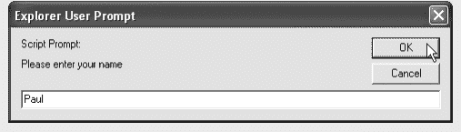

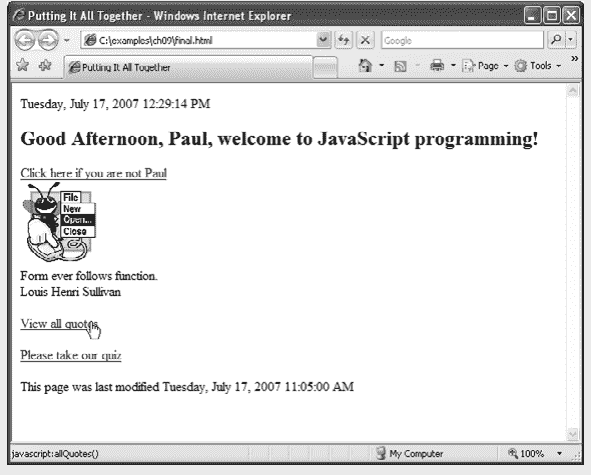

## 9.16 使用多种 JavaScript 概念的丰富欢迎页面（第 5 部分，共 5 部分）

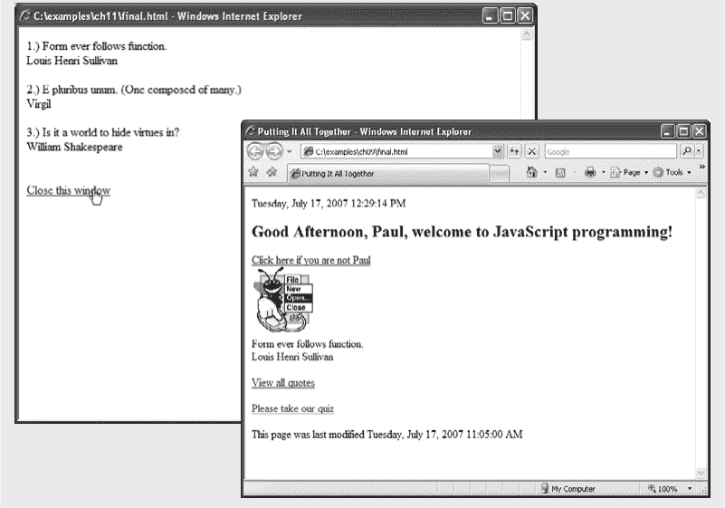

构建此页面大部分内容的脚本从第 10 行开始。第 12-13 行声明了用于确定一天中时间的变量。第 16-23 行创建了两个数组，内容将从中随机选择。此网页包含一张图片（其文件名从 `pictures` 数组中随机选择）和一条名言（其文本从 `quotes` 数组中随机选择）。第 26 行使用 `Date` 对象的 `toLocaleString` 方法将用户的本地日期和时间写入网页。第 29-40 行使用与图 4.11 相同的代码显示一个对时间敏感的问候语。该脚本要么使用现有的 cookie 来获取用户的姓名（第 43-54 行），要么提示用户输入姓名，然后脚本将其存储在新的 cookie 中（第 55-63 行）。第 66-67 行将问候语写入网页，第 70-71 行生成用于重置 cookie 的链接。这与图 9.15 中用于操作 cookie 的代码相同。第 74-79 行将随机图片和随机名言写入网页。脚本通过随机选择每个数组的索引来选择每一项。此代码类似于图 8.7 中用于使用数组显示随机图片的代码。

函数 `allQuotes`（第 82-98 行）使用 `window` 对象和一个 `for` 循环来打开一个新窗口，其中包含 `quotes` 数组中的所有名言。第 85-87 行创建一个名为 `quoteWindow` 的新窗口。脚本没有为该窗口分配 URL 或名称，但确实指定了要显示的窗口功能。第 88 行在 `quoteWindow` 中打开一个新段落。一个 `for` 循环（第 91-93 行）遍历 `quotes` 数组，并将每条名言写入 `quoteWindow`。第 96-97 行关闭 `quoteWindow` 中的段落，插入一个换行符，并在页面底部添加一个链接，允许用户关闭窗口。请注意，`allQuotes` 使用 JavaScript 生成一个网页并在一个全新的窗口中打开它。

函数 `wrongPerson`（第 101-109 行）重置存储用户名的 cookie。此函数与图 9.15 中的函数 `wrongPerson` 相同。

函数 `openQuiz`（第 112-116 行）打开一个新窗口以显示一个示例测验。使用 `window.open` 方法，脚本创建一个包含 `quiz2.html` 的新窗口（第 114-115 行）。我们将在本节后面讨论 `quiz2.html`。

主脚本在第 118 行结束，XHTML 文档的主体从第 120 行开始。第 121 行创建了一个链接，单击时调用函数 `allQuotes`。第 123-124 行创建了一个包含属性 `id = "quizSpot"` 的段落元素。此段落包含一个调用函数 `openQuiz` 的链接。

第 126-133 行包含第二个脚本。此脚本出现在 XHTML 文档的主体中，因为它向页面添加了一个动态页脚，该页脚必须出现在主体第一部分包含的静态 XHTML 内容之后。此脚本创建了另一个 `Date` 对象实例，但日期设置为 XHTML 文档的最后修改日期和时间，而不是当前日期和时间（第 128 行）。脚本使用属性 `document.lastModified` 获取最后修改日期和时间。第 131-132 行将此信息添加到网页。请注意，最后修改日期和时间出现在页面底部，在其余主体内容之后。如果此脚本位于 `head` 元素中，此信息将在整个 XHTML 文档主体之前显示。第 133-135 行关闭脚本、主体和 XHTML 文档。

### 测验页面

此示例中使用的测验位于一个名为 `quiz2.html` 的单独 XHTML 文档中（图 9.17）。此文档类似于图 8.12 中的 `quiz.html`。此示例中的测验与图 8.12 中的测验不同之处在于，它在示例中的主窗口中显示结果，而之前的测验示例则会警告结果。在测验窗口中单击“提交”按钮后，主窗口会更改以反映已参加测验，并且测验窗口关闭。

此脚本的第 15-22 行检查用户的答案并将结果输出到主窗口。第 16-17 行使用 `window.opener` 写入主窗口。属性 `window.opener` 始终包含对打开当前窗口的窗口的引用（如果存在这样的窗口）。第 16-17 行写入属性 `window.opener.document.getElementById("quizSpot").innerHTML`。回想一下，`quizSpot` 是主窗口中包含打开测验链接的段落的 id。属性 `innerHTML` 指的是 `quizSpot` 段落内的 HTML 代码（即 `<p>` 和 `</p>` 之间的代码）。修改 `innerHTML` 属性会动态更改段落中的 XHTML 代码。因此，当第 16-17 行执行时，主窗口中的链接消失，并出现字符串“恭喜，您的答案正确。”。第 19-22 行修改 `window.opener.document.getElementById("quizSpot").innerHTML`。第 19-22 行使用相同的技术显示“您的答案不正确。请重试”，后跟一个再次尝试测验的链接。

## 9.17 子窗口中的在线测验（第 1 部分，共 3 部分）

```xml
<?xml version = "1.0" encoding = "utf-8"?>
<!DOCTYPE html PUBLIC "-//W3C//DTD XHTML 1.0 Strict//EN"
"http://www.w3.org/TR/xhtml1/DTD/xhtml1-strict.dtd">
```

## 9.17 子窗口中的在线测验（第 2 部分，共 3 部分）

```html
4
5 <!-- 图 9.17: quiz2.html -->
6 <!-- 子窗口中的在线测验。 -->
7 <html xmlns = "http://www.w3.org/1999/xhtml">
8    <head>
9       <title>在线测验</title>
10      <script type = "text/JavaScript">
11         <!--
12         function checkAnswers()
13         {
14            // 确定答案是否正确
15            if ( document.getElementById( "myQuiz" ).elements[1].checked )
16               window.opener.document.getElementById( "quizSpot" ).
17                  innerHTML = "恭喜，您的答案正确";
18            else // 如果答案不正确
19               window.opener.document.getElementById( "quizSpot" ).
20                  innerHTML = "您的答案不正确。" +
21                  "请重试 <br /> <a href = " +
22                  "javascript:openQuiz()">请参加我们的测验</a>";
23
24            window.opener.focus();
25            window.close();
26         } // 结束函数 checkAnswers
27         //--> 
28      </script>
29   </head>
30   <body>
31      <form id = "myQuiz" action = "javascript:checkAnswers()">
32         <p>选择与所示图片对应的提示名称：<br />
33            
34            <br />
35
36            <input type = "radio" name = "radiobutton" value = "CPE" />
37            <label>常见编程错误</label>
38
39            <input type = "radio" name = "radiobutton" value = "EPT" />
40            <label>错误预防提示</label>
41
42            <input type = "radio" name = "radiobutton" value = "PERF" />
43            <label>性能提示</label>
44
45            <input type = "radio" name = "radiobutton" value = "PORT" />
46            <label>可移植性提示</label><br />
47
48            <input type = "submit" name = "Submit" value = "提交" />
49            <input type = "reset" name = "reset" value = "重置" />
50         </p>
51      </form>
52   </body>
53 </html>
```

## 图 9.17 | 子窗口中的在线测验（第 3 部分，共 3 部分）

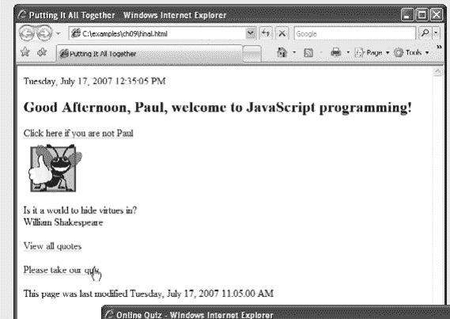

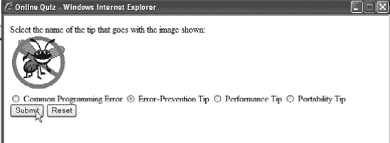

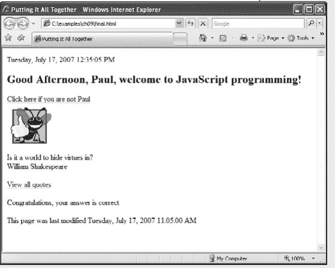

检查测验答案后，脚本使用主窗口的 `window` 对象的 `focus` 方法，将焦点赋予主窗口（即将主窗口置于前台，位于任何其他打开的浏览器窗口之上）。属性 `window.opener` 引用主窗口，因此 `window.opener.focus()`（第 24 行）将焦点赋予主窗口，使用户能够看到对主窗口测验 `Spot` 段落文本所做的更改。最后，脚本使用 `window.close` 方法（第 25 行）关闭测验窗口。

第 28-29 行关闭 XHTML 文档的 `script` 和 `head` 元素。第 30 行打开 XHTML 文档的 `body`。`body` 包含构成测验的表单、图像、文本标签和单选按钮。第 52-54 行关闭表单、`body` 和 XHTML 文档。

# 9.11 使用 JSON 表示对象

**JSON**（JavaScript 对象表示法）——一种将 JavaScript 对象表示为字符串的简单方式——是 XML 作为数据交换技术的替代方案。JSON 因其简单的格式而广受赞誉，使得对象易于读取、创建和解析。每个 JSON 对象表示为包含在花括号中的属性名和值的列表，格式如下：

```
{ propertyName1 : value1, propertyName2 : value2 }
```

数组在 JSON 中用方括号表示，格式如下：

```
[ value1, value2, value3 ]
```

每个值可以是字符串、数字、JSON 对象、`true`、`false` 或 `null`。要体会 JSON 数据的简洁性，请查看这个通讯录条目数组的表示：

```
[ { first: 'Cheryl', last: 'Black' },
  { first: 'James', last: 'Blue' },
  { first: 'Mike', last: 'Brown' },
  { first: 'Meg', last: 'Gold' } ]
```

JSON 提供了一种在 JavaScript 中操作对象的直接方式，现在许多其他编程语言也支持这种格式。除了简化对象创建外，JSON 还允许程序轻松操作数据，并在互联网上高效传输数据。JSON 与 Ajax 应用程序集成良好——有关 JSON 和 Ajax 特定示例的更详细讨论，请参见第 13.7 节。有关 JSON 的更多信息，请访问我们的 JSON 资源中心 www.deitel.com/json。

# 10 文档对象模型（DOM）：对象与集合

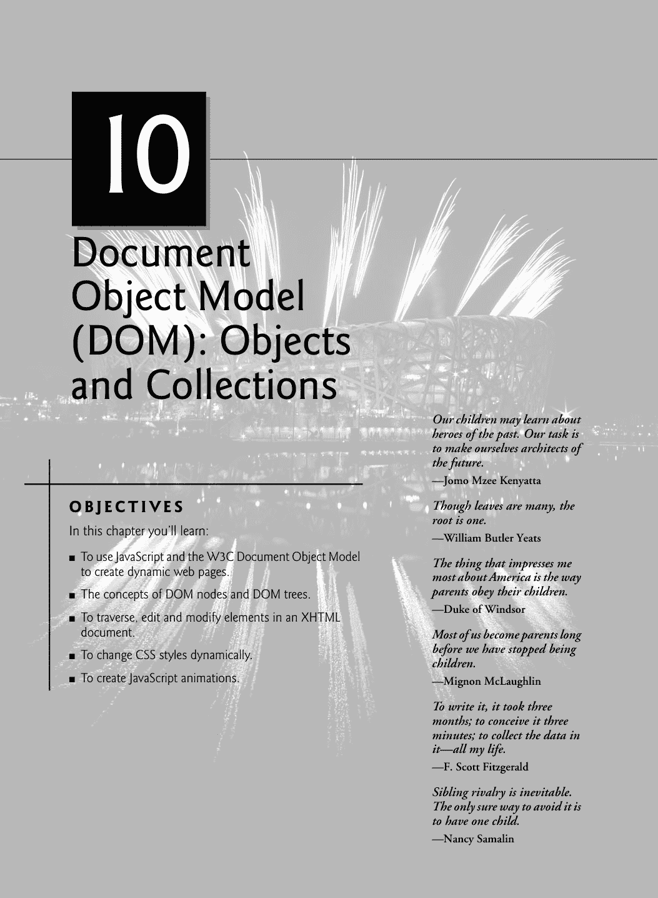

## 学习目标

在本章中，你将学习：

- 如何使用 JavaScript 和 W3C 文档对象模型创建动态网页。
- DOM 节点和 DOM 树的概念。
- 如何遍历、编辑和修改 XHTML 文档中的元素。
- 如何动态更改 CSS 样式。
- 如何创建 JavaScript 动画。

> 我们的孩子可能会了解过去的英雄。我们的任务是让我们自己成为未来的建筑师。
>
> ——乔莫·肯雅塔
>
> 虽然叶子众多，但根只有一个。
>
> ——威廉·巴特勒·叶芝
>
> 美国最让我印象深刻的是父母服从孩子的方式。
>
> ——温莎公爵
>
> 我们大多数人在停止做孩子之前很久就已经成为父母了。
>
> ——米尼翁·麦克劳克林
>
> 写它花了三个月；构思它花了三分钟；收集其中的数据——花了我一生。
>
> ——F·斯科特·菲茨杰拉德
>
> 兄弟姐妹之间的竞争是不可避免的。唯一能避免它的可靠方法是只生一个孩子。
>
> ——南希·萨马林

- 10.1 简介
- 10.2 建模文档：DOM 节点与树
- 10.3 遍历和修改 DOM 树
- 10.4 DOM 集合
- 10.5 动态样式
- 10.6 DOM 对象与集合总结

## 10.1 简介

在本章中，我们介绍*文档对象模型（DOM）*。DOM 使你能够访问网页上的所有元素。在浏览器内部，整个网页——段落、表单、表格等——都以*对象层次结构*表示。使用 JavaScript，你可以动态地创建、修改和删除页面中的元素。

以前，Internet Explorer 和 Netscape 都有不同版本的动态 HTML，它们提供了与 DOM 类似的功能。然而，尽管它们提供了许多相同的功能，但这两个模型彼此不兼容。为了鼓励跨浏览器网站，W3C 创建了标准化的文档对象模型。Firefox、Internet Explorer 7 和许多其他主要浏览器实现了 W3C DOM 的*大部分*功能。

本章首先正式介绍 DOM 节点和 DOM 树的概念。然后我们讨论 DOM 节点的属性和方法，并介绍 `document` 对象的其他方法。我们还讨论如何动态更改样式属性，这使你能够创建多种类型的效果，例如用户定义的背景颜色和动画。然后，我们提供了一个广泛的对象层次结构图，并解释了各种对象和属性，我们还提供了指向包含该主题更多信息的网站的链接。

> **软件工程观察 10.1**
>
> 使用 DOM，XHTML 元素可以被视为对象，XHTML 元素的许多属性可以被视为这些对象的属性。然后，可以通过它们的 `id` 属性使用 JavaScript 对对象进行脚本编写，以实现动态效果。

## 10.2 建模文档：DOM 节点与树

正如我们在前面章节中看到的，文档的 `getElementById` 方法是访问页面中特定元素的最简单方法。在本节和下一节中，我们将更深入地讨论此方法返回的对象。

`getElementById` 方法返回称为 *DOM 节点* 的对象。XHTML 页面中的每个元素在 Web 浏览器中都由一个 DOM 节点建模。文档中的所有节点构成了页面的 *DOM 树*，它描述了元素之间的关系。节点通过子父关系相互关联。位于另一个元素内部的 XHTML 元素被称为包含元素的*子*元素。包含元素被称为*父*元素。一个节点可以有多个子节点，但只有一个父节点。具有相同父节点的节点称为*兄弟节点*。

一些浏览器提供了允许你查看文档 DOM 树可视化表示的工具。安装 Firefox 时，你可以选择安装一个名为 *DOM Inspector* 的工具，它允许你查看 XHTML 文档的 DOM 树。要检查文档，Firefox 用户可以从 Firefox 的 **Tools** 菜单访问 **DOM Inspector**。如果 DOM inspector 不在菜单中，请运行 Firefox 安装程序，并在 **Setup Type** 屏幕中选择 **Custom**，确保在 **Optional Components** 窗口中选中 **DOM Inspector** 复选框。

Microsoft 为 Internet Explorer 提供了一个 *Developer Toolbar*，允许你检查文档的 DOM 树。该工具栏可以从 Microsoft 下载，网址为 `go.microsoft.com/fwlink/?LinkId=92716`。安装工具栏后，重新启动浏览器，然后单击工具栏右侧的 `»` 图标，并从菜单中选择 **IE Developer Toolbar**。图 10.1 显示了一个 XHTML 文档及其在 Firefox 的 DOM Inspector 和 IE 的 Web Developer Toolbar 中显示的 DOM 树。

```xml
<?xml version = "1.0" encoding = "utf-8"?>
<!DOCTYPE html PUBLIC "-//W3C//DTD XHTML 1.0 Strict//EN"
    "http://www.w3.org/TR/xhtml1/DTD/xhtml1-strict.dtd">

<!-- Fig. 10.1: domtree.html -->
<!-- Demonstration of a document's DOM tree. -->
<html xmlns = "http://www.w3.org/1999/xhtml">
    <head>
        <title>DOM Tree Demonstration</title>
    </head>
    <body>
        <h1>An XHTML Page</h1>
        <p>This page contains some basic XHTML elements. We use the Firefox
            DOM Inspector and the IE Developer Toolbar to view the DOM tree
            of the document, which contains a DOM node for every element in
            the document.</p>
        <p>Here's a list:</p>
        <ul>
            <li>One</li>
            <li>Two</li>
            <li>Three</li>
        </ul>
    </body>
</html>
```

图 10.1 | 文档 DOM 树的演示。（第 1 部分，共 3 部分。）

a) XHTML 文档在 Firefox 中渲染。

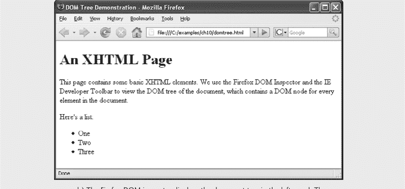

b) Firefox 的 DOM 检查器在左侧面板显示文档树。右侧面板显示当前所选节点的信息。


图 10.1 | 文档 DOM 树演示。（第 2 部分，共 3 部分。）

c) Internet Explorer 的 Web 开发人员工具栏在浏览器窗口底部的面板中显示了与 Firefox DOM 检查器中大致相同的信息。


图 10.1 | 文档 DOM 树演示。（第 3 部分，共 3 部分。）

**TITLE** 节点有一个包含文本 **DOM Tree Demonstration** 的子文本节点（`#text`），当在 DOM 检查器中选择该文本节点时，可以在右侧面板中看到它。**BODY** 节点包含代表页面中每个元素的节点。请注意，`LI` 节点是 `UL` 节点的子节点，因为它们嵌套在其中。

另外，请注意，除了代表正文、段落和列表元素内部文本的文本节点外，文档中还出现了许多其他文本节点。这些文本节点只包含空白字符。当 Firefox 将 XHTML 文档解析为 DOM 树时，兄弟元素之间的空白字符被解释为文本并放入文本节点中。Internet Explorer 忽略空白字符，不会将其转换为空文本节点。如果你在自己的计算机上运行此示例，你会注意到 **BODY** 节点有一个 `#comment` 子节点，这在上面的 Firefox 和 Internet Explorer DOM 树中都没有显示。这是你下载的示例文件末尾的版权行导致的结果。

本节介绍了 DOM 节点和 DOM 树的概念。下一节将更详细地讨论 DOM 节点，探讨允许你使用 JavaScript 修改文档 DOM 树的 DOM 节点的方法和属性。

## 10.3 遍历和修改 DOM 树

DOM 使你能够访问文档的元素，允许你使用事件驱动的 JavaScript 动态修改页面内容。本节介绍了所有 DOM 节点的属性和方法，这些属性和方法使你能够遍历 DOM 树、修改节点以及动态创建或删除内容。

图 10.2 展示了 DOM 节点的一些功能，以及 `document` 对象的两个附加方法。该程序允许你高亮显示、修改、插入和删除元素。

```xml
<?xml version = "1.0" encoding = "utf-8"?>
<!DOCTYPE html PUBLIC "-//W3C//DTD XHTML 1.0 Strict//EN"
    "http://www.w3.org/TR/xhtml1/DTD/xhtml1-strict.dtd">

<!-- Fig. 10.2: dom.html -->
<!-- Basic DOM functionality. -->
<html xmlns = "http://www.w3.org/1999/xhtml">
    <head>
        <title>Basic DOM Functionality</title>
        <style type = "text/css">
            h1, h3      { text-align: center;
                        font-family: tahoma, geneva, sans-serif }
            p           { margin-left: 5%;
                        margin-right: 5%;
                        font-family: arial, helvetica, sans-serif }
            ul          { margin-left: 10% }
            a           { text-decoration: none }
            a:hover     { text-decoration: underline }
            .nav        { width: 100%;
                        border-top: 3px dashed blue;
                        padding-top: 10px }
            .highlighted { background-color: yellow }
            .submit     { width: 120px }
        </style>
        <script type = "text/javascript">
            <!--
            var currentNode; // stores the currently highlighted node
            var idcount = 0; // used to assign a unique id to new elements
            
            // get and highlight an element by its id attribute
            function byId()
            {
                var id = document.getElementById( "gbi" ).value;
                var target = document.getElementById( id );

                if ( target )
                    switchTo( target );
            } // end function byId

            // insert a paragraph element before the current element
            // using the insertBefore method
            function insert()
            {
                var newNode = createNewNode(
                    document.getElementById( "ins" ).value );
                currentNode.parentNode.insertBefore( newNode, currentNode );
                switchTo( newNode );
            } // end function insert

            // append a paragraph node as the child of the current node
            function appendNode()
            {
                var newNode = createNewNode(
                    document.getElementById( "append" ).value );
                currentNode.appendChild( newNode );
                switchTo( newNode );
            } // end function appendNode

            // replace the currently selected node with a paragraph node
            function replaceCurrent()
            {
                var newNode = createNewNode(
                    document.getElementById( "replace" ).value );
                currentNode.parentNode.replaceChild( newNode, currentNode );
                switchTo( newNode );
            } // end function replaceCurrent

            // remove the current node
            function remove()
            {
                if ( currentNode.parentNode == document.body )
                    alert( "Can't remove a top-level element." );
                else
                {
                    var oldNode = currentNode;
                    switchTo( oldNode.parentNode );
                    currentNode.removeChild( oldNode );
                } // end else
            } // end function remove

            // get and highlight the parent of the current node
            function parent()
            {
                var target = currentNode.parentNode;

                if ( target != document.body )
                    switchTo( target );
                else
                    alert( "No parent." );
            } // end function parent

            // helper function that returns a new paragraph node containing
            // a unique id and the given text
            function createNewNode( text )
            {
                var newNode = document.createElement( "p" );
                nodeId = "new" + idcount;
                ++idcount;
                newNode.id = nodeId;
                text = "[" + nodeId + "] " + text;
                newNode.appendChild( document.createTextNode( text ) );
                return newNode;
            } // end function createNewNode

            // helper function that switches to a new currentNode
            function switchTo( newNode )
            {
                currentNode.className = ""; // remove old highlighting
                currentNode = newNode;
                currentNode.className = "highlighted"; // highlight new node
                document.getElementById( "gbi" ).value = currentNode.id;
            } // end function switchTo
            // -->
        </script>
    </head>
    <body onload = "currentNode = document.getElementById( 'bigheading' )">
        <h1 id = "bigheading" class = "highlighted">
        [bigheading] DHTML Object Model</h1>
        <h3 id = "smallheading">[smallheading] Element Functionality</h3>
        <p id = "para1">[para1] The Document Object Model (DOM) allows for
        quick, dynamic access to all elements in an XHTML document for
        manipulation with JavaScript.</p>
        <p id = "para2">[para2] For more information, check out the
        "JavaScript and the DOM" section of Deitel's
        <a id = "link" href = "http://www.deitel.com/javascript">
        [link] JavaScript Resource Center.</a></p>
        <p id = "para3">[para3] The buttons below demonstrate:(list)</p>
        <ul id = "list">
            <li id = "item1">[item1] getElementById and parentNode</li>
            <li id = "item2">[item2] insertBefore and appendChild</li>
            <li id = "item3">[item3] replaceChild and removeChild </li>
        </ul>
        <div id = "nav" class = "nav">
            <form onsubmit = "return false" action = "">
                <table>
                    <tr>
                        <td><input type = "text" id = "gbi"
                        value = "bigheading" /></td>
                        <td><input type = "submit" value = "Get By id"
                        onclick = "byId()" class = "submit" /></td>
                    </tr><tr>
                        <td><input type = "text" id = "ins" /></td>
                        <td><input type = "submit" value = "Insert Before"
                        onclick = "insert()" class = "submit" /></td>
                    </tr><tr>
                        <td><input type = "text" id = "append" /></td>
                        <td><input type = "submit" value = "Append Child"
                        onclick = "appendNode()" class = "submit" /></td>
                    </tr><tr>
                        <td><input type = "text" id = "replace" /></td>
                        <td><input type = "submit" value = "Replace Current"
                        onclick = "replaceCurrent()" class = "submit" /></td>
                    </tr><td />
                    <td><input type = "submit" value = "Remove Current"
                    onclick = "remove()" class = "submit" /></td>
                </tr><td />
                    <td><input type = "submit" value = "Get Parent"
                    onclick = "parent()" class = "submit" /></td>
                </tr>
                </table>
            </form>
        </div>
    </body>
</html>
```

图 10.2 | 基本 DOM 功能。（第 1 部分，共 8 部分。）

a) 这是页面首次加载时的状态。它以高亮显示的大标题开始。


图 10.2 | 基本 DOM 功能。（第 4 部分，共 8 部分。）

b) 这是使用 **Get By id** 按钮选择 `para3` 后的文档状态。


c) 这是在选中段落之前插入一个新段落后的文档状态。


图 10.2 | 基本 DOM 功能。（第 5 部分，共 8 部分。）

d) 使用 **Append Child** 按钮，创建了一个子段落。


e) 选中的段落被替换为一个新段落。


图 10.2 | 基本 DOM 功能。（第 6 部分，共 8 部分。）

f) **Get Parent** 按钮获取选中节点的父节点。


g) 现在我们选择第一个列表项。


图 10.2 | 基本 DOM 功能。（第 7 部分，共 8 部分。）

h) **Remove Current** 按钮移除当前节点并选中其父节点。


图 10.2 | 基本 DOM 功能。（第 8 部分，共 8 部分。）

一个表格（第 135–160 行）包含了用于修改和操作页面元素的控件。六个按钮中的每一个都调用其自己的事件处理函数，以执行其 `value` 属性所描述的操作。

JavaScript 代码首先声明了两个变量。变量 `currentNode`（第 27 行）跟踪当前高亮显示的节点，因为按钮的功能取决于当前选中的节点。`body` 的 `onload` 属性（第 116 行）将 `currentNode` 初始化为 id 为 `bigheading` 的 `h1` 元素。变量 `idcount`（第 28 行）用于为任何新创建的元素分配唯一的 id。JavaScript 代码的其余部分包含 XHTML 按钮的事件处理函数，以及两个由事件处理程序调用的辅助函数。我们现在将详细讨论每个按钮及其相应的事件处理程序。

### 使用 getElementById 和 className 查找和高亮元素

表格的第一行（第 136–141 行）允许用户在文本字段（第 137–138 行）中输入元素的 id，并单击 **Get By Id** 按钮（第 139–140 行）来查找并高亮显示该元素，如图 10.2(b) 和 (g) 所示。`onclick` 属性将按钮的事件处理程序设置为函数 `byId`。

`byId` 函数定义在第 31–38 行。第 33 行使用 `getElementById` 将文本字段的内容赋值给变量 `id`。第 34 行再次使用 `getElementById` 查找其 `id` 属性与变量 `id` 内容匹配的元素，并将其赋值给变量 `target`。如果找到具有给定 id 的元素，`getElementById` 返回一个表示该元素的对象。如果未找到元素，`getElementById` 返回 `null`。第 36 行检查 `target` 是否是一个对象——回想一下，任何用作布尔表达式的对象都为 `true`，而 `null` 为 `false`。如果 `target` 的求值结果为 `true`，第 37 行调用 `switchTo` 函数，并将 `target` 作为其参数。

`switchTo` 函数定义在第 106–112 行，在整个程序中用于高亮显示页面中的新元素。当前元素使用样式类 `highlighted`（定义在第 22 行）被赋予黄色背景。第 108 行将当前节点的 `className` 属性设置为空字符串。*className 属性* 允许你更改 XHTML 元素的 `class` 属性。在这种情况下，我们在高亮显示新节点之前，清除 `currentNode` 的 `class` 属性以移除 `highlighted` 类。

第 109 行将 `newNode` 对象（作为参数传入函数）赋值给变量 `currentNode`。第 110 行使用 `className` 属性将 `highlighted` 样式类添加到新的 `currentNode`。

最后，第 111 行使用 *id 属性* 将当前节点的 id 赋值给输入字段的 `value` 属性。正如 `className` 允许访问元素的 `class` 属性一样，`id` 属性控制元素的 `id` 属性。虽然当 `switchTo` 由 `byId` 调用时这并非必需，但我们很快会看到其他函数也会调用 `switchTo`。这一行确保文本字段的值与当前选中节点的 id 保持一致。在找到新元素、移除旧元素的高亮显示、更新 `currentNode` 变量并高亮显示新元素之后，程序通过用户输入的 id 完成了新节点的选择。

### 使用 insertBefore 和 appendChild 创建和插入元素

接下来的两行表格允许用户创建一个新元素，并将其插入到当前节点之前或作为当前节点的子节点。第二行（第 141–145 行）允许用户在文本字段中输入文本，然后单击 **Insert Before** 按钮。文本被放入一个新的段落元素中，然后将其插入到文档中当前选中元素之前，如图 10.2(c) 所示。第 143–144 行的按钮调用 `insert` 函数，该函数定义在第 42–48 行。

第 44–45 行调用函数 `createNewNode`，并将输入字段（其 id 为 `ins`）的值作为参数传递给它。函数 `createNewNode` 定义在第 94–103 行，它创建一个包含传递给它的文本的段落节点。第 96 行使用文档对象的 *createElement 方法* 创建一个 `p` 元素。`createElement` 方法创建一个新的 DOM 节点，以标签名作为参数。请注意，虽然 `createElement` *创建* 了一个元素，但它并不 *插入* 该元素到页面上。

第 97 行通过连接 `"new"` 和 `idcount` 的值（在第 98 行递增 `idcount` 之前）为新元素创建一个唯一的 id。第 99 行将 id 赋值给新元素。第 100 行将元素的 id 用方括号括起来连接到 `text`（包含段落文本的参数）的开头。

第 101 行引入了两个新方法。文档的 *createTextNode 方法* 创建一个只能包含文本的节点。给定一个字符串参数，`createTextNode` 将该字符串插入到文本节点中。在第 101 行，我们创建了一个包含变量 `text` 内容的新文本节点。然后这个新节点（仍在第 101 行）被用作 *appendChild 方法* 的参数，该方法在段落节点上调用。方法 `appendChild` 在父节点上调用，以在任何现有子节点之后插入一个子节点（作为参数传递）。

在创建了 `p` 元素之后，第 102 行将该节点返回给调用函数 `insert`，在那里它在第 44–45 行被赋值给变量 `newNode`。第 46 行在当前选中的节点之前插入新创建的节点。任何 DOM 节点的 `parentNode` 属性包含该节点的父节点。在第 46 行，我们使用 `currentNode` 的 `parentNode` 属性来获取其父节点。

我们在父节点上调用 `insertBefore` 方法（第 46 行），并将 `newNode` 和 `currentNode` 作为其参数，以将 `newNode` 作为父节点的子节点直接插入到 `currentNode` 之前。`insertBefore` 方法的一般语法是：

```
parent.insertBefore( newNode, existingChild );
```

该方法在父节点上调用，参数为新子节点和现有子节点。节点 `newChild` 被作为子节点插入到父节点中，直接位于 `existingChild` 之前。第 47 行使用 `switchTo` 函数（在本节前面讨论过）将 `currentNode` 更新为新插入的节点，并在 XHTML 页面中高亮显示它。

表格的第三行（第 145–149 行）允许用户将一个新的段落节点作为当前元素的子节点追加，如图 10.2(d) 所示。此功能使用与 `insertBefore` 功能类似的流程。函数 `appendNode` 中的第 53–54 行创建一个新节点，第 55 行将其作为当前节点的子节点插入，第 56 行使用 `switchTo` 更新 `currentNode` 并高亮显示新节点。

### 使用 replaceChild 和 removeChild 替换和移除元素

接下来的两行表格（第 149–156 行）允许用户用一个新的 `p` 元素替换当前元素，或者简单地移除当前元素。第 150–152 行包含一个文本字段和一个按钮，该按钮用包含文本字段中文本的新段落节点替换当前高亮显示的元素。此功能如图 10.2(e) 所示。

第 151–152 行的按钮调用函数 `replaceCurrent`，该函数定义在第 60–66 行。第 62–63 行以与 `insert` 和 `appendNode` 中相同的方式调用 `createNewNode`，从正确的输入字段获取文本。第 64 行获取 `currentNode` 的父节点，然后在父节点上调用 `replaceChild` 方法。`replaceChild` 方法的工作原理如下：

```
parent.replaceChild( newChild, oldChild );
```

父节点的 `replaceChild` 方法将 `newChild` 插入到其子节点列表中，以替代 `oldChild`。

**Remove Current** 功能如图 10.2(h) 所示，它完全移除当前元素并高亮显示父节点。不需要文本字段，因为没有创建新元素。第 154–155 行的按钮调用 `remove` 函数，该函数定义在第 69–79 行。如果节点的父节点是 `body` 元素，第 72 行会弹出一个错误提示——程序不允许选择整个 `body` 元素。否则，第 75–77 行移除当前元素。第 75 行将旧的 `currentNode` 存储在变量 `oldNode` 中。我们这样做是为了在更改 `currentNode` 的值后，仍然保持对要移除节点的引用。第 76 行调用 `switchTo` 来高亮显示父节点。

第 77 行使用 `removeChild` 方法将 `oldNode`（新 `currentNode` 的子节点）从其在 XHTML 文档中的位置移除。通常：

```
parent.removeChild( child );
```

会在父节点的子节点列表中查找 `child` 并将其移除。

最后一个按钮（第 157–158 行）通过调用在第 82–90 行定义的 `parent` 函数，选择并高亮显示当前高亮元素的父元素。`parent` 函数首先获取父节点（第 84 行），确保它不是 `body` 元素（第 86 行），然后调用 `switchTo` 来高亮显示它（第 87 行）。如果父节点是 `body` 元素，第 89 行会提示错误。此功能如图 10.2(f) 所示。

本节介绍了 DOM 树遍历和操作的基础知识。接下来，我们将介绍集合的概念，它使你能够访问页面中的多个元素。

## 10.4 DOM 集合

文档对象模型中包含了*集合*的概念，它们是页面上相关对象的组。DOM 集合通过 DOM 对象（如 `document` 对象或 DOM 节点）的属性来访问。`document` 对象包含*图像集合*、*链接集合*、*表单集合*和*锚点集合*等属性。这些集合包含页面上所有对应类型的元素。图 10.3 展示了一个使用链接集合提取页面上所有链接并将其一起显示在页面底部的示例。

```xml
<?xml version = "1.0" encoding = "utf-8"?>
<!DOCTYPE html PUBLIC "-//W3C//DTD XHTML 1.0 Strict//EN"
    "http://www.w3.org/TR/xhtml1/DTD/xhtml1-strict.dtd">

<!-- Fig. 10.3: collections.html -->
<!-- Using the links collection. -->
<html xmlns = "http://www.w3.org/1999/xhtml">
    <head>
        <title>Using Links Collection</title>
        <style type = "text/css">
            body            { font-family: arial, helvetica, sans-serif }
            h1              { font-family: tahoma, geneva, sans-serif;
                            text-align: center }
            p               { margin: 5% }
            p a             { color: #aa0000 }
            .links          { font-size: 14px;
                            text-align: justify;
                            margin-left: 10%;
                            margin-right: 10% }
            .link a         { text-decoration: none }
            .link a:hover   { text-decoration: underline }
        </style>
        <script type = "text/javascript">
            <!--
            function processlinks()
            {
                var linkslist = document.links; // get the document's links
                var contents = "Links in this page:\n<br />| ";

                // concatenate each link to contents
                for ( var i = 0; i < linkslist.length; i++ )
                {
                    var currentLink = linkslist[ i ];
                    contents += "<span class = 'link'>" +
                        currentLink.innerHTML.link( currentLink.href ) +
                        "</span> | ";
                } // end for

                document.getElementById( "links" ).innerHTML = contents;
            } // end function processlinks
            // -->
        </script>
    </head>
    <body onload = "processlinks()">
        <h1>Deitel Resource Centers</h1>
        <p><a href = "http://www.deitel.com/">Deitel's website</a> contains
            a rapidly growing
            <a href = "http://www.deitel.com/ResourceCenters.html">list of
            Resource Centers</a> on a wide range of topics. Many Resource
            centers related to topics covered in this book,
            <a href = "http://www.deitel.com/iw3http4">Internet and World Wide
            Web How to Program, 4th Edition</a>. We have Resource Centers on
            <a href = "http://www.deitel.com/Web2.0">Web 2.0</a>,
            <a href = "http://www.deitel.com/Firefox">Firefox</a> and
            <a href = "http://www.deitel.com/IE7">Internet Explorer 7</a>,
            <a href = "http://www.deitel.com/XHTML">XHTML</a>, and
            <a href = "http://www.deitel.com/JavaScript">JavaScript</a>.
            Watch the list of Deitel Resource Centers for related new
            Resource Centers.</p>
        <div id = "links" class = "links"></div>
    </body>
</html>
```

图 10.3 | 使用链接集合。

XHTML 的 `body` 包含一个段落（第 46–59 行），其中文本各处有链接，以及一个空的 `div`（第 60 行），其 `id` 为 `links`。`body` 的 `onload` 属性指定在 `body` 加载完成后调用 `processlinks` 方法。

`processlinks` 方法声明变量 `linkslist`（第 27 行）来存储文档的链接集合，该集合通过 `document` 对象的 `links` 属性访问。第 28 行创建一个字符串（`contents`），它将包含文档的所有链接，稍后将插入到 `links` div 中。第 31 行开始一个 `for` 语句来遍历每个链接。要查找集合中的元素数量，我们使用集合的 *length 属性*。

`for` 语句内部的第 33 行创建一个变量（`currentLink`）来存储当前链接。请注意，我们可以使用方括号中的索引来访问存储在 `linkslist` 中的集合，就像我们使用数组一样。DOM 集合存储在对象中，这些对象只有一个属性和两个方法——*length 属性*、*item 方法* 和 *namedItem 方法*。*item 方法*——作为方括号索引的替代方案——可以通过接受一个索引作为参数来访问集合中的特定元素。*namedItem 方法* 接受一个名称作为参数，并在集合中查找 `id` 属性或 `name` 属性与之匹配的元素（如果存在）。

第 34–36 行向 `contents` 字符串添加一个 `span` 元素，其中包含当前链接。回想一下，字符串对象的 `link` 方法返回一个指向传递给该方法的 URL 的链接字符串。第 35 行使用 `link` 方法创建一个包含正确文本和 `href` 属性的（锚点）元素。

请注意，变量 `currentLink`（一个表示 `a` 元素的 DOM 节点）有一个专门的 *href 属性* 来引用链接的 `href` 属性。许多类型的 XHTML 元素由特殊类型的节点表示，这些节点扩展了基本 DOM 节点的功能。第 39 行将内容插入到 `id` 为 `links` 的空 `div`（第 60 行）中，以便在一个位置显示页面上的所有链接。

集合允许轻松访问页面中单一类型的所有元素。这对于将元素收集到一处以及在整个页面上应用更改非常有用。例如，`forms 集合` 可以在按下提交按钮后禁用所有表单输入，以避免在加载下一个页面时发生多次提交。下一节讨论如何使用 JavaScript 和 DOM 节点动态修改 CSS 样式。

## 10.5 动态样式

元素的样式可以动态更改。通常，这种更改是响应用户事件而进行的，我们将在第 11 章讨论。这种样式更改可以创建许多效果，包括鼠标悬停效果、交互式菜单和动画。图 10.4 是一个简单的示例，它响应用户输入来更改 `background-color` 样式属性。

```xml
<?xml version = "1.0" encoding = "utf-8"?>
<!DOCTYPE html PUBLIC "-//W3C//DTD XHTML 1.0 Strict//EN"
  "http://www.w3.org/TR/xhtml1/DTD/xhtml1-strict.dtd">

<!-- Fig. 10.4: dynamicstyle.html -->
<!-- Dynamic styles. -->
<html xmlns = "http://www.w3.org/1999/xhtml">
  <head>
    <title>Dynamic Styles</title>
    <script type = "text/javascript">
      <!--
      function start()
      {
        var inputColor = prompt( "Enter a color name for the " +
            "background of this page", "" );
        document.body.style.backgroundColor = inputColor;
      } // end function start
      // -->
    </script>
  </head>
  <body id = "body" onload = "start()">
    <p>Welcome to our website!</p>
  </body>
</html>
```

图 10.4 | 动态样式。

`start` 函数（第 12–17 行）提示用户输入颜色名称，然后将背景颜色设置为该值。[注意：如果输入的值不是有效的颜色，则会发生错误。] 我们将背景颜色称为 `document.body.style.backgroundColor`——`document` 对象的 `body` 属性引用 `body` 元素。然后我们使用 `style` 属性（大多数 XHTML 元素的属性）来设置 `background-color` CSS 属性。在 JavaScript 中，这被称为 `backgroundColor`——移除了连字符以避免与减法（`-`）运算符混淆。这种命名约定适用于大多数 CSS 属性。例如，`borderWidth` 对应于 `border-width` CSS 属性，`fontFamily` 对应于 `font-family` CSS 属性。通常，CSS 属性以 `node.style.styleproperty` 的格式访问。

图 10.5 介绍了 `window` 对象的 `setInterval` 和 `clearInterval` 方法，将它们与动态样式结合以创建动画效果。此示例是一个基本的图像查看器，允许你选择一本 Deitel 书籍的封面并以更大的尺寸查看它。当单击右侧的缩略图之一时，较大的版本从主图像区域的左上角开始增长。

`body`（第 66–85 行）包含两个 `div` 元素，两者都使用第 14 行和第 17 行定义的样式向左浮动，以便将它们并排显示。左侧的 `div` 包含全尺寸图像 `iw3htp4.jpg`，该图像在页面加载时出现。右侧的 `div` 包含六个缩略图响应点击事件，通过调用 `display` 方法并传递对应全尺寸图像的文件名来实现。

`display` 函数（第 46–62 行）动态更新左侧 `div` 中的图像，使其与用户的点击相对应。第 48–49 行在 `interval` 已定义（即动画正在进行中）时，阻止函数的其余部分执行。第 51 行通过其 `id` `imgCover` 获取左侧的 `div`。第 52 行创建一个新的 `img` 元素。第 53–55 行将其 `id` 设置为 `imgCover`，将其 `src` 设置为 `fullsize` 目录中正确的图像文件，并设置其必需的 `alt` 属性。第 56–59 行在第 61 行开始动画之前进行一些额外的初始化。为了创建增长动画效果，第 57–58 行将图像的宽度和高度设置为 0。第 59 行用 `newNode`（在第 52 行创建）替换当前的 `bigImage` 节点，第 60 行将控制动画的变量 `count` 设置为 0。

第 61 行引入了 `window` 对象的 `setInterval` 方法，该方法启动动画。此方法接受两个参数——一个要重复执行的语句，以及一个以毫秒为单位指定执行频率的整数。我们使用 `setInterval` 来调用


# 图 10.5 | 用于动画的动态样式

```xml
<?xml version = "1.0" encoding = "utf-8"?>
<!DOCTYPE html PUBLIC "-//W3C//DTD XHTML 1.0 Strict//EN"
   "http://www.w3.org/TR/xhtml1/DTD/xhtml1-strict.dtd">

<!-- 图 10.5: coverviewer.html -->
<!-- 用于动画的动态样式。 -->
<html xmlns = "http://www.w3.org/1999/xhtml">
   <head>
      <title>Deitel 图书封面查看器</title>
      <style type = "text/css">
         .thumbs    { width: 192px;
                      height: 370px;
                      padding: 5px;
                      float: left }
         .mainimg   { width: 289px;
                      padding: 5px;
                      float: left }
         .imgCover  { height: 373px }
         img        { border: 1px solid black }
      </style>
      <script type = "text/javascript">
         <!--
         var interval = null; // 跟踪间隔
         var speed = 6; // 确定动画速度
         var count = 0; // 动画期间图像的大小

         // 重复调用以动画化图书封面
         function run()
         {
            count += speed;

            // 当图像足够大时停止动画
            if ( count >= 375 )
            {
               window.clearInterval( interval );
               interval = null;
            } // 结束 if

            var bigImage = document.getElementById( "imgCover" );
            bigImage.style.width = .7656 * count + "px";
            bigImage.style.height = count + "px";
         } // 结束函数 run

         // 将适当的图像插入主图像区域并开始动画
         function display( imgfile )
         {
            if ( interval )
               return;

            var bigImage = document.getElementById( "imgCover" );
            var newNode = document.createElement( "img" );
            newNode.id = "imgCover";
            newNode.src = "fullsize/" + imgfile;
            newNode.alt = "大图";
            newNode.className = "imgCover";
            newNode.style.width = "0px";
            newNode.style.height = "0px";
            bigImage.parentNode.replaceChild( newNode, bigImage );
            count = 0; // 从大小0开始图像
            interval = window.setInterval( "run()", 10 ); // 动画
         } // 结束函数 display
         // -->
      </script>
   </head>
   <body>
      <div id = "mainimg" class = "mainimg">
         
      </div>
      <div id = "thumbs" class = "thumbs" >
         
         
         
         
         
         
      </div>
   </body>
</html>
```

图 10.5 | 用于动画的动态样式。（第1部分，共4部分。）

a) 封面查看器页面加载时显示本书的封面。


b) 当用户点击 *C How to Program* 的缩略图时，全尺寸图像开始从窗口的左上角增长。


图 10.5 | 用于动画的动态样式。（第3部分，共4部分。）

c) 封面继续增长。


d) 当封面达到其完整尺寸时，动画结束。


图 10.5 | 用于动画的动态样式。（第4部分，共4部分。）

`run` 函数，每10毫秒执行一次。`setInterval` 方法返回一个唯一标识符来跟踪该特定间隔——我们将此标识符赋值给变量 `interval`。我们使用此标识符在图像增长完成后停止动画。

`run` 函数（定义在第28–42行）将图像的高度增加 `speed` 的值，并相应地更新其宽度以保持宽高比一致。因为 `run` 函数每10毫秒被调用一次，所以这种增加会重复发生，从而创建动画增长效果。第30行将 `speed` 的值（在第24行声明并初始化为6）加到 `count` 上，`count` 跟踪动画的进度并决定图像的当前大小。如果图像已增长到其完整高度（375），第35行使用 `window` 的 `clearInterval` 方法停止对 `run` 方法的重复调用。我们将 `setInterval` 在第61行创建的间隔标识符（存储在 `interval` 中）传递给 `clearInterval`。尽管在此脚本中似乎不必要，但此标识符允许脚本跟踪同时运行的多个间隔，并在调用 `clearInterval` 时选择要停止哪个间隔。

第39行获取图像，第40–41行设置其宽度和高度CSS属性。注意第40行将 `count` 乘以缩放因子 `.7656`，以保持图像尺寸的比例与图像的实际尺寸一致。运行代码示例并点击缩略图图像以查看完整的动画效果。

本节演示了使用JavaScript和DOM动态更改CSS样式的概念。我们还讨论了使用 `setInterval` 和 `clearInterval` 创建脚本动画的基础知识。

## 10.6 DOM对象和集合总结

正如你在前面章节中所看到的，W3C DOM中的对象和集合为你操作网页元素提供了灵活性。我们已经展示了如何访问页面中的对象，如何访问集合中的对象，以及如何动态更改元素样式。

W3C DOM允许你访问XHTML文档中的每个元素。文档中的每个元素都由一个单独的对象表示。图10.6中的图表显示了W3C DOM提供的许多重要对象和集合。图10.7提供了图10.6中每个对象和集合的简要描述。


图 10.6 | W3C文档对象模型。

| 对象或集合 | 描述 |
|---|---|
| **对象** | |
| window | 表示浏览器窗口，并提供对窗口文档对象的访问。还包含 `history` 和 `location` 对象。 |
| document | 表示在窗口中呈现的XHTML文档。提供对文档中每个元素的访问，并允许对其进行动态修改。包含用于访问所有给定类型元素的集合。 |
| body | 提供对XHTML文档 `body` 元素的访问。 |
| history | 跟踪浏览器用户访问过的站点。该对象为脚本程序员提供了在访问过的站点中前进和后退的能力。 |
| location | 包含呈现文档的URL。当此对象设置为新URL时，浏览器会立即导航到新位置。 |
| **集合** | |
| anchors | 集合包含所有具有 `name` 或 `id` 属性的锚点元素（`a`）。元素在集合中出现的顺序与它们在XHTML文档中定义的顺序相同。 |
| forms | 包含XHTML文档中的所有表单元素。元素在集合中出现的顺序与它们在XHTML文档中定义的顺序相同。 |
| images | 包含XHTML文档中的所有 `img` 元素。元素在集合中出现的顺序与它们在XHTML文档中定义的顺序相同。 |
| links | 包含所有具有 `href` 属性的锚点元素（`a`）。元素在集合中出现的顺序与它们在XHTML文档中定义的顺序相同。 |

图 10.7 | W3C文档对象模型中的对象和集合。

有关W3C文档对象模型的完整参考，请参阅W3C的DOM Level 3建议，网址为 `http://www.w3.org/TR/DOM-Level-3-Core/`。DOM Level 2 HTML规范（最新的HTML DOM标准）可在 `http://www.w3.org/TR/DOM-Level-2-HTML/` 获取，它描述了特定于HTML的其他DOM功能，例如用于各种类型XHTML元素的对象。请记住，并非所有Web浏览器都实现了规范中包含的所有功能。

# 11 JavaScript：事件

> 最明智的先知会首先确保事件的发生。
>
> ——霍勒斯·沃波尔
>
> 你以为我能整天听这种废话吗？
>
> ——刘易斯·卡罗尔
>
> 用户应该感觉是自己在控制计算机，而不是反过来。这需要在应用程序中体现三种品质：响应性、宽容性和一致性。
>
> ——《Inside Macintosh, Volume 1》
>
> Apple Computer, Inc., 1985
>
> 我们需要为自己并非负责的环境所引发的行为负责。
>
> ——艾伦·马西

## 学习目标

本章你将学习：

- 事件、事件处理程序和事件冒泡的概念。
- 创建并注册响应鼠标和键盘事件的事件处理程序。
- 使用事件对象获取事件信息。
- 识别并响应常见事件，包括 `onload`、`onmousemove`、`onmouseover`、`onmouseout`、`onfocus`、`onblur`、`onsubmit` 和 `onreset`。

### 11.1 简介

### 11.2 注册事件处理程序

### 11.3 `onload` 事件

### 11.4 `onmousemove` 事件、事件对象与 `this`

### 11.5 使用 `onmouseover` 和 `onmouseout` 实现鼠标悬停效果

### 11.6 使用 `onfocus` 和 `onblur` 进行表单处理

### 11.7 使用 `onsubmit` 和 `onreset` 进行表单处理

### 11.8 事件冒泡

### 11.9 更多事件

### 11.10 网络资源

## 11.1 简介

我们已经看到，XHTML 页面可以通过脚本进行控制，并且我们已经使用了一些事件来触发脚本，例如 `onclick` 和 `onsubmit` 事件。本章将更详细地介绍 JavaScript 事件，这些事件允许脚本响应用户交互并相应地修改页面。事件使脚本能够响应移动鼠标、输入表单数据或按键的用户。事件和事件处理有助于使 Web 应用程序更具响应性、动态性和交互性。

在本章中，我们将讨论如何设置函数以在事件触发（发生）时做出反应。我们将提供九个常见事件的事件处理示例，包括鼠标事件和表单处理事件。在本章末尾，我们将提供一个表格，列出本章涵盖的事件以及其他有用的事件。

## 11.2 注册事件处理程序

处理事件的函数称为事件处理程序。将事件处理程序分配给 DOM 节点上的事件称为注册事件处理程序。之前，我们使用内联模型注册事件处理程序，将事件视为 XHTML 元素的属性（例如，`<p onclick = "myfunction()">`）。另一种称为传统模型的事件处理程序注册模型与内联模型一起在图 11.1 中进行了演示。

在最早的事件支持浏览器中，内联模型是处理事件的唯一方式。后来，Netscape 开发了传统模型，Internet Explorer 也采用了它。此后，Netscape 和 Microsoft 都开发了独立的（不兼容的）高级事件模型，其功能比内联或传统模型都更强大。Netscape 的高级模型被 W3C 采纳，创建了 DOM 事件规范。大多数浏览器支持 W3C 模型，但 Internet Explorer 7 不支持。

```xml
<?xml version = "1.0" encoding = "utf-8"?>
<!DOCTYPE html PUBLIC "-//W3C//DTD XHTML 1.0 Strict//EN"
  "http://www.w3.org/TR/xhtml1/DTD/xhtml1-strict.dtd">

<!-- 图 11.1：registering.html -->
<!-- 事件注册模型。 -->
```

图 11.1 | 事件注册模型。（第 1 部分，共 3 部分。）

```html
<html xmlns = "http://www.w3.org/1999/xhtml">
    <head>
        <title>事件注册模型</title>
        <style type = "text/css">
            div { padding: 5px;
                    margin: 10px;
                    border: 3px solid #0000BB;
                    width: 12em }
        </style>
        <script type = "text/javascript">
            <!--
            // 无论事件如何注册，都处理 onclick 事件
            function handleEvent()
            {
                alert( "事件已成功处理。" );
            } // 结束函数 handleEvent

            // 使用传统模型注册处理程序
            function registerHandler()
            {
                var traditional = document.getElementById( "traditional" );
                traditional.onclick = handleEvent;
            } // 结束函数 registerHandler
            // -->
        </script>
    </head>
    <body onload = "registerHandler()">
        <!-- 事件处理程序是内联注册的 -->
        <div id = "inline" onclick = "handleEvent()">
            内联注册模型</div>

        <!-- 事件处理程序由函数 registerHandler 注册 -->
        <div id = "traditional">传统注册模型</div>
    </body>
</html>
```

a) 用户点击使用内联模型注册了事件处理程序的 div。


图 11.1 | 事件注册模型。（第 2 部分，共 3 部分。）

b) 事件处理程序显示一个警告对话框。


c) 用户点击使用传统模型注册了事件处理程序的 div。


d) 事件处理程序显示一个警告对话框。


**图 11.1** | 事件注册模型。（第 3 部分，共 3 部分。）

这意味着，为了创建跨浏览器的网站，我们主要局限于传统和内联事件模型。虽然高级模型提供了更多的便利性和功能，但大多数功能都可以用传统模型实现。

第 35 行将 `"handleEvent()"` 赋值给第 35-36 行 div 的 `onclick` 属性。这是我们之前示例中看到的内联事件注册模型。第 39 行的 div 使用传统模型分配了事件处理程序。当 `body` 元素（第 33-40 行）加载时，会调用 `registerHandler` 函数。

函数 `registerHandler`（第 25-29 行）使用 JavaScript 将函数 `handleEvent` 注册为 id 为 `"traditional"` 的 div 的 `onclick` 事件的事件处理程序。第 27 行获取该 div，第 28 行将函数 `handleEvent` 赋值给该 div 的 `onclick` 属性。

请注意，在第 28 行，我们没有像第 35 行的内联模型那样，将 `handleEvent` 放在引号中或在函数名后加括号。在内联模型中，XHTML 属性的值是事件发生时要执行的 JavaScript 语句。DOM 节点的 `onclick` 属性的值不是可执行语句，而是事件发生时要调用的函数名。回想一下，JavaScript 函数可以被视为数据（即，传递给方法、赋值给变量等）。

> **常见编程错误 11.1**
> 在使用内联模型注册时，如果在函数名周围加上引号，将会把一个字符串赋值给节点的 `onclick` 属性——字符串是无法被调用的。

> **常见编程错误 11.2**
> 在使用内联模型注册时，如果在函数名后加上括号，将会立即调用该函数，并将其返回值赋值给 `onclick` 属性。

一旦在第 28 行注册了事件处理程序，第 39 行的 div 就与第 35-36 行的 div 具有相同的行为，因为 `handleEvent`（第 19-22 行）被设置为处理两个 div 的 `onclick` 事件。当任一 div 被点击时，都会显示一个警告框，内容为 "事件已成功处理。"。

传统模型允许我们在 JavaScript 代码中注册事件处理程序。这对我们可以用 JavaScript 事件做什么有重要影响。例如，传统的事件处理程序注册允许我们使用循环语句快速轻松地为许多元素分配事件处理程序，而不是为每个 XHTML 元素添加一个内联事件处理程序。在本章剩余的示例中，我们将根据哪种更方便，同时使用内联和传统注册模型。

## 11.3 `onload` 事件

每当一个元素成功加载完成（即其所有子元素都已加载）时，`onload` 事件就会触发。通常，此事件用于 `body` 元素，以便在页面加载到客户端浏览器后启动脚本。图 11.2 使用了 `onload` 事件来实现此目的。`onload` 事件调用的脚本更新一个计时器，显示自文档加载以来已经过去了多少秒。

```xml
<?xml version = "1.0" encoding = "utf-8"?>
<!DOCTYPE html PUBLIC "-//W3C//DTD XHTML 1.0 Strict//EN"
   "http://www.w3.org/TR/xhtml1/DTD/xhtml1-strict.dtd">

<!-- 图 11.2：onload.html -->
<!-- 演示 onload 事件。 -->
<html xmlns = "http://www.w3.org/1999/xhtml">
   <head>
      <title>onload 事件</title>
      <script type = "text/javascript">
         <!--
         var seconds = 0;

         // 页面加载时调用以启动计时器
         function startTimer()
         {
            // 1000 毫秒 = 1 秒
            window.setInterval( "updateTime()", 1000 );
         } // 结束函数 startTimer
```

图 11.2 | 演示 `onload` 事件。（第 1 部分，共 2 部分。）

## 11.4 `onmousemove` 事件、事件对象与 `this` 关键字

本节介绍 `onmousemove` 事件，该事件在用户将鼠标移过网页时会反复触发。我们还将讨论事件对象和 `this` 关键字，它们提供了更高级的事件处理能力。图 11.3 使用了 `onmousemove` 和 `this` 来创建一个简单的绘图程序，允许用户通过按住 *Shift* 或 *Ctrl* 键，在方框内用红色或蓝色进行绘制。

XHTML 的 `body` 包含一个表格，其中 `tbody` 有一行，向用户说明如何使用该程序。`body` 的 `onload` 属性（第 61 行）调用 `createCanvas` 函数，该函数通过填充表格来初始化程序。

`createCanvas` 函数（第 23-41 行）用单元格网格填充表格。第 14-15 行的 CSS 规则将每个 `td` 元素的宽度和高度设置为 4px。第 11 行规定表格宽度为 400px。第 13 行使用 `border-collapse` CSS 属性来消除表格单元格之间的间距。

```xml
<?xml version = "1.0" encoding = "utf-8"?>
<!DOCTYPE html PUBLIC "-//W3C//DTD XHTML 1.0 Strict//EN"
   "http://www.w3.org/TR/xhtml1/DTD/xhtml1-strict.dtd">

<!-- Fig. 11.3: draw.html -->
<!-- A simple drawing program. -->
<html xmlns = "http://www.w3.org/1999/xhtml">
   <head>
      <title>Simple Drawing Program</title>
      <style type = "text/css">
         #canvas { width: 400px;
                  border: 1px solid #999999;
                  border-collapse: collapse }
         td      { width: 4px;
                  height: 4px }
         th.key  { font-family: arial, helvetica, sans-serif;
                  font-size: 12px;
                  border-bottom: 1px solid #999999 }
      </style>
      <script type = "text/javascript">
         <!--
         //initialization function to insert cells into the table
         function createCanvas ()
         {
            var side = 100;
            var tbody = document.getElementById( "tablebody" );

            for ( var i = 0; i < side; i++ )
            {
               var row = document.createElement( "tr" );

               for ( var j = 0; j < side; j++ )
               {
                  var cell = document.createElement( "td" );
                  cell.onmousemove = processMouseMove;
                  row.appendChild( cell );
               } // end for

               tbody.appendChild( row );
            } // end for
         } // end function createCanvas

         // processes the onmousemove event
         function processMouseMove( e )
         {
            // get the event object from IE
            if ( !e )
                var e = window.event;

            // turn the cell blue if the Ctrl key is pressed
            if ( e.ctrlKey )
                this.style.backgroundColor = "blue";

            // turn the cell red if the Shift key is pressed
            if ( e.shiftKey )
                this.style.backgroundColor = "red";
         } // end function processMouseMove
         // -->
      </script>
   </head>
   <body onload = "createCanvas()">
      <table id = "canvas" class = "canvas"><tbody id = "tablebody">
      <tr><th class = "key" colspan = "100">Hold <tt>ctrl</tt>
          to draw blue. Hold <tt>shift</tt> to draw red.</th></tr>
      </tbody></table>
   </body>
</html>
```

**图 11.3** | 简单的绘图程序。（第 1 部分，共 3 部分。）

a) 页面加载并填充白色单元格。未按住任何键时，移动鼠标不会绘制任何内容。

b) 用户按住 Ctrl 键并移动鼠标以绘制一条蓝线。

**图 11.3** | 简单的绘图程序。（第 2 部分，共 3 部分。）

c) 用户按住 *Shift* 键并移动鼠标以绘制一条红线。

**图 11.3** | 简单的绘图程序。（第 3 部分，共 3 部分。）

第 25 行定义了变量 `side`，它决定了每行的单元格数量以及第 28-40 行嵌套 `for` 语句创建的行数。我们将 `side` 设置为 100，以便用 10,000 个 4px 的单元格填充表格。第 26 行存储了 `tbody` 元素，以便我们可以在生成行时将其追加到其中。

> **常见编程错误 11.4**
> 虽然你可以在 XHTML 表格中省略 `tbody` 元素，但如果没有它，你就无法使用 JavaScript 将 `tr` 元素作为表格的子元素追加。虽然 Firefox 将追加的行视为表格主体的一部分，但 Internet Explorer 不会渲染任何动态添加到 `thead`、`tbody` 或 `tfoot` 元素之外的表格单元格。

第 28-40 行的嵌套 `for` 语句用 100 × 100 的单元格网格填充表格。外层循环创建每个表格行，而内层循环创建每个单元格。内层循环使用 `createElement` 方法创建一个表格单元格，将 `processMouseMove` 函数指定为该单元格 `onmousemove` 事件的事件处理程序，并将该单元格作为行的子元素追加。元素的 **onmousemove 事件** 在用户将鼠标移过该元素时触发。

此时，程序已初始化，每当鼠标移过任何表格单元格时，它就简单地调用 `processMouseMove`。`processMouseMove` 函数（第 44-57 行）根据事件发生时按下的键，为鼠标移过的单元格着色。第 44-48 行获取 **事件对象**，该对象存储了调用事件处理函数的事件信息。

Internet Explorer 和 Firefox 没有实现相同的事件模型，因此我们需要考虑事件对象处理和使用方式上的一些差异。Firefox 和其他符合 W3C 标准的浏览器（例如 Safari、Opera）将事件对象作为参数传递给事件处理函数。另一方面，Internet Explorer 将事件对象存储在 `window` 对象的 `event` 属性中。为了在任何浏览器中都能获取事件对象，我们使用一个两步过程。`processMouseMove` 函数在第 44 行接受参数 `e`，以从 Firefox 获取事件对象。然后，如果 `e` 是未定义的（即，如果客户端是 Internet Explorer），我们就在第 48 行将 `window.event` 中的对象赋值给 `e`。

除了提供不同的方式来访问事件对象外，Firefox 和 Internet Explorer 在事件对象本身的功能实现上也有所不同。然而，有一些事件属性在两个浏览器中都以相同的名称实现，还有一些则以不同的名称实现。在本书中，我们使用在两种事件模型中都实现的属性，或者我们编写代码以根据浏览器使用正确的属性——我们所有的代码在 IE7 和 Firefox 2（及更高版本）中都能正常运行。

一旦 `e` 包含了事件对象，我们就可以使用它来获取有关事件的信息。第 51-56 行执行实际的绘制。事件对象的 **ctrlKey 属性** 包含一个布尔值，反映在事件发生时是否按下了 *Ctrl* 键。如果 `ctrlKey` 为 `true`，则执行第 52 行，更改表格单元格的颜色。

为了确定要着色哪个表格单元格，我们引入了 **this 关键字**。`this` 的含义取决于其上下文。在事件处理函数中，`this` 指向发生事件的 DOM 对象。我们的函数使用 `this` 来指代鼠标移过的表格单元格。`this` 关键字允许我们使用一个事件处理程序，根据哪个元素接收到事件，来对众多 DOM 元素中的某一个应用更改。

第 51-52 行在事件发生期间按下了 *Ctrl* 键时，将此表格单元格的背景色更改为蓝色。类似地，第 55-56 行在按下了 *Shift* 键时将单元格着色为红色。为了确定这一点，我们使用了事件对象的 **shiftKey 属性**。这个简单的函数允许用户在页面上的表格内用红色和蓝色进行绘制。

此示例演示了事件对象的 `ctrlKey` 和 `shiftKey` 属性。图 11.4 列出了一些重要的跨浏览器事件对象属性。

本节介绍了 `onmousemove` 事件和 `this` 关键字。我们还讨论了使用事件对象获取事件信息的更高级的事件处理。下一节将继续介绍 `onmouseover` 和 `onmouseout` 事件。

| 属性 | 描述 |
| --- | --- |
| altKey | 如果在事件触发时按下了 *Alt* 键，则此值为 true。 |
| cancelBubble | 设置为 true 以防止事件冒泡。默认为 false。（参见第 11.8 节，事件冒泡。） |
| clientX 和 clientY | 鼠标光标在客户区内的坐标（即，显示网页的活动区域，不包括滚动条、导航按钮等）。 |

**图 11.4** | 一些事件对象属性。（第 1 部分，共 2 部分。）

| 属性 | 描述 |
| --- | --- |
| ctrlKey | 如果事件触发时按下了 *Ctrl* 键，则此值为 true。 |
| keyCode | 键盘事件中按下的键的 ASCII 码。 |
| screenX 和 screenY | 鼠标光标在屏幕坐标系中的坐标。 |
| shiftKey | 如果事件触发时按下了 *Shift* 键，则此值为 true。 |
| type | 触发的事件的名称，不带 "on" 前缀。 |

图 11.4 | 部分事件对象属性。（第 2 部分，共 2 部分。）

## 11.5 使用 `onmouseover` 和 `onmouseout` 实现鼠标悬停效果

鼠标移动触发的另外两个事件是 `onmouseover` 和 `onmouseout`。当鼠标光标移入一个元素时，该元素会触发一个 *onmouseover 事件*。当光标离开该元素时，会触发一个 *onmouseout 事件*。图 11.5 使用这些事件来实现一种 *悬停效果*，当鼠标光标移过文本时更新文本内容。我们还将介绍一种创建悬停图像的技术。

```xml
<?xml version = "1.0" encoding = "utf-8"?>
<!DOCTYPE html PUBLIC "-//W3C//DTD XHTML 1.0 Strict//EN"
    "http://www.w3.org/TR/xhtml1/DTD/xhtml1-strict.dtd">

<!-- 图 11.5：onmouseoverout.html -->
<!-- 事件 onmouseover 和 onmouseout。 -->
<html xmlns = "http://www.w3.org/1999/xhtml">
    <head>
        <title>事件 onmouseover 和 onmouseout</title>
        <style type = "text/css">
            body  { background-color: wheat }
            table { border-style: groove;
                    text-align: center;
                    font-family: monospace;
                    font-weight: bold }
            td    { width: 6em }
        </style>
        <script type = "text/javascript">
            <!--
            image1 = new Image();
            image1.src = "heading1.gif";
            image2 = new Image();
            image2.src = "heading2.gif";

            function mouseOver( e )
            {
                if ( !e )
                    var e = window.event;
```

## 11.6 使用 `onfocus` 和 `onblur` 进行表单处理

`onfocus` 和 `onblur` 事件分别在表单元素获得焦点和失去焦点时触发。图 11.6 使用这些事件在用户与表单交互时显示上下文相关的帮助信息。`helpArray` 数组（第 17-27 行）存储了每个表单元素的帮助文本。`helpText` 函数（第 29-33 行）接收一个索引，并将对应的帮助文本显示在 id 为 `tip` 的 div 中。每个表单元素的 `onfocus` 事件传递其对应的数组索引，而 `onblur` 事件都传递索引 6（空字符串）以清除提示。

```xml
<?xml version = "1.0" encoding = "utf-8"?>
<!DOCTYPE html PUBLIC "-//W3C//DTD XHTML 1.0 Strict//EN"
    "http://www.w3.org/TR/xhtml1/DTD/xhtml1-strict.dtd">

<!-- 图 11.6: onfocusblur.html -->
<!-- 演示 onfocus 和 onblur 事件。 -->
<html xmlns = "http://www.w3.org/1999/xhtml">
    <head>
        <title>使用 onfocus 和 onblur 的表单</title>
        <style type = "text/css">
            .tip { font-family: sans-serif;
                    color: blue;
                    font-size: 12px }
        </style>
        <script type = "text/javascript">
            <!--
            var helpArray =
                [ "在此输入框中输入您的姓名。", // 元素 0
                  "在此输入框中输入您的电子邮件地址，" +
                  "格式为 user@domain。", // 元素 1
                  "如果您喜欢我们的网站，请勾选此框。", // 元素 2
                  "在此框中输入您希望我们阅读的" +
                  "任何评论。", // 元素 3
                  "此按钮将表单提交到" +
                  "服务器端脚本。", // 元素 4
                  "此按钮清除表单。", // 元素 5
                  "" ]; // 元素 6

            function helpText( messageNum )
            {
                document.getElementById( "tip" ).innerHTML =
                    helpArray[ messageNum ];
            } // 结束 helpText 函数
            // -->
        </script>
    </head>
    <body>
        <form id = "myForm" action = "">
            <div>
                姓名: <input type = "text" name = "name"
                    onfocus = "helpText(0)" onblur = "helpText(6)" /><br />
                电子邮件: <input type = "text" name = "e-mail"
                    onfocus = "helpText(1)" onblur = "helpText(6)" /><br />
                如果您喜欢此站点，请点击此处
                <input type = "checkbox" name = "like" onfocus =
                    "helpText(2)" onblur = "helpText(6)" /><br /><hr />
                有任何评论吗？<br />
                <textarea name = "comments" rows = "5" cols = "45"
                    onfocus = "helpText(3)" onblur = "helpText(6)"></textarea>
                <br />
                <input type = "submit" value = "提交" onfocus =
                    "helpText(4)" onblur = "helpText(6)" />
                <input type = "reset" value = "重置" onfocus =
                    "helpText(5)" onblur = "helpText(6)" />
            </div>
        </form>
        <div id = "tip" class = "tip"></div>
    </body>
</html>
```

图 11.6 | 演示 onfocus 和 onblur 事件。（第 1 部分，共 2 部分。）

a) 当电子邮件字段获得焦点时，页面底部的蓝色消息指示用户输入电子邮件。


b) 消息会根据哪个字段获得焦点而变化。现在它给出了关于评论框的说明。


图 11.6 | 演示 onfocus 和 onblur 事件。（第 2 部分，共 2 部分。）

## 11.7 使用 `onsubmit` 和 `onreset` 处理表单

另外两个用于处理表单的有用事件是 `onsubmit` 和 `onreset`。这些事件分别在表单被提交或重置时触发（图 11.7）。函数 `registerEvents`（第 35–46 行）在主体加载后为表单注册事件处理程序。

```xml
<?xml version = "1.0" encoding = "utf-8"?>
<!DOCTYPE html PUBLIC "-//W3C//DTD XHTML 1.0 Strict//EN"
    "http://www.w3.org/TR/xhtml1/DTD/xhtml1-strict.dtd">

<!-- 图 11.7: onsubmitreset.html -->
<!-- 演示 onsubmit 和 onreset 事件。 -->
<html xmlns = "http://www.w3.org/1999/xhtml">
    <head>
        <title>使用 onsubmit 和 onreset 的表单</title>
        <style type = "text/css">
            .tip { font-family: sans-serif;
                    color: blue;
                    font-size: 12px }
        </style>
        <script type = "text/javascript">
            <!--
            var helpArray =
                [ "在此输入框中输入您的姓名。",
                  "在此输入框中输入您的电子邮件地址，" +
                  "格式为 user@domain。",
                  "如果您喜欢我们的网站，请勾选此框。",
                  "在此框中输入您希望我们阅读的" +
                  "任何评论。",
                  "此按钮将表单提交到" +
                  "服务器端脚本。",
                  "此按钮清除表单。",
                  "" ];

            function helpText( messageNum )
            {
                document.getElementById( "tip" ).innerHTML =
                    helpArray[ messageNum ];
            } // 结束 helpText 函数

            function registerEvents()
            {
                document.getElementById( "myForm" ).onsubmit = function()
                {
                    return confirm( "您确定要提交吗？" );
                } // 结束匿名函数

                document.getElementById( "myForm" ).onreset = function()
                {
                    return confirm( "您确定要重置吗？" );
                } // 结束匿名函数
            } // 结束 registerEvents 函数
            // -->
        </script>
    </head>
    <body onload = "registerEvents()">
        <form id = "myForm" action = "">
            <div>
                姓名: <input type = "text" name = "name"
                    onfocus = "helpText(0)" onblur = "helpText(6)" /><br />
                电子邮件: <input type = "text" name = "e-mail"
                    onfocus = "helpText(1)" onblur = "helpText(6)" /><br />
                如果您喜欢此站点，请点击此处
                <input type = "checkbox" name = "like" onfocus =
                    "helpText(2)" onblur = "helpText(6)" /><br /><hr />
                有任何评论吗？<br />
                <textarea name = "comments" rows = "5" cols = "45"
                    onfocus = "helpText(3)" onblur = "helpText(6)"></textarea>
                <br />
                <input type = "submit" value = "提交" onfocus =
                    "helpText(4)" onblur = "helpText(6)" />
                <input type = "reset" value = "重置" onfocus =
                    "helpText(5)" onblur = "helpText(6)" />
            </div>
        </form>
        <div id = "tip" class = "tip"></div>
    </body>
</html>
```


图 11.7 | 演示 onsubmit 和 onreset 事件。（第 2 部分，共 2 部分。）

第 37–40 行和 42–45 行引入了几个新概念。第 37 行获取表单元素（"myForm"，第 51–70 行），然后第 37–40 行将一个*匿名函数*赋值给其 `onsubmit` 属性。匿名函数定义时没有名称——它的创建方式与其他函数几乎相同，只是在 `function` 关键字后没有标识符。当创建一个函数的唯一目的是将其赋值给事件处理程序时，这种表示法很有用。我们从不自己调用该函数，因此不需要给它一个名称，并且同时创建函数并将其注册为事件处理程序更为简洁。

赋值给 `myForm` 的 `onsubmit` 属性的匿名函数（第 37–40 行）在用户提交表单（即单击 **提交** 按钮或按 **Enter** 键）时执行。第 39 行引入了 `window` 对象的 *confirm 方法*。与 `alert` 一样，我们不需要在调用前加上对象名 `window` 和点（`.`）运算符。确认对话框会向用户提出一个问题，并向他们提供一个 **确定** 按钮和一个 **取消** 按钮。如果用户单击 **确定**，`confirm` 返回 `true`；否则，`confirm` 返回 `false`。

我们为表单的 `onsubmit` 和 `onreset` 事件编写的事件处理程序只是返回确认对话框的值，该对话框询问用户是否确定要提交或重置（分别为第 39 行和第 44 行）。通过返回 `true` 或 `false`，事件处理程序决定了是否执行该事件的默认操作——在本例中是提交或重置表单。（回想一下，在第 10 章中，我们也从一些事件处理函数返回 `false` 以防止表单提交。）其他默认操作，例如跟随超链接，可以通过在链接的 `onclick` 事件处理程序中返回 `false` 来阻止。如果事件处理程序返回 `true` 或不返回值，则在事件处理程序执行完毕后将执行默认操作。

## 11.8 事件冒泡

*事件冒泡*是子元素中触发的事件“冒泡”到其父元素的过程。当事件在元素上触发时，它首先被传递给该元素的事件处理程序（如果有的话），然后传递给父元素的事件处理程序（如果有的话）。这可能导致非预期的事件处理。如果您打算仅在子元素中处理事件，您应该在子元素的事件处理代码中使用事件对象的 *cancelBubble 属性* 来取消事件的冒泡，如图 11.8 所示。

```xml
<?xml version = "1.0" encoding = "utf-8"?>
<!DOCTYPE html PUBLIC "-//W3C//DTD XHTML 1.0 Strict//EN"
    "http://www.w3.org/TR/xhtml1/DTD/xhtml1-strict.dtd">

<!-- 图 11.8: bubbling.html -->
<!-- 取消事件冒泡。 -->
<html xmlns = "http://www.w3.org/1999/xhtml">
    <head>
        <title>事件冒泡</title>
        <script type = "text/javascript">
            <!--
```

图 11.8 | 取消事件冒泡。（第 1 部分，共 3 部分。）

### 11.8 取消事件冒泡

```javascript
function documentClick()
{
    alert( "You clicked in the document." );
} // end function documentClick

function bubble( e )
{
    if ( !e )
        var e = window.event;
    alert( "This will bubble." );
    e.cancelBubble = false;
} // end function bubble

function noBubble( e )
{
    if ( !e )
        var e = window.event;
    alert( "This will not bubble." );
    e.cancelBubble = true;
} // end function noBubble

function registerEvents()
{
    document.onclick = documentClick;
    document.getElementById( "bubble" ).onclick = bubble;
    document.getElementById( "noBubble" ).onclick = noBubble;
} // end function registerEvents
// -->
</script>
</head>
<body onload = "registerEvents()">
    <p id = "bubble">Bubbling enabled.</p>
    <p id = "noBubble">Bubbling disabled.</p>
</body>
</html>
```

a) 用户点击启用了冒泡的第一个段落。


图 11.8 | 取消事件冒泡。（第 2 部分，共 3 部分。）


点击第一个 `p` 元素（第 45 行）会触发对 `bubble` 函数的调用。然后，由于第 37 行注册了文档的 `onclick` 事件，`documentClick` 也会被调用。这是因为 `onclick` 事件会冒泡到文档。这可能不是期望的结果。点击第二个 `p` 元素（第 46 行）会调用 `noBubble`，该函数通过将事件对象的 `cancelBubble` 属性设置为 `true` 来禁用此事件的事件冒泡。[注意：`cancelBubble` 的默认值是 `false`，因此第 23 行的语句是不必要的。]

> **常见编程错误 11.5**
> 在必要时忘记取消事件冒泡可能会导致脚本中出现意外结果。

## 11.9 更多事件

本章涵盖的事件是其中最常用的。图 11.9 列出了 Firefox 和 Internet Explorer 都支持的一些事件及其描述。

| 事件 | 触发时机 |
|---|---|
| onabort | 图像传输被用户中断。 |
| onchange | 在 select 元素中做出新选择，或当文本输入被更改且元素失去焦点时。 |
| onclick | 用户使用鼠标点击。 |
| ondblclick | 鼠标被双击。 |
| onfocus | 表单元素获得焦点。 |
| onkeydown | 用户按下某个键。 |
| onkeypress | 用户按下并释放某个键。 |
| onkeyup | 用户释放某个键。 |
| onload | 一个元素及其所有子元素已加载。 |
| onmousedown | 鼠标按钮被按下。 |
| onmousemove | 鼠标移动。 |
| onmouseout | 鼠标离开一个元素。 |
| onmouseover | 鼠标进入一个元素。 |
| onmouseup | 鼠标按钮被释放。 |
| onreset | 表单被重置（即，用户点击重置按钮）。 |
| onresize | 对象的大小发生变化（即，用户调整窗口或框架的大小）。 |
| onselect | 文本选择开始（适用于 input 或 textarea）。 |
| onsubmit | 表单被提交。 |
| onunload | 页面即将卸载。 |

图 11.9 | 跨浏览器事件。

## 11.10 网络资源

- `http://www.quirksmode.org/js/introevents.html`  
  JavaScript 事件的介绍和参考网站。包含关于事件历史、不同事件模型以及使事件在多个浏览器中工作的全面信息。

- `wsabstract.com/dhtmltutors/domevent1.shtml`  
  这个 JavaScript Kit 教程介绍了事件处理，并讨论了 W3C DOM 高级事件模型。

- `http://www.w3schools.com/jsref/jsref_events.asp`  
  W3 School 的 JavaScript 事件参考网站有全面的 JavaScript 事件列表、其用法描述及其浏览器兼容性。

- `http://www.brainjar.com/dhtml/events/`  
  BrainJar.com 的 DOM 事件模型网站提供了对 DOM 事件模型的全面介绍，并有示例代码演示几种不同的分配和使用事件的方式。

# 12 XML 和 RSS

> 了解树木，我理解了耐心的意义。了解小草，我能欣赏到坚韧。
> ——哈尔·博兰德

## 目标

在本章中，你将学习：

- 使用 XML 标记数据。
- XML 命名空间如何帮助提供唯一的 XML 元素和属性名称。
- 创建用于指定和验证 XML 文档结构的 DTD 和模式。
- 创建和使用简单的 XSL 样式表来呈现 XML 文档数据。
- 使用 JavaScript 以编程方式检索和操作 XML 数据。
- RSS 以及如何使用 JavaScript 以编程方式对 RSS 文档应用 XSL 转换。

> 像所有形而上学的东西一样，思想与现实之间的和谐可以在语言的语法中找到。
> ——路德维希·维特根斯坦
>
> 我玩弄一个想法，变得任性；把它抛向空中；改变它；让它逃走又抓住它；用幻想使它色彩斑斓，用悖论为它插上翅膀。
> ——奥斯卡·王尔德

## 12.1 简介

*可扩展标记语言（XML）* 于 1996 年由 *万维网联盟（W3C）* 的 XML 工作组开发。XML 是一种广泛支持的 *开放技术*（即非专有技术），用于描述数据，已成为通过互联网在应用程序之间交换数据的标准格式。

Web 应用程序广泛使用 XML，Web 浏览器也提供了许多与 XML 相关的功能。第 12.2–12.7 节介绍了 XML 和与 XML 相关的技术——用于提供唯一 XML 元素和属性名称的 XML 命名空间，以及用于验证 XML 文档的文档类型定义（DTD）和 XML 模式。第 12.8–12.9 节介绍了其他 XML 技术和用于以编程方式加载和操作 XML 的关键 JavaScript 功能——如果你计划在自己的应用程序中使用 XML，建议学习这些材料。最后，第 12.10 节介绍了 RSS——一种用于联合简单网站内容的 XML 格式——并展示了如何使用 JavaScript 和本章介绍的其他技术来格式化 RSS 元素。

## 12.2 XML 基础

XML 允许文档作者为几乎任何类型的信息创建 *标记*（即，用于描述数据的基于文本的表示法）。这使得文档作者可以创建全新的标记语言来描述任何类型的数据，例如数学公式、软件配置指令、化学分子结构、音乐、新闻、食谱和财务报告。XML 以人类和计算机都能理解的方式描述数据。

图 12.1 是一个简单的 XML 文档，描述了一名棒球运动员的信息。我们重点关注第 5-9 行来介绍基本的 XML 语法。你将在第 12.3 节中了解此文档的其他元素。

XML 文档包含代表内容（即数据）的文本，例如 John（图 12.1 第 6 行），以及指定文档结构的 *元素*，例如 *firstName*（图 12.1 第 6 行）。XML 文档使用 *开始标签* 和 *结束标签* 来分隔元素。开始标签由 *尖括号* 中的元素名称组成（例如，第 5 行和第 6 行中的 `<player>` 和 `<firstName>`）。结束标签由尖括号中元素名称前加 *正斜杠 (/)* 组成（例如，第 6 行和第 9 行中的 `</firstName>` 和 `</player>`）。元素的开始和结束标签包围着代表一段数据的文本（例如，第 6 行中玩家的 `firstName`——John，它被 `<firstName>` 开始标签和 `</firstName>` 结束标签包围）。每个 XML 文档必须恰好有一个包含所有其他元素的 *根元素*。在图 12.1 中，根元素是 `player`（第 5-9 行）。

```xml
<?xml version = "1.0"?>
<!-- Fig. 12.1: player.xml -->
<!-- Baseball player structured with XML -->
<player>
    <firstName>John</firstName>
    <lastName>Doe</lastName>
    <battingAverage>0.375</battingAverage>
</player>
```

图 12.1 | 描述棒球运动员信息的 XML。

基于 XML 的标记语言——称为 XML *词汇表*——提供了一种以标准化、结构化方式描述数据的方法。一些 XML 词汇表包括 XHTML（可扩展超文本标记语言）、MathML（用于数学）、VoiceXML™（用于语音）、CML（化学标记语言——用于化学）、XBRL（可扩展商业报告语言——用于财务数据交换）以及我们在第 12.7 节中讨论的其他词汇表。

目前，互联网上存储着大量各种格式的数据（例如，数据库、网页、文本文件）。这些数据中的大部分，尤其是系统之间传递的数据，很快将以 XML 的形式出现。各组织将 XML 视为数据编码的未来。信息技术团队正在规划将 XML 集成到其系统中的方法。行业团体正在为大多数主要行业开发自定义 XML 词汇表，这将允许商业应用程序使用通用语言进行通信。例如，许多 Web 服务允许基于 Web 的应用程序通过基于 XML 的标准协议无缝地交换数据。

Web 的下一代正在 XML 基础上构建，使你能够开发更复杂的基于 Web 的应用程序。XML 允许你为原本随机的数据片段赋予意义。因此，程序可以“理解”它们操作的数据。例如，Web 浏览器可能会将简单网页中的街道地址视为一串没有实际意义的字符。然而，在 XML 文档中，这些数据可以被清晰地识别（即标记）为地址。使用该文档的程序可以将此数据识别为地址，并提供该位置的地图链接、从该位置出发的驾驶方向或其他特定于位置的信息。同样，应用程序可以识别人名、日期、ISBN 号码和任何其他类型的 XML 编码数据。然后，应用程序可以向用户呈现其他相关信息，提供更丰富、更有意义的用户体验。

### 查看和修改 XML 文档

XML 文档具有高度的可移植性。查看或修改 XML 文档——这是一个通常以 `.xml` 文件扩展名结尾的文本文件——不需要特殊软件，尽管存在许多软件工具，并且经常发布新的工具。

### 处理 XML 文档

处理 XML 文档需要一种称为 *XML 解析器*（或 *XML 处理器*）的软件。解析器使应用程序能够访问文档的数据。在读取 XML 文档内容时，解析器会检查文档是否遵循 W3C XML 建议（`www.w3.org/XML`）中指定的语法规则。XML 语法要求有一个根元素，每个元素都有开始标签和结束标签，并且标签正确嵌套（即，嵌套元素的结束标签必须出现在包含元素的结束标签之前）。此外，XML 区分大小写，因此元素中必须使用正确的大小写。符合此语法的文档是 *格式正确的 XML 文档*，在语法上是正确的。我们将在第 12.3 节介绍基本的 XML 语法。如果 XML 解析器能够成功处理 XML 文档，则该 XML 文档就是格式正确的。解析器只能访问格式正确文档中的 XML 编码数据。

通常，XML 解析器内置于软件中或可从互联网下载。一些流行的解析器包括 *Microsoft XML Core Services (MSXML)*——它随 Internet Explorer 一起提供，Apache 软件基金会的 *Xerces*（`xml.apache.org`）以及开源的 *Expat XML Parser*（`expat.sourceforge.net`）。

### 验证 XML 文档

XML 文档可以引用一个 *文档类型定义 (DTD)* 或一个 *模式*，它们定义了 XML 文档的正确结构。当 XML 文档引用 DTD 或模式时，一些解析器（称为 *验证解析器*）可以读取 DTD/模式并检查 XML 文档是否遵循 DTD/模式定义的结构。如果 XML 文档符合 DTD/模式（即，文档具有适当的结构），则该 XML 文档是 *有效的*。例如，如果在图 12.1 中我们引用了一个 DTD，该 DTD 指定 player 元素必须包含 firstName、lastName 和 batting-Average 元素，那么省略 lastName 元素（图 12.1 第 7 行）将使 XML 文档 player.xml 无效。然而，该 XML 文档仍然是格式正确的，因为它遵循正确的 XML 语法（即，它有一个根元素，每个元素都有开始标签和结束标签，并且元素正确嵌套）。根据定义，有效的 XML 文档是格式正确的。无法检查文档是否符合 DTD/模式的解析器是 *非验证解析器*——它们只确定 XML 文档是否格式正确，而不确定其是否有效。

我们将在第 12.5–12.6 节讨论验证、DTD 和模式，以及这两种结构规范之间的主要区别。目前，请注意模式本身是 XML 文档，而 DTD 不是。正如您将在第 12.6 节学到的，这种差异使得使用模式比使用 DTD 具有若干优势。

> **软件工程观察 12.1**
> DTD 和模式对于企业对企业 (B2B) 交易和关键任务系统至关重要。验证 XML 文档确保不同的系统能够以标准化的方式操作结构化数据，并防止因数据缺失或格式错误而导致的错误。

### 格式化和操作 XML 文档

大多数 XML 文档只包含数据，不包含格式指令，因此处理 XML 文档的应用程序必须决定如何操作或显示数据。例如，PDA（个人数字助理）渲染 XML 文档的方式可能与无线电话或台式计算机不同。您可以使用 *可扩展样式表语言 (XSL)* 为不同平台指定渲染指令。我们将在第 12.8 节讨论 XSL。

XML 处理程序也可以使用 XSL 搜索、排序和操作 XML 数据。其他一些与 XML 相关的技术包括 XPath（XML 路径语言——一种用于访问 XML 文档部分内容的语言）、XSL-FO（XSL 格式化对象——一种用于描述文档格式化的 XML 词汇表）和 XSLT（XSL 转换——一种用于将 XML 文档转换为其他文档的语言）。我们将在第 12.8 节介绍 XSLT 和 XPath。

## 12.3 构造数据

在本节及本章中，我们将创建自己的 XML 标记。XML 允许您以结构良好的格式精确地描述数据。

### 文章的 XML 标记

在图 12.2 中，我们展示了一个使用 XML 标记简单文章的 XML 文档。显示的行号仅供参考，不是 XML 文档的一部分。

此文档以 *XML 声明*（第 1 行）开头，该声明将文档标识为 XML 文档。*version 属性* 指定文档遵循的 XML 版本。当前的 XML 标准是 1.0 版。尽管 W3C 在 2004 年 2 月发布了 1.1 版规范，但这个较新的版本尚未得到广泛支持。随着 XML 的发展以满足不同领域的需求，W3C 可能会继续发布新版本。

> **可移植性提示 12.1**
> 文档应包含 XML 声明以标识所使用的 XML 版本。缺少 XML 声明的文档可能被假定为符合最新版本的 XML——而当它不符合时，可能会导致错误。

```xml
<?xml version = "1.0"?>
<!-- Fig. 12.2: article.xml -->
<!-- Article structured with XML -->
<article>
    <title>Simple XML</title>
    <date>July 4, 2007</date>
    <author>
        <firstName>John</firstName>
        <lastName>Doe</lastName>
    </author>
    <summary>XML is pretty easy.</summary>
    <content>This chapter presents examples that use XML.</content>
</article>
```

图 12.2 | 使用 XML 标记的文章。


图 12.2 | 用于标记文章的 XML。

与大多数标记语言一样，空行（第 2 行）、空格和缩进有助于提高可读性。XML 解析器通常会忽略空行。XML 注释（第 3-4 行）由`<!--`和`-->`分隔，可以放置在 XML 文档的几乎任何位置，并且可以跨越多行。每个开始标记（`<!--`）必须恰好有一个结束标记（`-->`）。

> **常见编程错误 12.1**
> *在 XML 声明之前放置任何字符（包括空格）都是错误的。*

> **常见编程错误 12.2**
> *在 XML 文档中，每个开始标签必须有一个匹配的结束标签；省略任一标签都是错误的。很快，您将了解如何检测此类错误。*

> **常见编程错误 12.3**
> *XML 区分大小写。对同一元素的开始标签和结束标签名称使用不同的大小写是语法错误。*

在图 12.2 中，`article`（第 5-14 行）是根元素。根元素之前的行（第 1-4 行）是 XML *序言*。在 XML 序言中，XML 声明必须出现在注释和任何其他标记之前。

我们在示例中使用的元素并非来自任何特定的标记语言。相反，我们选择了最能描述我们特定数据的元素名称和标记结构。您可以发明元素来标记您的数据。例如，元素`title`（第 6 行）包含描述文章标题的文本（例如，Simple XML）。类似地，`date`（第 7 行）、`author`（第 8-11 行）、`firstName`（第 9 行）、`lastName`（第 10 行）、`summary`（第 12 行）和`content`（第 13 行）分别包含描述日期、作者、作者的名字、作者的姓氏、摘要和文档内容的文本。XML 元素名称可以是任意长度，可以包含字母、数字、下划线、连字符和句点。但是，它们必须以字母或下划线开头，并且不应以任何大小写组合的 "xml" 开头（例如，XML、Xml、xml），因为这是为 XML 标准保留的。

> **常见编程错误 12.4**
> *在 XML 元素名称中使用空格字符是错误的。*

> **良好编程实践 12.1**
> *XML 元素名称应对人类有意义，并且不应使用缩写。*

XML 元素是 *嵌套* 的，形成层次结构——根元素位于层次结构的顶部。这允许文档作者在数据之间创建父/子关系。例如，元素`title`、`date`、`author`、`summary`和`content`嵌套在`article`内。元素`firstName`和`lastName`嵌套在`author`内。我们将在本章后面讨论图 12.2 的层次结构（图 12.25）。

> **常见编程错误 12.5**
> *不正确地嵌套 XML 标签是语法错误。例如，`<x><y>hello</x</y>` 是错误的，因为 `</y>` 标签必须出现在 `</x>` 标签之前。*

任何包含其他元素（例如`article`或`author`）的元素都是一个*容器元素*。容器元素也被称为*父元素*。嵌套在容器元素内部的元素是该容器元素的*子元素*（或子节点）。如果这些子元素处于相同的嵌套层级，它们彼此就是*兄弟元素*。

### 在 Internet Explorer 和 Firefox 中查看 XML 文档

图 12.2 中的 XML 文档只是一个名为`article.xml`的文本文件。此文档不包含文章的格式信息。这是因为 XML 是一种用于描述数据结构的技术。格式化和显示来自 XML 文档的数据是特定于应用程序的问题。例如，当用户在 Internet Explorer 中加载`article.xml`时，MSXML（Microsoft XML Core Services）会解析并显示文档的数据。Firefox 具有类似的功能。每个浏览器都有一个内置的*样式表*来格式化数据。请注意，数据的最终格式（图 12.3）与图 12.2 中的代码清单格式相似。在第 12.8 节中，我们将展示如何创建样式表，将你的 XML 数据转换为适合显示的各种格式。

请注意图 12.3 截图中的减号（-）和加号（+）。虽然这些符号不是 XML 文档的一部分，但两个浏览器都将它们放置在每个容器元素旁边。减号表示浏览器正在显示容器元素的子元素。点击元素旁边的减号会折叠该元素（即导致浏览器隐藏容器元素的子元素，并将减号替换为加号）。相反，点击元素旁边的加号会展开该元素（即导致浏览器显示容器元素的子元素，并将加号替换为减号）。这种行为类似于在 Windows 资源管理器或类似的目录查看器中查看系统上的目录结构。事实上，目录结构通常被建模为一系列树结构，其中树的*根*代表磁盘驱动器（例如 C:），树中的*节点*代表目录。解析器通常将 XML 数据存储为树结构，以便于高效操作，如第 12.9 节所述。


图 12.3 | 由 Internet Explorer 7 和 Firefox 3 显示的`article.xml`。（第 1 部分，共 2 部分。）

b) 在 Internet Explorer 中折叠了`author`元素的`article.xml`。


c) 在 Firefox 中的`article.xml`。

d) 在 Firefox 中折叠了`author`元素的`article.xml`。


图 12.3 | 由 Internet Explorer 7 和 Firefox 3 显示的`article.xml`。（第 2 部分，共 2 部分。）

> [注意：在 Windows XP 和 Windows Vista 中，默认情况下 Internet Explorer 以展开视图显示所有 XML 元素，点击减号（图 12.3(a)）没有任何作用。要启用折叠和展开功能，请右键单击地址字段下方出现的信息栏，然后选择"允许阻止的内容..."。然后在弹出的窗口中单击"是"。]

### 商业信函的 XML 标记

既然你已经看到了一个简单的 XML 文档，让我们来研究一个更复杂的 XML 文档，它标记了一封商业信函（图 12.4）。同样，我们以 XML 声明（第 1 行）开始文档，该声明指明了文档所遵循的 XML 版本。

第 5 行指定此 XML 文档引用了一个 DTD。回顾第 12.2 节，DTD 定义了 XML 文档的数据结构。例如，DTD 指定了 XML 文档中允许的元素以及元素之间的父/子关系。

> **错误预防提示 12.1**
> XML 文档不需要引用 DTD，但验证 XML 解析器可以使用 DTD 来确保文档具有正确的结构。

> **可移植性提示 12.2**
> 验证 XML 文档有助于保证独立开发者将以符合 DTD 的标准化形式交换数据。

`DOCTYPE`引用（第 5 行）包含三项内容：DTD 指定的根元素的名称（`letter`）；关键字 **SYSTEM**（表示一个*外部* DTD——在单独文件中声明的 DTD，与在同一文件中本地声明的 DTD 相对）；以及 DTD 的名称和位置（即当前目录中的`letter.dtd`；这也可以是一个完整的 URL）。DTD 文档文件名通常以 **.dtd** 扩展名结尾。我们将在第 12.5 节详细讨论 DTD 和`letter.dtd`。

许多工具（其中许多是免费的）可以根据 DTD（在第 12.5 节讨论）和模式（在第 12.6 节讨论）来验证文档。可以在 www.xmlvalidation.com 找到一个免费的 XML 验证器。此验证器可以根据 DTD 和模式验证 XML 文档。你可以将 XML 代码粘贴到提供的文本区域，或上传 XML 文档（图 12.5(a)）。如果你希望根据 DTD 验证文档，只需在粘贴代码或上传文档后单击 **validate** 按钮。下一个屏幕将提示你粘贴 DTD 代码或上传 DTD 文件（图 12.5(b)）。输出（图 12.6）显示了使用此在线验证器验证文档的结果——在这种情况下，未发现错误，因此 XML 文档是有效的。访问 www.w3.org/XML/Schema 获取其他验证工具的列表。

根元素 **`letter`**（图 12.4 的第 7-43 行）包含子元素`contact`、`contact`、`salutation`、`paragraph`、`paragraph`、`closing`和`signature`。数据可以放置在元素的标签之间，也可以作为*属性*——出现在元素开始标签的尖括号内的名称/值对。元素可以在其开始标签中拥有任意数量的属性（以空格分隔）。第一个`contact`元素（第 8-17 行）有一个名为`type`的属性，其属性值为 "sender"，这表明此`contact`元素标识了信函的发送者。第二个`contact`元素（第 19-28 行）有属性`type`，其值为 "receiver"，这表明此`contact`元素标识了信函的接收者。与元素名称一样，属性名称区分大小写，可以是任意长度，可以包含字母、数字、下划线、连字符和句点，并且必须以字母或下划线开头。

```xml
<?xml version = "1.0"?>
<!-- Fig. 12.4: letter.xml -->
<!-- Business letter marked up as XML -->
<!DOCTYPE letter SYSTEM "letter.dtd">
<letter>
    <contact type = "sender">
        <name>Jane Doe</name>
        <address1>Box 12345</address1>
        <address2>15 Any Ave</address2>
        <city>Othertown</city>
        <state>Otherstate</state>
        <zip>67890</zip>
        <phone>555-4321</phone>
        <flag gender = "F" />
   </contact>
    <contact type = "receiver">
        <name>John Doe</name>
        <address1>123 Main St</address1>
        <address2</address2>
        <city>Anytown</city>
        <state>Anystate</state>
        <zip>12345</zip>
        <phone>555-1234</phone>
        <flag gender = "M" />
   </contact>
    <salutation>Dear Sir</salutation>
    <paragraph>It is our privilege to inform you about our new database
        managed with XML. This new system allows you to reduce the
        load on your inventory list server by having the client machine
        perform the work of sorting and filtering the data.
   </paragraph>
    <paragraph>Please visit our website for availability and pricing.
   </paragraph>
    <closing>Sincerely,</closing>
    <signature>Ms. Jane Doe</signature>
</letter>
```

图 12.4 | 标记为 XML 的商业信函。


图 12.5 | 使用 Microsoft 的 XML 验证器验证 XML 文档。（第 2 部分，共 2 部分。）


图 12.6 | 使用 Microsoft 的 XML 验证器的验证结果。

## 12.4 XML 命名空间

XML 允许文档作者创建自定义元素。这种可扩展性可能导致 XML 文档中具有相同名称的元素之间出现*命名冲突*。例如，我们可能使用`book`元素来标记关于 Deitel 出版物的数据。集邮者可能使用`book`元素来标记关于邮票册的数据。在同一文档中使用这两个元素可能会造成命名冲突，使得难以确定每个元素包含哪种数据。

XML *命名空间*是元素和属性名称的集合。XML 命名空间为文档作者提供了一种明确引用同名元素（即防止冲突）的方法。例如，

```xml
<subject>Geometry</subject>
```

和

```xml
<subject>Cardiology</subject>
```

都使用`subject`元素来标记数据。在第一种情况下，subject 是指在学校学习的科目，而在第二种情况下，subject 是指医学的一个领域。命名空间可以区分这两个`subject`元素——例如：

```xml
<highschool:subject>Geometry</highschool:subject>
```

和

```xml
<medicalschool:subject>Cardiology</medicalschool:subject>
```

`highschool`和`medschool`都是*命名空间前缀*。文档作者在元素名称前放置一个命名空间前缀和冒号（`:`）来指定该元素所属的命名空间。文档作者可以使用几乎任何名称（保留的命名空间前缀`xml`除外）来创建自己的命名空间前缀。在接下来的小节中，我们将演示文档作者如何确保命名空间是唯一的。

> **常见编程错误 12.7**
> *尝试创建任何大小写混合的`xml`命名空间前缀都是语法错误——`xml`命名空间前缀是为 XML 自身内部使用而保留的。*

### 使用命名空间区分元素

图 12.7 演示了命名空间。在此文档中，命名空间区分了两个不同的元素——与文本文件相关的`file`元素和与图像文件相关的`file`元素。

```xml
<?xml version = "1.0"?>
<!-- Fig. 12.7: namespace.xml -->
<!-- Demonstrating namespaces -->
<text:directory
    xmlns:text = "urn:deitel:textInfo"
    xmlns:image = "urn:deitel:imageInfo">
    <text:file filename = "book.xml">
        <text:description>A book list</text:description>
   </text:file>
    <image:file filename = "funny.jpg">
        <image:description>A funny picture</image:description>
        <image:size width = "200" height = "100" />
   </image:file>
</text:directory>
```

第 6-7 行使用 XML 命名空间保留属性`xmlns`创建了两个命名空间前缀——`text`和`image`。每个命名空间前缀都绑定到一个称为*统一资源标识符（URI）*的字符序列，该序列唯一标识该命名空间。文档作者创建自己的命名空间前缀和 URI。URI 是一种标识资源的方式，通常是在互联网上。两种流行的 URI 类型是*统一资源名称（URN）*和*统一资源定位符（URL）*。

为确保命名空间唯一，文档作者必须提供唯一的 URI。在此示例中，我们使用文本`urn:deitel:textInfo`和`urn:deitel:imageInfo`作为 URI。这些 URI 采用了常用于标识命名空间的 URN 方案。在此命名方案下，URI 以 "urn:" 开头，后跟一系列由冒号分隔的唯一附加名称。

另一种常见做法是使用 URL，它指定文件或资源在互联网上的位置。例如，`www.deitel.com`是标识 Deitel & Associates 网站主页的 URL。使用 URL 可以保证命名空间是唯一的，因为域名（例如`www.deitel.com`）是保证唯一的。例如，第 5-7 行可以重写为

```xml
<text:directory
    xmlns:text = "http://www.deitel.com/xmlns-text"
    xmlns:image = "http://www.deitel.com/xmlns-image">
```

其中与`deitel.com`域名相关的 URL 用作 URI 来标识`text`和`image`命名空间。解析器不会访问这些 URL，这些 URL 也不需要指向实际的网页。它们各自只是代表一个唯一的字符序列，用于区分 URI 名称。实际上，任何字符串都可以表示一个命名空间。例如，我们的`image`命名空间 URI 可以是`hgjfkdl sa4556`，在这种情况下，我们的前缀赋值将是

```xml
xmlns:image = "hgjfkdl sa4556"
```

第 9-11 行对`file`和`description`元素使用了`text`命名空间前缀。请注意，结束标签也必须指定命名空间前缀`text`。第 13-16 行将命名空间前缀`image`应用于`file`、`description`和`size`元素。请注意，属性不需要命名空间前缀（尽管它们可以有），因为每个属性已经是指定命名空间前缀的元素的一部分。例如，属性`filename`（第 9 行）隐式属于`text`命名空间，因为其元素（即`file`）指定了`text`命名空间前缀。

### 指定默认命名空间

为了消除在每个元素中放置命名空间前缀的需要，文档作者可以为元素及其子元素指定一个*默认命名空间*。图 12.8 演示了为`directory`元素使用默认命名空间（`urn:deitel:textInfo`）。

第 5 行使用未指定前缀但以 URI 作为其值的`xmlns`属性定义了默认命名空间。一旦我们定义了这个默认命名空间，属于该命名空间的子元素就不需要用命名空间前缀限定。因此，`file`元素（第 8-10 行）位于默认命名空间`urn:deitel:textInfo`中。将其与图 12.7 的第 9-10 行进行比较，在那里我们必须用命名空间前缀`text`限定`file`和`description`元素名称。

```xml
<?xml version = "1.0"?>
<!-- Fig. 12.8: defaultnamespace.xml -->
<!-- Using default namespaces -->
<directory xmlns = "urn:deitel:textInfo"
    xmlns:image = "urn:deitel:imageInfo">
    <file filename = "book.xml">
        <description>A book list</description>
   </file>
    <image:file filename = "funny.jpg">
        <image:description>A funny picture</image:description>
        <image:size width = "200" height = "100" />
   </image:file>
</directory>
```

图 12.8 | 默认命名空间演示。

默认命名空间适用于`directory`元素以及所有未用命名空间前缀限定的元素。但是，我们可以使用命名空间前缀为特定元素指定不同的命名空间。例如，第 12-15 行中的`file`元素包含了`image`命名空间前缀，表明该元素位于`urn:deitel:imageInfo`命名空间中，而不是默认命名空间。

### XML 词汇表中的命名空间

基于 XML 的语言，如 XML Schema（第 12.6 节）和可扩展样式表语言（XSL）（第 12.8 节），通常使用命名空间来标识它们的元素。这些词汇表中的每一个都定义了分组在命名空间中的专用元素。这些命名空间有助于防止预定义元素和用户定义元素之间的命名冲突。

## 12.5 文档类型定义（DTD）

文档类型定义（DTD）是可用于指定 XML 文档结构的两种主要文档类型之一。第 12.6 节介绍了 W3C XML Schema 文档，它提供了一种改进的指定 XML 文档结构的方法。

一个字母或下划线字符。`contact`元素存储有关联系人的各种信息，例如联系人的姓名（由元素`name`表示）、地址（由元素`address1`、`address2`、`city`、`state`和`zip`表示）、电话号码（由元素`phone`表示）和性别（由元素`flag`的属性`gender`表示）。元素`salutation`（第 30 行）标记信件的称呼。第 32-39 行使用两个段落元素标记信件的正文。元素`closing`（第 41 行）和`signature`（第 42 行）分别标记结束语和作者的"签名"。

> **常见编程错误 12.6**
> *未能将属性值括在双引号（""）或单引号（''）中是语法错误。*

第 16 行引入了*空元素*`flag`。空元素是指没有任何内容的元素。相反，空元素有时将数据放在属性中。空元素`flag`有一个属性，指示联系人的性别（由父`contact`元素表示）。文档作者可以通过在右尖括号前放置斜杠（如第 16 行所示）或显式编写结束标签（如第 22 行）来关闭空元素

```xml
<address2</address2>
```

请注意，第 22 行中的`address2`元素是空的，因为该联系人的地址没有第二部分。但是，我们必须包含此元素以符合 XML 文档 DTD（我们将在第 12.5 节介绍）中指定的结构规则——`letter.dtd`。此 DTD 指定每个`contact`元素必须有一个`address2`子元素（即使它是空的）。在第 12.5 节中，您将学习 DTD 如何指示必需和可选元素。

> **软件工程观察 12.2**
> XML 文档可以具有多种不同的结构，因此应用程序无法确定其收到的特定文档是否完整、顺序是否正确以及是否缺少数据。DTD 和模式（第 12.6 节）通过提供一种可扩展的方式来描述 XML 文档结构，解决了这个问题。应用程序应使用 DTD 或模式来确认 XML 文档是否有效。

> **软件工程观察 12.3**
> 许多组织和个人正在为广泛的应用程序创建 DTD 和模式。这些集合——称为存储库——可从网络上免费下载（例如，www.xml.org，www.oasis-open.org）。

### 创建文档类型定义

图 12.4 展示了一个用 XML 标记的简单商务信函。回想一下，letter.xml 的第 5 行引用了一个 DTD——letter.dtd（图 12.9）。这个 DTD 指定了商务信函的元素类型和属性，以及它们之间的相互关系。

DTD 描述了 XML 文档的结构，并使 XML 解析器能够验证 XML 文档是否有效（即，其元素是否包含适当的属性并按适当的顺序出现）。DTD 允许用户检查文档结构并以标准化格式交换数据。DTD 使用 EBNF（扩展巴科斯-瑙尔范式）语法来表达文档结构的规则集。DTD 本身不是 XML 文档。[注意：EBNF 语法通常用于定义编程语言。要了解更多关于 EBNF 语法的信息，请访问 en.wikipedia.org/wiki/EBNF 或 www.garshol.priv.no/download/text/bnf.html。]

```xml
<!-- 图 12.9: letter.dtd     -->
<!-- letter.xml 的 DTD 文档 -->
<!ELEMENT letter ( contact+, salutation, paragraph+,
    closing, signature )>
<!ELEMENT contact ( name, address1, address2, city, state,
    zip, phone, flag )>
<!ATTLIST contact type CDATA #IMPLIED>
<!ELEMENT name ( #PCDATA )>
<!ELEMENT address1 ( #PCDATA )>
<!ELEMENT address2 ( #PCDATA )>
<!ELEMENT city ( #PCDATA )>
<!ELEMENT state ( #PCDATA )>
<!ELEMENT zip ( #PCDATA )>
<!ELEMENT phone ( #PCDATA )>
<!ELEMENT flag EMPTY>
<!ATTLIST flag gender (M | F) "M">
<!ELEMENT salutation ( #PCDATA )>
<!ELEMENT closing ( #PCDATA )>
<!ELEMENT paragraph ( #PCDATA )>
<!ELEMENT signature ( #PCDATA )>
```

图 12.9 | 商务信函的文档类型定义（DTD）。

302 第 12 章 XML 和 RSS

> **常见编程错误 12.8**
> 对于使用 DTD 验证的文档，任何使用了 DTD 未明确定义的元素、属性或嵌套关系的文档都是无效文档。

### 在 DTD 中定义元素

第 4–5 行的 **ELEMENT 元素类型声明** 定义了元素 *letter* 的规则。在这种情况下，*letter* 包含一个或多个 *contact* 元素、一个 *salutation* 元素、一个或多个 *paragraph* 元素、一个 *closing* 元素和一个 *signature* 元素，按此顺序排列。*加号 (+) 出现指示符* 指定 DTD 要求一个或多个元素出现。其他出现指示符包括 *星号 (\*)*，表示可选元素，可以出现零次或多次；以及 *问号 (?)*，表示可选元素，最多出现一次（即零次或一次出现）。如果元素没有出现指示符，DTD 要求恰好出现一次。

*contact* 元素类型声明（第 7–8 行）指定 *contact* 元素包含子元素 *name*、*address1*、*address2*、*city*、*state*、*zip*、*phone* 和 *flag*——按此顺序。DTD 要求每个元素恰好出现一次。

### 在 DTD 中定义属性

第 9 行使用 **ATTLIST 属性列表声明** 为 *contact* 元素定义了一个 *type* 属性。关键字 **#IMPLIED** 指定，如果解析器发现一个没有 *type* 属性的 *contact* 元素，解析器可以选择一个任意值作为该属性的值，或者忽略该属性。无论哪种方式，文档仍然有效（如果文档的其余部分有效）——缺少 *type* 属性不会使文档无效。在 ATTLIST 声明中可以替代 **#IMPLIED** 的其他关键字包括 **#REQUIRED** 和 **#FIXED**。**#REQUIRED** 指定该属性必须存在于元素中，而 **#FIXED** 指定该属性（如果存在）必须具有给定的固定值。例如，

```xml
<!ATTLIST address zip CDATA #FIXED "01757">
```

表示属性 *zip*（如果存在于元素 *address* 中）必须具有值 01757，文档才有效。如果属性不存在，则解析器默认使用 ATTLIST 声明指定的固定值。

### 字符数据与已解析字符数据

关键字 **CDATA**（第 9 行）指定属性类型包含 *字符数据*（即字符串）。解析器将此类数据传递给应用程序时不会进行修改。

> **软件工程观察 12.4**
> DTD 语法无法描述元素或属性的数据类型。例如，DTD 无法指定特定元素或属性只能包含整数数据。

关键字 **#PCDATA**（第 11 行）指定元素（例如 *name*）可以包含 *已解析字符数据*（即由 XML 解析器处理的数据）。包含已解析字符数据的元素不能包含标记字符，例如小于号 (<)、大于号 (>) 或与号 (&)。文档作者应将 #PCDATA 元素中的任何标记字符替换为该字符对应的 *字符实体引用*。例如，应使用字符实体引用 &lt; 代替小于号 (<)，使用字符实体引用 &gt; 代替大于号 (>)。希望使用字面和号的文档作者应使用实体引用 &amp; 代替——已解析字符数据只能包含用于插入实体的和号 (&)。

> **常见编程错误 12.9**
> *在已解析字符数据中使用标记字符（例如 <、> 和 &）是错误的。应使用字符实体引用（例如 &lt;、&gt; 和 &amp;）代替。*

### 在 DTD 中定义空元素

第 18 行定义了一个名为 flag 的空元素。关键字 EMPTY 指定该元素在其开始和结束标签之间不包含任何数据。空元素通常通过属性来描述数据。例如，flag 的数据出现在其 gender 属性中（第 19 行）。第 19 行指定 gender 属性的值必须是括在括号中并由竖线 (|) 分隔的枚举值之一（M 或 F），竖线表示"或"。注意，第 19 行还表明 gender 的默认值为 M。

### 格式良好的文档与有效文档

在第 12.3 节中，我们演示了如何使用在线 XML 验证器根据指定的 DTD 验证 XML 文档。验证显示 XML 文档 letter.xml（图 12.4）是格式良好且有效的——它符合 letter.dtd（图 12.9）。回想一下，格式良好的文档在语法上是正确的（即，每个开始标签都有对应的结束标签，文档只包含一个根元素等），而有效的文档包含适当的元素，具有适当的属性，并按适当的顺序排列。XML 文档除非格式良好，否则不可能有效。

当文档不符合 DTD 或模式时，我们在第 12.3 节中演示的 XML 验证器会显示错误消息。例如，图 12.9 中的 DTD 表明 contact 元素必须包含子元素 name。省略此子元素的文档仍然是格式良好的，但不是有效的。在这种情况下，XML 验证器会显示如图 12.10 所示的错误消息。


图 12.10 | 显示错误消息的 XML 验证器。

## 12.6 W3C XML 模式文档

在本节中，我们介绍用于指定 XML 文档结构和验证 XML 文档的模式。XML 社区中的许多开发者认为 DTD 不够灵活，无法满足当今的编程需求。例如，DTD 缺乏指示元素可以包含何种特定数据类型（例如，数字、文本）的方法，并且 DTD 本身不是 XML 文档，迫使开发者学习多种语法并创建多种类型的解析器。这些以及其他限制导致了模式的开发。

与 DTD 不同，模式不使用 EBNF 语法。相反，模式使用 XML 语法，并且实际上是程序可以操作的 XML 文档。与 DTD 一样，模式由验证解析器用于验证文档。

在本节中，我们重点关注 W3C 的 *XML Schema* 词汇表（注意 "Schema" 中的大写 "S"）。在本章的其余部分，当我们指代 W3C 的 XML Schema 词汇表时，我们将使用术语 XML Schema。有关 XML Schema 的最新信息，请访问 www.w3.org/XML/Schema。有关超出我们此处介绍的 XML Schema 概念的教程，请访问 www.w3schools.com/schema/default.asp。

回想一下，DTD 描述的是 XML 文档的结构，而不是其元素的内容。例如，

```xml
<quantity>5</quantity>
```

包含字符数据。如果包含元素 quantity 的文档引用了 DTD，XML 解析器可以验证该文档以确认此元素确实包含 PCDATA 内容。然而，解析器无法验证内容是否为数字；DTD 不提供此功能。因此，不幸的是，解析器也认为

```xml
<quantity>hello</quantity>
```

是有效的。使用包含此标记的 XML 文档的应用程序应测试元素 quantity 中的数据是否为数字，并在不是数字时采取适当的措施。

XML Schema 使模式作者能够指定元素 quantity 的数据必须是数字，或者更具体地说，必须是整数。根据此模式验证 XML 文档的解析器可以确定 5 符合要求，而 hello 不符合。符合模式文档的 XML 文档是 *模式有效的*，不符合的则是 *模式无效的*。模式是 XML 文档，因此它们本身也必须是有效的。

### 根据 XML 模式文档进行验证

图 12.11 展示了一个名为 book.xml 的模式有效 XML 文档，图 12.12 展示了定义 book.xml 结构的相关 XML 模式文档（book.xsd）。按照惯例，模式使用 .xsd 扩展名。我们使用了在

```
www.xmlforasp.net/SchemaValidator.aspx
```

提供的在线 XSD 模式验证器，以确保图 12.11 中的 XML 文档符合图 12.12 中的模式。为了验证模式文档本身（即 book.xsd）并产生图 12.12 所示的输出，我们使用了 W3C 在

```
www.w3.org/2001/03/webdata/xsv
```

提供的在线 XSV（XML 模式验证器）。

这些免费工具强制执行 W3C 关于 XML 模式和模式验证的规范。

图 12.11 包含描述多本 Deitel 书籍的标记。books 元素（第 5 行）具有命名空间前缀 deitel，表明该元素是 http://www.deitel.com/booklist 命名空间的一部分。

```xml
<?xml version = "1.0"?>
<!-- Fig. 12.11: book.xml -->
<!-- Book list marked up as XML -->
<deitel:books xmlns:deitel = "http://www.deitel.com/booklist">
    <book>
        <title>Visual Basic 2005 How to Program, 3/e</title>
   </book>
    <book>
        <title>Visual C# 2005 How to Program, 2/e</title>
   </book>
    <book>
        <title>Java How to Program, 7/e</title>
   </book>
    <book>
        <title>C++ How to Program, 6/e</title>
   </book>
    <book>
        <title>Internet and World Wide Web How to Program, 4/e</title>
   </book>
</deitel:books>
```

图 12.11 | 描述书籍列表的模式有效 XML 文档。

```xml
<?xml version = "1.0"?>
<!-- Fig. 12.12: book.xsd -->
<!-- Simple W3C XML Schema document -->
<schema xmlns = "http://www.w3.org/2001/XMLSchema"
    xmlns:deitel = "http://www.deitel.com/booklist"
    targetNamespace = "http://www.deitel.com/booklist">
    <element name = "books" type = "deitel:BooksType"/>
    <complexType name = "BooksType">
        <sequence>
            <element name = "book" type = "deitel:SingleBookType"
                minOccurs = "1" maxOccurs = "unbounded"/>
       </sequence>
   </complexType>
    <complexType name = "SingleBookType">
        <sequence>
            <element name = "title" type = "string"/>
       </sequence>
   </complexType>
</schema>
```

图 12.12 | book.xml 的 XML Schema 文档。（第 1 部分，共 2 部分。）


图 12.12 | book.xml 的 XML Schema 文档。（第 2 部分，共 2 部分。）

### 创建 XML Schema 文档

图 12.12 展示了指定 book.xml（图 12.11）结构的 XML Schema 文档。该文档定义了一种基于 XML 的语言（即词汇表），用于编写关于书籍集合的 XML 文档。该模式定义了此类文档可以（或必须）包含的元素、属性和父/子关系。该模式还指定了这些元素和属性可能包含的数据类型。

根元素 **schema**（图 12.12，第 5–23 行）包含定义 XML 文档（如 book.xml）结构的元素。第 5 行将标准 W3C XML Schema 命名空间 URI——http://www.w3.org/2001/XMLSchema 指定为默认命名空间。此命名空间包含构成 XML Schema 词汇表的预定义元素（例如，根元素 schema）——用于编写 XML Schema 文档的语言。

> **可移植性提示 12.3**
> W3C XML Schema 作者在引用 XML Schema 命名空间时指定 URI http://www.w3.org/2001/XMLSchema。此命名空间包含构成 XML Schema 词汇表的预定义元素。指定此 URI 可确保验证工具正确识别 XML Schema 元素，而不会将其与文档作者定义的元素混淆。

第 6 行将 URI http://www.deitel.com/booklist 绑定到命名空间前缀 deitel。正如我们稍后将讨论的，该模式使用此命名空间来区分我们创建的名称和 XML Schema 命名空间中已有的名称。第 7 行还将 http://www.deitel.com/booklist 指定为该模式的 **targetNamespace**。此属性标识此模式定义的 XML 词汇表的命名空间。请注意，book.xsd 的 targetNamespace 与 book.xml（图 12.11）第 5 行中引用的命名空间相同。这就是将 XML 文档与其定义结构的模式"连接"起来的方式。当 XML 模式验证器检查 book.xml 和 book.xsd 时，它会识别出 book.xml 使用了来自 http://www.deitel.com/booklist 命名空间的元素和属性。验证器还会识别出此命名空间是在 book.xsd 中定义的命名空间（即模式的 targetNamespace）。因此，验证器知道在哪里查找 book.xml 中使用的元素和属性的结构规则。

### 在 XML Schema 中定义元素

在 XML Schema 中，**element** 标签（第 9 行）定义了要包含在符合该模式的 XML 文档中的元素。换句话说，element 指定了可用于标记数据的实际元素。第 9 行定义了 books 元素，我们在 book.xml（图 12.11）中将其用作根元素。属性 **name** 和 **type** 分别指定元素的名称和类型。元素的类型指示该元素可能包含的数据。可能的类型包括 XML Schema 定义的类型（例如，string、double）和用户定义的类型（例如，在第 11–16 行定义的 BooksType）。图 12.13 列出了 XML Schema 众多内置类型中的一部分。有关内置类型的完整列表，请参阅规范第 3 节，可在 www.w3.org/TR/xmlschema-2 找到。

| XML Schema 类型 | 描述 | 范围或结构 | 示例 |
| :--- | :--- | :--- | :--- |
| string | 字符串 | | "hello" |
| boolean | 真或假 | true, false | true |
| decimal | 十进制数 | i * (10^n)，其中 i 是整数，n 是小于或等于零的整数。 | 5, -12, -45.78 |
| float | 浮点数 | m * (2^e)，其中 m 是绝对值小于 2^24 的整数，e 是范围在 -149 到 104 之间的整数。加上三个附加数字：正无穷大、负无穷大和非数字（NaN）。 | 0, 12, -109.375, NaN |
| double | 浮点数 | m * (2^e)，其中 m 是绝对值小于 2^53 的整数，e 是范围在 -1075 到 970 之间的整数。加上三个附加数字：正无穷大、负无穷大和非数字（NaN）。 | 0, 12, -109.375, NaN |
| long | 整数 | -9223372036854775808 到 9223372036854775807（含）。 | 1234567890, -1234567890 |
| int | 整数 | -2147483648 到 2147483647（含）。 | 1234567890, -1234567890 |
| short | 整数 | -32768 到 32767（含）。 | 12, -345 |
| date | 包含年、月和日的日期 | yyyy-mm，可选 dd 和可选时区，其中 yyyy 为四位数字，mm 和 dd 为两位数字。 | 2005-05-10 |
| time | 包含小时、分钟和秒的时间 | hh:mm:ss，可选时区，其中 hh、mm 和 ss 为两位数字。 | 16:30:25-05:00 |

**图 12.13** | 部分 XML Schema 类型。

在此示例中，books 被定义为类型为 deitel:BooksType 的元素（第 9 行）。BooksType 是 http://www.deitel.com/booklist 命名空间中的用户定义类型（第 11–16 行），因此必须具有命名空间前缀 deitel。它不是现有的 XML Schema 类型。

XML Schema 中存在两类类型——*简单类型*和*复杂类型*。简单类型和复杂类型的唯一区别在于，简单类型不能包含属性或子元素，而复杂类型可以。

包含属性或子元素的用户定义类型必须定义为复杂类型。第 11–16 行使用元素 **complexType** 将 BooksType 定义为具有名为 book 的子元素的复杂类型。sequence 元素（第 12–15 行）允许您指定子元素必须出现的顺序。嵌套在 complexType 元素内的 element（第 13–14 行）表明，BooksType 元素（例如 books）可以包含类型为 deitel:SingleBookType（在第 18–22 行定义）的名为 book 的子元素。属性 **minOccurs**（第 14 行）的值为 1，指定 BooksType 类型的元素必须至少包含一个 book 元素。属性 **maxOccurs**（第 14 行）的值为 **unbounded**，指定 BooksType 类型的元素可以有任意数量的 book 子元素。

第 18–22 行定义了复杂类型 SingleBookType。此类型的元素包含一个名为 title 的子元素。第 20 行将 title 元素定义为简单类型 string。回想一下，简单类型的元素不能包含属性或子元素。模式结束标签（</schema>，第 23 行）声明 XML Schema 文档的结束。

### 深入了解 XML Schema 中的类型

XML Schema 中的每个元素都有一个类型。类型包括 XML Schema 提供的内置类型（图 12.13）或用户定义的类型（例如，图 12.12 中的 SingleBookType）。

每个简单类型都定义了对 XML Schema 定义的类型或用户定义类型的*限制*。限制约束了元素可能持有的值。

复杂类型分为两组——具有*简单内容*的类型和具有*复杂内容*的类型。两者都可以包含属性，但只有复杂内容可以包含子元素。具有简单内容的复杂类型必须扩展或限制某些其他现有类型。具有复杂内容的复杂类型没有此限制。我们将在下一个示例中演示每种内容类型的复杂类型。

图 12.14 中的模式文档创建了简单类型和复杂类型。图 12.15（laptop.xml）中的 XML 文档遵循图 12.14 中定义的结构来描述笔记本电脑的部件。像 laptop.xml 这样符合模式的文档被称为 *XML 实例文档*——该文档是该模式的一个实例（即示例）。

```xml
<?xml version = "1.0"?>
<!-- Fig. 12.14: computer.xsd -->
<!-- W3C XML Schema document -->
<schema xmlns = "http://www.w3.org/2001/XMLSchema"
    xmlns:computer = "http://www.deitel.com/computer"
    targetNamespace = "http://www.deitel.com/computer">
```

图 12.14 | 定义简单类型和复杂类型的 XML Schema 文档。（第 1 部分，共 2 部分。）

## 12.7 XML 词汇表

XML 允许作者创建自己的标签来精确描述数据。各个研究领域的人们和组织已经创建了许多不同种类的 XML 来构建数据。其中一些标记语言包括：*MathML（数学标记语言）*、可缩放矢量图形（SVG）、无线标记语言（WML）、可扩展商业报告语言（XBRL）、可扩展用户界面语言（XUL）和产品数据标记语言（PDML）。另外两个 XML 词汇表的例子是 W3C XML Schema 和可扩展样式表语言（XSL），我们将在第 12.8 节中讨论它们。以下小节将描述 MathML 和其他自定义标记语言。

### 12.7.1 MathML™

直到最近，计算机通常需要专门的软件包（如 TeX 和 LaTeX）来显示复杂的数学表达式。本节介绍 MathML，这是由 W3C 开发的用于描述数学符号和表达式的语言。一个可以解析、渲染和编辑 MathML 的应用程序是 W3C 的 Amaya™ 浏览器/编辑器，可以从 www.w3.org/Amaya/User/BinDist.html 下载。该页面包含多个平台的下载链接。Amaya 的文档和安装说明也可在 W3C 网站上找到。Firefox 也可以渲染 MathML，但需要额外的字体。下载和安装这些字体的说明可在 www.mozilla.org/projects/mathml/fonts/ 找到。你可以下载一个插件（www.dessci.com/en/products/mathplayer/）以便在 Internet Explorer 中渲染 MathML。

MathML 标记描述了用于显示的数学表达式。MathML 分为两种标记类型——内容标记和呈现标记。内容标记提供了体现数学概念的标签。内容 MathML 允许程序员编写特定于不同数学领域的数学符号。例如，乘法符号在集合论中有一种含义，在线性代数中则有另一种含义。内容 MathML 区分了同一符号的不同用法。程序员可以获取内容 MathML 标记，识别数学上下文，并评估标记的数学运算。呈现 MathML 则侧重于格式化和显示数学符号。我们在 MathML 示例中将重点关注呈现 MathML。

#### MathML 中的简单方程

图 12.16 使用 MathML 标记了一个简单的表达式。在此示例中，我们展示了在 Firefox 中渲染的表达式。

按照惯例，MathML 文件以 .mml 文件扩展名结尾。MathML 文档的根节点是 math 元素，其默认命名空间是 http://www.w3.org/1998/Math/MathML（第 7 行）。mn 元素（第 8 行）标记一个数字。mo 元素（第 9 行）标记一个运算符（例如，+）。使用这种标记，我们定义了表达式 2 + 3 = 5，任何支持 MathML 的浏览器都可以显示它。

```xml
<?xml version="1.0" encoding="iso-8859-1"?>
<!DOCTYPE math PUBLIC "-//W3C//DTD MathML 2.0//EN"
  "http://www.w3.org/TR/MathML2/dtd/mathml2.dtd">
```

图 12.16 | 使用 MathML 标记并在 Firefox 中显示的表达式。（第 1 部分，共 2 部分。）

```xml
<math xmlns = "http://www.w3.org/1998/Math/MathML">
    <mn>2</mn>
    <mo>+</mo>
    <mn>3</mn>
    <mo</mo>
    <mn>5</mn>
</math>
```

图 12.16 | 使用 MathML 标记并在 Firefox 中显示的表达式。（第 2 部分，共 2 部分。）

```xml
<schema xmlns = "http://www.w3.org/2001/XMLSchema"
        targetNamespace = "http://www.deitel.com/computer"
        xmlns:computer = "http://www.deitel.com/computer">
    <simpleType name = "gigahertz">
        <restriction base = "decimal">
            <minInclusive value = "2.1"/>
       </restriction>
   </simpleType>
    <complexType name = "CPU">
        <simpleContent>
            <extension base = "string">
                <attribute name = "model" type = "string"/>
           </extension>
       </simpleContent>
   </complexType>
    <complexType name = "portable">
        <all>
            <element name = "processor" type = "computer:CPU"/>
            <element name = "monitor" type = "int"/>
            <element name = "CPUSpeed" type = "computer:gigahertz"/>
            <element name = "RAM" type = "int"/>
       </all>
        <attribute name = "manufacturer" type = "string"/>
   </complexType>
    <element name = "laptop" type = "computer:portable"/>
</schema>
```

图 12.14 | 定义简单类型和复杂类型的 XML Schema 文档。（第 2 部分，共 2 部分。）

第 5 行将默认命名空间声明为标准 XML Schema 命名空间——任何没有前缀的元素都假定属于 XML Schema 命名空间。第 6 行将命名空间前缀 computer 绑定到命名空间 http://www.deitel.com/computer。第 6 行将此命名空间标识为 targetNamespace——即当前 XML Schema 文档正在定义的命名空间。

为了设计描述笔记本电脑的 XML 元素，我们首先在第 9-13 行使用 **simpleType** 元素创建了一个简单类型。我们将这个 simpleType 命名为 gigahertz，因为它将用于描述处理器的时钟速度（以千兆赫为单位）。简单类型是对通常称为**基础类型**的类型的限制。对于这个 simpleType，第 10 行将基础类型声明为 decimal，并通过在第 11 行使用 **minInclusive** 元素将值限制为至少 2.1。

接下来，我们声明了一个名为 CPU 的 complexType，它具有 **simpleContent**（第 16-20 行）。请记住，具有简单内容的复杂类型可以有属性，但不能有子元素。同时请记住，具有简单内容的复杂类型必须扩展或限制某个 XML Schema 类型或用户定义类型。带有属性 **base** 的 **extension** 元素（第 17 行）将基础类型设置为 string。在这个 complexType 中，我们通过一个属性扩展了基础类型 string。**attribute** 元素（第 18 行）为 complexType 提供了一个名为 model 的 string 类型属性。因此，CPU 类型的元素必须包含字符串文本（因为基础类型是 string），并且可以包含一个同样为 string 类型的 model 属性。

最后，我们定义了 portable 类型，这是一个具有复杂内容的 complexType（第 23-31 行）。此类类型允许拥有子元素和属性。**all** 元素（第 24-29 行）包含的元素在相应的 XML 实例文档中必须各出现一次。这些元素可以按任何顺序包含。这个复杂类型包含四个元素——processor、monitor、CPUSpeed 和 RAM。它们分别被赋予类型 CPU、int、gigahertz 和 int。在使用类型 CPU 和 gigahertz 时，我们必须包含命名空间前缀 computer，因为这些用户定义类型是 computer 命名空间（http://www.deitel.com/computer）的一部分——该命名空间在当前文档中定义（第 7 行）。此外，portable 包含一个在第 30 行定义的属性。attribute 元素表明 portable 类型的元素包含一个名为 manufacturer 的 string 类型属性。

第 33 行声明了使用模式中定义的三种类型的实际元素。该元素名为 laptop，类型为 portable。我们必须在 portable 前使用命名空间前缀 computer。

我们现在创建了一个名为 laptop 的元素，它包含子元素 processor、monitor、CPUSpeed 和 RAM，以及一个属性 manufacturer。图 12.15 使用了在 computer.xsd 模式中定义的 laptop 元素。我们再次使用了在线 XSD 模式验证器（www.xmlforasp.net/SchemaValidator.aspx）来确保此 XML 实例文档符合模式的结构规则。

第 5 行声明了命名空间前缀 computer。laptop 元素需要这个前缀，因为它是 http://www.deitel.com/computer 命名空间的一部分。第 6 行设置了 laptop 的 manufacturer 属性，第 8-11 行使用模式中定义的元素来描述笔记本电脑的特性。

本节介绍了用于定义 XML 文档结构的 W3C XML Schema 文档，并且我们使用在线 XSD 模式验证器对 XML 实例文档进行了模式验证。第 12.7 节讨论了几种 XML 词汇表并演示了 MathML 词汇表。第 12.10 节演示了 RSS 词汇表。

```xml
<?xml version = "1.0"?>
<!-- Fig. 12.15: laptop.xml          -->
<!-- 以 XML 标记的笔记本电脑组件 -->
<computer:laptop xmlns:computer = "http://www.deitel.com/computer"
    manufacturer = "IBM">
    <processor model = "Centrino">Intel</processor>
    <monitor>17</monitor>
    <CPUSpeed>2.4</CPUSpeed>
    <RAM>256</RAM>
</computer:laptop>
```

图 12.15 | 使用在 computer.xsd 中定义的 laptop 元素的 XML 文档。

### 12.7.2 其他标记语言

实际上，有数百种标记语言源自XML。开发者每天都在发现XML的新用途。图12.20总结了其中一些标记语言。网站 www.service-architecture.com/xml/articles/index.html 提供了一个很好的常见XML词汇表及其描述列表。

## 12.8 可扩展样式表语言与XSL转换

可扩展样式表语言文档规定了程序应如何呈现XML文档数据。XSL是一组包含三项技术的集合——XSL-FO、XPath和XSLT。XSL-FO是一种用于指定格式的词汇，而XPath是一种基于字符串的表达式语言，被XML及其许多相关技术用于在XML文档中高效、快速地定位结构和数据。

XSL的第三部分——XSL转换——是一种将XML文档转换为其他文档的技术，即将XML文档数据的结构转换为另一种结构。XSLT提供了定义规则的元素，用于将一个XML文档转换为另一个不同的XML文档。当你希望在多个应用程序或多个平台上使用数据时，这非常有用，因为每个应用程序或平台可能被设计为处理使用特定词汇编写的文档。例如，XSLT允许你将一个简单的XML文档转换为XHTML文档，该文档呈现XML文档的数据，并格式化为适合在Web浏览器中显示的形式。

使用XSLT转换XML文档涉及两个树结构——*源树*和*结果树*。XPath用于定位源树文档中需要转换的部分。

### MathML中的代数方程

让我们考虑使用MathML来标记一个包含指数和算术运算符的代数方程。在这个例子中，我们再次展示在Firefox中渲染的表达式。

```xml
<?xml version="1.0" encoding="iso-8859-1"?>
<!DOCTYPE math PUBLIC "-//W3C//DTD MathML 2.0//EN"
    "http://www.w3.org/TR/MathML2/dtd/mathml2.dtd">
<!-- Fig. 12.17: mathml2.html -->
<!-- MathML algebraic equation. -->
<math xmlns="http://www.w3.org/1998/Math/MathML">
    <mn>3</mn>
    <mo>&InvisibleTimes;</mo>
    <msup>
        <mi>x</mi>
        <mn>2</mn>
    </msup>
    <mo>+</mo>
    <mn>x</mn>
    <mo>&minus</mo>
    <mfrac>
        <mn>2</mn>
        <mi>x</mi>
   </mfrac>
    <mo</mo>
    <mn>0</mn>
</math>
```

图12.17 | 使用MathML标记并在Firefox浏览器中显示的代数方程。（第1部分，共2部分。）

图12.17 | 使用MathML标记并在Firefox浏览器中显示的代数方程。（第2部分，共2部分。）

第9行使用*实体引用 &InvisibleTimes;* 来表示一个乘法操作，而没有显式的*符号表示*。对于指数运算，第10-13行使用msup元素，它表示上标。这个*msup元素*有两个子元素——要设置为上标的表达式和上标本身。相应地，msub元素表示下标。为了显示像x这样的变量，第11行使用*标识符元素 mi*。

为了显示分数，第17-20行使用*mfrac元素*。第18-19行指定了分数的分子和分母。如果分子或分母包含多个元素，则必须将它们放在mrow元素中。

### MathML中的微积分表达式

图12.18标记了一个包含积分符号和平方根符号的微积分表达式。

第8-30行将整个表达式分组在一个*mrow元素*中，该元素用于将水平排列的元素分组。实体引用*&int;*表示积分符号，而*msubsup元素*指定了一个基本表达式的下标和上标。元素mo标记积分运算符。msubsup元素需要三个子元素——一个运算符、一个下标表达式和一个上标表达式。元素mn标记表示下标的数字。元素mrow标记上标表达式。

元素*msqrt*表示平方根表达式。第28行引入了实体引用*&delta;*来表示小写delta符号。Delta是一个运算符，因此第28行将此实体放在元素mo中。要查看MathML中的其他运算和符号，请访问 www.w3.org/Math。

```xml
<?xml version="1.0" encoding="iso-8859-1"?>
<!DOCTYPE math PUBLIC "-//W3C//DTD MathML 2.0//EN"
  "http://www.w3.org/TR/MathML2/dtd/mathml2.dtd">
<!-- Fig. 12.18 math13.html -->
<!-- Calculus example using MathML -->
<math xmlns="http://www.w3.org/1998/Math/MathML">
    <mrow>
        <msubsup>
           <mo>&int</mo>
           <mn>0</mn>
           <mrow>
               <mn>1</mn>
               <mo>&minus</mo>
               <mi>y</mi>
          </mrow>
      </msubsup>
       <msqrt>
           <mn>4</mn>
           <mo>&InvisibleTimes</mo>
           <msup>
               <mi>x</mi>
               <mn>2</mn>
          </msup>
           <mo</mo>
           <mi>y</mi>
      </msqrt>
       <mo>&delta</mo>
       <mi>x</mi>
  </mrow>
</math>
```

图12.18 | 使用MathML标记并在Amaya浏览器中显示的微积分表达式。[由万维网联盟提供。]（第1部分，共2部分。）

图12.18 | 使用MathML标记并在Amaya浏览器中显示的微积分表达式。[由万维网联盟提供。]（第2部分，共2部分。）

312 第12章 XML与RSS

```xml
<!-- Fig. 12.16: mathml1.mml -->
<!-- MathML equation. -->
<math xmlns="http://www.w3.org/1998/Math/MathML">
    <mn>2</mn>
    <mo</mo>
    <mn>3</mn>
    <mo</mo>
    <mn>5</mn>
</math>
```

图12.16 | 使用MathML标记并在Firefox中显示的表达式。（第2部分，共2部分。）

| 标记语言 | 描述 |
| --- | --- |
| 化学标记语言 | 化学标记语言是一种用于表示分子和化学信息的XML词汇。许多以前存储此类信息的方法阻碍了文档的重用。CML利用XML的可移植性，使文档作者能够在不损坏重要数据的情况下使用和重用分子信息。 |
| VoiceXML™ | 由AT&T、IBM、Lucent和Motorola创立的VoiceXML论坛开发了VoiceXML。它通过电话、PDA或台式计算机提供人与计算机之间的交互式语音通信。IBM的VoiceXML SDK可以处理VoiceXML文档。访问 www.voicexml.org 了解更多关于VoiceXML的信息。 |
| 同步多媒体集成语言 | SMIL是一种用于多媒体演示的XML词汇。W3C是SMIL的主要开发者，一些公司也做出了贡献。访问 www.w3.org/AudioVideo 了解更多关于SMIL的信息。 |
| 研究信息交换标记语言 | RXML由经纪公司联盟开发，用于标记投资数据。访问 www.rixml.org 了解更多关于RXML的信息。 |
| 地理标记语言 | OpenGIS开发了地理标记语言来描述地理信息。访问 www.opengis.org 了解更多关于GML的信息。 |
| 可扩展用户界面语言 | Mozilla项目创建了可扩展用户界面语言，以平台无关的方式描述图形用户界面。 |

图12.19 | 源自XML的各种标记语言。

匹配在*XSL样式表*中定义的*模板*。当匹配发生时（即，一个节点匹配一个模板），匹配的模板会执行并将其结果添加到结果树中。当没有更多匹配时，XSLT已将源树转换为结果树。XSLT不会分析源树的每个节点；它使用XPath的select和match属性有选择地导航源树。为了使XSLT正常工作，源树必须具有正确的结构。在使用XPath和XSLT之前，可以使用模式、DTD和验证解析器来验证文档结构。

### 一个简单的XSL示例

图12.20列出了一个描述各种运动的XML文档。输出显示了由Internet Explorer渲染的转换结果（在图12.21的XSLT模板中指定）。

要执行转换，需要一个XSLT处理器。流行的XSLT处理器包括Microsoft的MSXML和Apache软件基金会的*Xalan 2*（xml.apache.org）。当文档在Internet Explorer中加载时，图12.20中的XML文档由MSXML转换为XHTML文档。MSXML既是XML解析器，也是XSLT处理器。Firefox也包含一个XSLT处理器。

```xml
<?xml version = "1.0"?>
<?xml-stylesheet type = "text/xsl" href = "sports.xsl"?>
<!-- Fig. 12.20: sports.xml -->
<!-- Sports Database -->
<sports>
    <game id = "783">
        <name>Cricket</name>
        <paragraph>
            More popular among commonwealth nations.
       </paragraph>
   </game>
    <game id = "239">
        <name>Baseball</name>
        <paragraph>
            More popular in America.
       </paragraph>
   </game>
    <game id = "418">
        <name>Soccer (Futbol</name>
        <paragraph>
            Most popular sport in the world.
       </paragraph>
   </game>
</sports>
```

图12.20 | 描述各种运动的XML文档。（第1部分，共2部分。）

第2行（图12.20）是一个*处理指令（PI）*，它引用了XSL样式表sports.xsl（图12.21）。处理指令嵌入在XML文档中，并向应用程序使用的任何XML处理器提供特定于应用程序的信息。在这个特定情况下，处理指定了用于转换XML文档的XSLT文档的位置。`<?`和`?>`（第2行，图12.20）界定一个处理指令，该指令由一个*PI目标*（例如，xml-stylesheet）和一个*PI值*（例如，type = "text/xsl" href = "sports.xsl"）组成。PI值的type属性指定sports.xsl是一个text/xsl文件（即，包含XSL内容的文本文件）。href属性指定要应用的样式表的名称和位置——在本例中，是当前目录中的sports.xsl。

> **软件工程观察 12.5**
> XSL使文档作者能够将数据呈现（在XSL文档中指定）与数据描述（在XML文档中指定）分离。

> **常见编程错误 12.10**
> 你有时会看到XML处理指令`<?xml-stylesheet?>`被写成`<?xml:stylesheet?>`，其中使用冒号而不是破折号。使用冒号的版本在Firefox中会导致XML解析错误。

图12.21显示了将图12.20中XML文档的结构化数据转换为用于呈现的XHTML文档的XSL文档。按照惯例，XSL文档的文件扩展名为*.xsl*。

```xml
<?xml version = "1.0"?>
<!-- Fig. 12.21: sports.xsl -->
<!-- A simple XSLT transformation -->
<!-- reference XSL style sheet URI -->
<xsl-stylesheet version = "1.0"
    xmlns:xsl = "http://www.w3.org/1999/XSL/Transform">
```

图12.21 | 在XHTML文档中创建元素和属性的XSLT。（第1部分，共2部分。）

```xml
<xsl:output method = "html" omit-xml-declaration = "no"
    doctype-system =
        "http://www.w3c.org/TR/xhtml1/DTD/xhtml1-strict.dtd"
    doctype-public = "-//W3C//DTD XHTML 1.0 Strict//EN"/>
<xsl:template match = "/"> <!-- match root element -->
<html xmlns = "http://www.w3.org/1999/xhtml">
    <head>
        <title>Sports</title>
   </head>
    <body>
        <table border = "1" bgcolor = "wheat">
            <thead>
                <tr>
                    <th>ID</th>
                    <th>Sport</th>
                    <th>Information</th>
               </tr>
           </thead>
            <!-- insert each name and paragraph element value -->
            <!-- into a table row. -->
            <xsl:for-each select = "/sports/game">
                <tr>
                    <td><xsl:value-of select = "@id</td>
                    <td><xsl:value-of select = "name</td>
                    <td><xsl:value-of select = "paragraph</td>
               </tr>
           </xsl:for-each>
       </table>
   </body>
</html>
</xsl:template>
</xsl:stylesheet>
```

图12.21 | 在XHTML文档中创建元素和属性的XSLT。（第2部分，共2部分。）

第6–7行以**stylesheet**开始标签开始XSL样式表。属性**version**指定此文档符合的XSLT版本。第7行将命名空间前缀**xsl**绑定到W3C的XSLT URI（即，http://www.w3.org/1999/XSL/Transform）。

第9–12行使用元素**xsl:output**将XHTML文档类型声明（DOCTYPE）写入结果树（即，要创建的XML文档）。DOCTYPE将XHTML标识为结果文档的类型。属性**method**被赋值为"html"，表示正在将HTML输出到结果树。属性**omit-xml-declaration**指定转换是否应将XML声明写入结果树。在本例中，我们不想省略XML声明，因此我们将此属性的值赋为"no"。属性**doctype-system**和**doctype-public**将DOCTYPE DTD信息写入结果树。

XSLT使用*模板*（即，**xsl:template**元素）来描述如何将源树中的特定节点转换为结果树。模板应用于在必需的match属性中指定的节点。第14行使用**match**属性选择XML源文档（即，sports.xml）的**文档根**（即，包含根元素及其下所有内容的文档概念部分）。XPath字符/（正斜杠）始终选择文档根。回想一下，XPath是一种基于字符串的语言，用于轻松定位XML文档的部分。在XPath中，前导正斜杠指定我们使用**绝对寻址**（即，我们从根开始并定义沿源树向下的路径）。在图12.20的XML文档中，文档根的子节点是两个处理指令节点（第1–2行）、两个注释节点（第4–5行）和sports元素节点（第7–31行）。图12.21第14行的模板匹配一个节点（即，根节点），因此模板的内容现在被添加到结果树中。

MSXML处理器将第16–29行（图12.21）中的XHTML完全按照其在XSL文档中出现的方式写入结果树。现在结果树由DOCTYPE定义和第16–29行的XHTML代码组成。第33–39行使用元素**xsl:for-each**遍历源XML文档，搜索game元素。属性**select**是一个XPath表达式，指定xsl:for-each操作的节点（称为*节点集*）。同样，第一个正斜杠表示我们使用绝对寻址。sports和game之间的正斜杠表示game是sports的子节点。因此，xsl:for-each找到作为sports节点子节点的game节点。XML文档sports.xml只包含一个sports节点，它也是文档根节点。找到匹配选择标准的元素后，xsl:for-each使用第34–38行的代码处理每个元素（这些行每次执行时在表中生成一行），并将第34–38行的结果放入结果树中。

第35行使用元素**value-of**检索属性id的值并将其放入结果树中的td元素中。XPath符号@指定id是上下文节点game的属性节点。第36–37行将name和paragraph元素值放入td元素并将其插入结果树中。当XPath表达式没有开头的正斜杠时，该表达式使用**相对寻址**。省略开头的正斜杠告诉xsl:value-of select语句搜索作为上下文节点子节点的name和paragraph元素，而不是根节点。由于最后一个XPath表达式选择，当前上下文节点是game，它确实有一个id属性、一个name子元素和一个paragraph子元素。

### 使用XSLT对数据进行排序和格式化

图12.22展示了一个标记了书籍信息的XML文档（sorting.xml）。请注意，描述书籍的几个标记元素出现顺序错乱（例如，描述第3章的元素出现在描述第2章的元素之前）。我们特意这样安排，以演示第2行引用的XSL样式表（sorting.xsl）可以对XML文件的数据进行排序以用于呈现。

```xml
<?xml version = "1.0"?>
<?xml-stylesheet type = "text/xsl" href = "sorting.xsl"?>
```


## XSL 样式表元素总结

本节的示例使用了几个预定义的 XSL 元素来执行各种操作。图 12.24 列出了这些元素以及其他一些常用的 XSL 元素。有关这些元素以及 XSL 的更多信息，请参阅 www.w3.org/Style/XSL。

| 元素 | 描述 |
| :--- | :--- |
| `<xsl:apply-templates>` | 将 XSL 文档的模板应用于当前节点的子节点。 |
| `<xsl:apply-templates match="expression">` | 将 XSL 文档的模板应用于表达式的子节点。属性 `match` 的值（即表达式）必须是指定元素的 XPath 表达式。 |
| `<xsl:template>` | 包含当匹配到指定节点时要应用的规则。 |
| `<xsl:value-of select="expression">` | 选择 XML 元素的值并将其添加到转换的输出树中。必需的 `select` 属性包含一个 XPath 表达式。 |

第 21–84 行指定了一个匹配 `book` 元素的模板。该模板指示如何将 `sorting.xml`（图 12.22）中 `book` 元素包含的信息格式化为 XHTML。

第 23–24 行创建 XHTML 文档的标题。我们使用书的 ISBN（来自属性 `isbn`）和 `title` 元素的内容来创建出现在浏览器窗口标题栏中的字符串（ISBN 999-99999-9-X - Deitel's XML Primer）。

第 28 行创建一个包含书名的 `header` 元素。第 29–31 行创建一个包含作者信息的 `header` 元素。因为上下文节点（即当前正在处理的节点）是 `book`，所以 XPath 表达式 `author/lastName` 选择作者的姓氏，表达式 `author/firstName` 选择作者的名字。

第 35 行选择 `frontMatter` 元素的每个子元素（由星号表示）。第 38 行调用节点集函数 `name()` 来检索当前节点的元素名称（例如 `preface`）。当前节点是 `xsl:for-each`（第 35 行）中指定的上下文节点。第 42 行检索当前节点的 `pages` 属性的值。

第 47 行选择每个 `chapter` 元素。第 48–49 行使用 `xsl:sort` 元素按升序对章节进行排序。属性 `select` 选择上下文节点 `chapter` 中属性 `number` 的值。属性 `data-type` 的值为 `"number"`，指定数字排序，属性 `order` 的值为 `"ascending"`，指定升序。属性 `data-type` 也接受值 `"text"`（第 63 行），属性 `order` 也接受值 `"descending"`。第 56 行使用节点集函数 `text()` 获取章节开始和结束标签之间的文本（即章节名称）。第 57 行检索当前节点的 `pages` 属性的值。第 62–75 行对每个附录执行类似的任务。

第 79–80 行使用一个 XSL 变量来存储书的总页数，并将页数输出到结果树。属性 `name` 指定变量的名称（即 `pagecount`），属性 `select` 为变量赋值。函数 `sum()`（第 80 行）对所有 `pages` 属性的值求和。`chapters` 和 `*` 之间的两个斜杠表示递归下降——MSXML 处理器将在 `chapters` 的所有后代节点中搜索包含名为 `pages` 属性的元素。XPath 表达式 `//*` 选择 XML 文档中的所有节点。第 81 行通过在其名称前加上美元符号来检索新创建的 XSL 变量 `pagecount` 的值。

```xml
<?xml version = "1.0"?>
<!-- Fig. 12.23: sorting.xsl -->
<!-- Transformation of book information into XHTML -->
<xsl:stylesheet version = "1.0"
    xmlns:xsl = "http://www.w3.org/1999/XSL/Transform">
    <!-- write XML declaration and DOCTYPE DTD information -->
    <xsl:output method = "html" omit-xml-declaration = "no"
       doctype-system = "http://www.w3.org/TR/xhtml11/DTD/xhtml11.dtd"
       doctype-public = "-//W3C//DTD XHTML 1.1//EN"/>
    <!-- match document root -->
    <xsl:template match = "/">
        <html xmlns = "http://www.w3.org/1999/xhtml">
            <xsl:apply-templates/>
        </html>
    </xsl:template>
    <!-- match book -->
    <xsl:template match = "book">
        <head>
            <title>ISBN <xsl:value-of select = "@isbn"/> -
                <xsl:value-of select = "title"/></title>
        </head>
        <body>
            <h1 style = "color: blue"><xsl:value-of select = "title"/></h1>
            <h2 style = "color: blue">by
                <xsl:value-of select = "author/lastName"/>,
                <xsl:value-of select = "author/firstName"/></h2>
            <table style = "border-style: groove; background-color: wheat">
                <xsl:for-each select = "chapters/frontMatter/*">
                    <tr>
                        <td style = "text-align: right">
                            <xsl:value-of select = "name()"/>
                        </td>
                        <td>
                            ( <xsl:value-of select = "@pages"/> pages )
                        </td>
                    </tr>
                </xsl:for-each>
                <xsl:for-each select = "chapters/chapter">
                    <xsl:sort select = "@number" data-type = "number"
                        order = "ascending"/>
                    <tr>
                        <td style = "text-align: right">
                            Chapter <xsl:value-of select = "@number"/>
                        </td>
                        <td>
                            <xsl:value-of select = "text()"/>
                            ( <xsl:value-of select = "@pages"/> pages )
                        </td>
                    </tr>
                </xsl:for-each>
                <xsl:for-each select = "chapters/appendix">
                    <xsl:sort select = "@number" data-type = "text"
                        order = "ascending"/>
                    <tr>
                        <td style = "text-align: right">
                            Appendix <xsl:value-of select = "@number"/>
                        </td>
                        <td>
                            <xsl:value-of select = "text()"/>
                            ( <xsl:value-of select = "@pages"/> pages )
                        </td>
                    </tr>
                </xsl:for-each>
            </table>
            <br /><p style = "color: blue">Pages:
            <xsl:variable name = "pagecount"
                select = "sum(chapters//*/@pages)"/>
            <xsl:value-of select = "$pagecount"/>
            <br />Media Type: <xsl:value-of select = "media/@type"/></p>
        </body>
    </xsl:template>
</xsl:stylesheet>
```

图 12.23 展示了一个 XSL 文档（`sorting.xsl`），用于将 `sorting.xml`（图 12.22）转换为 XHTML。回想一下，XSL 文档遍历源树并构建结果树。在这个例子中，源树是 XML，输出树是 XHTML。图 12.23 的第 14 行匹配图 12.22 中文档的根元素。第 15 行向结果树输出一个 `html` 开始标签。在第 16 行，`<xsl:apply-templates/>` 元素指定 XSLT 处理器应将此 XSL 文档中定义的 `xsl:templates` 应用于当前节点（即文档根节点）的子节点。应用模板的内容在第 17 行结束的 `html` 元素中输出。

```xml
4  <!-- Fig. 12.22: sorting.xml -->
5  <!-- XML document containing book information -->
6  <book isbn = "999-99999-9-X">
7      <title>Deitel&amp;apos;s XML Primer</title>
8
9      <author>
10         <firstName>Jane</firstName>
11         <lastName>Blue</lastName>
12     </author>
13
14     <chapters>
15         <frontMatter>
16             <preface pages = "2" />
17             <contents pages = "5" />
18             <illustrations pages = "4" />
19         </frontMatter>
20
21         <chapter number = "3" pages = "44">Advanced XML</chapter>
22         <chapter number = "2" pages = "35">Intermediate XML</chapter>
23         <appendix number = "B" pages = "26">Parsers and Tools</appendix>
24         <appendix number = "A" pages = "7">Entities</appendix>
25         <chapter number = "1" pages = "28">XML Fundamentals</chapter>
26     </chapters>
27
28     <media type = "CD" />
29 </book>
```

| 元素 | 描述 |
| :--- | :--- |
| `<xsl:for-each select="expression">` | 对 `select` 属性指定的 XPath 所选中的每个节点应用模板。 |
| `<xsl:sort select="expression">` | 作为 `<xsl:apply-templates>` 或 `<xsl:for-each>` 元素的子元素使用。对 `<xsl:apply-templates>` 或 `<xsl:for-each>` 元素选中的节点进行排序，以便按排序顺序处理节点。 |
| `<xsl:output>` | 具有多种属性，用于定义输出文档的格式（例如，XML、XHTML）、版本（例如，1.0、2.0）、文档类型和媒体类型。此标签是一个顶层元素——它只能作为 `xml:stylesheet` 的子元素使用。 |
| `<xsl:copy>` | 将当前节点添加到输出树中。 |

本节介绍了可扩展样式表语言（XSL），并展示了如何创建 XSL 转换，将 XML 文档从一种格式转换为另一种格式。我们展示了如何将 XML 文档转换为 XHTML 文档，以便在 Web 浏览器中显示。请记住，这些转换是由 MSXML（Internet Explorer 内置的 XML 解析器和 XSLT 处理器）执行的。在大多数商业应用中，XML 文档在商业伙伴之间传输，并通过编程方式转换为其他 XML 词汇表。第 12.9 节讨论了 XML 文档对象模型（DOM），并演示了如何使用 JavaScript 操作 XML 文档的 DOM。

## 12.9 文档对象模型（DOM）

尽管 XML 文档是一个文本文件，但使用传统的顺序文件处理技术从文档中检索数据既不切实际也不高效，尤其是在动态添加和删除元素时。

成功解析文档后，一些 XML 解析器会将文档数据以树结构的形式存储在内存中。图 12.25 展示了文档 `article.xml`（图 12.2）根元素的树结构。这种分层树结构称为 **文档对象模型（DOM）树**，创建这种结构的 XML 解析器称为 **DOM 解析器**。每个元素名称（例如，`article`、`date`、`firstName`）都由一个节点表示。包含其他节点（称为 *子节点* 或子节点）的节点称为 *父节点*（例如，`author`）。一个父节点可以有多个子节点，但一个子节点只能有一个父节点。同级节点（例如，`firstName` 和 `lastName`）称为 *兄弟节点*。节点的 *后代节点* 包括其子节点、子节点的子节点等。节点的 *祖先节点* 包括其父节点、父节点的父节点等。本节中你将看到的许多 XML DOM 功能与你在第 10 章学习的 XHTML DOM 功能相似或相同。

DOM 树有一个 *根节点*，它包含文档中的所有其他节点。例如，表示 `article.xml` 的 DOM 树的根节点包含一个用于 XML 声明（第 1 行）的节点、两个用于注释（第 3-4 行）的节点和一个用于 XML 文档根元素 `article`（第 5 行）的节点。

### body 元素概述

第 203-217 行创建了 XHTML 文档的 `body`。当 `body` 加载时，其 `onload` 事件调用我们的 JavaScript 函数 `loadXMLDocument()`，以加载 `article.xml` 的内容并将其显示在第 216 行（`outputDiv`）的 `div` 中。第 204-215 行定义了一个包含五个按钮的表单。当按下每个按钮时，它会调用我们的一个 JavaScript 函数来导航 `article.xml` 的 DOM 结构。

```xml
<?xml version = "1.0" encoding = "utf-8"?>
<!DOCTYPE html PUBLIC "-//W3C//DTD XHTML 1.0 Strict//EN"
   "http://www.w3.org/TR/xhtml1/DTD/xhtml1-strict.dtd">
<!-- 图 12.26: XMLDOMTraversal.html -->
<!-- 使用 XML DOM 遍历 XML 文档。 -->
<html xmlns = "http://www.w3.org/1999/xhtml">
<head>
   <title>使用 XML DOM 遍历 XML 文档</title>
   <style type = "text/css">
.highlighted { background-color: yellow }
#outputDiv { font: 10pt "Lucida Console", monospace; }
</style>
<script type="text/javascript">
<!--
var doc; // 引用 XML 文档的变量
var outputHTML = ""; // 存储要在 outputDiv 中输出的文本
var idCounter = 1; // 用于创建 div ID
var depth = -1; // 树深度初始为 -1
var current = null; // 表示遍历的当前节点
var previous = null; // 表示遍历中的前一个节点
// 根据浏览器是 IE7 还是 Firefox 加载 XML 文档
function loadXMLDocument( url )
{
    if ( window.ActiveXObject ) // IE7
    {
        // 创建 IE7 特定的 XML 文档对象
        doc = new ActiveXObject( "Msxml2.DOMDocument.6.0" );
        doc.async = false; // 指定同步加载 XML 文档
        doc.load( url ); // 加载 url 指定的 XML 文档
        buildHTML( doc.childNodes ); // 显示节点
        displayDoc();
    } // end if
    else if ( document.implementation &&
             document.implementation.createDocument ) // 其他浏览器
    {
        // 创建 XML 文档对象
        doc = document.implementation.createDocument( "", "", null );
        doc.load( url ); // 加载 url 指定的 XML 文档
        doc.onload = function() // 文档加载时执行的函数
        {
            buildHTML( doc.childNodes ); // 由 XML 文档 onload 事件调用
            displayDoc(); // 显示 HTML
        } // end XML document's onload event handler
    } // end else
    else // 不支持
        alert( 'This script is not supported by your browser' );
} // end function loadXMLDocument
// 遍历 xmlDocument 并构建其内容的 XHTML 表示
function buildHTML( childList )
{
    ++depth; // 增加制表符深度
    // 显示每个节点的内容
    for ( var i = 0; i < childList.length; i++ )
    {
        switch ( childList[ i ].nodeType )
        {
            case 1: // Node.ELEMENT_NODE; 使用值以提高可移植性
                outputHTML += "<div id=\"id\" + idCounter + \"\">";
                spaceOutput( depth ); // 插入空格
                outputHTML += childList[ i ].nodeName; // 显示节点名称
                ++idCounter; // 递增 id 计数器
                // 如果当前节点有子节点，则递归调用 buildHTML
                if ( childList[ i ].childNodes.length != 0 )
                    buildHTML( childList[ i ].childNodes );
                outputHTML += "</div>";
                break;
            case 3: // Node.TEXT_NODE; 使用值以提高可移植性
            case 8: // Node.COMMENT_NODE; 使用值以提高可移植性
                // 如果 nodeValue 不是 3 或 6 个空格（Firefox 问题），
                // 则将 nodeValue 包含在 HTML 中
                if ( childList[ i ].nodeValue.indexOf( " " ) == -1 &&
                     childList[ i ].nodeValue.indexOf( " " ) == -1 )
                {
                    outputHTML += "<div id=\"id\" + idCounter + \"\">";
                    spaceOutput( depth ); // 插入空格
                    outputHTML += childList[ i ].nodeValue + "</div>";
                    ++idCounter; // 递增 id 计数器
                } // end if
        } // end switch
    } // end for
    --depth; // 减少制表符深度
} // end function buildHTML
// 显示 XML 文档并高亮第一个子节点
function displayDoc()
{
    document.getElementById( "outputDiv" ).innerHTML = outputHTML;
    current = document.getElementById( 'id1' );
    setCurrentNodeStyle( current.id, true );
} // end function displayDoc
// 插入不间断空格以进行缩进
function spaceOutput( number )
{
    for ( var i = 0; i < number; i++ )
    {
        outputHTML += "&nbsp;&nbsp;&nbsp;&nbsp;";
    } // end for
} // end function spaceOutput
// 高亮当前节点的第一个子节点
function processFirstChild()
{
    if ( current.childNodes.length == 1 && // 只有一个子节点
         current.firstChild.nodeType == 3 ) // 并且是文本节点
    {
        alert( "There is no child node" );
    } // end if
```

### 全局脚本变量

脚本元素（第 14–201 行）中的第 16–21 行声明了整个脚本中使用的几个变量。变量 `doc` 引用 `article.xml` 的 DOM 对象表示。变量 `outputHTML` 存储将被放置在 `outputDiv` 中的标记。变量 `idCounter` 用于跟踪我们分配给 `outputHTML` 标记中每个元素的唯一 `id` 属性。这些 id 将在用户点击表单中的按钮时，用于动态高亮显示文档的相应部分。变量 `depth` 决定 `article.xml` 中内容的缩进级别。我们使用它来根据 `article.xml` 中元素的嵌套结构来组织输出。变量 `current` 和 `previous` 在用户浏览 `article.xml` 的 DOM 结构时，用于跟踪当前节点和上一个节点。

### 函数 loadXMLDocument

函数 `loadXMLDocument()`（第 24–49 行）接收要加载的 XML 文档的 URL，然后根据浏览器是 Internet Explorer 7（第 26–34 行）还是 Firefox（第 35–46 行）来加载文档——Firefox 的代码也适用于其他几种浏览器。第 26 行判断 `window.ActiveXObject` 是否存在。如果存在，则表明浏览器是 Internet Explorer。第 29 行创建一个 Microsoft `ActiveXObject`，用于加载 Microsoft 的 MSXML 解析器，该解析器提供了操作 XML 文档的功能。第 30 行表示我们希望同步加载 XML 文档，然后第 31 行使用 `ActiveXObject` 的 `load()` 方法加载 `article.xml`。加载完成后，我们调用 `buildHTML()` 方法（定义在第 52–89 行）来构建 XML 文档的 XHTML 表示。表达式 `doc.childNodes` 是 XML 文档顶层节点的列表。第 33 行调用我们的 `displayDoc()` 函数（第 92–97 行），在 `outputDiv` 中显示 `article.xml` 的内容。

如果浏览器是 Firefox，那么 `document` 对象的 `implementation` 属性和 `implementation` 属性的 `createDocument()` 方法将存在（第 35–36 行）。在这种情况下，第 39 行使用 `createDocument()` 方法创建一个空的 XML 文档对象。如果需要，可以将 XML 文档的命名空间指定为第一个参数，其根元素指定为第二个参数。在本例中，我们对两者都使用了空字符串。

根据网站 www.w3schools.com/xml/xml_parser.asp，第三个参数尚未实现，因此应始终为 `null`。第 40 行调用其 `load()` 方法来加载 `article.xml`。Firefox 异步加载 XML 文档，因此必须使用 XML 文档的 `onload` 属性来指定文档加载完成时要调用的函数（本例中为匿名函数）。当此事件发生时，第 43–44 行调用 `buildHTML()` 和 `displayDoc()`，就像我们在第 32–33 行所做的那样。

> **常见编程错误 12.11**
> 在 Firefox 中，尝试在文档的 `onload` 事件触发之前处理动态加载的 XML 文档内容是一个逻辑错误。在 `onload` 事件触发之前，文档内容不可用。

### 函数 buildHTML

函数 `buildHTML()`（第 52–89 行）是一个递归函数，它接收一个节点列表作为参数。第 54 行增加深度用于缩进。第 57–86 行遍历列表中的节点。`switch` 语句（第 59–85 行）使用当前节点的 `nodeType` 属性来确定当前节点是元素（第 61 行）、文本节点（即元素的文本内容；第 73 行）还是注释节点（第 74 行）。如果是元素，则我们在 XHTML 中开始一个新的 `div` 元素（第 62 行）并为其分配一个唯一的 `id`。然后，函数 `spaceOutput()`（定义在第 100–106 行）追加不间断空格（`&nbsp;`）——即浏览器不允许折叠的空格或可用于保持单词在一起的空格——以将当前元素缩进到正确的级别。第 64 行使用节点的 `nodeName` 属性追加当前元素的名称。如果当前元素有子节点，则当前节点的 `childNodes` 列表的长度非零，第 69 行递归调用 `buildHTML()` 将当前元素的子节点追加到标记中。当该递归调用完成时，第 71 行完成我们在第 62 行开始的 `div` 元素。

如果当前元素是文本节点，第 77–78 行使用 `nodeValue` 属性获取节点的值，并使用字符串方法 `indexOf()` 来确定节点的值是否以三个或六个空格开头。不幸的是，与 MSXML 不同，Firefox 的 XML 解析器不会忽略 XML 文档中用于缩进的空白。相反，它会创建仅包含空格字符的文本节点。第 77–78 行中的条件使我们能够在 Firefox 中忽略这些节点。如果节点包含文本，第 80–82 行向标记中追加一个新的 `div`，并使用节点的 `nodeValue` 属性将该文本插入 `div` 中。`buildHTML()` 中的第 88 行递减深度计数器。

> **可移植性提示 12.4**
> Firefox 的 XML 解析器不会忽略 XML 文档中用于缩进的空白。相反，它会创建包含空白字符的文本节点。

### 函数 displayDoc

在函数 `displayDoc()`（第 92–97 行）中，第 94 行使用 DOM 的 `getElementById()` 方法获取 `outputDiv` 元素，并将其 `innerHTML` 属性设置为 `buildHTML()` 生成的新标记。然后，第 95 行设置变量 `current` 以引用新标记中 `id` 为 `'id1'` 的 `div`，第 96 行使用我们的 `setCurrentNodeStyle()` 方法（定义在第 195–199 行）来高亮显示该 `div`。

### 函数 processFirstChild 和 processLastChild

函数 `processFirstChild()`（第 109–130 行）由第 205–206 行按钮的 `onclick` 事件调用。如果当前节点只有一个子节点且它是文本节点（第 111–112 行），第 114 行显示一个警告对话框，表明没有子节点——在本例中，我们仅导航到嵌套的 XML 元素。如果有两个或更多子节点，第 118 行将 `current` 的值存储在 `previous` 中，第 120–123 行将 `current` 设置为引用其 `firstChild`（如果该子节点不是文本节点）或其 `firstChild` 的 `nextSibling`（如果 `firstChild` 是文本节点）——同样，这是为了确保我们仅导航到表示 XML 元素的节点。然后第 125–126 行取消高亮显示前一个节点并高亮显示新的当前节点。函数 `processLastChild()`（第 162–178 行）的工作方式类似，使用当前节点的 `lastChild` 属性。

```javascript
        else if ( current.childNodes.length > 1 )
        {
            previous = current; // save currently highlighted node
            if ( current.firstChild.nodeType != 3 ) // if not text node
                current = current.firstChild; // get new current node
            else // if text node, use firstChild's nextSibling instead
                current = current.firstChild.nextSibling; // get first sibling
            setCurrentNodeStyle( previous.id, false ); // remove highlight
            setCurrentNodeStyle( current.id, true ); // add highlight
        } // end if
        else
            alert( "There is no child node" );
    } // end function processFirstChild
    // highlight next sibling of current node
    function processNextSibling()
    {
        if ( current.id != "outputDiv" && current.nextSibling )
        {
            previous = current; // save currently highlighted node
            current = current.nextSibling; // get new current node
            setCurrentNodeStyle( previous.id, false ); // remove highlight
            setCurrentNodeStyle( current.id, true ); // add highlight
        } // end if
        else
            alert( "There is no next sibling" );
    } // end function processNextSibling
    // highlight previous sibling of current node if it is not a text node
    function processPreviousSibling()
    {
        if ( current.id != "outputDiv" && current.previousSibling &&
             current.previousSibling.nodeType != 3 )
        {
            previous = current; // save currently highlighted node
            current = current.previousSibling; // get new current node
            setCurrentNodeStyle( previous.id, false ); // remove highlight
            setCurrentNodeStyle( current.id, true ); // add highlight
        } // end if
        else
            alert( "There is no previous sibling" );
    } // end function processPreviousSibling
    // highlight last child of current node
    function processLastChild()
    {
        if ( current.childNodes.length == 1 &&
             current.lastChild.nodeType == 3 )
        {
            alert( "There is no child node" );
        } // end if
        else if ( current.childNodes.length != 0 )
        {
            previous = current; // save currently highlighted node
            current = current.lastChild; // get new current node
            setCurrentNodeStyle( previous.id, false ); // remove highlight
            setCurrentNodeStyle( current.id, true ); // add highlight
        } // end if
        else
            alert( "There is no child node" );
    } // end function processLastChild
    // highlight parent of current node
    function processParentNode()
    {
        if ( current.parentNode.id != "body" )
        {
            previous = current; // save currently highlighted node
            current = current.parentNode; // get new current node
            setCurrentNodeStyle( previous.id, false ); // remove highlight
            setCurrentNodeStyle( current.id, true ); // add highlight
        } // end if
        else
            alert( "There is no parent node" );
    } // end function processParentNode
    // set style of node with specified id
    function setCurrentNodeStyle( id, highlight )
    {
        document.getElementById( id ).className =
            ( highlight ? "highlighted" : "" );
    } // end function setCurrentNodeStyle
    // -->
    </script>
</head>
<body id = "body" onload = "loadXMLDocument( 'article.xml' );">
    <form action = "" onsubmit = "return false;">
        <input type = "submit" value = "firstChild"
            onclick = "processFirstChild()"/>
        <input type = "submit" value = "nextSibling"
            onclick = "processNextSibling()"/>
        <input type = "submit" value = "previousSibling"
            onclick = "processPreviousSibling()"/>
        <input type = "submit" value = "lastChild"
            onclick = "processLastChild()"/>
        <input type = "submit" value = "parentNode"
            onclick = "processParentNode()"/>
    </form><br/>
    <div id = "outputDiv"></div>
</body>
</html>
```

### 函数 processNextSibling 和 processPreviousSibling

函数 `processNextSibling()`（第 133–144 行）首先确保当前节点不是 `outputDiv` 并且 `nextSibling` 存在。如果是，第 137–140 行相应地调整 `previous` 和 `current` 节点并更新它们的高亮显示。函数 `processPreviousSibling()`（第 147–159 行）的工作方式类似，首先确保当前节点不是 `outputDiv`，`previousSibling` 存在，并且 `previousSibling` 不是文本节点。

### 函数 processParentNode

函数 `processParentNode()`（第 181–192 行）首先检查当前节点的 `parentNode` 是否是 XHTML 页面的 `body`。如果不是，第 185–188 行相应地调整 `previous` 和 `current` 节点并更新它们的高亮显示。

### 常见 DOM 属性

图 12.27–12.32 中的表格描述了许多常见的 DOM 属性和方法。一些关键的 DOM 对象包括 `Node`（树中的节点）、`NodeList`（有序的节点集合）、`Document`（文档）、`Element`（元素节点）、`Attr`（属性节点）和 `Text`（文本节点）。还有更多的对象、属性和方法无法在此一一列出。我们的 XML 资源中心（www.deitel.com/XML/）包含指向各种 DOM 参考网站的链接。

| 属性/方法 | 描述 |
| --- | --- |
| `nodeType` | 表示节点类型的整数。 |
| `nodeName` | 节点的名称。 |
| `nodeValue` | 根据节点类型返回字符串或 `null`。 |
| `parentNode` | 父节点。 |
| `childNodes` | 一个 `NodeList`（图 12.28），包含该节点的所有子节点。 |
| `firstChild` | `Node` 的 `NodeList` 中的第一个子节点。 |
| `lastChild` | `Node` 的 `NodeList` 中的最后一个子节点。 |
| `previousSibling` | 该节点之前的节点；如果没有这样的节点，则为 `null`。 |
| `nextSibling` | 该节点之后的节点；如果没有这样的节点，则为 `null`。 |

| 属性/方法 | 描述 |
|---|---|
| `attributes` | 一个 `Attr` 对象（图 12.31）的集合，包含该节点的属性。 |
| `insertBefore` | 在现有节点（作为第二个参数传递）之前插入节点（作为第一个参数传递）。如果新节点已在树中，则在插入前将其移除。其他添加节点的方法也具有相同的行为。 |
| `replaceChild` | 用第一个参数节点替换第二个参数节点。 |
| `removeChild` | 移除传递给它的子节点。 |
| `appendChild` | 将接收到的节点追加到子节点列表中。 |

| 属性/方法 | 描述 |
|---|---|
| `item` | 接收索引号并返回该索引处的元素节点的方法。索引范围从 0 到 `length` – 1。您也可以通过数组索引访问 `NodeList` 中的节点。 |
| `length` | 列表中的节点总数。 |

| 属性/方法 | 描述 |
|---|---|
| `documentElement` | 文档的根节点。 |
| `createElement` | 创建并返回具有指定标签名的元素节点。 |
| `createAttribute` | 创建并返回具有指定名称和值的 `Attr` 节点（图 12.31）。 |
| `createTextNode` | 创建并返回包含指定文本的文本节点。 |
| `getElementsByTagName` | 返回一个 `NodeList`，包含子树中所有名称与第一个参数指定的名称匹配的节点，顺序为前序遍历的顺序。可选的第二个参数指定是直接子节点（0）还是任何后代节点（1）。 |

| 属性/方法 | 描述 |
|---|---|
| `tagName` | 元素的名称。 |
| `getAttribute` | 返回指定属性的值。 |

| 属性/方法 | 描述 |
| --- | --- |
| `setAttribute` | 将作为第一个参数传递的属性的值更改为作为第二个参数传递的值。 |
| `removeAttribute` | 移除指定的属性。 |
| `getAttributeNode` | 返回指定的属性节点。 |
| `setAttributeNode` | 添加一个具有指定名称的新属性节点。 |

| 属性 | 描述 |
| --- | --- |
| `value` | 指定属性的值。 |
| `name` | 属性的名称。 |

| 属性 | 描述 |
| --- | --- |
| `data` | 节点中包含的文本。 |
| `length` | 节点中包含的字符数。 |

### 使用 XPath 在 XML 文档中定位数据

虽然您可以使用 XML DOM 功能来导航和操作节点，但这并不是在 XML 文档的 DOM 树中定位数据的最有效方式。一种更简单的定位节点的方法是搜索与作为 XPath 表达式编写的搜索条件匹配的节点列表。回想一下，XPath（XML 路径语言）提供了一种语法，可以有效且高效地定位 XML 文档中的特定节点。XPath 是一种基于字符串的表达式语言，被 XML 及其许多相关技术（如第 12.8 节讨论的 XSLT）使用。

图 12.33 允许用户在 XHTML 表单中输入 XPath 表达式。当用户单击 Get Matches 按钮时，脚本将 XPath 表达式应用于 XML DOM 并显示匹配的节点。图 12.34 显示了我们在本例中使用的 XML 文档 `sports.xml`。[注意：图 12.34 和图 12.20 中呈现的 `sports.xml` 版本几乎相同。在当前示例中，我们不想应用 XSLT，因此我们省略了图 12.20 第 2 行中找到的处理指令。我们还删除了额外的空行以节省空间。]

图 12.33 的程序使用我们在图 12.26 中介绍的相同技术加载 XML 文档 `sports.xml`（图 12.34），因此我们仅关注本示例中的新功能。Internet Explorer 7 (MSXML) 和 Firefox 处理 XPath 的方式不同，因此本示例声明了变量 `browser`（第 17 行）来存储浏览器已加载页面。在 `loadDocument()` 函数（第 20-40 行）中，第 28 行和第 36 行将一个字符串赋值给变量 `browser`，以指示当前使用的浏览器。

```xml
<?xml version = "1.0" encoding = "utf-8"?>
<!DOCTYPE html PUBLIC "-//W3C//DTD XHTML 1.0 Strict//EN"
"http://www.w3.org/TR/xhtml1/DTD/xhtml1-strict.dtd">
<!-- 图 12.33: xpath.html -->
<!-- 使用 XPath 在 XML 文档中定位节点。 -->
<html xmlns = "http://www.w3.org/1999/xhtml">
<head>
<title>使用 XPath 在 XML 文档中定位节点</title>
<style type = "text/css">
#outputDiv { font: 10pt "Lucida Console", monospace; }
</style>
<script type = "text/javascript">
<!--
var doc; // 引用 XML 文档的变量
var outputHTML = ""; // 存储要在 outputDiv 中输出的文本
var browser = ""; // 用于确定正在使用的浏览器
// 根据浏览器是 IE7 还是 Firefox 加载 XML 文档
function loadXMLDocument( url )
{
if ( window.ActiveXObject ) // IE7
{
// 创建 IE7 特定的 XML 文档对象
doc = new ActiveXObject( "Msxml2.DOMDocument.6.0" );
doc.async = false; // 指定同步加载 XML 文档
doc.load( url ); // 加载 url 指定的 XML 文档
browser = "IE7"; // 设置浏览器
} // end if
else if ( document.implementation &&
document.implementation.createDocument ) // 其他浏览器
{
// 创建 XML 文档对象
doc = document.implementation.createDocument( "", "", null );
doc.load( url ); // 加载 url 指定的 XML 文档
browser = "FF2"; // 设置浏览器
} // end else
else // 不支持
alert( '您的浏览器不支持此脚本' );
} // end function loadXMLDocument
// 显示 XML 文档
function displayDoc()
{
document.getElementById( "outputDiv" ).innerHTML = outputHTML;
} // end function displayDoc
// 获取并应用 XPath 表达式
function processXPathExpression()
{
var xpathExpression = document.getElementById( "inputField" ).value;
outputHTML = "";
if ( browser == "IE7" )
{
var result = doc.selectNodes( xpathExpression );
for ( var i = 0; i < result.length; i++ )
outputHTML += "<div style='clear: both'>" +
result.item( i ).text + "</div>";
} // end if
else // browser == "FF2"
{
var result = document.evaluate( xpathExpression, doc, null,
XPathResult.ANY_TYPE, null );
var current = result.iterateNext();
while ( current )
{
outputHTML += "<div style='clear: both'>" +
current.textContent + "</div>";
current = result.iterateNext();
} // end while
} // end else
displayDoc();
} // end function processXPathExpression
// -->
</script>
</head>
<body id = "body" onload = "loadXMLDocument( 'sports.xml' );">
<form action = "" onsubmit = "return false;">
<input id = "inputField" type = "text" style = "width: 200px"/>
<input type = "submit" value = "获取匹配项"
onclick = "processXPathExpression()"/>
</form><br/>
<div id = "outputDiv"></div>
</body>
</html>
```

当此 XHTML 文档的 `body` 加载时，其 `onload` 事件调用 `loadDocument()`（第 81 行）来加载 `sports.xml` 文件。用户在第 83 行的 `input` 元素中指定 XPath 表达式。当用户点击“获取匹配项”按钮（第 84-85 行）时，其 `onclick` 事件处理程序调用我们的 `processXPathExpression()` 函数来定位任何匹配项，并在 `outputDiv`（第 87 行）中显示结果。

`processXPathExpression()` 函数（第 49-77 行）首先获取 XPath 表达式（第 51 行）。文档对象的 `getElementById()` 方法返回 `id` 为 `"inputField"` 的元素；然后我们使用其 `value` 属性获取 XPath 表达式。第 54-61 行在 Internet Explorer 7 中应用 XPath 表达式，第 62-74 行在 Firefox 中应用 XPath 表达式。在 IE7 中，XML 文档对象的 `selectNodes()` 方法接收一个 XPath 表达式作为参数，并返回与该表达式匹配的元素集合。第 58-60 行遍历结果，并将每个结果标记在一个单独的 `div` 元素中。此循环完成后，第 76 行在 `outputDiv` 中显示生成的标记。

对于 Firefox，第 64-65 行调用 XML 文档对象的 `evaluate()` 方法，该方法接收五个参数——XPath 表达式、要应用表达式的文档、命名空间解析器、结果类型以及用于放置结果的 `XPathResult` 对象。如果最后一个参数为 `null`，该函数将简单地返回一个包含匹配项的新 `XPathResult` 对象。如果在 XPath 处理中不使用 XML 命名空间前缀，命名空间解析器参数可以为 `null`。第 66-73 行遍历 `XPathResult` 并标记结果。第 66 行调用 `XPathResult` 的 `iterateNext()` 方法以定位到第一个结果。如果存在结果，第 68 行的条件将为 `true`，第 70-71 行为该结果创建一个 `div`。然后第 72 行定位到下一个结果。此循环完成后，第 76 行在 `outputDiv` 中显示生成的标记。

| 表达式 | 描述 |
|---|---|
| `/sports` | 匹配文档根节点的所有 `sports` 子节点。 |
| `/sports/game` | 匹配 `sports` 的所有 `game` 子节点，而 `sports` 是文档根的子节点。 |
| `/sports/game/name` | 匹配 `game` 的所有 `name` 子节点。`game` 是 `sports` 的子节点，而 `sports` 是文档根的子节点。 |
| `/sports/game/paragraph` | 匹配 `game` 的所有 `paragraph` 子节点。`game` 是 `sports` 的子节点，而 `sports` 是文档根的子节点。 |
| `/sports/game [@id='239']` | 匹配 `id` 号为 239 的 `game` 节点。`game` 是 `sports` 的子节点，而 `sports` 是文档根的子节点。 |
| `/sports/game [name='Cricket']` | 匹配所有包含名为 `Cricket` 的子元素的 `game` 节点。`game` 是 `sports` 的子节点，而 `sports` 是文档根的子节点。 |

```xml
<?xml version = "1.0"?>
<!-- 图 12.34: sports.xml -->
<!-- 体育数据库 -->
<sports>
    <game id = "783">
        <name>板球</name>
        <paragraph>
            在英联邦国家更受欢迎。
        </paragraph>
    </game>
    <game id = "239">
        <name>棒球</name>
        <paragraph>
            在美国更受欢迎。
        </paragraph>
    </game>
    <game id = "418">
        <name>足球</name>
        <paragraph>
            世界上最受欢迎的运动。
        </paragraph>
    </game>
</sports>
```

## 12.10 RSS

RSS 代表 *RDF（资源描述框架）站点摘要*，也称为 *丰富站点摘要* 和 *真正简单的聚合*。RSS 是一种 XML 格式，用于联合网站内容，例如新闻文章、博客条目、产品评论、播客、视频播客等，以便包含在其他网站中。RSS 订阅源包含一个带有 `version` 属性的 *rss 根元素* 和一个带有 *item 子元素* 的 *channel 子元素*。根据 RSS 版本，`channel` 和 `item` 元素具有某些必需和可选的子元素。`item` 元素为订阅者提供指向网页或文件的链接、页面或文件的标题和描述。最常用的 RSS 订阅源版本是 0.91、1.0 和 2.0，其中 RSS 2.0 是最流行的版本。本节我们只讨论 RSS 2.0 版本。

RSS 2.0 版本于 2002 年推出，建立在 RSS 0.9x 版本的基础上。2.0 版本不包含早期版本的长度限制或 `item` 元素限制，将一些以前必需的元素变为可选，并添加了新的 `channel` 和 `item` 子元素。移除 `item` 描述的长度限制允许 RSS 订阅源包含完整的文章、博客条目和其他网络内容。您也可以拥有仅提供联合内容摘要的部分订阅源。部分订阅源要求 RSS 订阅者访问网站以查看完整内容。RSS 2.0 允许 `item` 元素包含一个 *enclosure* 元素，该元素提供与该项相关的媒体文件的位置。此类 enclosure 使得通过 RSS 订阅源联合音频和视频（如播客和视频播客）成为可能。

通过为任何人提供可链接的最新内容，RSS 使网站开发者能够吸引更多流量。它还允许用户轻松地从多个来源获取新闻和信息，并减少内容开发时间。RSS 简化了从门户网站、网络日志和新闻站点导入信息的过程。任何信息都可以通过 RSS 联合，而不仅仅是新闻。将信息放入 RSS 格式后，RSS 程序（如订阅源阅读器或聚合器）可以检查订阅源的更改并做出反应。有关 RSS 的更多详情以及许多 RSS 站点的链接，请访问我们的 RSS 资源中心 www.deitel.com/RSS。

### RSS 2.0 channel 和 item 元素

在 RSS 2.0 中，`channel` 的必需子元素是 `description`、`link` 和 `title`，而 `item` 的必需子元素是 `title` 或 `description`。图 12.36-12.37 分别概述了 `channel` 和 `item` 的子元素。

| 元素 | 描述 |
| :--- | :--- |
| `title` | 频道或订阅源的名称。 |
| `link` | RSS 来源的频道或订阅源网站的 URL。 |
| `description` | 频道或订阅源的描述。 |
| `language` | 频道使用的语言，使用 W3C 语言值。 |
| `copyright` | 频道或订阅源的版权材料。 |
| `managingEditor` | 频道或订阅源编辑的电子邮件地址。 |

| 元素 | 描述 |
| --- | --- |
| `webMaster` | 频道或订阅源的网站管理员的电子邮件地址。 |
| `pubDate` | 频道或订阅源的发布日期，使用 RFC 822 日期和时间规范——例如，Sun, 14 Jan 2007 8:00:00 EST。 |
| `lastBuildDate` | 频道或订阅源最后一次更改的日期，使用 RFC 822 日期和时间规范。 |
| `category` | 频道或订阅源的类别（或多个类别）。此元素有一个可选属性 `tag`。 |
| `generator` | 指示用于生成频道或订阅源的程序。 |
| `docs` | RSS 文件中所用格式的文档的 URL。 |
| `cloud` | 指定一个支持 rssCloud 接口 (cyber.law.harvard.edu/rss/soapMeetsRss.html#rsscloudInterface) 的 SOAP Web 服务。 |
| `ttl` | （生存时间）一个数字，表示频道或订阅源在从源刷新之前可以被缓存的分钟数。 |
| `image` | 可以与频道或订阅源一起显示的 GIF、JPEG 或 PNG 图像。此元素包含必需的子元素 `title`、`link` 和 `url`，以及可选的子元素 `description`、`height` 和 `width`。 |
| `rating` | 频道或订阅源的 PICS（互联网内容选择平台）评级。 |
| `textInput` | 指定一个与频道或订阅源一起显示的文本输入框。此元素包含必需的子元素 `title`、`name`、`link` 和 `description`。 |
| `skipHours` | 告诉聚合器哪些小时可以跳过检查新内容。 |
| `skipDays` | 告诉聚合器哪些天可以跳过检查新内容。 |

| 元素 | 描述 |
| --- | --- |
| `title` | 条目的标题。 |
| `link` | 条目的 URL。 |
| `description` | 条目的描述。 |
| `author` | 条目作者的电子邮件地址。 |
| `category` | 条目的类别（或多个类别）。此元素有一个可选属性 `tag`。 |
| `comments` | 与条目相关评论页面的 URL。 |
| `enclosure` | 附加到条目的媒体对象的位置。此元素有必需的属性 `type`、`url` 和 `length`。 |

| 元素 | 描述 |
| :--- | :--- |
| `guid` | （全局唯一标识符）一个唯一标识条目的字符串。 |
| `pubDate` | 条目发布的日期，使用 RFC 822 日期和时间规范——例如，Sun, 14 Jan 2007 8:00:00 EST。 |
| `source` | 条目来源的 RSS 频道。此元素有一个必需的属性 `url`。 |

### 浏览器与 RSS 订阅源

许多最新的网络浏览器现在可以查看 RSS 订阅源，确定网站是否提供订阅源，允许你订阅订阅源并创建订阅源列表。RSS 聚合器跟踪许多 RSS 订阅源，并将来自不同订阅源的信息汇集在一起。有许多可用的 RSS 聚合器，包括 Bloglines、BottomFeeder、FeedDemon、Microsoft Internet Explorer 7、Mozilla Firefox、My Yahoo、NewsGator 和 Opera 9。

为了允许浏览器和搜索引擎确定网页是否包含 RSS 订阅源，可以在页面的 `head` 中添加一个 `link` 元素，如下所示：

```xml
<link rel = "alternate" type = "application/rss+xml" title = "RSS"
      href = "file">
```

许多网站提供 RSS 订阅源验证器。一些 RSS 订阅源验证器的例子是 validator.w3.org/feed、feedvalidator.org 和 www.validome.org/rss-atom/。

### 创建订阅源聚合器

DOM 和 XSL 可用于创建 RSS 聚合器。一个简单的 RSS 聚合器使用 XSL 样式表将 RSS 订阅源格式化为 XHTML。图 12.38 加载两个 XML 文档——一个 RSS 订阅源（其一小部分如图 12.39 所示）和一个 XSL 样式表——然后使用 JavaScript 对 RSS 内容应用 XSL 转换并在页面上呈现它。你会注意到，当我们讨论这个程序时，Internet Explorer 7 和 Firefox 在以编程方式应用 XSL 转换方面几乎没有共同之处。这是 JavaScript 库在 Web 开发中流行的原因之一——它们倾向于为你隐藏这些特定于浏览器的问题。我们在第 13.8 节讨论 Dojo 工具包——众多流行的 JavaScript 库之一。有关 JavaScript 库的更多信息，请参阅我们的 JavaScript 和 Ajax 资源中心（分别为 www.deitel.com/JavaScript/ 和 www.deitel.com/Ajax/）。

```xml
1  <?xml version = "1.0" encoding = "utf-8"?>
2  <!DOCTYPE html PUBLIC "-//W3C//DTD XHTML 1.0 Strict//EN"
3      "http://www.w3.org/TR/xhtml1/DTD/xhtml1-strict.dtd">
4
5  <!-- 图 12.38: RssViewer.html -->
6  <!-- 简单的 RSS 查看器。 -->
7  <html xmlns = "http://www.w3.org/1999/xhtml">
8  <head>
9    <title>Simple RSS Viewer</title>
10   <style type = "text/css">
11      #outputDiv { font: 12px Verdana, Geneva, Arial,
12                   Helvetica, sans-serif; }
13   </style>
14   <script type = "text/javascript">
15   <!--
16   var browser = ""; // 用于确定正在使用的浏览器
17
18   // 浏览器是 Internet Explorer 7 还是 Firefox？
19   if ( window.ActiveXObject ) // IE7
20      browser = "IE7";
21   else if ( document.implementation &&
22      document.implementation.createDocument ) // FF2 和其他浏览器
23      browser = "FF2";
24
25   // 加载 RSS 订阅源和用于处理它的 XSL 文件
26   function start()
27   {
28      if ( browser == "IE7" )
29      {
30         var xsl = loadXMLDocument( 'rss.xsl' ); // 加载 XSL 文件
31         var rss = loadXMLDocument( 'deitel-20.xml' ); // 加载 RSS 订阅源
32         var result = applyTransform( rss, xsl ); // 应用转换
33         displayTransformedRss( result ); // 显示订阅源信息
34      } // end if
35      else if ( browser == "FF2" )
36      {
37         var xsl = loadXMLDocument( 'rss.xsl' ); // 加载 XSL 文件
38         xsl.onload = function() // xsl 加载时执行的函数
39         {
40            var rss = loadXMLDocument( 'deitel-20.xml' ); // 加载 RSS 订阅源
41            rss.onload = function() // rss 加载时执行的函数
42            {
43               var result = applyTransform( rss, xsl ); // 应用转换
44               displayTransformedRss( result ); // 显示订阅源信息
45            } // end onload event handler for rss
46         } // end onload event handler for xsl
47      } // end else
48   } // end function start
49
50   // 根据浏览器是 IE7 还是 Firefox 加载 XML 文档
51   function loadXMLDocument( url )
52   {
53      var doc = ""; // 用于管理加载文件的变量
54
55      if ( browser == "IE7" ) // IE7
56      {
57         // 创建 IE7 特定的 XML 文档对象
58         doc = new ActiveXObject( "Msxml2.DOMDocument.6.0" );
59         doc.async = false; // 指定同步加载 XML 文档
60         doc.load( url ); // 加载 url 指定的 XML 文档
61      } // end if
62      else if ( browser == "FF2" ) // 其他浏览器
63      {
64         // 创建 XML 文档对象
65         doc = document.implementation.createDocument( "", "", null );
66         doc.load( url ); // 加载 url 指定的 XML 文档
67      } // end else
68      else // 不支持
69         alert( 'This script is not supported by your browser' );
70
71      return doc; // 返回加载的文档
```


## 12.11 网络资源

www.deitel.com/XML/
Deitel XML 资源中心专注于海量的免费在线 XML 内容，以及部分付费项目。从这里开始搜索工具、下载、教程、播客、维基、文档、会议、常见问题解答、书籍、电子书、样章、文章、新闻组、论坛、来自 CNET download.com 的下载、工作与合同机会等，这些资源将助你开发 XML 应用程序。

# 13 支持 Ajax 的富互联网应用程序

> ……挑战在于这些应用程序的设计者：要忘掉我们自认为了解的 Web 局限性，并开始想象更广泛、更丰富的可能性。这将会很有趣。
> ——杰西·詹姆斯·加勒特

## 学习目标

本章你将学习：

- Ajax 是什么，以及它为何对构建富互联网应用程序至关重要。
- 什么是异步请求，以及它们如何帮助 Web 应用程序获得桌面应用程序般的体验。
- `XMLHttpRequest` 对象是什么，以及如何使用它来创建和管理与服务器的异步请求，并接收来自服务器的异步响应。
- `XMLHttpRequest` 对象的方法和属性。
- 如何在 Ajax 应用程序中使用 XHTML、JavaScript、CSS、XML、JSON 和 DOM。
- 如何使用 Ajax 框架和工具包，特别是 `Dojo`，来便捷地创建功能强大的支持 Ajax 的富互联网应用程序。
- 了解研究 Ajax 相关问题的资源，例如安全性、性能、调试、“后退按钮问题”等。

> `Dojo` 是 JavaScript 一直缺少的标准库。
> ——亚历克斯·拉塞尔

> 懂得如何启发，乃是教学的艺术。要达到此境界，我们必须能够猜测什么会引起兴趣……
> ——亨利-弗雷德里克·阿米尔

> 认识论传统的特点是向我们呈现部分情景，然后要求我们给出整体或绝对的答案。
> ——阿夫鲁姆·斯特罗尔

> 噢！唤回昨日，让时光倒流。
> ——威廉·莎士比亚

- 13.1 引言
- 13.2 传统 Web 应用程序与 Ajax 应用程序
- 13.3 使用 Ajax 的富互联网应用程序（RIA）
- 13.4 Ajax 的历史
- 13.5 使用 `XMLHttpRequest` 对象的“原始” Ajax 示例
- 13.6 使用 XML 和 DOM
- 13.7 创建一个完整的支持 Ajax 的应用程序
- 13.8 `Dojo` 工具包
- 13.9 网络资源

## 13.1 引言

尽管互联网在过去十年中取得了巨大的技术进步，但 Web 应用程序的可用性与桌面应用程序相比仍然滞后。Web 应用程序中的每一次重要交互都会导致一段等待时间，因为应用程序需要通过互联网与服务器进行通信。*富互联网应用程序（RIA）*是模拟桌面应用程序外观、感觉和可用性的 Web 应用程序。RIA 有两个关键属性——性能和丰富的图形用户界面（GUI）。

RIA 的性能源于 *Ajax（异步 JavaScript 和 XML）*，它使用客户端脚本使 Web 应用程序响应更灵敏。Ajax 应用程序将客户端用户交互和服务器通信分离，并让它们并行运行，从而减少了用户通常经历的服务器端处理延迟。

实现 Ajax 功能有多种方式。*“原始” Ajax* 使用 JavaScript 向服务器发送异步请求，然后使用 DOM 更新页面（参见第 13.5 节）。“原始” Ajax 最适合创建异步更新页面某个部分的小型 Ajax 组件。然而，编写“原始” Ajax 时，你需要直接处理跨浏览器可移植性问题，这使得它不适合开发大型应用程序。这些可移植性问题被 *Ajax 工具包*（如 *Dojo*（第 13.8 节）、*Prototype*、*Script.aculo.us* 和 ASP.NET Ajax）所隐藏，它们提供了强大的即用型控件和功能，丰富了 Web 应用程序，并通过实现跨浏览器兼容性简化了 JavaScript 编码。

传统的 Web 应用程序使用 XHTML 表单（第 2 章）构建简单而单薄的图形用户界面，与 Windows、Macintosh 以及通常的桌面系统丰富的图形用户界面相比显得相形见绌。我们通过 Ajax 工具包以及 Adobe Flex、Microsoft Silverlight 和 JavaServer Faces 等 RIA 环境在 RIA 中实现丰富的图形用户界面。这些工具包和环境提供了强大的即用型控件和功能，丰富了 Web 应用程序。

前面的章节讨论了 XHTML、CSS、JavaScript、动态 HTML、DOM 和 XML。本章将使用这些技术来构建支持 Ajax 的 Web 应用程序。Ajax 应用程序的客户端使用 XHTML 和 CSS 编写，并使用 JavaScript 为用户界面添加功能。XML 用于构建在服务器和客户端之间传递的数据结构。我们还将使用 JSON（JavaScript 对象表示法）来实现此目的。管理与服务器交互的 Ajax 组件通常使用 JavaScript 的 `XMLHttpRequest` 对象（通常缩写为 XHR）来实现。服务器端处理可以使用任何服务器端技术实现，例如 PHP、ASP.NET、JavaServer Faces 或 Ruby on Rails。

本章以几个示例开始，这些示例使用 JavaScript 和 `XMLHttpRequest` 对象构建基本的 Ajax 应用程序。然后，我们使用 `Dojo` Ajax 工具包构建一个具有丰富日历图形用户界面的 Ajax 应用程序。

## 13.2 传统 Web 应用程序与 Ajax 应用程序

在本节中，我们将探讨传统 Web 应用程序与基于 Ajax 的 Web 应用程序之间的关键区别。

### 传统 Web 应用程序

图 13.1 展示了传统 Web 应用程序（例如使用用户注册表单的应用程序）中客户端与服务器之间的典型交互。首先，用户填写表单字段，然后提交表单（图 13.1，步骤 1）。浏览器向服务器生成一个请求，服务器接收并处理该请求（步骤 2）。服务器生成并发送一个响应，其中包含浏览器将要渲染的确切页面（步骤 3），这导致浏览器加载新页面（步骤 4），并暂时使浏览器窗口变为空白。请注意，客户端*等待*服务器响应，并使用响应中的数据*重新加载整个页面*（步骤 4）。当服务器正在处理这样的*同步请求*时，用户无法与客户端网页进行交互。由于网络拥塞等原因导致的频繁长时间等待，使得一些用户将万维网称为“全球等待”。如果用户与另一个表单交互并提交，该过程将重新开始（步骤 5-8）。

此模型最初是为超文本文档网络设计的——有些人称之为“宣传册网络”。随着网络演变为一个全面的应用程序平台，图 13.1 所示的模型导致了“卡顿”的应用程序性能。每次全页面刷新都要求用户重新理解整个页面的内容。用户开始要求一种能够提供桌面应用程序般响应感的模型。

### Ajax Web 应用程序

Ajax 应用程序在客户端和服务器之间添加了一个层来管理两者之间的通信（图 13.2）。当用户与页面交互时，客户端创建一个 `XMLHttpRequest` 对象来管理一个请求（步骤 1）。`XMLHttpRequest` 对象将请求发送到服务器（步骤 2）并等待响应。这些请求是异步的，因此用户可以在服务器并发处理先前请求的同时，继续与客户端上的应用程序进行交互。其他用户交互可能会导致向服务器发送额外的请求（步骤 3 和 4）。一旦服务器响应原始请求（步骤 5），发出请求的 `XMLHttpRequest` 对象会调用一个客户端函数来处理服务器返回的数据。这个函数——称为回调函数——使用部分页面更新（步骤 6）在现有网页中显示数据，而无需重新加载整个页面。同时，服务器可能正在响应第二个请求（步骤 7），客户端可能正在开始进行另一次部分页面更新（步骤 8）。回调函数仅更新页面的指定部分。这种部分页面更新有助于使 Web 应用程序更具响应性，使其感觉更像桌面应用程序。Web 应用程序在用户与其交互时不会加载新页面。

## 13.3 使用 Ajax 的富互联网应用程序（RIA）

Ajax 通过使交互式 Web 应用程序更具响应性来改善用户体验。考虑一个包含多个字段（例如，名字、姓氏、电子邮件地址、电话号码等）和一个“注册”（或“提交”）按钮的注册表单，该按钮将输入的数据发送到服务器。通常，每个字段都有用户输入必须遵循的规则（例如，有效的电子邮件地址、有效的电话号码等）。

当用户单击“注册”时，经典的 XHTML 表单将所有要验证的数据发送到服务器（图 13.3）。在服务器验证数据时，用户无法与页面交互。服务器发现无效数据，生成一个标识表单中错误的新页面，并将其发送回客户端——客户端在浏览器中渲染该页面。一旦用户修复错误并单击 **Register** 按钮，该循环将重复，直到未发现错误，然后数据被存储在服务器上。每次用户提交无效数据时，整个页面都会重新加载。

启用 Ajax 的表单更具交互性。不是发送整个表单进行验证，而是在用户将数据输入字段时动态验证条目。例如，考虑一个需要唯一电子邮件地址的网站注册表单。当用户在相应的字段中输入电子邮件地址，然后移动到下一个表单字段继续输入数据时，会向服务器发送一个异步请求来验证电子邮件地址。如果电子邮件地址不是唯一的，服务器会发送一条错误消息，该消息显示在页面上，通知用户问题所在（图 13.4）。通过异步发送每个条目，用户可以快速处理每个无效条目，而不是进行编辑并反复重新提交整个表单，直到所有条目都有效。异步请求也可用于根据先前的字段填写某些字段（例如，根据用户输入的邮政编码自动填写“城市”和“州”字段）。

## 13.4 Ajax 的历史

Ajax 一词由 Adaptive Path 的 Jesse James Garrett 于 2005 年 2 月提出，当时他正在向客户介绍这项之前未命名的技术。Ajax 的技术（XHTML、JavaScript、CSS、DOM 和 XML）已经存在多年。

异步页面更新可以追溯到早期的浏览器。在 1990 年代，Netscape 的 LiveScript 使得在网页（例如网页表单）中包含可以在客户端运行的脚本成为可能。LiveScript 演变成了 JavaScript。1998 年，Microsoft 引入了 `XMLHttpRequest` 对象来创建和管理异步请求和响应。像 Flickr 和 Google 的 Gmail 这样的流行应用程序使用 `XMLHttpRequest` 对象来动态更新页面。例如，Flickr 将该技术用于其文本编辑、标记和组织功能；Gmail 持续检查服务器以获取新电子邮件；Google Maps 允许您向任何方向拖动地图，下载地图上的新区域，而无需重新加载整个页面。

Ajax 这个名字立即流行起来，并引起了人们对其组件技术的关注。Ajax 已成为最热门的 Web 开发技术之一，使 Web 应用程序能够挑战已建立的桌面应用程序的主导地位。

## 13.5 使用 `XMLHttpRequest` 对象的“原始” Ajax 示例

在本节中，我们将使用 `XMLHttpRequest` 对象来创建和管理异步请求。`XMLHttpRequest` 对象（位于客户端）是 Ajax 应用程序中管理客户端和服务器之间异步请求的层。大多数浏览器都支持此对象，尽管它们的实现方式可能不同——这是 JavaScript 编程中的一个常见问题。要发起异步请求（如图 13.5 所示），您需要创建一个 `XMLHttpRequest` 对象的实例，然后使用其 `open` 方法设置请求，并使用其 `send` 方法发起请求。我们在图 13.6-13.7 中总结了 `XMLHttpRequest` 的属性和方法。

图 13.5 展示了一个 Ajax 应用程序，用户通过将鼠标悬停在书籍封面上与页面交互。我们使用 `onmouseover` 和 `onmouseout` 事件（在第 11 章中讨论）分别在用户将鼠标移入和移出图像时触发事件。`onmouseover` 事件调用函数 `getContent`，并传入包含书籍描述的文档的 URL。该函数使用 `XMLHttpRequest` 对象异步发出此请求。当 `XMLHttpRequest` 对象收到响应时，书籍描述显示在书籍图像下方。当用户将鼠标移出图像时，`onmouseout` 事件调用函数 `clearContent` 来清除显示框。这些任务无需在客户端重新加载页面即可完成。您可以在 test.deitel.com/examples/jsfp/ajax/fig13_05/SwitchContent.html 测试此示例。

### 性能提示 13.1
当 Ajax 应用程序从服务器请求文件（如 XHTML 文档或图像）时，浏览器通常会缓存该文件。后续对同一文件的请求可以从浏览器的缓存中加载，而无需再次往返服务器。

### 软件工程观察 13.1
出于安全考虑，`XMLHttpRequest` 对象不允许 Web 应用程序请求来自提供该应用程序的域名之外的资源。因此，Web 应用程序及其资源必须位于同一 Web 服务器上（这可以是你本地计算机上的 Web 服务器）。这通常被称为同源策略（SOP）。SOP 旨在关闭一个称为跨站脚本（也称为 XSS）的漏洞，该漏洞允许攻击者通过从另一个域向页面注入恶意脚本来破坏网站的安全性。要了解更多关于 XSS 的信息，请访问 en.wikipedia.org/wiki/XSS。要从另一个域安全地获取内容，你可以实现一个服务器端代理——一个位于 Web 应用程序 Web 服务器上的应用程序——它可以代表 Web 应用程序向其他服务器发出请求。

### 异步请求

函数 `getContent`（第 19-35 行）发送异步请求。第 24 行创建了 `XMLHttpRequest` 对象，该对象管理异步请求。我们将该对象存储在全局变量 `asyncRequest`（在第 16 行声明）中，以便可以在脚本中的任何位置访问它。

第 28 行调用 `XMLHttpRequest` 的 `open` 方法来准备一个异步 GET 请求。在此示例中，`url` 参数指定了包含特定书籍描述的 HTML 文档的地址。当第三个参数为 `true` 时，请求是异步的。该 URL 是在响应每个图像的 `onmouseover` 事件时传递给函数 `getContent` 的。第 29 行通过调用 `XMLHttpRequest` 的 `send` 方法将异步请求发送到服务器。参数 `null` 表示此请求未在请求正文中提交数据。

### 异常处理

第 22-34 行引入了异常处理。异常是程序执行期间发生的问题的指示。“异常”一词意味着问题很少发生——如果“规则”是一条语句通常正确执行，那么“规则的例外”就是发生了问题。异常处理使你能够创建可以解决（或处理）异常的应用程序——在某些情况下，允许程序继续执行，就像没有遇到问题一样。

第 22-30 行包含一个 `try` 块，其中包含可能导致异常的代码以及如果发生异常则不应执行的代码（即，如果 `try` 块中的某条语句发生异常，则会跳过 `try` 块中的其余代码）。`try` 块由关键字 `try` 后跟一对花括号（`{}`）括起来的代码块组成。如果发送请求时出现问题——例如，如果用户尝试使用不支持 `XMLHttpRequest` 的较旧浏览器访问页面——`try` 块将立即终止，并且一个 `catch` 块（也称为 `catch` 子句或异常处理程序）会捕获（即接收）并处理异常。`catch` 块（第 31-34 行）以关键字 `catch` 开头，后跟括号中的一个参数（称为异常参数）和一对花括号括起来的代码块。异常参数的名称（本例中为 `exception`）使 `catch` 块能够与捕获的异常对象进行交互（例如，通过异常对象的 `name` 和 `message` 属性获取异常的名称或特定于异常的错误消息）。在本例中，我们只是显示我们自己的错误消息“Request Failed”并终止 `getContent` 函数。请求可能失败，因为用户使用较旧的浏览器访问网页，或者所请求的内容位于不同的域上。

### 回调函数

`stateChange` 函数（第 38-45 行）是当客户端接收到响应数据时被调用的回调函数。第 27 行将函数 `stateChange` 注册为 `XMLHttpRequest` 对象的 `onreadystatechange` 事件的事件处理程序。每当请求取得进展时，`XMLHttpRequest` 就会调用 `onreadystatechange` 事件处理程序。此进度由 `readyState` 属性监控，其值从 0 到 4。值 0 表示请求未初始化，值 4 表示请求已完成——此属性的所有值总结在图 13.6 中。如果请求成功完成（第 40 行），第 42-43 行使用 `XMLHttpRequest` 对象的 `responseText` 属性获取响应数据并将其放入名为 `contentArea` 的 `div` 元素中（在第 81 行定义）。我们使用 DOM 的 `getElementById` 方法获取此 `div` 元素，并使用元素的 `innerHTML` 属性将内容放入 `div` 中。

### `XMLHttpRequest` 对象属性和方法

图 13.6 和图 13.7 分别总结了 `XMLHttpRequest` 对象的一些属性和方法。这些属性对于与异步请求交互至关重要。这些方法初始化、配置和发送异步请求。

| 属性 | 描述 |
| :--- | :--- |
| `onreadystatechange` | 存储回调函数——当服务器响应时被调用的事件处理程序。 |
| `readyState` | 跟踪请求的进度。它通常在回调函数中使用，以确定何时应启动处理响应的代码。`readyState` 值 0 表示请求未初始化；1 表示请求正在加载；2 表示请求已加载；3 表示数据正从服务器主动发送；4 表示请求已完成。 |
| `responseText` | 服务器返回给客户端的文本。 |
| `responseXML` | 如果服务器的响应是 XML 格式，则此属性包含 XML 文档；否则，它为空。它可以在 JavaScript 中像文档对象一样使用，这使其对于接收复杂数据（例如填充表格）很有用。 |
| `status` | 请求的 HTTP 状态码。状态 200 表示请求成功。状态 404 表示未找到请求的资源。状态 500 表示服务器在处理请求时发生错误。 |
| `statusText` | 关于请求状态的附加信息。当请求失败时，它通常用于向用户显示错误。 |

图 13.6 | `XMLHttpRequest` 对象属性。

```javascript
// set up and send the asynchronous request

function getContent( url )
{
    // attempt to create the XMLHttpRequest and make the request
    try
    {
        asyncRequest = new XMLHttpRequest(); // create request object
        // register event handler
        asyncRequest.onreadystatechange = stateChange;
        asyncRequest.open( 'GET', url, true ); // prepare the request
        asyncRequest.send( null ); // send the request
    } // end try
    catch ( exception )
    {
        alert( 'Request failed.' );
    } // end catch
} // end function getContent

// displays the response data on the page
function stateChange()
{
    if ( asyncRequest.readyState == 4 && asyncRequest.status == 200 )
    {
        document.getElementById( 'contentArea' ).innerHTML =
            asyncRequest.responseText; // places text in contentArea
    } // end if
} // end function stateChange

// clear the content of the box
function clearContent()
{
    document.getElementById( 'contentArea' ).innerHTML = '';
} // end function clearContent
```

| 方法 | 描述 |
| --- | --- |
| `open` | 初始化请求，有两个必需参数——`method` 和 `URL`。`method` 参数指定请求的目的——如果请求是从服务器获取数据，通常为 `GET`；如果请求除了头部之外还包含正文，则为 `POST`。`URL` 参数指定服务器上将生成响应的文件地址。第三个可选的布尔参数指定请求是否是异步的——默认设置为 `true`。 |
| `send` | 将请求发送到服务器。它有一个可选参数 `data`，指定要发送到服务器的 `POST` 数据——默认设置为 `null`。 |
| `setRequestHeader` | 更改请求的头部。两个参数指定头部及其新值。它通常用于设置 `content-type` 字段。 |
| `getResponseHeader` | 返回响应正文之前的头部数据。它接受一个参数，即要检索的头部的名称。此调用通常用于确定响应的类型，以便正确解析响应。 |
| `getAllResponseHeaders` | 返回一个数组，其中包含响应正文之前的所有头部。 |
| `abort` | 取消当前请求。 |

图 13.7 | `XMLHttpRequest` 对象方法。

## 13.6 使用 XML 和 DOM

在服务器和客户端之间传递结构化数据时，Ajax 应用程序通常使用 XML，因为它易于生成和解析。当 `XMLHttpRequest` 对象接收到 XML 数据时，它会解析数据并将其作为 XML DOM 对象存储在 `responseXML` 属性中。图 13.8 中的示例从服务器异步请求包含书籍封面图片 URL 的 XML 文档，然后在 HTML 表格中显示这些图片。配置异步请求的代码与图 13.5 中的相同。你可以在 test.deitel.com/examples/jsfp/ajax/fig13_08/PullImagesOntoPage.html 上测试此应用程序（书籍封面图片在屏幕上会更容易看清）。

当 `XMLHttpRequest` 对象接收到响应时，它会调用回调函数 `processResponse`（第 38–99 行）。我们使用 `XMLHttpRequest` 对象的 `responseXML` 属性来访问服务器返回的 XML。第 41–42 行检查请求是否成功，以及 `responseXML` 属性是否非空。我们请求的 XML 文件包含一个 `baseURL` 节点（其中包含图片目录的地址）和一组 `cover` 节点（其中包含图片文件名）。`responseXML` 是一个文档对象，因此我们可以使用 XML DOM 函数从中提取数据。第 47–52 行使用 DOM 的 `getElementsByTagName` 方法从 `cover` 节点中提取所有图片文件名，并从 `baseURL` 节点中提取目录的 URL。由于 `baseURL` 没有子节点，我们使用 `item(0).firstChild.nodeValue` 来获取目录地址并将其存储在变量 `baseUrl` 中。图片文件名存储在 `covers` 数组中。

与图 13.5 一样，我们有一个占位符 `div` 元素（第 126 行），用于指定图片表格在页面上的显示位置。第 55 行将 `div` 存储在变量 `output` 中，以便我们稍后在程序中用内容填充它。

第 58–93 行动态生成 XHTML 表格，使用 `createElement`、`setAttribute` 和 `appendChild` DOM 方法。`createElement` 方法创建指定类型的 XHTML 元素。`setAttribute` 方法添加或更改 XHTML 元素的属性。`appendChild` 方法将一个 XHTML 元素插入另一个元素中。第 58 行和第 61 行分别创建 `table` 和 `tbody` 元素。我们将每行限制为不超过六张图片，并使用变量 `rowCount` 进行跟踪。`for` 语句的每次迭代（第 67–93 行）获取要插入的图片文件名（第 69–73 行），创建一个用于插入图片的表格单元格元素（第 76 行），并创建一个 `` 元素（第 77 行）。第 80 行将图片的 `src` 属性设置为图片的 URL，该 URL 通过将文件名与 XHTML 文档的基本 URL 连接而成。第 81–82 行将 `` 元素插入单元格，并将单元格插入表格行。当一行有六个单元格时，它被插入表格并创建一个新行（第 87–92 行）。一旦所有行都插入表格，表格就被插入到由变量 `output` 引用的占位符元素 `covers` 中（第 97 行）。此元素位于网页底部。

函数 `clearTable`（第 102–105 行）在用户切换单选按钮时被调用以清除图片。通过将占位符元素的 `innerHTML` 属性设置为空字符串来清除文本。

```javascript
var asyncRequest; // 用于保存 XMLHttpRequest 对象的变量

// 设置并发送对 XML 文件的异步请求
function getImages( url )
{
    // 尝试创建 XMLHttpRequest 并发出请求
    try
    {
        asyncRequest = new XMLHttpRequest(); // 创建请求对象
        // 注册事件处理程序
        asyncRequest.onreadystatechange = processResponse;
        asyncRequest.open( 'GET', url, true ); // 准备请求
        asyncRequest.send( null ); // 发送请求
    } // 结束 try
    catch ( exception )
    {
        alert( '请求失败' );
    } // 结束 catch
} // 结束函数 getImages

// 解析 XML 响应；使用 DOM 动态创建表格并
// 用响应数据填充它；在页面上显示表格
function processResponse()
{
    // 如果请求成功完成且 responseXML 非空
    if ( asyncRequest.readyState == 4 && asyncRequest.status == 200 &&
        asyncRequest.responseXML )
    {
        clearTable(); // 准备显示一组新的图片
        // 从 responseXML 获取封面
        var covers = asyncRequest.responseXML.getElementsByTagName( "cover" );
        // 获取图片的基本 URL
        var baseUrl = asyncRequest.responseXML.getElementsByTagName( "baseurl" ).item( 0 ).firstChild.nodeValue;
        // 获取名为 covers 的占位符 div 元素
        var output = document.getElementById( "covers" );
        // 创建一个表格来显示图片
        var imageTable = document.createElement( 'table' );
        // 创建表格的主体
        var tableBody = document.createElement( 'tbody' );
        var rowCount = 0; // 跟踪当前行中的图片数量
        var imageRow = document.createElement( "tr" ); // 创建行
        // 将图片放入行中
        for ( var i = 0; i < covers.length; i++ )
        {
            var cover = covers.item( i ); // 从 covers 数组中获取一个封面
            // 获取图片文件名
            var image = cover.getElementsByTagName( "image" ).item( 0 ).firstChild.nodeValue;
            // 创建表格单元格和 img 元素以显示图片
            var imageCell = document.createElement( "td" );
            var imageTag = document.createElement( "img" );
            // 设置 img 元素的 src 属性
            imageTag.setAttribute( "src", baseUrl + escape( image ) );
            imageCell.appendChild( imageTag ); // 将 img 放入单元格
            imageRow.appendChild( imageCell ); // 将单元格放入行
            rowCount++; // 增加行中的图片数量
            // 如果行中有 6 张图片，则将行附加到表格并开始新行
            if ( rowCount == 6 && i + 1 < covers.length )
            {
                tableBody.appendChild( imageRow );
                imageRow = document.createElement( "tr" );
                rowCount = 0;
            } // 结束 if 语句
        } // 结束 for 语句
        tableBody.appendChild( imageRow ); // 将行附加到表格主体
        imageTable.appendChild( tableBody ); // 将主体附加到表格
        output.appendChild( imageTable ); // 将表格附加到 covers div
    } // 结束 if
} // 结束函数 processResponse

// 删除表格中的数据。
function clearTable()
{
    document.getElementById( "covers" ).innerHTML = '';
} // 结束函数 clearTable
```

## 13.7 创建一个功能齐全的 Ajax 应用程序

我们的下一个示例展示了 Ajax 的更多功能。该 Web 应用程序与 Web 服务交互，以获取数据并修改服务器端数据库中的数据。Web 应用程序和服务器使用一种名为 JSON（JavaScript 对象表示法）的数据格式进行通信。此外，该应用程序还展示了在用户与 Web 应用程序交互的同时进行的服务器端验证。您可以在 test.deitel.com/examples/jsfp/ajax/fig13_09_10/AddressBook.html 测试该应用程序。

### 使用 JSON

JSON（JavaScript 对象表示法）——一种将 JavaScript 对象表示为字符串的简单方式——是客户端和服务器之间传递数据的一种替代方式（相对于 XML）。JSON 中的每个对象都表示为包含在花括号中的属性名和值列表，格式如下：

```json
{ "propertyName1" : value1, "propertyName2" : value2 }
```

数组在 JSON 中用方括号表示，格式如下：

```json
[ value1, value2, value3 ]
```

每个值可以是字符串、数字、对象的 JSON 表示、`true`、`false` 或 `null`。您可以使用 JavaScript 的 `eval` 函数将 JSON 字符串转换为 JavaScript 对象。为了正确地求值 JSON 字符串，在将字符串传递给 `eval` 函数之前，应在字符串开头放置一个左括号，在字符串末尾放置一个右括号。

`eval` 函数存在潜在的安全风险——它会执行其字符串参数中嵌入的任何 JavaScript 代码，这可能允许有害脚本被注入到 JSON 中。处理 JSON 的更安全方法是使用 JSON 解析器。在我们的示例中，我们使用来自 www.json.org/js.html 的开源解析器。下载其 JavaScript 文件后，将其放在与应用程序相同的文件夹中。然后，在 head 部分使用以下语句将 `json2.js` 文件链接到您的 XHTML 文件中：

```html
<script type = "text/javascript" src = "json2.js"></script>
```

现在您可以调用函数 `JSON.parse`，该函数接收一个 JSON 字符串并将其转换为 JavaScript 对象。

JSON 字符串比 XML 更易于创建和解析，并且需要更少的字节。因此，JSON 通常用于客户端/服务器交互中的通信。有关 JSON 的更多信息，请访问我们的 JSON 资源中心 www.deitel.com/json。

### 丰富的功能

本章前面的示例从服务器上的静态文件请求数据。图 13.9 中的示例是一个地址簿应用程序，它与服务器端应用程序进行通信。该应用程序使用服务器端处理，使页面具有桌面应用程序的功能性和可用性。我们使用 JSON 来编码服务器端响应并动态创建对象。

最初，地址簿加载一个条目列表，每个条目包含名字和姓氏（图 13.9(a)）。每次用户点击一个名字时，地址簿使用 Ajax 功能从服务器加载该人的地址，并*无需重新加载页面*即可展开该条目（图 13.9(b)）——并且它*并行*允许用户点击其他名字。该应用程序允许用户通过输入姓氏来搜索地址簿。当用户输入每个按键时，应用程序异步显示姓氏以用户当前输入的字符开头的名字列表（图 13.9(c)、图 13.9(d) 和图 13.9(e)）——这是一个称为 **输入预测** 的流行功能。

该应用程序还允许用户通过点击 **addEntry** 按钮向地址簿添加另一个条目（图 13.9(f)）。应用程序显示一个表单，支持实时字段验证。当用户填写表单时，邮政编码值会被验证，并用于生成城市和州（图 13.9(g)、图 13.9(h) 和图 13.9(i)）。电话号码会验证格式是否正确（图 13.9(j)）。当点击提交按钮时，应用程序会检查无效数据，并将值存储在服务器上的数据库中（图 13.9(k) 和图 13.9(l)）。您可以在 test.deitel.com/examples/jsfp/ajax/fig13_09_10/AddressBook.html 试用此应用程序。

```javascript
// Web 服务的 URL
var webServiceUrl = '/AddressBookWebService/Service.asmx';

var phoneValid = false; // 指示电话号码是否有效
var zipValid = false; // 指示邮政编码是否有效

// 从服务器获取名字列表并显示
function showAddressBook()
{
    // 隐藏 "addEntry" 表单并显示地址簿
    document.getElementById( 'addEntry' ).style.display = 'none';
    document.getElementById( 'addressBook' ).style.display = 'block';
    var params = "[]"; // 创建一个空对象
    callWebService( 'getAllNames', params, parseData );
} // 函数 showAddressBook 结束

// 向 Web 服务发送异步请求
function callWebService( method, paramString, callBack )
{
    // 构建请求 URL 字符串
    var requestUrl = webServiceUrl + "/" + method;
    var params = JSON.parse( paramString );
    // 构建要添加到 URL 的参数字符串
    for ( var i = 0; i < params.length; i++ )
    {
        // 检查是否是第一个参数，并相应地构建参数字符串
        if ( i == 0 )
            requestUrl = requestUrl + "?" + params[ i ].param + "=" + params[ i ].value; // 将第一个参数添加到 URL
        else
            requestUrl = requestUrl + "&" + params[ i ].param + "=" + params[ i ].value; // 将其他参数添加到 URL
    } // for 循环结束
    // 尝试发送异步请求
    try
    {
        var asyncRequest = new XMLHttpRequest(); // 创建请求
        // 设置回调函数并存储它
        asyncRequest.onreadystatechange = function()
        {
            callBack( asyncRequest );
        }; // 匿名函数结束
        // 发送异步请求
        asyncRequest.open( 'GET', requestUrl, true );
        asyncRequest.setRequestHeader("Accept", "application/json; charset=utf-8" );
        asyncRequest.send( "" ); // 发送请求
    } // try 块结束
    catch ( exception )
    {
        alert( '请求失败' );
    } // catch 块结束
} // 函数 callWebService 结束

// 解析 JSON 数据并将其显示在页面上
function parseData( asyncRequest )
{
    // 如果请求已成功完成，则处理响应
    if ( asyncRequest.readyState == 4 && asyncRequest.status == 200 )
    {
        // 将 JSON 字符串转换为对象
        var data = JSON.parse( asyncRequest.responseText );
        displayNames( data ); // 在页面上显示数据
    } // if 语句结束
} // 函数 parseData 结束

// 使用 DOM 显示检索到的地址簿条目
function displayNames( data )
{
    // 从页面获取占位符元素
    var listBox = document.getElementById( 'Names' );
    listBox.innerHTML = ''; // 清空页面上的姓名
    // 遍历检索到的条目并在页面上显示它们
    for ( var i = 0; i < data.length; i++ )
    {
        // 为每个条目动态创建一个div元素以及一个用于放置它的fieldset元素
        var entry = document.createElement( 'div' );
        var field = document.createElement( 'fieldset' );
        entry.onclick = handleOnClick; // 设置点击事件处理程序
        entry.id = i; // 设置id
        entry.innerHTML = data[ i ].First + ' ' + data[ i ].Last;
        field.appendChild( entry ); // 将条目插入字段中
        listBox.appendChild( field ); // 显示字段
    } // 结束 for 循环
} // 结束函数 displayAll

// 条目点击事件的事件处理程序
function handleOnClick()
{
    // 使用元素的内容作为参数调用 getAddress
    getAddress( eval( 'this' ), eval( 'this.innerHTML' ) );
} // 结束函数 handleOnClick

// 在通讯录中搜索输入内容并在页面上显示结果
function search( input )
{
    // 获取占位符元素并删除其内容
    var listBox = document.getElementById( 'Names' );
    listBox.innerHTML = ''; // 清空显示框
    // 如果未指定搜索字符串，则显示所有姓名
    if ( input == "" ) // 如果未指定搜索值
    {
        showAddressBook(); // 加载整个通讯录
    } // 结束 if
    else
    {
        var params = '[{"param": "input", "value": "' + input + '"}]';
        callWebService( "search", params, parseData );
    } // 结束 else
} // 结束函数 search

// 获取特定条目的地址数据
function getAddress( entry, name )
{
    // 使用元素的id在JSON数据中查找地址并在页面上显示它
    var firstLast = name.split(" "); // 将字符串转换为数组
    var requestUrl = webServiceUrl + "/getAddress?first=" + firstLast[ 0 ] + "&last=" + firstLast[ 1 ];
    // 尝试发送异步请求
    try
    {
        // 创建请求对象
        var asyncRequest = new XMLHttpRequest();
        // 创建一个带有2个参数的回调函数
        asyncRequest.onreadystatechange = function()
        {
            displayAddress( entry, asyncRequest );
        }; // 结束匿名函数
        asyncRequest.open( 'GET', requestUrl, true );
        asyncRequest.setRequestHeader("Accept", "application/json; charset=utf-8"); // 响应数据类型
        asyncRequest.send( "" ); // 发送请求
    } // 结束 try
    catch ( exception )
    {
        alert ( '请求失败。' );
    } // 结束 catch
} // 结束函数 getAddress

// 清除条目的数据。
function displayAddress( entry, asyncRequest )
{
    // 如果请求已成功完成，则处理响应
    if ( asyncRequest.readyState == 4 && asyncRequest.status == 200 )
    {
        // 将JSON字符串转换为对象
        var data = JSON.parse( asyncRequest.responseText );
        var name = entry.innerHTML; // 保存姓名字符串
        entry.innerHTML = name + '<br/>' + data.Street + '<br/>' + data.City + ', ' + data.State + ', ' + data.Zip + '<br/>' + data.Telephone;
        // 点击条目会移除地址
        entry.onclick = function()
        {
            clearField( entry, name );
        }; // 结束匿名函数
    } // 结束 if
} // 结束函数 displayAddress

// 清除条目的数据
function clearField( entry, name )
{
    entry.innerHTML = name; // 设置条目仅显示姓名
    entry.onclick = function() // 设置点击事件
    {
        getAddress( entry, name ); // 检索地址并显示它
    }; // 结束函数
} // 结束函数 clearField

// 显示允许用户输入更多数据的表单
function addEntry()
{
    document.getElementById( 'addressBook' ).style.display = 'none';
    document.getElementById( 'addEntry' ).style.display = 'block';
} // 结束函数 addEntry

// 发送邮政编码以进行验证并生成城市和州
function validateZip( zip )
{
    // 构建参数数组
    var params = '[{"param": "zip", "value": "' + zip + '"}]';
    callWebService ( "validateZip", params, showCityState );
} // 结束函数 validateZip

// 获取使用邮政编码生成的城市和州并在页面上显示它们
function showCityState( asyncRequest )
{
    // 在请求处理期间显示消息
    document.getElementById( 'validateZip' ).innerHTML = "正在检查邮政编码...";
    // 如果请求已成功完成，则处理响应
    if ( asyncRequest.readyState == 4 )
    {
        if ( asyncRequest.status == 200 )
        {
            // 将JSON字符串转换为对象
            var data = JSON.parse( asyncRequest.responseText );
            // 更新邮政编码有效性跟踪器并显示城市和州
            if ( data.Validity == 'Valid' )
            {
                zipValid = true; // 更新有效性跟踪器
                // 显示城市和州
                document.getElementById( 'validateZip' ).innerHTML = '';
                document.getElementById( 'city' ).innerHTML = data.City;
                document.getElementById( 'state' ).innerHTML = data.State;
            } // 结束 if
            else
            {
                zipValid = false; // 更新有效性跟踪器
                document.getElementById( 'validateZip' ).innerHTML = data.ErrorText; // 显示错误
                // 如果存在，则清除城市和州的值
                document.getElementById( 'city' ).innerHTML = '';
                document.getElementById( 'state' ).innerHTML = '';
            } // 结束 else
        } // 结束 if
        else if ( asyncRequest.status == 500 )
        {
            document.getElementById( 'validateZip' ).innerHTML = '邮政编码验证服务不可用';
        } // 结束 else if
    } // 结束 if
} // 结束函数 showCityState

// 将电话号码发送到服务器以验证格式
function validatePhone( phone )
{
    var params = '[{ "param": "tel", "value": "' + phone + '"}]';
    callWebService( "validateTel", params, showPhoneError );
} // 结束函数 validatePhone

// 显示电话号码格式是否正确
function showPhoneError( asyncRequest )
{
    // 如果请求已成功完成，则处理响应
    if ( asyncRequest.readyState == 4 && asyncRequest.status == 200 )
    {
        // 将JSON字符串转换为对象
        var data = JSON.parse( asyncRequest.responseText );
        if ( data.ErrorText != "Valid Telephone Format" )
        {
            phoneValid = false; // 更新有效性跟踪器
        } // 结束 if
        else
        {
            phoneValid = true; // 更新有效性跟踪器
        } // 结束 else
        document.getElementById( 'validatePhone' ).innerHTML = data.ErrorText; // 显示错误
    } // 结束 if
} // 结束函数 showPhoneError

// 将用户数据输入数据库
function saveForm()
{
    // 从表单中检索数据
    var first = document.getElementById( 'first' ).value;
    var last = document.getElementById( 'last' ).value;
    var street = document.getElementById( 'street' ).value;
    var city = document.getElementById( 'city' ).innerHTML;
```


### 与服务器上的 Web 服务交互

当页面加载时，`onload` 事件（第 339 行）调用 `showAddressBook` 函数，将通讯录加载到页面上。函数 `showAddressBook`（第 21–29 行）使用 HTML DOM（第 24–25 行）显示 `addressBook` 元素并隐藏 `addEntry` 元素。然后它调用函数 `callWebService` 向服务器发出异步请求（第 28 行）。函数 `callWebService` 需要一个参数对象数组发送到服务器。在本例中，我们在服务器上调用的函数不需要参数，因此第 27 行创建了一个空数组传递给 `callWebService`。我们的程序使用了一个为本例创建的 ASP.NET Web 服务来进行服务器端处理。此 Web 服务托管在 `test.deitel.com`。该 Web 服务包含一组可以从 Web 应用程序调用的方法。我们的 Web 服务还调用了来自 `www.webservicex.net` 的另一个 Web 服务，该服务验证邮编并返回相应的城市和州。

> **软件工程观察 13.2**
> 请记住，在构建依赖于 Web 服务的系统时，您依赖于托管这些服务的服务器的可用性，并且您正在向系统中引入更多的潜在故障点。

函数 `callWebService`（第 32–72 行）包含调用我们的 Web 服务的代码，给定一个方法名、一个参数绑定数组（即方法的参数名和参数值）以及一个回调函数的名称。Web 服务应用程序和被调用的方法在请求 URL 中指定（第 35 行）。当使用 GET 方法发送请求时，参数被连接到以 `?` 符号开头、后跟 *参数=值* 绑定列表的 URL 中，每个绑定之间用 `&` 分隔。第 39–49 行遍历作为参数传递的参数绑定数组，并将它们添加到请求 URL 中。在这第一次调用中，我们不传递任何参数，因为返回所有条目的 Web 方法不需要参数。但是，未来的 Web 方法调用将向 Web 服务发送多个参数绑定。第 52–71 行准备并发送请求，使用与前两个示例类似的功能。此应用程序中有许多类型的用户交互，每种交互都需要一个单独的异步请求。因此，我们将适当的 `asyncRequest` 对象作为参数传递给由 `callBack` 参数指定的函数。但是，事件处理程序不能接收参数，因此第 57–60 行将一个匿名函数分配给 `asyncRequest` 的 `onreadystatechange` 属性。当这个匿名函数被调用时，它调用函数 `callBack` 并将 `asyncRequest` 对象作为参数传递。第 64–65 行设置 `Accept` 请求头以接收 JSON 格式的数据。第 66 行开始异步请求。

### 解析 JSON 数据

本例中我们的每个 Web 服务方法都返回一个对象或对象数组的 JSON 表示。例如，当 Web 应用程序请求通讯录中的姓名列表时，该列表作为 JSON 数组返回，如图 13.10 所示。图 13.10 中的每个对象都有 `first` 和 `last` 属性。

第 11 行将 `json2.js` 脚本链接到 XHTML 文件，以便我们可以解析 JSON 数据。当 `XMLHttpRequest` 对象接收到响应时，它调用函数 `parseData`（第 75–84 行）。第 81 行调用 `JSON.parse` 函数，该函数将其 JSON 字符串参数转换为 JavaScript 对象。然后第 82 行调用函数 `displayNames`（第 87–106 行），该函数显示传递给它的每个通讯录条目的名字和姓氏。第 90–91 行使用 DOM 将占位符 `div` 元素 `Names` 存储在变量 `listbox` 中，并清除其内容。解析后，通讯录条目的 JSON 字符串变成一个数组，该函数遍历此数组（第 94–105 行）。

```json
[
  { "first": "Cheryl", "last": "Black" },
  { "first": "James", "last": "Blue" },
  { "first": "Mike", "last": "Brown" },
  { "first": "Meg", "last": "Gold" }
]
```

图 13.10 | 以 JSON 格式化的通讯录数据。

### 动态创建 XHTML 元素并设置事件处理程序

第 99 行使用 XHTML `fieldset` 元素创建一个框，条目将被放置在其中。第 100 行将函数 `handleOnClick` 注册为第 98 行创建的 `div` 元素使用户可以通过点击来展开每个通讯录条目。函数 `handleOnClick`（第 109–113 行）在用户点击条目时调用 `getAddress` 函数。参数是动态生成的，直到 `getAddress` 函数被调用时才会求值。这使得每个函数都能接收特定于用户所点击条目的参数。第 102 行通过访问 `data` 数组每个元素的 `first`（名）和 `last`（姓）字段，在页面上显示姓名。

当用户点击条目时，会调用 `getAddress` 函数（第 136–166 行）。此请求必须跟踪地址将显示在页面上的条目。第 151–154 行将 `displayAddress` 函数（第 168–187 行）设置为回调函数，并将条目元素作为参数传递给它。一旦请求成功完成，第 174–178 行解析响应并显示地址。第 181–184 行将 `div` 的 `onclick` 事件处理程序设置为 `clearField` 函数（第 190–197 行），以便在再次点击该 `div` 时隐藏地址数据。第 192–196 行将条目的内容及其 `onclick` 事件处理程序重置为条目展开前的值。

### 实现自动补全

第 348 行声明的 `input` 元素使用户可以通过姓氏搜索通讯录。一旦用户开始在输入框中输入，`onkeyup` 事件处理程序就会调用 `search` 函数（第 117–133 行），并将 `input` 元素的值作为参数传递。`search` 函数执行异步请求，以查找姓氏以其参数值开头的条目。当收到响应时，应用程序会显示匹配的姓名列表。每次用户更改输入框中的文本时，都会再次调用 `search` 函数以发起另一个异步请求。

`search` 函数（第 117–133 行）首先从页面清除通讯录条目（第 120–121 行）。如果输入参数是空字符串，第 126 行通过调用 `showAddressBook` 函数显示整个通讯录。否则，第 130–131 行向服务器发送请求以搜索数据。第 130 行创建一个 JSON 字符串，表示传递给 `callWebService` 函数的参数对象。第 131 行将该字符串转换为对象并调用 `callWebService`。当服务器响应时，会调用回调函数 `parseData`，该函数调用 `displayNames` 在页面上显示结果。

### 实现带有异步验证的表单

当点击“添加条目”按钮（第 343–344 行）时，会调用 `addEntry` 函数（第 200–204 行），该函数隐藏 `addressBook` 元素并显示允许用户向通讯录添加人员的 `addEntry` 元素。`addEntry` 元素（第 353–380 行）包含一组条目字段，其中一些字段具有事件处理程序，可在用户继续与页面交互时进行异步验证。当用户输入邮政编码时，会调用 `validateZip` 函数（第 207–212 行）。此函数调用外部 Web 服务来验证邮政编码。如果有效，该外部 Web 服务会返回相应的城市和州。第 210 行构建一个参数对象，其中包含以 JSON 格式表示的 `validateZip` 的参数名和参数值。第 211 行使用适当的方法、第 210 行创建的参数对象以及 `showCityState`（第 216–258 行）作为回调函数调用 `callWebService` 函数。

由于网络延迟，邮政编码验证可能需要较长时间。每次请求对象的 `readyState` 属性更改时，都会调用 `showCityState` 函数。在请求完成之前，第 219–220 行在页面上显示“正在检查邮政编码...”。请求完成后，第 228 行将 JSON 响应文本转换为对象。响应对象有四个属性——`Validity`、`ErrorText`、`City` 和 `State`。如果请求有效，第 233 行更新跟踪邮政编码有效性的 `zipValid` 变量（在第 18 行声明），第 237–239 行显示服务器使用邮政编码生成的城市和州。否则，第 243–245 行更新 `zipValid` 变量并显示错误代码。第 248–249 行清除城市和州元素。如果我们的 Web 服务无法连接到邮政编码验证器 Web 服务，第 252–256 行会显示相应的错误消息。

类似地，当用户输入电话号码时，`validatePhone` 函数（第 261–265 行）将电话号码发送到服务器。一旦服务器响应，`showPhoneError` 函数（第 268–288 行）会更新 `validatePhone` 变量（在第 17 行声明）并显示 Web 服务返回的消息。

当点击“提交”按钮时，会调用 `saveForm` 函数（第 291–335 行）。第 294–300 行从表单中检索数据。第 303–308 行检查邮政编码和电话号码是否有效，并在页面底部的 `Success` 元素中显示相应的错误消息。在数据可以输入到服务器上的数据库之前，名和姓字段都必须有值。第 309–314 行检查这些字段。如果它们为空，则显示相应的错误消息。一旦所有输入的数据都有效，第 318–321 行隐藏条目表单并显示通讯录。第 324–333 行使用 JSON 构建参数对象，并使用 `callWebService` 函数将数据发送到服务器。一旦服务器保存了数据，它就会查询数据库以获取更新的条目列表并返回它们；然后 `parseData` 函数在页面上显示这些条目。

## 13.8 Dojo 工具包

开发 Web 应用程序，尤其是 Ajax 应用程序，涉及大量繁琐而乏味的工作。跨浏览器兼容性、DOM 操作和事件处理可能会变得很麻烦，尤其是随着应用程序规模的增大。Dojo 是一个免费的开源 JavaScript 库，可以处理这些问题。Dojo 将异步请求处理简化为单个函数调用。Dojo 还提供跨浏览器的 DOM 函数，简化了部分页面更新。它涵盖了 Web 开发的更多领域，从简单的事件处理到功能齐全的丰富 GUI 控件。

要安装 Dojo，请从 `download.dojotoolkit.org/release-0.4.3/` 将 Dojo 0.4.3 版本下载到您的硬盘。将下载的存档文件中的文件解压到您的 Web 开发目录或 Web 服务器。在 Web 应用程序中包含 `dojo.js` 脚本文件将使您可以访问所有 Dojo 函数。为此，请将以下脚本放在 XHTML 文档的 `head` 元素中：

```html
<script type="text/javascript" src="path/Dojo.js"></script>
```

其中 `path` 是 Dojo 工具包文件的相对或完整路径。此版本 Dojo 的文档位于 `dojotoolkit.org/book/dojo-book-0-4`。

> **注意：** `dojotoolkit.org` 上提供了更新版本的 Dojo；但是，本节中的示例仅适用于 0.4.3 版本。

图 13.11 是一个日历应用程序，它使用 Dojo 创建用户界面、与服务器异步通信、处理事件和操作 DOM。日历控件（参见图 13.11 中的屏幕截图）显示六周的日期。各种箭头按钮允许用户遍历日历。当用户选择一个日期时，异步请求会获取该日期的预定事件。每个预定事件旁边都有一个“编辑”按钮。点击它时，该项目将被一个包含该项目内容、一个“保存”按钮和一个“取消”按钮的文本框替换。当用户按下“保存”时，异步请求会将新值保存到服务器并在页面上显示。此功能通常称为就地编辑，在 Ajax 应用程序中很常见。您可以在 `test.deitel.com/examples/jsfp/ajax/fig13_11/calendar.html` 上试用此应用程序。

```xml
<?xml version = "1.0" encoding = "utf-8"?>
<!DOCTYPE html PUBLIC "-//W3C//DTD XHTML 1.0 Strict//EN"
   "http://www.w3.org/TR/xhtml1/DTD/xhtml1-strict.dtd">

<!-- 图 13.11 Calendar.html -->
<!-- 使用 dojo 构建的日历应用程序。 -->
<html xmlns = "http://www.w3.org/1999/xhtml">
<head>
    <script type = "text/javascript" src = "/dojo043/dojo.js"></script>
    <script type = "text/javascript" src = "json2.js"></script>
    <script type = "text/javascript">
        <!--
        // 指定所有必需的 dojo 脚本
        dojo.require( "dojo.event.*" ); // 使用 event 包中的脚本
        dojo.require( "dojo.widget.*" ); // 使用 widget 包中的脚本
        dojo.require( "dojo.dom.*" ); // 使用 dom 包中的脚本
        dojo.require( "dojo.io.*" ); // 使用 io 包中的脚本
        
        // 配置日历事件处理程序
        function connectEventHandler()
        {
            var calendar = dojo.widget.byId( "calendar" ); // 获取日历
            calendar.setDate( "2007-07-04" );
            dojo.event.connect(
                calendar, "onValueChanged", "retrieveItems" );
        } // 结束函数 connectEventHandler
        
        // CalendarService web 服务的位置
        var webServiceUrl = "/CalendarService/CalendarService.asmx";
        
        // 获取指定日期的预定事件
        function retrieveItems( eventDate )
        {
            // 将日期对象转换为 yyyy-mm-dd 格式的字符串
            var date = dojo.date.toRfc3339( eventDate ).substring( 0, 10 );
            
            // 构建参数并调用 web 服务
            var params = '[{ "param":"eventDate", "value":"' +
                date + '"}]';
            callWebService( 'getItemsByDate', params, displayItems );
        } // 结束函数 retrieveItems
        
        // 异步调用特定的 web 服务以获取服务器数据
        function callWebService( method, params, callback )
        {
```

图 13.11 | 使用 Dojo 构建的日历应用程序。（第 1 部分，共 7 部分。）

## 13.8 Dojo 工具包

```javascript
// url for the asynchronous request
var requestUrl = webServiceUrl + "/" + method;

var params = JSON.parse( paramString );

// build the parameter string to append to the url
for ( var i = 0; i < params.length; i++ )
{
    // check if it is the first parameter and build
    // the parameter string accordingly
    if ( i == 0 )
        requestUrl = requestUrl + "?" + params[ i ].param +
            "=" + params[ i ].value; // add first parameter to url
    else
        requestUrl = requestUrl + "&" + params[ i ].param +
            "=" + params[ i ].value; // add other parameters to url
} // end for

// call asynchronous request using dojo.io.bind
dojo.io.bind( { url: requestUrl, handler: callback,
    accept: "application/json; charset=utf-8" } );

} // end function callWebService

// display the list of scheduled events on the page
function displayItems( type, data, event )
{
    if ( type == 'error' ) // if the request has failed
    {
        alert( 'Could not retrieve the event' ); // display error
    } // end if
    else
    {
        var placeholder = dojo.byId( "itemList" ); // get placeholder
        placeholder.innerHTML = ''; // clear placeholder
        var items = JSON.parse( data ); // parse server data
        // check whether there are events;
        // if none then display message
        if ( items == "" )
        {
            placeholder.innerHTML = 'No events for this date.';
        }
        for ( var i = 0; i < items.length; i++ )
        {
            // initialize item's container
            var item = document.createElement( "div" );
            item.id = items[ i ].id; // set DOM id to database id
            // obtain and paste the item's description
            var text = document.createElement( "div" );
            text.innerHTML = items[i].description;
            text.id = 'description' + item.id;
            dojo.dom.insertAtIndex( text, item, 0 );
            // create and insert the placeholder for the edit button
            var buttonPlaceHolder = document.createElement( "div" );
            dojo.dom.insertAtIndex( buttonPlaceHolder, item, 1 );
            // create the edit button and paste it into the container
            var editButton = dojo.widget.
            createWidget( "Button", {}, buttonPlaceHolder );
            editButton.setCaption( "Edit" );
            dojo.event.connect(
            editButton, 'buttonClick', handleEdit );
            // insert item container in the list of items container
            dojo.dom.insertAtIndex( item, placeholder, i );
        } // end for
    } // end else
} // end function displayItems

// send the asynchronous request to get content for editing and
// run the edit-in-place UI
function handleEdit( event )
{
    var id = event.currentTarget.parentNode.id; // retrieve id
    var params = '[{ "param":"id", "value":"' + id + '"}]';
    callWebService( 'getItemById', params, displayForEdit );
} // end function handleEdit

// set up the interface for editing an item
function displayForEdit(type, data, event)
{
    if ( type == 'error' ) // if the request has failed
    {
        alert( 'Could not retrieve the event' ); // display error
    }
    else
    {
        var item = JSON.parse( data ); // parse the item
        var id = item.id; // set the id
        // create div elements to insert content
        var editElement = document.createElement( 'div' );
        var buttonElement = document.createElement( 'div' );
        // hide the unedited content
        var oldItem = dojo.byId( id ); // get the original element
        oldItem.id = 'old' + oldItem.id; // change element's id
        oldItem.style.display = 'none'; // hide old element
        editElement.id = id; // change the "edit" container's id
        // create a textbox and insert it on the page
        var editArea = document.createElement( 'textarea' );
        editArea.id = 'edit' + id; // set textbox id
        editArea.innerHTML = item.description; // insert description
        dojo.dom.insertAtIndex( editArea, editElement, 0 );
        // create button placeholders and insert on the page
        // these will be transformed into dojo widgets
        var saveElement = document.createElement( 'div' );
        var cancelElement = document.createElement( 'div' );
        dojo.dom.insertAtIndex( saveElement, buttonElement, 0 );
        dojo.dom.insertAtIndex( cancelElement, buttonElement, 1 );
        dojo.dom.insertAtIndex( buttonElement, editElement, 1 );
        // create "save" and "cancel" buttons
        var saveButton =
            dojo.widget.createWidget( "Button", {}, saveElement );
        var cancelButton =
            dojo.widget.createWidget( "Button", {}, cancelElement );
        saveButton.setCaption( "Save" ); // set saveButton label
        cancelButton.setCaption( "Cancel" ); // set cancelButton text
        // set up the event handlers for cancel and save buttons
        dojo.event.connect( saveButton, 'buttonClick', handleSave );
        dojo.event.connect(
            cancelButton, 'buttonClick', handleCancel );
        // paste the edit UI on the page
        dojo.dom.insertAfter( editElement, oldItem );
    } // end else
} // end function displayForEdit

// sends the changed content to the server to be saved
function handleSave( event )
{
    // grab user entered data
    var id = event.currentTarget.parentNode.parentNode.id;
    var descr = dojo.byId( 'edit' + id ).value;
    // build parameter string and call the web service
    var params = '[{ "param":"id", "value":"' + id +
        '"}, {"param": "descr", "value":"' + descr + '"}]';
    callWebService( 'Save', params, displayEdited );
} // end function handleSave

// restores the original content of the item
function handleCancel( event )
{
    var voidEdit = event.currentTarget.parentNode.parentNode;
    var id = voidEdit.id; // retrieve the id of the item
    dojo.dom.removeNode( voidEdit, true ); // remove the edit UI
    var old = dojo.byId( 'old' + id ); // retrieve pre-edit version
    old.style.display = 'block'; // show pre-edit version
    old.id = id; // reset the id
} // end function handleCancel

// displays the updated event information after an edit is saved
function displayEdited( type, data, event )
{
    if ( type == 'error' )
    {
        alert( 'Could not retrieve the event' );
    }
    else
    {
        editedItem = JSON.parse( data ); // get updated description
        var id = editedItem.id; // obtain the id
        var editElement = dojo.byId( id ); // get the edit UI
        dojo.dom.removeNode( editElement, true ); // delete edit UI
        var old = dojo.byId( 'old' + id ); // get item container
        // get pre-edit element and update its description
        var oldText = dojo.byId( 'description' + id );
        oldText.innerHTML = editedItem.description;
        old.id = id; // reset id
        old.style.display = 'block'; // show the updated item
    } // end else
} // end function displayEdited

// when the page is loaded, set up the calendar event handler
dojo.addOnLoad( connectEventHandler );
// -->
</script>
<title> Calendar built with dojo </title>
</head>
<body>
Calendar
<div dojoType = "datePicker" style = "float: left"
widgetID = "calendar"></div>
<div id = "itemList" style = "float: left"></div>
</body>
</html>
```


a) 网页加载后的 `DatePicker` Dojo 小部件。


图 13.11 | 使用 Dojo 构建的日历应用程序。（第 5 部分，共 7 部分。）

b) 用户选择一个日期，应用程序异步请求该日期的事件列表，并通过部分页面更新显示结果。


c) 用户点击**编辑**按钮以修改事件的描述。


d) 应用程序执行部分页面更新，用文本框、**保存**按钮和**取消**按钮替换原始描述和**编辑**按钮。用户修改事件描述并点击**保存**按钮。


图 13.11 | 使用 Dojo 构建的日历应用程序。（第 6 部分，共 7 部分。）

d) **保存**按钮的事件处理程序使用异步请求更新服务器，并使用服务器的响应执行部分页面更新，用更新后的描述和**编辑**按钮替换编辑 GUI 组件。


图 13.11 | 使用 Dojo 构建的日历应用程序。（第 7 部分，共 7 部分。）

### 加载 Dojo 包

第 9–17 行加载 Dojo 框架。第 9 行将 `dojo.js` 脚本文件链接到页面，使该脚本能够访问 Dojo 工具包中的所有函数。Dojo 按相关功能组织成包。第 14–17 行使用 `dojo.js` 脚本提供的 `dojo.require` 调用来包含我们需要的包。`dojo.io` 包的函数用于与服务器通信，`dojo.event` 包简化了事件处理，`dojo.widget` 包提供了丰富的 GUI 控件，而 `dojo.dom` 包包含可在许多不同浏览器间移植的额外 DOM 函数。

在所有包加载完成之前，应用程序无法使用任何这些功能。第 229 行使用 `dojo.addOnLoad` 方法在页面加载后设置事件处理。一旦所有包加载完毕，`connectEventHandler` 函数（第 20–26 行）就会被调用。

### 使用现有的 Dojo 小部件

*Dojo 小部件*是 Dojo 工具包中任何预定义的用户界面元素。页面上的日历控件是 `DatePicker` 小部件。要将现有的 Dojo 小部件整合到页面中，必须将任何 HTML 元素的 `DojoType` 属性设置为你想要它成为的小部件类型（第 236 行）。Dojo 小部件也有自己的 `widgetID` 属性（第 237 行）。第 22 行使用 `dojo.widget.byId` 方法，而不是 DOM 的 `document.getElementById` 方法，来获取日历小部件元素。`dojo.events.connect` 方法将函数链接在一起。第 24–25 行使用它将日历的 `onValueChanged` 事件处理程序连接到 `retrieveItems` 函数。当用户选择一个日期时，`DatePicker` 小部件的一部分特殊 `onValueChanged` 事件会调用 `retrieveItems`，并将所选日期作为参数传递。`retrieveItems` 函数（第 32–41 行）构建发送到服务器的请求参数，并调用 `callWebService` 函数。第 35 行使用 `dojo.date.toRfc3339` 方法将日历控件传递的日期转换为 *yyyy-mm-dd* 格式。

### Dojo 中的异步请求

`callWebService` 函数（第 44–66 行）向指定的 web 服务方法发送异步请求。第 47–61 行使用与图 13.9 相同的代码构建请求 URL。Dojo 将异步请求简化为对 `dojo.io.bind` 方法的单次调用（第 64–65 行），该方法适用于所有流行的浏览器，如 Firefox、Internet Explorer、Opera、Mozilla 和 Safari。该方法接受一个格式化为 JavaScript 对象的参数数组。`url` 参数指定请求的目标，`handler` 参数指定回调函数，`mimetype` 参数指定响应的格式。`handler` 参数可以被 `load` 和 `error` 参数替代。作为 `load` 传递的函数处理成功的请求，作为 `error` 传递的函数处理不成功的请求。

Dojo 中的响应处理方式不同。Dojo 不是在请求的 `readyState` 属性每次更改时都调用回调函数，而是在请求完成时调用作为“handler”参数传递的函数。此外，在 Dojo 中，脚本无法访问请求对象。所有响应数据都直接发送到回调函数。作为 handler 参数传递的函数必须有三个参数——type、data 和 event。

在第一个请求中，函数 `displayItems`（第 69–115 行）被设置为回调函数。第 71–74 行检查请求是否成功，如果不成功则显示错误消息。第 77–78 行获取用于显示项目的占位符元素（`itemList`），并清空其内容。第 79 行使用与图 13.9 示例中相同的代码将 JSON 响应文本转换为 JavaScript 对象。

### 使用 Dojo 的跨浏览器 DOM 操作功能进行部分页面更新

Dojo 工具包（像大多数其他 Ajax 库一样）提供了使你能够以跨浏览器可移植的方式操作 DOM 的功能。第 83–86 行检查服务器端是否返回了任何项目，如果没有则显示适当的消息。对于从服务器返回的每个项目对象，第 91–92 行创建一个 `div` 元素，并将其 id 设置为数据库中该项目的 id。第 95–97 行为项目的描述创建一个容器元素。第 98 行使用 Dojo 的 `dojo.dom.insertAtIndex` 方法将描述元素作为项目元素的第一个子元素插入。

对于每个条目，应用程序都会创建一个编辑按钮，使用户能够在页面上编辑事件的内容。第 101–109 行以编程方式创建一个 Dojo Button 小部件。第 101–102 行为按钮创建一个 `buttonPlaceHolder` `div` 元素并将其粘贴到页面上。第 105–106 行通过调用 `dojo.widget.createWidget` 函数将 `buttonPlaceHolder` 元素转换为 Dojo Button 小部件。此函数接受三个参数——要创建的小部件类型、附加小部件参数列表以及要转换为 Dojo 小部件的元素。第 107 行使用按钮的 `setCaption` 方法设置按钮上显示的文本。第 112 行使用 `insertAtIndex` 方法将项目按从服务器返回的顺序插入到 `itemList` 占位符中。

### 添加就地编辑功能

Dojo Button 小部件使用自己的 `buttonClick` 事件而不是 DOM 的 `onclick` 事件来存储事件处理程序。第 108–109 行使用 `dojo.event.connect` 方法将 Dojo Button 小部件的 `buttonClick` 事件与 `handleEdit` 事件处理程序（第 119–124 行）连接起来。当用户点击编辑按钮时，Event 对象作为参数传递给事件处理程序。Event 对象的 `currentTarget` 属性包含触发事件的元素。第 121 行使用 `currentTarget` 属性获取项目的 id。此 id 与服务器数据库中该项目的 id 相同。第 123 行调用 web 服务的 `getItemById` 方法，使用 `callWebService` 函数获取需要编辑的项目。

服务器响应后，函数 `displayForEdit`（第 127–178 行）用编辑项目内容的用户界面替换屏幕上的项目。此代码与 `displayItems` 函数中的代码类似。第 129–132 行确保请求成功并解析来自服务器的数据。第 139–140 行创建用于插入新用户界面元素的容器元素。第 143–146 行隐藏显示项目的元素并更改其 id。现在用户界面元素的 id 与它正在编辑的、存储在数据库中的项目 id 相同。第 149–152 行创建用于编辑项目描述的文本框元素，将其粘贴到文本框中，并将生成的文本框粘贴到页面上。第 156–173 行使用与创建**编辑**按钮小部件相同的语法来创建**保存**和**取消**按钮小部件。第 176 行将包含文本框和两个按钮的生成元素粘贴到页面上。

当用户编辑内容并点击**取消**按钮时，`handleCancel` 函数（第 194–202 行）将项目元素恢复为点击按钮之前的样子。第 198 行使用 Dojo 的 `removeNode` 函数删除之前创建的编辑 UI。第 200–201 行显示用于显示项目的原始元素，并将其 id 改回服务器数据库中项目的 id。

当用户点击**保存**按钮时，`handleSave` 函数（第 181–191 行）将用户输入的文本发送到服务器。第 185 行获取用户在文本框中输入的文本。第 188–190 行将需要更新的项目 id 和新描述发送到服务器。

服务器响应后，`displayEdited`（第 205–226 行）在页面上显示新项目。第 214–217 行包含与 `handleCancel` 中用于删除编辑项目所用的用户界面并重新显示包含项目的元素相同的代码。第 221 行将项目的描述更改为新值。

## 13.9 Web 资源

www.deitel.com/ajax
我们的 Ajax 资源中心包含指向网络上一些最佳 Ajax 资源的链接，你可以从中了解更多关于 Ajax 及其组件技术的信息。查找分类的 Ajax 教程、工具、代码、论坛、书籍、库、框架、会议、播客等链接。查看我们全面的开发者工具包和库列表。访问最受欢迎的 Ajax 社区网站和博客。探索许多流行的商业和免费开源 Ajax 应用程序。下载你可以在自己网站上使用的代码片段和完整脚本。另外，请务必访问我们的资源中心，其中包含有关 Ajax 组件技术的信息，包括 XHTML (www.deitel.com/xhtml/)、CSS 2.1 (www.deitel.com/css21/)、XML (www.deitel.com/XML/) 和 JavaScript (www.deitel.com/javascript/)。有关完整的资源中心列表，请访问 www.deitel.com/ResourceCenters.html

## XHTML 特殊字符

图 A.1 的表格展示了多种常用的 XHTML 特殊字符——万维网联盟称之为 *字符实体引用*。完整的字符实体引用列表，请参阅网站 www.w3.org/TR/REC-html40/sgml/entities.html。

| 字符 | XHTML 编码 | 字符 | XHTML 编码 |
| :--- | :--- | :--- | :--- |
| 不间断空格 | `&#160;` | ê | `&#234;` |
| § | `&#167;` | ì | `&#236;` |
| © | `&#169;` | í | `&#237;` |
| ® | `&#174;` | î | `&#238;` |
| ¼ | `&#188;` | ñ | `&#241;` |
| ½ | `&#189;` | ò | `&#242;` |
| ¾ | `&#190;` | ó | `&#243;` |
| à | `&#224;` | ô | `&#244;` |
| á | `&#225;` | õ | `&#245;` |
| â | `&#226;` | ÷ | `&#247;` |
| ã | `&#227;` | ù | `&#249;` |
| ä | `&#229;` | ú | `&#250;` |
| ç | `&#231;` | û | `&#251;` |
| è | `&#232;` | • | `&#8226;` |
| é | `&#233;` | TM | `&#8482;` |

图 A.1 | XHTML 特殊字符。

## XHTML 颜色

颜色可以使用标准名称（例如 aqua）或十六进制 RGB 值（例如 aqua 的 `#00FFFF`）来指定。RGB 值中的六个十六进制数字，前两位代表颜色中的红色量，中间两位代表绿色量，最后两位代表蓝色量。例如，黑色是无色，定义为 `#000000`；而白色是最大量的红、绿、蓝，定义为 `#FFFFFF`。纯红色是 `#FF0000`，纯绿色（标准中称为 lime）是 `#00FF00`，纯蓝色是 `#0000FF`。请注意，标准中的绿色定义为 `#008000`。图 B.1 包含 XHTML 标准颜色集。图 B.2 包含 XHTML 扩展颜色集。

| 颜色名称 | 值 | 颜色名称 | 值 |
|---|---|---|---|
| aqua | `#00FFFF` | navy | `#000080` |
| black | `#000000` | olive | `#808000` |
| blue | `#0000FF` | purple | `#800080` |
| fuchsia | `#FF00FF` | red | `#FF0000` |
| gray | `#808080` | silver | `#C0C0C0` |
| green | `#008000` | teal | `#008080` |
| lime | `#00FF00` | yellow | `#FFFF00` |
| maroon | `#800000` | white | `#FFFFFF` |

图 B.1 | XHTML 标准颜色及十六进制 RGB 值。

## 附录 B XHTML 颜色

| 颜色名称 | 值 | 颜色名称 | 值 |
|---|---|---|---|
| aliceblue | `#F0F8FF` | dodgerblue | `#1E90FF` |
| antiquewhite | `#FAEBD7` | firebrick | `#B22222` |
| aquamarine | `#7FFFD4` | floralwhite | `#FFFAF0` |
| azure | `#F0FFFF` | forestgreen | `#228B22` |
| beige | `#F5F5DC` | gainsboro | `#DCDCDC` |
| bisque | `#FFE4C4` | ghostwhite | `#F8F8FF` |
| blanchedalmond | `#FFEBCD` | gold | `#FFD700` |
| blueviolet | `#8A2BE2` | goldenrod | `#DAA520` |
| brown | `#A52A2A` | greenyellow | `#ADFF2F` |
| burlywood | `#DEB887` | honeydew | `#F0FFF0` |
| cadetblue | `#5F9EA0` | hotpink | `#FF69B4` |
| chartreuse | `#7FFF00` | indianred | `#CD5C5C` |
| chocolate | `#D2691E` | indigo | `#4B0082` |
| coral | `#FF7F50` | ivory | `#FFFFF0` |
| cornflowerblue | `#6495ED` | khaki | `#F0E68C` |
| cornsilk | `#FFF8DC` | lavender | `#E6E6FA` |
| crimson | `#DC143C` | lavenderblush | `#FFF0F5` |
| cyan | `#00FFFF` | lawngreen | `#7CFC00` |
| darkblue | `#00008B` | lemonchiffon | `#FFFACD` |
| darkcyan | `#008B8B` | lightblue | `#ADD8E6` |
| darkgoldenrod | `#B8860B` | lightcoral | `#F08080` |
| darkgray | `#A9A9A9` | lightcyan | `#E0FFFF` |
| darkgreen | `#006400` | lightgoldenrodyellow | `#FAFAD2` |
| darkkhaki | `#BDB76B` | lightgreen | `#90EE90` |
| darkmagenta | `#8B008B` | lightgrey | `#D3D3D3` |
| darkolivegreen | `#556B2F` | lightpink | `#FFB6C1` |
| darkorange | `#FF8C00` | lightsalmon | `#FFA07A` |
| darkorchid | `#9932CC` | lightseagreen | `#20B2AA` |
| darkred | `#8B0000` | lightskyblue | `#87CEFA` |
| darksalmon | `#E9967A` | lightslategray | `#778899` |
| darkseagreen | `#8FBC8F` | lightsteelblue | `#B0C4DE` |
| darkslateblue | `#483D8B` | lightyellow | `#FFFFE0` |
| darkslategray | `#2F4F4F` | limegreen | `#32CD32` |
| darkturquoise | `#00CED1` | linen | `#FAF0E6` |
| darkviolet | `#9400D3` | magenta | `#FF00FF` |
| deeppink | `#FF1493` | mediumaquamarine | `#66CDAA` |
| deepskyblue | `#00BFFF` | mediumblue | `#0000CD` |
| dimgray | `#696969` | mediumorchid | `#BA55D3` |

图 B.2 | XHTML 扩展颜色及十六进制 RGB 值。（第 1 部分，共 2 部分。）

## 392 附录 B XHTML 颜色

| 颜色名称 | 值 | 颜色名称 | 值 |
|---|---|---|---|
| mediumpurple | `#9370DB` | plum | `#DDA0DD` |
| mediumseagreen | `#3CB371` | powderblue | `#B0E0E6` |
| mediumslateblue | `#7B68EE` | rosybrown | `#BC8F8F` |
| mediumspringgreen | `#00FA9A` | royalblue | `#4169E1` |
| mediumturquoise | `#48D1CC` | saddlebrown | `#8B4513` |
| mediumvioletred | `#C71585` | salmon | `#FA8072` |
| midnightblue | `#191970` | sandybrown | `#F4A460` |
| mintcream | `#F5FFFA` | seagreen | `#2E8B57` |
| mistyrose | `#FFE4E1` | seashell | `#FFF5EE` |
| moccasin | `#FFE4B5` | sienna | `#A0522D` |
| navajowhite | `#FFDEAD` | skyblue | `#87CEEB` |
| oldlace | `#FDF5E6` | slateblue | `#6A5ACD` |
| olivedrab | `#6B8E23` | slategray | `#708090` |
| orange | `#FFA500` | snow | `#FFFAFA` |
| orangered | `#FF4500` | springgreen | `#00FF7F` |
| orchid | `#DA70D6` | steelblue | `#4682B4` |
| palegoldenrod | `#EEE8AA` | tan | `#D2B48C` |
| palegreen | `#98FB98` | thistle | `#D8BFD8` |
| paleturquoise | `#AFEEEE` | tomato | `#FF6347` |
| palevioletred | `#DB7093` | turquoise | `#40E0D0` |
| papayawhip | `#FFEFD5` | violet | `#EE82EE` |
| peachpuff | `#FFDAB9` | wheat | `#F5DEB3` |
| peru | `#CD853F` | whitesmoke | `#F5F5F5` |
| pink | `#FFC0CB` | yellowgreen | `#9ACD32` |

图 B.2 | XHTML 扩展颜色及十六进制 RGB 值。（第 2 部分，共 2 部分。）

## JavaScript 运算符优先级表

### C.1 运算符优先级表

本附录包含 JavaScript/ECMAScript 的运算符优先级表（图 C.1）。运算符按优先级从高到低的顺序从上到下排列。

| 运算符 | 类型 | 结合性 |
| :--- | :--- | :--- |
| `.` `[]` `()` | 成员访问 数组索引 函数调用 | 从左到右 |
| `++` `--` `-` `~` `!` `delete` `new` `typeof` `void` | 递增 递减 一元取负 按位取反 逻辑非 删除数组元素或对象属性 创建新对象 返回其参数的数据类型 阻止表达式返回值 | 从右到左 |
| `*` `/` `%` | 乘法 除法 取模 | 从左到右 |

图 C.1 | JavaScript/ECMAScript 运算符优先级和结合性。（第 1 部分，共 2 部分。）

## 394 附录 C JavaScript 运算符优先级表

| 运算符 | 类型 | 结合性 |
| :--- | :--- | :--- |
| `+` | 加法 | 从左到右 |
| `-` | 减法 | |
| `+` | 字符串连接 | |
| `<<` | 左移 | 从左到右 |
| `>>` | 带符号扩展的右移 | |
| `>>>` | 零扩展的右移 | |
| `<` | 小于 | 从左到右 |
| `<=` | 小于或等于 | |
| `>` | 大于 | |
| `>=` | 大于或等于 | |
| `instanceof` | 类型比较 | |
| `==` | 相等 | 从左到右 |
| `!=` | 不等 | |
| `===` | 严格相等 | |
| `!==` | 严格不等 | |
| `&` | 按位与 | 从左到右 |
| `^` | 按位异或 | 从左到右 |
| `\|` | 按位或 | 从左到右 |
| `&&` | 逻辑与 | 从左到右 |
| `\|\|` | 逻辑或 | 从左到右 |
| `?:` | 条件 | 从右到左 |
| `=` | 赋值 | 从右到左 |
| `+=` | 加法赋值 | |
| `-=` | 减法赋值 | |
| `*=` | 乘法赋值 | |
| `/=` | 除法赋值 | |
| `%=` | 取模赋值 | |
| `&=` | 按位与赋值 | |
| `^=` | 按位异或赋值 | |
| `\|=` | 按位或赋值 | |
| `<<=` | 按位左移赋值 | |
| `>>=` | 带符号扩展的按位右移赋值 | |
| `>>>=` | 零扩展的按位右移赋值 | |

图 C.1 | JavaScript/ECMAScript 运算符优先级和结合性。（第 2 部分，共 2 部分。）

## 索引

符号
- `--` 运算符 113, 114
- `!` 逻辑非或逻辑取反运算符 140, 142
- `!=` 不等于运算符 91
- `?:` 条件运算符 100
- `@` XPath 属性符号 319
- `*` 乘法 323
- `*` 乘法运算符 90
- `*/` 多行注释分隔符 86
- `*=` 乘法赋值运算符 112
- `/` 结束标签中的正斜杠 288
- `/` XPath 根选择器 319
- `/*` 多行注释分隔符 86
- `/=` 除法赋值运算符 112
- `\'` 单引号转义序列 83
- `"` 双引号转义序列 83
- `\` 反斜杠转义序列 83
- `\n` 换行转义序列 83
- `\r` 回车转义序列 83
- `\t` 制表符转义序列 83
- `&&` 逻辑与运算符 140, 141
- `&amp;` 实体引用 22
- `&copy;` 实体引用 22
- `&delta;` 实体引用 (MathML) 313
- `&frac14;` 实体引用 24
- `&int;` 实体引用 (MathML) 313
- `&lt;` 特殊字符 22, 24
- `&nbsp;` 实体引用 334
- `%` 运算符 90
- `%=` 运算符 112
- `+` 加法运算符 90
- `+` 字符串连接 87
- `++` 递增运算符 112, 113, 114
- `<!--...-->` XML 注释标签 291
- `<?` 和 `?>` XML 处理指令分隔符 317
- `<=` 小于或等于运算符 91
- `<>` XML 元素的尖括号 287
- `=` 赋值运算符 87
- `-=` 减法赋值运算符 112
- `==` 等于运算符 91
- `>=` 大于或等于运算符 91
- `\|\|` 逻辑或运算符 140, 142

A
- `a`（锚点）元素 16, 20
- `href` 属性 16, 40
- `href` 属性 255, 262
- `target` 属性 223
- 缩写赋值表达式 112
- `XMLHttpRequest` 对象的 `abort` 方法 361
- `abs` 201
- 绝对寻址 (XPath) 319
- 绝对属性值（位置） 54
- 绝对定位 54, 56
- 元素的绝对定位 55
- 绝对值 201
- 绝对长度度量 52, 71
- 抽象 218
- `Accept` 请求头 377
- 访问集合中的对象 261
- 无障碍网页 20
- `action` 78
- `form` 元素的 `action` 属性 33
- 面向动作 200
- 编程的动作/决策模型 99
- `ActionScript` 9
- `ActiveObject`
- `load` 方法 333
- 来自 Internet Explorer 的 `ActiveObject` 333
- `Adaptive Path` 355
- 添加背景图像和缩进 58
- 加法赋值运算符 (`+=`) 112
- 加法运算符 (`+`) 90
- 加法脚本 88
- 高级事件模型 264
- 高级研究计划局 (ARPA) 3
- `Ajax` 6, 351, 353, 355
- `Ajax` 工具包 351
- `Ajax Web` 应用程序 353
- 警告对话框 82, 160
- 显示多行的警告对话框 82
- 显示多行的警告对话框。 82
- `window` 对象的 `alert` 方法 82
- 用 MathML 标记并在 Amaya 浏览器中显示的代数方程 312
- `all` XML Schema 元素 310
- `img` 元素的 `alt` 属性 20
- `Alt` 键 272
- 事件对象的 `altKey` 属性 272
- `Amaya` (W3C 浏览器) 311
- `Amazon Associates` 计划 7
- 祖先元素 49
- 祖先节点 324
- 锚点 16
- 锚点 212
- 锚点 (`a`) 元素 204
- `anchor` 方法 211, 212
- `String` 对象的 `anchor` 方法 204, 212
- `document` 对象的 `anchors` 集合 253
- XML 元素的尖括号 (`<>`) 287
- 匿名函数 282
- 匿名 `String` 对象 202
- DOM 节点的 `appendChild` 方法 251
- `Node` 的 `appendChild` 方法 336
- `document` 对象的 `appendChild` 方法 362
- `Apple Safari` 浏览器 2
- 参与式架构 6
- 参数 78, 148, 201
- 算术赋值运算符：`+=`, `-=`, `*=`, `/=` 和 `%=` 112
- 算术计算 90
- 算术运算符 90
- `ARPA` (高级研究计划局) 3
- `ARPANET` 3, 4
- 数组
- 元素 174
- 索引 174
- 名称 174
- 位置编号 174
- 下标 174
- 第零个元素 174
- 数组数据结构 174
- `Array` 对象 146, 175, 176, 178, 179, 198, 199
- `join` 方法 187
- `length` 属性 174, 178, 181, 199
- `sort` 方法 188, 189, 200
- 包含令牌的字符串数组 210
- 包含 12 个元素的数组 175
- 由 Internet Explorer 显示的 `article.xml` 292
- 升序 323
- `ASCII` 字符集 167, 189
- `Ask` 6
- `ASP.NET` 351
- 为 XHTML 元素分配多个类 62
- 赋值 87
- 赋值运算符 87, 91, 114
- 赋值运算符 `=` 从右向左结合 95
- 从左向右结合 95, 115
- 从右向左结合 95, 115
- 关联 200
- 运算符的结合性 95, 115, 144
- 星号 (`*`) 表示乘法 90
- 星号 (`*`) 出现指示符 302
- 异步页面更新 (Ajax) 355
- 异步请求 353
- `ATTLIST` 属性列表声明 (DTD) 302
- `Attr` 对象 335
- 属性 200
- `attribute` 元素 309

## 396 索引

- XML 中的属性 *295*
- 属性列表声明 *302*
- 属性节点 319
- XML 中的属性值 *296*
- 属性 *13*
- 属性（数据） *78*
- 节点的 `attributes` 属性 336
- 听觉媒体类型 *65*
- 作者 *49*
- 作者样式 *70*
- 作者样式覆盖用户样式 71
- 平均值计算 107

## B

- `background-attachment` 属性 *59*
- `background-color` 属性 *58*
- `background-image` 属性 *58, 59*
- `background-position` 属性 *58*
- `background-repeat` 属性 *59*
- 反斜杠 (`\`) 转义字符 *80*
- 带宽 *4*
- 基数 *168*
- *e 202* 的以 2 为底的对数
- 元素扩展的 `base` 属性 *309*
- 基本情况 *168*
- 基数 *e 201*
- 自然对数的底数 202
- 基类型（XML Schema） *309*
- 基本 XHTML 颜色 277
- 行为 *199, 199*
- 行为（方法） *78*
- 伯纳斯-李，蒂姆 *5*
- 二进制格式 *168*
- 二元运算符 *87, 90, 142*
- `blink` 值（text-decoration） *50*
- 块 *102, 109, 138, 167*
- 块维度 57
- 块显示值 *67*
- 块级元素 *64, 57*
- 博客 *7*
- `body` DOM 对象 262
- `body` 元素 *13, 14, 147*
- `for` 循环体 125
- 循环体 124
- 文档对象的 `body` 属性 *256*
- 主体部分 *13*
- `<body>` 标签 *77*
- `bold` 值（font-weight 属性） *47*
- `bolder` 值（font-weight 属性） *47*
- 布尔表达式 *99*
- `Boolean` 对象 *218*
- 边框 *61*
- `table` 元素的 `border` 属性 *27*
- 边框属性 62
- `border-collapse` 属性 271
- `border-color` 属性 *61*
- `border-left-color` 属性 62
- 块级元素的边框 61
- `border-style` 属性 *61*
- `border-top-style` 属性 62
- `border-width` 属性 *61, 256*
- 下边距 *55, 57, 58*
- 盒模型 *61*
- 块级元素的盒模型 61
- `<br />` *81*
- `br`（换行）元素 *34*
- 花括号 (`{}`) 102
- 包围数组下标的方括号 175
- 盲文媒体类型 *65*
- 跳出嵌套结构 138
- `break` 语句 *132, 135, 138*
- `for` 语句中的 `break` 语句 135
- 浏览器 *9*
- 浏览器请求 31
- 冒泡 272
- “构建块” *200*
- 构建块 *97*
- 内置数据类型 308
- 标记为 XML 的商务信函 294
- 按钮点击事件 161

## C

- `C` 编程语言 11
- `C++` 编程语言 11
- 计算数组元素之和 *181*
- 计算 *90*
- 用 MathML 标记并在 Amaya 浏览器中显示的微积分表达式 313
- 回调函数 *353, 360*
- 取消按钮 89
- 取消事件冒泡 *282, 284*
- 事件对象的 `cancelBubble` 属性 *272, 282, 284*
- `caption` 元素（表格） *29*
- 回车符 83
- 层叠样式表 (CSS) *2, 5, 11, 44*
- `case` 标签 *131*
- 区分大小写 *79, 85*
- `switch case` 会连续运行的情况 131
- 区分大小写 103
- `catch` 块 *359*
- `catch` 子句 *359*
- `catch` 关键字 *359*
- `CDATA` 关键字 (DTD) *302*
- `ceil` 方法 201
- 水平居中 58
- `center` 值（background-position 属性） *58*
- `center` 值（text-align 属性） 61
- 集中控制 *4*
- 概率 *152*
- `rss` 元素的 `channel` 子元素 *342*
- 字符 202
- XML 中的字符数据 *302*
- 字符实体引用 *22, 302*
- 字符实体引用 *389*
- 字符处理能力 202
- `String` 对象的字符处理方法 *205, 206*
- 字符串 *78*
- `String` 对象的 `charAt` 方法 *203, 205*
- `String` 对象的 `charCodeAt` 方法 *203, 205*
- 复选框 *37*
- “checkbox” 输入 *37*
- `checked` 属性 37
- 单选按钮对象的 `checked` 属性 196
- 化学标记语言 (CML) 315
- 子节点 *49, 239*
- 子元素 *292, 295*
- 子节点（DOM 树） *324*
- 子窗口 *220*
- 子节点（DOM 树） 324
- `Chrome` 浏览器 (Google) *2*
- 类 *199, 200*
- `class` 属性 *48, 49*
- 使用计数器控制重复的班级平均分程序 104
- 类库 *8*
- DOM 节点的 `className` 属性 *251*
- `window` 对象的 `clearInterval` 方法 *256, 261*
- 类的客户端 *200*
- 对象的客户端 *78*
- 客户端 *2*
- 事件对象的 `clientX` 属性 *272*
- 事件对象的 `clientY` 属性 *272*
- 关闭对话框 *83*
- 厘米 (cm) *52*
- `CML`（化学标记语言） 288
- 抛硬币 152
- 协作 *6*
- 集合 *253*
- 数据项集合 *174*
- 集体智慧 *6*
- 冒号 (`:`) *45, 48, 138*
- 颜色名称 45
- `color` 属性 *45, 48*
- `cols` 属性（表格） *34*
- `colspan` 属性 *29*
- 列 *190*
- 逗号 217
- 逗号分隔列表 93
- 逗号分隔的参数列表 201
- 逗号分隔的变量名列表 *86*
- 注释 *13*
- 常见编程错误概述 xviii
- 社区 *6*
- 比较函数 *189*
- XML Schema 中的复杂内容 *308*
- 复杂 XHTML 表格 30
- `complexType` XML Schema 元素 *308*
- 组件 *200*
- 复合赋值运算符 *112*
- 复利 126
- 计算机 xiv
- `concat` 方法 203
- 连接 *203*
- 连接运算符 (`+`) 203
- 条件 *91, 140*
- 条件为假 91
- 条件为真 91
- 条件表达式 *100*
- 条件运算符 (`?:`) *100, 115*
- `window` 对象的 `confirm` 方法 *282*
- 混淆相等运算符 `==` 与赋值运算符 `=` 91
- 常量 162, 202
- 构造函数 214, 218
- `contact.html` 18, 23
- 容器元素 292
- 包含块级元素 55
- 内容 311
- `meta` 元素的 `content` 属性 40, 41
- `Content MathML` 311
- 内容网络 7
- 上下文节点 (XPath) 322
- `continue` 语句 135, 139
- `for` 语句中的 `continue` 语句 136
- 嵌套 `for` 语句中的 `continue` 语句 139
- 控制结构 118
- 控制变量 120
- 控制变量的名称 120
- `switch` 的控制表达式 131
- 控制语句堆叠 98
- 控制语句嵌套 98
- 将字符串转换为全大写或全小写字母 203
- `cookies` 225
- 协调世界时 (UTC) 213, 217
- 鼠标光标在客户区内的坐标 272
- `cos` 方法 201
- 余弦 201
- 向下计数 125
- 计数器控制的重复 104, 110, 118, 120, 121, 133
- 使用计数器控制重复计算班级平均分 104
- 使用 `for` 语句的计数器控制重复 120
- `Courier` 字体 48
- `craps` 游戏 157
- `Craps` 游戏模拟 157
- `createAttribute` 方法 336
- `document` 对象的 `implementation` 属性的 `createDocument` 方法 333
- `createElement` 方法 (XML DOM) 336
- `document` 对象的 `createElement` 方法 251, 271, 362
- `createTextNode` 方法 (XML DOM) 336
- `document` 对象的 `createTextNode` 方法 251
- 创建基本 XHTML 表格 27
- 创建实例 176
- `Critter` 字体 48
- 跨浏览器事件 285
- 跨站脚本 (XSS) 359
- `CSS`（层叠样式表） 2, 5, 11, 44, 351
- 注释 52
- `CSS 2` 44
- `CSS 3` 73
- `CSS 3` 特性 73
- 下拉菜单 67
- 属性 45
- 规则 47
- 选择器 46
- `Ctrl` 键 273
- 事件对象的 `ctrlKey` 属性 272, 273
- 花括号 (`{}`) 48
- 草书字体 48
- 光标 83

## D

- 悬空 `else` 问题 101
- `dashed` 值（border-style 属性） 61
- 数据 78
- 数据单元格 29
- `Text` 节点的 `data` 方法 337
- 数据库 xiv, 11
- `data-type` 属性 (XPath) 323
- 日期和时间操作 213
- `Date` 对象的日期和时间方法 215
- 日期操作 146
- `Date` 对象 93, 212, 213, 215, 218
- `Date` 对象方法 213
- `Date` 对象用于本地时区的 `get` 方法 216
- `Date` 对象用于本地时区的 `set` 方法 217
- `Date` 对象的 `toLocaleString` 方法 233
- `Date.parse` 217, 218
- `Date.UTC` 217, 218
- `DateTime.html` 215
- 调试 13
- 决策 128
- 决策符号 99
- 声明 85, 86
- 在函数的参数列表中声明变量 149
- 装饰 49
- 优先级递减顺序 95
- 递减 118
- 递减运算符 (`--`) 113
- 专用通信线路 4
- 深度缩进 101
- 事件的默认操作 282
- `switch` 语句中的默认情况 131, 132, 156
- 默认命名空间 299
- 默认命名空间演示 300
- 文本字段的默认显示字符串 87
- `Deitel` 资源中心
  - www.deitel.com/resourcecenters.html/ 3, 9
  - deitel@deitel.com 3
- `del` 元素 24
- 分隔符 209
- 分隔符字符串 210
- 演示 `Date` 对象的日期和时间方法 215
- 演示逻辑运算符 143
- 演示 `onFocus` 和 `onBlur` 事件 278
- 演示 `onload` 事件 267
- 演示 `onsubmit` 和 `onreset` 事件 280
- 后代元素 49
- 后代节点 324
- 开发者工具栏 240
- 对话框 82
- 对话框 82
- 菱形符号 98, 99, 123
- 使用数组代替 `switch` 的掷骰子程序 182
- 前自增和后自增之间的区别 114
- 数字 202
- 禁用事件冒泡 282
- 圆盘（无序列表的项目符号） 24, 25
- 关闭（或隐藏）对话框 83
- `display` 属性 67, 69
- `div` 元素 57, 61
- 分而治之 146
- `do...while` 重复语句 97, 133, 134, 135
- 流程图 134
- `DOCTYPE` 部分 295
- 文档 219
- `Document` 对象 335
- `document` 对象 78, 90, 162, 198, 262
  - `anchors` 集合 253
  - `appendChild` 方法 362
  - `body` 属性 256
  - `createElement` 方法 251, 271, 362
  - `createTextNode` 方法 251
  - `forms` 集合 253, 262
  - `getElementById` 方法 162, 163, 239, 250, 251, 360
  - `getElementsByTagName` 方法 362
  - `images` 集合 253, 262
  - `implementation` 属性 333
  - `links` 集合 253, 262
  - `setAttribute` 方法 362
  - `write` 方法 80
- `document` 对象的方法和属性 219, 225
- 文档对象模型 239
- 文档对象模型 (DOM) 78, 351
  - `innerHTML` 属性 360
- 文档对象模型 (DOM) 树 324
- `document` 对象的 `cookie` 属性 225
- `document` 的 `write` 方法 79
- `document.writeln` 方法 78, 80
- 文档根 319
- 文档类型定义 (DTD) 289, 293, 301
  - 用于商务信函 301
- `document.writeln` 方法 114
- `Dojo` 351, 386
- `Dojo` 小部件 386
- 美元金额 128
- 美元符号 (`$`) 85
- `DOM`（文档对象模型） 351
- `DOM`（文档对象模型）树 324
- `DOM API`（应用程序编程接口） 325
- `DOM` 集合
  - `item` 方法 255
  - `length` 属性 255
  - `namedItem` 方法 255
- `DOM` 检查器 240
- `DOM` 节点 239
  - `appendChild` 方法 251

## 398 索引

`DOM` 节点（续）
- `className` 属性 251
- `id` 属性 251
- `innerHTML` 属性 163
- `insertBefore` 方法 252
- `parentNode` 属性 252
- `removeChild` 方法 252
- `replaceChild` 方法 252
- `setAttribute` 方法 362

`DOM` 节点 `firstChild` 属性 335
`DOM` 节点 `lastChild` 属性 335
`DOM` 节点 `nextSibling` 属性 335
`DOM` 节点 `nodeName` 属性 334
`DOM` 节点 `nodeType` 属性 334
`DOM` 节点 `nodeValue` 属性 334
`DOM` 节点 `parentNode` 属性 335
`DOM` 解析器 324
`DOM` 树 239
点（`.`）用于访问对象属性和方法 201
点表示法 163
点状值（border-style 属性） 61
双击 285
双等号 91
双引号（`"`）标记 78, 83, 297
双引号字符 80
双引号（`"`）字符作为字符串字面量的一部分 120
双选择语句 97
双值（border-style 属性） 61
`Dougherty, Dale` 5
下载代码示例 xxii
下载示例 (www.deitel.com/books/jsfp/) xv
`DTD`（文档类型定义） 289, 293
`.dtd` 文件名扩展名 295
`DTD` 存储库 301
虚拟值 107
动态内存分配运算符 176
XHTML 文档的动态修改 262
动态样式 255
动态网页 84

## E

美国东部标准时间 217
`eBay` 7
`EBNF`（扩展巴科斯-瑙尔范式）语法 301
`ECMA` 国际组织 9, 75
`ECMAScript` 9, 75
`ECMAScript` 标准 75 (www.ecma-international.org/publications/standards/ECMA-262.htm) 75
就地编辑 380
电子邮件 3
元素（XML） 287
元素尺寸和文本对齐 60
`ELEMENT` 元素类型声明（DTD） 302
元素获得焦点 277
元素失去焦点 277
元素名称限制（XML） 291
`Element` 对象 335
随机元素 152
元素类型声明 302
元素 `XML Schema` 元素 306
元素 13
数组的元素 174
表单对象的 `elements` 属性 196
`em`（字体的 M 高度） 51, 71
`em` 元素 24
用于文本大小的 `em` 度量 72
`emacs` 文本编辑器 12
电子邮件 3, 18
电子邮件锚点 18
嵌入式样式表 46, 47, 48
空数组 178
空主体 79
空元素 20, 34, 297
`EMPTY` 关键字（DTD） 303
空语句 94, 103, 123
空字符串 144, 203, 205
`en.wikipedia.org/wiki/EBNF` 301
在 Internet Explorer 7 中启用 JavaScript 76
封装 199
将脚本代码包含在 XHTML 注释中 77
容器元素（RSS） 342
脚本结束 78
"数据输入结束" 107
结束标签 13, 287
结束索引 210
搜索引擎优化（SEO） 42
实体 `&amp;` 303
- `&gt;` 302
- `&lt;` 302
实体引用（MathML） 313
MathML 中的实体引用 `&InvisibleTimes;` 313
相等和关系运算符 91, 92
相等运算符 140, 141
相等运算符 91
相等运算符和字符串 203
等于等于 91
错误预防提示概览 xviii
转义字符 80
提前退出循环 135
`escape` 函数 167, 226
转义序列 80
转义序列 `"` 119
`EST` 代表美国东部标准时间 217
`eval` 函数 167
Firefox `XML` 文档对象的 `evaluate` 方法 341
事件 161
事件冒泡 282, 284
事件驱动编程 161
事件处理程序 161, 264
事件处理 161
事件处理函数 161
事件模型 264
事件对象 268, 271
- `altKey` 属性 272
- `cancelBubble` 属性 272, 282
- `clientX` 属性 272
- `clientY` 属性 272
- `ctrlKey` 属性 272, 273
- `keyCode` 属性 273
- `screenX` 属性 273
- `screenY` 属性 273
- `shiftKey` 属性 272
- `srcElement` 属性（IE） 277
- `target` 属性（FF） 277
- `type` 属性 273

事件注册模型 264
事件
- `onmouseout` 356
- `onmouseover` 356

事件 `onmouseover` 和 `onmouseout` 273
`ex`（字体的 "x 高度"） 51
`ex` 值 119
考试成绩问题 110

## 示例

- 元素的绝对定位 55
- 添加背景图像和缩进 58
- 加法脚本 "运行中" 88
- `addition.html` 88
- 显示多行的警告对话框 82
- 用 MathML 标记并在 Amaya 浏览器中显示的代数方程 312
- `analysis.html` 110
- 由 Internet Explorer 显示的 `article.xml` 292
- `average.html` 104
- `average2.html` 107
- 基本 DOM 功能 243
- 块级元素的边框 61
- 块级元素的盒模型 61
- `BreakLabelTest.html` 138
- `BreakTest.html` 135
- 标记为 XML 的商务信函 294
- 计算数组元素之和 181
- 用 MathML 标记并在 Amaya 浏览器中显示的微积分表达式 313
- 复杂 XHTML 表格 30
- `contact.html` 18
- `contact2.html` 23
- `ContinueLabelTest.html` 139
- `ContinueTest.html` 136
- 计数器控制的循环 118
- 使用计数器控制的循环计算班级平均分 104
- 使用 `for` 语句的计数器控制循环 120
- `coverviewer.html` 257
- `Craps` 游戏模拟 157
- 创建基本表格 27
- `CSS` 下拉菜单 67
- 默认命名空间演示 300
- 演示 `Date` 对象的日期和时间方法 215
- 演示逻辑运算符 143
- 演示 `onfocus` 和 `onblur` 事件 278
- 演示 `onload` 事件 267
- 演示 `onsubmit` 和 `onreset` 事件 280
- 文档 DOM 树演示 240
- 使用数组代替 `switch` 的掷骰子程序 182
- 前置递增和后置递增之间的差异 114
- 禁用事件冒泡 282
- 商务信函的文档类型定义（DTD） 301
- `dom.html` 243
- `domtree.html` 240
- `DoWhileTest.html` 134
- 动态样式 255
- 用于动画的动态样式 257
- `dynamicstyle.html` 255
- 元素尺寸和文本对齐 60
- 用于文本大小的 `em` 度量 72
- 嵌入式样式表 46
- 事件注册模型 264
- 事件 `onmouseover` 和 `onmouseout` 273
- 考试成绩问题 110
- 用 MathML 标记并在 Amaya 浏览器中显示的表达式 311
- 使用递归函数计算阶乘 170
- JavaScript 中的第一个程序 76
- 第一个 XHTML 示例 12
- 浮动元素 63
- `ForCounter.html` 120
- 包含单选按钮和下拉列表的表单 34
- 包含隐藏字段和文本框的表单 32
- `form.html` 32
- `form2.html` 34
- 标题元素 `h1` 到 `h6` 16
- `heading.html` 16
- 作为链接锚点的图像 21
- XHTML 文件中的图像 19
- `increment.html` 114
- 样式表中的继承 50
- 初始化多维数组 191
- 初始化数组元素 176, 179
- 插入特殊字符 23
- `Interest.html` 126
- 使页面更易于导航的内部超链接 38
- `internal.html` 38
- 嵌套 `for` 语句中的带标签 `break` 语句 138
- 嵌套 `for` 语句中的带标签 `continue` 语句 139
- 链接外部样式表 53
- 链接到电子邮件地址 18
- 链接到其他网页 17
- `links.html` 17
- `links2.html` 24
- `list.html` 25
- `LogicalOperators.html` 143
- `main.html` 12
- 媒体类型 65
- `meta` 元素提供页面的关键词和描述 40
- `meta.html` 41
- `nav.html` 21
- 嵌套和有序列表。 25
- 使用 JavaScript 评分的在线测验 194
- 在子窗口中的在线测验 234
- 将数组和单个数组元素传递给函数 186
- `picture.html` 19
- 打印媒体类型 65
- 使用单条语句打印多行 81
- 使用单独语句打印一行 79
- 使用单独语句打印一行 79
- 程序员定义的函数 `square` 148
- 程序员定义的 `maximum` 函数 150
- 在欢迎屏幕上使用的提示框 84
- 用于文本大小的 `pt` 度量 70
- 使用数组生成随机图像 183
- 使用 `Math.random` 生成随机图像 164
- 元素的相对定位 56
- 使用 XSLT 和 JavaScript 在网页中呈现 RSS 源 344
- 使用多种 JavaScript 概念的丰富欢迎页面 229
- 掷六面骰子 6000 次 154
- `RSS 2.0` 示例源 347
- 描述书籍列表的 Schema 有效 XML 文档 305
- 作用域示例 165
- 使用 `indexOf` 和 `lastIndexOf` 搜索字符串 207
- 使用哨兵控制的循环计算班级平均分 107
- 移位和缩放的随机整数 153
- 简单绘图程序 269
- 一些常见的转义序列 83
- 使用 `Array` 方法 `sort` 对数组排序 188
- 字符串方法 `charAt`、`charCodeAt`、`fromCharCode`、`toLowerCase` 和 `toUpperCase` 205
- `Sum.html` 125
- 使用 `for` 进行求和 125
- `SwitchTest.html` 128
- `table1.html` 27
- `table2.html` 30
- 使用 XML DOM 遍历 XML 文档 325
- 图 14.2 中文档 `article.xml` 的树结构 325
- 包含超链接的无序列表。 24
- 使用 `em` 度量应用的用户样式表 72
- 使用 `pt` 度量应用的用户样式表 71
- Internet Explorer 7 中的用户样式表 71
- 使用 cookie 存储用户标识数据 226
- 使用相等和关系运算符 92
- 使用内联样式 45
- 使用 `String` 对象方法 `split` 和 `substring` 209
- 在 `for` 语句中使用 `break` 语句 135
- 在 `for` 语句中使用 `continue` 语句 136
- 使用 `do...while` 循环语句 134
- 使用 `links` 集合 253
- 使用 `switch` 多选择语句 128
- 使用 `window` 对象创建和修改子窗口 220
- 使用 XPath 在 XML 文档中定位节点 338
- 使用 Microsoft 的 XML 验证器验证 XML 文档 295
- `welcome.html` 76
- `welcome2.html` 79
- `welcome3.html` 81
- `welcome4.html` 82
- `welcome5.html` 84
- `welcome6.html` 92
- `whileCounter.html` 118
- `String` 对象的 XHTML 标记方法 211
- 包含书籍信息的 XML 文档 319
- 描述各种运动的 XML 文档 316, 340
- 使用 `computer.xsd` 中定义的 `laptop` 元素的 XML 文档 310
- XML 命名空间演示 298
- 定义简单和复杂类型的 XML Schema 文档 308
- `book.xml` 的 XML Schema 文档 305
- 用于标记文章的 XML 290
- 显示错误消息的 XML 验证器 303
- 将 `sorting.xml` 转换为 XHTML 的 XSL 文档 320
- 在 XHTML 文档中创建元素和属性的 XSLT 317

示例下载 (www.deitel.com/books/jsfp/) xv
内联元素示例 57
异常 359
异常处理程序 359
异常处理 359
`exp` 方法 201
`Expat XML` 解析器 289
`cookie` 的 `expires` 属性 225
指数方法 201
指数运算 90
用 MathML 标记并在 Amaya 浏览器中显示的表达式 311

## 400 索引

扩展 XML Schema 数据类型 309
扩展巴科斯-瑙尔范式 (EBNF) 语法 301
可扩展商业报告语言 (XBRL) 311
可扩展超文本标记语言 (XHTML) xiv, 2, 5, 11, 288
可扩展标记语言 (XML) xiv, 2, 5
可扩展样式表语言 (XSL) 290, 300, 314
可扩展用户界面语言 (XUL) 311, 315
扩展元素
    `base` 属性 309
扩展 XML Schema 元素 309
外部 DTD 295
外部链接 52
外部样式表 52

F
使用递归函数计算阶乘 170
`false` 91
`false` 99
控制变量的最终值 118, 120, 124
触发事件 264
`Firefox`
    `XSLTProcessor` 对象的 `importStylesheet` 方法 349
    使用 JavaScript 动态加载 XML 文档 333
    `XSLTProcessor` 对象的 `transformToFragment` 方法 349
    `XSLTProcessor` 对象 349
第一个 JavaScript 程序 76
第一个 XHTML 示例 12
DOM 节点的 `firstChild` 属性 335
`Node` 的 `firstChild` 属性 335
`#FIXED` 关键字 (DTD) 302
`fixed` 211
`String` 对象的 `fixed` 方法 204, 212
`Fixedsys` 字体 48
标志值 107
`Flickr` 6
`float` 属性 64
浮动元素 63
浮动 63
浮动元素 63
浮点数 106
`floor` 201
`Math` 对象的 `floor` 方法 154, 156, 159
文本环绕 `div` 元素流动 63
流程图 134
`do...while` 重复语句的流程图 135
双选择 `if...else` 语句的流程图 100
`for` 重复语句的流程图 123
单选择 `if` 语句的流程图 99
`while` 重复语句的流程图 104

焦点 237, 277
`window` 对象的 `focus` 方法 237
`font-family` 属性 48, 256
`font-size` 属性 45, 48, 119
`font-style` 属性 59
`font-weight` 属性 47
`fontFamily` 属性 256
`for` 重复语句 97, 120, 122
`for` 重复语句流程图 124
`for` 语句头 121
`for...in` 重复语句 97, 180, 181, 193
表单 11, 31, 161, 277
`form` 元素 33
    `action` 属性 33
    `option` 元素 38
XHTML 文档中的表单元素 262
表单字段 277
表单 GUI 组件 87
表单处理器 33
包含单选按钮和下拉列表的表单 34
`form` 对象
    `elements` 属性 196
表单重置 285
包含隐藏字段和文本框的表单 32
表单处理事件 264
`document` 对象的 `forms` 集合 253, 262
正斜杠字符 (`/`) 20
结束标签中的正斜杠字符 (`/`) 288, 319
美元的小数部分 128
`String` 对象的 `fromCharCode` 方法 203, 205, 206
函数 90, 146, 200
函数（或局部作用域） 165
函数体 149
函数调用 147
函数定义 149
函数参数 149
`parseInt` 函数 89
函数调用运算符 148

G
`G.I.M.P.` 19
获得焦点 277
赌博赌场 152
掷骰子游戏 157, 162
游戏 152
`Garrett, Jesse James` 355
在脚本处理期间动态生成 XHTML 211
通用字体族 48
`Geneva` 字体 48
地理标记语言 (GML) 315
`Georgia` 字体 48
`XMLHttpRequest` 对象的 `GET` 方法 361
`GET` 请求类型 33
`XMLHttpRequest` 对象的 `getAllResponseHeaders` 方法 361
`Element` 的 `getAttribute` 方法 336
`Element` 的 `getAttributeNode` 方法 337

`getDate` 213, 215
`getDay` 213, 215
`getDocumentElement` 方法 336
`document` 对象的 `getElementById` 方法 162, 163
`document` 对象的 `getElementById` 方法 239, 250, 251, 334, 360
`getElementsByTagName` 方法 336
`document` 对象的 `getElementsByTagName` 方法 362
`getFullYear` 213, 215, 216
`getHours` 213, 215
`getMilliseconds` 213, 215
`getMinutes` 213, 215
`getMonth` 213, 215
`XMLHttpRequest` 对象的 `getResponseHeader` 方法 361
`gets` 91
获取值 91
`getSeconds` 213, 215
`getTime` 213
`getTimeZone` 216
`getTimezoneOffset` 213, 215
`getUTCDate` 213
`getUTCDay` 213
`getUTCFullYear` 213
`getUTCHours` 213
`getUTCMilliseconds` 213
`getUTCMinutes` 213
`getUTCMonth` 213
`getUTCSeconds` 213
全局函数 167
`Global` 对象 167
全局作用域 165
全局变量 165
`GML` (地理标记语言) 315
`GML` 网站 (www.opengis.org) 315
`GMT` (格林威治标准时间) 213, 217
良好编程实践概述 xviii
`Google` 6
`Google Chrome` 2
`Google Maps` 7
图形用户界面 (GUI) xiv
图形交换格式 (GIF) 19
格林威治标准时间 (GMT) 213, 217
`groove` 值 (border-style 属性) 61
分组元素 57
`GUI` (图形用户界面) xiv
`GUI` 组件 87

## H

`h1` 标题元素 15
`h6` 标题元素 15
手持设备媒体类型 65
在子元素中处理事件 282
`</head>` 标签 79
`<head>` 标签 77
`head` 元素 13, 47
`head` 部分 13
表头单元格 29
标题 15
标题元素 15, 134
标题元素 `h1` 到 `h6` 16
`heading.html` 16

## 索引 401

`img` 元素的 `height` 属性 19
`height` 属性 61
十六进制 24
十六进制 168
十六进制转义序列 226
十六进制值 24
隐藏输入 33
`hidden` 值 (border-style 属性) 61
隐藏全局变量名 165
层次结构 291
`history` 对象 262
水平定位 58
水平线 24
水平制表符 83
自午夜以来的小时数 213
`:hover` 伪类 51, 67
悬停 277
`<hr />` 元素（水平线） 24
元素的 `href` 属性 16, 40
`a` 节点的 `href` 属性 255, 262
`.htm` (XHTML 文件扩展名) 12
`.html` (XHTML 文件扩展名) 12
`HTML` (超文本标记语言) 5, 11
`html` 元素 13
`String` 对象的 `HTML` 标记方法 210
`HTTP` (超文本传输协议) 5
`http://www.w3.org/2001/XMLSchema` (XML Schema URI) 306
超链接 16, 212
超链接位置 204
超链接目标 212
超文本标记语言 (HTML) 5
超文本传输协议 (HTTP) 5
`id` 属性 57
DOM 节点的 `id` 属性 251
标识符 85, 97
标识符元素 (MathML) 313
后跟冒号的标识符 138
`if` 选择语句 97, 98, 99, 102
`if` 单选择语句 91
`if...else` 双选择语句 97, 99, 112
图像超链接 20
`Image` 对象 277
    `src` 属性 277
`image/gif` 47
作为链接锚点的图像 21
`document` 对象的 `images` 集合 253, 262
网页中的图像 19
XHTML 文件中的图像 19
`img` 元素 19, 20, 54
    `alt` 属性 20
    `height` 属性 19
XHTML 文档中的 `img` 元素 262
`document` 对象的 `implementation` 属性 333
`#IMPLIED` 关键字 (DTD) 302
`XSLTProcessor` 对象的 `importStylesheet` 方法 (Firefox) 349
`in` (英寸) 52
增量 118

递增控制变量 120, 124
递增表达式 123
递增运算符 (`++`) 113
`for` 语句的递增部分 122
`increment.html` 114
索引 203
数组中的索引 174
`String` 对象的 `indexOf` 方法 203, 206, 207
字符串中字符的索引 205
无限循环 103, 109, 122, 133
信息隐藏 199
继承样式 49
继承 49, 199
样式表中的继承 50
初始值 118, 120
控制变量的初始值 118, 124
初始化 122
`for` 语句头中的初始化表达式 122
初始化列表 178
对象的初始化方法 214
初始化多维数组 191
初始化数组元素 176, 179
启动脚本 267
`Inkscape` 19
行内级元素 57
事件注册的行内模型 264
行内脚本 77
行内样式 45, 48
行内样式覆盖任何其他样式 45
内部 `for` 语句 139, 140, 193
`innerHTML` 属性 (DOM) 360
DOM 节点的 `innerHTML` 属性 163
`innerText` 234, 268
`input` 元素 33
    `maxLength` 属性 33
    `name` 属性 34
DOM 节点的 `insertBefore` 方法 252
`Node` 的 `insertBefore` 方法 336
插入特殊字符 23
`inset` 值 (border-style 属性) 61
实例化 200
实例化对象 176
整数 88
积分符号 (MathML) 313
利率 126
接口 199
内部超链接 40
使页面更易于导航的内部超链接 38
内部链接 11, 38
互联网 3
`Internet Explorer` 11, 20, 292
    开发者工具栏 240
    开发者工具栏 (go.microsoft.com/fwlink/?LinkId=92716) 240
`Internet Explorer 7`
    使用 JavaScript 动态加载 XML 文档 333
互联网协议 (IP) 4
解释 77
解释 `<body>` 88
解释 `<head>` 88

解释器 8
`IP` (互联网协议) 4
`isFinite` 函数 168
`isNaN` 219
`isNaN` 函数 168
`italic` 值 (font-style 属性) 59
`DOM` 集合的 `item` 方法 255
`NodeList` 的 `item` 方法 336
`rss` 元素的 `channel` 子元素的 `item` 子元素 342
循环的迭代 118, 121, 122
迭代解法 169
`Java` 8
`Java` 编程语言 11
`JavaScript` xiv, 2, 8, 13, 351
应用 XSL 转换的 `JavaScript` 344
`JavaScript` 事件 264
`JavaScript for Programmers` 网站 (www.deitel.com/books/jsfp) 2
`JavaScript` 解释器 76, 79
`JavaScript` 关键字 97, 98
`JavaScript` 脚本语言 75
`JavaScript` 单行注释 77
`JavaServer Faces` (JSF) 351
`join` 方法 209
`Array` 对象的 `join` 方法 187
`JPEG` (联合图像专家小组) 19
`JSON.parse` 函数 377
事件对象的 `keyCode` 属性 273
关键字 85, 97
关键字
    `catch` 359
    `try` 359
标签 138
带标签的 `break` 语句 138
嵌套 `for` 语句中的带标签 `break` 语句 138
带标签的复合语句 139
带标签的 `continue` 语句 139
嵌套 `for` 语句中的带标签 `continue` 语句 139
带标签的 `for` 语句 139, 140
带标签的重复语句 139
带标签的语句 138
计算机科学实验室 3
较大的相对字体大小 48
`larger` 201
较大的相对字体大小 48
DOM 节点的 `lastChild` 属性 335
`Node` 的 `lastChild` 属性 335
`String` 对象的 `lastIndexOf` 方法 204, 206, 207, 208
`LaTeX` 软件包 311
层叠元素 55
左边距 55, 57, 58
`left` 值 (text-align 属性) 61

## 402 索引

左侧表达式 *115*, 174
`Text` 节点的 `length` 方法 337
`length` 属性 199
`DOM` 集合的 `length` 属性 *255*
`NodeList` 的 `length` 属性 336
`Array` 对象的 `length` 属性 *174*, 178, 181
字母 202
字母 85
`li`（列表项）元素 *24*
`lighter` 值（font-weight 属性）*47*
轻量级业务模型 7
换行符 *34*
换行 XHTML 标签 81
`line-through` 值（text-decoration）50
链接 *212*
链接 212
`link` 元素 *53*
`String` 对象的 `link` 方法 204
链接外部样式表 52, 53
链接到电子邮件地址 18
链接 *16*
`document` 对象的 `links` 集合 *253*, 262
`links.html` 17
列表项 *24*
`list.html` 25
监听事件 *161*
`list-style-type` CSS 属性 131
字面量 *78*
实时代码方法 xv, xvi, 2
`ActiveXObject` 对象的 `load` 方法 *333*
本地 *165*
本地时区方法 213
局部变量 *147*, 167
局部变量名 165
内存中的位置 85, 185
`location` 对象 262
基于位置的服务 7
`log` 201
`LOG10E` 202
对数 201
逻辑错误 89, 90, 103, 123
逻辑与（`&&`）运算符 *140*, 141, 142
逻辑非（`!`）运算符 *140*, 142
逻辑非 *140*
逻辑运算符 *140*, 141, 143, 144
逻辑或（`||`）*140*, 142
逻辑或（`||`）运算符 141
循环体 123
循环继续条件 120, 122, 125, 133, 134
循环继续测试 134, 136, 139
循环计数器 118
弱类型语言 *90*
失去焦点 285
小写字母 79, 85
左值 *115*

## M

`m` 乘 `n` 数组 *190*
`mailto:` URL *18*
`main.html` 12
软件维护 8
外边距 *61*
`margin` 属性（块级元素）*64*
`margin-bottom` 属性 *64*
`margin-left` 属性 *64*
`margin-right` 属性 *64*
元素各边的外边距 *64*
`margin-top` 属性 *64*
XML 中的标记 *287*, 290
标记语言 *11*
`MarkupMethods.html` 211
混搭 7
通用字体族 48
`Geneva` 字体 48
地理标记语言 (GML) 315
`Georgia` 字体 48
`XMLHttpRequest` 对象的 `GET` 方法 361
`GET` 请求类型 33
`XMLHttpRequest` 对象的 `getAllResponseHeaders` 方法 361
`Element` 的 `getAttribute` 方法 336
`Element` 的 `getAttributeNode` 方法 337

## 404 索引

处理指令 (PI) 317
像素（picture element） 51
`picture.html` 19
像素 20
初始化列表中的占位符 178
平台 xiv
Internet Explorer 中容器元素的加号 (`+`) 292
加号 (`+`) 出现指示符 302
`PM` 217
`PNG`（可移植网络图形） 19
弹出窗口 268
可移植性 8
可移植性提示概述 xviii
可移植网络图形 (`PNG`) 19
可移植程序 8
位置编号 174
`position` 属性 54
`post` 请求类型 33
后置自减运算符 113
后置自增运算符 113, 115
`Math` 对象的 `pow` 方法 127, 146, 201
幂 201
`pre` 元素 83
优先级 115
运算符的优先级和结合性 95, 116, 144
前置自减运算符 113
前置自增运算符 113, 115
预加载图像 277
“预包装”函数 146
表示 311
表示型 MathML 311
文档的呈现 11
按下按键 285
按键操作 264
`Node` 的 `previousSibling` 属性 335
本金 126
打印媒体类型 65, 67
使用单条语句打印多行 81
使用单独语句打印一行 79
概率 152
过程式编程语言 200
处理指令 (PI) 317
处理指令目标 317
处理指令值 317
处理器 289
产品数据标记语言 (`PDML`) 311
程序 75, 76
程序控制 75
程序开发 75
程序员定义的函数 146
程序员定义的 `square` 函数 147, 148
程序员定义的 `maximum` 函数 150
`Project MAC` 3
序言 (XML) 291
欢迎屏幕上使用的提示框 84
提示对话框 84, 87, 88, 89, 151, 160
`window` 对象的 `prompt` 方法 86, 87, 88
向用户提示 86
`Math` 对象的属性 202
用分号分隔的属性 45
属性 200
协议 31
`Prototype` Ajax 库 351
`pseudoClass` 51
`pt`（磅） 48, 52
用于文本大小的 `pt` 度量 70

## Q

问号 (`?`) 出现指示符 302
引号 (`'`) 标记 78

## R

单选按钮 196
单选按钮对象
`checked` 属性 196
"radio" 输入 37
基数 168, 219
使用数组生成随机图像 183
使用 `Math.random` 生成随机图像 164
随机图像生成器 163
`random` 方法 159, 182
`Math` 对象的 `random` 方法 152, 156, 167
“原始” Ajax 351
`RDF`（资源描述框架） 342
`RDF` 站点摘要 (`RSS`) 342
可读性 13
`XMLHttpRequest` 对象的 `readyState` 属性 360
简易信息聚合 342
递归步骤 169
递归基本情况 168
递归调用 169
递归下降 323
`5!` 的递归求值 170
递归函数 168
刷新按钮 88
注册事件处理程序 264
内联模型 264
传统模型 264, 267
注册事件处理程序 161
关系运算符 91, 92, 140, 141
关系运算符与字符串 203
文档之间的关系 53
相对寻址 (XPath) 319
相对长度度量 51, 61, 71
相对定位 56
元素的相对定位 56
相对值 (`position` 属性) 57
释放按键 285
重新加载整个网页 352
重新加载 XHTML 文档 88
重新加载按钮 88
浏览器 `location` 对象的 `reload` 方法 229
除法后的余数 90
取余运算符 (`%`) 90
`Element` 的 `removeAttribute` 方法 337
`DOM` 节点的 `removeChild` 方法 252
`Node` 的 `removeChild` 方法 336
使用 XSLT 和 JavaScript 在网页中呈现 RSS 源 344
`repeat` 值 (`background-repeat` 属性) 59
`repeat-x` 值 (`background-repeat` 属性) 59
`repeat-y` 值 (`background-repeat` 属性) 59
无限重复 106
重复语句 103
重复结构 103, 134, 135
`String` 对象的 `replace` 方法 204
`DOM` 节点的 `replaceChild` 方法 252
`Node` 的 `replaceChild` 方法 336
`#REQUIRED` 关键字 (DTD) 302
研究信息交换标记语言 (`RXML`) 315
重置输入 33
资源中心：www.deitel.com/resourcecenters.html/ 3, 9
资源描述框架 (`RDF`) 342
资源 12
响应用户交互 264
`XMLHttpRequest` 对象的 `responseText` 属性 360
`XMLHttpRequest` 对象的 `responseXML` 属性 360
内置 XML Schema 数据类型的限制 308, 309
结果树 (`XSLT`) 315
返回 83
按引用返回 185
`return` 语句 149, 150
事件处理程序的返回值 282
可重用组件？ 8
重用 200
重用组件 8
`RIA`（富互联网应用程序） 351
富互联网应用程序 (`RIA`) 6, 351
富站点摘要 342
使用多个 JavaScript 概念的丰富欢迎页面 229
`ridge` 值 (`border-style` 属性) 61
右边距 55, 57, 58
`right` 值 (`text-align` 属性) 61
`RXML`（研究信息交换标记语言） 315
`RXML` 网站 (www.rixml.org) 315
掷六面骰子 152
掷六面骰子 6000 次 154
翻转效果 273, 277
翻转图像 273
根元素 (XML) 288, 291, 295
根节点 240, 324
四舍五入 154, 201
`Math` 对象的 `round` 方法 146
行 190
`rows` 属性 (`textarea`) 34
`rowspan` 属性 (`tr`) 29
`RSS`（`RDF` 站点摘要） 342
`RSS 2.0` 示例源 347
`RSS` 聚合器 344
`rss` 根元素 342
`Ruby on Rails` 351
运行时错误 79

## 索引 405

## S

`Safari` 浏览器 (Apple) 2
同源策略 (`SOP`) 359
无衬线字体 48, 67
储蓄账户 126
可缩放矢量图形 (`SVG`) 311
标量（标量量） 187
缩放因子 152, 156
缩放随机数的范围 152
模式 304
模式无效文档 304
模式仓库 301
模式有效的 XML 文档 304
描述书籍列表的模式有效 XML 文档 305
模式 `XML Schema` 元素 306
作用域 122, 165
作用域规则 165
作用域 165
作用域示例 165
屏幕坐标系 273
屏幕媒体类型 65
屏幕分辨率 51
事件对象的 `screenX` 属性 273
事件对象的 `screenY` 属性 273
`<script>` 标签 77, 78
脚本 13, 76
脚本字体 48
`Script.aculo.us` Ajax 库 351
脚本 2
脚本语言 75, 77
脚本级变量 165
滚动屏幕 58
`scroll` 值 (`background-position` 属性) 59
`scroll` 值 (`overflow` 属性) 61
滚动浏览器窗口 59
搜索引擎 14, 40
使用 `indexOf` 和 `lastIndexOf` 搜索字符串 207
`SearchingStrings.html` 207
`select` 属性 (`XPath`) 323
`xsl:for-each` 元素的 `select` 属性 319
`select` 元素 38
`selected` 属性 38
`MSXML` 的 `selectNodes` 方法 341
选择器 47, 48
自文档化 85
语义网 7
分号 (`;`) 45, 48, 78, 80, 86
单独一行的分号 94
分号导致的逻辑错误 94
`XMLHttpRequest` 对象的 `send` 方法 361
哨兵值 107
哨兵控制的循环 109
使用哨兵控制的循环计算班级平均分 107
结构与内容分离 44
分隔符 188
衬线字体 48, 67
服务器端 2
`DOM` 节点的 `setAttribute` 方法 362
`Element` 的 `setAttribute` 方法 337
`document` 对象的 `setAttribute` 方法 362
`Element` 的 `setAttributeNode` 方法 337
`setDate` 213, 215
`setFullYear` 213, 215, 217
`setHours` 214, 215
`window` 对象的 `setInterval` 方法 257, 267
`setMilliseconds` 214
`setMinutes` 214, 215
`setMonth` 214, 215
`XMLHttpRequest` 对象的 `setRequestHeader` 方法 361
`setSeconds` 214, 215
`setTime` 214
`setUTCDate` 213
`setUTCFullYear` 213
`setUTCHours` 214
`setUTCMilliseconds` 214
`setUTCMinutes` 214
`setUTCMonth` 214
`setUTCSeconds` 214
`Shift` 键 273
移动数字范围 154
移位和缩放的随机整数 153
移位值 156
事件对象的 `shiftKey` 属性 272
短路求值 142
边框的简写赋值 65
兄弟节点 324
兄弟节点 239, 292
副作用 185
信号值 107
简单条件 140
`XML Schema` 中的简单内容 308
简单绘图程序 269
简单类型 308
`simpleContent` `XML Schema` 元素 309
`simpleType` `XML Schema` 元素 309
模拟与游戏 152
`sin` 方法 201
单引号 (`'`) 78, 120, 297
单入口/单出口控制语句 98, 99
单行注释 (`//`) 86, 88
单选 `if` 语句 98
单选语句 97
浏览器用户访问的站点 262
`size` 属性 (`input`) 33
跳过 `switch` 语句的剩余部分 135
`String` 对象的 `slice` 方法 204
较小的相对字体大小 48
较小的值 201
`SMIL`（同步多媒体集成语言） 315
`SMIL` 网站 (www.w3.org/AudioVideo) 315
社交网络 6, 7
软件即服务 (`SaaS`) 6
软件资产 200
软件开发 2, 6
软件工程观察概述 xviii
`solid` 值 (`border-style` 属性) 61
一些常见的转义序列 83
`sort` 方法 200
`Array` 对象的 `sort` 方法 188, 189
使用 `Array` 方法 `sort` 对数组排序 188
`XSL` 中的排序 323
源字符串 203
源树 (`XSLT`) 315
`span` 作为通用分组元素 57
`span` 元素 57
特殊字符 22
特殊字符 202
特异性 49, 67
语音设备 29
语音合成器 20
`split` 209
`split` 210
`split` 函数 229
`String` 对象的 `split` 方法 204
`SplitAndSubString.html` 209
在标识符中间拆分语句 85
`sqrt` 201
`SQRT_1_2` 202
`SQRT2` 202
方括号 `[]` 174
平方根 201
平方根符号 (MathML) 313
`src` 属性 19, 20
`Image` 对象的 `src` 属性 277
事件对象的 `srcElement` 属性 (IE) 277
堆叠的控制结构 109
“标准化、可互换的部件” 200
开始标签 13, 287, 296
起始索引 210
语句 78, 149
语句终止符 78
`XMLHttpRequest` 对象的 `status` 属性 360
`XMLHttpRequest` 对象的 `statusText` 属性 361
删除线 211
`String` 对象的 `strike` 方法 204
字符串 78
在声明中赋给变量的字符串 203
字符串比较 189
字符串连接 87, 106
字符串常量 202
字符串字面量 78, 202
字符串操作 146
`String` 方法 `charAt`、`charCodeAt`、`fromCharCode`、`toLowerCase` 和 `toUpperCase` 205
`String` 对象 202, 203, 205
`anchor` 方法 204, 212
`charAt` 方法 203, 205
`charCodeAt` 方法 203, 205
`fixed` 方法 204, 212
`fromCharCode` 方法 203, 205, 206
`indexOf` 方法 203, 206, 207
`lastIndexOf` 方法 204, 206, 207, 208
`link` 方法 204

## 406 索引

字符串对象（续）
- `replace` 方法 204
- `slice` 方法 204
- `split` 方法 204
- `strike` 方法 204
- `sub` 方法 204
- `substr` 方法 204
- `substring` 方法 204
- `sup` 方法 204
- `toLowerCase` 方法 204
- `toUpperCase` 方法 204

字符串对象方法 203
生成 XHTML 标记标签的字符串对象方法 210
数字的字符串表示 219
字符串 `XML Schema` 数据类型 308
字符串长度 205
字符串连接运算符 (`+`) 203
`strong` 元素 16
删除线文本 212
结构 11
文档结构 44
结构化编程 7
结构化系统分析与设计 7
`style` 属性 45, 119
样式类 48
样式表 13, 292
样式表起始标签 318
`sub` 211
`sub` 元素 24
字符串对象的 `sub` 方法 204
`sub` 初始化列表 190
提交输入 190
下标 24, 190
数组的下标 174
字符串对象的 `substr` 方法 204
子字符串 209
字符串对象的 `substring` 方法 204
字符串的子字符串 203
求和函数 (`XSL`) 323
`summary` 属性 29
使用 `for` 进行求和 125
`sup` 元素 24, 211, 212
字符串对象的 `sup` 方法 204
上标 24
`SVG`（可缩放矢量图形） 311
`switch` 多重选择语句 131
符号表示 (MathML) 313
同步多媒体集成语言 (`SMIL`) 315
同步请求 352
语法错误 102, 115
XML 中的 `SYSTEM` 关键字 295

## T

制表符 83
`Tab` 键 277
制表位 83
表格主体 29
表格列标题 127
表格数据 29
表格数据单元格 29
`table` 元素 27, 127
- `border` 属性 27
- `caption` 元素 29
表格页脚 29
表格页眉 29
表格页眉元素 29
事件对象属性表 272
表格行 29
表格 XHTML 元素 11
标记 6
`Element` 的 `tagName` 属性 336
`Tahoma` 字体 48
`tan` 方法 201
正切 201
`a`（锚点）元素的 `target` 属性 223
超链接的目标 212
事件对象的 `target` 属性 (FF) 277
`targetNamespace` `XML Schema` 属性 306
`tbody`（表格主体）元素 29
`TCP`（传输控制协议） 4
`TCP/IP` 4
`td` 元素 29
终止循环 106
终止嵌套循环结构 138
终止符 78
三元运算符 100
`TeX` 软件包 311
`type` 属性的 `"text"` 值 159
`Text` 和 `Comment` 方法 337
文本区域 34
文本框 33
`text-decoration` 属性 49
文本编辑器 12
文本文件 324
文本输入 33
文本节点集函数 323
`Text` 对象 335, 337
`text/javascript` 47
`text-align` 属性 61
`textarea` 元素 34
基于文本的浏览器 20
`TextEdit` 文本编辑器 12
`text-indent` 属性 59
`tfoot`（表格页脚）元素 29
`th`（表格表头列）元素 29, 127
`thead` 元素 29
粗边框宽度 61
细边框宽度 61
`this` 关键字 268, 272, 272
仅水平平铺图像 59
垂直和水平平铺图像 59
平铺无重复 59
背景图像的平铺 59
时间 92
时间操作 146
计时器 267
`Times New Roman` 字体 48
分时系统 7
标题栏 14, 82
对话框的标题栏 82
`title` 元素 14
文档标题 13
`Number` 对象的 `toFixed` 方法 128
词法分析 209
对字符串进行词法分析 210
词法分析 203
词法单元 209
`toLocaleString` 214, 215, 216
`toLowerCase` 205, 206
字符串对象的 `toLowerCase` 方法 204
上边距 55, 57, 58
`toString` 214, 215, 216, 218, 219
`toUpperCase` 205, 206
字符串对象的 `toUpperCase` 方法 204
`toUTCString` 214, 215, 216
`tr`（表格行）元素 29
传统的事件注册模型 264, 267
传统 Web 应用程序 352
`MSXML` 文档对象的 `transformNode` 方法 348
`XSLTProcessor` 对象的 `transformToFragment` 方法 (Firefox) 349
传输控制协议 (`TCP`) 4
遍历数组 191
使用 XML DOM 遍历 XML 文档 325
树结构 292
图 14.2 中 `article.xml` 文档的树结构 325
三角余弦 201
三角正弦 201
`true` 91, 99
截断 106
信任 6
真值表 141, 143
`&&` 逻辑与运算符的真值表 141
`||`（逻辑或）运算符的真值表 142
逻辑非运算符的真值表 142
`try` 块 359
`try` 关键字 359
24 小时制时钟格式 217
二维数组 190, 191
类型 47
`type = "text/javascript"` 77
`type` 属性 33, 77
处理指令中的 `type` 属性 317
事件对象的 `type` 属性 273
`type` `XML Schema` 属性 307
自动提前输入 367

## U

`ul`（无序列表）元素 24
`ul` 元素 24
一元运算符 113, 142
- 递减 (`--`) 113
- 递增 (`++`) 113
无界值 308
`undefined` 90
下划线值 (`text-decoration`) 49, 50
`unescape` 函数 168, 228
`Unicode` 202, 205
`Unicode` 值 205
统一资源标识符 (`URI`) 299
统一资源定位符 (`URL`) 299
统一资源名称 (`URN`) 299

## 索引 407

伊利诺伊大学厄巴纳-香槟分校 3
`UNIX` 9
无序列表 24
包含超链接的无序列表 24
无序列表元素 (`ul`) 24
大写字母 79, 85
`URI`（统一资源标识符） 299
`URL`（统一资源定位符） 299
`URN`（统一资源名称） 299
用户代理 49
用户输入 31
用户交互 264
用户样式表 69
使用 `em` 度量的应用用户样式表 72
使用 `pt` 度量的应用用户样式表 71
Internet Explorer 7 中的用户样式表 71
用户样式 70, 71, 72
用户定义类型 200, 308
用户生成内容 6, 7
使用 cookie 存储用户标识数据 226
使用相等和关系运算符 92
使用内联样式 45
使用内部超链接使页面更易于导航 38
使用 `meta` 提供关键词和描述 40
使用 `String` 对象方法 `split` 和 `substring` 209
在 `for` 语句中使用 `break` 语句 135
在 `for` 语句中使用 `continue` 语句 136
使用 `do...while` 重复语句 134
使用 `switch` 多重选择语句 128
使用 `window` 对象创建和修改子窗口 220
使用 XPath 在 XML 文档中定位节点 338
`UTC`（协调世界时） 213, 216, 217
源自 XML 的各种标记语言 315
系统规范中的动词 200
`version` 属性 (`XSL`) 318
`xml` 声明中的版本 290
垂直和水平定位 58
`vi` 文本编辑器 12
虚拟内存操作系统 7
词汇表 (XML) 288
`VoiceXML` 288, 315
www.voicexml.org 315
www.ecma-international.org/publications/standards/ECMA-262.htm (`ECMAScript` 标准) 75
www.garshol.priv.no/download/text/bnf.html 301
www.oasis-open.org 301
www.opengis.org 315
www.rixml.org 315
www.w3.org 5, 9
www.w3.org/2001/XMLSchema 306
www.w3.org/Amaya/User/BinDist.html 311
www.w3.org/AudioVideo 315
www.w3.org/Math 313
www.w3.org/XML/Schema 295, 304
www.w3schools.com/schema/default.asp 304
www.xml.org 301

## V

有效的 XML 文档 289, 301
使用 Microsoft 的 XML 验证器验证 XML 文档 295
验证 XML 解析器 289
验证服务 15
`validator.w3.org` 15
`value` 属性 33, 34
数组元素的值 174
属性的值 13
文本字段的 `value` 属性 163
`Attr` 对象的 `value` 属性 337
`valueOf` 214
`var` 关键字 85, 149
在 JavaScript 中声明变量不需要 `var` 85
变量 85
变量名 85
变量的作用域 122

## W

`W3C`（万维网联盟） 5, 9, 11, 287
`W3C` 主页 (www.w3.org) 5
`W3C` 推荐标准 5
`Web 1.0` 6
`Web 2.0` 5, 6, 7
`Web 2.0` 资源中心 7
`Web` 应用程序
- `Ajax` 353
- 传统 352
网页 11
`Web` 服务器 12, 31
`Web` 服务 7
基于 `Web` 的应用程序 2, 9
`Web` 桌面 356
格式良好的 XML 文档 289
`while` 重复语句 97, 109, 112, 122
空白字符 98, 209, 217
字符串中的空白字符 78, 95
`width` 属性 19
`width` 属性（表格） 27
`width` 属性 61
宽高比 20
维基百科 6
`window` 对象 82, 90, 198, 220, 256, 262
- `clearInterval` 方法 256, 261
- `confirm` 方法 282
- `setInterval` 方法 257, 267
- `window` 对象的 `open` 方法 223
- `window` 对象的 `prompt` 方法 86, 88
- `window.alert` 方法 82
- `window.closed` 224
- `window.opener` 234
无线标记语言 (`WML`) 311
`WML`（无线标记语言） 311
文字处理器 206
"World Wide Wait" 352
万维网 (`WWW`) 4, 11
万维网联盟 (`W3C`) 5, 9, 11, 287
包装器 218
`document` 对象的 `write` 方法 80
`writeln` 方法 78, 80
`WWW`（万维网） 11
www.deitel.com 9, 17
www.deitel.com/books/jsfp/ 2
www.deitel.com/newsletter/subscribe.html 3
www.deitel.com/resourcecenters.html/ 3, 9
www.deitel.com/web2.0/ 7

## X

`x-large` 相对字体大小 48
`x-small` 相对字体大小 48
`Xalan` `XSLT` 处理器 316
`XBRL`（可扩展商业报告语言） 288, 311
Apache 的 `Xerces` 解析器 289
`XHR`（`XMLHttpRequest` 的缩写） 351
`XHTML` 11, 351, 353
`XHTML`（可扩展超文本标记语言） xiv, 2, 5, 11, 288, 315
`XHTML 1.0 Strict` 11
`XHTML` 颜色 277
`XHTML` 注释 13
`XHTML` 文档 12
`XHTML` 表单 31, 161
`String` 对象的 `XHTML` 标记方法 211
`XHTML` 注册表单 354
`XML` 351
- 属性 295
- 属性值 296
- 子元素 292
- 容器元素 292
- 声明 290, 293
- 元素 287
- 空元素 297
- 结束标签 287
- 标记 290
- 节点 292
- 父元素 292
- 序言 291
- 根 292
- 根元素 288
- 起始标签 287
- 词汇表 288
`XML`（可扩展标记语言） xiv, 2, 5, 287
包含书籍信息的 `XML` 文档 319
`XML` 文档对象模型 325
描述各种运动的 `XML` 文档 316, 340
使用 `computer.xsd` 中定义的 `laptop` 元素的 `XML` 文档 310
`XML DOM` 325

## 408 索引

`XML` 元素名称要求 291
`.xml` 文件扩展名 288
`XML` 实例文档 308, 310
`xml` 命名空间前缀 298
`XML` 命名空间演示 298
`XML` 解析器 289
`XML` 路径语言 (`XPath`) 314, 337
`XML` 处理器 289
`XML` 资源中心 (www.deitel.com/XML/) 335
`XML Schema` 300, 304, 308
复杂类型 308
简单类型 308
定义简单和复杂类型的 `XML Schema` 文档 308
`book.xml` 的 `XML Schema` 文档 305
`XML Schema` URI (http://www.w3.org/2001/XMLSchema) 306
用于标记文章的 `XML` 290
显示错误消息的 `XML` 验证器 303
`XML` 验证器：www.xmlvalidation.com 295
`XML` 词汇表
化学标记语言 (`CML`) 315
可扩展用户界面语言 (`XUL`) 315
地理标记语言 (`GML`) 315
研究信息交换标记语言 (`RXML`) 315
同步多媒体集成语言 (`SMIL`) 315
`VoiceXML` 315
`W3C` 的 `XML` 工作组 287
`XMLHttpRequest` 对象 351, 356, 359
`abort` 方法 361
`GET` 方法 361
`getAllResponseHeaders` 方法 361
`getResponseHeader` 方法 361
`onReadyStateChange` 属性 360
`open` 方法 361
属性和方法 360
`readyState` 属性 360
`responseText` 属性 360
`responseXML` 属性 360
`send` 方法 361
`setRequestHeader` 方法 361
`status` 属性 360
`statusText` 属性 361
`XML` 中的 `xmlns` 属性 299
`XPath` 315
`XPath` (`XML` 路径语言) 314, 337
`XPath` 表达式 337
`XPathResult` 对象 341
`.xsd` 文件名扩展名 304
`XSL` (可扩展样式表语言) 290, 300, 314
将 `sorting.xml` 转换为 XHTML 的 `XSL` 文档 320
`.xsl` 文件名扩展名 317
`XSL-FO` (`XSL` 格式化对象) 314
`XSL` 格式化对象 (`XSL-FO`) 314
`XSL` 样式表 316, 323
`XSL` 模板 319
`xsl:template` 元素 319
`XSL` 转换 344
`XSL` 转换 (`XSLT`) 315
`XSL` 变量 323
`xsl:for-each` 元素 319
`xsl:output` 元素 318
`xsl:value-of` 元素 319
`XSLT` 处理器 316
在 XHTML 文档中创建元素和属性的 `XSLT` 317
`XSLTProcessor` 对象 (`Firefox`) 349
`XSS` (跨站脚本) 359
`XUL` (可扩展用户界面语言) 311, 315
`xx-large` 相对字体大小 48
`xx-small` 相对字体大小 48

## y

`Yahoo!` 6
`YouTube` 6

## z

`z-index` 属性 55
从零开始的计数 122
数组的第零个元素 174

## LearnIT at InformIT

## 超越书籍


**11 种学习方式** 请访问 [www.informIT.com/learn](http://www.informIT.com/learn)
Pearson Education 信息技术出版品牌的在线门户


## 免费试用 Safari Books Online

在线访问 5,000+ 书籍和视频


## 免费试用——立即开始！

www.informit.com/safaritrial

- **快速找到可信答案**
  只有 Safari 让你能够搜索来自顶级技术出版商的数千本畅销书，包括 Addison-Wesley Professional、Cisco Press、O'Reilly、Prentice Hall、Que 和 Sams。
- **掌握最新工具和技术**
  除了访问海量的技术书籍库存，Safari 广泛的视频教程合集让你能够向顶尖的视频培训专家学习。

## 等等，还有更多！

- **保持你的竞争优势**
  通过 Rough Cuts，获取正在开发的手稿，成为最早学习最新技术的人之一。
- **紧跟新兴技术**
  Short Cuts 和 Quick Reference Sheets 是简短、精炼、重点突出的内容，旨在让你快速掌握新的前沿技术。


## 免费在线版

你购买的 *JavaScript™ for Programmers* 包含通过 Safari Books Online 订阅服务免费访问在线版 45 天的权限。几乎所有 Prentice Hall 的书籍都可以通过 Safari Books Online 在线获取，此外还有来自 Addison-Wesley Professional、Cisco Press、Exam Cram、IBM Press、O'Reilly、Que 和 Sams 等出版商的 5,000 多本其他技术书籍和视频。

**SAFARI BOOKS ONLINE** 允许你搜索特定答案、剪切和粘贴代码、下载章节，并紧跟新兴技术。

## 在 www.informit.com/safarifree 激活你的免费在线版

1.  **步骤 1：** 输入优惠码：`VQAOJFH`。
2.  **步骤 2：** 新 Safari 用户，请完成简短的注册表。Safari 订阅用户，只需登录。

如果你在 Safari 注册或访问在线版时遇到问题，请发送电子邮件至 customer-service@safaribooksonline.com


