# 面向业务开发者的 JavaScript (业务开发人员系列)


## 可下载代码请访问

http://www.mcpressonline.com/mc/Forums/Reviews/5084

致 Leslie, Jason, Alyssa, Chris 和 Brandon。

你们是我的世界。

# 引言

在本书中，你将探索 JavaScript 语言以及如何使用这种强大的脚本语言。此外，你将从业务程序员的角度来探索 JavaScript。业务程序员的需求与 Web 设计师大不相同。

第 1 章关注 JavaScript 在商业世界中可以扮演的角色。在第 2 章，你将探索 JavaScript 本身的起源、它源于哪里、它是什么以及如何使用。第 3 章解释了 JavaScript 的结构，包括使用的语法，以及 JavaScript 支持的对象、方法和事件。第 4 章涵盖了级联样式表的概念。第 5 章，你将检查可以在应用程序中立即使用的简单 JavaScript 函数。这些简单函数将带你开启构建动态应用程序之路。第 6 章将带你进入 AJAX 的世界——不，是异步 JavaScript 和 XML。这项技术为业务程序员开启了全新的工具世界。

作为一名业务程序员，你可能会认为 JavaScript 仅仅是网页程序员的工具。但借用一句老的橙汁广告词，JavaScript 不再仅仅属于网页程序员了。JavaScript 可以帮助你使用 Web 浏览器作为界面创建动态业务应用程序。

考虑一个在屏幕上显示当前日期时间的 HTML 页面。使用标准的 HTML，日期和时间只有在页面刷新时才会更新。另一方面，使用 JavaScript，信息可以每秒更新一次，从而产生数字钟的效果。以下是实现该功能的源码：

```html
<TABLE ALIGN=CENTER BORDER=2 BGCOLOR=black>
<TR>
<TD ALIGN="CENTER" STYLE="COLOR:GREEN; WIDTH:250;" ID="Clock">
<SCRIPT LANGUAGE="JavaScript">
function showTime() {
  var curTime = new Date();
  document.getElementById("Clock").innerHTML = curTime;
  setTimeout(showTime(), 1000);
}
showTime();
</SCRIPT>
TD
</TR>
</TABLE>
<BODY>
</HTML>
```

此示例将 JavaScript 源代码直接嵌入表格的 `<td>` 元素中。当首次加载时，会调用 `showTime()` 函数。它会在表格单元格中填充当前的日期和时间。最后一步是调用 `setTimeout()` 方法。它将在精确 1000 毫秒（一秒）后再次调用 `showTime()` 函数。图 1.1 显示了在 Internet Explorer 6 中显示的时钟输出。

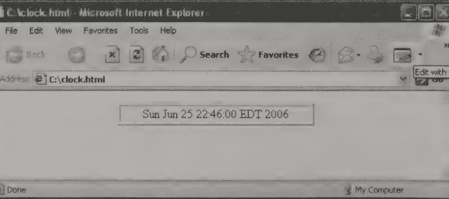

图 1.1：这个动态数字钟是用 JavaScript 创建的。

## 接口

这个简单的示例说明了 JavaScript 直接向用户界面更新数据的能力。虽然这个特定示例仅显示系统时间，但可以使用类似的技术从 XML Web 服务获取信息并将数据显示在浏览器中，并在指定的时间间隔更新信息。这种技术可以进一步扩展，用于诸如显示分钟更新的股市数据或监控货物状态等功能。

这里的关键在于，无需刷新页面即可更新浏览器显示。记住，界面本身是由浏览器生成的。这意味着你的应用程序部署变得相对简单，因为你办公室中的每个工作站已经拥有了所需的客户端应用程序。JavaScript 通过扩展网页的 GUI 界面使其更具动态性和交互性。

让我们来看另一个示例：项目需求页面。此应用程序可能会显示项目列表以及相关的订单数量、需求数量等。如果没有 JavaScript，用户可能必须点击项目编号字段来显示额外的项目信息。此操作将向服务器发送请求，以检索包含项目信息的网页。图 1.2 显示此应用程序的流程。

虽然这种方法运行良好，但它显示了客户端应用程序与服务器之间的脱节。使用 JavaScript，这些信息可以在页面初始加载时包含在内，并隐藏，直到用户鼠标悬停在项目编号字段上。此时，浏览器窗口内可以显示一个包含所有项目数据的框。图 1.3 显示了使用这种方法可以创建的流程。

## 第 1 章：进入正题

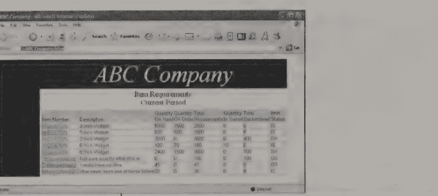

图 1.2：该网页应用程序的布局没有使用 JavaScript。

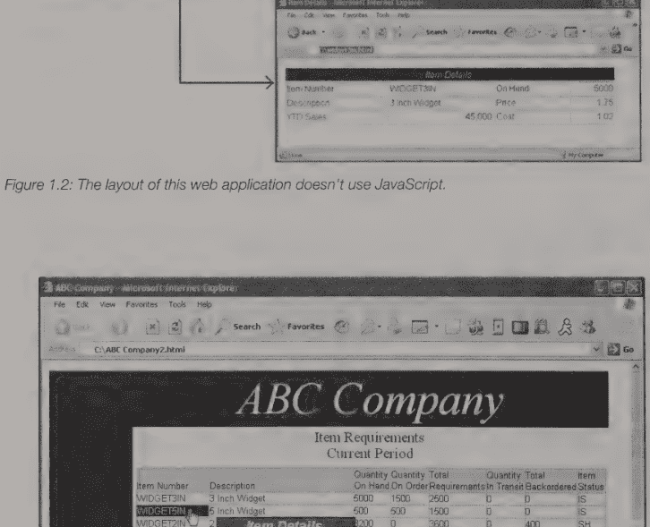

图 1.3：此网页应用程序与图 1.2 类似，但使用了 JavaScript。

该版本的应用程序显示与图 1.2 相同的信息，但在原始网页内的小窗口中显示，而无需向服务器提交任何额外数据。这不仅有助于应用程序运行得更高效，还让终端用户的应用程序流程更加顺畅。

使用类似的技术，可以为页面中的特定项目创建自定义的右键上下文菜单。该上下文菜单可以用于导航到其他几个页面之一。通过使用图 1.3 中的 ABC 公司项目需求示例，你可以轻松地添加一个上下文菜单，以导航到项目信息屏幕、为项目下订单或显示项目的仓库位置信息。这些选项中的每一个都可以在新窗口或文档中显示信息，或者使用 `document.URL` 运算符导航到新 URL。图 1.4 显示了此类示例。

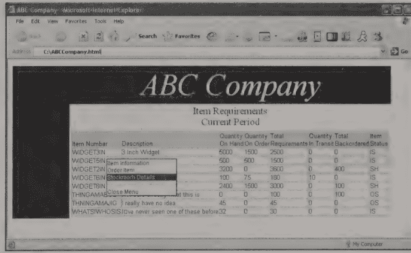

图 1.4：上下文菜单是用 JavaScript 创建的。

最终，这些功能的添加允许用户以更高效的方式工作。

## 可自定义视图

由于不同人的习惯各不相同，单一的固定界面可能并不适用于所有人。使用 JavaScript，你可以允许用户自定义颜色方案等内容。

例如，许多应用程序会在表格内显示数据。通常，用户希望能够根据表格中的任何一列对这些数据进行排序。使用 JavaScript，可以创建一个函数，当用户点击列时按特定列对数据进行排序。

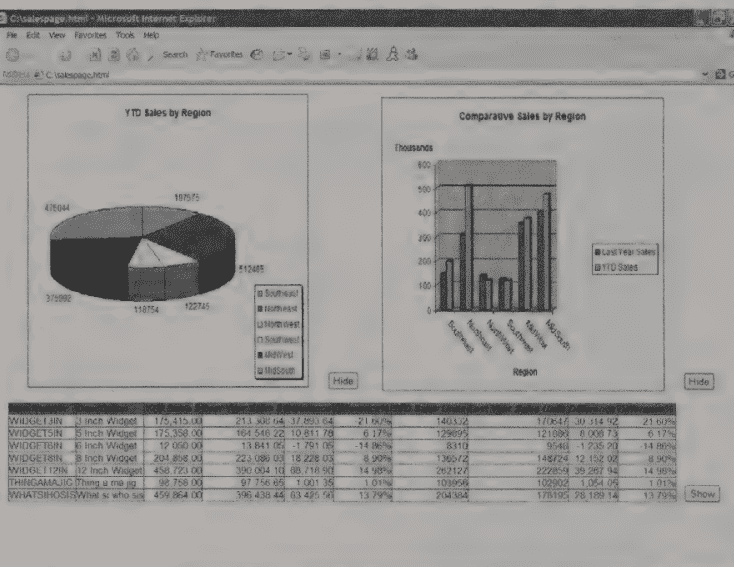

图 1.5：JavaScript 被用于列排序。

## 数据处理

在自定义屏幕外观的同时，还可以对屏幕上的数据进行处理。例如，你可以编写脚本在修改表单中的值时重新计算总和。

对于销售员来说，最重要的信息可能是表格。她可能希望对其进行排序，如图 1.6 所示。

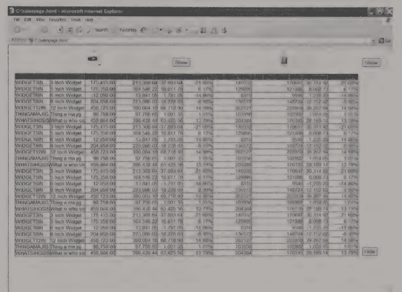

图 1.6：用户可以更改视图。

另一方面，销售经理可能并不关心项目。他可能希望隐藏它，如图 1.7 所示。

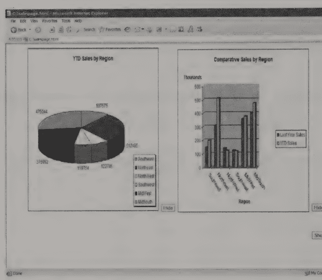

图 1.7：用户可以更改排序顺序。

使用 JavaScript 执行此任务的优势在于无需刷新屏幕即可排序，这提高了速度并让应用程序感觉更加用户友好。图 1.8 和图 1.9 显示了此功能的示例。图 1.8 显示了按姓排序的数据。

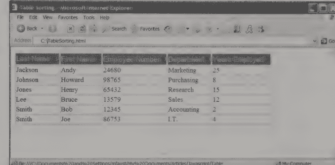

图 1.8：JavaScript 被用于即时排序。

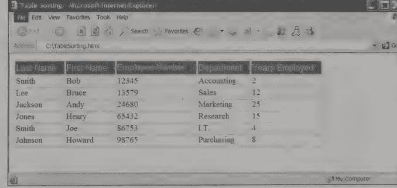

图 1.9：用户可以通过点击列头更改排序顺序。

如果用户点击员工编号列，表格将无需刷新页面即可立即按该列重新排序，如图 1.9 所示。再次点击该列会将排序顺序从升序反转为降序。

数据处理还包括进行计算并在屏幕上显示结果，同样无需将页面提交到服务器。例如，你可以编写脚本在修改表单中的值时重新计算总和。图 1.10 和图 1.11 的屏幕说明了此类应用程序。

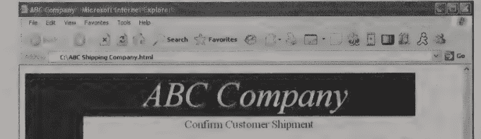

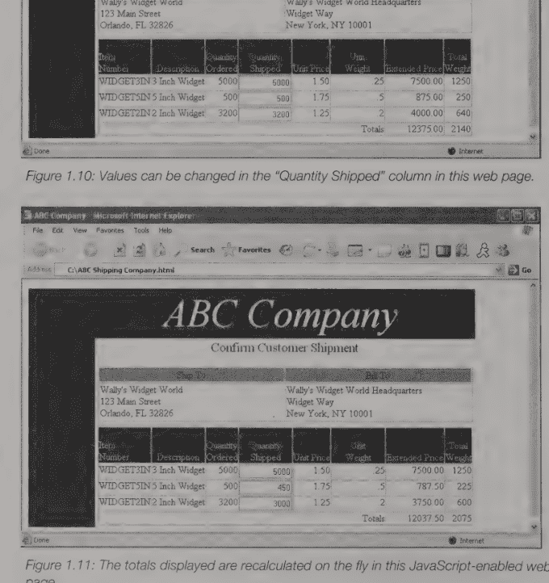

在本示例中，页面最初显示了“发货数量”（Quantity Shipped）列下文本框中的值。用户具有编辑这些值的权限，这将重新计算页面上任何基于发货数量的其他值——例如扩展价格价（extended price）。

如图所示，一旦用户更改了其中一个“发货数量”（Shipped Quantity）字段的值，“总重量”（Total Weight）和“扩展行值”（Extended Line Value）列将自动重新计算，表单底部这些列的总计也会同步更新。这些额外的计算字段可以在表单提交到服务器时连同表单变量一起发送。在随后的章节中，你将学习具体如何实现此类数据操作。你还将看到其他动态更改页面内容的技巧。

## 与后端系统集成

由于基于浏览器的应用程序是真正的客户端服务器应用程序，因此理解如何使用 JavaScript 与远程系统通信非常重要。JavaScript 无法使用任何常用的数据库 API（如 ODBC 或 JDBC）读取数据。然而，JavaScript 可以从 XML 源读取并显示数据。随着 XML Web 不断涌入，你基于 JavaScript 的应用程序可以访问大量的信息源。使用 JavaScript 实际上可以访问 XML 文档的所有元素。

图 1.12 中的应用程序接受邮政编码，消耗免费 Web 服务获取数据，并返回国家气象局（NWS）的一周预报数据。NWS 应用程序需要经纬度值来检索天气信息。可以使用 Yahoo.com Maps 网站提供的免费 Web 服务确定特定邮政编码的经纬度。该 Web 服务还会返回与邮政编码相关的城市和州。

从 NWS Web 服务返回的信息包含了与每天预报相关的图形链接。检索的数据用于填充预定义的 HTML 表格，对预报数据的良好展示。只需更改输入的邮政编码并点击“获取预报”（Get Forecast）按钮，JavaScript 就会将当前预报替换所需位置的预报。这一切都在客户端完成，无需连接到服务器（当然，提供 XML 数据的服务器除外）。

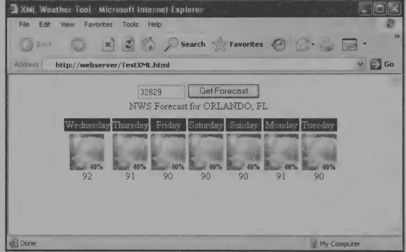

图 1.12：此页面通过 XML Web 服务访问数据。

此示例很容易合并另一个网页，允许你提供天气预报数据以及应用程序显示的任何其他信息。（在第 6 章中，你将看到此示例具体是如何创建的。）虽然此示例使用了免费的公共 Web 服务，但你可以使用相同的技术创建 JavaScript 应用程序，以调用构建在例如你的 ERP 系统中的私有 XML Web 服务。这有助于说明说明为什么在设计应用程序时考虑面向服务的架构（SOA）非常有意义，因为 Web 服务是 JavaScript 访问远程数据源的唯一方式。

假设你需要创建一个应用程序编程接口（API）来检索客户订单数据。如果你将此 API 构建为 Web 服务，那么你就添加了从许多其他开发平台（包括 JavaScript）使用它的能力。

假设图 1.13 中的数据是由连接到你 ERP 应用程序的 XML Web 服务生成的。这些数据可以使用客户端 JavaScript 轻松地读取并显示在浏览器中。多个项目（例如此示例中的订单详情行）可以在 JavaScript 中作为集合或数组进行访问。

```xml
<xml version="1.0" encoding="ISO-8859-1"?>
<ORDER>
  <HEADER>
    <ORDER_NUMBER>00123456</ORDER_NUMBER>
    <CUSTOMER_NUMBER>45678</CUSTOMER_NUMBER>
    <CUSTOMER_NAME>Wally's Widget World</CUSTOMER_NAME>
    <ORDER_DATE>12/15/2006</ORDER_DATE>
    <SHIP_VIA>FEDEX</SHIP_VIA>
  </HEADER>
  <DETAILS>
    <LINE>
      <ORDER_LINE>1</ORDER_LINE>
      <ITEM>WIDGET3IN</ITEM>
      <DESCRIPTION>3 Inch Widget</DESCRIPTION>
      <QUANTITY>500</QUANTITY>
      <PRICE>1.25</PRICE>
    </LINE>
    <LINE>
      <ORDER_LINE>2</ORDER_LINE>
      <ITEM>WIDGET5IN</ITEM>
      <DESCRIPTION>5 Inch Widget</DESCRIPTION>
      <QUANTITY>250</QUANTITY>
      <PRICE>1.55</PRICE>
    </LINE>
    <LINE>
      <ORDER_LINE>1</ORDER_LINE>
      <ITEM>WIDGET2IN</ITEM>
      <DESCRIPTION>5 Inch Widget</DESCRIPTION>
      <QUANTITY>1000</QUANTITY>
      <PRICE>1.15</PRICE>
    </LINE>
    <LINE>
      <ORDER_LINE>4</ORDER_LINE>
      <ITEM>WIDGET6IN</ITEM>
      <DESCRIPTION>6 Inch Widget</DESCRIPTION>
      <QUANTITY>1500</QUANTITY>
      <PRICE>1.75</PRICE>
    </LINE>
  </DETAILS>
</ORDER>
```

图 1.13：此示例显示了 ERP 应用程序返回的 XML 数据。

随着异步 JavaScript 和 XML（AJAX）的引入，JavaScript 与 XML 之间的这种交互已变得普遍。你将在第 6 章看到更多 AJAX 的示例。

## 服务器端交互

虽然 JavaScript 和 ASP 之间没有直接链接，但存在服务器脚本进行交互的方法。主要方法是通过 `<input>` 框。你可能会像在本章之前看到的那样使用这种技术。

### 客户端 JavaScript 1

```javascript
<SCRIPT LANGUAGE = "JavaScript">
var hidVar = forms[0].createElement("input")
hidVar.type = "hidden";
hidVar.value = "ABC123";
hidVar.name = "hiddenVar";
</SCRIPT>
```

### ASP 服务器端

```asp
<%
hidVar = Request.Form("hiddenVar")

Response.Write("<input type = 'hidden' name='hidden2' value=" & hidVar & ">")
%>
```

### 客户端 JavaScript 2

```javascript
<SCRIPT LANGUAGE="JavaScript">
var hidVar2 = document.all("hidden2");
window.alert(hidVar2);
</SCRIPT>
```

图 1.14：可以在 JavaScript 和服务器脚本之间传递数据。

## 总结

现在你已经了解业务程序员使用 JavaScript 的一些理由，现在是时候开始研究如何使用 JavaScript 了。在第 2 章中，你将学习 JavaScript 到底是什么。

# 第 2 章：JavaScript 基础

## JavaScript 基础

JavaScript 语言由一位名为 Brendan Eich 的 Netscape 程序员开发。它最初被称为“LiveScript”，并于 1995 年 9 月随 Netscape Navigator 2.0 发布。在同年 12 月，LiveScript 被更名为 JavaScript，因为该脚本语言与 Java 有相似之处。1996 年 7 月，微软作为 Internet Explorer 3.0 的组件引入了他们的 JavaScript 端口（称为“Jscript”）。即使在今天，Netscape 和微软的 JavaScript 实现之间存在显著差异（你将在本章晚些时候学习这些差异）。

## 什么是 JavaScript？

在继续之前，让我们具体探讨 JavaScript 到底是什么（以及*不是*什么）。虽然 JavaScript 使用的语法与 Java 语言相似，但 JavaScript 不是 Java，也不是 Java 的子集。有一种常见的误解认为 JavaScript 与 Java 有某种联系，这完全是错误的。Java 是一种功能齐全且复杂的语言。相比之下，JavaScript 是一种解释型脚本语言。这意味着在执行 JavaScript 代码之前不需要编译。

JavaScript 允许程序员控制并增强运行在流行浏览器中的应用程序所提供的用户界面。

JavaScript 代码通常嵌入在 HTML 网页或类似的文档（如 XML 文档）中。或者，它也可以包含在自己的源文件中，然后在 HTML 和 XML 文档中引用。需要注意的是，还有一种“服务器端”JavaScript 组件，它由 Netscape 的 Enterprise Server 产品支持。该产品允许将 JavaScript 作为一种服务器脚本语言使用。书中对 JavaScript 这种语言的所有讨论均指客户端脚本语言。

JavaScript 代码块包含在 HTML 文档的 `<script>` 标签内。例如，在接下来的代码段中，执行了 JavaScript `document.write()` 语句：

```html
<SCRIPT LANGUAGE = "JavaScript">
document.write("JavaScript Code");
</SCRIPT>
```

注意 `<script>` 标签的 “language” 参数，它描述了用于解释脚本的特定脚本语言。

如果 JavaScript 代码在单独的文件中，如所示，将该文件包含在你的 HTML 文档中：

```html
<SCRIPT LANGUAGE = "JavaScript" SRC = "myjavascript.js">
```

当加载包含此 `<script>` 块的页面时，文件“myjavascript.js”也将被加载，该文件中的 JavaScript 源将执行执行。这种技术对于常用的 JavaScript 函数来说非常方便。

关于 JavaScript 这种语言的一个非常重要的注意事项是，它是由浏览器解释的。因此，不同的浏览器对相同的 JavaScript 源代码可能有不同的反应。事实上，目前存在两个截然不同的 JavaScript 版本。在编写可能在不同浏览器平台上执行的 JavaScript 源时，需要考虑这一点。为了让这变得更容易，让我们来看看 JavaScript 的不同“风味”。

## 换个名字的脚本

正如你已经发现的，JavaScript 的原始版本是由 Netscape 开发的。微软（正如它经常所做的那样）也开发了自己的版本的 JavaScript “风味”，被称为 JScript。Netscape 的 JavaScript 版本通常支持任何基于 Mozilla 的浏览器（如 Netscape Navigator 或 Firefox），而 JavaScript 主要在微软的 Internet Explorer 上获得支持。

为了调和 JavaScript 实现之间的差异，微软和 Netscape 同意采用由欧洲计算机制造商协会定义的厂商中立标准。该标准被称为 ECMAScript，最初是在 1997 年达成一致的。可以在 ECMA 网站 (http://www.ecma-international.org) 处找到完整的 ECMAScript 标准。

尽管有了这个标准，两种脚本语言之间仍然存在显著差异。尽管 JavaScript 和 JScript 与它们各自的 Web 浏览器交互方式大不相同，但你可以编写脚本来处理这些差异。由于 ECMAScript 标准的存在，主要差异并不在于语言结构本身，而在于运行每种语言的浏览器平台所支持的文档对象模型。

## DOM 实现对比

文档对象模型 (DOM) 是一种分级结构，用于访问 HTML 文档中的所有对象。世界维网联盟 (W3C) 定义了 DOM 标准。当前版本被称为 Level 3，是在 2004 年定义的。每个浏览器对 W3C 标准的遵循程度各不相同。然而，图 2.1 所示的通用“树”结构是所有实现所共有的。

```html
<HTML>
  <body>
    <TABLE>
      <TR>
        <TD>
      </TR>
    </TABLE>
    
  </body>
</HTML>
```

浏览器的种类和版本的多样性使得很难列出一份全面的兼容性差异列表。与其试图解释所有这些差异，让我们关注当差异发生时如何识别和处理它们。

## 测试...测试...测试

在开发兼容多个浏览器的 JavaScript 应用时，最重要的规则可能是在多个浏览器上测试你的代码。虽然这看起来是显而易见的，但很容易养成一种主要在你的“首选浏览器”上测试脚本代码的习惯。后来，你会发现代码的某些部分与另一个浏览器不兼容。顺便提一下，这并不总是是坏事。如果你设计的应用程序是在“受控环境”（例如你的办公室）中使用，你可能不在乎代码是否与你的 IT 员工不愿支持的浏览器兼容。

尽管如此，拥有多个浏览器的权限是一个好主意。为了说明这一点，请看下面：

```html
<html>
  <body>
    Test Page
    <script type="text/javascript">
      window.location = "http://www.example.com";
    </script>
  </body>
</html>
```

(注：提供的 OCR 文本包含大量重复和碎片，我已根据逻辑流进行了清理和翻译。)

```javascript
<script type="text/javascript">
var usrAgt=navigator.userAgent.toLowerCase();
if (usrAgt.indexOf("firefox") != -1) {
  // Firefox specific code goes here
}
if (usrAgt.indexOf("msie") != -1) {
  // Internet Explorer specific code goes here
}
if (usrAgt.indexOf("netscape") != -1) {
  // Netscape specific code goes here
}
if (usrAgt.indexOf("opera") != -1) {
  // Opera specific code goes here
}
if (usrAgt.indexOf("mozilla/5.0") != -1) {
  // Mozilla specific code goes here
}
</script>
```

图 2.2: 此脚本说明了如何确定浏览器。

## JavaScript/HTML 交互

由于 JavaScript 语言的主要目的是控制基于 HTML 的网页的组件，因此理解 JavaScript 和 HTML 是如何交互的至关重要。JavaScript 源代码可以通过两种方式存在：直接嵌入在 HTML 文档中的内部定义脚本，或者在在其独立文件中定义的外部脚本。在这两种情况下，`<script>` HTML 标签都是定义你的脚本的关键。

要在网页中嵌入 JavaScript 源代码，你按照所示所示定义 `<script>` 标签：

```javascript
<script type="text/javascript">
var usrAgt = navigator.userAgent;
window.alert(usrAgt);
</script>
```

在嵌入脚本中，实际的 JavaScript 源代码只需放在起始 `<script>` 和结束 `</script>` 标签之间。但在某些情况下，你可能有需要在多个网页使用的代码。与其在每个 HTML 文档中放置相同的代码，可以将此代码保存到单独的文件并将该脚本引入你的 HTML 文档。以下是实现此操作的 HTML 源码示例：

```html
<script src="myscript.js" type="text/javascript">
</script>
```

在此示例中，"src" 属性定义了包含 JavaScript 源的文件的位置。该文件应以 ".js" 扩展名保存。

`<script>` 标签在 HTML 文档中的位置会影响脚本的执行方式，因此有一些通用规则需要记住。首先，任何从 HTML 文档内部调用的 JavaScript 函数都应该放在文档的 `<head>` 部分，如下所示：

```html
<html>
<head>
<script src="functions.js" type="text/javascript">
</script>
</head>
<body>
</body>
</html>
```

此示例使用了一个命名为 "functions.js" 的外部 JavaScript 文件。将 JavaScript 函数放置在 `<head>` 部分可确保这些函数在页面加载时即可可用。如果此脚本放置在文档的末尾，加载它时的任何问题都可能导致 JavaScript 函数无法访问。

相反，旨在作为页面加载的一部分进行执行的 JavaScript 源代码应该放在文档的 `<body>` 部分。下方的文档说明了这样使用嵌入脚本：

```html
<html>
<head>
<script src="functions.js" type="text/javascript">
</script>
</head>
<body>
<h1 align="center">我的网页</h1><br>
<script type="text/javascript">
var usrAgt = navigator.userAgent;
document.write("<h3 align=\"center\">" + usrAgt + "</h3>");
</script>
<h2 align="center">底部</h2>
</body>
</html>
```

此示例使用 `navigator.userAgent` 将 `userAgent` 的结果显示在浏览器中，如图 2.3 所示。

记住脚本每当放置在任何位置时都会被执行，这很重要。因此，如果在 JavaScript 之前有对象，它们将在脚本输出生成之前显示。同样，此脚本之后的任何对象都将在 JavaScript 代码输出之后显示。

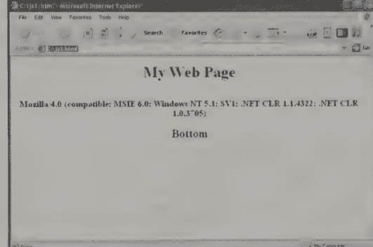

图 2.3: 此输出是由 JavaScript 函数生成的。

正如你从图 2.3 中看到的，使用 JavaScript 创建的页面部分恰好放置在 JavaScript 源代码所在的位置。这个示例有助于说明 JavaScript 和 HTML 是如何交织的。在创建交互式网络应用程序时，它们都是重要的组件。

理解如何在 JavaScript 中访问和操作 HTML 对象也同样重要。在图 2.1 中，你看到了构成 HTML 网页的层级树形结构。树形结构中的任何对象都可以从 JavaScript 内部访问。实现此操作最简单的方法之一是为对象的 `<html>` 标签分配一个 `ID` 属性。（在本讨论中，对象被视为一个 HTML 标签以及以及在匹配的结束 HTML 标签之前找到的所有元素。例如，一个 HTML `<table>` 包含了在结束 `</table>` 标签之前定义的所有对象。）

下面的示例为 HTML 表格定义了 `ID` 属性：

```html
<table id="MyTable">
<tr><td>单元格 1</td></tr>
<tr><td>单元格 2</td></tr>
<tr><td>单元格 3</td></tr>
</table>
```

在此示例中，HTML 表格被命名为 "MyTable"。要从页面的 JavaScript 访问此表格，你需要使用 `getElementById` 方法，如下：

```javascript
<script type="text/javascript">
var table = document.getElementById("MyTable");
</script>
```

此示例创建了一个包含表格所有属性和方法的变量。一旦定义了该变量，表格中的行和单元格就可以通过该对象进行访问。除了使用 `getElementById()` 之外，你还可以通过其他几种方式访问 HTML 文档中的对象。例如，`document` 对象允许你访问 `<html>` 标签。同样，`document.body` 对象允许访问 `<body>` 标签。事实上，该标签是 `<html>` 标签的子元素，也可以通过 `childNodes` 集合进行访问。该集合实际上可以遍历你网页的整个层级结构。

以下示例使用 `childNodes` 集合遍历 HTML 页面内的第一级对象：

```javascript
<script type="text/javascript">
var bodyTag = document.body;
var children = bodyTag.childNodes.length;

for (var x = 0; x < children; x++) {
  // 过滤掉文本节点等逻辑
}
</script>
```

JavaScript 还支持多种特定元素的对象来访问 HTML 文档中的单个对象。一个很好的例子是 `forms` 集合，它通过 `document.forms()` 访问。该集合允许访问网页中所有的 HTML 表单对象。它基本上是使用 `document.getElementsByTagName("form")` 的快捷方式。你可以使用 "elements" 集合访问表单内的任何对象。图 2.6 包含了使用 "forms" 和 "elements" 集合的示例。

```html
<html>
<head></head>
<body>
  <table id="MyTable">
    <tr><td>单元格 1</td><td>单元格 2</td></tr>
    <tr><td>单元格 3</td><td>单元格 4</td></tr>
  </table>

  <table id="MyTable2">
    <tr><td>单元格 5</td><td>单元格 6</td></tr>
    <tr><td>单元格 7</td><td>单元格 8</td></tr>
  </table>
</body>

<script type="text/javascript">
  var tbl = document.getElementsByTagName("table");
  var kids = tbl.length;

  for (var x = 0; x < kids; x++) {
    var y = (x + 1).toString();
    document.write("表格 " + y + ": " + tbl[x].id + "<br>");
  }
</script>
</html>
```

> 图 2.4: 此 HTML 页面说明了 getElementsByTagName() 的用法。

此示例还说明了如何使用 JavaScript 在页面加载到浏览器后动态地添加信息。在此示例中，原始页面只包含两个表格，每个表格四个单元格。在 JavaScript 执行后，页面上添加了两行包含表格信息的文本，如图 2.5 所示。这种类型的动态变化可以在更有趣（更华丽）的方式中使用，正如你稍后在书中看到的那样。

```html
<html>
<head>
  <title>"表单”与“元素”集合</title>
</head>
<body>
  <form name="MyForm">
    <input type="Text" name="field1">
    <input type="Button" value="submit" name="btn1">
  </form>
</body>
<script type="text/javascript">
  var myForm = document.forms["MyForm"];
  var fields = myForm.length;

  for (var x = 0; x < fields; x++) {
    var y = (x + 1).toString();
    document.write(myForm.elements[x].name + " = " + 
    myForm.elements[x].type + "<br>");
  }
</script>
</html>
```

图 2.6：“forms”和“elements”集合用于读取表单数据。

执行此脚本时，它会通过“forms”集合访问表单 "MyForm"。然后它使用“elements”集合读取表单中的每个对象，并将对象的名称和类型显示在浏览器窗口中。图 2.7 显示了此代码生成的输出。

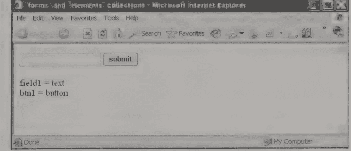

图 2.7：此处 JavaScript 读取 HTML 表单数据。

通过这种方式访问表单字段，允许你对字段进行预编辑，确保在提交表单之前已为必填字段提供了值。

当字段的有效值基于易于验证的值（如日期范围）时，你可以扩展此技术来执行有效性检查。

表 2.2 列出了允许直接访问特定网页元素的文档对象集合。这些集合中的每一个都允许 JavaScript 访问文档中相应的 HTML 标签。与早期的示例一样，这些集合都基于“document”对象，该对象提供了对 HTML 文档顶层的访问。

| 集合 | 相关标签 | 说明 |
|---|---|---|
| 锚点 (Anchors) | `<a>` | 该集合访问 HTML 文档中的所有超链接。 |
| Applets | `<applet>` | 该集合访问 HTML 文档中的所有 Java applet。 |
| 表单 (Forms) | `<form>` | 该集合访问 HTML 文档中的所有表单。 |
| 图像 (Images) | `` | 该集合访问 HTML 文档中的所有图像元素。 |

关于 HTML 页面的其他细节也可以通过“document”对象获取。`document.domain` 获取正在显示的文档的域名（例如 www.mcpressonline.com）。`document.referrer` 允许你通过链接或提交确定当前页面之前的页面。`document.title` 获取 `<title>` HTML 标签的值，该标签定义了在浏览器标题栏中显示的文本。此属性也可以从 JavaScript 内部更新，因此你可以动态更改标题栏文本，如下例所示：

```html
<html>
<head>
  <title>我的页面</title>
</head>
<script type="text/javascript">
  var ttl = document.title;
  var curDate = new Date();
  document.title = ttl + " " + curDate;
</script>
</html>
```

此代码将文档标题 "My Page" 加载到变量 `ttl` 中。接下来，变量 `currentDate` 被填充为当前日期时间。然后，通过在原始标题末尾附加当前日期更改 `document.title` 属性。图 2.8 显示了此示例的输出。

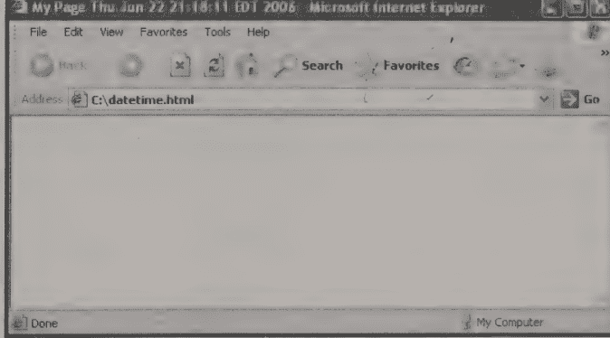

图 2.8：此示例动态更新标题栏。

最后，`document.URL` 获取文档的全限定统一资源定位符 (URL) 地址（例如 http://www.mc-store.com/mikefaust.html）。`URL` 属性也是可更新的，如果指定页面出现问题或正在建设，允许你重定向到另一个页面或网站，如下例所示：

```javascript
<script type="text/javascript">
  var pgURL = document.URL;

  if (pgURL == "brokenpage.html") {
    document.URL = "redirected.html";
  }
</script>
```

虽然这些属性在嵌入单个网页的脚本中可能不十分有用，但请记住 JavaScript 源代码可以存储在外部 (.js) 文件并在多个页面中使用。这些外部文件可以被编写为根据这些属性的值执行特定任务，或更新可更新属性。例如，外部 JavaScript 可能被设置为根据日期和时间动态设置标题属性，如图 2.8 所示。此 JavaScript 可能会包含在所有页面中以保持一致性。

## 总结

希望本章让你对 JavaScript 是什么以及它如何在网站中工作有了良好的了解。在接下来的章节中，你将探索 JavaScript 语言本身以及如何充分利用它。前两章侧重于程序员的 JavaScript 概念方面。现在是时候检查 JavaScript 语言的内部构造部分了。

# 第 3 章：语言结构与语法

正如你在前几章中学到的，JavaScript 与 Java 等其他语言共享许多语法元素。

（注：原文后续部分存在大量重复内容和乱码，已根据逻辑剔除重复项并保留核心结构）

在此示例中，$x1$ 被定义为值为 12 的数值变量，$x2$ 被定义为值为 "12.2" 的字符串变量。使用 `==` 运算符对这两个变量进行比较的结果为 `true`。然而，使用 `===` 运算符时，结果为 `false`，因为一个变量是字符串，而另一个是数值。

赋值运算符用于设置或修改变量的值。`=` 运算符仅根据另一个值或公式设置变量的值。该运算符的几个扩展允许你根据被赋值赋值的变量进行计算。例如，下面的两个语句返回相同的结果：

```
x1 = x1 + 24;
x1 +=  24;
```

这两个语句都将变量 $x1$ 的值增加 24。`+=` 运算符将运算符使用的值加上运算符后面的值。与此类似，`-=` 运算符根据运算符右侧提供的值减少所提供的变量，而 `*=` 和 `/=` 运算符则将提供的变量乘以或除以该值。

`%` 运算符可以使用运算符右侧提供的值对结果变量进行模运算。下面的两个语句说明了执行此操作的两种方法：

```
remNdr1 = remNdr1 % 7;
remNdr1 %= 7;
```

在这两个示例中，$remNdr1$ 的值都被除以七。该除法运算的余数随后赋值给变量 $remNdr1$。

布尔运算符用于在表达式（如 "if" 语句）中比较多个条件。以下是使用这些运算符的 "if" 语句示例：

```javascript
// Boolean AND condition
if (x > 1 && x < 12) {
}
```

```javascript
// Boolean OR condition
if (x < 1 || x > 12) {
}
```

```javascript
// Boolean NOT condition
if (!(x = 6)) {
}
```

位运算符允许你在位级别上对变量进行操作，并且在位赋值运算符的情况下，可以将结果重新赋值给该变量。位与 (&)、位或 (|) 和位非 (!) 的作用功能与布尔运算符类似。除了这些运算符外，还有一些运算符可以允许你按指定的位数向右或向左移动位。这些运算符包括用于位与运算的 `&`、用于位或的 `|`、用于位异或的 `^`、用于向左移位并从右侧补零的 `<<=`、用于向右移位的 `>>=`，以及最后用于向右移位并从左侧补零的 `>>>=`。表 3.2 列出了某些位运算符提供的功能。

| 语句 | 操作描述 |
|---|---|
| X = 7 & 43; | 00000011 & 00101011 = 00000011 = 3 |
| X = 7 \| 43 | 00000111 \| 00101011 = 00101111 = 47 |
| X = ~7 | ~0111 = -1000 = -8 |
| << | 0000 0100 << 4 = 01000000 or 4 << 4 = 64 |
| >> | 0000 1100 >> 2 = 00000011 or 12 >> 2 = 3 |
| >>> | 0000 1100 >>> 2 = 00000011 or 12 >>> 2 = 3 |

这两个右移运算符之间的主要区别是 ">>>" 在移位后从左侧移动零，而 ">>" 移动的是最高位。由于如此，正数看起来是相同的，而负数则完全不同。

## 变量和对象

JavaScript 要求显式声明变量和对象。好消息是原始类型变量定义简单。这是一个定义变量的示例：

```
var myVar
```

此示例定义了 `myVar` 但没有给它赋值。也可以在声明时为变量分配初始值，如下：

```
var IntVar = 7;
```

此示例在单个语句中声明并初始化了变量。JavaScript 语言不是强类型的。事实上，JavaScript 支持四种基本变量类型：

- 用于数值数据的类型
- 用于存储字符串数据的类型
- 用于存储 "true/false" 数据的逻辑（布尔）类型
- 用于存储 null 值的空类型

定义 JavaScript 变量不需要类型声明。事实上，只需通过定义不同的值即可重新定义 JavaScript 变量，如下所示：

```javascript
<script type="text/javascript">
var myVar = 9;
document.write(myVar + " = " + (myVar) + "<br>");
myVar = "String!";
document.write(myVar + " = " + (myVar) + "<br>");
</script>
```

此示例声明了一个值为9 的变量 `myVar`。随后使用 `document.write()` 语句写入该变量的值。接下来，`myVar` 被重新定义为字符串值 "String!"。由于 "+" 运算符对于数值和字符串变量的作用不同，这些情况的输出结果不同。图 3.1 显示了输出结果。


除了这些简单变量类型外，JavaScript 还支持更高级的数据类型，包括数组类型、日期类型和对象类型。通过简单的变量声明，可以在单个语句中同时声明并初始化数组，如下所示：

```
var myArray = ["Sun", "Mon", "Tue", "Thu", "Fri", "Sat"];
document.write(myArray[1]);
```

由于 JavaScript 类型是“假设的”，语言会将此变量识别为拥有七元素的数组。JavaScript 数组是从零开始的，这意味着第一个元素是 0，第二个是 1，依此类推。因此，此示例将显示值 Mon。

也可以显式声明 JavaScript 数组，如下：

```
var myArray = Array("A", "B", "C", "D", "E", "F", "G");
```

注意在此示例中方括号被括号替换。同样重要的是，JavaScript 只为实际保留值的元素使用内存。例如，考虑此数组声明：

```
var myArray = new Array(12,24,,48,,96);
```

它定义了一个拥有六元素的数组；然而，第三和第五个元素没有值。与其他编程语言不同，JavaScript 不为这些数组元素分配内存空间。当应用程序需要定义一个可能包含大量元素但元素逐渐添加的数组时，这一事实非常有用。对于一个可能有 999 个元素的数组，其定义如下：

```
var myArray = new Array(999);
```

也可以定义多维数组。这是通过为数组的每个维度指定单独的 "new Array" 定义来实现。下面的示例说明了这一概念：

```javascript
var myArray = new Array(3);
for (var i=0; i < 3; i++) {
  myArray[i] = new Array(3);
  for (var j=0; j < 3; j++) {
    myArray[i][j] = "";
  }
}
```

此示例声明了一个二维数组，每个维度包含三个元素，共九个元素。此示例将每个元素初始化为空字符串。尽管此数组按特定定义，但 JavaScript 数组可以通过定义新元素来扩展。例如，以下语句在 JavaScript 中是完全允许的：

```
var myArray = new Array(3);

myArray[9] = "New Element";
```

在这种情况下，数组初始定义为三个元素。通过元素 9，其长度扩展到 10 个元素。（记住，JavaScript 数组是从零开始的。）另一方面，如果你引用一个之前未定义的元素，将返回值 "undefined"。

在 JavaScript 数组中存储不同类型的值也是完全允许的。例如，这里定义的包含三个元素的数组是有效的：

```
var myArray = new Array("Value 1", 17, 0xFF);
```

JavaScript 并不在乎第一个元素是字符串值，第二个是整数数值，第三个元素是十六进制值。这里需要注意的是 JavaScript 支持使用 0x 前缀来引用十六进制值。当值存储在变量中时，会被转换为整数。

JavaScript 还支持通过函数定义自定义对象。你可以使用 JavaScript 函数创建新对象，因为函数可以使用创建的自定义属性和方法进行扩展。图 3.2 展示了简单对象的创建和使用。

```javascript
<SCRIPT LANGUAGE=JavaScript>
varCircle = new circleBuilder();

if (myCircle.diameter > 0) {
 myCircle.display();
}
```

图 3.2: JavaScript 支持创建自定义对象（部分1，共2）。

```javascript
function circleBuilder() {
  this.radius = prompt("Please Enter the Circle's Radius");
  this.diameter = this.radius * 2;
  this.circumference = Math.PI * this.diameter;
  this.area = Math.PI * this.radius * this.radius;
  this.display = displayCircleInfo;
}

function displayCircleInfo() {
  document.write("A circle with a radius of " + this.radius);
  document.write(", has a diameter of " + this.diameter);
  document.write(", a circumference of " + this.circumference);
  document.write(", and an area of " + this.area + "<br>");
}
</script>
```

图 3.2：JavaScript 支持创建用户定义对象（部分 2/2）。

此示例创建了一个名为 `circleBuilder()` 的对象，它可以用于获取给定半径圆的信息。你首先创建一个名为 `myCircle` 的新对象，其定义类型为 `circleBuilder()`。当该对象被创建时，`circleBuilder()` 函数会提示用户输入所需的圆半径。请注意，`circleBuilder()` 函数能够通过使用 "this" 对象来引用自身。

该函数随后会计算圆对象的各种属性，并将这些值存储在与对象相关的各个属性中。这意味着你可以通过引用 `myCircle.area` 来访问圆的面积。你还可以创建自定义方法来使用你的用户定义函数执行操作。图 3.2 中的代码通过将 `this.display` 对象与另一个名为 `displayCircleInfo()` 的用户定义函数关联来实现此。如果你调用 `myCircle.display` 方法，则会调用 `displayCircleInfo()` 函数，并传入 `myCircle` 对象的引用。3.3 和 3.4 显示了使用 `circleBuilder()` 对象的示例。

## 变量和对象的声明

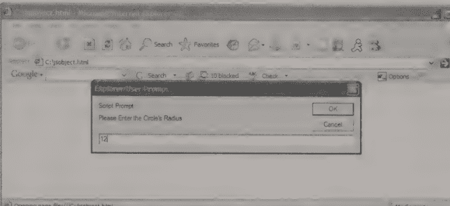

图 3.3 此示例提示用户输入圆的半径。

当图 3.3 中的页面加载时，用户会立即提示输入圆的半径。该值被传递到 `circle()` 对象中。图 3.4 显示了结果。

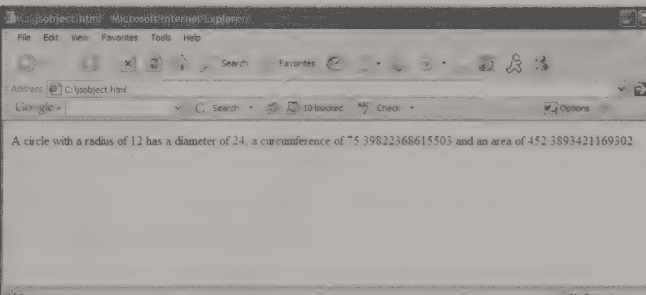

图 3.4：使用 `circle()` JavaScript 对象，你可以计算圆的各种属性。

虽然这是一个相对简单的示例，但它有助于说明在 JavaScript 中使用和创建自定义对象是多么简单。在这种情况下，该对象既有自定义属性也有自定义方法。你稍后将学习如何创建更高级的 JavaScript 对象。

## 控制

JavaScript 语言有许多控制应用程序流的方法。最简单的方法由“条件运算符”表示。这种运算符根据定义的条件有条件地设置值，如下所示：

```javascript
x = (y == 0) ? z : z/y;
```

在此示例中，如果 y 等于零，则将 x 的值设置为 z；否则，将 x 的值设为 z 除以 y 的结果。此示例可以用于避免潜在的“除以零”错误。

JavaScript 还有好几个语句，允许你根据定义的条件或事件控制应用程序的流。这些语句中最基础的是 "if" 语句。在 JavaScript 中，“if" 语句使用以下语法：

```javascript
if (condition) {
  // 如果条件为真则执行的语句
}
else {
  // 如果条件为假则执行的语句
}
```

如果定义的条件求值为真，程序将立即执行条件之后大括号括出的语句。

"if" 后面可以可选跟一个 "else"，用于识别当条件求值为假时要执行的语句或多个语句。上面的示例使用大括号来定义一组要执行的语句。可选情况下，单个语句可以跟在条件后面而不使用大括号，如下所示：

```javascript
if (x != 1) window.alert("x is not 1");
else window.alert("x is 1");
```

在此示例中，如果 x 不等于一，则会显示一条指示此情况的消息。"else" 语句在此处用于 x 等于一时显示消息。

当你需要根据多个条件有条件地执行不同的代码段时，请使用另一个 "if" 语句配合 "else" 语句，如下所示：

```javascript
if (x == 1) {
  x++;
  document.write("this time x was 1");
} else if (x == 2) {
  x--;
  document.write("this time x was 2");
} else document.write("x was neither 1 nor 2");
```

此示例包含两个 "if" 语句，用于测试不同的条件，并在各自的条件为真时执行不同的代码段。第二个 "if" 与第一个 "if" 的 "else" 语句关联，只有当第一个条件为假时，才会检查第二个条件。如果这两个条件都不为真，程序将执行与最后一个 "else" 语句关联的代码。

"switch" 和 "case" 语句用于根据单个字段的多个可能值来执行代码块。它们的工作方式与一系列 if-else 语句非常。在下面的示例中：

```javascript
switch (animal) {
  case "cow":
    document.write("The cow says.");
    break;
  case "duck":
    document.write("The duck quacks.");
    break;
  case "rooster":
    document.write("The rooster crows.");
    break;
  default:
    document.write("The animal makes an unknown sound.");
}
```

switch 语句将表达式的值与每个 case 值进行比较。当找到匹配时，将执行与该 case 关联的代码。break 语句用于退出 switch 块并防止执行后续的 case。如果没有匹配项，则执行默认 case。

"for" 语句用于执行指定次数的循环。以下是一个基本的 "for" 循环：

```javascript
for (var i = 0; i < 10; i++) {
  document.write(i);
}
```

"for...in" 语句用于遍历对象的属性。以下示例说明了如何使用 "for...in" 语句访问对象的属性：

```javascript
var myObj = {name: "Test", value: 123};
for (var prop in myObj) {
  document.write(prop + " = " + myObj[prop] + "<br>");
}
```

图 3.5：可以使用“for...in”语句访问对象的属性。

“while”和“do...while”语句在定义的条件为真时会继续执行循环。这两个语句之间的主要区别在于测试定义条件的时机。“while”语句在循环开始时检查条件，因此如果条件为假，则循环将不会执行。这里是一个基础的“while”语句：

```javascript
var x = 0;
while (x < 32) {
  document.write(x);
  x++;
}
```

在这个示例中，从 0 到 31 的每一个值都显示在浏览器中。一旦该值达到 32，循环就会退出。

接下来的示例将“while”语句替换为“do...while”循环：

```javascript
var x = 0;
do {
  document.write(x);
  x++;
} while (x < 32)
```

注意，“while”条件出现在循环的末尾，这才是实际测试条件的地方。因此，从 0 到 32 的每一个值都会被显示。

虽然“while”和“do...while”语句执行的功能相似，但它们有不同的用途。如果在定义的条件不存在时永远不应该执行循环内的语句，请使用“while”语句。相反，如果作为条件表达式一部分所需的计算是在循环内执行的，那么“do...while”语句会更合理。

“with”语句是一种便利方法，它允许你直接引用给定对象的属性和方法，而不需要反复引用该对象。下面示例中的两个代码片段说明了使用此语句的用处：

```javascript
// 使用 "with"
with (document) {
  var x = all("myTable");
  write("rows = " + x.rows.length + "<br>");
  write("cols = " + x.rows(1).cells.length + "<br>");
}
```

```javascript
// 不使用 "with"
var x = document.all("myTable");
document.write("cols = " + x.rows.length + "<br>");
document.write("cols = " + x.rows(1).cells.length + "<br>");
```

如你所见，放在“with”循环内的代码不需要通过名称引用对象；该对象是被假定存在的。虽然这个简单的示例没有显式地说明代码复杂性的潜在节省，但我相信你能够想象出是如何实现这种节省的。

## 浏览器/文档访问

在第 1 章中，你看到了 JavaScript 的“window”对象如何控制浏览器界面。由于该对象是 JavaScript 所有操作的核心，因此了解关于它的一切至关重要。使用“window”对象，可以获取有关浏览器窗口的信息、设置其属性并控制对浏览器窗口内发生的定义事件的响应。注意，由于“window”对象是 JavaScript 源代码中的主要对象，它是*被假设的*。这意味着任何与“window”对象相关的属性、对象、方法或事件都可以在不指定语句中的窗口部分的情况下访问。

“window”对象本身包含一组用于访问浏览器窗口信息的属性，例如其大小和位置。表 3.3 列出了这些引用浏览器对话框窗口的属性，以及它们的用途。

表 3.3 中的几个属性引用了对话窗口。可以打开一个源基于 Web 页面的对话框。这在创建基于浏览器的应用程序非常有用，因为它允许你构建看起来更标准的、能与 Web 应用程序交互的客户对话框。例如，下方显示的源可以调整浏览器对话框的属性：

```javascript
<script language="JavaScript">
dialogHeight="200px";window.dialogWidth="400px";dialogLeft="100";dialogTop="400";
</script>
```

这段代码将对话框的高度设置为 200 像素，宽度设置为 400 像素。然后对话框被移动到距离屏幕左侧 100 像素、距离屏幕顶部 400 像素的位置。注意，“window”对象被显式引用了一次，而其余三个属性是隐式的，这两种方法之间没有区别。screenTop 和 screenLeft 参数还允许你修改浏览器窗口相对于屏幕的位置。

### 表 3.3："window" 对象的属性

| 属性 | 描述 |
|---|---|
| closed | 此属性返回一个布尔值，用于标识特定窗口是否已关闭。 |
| defaultStatus | 此属性用于访问文档加载后状态栏中显示的信息。 |
| dialogArguments | 此属性用于检索传递到浏览器对话框窗口的变量。 |
| dialogHeight | 此属性读取并更新浏览器对话框窗口的高度。 |
| DialogLeft | 此属性读取并更新浏览器对话框窗口的最左坐标。 |
| DialogTop | 此属性读取并更新浏览器对话框窗口的顶部坐标。 |
| DialogWidth | 此属性读取并更新浏览器对话框窗口的宽度。 |
| length | 此属性标识窗口对象内帧的数量。 |
| name | 此属性设置或读取窗口对象的名称。 |
| opener | 此属性是打开对话框的父窗口。 |
| parent | 此属性是对话框的父窗口。 |
| returnValue | 此属性允许对话框页面向父窗口传递值。 |
| screenLeft | 此属性是浏览器窗口相对于屏幕左的位置。 |
| screenTop | 此属性是浏览器窗口相对于屏幕顶部的位置。 |
| self | 此属性用于标识窗口。 |
| status | 此属性用于更新状态栏的文本。 |
| Top | 此属性用于标识父窗口。 |

“window”对象还支持一组事件处理程序，可以根据事件定义某种活动。表 3.4 列出了这些事件处理程序及其用途。

### 表 3.4：与 "window" 对象关联的事件处理程序

| 事件 | 描述 |
|---|---|
| onblur | 当窗口失去焦点时执行的操作定义。 |
| onerror | 当在浏览器窗口内发生错误事件时执行的操作定义。 |
| onfocus | 当窗口获得焦点时执行的操作定义。 |
| onload | 在窗口最初加载时执行的操作定义。 |
| onresize | 当窗口调整大小时执行的操作定义。 |
| onunload | 在窗口在关闭前“卸载”时执行的操作定义。 |

如你所见，这些事件处理程序通过控制应用程序对浏览器窗口本身相关的许多事件的响应，对用户界面提供了更大的控制。这些项目通常在 Web 页中定义一次，将需要控制的事件与用于获取该控制的 JavaScript 函数关联。例如，下面的示例代码为 onblur 和 focus 事件定义了一个函数（当窗口失去和获得焦点时）：

```javascript
<script Language="JavaScript">
window.onblur = blurEvt;
window.onfocus = focusEvt;

function blurEvt() {
  window.status="Sleeping...";
}

function focusEvt() {
  window.status="Ready!";
}
</script>
```

如果用户切换到定义此脚本的其他窗口，状态栏将显示“Sleeping....（睡眠中....）”。一旦用户返回此窗口，状态栏将变回“Ready！（就绪！）”。通常，事件处理器定义在 HTML 文档 `<head>` 部分的脚本中。

JavaScript 还支持一组强大的方法，允许对浏览器窗口执行操作，列如表 3.5 所示。尽管所有这些操作都与提供的“window”对象相关，但其中许多操作实际上会启动新窗口或更改显示的文档。

`alert()`、`confirm()` 和 `prompt()` 方法都会在对话框中显示消息。`alert()` 和 `confirm()` 方法之间的主要区别是，`alert()` 只显示带有 OK 按钮的消息，而 `confirm()` 同时显示 OK 和 Cancel（取消）按钮。这使得程序员能够根据收到的响应来控制脚本的流。`prompt()` 方法也显示 OK 和 Cancel 按钮，但它增加了一个让用户输入值的提示，并将该值返回给脚本。以下是使用这些每种方法的示例代码：

```javascript
<script language="JavaScript">
var resp = prompt("Enter your name");

window.alert(resp + ", this is an informational message");

var conf = window.confirm(resp + ", do you want to continue?");

if (conf == false) {
  window.close();
}
</script>
```

该脚本首先显示一个提示，要求用户输入其姓名。接着，显示一个信息对话框，使用 `prompt()` 方法返回的值。最后，使用 `confirm()` 方法询问用户是否希望继续。如果点击了 OK，该方法返回 `true`；如果点击了 Cancel，则返回 `false`。如果点击了 Cancel，窗口将关闭。

### 表 3.5：对浏览器窗口操作的方法

| 方法 | 描述 |
| :--- | :--- |
| alert() | 此方法显示一个带有指定消息的简单对话框。对话框只显示一个 OK 按钮。 |
| blur() | 此方法使当前窗口失去焦点。 |
| clearInterval() | 此方法清除使用 `setInterval()` 设置的定时器。 |
| clearTimeout() | 此方法清除使用 `setTimeout()` 设置的超时。 |
| close() | 此方法关闭窗口。 |
| confirm() | 此方法显示一个带有指定消息的简单对话框。对话框显示 OK 和 Cancel 按钮。 |
| createPopup() | 此方法创建一个新的弹出窗口。 |
| focus() | 此方法使窗口获得焦点。 |
| moveBy(x,y) | 此方法按指定的像素数移动窗口。 |
| moveTo(left,top) | 此方法将窗口移动到由 left 和 top 值标识的位置。 |
| Navigate(url location) | 此方法导航到提供的 URL。 |
| open() | 此方法打开一个新的浏览器窗口。 |
| print() | 此方法将浏览器窗口的内容发送到打印机。 |
| prompt() | 此方法显示一个对话框，提示用户输入答复。 |
| resizeBy() | 此方法按指定的像素数调整窗口大小。 |
| resizeTo() | 此方法将窗口调整为特定的宽度和高度。 |
| scrollBy() | 此方法按指定的像素数滚动内容。 |
| scrollTo() | 此方法将内容滚动到指定的坐标。 |
| setInterval(action, interval) | 此方法在每隔 `interval` 参数指定的毫秒数后执行一次指定的任务。 |
| setTimeout() | 此方法在指定的毫秒数通过后执行一次指定的任务。 |
| showModalDialog(url, options) | 此方法在模态对话框中显示提供的 URL。 |
| ShowModellessDialog(url, options) | 此方法在非模态对话框中显示提供的 URL。 |

`open()` 和 `navigate()` 方法都会加载新文档，但 `navigate()` 重用现有的浏览器窗口，而 `open()` 通常用于在新的浏览器窗口中显示文档。以下是使用 `open()` 方法的语法：

```javascript
window.open(url, window_name, options, replace history)
```

在该语句中，"url" 代表一个包含要打开的 URL 位置的字符串。"window_name" 值标识显示文档的窗口。如果使用了已有的窗口名称，文档将在该窗口中显示。或者，可以使用值“blank（空白）”在新在新窗口显示文档，或者可以使用值“self（自身）”强制文档在当前窗口中显示。

"options" 值代表一个包含与窗口本身相关的选项列表的字符串。这些选项允许您通过控制是否显示标题、菜单、状态和/或工具栏，来定义浏览器窗口的大小、位置和外观。表 3.6 列出了常用选项及其可能的值。

下面的示例使用了多个选项在弹出窗口中显示所需的文档：

```javascript
window.open("popup.html", "blank", "height=200,width=400,status=no,toolbar=no,menubar=no,location=no");
```

此示例指定了窗口的高度和宽度，并定义了在新窗口打开时状态栏、工具栏、菜单栏和位置栏*不应*显示。

`window.open()` 方法的最后一个可选参数是 "replace history（替换历史）"。它用于标识打开的 URL 是否应该替换历史。

### 表 3.6："open" 方法的选项

| 选项 | 值 | 描述 |
| :--- | :--- | :--- |
| fullscreen | Yes/No | 此选项决定是否全屏模式。 |
| height | Number | 此选项定义窗口的高度。 |
| left | Number | 此选项定义窗口的左侧。 |
| location | Yes/No | 此选项决定显示位置栏。 |
| menubar | Yes/No | 此选项决定显示菜单栏。 |
| resizable | Yes/No | 此选项决定是否可调整大小。 |
| scrollbars | Yes/No | 此选项决定显示滚动条。 |
| status | Yes/No | 此选项决定显示状态栏。 |
| titlebar | Yes/No | 此选项决定显示标题栏。 |
| toolbar | Yes/No | 此选项决定显示工具栏。 |
| top | Number | 此选项定义窗口的顶角。 |
| width | Number | 此选项决定窗口的宽度。 |

`open()` 和 `navigate()` 方法都会加载新文档，但 `navigate()` 重用现有的浏览器窗口，而 `open()` 通常用于在新的浏览器窗口中显示文档。以下是使用 `open()` 方法的语法：

```javascript
window.open(url, window_name, options, replace history)
```

在这些语句中，用于方法的第一个参数表示要执行的函数。第二个参数表示延迟，单位为毫秒。在 `setTimeout()` 的情况下，该延迟发生在定义的函数执行的单次执行之前。对于 `setInterval()` 方法，这是在定义的函数每次执行之间发生的延迟。通过这些每个方法计划的活动可以使用 `clearInterval()` 和 `clearTimeout()` 方法来取消。这两个方法都接受一个参数，用于标识要取消的超时或间隔器。以下代码将取消上一个示例中设置的超时和间隔器：

```javascript
window.clearTimeout(timeout);
window.clearInterval(interval);
```

`clearTimeout()` 值可用于已启动延迟事件的情况，即网页包含一个取消按钮，允许用户在功能执行前取消该功能。

要控制给定的浏览器窗口是否持有焦点，请使用 `window.blur()` 和 `window.focus()` 方法。此功能在从父窗口控制子窗口显示时特别有用，如下：

```javascript
<script language="JavaScript">
var childWin1 = window.open("childwindow.html");
var childWin2 = window.open("childwindow2.html");
childWin2.blur();
childWin1.focus();
</script>
```

此示例打开两个新的子浏览器窗口，并在每个窗口中显示唯一的网页。由于 `childWin2` 是最后打开的，它最初将拥有焦点。`childWin2.blur()` 语句移除该窗口的焦点。接下来，`childWin1.setFocus()` 确保一旦 `childWin2` 失去焦点，`childWin1` 接收焦点。

"window" 对象还包含一个名为 "frames" 的集合。该集合基本上是一个对象数组，包含在浏览器窗口内显示的每个命名帧的对应元素。以下语句说明了该集合的使用：

```javascript
var frms = window.frames;
for (var i = 0; i < frms.length; i++) {
  alert(frms[i].name);
}
```

此示例将 "frames" 集合分配给内部对象 "frms"。然后使用 "length" 属性来确定集合中包含多少对象。接下来，在消息中显示来自 "frms" 集合的对象的名称。每个帧中显示的文档可以通过 "document" 对象访问，该对象是 "window" 对象多个子对象之一，也是 "frames" 集合的子对象。表 3.7 列出了 "window" 的所有子对象及其描述。

### 表 3.7: "window" 对象中包含的对象

| 对象 | 描述 |
|---|---|
| document | 此对象用于访问在浏览器中显示的文档。 |
| event | 此对象用于访问有关浏览器内发生事件的信息。 |
| history | 此对象可用于访问用户在父浏览器窗口内访问的 URL。 |
| location | 此对象包含当前窗口中显示的文档的当前 URL。 |
| navigation | 此对象用于访问与用户浏览器客户端相关的数据。 |
| Screen | 此对象用于访问与用户显示屏幕相关的数据。 |

这些每个对象都包含自己的属性、方法和事件。由于由于，我们将逐个检查每个对象。

## "document" 对象

作为 "window" 对象的这个“子对象”提供了对 HTML 文档本身元素的访问。相反，“window" 对象控制显示该文档的浏览器窗口。与 "document" 对象关联的属性如表 3.8所示。

### 表 3.8: "document" 对象的属性

| 属性 | 描述 |
|---|---|
| ainkColor | 此属性标识文档内活动链接的颜色。 |
| bgColor | 此属性读取或设置文档的背景颜色。 |
| body | 此属性定义文档主体。 |
| cookie | 此属性用于访问与文档关联的 cookie。 |
| domain | 此属性获取文档的服务器域名。 |
| fgColor | 此属性读取或设置文档的前景色（字体颜色）。 |
| lastModified | 此属性返回一个值，指示文档最后修改的日期时间。 |
| linkColor | 此属性读取或设置用于文档内链接的颜色。 |
| referrer | 此属性获取一个值，标识引用了当前文档的文档。 |
| title | 此属性检索文档的标题。 |
| url | 此属性检索文档的 URL。 |
| vlinkColor | 此属性读取或设置文档中以前访问过的链接的颜色。 |

`document.alinkColor` 属性与此处描述的其他几个 "document" 属性一样，读取或更改与网页上链接关联的颜色。在这种情况下，该颜色与网页上的活动链接（或已点击但尚未显示的链接）有关。`document.vlinkColor` 属性标识以前访问过的链接的颜色。简单的 `document.linkColor` 属性标识页面上所有其他链接的颜色。以下是设置这些每个属性的示例：

```javascript
document.alinkColor = "Red";
document.vlinkColor = "White";
document.linkColor = "#0000FF";
```

提供给这些属性的值与 HTML 中使用的相同。同样，`bgColor` 和 `fgColor` 属性分别读取或更改背景和前景色（字体）颜色，如下：

```javascript
document.bgColor = "Red";
document.fgColor = "White";
```

`document.body` 是访问文档内单个元素的手段。这些属性包括 `aLink`、`link`、`vLink`、`bgColor` 和 `text`，它们都用于控制之前看到的同名属性。除了这些，还有几个其他属性，包括 `document.body.id`、`document.body.name` 和 `document.body.innerHTML`。前两个与 `<body>` 标签上的属性直接对应。`document.body.innerHTML` 属性允许你读取和更改文档中包含的 HTML。下面的示例说明了如何使用该属性来更改浏览器中显示的内容：

```html
<html>
<body>
Hi!
</body>
<script>
document.body.innerHTML = "<p align='Center'>Hello World!</p>";
</script>
</html>
```

此文档的体（body）部分包含简单的文本 "Hi!"，该内容永远不会对用户可见。相反，文档的脚本部分会更改页面，以显示居中的文本 "Hello World!"（注意，你可以直接在文本中编写 HTML 标签）。

还可以使用 "document" 对象访问其他的单个网页元素。这些元素是通过包含在 "document" 对象中的一组组集合（collections）访问的。表 3.9 列出了这些集合。

### 表 3.9："document" 对象的集合

| 集合 | 描述 |
| --- | --- |
| anchors | 此集合包含所有定义了 name 的锚点 (`<a>`) 元素。 |
| applets | 此集合用于访问文档体中所有的 applet 对象 (`<object>` 标签)。 |
| forms | 此集合提供对文档体中所有 `<form>` 对象以及这些表单内所有元素的访问。 |
| images | 此集合包含文档体中所有的图像 (`` 标签)。 |
| links | 此集合用于访问所有的 HTML 超链接元素。 |

你可以通过名称或数字索引访问这些集合中的任何一个单个元素，如下此处的示例页面所示：

```html
<html>
<body>


</body>
<script Language="JavaScript">
var imgs = document.images;

imgs(0).src = "image1.jpeg";
imgs("Thing2").src = "image2.jpeg";
</script>
</html>
```

在示例示例中，两个 `` 元素在创建时没有指定图像源。JavaScript 将 `document.images` 集合赋值给变量 "imgs"。使用数字标识符 (0) 访问集合中的第一次出现。第二个示例使用分配给元素的名称来访问图像元素。

"forms" 集合不仅可以访问单个 HTML 表单，还可以访问表单中包含的所有项目。通过此集合，可以读取和修改输入表单的值以进行验证，或者创建新的表单元素。此处的页面说明了这些可能性：

```html
<html>
<head>
<script language="JavaScript">
function login() {
var frm=document.forms("MyForm");

if (frm.elements("user").value == "") {
alert("User Name Required");
return(false);
}
frm.elements("submitButton").value="OK";

var curr = new Date();
var oLoginTime = document.createElement("input");
oLoginTime.type = "hidden";
oLoginTime.name = "loginTime";
oLoginTime.value = curr.getTime();
frm.appendChild(oLoginTime);
}
</script>
</head>
<body>
<form name="MyForm" onsubmit="login();">
<input type="text" name="user">
<input type="submit" name="submitButton" value="Login">
</form>
</body>
</html>
```


此示例创建了一个简单的 HTML 登录表单，包含一个输入文本框和一个提交按钮。表单的 `onSubmit` 事件指向 `login()` 函数。该事件在用户实际向服务器发送表单之前，点击表单的提交按钮时发生。`login()` 函数检查用户是否在用户框中输入了值。如果没有，则会显示错误消息。接下来，提交按钮的值被更改为“OK!”。最后添加了一个新的表单元素。这是一个隐藏的输入框，用于保存当前时间的值。

注意，新元素是在“document”域下创建的，并且 `appendChild()` 方法将隐藏元素添加到表单中。如果你不这样做，该值将不会随表单一起提交到服务器。这种操作还可以用于添加或删除依赖于其他表单字段特定值的表单字段。

## 文档对象方法

"document" 对象还支持一组方法，允许你执行某些操作。表 3.10 列出了该对象支持的方法。

## 表 3.10：与 "document" 对象使用的方法

| 方法 | 描述 |
| --- | --- |
| `clear()` | 此方法移除文档中的所有子元素。 |
| `close()` | 此方法关闭输出数据流并显示结果数据。 |
| `createAttribute(attrName)` | 此方法创建一个新属性。 |
| `CreateElement(html tag)` | 此方法创建一个新的子文档元素。 |
| `CreateTextNode(text string)` | 此方法创建一个简单的文本字符串。 |
| `focus()` | 此方法将文档置于焦点状态。 |
| `getElementById(id)` | 此方法允许根据元素的 ID 属性访问特定的文档元素。 |
| `getElementsByByName(name)` | 此方法允许根据 "name" 属性访问特定文档元素的集合。 |
| `getElementsByTagName(tag name)` | 此方法根据名称访问特定文档元素的集合。 |
| `open()` | 此方法打开文档以进行写入。 |
| `write(string)` | 此方法向文档写入字符串。 |
| `writeln(string)` | 此方法向文档写入字符串，并在后跟一个换行符。 |

```html
<html>
<head>
<script>
function login() {
  var newDoc = document.open("text/html", "replace");
  var txt = "<html><body>New content!</body></html>";
  newDoc.write(txt);
  newDoc.close();
}
</script>
</head>
<body>
<input type="button" value="click here" onclick="login()">
</body>
</html>
```

`document.clear()` 方法初始化使用 `document.open()` 创建的对象的内容。这允许你在执行 `document.close()` 方法之前移除元素。

## 总结

# 第 4 章：级联样式表

级联样式表（Cascading Style Sheets）是指在多个级别定义 HTML 元素的能力。这种层次方法允许通用样式被特定的 HTML 元素覆盖。样式的“级联”层次按以下顺序执行：

1. 浏览器默认设置
2. 外部 CSS 样式表定义
3. `<head>` 元素内部定义的内部 CSS 样式表
4. 单个 HTML 元素内定义的样式

较低层定义的样式会覆盖较高层定义的样式。

## 默认/外部样式表

我们将共同检查默认样式表和外部样式表，因为当不存在特定的样式定义时，默认样式表实际上是一个已链接到浏览器的外部样式表。在 Internet Explorer 中，此链接是在“Internet 选项”对话框中定义的，通过点击“辅助功能”并勾选“使用我的样式表格式文档”复选框来设置。在“样式表”字段中提供包含外部样式表的文件名，如图 4.1 所示。该字段中指定的值可以是任何外部 CSS 文件。

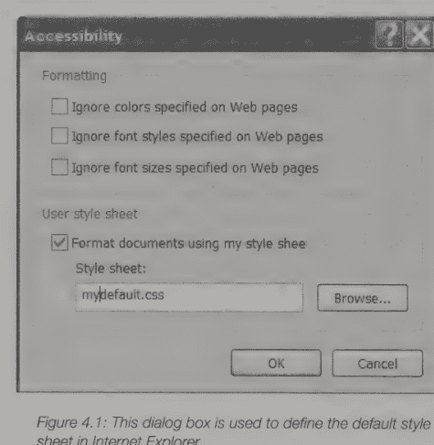

外部样式表包含的信息与内部样式表或使用“style”属性的 HTML 元素提供的信息类型相同。要在 HTML 网页内部包含外部 CSS 定义，请使用 `<link>` 元素并指定“href”属性，如下所示：

```html
<link href="mystylesheet.css" rel="stylesheet" type="text/css"/>
```

该语句表示应加载名为“mystylesheet.css”的外部样式表，并将其用于此网页。只有在该外部样式表中具有样式定义的元素才会受到影响。由于原因，可以在单个 HTML 页面中指定多个 `<link>` 元素。当指定了多个 `<link>` 元素时，第一个优先级高于第二个，第二个高于第三个，依此类推。此处指定的属性 `rel="stylesheet"` 表示这是一个外部样式表。还可以指定 "alternate style sheet"，以识别可以根据用户选择使用的备用样式表。你将在本章稍后后的部分学习更多关于切换样式的知识。

## 内部样式表

内部样式表定义允许你将样式定义直接整合到 HTML 中。当你想要为网页的特定元素覆盖默认 CSS 或外部 CSS 的设置时，这种方法会非常有用。内部样式表是在 HTML 文档的 `<head>` 部分内使用 `<style>` 元素定义的，如下所示：

```html
<head>
<style type="text/css">
body {background-color:BLUE; color:RED; text-align: center}
</style>
</head>
```

在这个示例中，使用 `<style>` 元素来定义此 HTML 文档主体背景颜色、字体颜色和文本对齐方式。使用内部定义的样式表最大的缺点是，它们特定于所包含的页面。

如前面提到的，可以将外部样式表与内部定义结合起来，使你能够使用标准样式定义并在需要时对其进行覆盖。下面的源代码说明了这一点：

```html
<head>
<link href="standard.css" rel="stylesheet" type="text/css"/>
<style type="text/css">
td {background-color:Yellow; color:Black; text-align: center}
</style>
</head>
```

此示例的大部分样式信息源自外部样式表文件 "standards.css"。然而，在该页面中，`<td>` 元素的 "background-color"、"color" 和 "text-align" 属性将被覆盖。这种特定页面的覆盖将对该页面中的所有 `<td>` 元素生效。你还可以覆盖页面内的特定元素。

## 内联 HTML 样式定义

到目前为止，你已经了解了如何使用外部样式表和内部样式表为浏览器全局定义样式信息。还可以覆盖网页中单个元素的样式信息。这种功能通过“style”属性实现。大多数 HTML 元素都支持“style”属性。

以下代码行在几个不同的 HTML 元素上使用了此属性：

```html
<p style="color:red; text-align:center;">My Text</p>
<table style="color:Blue; border-style:solid;"><tr><td>Data</td></tr></table>
<input type="text" style="background-color:Orange;" name="textbox">
```

在这个示例中，`<p>` 元素被定义为红色文本，在文档中居中。`<table>` 元素被定义为蓝色文本，且表格周围有实线框。对于 `<input>` 元素，生成的文本框显示为橙色背景。

如你所见，样式属性是以 `属性名:属性值` 的格式定义的。此外，注意可以通过分号 (`;`) 分隔来指定多个属性。

如前面提到的，级联样式表的概念意味着较高层级的定义可以在较低层级被覆盖。下面的示例结合了之前的两个示例，有助于说明这一点：

```html
<head>
<link href="standard.css" rel="stylesheet" type="text/css"/>
<style type="text/css">
td {background-color:Yellow; color:Black; text-align:center}
</style>
</head>
<body>
<p style="color:red; text-align:center;">My Text</p>
<table style="color:Blue; border-style:solid;">
<tr><td>Data</td><td></td></tr></table>
<input type="text" style="background-color:Orange;" name="textbox">
</body>
```

在此页面中，"standard.css" 中定义的任何样式属性都会应用于页面，但任何 `<td>` 元素除外。这些元素使用了内部样式表中定义的样式。该页面中定义的颜色属性被特定页面定义所覆盖。

## 样式表属性

现在你已经了解了在哪里定义样式表属性，让我们来看看有哪些样式表属性以及它们的用途。

用于定义 HTML 文档样式的属性可以分为几个简单的类别。每个类别都影响显示的不同方面。

## 背景属性

背景属性定义了 HTML 文档背景的外观。表 4.1 列出了这些样式表属性。

| 属性 | 描述 |
|---|---|
| `background` | 此属性可用于定义其他背景属性。 |
| `background-attachment` | 此属性标识定义的图像是固定的还是随窗口滚动。可能的值有 "scroll" 和 "fixed"。当指定背景图像时使用此属性。 |
| `background-color` | 使用此属性定义文档的背景颜色。值可以是颜色名称、RGB 值或十六进制颜色代码。 |
| `background-image` | 用于定义作为文档背景显示的图像文件。 |
| `background-position` | 使用此属性定义背景图像在文档中的位置。此值可以指定为常量（top left 等）、页面左上角的百分比（如 10% 或 25%）或左上角的特定像素值。 |
| `background-repeat` | 此值标识背景图像是否在文档中重复。 |

可以使用通用的 `background` 属性代替其他特定值。例如，下面的样式表赋值是完全可以的：

```css
body {
  background: red url(image.jpeg) no-repeat top left;
}
```

此示例定义了 HTML `<body>` 元素的背景信息。颜色使用命名颜色“red”。使用 `url()` 修饰符定义背景图像。“no-repeat”值表示背景图像只显示一次。位置值“top”和“left”指示将图像放置在文档的左上角。

也可以显式地定义单个背景属性。“background-color”属性识别作为给定元素背景的颜色。用于定义此属性的值格式可以是以下任何一种：

- **颜色名称：** 这些是英文颜色名称，例如“red（红色）”、“blue（蓝色）”或“green（绿色）”。
- **RGB颜色值：** 格式为 `rgb(red value, green value, blue value)`，其中每个颜色值都是 0 到 255 之间的数字。
- **十六进制颜色代码：** 这是一个六位的十六进制值，其中前两位代表红色的量，接两个数字代表绿色的量，最后两个数字代表蓝色的量。

使用哪种方法很大程度上取决于个人喜好。例如，以下三种颜色定义将产生红色背景：

```css
background-color: red;
background-color: rgb(255, 0, 0);
background-color: #ff0000;
```

“background-image”属性允许你定义一个显示在定义元素背景中的图像文件。图像文件本身使用 `url()` 修饰符进行标识，括号内指定了图像文件的名称和路径。你也可以指定值为“none”，来表示不显示任何背景图像。下面的示例说明了该属性的使用：

```css
td {
  background-image: url(logo.gif);
}
```

此示例的结果是将图像“logo.gif”显示为文档中任何 `<td>` 元素的背景。需要注意的是，许多元素可以使用“background-color”和“background-image”属性。还有几个背景属性作为“background-image”属性的修饰符。例如，“background-attachment”属性用于标识定义的背景图像是否会随文档的其他部分滚动。该属性的两个可能值为“fixed”（固定），表示图像应与页面其他部分固定；或“scroll”（滚动），表示图像应随页面其他部分滚动。以下是定义此属性的两个示例：

```html
<body style='background-image:url(back.gif); background-attachment:fixed'>
```

```css
<style type="text/css">
body {
  background-image: url(image.gif);
  background-attachment: scroll;
}
</style>
```

在第一个示例中，样式定义直接在 `<body>` 元素内完成。定义了一个名为“back.gif”的背景图像为固定图像。在第二个示例中，background-image 定义再次与 body 元素相关联，但这次它是在一个样式表中定义的。图像“image.gif”也将随文档的其他部分滚动。

除了可以定义图像是否滚动之外，还可能定义背景图像在页面中的位置。这是通过“background-position”属性实现的。该属性可以使用定义相对于页面位置的常量、表示为页面百分比的相对位置，或者以相对于页面左上角的像素表示的位置来定义。以下几行说明了这些种方法：

```css
background-position: top left; /* 左上角 */
background-position: 10% 25%; /* 页面向下10%，向右偏移25% */
background-position: 75 45; /* 向下75像素，向右偏移45像素 */
```

垂直定位的有效常量有“top（顶部）”、“middle（中间）”或“bottom（底部）”。对于水平定位，有效值为“left（左侧）”、“center（中间）”或“right（右侧）”。如行所示，垂直值和水平值可以组合。如果指定了垂直值而没有水平值，则假设为“center”。

“background-repeat”属性用于标识背景图像在必要时是否为了填充空间而进行平铺。这些元素的有效值为：“repeat（重复）”，表示图像应跨元素平铺；“repeat-x（水平重复）”，表示图像应在元素上水平方向重复；“repeat-y（垂直重复）”，表示垂直方向重复图像；以及“no-repeat（不重复）”，表示背景图像仅出现一次。

## 边框属性

许多 HTML 元素（如表格、单元格、图像和文本框）支持可见边框。若干 CSS 属性允许你控制这些边框的显示方式。表 4.2 列出了

| 表 4.2: 边框样式表属性 | |
| 属性 | 说明 |
|---|---|
| `border` | 此属性允许你在一个声明中设置所有边框属性。 |
| `border-bottom` | 此属性为指定元素定义底部边框。 |
| `border-bottom-color` | 此属性识别底部边框的颜色。 |
| `border-bottom-style` | 此属性识别底部边框的样式。 |
| `border-bottom-width` | 此属性识别底部边框的宽度。 |
| `border-color` | 此属性识别指定元素所有边框的颜色。 |
| `border-left` | 此属性定义与左边框相关的所有属性。 |
| `border-left-color` | 此属性识别左边框颜色。 |
| `border-left-style` | 此属性识别左边框的样式。 |
| `border-left-width` | 此属性识别左边框的宽度。 |
| `border-right` | 此属性定义与右边框相关的所有属性。 |
| `border-right-color` | 此属性识别右边框的颜色。 |
| `border-right-style` | 此属性识别右边框的样式。 |
| `border-right-width` | 此属性识别右边框的宽度。 |
| `border-style` | 此属性在一个声明中定义所有四个边框的样式。 |

# 第 4 章：级联样式表

| 表 4.2: 边框样式表属性 | |
| 属性 | 说明 |
|---|---|
| `border-top` | 此属性定义与顶部边框相关的所有属性。 |
| `border-top-color` | 此属性识别顶部边框颜色。 |
| `border-top-style` | 此属性识别顶部边框的样式。 |
| `border-top-width` | 此属性识别顶部边框的宽度。 |
| `border-width` | 此属性在一个声明中定义所有边框的宽度。 |

你可能已经注意到这些属性之间存在层级结构。简单的 `border` 属性可以在一个声明中定义与元素边框相关的所有属性。`border-left` 属性可以用于设置与左边框相关的所有属性。`border-left-color` 属性则仅定义左边框的颜色。以下是 `border` 属性的使用示例：

```css
table {
  border: thin dotted blue;
}
```

在此示例中，表格的所有边框都将具有细的宽度、点状样式和蓝色。或者，可以使用 `border-bottom`、`border-top`、`border-left` 和 `border-right` 属性来为特定的边框定义这三个属性，如下所示：

```css
td {
  border-top: thin solid gray;
  border-left: thin solid gray;
  border-bottom: medium solid black;
  border-right: medium solid black;
}
```

此示例声明 `<td>` 元素的顶部和左侧将具有细实线灰色边框，底部和右侧具有中等宽实线黑色边框。结果产生了一种类似于 3D 的效果，如图 4.2 所示。

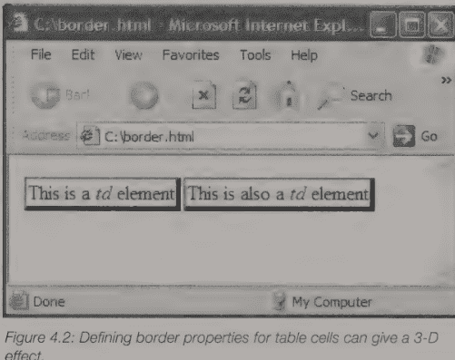

也可以单独定义边框属性的特定部分。例如，“border-color”属性可以在一个声明中定义所有四个边框颜色。此属性最多可以指定四个颜色值。这些值可以是颜色名称、RGB 颜色值或十六进制颜色代码。以下使用该属性定义边界颜色的三个示例：

```css
p {
  border-color: red white blue yellow;
}
t {
  border-color: black orange;
}
img {
  border-color: green;
}
```

第一个示例从顶部开始顺时针方向单独设置四个边框颜色，顶部边框是红色的，右边框是白色，底部边框是蓝色，左边框是黄色。第二个示例仅使用了两种颜色。第一个值确定了顶部和底部边框的颜色，第二个值定义了左侧和右侧边框的颜色。（要定义单个边框颜色，请使用如 `border-left-color` 之类的属性。）在定义任何“边框颜色”参数时，也可以使用常量“transparent”来表示不生成边框。在这种情况下，元素“后面”的任何颜色都将可见。

`border-style` 和 `border-width` 属性可以在单条声明中定义所有四个边框的样式和宽度。以下是这些属性的每个示例：

```css
table {
  border-style: dotted dashed;
  border-width: thin medium;
}

tr {
  border-style: dotted dashed inset double;
  border-width: 3 4 5 6;
}

td {
  border-style: groove;
  border-width: thick;
}
```

第一个示例将表格的顶部和底部边框定义为细点线，将左侧和右侧边框定义为中宽虚线。第二个示例单独定义了表格行的每个边框。注意，这里的宽度是像素而不是常量。最后一个示例为 `td` 定义了粗壮的、3D 凹槽状（groove）的边框样式。在这些示例中，“border-width”属性使用如“thin”之类的常量或数值像素值定义。“border-style”属性使用表 4.3 所示的常量之一进行定义。

## 表 4.3: 可能的边框样式值

| Value | Description |
| --- | --- |
| `none` | 不显示边框。 |
| `hidden` | 与 "none" 一样，不显示边框。 |
| `dotted` | 此值显示点线边框。 |
| `dashed` | 此值显示虚线边框。 |
| `solid` | 此值显示实线边框。 |
| `double` | 此值显示双线边框。 |
| `groove` | 显示 3D 凹槽边框。 |
| `ridge` | 使用脊起 3D 边框。 |
| `inset` | 显示具有内凹 3D 效果的边框。 |
| `outset` | 显示具有凸 3D 效果的边框。 |

每种边框样式都会为与其使用的 HTML 元素提供独特的效果，如图 4.3 所示。

图 4.3：每种边框样式产生不同的效果。

还可以专门单独定义边框属性元素。例如，你可以使用 `border-left-color`、`border-left-width` 和 `border-left-style` 属性来单独定义与左边框相关的属性，如下例所示：

```css
table {
  border-left-color: red;
  border-left-style: dotted;
  border-left-width: medium;
}
```

这标识了左侧表格边框应具有中宽、红色的点线。这等同于使用 `border-left: red dotted medium`。你选择哪种方法来定义边框属性取决于个人偏好以及你尝试满足的需求。然而，使用特定的属性定义更易阅读和理解。

## 字体属性

文本在 HTML 元素中的显示方式通过字体属性控制。表 4.4 列出了这些属性。

| Table 4.4: CSS 字体属性 |
| Property | Description |
| --- | --- |
| `font` | 此属性允许你在单条声明中定义字体的所有属性。 |
| `font-family` | 此属性按应用顺序列出应用于元素的字体名称。 |
| `font-size` | 此属性使用定义的常量、指定的尺寸或百分比定义指定元素的字体大小。 |
| `font-style` | 此属性使用常量 "italic" 或 "oblique" 之一定义字体样式。 |
| `font-variant` | 此属性指示是否使用小大写（small-caps）字体或普通字体显示文本。 |
| `font-weight` | 此属性使用常量值（"normal", "bold", "bolder"）或 100 到 900 的数值定义字体粗细。 |

与你过的其他 CSS 属性一样，字体属性允许你通过不同的属性在多个级别定义相同的属性。例如，“font”属性允许你在单条声明中定义所有字体属性，如下：

```css
td {
  font: italic bold small-caps 12px arial;
}
```

在这个示例中，与所有 `td` 元素相关的文本将使用 Arial 字体、12 像素大小、斜体样式、粗体权重和小大写显示。

你还可以使用一组常量值定义匹配系统设置的字体。这些字体常量允许你定义网页的外观，使其与页面显示的环境匹配。这样，你使用 CSS 创建的自定义菜单就可以匹配用户熟悉的视觉和感受。表 4.5 列出了这些常量及其定义。

| Font Constant | Description |
|---|---|
| `caption` | 使用为带标题的控件（单选按钮、下拉列表等）定义的相同字体。 |
| `icon` | 使用与图标显示的文本相同的字体。 |
| `menu` | 使用在窗口菜单上显示的相同字体。 |
| `message-box` | 使用在消息框内显示的相同字体。 |
| `status` | 使用在状态栏上相同字体。 |

## 表 4.6: 字体大小常量

| Font Size | Description |
|---|---|
| `xx-small` | 使用极小字体。 |
| `x-small` | 使用小型字体。 |
| `small` | 使用小型字体。 |
| `medium` | 使用中等字体。 |
| `large` | 使用大号字体。 |
| `x-large` | 使用特大字体。 |
| `xx-large` | 使用特大字体。 |

## 表 4.7: 列表属性

| Property | Description |
|---|---|
| `list-style` | 使用此属性设置所有列表属性。 |
| `list-style-image` | 此属性定义一个图像文件作为列表的项目符号。 |
| `list-style-position` | 此属性定义列表标记的位置。 |
| `list-style-type` | 此属性定义与列表一起显示的标记类型。 |

应该使用有序列表。表 4.8 列出了该属性的可用值。

| 表 4.8: 可能的 List-Style-Type 值 |
| 列表样式类型 (List Style Type) | 说明 |
| --- | --- |
| `none` | 不显示列表标记。 |
| `disc` | 显示实心圆 (disc)。 |
| `circle` | 显示空心圆 (circle)。 |
| `square` | 显示正方形 (square)。 |
| `decimal` | 显示数字。 |
| `decimal-leading-zero` | 显示带有前导零的数字。 |
| `lower-roman` | 显示小写罗马数字。 |
| `upper-roman` | 显示大写罗马数字。 |
| `lower-alpha` | 使用小写字母标记 (a, b, c)。 |
| `upper-alpha` | 使用大写字母标记 (A, B, C)。 |

列表属性定义了 `<ul>` 和 `<li>` 标签的样式。下面的示例说明了在 `<ul>` 标签内使用 `list-style-type` 属性的方法：

```html
<ul style="list-style-type: upper-roman; list-style-position: outside;">
  <li>First Item</li>
  <li>Second Item</li>
  <li>Third Item</li>
  <li>Fourth Item</li>
</ul>
```

此示例还结合了 `list-style-position` 属性，使列表标记向右对齐。图 4.4 显示了该示例的输出结果。

## 外边距属性 (Margin Properties)

为了调整元素周围的间距，你可以使用 `margin` CSS 属性。共有五个属性可用于定义外边距，这些属性如在表 4.9 所示。

| 表 4.9: 定义元素外边距的属性 |
| 属性 (Property) | 说明 |
| --- | --- |
| `margin` | 该属性在单个定义中设置所有外边距。 |
| `margin-bottom` | 该属性定义下外边距。 |
| `margin-left` | 该属性定义左外边距。 |
| `margin-right` | 该属性定义右外边距。 |
| `margin-top` | 该属性定义上外边距。 |

对于表 4.9 中的任何定义外边距的属性，提供的值应该是代表页面总宽百分比的数值，或者是常量值 "auto"，允许浏览器自动调整外边距。也可以定义负值，这会导致元素在页面内重叠。

如果四个方向的外边距都相同，你可以提供单个值。或者，你可以指定两个值，使上、下外边距相同，右、左外边距相同。如果你希望四个方向的外边距各不相同，请按上、右、下、左的顺序指定值。以下是这些场景的各个示例：

```css
{
  margin: auto; /* 四个外边距均相同 */
  margin: 8px 3%; /* 上下为 8 像素，左右外边距为 3% */
  margin: 8px 7px 6px 5px; /* 每个外边距均单独定义 */
}
```

## 内边距属性 (Padding Properties)

虽然 `margin` 属性定义元素之间的间距，但 `padding` 属性定义元素边框与其内部包含的内容之间的间距。说明这一点最好的方法是对比查看内边距和外边距的示例。

下面的源码定义了两个单元格，一个具有 3 像素的外边距，另一个没有外边距但有 3 像素的内边距：

```html
<table>
<tr>
<td style='margin: 3px; border:2px'>Cell data</td>
<td style='margin: 0px; padding:3px; border:2px'>Cell data</td>
</tr>
</table>
```

第一个单元格的边框周围会有空白区域。第二个单元格的边框与单元格数据之间会有空白区域。图 4.5 显示了最终的输出结果。

与外边距属性一样，可以使用 `padding-bottom`、`padding-left`、`padding-right` 和 `padding-top` 属性或单个 `padding` 属性设置元素四个方向的内边距。填充属性的支持值包括数值像素。图 4.5：这些单元格说明了外边距与内边距的区别。

# 第 4 章：级联样式表 (Cascading Style Sheets)

`direction` 属性定义文本显示的方向。支持的值有 `ltr`（从左到右）和 `rtl`（从右到左）。下面的示例说明了每种场景：

```html
<td style="direction: rtl">backward</td>
<td style="direction: ltr">forward</td>
```

`letter-spacing` 属性定义了字母之间的间距。提供的值应该是数值像素值或常量 `normal`。可以定义负值，导致间距缩小。此示例说明了这两种情况：

```html
<p style="letter-spacing:3px">Increased Spacing</p>
<p style="letter-spacing:-3px">Decreased Spacing</p>
```

这里的第一行将间距增加了 3 像素，而第二行减少了 3 像素。图 4.6 显示了该示例的结果。

`color` 属性定义文本的颜色。值可以以颜色名称、十六进制代码或 RGB 值提供。例如，以下单元格显示了红色、黑色和灰色：

```html
<td style="color:red">Red Text</td>
<td style="color:#000000">Black Text</td>
<td style="color:rgb(128,128,128)">Gray Text</td>
```

`text-align` 属性定义了元素内文本的对齐方式。除了 `left`、`center` 和 `right` 值外，该属性还支持 `justify`，表示文本应填充可用空间。

`text-decoration` 属性指示对文本应用某些特殊效果。该属性的可能值列表如表 4.11 所示。

| 表 4.11: Text-Decoration 属性的可能值 |
| 值 | 说明 |
|---|---|
| `blink` | 文本显示时会闪烁。 |
| `line-through` | 文本以删除线样式显示。 |
| `none` | 不应用装饰。 |
| `overline` | 文本上方显示一条线。 |
| `underline` | 文本下方显示一条线。 |

这些每个可能值都让你进一步自定义与给定元素关联文本的外观，如图 4.7 所示。（注意：某些浏览器不支持 `blink` 值。）

`text-indent` 属性定义了文本首行的缩进量。提供的值可以是代表像素的数值，也可以是标识总宽的百分比。

`text-transform` 属性用于更改文本的大小写。该属性的可能值包括：`capitalize` 将每个单词的首字母转换为大写字母，其余所有字母转换为小写；`lowercase` 将所有字母转换为小写；`none` 保持文本不变；以及 `uppercase` 将文本转换为全大写字母。下例中的行说明了这些值：

```html
<p style="text-transform:capitalize">The quick brown fox jumps over the lazy dog</p>
<p style="text-transform:lowercase">The quick brown fox jumps over the lazy dog</p>
<p style="text-transform:none">The quick brown fox jumps over the lazy dog</p>
<p style="text-transform:uppercase">The quick brown fox jumps over the lazy dog</p>
```

`<p>` 元素内的文本在每一行中都是相同的，但 `text-transform` 属性的值是不同的。图 4.8 显示了此示例的结果。

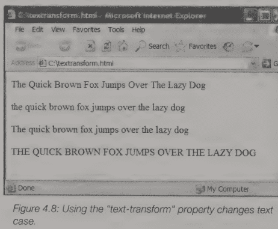

## CSS 和 JavaScript

`white-space` 属性定义了浏览器应该如何处理元素内的空白字符。可能的值有：`normal` 标识浏览器应该忽略空白；`as-is` 以类似于 `<pre>` 标签的方式保留文本间距；以及 `nowrap` 标识文本不应在元素内换行。同样，`word-spacing` 属性允许你增加或减少元素内单词之间的间距。该属性的 `normal` 值定义了应该使用的字体正常单词间距。数值值表示单词之间固定的像素间距。负值也可以用于减少单词之间的间距。

## CSS 和 JavaScript

本章中讨论的 CSS 属性允许你在浏览器应用程序中创建一个高度可定制的用户界面。CSS 属性与 JavaScript 是紧密相连的，因为 JavaScript 可以访问并更改这些属性中的任何一个。样式表属性通过 JavaScript 的 `style` 对象从 JavaScript 内部访问。该对象提供了对给定元素所有样式表属性的完全访问。下面是一个使用此函数更改 ID 为 `td1` 的 HTML 表格单元格 (`<td>`) 元素背景色的示例：

```html
<table><tr><td id="td1">Cell 1</td></tr>
<script language="JavaScript">
var td1 = document.all("td1");
td1.style.backgroundColor = "Yellow";
</script>
```

此示例说明了在 CSS 中访问样式表属性与在 JavaScript 中访问相同属性的唯一区别。在 JavaScript 的 `style` 对象内部，多单词属性使用大驼峰命名法取代了连字符。例如，CSS 属性 `background-color` 被替换为 `backgroundColor`。除了这种命名约定上的差异外，本章解释的所有功能都适用于定义样式表属性的值。

## 总结

在本章中，你了解了如何使用样式表属性来定制网页的外观。在下一章中，你将研究 JavaScript 函数模板以执行常见任务。这些函数模板可以自定义以满足你的确切需求。

## 第 5 章

## JavaScript 函数

在第 3 章中，你学习了如何创建自定义的 JavaScript 函数。在本章中，你将更进一步，查看一些可以根据需要自定义的有用函数。这些函数都处理浏览器应用程序所需的常见任务。本章中的示例不仅为你提供了可用的 JavaScript 函数，还帮助说明了 JavaScript 编程技术。

## 表单验证

JavaScript 的强大功能之一是在将数据提交到服务器之前对 HTML 表单数据进行验证。这不仅节省时间，而且通过在所需数据无效或缺失时向用户提供即时反馈，创建一个更简洁的用户界面，而不是从服务器重新加载页面来显示错误消息。验证函数通常作为 `<form>` 元素的 `onSubmit` 事件的一部分处理。该事件在实际将页面提交到服务器之前触发，允许你处理表单提交。

这是一个包含 `onSubmit` 事件的 `<form>` 元素定义示例：

```html
<form name="myForm" action="formhdl.asp" onSubmit="return validate();">
```

在此示例中，表单 "myForm" 被提交到 Active Server Page "formhdl.asp"。在提交表单之前，会调用 JavaScript 函数 `validate()`。注意在事件定义中，`return` 方法位于函数名之前。这导致函数的结果在提交之前返回给浏览器。如果函数返回值为 `false`，则页面将不提交。值为 `true` 则表示应该继续提交表单。

表单验证可以简单到只需检查给定的表单字段是否有值，也可以复杂到检查是否符合定义的标准，甚至检查 XML 数据源以确保输入了有效条目。首先，让我们检查一些基本的表单字段验证技术和一些可以测试值的函数。

## 必填字段

最简单的验证类型是确保必填字段有输入。这从字面上是最简单的验证，因为它只需要检查是否提供了值。

图 5.1 包含了 `isBlanks()` JavaScript 函数的源代码。该函数遍历 `inputvar` 变量提供的值，使用转义字符 `\s` 检查每个字符是否为空（JavaScript 转义字符列表可以在书的附录中找到）。如果发现空以外的值或者提供的值为 `null`，则函数返回 `false`。否则，返回 `true` 表示字段为空。

```javascript
function isBlanks(inputvar) {
  if (inputvar != null) {
    for (var x = 0; x < inputvar.length; x++) {
      if (inputvar.charAt(x) != '\s') {
        return false;
      }
    }
  } else {
    return true;
  }
}
```

图 5.1：`isBlanks()` 函数检查空字段值。

```javascript
function isAlpha(inputVar) {
  var alphaAltrs = "abcdefghijklmnopqrstuvwxyzABCDEFGHIJKLMNOPQRSTUVWXYZ";
  if (inputVar != null) {
    for (x = 0; x < inputVar.length; x++) {
      if (alphaAltrs.indexOf(inputVar.charAt(x)) == -1 && inputVar.charAt(x) == ' ') {
        return false;
      }
    }
    return true;
  } else {
    return true;
  }
}
```

图 5.3：这些函数用于表单字段验证（共中的 2 部分）。

除了 `isBlanks` 函数外，这里还展示了另外三个字段验证函数。`isNumeric()` 函数用于检查字段是否只包含数字 0 到 9，以及小数点或负号。该函数对数值字段进行验证，并确保用户没有在数值字段中输入无效数据。这是通过使用 `indexOf()` 函数比较 `inputVar` 变量提供的字段中的每个字符来实现的。该函数在定义的字符串中搜索指定的字符。在这种情况下，该定义的字符串包含了数值值接受的所有字符。你可以从变量中定义的位置提取字符。如果提供的变量仅包含数值值，则 `isNumeric()` 函数返回 `true`；否则，返回 `false`。

以下是使用 `isNumeric()` 函数所需的代码示例：

```javascript
if (!isNumeric(frm.myField.value)) {
  alert('Numeric values only');
}
```

在这个示例中，如果字段 `myField` 的值不包含有效的数值，则显示消息“Numeric Values Only”。

`isDate()` 函数确定提供的值是否为 `mm/dd/yyyy` 格式的有效日期。该函数使用控制字符字符串来确定提供的值是否匹配要求的日期格式。控制字符字符串 `"^\d{1,2}\d{1,2}\d{4}$"` 检查提供的值的简单格式。控制字符 `"\d{1,2}"` 标识变量的第一部分应该是一位或二位数字。`"\d{4}"` 控制字符标识变量的最后部分应为四位数字。要使用此字符串进行比较，`isDate()` 函数对输入变量进行操作。如果简单格式正确，`isDate` 将使用 `/` 作为分隔符分割输入变量。这允许你将日期拆分为月、日、年值。接下来，它使用 `Date()` 函数将输入变量转换为真正的日期值。此 JavaScript 函数接受无效日期；返回的日期根据包含从原始输入变量拆分出的值的数组拆分为月、日、年值。如果这些值都匹配，则输入的日期是有效的。如果不匹配，则用户输入了无效日期。

需要注意的是，此函数显式地验证 `mm/dd/yyyy` 格式的日期。可以对函数进行修改或扩展以接受其他格式。此函数不仅可以验证，还可以用于判断提供的值是否可以可靠地转换为日期值。示例说明了：

```javascript
if (isDate(frm.endDate.value)) {
  var trueDate = new Date(endDate);
  var currDate = new Date();
  if (trueDate > currDate) {
    alert('The end date must be less than the current date');
  }
} else {
  alert('The end date is invalid');
}
```

在这个示例中，如果输入的日期被判定为有效，则使用 `Date` 数据类型将值转换为真正的日期值。如果转换后的日期值大于当前日期，则会显示错误消息。你还会注意到，如果值被判定为无效，代码将返回一个无效日期的结果。

`isAlpha()` 函数确定提供的变量是否只包含从 a 到 z 的字母（大写或小写）。该函数使用了与 `isNumeric()` 函数类似的技巧。变量 `alphaLtrs` 填充了字母字符的大写和小写版本。该函数遍历输入变量，并使用 `charAt()` 函数提取每个字符，然后使用 `indexOf()` 函数确定提取的字符是否包含在 `alphaAttrs` 字符串中。一旦遇到非字母字符，函数将返回一个 `false` 值。下面的代码说明了该函数用法：

```javascript
if (isAlpha(frm.firstName.value)) {
  alert('This field only accepts alphabetic characters');
  frm.firstName.setFocus();
  return false;
}
```

在这个示例中，会检查 `firstName` 字段以确定其是否包含字母以外的任何内容。如果是，则向用户返回错误消息，并在从验证子程序返回 `false` 之前将焦点移动到相关字段。

"jsfunctions.js" 中的每个表单字段验证函数都可以轻松更改以适应你可能需要的任何特殊需求。例如，除了验证整个条目外，还可以防止用户向其不支持的字段中输入数据，例如在日期字段中输入字母。你可以通过拦截与字段相关的输入框上的键盘事件来限制这一点，使用 `onKeyPress` 事件以及包含在 "jsfunctions.js" 中的 `keyTrap()` 函数。

图 5.4 包含了简单 `keyTrap()` 函数的源文件。

# 第 5 章：JavaScript 函数

```javascript
function keyTrap(validKeys, display) {
  var keyCd = window.event.keyCode;
  if (!window.event.keyCode) keycode = window.event.keyCode;
  var character = String.fromCharCode(keyCd);
  if (validKeys.indexOf(character) < 0) {
    if (display == true) alert("Invalid Entry");
    return false;
  }
  return true;
}
```

图 5.4：此函数用于限制键入。

源代码说明了如何将 `keyTrap()` 函数与输入框关联：

```html
<HTML>
<HEAD>
  <TITLE>Key Trapping</TITLE>
  <script language="JavaScript" src="jsfunctions.js"></script>
</head>
<body>
  <form name="myForm">
    <input type="text" onkeypress="return keyTrap('0123456789/', false);" name="myKeys">
  </form>
</body>
</html>
```

## 表单控制

除了验证表单内输入的数据外，JavaScript 函数还让你能够通过添加元素甚至提交表单来控制表单本身。在许多情况下，这种能力非常有价值。图 5.5 包含了一个简单的 HTML 登录表单，以及一个 `onSubmit` 事件函数。

```javascript
<script language="JavaScript">
function form_submit() {
  var frm = document.forms("loginForm");

  var currDate = new Date();
  var loginTime = document.createElement("input");
  loginTime.type = "hidden";
  loginTime.name = "loginTime";
  loginTime.value = currDate.getTime();
  frm.appendChild(loginTime);
}
</script>
<form name="loginForm" onSubmit="form_submit();">
  User: <input type="text" name="username"><br>
  Password: <input type="password" name="password"><br>
  <input type="submit" name="login" value="Login">
</form>
```

图 5.5：你可以使用 JavaScript 函数向表单添加数据。

在在将登录表单提交到服务器之前，`onSubmit` 事件会启动 `form_submit()` 函数，该函数会附加包含表单提交时间的隐藏字段。

JavaScript 函数还可以根据表单内部的选择来启用或禁用字段及特定值。图 5.6 中的示例说明了这一点，使用了带有两个单选按钮的表单。

```html
<html>
<head>
<title></title>
<script language="javascript">
function hide() {
  var srcEl = event.target;
  var cell = document.getElementById("Select1");
  cell.style.display = (srcEl.value == "1") ? '' : 'none';
}
</script>
</head>
<body>
<form name="form">
Favorite Color:<br>
<input type="radio" name="choice" id="choice1" value="0" onclick="hide();">I don't have a favorite color<br>
<input type="radio" name="choice" id="choice2" value="1" onclick="hide();">My favorite color is:
<select name="element" style="display:none" ID="Select1">
<option>Select color --</option>
<option>Red</option>
<option>Blue</option>
<option>Green</option>
<option>Yellow</option>
<option>Pink</option>
<option>Purple</option>
</select>
</form>
</body>
</html>
```

图 5.6：此页面动态隐藏和显示表单元素。

当此页面在浏览器中加载时，使用 `<select>` 元素创建的列表框只有在选中第二个选项按钮才会显示。否则，列表框隐藏。这是通过 `hide()` 函数实现的，该函数已与每个单选按钮的 `onClick` 事件关联。

`<select>` 元素的“display”样式属性最初设置为“none”，这导致该元素不可见。当选中第二个选项按钮时，该值被更改为空字符串，从而使元素可见。图 5.7 显示了其工作原理。

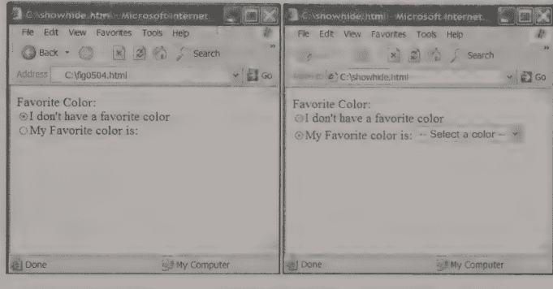

如此示例所示，根据用户输入动态更改表单内容非常简单。这种技术也可以用于动态更改浏览器页面的布局和外观。

## 动态页面输出

正如你已经在几个示例中看到的，JavaScript 提供了轻松且动态更改页面内元素的能力。这种能力的一个关键组件是 `<div>` 元素。此页面元素允许你在网页内创建其他元素的逻辑分组。一旦你创建了这些分组，就可以根据用户请求或其他事件显示或隐藏它们。`showHide()` 函数包含在本书随附可下载代码的 JavaScript 文件“jsfunctions.js”中，如图 5.8 所示。

# 第 5 章：JavaScript 函数

```javascript
function hideDIV(divId) {
  var div = document.getElementById(divId);
  if (div.style.display == "none") div.style.display = "";
  else div.style.display = "none";
}
```

图 5.8：`hideDIV()` 函数用于 `<div>` 元素。

此函数简单地在“none”和空字符串之间切换“display”样式属性的状态。因此，传递给 `div` 参数的 `<div>` 将隐藏或显示。

图 5.9 显示了一个通过“jsfunctions.js”包含文件使用此函数的示例 HTML 文档。

```html
<html>
<head>
  <script src="jsfunctions.js"></script>
</head>
<body>
  <a href="#" onclick="hideDIV('section1')">Show/Hide section 1</a>
  <div id="section1">
    <table border=1 width="100%" height="40%">
      <tr><td width="95%">Section 1</td></tr>
    </table>
  </div><br>
  <a href="#" onclick="hideDIV('section2')">Show/Hide section 2</a>
  <div id="section2">
    <table border=1 width="100%" height="40%">
      <tr><td width="95%">Section 2</td></tr>
    </table>
  </div><br>
</body>
</html>
```

图 5.9：此 HTML 页面使用了 `hideDIV()` 函数。

图 5.9 所示的页面有两个 `<div>` 元素，每个元素都包含一个单单元格的 HTML 表格。页面上的每个 `<div>` 之前都有一个 `<a>` 元素，其中包含一个 `onClick` 事件，用于调用该 `<div>` 元素的 `hideDIV()` 函数。当页面最初显示时，两个表格都是可见的。当用户点击表格上面的“Show/Hide”链接时，与链接关联的 `<div>` 将隐藏或显示。注意，当上方表格被隐藏时，表格占用的所有空间会被压缩。

图 5.10 显示了结果。如你所见，两个部分最初均可见。当点击“Show/Hide section 1”链接时，该部分会消失，直接显示在 `<div>` 下方的任何内容都会移动。由于这是一个客户端 JavaScript 函数，项目在无需重新加载页面的情况下被隐藏。

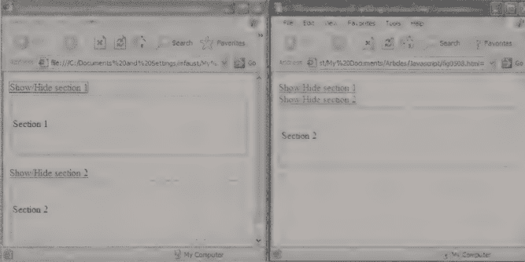

图 5.10：这里是 `showHide()` 函数。

图 5.11：这里是 `hideDIV()` 函数。

图 5.12：这里是 `moveDIV()` 函数。

```javascript
function getXMousePOS() {
  if (document.layers) {
    // Netscape 特定代码
    xMousePos = window.event.pageX;
  } else if (document.all) {
    // IE 特定代码
    xMousePos = window.event.x + document.body.scrollLeft;
  }
  return xMousePos;
}

function getYMousePOS() {
  if (document.layers) {
    // Netscape 特定代码
    var yMousePos = window.event.pageY;
  } else if (document.all) {
    // IE 特定代码
    yMousePos = window.event.y + document.body.scrollTop;
  }
  return yMousePos;
}
```

## 动态页面输出

图 5.12：这些函数返回水平和垂直鼠标位置。

图 5.13 给一个使用 `moveDIV()` 函数的示例。

# 第 5 章：JavaScript 函数

```html
<html>
<head>
  <script language="JavaScript" src="jsfunctions.js">
  </script>
</head>
<body>
  <div id="myDiv" width="100%" height="100%" style="background-color:red">
    <table>
      <tr><td>单元格 1</td><td>单元格 2</td></tr>
      <tr><td>单元格 3</td><td>单元格 4</td></tr>
      <tr><td>单元格 5</td><td>单元格 6</td></tr>
      <tr><td>单元格 7</td><td>单元格 8</td></tr>
    </table>
  </div>
  X 坐标：<input type="text" name="xPos">
  Y 位置：<input type="text" name="yPos">
  <input type="button" value="Move DIV" onclick="moveDIV('myDiv', xPos.value, yPos.value);">
</body>
</html>
```


图 5.14 显示了页面的结果。表格最初位于文本上方。一旦 `moveDIV()` 函数将 "position" 属性更改为 "absolute"，包含表格的空间就会被截断 `<div>` 本身将根据在提供的字段中键入的坐标移动到新位置。

注意，此位置可能会覆盖页面上的其他信息，正如图中所示的那。如果未提供任何一个坐标，该函数会将 `<div>` 移动到当前的鼠标指针位置。

## 动态页面输出

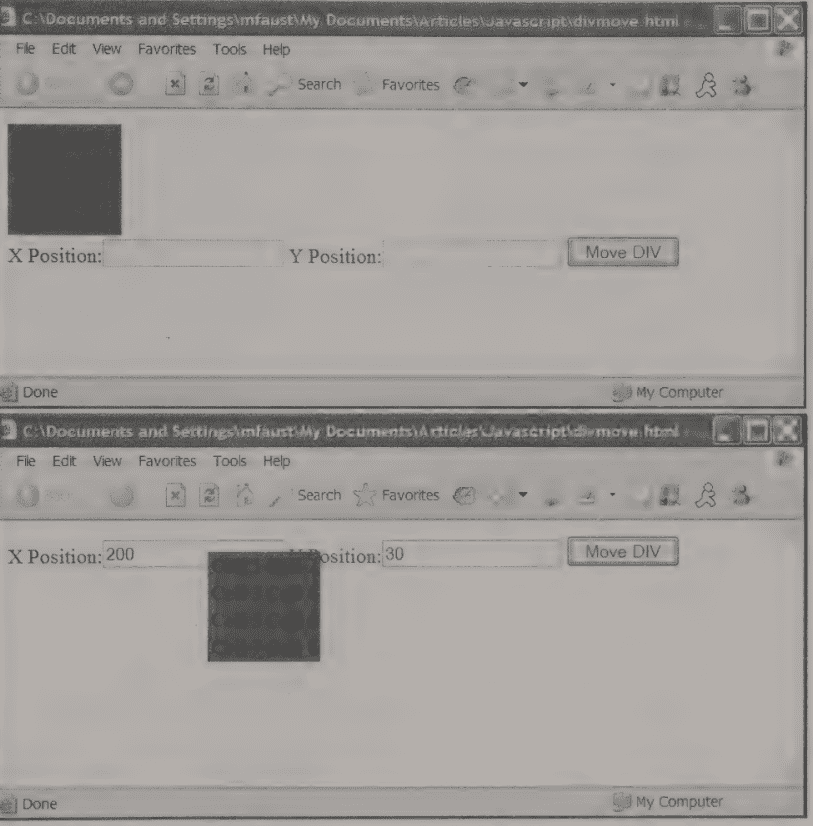

图 5.14：这两个屏幕显示了 `moveDIV()` 函数的使用。

# 第 5 章：JavaScript 函数

也可以使用这种技术在页面内创建“可拖拽”的 `<div>` 元素。图 5.15 包含了三个额外的 `<div>` 函数来实现这一功能。

```javascript
var activeDIV = null;

function dragDIV() {
  moveDIV(activeDIV);
}

function activateDIV(divID) {
  if (document.onmousemove == null) {
    if (activeDIV == null) {
      activeDIV = divID;
    }
    document.onmousemove = dragDIV;
  }
}

function deactivateDIV() {
  activeDIV = null;
  document.onmousemove = null;
}
```

图 5.15：这些函数允许用户“拖放” `<div>`。

注意，图 5.15 中的变量 `activeDIV` 定义在任何函数之外，这使其成为所有函数均可使用的全局变量。`activateDIV()` 函数识别要拖拽的 `<div>` 元素并触发 `document.onmousemove` 事件。该事件与 `dragDIV()` 函数关联。该函数只是简单地为选中的 `<div>` 元素调用 `moveDIV()` 函数。你必须使用这种方法，而不是将 `onmousemove` 事件直接关联到 `moveDIV` 函数，因为在进行此类关联时，你无法使用需要参数的函数。`deactivateDIV()` 函数移除与 `onmousemove` 事件的关联并清空“activeDIV”变量。

要要查看我们如何使用这些函数，请看图 5.16 中的 HTML 源代码。在这个示例中，`deactivateDIV()` 与 `<body>` 元素的 `onmouseup` 事件关联。当用户释放鼠标按钮时，会触发 `onmouseup` 事件。该函数与 `<body>` 元素的事件关联，以确保无论释放按钮时光标在何处，事件都能被正确激活。

```html
<html>
<head>
  <script language="JavaScript" src="functions.js">
  </script>
</head>
<body onmouseup="deactivateDIV()">
  <div id="myDiv" width="100%" height="thin">
  <table style="border-width:thin;background-color:menu;cursor:hand;" onmousedown="activateDIV('myDiv')">
    <tr><td colspan="2">点击并在原处拖拽</td></tr>
    <tr><td>单元格 1</td><td>单元格 2</td></tr>
    <tr><td>单元格 3</td><td>单元格 4</td></tr>
    <tr><td>单元格 5</td><td>单元格 6</td></tr>
    <tr><td>单元格 7</td><td>单元格 8</td></tr>
  </table>
  </div>
</body>
</html>
```

图 5.16：此页面使用了一个“可拖拽”的 `<div>`。名为 "myDiv" 的 `<div>` 包含一个 HTML 表格，当显示时，类似于一个小窗口。表格的第一行通过使用不同的背景颜色并将鼠标光标更改为手型被定义为类似于标题栏。在这一行中，`onmousedown` 事件与该 `<div>` 的 `activateDIV()` 函数关联。结果是用户可以在浏览器窗口内点击并拖动这个“伪窗口”。当用户释放鼠标按钮时，`<div>` 将留在它被“放下”的地方。


# 第 5 章：JavaScript 函数

## 可拖拽的 `<div>` 元素

图 5.16：此页面使用一个“可拖拽”的 `<div>`。名为 "myDiv" 的 `<div>` 包含一个 HTML 表格，当显示时类似于一个小窗口。表格的第一行通过使用不同的背景颜色并将鼠标光标更改为手型被定义为类似于标题栏。在这一行中，`onmousedown` 事件与该 `<div>` 的 `activateDIV()` 函数关联。结果是用户可以在浏览器窗口内点击并拖动这个“伪窗口”。当用户释放鼠标按钮时，`<div>` 将留在它被“放下”的地方。

图 5.14 显示了页面的结果。表格最初位于文本上方。一旦 `moveDIV()` 函数将 "position" 属性更改为 "absolute"，包含表格的空间就会被截断，`<div>` 本身将根据在提供的字段中键入的坐标移动到新位置。

注意，此位置可能会覆盖页面上的其他信息，正如图中所示的那样。如果未提供任何一个坐标，该函数会将 `<div>` 移动到当前的鼠标指针位置。

## 动态页面输出 113


图 5.14：这两个屏幕显示了 `moveDIV()` 函数的使用。

也可以使用这种技术在页面内创建“可拖拽”的 `<div>` 元素。图 5.15 包含了三个额外的 `<div>` 函数来实现这一功能。

```javascript
var activeDIV = null;

function dragDIV() {
  moveDIV(activeDIV);
}

function activateDIV(divID) {
  if (document.onmousemove == null) {
    if (activeDIV == null) {
      activeDIV = divID;
    }
    document.onmousemove = dragDIV;
  }
}

function deactivateDIV() {
  activeDIV = null;
  document.onmousemove = null;
}
```

图 5.15：这些函数允许用户“拖放” `<div>`。

注意，图 5.15 中的变量 `activeDIV` 定义在任何函数之外，这使其成为所有函数均可使用的全局变量。`activateDIV()` 函数识别要拖拽的 `<div>` 元素并触发 `document.onmousemove` 事件。该事件与 `dragDIV()` 函数关联。该函数只是简单地为选中的 `<div>` 元素调用 `moveDIV()` 函数。你必须使用这种方法，而不是将 `onmousemove` 事件直接关联到 `moveDIV` 函数，因为在进行此类关联时，你无法使用需要参数的函数。`deactivateDIV()` 函数移除与 `onmousemove` 事件的关联并清空“activeDIV”变量。

要查看我们如何使用这些函数，请看图 5.16 中的 HTML 源代码。在这个示例中，`deactivateDIV()` 与 `<body>` 元素的 `onmouseup` 事件关联。当用户释放鼠标按钮时，会触发 `onmouseup` 事件。该函数与 `<body>` 元素的事件关联，以确保无论释放按钮时光标在何处，事件都能被正确激活。

```html
<html>
<head>
  <script language="JavaScript" src="functions.js">
  </script>
</head>
<body onmouseup="deactivateDIV()">
  <div id="myDiv" width="100%" height="thin">
  <table style="border-width:thin;background-color:menu;cursor:hand;"
  onmousedown="activateDIV('myDiv')">
    <tr><td colspan="2">点击并在原处拖拽</td></tr>
    <tr><td>单元格 1</td><td>单元格 2</td></tr>
    <tr><td>单元格 3</td><td>单元格 4</td></tr>
    <tr><td>单元格 5</td><td>单元格 6</td></tr>
    <tr><td>单元格 7</td><td>单元格 8</td></tr>
  </table>
  </div>
</body>
</html>
```

图 5.16：此页面使用一个“可拖拽”的 `<div>`。名为 "myDiv" 的 `<div>` 包含一个 HTML 表格，当显示时类似于一个小窗口。表格的第一行通过使用不同的背景颜色并将鼠标光标更改为手型被定义为类似于标题栏。在这一行中，`onmousedown` 事件与该 `<div>` 的 `activateDIV()` 函数关联。结果是用户可以在浏览器窗口内点击并拖动这个“伪窗口”。当用户释放鼠标按钮时，`<div>` 将留在它被“放下”的地方。

## 自定义上下文菜单

该表格包含四个单列行。它用于定义菜单选项本身，以及当点击任何一个菜单项时要执行的操作。每个 `<td>` 元素的 "class" 样式被设置为 "menuitem"，这使得该样式被应用到菜单选项上。定义了 `onmouseover` 和 `onmouseout` 事件，以便在鼠标光标悬停在菜单选项上时使该选项高亮显示。为了允许在用户选择菜单选项时触发事件，为每个 `<td>` 元素都定义了 `onClick` 事件。

示例中的第一个选项“打印（Print）”调用 `window.print()` 方法，将浏览器的输出发送到打印机。完成后，再次使用 `hideMenu()` 函数隐藏此菜单 `<div>`。“打开（Open）”和“保存（Save）”选项的工作方式相同，尽管在这个简单的示例中它们没有执行任何操作。最后，“退出（Exit）”选项执行 `window.close` 方法来控制此上下文菜单的显示，使用 `<a>` 元素并带有 `onmouseover` 事件，用于调用上下文菜单的 `dispMenu()` 函数。

图 5.20 显示了该页面在浏览器中的输出效果。当用户将鼠标置在“显示（Display）”菜单链接上时，上下文菜单会自动显示。当用户点击某个选项时，菜单会隐藏，并触发菜单选项 `onClick` 事件上的动作事件。

使用 JavaScript 创建自定义用户界面的能力，可能是在业务环境中使用这种语言的最具吸引力的理由之一。此类功能的另一个示例可以使用类似的 JavaScript 编码技术来演示，创建一个看起来像“Windows 资源管理器（Windows Explorer）”或“树形（tree）”类型视图的应用。

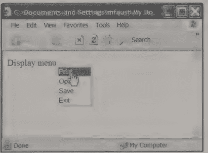

图 5.20：这是一个自定义上下文菜单的示例。

## 树形视图实现

这种控制允许用户浏览任何类型的树形结构，例如文件夹中的文件或 Web 应用程序中的单个页面。图 5.21 所示的 `expandFolder()` 函数位于 "jsfunctions.js" 中，用于实现这一功能。

```javascript
var closedFolder = new Image();
closedFolder.src = "folderc.gif";
var openFolder = new Image();
openFolder.src = "foldero.gif";

function expandFolder(brch, folder) {
  var objBrch = document.getElementById(brch);
  if(objBrch.style.display == "none") {
    objBrch.style.display = "block";
  } else {
    objBrch.style.display = "none";
  }
  var objFolder = document.getElementById(folder);
  if(objFolder.src.indexOf("folderc.gif") != -1)
    objFolder.src = openFolder.src;
  }
  objFolder.src = closedFolder.src;
}
```

图 5.21：此函数用于实现树形视图效果。

注意，此示例的第一部分包含了位于函数本身之外的代码。该代码在加载 "jsfunctions.js" 的页面中执行，并将所需的文件夹图像加载到 JavaScript 对象中。函数本身接受两个参数。第一个参数表示与包含各个文件夹项目的 `<span>` 或 `<div>` 元素关联的 ID。第二个参数表示包含文件夹图标和文本的 `<div>` 的 ID。

该代码在包含文件夹内项目的元素的 "display" 属性之间进行切换：从 "none"（隐藏项目）切换到 "block"（显示项目）。接下来，创建一个与代表对应文件夹 `<div>` 的文件夹图像的 ID 关联的对象。同样，这段代码在打开的和关闭的文件夹图像之间进行切换。

图 5.22 中的 HTML 代码说明了如何在网页中使用此函数。请注意，在此示例中，`<div>` 元素表示文件夹层级对象，而 `<span>` 元素包含每个文件夹内的各个项目。你可以轻松地为每个项目包含一个 `<a>` 元素，以创建指向该项目的超链接。

```html
<html>
<head>
  <title>JavaScript 树形结构示例</title>
  <style>
  .folder{
    cursor: pointer;
    cursor: hand;
  }
</style>
  <script language="JavaScript" src="functions.js"></script>
</head>
<body>
  <div class="folder" onclick="expandFolder('brch1', 'folder1')">
    
  </div>
  <span style="margin-left:36px; display:none" id="brch1">
    <br>
    <br>
    <br>
  </span>
  <div class="folder" onclick="expandFolder('brch2', 'folder2')">
    
  </div>
  <span style="margin-left:36px; display:none" id="brch2">
    <br>
    <br>
  </span>
  <div class="folder" onclick="expandFolder('brch3', 'folder3')">
    
  </div>
  <span style="margin-left:36px; display:none" id="brch3">
    <br>
    <br>
  </span>
</body>
</html>
```

*(注：原文 HTML 中 `brch3` 处似乎有笔误为 `folder2`，此处翻译已保持逻辑一致或根据上下文微调，此处为遵循示例结构)*

## 图像淡入淡出效果

```javascript
if (fadeInOut == "OUT") {
  if (filterAmt >= 0) {
    imgObj.style.filter = "opacity:"+ filterAmt + ")";
    imgObj.style.opacity = filterAmt;
    filterAmt = fadeAmt;
    var timeoutStr = "fadeImg('"+imageID+","+fadeAmt+"," + "'" + fadeInOut + "');";
    window.setTimeout(timeoutStr, 100);
  }
} else window.clearTimeout();
```

图 5.27：此函数对图像进行淡入淡出（2部分中的第1部分）。

此函数接受三个参数。第一个是表示要淡出的 `` 元素 ID 的字符串。第二个参数指定图像淡出的速度，使用从 1 到 100 之间的一个值，其中 1 是最慢的淡出，100 是立即淡出。`fadeImg()` 函数的第三个参数指定图像应该是淡入还是淡出，使用字符串值 "IN" 或 "OUT"。

此函数使用了两种不同的方法来淡出图像。第一种是使用 "filter" 样式属性。Internet Explorer 支持该属性来定义图像的不透明度。第二种方法使用 "opacity" 样式属性，Netscape 浏览器支持该属性以实现相同的功能。同时使用这两种方法有助于页面提供最大的浏览器兼容性。不透明度通过调用的 `fadeAmt` 变量提供的数值来增加或减少。然后使用 `setTimeout()` 函数每秒调用一次函数，直到图像完全淡入或淡出。一旦完成该操作，就会调用 `clearTimeout()` 函数来停止函数的调用。

要查看如何使用 `fadeImg()` 函数，请参考图 5.28 中的示例 HTML 页面。此示例显示了一幅图像，并允许用户通过点击命令按钮使显示的图像淡出并恢复显示。当图像显示时，可以使用该按钮将图像淡出。一旦图像消失，按钮会发生变化，并可以使用它将图像重新淡入。

```html
<html>
<head>
<script language="JavaScript" src="jsfunctions.js"></script>
<script language="JavaScript">

function callFade() {
  var srcEl = window.event.src;
  window.clearTimeout();
  if (srcEl.value == "Fade Out") {
    fadeImg("img1", 10, "OUT");
    srcEl.value = "Fade In";
    return;
  }
  if (srcEl.value == "Fade In") {
    fadeImg("img1", 10, "IN");
    srcEl.value = "Fade Out";
  }
}
</script>
</head>
<body>
<br>
<br><input type="button" value="Fade Out"
onclick="callFade();">
</body>
</html>
```

图 5.28：此页面使用了 `fadeImg()` 函数。

## 条形图生成

还可以使用 JavaScript 创建自定义图表。使用 JavaScript 创建的图表可以动态更改，而无需将数据传回 Web 服务器。可以使用图 5.29 所示的 `barChart()` 函数/对象创建简单的条形图。

```javascript
function chartBar() {
  this.value=0;
  this.heading = "";
}
function barChart(bars) {
  this.numberOfBars = bars;
}

this.chartBars = new Array(bars);
this.barColors = new Array(bars);
for (x=0; x<this.numberOfBars; x++) {
  this.chartBars[x] = new chartBar();
  this.barColors[x] = "rgb(" + Math.floor(Math.random()*255",
```

图 5.29：此函数可用于 JavaScript 创建简单的条形图（2部分中的第1部分）。

```javascript
+ "", " + Math.floor(Math.random()*255) + ", "
+ Math.floor(Math.random()*255) + ");");
this.chartTitle = "";
this.chartWidth = 0;

this.showChart = function () {
  var min = 999999999;
  var max = 0;
  // 确定图表的最小值和最大值
  for (x=0; x<this.numberOfBars; x++) {
    if (this.chartBars[x].value > max) {
      max = this.chartBars[x].value;
    }
    if (this.chartBars[x].value < min) {
      min = this.chartBars[x].value;
    }
  }

  document.write("<table cellspacing=0 width=" + this.chartWidth + ">");
  document.write("<tr align=\"center\" colspan=" +
    this.numberOfBars + ">" +
    this.chartTitle + "></td></tr>");
  document.write("<tr><td>");
  document.write("<table height=95% style=\"border-right: solid black;\");
  var chartIndex = Math.round((max - min) / 10);
  for (x=0; x<10; x++) {
    document.write("<td height=\"100%\" align=\"Right\" +
      + chartIndex + "></td></tr>");
  }
  document.write("</table></td></tr></table>");
```

```javascript
for (x=0; x<this.numberOfBars; x++) {
  var height = (this.chartBars[x].value - min) / (max - min) * 100;
  document.write("<td height=\"" + height + "\" style=\"border-right: solid black;\">");
  document.write("<p>" + this.chartBars[x].value + "</p>");
  document.write("</td>");
}
document.write("</table><tr>");
for (x=0; x<this.numberOfBars; x++) {
  document.write("<td>" + this.chartBars[x].heading + "</td>");
}
document.write("</tr></table>");
```

图 5.30：此页面使用了 `barChart()` 对象。

```html
<html>
<head>
<script language="JavaScript" src="jsfunctions.js"></script>
</head>
<body>
<script language="JavaScript">
var ctl = new barChart(12);

ctl.chartTitle = "年度销售图";
ctl.chartWidth = 800;
ctl.chartHeight = 300;
ctl.chartBars[0].value = 10000;
ctl.chartBars[1].value = 12750;
ctl.chartBars[2].value = 20500;
ctl.chartBars[3].value = 44000;
ctl.chartBars[4].value = 20075;
ctl.chartBars[5].value = 50875;
ctl.chartBars[6].value = 40075;
ctl.chartBars[7].value = 27500;
ctl.chartBars[8].value = 17500;
ctl.chartBars[9].value = 65955;
ctl.chartBars[10].value = 78750;
ctl.chartBars[11].value = 63200;

ctl.chartBars[0].heading = "January";
ctl.chartBars[1].heading = "February";
ctl.chartBars[2].heading = "March";
ctl.chartBars[3].heading = "April";
ctl.chartBars[4].heading = "May";
ctl.chartBars[5].heading = "June";
ctl.chartBars[6].heading = "July";
ctl.chartBars[7].heading = "August";
ctl.chartBars[8].heading = "September";
ctl.chartBars[9].heading = "October";
ctl.chartBars[10].heading = "November";
ctl.chartBars[11].heading = "December";

ctl.showChart();
</script>
</body>
</html>
```

调用该方法以显示新定义的图表，如图 5.31 所示。

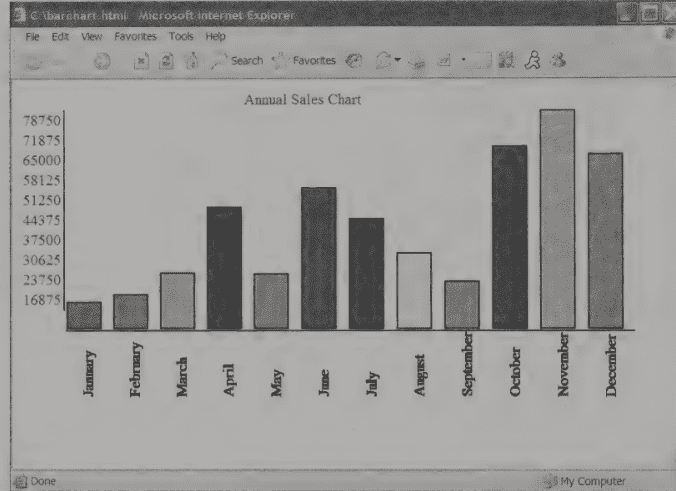

图 5.31：此示例是使用 `barChart()` JavaScript 函数创建的。

如你所见，少量的 JavaScript 代码就可以轻松地生成此图表。这个示例进一步说明了在 JavaScript 应用程序中使用用户定义函数的威力。

## 总结

与所有其他编程语言一样，JavaScript 允许你将常用任务封装在函数中，并根据需要在此不同情况下利用它们。这种模块化设计有助于扩展 JavaScript 在构建高效业务应用程序方面的可用性。在这里你已经看到了一些可用函数的示例，你可以将它们整合到基于浏览器的应用程序中。而当你创建自己的 JavaScript 时，真正的威力才会显出来。

# 第 6 章：异步 JavaScript 与 XML (AJAX)

JavaScript 的少数缺点之一是缺乏对 ODBC 或 JDBC 等标准数据访问 API 的支持。幸运的是，还有其他方法可以让客户端 JavaScript 程序访问服务器数据。异步 JavaScript 与 XML，或 AJAX，让你具有从各种来源读取数据的能力。这些数据可以是 XML 数据、HTML 数据，甚至是简单的文本文件。这种真正强大的能力进一步扩展了 JavaScript 作为业务程序员主流开发语言的可用性。在本章中，你将探索 AJAX 是什么，以及如何使用它将服务器数据读取到 JavaScript 程序中。

## AJAX：它不再仅仅是为了“清理”了

原谅这个双关语，但我认为我们需要立即把这个梗说了。AJAX 后面的技术实际上已经存在多年了。这项技术由微软开发，最初被称为远程脚本。使 AJAX 可能的关键组件是 `XMLHttpRequest` 对象，所有现代网络浏览器都支持它。Microsoft Outlook Web Access 是一种远程访问业务电子邮件的流行解决方案，它是使用 `XMLHttpRequest` 对象构建的应用示例。AJAX 也是像 Google G-Mail 和 Google Maps 等动态网站的关键。

AJAX 允许你创建的用户界面更像是一个独立的应用程序，而不是基于浏览器的应用程序。这是因为 JavaScript 应用程序能够向服务器发送数据并从服务器接收数据，而无需重新加载整个页面。

你定义 `XMLHttpRequest` 对象的方法取决于你使用的浏览器。下方的第一个示例说明了 Internet Explorer 中使用的方法，而第二个示例也说明了 Mozilla 和其他浏览器支持的方法。

```javascript
// Internet Explorer 方法
var objXML = new XMLHttpRequest("Microsoft.XMLHTTP");

// Mozilla, Netscape, 等...
var objXML1 = new XMLHttpRequest();
```

第一方法利用 `XMLHttpRequest` 创建指向 `Microsoft.XMLHTTP` ActiveX 控件的引用。第二方法简单地创建 `XMLHttpRequest` 对象本身的一个新实例。一旦定义了这个对象，你的客户端脚本就有一组属性和方法，可以从定义的服务器检索数据。表 6.1 列出了 `XMLHttpRequest` 对象支持的属性。

| 属性 | 描述 |
| :--- | :--- |
| onreadystatechange | 每当就绪状态改变时，都会启动此事件处理器。 |
| readyState | 这是请求的就绪状态。 |
| responseText | 这是文本字符串形式的服务器响应。 |
| responseXML | 这是 XML 文档形式的服务器响应。 |
| status | 这是 HTTP 数字状态（例如，“404” = 未找到）。 |
| statusText | 这是文本字符串形式的 HTTP 状态（例如，“Not Found”）。 |

`onreadystatechange` 属性定义了一个函数，当 `readyState` 属性的值改变时调用该函数。`readyState` 属性返回一个标识 XML 请求状态的值。返回的值如下所示：

- 0 = 未初始化
- 1 = 加载中
- 2 = 已加载
- 3 = 交互完成
- 4 = 已完成

`responseText` 属性以文本字符串形式读取来自服务器的响应。`responseXML` 属性也读取服务器响应，但将数据返回到 XML 文档对象中。`status` 属性检索 XML 请求的数字状态。此属性返回的常见代码包括表示未找到文档的 404，或表示“OK”状态的 200。与状态属性关联的文本可以通过 `statusText` 属性检索。除了这些属性外，`XMLHttpRequest` 对象还支持一组方法，如表 6.2 所示。

| 方法 | 描述 |
| :--- | :--- |
| abort() | 此方法取消当前的 XML 请求。 |
| getAllResponseHeaders() | 此方法返回与请求相关的 HTTP 头部。 |
| getResponseHeader() | 此方法根据定义参数指定的 HTTP 头部返回值。 |
| open() | 此方法定义与 XML 请求相关的参数，包括 URL 和方法。 |
| send() | 此方法将 XML 请求发送到服务器。 |
| setRequestHeader() | 此方法为 XML 请求定义请求头部值。 |

`open()` 方法允许你定义与服务器以及从中检索数据的文档相关的信息。在此方法上提供的参数如下所示：

```javascript
open(method, URL, async);
```

"method" 值标识用于与服务器通信的方法：用于从服务器检索数据的 "GET"，或用于向服务器发送数据的 "POST"。"URL" 值提供要读取的文档的统一资源定位符。"async" 是一个真/假值，用于标识连接是否以异步方式建立。

在这种情况下，该对象是通过 `XMLHttpRequest` 对象定义的。否则，它是通过 `ActiveXObject("Microsoft.XMLHTTP")` 对象定义的。

既然对象已经定义，接下来的步骤是确定如何使用此对象连接到目标文档，然后建立实际连接。下面的代码说明了如何实现这一点：

```javascript
xmlHttp.open("GET","http://some.webservice.site/document.xml", true);
xmlHttp.send();
```

正如此示例所示，你首先使用 `open()` 方法定义你所请求的文档信息。在这里，第一个值（"GET"）定义了用于连接到 Web 服务器的方法，该服务器的 URL 是下一个值。最后一个值表示该连接应以异步方式进行，这意味着一旦执行了 `send()` 方法，脚本的执行将继续，而无需等待数据返回。`send()` 方法发送在 `open()` 方法中定义的请求。

一旦建立了连接，你就将一个 JavaScript 函数与 `onreadystatechange` 事件关联。该函数可以是一个嵌入函数，也可以是用户定义的函数名。以下是这两种方法的示例：

```javascript
// 使用用户定义的函数定义事件处理器
xmlHttp.onreadystatechange = stateHandler(xmlHttp);
```

```javascript
// 使用内部函数定义事件处理器
xmlHttp.onreadystatechange = function(xmlHttp) {
  alert(xmlHttp.readyState);
}
```

第一个示例相当简单。它将 `onreadystatechange` 事件分配给 `stateHandler()` 函数。第二个示例使用了一种技术，将函数本身嵌入到赋值语句中。注意，`xmlHttp` 对象作为参数传递给每个函数。由于 `onreadystatechange()` 函数在每次就绪状态改变时都会被调用，因此应用程序需要确保只有在达到适当状态时才执行要执行的代码。

可以通过对要执行的代码进行条件判断来实现，如下所示：

```javascript
if (xmlHttp.readyState == 4) {
  if (xmlHttp.status == 200) {
    // 当 XML 文档打开后要执行的代码。
  }
}
```

此示例将 `readyState` 与 4 进行比较，这表示连接已经建立。它还将返回的 "status" 值与 200 进行比较，这是服务器的 "OK" 状态，表示连接已打开。

一旦成功建立连接，你需要一种方法获取返回的数据。此过程的第一步是将变量赋值给 `XMLHttpRequest` 对象上的 `responseXML` 属性，如下：

```javascript
var xmldoc = xmlHttp.responseXML;
```

当该关联建立后，变量 `xmldoc` 会自动成为 `XMLDocument` 类型。这种类型允许你遍历返回文档的整个结构。接下来，`getElementsByTagName()` 方法允许你根据标签名访问返回文档中的单个元素。该方法返回一个元素集合，你可以使用 `item()` 方法读取它。要读取存储在元素中的实际数据，请使用 `firstChild.data` 属性。这是一个遍历集合中的每个元素并输出结果的示例：

```javascript
var myData = xmldoc.getElementsByTagName("datatag");
for (var x = 0; x < myData.length; x++) {
  document.write(myData.item(x).firstChild.data);
}
```

此示例将变量 `myData` 分配给名为 "datatag" 的 XML 标签相关的集合。"length" 属性决定了 "for" 循环读取集合中所有项的上限边界。代码使用 `firstChild.data` 属性将值显示在浏览器中。

你也可以像第 2 章描述的那样，使用 `childNodes` 集合遍历树形结构。

这个简单的过程为你提供了通过 AJAX 访问 XML 数据所需的所有工具。现在，让我们来看一个使用 AJAX 的示例。

## 一个 XML 气象工具

图 6.1 所示的简单 JavaScript 为你使用 AJAX 从远程服务器获取数据提供了一个极好的开始。它允许你在浏览器中完全使用 JavaScript 和 XML 显示来自国家气象局的七天预报。

```html
<html>
<head>
<title>XML Weather Tool</title>
<script language="JavaScript">
  var xmlHTTPRequest, weatherXMLObj, xmlHttpNWS, xmlHttpZip, data
  var cityName, myIcons, myTime, myTemp, fcDate, fullDate
  var dow = ["Sunday", "Monday", "Tuesday", "Wednesday", "Thursday",
  "Friday", "Saturday", "Sunday"]

if (window.ActiveXObject) {
  xmlHttpNWS = new ActiveXObject("Microsoft.XMLHTTP");
  xmlHttpZip = new ActiveXObject("Microsoft.XMLHTTP");
} else {
  xmlHttpNWS = new XMLHttpRequest();
  xmlHttpZip = new XMLHttpRequest();
}

function getNWSForecast() {
  var zipCode = document.all("zipcode").value;

  xmlHttpZip.open("GET", "http://api.yahoo.com/MapsService/V1/geocode?" +
"appId=Demo&zip=" + zipCode, false);
  xmlHttpZip.send();

  var zipXMLDoc = xmlHttpZip.responseXML;
  var lat = zipXMLDoc.getElementsByTagName("Latitude").item(0).firstChild.data;
  var lon = zipXMLDoc.getElementsByTagName("Longitude").item(0).firstChild.data;
```

图 6.1：此页面使用 JavaScript 生成七天预报（3 部分中的第 1 部分）。

```javascript
  cityName = zipXMLDoc.getElementsByTagName("City").item(0).firstChild.data;
  var stateName = zipXMLDoc.getElementsByTagName("State").item(0).firstChild.data;
  requestURL = "http://www.weather.gov/forecasts/" +
  lat + "&lon=" + lon +
  "&series&begin=2004-01-01T00:00&end=2010-07-17T11:00&product=xml";
  xmlHttpNWS.open("GET", requestURL, true);
  xmlHttpNWS.send();
  xmlHttpNWS.onreadystatechange = displayNWSForecast;

function displayNWSForecast() {
  var dataTable = document.all("myTable");
  var tableCaption = dataTable.createCaption();
  tableCaption.innerHTML = "Forecast for " + cityName;
  var col = 0;
  var weatherXMLDoc = xmlHttpNWS.responseXML;
  var myIcons = weatherXMLDoc.getElementsByTagName("icon");
  var time = weatherXMLDoc.getElementsByTagName("start");
  var temp = weatherXMLDoc.getElementsByTagName("value");
  var loopQty = myIcons.length;
  var trows = dataTable.rows;

  for(var x=0; x<loopQty; x++) {
    fullDate = new Date(time.item(x).firstChild.data);

    if (fullDate.getHours() >= 12 && fullDate.getHours() < 14) {
      trows[0].cells[col+1].innerHTML = dow[fullDate.getDay()];
      trows[0].cells[col+1].align = "center";
      trows[0].cells[col+1].style.backgroundColor = "Red";
      trows[0].cells[col+1].style.color = "White";
      trows[1].cells[col+1].innerHTML = "<br>" +
      temp.item(x).firstChild.data;
      trows[1].cells[col+1].align = "center";
      trows[1].cells[col+1].style.backgroundColor = "Red";
      trows[1].cells[col+1].style.color = "White";
      if (col < 6) {
        col = col + 1;
      }
    }
  }
}
</script>
</head>
<body><p align="CENTER">
<input type="text" name="zipcode" maxlength="10" style="width:75px">
<input type="button" value="Get Forecast" onclick="getNWSForecast();">
<table id="myTable" border="0" cellspacing="1">
  <tr>
    <td></td><td></td><td></td><td></td><td></td><td></td><td></td>
  </tr>
  <tr>
    <td></td><td></td><td></td><td></td><td></td><td></td><td></td>
  </tr>
</table>
</p>
</body>
</html>
```

图 6.1：此页面使用 JavaScript 生成七天预报（3 部分中的第 1 部分）。

此示例的功能在第 1 章中介绍。正如本章提到的，该示例实际上调用了两个不同的 Web 服务。第一个是 Yahoo.com 的地图服务，用于根据美国邮政编码获取经度和纬度。第二个 Web 服务来自国家气象局，可以根据经度和纬度检索详细的天气预报数据。

### 代码解析

待检索的数据。变量 `zipXMLDoc` 通过 `xmlHttpZip` 对象的 `responseXML` 属性与 XML 响应关联。这种关联以解析后的格式提供 XML 数据，允许使用 `getElementsByTagName` 方法读取单个标签。由于该请求的性质，只返回一个值。该值通过 `item(0).firstChild.data` 属性进行访问。此时，代码已经检索了与提供的邮政编码相关的经度、纬度、城市和缩写。

经度和纬度值被用于构建与国家气象局（National Weather Service）网络服务相关的 URL。创建一个 `XMLHttpRequest` 对象 `xmlHttpNWS`。该 URL 定义了从网络服务请求的特定信息。由于请求发出到网络服务返回数据之间可能经过很长时间，这次请求是异步处理的。将 `displayNWSForecast()` 函数与 `onreadystatechange` 事件处理器关联，允许在数据返回时对其进行处理。当 `XMLHttpRequest` 对象的 `readyState` 值改变时，会触发此事件。

在 `displayNWSForecast()` 函数中，一个 JavaScript 变量与页面 HTML 部分构建的 HTML 表关联。请记住，每当 `readyState` 值改变时，都会调用此函数。因此，在尝试从响应中读取数据之前，你需要确保 `readyState` 值已达到 4（即“complete”）。`weatherXMLDoc` 变量与 `xmlHttpNWS` 对象的 `responseXML` 属性关联。这可以访问返回的 XML 文档的所有子节点。

如前所述，代码仅请求与天气预报相关的特定信息。在这种情况下，它请求了标识温度预报的数值以及一个作为天气预报图形表示的文件的 URL。预报数据会自动返回。为了访问这些节点列表中的每一个，再次使用 `getElementsByTagName()` 方法为每个列表关联一个 JavaScript 变量。一旦创建了关联，就可以从集合中读取数据。

NWS 提供的预报数据每四小时返回一次。我们只想显示下午 12 点到下午 2 点之间发生的任何更新的预报数据。单个节点使用 `item(x).firstChild.data` 属性，其中 `x` 表示要访问列表中哪个节点的索引值。检索到的值被用于填充之前的 HTML 表。当显示七天数据后，应用程序将退出“for”循环。

请注意，从 `myIcons` 集合中检索到的值是指向显示日期预报图像文件的 URL。该值由 `` 元素的 `src` 属性提供，导致预报图标在生成的七天预报中显示。

图 6.2 显示了图 6.1 代码生成的示例网页。请记住，这个示例读取了 XML 数据并更改网页内容，而无需将整个页面传回服务器。这个简单而强大的示例恰恰说明了使用 JavaScript 和 AJAX 轻松地检索和使用来自网络服务的数据。

现可用网络服务的数量每天都在增长。你可以自由通过联邦快递、UPS、Amazon、Yahoo 和 Google 等公司的公共网络服务获取信息，仅如此。此外，政府网络服务允许你从国家气象局获取天气预报，从联邦储备银行获取货币汇率，甚至与美国邮政局处理交易。AJAX 和 XML 网络服务让 JavaScript 成为业务程序员手中更强大的工具。

## 广网世界

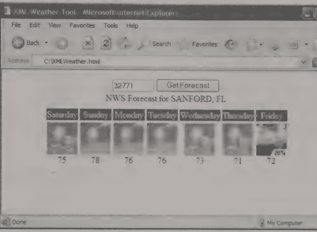

图 6.2：XML 天气工具 AJAX 示例的输出。

JavaScript 的另一个惊人方面是互联网上免费提供的代码量。几乎没有你想要执行的任务是找不到示例 JavaScript 代码的。这些代码中的大部分可以免费地供开发者重新分发。表 6.3 列出了用于 JavaScript 示例代码的少量有用资源。

| 网站 URL | 描述 |
| --- | --- |
| http://java.sun.com/javascript/ | Sun 公司的 JavaScript 教育网站 |
| http://www.mozilla.org/js/scripting/ | 来自 Mozilla 的 JavaScript 信息 |
| http://www.w3schools.com/js/ | 来自 w3Schools.com 的 JavaScript 教学资源 |
| http://javascript.internet.com/ | JavaScript Source 网站 |
| http://msdn2.microsoft.com/en-us/library/yek4tbz0.aspx | Microsoft 的 Jscript 用户指南网站 |

## 总结

无论你是寻求动态更改网页的外观、验证表单数据，还是使用 AJAX 访问远程服务器，JavaScript 的业务价值从未像现在这样强大。希望你在书中学到的技术将帮助你走上使用 JavaScript 构建动态浏览器业务应用程序的道路。

# 附录 A：JavaScript 语言快速参考

附录中的表格旨在作为 JavaScript 语言元素和 CSS 属性的快速参考。

## JavaScript 元素

本节表格包含 JavaScript 语言元素，包括 JavaScript 运算符和特殊字符，以及与 "document" 和 "window" 对象相关的属性和方法。

### 表 A.1：JavaScript 特殊字符

| 控制字符 | 描述 |
| --- | --- |
| `\f` | 分页符 |
| `\r` | 回车 |
| `\n` | 换行 |
| `\t` | 水平制表 |
| `\v` | 垂直制表 |
| `\0` | 空字符 |
| `\b` | 退格 |
| `\s` | 空格 |
| `\S` | 非空白字符 |
| `\w` | 字母数字字符 |
| `\W` | 非单词字符 |
| `\d` | 数字 |
| `\D` | 非数字 |
| `\xxx` | 带有数字的字符 |
| `\xxxx` | 带有数字的字符 |

### 表 A.2：JavaScript 运算符

| 运算符 | 类型 | 描述 |
| --- | --- | --- |
| `+` | 数值 | 加法 (`result = value1 + value2`) |
| `-` | 数值 | 减法 (`result = value1 - value2`) |
| `*` | 数值 | 乘法 (`result = value1 * value2`) |
| `/` | 数值 | 除法 (`result = value1 / value2`) |
| `%` | 数值 | 取模——余数 (`result = value1 % value2`) |
| `++` | 数值（单元） | 加 1 (`result++`) |
| `--` | 数值（单元） | 减 1 (`result--`) |
| `+` | 字符串 | 拼接 (`stringresult = string1 + string2`) |
| `==` | 比较 | 等于 (`value1 == value2`) |
| `!=` | 比较 | 不等于 (`value1 != value2`) |
| `>` | 比较 | 大于 (`value1 > value2`) |
| `>=` | 比较 | 大于或等于 (`value1 >= value2`) |
| `<` | 比较 | 小于 (`value1 < value2`) |
| `<=` | 比较 | 小于或等于 (`value1 <= value2`) |
| `===` | 比较 | 相同——带类型比较 (`value1 === value2`) |
| `!==` | 比较 | 不相同 (`value1 !== value2`) |
| `=` | 赋值 | 设置值 (`result = value`) |
| `+=` | 赋值 | 增加并设置 (`result += 12` 等于 `result = result + 12`) |
| `-=` | 赋值 | 递减并设置 (`result -= 12`) |
| `*=` | 赋值 | 乘并设置 (`result *= 2`) |
| `/=` | 赋值 | 除并设置 (`result /= 3`) |
| `%=` | 赋值 | 执行取模并设置 (`result %= 6`) |
| `&=` | 赋值 | 按位与并设置值 (`result &= value`) |
| `\|=` | 赋值 | 按位或并设置值 (`result \|= value`) |
| `^=` | 赋值 | 按位异或并设置值 (`result ^= value`) |

### 表 A.3：JavaScript 位运算符

| 运算符 | 类型 | 描述 |
| --- | --- | --- |
| `<<=` | 赋值 | 按位左移并用 0 填充（`result <<= 2`） |
| `>>=` | 赋值 | 按位右移并符号扩展（`result >>= 2`） |
| `>>>=` | 赋值 | 按位右移并用 0 填充（`result >>>= 2`） |
| `&&` | 布尔 | 逻辑与操作，`if(val1 && val2)` |
| `\|\|` | 布尔 | 逻辑或操作，`if(val1 \|\| val2)` |
| `!` | 布尔 | 逻辑非操作（`if (!val1)`） |
| `&` | 位运算 | 按位与，`if(val1 & val2)` |
| `\|` | 位运算 | 按位或（`result = val1 \| val2`） |
| `~` | 位运算 | 按位取反（`result = ~val1`） |
| `<<` | 位运算 | 按位左移/0 填充（`result = 8 << 2`） |
| `>>` | 位运算 | 按位右移/符号扩展（`result = 8 >> 2`） |
| `>>>` | 位运算 | 按位右移/0 填充（`result = 8 >>> 2`） |

### 表 A.4：位运算示例

| 语句 | 操作描述 |
| --- | --- |
| `X = 7 & 43;` | `00000111 & 00101011 = 3` |
| `X = 7 \| 43;` | `00000111 \| 00101011 = 00101111 = 47` |
| `X = ~7;` | `~ 0111 = -1000 = -8` |
| `<<` | `0000 0100 << 4 = 01000000 or 4 << 4 = 64` |
| `>>` | `0000 1100 >> 2 = 00000011 or 12 >> 2 = 3` |
| `>>>` | `0000 1100 >>> 2 = 00000011 or 12 >>> 2 = 3` |

### 表 A.5：与 "window" 对象相关的属性

| 属性 | 描述 |
| :--- | :--- |
| `window.closed` | 此属性返回一个布尔值，标识特定窗口是否已关闭。 |
| `window.defaultStatus` | 用于在文档加载后访问状态栏中显示的信息。 |
| `window.dialogArguments` | 用于检索传递浏览器对话框的变量。 |
| `window.dialogHeight` | 读取并更新浏览器对话框的高度。 |
| `window.dialogLeft` | 读取并更新浏览器对话框最左侧的坐标。 |
| `window.dialogTop` | 读取并更新浏览器对话框的顶部坐标。 |
| `window.dialogWidth` | 读取并更新浏览器对话框的宽度。 |
| `window.length` | 标识窗口对象内的帧数。 |
| `window.name` | 用于设置或读取窗口对象的名称。 |
| `window.offscreenBuffering` | 一个布尔值，标识窗口在显示给用户之前是否在屏幕外生成。 |
| `window.opener` | 用于引用打开当前窗口的窗口。 |
| `window.parent` | 标识当前窗口的父窗口。 |
| `window.returnValue` | 用于定义从浏览器对话框到主浏览器窗口的返回值。 |
| `window.screenLeft` | 浏览器窗口相对于屏幕的最左侧位置。 |
| `window.screenTop` | 浏览器窗口相对于屏幕的顶部位置。 |
| `window.self` | 用于引用当前窗口。 |
| `window.status` | 用于读取或更新浏览器状态栏文本。 |
| `window.top` | 用于标识当前窗口的最顶层窗口。 |

### 表 A.6：与 "window" 对象相关的事件处理器

| 事件 | 描述 |
|---|---|
| `window.onblur` | 当窗口失去焦点时执行的操作。 |
| `window.onerror` | 当窗口内发生错误时执行的操作。 |
| `window.onfocus` | 当窗口获得焦点时执行的操作。 |
| `window.onload` | 窗口加载时执行的操作。 |
| `window.onresize` | 当窗口调整大小时执行的操作。 |
| `window.onunload` | 窗口在关闭前执行的操作。 |

### 表 A.7：用于对浏览器窗口操作的方法

| 方法 | 描述 |
|---|---|
| `window.alert()` | 显示带有指定消息的简单对话框。此对话框仅显示 OK 按钮。 |
| `window.blur()` | 从窗口取消焦点。 |
| `window.clearInterval()` | 清除使用 `setInterval` 设置的超时。 |
| `window.clearTimeout()` | 清除使用 `setTimeout` 设置的超时。 |
| `window.close()` | 关闭窗口。 |
| `window.confirm()` | 显示带有指定消息的简单对话框。此对话框显示 OK 和取消按钮。 |
| `window.createPopup()` | 创建弹出窗口。 |
| `window.focus()` | 获取焦点。 |
| `window.moveBy()` | 按指定的像素移动窗口。 |
| `window.moveTo()` | 将窗口移动到指定的坐标。 |
| `window.navigate()` | 导航到 URL。 |
| `window.open()` | 打开新窗口。 |
| `window.print()` | 将内容发送到打印机。 |
| `window.prompt()` | 显示提示用户的对话框。 |
| `window.resizeBy()` | 按指定的像素调整窗口大小。 |
| `window.resizeTo()` | 将窗口调整为指定的尺寸。 |
| `window.scrollBy()` | 按指定的像素滚动内容。 |
| `window.scrollTo()` | 将内容滚动到指定的坐标。 |
| `window.setInterval(action, interval)` | 每指定的毫秒执行一次指定任务。 |
| `window.setTimeout()` | 在指定的毫秒后执行指定任务。 |
| `window.showModalDialog(url)` | 显示模态对话框。 |
| `window.showModelessDialog(url)` | 显示非模态对话框。 |

### 表 A.8："window.open" 的选项

| 选项 | 值 | 描述 |
|---|---|---|
| `fullscreen` | yes/no | 标识是否显示全屏。 |
| `height` | number | 定义窗口的高度。 |
| `left` | number | 定义窗口的左边缘。 |
| `location` | yes/no | 标识包含 URL 的栏。 |
| `menubar` | yes/no | 标识是否显示菜单栏。 |
| `resizable` | yes/no | 标识窗口是否可调整大小。 |
| `scrollbars` | yes/no | 用于控制是否显示滚动条。 |
| `status` | yes/no | 标识是否显示状态栏。 |
| `titlebar` | yes/no | 标识是否显示标题栏。 |
| `toolbar` | yes/no | 标识是否显示工具栏。 |
| `top` | number | 定义窗口的顶部位置。 |
| `width` | number | 定义窗口的宽度。 |

### 表 A.9："window" 对象内实现的对象

| 对象 | 描述 |
| --- | --- |
| `window.document` | 此对象用于访问浏览器内文档。 |
| `window.event` | 用于访问浏览器内发生的事件信息。 |
| `window.history` | 此对象可用于访问从父窗口访问的 URL。 |
| `window.location` | 此对象包含当前窗口显示文档的当前 URL。 |
| `window.navigation` | 此对象用于访问与浏览器客户端相关的数据。 |
| `window.screen` | 此对象用于访问与显示屏幕相关的数据。 |

### 表 A.10：与 "document" 对象相关的属性

| 属性 | 描述 |
| --- | --- |
| `document.linkColor` | 标识文档内活动链接的颜色。 |
| `document.bgColor` | 用于读取或设置文档的背景颜色。 |
| `document.body` | 定义文档主体。 |
| `document.cookie` | 用于访问与文档相关的 cookie。 |
| `document.domain` | 获取文档的服务器域名。 |
| `document.fgColor` | 用于读取或设置文档的前景颜色。 |
| `document.lastModified` | 返回指示文档最后修改日期和时间的值。 |
| `document.linkColor` | 读取并设置用于文档内链接的颜色。 |
| `document.referrer` | 获取标识引用当前文档的值。 |
| `document.title` | 获取文档的标题。 |
| `document.URL` | 获取文档的 URL。 |
| `document.vlinkColor` | 读取并设置文档中以前访问过的链接的颜色。 |

### 表 A.11："document" 对象中实现的集合

| 集合 | 描述 |
|---|---|
| `document.anchors` | 此集合包含所有定义了名称的锚点 `<a>` 元素。 |
| `document.applets` | 用于访问文档体内所有的 applet 对象 `<object>` 标签。 |


# 附录 A：JavaScript 语言快速参考

## 表 A.11：对 `document` 对象执行操作的方法

| 方法 | 描述 |
|---|---|
| `document.clear()` | 移除文档中的所有子元素。 |
| `document.close()` | 关闭输出数据流并显示结果产生数据。 |
| `document.createAttribute(attrName)` | 创建一个新属性。 |
| `document.createElement(html tag)` | 创建一个新的子文档元素。 |
| `document.createTextNode(text string)` | 创建一个简单的文本字符串。 |
| `document.focus()` | 将文档置于焦点。 |
| `document.getElementById(id)` | 根据元素的 ID 属性访问特定的文档元素。 |
| `document.getElementsByName(name)` | 根据 "name" 属性访问特定文档元素的集合。 |
| `document.getElementsByTagName(tag name)` | 根据标签名访问元素集合。 |
| `document.open()` | 打开文档以进行写入。 |
| `document.write(string)` | 向文档写入一个文本字符串。 |
| `document.writeln(string)` | 向文档写入一个文本字符串并在后跟一个换行符。配合 `document.open()` 使用。 |

## CSS 属性

下表为级联样式表元素提供了简要的参考。

| 属性 | 描述 |
|---|---|
| `background` | 此属性可用于定义任何其他背景属性。 |
| `background-attachment` | 此属性标识定义的背景图像是固定的还是随窗口的其他部分滚动。可能的值为 "scroll" 和 "fixed"。当指定了 `background-image` 时使用此属性。 |
| `background-color` | 使用此属性定义文档的背景颜色。值可以定义为颜色名称、RGB 值或十六进制颜色代码。 |
| `background-image` | 用于定义一个图像文件作为指定 HTML 文档的背景显示。 |
| `background-position` | 使用此属性定义背景图像在文档中的位置。此值可以指定为常量（左上角等）、页面深度和距离左上角的百分比（10% 25%），或从左上角向下并向右移动的特定像素数。 |
| `background-repeat` | 此值标识背景图像是否在整个文档中重复。 |
| `border` | 允许在单一声明中设置所有边框属性。 |
| `border-bottom` | 用于指定元素的下边框。 |
| `border-bottom-color` | 标识下边框的颜色。 |
| `border-bottom-style` | 标识下边框的样式。 |
| `border-bottom-width` | 标识下边框的宽度。 |
| `border-color` | 标识指定元素所有边框的颜色。 |
| `border-left` | 用于定义与左边框相关的所有属性。 |
| `border-left-color` | 标识左边框颜色。 |
| `border-left-style` | 标识左边框的样式。 |
| `border-left-width` | 标识左边框的宽度。 |
| `border-right` | 用于定义与右边框相关的所有属性。 |

## 表 A.12：CSS 对象属性

| 属性 | 描述 |
|---|---|
| `border-right-color` | 标识右边框颜色。 |
| `border-right-style` | 标识右边框的样式。 |
| `border-right-width` | 在单一声明中标识右边框的宽度。 |
| `border-style` | 用于定义与四个边框相关的属性的样式。 |
| `border-top` | 用于定义与上边框相关的所有属性。 |
| `border-top-color` | 标识上边框颜色。 |
| `border-top-style` | 标识上边框的样式。 |
| `border-top-width` | 标识上边框的宽度。 |
| `border-width` | 用于在单一声明中定义四个边框的宽度。 |
| `color` | 用于定义文本颜色。 |
| `direction` | 用于标识文本应该从右向左显示还是从左向右。 |
| `font` | 允许在单一声明中定义字体的所有属性。 |
| `font-family` | 应用到元素的字体族列表，按应用的顺序排列。 |
| `font-size` | 使用定义的常量、指定的大小或百分比定义指定元素使用的字体大小。 |
| `font-style` | 使用常量 `none`（无）、`italic`（斜体）或 `oblique`（倾斜）之一定义字体样式。 |
| `font-variant` | 定义显示小型大写字体还是普通字体。 |
| `font-weight` | 定义字重。 |
| `letter-spacing` | 此属性用于定义字母之间的间距。 |
| `list-style` | 用于设置列表的所有属性。 |
| `list-style-image` | 定义作为列表项目的图像。 |
| `list-style-position` | 定义列表的位置。可能的值有 `inside` 和 `outside`。 |
| `list-style-type` | 定义标记类型。 |
| `margin` | 用于在单一声明中设置所有边距。 |
| `margin-bottom` | 定义下边距。 |

## 表 A.12：CSS 属性（续）

| 属性 | 描述 |
|---|---|
| `margin-left` | 定义左边距。 |
| `margin-right` | 定义右边距。 |
| `margin-top` | 定义上边距。 |
| `text-align` | 标识文本对齐方式。 |
| `text-decoration` | 用于定义特殊的文本属性，如下划线或删除线。 |
| `text-indent` | 此属性允许定义第一行的缩进。 |
| `text-transform` | 允许转换文本的大小写。 |
| `white-space` | 用于定义元素内空白字符的处理方式。 |
| `word-spacing` | 用于定义单词之间的间距。 |

## 表 A.13：CSS 边框样式

| 值 | 描述 |
|---|---|
| `none` | 不显示边框。 |
| `hidden` | 实现与 "none" 相同的效果。 |
| `dotted` | 显示点线边框。 |
| `dashed` | 显示虚线边框。 |
| `solid` | 显示实线边框。 |
| `double` | 显示双线边框。 |
| `groove` | 显示 3D 槽型边框。 |
| `ridge` | 显示 3D 脊型边框。 |
| `inset` | 显示具有凹入 3D 效果的边框。 |
| `outset` | 显示具有凸出 3D 效果的边框。 |

## 表 A.14：CSS 字体常量

| 字体常量 | 描述 |
|---|---|
| `caption` | 使用与说明控件相同的字体（单选框、下拉列表等）。 |
| `icon` | 使用与图标文本相同的字体。 |
| `menu` | 使用窗口菜单相同的字体。 |
| `message-box` | 使用与消息框相同的字体。 |
| `status-bar` | 使用与窗口状态栏相同的字体。 |

## 表 A.15：CSS 字体大小常量

| 字体大小常量 | 描述 |
|---|---|
| `xx-small` | 双倍极小。 |
| `x-small` | 特小字体。 |
| `small` | 使用较小字体显示。 |
| `medium` | 使用中等字体显示。 |
| `large` | 根据浏览器设置使用“大”字体大小。 |
| `x-large` | 根据浏览器设置使用“特大”字体大小。 |
| `xx-large` | 根据浏览器设置使用“双倍特大”字体大小。 |
| `smaller` | 显示比当前生效设置小一个字体。 |
| `larger` | 显示比当前生效设置大一个字号字体。 |

## 表 A.16：CSS 列表样式类型值

| 列表样式类型 | 描述 |
|---|---|
| `none` | 不显示列表标记。 |
| `disc` | 显示一个实心圆。 |
| `circle` | 显示一个空心圆。 |
| `square` | 显示一个正方形标记。 |
| `decimal` | 显示数字标记。 |
| `decimal-leading-zero` | 显示带有前导零的数字标记。 |
| `lower-roman` | 显示小写罗马数字。 |
| `upper-roman` | 显示大写罗马数字。 |
| `lower-alpha` | 使用小写字母作为标记 (a,b,c)。 |
| `upper-alpha` | 使用大写字母作为标记 (A, B, C)。 |

## 表 A.17：CSS 文本装饰属性值

| 值 | 描述 |
|---|---|
| `blink` | 文本在显示时闪烁。 |
| `line-through` | 文本以删除线样式显示。 |
| `none` | 不应用任何装饰。 |
| `overline` | 文本上方显示一条线。 |
| `underline` | 文本下方显示一条线。 |

# 索引

## A

- `<a>` 元素，108
- 使用 JavaScript 访问 HTML 内部的对象，27–28
- `activateDIV()`，114–115
- `activateXObject`，与 AJAX，132, 140
- 动态向页面添加信息，30, 33
- 加法运算符 (`+`)，36, 146
- AJAX，16, 131–144
  - 与 `activateXObject`，132, 140
  - 浏览器兼容性，131, 132, 135–136
  - GET/POST，134, 135
  - 在 `getElementsByTagName()` 中，137
  - 与 HTML，131
  - 与 Internet Explorer，132, 140。另见浏览器兼容性
  - `XMLHttpRequest` 对象支持的方法，133, 134
  - MIME：内容和，135
  - 与 `onreadystatechange` 属性，132–133, 136
  - 在 `open()` 方法中，134, 136
  - 中的 params 和参数，134–135
  - `XMLHttpRequest` 对象支持的属性，132
  - 与 `readyState` 属性，132–133
  - 与 `readyState`，137
  - 在远程脚本技术中，131
  - 与 `responseText` 属性，133
  - 与 `responseXML`，133, 137
  - 在 `send()` 方法中，134, 136
  - 在 `setRequestHeader()` 中，135
  - 与 `stateHandler`，135–138
  - 逐步执行，135–138
  - 与 URLs，134
  - 使用创建的用户界面，131–132
  - 使用的天气显示工具，138–140, 143
  - 与 Web 服务，142
  - 与 XML，131
  - 在 `XMLHttpRequest` 对象中，131–144
- `alert()` 方法，56
- Amazon，142
- 锚点集合，32, 66
- AND (`&`)，37, 147
- APIs，133
  - 与 Web 服务，14–15
- Applet 集合，32, 66
- 数组，41–43
  - 内部的数据类型，41–43
  - 二维数组，42–43
- ASP，3, 16
- 赋值运算符，36, 38
- 异步 XML 和 JavaScript：见 AJAX

## C

- 后端系统集成，13–16
- 背景，64, 75–79
  - `<body>` 元素，76
  - 颜色，76–77
  - 图像和 `url()` 修饰符，76, 77
  - 作为使用的图像位置，78
  - 作为重复/平铺图像使用的，对比固定 (`fixed`)，77–78
  - 滚动方式，对比固定 (`fixed`)，77–78
- `barChart()`，126, 126–127, 128–130
- 位与 AND (`&`)，37, 147
- 位与赋值 (`&=`)，36, 39, 146
- 位左移 (`<<`)，37, 39, 147
- 位非 (`~`)，37, 147
- 位非 (`!`)，39
- 位运算符，36, 37, 39, 147
- 位或 OR (`|`)，37, 39, 147
- 位或赋值 (`|=`)，36, 39, 146
- 位右移 (`>>`)，37, 39, 147
- 位右移赋值 (`>>=`)，37, 39, 147
- 带有零填充的右移 (`>>>`)，37, 39, 147
- 位异或赋值 (`^=`)，36, 39, 146
- 闪烁文本，93
- `blur()` 方法，61–62
- `<body>` 元素，背景定义，76
- `<body>` 标签，26–27, 28–29, 66
- 布尔运算符，36, 37, 38–39
- 边界，79–84, 155
  - 颜色，80–81
  - 属性层次，80
  - 个体属性，84
  - 样式，80–83
  - 宽度，82
- `break` 语句，48
- 带有零填充的右移 (`>>=`)，37, 39, 147
- 浏览器兼容性，5, 20–21, 52–62
  - 与 AJAX，131, 132, 135–136
  - 浏览器对话框，52
  - 环境确定，23–25
  - 文档对象，66
  - 文档模型 (DOM)，21–22
  - 用于执行操作的方法，149–150
  - `navigator` 对象，23–25
  - 测试代码，22, 23
  - 实时数据，55
- C++，36
- 级联表 (CSS)，71–96, 153–155
  - 默认样式表，72–73
  - 外部样式表，72–73
  - `<head>` 标签，71, 73
  - 样式层级布局，71
  - 与 HTML，71
  - 内联样式定义，74–75
  - 内部和外部样式表组合，73–74
  - 内部样式表，73–74
  - 与 JavaScript，95
  - `<link>` 元素，72–73, 74
  - 覆盖元素，73–75
  - 属性，74–75
  - 对象，95
  - 样式属性，75–95, 153–155
    - 背景，75–79
    - 边界，79–84, 155
    - 字体，84–86, 156
    - 列表，86–88, 157
    - 外边距，90–99
    - 内边距，90–91
    - 文本，91–95, 157
  - 样式表定义，71
  - `<style>` 元素，73
- `case` 语句，47–48
- JavaScript 敏感性，23
- `charAt()`，101

## D

- 仪表盘应用，8–10
- 数据操作，10
- 排序数据，11–15
  - 总列数，12–13
- 数组，41–43
- 日期和时间
  - 日期类型，40
  - 使用 JavaScript 的数字时钟，4–5
- 动态数据更改，33
- HTML 代码，4
- `isDate()`，101–103
- `<div>` 元素，4
- 触发事件，60–61
- 声明变量，40–45
- 减并设置 (`-=`)，36, 146
- 减法运算符 (`-`)，36, 146
- 默认语句，48
- 默认样式表，72–73
- 定义值，40
- 确定浏览器元素，23–25
- 对话属性，54
- `login()`，68
- 方法，69–70
- 在 `open` 方法中，69–70
- 属性，63–64, 151
- URLs，64
- `write` 方法，69–70
- 文档对象 (DOM)，21–25
- 公式，114–116
- 动态数据更改，30, 33, 105, 106
- `<div>` 元素，107
- 拖拽并绘制，114–116
  - `activateDIV()`，114–115
  - `<div>` 元素，107
  - `getMousePos()`/`getMousePOS()`，110, 111
  - 使用页面，107–122
  - 与 `showHide()`，107–109
  - 使用 AJAX 的天气显示工具，138–142, 143

## E

- ECMAScript，21
- HTML 元素集合，30–31
- JavaScript 元素，145, 152
- HTML 中嵌入的 JavaScript，20, 26–27
- 转义字符，98
- 欧洲制造协会 (ECMA)，21
- 事件处理器，34–56
- 外部 JavaScript，34
- 外部样式表，CSS：72–73
- JavaScript 中的函数，97–130
- 显示/隐藏内容，116–119
  - `hideMenu()`，117, 119
- 动态页面输出，107–122
- 表单控制，105–107
- 使用表单验证，97–98
- 图像控制，122–130
- 必填字段检查，98–105
- 文件夹树形视图，119–122

## I

- ID 属性，HTML，27–28
- 等号运算符 (`=`)，36, 37–38, 146
- `if` 语句，24, 35, 38–39, 46, 47, 99–100
- 图像，122–130
  - 使用背景，76, 77
  - 鼠标悬停时更改，使用 `switchImage()`，122–124
  - 使用 `barChart()` 创建图表和，126–127, 128–129, 130
  - `fading()`，124–126
- `` 元素，122–123
  - `onmouseover`/`onmouseout` 事件，123
- 图像集合，32
- `` 标签，67, 122–123。另见图像
- 递增 (`+`)，36, 38, 146
- 递增运算符 (`++`)，36, 38, 146
- `indexOf()`，101, 104
- 初始化变量，40
- `<input>` 标签，16
  - 隐藏变量和，16
- 使用 JavaScript 的接口，3–4
- Internet Explorer，21, 22, 132
  - 与 AJAX，135–136, 140
  - 间隔，60–66
- `isNaN()`，103
- `isBlank()`，98–105
- `isDate()`，101, 103
- `isNumeric()`，101, 103

## J

- Java vs. JavaScript，19, 36
- JDBC，13
- JavaScript，21

## K

- 字距。另见 `padding`
- `keyTrap()`，103–105

## L

- 语言结构和语法，35–39
- 小于 (`<`)，36, 146
- 小于或等于 (`<=`)，36, 146
- 文本的字间距，92, 93
- `<li>` 标签，88
- 文本中划线/删除线，73, 93
- `<link>` 元素，级联样式表 (CSS)
  - 与，72–73
- 列表，86–88, 157
  - 项目符号等，在，87–88
  - 使用图像作为列表标记在，87
  - 标记的位置，87
  - 样式，77–88
- 在 `<ul>` 和 `<li>` 标签中，88
- JavaScript 脚本的位置，27
- 逻辑（布尔）类型，40
- `login()` 函数，68
- 循环，以及–48, 48–49
  - `do...while`，50–51
  - `with`，51
- 小写文本，94

## M

- 边距，89–90
- 数学运算符，36–37, 146–147
- 菜单
  - 上下文类型/显示，116–119
  - `dispenseMenu()`，117, 119
  - `hideMenu()`，118
- 方法
  - `document` 对象，68–70
  - `window` 对象，56, 57
- Microsoft，21
- Microsoft Open Web，131
- MIME 内容，与 AJAX，135, 136, 140
- 模 (`%`)，36, 146
- 模运算符 (`*`)，36, 38, 146
- `moveDiv()`，109–112
- Mozilla，21, 122
- 多维数组，42–43
- 乘运算符 (`*`)，36, 146
- 乘法 (`*`)，36, 146

## N

- 国家气象局，140, 142。另见使用 AJAX 的显示
- `navigate()`，58, 59
- `navigator` 对象，23–25
- Netscape，21, 22
- Netscape Enterprise Server，20

## O

- 对象，40–45
  - 声明，40–45
  - `document`。另见 document 对象
  - `window` 对象中包含的对象，62
  - 用户定义，43–44
- ODBC，13
- `onblur`/`onfocus` 事件，55
- `onClick` 事件，106
- `onmouseover`/`onmouseout` 事件，123
- `onreadystatechange` 属性，132–133, 136
- `onSubmit` 事件，表单验证和，97–98
- `open()`，58, 59, 69–70
  - 与 AJAX，134, 136
- 运算符，36–37, 146–147
- OR (`||`)，37, 147

## P

- `padding`，90–91
- 父/子对象，28–29
- `close()` 方法，59–60
- `closed` 属性，53–54
- PHP，3, 16
- 弹出窗口，58
- POST，与 AJAX，134, 135
- `print()` 方法，60
- 编程，免费 JavaScript 代码来源，143
- `prompt()` 方法，56

## R

- `readyState`，132–133, 137
- 实时更新，5。另见动态脚本
- 远程脚本，131
- 从 HTML/XML 引用 JavaScript，20
- required-字段，98–105
- `responseXML`，137
- `returnValue` 属性，54
- RGB 颜色值，77

## S

- `<script>`，20, 25–26
- `<select>` 元素，106
- 滚动背景，77–78
- 分号分隔符，35
- `send()` 方法，与 AJAX，134, 136
- 服务器端交互，16, 17
- 设置值 (`=`)，36, 146
- `setRequestHeader()`，135
- `showChart()`，129–130
- `showHide()`，106
- `showHideDIV()`，107–109
- 数据排序，10–11
- 免费 JavaScript 代码来源，143
- 源，120, 121
- JavaScript 中的特殊字符，145
- `src` 属性，26
- JavaScript 代码标准，21
- `stateHandler()`，136
- 删除线文本，93
- 字符串运算，36
- 字符串类型，40
- `style` 属性，75–76
- `style` 对象，创建样式表 (CSS)，95
- 样式表属性，在 CSS，75–89, 153–155
  - 背景，75–79
  - 边框，79–84, 155
  - 字体，84–86, 156
  - 列表，86–88, 158
  - 边距，90–89
  - `padding`，90–91
- `<style>` 元素，73
- 提交表单，105–107
- 减法运算符 (`-`)，36, 146
- `switch` 语句，47, 48
- `switchImage()`，122–124
- 语法。另见语言结构和语法

## T

- 表格，ID 用于，27–28
- `<td>` 元素，4
- 文本，91–95, 157。另见字体
  - 闪烁，93
  - 颜色，92
  - 方向，62
  - 字间距，92, 93
  - 中划线/删除线，93
  - `transform` case (大写)，94
  - 空白和，95
  - 包裹，95
- 平铺背景，78–79
- 时间触发事件，60–61
- `timeout`，60–61
- 标题栏，32–33
- `<title>` 标签，32–33
- `top` 属性，54
- `top` 列，12–13
- 树形视图文件夹，119–122

## U

- U.S. Postal System，142
- `<ul>` 标签，88
- 下划线文本，23, 93
- 统一资源定位符 (URL) 地址，33–34, 58
  - 与 AJAX，134, 136
  - `document` 对象，64
- 大写文本，94
- UPS，142
- 用户自定义视图，8–10
- 用户定义对象，43–44
- 用于 JavaScript，3–4

## V

- 表单有效性检查，32
- 变量，40–45
  - 数据类型，40, 41
  - 声明和初始化，40
  - 声明，40–45
  - 定义，40

## W

- 使用 AJAX 的气象显示工具，138–142, 143
- Web 报告应用，13–14
- Web 服务和 AJAX，142
- Web 服务和 APIs，14–15
- `while` 语句，35, 50–51, 54
- 空白和文本，95
- `window` 对象，52–62
  - `alert()` 方法，56
  - `blur()` 方法，61–62
  - 浏览器对话框，52
  - `close()` 方法，59–60
  - `closed` 属性，53–54
  - `confirm()` 方法，56
  - 对话框 Arguments 属性，54
  - 事件处理程序，54–56
  - `focus()` 方法，61–62
  - 框架，62
  - 高度和宽度，52, 58
  - 方法，57, 149–150
  - `navigate()` 方法包含在内，62, 151
  - 对象
  - `onblur`/`onfocus` 事件，55
  - `open()` 方法，58, 59, 150
  - 弹出窗口和，58
  - `print()` 方法，60
  - `prompt()` 方法，56
  - 属性，53–54, 148–149
  - `returnValue` 属性，54
  - 时间触发事件和，60–61
  - `top` 属性，54
  - URL 和，54
  - `window.open` 方法选项，150, 151
- `with` 语句，51
- World Wide Web Consortium (W3C)，21
- 包裹文本，95
- `write()` 方法，69–70
