# World Wide Web JavaScript 入门指南（第三版）（视觉快速启动指南）

用快速简单的方法自学 JavaScript！本视觉快速上手指南将使用图片而非冗长的解释。你将很快就能上手！

编辑：Nancy Davis

制作协调：Kate Reber

作曲：Owen Wolfram

索引：Emily Glossbrenner

# 献辞

纪念 Bill Horwitz 和 Dorothy Negrino，因为他们深爱学习。

# 感谢！

非常感谢我们的编辑 Nancy Davis；她专业的触控和强烈的奉献总是让我们的工作更好。

感谢 Kate Reber 严谨的制作工作。

感谢 Peachpit 的 Nancy Ruenzel 和 Marjorie Baer 的支持。

我们要感谢我们的代理人 Studio B 的 David Rogelberg，他的辛勤工作和良好的建议。

感谢我们的儿子 Sean，在父母情绪急躁时给予理解，并且没有对那些推迟的《星际争霸》游戏环节有太多埋怨。下次你可以玩虫族了。

非常感谢我们的 Beta 测试员团队：John Bishop, Sue Beckett, Helen Briggs, Linda Colby, Kay Crawley, Thomas Kiefer, Lea Mark Scheuern, Heidi Shetzer, Anne Schroeder 和 Dwyn Tomlinson。他们勇敢地花费大量时间在人类已知的每一个 Web 浏览器中运行我们的脚本，并报告结果。留下的任何错误都是我们的。

感谢 Macworld 的 Michael Rattary 允许我们在第 12 章重用他的艺术作品。

我们特别感谢所有选择本书的前一版本作为课程教材的高中、学院和大学教师。

Dori 感谢 W&S 组中优秀的女士们给予的爱心和虚拟拥抱。

音乐激发了 Tom 的许多创作，本书也不例外。本版的原声带和音乐灵感由 Lucy Kapansky, Richard Shindell, Wolfgang Mozart, Mary Chapin Carpenter, Ludwig von Beethoven, U2, Rosanne Cash, Williams Brothers, Counting Crows, Nanci Griffith 和 Antonio Vivaldi 慷慨提供。

# 引言

欢迎学习 JavaScript！通过这种易于学习的语言，你将为 Web 页面增添色彩，让它们对你和网站访问者更有用。我们编写这本书作为 JavaScript 的介绍，所以你不需要成为一个极客或书呆子。

我们为你准备了一个配套网站，其中包含了书中所有的脚本，你可以直接将它们复制并粘贴到自己的 Web 页面中。该网站还包含了额外的技巧和脚本。如果我们发现书中有漏掉编辑过程的错误，我们会在网站上列出更新。你可以在这里找到我们的配套网站：http://www.chalcedony.com/javascript/

使用了哪些图像文件。如果你有任何问题，请查看网站上的 FAQ 页面。如果你的问题在那里没有找到答案，你可以通过电子邮件 `js3@chalcedony.com` 与我们联系。

# 开始之旅

JavaScript 的优点之一是，你可以轻松地从一个简单的脚本开始，让你的网页上实现一些酷炫的功能，然后根据需要添加更复杂的内容。在开始改进你的网页之前，你不需要学习一整本书的信息。

当然，每段旅程都始于第一步，如果你已经读到了这里，你的 JavaScript 之旅已经开始了。感谢你的加入，请将手脚都留在移动的载具内。另外，请勿使用闪光灯。

## 熟悉 JavaScript

对于网站创建者来说，HTML 的演变是一把双刃剑。在万维网的早期，HTML 非常简单，学习关于如何组合网页所需的大部分知识都是容易的。

随着 Web 的增长，页面设计师的愿望也随之增长，他们对页面外观更大控制权的需求迫使 HTML 发生变化并变得更加复杂。

由于 Web 是一个动态媒介，页面设计师还希望他们的页面能与用户交互，很快就明显看出 HTML 已不足以处理这种需求。Netscape 发明了 JavaScript，作为控制浏览器并为网页添加特效和交互的方法。

在本章中，你将学习 JavaScript 是什么（以及它不是什么）；它能（以及不能做什么）；以及 JavaScript 语言的一些基础。


# 第一章

### JavaScript 是

JavaScript 是一种编程语言，你可以用它为网页添加交互性。但如果你不是程序员，也不要对“编程语言”这个词恐慌；Web 上有很多脚本可以让你以最小的精力复制并修改供自己使用。事实上，站在世界上其他程序员的肩膀上是熟悉 JavaScript 的极佳技巧，如果你做得足够多（并且读了这本书），你将会看到自己正在创建自己的脚本。

为了让你更容易上手 JavaScript，作者们建立了一个网站补充本书的网站。我们包含了书中所有的脚本（这样你就不需要自己输入它们），以及额外的注释、附录和更新。你可以在 http://www.chalcedony.com/javascript/ 找到我们的网站。

你经常看到 JavaScript 被称为“脚本语言”，暗示它编写脚本比编程容易。在这种情况下，这种区别并没有意义。

JavaScript 脚本是包含在 HTML 页面上的程序。由于使用了 `<SCRIPT>` 标签，脚本文本不会显示在用户的屏幕上，Web 浏览器知道运行该 JavaScript 程序。`<SCRIPT>` 标签通常位于 HTML 页面的 `<HEAD>` 部分，尽管如果你愿意，也可以将脚本放在 `<BODY>` 部分。向屏幕写入内容或写入 HTML 的脚本最好放在 `<BODY>` 部分，如脚本 1.1 所示。如果你不熟悉这些 HTML 概念并需要更多信息，我们建议你查看 Elizabeth Castro 编写的《HTML 4 for the World Wide Web: Visual QuickStart Guide》，该书由 Peachpit Press 出版。

脚本 1.1 这个非常简单的脚本在浏览器窗口中输入“Hello, Cleveland!”。

```html
<HTML>
<HEAD>
<TITLE>这看起来完全不像个脚本</TITLE>
</HEAD>
<BODY BGCOLOR=WHITE>
<H1>
<SCRIPT LANGUAGE=JAVASCRIPT TYPE="TEXT/JAVASCRIPT">
document.write("Hello, Cleveland!")
</SCRIPT>
</H1>
</BODY>
</HTML>
```

### JavaScript 能做什么


图 1.1 鼠标悬停（Rollover）是一种当鼠标指针移动到上方时会变化的图像。

你可以用 JavaScript 做很多事情让你的网页更具交互性，并为你网站的用户提供更好、更有趣的体验。

JavaScript 让你创建一个活跃的用户界面，在用户浏览你的页面时提供反馈。例如，你可能见过鼠标指针滑过时会高亮的网站。这是通过 JavaScript 实现的，使用名为鼠标悬停的技术（图 1.1）。

你可以使用 JavaScript 确保用户在表单中输入有效信息，这可以节省你的业务时间和金钱。如果你的表单需要计算，你可以在用户的机器上通过 JavaScript 完成，而不需要使用复杂的服务器 CGI（一种运行在 Web 服务器上并扩展服务器功能的程序）。

通过 JavaScript，你有能力在用户的机器上创建自定义的 HTML 页面，而不需要使用复杂的服务器 CGI（一种运行在 Web 服务器上并扩展服务器功能的程序）。

# 第 1 章

### 对象、属性和方法

JavaScript 是一种基于对象的语言。你可能会问，什么是对象？对象就是“事物”。猫是一个对象，你的计算机也是一个对象，你的自行车也是一个对象。在 JavaScript 中，网页浏览器窗口是一个对象，网页文档是一个对象，表单是一个对象，按钮是一个对象，图像也是一个对象。

#### 属性

对象具有属性。属性是对象的特征。猫有四只脚、毛皮和尾巴。你的计算机有键盘、显示器和硬盘。你的自行车有两个轮子、车把和坐垫。JavaScript 对象也有属性：窗口有状态栏，文档有背景颜色，表单有元素，图像有宽度和高度。

#### 方法

对象可以执行的操作被称为方法（methods）。猫会呼噜，电脑会崩溃，自行车会滚动。JavaScript 对象也有方法：按钮有 `click()`，窗口有 `open()`。文本可以被 `select()`。括号符号表示我们指的是一个方法，而不是属性。

> **提示**
> 将对象和属性看作名词，将方法看作动词可能会帮助理解。前者是事物，后者是这些事物可以执行的、或对它们执行的动作。

#### 组合在一起

你可以将对象、属性和方法组合在一起，以更好地描述一个对象或描述一个过程。在 JavaScript 中，这些内容通过点（也称为 dot，类似于互联网地址）进行分隔。这被称为点符号语法。以下是用这种方式编写的对象及其属性的示例：

```
bicycle.wheels
cat.paws.front.left
computer.disk.floppy
document.images.name
window.status
```

以下是用点符号语法编写的对象和方法的示例：

```
cat.purr()
document.write()
forms.elements.radio.click()
```

### 处理事件

事件是用户在访问你的页面时执行的操作。提交表单和鼠标移动到图像上是事件的两个示例。

JavaScript 使用事件处理器命令（event handlers）来处理事件。用户在页面上的操作会触发你脚本中的事件处理器。十二个 JavaScript 事件处理器列在**表 1.1** 中。

例如，假设我们的猫通过执行**呼噜**（purr）和**伸展**（stretch）动作来处理**抚摸**（Petting）事件。

在 JavaScript 中，如果用户点击按钮，`onclick` 事件处理器将记录该操作并执行它的任何任务。

当你编写脚本时，不需要预测用户可能采取的每一个操作，只需要在你想要发生特殊情况的**那些**操作。例如，即使没有 `onload` 事件处理器，你的页面也能正常加载。但如果你想在页面一加载时就触发脚本，就会使用 `onload` 命令。

**表 1.1**

| EVENT | 它处理的内容 |
| --- | --- |
| onAbort | 用户取消了页面 |
| onBlur | 用户离开了对象 |
| onChange | 用户更改了对象 |
| onclick | 用户点击了对象 |
| onerror | 脚本遇到错误 |
| onfocus | 用户使对象激活 |
| onload | 对象加载完成 |
| onmouseover | 光标移动到对象上 |
| onmouseout | 光标移出对象外 |
| onselect | 用户选择了对象的内容 |
| onSubmit | 用户提交了表单 |
| onunload | 用户离开了窗口 |

### 值与变量

在 JavaScript 中，一条信息就是一个值（value）。有不同类型的值；你最熟悉的类型是数字。字符串值是包含在引号中的单词或多个单词。其他类型的 JavaScript 值列在表 1.2 中。

变量包含值。例如，变量 `myName` 被赋值为字符串 "Dori"。另一种写入它的方法是 `myName="Dori"`。等号可以被读作“设置为”。换句话说，变量 `myName` 现在包含了值 "Dori"。

**表 1.2：值类型**

| TYPE | 说明 | 示例 |
|---|---|---|
| Number | 任何数值 | 3.141592654 |
| String | 引号内的字符 | "Hello, world!" |
| Boolean | 真或假 | true |
| Null | 空且无意义 | |
| Object | 与对象关联的任何值 | |
| Function | 函数返回的值 | |

> **提示**
> - JavaScript 是大小写敏感的。这意味着 `myName` 与 `myname` 不同，它们与 `MyName` 也不同。
> - 变量名不能包含空格或标点符号。它们不能是 JavaScript 的保留字。参见附录 B 中的 JavaScript 保留字列表。

### 运算符

运算符是用于处理变量的符号。你已经通过简单的算术运算熟悉了运算符：加号和减号就是运算符。完整的运算符列表请见表 1.3。

> **提示**
> - 虽然 `x++` 和 `++x` 都会给 x 加 1，但它们并不完全相同；前者在赋值完成后增加 x，而后者在赋值之前增加。例如，如果 x 是 5，`y=x++` 的结果是 y 被设置为 5，x 被设置为 6。运算符 `++x` 的结果是 x 和 y 都被设置为 6。
> - 如果在相加两个值时混合了数值和字符串值，结果是一个字符串。例如，`"cat" + 5` 的结果是 `"cat5"`。

**表 1.3：运算符**

| OPERATOR | 它的作用 |
|---|---|
| x + y (Numeric) | 将 x 和 y 相加 |
| x + y (String) | 将 x 和 y 拼接 |
| x - y | 从 x 中减去 y |
| x * y | x 乘以 y |
| x / y | 用 x 除以 y |
| x % y | x 和 y 的取模（即 x 除以 y 的余数） |
| x++, ++x | 给 x 加 1（等同于 x = x + 1） |
| x--, --x | 将 x 减 1（等同于 x = x - 1） |
| -x | 反转 x 的符号 |

**表 1.4 赋值运算符**

| ASSIGNMENT | 它的作用 |
|---|---|
| x = y | 将 x 设置为 y 的值 |
| x += y | 等同于 x = x + y |
| x -= y | 等同于 x = x - y |
| x *= y | 等同于 x = x * y |
| x /= y | 等同于 x = x / y |
| x %= y | 等同于 x = x % y |

当你将一个值放入变量时，你是在将该值赋值给变量，并使用赋值运算符来完成工作。例如，你使用等号运算符进行赋值，如 `name="Tom"`。**表 1.4** 中列出了一组赋值运算符。

除了等号之外，其他运算符用作修改变量值的快捷方式。例如，说 `x=x+5` 的简短方法是说 `x+=5`。为了清晰起见，我们在书中大部分使用了较长的版本。

**表 1.5 比较运算符**

| COMPARISON | 它的作用 |
|---|---|
| x == y | 如果 x 和 y 相等，返回 true |
| x != y | 如果 x 和 y 不相等，返回 true |
| x > y | 如果 x 大于 y，返回 true |
| x >= y | 如果 x 大于或等于 y，返回 true |
| x < y | 如果 x 小于 y，返回 true |
| x <= y | 如果 x 小于或等于 y，返回 true |
| x && y | 如果 x 和 y 都为 true，返回 true |
| x \|\| y | 如果 x 或 y 为 true，返回 true |
| !x | 如果 x 为 false，返回 true |

你经常需要比较一个变量的值与另一个，或者变量的值与字面量值（即输入表达式中的值）。例如，你可能想比较星期几的值与 "Tuesday"，你可以通过检查 `today=="Tuesday"` 来实现。完整的比较列表在**表 1.5**。

> **提示**
> - 如果你在比较字符串，请注意 "a" 大于 "A"，且 "abracadabra" 小于 "be"。

### 让我们开始吧！

热身已经结束了，是时候编写脚本了。在本章中，你将学习如何将脚本放在 HTML 的什么位置；如何使用警报框与用户通信；如何检查浏览器插件的存在；以及更多内容。让我们开始吧！

### 将你的脚本放在什么处

脚本可以放在 HTML 页面上的两个地方之一：`<HEAD>` 和 `</HEAD>` 标签之间（称为头部脚本），或者 `<BODY>` 和 `</BODY>` 标签之间（正文脚本）。脚本 2.1 是正文脚本的一个示例。

有一个 HTML 容器标签用于标记脚本，正如你猜的那样，它以 `<SCRIPT>` 开头并以 `</SCRIPT>` 结束。

编写你的第一个脚本：

1. `<SCRIPT LANGUAGE=JAVASCRIPT TYPE="TEXT/JAVASCRIPT">` 这是起始脚本标签。它告诉浏览器期待 JavaScript 而不是 HTML。`LANGUAGE=JAVASCRIPT` 属性标识浏览器正在使用哪种语言，而 `TYPE="TEXT/JAVASCRIPT"` 属性告诉浏览器脚本是组织成 JavaScript 的纯文本。
2. `document.write("Hello, world!")` 这是你的第一行 JavaScript：它获取文档并将 "Hello, world!" 写入其中，如图 2.1 所示。
3. `</SCRIPT>` 结束 JavaScript 并告诉浏览器重新执行 HTML。

> **提示**
> - 在本书的其余大部分内容，我们在代码解释中省略了 `<SCRIPT>` 标签。正如你从脚本本身中看到的，它们仍然存在且是需要的，但我们不会让它们让我们的解释变得杂乱。
> - 你可以在页面上放置任意数量的脚本标签（因此可以有多个脚本）。

脚本 2.1 脚本始终需要包含在 `<SCRIPT>` 和 `</SCRIPT>` HTML 标签内部。

```html
<HTML>
<HEAD>
<TITLE>My first script</TITLE>
</HEAD>
<BODY BGCOLOR=WHITE>
<H1>
<SCRIPT LANGUAGE=JAVASCRIPT TYPE="TEXT/JAVASCRIPT">
document.write("Hello, world!")
</SCRIPT>
</H1>
</BODY>
</HTML>
```


图 2.1 "Hello, world!" 示例在代码书中是常见的。如果我们漏掉它，可能会失去我们的工会卡。

### 从旧版浏览器隐藏脚本

脚本 2.2 这里是如何保护你的脚本免受旧版浏览器的影响。

旧浏览器（包括 Netscape 1.x、Microsoft Explorer 3 及更早版本，以及 4 版本之前的 America Online 浏览器）不理解 JavaScript。虽然良好的浏览器本应该忽略它们不理解的标签之间的所有内容，但并非所有浏览器都是如此。有一种技术（如脚本 2.2 所示）可以欺骗这些落后的浏览器，让它们认为脚本的内容实际上是 HTML 注释，它们会忽略它们。

```html
<HTML>
<HEAD>
<TITLE>My first script</TITLE>
</HEAD>
<BODY BGCOLOR=WHITE>
<H1>
<SCRIPT LANGUAGE=JAVASCRIPT TYPE="TEXT/JAVASCRIPT">
<!-- Hide script from old browsers -->
document.write("Hello, world!")
// End hiding script from old browsers -->
</SCRIPT>
</H1>
</BODY>
</HTML>
```

为旧版浏览器隐藏 JavaScript：

1. `<!-- Hide script from old browsers -->` 这一行用 `<!--` 开启 HTML 注释。
2. `document.write("Hello, world!")` 这是真正的 JavaScript，如上例所示。
3. `// End hiding script from old browsers -->` 这一行以 `//` 开头，表示 JavaScript 注释，并以 `-->` 结束 HTML 注释。

> **提示**
> - 这种技术贯穿本书，所以我们只在这里解释它。从现在起，你应该认为这已经包含了。
> - 如果你有一个想让旧版浏览器用户看到的消息，可以将其添加到 `<NOSCRIPT>` 标签中。这会被表现不佳的浏览器，也会在用户（悲剧地）关闭 JavaScript 时被新版浏览器处理。

### 在脚本中添加注释

养成给脚本添加注释的习惯是一个好主意。你通过插入 JavaScript 不解释为脚本命令的注释来实现这一点。虽然你的脚本在你编写时对你可能非常清晰，但如果你几个月后回来，它可能不再那么清晰。注释将帮助你解释为什么以特定的方式解决问题。给脚本注释的另一个原因是帮助其他想要重用和修改你的脚本的人。

之前的脚本显示了单行注释的示例，即以 `//` 开头的行。脚本 **2.3** 显示了多行注释的示例。

为你的脚本注释：

1. `/* This is an example of a long JavaScript comment. 注意注释开头和结尾的字符。此脚本将 "Hello, world!" 添加到 HTML 页面的主体区域。*/`
2. `document.write("Hello, world!")`
3. `// End hiding script from old browsers -->`

```html
<HTML>
<HEAD>
<TITLE>My first script</TITLE>
</HEAD>
<BODY BGCOLOR=WHITE>
<H1>
<SCRIPT LANGUAGE=JAVASCRIPT TYPE="TEXT/JAVASCRIPT">
<!-- Hide script from old browsers -->
document.write("Hello, world!")
// End hiding script from old browsers -->
</SCRIPT>
</H1>
</BODY>
</HTML>
```

### 使用警报框

脚本 2.4 使用警报框与用户通信。

```html
<HTML>
<HEAD>
<TITLE>Alert!</TITLE>
<SCRIPT LANGUAGE=JAVASCRIPT TYPE="TEXT/JAVASCRIPT">
<!-- Hide script from old browsers -->
alert("Warning: This page uses JavaScript!")
// End hiding script from old browsers -->
</SCRIPT>
</HEAD>
<BODY BGCOLOR=WHITE>
<H1>This page uses an alert box.</H1>
</BODY>
</HTML>
```

### 重定向用户

你不仅可以检查 JavaScript 是否存在，还可以检查用户拥有哪个版本的 JavaScript（更多见附录 A）。脚本 2.5 显示了根据浏览器支持的 JavaScript 版本如何重定向或将用户发送另一个页面。

重定向用户：

1. `<SCRIPT LANGUAGE="JAVASCRIPT1.2" TYPE="TEXT/JAVASCRIPT">` LANGUAGE 属性允许你指定运行脚本所需的 JavaScript 最小值。在这种情况下，浏览器需要 JavaScript 1.2 或更高版本。
2. `window.location="welcome.html"` 这一行重置当前窗口的 `location` 属性。换句话说，它告诉浏览器将当前页面更改为指定的页面，在此情况下为 `welcome.html`。
3. `</SCRIPT>` 结束脚本标签。

脚本 2.5 如果用户具有支持 JavaScript 的浏览器，他们将被自动发送到新页面。

```html
<HTML>
<HEAD>
<TITLE>You should have JavaScript!</TITLE>
<SCRIPT LANGUAGE="JAVASCRIPT1.2" TYPE="TEXT/JAVASCRIPT">
<!-- Hide script from old browsers -->
window.location="welcome.html"
// End hiding script from old browsers -->
</SCRIPT>
</HEAD>
<BODY BGCOLOR="WHITE">
<H2>You won't get much from this site without the latest version of JavaScript. I suggest that you upgrade now!</H2>
</BODY>
</HTML>
```

> **提示**
> - 在闭合脚本标签中不需要添加 `LANGUAGE` 或 `TYPE` 属性。
> - 你可以在一个页面上针对不同的脚本设置语言版本。例如，一个脚本可以适用于任何版本的 JavaScript，另一个适用于 JavaScript 1.1 及更高版本，第三个则适用于 JavaScript 1.2。
> - 遗憾的是，没有办法说明某个脚本仅适用于 JavaScript 1.1（例如）。`LANGUAGE` 属性将接受指定的 JavaScript 版本以及任何更高版本。
> - 请记住，如果你根据用户拥有的 JavaScript 版本来限制其访问，你将把一些用户拒之门外。由于大多数网站的意图是增加用户而不是减少用户，因此在编写要求最新浏览器的代码时应该要小心。通常情况下，坚持使用特定的浏览器或 JavaScript 版本是可以接受的，除非你正在为内网（intranet）编写页面，内网是仅供公司内部网络使用的网站。公司可以强制并确保其所有用户都使用特定的浏览器。

### 使用链接重定向用户

当用户加载上一个示例中的脚本时，他们会先进入一个初始页面，然后根据脚本的结果，浏览器会自动加载另一个页面。这种方法始终会让用户在跳转到第二个页面之前，至少看到第一个页面的闪烁。这并不特别优雅，因此脚本 2.6 为你展示了实现重定向的更好方法：通过在用户的起始点链接中嵌入重定向。图 2.4 显示了当他们点击链接时，将进入两个页面中的一个，取决于他们是否拥有 JavaScript。

脚本 2.6 通过将重定向嵌入链接内部，你避免了难看的窗口闪烁。

```html
<HTML>
<HEAD>
<TITLE>Welcome to our site</TITLE>
</HEAD>
<BODY BGCOLOR=WHITE>
<H2>
<A HREF="noscript.html" onclick="window.location='welcome.html'; return false">Welcome to our site... c'mon in!</A>
</H2>
</BODY>
</HTML>
```

要执行平滑重定向：

```html
<A HREF="noscript.html" onclick="window.location='welcome.html'; return false">Welcome to our site... c'mon in!</A>
```

JavaScript 完全嵌入在链接中。如果用户没有 JavaScript 并点击了链接，他们将遵循常规路径并最终进入一个看起来类似于图 2.5 的页面。如果用户拥有 JavaScript 并点击了链接，`onclick` 处理程序将接管并加载新页面 `welcome.html`。`return false` 表示停止处理，因此 `noscript.html` 页面不会被加载。这很酷的地方在于，你在用户完全没有察觉到发生变化的情况下完成了重定向。他们只是处于两个页面中的一个，取决于他们进入时的状况。如果他们有 JavaScript，他们将进入图 2.6 所示的页面。

图 2.4 此页面包含包含重定向代码的链接。
图 2.5 如果用户没有 JavaScript，他们将进入此页面。
图 2.6 精通 JavaScript 的浏览器将看到此页面。

### 浏览器检测与条件判断

你通常想要找出用户使用的是什么浏览器，如果他们的浏览器不符合你的标准，则重定向用户。这被称为浏览器检测。脚本 2.7 向你展示了如何检查用户是否运行 Netscape。该脚本引入了条件判断的概念，即脚本提出一个测试，并根据测试结果执行不同的操作。

```html
<HTML>
<HEAD>
<TITLE>What's your browser?</TITLE>
</HEAD>
<BODY BGCOLOR="WHITE">
<H2>
<SCRIPT LANGUAGE=JAVASCRIPT TYPE="TEXT/JAVASCRIPT">
<!-- Hide script from old browsers -->
if (navigator.appName == "Netscape") {
  document.write("You are running Netscape, a JavaScript-enabled browser.");
} else {
  document.write("You are not running Netscape, maybe you should?");
}
// End hiding script from old browsers -->
</SCRIPT>
</H2>
</BODY>
</HTML>
```

### 更多条件判断

条件判断由三部分组成：进行测试的 `if` 部分、测试结果为真时执行的 `then` 部分，以及结果不为真时执行的 `else` 部分。

使用条件判断来检查用户是否拥有 JavaScript：

1. `if (navigator.appName == "Netscape")` 检查 `navigator.appName` 对象是否等于 "Netscape"。
2. `document.write("You are running Netscape, a JavaScript-enabled browser.")` 如果是，则 `then` 部分将执行。如果不是 "Netscape"，则该行不会执行，因为测试结果不为真。
3. `}` 结束 `then` 部分。
4. `else {` 条件判断的 `else` 部分开始。
5. `document.write("You are not running Netscape, maybe you should?")` 这是 `else` 部分执行的代码。
6. `}` 结束 `else` 部分。

> **提示**
> - 你可以在 `then` 和 `else` 大括号内放置任意多个语句。
> - 三元运算符是另一种编写条件的方法：`(condition) ? truePart : falsePart`，这种写法比 `if-else` 语句更简洁。

```javascript
if (condition) {
  truePart
} else {
  falsePart
}
```

### 插件检测

浏览器插件为 Web 页面作者提供了丰富的选项来包含丰富内容，如声音、视频和动画。插件的问题在于你不确定用户拥有所需的插件。JavaScript 可以帮助你发现安装了哪些插件，如果他们没有需要的插件，可以将他们引导到一个可以获取所需插件的页面。脚本 2.8 测试了 QuickTime 插件的存在，这是最常见的。

```html
<HTML>
<HEAD>
<TITLE>Got Time</TITLE>
</HEAD>
<BODY BGCOLOR=WHITE>
<H2 ALIGN=CENTER>Shoemaker-Levy 9 comet -- Crashes into Jupiter in 1994
<SCRIPT LANGUAGE=JAVASCRIPT TYPE="TEXT/JAVASCRIPT">
<!-- Hide script from old browsers -->
if (navigator.plugins["QuickTime Plug-In 2.0"]) {
  document.write("<EMBED SRC='images/CometAnim.mov' WIDTH=320 HEIGHT=250 LOOP=false AUTOPLAY='true'>");
} else {
  document.write("");
}
// End hiding script from old browsers -->
</SCRIPT>
</BODY>
</HTML>
```

检查插件：

1. `if (navigator.plugins["QuickTime Plug-In 2.0"])` 因为脚本正在提出测试，所以它使用了条件 `if` 语句。在这种情况下，它检查 `navigator.plugins` 对象是否包含 "QuickTime Plug-In 2.0" 名称；如果是，则测试返回真的结果，即存在 QuickTime 插件。如果匹配不精确，则测试将返回假。
2. `document.write("<EMBED SRC='images/CometAnim.mov' WIDTH=320 HEIGHT=250 LOOP=false AUTOPLAY='true'>")` 因为 QuickTime 存在，脚本向文档窗口写入了一段 HTML。`<EMBED>` 标签用于将 QuickTime 电影放入 Web 页面中（图 2.9）。

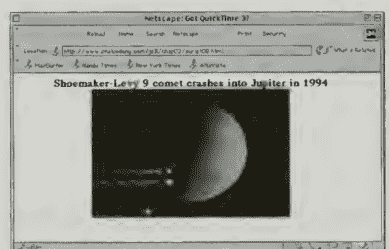

图 2.9 如果用户拥有 QuickTime，则将文件放在页面上。

3. `else {`
4. `document.write("")` 在这里，脚本处理 QuickTime 不可用的情况。如果是如此，则用 JPEG 图片替换 QuickTime 电影（图 2.10）。

> **提示**
> - 遗憾的是，这个示例仅在 Netscape Navigator 中有效。Internet Explorer 4（及更高版本）包含了 `plugins` 对象，但它是空的。然而，Windows 上的 Microsoft Internet Explorer 如果浏览器已经没有该插件，它将使用 ActiveX 为用户自动加载插件。Mac 上的 Internet Explorer 4 用户情况就非常糟糕了；Mac 版 Internet Explorer 4 完全无法向 JavaScript 传达其扩展功能。唯一的解决办法是完全不使用 JavaScript 插件检测，如果用户知道自己的浏览器已安装了插件，只需让他们点击链接跳转到带有插件内容的页面即可。
> - 你可以通过向页面的 `<BODY>` 部分添加以下代码，允许在用户未启用 JavaScript 的情况下仍显示 JPEG 图片：
> ```html
> <NOSCRIPT>
> 
> </NOSCRIPT>
> ```
> - 此脚本通过名称查找特定的插件。如果名称更改，你将必须修改脚本来查找新名称。

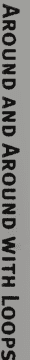

图 2.10 如果不存在 QuickTime，则用 JPEG 替换电影。

### 循环循环往复

在上一个示例中，你检查了是否存在某个特定的插件。但如果用户有多个插件（这是非常常见的情况），你将不断重复测试，直到检查完所有插件。这样做，你将使用循环，它允许你按指定的次数重复某个操作。

#### 更多关于循环

在书中使用的循环类型是 `for` 循环，以开始循环的命令命名。这种循环使用计数器，计数器是一个从某个值（通常是 0）开始，并在循环内部的条件满足时结束的变量。

开始循环结构的命令后面紧跟着括号。在括号内，你通常会找到计数器的定义以及计数器值递增的方式（即计数器增加的方式）。脚本 2.9 显示了如何设置并使用循环来检查用户的每个插件中是否存在 Macromedia Flash 插件。当你查看脚本 2.9 时，请注意它包含了两个脚本，一个在页面头部，一个在页面主体。头部脚本检查 Flash 插件的存在，而主体脚本根据插件测试的结果向浏览器窗口中写入两条不同的消息之一。

```html
<HTML>
<HEAD>
<TITLE>要 Flash 吗?</TITLE>
<SCRIPT LANGUAGE=JAVASCRIPT TYPE="TEXT/JAVASCRIPT">
<!-- Hide script from old browsers -->
var hasFlash = false
for (i=0; i<navigator.plugins.length; i++) {
  if (navigator.plugins[i].name.indexOf("Flash") >= 0) {
    hasFlash = true
  }
}
// End hiding script from old browsers -->
</SCRIPT>
</HEAD>
<BODY BGCOLOR=WHITE>
<H2>
<SCRIPT LANGUAGE=JAVASCRIPT TYPE="TEXT/JAVASCRIPT">
<!-- Hide script from old browsers -->
if (hasFlash) {
  document.write("你有 Flash，你这个幸运的人！")
} else {
  document.write("抱歉，你没有 Flash。")
}
// End hiding script from old browsers -->
</SCRIPT>
</H2>
</BODY>
</HTML>
```


使用循环检查插件：

1. `var hasFlash = false` 头部脚本执行的第一件事是设置一个名为 `hasFlash` 的布尔变量（或称为逻辑变量）。布尔变量只能有 `true` 或 `false` 的值。
2. `for (i=0; i<navigator.plugins.length; i++) {` 该行开始循环。变量 `i` 传统上被程序员用来表示计数器的变量。首先将 `i` 设置为 0。分号表示同一行上还有另一个语句。下部分是“如果 i 小于插件的数量，则将 i 的值加 1”。对象 `navigator.plugins.length` 提供了已安装插件的数量。`i++` 部分使用了你在第 1 章中看到的 `++` 运算符将 `i` 的值加 1。
3. `if (navigator.plugins[i].name.indexOf("Flash") >= 0) {` 该行在循环内部开始条件测试。对象 `navigator.plugins[i]` 使用方括号表示测试应该查看列表中当前 `i` 值所对应的插件。`indexOf()` 方法返回字符串 "Flash" 在 `navigator.plugins[i].name` 中被找到的位置。如果未找到字符串，返回 -1。
4. `hasFlash = true` 当条件满足时，`hasFlash` 变量被设置为 `true`，头部脚本结束。
5. `if (hasFlash) {` 在主体脚本中，这个条件测试显示了 JavaScript 中如何表示隐含含义。这一行可以读作“如果 hasFlash 为真，则进入下一步”。
6. `document.write("你有 Flash，你这个幸运的人！")` 如果测试结果为 `true`，则在文档窗口中写入文本（图 2.11）。
7. `else {`
8. `document.write("抱歉，你没有 Flash。")` 如果测试失败，则用此语句向用户带来这个悲伤的消息。

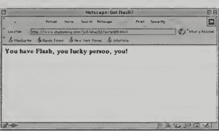

图 2.11 在检查完用户浏览器中安装的所有插件后，循环发现了 Flash 的存在。

### JavaScript 字符串

像 "cat" 这样的单词在第 2 个位置会有 "t" 是什么时候？当它是一个 JavaScript 字符串时。

在 JavaScript 中，第一个字符位于位置 0。因此，以 "cat" 为例，“c" 位于位置 0，“a" 位于位置 1，“t" 位于位置 2。

只有在检查 `length` 属性时，我们实际上才会看到 3 这个值。所有其他字符串方法都是基于 0 索引的，也就是说它们从 0 开始。

### 函数

在进入下一个示例之前，你需要学习函数，你在编写 JavaScript 时会经常使用它。函数是一组执行特定任务的 JavaScript 语句。每个函数都必须赋予一个名称，并且可以被脚本的其他部分调用。例如，假设你获取了一些用户在表单中输入的信息，并使用 JavaScript 存储了它们（关于这类内容在第 6 章有更多介绍）。如果你需要反复使用这些信息，你可以在脚本中不断重复相同的代码。但更好的方法是将这些代码写成一个函数，然后在需要时调用该函数。

函数由单词 `function` 后面跟上函数名组成。函数名后面总是跟着括号，然后是一个左大括号。构成函数的语句位于随后的行中，然后由另一个大括号关闭函数。这里是一个函数的样式：

```javascript
function saySomething() {
  alert("Four score and seven years ago");
}
```

注意带有 `alert` 的那行缩进了吗？这让你的代码更容易读。在第一个大括号和最后一个大括号之间的所有语句都是函数的一部分。

#### 调用函数

你通常使用事件处理器来调用函数。如果你想在用户点击按钮时调用 `saySomething` 函数，将使用如下代码：

```html
<INPUT TYPE=BUTTON VALUE="Lincoln" onclick="saySomething()">
```

#### 向函数传递信息

你经常想获取一些信息并交给函数进行处理。这被称为传递信息。使用之前的函数示例，函数更改如下（在脚本 2.10 中）：

```javascript
function saySomething(message) {
  alert(message)
}
```

脚本 2.10 你可以反复调用同一个函数。

```html
<HTML>
<HEAD>
<TITLE>函数传递</TITLE>
<SCRIPT LANGUAGE=JAVASCRIPT TYPE="TEXT/JAVASCRIPT">
<!-- Hide script from old browsers -->
function saySomething(message) {
  alert(message)
}
// End hiding script from old browsers -->
</SCRIPT>
</HEAD>
<BODY BGCOLOR="WHITE">
<H2>著名的总统格言</H2>
<HR>
<FORM>
<INPUT TYPE=BUTTON VALUE="Lincoln" onclick="saySomething('Four score and seven years ago...')">
<INPUT TYPE=BUTTON VALUE="Kennedy" onclick="saySomething('Ask not what your country can do for you...')">
<INPUT TYPE=BUTTON VALUE="Nixon" onclick="saySomething('I am not a crook!')">
</FORM>
</BODY>
</HTML>
```

在上面的函数中，`message` 是函数的参数。当函数被调用时，数据 `'Four score and seven years ago...'` 会被传递给 `message` 参数。函数参数可以是你想要使用的任何数据，包括文本字符串、数字或其他 JavaScript 对象。就像所有变量一样，你应该为作为函数参数使用的变量命名，以提醒你该变量的用途。

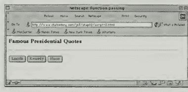

使用这种函数的妙处在于，你可以拥有一组按钮，它们都可以调用同一个函数，但产生不同的警报消息，如图 2.12 所示。

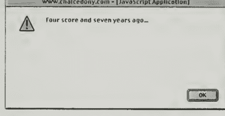
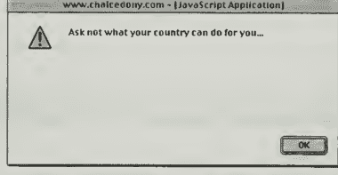
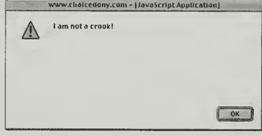

图 2.12 在顶部窗口中使用三个按钮中的每一个来调用函数会导致三个不同的响应，如三个对话框所示。

### 在页面上放置多个脚本

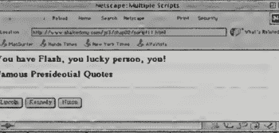

图 2.13 插件检查和函数传递示例都显示在结果页面中。

到书的这里，你已经看到了一次只执行一件事的脚本。但在现实世界中，你可能想使用一个脚本执行各种操作，甚至在一个页面上拥有多个脚本。你可能想使用一个脚本同时完成以下操作：将 JavaScript 用户重定向到另一个页面，检查插件，并发现用户使用的是什么浏览器，这一切都在一个脚本中完成。在页面上执行多项工作的良好方法是将这些事情分组，并将正文脚本操作也分组。脚本 2.11 向你展示了如何将脚本 2.9 和 2.10 的示例合并到一个页面中。图 2.13 显示了合并脚本的结果。

脚本 2.11 这将脚本 2.9 和 2.10 的功能合并到一个页面中。

```html
<HTML>
<HEAD>
<TITLE>Multiple Scripts</TITLE>
<SCRIPT LANGUAGE=JAVASCRIPT TYPE="TEXT/JAVASCRIPT">
<!-- Hide script from old browsers -->
var hasFlash = false
for (i=0; i<navigator.plugins.length; i++) {
  if (navigator.plugins[i].name.indexOf("Flash") >= 0) {
    hasFlash = true
  }
}

function saySomething(message) {
  alert(message)
}
// End hiding script from old browsers -->
</SCRIPT>
</HEAD>
<BODY BGCOLOR=WHITE>
<H2>
<SCRIPT LANGUAGE=JAVASCRIPT TYPE="TEXT/JAVASCRIPT">
<!-- Hide script from old browsers -->
if (hasFlash) {
  document.write("You have Flash, lucky person, you!");
} else {
  document.write("Sorry, you don't have Flash.");
}
// End hiding script from old browsers -->
</SCRIPT>
<HR>
<H2>Famous Presidential Quotes</H2>
<FORM>
<INPUT TYPE=BUTTON VALUE="Lincoln" onclick="saySomething('Four score and seven years ago...')">
<INPUT TYPE=BUTTON VALUE="Kennedy" onclick="saySomething('Ask not what your country can do for you...')">
<INPUT TYPE=BUTTON VALUE="Nixon" onclick="saySomething('I am not a crook!')">
</FORM>
</BODY>
</HTML>
```

> **提示**
> - 你可以将所有想要做的事情都封装在一个头部 `<SCRIPT>` 标签中。没有必要创建多个头部脚本——这是脚本初学者的常见错误。
> - 注意，脚本 2.11 中包含的代码在脚本 2.9 或 2.10 中的外观均没有变化。

### 滚动状态栏

你可能在浏览网页时见过这种最常见的 JavaScript 效果之一。它是状态栏中滚动的消息。脚本 2.12 创建滚动状态消息并不困难。

```html
<HTML>
<HEAD>
<TITLE>Scrolling Status Bar</TITLE>
<SCRIPT LANGUAGE=JAVASCRIPT TYPE="TEXT/JAVASCRIPT">
<!-- Hide script from old browsers -->
var msg = "Welcome to our website! ... "
var speed = 100
function scrollMsg() {
  window.status = msg
  msg = msg.substring(1) + msg.charAt(0)
  setTimeout("scrollMsg()", speed)
}
// End hiding script from old browsers -->
</SCRIPT>
</HEAD>
<BODY BGCOLOR=WHITE onload="scrollMsg()">
<H1>Scrolling Status Bar Example</H1>
</BODY>
</HTML>
```

### 状态栏消息

脚本 2.13 鼠标悬停状态消息对用户非常有帮助。

你可以利用浏览器状态栏做的另一个技巧也非常有用且有效：你可以使用状态栏对链接进行注释，当用户鼠标悬停在链接上时（在点击之前），提供更多关于该链接的信息。例如，如果你在页面上有一个图像映射，你可以使用状态栏向用户描述图像的区域。通过提供更多信息，你增强了用户的网站浏览体验。脚本 2.13 引入了使用 JavaScript 的新方法；你可以将 JavaScript 命令添加到 HTML 锚点标签（用于链接的标签）中。结果参见图 2.15。

```html
<HTML>
<HEAD>
<TITLE>Meaningful links</TITLE>
</HEAD>
<BODY BGCOLOR=WHITE>
<H1>Welcome to my page!</H1>
<H2>Click here to find out more about
<A HREF="sean.html" onmouseover="window.status='Best kid in the world'; return true" onmouseout="window.status=''; return true">my son</A> or here to find out about <A HREF="cat.html" onmouseover="window.status='A very cute cat'; return true" onmouseout="window.status=''; return true">my cat</A>
</H2>
</BODY>
</HTML>
```

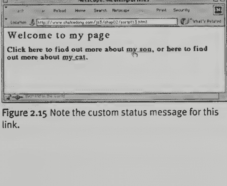

在状态栏中放置消息：

- `<A HREF="sean.html" onmouseover="window.status='Best kid in the world'; return true" onmouseout="window.status=''; return true">my son</A>`

这一行是一个 HTML 锚点标签，其中包含标准的文本超链接，但有一段 JavaScript 代码。`onmouseover` 事件告诉 JavaScript 在用户指针移动到链接上时执行操作。在这种情况下，操作是当用户指针移动到 "my son" 上，将 `window.status` 对象（即状态栏中的消息）设置为字符串 'Best kid in the world'。`return true` 是显示消息所必要的；如果不返回，消息将无效。`onmouseout` 将 `window.status` 重置为空。同样，你需要 `return true` 来确保脚本正常工作。

- `<A HREF="cat.html" onmouseover="window.status='A very cute cat'; return true" onmouseout="window.status=''; return true">my cat</A>`

这个脚本反驳了一句古老的好莱坞谚言，它能够很好地适用于孩子和动物。在这一行中，猫受到了与前一行的孩子相同的对待。

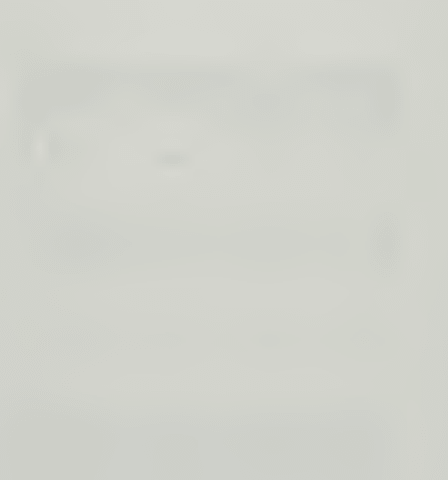

# 第 3 章

## 图像趣味

JavaScript 的最佳用处之一是通过动画图形为 Web 页面增加趣味性，这正是本章的主题。让网页上的图像在用户鼠标移动到图像上时发生变化，从而让页面对用户做出反应，这是你在 JavaScript 中可以学习到的最常见且有效的技巧之一。这种所谓的“悬停”（rollover）很容易实现，但正如你所看到的，它有许多应用。

你还可以使用 JavaScript 创建自动变化的图像，甚至创建替代动态 GIF 文件的动画广告横幅。

### 创建悬停效果

悬停效果背后的原理很简单。你有两个图像。第一张或原始图像被加载并显示在 Web 页面的其他部分。当用户鼠标移动到第一张图像上时，浏览器迅速将第一张图像切换为第二张（即替换图像），产生运动或动画的错觉。

脚本 3.1 提供了最基础的悬停效果：整个过程在一个标准的图像链接内完成。首先加载一个蓝色箭头（图 3.1），当用户鼠标移动到图像上时，它会被红色箭头覆盖（图 3.2）。当用户鼠标移开时，蓝色箭头会重新重画。

脚本 3.1 这里是在链接标签内实现悬停效果的最简单方法。

```html
<HTML>
<HEAD>
<TITLE>A Simple Rollover</TITLE>
</HEAD>
<BODY BGCOLOR=WHITE>
<A HREF="next.html" onmouseover="document.arrow.src='images/redarrow.gif'" onmouseout="document.arrow.src='images/bluearrow.gif'">

</A>
</BODY>
</HTML>
```

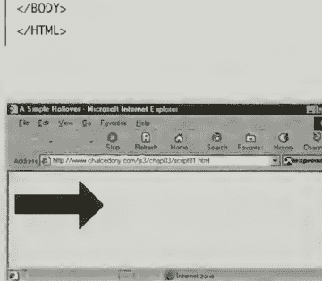

#### 常见的悬停错误

在我们写完这本书的第二版后，我们收到了大量的读者来信，发现一个常见的错误是将 `onmouseout` 处理程序放在了 `IMG` 标签中。另一个常见错误是在 `IMG` 标签中放置了 `onmouseover` 或 `onmouseout`。它们应该放在 `<A>` 标签中。人们说他们复制我们的代码不起作用！我们反复检查他们的代码，不起作用是因为他们没有注意到属性必须在 `<A>` 标签内。他们也没有注意到图像必须在正确的目录下。

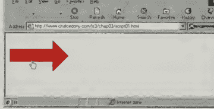

图 3.1 用户鼠标移过前。
图 3.2 用户鼠标移过后。

#### 创建悬停效果

```html
<A HREF="next.html" onmouseover="document.arrow.src='images/redarrow.gif'" onmouseout="document.arrow.src='images/bluearrow.gif'">

</A>
```

这种制作悬停的方法非常简单，但你应该注意到它存在真实的问题。

**这种悬停的缺点**

使用这种方法在旧版浏览器（如 Internet Explorer 2.0 或更早版本、Netscape 3.0 或更早版本）中会导致错误，在从服务器获取图像时会有明显的延迟。


### 更有效的悬停

为了让动画生效，你需要将所有图像预加载到浏览器缓存中。为了实现这一点，你使用 JavaScript 确保图像在需要时已经存在。脚本 3.2 展示了如何做。

```javascript
if (document.images) {
  arrowRed = new Image()
  arrowBlue = new Image()
  arrowRed.src = "images/redarrow.gif"
  arrowBlue.src = "images/bluearrow.gif"
}
```

#### 一个处理浏览器版本问题的巧妙方法

在旧版浏览器中，我们必须创建一些虚拟变量——即那些只会被创建并设置为空、没有任何实际作用的变量。将它们想象成占位符。创建两个名为 `arrowRed` 和 `arrowBlue` 的变量，并将它们设置为空。然后创建并设置 `document.arrow` 为空。

```javascript
else {
  arrowRed = ""
  arrowBlue = ""
  document.arrow = ""
}
```

这里的诀窍在于，`document.images` 仅在 JavaScript 1.1 及更高版本中实现（该版本是随着 Netscape 3.0 发布的），因此一举消除了一整类旧版浏览器。

剩下的悬停效果在链接标签中处理。当用户将鼠标悬停在蓝色箭头图形上时，脚本会将箭头切换为红色箭头的图形（`document.arrow.src=arrowRed.src`）。当鼠标光标离开图形区域时，脚本会将图形恢复为蓝色箭头。

> **提示**
> - 准备用于悬停的图形时，请确保所有的 GIF 图像都不是透明的。透明图像会显示出它们正在替换的下方图像。
> - 原始图像和替换图像需要具有相同的尺寸。否则，浏览器将为你调整图像大小，并且可能不喜欢那种失真的结果。

脚本 3.2 通过检查 `document.images` 解决了这个问题，这实际上是在说：“浏览器能理解图像对象吗？”


### 从链接触发悬停效果

在之前的示例中，用户通过将鼠标悬停在图像上来触发悬停。但你也可以让用户在指向文本链接时触发悬停，如图 3.3 和 3.4 所示。你只需要放置一个带有 `<A HREF>` 标签的文本链接，如脚本 3.3 所示。

脚本 3.3 此脚本从文本链接触发悬停。

```html
<HTML>
<HEAD>
<TITLE>Link Rollover</TITLE>
<SCRIPT LANGUAGE=JAVASCRIPT TYPE="TEXT/JAVASCRIPT">
<!-- Hide script from old browsers -->
if (document.images) {
  arrowRed = new Image()
  arrowBlue = new Image()
  arrowRed.src = "images/redArrow.gif"
  arrowBlue.src = "images/blueArrow.gif"
}
else {
  arrowRed = ""
  arrowBlue = ""
  document.arrow = ""
}
// End hiding script from old browsers -->
</SCRIPT>
</HEAD>
<BODY BGCOLOR="WHITE">
<A HREF="next.html" onmouseover="document.arrow.src=arrowRed.src" onmouseout="document.arrow.src=arrowBlue.src"><H1>Next page</H1></A><BR>

</BODY>
</HTML>
```

要在链接上触发悬停效果：

```html
<A HREF="next.html" onmouseover="document.arrow.src=arrowRed.src" onmouseout="document.arrow.src=arrowBlue.src"><H1>Next page</H1></A>
```

注意，显示为“Next page”的文本链接位于链接内部，这使得它成为 `onmouseover` 使用的触发器。我们将 `IMG` 标签移出了链接标签——它现在紧跟在链接标签之后。

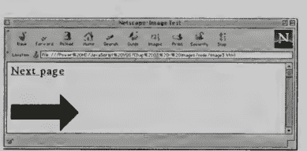
图 3.3 文本链接是此悬停效果的触发设备。

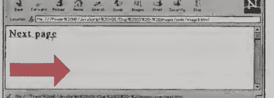
图 3.4 鼠标悬停在链接上时图像发生变化。

> **提示**
> - 当你想要为用户提供点击链接后将看到的预览时，这种技术非常有用。例如，假设你有一个描述苏格兰、大希夷和克利夫兰之旅的旅游网站。页面左侧可以是每个目的地的链接一列，而右侧则可以是一个预览区域，其中会出现一张图像。当用户指向目的地名称时，该地方的照片就会出现在预览区域中。点击链接将用户带到详细页面。

### 多幅图像

到目前为止，你已经看到悬停在单个图像或链接上如何可以触发悬停效果。但你也可以设置多个不同的图像来触发悬停。当你有几张想要触发悬停的图像时，这非常有用。悬停在每张图像上都会显示相应的描述。实际上，我们使用了三幅图像来处理单图悬停。图 3.5 显示了多幅图像的效果。

让多幅图像触发单悬停：


# 第 3 章

## 处理多个鼠标悬停效果

如果你希望触发鼠标悬停的图像本身也发生悬停效果？图 3.6 在上一个示例的基础上，展示了我们如何添加这一功能。当你鼠标悬停在其中发明图像上时，它会像以前一样显示描述图像，但这次还会将发明图像替换为另一个带有阴影的图像。这为用户提供了关于他们所指向内容的视觉反馈（仿佛仅仅有鼠标指针是不够的！）。脚本 3.5 显示了这只需要在之前的示例基础上进行简单的添加。

要处理多个鼠标悬停效果：

- `flyOff = new Image`
- `tankOff = new Image`
- `heliOff = new Image`
- `flyOn = new Image`
- `tankOn = new Image`
- `heliOn = new Image`
- `flyOff.src = "images/flyer.gif"`
- `tankOff.src = "images/tanks.gif"`
- `heliOff.src = "images/helicopter.gif"`
- `flyOn.src = "images/fly2.gif"`
- `tankOn.src = "images/tanks2.gif"`
- `heliOn.src = "images/helicopter2.gif"`

这些行自上一个示例以来添加的，因为脚本需要处理许多图像。它们为这三项发明分别设置了图像。在 `if (document.images)` 条件判断的 `else` 部分，你还需要为旧版浏览器添加空变量。

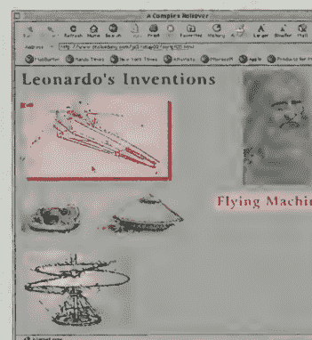

图 3.6 当你悬停在某一个图像上时，描述会出现，并且图像周围会出现一个阴影。

脚本 3.5 此脚本显示了如何触发多个鼠标悬停效果。

```html
<HTML>
<HEAD>
<TITLE>A Complex Roller</TITLE>
<SCRIPT LANGUAGE=JAVASCRIPT TYPE="TEXT/JAVASCRIPT">
<!--
-- 向所有浏览器隐藏脚本
if (document.images) {
flyText = new Image
tankText = new Image
bgText = new Image
heliText = new Image

flyText.src = "images/fmText.gif"
tankText.src = "images/tankText.gif"
bgText.src = "images/bg.gif"
heliText.src = "images/heliText.gif"

flyOff = new Image
tankOff = new Image
heliOff = new Image

flyOn = new Image
tankOn = new Image
heliOn = new Image

flyOff.src = "images/flyer.gif"
tankOff.src = "images/tanks.gif"
heliOff.src = "images/helicopter.gif"
flyOn.src = "images/flyer2.gif"
tankOn.src = "images/tanks2.gif"
heliOn.src = "images/helicopter2.gif"
}
else {
flyText = ""
tankText = ""
bgText = ""
heliText = ""

flyOff = ""
tankOff = ""
heliOff = ""
flyOn = ""
tankOn = ""
heliOn = ""

document.flyImg = ""
document.tonkImg = ""
document.heliImg = ""
document.textField = ""
}

// 结束旧浏览器隐藏脚本 --
</script>
<HEAD>
<BODY COLOR="#EECC99">
<TABLE>
<TR ALIGN="TOP">
<TD>
<BR>
<A HREF="Page.html" onmouseover="document.textField.src=flyText.src;document.flyImg.src=flyOn onmouseout="document.textField.src=bgText.src;document.flyImg.src=tankOff onmouseout>/A>
<A HREF="tank.html" onmouseover="document.textField.src=tankText.src;document.tonkImg.src=tankOn onmouseout="document.textField.src=bgText.src;document.tonkImg.src=tankOff onmouseout>/A>
<A HREF="heli.html" onmouseover="document.textField.src=heliText.src;document.heliImg.src=heliOn onmouseout="document.textField.src=bgText.src;document.heliImg.src=heliOff onmouseout>/A
</TD>
<BR>

</TD>
</TR>
</TABLE>
</BODY>
</html>
```

### 图像的趣味

2. `<A HREF="flyPage.html" onmouseover="document.textField.src=flyText.src;document.flyImg.src=flyOn.src" onmouseout="document.textField.src=bgText.src;document.flyImg.src=flyOff.src">`

这个链接标签的不同之处在于，它对 `mouseover` 有两个赋值语句，对 `mouseout` 有两个，每种情况下都用分号隔开。分号允许你紧接另一个命令，因此你可以使用分号将赋值语句分组。

### 提示

- 记住每个被悬停的图像必须有一个唯一的名称。

### 使用函数简化多个图像的单悬停编码

最后几个示例使用了大量几乎相同的代码。正如你在第 2 章记忆的那样，重复任务是函数的理想候选者。一旦你写了完成重复任务的代码，你只需要调用函数，并传递它执行工作所需的任何数据即可。脚本 3.6 的作用与脚本 3.4 相同，但它使用函数简化了代码部分。视觉结果与图 3.5 相同。

```html
<HTML>
<HEAD>
<TITLE>A Complex Roller</TITLE>
<SCRIPT LANGUAGE=JAVASCRIPT TYPE="TEXT/JAVASCRIPT">
<!--
-- 向所有浏览器隐藏脚本
if (document.images) {
flyText = new Image
tankText = new Image
bgText = new Image
heliText = new Image

flyText.src = "images/fmText.gif"
tankText.src = "images/tankText.gif"
bgText.src = "images/bg.gif"
heliText.src = "images/heliText.gif"

flyOff = new Image
tankOff = new Image
heliOff = new Image

flyOn = new Image
tankOn = new Image
heliOn = new Image

flyOff.src = "images/flyer.gif"
tankOff.src = "images/tanks.gif"
heliOff.src = "images/helicopter.gif"
flyOn.src = "images/flyer2.gif"
tankOn.src = "images/tanks2.gif"
heliOn.src = "images/helicopter2.gif"
}
else {
flyText = ""
tankText = ""
bgText = ""
heliText = ""

flyOff = ""
tankOff = ""
heliOff = ""
flyOn = ""
tankOn = ""
heliOn = ""

document.flyImg = ""
document.tonkImg = ""
document.heliImg = ""
document.textField = ""
}

function chImg(imgField,newImg) {
if (document.images) {
document[imgField].src = eval(newImg + ".src")
}
}
// 结束旧浏览器隐藏脚本 --
</script>
<HEAD>
<BODY COLOR="#EECC99">
<TABLE>
<TR ALIGN="TOP">
<TD>
<BR>
<A HREF="Page.html" onmouseover="document.textField.src=flyText.src;document.flyImg.src=flyOn onmouseout="document.textField.src=bgText.src;document.flyImg.src=tankOff onmouseout>/A>
<A HREF="tank.html" onmouseover="document.textField.src=tankText.src;document.tonkImg.src=tankOn onmouseout="document.textField.src=bgText.src;document.tonkImg.src=tankOff onmouseout>/A>
<A HREF="heli.html" onmouseover="document.textField.src=heliText.src;document.heliImg.src=heliOn onmouseout="document.textField.src=bgText.src;document.heliImg.src=heliOff onmouseout>/A
</TD>
<BR>

</TD>
</TR>
</TABLE>
</BODY>
</html>
```

## 第 3 章

脚本 3.7 续

```html
<SCRIPT>
<HEAD>
<BODY BGCOLOR="#EECC99">
<TR VALIGN="TOP">
<TD>
<A HREF="FlyPage.html" onmouseover="chimg('flyImg','flyOn');chimg('textfield','flyText')" 
onmouseout="chimg('flyImg','flyOff');chimg('textfield','bgText')"><A SRC=
"images/fly.gif" WIDTH=293 HEIGHT=160 VSPACE=20 NAME="flyImg"></A <BR>
<A HREF="tankPage.html" onmouseover="chimg('tankImg','tankOn');" 
chimg('textfield','tankText')" onmouseout="chimg('tankImg','tankOff');"></A <BR>
<A HREF="heliImg.html" onmouseover="chimg('heliImg','heliOn');" 
chimg('textfield','heliText')" onmouseout="chimg('heliImg','heliOff');" 
chimg('textfield','bgText')"></A>
</TD>
<BR>

</TR>
</TABLE>
</BODY>
</HTML>
```

## 趣味图片

### 创建循环横幅

当你浏览网页时，经常会看到定期切换图片的广告横幅。这些横幅大部分是动态 GIF 文件，即包含多个连续播放帧的 GIF 文件。如果你想让页面循环显示多个 GIF（无论是动态还是静态的），可以使用 JavaScript 来完成，如脚本 3.8 所示。此示例使用了三个 GIF 并反复循环播放，如图 3.7、3.8 和 3.9 所示。

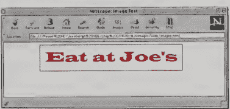

**图 3.7** 第一张图片，它是循环横幅的开始……

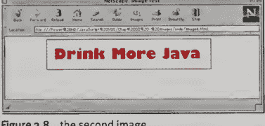

**图 3.8** ...第二张图片...

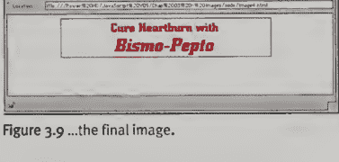

**图 3.9** ...最后一张图片。

### 创建循环横幅：

- 1. `adimages = new Array`
- `"images/banner1.gif"`
- `"images/banner2.gif"`
- `"images/banner3.gif"`
- `thisAd = 0`
- `imgCt = adimages.length`

这段代码通过创建三个变量为脚本奠定了基础。第一个 `adImages=new Array` 创建了一个名为 `adimages` 的新变量，并填充了一个新类型的对象：数组。数组是一个包含一组相关信息的对象。在这种情况下，数组包含了组成循环横幅的三个 GIF 文件名。另外两个变量 `thisAd` 和 `imgCt` 在代码中被赋予了初始值。通过将 `imgCt` 的值设置为 `adimages.length`（即数组中元素的数量），可以轻松地从数组中添加或删除图片（即横幅）。

脚本 3.8 你可以使用 JavaScript 在横幅中循环图片。

```html
<HTML>
<HEAD>
<TITLE>Image Array</TITLE>
<SCRIPT LANGUAGE="JAVASCRIPT" TYPE="text/JAVASCRIPT">
<!--- 对旧版浏览器隐藏脚本
```

```javascript
adimages = new Array("images/
banner1.gif", "images/banner2.gif",
"images/banner3.gif")
thisAd = 0
imgCt = adimages.length
```

```javascript
function rotate() {
  if (document.images) {
    thisAd++
    if (thisAd == imgCt) {
      thisAd = 0
    }
    document.adBanner.src=adimages[thisAd]
    setTimeout("rotate()", 3000)
  }
}
```

```html
// 结束对旧版浏览器隐藏脚本 ---
</SCRIPT>
</HEAD>
<BODY COLOR=WHITE onload="rotate()">
<CENTER>

</BODY>
</HTML>
```

- 2. `function rotate()`

这一行设置了一个名为 `rotate()` 的新函数。

- 3. `if (document.images) {`

你再次检查浏览器是否理解图片对象：即检查它不是旧版浏览器。

- 4. `thisAd++`

获取 `thisAd` 的值并加 1。

- 5. `if (thisAd == imgCt) {`

`thisAd = 0`

这段代码设置了一个计数器：如果 `thisAd` 的值等于 `imgCt` 的值，则将 `thisAd` 的值重置为零。

- 6. `document.adBanner.src=adImages[thisAd]`

网页上循环的图片名为 `adBanner`：这是你在第 9 步中定义的。这行代码表示 `adBanner` 图片的源位于 `adImages` 数组中，而 `thisAd` 的值决定了此时浏览器应该使用哪一个 GIF。

- 7. `setTimeout("rotate()", 3000)`

这一行告诉脚本如何更改横幅中的 GIF。`setTimeout` 命令允许你指定执行操作的时间，以毫秒为单位。在这种情况下，`rotate()` 函数每千毫秒（即三秒）调用一次，因此 GIF 每三秒循环一次。

- 8. `<BODY onload="rotate()">`

在 `BODY` 标签中，通过调用 `rotate()` 函数启动横幅循环。

```html
9. 
```

这是定义循环图片的地方。

- 你可能会好奇为什么要使用 JavaScript 创建循环横幅而不是直接创建动画 GIF。一个很好的理由是它允许你在横幅中使用 JPEG 图片，这具有更高的质量。

- 变量 `imgCt` 始终是数组中的项目数量。与 JavaScript 某些特殊的计数方式不同，这里从 0 开始而不是从 1 开始，因为这种情况有三个横幅。

### 让横幅等待

如果你在循环横幅中使用小型 GIF，可能不需要担心一张图片在下一张显示之前未加载完成。但如果你使用这种技术制作幻灯片，可能希望确保用户在显示下一张之前已经看到了所有的图形——这对于网络连接较慢的用户特别有用。脚本 3.9 显示了如何修改脚本来实现这一目标。它基于脚本 3.8，但在 `rotate()` 函数内部增加了另一个循环。

让循环等待用户：

- 1. `if (document.adBanner.complete) {`

这一行告诉 `adBanner` 必须完成加载。

- 2. `thisAd++`

给变量 `thisAd` 加 1。

- 3. `if (thisAd == imgCt) {`

`thisAd = 0`

当 `thisAd` 达到 `imgCt` 的值时，将其置零。

- 4. `document.adBanner.src=adImages[thisAd]`

`setTimeout("rotate()", 3 * 1000)`

这与脚本 3.8 类似，不同在于此时 `setTimeout()` 命令位于图片循环的外部。在循环完成之前都会调用 `setTimeout()`。

脚本 3.9 你可以在当前图片加载完成后，再延迟下一张图片的加载。

```html
<HTML>
<HEAD>
<TITLE>Image Array</TITLE>
<SCRIPT LANGUAGE="JAVASCRIPT" TYPE="JAVASCRIPT">

<!-- 对旧版浏览器隐藏脚本
images = new Array("images/banner1.gif",
  "images/banner2.gif", "images/banner3.gif")
var imgCt = images.length

function rotate() {
  if (document.adBanner) {
    if (document.adBanner.complete) {
      thisAd++
      if (thisAd == imgCt) {
        thisAd = 0
        document.adBanner.src=
          adImages[thisAd]
      }
    }
    setTimeout("rotate()", 3 * 1000)
  }
}
// 结束对旧版浏览器隐藏脚本 --
</SCRIPT>
<HEAD>
<BODY BACKGROUND="WHITE" onload="rotate()">
<CENTER>
  
</CENTER>
</BODY>
</HTML>
```

### 为循环横幅添加链接

横幅常用于广告，你可能想知道如何将横幅变成链接，在访问者点击时跳转到某处。脚本 3.10 显示它是之前脚本的变体。在这个脚本中，你将添加一个新的数组。新数组包含了用户点击横幅时将要重往的目的地。在这种情况下，“Eat at Joe's”横幅带你去 negrino.com，“Drink more Java”去 sun.com，而“Heartburn”去 microsoft.com。当然，这并不意味着任何编辑评论。

脚本 3.10 此脚本显示了你如何将循环横幅变成真实的、可点击的广告横幅。

## 第 3 章

### 为循环横幅添加链接：

- 1. `adURL = new Array("negrino.com", "sun.com", "microsoft.com")`

  `adURL` 变量被分配了新数组的三个元素。这里只需要填写域名，因为你会在稍后完成完整的 URL。

- 2. `function getLocation() {`

  `document.location.href = "http://." + adURL[thisAd]`

  `}`

  新函数 `getLocation` 将 `document.location.href` 对象（换句话说就是当前文档窗口）设置为文本字符串 `http://www.`（注意那个点）与 `adURL` 的值拼接，因为 `adURL` 是一个数组。它通过 `thisAd` 进行引用，根据用户点击的时间，该值是三个广告中的任何一个。

- 3. `<A HREF="javascript:getLocation()">`

  `</A>`

  在链接标签中调用 JavaScript 函数 `getLocation` 是起实现作用的关键。

### ✔ 提示

- 为了让此脚本正常工作，`adURL` 数组的元素数量必须与 `adImages` 数组相同。

```javascript
Script 3.10 续
script
function getLocation() {
  document.location.href = "http://www."
  + adURL[thisAd]
}
// 针对旧浏览器的脚本结束 --
</SCRIPT>
<HEAD>
<BODY BGCOLOR=WHITE onload="rotate">
<CENTER>
  <A HREF="javascript:getLocation()">
    </A>
</CENTER>
</BODY>
</HTML>
```

### 构建幻灯片

网站上的幻灯片向用户展示图像，并允许用户控制图片的切换（向前或向后）。Javascript 为用户提供了交互式控制。脚本 3.11 显示了如何向你的页面添加幻灯片。

制作幻灯片：

- 1. `myPix = new Array("images/pathfinder.gif", "images/surveyor.gif", "images/surveyor_98.gif"); thisPic = 0;`

  你首先声明两个变量，其中 `myPix` 是一个包含三个 GIF 元素的数组（在这个特定的幻灯片中有三张图片）。`thisPic` 变量将在稍后的切换中用计数器。

- 2. `imgCt = myPix.length - 1`

  `imgCt` 变量允许你在无需编码幻灯片项目数量的情况下运行脚本。可以通过向数组添加或删除元素来增删图片。`imgCt` 变量初始化为其真实值减一，以匹配数组中的 0、1 值。

- 3. `function processPrevious() {`

  定义函数 `processPrevious`。当用户点击“上一个”链接时，幻灯片会向后移动。

- 4. `if (document.images && thisPic > 0) { thisPic--`

  如果文档更新且 `thisPic` 大于 0，则从 `thisPic` 中减 1。双符号 `&&` 是一个逻辑运算符，表示“和”。

```javascript
Script 3.11 此脚本构建了一个幻灯片。
```html

<HTML>

<HEAD>

  <TITLE>图像幻灯片</TITLE>

  <SCRIPT LANGUAGE=JAVASCRIPT TYPE="TEXT/JAVCRIPT">

  <!-- 隐藏旧浏览器的脚本 -->

  myPix = new Array("images/pathfinder.gif",

  "images/surveyor.gif",

  "images/surveyor_98.gif");

  thisPic = 0;

  imgCt = myPix.length - 1;

  function processPrevious() {

    if (document.images && thisPic > 0) {

      thisPic--;

      document.Picture.src=myPix[thisPic];

    }

  }

  function processNext() {

    if (document.images && thisPic < imgCt) {

      thisPic++;

      document.Picture.src=myPix[thisPic];

    }

  }

  // 针对旧浏览器的脚本结束

</SCRIPT>

<HEAD>

<BODY BGCOLOR="WHITE">

<CENTER>

<H1>切换到火星</H1>

<P>

<P><A href="javascript:processPrevious()">&lt;</A&nbsp;&nbsp;<A href="javascript:processNext()">&gt;</A></P>

</CENTER>

</BODY>

</HTML>

```

- 5. `document.Picture.src=myPix[thisPic]`
  在这里你告诉文档 `myPix` 的源位于 `myPix` 的值中，这取决于 `thisPic` 的值。

- 6. `function processNext() { if (document.images && thisPic < imgCt) {`
  `thisPic++; document.Picture.src=myPix[thisPic]; }`
  此函数是 `processPrevious` 的镜像（图10）。它通过检查 `thisPic` 的值是否小于 `imgCt`，如果是则加 1 来推进幻灯片中的图片（图11和12）。

- 7. `IMG SRC="images/pathfinder.gif" NAME="myPicture" WIDTH=200 HEIGHT=155`
  你需要在脚本中定义 `myPicture` 的值，并在 `IMG` 标签中定义。图片的初始源是 `pathfinder.gif`，但脚本中的通用名称是 `myPicture`。

- 8. `<a href="javascript:processPrevious()"></a>`
  这是如何从链接调用 JavaScript 函数。当用户点击“上一个”链接时，调用 `processPrevious`。`&lt;&lt;` 是小于号，使得前后方向更清晰。

- 9. `<A HREF="javascript:processNext()">Next</A>`
  点击“下一个”链接时，脚本调用 `processNext` 函数。`&gt;&gt;` 是大于号，使得前后方向更清晰。

### ✔ 提示

- 使用这两个函数（`processPrevious` 和 `processNext`），当用户到达某个方向的最后时，脚本将忽略该方向的后续点击。

### 构建循环幻灯片

正如最后一部分的提示所示，当用户到达任何方向的幻灯片结尾时，脚本停止了。在脚本 3.12 中，你将看到如何构建一个循环脚本，即如果你越过列表末尾就会回到开头，反之亦然。图13 显示了新的幻灯片。

构建循环幻灯片：

- 1. `MyPix = new Array("images/callisto.jpg", "images/europa.jpg", "images/io.jpg", "images/ganymede.jpg")`
  加载木星四颗卫星图像到变量 `MyPix`。

- 2. `function chgSlide(direction) {`
  此脚本将脚本 3.11 中使用的 `processNext` 和 `processPrevious` 函数替换为单一函数 `chgSlide`，参数 `direction` 的值可以是 -1 或1。

- 3. `if (document.images) {`
  `thisPic = thisPic + direction`
  `if (thisPic > imgCt) {`
  `thisPic = 0;`
  在检查浏览器是否支持图片的内部，变量 `thisPic` 被设置为自身的值加上 `direction` 的值。如果 `thisPic` 大于 `imgCt`，则 `thisPic` 被设置为零。

脚本 3.12 此脚本显示了如何制作双向幻灯片。

```html

<HTML>

<HEAD>

  <TITLE>图像幻灯片</TITLE>

  <SCRIPT LANGUAGE=JAVASCRIPT TYPE="TEXT/JAVCRIPT">

  <!-- 隐藏旧浏览器的脚本 -->

  myPix = new Array("images/callisto.jpg",

  "images/europa.jpg","images/io.jpg",

  "images/ganymede.jpg");

  thisPic = 0;

  imgCt = myPix.length - 1;

  function chgSlide(direction) {

    if (document.images) {

      thisPic = thisPic + direction;

      if (thisPic > imgCt) {

        thisPic = 0;

      }

      if (thisPic < 0) {

        thisPic = imgCt;

      }

      document.Picture.src=myPix[thisPic];

    }

  }

  // 针对旧浏览器的脚本结束 --

</SCRIPT>

</HEAD>

<BODY BGCOLOR="WHITE">

<CENTER>

<H1 ALIGN=CENTER>木星的卫星</H1>

<P></P>

<P><A href="javascript:chgSlide(-1)">&lt;&lt; Previous</A&nbsp;&nbsp;<A href="javascript:chgSlide(1)">Next&gt;&gt; A</P>

</CENTER>

</BODY>

</HTML>

```

## 图像趣味

- 4. `if (thisPic < 0) {`
  `thisPic = imgCt`
`}`

如果 `thisPic` 的值小于 0，则将 `thisPic` 设置为 `imgCt` 的值。

- 5. `<A HREF="javascript:
  * chgSlide(-1)&lt;&lt;
  * 上一个&nbsp;&nbsp;
  * <A HREF="javascript:
    * chgSlide(1)&gt;Next &gt;</A>`

在这一行中，链接调用了 JavaScript 函数 `chgSlide`，并向它传递值 `-1`（代表上一个方向）或 `1`（代表下一个方向）。无论传递哪个值，参数方向都会改变。

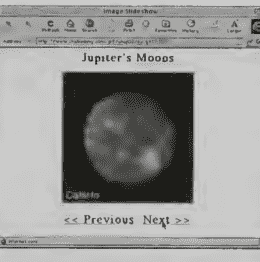

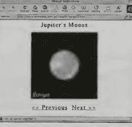

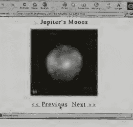

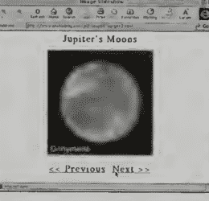

图 3.13 木星的四颗卫星可以向前或向后的任何方向查看。

构建循环幻灯片

61

# 第 3 章

## 显示随机图像

如果你的网站拥有丰富的图形，或者你正在展示数字艺术作品，那么你希望在用户进入网站时，从集中随机显示一张图片。再次由 JavaScript 救场，脚本 3.13 就是答案。

### 如何显示随机图像：

- 1. `myPix = new Array`
  - `"images/redBonner.gif"`
  - `"images/blueBonner.gif"`
  - `"images/greenBonner.gif"`

众所周知，构建一个包含三个图像的数组并将其存入变量 `myPix`。

- 2. `imgCt = myPix.length`
将 `imgCt` 设置为数组中的项目数量，在本例中为 3。

- 3. `function choosePic()`
定义函数 `choosePic()`。

- 4. `if (document.images) {`
  `randomNum = Math.floor`
  `- ((Math.random() * imgCt)`
如果文档可以处理对象，则创建一个名为 `randomNum` 的变量。该变量的值取自数学表达式的结果，该表达式最好从内层向外读取。`Math.floor` 生成一个 0 到 1 之间的随机数，然后乘以 `imgCt`。`Math.floor` 将结果向下取整为整数，这意味着数字必须在 0 到 2 之间。

- 5. `document.myPicture.src =`
  - `myPix[randomNum]`
这表示图像 `myPicture` 的源位于变量 `myPix` 中，且此时的值取决于 `randomNum` 的值。

脚本 3.13 你可以使用此脚本显示随机图像。

```html

<HTML>

<HEAD>

<TITLE>随机图像</TITLE>

<SCRIPT LANGUAGE=JAVASCRIPT TYPE="TEXT/JAVASCRIPT">

<!-- 为旧版浏览器隐藏脚本 -->

var myPix = new Array("images/redBonner.gif",

"images/blueBonner.gif",

"images/greenBonner.gif");

imgCt = myPix.length

function choosePic() {

if (document.images) {

randomNum = Math.floor(

((Math.random() * imgCt))

document.myPicture.src = 

myPix[randomNum]

}

}

</SCRIPT>

<!-- 旧版浏览器脚本结束 -->

<BODY BGCOLOR=WHITE onload="choosePic()">


</BODY>

</HTML>

```

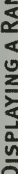

3

## 图像趣味

- 6. `<BODY BCOLOR=WHITE
> onload="choosePic()">`
使用 `onload` 命令来启动 `choosePic` 函数。

- 7. ``

```html

<A HREF="home.html" onMouseout="document.roll.src=imgRef.src">

  

</A>

```

在这里，你使用了链接标签，并为鼠标悬停（mouseover）和鼠标移出（mouseout）定义了值。你已经完成了图像映射，所以关闭 map 标签和 IMG 标签中的 name 属性，使用 `testRef.gif` 作为初始图像，最后用 `</A>` 关闭链接。

### 提示

- 地图的每个部分都链接到不同的 Web 页面。在用户点击鼠标之前，浏览器不会跳转到新网页。
- 这种技术对于清理拥挤的布局和导航栏非常有帮助。实际上，它允许你对用户界面进行分层。
- 它对于在网站上创建伪下拉菜单也非常棒。你可以让鼠标悬停时显示看起来像菜单的图像映射，图像映射的每个区域都可以链接到不同的页面。

### 脚本 3.14 继续

```html

<script>

<HEAD>

<BODY BGCOLOR="WHITE">

<MAP NAME="roll">

  <A HREF="#sec.1" onmouseover="document.roll.src=img1.src" COORDS="0,0,120,120">

  <A HREF="#sec.2" onmouseover="document.roll.src=img2.src" COORDS="0,120,120,240">

  <A HREF="#sec.3" onmouseover="document.roll.src=img3.src" COORDS="0,240,120,360">

<A HREF="home.html" onMouseout="document.roll.src">

  

<h3>H3- 访问我们网站的提示。你将

  - 在这里发现一些 Web 内容，

  - 我们其中很多内容也放入了我们的书中，

  - 《Visual JavaScript 指南》，第三版，

  - 由 Peach Press 出版。你可以

  - 点击左侧的框获取更多信息。</</h3>>

</BODY>

</HTML>

</script>

```

## 玩转图像

3.1.15 这个脚本让你的页面自动更改背景。

### 自动更改背景颜色

老实说，我们并不完全清楚你为什么想用 JavaScript 更改页面的背景颜色，但既然你可以这样做，我们就决定让你学习这项技术。在图 3.20 和 3.21 中，你可以看到我们如何每三秒改变一次背景颜色，在红、白、蓝之间循环（未显示）。在脚本 3.15 中获取如何做的详情。

```html

<html>

<HEAD>

<TITLE>图像文本</TITLE>

<SCRIPT LANGUAGE=JAVASCRIPT TYPE="TEXT/JAVASCRIPT">

  <!-- 对旧版浏览器隐藏脚本 -->

  var bgrounds = new Array("red","white","blue");

  var thisBG = 0;

  var bgColorCount = bgrounds.length;

  function rotateBG() {

    if (document.images) {

      thisBG++;

      if (thisBG == bgColorCount) {

        thisBG = 0;

        document.bgColor=bgrounds[thisBG];

        setTimeout("rotateBG()", 3 * 1000);

      }

    }

  }

  // 结束对旧版浏览器隐藏脚本 --

</SCRIPT>

<BODY onload="rotateBG()">

<H1 ALIGN=CENTER>欢迎 Steve 的疯狂互联网阴谋党！</H1>

<H3>你是否曾经觉得有人

  - 是在针对你？嗯，我们

  - 也是这样想的，而且知道为什么

  - 他们也在针对你。结社、

    秘密政府接管、农作物

    圆圈、从天而降、黑色

    直升机，我们拥有所有这一切

    背后的真实故事。</H3>

<H1 ALIGN=CENTER>真相在这里。

  - 在某处。</H1>

</BODY>

</html>

```

自动更改背景颜色：

- 1. `bgrounds = new Array("red","white","blue")`
  `thisBG = 0`
  `bgColorCount = bgrounds.length`

该变量包含了你将使用的颜色名称。你可以毫无问题地使用十六进制颜色；混合使用颜色名称。`thisBG` 变量 `bgColorCount` 被设置为 `bgrounds` 数组的长度，即 3。

- 2. `function rotateBG()`
  定义函数 `rotateBG`。

- 3. `if (document.images) {`
  `thisBG++`
  如果文档知道如何处理图像，将 `thisBG` 的值加1。

- 4. `if (thisBG == bgColorCount) {`
  `thisBG = 0`
}
  如果 `thisBG` 等于 `bgColorCount`，则将 `thisBG` 重置为零。否则，它将继续循环！

- 5. `document.bgColor=bgrounds[thisBG]`
此行告诉文档将其背景颜色属性设置为变量 `bgrounds` 代表的值，由 `thisBG` 的当前值决定。

- 6. `setTimeout("rotateBG()", 3 * 1000)`
正如本章前面所示，`setTimeout` 每 3000 毫秒调用一次 `rotateBG` 函数。

### 提示

- 你可以通过向 `bgrounds` 数组添加更多颜色名称或十六进制值，让脚本在更多颜色之间切换，并调整 `bgColorCount` 的值以匹配颜色数量。

- 为了获得复古迷幻效果，可以通过减少 `setTimeout` 值来让颜色闪烁。如果你将第 6 步中的值 3 改为一个小值（如 .1），你会觉得自己瞬间回到了 60 年代。

# 第 4 章

### 强制页面进入框架：

1. `if (top.location == self.location) {`
   检查当前页面（self）是否处于最顶层级。如果不是，说明你正处于一个框架集（frameset）中。

2. `top.location.href="frameset2.html"`
   如果当前页面位于顶层，则用 frameset 的 URL 替换当前页面。这将按照你设计的方式显示你的框架化站点。

### 提示

- 如果你只有少数页面可能从框架外部调用，这种方法运行良好良好，因为对于每一个可能想要加载到内容框架中的（如本例所示）页面，你都需要一个独立的 frameset 页面。接下来的示例展示了处理大型网站的方法。

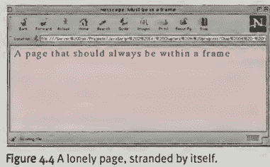
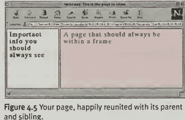

### 强制将网站放入框架

如果你有一个大型站点，其中许多你想要放入框架的页面，前一页描述的方法很容易变得难以处理。这里有一种更适合大型站点的方法。脚本 4.5（下文详解）显示了 framesSET。脚本 4.6 显示了左侧导航栏，脚本 4.7 和 4.8 显示了你需要添加到站点中每个页面上的少量 JavaScript。图 4.6 显示了你的页面本身，而图 4.7 显示了你预期的站点外观。

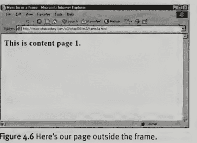

### 强制将网站放入框架：

1. `linkURL = "frame3a.html"`
   在此处将 linkURL 设置为将出现在内容框架中的默认页面，以防你通过引用内容页来加载 frameset。

2. `(if (parent.document.URL))`
   并不是每个支持 JavaScript 的浏览器都理解 URL 对象。如果该浏览器不支持，你需要跳过后续的步骤（一直到第 5 步），你可以通过将这些步骤封装在 if 语句中来实现。

3. `callingURL = parent.document.URL`
   如果浏览器理解 URL 对象，你希望把该值存储在 callingURL 变量中。

4. `if ((callingURL.indexOf('?') != -1) {`
   你将想要在内容框架中的页面名称传递给 frameset 页面。这是通过获取你想要加载的页面（frameset 页面）的名称，并在后面追加一个问号然后是目标内容页面的名称来实现。此步检查 callingURL 中是否存在问号。
   如果是，你将执行下一步。

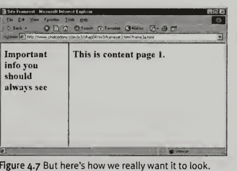

> 强制将网站放入框架
（接下下页）

# 第 4 章

5. `linkURL = callingURL.substring(callingURL.indexOf('?')+1, callingURL.length)`
   在这里，你获取 URL 并选择问号之后的部分。
   `indexOf()` 方法给出问号的位置，`length` 属性使用 callingURL 的长度。`substring()` 方法返回你需要的 callingURL 部分：从问号后第 1 个字符到 URL 的末尾。

脚本 4.5 frameset 页面理解传递过去的内容页面位置。

```html

<HTML>

<HEAD>

<TITLE>Site Frameset</TITLE>

</HEAD>

<SCRIPT LANGUAGE=JAVASCRIPT TYPE="TEXT/JAVASCRIPT">

-- 对旧版浏览器隐藏脚本

linkURL = "frame30.html"

if (parent.document.URL) {

  callingURL = parent.document.URL

  if (callingURL.indexOf('?') != -1) {

    linkURL = callingURL.substring(

    callingURL.indexOf('?')+1,

    callingURL.length)

  }

}

document.write('<FRAMET COLS="30%, 70%">')

document.write('<FRAME SRC="left3.html" NAME="left">')

document.write('<FRAME SRC="' + linkURL + '" NAME="content">')

document.write('</FRAMET>')

```

6. `document.write('<FRAMET COLS="30%, 70%">')`
   `document.write('<FRAME SRC="left3.html" NAME="left">')`
   `document.write('<FRAME SRC="' + linkURL + '" NAME="content">')`
   `document.write('</FRAMET>')`

这部分代码动态地写入 frameset。如果浏览器理解带有问号的 URL，则传递了一个 URL，内容框架将获取预期的 URL。否则，页面将获取第 1 步在 linkURL 中定义的默认内容框架。

```javascript

document.write('<FRAMET COLS="30%, 70%">')

document.write('<FRAME SRC="left3.html" NAME="left">')

document.write('<FRAME SRC="' + linkURL + '" NAME="content">')

document.write('</FRAMET>')

```

脚本 4.6 左侧导航栏应该始终显示。

```html

<HTML>

<HEAD>

<TITLE>Nav</TITLE>

</HEAD>

<BODY BGCOLOR=WHITE>

<h1>Important info should always show</h1>

</BODY>

</HTML>

```


脚本 4.7 有一个页面用于 frameset...

```html

<HTML>

<HEAD>

<TITLE>Must be in frame</TITLE>

</HEAD>

<SCRIPT LANGUAGE=JAVASCRIPT TYPE="JAVASCRIPT">

// 对旧版浏览器隐藏脚本

if (top.location == self.location) {

  top.location.href = "frameset.html?frame3a.html"

}

// 对旧版浏览器隐藏脚本

</SCRIPT>

<BODY BCOLOR=WHITE>

<h1>This is content page 1</h1>

</BODY>

</HTML>

```

7. `top.location.href = "frameset.html?frame3a.html"`
   在想要进入框架的页面（脚本 4.7）上，此代码强制加载 frameset。将 top.location 设置为 frameset 的名称，后面跟着问号和内容框架中的页面名称。

### 提示

- `document.URL` 对象仅存在 JavaScript 1 及以上版本。如果你需要支持旧浏览器，请记住它们总是获取默认页面。
- 为了简单起见，脚本 4.5 显示的 frameset 页面没有处理旧的 JavaScript 或不支持框架的浏览器。你的应该通过浏览器检测来实现（见第 2 章）。
- 为什么第 6 步斜杠前有一个斜杠？根据 HTML 标准，浏览器可能会将 `document.write()` 内部的结束标签解释为行的结束。斜杠“转义”了 HTML 以避免产生错误。

脚本 4.8 以同样的方式传递。

```html

<HTML>

<HEAD>

<TITLE>Must be in frame</TITLE>

</HEAD>

<SCRIPT LANGUAGE=JAVASCRIPT TYPE="JAVASCRIPT">

// 对旧版浏览器隐藏脚本

if (top.location == self.location) {

  top.location.href = "frameset.html?frame3b.html"

}

// 对旧版浏览器隐藏脚本

</SCRIPT>

<BODY BCOLOR=WHITE>

<h1>This is content page 2</h1>

</BODY>

</HTML>

```

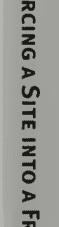

### 加载框架

通常有一个框架作为你站点的导航栏，将不同的页面加载到主框架。脚本 4.9 中的 frameset 允许通过点击左框架中的链接（脚本 4.10，详见下文）将选择的页面（脚本 4.11、12和13）加载到主内容框架。

从一个框架加载到另一个：

1. `pageArray = new Array("frame4a.html", "frame4b.html", "frame4c.html")`
   创建一个名为 pageArray 的数组，包含了导航栏可用的 URL。在图 4.8 显示的页面中有三个可能的页面。

```html

<HTML>

<HEAD>

<TITLE>Setting one frame from another</TITLE>

</HEAD>

<FRAMES COLS="30%,70%">

<FRAME SRC="left4a.html" NAME="left" SCROLLING=AUTO>

<FRAME SRC="frame4a.html" NAME="content" SCROLLING=AUTO>

</FRAMES>

</HTML>

```

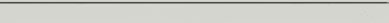

```html

<HTML>

<HEAD>

<TITLE>Nav Bar</TITLE>

</HEAD>

<SCRIPT LANGUAGE=JAVASCRIPT TYPE=TEXT/JAVASCRIPT>

<!-- 对旧版浏览器隐藏脚本 -->

pageArray = new Array("frame4a.html", "frame4b.html", "frame4c.html")

function setContent(page) {

  parent.document.location.href = pageArray[page]

}

// 对旧版浏览器隐藏脚本 --

</SCRIPT>

<BODY BCOLOR=WHITE>

<h1>Navigation Bar</h1>

<h2>

<a href="javascript:setContent(1)">Page 1</a>

<a href="javascript:setContent(2)">Page 2</a>

<a href="javascript:setContent(3)">Page 3</a>

</h2>

</BODY>

</HTML>

```

### 脚本 4.11 这里是页面 1，

```html

<HTML>

<HEAD>

<TITLE>Content frame</TITLE>

</HEAD>

<BODY BCOLOR=WHITE>

<h1>You are now looking at page 1</h1>

</BODY>

</HTML>

```
我们需要三个 URL。数组中的第一个位置是 0，你将其留空，以便使用位置 1、2 和 3。

2. `function setContent(thisPage) { parent.content.document.location.href = pageArray[thisPage] }`
   创建一个新函数 setContent，它在接收页面数字时加载内容框架。它是通过找到文档的父级，然后找到父级的内容框架，最后通过设置该内容框架的 location.href 源来加载新页的。

### 脚本 4.12 页面 2，

```html

<HTML>

<HEAD>

<TITLE>Content frame</TITLE>

</HEAD>

<BODY BCOLOR=WHITE>

<h1>You are now looking at page 2</h1>

</BODY>

</HTML>

```
3. `<a href="javascript:setContent(1)"> Page 1</a>`
   这是如何从链接调用 JavaScript 函数。当点击链接时，会调用 JavaScript 函数 setContent 并传递想要加载的页面数字（在此例中为1）。

### 脚本 4.13 和页面 3。

```html

<HTML>

<HEAD>

<TITLE>Content Frame</TITLE>

</HEAD>

<BODY BCOLOR=WHITE>

<h1>You are now looking at page 3</h1>

</BODY>

</HTML>

```

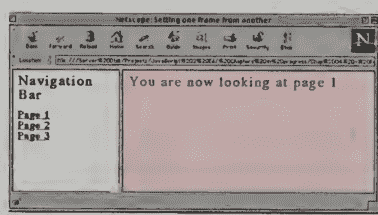
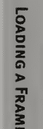

图 4.8 这里有一个作为你站点导航栏的框架，内容页面出现在内容框架中。

## 第 4 章

### 创建和加载动态帧

脚本 4.14 这是一个框架集（frameset）。

由于 JavaScript 可以动态创建页面内容，因此它适用于根据用户在另一个帧中的选择，将动态数据加载到帧中。脚本 4.14 是一个框架集，它加载了一个占位内容页（脚本 4.16）和一个导航页（脚本 4.13，详见下文），该页面可以创建一个页面并将其加载到主内容帧中。

```html

<HTML>

<HEAD>

<TITLE>从另一个帧设置帧</TITLE>

</HEAD>

<FRAMET COLS="30%, 70%">

<FRAME SRC="left5.html" NAME="left" SCROLLING="AUTO">

<FRAME SRC="frame5.html" NAME="content" SCROLLING="AUTO">

</FRAMET>

</HTML>

```

从另一个帧加载动态帧：

- 1. `function writeContent(thisPage) {`
  `parent.document.write("<HTML><HEAD></BODY BGCOLOR=WHITE><h1>");`
  `parent.document.write("You are now looking at page " + thisPage + ")");`
  `parent.document.write("</h1></body></html>");`
  `parent.document.close();`
}

- 2. 脚本 4.15 JavaScript 允许你动态创建 HTML，将脚本执行的结果写入新页面。

```html

<HTML>

<HEAD>

<TITLE>导航栏</TITLE>

<SCRIPT LANGUAGE=JAVASCRIPT TYPE="TEXT/JAVASCRIPT">

<!-- 对旧版浏览器隐藏脚本 -->

function writeContent(thisPage) {

  parent.document.write("<HTML><HEAD></BODY BGCOLOR=WHITE><h1>");

  parent.document.write("You are now looking at page " + thisPage + ")");

  parent.document.write("<h1></body></html>");

  parent.document.close();

}

// 结束对旧版器的隐藏脚本 --

</SCRIPT>

</HEAD>

<BODY BGCOLOR=WHITE>

<h1>导航栏</h1>

<A HREF="javascript:writeContent(1)">第 1 页</A>

<A HREF="javascript:writeContent(2)">第 2 页</A>

<A HREF="javascript:writeContent(3)">第 3 页</A>

</BODY>

</HTML>

```

创建一个新函数 `writeContent()`，当给定一个页面码时，它创建一个动态页面并将其加载到内容帧中。它是通过找到当前文档的父级、找到父级文档的内容，并将新页面写入内容文档来实现的。使用 `document.close()` 来确保你写入的所有内容都显示出来。

- 3. `<A HREF="javascript:writeContent(1)">第 1 页</A>` 在页面主体内，创建了你加载到主窗口的两个页面。当点击链接时，会调用 JavaScript 函数 `writeContent`，并传递你想要创建和加载的页面码（在此例中为 1）。图 4.9 显示了结果（此处原文为 Figure）。对于你想要在内容帧中创建并显示的每个页面，重复此行并使用新的页面码即可。

### 脚本 4.16 初始加载的占位页。

```html

<HTML>

<HEAD>

<TITLE>内容帧</TITLE>

</HEAD>

<BODY BGCOLOR=WHITE>

</BODY>

</HTML>

```

图 4.9 这里是脚本 4.15 的结果，一个由 JavaScript 编写的网页。

### 在帧之间共享函数

脚本 4.17 将框架集页面加载到我们所需的帧中。

一种常见的帧布局使用了持久导航帧和一个可能显示各种不同内容的帧。如果所有页面都需要识别 JavaScript 帧，那么将函数放在始终存在的帧中比为每个可能的页面重复它更为合理。在图 4.10 中，我们利用这一点让许多页面共享一个相同的函数，该函数返回选定的横幅图。这要求代码部分存在于导航帧和内容帧中。脚本 4.17 将页面加载到框架集中。

```html

<HTML>

<HEAD>

<TITLE>从另一个帧使用一个帧的函数</TITLE>

</HEAD>

<FRAMESET COL="30%,70%">

<FRAME SRC="left6.html" NAME="left" SCROLLING=AUTO>

<FRAME SRC="frame6a.html" NAME="content" SCROLLING=AUTO>

</FRAMESET>

</HTML>

```

脚本 4.18 编写一次 JavaScript 函数，并在许多页面上使用它设置每日图片。

```html

<HTML>

<HEAD>

<TITLE>导航栏</TITLE>

<SCRIPT LANGUAGE=JAVASCRIPT TYPE="TEXT/JAVASCRIPT">

<!-- 对旧版浏览器隐藏脚本 -->

function setBanner() {

  if (document.images) {

    bannerImg = new Image;

    bannerImg.src = 'blueBanner.gif';

    return (bannerImg.src);

  }

  return ("");

}

// 结束对旧版器的隐藏脚本 --

</SCRIPT>

</HEAD>

<BODY BGCOLOR="WHITE">

<h1>导航栏</h1>

<A HREF="frame6a.html" TARGET="content">第 1 页</A>

<A HREF="frame6b.html" TARGET="content">第 2 页</A>

<A HREF="frame6c.html" TARGET="content">第 3 页</A>

</BODY>

</HTML>

```

### 帧、帧以及更多帧

图 4.19 调用导航帧中的通用 JavaScript 函数来显示每日图片。

```html

<html

<HEAD>

<TITLE>必须在帧中</TITLE>

</HEAD>

<BODY BGCOLOR="WHITE" onload="

  if (document.images) {

    document.adbanner.src=parent.left.setBanner()

  }">

<CENTER>

今日推荐：

<BR>


</CENTER>

</BODY>

```

在另一个帧上使用函数：

- 1. `function setBanner() {` 在导航帧中调用通用的 JavaScript 函数来显示每日图片。
- 2. `if (document.images) {` 检查浏览器是否支持图片。
- 3. `bannerImg = new Image; 创建一个新图片对象并设置其源。
- 4. `bannerImg.src = 'blueBanner.gif'` 设置横幅图片的地址。
- 5. `return (bannerImg.src)` 返回图片的地址。
- 6. `return ("")` 如果浏览器不支持图片，则返回空字符串。
- 7. `document.adbanner.src=parent.left.setBanner()` 将导航帧中函数返回的结果赋值给横幅图片的源。
- 8. `parent.document.write(...)` 写入 HTML 标签。
- 9. `parent.document.write("You are now looking at page " + thisPage + ")");` 写入当前查看的页面信息。
- 10. `parent.document.close();` 确保所有写入的内容都显示出来。

结果如下：

```html

<HTML>

<HEAD>

<TITLE>必须在帧中</TITLE>

</HEAD>

<BODY BGCOLOR="WHITE" onload="

  if (document.images) {

    document.adbanner.src=parent.left.setBanner()

  }">

<CENTER>

今日推荐：

<BR>


</CENTER>

<h1>你正在查看第 1 页</h1>

</BODY>

```
（注：此处修复了原文中混乱的 HTML 结构以符合翻译逻辑）

要加载动态帧：

- 1. `function writeContent(thisPage) {` 在另一个帧中，通过函数写入新内容。
- 2. `parent.document.write("<HTML><HEAD></BODY BGCOLOR=WHITE><h1>");` 写入 HTML 头部。
- 3. `parent.document.write("You are now looking at page " + thisPage + ")");` 写入页面码内容。
- 4. `parent.document.write("</h1></body></html>");` 写入结束标签。
- 5. `parent.document.close();` 关闭文档流。
- 6. 脚本 4.15 JavaScript 允许你动态创建 HTML，将脚本执行的结果写入新页面。
- 7. `<A HREF="javascript:writeContent(1)">第 1 页</A>` 在页面主体内，创建了你加载到主窗口的链接。
- 8. 当点击链接时，会调用 JavaScript 函数 `writeContent`，并传递你想要创建和加载的页面码（在此例中为 1）。
- 9. 创建一个新函数 `writeContent()`，当给定一个页面码时，它创建一个动态页面并将其加载到内容帧中。
- 10. 它是通过找到当前文档的父级、找到父级文档的内容，并将新页面写入内容文档来实现的。
- 11. 使用 `document.close()` 来确保你写入的所有内容都显示出来。

脚本 4.16 初始加载的占位页。

```html

<HTML>

<HEAD>

<TITLE>内容帧</TITLE>

</HEAD>

<BODY BGCOLOR=WHITE>

</BODY>

</HTML>

```

图 4.9 这里是脚本 4.15 的结果，一个由 JavaScript 编写的网页。

### 在帧之间共享函数

一种常见的帧布局使用了持久导航帧和一个可能显示各种不同内容的帧。如果所有页面都需要识别 JavaScript 帧，那么将函数放在始终存在的帧中比为每个可能的页面重复它更为合理。在图 4.10 中，我们利用这一点让许多页面共享一个相同的函数，该函数返回选定的横幅图。这要求代码部分存在于导航帧和内容帧中。脚本 4.17 将页面加载到框架集中。

```html

<HTML>

<HEAD>

<TITLE>从另一个帧使用一个帧的函数</TITLE>

</HEAD>

<FRAMESET COL="30%,70%">

<FRAME SRC="left6.html" NAME="left" SCROLLING=AUTO>

<FRAME SRC="frame6a.html" NAME="content" SCROLLING=AUTO>

</FRAMESET>

</HTML>

```

脚本 4.18 编写一次 JavaScript 函数，并在许多页面上使用它设置每日图片。

```html

<HTML>

<HEAD>

<TITLE>导航栏</TITLE>

<SCRIPT LANGUAGE=JAVASCRIPT TYPE="TEXT/JAVASCRIPT">


# 第 4 章

## 帧、帧以及更多帧

图 4.19 调用导航帧中的通用 JavaScript 函数来显示每日图片。

```html
<html>
<HEAD>
<TITLE>必须在帧中</TITLE>
</HEAD>
<BODY BGCOLOR="WHITE" onload="
  if (document.images) {
    document.adbanner.src=parent.left.setBanner()
  }">
<CENTER>
今日推荐：
<BR>

</CENTER>
</BODY>
</html>
```

### 2. `parent.left.page1Count++`

在脚本 4.24 的页头区域，在内容框架中，你对位于导航框架的 `page1Count` 计数器加 1。每个内容页面使用不同的计数器变量，如脚本 4.25 和 4.26 所示。

### 3. `document.write(parent.left.page1Count)`

在脚本 4.24 的主体区域，你使用 `page1Count` 变量，显示访问此会话的次数。

### 脚本 4.23 继续

```html
</HEAD>
<BODY BGCOLOR=WHITE>
<H1>Navigation Bar</H1>
<H2><A HREF="javascript:setContent(1)">Page 1</A><BR>
<A HREF="javascript:setContent(2)">Page 2</A><BR>
<A HREF="javascript:setContent(3)">Page 3</A></H2>
</BODY>
</HTML>
```

### 脚本 4.24 给 JavaScript 页面计数器加1 并显示结果。

```html
<HTML>
<HEAD>
<TITLE>Content frame</TITLE>
<SCRIPT LANGUAGE=JAVASCRIPT TYPE="TEXT/JAVASCRIPT">
<!-- Hide script from old browsers -->
parent.left.page1Count++
// End hiding script from old browsers -->
</SCRIPT>
</HEAD>
<BODY BGCOLOR=WHITE>
<H1>You are now looking at page 1.</H1>
<H2>You have been to this page
<SCRIPT LANGUAGE=JAVASCRIPT TYPE="TEXT/JAVASCRIPT">
<!-- Hide script from old browsers -->
document.write(parent.left.page1Count)
// End hiding script from old browsers -->
</SCRIPT>
times.</H2>
</BODY>
</HTML>
```

### 脚本 4.25 此脚本将页面 2 计数器加 1。

```html
<html>
<HEAD>
<TITLE>Content frame</TITLE>
<SCRIPT LANGUAGE=JAVASCRIPT TYPE="TEXT/JAVASCRIPT">
<!-- Hide script from old browsers -->
parent.left.page2Count++
// End hiding script from old browsers -->
</SCRIPT>
</HEAD>
<BODY BGCOLOR=WHITE>
<H1>You are now looking at page 2.</H1>
<H2>You have been to this page
<SCRIPT LANGUAGE=JAVASCRIPT TYPE="TEXT/JAVASCRIPT">
<!-- Hide script from old browsers -->
document.write(parent.left.page2Count)
// End hiding script from old browsers -->
</SCRIPT>
times.</H2>
</BODY>
</html>
```

### 脚本 4.26 使用此脚本页面 3 计数器加1。

```html
<html>
<HEAD>
<TITLE>Content frame</TITLE>
<SCRIPT LANGUAGE=JAVASCRIPT TYPE="TEXT/JAVASCRIPT">
<!-- Hide script from old browsers -->
parent.left.page3Count++
// End hiding script from old browsers -->
</SCRIPT>
</HEAD>
<BODY BGCOLOR=WHITE>
<H1>You are now looking at page 3.</H1>
<H2>You have been to this page
<SCRIPT LANGUAGE=JAVASCRIPT TYPE="TEXT/JAVASCRIPT">
<!-- Hide script from old browsers -->
document.write(parent.left.page3Count)
// End hiding script from old browsers -->
</SCRIPT>
times.</H2>
</BODY>
</html>
```

## 同时加载多个框架

使用带有 `target` 属性的单个链接来更改框架的内容是简单的 HTML。要通过一次点击更改多个框架的内容，你需要 JavaScript。脚本 4.27 加载了 `frameset`，脚本 28、29 和 30 同时更新左侧和内容框架，如图 12 和 13 所示。

### 脚本 4.27 开始加载 frameset。

```html
<html>
<HEAD>
<TITLE>Frame Navigation</TITLE>
</HEAD>
<FRAMESET COLS="30%, 70%">
<FRAME SRC="left8a.html" NAME="left" SCROLLING=AUTO>
<FRAME SRC="right8a.html" NAME="content" SCROLLING=AUTO>
</FRAMESET>
</html>
```

### 同时加载多个框架

```javascript
function setFrames(newPage) {
  parent.content.location.href = "frame" + newPage + ".html";
  document.location.href = "left" + newPage + ".html";
}
```

此函数传递变量 `newPage`，然后用它构建要加载的两个框架的位置。内容框架通过 `parent.content.location.href` 重置，左框架通过更改 `document.location.href` 重置。

例如，如果调用 `setFrames('8b')`，左框架将重置为 "left8b.html"（脚本 28）。调用 `setFrames('8a')` 将内容框架重置为 "frame8a.html"（脚本 29），而 `setFrames('8c')` 将内容框架重置为 "frame8c.html"，左框架重置为 "left8c.html"（脚本 30）。在每种情况下，左导航页都显示当前页面，并允许用户选择。

图 12 初始状态如下。但当点击链接时，两个框架都会改变。

### 脚本 28 初始导航页...

```html
<html>
<head>
<TITLE>Nav Bar</TITLE>
<SCRIPT LANGUAGE=JAVASCRIPT TYPE="TEXT/JAVASCRIPT">
<!-- Hide script from old browsers -->
function setFrames(newPage) {
  parent.content.location.href = "frame" + newPage + ".html";
  document.location.href = "left" + newPage + ".html";
}
// End hiding script from old browsers -->
</SCRIPT>
</head>
<BODY BGCOLOR=WHITE>
<h1>Nav Bar</h1>
<H2>Page 1</H2>
<A HREF="javascript:setFrames('8b')">Page 2</A>
<A HREF="javascript:setFrames('8c')">Page 3</A>
</BODY>
</html>
```

### 脚本 29 可以变为第二个导航页...

```html
<html>
<head>
<TITLE>Nav Bar</TITLE>
<SCRIPT LANGUAGE=JAVASCRIPT TYPE="TEXT/JAVASCRIPT">
<!-- Hide script from old browsers -->
function setFrames(newPage) {
  parent.content.location.href = "frame" + newPage + ".html";
  document.location.href = "left" + newPage + ".html";
}
// End hiding script from old browsers -->
</SCRIPT>
</head>
<BODY BGCOLOR=WHITE>
<h1>Navigation Bar</h1>
<H2><A HREF="javascript:setFrames('8a')">Page 1</A><BR>
Page 2<BR>
<A HREF="javascript:setFrames('8c')">Page 3</A></H2>
</BODY>
</html>
```

### 提示

+ 如果你想同时加载两个以上的框架，只需将它们添加到列表中。换句话说，对于每个想要添加的框架，你必须添加另一指定 `document.location.href` 值的行。如果你想更改两个框架（且都不是当前框架），只需按照上面的模型操作，但从 `parent` 对象开始指定两个位置。

### 脚本 30 甚至是第三个导航页。

```html
<html>
<HEAD>
<TITLE>Nav Bar</TITLE>
<SCRIPT LANGUAGE=JAVASCRIPT TYPE="TEXT/JAVASCRIPT">
<!-- Hide script from old browsers -->
function setFrames(newPage) {
  parent.content.location.href = "frame" + newPage + ".html";
  document.location.href = "left" + newPage + ".html";
}
// End hiding script from old browsers -->
</SCRIPT>
</HEAD>
<BODY BGCOLOR=WHITE>
<h1>Navigation Bar</h1>
<h2><A HREF="javascript:setFrames('8a')">Page 1</A><BR>
<A HREF="javascript:setFrames('8b')">Page 2</A><BR>
Page 3</h2>
</BODY>
</html>
```

### 脚本 31 初始内容页...

```html
<html>
<HEAD>
<TITLE>Content frame</TITLE>
</HEAD>
<BODY BGCOLOR=WHITE>
<h1>You are now looking at page 1.</h1>
</body>
</html>
```

### 脚本 32 变为第二个内容页...

```html
<html>
<HEAD>
<TITLE>Content frame</TITLE>
</HEAD>
<BODY BGCOLOR=WHITE>
<h1>You are now looking at page 2.</h1>
</body>
</html>
```

### 脚本 33 和第三个内容页。

```html
<html>
<HEAD>
<TITLE>Content frame</TITLE>
</HEAD>
<BODY BGCOLOR=WHITE>
<h1>You are now looking at page 3.</h1>
</body>
</html>
```

## 使用框架进行浏览器检测

使用框架的另一种方便方法是检测浏览器版本和功能。在这个示例中，如果用户没有 JavaScript 浏览器，会被挡在入口。**图 14** 显示了符合条件用户的网站，而**图 15** 显示了警告。

### 使用框架进行检测

```javascript
document.write('<FRAMESET COLS="100%" FRAMEBORDER=NO BORDER=0><FRAME SRC="frame9.html" SCROLLING=AUTO></FRAMESET>')
```

脚本 4.34 中的这单行代码通过一个页面动态创建一个 `frameset`（如脚本 4.35 所示）。如果用户没有 JavaScript，他们将进入页面主体，那里将显示警告信息。

### 提示

* 用户看起来并不在框架中，但实际上确实是；只是只有一个框架且它占据了整个窗口。你需要确保第二个页面上的所有链接都将 `target` 设置为 "top"。这将允许你的后续页面覆盖“隐藏”的 `frameset`。

在 `document.write()` 附近。例如，你可能想阻止那些没有运行 4 或更高版本浏览器的用户、没有某些插件的用户，或者运行旧版本 JavaScript 的用户。

### 脚本 4.34 这是一个针对现代浏览器的框架集（frameset）以及针对旧浏览器的普通页面。

```html
<HTML>
<HEAD>
<TITLE>我们酷的网站</TITLE>
<SCRIPT LANGUAGE=JAVASCRIPT TYPE="TEXT/JAVASCRIPT">
<!-- 对旧版浏览器隐藏脚本 -->
document.write('<FRAMESET COLS="100%,*" FRAMEBORDER=NO BORDER=0><FRAME SRC="frame9.html" SCROLLING=AUTO></FRAMESET>');
// 结束旧版浏览器脚本 -->
</SCRIPT>
</HEAD>
<BODY BGCOLOR="WHITE">
<h1>这大量使用了 JavaScript 和 DHTML。</h1>
<p>你要么看到了关于 JavaScript 的描述，要么你没有使用最新的浏览器。请立即升级...我们不希望你错过任何内容！</p>
<p>如果你仍然想继续，请点击<a href="frame9.html">这里</a>.</p>
<h2><a href="http://home.netscape.com/comprod/mirror/"></a></h2>
<p><a href="http://www.microsoft.com/en-us/logo.asp"></a><a href="/Download Internet Explorer"></a></p>
</BODY>
</HTML>
```

### 脚本 4.35 这是一个让访问者知道他们的浏览器是可以的页面。

```html
<HTML>
<HEAD>
<TITLE>我们的网站</TITLE>
</HEAD>
<BODY BGCOLOR="WHITE">
<h1>欢迎来到我们的网站，这里拥有尖端 JavaScript 和 DHTML 特性。</h1>
</BODY>
</HTML>
```

# 第 5 章 浏览器窗口的操作

窗口是 Web 浏览器中最重要的界面元素，正如你所预期的，JavaScript 为你提供了许多工具来操作窗口。

JavaScript 处理窗口的方式与处理框架（见第 4 章）类似。这完全合逻辑，因为框架仅仅是整个浏览器窗口内的其他文档窗口。

在本章中，你将学习如何使用 JavaScript 打开新窗口、创建可以作为控制面板的窗口，以及使用脚本向窗口写入信息。

## 打开新窗口

你通常想要创建新窗口，以便向用户显示额外信息，同时又不丢失他们正在阅读的信息。例如，你可以为技术论文或新闻故事打开一个注释窗口。虽然使用 HTML 可以打开新的浏览器窗口，但 JavaScript 让你对新窗口的内容和特性有更多的控制权。图 5.1 显示了一个带有所有部分标记的标准浏览器窗口。你可以创建具有这些部分任何或全部窗口。脚本 5.1 展示了如何在点击链接时从页面创建一个窗口（图 5.2），弹出新窗口（在本例中，该窗口包含一张我们猫的图片）。

### 脚本 5.1 使用此脚本打开新窗口。

```html
<html>
<HEAD>
<TITLE>打开窗口</TITLE>
<SCRIPT LANGUAGE=JAVASCRIPT TYPE="TEXT/JAVASCRIPT">
<!-- 对旧版浏览器隐藏脚本 -->
function newWindow() {
  catwindow = window.open('pixel2.jpg', 'CWin', 'width=330,height=250');
}
// 结束旧版浏览器脚本 -->
</SCRIPT>
</HEAD>
<BODY BGCOLOR=WHITE>
<h1>家中的之主</h1>
<h3>点击他的名字来仰仰那位必须受崇拜的人</h3>
<p><A HREF="javascript:newWindow()">- Pixel</a></p>
</body>
</html>
```

### 打开新窗口

图 5.1 浏览器窗口的元素。图中的名称对应于你在 `open()` 命令中应用的参数。

- 工具栏
- 菜单栏（仅限 Windows 或 Unix）
- 地址栏
- 滚动条
- 可调整大小
- 状态栏

### 要打开一个新窗口：

1. `function newWindow() {` 首先，定义一个名为 `newWindow()` 的函数。
2. `catWindow = window.open('pixel2.jpg', 'catWin', 'width=330,height=250')` 变量 `catWindow` 有一个打开的对象，包含了图像文件 pixel2.jpg。这个新窗口需要一个名称，因为你可能稍后在链接或另一个脚本中引用它。新窗口的宽度为 330 像素，高度为 250 像素：这些参数是可选的。
3. `<A HREF="javascript:newWindow()">Pixel</a>` 在链接标签中，告诉 JavaScript 在点击链接时运行 `newWindow` 函数。

提示：在上述步骤 2 中，宽度和高度参数之间不能有任何空格。如果有，你的脚本可能在某些浏览器中有效。通常，当你遇到脚本错误并需要调试时，语法错误是导致挫败感的主要原因。

图 5.2 打开新窗口。

### 为窗口添加参数

要向你的窗口添加图 5.1 中列出的一个或多个参数，请在 `open()` 命令中说明它们，并在你需要的特性名称之后以及不需要的特性名称之后用单引号括起来。例如，如果你想要一个带有工具栏、地址栏和滚动条的指定大小窗口，你将在 `open()` 命令中输入 `'toolbar,location,scrollbars,width=300,height=300'`。注意，创建的窗口将没有状态栏，且不可调整大小。

### 在窗口中加载不同的内容

在上一个任务中，点击链接创建了一个填充了图像的新窗口。但如果你在页面上有多个链接，并且想让它们都指向同一个新窗口，脚本 5.2 展示了这种技术。图 5.3 中的主窗口有三行。点击任何链接都会打开一个新窗口。脚本 5.2 使用这种技术，你可以打开新窗口并填充内容。

```html
<html>
<HEAD>
<TITLE>书籍信息</TITLE>
<SCRIPT LANGUAGE=JAVASCRIPT TYPE="TEXT/JAVASCRIPT">
<!-- 对旧版浏览器隐藏脚本 -->
function newWindow(bookgif) {
  bookWindow = window.open(bookgif, 'bookWin', 'width=140,height=160');
  bookWindow.focus();
}
// 结束旧版浏览器脚本 -->
</SCRIPT>
</HEAD>
<BODY BGCOLOR=WHITE>
<h1>我们的书籍</h1>
<h3>点击查看书籍封面</h3>
<p><a href="javascript:newWindow('97-sm.gif')">万网上的 JavaScript 视觉化指南</a></p>
<p><a href="javascript:newWindow('98-sm.gif')">Macintosh 上的 JavaScript 视觉化指南</a></p>
<p><a href="javascript:newWindow('99-sm.gif')">Windows 上的 JavaScript 视觉化指南</a></p>
</BODY>
</HTML>
```

### 要向窗口中加载不同的内容：

1. `function newWindow(bookgif) {` 首先，你需要定义一个函数 `newWindow`。但此脚本的区别在于你声明了函数的参数，即变量 `bookgif`。我们稍后回到 `bookgif`。
2. `bookWindow = window.open(bookgif, 'bookWin', 'width=140,height=160')` 在这里通过变量 `bookWindow`，你正在打开窗口，后面是窗口参数。窗口的内容由 `bookgif` 持有。窗口的名称是 `bookWin`，宽度和高度参数设置了窗口的大小。
3. `bookWindow.focus()` 该行使用 `focus()` 方法将你刚刚打开的窗口带到前面。
4. `<A href="javascript:newWindow('97-sm.gif')">万网上的 JavaScript 视觉化指南</a>` 三个链接的方法相同，因此我们只列出了其中一个以便步骤清晰。链接调用 JavaScript 函数 `newWindow`，并为其填充书籍链接所引用的图像文件名；对于这个链接，它是 `'97-sm.gif'`。

提示：
- 步骤 3 中使用的 `focus()` 方法的相反方法是使用 `blur()`，它会将窗口推到其他已打开窗口的后面。窗口对象的 `focus()` 和 `blur()` 方法有相关的 `onFocus` 和 `onBlur` 事件处理程序，让你在窗口获得或失去焦点时采取行动。

### 脚本 5.3 此脚本演示了如何使用图片链接来打开新窗口。

#### 使用图片链接打开新窗口

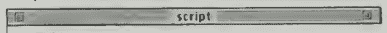

就像你可以使用文本链接打开新窗口一样，你也可以使用图片链接。**图 5.4** 显示了三张缩略图，点击其中一张就会打开一个带有全尺寸图像的新窗口。**脚本 5.3** 展示了代码，它与**脚本 5.2** 非常相似。请参考之前的任务获取此处所用代码的详细解释。

```html
<HTML>
<HEAD>
<TITLE>Book Info</TITLE>
<SCRIPT LANGUAGE="JAVASCRIPT" type="TEXT/JAVASCRIPT">
<!-- 对旧版浏览器隐藏脚本 -->
function newWindow(bookgif) {
  newWindow = window.open(bookgif, 'bookWin', 'width=400,height=500');
  newWindow.focus();
}
// 从旧版浏览器结束脚本 -->
</SCRIPT>
</HEAD>
<BODY BGCOLOR="WHITE">
<h1>我们的其他桃子</h1>
<h3>点击书籍查看全尺寸封面</h3>
<TABLE CELLPADDING="10">
<TR>
<TD>
<A href="javascript:newWindow('java-big.gif')"></a>
</TD>
<TD>
Java for the Wide Web: <BR>视觉启动指南
</TD>
</TR>
<TR>
<TD>
<A href="javascript:newWindow('java-big.gif')"></a>
</TD>
<TD>
Quicken 98 for Macintosh: <BR>视觉启动指南
</TD>
</TR>
<TR>
<TD>
<A href="javascript:newWindow('java-big.gif')"></a>
</TD>
<TD>
Quicken 99 for Windows: <BR>视觉启动指南
</TD>
</TR>
</TABLE>
</BODY>
</HTML>
```

### 要使用图片链接打开新窗口：

```javascript
function newWindow(bookgif) {
  newWindow = window.open(bookgif, 'bookWin', 'width=400,height=500');
  newWindow.focus();
}
```

1. `newWindow(bookgif)` `newWindow = window.open(bookgif, 'bookWin', 'width=400,height=500')` `newWindow.focus();` 首先，你需要定义函数 `newWindow(bookgif)`，它获取新窗口对象的变量名及其参数。接下来，将 `newWindow` 带到 `focus()` 方法的前面。

2. `<A href="javascript:newWindow('java-big.gif')"></a>` 这段代码（三行代码都相似）首先调用 `newWindow` 函数，传递图像的值（对于此链接，该值为 'java-big.gif'，其他链接中为大版本的 GIF）。在 `<A>` 标签内，你还需要指定缩略图的图像源，此处为 "java-sm.gif"，以及其他链接中对应的较小 GIF。

注意，在第 2 步中，你开始用双引号包裹 JavaScript 的调用。然后，在函数调用内部，对大图像的引用被包含在单引号中，之后关闭双引号。当你有多组嵌套的引号（如单引号和双引号）时，你必须嵌套单双引号，以防浏览器混淆。例如，你可以这样做：`"function('parameter')"` 但你不能这样混合引号，例如这样：`"function("parameter")"` 后一个示例将导致错误。

图 5.4 点击缩略图会打开一个带有大图的窗口。

### 滚动窗口

当你打开新窗口时，可能希望窗口滚动到你希望用户看到的特定信息。在脚本 5.4 中，你将打开一个包含三个图像的窗口，并将窗口滚动到你想要的图像（图 5.5）。脚本 5.5 显示了滚动窗口的 HTML。

### 要滚动窗口：

1. `function newWindow(downscroll) {` 定义 `newWindow`，并将参数 `downscroll` 传递进去。
2. `bookpixWindow = window.open('bookpix.html', 'bookpixWin', 'width=150,height=170,scrollbars=yes')` 设置新窗口的参数，并存储在变量 `bookpixWindow` 中。
3. `bookpixWindow.focus()` 这一行确保你创建的窗口被带到最前。
4. `setTimeout("bookpixWindow.scroll('"+downscroll+"')", 1000)` 这是滚动发生的地方。你设置 `bookpixWindow` 变量水平滚动 0 像素，垂直方向滚动 `downscroll` 的值。滚动命令被包含在 `setTimeout` 命令中，因为必须先创建窗口才能滚动。因此，你必须等待一秒让窗口生成。

### 脚本 5.4 打开并滚动一个窗口。

```html
<HTML>
<HEAD>
<TITLE>窗口滚动</TITLE>
<SCRIPT LANGUAGE=JAVASCRIPT TYPE="TEXT/JAVASCRIPT">
<!-- 对旧版浏览器隐藏脚本 -->
function newWindow(downscroll) {
  bookpixWindow = window.open('bookpix.html', 'bookpixWin', 'width=150,height=170,scrollbars=yes');
  bookpixWindow.focus();
  setTimeout("bookpixWindow.scroll('"+downscroll+"')", 1000);
}
// 结束旧版浏览器脚本 -->
</SCRIPT>
<BODY BGCOLOR="WHITE">
<h1>我们的桃子</h1>
<h3>点击书籍查看封面</h3>
<p><a href="javascript:newWindow(0)">Java for the Wide Web: 视觉启动指南</a></p>
<p><a href="javascript:newWindow(160)">Quicken 98 for Macintosh: 视觉启动指南</a></p>
<p><a href="javascript:newWindow(320)">Quicken 99 for Windows: 视觉启动指南</a></p>
</BODY>
</HTML>
```

### 脚本 5.5 这是包含你正在滚动图像的 HTML 页面。

```html
<html>
<head>
<title>书籍像素</title>
</HEAD>
<BODY BGCOLOR="WHITE">
<BR>
<BR>
<BR>
</BODY>
</html>
```

- `<A href="javascript:newWindow(0)">Java for the World Web: 视觉启动指南</a>`
- `<A href="javascript:newWindow(160)">Quicken 98 for Macintosh: 视觉启动指南</a>`
- `<A href="javascript:newWindow(320)">Quicken 99 for Windows: 视觉启动指南</a>`

这三组链接是 `downscroll` 的值，该值传递给第 1 步中的 `newWindow` 函数。在第一个链接中是 0，第二个是 160，第三个是 320，取决于你点击的链接。变量将包含的像素数。在上面的行中，为了清晰起见，我们删除了实际脚本中的 `<P>` 标签。

### 提示

- 与 Netscape 不同，如果窗口包含来自另一个服务器的 URL，Internet Explorer 无法滚动窗口。Internet Explorer 只能滚动同一域的内容。
- 你可以使用 Netscape Navigator 3.0 或更高版本或 Microsoft Internet Explorer 3.0 或更高版本滚动窗口。
- 此示例假设窗口在一秒内加载，这可能并非事实。如果窗口尚未打开，你会收到错误。此外，如果你在这一秒内快速关闭窗口，也会收到错误。

### 从另一个窗口更新窗口

如果你处理用户输入的表单和数据，你将知道如何在一个窗口中发送显示的信息。你可能会在销售产品时使用它，在摘要窗口中复制用户的信息。在这个示例中，我们将使用两个窗口：主窗口是父窗口，它将接收并显示子窗口中输入的信息。脚本 5.6 显示了父窗口的脚本。

### 从另一个更新一个：

1. `newWindow = window.open('child.html', 'newwin', 'toolbar=yes,location=yes,scrollbars=yes,width=300,height=100')`

```html
<html>
<head>
<title>大窗口</title>
<script language="JAVASCRIPT" type="TEXT/JAVASCRIPT">
<!-- 对旧版浏览器隐藏脚本 -->
newWindow = window.open('child.html', 'newwin', 'toolbar=yes,location=yes,scrollbars=yes,width=300,height=100');
// 从旧版浏览器结束脚本 -->
</script>
</head>
<body bgcolor="WHITE">
<center>
<h1>欢迎来到我的页面！</h1>
<form name="outputForm">
<input type="text" size=20 name="msgline" value="">
</form>
</center>
</body>
</html>
```

父窗口中的这一行告诉浏览器使用 `child.html` 文件创建子窗口。该行的其余部分指定了子窗口的参数（图 5.7）。

2. `<form name="outputForm">` 父窗口上有一个简单的表单（图 5.6），设计用于让脚本轻松地用子窗口获取的信息填充文本字段。此行打开了 FORM 标签并给它命名。

3. `<input type="text" size=20 name="msgline" value=""></form>` 这一行指定表单将包含最大长度为 20 个字符的文本，并将文本字段命名为 `msgline`。它还初始化了空值，即让字段从空开始并关闭了 FORM 标签。

### 脚本 5.7 子窗口脚本。

```html
<HTML>
<HEAD>
<TITLE>小窗口</TITLE>
<SCRIPT LANGUAGE=JAVASCRIPT TYPE="TEXT/JAVASCRIPT">
<!-- 对旧版浏览器隐藏脚本 -->
function updateParent(textField) {
  opener.document.outputForm.msgline.value = "Hello " + textField.value + "!";
}
// 结束所有浏览器的脚本 -->
</SCRIPT>
<BODY BGCOLOR=WHITE>
<H1>你叫什么名字？</H1>
<FORM>
<INPUT TYPE=TEXT onBlur="updateParent(this)" SIZE=20>
</FORM>
</BODY>
</HTML>
```

现在看子窗口（参见脚本 5.7）。

4. `function updateParent(textField)` 在这里你创建了 `updateParent` 函数。`textField` 变量是子页面中表单的内容。
5. `opener.document.outputForm.msgline.value = "Hello " + textField.value + "!"` 这一行引入了 `opener` 属性；它是 JavaScript 引用回打开子窗口的父文档的方法。这一行告诉 `opener` 文档窗口查看 `outputForm` 表单，找到 `msgline` 字段，并插入等号后表达式的值。该表达式取 "Hello," 单词，加上 `textField` 的值，然后追加一个感叹号。
6. `<FORM><INPUT TYPE=TEXT onBlur="updateParent(this)" SIZE=20>` 这是子 HTML 页面中的 `<FORM>` 标签。它设置了文本字段，并规定在 `onBlur` 时（即失去焦点时）运行 `updateParent` 函数——也就是说，用户在输入数据后离开文本字段。结果显示在父窗口中，如图 5.8 所示。

图 5.8 从子窗口调用信息后更新的父窗口。

### 使用 JavaScript 创建新页面

本章之前的多个多窗口示例使用了多个 HTML 文件来创建不同的窗口。但没有必要那样做，因为你可以在脚本中创建 HTML 并动态创建一个新的 HTML 页面。这特别有用，因为你可以使用 JavaScript 的力量为新页面填充动态内容。在脚本 5.8（图 5.9）中，你将创建一个新的 HTML 页面，并增加一个循环来向页面添加 100 行文本。

### 使用 JavaScript 创建新页面：

1. `var newWindow = window.open('', 'newWin', 'toolbar=yes,location=yes,scrollbars=yes,resizable=yes,width=300,height=300');` 这一行打开新窗口，设置其参数，并将其赋值给变量 `newWindow`。
2. `newWindow.document.write('<HTML><HEAD><TITLE>Generated Window</TITLE></HEAD><BODY BGCOLOR=WHITE><H2>This window shows the result from the other window</H2>');` 这是酷的部分。在这里，脚本正在写入由 `newWindow` 代表的文档窗口。你正在生成 HTML 头部和页面的第一部分（参见图 5.10）。
3. `for (i=0; i<100; i++)` 你正在启动一个带有计数变量 `i` 的循环。我将 `i` 设置为零，只要 `i` 小于 100，你就将 `i` 的值加 1。

### 脚本 5.8 你完全可以在脚本控制下创建 HTML 页面。

```html
<HTML>
<HEAD>
<TITLE>Main Window</TITLE>
</HEAD>
<BODY BGCOLOR=WHITE>
<CENTER>
<H1>这个窗口可能在循环！</H1>
<SCRIPT LANGUAGE=JAVASCRIPT TYPE="TEXT/JAVASCRIPT">
<!-- 对旧版浏览器隐藏脚本 -->
var newWindow = window.open('', 'newWin', 'toolbar=yes,location=yes,scrollbars=yes,resizable=yes,width=300,height=300');
newWindow.document.write("<HTML><HEAD><TITLE>Generated Window</TITLE></HEAD><BODY BGCOLOR=WHITE><H2>This window shows the result from the other </H2>");
for (i=0; i<100; i++) {
  newWindow.document.write("<BR>loop is at: " + i + "<BR>");
}
newWindow.document.close();
// 结束旧版浏览器脚本 -->
</SCRIPT>
</CENTER>
</BODY>
</HTML>
```

图 5.9 这个父窗口正在写入子窗口...

4. `newWindow.document.writeln("<BR>loop is now at: " + i)` 在循环内部，代码使用 `document.write` 命令写入页面。在这一行中，脚本写入 `newWindow` 文档窗口。`writeln` 命令会自动在其写入文档的每个字符串后添加一个换行符，但你仍然需要添加 `<BR>` 来换行。该字符串包含了 `i` 的值，`i` 在每次循环时都会更新。
5. `newWindow.document.write("<BR>loop is at: " + i + "<BR>")` 这里是写入 `newWindow` 文档窗口。
6. `newWindow.document.close()` 最后，你需要告诉 `opener` 文档窗口已经完成。

图 5.10 子窗口显示结果。

### 关闭窗口

正如你可以创建窗口一样，你也知道如何通过关闭它们。在脚本 5.9 中，父窗口知道如何通过关闭子窗口来关闭它们。

### 要关闭窗口：

1. `function openWindow() { newWindow = window.open('', 'newWin', 'toolbar=yes,location=yes,scrollbars=yes,resizable=yes,width=300,height=300'); }`

### 脚本 5.9 此脚本打开并关闭窗口。

```html
<HTML>
<HEAD>
<TITLE>Window Test</TITLE>
<SCRIPT LANGUAGE=JAVASCRIPT TYPE="TEXT/JAVASCRIPT">
<!-- 对旧版浏览器隐藏脚本 -->
function openWindow() {
  newWindow = window.open('', 'newWin', 'toolbar=yes,location=yes,scrollbars=yes,resizable=yes,width=300,height=300');
}

function closeWindow() {
  if (newWindow && !newWindow.closed) {
    newWindow.close();
  }
}
// 结束所有浏览器的脚本 -->
</SCRIPT>
</HEAD>
<BODY>
<CENTER>
<H1>Let's play with windows!</H1>
<a href="javascript:openWindow()">打开新窗口</a>
<a href="javascript:closeWindow()">关闭窗口</a>
</CENTER>
</BODY>
</HTML>
```

2. `function closeWindow()` 这是 `closeWindow()` 函数定义。
3. `if (newWindow && !newWindow.closed) { newWindow.close(); }` `if` 语句使用 `&&` 运算符进行逻辑测试，只有当双方都为真时才会返回真。所以 `newWindow` 必须存在且 `newWindow` 未关闭（`!` 是逻辑非运算符）。如果测试结果为真，脚本对 `newWindow` 执行命令。

图 5.11 窗口中的链接。

4. `<a href="javascript:openWindow()">打开新窗口</a>` 点击图 5.11 中的“打开新窗口”链接会调用 `openWindow` 函数并创建一个新窗口。
5. `<a href="javascript:closeWindow()">关闭窗口</a>` 同样，图 5.11 中的“关闭窗口”链接会调用 `closeWindow` 函数并关闭子窗口。

### 控制面板

将子窗口作为控制面板——即一个影响其他窗口的窗口——为界面设计开启了无限可能。你可以使用控制面板来辅助用户与你的网站交互。

### 创建控制面板：

1. `newWindow = window.open('cpanel.html', 'newWin', 'toolbar=yes,location=yes,scrollbars=yes,resizable=yes,width=300,height=300')`

### 脚本 5.10 此脚本设置了控制面板。

```html
<HTML>
<HEAD>
<TITLE>Main Window</TITLE>
<SCRIPT LANGUAGE=JAVASCRIPT TYPE="TEXT/JAVASCRIPT">
<!-- 对旧版浏览器隐藏脚本 -->
newWindow = window.open('cpanel.html', 'newWin', 'toolbar=yes,location=yes,scrollbars=yes,resizable=yes,width=300,height=300');
// 结束旧版浏览器脚本 -->
</SCRIPT>
</HEAD>
<BODY BGCOLOR=WHITE>
<CENTER>
<h1>JavaScript for the World Wide Web, 3rd Edition</h1>
<h2>by Tom Negrino and Dori Smith</h2>

</CENTER>
</BODY>
</HTML>
```

脚本 5.10 中的脚本唯一的操作是打开一个新窗口（控制面板），使用 `cpanel.html` 文件中的 HTML。你获得了两个窗口，如图 5.12 所示。现在参见脚本 5.11。

图 5.12 控制面板示例。

2. `function updateParent(newURL)` 现在你在 `cpanel.html` 中工作，这就是脚本 5.11 所示的代码。此行定义了函数 `updateParent`，其包含变量 `newURL` 的值。
3. `opener.document.location = newURL` 这一行告诉打开器（即它正在显示的父级 HTML 页面）加载来自变量 `newURL` 的页面。
4. `<A HREF="javascript:updateParent('about.html')">关于作者</A>` 点击“关于作者”链接会触发 `updateParent` 函数，并将 `newURL` 填充为关于作者的 HTML 页面。父页面会重新加载该页面，如图 5.13 所示。控制面板中的其他链接也以相同的方式工作。

### 脚本 5.11 控制脚本决定了将在父窗口中显示哪个页面。

```html
<HTML>
<HEAD>
<TITLE>Child Window</TITLE>
<SCRIPT LANGUAGE=JAVASCRIPT TYPE="TEXT/JAVASCRIPT">
<!-- 对旧版浏览器隐藏脚本 -->
function updateParent(newURL) {
  opener.document.location = newURL;
}
// 结束对旧版浏览器隐藏脚本 -->
</SCRIPT>
</HEAD>
<BODY BGCOLOR="WHITE">
<CENTER>
<h1>Control Panel</h1>
<h3><A HREF="javascript:updateParent('toc.html')">目录</A><BR>
<A HREF="javascript:updateParent('chapter.html')">示例章节</A><BR>
<A HREF="javascript:updateParent('about.html')">关于作者</A><BR>
<A HREF="javascript:updateParent('buy.html')">购买此书！</A></h3>
</CENTER>
</BODY>
</HTML>
```

图 5.13 点击控制面板会在父窗口中加载“关于作者”页面。

### 在屏幕上定位窗口

创建窗口时，能够将它们放置在用户屏幕上的特定位置是非常好的。这是可能的，但前提是用户使用的 Microsoft Internet Explorer 或 Netscape Navigator 版本为 4 或更高。**脚本 5.12** 使用了屏幕对象的宽度属性，该属性在 4 版本的浏览器中可用。再次，你将使用一个父窗口和一个子控制面板窗口。你想对子窗口进行定位。

### 脚本 5.12 此脚本在指定的屏幕位置打开子窗口。

```html
<HTML>
<HEAD>
<TITLE>Window Placement</TITLE>
<SCRIPT LANGUAGE=JAVASCRIPT TYPE="TEXT/JAVASCRIPT">
<!-- 对旧版浏览器隐藏脚本 -->
leftPos = 0;
if (screen) {
  leftPos = screen.width - 225;
}
newWindow = window.open('cpanel.html', 'newWin', 'width=225,height=200,left=' + leftPos + ',top=0');
// 对旧版浏览器隐藏脚本 -->
</SCRIPT>
</HEAD>
<BODY BGCOLOR=WHITE>
<CENTER>
<h1>JavaScript for the World Wide Web, 3rd Edition</h1>
<h2>by Tom Negrino and Dori Smith</h2>

</CENTER>
</BODY>
</HTML>
```

### 要在屏幕上定位窗口：

1. `leftPos = 0` 将变量 `leftPos` 设置为零。
2. `if (screen) { leftPos = screen.width - 225 }` `if` 语句询问屏幕对象是否存在。这是在启动浏览器对象之前对其询问的巧妙方法。如果它存在，变量 `leftPos` 将赋值为屏幕宽度减去 225 像素的值（即控制面板的宽度）。
3. `newWindow = window.open('cpanel.html', 'newWin', 'width=225,height=200,left=' + leftPos + ',top=0')` 这一行使用 `cpanel.html` 文件中的 HTML 打开一个新窗口（控制面板）。`left` 参数包含 `leftPos` 的值。这意味着控制面板将在屏幕的右上角打开（图 5.14）。

### 提示

- 如果你想将控制面板放在屏幕的右下角，你会使用 `screen.height` 来检查窗口高度；如果你想让它放在左上角，只需将顶部和左侧位置都设置为零。

## 在窗口加载时显示警报

有时，你可能想在用户加载或重新加载页面时向他们显示一条消息。你可以使用警报框来完成工作。脚本 5.13 显示了如何创建这个简单的技巧，图 5.15 显示了结果。

### 脚本 5.13 这个极其简单的脚本在页面加载时弹出一个模态警报框。

```html
<HTML>
<HEAD>
<TITLE>Displaying Alert</TITLE>
<SCRIPT LANGUAGE=JAVASCRIPT TYPE="TEXT/JAVASCRIPT">
<!-- 对旧版浏览器隐藏脚本 -->
alert("Welcome to my page!");
// 结束旧版浏览器脚本 -->
</SCRIPT>
</HEAD>
<BODY BGCOLOR="WHITE">
<CENTER>
<h1>Alert Box</h1>
</CENTER>
</BODY>
</HTML>
```

# 第 6 章 验证表单

## 选择即跳转导航

你可能已经见过很多 Web 上标准导航菜单的示例：即从菜单中选择一个选项，然后点击“前往（Go）”按钮，随后它带你到达目的地。例如，许多在线商店使用它来引导你进入商店内的不同部门。通过一点 JavaScript，你可以根据用户的菜单选择直接启动跳转，从而消除“前往”按钮（见图 6.3）。这会让你的网站感觉更灵捷、响应更迅速，而这始终是一个好主意。我们将这些经过 JavaScript 增强的菜单称为“选择即跳转（select-and-go）”菜单，如图 6.2 所示，它们很容易创建。你将再也不想使用“前往”按钮了！

图 6.2 选择即跳转菜单。图 6.3 点击此菜单中的任何选项将直接跳转到该主题的页面，无需单独的“前往”按钮。

### 脚本 6.2 你可以使用 JavaScript 和表单进行活动站点导航。

```html
<html>
<HEAD>
<TITLE>Select and Go Navigation</TITLE>
<SCRIPT LANGUAGE="JAVASCRIPT" TYPE="TEXT/JAVASCRIPT">
<!-- 对旧版浏览器隐藏脚本 -->
function jumpPage(newLoc) {
  var newPage = newLoc.options[newLoc.selectedIndex].value;
  if (newPage != "") {
    window.location.href = newPage;
  }
}
// 结束对旧版浏览器隐藏脚本 -->
</SCRIPT>
</HEAD>
<BODY BGCOLOR="WHITE">
<DIV ALIGN="CENTER">
<FORM ACTION="gotoLocation.cgi" METHOD="GET">
<SELECT NAME="newLocation" onChange="jumpPage(this.form.newLocation)">
<OPTION VALUE="">Select topic</OPTION>
<OPTION VALUE="script3.html">Selecting menu items</OPTION>
<OPTION VALUE="script4.html">Working with radio buttons</OPTION>
<OPTION VALUE="script5.html">Setting one with another</OPTION>
<OPTION VALUE="script6.html">Validating Zip codes</OPTION>
<OPTION VALUE="script7.html">Mailing email addresses</OPTION>
</SELECT>
<NOSCRIPT>
<INPUT TYPE="SUBMIT" VALUE="Go There!">
</NOSCRIPT>
</FORM>
</DIV>
</BODY>
</html>
```

### 创建一个选择即跳转的菜单：

1. `function jumpPage(newLoc) {` 首先，创建新函数 `jumpPage`，将其传递给新值 `loc`。
2. `newPage = newLoc.options[newLoc.selectedIndex].value` 从括号内部的代码开始推导。对象 `newLoc.selectedIndex` 将是一个从 0 到 5 的数字，因为有六个菜单选项（记住 JavaScript 通常是基于零索引的）。根据该数字，你可以获得对应菜单选项的值，即我们想要跳转的 Web 页面名称。然后你将结果赋值给变量 `newPage`。
3. `if (newPage != "") { window.location.href = newPage }` 此条件首先检查 `newPage` 是否不等于空（即不为空）。换句话说，如果 `newPage` 有值，则告诉窗口前往所选菜单选项指定的 URL。
4. `<SELECT NAME="newLocation" onChange="jumpPage(this.form.newLocation)">` `<SELECT>` 标签创建名为 "location" 的菜单。当用户从菜单中选择时，`onChange` 事件处理器会处理 `jumpPage` 函数，并将 `this.form.newLocation` 传递给它，这成为了 `newLoc` 的值，我们在步骤 1 中见过它。`this.form.newLocation` 对象的值是用户所做的任何菜单选择的 URL，如 `</SELECT>` 标签之前后续行中 `OPTION VALUE` 语句所指定的。

### 提示

- 此脚本最棒的之一是，一旦添加了 JavaScript 函数，当添加、修改或更改下拉选项时无需修改该函数。只需要设置选项的值（即菜单跳转到的 URL）。由于此原因，此脚本与 WYSIWYG 编辑器配合良好。

### 适应 JavaScript 的用户

此任务的目的是使用 JavaScript 消除通过表单跳转到另一个页面的“前往”按钮。但如果用户使用的是不支持 JavaScript 的浏览器或关闭了 JavaScript 呢？在没有 JavaScript 的情况下，跳转到另一个页面的方法是使用 CGI，脚本 6.2 就是这样设置的：

```html
<FORM ACTION="gotoLocation.cgi" METHOD="GET">
```

`<FORM>` 属性调用 CGI，这在图 6.3 中显示，即使没有 JavaScript 也能有效。

```html
<NOSCRIPT>
<INPUT TYPE="SUBMIT" VALUE="Go There!">
</NOSCRIPT>
```

`<NOSCRIPT>` 标签包含一个提交按钮，仅在 JavaScript 关闭时显示。

## 选择菜单项

在“选择颜色”示例中，用户被赋予三种颜色选择：红色、绿色或蓝色，如图 6.5 所示。当菜单拉下来时，用户看到：

### 脚本 6.3 要求用户选择颜色，这不需要太多代码。

```html
<HTML>
<HEAD>
<TITLE>Car Picker</TITLE>
<SCRIPT LANGUAGE="JAVASCRIPT" TYPE="TEXT/JAVASCRIPT">
<!-- 对旧版浏览器隐藏脚本 -->
function submitIt(form) {
  colorChoice = form.color.selectedIndex;
  if (form.color.options[colorChoice].value == "") {
    alert("You must pick a color");
    return false;
  }
  return true;
}
// 结束对旧版浏览器隐藏脚本 -->
</SCRIPT>
<BODY BGCOLOR="WHITE">
<h2>Car Picker</h2>
<FORM onSubmit="return submitIt(this)" ACTION="someAction.cgi" NAME="myForm">
<TABLE BORDER="0" CELLSPACING="8" CELLPADDING="8">
<TR>
<TD ALIGN="RIGHT">Email Address:</TD>
<TD COLSPAN="2">
<INPUT NAME="emailAddr" TYPE="TEXT" SIZE="30">
</TD>
</TR>
<TR>
<TD ALIGN="RIGHT">Colors:</TD>
<TD COLSPAN="2">
<SELECT NAME="color">
<OPTION VALUE="">Choose a color</OPTION>
<OPTION VALUE="RED">Red</OPTION>
<OPTION VALUE="GREEN">Green</OPTION>
<OPTION VALUE="BLUE">Blue</OPTION>
</SELECT>
</TD>
</TR>
<TR>
<TD ALIGN="RIGHT">Options:</TD>
<TD>
<INPUT TYPE="CHECKBOX" NAME="sunroof" VALUE="YES">Sunroof (Two door only)</TD>
<TD>
<INPUT TYPE="CHECKBOX" NAME="pSteering" VALUE="YES">Power Windows</TD>
</TR>
<TR>
<TD ALIGN="RIGHT">Doors:</TD>
<TD COLSPAN="2">
<INPUT TYPE="RADIO" VALUE="twoDoor" NAME="DoorCt">Two
<INPUT TYPE="RADIO" VALUE="fourDoor" NAME="DoorCt">Four
</TD>
</TR>
<TR>
<TD COLSPAN="3">
Enter your zip code or选择你附近的经销商：
<P>Zip:<INPUT NAME="zip" TYPE="TEXT" SIZE="5" MAXLENGTH="5">&nbsp;&nbsp;
<SELECT NAME="dealerlist" SIZE="4">
<OPTION>California--Lemon Grove</OPTION>
<OPTION>California--Lomita</OPTION>
<OPTION>California--Long Beach</OPTION>
<OPTION>California--Los Alitos</OPTION>
<OPTION>California--Los Angeles</OPTION>
</SELECT>
<P><INPUT TYPE="SUBMIT" VALUE="Submit">&nbsp;<INPUT TYPE="RESET">
</TD>
</TR>
</TABLE>
</FORM>
</BODY>
</HTML>
```

图 6.5 “汽车选择器”（Car Picker）使用了文本字段、弹出菜单、复选框和单选按钮——这些都是常见的表单元素。

### 强制选择菜单选项：

1. `function submitIt(carForm) {` 这定义了 `submitIt` 函数，该函数对表单的内容进行操作。
2. `colorChoice = carForm.color.selectedIndex` `colorChoice` 变量根据用户选择的颜色将获得一个数字结果。如果没有选择则为 0；红色：1；绿色：2；以及蓝色：3。该数字指的是该选项在菜单中的顺序。
3. `if (carForm.color.options[colorChoice].value == "") { alert("你必须选择一种颜色"); return false }` 现在你检查选中项的值。如果值是 0（== ""），则表单将向用户显示一条消息。
4. `return true` 否则，一切正常，可以开始处理下一个验证任务了。

### 关于这些脚本

本章其余部分的脚本示例实际上是一个名为“汽车选择器”的完整表单的一部分。整个表单在上面的**图 6.5** 中已显示。我们在每个脚本中都包含了整个 HTML 表单，以便你可以看到每个任务是如何融入到真实页面中的。你可以在本书末尾第 135 至 138 页的**脚本 6.8** 中查看整个脚本。

## 使用单选按钮

单选按钮是一种“二选一”的界面元素，允许用户在一组选项中选择一个（且仅选择一个）。当这些选项之一是必选项时，应该使用单选按钮。如**图 6.7** 所示，表单使用单选按钮让虚拟的汽车在双门或四门之间进行选择。在这种情况下，你只能选择这些选项中的一个，并且必须做出选择。如果你不选择，表单会为你选择一个，称为默认选择。

如**脚本 6.4** 所示，检查某个按钮被选中并不需要复杂的脚本。我们使用了一种技术，遍历每个按钮并检查其状态，如果没有哪个按钮被选中，则显示错误消息。

图 6.7 单选按钮是让用户在一组选项中仅选择一个选项的最佳方式。

### 脚本 6.4 只能勾选一个单选按钮，这段 JavaScript 代码用于强制执行这一规则。

```html
<HTML>
<HEAD>
<TITLE>Car Picker</TITLE>
<SCRIPT LANGUAGE=JAVASCRIPT TYPE="TEXT/JAVASCRIPT">
<!-- 对旧版浏览器隐藏脚本 -->
function submitIt(carForm) {
  doorOption = -1;
  for (i=0; i<carForm.DoorCt.length; i++) {
    if (carForm.DoorCt[i].checked) {
      doorOption = i;
    }
  }
  if (doorOption == -1) {
    alert("你必须选择 2 门或 4 门");
    return false;
  }
  return true;
}
// 结束隐藏脚本 -->
</SCRIPT>
</HEAD>
<BODY BGCOLOR=WHITE>
<H2 ALIGN=CENTER>Car Picker</H2>
<FORM onSubmit="return submitIt(this)" ACTION="someAction.cgi" NAME="myForm">
<TABLE BORDER=1 CELLSPACING=8>
<TR>
<TD ALIGN=RIGHT>邮箱地址：</TD>
<TD COLSPAN=2>
<INPUT NAME="emailAddr" TYPE=TEXT SIZE=30>
</TD>
</TR>
<TR>
<TD ALIGN=RIGHT>颜色：</TD>
<TD COLSPAN=2>
<SELECT NAME="color">
<OPTION VALUE="color">选择颜色</OPTION>
<OPTION VALUE="RED">红色</OPTION>
<OPTION VALUE="GREEN">绿色</OPTION>
<OPTION VALUE="BLUE">蓝色</OPTION>
</SELECT>
</TD>
</TR>
<TR>
<TD ALIGN=RIGHT>选项：</TD>
<TD>
<INPUT TYPE=CHECKBOX NAME="sunroof" VALUE=YES>天窗（仅限双门）
</TD>
<TD>
<INPUT TYPE=CHECKBOX NAME="pSteering" VALUE=YES>电动窗
</TD>
</TR>
<TR>
<TD ALIGN=RIGHT>门：</TD>
<TD COLSPAN=2>
<INPUT TYPE=RADIO VALUE="twoDoor" NAME="DoorCt">双门
<INPUT TYPE=RADIO VALUE="fourDoor" NAME="DoorCt">四门
</TD>
</TR>
<TR>
<TD COLSPAN=3>
输入邮政编码或选择最近的经销商：
<P>邮政： <INPUT NAME="zip" TYPE=TEXT SIZE=5>&nbsp;&nbsp;
<SELECT NAME="dealerlist" SIZE=4>
<OPTION>California--Lemon Grove</OPTION>
<OPTION>California--Lamita</OPTION>
<OPTION>California--Long Beach</OPTION>
<OPTION>California--Los Alomitos</OPTION>
<OPTION>California--Los Angeles</OPTION>
</SELECT>
</TD>
</TR>
<TR>
<TD COLSPAN=3>
<P><INPUT TYPE=SUBMIT VALUE="提交">&nbsp;<INPUT TYPE=RESET>
</TD>
</TR>
</TABLE>
</FORM>
</BODY>
</HTML>
```

### 确保用户选择了单选按钮：

1. `function submitIt(carForm) { doorOption = -1 }` 定义 `submitIt` 函数，并将 `doorOption` 设置为 -1。
2. `for (i=0; i<carForm.DoorCt.length; i++) {` 开始循环。`i` 计数器从零开始，只要 `i` 小于表单上单选按钮的数量，我们就对 `i` 加 1。
3. `if (carForm.DoorCt[i].checked) { doorOption = i }` 这是循环内的测试：如果单选按钮被选中，则将 `doorOption` 设置为 `i` 的值。
4. `if (doorOption == -1) { alert("你必须选择 2 或 4 门"); return false }` 如果你到达此处且 `doorOption` 的值仍为 -1，则表单将显示一个对话框，告诉用户必须选择。
5. `return true` 如果 `doorOption` 被重置，则已经选择了某些内容。脚本返回 true 结果，你离开了脚本。

## 通过另一个字段设置字段

在你的表单中，经常会发现用户做了一个选择，该选择决定了其他字段。例如，假设用户选择了四门车型。天窗选项仅适用于双门车型。你可以通过两种方式处理：首先，你可以检查输入并在他们选择错误时弹出警告。其次，你可以直接为双门模型设置。脚本 6.5 显示了如何自动实现这一点。

### 脚本 6.5 此脚本根据天窗选择自动设置门的数量。

```html
<HTML>
<HEAD>
<TITLE>Car Picker</TITLE>
<SCRIPT LANGUAGE=JAVASCRIPT TYPE="TEXT/JAVASCRIPT">
<!-- 对旧版浏览器隐藏脚本 -->
function submitIt(carForm) {
  doorOption = -1;
  for (i=0; i<carForm.DoorCt.length; i++) {
    if (carForm.DoorCt[i].checked) {
      doorOption = i;
    }
  }
  if (doorOption == -1) {
    alert("你必须选择 2 或 4 门");
    return false;
  }
  if (carForm.DoorCt[doorOption].value == "fourDoor" && carForm.sunroof.checked) {
    alert("天窗仅对双门型号可用");
    return false;
  }
  return true;
}

function doorSet(sunroof) {
  if (sunroof.checked) {
    for (i=0; i<document.myForm.DoorCt.length; i++) {
      if (document.myForm.DoorCt[i].value == "twoDoor") {
        document.myForm.DoorCt[i].checked = true;
      }
    }
  }
}
// 结束隐藏脚本 -->
</SCRIPT>
</HEAD>
<BODY BGCOLOR=WHITE>
<H2 ALIGN=CENTER>Car Picker</H2>
<FORM onSubmit="return submitIt(this)" ACTION="someAction.cgi" NAME="myForm">
<TABLE BORDER=1 CELLSPACING=8>
<TR>
<TD ALIGN=RIGHT>邮箱地址：</TD>
<TD COLSPAN=2>
<INPUT NAME="emailAddr" TYPE=TEXT SIZE=30>
</TD>
</TR>
<TR>
<TD ALIGN=RIGHT>颜色：</TD>
<TD COLSPAN=2>
<SELECT NAME="color">
<OPTION VALUE="color">选择颜色</OPTION>
<OPTION VALUE="RED">红色</OPTION>
<OPTION VALUE="GREEN">绿色</OPTION>
<OPTION VALUE="BLUE">蓝色</OPTION>
</SELECT>
</TD>
</TR>
<TR>
<TD ALIGN=RIGHT>选项：</TD>
<TD>
<INPUT TYPE=CHECKBOX NAME="sunroof" VALUE=YES onClick="doorSet(this)">天窗（仅限双门）
</TD>
<TD>
<INPUT TYPE=CHECKBOX NAME="pSteering" VALUE=YES>电动窗
</TD>
</TR>
<TR>
<TD ALIGN=RIGHT>门：</TD>
<TD COLSPAN=2>
<INPUT TYPE=RADIO VALUE="twoDoor" NAME="DoorCt">双门
<INPUT TYPE=RADIO VALUE="fourDoor" NAME="DoorCt">四门
</TD>
</TR>
<TR>
<TD COLSPAN=3>
输入邮政编码或选择最近的经销商：
<P>邮政： <INPUT NAME="zip" TYPE=TEXT SIZE=5>&nbsp;&nbsp;
<SELECT NAME="dealerlist" SIZE=4>
<OPTION>California--Lemon Grove</OPTION>
<OPTION>California--Lamita</OPTION>
<OPTION>California--Long Beach</OPTION>
<OPTION>California--Los Alomitos</OPTION>
<OPTION>California--Los Angeles</OPTION>
</SELECT>
</TD>
</TR>
<TR>
<TD COLSPAN=3>
<P><INPUT TYPE=SUBMIT VALUE="提交">&nbsp;<INPUT TYPE=RESET>
</TD>
</TR>
</TABLE>
</FORM>
</BODY>
</HTML>
```

图 6.8 当用户勾选天窗复选框时，脚本自动选择双门单选按钮。


# 第 6 章

## 检查输入

```javascript
if (carForm.DoorCt[doorOption].value == "fourDoor" && carForm.sunroof.checked) {
  alert("天窗仅对双门型号可用");
  return false;
}
```

这非常直观。如果单选按钮的值是 `"fourDoor"`，且天窗复选框被选中，则弹出警告。否则，你就完成了。

## 自动设置字段值

```javascript
function doorSet(sunroof) {
  if (sunroof.checked) {
    for (i = 0; i < document.myForm.DoorCt.length; i++) {
      if (document.myForm.DoorCt[i].value == "twoDoor") {
        document.myForm.DoorCt[i].checked = true;
      }
    }
  }
}
```

如常，你将定义该函数。接下来，如果天窗框被选中，启动一个循环来查看所有的 `DoorCt` 字段。你正在寻找双门字段。一旦找到双门字段，通过将其值设置为 `true` 来选中它。

## 验证表单

```html
<TD>
  <INPUT TYPE="CHECKBOX" NAME="sunroof" VALUE="YES" onclick="doorSet(this)">天窗（仅限双门）
</TD>
<TD>
  <INPUT TYPE="CHECKBOX" NAME="pSteering" VALUE="YES">电动窗
</TD>
<TR>
<TR ALIGN="RIGHT">
门数：
<TD>
<TD COLSPAN="2">
  <INPUT TYPE="RADIO" VALUE="twoDoor" NAME="DoorCt">两
  <INPUT TYPE="RADIO" VALUE="fourDoor" NAME="DoorCt">四
</TD>
</TR>
<TR>
<TD COLSPAN="3">
输入邮编或选择距离您最近的经销商：
<P>邮编: <INPUT NAME="zip" TYPE="TEXT" SIZE="5" MAXLENGTH="6">&nbsp;&nbsp;
<SELECT NAME="dealerList" SIZE="4">
<OPTION>加利福尼亚--柠檬格林</OPTION>
<OPTION>加利福尼亚--洛米塔</OPTION>
<OPTION>加利福尼亚--长滩</OPTION>
<OPTION>加利福尼亚--洛斯阿拉米托斯</OPTION>
<OPTION>加利福尼亚--洛杉矶</OPTION>
</SELECT>
<P><INPUT TYPE="SUBMIT" VALUE="提交">&nbsp;<INPUT TYPE="RESET">
</TD>
</TR>
</TABLE>
</FORM>
</BODY>
</HTML>
```

在 `BODY` 中，有一段天窗复选框字段所需的代码。`onClick` 事件处理器调用 `doorSet` 函数，并传递了值 `(this)`。你需要事件处理器来触发该函数。

## 验证邮编

那些疯狂的用户可以在表单中输入几乎任何内容，因此你希望确保邮编字段只包含数字。**脚本 6.6** 将向你展示这样做。

### 要确保邮编为数字：

```javascript
function isNum(passedVal) {
  if (passedVal == "") {
    return false;
  }
  for (i = 0; i < passedVal.length; i++) {
    if (passedVal.charAt(i) < "0") {
      return false;
    }
    if (passedVal.charAt(i) > "9") {
      return false;
    }
  }
  return true;
}

function validZip(inZip) {
  if (inZip == "") {
    return true;
  }
  if (isNum(inZip)) {
    return true;
  }
  return false;
}

function it(carForm) {
  if (carForm.zip.value == "" && carForm.dealerList.selectedIndex == -1) {
```

首先，定义函数 `isNum`。变量 `passedVal` 被发送到 JavaScript 表单。如果 `passedVal` 为空，则邮编不是数字，函数返回 `false`，脚本会弹出错误消息。现在遍历 `passedVal` 的长度，在每次通过循环时增加计数器 `i`。`charAt()` 方法检查该位置的字符。如果字符小于 `"0"` 或大于 `"9"`，它就不是数字，因此退出并声明输入为非数字（或 `false`）。如果结果为 `true`，则你获得了一个数字邮编。

```javascript
function submit(carForm) {
  if (carForm.zip.value == "" && carForm.dealerList.selectedIndex == -1) {
    alert("你必须输入有效的\n* 邮编，或选择距离你\n* 最近的经销商");
    carForm.zip.focus();
    return false;
  }
  if (validZip(carForm.zip.value)) {
    alert("存在无效的邮\n* 代码");
    carForm.zip.focus();
    carForm.zip.select();
    return false;
  }
  return true;
}
```

`submit` 函数确保用户输入了邮编，或从滚动文本框中选择了一个经销商。这是通过检查两个相应字段中没有任何输入或选择来实现的。如果字段为 `true`，会为用户弹出一个警告框，光标通过 `focus()` 方法返回邮编字段。

```html
<HTML>
<HEAD>
<TITLE>颜色选择器</TITLE>
<SCRIPT LANGUAGE="JAVASCRIPT" TYPE="TEXT/JAVASCRIPT">
<!-- 从旧版浏览器中隐藏脚本 -->
// 结束脚本 --
</SCRIPT>
</HEAD>
<BODY BGCOLOR="WHITE">
<H2 ALIGN="CENTER">汽车选择器--this</H2>
<FORM onSubmit="return submit(this)" ACTION="Action.cgi" NAME="form">
<TABLE BORDER="0" CELLSPACING="8" CELLPADDING="2">
<TR>
<TD ALIGN="RIGHT">邮箱地址：</TD>
<TD COLSPAN="2"><INPUT NAME="emailAddr" TYPE="TEXT" SIZE="30"></TD>
</TR>
<TR>
<TD ALIGN="RIGHT">颜色：</TD>
<TD COLSPAN="2">
<SELECT NAME="color">
<OPTION VALUE="" SELECTED>选择颜色</OPTION>
<OPTION VALUE="Red">红色</OPTION>
<OPTION VALUE="Green">绿色</OPTION>
<OPTION VALUE="Blue">蓝色</OPTION>
</SELECT>
</TD>
</TR>
</TABLE>
</FORM>
</BODY>
</HTML>
```

## 第 6 章（续）

```javascript
badChar = invalidChars.charAt(i);
if (email.indexOf(badChar, 0) > -1) {
  return false;
}
```

`badChar` 变量存储无效字符在 `invalidChars` 字符串中的位置。例如，如果无效字符包含一个冒号；那么 `badChar` 在这个五个字符字符串中的位置就是 2（记住 JavaScript 从 0 开始计数的）。`indexOf()` 用于查找字符在字符串中的位置。如果 `indexOf` 的结果为 -1，则表示该字符不在字符串中，你不会得到 `false` 结果。

### 脚本 6.7 延续

```javascript
function submitIt(carForm) {
  if (!validEmail(carForm.emailAddr)) {
    alert("Invalid email address");
    carForm.emailAddr.focus();
    carForm.emailAddr.select();
    return false;
  }
  return true;
}
```

```javascript
atPos = email.indexOf("@", 1);
if (atPos == -1) {
  return false;
}
```

`atPos` 变量保存 `@` 的位置。使用 `indexOf`，脚本会从地址的第二个字符开始检查第一个 `@` 符号。如果结果是 `@` 符号的位置为 -1，意味着地址中没有 `@` 符号，那么地址就出问题了。

```html
<HTML>
<HEAD>
<TITLE>Car Picker</TITLE>
</HEAD>
<BODY BGCOLOR="WHITE">
<H2 ALIGN="CENTER">Car Picker</H2>
<FORM onsubmit="return submitIt(this)">
<TABLE ACTION="someAction.js" NAME="myForm">
<TR CELLPADDING="8">
<TD ALIGN="RIGHT">Email Address:</TD>
<TD><INPUT NAME="emailAddr" TYPE="TEXT" SIZE="30"></TD>
</TR>
<TR>
<TD ALIGN="RIGHT">Colors:</TD>
<TD COLSPAN="2">
<SELECT NAME="color">
<OPTION VALUE="SELECTED">Choose a color</OPTION>
<OPTION VALUE="RED">Red</OPTION>
<OPTION VALUE="GREEN">Green</OPTION>
<OPTION VALUE="BLUE">Blue</OPTION>
</SELECT>
</TD>
</TR>
</TABLE>
</FORM>
</BODY>
</HTML>
```

```javascript
if (email.indexOf("@", atPos + 1) > -1) {
  return false;
}
```

现在脚本正在确保只有一个 `"@"`，通过检查从我们找到第一个 `"@"` 之后一个位置开始的字符，拒绝任何包含多一个 `"@"` 的内容。因此，如果在任何非 -1 的位置存在 `"@"` 符号，字符串将未通过测试。

### 验证表单

```html
<TD>
  <INPUT TYPE="CHECKBOX" NAME="sunroof" VALUE="Sunroof"> (Two door only)
</TD>
<TD>
  <INPUT TYPE="CHECKBOX" NAME="Steering" VALUE="Power"> Windows
</TD>
<TR>
<TD ALIGN="RIGHT">Doors:</TD>
<TD COLSPAN="2">
  <INPUT TYPE="RADIO" VALUE="twodoor" NAME="DoorCt">Two-door
  <INPUT TYPE="RADIO" VALUE="fourdoor" NAME="DoorCt">Four-door
</TD>
</TR>
<TR>
<TD COLSPAN="3">
  输入您的邮政编码或选择最近的经销商：
  <P><INPUT NAME="zip" SIZE="5" MAXLENGTH="5">
  <SELECT NAME="dealer" SIZE="4">
    <OPTION VALUE="California-Lemon Grove"></OPTION>
    <OPTION VALUE="California-Lomita"></OPTION>
    <OPTION VALUE="California-Long Beach"></OPTION>
    <OPTION VALUE="California-Los Angeles"></OPTION>
  </SELECT></P>
  <P><INPUT TYPE="SUBMIT" VALUE="Submit"><INPUT TYPE="RESET"></P>
</TD>
</TR>
</TABLE>
</FORM>
</BODY>
</HTML>
```

```javascript
periodPos = email.indexOf(".");
if (periodPos == -1) {
  return false;
}
```

现在脚本检查 `@` 符号之后是否存在点。如果你得到 `false` 结果，则验证失败。

```javascript
if (periodPos + 3 == email.length) {
  return false;
}
return true;
```

最后，脚本要求地址中的点之后至少有两个字符。如果你在没有得到 `false` 结果的情况下完成了操作，那么函数 `validEmail` 的值就是 `true`，意味着你有一个有效的电子邮件地址。

```javascript
function submitIt(carForm) {
  if (!validEmail(carForm)) {
    alert("Invalid email address");
    carForm.emailAddr.focus();
    carForm.emailAddr.select();
    return false;
  }
  return true;
}
```

在定义函数 `submitIt` 后，如果它的语句显示 `validEmail` 变量不为 `true`，当用户点击警告框上的 OK 按钮时，会显示 "Invalid email address" 的警告消息；脚本使用 `focus()` 命令将光标返回表单的电子邮件字段。然后使用 `select()` 命令选中该字段的内容。

### 提示

- 验证（validating）电子邮件地址和确认（verifying）地址是有区别的。此脚本通过确保用户输入的内容符合电子邮件地址的正确格式来验证地址。但它并没有验证地址真实存在。要做到这一点的方法是向该地址发送消息并看它是否退回。除了发送此类验证消息会极大打扰用户之外，消息退回可能需要几个小时，而用户不会在你的表单旁等待。
- 此脚本例程无法捕获所有错误的电子邮件地址，只能捕获可能的错误。对所有可能的错误进行检查需要几页代码。如果你仔细思考，可能还会想出一些超出此检查范围的错误。

### 验证地址

# 第 6 章（续）

脚本 6.8 续

```html
<SCRIPT>
<OPTION VALUE="" SELECTED>选择颜色</OPTION>
<OPTION VALUE="RED">红色</OPTION>
<OPTION VALUE="GREEN">绿色</OPTION>
<OPTION VALUE="BLUE">蓝色</OPTION>
</SELECT>
<TD>
</TD>
</TR>
<TR>
<TD ALIGN="RIGHT">选项：</TD>
<TD>
<INPUT TYPE="CHECKBOX" NAME="sunroof" VALUE="YES" onclick="doorSet(this)">天窗（仅限双门版）
</TD>
<TD>
<INPUT TYPE="CHECKBOX" NAME="pSteering" VALUE="YES">电动窗户
</TD>
</TR>
<TR>
<TD ALIGN="RIGHT">车门数：</TD>
<TD COLSPAN="3">
<INPUT TYPE="RADIO" VALUE="twoDoor" NAME="DoorCt">双门
<INPUT TYPE="RADIO" VALUE="fourDoor" NAME="DoorCt">四门
</TD>
</TR>
<TR>
<TD COLSPAN="3">
输入您的邮政编码或选择离您最近的经销商：
<P>邮政编码:<INPUT NAME="zip" TYPE="TEXT" SIZE="5" MAXLENGTH="5">&nbsp;&nbsp;
<SELECT NAME="dealerlist" SIZE="4">
<OPTION>加州--Lennon Grove</OPTION>
<OPTION>加州--Lamita</OPTION>
<OPTION>加州--Long Beach</OPTION>
<OPTION>加州--Los Alamitas</OPTION>
<OPTION>加州--Los Angeles</OPTION>
</SELECT>
<P><INPUT TYPE="SUBMIT" VALUE="提交">&nbsp;<INPUT TYPE="RESET">
</TD>
</TR>
</TABLE>
</FORM>
</BODY>
</HTML>
```

# 第 7 章

## 让你的页面动态化

有效的网页是许多不同因素的结果，包括引人入胜的内容、良好的设计以及对细节的关注（例如页面加载速度）。在加快页面加载的同时为用户提供有趣且交互式体验的方法之一是使用 JavaScript 让单个页面元素在用户的浏览器中更新。换句话说，不再由你的 Web 服务器将页面推给用户，而是服务器通过电话线推送脚本。随后脚本利用用户计算机的力量让页面活跃。带有此类脚本的页面被称为*动态页面*。

通过将处理从服务器端移动到客户端（用户）端，你可以获得更好的性能，并在某种程度上个性化用户体验。

在本章中，你将学习如何使用 JavaScript 在网页上显示本地日期和时间；根据用户所在地的时间自定义问候；以及根据用户所属域名或上次访问的页面将用户引导至不同的页面。

### 将当前日期放入网页

JavaScript 可以从你的计算机确定当前的日期和时间（以数字形式获取），并以多种方式处理该数字。你的脚本必须处理从数字到文本日期的转换。脚本 7.1 显示如何获取当前日期、将其转换为标准日期，然后将结果写入文档窗口。脚本 7.1 实际上包含两个脚本，一个在 HTML 文档的头部（头部脚本），另一个在文档的主体（不意外的是，我们称之为主体脚本）。

#### 要将当前日期放入网页中：

1. `dayName = new Array("Sunday", "Monday", "Tuesday", "Wednesday", "Thursday", "Friday", "Saturday")`
   首先，你需要创建一个包含星期几的新数组。确保数组中的项已隔开，并且因为它们是文本字符串，每个项必须包含在引号中。将数组赋值给变量 `dayName`。

2. `monthName = new Array("January", "February", "March", "April", "May", "June", "July", "August", "September", "October", "November", "December")`
   在这一步中，你对月份名称执行相同的操作，并将它们赋值给巧妙的 `monthName` 变量。

3. `now = new Date()`
   在这个第一个脚本中最后的一件事是使用 `new Date()` 命令创建一个新的日期变量，它告诉 JavaScript...

脚本 7.1 此脚本实际上由两个脚本组成，并将当前日期写入文档窗口。

```html
<HTML>
<HEAD>
<TITLE>动态日期显示</TITLE>
<SCRIPT LANGUAGE="JAVASCRIPT" TYPE="TEXT/JAVASCRIPT">
<!-- 对旧浏览器隐藏脚本 -->
dayName = new Array("Sunday", "Monday", "Tuesday", "Wednesday", "Thursday", "Friday", "Saturday");
monthName = new Array("January", "February", "March", "April", "May", "June", "July", "August", "September", "October", "November", "December");
now = new Date();
// 结束对旧浏览器的隐藏
</SCRIPT>
</HEAD>
<BODY BGCOLOR="WHITE">
<SCRIPT LANGUAGE="JAVASCRIPT" TYPE="TEXT/JAVASCRIPT">
<!-- 对旧浏览器隐藏脚本 -->
document.write("<H1>今天是 " + dayName[now.getDay()] + " " + monthName[now.getMonth()] + " " + now.getDate() + ".</H1>");
// 结束对旧浏览器的隐藏
</SCRIPT>
</BODY>
</HTML>
```

### 处理日期

如果是周末，你可能想向用户显示不同的消息。脚本 7.2 教你如何操作。

#### 判断是否为周末：

1. `now = new Date()`
   用当前日期填充变量 `now`。

2. `if (now.getDay() > 0 && now.getDay() < 6) {`
   这从 `now` 变量中提取星期几数字，并询问它是否大于 0（记住星期日是 0）。

3. `document.write("抱歉，是工作日。")`
   如果上一个表达式的结果大于 0 且小于 6，它就在 1 到 5 之间，也就是说脚本向文档窗口写入难过消息。

4. `else {`
   `document.write("太棒了，是周末！")`
   如果在上一步中没有通过测试，那么说明是周末，我们向文档窗口写入好消息。

脚本 7.2 此脚本判断是工作日还是周末。

```html
<HTML>
<HEAD>
<TITLE>周末检查器</TITLE>
</HEAD>
<BODY BGCOLOR="WHITE">
<H1>
<SCRIPT LANGUAGE="JAVASCRIPT" TYPE="TEXT/JAVASCRIPT">
<!-- 对旧浏览器隐藏脚本 -->
var now = new Date();
if (now.getDay() > 0 && now.getDay() < 6) {
  document.write("抱歉，是工作日。");
} else {
  document.write("太棒了，是周末！");
}
// 结束对旧浏览器的隐藏 --
</SCRIPT>
</H1>
</BODY>
</HTML>
```

脚本 7.3 脚本可以用来检查一天中的时间，并做出相应的反应。

### 根据时间自定义你的消息

你可以采用上一个示例中使用的技术，再次使用它来根据一天中的不同时间为用户自定义消息。这通常用作用户进入网站时的友好问候。脚本 7.3 显示了如何实现，图 7.3 显示了我们是如何写得比平时睡觉时间还晚的。

#### 要根据时间自定义消息：

1. `now = new Date()`
   `if (now.getHours() < 5) {`
   再次定义变量 `now` 并向其填入一个新的 `Date` 对象。`getHours()` 方法从新变量中提取小时，然后测试该数字是否小于 5（这对应于凌晨 5 点，因为 JavaScript 中的数字计数从午夜开始计算）。

2. `document.write("What are you doing so late?")`
   如果是在凌晨 5 点之前，脚本将通过向文档中写入此消息来责备用户，如图 7.3 所示。
   脚本的其他部分将重复上面的行，根据时间进行调整并写入不同的消息。如果是在早上 6 点到早上 9 点之间，脚本会说 "Good Morning！"；如果在早上 9 点到下午 5 点之间，它会说 "No surfing during working hours"；下午 5 点之后，它会说 "Good Evening"。

```html
<HTML>
<HEAD>
<TITLE>What time is it? JavaScript...</TITLE>
</HEAD>
<BODY BGCOLOR="WHITE">
<H1>
<SCRIPT LANGUAGE="JAVASCRIPT" TYPE="TEXT/JAVASCRIPT">
<!-- Hide script from old browsers -->
var now = new Date();

if (now.getHours() < 5) {
  document.write("What are you doing so late?");
} else if (now.getHours() < 9) {
  document.write("Good Morning!");
} else if (now.getHours() < 17) {
  document.write("No surfing during working hours!");
} else {
  document.write("Good Evening!");
}

// End hiding script from old browsers --
</SCRIPT>
</H1>
</BODY>
</HTML>
```

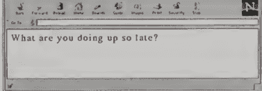

图 7.3 我们写这些代码时晚上已经太晚了。

### 将军事时间转换为 AM/PM

JavaScript 提供了 24 小时格式的时间，也称为军事时间。许多人对这种格式不熟悉或感到不习惯，因此你会想知道如何将其转换为 12 小时制。在脚本 7.4 中，你将看到如何执行此任务，这需要一些解释。我们正在使用一个表单创建一个页面，表单包含一个单文本字段，我们在其中写入时间，并基于脚本中的一个函数。表单由两个单选按钮控制，让我们从 24 小时制切换到 12 小时制。结果如图 7.4 所示。

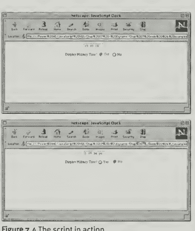

脚本 7.4 该脚本在 24 小时和 12 小时时间之间转换。

```html
<HEAD>
<TITLE>JavaScript Clock</TITLE>
<SCRIPT LANGUAGE="JAVASCRIPT" TYPE="TEXT/JAVASCRIPT">
<!-- Hide script from old browsers -->
function showMilitaryTime() {
  if (document.theForm.showMilitary[0].checked) {
    return true;
  }
  return false;
}

function showTheHours(theHour) {
  if (showMilitaryTime() || (theHour > 0 && theHour < 13)) {
    return (theHour);
  }
  if (theHour == 0) {
    return (12);
  }
  return (theHour - 12);
}
```

### 让你的页面动态化（续）

脚本 7.4 续

```javascript
function showZeroFilled(inValue) {
  if (inValue > 9) {
    return ":" + inValue;
  }
  return ":0" + inValue;
}

function showAmPm() {
  if (showMilitaryTime()) {
    return "";
  }
  if (now.getHours() < 12) {
    return " am";
  }
  return " pm";
}

function showTheTime() {
  var now = new Date();
  document.form.showMilitaryTime.value =
    showTheHours(now.getHours()) +
    showZeroFilled(now.getMinutes()) +
    showZeroFilled(now.getSeconds()) +
    showAmPm();
  setTimeout("showTheTime()", 1000);
}
```

#### 将军事时间转换为 AM/PM：

1. `function showMilitaryTime() {`
   `if (document.form.showMilitary[0].checked) {`
   `return true;`
   `}`
   `return false;`
   `}`
   脚本中的第一个函数检查用户选中了表单中的哪一个单选按钮。`showMilitaryTime` 函数表示，如果文档的表单元素 `showMilitary[0]` 被选中，则返回 `true`。

2. `function showTheHours(hour) {`
   接下来，设置一个名为 `showTheHours` 的函数。

3. `if (showMilitaryTime() || (hour > 0 && hour < 13)) {`
   `return (hour);`
   `}`
   这行代码表示如果 `hour` 在 0 到 13 之间，则返回 `hour`。`||` 运算符表示逻辑“或”，这用于判断是否显示军事时间。

4. `if (hour == 0) {`
   `return (12);`
   `}`
   如果小时为 0，则返回 12（午夜时间）。

5. `function showZeroFilled(inputValue) {`
   `if (inputValue > 9) {`
   `return ":" + inputValue;`
   `}`
   `return ":0" + inputValue;`
   `}`
   这个函数在 `inputValue` 小于 9 时会在前面补 0。

6. `function showAmPm() {`
   `if (showMilitaryTime()) {`
   `return "";`
   `}`
   如果 `showMilitaryTime()` 为真，则返回空字符串。

7. `if (now.getHours() < 12) {`
   `return " am";`
   `}`
   如果小时小于 12，则返回 `" am"`，否则返回 `" pm"`。

8. `function showTheTime() {`
   `var now = new Date();`
   `document.form.showMilitaryTime.value =`
   `showTheHours(now.getHours()) +`
   `showZeroFilled(now.getMinutes()) +`
   `showZeroFilled(now.getSeconds()) +`
   `showAmPm();`
   这个函数获取新的 `now` 对象，并更新表单字段。

9. `setTimeout("showTheTime()", 1000);`
   这部分代码每隔 1000 毫秒调用一次 `showTheTime()`，以更新显示。

### 创建倒计时

早晚，你可能想在页面上放置一个倒计时，显示距离某个事件还有多少天。脚本 7.5 这种方法使用了两个脚本。

```html
<HTML>
<HEAD>
<TITLE>Dynamic Countdown</TITLE>
<SCRIPT LANGUAGE="JAVASCRIPT" TYPE="TEXT/JAVASCRIPT">
<!-- Hide script from old browsers -->
var now = new Date();
var thisYr = now.getFullYear();
if (thisYr < 1900) {
  thisYr = thisYr + 1900;
}

var nextYr = thisYr + 1;

var anniv = new Date(thisYr, 6, 21);
if (anniv.getDate() < now.getDate()) {
  anniv.setFullYear(nextYr);
}

var birthday = new Date(thisYr, 7, 7);
if (birthday.getTime() < now.getTime()) {
  birthday.setFullYear(nextYr);
}

var xmas = new Date(thisYr, 11, 25);
if (xmas.getTime() < now.getTime()) {
  xmas.setFullYear(nextYr);
}
</SCRIPT>
</HEAD>
</HTML>
```

#### 创建倒计时：

1. `now = new Date()`
   首先获取日期并将其放入 `now` 变量。

2. `thisYr = now.getFullYear();`
   `if (thisYr < 1900) {`
   `thisYr = thisYr + 1900;`
   `}`
   `var nextYr = thisYr + 1;`
   这一步是为了解决 JavaScript 不理解 2000 年的问题。是的，这是一个真实的 Y2K 漏洞修复。它首先将此变量赋值为 `now` 的值。接下来一个条件询问：“如果年份小于 1900，则重新将此变量赋值为自身加 1900。”接下来，将新变量的值设置为 `thisYr` 加 1。

3. `anniv = new Date(thisYr, 6, 21);`
   `if (anniv.getDate() < now.getDate()) {`
   `anniv.setFullYear(nextYr);`
   `}`
   这是三个类似设置中的第一个。这个设置填充 `anniv` 变量是通过获取当前年份并指定纪念日，即 7 月 21 日。当然，上面显示的是 6,21（而不是 7.21），但这是因为月份编号是从 0 开始的。所以 1 月是月份 0，7 月是月份 6。
   接下来检查纪念日是否于当前时间。如果是，则年份增加一年。重复此过程，并对 `birthday` 和 `xmas` 变量进行微调，它们在接下来的两个代码块中设置。

### 让你的页面动态化（续）

```javascript
function dayToDays(inTime) {
  return (Math.floor(inTime.getTime() / (1000 * 60 * 60 * 24)));
}
```

### 更多奇怪的时间问题

JavaScript 中的月份数字从 0 开始，日期数字从 1 开始，并且 JavaScript 对 1970 年之前的年份的处理并不一致，这取决于浏览器所使用的 JavaScript 版本。

Navigator 2（使用 JavaScript 1.0）无法处理 1970 年到 1999 年之间的年份，并且存在“2000 年问题”，它对 2000 年或之后的日期会返回错误答案。Navigator 3（使用 JavaScript 1.1）据称将 `getYear()` 方法的返回值改为：如果年份在 1900 年代，返回两位数；如果在 1900 年之前或 2000 年之后，则返回四位数。然而，我们发现这并不是所有 Netscape 版本都如此；例如，Mac 版的 Netscape Navigator 4 在 2000 年时返回 2000。

JavaScript 将日期存储为自 1970 年 1 月 1 日以来的毫秒数。为了比较两个日期，请将其更改为自 1970 年 1 月 1 日以来的天数。首先，通过将 1000（每秒的毫秒数）乘以 60（每分钟的秒），再乘以 24（一天的小时数），得到一天的毫秒数。然后将 `getTime()` 返回的自 1970 年 1 月 1 日的毫秒数除以该值。`Math.floor()` 函数确保了我们的结果是一个整数。

```javascript
function daysTill(inDate) {
  return dayToDays(inDate) - dayToDays(now);
}
```

此函数接收一个日期，并返回 `inDate` 与今天之间的天数。

从 JavaScript 1.2 开始（在 Navigator 4 以及如 Internet Explorer 4 等兼容 ECMAScript 的浏览器中），出现了一个新方法 `getFullYear()`，它返回四位数的年份。我们建议在你确定将与版本 4 及更高版本的浏览器工作时，始终使用 `getFullYear()`。

正文脚本（以 `document.write` 开始）中的代码是现在常见的类型，它接收计算结果，然后将它们拼接成文本字符串，并将整堆内容写入文档窗口。

JavaScript 中的 `getTime()` 方法由于某些原因（可能最好不要去探究），返回一个表示自 1970 年 1 月 1 日以来的毫秒数。幸运的是，你很少需要查看它，因为在过去的 29 年里已经有惊人的毫秒数了。

### 处理引用页

引用页是用户在查看当前页面之前正在浏览的页面，换句话说就是用户来源页面。你可能希望向用户提供一条消息并提到引用页，如图 7.6 所示。

#### 显示引用页：

1. `if (document.referrer != "") {`
   脚本 7.6 易于理解。如果由 `document.referrer` 表示的引用页为空，则继续执行脚本。如果用户没有访问过其他页面（即他们直接打开浏览器进入你的页面），则 `document.referrer` 对象可能是空的。

2. `document.write("<H1>I hope you like this page better than " + document.referrer + "</H1>")`
   如果 `document.referrer` 对象不为空，则用文本字符串向文档写入消息，并将 `document.referrer` 拼接到字符串的中间。

> **提示**
>
> 这种技术也可以用于根据引用页触发不同的动作。你可以获取引用页的域名，然后为来自特定域名的用户提供特殊内容。

脚本 7.6 使用 JavaScript 向访问者显示他们来自哪里。

```html
<HTML>
<HEAD>
<TITLE>你喜欢我吗?</TITLE>
</HEAD>
<BODY BGCOLOR="WHITE">
<SCRIPT LANGUAGE="JAVASCRIPT" TYPE="TEXT/JAVASCRIPT">
<!-- 为旧版浏览器隐藏脚本 -->
if (document.referrer != "") {
  document.write("<H1>I hope you like this page better than " + document.referrer + "</H1>")
}
// 结束旧版浏览器脚本 -->
</SCRIPT>
</BODY>
</HTML>
```

### 让你的页面动态化（续）

### 向文档写入文本

能够将信息写入 Web 页面以响应用户操作是一个很好的技巧，你会发现它很有用。在图 7.7 所示的示例中，有一个带有下划线日期的日历（下划线是链接）。点击带线的日期会让该日的事件显示在日历旁边的文本框中。脚本 7.7 展示了如何实现。图 7.7 点击其中某一天的链接会将该日的事件写入文本框中。脚本 7.7 使用数组来存储该月份的事件。

```html
<HTML>
<HEAD>
<TITLE>日历</TITLE>
<SCRIPT LANGUAGE="JAVASCRIPT" TYPE="TEXT/JAVASCRIPT">
dayInfo = new Array();
dayInfo[1] = "Canada Day";
dayInfo[4] = "Independence Day";
dayInfo[11] = "Stan的生日";
dayInfo[16] = "Sheila的生日";
dayInfo[19] = "Web Design World '99";
dayInfo[20] = "Macworld Expo\rDesign World '99";
dayInfo[21] = "我们的周年纪念日\rMacworld Expo\rDesign World '99";
dayInfo[22] = "Sean的生日\rMacworld Expo\rDesign World '99";
dayInfo[23] = "Macworld Expo\rDesign World '99";

function showInfo(thisDay) {
  document.calendar.dateInfo.value = dayInfo[thisDay];
}
</SCRIPT>
</HEAD>
<BODY>
<TABLE CELLSPACING="2" CELLPADDING="2" ALIGN="LEFT">
<TR>
<TH COLSPAN="7">1999年7月</TH>
</TR>
<TR>
<TD COLSPAN="6">&nbsp;</TD>
</TR>
<TR ALIGN="RIGHT">
<TD COLSPAN="5"><A HREF="javascript:showInfo(1)">1</A></TD>
<TD>2</TD>
<TD>3</TD>
</TR>
<TR ALIGN="RIGHT">
```

（脚本继续）

### 动态写入文本：

1. 第一行设置了一个新的 `dayInfo` 数组，后续行在 `n` 位置向数组信息，其中 `n` 是月份中的数字。每一行代表一个有一个或多个事件的日子。在上面的代码中，`dayInfo[22]` 代表 22 号。如果数组中没有某项，则该日期没有事件。例如，由于代码中没有 `dayInfo[14]` 的条目，意味着 14 号不会显示任何事件。看到某些几行中的 `\r` 吗？这就是如何编写换行符，以便每个事件都显示在单独的一行。

### 脚本 7.7 继续

```html
<TD><A HREF="javascript:showInfo(4)">4</A></TD>
<TD>5</TD>
<TD>6</TD>
<TD>7</TD>
<TD>8</TD>
<TD>9</TD>
<TD>10</TD>
</TR>
<TR ALIGN="RIGHT">
<TD><A HREF="javascript:showInfo(11)">11</A></TD>
<TD>12</TD>
<TD>13</TD>
<TD>14</TD>
<TD>15</TD>
<TD><A HREF="javascript:showInfo(16)">16</A></TD>
<TD>17</TD>
</TR>
<TR ALIGN="RIGHT">
<TD><A HREF="javascript:showInfo(19)">19</A></TD>
<TD>20</TD>
<TD><A HREF="javascript:showInfo(21)">21</A></TD>
<TD>22</TD>
<TD><A HREF="javascript:showInfo(23)">23</A></TD>
<TD>24</TD>
</TR>
<TR ALIGN="RIGHT">
<TD>25</TD>
<TD>26</TD>
<TD>27</TD>
<TD>28</TD>
<TD>29</TD>
<TD>30</TD>
<TD>31</TD>
</TR>
</TABLE>
<FORM NAME="calendar">
<TEXTAREA ROWS="7" COLS="20" NAME="dateInfo" READONLY WRAP>
点击任何带划线的行以查看发生了什么
</TEXTAREA>
</FORM>
</BODY>
</HTML>
```

## 第 7 章（续）

### 日期方法

由于你经常需要处理日期，这里是 Date 对象所有方法的表格。在表格中，你会看到对 UTC 的引用，它代表“协调世界时”，它在 1986 年取代了格林尼治标准时间（GMT）成为世界时间标准。任何包含 UTC 的方法仅在 JavaScript 1.2 或更高版本中可用。

### 表 7.1

| 方法 | 说明 | 返回值 | 支持的浏览器 |
| --- | --- | --- | --- |
| `getDate()` / `getUTCDate()` | 月中的几号 | 1-31 | JavaScript 1.0 / JavaScript 1.2 |
| `getDay()` / `getUTCDay()` | 星期几的整数 | 0-6 | JavaScript 1.0 / JavaScript 1.2 |
| `getFullYear()` / `getUTCFullYear()` | 完整的四位年份 | 1900+ | JavaScript 1.2 |
| `getHours()` / `getUTCHours()` | 当天的小时 | 0-23 | JavaScript 1.0 / JavaScript 1.2 |
| `getMilliseconds()` / `getUTCMilliseconds()` | 自上一秒以来的毫秒数 | 0-999 | JavaScript 1.2 |
| `getMinutes()` / `getUTCMinutes()` | 自上一个小时以来的分钟数 | 0-59 | JavaScript 1.0 / JavaScript 1.2 |
| `getMonth()` / `getUTCMonth()` | 一年的月份 | 0-11 | JavaScript 1.0 / JavaScript 1.2 |
| `getSeconds()` / `getUTCSeconds()` | 自上一个分钟以来的秒数 | 0-59 | JavaScript 1.0 / JavaScript 1.2 |
| `getTime()` | 自 1970 年 1 月 1 日午夜以来的毫秒数 | | JavaScript 1.0 |
| `getTimezoneOffset()` | 本地时间与 GMT 之间的差值（分钟） | 0-1439 | JavaScript 1.0 |
| `getYear()` | 日期的年份 | 1900-1999 年为 0-99，之后为四位 | JavaScript 1.0 |
| `parse()` | 给定一个日期/时间字符串，返回自 1970 年 1 月 1 日午夜以来的毫秒数 | | JavaScript 1.0 |
| `setDate()` / `setUTCDate()` | 给定一个 1-31 之间的数字设置日期 | | JavaScript 1.0 / JavaScript 1.2 |
| `setFullYear()` / `setUTCFullYear()` | 给定一个四位年份设置年份 | 毫秒级日期 | JavaScript 1.2 |

### 表 7.1 续

| 方法 | 说明 | 返回值 | 支持的浏览器 |
| --- | --- | --- | --- |
| `setHours()` / `setUTCHours()` | 给定一个 0–23 之间的数字设置小时 | 毫秒级日期 | JavaScript 1.0 / JavaScript 1.2 |
| `setMilliseconds()` / `setUTCMilliseconds()` | 给定一个 0–999 之间的数字设置毫秒 | 毫秒级日期 | JavaScript 1.2 |
| `setMinutes()` / `setUTCMinutes()` | 给定一个 0–59 之间的数字设置分钟 | 毫秒级日期 | JavaScript 1.0 / JavaScript 1.2 |
| `setMonth()` / `setUTCMonth()` | 给定一个 0–11 之间的数字设置月份 | 毫秒级日期 | JavaScript 1.0 / JavaScript 1.2 |
| `setSeconds()` / `setUTCSeconds()` | 给定一个 0–59 之间的数字设置秒 | 毫秒级日期 | JavaScript 1.0 / JavaScript 1.2 |
| `setTime()` | 给定一个自 1970 年 1 月 1 日以来的毫秒数设置日期 | 毫秒级日期 | JavaScript 1.0 |
| `setUTCMilliseconds()` | | | |
| `setYear()` | 给定一个两位或四位数值设置年份 | 毫秒级日期 | JavaScript 1.0 |
| `toGMTString()` | 字符串格式的 GMT 日期时间 | day dd mmm yyyy hh:mm:ss GMT | JavaScript 1.0 |
| `toLocaleString()` | 字符串格式的本地日期和时间 | 取决于操作系统、区域和浏览器 | JavaScript 1.0 |
| `toString()` | 字符串格式的本地日期和时间 | 取决于操作系统和浏览器 | JavaScript 1.0 |
| `toUTCString()` | 字符串格式的 GMT 日期时间 | | JavaScript 1.2 |
| `UTC()` | 给定一个年、月、日（可选小时、分钟、秒和毫秒）格式的日期，返回自 1970 年 1 月 1 日以来的毫秒数 | | JavaScript 1.0 |
| `valueOf()` | 自 1970 年 1 月 1 日午夜以来的毫秒数 | 毫秒级日期 | JavaScript 1.2 |

# 第 8 章

## JAVASCRIPT 与 COOKIES

在 Web 术语中，cookie 是 Web 服务器在与两者首次相遇时给你的浏览器的一个唯一信息片段，并在每次再次访问时与之共享。远程服务器保存它 cookie 的部分以及其中关于你的信息；你的浏览器也会这样做，将其作为一个存储在计算机硬盘上的纯文本文件。

作为 JavaScript 开发者，你可以利用 cookie 做很多实用的事情。如果你的网站需要注册，你可以使用 cookie 来记住用户的偏好。如果你的网站有购物车功能，你可以使用 cookie 来存储购物车中的物品。由于 cookie 存储在用户的设备上，因此用户可以随时删除或禁用它们。此外，出于安全考虑，你不应该在 cookie 中存储敏感信息，如密码或信用卡号。

### 设置 Cookie

Cookie 是存储在用户计算机硬盘上的小型文本文件。它们允许 Web 服务器在用户访问网站时存储信息，以便在下次访问时识别该用户。你可以通过 JavaScript 的 `document.cookie` 属性来创建或修改 cookie。

一个 cookie 的格式如下：`name=value`。你还可以通过一些属性来控制 cookie 的行为，例如 `expires`（过期时间）、`path`（路径）和 `domain`（域名）。

要设置 cookie，可以使用以下代码：

```html
<HTML>
<HEAD>
<TITLE>设置 cookie</TITLE>
<SCRIPT LANGUAGE="JAVASCRIPT">
function setCookie() {
  var userName = document.myForm.nameField.value;
  document.cookie = "username=" + userName + ";expires=" + new Date().toGMTString();
}
</SCRIPT>
</HEAD>
<BODY BGCOLOR="WHITE" onload="document.myForm.nameField.value = userName">
<FORM NAME="myForm">
<H1>输入姓名：<INPUT TYPE="TEXT" NAME="nameField" onblur="setCookie()"></H1>
</FORM>
</BODY>
</HTML>
```

在上面的示例中：

1. `expireDate = new Date()`
   首先获取当前日期并将其放入变量 `expireDate`。

2. `expireDate.setMonth(expireDate.getMonth() + 6)`
   此行获取 `expireDate` 的月份，加 6，然后将月份设置为六个月后。

3. `userName = ""`
   接下来，将 `userName` 变量初始化为空字符串。

4. `if (document.cookie != "")`
   通过首先检查 `document.cookie` 对象不包含空值来开始验证测试。`split(";")` 方法将记录拆分为字段，其中 `cookieField[0]` 是 cookie 名称，`cookieField[1]` 是 cookie 值。注意 `cookieField` 可以是你命名的任何名称。

5. `function setCookie()`
   现在开始一个名为 `setCookie()` 的新函数。下一行使用 `userName` 的值更新用户在文本框中输入的信息。

```javascript
document.cookie = "userName=" + userName + ";expires=" + expireDate.toGMTString();
```

这里就是你编写 cookie 的地方。记住，设置 cookie 就是一个文本字符串，因此可以使用相同的文本技术来构建它，例如使用 `+` 号来组合包含用户名和 cookie 过期日期的内容。`toGMTString()` 方法将 `expireDate` 对象转换为字符串，以便将其写入 cookie。

```html
<BODY BGCOLOR="WHITE" onload="document.myForm.nameField.value = userName">
```

在 `BODY` 标签中的 `onload` 会在页面加载时，如果 cookie 文件中存储了名称，则会将用户名标记到字段中。

```html
<INPUT TYPE="TEXT" NAME="nameField" onBlur="setCookie()">
```

最后，你需要设置此 HTML 来设置名称及其字段。`onBlur` 事件处理程序（第 2 章）在用户离开字段时会调用 `setCookie` 函数。

### 提示

- 此脚本假设第一个 cookie 包含用户名。后续脚本将展示如何处理多个 cookie，以及如何通过名称而不是数字获取 cookie。
- 将你的偏好设置为显示 cookie 的写入，以便更好地了解后台发生了什么。例如，在 Netscape Communicator 中，你会在“高级”部分找到此偏好。完成后，你将得到一个对话框，显示原始 cookie 的值，这允许你在不想接受 cookie 时将其拒绝掉。

### 读取 Cookie

一旦你设置了 cookie，你就需要检索它以进行任何有用操作。在上一个示例中，我们用文本字符串 "Tom" 设置了 cookie。非常简单的脚本 8.2 将你展示如何从 cookie 中获取该值并将其显示在屏幕上（当然，通常你不会展示你的 cookie；此脚本只是为了示例显示 cookie）。

脚本 8.2 这个简短脚本读取之前设置的 cookie 并将其发送到文档窗口。

#### 读取 cookie：

```html
<HTML>
<HEAD>
<TITLE>我知道你的名字！</TITLE>
</HEAD>
<BODY BGCOLOR="WHITE">
<H1>
<SCRIPT LANGUAGE="JAVASCRIPT" TYPE="TEXT/JAVASCRIPT">
<!-- 对旧版浏览器隐藏脚本 -->
if (document.cookie != "") {
  document.write("Hello, " + document.cookie.split("=")[1]);
}
// 结束隐藏脚本 --
</SCRIPT>
</H1>
</BODY>
</HTML>
```

1. `if (document.cookie != "") {`
   首先确保 `document.cookie` 对象中的值不为空。

2. `document.write("Hello, " + document.cookie.split("=")[1])`
   如果 cookie 不为空，则写入一个文本字符串（"Hello,"，注意 cookie 值拆分后的额外空格）。你可以将其与图 8.4 中的结果结合起来。

### 提示

- 你是否注意到你不需要指定你正在读取 cookie 文件中的哪一个 cookie？这是因为 cookie 只能由向文件中写入该 cookie 的服务器读取。浏览器内部的 cookie 机制不允许你读取或写入由他人编写的 cookie。你只能访问你自己的 cookie。

### 显示你的 Cookies

在之前的示例中，你从服务器读取了一个 cookie 的值。现在你将看到如何编写一个脚本，读取来自你服务器的所有 cookie，并显示它们的名称和值。如果没有 cookie，脚本会说 "There are no cookies here"，如果有 cookie，它会为每个 cookie 显示一行，显示 cookie 中的内容。

#### 显示所有的 cookies：

在之前的示例中，你从服务器读取了一个 cookie 的值。现在你将看到如何编写一个脚本，读取来自你服务器的所有 cookie，并显示它们的名称和值。

```html
<HTML>
<HEAD>
<TITLE>Cookie 检查</TITLE>
</HEAD>
<BODY BGCOLOR="WHITE">
<SCRIPT LANGUAGE="JAVASCRIPT" TYPE="TEXT/JAVASCRIPT">
<!-- 对旧版浏览器隐藏脚本 -->
if (document.cookie == "") {
  document.write("There are no cookies");
} else {
  thisCookie = document.cookie.split("; ");
  for (i = 0; i < thisCookie.length; i++) {
    document.write("Cookie name is " + thisCookie[i].split("=")[0] + "<BR>");
  }
}
// 结束隐藏脚本 --
</SCRIPT>
</BODY>
</HTML>
```

1. `if (document.cookie == "") {`
   `document.write("There are no cookies")`
   这个条件判断如果 `document.cookie` 为空，则写入 "There are no cookies"。

2. `else {`
   `thisCookie = document.cookie.split("; ");`
   如果之前的测试失败（即存在 cookie），则获取所有 cookie 的值。

3. `for (i = 0; i < thisCookie.length; i++) {`
   该行启动一个循环，首先将 `i` 设置为 0，然后如果 `i` 小于 cookie 的数量。

4. `document.write("Cookie name is " + thisCookie[i].split("=")[0] + "<BR>");`
   当脚本遍历数组时，它写入 "Cookie name is "，后面跟着 cookie 的名称，然后换行。

### 使用 Cookies 作为计数器

由于 cookie 是持久的，也就是说它们在 Web 服务器和浏览器之间的多次会话中有效，你可以使用 cookie 来存储特定用户访问页面的次数。但这与许多 Web 页面上的页面计数器不同。因为 cookie 是针对用户的，你只能告诉该用户访问了多少次；你无法通过 cookie 告诉所有用户页面命中了多少次。尽管如此，如何创建一个计数器是有用的，你可以为了其他用途调整脚本 8.4（见提示）。

#### 将 cookie 作为计数器：

1. `expireDate = new Date()`
   `expireDate.setMonth(expireDate.getMonth() + 6);`
   这两行与“制作你的第一个 cookie”示例中的步骤 1 和 2 相同。请参考那里的解释。

2. `hitCt = eval(cookieVal("pageHit"));`
   变量 `pageHit` 是 cookie 的名称。在几步之后，你将看到函数 `cookieVal`。这一行从 `cookieVal` 获取 cookie 名称，使用 `eval` 方法将其转换为数字，然后将结果存储在变量 `hitCt` 中。

3. `hitCt++;`
   现在将 `hitCt` 的值加一，增加计数器。

4. `document.cookie = "pageHit=" + hitCt + ";expires=" + expireDate.toGMTString();`
   这写回更新后的信息。写入 cookie 以供将来使用。写入的是一个字符串，它结合了字符串 `"pageHit="` 与递增后的 `hitCount` 值，并添加了 `"expires="` 以及过期日期（该日期在第 1 步中增加了六个月）。

脚本 8.4 此脚本统计你的 cookie。

```html
<HTML>
<HEAD>
<TITLE>你以前来过这里几次？</TITLE>
<SCRIPT LANGUAGE="JAVASCRIPT" TYPE="TEXT/JAVASCRIPT">
<!-- 向其他浏览器隐藏脚本 -->
var expireDate = new Date();
expireDate.setMonth(expireDate.getMonth() + 6);
hitCount = eval(cookieVal("pageHit"));
document.cookie = "pageHit=" + hitCount + ";expires=" + expireDate.toGMTString();

function cookieVal(cookieName) {
  var cookie = document.cookie.split(";");
  for (i = 0; i < cookie.length; i++) {
    if (cookieName == cookie[i].split("=")[0]) {
      return cookie[i].split("=")[1];
    }
  }
  return 0;
}
// 结束脚本 --
</SCRIPT>
</HEAD>
<BODY BGCOLOR="WHITE">
<SCRIPT LANGUAGE="JAVASCRIPT" TYPE="TEXT/JAVASCRIPT">
<!-- 向其他浏览器隐藏脚本 -->
document.write("You have visited this page " + hitCount + " times.");
// 结束脚本 --
</SCRIPT>
</BODY>
</HTML>
```

5. `function cookieVal(cookieName)`
   此行代码开始了一个名为 `cookieVal` 的新函数。它接收变量 `cookieName` 传入的数据。

6. `thisCookie = document.cookie.split(";")`
   变量 `thisCookie` 获取了由 `split(";")` 方法生成的数组结果。

7. `for (i = 0; i < thisCookie.length; i++)`
   在这里你开始了一个循环，就像在“显示你的 Cookies”示例的第 3 步一样。

8. `if (cookieName == thisCookie[i].split("=")[0])`
   此条件判断检查 `cookieName` 是否与 cookie 数组中的第 `i` 个元素相同。

9. `return thisCookie[i].split("=")[1]`
   如果第 8 步的测试成功，则返回 cookie 的值。

10. `return 0`
    如果我们查看了数组中的所有项且没有发现目标，则返回零值。

11. `document.write("You have visited this page " + hitCount + " times.")`
    注意这是页面上的第二个脚本。它将消息写入用户的文档窗口。在 `"page"` 之后和 `"times"` 之前有额外的空格，以使该行在屏幕上看起来正确。

### 提示

- 当你运行此脚本时，点击浏览器中的“刷新”按钮查看计数器递增。
- 如上所述，你可以调整脚本 8.4 以用于其他目的。一种可能性是使用 cookie 来跟踪特定用户上次访问你网站的时间，并根据该时间显示不同的页面。例如，微软的在线杂志 Slate (http://www.slate.com) 有一个封面页，其中包含一些艺术作品和当日刊的文章标题。如果用户在 24 小时内访问网站超过一次，他们只会在第一次看到封面页；随后的访问将用户带到网站的目录页。

### 删除 Cookies

在某个时刻，你将删除一个 cookie 或 cookie 记录中的多个 cookie。这相当容易；一种有效的技术是简单地将 cookie 的过期日期设置为过去，这会导致浏览器自动删除它。脚本 8.5 显示了如何强制你的 cookie 变为失效。

#### 删除 cookies：

1. `if (document.cookie != "") {`
   此测试首先确保 cookie 不包含空值，即 cookie 记录不为空。如果测试显示 cookie 为空，则脚本将不执行任何操作。

2. `if (confirm("Do you want to delete the cookies?")) {`
   此测试嵌套在上一个测试内部，并告诉浏览器弹出一个带有包含文本字符串的确认对话框。

3. `thisCookie = document.cookie.split(";");`
   此行使用 `split(";")` 方法将 cookie 记录的内容拆分为数组，并赋值给变量 `thisCookie`。

4. `expireDate = new Date();`
   `expireDate.setDate(expireDate.getDate() - 1);`
   首先获取当前日期并将其存储在 `expireDate`。然后将过期日期设置为当前日期减 1，换句话说是昨天。

脚本 8.5 此脚本删除 cookies。

```html
<HTML>
<HEAD>
<TITLE>Delete cookies</TITLE>
</HEAD>
<BODY>
<SCRIPT LANGUAGE="JAVASCRIPT" TYPE="TEXT/JAVASCRIPT">
<!-- 向旧版浏览器隐藏脚本 -->
if (document.cookie != "") {
  if (confirm("Do you want to delete the cookies?")) {
    thisCookie = document.cookie.split(";");
    expireDate = new Date();
    expireDate.setDate(expireDate.getDate() - 1);
    for (i = 0; i < thisCookie.length; i++) {
      cookieName = thisCookie[i].split("=")[0];
      document.cookie = cookieName + "=;expires=" + expireDate.toGMTString();
    }
    document.write("<H1>Number of cookies deleted: " + thisCookie.length + "</H1>");
  }
}
// 结束脚本 --
</SCRIPT>
</BODY>
</HTML>
```

5. `for (i = 0; i < thisCookie.length; i++)`
   现在开始 for 循环，以便删除所有 cookies 而不仅仅是一个。首先将 `i` 设置为 0，只要 `i` 小于 cookies 的数量，`i` 就递增 1。

6. `cookieName = thisCookie[i].split("=")[0]`
   使用 `split("=")[0]` 获取当前值，然后赋值给变量 `cookieName`。

7. `document.cookie = cookieName + "=;expires=" + expireDate.toGMTString();`
   将更改了过期日期的 cookie 写入磁盘。

8. `document.write("<H1>Number of cookies deleted: " + thisCookie.length + "</H1>")`
   for 循环现在向文档窗口报告删除的 cookies 数量。

### 处理多个 Cookies

你通常需要处理多个 cookie，脚本 8.6 显示了如何读取多个 cookie 并显示信息。此示例与“计数 Cookies”示例共享部分代码。

#### 处理多个 cookies：

1. `now = new Date();`
   `expireDate = new Date();`
   `expireDate.setMonth(expireDate.getMonth() + 6);`
   这三行初始化了变量。

2. `hitCount = eval(cookieVal("pageHit"));`
   `hitCount++;`
   这两行代码与“计数 Cookies”示例的方法相同。

3. `lastVisit = cookieVal("pageVisit");`
   将 `lastVisit` 设置为 `cookieVal` 函数的结果。

4. `if (lastVisit == "") {`
   `lastVisit = "";`
   `}`
   如果 `lastVisit` 的值为零，则将其存入 `lastVisit`。

5. `document.cookie = "pageHit=" + hitCount + ";expires=" + expireDate.toGMTString();`
   `document.cookie = "pageVisit=" + now + ";expires=" + expireDate.toGMTString();`
   这两行带有更新后的数字和日期写入磁盘。使用数组在单个脚本中处理多个 cookie。

```html
<HTML>
<HEAD>
<TITLE>Handling more than one cookie</TITLE>
<SCRIPT LANGUAGE="JAVASCRIPT" TYPE="TEXT/JAVASCRIPT">
<!-- 隐藏脚本 -->
now = new Date();
expireDate = new Date();
expireDate.setMonth(expireDate.getMonth() + 6);
hitCount = eval(cookieVal("pageHit"));
lastVisit = cookieVal("pageVisit");
if (lastVisit == "") {
  lastVisit = "";
}
document.cookie = "pageHit=" + hitCount + ";expires=" + expireDate.toGMTString();
document.cookie = "pageVisit=" + now + ";expires=" + expireDate.toGMTString();

function cookieVal(name) {
  var cookie = document.cookie.split("; ");
  for (i = 0; i < cookie.length; i++) {
    if (name == cookie[i].split("=")[0]) {
      return cookie[i].split("=")[1];
    }
  }
  return 0;
}
// 结束脚本 --
</SCRIPT>
</HEAD>
<BODY BGCOLOR="WHITE">
<H2></H2>
<SCRIPT LANGUAGE="JAVASCRIPT" TYPE="TEXT/JAVASCRIPT">
<!-- 向旧版浏览器隐藏脚本 -->
document.write("You have visited this page " + hitCount + " times.");
if (lastVisit != "") {
  document.write("<BR> Your last visit was " + lastVisit);
}
// 结束脚本 --
</SCRIPT>
<H2></H2>
</BODY>
</HTML>
```

6. `function cookieVal(cookieName) {`
   `thisCookie = document.cookie.split('; ');`
   `for (i = 0; i < thisCookie.length; i++) {`
   `if (cookieName == thisCookie[i].split("=")[0]) {`
   `return thisCookie[i].split("=")[1];`
   `}`
   `}`
   `return 0;`
   `}`
   此函数与“计数 Cookies”示例相同。请参考解释。

7. `document.write("You have visited this page " + hitCount + " times.")`
   在 BODY 脚本中，此行将计数值写入屏幕，并结合某些文本。


# 第 8 章

## 显示“为您推荐”消息

你可以使用 cookie 和 JavaScript 向频繁访问你网站的游客提醒他们新内容。这能让用户在访问你的网站时获得更具个性化的体验，使网站变得更智能、更友好。

脚本 8.7 当 cookie 显示某行自游客上次访问以来已添加时，会在行末尾添加一个小小的“新！”图像。再次，你将在在本章之前的示例中看到熟悉的代码。

脚本 8.7 此脚本可以通过向用户提示新内容来帮助个性化你的网站。

```html
<HTML>
<HEAD>
<TITLE>为您推荐</TITLE>
<SCRIPT LANGUAGE="JAVASCRIPT" TYPE="TEXT/JAVASCRIPT">
<!-- 对旧版浏览器隐藏脚本 -->
now = new Date
expireDate = new Date
expireDate.setMonth(expireDate.getMonth()+6)
lastVisit = new Date(cookieVal("pageVisit"))
// 隐藏脚本结束 -->
</SCRIPT>
</HEAD>
<BODY BGCOLOR=WHITE>
<h2>
Negrino 和 Smith 的新书已出版：
<A HREF="http://www.chalcedony.com/javascript/">Web Wide JavaScript：视觉快速入门指南，第3 版</A>
<SCRIPT LANGUAGE=JAVASCRIPT TYPE="TEXT/JAVASCRIPT">
<!-- 从浏览器隐藏脚本 -->
newCheck(1999,5,4)
// 隐藏脚本结束 -->
</SCRIPT>
<P>
<A HREF="http://www.chalcedony.com/java/">Web Wide Java：视觉快速入门指南/</A>
<SCRIPT LANGUAGE=JAVASCRIPT TYPE="TEXT/JAVASCRIPT">
<!-- 从浏览器隐藏脚本 -->
newCheck(1998,9,3)
// 隐藏脚本结束 -->
</SCRIPT>
<P>
</h2>
</BODY>
</HTML>
```

- 1. `now = new Date`：首先，用当前日期填充两个变量。
- 2. `expireDate.setMonth(expireDate.getMonth()+6)`：这一行将 cookie 的过期日期设置为六个月后的日期。
- 3. `lastVisit = new Date(cookieVal("pageVisit"))`：这一行写入 cookie，将当前日期放入 `pageVisit` 字段，并将 `expireDate` 的值存访客上次访问网站的时间。
- 4. `document.cookie = "pageVisit="+now+";expires="+expireDate.toGMTString();`
- 5. `function cookieVal(cookieName)`：
  ```javascript
  thisCookie = document.cookie;
  for (i=0; i<thisCookie.length; i++) {
    if (cookieName == thisCookie[i].split("=")[0]) {
      return thisCookie[i].split("=")[1];
    }
  }
  return "January 1970";
  ```
  这是熟悉的 `cookieVal` 函数。唯一的区别是它被更改为在未找到 cookie 时返回“January 1970”，这使得随后的代码变得简单一些。
- 6. `function newCheck(yyyy, mm, dd)`：这是新的 `newCheck` 函数，它接收年、月、日的参数。取决于你传递给函数的日期以及游客在 particular 日期之后是否访问过你的网站，特定项目将显示或不显示“新”图形。
- 7. `lastCheck = new Date(yyyy, mm-1, dd)`：`lastCheck` 变量获取当前日期，但月份减了 1，以补偿 JavaScript 从 0 开始计数月份的奇怪习惯。通过减去 1 个月，我们可以输入正常的、人类理解的日期。
- 8. `if (lastCheck.getTime() > lastVisit)`：
  ```javascript
  document.write("");
  ```
  如果 `lastCheck` 日期在 `lastVisit` 日期之后，则会将“新”图形写入文档窗口中。
- 9. `newCheck(1999,5,4)`：在 BODY 标签内部，在各种链接之后调用了 `newCheck()` 函数。传递的是该行添加到页面时的年、月、日。如果你看到一个小小的“新”图像，意味着自游客上次访问该页面以来，该行已被添加，如图 8.11 所示。

## Java 与插件

正如你从之前的章节中所看到的，JavaScript 是一个扩展浏览器功能范围的极佳工具。但尽管 JavaScript 很好用，它和任何脚本语言一样都有局限性。创建一个版本的 JavaScript 来完成几乎你能想象的任何事情是可能的，但这是不实际的，因为它会让语言加载许多可能需要的特性，并导致性能下降。这就是 Java applet（小程序）和插件登场的地方。

Java applet 是下载到用户浏览器并由浏览器的 Java 解释器运行的程序。applet 可以完成许多 JavaScript 做不到的事情；你可以用 Java 创建整个应用程序，每个程序都有自己的用户界面。

插件是扩展浏览器功能的程序，用于执行特定功能。插件通常用 C 或 C++ 语言编写，以获得最佳执行速度。常见的插件有 Macromedia 的 Shockwave 和 Flash（允许你查看动画），以及 Apple 的 QuickTime 插件（允许浏览器播放数字电影）。

在本章中，你将学习如何使用 JavaScript 控制 applet 和插件。

# 第 9 章

## 检查 Java 是否启用

在调用 Java applet 增强页面之前，你应该检查用户是否启用了 Java。你可以尝试通过浏览器版本来推断 Java 的能力，但这并不可靠，因为大多数使用 Java 的浏览器都提供了关闭选项。因此，你想使用代码询问浏览器 Java 是否开启或启用。脚本 9.1 显示了如何实现。作为额外好处，脚本还会告诉你 JavaScript 是否被禁用。

检查 Java 是否启用：

- 1. `document.println("<h1>Java is")`
- 2. `if (!navigator.javaEnabled())`：这个测试语句使用了 `navigator.javaEnabled()` 命令，它的作用正如你预期：询问 Java 是否启用。但这里前面有一个 `!` 运算符，表示“不”，所以语句是“Java 未启用”。
- 3. `document.println("not")`：如果第 2 步的结果为真（即 Java 未启用），则向正在构建的文本字符串中写入“not”。注意 "not" 之后的空格将确保文本字符串显示正常。
- 4. `document.println("enabled. </h1>")`：如果脚本运行到这里，说明测试为假，Java 已启用，因此在文本字符串中添加“enabled”，并关闭 `<h1>` 标签。你需要在 `</H1>` 之前使用反斜杠作为“转义”，以便浏览器正确解析关闭标签。图 9.1 显示了结果。9.1 告诉用户是否拥有启用了 Java 的浏览器。

```html
<html>
<HEAD>
<TITLE>你有 Java 吗？</TITLE>
</HEAD>
<BODY BGCOLOR="WHITE">
<SCRIPT LANGUAGE="JAVASCRIPT" TYPE="TEXT/JAVASCRIPT">
<!-- 对旧版浏览器隐藏脚本 -->
document.println("<h1>Java is ")
if (!navigator.javaEnabled()) {
  document.println("not ")
}
document.println("enabled. </h1>")
// 对旧版浏览器隐藏脚本结束 -->
<NOSCRIPT>
<h1>JavaScript is not enabled</h1>
</NOSCRIPT>
</BODY>
</html>
```

## 获取用户的显示器尺寸

如果你计划在用户的屏幕上打开窗口，那么屏幕尺寸是一个非常有用的信息。使用 Java，你可以获取用户屏幕的大小，然后可以在脚本的其他部分使用这些信息。脚本 9.2 发现了屏幕尺寸，在当前浏览器窗口中写入该尺寸，然后创建一个全屏大小的新窗口。

要获取用户的显示器尺寸：

- 1. `sWidth = 0` `sHeight = 0`：首先，你需要将用于存储屏幕宽度和屏幕尺寸的变量初始化为 0。
- 2. `if (navigator.appName == "Netscape" && navigator.javaEnabled())`：这与上一个示例使用的条件相同。如果用户正在使用 Navigator 并且启用了 Java，则继续执行。
- 3. `sWidth = java.awt.Toolkit.getDefaultToolkit().getScreenSize().width;`：这一行代码看起来并不优雅，但它仅仅是通过一个 Java 方法来发现用户的屏幕宽度（像素），并将该数字放入 `sWidth` 变量中。
- 4. `sHeight = java.awt.Toolkit.getDefaultToolkit().getScreenSize().height;`：这一行代码与步骤 3 相同，但针对屏幕高度和 `sHeight` 变量。
- 5. `if (sWidth == 0 || sHeight == 0)`：此操作测试任一个变量是否包含 0。如果是，说明由于未知原因使用 Java 查询屏幕尺寸失败了（参见下方的提示）。

脚本 9.2 当你需要发现用户的屏幕尺寸时，此脚本可以完成任务。

```html
<HTML>
<HEAD>
<TITLE>让我们打开一个大窗口！</TITLE>
</HEAD>
<BODY BGCOLOR=WHITE>
<SCRIPT LANGUAGE=JAVASCRIPT TYPE="TEXT/JAVASCRIPT">
<!-- 对旧版浏览器隐藏脚本 -->
sWidth = 0
sHeight = 0

if (navigator.appName == "Netscape" && navigator.javaEnabled()) {
  sWidth = java.awt.Toolkit.getDefaultToolkit().getScreenSize().width;
  sHeight = java.awt.Toolkit.getDefaultToolkit().getScreenSize().height;
}
if (sWidth == 0 || sHeight == 0) {
  sWidth = 640
  sHeight = 480
}
document.write("<html>您的屏幕尺寸是: " + sWidth + " X " + sHeight + "</html>");
newWin = window.open("", "new", "width=" + sWidth + ",height=" + sHeight + "");
// 对旧版浏览器隐藏脚本结束 -->
</SCRIPT>
</BODY>
</HTML>
```

## Java 与插件

- 6. `sWidth = 640` `sHeight = 480`：脚本无法从 Java 获取屏幕尺寸，你必须手动将其设置为 640 BY 480 的默认尺寸。

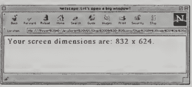

**图 9.2** 此处显示的屏幕尺寸是从 Java 方法传递给 JavaScript 的。

- 7. `document.writeln("您的屏幕尺寸是: " + sWidth + " X " + sHeight);`
- 8. `newWin = window.open("", "newWin", "width=" + sWidth + ",height=" + sHeight)`：最后，获取 `sWidth` 和 `sHeight` 变量的值，并使用 `window.open` 命令创建一个新窗口。有关操作窗口的更多信息，请参阅第 5 章。

### 提示

- 当你使用 Java 进行测试时，测试可能会由于许多原因失败，最主要的是目前的 Java 实现不够稳定，并且在运行 Windows、Mac OS 和不同 Unix 的机器之间存在差异。你应该始终在脚本中考虑到 Java 可能无法工作的情况，防止脚本在 Java 故障时崩溃。

## 使用 Java 显示文本

HTML 在字体和大小方面对文本没有很大的控制，Java 也是如此，但 Java 提供了一些内置字体可以使用。脚本 9.3 使用 JavaScript 框提示文本字符串，将其传递给 Java，并以 36 号加粗 Times Roman 显示。如果你好奇，可以查看脚本 9.4 中的 Java 代码。脚本 9.3 为了对文本显示获得更多控制，此脚本将文本传递给 Java applet。

```html
<HTML>
<HEAD>
<TITLE>写入 Java</TITLE>
<SCRIPT LANGUAGE=JAVASCRIPT TYPE="TEXT/JAVASCRIPT">
<!-- 对旧版浏览器隐藏脚本 -->
function startUp() {
  temp = prompt("你想说什么?");
  if (temp.length > 20) {
    alert("行太长了")
    startUp();
  } else {
    document.myApplet.newText(temp)
  }
}
// 对旧版浏览器结束脚本 -->
</SCRIPT>
</HEAD>
<BODY onload="startUp()" BGCOLOR=WHITE>
<APPLET CODE="Applet.class" NAME="myApplet" WIDTH=600 HEIGHT=50>
</APPLET>
</BODY>
</HTML>
```

使用 Java 显示文本：

- 1. `document.myApplet.newText(temp)`：这一行获取用户输入的字符串并在 JavaScript 对话框中显示（见图 9.3）。注意 `myApplet` 是显示文本的 Java applet 名称。查看下面的步骤 3 查看 `myApplet` 是如何赋值的。
- 2. `<BODY onload="startUp()" BGCOLOR=WHITE>`：在通常 HTML 标签中，需要在页面加载时触发 `startUp` 函数。图 9.4 显示了结果。
- 3. `<APPLET CODE="Applet.class" WIDTH=600 HEIGHT=50 NAME="myApplet">`：这一行 HTML 使用 `APPLET` 标签指定代码文件、它在屏幕上占用的像素大小以及 Java applet 的名称。

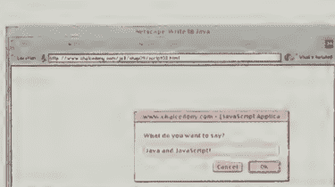

图 9.3 这是接受输入的 JavaScript 对话框。脚本 9.4 示例完全不是 JavaScript；它是我们在脚本 9.3 中调用的 Java applet 代码。

### 提示

- 前一个示例检查 JavaScript 对话框中输入的文本是否适应屏幕，否则额外的文本将超出屏幕右边缘。
- 你可以访问三种类型的字体：Serif（衬线）、Sans（无衬线）和 Mono（等宽）。
- 通常你想显示文本时，应该使用层叠样式表。查看第 10 章获取更多样式。
- 当你使用 Java 进行测试时，测试可能会由于许多原因失败，最主要的是目前的 Java 实现不够稳定，并且在运行 Windows、Mac OS 和不同 Unix 的机器之间存在差异。你应该始终在脚本中考虑到 Java 可能无法工作的情况，防止脚本在 Java 故障时崩溃。

脚本 9.4 示例完全不是 JavaScript；它是我们在脚本 9.3 中调用的 Java applet 代码。

```java
import java.applet.*;
import java.awt.*;

public class Applet extends Applet {
  Font f = new Font("TimesRoman", Font.BOLD, 36);
  String whatToSay;

  public void init() {
    setBackground(Color.white);
  }

  public void paint(Graphics g) {
    g.setFont(f);
    g.drawString(this.whatToSay, 100, 25);
  }

  public void newText(String s) {
    this.whatToSay = s;
    repaint();
  }
}
```

## Java 虚拟机

虚拟机缩写为 VM，是浏览器自带的 Java 解释器。VM 获取 applet 并越来越多地构建到操作系统中，例如带有 Macintosh Runtime 的 Mac OS，以及用于 Windows 各版本的类似虚拟机。

## 使用插件播放

现在，让我们从 Java 转向插件。在这个示例中，你将使用 Netscape 的 LiveAudio 插件播放声音文件。你还将创建控制按钮（使用 HTML 表单）来开始、暂停和停止声音，并增大或减小音量。脚本 9.5 包含了处理控制函数的多个函数。查看图 9.5 查看创建的控制面板。

此任务在 Microsoft 的 Internet Explorer 中无法运行，因为该程序使用 ActiveX 技术（Microsoft 的专用插件版本）来处理播放声音。处理 ActiveX 超出了本书的范围。

脚本 9.5 JavaScript 可以利用 Netscape LiveAudio 插件播放声音。

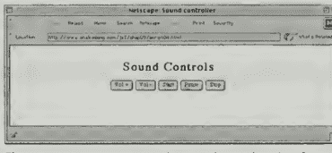

脚本 9.5 续

使用 LiveAudio 插件播放声音：

```html
<HEAD>
<BODY BGCOLOR=WHITE>
<EMBED SRC="jurassic.wav" NAME="mySound" MASTERSOUND AUTOSTART=NO HIDDEN=TRUE>
<CENTER>
<h1>Sound Controls</h1>
<FORM>
<INPUT TYPE=BUTTON VALUE="Vol +" onclick="changeVol(10)">
<INPUT TYPE=BUTTON VALUE="Vol -" onclick="changeVol(-10)">
<INPUT TYPE=BUTTON VALUE="Start" onclick="startSound()">
<INPUT TYPE=BUTTON VALUE="Pause" onclick="pauseSound()">
<INPUT TYPE=BUTTON VALUE="Stop" onclick="stopSound()">
</FORM>
</CENTER>
</BODY>
</HTML>
```

```javascript
// 隐藏旧版浏览器的脚本 -->
function startSound() {
  document.mySound.play(false)
}

function pauseSound() {
  document.mySound.pause()
}

function stopSound() {
  document.mySound.stop()
}

function changeVol(changeBy) {
  currentVol = document.mySound.GetVolume()
  if (currentVol < 100 && currentVol > 0) {
    document.mySound.setVol(currentVol + changeBy)
  }
}
```

- 1. `function startSound() { document.mySound.play(false) }`：此函数播放声音。`false` 参数告诉脚本不要循环播放，即只播放一次。
- 2. `function pauseSound() { document.mySound.pause() }`：此函数告诉文档暂停播放 `mySound` 声音。
- 3. `function stopSound() { document.mySound.stop() }`：此函数告诉文档停止播放 `mySound`。
- 4. `function changeVol(changeBy)`：`changeVol` 接收变量 `changeBy` 的值。
- 5. `currentVol = document.mySound.GetVolume()`：这一行从文档获取声音音量值并将其放入 `currentVol` 中。
- 6. `if (currentVol < 100 && currentVol > 0)`：此条件测试检查 `currentVol` 的值是否小于 100（最大值）且大于 0（最小值）。
- 7. `document.mySound.setVol(currentVol + changeBy)`：如果 `currentVol` 的值尚未达到最大或最小值，则根据 `changeBy` 的值进行更改（取决于用户点击了 Vol + 还是 Vol - 按钮，其值为 +10 单位或 -10 单位）。
- 8. `<EMBED SRC="jurassic.wav" NAME="mySound" MASTERSOUND AUTOSTART=NO HIDDEN=TRUE>`：HTML `EMBED` 标签需要几项信息。`SRC` 属性为 `EMBED` 提供了声音文件名。`NAME` 为 JavaScript 提供了声音的文件名或 URL。每当你使用命名声音时，`MASTERSOUND` 是一个必须的属性。将 `AUTOSTART` 设置为 `NO` 意味着声音在页面加载时不会自动开始。将 `HIDDEN` 设置为 `TRUE` 可确保 LiveAudio 不显示其内置的面板（因为我们创建了自定义面板）。
- 9. `<INPUT TYPE=BUTTON VALUE="Vol +" onclick="changeVol(10)">`：这是设置表单控制按钮的五行中的第一行（其余参考脚本 9.5；它们的工作方式相同）。此行设置了 Vol + 按钮，当用户点击按钮时会触发 JavaScript 函数 `changeVol`。10 是步骤 4 中被赋值给 `changeVol` 变量的值。

## 关于 LiveAudio

在上面的示例中，Netscape 为文件调用浏览器中指定的 LiveAudio。LiveAudio 自动识别 15 个方法，语法如下：

```
play(loop, FALSE or an INT)
pause()
stop()
StopAll()
start_time(number of seconds)
end_time(number of seconds)
setVol(percentage "% sign")
fade_to(volume you wish to without the "% sign")
fade_from(volume start fade)
start_of_beginning()
stop_at_end()
IsReady()
IsPlaying()
IsPaused()
GetVolume()
```

## 使用插件播放声音

### 鼠标悬停触发声音 (Rollover)

鼠标悬停可以通过 JavaScript 触发插件。你在第 3 章处理图像时学习过鼠标悬停。你也可以使用鼠标悬停来触发插件。在脚本 9.6 中，你将学习如何让悬停配合 LiveAudio 插件播放声音，如图 9.6 所示。

```html
<HTML>
<HEAD>
<TITLE>Rollover Sound</TITLE>
<SCRIPT LANGUAGE="JAVASCRIPT" TYPE="TEXT/JAVASCRIPT">
<!-- 隐藏旧版浏览器的脚本 -->
function playSound(sName) {
  if (document.embeds[sName] != null && document.embeds[sName].IsReady()) {
    document.embeds[sName].play(false);
  }
}
// 结束旧版浏览器的脚本 -->
</SCRIPT>
</HEAD>
<BODY BGCOLOR="WHITE">
<center><h1>Sounds on rollovers</h1></center>
<p><a href="javascript:void(0)" onmouseover="playSound('moof')"></a></p>
<h3>如果你摸摸小狗，她会向你汪汪！</h3>
<EMBED SRC="moof" NAME="moof" HIDDEN=TRUE LOOP=FALSE AUTOSTART=FALSE>
</BODY>
</HTML>
```

### 在鼠标悬停时播放声音：

- 1. `function playSound(sName)`：`playSound` 函数接收 `sName` 的值。
- 2. `if (document.embeds[sName] != null && document.embeds[sName].IsReady())`：这一行测试嵌入对象（在此例中为脚本 9.6 末尾 `EMBED` 标签的声音文件）是否为空（文件存在）以及声音是否准备好播放。
- 3. `document.embeds[sName].play(false)`：如果声音就绪，则此行播放它。再次，`false` 参数确保声音只播放一次。
- 4. `<a href="javascript:void(0)" onmouseover="playSound('moof')"></a>`：`javascript:void(0)` 告诉锚标签不要链接到任何页面。当用户鼠标移动到链接图像上时，触发声音。`IMG` 标签指定要悬停的图像。脚本中剩余 `EMBED` 标签工作与之前的示例相同。

## 关于狗牛 (Dogcow)

我们在示例中使用的神话动物是狗牛（dogcow），苹果计算机开发者技术支持工程师喜爱的吉祥物。狗牛的起源笼罩在神秘之中（某种程度上），但狗牛研究的专门人员确定了几个显著事实：

- 它看起来既不像狗也不像牛。因此有了这个名字。
- 狗牛发出的声音是“Moof!”。
- 狗牛的名字是 Clarus。是的，拼写与那家曾作为苹果子公司的软件公司不同。
- 关于狗牛血统的更多信息可以在 `http://devworld.apple.com/dev/dogcow.html` 找到。

# 第 10 章

## 与 DHTML 和外部文件交互

DHTML（动态 HTML）是较新浏览器的补充。DHTML 被认为是互联网上命名最令人困惑的技术之一，它实际上仅仅是 HTML、级联样式表（CSS）和 JavaScript 的组合。

到目前，你应该知道 HTML 和 JavaScript 是什么。级联样式表（CSS）是一种允许页面拥有“样式”的技术；例如，如果你的 `<h1>` 标签中的所有文本都是红色的且使用 Palatino 字体。CSS 将允许你设置一次。

由于 DHTML 非常新，不同的浏览器以不同的方式实现它。存在标准，可以在万维网联盟的网站 `http://www.w3.org/` 找到。

本章展示了使用今天的浏览器可以做的事情。关于更多 DHTML 的信息，请参考《World Wide Web: Visual QuickStart Guide》，作者 Jason Cranford Teague，Peachpit 出版。

## 使用 DHTML 和外部文件工作

脚本 10.1 这段仅限 Netscape 的脚本可让图像在窗口内移动。

### 在二维空间内移动对象（仅限 Netscape）


最常见的 DHTML 效果是让图像在范围内移动。脚本 10.1（仅限 Netscape）让一只小蝴蝶在浏览器窗口内随机移动。

## 移动 Netscape DHTML 对象：

```html
<HTML>
<HEAD>
<TITLE>Butterfly II</TITLE>
<SCRIPT TYPE="TEXT/JAVASCRIPT" LANGUAGE="JAVASCRIPT">
<!-- 向旧版浏览器隐藏脚本 -->
maxHeight = window.innerHeight - 40
maxWidth = window.innerWidth - 40

function moveIt() {
  chgBy = Math.floor(Math.random() * 10)
  if (halfChance() && document.mover.top >= maxHeight && document.mover.top > 5) {
    document.mover.top -= chgBy
  } else {
    document.mover.top += chgBy
  }

  chgBy = Math.floor(Math.random() * 10)
  if (halfChance() && document.mover.left >= maxWidth && document.mover.left > 5) {
    document.mover.left -= chgBy
  } else {
    document.mover.left += chgBy
  }

  setTimeout("moveIt()", 20)
}

function halfChance() {
  if (Math.random() < .5) {
    return true
  }
  return false
}
// 隐藏脚本结束 -->
</SCRIPT>
<STYLE TYPE="TEXT/CSS">
#mover {position: absolute; left: 5; top: 5;}
</STYLE>
</HEAD>
<BODY BGCOLOR=WHITE onload="moveIt()">
<DIV ID="mover">

</DIV>
</BODY>
</HTML>
```

- 1. `maxHeight = window.innerHeight - 40, maxWidth = window.innerWidth - 40`：设置两个变量 `maxHeight` 和 `maxWidth`，用于限制蝴蝶的飞行范围。
- 2. `function moveIt()`：创建一个名为 `moveIt` 的函数。
- 3. `chgBy = Math.floor(Math.random() * 10)`：将蝴蝶在 x 轴上的移动距离设置为 0 到 9 之间的数字。
- 4. `if (halfChance() && document.mover.top >= maxHeight && document.mover.top > 5) { document.mover.top -= chgBy } else { document.mover.top += chgBy }`：这些行代码计算 x 轴上的移动方向是向上还是向下。`halfChance()` 函数通过 `Math.random()` 掷硬币，有一半概率返回 `true` 结果。根据这个概率以及蝴蝶是否过于靠近顶部或底部，通过改变图像的 `top` 属性来移动蝴蝶。
- 5. `chgBy = Math.floor(Math.random() * 10)`：同样地，计算 y 轴上的移动。
- 6. `if (halfChance() && document.mover.left >= maxWidth && document.mover.left > 5) { document.mover.left -= chgBy } else { document.mover.left += chgBy }`：再次通过检查边界和 `halfChance()` 来移动在 y 轴上的蝴蝶。修改图像的 `left` 属性使蝴蝶向左或向右移动。
- 7. `setTimeout("moveIt()", 20)`：此行在 20 毫秒后调用脚本，导致蝴蝶如图 10.2 所示在窗口周围快速移动。
- 8. `<STYLE TYPE="TEXT/CSS"> #mover {position: absolute; left: 5; top: 5;} </STYLE>`：这创建了一个新样式的移动对象，这是一个距离左上角向下 5 像素、向左 5 像素的绝对定位对象。
- 9. `<BODY BGCOLOR=WHITE onload="moveIt()">`：当页面加载完成时，调用 `moveIt()` 函数。
- 10. `<DIV ID="mover">  </DIV>`：使用 `<div>` 标签通过 `document.mover` 的名称引用图像。

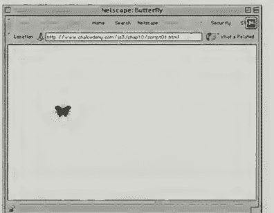

图 10.2 观察该蝴蝶移动

### 提示

- 在窗口周围移动图像可能会影响 JavaScript 的滚动状态。在决定动画你的网站之前，请考虑这一点。如果你的内容不需要图像飞行，这可能不值得。

## 使用 DHTML 和外部文件工作

脚本 10.2 这段代码与脚本 10.1 相同，但适用于 Internet Explorer。

### 在二维空间内移动对象（仅限 Internet Explorer）

```html
<HTML>
<HEAD>
<TITLE>Butterfly</TITLE>
<SCRIPT TYPE="TEXT/JAVASCRIPT" LANGUAGE="JAVASCRIPT">
<!-- 向旧版浏览器隐藏脚本 -->
firstTime = true

function moveIt() {
  if (firstTime) {
    maxHeight = document.body.clientHeight - 40
    maxWidth = document.body.clientWidth - 40
    firstTime = false
  }

  chgXBy = Math.floor(Math.random() * 10)
  if (halfChance() && document.all.mover.style.pixelTop >= maxHeight && document.all.mover.style.pixelTop > 5) {
    document.all.mover.style.pixelTop -= chgXBy;
  } else {
    document.all.mover.style.pixelTop += chgXBy;
  }

  chgYBy = Math.floor(Math.random() * 10)
  if (halfChance() && document.all.mover.style.pixelLeft >= maxWidth && document.all.mover.style.pixelLeft > 5) {
    document.all.mover.style.pixelLeft -= chgYBy;
  } else {
    document.all.mover.style.pixelLeft += chgYBy;
  }

  setTimeout("moveIt()", 20)
}

function halfChance() {
  if (Math.random() < .5) {
    return true
  }
  return false
}
// 隐藏脚本结束 -->
</SCRIPT>
<STYLE TYPE="TEXT/CSS">
#mover {position: absolute; left: 5; top: 5;}
</STYLE>
</HEAD>
<BODY BGCOLOR=WHITE onload="moveIt()">
<DIV ID="mover">

</DIV>
</BODY>
</HTML>
```

在前述任务中描述的功能也可以 Internet Explorer 中实现，但编写脚本需要一些精力，如脚本 10.2 所示。

## 移动 Internet Explorer DHTML 对象：

- 1. `firstTime = true`：Internet Explorer 在页面完成之前无法使用窗口高度变量，因此你通过将 `firstTime` 设置为 `true` 来表示你是第一次进入。
- 2. `if (firstTime) { maxHeight = document.body.clientHeight - 40; maxWidth = document.body.clientWidth - 40; firstTime = false }`：如果 `moveIt()` 第一次运行，设置 `maxHeight` 和 `maxWidth` 为气球可以游的尺寸。这些 `body` 属性在页面加载后可用。通过将 `firstTime` 设置为 `false` 结束此步骤，以避免重复初始化。
- 3. `if (halfChance() && document.all.mover.style.pixelTop >= maxHeight && document.all.mover.style.pixelTop > 5) { document.all.mover.style.pixelTop -= chgXBy; } else { document.all.mover.style.pixelTop += chgXBy; }`：这段代码与之前的示例相同，只是使用了 Internet Explorer 版本。它不是查看 `document.top`，而是查看 `document.all.mover.style.pixelTop`。
- 4. `if (halfChance() && document.all.mover.style.pixelLeft >= maxWidth && document.all.mover.style.pixelLeft > 5) { document.all.mover.style.pixelLeft -= chgYBy; } else { document.all.mover.style.pixelLeft += chgYBy; }`：同样地，计算 y 轴上的移动。它们共同导致蝴蝶如图 10.3 所示进行移动。
- 5. `setTimeout("moveIt()", 20)`
- 6. `<STYLE TYPE="TEXT/CSS"> #mover {position: absolute; left: 5; top: 5;} </STYLE>`：这创建了一个新样式的移动对象，这是一个距离左上角向下 5 像素、向左 5 像素的绝对定位对象。
- 7. `<BODY BGCOLOR=WHITE onload="moveIt()">`：当页面加载完成时，调用 `moveIt()` 函数。
- 8. `<DIV ID="mover">  </DIV>`


## 移动跨浏览器 DHTML 对象

脚本 10.3 此脚本（适用于所有浏览器）让蝴蝶在窗口中移动。

```html
<HTML>
<HEAD>
<TITLE>Butterfly III</TITLE>
<SCRIPT TYPE="TEXT/JAVASCRIPT" LANGUAGE="JAVASCRIPT">
<!-- 向旧版浏览器隐藏脚本 -->
maxHeight = window.innerHeight - 40
maxWidth = window.innerWidth - 40

function moveIt() {
  chgYBy = Math.floor(Math.random() * 10)
  if (document.all) {
    topPos = document.all.mover.style.pixelTop
    leftPos = document.all.mover.style.pixelLeft
  } else {
    topPos = document.mover.top
    leftPos = document.mover.left
  }

  if ((halfChance() || topPos >= maxHeight) && topPos > 5) {
    topPos -= chgYBy
  } else {
    topPos += chgYBy
  }

  chgXBy = Math.floor(Math.random() * 10)
  if ((halfChance() || leftPos >= maxWidth) && leftPos > 5) {
    leftPos -= chgXBy
  } else {
    leftPos += chgXBy
  }

  if (document.all) {
    document.all.mover.style.pixelTop = topPos
    document.all.mover.style.pixelLeft = leftPos
  } else {
    document.mover.top = topPos
    document.mover.left = leftPos
  }

  setTimeout("moveIt()", 20)
}

function halfChance() {
  if (Math.random() < .5) {
    return true
  }
  return false
}
// 隐藏脚本结束 -->
</SCRIPT>
<STYLE TYPE="TEXT/CSS">
#mover {position: absolute; left: 5; top: 5;}
</STYLE>
</HEAD>
<BODY BGCOLOR=WHITE onload="moveIt()">
<DIV ID="mover">

</DIV>
</BODY>
</HTML>
```

### 移动跨浏览器 DHTML 对象：

- 1. `if (document.all)`：通过检查 `document.all` 对象是否存在来启动任何特定浏览器的代码。如果它存在，你就知道你正在使用 Internet Explorer。
- 2. `topPos = document.all.mover.style.pixelTop` `leftPos = document.all.mover.style.pixelLeft`：你可以通过为两个浏览器初始化变量并引用这些变量来避免某些特定浏览器的代码。在这里，你为 Internet Explorer 初始化了蝴蝶的顶部位置和左侧位置。
- 3. `topPos = document.mover.top` `leftPos = document.mover.left`：同样，为 Netscape 用户设置了图片的左侧和顶部位置。
- 4. `if ((halfChance() || topPos >= maxHeight) && topPos > 5) { topPos -= chgYBy } else { topPos += chgYBy }`：这些代码再次计算了顶部位置改变的方向，但这次是基于你为两个浏览器初始化的变量。脚本中的后续代码对 y 轴执行了相同的操作。
- 5. `document.all.mover.style.pixelTop = topPos` `document.all.mover.style.pixelLeft = leftPos`：现在执行步骤 2 的反向操作，并根据通用变量重置 Internet Explorer 特有的属性。在这种情况下，蝴蝶的 x 轴和 y 轴根据 `topPos` 和 `leftPos` 发生变化。
- 6. `document.mover.top = topPos` `document.mover.left = leftPos`：这是步骤 3 的反向操作，我们在这里设置了 Netscape 特有的属性。

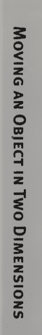

## 在三维空间中移动对象

（仅限 Netscape 和 Internet Explorer）

在例例中，如脚本 10.4 所示，你声明了三个样式：`leftfore`，设置左前景对象；`mover`，设置你将要制作动画的对象；以及 `rightfore`，右前景对象。在样式上设置 `z-index` 允许图片在其他对象的前或后面移动。

### 在 Netscape 中移动 HTML 对象：

- 1. `function slide()`：创建一个名为 `slide` 的函数。
- 2. `document.mover.left += 2`：这一行将 `mover` 的左侧向右移动两个像素，如图 10.5、10.6 和 10.7 所示。
- 3. `if (document.mover.left < document.rightfore.left) { setTimeout("slide", 20) }`：如果带有样式 `mover` 的对象左侧尚未移动到重叠 `rightfore` 图片，则使用 `setTimeout` 等待 20 毫秒并再次运行 `slide`。

脚本 10.4 该脚本展示了如何跨页面移动一个对象，位于其他对象之后。

```html
<HTML>
<HEAD>
<TITLE>Moon</TITLE>
<SCRIPT LANGUAGE=JAVASCRIPT TYPE="TEXT/JAVASCRIPT">
<!-- Hide script from older browsers -->
function slide() {
  document.mover.left += 2
  if (document.mover.left < document.rightfore.left) {
    setTimeout("slide", 20)
  }
}
// End hiding script -->
</SCRIPT>
<STYLE TYPE="CSS">
#leftfore {position: absolute; left: 0; top: 5; z-index: 2}
#mover {position: absolute; left: 5; top: 5; z-index: 1}
#rightfore {position: absolute; left: 470; top: 5; z-index: 2}
</STYLE>
</HEAD>
<BODY BGCOLOR=BLACK onLoad="slide()">
<DIV ID="leftfore">

</DIV>
<DIV ID="mover">

</DIV>
<DIV ID="rightfore">

</DIV>
</BODY>
</HTML>
```

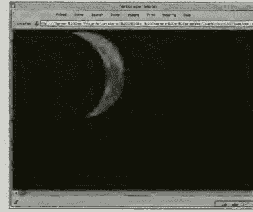

图 10.5 月亮从左侧开始，在前景对象后面被遮挡...

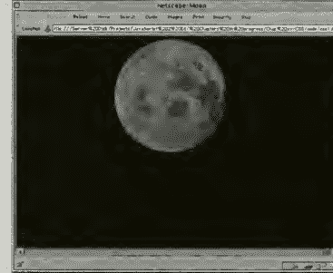

图 10.6 向中心移动，在那里它可以完全完整显示...

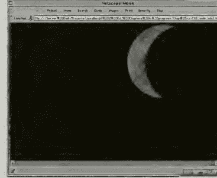

图 10.7 最后停在右侧，再次被前景对象遮挡。

### 提示

- 每个示例都包含 `z-index`。当两个对象占据相同空间时，显示 `z-index` 数字较大的对象。
- 要使其成为 Internet Explorer 特有的脚本，只需将上述步骤 2 改为 `document.all.mover.style.pixelLeft += 2`，并将步骤 3 中的 if 语句改为 `if (document.all.mover.style.pixelLeft < document.all.rightfore.style.pixelLeft)`，如脚本 10.5 所示。

脚本 10.5 修改两行使其成为 Internet Explorer 特有的脚本。

```html
<HTML>
<HEAD>
<TITLE>Moon</TITLE>
<SCRIPT LANGUAGE=JAVASCRIPT TYPE="TEXT/JAVASCRIPT">
<!-- Hide script from older browsers -->
function slide() {
  document.all.mover.style.pixelLeft += 2
  if (document.all.mover.style.pixelLeft < document.all.rightfore.style.pixelLeft) {
    setTimeout("slide", 20)
  }
}
// End hiding script -->
</SCRIPT>
<STYLE TYPE="CSS">
#leftfore {position: absolute; left: 0; top: 5; z-index: 2}
#mover {position: absolute; left: 5; top: 5; z-index: 1}
#rightfore {position: absolute; left: 470; top: 5; z-index: 2}
</STYLE>
</HEAD>
<BODY BGCOLOR=BLACK onLoad="slide()">
<DIV ID="leftfore">

</DIV>
<DIV ID="mover">

</DIV>
<DIV ID="rightfore">

</DIV>
</BODY>
</HTML>
```


## 使用 DHTML 和外部文件

脚本 10.6 该脚本为兼容 DHTML 的浏览器将图片移动到两张图片后面。

### 在三维空间中移动对象（所有浏览器）

```html
<HTML>
<HEAD>
<TITLE>Moon</TITLE>
<SCRIPT LANGUAGE=JAVASCRIPT TYPE="TEXT/JAVASCRIPT">
<!-- Hide script from older browsers -->
firstTime = true

function slide() {
  if (firstTime) {
    if (document.all) {
      rightDotPos = document.all.rightfore.style.pixelLeft
    } else {
      rightDotPos = document.rightfore.left
    }
    firstTime = false
  }

  if (document.all) {
    document.all.mover.style.pixelLeft += 2
    currPos = document.all.mover.style.pixelLeft
  } else {
    document.mover.left += 2
    currPos = document.mover.left
  }

  if (currPos < rightDotPos) {
    setTimeout("slide", 20);
  }
}
// End hiding script -->
</SCRIPT>
<STYLE TYPE="TEXT/CSS">
#leftfore {position: absolute; left: 0; top: 5; z-index: 1}
#mover {position: absolute; left: 5; top: 5; z-index: 1}
#rightfore {position: absolute; left: 470; top: 5; z-index: 2}
</STYLE>
</HEAD>
<BODY BGCOLOR="BLACK" onload="slide()">
<DIV ID="leftfore">

</DIV>
<DIV ID="mover">

</DIV>
<DIV ID="rightfore">

</DIV>
</BODY>
</HTML>
```

虽然上面的特定浏览器脚本只有两行，但将脚本合并成一个跨浏览器脚本要复杂一些。脚本 10.6 展示了如何合并脚本。

## 移动跨浏览器 DHTML 对象：

- 1. `if (firstTime) { if (document.all) { rightDotPos = document.all.rightfore.style.pixelLeft } else { rightDotPos = document.rightfore.left } firstTime = false }`：这是初始化步骤，将变量 `rightDotPos` 设置为 `rightfore` 图片的边缘位置，适用于 Netscape 或 Internet Explorer。这只需要执行一次，因此通过将 `firstTime` 设置为 `false` 结束。
- 2. `document.all.mover.style.pixelLeft += 2; currPos = document.all.mover.style.pixelLeft`：这两行代码是 Internet Explorer 特有的。第一行移动图片，第二行显示通用变量 `currPos` 及其图片的当前位置。
- 3. `document.mover.left += 2; currPos = document.mover.left`：这是步骤 2 的仅限 Netscape 的版本。第一行移动图像，第二行将 `currPos` 赋值给它的当前位置。
- 4. `if (currPos < rightDotPos) { setTimeout("slide", 20) }`：如果图像的当前位置仍在右侧圆点的左侧，则继续移动它。


## 使用 DHTML 和外部文件

脚本 10.7 此脚本（仅限 Netscape）将文本向下向右移动。

### 移动 HTML 文字（仅限 Netscape）

```html
<HTML>
<HEAD>
<TITLE>看我移动!</TITLE>
<SCRIPT TYPE="TEXT/JAVASCRIPT" LANGUAGE="JAVASCRIPT">
<!-- 对其他浏览器隐藏脚本 -->
function moveIt() {
  document.mover.top += 2
  document.mover.left += 2
  if (document.mover.top < window.innerHeight - 100) {
    setTimeout(moveIt, 20)
  }
}
// 隐藏脚本结束 -->
</SCRIPT>
<STYLE TYPE="TEXT/CSS">
#mover {position: absolute; left: 5; top: 5; font-size: 36pt}
</STYLE>
</HEAD>
<BODY BGCOLOR="WHITE" onload="moveIt()">
<DIV ID="mover">
再次上路...
</DIV>
</BODY>
</HTML>
```

DHTML 将文字视为另一种类型的对象。脚本 10.7 展示了文字在页面上对角线移动的示例。

在 Netscape 中移动文字：

- 1. `function moveIt()`：创建一个名为 `moveIt` 的函数。
- 2. `document.mover.top += 2` `document.mover.left += 2`：通过移动顶部和左边缘，通过样式移动器将对象（在这种情况下）向下移动 2 像素并向右 2 像素。图 10.8 显示了文字在页面上移动。
- 3. `if (document.mover.top < window.innerHeight - 100) { setTimeout(moveIt, 20) }`：如果移动区域的最顶端像素不在窗口底部 100 像素范围内，则使用 `setTimeout` 等待 20 毫秒并再次执行 `moveIt()`。


图 10.8 观察文字的移动！

## 第 10 章

### 移动 DHTML 文字（所有浏览器）

Netscape 和 Internet Explorer 都可以移动文字，这里是上述任务的跨浏览器版本。脚本 10.8 展示了适用于所有 DHTML 兼容器的文字在页面上对角线向下移动的示例。

脚本 10.8 此脚本（适用于所有浏览器）将文字向右移动。

```html
<HTML>
<HEAD>
<TITLE>看我移动!</TITLE>
<SCRIPT TYPE="TEXT/JAVASCRIPT" LANGUAGE="JAVASCRIPT">
<!-- 对旧浏览器隐藏脚本 -->
keepGoing = true
function moveIt() {
  if (document.all) {
    document.all.mover.style.pixelTop += 2
    document.all.mover.style.pixelLeft += 2
    if (document.all.mover.style.pixelTop > (document.body.clientHeight - 100)) {
      keepGoing = false
    }
  } else {
    document.mover.top += 2
    document.mover.left += 2
    if (document.mover.top > (window.innerHeight - 100)) {
      keepGoing = false
    }
  }
  if (keepGoing) {
    setTimeout(moveIt, 20)
  }
}
// 隐藏脚本结束 -->
</SCRIPT>
<STYLE TYPE="TEXT/CSS">
#mover {position: absolute; left: 5; top: 5; font-size: 36pt}
</STYLE>
</HEAD>
<BODY BGCOLOR="WHITE" onload="moveIt()">
<DIV ID="mover">
再次上路...
</DIV>
</BODY>
</HTML>
```

在所有浏览器中移动 DHTML 文字：

- 1. `keepGoing = true`：开始将 `keepGoing` 初始化为 `true`。只要它为 `true`，文字就会继续移动。
- 2. `function moveIt()`：创建一个名为 `moveIt` 的函数。
- 3. `document.all.mover.style.pixelTop += 2` `document.all.mover.style.pixelLeft += 2`：通过检查 `document.all` 是否存在来验证用户正在运行 Internet Explorer，如果是，则移动文字。图 10.9 显示了文字在页面上移动。
- 4. `if (document.all.mover.style.pixelTop > (document.body.clientHeight - 100)) { keepGoing = false }`：对于 Internet Explorer，如果文字顶部距离窗口底部 100 像素以内，则将 `keepGoing` 设置为 `false`。
- 5. `document.mover.top += 2` `document.mover.left += 2`：如果用户使用的是 Netscape，则将图像向下向右移动。
- 6. `if (document.mover.top > (window.innerHeight - 100)) { keepGoing = false }`：对于 Netscape，如果文字顶部距离窗口底部 100 像素以内，将 `keepGoing` 设置为 `false`。
- 7. `if (keepGoing) { setTimeout(moveIt, 20) }`：如果 `keepGoing` 仍为 `true`，使用 `setTimeout` 等待 20 毫秒并再次执行 `moveIt()`。


图 10.9 此文字在所有浏览器中均移动良好。

## 修改 HTML（仅限 Internet Explorer）

在 Netscape 中使用 JavaScript 对 HTML 对象的修改非常少。而 Internet Explorer 有一个名为 filters 的数据，允许 JavaScript 有许多修改对象的方法。脚本 10.9 展示了使用 filter（称为 `dropShadow`）修改文字。阴影从原始文字 50 像素处开始，逐渐靠近直到它们重叠（图 10.10）。

### 修改阴影：

- 1. `function doDrop(xCoord, yCoord)`：创建一个名为 `doDrop` 的函数，并传入两个变量：阴影当前的 x 和 y 坐标。
- 2. `if (document.all && xCoord > 1)`：如果用户使用 Internet Explorer 浏览且 x 坐标大于 1，执行以下步骤。
- 3. `xCoord -= 1` `yCoord -= 1`：从 x 和 y 坐标中减去，使 `dropShadow` 更靠近原始位置。
- 4. `document.all.dropText.style.filter = "dropShadow(offX=" + xCoord + ", offY=" + yCoord + ")"`：通过将偏移 (`offX`) 设置为 x 坐标 (`xCoord`)，并将偏移 (`offY`) 设置为 y 坐标 (`yCoord`)，重置 `dropText` 对象的样式为新的 `dropShadow`。
- 5. `setTimeout("doDrop(" + xCoord + ", " + yCoord + ")", 100)`：使用 `setTimeout` 等待 100 毫秒，然后使用修改后的 x 和 y 坐标再次调用 `doDrop`。

脚本 10.9 使用 JavaScript 配合 Internet Explorer 的 drop shadow 过滤器移动此文字的阴影。

```javascript
function doDrop(xCoord, yCoord) {
  if (document.all && xCoord > 1) {
    xCoord -= 1
    yCoord -= 1
    document.all.dropText.style.filter = "dropShadow(offX=" + xCoord + ", offY=" + yCoord + ")"
    setTimeout("doDrop(" + xCoord + ", " + yCoord + ")", 100)
  }
}
// 隐藏脚本结束 -->
```

```html
<HTML>
<HEAD>
<TITLE>丢掉!</TITLE>
<SCRIPT LANGUAGE=JAVASCRIPT TYPE="TEXT/JAVASCRIPT">
<!-- 对其他浏览器隐藏脚本 -->
</SCRIPT>
<STYLE TYPE="TEXT/CSS">
#dropText {width: 500; height: 100; font-size: 36pt; filter: dropShadow(offX=50, offY=50)}
</STYLE>
</HEAD>
<BODY BGCOLOR=WHITE onload="doDrop(50, 50)">
<DIV ID="dropText">
丢掉！
</DIV>
</BODY>
</HTML>
```


图 10.10 让阴影逐渐靠近原始文字。

## 旋转 DHTML 阴影（仅限 Internet Explorer）

脚本 10.10 展示了使用影子过滤器修改文字外观。在这个例子中，阴影从原始文字的 90 度处开始，然后旋转到 360 度。

### 要旋转阴影：

- 1. `function doShadow(newDirection)`：创建一个新函数 `doShadow`，传入 `newDirection`，即阴影当前的方向。

脚本 10.10 此脚本使用 DHTML 和 JavaScript 绕着文字块旋转阴影。

```html
<HTML>
<HEAD>
<TITLE>影子化!</TITLE>
<SCRIPT LANGUAGE="JAVASCRIPT" TYPE="TEXT/JAVASCRIPT">
<!-- 对旧浏览器隐藏脚本 -->
function doShadow(newDirection) {
  if (document.all && newDirection < 360) {
    newDirection += 10
    document.all.dropText.style.filter = "shadow(direction=" + newDirection + ")";
    setTimeout("doShadow(" + newDirection + ")", 100)
  }
}
// 隐藏脚本结束 -->
</SCRIPT>
<STYLE TYPE="CSS">
#dropText {filter: shadow(direction=90)}
</STYLE>
</HEAD>
<BODY BGCOLOR="WHITE" onload="doShadow(90)">
<DIV ID="dropText">
我和我的影子...
</DIV>
</BODY>
</HTML>
```

- 2. `if (document.all && newDirection < 360)`：如果用户正在使用 Internet Explorer 浏览器，且 `newDirection` 小于 360（最大度数），则执行后续步骤。
- 3. `newDirection += 10` `document.all.dropText.style.filter = "shadow(direction=" + newDirection + ")"`：将 `newDirection` 增加 10 度，以设置阴影的新位置，并使用新的阴影值设置过滤器，使投影如图 10.11 和 10.12 所示移动。
- 4. `setTimeout("doShadow(" + newDirection + ")", 100)`：使用 `setTimeout` 等待 100 毫秒，并使用 `newDirection` 的当前值再次调用 `doShadow`。


图 10.11 阴影在右下方...


图 10.12 现在的阴影在左上方。

## 配合 DHTML 和外部文件

### 修改 DHTML 发光效果（仅限 Internet Explorer）

脚本 10.11 显示了使用发光过滤器（glow filter）修改文本外观。发光从强度 5 开始，逐渐增加到最大强度 255，如图 10.13 和 10.14 所示。

### 要修改 DHTML 发光效果：

- 1. `function doGlow(newStrength)`：创建一个名为 `doGlow` 的新函数，并传入 `newStrength`，即发光强度。

脚本 10.11 这创建了一个在文本周围增强的光效果。

```html
<HEAD>
<TITLE>I'm radioactive!</TITLE>
<SCRIPT LANGUAGE="JAVASCRIPT" TYPE="TEXT/JAVASCRIPT">
<!-- 对旧版浏览器隐藏脚本 -->
function doGlow(newStrength) {
  if (document.all && newStrength < 255) {
    newStrength += 10
    document.all.glowText.style.filter = "glow(strength=" + newStrength + ")";
    setTimeout("doGlow(" + newStrength + ")", 100)
  }
}
// 结束隐藏脚本
</SCRIPT>
<STYLE TYPE="TEXT/CSS">
#glowText {width: 500; height: 100; font-size: 36pt; filter: glow(strength=5)}
</STYLE>
</HEAD>
<BODY BGCOLOR="WHITE" onload="doGlow(5)">
<DIV ID="glowText" ALIGN="CENTER">
I'm glowing...
</DIV>
</BODY>
</HTML>
```

- 2. `if (document.all && newStrength < 255)`：检查正在使用的浏览器是否为 Internet Explorer，且当前发光强度是否小于最大 255，然后执行以下操作。
- 3. `newStrength += 10` `document.all.glowText.style.filter = "glow(strength=" + newStrength + ")"`：通过增加 10 来增强光，并将光对象的过滤器样式重置为新的 `newStrength` 值。
- 4. `setTimeout("doGlow(" + newStrength + ")", 100)`：使用 `setTimeout` 等待 100 毫秒，然后用新的发光强度值再次调用 `doGlow`。


图 10.13 发光开始...


图 10.14 发光达到最大强度。

## 下拉菜单（所有浏览器）

使用 JavaScript 和 DHTML 的最佳理由之一是改进用户界面和冲浪者的浏览体验。脚本 10.12 可以在版本 4（及更高）浏览器中运行，模拟了标准应用程序的下拉菜单，如图 10.15 和 10.16 所示。

脚本 10.12 该脚本在所有兼容 DHTML 的浏览器中创建一个下拉菜单。

```html
<HTML>
<HEAD>
<TITLE>Pop Up</TITLE>
<SCRIPT TYPE="TEXT/JAVASCRIPT" LANGUAGE="JAVASCRIPT">
<!-- 对旧版浏览器隐藏脚本 -->
function toggleMenu(currElem) {
  if (document.all) {
    menuObj = eval("document.all." + currElem + ".style")
    menuObj.pixelTop = toggleVal(menuObj.pixelTop)
  } else {
    menuObj = eval("document." + currElem)
    menuObj.top = toggleVal(menuObj.top)
  }
}

function toggleVal(inVal) {
  if (inVal == -5) {
    return 90;
  }
  return -5;
}
// 结束脚本 -->
</SCRIPT>
<STYLE TYPE="TEXT/CSS">
.menu {position: absolute; font: 12px helvetica; width: 75px; background-color: #999999; color: #FFFFFF;}
</STYLE>
</HEAD>
<BODY BGCOLOR="WHITE">
<SPAN ID="FileMenu" CLASS="menu" STYLE="left: 20px; top: -90px;">
<A HREF="javascript:window.open()">Open</A>
<A HREF="javascript:window.print()">Print</A>
<A HREF="javascript:history.back()">Back</A>
<A HREF="javascript:history.forward()">Forward</A>
<A HREF="javascript:window.close()">Close</A>
<HR>
<A HREF="javascript:toggleMenu('FileMenu')">File</A>
</SPAN>
<SPAN ID="searchMenu" CLASS="menu" STYLE="left: 100px; top: -90px;">
<A HREF="http://www.yahoo.com">Yahoo</A>
<A HREF="http://www.excite.com">Excite</A>
<A HREF="http://www.hotbot.com">HotBot</A>
<A HREF="http://www.lycos.com">Lycos</A>
<A HREF="http://www.infoseek.com">Infoseek</A>
<HR>
<A HREF="javascript:toggleMenu('searchMenu')">Search</A>
</SPAN>
</BODY>
</HTML>
```

### 创建下拉菜单：

- 1. `function toggleMenu(currElem)`：此行启动了一个新函数 `toggleMenu()`，并传入变量 `currElem`。该变量是用户选择要切换的元素。
- 2. `menuObj = eval("document.all." + currElem + ".style")` `menuObj.pixelTop = toggleVal(menuObj.pixelTop)`：对于 Internet Explorer 用户，根据 `currElem` 和标准文档模型设置菜单。当点击时，下一行会切换 `menuObj` 的位置。
- 3. `menuObj = eval("document." + currElem)` `menuObj.top = toggleVal(menuObj.top)`：Netscape 用户执行相同的操作。变量 `menuObj` 根据 `currElem` 和 Netscape 文档模型设置，并根据菜单之前拉下来切换顶部位置。
- 4. `function toggleVal(inVal) { if (inVal == -5) { return 90; } return -5; }`：此函数简单接收传入的当前位置并返回相反的值。如果是 -5，则返回 90；如果是其他值（例如 90），则返回 -5。这是下拉菜单的新位置。
- 5. `<A HREF="javascript:toggleMenu('FileMenu')">File</A>`：点击此链接时，为 `FileMenu` 内部的所有内容调用 `toggleMenu()` 函数。
- 6. `<A HREF="javascript:toggleMenu('searchMenu')">Search</A>`：点击此链接时，为 `searchMenu` 内部的所有内容调用 `toggleMenu()` 函数。

图 10.15 这是页面加载时折叠状态的菜单...

### 提示

- `<SPAN>` 标签内的所有内容都是下拉菜单选项。虽然示例展示了如何将 URL 和 JavaScript 命令作为菜单选项，但你也可以在网站中使用这种导航——只需使用指向其他网页的链接。

图 10.16 但当你点击菜单时，你可以看到所有的选项。

## 滑动菜单（仅限 Internet Explorer）

Internet Explorer 的另一个酷功能是将元素添加到页面中间（使用 JavaScript），并且浏览器可以在它们周围重排文本。脚本 10.13 为 Internet Explorer 4 或更高版本的用户演示了这一点，并为其他浏览器提供了简单的变通方案。

### 使用滑动菜单：

- 1. `function toggleMenu(currMenu) { if (document.all) {`：从创建一个新函数 `toggleMenu()` 开始，传入当前菜单的引用，如果用户运行 Internet Explorer，则执行以下步骤。
- 2. `thisMenu = eval("document.all." + currMenu + ".style")`：使用 `eval` 命令设置变量 `thisMenu` 为目标菜单的引用。
- 3. `if (thisMenu.display == "block") { thisMenu.display = "none"; } else { thisMenu.display = "block"; }`：如果 `thisMenu` 的 `display` 属性为 `"block"`，则将其改为 `"none"`。相反，如果是 `"none"`，则将其改为 `"block"`。这就是切换菜单显示的方式，如图 10.17 和 10.18 所示。


- 4. return false

  这是你巧妙的地方。`toggleMenu()` 函数是从 `<A>` 标签内的 `onClick` 处理器中调用的。如果脚本返回 `false`，`HREF` 属性将永远不会加载到浏览器窗口，这样观众就会留在同一页面。

脚本 10.13 点击链接，Internet Explorer 会将页面的其余部分向下滑动。

```html
<HTML>
<HEAD>
<TITLE>Shakespeare's Plays</TITLE>
<SCRIPT TYPE="TEXT/JAVASCRIPT" LANGUAGE="JAVASCRIPT">
<!-- 对旧版浏览器隐藏脚本 -->

function toggleMenu(currMenu) {
  if (document.all) {
    thisMenu = eval("document.all." + currMenu + ".style")
    if (thisMenu.display == "block") {
      thisMenu.display = "none";
    } else {
      thisMenu.display = "block";
    }
  }
  return false;
}
// 结束隐藏脚本
</SCRIPT>
<style TYPE="TEXT/CSS">
#menu1 {display:none; margin-left:20px};
#menu2 {display:none; margin-left:20px};
#menu3 {display:none; margin-left:20px};
</style>
</HEAD>
<BODY COLOR="WHITE">
<h1>Shakespeare's Plays</h1>
<h3>
<A href="page1.html" onclick="toggleMenu('menu1')">Comedies</A>
</h3>
<SPAN id="menu1">
All's Well That Ends Well<BR>
As Like It It<BR>
Love's Labour Lost<BR>
The Comedy of Errors
</span>
</BODY>
</HTML>
```

## 使用 DHTML 和外部文件

脚本 10.13 继续

```html
<h3>
  <A HREF="page2.html" onclick="return toggleMenu('menu2')">悲剧</A>
</h3>
<span id="menu2">
  安东尼与克利利奥帕拉<BR>
  哈姆雷<BR>
  罗密欧与朱丽叶
</span>
<h3>
  <A HREF="page3.html" onclick="return toggleMenu('menu3')">历史</A>
</h3>
<span id="menu3">
  亨利四世第一部分<BR>
  亨利四世第二部分
</span>
</BODY>
</HTML>
```

如果用户没有运行 Internet Explorer，脚本将返回 true，从而允许新页面加载到浏览器窗口。通过这种方式，支持此功能的浏览器会在同一页面上显示菜单信息，而不支持的浏览器则只需加载显示所需数据的 Web 页面。

```javascript
else {
  return true
}
```

`<A HREF="page1.html" onclick="return toggleMenu('menu1')">喜剧</A>`

这里是调用 `toggleMenu('menu1')` 的地方。传递值 "menu1" 会导致 `menu1` `<span></span>` 内部的所有内容被显示。点击链接会导致相同的信息消失回到原来的地方。


图 10.17 这是加载后的页面状态...


图 10.18 但当你点击链接时，隐藏的信息就会显示出来。

## 提示 (Tool Tips)

（所有浏览器）

Internet Explorer 的另一个优秀功能是能够显示“工具提示”，即当你将光标悬停在重要内容上时出现的小消息。这是一种向用户显示额外信息的方便方法，无需执行任何操作。在设计网站时，为用户提供可以引导的指南非常重要；这会让你的网站更易用，并防止用户迷路。脚本 10.14 显示了如何使用 HTML 为所有浏览器创建相同的用户反馈效果。

## 创建工具提示：

- 1. if (document.all) {

    docObj = "document.all"

    styleObj = ".style"

  } else {

    docObj = "document"

    styleObj = ""

  }

  这是你可以在 HTML 脚本中使用的方便代码段之一。这些变量已经设置好，可以反复使用以创建特定浏览器的对象，而无需进行特定的浏览器检查。

- 2. function popup(evt,currElem) {

  在这里你创建了一个用于 `popup()` 的函数，并向它传递两个变量：evt 是导致此函数被调用的事件，currElem 是用户显示的当前元素。

- 3. popupUp = eval(docObj + currElem + "styleObj")

  此行根据传入函数的 `currElem` 以及在第 1 步设置的 `docObj` 和 `styleObj` 创建了一个跨浏览器对象。


10.19 这是加载后的图像。


10.20 但当你将光标置于重要区域上时，你可以看到消息。

脚本 10.14 这个脚本会弹出黄色小便条。

```html
<HTML>
<HEAD>
<TITLE>工具提示</TITLE>
<SCRIPT TYPE="TEXT/JAVASCRIPT" LANGUAGE="JAVASCRIPT">
<!-- 对旧版浏览器隐藏脚本 -->
if (document.all) {
  docObj = "document.all"
  styleObj = ".style"
} else {
  docObj = "document"
  styleObj = "";
}
// (脚本在下一页继续)
```

## 脚本 10.14 继续

## 使用 DHTML 和外部文件

```javascript
function popUp(evt,currElem) {
  popupWin = eval(docObj + currElem + styleObj);
  if (document.all) {
    popupWin.top = parseInt(evt.y)+2
    popupWin.left = Math.max(2, parseInt(evt.x)-125);
  } else {
    popupWin.top = parseInt(evt.pageY)+2;
    popupWin.left = Math.max(2, parseInt(evt.pageX)-125);
  }
  popupWin.visibility = "visible"
  window.status = ""
}

function popDown(currElem) {
  popupWin = eval(docObj + currElem + styleObj);
  popupWin.visibility = "hidden"
}
```

- 4. popUpWin.top = parseInt(evt.y)+2

  popUpWin.left = Math.max(2, parseInt(evt.x)-125)

  这为 Internet Explorer 用户设置工具提示的顶部和左侧位置。`evt.x` 和 `evt.y` 变量是触发时的光标位置，提示显示在光标左侧 125 像素处。

- 5. popUpWin.top = parseInt(evt.pageY)+2

  popUpWin.left = Math.max(2, parseInt(evt.pageX)-125)

  这为 Netscape 用户设置工具提示的顶部和左侧位置。Netscape 将光标的值存储在 `evt.pageX` 和 `evt.pageY` 中。

- 6. popUpWin.visibility = "visible"

  window.status = ""

  无论你如何使用，都需要执行这两步。第一步让工具提示窗口可见，第二步让浏览器窗口状态栏留空（这样显示 JavaScript 函数调用）。

- 7. function popDown(currElem) {

  popupWin = eval(docObj + currElem + styleObj);

  popupWin.visibility = "hidden"

}

// 隐藏脚本结束

```html
<SCRIPT>
<STYLE TYPE="TEXT/CSS">
#popup1, #popup2, #popup3, #popup4,
#popup5, #popup6, #popup7, #popup8, #popup9, #popup10 {
  position: absolute;
  visibility: hidden;
}

.popup {
  background-color: #FFFF00;
  border: 1px solid;
  layer-background-color: #FFFF00;
  width: 100px;
  font: helvetica, sans-serif;
  padding: 5px;
}
</STYLE>
</HEAD>
<BODY COLOR="BLACK">
<MAP NAME="Map">
```

正如你可能料到的那样，`popDown()` 函数与 `popUp()` 函数相反——让提示从可见变为不可见。

- 8. `<AREA SHAPE=RECT COORDS="121,214,136,230" HREF="javascript:void('')" onmouseover="popup('popup1')" onmouseout="popDown('popup1')" return true>`

  这一行看起来与第 3 章的内容非常相似。

光标位于图像地图的区域上，鼠标悬停（mouseover）触发调用 `popup()`（以及一个内置的 JavaScript 值）和 "popup1"。这会导致 ID 为 "popup1" 的 `<span></span>` 内部的所有内容显示工具提示。

# 第 10 章 与 HTML 和外部文件工作

## 使用外部 .js 文件

(支持所有浏览器)

如果你在整个网站中都有通用的代码，你就不需要将其添加到每个页面中。相反，你可以创建一个外部 JavaScript 文件并只需引用该文件即可。这个外部文件被称为 .js 文件。各个页面通过简单地在 `<script>` 标签中添加一个新属性 `SRC` 来调用该 `.js` 文件。脚本 10.15、10.16、10.17、10.18 和 10.19 演示了如何操作。

## 如何使用外部 .js 文件：

- `<SCRIPT SRC="external.js" LANGUAGE="JAVASCRIPT" TYPE="TEXT/JAVASCRIPT">` 在 `<SCRIPT>` 标签中添加 `SRC` 属性，会使支持 JavaScript 1.1 及更高版本的浏览器寻找该文件。生成的 Web 页面看起来就像脚本在它们页面内 `script` 标签的常规位置一样，但实际上脚本在外部 `.js` 文件中。这种技术的结果如**图 10.21** 和 **10.22** 所示。


- 必须配置服务器以正确提供 .js 文件。如果你的页面在执行此命令时遇到问题，请咨询提供商以查看是否是问题所在。

- 这种方法有时用于向用户隐藏 JavaScript。如果用户技术足够高，可以检查浏览器缓存文件——即浏览器查看或存储的所有内容——那么这种方法就无效了。

- 仅支持 JavaScript 1.0 的浏览器将执行头部脚本代码。在这个示例中，有 `imgOver()` 和 `imgOut()` 函数以防止在新浏览器中出现错误。


使用外部 JS 文件

217

如果你不在 `<SCRIPT>` 和 `</SCRIPT>` 标签之间包含任何内容，那么这是你唯一一次不需要包含为旧版浏览器注释掉 JavaScript 的行。旧版浏览器并不足够聪明去查看 `.js` 文件，而且标签之间没有会导致引起错误消息的内容。

你可以在一个页面中放置多个头部脚本。一个页面引用多个 `.js` 文件并仍然包含该页面特有的脚本元素是完全可以的。

脚本 10.15 此文件是 `home.html`，它调用 `external.js`。

```html
<HTML>
<HEAD>
<TITLE>Our Website</TITLE>
<SCRIPT SRC="external.js" LANGUAGE="TEXT/JAVASCRIPT">
<!-- Hide script from old browsers -- >
function imgOver() {
}

function imgOut() {
}
// End hiding script -->
</SCRIPT>
</HEAD>
<BODY COLOR="WHITE">

<A HREF="products.html" onmouseover="imgOver('products')" onmouseout="imgOut('products')">

</A>
<A HREF="contact.html" onmouseover="imgOver('contact')" onmouseout="imgOut('contact')">

</A>
<A HREF="press.html" onmouseover="imgOver('press')" onmouseout="imgOut('press')">

</A>
</BODY>
</HTML>
```


218

# 第 10 章 与 HTML 和外部文件工作

脚本 10.16 此文件是 `products.html`，它调用 `external.js`。

脚本 10.17 此文件是 `contact.html`，它调用 `external.js`。

```html
<HTML>
<HEAD>
<TITLE>Our Website</TITLE>
<SCRIPT SRC="external.js" LANGUAGE="JAVASCRIPT" TYPE="TEXT/JAVASCRIPT">
<!-- Hide script from old browsers -->
function imgOver() {
}

function imgOut() {
}
// End hiding script -->
</SCRIPT>
</HEAD>
<BODY COLOR="WHITE">
<A HREF="home.html" onmouseover="imgOver('home')" onmouseout="imgOut('home')">

</A>
<A HREF="products.html" onmouseover="imgOver('products')" onmouseout="imgOut('products')">

</A>
<A HREF="contact.html" onmouseover="imgOver('contact')" onmouseout="imgOut('contact')">

</A>
</BODY>
</HTML>
```

```html
<HTML>
<HEAD>
<TITLE>Our Website</TITLE>
<SCRIPT SRC="external.js" LANGUAGE="JAVASCRIPT" TYPE="TEXT/JAVASCRIPT">
<!-- Hide script from old browsers -->
function imgOver() {
}

function imgOut() {
}
// End hiding script -->
</SCRIPT>
</HEAD>
<BODY COLOR="WHITE">
<A HREF="home.html" onmouseover="imgOver('home')" onmouseout="imgOut('home')">

</A>
<A HREF="products.html" onmouseover="imgOver('products')" onmouseout="imgOut('products')">

</A>
<A HREF="contact.html" onmouseover="imgOver('contact')" onmouseout="imgOut('contact')">

</A>
</BODY>
</HTML>
```

使用外部 JS 文件

219

脚本 10.18 此文件是 `press.html`，它调用 `external.js`。

脚本 10.19 此文件是 `external.js` 本身。

| press.html | external.js |
| :--- | :--- |
| `<HTML>` `<HEAD>` `<TITLE>Our Website</TITLE>` `<SCRIPT SRC="external.js" LANGUAGE="JAVASCRIPT" TYPE="TEXT/JAVASCRIPT"><!-- Hide script from all browsers function imgOver() { } function imgOut() { } // End hiding script --></HEAD>` `<BODY COLOR="WHITE"` `<A HREF="home.html" onmouseover="imgOver('home')" onmouseout="imgOut('home')"></A>` `<A HREF="products.html" onmouseover="imgOver('products')" onmouseout="imgOut('products')"></A>` `<A HREF="contact.html" onmouseover="imgOver('contact')" onmouseout="imgOut('contact')"></A>` `</BODY>` `</HTML>` | |

210

# 第 11 章 调试你的 JavaScript

人们常说编写程序花费的 90% 时间实际上花在了调试它们上——即在写完后让它们正常工作。加上悲哀的事实，没有任何支持 JavaScript 的浏览器能显示有意义的错误信息，这产生了一个挫败感的源泉。本章将介绍一些常见的 JavaScript 错误、如何识别它们、如何修复它们，以及你如何从根本避免它们。

## Netscape 内置调试器

Netscape 浏览器有一个内置的调试器，可以从任何浏览器窗口访问。

### 使用 Netscape 调试器：

- 在浏览器的位置字段中输入 `javascript:`，会出现一个包含两个框架的页面，如图 11.1 所示。下方框架有一个文本框，你可以在其中输入 JavaScript。

### 提示

- 可以通过分号在单个文本框中输入多个 JavaScript 行。
- 确保在位置字段的 `javascript:` 之后输入冒号，否则浏览器将尝试查找 http://www.javascript.com/。
- 除了使用 `javascript:` 关键字打开此窗口外，你还可以使用 `mocha:`（JavaScript 的早期名称）。

## JavaScript 调试器

Netscape 和微软都提供了独立的、功能更强大的调试器，它们运行在各自的浏览器中。可以使用这些调试器来设置断点，从而允许你在指定的点停止脚本执行。这使你能够在任何时间点检查变量的值，并逐行查看代码。你可以从各自厂商的网站下载这些工具。


图 11.2 未安装调试器时的 Microsoft 脚本错误。

## 微软

- 微软拥有 Microsoft 脚本调试器（Microsoft Script Debugger），它仅作为 Windows 系统上 Internet Explorer 4 及后续版本的扩展。
- 如果没有安装 Microsoft 脚本调试器，Internet Explorer 在遇到错误代码时会给出相当晦涩的错误信息（图 11.2）。有了调试器后，你会收到同样的晦涩错误信息，但同时你还可以选择是否调试该脚本。


图 11.3 显示了调试器中的同一个脚本。

图 11.3 正在运行的 Microsoft 脚本调试器。

## Netscape

- Netscape 提供了 Netscape JavaScript 调试器，这是一个运行在浏览器中的应用程序，如图 11.4 所示。它目前版本为 1.1，适用于 Windows 95、NT、Mac PowerPC 以及多种 Unix 变体的 Navigator 和 Communicator。
- 如果你使用没有调试器的 4.06 或更高版本的 Netscape 浏览器，你可能认为你的脚本有 Bug，但 Netscape 在隐藏错误信息方面做得非常好。实际上，你确实收到了错误信息，只是 Netscape 成功将它们隐藏了。图 11.5 显示了在何处找到隐藏的错误信息：在“位置”（Location）处输入 `javascript:` 以查看详情。如果按照说明操作，你将在接下来的页面中看到脚本的错误。


图 11.4 使用 Netscape JavaScript 调试器运行脚本。


图 11.5 注意左下角的那个微小信息

## 常见错误

有很多常见错误，浏览器只对其成因提供微小的提示。以下是一些你可能会遇到的错误及其对应的错误信息。脚本 11.1 显示了完全调试后的脚本版本。

脚本 11.1 一个没有错误的脚本。

```html
<HTML>
<HEAD>
<TITLE>Find the bug</TITLE>
<SCRIPT LANGUAGE="JAVASCRIPT" TYPE="TEXT/JAVASCRIPT">
<!-- 对旧版浏览器隐藏脚本 -->

adImages = new Array("images/banner1.gif","images/banner2.gif","images/banner3.gif")
thisAd = 0
imgCt = adImages.length

function rotate() {
  thisAd++
  if (thisAd == imgCt) {
    thisAd = 0
  }
  document.adBanner.src=adImages[thisAd]
  setTimeout("rotate()", 3 * 1000)
}

// 结束隐藏脚本 --
</SCRIPT>
</HEAD>
<BODY BGCOLOR="WHITE" onload="rotate()">
<CENTER>

</CENTER>
</BODY>
</HTML>
```


## 调试你的脚本时，请注意这些坑：

脚本 11.2 一个引号不匹配的脚本。

- 所有文本字段必须在某处结束。如果你使用引号或单引号开始字符串，则必须使用相同的字符结束字符串（脚本 11.2）。否则，你将收到类似**图 11.6** 所示的错误信息。

```html
<HTML>
<HEAD>
<TITLE>Find the bug</TITLE>
<SCRIPT LANGUAGE="JAVASCRIPT" TYPE="TEXT/JAVASCRIPT">
<!-- 对旧浏览器隐藏脚本 -->
adImages = new Array("images/banner1.gif", "images/banner2.gif", "images/banner3.gif"
thisAd = 0
imgCt = adImages.length

function rotate() {
thisAd++
if (thisAd == imgCt) {
thisAd = 0
document.adBanner.src=adImages[thisAd]
setTimeout("rotate", 3 * 1000)
}
}
// 结束隐藏脚本 --
</SCRIPT>
</HEAD>
<BODY BGCOLOR="WHITE" onload="rotate()">
<CENTER>

</CENTER>
</BODY>
</HTML>
```

- 在 if 语句中比较两个字段时，比较必须包含在括号内（脚本 11.3）。**图 11.7** 显示了该错误信息。
- 仔细检查脚本中的拼写错误。**脚本 11.4** 缺少一个单词，在**图 11.8** 中产生了相应的错误消息。

常见错误


**图 11.6** 脚本 11.2 产生的错误。

脚本 11.3 缺少一个括号。

```html
<HTML>
<HEAD>
  <TITLE>Find the bug</TITLE>
  <SCRIPT LANGUAGE="JAVASCRIPT" TYPE="TEXT/JAVASCRIPT">
    <!-- 对旧浏览器隐藏脚本 -->
    var adImages = new Array("images/banner1.gif", "images/banner2.gif", "images/banner3.gif");
    var thisAd = 0;
    var imgCt = adImages.length;

    function rotate() {
      thisAd++;
      if (thisAd == imgCt) {
        document.adbanner.src=adImages[thisAd];
        setTimeout(rotate(), 30000);
      }
    }

    // 结束隐藏脚本 --
  </SCRIPT>
<BODY BGCOLOR="WHITE" onload="rotate()">
<CENTER>
  
</CENTER>
</BODY>
</HTML>
```

脚本 11.4 脚本中漏掉了一个单词。

```html
<HTML>
<HEAD>
  <TITLE>Find the bug</TITLE>
  <SCRIPT LANGUAGE="JAVASCRIPT" TYPE="TEXT/JAVASCRIPT">
    <!-- 对旧浏览器隐藏脚本 -->
    var adImages = new Array("images/banner1.gif", "images/banner2.gif", "images/banner3.gif");
    var thisAd = 0;
    var imgCt = adImages.length;

    function rotate() {
      thisAd++;
      if (thisAd == imgCt) {
        document.adbanner.src=adImages[thisAd];
        setTimeout(rotate(), 30000);
      }
      // 等等，原始中缺少一个大括号
    }

    // 结束隐藏脚本 --
  </SCRIPT>
<BODY BGCOLOR="WHITE" onload="rotate()">
<CENTER>
  
</CENTER>
</BODY>
</HTML>
```


脚本 11.7 由脚本 11.3 产生的错误。

脚本 11.8 由脚本 11.4 引起的错误消息。

## 常见错误

- 检查脚本是否缺少标点符号。**脚本 11.5** 函数结尾缺少 ")"，导致了**图 11.9** 所示的错误消息。

脚本 11.5 此脚本中缺少最后一个大括号。

```html
<HTML>
<HEAD>
<TITLE>Find the bug</TITLE>
<SCRIPT LANGUAGE="JAVASCRIPT" TYPE="TEXT/JAVASCRIPT">
<!-- 对读者隐藏脚本 -->
adImages = new Array("images/banner1.gif", "images/banner2.gif", "images/banner3.gif");
thisId = 0;
imgCount = adImages.length;

function rotate() {
  thisId++;
  if (thisId == imgCount) {
    thisId = 0;
  }
  document.adBanner.src =adImages[thisId];
  setTimeout(rotate(), 3 * 1000);
}
// 结束脚本 --
</SCRIPT>
</HEAD>
<BODY BGCOLOR="WHITE" onload="rotate()">
<CENTER>

</CENTER>
</BODY>
</HTML>
```

### 提示

- JavaScript 是大小写敏感的。如果你将函数命名为 `callMe()`，之后又引用 `callme()`，当找不到该函数时就会报错。
- 对象在被引用之前必须存在。如果你的头部脚本引用了页面尚未加载的某个对象，你将收到错误。例如，如果你尝试设置页面上尚未加载的表单中的文本字段，但该表单尚未加载，就会导致错误。
- 有许多诸如 `name` 这样的单词是“保留字”（Reserved Words）。这些词对 JavaScript 具有特殊含义，不能用作变量名。保留字的完整列表见附录 B。
- 养成一致方式缩进脚本的习惯。这会让追溯错误变得容易得多。
- 单行代码不需要大括号 `{}` 包围。但是，如果你始终使用它们，在向 `if` 块中添加语句时，遇到问题的概率会小得多。
- 经常会看到错误消息弹出，意识到问题所在，切换回脚本编辑器，进行更改，然后尝试重新运行脚本。在这种情况下，脚本会尝试在错误窗口中运行自身，而该窗口无法关闭或移动到后台。在尝试重新运行脚本之前，务必关闭错误消息窗口。


**图 11.9** 脚本 11.5 导致此错误消息。

## 在脚本运行期间跟踪变量

脚本可能没有与前一节中任何消息相匹配的错误，但它仍然无法正常运行。这通常是由逻辑错误导致的；语法可能是正确的，但脚本本身存在问题，正如脚本 11.6 所示。修改脚本以便在脚本运行期间查看变量，有助于追踪逻辑错误。

脚本 11.6 在脚本中使用 alert 调用可以让你跟踪值，以帮助定位错误。

```html
<HTML>
<HEAD>
<TITLE>Find the bug</TITLE>
<SCRIPT LANGUAGE="JAVASCRIPT" TYPE="TEXT/JAVASCRIPT">
<!-- 向旧版浏览器隐藏脚本 -->
adimages = new Array("images/banner1.gif", "images/2.gif", "images/3.gif");
thisAd = 0;
imgCt = adimages.length;

function rotate() {
  alert("The current value of thisAd " +thisAd);
  thisAd++;
  if (thisAd == 0) {
    document.adbanner.src = adimages[thisAd];
    setTimeout(rotate(), 3000);
  }
}
// 结束脚本 -->
</SCRIPT>
</HEAD>
<BODY BGCOLOR="WHITE" onload="rotate()">
<CENTER>

</CENTER>
</BODY>
</HTML>
```

图 11.10 显示了如何使用 alert 框显示脚本变量的内容。

### 在脚本执行期间查看变量：

- 最简单的方法是在问题区域添加 `alert` 调用。这将弹出一个窗口，显示传递给 `alert` 的任何值。这会停止脚本的执行，直到你关闭该窗口。

### 提示

- 脚本出现错误但你无法定位它是很常见的现象。缩小问题范围的一个好方法是在问题区域前后都添加 `alert` 调用，然后逐渐让它们相互靠近。
- 与 `alert` 调用相比，你可以设置 `window.status` 并带有想要显示的消息。这会在浏览器的状态栏中显示这些值。

## 在另一个窗口中查看变量

另一种调试方法是打开一个单独的窗口并在其中写入所有的调试信息。这种方法（如脚本 11.7 所示）允许你查看变量，而不会脚本覆盖之前的值。

脚本 11.7：你可以在脚本运行期间将值写入调试窗口。

```html
<HTML>
<HEAD>
<TITLE>Find the bug</TITLE>
<SCRIPT LANGUAGE="JAVASCRIPT" TYPE="TEXT/JAVASCRIPT">
<!-- 向旧版浏览器隐藏脚本 -->

adImages = new Array("images/banner1.gif", "images/banner2.gif", "images/banner3.gif");
thisAd = 0;
imgCt = adImages.length;
debugWin = window.open("", "debugWin", "height=200,width=200,resize=yes");

function rotate() {
  debugWin.document.writeln(thisAd);
  debugWin.document.close();
  thisAd++;
  if (thisAd != imgCt) {
    thisAd = 0;
  }
  document.adBanner.src=adImages[thisAd];
  setTimeout("rotate()", 3 * 1000);
}

// 结束脚本 --
</SCRIPT>
</HEAD>
<BODY BGCOLOR="WHITE" onload="rotate()">
<CENTER>

</CENTER>
</BODY>
</HTML>
```

## 调试你的 JavaScript

### 将调试信息写入单独的窗口：

1. `debugWin = window.open("", "debugWin", "height=200,width=200,resize=yes")`

   这打开了一个名为 debugWin 的可调整大小的窗口，高度和宽度均为 200 像素。

2. `debugWin.document.write(thisAd)`

   此行写入所传递变量的值；在此例中，添加了 thisAd 的值。

3. `debugWin.document.close()`

   此行强制将第 2 步中之前的写入结果推送到调试窗口，如**图 11.11** 所示。只有当 JavaScript 无法在内部存储信息，或者当你通过发送 `close()` 请求它这样做时，它才会向窗口显示新信息。请注意，这不会关闭调试窗口；它关闭的是文档，而不是窗口本身。

图 11.11：通过向单独窗口写入值来跟踪脚本的执行是一种实用的调试方法。

## 向另一个窗口写入错误消息

如果你不喜欢浏览器的错误消息，可以编写自己的错误消息。这种方法（如脚本 11.8 所示）允许你显示变量的值。

```html
<HTML>
<HEAD>
<TITLE>Find the bug</TITLE>
<SCRIPT LANGUAGE="JAVASCRIPT" TYPE="TEXT/JAVASCRIPT">
<!-- 向旧版浏览器隐藏脚本 -->
adImages = new Array("images/banner1.gif", "images/banner2.gif", "images/banner3.gif");
thisAd = 0;
imgCt = adImages.length;
onerror = errWindow;

function errWindow(errMsg,location,lineNum) {
  debugWin = window.open("", "debugWin", "height=200,width=200,resize=yes");
  debugWin.document.write("<H2>There was error at " + lineNum + "</H2>");
  debugWin.document.write("<BR>The error: " + errMsg);
  debugWin.document.close();
  return true;
}

function rotate() {
  thisAd++;
  if (thisAd == imgCt) {
    thisAd = 0;
  }
  document.adBanner.src=adImages[thisAd];
  setTimeout(rotate(), 3 * 1000);
}
// 结束脚本 --
</SCRIPT>
</HEAD>
<BODY BGCOLOR="WHITE" onload="rotate()">
<CENTER>

</CENTER>
</BODY>
</HTML>
```

## 调试你的 JavaScript

### 创建你自己的消息：

1. `onerror = errWindow`

   事件处理器控制浏览器在发生错误时的行为。在此语句中，你告诉浏览器在每次发生错误时调用 `errWindow()` 函数。

2. `function errWindow(errMsg,location,lineNum)`

   此行开始声明 `errWindow`。浏览器会自动传递错误消息 (`errMsg`)、位置 (`location`) 以及发生错误的行号 (`lineNum`)。

3. `debugWin = window.open("", "debugWin", "height=200,width=200,resize=yes")`

   这打开了一个名为 debugWin 的可调整大小的窗口，高度和宽度均为 200 像素。如果窗口已经打开，JavaScript 会返回它的引用。

4. `debugWin.document.write("<H2>There was error at " + lineNum + "</H2>")`

   `debugWin.document.write("<BR>The error: " + errMsg)`

   这些行将错误信息打印到窗口中，如图 11.12 所示。根据选择，可以在脚本结束之前添加任何你想要查看的消息或变量。

5. `debugWin.document.close()`

   此行确保你写入的所有内容都是可见的。

6. `return true`

   `errWindow` 函数需要返回 true 或 false。true 告诉浏览器错误已得到了可以接受的处理，它不需要弹出标准的错误消息。返回 false 或不返回任何值都会导致标准错误消息出现，同时显示自定义窗口。

## 可视化工具的优缺点

乍一看，对于能为你编写 JavaScript 的程序，有什么不喜欢的呢？毕竟，这些工具让你在无需费尽脑力学习 JavaScript 的情况下就能完成大量酷炫的功能。但像大多数省力设备一样，这些程序也会对你施加一套独特的限制。让我们来仔细观察。

## 良好的一面

可视化工具最好的一点也是最显而易见的：你几乎不需要任何先前的编码知识就可以为你的网站添加 HTML 和其他 JavaScript 效果。当你尝试使用层叠样式表定位在页面上让物体飞浮等复杂操作时，像 Dreamweaver 或 GoLive 这样的程序可以节省大量时间。

另一个好处是，你几乎可以确定程序生成的代码在第一次尝试时就能运行，而且在多个浏览器中都能运行。消除调试可以节省大量时间。通常情况下，使用这些程序之一会比自己编写 JavaScript 要快。

购买其中一个程序还让你能够分享围绕它们成长的支持性用户社区的成果。Dreamweaver、GoLive 和 ImageStyler 都有由热心用户创建的网站。这些网站提供了提示、技巧和可下载的文件，可以让你扩展和增强这些程序。有关这些用户网站的最新列表，请查看此书的配套网站：http://www.chalcedony.com/javascript。

## 阴暗的一面

如果上一节说服了你购买一种可视化工具，请在扔掉这本书并掏出支票之前稍等一下。记住，JavaScript 的优点之一在于它只是文本，你不需要昂贵的工具就能完成出色的工作。GoLive、Fireworks 和 Dreamweaver 每一个都需要数百美元。即使你有一家只有几名员工的小公司，很快就会陷入数千元的软件成本。

然后是计算机生成的 JavaScript 代码本身的质量。诚然，它可以运行，但它既不漂亮也不高效（见侧边栏）。对于人类程序员来说，修改（有时甚至理解）这些生成的 JavaScript 程序非常困难。如果你是一个有点追求完美的人（根据我们的经验，这是许多设计师和程序员共有的特质），你可能会发现你的网站上有这样的代码感到有些沮丧。

可视化程序带有特定的 JavaScript 动作，如果你选择的工具所提供的动作并不完全符合你的，你可能就倒霉了。你必须编写自己的动作并将其安装到程序中，或者希望其他用户已经写了你需要的动作。

最后，一旦你买了像 Adobe 或 Macromedia 这样的公司的解决方案，你就必须按照他们的进度而不是你的进度来处理 Web 的变化。例如，在程序升级之前，你可能会被排除在新浏览功能之外。如果你的网站不需要在最前沿进行大量工作，这可能对你并不重要。但以互联网时间为命的 Web 设计工作室需要保持尽可能的灵活性。

# 第 12 章 代码对决：人使程序员成为更好的程序员

计算机生成的 JavaScript 的缺点之一是代码往往臃肿且毫无章法，人类无法解码，且更难以修改。为了证明这一点，我们从书中选取了一个早期示例（脚本 3.2，它创建一个简单的鼠标悬停效果），并在两个流行的工具 Adobe GoLive 4.0 和 Macromedia Dreamweaver 2 中重新创建了该脚本的效果。在原始的硬编码形式中（Script 12.1），包含 JavaScript 的 HTML 页面长达 26 行。在 GoLive 中重新创建该页面产生了一个 106 行的页面（Script 12.2）。Dreamweaver 的做得稍好一点：它的页面只有 44 行（Script 12.3）。

仔细观察这两个生成的脚本，可以发现它们提供了很多见解。例如，GoLive 脚本使用了大量的代码来验证浏览器是否足够现代以处理悬停效果，而不是使用第 3 章中简单的 `if (document.images)` 测试。Dreamweaver 脚本知道那个特定的测试，但它用不必要的数组操作和对对象作为 12 位数字表示的混淆引用弄乱了脚本。手动修改其中任何一个脚本将是一场噩梦，因为你首先要弄清楚它们在做什么以及是如何做的。而且如果你成功修改了脚本，就会失去将其重新导入回来源可视化工具的能力。


图 12.1 这个简单的鼠标悬停需要惊人的大量计算机生成的 JavaScript 才能与较短的、更手工编码的 JavaScript 达到相同的效果。

脚本 12.1 此脚本是手工编写的，易于理解，而且如果要修改，永远可以。

```html
<HTML>
<HEAD>
<TITLE>A Simple Rollover</TITLE>
<SCRIPT LANGUAGE="JAVASCRIPT" TYPE="TEXT/JAVASCRIPT">
<!-- Hide script from old browsers -->
if (document.images) {
  arrowRed = new Image
  arrowBlue = new Image

  arrowRed.src = "images/redArrow.gif"
  arrowBlue.src = "images/blueArrow.gif"
} else {
  arrowRed = ""
  arrowBlue = ""
}

// End hiding script from old browsers --
</SCRIPT>
</HEAD>
<BODY BGCOLOR="WHITE">
<A href="next.html" onmouseover="document.arrowBlue.src='images/blueArrow.gif'" onmouseout="document.arrowRed.src='images/redArrow.gif'">

</A>
</BODY>
</HTML>
```

脚本 12.2 GoLive 的自动 JavaScript 为了实现相同的结果所需的代码是四倍以上。

```html
<HTML>
<HEAD>
<TITLE>Simple Rollover</TITLE>
<SCRIPT LANGUAGE="JAVASCRIPT">
<!--
CSAct = new Object;
CSInit = new Array;
function CSILoad() { return result; }
//-->script>
<csscriptdict>
<csactiondict>
<script><!--
CSInit[CSInit.length] = new Array(CSILoad,/*CMP*/'button',/*URL*/'images/blueArrow.gif',/*URL*/
'images/redArrow.gif',/*URL*/,''');

//</script>
</csactiondict>
</HEAD>

<BODY BGCOLOR="WHITE" onload="CSInit();">
<A HREF="next.html" onclick="CSButtonReturn()">

</A>
</BODY>
</HTML>
```

脚本 12.3 Dreamweaver 2 版本的页面更短，但并没有清晰多少。

```html
<HTML>
<HEAD>
<TITLE>简单的翻滚效果</TITLE>
<SCRIPT LANGUAGE="JAVASCRIPT">
<!--
//v2.0
function MM_swImgRestore() {
  if (document.MM_swImgData) {
    for (var i=0; i<document.MM_swImgData.length; i+=2)
      document.MM_swImgData[i].src = document.MM_swImgData[i+1];
  }
}

function MM_preloadImages() {
//v2.0
  if (document.images) {
    var imgFiles = MM_preloadImages.arguments;
    if (document.preloadArray==null) document.preloadArray = new Array();
    var i = document.preloadArray.length;
    with (document) for (var j=0; j<imgFiles.length; j++) if (imgFiles[j].charAt(0)!="#") {
      document.preloadArray[i] = new Image;
      document.preloadArray[++i].src = imgFiles[j];
    }
  }
}

function MM_swapImage() { //v2.0
  var i,j=0,abStr,swapArray=new Array,oldArray=document.MM_swapImageData;
  for (i=0; i < MM_swapImage.arguments.length; i+=3) {
    abStr = MM_swapImage.arguments[i];
    if (abStr.indexOf('document.layers')!=-1 && document.layers==null ||
        abStr.indexOf('document.all')!=-1 && document.all==null) {
      abStr = 'document'+abStr.substring(abStr.indexOf('.'),abStr.length);
    }
    obj = eval(abStr);
    if (obj !=null) {
      swapArray[j++] = obj;
      swapArray[j++] = (oldArray==null || oldArray[j]!=obj)?obj.src:oldArray[j];
      obj.src = MM_swapImage.arguments[i+2];
    }
  }
  document.MM_swapImageData = swapArray; // 用于恢复
}
//-->
</SCRIPT>
</HEAD>
<BODY BGCOLOR="WHITE" onload="MM_preloadImages('images/redArrow.gif','images/blueArrow.gif')">
<A HREF="next.html" onMouseOut="MM_swImgRestore()" onMouseOver="MM_swapImage('document.arrowBlue','','images/redArrow.gif',1)">
</A>
</BODY>
</HTML>
```

Adobe GoLive 是一款创建网站的专业级工具。它的众多功能之一是使用层叠样式表定位（CSS-P）创建动画。这种功能非常适合可视化工具，因为移动图形图层的 JavaScript 可能非常复杂（有关 CSS-P，请参见第 10 章）。关于 Adobe GoLive 的更多信息，我们推荐由 Shelly Brisbin 编写、Peachpit Press 出版的《Adobe GoLive 4 for Macintosh and Windows: Visual QuickStart Guide》。目前 GoLive 仅适用于 Mac，但 Adobe 已宣布了该版本。

这里的 CSS-P 动画示例是一个名为 Adventure Tools 的运动用品网站的启动页。启动页是你网站的炫酷“门厅”，引导网页用户进入首页，因此是使用动画的好地方。要创建动画，你需要使用 GoLive 的大部分编辑器和面板（图 12.2）。

## 时间轴编辑器按钮


文档窗口

面板

检查器窗口

站点窗口

时间轴编辑器

图 12.2 Adobe GoLive 有许多创建动画的工具。

# 第 12 章 使用可视化工具

启动页上有三个移动元素：地球、滑雪员和 Adventure Tools 标题。每个元素都是嵌入浮动框中的透明 GIF。动画由每个 GIF 沿着不同的路径飞行，最终组合成标志。图像是透明的这一点很重要，这样背景就是隐藏的，你可以看到一张图像后的另一张图像。

浮动框

面板


在 GoLive 中制作动画：

- 1. 在 GoLive 中，选择文件 > 新建创建一个新的 HTML 页面。将其保存为 `splash.html`。
- 2. 开始从面板的 Basic 选项卡将浮动框图标（**图 12.3**）拖动到空的 `splash.html` 页面上，为动画中使用的每个图像拖入一个框（在本情况下是三个）。在每个浮动框中，从面板的 Basic 选项卡拖入一个图像。

图 12.3 面板的 Basic 选项卡具有浮动框和图像的图标。

点击并拍摄按钮


- 3. 在图像检查器中，使用浏览按钮指定图像文件，或使用点击并拍摄按钮在站点窗口中查找图像（**图 12.4**）。调整浮动框的大小使其紧紧包裹图像。然后拖动框，使图像在动画结束时位于你想要的位置。

图 12.4 图像检查器允许你选择将哪个图像放入浮动框。

- 4. 要制作动画，点击第一个浮动框。然后通过点击文档窗口右上角的时间轴按钮打开时间轴编辑器（**图 12.5**）。时间轴编辑器中的这些关键帧代表了图像在动画结束时的位置。

关键帧


播放按钮

每帧数

图 12.5 时间轴编辑器允许你制作动画。

# 使用可视化工具制作关键帧

- 5. 在决定了让动画持续多久后，点击时间轴上的轨道添加关键帧。如果你想，可以点击时间轴上的关键帧，然后在浮动框检查器中勾选可见，这样在动画开始时显示该框（图 12.6）。


图 12.6 浮动框检查器允许你选择动画开始时是否显示。

- 6. 点击时间轴底部的播放按钮查看你的动画。可以通过更改时间轴底部的每帧数来调整动画速度。


图 12.7 在 GoLive 源码模式下添加一点 HTML 代码以重定向用户到首页。

- 7. 如果需要，可以通过点击时间轴上的中间添加关键帧。这允许为图像创建一个复杂的路径。可以通过在浮动框检查器中选择曲线来平滑路径。
- 8. 重复步骤 4-7 以为另外两个框制作动画。
- 9. 现在，为了让启动页自动切换到首页，你需要在页头中使用 HTML 标签。这是一段很短的代码，所以切换到 GoLive 源码模式并将 `<meta http-equiv="refresh" content="5;URL=index.html">` 插入到 `<HEAD>` 和 `</HEAD>` 标签之间（图 12.7）。

## 第 12 章 使用可视化工具

### 使用行为（Behavior）验证表单：

- 1. Dreamweaver 启动时会显示一个空白文档（图 12.8）。在文档窗口中输入“Registration Form”，然后按回车键。
- 2. 从工具面板顶部的弹出菜单中选择“Forms”（表单），显示表单工具（图 12.9）。
- 3. 选择工具面板顶部的 Insert Form（插入表单）图标。会出现表单的虚线轮廓。
- 4. 选择 Insert（插入）> Table（表格）。在“插入表格”对话框中，输入行数为 5，列数为 2。在“Border（边框）”框中输入 0 以消除边框，如图 12.10 所示。


- 5. 在表格的第一列中，输入 `firstName`（名）和 `lastName`（姓）的文本标签。在表格的第二列，双击工具栏上的 TextField（文本字段）图标，以插入名和姓的字段。


- 6. 重复步骤 5，为街道、城市、州、邮政编码和电子邮件地址插入文本标签和字段。
- 7. 在最后一行添加一个操作系统的文本标签，然后双击工具面板上的 radio button（单选按钮）图标。
- 8. 将插入点放在表格下方，双击面板上的 Insert Button（插入按钮）图标。会出现两个 Submit（提交）按钮。
- 9. 选择第二个 Submit 按钮，并在检查器（Inspector）窗口中点击 Reset（重置）单选按钮，将其转换为 Reset 按钮（图 12.11）。你还应该将按钮名称更改为 Reset。

### 在 Dreamweaver 中使用行为

- 10. 逐个选择每个表单字段，并在检查器窗口中为它们命名。
- 11. 点击启动器（Launcher）窗口中的 Behavior（行为）按钮。出现 Behavior（行为）窗口（图 12.12）。
- 12. 点击表单边缘以选择它，然后从行为窗口的 + 按钮中选择 Validate Form（验证表单）。出现验证表单对话框（图 12.13）。
- 13. 在“验证表单”对话框中，从“Named Fields（命名字段）”滚动列表中依次选择每个字段，并使用下方的复选框、单选按钮和文本框应用属性。完成后点击 OK 按钮。行为窗口将显示新的 Validate Form 行为（图 12.14）。


图 12.12 行为窗口。


图 12.13 验证表单对话框允许你设置表单字段的参数（有趣的是，该对话框是用 JavaScript 编写的，Dreamweaver 中所有的行为也是如此）。


图 12.14 行为窗口显示与当前文档相关的所有行为。

## 在 Adobe ImageStyler 中创建带有悬停效果的按钮

好看图形对于任何网站都很重要，但并不是每个网站都能请顶尖艺术家来创建按钮、导航栏和图标。Adobe ImageStyler 让没有设计背景的人也能快速创建精美的图形。通过 ImageStyler，你可以创建按钮和图像映射；优化图像；并为图形添加 JavaScript 悬停效果。

### 创建带有悬停效果的按钮：

- 1. 启动 ImageStyler，它会打开一个新的未标题窗口（图 12.15）。
- 2. 从工具面板中选择 Rectangle（矩形）工具，绘制一个宽 80 像素、高 40 像素的按钮。你可以在 Transform（变换）面板中检查精确尺寸。


- 3. 大多数导航栏都有多个按钮，因此选择矩形并选择 Edit（编辑）> Make Aliases（创建别名），对所需的每个按钮重复此操作。你现在应该有几个矩形，如图 12.16 所示。因为矩形是彼此的别名而不是副本，对任何一个矩形进行的更改将反映在所有矩形上。


- 4. 选择 Window（窗口）> Properties（属性），或点击 Properties 选项卡并点击 Ellipse（椭圆/圆形）（图 12.17）。所有矩形都将变为圆形。

- 5. 将四个圆形拖到一条大致直线上，通过选择所有对象并选择 Object（对象）> Align（对齐）> Centers（居中），然后选择 Object > Distribute（分布）> Vertical（垂直）来均匀间距。结果应该类似于图 12.18。


- 6. 现在你需要为四个圆形添加样式。选择其中一个圆形，点击 Styles（样式）选项卡，直到找到你喜欢的。在示例中，我选择了“Green Metal（绿色金属）”样式。当你找到想要的样式时，点击 Apply（应用）按钮（图 12.19）。


- 7. 选择 Text（文字）工具，然后在文档中点击。出现 Type（字体）对话框（图 12.20）。在窗口中输入按钮文本并根据喜好设置字体、样式和大小。点击 OK。文本将出现在文档中。


图 12.20 你可以在 Type 对话框中进行任何文本修改。

- 8. 现在查看 JavaScript 面板（图 12.21）。对象的基本状态是 noAction。要创建一个新状态，选择 JavaScript 面板底部的 New State（新状态）按钮。会出现 onMouse 状态。

- 9. 你可以使用任何 Image 工具更改 onMouse 的外观。你可以更改颜色；应用任何样式、渐变、纹理或形状；修改对象的尺寸或位置。


图 12.21 JavaScript 面板让你添加多种悬停行为。

- 10. 要向状态添加 URL，请在 Web 面板中输入 URL（图 12.22）。
- 11. 如果你想添加 onMouseDown 或 onMouseOut 状态，重复步骤 8 和 9。
- 12. 为其他文本对象重复步骤 7 到 10。
- 13. 将每个对象拖到其相应的按钮上。如有需要，使用步骤 5 中的对齐命令。最终结果应该看起来像图 12.23。
- 14. 选择 Window（窗口）> Export（导出）。选择你想使用的图形格式（通常是 GIF 或 JPEG），并如图 12.24 所示选择 AutoLayout（自动布局）。
- 15. 选择 File（文件）> Export（导出）。ImageStyler 将渲染按钮图像并创建一个你可以使用的 HTML 文件，以及使按钮悬停生效的所有 JavaScript。


图 12.22 在 Web 面板中为悬停添加 URL。


图 12.23 按钮和文本对象对齐得很好。


图 12.24 在 Export 面板中选择你为按钮所需的图形格式。

# 附录 A JAVASCRIPT 谱系与参考

自从作为 Netscape Navigator 2.0 的一部分引入以来，JavaScript 在过去几年发生了变化。本附录简要讨论了 JavaScript 的不同版本，以及哪些浏览器包含了哪些版本。

你还会找到 JavaScript 对象流程图，以及一个列出直到 JavaScript 版本 1.2 的大多数 JavaScript 对象的表格，以及它们的属性、方法和事件处理程序。尽管在编写本文时已有 JavaScript 版本 1.3 和 1.4，但出于空间考虑，我们没有在表格中包含这些版本的信息，因为通过版本 1.2 信息涵盖了你作为初级脚本编写者在脚本中使用的大部分内容。

## JavaScript 版本

你所认为是 JavaScript 的脚本语言有几个不同的名称（取决于你拥有谁的产品）和近十个不同版本。除了 JavaScript，此外还有 JScript 和 ECMAScript。以下是版本功能的指南。

### Netscape 的 JavaScript

JavaScript 的第一个版本（最初称为 LiveScript）首次发布在 Netscape Navigator 2.0 中。Netscape 意图将 LiveScript 作为扩展浏览器功能的一种，并允许 Web 设计师为他们的网站添加一些交互性。JavaScript 版本 1.0 随 Navigator 3.0 一起带来的是 JavaScript 1.1，它增加了对图像、数组、Java Applet 和插件等许多其他更改的支持。

随着 Navigator 4.0（也称为 Netscape Communicator）的发布，JavaScript 1.2 诞生了，有了更多的增强和改进。Netscape 4.5 随后附带 JavaScript 1.3，且在编写本文时，Netscape 预计将包含 JavaScript 1.4。

### Microsoft 的 JScript

正如通常情况，微软以自己的方式实现了 JavaScript，这并不总是与 Netscape 版本兼容。称为 JScript 版本 1.0 的微软 JavaScript 版本与 JavaScript 1.0 更为兼容；但存在一些差异。自然地，JScript 只出现在 Microsoft Internet Explorer (MSIE) 版本中。

在 Windows 上，还有一个 JScript 版本 2.0（与 JavaScript 1.1 大致可比），用于 Windows 95/NT，它是随着升级版的 MSIE 3.02 及更高版本而来的。并不是所有的 MSIE 3.02 版本都有 JScript 2.0。

要查看你安装了哪个版本的 JavaScript，请在磁盘上搜索 `jscript.dll`。获取文件属性，并点击“版本”（Version）选项卡。如果文件版本号不是以 5 开头，那么你早就该升级浏览器了。

在 Macintosh 上，MSIE 3.0 没有 JavaScript，但版本 3.01 有。这包含了 JavaScript 1.0，但与 Windows 的版本并不完全相同；Mac 和 Windows 版本的 JavaScript 之间存在差异（例如，Mac 版本支持用于鼠标悬停的 Image 对象，而 Windows JScript 1.0 则不支持）。

感到困惑了吗？这很正常。但等等，还有更多：MSIE 4.0 包含了 JScript 3.0，而 MSIE 5.0 包含的 JScript 5.0 大约等同于 JavaScript 1.2，而 JScript 5.x 预计约等同于 JavaScript 1.4。

### AOL

AOL 支持哪个版本的 JavaScript？鉴于 AOL 拥有 Netscape，你可能会认为它附带了 Navigator 或 Communicator，但你错了。由于合约原因，AOL 自带的是 MSIE。不仅如此，它通常附带的 MSIE 版本比最新版旧大约一个版本。表 A.1 显示了哪些浏览器附带了哪些版本的 AOL。

表 A.1

| AOL 版本 | 16-位 PC | 32-位 PC | MAC |
| --- | --- | --- | --- |
| 3.0 | MSIE 3.0 | MSIE 3.0<br>MSIE 3.01<br>MSIE 3.02<br>MSIE 4.01 | MSIE 2.1 |
| 4.0 | MSIE 3.0 | MSIE 3.02<br>MSIE 4.01 | MSIE 3.01 |

### ECMAScript

1996 年，Web 开发者开始抱怨，Netscape 在 JavaScript 方面正朝着一个方向发展，而微软则朝着另一个虽然兼容但不同的方向发展。没有人喜欢为了处理不同方言的 JavaScript 而编写不同的代码页面，也不希望自己的代码在一种浏览器中运行，而在另一个浏览器中无法运行。开发者们想要一个标准。因此，Netscape 找到了一个名为 ECMA 的国际标准组织，并将 JavaScript 语言规范提交给他们，而微软也提交了他们的意见和建议。ECMA 执行了标准组织的所有职责，并在 1997 年 6 月产生了一个名为 ECMA-262 的标准（也称为 ECMAScript）。这个标准与 JavaScript 1.1 非常相似，但（唉）并不完全相同。如果你有兴趣阅读官方的 ECMAScript 规范，可以从 http://www.ecma.ch/stand/ecma-262 下载。


# ECMA 标准

ECMA 执行了标准组织的所有职责，并在 1997 年 6 月产生了一个名为 `ECMA-262` 的标准（也称为 `ECMAScript`，这个词读起来很顺口）。这个标准与 `JavaScript 1.1` 非常相似，但（唉）并不完全相同。如果你有兴趣阅读官方的 `ECMAScript` 规范，可以从 `http://www.ecma.ch/stand/ecma-262` 下载。

# 浏览器

下表显示了哪些浏览器支持哪些版本的 `JavaScript`。

`Internet Explorer 4.0` 及以后版本符合 `ECMAScript`，这只是针对 `MSI 4.0` 及以后版本。`Netscape 4.0` 及以后版本声称符合 `ECMAScript`。`Internet Explorer 4.0` 及以后版本声称符合 `ECMAScript`，这只是针对 `MSI 4.0` 及以后版本。

| NETSCAPE BROWSER | SCRIPT VERSION |
| --- | --- |
| 2.0 | 1.0 |
| 3.0 | 1.1 |
| 4.0 | 1.2 |
| 4-5 | 1.3 |
| 5.0 | 1.4 |

| MSIE BROWSER | JSCRIPT VERSION |
| --- | --- |
| 3.X/1 | 1.0 |
| 3.X/2 | 2.0 |
| 4.0 | 3.0 |
| 5.0 | 5.0 |

# 附录 A：对象流程图与参考

## 对象流程图

`JavaScript` 对象以特定的顺序连接在一起，你可以从组织图的角度来理解。`JavaScript` 的主对象是窗口，所有其他对象都源于此，如图 A.1 所示。

| 图例 | 说明 |
| --- | --- |
| name | 所有 `JavaScript` 浏览器 |
| name | `Netscape 4+` 和 `MSI 4+` |
| name | 仅 `MSI 4+` |
| name | 仅 `Netscape 4+` |

| window (frame, self, top, parent) | activeElement |
| --- | --- |
| closed | alinkColor |
| defaultStatus | element style |
| dialogArguments | all[] length |
| dialogHeight | anchor name |
| dialogLeft | text |
| dialogTop | x |
| dialogWidth | form |
| document | defaultChecked |
| event | name |
| frames | length type |
| history | hash |
| area | encoding |
| next | fileUpload-form |
| previous | |

## JavaScript 谱系与参考

### JavaScript 对象表

| 对象 | 属性 | 方法 | 事件处理程序 |
| --- | --- | --- | --- |
| Button (按钮) | form, name, type, value | blur(), click(), focus() | onClick, onMouseDown, onMouseUp |
| Checkbox (复选框) | checked, defaultChecked, form, name, type, value | blur(), click(), focus() | onClick, onMouseDown, onMouseUp |
| Date (日期) | 无 | getDate(), getDay(), getFullYear(), getHours(), getMilliseconds(), getMinutes(), getMonth(), getSeconds(), getTime(), getTimezoneOffset(), getUTCDate(), getUTCDay(), getUTCFullYear(), getUTCHours(), getUTCMilliseconds(), getUTCMonth(), getUTCSeconds(), getYear(), parse(), setDate(), setFullYear(), setHours(), setMilliseconds(), setMinutes(), setMonth(), setSeconds(), setTime(), setUTCDate(), setUTCFullYear(), setUTCHours(), setUTCMilliseconds(), setUTCMinutes(), setUTCMonth(), setUTCSeconds(), setYear(), toGMTString(), toLocaleString() | 无 |
| document | activeElement, alinkColor, anchors[], applets[], bgColor, body, charset, children, defaultCharset, domain, embeds[], expando, fgColor, forms[], images[], lastModified, layers[], linkColor, links[], location, parentWindow, plugins[], readyState, referrer, scripts[], selection, styleSheets[], title, vlinkColor | createStyleSheet(), elementFromPoint(), getSelection(), open(), write(), writeln() | 无 |
| Anchor (锚点) | name, text, x, y | 无 | 无 |
| Area (区域) | hash, host, hostname, href, pathname, port, protocol, search | 无 | onClick, onMouseOut, onMouseOver |
| FileUpload (文件上传) | form, name, type, value | blur(), focus(), select() | onBlur, onFocus, onSelect |
| Form (表单) | action, elements[], encoding, length, method, name, target, Button, Checkbox, FileUpload, Hidden, Password, Radio, Reset, Select, Submit, Text, Textarea | reset(), submit() | onReset, onSubmit |
| Hidden (隐藏) | form, name, type, value | 无 | 无 |
| History (历史记录) | length, next, previous | back(), forward(), go() | 无 |
| Image (图像) | border, complete, height, hspace, name, src, vspace, width, y | 无 | onAbort, onError, onLoad |
| Layer (图层) | above, background, below, bgColor, clip, document, hidden, left, name, pageX, pageY, parentLayer, siblingAbove, src, visibility, window, zIndex | moveAbove(), moveBelow(), moveBy(), moveTo(), moveToAbsolute(), resize(), resizeTo() | onBlur, onFocus, onLoad, onMouseOut, onMouseOver, onResize |
| Link (链接) | hash, host, hostname, href, pathname, port, protocol, search, text | 无 | onClick, onMouseOut, onMouseOver |
| location | hash, host, hostname, href, pathname, port, protocol, search | assign(), reload(), replace() | 无 |
| Math | E, LN2, LN10, LOG2E, LOG10E, PI, SQRT1_2, SQRT2 | abs(), acos(), asin(), atan(), atan2(), ceil(), cos(), exp(), floor(), log(), max(), min(), pow(), random(), round(), sin(), sqrt(), tan() | 无 |
| MimeType | description, enabledPlugin, suffixes, type | 无 | 无 |
| navigator | appCodeName, appName, appVersion, browserLanguage, cookieEnabled, cpuClass, language, mimeTypes[], platform, plugins[], systemLanguage, userAgent, profile | javaEnabled(), preference(), savePreferences(), taintEnabled() | 无 |
| Number | MAX_VALUE, MIN_VALUE, NaN, NEGATIVE_INFINITY, POSITIVE_INFINITY | toString(), valueOf() | 无 |
| Option | defaultSelected, index, selected, text, value | 无 | 无 |
| options array | length | 无 | 无 |
| Plugin | description, filename, length, name | refresh() | 无 |
| plugins array | length | 无 | 无 |
| Radio (单选按钮) | checked, defaultChecked, form, name, type, value | blur(), click(), focus() | onClick, onMouseDown, onMouseUp |
| radio array | length | 无 | 无 |
| screen | availHeight, availLeft, availTop, availWidth, bufferDepth, colorDepth, height, pixelDepth, updateInterval, width | 无 | 无 |
| Select | form, length, name, options[], selectedIndex, type | add(), blur(), focus(), remove() | onChange, onBlur, onFocus |
| String | length | anchor(), big(), blink(), bold(), charAt(), charCodeAt(), concat(), fixed(), fontcolor(), fontsize(), fromCharCode(), indexOf(), italics(), lastIndexOf(), link(), match(), replace(), search(), slice(), small(), split(), strike(), sub(), substr(), substring(), sup(), toLowerCase(), toUpperCase() | 无 |
| Submit | form, name, type, value | blur(), click(), focus() | onClick, onMouseDown, onMouseUp |
| Text | defaultValue, form, name, type, value | blur(), focus(), select() | onBlur, onChange, onFocus, onKeyDown, onKeyUp, onSelect |
| Textarea | defaultValue, form, name, type, value | blur(), focus(), select() | onBlur, onChange, onFocus, onKeyDown, onKeyUp, onSelect |
| window | clientInformation, closed, defaultStatus, dialogArguments, dialogHeight, dialogLeft, dialogTop, dialogWidth, document, event, frames[], history, innerHeight, innerWidth, length, location, locationbar, menubar, name, navigator, offscreenBuffering, opener, outerHeight, outerWidth, pageXOffset, pageYOffset, parent, personalbar, screen, screenX, screenY, scrollbars, self, status, statusbar, toolbar, top, window | alert(), blur(), close(), confirm(), find(), focus(), moveBy(), moveTo(), navigate(), open(), print(), prompt(), resizeBy(), resizeTo(), scroll(), scrollBy(), scrollTo(), setInterval(), setTimeout(), stop() | onBlur, onError, onFocus, onLoad, onResize, onUnload |

# 附录 B：JavaScript 保留字

## JAVASCRIPT RESERVED WORDS

Reserved words are words that have special meaning to `JavaScript`. Therefore, they cannot be used as variable or function names.

You'll recognize many of the reserved words from previous chapters, but others will be unfamiliar. Some of the latter group are future reserved words: i.e., it's expected that they'll be commands in future versions of `JavaScript`. They're being set aside now that you won't have to revise your code when new revisions are released.

## JavaScript 保留字

这些词是 `JavaScript` 语言的一部分。

- break, export, return
- case, for, switch
- comment, function, this
- continue, if, typeof
- default, import, var
- delete, in, void
- do, label, while
- else, new, with

## JavaScript 保留的 Java 关键字

这些词用于 `Java` 语言，在 `JavaScript` 中被保留以避免可能的混淆。

- abstract, implements, protected
- boolean, instanceof, public
- byte, int, short
- char, interface, static
- double, long, synchronized
- false, native, throws
- final, null, transient
- float, package, true
- goto, private

## ECMAScript 保留的额外词

这些词是 `ECMAScript` 语言规范的一部分，或者是为了未来使用而保留的（有关 `ECMAScript` 的更多信息请参见附录 A）。

- catch, throw
- class, extends, try
- const, finally
- debugger, super

## 其他应避免的标识符

这些词并没有被正式保留，但由于它们是 `JavaScript` 语言的一部分，你不应该将它们用作函数或变量名。如果你这样做，请放弃所有希望；结果将是不可预测的。

### 提示

- `Netscape` 是区分大小写的，这意味着它区分 `Document` 和 `document`。在 `Netscape` 中，理论上前者可以被用作变量名，但后者不能。`Internet Explorer` 不区分大小写，这意味着它不理解 `Document` 和 `document` 之间的任何区别。这就是为什么某些词的大写和小写版本都列在下方的列表中。

| alert | eval | Link | outerHeight | scrollTo |
| :--- | :--- | :--- | :--- | :--- |
| Anchor | FileUpload | location | outerWidth | Select |
| Area | find | Location | Packages | self |
| arguments | focus | locationbar | pageXOffset | setInterval |
| Array | Form | Math | pageYOffset | setTimeout |
| assign | Frame | menubar | parent | status |
| blur | frames | MimeType | parseFloat | statusbar |
| Button | Function | moveTo | parseInt | stop |
| callee | getClass | name | Password | String |
| caller | Hidden | navigator | Plugin | sun |
| captureEvents | history | Navigator | prototype | Textarea |
| Checkbox | History | netscape | Radio | toolbar |
| clearInterval | Image | Object | ref | toString |
| clearTimeout | innerHeight | onBlur | releaseEvents | untaint |
| closed | innerWidth | onFocus | Reset | unwatch |
| confirm | isFinite | onLoad | resize | valueOf |
| constructor | java | onUnload | resizeTo | watch |
| Date | JavaArray | open | routeEvent | window |
| defaultStatus | JavaClass | opener | scroll | |
| document | JavaObject | | scrollbars | |
| Document | JavaPackage | | | |
| Element | | | | |

# 附录 C：在哪里学习更多信息

一旦你读完这本书，你应该已经在走在用 `JavaScript` 丰富你网站的道路上了。但关于 `JavaScript` 语言还有很多东西需要学习，而且在你编写自己的代码时可能会遇到问题。

获取这些问题答案的最佳地方是在网上，正如你预期的那样。互联网及其他地方有许多资源可以帮助你并加深你对 `JavaScript` 的理解。

在本章中，我们将向你介绍几个最有用的面向 `JavaScript` 的网站、一个你可以与其他脚本编写者交互的 `Usenet` 新闻组，甚至会提到本作者认为有用的其他书籍。

但首先，一个温和的提醒：网络不是一个静态、不变的地方。网站可以且经常更改其页面的地址，因此我们列出的 `URL` 在你使用时可能已经过时。我们只是报告这些 `URL`；我们对它们没有控制权。有时，整个网站都会消失。如果你发现某个链接失效了，请检查我们的伴侣网站 `http://www.chalcedony.com/javascript/`，看看我们是否已经为你查找的页面发布了新位置。

## 网页上的附录帮助

大量的 `JavaScript` 帮助可以在 `Netscape` 网站找到，但来自微软和独立 `JavaScript` 页面的网站也有很多良好的信息。以下是一些最好的 `JavaScript` 网站。

### Netscape 网站

由于 `Netscape` 开发了 `JavaScript`，所以 `Netscape` 网站上有许多关于该语言和进一步开发的优秀信息，这并不意外。

#### Netscape 客户端 JavaScript 指南

`http://developer.netscape.com/docs/manuals/js/client/jsguide/index.html`

如图 C.1 所示，该指南是为中等经验的 `JavaScript` 用户设计的。它为你概述了语言的基础、`JavaScript` 中所用概念的定义和解释，并包含一个参考部分，为你提供每个语言运算符和特性的正确语法。这个参考部分的一个很棒的特点是它包含了语言每个部分的示例，因此你可以看到特定部分是如何工作的。总的来说，《JavaScript 编写指南》的水平属于中等“极客”程度，但你应该能够拼凑出你在书中发现的内容。对于编程类型较难的人来说，这将会是小菜一碟。

#### Netscape 客户端 JavaScript 参考

`http://developer.netscape.com/docs/manuals/js/client/jsref/index.html`

这是 `JavaScript 1.3` 的参考指南。你还会发现关于 `Netscape`（以及许多其他公司）正在做的工作，旨在通过一个名为 `ECMA` (`http://www.ecma.ch`) 的国际标准组织使 `JavaScript` 成为一项许可的开放标准，以及关于 `JavaScript 1.4` 的信息（在我们编写时它仍在开发）。

图 C.1 `Netscape` 客户端 `JavaScript` 指南是进一步 `JavaScript` 知识的好去处。

图 C.2 `Netscape` 客户端 `JavaScript` 参考是查找 `JavaScript` 问题答案的权威之地。

#### Netscape 源代码

`http://developer.netscape.com/view/index.html`

如图 C.3 所示，这个在线杂志每月更新，并提供最新消息。

图 C.3 `Netscape` 源代码是 `JavaScript` 的绝佳之地。

#### Netscape 开发者中心

`http://developer.netscape.com/tech/index.html`

该网站不断更新，并提供最好的工具。图 C.4 显示你可能在 `Netscape` 开发者中心发现的内容。

#### DevEdge Online

`http://developer.netscape.com/docs/index.html`

从更广泛来看，图 C.6 为你提供了许多 `Web` 技术的 `Netscape` 观点概述。

### 其他 JavaScript 网站

当你离开 `Netscape` 网站后，你会发现惊人的地方可以获取脚本、查找教程并向专家提问。以下是我们在编写时最好的网站。

#### Developer.Com 的 JavaScript 网站

`http://www.javascript.com/`

这个网站是一个巨大的资源库。图 C.7 为你展示了主界面。

#### LiveSoftware

`http://www.livesoftware.com/jrc/index.html`

`LiveSoftware` 的 `JavaScript` 资源中心是另一个寻找免费示例的地方；如果你的网站出了问题，你可以在这里找到能让你离解决方案很近的东西。如图 C.8 所示，它还有一个非常漂亮、不虚浮的设计。

#### Builder.com

`http://www.builder.com/`

作为 `C|Net` 计算机相关网站群的一部分，这个部分包含了几乎所有出现过的 `Web` 技术的热点和最新信息（图 C.9）。它拥有所有关于 `JavaScript` 的信息，包括 `SuperScript` 专栏和通用资源指南。这个网站不容错过。

#### Doc JavaScript

`http://webreference.com/js/`

医生已就绪。他知道哪些助手可以救治生病的 `HTML` 页面。诊断：生活太无聊了！处方：足剂量的 `JavaScript`，而且这里有充足供应。预后：治疗后，患者将变得更加清新、更有活力，且不容易出错。如图 C.10 所示，请向医生预约。就这么定了。

#### Microsoft's JScript Web Page

`http://msdn.microsoft.com/script/default.htm`

微软的 `JavaScript` 竞争版本称为 `JScript`，它有自己的网站（图 C.11），你可以在那里学习它与 `Netscape JavaScript` 的相似之处（差异）。你还会找到关于文档对象模型（`DOM`）、`JScript` 常见问题解答等信息。

`Builder.com` 是一个涵盖你将熟悉的每一个 `Web` 技术的极佳网站。如果你还没有去过，快去吧。

### Usenet 新闻组

你可以把 `Usenet` 想成一个全球性的公告板，来自各地的人都可以在那里发布消息并就他们感兴趣的主题参与讨论。每个主题被称为一个新闻组（`newsgroup`）。最后，超过 30,000 个新闻组，涵盖了你能想象的所有主题。自然地，我们在这里感兴趣的是几个致力于 `JavaScript` 的新闻组。

`JavaScript` 的主要 `Usenet` 新闻组是 `comp.lang.javascript`，那里有很多关于脚本的讨论、人们提出的问题解答以及开发者之间的闲谈。这是一个获取答案和学习技巧的好地方，如图 C.12 所示。在新闻组内，有不同的主题，或称为 *线程*（`threads`）。你经常会发现别人发起的线程也适用于你。

`Usenet` 可能是一个疯狂的世界，老手们对那些问愚蠢问题（向老手们提问）的新手（“`newbies`”）可能会非常无情。在向新闻组发布第一条消息之前，最好先在周围读读他人的消息。永远不要忘记，你的消息会被全世界看到。如果有的话，阅读该新闻组的 `FAQ`（常见问题解答）文件。很有可能你会在 `FAQ` 中找到某些问题的答案，而且那里还有其他有趣的信息。你可以在 `news.answers` 新闻组找到大多数新闻组的最新 `FAQ` 文件。`comp.lang.javascript` 新闻组是一个提问 `JavaScript` 问题的好地方。

### 书籍

尽管作者们自然希望认为你手中的这本书就是你成为 `JavaScript` 专家所需要的一切，但他们也意识到在你读完这本书后，你可能想获得更多信息。市场上大约数以亿计的 `JavaScript` 书籍；这里是我们认为最好的几本书。

#### 《JavaScript, The Definitive Guide, Third Edition》

由 `David Flanagan` 编写并由 `O'Reilly & Associates` 出版，是 `JavaScript` 语言的详尽参考书。这本书不适合心脏不强大的人，这是专家用来查阅那些奇怪运算符并确定语法的书。这本书涵盖了 `JavaScript 1.2`，所以已经有点过时了。不过，我们不知道为什么这本书的封面上有一个 `Java` 标志；难道它不应该在书上吗？

#### 《JavaScript Advanced: Visual QuickPro Guide》

推荐我们自己的一本书可能显得有些谦虚，但这证明了我们品味良好，且毫无廉耻。这是 `Peachpit Press` 的 `Visual QuickPro` 指南之一，由作者在你阅读时编写的。我们编写 `VQP` 是作为 `VQS` 的续集，在书中我们将你对 `JavaScript` 的理解提升了一个层次。`VQS` 书对 `JavaScript` 采用复制粘贴的方法，而 `VQP` 向你展示了 `JavaScript` 对象模型是如何工作的，并涵盖了 `Web` 上的高级脚本以及浏览器之外的其他应用程序。由于出版计划，这本书直到 1999 年秋季才会在商店上市。

#### 《Dynamic HTML: The Definitive Reference》

`Danny Goodman` 的详尽参考（超过一千页）告诉你可能想知道的关于 `HTML` 标签、层样式表属性和 `JavaScript` 对象的所有知识。它非常详细且有用地描述了为了让你的脚本在 `Netscape Navigator` 和 `Microsoft Internet Explorer` 中运行所需的代码技巧。这是另一本 `O'Reilly` 的著作。

#### 《JavaScript Bible, Third Edition》

这是 `Danny Goodman` 写的另一本清晰、厚实、编写良好的书籍，这本 `O'Reilly` 系列书籍详细解释了 `JavaScript`，但方式比 `O'Reilly` 那本书更亲切。

#### 《Designing with JavaScript: Creating Dynamic Web Pages》

由 `Nick Heinle` 编写，这是我们畅销榜上的第三本 `O'Reilly` 书籍。我们喜欢这一本，因为它广泛涉及了制作智能 `Web` 页面，即根据用户操作动态变化的页面。

# 索引

## 符号

- 比较运算符 (`comparison operator`), 9
- `>` 比较运算符, 9
- 条件语句中的 `{` 大括号 (`curly braces`), 19–20, 228 在函数中, 26
- `<!--` (`HTML` 注释开始), 13
- `!` 比较运算符, 9
- `&` 比较运算符, 9
- `&gt;` (`HTML` 大于号), 58
- `&lt;` (`HTML` 小于号), 58
- 函数中的 `(` 括号 (`parentheses`), 6，在循环命令中, 23
- `*/` (`JavaScript` 注释结束), 14
- `*` 运算符, 8
- `++` 递增运算符, 89
- `--` 递减运算符, 131, 8, 9
- `-->` (`HTML` 注释结束运算符), 13
- `.` (点), 13
- `//` (双斜杠), 18
- `/*` (`JavaScript` 注释开始运算符), 14
- `HTML` 标签中的 `/` (斜杠), 75, 176
- `as` 运算符, 8
- 分号 (`semicolon`), 20, 45
- `=` 赋值运算符, 8, 9
- `==` 比较运算符, 8, 9
- `++` 递增运算符, 131
- `@` 符号, 在电子邮件地址中, 132
- `[` 方括号 (`square brackets`), 24
- `\r` (回车), 152
- `||` 比较运算符, 9

## 数字

- 12 小时/24 小时时间格式, 144
- `URL` 变量 (`URL variable`), 56

## A

- 广告横幅 (`advertising banners`), 35, 51, 55
- `alert` 框 (`alert box`) 的缺点, 112
- `alert()` 方法, 15, 229
- `AltaVista`, 71
- `America Online`, 浏览器图表
- 以及旧版本的浏览器, 13
- `JavaScript` 版本, 255
- `&` 符号 (`&`), 9, 107
- `AM/PM`, 将军用时间转换为, 141, 144–146
- `anchor()` 标签, 36, 98, 212
- `and` (和), 35, 58, 53, 175, 212
- 另一个 `Web` 页面, 32, 190
- `AOL`. 见 `America Online`.
- `<APPLET>` 标签, 4, 180
- `applet` 定义, 4
- 相比 `JavaScript` 的优势, 173
- 嵌入 `Web` 页面中, 4
- 算术运算符 (`arithmetic operators`). 见 运算符 (`operators`)。
- 数组 (`arrays`), 52
- 激活接口 (`active interface`), 182
- `<a>` (`anchor`) 标签, 36, 98, 212
- 属性 (`attribute`), 118
- `ActiveX`, 22
- 加法运算符 (`addition`), 8
- 数组 (`array`), 52–53

## B

- 背景颜色 (`background color`), 67–68
- 反斜杠 (`\`), 75, 176
- 错误变量 (`bad variable`), 132
- 电子邮件地址, xii
- 其他 `JavaScript` 书, 281
- 网站 (`Web site`), 1, 126, 275
- `AUTOSTART` 属性, 184

## C

- `Courier` 字体, 181
- 平台兼容性, 4
- `CSS`, 见 级联样式表 (`Cascading Style Sheets`)。
- 大括号 `{}`
  - 在条件语句中, 19–228
  - 在函数中, 26
- 弯引号 `{}`, x
- `currElem` 对象, 214
- `currPos` 变量, 199–200
- 横幅 (`banner`)
  - 添加链接, 55–56
  - 相比动画 `GIF` 的优势, 53
  - 控制时机, 54
  - 定义, 51
  - 示例, 52–56
- `<div>` 标签, 190
- 决策运算符 (`decision operator`), 8
- 文档对象模型 (`Document Object Model`), `Internet Explorer`, 279, 281
- `document.all`, 194
- `document.embeds[].method()` 函数, 184
- `document.referrer` 对象, 150
- `document.URL` 对象, 73, 75
- `document.write()` 命令, 141
- `drop()` 函数, 204
- `drop`, 185, 186
- `down()` 函数, 207–208
- `dropSet()` 函数, 127
- `downshow()` 函数, 225
- 点符号语法, 66

## D

- 日期 (`date`)
  - 根据日期自定义消息, 142
  - 显示当前日期, 140–141
  - 日/月的编号, 141, 149
  - 日期方法, 154–155
  - `date` 对象, 154
  - `dateInfo` 数组, 151, 152–153
  - `dayname` 数组, 140–141
- 星期 (`days of week`)
  - 根据星期自定义消息, 142
  - 编号, 141
- `dateLL1` 函数, 149
- 调试 (`debugging`)
  - 消除代码, 236
  - 术语来源, 222
  - 工具/技术, 95, 112, 222–234
- 递减运算符 (`--`), 9
- 《使用 JavaScript 设计: 创建动态网页》, 282
- `DevEdge Online`, 278
- 开发者 `JavaScript` 站点, 278
- `dHTML`
  - 定义, 187
  - 效果 (`effects`)
    - 修改阴影, 204
    - 修改发光, 207
    - 在三维空间中移动对象, 196–200
    - 在二维空间中移动对象, 185–195
    - 移动文本, 201–203
    - 下拉菜单, 209–211
    - 旋转阴影, 205–206
    - 滑动菜单, 212–213
    - 提示 (`tool tips`), 214–216
  - 推荐书籍, 187, 282
  - 标准, 187, 188
  - 《万维网 HTML: 快速上手指南》, 187
- 对话框, 115, 180–181
- 方向参数, 60, 61
- 向滚动参数, 100, 101
- `Dreamweaver` 10, 235, 236, 238, 241–242, 246
- `Dreamweaver 2 for Windows and Macintosh: 快速上手指南`, 246
- 下拉菜单, 209–211
- `dropShow` 过滤器, 204
- 动态 `HTML`: 见 `HTML`。
- 《动态 HTML: 权威参考》, 282
- 动态页面 (`dynamic pages`)
  - 定义, 139
  - 示例
    - 将 24 小时制转换为 `AM/PM`, 144–146
    - 创建倒计时器, 147–149
    - 为时间自定义消息, 143
    - 显示当前时间, 140–141
    - 显示引用过滤器, 150
    - 在文档中写入文本, 151–153
    - 以及帧 (`frames`), 78–79

## E

- `ECMA-262`, 256
- `ECMA` 标准组织, 256, 276–277
- `ECMAScript`, 149, 256, 272
- `else` 条件语句, 19–20, 22, 25
- `Emacs`, 110
- 电子邮件地址
  - 本书作者, xii
  - 验证, 131–138
- `<EM>` 标签, 21, 184, 186
- 针对注释对象
  - `HTML` (`<!--`), 13
  - `JavaScript` (`/*`), 14
- 等于比较 (`==`), 8, 9
- 等于运算符 (`=`), 8, 9
- 错误。见 调试。
- 等等地址, 134
- `eval()` 方法, 48, 16
- 处理器 (`handlers`)。见特定的事件处理器。
- 以及关联对象, 261-270
- 定义以及函数, 27
- 事件值, 216
- 事件, 7
- `evt` 变量, 214, 215
- 示例, 见 `scripts`。
- 感叹号 (`!`), 9, 132
- `expireDate`, 160
- 外部文件, 217–220

## F

- 常见问题 (`FAQ`), 280
- `FileMaker` 的主页, 10
- 过滤器 (`filters`)
  - 阴影, 204
  - 发光, 207–208
  - 阴影, 205–206
  - 数据类型, 204
- `Fireworks`, 235, 237
- `firstTime` 变量, 191
- `Flash` 插件 (`plug-in`), 23, 275
- 闪烁颜色, 68
- 飞入图像, 190
- `focus()`, 96, 97, 98, 100, 129, 133
- 字体, `Insta`, 180–181
- 循环 (`loop`), 23–25
- `<FONT>` 标签, 102, 103, 118
- 表单验证, 123, 247
- 表单 (`forms`)
  - 通用元素, 113, 221
  - 消除 `Go` 按钮, 116
  - 选项 (`present options`)
    - 弹出菜单, 119–121
    - 带单选按钮的菜单, 122–124
  - 使用, 113
  - 发送信息, 102–103
  - 设置一个字段, 125–127
  - 验证方法, 113, 247–254
    - 电子邮件地址, 131–138
    - 密码, 114–115
    - 单选按钮 (`radio button`), 123, 124–126
    - 邮编, 128–130
- 正斜杠 (`Slashes`)
- 浏览器检测, 90–91
- 强制页面/站点, 71–75
- 另一个站点的页面, 70
- 加载单个/多个页面, 76–79, 86
- 在之间共享函数, 80–82
- 在其中存储信息, 83–85
- 结构, 69
- 常见问题, 280
- `Microsoft FrontPage`, 10
- 函数 (`functions`), 8
- 定义 (`culling`), 26, 27, 49
- 定义, 26
- 组件, 26, 27
- 传递信息, 27–28
- 在悬停效果中使用 (`rollovers`), 47–50

## G

- `getTime()` 方法, 149
- `getYear()` 方法, 149
- 循环横幅, 51, 54
- 以及悬停效果, 39, 52
- 后发光, 207–208
- `GMT`, 154
- `Go` 按钮, 116
- `GoLive`, 100, 235, 236, 238, 241–243
- `Goodman, Danny`, 282
- 图形程序, 235
- 格林治标准时间 (`Greenwich Mean Time`), 154

## H

- `HTML` 标签, 141, 176, 187
- `<head>` 标签, 22
- 头部脚本 (`header script`), 120
- “Hello,” 脚本, 122
- `Helvetica` 字体, 181
- 十进制颜色值, 67, 68
- 高亮, 196
- 页面劫持 (`hijacking`), 70
- `FileMaker` 的主页, 10
- `Hopper, Grace`, 222
- `href` 属性, 212
- `HTML/XML` 文件, 110
- 本书中使用的注释, x–xi
- 在脚本中嵌入, 104–105
- 演变, 1
- 推荐书籍, 2, 282
- `HTML 4 for the World Wide Web: 快速上手指南`, 22
- `HTML` 标签。见 标签。

## I

- 变量 (`variable`), 24, 31–32
- `if` 条件语句, 19–20, 21, 24–25, 64
- 图像链接, 98–99
- 图像映射 (`image map`), 33, 64–66, 249
- 图像注释, 22, 44
- 循环横幅, 51, 54
- 移动, 189–200
- 质量考量, 53
- 随机, 62–63
- 悬停 (`rollover`), 36, 38, 42
- 图像对象 (`images object`), 81
- 图像样式设置器 (`imageStyler`), 235, 236, 249–252
- `` 标签, 36, 186
- `` 变量, 53, 57, 60, 61
- `goto()` 函数, 217
- `govern()` 函数, 217
- 缩进代码, 228
- `indexOf()` 方法, 24, 74, 132
- 交互性, 1, 2, 3
- `Internet` 地址, 131
- `Internet Explorer`
  - 以及警报框, 15
  - 以及 `America Online`, 255
  - 以及敏感性, 273
  - 以及 `cookies`, 158
  - 以及 `HTML`, 188, 191–200, 202–222
  - 文档对象模型 (`Document Object Model`), 279, 281
  - 以及阴影过滤器, 204
  - 以及发光过滤器, 207–208
  - 隐藏旧版本的 `JavaScript`, 13
  - 以及 `JavaScript` 标准, 256
  - 移动对象, 191–200
  - 移动文本, 202–203
  - 导航对象 (`navigator object`), 177
  - 以及属性, 192
  - 以及 `frames`, 27
  - 以及下拉菜单, 209–211
  - 以及悬停效果, 33–34
  - 以及滚动窗口, 101
  - 以及阴影过滤器, 204–206
  - 以及滑动菜单, 212–213
  - 以及音频文件, 182
  - 以及提示 (`tool tips`), 214–216
  - 以及窗口定位, 110
  - 2000 问题, 149
- 解释器, `Java`, 181
- 无效字符 变量, 131, 132
- `isNum()` 函数, 117

## J

- 内置表单, 180–181
- 使用 `JavaScript` 构建, 4
- 调试技术, 95, 222–234
- 定义, 2
- 以及 `HTML`, 187
- 面向易用性, 16–17
- 值, 8–9
- 版本, 16–18, 253–255
- `Web` 站点, 275–279
- 问题, 148
- `JavaScript`/`JScript`, 254–255, 256, 279
- 《JavaScript: 权威指南, 第三版》, 281
- 《JavaScript Advanced: Visual QuickPro Guide》, 281
- `JavaScript Authoring Guide`, 276
- 《JavaScript Bible: 第三版》, 282
- `JavaScript Debugger`, `Notepad`, 224
- `JavaScript Developer`, `Notepad`, 277
- `JavaScript Resource Center`, `Live Software`, 278
- `JPEG` 图像, 53, 252
- `.js` 文件, 217–220
- 代码, 254–255, 279
- `jsPage()` 函数, 117
- `Jupiter Communications`, 188

## K

- 关键字, `Java`, 272
- `LANGUAGE` 属性, 16, 17
- `leftPos` 变量, 111
- `length` 属性, 255

## L

- 小于符号 (`<`), 9
- 换行, 105
- 添加链接到横幅, 55–56
- 使用浏览器打开, 96–99
- 链接, 40–41
- 字面量值, 9
- `LiveAudio`, 182–186
- `LiveScript`, 254
- 逻辑错误, 229
- 循环, 23
- 控制横幅示例, 54
- 循环插件, 24–25
- 验证电子邮件地址, 131–132
- 验证单选按钮选择, 123
- 工作原理, 23
- 小写代码, 8, 254

## M

- `Macintosh`
  - 以及警报框, 15
  - 以及 `cookies`, 158
  - 以及 `Java`, 4, 179, 181
  - 以及 `JavaScript`/脚本, 调试器, 224
  - 以及 `Netscape JavaScript` 调试器, 224
  - 以及插件, 22
  - 文本编辑器, 10
  - 2000 程序, 149
- 媒体
  - `Dreamweaver`, 10, 235, 236, 238, 241–242, 246–248
  - `Fireworks`, 235, 237
  - `Flash`, 175
  - `Shockwave`, 175
- `MagicCookie` 文件, 158
- 映射。见 图像映射
- `<MAP>` 标签, 65
- `MAYSCRIPT` 属性, 184
- 数学运算符。见 运算符。
- `Math.floor()` 函数, 149
- `maxHeight` 变量, 191
- `maxWidth` 变量, 191
- `menubar` 变量, 210
- 菜单
  - 弹出, 119–121
  - 下拉, 209–212
  - 选择并跳转, 116–118
  - 侧边栏, 212–213
- 状态栏消息, 33–34
- 方法 (`methods`), 6, 154–155, 261–270。见特定的方法。
- `Microsoft`。见 `Internet Explorer`; `Windows 95/98/NT`。
- 以及 `ECMAScript`, 256
- `FrontPage`, 10
- 以及 `Java`, 4
- 以及 `JavaScript`/`JScript`, 254–255, 256, 279
- 脚本调试器, 223
- `Web` 站点, 279
- `Word`, 10
- 24 小时制, 141–146
- 毫秒, 32, 149
- 负号 (`-`), 9
- 拼写错误, 226
- 模态警报框, 112
- 模数 (`modulus`), 8
- 使用 `Java` 获取用户, 178–179
- `monName` 变量, 140–141
- `Mono` 字体, 181
- 月份编号, 141, 149
- `moveIt()` 函数, 189, 191, 201–203

## N

- `Netscape`
  - 以及 `ECMAScript`, 256
  - 隐藏，从旧版本的 `JavaScript`, 13
  - 以及 `JavaScript`, 1, 253, 254, 255, 279
  - 以及 `JavaScript` 调试器, 224
  - 以及 `LiveAudio` 插件, 28, 184
  - 移动对象, 189–190, 193–200
  - 移动文本, 201–203
  - 以及 `navigator` 对象, 177
  - 以及对象属性, 192
  - 以及插件, 3, 21–22
  - 以及拉取菜单, 209–211
  - 以及鼠标悬停效果 (`rollovers`), 37
  - 以及滚动窗口, 101
  - 以及阴影滤镜, 204
  - 以及窗口请求, 110
  - 以及 2000 年程序, 149
- `Netscape` 网站, 276–277
- “New to You”方法, 172–174
- `newCheck()` 函数, 174
- `newDate` 命令, 140–141
- `newLocation()` 函数, 56
- 新闻组 (`newsgroups`), 275, 280
- `newWindow()` 函数, 55, 96, 97, 98, 100
- `newWindow` 变量, 104
- `<NOSCRIPT>` 标签, 13, 118
- 新变量, 140–142
- `null` 值, 8
- 数字值, 8
- `opener` 属性, 103, 109
- `openWindow()` 函数, 106
- 运算符 (`operators`), 8, 9. 参见运算符。
- `<OPTION>` 标签, 117
- 订单表单 (`order form`)。参见表单。

## P

- `<P>` 标签, 101
- `pageArray` 数组, 76–77
- `pageHit` 变量, 165
- 参数, 函数, 28
- 父级文件夹, 69
- 括号
  - 在函数中, 26
  - 在所有 `JavaScript` 方法中, 6
  - 在循环命令中, 23, 226
- `pooledVol` 变量, 128–129
- 传递信息 (函数), 27–28
- 密码
  - 与主数据库对比, 115
  - 以及表单, 113, 114–115
  - 使用 `cookie` 存储, 157
- 暂停命令, 32
- `pauseSound()` 函数, 183
- 性能问题, 139
- 属性 (`properties`), 用于组合对象/属性/方法, 6
- 管道符号 (`|`), 9
- 纯文本, 创建文本的工具, 10
- `playSound()` 函数, 186
- 插件 (`plugins`)。参见特定的插件。
  - 检测是否存在, 3, 21–25
  - 使用其播放声音, 182–186
  - 目的, 175
  - 使用鼠标悬停效果触发, 185–186

## O

- 对象层次结构, 258–260
- 对象值, 8
- 面向对象语言, 5
- 对象 (`objects`)
  - 显示它们关系的图表, 258–260
  - 与属性/方法组合, 6
  - 定义, 5
  - 移动
    - 在三维中, 196–200
    - 在二维中, 189–195
  - 命名规范, 58
  - 定义的属性/方法/处理程序表, 261–270
- `onAbort` 事件处理程序, 7
- `onBlur` 事件处理程序, 7, 97, 103, 161
- `onChange` 事件处理程序, 7, 117
- `onClick` 事件处理程序, 7, 18, 127, 212
- `onError`/`error` 事件处理程序, 7, 233, 234
- `onFocus` 事件处理程序, 7, 97
- `onLoad` 事件处理程序, 7, 53, 63
- `onMouseOut` 事件处理程序, 7, 33, 34, 36, 37, 48, 49
- `onMouseOver` 事件处理程序, 7, 33, 36, 37, 48, 215, 216
- `onSelect` 事件处理程序, 7
- `onSubmit` 事件处理程序, 7
- `onUnload` 事件处理程序, 7
- `open()` 命令, 94, 95

## Q

- `QuickTime`, 21, 1275
- 引号, x, 99

## R

- 单选按钮 (`radio button`), 122–124
- 随机图像, 62–63
- `randomNum` 变量, 62
- 红色文本, x-y
- 重定向我们, 16–18
- 引用页 (`referrer pages`), 150
- 重复任务, 编码, 47
- 保留关键字, 8, 228, 271
- 资源, `JavaScript`
  - 书籍, 2, 44, 187, 282
  - `Usenet` 新闻组, 275, 280
  - `Web` 网站, 276–279
- 悬停 (`rollover`)
  - 常见错误, 36
  - 定义, 3, 35
  - 示例
    - 基础结构的, 36–37
    - 与图像地图组合, 64–66
    - 更有效的, 38–39
  - 多个鼠标悬停效果, 44–46, 49–50
  - 播放声音, 185–186
  - 单个/多个图像, 42–43, 47–48
  - 从链接触发, 33, 34, 40–41
  - 使用函数, 47–50
  - 图像/图形, 39, 46, 252
  - 创建工具, 249–252
  - `Web` 交叉引用, 39
- `rotate()` 函数, 52–54
- `rotate()` 函数, 67–68
- 示例脚本, `Serif` 字体, 181

## S

- `Sans Serif` 字体, xii
- 屏幕对象, 110, 111
- 屏幕尺寸, 对用户, 178–179
- `Script` 调试器, `Microsoft`, 223
- `<SCRIPT>` 标签, 2, 12, 16, 30, 217, 218
- 脚本语言, 2
  - 替代方案, xi
  - 使用注释标记, 13–14
  - 组合, 29–30
  - 调试, 95, 112, 221–234
  - 嵌入 `HTML`, 104–105
  - 示例, xi–xii
- `alert`, 15
- 背景颜色变化, 67–68
- 浏览器检测, 19–20
- 缓冲区, 189–195
- 组合多个脚本, 29–30
- 计算机生成的代码, 239–242
- 将军用制时间转换为 `AM/PM`, 144–146
- `cookies`, 159–171
- 倒计时, 147
- 针对时间的自定义消息, 143
- 循环横幅, 52–56
- 显示当前日期, 140–141
- 显示随机图像, 62–63
- 显示引用页, 150
- 消除 `Go` 按钮的需求, 116–118
- 帧 (`frames`), 79–91
- 获取用户显示器尺寸, 178–179
- “Hello, world,” 12
- 隐藏 `JavaScript`, 13
- `Java` 能力, 177
- 阴影, 204
- 修改 `DHTML` Drop, 177
- 修改 `DHTML` 光泽, 207–208
- 三维 `HTML` 对象, 196–200
- 二维 `HTML` 对象, 185–195
- 移动 `HTML` 文本, 201–203
- “New to You” 消息, 172–174
- 向函数传递信息, 27–28
- 使用 `Java-audio` 插件播放声音, 182–186
- 插件检测, 22, 24–25
- 弹出菜单, 119–121
- 拉取菜单, 209–221
- 单选按钮, 122–124
- 重构用户, 16–18
- 鼠标悬停效果, 33–35, 60–64, 185–186
- 旋转 `DHTML` 阴影, 205–206
- 选择并跳转导航, 116–118
- 使用另一个表单设置表单, 125–127
- 幻灯片, 57–61
- 滑动菜单, 212–213
- 状态栏消息, 33–34
- 语法错误, 226–228
- 提示框 (`tool tip`), 214–216
- 使用 `alert()` 调用定位错误, 229
- 使用外部 `.js` 文件, 217–220
- 使用 `Java` 显示文本, 180–181
- 验证电子邮件地址, 131–138
- 验证邮政编码, 128–130
- 浏览器窗口操作, 94–112
- 使用另一个窗口写入错误, 232–234
- 将文本写入文档文件, 151–153
- 将值写入调试窗口, 230–231
- 隐藏旧旧浏览器, 13
- 在 `x` 中使用引号, 99
- 放在 `HTML` 页面位置, 12
- 浏览器窗口, 100–101
- 状态栏, 31–32, 190
- 搜索引擎, 171
- `select()` 命令, 133
- `<SELECT>` 标签, 117
- 选择并跳转导航, 116–118
- 分号 (`;`), 24, 45
- `Serif` 字体, 181
- `setOption()` 函数, 81
- `setContentView()` 函数, 77
- `setCookie()` 函数, 160, 161
- `setTimeout()` 命令, 32, 54, 68, 100
- 阴影滤镜, 204–206
- `sHeight`, 178, 179
- `Shockwave`, 175
- `showAnim()` 函数, 146
- `showInfo()` 函数, 145, 146
- `showMilitaryTime()` 函数, 145
- `showThumbs()` 函数, 45
- `HTML` 标签, 75, 176
- 运算符, 8
- 注释, 13
- `slide()` 函数, 196
- `slide-show` 基础, 57–59
- 包装器, 60–61
- 滑动菜单, 212–213
- 智能引号, x
- 声音文件, 播放, 182–186
- `<span>` 标签, 211, 213, 216
- 页面加载, 139
- 插件执行, 15
- `split()` 命令, 160, 164
- 方括号 `[]`, 24
- `SRC` 属性, 184, 217
- 停靠 `DHTML`, 188
- `ECMA-262`, 256
- `JavaScript`, 256–277
- `Web`, 188
- `startSound()` 函数, 183
- 消息, 33–34
- 滚动, 31–32, 190
- 股票滚动灯, 181
- `stopSound()` 函数, 183
- 字符串位置, 25
- 常见错误, 226
- 比较, 9
- 样式表, 181, 187
- `SUBMIT` 按钮, 118
- `submit()` 函数, 121, 123, 129, 133
- `substring()` 方法, 31–32, 74
- 减法运算符, 8
- `Sun Microsystems`, 4
- `sWidth`, 178, 179
- 语法错误, 10, 95, 228

## T

- `AOL/MSIE` 浏览器图表, 255
- 赋值运算符, 9
- 浏览器脚本运算符, 257
- 比较运算符, 9
- 日期方法, 154–155
- 事件处理程序, 7
- 值类型, 8
- 标签 (`tags`)
  - `<a>` (`anchor`), 33, 36, 98, 212
  - `<APPLET>`, 4, 180
  - `<BLINK>`, 32, 190
  - `<BODY>`, 2, 112, 180
  - `<BR>`, 换行, 105
  - `<div>`, 190
  - `<EMBED>`, 21, 184, 186
  - `<FORM>`, 141, 176, 187
  - `<h1>`, 17
  - `<h2>`, 22
  - ``, 36, 186
  - `<MAP>`, 65
  - `<SCRIPT>`, 13, 15, 198
  - `<OPTION>`, 117
  - `<P>`, 101
  - `<SCRIPT>`, 2, 12, 16, 30, 217, 218
  - `<SELECT>`, 117
  - `<span>`, 211, 213, 216
  - `<TABLE>`, 使用, 75, 176
- `Teague, Carlos Cranford`, 187
- 技术支持。参见资源，`JavaScript`: 网站
- 地址。修改
  - 发光滤镜, 207–208
  - 阴影滤镜, 204–206
- 移动位置, 201–203
- 红色（本书中）, x–zi
- 样式, 181, 187
- 创建插件的工具, 10
- 使用 `Java` 显示, 180–181
- 将文档写入代码, 151–153
- 文本编辑器, 10
- 文本链接
  - 打开新浏览器窗口, 96–97
  - 从...触发悬停, 40–41
- `then` 条件判断, 19–20
- `thisBG` 变量, 67–68
- `thisMenu` 变量, 212
- `thisPic` 变量, 57, 60, 61

## U

- `UNIVAC`, 222
- 协调世界时, 154
- `Unix`
  - 以及 `Java`, 4, 179
  - 以及 `Netscape JavaScript` 调试器, 224
  - 文本编辑器, 110
- `updateParent()`, 103, 108–109
- 大写代码, x, 8, 234
- `URL` 对象
- `Usenet` 新闻组, 275, 280
- `UTC`, 154

## V

- `void()` 函数, 13
- `void` 变量, 133
- `void` 前函数, 114
- 值 (`values`), 8
- 版本, `JavaScript`, 256
- 虚拟机, 181
- 病毒, 157
- 可视工具 (`visual tools`)
  - 优缺点, 236
  - `Adobe GoLive`, 245
  - `Adobe ImageStyler`, 249–252
  - `Macromedia Dreamweaver`, 246
  - 哪里, 235
  - `VM`, 181

## W

- 2000 年 (`Y2K`) 问题, 148, 149

## Z

- `z-index`, 198
- 邮政编码, 验证, 128–130

# 全球网 JavaScript 第三版

## 需要快速学习 JavaScript 吗？

尝试一下视觉快速上手指南（`Visual QuickStart`）！

- 采用简单、直观的方法教授 `JavaScript`，通过图片引导你学习该语言并展示该如何操作。
- 像参考书一样使用——查阅你所需的内容并直接开始工作。
- 没有冗长的段落——简洁、了了当的注释解释了你需要了解的知识。
- 官方网站 `www.chalcedony.com/javascript` 提供了示例脚本、更新及更多内容。
- `Tom Negrino` 是一位作家，也是 `Macworld` 杂志的特约编辑。他之前的著作包括涵盖 `Windows` 版 `Quicken 99` 和 `Macintosh` 版 `Quicken 98` 的《视觉快速上手指南》。他经常在会议和贸易展览会上担任演讲。`Dori Smith` 是《Java for the World Wide Web: Visual QuickStart Guide》及众多杂志文章的作者。她是行业会议的频繁演讲者，`Web` 标准项目（`Web Standards Project`）指导委员会成员，以及 `NetProfessional` 杂志的特约编辑。

| Peachpit Press. | |
| :--- | :--- |
| 1249 Eighth Street | 网址： |
| Berkeley, CA 94710 | `http://www.peachpit.com` |
| 800-283-9444 | 适用于以下计算机 |
| 510-524-2318 | `Netscape 3` 或更高版本 |
| fax 510-524-2221 | `Internet Explorer 4` 或更高版本 |
| | `Opera 5.5` 或更高版本 |
| 计算机书籍分类 | |
| `JavaScript` / 全球网 | 美国 $17.99 加拿大 $26.95 ISBN 0-201-35463-2 |
| 51799 | |
| 7 8534235463 8 9 780201354638 | |
