# Web 开发的 JavaScript


去年，我们社区的数百万学习者开始学习 JavaScript。为什么呢？JavaScript 主要被认为是大多数现代网络浏览器的语言，它早期的某些特性让它的声誉稍差。然而，这门语言一直在不断进化和改进。JavaScript 现在是一门强大、灵活且快速的编程语言，正被用于日益复杂的 Web 开发及其他领域！

由于 JavaScript 仍然是 Web 开发的核心，它通常是渴望学习和构建一切的自学编程者学习的第一门语言。我们非常期待你利用在这里获得的 JavaScript 基础所创造出精彩的内容。JavaScript 驱动了大多数网站（包括本网站）的动态行为。

在本节中，你将学习入门编程概念，包括数据类型和内置对象——这是所有职业开发人员必不可少的知识。请务必做好笔记并掌握节奏。这个基础将帮助你理解稍后会遇到的更复杂的概念。


## 控制台

控制台是一个为开发者显示重要信息（如错误）的面板。默认情况下，计算机对我们代码执行的大部分工作对我们来说是不可见的。如果我们想让屏幕上显示某些内容，可以直接向控制台打印（print）或记录（log）。

在 JavaScript 中，`console` 关键字指的是一个对象，它是数据和动作的集合，我们可以在代码中使用它。关键字是 JavaScript 语言内置的单词，因此计算机会识别它们并对其进行特殊处理。

`console` 对象中内置的一个动作（或方法）是 `.log()` 方法。当我们写 `console.log()` 时，我们放在括号内的内容将被打印或记录到控制台中。

将值打印到控制台对我们非常有用，这样我们就可以看到自己正在工作。

```javascript
console.log(5);
```

这个示例向控制台记录了 5。分号 `;` 表示行或语句的结束。虽然在 JavaScript 中，你的代码通常会按预期运行而不需要分号，但我们建议养成在每个语句末尾加上分号的习惯，以免在少数需要分号的实例遗漏它们。

你稍后会看到可以使用 `console.log()` 来打印不同类型的数据。

### 任务 1

1. 使用编辑器中的 `console.log` 代码将你的年龄记录到控制台中。
2. 准备好查看结果后运行你的代码。

Checkpoint 2 Passed

卡住了？获取提示

### 任务 2

1. 在下一行，写另一个 `console.log` 来打印一个不同的数字，代表你编程的周数。


## 注释

编程通常具有高度协作性。此外，当我们回到自己的代码时，它可能会变得难以理解——有时仅仅是一小时后！由于这些原因，在代码中为其他开发者或自己留下注释通常很有用。当我们编写 JavaScript 时，可以在代码中编写注释，计算机在程序运行时会忽略这些注释。这些注释仅供人类阅读。注释可以解释代码正在做什么，为使用代码的开发者留下指令，或添加任何其他有用的注解。

JavaScript 中有两种类型的代码注释：

1. 单行注释会注释掉单行，并用前面的两个正斜杠 `//` 表示。


你也可以在单行代码的之后使用单行注释：

```javascript
console.log(5); // 打印 5
```

2. 多行注释会注释掉多行，并用 `/*` 开始注释，用 `*/` 结束注释。


你也可以使用这种语法在某行代码中间注释掉内容：

```javascript
console.log(/*IGNORED!*/ 5); // 依然只打印 5
```

### 任务 1

1. 让我们练习添加一些代码注释。
2. 在右侧，我们为你提供了约瑟夫·海勒（Joseph Heller）的作品《二十二条》的开头。
3. 在第 1 行写一个内容为 Opening line 的单行注释。

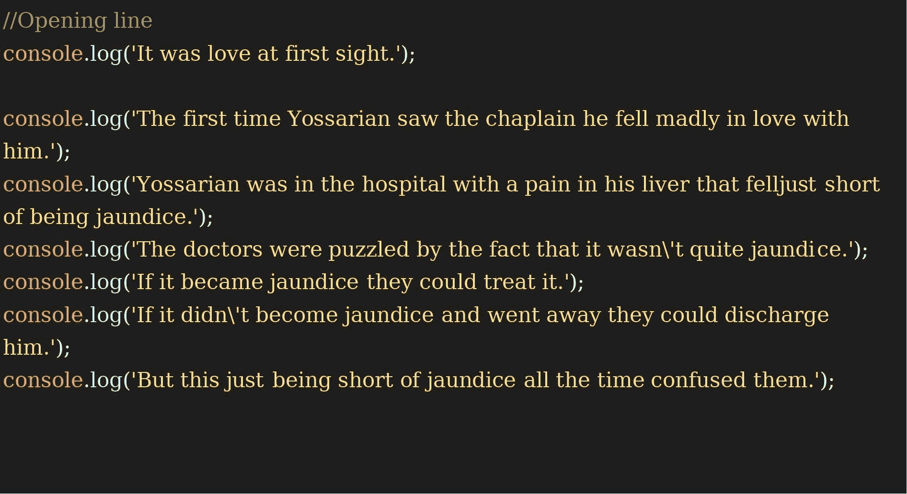

### 任务 2

1. 单行注释非常适合为代码添加上下文。多行注释通常最适合防止代码块运行。然而，两种类型的注释都可以用于任何目的。
2. 使用多行注释将底部的 6 个 `console.log()` 语句全部注释掉。

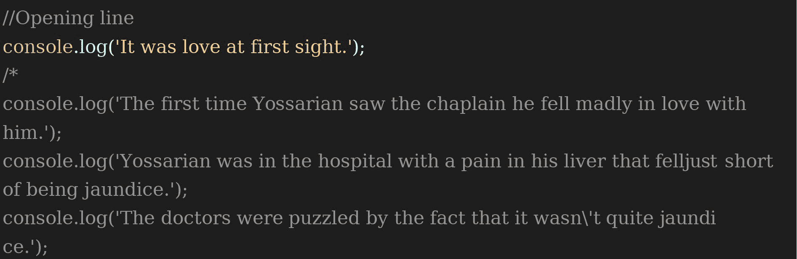

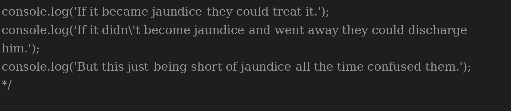

## 数据类型

数据类型是我们赋予编程中使用的不同类型数据的分类。在 JavaScript 中，有七种基本数据类型：

* **Number（数字）**：任何数字，包括带小数的数字：4, 8, 151, 23.42。
* **String（字符串）**：键盘上任何字符的组合（字母、数字、空格、符号等），用单引号 `'...'` 或双引号 `"..."` 包围。尽管我们更倾向于使用单引号。有些人喜欢把字符串看作文本的 Fancy 说法。
* **Boolean（布尔值）**：这种数据类型只有两个可能的值——`true` 或 `false`（不加引号）。将布尔值认为为开启/关闭开关或“是”/“否”问题的答案很有帮助。
* **Null（空）**：这种数据类型表示值的刻意缺失，由关键字 `null` 表示（不加引号）。
* **Undefined（未定义）**：这种数据类型由关键字 `undefined` 表示（不加引号）。它也表示值的缺失，但用法与 `null` 不同。
* **Symbol（符号）**：该语言的一项新特性，符号是唯一的标识符，在更复杂的编码中很有用。目前不需要担心这些。
* **Object（对象）**：相关数据的集合。

前 6 类型被认为是原始数据类型。它们是语言中最基础的数据类型。对象更复杂，随着你学习 JavaScript，你将学习更多关于它的知识。起初七种类型看起来并不多，但一旦你开始利用每种类型，很快就会发现世界充满了可能。随着你学习更多关于对象的知识，你将创建复杂的数据集合。

但在此之前，让我们熟悉字符串和数字吧！


在上面的示例中，我们首先打印了一个字符串。我们的 `string` 不仅仅是一个单词；它包含了大写字母和小写字母、空格和标点符号。

接下来，我们打印了数字 40，注意我们没有使用引号。


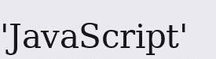

### 任务 1

1. 在第 1 行记录该字符串。

Checkpoint 2 Passed

卡住了？获取提示

### 任务 2

1. 在第 2 行记录该数字。

Checkpoint 3 Passed

卡住了？获取提示

### 任务 3

1. 在第 3 行，打印

Checkpoint 4 Passed

卡住了？获取提示

### 任务 4

1. 在第 4 行向控制台打印数字 20.49。


## 算术运算符

基础算术在编程时通常非常有用。

运算符是执行代码中执行任务的字符。JavaScript 有几种内置的算术运算符，允许我们对数字进行数学计算。这些包括以下运算符及其对应的符号：

1. 加法：`+`
2. 减法：`-`
3. 乘法：`*`
4. 除法：`/`
5. 取余：`%`

前四个的工作方式正如你想象的那样：

```javascript
console.log(3 + 4); // 打印 7
console.log(5 - 1); // 打印 4
console.log(4 * 2); // 打印 8
console.log(9 / 3); // 打印 3
```

注意，当我们使用 `console.log()` 时，计算机会计算括号内的表达式并将结果打印到控制台上。如果我们想打印字符 `3 + 4`，我们需要将它们括在引号中并作为字符串打印。


取余运算符（有时称为模运算）返回右侧数字在尽可能整除左侧数字后剩余的数字。例如：`11 % 3` 等于 `2`，因为 `3` 可以完全整除 `11` 三次，留下 `2` 作为余数。

### 指令

1. 在 `console.log()` 中，给你的年龄加上 `3.5`。这是当我们开始派遣人类去火星居住时，你将拥有的年龄。

检查点 2 已通过

卡住了？获取提示

2. 在新的一行中写另一个 `console.log()`。在括号内，获取当前年份并减去 `1969`。答案是自 `1969` 年登月登陆以来经过的年数。

检查点 3 已通过

卡住了？获取提示

3. 创建另一个 `console.log()`。在括号内用 `65` 除以 `240`。

检查点 4 已通过

卡住了？获取提示

4. 创建最后一个 `console.log()`。在括号内，将 `0.2708` 乘以 `100`。这是太阳中由氦元素组成的百分比。假设我们可以站在太阳上，我们的声音听起来都会像花栗鼠！


### 字符串拼接

运算符不仅用于数字！当 `+` 运算符用于两个字符串时，它会将右侧字符串附加到左侧字符串之后：


这种将一个字符串附加另一个字符串的过程被称为拼接。

注意在第三个例子中，我们必须确保在第一个字符串的末尾包含一个空格。计算机会精确地连接字符串，因此我们需要确保在两个字符串之间包含我们想要的空格。

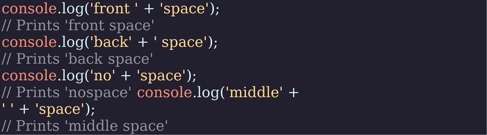

就像普通数学一样，我们可以组合或链联我们的操作以获得最终结果：

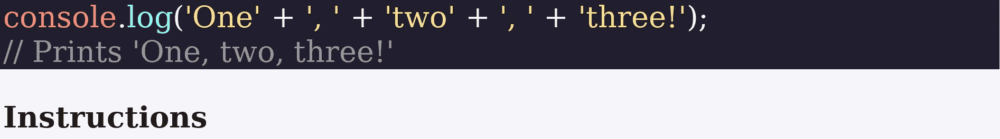

1. 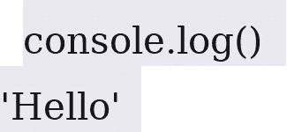在字符串语句中，将它们与 `'World'` 拼接在一起。

注意：你应该精确地拼接这两个字符串（不要引入任何额外的字符）。

检查点 2 已通过

卡住了？获取提示

2. 我们上次漏掉了空格。创建第二个 `console.log()` 语句，在其中拼接字符串 `'Hello'` 和 `'World'`，但这次要确保在两个单词之间也包含一个空格（`' '`）。


### 属性

当你向 JavaScript 程序引入新的数据时，浏览器将其保存为该数据类型的实例。每个字符串实例都有一个名为 `length` 的属性，用于存储该字符串中的字符数量。

你可以通过在字符串后加上句号和属性名称来获取属性信息：

```javascript
console.log('Hello'.length);  // 打印 5
```

`.` 是另一个运算符！我们称之为点运算符。

在上面的示例中，保存到 `length` 属性的值是从字符串实例 `'Hello'` 中获取的。程序向控制台打印 `5`，因为 `Hello` 包含五个字符。

### 指令

1. 使用 `.length` 属性向控制台记录以下字符串的字符数量：

`'Teaching the world how to code'`

```javascript
console.log('Teaching the world how to code'.length);
```

检查点 2 已通过

卡住了？获取提示

2. 在 `app.js` 的第二个 `console.log()` 语句中，我们有一个字符串 `' Remove whitespace '`，它在单词 `'Remove whitespace'` 前后都有空格。

如果我们浏览 [JavaScript 字符串文档](https://developer.mozilla.org/en-US/docs/Web/JavaScript/Reference/Global_Objects/String/prototype)，发现几个内置字符串方法，每个方法实现不同的目标。对我们来说理想的方法是 `.trim()`。

使用该方法移除第二个 `console.log()` 语句中字符串开头和结尾的空格。

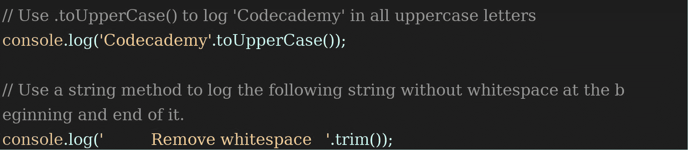

## 变量

在编程中，变量是值的容器。你可以将变量视为存储在计算机内存中的信息小容器。存储在变量中的信息（例如用户名、账户号码甚至个性化问候语）可以在内存中找到。

变量还提供了一种使用描述性名称标记数据的方法，以便读者和我们自己能更清楚地理解程序。

简而言之，变量在内存中标记并存储数据。你可以对变量的操作只有：

1. 创建一个具有描述性名称的变量。
2. 存储或更新存储在变量中的信息。
3. 引用或“获取”存储在变量中的信息。

重要的是变量不是值；它们包含值并用名称表示它们。观察带有彩色框的图表。每个框代表变量；值由内容表示，名称由标签表示。

在本节中，我们将介绍如何使用 `var`、`let` 和 `const` 关键字来创建变量。

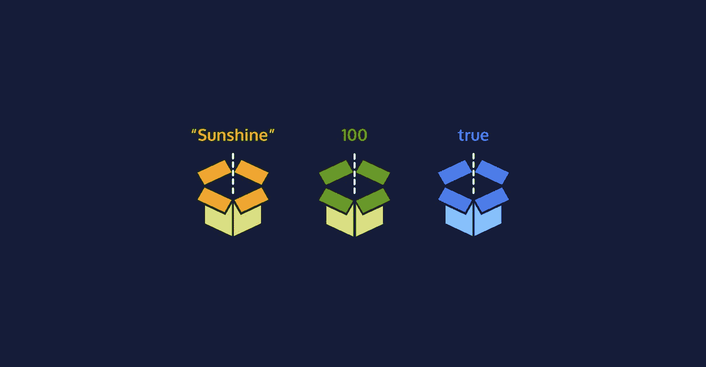

### 创建变量：var

2015 年 JavaScript ES6 版本引入了许多变化。其中最大的变化之一是两个新关键字 `let` 和 `const`，用于创建或声明变量。在 ES6 之前，程序员只能使用 `var` 关键字来声明变量。


让我们考虑上面的例子：

1. `var` 是 variable 的缩写，是一个 JavaScript 关键字，用于创建或声明新变量。
2. `myName` 是变量名。这种大小写结合的方式是 JavaScript 中的一种标准约定，称为驼峰命名法（camel casing）。在驼峰命名法中，将单词组合为一个，第一个单词小写，随后的每个单词的首字母都要大写（例如 `camelCaseEverything`）。
3. `=` 是赋值运算符。它将值 `'Arya'` 赋值给变量 `myName`。
4. `'Arya'` 是赋值 (=) 给变量 `myName` 的值。你也可以说变量 `myName` 使用值 `'Arya'` 初始化了。
5. 变量声明完毕后，通过引用变量名 `console.log(myName)` 将字符串值 `'Arya'` 打印到控制台。

变量命名有几条通用规则：

* 变量名不能以数字开头。
* 变量名是区分大小写，因此 `myName` 和 `myname` 是不同的变量。创建两个大小写不同但名称相同的变量是一个坏习惯。
* 变量名不能与关键字相同。要查看完整的关键字列表，请参考 [MDN 关键字文档](https://developer.mozilla.org/en-US/docs/Web/JavaScript/Reference/Lexical_grammar#Keywords)。

注意：在接下来的练习中，我们将学习为什么许多程序员倾向于使用 ES6 的 `let` 和 `const` 作为变量关键字。因为仍然有大量代码是在 ES6 之前写的，所以熟悉 ES6 之前的 `var` 关键字是有帮助的。

如果你想了解更多关于 `var` 及其特殊特性，请查看 [MDN var 文档](https://developer.mozilla.org/en-US/docs/Web/JavaScript/Reference/Statements/var)。


### 练习

1. 使用 `var` 关键字声明一个名为 `favoriteFood` 的变量，并为其赋值字符串 'pizza'。

   - Checkpoint 2 Passed
   - Stuck? Get a hint

2. 使用 `var` 关键字声明一个名为 `numOfSlices` 的变量，并为其赋值数字 8。

   - Checkpoint 3 Passed
   - Stuck? Get a hint

3. 在 `numOfSlices` 变量下方，使用 `console.log()` 输出存储在 `favoriteFood` 中的值。

   在下一行，使用 `console.log()` 输出存储在 `numOfSlices` 中的值。

   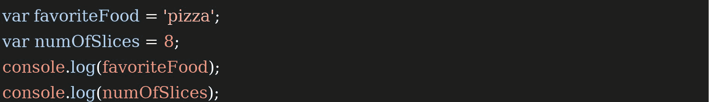

## 创建变量：let

正如上一个练习提到的，`let` 关键字是在 ES6 中引入的。`let` 关键字表示该变量可以重新赋予不同的值。看示例：


在使用 `let`（甚至是 `var`）我们需要我们需要的另一个概念是，我们可以声明变量而不给其赋值。在这种情况下，变量将自动初始化为值 `undefined`：


注意上面的示例：

* 如果我们不对使用 `let` 关键字声明的变量赋值，它会自动具有值 `undefined`。
* 我们可以重新为变量赋值。

### 指令

1. 创建一个名为 `changeMe` 的 `let` 变量，并设置为布尔值 `true`。

   - Checkpoint 2 Passed
   - Stuck? Get a hint

2. 在声明 `changeMe` 的之后，将 `changeMe` 的值设置为布尔值 `false`。

   为了检查 `changeMe` 是否被重新赋值，将存储在 `changeMe` 中的值打印到控制台。

   

## 创建变量：const

`const` 关键字也是在 ES6 中引入的，是 constant 一词的写。与 `var` 和 `let` 一样，你可以在 `const` 变量中存储任何值。声明 `const` 变量并赋值的方法与 `let` 和 `var` 相同。看以下示例：


然而，`const` 变量不能重新赋值，因为它是常量。如果你尝试重新给 `const` 变量赋值，将得到 `TypeError`。

常量变量在声明时必须赋值。如果你尝试在不赋值的情况下声明 `const` 变量，将得到 `SyntaxError`。

如果你在犹豫使用哪个关键字（`let` 还是 `const`），请考虑你之后是否需要重新变量赋值。如果确实需要重新赋值，使用 `let`，否则使用 `const`。

### 指令

1. 创建一个名为 `entree` 的常量变量，并设置为字符串 'Enchiladas'。

   - Checkpoint 2 Passed
   - Stuck? Get a hint

2. 为了检查你已将 'Enchiladas' 的值保存到 `entree`，将 `entree` 的值打印到控制台。

   - Checkpoint 3 Passed
   - Stuck? Get a hint

3. 太棒了，让我们尝试重新给常量赋值会发生什么。将以下代码粘贴到程序的末尾。

```
entree = 'Tacos'
```

当你运行代码时，这段代码会抛出以下错误：

```
TypeError: Assignment to constant variable.
```

在你清除此检查点后，如果你想查看 `const` 的另一个特殊特性，请打开提示！

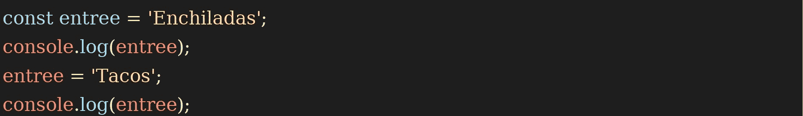

## 数学赋值运算符

让我们考虑如何使用变量和数学运算符来计算新值并将它们赋值给变量。看下面的示例：

| `let w = 4; w = w + 1;console.log(w); // 输出: 5` | 在上面的示例中，我们创建了变量 `w` 并为其赋值数字 4。下一行 `w = w + 1` 将 `w` 的值从 4 增加到 5。 |

我们在对 `w` 执行某些数学操作后，重新赋值的另一种方法是使用内置的数学赋值运算符。我们可以重写上面的代码为：


在第二个示例中，我们使用 `+=` 赋值运算符重新给 `w` 赋值。我们使用右侧的数字对第一个运算符 `+` 进行数学运算，然后将结果重新赋值给 `w`。

我们还可以使用其他数学赋值运算符：`-=`、`*=` 和 `/=`，它们的工作方式类似。

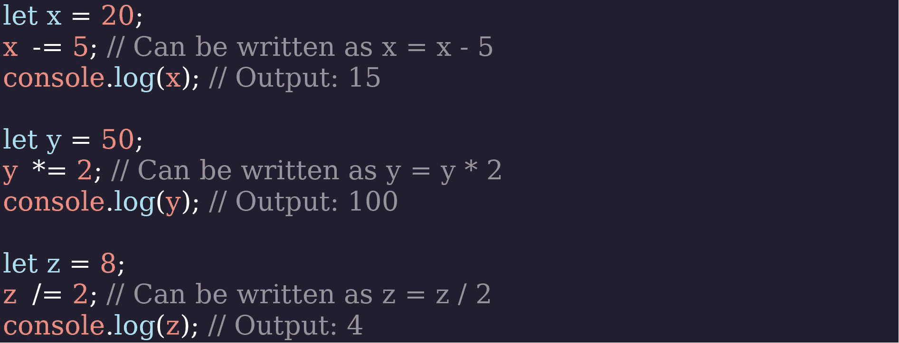

让我们练习使用这些数学赋值运算符！

### 指令

1. 使用 `+=` 数学赋值运算符将 `levelUp` 中存储的值增加 5。

   - Checkpoint 2 Passed
   - Stuck? Get a hint

2. 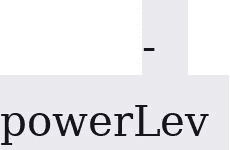 使用 `-=` 数学赋值运算符将存储的值减少 100。

   - Checkpoint 3 Passed
   - Stuck? Get a hint

3. 使用 `*=` 数学赋值运算符将 `multiplyMe` 中存储的值乘以 11。

   - Checkpoint 4 Passed
   - Stuck? Get a hint

4. 使用 `/=` 数学赋值运算符将 `quarterMe` 中存储的值除以 4。

   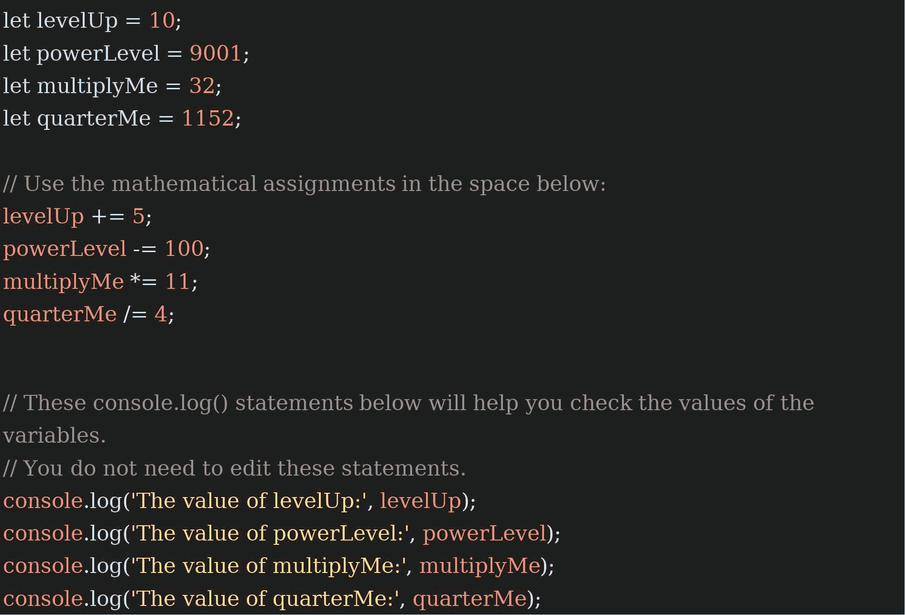

## 递增递减运算符

其他数学赋值运算符包括自增运算符 `++` 和自减运算符 `--`。

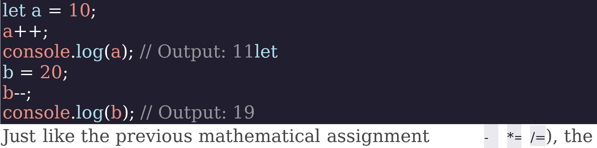 自增运算符会将变量的值加 1。自减运算符会将变量的值减 1。例如：变量的值被更新并赋值为该值的新值。

### 指令

1. 使用自增运算符增加 `gainedDollar` 的值。

   - Checkpoint 2 Passed
   - Stuck? Get a hint

2. 使用自减运算符减少 `lostDollar` 的值。

   

## 变量的字符串拼接

在之前的练习中，我们将字符串赋值给变量。现在，让我们来看看如何在变量中连接（或拼接）字符串。

`+` 运算符可以组合两个字符串值，即使这些值存储在变量中：


在上面的示例中，我们将值 'armadillo' 赋值给变量 `myPet`。在第二行中，使用 `+` 运算符组合三个字符串：'I own a pet'、存储在 `myPet` 中的值以及 '.'。我们将此拼接的结果打印到控制台，如下：


### 指令

1. 创建一个名为 `favoriteAnimal` 的变量，并将其设置为你最喜欢的动物。

   - Checkpoint 2 Passed
   - Stuck? Get a hint

2. 使用 `console.log()` 向控制台打印 'My favorite animal: ANIMAL'。使用字符串拼接，使 `ANIMAL` 被替换为 `favoriteAnimal` 变量中的值。

   

## 字符串插值

在 ES6 版本的 JavaScript 中，我们可以使用模板字面量（template literals）将变量插入或插值字符串。看以下示例，它使用了模板字面量将字符串连接在一起：


请注意：

* 模板字符串是用反引号 `` ` `` 包围的（此按键通常位于键盘顶部，数字键 1 的左侧）。
* 在模板字符串内部，你会看到一个占位符 `${myPet}`。`myPet` 的值会被插入到模板字符串中。
* 当我们插值 `I own a pet ${myPet}.` 时，我们打印的输出是字符串：`'I own a pet armadillo.'`。

使用模板字符串最大的好处之一是代码的可读性。使用模板字符串，你可以更轻松地看出新字符串将是什么。你不需要担心转义双引号或单引号。


### 1

创建一个名为的变量

检查点 2 通过

卡住了吗？获取提示

### 2

创建一个名为的变量

检查点 3 通过

### 3

并将你的名字赋值给它。

并将你喜欢的城市赋值给它。使用单个模板字符串将你的变量插值到下面的句子中。使用 `console.log()` 按以下格式将你的句子打印到控制台：

`My name is NAME. My favorite city is CITY.` 通过插值保存到 `myName` 和 `myCity` 的值来替换上述字符串中的 `NAME` 和 `CITY`。

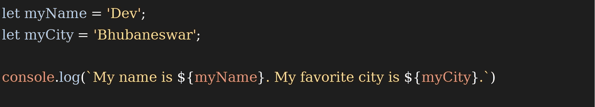

### typeof 运算符

在编写代码时，跟踪程序中变量的数据类型是有用的。如果你需要检查变量值的数据类型，可以使用 `typeof` 运算符。

`typeof` 运算符检查其右侧的值，并返回（或传回）一个数据类型的字符串。


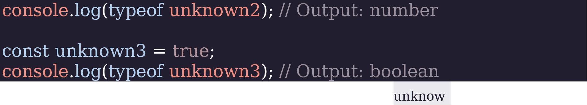让我们来拆解第一个例子。由于值为 `'foo'`，`typeof unknown1` 将返回 `'string'`。

### 指令

1. 使用 `console.log()` 打印 `newVariable` 的 `typeof`。

检查点 2 通过

卡住了吗？获取提示

2. 太棒了，现在让我们看看重新赋值变量会发生什么。在 `console.log()` 语句下方，将 `newVariable` 重新赋值为 `1`。

检查点 3 通过

卡住了吗？获取提示

3. 由于你给 `newVariable` 赋值了这个新值，它有一个新的类型！在你重新赋值的下一行，使用 `console.log()` 再次打印 `typeof newVariable`。

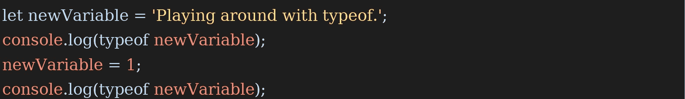

### 复习变量

做得好！本节向你介绍了变量，这是一个你在未来的编程活动中都会用到的强大概念。

回顾一下我们学到的：

* 变量在程序中存储可重用的数据并将其与名称关联。
* 变量存储在内存中。
* `var` 关键字用于预 ES6 之前的 JS 版本中。
* `let` 是声明可重新赋值变量的首选方式，而 `const` 是声明常量值变量的首选方式。
* 未初始化的变量存储原始数据类型 `undefined`。
* 数学赋值运算符可以轻松地计算新值并将其赋值给同一个变量。
* `+` 运算符用于拼接字符串，包括变量中持有的字符串值。
* 在 ES6 中，模板字符串使用反引号 `` ` `` 和 `${}` 将值插值到字符串中。
* `typeof` 关键字返回值的类型类型（字符串形式）。

## 什么是条件语句？

在生活中，我们根据情况做决定。考虑一个像睡觉这样平凡的日常决定——如果我们累了，我们就睡觉；否则，我们就起床开始新的一天。

这些 if-else 决策可以通过创建条件语句在代码中进行建模。条件语句检查特定的条件，并根据条件执行任务。

在本节中，我们将探索程序如何通过评估条件来做出决策，并在我们的代码中引入逻辑！

我们将涵盖以下概念：

* `if`、`else if` 和 `else` 语句
* 比较运算符
* 逻辑运算符
* 真值（truthy）与假值（falsy）
* 三元运算符
* switch 语句

所以，如果你准备好学习这些概念，请进入下一节——否则，请阅读这些概念，观察图表，并为本节做好准备！

### 指令

查看图表了解条件如何允许我们创建决策技术。

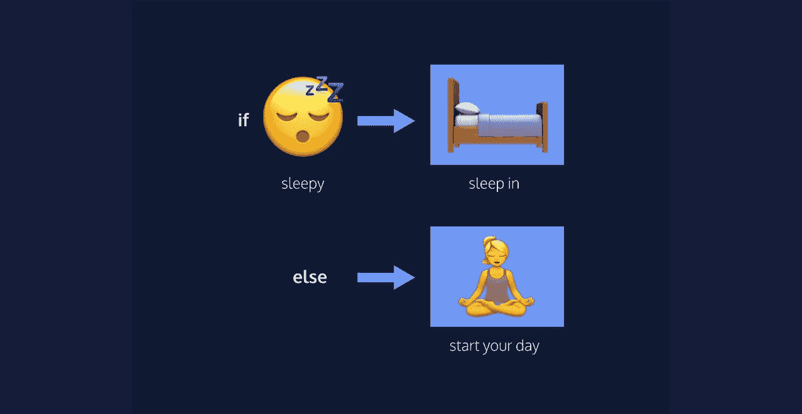

## If 语句

我们经常根据条件执行任务。例如，如果今天天气不错，我们就会出去。如果闹钟响了，我们就把它关掉。如果我们累了，我们就会睡觉。

在编程中，我们也可以使用 `if` 语句根据条件执行任务：


注意上面的示例，我们有一个 `if` 语句。`if` 语句由以下部分组成：

* `if` 关键字后面跟着一组括号 `()`，后面是一个代码块或块语句，由一组大括号 `{}` 表示。
* 在括号 `()` 内部，提供了一个评估结果为 `true` 或 `false` 的条件。
* 如果条件评估为 `true`，大括号 `{}` 内部的代码将运行或执行。
* 如果条件评估为 `false`，该块将不会执行。让我们写一个 `if` 语句。

### 指令

1. 使用 `let` 关键字声明名为 `sale` 的变量。给它赋值 `true`。

检查点 2 通过

卡住了吗？获取提示

2. 现在创建一个 `if` 语句。为 `if` 语句提供一个 `sale` 条件。在 `if` 语句的代码块内部，使用 `console.log()` 打印字符串 `'Time to buy!'`。

检查点 3 通过

卡住了吗？获取提示

3. 注意 `if` 语句内部的代码运行了，因为 `'Time to buy!'` 被打印到了控制台。在 `sale` 变量声明下方、`if` 语句上方，将 `sale` 重新赋值为 `false`。运行你的代码并观察发生了什么，我们将在下一个练习中改变这种行为。

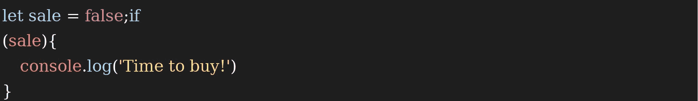

## If...Else 语句

在上一个练习中，我们使用检查条件的 `if` 语句来决定是否运行一段代码。在很多情况下，如果条件评估为假，我们也有想要运行的代码。

小于：`<`
* 大于：`>`
* 小于等于： `<=`
* 大于等于：`>=`
* 等于：`===`
* 不等于：`!==`

比较运算符比较左侧的值与右侧的值。例如：

`10 < 12` // 结果为 true。将比较语句视为问题可能会很有帮助。当答案为“是”时，语句求值为 `true`；当答案为“否”时，语句求值为 `false`。上面的代码是在提问：`10` 是否小于 `12`？是的！所以 `10 < 12` 的求值结果为 `true`。

我们也可以对不同的数据类型（如字符串）使用比较运算符：

`'apples' === 'oranges'` // false 在上面的示例中，我们正在使用标识运算符（`===`）来检查字符串 `'apples'` 是否与字符串 `'oranges'` 。由于这两个字符串不同，因此比较语句求值为 `false`。

所有比较语句的求值均为 `true` 或 `false`，它们由以下部分组成：

* 两个将进行比较的值。
* 一个分隔这些值并相应进行比较的运算符（`>`, `<`, `<=`, `>=`, `===`, `!==`）。

让我们练习使用这些比较运算符吧！

### 指令 1

使用 `let` 创建一个名为 `hungerLevel` 的变量，并将其赋值为 `7`。

检查点 2 通过

### 指令 2

使用比较运算符编写一个 `if...else` 语句。条件应该检查 `hungerLevel` 是否大于 `7`。如果是，则条件语句应该打印 `'Time to eat!'`。否则，它应该打印 `'We can eat later!'`。

在按下运行后，通过使用不同的运算符（如 `<=`, `>=`, `>`, 和 `<`）调整 `hungerLevel` 的比较来尝试不同的条件。

```javascript
let hungerLevel = 7;
```

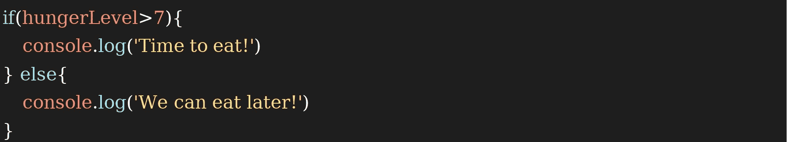

## 逻辑运算符

处理条件语句意味着我们将使用布尔值，即 `true` 或 `false` 值。在 JavaScript 中，有可以与布尔值工作的运算符，被称为逻辑运算符。我们可以使用逻辑运算符为我们的条件语句添加更复杂的逻辑。共有三种逻辑运算符：

* 与运算符（`&&`）
* 或运算符（`||`）
*  非，也称为感叹号运算符（`!`）

当我们使用 `&&` 运算符时，我们正在检查两件事是否都为 `true`：

当使用 `&&` 运算符时，两个条件都必须求值为 `true`，整个条件才会求值为 `true` 并执行。否则，如果任一条件为 `false`，`&&` 条件将求值为 `false` 并执行 `else` 块。

如果我们只关心其中一个条件是否为 `true`，可以使用 `||` 运算符：


当使用 `||` 运算符时，只需其中一个条件求值为 `true`，整个语句就会求值为 `true`。在上面的代码示例中，如果 `day === 'Saturday'` 或 `day === 'Sunday'` 任一个求值为 `true`，`if` 条件将求值为 `true`，其代码块将执行。如果 `||` 语句中的第一个条件求值为 `true`，则甚至不会检查第二个条件。只有当 `day === 'Saturday'` 求值为 `false` 时，才会评估 `day === 'Sunday'`。上面 `else` 语句中的代码只有在两个比较都求值为 `false` 时才会执行。

`!` 非运算符会反转或否定布尔值的值：


本质上，`!` 运算符将取一个 `true` 值并返回 `false`，或者取一个 `false` 值并返回 `true`。

逻辑运算符经常用于条件语句，为我们的代码添加另一层逻辑。

### 指令 1

在 `main.js` 中有两个变量 `mood` 和 `tirednessLevel`。

让我们创建一个 `if...else` 语句，检查 `mood` 是否为 `'sleepy'` 且 `tirednessLevel` 是否大于 `8`。

如果两个条件都求值为 `true`，则通过 `console.log()` 输出字符串 `'time to sleep'`。否则，我们应该 `console.log()` `'not bed time yet'`。

在按下“运行”后，尝试使用 `||` 运算符和 `!` 运算符！如果用 `!` 否定整个语句的值并用 `||` 替换 `&&`，会发生什么？


## 真值与假值

让我们考虑非布尔数据类型（如字符串或数字）在条件内部检查时是如何被求值的。

有时，你想检查一个变量是否存在，并不一定要求它等于某个特定值——你只需检查该变量是否已赋值。

这里有一个示例：

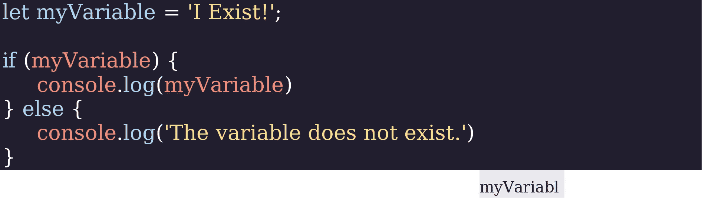 语句中的代码块将运行，因为 `myVariable` 具有 Images/image04617.jpeg)一个真值（truthy value）；尽管 `myVariable` 的值并非显式的 `true`，但在布尔或条件上下文中，它求值为 `true`，因为它被赋值了一个非假值。

那么，哪些值是假值（falsy）——即在作为条件检查时求值为 `false`？假值列表包括：

* `0`
* 空字符串，如 `""` 或 `''`
* `null` 表示完全没有值
* `undefined` 表示声明的变量缺少值
* `NaN`，或不是数字。这里有一个数字的示例：

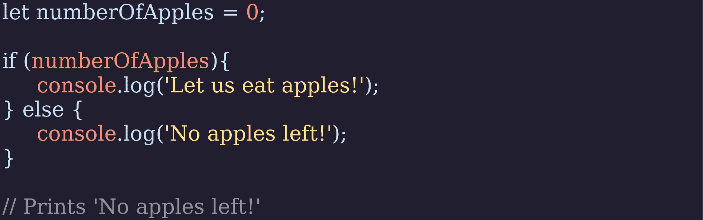

该条件求值为 `false`，是因为 `numberOfApp` 的值为 `0`。由于 `0` 是假值，`else` 语句中的代码块将运行。

### 指令 1

更改 `wordCount` 的值使其成为真值。该值仍应该是一个数字。

在你进行此更改并运行代码后，控制台应打印 'Great! You've started your work!'。

检查点 2 通过

卡住了？获取提示

### 指令 2

更改 `favoritePhrase` 的值，使其仍然是字符串但表现为假值。

在你进行此更改并运行代码后，控制台应打印 'This string is definitely empty.'。

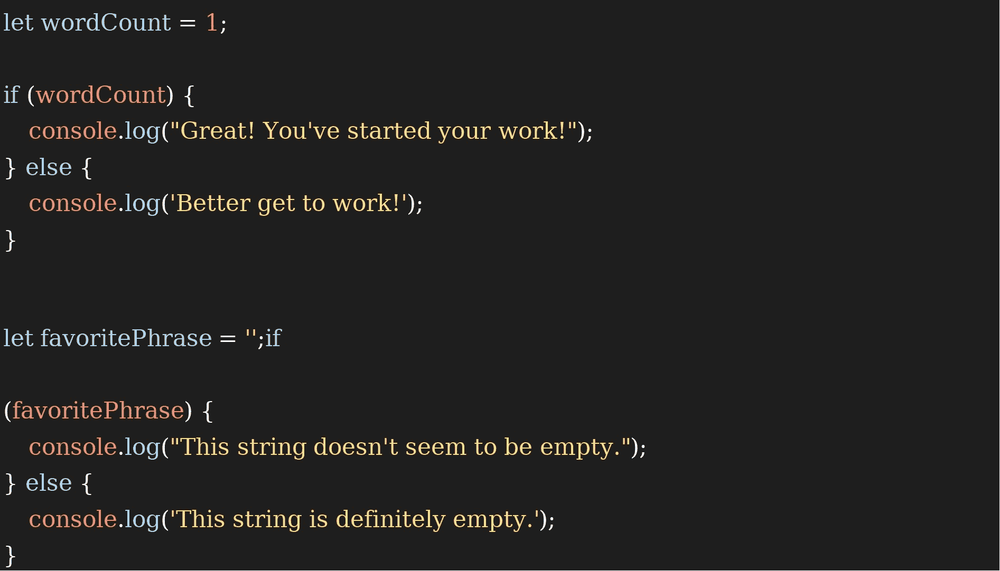

## 真值与假值的赋值

真值和假值的求值开启了一个代码简写的可能世界！

假设你有一个网站，想要获取用户的用户名来制作个性化的问候。有时，用户没有账户，导致 `username` 变量为假值。下面的代码检查 `username` 是否定义，如果未定义则分配一个默认字符串：

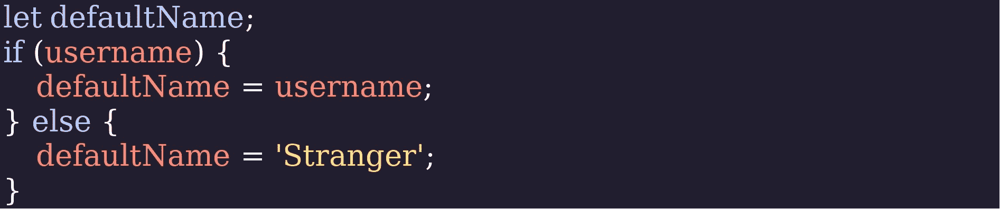

如果你结合你对逻辑运算符的知识，可以使用上述代码的简写。在布尔条件中，如果你在赋值中使用 `||` 运算符，JavaScript 会将真值分配给变量：

```javascript
let defaultName = username || 'Stranger';
```

因为 `||` 语句首先检查左侧的条件，如果 `username` 是真值，变量 `defaultName` 将分配 `username` 的实际值；如果 `username` 是假值，则将被分配 `'Stranger'`。这个概念也被称为短路值（short-circuit evaluation）。

### 指令 1

让我们使用短路值为 `writingUtensil` 赋值。不要编辑 `tool`，我们将在下一步返回 `tool`。

给 `writingUtensil` 赋值 `tool` 的值，如果 `tool` 为假值，则分配默认值 `'pen'`。

检查点 2 通过

卡住了？获取提示

### 指令 2

注意控制台打印了文本 'The pen is mightier than the sword'。这意味着 `writingUtensil` 的值为 'pen'。

如果我们把 `tool` 的值重新赋值为 'marker' 会怎样？看看 `writingUtensil` 的值发生什么变化。

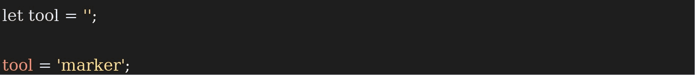

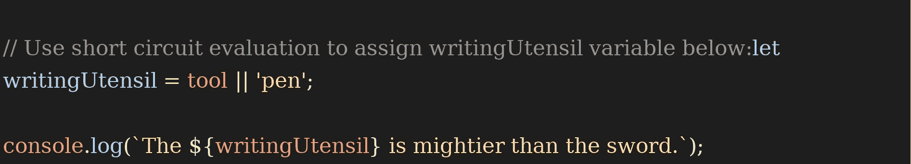

## 三元运算符

本着使用简化语法的精神，我们可以使用三元运算符来简化 `if...else` 语句。

看看这个 `if...else` 语句示例：

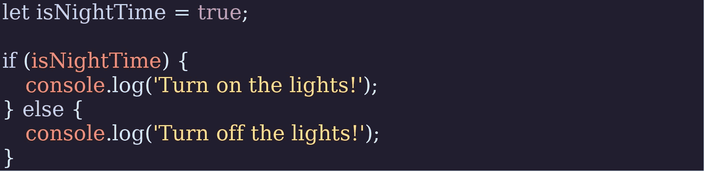

我们可以使用三元运算符来实现相同的功能：


在上面的示例中：

* 条件 `isNightTime`位于 `?` 之前。
* 两个表达式跟在 `?` 后面并用冒号 `:` 分隔。
* 如果条件求值为 `true`，则执行第一个表达式。
* 如果条件求值为为假，则执行第二个表达式。

与 `if...else` 语句一样，三元运算符也可用于求值为真或为假的条件。

### 指令

1. 重构或编辑第一个 `if...else` 块，以使用三元运算符。

检查点 2 通过

卡住了？获取提示

2. 重构第二个 `if...else` 块，以使用三元运算符。

检查点 3 通过

卡住了？获取提示

3. 重构第三个 `if...else` 块，以使用三元运算符。

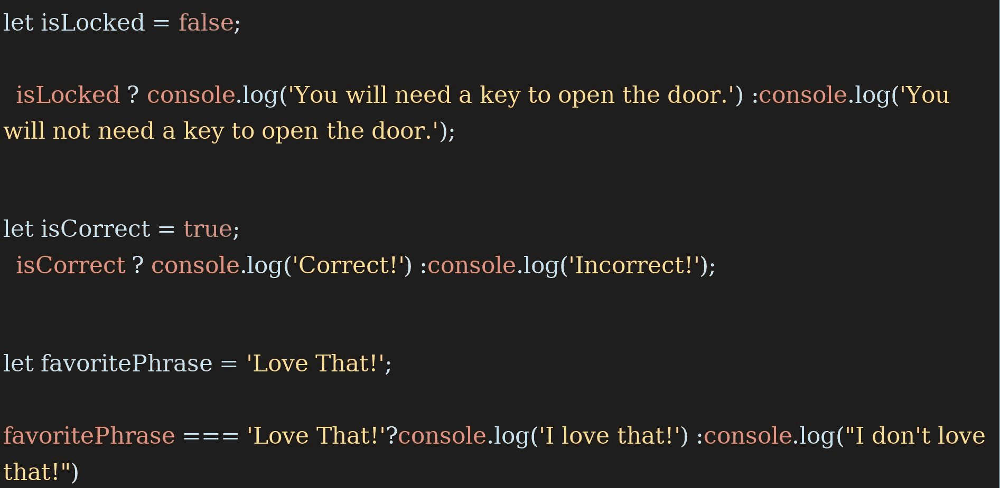

## Else If 语句

我们可以通过 `else if` 语句向 `if...else` 语句中添加更多条件。

`else if` 语句允许出现两种以上的可能结果。你可以根据需要添加尽可能多个 `else if` 语句，构建更复杂的条件判断！

`else if` 语句始终位于 `if` 语句之后、`else` 语句之前。`else if` 语句也接受一个条件。让我们来看下语法：

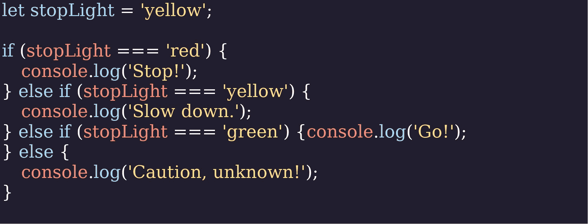

`else if` 语句允许你拥有多个可能的结果。`if/else if/else` 语句从上到下读取，因此从上到下第一个求值为真的条件就是会被执行的代码块。

在上面的示例中，由于 `stopLight === 'red'` 求值为假，而 `stopLight === 'yellow'` 求值为真，因此执行第一个 `else if` 语句内部的代码。其余条件将不再被求值。如果没有一个条件求值为真，则将执行 `else` 语句中的代码。

### 指令

1. 让我们创建一个追踪环境随季节变化的程序。编写一个条件语句来实现这一功能！

在 `main.js` 中已经有一个 `if...else` 语句了。让我们添加一个 `else if` 语句，检查 `season` 是否等于 `'winter'`。

在 `else if` 语句的代码块内部，添加一个 `console.log()`，打印字符串 `'It\'s winter! Everything is covered in snow.'`。

检查点 2 通过

卡住了？获取提示

2. 添加另一个 `else if` 语句，检查 `season` 是否等于 `'fall'`。在你刚刚创建的 `else if` 语句代码块内部，添加一个 `console.log()`，打印字符串 `'It\'s fall! Leaves are falling!'`。

检查点 3 通过

卡住了？获取提示

3. 添加最后一个 `else if` 语句，检查 `season` 是否等于 `'summer'`。

在你刚刚创建的 `else if` 语句代码块内部，添加一个 `console.log()`，打印字符串 `'It\'s sunny and warm because it\'s summer!'`。

```javascript
let season = 'summer';
```

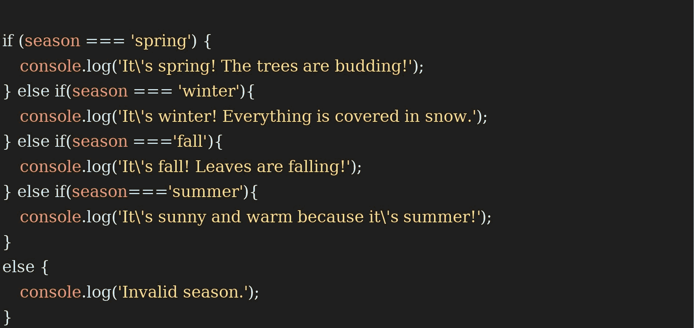

## switch 关键字

如果我们需要检查多个条件，`else if` 语句是一个非常棒的工具。在编程中，我们经常发现需要检查多个值，并对每个值进行不同的处理。例如：

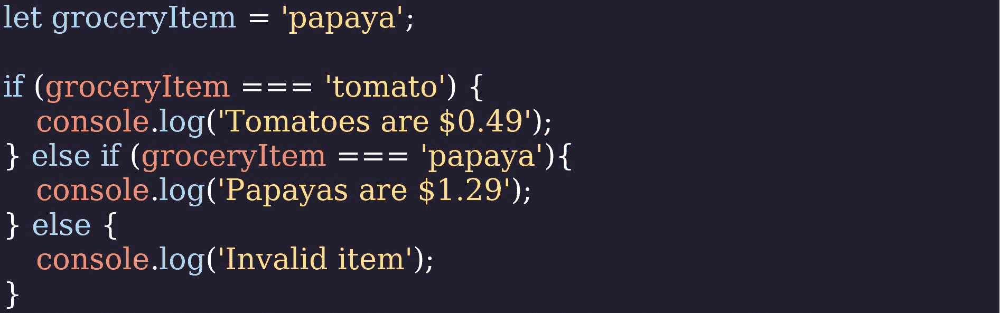

在上面的代码中，我们有一系列条件来检查值是否匹配 `groceryItem` 变量。我们的代码运行正常，但想象一下如果我们需要检查 100 个不同的值呢！要写那么多 `else if` 语句听起来是件痛苦的事！

`switch` 语句提供了一种更易读、易写的替代语法。`switch` 语句如下所示：

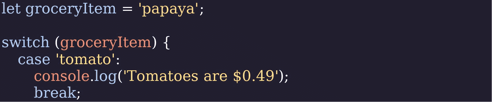

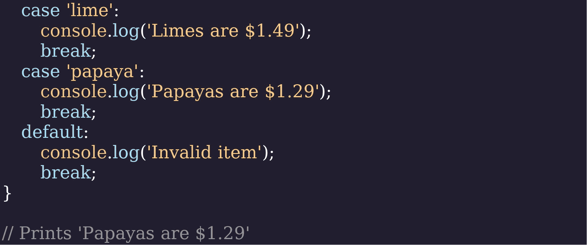

* `switch` 关键字启动语句，后面跟着 `( ... )`，其中包含每个 `case` 将要比较的值。在示例中，`switch` 语句的值或表达式是 `groceryItem`。
* 在块 `{ ... }` 内部有多个 `cases`。`case` 关键字检查表达式是否匹配其后的指定值。第一个 `case` 之后的值是 `'tomato'`。如果 `groceryItem` 的值等于 `'tomato'`，则该 case 的 `console.log()` 就会运行。
* `groceryItem` 的值为 `'papaya'`，因此运行第三个 `case`——向控制台打印“Papayas are $1.29”。
* `break` 关键字告诉计算机退出该块，不再执行任何其他代码，或检查代码块内的任何其他 `case`。注意：如果没有 `break` 关键字，第一个匹配的 `case` 将运行，但随后的每个 `case` 无论是否匹配都会运行——包括 `default`。这种行为与只执行一个代码块的 `if/else` 条件语句不同。
* 在每个 `switch` 语句的末尾都有一个 `default` 语句。如果没有任何 `cases` 为真，则将执行 `default` 语句中的代码。

### 指令

1. 让我们写一个 `switch` 语句来决定给运动员颁什么奖牌。

`athleteFinalPosition` 已经在 `main.js` 顶部定义。所以从写一个以 `athleteFinalPosition` 为表达式的 `switch` 语句开始。

Checkpoint 2 通过

卡住了？获取提示

2. 在 `switch` 语句内部添加三个 `cases`：

* 第一个 `case` 检查值 `'first place'`
    * 如果表达式的值匹配 case 的值，则 `console.log()` 字符串 `'You get the gold medal!'`
* 第二个 `case` 检查值 `'second place'`
    * 如果表达式的值匹配 case 的值，则 `console.log()` 字符串 `'You get the silver medal!'`
* 第三个 `case` 检查值 `'third place'`
    * 如果表达式的值匹配 case 的值，则 `console.log()` 字符串 `'You get the bronze medal!'`

记得在每个 `console.log()` 之后添加一个 `break`。

Checkpoint 3 通过

卡住了？获取提示

3. 现在，在 `switch` 的末尾添加一个 `default` 语句，使用 `console.log()` 打印 `'No medal awarded.'`。

如果 `athleteFinalPosition` 不等于任何 `cases` 中的值，则控制台打印字符串 `'No medal awarded.'`。

记得在 `default` case 的末尾添加 `break` 关键字。

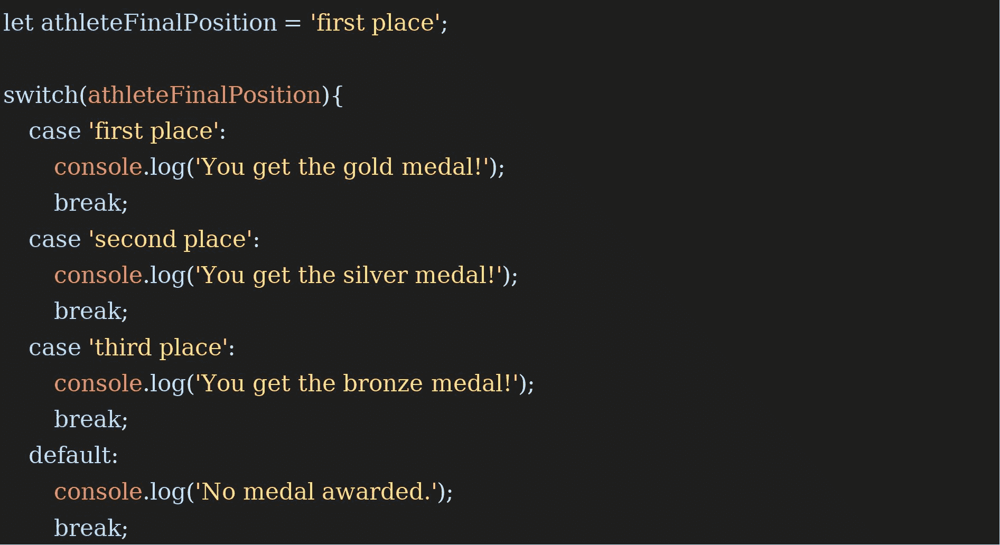

## 复习

干得好！这里是关于条件判断的一些主要概念：

* `if` 语句检查条件，如果该条件求值为真，则执行任务。
* `if...else` 语句进行二元决策，并根据条件执行不同的代码块。
* 我们可以使用 `else if` 语句添加更多条件。
* 比较运算符 `<`, `>`, `<=`, `>=`, `===` 和 `!==` 可以比较两个值。
* 逻辑与运算符 `&&`（或“and”）检查提供的两个表达式是否都为真。
* 逻辑或运算符 `||`（或“or”）检查提供的表达式中是否有一个为真。
* 感叹号运算符 `!` 切换值的真值和假值。
* 三元运算符是简化简洁 `if...else` 语句的简写。
* `switch` 语句可以简化编写多个 `else if` 语句的流程。`break` 关键字在 `switch` 语句中停止对剩余 `cases` 的检查和执行。

## 函数

在编程中，我们经常使用代码来多次执行特定的任务。与其重复编写相同的代码，我们可以将一组代码分组并将其与某个任务关联，这样每当我们需要再次执行该任务时，就可以重用这块代码。我们通过创建函数来实现这一目标。函数是一个可重用的代码块，它将一组语句组合在一起以执行特定任务。

在本节中，你将学习如何创建和使用函数，以及如何利用它们来创建更清晰、更简洁的代码。

## 函数声明

在 JavaScript 中，有许多创建函数的方法。一种方法是使用函数声明。就像变量声明将值绑定到变量名一样，函数声明将函数绑定到一个名称（或标识符）上。请看下方的函数声明结构：

一个函数声明由以下部分组成：

* `function` 关键字。
* 函数名（或其标识符），后面跟着圆括号 `()`。
* 函数体，即执行特定任务所需的语句块，被封装在函数的大括号 `{ }` 之中。

函数声明是绑定到标识符或名称的函数。在下一个练习中，我们将介绍如何运行函数体内部的代码。

我们还应该注意到 JavaScript 中的**提升（hoisting）**特性，它允许在定义函数声明之前访问它们。

看看这个提升的示例：


注意看提升是如何允许在定义 `greetWorld()` 函数之前对其调用的！由于提升不被认为是良好实践，我们只是想让你了解这一特性。

如果你想阅读更多关于提升的知识，请查看 [MDN 文档](https://developer.mozilla.org/en-US/docs/Glossary/Hoisting) 中的[关于提升的内容](https://developer.mozilla.org/en-US/docs/Glossary/Hoisting)。

### 指南

1. 让我们创建一个在控制台打印提醒信息的函数。使用函数声明，创建一个名为 `getReminder()` 的函数。

检查点 2 已通过

卡住了？获取提示

2. 在 `getReminder()` 的函数体中，向控制台记录以下提醒：`'Water the plants.'`

检查点 3 已通过

卡住了？获取提示

3. 让我们创建另一个函数，在控制台打印一句实用的西班牙语旅游短语。使用函数声明，创建一个名为 `greetInSpanish()` 的函数。

检查点 4 已通过

卡住了？获取提示

4. 向 `greetInSpanish()` 的函数体添加代码：

* 在函数体内部通过 `console.log()` 向控制台记录以下西班牙语短语：`'Buenas Tardes.'`

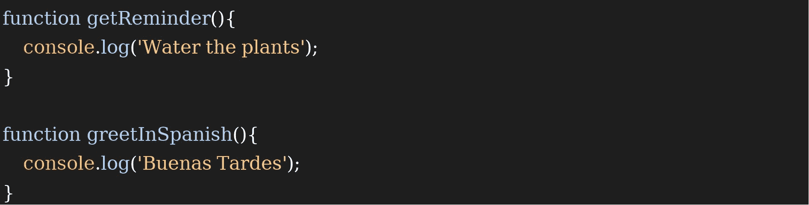

## 调用函数

正如我们在之前的练习中看到的，函数声明将函数绑定到标识符。然而，函数声明并不会要求函数体内的代码运行，它只是声明了函数的存在。只有在函数被调用时，函数体内的代码才会运行或执行。

要在代码中调用函数，你输入函数名并在后面加上圆括号 `()`。这种函数调用会执行函数体，即函数声明中大括号之间的所有语句。我们可以根据需要多次调用同一个函数。让我们在代码中练习调用函数吧。


1. 想象你经营着一家在线商店。当客户下单时，你会给他们发送一封感谢信。让我们创建一个函数来完成这项任务：

*  使用函数声明定义一个名为 `sayThanks()` 的函数。
* 在 `sayThanks()` 的函数体中添加代码，使得函数在被调用时向控制台写入以下感谢信息：`'Thank you for your purchase! We appreciate your business.'`

检查点 2 已通过

卡住了？获取提示

2. 调用 `sayThanks()` 在控制台查看感谢信息。

检查点 3 已通过

卡住了？获取提示

3. 函数可以根据需要调用任意次数。想象有三位客户下了订单，你想给他们每人发送一条感谢信息。更新你的代码以调用三次 `sayThanks()`。

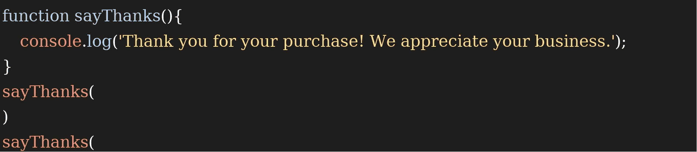

## 参数和参数

到目前为止，我们创建的函数在没有输入的情况下执行任务。然而，某些函数可以接受输入并使用这些输入来执行任务。在声明函数时，我们可以指定它的**参数（parameters）**。参数允许函数接受输入并使用输入完成任务。我们使用参数作为占位符，表示在被调用时将传递给函数的信息。

让我们观察如何在函数声明中指定参数：

在上面的图中，`calculateArea()` 根据两个输入 `width`（宽度）和 `height`（高度）计算矩形的面积。参数在圆括号之间指定为 `width` 和 `height`，在函数体内部，它们的作用就像普通变量。`width` 和 `height` 作为待相乘值的占位符。

在调用带有参数的函数时，我们在函数名后的圆括号中指定值。在被调用时传递给函数的值被称为**参数（arguments）**。参数可以以值或变量的形式传递给函数。

在上面的函数调用中，数字 `10` 被传递为 `width`，`6` 被传递为 `height`。注意，参数传递和赋值的顺序遵循参数声明的顺序。变量 `rectWidth` 和 `rectHeight` 在用于函数调用之前已用矩形的高度和宽度值进行了初始化。

通过使用参数，`calculateArea()` 可以被重用来计算任何矩形的面积！函数是计算机编程中强大的工具，所以让我们练习创建和调用带参数的函数。

### 指南

1. `sayThanks()` 函数运行良好，但让我们在信息中加入客户的名字。为 `sayThanks()` 的函数声明添加一个名为 `name` 的参数。

检查点 2 已通过

卡住了？获取提示

2. 使用 `name` 作为参数，它可以在 `sayThanks()` 的函数体内作为变量使用。使用 `name` 和字符串拼接，将感谢信息更改为如下：


复制并粘贴上述消息到你的代码中。

检查点 3 已通过

卡住了？获取提示

3. 一位名叫 Cole 的客户刚在你的在线商店购买了东西。调用 `sayThanks()` 并传递 `'Cole'` 作为参数，给 Cole 发送个性化的感谢信息。


## 默认参数

ES6 添加的功能之一是使用**默认参数（default parameters）**的能力。默认参数允许参数在没有传递到函数或调用时参数为 `undefined` 的情况下具有一个预定的值。

看看下面使用默认参数的代码片段：


* 在上面的示例中，我们使用 `=` 运算符为 参数 `name` 分配了默认值 `'stranger'`。这在我们可能想要包含一个非个性化的默认问候时非常有用！
* 当代码调用 `greeting('Nick')` 时，参数的值被传进来，`'Nick'` 将覆盖默认参数 `'stranger'`，从而在控制台记录 `'Hello, Nick!'`。
* 当没有参数传递到 `greeting()` 时，将使用默认值 `'stranger'`，并在控制台记录 `'Hello, stranger!'`。

通过使用默认参数，我们考虑了向期望参数的函数未传递参数的情况。

让我们练习创建使用默认参数的函数。

### 指南 1

`makeShoppingList()` 函数根据作为参数传递给函数的项目创建一个购物列表。

想象一下，你每次去买杂货时都会购买牛奶、面包和鸡蛋。为了让创建购物清单变得更简单，让我们为 `makeShoppingList()` 中的参数分配默认值。

将 `makeShoppingList()` 的参数改为默认参数：

* 将 `'milk'` 分配 `item1` 的默认值。
* 将 `'bread'` 分配 `item2` 的默认值。
* 将 `'eggs'` 分配 `item3` 的默认值。


## 返回

当调用一个函数时，计算机将运行函数的代码并评估调用函数的结果。默认情况下，该结果值为 `undefined`。


在代码示例中，我们定义了一个函数来计算 `width` 和 `height` 参数的面积。然后使用参数 `5` 和 `7` 调用了 `rectangleArea()`。但当我们去打印结果时，我们得到了 `undefined`。是我们写错函数了吗？没有！事实上，函数运行正常，计算机确实计算了面积为 `35`，但我们没有捕获它。那么我们怎么做呢？使用 `return` 关键字！

为了从函数调用传回信息，我们使用 `return` 语句。要创建一个 `return` 语句，我们使用 `return` 关键字，加上想要返回的值。正如我们在上面看到的，如果省略该值，则会返回 `undefined`。

当在函数体中使用 `return` 语句时，函数的执行将停止，随后的代码将不会执行。看下面的示例：

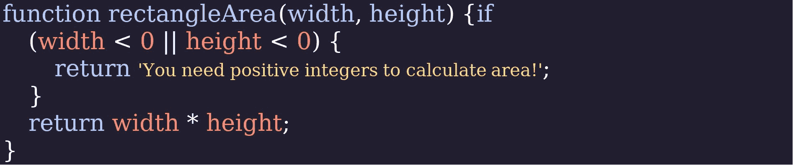

 如果 ororis 的参数小于 `0`，则 `rectangleArea()` 将返回 `'You need positive integers to calculate area!'`。第二个 `return` 语句 `width * height` 将不会运行。

`return` 关键字是强大的，因为它允许函数产生输出。我们可以将输出保存到变量中供以后使用。

### 指南 1

想象一下我们需要为办公室里的每个人订购显示器，而这个办公室方便地排列成网格状。我们可以使用函数来帮助计算所需的显示器数量！

声明一个带有两个参数的函数 `monitorCount()`。第一个参数是 `rows`，第二个参数是 `columns`。

**检查点 2 已通过**

卡住了？获取提示

2.

让我们通过将 `rows` 和 `columns` 相乘来计算显示器的数量并返回该值。

在你刚刚编写的函数体中，使用 `return` 关键字返回 `rows * columns`。

**检查点 3 已通过**

卡住了？获取提示

3.

现在函数已经定义好了，我们可以计算所需的显示器数量。假设办公室有 5 行 4 列。

使用 `const` 关键字声明一个名为 `numOfMonitors` 的变量，并将使用参数 `5` 和 `4` 调用 `monitorCount()` 的结果赋值给 `numOfMonitors`。

**检查点 4 已通过**

卡住了？获取提示

4.

为了检查函数是否正常工作，在 `console` 中记录 `numOfMonitors`。

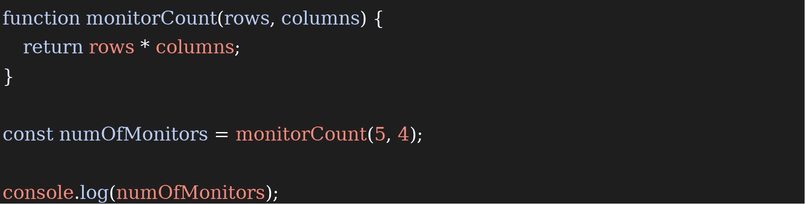

## 辅助函数

我们也可以在另一个函数内部使用函数的返回值。在另一个函数内部调用的函数通常被称为辅助函数。由于每个函数都在执行特定任务，这使得我们的代码更容易阅读，并在需要时更容易调试。

如果我们想定义一个将温度从摄氏（Celsius）转换为华氏（Fahrenheit）的函数，我们可以写两个函数：

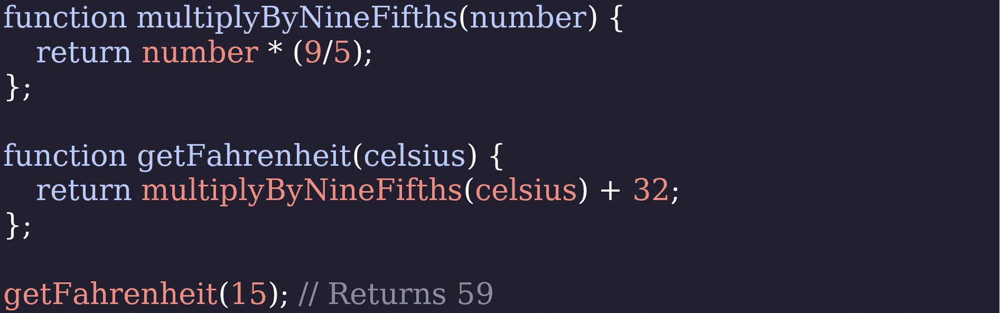

在上面的示例中：

* 调用 `getFahrenheit()` 并传入 `15` 作为参数。
* `getFahrenheit()` 内部的代码块调用 `multiplyByNineFifths()` 并传入 `15` 作为参数。
* `multiplyByNineFifths()` 接收参数 `15` 作为 `number` 参数。
* `multiplyByNineFifths()` 函数内部块将 `15` 乘以 `(9/5)`，结果为 `27`。
* `27` 返回给 `getFahrenheit()` 中的函数调用。
* `getFahrenheit()` 继续执行。它将 `27` 加上 `32`，结果为 `59`。
* 最后，`59` 返回给函数调用 `getFahrenheit(15)`。

`return` 关键字是强大的，因为它允许函数产生输出。我们可以将输出保存到变量中供以后使用。

## 函数表达式

定义函数的另一种方法是使用函数表达式。要在表达式内部定义函数，我们可以使用 `function` 关键字。在函数表达式中，名称通常会被省略。没有名称的函数被称为匿名函数。函数表达式通常存储在变量中以便引用。

考虑以下函数表达式：

要声明函数表达式：

1. 声明一个变量，使该变量名称成为函数的名称或标识符。自 ES6 发布以来，使用 `const` 作为关键字来声明变量是一种常见做法。
2. 将一个通过使用 `function` 关键字加上一组带有可能参数的括号创建的匿名函数赋值为该变量的值。然后是跟一个包含函数体的大括号。

要调用函数表达式，编写存储该函数的变量名，后跟一个括了任何传入函数参数的括号 `variableName(argument1, argument2)`。与函数声明不同，函数表达式不会被提升（hoisted），因此它们在定义之前无法被调用。

让我们使用函数表达式定义一个新函数。

### 指南 1

假设我们有一盆植物，需要每周周三浇一次水。我们可以定义一个函数表达式来帮助检查星期几以及植物是否需要水：

* 使用 `const` 变量关键字创建一个名为 `plantNeedsWater` 的变量。
* 将一个接收参数 `day` 的匿名函数赋值给 `plantNeedsWater`。

**检查点 2 已通过**

卡住了？获取提示

2.

现在我们需要在 `plantNeedsWater()` 的函数体中添加一些代码：

* 在函数体内添加一个 `if` 条件，检查 `day === 'Wednesday'`。
* 如果条件为真（truthy），则在 `if` 代码块内部使用 `return` 关键字返回 `true`。

**检查点 3 已通过**

卡住了？获取提示

在不是“Wednesday”的日子，`plantNeedsWater()` 应该返回 `false`：

* 在 `if` 语句之后添加一个 `else` 语句。
* 在 `else` 语句内部使用 `return` 关键字返回 `false`。

检查点 4 通过

卡住了？获取提示

### 4.

调用 `plantNeedsWater()` 并传入 'Tuesday' 作为参数。

检查点 5 通过

卡住了？获取提示

### 5.

让我们检查一下 `plantNeedsWater()` 是否返回了预期的值。

在控制台打印 `plantNeedsWater('Tuesday')`。如果运行正常，你应该会在控制台看到输出 `false`。

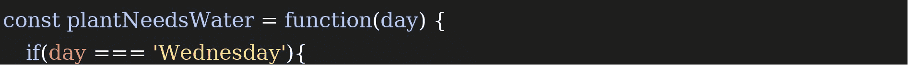

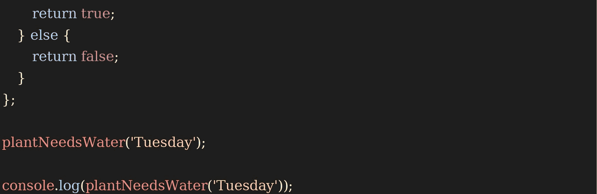

## 箭头函数

ES6 引入了箭头函数语法，这是一种通过特殊的“胖箭头” `() =>` 符号编写函数的更短方式。

箭头函数消除了每次需要创建函数时输入 `function` 关键字的麻烦。相反，你首先在 `()` 中包含参数，然后添加一个指向由 `{}` 包围的函数体的箭头 `=>`，如下：


熟悉函数的多种编写方式非常重要，因为在阅读其他 JavaScript 代码时会遇到每一种方式。

### 指令 1

将 `plantNeedsWater()` 改为箭头函数语法。

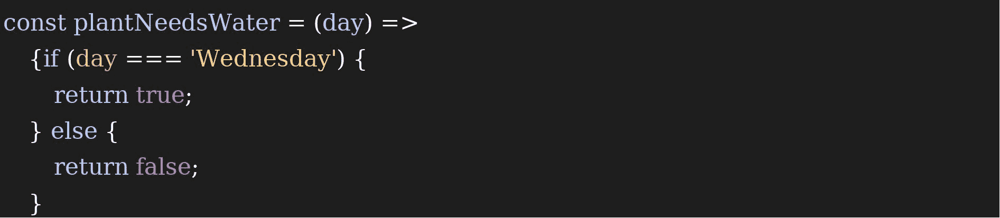

```
};
```

## 简洁体箭头函数

JavaScript 还提供了几种重构箭头函数语法的方法。函数最精简的形式被称为简洁体 (concise body)。我们将在下面探索这些技术：

1. 只有一个参数的函数不需要将参数封装在括号中。然而，如果函数有零个或多个参数，则需要括号。
2. 由单行块组成的函数体不需要大括号。如果没有大括号，该行求值的结果将自动返回。块的内容应紧跟箭头 `=>` 之后，并且可以移除 `return` 关键字。这被称为隐式返回 (implicit return)。

所以，如果我们有一个函数：


我们可以将函数重构为：

```javascript
const squareNum = num => num * num;
```

注意以下变化：

* 删除了 `num` 周围的括号，因为它只有一个参数。
* 删除了大括号 `{}`，因为函数由一个单行块组成。
* 删除了 `return` 关键字，因为函数由一个单行块组成。

### 指令 1

 让我们将其重构为简洁体。注意我们已经将 `if/else` 语句转换为三元运算符，使代码只有单行。

```javascript
const plantNeedsWater = day => day === 'Wednesday' ? true : false;
```

## 复习函数

为自己拍个掌吧，你刚刚掌握了函数！在本节中，我们涵盖了关于函数的一些重要概念：

* 函数是一个可重用的代码块，它将一组语句组合以执行特定任务。
* 函数声明 (function declaration)：
* 参数 (parameter) 是函数块内部的命名变量，在函数调用时会被赋予传入参数的值：
* 在代码中调用函数：
* ES6 通过默认参数 (default parameters) 引入了处理任意参数的新方法，允许我们在没有向函数传递参数的情况下为参数分配默认值。
* 要从函数返回值，我们使用 `return` 语句。
* 使用函数表达式 (function expressions) 定义函数：
* 使用函数表达式定义函数：
* 意识到函数表达式、箭头函数和声明之间的区别是非常重要的。
* 可以使用箭头符号来定义函数。了解函数类型是有好处的

## 作用域

作用域是我们变量声明的上下文。我们考虑作用域是因为它定义了变量可以在哪里被引用。

在全局作用域 (global scope) 中，变量在块之外声明。这些变量被称为全局变量。由于全局变量没有绑定在块内部，程序的任何代码都可以访问它们。

让我们来看全局作用域的例子：


* 尽管 `color` 变量定义在块之外，但在函数块中也可以访问，赋予了它全局作用域。
* 反之，`color` 可以在 `returnSkyColor` 函数内部访问。

让我们处理全局变量，看看数据如何从程序的任何地方进行访问。

## 块与作用域

在讨论作用域之前，我们首先需要讨论块 (blocks)。我们已经在函数和 `if` 语句中使用过块。块是一组 `{}`，帮助我们将一个或多个语句组合在一起。

注意函数体实际上是一个块：

在下一个练习中，我们将看到块是如何定义作用域的。

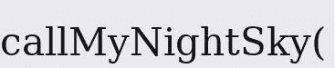 `function`, 使用 `console.log()` 将 `callMyNightSky()` 的值打印到控制台。

你会发现 `callMyNightSky()` 的函数块可以自由访问全局变量，因为这些变量在文件中的所有代码行都是可用的。

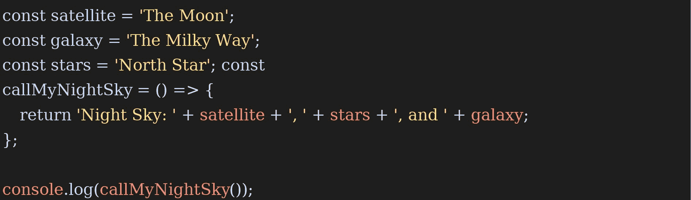

## 块作用域

我们将涵盖的范围是块作用域。当变量在块内部定义时，它只对大括号 `{}` 内部的代码可见。我们说该变量具有块作用域，因为它只对该块内的代码可见。

使用块作用域声明的变量被称为局部变量，因为它们只对同一个块的代码可用。

块作用域的工作机制如下：

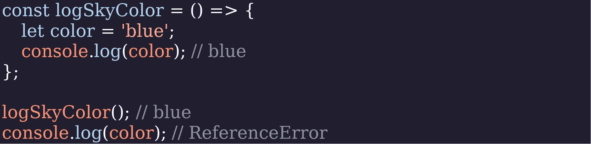

你会注意到：

* 我们定义了一个函数 `logSkyColor()`。
* 在函数内部，`color` 变量只在函数的大括号内可用。
* 如果我们尝试在函数外部打印同一个变量，将抛出 `ReferenceError`。

### 指令 1

1. 在 `main.js` 中，定义一个函数 `logVisibleLightWaves()`。

   Checkpoint 2 已通过

   卡住了？获取提示

2. 在 `logVisibleLightWaves()` 函数内部，使用 `const` 创建变量 `lightWaves` 并将其赋值为 `'Moonlight'`。

   Checkpoint 3 已通过

3. 在 `logVisibleLightWaves()` 函数内部，`lightWaves` 变量下方添加一个 `console.log()` 语句，在函数运行时打印 `lightWaves` 变量的值。

   Checkpoint 4 已通过

   卡住了？获取提示

4. 在函数外部调用 `logVisibleLightWaves()` 函数。

   Checkpoint 5 已通过

   卡住了？获取提示

5. 在函数调用下方，从函数外部向控制台打印 `lightWaves` 的值。

你会发现它打印了 `ReferenceError`，因为该变量绑定在函数的块作用域上！

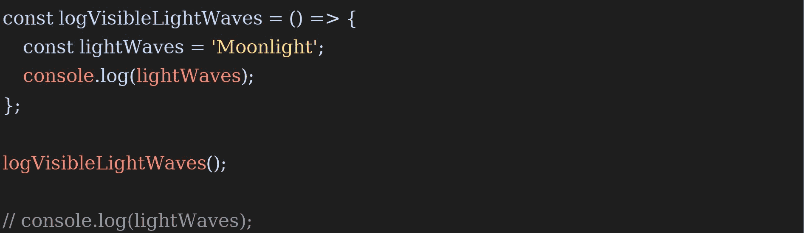

## 作用域污染

始终让你的变量变得可访问似乎是一个好主意，但在程序中拥有过全局变量可能会导致问题。

当你声明全局变量时，它们会进入全局命名空间。全局命名空间允许变量从程序的任何地方被访问。这些变量一直存在那里直到程序结束，这意味着我们的全局命名空间可能会很快填满。

作用域污染是指全局命名空间中存在过多的全局变量，或者我们在不同作用域之间重复使用变量。

作用域污染使得难以追踪不同的变量，并为潜在的事故埋下隐患。例如，全局作用域变量可能与局部作用域更小的变量发生冲突，导致代码出现意外行为。

让我们来看一个作用域污染的实践示例，以便知道如何避免它：

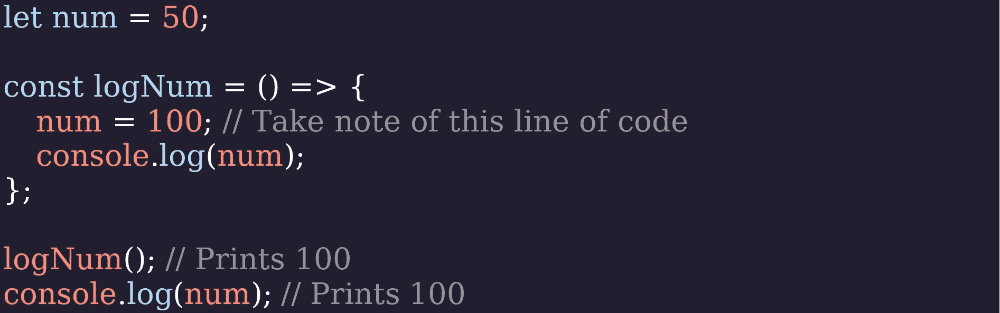

你会注意到：

* 我们有一个变量 `num`。
* 在 `logNum()` 的函数体内，我们想声明一个新变量，但忘记使用 `let` 关键字。
* 当我们调用 `logNum()` 时，`num` 被重新赋值为 `100`。
* `logNum()` 内部的重新赋值影响了全局变量 `num`。
* 尽管重新赋值是被允许的且我们不会报错，但如果我们之后决定使用 `num`，我们将在不经意的情况下使用 `num` 的新值。

虽然了解全局作用域非常重要，但最佳实践不在全局作用域中定义变量。

### 指令

1. 让我们看看创建一个覆盖全局变量的变量会发生什么。在 `callMyNightSky()` 函数内部，在函数体的第一行，将变量 `stars` 赋值为 `'Sirius'`，如下：


   Checkpoint 2 已通过

2. 在函数外部，在当前 `console.log()` 语句下方，添加另一个 `console.log()` 语句将 `stars` 打印到控制台。

你会发现全局变量 `stars` 被重新赋值为 `'Sirius'`。换句话说，我们改变了全局 `stars` 变量的值，但很难看出到底发生了什么。这在代码可维护性方面是糟糕的做法，并可能以我们无意的方式影响程序。

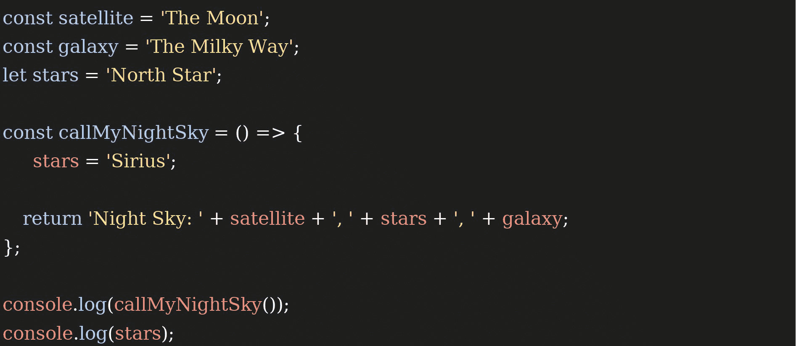

## 实践良好的作用域化

考虑到全局变量和作用域污染的挑战，我们应该遵循最佳实践，使用块作用域尽可能紧缩变量的作用域。

紧缩变量的作用域将从以下几个方面极大改进你的代码：

* 它将使你的代码更易读，因为块会将你的代码组织成离散的部分。
* 它让你的代码更易理解，因为它明确了哪些变量与程序的不同部分相关，而不是——
* 它将节省内存，因为变量只在块执行时存在。

这里是另一个示例：

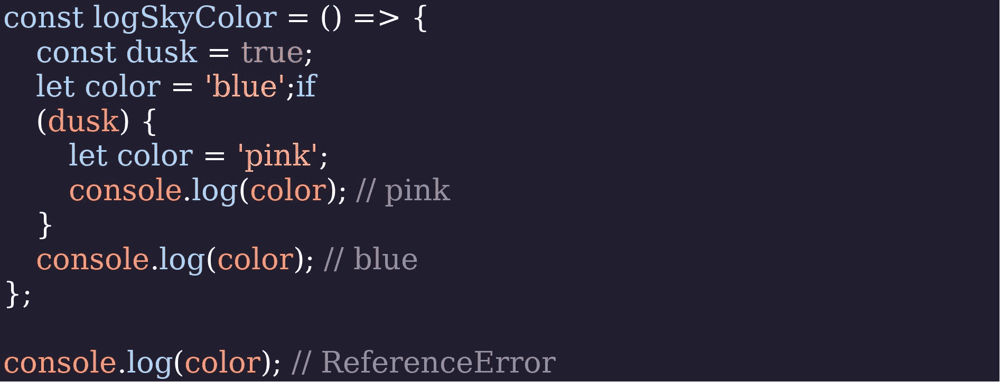

你会注意到：

* 我们在 `if` 语句内部创建了一个变量。
* 在 `if` 语句之后，该变量不可用。
* 在 `if` 块内部，该变量有一个值。

块作用域是 JavaScript 中一个强大的工具，因为它允许我们不污染命名空间。

### 指令

1. 在 `logVisibleLightWaves()` 函数体内部，`region` 变量下方、提供的 `console.log()` 语句之前，创建一个 `if` 语句检查 `region` 是否为 `'Arctic'`。

   Checkpoint 2 已通过

   卡住了？获取提示

2. 在 `if` 块内部，定义一个 `let` 变量 `lightWaves` 并将其赋值为 `'Northern Lights'`。

   Checkpoint 3 已通过

3. 在 `if` 块内部，使用 `console.log()` 打印 `lightWaves` 的值。

运行你的代码并注意输出。在 `if` 块内部，变量可以工作。

## 复习：作用域

在本节中，你学习了作用域以及它如何影响不同变量的可访问性。

让我们回顾以下术语：

* 作用域 (Scope) 是编程中的一个概念，某些变量从程序的其他部分可见/不可见。
* 块 (Blocks) 是存在于大括号 `{}` 内的语句。
* 全局作用域 (Global scope) 指程序每个部分都可以访问的上下文。
* 全局变量 (Global variables) 是存在于全局作用域内的变量。
* 块作用域 (Block scope) 指变量仅在其定义的块内可见的上下文。
* 局部变量 (Local variables) 是存在于块作用域内的变量。
* 全局命名空间 (Global namespace) 是代码中包含全局范围信息的空间。
* 作用域污染 (Scope pollution) 指命名空间中存在过多变量或变量名被重复使用。

# 数组

组织和存储数据是编程的基础概念。

在现实生活中组织数据的一种方式是制作列表。让我们在这里创建一个：

新年愿望：

1. 坚持写日记
2. 去上鹰隼术课
3. 学习杂耍

现在让我们用 JavaScript 编写这个列表，将其作为一个数组：


数组是 JavaScript 创建列表的方式。数组可以存储任何数据类型（包括字符串、数字和布尔值）。与列表一样，数组是有序的，这意味着每个项目都有一个数字编号的位置。

这里是我们将要涵盖的概念数组：


在本节结束时，你将又掌握了一项可以帮助你管理数据块的工具！


运行代码查看控制台输出了什么内容。


## 创建数组

创建数组的一种方法是使用数组字面量（array literal）。数组字面量通过将项目包裹在方括号 `[]` 中来创建一个数组。记得上一个练习，数组可以存储任何数据类型——我们可以拥有一个包含所有相同数据类型的数组，也可以拥有一个包含不同数据类型的数组。

让我们仔细观察数组示例中的语法：

* 数组由方括号 `[]` 及其内部的内容表示。
* 数组内部的每个内容项被称为“元素”（element）。
* 数组内部有三个不同的元素。
* 数组中的每个元素都是不同的数据类型。

我们还可以将数组保存到变量中。你可能注意到我们在上一个练习中这样做了：


让我们通过创建自己的数组来练习一下。

### 指南 1

1. 使用 `const` 声明一个名为 `hobbies` 的变量，并将其设置为一个包含三个字符串的数组。

   * 检查点 2 已通过
   * 卡住了？获取提示

2. 使用 `console.log()` 将 `hobbies` 打印到控制台。


## 访问元素

数组中的每个元素都有一个数字编号的位置，称为“索引”（index）。我们可以使用索引来访问单个项目，这类似于根据项目的位置引用列表中的项目。

 JavaScript 中的数组是零索引的，这意味着位置从 `0` 开始计数，而不是从 `1`。因此，数组中的第一个项目位于位置 `0`。让我们看看如何访问数组中的元素：

在上面的代码段中：

* `cities` 是一个拥有三个元素的数组。
* 我们正在使用括号表示法 `[]`，在数组名后加上索引来访问元素。
* `cities[0]` 将访问数组 `cities` 中索引为 `0` 的元素。你可以将 `cities[0]` 视为访问存储字符串 'New York' 的内存空间。

你也可以使用括号表示法和索引访问字符串中的单个字符。例如，你可以写道：


控制台将显示 `W`，因为它是索引为 `6` 的字符。

### 指南 1

1. 数组中的单个元素也可以存储到变量中。

   创建一个名为 `listItem` 的变量，并使用方括号表示法（`[]`）将其设置为 `famousSayings` 数组中的第一个项目。

   然后使用 `console.log()` 将 `listItem` 变量打印到控制台。

   * 检查点 2 已通过
   * 卡住了？获取提示

2. 现在，使用括号表示法访问 `famousSayings` 数组中的第三个元素，并使用 `console.log()` 打印。

   在打印元素之前，不要将其保存到新变量中。


## 更新元素

在上一个练习中，你学习了如何使用索引访问数组或字符串内部的元素。一旦访问了数组中的元素，你更新它的值。

 在上面的示例中，`seasons` 数组包含了四个季节的名字。

然而，我们决定更倾向于说 'Autumn'而不是 'Fall'。

`seasons[3] = 'Autumn';` 这一行告诉程序将 `seasons` 数组中索引为 `3` 的项目更改为 'Autumn'，而不是原来的内容。

### 指南 1

1. 将 `groceryList` 数组的第二个元素更改为 'avocados'。


## 使用 let 和 const 的数组

你可能记得可以使用 `let` 和 `const` 关键字声明变量。使用 `let` 声明的变量可以重新赋值。

使用 `const` 关键字声明的变量不能重新赋值。然而，用 `const` 声明的数组中的元素仍然是可变的（mutable）。这意味着我们可以更改 `const` 数组的内容，但不能重新赋值一个新数组或不同的值。

下面的指令将更清楚地说明这一概念。在完成步骤时，请注意 `condiments` 数组和 `utensils` 数组之间的相似之处和之处。

### 指南 1

1. 在两个现有数组下方，将 `condiments` 中索引 `0` 的元素重新赋值为 'Mayo'。

   将更新后的数组 `condiments` 打印到控制台。

   * 检查点 2 已通过
   * 卡住了？获取提示

2. 在第一步代码下方，将 `condiments` 重新赋值为包含单个字符串 `['Mayo']` 的新数组。

   将结果打印到控制台。

   注意，你可以重新赋值数组中的元素，并为使用 `let` 关键字声明的变量重新赋值整个新数组。

   * 检查点 3 已通过
   * 卡住了？获取提示

3. 在第二步代码下方，将 `utensils` 数组的最后一个项目重新赋值为 'Spoon'。

   将更新后的数组打印到控制台。


## .length 属性

数组的内置属性之一是数组中的 `items`。我们访问字符串。查看下面的示例：

并且它返回 `length` 属性的数量，就像我们所做的那样

 在上面的示例中，我们使用以下步骤将内容打印到控制台：

*  我们使用点符号表示法（dot notation），在数组后连接点和属性名，来访问数组中的字符串。


然后我们将`n.length`属性打印到控制台。

由于`console.log()`有两个元素，所以会打印`2`。

当我们想知道数组中有多少元素时，我们访问`.length`属性。

### 指南 1

1. 找到`objectives`数组的长度并将其打印到控制台。


## .push() 方法

让我们学习一些让操作数组变得更简单的 JavaScript 内置方法。这些方法专门为数组调用，以使常见任务（如添加和删除元素）变得简单。

`.push()`方法允许我们向数组末尾添加项目。这里是它的使用方法示例：


那么，`.push()`是如何工作的？

*   我们通过点符号表示法访问`push`方法，通过点将`push`连接到`itemTracker`。
*   然后我们像调用函数一样调用它。这是因为`.push()`是一个函数，JavaScript 允许我们直接在数组上使用。
*   `.push()`可以接受单个参数或多个参数。在这种情况下，我们向`itemTracker`添加了两个元素：'item 3' 和 'item 4'。
*   注意`.push()`改变（或修改了）`itemTracker`。

如果你正在寻找一种通过添加元素来改变数组的方法，那么`.push()`就是你需要的方法！

### 指南

1. 使用`.push()`向`chores`数组添加两个元素。
2. 使用`console.log`打印你的`chores`数组以确保你的项目已添加。


## .pop() 方法

另一个数组方法`.pop()`会移除数组的最后一个项目。


*   在上面的示例中，对`newItemTracker`数组调用`.pop()`从末尾移除了`item 2`。
*   `.pop()`不接受任何参数，它只是移除`newItemTracker`的最后一个元素。
*   `.pop()`返回最后一个元素的值。在示例中，我们将返回的值存储在变量`removed`中供以后使用。
*   `.pop()`是一个会修改原始数组的方法。

当你需要通过删除最后一个元素来修改数组时，请使用`.pop()`。

### 指示 1.

使用该方法从`chores`中移除最后一个元素。

检查点 2 通过

卡住了？获取提示

### 2.

在调用`chores.pop()`之后的一行中，将`chores`打印到控制台以确保其生效。


## 更多数组方法

数组方法远不止于`.push()`和`.pop()`。你可以在[Mozilla 网络 (MDN) 数组文档](https://developer.mozilla.org/en-US/docs/Web/JavaScript/Reference/Global_Objects/Array)中阅读所有存在的数组方法。

`.pop()`和`.push()`会修改它们被调用的数组。然而，有时我们并不希望修改原始数组，可以使用非变异数组方法。务必检查 MDN 以理解你正在使用的方法的行为。

JavaScript 开发者可以使用的一些数组方法包括：`.join()`、`.slice()`、`.splice()`、`.shift()`、`.unshift()`和`.concat()`等。使用这些内置方法可以让你在处理数组时更轻松地完成一些常见任务。

下面，我们将探索一些尚未学习过的方法。我们将使用这些方法来编辑购物清单。当你完成这些步骤时，可以参考 MDN 文档来学习每个方法的作用！

### 指示 1.

使用`.shift()`方法从数组`groceryList`中移除第一个项。将新的`groceryList`输出到控制台。

在[MDN 的 shift 文档](https://developer.mozilla.org/en-US/docs/Web/JavaScript/Reference/Global_Objects/Array/shift)中了解关于`.shift()`。

检查点 2 通过

卡住了？获取提示

### 2.

在步骤 1 添加的代码下方，使用`.unshift()`方法将'popcorn'添加到购物清单的开头。

在对`groceryList`调用`.unshift()`后，将`groceryList`输出到控制台。

你可能希望删除上一步中的`console.log()`语句。在[MDN 的 unshift 文档](https://developer.mozilla.org/en-US/docs/Web/JavaScript/Reference/Global_Objects/Array/unshift)中了解关于`.unshift()`。

检查点 3 通过

卡住了？获取提示

### 3.

你很赶，所以决定请一个朋友帮你买菜。你希望他买上'bananas'、'coffee beans'和'brown rice'。

在步骤 2 添加的代码下方，使用`.slice()`为你的朋友提供这三样物品的列表。

将列表输出到控制台。与之前的两个检查点不同，你应该在一行代码中完成这两个步骤。

在[MDN 的 slice 文档](https://developer.mozilla.org/en-US/docs/Web/JavaScript/Reference/Global_Objects/Array/slice)中了解关于`.slice()`。

检查点 4 通过

卡住了？获取提示

### 4.

在对`groceryList`调用`.slice()`后，再次将购物清单输出到控制台。

注意，`groceryList`数组仍然包含步骤 2 中的那些相同元素。这意味着`.slice()`是非变异的！你可以在上一步的链接中确认这一点。

检查点 5 通过

卡住了？获取提示

### 5.

让我们使用`.indexOf()`查找`groceryList`中特定元素的索引。

在`groceryList`上调用`.indexOf()`来找到元素'pasta'的索引，并将返回的值保存到名为`pastaIndex`的`const`变量中。

然后将`pastaIndex`输出到控制台。（你可能需要移除其他的`console.log()`语句以保持终端整洁。）

在[MDN 的 indexOf 文档](https://developer.mozilla.org/en-US/docs/Web/JavaScript/Reference/Global_Objects/Array/indexOf)中了解关于`.indexOf()`。


## 数组与函数

在整个课程中，我们提到数组是变异的，即可更改的。那么，如果我们尝试在函数内部更改数组会发生什么？数组在函数调用后会保留更改，还是该更改仅限于函数内部？

请看下面的示例，我们在函数内部对数组调用了`.push()`。记得，`.push()`方法会修改（或更改）数组：


让我们回顾一下示例中发生了什么：

*   `flowers`数组有 3 个元素。
*   函数`addFlower()`有一个参数`arr`，使用`.push()`向`arr`添加一个'lily'元素。
*   我们使用参数`flowers`调用`addFlower()`，这将执行`addFlower`的代码。
*   我们检查`flowers`的值，它现在包含了'lily'元素！数组被修改了！

所以当你将数组传递给函数时，如果数组在函数内部发生了变异，该更改也会在函数外部保留。你可能还会看到这个概念解释为“引用传递”，因为我们实际上传递给函数的是变量内存位置的引用，并且更改了内存。

### 指示 1.

在`main.js`中，有一个数组`concept`。还有一个函数`changeArr`，它会将数组索引为 3 的元素赋值为'MUTATED'。调用`changeArr`时传入了参数`concept`。

在函数调用下方，将`concept`输出到控制台，以检查此重新赋值是否修改了数组。

检查点 2 通过

卡住了？获取提示

### 2.

让我们双检查一下，如果在函数内部使用内置方法变异数组会发生什么。

在命名语句下方，定义另一个接收参数`newArr`的函数。在函数体内部对`newArr`调用`.pop()`。

检查点 3 通过

卡住了？获取提示

### 3.

使用参数`concept`调用`removeElement()`。

检查点 4 通过

卡住了？获取提示

### 4.

在调用`removeElement(concept)`后，通过输出它来检查`concept`的值。

注意，在两种情况下，数组的更改都在函数外部保留了！


## 嵌套数组

之前我们提到数组可以存储其他数组。当一个数组包含另一个数组时，它被称为嵌套数组。查看下面的示例：

```
const nestedArr = [[1], [2, 3]];
```

要访问嵌套数组，我们可以使用带有索引值的括号符号，就像我们访问任何其他元素一样：


注意我们获取了索引为 1 的元素，即数组`[2, 3]`。然后如果我们想访问嵌套数组内部的元素，可以链式或添加更多带有索引值的括号符号。


在第二个`console.log()`语句中，我们有两个链接到`nestedArr`上的括号符号。我们知道`nestedArr[1]`是数组`[2, 3]`。然后为了获取该数组的第一个元素，我们使用`nestedArr[1][0]`，并得到了值 2。

### 指示 1.

让我们创建一个嵌套数组！创建一个变量`numberClusters`。将其值赋值为一个包含三个数组元素的数组。

*   第一个数组元素应该包含元素 1 和 2。
*   第二个数组元素应该包含元素 3 和 4。
*   第三个数组元素应该包含元素 5 和 6。

检查点 2 通过

卡住了？获取提示

### 2.

太棒了，你创建了一个嵌套数组！现在使用`const`关键字声明一个`target`变量，并赋值访问`numberClusters`内部的元素 6。


## 复习数组

做得好！在本节中，我们学习了这些关于数组的概念：

- 数组是 JavaScript 中存储数据的列表。
- 数组使用中括号`[]`创建。
- 数组中的每个项都有一个数字编号的位置，或索引（index），从 0 开始。
- 我们可以使用索引访问数组中的某一项，语法如：`myArray[0]`。
- 我们也可以使用索引更改数组中的某一项，语法如`myArray[0] = 'new string'`。
- 数组具有`length`属性，它允许你查看数组中有多少个项。
- 数组有自己的方法，包括`.push()`和`.pop()`，它们分别用于向数组中添加和移除项。
- 数组有许多执行不同任务的方法，例如`.slice()`和`.shift()`，你可以在[Mozilla](https://developer.mozilla.org/en-US/docs/Web/JavaScript/Reference/Global_Objects/Array)[开发者网络](https://developer.mozilla.org/en-US/docs/Web/JavaScript/Reference/Global_Objects/Array)网站找到文档。
- 一些内置方法是变异的（mutating），这意味着该方法会改变数组，而另一些则非变异。你可以随时查看文档。
- 包含数组的变量可以使用`let`或`const`声明。即使用`const`声明，数组仍然是可变的。但是，用`const`声明的变量不能重新赋值。
- 在函数内部改变的数组在函数外部也会保留该更改。
- 数组可以嵌套在其他数组中。
- 要访问嵌套数组中的元素，请使用括号表示法进行链式索引。

学习如何处理和操作数组将帮助你处理数据块！

## 循环

循环是一种编程工具，它会重复执行一组指令，直到达到指定的条件（称为停止条件）。作为一名程序员，你会发现你一直在依赖循环！在谈论循环时，你会听到一个通用术语“迭代（iterate）”。迭代仅仅的意思就是“重复”。

当我们需要在代码中重用某项任务时，通常会将该操作封装在一个函数中。同样，当我们看到某个过程必须连续重复多次时，我们就会写一个循环。循环允许我们创建高效的代码，通过自动化流程来构建可扩展、易于管理的程序。

如图所示，循环会迭代或重复某个操作，直到满足特定条件。当条件满足时，循环停止，计算机将进入程序的下一个部分。


## 手动重复任务

在我们编写自己的循环之前，让我们花一点时间对循环有一个基本的理解。最好的方法就是向你展示，如果一个重复的任务需要你每次都输入相同的代码，那将是繁琐。

### 指南

1. 创建变量`vacationSpots`，并将其值赋值为一个包含三个字符串的数组，这些字符串是你想要去的地方。

*检查点 2 已通过*

*卡住了？获取提示*

2. 接下来，使用`console.log()`输出`vacationSpots`中的每个项。由于我们还不知道循环，我们必须单独`console.log()`数组中的每个元素。

*检查点 3 已通过*

*卡住了？获取提示*

3. 做得好！现在想象一下假期清单上有 100 个地方——手动将每个数组元素日志记录到控制台将是一项枯燥的任务！在下一个练习中，我们将学习如何使用`for`循环让事情更高效。


## For 循环

与其反复不断地编写相同的代码，循环允许我们告诉计算机自动重复给定的代码块。给计算机提供这些指令的方法之一是使用`for`循环。

典型的`for`循环包含一个迭代变量，该变量通常出现在三个表达式中。迭代变量被初始化、与停止条件进行检查，并在每次循环迭代时分配一个新值。

迭代变量可以有任何名称，但最佳实践是使用描述性的变量名。

`for`循环在括号内包含三个用`;`分隔的表达式：

1. **初始化**启动循环，也可以用于声明迭代变量。
2. **停止条件**是对迭代变量进行求值的条件——如果条件求结果为`true`，则代码块将运行；如果求值为`false`，则代码将停止。
3. **迭代语句**用于在每次循环中更新迭代变量。

`for`循环的语法如下：


在这个示例中，输出将是：


让我们拆解这个示例：

- 初始化是`let counter = 0`，所以循环将从 0 开始计数。
- 停止条件是`counter < 4`，意味着只要迭代变量`counter`小于 4，循环就会运行。
- 迭代语句是`counter++`。这意味着在每次循环之后，`counter`的值将增加 1。第一次迭代时`counter`等于 0，第二次迭代`counter`等于 1，依此类推。
- 代码块位于大括号内部，`console.log(counter)`将执行，直到条件求结果为`false`。当`counter`大于或等于 4 时，条件将为`false`——条件变为`false`的点有时被称为停止条件。

这个`for`循环使得通过程序编写 0, 1, 2 和 3 成为可能。

### 指南

1. 现在，写你自己的吧！创建一个从 5 循环到 10 的程序，并将每个数字记录到控制台。


## 反向循环

如果我们想让`for`循环记录 3, 2, 1 然后是 0 呢？通过对表达式进行简单修改，我们可以让循环反向运行！

运行反向`for`循环，我们必须：

- 在初始化表达式中将迭代变量设置为最高值。
- 设置停止条件，当迭代变量小于所需的数量。
- 迭代器在每次迭代后应该递减。

### 指南

1. 写一个`for`循环，反向打印 3 到 0 到控制台。在你的停止条件中使用`>=`比较运算符，并在迭代语句中使用`--`运算符。


## 遍历数组

`for`循环对于遍历数据结构非常有用。例如，我们可以使用`for`循环对数组中的每个元素执行相同的操作。数组存储数据列表，例如客户名称或产品信息。假设我们拥有一家商店，想要增加目录中每个产品的价格。这可能需要大量重复的代码，但通过使用`for`循环遍历数组，我们可以轻松地完成这项任务。

要遍历数组中的每个元素，`for`循环应该在条件中使用数组的`.length`属性。

查看下面的示例了解`for`循环如何遍历数组：


这个示例将给你以下输出：


在上面的循环中，我们将迭代变量命名为`i`。这是你在很多循环中都会看到的变量命名规范。当我们使用`i`遍历数组时，可以将其理解为单词index（索引）的缩写。注意我们的停止条件检查`i`是否小于`animals.length`。记住数组是从 0 开始索引的，最后一个元素的索引相当于数组的长度减 1。如果我们尝试访问索引为`animals.length`的元素，我们就走得太远了！

有了`for`循环，我们更容易处理数组元素。

### 指南

1. 编写一个`for`循环遍历我们的`vacationSpots`数组，并使用`i`作为迭代变量。

在`for`循环块内部，使用`console.log()`打印`vacationSpots`数组中字符串`'I would love to visit '`之后的每个元素。例如，循环的第一轮应该在控制台打印`'I would love to visit Bali'`。


## 嵌套循环

当一个循环运行另一个循环内部时，我们称之为嵌套循环。嵌套`for`循环的一个用途是比较两个数组中的元素。对于外部`for`循环的每一轮，内部`for`循环都会完整运行。

让我们来看一个嵌套`for`循环的示例：


让我们思考一下示例嵌套循环中发生了什么。对于外层数组`myArray`中的每一个元素，内部循环都会完整运行，将外层数组的当前元素`myArray[i]`与内部数组中的每个元素`yourArray[j]`进行比较。当找到匹配项时，它会在控制台打印一个字符串。

现在轮到你来编写嵌套循环了！

### 指示

1. 想象你是一个社交媒体平台的大牛程序员！你被指派构建一个共同粉丝程序的原型。你需要从两个模拟用户处获取两个“朋友”数组，以便提取在两个列表中都存在的粉丝的名称。创建一个名为`bobsFollowers`的变量，并将其设置为包含四个字符串的数组，代表 Bob 的朋友的名字。

    Checkpoint 2 Passed

2. 创建一个名为`tinasFollowers`的变量，并将其设置为包含三个字符串的数组，代表 Tina 的朋友的名字。确保其中恰好有两个与`bobsFollowers`数组中的两个朋友相同。

    Checkpoint 3 Passed

3. 创建第三个名为`mutualFollowers`的变量，并将其设置为空数组。

    Checkpoint 4 Passed

4. 创建一个嵌套循环，以`bobsFollowers`为外层循环数组，以`tinasFollowers`为内循环数组。如果外层循环的当前元素与内循环的当前元素相同，则将该元素推入`mutualFollowers`数组中。


## While 循环

你做得很棒！我们将教你另一种循环：`while`循环。首先，让我们把`for`循环转换为`while`循环：


让我们分解一下我们循环语法的含义：


* 我们的变量在循环之前声明。由于它在全局作用域中，我们可以在循环中访问它。
* 我们使用关键字`while`开始循环，后面紧跟我们的停止条件（或测试条件）。这将在循环的每一轮之前进行评估。只要条件评估为`true`，代码块就会继续运行。一旦评估为`false`，循环将停止。
* 接下来，是我们的循环代码块，它向控制台打印`counterTwo`并增加`counterTwo`。

如果我们不在代码块内部增加`counterTwo`会发生什么呢？如果不包含此项，`counterTwo`将始终保持其初始值`1`。这意味着测试条件`counterTwo < 4`将始终评估为`true`，我们的循环将永远不会停止运行！这被称为**死循环**，是我们总是想要避免的。死循环可能会占用你计算机所有的处理能力，可能导致电脑死机。

所以你可能会问什么时候使用`while`循环！当我们知道循环应该运行多少次时，`for`循环的语法是理想的，但我们并不总是提前知道。把吃饭想象成一个`while`循环：当你开始吃时，你不知道吃饱具体需要多少口。相反地，你会在饥饿时一直吃。在希望循环执行不确定次数的情况下，`while`循环是最佳选择。

### 指示

1. 在`cards`数组下方，使用`let`关键字声明变量`currentCard`，但不要给它赋值。

    Checkpoint 2 Passed

卡住了？获取提示

2. 创建一个`while`循环，其条件检查`currentCard`的值是否为`'spade'`。在你的`while`循环代码块内部，添加以下代码行：

```
currentCard = cards[Math.floor(Math.random() * 4)];
```

`Math.floor(Math.random() * 4)`将给我们一个 0 到 3 之间的随机数。我们将使用这个数字作为`cards`数组的索引，并将数组中一个随机元素的值赋值给`currentCard`。

    Checkpoint 3 Passed

卡住了？获取提示

3. 太棒了！你的循环正在运行，但你看不出来因为它没有任何输出。让我们在`while`块中添加一个`console.log()`语句。在块内部，在你为`currentCard`分配新值后，将`currentCard`打印到控制台。

为了好玩，你可以运行几次代码看看输出如何变化！


## do...While 语句

在某些情况下，你希望一段代码至少运行一次，然后在初始运行后根据特定条件进行循环。这就是`do...while`语句大显用场的地方。

`do...while`表示执行一次任务，直到指定的条件不再满足为止一直保持执行。`do...while`的语法如下：


在这个示例中，代码块通过将变量`i`的字符串附加到`countString`变量中来修改它。首先，执行一次代码块。然后评估条件。如果条件评估为`true`，则块将再次执行。当条件评估为`false`时，循环停止。

注意`while`和`do...while`是不同的！与`while`循环不同，`do...while`至少运行一次。


1. 我们想让程序模拟制作蛋糕的过程。根据配方，需要的糖杯数不同。创建变量`cupsSugarNeeded`并为其赋值一个数字。糖必须一次一次加入面糊中。声明变量`cupsAdded`并将其赋值为 0。

    Checkpoint 2 Passed

2. 我们喜欢甜食，所以即使`cupsSugarNeeded`为 0，我们也想向面糊中添加至少一杯糖。创建一个`do...while`循环，当`cupsAdded`小于`cupsSugarNeeded`时，让`cupsAdded`加 1。


## break 关键字

想象我们正在领养一只狗。我们计划每年都去一次收容所，然后放弃。但如果我们在第 65 天遇到了梦想中的狗呢？我们不想仅仅因为原始计划是去一整年，就在接下来的 300 天里继续去收容所。在代码中，当我们希望在循环编写的原始停止条件尚未满足的情况下停止循环继续执行时，可以使用关键字`break`。

`break`关键字允许程序从循环块内部“跳出”循环。

让我们来看`break`关键字的语法：


这是上述代码的输出：


当我们在遍历大型数据结构时，`break`语句会特别有用！通过`break`，我们可以在停止条件之外添加测试条件，并在满足条件时退出循环。


1. 使用迭代变量`i`在`for`循环中记录`rapperArray`中的每个元素。

    Checkpoint 2 Passed

卡住了？获取提示

2. 在`for`循环之后，将字符串打印到控制台。注意：由于我们的字符串中包含有一个单引号字符`'`，我们可以使用双引号包裹字符串，以确保字符能够正常打印。

检查点 3 已通过

### 3.

在你的循环块内部添加一个`break`语句，如果`rapperArray`中当前索引处的元素是'Notorious B.I.G.'，则跳出循环。


## 复习

干得好！在本节中，我们学习了如何使用循环编写更简洁的代码。你现在知道了：


- 循环执行重复性操作，这样我们就不需要每次手动编写该过程。
- 如何编写`for`循环。
- 如何使用带有递增或递减迭代器变量的循环来遍历数组。
- 嵌套`for`循环是另一个循环内部的循环。
- `while`循环允许不同类型的停止条件。
- 停止条件对于避免死循环至关重要。
- `do...while`循环至少执行一次代码——仅在第一次执行后才检查停止条件。
- `break`关键字允许程序在执行块执行期间离开循环。

## 序言

当我们用母语与他人交流时，我们往往意识不到自己做出了多少假设。如果我们告诉你“数到三”，我们会期望你说出或想到一、二、三这三个数字。我们假设你知道从“一”开始，到“三”结束。在编程中，我们面临的是需要对计算机的指令更加明确。以下是我们可能如何告诉计算机“数到三”的：


当我们与其他交流时，我们共享一套词汇，这让我们能够快速交流复杂的概念。当我们说“烘焙”时，它会想起一个熟悉的子程序——预热烤箱、将东西放入烤箱中加热一段时间、最后将其取出。这允许我们抽象掉许多细节并更简洁地交流核心概念。我们不需要列出所有细节，只需说“我们烤了一个蛋糕”，仍然向你传达所有这些含义。

在编程中，我们可以通过编写函数来实现“抽象”。函数除了允许我们重用代码外，还有助于让程序变得清晰、易读。如果你在程序中遇到`countToThree()`，你可能不需要停下来阅读函数体，就能快速猜出该函数的作用。

我们还将学习另一种为编程添加抽象层级的方法：高阶函数。高阶函数是指接受其他函数作为参数并/或返回函数作为输出的函数。这允许我们能够在其他抽象的基础上构建抽象，就像“我们举办了生日派对”是一个抽象，可能建立在“我们做了一个蛋糕”的抽象之上。

总而言之，在代码中使用更多的抽象可以让我们编写更具模块化的代码，从而更容易阅读和调试。

## 函数即数据

JavaScript 函数的行为就像语言中的任何其他数据类型一样；我们可以将函数赋值给变量，也可以将它们重新赋值给新变量。

下面我们有一个非常冗长的函数名，它会破坏任何使用它的代码的可读性。让我们假设这个函数正在执行重要工作并且需要被反复调用！


如果我们想在不牺牲源代码的情况下重命名这个函数怎么办？我们可以将函数赋值给一个简短合适的变量：


`busy`是一个持有我们原始函数引用的变量。如果我们能查看内存中`busy`的地址和`announceThatIAmDoingImportantWork`的内存地址，它们将指向同一个地方。我们的新`busy()`函数可以通过括号调用，就像那是我们最初给函数起的名字一样。

注意我们是如何在不带括号的情况下将`announceThatIAmDoingImportantWork`赋值给变量`busy`的。我们想要赋值的是函数本身的值，而不是它被调用时返回的值。

在 JavaScript 中，函数是一等对象。这意味着就像你遇到的其他对象一样，JavaScript 函数可以拥有属性和方法。

由于函数是对象的一种，它们拥有诸如`.length`和`.name`等属性，以及`.toString()`等方法。你可以在[文档](https://developer.mozilla.org/en-US/docs/Web/JavaScript/Reference/Global_Objects/Function)查看更多关于函数的方法和属性。

### 练习

函数之所以特殊，是因为我们可以调用它们，但仍然可以将它们当成任何其他类型的数据。让我们练习一下吧！

**指令 1。**

我们定义了一个名字非常长的函数：`checkThatTwoPlusTwoEqualsFourAMillionTimes`。这个函数的执行需要很长时间。它检查`2 + 2 = 4`是否成立，但它检查了一百万次（为了万无一失！）。创建一个名字更短的变量`is2p2`以便操作，并将`checkThatTwoPlusTwoEqualsFourAMillionTimes`赋值为它的值。

检查点 2 已通过

卡住了？获取提示

**2.**

调用你的`is2p2()`函数。

检查点 3 已通过

卡住了？获取提示

**3.**

嗯，如果我们忘记了函数的原始名称，有办法能把它找出来吗？使用`console.log()`打印赋值给`is2p2`的函数的`name`属性。如果需要提示，请查看[文档](https://developer.mozilla.org/en-US/docs/Web/JavaScript/Reference/Global_Objects/Function)。


## 函数作为参数

由于函数在 JavaScript 中的行为可以像任何其他数据类型一样，如果你发现我们还可以将函数（传入其他函数）作为参数，你可能不会感到意外。高阶函数是指接受函数作为参数、返回一个函数或两者兼备的函数！我们将被传入的函数称为“回调函数”，因为它们是在高阶函数执行期间被调用的。

当我们把函数作为参数传递给另一个函数时，我们并不调用它。调用函数将得到该函数的返回值。通过回调，我们通过输入函数名且不带括号来传递函数本身（带括号则会求出调用函数的结果）：


我们写了一个高阶函数`timeFuncRuntime()`。它接收一个函数作为参数，保存一个开始时间，调用回调函数，记录函数被调用后的时间，并通过从结束时间中减去开始时间来返回函数运行的时间。

这个高阶函数可以与任何回调函数一起使用，使其成为一段可能非常强大的代码。

然后我们首先使用`addOneToOne()`函数调用了`timeFuncRuntime()`——注意我们是如何传递了`addOneToOne`而没有调用它的。


在这个示例中，我们使用一个从 10 开始倒计数的匿名函数调用了`timeFuncRuntime()`。匿名函数也可以作为参数！

**指令 1。**

保存一个变量`time2p2`。将其赋值为调用`timeFuncRuntime()`函数并将`checkThatTwoPlusTwoEqualsFourAMillionTimes()`函数作为参数的结果。

编写一个高阶函数`checkConsistentOutput()`。该函数应该有两个参数：一个函数和一个值。它应该调用两次参数`function`并传入`value`。如果回调函数两次产生相同的结果，则它应该返回函数调用的结果；否则，它应该返回字符串'This function returned inconsistent results'。

检查点 3 已通过

卡住了？获取提示

### 3.

使用我们写的`addTwo()`函数和数字作为参数，调用你的`checkConsistentOutput()`。


## 复习

干得好！通过将函数视为数据并学习高阶函数，你已经在编写清洁、模块化的代码以及利用 JavaScript 的灵活性方面迈出了重要一步。

让我们回顾一下本节学到的：

• 抽象允许我们以一种易于人类读者复用、调试和理解的方式编写复杂的代码
• 我们可以像处理任何其他类型的数据一样处理函数，包括将其重新赋值给新变量
• JavaScript 函数是一等类对象，因此它们像其他对象一样拥有属性和方法
• 函数可以作为参数传递给其他函数
• 高阶函数是指一个接受函数作为参数、返回一个函数或两者兼具的函数

## 迭代器简介

假设你有一份购物清单，你想知道列表上的每个项目是什么。你必须扫描每一行并检查该项目。

这项常见任务与我们想要遍历或循环数组时需要做的事情相似。我们可以使用的工具之一是`for`循环。

然而，我们也可以访问内置的数组方法，这些方法让循环变得更容易。

帮助我们迭代的 JavaScript 内置数组方法被称为迭代方法，有时称为迭代器。迭代器是在数组上调用的方法，用于操作元素并返回值。

在本节中，你将学习这些方法的语法、返回值、如何使用文档来理解它们，以及如何为特定任务选择正确的迭代方法。

### 指令

检查`main.js`中的代码。注意在数组上调用的不同方法：

• `.forEach()`
• `.map()`
• `.filter()`

运行代码查看输出！


### .forEach() 方法

我们将学习的第一个迭代方法是`.forEach()`。顾名思义，`.forEach()`将为数组的每个元素执行相同的代码。

上面的代码将在控制台中打印出一份格式良好的杂货列表。让我们探索调用`.forEach()`的语法。

• `groceries.forEach()`调用了`groceries`数组上的`forEach`方法。
• `.forEach()`接受一个回调函数作为参数。记住，回调函数是作为参数传递给另一个函数。
• `.forEach()`遍历数组并为每个元素执行回调函数。在每次执行期间，当前元素将作为参数传递给回调函数。
• `.forEach()`的返回值始终是`undefined`。

另一种为`.forEach()`传递回调函数的方法是使用箭头函数语法。

```javascript
groceries.forEach(groceryItem => console.log(groceryItem));
```

我们也可以预先定义一个函数作为回调函数。


上面的示例使用了函数声明，但你也可以使用函数表达式或箭头函数。这三个代码段的作用是相同的。在每个数组迭代方法中，我们都可以使用这三个示例中的任何一个将回调函数作为参数提供给迭代器。意识到在迭代器中传递回调函数作为参数的不同方式是有好的，因为开发者有不同的风格偏好。尽管如此，由于 ES6 的广泛采用，我们将在后续的练习中使用箭头函数语法。

### 指令 1.

遍历`fruits`数组，并在控制台打印"I want to eat "加上每个水果的名字。例如，I want to eat a mango。

你可以使用你喜欢的任何形式的回调。


### .map() 方法

我们将涵盖的第二个迭代器是`.map()`。当在数组上调用`.map()`时，它接受一个回调函数作为参数并返回一个新数组！看一眼调用`.map()`的示例：


它的工作方式与`.forEach()`类似——主要区别是`.map()`返回一个新的数组。

在上面的示例中：

• `numbers`是一个数字数组。
• `bigNumbers`将存储在`numbers`上调用`.map()`的返回值。
• `numbers.map`将遍历`numbers`数组中的每个元素并将元素传递给回调函数。
• `return number * 10`是我们希望对数组中的每个元素执行的代码。这会将`numbers`数组中的每个值乘以 10 并保存到新数组。

如果我们查看`numbers`和`bigNumbers`：


注意`numbers`中的元素没有被修改，而`bigNumbers`是一个新数组。

### 指令 1.

在`animals`数组下方、`console.log(secretMessage.join(''));`行之前添加你的代码。

使用`.map()`创建一个新的数组，包含`animals`数组中每个字符串的第一个字符。将新数组保存到名为`secretMessage`的`const`变量中。

检查点 2 已通过

卡住了？获取提示

2.

使用`.map()`将`bigNumbers`中的所有数字除以 100。将返回值保存到用`const`声明的变量`smallNumbers`中。


### .filter() 方法

另一个实用的迭代方法是`.filter()`。与`.map()`类似，`.filter()`返回一个新的数组。然而，`.filter()`返回从原始数组中过滤掉某些元素后的元素数组。`.filter()`方法的回调函数应该根据传递它的元素返回`true`或`false`。导致回调函数返回`true`的元素会被添加到新数组中。看下面的示例：


• `words`是一个包含字符串元素的数组。
• `const shortWords=`声明了一个新变量，将存储调用`.filter()`返回的数组。
• 回调函数是一个箭头函数，有一个参数`word`。`words`数组中的每个元素将作为参数传递给此函数。
• `word.length < 6`是回调函数中的条件。`words`数组中任何长度少于 6 字符的单词将被添加到`shortWords`数组中。

让我们也检查`words`和`shortWords`的值：


观察`words`如何没有被改变（即修改），而`shortWords`是一个新数组。

### 指令 1.

在`randomNumbers`上调用`.filter()`方法，返回小于 250 的值。将它们保存到一个名为`smallNumbers`的新数组（用`const`声明）。

2.

现在让我们处理字符串数组。在`favoriteWords`数组上调用`.filter()`，返回长度大于 7 个字符的元素。将返回的数组保存到一个名为`longFavoriteWords`的`const`变量中。


### .findIndex() 方法

我们有时想要找到数组中元素的位置。这就是`.findIndex()`方法大显身手的地方！在数组上调用`.findIndex()`将返回回调函数评估结果为`true`的第一个元素的索引。


* `jumbledNums`是一个包含数字元素的数组。
* `const lessThanTen`声明了一个新变量，用于存储调用`.findIndex()`后返回的索引值。
* 回调函数是一个箭头函数，它有一个参数`num`。`jumbledNums`数组中的每个元素都将作为参数传递给此函数。
* `num < 10`是检查元素的条件。`.findIndex()`将返回第一个满足该条件评估结果为`true`的元素的索引。

让我们来看看`lessThanTen`的求值结果是什么：

```javascript
console.log(lessThanTen); // 输出: 3
```

如果我们检查索引为 3 的元素是什么：

```javascript
console.log(jumbledNums[3]); // 输出: 5
```

太棒了，索引 3 的元素是数字 5。这是合理的，因为 5 是第一个小于 10 的元素。

如果数组中没有一个元素满足回调函数中的条件，`.findIndex()`将返回`-1`。


### 指令

1. 在`animals`数组上调用`.findIndex()`以找到值为'elephant'的元素的索引，并将返回的值保存到名为`foundAnimal`的`const`变量中。

**通过检查点 2**

卡住了？获取提示

2. 让我们看看能否找到第一个以字母's'开头的动物的索引。在`animals`数组上调用`.findIndex()`返回第一个以's'开头的元素的索引。将返回的值赋值给名为`startsWithS`的`const`变量。


### .reduce() 方法

另一个常用的迭代方法是`.reduce()`。`.reduce()`方法在遍历数组元素后返回一个单一值，从而简化数组。看下方的示例：


 这里是`numbers`数组的值：

| 迭代 | accumulator | currentValue | return value |
| :--- | :--- | :--- | :--- |
| 第一次 | 1 | 2 | 3 |
| 第二 | 3 | 4 | 7 |
| 第三次 | 7 | 10 | 17 |

现在我们来看上面示例中`.reduce()`的用法：

* `numbers`是一个包含数字的数组。
* `summedNums`是一个变量，存储在`numbers`上调用`.reduce()`的返回值。
* `numbers.reduce()`在`numbers`数组上调用`.reduce()`方法，并接受一个回调函数作为参数。
* 回调函数有两个参数：`accumulator`和`currentValue`。`accumulator`的值从数组第一个元素的值开始，`currentValue`从第二个元素开始。要查看`accumulator`和`currentValue`值的变化，请查看上面的图表。
* 随着`.reduce()`遍历数组，回调函数的返回值将成为下一次迭代的`accumulator`值，而`currentValue`则获取循环过程中当前元素的值。

`.reduce()`方法还可以接收一个可选的第二个参数，用于为`accumulator`设置初始值（记住，第一个参数是回调函数！）。例如：


这是一个考虑了第二个参数为 100 的更新图表：

| 迭代次数 | accumulator | currentVal | return value |
| :--- | :--- | :--- | :--- |
| 第一次 | 100 | 1 | 101 |
| 第二 | 101 | 2 | 103 |
| 第三次 | 103 | 4 | 107 |
| 第四次 | 107 | 10 | 117 |

### 指令

1. 让我们练习调用`.reduce()`并使用`console.log()`在`.reduce()`遍历数组时检查值。在`main.js`中，有一个数字数组`newNumbers`。

开始之前，使用`const`关键字声明一个名为`newSum`的新变量。将调用`newNumbers.reduce()`的结果赋值给`newSum`。你还会看到`TypeError: undefined is not a function`，但我们会修复它。

**通过检查点 2**

卡住了？获取提示

2. 为`.reduce()`提供一个回调函数。该回调有两个参数。第一个参数是`accumulator`，第二个是`currentValue`。

**通过检查点 3**

卡住了？获取提示

3. 为了在遍历数组时检查值，在回调体中添加三个语句：

* `console.log('The value of accumulator:', accumulator);`
* `console.log('The value of currentValue:', currentValue);`
* `return accumulator;`

**通过检查点 4**

卡住了？获取提示


4. 在`main.js`的最后一行，有这段代码：

```javascript
newNumbers.reduce((accumulator, currentValue) => {
  // ...
})
```

完成括号之间的代码，以检查每个元素是否超过 5 个字符。在运行代码之前，确保取消程序最后行的注释（删除行前的`//`）。

**通过检查点 5**

你有许多迭代方法可以选择。除了学习迭代方法的正确语法外，学习如何在不同场景下选择正确的方法也同样重要。下面的练习将为你提供尝试这些操作的机会！

在完成此练习时，你会看到终端中弹出错误，但练习结束时，这些错误将会消失！


### 1.

将第一个方法调用中的`method`单词替换为一个对数组中每个值执行某种操作并返回`undefined`的方法。

Checkpoint 2 Passed

卡住了？获取提示

### 2.

在第二个方法调用中，将`method`单词替换为一个返回新数组的方法，该数组仅包含长度大于`7`个字符的元素。

Checkpoint 3 Passed

### 3.

在第三个方法调用中，将`method`单词替换为一个接收包含多个值的数组并返回单个值的方法。

Checkpoint 4 Passed

卡住了？获取提示

### 4.

在第四个方法调用中，将`method`单词替换为一个返回由函数生成的数字新数组的方法。

Checkpoint 5 Passed

卡住了？获取提示

### 5.

在第五个方法调用中，将`method`单词替换为一个返回布尔值的方法。


## 复习

恭喜你完成了迭代器课程！你在此节中学习了许多实用的方法，还学习了如何使用 Mozilla Developer Network (MDN) 文档来发现和理解更多的方法。让我们复习一下！

* `.forEach()`用于在数组的每个元素上执行相同的代码，但不会改变数组并返回`undefined`。
* `.map()`在数组的每个元素上执行相同的代码，并返回一个带有更新元素的新数组。
* `.filter()`检查数组中的每个元素是否符合某些标准，并返回一个包含符合真值（truthy）元素的新数组。
* `.findIndex()`返回数组中满足回调函数条件的第一个元素的索引。如果数组中没有元素满足条件，则返回`-1`。
* `.reduce()`遍历数组，获取元素的值并返回一个单一值。
* 所有迭代方法都接受一个回调函数，该函数可以是预定义的、函数表达式或箭头函数。
* 你可以访问[Mozilla Developer Network](https://developer.mozilla.org/en-US/docs/Web/JavaScript/Reference/Global_Objects/Array)来了解更多迭代方法（以及 JavaScript 的所有其他部分！）。

## 对象简介

是时候学习渗透到 JavaScript 编程几乎每个方面的基本结构了：对象。

你可能对对象的熟悉程度比你想象要要高，因为 JavaScript 非常喜欢对象！语言的许多组件在底层实际上是对象，即使不是对象的部分——如字符串或数字——在某些情况下也可以像对象一样运行。

JavaScript 中只有七种基本数据类型，其中六种是原始数据类型：`string`、`number`、`boolean`、`null`、`undefined`和`symbol`。通过第七种类型——对象，我们为代码开启了更复杂的可能性。我们可以使用 JavaScript 对象来模拟现实世界中的物品，例如篮球，或者使用对象来构建构建 Web 的数据结构。

JavaScript 对象的核心是存储相关数据和功能的容器，但这个看似简单的任务在实践中是极其强大的。你一直在使用对象的威力，但现在是时候理解对象的机制并开始创建自己的对象了！

### 创建对象字面量

对象可以像任何 JavaScript 类型一样赋值给变量。我们使用大括号`{}`来指定一个对象字面量：

```javascript
let spaceship = {}; // spaceship 是一个空对象
```

我们用无序数据来填充对象。这些数据被组织成键值对（key-value pairs）。键（key）就像一个变量名，指向内存中存储值的位置。键的值可以是语言中的任何数据类型，包括函数或其他对象。我们通过编写键的名称（或标识符），后跟冒号，然后是值来创建一个键值对。我们在对象字面量用逗号分隔每个键值对。键是字符串，但当我们拥有一个不包含任何特殊字符的键时，JavaScript 允许我们省略引号：

和`color`。`'Fuel Type'`有引号，因为它包含一个空格字符。

让我们创建一些对象吧！

### 指令 1.

我们目前拥有的`spaceship`看起来不错，但由于燃料源劣，在超空间旅行中速度并不快。创建一个名为`fasterShip`的新对象，其`color`与`spaceship`相同，但`Fuel Type`等于`'Turbo Fuel'`。


### 访问属性

有两种访问对象属性的方法。让我们探索第一种方法——点符号`.`。

你已经使用点符号来访问内置对象和数据实例的属性和方法：

```javascript
'hello'.length; // 返回 5
```

使用属性点符号时，我们编写对象的名称，后跟点运算符，然后是属性名称（键）：


如果我们尝试访问该对象上不存在的属性，将返回`undefined`。

```javascript
spaceship.favoriteIcecream; // 返回 undefined
```

让我们通过在对象上使用点符号进行更多练习吧！

### 指令 1.

让我们使用点运算符来访问代码编辑器中`spaceship`对象的`numCrew`值。创建一个变量`crewCount`，并将`spaceship`的`numCrew`属性赋值给它。

Checkpoint 2 Passed

卡住了？获取提示

### 2.

再次使用点运算符，创建一个变量`planetArray`，并将`spaceship`的`flightPath`属性赋值给它。


### 方括号符号

访问键值的第二种方法是使用方括号符号`[]`。你在索引数组时使用过方括号符号：

```javascript
['A', 'B', 'C'][0]; // 返回 'A'
```

要使用方括号符号访问对象的属性，我们将属性名称（键）作为字符串传递。在访问包含数字、空格或特殊字符的键时，我们必须使用方括号符号。在这些情况下如果没有方括号符号，我们的代码将报错。


通过方括号符号，你也可以使用变量来选择对象的键。这在处理函数时可能特别有用：


如果我们尝试用点符号（`objectName.propName`）编写`returnAnyProp()`函数，计算机将在对象上寻找名为`'propName'`的键，而不是`propName`参数的值。

让我们通过方括号符号访问属性进行一些练习吧！

### 指令 1.

让我们使用方括号符号访问对象中的值。创建一个变量，并将`spaceship`的`'Active Mission'`属性赋值给它。

Checkpoint 2 Passed

卡住了？获取提示

### 2.

使用方括号符号和提供的`propName`变量，`console.log()` `'Active Mission'`属性的值。


### 属性赋值

一旦我们定义了一个对象，就不受限于我们编写的所有属性。对象是可变的，意味着我们可以在创建它们后更新它们！

我们可以使用点符号`.`或中括号符号`[]`配合赋值运算符`=`来向对象添加新的键值对或更改现有的属性。

属性赋值时会发生以下两种情况之一：

* 如果该属性在对象上已经存在，它之前持有的任何值都将被新赋值的值替换。
* 如果没有该名的属性，则将向对象添加一个新属性。

需要知道的一点是，虽然我们不能重新赋值用`const`声明的对象，但我们仍然可以对其进行变异（mutate），这意味着我们可以添加新属性并修改已有的属性。


你可以使用`delete`操作符从对象中删除属性。


### 练习

1. 重新赋值`spaceship`对象的`color`属性，使其值为`'glorious gold'`。

Checkpoint 2 Passed

*卡住了？获取提示*

2. 在不改变第 1-6 行的情况下，为`spaceship`对象添加一个数值在 1 到 10 之间的`numEngines`属性。

Checkpoint 3 Passed

*卡住了？获取提示*

3. 使用`delete`操作符从`spaceship`对象中删除`'Secret Mission'`属性。


## 方法

当存储在对象上的数据是一个函数时，我们称之为方法（method）。属性是对象拥有的东西，而方法是对象所做的事情。

对象方法看起来很熟悉吗？那是因为你一直都在使用它们！例如，`console`是一个全局 javascript 对象，`.log()`是该对象上的一个方法。`Math`也是一个全局 javascript 对象，`.floor()`是它上面的一个方法。

我们可以通过创建普通的、用逗号分隔的键值对来在对象字面量中包含方法。键作为我们方法的名称，而值是一个匿名函数表达式。


使用 ES6 引入的新方法语法，我们可以省略冒号和`function`关键字。


对象方法的调用方式是在对象名称后加上点操作符，然后是方法名和括号：


1. 在代码编辑器的`retreatMessage`变量下方创建一个`alienShip`对象。它应该包含一个方法`.retreat()`，该方法将`console.log()` `retreatMessage`。

Checkpoint 2 Passed

*卡住了？获取提示*

2. 在你的对象字面量中添加另一个方法。这个方法`.takeOff()`应该`console.log()`字符串`'Spim... Borp... Glix... Blastoff!'`。

Checkpoint 3 Passed

*卡住了？获取提示*

3. 调用你的两个方法：先调用`.retreat()`后调用`.takeOff()`。


## 嵌套对象

在应用程序中，对象通常是嵌套的——一个对象可能有另一个对象作为属性，而该对象又可能有一个包含更多对象的数组作为属性！

在我们`spaceship`对象中，我们需要一个`crew`对象。它将包含所有在飞行器上执行重要工作的船员。每一个船员本身都是对象。他们拥有像`name`和`degree`这样的属性，并且根据他们的角色拥有独特的方法。我们还可以在`spaceship`中嵌套其他对象，例如`telescope`，或者将`spaceship`计算机的细节嵌套在一个父对象`nanoelectronics`中。


我们可以链用操作符来访问嵌套属性。我们需要注意在每一层中使用哪个操作符是合理的。假装自己是计算机并从左到右评估每个表达式会有帮助，这样每个操作都会感觉更容易管理。


在前面的代码中：

* 首先，计算机评估`spaceship.nanoelectronics`，结果是一个包含`back-up`和`computer`对象的对象。
* 我们通过附加`['back-up']`访问了`back-up`对象。
* `back-up`对象有一个`battery`属性，通过`.battery`访问返回了存储在那的值：`'Lithium'`。

### 指令

1. 创建变量`capFave`，并将船长的喜爱食物（她的`'favorite foods'`数组中索引为 0 的元素）赋值给它。确保使用中括号和点表示法通过嵌套访问获取食物的值（不要直接将值复制到变量中！）

Checkpoint 2 Passed

*卡住了？获取提示*

2. 现在`passengers`属性的值为`null`。相反，赋值一个对象数组作为其值。这些对象应该作为独立对象代表`spaceship`的乘客。在数组中至少创建一个乘客对象，使其包含至少一个键值对。

Checkpoint 3 Passed

*卡住了？获取提示*

3. 创建变量`firstPassenger`，并将第一个乘客赋值为值（你刚刚创建的`spaceship.passengers`数组中索引为 0 的元素）。确保使用中括号和点表示法通过嵌套访问获取乘客对象（不要直接将对象复制到变量中！）


## 引用传递

对象是通过引用传递的。这意味着当我们把赋值给对象的变量作为参数传递给函数时，计算机将参数解释为指向存放对象的空间。因此，更改对象属性的函数实际上会永久地改变该对象（即使对象被赋值给`const`变量）。


我们的函数`paintIt()`永久地改变了我们飞器的颜色。然而，重新赋值`spaceship`变量不会产生同样的效果：


让我们看看代码示例中发生了什么：

* `spaceship`我们使用`let`声明。这允许我们无问题地将其重新赋值为一个具有`identified`和`'transport type'`属性的新对象。
* 当我们尝试使用设计用于重新赋值传入对象的函数执行相同操作时，重新赋值并没有生效（尽管对对象调用`console.log()`得到了预期的结果）。
* 当我们将`spaceship`传入该函数时，`obj`变成了对象内存位置的引用，而不是`spaceship`变量。因为`tryReassignment()`函数的参数`obj`本身就是一个变量。
* 当我们在`tryReassignment()`内部进行重新赋值时，`obj`变量指向了对象`{'identified': false, 'transport type': 'flying'}`的内存位置，而`spaceship`变量的值则完全没有变化。

### 指令

1. 编写一个函数`greenEnergy()`，接收一个对象作为参数，并将该对象的`'Fuel Type'`属性设置为`'avocado oil'`。

Checkpoint 2 Passed

*卡住了？获取提示*

2. 编写一个函数`remotelyDisable()`，接收一个对象作为参数，并设置（或重新赋值）该对象的`disabled`属性为`true`。

Checkpoint 3 Passed

*卡住了？获取提示*

3. 在代码编辑器中使用`spaceship`对象调用你的两个函数，然后`console.log()` `spaceship`对象以确认这些属性已更改或添加。

## 循环

循环是在满足特定条件之前重复执行代码块的编程工具。我们学习了如何使用数字索引来遍历数组，但对象中的键值对是无序的！JavaScript已经通过`for...in`语法为我们提供了另一种遍历对象的替代方案。

`for...in`将为对象中的每个属性执行特定的代码块。


```javascript
let spaceship = {
  crew: {
    captain: {
      name: 'Lily',
      degree: 'Computer Engineering',
      cheerTeam() { console.log('You got this!') }
    },
    'chief officer': {
      name: 'Dan',
      degree: 'Aerospace Engineering',
      agree() { console.log('I agree, captain!') }
    },
    medic: {
      name: 'Clementine',
      degree: 'Physics',
      announce() { console.log(`Jets on!`) }
    },
    translator: {
      name: 'Shauna',
      degree: 'Conservation Science',
      powerFuel() { console.log('The tank is full!') }
    }
  }
};

// for...in
for (let crewMember in spaceship.crew) {
  console.log(`${crewMember}: ${spaceship.crew[crewMember].name}`);
}
```

我们的`for...in`将遍历`spaceship.crew`对象的每一个元素。在每次迭代中，变量`crewMember`会被设置为`spaceship.crew`的键之一，使我们能够打印出船员的角色和姓名列表。

### 指示

1. 使用`for...in`遍历代码编辑器中的`spaceship.crew`对象，并使用`console.log()`打印如下格式的船员角色和姓名列表：`'[船员角色]: [船员姓名]'`，例如`'chief officer: Dan'`。

**通过检查点 2**

*卡住了？获取提示*

2. 使用`for...in`遍历代码编辑器中的`spaceship.crew`对象，并使用`console.log()`打印如下格式的船员姓名和专业列表：`'[船员姓名]: [船员专业]'`，即`'Lily: Computer Engineering'`。


## 复习

干得好！你已经在理解 JavaScript 对象机制的正确道路上了。通过构建自己的对象，你将更好地理解 JavaScript 内置对象的工作原理。你也可以开始想象将代码组织成对象，并在代码中模拟现实世界的事。

让我们复习一下本课学到的：

* 对象存储键值对的集合。
* 每个键值对都是一个属性——当属性是一个函数时，它被称为方法。
* 对象字面量由花括号括起的逗号分隔的键值对组成。
* 你可以使用点符号表示（dot notation）或中括号表示（bracket notation）访问、添加或编辑对象中的属性。
* 我们可以使用键值语法配合匿名函数表达式作为值，或者使用新的 ES6 方法语法来为对象字面量添加方法。
* 我们可以通过链式操作符遍历复杂的嵌套对象。
* 对象是可变的——即使使用`const`声明对象，我们也可以更改它们的属性。
* 对象是按引用传递的——当我们对传入函数的对象进行更改时，这些更改是永久的。
* 我们可以使用`For...in`语法遍历对象。

## 进阶对象介绍

记住，JavaScript 中的对象是存储数据和功能的容器。在本节中，我们将基于创建对象的基础知识，探索一些进阶概念。

那么，如果没有异议，让我们学习更多关于对象的知识！在本节中，我们将涵盖以下主题：

* 如何使用`this`关键字。
* 在 JavaScript 方法中实现私有性。
* 在对象中定义`getters`（get 器）和`setters`（赋值器）。
* 创建工厂函数。
* 使用解构技术。


## this 关键字


对象是相关数据和功能的集合。我们将这些功能存储在对象的方法中：


`goat`上的方法。我们可以调用

```javascript
goat.makeSound(); // 打印 baaa
```

太棒了，我们有了一个可以在控制台打印 baaa 的羊对象。一切看起来都运行正常。如果我们想给羊对象添加一个名为`.diet()`的新方法呢？


这太奇怪了，为什么是 undefined？这是因为在`diet()`的作用域内，我们无法访问`goat`。这就是`this`关键字大显身手的地方。如果我们使用`this`，那么`diet()`就是调用对象。

```javascript
goat.diet();
```

### 指示

1. 让我们练习一下`this`。在`main.js`中有一个对象，添加一个属性`model`并将其赋值为`robot`。再添加另一个属性`energyLevel`并将其赋值为`100`。

**通过检查点 2**

*卡住了？获取提示*

2. 

在对象内部，添加一个名为`provideInfo`的方法。在`provideInfo()`的体内，使用插值返回以下字符串：`I am ${model} and my current level is ${energyLevel}`。将`model`和`energyLevel`替换为调用对象的属性。

**通过检查点 3**

*卡住了？获取提示*

3. 现在检查`provideInfo()`是否可以访问内部属性。打印对`robot`调用`provideInfo()`的结果。

```javascript
robot.provideInfo();
```

## 箭头函数与 this

我们在上一个练习中看到，对于方法，调用对象就是方法所属的对象。如果我们在方法中使用`this`关键字，那么`this`的值就是调用对象。然而，当我们开始使用箭头函数作为方法时，情况就会变得复杂一些。看下面的示例：


在注释中，你可以看到它会打印 undefined。那么发生了什么？注意`diet()`是使用箭头函数定义的。箭头函数本质上会绑定（或固定）一个已经定义的`this`值到函数本身，而该不是调用对象。在上面的代码段中，`this`的值是全局对象（或存在于全局作用域中的对象），它没有`dietType`属性，因此返回 undefined。

要了解更多关于箭头函数或全局对象的知识，请查阅 MDN 关于[全局对象](https://developer.mozilla.org/en-US/docs/Glossary/Global_object)和[箭头函数](https://developer.mozilla.org/en-US/docs/Web/JavaScript/Reference/Functions/Arrow_functions)的文档。

上述示例的关键结论是：在方法中使用`this`时，要避免使用箭头函数。

### 指示

1. 目前`checkEnergy()`方法没有产生正确的输出，因为它使用了箭头函数语法。重构或更改该方法以使用函数表达式。你可以使用长格式或简写格式编写该函数。

重构方法后，注意`.checkEnergy()`可以访问`robot`对象的其他内部属性。


## 私有性

在处理对象时，访问和更新属性是基础。然而，某些情况下，我们不希望其他代码简单访问并更新对象的属性。在讨论对象的私有性时，我们将其定义为只有某些属性应该是可变的或能够更改值的。

某些语言内置了对象的私有性，但 JavaScript 并没有这一功能。相反，JavaScript 开发者遵循命名约定，向其他开发者指示如何与属性交互。一种常见的约定是在属性名称前放置下划线`_`，表示该属性不应被修改。这里有一个使用`_`作为属性前缀的示例。


```javascript
const bankAccount = {
  _amount: 1000
}
```

在上面的示例中，`_amount`并不打算被直接操作。

尽管如此，仍然可以重新分配`_amount`：

```javascript
bankAccount._amount = 1000000;
```

在稍后的练习中，我们将涵盖称为 getter（获取器）和 setter（设置器）的方法。这两种方法都用于尊重以`_`开头的属性的意图。Getter 可以返回内部属性的值，setter 可以安全地重新分配属性值。现在，让我们看看如果我们更改没有 getter 或 setter 的属性会发生什么。

### 指令 1

1. 在`robot`对象下方，将`_energyLevel`属性重新赋值为`'high'`。

Checkpoint 2 Passed

卡住了？获取提示

2. 现在查看`robot`中新的`recharge`方法。`.recharge()`会给`_energyLevel`增加 30。

现在`_energyLevel`不是一个数字时会发生什么？在`robot`上调用`.recharge()`来查找结果。

注意控制台上打印了一个奇怪的字符串！这被称为类型转换的副作用。目前不需要担心这意味着什么，但理解这一点很重要：在修改对象及其属性时，可能会引起意外的副作用。


## Getters

Getter 是获取并返回对象内部属性的方法。但它们的功能不仅仅是检索属性值！让我们来看一个 getter 方法：


注意上面的 getter 方法中：

* 我们使用`get`关键字后跟一个函数。
* 我们使用`if`条件判断检查`_firstName`和`_lastName`是否都存在（通过确保它们都返回真值），然后根据结果返回不同的值。
* 我们可以使用`this`访问调用对象的内部属性。

在`fullName`中，我们同时访问了`this._firstName`和`this._lastName`。

* 在最后一行，我们在`person`上调用了`fullName`。通常情况下，getter 方法不需要带括号调用。在语法上，它看起来像是在访问一个属性。

既然我们已经过了语法，让我们讨论一下使用 getter 方法的一些显著优势：

* Getter 在获取属性时可以对数据执行操作。
* Getter 可以使用条件判断返回不同的值。
* 在 getter 中，我们可以使用`this`访问调用对象的属性。
* 我们代码的功能更容易让其他开发者理解。

使用 getter（以及 setter）方法时需要记住的另一点是，属性不能与 getter/setter 函数同名。如果这样做，调用方法将导致无限递归栈错误。

一种解决方法是在属性名称之前像上面示例中那样添加下划线。

太棒了，开始 getter 吧！

### 指令 1

1. 在`robot`中，使用`get`关键字创建一个名为`energyLevel`的 getter 方法。暂时保持函数体为空。

Checkpoint 2 Passed

卡住了？获取提示

2. 在 getter 方法内部，添加一个`if`语句使用`typeof`运算符检查`this._energyLevel`是否为数字。如果该条件为真，则返回`'My current energy level is ENERGYLEVEL'`。

将`ENERGYLEVEL`替换为`this._energyLevel`的值。

确保返回的是字符串，而不是将其打印到控制台。

Checkpoint 3 Passed

卡住了？获取提示

3. 如果`this._energyLevel`不是数字，可能是`energyLevel`属性被修改了。让我们添加一个默认返回。添加一个`else`返回`'System cannot retrieve level'`。

Checkpoint 4 Passed

卡住了？获取提示

4. 在`robot`上调用 getter 方法`energyLevel`并将结果打印到控制台。

Checkpoint 5 (implied)

## Setters

除了 getter 方法，我们还可以创建 setter 方法来重新分配对象的值。让我们来看一个 setter 的示例：


注意上面的代码：

* 我们可以对给`this._age`的值进行检查。
* 当我们使用 setter 方法时，只有数字值会重新赋值`this._age`。
* 根据设置的内容，会有不同的输出。

像`age`这样的 setter 方法不需要带括号调用。在语法上，它看起来像是在重新赋值属性的值。

尽管如此即使有了 setter 方法，仍然可以直接重新赋值属性。例如，在上面的示例中，我们仍然可以直接设置`._age`：


# 目前，`robot` 中有一个 `numOfSensors` 的 getter 方法，但没有 setter 方法！

如果我们需要添加或删除传感器怎么办？让我们修复这个问题。使用 `set` 关键字添加名为 `numOfSensors` 的 setter 方法。提供一个参数 `num`。暂时保持函数体为空。

Checkpoint 2 Passed (implied)

## 2. 在 setter 方法中，我们需要做几件事：

* 使用 `typeof` 运算符检查 `num` 是否为数字。
* `num` 还应该大于或等于 0。
* 如果两个条件都满足，将 `this._numOfSensors` 重新赋值为 `num`。

Checkpoint 3 Passed (implied)

## 3. 现在添加一个 `else`，向控制台打印 `'Pass in a number that is greater than or equal to 0'`。

Checkpoint 4 Passed

## 4. 使用 `robot` 上的 `numOfSensors` setter 方法将 `_numOfSensors` 赋值为 10。

Checkpoint 5 Passed

# 工厂函数

到目前为止，我们都是逐个创建对象，但有时我们需要快速创建许多对象的实例。这就是工厂函数（Factory Functions）大显身场的地方。现实中的工厂能够快速、大规模地生产物品的副本。工厂函数是一个返回对象的函数，并可以重复用以创建多个对象实例。

工厂函数还可以拥有参数，允许我们自定义所返回的对象。

假设我们想在 JavaScript 中创建一个对象来代表怪兽。有许多不同类型的怪物，我们可以逐个创建每个怪物，但也可以使用工厂函数（factory function）来让工作变得更轻松。为了实现这个创建多个怪物对象的“邪恶计划”，我们可以使用一个带有参数的工厂函数：


在上面的函数中，它有四个参数并返回一个包含以下属性的对象：`name`、`age`、`energySource` 和 `scare()`。要创建一个代表特定怪物（如幽灵）的对象，我们可以传入必要的参数调用 `monsterFactory` 并将返回值赋值给变量：


现在，我们通过传入必要的参数调用 `monsterFactory()` 得到了一个 `ghost` 对象。有了 `monsterFactory`，我们就不需要在每次需要新怪物时都创建一个对象字面量了。相反，我们可以传入必要的参数调用 `monsterFactory` 函数，让它通过制造怪物来接管世界！

## 指南 1.

不要像我们之前那样逐个制作机器人，让我们写一个工厂函数来随心所欲地制作机器人吧！

创建一个名为 `robotFactory` 的工厂函数，包含两个参数 `model` 和 `mobile`。让函数返回一个对象。在对象中添加一个名为 `model` 的键，值为 `model` 参数的值。再添加一个名为 `mobile` 的属性，值为 `mobile` 参数的值。

然后添加一个名为 `beep` 的方法，且不需要参数，该方法将在控制台打印 'Beep Boop'。

**检查点 2 通过**

*卡住了？获取提示*

### 2.

通过声明一个名为 `tinCan` 的变量来使用你的工厂函数。

给 `tinCan` 赋值调用 `robotFactory` 的结果，第一个参数为 'P-500'，第二个参数为 `true`。

**检查点 3 通过**

### 3.

现在让我们检查 `tinCan` 能做什么！在 `tinCan` 上调用 `.beep()`。

你应该能看到控制台打印出 'Beep Boop'，这意味着工厂函数生成了一个机器人对象！尝试操作 `tinCan` 来检查其他属性！


# 属性值简写

ES6 引入了一些将属性赋值给变量的新快捷方法，被称为解构（destructuring）。

在上一个练习中，我们创建了一个帮助我们创建对象的工厂函数。我们必须为每个属性分配一个键和一个值，即使键的名称与分配给它的参数名称相同。为了提醒自己，这里是工厂函数的简化版本：


想象一下如果我们必须包含更多属性，那个过程将很快变得繁琐！但我们可以使用一种名为“属性值简写”（property value shorthand）的解构技术来减少击字次数。下面的示例效果与上面的示例完全相同：


注意，我们不需要在属性赋值时重复编写代码了！

## 指南 1.

使用属性值简写重构 `main.js` 中的工厂函数。

（注：提供的文本包含重复的指令部分；为了清晰起见，已对其进行了合并。）


# 解构赋值

我们经常想从对象中提取键值对并将它们保存为变量。例如以下对象：


如果我们想将 `code` 属性提取为变量，可以使用：


然而，我们也可以利用名为“解构赋值”（destructured assignment）的解构技术来减少击字次数。在解构赋值中，我们用大括号 `{ }` 包裹一个与对象键同名的变量，并将对象赋值给它。看看下面的示例：


## 指南 1.

使用解构赋值创建一个名为 `functionality` 的 `const` 变量，用于提取 `robot` 的 `functionality` 属性。如果你需要提醒如何使用解构赋值，可以回顾正文中的示例或查看提示。

**检查点 2 通过**

*卡住了？获取提示*

### 2.

由于 `functionality` 引用了 `robot.functionality`，我们只需通过 `functionality` 调用 `robot.functionality` 可用的方法。利用这个快捷方式并在 `functionality` 上调用 `.beep()`。


# 内置对象方法

在之前的练习中，我们创建了拥有自己的方法的实例。但我们也可以利用 Object 的内置方法！

例如，我们可以访问对象实例方法，如：`.hasOwnProperty()`、`.valueOf()` 等！练习你的文档阅读能力并查看：[MDN 对象实例文档](https://developer.mozilla.org/en-US/docs/Web/JavaScript/Reference/Global_Objects/Object#Methods)。

还有非常有用的 `Object` 类方法，例如 `Object.assign()`、`Object.entries()` 和 `Object.keys()`。要查看完整列表，请浏览：[MDN 对象实例文档](https://developer.mozilla.org/en-US/docs/Web/JavaScript/Reference/Global_Objects/Object#Methods_of_the_Object_constructor)。

让我们熟悉一下这些方法及其及其文档。

注意：在完成此练习时你会看到错误，但在结束时这些错误将得到修复！

## 指南 1.

在 `main.js` 中有一个名为 `robot` 的对象。我们想要获取属性名称（称为键），并将这些键保存到一个数组中，赋值给 `robotKeys`。然而，在方法调用中缺少了一些内容。

通过阅读 [MDN 的 Object.keys() 文档](https://developer.mozilla.org/en-US/docs/Web/JavaScript/Reference/Global_Objects/Object/keys) 来找出我们需要包含什么内容。

检查点 2 已通过

卡住了？获取提示

### 2

`Object.entries()` 也会返回一个数组，但该数组将包含更多数组，每个数组包含对象属性的键和值。

声明一个名为 `robotEntries` 的 `const` 变量，并通过 `Object.entries()` 将 `robot` 的项赋值给它。

要找到如何使用 `Object.entries()`，请阅读 [MDN 上的文档](https://developer.mozilla.org/en-US/docs/Web/JavaScript/Reference/Global_Objects/Object/entries)。

检查点 3 已通过

卡住了？获取提示

### 3.

现在，如果我们想要另一个对象，它拥有 `robot` 的属性，但多了一些额外的属性怎么办？`Object.assign()` 听起来是一个很好的方法，但与之前的示例一样，我们应该检查 [MDN 上的 Object.assign() 文档](https://developer.mozilla.org/en-US/docs/Web/JavaScript/Reference/Global_Objects/Object/assign)。

声明一个名为 `newRobot` 的 `const` 变量。`newRobot` 将是一个新对象，它拥有 `robot` 的所有属性以及以下对象的属性：`{laserBlaster: true, voiceRecognition: true}`。确保你没有修改 `robot` 对象！


# 复习

恭喜完成高级对象课程！让我们回顾一下本课涵盖的概念：

- 方法所属的对象被称为调用对象（calling object）。
- `this` 关键字指向调用对象，并可访问调用对象的属性。
- 方法不会自动访问调用对象的其他内部属性。
- `this` 的值取决于从何处访问 `this`。
- 如果我们想要访问其他内部属性，就不能将箭头函数用方法。
- JavaScript 对象没有内置私有性，而是有一套约定来告知其他开发者代码的意图。
- 属性名称前的下划线表示原始开发者并不打算让该属性被直接修改。
- Setter（set 器）和 getter（访问）方法提供了更详细的访问和分配属性的方法。
- 工厂函数（Factory functions）允许我们快速且重复地创建对象实例。
- 使用对象解构有多种方法：一种是属性值简写，另一种是解构赋值。
- 与任何概念一样，学习如何配合对象使用文档是一项良好的技能！

# 类介绍

JavaScript 是一种面向对象的编程（OOP）语言，我们可以用它来模拟现实世界的物品。在本节中，你将学习如何创建类（classes）。

类是开发者用来快速生成相似对象的工具。

例如，一个代表名为 `halley` 的狗的对象。这只狗的名字（键）是 "Halley"（一个值），并且有一个 `age`（另一个键）为 `3`（另一个值）。我们在下面创建了 `halley` 对象：


现在，想象你拥有一家狗类托护中心，并想为所有属于该托护中心的狗创建一个目录。与其为加入的每只托护中心的狗都使用上面的语法，我们可以创建一个 `Dog` 类，作为创建新 `Dog` 对象的模板。对于每只新狗，你可以为它们的名字提供一个值。

如你所见，类是减少重复代码和调试时间的极佳方法。

在我们最初几个练习中为类奠定基础，我们将引入继承和静态方法——这两个特性将使你的代码更高效、更有意义。

## 指南 1.

在下一个练习中，你将更详细地学习类。在开始之前，请花点研究 `main.js` 中的类。

花些时间识别 `main.js` 中的 `Dog` 类与我们在上面指令中用于创建 `halley` 对象的代码之间的相似之处和差异。

检查点 2 已通过

### 2.

将下面的类实例化、方法调用和 `console.log()` 语句复制到 `main.js` 中。


当你运行这段代码时，你预期看到什么？


# 构造函数 (Constructor)

在上一个练习中，你创建了一个类并使用它生成了一个 Dog 对象。尽管你可能看到类和对象之间的相似之处，但有一个重要的方法将它们区分开。它被称为 `constructor`。


- `Dog` 是类的名称。按照惯例，类名首字母大写。
- JavaScript 在每次创建新实例时都会调用 `constructor()` 方法。
- 在类的上下文中，`this` 指向实例。
- 在 `constructor()` 方法内部，我们使用 `this` 将 `name` 属性设置为 `name` 参数。

在下一个练习中，你将学习如何创建实例。


1. 创建一个名为 `Surgeon` 的空类。

检查点 2 已通过

卡住了？获取提示

2. 在 `Surgeon` 类内部，创建一个接受两个参数：`name` 和 `department` 的 `constructor()` 方法。

检查点 3 已通过

卡住了？获取提示

3. 在 `Surgeon` `constructor()` 内部，创建 `name` 和 `department` 属性，并将它们赋值为参数。


# 实例 (Instance)

现在，我们准备好创建类实例了。实例是一个包含类的属性名称方法的对象，但具有独特的属性值。让我们看看我们的 `Dog` 类示例。


在我们的类下方，我们使用 `new` 关键字来创建一个实例


- 我们创建了一个名为 `halley` 的新变量，它将存储 `Dog` 类的实例。
- 我们使用 `new` 关键字生成 `Dog` 类的新实例。`new` 关键字调用 `constructor()`，运行其内部的代码，然后返回新实例。
- 我们将字符串 'Halley' 传递给 `Dog` 构造函数，它会将 `name` 属性设置为 'Halley'。
- 最后，我们记录保存到 `halley` 对象中 `name` 键的值，这会在控制台中记录输出 'Halley'。

现在你知道如何创建实例了。在下一个练习中，你将学习如何添加 getter、setter 和方法。

## 指南 1.

1. 创建 `Surgeon` 类的实例——将 `name` 设置为 'Francisco Romero' 并将 `department` 设置为 'Cardiovascular'。将实例保存到名为 `surgeonRomero` 的常量变量。

检查点 2 已通过

卡住了？获取提示

2. 创建 `Surgeon` 类的实例——将 `name` 设置为 'Ruth Jackson' 并将 `department` 设置为 'Orthopedics'。将实例保存到名为 `surgeonJackson` 的常量变量。


# 方法 (Methods)

到目前，我们有一个可以生成对象的 `Dog` 类，带有 `name` 和 `behavior` 属性。下面，我们将添加 getter 和一个方法来让我们的类运行起来。

类方法和 getter 的语法与对象相同，不同之处在于不能在方法之间包含逗号。


在上面的示例中，我们为 `name` 和 `behavior` 添加了 getter 方法。注意，我们还在属性名前面加上了下划线（`_name` 和 `_behavior`），这表示这些属性不应被直接访问。在 getter 下方，我们添加了一个名为 `.incrementBehavior()` 的方法。当你对 `Dog` 实例上调用 `.incrementBehavior()` 时，它会在 `_behavior` 属性上加 `1`。在每个方法之间，我们没有包含逗号。


### 1.

在 `Surgeon` 构造函数中，在 `name` 和 `department` 属性前加上下划线（`_`）。

Checkpoint 2 Passed

### 2.

在 `constructor()` 内部，添加一个名为 `_remainingVacationDays` 的属性，并将其设置为 `20`。

Checkpoint 3 Passed

### 3.

在 `constructor()` 下方，创建一个名为 `name` 的 getter，返回保存到 `_name` 的值。

Checkpoint 4 Passed

Stuck? Get a hint

### 4.

在 `name` getter 下方，创建一个名为 `department` 的 getter，返回保存到 `_department` 的值。

Checkpoint 5 Passed

Stuck? Get a hint

### 5.

在 `department` getter 下方，创建一个名为 `remainingVacationDays` 的 getter，返回保存到 `_remainingVacationDays` 的值。

Checkpoint 6 Passed

Stuck? Get a hint

### 6.

在 `remainingVacationDays` getter 下方，创建一个名为 `takeVacationDays` 的方法，它接受一个名为 `daysOff` 的参数。

在方法内部，从保存到 `_remainingVacationDays` 的数字减去 `daysOff`。将结果赋值给 `_remainingVacationDays`。


# 方法调用

最后，让我们使用这些新方法来访问和操作 `Dog` 实例的数据。


在上面的示例中，我们创建了 `save` 类，将其保存到名为 `halley` 的变量中，然后创建一个实例，并在实例上调用方法和 getter 的语法与在对象上调用它们相同——在实例后加上点，然后是属性或方法名。对于方法，你还必须包含左右括号。

让我们花一点时间创建两个 `Dog` 实例，并并在其中一个上调用 `.incrementBehavior()` 方法。


在上面的示例中，我们创建了两个新的 `Dog` 实例，`nikko` 和 `bradford`。因为我们增加了 `nikko` 实例的行为，但没有 `bradford`，所以访问 `nikko.behavior` 返回 `1`，而访问 `bradford.behavior` 返回 `0`。

## 指令

**1.**

在 `main.js` 底部，使用 `console.log()` 打印保存到 `surgeonRomero` 对象 `name` 属性的值。

Checkpoint 2 Passed

Stuck? Get a hint

**2.**

在 `surgeonRomero` 上调用 `.takeVacationDays()`，输入为 `3`。

Checkpoint 3 Passed

Stuck? Get a hint

**3.**

在调用 `.takeVacationDays()` 后，使用 `console.log()` 打印保存到 `surgeonRomero` 实例 `remainingVacationDays` 属性的值。

```
console.log(surgeonRomero.remainingVacationDays);
```

# 继承 I


想象我们的狗狗日日中心非常成功，以至于我们决定扩大业务开设猫咪日日中心。在日日中心开放之前，我们需要创建一个 `Cat` 类，以便能够快速生成 `Cat` 实例。我们知道 `Cat` 类中的属性（`name`, `behavior`）与我们 `Dog` 类中的属性相似，不过它们会有一些不同，因为猫显然不是狗。

假设我们的 `Cat` 类如下：


在上面的示例中，我们创建了一个 `Cat` 类。它与之前练习中的 `Dog` 类共享几个属性（`_name` 和 `_behavior`）和一个方法（`.incrementBehavior()`）。`Cat` 类还包含一个额外的属性（`_usesLitter`），它存储一个布尔值，指示猫是否可以使用猫砂。

当多个类共享属性或方法时，它们就成为了继承的候选者——开发者用来减少代码代码的工具。

通过继承，你可以创建一个父类（也称为超类），它包含多个子类（也称为子类）共享的属性和方法。子类继承父类的属性和方法。

让我们将 `Cat` 和 `Dog` 类中的共享属性和方法抽象到一个名为 `Animal` 的父类。


在上面的示例中，`Animal` 类包含了 `Cat` 和 `Dog` 类共享的属性和方法（`name`, `behavior`, `.incrementBehavior()`）。

右侧的图显示了我们想要在 `Animal`、`Cat` 和 `Dog` 类之间建立的关系。


# 继承 II

在上一个练习中，我们为名为 `Cat` 和 `Dog` 的两个子类创建了一个名为 `Animal` 的父类。

下面的 `Animal` 类包含了 `Cat` 和 `Dog` 的共享属性和方法。


下面的代码显示了 `Animal` 类。


在右侧的 `main.js` 中，你将通过创建一个名为 `HospitalEmployee` 的父类来运用你所学的。

## 指令

**1.**

在接下来的练习中，你将从父类 `HospitalEmployee` 创建两个子类（`Doctor` 和 `Nurse`）。下面列出了你会找到属性和方法：

**Doctor**

- 属性：`_name`, `_remainingVacationDays`（在 `constructor()` 内部设置为 `20`）
- 方法：`.takeVacationDays()`

**Nurse**

- 属性：`_name`, `_remainingVacationDays`（在 `constructor()` 内部设置为 `20`）
- 方法：`.takeVacationDays()`, `.certification()`

在 `main.js` 中，创建一个名为 `HospitalEmployee` 的父类。添加一个带有 `name` 作为参数的 `constructor`。

Checkpoint 2 Passed

**2.**

在 `constructor()` 内部，将 `_name` 设置为 `name` 并将 `_remainingVacationDays` 设置为 `20`。

Checkpoint 3 Passed

**3.**

在 `constructor` 下，为你的 `_name` 和 `_remainingVacationDays` 属性创建 getter。在 getter 内部，返回属性的值。

Checkpoint 4 Passed

**4.**

在 getter 下方，添加一个方法 `takeVacationDays`。该方法应该接受一个参数 `daysOff`。在方法内部，从 `_remainingVacationDays` 减去 `daysOff`。将结果保存到 `_remainingVacationDays`。


# 继承 III

我们将 `Cat` 和 `Dog` 类的共享属性和方法抽象到一个名为 `Animal` 的父类（见下文）。


现在我们已经在父类 `Animal` 中有了这些共享属性和方法，我们可以将它们扩展到子类 `Cat`。


在上面的示例中，我们创建了一个名为 `Animal` 的新类。让我们特别关注我们的新关键字：`extends` 和 `super`。

这扩展

- `extends` 关键字使得动物类的方法在猫类内部可用。
- 当你创建一个新的 `Cat` 对象时调用的 `constructor` 接受两个参数：`name` 和 `usesLitter`。
- `super` 关键字调用父类的构造函数。在这种情况下，`super(name)` 将 `Cat` 类的 `name` 参数传递给 `Animal` 类的 `constructor`。当 `Animal` 构造函数运行时，它会为新的 `Cat` 实例设置 `this._name = name;`。
- `usesLitter` 是 `Cat` 类特有的新属性，因此我们在 `Cat` 构造函数中设置它。

请注意，我们在 `constructor()` 的第一行调用了 `super`，然后在第二行设置了 `usesLitter` 属性。在 `constructor()` 中，你必须在使用 `this` 关键字之前调用 `super` 方法 —— 如果你不这样做，JavaScript 将抛出引用错误（reference error）。为了避免引用错误，最佳实践是在子类 `constructors` 的第一行调用 `super`。

下面，我们创建了一个新的 `Cat` 实例，并使用与处理 `Dog` 类时相同的语法调用了它的名称：


在上面的示例中，我们创建了 `Cat` 类的一个新实例，命名为 `bryceCat`。我们将 `'Bryce'` 和 `false` 分别作为 `name` 和 `usesLitter` 参数传递。当我们调用 `console.log(bryceCat._name)` 时，程序会打印出 `Bryce`。

在上面的示例中，我们通过直接调用 `_name` 属性放弃了最佳实践。在下一次练习中，我们将通过为 `name` 属性调用继承的 getter 方法来解决这个问题。

## 指南 1

1.  在此练习中，你将开始创建一个类作为 `HospitalEmployee` 类的子类。记住 `Nurse` 类具有以下属性和方法：

Nurse:

- 属性：`_name`, `_remainingVacationDays`（在 `constructor()` 内部设置为 20），`_certifications`
- 方法：`.takeVacationDays()`, `.addCertification()`

在 `HospitalEmployee` 下，创建一个名为 `Nurse` 的空类，该类扩展自 `HospitalEmployee`。

Checkpoint 2 Passed (卡住了？获取提示)

2. 在 `Nurse` 类内部，创建一个接受两个参数的 `constructor()`。使用上述属性列表为这些参数命名。

如果需要帮助，请查看提示。

Checkpoint 3 Passed (卡住了？获取提示)

3. 在 `Nurse` 构造函数中，调用父类的构造方法并传递适当的值。

Checkpoint 4 Passed (卡住了？获取提示)

4. 在 `Nurse` 构造函数内部，`super` 下方设置 `_certifications`。

Checkpoint 5 Passed

5. 在 `Nurse` 类下，创建一个 `Nurse` 的新实例并将其保存到名为 `nurseOlynyk` 的常量变量中。为每个属性传递以下值：

- name: `'Olynyk'`
- certifications: `['Trauma', 'Pediatrics']`


# 继承 IV

现在我们已经知道如何创建一个继承父类属性的对象了，让我们转向转向方法上。

当我们在类声明中使用 `extends` 时，所有父类方法对子类都是可用的。

下面，我们将 `Animal` 类扩展为 `Cat` 子类。


在上面的示例中，我们的类扩展了 `Animal`。结果是 `Cat` 类可以访问 `Animal` 的 getter 和 `.incrementBehavior()` 方法。

在上面的代码中，我们还创建了一个名为 `bryceCat` 的 `Cat` 实例。由于 `bryceCat` 可以访问 `name` getter，下面的代码将向控制台打印 `'Bryce'`。

```
console.log(bryceCat.name);
```

由于 `extends` 关键字将父类所有的 getter 和方法带入子类，`bryceCat.name` 访问了 `name` getter 并返回保存到 `name` 属性的值。

现在考虑一个更复杂的示例并尝试回答以下问题：下面的代码将向控制台打印什么？


正确答案是 1。但为什么呢？

- `Cat` 类从 `Animal` 类继承了 `_behavior` 属性、`behavior` getter 和 `.incrementBehavior()` 方法。
- 当我们创建 `bryceCat` 实例时，`Animal` 构造函数将 `_behavior` 属性设置为零。
- 第一行代码调用继承的 `.incrementBehavior()` 方法，它将 `bryceCat _behavior` 值从零增加到一。
- 第二行代码调用 `behavior` getter 并打印保存到 `_behavior` 的值 (1)。

## 指南 1

1. 在你的 `nurseOlynyk` 实例上调用 `.takeVacationDays()` 并输入 5。

Checkpoint 2 Passed

2. 在方法调用下方，打印保存到 `nurseOlynyk` `remainingVacationDays` 属性的值。


# 继承 V

除了继承的特性外，子类还可以包含自己的属性、getter、setter 和方法。

下面，我们将添加一个 `usesLitter` getter。创建 getter、setter 和方法的语法与任何其他类都是相同的。


在上面的示例中，我们在 `Cat` 类中创建了一个 `usesLitter` getter，它返回保存到 `_usesLitter` 的值。

将上面的 `Cat` 类与我们没有继承时创建的进行对比：


```
class Cat {
  constructor(name, usesLitter) {
    this._name = name;
    this._usesLitter = usesLitter;
    this._behavior = 0;
  }

  get name() {
    return this._name;
  }

  get usesLitter() {
    return this._usesLitter;
  }

  get behavior() {
    return this._behavior;
  }

  incrementBehavior() {
    this._behavior++;
  }
}
```

我们将创建 `Cat` 类所需的行数减少了大约一半。是的，这需要一个额外的类（`Animal`），这使得 `Cat` 类体缩小似乎毫无意义。然而，随着子类数量和规模的增加，继承带来的好处（节省时间、可读性、效率）会增长。

其中一个好处是，当你需要更改多个类共享的方法或属性时，你可以更改父类，而不是每个子类。

在继续学习继承之前，花一点时间看看如何创建一个名为 `Dog` 的额外子类。


这个 `Dog` 类与我们没有继承时制作的 `Dog` 类具有相同的属性、getter、setter 和方法，但只有后者的四分之一。

现在我们已经抽象了动物托养的功能，很容易看出你如何扩展 `Animal` 来支持其他类，如 `Rabbit`、`Bird` 甚至 `Snake`。

## 指南 1

1. 使用下面的属性和方法来帮助你完成后续任务。

Nurse:

- 属性：`_name`, `_remainingVacationDays`（在 `constructor()` 内部设置为 20），`_certifications`
- 方法：`.takeVacationDays()`, `.addCertification()`

在 `Nurse` `constructor()` 下方添加一个 getter，返回保存到 `Nurse` 实例 `_certifications` 的值。

Checkpoint 2 Passed

2. 在 `certifications` getter 下添加一个名为 `addCertification` 的方法。该方法应接受一个输入 (`newCertification`)。在方法内部，使用 [`push`](https://developer.mozilla.org/en-US/docs/Web/JavaScript/Reference/Global_Objects/Array/push?v=example) 方法将 `newCertification` 值添加到护的 `certifications` 数组中。

Checkpoint 3 Passed (卡住了？获取提示)

3. 在 `main.js` 底部为 `nurseOlynyk` 调用 `.addCertification()` 方法并传入参数 `'Genetics'`。

Checkpoint 4 Passed

4. 打印保存到 `nurseOlynyk` `certifications` 属性的值。


```
class HospitalEmployee {
  constructor(name) {
    this._name = name;
    this._remainingVacationDays = 20;
  }

  get name() {
    return this._name;
  }

  get remainingVacationDays() {
    return this._remainingVacationDays;
  }

  takeVacationDays(daysOff) {
    this._remainingVacationDays -= daysOff;
  }
}

class Nurse extends HospitalEmployee {
  constructor(name, certifications) {
    super(name);
    this._certifications = certifications;
  }

  get certifications() {
    return this._certifications;
  }

  addCertification(newCertification) {
    this._certifications.push(newCertification);
  }
}

const nurseOlynyk = new Nurse('Olynyk', ['Trauma','Pediatrics']);
nurseOlynyk.takeVacationDays(5);
console.log(nurseOlynyk.remainingVacationDays);
nurseOlynyk.addCertification('Genetics');
console.log(nurseOlynyk.certifications);
```

# 静态方法

有时，你希望一个类拥有一些在单个实例中不可用的方法，但你可以直接从类调用它们。

以 `Date` 类为例——你既可以创建 `Date` 实例来表示你想要的任何日期，也可以直接从类中调用静态方法，例如返回当前日期的 `Date.now()`。

`.now()` 方法是静态的，因此你可以直接从类中调用它，但不能从类的实例中调用。

让我们看看如何使用 `static` 关键字在我们的 `Animal` 类中创建一个名为 `generateName` 的静态方法：


在上面的示例中，我们创建了一个静态方法  名称 `.generateName()`，它在被调用时会返回一个随机名称。由于 `static` 关键字，我们只能通过附加到 `Animal` 类来访问 `.generateName()`。

我们使用以下语法调用 `.generateName()` 方法：

```
console.log(Animal.generateName());  // 返回一个名称
```

你无法从 `Animal` 类实例或其子类的实例访问 `.generateName()` 方法（见下文）。


上面的示例将导致错误，因为你不能在实例 (`tyson`) 上调用静态方法 (`.generateName()`)。

### 1

在你的 `HospitalEmployee` 类内部，创建一个名为 `generatePassword` 的静态方法。当被调用时，该方法应该返回一个 0 到 10,000 之间的随机整数。


# 复习：类

做得好！让我们回顾一下你学到的。

* 类是对象的模板。
* 当我们创建一个类的类的实例时，Javascript 会调用构造方法。
* 继承是指我们创建一个带有属性和方法的父类，并将其扩展到子类中。
* 我们使用 `extends` 关键字来创建子类。
* `super` 关键字调用父类的 `constructor()`。
* 静态方法在类上调用，而不是在类的实例上调用。

# 浏览器兼容性与编译

## 引言

你可能每隔几个月就会被提示更新网络浏览器。你知道为什么吗？原因包括修复安全漏洞、添加新功能以及支持新的 HTML、CSS 和 JavaScript 语法。

上述原因意味着，在软件更新发布之前，有一段时间内存在安全漏洞和不支持的语言语法。

本节重点关注后者。具体来说，就是开发者如何解决他们使用的新 JavaScript 语法与网络浏览器识别的 JavaScript 语法之间的差异。

自从负责 JavaScript 标准化的组织 Ecma International 在 2015 年发布了其新版本——即 ECMAScript2015（通常称为 `ES6`）以来，这已成为 Web 开发者广泛关注的问题。注意，6 指的是 JavaScript 的版本，与它的发布年份无关（上一个版本是 ES5）。

发布后，Web 开发者迅速采用了新的 ES6 语法，因为它提高了可读性和效率。然而，大多数网络浏览器并不支持 ES6，因此开发者遇到了浏览器兼容性问题。

在本节课程中，你将学习解决浏览器兼容性问题的两个重要工具。

* `caniuse.com` — 一个提供 HTML、CSS 和 JavaScript 特性浏览器兼容性数据的网站。你将学习如何使用它来查询 ES6 特性的支持情况。
* `Babel` — 一个 JavaScript 库，你可以用它将新的不支持的 JavaScript (ES6) 转换为大多数现代浏览器都能识别的旧版本 (ES5)。

让我们从在一个假的旧版网络浏览器上运行 ES6 JavaScript 开始。

## 任务 1

1. 将以下代码复制到 `main.js`。该代码包含了三个 ES6 语法特性：`const`、`let` 和 ES6 字符串插值。


### 输出


## caniuse.com I

自从 Ecma 发布 ECMAScript2015 (ES6)以来，软件公司逐渐增加了对 ES6 特性和语法的支持。虽然大多数新浏览器版本支持大部分 ES6 库，但仍然存在一些兼容性问题：

* 部分用户尚未更新到支持 ES6 的最新网络浏览器版本。
* 少数 ES6 特性（如模块）仍未被大多数浏览器支持。

由于公司逐渐添加对 ES6 特性的支持，因此了解按特性查询浏览器支持情况对你来说很重要。[caniuse.com](http://caniuse.com/) 网站是查找浏览器兼容性信息的最佳资源。

在 caniuse 中，你可以输入 ES6 特性（如 `let`），查看识别它的浏览器百分比。你还可以看到每个主流网络浏览器（Chrome、Safari、Edge 等）何时添加了该关键字的支持。

## caniuse.com II

现在，轮你对 [caniuse.com](http://caniuse.com/) 进行练习了。在新标签页中打开 `caniuse.com` 并完成以下任务。

### 任务 1

1. 查询支持 JavaScript ES5 的浏览器百分比。将该值以数字形式保存到变量 `esFivePercentageSupport`。

检查通过

卡住了？获取提示

2. 查询支持“模板字符串”（ES6 引入的一项特性）的浏览器百分比。将该值以数字形式保存到变量 `esTemplateLiterals`。


## 为什么选择 ES6？

在我们学习如何设置可以将 ES6 转换为 ES5 的 JavaScript 项目之前，了解 Ecma 进行此类更新的几个原因是有。

ES6 之前的 JavaScript 版本被称为 ES5。ES6 更新的三个原因如下：

* 代码的可读性和经济性 — 新语法通常更容易理解（可读性更高），并且创建相同功能所需的字符更少（代码的经济性）。
* 解决 ES5 的错误来源 — 某些 ES5 语法会导致常见错误。通过 ES6，Ecma 引入了缓解一些最常见陷阱的语法。
* 与其他语言的相似性 — JavaScript ES6 在语法上更类似于面向对象的语言。这使得经验丰富的非 JavaScript 开发者在学习 JavaScript 时阻力更小。

由于 ES6 解决了上述问题，Ecma 知道 Web 开发者会迅速采用它，而网络浏览器的支持会滞后。

为了限制 ES6 浏览器兼容性问题的影响，Ecma 使新语法向后兼容，这意味着你可以将 JavaScript ES6 代码映射到 ES5。

### 任务 1

1. 在这些任务中，你将手动将 `main.js` 中的代码更改为 ES5 语法。

`let` 和 `const` 关键字是在 ES6 中引入的。在此之前，我们使用 `var` 关键字声明所有变量。将 `main.js` 中的 `let` 和 `const` 关键字更改为 `var`。


检查通过

卡住了？获取提示

2. 下行代码使用 ES6 字符串插值编写：


在 ES5 中，我们使用加号 (+) 将变量插到字符串中。在 `main.js` 中，使用 ES5 字符串插值将 `carbonara` 设置为与上方相同的字符串。

## 使用 Babel 进行编译

在上练习中，你手动将 ES6 代码转换为 ES5。虽然手动转换只需要几分钟，但随着 JavaScript 文件大小的增大，这种做法是不可持续的。

由于 ES6 是向后兼容的，一组 JavaScript 程序员开发了一个名为 Babel 的 JavaScript 库，可以将 ES6 JavaScript 编译为 ES5。

转译（Transpilation）是将一种编程语言转换为另一种语言的过程。

在本节剩余的练习中，你将学习如何使用 `Babel` 将新的、易于编写的 JavaScript 版本 (ES6) 转译为旧的、浏览器 JavaScript 版本 (ES5)。

在下面的指令中，你将把 JavaScript ES6 代码传递给 `Babel`，它将其译为 `ES5` 并写入 `lib` 目录下的文件中。


### 1.

在终端窗口中输入：


这安装了两个所需的 `Babel` 包之一。

 检查点 2 通过

### 2.

在终端窗口中输入：


这安装了两个所需的 `Babel` 包中的第二个。

 检查点 3 通过

### 3.

在终端中输入 `npm run build` 并按回车。你可以在 `./lib/main.js` 中查看 ES5 代码。

你可能需要刷新才能看到新的 `lib` 目录。


```bash
npm init
```

在上在上练习中，你在终端中写了一条命令将 ES6 代码转译为 ES5。在接下来的五个练习中，你将学习如何设置一个 JavaScript 项目，以便在 JavaScript 项目根目录下运行 `npm run build` 时能够自动转译代码。

第一步是将你的 ES6 JavaScript 文件放在名为 `src` 的目录中。从根目录来看，ES6 文件的路径为 `./src/main.js`。

初始的 JavaScript 项目文件结构如下：


在我们安装 `Babel` 之前，我们需要配置项目使用 [node](https://docs.npmjs.com/getting-started/what-is-npm) [包管理器 (npm)](https://docs.npmjs.com/getting-started/what-is-npm)。开发者使用 `npm` 来访问和管理 Node 包。Node 包是包含其他开发者编写的 JavaScript 代码的目录。你可以使用这些包来减少重复工作并避免错误。

在我们向项目目录添加 `Babel` 之前，我们需要运行 `npm init`。`npm init` 命令会在根目录下创建一个 `package.json` 文件。

`package.json` 文件包含了有关当前 JavaScript 项目的信息。其中包含部分信息包括：

- 元数据 —— 这包括项目标题、描述、作者等。
- 项目所需的 node 包列表 —— 如果其他开发者想要运行你的项目，`npm` 会查看 `package.json` 内部并下载此列表中的包。
- 命令行脚本的键值对 —— 你可以使用 `npm` 运行这些简写脚本来执行某些过程。在稍后的练习中，我们将添加一个运行 `Babel` 并将 ES6 转译为 ES5 的脚本。

如果你电脑上安装了 Node，你可以在终端中输入 `npm init` 来创建一个 `package.json` 文件。

终端会提示你填写项目元数据的字段（名称、描述等）。

你并不需要回答这些提示，但我们建议至少添加你自己的标题和描述。如果你不想填写某个字段，可以按按回车键。`npm` 在创建 `package.json` 文件时，将使用默认值填充这些字段或将其留空。

运行 `npm init` 后，你的目录结构将包含以下文件和文件夹：


`npm` 将 `package.json` 文件添加到与 `src` 目录相同的级别。

## 指令 1.

在终端中运行 `ls` 查看当前目录的文件结构。

检查点 2 通过

### 2.

使用 `npm` 创建一个新的 `package.json` 文件。我们建议你将 `name` 和 `description` 属性设置为以下值：

- `name` — `learning-babel`
- `description` — `Use Babel to transpile JavaScript ES6 to ES5`

在终端中输入 `ls` 查看当前目录的文件结构。注意到 `package.json` 的添加。

```bash
npm init
```

在上在上练习中，你在终端中写了一条命令将 ES6 代码转译为 ES5。在接下来的五个练习中，你将学习如何设置一个 JavaScript 项目，以便在 JavaScript 项目根目录下运行 `npm run build` 时能够自动转译代码。

第一步是将你的 ES6 JavaScript 文件放在名为 `src` 的目录中。从根目录来看，ES6 文件的路径为 `./src/main.js`。

初始的 JavaScript 项目文件结构如下：


在我们安装 `Babel` 之前，我们需要配置项目使用 [node](https://docs.npmjs.com/getting-started/what-is-npm) [包管理器 (npm)](https://docs.npmjs.com/getting-started/what-is-npm)。开发者使用 `npm` 来访问和管理 Node 包。Node 包是包含其他开发者编写的 JavaScript 代码的目录。你可以使用这些包来减少重复工作并避免错误。

在我们向项目目录添加 `Babel` 之前，我们需要运行 `npm init`。`npm init` 命令会在根目录下创建一个 `package.json` 文件。

`package.json` 文件包含了有关当前 JavaScript 项目的信息。其中包含部分信息包括：

- 元数据 —— 这包括项目标题、描述、作者等。
- 项目所需的 node 包列表 —— 如果其他开发者想要运行你的项目，`npm` 会查看 `package.json` 内部并下载此列表中的包。
- 命令行脚本的键值对 —— 你可以使用 `npm` 运行这些简写脚本来执行某些过程。在稍后的练习中，我们将添加一个运行 `Babel` 并将 ES6 转译为 ES5 的脚本。

如果你电脑上安装了 Node，你可以在终端中输入 `npm init` 来创建一个 `package.json` 文件。

终端会提示你填写项目元数据的字段（名称、描述等）。

你并不需要回答这些提示，但我们建议至少添加你自己的标题和描述。如果你不想填写某个字段，可以按按回车键。`npm` 在创建 `package.json` 文件时，将使用默认值填充这些字段或将其留空。

运行 `npm init` 后，你的目录结构将包含以下文件和文件夹：


`npm` 将 `package.json` 文件添加到与 `src` 目录相同的级别。


### 1.

 运行

检查点 2 通过


### 2.

在终端中查看当前目录的文件结构。

使用 `npm` 创建一个新的 `package.json` 文件。我们建议你将 `name` 和 `description` 属性设置为以下值：

- `name` — `learning-babel`
- `description` — `Use Babel to transpile JavaScript ES6 to ES5`

在终端中输入 `ls` 查看当前目录的文件结构。注意到 `package.json` 的添加。

```bash
npm init
```

在上在上练习中，你在终端中写了一条命令将 ES6 代码转译为 ES5。在接下来的五个练习中，你将学习如何设置一个 JavaScript 项目，以便在 JavaScript 项目根目录下运行 `npm run build` 时能够自动转译代码。

第一步是将你的 ES6 JavaScript 文件放在名为 `src` 的目录中。从根目录来看，ES6 文件的路径为 `./src/main.js`。

初始的 JavaScript 项目文件结构如下：


在我们将 Babel 添加到项目目录之前，需要运行 `npm init`。`npm init` 命令会在根目录下创建一个 `package.json` 文件。

`package.json` 文件包含了有关当前 JavaScript 项目的信息。其中包含的部分信息包括：

*   元数据 — 这包括项目标题、描述、作者等。
*   项目所需的 node 包列表 — 如果其他开发者想要运行你的项目，`npm` 会在 `package.json` 内部查找并下载此列表中的包。
*   命令行脚本的键值对 — 你可以使用 `npm` 运行这些简写脚本来执行某些进程。在稍后的练习中，我们将添加一个运行 Babel 并将 ES6  转译为 ES5 的脚本。

如果你在电脑上安装了 Node，可以通过在终端中输入 `npm init` 来创建一个 `package.json` 文件。

终端会提示你填写项目元数据的字段（名称、描述等）。

你并不需要回答这些提示，但我们建议至少要添加你自己的标题和描述。如果你不想填写某个字段，可以按回车键。`npm` 在创建 `package.json` 文件时，将使用默认值填充这些字段或将它们留空。

运行 `npm init` 后，你的目录结构将包含以下文件和文件夹：


`npm` 将 `package.json` 文件添加到与 `src` 目录相同的层级。

### 指令

1. 在终端中运行 `ls` 查看当前目录的文件结构。

   **检查点 2 通过**

2. 使用 `npm` 创建一个新的 `package.json` 文件。我们建议你将 `name` 和 `description` 属性设置为以下值：

*   `name` — `learning-babel`
*   `description` — `Use Babel to transpile JavaScript ES6 to ES5`

在终端中输入 `ls` 以查看当前目录的文件结构。注意到新增了 `package.json`。

```
npm init
```

在上一个练习中，你通过终端中书写了一条命令来将 ES6 代码转译为 ES5。在接下来的五个练习中，你将学习如何设置一个 JavaScript 项目，以便当你从 JavaScript 项目根目录运行 `npm run build` 时，它可以转译代码。

第一步是将你的 ES6 JavaScript 文件放在名为 `src` 的目录中。从根目录来看，ES6 文件的路径为 `./src/main.js`

初始 JavaScript 项目的文件结构如下：


在安装 Babel 之前，我们需要配置项目以使用 [node](https://docs.npmjs.com/getting-started/what-is-npm) [包管理器 (npm)](https://docs.npmjs.com/getting-started/what-is-npm)。开发者使用 `npm` 来访问和管理 Node 包。Node 包是包含其他开发者编写的 JavaScript 代码的目录。你可以使用这些包来减少重复工作并避免错误。

我们使用 `npm install` 命令在本地安装新的 Node 包。`install` 命令会创建一个名为 `node_modules` 的文件夹，并将包文件复制到其中。`install` 命令还会安装指定包的所有依赖项。

要安装 Babel，我们需要 `npm install` 两个包：`babel-cli` 和 `babel-preset-env`。然而，`npm` 还会安装一个多多个作为 Babel 正常运行所需依赖的其它包。

我们通过以下两个命令安装 Babel：

 该包包含了 Babel 命令行工具，且该包拥有将任何 JavaScript 特性、ES6 及以上版本（ES6+）映射到 ES5 的代码。

 `--save-dev` 标志指示 npm 将每个包添加到 `package.json` 中的一个属性中。一旦项目的依赖项列在 `devDependencies` 中，其他开发者就可以在无需单独安装每个包的情况下运行你的项目。相反，他们只需要运行 `npm install` —— 它会指示 `npm` 检查 `package.json` 并下载 `devDependencies` 中列出的所有包。

一旦你 `npm install` 了包，你就可以在 `node_modules` 文件夹中找到 Babel 包及其所有的依赖项。新的目录结构包含以下：


文件结构中的 `...` 是 `npm` 安装的 100 多个包的占位符。

### Instructions

1. 在终端中输入 `ls` 以查看当前目录的文件结构。

   Checkpoint 2 Passed

2. 使用带有 `-D` 标志的 `npm` 安装 Babel 命令行包，并将其添加到 `package.json` 中的 `devDependencies` 属性中。

   Checkpoint 3 Passed

3. 使用带有 `-D` 标志的 `npm` 安装 Babel 环境预设包，并将其添加到 `package.json` 中的 `devDependencies` 属性中。在终端输入 `ls` 查看当前目录的文件结构。注意增加了 `node_modules`。

你也可以通过点击文本编辑器上方的文件导航按钮查看新文件夹。

## .babelrc

现在你已经下载了 Babel 包，你需要指定源 JavaScript 代码的版本。

你可以在名为 `.babelrc` 的文件中指定初始 JavaScript 版本。在根目录下，你可以运行 `touch .babelrc` 来创建此文件。

你的项目目录包含以下文件夹和文件：


在 `.babelrc` 中，你需要为你的源 JavaScript 文件定义预设。预设指定了初始 JavaScript 文件的版本。

通常，你希望将 ES6 及以后版本（ES6+）的 JavaScript 代码编译为 ES5。从现在起，我们将源代码称为 ES6+，因为 Ecma 在 JavaScript 的每个新版本中都会引入新语法。

为了指定我们正在从 ES6+ 源编译代码，我们必须在 `.babelrc` 中添加以下 JavaScript 对象：


当你运行 Babel 时，它会查找 `.babelrc` 以确定初始 JavaScript 文件的版本。在这种情况下，`["env"]` 指示 Babel 编译 ES6 及以后版本的任何代码。

### Instructions

1. 在根目录下，使用 `touch` 创建一个新的 `.babelrc` 文件。

   Checkpoint 2 Passed

2. 打开 `.babelrc` 文件并添加一个指定预设为 `"env"` 的对象。添加对象后运行代码。

## Babel Source Lib

在我们可以编译代码之前还有最后一步。我们需要在 `package.json` 中指定一个启动 ES6+ 到 ES5 编译的脚本。

在 `package.json` 文件内部，有一个名为 `"scripts"` 的属性，它包含一个指定命令行快捷方式的对象。它看起来如下：


在上面的代码中，`"scripts"` 属性包含一个有一个 `"test"` 属性的对象。在 `"test"` 属性下方，我们将添加一个如下所示运行 Babel 的脚本：


在上面的 `"scripts"` 对象中，我们添加了一个名为 `"build"` 的属性。该属性的值 `"babel src -d lib"` 是一个将 ES6+ 代码编译为 ES5 的命令行方法。让我们考虑方法调用中的每个参数：


- `babel`: 负责编译代码的 Babel 命令调用。


- `src`: 指示 Babel 编译 `src` 目录内所有的 JavaScript 代码。
- `-d`: 指示 Babel 将编译后的代码写入目录。
- `lib`: Babel 将编译后的代码写入名为 `lib` 的目录。

在下一个练习中，我们将运行 `babel src -d lib` 方法来编译我们的 ES6+ 代码。

### Instructions

1. 在 `package.json` 中添加一个名为 `"build"` 的脚本。

   运行时，`"build"` 脚本应该使用 Babel 编译 `src` 文件夹内的 JavaScript 代码并将其写入名为 `lib` 的文件夹。

   别忘记在 `"test"` 脚本后添加一个逗号。


## Build

我们准备好编译代码了！在上一个练习中，我们在 `package.json` 中写了以下脚本：

`"build": "babel src -d lib"`

现在，我们需要从命令行调用 `"build"` 以编译 ES5 代码到名为 `lib` 的目录。

从命令行输入：

`npm run build`

上述命令运行了 `package.json` 中的 `build` 脚本。

Babel 将 ES5 代码写入名为 `main.js` 的文件（文件名与源文件相同），位于 `lib` 文件夹中。生成的目录结构如下：


注意，目录包含一个名为 `lib` 的新文件夹，其中有一个文件 `main.js`。

`npm run build` 命令将编译 `src` 文件夹中所有的 JavaScript 文件。这对构建大型 JavaScript 项目非常有用——你只需要运行一个命令 (`npm run build`) 来编译所有代码。

### Instructions

1. 使用 `build` 命令将 ES6+ 代码编译到 `lib`。

   完成后，进入新的 `lib` 文件夹并打开 `main.js`。

## Review

在本节中，你学习了浏览器兼容性和编译。让我们回顾一下关键概念：

- ES5 — 所有现代浏览器都支持的旧 JavaScript 版本。
- ES6 — 并非所有现代浏览器都支持的新 JavaScript 版本。它的语法更易读，类似于其他语言，并解决了 ES5 中常见的 bug 问题。
- caniuse.com —— 你可以使用它来查找 HTML、CSS 和 JavaScript 的兼容性信息。
- Babel — 将 ES6+ 代码编译为 ES5 的 JavaScript 包。
- npm init — 创建 `package.json` 文件的终端命令。
- package.json — 包含 JavaScript 项目信息的文件。
- npm install — 安装 Node 包的命令。
- babel-cli — 包含 Babel 命令行工具的 Node 包。
- babel-preset-env — 包含 ES6+ 到 ES5 语法映射信息的 Node 包。
- .babelrc — 指定 JavaScript 版本的文件。
- "build" 脚本 — 用于将 ES6+ 代码编译为 ES5 的 package.json 脚本。
- npm run build — 运行 build 脚本并将 ES6+ 代码编译为 ES5 的命令。

在我们的日常生活中，处处都是异步的例子。例如，打扫房屋涉及异步操作，如洗碗机在洗碗或洗衣机在洗衣服。当我们等待这些操作完成时，我们可以去处理其他家务。

同样，Web 开发也利用了异步操作。像发送网络请求或查询数据库等操作可能非常耗时，但 `JavaScript` 允许我们在等待它们完成的同时执行其他任务。

本课程将教你现代 JavaScript 如何使用 ES6 引入的 `Promise` 对象来处理异步问题。让我们开始吧！

# 什么是 Promise？

Promise 是代表异步操作最终结果的对象。一个 `Promise` 对象可以处于三种状态之一：

- `Pending`（等待中）：初始状态——操作尚未完成。
- `Fulfilled`（已履行）：操作成功完成，Promise 现在有了一个解析的值。例如，一个请求的 Promise 可能以一个 `JSON` 对象作为其值解析。
- `Rejected`（已拒绝）：操作失败，Promise 有失败的原因。这个原因通常是某种类型的 `Error`。

如果 Promise 不再处于 `pending` 状态，我们称它为 `settled`（已就决）——它要么已履行，要么已拒绝。让我们把洗碗机想象成 Promise 的状态：

- `Pending`：洗碗机正在运行，但尚未完成清洗周期。
- `Fulfilled`：洗碗机已完成清洗周期，里面满了干净的碗筷。
- `Rejected`：洗碗机遇到了问题（没有收到洗洁剂！）并返回了不干净的碗筷。

如果我们的洗碗 Promise 被履行了，我们就可以执行相关任务，例如从洗碗机取出干净的碗筷。如果它被拒绝了，我们可以采取替代措施，例如加入洗洁剂重新运行或手动洗碗。

所有的 Promise 最终都会进入就决状态，这使我们能够编写当 Promise 履行或拒绝时应该执行的逻辑。

# 构建 Promise 对象

让我们创建一个 Promise 吧！要创建一个新的 `Promise` 对象，我们使用 `new` 关键字和 `Promise` 构造方法：


`Promise` 构造方法接受一个函数参数，称为执行器（executor function），它在构造函数被调用时自动运行。执行器通常会启动一个异步操作，并决定 Promise 应该如何就决。

执行器函数有两个函数参数，通常称为 `resolve()` 和 `reject()` 函数。`resolve()` 和 `reject()` 函数并不是由程序员定义的。当 `Promise` 构造函数运行时，`JavaScript` 会将它自己的 `resolve()` 和 `reject()` 函数传递给执行器函数。

- `resolve` 是一个有一个参数的函数。在底层，如果被调用，`resolve()` 将将 Promise 的状态从 `pending` 变为 `fulfilled`，并且 Promise 的解析值将被设置为传入 `resolve()` 的参数。
- `reject` 是一个接受原因或错误作为参数的函数。在底层，如果被调用，`reject()` 将将 Promise 的状态从 `pending` 变为 `rejected`，并且 Promise 的拒绝原因将被设置为传入 `reject()` 的参数。

让我们看一个 `Promise` 构造函数中的示例执行器函数：


让我们拆解一下上述的内容：


我们声明了一个变量

- `executor` 是使用 `constructor` 方法构建的。
- 其参数为：
- `myFirstPromise` 被传递给构造函数，并有两个函数 `resolve` 和 `reject`。
- 如果 `someCondition` 结果为 `true`，我们调用带有字符串 `'I resolved!'` 的 `resolve()`。
- 否则，我们调用带有字符串 `'I rejected!'` 的 `reject()`。

在示例中，`myFirstPromise` 根据一个简单的条件进行解析或拒绝，但在实践中，Promise 是根据异步操作的结果就决的。例如，数据库请求可能会根据查询数据而履行，或根据抛出的错误而拒绝。在本次练习中，我们将构建同步解析的 Promise，以便更容易理解它们的工作原理。

## 说明

1. 你将在代码编辑器中编写代码，但在最后一步之前我们不会运行它。要检查某一步的代码，你可以点击“Check Work”按钮。

我们将创建一个代表从在线商店订购太阳镜的 Promise。首先，创建函数 `myExecutor()`。稍后，你把此函数传递给 `Promise` 构造函数。

`myExecutor()` 应该：

- 有两个参数：`resolve` 和 `reject`
- 检查 `inventory` 对象上的 `sunglasses` 属性值是否大于零
- 如果是，`myExecutor()` 应该调用带有字符串 `'Sunglasses order processed.'` 的 `resolve()`
- 如果，应该调用带有字符串 `'That item is sold out.'` 的 `reject()`

当你准备好后，点击“Check Work”按钮。

Checkpoint 2 Passed

2. 创建函数 `orderSunglasses()`。该函数不应有任何参数。它应该通过将你的 `myExecutor()` 函数传递给 `Promise` 构造函数来返回一个新的 promise。

Checkpoint 3 Passed

3. 创建变量 `orderPromise` 并赋值为 `orderSunglasses()` 函数的返回值。

Checkpoint 4 Passed

4. 在 `app.js` 文件的底部，将 `orderPromise` 打印到控制台。

Checkpoint 5 Passed

5. 在本练习和整个课程中，我们将为你提供一个 bash 终端来执行代码。要运行 `app.js` 程序，你将在终端输入 `node` `app.js` 并按回车（或 Return）。你将在终端看到程序的输出


让我们试试吧！在终端输入 `node app.js` 并按回车。

如果你愿意，可以通过将 `inventory` 对象中的 `sunglasses` 属性改为 `0` 并再次从终端执行 `app.js` 来查看另一种输出。

当你准备好继续时，点击“Check Work”按钮。


# Node setTimeout() 函数

知道如何构建 Promise 是很有用的，但大多数时候，知道如何消费或使用 Promise 才是关键。与其构建 Promise，不如你将处理作为异步操作结果返回给你的 `Promise` 对象。这些 Promise 将从 `pending` 状态开始，但最终会就决。

接下来，我们将通过提供返回一段时间后就决的 Promise 的函数来模拟这一点。为了实现这一点，我们将使用 `setTimeout()`。`setTimeout()` 是一个 Node API（Web 浏览器提供了类似的 API），它使用回调函数来调度在延迟后执行的任务。`setTimeout()` 有两个参数：回调函数和一个以毫秒为单位的延迟。


在这里，我们带有回调函数 `delayedHello()` 和 `2000` 调用 `setTimeout()`。在至少两秒后，`delayedHello()` 将调用。但为什么是“至少”两秒而不是恰好两秒呢？

这种延迟是异步执行的——我们的程序在延迟期间不会停止执行。异步 JavaScript 使用称为事件循环（event-loop）的机制。两秒后，`delayedHello()` 被添加到代码队列。在它运行之前，程序中的任何同步代码都会先运行。接着，队列中它前面的任何代码都会运行。这意味着在实际执行 `delayedHello()` 可能已经过了两秒。

让我们来看看如何使用 `setTimeout()` 来构建异步 promise（承诺）：


在示例代码中，我们调用了 `returnPromiseFunction()`，它返回了一个 promise。我们将该 promise 赋值给变量 `prom`。与你在生产环境中可能遇到的异步 promise ，`prom` 的初始状态为 `pending`（等待中）。

让我们进一步探索一下 `setTimeout()`。

## 指令

### 1

使用 `usingSTO()` 创建一个函数。你的 `usingSTO()` 函数不应该有参数。在函数体内部，它应该向控制台打印一个字符串。可以是任何你想要的字符串（只要不是“This is the first line of synchronous code.”或“This is the last line of synchronous code.”即可）。

检查你的工作以继续进行下一步。

检查点 2 通过

卡住了？获取提示

### 2


 检查点 3 通过

卡住了？获取提示

### 3

花点时间预测一下这个程序的输出。

 当你准备好时，在终端中输入 `node app.js` 并按回车。查看程序的输出是否符合你的预期。


## 消费 Promise (Consuming Promises)

异步 promise 的初始状态是 `pending`，但我们保证会进入最终状态（settle）。我们如何告诉计算机之后应该发生什么呢？Promise 对象带有一个命名恰当的 `.then()` 方法。它允许我们说：“有一个 promise，当它定时后，这就是我想发生的事情……”

在我们洗碗机 promise 的案例中，洗碗机将在那时运行：

* 如果我们的 promise 被拒绝（reject），意味着我们有脏碗，我们会添加洗洁剂再次运行洗碗机。
* 如果我们的 promise 成功（fulfill），意味着我们有干净的碗，我们会把碗收好。

`.then()` 是高阶函数——它接受两个回调函数作为参数。我们将这些回调函数称为处理器（handlers）。当 promise 状态定时，相应的 `handler` 将带有该状态的值被调用。

* 第一个处理器（有时称为 `onFulfilled`）是成功处理器，它应该包含 promise 解析的逻辑。
* 第二个处理器（有时称为 `onRejected`）是失败处理器，它应该包含 promise 被拒绝的逻辑。

我们可以带一个、两个或两个都不带处理器来调用 `.then()`！这提供了灵活性，但也可能导致调试变得复杂。如果未提供相应的处理器，`.then()` 不会抛出错误，而是返回一个与被调用的 promise 具有相同状态值的 promise。`.then()` 的一个重要特性是它总是返回一个 promise。我们将在稍后的练习中详细地回到这一点，并探索它为什么如此重要。

## 成功和失败回调函数

为了处理一个“成功的”promise，或一个已解析（resolved）的 promise，我们在 promise 上调用 `.then()`，并传入一个成功处理器回调函数：


让我们拆解一下示例代码中发生什么：

* `prom` 是一个 promise，它将解析为 'Yay!'。
* 我们定义了一个函数 `handleSuccess()`，它打印传递给它的参数。
* 我们调用 `prom` 的 `.then()` 函数，并传入我们的 `handleSuccess()` 函数。
* 由于 `prom` 解析了，`handleSuccess()` 被带有 `prom` 的解析值 'Yay' 调用，因此 'Yay' 被打印到控制台。

在典型的 promise 消费中，我们不知道 promise 会解析还是拒绝，因此我们需要为这两种情况提供逻辑。我们可以同时向 `.then()` 传递一个成功回调和一个失败回调。


让我们拆解一下示例代码中发生什么：

* `prom` 是一个 promise，它会随机解析为 'Yay!' 或拒绝为 'Ohhh noooo!'。
* 我们向 `.then()` 传递了两个处理器函数。如果 promise 解析，第一个将带有 'Yay!' 调用；如果 promise 被拒绝，第二个将带有 'Ohhh noooo!' 调用。

注意：成功回调有时被称为“成功处理器函数”或 `onFulfilled` 函数。失败回调有时被称为“失败处理器函数”或 `onRejected` 函数。

让我们来写一些成功和失败回调吧！


### 1

查看 `app.js` 中提供的代码。我们使用 `require()` 从 `library.js` 引入函数 `checkInventory()`。它基于以下逻辑构建：

* `checkInventory()` 接收一个 `order` 并返回一个 promise。
* 如果每个物品都有货，promise 解析为 "Thank you. order was successful.".


* 否则，promise 被拒绝为 "We're sorry. order could not be completed"。

我们使用了 `setTimeout()` 来确保 promise 是异步定时的。如果你愿意，可以查看 `library.js`。准备好后按“Check”。

检查点 2 通过


### 2

编写一个函数 `handleSuccess()`。你稍后将使用此函数作为成功处理器。由于 `prom` 解析了，`handleSuccess()` 被带有 `prom` 的解析值 'Yay' 调用，因此 'Yay' 被打印到控制台。

检查点 3 通过

卡住了？获取提示

### 3

编写一个函数 `handleFailure()`。你稍后将使用此函数作为失败处理器。由于 `prom` 被拒绝，`handleFailure()` 被带有 `prom` 的拒绝值 'Ohhh noooo!' 调用，因此 'Ohhh noooo!' 被打印到控制台。

检查点 4 通过

卡住了？获取提示

### 4

带有 `order` 调用 `checkInventory()`。这将返回一个 promise。在此基础上附加 `.then()`。向 `.then()` 传入你写的两个处理器。

检查点 5 通过

卡住了？获取提示

### 5

在终端中输入 `node app.js` 并按回车。


## 使用 catch 处理 Promises

编写整洁代码的一种方法是遵循“关注点分离”（separation of concerns）的原则。关注点分离意味着将代码组织成不同的部分，每个部分处理特定的特定任务。它使我们能够快速导航代码，并在出现问题时知道该去哪里寻找。

记住，如果没有提供相应的处理器，`.then()` 将返回一个与被调用的 promise 具有相同状态值的 promise。这种实现允许我们将解析逻辑与拒绝逻辑分离开来。与其向一个 `.then()` 传递两个处理器，我们可以链式调用：一个带有失败处理器的第二个 `.then()` 在带有成功处理器的第一个 `.then()` 之后，这样两种情况都会被处理。


由于 JavaScript 不介意空格，我们遵循常见的惯例，将此链的每个部分放在新行上，以便于阅读。为了创建更具读性的代码，我们可以使用不同的 promise 函数：`.catch()`。

`.catch()` 函数只接受一个参数 `onRejected`。在 promise 被拒绝的情况下，这个失败处理器将带有拒绝的原因被调用。使用 `.catch()` 达到与使用只带有一个失败处理器的 `.then()` 相同。让我们来看一个使用 `.catch()` 的示例：

让我们拆解一下发生什么：

* `prom` 是一个 promise，它会随机解析为 'Yay!' 或拒绝为 'Ohhh noooo!'。

* 我们向 `.then()` 传递一个成功处理器，向 `.catch()` 传递一个失败处理器。

* 如果 promise 解析，`.then()` 的成功处理器将带有 'Yay!' 调用。


* 如果 promise 被拒绝（reject），`.then()` 将返回一个与原始 promise 相同拒绝原因的 promise，并且 `.catch()` 的失败处理程序将带有该拒绝原因调用。

让我们练习编写 `.catch()` 函数。

### 指令

### 1

我们将重构上一个练习的功能，但这次我们将使用 `.catch()`！首先使用 `order` 运行 `checkInventory()` 函数。请记住，该函数将返回一个 promise。

Checkpoint 2 已通过

### 2

在返回的 promise 上添加一个 `.then()`。传入成功处理函数 `handleSuccess()`。

Checkpoint 3 已通过

卡住了？获取提示

### 3

在返回的 promise 上添加一个 `.catch()`。传入失败处理函数 `handleFailure()`。

Checkpoint 4 已通过

卡住了？获取提示

### 4

我们将太阳镜的库存设为 0，因此订单不应该通过。让我们确保代码产生预期的结果。在终端中输入 `node app.js` 并按回车。


### 链式调用多个 Promise

异步编程中常见的常见模式之一是多个相互依赖执行的操作，或者必须按照特定顺序执行的操作。我们可能会向数据库发送一个请求，并使用返回的数据来发送另一个请求，依此类推！让我们用另一个清理示例——洗衣服来说明这一点：

我们把脏衣服放入洗衣机。如果衣服洗干净了，我们就想把它们放入烘干机。干燥机运行后，如果衣服干了，我们就可以折叠并收起来。

这种将 promise 链在一起的过程被称为组合（composition）。Promise 的设计就考虑了组合！这里有一段简单的 promise 链：


让我们分析一下示例中发生了什么：

* 我们调用了一个返回 promise 的函数 `firstPromiseFunction()`。

* 我们调用了 `.then()` 并传入匿名函数作为成功处理函数。

* 在成功处理函数内部，我们返回了一个新的 promise——调用第二个函数 `secondPromiseFunction()` 的结果，传入第一个 promise 的解析值。

* 我们调用第二个 `.then()` 来处理第二个 promise 状态改变（settling）的逻辑。

* 在该 `.then()` 内部，我们有一个成功处理函数，它会将第二个 promise 的解析值打印到控制台。

为了让我们的链正常工作，我们必须返回 `secondPromiseFunction(firstResolveVal)`。这确保了第一个 `.then()` 的返回值是我们的第二个 promise，而不是默认返回一个与初始值具有相同状态值的新 promise。

让我们来写一些 promise 链吧！

### 指令

### 1

查看提供的代码。我们引入了三个函数：`checkInventory()`、`processPayment()` 和 `shipOrder()`。这些函数每个都返回一个 promise。

`checkInventory()` 接收一个 `order` 参数并返回一个 promise。如果库存中有足够的物品来订单，该 promise 将解析为一个数组。解析值数组中的第一个元素将是相同的 `order`，第二个元素将是订单的总费用（数字类型）。

`processPayment()` 接收一个数组参数，其中第一个元素是 `order`，第二个元素是购买总额。该函数返回一个 promise。如果与订单相关的礼品卡余额足够，它将解析为一个数组。解析值数组中的第一个元素将是相同的 `order`，第二个元素是一个跟踪号。

`shipOrder()` 接收一个数组参数，其中第一个元素是 `order`，第二个元素是跟踪号。它返回一个 promise，解析为一个确认订单已发货的字符串。

如果你愿意，可以查看 `library.js` 文件了解这些函数是如何工作的。准备好进入下一个检查点时，按下“Check Work”。

Checkpoint 2 已通过

### 2

我们设置了一个 promise 链，但它缺少几行关键代码来使其正常工作。

我们使用 `order` 调用了 `checkInventory()` 并其链接了一个 `.then()` 函数。这个 `.then()` 有一个匿名函数作为成功处理函数，但缺少一个 `return` 语句。

成功处理函数应该返回一个 `processPayment()` promise。

Checkpoint 3 已通过

卡住了？获取提示

### 3

链上有一个第二个 `.then()` 函数。这个 `.then()` 同样有一个匿名函数作为成功处理函数，并且缺少 `return` 语句。

成功处理函数应该返回一个 `shipOrder()` promise。

Checkpoint 4 已通过

卡住了？获取提示


### 4

在终端中输入 `node app.js` 并回车。

我们调用了 `checkInventory()` 并传入 `order`，并在其后链了一个 `.then()` 函数。这个 `.then()` 有一个匿名函数作为成功处理函数，但缺少一个 `return` 语句。

 成功处理函数应该返回一个 `promise`。

检查点 3 已通过

卡住了？获取提示

### 3

我们在链上有了第二个 `.then()` 函数。这个 `.then()` 同样有一个匿名函数作为其成功处理函数，并且缺少一个 `return` 语句。

成功处理函数应该返回一个 `shipOrder()` 承诺。

检查点 4 已通过

卡住了？获取提示


### 4

在终端中输入 `node app.js` 并按回车。

### 链式调用多个 Promise

我们在异步编程中常见的通一种模式是：多个操作之间相互依赖执行，或者必须按照特定的顺序执行。我们可能会向数据库发送一个请求，并使用返回的数据来发送另一个请求，依此类推！让我们用另一个洗衣服的例子来说解释这一点：

我们把脏衣服放入洗衣机中。如果衣服洗干净了，我们就想把它们放入烘干机。烘干机运行后，如果衣服干了，我们就可以把它们折好并收起来。

这种将 Promise 链在一起的过程被称为组合（composition）。Promise 在设计时就考虑了组合！这里有一个简单的 Promise 链代码：


让我们分析一下示例中发生了什么：

* 我们调用了一个函数 `firstPromiseFunction()`，它返回一个 promise。

* 我们调用了 `.then()`，并使用匿名函数作为成功处理函数。

* 在成功处理函数内部，我们返回了一个新的 promise——即调用第二个函数 `secondPromiseFunction()` 的结果，参数是第一个 promise 的解析值（resolved value）。

* 我们调用了第二个 `.then()` 来处理第二个 promise 状态的逻辑。

* 在该 `.then()` 内部，我们有一个成功处理函数，它会将第二个 promise 的解析值打印到控制台。

为了让我们的链能够正常工作，我们必须返回 `secondPromiseFunction(firstResolveVal)`。这确保了第一个 `.then()` 的返回值是我们的第二个 promise，而不是返回一个与初始 promise 状态相同的新 promise（这是默认行为）。

让我们来写一些 Promise 链吧！

### 指令 1

查看提供的代码。我们需要三个函数：`checkInventory()`、`processPayment()` 和 `shipOrder()`。这些函数每个都返回一个 promise。

* `checkInventory()` 期望一个 `order` 参数并返回一个 promise。如果库存中有足够的物品满足订单，该 promise 将解析为一个数组。解析值数组中的第一个元素将是相同的 `order`，第二个元素将是订单的总费用（数字类型）。

* `processPayment()` 期望一个数组参数，其中第一个元素是 `order`，第二个元素是购买总额。该函数返回一个 promise。如果与订单关联的礼品卡余额足够，它将解析为一个数组。解析值数组中的第一个元素将是相同的 `order`，第二个元素是一个物流单号。

* `shipOrder()` 期望一个数组参数，其中第一个元素是 `order`，第二个元素是物流单号。它返回一个 promise，并解析为一个字符串以确认订单已发货。

如果你愿意，可以查看 `library.js` 文件来了解这些函数是如何工作的。准备好进入下一个检查点时，点击“检查作业”（Check Work）。

检查点 2 已通过

### 2

我们设置了一个 Promise 链，但它缺少几行关键代码来使其正常工作。

我们调用了 `checkInventory()` 并传入 `order`，并在其后链了一个 `.then()` 函数。这个 `.then()` 有一个匿名函数作为成功处理函数，但缺少一个 `return` 语句。

成功处理函数应该返回一个 `processPayment()` 承诺。

检查点 3 已通过

卡住了？获取提示

### 3

我们在链上有了第二个 `.then()` 函数。这个 `.then()` 同样有一个匿名函数作为其成功处理函数，并且缺少一个 `return` 语句。

成功处理函数应该返回一个 `shipOrder()` 承诺。

检查点 4 已通过

卡住了？获取提示

`a return statement.`

成功处理函数应该返回一个 `shipOrder()` promise。

检查点 4 已通过

卡住了？获取提示


### 4

在终端中输入 `node app.js` 并按回车。


# 避免常见错误

与之前的嵌套回调语法相比，Promise 组合允许编写出可读性高多的代码。然而，它仍然很容易出错。在这个练习中，我们将回顾 promise 组合中的两个常见错误。

## 错误 1：嵌套 promise 而不是链式调用。


让我们分析一下上述代码发生了什么：


* 我们调用了...

* 我们调用了返回一个 promise 的函数，并带有一个成功处理函数。

* 在成功处理函数内部，我们调用了带有 `firstResolveVal` 的 `returnsSecondValue()`，这将返回一个新的 promise。

* 我们调用了第二个 `.then()` 来处理第二个 promise 的状态逻辑，而这一切全部都在第一个 `then()` 内部！

* 在第二个 `.then()` 内部，我们有一个成功处理函数，它会将第二个 promise 的解析值打印到控制台。

我们没有拥有一个清晰的 promise 链，而是将一个的逻辑嵌套在另一个的逻辑之中。想象一下如果我们正在处理五个或十个 promise 会怎样！

## 错误 2：忘记返回 promise。


让我们分析一下示例中发生了什么：

* 我们调用了 `returnsFirstPromise()`，它返回一个 promise。

* 我们调用了带有成功处理函数的 `.then()`。

* 在成功处理函数内部，我们创建了第二个 promise，但我们忘记返回它了！

* 我们调用了第二个 `.then()`。它本应该处理第二个 promise 的逻辑，但由于我们没有返回，这个 `.then()` 是在一个与原始 promise 具有相同状态值的 promise 上调用的！

由于忘记返回 promise 不会抛出错误，这在调试时可能会非常棘手！

### 指令

1.

`app.js` 中的代码运行正常，但它没有遵循最佳实践。

在终端中输入 `node app.js` 并按回车，这样你可以看到程序的输出。

检查点 2 已通过

2.

重构或重写代码，以避免两种常见错误：嵌套和忘记正确返回。

检查点 3 已通过

卡住了？获取提示

3.

在终端中输入 `node app.js` 并按回车，确保你的程序仍按预期运行。


# 使用 Promise.all()

当正确处理时，promise 组合是处理异步操作相互依赖或执行顺序重要的情况的一种棒方法。如果我们正在处理多个 promise，但不在乎顺序呢？让我们再次从打扫卫生的角度考虑。

为了让我们认为房子是整洁的，我们需要衣服晾干、倒空垃圾桶以及运行洗碗机。我们需要完成所有这些任务，但不需要任何特定的顺序。此外，由于它们都是异步执行的，它们实际上应该都同时发生！

为了使效率最大化，我们应该使用并发，即让多个异步操作同时进行。通过 promise，我们可以使用 `Promise.all()` 函数来实现这一点。

`Promise.all()` 接受一个 promise 数组作为参数并返回单个 promise。该单个 promise 将以两种方式之一稳定：

* 如果参数数组中的每个 promise 都解析（resolve），`Promise.all()` 返回的单个 promise 将解析为一个包含参数数组中每个 promise 解析值的数组。

* 如果参数数组中的任何 promise 被拒绝（reject），`Promise.all()` 返回的单个 promise 将立即以该 promise 被拒绝的原因被拒绝。这种行为有时被称为快速失败（failing fast）。

来看一个代码示例：


让我们分析一下发生了什么：

* 我们声明了 `myPromises` 并赋值为调用 `Promise.all()`。

* 我们调用 `Promise.all()` 并传入一个包含三个 promise 的数组——这些函数的返回值。

* 我们调用了带有成功处理函数的 `.then()`，如果每个 promise 都成功解析，它将打印解析值数组。

* 我们调用了带有失败处理函数的 `.catch()`，如果任何 promise 被拒绝，它将打印第一个拒绝消息。

### 指令

1.

我们的业务经营得非常好，库存快用完了。我们想联系一些分销商，看看他们是否有我们需要的物品。我们只想进行一次补货订单，因此只有在所有物品可用时我们才想要下单。

查看提供的代码。我们在一个函数中要求：`checkAvailability()`。

`checkAvailability()` 期望两个字符串参数：物品和分销商。它返回一个 promise。该函数模拟检查指定的分销商是否有指定的物品。80% 的时间它会带上物品解析 promise，20% 的时间它会带上表示物品不可用的错误消息拒绝拒绝 promise。

我们还提供了两个函数，将作为成功和失败处理函数。

如果你愿意，可以查看 `library.js` 文件查看这些函数是如何工作的。准备好进入下一个检查点时按下“检查工作”。

检查点 2 已通过

2.

创建三个变量，分别赋值一个独立的 promise：

* `checkSunglasses` 应该赋值为调用 `checkAvailability()` 的返回值，第一个参数为 'sunglasses'，第二个参数为 'Favorite Supply Co.'。

* `checkPants` 应该赋值为调用 `checkAvailability()` 的返回值，第一个参数为 'pants'，第二个参数为 'Favorite Supply Co.'。

* `checkBags` 应该赋值为调用 `checkAvailability()` 的返回值，第一个参数为 'bags'，第二个参数为 'Favorite Supply Co.'。

检查点 3 已通过

3.

使用一个包含 `checkSunglasses`、`checkPants` 和 `checkBags` 的数组调用 `Promise.all()`。

检查点 4 已通过

卡住了？获取提示

4.

为 `Promise.all()` 返回的 promise 链式调用 `.then()`。你应该传入 `onFulfill` 作为成功处理函数。

检查点 5 已通过

卡住了？获取提示

5.

在链中添加一个 `.catch()`。你应该传入 `onReject` 作为失败处理函数。

检查点 6 已通过

6.

在终端中输入 `node app.js` 并按回车执行你的程序。


## 复习

干得好！即使对于经验丰富的开发者来说，Promise 也是一个困难的概念，所以请给自己一个鼓励。你学习了关于异步 JavaScript 和 promises 的大量知识。让我们复习一下：

* Promise 是 JavaScript 对象，代表异步操作的最终结果。

* Promise 可以处于三种状态之一：等待（pending）、已解析（resolved）或已拒绝（rejected）。

* 如果 promise 被解析或被拒绝，它就处于稳定（settled）。

* 我们通过使用 `new` 关键字并向 `Promise` 构造方法传递一个执行器函数来构造 promise。

* `setTimeout()` 是一个 Node 函数，它使用事件循环延迟回调函数的执行。

* 我们使用 `.then()` 配合成功处理函数回调，该回调包含了当 解析 解析时应该发生的逻辑。

* 我们使用 `.catch()` 配合失败处理函数回调，该回调包含了 promise 被拒绝时应该发生的逻辑。

* Promise 组合允许我们编写复杂且仍然易读的异步代码。我们通过链式调用多个 `.then()` 和 `.catch()` 实现这一点。

* 为了正确使用 promise 组合，我们必须记得返回在 `.then()` 中构造的 promise。

* 我们应该链式调用多个 promise，而不是嵌套它们。

* 为了利用并发性，我们可以使用 `Promise.all()`。

# ASYNC AWAIT（异步等待）

## 简介

在 Web 开发中，我们经常需要处理异步操作——即我们可以在等待这些操作的同时继续执行其他任务的操作。我们会向网络、数据库或任何类似的操作发送请求。JavaScript 是非阻塞的：它在等待时不会停止代码执行，而是使用一个[事件循环](https://youtu.be/8aGhZQkoFbQ)，允许它在等待这些异步操作完成的同时，高效地执行其他任务。

最初，JavaScript 使用回调函数来处理异步操作。回调函数的问题在于它们会鼓励复杂的嵌套代码，这些代码很快变得难以阅读、调试和扩展。通过 ES6，JavaScript 集成了原生的 [promises](https://developer.mozilla.org/en-US/docs/Web/JavaScript/Reference/Global_Objects/Promise)，允许我们编写可读性显著许多代码。JavaScript 正在不断改进，而 [ES8](https://en.wikipedia.org/wiki/ECMAScript#8th_Edition_-_ECMAScript_2017) 为处理异步操作提供了一种新语法：async...await。`async...await` 语法允许我们编写读起来类似于传统的同步命令式程序的异步代码。

`async...await` 语法是[语法糖](https://en.wikipedia.org/wiki/Syntactic_sugar)——它并没有为语言引入新功能，而是引入了使用 promises 和 [generators](https://developer.mozilla.org/en-US/docs/Web/JavaScript/Reference/Global_Objects/Generator) 的新语法。这两者已经内置在语言中了。尽管如此，`async...await` 极大地提高了我们代码的可读性和扩展性。让我们学习如何使用它吧！

## Instructions 1

在本节中，你将获得一个代码编辑器来编写代码以及一个 bash 终端来执行代码。要运行你的程序，你需要在终端中输入 `node` app.js 并按回车。你将点击“Check Work”按钮提交代码进行评估。

查看我们提供的代码。它展示了完成相同任务的三种方法：按照指定的顺序读取并打印两个文件的内容：

* 第一版本使用回调函数。

* 第二版本使用原生的 promise 语法。

* 第三版本使用 `async...await`。

不要担心理解 `async...await` 语法——那是你在本节中要学的！如果你还没有操作，请在终端输入 `node app.js` 并按回车。然后点击“Check Work”。

   

```javascript
readFiles();

const fs = require('fs');

const promisifiedReadfile = require('./promisifiedReadfile');

// 这里我们使用 fs.readFile() 和回调函数: 
fs.readFile('./file.txt', 'utf-8', (err, data) => {
  if (err) throw err;
  let firstSentence = data;
  fs.readFile('./file2.txt', 'utf-8', (err, data) => {
    if (err) throw err;
    let secondSentence = data;
    console.log(firstSentence, secondSentence);
  });
});

// 这里我们使用原生 promises 和我们“承诺化”后的 readfile 版本:
let firstSentence;

promisifiedReadfile('./file.txt', 'utf-8')
  .then((data) => {
    firstSentence = data;
    return promisifiedReadfile('./file2.txt', 'utf-8');
  })
  .then((data) => {
    let secondSentence = data;
    console.log(firstSentence, secondSentence)
  })
  .catch((err) => {
    console.log(err)
  });

// 这里我们再次使用 promisifiedReadfile()，但不是使用原生的 promise .then() 语法
// 而是声明并调用了一个 async/await 函数：
async function readFiles() {
  let firstSentence = await promisifiedReadfile('./file.txt', 'utf-8');
  let secondSentence = await promisifiedReadfile('./file2.txt', 'utf-8');
  console.log(firstSentence, secondSentence);
}
```


## The async Keyword

`async` 关键字用于编写处理异步操作的函数。我们将异步逻辑封装在一个带有 `async` 关键字的函数内部。然后，调用该函数。


在本节中我们将一直使用 `async` 函数声明，但我们也可以创建 `async` 函数表达式：


`async` 函数总是返回一个 promise。这意味着我们可以在 `async` 函数中使用传统的 promise 语法，如 `.then()` 和 `.catch`。一个 `async` 函数将以三种方式之一返回：

* 如果函数没有返回任何内容，它将返回一个解析值为 `undefined` 的 promise。

* 如果从函数返回了一个非 promise 的值，它将返回一个解析为该值的 promise。

* 如果从函数返回了一个 promise，它将直接返回该 promise。

 当我们调用时解析为 5 的值时，实际返回了什么。

让我们写一个 `async` 函数吧！

在函数体内部，是一个带有...的 promise


## Instructions 1

1. 我们提供了一个函数 `withConstructor()`，它接收一个数字。如果数字为 0，它将返回一个解析为字符串 `'zero'` 的 promise。如果数字不是 0，它将返回一个解析为字符串 `'not zero'` 的 promise。花点时间理解这个函数以及后续的代码。

当你准备好运行它时，在终端输入 `node app.js` 并按回车。

Checkpoint 2 Passed.

2. 编写一个 `async` 函数 `withAsync()`，重现 `withConstructor()` 的功能。虽然你的函数会返回一个 promise，但你不应该使用 `new` 关键字来构造 promise。相反，它应该依赖于 `async` 函数会自动返回 promise 这一事实。

准备好后，检查你的工作以进入下一步。

Checkpoint 3 Passed.

卡住了？获取提示。

3. 现在测试你的代码！取消我们在 `app.js` 底部编写的代码的注释。在终端中，输入 `node app.js` 并按回车执行

 

## The await 运算符

在上一个练习中，我们涵盖了 `async` 关键字。它本身没做什么；`async` 函数几乎总是与函数体内部的 `await` 关键字配合。

`await` 关键字只能在 `async` 函数内部使用。`await` 是一个运算符：它返回 promise 的解析值。由于 promise 的解析需要不确定的时间，`await` 会停止（暂停）我们异步函数的执行，直到给定的 promise 解析完成。

在大多数情况下，我们处理的是从函数返回的 promise。通常，这些函数通过库提供，在本节中，我们将提供它们。我们可以在 async 函数内部 `await` 它所返回的 promise 的解析。在下面的示例中，`myPromise()` 是一个返回 promise 的函数，该 promise 将解析为字符串 "I am resolved now!"。


在我们的异步函数 `asyncFuncExample()` 中，我们使用 `await` 暂停执行，直到 `myPromise()` 解析完成，并将其解析值赋值给变量 `resolvedValue`。然后我们在控制台中打印 `resolvedValue`。我们能够以一种类似于同步代码的方式来处理 promise 的逻辑。

## Instructions 1

在提供的代码中，我们在函数中引入了 `brainstormDinner()`。该函数不接受参数，并返回一个新的解析值为代表晚餐的字符串的 promise。（你可以导航到 `library.js` 文件查看该函数的代码。）

查看 `app.js` 中的 `nativePromiseDinner()` 函数。花一点时间理解此函数并预测其预期的结果。在下一步中，你将使用 `async...await` 而不是原生承诺（promises）来重新实现它的功能。

不需要执行 `nativePromiseDinner()` 函数，但如果你想执行，可以查看提示以获取指导。准备好进入下一步时，点击“Check Work（检查作业）”。

**检查点 2 已通过**

卡住了？获取提示

### 2.

填充 `announceDinner()` 函数的函数体，使其具有与 `nativePromiseDinner()` 相同的功能。它应该等待 `brainstormDinner()` 返回的 promise 解决（resolve），然后向 `console` 打印一个与 `nativePromiseDinner()` 格式相同的字符串。你需要在函数内部使用 `await` 算符。

准备就绪后，检查你的工作以进入下一步。

**检查点 3 已通过**

卡住了？获取提示

### 3.

在 `app.js` 的底部、函数声明下方，调用 `announceDinner()` 函数。

**检查点 4 已通过**

卡住了？获取提示

### 4.

在终端输入 `node app.js` 并按回车执行你的代码。


### 编写异步函数

我们已经看到 `await` 关键字会停止 `async` 函数的执行，直到 promise 不处于等待状态（pending）。不要忘记 `await` 关键字！这看起来可能显而易见，但这是一个很难发现的错误，因为我们的函数仍然运行——只是没有预期的结果。

我们将使用以下函数来探索这一点，该函数返回一个在延迟 1 秒后后解决为 'Yay, I resolved!' 的 promise：


现在我们将编写两个调用 `myPromise()` 的异步函数：


在第一个异步函数 `noAwait()` 中，我们在 `myPromise()` 之前漏掉了 `await` 关键字。在第二个函数 `yesAwait()` 中，我们包含了它。

`noAwait()` 函数向控制台输输了 `Promise { <pending> }`。由于没有 `await` 关键字，函数执行没有暂停。

下一行的 `console.log()` 在 promise 解决之前就被执行了。

记住 `await` 算符返回 promise 的解决值。当在 `yesAwait()` 中正确使用时，变量 `value` 被赋值为 `myPromise()` promise 的解决值，而在 `noAwait()` 中，`value` 被赋值为 promise 对象本身。

### 指南 1.

查看提供的代码。我们从 `library.js` 引入了 `shopForBeans()` 函数，该函数返回一个 promise，其解决值为代表豆的类型的字符串，例如‘kidney’（红豆）。

接下来，我们声明了 `getBeans()` 函数。让我们总结一下它的预期功能：

* 向 `console` 打印 '1. Heading to the store to buy beans...'。

* 捕获调用 `shopForBeans()` 时返回的 promise 的解决值。

* `shopForBeans()` 返回的 promise 会打印一个格式为 '2. I bought [the resolved type of beans] beans because they were on sale.' 的字符串。

* 最后，函数向 `console` 打印一个格式为 '3. Great! I'm making [the bean type] beans for dinner tonight!' 的字符串。

在终端中执行 `app.js` 以查看 `getBeans()` 是否按预期工作。

**检查点 2 已通过**

卡住了？获取提示

### 2.

噢噢，`getBeans()` 正向 `console` 打印 '3. Great! I'm making [object Promise] beans for dinner tonight!'。花一点时间理解为什么发生这种情况，然后重构 `getBeans()` 使其按预期工作。准备好进入下一步时，检查你的工作。

**检查点 3 已通过**

卡住了？获取提示

### 3.

为了测试代码现在是否正常运行，再次在终端中执行 `app.js`。


#### 处理依赖性 promise

`async...await` 的真正之处在于当我们有一系列相互依赖的异步操作时。例如，我们可能会根据数据库查询来发送网络请求。在这种情况下，我们需要等待获取数据库结果后才能发送网络请求。使用原生 promise 语法，我们使用 `.then()` 函数链，并确保每个函数都正确返回：

 让我们分析一下 `nativeVersion()` 中发生了什么：

* 在函数内部我们使用了两个函数：`returnsPromise()` 和 `returnsPromise()`。

* 我们调用 `returnsPromise()` 并使用 `.then()` 确保第一个 promise 解决。

* 在 `.then()` 的回调函数中，我们打印第一个 promise 的解决值 `firstValue`，然后执行 `returnsPromise(firstValue)`。

 让我们分析一下我们的 `asyncVersion()` 中发生了什么：

* 我们将函数标记为 `async`。

* 在函数内部，我们创建一个变量 `firstValue` 并将其赋值为 `await returnsPromise()`。这意味着 `firstValue` 被赋值为 promise 的解决值。

* 接下来，我们打印 `firstValue`。

* 然后，我们创建一个变量 `secondValue` 并将其赋值为 `await returnsPromise(firstValue)`。因此，`secondValue` 被赋值为 promise 的解决值。

* 最后，我们打印 `secondValue`。

虽然 `async...await` 语法可以节省一些输入工作，但长度的减少并不是重点。鉴于这两个版本的函数，`async` 版本更接近同步代码，这有助于开发者维护和调试他们的代码。

### 指南 1.

查看提供的代码。我们引入了三个函数：`shopForBeans()`、`soakTheBeans()` 和 `cookTheBeans()`。这些函数每个返回一个 promise。

* `shopForBeans()` 不接受参数，并返回一个解决为豆的类型字符串的 promise。

* `soakTheBeans()` 接受一个豆类型字符串作为参数，并返回一个指示豆子是否变软的 promise。

* `cookTheBeans()` 接受一个布尔值作为参数，如果该值为 true，则返回一个解决为宣布晚餐已就好的字符串的 promise。

如果你愿意，可以查看 `library.js` 文件以了解这些函数是如何工作的。点击“Check Work”进入下一步。

**检查点 2 已通过**

### 2.

在接下来的检查点中，你将创建一个 `async` 函数来处理我们刚刚介绍的三个依赖 promise。它将模拟买豆、浸泡然后煮豆。要开始的话，声明一个 `async` 函数 `makeBeans()`。你现在可以保持函数体为空。

检查你的工作以进入下一步。

**检查点 3 已通过**

### 3.

在函数内部，声明一个变量 `type`，将其赋值为 `shopForBeans()` 的解决值。这必须在一个语句中完成。

**检查点 4 已通过**

卡住了？获取提示

### 4.

接下来在函数内部，声明一个变量 `isSoft`，将其赋值为 `soakTheBeans()` 的解决值。不要忘记：`soakTheBeans()` 函数需要一个参数。确保将预期值传递给 `soakTheBeans()`。

**检查点 5 已通过**

卡住了？获取提示

### 5.

接下来在你的函数内部，声明一个变量 `dinner`，将其赋值为 `cookTheBeans()` 的解析。不要忘记：`cookTheBeans()` 函数也需要一个参数。确保将预期值传递到 `cookTheBeans()` 中。

Checkpoint 6 Passed

卡住了？获取提示

### 6.

接下来在你的函数内部，将你的 `dinner` 变量打印到控制台。

Checkpoint 7 Passed

### 7.

在你的函数声明下方，调用 `makeBeans()` 函数。

Checkpoint 8 Passed

### 8.

让我们看看你的 `async` 函数在实际运行中的效果吧！在终端中，输入 `node app.js` 并


按继续以执行代码。（完成后点击“Check Work”检查工作）


# 错误处理

当在长 promise 链上使用 `.catch()` 时，没有指示明错误是在链的哪个位置抛出的。这会让调试变得具有性。

通过 `async...await`，我们使用 `try...catch` 语句进行错误处理。通过使用这种语法，我们不仅能够像处理同步代码一样处理错误，还可以捕获同步和异步错误。这让调试变得更加容易！


promise 的函数返回我们仍然可以在 async 函数中使用的原生形式的 promise


这有时用于全局作用域，以捕获复杂代码中的最终错误。

### 指令 1.

1. 为了方便起见，我们一直在处理很多不会拒绝（reject）的 promise，但这并不符合实际情况！

这一次我们引入了一个函数 `cookBeanSouffle()`，它返回一个随机解析或被拒绝的 promise。当它解析时，promise 以值 'Bean Souffle' 进行解析；当它被拒绝时，它以值 'Dinner is ruined!' 被拒绝。如果你感兴趣，可以通过查看 `library.js` 文件来了解该函数是如何工作的。

准备好进入下一步时，点击“Check Work”。

Checkpoint 2 Passed

2. 声明一个 `async` 函数 `hostDinnerParty()`。在你的函数内部，创建一个 `try...catch` 语句。`catch` 语句应该指定一个标识符 `error`。你可以让 `try` 和 `catch` 块为空。

Checkpoint 3 Passed

卡住了？获取提示

3. 在你的 `try` 块中，按照以下格式打印字符串：`[of cookBeanSouffle() promise] is served!`，即 'Bean Souffle is served!'。确保 `await` `cookBeanSouffle()` promise。如需更多指导，请查看提示。

Checkpoint 4 Passed

卡住了？获取提示

4. 现在让我们填充 `catch` 块吧！首先将错误打印到控制台，然后向控制台打印字符串：'Ordering a pizza!'。

Checkpoint 5 Passed

卡住了？获取提示

5. 太棒了！在你的函数声明下方，调用 `hostDinnerParty()`。

Checkpoint 6 Passed

6. 让我们看看你的函数的实际运行情况。在终端输入 `node app.js` 并

运行代码。如果你持续执行 `app.js`，你会看到 promise 解析或被拒绝的结果。


# 处理独立的 Promise

记住 `await` 会暂停我们 `async` 函数的执行。这允许我们方便地编写同步风格的代码来处理相互依赖的 promise。但如果我们的 `async` 函数包含多个在执行时并不依赖彼此结果的 promise 呢？


在 `waiting()` 函数中，我们暂停函数，直到第一个 promise 解析，然后我们构建第二个 promise。一旦它解析，我们将两个解析值都打印到控制台。

在我们的 `concurrent()` 函数中，两个 promise 都是在不使用 `await` 的情况下构建的。我们 `await` 它们的每一个解析，并将它们打印到控制台。

通过我们的 `concurrent()` 函数，两个 promise 的异步操作可以同时运行。如果可能，我们希望尽快开始每个异步操作！在我们的 `async` 函数内部，我们仍然应该利用并发性，即同时执行异步操作的能力。

注意：如果我们有多个想要完全并行执行的真正独立的 promise，我们必须使用单独的 `.then()` 函数，并避免使用 `await` 暂停我们的执行。

### 指令 1.

1. 看看提供的代码。我们引入了四个函数：`cookBeans()`、`steamBroccoli()`、`cookRice()` 和 `bakeChicken()`。这些函数每个返回一个 promise，并将解析为代表餐点一部分的字符串。

如果你愿意，可以查看 `library.js` 文件来了解这些函数是如何工作的。准备好继续时，点击“Check Work”。

Checkpoint 2 Passed

2. 声明一个 `async` 函数 `serveDinner()`。创建四个变量：

* `vegetablePromise` 应赋值为 `steamBroccoli()` 的返回值
* `starchPromise` 应赋值为 `cookRice()` 的返回值
* `proteinPromise` 应赋值为 `bakeChicken()` 的返回值
* 以及 `sidePromise` 应赋值为 `cookBeans()` 的返回值

这些变量应该赋值为 promise 对象本身，而不是它们的解析值。

Checkpoint 3 Passed

卡住了？获取提示

3. 接下来使用 `console.log()` 打印以下格式的字符串：`Dinner is served. We’re having [vegetablePromise 的解析值], [starchPromise 的解析值], [proteinPromise 的解析值], and [sidePromise 的解析值].` 即 ‘Dinner is served. We’re having broccoli, rice, chicken, and beans.’

你需要 `await` 每一个 promise，但有几种不同的方法可以实现所需的功能。如需指导，请查看提示。

Checkpoint 4 Passed

卡住了？获取提示

4. 太棒了！让我们看看你的函数的实际运行情况。在你的函数声明下方，调用 `serveDinner()`。

Checkpoint 5 Passed

5. 在终端输入 `node app.js` 并按运行代码。


# Await Promise.all()

当我们有多个可以同时执行的 promise 时，利用并发性的另一种方法是 `await` 一个 `Promise.all()`。

我们可以将 promise 数组作为参数传递给 `Promise.all()`，它将返回单个 promise。当参数数组中的所有 promise 都解析后，该 promise 将被解析。该 promise 的解析值将是一个包含参数数组中每个 promise 解析值的数组。


在上面的示例中，我们 `await` `Promise.all()` 的解析。

此 `Promise.all()` 调用时传入了一个包含四个 promise（从引入的函数返回）的参数数组。接下来，我们遍历 `resultArray`，并将每个项目打印到控制台。`resultArray` 中的第一个元素是 `asyncTask1()` promise 的解析值，第二个是 `asyncTask2()` promise 的值，依此类推。

`Promise.all()` 允许我们利用异步性——四个异步任务中的每一个都可以并发处理。`Promise.all()` 还有一个快速失败的优点，意味着一旦其中任何一个被拒绝，它将不会等待其他异步操作完成。一旦数组中的第一个 promise 被拒绝，`Promise.all()` 返回的 promise 将以该原因被拒绝。与处理原生 promise 时一样，如果需要多个异步任务，但它们在执行之前不需要等待任何其他任务，`Promise.all()` 是一个很好的选择。

### 指令 1.

1. 在此练习中，我们引入与上一个练习相同的四个函数：`cookBeans()`、`steamBroccoli()`、`cookRice()` 和 `bakeChicken()`。

这些函数每个返回一个 promise，该 promise 将解析为代表餐点一部分的字符串。你可以在 `library.js` 文件中查看它们。点击“Check Work”进入下一步。

检查点 2 已通过

### 2.

你将创建一个与上一个练习中创建的 `serveDinner()` 函数非常相似的函数。这次，你将使用 `Promise.all()`！

创建一个 `async` 函数 `serveDinnerAgain()`。在函数内部，声明一个变量 `foodArray` 并将其赋值为 `Promise.all()` 返回的 promise 的解析值。

记住 `Promise.all()` 接收一个 promise 数组。传入一个包含 `steamBroccoli()`、`cookRice()`、`bakeChicken()` 和 `cookBeans()` 函数的数组，并保持顺序。

检查点 3 已通过

卡住了？获取提示

### 3.

接下来使用 `console.log()` 打印符合以下格式的字符串：`Dinner is served. We’re having [first item in foodArray ], [second item in foodArray ], [third item in foodArray], and [fourth item in foodArray ].` 例如：‘Dinner is served. We’re having broccoli, rice, chicken, and beans.’

有几种不同的方法可以实现所需的功能。如果你需要指导，请查看提示。

检查点 4 已通过

卡住了？获取提示

### 4.

太棒了！现在让我们看看你的函数运行。在函数声明下方，调用 `serveDinnerAgain()`。

检查点 5 已通过

### 5.

在终端中输入 `node app.js` 并回车运行代码。


## 复习

太棒了，掌握了 `async...await` 语法！让我们复习一下学到的：

- `async...await` 是基于原生 JavaScript promise 和生成器的语法糖。

- 我们使用关键字 `async` 声明一个 `async` 函数。

- 在 `async` 函数内部，我们使用 `await` 运算符暂停函数的执行，直到异步操作完成且被等待的 promise 不再处于等待状态。

- `await` 返回被等待的 promise 的解析值。

- 我们可以编写多个 `await` 语句，使代码读起来像同步代码。

- 我们在 `async` 函数中使用 `try...catch` 语句进行错误处理。

- 我们仍然应该通过编写 `async` 函数来利用并发性，尽可能让异步操作并发发生。

## 请求简介

你是否想过点击网页上的“提交（Submit）”按钮后会发生什么？例如，如果你正在提交信息，信息会去向哪里？信息是如何处理的？上述问题的答案围绕着 HTTP 请求。

HTTP 请求有许多类型。最常用的四种 HTTP 请求是 `GET`、`POST`、`PUT` 和 `DELETE`。在本节中，我们将涵盖 `GET` 和 `POST` 请求。如果你想了解更多不同的 HTTP 请求，我们推荐以下文档：

- [Mozilla Developer Network: HTTP methods](https://developer.mozilla.org/en-US/docs/Web/HTTP/Methods)

通过 `GET` 请求，我们从某些源（通常是网站）检索或获取信息。对于 `POST` 请求，我们将信息发送到一个会处理信息并将其传回的源。

在本节中，我们将解释如何使用 JavaScript 的 `XHR` 对象发送 `GET` 和 `POST` 请求。我们还将请求中包含查询字符串。

我们将使用 Datamuse API 进行 `GET` 请求，使用 Rebrandly URL 缩短器 API 进行 `POST` 请求。要完成关于 `POST` 的练习，请确保按照下方文章中的说明创建一个 Rebrandly API Key：

- [Codecademy Articles: Rebrandly URL Shortener API](https://www.codecademy.com/articles/rebrandly-signup)

### 指令

点击网页上的按钮查看 `main.js` 中的代码的功能。

你将看到页面上显示 JSON。JSON，即 JavaScript 对象表示（JavaScript Object Notation），是我们数据发送给我们的格式。你点击的那个按钮产生了一个 `GET` 请求。没错，你刚刚完成了一个 `GET` 请求！

## HTTP 请求

JavaScript 最大的资产之一是它的非阻塞属性，或者说它是一种异步语言。

网站（如新闻网站）利用这些非阻塞属性来提供更好的用户体验。通常，网站代码的编写方式使得用户不需要等待巨大的图片加载完成就可以阅读文章——相反，文本会先渲染，然后图片可以在后台加载。

JavaScript 使用事件循环（event loop）来处理异步函数调用。当程序运行时，函数调用被创建并添加到栈中。那些需要等待服务器响应的请求会被发送到一个单独的队列中。一旦栈清空，队列中的函数就会被执行。

Web 开发者使用事件循环来决定何时调用函数以及如何处理异步事件，从而创建更顺畅的浏览体验。我们将探索一套被称为异步 JavaScript 和 XML（或 AJAX）的技术系统。

要阅读更多关于事件循环的内容，请阅读 MDN 文档：

- [MDN Documentation: Event Loop](https://developer.mozilla.org/en-US/docs/Web/JavaScript/EventLoop)

### 指令 1.

为了一览事件循环的工作原理，请查看代码编辑器中的代码。

我们将使用 `setTimeout()`，它会将函数调用传递给队列。第一个参数是回调函数，第二个参数是程序在运行回调之前必须等待的毫秒数。

其他的 `console.log()` 调用是从栈中运行的。

检查点 2 已通过

### 2.

很有趣吧？

如果我们把 `setTimeout()` 中的 `2500` 改为 `0` 会怎样？基本上回调函数在被调用之前不需要等待。你认为这个变化会影响顺序吗？


## XHR GET 请求 I

异步 JavaScript 和 XML（AJAX）允许在初始页面加载后发送请求。最初，AJAX 只用于 XML 格式的数据，现在它可以用于发送许多不同格式的请求。

- [MDN Documentation: Extensible Markup Language (XML)](https://developer.mozilla.org/en-US/docs/XML_introduction)。

同样，`XMLHttpRequest` (`XHR`) API 以 XML 命名，可以用于发送许多请求并支持其他数据形式。

记住，我们使用 `GET` 从源检索数据。查看图表中的模板代码，以了解如何发送 `XHR GET` 请求。

我们将在另一个练习中从零构建此模板，并讲解每一步的作用。

### 指令

准备好后请进入下一个练习！


## XHR GET 请求 II

我们将逐步重构 XHR GET 请求的模板代码，直到写出一个完整的 `GET` 请求。

在完成此练习期间，可以随时参考 `XHR GET` 图表：

- [XHR GET diagram](https://content.codecademy.com/courses/intermediate-javascript-requests/diagrams/XHR%20GET%20diagram.svg)


### 指令 1.

首先，我们需要使用 `new` 运算符创建对象。将此对象保存在名为 `xhr` 的 `const` 中。

注意：虽然代码无论如何命名变量都能工作，但将此对象命名为 `xhr`是一种常见做法。

检查点 2 已通过

卡住了？获取提示

### 2.

接下来，将以下 URL 保存到名为 `url` 的 `const` 中。确保 URL 被包裹在引号内以便作为一个字符串。


卡住了？获取提示

### 3.

将 `xhr` 对象的 `responseType` 属性设置为 `'json'`。

JSON 是 JavaScript 对象表示，它是响应将采用的格式。

### 关卡 4 已通过

卡住了？获取提示

### 4

将 `xhr.onreadystatechange` 事件处理程序赋值为一个匿名箭头函数。保持该函数为空。

### 关卡 5 已通过

卡住了？获取提示

### 5

在你上一步创建的函数代码块中，添加此条件语句：


该条件语句的作用是检查请求是否已完成。

### 关卡 6 已通过

### 6

在条件语句的代码块中，返回 `xhr` 的 `response` 属性。

### 关卡 7 已通过

卡住了？获取提示

### 7

在你之前的两个步骤中创建的函数下方，调用 `xhr` 对象的 `.open()` 方法，并将 `'GET'` 和 `url` 作为参数传递进去。

`.open()` 创建一个新的请求，传递的参数决定了请求的类型和 URL。

### 关卡 8 已通过

卡住了？获取提示

### 8

在下一行，调用 `xhr` 对象的 `.send()` 方法。不要传递传递任何参数。

干得好！你编写了使用 `XMLHttpRequest` 对象编写 AJAX GET 请求的模板代码。


## XHR GET 请求 III

到目前为止，你已经了解了如何使用 XHR 对象编写 AJAX 请求的模板代码。

在本次练习中，你将整合这些模板代码，向 Datamuse API 发送 GET 请求以搜索押韵的单词！

* [Datamuse API 文档](https://www.datamuse.com/api/)


### 1

在 `main.js` 顶部，创建一个名为 `url` 的 `const`，并将以下 URL（字符串形式）保存其中：

`https://api.datamuse.com/words?`

你将使用这个 URL 来引导你的请求。

### 关卡 2 已通过

卡住了？获取提示

### 2

在 `const url` 下方创建另一个名为 `queryParams` 的 `const`，并将其赋值为 `'rel_rhy='`。

`'rel_rhy='` 是查询字符串参数开头。该参数将你的搜索缩小到押韵的单词。

### 关卡 3 已通过

卡住了？获取提示

### 3

在 `getSuggestions()` 函数中，创建一个名为 `wordQuery` 的 `const`，并将其赋值为 `inputField.value`。

`inputField.value` 获取 `inputField` 中的内容并将其赋值给变量 `wordQuery`。

在练习的剩余部分中，你将在 `getSuggestions()` 中工作。

### 关卡 4 已通过

卡住了？获取提示

### 4

现在创建另一个名为 `endpoint` 的 `const`，并将其赋值为由 `url`、`queryParams` 和 `wordQuery` 拼接成的字符串。

`endpoint` 将存储整个 URL 和查询字符串的值。

### 关卡 5 已通过

卡住了？获取提示

### 5

你现在可以开始处理 `XMLHttpRequest` 对象了。声明一个名为 `xhr` 的 `const` 并使用 `new` 运算符创建 `XMLHttpRequest` 对象。

### 关卡 6 已通过

卡住了？获取提示

### 6

将 `xhr` 的 `responseType` 设置为 `'json'`。

当数据返回时，它将是 JSON 格式。

### 关卡 7 已通过

卡住了？获取提示

### 7

将匿名箭头函数赋值给 `xhr` 的 `onreadystatechange` 事件处理程序。

### 关卡 8 已通过

卡住了？获取提示

### 8

在你刚刚创建的匿名箭头函数代码块内部包含以下代码：


辅助函数 `renderRawResponse()` 可以在 `public/helperFunctions.js` 查看。

### 关卡 9 已通过

### 9

在你刚刚创建的匿名箭头函数下方（但仍在 `getSuggestions()` 内部），调用 XHR 对象的 `.open()` 方法，并将 `'GET'` 和 `endpoint` 分别作为参数。此方法调用将使用这两个参数创建一个新请求：`'GET'` 设置方法，`url` 设置目标。

在 `.open()` 下方，调用 `xhr` 的 `.send()` 方法且不传递任何参数。`.send()` 方法将请求发送到服务器。

然后运行你的代码。

在输入框中输入一个单词并点击提交按钮。如果一切顺利，浏览器中的响应字段将显示来自 API 的原始响应！

### 关卡 10 已通过

卡住了？获取提示

### 10

现在删除 `renderRawResponse(xhr.response)` 并将其替换为 `renderResponse(xhr.response)`，然后运行代码。

然后在输入框中输入一个单词并点击提交按钮。太棒了，现在看起来漂亮且格式良好！


## XHR GET 请求 IV

在上一个练习中，你向 Datamuse API 发起了 GET 请求以寻找押韵的单词。在本次练习中，我们将创建一个请求来设置主题并使用查询字符串查找描述单词的形容词。

查询字符串包含随请求发送的附加信息。Datamuse API 允许我们通过请求 URL 附加查询字符串获取更特定的数据。

* [Wiki：查询字符串](https://en.wikipedia.org/wiki/Query_string)

 查询字符串使用 `?` 字符与 URL 分隔。`?` 之后，你可以创建一个参数，它是一个由 `=` 连接的键值对。查看下例：

`https://api.datamuse.com/words?key=value`

如果你想添加额外的参数，必须使用 `&` 字符来分隔你的参数。如下：


让我们将其整合到代码中！

### 指令

### 1

让我们除了寻找押韵的单词外做点别的。让 `const queryParams` 存储值 `'rel_jjb='`。这将搜索描述另一个单词的单词。

运行代码。然后在网页上输入一个单词并点击提交按钮。

### 关卡 2 已通过

卡住了？获取提示

### 2

由于我们需要获取更特定的结果，应该创建另一个参数。在 `queryParams` 下方创建另一个名为 `additionalParams` 的 `const`，并赋值为 `'&topics='`。

提醒：字符串开头的 `&` 字符用于分隔我们的参数。`=` 字符将键 `'topics'` 与值连接。

### 关卡 3 已通过

卡住了？获取提示

### 3

现在，如果你好奇为什么会有第二个输入框，那正是我们现在要连接的地方！在这里输入的单词将作为我们第二个参数的值部分。

第二个参数将使用输入第二个输入框的单词来过滤响应。在下一步中，我们将此参数整合到我们的查询字符串中。

在 `getSuggestions()` 的代码块中，`wordQuery` 下方声明一个名为 `topicQuery` 的 `const`，并将其赋值为 `topicField` 的值。

### 关卡 4 已通过

卡住了？获取提示

### 4

在 `getSuggestions()` 中，将 `endpoint` 的值更改为 `url`、`queryParams`、`wordQuery`、`additionalParams` 和 `topicQuery` 的拼接字符串。

运行代码。然后输入单词和一个主题并点击提交。

我们的请求将返回与主题相关的形容词响应！随意尝试变量和参数以获得更多单词建议！


## XHR POST 请求 I

提醒：如果你还没有注册 Rebrandly API 密钥，请阅读此 Rebrandly 注册指南。

* [Codeemy 文章：Rebrandly URL 链接器 API](https://www.codecademy.com/articles/rebrandly-signup)

太棒了！到此为止，你已经注册了 API 密钥并了解了 GET 请求的本质。

GET 请求和 POST 请求之间的主要区别是 POST 请求需要通过请求发送额外信息。这些附加信息位于 POST 请求的体（body）中。

回顾图来自代码，在下节中构建你自己的 POST 请求。


## XHR POST 请求 II

我们将逐步重构上一个练习的代码，直到我们编写了一个完整的 AJAX POST 请求。

在完成此练习期间，你可以随时参考 XHR POST 流程图：

• [XHR POST 流程图](https://content.codecademy.com/courses/intermediate-javascript-requests/diagrams/XHR%20POST%20diagram.svg)


### 指令

1.  创建一个名为 `xhr` 的新 `const`。使用 `new` 运算符创建一个对象并将其保存其中。`XMLHttpRequest` 对象在 JavaScript 中用于与服务器交互。

*检查点 2 通过*

*卡住了？获取提示*

2.  接下来，将以下 URL 保存到名为 `url` 的 `const` 中。请确保 URL 被包裹在引号中，使其成为一个字符串。

`https://api-to-call.com/endpoint`

该 URL 将把请求定向到正确的服务器。

*检查点 3 通过*

3.  创建一个名为 `data` 的新 `const`，并将此行代码保存其中：

```
JSON.stringify({id: '200'});
```

`JSON.stringify()` 将将值转换为 JSON 字符串。通过将值转换为字符串，我们就可以将数据发送到服务器。

*检查点 4 通过*

4.  将 `xhr` 对象的 `responseType` 属性设置为 'json'。

*检查点 5 通过*

*卡住了？获取提示*

5.  将 `xhr.onreadystatechange` 事件处理程序赋值为一个匿名箭头函数。在下一步之前，请保持该函数为空。

`.onreadystatechange` 将包含当 `xhr` 状态改变时调用的事件处理程序。

*检查点 6 通过*

*卡住了？获取提示*

6.  在你在上一个步骤中创建的函数代码块中，添加一个条件语句，检查 `xhr` 的 `readyState` 是否等于 `XMLHttpRequest.DONE`。

*检查点 7 通过*

*卡住了？获取提示*

7.  在条件语句的代码块中，返回 `xhr` 的 `response` 属性。`response` 属性将包含我们从 POST 请求中获取的数据。

*检查点 8 通过*

*卡住了？获取提示*

8.  在你之前两个步骤中创建的函数下方，调用 `xhr` 对象的 `.open()` 方法并将 'POST' 和 `url` 作为参数传递。。

`.open()` 创建一个新的请求，传递的参数决定了请求的类型以及请求发送的目标位置。

*检查点 9 通过*

*卡住了？获取提示*

9.  在下一行中，调用 `xhr` 对象的 `.send()` 方法并将 `data` 作为参数传递。

`.send()` 将将请求发送到服务器。

干得好！你已经编写了使用 `XMLHttpRequest` 对象进行 AJAX POST 请求的模板代码。


## XHR Post 请求 III

提醒：如果你还没有从 Rebrandly 注册 API Key，请阅读我们的 [Rebrandly URL 缩器 API](https://www.codecademy.com/articles/rebrandly-signup) 文章。请记住，虽然在这些练习中使用你的 API 密钥是被允许的，但你不应该与任何人共享你的密钥（即使是在论坛中提问时也不行）！

在本次练习中，你将向 Rebrandly API 发起 POST 请求以缩短 URL。

准备好了！你现在将把上一课的模板代码整合到实际的 POST 请求中！如果你在任何时候重置练习，都必须在顶部重新粘贴你的 API Key。


1.  复制你的 Rebrandly API Key，并将其赋值给代码顶部的 `const` `apiKey`。

*检查点 2 通过*

2.  在 `shortenUrl()` 的代码块中，创建一个名为 `urlToShorten` 的 `const`，并将 `inputField.value` 保存其中。`urlToShorten` 现在将保存输入字段的值。

*注意：在本练习剩余的指令中，我们将在 `shortenUrl()` 的代码块内进行操作！*

*检查点 3 通过*

*卡住了？获取提示*

3.  创建一个名为 `data` 的 `const`，并将以下代码保存其中：

```
JSON.stringify({destination: urlToShorten});
```

我们包含此信息是因为 API 期望看到一个包含 `destination` 键且其键值为 URL 的对象。

*检查点 4 通过*

*卡住了？获取提示*

4.  使用 `new` 运算符创建一个新的 `XMLHttpRequest` 对象，并将其保存到名为 `xhr` 的 `const` 中。

*检查点 5 通过*

*卡住了？获取提示*

5.  将 `xhr` 对象的 `responseType` 属性设置为 'json'。

*检查点 6 通过*

*卡住了？获取提示*

6.  将一个空匿名箭头函数保存到 `xhr` 对象的 `onreadystatechange` 事件处理程序。此函数不接受任何参数。在匿名函数的代码块内部，在其代码块中包含以下代码：


你可以在 `public/helperFunctions.js` 查看 `renderRawResponse` 函数。

*检查点 7 通过*

*卡住了？获取提示*

7.  在你刚刚创建的匿名函数下方，调用 `xhr` 的 `.open()` 方法，并将 'POST' 和 `url` 分别作为参数。

*检查点 8 通过*

*卡住了？获取提示*

8.  为了访问 Rebrandly API，我们需要一个包含两个键值对的标头（header）。在头部中，你必须包含 'Content-type' 和 'apikey' 的值。为了设置头部，我们必须在 `.open()` 方法下方包含以下代码。


*检查点 9 通过*

*卡住了？获取提示*

9.  在 `xhr` 上，调用 `.send()` 方法并将 `data` 作为参数传递。

*检查点 10 通过*

*卡住了？获取提示*

10. 将此 URL 输入输入字段中，并点击网页上的缩短按钮。


# 复习请求 I

你出色地完成了 XHR GET 和 POST 请求！在进入下一节之前，请复习一下核心概念。

1. JavaScript 之所以是 Web 语言是因为它具有异步能力。AJAX（即异步 JavaScript 和 XML）是一组组合使用的工具，旨在利用 JavaScript 的异步能力。
2. 有许多 HTTP 请求方法，其中两种是 GET 和 POST。
3. GET 请求仅从其他源请求信息。
4. POST 方法除了请求信息外，还可以向其他源引入新信息。
5. GET 请求可以使用 `XMLHttpRequest` 对象和原生 JavaScript 来编写。
6. POST 请求也可以使用 `XMLHttpRequest` 对象和原生 JavaScript 来编写。
7. 使用 XHR 对象和原生 JavaScript 进行 GET 和 POST 请求，这需要使用 `new` 构建 XHR 对象，设置 `responseType`，创建一个处理响应对象的函数，并打开和发送请求。
8. 若要向 URL 端点添加查询字符串，可以使用 `?` 并包含一个参数。
9. 若要提供额外的参数，请使用 `&` 然后包含一个由 `=` 连接的键值对。
10. 确定如何正确编写请求以及如何妥善实现它们，需要仔细阅读你正在使用的 API 文档。

# ES6 请求简介

在上一节中，我们花费了大量时间处理异步数据（还记得 AJAX/异步 JavaScript 和 XML 吗？）。我们的许多网页交互依赖于异步事件，因此管理这些事件对于良好的 Web 开发至关重要。

为了让异步事件处理变得更容易，JavaScript 在 ES6 中引入了 Promise：

* [Mozilla 开发者网络：Promises](https://developer.mozilla.org/en-US/docs/Web/JavaScript/Reference/Global_Objects/Promise)

Promise 是一个处理异步数据的对象。Promise 有三种状态：

* `pending`（等待中）：当 Promise 被创建或等待数据时。
* `fulfilled`（已完成）：异步操作成功处理。
* `rejected`（已拒绝）：异步操作失败。

Promise 的强大之处在于，一旦 Promise 完成或拒绝，你就可以在原始 Promise 上链调用额外的方法。

在本节中，我们将解释如何使用请求。然后，我们将使用 `async/await` 简化请求，它是使用 Promise 来处理的。

我们将使用 Datamuse API 进行 GET 请求，使用 Rebrandly URL 短缩器 API 进行 POST 请求。

## fetch() GET 请求 I

我们将处理的第一类请求是使用 `fetch()` 发起的 GET 请求。

* [MDN: Fetch API](https://developer.mozilla.org/en-US/docs/Web/API/Fetch_API)

`fetch()` 函数：

* 创建一个包含 API 所需相关信息的请求对象。
* 将该请求对象发送到提供的 API 端点。
* 返回一个 Promise，该 Promise 最终解析为响应对象，该对象包含 Promise 的状态以及 API 发回的信息。

在接下来的练习中，我们将回顾使用 `fetch()` 的模板代码，并逐步讲解每一步的作用！

## fetch() GET 请求 II

我们将逐步重构使用 `fetch()` 函数创建 GET 请求所需的模板代码。

在完成此练习期间，任何时候都可以随时查阅 `fetch()` GET 图表：

* [fetch() GET 图表](https://content.codecademy.com/courses/intermediate-javascript-requests/diagrams/fetch%20GET%20diagram.svg)

### 指令

1. 首先，调用 `fetch()` 函数并将此 URL 作为字符串传递给它：
   `https://api-to-call.com/endpoint`
   此第一个参数决定了请求的端点。

2. 在 `fetch()` 函数的末尾链式调用 `.then()` 方法，并将成功回调箭头函数作为其第一个参数传递。成功回调函数接收一个参数 `response`。
   `.then()` 只会在 `fetch()` 的 Promise 状态被解析后触发。

3. 在 `response` 回调函数内部，在条件语句中检查 `response` 的 `ok` 属性。在条件语句的代码块中，返回 `response.json()`。
   我们测试响应对象的 `ok` 属性是因为它是一个布尔值。如果没有错误，`response.ok` 将为 `true`，然后你的代码将返回 `response.json()`。

4. 在条件语句的大括号下方，使用此代码创建一个新错误：
   `throw new Error('Request failed!');`
   当 `response.ok` 为假值时，你的代码将抛出此错误。

5. 为 `.then()` 添加第二个参数，它将是一个处理网络失败的箭头函数。用逗号将第一个回调函数与第二个分开。第二个回调函数接收单个参数 `networkError`。
   在第二个回调函数的代码块中，向控制台打印 `networkError.message`。

6. 在第一个 `.then()` 方法的末尾链式添加另一个 `.then()` 方法。向新的 `.then()` 方法传递一个回调函数，该函数接收 `jsonResponse` 作为参数并返回 `jsonResponse`。
   在之前的 `.then()` 方法完成之前，第二个 `.then()` 的回调不会运行。如果之前抛出了错误，它将不会运行。

## fetch() GET 请求 III

在上一个练习中，你使用 `fetch()` 和 `.then()` 写了 GET 请求的模板代码。在本练习中，你将使用该代码并进行操作，以访问 Datamuse API 并在浏览器中渲染信息。

* [Datamuse API](https://www.datamuse.com/api/)

如果请求成功，你将获得一个与输入框中输入的单词相似的单词数组。

在完成每一步时，你可能会遇到错误。这是因为有时我们将单个步骤拆分为一个或多个步骤，以便于理解。

### 指令

1. 在 `main.js` 顶部，创建一个名为 `url` 的 `const`。将以下 URL 作为字符串赋值给 `url`：
   `https://api.datamuse.com/words`

2. 在 `url` 下方，创建另一个命名为 `queryParams`。将其赋值为 `'?sl='`。
   `queryParams` 将是查询字符串的开头，并将搜索缩小到类似于你的单词。

3. 在 `getSuggestions()` 函数内部，创建一个名为 `wordQuery` 的 `const` 并将其赋值为 `inputField.value`。
   你需要 `wordQuery` 来存储输入框中的值。在练习的剩余部分，你将在 `getSuggestions()` 中工作。

4. 现在是为 URL 添加带有所有参数的查询字符串了。
   创建另一个名为 `endpoint` 的 `const`，将其赋值为 `url`、`queryParams` 和 `wordQuery` 按顺序拼接的字符串。

5. 调用 `fetch()` 函数并传入 `endpoint` 作为参数。为了让此 API 在提供的浏览器中运行，请将 `{cache: 'no-cache'}` 作为第二个参数添加。

6. 为 `fetch()` 函数链式调用一个 `.then()` 方法。向它传递一个成功箭头回调函数作为参数。该回调函数应接受 `response` 作为其唯一参数。

7. 在成功回调函数内部，创建一个条件判断语句，检查 `response` 对象的 `ok` 属性是否评估为真值。如果是，调用函数 `renderJsonResponse()` 并传入 `response` 作为参数。然后，运行你的代码。
   然后输入一个单词并点击提交按钮以查看返回的 JSON。`fetch()` 返回的 Promise 状态将变为已解析。
   `renderJsonResponse()` 的代码可以在 `public/helperFunctions.js` 中查看。

8. 删除 `renderJsonResponse(response)` 并用 `return response.json()` 替换它。
   通过返回 `response.json()`，链式连接在它之后的下一个 `.then()` 函数将接收到一个带有 JSON 数据的 Promise。

9. 在条件代码块下方，添加此代码以便请求失败时抛出异常：`throw new Error('Request failed!')`。

10. 用逗号将成功回调函数和错误回调函数分开。错误回调函数也将是一个箭头函数，接受一个参数 `networkError`。在箭头函数的代码块中，向 `console` 打印 `networkError.message`。

## fetch() GET 请求 IV

太棒了，你竟然已经做到了这里！

在上一个练习中，你创建了查询 URL，调用了 `fetch()` 函数并向其传递了查询 URL 和设置对象。然后，你链式调用了 `.then()` 方法并向它传递了两个函数作为参数——一个用于处理 Promise 解析成功，另一个用于处理 Promise 被拒绝时的网络错误。

在本次练习中，你将获取 Promise 返回的信息并对网页进行操作！

### 指令

1. 在 `.then()` 方法的末尾，链式调用另一个 `.then()` 方法。
   向 `.then()` 传递一个匿名箭头回调函数，它接受 `jsonResponse` 作为其唯一参数。

2. 在回调函数内部，调用函数 `renderRawResponse()` 并传入 `jsonResponse` 作为参数。运行代码。
   在输入字段中，你可以输入一个单词并点击提交按钮。如果一切顺利，你应该能看到 Datamuse API 返回的单词数组！
   你可以在 `public/helperFunctions.js` 查看 `renderRawResponse` 的用途。

3. 是时候清理一下那个响应了。
   删除 `renderRawResponse(jsonResponse)` 并用 `renderResponse(jsonResponse)` 替换它。运行你的代码。尝试用另一个单词测试网页吧！

## fetch() POST 请求 I

在上一个练习中，你成功使用 `fetch` API 编写了一个 GET 请求并处理了 `Promises` 以从 Datamuse 获取单词建议。为自己点个赞！

现在，你将学习如何使用 `fetch()` 构建 POST 请求！

看看右侧的图表。它包含了使用 `fetch()` 进行 POST 请求的模板代码。

注意，初始调用接受两个参数：一个 endpoint 和一个包含 POST 请求所需信息的对象。请求的其余部分与 GET 请求相同。

## fetch() POST 请求 II

我们将逐步重构上一个练习的代码，直到我们写出一个使用 `fetch()` 和 `.then()` 的完整 POST 请求。

在完成此练习期间，可以随时参考 `fetch()` POST 图表：

* [fetch() POST 图表](https://content.codecademy.com/courses/intermediate-javascript-requests/diagrams/fetch%20POST%20diagram.svg)

### 指令

1. 调用 `fetch()` 函数，将下面的 URL 作为字符串作为第一个参数传递，并将一个空对象 (`{}`) 作为其第二个参数传递。
   `https://api-to-call.com/endpoint`
   我们正在调用 `fetch()` 并提供一个 endpoint。在下一步中，我们将用必要信息填充该空对象。

2. 你传递给 `fetch()` 函数的设置对象将包含两个属性：`method`（值为 `'POST'`）和 `body`（值为 `JSON.stringify({id: '200'})`）。
   此第二个参数决定了该请求是一个 POST 请求，以及将发送到 API 的信息。

3. 为 `fetch()` 函数链式调用一个 `.then()` 方法，并将成功回调函数作为其第一个参数传递。传入 `response` 作为回调函数的参数。目前让回调函数的代码块为空。
   `.then()` 内部的代码会在 `fetch()` 返回的 Promise 解析时执行。

4. 在回调函数块内部，使用条件语句检查 `response` 对象的 `ok` 属性。在条件语句的代码块中，返回 `response.json()`。
   返回后，这些将传递给下一个 `.then()` 回调函数。

5. 在条件语句的大括号下方，使用此代码创建一个错误：
   ```javascript
   throw new Error('Request failed!');
   ```
   如果我们收到某些状态错误，将抛出此异常。

6. 创建失败回调函数。该函数接受一个参数 `networkError`。用逗号将第一个回调函数与第二个分开。该函数仍在 `.then()` 方法内部。
   在你刚创建的函数块中，向 `console` 打印 `networkError.message`。

7. 在第一个 `.then()` 方法末尾链式调用另一个 `.then()` 方法。
   在新 `.then()` 方法中，创建一个接受 `jsonResponse` 作为参数的箭头回调函数。然后在代码块中返回 `jsonResponse`。
   此步骤的目的是查看从上一个 `.then()` 返回的 JSON。

## fetch() POST 请求 III

之前的练习中，你创建了使用 `fetch()` 和 `.then()` 进行 POST 请求的模板代码。在本次练习中，你将更新该模板代码，以便使用 Rebrandly URL 生成器缩短 URL。

* [Rebrandly API](https://developers.rebrandly.com/)

如果你还没有创建 Rebrandly API Key，请阅读 Rebrandly 注册指南：

* [Codecademy 文章：Rebrandly-signup](https://www.codecademy.com/articles/rebrandly-signup)。

记住，虽然在这些练习中使用你的 API Key 是可以的，你不应该与任何人共享你的密钥（即使在论坛提问时）！此外，如果你在任何时候重置练习，你需要在顶部重新粘贴你的 API Key。

### 指令

1. 将你的 Rebrandly API Key 作为字符串赋值给 `apiKey`。如果没有分配密钥，在后续步骤中无法看到正确的结果。

2. 在 `shortenUrl()` 的代码块内部，创建一个名为 `urlToShorten` 的 `const`，并将其赋值为 `inputField.value`。`urlToShorten` 将保留输入框中正在输入的内容。请注意，在此练习的剩余部分，你将在 `shortenUrl()` 内部进行工作。

3. 在 `urlToShorten` 下方，创建另一个名为 `data` 的 `const`，并将其赋值为调用 `JSON.stringify()` 方法的结果，并将 `{destination: urlToShorten}` 作为参数。创建 `data` 的目的是准备发送到请求体所需的信息。

4. 在 `data` 下方，调用 `fetch()` 函数。将 `url` 作为第一个参数传递，并将一个空对象作为第二个参数传递给它。

5. 现在是为你刚刚创建的空对象添加一些属性了。创建一个键为 `method`、值为 `'POST'` 的属性。

6. 在同一个对象中创建另一个属性。该属性的键为 `headers`，值将为另一个对象。
   为 `headers` 赋值如下对象：
   ```javascript
   {
     'Content-type': 'application/json',
     'apikey': apiKey
   }
   ```

7. 在具有 `method` 和 `headers` 属性的同一个对象中，添加另一个属性。键名为 `body`，值为 `data`。
   现在设置这些信息将使下一次练习中的链式 `.then()` 变得简单得多！

## fetch() POST 请求 IV

在上一个练习中，你通过提供端点和包含所有必要信息的对象，为发送 POST 请求做了准备。在本次练习中，你将处理响应。

请求返回一个 `Promise`，它可能会被解析或拒绝。如果 Promise 解析，你可以使用该信息和 `ok` 状态。让我们把这些知识应用到你的代码中！

如果你在任何时候重置练习，必须在顶部重新粘贴你的 API 密钥！

### 指令

1. 在你在上一个练习中编写的 `fetch()` 函数末尾链式调用 `.then()` 方法。将其第一个参数传递为一个回调函数，该函数接收 `response` 作为唯一参数。

2. 在第 1 步创建的函数块内部，使用条件语句检查 `response` 的 `ok` 属性的值。如果它的结果为真，调用 `renderJsonResponse()` 并传入 `response`。运行代码。
   现在，如果你发布一个 URL，你应该能看到返回的对象！
   `renderJsonResponse()` 是在 `public/helperFunctions.js` 中的一个辅助函数。

3. 太棒了，现在你看到了原始对象，你将需要将 JSON 传递给下一个 `.then()`。删除 `renderJsonResponse(response)` 并将其替换为 `return response.json()`。

4. 在条件语句的大括号下方，如果 `response.ok` 为假，则抛出一个新的 `Error`。错误应该抛出的消息是 `'Request failed!'`。

5. 在你编写的第一个回调函数代码块外部，添加另一个箭头回调函数，接收 `networkError` 作为唯一参数。在你刚刚编写的回调函数内部使用 `console.log()` 输出 `networkError.message`。通过添加第二个回调，在网络返回错误的罕见情况下，你为自己提供了安全保障！

## fetch() POST 请求 V

你几乎就完成了几节课前开始的那个 POST 请求！

事实上，这次你将在链式中添加另一个 `.then()`，以最终让信息在你的网页上可用！

如果你在任何时候重置练习，必须在顶部重新粘贴你的 API 密钥！

### 指令

1. 在原始 `.then()` 方法末尾链式调用一个 `.then()` 方法。

2. 将一个匿名箭头函数作为 `.then()` 的参数传递。该回调函数将 `jsonResponse` 作为其唯一参数。在回调函数内部，调用 `renderRawResponse()` 并传入 `jsonResponse`。运行代码。
   在文本框中输入任何 URL，然后点击网页上的缩短按钮。确保包含整个链接，包括 `http://` 或 `https://`。你将看到从 API 返回的响应 JSON。
   `renderRawResponse()` 辅助函数可以在 `public/helperFunctions.js` 中查看。

3. 删除 `renderRawResponse(jsonResponse)`。取而代之的是调用 `renderResponse()` 并传入 `jsonResponse`。运行代码。再次在文本框中输入 URL，然后点击网页上的 Shorten 按钮。注意到区别了吗？
   `renderResponse()` 辅助函数可以在 `public/helperFunctions.js` 中查看。

```javascript
const inputField = document.querySelector('#input');
const shortenButton = document.querySelector('#shorten');
const responseField = document.querySelector('#responseField');

// AJAX functions
const shortenUrl = () => {
  const urlToShorten = inputField.value;
  const data = JSON.stringify({destination: urlToShorten});
  fetch(url, {
    method: 'POST',
    headers: {
      'Content-type': 'application/json',
      'apikey': apiKey
    },
    body: data
  }).then(response => {
    if (response.ok) {
      return response.json();
    }
    throw new Error('Request failed!');
  }, networkError => {
    console.log(networkError.message);
  }).then(jsonResponse => {
    renderResponse(jsonResponse);
  });
};

// Clear page and call AJAX functions
const displayShortUrl = (event) => {
  event.preventDefault();
  while(responseField.firstChild){
    responseField.removeChild(responseField.firstChild);
  }
  shortenUrl();
};

shortenButton.addEventListener('click', displayShortUrl);
```

## async GET 请求 I

让我们花一点时间欣赏一下你为止所取得的成就：

* 使用 `fetch()` 进行 GET 和 POST 请求
* 检查返回响应的状态
* 捕获可能出现的错误
* 获取成功响应并将其渲染到网页上

这太棒了！这是互联网运行的基础！

在接下来的练习中，我们将利用你学到的 Promise 链式调用，并使用 ES8 引入的功能使其变得简单：`async` 和 `await`。

你没读错，你已经完成了最困难的部分，现在是时候让它简单了。

此请求的结构也会稍微不同。注意新的关键字 `async` 和 `await`，以及 `try` 和 `catch` 语句。

## async GET 请求 II

我们将梳理并创建使用 `async` 和 `await` 创建 GET 请求所需的模板代码。

在梳理代码时，请记住以下关键点：

* 使用会返回 Promise 的 `async` 函数。
* `await` 只能在 `async` 函数中使用。`await` 允许程序在等待 Promise 解析时运行。
* 在 `try...catch` 语句中，将执行 `try` 块中的代码，发生异常/错误时将执行 `catch` 语句中的代码。

在完成练习过程中，可以随时参考 async/await GET 图表：

* [async/await GET 图表](https://content.codecademy.com/courses/intermediate-javascript-requests/diagrams/async%20await%20GET%20diagram.svg)

### 指令

1. 在 `main.js` 中，创建一个使用 `async` 关键字的箭头函数并将其保存到 `const` `getData`。`async` 关键字将确保函数返回一个 Promise。

2. 在 `getData` 的代码块中，我们应该添加一个带有空代码块的 `try` 语句。在 `try` 语句代码块下方，添加一个 `catch(error)` 语句。`try` 块中的代码将发送请求并处理响应。`catch` 语句将在抛出错误时处理该错误。

3. 在 `catch` 代码块内部，将 `error` 打印到 `console` 中。由于这个练习是一个示例，我们正在使用 `console.log()` 来查看 `error`。通常情况下，开发者会创建更复杂的方法来处理 `error`，例如将用户重定向到另一个页面，但目前对我们来说，记录日志就可以了。

4. 现在我们必须考虑在 `try` 语句的代码块内部做什么。我们应该首先在调用 `fetch()` 之前使用 `await` 关键字。将以下 URL 作为字符串作为第一个参数传递给函数：`https://api-to-call.com/endpoint`。我们将使用 `const` 关键字将返回的 Promise 保存到名为 `response` 的变量中。一旦该信息传回，`response` 将保存端点的响应。

5. 在 `response` 下方，创建一个条件语句，检查 `response` 对象的 `ok` 属性是否评估为真值。

6. 在条件语句的代码块内部，`await` 调用 `response` 的 `.json()` 方法的解析。使用关键字 `const` 将返回的对象保存到名为 `jsonResponse` 的变量中。由于 `.json()` 是一个异步方法，我们必须 `await` 直到 Promise 状态被解析。然后我们存储该值，以便知道 JSON 包含什么数据。

7. 在上一步编写的代码下方直接返回 `jsonResponse`。通常情况下，我们想以不同的方式使用来自 `jsonResponse` 的信息。在这个练习中，我们正在练习如何编写模板代码。

8. 在条件语句下方，`throw` 一个新的 `Error`。错误应该抛出的消息是 `'Request failed!'`。

## 异步 GET 请求 III

在上一个练习中，我们使用 `async` 和 `await` 创建了发送 GET 请求的模板代码。在这个练习中，你将基于之前创建的模板代码，从 Datamuse API 获取描述输入单词的名词：

* [Datamuse API 文档](https://www.datamuse.com/api/)

### 指令

1. 在注释“AJAX function”下方，使用 `async` 关键字创建一个名为 `getSuggestions()` 的新箭头函数。在此练习的剩余部分，你将在 `const getSuggestions` 的箭头函数内部编写代码。

2. 在 `async` 箭头函数的代码块内部，创建一个名为 `wordQuery` 的 `const` 变量并将其赋值为 `inputField.value`。

3. 创建另一个 `const` `endpoint`，将其赋值为字符串，该字符串按顺序拼接了 `url`、`queryParams` 和 `wordQuery`。

4. 添加一个带有空代码块的 `try` 语句。在 `try` 代码块外部，添加一个 `catch(error)` 语句，其代码块将 `error` 打印到 `console`。

5. 在 `try` 代码块内部，使用 `const` 创建一个名为 `response` 的变量，并赋值为 `await` 调用 `endpoint` 作为第一个参数的 `fetch()` 结果。为了让此 API 在提供的浏览器中工作，请将 `{cache: 'no-cache'}` 作为第二个参数添加。

6. 在上一步的变量 `response` 下方，创建一个条件语句，检查 `response` 的 `ok` 属性是否评估为真值。在条件语句的代码块内部，`await response.json()` 并使用 `const` 关键字将其保存到名为 `jsonResponse` 的变量中。

7. 调用函数 `renderRawResponse()` 并传入 `jsonResponse`。然后运行代码。在响应字段中，输入一个单词并点击网页上的提交按钮。你现在应该看到一个对象数组，其中包含了描述你输入的单词的名词！你可以在 `public/helperFunctions.js` 中查看 `renderRawResponse` 辅助函数的作用。

8. 现在你已经可以看到 `response` 的主体了，你应该对其进行清理以便显示在网页上。删除 `renderRawResponse(jsonResponse)` 并将其替换为 `renderResponse(jsonResponse)`。运行代码。然后输入另一个单词并点击提交按钮。太棒了，现在你有一个组织好的单词列表，并且完成了你的 GET 请求！你可以在 `public/helperFunctions.js` 中查看 `renderResponse` 函数的作用。

```javascript
// 获取 API 的信息
const url = 'https://api.datamuse.com/words?';
const queryParams = 'rel_jja=';

// 选择页面元素
const inputField = document.querySelector('#input');
const submit = document.querySelector('#submit');
const responseField = document.querySelector('#responseField');

// AJAX 函数
const getSuggestions = async () => {
  const wordQuery = inputField.value;
  const endpoint = `${url}${queryParams}${wordQuery}`;
  try {
    const response = await fetch(endpoint, {cache: 'no-cache'});
    if(response.ok){
      const jsonResponse = await response.json();
      renderResponse(jsonResponse);
    }
  } catch (error) {
    console.log(error);
  }
};

// 清空结果并在显示结果
const displaySuggestions = (event) => {
  event.preventDefault();
  while(responseField.firstChild){
    responseField.removeChild(responseField.firstChild);
  }
  getSuggestions();
};

submit.addEventListener('click', displaySuggestions);
```

## 异步 POST 请求 I

在你完成了 `async` GET 请求之后，让我们开始熟悉 `async` POST 请求。

与你之前做的 GET 和 POST 请求一样，`async` POST 请求需要更多信息。查看图表。在 `fetch()` 调用中，我们现在必须包含一个带有 `method` 和 `body` 的额外参数。我们将在下一节解释 `async` POST 请求的模板代码。

## 异步 POST 请求 II

现在我们将使用 `async` 和 `await` 编写一个 POST 请求。

在完成此练习期间，可以随时参考下面的 `async/await` 图表：

* [async/await 图表](https://content.codecademy.com/courses/intermediate-javascript-requests/diagrams/async%20await%20diagram.svg)

### 指令

1. 在 `main.js` 顶部创建一个 `async` 箭头函数并将其保存为 `const getData()`。`async` 关键字将确保该函数返回一个 Promise。

2. 由于我们正在发送一个 `POST` 请求，我们应该在调用 `fetch()` 函数之前首先使用 `await` 关键字。我们必须使用 `const` 关键字将返回的 Promise 存储在名为 `response` 的变量中。

3. 在我们刚刚完成的 `fetch()` 调用中，将以下 `URL` 字符串作为第一个参数传递给函数：`https://api-to-call.com/endpoint`。然后作为第二个参数，让我们先传递一个空对象。

4. 现在让我们在第二个参数中填入 `request options`（请求选项）。首先，添加 `method` 属性，其值为 `'POST'`。然后，我们必须包含一个 `body` 属性，其值为 `JSON.stringify({id: 200})`。记得用逗号分隔这些属性。

5. 在 `response` 代码块之后，我们应该创建一个 `if` 语句来检查 `response` 对象的 `ok` 属性。在条件语句的代码块内部，`await` 调用 `response` 的 `.json()` 方法的解析。使用 `const` 关键字将返回的对象保存到名为 `jsonResponse` 的变量中。

6. 现在我们已经得到了想要的内容，应该在上一步编写的代码下方直接返回 `jsonResponse`。和之前的模板代码练习一样，我们正在练习编写代码。通常，我们希望在返回 `jsonResponse` 这一步之后执行更多操作。

7. 在 `if` 条件语句下方，抛出一个消息为 `'Request failed!'` 的 `new Error()`。做得好，这感觉是不是和发送 `GET` 请求非常相似？

## async POST 请求 III

由于你已经创建了 `POST` 请求的模板代码，下一步是将这些经验和逻辑整合到发送真实的请求中。

在本次练习中，你需要获取你的 Rebrandly API key 来访问 Rebrandly API。

* [Rebrandly API Keys](https://app.rebrandly.com/account/api-keys)。

如果你在任何时候重置练习，都必须在顶部重新粘贴你的 API key！

### 指令

1. 在 `main.js` 顶部，将你的 Rebrandly API key 作为字符串赋值给 `apiKey`。

2. 在 `shortenUrl` 箭头函数的代码块内部创建两个 `const`：一个命名为 `urlToShorten` 并赋值为 `inputField.value`。另一个命名为 `data` 并赋值为调用 `JSON.stringify()` 传入 `{destination: urlToShorten}` 的值。请注意，在练习的剩余部分，我们将在 `shortenUrl()` 内部工作。

3. 添加一个 `try` 语句并暂时保持代码块为空。在 `try` 代码块之后，创建一个 `catch` 语句并传入 `error`。在 `catch(error)` 代码块中，将 `error` 打印到控制台。

4. 在 `try` 代码块内部，使用 `const` 创建名为 `response` 的变量，并将其赋值为 `await` 调用 `fetch()` 的值。

5. 在 `fetch()` 调用中，将 `url` 作为第一个参数并将空对象作为第二个参数。在你刚刚创建的空对象中，它包含以下三个属性：
   * `method` 值为 `'POST'`
   * `body` 值为 `data`
   * `headers` 值为下面的对象：
     ```javascript
     {
       'Content-type': 'application/json',
       'apikey': apiKey
     }
     ```

6. 在上一步的变量 `response` 下方，创建一个条件语句，检查 `response` 的 `ok` 属性是否为真值。

7. 在条件语句的代码块内部，`await response.json()` 并使用 `const` 关键字将其保存到名为 `jsonResponse` 的变量中。

8. 调用函数 `renderRawResponse()` 并传入 `jsonResponse`。然后运行代码。在响应字段中，你可以粘贴一个 URL 并点击缩短按钮。你现在应该看到一个包含 Rebrandly API 返回的所有信息的对象！你可以在 `public/helperFunctions.js` 查看 `renderRawResponse()` 辅助函数的用途。

9. 现在是时候清理返回的响应了。删除 `renderRawResponse(jsonResponse)` 并将其替换为 `renderResponse(jsonResponse)`。运行代码。然后再次粘贴 URL 并点击缩短按钮。注意格式化后的响应。使用 Rebrandly 缩短你的 URL 做得好！你可以在 `public/helperFunctions.js` 查看 `renderRawResponse()` 辅助函数的用途。

## 请求回顾 II

让我们复习一下之前的练习中涵盖的概念：

1. `GET` 和 `POST` 请求可以通过多种方式创建。
2. 使用 `AJAX` 异步从 API 请求数据。`fetch()` 和 `async/await` 分别是 ES6 (Promises) 和 ES8 中开发的新功能。
3. `Promises` 是一种新的 JavaScript 对象，代表最终将从请求返回的数据。
4. `fetch()` 是一个用于创建请求的 Web API。`fetch()` 将返回 Promises。
5. 我们可以链式调用 `.then()` 方法来处理 `fetch()` 返回的 Promises。
6. `.json()` 方法将返回的 Promise 转换为 JSON 对象。
7. `async` 是一个用于创建返回 Promise 的函数的关键字。
8. `await` 是一个用于告诉程序在 Promise 解析时继续移动消息队列的关键字。
9. `await` 只能在用 `async` 声明的函数中使用。
