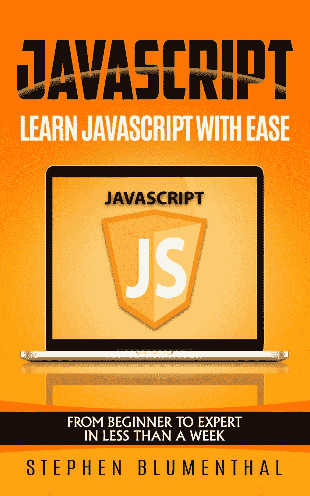
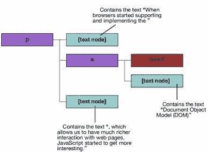
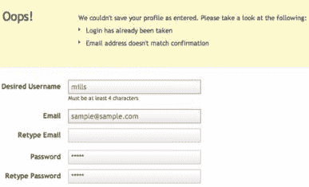
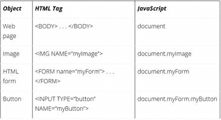

# JavaScript：一周内从初学者到精通





## JavaScript 简介

JavaScript 是一种基于 ECMAScript 标准的解释型编程语言。该语言的定义非常广泛，因为它可以被定义为基于原型、命令式、弱类型和动态的程序语言。

JavaScript 主要作为 浏览器部分的客户端编程语言，允许开发者以更改进的方式在网页中实现用户界面和动态功能，尽管在服务器端（SSJS）也有 JavaScript 的实现。该语言的流行完全归于客户端实现。JavaScript 也可以用于 Web 应用之外，例如为 PDF 文档和桌面组件添加交互性。

JavaScript 的设计语法与 C 相似，尽管它借鉴了 Java 编程语言的名称和约定。然而，Java 和 JavaScript 之间并没有关系，具有不同的语义和目的。JavaScript 最初由 Netscape 的 Brendan Eich 以 Mocha 的命名开发，后来被更名为 Live。该名称大约在 1995 年 Netscape 在 Navigator 2.0 版本中支持 JavaScript 时更改的。选择 JavaScript 是为了给人一种语言是 Java 扩展的印象，这是一种营销策略。

以下是微软在 Internet 3.0 浏览器中实现的类似的客户端语言。微软将其称为 js，以避免与品牌相关的问题。“javascript”和“js”术语经常通用，但 JS 的规范并不 100% 兼容 ECMA 规范。

为了避免这些可能性，维网联盟（W3C）设计了标准的对象模型（DOM，或文档模型），它包含在 Internet 和 Netscape Navigator 第 6 版、Opera 第 7 版、Firefox 自发布以来以及后的所有现代浏览器中。

1997 年，曾建议将 JavaScript 提交给欧洲计算机协会 ECMA 标准，尽管它的名字里有欧洲，但它是国际性的，总部位于日内瓦。1997 年 6 月，它以 ECMScript 的名称被采用为 ECMA 标准。JavaScript 也成为了 ISO 标准。

由于其标准化和互联网的广泛采用，JavaScript 已成为全球最常使用的编程语言。

## JavaScript 的用途

如今大多数网页都存在 JavaScript。你现在查看的页面很包含 JavaScript 代码。尝试这个活动：在网页上点击右键，然后点击“查看源代码”。你应该能在页面代码某处找到 JavaScript 这个词。

虽然 HTML 标记语言允许 Web 开发人员格式化内容，但 JavaScript 允许他们让页面动态。例如，HTML 可以加粗文本、创建按钮和更改网页文本、创建消息以及验证已填充的表单。JavaScript 让网页更加动态，允许用户与页面交互、点击并进行更改。

## JavaScript 能为你做什么

多年来 JavaScript 的用途发生了变化。起，它主要限于与表单交互、向用户反馈以及验证已填充的表单。今天，JavaScript 并不 100% 兼容 ECMA 规范。

JavaScript 的常见用途：

- 与网页交互
- 创建动态内容
- 加粗文本
- 创建按钮
- 更改网页文本
- 创建消息
- 验证表单
- 创建消息
- 验证表单

- 进入 DOM 脚本
- JavaScript 的其他现代用途
- 明智且负责地使用 JavaScript
- 开始学习 JavaScript
- 入门：设置你的代码
- JavaScript 和 HTML
- HTML 基础
- 你知道 HTML 是什么吗？
- 为什么在构建网站时你应该了解 HTML 代码！
- 使用 JavaScript 获取伪元素属性
- 直接在样式表中添加和删除规则
- 使用加载器加载 CSS 文件
- CSS 必备
- CSS 指针事件
- 加载旋转
- 文本转换
- 向上动画
- 自定义
- 命令行值
- 每个设计师都应该知道的 20 个 CSS 技巧
- 学习 CSS 语法和正确应用
- CSS 语法包含三个元素
- 内联样式
- 内部样式
- 外部样式
- 为什么大小写敏感在 JavaScript 中如此重要？理解注释
- 为什么要创建一个 jQuery 插件
- 设置
- jQuery 插件结构
- 为我们的插件添加功能
- JavaScript 和 CSS
- 结论


这主要导致了许多验证脚本，它们在出错时阻止用户向服务器发送表单，以及一些简单的转换器和计算器。此外，我们还设法构建了一些极其没用的东西，比如提示用户输入姓名，然后紧在之后将其打印出来。

另一件事是我们将使用 `document.write()` 向文档中添加内容。我们还处理过弹出窗口和框架（frames），在尝试让它们相互通信时耗费了大量的精力并抓掉了许多头发。一想到这些大多数技术，足以让任何开发者想要反复来跳、蜷缩成胎，并结结巴巴地说“让它们消失吧”，所以，我们就不要纠结这些事情了——有更好的使用 JavaScript 方法！

## 进入 DOM 脚本

当浏览器开始支持并实现文档对象模型（DOM）时（这允许我们与网页进行更丰富的交互），JavaScript 开始变得越来越风趣。

DOM 是文档的对象的表示。例如，上段文字（通过“查看源代码”检查其源码）在 DOM 语言中是一个 `nodeName` 为 `p` 的元素节点。它包含三个子节点——一个 `nodeValue` 为“ browsers started supporting and implementing the ”的文本节点，一个 `nodeName` 为 `a` 的元素节点，以及另一个 `nodeValue` 为“, which allows us to have much richer interaction with web pages, JavaScript started to get more interesting.”的文本节点。该子节点还有一个名为 `href` 的属性节点（其具有值），以及一个 `nodeValue` 为“Document Object Model(DOM)”的文本节点子节点。

你也可以使用树形图视觉化地表示这段文字，如图 2 所示。

 图 2：我们的示例 DOM 树的可视化表示。

用人类来说，你可以说 DOM 解释了文档中一切的类型、值和层次结构——目前你不需要了解更多。

访问文档中的任何元素，并操纵它的外观、内容和属性。

创建新的元素和内容，并在需要时将其应用于文档。

这意味着我们不再需要依赖窗口、框架、表单和丑陋的警告框，而是可以以精美的样式在文档中向用户提供反馈，如图 3 所示。



图 3：使用 DOM，你可以创建更美观且低侵入性的错误消息。

与事件处理相结合，这是一个创建交互式且美观界面的非常强大的武器库。

事件处理意味着我们的代码对浏览器中发生的事情做出反应。这些可能是自动发生的事情——比如页面加载完成——但大多数时候，我们是对用户对浏览器的操作做出反应。

用户可能会调整窗口大小、滚动页面、按下某些键或使用鼠标点击链接、按钮和元素。通过事件处理，我们可以等待这些事情发生，并按照我们的意愿让网页对这些操作响应。过去，点击任何链接都会引导访问者进入另一个文档，而现在我们可以劫持此功能并执行诸如显示面板或获取链接中的信息并将其用于连接网络服务。

## JavaScript 的其他现代用途

这基本上是我们用 JavaScript 做的事情。增强旧的、死板的界面——点击链接、输入信息和发送表单等——使其对终端具有响应性。例如：

- 注册表单可以在输入用户名时检查其是否可用，防止你不得不忍受沮丧的页面刷新。
- 搜索框可以在你输入时根据你输入的内容提供建议结果（例如输入“bi”可以根据该字符串带来如“bird”、“big”之类的建议）。这被称为自动补全。
- 不断变化的信息可以立即加载供用户交互，例如体育赛事结果或股市。
- 对用户来说锦上添花且冗余的信息可以在用户选择访问时加载。例如，网站导航可以是链接，但仅在用户激活菜单时按需显示。

JavaScript 可以修复布局问题。使用 JavaScript，你可以找到元素在页面上的位置以及浏览器的尺寸。利用这些信息，你可以防止叠加和其他问题。例如，假设你有一个分级菜单；在显示它之前检查是否存在子菜单，可以防止菜单项出现滚动问题或重叠。

JavaScript 可以增强 HTML 为我们提供的界面。虽然有一个文本输入框很不错，但你可能想要一个组合框（combo），让你从预设值列表中选择或输入自己的值。使用 JavaScript，你可以增强普通输入为：

你可以使用 JavaScript 为页面上的元素制作动画——例如显示和隐藏信息，或高亮页面的特定部分——这可以带来更实用、更丰富的用户体验。

## 明智且负责任地使用 JavaScript

没有什么是 JavaScript 做不到的——尤其是当你将其与 Canvas 或 SVG 等技术结合时。然而，巨大的力量伴随着巨大的责任，在使用 JavaScript 时你应该始终记住以下几点。

JavaScript 可能无法使用——这很容易测试，并不是什么大问题。然而，依赖 JavaScript 的东西应该带着这种心态来创建，并且你应该确保当 JavaScript 不可用时，你的网站不会挂掉（即核心功能不可用）。

如果使用 JavaScript 并不能帮助用户更快速、更高效地实现目标，那么你可能用错了方法。通过使用 JavaScript，我们经常打破人们多年来在使用网络时习惯的惯例（例如点击链接跳转）。


`<language="type/javascript">` 红色部分是完全可选的，因为浏览器默认认为 `<script>` 标签是 JavaScript，尽管出于验证的考虑，你仍然应该包含它。上述示例的第二行和倒数第二二是 `<!--` 和 `//-->`，它们是为 JavaScript 定制的 HTML 注释标签。建议你包含它们，以防止不支持 JavaScript 的非常旧的浏览器显示你的代码。如果你不包含它们，而有人正在使用此类浏览器，浏览器会将你的所有代码作为文本“倾倒”到屏幕上，换句话，那可没不好看！此脚本唯一的“功能性部分”是 `document.write(".......")` 部分。它基本上是将你放在引号内的任何内容写入页面。先不要太担心为什么会这样，我们稍后会详细讨论。我们用 `</script>` 结束整个代码，这会终止你的脚本并让你回到 html。

就像 html 一样，你可以在你的 JavaScript 中插入注释。JavaScript 注释与 HTML 注释不同，后者会注释掉脚本中的某些行，使其不被解析。JavaScript 注释的语法为：

```
//comment here
```
用于单行注释，或者

```
/*
comment here */
```
用于多行注释。例如：

```html
<script language="JavaScript"> <!--

//这个脚本什么都不做也没用！ /*

嘿， 别让我

卷入这件事！

*/

//-->

</script>
```

好了，我们现在准备好进行真正的编程了！JavaScript 与许多编程语言一样，依赖对象、函数和事件处理器来创建可行的程序。如果你对这些技术术语以及如何使用它们一无所知，不要担心。等我们完成这个教程，你就会了。

## JavaScript 和 HTML

你可以将 JavaScript 视为 HTML 的扩展；如果你愿意，可以是一个插件。它是这样工作的：HTML 标签创建对象；JavaScript 让你操作这些对象。例如，你使用 HTML `<BODY>` 和 `</BODY>` 标签创建一个 Web 页面或文档。如表 1 所示，创建文档后，你可以使用 JavaScript 与之交互。例如，你可以使用一个名为 `onLoad` 事件处理器的特殊 JavaScript 结构在文档加载到 Web 浏览器时触发操作——也许播放一段简短的欢迎曲。你使用 JavaScript 交互的其他 HTML 对象示例还包括窗口、文本字段、图像和嵌入的 Java 应用。

表 1：创建和使用对象



要向 Web 页面添加 JavaScript，你所做的是将 JavaScript 代码嵌入 HTML 文件中。在嵌入 JavaScript 代码的行之后，你可以响应事件处理器或 HTML 链接来引用或调用该 JavaScript 代码。

在向 HTML 文件中嵌入 JavaScript 代码时，你有两个选择：

- 你可以使用 `<script>` 和 `</script>` 标签完全包含 JavaScript 代码。

在下例示例中，JavaScript 函数 `order()` 定义在 HTML 文件的顶部。在 HTML 的更下方，JavaScript 函数与事件处理器 `onclick` 关联。（换句话说，当用户点击订单按钮时，JavaScript 代码 `order()` 会运行）。

```html
<html>
<HEAD>
<script language="JavaScript"> // JavaScript 元素
function order() {
// 订单元素
}
</SCRIPT>
</HEAD>
<BODY>
<FORM name="myForm">
<input type="button" name="order" value="Click order" onclick="order()">
</body></html>
```

- 你可以使用带有 `src` 属性的 `<script>` 标签包含外部 JavaScript 文件。在下例中，JavaScript 函数 `order()` 定义在 `myFile.js` 中。当用户点击订单链接时，该函数被触发并调用。

```html
<html>
<HEAD>
<script language="JavaScript" src="myFile.js"></script>
</HEAD>
<BODY>
<A href="javascript:order();">点击此处订单。</a>
</body></html>
```

由于 Web 页面并非由 HTML 组成，JavaScript 提供的不仅仅是 HTML 对象。浏览器特定的对象（如 RealPlayer 和 Adobe Acrobat）、特定浏览器的名称和版本以及当前日期都是你可以用 JavaScript 处理的非 HTML 对象的示例。组成网站的所有对象——HTML 对象、浏览器相关对象以及直接构建在 JavaScript 语言中的特殊对象——统称为文档对象模型 (DOM)。

## HTML 基础

如果你对 html 一无所知，你绝对应该从基础开始；可能通过在线阅读来学习。一旦你掌握了 html 基础，其余部分应该非常简单。然而，像每个学科一样，html 基础必须细心学习。你不能跳过任何一步。建议一次只学习 html 基础的一个方面，只有在理解了较简单的部分后，再进入高级步骤。最后一点建议——不要因为困难而灰馁；你必须学习标签是什么。然后你就会知道如何工作了。（注：此处提供的文本已经过清理，以确保其与提供的源逻辑一致，同时保持流畅性）。

由于 Web 页面并非由 HTML 组成，JavaScript 提供的不仅仅是 HTML 对象。浏览器特定的对象（如 RealPlayer 和 Adobe Acrobat）、特定浏览器的名称和版本以及当前日期都是你可以用 JavaScript 处理的非 HTML 对象的示例。组成网站的所有对象——HTML 对象、浏览器相关对象以及直接构建在 JavaScript 语言中的特殊对象——统称为文档对象模型 (DOM)。

## HTML 基础

如果你对 html 一无所知，你绝对应该从基础开始；可能通过在线阅读来学习。一旦你掌握了 html 基础，其余部分应该非常简单。然而，像每个学科一样，html 基础必须细心学习。你不能跳过任何一步。建议一次只学习 html 基础的一个方面，只有在理解了较简单的部分后，再进入高级步骤。最后一点建议——不要因为困难而灰馁；你必须学习标签是什么。

*(自我纠正：输入文本包含大量的乱码字符/重复字母（例如 "lаnguаgе", "tуре/jаvаѕссіt"）。根据“核心内容”和“标准 Markdown”，我将它们规范化为标准英文字符以提高可读性，同时处理 `document.write`、`onLoad`、`order()`、`myFile.js` 等变量和函数。)*

输入包含许多编码错误导致无法读取。我将根据语义意图提供清理后的版本。

[content]
/javascript
[/content] （等待，提示要求重新格式化文本。将提供下方特定文本的最终清理版本。）

[content]
`<language="type/javascript">` 红色部分是完全可选的，因为浏览器默认认为 `<script>` 标签是 JavaScript，尽管出于验证的考虑，你仍然应该包含它。上述示例的第二行和倒数第二二是 `<!--` 和 `//-->`，它们是为 JavaScript 定制的 HTML 注释标签。建议你包含它们，以防止不支持 JavaScript 的非常旧的浏览器显示你的代码。如果你不包含它们，而有人正在使用此类浏览器，浏览器会将你的所有代码作为文本“倾倒”到屏幕上，换句话，那可没不好看！此脚本唯一的“功能性部分”是 `document.write(".......")` 部分。它基本上是将你放在引号内的任何内容写入页面。先不要太担心为什么会这样，我们稍后会详细讨论。我们用 `</script>` 结束整个代码，这会终止你的脚本并让你回到 html。

就像 html 一样，你可以在你的 JavaScript 中插入注释。JavaScript 注释与 HTML 注释不同，后者会注释掉脚本中的某些行，使其不被解析。JavaScript 注释的语法为：

```
//comment here
```
用于单行注释，或者

```
/*
comment here */
```
用于多行注释。例如：

```html
<script language="JavaScript"> <!--

//这个脚本什么都不做也没用！ /*

嘿， 别让我

卷入这件事！

*/

//-->

</script>
```

好了，我们现在准备好进行真正的编程了！JavaScript 与许多编程语言一样，依赖对象、函数和事件处理器来创建可行的程序。如果你对这些技术术语以及如何使用它们一无所知，不要担心。等我们完成这个教程，你就会了。


它是网络浏览器用于显示网页内容的标记语言。它控制网页上的格式、字体、边距、布局、颜色、表格、链接以及许多其他项目。它的设计初衷并不是用于控制文档布局的这些方面。你应该做的是使用它来标记标题、段落、列表、超链接以及文档的其他结构部分，然后添加样式表来单独指定布局，就像你在传统的桌面出版软件包中可能做的那样。

它是一种计算机语言，尽管它非常局限且专门。因此，如果你想要一个可以随着时间推移而演化的系统，你需要编写清晰且易于理解的 HTML。它是世界上最著名的标记语言，基本上是“Web 语言”，但自 1997 年发布 `HTML 4` 以来，它在实际上已经几乎没有维护了。因此，今天在 Web 上发布的很多内容如果按照严格的 `HTML 4` 规范，将无法跨浏览器渲染，而且 `HTML 4` 本也存在很多歧义。它是一种语言，使得呈现信息成为可能（例如，你在互联网上查看页面时看到的是你的浏览器对 `HTML` 的解释）。

它通常以不可编辑的方式在浏览器中显示——这迫使用户使用外部软件来编辑原始内容。对于非编程用户来说，使用多个工具来处理文档的紧迫性可能是一项痛苦的任务。这是一种我们永远不会说的语言，我们大多数人永远不会谈论这种语言。它是每台电脑背后的语言或代码。

它还设定了一种媒体愿景——特别是视频——不再依赖于花哨、消耗资源的专有插件。看看你的插件文件夹；你可能至少看到四个视频插件。限制是一种美德。它在不同的客户端之间渲染方式并不相同，所有的可访问性保证都化为乌有。这对于视障人士来说特别是一个问题。

它是一种非常稳定的语言格式。命令在任何地方含义都是相同的。它经常被人们指责为一种糟糕的语言。习惯了使用 `XML` 的人们谈论它缺乏用于标记作者和日期等内容的良好元素。

它被用于结构化信息——将某些文本标记为标题、段落、列表等——并可以在某种程度上描述文档的外观语义。

它是为了构建文档而设计的。关键在于：如果你按预期用途使用 `each`，你将拥有一个更漂亮、更具语义化的 Web，它终于可以停止被黑客用来构建那些从未在其设计中的复杂应用程序了。它不是，因为它是一个功能性标记语言（专门主要用于文档结构），而不是页面布局语言。它的准确渲染效果并不是由发布的文档指定的，而是在某种程度上由浏览器自行决定的。

它是最广为人知的标记语言。虽然库是用 C 语言编写的，但各种语言绑定使其在其他环境中也可用。它是一种非交互式布局语言。它可以布局文本和图形，并提供颜色、粗体字体、闪烁字体等。`HTML 也是一种标记语言`。`HTML` 是文本，具有带有额外功能的格式：文本的部分链接到文本的其他部分，使其易于从一个部分跳转到另一个。它的目的不是为了持有内容，它包含了描述自身的数据。网络上的文本不仅仅是线性的，它是非性的。它的目的不是减少页面，相反是为了允许所有信息以可以在任何顺序渲染的方式进行结构化。它是一种代码。

它不是编程语言——它是一种“标记语言”，代码被嵌入到文档中以描述文档的结构和格式。代码完全由网络浏览器“解释”或“渲染”。`HTML` 是 `HTML5`，它已经更新了新的功能和元素用于构建。它不是编程语言——它是一种“标记语言”。

它是交互式标记的基础。如果你在拼写 `HTML` 这个词，`HTML` 是一个字母一个字母的。它不读作 "hitmill"，而且它不是编程语言。它的设计初衷并不是用于控制文档布局的这些方面。你应该做的是使用它来标记标题、段落、列表、超链接以及文档的其他结构部分，然后添加样式表来单独指定布局，就像你在传统的桌面出版软件包中可能做的那样。它是万维网上最基础、最常见的语言，相对容易学习。

大多数开发者和内容创建者将其视为纯粹的面向人类的技术。但日益重要的机器处理（无论是通过搜索引擎、屏幕阅读器等辅助功能设备，还是浏览器）正变得越来越重要。它是主要用于设计网页的语言。借助 `HTML` 的帮助，它可以进行格式化并设计表单。它是交互式标记的基础。早期的标记具有链接、过渡和跟踪等功能。


20 年前，当互联网还处于婴儿阶段时，构建网页的唯一方法就是使用记事本，这是 Microsoft Windows 自带的一个免费文本编辑器。现在，随着互联网已成为音乐、特效和 Flash 的合集，编写 HTML 代码的艺术正逐渐让位于 Microsoft Frontpage 和 Macromromedia Dreamweaver MX 等 HTML 编辑器。然而，无论你是否喜欢，为了有效地构建网站，你仍然需要了解至少基础的 HTML 代码。

让我来解释一下……

### HTML
HTML 或超文本标记语言从本质上说是万维网的语言。没有 HTML，我们的 Netscape、Internet Explorer 或 Firefox 等浏览器将无法解析我们的网页。HTML 由一系列标签组成，这些标签描述了你想要展示网页的内部机制和结构。现在严肃地说，你可以在完全不懂一点 HTML 的情况下构建网页生存，但要在网络上取得真正的成功，事实如此。

搜索引擎现在是网络上使用的主要工具之一，你每天都能看到微软的 MSN、Yahoo 和 Google 在搜索引擎的竞争中争夺第一位置，但作为一名 Web 程序员，能够将自己定位在排名前的位置可能是你需要掌握的最重要技能之一。因为这意味着你的关键词处于排名前列，意味着你的网站将获得免费的针对性流量，这比通过 Google 的 AdWords、Overture 以及任何其他基于文本的服务付费要好得多。

所以，为什么了解 HTML 会帮助你将网站定位在搜索引擎的顶部位置呢……

你首先需要知道如何正确地格式化你网页的标题标签（header tags），因为没有格式化正确的标题标签，搜索引擎将不知道你的网站是关于什么的，以及你希望与网页关联的关键词。我在某些 HTML 编辑器中看到的一个大问题是，它们没有解决标题标签或特别是元标签（meta tags）问题，这意味着如果你正在构建网站，你已经在损害网站在搜索引擎中被放置在正确位置的能力。

许多 HTML 编辑器会为你提供弹出表单，帮助你设置描述和关键词的元数据，但它们遗漏了重要的元数据，例如搜索引擎爬虫是否应该索引所有页面、网页的语言、字符集以及你根据 HTML 标准创建的文档类型。

```html
<!DOCTYPE HTML PUBLIC "-//W3C//DTD HTML 4.0 Transitional//EN">
```

```html
<html>

<head>

<meta http-equiv="Content-Language" content="en-us"><meta http-equiv="Content-Type" content="text/html; charset=windows-1252">

<meta name="GENERATOR" content="Microsoft Frontpage 6.0">

<meta name="ProgId" content="Frontpage.Editor.Document">

<title>您的标题在此处</title>

<meta name="description" content="您的描述在此处">
<meta name="keywords" content="您的关键词在此处">
<meta name="robots" content="index,all">

</head>
```

我应该说明的是，仅仅因为你提供了所有信息并不意味着：
a) 所有搜索引擎都使用这些信息
b) 你保证能在搜索引擎中获得排名第一
但在网页中包含每个元素并正确放置标签可以使搜索引擎中生成内容。请记住，每个搜索引擎都是不同的，它们用于网站的算法也是不同且复杂的，但如果你添加了元素，你至少会在积极方面获得一些分数。

将这些信息放入网站还有另一个原因。没有这些信息会导致视觉依赖型的人士无法查看你的网站。这听起来可能微不足道，但视觉细节对所有人来说都很重要。然而，在未包括元标签中列出的信息（如语言和字符）的情况下，可能会影响你网站的阅读。如果你的网站建立了 30% 的市场，而这些被禁用了，那么你可能就会损失。

你应该了解如何编写基础 HTML 的其他原因是帮助你构建指向你网页的链接。你可以遵循的构建这些链接的技术是提供关于你所做的信息。例如，如果我写了一篇关于新款高尔夫球杆的酷文章，我知道它将售出数百万个并在市场上引起很大兴趣，那么我链接回提供更多信息的网页的链接就能被找到。

当你向 EzArticles.com、Articles.com 或 Articles.com 等地方提交文章时，他们会要求你使用某些 HTML 来帮助你的文章。例如，通常在文章正文中，你只使用**粗体***斜体*、下划线和列表项目，但在放置详细信息的其他区域，你可以添加超链接和超文本。现在，在之前提到的三个文章提交网站中，如果你想添加超链接，你必须了解基础 HTML，因为它们不会为你构建链接，你必须从零开始编写 HTML 标签。

当你构建链接回你网页的超链接时，你想要确保以下几点：

1. 链接的网页或网站在域名、文件夹名或网页名中包含关键词。

2. 确保超文本（或俗说的锚点文本）也使用了你的关键词。

让我们来看一个基本的示例。如果我写了一篇关于新款高尔夫球杆的酷文章，我知道它将售出数百万个并在市场上引起很大兴趣，那么我链接回提供更多信息的网页的链接就能被找到。

### jQuery
学习 jQuery

jQuery 是一个快速、小型且功能丰富的 JavaScript 库。它简化了 HTML DOM 遍历、事件处理、Ajax 和 CSS 操作。它的口号是“一次编写，随处运行”。jQuery 是世界上流行的 JavaScript 库之一。数百万开发者使用它创建交互性和动态网站。

### 为什么使用 jQuery?

jQuery 流行是因为很容易学习并且有广泛的插件。它允许你花很少努力编写复杂的代码。它还是跨浏览器的这意味着你的代码可以在所有主流浏览器中运行。

### 如何使用 jQuery?

要使用 jQuery，你需要将 jQuery 库引入项目中。你可以从 jQuery 官网下载它，或使用 CDN。

```html
<script src="https://code.jquery.com/jquery-3.6.0.min.js"></script>
```

一旦引入了 jQuery，你就可以开始使用它的方法。这是一个示例：

```javascript
$(document).ready(function(){
  // 此代码在 DOM 加载后运行
  $("button").click(function);
});
```

### 常用 jQuery 方法

- `$(selector)`：从 DOM 中选择元素。
- `.html()`：获取或设置 HTML 内容。
- `.text()`：获取或设置文本内容。
- `.val()`：获取或设置表单元素的值。
- `.hide()`：隐藏元素。
- `.show()`：显示元素。
- `.toggle()`：切换显示隐藏。
- `.append()`：在元素末尾添加内容。
- `.prepend()`：在元素开头添加内容。
- `.remove()`：从 DOM 中移除元素。
- `.after()`：在元素之后添加内容。
- `.before()`：在元素之前添加内容。

### jQuery Ajax

jQuery 使 Ajax 请求变得非常简单。这是一个 GET 请求的示例：

```javascript
$.ajax({
  url: "test.php",
  type: "GET",
  data: { id: 1 },
  success: function(result){
    console.log(result);
  },
  error: function(xhr, status, error){
    console.log(error);
  }
});
```

### 结论

jQuery 是一个强大的工具，可以使 Web 开发变得更加简单和快速。无论你是初学者还是经验开发者，学习 jQuery 都是一项值得拥有的技能。


现在我们需要将插件文件和 jQuery 库一起引入我们的主 HTML 页面（index.html）。最佳实践是直接从 Google 的服务器引入 jQuery 库，因为它们在全球范围内发布，而不是位于你的单一服务器位置：更近服务器通常意味着访问者的响应速度更快。从 Google 引入 jQuery 的另一个优势是，当访问访问你的网站时，他们的本地缓存中可能已经有了 jQuery 脚本。预缓存的内容通常意味着访问者的加载速度更快。

## jQuery 插件结构

jQuery 提供了所有必要的钩子（hooks）来帮助你开发我们的插件。但良好的 JavaScript 实践很重要，因此我们必须确保所有内容都留在局部作用域内。让我们从 jQuery 插件的基础框架开始：

```javascript
(function($) {

$.fn.simpleAccordion = function() {

//TODO: simple 折叠面板插件代码

}

}(jQuery));
```

让我们快速浏览一下这里发生了什么。通过将所有内容包含在 `(function() {})` 自闭 JavaScript 模式中，我们确保了插件中的所有变量都将安全地留在全局命名空间之外。我们不会与页面上运行的任何其他 JavaScript 冲突，因此我们必须像上面那样隔离我们的代码。

你可能注意到的另一点是我们定义插件的方式就像 jQuery 处于“无冲突”（no-conflict）模式。同样，我们试图避免与页面上的其他 JavaScript 冲突，因此我们想确保插件不依赖于默认的 `$`，因为它可能被另一个库使用。最后，`.fn` 是 jQuery 允许你定义插件的方法，我们将其命名为 `simpleAccordion`。所有组件就绪后，让我们开始动手吧！

## 为我们的插件添加功能

jQuery 的强大之处在于它允许你使用任何选择器。然而，你必须记住，我们的插件可能会处理多种不同的元素类型。使用 "this" 关键字可以让我们的插件在循环中对每个元素应用异步函数。

获取 HTML 部分 - 构建折叠面板

由于我们正在构建折叠面板（accordion），我们需要它的 HTML 结构，因此：

- Heading 1：更的标题、内边距和内容。
- Heading 2：不要包含此项。
- Heading 3：仅供我们使用。
- Heading 4：包含列表。

这是一个简单的折叠面板结构，定义了四个标题及其相应的内容。因此，插件的 id 将把此 HTML 代码转换为功能性的折叠面板。它现在看起来应该是这样的：

```css
.accordion {
  width: 600px;
  border: 1px solid #ccc;
  border-bottom: none;
}
.accordion dt {
  border-bottom: 1px solid #ccc;
  margin: 0px;
}
.accordion dt {
  background: rgb(193, 221, 252, 0.24);
  cursor: pointer;
  padding: 8px 4px;
  font-size: 14px;
  font-weight: bold;
}
.accordion dd {
  padding: 12px 8px;
}
```

现在我们的结构应该像这样：jQuery 部分 - 时候动手了！为了为我们的插件添加功能，我们将编辑 js 文件并添加以下代码：

```javascript
(function($) {

$.fn.simpleAccordion = function(options) {
  return this.each(function() {
    var dt = $(this).children('dt');
    dt.click(accordionClick);
    dt.each(reset);
  });

  function accordionClick() {
    $(this).siblings('dt').each(hide);
    $(this).next().slideDown('fast');
    return false;
  }

  function hide() {
    $(this).next().slideUp('fast');
  }

  function reset() {
    $(this).next().hide();
  }
}

})(jQuery);
```

让我们快速过一下这段代码在做什么。首先，你需要理解 jQuery 是一个扩展 JavaScript 语言的库。在创建任何 jQuery 插件时，你实际上是在扩展 jQuery 库，而 jQuery 库又是扩展 JavaScript。真正理解我们的插件如何扩展 jQuery 库需要理解 JavaScript。虽然没有直接使用，但 JavaScript 通过 jQuery 在后台使用，jQuery 是 JavaScript 的别名。

此外，你可以使用 jQuery `plugin-name` 为我们的插件添加一些选项。要添加选项，你可以为插件添加选项。选项是你可以传递给插件的默认值，而不是像标准 jQuery 那样通过对象发送元素。当插件中的所有选项就绪时，最佳实践是使用默认对象。`.extend` 方法的作用是合并两个或多个对象。

让我们快速为我们的插件添加一些选项来展示这一点。我们将在折叠面板首次加载时传递一个参数来打开第一个部分。

```javascript
(function($) {

$.fn.simpleAccordion = function(options) {
  var state = $.extend({open: false}, options);
  return this.each(function() {
    var dt = $(this).children('dt');
    dt.click(accordionClick);
    dt.each(reset);
    if(state.open)
      $(this).children('dt:first-child').next().show();
  }
  });

  function accordionClick() {
    $(this).siblings('dt').each(hide);
    $(this).next().slideDown('fast');
    return false;
  }

  function hide() {
    $(this).next().slideUp('fast');
  }

  function reset() {
    $(this).next().hide();
  }
}

})(jQuery);
```

如果你注意到，我们使用了 `open:false` 的默认值，所以如果没有传递任何选项，插件将假设你希望折叠面板在首次加载时是关闭的。当插件接收到选项时，你可以依靠 `.extend` 方法执行实际的覆盖。`.extend` 方法的作用是合并两个或多个对象。

## Javascript 和 CSS

CSS 和 JavaScript：界限似乎随着每个浏览器的发布而变得模糊。它们一直承担非常不同的工作，但最终它们都是前端技术，因此需要协同工作。我们有 .js 文件，但这并不意味着 CSS 不能进行比基础 JavaScript 允许更多的交互。JavaScript 和 CSS 有五种工作方式

## 使用 JavaScript 获取伪元素

我们知道可以获取元素的 CSS 样式，但伪元素呢？是的，JavaScript 可以访问它们：

```javascript
// 获取元素:before 的颜色
var color = window.getComputedStyle(document.querySelector('.element'), ':before').getPropertyValue('color');

// 获取 element:before 的内容
var content = window.getComputedStyle(document.querySelector('.element'), ':before').getPropertyValue('content');
```


我们都很熟悉如何通过 `element.style.propertyName` 方法来修改样式，并且使用过 JavaScript 工具包来实现它，但你知道你实际上可以读取和写入新及现有样式表中的规则吗？这个 API 实际上非常简单！

```javascript
function addCSSRule(sheet, selector, rules, index) { 
  if(sheet.insertRule) {
    sheet.insertRule(selector + "{" + rules + "}", index);
  } else {
    sheet.addRule(selector, rules, index);
  }
}
```

// 使用它！

`addCSSRule(document.stylesheets[0], "header", "float: left");`

最常见的用例是创建一个新的样式表，但如果你想修改现有的样式表，尽管尝试。

# 使用加载器加载 CSS 文件

懒加载图像、JSON 和脚本等资源是缩短加载时间的极方法。我们可以使用 `curl.js` 等 JavaScript 加载器加载这些外部资源，但你知道你可以懒加载样式表，并在同一个回调中获取通知吗？

```javascript
curl( 
  
  "namespace/MyWidget",
  "css!namespace/resources/MyWidget.css"
  ,
  function(MyWidget) {
    // 对 MyWidget 进行某些操作
    // CSS 引用不在签名中，是因为我们不在乎它；// 我们只关心它现在是否在页面中
  }
);
```

# CSS 基础

## CSS pointer-events

CSS `pointer-events` 属性的有趣之处在于，它的作用方式几乎像 JavaScript：当值为 `none` 时，它会有效禁用元素；而在值不为 `none` 时，允许元素正常运行。你可能会说“那又怎样”，但 pointer-events 甚至可以防止 JavaScript 事件触发！

```css
.disabled { pointer-events: none; }
```

### 使用

该包可以通过 bower 安装

`bower install css-essentials`

```html
<link rel="stylesheet" href="bower_components/css-essentials/dist/cssessentials-min.css">
```

或者通过 npm 安装

`npm install css-essentials`

### 基础

我们确定，我们需要比通常的 3-4 个断点更多，才能真正适应所有的屏幕设计。因此，我们定义了以下断点：

`@of-xsm : 460px; @of-sm: 606px; @of-md: 800px; @of-lg: 1164px; @of-xlg: 1440px; @of-xxlg: 1740px;`

#### 浏览器支持

我们倾向于至少支持 n-1，其中 n 是任何浏览器的当前版本。

### 组件

#### 网格

基于 24 列的网格使用 flex 创建。快速开始：

```html
<div class="of-row">
  <div class="col-24 xs-18 sm-12 md-6 lg-4 xlg-2 xxlg">内容</div>
</div>
```

这这会在小屏幕上将占据整行，在大屏幕上将占据 1 列。默认情况下，行侧边有 24px 的内边距（sm 为 0），列之间有 12px 的内边距。可以使用 `.of-row-padding` 省略行的内边距。

#### 加载旋转

加载旋转器可以指示加载状态。快速开始：

```html
<div class="of-row">
  <div class="col-24">
    <div id="loading-bar"><div class="spinner-in"></div>
  </div>
</div>
```

#### 文本截断

当你希望在一行中显示文本并在超过行宽时进行截断时，文本截断非常有用。快速开始：

```html
<div class="of-row">
  <div class="col-12">
    <div class="truncate-text">
      Lorem ipsum dolor sit amet, consectetur adipiscing. Fusce non elit eget mollis felis. In consequat, ligula eu dictum, mi sapien non metus, as turpis elit nulla. Phasellus at tincidunt, sem auctor ex. Aenean sed gravida orci, vitae tristique ante. Suspendisse vestibulum element eros orci, vitae bibendum mi ullamcorper et. Nulla elementum ipsum, congue est velit. Vestibulum ante primis in faucibus et strictly posuere cubilia Cura; Pentesque sed elit cursus. Duis sodales ultricies metus fugiat maximus. Quisque viver libero eu convallis massa. Sed sodales varius iulis. Phasellus cursus viverra magna, a elementum arcu blandit in. Vivamus ult elit vel felis porta, at cursus metus ele. Maenas dolor dui, commodo nec turpis eu, suscipit vehicula massa.
    </div>
  </div>
</div>
```

#### 向上动画

向上动画是悬停在元素上时的一个很棒的效果。快速开始：

只需在你的任何元素上添加 `.push-up-animation` 即可。

## 自定义

可以通过编辑 `src/base/breakpoints.less` 文件中的值来编辑网格断点，然后重新编译项目。

## 命令行值

除了此，还可以向 grunt 命令传递所需的断点值：

`$ npm grunt release --breakpoints='xs 460px, sm 606px, md 800px, lg 1164px, xlg 1440px, xxlg 1740px'`

此 `breakpoints` 参数将覆盖 `src/base/breakpoints.less` 中指定的默认值。然后每个断点由一个 `<width>` 字符串组成，用于识别你的断点，它将使用这个简单的空格来分隔宽度（值如：0px, 300px, 500px 等)。

# 每个设计师都应该知道的 20 个必备 CSS 技巧

### 绝对定位

如果你想始终控制元素在网站上的位置，绝对定位是实现此点的关键。如果你将浏览器看作一个大盒子，绝对定位允许你精确控制该盒子元素将留在哪里。使用 top、right、bottom 和 left 配合像素值来控制元素的位置。

```css
position: absolute;
top:20px;
right:20px
```

上面的 CSS 将元素的位置设置为距离浏览器顶部和右侧边缘 20px。你也可以在 div 内部使用绝对定位。

### * 选择器

`*` 选择器允许你选择特定选择器的所有元素。例如，如果你使用了 `*` 然后给它添加了 CSS 样式，它将应用于文档中所有带有 `<p>` 标签的元素。这使得定位网站的部分变得简单。

### 覆盖所有样式

这应该谨慎使用，因为如果你对所有内容都这样做，长期来看会遇到麻烦。但是，如果你想为特定元素覆盖另一种 CSS 样式，请使用 `!important`。

### 居中

居中很复杂，因为它取决于你想居中什么。让我们看看基于内容的项目居中 CSS。

#### 文本

使用 `text-align:center;` 文本居中。如果你想靠，使用 left 或 right 代替 center。

#### 内容

div（或任何其他元素）可以通过向其添加 `block` 属性并使用 `auto` 外边距来实现居中。CSS 看起来如下：

`margin: auto; width: anything under 100%;`

我之所以在宽度上写“` 100% 以下的任何值`”，是因为如果它是全宽的，它就不需要居中了。最好的方法是设置一个固定宽度，例如 60% 或 550px 等。

#### 垂直对齐（针对单行文本）

你会在导航菜单中使用它，我几乎可以肯定。关键是让菜单的高度和文本的行高相同。当我回去编辑客户的现有网站时，经常看到这种技术。这是一个示例：

```css
.nav li{
line-height:50px; height:50px;
}
```

#### 悬停效果

这用于按钮、文本链接、网站区块区域、图标等。如果你想让某物在鼠标悬停在其上方时改变颜色，请使用相同的 CSS，但对其添加 `:hover` 并更改样式。

```css
.entry h2{
font-size:36px; color:#000;
font-weight:800;
}

.entry h2:hover{ color:#f00; }
```


它的作用是在当有人悬停在 `h2` 标签上时，将其颜色从 `black` 变为 `red`。使用 `:hover` 的妙之处在于，如果属性没有变化，你不需要重新声明 `font-size` 或 `weight`。它只会改变你指定的属性。

### Transition（过渡）

对于 `hover` 效果（例如菜单或网站上的图像），你不希望颜色太快地变成结果。理想情况下，你希望变化逐渐发生，这就是 `transition` 属性大显用场的地方。

```css
.entry h2:hover{
  color:#f00;
  transition: all 0.3s ease;
}
```

使得变化在 `.3s seconds` 内发生，而不是瞬间跳到红色。这让悬停效果看起来更舒服，不那么突兀。

### 7. Link states（链接状态）

许多设计师忽略了这些样式，这确实会给访问者带来可用性问题。`:link` 伪类控制所有尚未点击过的链接。`:visited` 伪类处理所有已访问过的链接的样式。这告诉网站访问者他们已经在你的网站上去过哪里，以及哪里还有待探索。

```css
a:link { color: blue; }
a:visited { color: purple; }
```

### 8. Easily resize images to fit（轻松缩放图像以适应）

有时你会遇到图像需要适应特定宽度同时按比例缩放的情况。处理此问题的简单方法是使用 `max-width`。这是一个示例：

这意味着图像最大可以是 `100%`，高度根据图像宽度自动计算。在某些情况下，你可能还需要指定宽度为 `100%`。

```css
img {
  max-width:100%;
  height:auto;
}
```

### 9. Control the elements of a section（控制区域元素）

使用上面的图像示例，如果你只想针对特定区域（例如你的博客）的图像，请为博客区域使用类并与实际选择器结合。这将让你只选择博客区域的图像，而不是其他图像，例如 logo、社交图标或网站其他区域（如侧边栏）的图像。CSS 看起来如下：

```css
.blog img{
  max-width:100%;
  height:auto;
}
```

### 10. Direct children（直接子元素）

我希望我在刚开始使用 CSS 时就知道这一点。这本可以为我节省很多时间！使用 `>` 选择元素的直接子元素。例如：

```css
#footer > a
```

这将选择并设置所有紧位于 Footer ID 下的活动链接元素的样式。它不会选择越过活动元素的任何内容，也不会选择 footer 中包含的任何其他内容（如纯文本）。这对于顶层导航元素也非常好用。

#### Specific Child Elements（特定子元素）

相信我，这为列表设置样式时非常方便。你只需要计算你想要样式的元素向下数有多少项，然后应用该样式。

```css
li:nth-child(2) {
  font-weight:800;
  color: blue;
  text-style:underline;
}
```

上面的 CSS 针对列表中的第二个项目，并使其加粗、下划线并变为蓝色。在括号中的数字后添加一个“n”，你就可以针对每 2 个列表项。想象一下能够对表格样式布局中的每隔行进行样式处理以便于阅读。CSS 将是：

```css
li:nth-child(2)
```

### 11. Apply CSS to multiple classes, or selectors（向多个类或选择器应用 CSS）

假设你想为所有图像、博客区域和侧边栏添加完全相同的边框。你不需要写 3 次相同的 CSS。只需列出这些项目，并用逗号隔开即可。这是一个示例：

```css
.blog, img, .sidebar {
  border: 1px solid #000;
}
```

无论你是做了多年的网页设计师，还是初学者，学习如何正确构建网站似乎是一段崎岖且无止尽的旅程。一旦你确定了想要学习的语言，你就必须学习并完善你的技能。无论你学习什么，CSS 都是必须掌握的重要但令人畏畏的技能之一。不过它不必如此困难，特别是如果你知道了几个。

### 12. box-sizing: border-box

`box-sizing:border-box` 是网页设计师的最爱，它解决了内边距（padding）增加盒子尺寸的问题。然而，使用 `box-sizing:border-box` 后，padding 会包含在宽度内。

![Image0004.jpg)

### 13. :before

`:before` 是一个允许你在元素之前插入内容的选择器。这告诉网站访问者他们已经在你的网站上去过哪里。

```css
h2:before{
  content: "";
}
```

这是一个用于元素的伪类。

### 14. :after

`:after` 是允许你在元素之后插入内容的选择器。这是为文本添加图标或装饰的常用方法。

```css
h2:after{
  content: " - ";
}
```

### 15. content

`content` 是一个与伪元素一起使用的属性，用于向页面插入内容。它可以是文本、图像或其他元素。

```css
.icon:before {
  content: "★";
}
```

### 16. reset

`reset` 属性将属性重置为默认值。当你想要覆盖之前设置的样式时这非常有用。

```css
p {
  reset: all;
}
```

### 17. text-transform

`text-transform` 属性用于更改文本的大小写。你可以让文本全大写、全小写或每个单词的首字母大写。

```css
h2 {
  text-transform: uppercase;
}
h2 {
  text-transform: lowercase;
}
h2 {
  text-transform: capitalize;
}
```

### 18. vh

`vh` 单位用于设置视口高度的百分比。`100vh` 等于浏览器窗口高度的 100%。这对于创建填充整个屏幕的区域非常有用。

```css
section {
  height: 100vh;
}
```

### 19. Vertical screen height（垂直屏幕高度）

`height` 单位用于设置视口高度的百分比。`100vh` 等于浏览器窗口高度的 100%。这对于创建填充整个屏幕的区域非常有用。

```css
section {
  height: 85vh;
}
```

### 20. Style telephone links（设置电话链接）


如果你有一个链接，用户在手机上点击时会拨打电话，你可能无法使用传统的活动链接选择器对其进行样式设置。相反，请以下 CSS：

```css
a[href^=tel] { <span class="Apple-converted-space"> color: #FFF;</span> <span class="Apple-converted-space"> text-decoration: none;</span> }
```

## JavaScript 函数的不同方式

### 1 – 裸露锚点
在某些浏览器中，鼠标悬停时可能不会发生变化。可以使用 CSS 来解决这个问题：`a {cursor:pointer; }`

### 2 – 锚点哈希链接
鼠标悬停时会显示带有 # 符号链接。在 IE6、IE7 中页面可能会跳转到顶部。

### 3 – 锚点伪协议
在点击链接时调用函数的旧式方法。出于易用性和可访问性考虑，不建议使用伪协议 href。由于可用 API 的大量出现，现在这被认为是过时的编程方式。它既混乱又冗长，人们会在状态栏中看到它，而且没有任何意义。Opera 不喜欢 `href="javascript:[anything]"`

### 4 – 锚点伪协议 void
某些人认为 `javascript:[anything]` 是一种坏做法。伪协议 href 会导致 IE 进入等待状态，预期页面将被替换，并自动禁用消耗大量资源的活动。`javascript:[anything]` 用于书签。那么 `javascript:void(0);` 是什么？

### 5 – 锚点返回 false
返回 false 会导致 `href="#"` 不被评估。这比使用上述伪协议示例（如页面跳转）更安全。`return` 有时可能不可靠。

### 6 – 锚点漂亮 URL/jQuery
用户悬停在链接上时会看到 #some-real-url。如果禁用了 JavaScript，他们会看到一些信息内容。

```javascript
$(document).on('click', 'a.mylink', function(e) {
  //防止页面跳转到 href
  e.preventDefault();
  //运行函数 foo();
});
```

## 学习 CSS 语法和正确应用

一旦你对 CSS 及其功能有了深入的理解，下一步是理解 CSS 的语法以及将其应用于文档的少数几种方式。

### CSS 语法由三个元素组成。

**选择器**：选择器是你 HTML 文档中想要设置样式的元素。例如，如果你在 HTML 中有一个段落标签，你的选择器就是 `p` —— CSS 中的标准段落标签。如果你想为网站的整体设置样式，将使用 `body` 作为选择器。稍后你将学习如何使用 `class` 和 `id` 标签创建自己的选择器。

**属性**：属性是可以应用于选择器的元素。以上面的段落为例，你可以用于设置该元素样的几个属性是 `font-family`、`font-size`、`color` 等。

**值**：值是应用于特定属性的形状、大小、维度等。例如，如果你想让段落以某种大小显示，就会对属性应用 `20px` 的值。

```css
p {}
p {font-size: }
p {font-size:20px;}
```

现在，让我们进入 CSS 的应用。有三种方法可以将样式应用于文档中。

#### 内联样式
内联样式意味着你直接在标签内部放置元素的样式。例如，如果你想改变段落的文字颜色，可以在段落标签内应用 `blue;`。这种方法可以，但不推荐。如果你有一个 100 页的网站，且每页都使用内联样式，当需要更改时，你必须独立地更改所有 100 页。

#### 内部样式
内部样式意味着将样式包含在 HTML 文档本身。在文档开头有 `head` 标签。你的样式将放在这些标签之间以便引用。如果你有一个单页网站，可以使用这种方法。

#### 外部样式
使用外部样式是使用 CSS 最有效的方法。你的样式存储在所有 HTML 文件都连接的外部文档中。这使得全局更改变得非常简单。假设你想更改 100 页网站上的链接颜色。你不需要独立地更改每个页面，只需在外部文档中更改样式即可。所有页面都会被更改，因为它们都链接到同一个样式表。

## 为什么 JavaScript 对大小写敏感如此重要？

这是它的本质。首先，脚本是用纯文本编写的，但它不仅仅像 HTML（HTML 大部分不区分大小写）那样标记，它是代码，因此受到浏览器内部机制（DOM API）更严格的审查。

```javascript
var names, Names;
```

这两个变量看起来几乎一样，但对 JS 来说它们是天差地别的。重要的是我们要认识到它不是实例，而是本质。它就是它本身。

```javascript
function Person(name, age) {
  this.name = name;
  this.age = age;
}

var person = new Person("Zach", 29);
```

我们可以忽略这个对象的创建（尚未涵盖）。重点是显示 `person` 和 `Person` 是两个不同的对象。`Person` 是一个对象构造函数，而 `person` 是该函数的实例。

## 理解注释
你可以对个人和组织输入并跟踪相关注释。你可以查看关于某个个人的所有注释，或由某个特定个人输入的所有注释。由于个人注释是主观的且通常是机密的，请分析你输入和跟踪注释的需求。在系统中设置或创建注释之前，你还应该熟悉管理功能和组安全设置。

在适当的安全保障下，你可以点击关于该个人或组织的功能区域页面上的“创建注释”按钮，以为个人或组织的记录附上或查看注释。

你还可以通过菜单导航到本文档中描述的注释页面。

句子中的冒号用法
目前有两种选择：逃跑或战斗。我们知道谁会赢得比赛：老鹰队。他想看意大利的三个城市：罗马、佛罗伦萨和威尼斯。记住：棋半皆棋。她一直重复：“我真的想要那辆车！”

巴里想知道为什么我没有回他的短信：我没有收到。

这里有三个以 M 开头的州：密歇根州、密西西比州和缅因州。你现在可以接我了：我感觉好多了。永远不要忘记这一点：说话前思考。这栋房子有我需要的一切：两个卧室、一个后院和一个车库。

这个小镇让我想起童年的假期：两次都是在海边。

我有几种喜喜欢的电影类型：剧情、科幻和悬疑。这是莎士比亚最早说出的话：“对你自己保持诚实。”我在商店买了很多肉：培根、火鸡肉和金枪鱼。世界是一个舞台：请演好你的角色。

新上司有许多特质：友好、外向且公平。这些是我喜欢的颜色：紫色、青绿色、粉色和黄色。

句子中的分号用法
爸爸正在变秃顶；他的头发变得越来越稀疏。我非常喜欢牛肉，配蘑菇酱；意面，配奶油白酱；还有沙拉，配法式油醋。你应该停止吃这么多食物了；否则你得减肥了。你需要新眼镜；否则你可能无法及时开车。


我吃了一顿大餐；然而，我已经又饿了。圣诞装饰品终于收起来了：有小而闪闪的，大而明亮的，还有手工制作的。

她接受过防身训练；因此她击退了袭击者。

我们的学生来自秘鲁的利马、智利的圣地亚哥和委内瑞拉的加拉斯。

我们失误了太多次；我们输掉了比赛。

我知道你不喜欢西兰花；尽管如此，它对你的身体非常有好处。米歇尔开的是雅捷；索尼开的是保时捷。

我完成了主菜；现在我得做甜点了。春天带来了和煦的雨和更温暖的天气；此外还有雷雨和冰雹。

她管那里叫浴室；我称之为厕所。

妈妈想让家务完成；而且她希望完成得体面。

我一忙完就过去；这是一个我一定会遵守的承诺。

她没看到另外另一辆车开过来；现在她的车上有了一个巨大的凹痕。全球变暖的证据越来越充分；当然，有些人永远不会相信这一点。

## 信誉循环

### 偶尔

在旧世界，我们去学校获取信息，我们信任法律和其他权威，并将广告视为娱乐。大多数 30 岁以上的人还记得，有段时间，每个人在电影开始前十分钟到达影院，仅仅是为了看广告。今天，我们几乎在任何地方都能获取信息。我们质疑权威，因为他们服务的是系统，而不是人民，而广告已经变成或将成为最不可靠的信息类型。广告是单向传播，而今天的消费者想要并要求互动。

我们变得越来越具有批判性、知识渊广，并且我们想要自己搜索和发现信息。我们经常向朋友或小型社区/亚文化咨询参考，这或是一条规则；我们绝不相信广告第 `3` 页。广告行业长期以来生产低质量但报酬过高的材料，这在未来将是不可能的。我们都知道，在当今的媒体喧嚣中，很难让自己的声音被听见，再增加一次广告营销活动并不是让你穿透噪音的最佳解决方案。

这是广告本身的一种现象，所有（所有其他）精明的企业都将昨天留在自己的翼下。有很多例子说明广告并不能卖东西。为什么我们仍然拥有一种“广告王国”的文化，拥有着昂贵却得不到应有结果广告？设定预算使用了哪些基本原则？我们只能推测，但可以肯定这种影响是巨大的。对失败的饥渴和恐惧比预知结果更强烈。一个昂贵而无用的活动无法通过财务或理性的论点证明合理。但在情感和心理上，这经常发生。我们看到的是全球范围内，一群公司（广告代理机构）过度销售某种产品。这如何会发生？广告已经变成了一种巨大的保险费吗？

### 感知

接收者的感知已经改变。随着互联网以及某些地区的全球化（从积极角度来看），今天的人拥有独特的广告力量。昨天需要几天或几个月传播的信息，今天只需要一秒。现在人们更喜欢直接从网络上的搜索引擎、朋友、影响者群体或编辑出版物获取他们的价值观、影响和建议。例如：如果你去纽约想住一家非常特殊的酒店，你会查看酒店广告吗？不太可能。你更倾向于问朋友或阅读酒店评论。很少有人相信酒店广告：它们是主观的，且只传递酒店的信息。这有多可信呢？

### GNP

一些公司的广告费超过了某些国家的生产总值（GNP）。据低估计，2004 年全球广告支出为 1 万亿，或一千亿（1,000,000,000,000）美元。仅在美国，支出就至少有 5000 亿（宝洁公司花费最多：29 亿）。与 2005 年全球花费的 1.1 万亿美元（118,000,000）相比，或者这对于 Al（美国营销之称）所说的“……广告如此少”来说是可能的？

### GNP 之前

想要改变 GNP 的事实，以及仅通过其中的一部分就能节省多少钱？这是一个内部且重要的问题，但我们决定就这一情况制作内容。我们有一个今天“广告王国”的替代方案，因为我们认为创建和品牌化新产品和服务更合适。我们称之为“创意”。

### 线条之前

在如今，要在市场上立足，你需要一系列因素。所有的竞争对手都拥有良好的质量、良好的分销、良好的人事、良好的价格、良好的沟通以及各种良好的……只是有一种说法，所有产品的功能、性能、技术和价格都是相同的。将他们的产品与竞争对手区分开来的唯一因素就是设计。为什么不把大部分精力放在开发良好的设计上呢？创意行业内部有很多关于“线上营销”（ATL）和“线下营销”（BTL）沟通的讨论。红角坐着 ATL，它涉及杂志、广播、电视和户外印刷品的传统广告。在蓝角，我们将找到 BTL，它涉及公关（PR）、网络、直接邮件营销（DM）、零售沟通等。如果你问我们，ATL 被击倒了。但我们更进一步，引入了我们自己的 BTL：线之前（Before the Line）。我们的 BTL 像蝴蝶一样飞舞，像蜜蜂一样刺刺……

更好的马

到今天为止，营销人员一直负责将新产品引入市场，（仅仅）是因为他们的工作是了解人们喜欢和想要什么。但他们真的了解人们需要什么吗？观察人们做什么比听他们说什么更有趣。看看你的孩子；他们确实喜欢你想要的。


从一开始就将沟通特质融入产品中。通过赋予产品和服务以更好的意义，目标群体自发地选择它们的机会会大得多。

一个很好的例子：当 iPod 在 2001 年推出时，苹果公司花费了 2450 万美元推出该产品。这是一笔巨款，但可能仅是如果使用一个缺乏吸引力的产品要达到同样的全球成功所需成本的十分之一。良好的设计和口碑完成了大部分工作。

设计 = 经济学，正如伟大的瑞典平面设计师 Calle Eksell 在 1964 年描述的那样。根结底：这都关乎于掌控局面。

设计策略的触角无处不在

我们坚信，公司将通过良好的设计和创新策略建立更具信誉的品牌，而不是仅仅在最后用广告来包装产品。广告资金应该更好地用于那些能产生影响并对企业和社会都有益的创新。谁不想通过开发更具吸引力和可持续性的产品或服务，来让人们的生活变得更好、更平等、更快乐呢？

有些人可能会认为一切都会被复制：无论是产品还是服务。当然，如果它足够成功，就会变成这样。当每个人都拥有同样的技术时，复制品将永远存在。因此，你必须差异化并保持独特性，你需要更聪明、更主动。前进的好方法是少一点技术官僚主义，多一点文化性，因为企业的价值观是最难通过成本进行蓝图设计的。通过在公司战略中整合设计策略（与营销、人力资源、研发、财务等一起），你将走得很远。

我们都熟悉 80 年代以后关于品牌的讨论：“我们的品牌是我们最有价值的资产”。今天，这已是常常谈资，也是一种卫生因素。如今，设计策略是“新”的品牌策略。像苹果这样拥有明确设计策略的成功公司已经明白，设计问题必须在最高管理层进行讨论和决定。

设计策略在企业战略中应该触角遍布，这就是它具有必要性以及作为不可战胜的竞争优势的原因。它超越了企业形象和平面设计问题；它关乎你公司中发生的一切。你们的客户服务是如何响应的？办公室里有鲜花和水果吗？前台播放什么样的音乐？你们的物流是否完全优化？你们的产品或服务是如何包装的？你们又是如何展示它的？一切都关重要，没有无不重要的，你必须拥有全局观并管理流程——设计流程。这是你最重要的流程，因为设计能帮助你在沟通中成功。通过良好的沟通，你将触达客户，并成为客户心中一个快乐且可能积极的一部分。

总结关于永恒的品牌讨论：品牌及其价值是设计过程的结果。

### 我们的觉醒

今天，我们都知道我们必须开发、创新并寻找新的生存方式——无论是业务、个人还是环境方面的考虑。在 David Report，我们承担起责任并关注一个商业困境——为什么要投广告呢，你明明可以做一些更有力的事情，并且通过创新的研发同时建立你的品牌并销售更多产品/服务呢？

当你意识到一切都会被复制：无论是产品还是服务。当然，如果它足够成功，就会变成这样。当每个人都拥有同样的技术时，复制品将永远存在。因此，你必须差异化并保持独特性，你需要更聪明、更主动。前进的好方法是少一点技术官僚主义，多一点文化性，因为企业的价值观是最难通过成本进行蓝图设计的。通过在公司战略中整合设计策略（与营销、人力资源、研发、财务等一起），你将走得很远。

我们都熟悉 80 年代以后关于品牌的讨论：“我们的品牌是我们最有价值的资产”。今天，这已是常常谈资，也是一种卫生因素。如今，设计策略是“新”的品牌策略。像苹果这样拥有明确设计策略的成功公司已经明白，设计问题必须在最高管理层进行讨论和决定。

设计策略在企业战略中应该触角遍布，这就是它具有必要性以及作为不可战胜的竞争优势的原因。它超越了企业形象和平面设计问题；它关乎你公司中发生的一切。你们的客户服务是如何响应的？办公室里有鲜花和水果吗？前台播放什么样的音乐？你们的物流是否完全优化？你们的产品或服务是如何包装的？你们又是如何展示它的？一切都重要，没有无不重要的，你必须拥有全局观并管理流程——设计流程。这是你最重要的流程，因为设计能帮助你在沟通中成功。通过良好的沟通，你将触达客户，并成为客户心中一个快乐且可能积极的一部分。

总结关于永恒的品牌讨论：品牌及其价值是设计过程的结果。


JavaScript 是一种客户端脚本语言。当你打开一个网页时，你的网络浏览器会先从服务器下载所有必要的文件以便正确显示该页面。这些必要文件包括 HTML、CSS、图像、视频等，以及 JavaScript 文件。完成下载后，浏览器会在窗口中显示该页面，任何与它关联的脚本将从下载的脚本文件中运行。

### Ajax 技术与性能

在 Ajax 技术中，用户输入和其他数据通过 JavaScript 发送到 Web 服务器。JavaScript 创建 `XML_HTTP_REQUEST_OBJECT` 来连接服务器，向其提交数据，并请求服务器响应。当响应返回时，会触发 JavaScript 事件，然后执行与该事件关联的函数。因此，在 Ajax 技术中，JavaScript 仅用于在客户端和服务器之间传输数据，而主程序（即数据处理）在服务器端使用 PHP 或其他服务器端语言执行。

由于 JavaScript 在客户端计算机上运行，其执行时间非常短，几乎是瞬间完成的。视图也可以不连接服务器的情况下运行 JavaScript。但在 Ajax 中，视图必须连接到服务器。在这里，执行时间要长得多，取决于他们的网络连接速度、服务器硬件以及客户端与服务器之间传输的字节数。

### 安全与开发

在服务器安全方面，JavaScript 是绝对安全的，因为它不会将任何用户输入从客户端传输到服务器。但在 Ajax 中，你必须特别注意以防止来自恶意用户的恶意数据。在 JavaScript 中，你无法隐藏源代码。用户可以轻松地从运行他们计算机上的源代码视图中读取你的源代码。但在 Ajax 中，数据处理发生在服务器端，因此用户无法看到程序源代码。在 Ajax 中，你可以用服务器数据库来支持你的程序。对于长程序，如果你使用 JavaScript 实现，你的网页尺寸将更大。这样下载就需要更长的时间，这是一个糟糕的 SEO（搜索引擎优化）特性。但在 Ajax 中，你可以运行长程序，处理数据库中的数千条数据，而你的页面仍然保持很小。由于并不是所有浏览器都遵循标准，编写与浏览器无关程序并不容易。JavaScript 仅用于特定的应用程序，而 Ajax 技术是无限的。

## CSS - 基础

在考虑 CSS 但想知道在着手之前需要知道或需要学习的内容吗？让我们先说 CSS 可以节省你的时间。但你需要学习的是什么？以及在引擎和你的浏览器中实现 CSS 可能吗？这些都是我将回答的问题，同时解释什么是 CSS。

### 什么是 CSS

CSS 代表层叠样式表（Cascading Sheets）。CSS 是一种格式化类型，控制网页或多个页面的外观。支持它的浏览器有：Firefox、IE3 或更高版本、NN4 或更高版本。你说的这肯定会有定义。你还需要知道，大多数浏览器支持 CSS，但并非所有都支持。

HTML - XHTML 是可扩展语言。XHTML 是带有严格规则的 HTML，增加了表单并且是 100% 兼容。因此，你应该熟悉 HTML、XHTML 和样式属性。

### 你可以用 CSS 做什么

你可以构建布局，调整标题或正文文本的大小和颜色，以及图片的定位。这意味着页面只需编写一次，而无需在每个页面中输入相同的代码。换句话说，消除了重复的格式。

### 如何让搜索引擎……

有人说，搜索引擎在理解 CSS 方面仍然存在一些问题。但如果你想使用 CSS，是否有方法让搜索引擎看到你想让他们看到的内容？

1. 保持你的文本整洁，如果你的网页中有太多垃圾内容，爬虫将难以判断哪些是相关的，哪些不是。因此，CSS 你的你的页面保持整洁，而不需要为每个代码元素编写冗余代码。这里是如何使用下面的 CSS 编写标题的示例。

示例：`<h1>Title</h1>`（将起始和结束标签替换为）CSS 代码：`h1 {font-family: Arial; size: 18px; bold;}`（省略标签）

### CSS 语法

首先，CSS 可以在任何文本编辑器中编写。但文本文件必须以 CSS 扩展名保存。CSS 的语法由选择器（selector）和声明（declaration）组成。选择器是网页主体内的标识符；声明是标识你想作为属性和规则实施的样式的代码。假设你想让你所有的 H1 标题都是绿色的，字体为 Arial。CSS 的代码如下：

注意：不要在周围包含大括号

```css
h1 {
  color: green;
  font-family: Arial;
}
```

### CSS 的放置

有三种方法放置 CSS：

1. 内联 - 使用在 HTML 标签内部
```html
<h1 style="color: green;">Title</h1>
```

2. 内部样式 - 在 head 标签内
```html
<head>
<style>
  h1 { color: green; }
</style>
</head>
```

3. 外部样式 - 链接到面的外部文件
```html
<link rel="stylesheet" href="styles.css">
```

### 总结

总之，如果你想让搜索引擎看到你想看到的内容，使用 CSS 非常重要，因为它让你的网页变得整洁且更容易导航。


JavaScript 并不局限于浏览器。与其他语言相比，JavaScript 运行速度快且内存占用小，这它的用途变得越来越广泛——从在 Illustrator 等程序中自动化重复性任务，到将其作为带有独立解析器的服务器端语言。未来是广阔的；无论你在不久后作为 Web 开发者做什么，我深信你迟早都会与 JavaScript 打交道。

再次感谢你抽时间阅读这本书！

现在你应该对 JavaScript 有了良好的理解，并能够使用 JavaScript 开发了。

如果你喜欢这本书，请花时间在 Amazon 上给我留个评价。我感谢你的诚实反馈，这对我继续创作高质量的书籍非常有帮助。
