# JavaScript 从前端到后端 (2022)

## 贡献者

### 关于作者

**Eric Sarrion** 是一位培训师、开发者和独立顾问。他参与各类 IT 项目已超过 30 年。他还是 Web 开发技术领域的长期作者，以其清晰的解释和示例而闻名。

### 关于评审员

目前，**Kailash Ramanathan** 在 Uber 担任高级软件工程师。自2009年以来，他利用现代框架构建了多个精简强大的 Web 应用程序。现在，他喜欢使用 Vue & React。在不工作之余，他喜欢音乐以及与亲友进行友善的打趣。

> 首先，感谢我的父母对我所从事的每一项事业提供持续且无条件的支持。其次，感谢上帝赋予我生命，并让我周围围绕着我认识的美丽的人——亲友。第三，感谢我读过并从中学习的导师和作者。最后，感谢正在阅读这些文字并选择了解更多、不断超越的你们。

**Gabriel Bieules** 是一位拥有 18 年软件应用开发经验的工程师。他曾在电信、电子数据（eDiscovery）和 Web 等多个行业工作。他接触过多种编程语言，但他的专长主要在 Java 和 JavaScript。

## 前言

JavaScript 是世界上使用最广泛的编程语言。它拥有无数库和模块，以及令人眼花缭乱的知识点。选择一个起点可能是困难的。这本简洁实用的指南将让你快速上手。

### 本书适合读者

本书适合想要加强 JavaScript 核心概念并将其应用于全栈应用开发的 JavaScript 开发者。

### 本书涵盖了内容

- **第 1 章：探索 JavaScript 核心概念** —— 你将发现如何在 JavaScript 中使用变量、条件和循环。
- **第 2 章：探索 JavaScript 高级概念** —— 你将学习如何在 JavaScript 中使用面向对象编程。
- **第 3 章：Vue.js 入门** —— 你将学习 Vue.js 的基础知识，包括组件和指令。
- **第 4 章：Vue.js 高级概念** —— 你将深入探索组件通信和视觉效果的 Vue.js。
- **第 5 章：使用 Vue.js 管理列表** —— 你将学习如何使用 Vue.js 构建完整的项目。
- **第 6 章：创建和使用 Node.js 模块** —— 你将学习 Node.js 模块编程的基础。
- **第 7 章：在 Node.js 中使用 Express** —— 你将探索构建 Node.js 应用的主要库。
- **第 8 章：在 Node.js 中使用 MongoDB** —— 你将学习如何使用 Mongoose。
- **第 9 章：在 Node.js 中集成 Vue.js** —— 你将学习构建一个完整的项目。

---

# 第一部分：JavaScript 语法

这部分解释了您在客户端或服务器端使用 JavaScript 所需了解的基础知识。它解释了 JavaScript 中可以使用的语法和主要数据类型。

本节包含以下章节：

- *第 1 章*，*探索 JavaScript 的核心概念*
- *第 2 章*，*探索 JavaScript 的高级概念*

---

## 第 1 章 探索 JavaScript 的核心概念

JavaScript 语言创建于 20 世纪 90 年代中期，目的是在互联网浏览器中执行，使网站更加动态。它最初被用于控制输入表单的内容。例如，它被用于以下操作：

- 允许在 `field` 中输入数字字符且仅允许数字。在这种情况下，其他字符（例如字母）必须被拒绝。得益于浏览器内置的 JavaScript 语言，这使得无需验证表单输入即可避免将数据发送到服务器（如果是这种情况，服务器将意味着输入错误）。
- 在将表单字段发送到服务器之前，通过检查所有字段，以确保表单的所有必填字段都已填写。

这两个示例（还有许多其他示例）表明，在将数据发送到服务器之前检查用户输入数据的有效性是非常理想的。这避免了在输入数据不正确的情况下从浏览器到服务器的数据传输。对于更复杂的检查，例如检查两个人是否具有相同的标识符，可以在服务器上继续进行，因为服务器可以访问所有现有标识符。

因此，在 JavaScript 诞生初期，目标是让浏览器尽可能检查许多内容，然后将输入的信息传输到服务器进行处理。

为了实现这一点，创建了一种浏览器内部语言：JavaScript 语言，它的名字包含了当时非常流行的一个词汇——“Java”（尽管 Java 和 JavaScript 这两种语言之间毫无关系）。

多年来，开发者们想将其与服务器端结合起来，以便在客户端和服务器端使用同一种语言。这促成了 Node.js 服务器的诞生，它在今天被广泛使用。

无论是客户端还是服务器端，JavaScript 语言都使用基础语法，允许您编写自己的程序。这就是我们在本章中将发现的内容。

在本章中，我们将涵盖以下主题：

- JavaScript 中使用的变量类型
- 运行 JavaScript 程序
- 在 JavaScript 中声明变量
- 为条件测试编写条件
- 创建处理循环
- 使用函数

### 技术要求

要使用 JavaScript 进行开发，编写并运行此书中的程序，您将需要以下工具：

- 一个程序文本编辑器，例如 Notepad++、Sublime Text、EditPlus 或 Visual Studio。
- 一个浏览器，例如 Chrome、Firefox、Safari 或 Edge。
- 一个 PHP 服务器，例如 XAMPP 或 WampServer。PHP 服务器将用于执行 HTML 页面中包含 `import` 语句的 JavaScript 程序，因为这些 `import` 语句仅在 HTTP 服务器上有效。
- 一个 Node.js 服务器：Node.js 服务器通过安装 Node.js 创建。我们还将安装并使用 MongoDB 数据库，将 Node.js 服务器与数据库关联。
- 您可以在 GitHub 上找到本章的文件：https://github.com/PacktPublishing/JavaScript-from-Frontend-to-Backend/blob/main/Chapter%201.zip。

现在让我们开始对 JavaScript 的探索，学习它提供的不同类型的变量。

### JavaScript 中使用的变量类型

与任何语言一样，JavaScript 允许您创建用于操作数据的变量。JavaScript 是一门非常简单的语言，例如，数据类型非常基础。因此，我们将拥有以下主要数据类型：

- 数值
- 布尔值
- 字符字符串
- 数组
- 对象

让我们快速看看这些不同类型。

#### 数值

JavaScript 中的数值类型用于表示整数和浮点数。

#### 布尔值

布尔值只有两个可能的值：`true` 和 `false`。

#### 字符字符串

字符字符串用于表示文本数据，用单引号或双引号括起来。

#### 数组

数组用于存储有序的数据集合。

#### 对象

对象用于存储键值对集合。

---

### 运行 JavaScript 程序

JavaScript 是一种可以在浏览器（Edge、Chrome、Firefox、Safari 等）中执行的语言，也可以在安装了 Node.js 的服务器上执行。让我们看看如何为这两种类型的配置编写 JavaScript 程序。

#### 在浏览器中运行 JavaScript 程序

要在浏览器中运行 JavaScript 程序，你必须将 JavaScript 代码插入到 HTML 文件中。该 HTML 文件将会在浏览器中显示，从而触发文件中所包含的 JavaScript 代码的执行。

可以通过两种不同的方式在 HTML 文件中指定 JavaScript 代码：

- 第一种方法是直接在 HTML 文件中在 `<script>` 和 `</script>` 标签之间编写代码。`<script>` 标签表示 JavaScript 代码的开始，而 `</script>` 标签表示其结束。在这两个标签之间的任何内容都会被视为 JavaScript 代码。
- 第二种方法是将 JavaScript 代码写在一个外部文件中，然后将该外部文件包含在 HTML 文件中。外部文件通过 `<script>` 标签包含在 HTML 文件中，该标签指定了 `src` 属性，其值是要包含在 HTML 页面中的 JavaScript 文件名。

让我们来看这两种在浏览器中运行的 JavaScript 代码编写方式。

##### 在 `<script>` 和 `</script>` 标签之间编写 JavaScript 代码

使用扩展名为 `.html` 的文件；例如 `index.html` 文件。该文件是一个传统的 HTML 文件，我们在其中插入了 `<script>` 和 `</script>` 标签，如下代码段所示：

**index.html 文件**

```html
<html>
<head>
<meta charset="utf-8" />
<script>
alert("This is a warning message displayed by JavaScript");
</script>
</head>
<body>
</body>
</html>
```

我们在 HTML 页面的 `<head>` 部分中插入了 `<script>` 标签（以及它的结束标签 `</script>`）。`<meta>` 标签用于指定要使用的编码字符。在先前的代码中，我们使用了 utf-8，这样带重音的字符就可以正确显示。

在此插入的 JavaScript 代码是基础的。我们使用 `alert()` 函数，它会在浏览器屏幕上弹出一个对话框，显示函数第一个参数中指定的消息文本。

要运行此 HTML 文件，只需将其从文件管理器（通过拖放）移动到任何浏览器中；例如，Firefox。随后将显示以下界面：

**图 1.1 - 在浏览器窗口中显示消息**

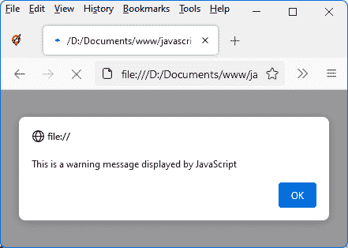

`<script>` 标签中的 JavaScript 代码在 HTML 页面加载时运行了。因此，`alert()` 函数中指定的消息被显示出来。点击**确定**按钮会确认所显示的消息并继续执行 JavaScript 代码。

正如我们所看到的，程序中没有其他内容了；程序通过在屏幕上显示空白页面而立即结束（因为页面中没有插入任何 HTML 代码）。

##### 将外部 JavaScript 代码写入外部文件

与其直接将 JavaScript 代码集成到 HTML 文件中，我们还可以将其放在一个外部文件中，然后通过在 `<script>` 标签的 `src` 属性中指定文件名，将该文件插入到我们的 HTML 文件中。

让我们先编写包含 JavaScript 代码的文件。该文件的扩展名为 `.js`，将命名为 `codejs.js`（例如），代码编写如下：

**codejs.js 文件（与 index.html 在同一目录下）**

```javascript
alert("This is a warning message displayed by JavaScript");
```

`codejs.js` 文件包含了我们之前插入在 `<script>` 和 `</script>` 标签之间的 JavaScript 代码。

修改 `index.html` 文件，使用 `<script>` 标签的 `src` 属性包含 `codejs.js` 文件，如下所示：

**index.html 文件**

```html
<html>
<head>
<meta charset="utf-8" />
<script src="codejs.js"></script>
</head>
<body>
</body>
</html>
```

> **注意**
>
> 请注意 `<script>` 和 `</script>` 标签的使用。它们是连续的（也就是说它们之间没有空格或换行），这对于这段代码的正常工作是必要的。

在稍后的示例中，我们将主要使用直接在 HTML 文件代码中插入 JavaScript 代码，但使用外部文件也会产生相同的结果。

#### 使用 `console.log()` 方法代替 `alert()` 函数

之前使用的 `alert()` 函数会在 HTML 页面上显示一个窗口，JavaScript 程序会挂起，等待用户点击窗口中的**确定**按钮。因此，该函数需要用户的干预才能继续程序的执行。

另一种方案允许在不阻塞程序执行的情况下进行显示。这是在控制台中的显示，使用了 `console.log()` 方法。

> **注意**
>
> `console.log()` 形式编写意味着我们使用了 `log()` 方法，该方法与控制台相关。

让我们使用 `console.log()` 方法代替 `alert()` 函数来显示消息。HTML 文件修改如下：

**使用 console.log() 方法的 HTML 文件**

```html
<html>
<head>
<meta charset="utf-8" />
<script>
console.log("This is a warning message displayed by JavaScript");
</script>
</head>
<body>
</body>
</html>
```

---

### 在 JavaScript 中声明变量

正如我们所知，在 *JavaScript 中使用的变量类型* 节之前描述的类型的变量由数值、布尔值、字符字符串、数组和对象组成。

JavaScript 是一种弱类型语言，这意味着你可以随时更改变量的类型。例如，一个数值变量可以转换为字符字符串，甚至变成数组。

当然，我们不建议在程序中进行此类自愿的更改，为了便于理解，在整个程序中保持变量的类型是明智的。

然而，知道 JavaScript 允许更改变量类型是非常重要的。一种名为 *TypeScript* 的 JavaScript 变体通过防止变量的此类类型更改来提供更多的安全性。

现在让我们学习如何定义变量。我们将使用以下关键字之一来实现：`const`、`var` 或 `let`。

#### 使用 `const` 关键字

`const` 关键字用于定义一个值保持不变的变量。随后任何更改该值的尝试都将产生错误。

让我们定义一个值为 12 的常量变量 `c1`。让我们尝试通过给它一个新值来修改该值：控制台将显示错误：

> **注意**
>
> 说我们正在定义一个常量变量是一种语言的误用。我们应该说我们正在定义一个常量值。

**定义常量值 (index.html)**

```html
<html>
<head>
<meta charset="utf-8" />
<script>
const c1 = 12;
console.log(c1);
c1 = 13; // 尝试修改常量的值：错误
console.log(c1); // 不显示，因为上面发生了错误
</script>
</head>
<body>
</body>
</html>
```

在实现上述代码后，我们还将在浏览器的控制台中看到如下所示的显示的错误信息（如果控制台不可见，可以通过按下 *F12* 键来显示）：

**图 1.5 - 修改常量值时的错误**

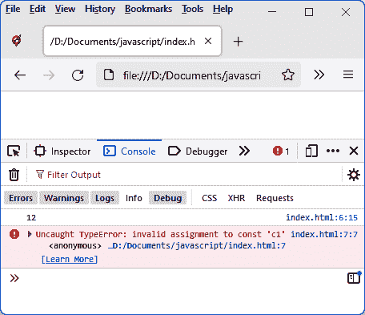

正如我们从上图所见的，常量 `c1` 的首次显示显示值为 **12**，而第二次显示没有发生，因为之前发生了错误（尝试更改常量的值时）。因此，由 `const` 关键字定义的值不应被修改。

#### 使用 `var` 关键字

另一种定义变量（其值可以被修改）的方法是使用 `var` 关键字。让我们看看使用以下代码示例的结果：

**多个变量的定义**

```html
<html>
<head>
<meta charset="utf-8" />
<script>
var a = 12;
var b = 56;
var c = a + b;
var s1 = "My name is ";
var firstname = "Bill";
console.log("a + b = " + a + b);
console.log("c = " + c);
console.log(s1 + firstname);
</script>
</head>
<body>
</body>
</html>
```

通过在它们前面加上 `var` 关键字并为它们分配默认值定义了变量 `a`、`b`、`s1` 和 `firstname`。变量 `c` 对应于变量 `a` 和 `b` 的相加。

> **注意**
>
> 变量名由字母和数字组成，但必须以字母开头。在编写变量名时，小写和大写非常重要（变量名是区分大小写的）。因此，变量 `a` 与变量 `A` 不同。

上程序的结果显示在浏览器控制台中（如果不可见，则必须通过按下 *F12* 键来显示）：

**图 1.6 使用 `var` 关键字**

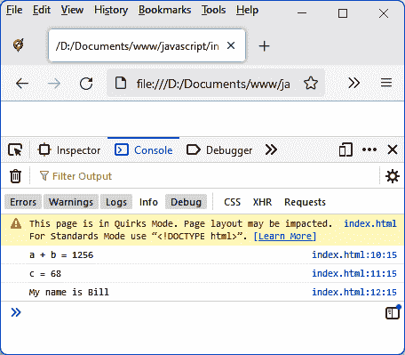

在上图中，我们可以看到一个可能令人们惊讶的结果。事实上，对 `a + b` 的直接计算在第一次产生了 **1256** 的显示，然后第二次产生了 **68**。事实上，当我们写下 `console.log("a + b = " + a + b);` 时，我们通过编写 `"a + b = "` 来开始显示字符，这一事实意味着 JavaScript 将显示的剩余部分解释为字符字符串的形式；特别是紧随其后的值 `a` 和 `b`。因此，值 `a` 和 `b` 不再被解释为数值，而是作为字符字符串 "12" 和 "56"。当这些字符字符串通过 `+` 运算符连接时，这对应的不是加法，而是字符串拼接。

相反，变量 `c` 的计算不涉及字符字符串，因此这里 `a + b` 的结果等于变量 `a` 和 `b` 的值之和，因此为 **68**。

注意，同一个程序可以在 Node.js 服务器上运行。要这样做，我们会在 `testnode.js` 文件中如下写入：

**testnode.js 文件**

```javascript
var a = 12;
var b = 56;
var c = a + b;
var s1 = "My name is ";
var firstname = "Bill";
console.log("a + b = " + a + b);
console.log("c = " + c);
```

我们可以在 `testnode.js` 命令中执行上述代码。在 Node.js 下的显示与浏览器中的类似：

**Node.js 下的运行**


我们已经学习了用于变量的 `const` 和 `var` 关键字；现在我们需要学习使用 `let` 关键字。

#### 使用 `let` 关键字

为了理解 `let` 关键字的使用并与 `var` 关键字的区别，我们必须在程序中使用大括号插入指令。让我们写一个简单的 `if(true)` 条件，大括号内的代码始终执行：

**包含条件的 index.html**

```html
<html>
<head>
<meta charset="utf-8" />
<script>
var a = 12;
if (true) { // 始终执行（因为 true）
  var b = 56;
  let c = 89;
  console.log("括号内:");
  console.log("a = " + a);
  console.log("b = " + b);
  console.log("c = " + c);
}
console.log("括号外:");
console.log("a = " + a);
console.log("b = " + b);
console.log("c = " + c);
</script>
</head>
<body>
</body>
</html>
```

在上述代码中，我们在大括号之外定义了变量 `a`。这个变量一旦初始化，在程序的任何地方都是可用的。变量 `b` 和 `c` 定义在大括号内部。变量 `b` 使用 `var` 定义，而变量 `c` 使用 `let` 定义。一旦你离开大括号，它们之间的区别是可见的。事实上，由 `let` 定义的变量 `c` 在其定义的块之外不再可用，而由 `var` 定义的变量如此。可以通过在浏览器中运行程序来检查这一点：

**图 1.8 由 `let` 定义的变量在大括号外不可访问**

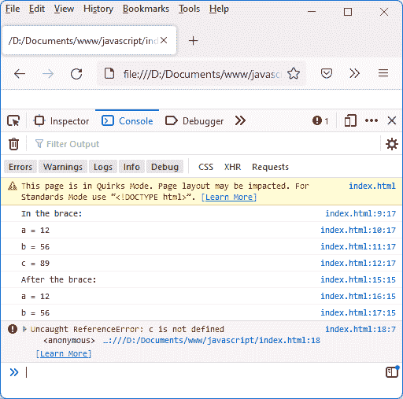

注意，同一个程序在 Node.js 服务器上产生类似的结果，如下屏所示：在块中由 `let` 定义的变量 `c` 在块外变为未定义。

**图 1.9 Node.js 上的相同结果**


##### 如果不使用 `var` 或 `let` 来定义变量会怎样

可以不使用 `var` 或 `let` 关键字来定义变量。我们只需要编写变量名后跟它的值（通过 `=` 分隔）。让我们通过使用以下示例来看看：

**不指定 var 或 let 来创建变量**

```javascript
a = 12;
b = 56;
console.log("a = " + a); // 显示值 12
console.log("b = " + b); // 显示值 56
```

在前面的示例中，变量是在没有 `var` 或 `let` 前置的情况下初始化的，这些变量是全局变量。一旦初始化，它们在程序的任何地方都是可用的。这在我们学习本章的 *使用函数* 节中的函数时将变得明显。

> **注意**
>
> 强烈建议在程序中尽可能少使用全局变量，因为这会增加包含这些程序的设计和调试难度。

##### 声明未定义的变量

前面的每个变量都是通过初始化其值来声明的，使用了 `=` 符号，这是赋值符号。让我们看看如果我们不给变量赋值任何值，而像下面所示使用 `var` 或 `let` 声明它，会发生什么：

**未初始化的变量声明**

```html
<html>
<head>
<meta charset="utf-8" />
<script>
var a;
let b;
console.log("a = " + a); // 显示值 undefined
console.log("b = " + b); // 显示值 undefined
</script>
</head>
<body>
</body>
</html>
```

在上述的前述代码中，我们使用 `var` 定义了两个变量 `a` 和 `b`，另一个使用 `let`。这两个变量都没有初始值（也就是说，它们后面没有跟 `=` 符号）。

在这种情况下，这些未初始化变量显示的结果是一个 JavaScript 值，称为 `undefined`。这对应于一个还没有值的变量的值。

`undefined` 值是 JavaScript 语言中一个重要的关键字。

> **注意**
>
> 变量 `a` 和 `b` 没有初始化，有必要使用 `var` 或 `let` 声明它们。事实上，你不能直接写 `a;` 或 `b;`，因为会导致运行时错误。

让我们在浏览器中运行前面的程序，并观察控制台中显示的结果：

**图 1.10 - 未初始化的变量是 undefined**

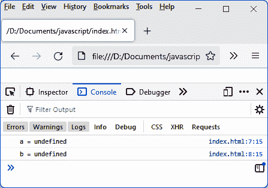

> **注意**
>
> 如果使用 Node.js 进行服务器端 JavaScript，`undefined` 值也与未初始化的变量相关。

我们现在知道如何在 JavaScript 中定义变量了。为了创建实用的 JavaScript 程序，你必须编写一系列指令。最常用的指令之一允许你使用 `if` 语句编写条件测试，我们将在下文中讨论它。

---

### 为条件测试编写条件

JavaScript 显然允许你在程序中编写条件。条件通过 `if (condition)` 语句表示：

- 如果条件为真，则执行其后的语句（或大括号中的块）。
- 如果条件为假，则执行 `else` 关键字（如果存在）后面的语句（或块）。

#### 指令的编写形式

我们可以使用以下形式来表述条件：

**带有 if (condition) 的条件表达式形式**

```javascript
// 条件后跟一个语句
if (condition) statement; // 如果条件为真，则执行语句

// 条件后跟一个块
if (condition) {
// 如果条件为真，则执行语句块
statement 1;
statement 2;
statement 3;
}
```

**带有 if (condition) - else - 的条件表达式形式**

```javascript
// 条件后跟一个语句
if (condition) statement 1; // 如果条件为真，执行语句 1
else statement 2; // 如果条件为假，执行语句 2

// 条件后跟一个块
if (condition) {
// 如果条件为真，则执行语句块
statement 1;
statement 2;
statement 3;
}
else {
// 如果条件为假，则执行语句块
statement 5;
statement 6;
statement 7;
}
```

> **注意**
>
> 如果要执行的过程包含多条指令，这些指令将被分组在一个大括号包围的块中。块可以只包含一个语句，即使在这种情况下，块是可选的（不需要大括号）。

让我们在 `testnode.js` 文件编写以下程序，我们将在命令行解释器中使用 `node testnode.js` 命令执行它，如下：

**testnode.js 文件：**

```javascript
var a = 12;
console.log("a = " + a);
if (a == 12) console.log("a is 12");
else console.log("a is not 12");
```

在前面的代码中，条件以 `a == 12` 的形式表示。事实上，通过连续重复两次 `=` 符号（因此 `==`）来测试两个值之间的相等性是惯例。

> **注意**
>
> 我们使用 `==` 表示相等，`!=` 表示不同，`>` 或 `>=` 检查大于，`<` 或 `<=` 检查小于。

在前面的代码中，由于变量 `a` 是 12，可以看到以下结果：

**图 1.11 - 使用条件测试**


如果我们给变量 `a` 赋值为 13，则语句的 `else` 部分将被执行：

**图 1.12 - 运行测试的 else 部分**


我们已经看到如何根据条件执行代码的某部分或另一部分。现在让我们学习如何编写比之前写的更复杂的条件。

#### 用于编写条件的表达式

之前编写的条件是两个值之间相等性的简单测试。但要写的测试有时会更复杂。目标是得到条件的最终结果（真或假），这将使系统能够决定下一步操作。

---

### 创建处理循环

#### 使用 while() 语句的循环

`while()` 语句允许我们在条件为真时重复执行一组指令。让我们编写一个程序，显示从 0 到 5 的数字：

**testnode.js 文件**

```javascript
var i = 0;
while (i <= 5) {
  console.log("i = " + i);
  i++;
}
```

**图 1.15 - 显示 0 到 5 的数字**

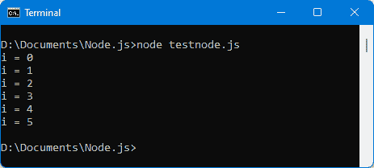

我们可以验证此程序在客户端以类似的方式运行，即在网络浏览器中，如下所示：

**在浏览器控制台中显示数字 0-5**

```html
<html>
<head>
<meta charset="utf-8" />
<script>
var i = 0;
while (i <= 5) {
  console.log("i = " + i);
  i++;
}
</script>
</head>
<body>
</body>
</html>
```

**图 1.16 - 在浏览器控制台中显示 0 到 5 的数字**

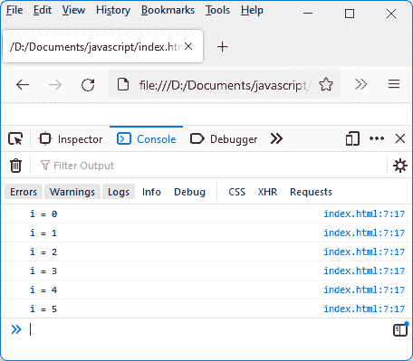

#### 使用 for() 语句的循环

另一种广泛使用的循环形式是带有 `for()` 语句的循环。它通过减少需要编写的指令数量，简化了之前循环的编写。

让我们编写与之前相同的程序，使用 `for()` 语句而不是 `while()` 语句来显示 0 到 5 的数字：

```javascript
for (var i = 0; i <= 5; i++) console.log("i = " + i);
```

正如我们在前面的代码中看到的，单行替换了之前实例中的几行。

`for()` 语句包含三个部分，用 `;` 隔开：

- 第一部分对应初始化指令。在这里，它是变量 `i` 的声明，并初始化为 0（这是循环的开始）。
- 第二部分对应条件：只要此条件为真，语句（或随后的块）就会执行。在这里，条件对应于变量 `i` 尚未超过最终值 5。
- 第三部分对应于每次通过循环后执行的指令。在这里，我们将变量 `i` 增 1。这确保了在某个时刻，条件将为假，以便退出循环。

让我们验证它的工作方式与 `while()` 语句相同：

**图 1.17 - 使用 for() 语句的循环**

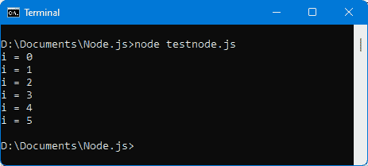

---

### 使用函数

函数用于给一组指令命名，以便在程序的不同地方使用它们。通常情况下，在函数中，我们将一组用于执行特定任务的指令组合在一起，例如：

- 显示前 10 个整数的列表。
- 计算前 10 个数字之和（从 0 到 9）。
- 计算前 N 个数字之和（从 0 到 N-1）。在这种情况下，N 将是函数的参数，因为它可以随着每次对函数的调用（或使用）而改变。

上述函数非常简单，但它们展示了函数的作用是通过用一句话总结该过程的预期，来封装任何过程。

给函数的名称象征着预期的返回的操作，这允许开发者轻松地理解指令序列（对于一个没有参与开发的外部开发者也是如此）。让我们逐一讨论我们列出的三个函数。

#### 显示前 10 个整数列表的函数

让我们编写第一个函数，显示前 10 个整数的列表。我们将此函数称为 `display_10_first_integers()`。名称必须尽可能明确，因为 JavaScript 程序由许多函数组成，这些函数的名称在程序中必须是唯一的（如果两个函数名相同，则只考虑最后一个，因为会覆盖掉前面的）。

函数使用关键字 `function` 定义，其后面跟上函数名，然后是括号。接着，我们在随后的大括号中指明组成函数的指令。正是这个指令块将在程序中每次调用函数时执行。

让我们编写函数 `display_10_first_integers()`，它显示前 10 个整数：

**使用函数显示前 10 个整数 (testnode.js 文件)**

```javascript
function display_10_first_integers() {
  for (var i = 0; i <= 10; i++) console.log("i = " + i);
}
```

该函数使用 `function` 关键字定义，后面跟上函数名和括号。函数语句分组在随后的大括号之间的块中。我们在指令中找到了之前的 `for()` 循环，但也可以是 `while()` 循环，它的工作方式相同。

假设该程序包含在 `testnode.js` 文件中，让我们运行它：

**图 1.18 - 使用函数显示 1 到 10 的数字**

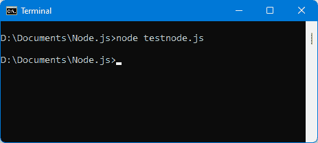

正如我们在前面的图中看到的，屏幕保持空白，因为控制台中没有注册任何显示。事实上，我们只是定义了函数，但我们还必须使用它，即在我们的程序中调用它。你可以根据需要多次调用它——这就是函数的目的：我们应该能够在任何时候调用（或使用）它们。但必须至少执行一次；否则，它就是没用的，如前面的所示。

让我们在函数定义之后添加函数调用：

**函数的定义和调用**

```javascript
// function definition
function display_10_first_integers() {
  for (var i = 0; i <= 10; i++) console.log("i = " + i);
}

// function call
display_10_first_integers();
```

**图 1.19 调用 display_10_first_integers() 函数**


有趣的是，该函数可以在程序的多个地方调用。让我们通过以下示例查看：

**连续调用 display_10_first_integers() 函数**

```javascript
// function definition
function display_10_first_integers() {
  for (var i = 0; i <= 10; i++) console.log("i = " + i);
}

// function call
console.log("*** 1st call ");
display_10_first_integers();
console.log("*** 2nd call ");
display_10_first_integers();
console.log("*** 3rd call ");
display_10_first_integers();
```

**图 1.20 - 连续调用 display_10_first_integers() 函数**


#### 计算前 10 个整数之和的函数

我们现在想要创建一个计算前 10 个整数之和的函数，即 1+2+3+4+5+6+7+8+9+10。结果是 55。这将允许函数如何将结果返回给外部（即使用它的程序）。在这里，函数应该返回 55。

让我们调用函数 `add_10_first_integers()`。可以这样写：

**相加前 10 个整数的函数**

```javascript
// function definition
function add_10_first_integers() {
  var total = 0;
  for (var i = 0; i <= 10; i++) total += i;
  return total;
}

// function call
var total = add_10_first_integers();
console.log("Total = " + total);
```

> **注意**
>
> 如果函数中的 `total` 变量没有使用 `var` 或 `let` 关键字定义，它将创建一个所谓的全局变量，即使在函数外部也可以被直接访问。这并不是良好的编程习惯，因为你希望尽可能少使用全局变量。

让我们运行之前的程序。我们应该看到以下输出：

**图 1.21 前 10 个整数之和计算**

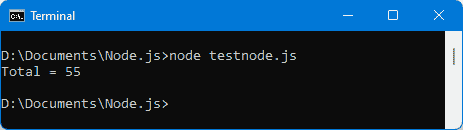

之前的函数并不实用，因为它总是返回相同的结果。一个更有用的函数应该是计算前 N 个整数之和，其中在每次调用函数时，N 可能是不同的。

在这种情况下，N 将是函数的一个参数。在使用函数时，它的值会体现在括号中。一个函数可以使用多个参数，只需用逗号将它们隔开并连续列出即可。在我们的示例中，一个参数就足够了。

让我们调用 `add_N_first_integers()` 函数来计算这个和。N 参数将体现在函数名后的括号中。

**计算前 N 个整数之和的函数**

```javascript
// function definition
function add_N_first_integers(n) {
  var total = 0;
  for (var i = 0; i <= n; i++) total += i;
  return total;
}

// calculation of the first 10 integers
var total_10 = add_N_first_integers(10);
console.log("Total of the first 10 integers = " + total_10);

// calculation of the first 25 integers
var total_25 = add_N_first_integers(25);
console.log("Total of the first 25 integers = " + total_25);

// calculation of the first 100 integers
var total_100 = add_N_first_integers(100);
console.log("Total of the first 100 integers = " + total_100);
```

`add_N_first_integers(n)` 函数与之前编写的 `add_10_first_integers()` 函数非常相似。它使用了括号之间指定的参数 `n`，不再像以前那样从 0 循环到 10，而是从 0 到 `n`。根据调用函数时使用的 `n` 的值，循环将不同，函数返回的结果也会不同。

调用函数时，按需要传递参数 10、25，然后是 100。结果由函数的 `total` 返回然后在函数外部由 `total_10`、`total_25` 和 `total_100` 变量使用：

**图 1.22 前 10 个、25 个和 100 个整数之和的计算**

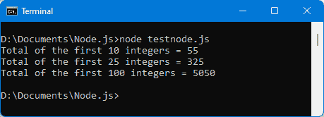

### 总结

本章涵盖了 JavaScript 的基本特性：不同类型的变量、条件测试、循环和函数。它们被用于客户端和服务器端。

在下一章中，我们将查看 JavaScript 的一些深层次的特性，例如使用 JavaScript 进行面向对象编程。

---

## 第 2 章 探索 JavaScript 的高级概念

在本章中，我们将探索 JavaScript 的高级特性，例如面向对象编程。我们还将学习 JavaScript 中广泛使用的两种对象：数组和字符字符串。最后，我们将看到 JavaScript 如何允许你使用所谓的回调函数来触发延迟处理。

在本章中，我们将涵盖以下主题：

- 类和对象
- 数组
- 字符字符串
- 多任务处理
- 使用承诺

所有这些主题都是构建 JavaScript 应用的基础。让我们现在开始吧！

### 技术要求

你可以在 GitHub 上找到本章的源代码文件：https://github.com/PacktPublishing/JavaScript-from-Frontend-to-Backend/blob/main/Chapter%202.zip。

### 类和对象

类和对象的概念是编程语言的基础。JavaScript 也允许使用它们。

类被用于表示任何类型的数据。例如，人、客户、汽车等。我们可以为每种类型的元素定义一个类，例如，用一个 `Person` 类来表示人，用一个 `Client` 类来表示客户，用一个 `Car` 类来表示汽车。

> **注意**
>
> 注意，类名传统上大写字母开头。

相反，对象将是类的一个特定元素（该元素也称为实例）。例如，在 `Person` 类的所有人中，通过名字 "Clinton" 和首名 "Bill" 标识的人代表了 `Person` 类的一个特定对象。这个对象可以与程序中的变量 `p` 关联。因此，我们可以创建变量来标识与类相关的每个对象。

#### 创建一个类

在创建类时，要问自己的问题是，你想对它所表示的数据类型执行哪些操作。

例如，如果我们创建了 `Person` 类，我们应该问什么定义了一个人的特征，以及在这个类上可以执行什么操作。例如，我们可以说 `Person` 类的特征是姓、名和年龄。你还可以添加地址、电话号码、电子邮件等。

> **注意**
>
> 姓、名、年龄等特征被称为类的属性，而结婚、移动等操作被称为类的方法。

类是使用 `class` 关键字后跟类名创建的，后面跟着描述内容的大括号。例如，`Person` 类将如下：

**Person 类**

```javascript
class Person {
}
```

这个类的定义目前还没有用处，因为内部没有定义属性或方法。我们稍后将看到如何改进它。

#### 使用类创建对象

一旦定义了类，我们就可以创建与它关联的对象。为了这一点，我们使用 `new` 关键字后跟类名。这创建了一个表示类对象的变量：

**类的对象**

```javascript
// define the class
class Person {
}
// create object
var p = new Person(); // object of class
console.log(p);
```

**图 2.1 创建类对象**

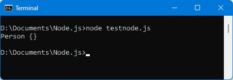

我们发现大括号，它象征着 JavaScript 对象的显示。我们被告知这是一个类对象并且它是空的 `{}`。以大括号形式表示对象在 JavaScript 中是传统的，正如我们在上一章的 *JavaScript 中使用的变量* 部分所看到的。

我们可以验证它在客户端、在浏览器中同样有效。HTML 文件如下：

**index.html**

```html
<html>
<head>
<meta charset="utf-8" />
<script>
  class Person {
  }
  var p = new Person();
  console.log(p);
</script>
</head>
<body>
</body>
</html>
```

**图 2.2 在浏览器中创建对象**

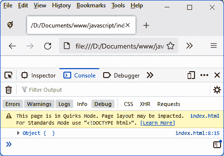

#### 不使用类创建对象

可以在不创建类的情况下创建对象。你所做的只是使用大括号的表示法 `{}`。

例如，我们可以写：

**使用大括号表示法创建对象**

```javascript
var p = { lastname: "Clinton", firstname: "Bill" };
console.log("The person is", p);
```

这将创建一个具有 `lastname` 和 `firstname` 属性的对象 `p`。注意，你可以通过将属性名称包含在引号内，或者不包含。所以 `{ lastname: "Clinton" }` 也可以写成 `{ "lastname": "Clinton" }`，通过单引号或双引号包围 `lastname` 属性。

现在让我们看看如何通过向之前创建的 `Person` 类添加属性和方法来改进它。

#### 为类添加属性

在我们的示例中，一个人有一个姓（`lastname`）、名（`firstname`）和年龄（`age`）。我们将为 `Person` 类的人创建这三个属性。

你只需要在 `Person` 类的体中通过名称标出这些属性即可。最重要的是，不要使用 `var` 或 `let` 关键字来定义它们：

**在 Person 类中添加 firstname、lastname 和 age 属性**

```javascript
class Person {
  firstname;
  lastname;
  age;
}

var p = new Person;
console.log(p);
```

**图 2.3 在 Person 类中创建 lastname、firstname 和 age 属性**

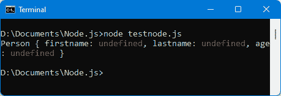

Person 类对象 `p` 现在拥有在类中添加的属性。该类的任何其他对象也将拥有这些属性。

注意，添加的属性的值为 `undefined`。这是正常的，因为在 `p` 对象或 `Person` 类中，没有为这些属性指定任何值。

让我们修改 `Person` 类，使属性具有默认值，而不是 `undefined`：

#### 带有默认值的属性

```javascript
class Person {
  firstname = "";
  lastname = "";
  age = 0;
}

var p = new Person;
console.log(p);
```

每个属性都用其默认值初始化。`lastname` 和 `firstname` 属性初始化为空字符串 `""`，而 `age` 默认初始化为 0。

**图 2.4 带有默认值的属性**

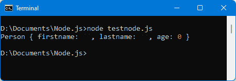

类不仅有属性，还有方法。现在，让我们看看如何向类中添加方法。

#### 为类添加方法

你可以向类添加方法。从类中创建的对象（使用 `new`）将能够直接使用这些方法。

例如，让我们创建一个 `display()` 方法，该方法将显示一行包含人的姓和名的文本。指令 `p.display()`（假设 `p` 是一个 `Person` 类对象）用于显示与对象 `p` 相关的对象的姓和名：

**在 Person 类中创建 display() 方法**

```javascript
class Person {
  // 类属性
  firstname = "";
  lastname = "";
  age = 0;

  // 类方法
  display() {
    console.log("The person's lastname is = " +
      this.lastname +
      ", firstname = " + this.firstname);
  }
}

var p = new Person;
console.log("Variable p = ", p);
p.display(); // 在 p 对象上使用 display() 方法
```

在类方法中，通过前缀关键字 `this` 可以访问类的属性。例如，`this.lastname` 访问类的 `lastname` 属性。

`this` 关键字指向使用 `display()` 方法的对象本身，在这里就是 `p` 对象。

如果你省略 `this` 关键字并直接使用 `lastname` 属性，你将得到语法错误，因为该属性只有通过 `this` 关键字才能访问。

上述代码段的输出在此显示：

**图 2.5 使用 display() 方法**

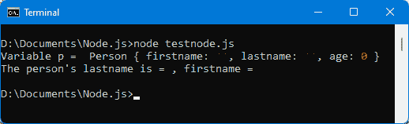

`display()` 方法显示与变量 `p` 关联的 `firstname` 和 `lastname`，但由于 `lastname` 和 `firstname` 已初始化为空字符串，因此没有显示姓或名。让我们看看如何修改属性的值。

#### 修改对象的属性值

你可以通过直接使用这些属性来修改对象属性的值，例如，`p.lastname` 允许你读取或修改对象 `p` 的 `lastname` 属性值：

**人的 lastname 和 firstname 的初始化**

```javascript
class Person {
  // 类属性
  lastname = "";
  firstname = "";
  age = 0;

  // 类方法
  display() {
    console.log(" The person's lastname = " + this.lastname +
      ", firstname = " + this.firstname);
  }
}

var p = new Person;
p.lastname = "Clinton"; // 初始化 lastname 对象 p 的属性
p.firstname = "Bill"; // 初始化 firstname 对象 p 的属性
console.log("Variable p = ", p);
p.display();
```

**图 2.6 lastname 和 firstname 属性已初始化**


一旦对象 `p` 被 `new` 运算符创建，我们将它的 `lastname` 和 `firstname` 属性初始化为指定的值。`age` 属性在这里没有被修改，因此将保持值 0。

我们通过 `p.lastname` 和 `p.firstname` 修改了创建的对象 `p` 的 `lastname` 和 `firstname` 属性值。

这种属性值的修改是在对象 `p` 创建后完成。也可以在创建对象的 `new` 指令期间进行这种修改。这需要定义一个名为 `constructor()` 的方法，允许这种初始化。

#### 使用类构造函数

`constructor()` 方法被称为类的构造函数。如果类中存在 `constructor()` 方法，它在每个 `new` 语句执行期间会被自动调用。如果我们想在每次创建对象时执行特定的过程，就会在类中定义它。`constructor()` 方法可以接受任何数量的参数，也可以不接受。

**Person 类的构造函数**

```javascript
class Person {
  // 类属性
  firstname = "";
  lastname = "";
  age = 0;

  // 类方法
  constructor(lastname, firstname, age) {
    this.lastname = lastname;
    this.firstname = firstname;
    this.age = age;
  }
  display() {
    console.log("The person's lastname = " +
      this.lastname +
      ", firstname = " + this.firstname);
  }
}

var p = new Person("Clinton", "Bill", 33);
console.log("Variable p = ", p);
p.display();
```

**图 2.7 使用构造函数**

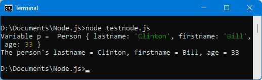

我们已经看到如何通过类直接定义属性和方法来创建对象。然而，也可以从另一个对象创建对象。让我们看看如何这样做。

#### 合并对象

某些情况下，你想从旧对象创建一个新对象。让我们看看如何这样做。

如果对象 `p` 包含一个值，语句 `var p2 = p` 不创建一个不同于 `p` 的新对象 `p2`，而只是创建一个指向 `p` 相同值的引用 `p2`。因此，对对象 `p` 属性的任何修改在对象 `p2` 中都是可见的，因为它们指向同一个内存位置。

可以使用以下示例进行验证：

**修改内存中的对象**

```javascript
var p = { lastname : "Clinton", firstname : "Bill" };
console.log("p (before modification of p2) =", p);
// p = { lastname : "Clinton", firstname : "Bill" }

var p2 = p;
p2.city = "Washington";
console.log("p (after modification of p2) =", p);
// p = { lastname : "Clinton", firstname : "Bill", city : "Washington"}

console.log("p2 =", p2);
```

**图 2.8 对象引用共享内存**

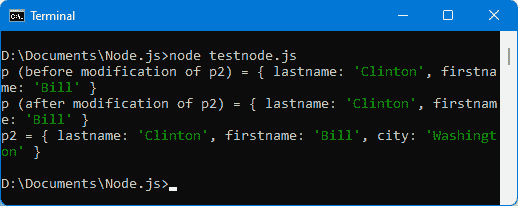

即使只修改了 `p2` 对象，`p` 对象也会被修改，因为它们是指向相同位置的内存引用。如果内存位置的内容被更改，两个引用都会看到相同的更改。

为了避免这种情况，没有必要直接写成 `p2 = p`，而是应该将对象 `p` 的属性复制到对象 `p2` 的属性中，从而创建一个新的内存位置。为了实现这一点，JavaScript 提供了展开运算符，形式为 `...`，它允许我们：

**使用展开运算符 ...**

```javascript
var p = { lastname : "Clinton", firstname : "Bill" }
console.log("p (修改 p2 之前) =", p);
var p2 = { ...p }; // 将对象 p 的属性复制到对象 p2
p2.city = "Washington";
console.log("p (修改 p2 之后) =", p);
console.log("p2 =", p2);
```

使用展开运算符的方法是用花括号 `{` 和 `}` 包围原始对象，并在对象前加上展开运算符（例如 `{...p}`）。

**图 2.9 使用展开运算符 ...**


当对象 `p2` 被修改时，对象 `p` 不再被修改。


# 数组

数组存储一组数据，根据其索引进行排序。索引也称为数组的索引。它从 0 开始，一直增加到数组中元素总数减 1（0 到 n-1）。

让我们先学习如何创建一个数组。

## 创建数组

数组在 JavaScript 中对应于一个 `Array` 类对象。因此，我们使用 `new Array` 指令来创建数组。

然而，由于数组在 JavaScript 程序中被广泛使用，也可以使用方括号符号 `[` 和 `]` 来创建它们。这是一种无需通过 `Array` 类即可使用它们的更简单的方法。

让我们详细查看这两种创建数组的方法（使用方括号和使用 `Array` 类）。

### 使用方括号 `[` 和 `]` 创建数组

创建数组最简单、最常用的方法是使用方括号符号：

```javascript
var tab = ["Element 1", "Element 2", "Element 3", "Element 4",
"Element 5"];
console.log(tab);
```

数组以左方括号 `[` 开始，以右方括号 `]` 结束。数组的元素之间用逗号隔开。我们在这里插入的元素是字符串，但实际上，任何类型的元素都可以插入数组中。

注意可以创建一个空数组（不包含任何元素）。我们将其写为 `[]`，在方括号内不指示任何元素。这样就可以向此数组添加元素。

### 使用 Array 类创建数组

你也可以使用 `Array` 类来创建数组。`Array` 类包含一个构造函数，我们在其中指定数组元素列表，每个元素之间用逗号隔开。

通过编写以下代码可以使用 `new Array` 创建之前相同的数组：

```javascript
var tab = new Array("Element 1", "Element 2", "Element 3",
"Element 4", "Element 5");
console.log(tab);
```

创建的数组与之前相同。

要创建一个空数组，只需通过编写以下代码向构造函数传递零参数：

```javascript
var tab = new Array(); // new Array
console.log(tab);
```

现在我们已经知道了如何创建数组，让我们看看如何访问它的每个元素。

### 访问数组元素

在之前的程序中，我们使用 `console.log(tab)` 语句显示整个数组。可以访问数组的每个元素。可以通过以下方式访问每个元素：

- 通过其索引
- 使用 `for` 循环
- 使用 `forEach()` 方法

让我们来看看这些方法。

#### 通过索引访问元素

让我们看之前那个包含五个元素的数组，即 `tab = ["Element 1", "Element 2", "Element 3", "Element 4", "Element 5"]`：

- 第一个元素可以通过其索引 0 访问，即 `tab[0]`。
- 下一个索引为 1，通过 `tab[1]` 访问。
- 最后一个索引为 4，通过 `tab[4]` 访问。

这就是你显示每个元素的方式：

```javascript
var tab = ["Element 1", "Element 2", "Element 3", "Element 4",
"Element 5"];
console.log("tab =", tab);
console.log("tab[0] =", tab[0]);
console.log("tab[1] =", tab[1]);
console.log("tab[2] =", tab[2]);
console.log("tab[3] =", tab[3]);
console.log("tab[4] =", tab[4]);
console.log("tab[5] =", tab[5]);
```

数组包含五个元素，这意味着索引从 0 到 4。然而，为了进行测试，我们还访问了索引为 5 的元素。可以访问数组中不存在的索引。在这种情况下，结果是 JavaScript 值 `undefined`，这意味着该元素的值尚未赋值。

注意，可以通过这种方法修改数组元素的值：

```javascript
var tab = ["Element 1", "Element 2", "Element 3", "Element 4",
"Element 5"];
console.log("修改之前的数组");
console.log("tab =", tab);
// 修改元素 2 和 3
tab[2] = "Element 3";
tab[3] = "Element 4";
console.log("修改后的数组");
console.log("tab =", tab);
```

接下来我们将通过 `for` 循环或 `while` 循环访问元素。

#### 通过 for 或 while 循环访问元素

在前面的章节中学的 `for` 循环和 `while` 循环允许你遍历数组的所有元素。循环从 0 开始（访问数组的第一个元素），到数组的最后一个索引结束。为了知道这个最后一个索引，JavaScript 在 `Array` 类中提供了 `length` 属性，允许我们知道数组元素的总数。

```javascript
var tab = ["Element 1", "Element 2", "Element 3", "Element 4",
"Element 5"];
console.log("tab =", tab);
for (var i = 0; i < tab.length; i++) {
    console.log("tab[" + i + "] =", tab[i]);
}
```

注意循环的结束是通过测试 `i < tab.length` 实现的。这等同于编写 `i <= tab.length - 1`。

接下来我们将通过 `forEach(callback)` 方法访问元素。

#### 使用 forEach(callback) 方法访问元素

`forEach(callback)` 方法是 JavaScript 在 `Array` 类上定义的方法。它通过将数组的每个元素传递给函数来遍历数组。因此，作为参数传递的函数可以访问每个元素（如果需要，还可以访问索引）。

##### 回调函数

在参数中指定函数的原理在 JavaScript 中非常常见。参数中的函数被称为回调函数，这意味着实际执行的操作是在回调函数中指定的。

我们在这里展示如何在 `forEach(callback)` 方法的参数中使用指定的回调函数。

```javascript
var tab = ["Element 1", "Element 2", "Element 3", "Element 4",
"Element 5"];
console.log("tab =", tab);
tab.forEach(function(elem, i) {
    console.log("tab[" + i + "] =", elem);
});
```

回调函数的第一个参数是调用该函数的数组元素（参数 `elem`），第二个参数是索引（参数 `i`）。

结果与通过 `for()` 循环得到的结果相同。然而，我们立即发现了一个（小的）区别。

## FOR 循环与 FOREACH 方法之间的区别

之前的程序没有显示 `for()` 循环和 `forEach()` 方法在访问数组元素的结果上有任何区别。

为了展示这两种方法之间的区别，让我们在数组的索引 10 处引入一个新元素，已知在创建数组时使用的最后一个索引是 4。

因此，我们创建了一个距离当前数组最后一个元素远得多的元素。数组将如何应对这种扩张？

### 在索引 10 处添加元素

```javascript
// original array
var tab = ["Element 1", "Element 2", "Element 3", "Element 4",
"Element 5"];

// 在数组的索引 10 处添加新元素
tab[10] = "Element 9";

console.log("tab =", tab);

// 使用 for() 循环显示数组
console.log("Access to each element by a for() loop");
for (var i = 0; i < tab.length; i++) console.log("tab[" + i + "]=", tab[i]);

// 使用 forEach() 方法显示数组
console.log("Access to each element by the forEach() method");
tab.forEach(function(elem, i) {
    console.log("tab[" + i + "]=", elem);
});
```

我们使用 `tab[10] = "Element 9"` 向数组中添加了一个元素，然后使用 `for()` 循环和 `forEach()` 方法显示数组的内容。

`for()` 循环的显示表明，索引从 5 到 9 的元素存在，但其值为 `undefined`，因为实际上，数组的这些索引没有插入任何值。然而，`for()` 循环显示了索引 5 到 9 及其对应的 `undefined` 值。

相反，`forEach()` 方法提供的在参数中指定的回调函数仅包含数组中实际受影响的元素。因此，它规避了索引 5 到 9 那些在程序中未赋值的元素。

我们已经学习了如何创建数组，以及如何访问它的每个元素。让我们看看如何向数组中添加新元素。

## 向数组添加项目

一旦创建了数组（无论是否为空），就可以向其添加元素。我们将主要使用以下两种技术之一：

- 通过其在数组中的索引（index）添加元素
- 使用 `push()` 方法添加项目

现在让我们来看这两种技术。

### 通过索引添加元素

这对应于赋值操作 `tab[i] = value`。我们在上一节中已通过编写 `tab[10] = "Element 9"` 使用了它。

只需注意，如果使用的索引大于数组中当前的元素数量，它将通过创建初始化为值 `undefined` 的元素来扩大数组。如果使用的索引小于数组的元素数量，它将修改目标元素的当前值。

### 使用 push() 方法添加元素

`push()` 方法定义在 `Array` 类中。它允许你向数组添加新元素，而无需担心插入索引，因为它会自动将元素插入数组的末尾：

```javascript
// original array
var tab = ["Element 1", "Element 2", "Element 3", "Element 4",
"Element 5"];

// 使用 push() 方法插入元素
tab.push("Element 6");

console.log("tab =", tab);

// 使用 for() 循环显示数组
console.log("Access to each element by a for() loop");
for (var i = 0; i < tab.length; i++) console.log("tab[" + i + "]=", tab[i]);

// 使用 forEach() 方法显示数组
console.log("Access to each element by the forEach() method");
tab.forEach(function(elem, i) {
    console.log("tab[" + i + "]=", elem);
});
```

`tab.push("Element 6")` 指令将此元素插入数组的末尾。然后使用之前过的各种方法显示数组。

我们已经知道如何在数组中添加和修改元素。剩下的只需知道如何从数组中删除元素。

## 删除数组元素

JavaScript 允许我们通过两种方式删除数组元素：

- 删除数组中元素的值，同时在数组中保留一个值为 `undefined` 的元素
- 从数组中移除元素本身

现在让我们检查这两种可能性。

### 删除元素值（不从数组中删除元素）

我们使用 `delete` 关键字来删除数组中元素的值。例如，`delete tab[0]` 会删除 `tab` 数组中索引为 0 的元素的值，通过为其赋值 `undefined` 实现。该元素没有从数组中移除，数组的元素数量保持不变：

```javascript
// original array
var tab = ["Element 1", "Element 2", "Element 3", "Element 4",
"Element 5"];

// 删除索引 0 的元素值
delete tab[0];

console.log("tab =", tab);

// 使用 for() 循环显示数组
console.log("Access to each element by a for() loop");
for (var i = 0; i < tab.length; i++) console.log("tab[" + i + "]=", tab[i]);

// 使用 forEach() 方法显示数组
console.log("Access to each element by the forEach() method");
tab.forEach(function(elem, i) {
    console.log("tab[" + i + "]=", elem);
});
```

我们看到 `for()` 循环显示了元素的 `undefined` 值，而 `forEach()` 方法不再显示该元素，因为它删除了。

**注意**

注意，如果不是使用 `delete tab[0]` 而是使用 `tab[0] = undefined`，`forEach()` 方法会显示索引为 0 的元素，因为元素的值并没有被删除，而是赋值了一个新值。现在让我们看看移除元素的另一种方法。

### 从数组中删除元素

使用 `delete` 关键字不会从数组中删除元素，保留相同的元素数量。定义在 `Array` 类中的 `splice(begin, count)` 方法允许你从数组中物理移除元素，因此在使用后元素会减少一个。`splice(begin, count)` 方法包含 `begin` 和 `count` 参数，允许你指定从哪个索引开始删除（`begin` 参数）以及删除多少个连续元素（`count` 参数）。因此，要从 `tab` 数组中删除索引为 0 的元素，只需编写 `tab.splice(0, 1)`：

```javascript
// original array
var tab = ["Element 1", "Element 2", "Element 3", "Element 4",
"Element 5"];

// 从索引0开始移除 1 个元素
tab.splice(0, 1);

console.log("tab =", tab);

// 使用 for() 循环显示数组
console.log("Access to each element by a for() loop");
for (var i = 0; i < tab.length; i++) console.log("tab[" + i + "]=", tab[i]);

// 使用 forEach() 方法显示数组
console.log("Access to each element by the forEach() method");
tab.forEach(function(elem, i) {
    console.log("tab[" + i + "]=", elem);
});
```

我们已经学习了如何在数组中添加和删除元素。现在让我们看看如何从当前数组中存在的元素提取出一个新数组。

## 过滤数组中的元素

过滤数组的元素是常见操作，例如，只保留某些元素或返回新的元素。`Array` 类有两个方法 `filter(callback)` 和 `map(callback)`——它们允许我们根据自己的条件返回新数组。

### 过滤所有元素

`filter(callback)` 方法返回一个新数组，同时只保留数组中所需的元素。形式为 `callback(element, index)` 的回调函数会为数组的每个元素调用一次。如果我们决定保留该元素，则它必须返回 `true`；否则，该元素将被排除。`filter()` 方法返回一个新数组，但原始数组不会被修改（除非像下面的示例那样进行赋值）。

让我们使用 `filter()` 方法只保留索引大于或等于 2 的数组元素：

```javascript
//原始数组
var tab = ["Element 1", "Element 2", "Element 3", "Element 4", "Element 5"];
console.log("initial tab =", tab);
// 只保留索引 >= 2 的项
tab = tab.filter(function(element, index) {
    if (index >= 2) return true; // 保留此元素
});
console.log("final tab =", tab);
```

如果回调函数返回 `true`，则保留该元素；否则，它会被排除。回调函数也可以返回 `false`，甚至不返回任何内容（如此处所示），在这种情况下元素将被排除。

### 使用 map() 方法

`map(callback)` 方法用于从初始数组的元素返回一个新数组。初始数组的每个元素都会传递给形式为 `callback(element, index)` 的回调函数，该函数必须为每个元素返回一个新元素，以替换原始元素。

让我们使用 `map(callback)` 方法返回一个新数组，其中所有元素都已大写：

```javascript
//原始数组
var tab = ["Element 1", "Element 2", "Element 3", "Element 4", "Element 5"];
console.log("initial tab =", tab);
// 所有元素大写
tab = tab.map(function(element, index) {
    return element.toUpperCase();
});
console.log("final tab =", tab);
```

`toUpperCase()` 方法是定义在 `String` 类上的方法（见后续截图），允许你将该方法的字符字符串转换为大写。

在本节中，我们学习了 `Array` 类对象的用法。另一类对象在 JavaScript 中也被广泛使用：字符字符串，它们由 `String` 类表示。现在让我们看看如何使用 `String` 类对象。

# 字符字符串

字符串在编程语言中被广泛使用。它们用于表示用户输入的文本或将显示给用户的文本。

## 创建字符字符串

字符字符串由 `String` 类对象表示。但由于字符字符串在 JavaScript 中被广泛使用，语言允许通过双引号 `" "` 或单引号 `'` 和 `\'` 将其包裹起来使用。在某些情况下，也可以使用反引号（反引号 `` ` `` 和 `` ` ``）。

**注意**

在这种情况下，字符串字面量必须以相同类型的引号开始和结束。现在让我们看看如何使用这些各种方法创建字符串。

### 使用双引号或单引号创建字符串字面量

创建字符串字面量最简单的方法是使用单引号或双引号符号：

```javascript
var s = "String 1";
console.log("s =", s);
```

或者，使用单引号：

```javascript
var s = 'String 1';
console.log("s =", s);
```

在两种情况下，显示的字符字符串是相同的。

#### 拥有使用单/双引号选项的优势

如果字符串本身包含引号，那么使用单引号或双引号的优势就显而易见。例如，如果字符串是 `"I'll love JavaScript"`，使用单引号创建字符串将产生错误，因为字符串会被认为在单词 I'll 中的撇号处结束。在这种情况下，你必须使用双引号。

### 使用反引号创建字符串字面量

你也可以使用反引号。这在你想以更简单的方式使用变量的特殊情况下非常有用。例如，假设你想使用变量的字符串：

```javascript
var lastname = "Clinton";
var firstname = "Bill";
// 旧的字符串拼接方式
var s1 = "lastname is " + lastname + ", firstname is " + firstname;
// 新的字符串拼接方式
var s2 = `lastname is ${lastname}, firstname is ${firstname}`;

console.log("s1 =", s1);
console.log("s2 =", s2);
```

使用反引号时，不再使用 `+` 符号拼接字符串。大括号 `{}` 之间的内容可以求值。

最后，可以使用 `String` 类来创建字符串。`String` 类有一个构造函数，将要构造的字符串作为参数：

```javascript
var s = new String("I'll love JavaScript");
console.log("s =", s);
```

`String` 类具有属性和方法。例如，`length` 属性让你知道字符串中字符的数量，从而允许你比较（例如）两个字符串的长度。

让我们使用 `length` 属性显示使用引号和 `String` 类创建的字符串长度：

```javascript
var s1 = new String("I'll love JavaScript");
var s2 = "I'll love JavaScript";
console.log("s1 =", s1);
console.log("s2 =", s2);
console.log("s1.length =", s1.length);
console.log("s2.length =", s2.length);
```

无论如何创建字符串，其长度都是相同的（此处为 20 个字符）。

我们已经学习了如何创建字符字符串，现在让我们看看如何访问组成它的字符。

## 访问字符串中的字符

`String` 类定义了访问字符串字符的方法。这些特别是 `charAt(index)` 和 `slice(start, end)` 方法。`charAt(index)` 用于获取字符串中指定索引处的字符，从索引 0 开始。最大索引是与 `length` 属性值减 1 关联的索引。`slice(start, end)` 通过提取从开始索引（包含）到结束索引（排除）的字符将字符串拆分为子字符串。

### 使用 charAt(index) 方法

让我们使用 `charAt(index)` 方法来逐个显示字符串的字符：

```javascript
var s = "Hello";

console.log("s =", s);

for (var i = 0; i < s.length; i++) console.log(`s.charAt(${i}) = ${s.charAt(i)}`);
```

注意使用反引号来显示结果字符串。

现在，让我们来看 `slice(start, end)` 方法。

### 使用 slice(start, end) 方法

此前的 `charAt(index)` 方法从字符串中检索单个字符，而 `slice(start, end)` 方法可以检索多个连续的字符：

**注意**

请注意，`slice(start, end)` 方法不会修改应用该方法的字符串，而是返回一个新的字符串。原始字符串不会被修改，从而保持其完整无损。

```javascript
var s = "Hello";

console.log("s =", s);

console.log(`s.slice(0,2) = ${s.slice(0,2)}`);

console.log(`s.slice(0,3) = ${s.slice(0,3)}`);

console.log(`s.slice(1,3) = ${s.slice(1,3)}`);

console.log(`s.slice(0,-1) = ${s.slice(0,-1)}`);

console.log(`s.slice(0,-2) = ${s.slice(0,-2)}`);

console.log(`s.slice(1,-2) = ${s.slice(1,-2)}`);
```

如果 `slice(start, end)` 方法的结束索引（第二个参数）为负数，则意味着计数从字符串的末部开始（如果是正数则从开头开始）。

现在我们已经知道了如何获取构成字符串的字符，让我们来看如何修改字符串。

## 修改字符串

要修改字符串，只有一种可能：你必须从它构建一个新的字符串。原始字符串不能被直接更改。

为了这一点，我们将使用之前的 `slice()` 和 `charAt()` 方法，这将使得提取原始字符串的部分可能，从而构建结果字符串。

为了搜索或修改字符串的部分，最好使用正则表达式。我们将在下面学习它们。

## 使用正则表达式

正则表达式与字符串有关。它们用于检查字符串是否具有特定格式（例如电子邮件格式、电话号码格式等），或者将符合该格式的字符替换为其他。

为此，`String` 类拥有 `match(regexp)` 方法来检查字符串是否具有给定格式，以及 `replace(regexp, str)` 方法将字符串中该格式的部分替换为新字符串 `str`。

在这两个方法中，`regexp` 参数对应于正则表达式，我们将接下来学习它的含义。

### 检查字符串是否具有给定格式

`match(regexp)` 方法用于检查使用该方法的字符串是否符合 `regexp` 中指定的格式。`regexp` 参数被称为正则表达式。

#### 正则表达式

正则表达式是位于 `/` 包围的字符序列，例如 `/abc/`。正则表达式 `/abc/` 表示我们在字符串中寻找 `abc` 序列。如果字符串包含该序列，`match(/abc/)` 方法返回该序列，否则返回 `null`。

正则表达式的描述可以在此处找到：https://developer.mozilla.org/zh-CN/docs/Web/JavaScript/Reference/Global/RegExp。

以下是在字符串 "Hello" 上使用 `match()` 方法时返回的一些正则表达式示例：

```javascript
var s = "Hello";

console.log("s =", s);

// 搜索 "Hel"
console.log(`s.match(/Hel/) = ${s.match(/Hel/)}`);

// 搜索 "hel"
console.log(`s.match(/hel/) = ${s.match(/hel/)}`);

// 忽略大小写搜索 "hel"
console.log(`s.match(/hel/i) = ${s.match(/hel/i)}`);

// 搜索 H 后面跟着 a 或 b 或 e 的 l
console.log(`s.match(/H[abe]l/) = ${s.match(/H[abe]l/)}`);

// 搜索 He 后面跟着 0 或 1 个 a 的 l
console.log(`s.match(/Hea?l/) = ${s.match(/Hea?l/)}`);

// 搜索 He 后面跟着 0 (min) 到 1 (max) 个 a 的 l
console.log(`s.match(/Hea{0,1}l/) = ${s.match(/Hea{0,1}l/)}`);

// 搜索 He 后面跟着 1 (min) 到 2 (max) 个 a 的 l
console.log(`s.match(/Hea{1,2}l/) = ${s.match(/Hea{1,2}l/)}`);
```

当在 "Hello" 字符串中找到正则表达式时，`match()` 方法返回找到的字符串，否则返回 `null`。正则表达式末尾的 `i` 符号表示必须忽略大小写。字母周围的方括号 `[]` 表示这些字母中的任意一个。问号 `?` 表示前面的字符是可选的（或不出现）。大括号 `{min,max}` 表示前面的字符必须至少出现 `min` 次，最多出现 `max` 次。

**注意**

编写正则表达式有时会很复杂。

### 用给定格式替换字符串的一部分

`replace(regexp, str)` 方法用于将字符串中具有 `regexp` 所指格式的部分替换为 `str`。`regexp` 参数是一个允许你进行测试的正则表达式。如果未找到该格式，则返回原始字符串。

让我们来看这个例子：

```javascript
var s = "Hello";

console.log("s =", s);

// 搜索 "Hel" 并替换为 "abc"
console.log(`s.replace(/Hel/, "abc") = ${s.replace(/Hel/, "abc")}`);

// 搜索 "hel" 并替换为 "abc"
console.log(`s.replace(/hel/, "abc") = ${s.replace(/hel/, "abc")}`);

// 忽略大小写搜索 "hel" 并替换为 "abc"
console.log(`s.replace(/hel/i, "abc") = ${s.replace(/hel/i, "abc")}`);

// 搜索 H 后面跟着 a 或 b 或 e 的 l 并替换为 "abc"
console.log(`s.replace(/H[abe]l/, "abc") = ${s.replace(/H[abe]l/, "abc")}`);

// 搜索 He 后面跟着 0 或 1 个 a 的 l 并替换为 "abc"
console.log(`s.replace(/Hea?l/, "abc") = ${s.replace(/Hea?l/, "abc")}`);

// 搜索 He 后面跟着 0 (min) 到 1 (max) 个 a 的 l 并替换为 "abc"
console.log(`s.replace(/Hea{0,1}l/, "abc") = ${s.replace(/Hea{0,1}l/, "abc")}`);

// 搜索 He 后面跟着 1 (min) 到 2 (max) 个 a 的 l 并替换为 "abc"
console.log(`s.replace(/Hea{1,2}l/, "abc") = ${s.replace(/Hea{1,2}l/, "abc")}`);
```

之前程序的所有执行都是立即执行的。现在我们将学习如何随时间执行延迟处理。

# JavaScript 中的多任务

当你开始用 JavaScript 写代码时，经常会产生这个问题：是否可以同时执行多个进程（计算中称为多任务）？如果要执行的进程需要很长时间，那么这将是有用的，这样就不会阻塞其他紧急进程。

JavaScript 不允许同时执行多个处理操作。另一方面，可以通过回调函数来实现不阻塞。

## 回调函数

回调函数对应于作为 JavaScript 方法或函数参数的处理函数。回调函数将由使用它的方法或函数在需要的时间执行。

Node.js 广泛地使用了这一特性。例如，在读取文件时，`readFile(callback)` 方法在文件读取完成后会将回调函数作为参数进行调用，这使得程序不会阻塞正在等待处理的文件读取操作。

JavaScript 定义了两个使用这种回调函数概念的标准函数：`setTimeout()` 和 `setInterval()` 函数。这两个函数都使用回调函数作为参数。接下来我们将描述这两个函数。

### 使用 setTimeout() 函数

`setTimeout(callback, timeout)` 函数用于设定一个处理函数（回调函数），该函数将在 `timeout` 所表示的时间（以毫秒为单位）超时后执行。

这允许你（例如）在 5 秒后（即 5,000 毫秒）执行处理。在等待此延迟期间，你可以执行其他指令，因此程序在此期间不会被阻塞：

```javascript
console.log("Before setTimeout()");

setTimeout(function() {
    console.log("In the callback function");
}, 5000); // 5000 毫秒，或 5 秒

console.log("After setTimeout()");
```

我们在程序开始时在控制台中显示一条消息（"Before setTimeout()"）。我们设置了一个 5 秒的延迟，之后会触发回调函数，在控制台中显示另一条消息（"In the callback function"）。

最后，我们通过显示新消息（"After setTimeout()"）结束程序。

例如，让我们使用 `node testnode.js` 命令运行此程序。要在浏览器中测试此程序，只需将上述 JavaScript 代码放在 index.html 文件的 `<script>` 和 `</script>` 标签之间。

下面的截图显示了 1 秒后的显示：

注意，开始和结束的显示消息是紧挨的，尽管 5 秒的时间限制尚未到达。这表明程序没有被阻塞在等待超时上。

接下来的截图显示了至少 5 秒后的显示（当 `setTimeout()` 方法中使用的延迟过期时）。

我们看到，当 5 秒延迟过期，在 `setTimeout()` 函数中注册的回调函数会被 `setTimeout()` 函数自动调用。

让我们通过在显示消息时显示时间来改进程序。这使得验证是否遵循了5秒时间限制成为可能：

```javascript
console.log(time(), "Before setTimeout()");
setTimeout(function() {
    console.log(time(), "In the callback function");
}, 5000); // 5000 = 5 秒

console.log(time(), "After setTimeout()");

function time() {
    // 返回 HH:MM:SS 格式的时间
    var date = new Date();
    var hour = date.getHours();
    var min = date.getMinutes();
    var sec = date.getSeconds();
    if (hour < 10) hour = "0" + hour;
    if (min < 10) min = "0" + min;
    if (sec < 10) sec = "0" + sec;
    return "" + hour + ":" + min + ":" + sec + " ";
}
```

`time()` 函数用于生成一个包含 HH:MM:SS 格式时间的字符串。该时间会显示在控制台中显示的每条消息的开头。

这里使用的 `Date` 类是 JavaScript 类，允许你管理日期并提取小时、分钟和秒。

我们可以清楚地看到，回调函数在 `setTimeout()` 函数参数指定的 5 秒期结束时执行。

### 使用 setInterval() 函数

`setInterval(callback, timeout)` 函数与之前看到的 `setTimeout()` 函数相似。但它不是在延迟结束时仅执行一次回调函数（如 `setTimeout()` 函数那样），`setInterval()` 函数通过在每次执行结束时设置一个新的延迟来反复执行回调函数。因此，回调函数按固定的间隔执行。停止此循环的唯一方法是使用 `clearInterval()` 函数。

`setInterval()` 函数对于定期间隔运行进程非常有用。让我们使用 `setInterval()` 函数每秒显示一次初始化为 1 的计数器值。计数器每秒增加一次：

```javascript
console.log(time(), "Start of timer");
var count = 1;
var timer = setInterval(function() {
    console.log(time(), count);
    count++;
}, 1000); // 1000 = 1 秒

function time() {
    // 返回 HH:MM:SS 格式的时间
    var date = new Date();
    var hour = date.getHours();
    var min = date.getMinutes();
    var sec = date.getSeconds();
    if (hour < 10) hour = "0" + hour;
    if (min < 10) min = "0" + min;
    if (sec < 10) sec = "0" + sec;
    return "" + hour + ":" + min + ":" + sec + " ";
}
```

注意由 `setInterval()` 启动的回调函数会无限运行。要停止此循环，必须使用 `clearInterval()` 函数。`setInterval()` 函数返回定时器 ID，将用于调用 `clearInterval()`。注意可以通过多次调用 `setInterval()` 启动多个定时器。为此，`clearInterval()` 函数必须指定它想要停止哪一个定时器。

让我们使用 `setInterval()` 函数在计数达到 5 时停止定时器：

```javascript
console.log(time(), "Start of timer");
var count = 1;
var timer = setInterval(function() {
    console.log(time(), count);
    if (count == 5) {
        clearInterval(timer); // 停止定时器
        console.log(time(), "End of timer");
    } else {
        count++;
    }
}, 1000);

function time() {
    // 返回 HH:MM:SS 格式的时间
    var date = new Date();
    var hour = date.getHours();
    var min = date.getMinutes();
    var sec = date.getSeconds();
    if (hour < 10) hour = "0" + hour;
    if (min < 10) min = "0" + min;
    if (sec < 10) sec = "0" + sec;
    return "" + hour + ":" + min + ":" + sec + " ";
}
```

回调函数的程序已修改：一旦计数器达到 5，定时器就会停止。否则，计数器加 1。

必须调用 `resolve()` 函数，否则 `then(callback)` 方法将无法执行。另一方面，调用 `reject()` 函数是可选的，如果使用它，则 `catch(callback)` 方法将不会被调用（因此在程序中不一定存在）。

得益于 `resolve` 和 `reject` 参数，我们因此有了执行成功情况（通过 `then(callback)` 方法）和失败情况（通过 `catch(callback)` 方法）的可能性。这种编写方式确保了 JavaScript 代码更具可读性。

为了说明这一点，让我们以之前过的 `setTimeout(callback, timeout)` 函数为例。在这里，回调函数被包含在方法调用中，这正是我们想要通过 Promise 避免的。让我们重写一个新的 `wait(timeout)` 方法，它可以以 `wait(timeout).then(callback)` 的形式使用。现在，回调函数已经从 `wait()` 方法中外部化了。

在 `then(callback)` 方法中注册的回调函数将在超时到达时被调用。

这种写法比之前的 `setTimeout()` 写法更有可读性，因为它展示了执行某个进程之前的延迟。

为了实现这一点，`wait(timeout)` 方法必须返回一个 Promise 对象：

```javascript
function time() {
  // 以 HH:MM:SS 格式返回时间
  var date = new Date();
  var hour = date.getHours();
  var min = date.getMinutes();
  var sec = date.getSeconds();
  if (hour < 10) hour = "0" + hour;
  if (min < 10) min = "0" + min;
  if (sec < 10) sec = "0" + sec;
  return "" + hour + ":" + min + ":" + sec + " ";
}

function wait(sec) {
  return new Promise(function(resolve, reject) {
    setTimeout(function() {
      resolve(sec); // 触发 then() 方法
    }, sec*1000);
  });
}

console.log(time(), "Start of timer");

wait(2).then(function(sec) {
  console.log(time(), `End of timer of ${sec} seconds`);
});
```

得益于 `return new Promise()` 语句，`wait()` 方法返回了一个 Promise 对象。在回调 `(resolve, reject)` 函数中，当我们认为 `then()` 方法可以执行时（在这里是在超时的结束时），我们调用 `resolve()` 函数。

可以为 `resolve()` 和 `reject()` 方法指定参数。这些参数将用于用于 `then(callback)` 或 `catch(callback)` 方法中的回调函数中。例如，在这里，我们调用了 `resolve(sec)` 方法，这允许我们在 `then()` 方法的回调函数中使用 `sec` 参数。

**注意**

注意，在我们的示例没有未使用 `reject()` 函数，因为这里不会发生任何错误情况。但是，必须调用 `resolve()` 函数；否则 `then()` 方法将永远不会执行。

`time()` 函数用于显示每个进程的时间，以检查执行是否正确。

这带我们来到了本章的结束。

## 总结

在本章中，我们学习了与 JavaScript 高级概念。我们学习了如何使用类和对象，特别是 `Array` 和 `String` 类。我们还看到了如何延迟指令的执行。

在书的其余部分，我们将发现与应用开发客户端相关的 Vue.js JavaScript 库的使用。

# 第二部分：客户端 JavaScript

在本部分，我们将发现与应用开发客户端相关的 Vue.js JavaScript 库的使用。我们将学习如何在大浏览器中使用 JavaScript。

本部分包含以下章节：

- 第 3 章，*使用 Vue.js*
- 第 4 章，*JavaScript 高级概念*
- 第 5 章，*使用 Vue.js 管理列表*

# 第 3 章 使用 Vue.js

JavaScript 世界在不断变化。近年来，出现了一种新概念：基于组件的开发。在这些库中，Angular、React、Svelte 以及 **Vue.js** 是非常流行的。我们选择了 Vue.js，因为它非常易用。

## 为什么使用 Vue.js？

Vue.js 的主要优势可以使用组件来构建应用。在本章中，我们将学习如何使用 Vue.js 来构建应用。

## 技术要求

你可以在 GitHub 上找到本章节的源码：https://github.com/PacktPublishing/JavaScript-from-to-Backend

## 在 HTML 页面中使用 Vue.js

为了检查 Vue.js 是否正确集成到页面中，让我们通过 `<script>` 标签显示版本号：

```html
<html>
<head>
  <meta charset="utf-8" />
  <script src="https://unpkg.com/vue@next"></script>
</head>
<body>
<script>
  alert(`${Vue.version}`);
</script>
</body>
</html>
```

一旦 Vue.js 集成到 HTML 页面中，你必须定义 Vue.js 将使用的 HTML 元素。通常，你想将 Vue.js 用于整个 HTML 页面，但也可以对某些元素使用它。这允许我们，例如对特定的 `<div>` 元素使用 Vue.js。

为了说明这一点，让我们创建一个带有两个 `<div>` 元素的 HTML 页面，只有一个由 Vue.js 管理：

既然我们已经将 Vue.js 集成到 HTML 页面中，让我们开始创建第一个应用。

### 创建一个部分由 Vue.js 管理的 HTML 页面

```html
<html>
<head>
  <meta charset="utf-8" />
  <script src="https://unpkg.com/vue@next"></script>
</head>
<body>
  <div id="app">第一个 div</div>
  <div>页面的其余部分不受 Vue.js 管理</div>
</body>
<script>
  var app = Vue.createApp({
    template : "这个 div 由 Vue.js 管理"
  });
  // 将 Vue.js 应用挂载到 id 为 "app" 的 div 上
  var vm = app.mount("div#app");
</script>
</html>
```

## 使用响应性

让我们运行之前的程序；我们应该看到以下输出：

在之前的屏幕上，我们可以看到在页面上使用 Vue.js 的结果。根 `<div>` 的内容被 `Vue.createApp(options)` 方法中 `options` 参数里编写的模板所取代。第二个 `<div>` 没有被转换。

因此，要用 Vue.js 管理整个 HTML 页面，只需要在页面的 `<body>` 部分指定单个 `<div>` 元素，该元素将是 Vue.js 激活的地方。

现在让我们看看如何使用 Vue.js 的一个重要概念，即程序定义的变量与它们在 HTML 页面上的显示之间的关系。

这个概念被称为响应性（reactivity）。

### 响应式变量

如果一个变量在内存中的修改会导致它显示的地方自动被修改，则该变量是响应式的。

响应式变量定义在 `Vue.createApp(options)` 方法的 `options` 对象中。为此，我们在 options 对象中添加 `data()` 方法的定义，它必须返回一个包含应用程序所谓响应式变量的对象。

让我们在 Vue.js 应用中使用一个名为 count 的响应式变量：

#### 定义 count 响应式变量

```html
<html>
<head>
  <meta charset="utf-8" />
  <script src="https://unpkg.com/vue@next"></script>
</head>
<body>
  <div id="app"></div>
</body>
<script>
  var app = Vue.createApp({
    template: "The counter is: {{count}}",
    data() {
      // 返回一个包含响应式
      // 变量的对象
      return {
        count: 0
      }
    }
  });
  var vm = app.mount("div#app");
</script>
</html>
```

在之前的代码中，count 响应式变量定义在 `data()` 方法中，该方法返回包含程序响应式变量的 `{ count : 0 }` 对象。其他变量可以在之后定义。

这个响应式变量随后可以通过 `{{` 和 `}}` 语法在模板中使用。这种语法用于表示一个 JavaScript 表达式，例如变量的值。

所谓响应式变量的定义使得将显示与变量的值关联成为可能。只要变量被修改，显示也会随之修改。

我们可以在下面的图中看到计数器的值：

计数器保持在它的初始值：**0**。响应性只有在变量被修改时才可见。因此，一旦 count 变量被修改，显示将随之修改。

为了做到这一点，让我们像下面的代码所示，每秒增加一次变量的值：

#### 每秒增加 count 变量

```html
<html>
<head>
  <meta charset="utf-8" />
  <script src="https://unpkg.com/vue@next"></script>
</head>
<body>
  <div id="app"></div>
</body>
<script>
  var app = Vue.createApp({
    template: "The counter is: {{count}}",
    data() {
      // 返回一个包含响应式
      // 变量的对象
      return {
        count: 0
      }
    }
  });
  var vm = app.mount("div#app");
  setInterval(function() {
    vm.count += 1;
  }, 1000);
</script>
</html>
```

使用 JavaScript 的 `setInterval()` 函数，我们每秒增加一次 count 变量的值。Vue.js 通过 `vm.count` 访问 count 变量，其中 `vm` 是 `app.mount()` 方法返回的对象。响应式变量变成了此 `vm` 对象的属性。在之前的代码中，我们可以看到视图和数据处理的分离，正如 MVC 模式所提倡的那样。变量的增加是在外部完成的。

### 创建我们的第一个组件

感谢 Vue.js 提供的响应性，我们可以看到变量的增加和显示的自动更新。

之前的程序非常简单，但实际上应用程序是复杂的。有必要将应用程序分解成小部分。现在让我们看看如何使用 Vue.js 创建组件。

组件生命周期中的方法之一是 `created()` 方法。它在组件创建时被调用。你可以使用此方法通过 `setInterval()` 函数来编写每秒递增变量 `count` 的逻辑。

如下所示使用组件的 `created()` 方法：

```html
<html>
<head>
<meta charset="utf-8" />
<script src="https://unpkg.com/vue@next"></script>
</head>
<body>
<div id="app"></div>
</body>
<script>
var app = Vue.createApp({
template : "<counter />"
});

app.component("counter", {
template : "The counter is: {{count}}",
data() {
return {
count : 0
}
},
created() {
setInterval(()=>{ // 不要使用 function() 
// 在此处编写代码，
// 否则 "this" 对象
// 将保持一致
this.count++;
}, 1000);
}});

var vm = app.mount("div#app");
</script>
</html>
```

在前面的代码中，我们使用了 `=>` 代替 `function()`。这（称为 lambda 函数）是在 JavaScript 的最新版本中引入的，目的是允许 `this` 的值在回调函数内部保持不变，这在这里是必要的。如果你将 lambda 函数 `=>` 替换为 `function()` 关键字，程序将无法工作，因为 `this` 值将不再相同。

运行前面的代码，你将看到以下输出：

#### 从外部文件设置组件

与其在 HTML 页面中直接定义组件，不如将其定义在外部文件中。得益于在 HTML 页面中引入外部文件，可以在页面中使用组件。为此，我们使用了 JavaScript 提供的模块概念。

##### 在外部文件中定义组件的优势

在外部文件中定义组件的优势可以将该文件包含在多个不同的 HTML 页面中，从而在多个应用程序中使用该组件。

`<counter>` 组件定义在外部 `counter.js` 文件中如下：

```javascript
const Counter = {
data() {
return {
count: 0
}
},
template : "The counter is: {{count}}",
created() {
setInterval(() => {
this.count += 1;
}, 1000)
}
}
export default Counter;
```

`<counter>` 组件被定义为一个对象，具有 `template`、`data` 和 `created` 属性。它的定义与之前在 `app.component()` 方法中显示的相似。

`export default Counter` 指令使得该组件在导入此模块的其他文件中是可以访问的。

现在可以将 `<counter>` 组件集成到我们应用程序的主文件中。我们使用 JavaScript 的 `import` 语句来实现此。代码如下所示：

```html
<html>
<head>
<meta charset="utf-8" />
<script src="https://unpkg.com/vue@next"></script>
</head>
<body>
<div id="app"></div>
</body>
<script type="module">
import Counter from "./counter.js";
var app = Vue.createApp({
components : {
Counter:Counter
},
template : "<counter />" // 或 "<Counter />"
});
var vm = app.mount("div#app");
</script>
</html>
```

在前面的代码中，为了导入 `counter.js` 文件并使用相应的组件，发生了以下情况：

- 在 `<script>` 标签中指定了 `type="module"` 属性。这允许在 `<script>` 标签的 JavaScript 语句中使用 `import` 语句。
- 我们使用 `import` 语句导入相应的模块。
- 我们在新的 components 部分声明导入的组件。组件被声明为一个对象。该对象中的属性名对应于模板中使用的组件名称（`<counter>` 或 `<Counter>`），而值对应于导入组件的名称（Counter）。

##### 使用 HTTP 代替 FILE 协议

然而，由于我们使用了 JavaScript 模块导入，有必要在 HTTP 服务器上运行应用程序，而不再像以前那样简单地拖放。因此，使用了以 `http://localhost` 开头的 URL。

如果你需要知道如何安装 HTTP 服务器，可以使用此处的文档：https://developer.mozilla.org/en-US/docs/Learn/Common/Web-Server/HTTP。

在接下来的图中，我们可以看到组件只有相同的结果。

## 添加方法

我们已经学习了如何在组件中创建变量。添加方法有两种方式：

- 第一是在 methods 部分中定义方法。
- 第二是创建计算属性。

### computed 部分中的计算属性

计算属性类似于响应式变量。它是对一个或多个响应式变量执行计算的结果，它也将是响应式的。与此计算属性相关的响应式变量的任何修改都会导致它立即修改。

让我们创建一个 `countX2` 属性，用于计算 `count` 变量的倍数：

```javascript
const Counter = {
data() {
return {
count: 0
}
},
template : `{{time()}} &nbsp;&nbsp; 计数器为:
{{count}}, 双倍为: {{countX2}}`,
created() {
setInterval(() => {
this.count += 1;
}, 1000)
},
methods : {
time() {
// 以 HH:MM:SS 格式返回时间
var date = new Date();
var hour = date.getHours();
var min = date.getMinutes();
var sec = date.getSeconds();
if (hour < 10) hour = "0" + hour;
if (min < 10) min = "0" + min;
if (sec < 10) sec = "0" + sec;
return "" + hour + ":" + min + ":" + sec + " ";
}
},
computed : {
countX2() {
return 2 * this.count;
}
}
}
export default Counter;
```

上述代码的输出将如下：

在前面的图中，我们可以看到 `count` 变量的修改。得益于在 `computed` 部分的定义，每秒都会导致 `countX2` 变量的自动修改。

我们已经看到了如何在组件中定义方法和响应式变量。现在让我们看看如何使用组件的属性向组件传递参数。

### 在组件中使用属性

组件中的属性允许其在使用时传递参数。例如，我们可以在 `<counter>` 组件中使用 `start` 属性，用以指示从哪个值开始计数。如果未指定此属性，则它被视为 0（即如前面的代码示例所示，从 0 开始计数）。

为了让组件能够在在使用过程中使用属性，只需在组件的 `props` 部分标明属性的名称即可。组件可以使用 `this` 关键字访问属性值（例如，使用 `this.start` 来访问组件中的 `start` 属性）。我们可以在下面的代码中看到其实际：

#### 在组件中使用 start 属性 (index.html 文件)

```html
<html>
<head>
<meta charset="utf-8" />
<script src="https://unpkg.com/vue@next"></script>
</head>
<body>
<div id="app"></div>
</body>
<script type="module">
import Counter from "./counter.js";
var app = Vue.createApp({
components : {
Counter:Counter
},
template : "<counter start='10'></counter>"
});
var vm = app.mount("div#app");
</script>
</html>
```

在接下来的代码中，在使用组件时传递了该属性，就像 HTML 中的传统做法一样。这里的属性值将是字符字符串 "10"，而不是数值 10：

#### 在 <counter> 组件中设置 start 属性 (counter.js 文件)

```javascript
const Counter = {
  data() {
    return {
      count : parseInt(this.start), // 我们将
      // count 初始化为
      // start 的值
    }
  },
  template : `{{time()}} &nbsp;&nbsp; 计数器为:
{{count}}, 双倍为: {{countX2}}`,
  created() {
    var timer = setInterval(() => {
      this.count += 1;
    }, 1000)
  },
  methods : {
    time() {
      // 以 HH:MM:SS 格式返回时间
      var date = new Date();
      var hour = date.getHours();
      var min = date.getMinutes();
      var sec = date.getSeconds();
      if (hour < 10) hour = "0" + hour;
      if (min < 10) min = "0" + min;
      if (sec < 10) sec = "0" + sec;
      return "" + hour + ":" + min + ":" + sec + " ";
    }
  },
  computed : {
    countX2() {
      return 2 * this.count;
    }
  },
  props : [
    "start"
  ]
}
export default Counter;
```

在前面的代码中，注意使用了 `parseInt()` 函数（JavaScript 中的标准函数）以整数形式获取 `this.start` 的值。事实上，属性是以字符字符串的形式传输的，因此需要将 `this.start` 转换为整数值。

可以避免将属性值转换为整数值。你只需要在使用属性时指示你希望保留 JavaScript 值而不是字符字符串即可。我们在属性名称前加上字符 `:` 前缀，例如 `:start=10`。在这种情况下，传输的是数值 10 而不是字符串 "10"。

这使得在属性中传输任何类型（数值、字符字符串、数组或对象）成为可能。

## 使用指令

我们已经学习了如何在组件中创建新属性。Vue.js 通过为组件添加新属性来改进了 HTML 的编写。这些属性被称为指令（directives）。

**注意**

指令专门用在 HTML 元素中。

### v-for 指令

`v-for` 指令用于根据数组的内容重复显示 HTML 元素。它的语法是 `v-for="item in items"`，其中 `items` 是源数据数组，`item` 是数组元素的别名。

让我们使用 `v-for` 指令显示一个计数器列表：

```javascript
const Counter = {
data() {
return {
counts : ["Counter 1", "Counter 2", "Counter 3",
"Counter 4", "Counter 5"]
}
},
template : `
<ul>
<li v-for="count in counts">
<span>{{count}}</span>
</li>
</ul>
`
}
export default Counter;
```

在前面的代码中，我们将 `v-for` 指令放置在想要重复的元素上（在本例中，是 `<li>` 元素）。与 `v-for` 指令关联的值是一个格式为 "count in counts" 的字符串，其中 `counts` 是我们正在迭代的变量。因此，`count` 变量对应 `counts` 数组的每个元素。

#### 使用指令 v-for="(count, index) in counts"

`v-for` 指令的第二种形式可以像以前一样访问数组的每个元素，还可以访问它的索引（从 0 开始）：

```javascript
const Counter = {
data() {
return {
counts : ["Counter 1", "Counter 2", "Counter 3",
"Counter 4", "Counter 5"]
}
},
template : `
<ul>
<li v-for="(count, index) in counts">
<span>Index {{index}} : {{count}}</span>
</li>
</ul>
`
}
export default Counter;
```

#### 在 v-for 指令中使用 key 属性

`v-for` 指令也可以用于显示大数量的列表，对于这些列表，必须保持响应式。这意味着，更改 `v-for` 指令中指定的响应式变量应该更新对应的显示列表。

为了尽可能快地执行更新，Vue.js 使用了一个名为 `key` 的特殊属性（仅用于此特定情况）。该属性可以放置在 `v-for` 指令之后。它的值对于列表中的每个项目必须是唯一的。例如，对于每个列表元素，索引的唯一值可以作为 `key` 属性的值：

```html
<li v-for="(count, index) in counts" :key="index">
```

在前面的代码中，该属性的值是一个 JavaScript 表达式（变量 `index`）。我们使用 `:key` 而不仅仅是 `key`；否则，该属性将始终具有字符串 "index" 作为值（而不是变量 `index` 的值）。

当然，添加 `key` 属性不会产生任何显示变化，但性能在显示列表的随后的更改中将是可见的（它帮助 Vue.js 跟踪元素并防止不必要的重新渲染）。

### v-model 指令

`v-model` 指令用于在交互期间管理表单元素（在字段中输入、点击复选框或单选按钮、在列表中选择元素）。

`v-model` 指令用于在响应式变量中立即获取输入或选择的结果，而无需要执行任何特殊处理。是 `v-model` 指令为我们执行这种（对响应式变量的）更新。

我们在表单中使用 `v-model="varname"` 的 `v-model` 指令，其中 `varname` 是在输入或选择时更新的响应式变量名称。

让我们在表单输入字段中使用 `v-model` 指令。为了清楚地看到使用或不支持的情况，我们显示两个输入字段：一个不使用 `v-model` 管理，另一个使用 `v-model`：

```javascript
const Counter = {
data() {
return {
count : 10
}
},
template : `
没有使用 v-model:
<input type="text" :value="count" /> &nbsp;&nbsp;
count = {{count}} <br><br>
使用了 v-model:
<input type="text" v-model="count" /> &nbsp;&nbsp;
count = {{count}}
`
}
export default Counter;
```

以下是对前面程序的一些说明：

- 第一个 `<input>` 字段没有使用 `v-model`，只使用了 `value` 属性，该属性将根据 `count` 变量进行更新。
- 第二个 `<input>` 字段使用了与相同 `count` 变量关联的 `v-model` 指令。
- `count` 变量的值在两个输入字段之后显示。

当程序启动时，响应式变量 `count` 的值被传递到第一个输入字段的 `value` 属性，以及第二个字段中。这产生了两个输入字段内容的初始化。


# 让我们在表单输入字段中使用 `v-model` 指令

为了清楚地看到使用或不使用的情况，我们显示两个输入字段：一个不使用 `v-model` 管理，另一个使用：

## 在输入字段中使用 v-model 指令 (counter.js)

```javascript
const Counter = {
  data() {
    return {
      count: 10
    }
  },
  template: `
    **没有使用 v-model:**
    <input type="text" :value="count" /> &nbsp;&nbsp;
    count = {{count}} <br><br>
    **使用了 v-model:**
    <input type="text" v-model="count" /> &nbsp;&nbsp;
    count = {{count}}
  `
}
export default Counter;
```

以下是对前面程序的一些说明：

- 第一个 `<input>` 字段没有使用 `v-model`，只使用了 `value` 属性，该属性将根据 `count` 变量进行更新。
- 第二个 `<input>` 字段使用了与相同 `count` 变量关联的 `v-model` 指令。
- `count` 变量的值在两个输入字段之后显示。

当程序启动时，响应式变量 `count` 的值被传递到第一个输入字段的 `value` 属性，以及第二个字段中。这产生了两个输入字段内容的初始化，如图所示：

图 3.16 - 程序启动时的显示


---

# 总结

在本章中，我们主要学习了如何创建组件及其关联的方法。现在需要学习如何组合组件以形成应用程序。

---

# 4 高级概念 Vue.js

在本章中，我们查看了 Vue.js 的高级用法。我们将学习组件中的事件处理，然后是组件的组合。

## 为什么在组件中处理事件很重要？

一个 Vue.js 组件通常是一组 HTML 元素集合，例如按钮、列表和输入字段。因此，了解如何管理这些元素的交互至关重要，例如点击按钮、在输入字段中输入值或从列表中选择元素。

同样，为什么组合组件很重要？一个 Web 应用程序将许多元素结合在一起，最终代表整个应用程序。Vue.js 的原理是将应用程序拆分为组件，然后将它们组合，例如共享数据。我们通过展示如何利用 Vue.js 轻松地产生视觉效果来结束本章。

## 技术要求

你可以在 GitHub 上找到本章的代码文件：https://github.com/PacktPublishing/JavaScript-from-Frontend-to-Backend/tree/main/Chapter4

## 管理事件

现在让我们看看如何用 Vue.js 处理事件。要这样做，使用 `v-on` 指令，后跟 `:` 和要处理的事件名称。例如，如果你想在点击按钮时执行特定过程，我们将使用按钮上的 `click` 事件并编写 `v-on:click` 来处理该事件。指令的值（位于 `=` 之后）对应于要执行的 JavaScript 表达式（语句或函数调用）。

> **提示**
> Vue.js 通过编写 `@click` 变得更容易编写 `v-on:click`。此规则适用于所有事件。

在本例中，我们将实现一个点击时增加响应式变量 `count` 的按钮。我们将在方法的 `methods` 部分定义 `incr()` 方法：

### 增加计数器 (counter.js)

```javascript
const Counter = {
  data() {
    return {
      count: 0
    }
  },
  template: `
    <ul>
      <li v-for="(count, index) in counts">
        <span>Index {{index}} : {{count}}</span>
      </li>
    </ul>
    <button @click="count++">通过 count++ 增加计数器</button>
    &nbsp;&nbsp; count = {{count}} <br><br>
    <button @click="incr()">通过 incr() 增加计数器</button>
    &nbsp;&nbsp; count = {{count}}
  `,
  methods: {
    incr() {
      this.count++;
    }
  }
}
export default Counter;
```

我们定义了两个按钮，其 `@click` 的值如下：

- `@click="count++"`（第一个按钮）
- `@click="incr()"`（第二个按钮）

因此，我们展示了这些编写形式的等效性。每次点击按钮，计数器都会加 1。

图 4.1 - 按钮点击管理

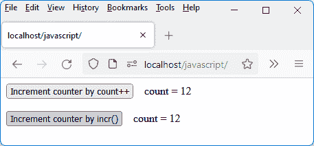

在要执行的操作过程中，可以连续编写多个方法调用（用逗号或分号隔开）。只要这些方法定义在组件的 `methods` 部分即可。例如，`@click="incr();incr()"` 允许在每次点击按钮时执行两次 `incr()` 方法。

我们在这里解释了如何捕获事件并在组件的 `methods` 部分定义的方法中处理它。让我们更进一步，使用在接收到的事件中传递的参数，例如，知道按下了键盘上的哪个键。

### 使用 $event 参数

Vue.js 提供了对与事件相关联的 Event 对象的访问。然后可以使用该对象来获取有关事件的额外信息。根据事件类型的不同有所不同：

- 对于鼠标相关的事件，显示鼠标坐标或在鼠标上点击的按钮
- 对于键盘相关的事件，显示使用的键盘键或按下的按键组合（`Ctrl`、`Shift`、`Esc` 等）

可以通过 `$event` 变量访问 Event 对象。它可以作为参数传递给处理方法。该参数随后将在事件处理函数中被检索。

让我们看看在编辑控件中输入字符时使用该参数的两个示例：

- 当输入的数值等于或超过值 100 时，立即显示错误消息。
- 如果编辑控件只能包含数字，则禁止输入数字以外的字符（这是对上一个示例的改进）。

#### 检查输入的值是否小于 100

让我们使用 `$event` 参数检查计数器输入框的内容是否小于 100。如果是，则用输入的值更新 `count` 变量；若不是，则显示错误消息。为了实现这一点，我们在输入框上使用 `blur`（失去焦点）事件，并在处理事件时检索输入框的值。使用一个响应式消息变量在需要时显示错误消息：

> **注意**
> 当离开输入框时会触发 `blur` 事件，例如，通过点击输入框外侧。

##### 如果计数器大于 100 则显示错误消息 (counter.js)

```javascript
const Counter = {
  data() {
    return {
      count: 0,
      message: ""
    }
  },
  template: `
    count（小于 100）：<input type="text" :value="count" @blur="valid($event)" />
    &nbsp;&nbsp; count = {{count}}
    <br><br>
    <span>{{message}}</span>
  `,
  methods: {
    valid(event) {
      this.message = ""; // 重置错误消息
      // 在每次检查之前
      if (event.target.value < 100) this.count = event.target.value;
      else this.message = "Error: count must be less than 100";
    }
  }
}
export default Counter;
```

`$event` 参数被传递给 `valid(event)` 处理函数。`event.target` 属性提供了对 HTML 元素的直接访问。其 `value` 属性包含字段的值。

如果你输入一个小于 100 的值（这里是 45），计数器将更新：

图 4.2 - 输入允许的值

如果你输入一个大于 100 的值（例如 150），则会显示错误并恢复计数器的旧值（45）。

图 4.3 - 输入被禁止的值

#### 仅允许输入数字

`$event` 参数的其他用途可以是仅允许向字段中输入数字。禁止其他键盘键（`Backspace` 和 `Delete` 键、左右方向键以及 `Tab` 键除外）。

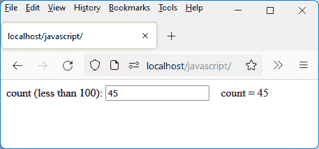

为此，我们使用 `keydown` 事件，它每当按下键盘上的键时都会触发一次：

##### 禁止输入非数字字符 (counter.js)

```javascript
const Counter = {
  data() {
    return {
      count: 0,
      message: ""
    }
  },
  template: `
    count（小于 100）：
    <input type="text" :value="count" @blur="valid($event)" @keydown="verif($event)" />
    &nbsp;&nbsp; count = {{count}}
    <br><br>
    <span>{{message}}</span>
  `,
  methods: {
    valid(event) {
      this.message = ""; // 重置错误消息
      if (event.target.value < 100) this.count = event.target.value;
      else this.message = "Error: count must be less than 100";
    },
    verif(event) {
      console.log(event.key); // 显示键
      if (event.key !== "Backspace" && event.key !== "Delete" && event.key !== "ArrowLeft" && event.key !== "ArrowRight" && event.key !== "Tab") {
        event.preventDefault();
      }
    }
  }
}
export default Counter;
```

`$event` 参数包含了键。因此我们指示不要接受非数字。

---

Vue.js 将应用程序分为一组组件。现在让我们解释如何组装组件以形成完整的应用程序。

### 组装组件

为此创建两个组件：

- `<counter>` 组件用于管理计数器。
- `<counters>` 组件允许共同管理计数器并显示总和。

`index.html` 文件将在其模板部分显示 `<counters>` 组件：

#### index.html 文件

```html
<html>
<head>
  <meta charset="utf-8" />
  <script src="https://unpkg.com/vue@next"></script>
</head>
<body>
  <div id="app"></div>
</body>
<script type="module">
import Counters from "./counters.js";
var app = Vue.createApp({
  components: {
    Counters: Counters
  },
  template: `
    <counters />
  `,
});
var vm = app.mount("div#app");
</script>
</html>
```

包含的 `counters.js` 文件描述了 `<counters>` 组件。它部分重复了之前章节中解释的内容，并增加了我们现在描述的新概念。这些新概念将解释父组件如何与其子组件通信（通过属性，称为 `props`）以及子组件如何与其父组件通信（通过事件和 `$emit()` 方法）。这两个概念使得组件之间的组装成为可能，允许它们在子组件和父组件之间进行通信。

### 使用 $emit() 与父组件通信

#### <counter> 组件

让我们先看 `<counter>` 组件文件，它描述了一个与输入框关联的计数器：

##### <counter> 组件 (counter.js)

```javascript
const Counter = {
  data() {
    return {
      count: 0,
      old_value: 0
    }
  },
  template: `
    <input type="text" v-model="count" @keydown="verif($event)" @input="calcul()" @focus="focus()" @blur="blur()" />
  `,
  methods: {
    verif(event) {
      if (event.key != "Backspace" && event.key != "Delete" &&
        event.key != "ArrowLeft" && event.key !=
        "ArrowRight" &&
        event.key != "Tab") {
        // 如果不是数字，则禁止按键
        if (event.key < "0" || event.key > "9")
          event.preventDefault(); // 禁止按键
      }
      this.old_value = event.target.value;
    },
    calc() {
      this.$emit("sub", this.old_value || 0); // 减法旧值
      this.$emit("add", this.count || 0); // 添加新值
    },
    focus() {
      if (this.old_value == "0") this.count = "";
    },
    blur() {
      if (!parseInt(this.count)) {
        this.old_value = 0;
        this.count = 0;
      }
    }
  },
  emits: ["sub", "add"] // 声明向父组件发出的事件
}
export default Counter;
```

`<counter>` 组件扩充了新的方法，并关联了新的事件，以便在输入时考虑。此外，还创建了一个响应式变量 `old_value`：

- `old_value` 变量包含了在按下键盘按键之前，在 `field` 中输入的值。
- `count` 变量包含了在按下键盘按键之后，在 `field` 中输入的值。

为什么要区分它们呢？因为为了计算所有计数器的总和，每输入一个按键，都需要从 `field` 中移除上一个值（按下按键之前）并加上新值（按下按键之后）。每个按键事件由 `input` 事件处理，该事件在此处调用了 `calc()` 方法。

由于与三个计数器总和相关的计算是在更高层（在 `<counters>` 组件中，它是父组件）执行的，因此你必须告诉该父组件要减去的和（`old_value`）和要相加的和（`count`）。这是通过使用 `$emit(eventName, value)` 方法发送 "sub" 和 "add" 事件来实现的。

#### 关于 $emit(eventName, value) 方法

`$emit(eventName, value)` 方法从组件中执行，向父组件发送 `eventName` 事件，父组件可以使用 `@eventName` 指令对其进行处理。`value` 参数对应于需要时传输的值。此外，我们在组件的 `emits` 部分列出了该组件可以向父组件发出的事件列表。这种使用事件在子组件（这里是 `<counter>` 组件）和父组件（这里是 `<counters>` 组件）之间进行通信的方式是 Vue.js 推荐的方法。

现在让我们来看 `<counters>` 组件的描述，它包含了三个计数器以及在每个计数器输入时对总额的计算：

##### <counters> 组件 (counters.js)

```javascript
import Counter from "./counter.js";

const Counters = {
  data() {
    return {
      total: 0
    }
  },
  components: {
    Counter: Counter
  },
  template: `
    Counter 1 : <counter @add="add($event)" @sub="sub($event)" /> <br>
    Counter 2 : <counter @add="add($event)" @sub="sub($event)" /> <br>
    Counter 3 : <counter @add="add($event)" @sub="sub($event)" /> <br><br>
    Total : {{total}} <br>
  `,
  methods: {
    add(value) {
      this.total += parseInt(value);
    },
    sub(value) {
      this.total -= parseInt(value);
    }
  },
}
export default Counters;
```

在 `<counter>` 子组件中发出的 "add" 和 "sub" 事件在使用时会在 `<counter>` 组件的属性中被处理。`add(value)` 和 `sub(value)` 处理方法注册在父组件中，这允许在每次按下键盘上的数字键时，总和的值发生变化。

图 4.4 - 三个计数器的计算

我们已经学习了如何通过事件从组件向父组件通信。现在让我们看看如何反向从父组件向子组件通信。对于这一点，我们使用了名为 `props` 的属性。

### 使用 props 进行通信

我们已经看到从子组件到父组件的通信是通过事件完成的。反向的、从父组件到子组件的通信是通过 `props` 属性完成的。我们在上一节的 *在组件中使用属性* 部分中已经看过了这些属性的使用。

在这个示例中，我们将改进 `<counters>` 组件，告诉它我们想要显示的计数器数量。为了实现这一点，我们在组件中使用 `nb` 属性。例如，我们将 `<counters nb="5" />` 以在页面上显示 5 个计数器。每个计数器像之前的形式一样从 1 开始显示。

首先，我们将修改 `index.html` 文件，使用 `nb` 属性编写 `<counters>` 组件：

#### <counters nb="5" /> (index.html)

```html
<html>
<head>
  <meta charset="utf-8" />
  <script src="https://unpkg.com/vue@next"></script>
</head>
<body>
  <div id="app"></div>
<script type="module">
  import Counters from "./counters.js";
  var app = Vue.createApp({
    components: {
      Counters
    },
    template: `
      <counters nb="5" />
    `
  });
  var vm = app.mount("app");
</script>
</html>
```

现在我们将修改 `counters.js` 文件，将新的 `nb` props 集成到组件中：

#### <counters> 组件中的 nb props (counters.js)

```javascript
import Counter from "./counter.js";

const Counters = {
  data() {
    return {
      total: 0
    }
  },
  components: {
    Counter: Counter
  },
  props: ["nb"],
  computed: {
    nb() {
      var tab = [];
      for(var i = 0; i < this.nb; i++) tab.push(i+1);
      return tab;
    }
  },
  template: `
    <div v-for="i in nb">
      Counter {{i}} : <counter @add="add($event)" @sub="sub($event)" />
    </div>
    Total : {{total}}
  `,
  methods: {
    add(value) {
      this.total += parseInt(value);
    },
    sub(value) {
      this.total -= parseInt(value);
    }
  },
}
export default Counters;
```

"nb" props 列在组件的 `props` 部分。为了显示计数器列表，在 `<div>` 元素上使用 `v-for` 指令。

#### 如何使用 v-for 指令

对于 `v-for` 指令的值，必须指定一个要遍历的数组。为此，我们将 `nb` props 的值转换为数组 `[1, 2, 3, ..., nb]`。这是通过一个名为 `nb` 的计算属性实现的，它返回所需的数组。使用 `<counters nb="5">` 组件时显示的计数器数量。

图 4.5 - 显示五个计数器

我们结束对 Vue.js 组件的研究，这些组件共同构成了一个完整的应用程序。现在让我们查看 Vue.js 中帮助你产生视觉效果的一个方面，例如通过视觉效果让 HTML 页面上的 HTML 元素出现或消失。

### 视觉效果 (Visual Effects)

视觉效果通过为 HTML 页面带来视觉动画，使其变得更加动态。例如，要删除列表中的某项，可以使用透明度效果让它逐渐消失，而不是不使用视觉效果直接删除它。

可以使用 Vue.js 使用视觉效果，特别是让元素从页面上出现或消失。Vue.js 也可以实现不会让 HTML 元素从页面出现或消失的视觉效果（例如通过点击让元素移动）。关于这些类型动画的更多信息，你可以参考 https://vuejs.org/guide/extras/animation.html。我们在这里不解释这些效果，因为可用文档已经足够清晰可以使用它们。

在本章后续的内容，我们将学习与页面上一个或多个元素的出现或消失相关的视觉效果。我们想要帮助出现或消失（使用视觉效果）的元素必须插入到名为 `<transition>` 的组件中。该组件由 Vue.js 用于产生效果。

此外，Vue.js 使用在其中描述了效果 CSS 属性的 CSS 类定义。只需定义 CSS 类的内容（见下节描述），Vue.js 就会在适当的时间使用它们来实现效果。Vue.js 在元素上使用的 CSS 类取决于元素的状态：它应该是出现还是消失？根据它的状态（可见或不可见），CSS 类不同。

#### 当元素出现时

当 HTML 元素应该出现时，Vue.js 使用的 CSS 类名以字符串 "v-enter" 开始。类名随后包含后缀 "-from" 或 "-to"，将用于描述元素在效果开始时（"-from"）或结束时（"-to"）的 CSS 属性。

##### Vue.js 使用的 CSS 类

因此，我们有以下两个 CSS 类：

- `v-enter-from`：该类描述元素出现效果开始时的 CSS 属性。
- `v-enter-to`：该类描述元素出现效果结束时的 CSS 属性。

> **注意**
> 注意，在出现效果开始时，元素是不可见的，但 `v-enter-from` 类描述的 CSS 属性会立即应用于它。例如，如果我们在 `v-enter-from` 的 CSS 属性中输入 CSS 透明度属性等于 1，那么一旦出现效果开始，元素就会立即变得可见。

由于 `v-enter-to` 类描述了效果结束时元素的 CSS 属性，因此当效果完成时，Vue.js 会从元素中移除该 CSS 类。因此，我们看到 `v-enter-from` 和 `v-enter-to` CSS 类用于描述元素在效果持续期间的 CSS 属性，但在之后不再该元素上使用（即在效果持续时间之外）。

出现效果会将 CSS 属性从 `v-enter-from` 中描述的样式逐渐过渡到 `v-enter-to` 中描述的样式。为了实现这一点，Vue.js 使用 `v-enter-active` 类，该类描述了每个 CSS 属性的演变方式。

#### CSS 类的示例内容

让我们看看上述三个 CSS 类（`v-enter-from`、`v-enter-to` 和 `v-enter-active`）的某些示例内容：

##### v-enter-from 类示例

```css
.v-enter-from {
  opacity: 0;
  background-color: #FFCCCC;
}
```

在这里，我们指定元素在效果开始时是不可见的（`opacity:0`），并且具有某种背景颜色（`background-color:#FFCCCC`）：

##### v-enter-to 类示例

```css
.v-enter-to {
  opacity: 0.5;
  background-color: black;
}
```

在这里，我们指定元素在效果结束时是半透明的（`opacity:0.5`），并且具有黑色背景（`background-color:black`）：

##### v-enter-active 类示例

```css
.v-enter-active {
  transition: opacity 2s, background-color 2s;
}
```

在这里，我们指定 CSS `opacity` 和 `background-color` 属性必须演变，每个持续两秒。由于所有指定的 CSS 属性演变时间相同，我们可以通过编写简写形式来简化代码。如下所示：

##### v-enter-active 类示例（简写形式）

```css
.v-enter-active {
  transition: all 2s;
}
```

`all` 关键字会覆盖所有指定的 CSS 属性。

#### 使用 CSS 类

现在让我们展示如何在程序中使用这些 CSS 类，通过一个按钮显示带有效果的段落。按钮的作用是交替隐藏或显示段落，当段落出现时，效果会随之发生。这展示了 Vue.js 如何使用 `v-enter-from`、`v-enter-to` 和 `v-enter-active` CSS 类来在元素在页面上出现时产生效果：

##### 使用按钮产生出现效果 (index.html)

```html
<html>
<head>
  <meta charset="utf-8" />
  <script src="https://unpkg.com/vue@next"></script>
  <style type="text/css">
    .v-enter-from {
      opacity: 0;
      background-color: #FFCCCC;
    }
    .v-enter-to {
      opacity: 0.5;
      background-color: black;
    }
    .v-enter-active {
      transition: opacity 2s, background-color 2s;
    }
  </style>
</head>
<body>
  <div id="app"></div>
</body>
<script>
  var app = Vue.createApp({
    data() {
      return {
        show: false // 初始隐藏
      }
    },
    template: `
      <button @click="show=!show">产生效果</button>
      <transition>
        <p v-if="show">段落 1</p>
      </transition>
    `
  });
  var vm = app.mount("div#app");
</script>
</html>
```

我们描述了 `v-enter-from`、`v-enter-to` 和 `v-enter-active` CSS 类的内容，这些类将被 Vue.js 用于产生效果。随后我们在页面中插入了**产生效果**按钮，这样当点击按钮时，设置了效果的段落将交替隐藏或显示。为了实现这一点，段落被插入到 HTML `<transition>` 元素中，从而允许 Vue.js 知道要在哪个元素上应用效果。

段落在启动时是隐藏的（因为响应式变量 `show` 被设置为 `false`）。点击**产生效果**按钮会将 `show` 变量的值改为 `true`，从而启动效果。

> **注意**
> 由于包含了要显示的段落的 `<transition>` 组件，效果是在段落上启动的。正是因为这个 `<transition>` 组件，Vue.js 知道要在哪个元素上产生效果。

注意，正如 CSS `transition` 属性所示，效果持续两秒。当效果结束时，CSS 类将从 `<p>` 元素中移除，该元素随后变为普通的段落（没有背景颜色且不透明度为 1）。因此，你会看到段落在效果结束时，不透明度为 0.5（`v-enter-to` 中指定的），然后当 Vue.js 在效果结束时移除 `v-enter-to` 类时，它会突然变为不透明度 1。

> **注意**
> 因此，最好在 `v-enter-to` 类中指定元素不再产生效果时的 CSS 值，以使效果更加和谐。

让我们运行之前的程序。当程序启动时，段落是隐藏的：

图 4.6 - 程序启动时段落被隐藏

点击**产生效果**按钮后，段落开始出现，并遵循 `v-enter-from`、`v-enter-to` 和 `v-enter-active` 类中指定的 CSS 属性。

图 4.7 - 点击产生效果按钮后，段落渐进出现

 

在效果结束之前，段落具有在 `v-enter-to` 类中设置的 CSS 属性，因此其背景颜色为黑色，但不透明度为 0.5；此时背景颜色保持灰色，且段落文本不可见。

图 4.8 - 效果结束前的段落

---

### 当元素消失时

当 HTML 元素应该消失时，Vue.js 使用的 CSS 类名以字符串 "v-leave" 开始。类名随后包含后缀 "-from" 或 "-to"，将用于描述元素在效果开始时（"-from"）或结束时（"-to"）的 CSS 属性。

#### Vue.js 使用的 CSS 类

因此，我们有以下两个 CSS 类：

- `v-leave-from`：该类描述元素消失效果开始时的 CSS 属性。
- `v-leave-to`：该类描述元素消失效果结束时的 CSS 属性。

消失效果会将 CSS 属性从 `v-leave-from` 中描述的样式逐渐过渡到 `v-leave-to` 中描述的样式。为了实现这一点，Vue.js 使用 `v-leave-active` 类，该类描述了每个 CSS 属性的演变方式。

#### CSS 类的示例内容

让我们看看上述三个 CSS 类（`v-leave-from`、`v-leave-to` 和 `v-leave-active`）的某些示例内容：

##### v-leave-from 类示例

```css
.v-leave-from {
  opacity: 1;
  background-color: #FFCCCC;
}
```

在这里，我们指定元素在效果开始时是可见的（`opacity:1`），并且具有某种背景颜色（`background-color:#FFCCCC`）：

##### v-leave-to 类示例

```css
.v-leave-to {
  opacity: 0;
  background-color: black;
}
```

在这里，我们指定元素在效果结束时是不可见的（`opacity:0`），并且具有黑色背景（`background-color:black`）：

##### v-leave-active 类示例

```css
.v-leave-active {
  transition: all 2s;
}
```

在这里，我们指定所有 CSS 属性必须演变，持续两秒。

#### 使用 CSS 类

现在让我们展示如何在程序中使用这些 CSS 类，通过一个按钮显示带有消失效果的段落：

##### 使用按钮产生消失效果 (index.html)

```html
<html>
<head>
  <meta charset="utf-8" />
  <script src="https://unpkg.com/vue@next"></script>
  <style type="text/css">
    .v-leave-from {
      opacity: 1;
      background-color: #FFCCCC;
    }
    .v-leave-to {
      opacity: 0;
      background-color: black;
    }
    .v-leave-active {
      transition: all 2s;
    }
  </style>
</head>
<body>
  <div id="app"></div>
</body>
<script>
  var app = Vue.createApp({
    data() {
      return {
        show: true // 开始时可见
      }
    },
    template: `
      <button @click="show=!show">产生效果</button>
      <transition>
        <p v-if="show">段落 1</p>
      </transition>
    `
  });
  var vm = app.mount("div#app");
</script>
</html>
```

我们描述了 `v-leave-from`、`v-leave-to` 和 `v-leave-active` CSS 类的内容，这些类将被 Vue.js 用于产生效果。随后我们在页面中插入了**产生效果**按钮，这样当点击按钮时，设置了效果的段落将交替显示或隐藏。为了实现这一点，段落被插入到 HTML `<transition>` 元素中，从而允许 Vue.js 知道要在哪个元素上应用效果。

段落在启动时是可见的（因为响应式变量 `show` 被设置为 `true`）。点击**产生效果**按钮会将 `show` 变量的值改为 `false`，从而启动消失效果。

> **注意**
> 由于包含了要显示的段落的 `<transition>` 组件，效果是在段落上启动的。正是因为这个 `<transition>` 组件，Vue.js 知道要在哪个元素上产生效果。

注意，正如 CSS `transition` 属性所示，效果持续两秒。当效果结束时，CSS 类将从 `<p>` 元素中移除，该元素随后变为普通的段落（没有背景颜色且不透明度为 1）。

让我们运行之前的程序。当程序启动时，段落是可见的：

图 4.9 - 程序启动时段落可见

点击**产生效果**按钮后，段落开始消失，并遵循 `v-leave-from`、`v-leave-to` 和 `v-leave-active` 类中指定的 CSS 属性。

图 4.10 - 点击产生效果按钮后，段落渐进消失

 

在效果结束之前，段落具有在 `v-leave-to` 类中设置的 CSS 属性，因此其背景颜色为黑色，但不透明度为 0；此时段落完全不可见。

图 4.11 - 效果结束前的段落

---

### 结合出现和消失效果

我们可以在同一个程序中结合出现和消失效果。为此，我们在 CSS 部分同时定义进入（enter）和离开（leave）类。

#### 结合效果 (index.html)

```html
<html>
<head>
  <meta charset="utf-8" />
  <script src="https://unpkg.com/vue@next"></script>
  <style type="text/css">
    .v-enter-from {
      opacity: 0;
      background-color: #FFCCCC;
    }
    .v-enter-to {
      opacity: 1;
      background-color: black;
    }
    .v-enter-active {
      transition: all 2s;
    }
    .v-leave-from {
      opacity: 1;
      background-color: #FFCCCC;
    }
    .v-leave-to {
      opacity: 0;
      background-color: black;
    }
    .v-leave-active {
      transition: all 2s;
    }
  </style>
</head>
<body>
  <div id="app"></div>
</body>
<script>
  var app = Vue.createApp({
    data() {
      return {
        show: true // 开始时可见
      }
    },
    template: `
      <button @click="show=!show">产生效果</button>
      <transition>
        <p v-if="show">段落 1</p>
      </transition>
    `
  });
  var vm = app.mount("div#app");
</script>
</html>
```

如果我们在同一个程序的 CSS 部分编写了进入（enter）和离开（leave）类，每次点击按钮，我们都会获得相关段落出现或消失的效果。

这里使用的 CSS 类具有固定的名称，无论使用何种效果。这不允许使用多个效果，因为所有视觉效果都将使用相同的 CSS 类名。为了解决这个问题，Vue.js 允许你为每个效果命名，从而能够使用不同的 CSS 类名。

### 为效果命名

类型为 "v-enter-xxx" 或 "v-leave-xxx" 的类可以重命名，以象征它们所关联的效果。我们只需要将字符串 "v-" 替换为效果名称后接连字符 "-" 即可。

例如，"v-enter-from" 将替换为 "fade-enter-from"，以给效果命名为 "fade"。然后我们在 `<transition>` 组件上添加 `name="fade"` 属性，表示 `<transition name="fade">`。

这允许我们通过定义与每个效果对应的 CSS 类，将多个效果集成到应用程序中。

之前的程序在段落中集成了名为 "fade" 的效果，其写法如下：

#### 淡入效果 (index.html)

```html
<html>
<head>
  <meta charset="utf-8" />
  <script src="https://unpkg.com/vue@next"></script>
  <style type="text/css">
    .fade-leave-from {
      opacity: 1;
      background-color: #FFCCCC;
    }
    .fade-leave-to {
      opacity: 0;
      background-color: black;
    }
    .fade-leave-active {
      transition: all 2s;
    }
    .fade-enter-from {
      opacity: 0;
      background-color: #FFCCCC;
    }
    .fade-enter-to {
      opacity: 1;
      background-color: black;
    }
    .fade-enter-active {
      transition: opacity 2s, background-color 2s;
    }
  </style>
</head>
<body>
  <div id="app"></div>
</body>
<script>
  var app = Vue.createApp({
    data() {
      return {
        show: true
      }
    },
    template: `
      <button @click="show=!show">产生效果</button>
      <transition name="fade">
        <p v-if="show">段落 1</p>
      </transition>
    `
  });
  var vm = app.mount("div#app");
</script>
</html>
```

`<transition>` 组件只能有一个元素，该元素将是发生效果的元素。要包含多个元素，必须使用 `<transition-group>` 组件，我们将在下文中解释。

### 在多个元素上产生效果

`<transition>` 组件只能包含一个元素。当效果必须应用于多个元素时，有必要创建多个 `<transition>` 组件或将元素分组在 `<transition-group>` 组件中。在这个示例中，让我们来看看如何使用 `<transition-group>` 组件：

#### 使用 <transition-group> 组件

```html
<transition-group name="fade">
  <p v-if="show">段落 1</p>
  <p v-if="show">段落 2</p>
</transition-group>
```

发生效果的元素（这里是两个段落）被分组在一个 `<transition-group>` 元素中，而不是之前在单个段落时使用的 `<transition>` 元素。现在我们将查看如何编写与某些经典效果相关的 CSS 类。

### 常用效果示例

下面是一些效果的描述。通过几行 CSS 代码，你可以轻松地产生经典效果，例如段落的缩小/放大（收缩效果）、它的逐渐消失/出现（透明度效果）以及它的垂直位移（移动效果）。你可以自由地为这些效果命名并象征所产生的效果。

#### 收缩效果

要使用收缩效果（这里称为 "shrink"），我们使用 CSS 的 `font-size` 属性。在效果开始时，段落是正常大小。点击按钮后，段落的大小逐渐缩小直到消失。再次点击按钮，段落会增加到正常大小。

##### 处理收缩效果的 CSS 类

```css
.shrink-leave-from {
}
.shrink-leave-to {
  font-size: 0px;
}
.shrink-leave-active {
  transition: all 2s;
}
.shrink-enter-from {
  font-size: 0px;
}
.shrink-enter-to {
  font-size: normal;
}
.shrink-enter-active {
  transition: all 2s;
}
```

`shrink-leave-to` 类表示 `font-size` 变为 0px。当前的值（正常大小）是起始值。在点击按钮后，段落的大小逐渐缩小直到消失。再次点击按钮，段落会增加到正常大小。由于 `shrink-leave-from` 中没有定义 `font-size` 值，它将使用元素 CSS 定义的值（即正常大小）。同样，`shrink-enter-from` 类表示在效果开始时 `font-size` 为 0px。目标值不需要指定，因为它将使用元素 CSS 的默认值，即正常大小。

#### 淡入效果

名为 "fade" 的效果使用 CSS 的 `opacity` 属性。该效果由将 CSS `opacity` 属性从 0 变为 1（使元素出现）或从 1 变为 0（使其消失）组成。这里是消失的效果。段落的透明度趋向于 0。当透明度为 0 时，元素在屏幕上完全不可见。

图 4.12 - 段落的透明度趋向于 0

一旦段落不可见，再次点击“产生效果”按钮使其逐渐出现：

##### 管理透明度的 CSS 类

```css
.fade-leave-from {
}
.fade-leave-to {
  opacity: 0;
}
.fade-leave-active {
  transition: all 0.5s;
}
.fade-enter-from {
  opacity: 0;
}
.fade-enter-to {
}
.fade-enter-active {
  transition: all 1s;
}
```

`fade-leave-to` CSS 类表示将透明度变为 0。当前的透明度（值为 1）是起始值。由于在 `fade-leave-from` 中没有定义透明度的初始值，它将使用元素 CSS 定义的值（即 1）。同样，`fade-enter-from` 类表示元素效果开始时当前的透明度。透明度的目标值不需要指定，因为它将使用来自元素 CSS 的默认值，即 1。

#### 移动效果

为了管理这种效果（这里称为 "move"），我们使用 CSS 属性 `transform`（设置为 `translateY(100px)`）和 `opacity`（设置为 0）。这使元素逐渐向下移动 100 像素，同时逐渐将其透明度降低到 0。元素随着页面向下移动而消失。

例如，当元素通过降低透明度开始向下滑动时（使其可见性降低），显示效果如下：

图 4.13 - 段落通过降低透明度页面向下移动

随着效果的持续，段落继续向下移动，直到达到效果中指定的 100 像素距离。你越接近这个距离，段落的透明度就越低，直到变得不可见（透明度为 0）。

图 4.14 - 段落在效果结束时几乎变得不可见

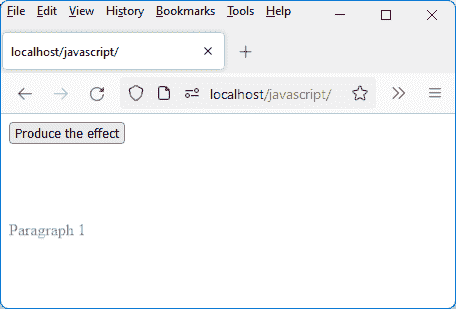 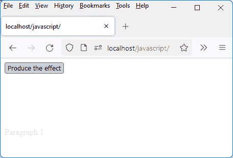

一旦段落消失，点击**生成效果**按钮，它将从屏幕底部逐渐重新出现：

##### 处理向下移动的 CSS 类

```css
.ymove-leave-from {
}
.ymove-leave-to {
  transform: translateY(100px);
  opacity: 0;
}
.ymove-leave-active {
  transition: all 0.5s;
}
.ymove-enter-from {
  transform: translateY(100px);
  opacity: 0;
}
.ymove-enter-to {
}
.ymove-enter-active {
  transition: all 0.5s;
}
```

`ymove-leave-to` CSS 类指示了我们想要改变的指定 CSS 属性的值。`transform` 属性可以包含 `translateY(100px)` 值，表示执行 100 像素的垂直平移 (Y)。添加 `opacity: 0` 会让元素通过垂直移动而消失。

`ymove-enter-from` CSS 类允许你指定出现效果开始时的 CSS 属性值。该元素位于垂直距离 100 像素处，透明度为 0。CSS 属性将演变到 `ymove-enter-to` 类中指定的值，如果该类中没有指定任何内容，则通常用于元素的 CSS 属性（透明度为 1，垂直距离为 0，即正常位置）将是我们在出现期间将演变的目标。

CSS `transform` 属性对于产生视觉效果（例如旋转、放大和位移）非常有用。

---

# 总结

在学习了如何处理事件并在外部事件（例如点击）发生时采取行动后，我们在本章看到了用 Vue.js 创建的组件如何组合成完整的应用程序。我们学习了以下内容：

- 从组件到父组件的通信，我们使用事件。
- 从组件到子组件的通信，我们使用组件中 `props` 部分的属性。

最后，为了产生视觉效果，你只需要编写由 Vue.js 管理的 CSS 类即可。

在下一章中，我们将看到一个应用程序示例，它允许我们实践之前章节中学习的元素。

---

# 5 使用 Vue.js 管理列表

在学习了 Vue.js 的基础和高级概念后，通过本章，让我们通过构建一个管理元素列表的应用程序来完成对 Vue.js 库的学习。

为什么要制作这种应用程序？简单来说，因为它允许你对页面上的 HTML 元素执行相当标准的操作，如插入元素、修改元素和删除元素。这些是你需要知道如何执行的基本操作，例如管理数据库中的元素。在本章中，我们将学习如何对显示在屏幕上的元素执行这些操作，在接下来的部分（我们将学习 Node.js 和 MongoDB），我们将看到如何同时更新数据库。

以下是本章涵盖的主题：

- 将应用程序拆分为组件
- 向列表添加元素
- 从列表中移除元素
- 修改列表中的元素

但让我们先从发现我们想要用 Vue.js 创建的应用程序界面开始。

## 技术要求

你可以在 GitHub 上找到本章的文件：https://github.com/PacktPublishing/JavaScript-from-Frontend-to-Backend/blob/main/Chapter%205.zip。

## 显示应用程序界面

正如前面提到的，我们将构建一个管理元素列表的应用程序。在编写应用程序的源码之前，让我们通过解释它们的顺序来展示应用程序的不同界面。

起初，列表是空的。**添加元素**按钮允许每次点击时向列表中插入一个新元素。

图 5.1 - 启动应用程序时的界面

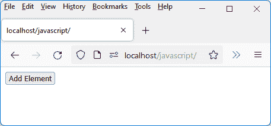

让我们点击几次**添加元素**按钮（这里点击三次）：

图 5.2 - 点击添加元素后

插入的每个元素都有索引（从 1 开始）。列表中的**删除**和**修改**按钮被插入了。

让我们点击第二行的**修改**按钮。该项被一个字段替换，允许进行编辑。

图 5.3 - 编辑项


让我们修改输入框中的文本，输入 Element。

图 5.4 - 考虑到

最后，删除第一个和第三个元素，点击它们的**删除**按钮。

图 5.5 - 删除元素后


### 使用 HTTP 协议

此应用程序使用 PHP 服务器，因为 JavaScript 模块的导入在 HTTP 协议下才能工作。我们将在后续（第 9 章，集成 Vue.js 与 Node.js）学习如何使用 Node.js 服务器来实现。

### 将应用程序拆分为组件

当你用 Vue.js 创建应用程序时，首先要问自己构建它需要哪些组件。

在我们的情况下，将是：

- 一个组合整个应用程序的 `<GlobalApp>` 组件。这个 `<GlobalApp>` 组件将集成到 index.html 中。它将显示**添加元素**按钮以及元素列表。
- 一个显示元素行的 `<Element>` 组件，包含元素的文本以及**删除**和**修改**按钮。

元素列表将与名为 `elements` 的响应式变量关联，该变量包含每个元素的显示文本。此响应式变量将注册在 `<GlobalApp>` 组件中。当向列表添加新元素或删除/修改元素时，它会被修改。

因此，我们应用程序的核心文件如下：

- `index.html` 文件，它是主文件
- `global-app.js` 文件，包含 `<GlobalApp>` 组件，并被导入到 `index.html` 文件中
- `element.js` 文件，描述显示列表中的元素（`<Element>` 组件），即元素的文本

这里是这些文件的内容：

#### index.html

```html
<html>
<head>
  <meta charset="utf-8" />
  <script src="https://unpkg.com/vue@next"></script>
</head>
<body>
  <div id="app"></div>
</body>
<script type="module">
import GlobalApp from "./global-app.js";
var app = Vue.createApp({
  components: {
    GlobalApp: GlobalApp
  },
  template: "<GlobalApp />"
});
var vm = app.mount("div#app");
</script>
</html>
```

`index.html` 显示 `<GlobalApp>` 组件，它对应应用程序的主组件，我们现在来描述它：

#### <GlobalApp> 组件 (global-app.js)

```javascript
import Element from "./element.js";

const GlobalApp = {
  data() {
    return {
      elements: []
    }
  },
  components: {
    Element: Element
  },
  template: `
    <button>Add Element</button>
    <ul></ul>
  `,
}
export default GlobalApp;
```

我们发现响应式变量 `elements`，以及 **Add Element** 按钮和 `<ul>` 元素列表目前都是空的。

#### <Element> 组件 (element.js)

```javascript
const Element = {
  data() {
    return {}
  },
  template: ``,
}
export default Element;
```

下文描述了 `<Element>` 组件。它目前是空的，将在后续章节中进行丰富。

### 使用 HTTP 协议

由于 JavaScript 代码包含了模块导入指令，因此必须使用可以通过 HTTP 访问的 Web 服务器来显示 `index.html` 对应的 HTML 页面。文件协议在这里无法工作。

让我们在屏幕上显示这段临时代码的结果：

图 5.7 - 使用启动代码显示的结果

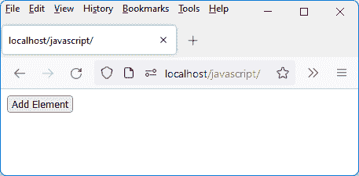

在图 5.7 中，我们看到了 `<GlobalApp>` 组件的渲染，它目前只显示 **Add Element** 按钮。让我们看看如何处理此按钮的点击，以便在列表中插入新元素。

## 向列表添加元素

我们将从向列表添加项目的功能开始。修改 `global-app.js` 文件以处理对 **Add Element** 按钮的点击（该按钮包含在 `global-app.js` 文件中）。

让我们添加点击 **Add Element** 按钮时应该运行的代码：

### 考虑对 Add Element 按钮的点击 (global-app.js)

```javascript
import Element from "./element.js";

const GlobalApp = {
  data() {
    return {
      elements: []
    }
  },
  components: {
    Element: Element
  },
  template: `
    <button @click="add()">Add Element</button>
    <ul>
      <li v-for="(element, index) in elements" :key="index">{{element}}</li>
    </ul>
  `,
  methods: {
    add() {
      var element = "Element " + (this.elements.length + 1); // "Element X"
      this.elements.push(element);
    }
  }
}
export default GlobalApp;
```

对 **Add Element** 按钮的点击由点击事件处理，该事件调用了在 `methods` 部分定义的 `add()` 方法。`add()` 方法向响应式变量 `elements` 添加了一个新元素。

元素列表在组件模板中更新。目前，我们使用 `<li>` 标签来定义要插入的列表元素，但在下面，我们将使用 `<Element>` 组件，它将整合 **Remove** 和 **Modify** 按钮。

现在让我们验证我们对 `<GlobalApp>` 组件的修改是否有效。为此，请多次点击 **Add Element** 按钮。每次点击都会插入一个列表项，如下所示。

图 5.8 - Add Element 按钮点击

此处插入的元素是一个 HTML `<li>` 元素。但将 `<li>` 元素替换为 Vue.js 组件是有趣的，因为这允许使用 Vue.js 的哲学，即组件的最大化。我们将这个新组件命名为 `<Element>` 它将替换 `<li>` 元素。

### 使用 <Element> 组件

接下来，让我们使用 `<Element>` 组件代替之前的 `<li>` 元素。修改 `<GlobalApp>` 组件以整合 `<Element>` 组件：

#### 在列表中使用 <Element> 组件 (global-app.js)

```javascript
import Element from "./element.js";

const GlobalApp = {
  data() {
    return {
      elements: []
    }
  },
  components: {
    Element: Element
  },
  template: `
    <button @click="add()">Add Element</button>
    <ul>
      <Element v-for="(element, index) in elements" :key="index" :text="element" />
    </ul>
  `,
  methods: {
    add() {
      var element = "Element " + (this.elements.length + 1);
      this.elements.push(element);
    }
  }
}
export default GlobalApp;
```

要在列表中显示的文本将作为属性传递给 `<Element>` 组件，它将显示该文本。

#### 使用 <Element> 组件 (element.js)

```javascript
const Element = {
  data() {
    return {}
  },
  template: `
    <li>
      <span>{{text}}</span>
      <button> Remove</button>
      <button> Modify</button>
    </li>
  `,
  props: ["text"],
}
export default Element;
```

我们可以看到列表的外观现在很不错。

图 5.9 - 在列表中使用 <Element> 组件

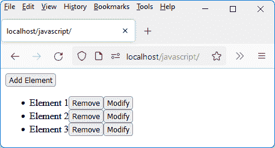

### 修改列表的外观

在处理列表点击之前，让我们使用一些 CSS 以更美的方式显示列表。

#### 使用 CSS 显示列表 (index.html)

```html
<html>
<head>
  <meta charset="utf-8">
  <script src="https://unpkg.com/vue@next"></script>
  <style type="text/css">
    li {
      margin-top: 10px;
    }
    ul button {
      margin-left: 10px;
    }
  </style>
</head>
<body>
  <div id="app"></div>
  <script type="module">
    import GlobalApp from "./global-app.js";
    var app = Vue.createApp({
      components: {
        GlobalApp: GlobalApp
      },
      template: "<GlobalApp />"
    });
    var vm = app.mount("div#app");
  </script>
</body>
</html>
```

我们现在必须处理 **Remove** 和 **Modify** 按钮的点击。让我们从 **Remove** 按钮开始。

## 从列表中移除元素

为了实现这一点，对 **Remove** 按钮的点击通过在点击期间与其关联一个过程来管理。因此，我们每次点击时都会调用 `<Element>` 组件中定义的 `remove()` 方法：

### 考虑对 Remove 按钮的点击 (element.js)

```javascript
const Element = {
  data() {
    return {}
  },
  template: `
    <li>
      <span>{{text}}</span>
      <button @click="remove()"> Remove</button>
      <button> Modify</button>
    </li>
  `,
  props: ["text"],
  methods: {
    remove() {
      // 处理 Remove 按钮的点击
    }
  }
}
export default Element;
```

> **注意**
> 为了处理 **Remove** 按钮的点击，我们必须更新响应式变量 `elements`，但由于它位于父组件 `<GlobalApp>`，我们必须向此父组件发送一个事件，要求它移除 `elements` 中的元素。

为了指定要删除的元素，必须通过其索引进行引用。为此，我们需要在创建 `<Element>` 组件时指定元素的索引。因此，我们在该组件中创建了一个新属性（命名为 "index"）。`remove()` 方法向父组件 `<GlobalApp>` 发送 "remove" 事件，并在参数中指示要从列表中删除的元素索引。`<Element>` 组件变得如下：

### 处理 Remove 按钮的点击 (element.js)

```javascript
const Element = {
  data() {
    return {}
  },
  template: `
    <li>
      <span>{{text}}</span>
      <button @click="remove()"> Remove </button>
      <button> Modify </button>
    </li>
  `,
  props: ["text", "index"],
  methods: {
    remove() {
      // process the click on the Remove button
      this.$emit("remove", { index: this.index });
    },
  },
  emits: ["remove"]
}
export default Element;
```

对 `<GlobalApp>` 组件修改以处理接收点击 **Remove** 按钮时发送的 "remove" 事件：

### 处理 "remove" 事件的接收 (global-app.js)

```javascript
import Element from "./element.js";

const GlobalApp = {
  data() {
    return {
      elements: []
    }
  },
  components: {
    Element: Element
  },
  template: `
    <button @click="add()">Add Element</button>
    <ul>
      <Element v-for="(element, index) in elements"
        :key="index" :text="element"
        :index="index"
        @remove="remove($event)"
      />
    </ul>
  `,
  methods: {
    add() {
      var element = "Element " + (this.elements.length + 1);
      this.elements.push(element);
    },
    remove(params) {
      var index = params.index;
      this.elements.splice(index, 1); // delete element in array
    }
  }
}
export default GlobalApp;
```

我们在 `<Element>` 组件中指定了新属性 `index`，这将允许我们知道列表中元素的索引。让我们向列表添加三个项目（参见图 5.11），然后点击第二行项目的 **Remove** 按钮（参见图 5.12）：

图 5.11 - 向列表添加三个元素

这是我们在点击 **Remove** 按钮后将看到的内容：

图 5.12 - 从列表中删除项目 Element 2

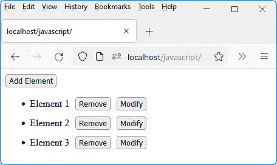 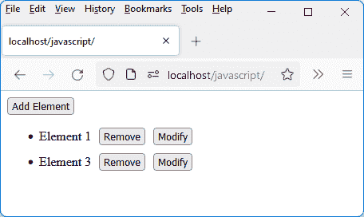

## 修改列表中的元素

修改列表元素分为几个步骤：

1. 点击 **Modify** 按钮后，我们将列表元素的文本（当前为 `<span>` 元素）转换为 HTML `<input>` 元素，并用元素的文本进行初始化。
2. 然后我们管理输入框的退出，通过获取在字段中输入的值，然后用一个带有新内容的 `<span>` 元素替换输入框。
3. 最后，通过允许输入控制框在点击 **Modify** 按钮后自动获得焦点来改进输入体验。

让我们深入查看这些不同的步骤。

### 将 <span> 元素转换为 <input> 元素

第一步是将 `<span>` 元素转换为 `<input>` 元素，这将允许修改元素的文本。为此，我们将在 `<Element>` 组件中添加一个新的响应式变量（命名为 "input"）。它指示是作为 `<span>` 元素显示文本（如果 `input` 为 false）还是显示 `<input>` 输入框（如果 `input` 为 true）。默认情况下，`input` 变量设置为 false（显示文本）。当点击 **Modify** 按钮时，它将变为 true：

#### 将 <span> 元素转换为 <input> 元素 (element.js)

```javascript
const Element = {
  data() {
    return {
      input: false // display element text by default
    }
  },
  template: `
    <li>
      <span v-if="!input">{{text}}</span>
      <input v-else type="text" :value="text" />
      <button @click="remove()"> Remove </button>
      <button @click="input=true"> Modify </button>
    </li>
  `,
  props: ["text", "index"],
  methods: {
    remove() {
      // process the click on the Remove button
      this.$emit("remove", { index: this.index });
    },
  },
  emits: ["remove"]
}
export default Element;
```

> **注意**
> `v-if` 和 `v-else` 指令用于作为 `<span>` 元素或 `<input>` 元素显示元素的文本。

在列表中插入三个项目后，让我们编辑第二个项目：

图 5.13 - 编辑列表中的项目

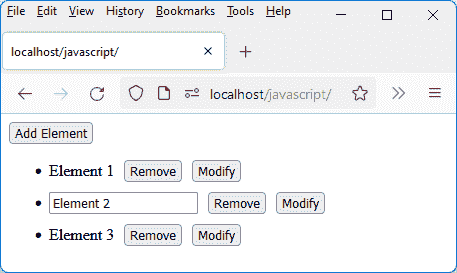

我们现在需要如何离开输入框并作为列表元素显示文本。

### 获取输入框的输出

一旦编辑框被修改，必须获取输入的值以显示它。为此，在 `<Element>` 组件中，我们使用 `blur` 事件，它表示我们离开了输入框。在处理此事件期间，获取输入框的值，并通过名为 "modify" 的事件传递给 `<GlobalApp>` 组件。例如 `<GlobalApp>` 组件在处理 modify 事件时修改 `elements` 变量中的元素。

> **注意**
> 父组件中响应式变量的修改通过向父组件发送事件来完成。

最后，通过将 `<Element>` 组件中定义的响应式变量再次设置为 false 来完成输入框到文本的转换。如下：

#### 考虑输入框的输出 (element.js)

```javascript
const Element = {
  data() {
    return {
      input: false
    }
  },
  template: `
    <li>
      <span v-if="!input">{{text}}</span>
      <input v-else type="text" :value="text" @blur="modify($event)" />
      <button @click="remove()"> Remove </button>
      <button @click="input=true"> Modify </button>
    </li>
  `,
  props: ["text", "index"],
  methods: {
    remove() {
      // process the click on the Remove button
      this.$emit("remove", { index: this.index });
    },
    modify(event) {
      var value = event.target.value; // value entered in the field
      this.input = false; // delete input field
      this.$emit("modify", { index: this.index, value: value }); // update element in list
    }
  },
  emits: ["remove", "modify"]
}
export default Element;
```

同样修改 `<GlobalApp>` 组件以接收 "modify" 事件并修改列表：

#### 处理 modify 事件 (global-app.js)

```javascript
import Element from "./element.js";

const GlobalApp = {
  data() {
    return {
      elements: []
    }
  },
  components: {
    Element: Element
  },
  template: `
    <button @click="add()">Add Element</button>
    <ul>
      <Element v-for="(element, index) in elements"
        :key="index" :text="element"
        :index="index"
        @remove="remove($event)" @modify="modify($event)"
      />
    </ul>
  `,
  methods: {
    add() {
      var element = "Element " + (this.elements.length + 1);
      this.elements.push(element);
    },
    remove(params) {
      var index = params.index;
      this.elements.splice(index, 1);
    },
    modify(params) {
      var index = params.index;
      var value = params.value;
      this.elements[index] = value; // new element value
    }
  }
}
export default GlobalApp;
```

下面的图显示了编辑第二个列表项目后的结果。

图 5.14 - 编辑列表项目

我们可以对程序进行的最后一个改进是在点击 **Modify** 按钮后直接给输入框设置焦点。让我们看看如何操作。

给输入框设置焦点需要使用 `focus()` 方法，该方法定义在**文档对象模型** (**DOM**) 中。DOM 是浏览器中实现的一种内部 API（JavaScript 语言）。Vue.js 允许在 Vue.js 定义的组件与 DOM 使用的 HTML 元素之间建立关系。为此，我们使用 `ref` 属性，可以在两个系统之间建立对应关系。

> **注意**
> 此 `ref` 属性可以用于组件模板中定义的每个 HTML 元素。但它应该只用于需要的情况，例如这里使用 DOM 中定义的 `focus()` 方法，否则它将无法访问。

一旦定位了 `ref` 属性（在这里是在允许输入的 `<input>` 元素上），剩下的就是使用它为输入框设置焦点。问题是：我们应该在组件的哪个方法中调用 `focus()` 方法呢？

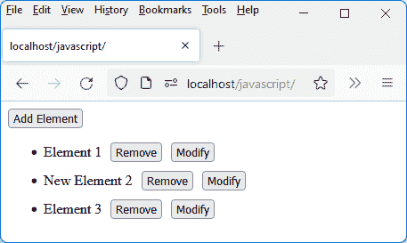

我们必须使用一种能够确保输入字段已创建的方法。组件中编写的模板必须转换为 HTML 代码并集成到浏览器的内存（DOM）中，然后才能进行显示。因此，我们看到发生了一个转换过程，该过程需要一些时间来执行。

Vue.js 定义了许多方法，这些方法在使用组件时会自动调用。在上一章中，我们看到了一个名为 `created()` 的方法。还有其他方法，特别是 `mounted()` 和 `updated()` 方法。

以下是这三个方法的具体说明：

- `created()` 方法在创建组件时被调用。这是第一个被调用的方法。
- `mounted()` 方法在组件转换为 HTML 元素并集成到 DOM 时被调用。因此，我们可以在此方法中使用 DOM API 访问 HTML 元素。
- `updated()` 方法在组件进行修改时被调用。例如，当点击**修改**按钮后，`<span>` 元素替换为 `<input>` 元素。或者反之，当 `<input>` 元素变回 `<span>` 元素时（离开输入字段时）。

我们看到 `updated()` 方法是可以在其中处理输入字段聚焦逻辑的方法。但由于该方法在转换为输入字段或简单文本时都会调用，因此有必要检查与 `ref` 属性引用的 `<input>` 元素是否存在。否则，控制台中将出现可见的错误：

#### 在输入字段出现时立即获取焦点 (element.js)

```javascript
const Element = {
  data() {
    return {
      input: false
    }
  },
  template: `
    <li>
      <span v-if="!input">{{text}}</span>
      <input v-else type="text" :value="text" @blur="modify($event)" ref="refInput" />
      <button @click="remove()"> Remove </button>
      <button @click="input=true"> Modify </button>
    </li>
  `,
  props: ["text", "index"],
  methods: {
    remove() {
      // 处理对 Remove 按钮的点击
      this.$emit("remove", { index: this.index });
    },
    modify(event) {
      var value = event.target.value;
      this.input = false;
      this.$emit("modify", { index: this.index, value: value });
    }
  },
  emits: ["remove", "modify"],
  updated() {
    // 检查 ref="refInput" 属性是否存在，
    // 如果存在，则赋予输入字段焦点
    if (this.$refs.refInput) this.$refs.refInput.focus();
  }
}
export default Element;
```

在模板中使用 `ref` 属性时，Vue.js 将其存储在组件内部的 `$refs` 变量中。因此，如果在组件模板中写了 `ref="refInput"`，我们就可以通过 `this.$refs.refInput` 访问对应的 HTML 元素。

让我们检查（见下图）在点击**修改**按钮时，编辑控件是否直接获取了焦点。

图 5.15 - 输入字段直接获取焦点

本章到此结束。

# 总结

本章及其其中讨论的示例表明，在不离开页面的情况下交互式地管理 HTML 元素是非常简单的。在这里，我们首先将应用程序分解为不同的组件，然后将它们组合起来，通过事件和 `props` 属性让它们通信。得益于这个完整的示例，我们学习了如何管理元素列表以执行主要操作，即插入、修改和删除元素。

在接下来的几章中，我们将看到如何使用 Node.js 将我们的应用程序连接到 MongoDB 数据库，从而能够在数据库中存储列表元素。我们将从下一章开始学习如何与 node.js 模块工作。

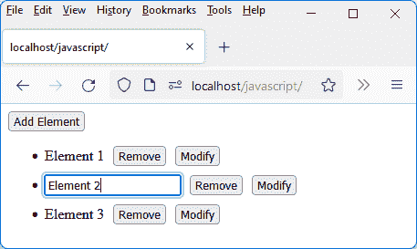

---

# 第 3 部分：服务器端 JavaScript

这部分关于在 Node.js 服务器中使用 JavaScript。它解释了此类模块的使用，例如 Express（用于使用 MVC 模式快速创建基于 Node.js 的 Web 应用）和 MongoDB 数据库。

我们通过构建一个单页应用程序（这种原则称为单页应用，SPA）来结束学习，该应用在客户端使用 Vue.js 编写，在服务器端使用 Node.js、Express 和 MongoDB。本书的目的是让你学会如何制作此类应用程序。

本节包含以下章节：

- 第 6 章，创建和使用 Node.js 模块
- 第 7 章，在 Node.js 中使用 Express
- 第 8 章，在 Node.js 中使用 MongoDB
- 第 9 章，将 Vue.js 与 Node.js 集成

---

# 6 创建和使用 Node.js 模块

模块是 Node.js 的核心。它们对应于 JavaScript 文件，并可以在我们的应用程序中使用。Node.js 有三种模块：

- 我们自己编写的模块
- Node.js 内部模块
- 可以使用 npm 从互联网下载的模块（npm 意为 Node 包管理器）。

在本章中，我们将学习如何创建和使用这些类型的模块。无论模块类型如何，`require(moduleName)` 指令都允许我们从内存中加载 `moduleName` 模块。

本章涵盖了以下主题：

- 使用我们自己的模块
- 使用 Node.js 内部模块
- 使用 npm 下载的模块

## 技术要求

你可以在此处找到本章的代码：https://github.com/PacktPublishing/JavaScript-from-Frontend-to-Backend/Chapter6.zip

## 使用我们自己的模块

在这个示例中，我们使用两个模块，每个对应一个文件：第一个模块（此处命名为 `test.js`）是我们使用 `node` 命令执行的主文件。第二个模块（此处命名为 `module1.js`）是我们想在主模块 `test.js` 中使用的模块。

让我们开始创建这些模块。

### 创建模块

以下是两个文件 `module1.js` 和 `test.js` 的内容：

#### module1.js

```javascript
console.log("module1.js is loaded");
```

该模块目前有一个简单的 `console.log()` 语句。该模块将被增强。主模块 `test.js` 如下：

#### test.js

```javascript
var mod1 = require("./module1.js");
// 或者 require("./module1") 而不指定 .js 扩展名
console.log("mod1 =", mod1);
```


# 创建和使用 Node.js 模块

在这里，我们使用 `require(moduleName)` 指令，它允许我们从内存中加载 `moduleName` 模块。对 `moduleName` 模块功能的使用都需要先执行 `require(moduleName)` 指令。`require(moduleName)` 指令返回加载到内存中的引用。该引用存储在变量中（此处为 `mod1`），随后允许访问模块描述的功能（目前为空）。

`test.js` 文件是加载其他模块的主文件。因此，我们执行的是这个 `test.js` 文件。

**图 6.1 使用 require(module) 使用模块**

我们在这里看到 `test.js` 模块的执行触发了 `require("./module1.js")` 调用，这执行了 `module1.js` 文件的内容，因此显示了 `module1.js` 模块中 `console.log()` 语句指定的文本。

在加载 `module1.js` 后，`mod1` 变量被初始化，我们将能够访问稍后导出的功能。

在为 `module1.js` 模块添加功能之前，让我们看看如何使用 `node_modules` 目录来管理模块的位置。`node_modules` 目录被 Node.js 用于查找它没有路径的模块。使用此目录简化了在使用 `require(moduleName)` 指令加载模块到内存时对模块名称的编写。

## 使用 node_modules 目录

注意，之前的 `require(moduleName)` 语句需要指定模块的访问路径，例如使用 `./` 来表示当前目录。然而，如果模块在 `node_modules` 目录中，则不需要指定路径，因为我们确定模块在 `node_modules` 目录内部（而且，它*不应该*被指定）。`node_modules` 目录可以在主应用程序目录中（称为*本地* node_modules 目录），也可以位于 Node.js 创建的专用目录中（称为*全局* node_modules 目录：在这种情况下，它会在安装 Node.js 时自动创建）。

> **注意**
>
> 如果在 `node_modules` 目录（本地或全局）中未找到模块，且未指定模块的访问路径，则在使用 `require(moduleName)` 指令加载模块时发生错误。

现在，我们将在主文件 `test.js` 所在的当前目录下创建一个 `node_modules` 目录。将 `module1.js` 文件转移到该目录，并使用 `require("module1.js")` 语句而不指定模块路径。

你也可以编写 `require("module1")` 而不指定 JavaScript 文件的扩展名：

**包含 node_modules 目录中的 module1（test.js 文件）**

```javascript
var mod1 = require("module1.js"); // or require("module1")

console.log("mod1 =", mod1);
```

`module1.js` 文件必须位于本地创建的 `node_modules` 目录中，而 `test.js` 文件保留在当前目录，如下所示：

```text
root/
| node_modules/
| | module1.js
| | test.js
```

**图 6.2 从 node_modules 目录加载模块**

我们可以看到 Node.js 确实找到了该模块，因为 Node.js 在当前目录下创建的 `node_modules` 目录中查找它。

现在让我们看看如何使用与模块关联的 `package.json` 文件允许模块的文件分组在目录中。

## 使用 PACKAGE.JSON 文件

`node_modules` 目录（无论位于应用程序目录还是 Node.js 安装目录）可能包含很多文件，有时一个模块由许多文件和目录组成。将模块与 `node_modules` 目录中的一个目录关联会更简单。

在 `node_modules` 目录内部创建一个 `module1` 目录。`module1` 目录包含 `module1.js` 文件，但也可能包含与该模块相关的其他文件和目录。

文件系统显示：

```text
root/
| node_modules/
| | module1/
| | module1.js
| | test.js
```

> **注意**
>
> `require(moduleName)` 语句中指定的 `moduleName` 在这种情况下代表包含模块文件的*目录*名称。

但由于在加载模块时需要知道先使用目录中的哪个文件（因为目录中可能有很多文件），因此我们在 `package.json` 文件的 `"main"` 键中指定这种对应关系。

`package.json` 文件是一个 JSON 格式的文本文件，位于每个 Node.js 模块的目录下。

现在，我们将在 `module1` 模块目录中创建 `package.json` 文件，并在文件中指定 `"main"` 键值为 `"module1.js"`。

文件系统如下：

```text
root/
| node_modules/
| | module1/
| | module1.js
| | package.json
| | test.js
```

**node_modules/module1 目录中的 package.json 文件（package.json 文件）**

```json
{
  "main" : "module1.js"
}
```

我们在 `"main"` 键中指定在执行 `require("module1")` 指令必须加载 `module1.js` 文件：

**包含 node_modules/module1 目录中的 module1（test.js 文件）**

```javascript
var mod1 = require("module1"); // "module1" 是目录名

console.log("mod1 =", mod1);
```

> **注意**
>
> 请注意，在此情况下 `require("module1")` 语句中的模块名是 `node_modules` 目录中包含模块的目录名称。因此，我们不能以 `require("module1.js")` 的形式编写此处的指令，否则会导致错误。

**图 6.3 使用 package.json 文件加载模块**

如果主模块文件命名为 `index.js`，则 `package.json` 文件中的 `"main"` 键是可选的。在所有其他情况下，必须在 `package.json` 中指定 `"main"` 键。

我们知道如何运行模块，但目前模块包含一个简单的 `console.log()` 语句。让我们看看如何为模块添加功能然后使用它们。

## 为模块添加功能

新创建的 `module1.js` 模块是可以访问的，但目前没有任何功能。让我们看看如何添加一些。

### 在模块中导出多个函数

例如，让我们创建一个函数 `add(a, b)`，它返回 a 和 b 的和：

**module1.js 中定义的 add(a, b) 函数（module1.js 文件）**

```javascript
console.log("module1 is loaded");

function add(a, b) {
  return a+b;
}

module.exports = {
  add : add // 让 add() 函数在模块外可访问
};
```

## 创建和使用我们自己的模块

> **注意**
>
> 在 `module.exports` 对象中，按此顺序赋值非常重要（先定义主函数 `rest`，然后是辅助函数）。如果你以相反的方向赋值（先 `module.exports.mult`，后 `module.exports`），那么最后赋值的 `module.exports` 将删除已经置于 `module.exports.mult` 中的值。
>
> 此外，我们不能再将 `module.exports` 赋值为一个对象了，因为如果我们写 `module.exports = { mult : mult }`，这将移除之前赋值的值。

我们现在按照如下方式使用该模块：

**使用带有主函数的 module1.js 模块 (test.js)**

```javascript
var mod1 = require("module1");

console.log("mod1 =", mod1);

var total = mod1(2, 3); // 替用 mod1.add(2, 3)

console.log("mod1(2, 3) = ", total);

var total = mod1.mult(2, 3);

console.log("mod1.mult(2, 3) = ", total);
```

得到的显示如下：

**图 6.6 使用带有主函数的模块**

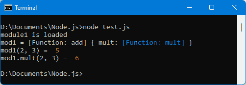

> **注意**
>
> 注意，我们现在不再将 `mod1` 变量当作对象使用，而是将其作为函数使用。在调用 `mod1(a, b)` 时会导致 a 和 b 的相加，因此在 `require(moduleName)` 指令中，变量命名为 "add" 而不是 "mod1" 会更好。

我们已经看到了如何创建和使用自己的模块。现在，让我们来看看如何使用 Node.js 内部模块。

### 使用内部 Node.js 模块

Node.js 已经内置了模块。它们同样可以使用之前看到的 `require(moduleName)` 指令来调用。

让我们来看一个内部模块示例。例如，Node.js 系统中的 "fs" 模块。"fs" 是 `file system`（文件系统）的缩写。该模块允许你与 Node.js 的内部文件系统进行交互。

现在，我们将使用 "fs" 模块读取文件内容。

#### 读取文件内容

让我们使用 "fs" 模块读取位于当前目录（即 `test.js` 文件所在目录）名为 `file1.txt` 的文件。该文件的内容如下：

**file1.txt（位于 test.js 目录下）**

这是位于当前目录的文件 file1.txt 的内容。

使用 "fs" 模块并显示内容的程序如下：

**读取并显示文件内容 (test.js)**

```javascript
var fs = require("fs");

var data = fs.readFileSync("file1.txt");

console.log("File content:");
console.log(data);
```

我们使用了 "fs" 模块中定义的 `readFileSync()` 方法。它将文件内容返回到相应的变量中，然后进行显示。

**图 6.7 使用 "fs" 模块显示文件内容**

文件内容已显示，但是以十六进制字符的形式的。接下来，让我们以字符串显示文件内容。

#### 以字符串读取文件内容

文件内容以字节缓冲区的形式显示（参见*图 6.7*）。Node.js 能够处理字节流。通过在 `readFileSync(name, options)` 方法的第二个参数（options）中指定 `{encoding: "utf-8"}` 选项，可以直接以字符串查看文件内容：

**以字符串显示文件内容 (test.js)**

```javascript
var fs = require("fs");

var data = fs.readFileSync("file1.txt", { encoding : "utf-8" });

console.log("File content:");
console.log(data);
```

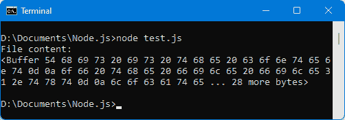

结果现在以字符串形式显示（见下图）：

**图 6.8 以字符串显示文件内容**

文件内容已显示。然而，程序会等待文件内容读取后才进行显示。通过使用 `readFile()` 方法代替 `readFileSync()` 方法，可以在等待文件时不阻塞程序。

#### 使用非阻塞读取

如果你观察之前的 `readFileSync()` 方法，你会发现文件内容是在方法调用返回时渲染的。这意味着程序在等待文件时是阻塞的。

## 使用 npm 下载的模块

作为一个示例，让我们在 test.js 目录下创建以下 package.json：

**package.json（与 test.js 在同一目录）**

```json
{
  "scripts": {
    "start": "node test.js"
  }
}
```

然后使用 `npm start` 命令启动程序：

**图 6.10 使用 npm start 启动 Node.js 应用程序**

我们可以看到，`npm start` 命令使得执行 test.js 程序成为可能。得益于上述解释的机制，`npm start` 命令通常被用于启动 Node.js 程序。

现在让我们看看如何通过 npm 下载并使用其他开发者编写的模块。

### 使用 npm 下载的模块

让我们来看一个使用 npm 的示例。在这里，我们将使用 npm 安装名为 `colors` 的模块。它允许你在控制台中显示彩色文本。

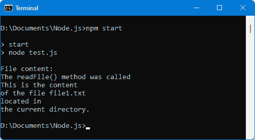

#### 在 node_modules 本地目录安装 colors 模块

我们使用命令 `npm install colors`。安装“colors”模块的结果如如下所示。

**图 6.11 使用 npm 安装 colors 模块**

一旦模块被 npm 安装，你就可以看到模块的 `colors` 目录已插入到应用程序的 `node_modules` 本地目录。

#### 使用 colors 模块的功能

概述模块所提供功能的一种方法是显示由 `require(moduleName)` 指令返回的对象的内容：

**显示 require("colors") 返回的 colors 对象的内容 (test.js)**

```javascript
var colors = require("colors");
console.log("colors = ", colors);
```

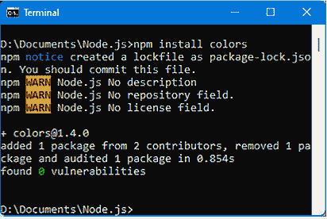

**图 6.12 显示 colors 模块的内容**

例如，让我们使用模块中列出的最后一种方法，即 `random()` 方法。它允许你将字符字符串转换为每个字符都具有随机颜色的字符串：

**使用 colors 模块的 random() 方法 (test.js)**

```javascript
var colors = require("colors");
console.log(colors.random("First text in random colors"));
console.log(colors.random("Second text in random colors"));
```

> **注意**
>
> 使用 `random()` 方法是通过在其名称前加上由 `require("colors")` 返回的变量名称来实现的，即模块名称。

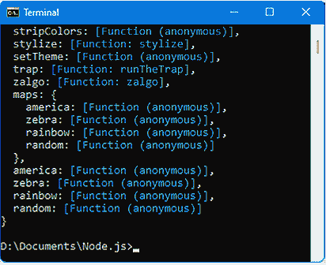

得到的显示如下，其中显示的每个字符都是随机颜色：

**图 6.13 使用 colors 模块**

我们在这里看到了用于 Node.js 的三种类型的模块：

- 我们自己编写的、用于满足我们需求的模块
- Node.js 现有的内部模块，例如 `fs` 模块允许访问 Node.js 内部文件系统
- 可以使用 npm 命令下载的模块，例如上面使用的 `colors` 模块

剩下的就是在我们的程序中使用这些不同类型的模块。我们将在稍后讨论这一点。

这标志着我们本章的结束。

## 总结

在本章中，我们学习了如何使用 Node.js 创建和使用模块，这些是使用 Node.js 创建程序的核心组件。

无论模块是由我们创建的、Node.js 内部模块，还是通过 npm 下载的模块，其用法在所有情况下都是相同的。我们使用 `require(moduleName)` 指令，并通过变量中返回的值访问模块的功能。

接下来，我们将学习 Express 模块，它是 Node.js 使用的主要模块之一，允许我们根据目前广泛使用的 MVC 模型规则轻松地构建我们的应用程序。

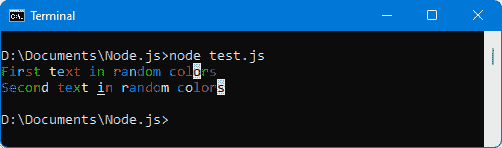

# 在 Node.js 中使用 Express

我们在上一章中看到，Node.js 服务器程序是不同模块的组合。Node.js 开发者创建了许多模块，可以使用 npm 工具将这些模块插入到我们的程序中（参见*第 6 节*，*创建和使用 Node.js 模块*）。其中一个模块被称为 **Express**。它是 Node.js 最常用的模块之一，因为它允许你根据**模型-视图-控制器** (**MVC**) 模型来构建服务器程序。

在本章中，我们将学习如何使用 Express 模块在遵循 MVC 模型特征的同时创建一个 Node.js 应用程序。

我们将将涵盖的主题有：

- 使用 Node.js http 模块
- 安装 Express 模块
- 在 Express中使用路由
- 使用 Express 显示视图
- 在 Node.js 中使用 Express

## 技术要求

你可以在此处找到本章的代码：https://github.com/Publishing/JavaScript-from-Backend/Chapter7.zip。

### 使用 Node.js http 模块

`http` 模块是 Node.js 的内部模块。通过它，我们可以创建一个基于 HTTP 的 Web 服务器。要创建一个基于 HTTP 的服务器，我们使用 `createServer(callback)` 方法。作为参数指定的调函数形式为 `callback(req, res)`，其中 `req` 请求，`res` 响应。

> **注意**
>
> `createServer()` 返回一个对象（此处通过变量 `server` 使用），我们在其上等待来自端口 3000 的请求（由 `server.listen(port)` 方法指定）。这意味着每当通过浏览器访问 `http://localhost:3000` 这样的 URL 时，之前启动的程序（通过 `node test.js` 命令）就会被激活并显示结果。

### 使用 http 模块创建 Web 服务器 (test.js)

```javascript
var http = require("http");
var server = http.createServer(function(req, res) {
  // 在控制台中显示接收到的请求
  console.log("Request received:", req.url);

  // 指定响应为 utf-8 HTML
  res.setHeader("Content-type", "text/html; charset=utf8");

  // 无论请求如何，我们都发送相同的响应
  res.write("<h1>");
  res.write("Good morning all");
  res.write("</h1>");

  // 完成响应
  res.end();
});

// 让服务器监听端口 3000（示例）
server.listen(3000);
console.log("\n服务器已在端口 3000 启动\n");
console.log("可以在此处发起请求：");
console.log("http://localhost:3000");
```

> **注意**
>
> `server.listen(port)` 方法的使用是强制的，因为仅通过 `http.createServer()` 创建服务器是不够的。服务器还必须监听（通过 `server.listen(port)`）指向它的 HTTP 请求（此处使用 `http://localhost:3000` 等 URL）。此处使用了端口 3000，但可以使用其他端口号（前提是该端口未被其他服务器占用，否则会导致无法确定端口请求发送到哪个服务器的冲突）。

使用 `res.write(string)` 指令向浏览器发送响应。你必须使用 `res.end()` 指令完成响应发送，这意味着浏览器已接收到所有显示元素（服务器等待接收 `res.end()` 指令以显示所有发送的元素）。

> **注意**
>
> `res.setHeader()` 方法用于设置 HTTP 标头字段。在这里，“Content-type”被设置为值“text/html;charset=utf-8”。

让我们通过输入命令 `node test.js` 来启动之前的程序。该程序将显示一条消息，然后等待来自 3000 端口的 HTTP 请求：

**图 7.1 等待在端口 3000 上的 HTTP 服务器**

若要测试该程序，请在浏览器中显示以 `http://localhost:3000` 开头的 URL。当 HTTP 请求使用 3000 端口（服务器监听的端口）时，`createServer(callback)` 方法中指定的回调函数会被激活，然后将响应发送到浏览器。

让我们在浏览器中输入 URL `http://localhost:3000`（见下图）：

**图 7.2 在浏览器中查看 URL `http://localhost:3000`**

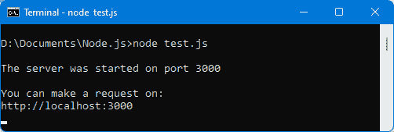 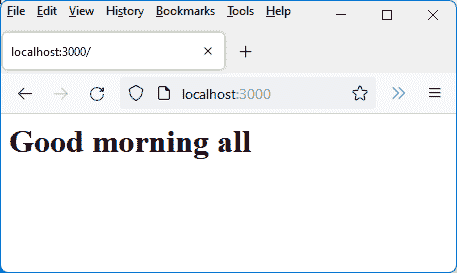

### 安装 Express 模块

由于 Express 模块是使用 npm 安装的，因此我们输入 `npm install express` 命令来安装它。

**图 7.3 使用 npm 安装 Express 模块**

Express 模块现在已安装。

> **注意**
>
> 一个与 Express 相关的工具对于创建我们 Web 应用程序架构也非常有用。这就是“express-generator”模块（该模块之前包含在 Express 中，但现在已与它分离，因此在这里上传它）。

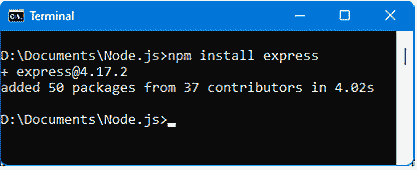

让我们使用 `npm install express-generator -g` 命令安装“express-generator”模块。我们使用 `-g` 选项是为了在该模块中定义的 `express` 命令可以在任何目录下访问。

**图 7.4 使用 npm 安装“express-generator”模块**

> **注意**
>
> 你可以通过输入命令 `express -h` 来验证安装是否正确。如果模块安装安装正确，窗口中将显示 `express` 命令的帮助信息（否则将显示错误）。

一旦安装了这两个模块，你就可以基于 Express 创建一个新的 Web 应用程序。

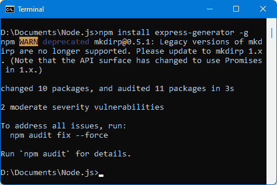

要执行此操作，输入 `express apptest` 命令来创建一个名为 `apptest` 的应用程序。你应该看到以下结果：

**图 7.5 使用 Express 创建 apptest 应用程序**

此命令创建了一个 `apptest` 目录，其中包含运行应用程序的基本文件。然后你必须输入显示末尾指定的三个命令：`cd apptest`、`npm install` 和 `npm start`。

输入这些命令后，打开浏览器并显示 URL `http://localhost:3000`。

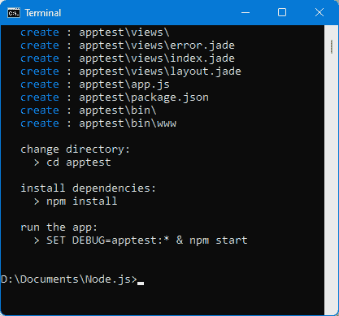

这就是你将看到的：

**图 7.6 使用 Express 创建的默认应用首页**

如果我们查看 `apptest` 目录中创建的应用程序源码，我们可以看到 `app.js` 和 `package.json` 文件，以及 `bin`、`node_modules`、`public`、`routes` 和 `views` 目录。这些目录描述了 Express 使用的 MVC 架构，我们将在下文中解释。

#### Express 使用的 MVC 模式

MVC 模型是一种应用程序架构模型，允许将应用程序拆分为不同的部分：模型（models）、视图（views）和控制器（controller）：

- 模型（Models）对应于应用程序处理的数据。通常，这些是来自数据库的数据。Node.js 与 MongoDB 数据库紧密相关，将在下一章中探讨。
- 视图（Views）对应于数据的可视化，例如输入表单和显示的列表。每个显示项对应于应用程序 `views` 目录下的一个视图。
- 控制器（controller）允许根据数据在不同的视图之间导航。为了实现这一点，我们使用路由（实际上是 URL）来指示要执行的操作。

`routes` 目录描述了应用程序使用的路由（以及对每个路由执行的操作）。

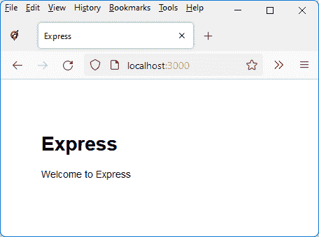

因此，我们可以看到 MVC 模型使得处理、显示和分离成为可能。

### 使用路由

要理解路由在 Express 中是如何工作的，打开位于主目录下的 `app.js`，你将看到它的内容：


```javascript
var express = require('express');
var path = require('path');
var logger = require('morgan');
var cookieParser = require('cookie-parser');
var bodyParser = require('body-parser');
var createError = require('./errors');

var indexRouter = require('./routes/index');
var usersRouter = require('./routes/users');

var app = express();

app.use(logger('dev'));
app.use(express.json());
app.use(express.urlencoded({ extended: false }));
app.use(cookieParser());
app.use(express.static(path.join(__dirname, 'public')));

app.use('/', indexRouter);
app.use('/users', usersRouter);

// 404 转发到错误处理器
app.use(function(req, next) {
  next(createError(404));
});

// 错误处理器
app.use(function(err, req, res, next) {
  // 设置本地变量，仅在开发环境中显示
  res.locals.message = err.message;
  res.locals.error = app.get('env') === 'development' ? err : {};

  // 渲染错误页面
  res.status(err.status || 500);
  res.render('error');
});

module.exports = app;
```

在 `app` 对象上，`use()` 方法被多次调用，这使得为服务器上的每个请求添加处理变得可能。例如，`app.use(logger('dev'))` 会为服务器上的每个请求触发 `logger()` 函数。这就是为什么服务器控制台会显示浏览器中请求的 URL。

## 在 Express 中使用路由

通过在浏览器中显示 `http://localhost:3000` 和 `http://localhost:3000/users`，我们在服务器控制台中获得了以下内容：

图 7.7 - 控制台中的 URL 显示

现在，让我们看看服务器控制台中显示的行的含义。

### 可能的路由类型

在之前的图中，你会注意到每个 URL 前面都有 `GET` 字样：`GET /`, `GET /users`。

`GET` 意味着 `/` 或 `/users` 是通过 GET 类型的 HTTP 请求访问的。GET 类型是在当访问的 URL 显示在浏览器地址栏中时使用的类型，例如当你直接输入它或点击页面上的链接时。

> **注意**
>
> 存在其他类型的 HTTP 请求。它们允许不在浏览器的地址栏中显示相应的 URL，从而向用户隐藏它。例如，如果从数据库删除记录的 URL 在浏览器的地址栏中可见，那么只需刷新页面即可继续从数据库中删除记录。因此，对允许隐藏当前 URL 的其他 HTTP 请求类型感兴趣。

其他类型的 HTTP 请求（GET 之外）主要是 PUT、POST 和 DELETE 类型请求。这些类型的请求在程序中用于表示对一个或多个数据单元（称为资源）执行要执行的操作：

- GET 表示读取资源。
- POST 表示创建资源。
- PUT 表示更新资源。
- DELETE 表示删除资源。

尽管存在多种类型的 HTTP 请求，但这些是主要的类型。它们被用于操作资源，允许对资源进行创建 (POST)、更新 (PUT)、删除 (DELETE) 和读取 (GET)。

> **注意**
>
> 路由（Route）是 HTTP 请求与 URL 的关联。例如，`GET /users` 路由将 `/users` URL 与 HTTP GET 请求关联，而 `DELETE /users` 路由则将相同的 `/users` URL 与 HTTP DELETE 请求关联。尽管这些路由使用了相同的 URL，但由于 HTTP 请求不同，它们是不同的路由。

现在，既然我们已经了解了所使用的不同类型的 HTTP 请求，让我们来看看 Express 内部是如何使用它们的。

## APP.JS 文件中定义的路由

`app.use()` 方法也用于定义新路由，即为每个每个使用的新 URL（带有关联的请求类型）定义将要执行的处理。

`app.use(url, callback)` 方法用于定义当指定的 URL 被激活时要执行的处理。由于此处没有指示请求类型，所有类型的请求都将激活回调函数中指示的处理。要指示请求类型，你必须使用类似于 `app.use()` 的方法。这些是 `app.get()`、`app.put()`、`app.post()` 和 `app.delete()` 方法。

> **注意**
>
> 形式为 `callback(req, res, next)` 的回调函数返回给浏览器的响应。`next()` 参数对应一个函数，如果处理在下一个回调函数中继续，则在回调结束时调用它（如果要执行的处理由多个回调函数处理）。

app.js 中定义的路由是 `/` 和 `/users`，因此运行与这些路由相关的进程成为可能。这些路由是示例，展示了如何在 app.js 文件中实现路由。处理指令在 `indexRouter` 和 `users` 函数中定义。这些函数是在返回 `require('./routes/index')` 和 `require('./routes/users')` 指令时使用的变量。因此，路由的处理是在 routes 目录中定义的 index.js 和 users.js 文件中完成的。

打开这两个文件并分析它们的内容：

### index.js 文件 (routes 目录)

```javascript
var express = require('express');

var router = express.Router();

/* GET 首页。 */
router.get('/', function(req, res, next) {
  res.render('index', { title: 'Express' });
});

module.exports = router;
```

### users.js 文件 (routes 目录)

```javascript
var express = require('express');

var router = express.Router();

/* GET 用户列表。 */
router.get('/', function(req, res, next) {
  res.send('respond with a resource');
});

module.exports = router;
```

这些文件中的每一个都使用了 `router.get(url, callback)` 方法，这意味着路由与 **GET** 类型请求关联。给定的 URL 是 `/`（它将与 app.js 文件中提供的 URL 拼接），随后是形式为 `callback(req, res, next)` 的回调函数。`next` 参数对应一个函数，如果处理必须在随后的回调函数中继续（如果存在这样的函数，但此处没有），则调用该函数。

每个回调函数中执行的处理由发送响应组成，响应将在浏览器中显示。在这里，我们使用 `res.send()` 和 `res.render()` 方法，它们允许发送响应：

- `res.send()` 方法类似于 `res.end()`（在 Node.js 的 "http" 模块中定义），但它允许你指示正在使用 HTML 和 **utf-8** 字符。过程中只能调用一次 `res.send()` 方法，否则会发生错误。
- `res.render()` 方法允许显示外部文件（称为视图 view）。视图使用特殊的语言编写，该语言取决于视图的格式。默认情况下，Express 使用的视图是 JADE 文件，但可以使用其他格式。

在这里，`res.render()` 方法显示的视图对应于 views 目录下的 `index.jade` 文件。其内容如下：

### index.jade 文件 (views 目录)

```jade
extends layout

block content
  h1= title
  p Welcome to #{title}
```

该文件使用一种特定的语法，称为 JADE 编写。该文件在发送到浏览器（浏览器只能解释 HTML）之前，会被 Express 转换为 HTML 代码。

> **注意**
>
> Express 允许使用多种语法编写视图。最常见的是 **JADE** 和 **EJS**。我们将在*使用 Express 显示视图*章节中探索 JADE 语法。

Express 的功能之一是允许使用所需的语法创建视图。Express 以标准形式提供 JADE 语法，但可以通过 npm 添加其他语法的支持库。

因此，JADE 语法是 Express 默认使用的语法。它使得可以将 HTML 标签替换为它们的标签名（例如 `<h1>` 直接变为 `h1`），并且代码中标签的缩进使得指定它们的嵌套成为可能。不再需要关闭之前打开的标签，因为缩进允许你看到标签的嵌套情况。

让我们使用 JADE 来显示之前的客户端列表。我们在 views 目录中创建 `clients.jade` 视图，并在 `clients.js` 中指定访问 GET /clients 路由时显示此视图：

### clients.js 文件 (routes 目录)

```javascript
var express = require('express');

var router = express.Router();

router.get('/', function(req, res, next) {
  res.render("clients"); // 显示 clients.jade 视图
  // (.jade 扩展默认是
  // 用的)
});

module.exports = router;
```

> **注意**
>
> 请注意，如果你没有指定视图的扩展名（例如通过写入 `res.render("clients")`），则使用的扩展名将是 `app.js` 中 `app.set('view engine', 'jade')` 指令所指定的。
>
> 相反，如果你为视图文件指定了扩展名，那么即使它与 `app.js` 中配置的不同，也将使用该扩展名来显示视图。

`clients.jade` 视图如下：

### clients.jade (views 目录)

```jade
h1 Client list

ul
  li Bill Clinton
  li Barack Obama
  li Joe Biden
```

注意标签的缩进。`ul` 标签与 `h1` 标签处于同一级，否则，它将被视为包含在 `h1` 标签内。`li` 标签向右移动，以显示它们包含在之前的 `ul` 标签中。偏移量至少为一个字符。由于存在偏移，我们不使用像 HTML 那样的闭合标签。

让我们使用 `npm start` 重启服务器，因为其中一个路由文件被修改了。

> **注意**
>
> 与视图相关文件的编辑不需要重启服务器，`app.js` 文件和与路由相关的文件（在 `routes` 目录下）不同。

一旦服务器重启，让我们再次显示 URL http://localhost:3000：

图 7.9 - 使用 JADE 语法显示的视图

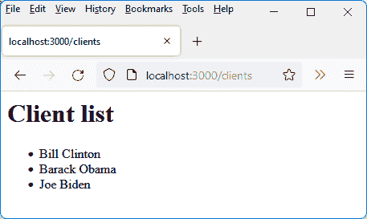

在本例中，客户列表直接输入到 JADE 视图中。更好的做法是使用 `res.render(name, obj)` 方法的第二个参数将其作为参数传递。`clients.js` 文件将变为如下：

### clients.js (routes 目录)

```javascript
var express = require('express');

var router = express.Router();

router.get('/', function(req, res, next) {
  res.render("clients", {
    clients: [
      { firstname: "Bill", lastname: "Clinton" },
      { firstname: "Barack", lastname: "Obama" },
      { firstname: "Joe", lastname: "Biden" },
    ]
  });
});

module.exports = router;
```

`res.render("clients", obj)` 方法的 `obj` 参数是一个包含客户列表的对象。

`clients.jade` 视图如下所示使用此传递的对象：

### clients.jade (views 目录)

```jade
h1 Client list

ul
  li #{clients[0].lastname + " " + clients[0].firstname}
  li #{clients[1].lastname + " " + clients[1].firstname}
  li #{clients[2].lastname + " " + clients[2].firstname}
```

传递的参数 `obj` 对象在 JADE 视图中使用，通过此处的 `clients` 属性来实现。

### JADE 语法

可以通过 `#{` 和 `}` 包裹 JavaScript 语句，在 JADE 视图中使用它们。这两个标记之间的任何内容都将被视为 JavaScript 代码。

你还可以使用 JADE 允许的简化语法，通过在每个 `li` 标签后直接编写 `=` 号。这意味着该行后续的所有内容都必须被解释为 JavaScript。我们可以在这里使用这种简化写法。

让我们编写 `clients.jade` 视图如下：

### clients.jade (views 目录)

```jade
h1 Client list

ul
  li= clients[0].lastname + " " + clients[0].firstname
  li= clients[1].lastname + " " + clients[1].firstname
  li= clients[2].lastname + " " + clients[2].firstname
```

与其在视图中列出 `clients` 数组的每个元素，你还可以使用 JADE 语法的 `each` 语句对 JavaScript 数组进行循环。因此，`clients.jade` 视图变为：

### clients.jade (views 目录)

```jade
h1 Client list

ul
  each client in clients
    li= client.lastname + " " + client.firstname
```

> **总结**
>
> 视图的编写被了，但你真的必须考虑行的缩进，否则视图将无法显示。

图 7.10 - 使用 `each` 语句显示的客户列表

我们在这个例子中看到，JADE 语法使得在应用程序视图中显示数据列表变得简单。

到此，我们到达本章的结束。

## 总结

Express 模块通过允许（得益于它使用的 MVC 模型）你分离路由管理、显示的视图和数据管理，让你能够高效地构建应用程序。

我们解释了如何使用 Express 默认提供的 JADE 语法编写应用程序的视图。其他语法，例如 EJS 语法，也可以通过 npm 下载使用。

我们还看到了 Express 创建的 `app.js` 文件的重要性以及 HTTP 请求（如 **GET**、**POST**、**PUT** 和 **DELETE**）的使用。我们将在*第 9 章：Vue.js 与 Node.js 的集成*中看到这些 HTTP 请求对于构建 MEVN 应用（MongoDB、Express、Vue.js、Node.js 的缩写）以操作 MongoDB 数据库的重要性。

事实上，数据管理通常使用 **MongoDB** 数据库完成，我们将在下一章探索它的使用。


# 8 在 Node.js 中使用 MongoDB

**MongoDB** 允许你访问与 Node.js 关联的数据库，它是一个文档类型的数据库，包含了*文档*。

## 安装 MongoDB

After installing MongoDB, we will look into the mongo (or mongosh) utility.

The mongo utility makes it easy to see contents of databases, without having to write program lines. It is therefore useful for checking, for example, whether a document has been inserted into a collection, or its deletion has been successful. Let's see how to use the mongo utility.

### Using the mongo utility

The mongo utility enables you to easily view databases and the collections they contain.

The mongo utility is launched by simply typing the `mongo` command in a interpreter. The program then waits for database access commands, or the exit command to exit.

Here is the list of the main commands available in the mongo utility:

- `show dbs`: shows a list of existing databases. A database will be visible here if it contains at least one collection.
- `db=connect("mydb_test")`: is to connect to the database mydb_test. The db variable will then be used to access the database collections.
- `show collections`: shows the collections of the connected database. A collection will be present if it contains at least one document.
- `db.clients.find()`: shows all documents in the collection.
- `db.clients.find({name:"Clinton"})`: lists documents in the clients collection whose name is Clinton.
- `db.clients.find().sort({name:1})`: sorts documents in ascending order of the name field. Use `{name:-1}` for descending sort.
- `db.clients.count()`: counts the number of documents found in the clients collection.
- `db.clients.renameCollection("clients2")`: renames the clients collection to clients2.
- `db.clients.drop()`: drops the clients collection (all documents are dropped).
- `db.dropDatabase()`: drops the connected database (all collections are removed).

## 安装 mongoose 模块

为了建立 MongoDB 和 Node.js 之间的关系，创建了几个 npm 模块。目前最广泛使用的是的是 mongoose 模块。它通过输入 `npm install mongoose` 命令，被安装在当前目录的 `node_modules` 目录中。

图 8.1 - 安装 mongoose 模块

一旦 npm 下载了 mongoose，我们就可以检查我们的程序是否可以访问它。让我们为程序显示 mongoose 的版本。我们在 `test.js` 中编写这段代码：

### 显示 mongoose 版本 (test.js 文件)

```javascript
var mongoose = require("mongoose");

console.log("mongoose version =", mongoose.version);
```

让我们使用 `node test.js` 命令运行上一个的程序：

图 8.2 - 检查 mongoose 是否可访问

> **警告**
>
> 如果你在加载 mongoose 模块时遇到错误，可能是因为你将其全局安装了（使用了 `-g` 选项）。在这种情况下，只需在终端中输入 `npm link mongoose` 命令即可消除错误。

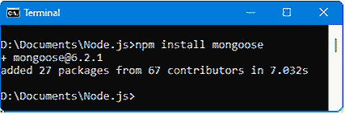 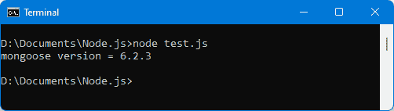

## 连接 MongoDB 数据库

mongoose 模块允许我们使用 MongoDB 数据库创建文档、搜索文档、更新或删除文档。这些是在数据库上执行的经典操作。

但为了能够执行这些操作，必须连接到数据库。

### 连接 MongoDB 数据库

所有访问 MongoDB 的操作都需要与其建立连接。现在让我们看看如何与 MongoDB 连接。

`mongoose.connect(url)` 指令将 mongoose 模块连接到 `url` 参数指定的数据库。`url` 参数的格式为 `"mongodb://localhost/mydb_test"`，用于连接到 localhost 服务器上的 mydb_test 数据库。

当第一个文档插入到数据库中时，数据库实际上会被创建（通过执行 mongo 工具的 `show dbs` 命令即可可见）：

### 连接到 mydb_test 数据库 (test.js 文件)

```javascript
var mongoose = require("mongoose");

mongoose.connect("mongodb://localhost/mydb_test");

console.log("Connecting to mydb_test database in progress...");
```

让我们运行上一个程序：

图 8.3 - 数据库连接

为了知道是否已实际连接到数据库，mongoose 在 `mongoose.connection` 对象上发送 `open` 事件（如果连接成功）或 `error` 事件（如果连接失败）。

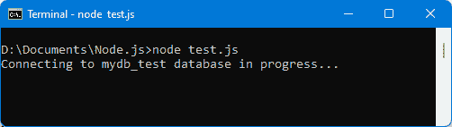

接下来，我们将考虑这两个事件并将它们集成到上一个程序中。这是使用 `mongoose.connection` 对象上定义的 `on(event, callback)` 方法完成的：

> **注意**
>
> `on(event, callback)` 方法用于处理事件的接收，并将其与回调函数中描述的处理逻辑相关联。

### 在数据库连接上使用 open 和 error 事件 (test.js 文件)

```javascript
var mongoose = require("mongoose");

mongoose.connect("mongodb://localhost/mydb_test");

mongoose.connection.on("error", function() {
  console.log("mydb_test database connection error")
});

mongoose.connection.on("open", function() {
  console.log("Successful connection to mydb_test database");
});

console.log("Connecting to mydb_test database in progress...");
```

让我们运行上一个程序：

图 8.4 - 成功连接到数据库

我们已经看到如何连接到数据库。因此，我们将能够在数据库的集合中创建文档。

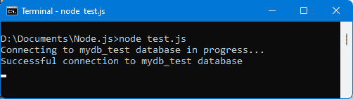

## 在 MongoDB 中创建文档

### 在 MongoDB 中创建文档

一旦访问了数据库，你就可以在其中创建文档。

文档将被插入到*集合*（collection）中。因此，集合会将一组组合在一起。因此，数据库将是一个集合集合，每个集合包含文档。

为了能够插入文档，mongoose 要求我们描述这些文档的结构。为此，我们将使用模式（schemas）和模型（models）。

#### 使用 schemas 和 models 描述文档结构

为了访问数据库中的文档，必须通过 schemas 和 models 来描述文档。

**定义**

- *schema*（模式）允许你定义存储在集合中的文档的结构。该结构根据 MongoDB 数据类型定义。
- *model*（模型）是 schema 作为 JavaScript 类的表示。它将 schema 链接到 MongoDB 集合。

让我们看看如何创建一个 schema，然后创建一个 model。

##### 创建一个 schema

schema 使用 Node.js 内部对象类来定义文档的字段。这些是以下几个类：

- `String`：定义一个字符字符串。
- `Number`：定义一个数值字段。
- `Boolean`：定义一个布尔值。
- `Array`：定义一个数组。
- `Buffer`：定义一个字节缓冲区。
- `Date`：定义一个日期。
- `Object`：定义一个对象。

`mongoose.Schema(format)` 方法用于定义与文档关联的 schema。`format` 参数是一个 JavaScript 对象，将文档的每个字段与其类型关联。让我们创建一个 client。client 由 lastname、firstname 和 address 特征。这些字段都是 String 类型：

### 关联 client 的 schema (test.js 文件)

```javascript
var mongoose = require("mongoose");

mongoose.connect("mongodb://localhost/mydb_test");

var clientSchema = mongoose.Schema({
  lastname : String,
  firstname : String,
  address : String
});
```

现在让我们解释如何从 schema 创建 model。

##### 创建一个 model

schema 然后被用于定义与文档关联的 model。`mongoose.model(collection, schema)` 方法返回一个带有 schema 的 JavaScript 类。该类被称为 model。

使用此类创建的文档将被插入指定的集合。集合之前可能不存在。集合需要一个文档。

> **总结**
>
> schema 指定存储在集合中的文档的格式，而 model 是创建文档的 JavaScript 类。我们使用 `mongoose.model(collection, schema)` 调用将文档 schema 与集合关联。这返回一个可以用于生成单个文档实例的 JavaScript 类。

让我们创建 Client 类，它将创建存储在 clients 集合中的 clients。传统上根据模型名称的小写复数形式来命名集合：

### 从 schema 创建 Client model (test.js 文件)

```javascript
var mongoose = require("mongoose");

mongoose.connect("mongodb://localhost/mydb_test");

var clientSchema = mongoose.Schema({
  lastname : String,
  firstname : String,
  address : String
});

// 创建与 clients 集合关联的 Client 类
var Client = mongoose.model("clients", clientSchema);
```

Client 类现在可用于创建将插入到 clients 集合的文档。

#### 创建文档

在集合中创建文档有两种方法。这些是 `doc.save(callback)` 实例方法和 `create(doc, callback)` 类方法。让我们看看这在集合中创建文档的两种方法。

让我们从使用 `doc.save(callback)` 实例方法开始。

##### 使用 doc.save(callback) 实例方法

client 文档从之前创建的类在内存中创建（通过 `var client = new Client()`），然后通过 `client.save()` 方法保存到 clients 集合中。

回调函数允许在文档完成插入到集合后进行处理。如果要在继续处理之前，需要等待文档插入数据库，那么这种方法就特别有用：

### 使用 save() 实例方法保存文档 (test.js Keep)

```javascript
var mongoose = require("mongoose");

mongoose.connect("mongodb://localhost/mydb_test");

var clientSchema = mongoose.Schema({
  lastname : String,
  firstname : String,
  address : String
});

// 创建与 clients 
// 关联的 Client 类
var Client = mongoose.model("clients", clientSchema);

// 在内存中创建文档
var c = new Client({lastname :"Clinton", firstname:"Bill",
  address:"Washington"});

console.log("Before the save() statement");

// 将文档保存到数据库（clients 集合）
c.save(function(err) {
  if (!err) console.log("The client is inserted into the
  collection");
});

console.log("After the save() statement");
```

回调函数接收 `err` 参数，它对应于可能的错误信息（否则为 `null`）。

我们得到以下结果：

图 8.5 - 使用 doc.save() 实例方法

通过控制台显示的轨迹信息，我们可以看到 `The client is inserted into the collection` 消息在其他消息之后显示，这意味着插入文档不会阻塞其他任务（即在等待插入数据库时，可以执行其他任务）。

`save()` 方法也可以用作 Promise 对象使用（参见*第 2 章*，*探索 JavaScript 的高级概念*）。为此，我们之后会使用 `then(callback)` 方法，随后可能紧跟着使用 `catch(callback)` 方法来处理调用 `save()` 方法时的错误情况。

在这种情况下，我们编写如下代码：

### 将 save() 方法作为 Promise 对象使用

```javascript
c.save().then(function(doc) {
  console.log(doc);
  console.log("The client is inserted into the collection");
}).catch(function(err) {
  console.log(err); // 显示错误
});
```

现在让我们看看使用 `create(doc, callback)` 类方法创建文档的另一种方法。

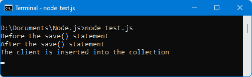

##### 使用 create(doc, callback) 类方法

类方法意味着我们可以在不实例化对象的情况下该方法，而实例方法不同，实例方法需要创建类的对象（通过 `c = new Client()`）。

要创建与 `{lastname:"Obama", firstname:"Barack", address:"Washington"}` 标识的客户端关联文档，我们将编写如下代码：

### 使用 Client.create(doc, callback) 类方法保存文档 (test.js Keep)

```javascript
var mongoose = require("mongoose");

mongoose.connect("mongodb://localhost/mydb_test");

var clientSchema = mongoose.Schema({
  lastname : String,
  firstname : String,
  address : String
});

// 创建与 clients 
// 关联的 Client 类
var Client = mongoose.model("clients", clientSchema);

console.log("Before the create() statement");

// 将文档保存到数据库（clients 集合）
Client.create({lastname:"Obama", firstname:"Barack",
  address:"Washington"}, function(err, doc) {
  console.log("The client is inserted into the collection",
  doc);
});

console.log("After the create() statement");
```

`create(doc, callback)` 类方法通过在其前面加上 JavaScript 类名（在这里是 `Client` 类）来使用。

要保存的文档以 JavaScript 对象（JSON 格式）的形式编写，也可以是使用 `c = new Client()` 实例化的对象。

形式为 `callback(err, doc)` 的回调函数在保存文档到数据库结束时执行。如果你想在确定文档已保存到集合的同时执行某个过程，那么这个回调函数非常有用。

> **注意**
>
> 注意，`create(doc, callback)` 方法的回调函数 `callback(err, doc)` 有两个参数，分别是可能的错误和保存到数据库的文档。

让我们运行之前的程序：

图 8.6 - 使用 Client.create() 类方法

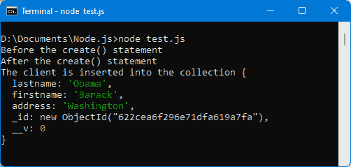

保存的文档具有与模型格式关联的字段（在这里是 `lastname`、`firstname` 和 `address` 字段），还有由 MongoDB 自动添加的 `_id` 和 `__v` 字段：

- `_id` 字段是 MongoDB 用于为集合中的每个文档提供唯一标识的字段。它起到主键的作用。
- `__v` 字段是 MongoDB 自动添加的跟踪文档版本的字段。

## 在 MongoDB 中查询文档

以下是一些条件表达式的示例：

- `{ }`：集合中的所有文档。你也可以写 `find()`，它等同于 `find({})`。
- `{ lastname: "Clinton" }`：所有 lastname 为 Clinton 的文档。
- `{ lastname: "Clinton", firstname: "Bill" }`：所有 lastname 为 Clinton 且 firstname 为 Bill 的文档。
- `{ $or: [{ lastname: "Clinton"}, { firstname: "Jimmy" }] }`：所有 lastname 为 Clinton 或 firstname 为 Jimmy 的文档。
- `{ lastname: /obama/i }`：所有 lastname 包含字符串 "obama" 的文档，不区分大小写（正则表达式）。
- `{ address: { $exists: true} }`：所有 address 字段存在的文档，无论其类型为何（String、Object 等）。
- `{ address: { $exists: true, $type: 2 } }`：所有 address 字段存在且类型为 2（String）的文本文。
- `{"address.city": "Washington" }`：所有包含 address 字段的文档，且该字段本身包含一个值为 Washington 的 city 字段。
- `{lastname:{$type:2}, $where:"this.lastname.match(/^Clinton|carter$/i)"}`：所有 lastname 为字符字符串（类型 = 2）且 lastname 以 Clinton 开头或以 car 结尾的文档，不区分大小写。你必须指定 lastname 是字符字符串，否则在处理非此类格式的名称时可能会出错。
- `{lastname: { $gt: "J", $lt: "S" }}`：所有 lastname 大于 "J" 且小于 "S" 的文档。
- `{lastname: { $in:["Clinton", "Carter", "Obama"] }}`：所有 lastname 为 Clinton、Carter 或 Obama 的文档。

一旦表达了查询条件，就必须检索并显示找到的结果。让我们如何实现。

### 获取并显示结果

无论表达的是什么条件，都可以在与 find 方法关联的回调函数中获取相应的结果，其形式为 `callback(err, results)`。我们还将看到可以使用 `exec(callback)` 方法来获取结果。

让我们看看这两种获取查询结果的方法。

#### FIND(CONDITIONS, CALLBACK) 方法的回调参数

**callback) 方法**

让我们查找所有 lastname 为 Clinton 或 firstname 为 Barack 的客户端。结果将在回调函数中显示：

### 显示 lastname 为 "Clinton" 或 firstname 为 "Barack" 的客户端 (test.js Kle)

```javascript
var mongoose = require("mongoose");

mongoose.connect("mongodb://localhost/mydb_test");

var clientSchema = mongoose.Schema({
  lastname : String,
  firstname : String,
  address : String
});

// 创建与客户端关联的 Client 类
// 
var Client = mongoose.model("clients", clientSchema);

Client.find({ $or : [ { lastname : "Clinton" }, { firstname : "Barack"} ] }, function(err, clients) {
  console.log(clients);
});
```

我们获得了如下所示的结果：

图 8.8 使用 find(conditions, callback) 显示查询结果

回调函数可以像以前一样在 find() 方法中表达，也可以在在 find() 方法之后使用的 exec() 方法中指定。现在让我们检查第二种可能性。

#### 使用 exec(callback) 方法

另一种获取结果的方法是在 find(conditions) 方法之后使用 exec(callback) 方法。在这里使用 find(conditions) 方法时没有在参数中指定回调函数，因为回调函数是在 exec(callback) 方法中指定的。

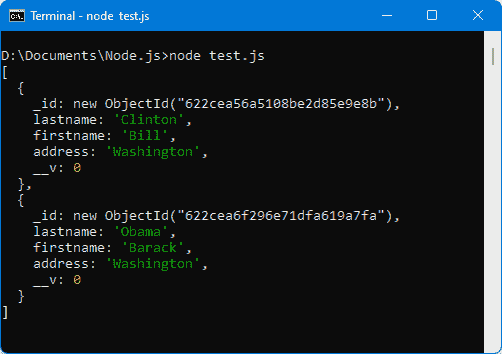

这样做的好处是我们可以在 find() 方法和 exec() 方法之间插入新方法。例如，如果我们想添加额外条件，即 lastname 字段必须等于 Clinton，我们可以这样写：

### 添加查询条件，要求 lastname 为 "Clinton" (test.js Kle)

```javascript
var mongoose = require("mongoose");

mongoose.connect("mongodb://localhost/mydb_test");

var clientSchema = mongoose.Schema({
  lastname : String,
  firstname : String,
  address : String
});

// 创建与客户端关联的 Client 类
// 集合
var Client = mongoose.model("clients", clientSchema);

Client.find({ $or : [ { lastname : "Clinton" }, { firstname : "Barack"} ] })
  .where("lastname")
  .eq("Clinton")
  .exec(function(err, clients) {
    console.log(clients);
  });
```

> **注意**
>
> 如 where(field) 和 eq(value) 等方法可以在 find() 方法之后进行链式调用。当调用 exec() 方法时，查询执行才会生效。这里描述了其他用法：
>
> https://mongoosejs.com/docs/query。

你也可以在不指定回调的情况下使用 exec(callback) 方法。为此，我们使用 then() 和 catch() 方法对找到的文档进行处理。

### 将 exec() 方法作为 Promise 使用

```javascript
Client.find({ $or : [ { lastname : "Clinton" }, { firstname : "Barack"} ] })
  .where("lastname")
  .eq("Clinton")
  .exec()
  .then(function(clients) {
    console.log(clients);
  })
  .catch(function(err) {
    console.log(err);
  });
```

结果显示如下所示：

图 8.9 使用 exec() 方法


### 在 MongoDB 中更新文档

可以修改一个或多个文档。updateOne() 和 updateMany() 方法分别用于修改第一个文档或所有文档。

这两个方法具有类似的参数：

- `updateMany(conditions, update, callback)` 表示修改所有找到的中 update 对象中的数据。更新后会调用形式为 `callback(err, response)` 的回调函数。
- `updateOne(conditions, update, callback)` 表示修改找到第一个文档中 update 对象中的数据。更新后会调用形式为 `callback(err, response)` 的回调函数。

> **注意**
>
> response.modifiedCount 字段表示被修改的文档数量。
>
> 如果你不想在更新时执行任何处理，可以省略回调函数，但这种情况下，你必须使用 then() 或 exec() 方法，否则更新不会发生。

> **警告**
>
> 如果方法中不存在回调，你必须使用 then() 或 exec() 方法，否则更新不会完成。

让我们修改 Clinton 的地址，现在将是 New York：

### 使用 updateOne() 修改 "Clinton" 的地址 (test.js Kle)

```javascript
var mongoose = require("mongoose");

mongoose.connect("mongodb://localhost/mydb_test");

var clientSchema = mongoose.Schema({
  lastname : String,
  firstname : String,
  address : String
});

// 创建与客户端关联的 Client 类
// 集合
var Client = mongoose.model("clients", clientSchema);

Client.updateOne({ lastname : "Clinton" }, { address : "New York" }, function(err, response) {
  console.log("response =", response);
});
```

### 使用 exec() 方法执行更新 (test.js Kle)

```javascript
var mongoose = require("mongoose");

mongoose.connect("mongodb://localhost/mydb_test");

var clientSchema = mongoose.Schema({
  lastname : String,
  firstname : String,
  address : String
});

// 创建与客户端关联的 Client 类
// 集合
var Client = mongoose.model("clients", clientSchema);

Client.updateOne({ lastname : "Clinton" }, { address : "New York" })
  .exec()
  .then(function(response) {
    console.log("response =", response);
  })
  .catch(function(err) {
    console.log(err);
  });
```

```javascript
var mongoose = require("mongoose");

mongoose.connect("mongodb://localhost/mydb_test");

var clientSchema = mongoose.Schema({
  lastname : String,
  firstname : String,
  address : String
});

// 创建与 clients 集合关联的 Client 类
var Client = mongoose.model("clients", clientSchema);

Client.updateOne({ lastname : "Clinton" },
{ address : "New York" })
.exec(); // exec() 是强制性的！
```

一旦你学会了如何创建、搜索以及然后修改文档，你只需要知道如何删除它们了。让我们来看看如何操作。

## 在 MongoDB 中删除文档

与与 `updateOne()` 和 `updateMany()` 类似，有两个类方法，即 `deleteOne(conditions, callback)` 和 `deleteMany(conditions, callback)`，它们允许你删除符合表达式条件的文档（`deleteOne()`）或所有文档（`deleteMany()`）。

此外，实例方法 `doc.remove(callback)` 也允许在文档处于内存中时删除它。

让我们使用 `deleteOne()` 方法从集合中删除 Clinton，然后显示集合的新内容：

### 使用 deleteOne() 删除客户端 "Clinton" (test.js Kle)

```javascript
var mongoose = require("mongoose");

mongoose.connect("mongodb://localhost/mydb_test");

var clientSchema = mongoose.Schema({
  lastname : String,
  firstname : String,
  address : String
});

// 创建与 clients 集合关联的 Client 类
var Client = mongoose.model("clients", clientSchema);

Client.deleteOne({ lastname : "Clinton" }, function(err, response) {
  console.log("After Clinton's removal");
  console.log("response = ", response);
  Client.find(function(err, clients) {
    console.log("clients = ", clients);
  });
});
```

与 `updateOne()` 和 `updateMany()` 方法相同，是回调函数的存在触发了数据库的更新。如果你没有指定回调函数，在这种情况下你必须在 `deleteOne()` 或 `deleteMany()` 方法之后使用 `then()` 或 `exec()` 方法。结果如如下所示：

图 8.11 使用 deleteOne() 删除 "Clinton" 客户端


在 `deleteOne()`（或 `deleteMany()`）方法的回调中返回的对象指示了 `deletedCount` 字段，该字段包含了删除的文档数量。

我们连续学习了 MongoDB 数据库中对文档的四可能操作，即插入、搜索、修改和删除文档。到此本章也结束了。

## 总结

得益于使用 mongoose 等这样的外部模块，使用 MongoDB 进行数据管理相对简单。数据库上所有可能的操作都可以轻松实现。安装 MongoDB 时提供的 `mongo` 工具可以方便地查看集合及其包含的文档。

使用 MongoDB 数据库对于构建客户端-服务器应用程序以及维护用户信息至关重要。

剩下的就是查看如何连接使用 Vue.js 构建的客户端和使用 Node.js 构建的服务器端。我们将在下一章中介绍这一点。我们将构建一个 100% JavaScript 的应用程序，以展示它是多么简单和高效。

# 9 将 Vue.js 与 Node.js 集成

在本章中，我们将学习如何将 Vue.js 应用集成到 Node.js 服务器中，使用 Express 来结构化服务器代码（根据 MVC 模型），并使用 MongoDB 来存储信息。

为此，我们将使用在*第 5 章**使用 Vue.js 管理列表*中构建的列表管理应用程序示例。但在这里，使用的服务器将是 Node.js 服务器，列表项将存储在 MongoDB 数据库中。这将允许它们在必要时重新显示。

最后，我们将获得一个完全由 JavaScript 编写的客户端-服务器应用程序（客户端和服务端）。

以下是本章涵盖的主题：

- 显示应用界面
- 使用 Express 构建应用
- MongoDB 数据库结构
- 安装 Axios 库
- 在列表中插入新元素
- 显示列表元素
- 修改列表中的元素
- 从列表中移除元素

## 显示应用界面

该应用程序使用了与在*第 5 章，使用 Vue.js 管理列表*中已使用的相同的界面。我们在下方重复了它们，以便你更易理解。

### 技术要求

你可以在 GitHub 上找到本章的文件：https://github.com/PacktPublishing/JavaScript-from-Frontend-to-Backend/blob/main/Chapter%209.zip。

### 显示应用界面

在这里，我们视觉化了应用程序的界面，允许以下操作：

- 显示已有的列表（最初为空）
- 在列表末尾插入新元素
- 修改列表中的一个元素
- 从列表中移除一个项目

> **注意**
>
> 访问列表的 URL 是 http://localhost:3000。这里使用的服务器是 Node.js 服务器。数据库是 MongoDB。

最初，列表是空的。页面上只有“Add Element”（添加元素）按钮（见下图）：

图 9.1 空列表

多次点击“Add Element”按钮会创建带有“Element”文本的行，随后是“Remove”（移除）和“Modify”（修改）按钮（这里我们点击了三次“Add”按钮）：

图 9.2 向列表添加三个项目


接下来，让我们修改第二个元素。输入框出现在文本位置。在输入框处““ 2”：

图 9.3 编辑项目

点击输入框外部，输入框消失，元素的文本被修改了：

图 9.4 元素已修改


最后，让我们从列表中删除第一个和第三项：

图 9.5 删除了第一个和第三项

现在，当我们刷新之前的窗口时，看到列表重新显示了“Element 2”，这表明所做的修改确实存储在数据库中。我们之前在*第 5 章*中仅使用 Vue.js 创建此应用程序时并非如此，因为列表元素没有保存到数据库：

图 9.6 新列表显示：列表保留

为了创建此应用程序，我们将使用之前在*第 5 章**使用 Vue.js 管理列表*中编写的 Vue.js 程序。但必须对其进行修改，以便在带有 Express 模块的 Node.js 服务器上运行，并将显示的数据存储在 MongoDB 数据库中。


我们在此指示之前在*第 5 章**使用 Vue.js 管理列表*中编写的 `<GlobalApp>` 和 `<Element>` 组件文件，以便解释之后对它们进行的修改。

这里是 `<GlobalApp>` 组件：

### <GlobalApp> 组件 (global-app.js Kle)

```javascript
import Element from "./element.js";

const GlobalApp = {
  data() {
    return {
      elements : []
    }
  },
  components : {
    Element:Element
  },
  template : `
    <button @click="add()">Add Element</button>
    <ul>
      <Element v-for="(element, index) in elements"
        :key="index"
        :text="element" :index="index"
        @remove="remove($event)" @modify="modify($event)"
      />
    </ul>
  `,
  methods : {
    add() {
      var element = "Element " + (this.elements.length + 1);
      this.elements.push(element);
    },
    remove(params) {
      var index = params.index;
      this.elements.splice(index, 1);
    },
    modify(params) {
      var index = params.index;
      var value = params.value;
      this.elements[index] = value;
    }
  }
};

export default GlobalApp;
```

这里是 `<Element>` 组件：

### <Element> 组件 (element.js)

```javascript
const Element = {
  data() {
    return {
      input : false
    }
  },
  template : `
  <li>
    <span v-if="!input"> {{text}} </span>
    <input v-else type="text" :value="text"
    @blur="modify($event)" ref="refInput" />
    <button @click="remove()"> 删除 </button>
    <button @click="input=true"> 修改 </button>
  </li>
  `,
  props : ["text", "index"],
  methods : {
    remove() {
      // 处理对 Remove 按钮的点击
      this.$emit("remove", { index : this.index });
    },
    modify(event) {
      var value = event.target.value;
      this.input = false;
      this.$emit("modify", { index : this.index, value : value });
    }
  },
  emits : ["remove", "modify"],
  updated() {
    // 检查 refInput 是否存在，如果存在，则为
    // 输入框获取焦点
    if (this.$refs.refInput) this.$refs.refInput.focus();
  }
}

export default Element;
```

允许你包含 `<GlobalApp>` 组件的 index.html 文件如下：

### index.html

```html
<html>
<head>
  <meta charset="utf-8" />
  <script src="https://unpkg.com/vue@next"></script>
  <style type="text/css">
    li {
      margin-top:10px;
    }
    ul button {
      margin-left:10px;
    }
  </style>
</head>
<body>
  <div id="app"></div>
</body>
<script type="module">
  import GlobalApp from "./global-app.js";
  var app = Vue.createApp({
    components : {
      GlobalApp:GlobalApp
    },
    template : "<GlobalApp />"
  });
  var vm = app.mount("div#app");
</script>
</html>
```

要创建此应用程序，我们首先要创建一个 Node.js 应用，它将托管用 Vue.js 编写的 JavaScript 代码。为了实现这一点，使用 `express` 命令创建应用程序。该应用程序将命名为 *list*（例如），因此我们必须输入 `express list` 命令来创建此应用，正如后续节解释的那样。

## 使用 Express 构建应用

让我们从使用 Express 创建应用程序开始。为此，请输入 `express list` 命令，这将创建一个名为 *list* 的应用程序。该应用程序可以通过 URL http://localhost:3000 访问，如*第 7 章*，《在 Node.js 中使用 Express》中所示。

在当前目录中输入 `express list` 命令：

图 9.7 使用 Express 创建应用程序 list

通过输入指定的命令启动服务器，即：`cd list`、`npm install`，然后是 `npm start`。

在浏览器中输入 URL http://localhost:3000 启动应用程序。

我们显示了 Express 默认创建的基础应用程序（见*图 9.8*）。

如果在加载 Express 模块时发生错误，你可以输入 `npm link express` 命令以定位应用程序中的 Express 模块。如果在加载 mongoose 模块时发生错误，你可以输入 `npm link mongoose` 命令。


如果一切正常，你将获得以下内容：

图 9.8 使用 Express 创建的标准应用程序

现在的目标是视觉化我们用 Vue.js 创建的列表管理应用程序。它由三个文件组成：

- index.html 文件，启动时查看的文件
- global-app.js 文件，描述了应用程序的主 `<GlobalApp>` 组件
- element.js 文件，描述了对应于显示元素行的 `<Element>` 组件

Express 应用程序的主目录（list 目录）包含一个 public 子目录，该子目录包含 images、javascripts 和 stylesheets 子目录。

让我们 index.html、global-app.js 和 element.js 这三个文件放入 public 目录，直接放在根目录下。


> **注意**
>
> 修改 public 目录中的文件不需要重启服务器。相反，修改 Express 应用程序的 app.js 文件需要通过 `npm start` 重启服务器。

再次在浏览器中查看 URL http://localhost:3000。我们在*第 5 章*，《使用 Vue.js 管理列表》中构建的 Vue.js 应用程序现在将会出现。点击也将开始生效。唯一的区别是我们的 Vue.js 应用程序运行在 Node.js 服务器上，而不是像*第 5 章*那样运行在另一个服务器上。

## 安装 Axios 库

### 包含 Axios 库并显示版本号 (index.html Kle)

```html
<html>
<head>
<meta charset="utf-8" />
<script src="https://unpkg.com/vue@next"></script>
<script src="https://unpkg.com/axios/dist/axios.min.js"></script>
<style type="text/css">
li {
margin-top:10px;
}
ul button {
margin-left:10px;
}
</style>
</head>
<body>
<div id="app"></div>
</body>
<script type="module">
console.log("axios.VERSION = " + axios.VERSION);
// 显示 Axios 版本号
import GlobalApp from "./global-app.js";
var app = Vue.createApp({
components : {
GlobalApp:GlobalApp
},
template : "<GlobalApp />"
});
var vm = app.mount("div#app");
</script>
</html>
```

我们只是在 index.html 中添加了 Axios 库（使用 `<script>` 标签）以及在控制台中显示 Axios 库版本号的指令，这允许我们稍后检查 Axios 库是否可以访问。

让我们在浏览器中再次显示页面（URL 为 http://localhost:3000）。

我们在控制台中收到一条消息，指示所使用的 Axios 版本号（见下图），这表明我们已经访问 Axios 库的功能：

图 9.10 - 显示 Axios 版本号


现在让我们看看如何使用 Axios 与服务器交互并更新数据库文档。

目标当然是通过修改我们已经编写的 Vue.js 代码，使其使用 Axios 库并从而与 Node.js 服务器进行通信。

随后，我们将修改以下文件（除了之前修改过以包含 Axios 库的 index.html 文件之外）：

- global-app.js 文件，用于调用 Axios 库
- element.js 文件，以适应数据库结构
- app.js 文件（由 Express 创建），用于执行数据库查询

我们已经看到如何在程序中安装和使用 Axios。现在让我们看看如何使用它向数据库中插入一个元素。

## 在列表中插入新元素

让我们看看在点击**添加元素 (Add Element)** 按钮后如何在列表中存储一个新元素。

与此元素相关的文本必须传输到服务器，其格式为 **Element X**。我们稍后将看到如何在点击**修改 (Modify)** 按钮后修改此文本。

在 `<GlobalApp>` 组件中定义的 `add()` 方法用于向显示的列表插入新元素。我们需要添加使用 Axios 库的指令，以便将此新元素也插入 MongoDB 的 elements 集合。


# 在开始使用 Axios 之前

稍微修改用 Vue.js 编写的 JavaScript 程序是有用的。为了做到这一点，我们将在创建 `<Element>` 组件时使用一个新属性，用 `element` 属性替换 `text` 和 `index` 属性。

## 用 element 属性替换 text 和 index 属性

在创建元素时，我们目前使用元素的文本和索引，这些随后被用于 `<Element>` 组件中显示它（带有其文本）或修改或删除它（带有其索引）。

之前使用索引来识别屏幕上显示的列表中的元素是有意义的，但如果我们想修改或删除数据库中的元素，情况就不再如此。这是因为 MongoDB 集合的文档不是通过索引标识的，而是通过它们的标识符 `_id`。

与其在 `<Element>` 组件中传递文本和索引参数，我们通过只传递 `element` 参数来简化，这是一个 `{ text, _id }` 对象。`element.text` 字段允许你检索要显示的文本，而 `element._id` 字段允许你访问元素的唯一标识符（例如索引，每个元素都是唯一的）。

我们修改了 `global-app.js` 和 `element.js` 文件来考虑这一点。

这些文件在下方被修改，但将再次修改以考虑与数据库的连接：

### global-app.js

```javascript
import Element from "./element.js";
const GlobalApp = {
  data() {
    return {
      elements : [] // 对象数组，格式 { text, _id }
      // (_id = MongoDB 中的文档 id)
    }
  },
  components : {
    Element:Element
  },
  template : `
    <button @click="add()">Add Element</button>
    <ul>
      <Element v-for="(element, index) in elements" :key="index" :element="element" @remove="$event" @modify="$event" />
    </ul>
  `,
  methods : {
    add() {
      var text = "Element " + (this.elements.length + 1);
      this.elements.push({text:text, _id:Date.now()});
    },
    remove(params) {
      var id = params.id;
      this.elements = this.elements.filter(function(element) {
        if (element._id == id) return false;
        else return true;
      });
    },
    modify(params) {
      var id = params.id;
      var value = params.value;
      this.elements = this.elements.map(function(element) {
        if (element._id == id) {
          element.text = value;
          return element;
        }
        return element;
      });
    }
  }
}
export default GlobalApp;
```

关于上述代码可以做出以下说明：

- `elements` 变量变成了一个对象 `{ text, _id }` 数组。
- `_id` 是临时的：事实上，在与数据库连接之前，你需要使用 MongoDB 提供的标识符。
- `add()` 方法向数组插入格式为 `{text, _id}` 的对象。
- `remove()` 方法从列表中删除传递的元素。为了做到这一点，我们使用 `filter()` 方法保留除该元素以外的所有元素。
- 同样，`modify()` 方法修改具有此标识符的元素。我们使用 `map()` 方法返回一个数组，其中该标识符对应的元素值被修改了。

### element.js

```javascript
const Element = {
  data() {
    return {
      input : false
    }
  },
  template : `
    <li>
      <span v-if="!input">{{element.text}}</span>
      <input v-else type="text" :value="element.text" @blur="modify($event)" ref="refInput" />
      <button @click="remove()"> Remove</button>
      <button @click="input=true"> Modify</button>
    </li>
  `,
  props : ["element"],
  methods : {
    remove() {
      // 处理 Remove 按钮的点击
      this.$emit("remove", { id : this.element._id });
    },
    modify(event) {
      var value = event.target.value;
      this.input = false;
      this.$emit("modify", { id : this.element._id, value : value });
    }
  },
  emits : ["remove", "modify"],
  updated() {
    // 检查 refInput 是否存在，如果是，则给输入字段获取焦点
    if (this.$refs.refInput) this.$refs.refInput.focus();
  }
}
export default Element;
```

- 用于创建 `<Element>` 组件传递的属性名为 `element`，对应于对象 `{ text, _id }`。
- `_id` 是临时的：事实上，在与数据库连接之前，你需要使用 MongoDB 提供的标识符。
- `add()` 方法向数组插入格式为 `{text, _id}` 的对象。
- `remove()` 方法从列表中删除传递的元素。为了做到这一点，我们使用 `filter()` 方法保留除该元素以外的所有元素。
- 同样，`modify()` 方法修改具有此标识符的元素。我们使用 `map()` 方法返回一个数组，其中该标识符对应的元素值被修改了。

## 用于客户端与服务器之间通信的 Axios 库描述

现在让我们使用 Axios 将元素插入数据库中。

Axios 提供了四种通过 JavaScript 语言在浏览器与服务器通信的主要方法，我们在这里使用的服务器是 Node.js 服务器，但 Axios 允许你与任何类型的服务器进行交互。这四种方法与可以发出的 HTTP 请求类型相关：GET、POST、PUT 和 DELETE：

- `axios.get(url, options)`: 这允许你执行 GET 类型的请求。
- `axios.post(url, options)`: 这允许你执行 POST 类型的请求。
- `axios.put(url, options)`: 这允许你执行 PUT 类型的请求。
- `axios.delete(url, options)`: 这允许你执行 DELETE 类型的请求。

`options` 参数允许你指定额外的参数，以便服务器执行其处理逻辑。例如，在我们的应用程序中，我们将在此参数中指定想要存储在数据库中的列表元素文本。

> **注意**
>
> 所有这些方法都返回一个 Promise 对象，随后允许你继续使用 `then(callback)` 方法。
>
> `callback(response)` 函数用于在发出请求后检索并分析服务器的响应。
>
> Promise 对象在*第 2 章*《探索 JavaScript 高级概念》的末尾学习过。

在每个情况下，我们都必须处理客户端发送的 Axios 请求（在与 `<GlobalApp>` 组件关联的 `global-app.js` 文件中），然后在服务器端对其考虑（在 `app.js` 文件中，它接收 Axios 发出的查询）。

现在让我们看看 POST 请求如何允许我们向数据库中插入元素。

## 使用 POST 类型请求使用 Axios（客户端）

现在让我们看看如何使用 `axios.post()` 方法在列表创建新元素后，向 `elements` 集合中插入新元素。

> **注意**
>
> 我们在这里使用 POST 请求来插入项，但其他类型的请求也同样有效。然而，在这里使用 POST 请求是有意义的，因为它符合使用**表层表示状态转移**（REST）请求的官方建议。

虽然每个文件中只添加了几行代码，但完整代码都会显示在每次下方，这样你就可以看到更改所在的位置：

### 在数据库中添加新元素，客户端（global-app.js 文件）

```javascript
import Element from "./element.js";

const GlobalApp = {
  data() {
    return {
      elements : [] // 对象数组 { text, _id } 的数组
      // (_id = MongoDB 中的文档 id)
    }
  },
  components : {
    Element:Element
  },
  template : `
    <button @click="add()">Add Element</button>
    <ul>
      <Element v-for="(element, index) in elements"
        :key="index" :element="element"
        @remove="remove($event)" @modify="modify($event)"
      />
    </ul>
  `,
  methods: {
    add() {
      var text = "Element " + (this.elements.length + 1);
      axios.post("/list", {text:text}) // 将对象
      // {text:text} 传递给服务器
      .then((response) => {
        this.elements.push({text:text,
        _id:response.data.id});
      });
    },
    remove(params) {
      var id = params.id;
      // 从 elements
      // 数组中删除具有此 id 的元素
      this.elements = this.elements.filter(
        function(element) {
          if (element._id == id) return false;
          else return true;
        }
      );
    },
    modify(params) {
      var id = params.id;
      var value = params.value;
      // 修改 elements
      // 数组中具有此 id 的元素的文本
      this.elements = this.elements.map(function(element) {
        if (element._id == id) {
          element.text = value;
          return element;
        }
        else return element;
      });
    }
  }
}
export default GlobalApp;
```

`axios.post("/list", {text:text})` 方法使用 POST 类型请求激活服务器上的 `/list` URL。`text` 参数被传递给服务器，以便将其存储在 `elements` 集合中。

作为对服务器调用的响应，后者返回一个响应对象，其中 `data.id` 包含在 MongoDB 中创建的文档的标识符。该标识符和元素文本随后存储在 `elements` 数组中。因为 `elements` 数组是 Vue.js 的响应式变量，它的更新会导致列表在浏览器中重新显示。

> **注意**
>
> 注意 `then(callback)` 方法中的回调函数是如何写的。我们使用带有 `=>` 的形式（即不使用 `function` 关键字），以便保留回调函数中 `this` 的值。如果你使用 `function` 关键字，则 `this` 的值将是 `undefined`，你将无法再通过 `this` 访问 `elements` 变量，这会导致错误。

由于 POST 请求是由客户端（浏览器）发出的，因此它必须由服务器处理以便向 `elements` 集合中插入新元素。

## POST 类型请求处理（服务器端）

让我们看看服务器如何处理 POST 请求的接收。

### 在数据库中添加新元素，服务器端（app.js 文件）

```javascript
const createError = require("http-errors");
const express = require("express");
const path = require("path");
const cookieParser = require("cookie-parser");
const logger = require("morgan");
const mongoose = require("mongoose");
const indexRouter = require("./routes/index");
const usersRouter = require("./routes/users");

const app = express();

mongoose.connect("mongodb://localhost/mydb_test");

const listSchema = mongoose.Schema({
  text : String
});

const List = mongoose.model("elements", listSchema);

app.set("view engine", "jade");
app.set("views", path.join(__dirname, "views"));

app.use(logger("dev"));
app.use(express.json());
app.use(express.urlencoded({ extended: false }));
app.use(express.static(path.join(__dirname, "public")));

app.use("/", indexRouter);
app.use("/users", usersRouter);

// 在列表中创建新元素
app.post("/list", function(req, res) {
  var text = req.body.text;
  List.create({text:text}, function(err, doc) {
    res.json({id:doc._id}); // 在响应中发送 MongoDB
    // 符
  });
});

// 捕获 404 并转发到错误处理器
app.use(function(req, res, next) {
  next(createError(404));
});

// 错误处理器
app.use(function(err, req, res, next) {
  // 设置本地变量，仅在开发环境中提供错误
  res.locals.message = err.message;
  res.locals.error = req.app.get("env") === "development" ?
  err : {};

  // 渲染错误页面
  res.status(err.status || 500);
  res.render("error");
});

module.exports = app;
```

### 验证数据库中插入操作的正确性

要验证数据库中的插入操作，只需使用 `mongo` 工具，然后输入命令 `db.elements.find()` 来查看显示的已插入的文档（假设我们已经通过 `db=connect("mydb_test")` 命令连接到了 `mydb_test` 数据库）。

假设插入了三个列表项，我们得到如下结果：


## 显示列表元素

在本节中，我们将处理页面的显示。之前已经见过插入操作，修改和删除将在接下来的章节介绍。

> **注意**
>
> 为了在应用程序启动时显示列表，你必须使用组件的 `created()` 方法或 `mounted()` 方法，这些方法会在每个 Vue.js 组件创建时被调用。

为了检索元素列表，我们将使用 HTTP GET 请求。

### 使用 Axios 发起 GET 类型请求（客户端）

在这里，我们将通过 `/list` URL 向服务器发送一个 GET 类型的请求。使用 `axios.get("/list")` 指令来执行此请求。我们可以在 `created()` 或 `mounted()` 方法中使用此指令。在这里，我们选择在 `created()` 方法中使用它：

### 获取项列表，客户端 (global-app.js)

```javascript
import Element from "./element.js";

const GlobalApp = {
  data() {
    return {
      elements : [] // 对象数组 { text, _id } 
      // (_id = MongoDB 中的文档 ID)
    }
  },
  components : {
    Element:Element
  },
  template : `
    <button @click="add()">Add Element</button>
    <ul>
      <Element v-for="(element, index) in elements"
        :key="index" :element="element"
        @remove="remove($event)" @modify="modify($event)"
      />
    </ul>
  `,
  methods : {
    add() {
      var text = "Element " + (this.elements.length + 1);
      axios.post("/list", {text:text})
        .then((response) => {
          console.log(this.elements);
          this.elements.push({text:text,
          _id:response.data.id});
        });
    },
    remove(params) {
      var id = params.id;
      // 从 elements
      // 数组中删除此 id 的元素
      this.elements = this.elements.filter(
        function(element) {
          if (element._id == id) return false;
          else return true;
        });
    },
    modify(params) {
      var id = params.id;
      var value = params.value;
      // 修改 elements
      // 数组中此 id 元素的文本
      this.elements = this.elements.map(function(element) {
        if (element._id == id) {
          element.text = value;
          return element;
        }
         else return element;
      });
    },
    created() {
      axios.get("/list")
        .then((response) => {
          this.elements = response.data.elements.map(
            function(element) {
              return {_id : element._id, text : element.text }
            );
        });
    }
  }
}

export default GlobalApp;
```

`axios.get("/list")` 方法向服务器发送请求，然后在 `then(callback)` 方法中处理收到的响应。与之前一样，收到的响应对象包含 `data` 属性，该属性包含了服务器返回的响应（elements 字段见下方）。

由于服务器发送了 elements 集合的所有文档字段，我们通过 `map()` 方法对收到的列表进行过滤，以仅保留 `_id` 和 `text` 字段（因此我们删除了与版本号相关的 `__v` 字段，这在这里是不需要的）。

现在让我们看看如何在 Node.js 服务器端处理 GET 请求。

### GET 类型请求处理（服务端）

Node.js 服务器通过 `app.js` 文件中定义的 `app.get("/list")` 方法接收 GET /list 请求。处理过程将读取 elements 集合的内容，并以 JSON 格式通过 `elements` 属性返回给浏览器。返回集合中的每项都包含 `_id`、`text` 和 `__v`（文档的版本号）字段：

### 获取项列表，服务端 (app.js)

```javascript
var createError = require("http-errors");
var express = require("express");
var path = require("path");
var cookieParser = require("cookie-parser");
var logger = require("morgan");
var indexRouter = require("./routes/index");
var usersRouter = require("./routes/users");
var mongoose = require("mongoose");

mongoose.connect("mongodb://localhost/mydb_test");

var listSchema = new mongoose.Schema({
  text : String
});

var List = mongoose.model("elements", listSchema);
var app = express();

// 视图引擎设置
app.set("view engine", "pug");
app.set("views", path.join(__dirname, "views"));

app.use(cookieParser());
app.use(logger("dev"));
app.use(express.json());
app.use(express.urlencoded({ extended: false }));
app.use(express.static(path.join(__dirname, "public")));

app.use("/", indexRouter);
app.use("/users", usersRouter);

// 在列表中插入新元素
app.post("/list", function(req, res) {
  var text = req.body.text;
  console.log(text);
  List.create({text:text}, function(err, doc) {
    res.json({id:doc._id});
  });
});

// 获取元素列表
app.get("/list", function(req, res) {
  List.find(function(err, elements) {
    res.json({elements});
  });
});

// 捕获 404
app.use(function(req, res, next) {
  next(createError(404));
});

// 错误处理器
app.use(function(err, req, res, next) {
  res.status(err.status || 500);
  res.locals.message = err.message;
  res.locals.error = process.env.NODE_ENV === 'development' ? err.stack : {};
  res.render("error");
});

module.exports = app;
```

## 修改列表中的元素

```javascript
modify(params) {
    var id = params.id;
    var value = params.value;

    // 在 elements 数组中修改此 id 元素的文本
    this.elements = this.elements.map(function(element) {
        if (element._id == id) {
            element.text = value;
            return element;
        }
        else return element;
    });

    // 修改具有此标识符的元素的文本
    axios.put("/list", {text:value, id:id});
}
```

这里不应使用 `then(callback)` 方法，因为服务器不会向浏览器返回任何信息。

现在让我们来看看服务器端对 PUT 请求的管理。

## PUT 类型请求处理（服务器端）

服务器在 `app.js` 文件中处理 PUT /list 请求。处理过程对于具有此标识符的集合执行文档更新，使用从浏览器接收到的文本：

### 修改元素，服务器端（app.js 文件）

```javascript
var createError = require("http-errors");
var express = require("express");
var path = require("path");
var cookieParser = require("cookie-parser");
var logger = require("morgan");
var indexRouter = require("./routes/index");
var usersRouter = require("./routes/users");
var mongoose = require("mongoose");

mongoose.connect("mongodb://localhost/mydb_test");

var listSchema = mongoose.Schema({
    text : String
});

var List = mongoose.model("elements", listSchema);
var app = express();

// 视图引擎设置
app.set("views", path.join(__dirname, "views"));
app.set("view engine", "jade");
app.use(logger("dev"));
app.use(express.json());
app.use(express.urlencoded({ extended: false }));
app.use(cookieParser());
app.use(express.static(path.join(__dirname, "public")));

app.use("/", indexRouter);
app.use("/users", usersRouter);

// 在列表中创建一个新元素
app.post("/list", function(req, res) {
    var text = req.body.text;
    console.log(text);
    List.create({text:text}, function(err, doc) {
        res.json({id:doc._id});
    });
});

// 获取元素列表
app.get("/list", function(req, res) {
    List.find(function(err, elements) {
        res.json({elements:elements});
    });
});

// 修改列表中的元素
app.put("/list", function(req, res) {
    var id = req.body.id;
    var text = req.body.text;
    List.updateOne({_id:id}, {text:text}).exec();
    // 别忘记 exec()
    res.send(); // 关闭与浏览器的连接
});

// 捕获 404 并转发到错误处理器
app.use(function(req, res, next) {
    next(createError(404));
});

// 错误处理器
app.use(function(err, req, res, next) {
    // 设置本地，仅在开发环境中提供错误
    res.locals.message = err.message;
    res.locals.error = req.app.get("env") === "development" ? err : {};

    // 渲染错误页面
    res.status(err.status || 500);
    res.render("error");
});

module.exports = app;
```

文本和标识符从服务器的 `req.body.text` 和 `req.body.id` 变量中获取。数据库中使用新文本更新文档。`List.updateOne()` 类方法允许修改该文档，但由于它之后没有使用回调函数，因此必须使用 `exec()` 方法才能在数据库中执行更新。

此外，注意处理末尾的 `res.send()` 指令。它关闭了浏览器与服务器之间的连接。如果连接不关闭，浏览器将等待服务器的响应，而如果服务器不向浏览器发送任何内容，该响应将永远不会到来。

最后让我们解释一下如何从列表中删除项。

## 从列表中删除元素

最后，我们将学习如何从列表中删除元素。这需要使用 DELETE 类型请求。

### 使用 Axios 配合 DELETE 类型请求（客户端）

使用 `axios.delete("/list", options)` 方法在服务器上触发 DELETE 类型请求。`options` 参数必须指示要从集合中删除的元素标识符。然而，与之前的 `axios.get()`、`axios.put()` 和 `axios.post()` 调用不同，`axios.delete("/list", options)` 调用要求 `options` 参数被写在 `data` 属性中（因此写为 `{ data: options }`）。如果你不遵循这一约定，它将无法工作。

以下使用 Axios 库执行 DELETE 请求的说明：

### 删除元素，客户端（global.js）

```javascript
import Element from "./element.js";

const GlobalApp = {
    data() {
        return {
            elements : [] // 对象数组 { text, _id }
        }
    },
    components : {
        Element:Element
    },
    template : `
        <button @click="add()">Add Element</button>
        <ul>
            <Element v-for="(element, index) in elements"
                :key="index"
                :element="element"
                @remove="remove($event)" 
                @modify="modify($event)">
            </Element>
        </ul>
    `,
    methods : {
        add() {
            var text = "Element " + (this.elements.length + 1);
            axios.post("/list", {text:text})
                .then((response) => {
                    console.log(this.elements);
                    this.elements.push({
                        text:text,
                        _id:response.data.id
                    });
        },
        remove(params) {
            var id = params.id;
            this.elements = this.elements.filter(
                function(element) {
                    if (element._id == id) return false;
                    else return true;
                }
            );
            // options 必须写在 data 属性中
            axios.delete("/list", { data : {id:id} });
        },
        modify(params) {
            var id = params.id;
            var value = params.value;
            // 修改 elements 数组中此 id 元素的文本
            this.elements = this.elements.map(function(element) {
                if (element._id == id) {
                    element.text = value;
                    return element;
                }
                else return element;
            });
            // 修改具有此标识符的元素的文本
            axios.put("/list", {text:value, id:id});
        },
        created() {
            axios.get("/list")
                .then((response) => {
                    this.elements = response.data.elements.map(
                        function(element) {
                            return {_id : element._id, text : element.text }
                        }
                    );
        }
    }
}

export default GlobalApp;
```

如之前，我们在 `axios.delete` 方法中使用 `{ data : options }` 格式，以便 `options` 正确通过 DELETE 方法传递。

现在让我们检查服务器接收 DELETE 请求时的处理。

## DELETE 类型请求处理（服务器端）

使用 `app.delete("/list", callback)` 方法接收 DELETE /list 请求。回调函数使用传递的标识符从 elements 集合中删除相应的文档：

### 删除元素，服务器端（app.js 文件）

```javascript
var createError = require("http-errors");
var express = require("express");
var path = require("path");
var cookieParser = require("cookie-parser");
var logger = require("morgan");
var indexRouter = require("./routes/index");
var usersRouter = require("./routes/users");
var mongoose = require("mongoose");

mongoose.connect("mongodb://localhost/mydb_test");

var listSchema = mongoose.Schema({
    text : String
});

var List = mongoose.model("elements", listSchema);
var app = express();

// 视图引擎设置
app.set("views", path.join(__dirname, "views"));
app.set("view engine", "jade");
app.use(logger("dev"));
app.use(express.json());
app.use(express.urlencoded({ extended: false }));
app.use(cookieParser());
app.use(express.static(path.join(__dirname, "public")));
app.use("/", indexRouter);
app.use("/users", usersRouter);

// 在列表中创建一个新元素
app.post("/list", function(req, res) {
    var text = req.body.text;
    console.log(text);
    List.create({text:text}, function(err, doc) {
        res.json({id:doc._id});
    });
});

// 获取元素列表
app.get("/list", function(req, res) {
    List.find(function(err, elements) {
        res.json({elements:elements});
    });
});

// 修改列表中的元素
app.put("/list", function(req, res) {
    var id = req.body.id;
    var text = req.body.text;
    List.updateOne({_id:id}, {text:text}).exec();
    // 别忘记 exec()
    res.send(); // 关闭与浏览器的连接
});

// 从列表中删除一个元素
app.delete("/list", function(req, res) {
  var id = req.body.id;
  console.log(req.body.id);
  List.deleteOne({_id:id}).exec(); // 不要忘记调用 exec()
  res.send(); // 关闭与浏览器的连接
});

// 捕获 404 并转发到错误处理器
app.use(function(req, res, next) {
    next(createError(404));
});

// 错误处理器
app.use(function(err, req, res, next) {
    // 设置本地变量，仅在开发环境中提供错误
    res.locals.message = err.message;
    res.locals.error = req.app.get('env') === 'development' ?
    err : {};

    // 渲染错误页面
    res.status(err.status || 500);
    res.render('error');
});

module.exports = app;
```

`List.deleteOne({_id:id})` 方法用于删除集合中具有此标识符的文档。由于我们没有在 `List.deleteOne()` 方法中使用回调函数，因此我们调用了 `exec()` 方法以便在数据库中执行删除。

此外，注意处理末尾的 `res.send()` 指令。它关闭了浏览器和服务器之间的连接。如果连接不关闭，浏览器将等待服务器的响应，如果服务器不向浏览器返回任何内容，该响应将永远不会到来。在这种情况下，当你多次点击列表中的 **Delete** 按钮并刷新列表时，你会看到意外的结果。

我们已经看到如何使用 Axios 等库使用 MongoDB 在列表中插入、修改和删除元素，这允许浏览器的 JavaScript 代码与为服务器编写的 JavaScript 代码之间进行通信。现在，这带我们来到了本章以及整本书的末尾。

## 总结

通过这个完整的示例，我们看到了如何在客户端（此处使用 Vue.js）和服务器端（使用 Node.js 和 MongoDB）使用 JavaScript。

使用单一语言来执行所有开发工作简化了学习过程，并确保了整个应用程序具有良好的一致性。

此外，诸如 Vue.js 等允许创建可复用组件的工具，以及基于 MVC 模型的 Express 和 mongoose 等模块，使得在客户端和服务器端合理构建 JavaScript 代码成为可能。我们还看到了 Axios 库如何让客户端和服务器之间的通信成为可能。

你现在拥有了完全使用 JavaScript 创建可靠、健壮且结构良好的客户端和服务器应用程序所需的一切。

## 感谢

亲爱的读者，感谢你购买和阅读本书。它的唯一目的是帮助和引导你。我们希望它对你有很大的帮助。

如果是这样，我们请求你提供一份非常微小但极其重要的贡献——通过你所能的手段让更多人知道我们的书，希望它能继续帮助像你这样的人。非常感谢！

## 索引

### 符号

- `<Element>` 组件的使用 174-176
- `<input>` 元素
- `<span>` 元素，转换为 183, 184
- `<script>` 标签和 `</script>` 标签，在 8-10 页间编写 JavaScript 代码
- `<span>` 元素转换成 `<input>` 元素 183, 184
- `$emit()` 的使用，用于与父组件通信 136-140
- `$event` 参数的使用，用于检查输入的值是否小于 100 130-132
- 使用，用于仅输入数字 132-134
- 使用 130

### A

- Ajax 技术 277
- `alert()` 函数对比 `console.log()` 方法 11-13
- `app.js` 文件定义的路由，分析 226-229
- 初始内容 223-225
- 路由，添加 229
- 路由，直接处理 229

### application (应用)

- 拆分，分为组件 169-172
- 应用组件
- `$emit()`，使用与父组件通信 136, 138-140
- 组装 134, 136
- `props`，使用与子组件通信 140-143
- 应用程序屏幕显示 166-169, 264-271

### array (数组)

- 关于 55
- 创建 55
- 使用 `Array` 类创建 56
- 使用方括号 `[` 和 `]` 创建 55, 56
- 元素，按索引添加 64
- 使用 `push()` 方法添加元素 64-66
- 元素，从 68, 69 删除
- 元素，过滤 69
- 使用 `filter(callback)` 方法过滤元素 69, 70
- 使用 `map(callback)` 方法过滤元素 70, 71
- 元素，添加 64

### Array class (Array 类)

- 使用，创建数组 56, 57
- 数组元素
- 访问 57
- 按索引访问 57-59
- 使用 `forEach(callback)` 方法访问 61, 62
- 使用 `for()` 或 `while()` 循环访问 60
- 删除 66
- 值，删除 66, 67
- 数组
- 属性，使用组件 114, 117
- Axios 库 277

### C

- 回调函数 61
- `deleteOne(callback)` 方法 254
- 级联
- 字符
- 字符串 75
- 字符串格式 78
- 字符串修改 77
- 字符串部分，使用 80
- 字符串 72
- 使用反引号创建 73
- 使用双引号创建 75
- `charAt(index)` 方法 76
- 子组件，使用通信 140
- 类 42
- 构造函数，使用 50, 51
- 方法 42
- 属性，使用 47
- 经典示例 157
- 样式类名 154
- 控制台方法 29
- 清除 89
- 集合 237
- 颜色 212
- 目录 212
- 属性，使用 114, 115
- 构造函数使用 53
- 创建 243
- 创建 245
- 删除 2 2, 2 2-2
- 删除 240
- 查找 251, 252
- 属性 258, 260
- 字符串 212, 214

### D

- 指令 117
- `v-else` 指令 118, 119
- `v-for` 指令 120
- `v-if` 指令 118, 119
- `v-model` 指令 123
- `v-show` 指令 120
- `doc.save(callback)` 方法使用 245-247
- 文档模型 (DOM) 188
- 文档 237, 243
- 创建 245
- 在 MongoDB 中创建 243
- 在 MongoDB 中删除 260-262
- 在 MongoDB 中搜索 251, 252
- 在 MongoDB 中更新 258-260
- 下载的模块使用 `npm` 命令 210, 211

### E

- 效果 CSS 类名 154, 156
- 产生多个元素 156
- EJS 229
- 元素添加到列表 173, 174
- 从数组删除 68, 69
- 数组过滤 69
- 修改列表 178-183
- 值的删除 66, 67
- 事件管理 128-130
- `exec(callback)` 方法使用 255, 256
- Express 210
- MVC 模式 222
- 路由，使用 223
- 视图，显示 231-235
- Express 模块 264 安装 219-222
- 用于创建 Vue.js 应用 272-274

### F

- 文件内容作为字符串显示 207, 208
- 读取 206, 207
- `filter(callback)` 方法使用 69, 70
- `forEach(callback)` 方法使用用于访问元素 61, 62
- `forEach()` 方法对比 `for()` 循环 62-64
- `for()` 循环用于访问元素 60 对 `forEach()` 方法 62-64
- `for()` 语句处理循环，使用 30, 32
- 计算前 10 个整数和的函数 38, 39
- 用于显示前 10 个整数列表的 34-39
- 使用 33

### 索引

- 列表元素，插入约 280 页
- Axios 库，客户端与服务器之间的通信 285
- Axios，用于 POST 类型请求 286, 288
- 正确操作，在数据库中验证 291
- POST 类型请求，处理 288, 290
- 文本和索引属性，替换为元素属性 280, 282, 284
- 列表元素，修改约 297 页
- Axios，用于 PUT 类型请求 297, 299
- PUT 类型请求，处理 300, 302
- 列表元素，删除约 302 页
- Axios，用于 DELETE 类型请求 302, 305
- DELETE 类型请求，处理 305, 308

### M

- `map(callback)` 方法的使用 70, 71
- 方法
- 定义，在方法章节 111
- 方法章节
- 方法，定义 111, 112
- model（模型）
- 关于 243
- 创建 244, 245
- 模型-视图控制器 (MVC) 模型 99
- 模块
- 关于 196
- 创建 197
- 功能，添加 201
- 多个函数，导出 201-203
- 所谓的主函数，使用 205, 206
- MongoDB
- 关于 237, 264
- 文档，创建 243
- 文档，删除 260-262
- 文档，搜索 251, 252
- 文档，更新 258-260
- 安装 238, 239
- MongoDB 社区版
- 安装链接 238
- MongoDB 数据库
- 连接 241, 242
- MongoDB 数据库结构 274, 277
- mongoose 模块
- 安装 240, 241
- mongosh
- 安装链接 238
- mongo 工具
- 关于 238
- 命令 239
- 使用 239
- 使用，查看插入的文档 250, 251
- `mounted()` 方法 189
- 下移效果 160-163
- 多任务处理，JavaScript 关于 82, 83
- `clearInterval()` 函数，使用 87, 89
- `setInterval()` 函数，使用 86, 87
- `setTimeout()` 函数，使用 83-85
- MVC 模式
- 在 Express 中 222, 223
- MVC 模式，在 Express 中
- 控制器 222
- 模型 222
- 视图 222

### N

- Node.js `http` 模块的使用 216, 217, 219
- Node.js 服务器
- JavaScript 程序，运行 13, 14
- `node_modules` 目录使用 198, 199
- `node_modules` 本地目录
- `colors` 模块，安装 212
- 非阻塞文件读取使用 208, 209
- `npm` 命令
- 下载的模块，用于 210, 211
- 使用 210, 211
- 数值关于 5
- 布尔值 6

### O

- 对象
- 关于 42
- 创建，使用类 43-45
- 创建，不使用类 45
- 合并，与另一个对象合并 53-55
- 属性值，修改 49, 50
- 对象 7
- 透明度效果 159, 160

### P

- `package.json` 文件使用 199-201
- 父组件
- `$emit()`，用于通信 136-140
- Person 类 43
- 处理循环
- 创建 30
- 使用，配合 `for()` 语句 32, 33
- 使用，配合 `while()` 语句 30, 32
- promises 使用 89-91
- props（属性）
- 使用，与子组件通信 140-143
- `push()` 方法使用，用于添加元素 64-66

### Q

- 查询和投影操作安装链接 252

### R

- 响应式变量 99, 101, 103
- 响应式使用 99
- 正则表达式
- 链接 78
- 使用 78
- 表述状态转移 (REST) 286
- 资源 226
- 路由处理
- 定义，使用外部文件 230, 231
- 路由
- 分析，在 `app.js` 文件中 226-228
- 类型 225, 226
- 路由，配合 Express 使用 关于 223
- `app.js` 文件，初始内容 223-225

### S

- schema（模式）
- 关于 243
- 创建 243, 244
- 编写条件 252, 253
- `setInterval()` 函数使用 86, 87
- `setTimeout()` 函数使用 83-85
- 收缩效果 157-159
- 单页应用 (SPA) 277
- `slice(start, end)` 方法使用 76, 77
- 方括号 `[ ]` 使用，用于创建数组 55, 56
- 字符串
- 字符，访问 75
- 字符，使用 `charAt(index)` 方法访问 76
- 字符，使用 `slice(start, end)` 方法访问 76, 77
- 字符串字面量创建，使用反引号 73-75
- 单引号 72, 73
- `updated()` 方法 189

### U

- 变量声明，JavaScript 关于 15
- `const` 关键字，使用 15-17
- `let` 关键字，使用 20-22
- 未初始化变量 23, 24
- 变量类型，JavaScript 数组 6
- 布尔值 6
- 数值关于 5
- 对象 7
- `v-else` 指令 118, 119
- `v-for` 指令关于 120
- `counts` 中的计数使用 121
- `counts` 中的 `(count, index)` 使用 122
- `key` 属性，使用 122, 123
- 视图
- 显示，在 Express 中 231-235
- `v-if` 指令 118, 119
- 用于元素外观 `for` 144
- 视觉效果，用于元素外观 143
- CSS 类，示例内容 145, 146
- Vue.js 使用的类 146, 149, 150
- 视觉效果，用于元素消失 151
- CSS 类，由 Vue.js 使用 152
- `v-model` 指令 123
- `v-show` 指令 120

### V

- Vue.js 在 HTML 中使用 96, 97
- Vue.js 应用创建 97
- 在 Express 中使用 272, 274
- 使用 `while()` 循环 60
- 使用 `while()` 语句处理循环 32, 33
- 编写条件 25
- 表达式，使用 29
- 嵌套测试套件 29

### W

订阅我们的数字库，以访问超过 7000 本书籍和视频，帮助您规划学习和职业发展。更多信息，请访问我们的网站。

**为什么要订阅？**

- 通过 4000 多位行业人士的 eBook 和视频减少学习时间，增加编码时间
- 通过专为您定制的技能计划提高学习
- 每月获得免费电子书
- 全文搜索访问关键信息
- 复制、粘贴、打印和书签内容

您知道 Packt 出版的每本书都有电子版（提供 PDF 和 ePub）吗？您可以在 packt.com 升级到电子版，作为纸质书客户，您权享受折扣。更多详情请联系我们 customer@packt.com。在 www.packt.com，您还可以阅读免费的技术文章，订阅各种新闻邮件，并获取 Packt 书籍和电子书的专属优惠。

## 您感兴趣的其他书籍

如果您喜欢这本书，可能对 Packt 的其他书籍感兴趣：

### Real-World Next.js

Michele Riva

ISBN: 978-1-80107-349-3

- 掌握 Next.js 并快速构建应用
- 理解如何创建可扩展的 Next.js 架构
- 在 Next.js 应用中编写单元测试和集成测试
- 探索强大的路由系统和 Next.js 内置组件
- 使用 GraphCMS 或任何无头 CMS 设计并构建现代架构

### JavaScript 入门到专业

Laurence Svekis, Maaike van Putten, Rob Percival

ISBN: 978-1-80056-252-3

- 使用逻辑语句在代码中做出决策
- 通过 JavaScript 循环避免重复代码以节省时间
- 使用 JavaScript 函数和方法选择性地执行代码
- 连接 HTML5 元素并通过交互内容让您的网页充满活力
- 使用正则表达式提高您的搜索模式效率

## Packt 正在寻找像您这样的作者

如果您对成为 Packt 作者感兴趣，请访问 authors.packt.com 并在今天申请。我们与数千名像您这样的开发者和技术专业人士合作，帮助他们向全球技术社区分享见解。您可以提交通用申请、申请我们正在募作者的特定热门主题，或提交自己的想法。
