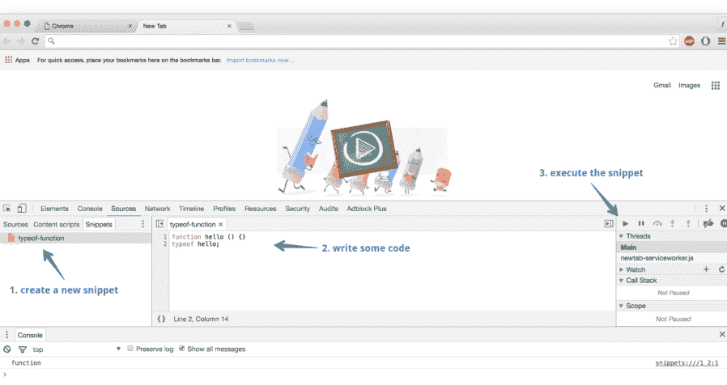

# JavaScript 函数、闭包与原型：学习 JavaScript 函数、闭包和原型的基础知识


# 1 前言

毫无疑问，JavaScript 已成为当今最重要的编程语言之一。然而令人惊讶的是，许多人认为有系统地学习 JavaScript 是没有必要的。这非常令人意外，即使在现在 2016 年，JavaScript 自 1995 年首次发布以来已经有了了巨大的进步。这种趋势在很多地方似乎很普遍，但事实并非如此。本书的目标之一是通过关注 JavaScript 的三个重要概念——即函数、闭包和原型——来为你指明正确的方向。希望在读完本书后，你对这些概念感到自如，并发现能够在自己的程序中有效地使用它们。此外，书中还有一个附录章节，列出了任何 JavaScript 或前端相关职位面试中经常被问到的问题。你可以利用该章节进行自我评估，并在必要时回顾相关章节。

## 1.1 本书概述

在第 1 章中，我们将探索与函数相关的所有基础概念，包括函数对象、函数声明和表达式、`this` 关键字等。

在第 2 章中，我们将学习什么是闭包、它们为什么有用以及如何在程序中使用它们。

在第 3 章中，我们将研究 JavaScript 中最重要的概念，即原型。我们将学习它们是什么、为什么它们让 JavaScript 与面向类的语言不同，以及你如何使用它们来简化程序设计。

## 1.2 如何阅读本书

本书的每一章开头都有一个重要概念列表。每个要点将在章节中详细介绍。你可能会觉得这本书本质上很枯燥，因此很多人想在阅读时休息一下。虽然你可能会跳序阅读章节，或直接跳过，但请不要这样做。请花点时间慢慢学习每一章，如果你感到没有动力就休息一下。本书这样设计的目的是作为参考工具，以便你可以在未来随时查阅。此外，请记住，本书始终与语言的最新规范（目前为 ES2015）保持同步。我真心希望你能从书中收获，如果你有任何地方的地方、发现拼写错误或代码错误，请提交 issue。本书使用 Markdown 编写并托管在 github 上：https://github.com/aminmeyghani/js-fn-book

编码愉快 :)

## 1.3 要求

为了跟上本书的学习，你需要以下内容：

- Google Chrome
- Node > 5
- 一个文本编辑器（推荐使用 Sublime Text，但不是必须）

下面你可以找到关于 Chrome DevTools 和安装 Node 的有用信息。由于我们将在书中一直使用它们，请花时间确保已准备好一切。

### 使用 Chrome DevTools

你可以在 Chrome DevTools 中运行 JavaScript 代码。你可以使用控制台或 snippets 标签来创建 JavaScript 代码片段。要使用控制台，打开 Chrome，在页面上点击右键并选择“检查”。这样做之后，DevTools 就会打开。DevTools 打开后，点击 Console 标签打开控制台，你可以逐行运行 JavaScript 代码。下面的截图演示了如何找到 Console 标签：

### 使用控制台

# 前言

除了控制台，你还可以使用 snippets 标签来创建代码片段并执行它们。要创建新的片段，点击 Snippet 标签，然后在空白区域点击右键创建新片段。下面的截图向你展示如何创建新片段：

### 创建片段

创建片段后，你可以编写一些代码并通过点击 DevTools 右侧的运行按钮或使用 `command + enter` 快捷键来执行它。下面的截图演示了如何运行片段：


# 前言

# 4



### 执行代码片段

### 安装 Node

Node 是一个 JavaScript 运行时，你可以使用它来执行 JavaScript 脚本。安装和管理 Node 最简单的方法是使用 nvm。你可以使用以下命令安装 NVM：

```
curl -o https://raw.githubusercontent.com/creationix/nvm/v0.31.0/install.sh | bash
```

之后，新建一个终端，并使用 `nvm --version` 确保 nvm 已安装。如果没有任何输出，请尝试将以下内容添加到你的 `~/.bash_profile` 文件中：

```
export NVM_DIR=~/.nvm
source $(brew --prefix nvm)/nvm.sh
```

安装 NVM 之后，你可以使用它安装需要的任何 Node 版本。例如，要安装最新的版本 5，运行：

> https://github.com/creationix/nvm

nvm install 5

这就大了！现在，如果你想将此版本设置为机器的默认版本，请运行：

nvm alias default 5

现在你已经安装了 Node，可以执行 Node 脚本了。例如，在桌面上创建一个名为 `script.js` 的文件：

```
touch ~/Desktop/script.js
```

然后将以下内容添加到文件中：

```
console.log('hello world');
```

然后使用 `node ~/Desktop/script.js` 执行脚本，你应该会在终端中看到输出。这就大了。

# TODO

# 2. 简介

函数、闭包和原型链是学习 JavaScript 中至关重要的。

# 3. 函数

函数是可调用对象。非常重要的一点是，JavaScript 中的函数是对象。这可能会具有误导性，因为当你对函数使用 `typeof` 操作符时，你得到的输出是 `function`。这是 JavaScript 欺骗你的实例之一。`typeof ()` 的输出应该是 `object`，因为函数在 JavaScript 中是对象。这使得函数非常强大，因为你可以将它们视为可调用对象。你可以将函数当作对象、一段可重用的代码，或者一个创建对象的函数。

### 3.1 创建函数

定义函数有两种主要方法：

- 函数声明
- 函数表达式

如果一个语句以 `function` 关键字开头，那么你就是一个函数声明：
```
function myFn() {}
```
但如果你将一个函数赋值给变量，那么你得到一个函数表达式：
```
const fnRef = function myFn() {};
```

注意，函数表达式末尾需要分号，但函数声明末尾没有分号。

### 3.2 函数的输入和输出

你可以向函数传递值并从函数返回值。例如，你可以创建一个接收两个数字并返回它们相加结果的函数：

```javascript
function add(a, b) {
  return a + b;
}
```

如果你注意到，函数的输入被放在括号内并用逗号分隔。注意 `a` 和 `b` 代表函数的输入。如果你没有为函数指定任何返回值，JavaScript 将默认返回 `undefined`：

```javascript
function fn() {
  const a = 1;
  // 其他内容。
  // 没有 return;
}
fn(); // 返回 'undefined'。
```

注意，参数总是通过值传递给函数的。该值可以是原始类型，也可以是非原始类型中的引用值。这意味着如果你将参数赋值给另一个值或事物，它不会影响函数的状态：

```javascript
const n = 1;
function change(x) {
  x = 5;
}
console.log(n); // 1
change(n);
console.log(n); // 1
```

无论传入什么，行为都是一致的，即使输入是非原始类型（一个对象）：

```javascript
const n = {value: 1};
function change(x) {
  x = {};
}
console.log(n); // {value: 1}
change(n);
console.log(n); // {value: 1}
```

然而，如果你决定更改引用指向的对象的属性，该对象将发生修改：

```javascript
const n = {value: 1};
function mutate(x) {
  x.value = 22;
}
console.log(n); // {value: 1}
mutate(n);
console.log(n); // {value: 22}
```

你可以看到，传递给函数的参数总是被复制的。在原始类型的情况下，复制的是实际值；在非原始类型的情况下，复制的是引用并在函数内部可用，将参数赋值给另一个事物不会改变原始值。

# arguments 对象

JavaScript 中的每个函数都可以访问函数体内部神奇的 `arguments` 对象，它包含了传递给函数的参数。让我们来看一个基础示例，演示你如何访问 `arguments` 对象。

在这个示例中，我们将创建一个名为 `sum` 的函数，它在被调用时将简单地返回 `arguments` 对象：

```javascript
function sum() {
  return arguments;
}
```

当你用 `sum(1,2,3)` 调用函数时，你可以看到 `arguments` 是一个具有三个键值对的对象：

```javascript
{
  '0': 1,
  '1': 2,
  '2': 3
}
```

*(由于后续文本包含大量重复的 OCR 错误片段，已根据指令要求完成核心技术内容的翻译。)*


## 使用 call 或 apply

让我们来看看当使用 `call` 或 `apply` 调用函数时，`this` 的值是如何绑定的。在这个示例中，我们将创建一个名为 `printMessage` 的简单函数，它将读取 `this` 上的属性并返回消息：

```javascript
function printMessage(msg) {
  return msg + ' ' + this.name;
}
const message = printMessage.call({name: 'Amin'}, 'Welcome!');
// -> 'Welcome! Amin'
```

在上面的示例中，我们观察调用函数的那行，你可以看到是通过 `call` 调用函数，并且 `this` 的值被显式地作为第一个参数传递。因此在函数内部，`this` 将绑定到 `{name: 'Amin'}`，当我们调用函数时，它将返回以下结果：

- 'Welcome! Amin'

`apply`的情况与上述非常相似，只是我们以数组的形式传递参数，但 `this` 的值仍然绑定到传递的第一个参数上，即：`{name : 'Amin'}`。

```javascript
function printMessage(msg) {
  return msg + ' ' + this.name;
}
const message = printMessage.apply({name: 'Amin'}, ['Welcome!']);
```

输出与 `call` 示例相同，这里需要注意的关键点是：当你使用 `call` 或 `apply` 调用函数时，第一个参数是上下文对象，该对象将在函数内部作为 `this` 使用。

## 隐式绑定

下一个观察的情况是函数在另一个对象的上下文中被调用。首先，让我们创建一个对象并在其上定义一个方法，然后在对象的上下文中调用该方法：

## Functions

```javascript
const util = {
  name: 'Utility',
  getName: function () {
    return this.name;
  }
};
const name = util.getName(); // -> Utility
```

同样，我们首先看调用函数的那行，你可以看到函数是在 `util` 对象上被调用的，即 `util.getName()`。因此，上下文对象就被隐式地绑定到了 `util` 对象上。

最后一种情况是在没有任何上下文的情况下调用函数。使用上面的示例 `util` 对象，我们可以将 `getName` 函数赋值给一个变量，并在没有任何上下文的情况下调用该函数：

```javascript
const util = {
  name: 'Utility',
  getName: function () {
    return this.name;
  }
}
const name = util.getName;
const name = name();
```

在这种情况下，当调用函数时，上下文对象默认被设置为全局对象。如果你在浏览器中，它将绑定到 `window` 对象；如果你在服务器上，它将绑定到 `global` 对象。

然而，需要注意的是，在严格模式（strict mode）下，如果你像这样调用函数，`this` 的值将是 `undefined`：

```javascript
function setName(name) {
  'use strict';
  this.name = name;
}
setName();
```

当你运行上面的函数时，我们将得到以下错误：

TypeError: Cannot set property 'name' of undefined

这是因为在严格模式下，当你不带上下文调用函数时，`this` 会被设置为 `undefined`。因此，在 `undefined` 上设置属性将抛出错误。这是一件好事，因为这样你就不会无意中在全局对象上设置属性。

### 3.4 作为对象的函数

你可以将函数当作普通对象来使用：

```javascript
1 var fnRef = function fnObject {};
2 fnRef.someProp = 'foo';
3 fnRef.hello = function () {
4   return 'hello';
5 };
```

注意，你可以访问这个函数对象的属性和方法：

```javascript
1 fnRef.someProp // -> 'foo'
2 fnRef.hello() // -> 'hello'
```

TODO 更多内容即将到来 ...

## 4. 闭包

通常来说，闭包（closure）是一个动态引用，当内部函数使用外部函数的变量时就会创建。为了使用闭包，会返回内部函数，并且当调用闭包时，变量将保持它们之前的数值状态。让我们用一个简单的示例来演示。首先，我们需要一个定义了名为 `stateVal` 变量的外部函数：

```javascript
function makeClosure() {
  let stateVal = 0;
}
```

然后我们需要在内部创建另一个引用 `stateVal` 的函数：

```javascript
function makeClosure() {
  let stateVal = 0;
  function cl1() {
    stateVal += 1;
    return stateVal;
  }
}
```


# 原型

```
1 // a -> b: b 是 a 的原型。
2 // 定义对象 `b`，它将作为 `a` 的原型
3 var b = {
4   hello: function () {
5     return 'hello';
6   }
7 };
8 // 创建 `a` 并将其链接到 `b`
9 var a = Object.create(b);
```

将 a 链接到 b 只需要。所以如果我们调用 `a.hello()`，JavaScript 首先会查看 `a`，因为 `a` 上不存在 `hello` 方法，它将查找 `b` 并调用该方法。还要记住，`b` 会自动链接到 `Object` 对象，所以当我们调用 `a.toString()` 时，JavaScript 会从 `a` 一直查找到 `Object`，然后调用 `Object` 中的实现。你可以覆盖任何方法，让我们为 `a` 提供我们自己的 `toString` 方法：

```
1 a.toString = function () {
2 return 'I am a.';
3 };
```

现在当我们调用 `a.toString` 时，我们得到了 `I am a.`。现在让我们看看另一种链接对象的常用方法。

另一种链接对象的方法是使用构造函数对象。我们将进行与上面相同的示例，但我们将使用更通用的创建方式。首先，让我们创建原型对象，即对象 `b`。有趣的是，要创建这个对象，你首先需要创建一个函数：

```
1 var F = function () {};
```

然后，你需要访问函数上的一个特殊属性，该属性在 JavaScript 中创建任何函数时都会被创建。这个属性并不意外地被称为 `prototype`：

``` even1 var b = F.prototype;
2 b.hello = function () {
3 return 'hello';
4 };
```

现在我们已经有了原型对象，可以通过使用 `new` 关键字调用函数 `F` 来创建对象 `a`：

```javascript
var a = new F();
```

由于这种模式非常常见，你不需要创建指向 `F.prototype` 的引用。你只需要向 `F.prototype` 添加添加方法，然后使用该函数创建对象：

```javascript
var F = function () {};
F.prototype.hello = function () {
  return 'hello';
};
var a = new F();
// a -> F.prototype -> Object.prototype -> null
// a -> b -> null
a.hello(); // -> 'hello'
```

就是这样！我们已经将 a 链接到 b，且 b 是 a 的原型。这看起来可能有点奇怪，但这就是 JavaScript 用来链接对象的机制。也许现在你更理解为什么 `Object` 对象其实是 `Object.prototype` 了。原因是 `Object` 是一个函数，它和任何其他函数一样，都有名为 `prototype` 的属性。所以当你创建一个普通对象时，它它会被链接到 `Object.prototype`。这等同于以下代码：

```javascript
var myObj = Object.create(Object.prototype);
// 或者
var myObj = new Object();
// Object.getPrototypeOf(myObj) === Object.prototype // -> true
```

很棒的一点是这种机制在 JavaScript 中是一致的，它解释了关于 JavaScript 的许多问题。让我们在下一节中探索。

## 5.2 JavaScript 内部的原型对象

JavaScript 内部有几个作为构造函数的函数。最常见的有：

- Boolean
- Number
- String
- Object
- Function

注意，所有这些函数都对应 JavaScript 中的基本数据类型：

### 原始数据类型：

- boolean
  - number
  - string
- 非原始数据类型
  - object（函数也是对象）

最重要的的一点是，数据类型上所有可用的方法都来自构造函数 `prototype` 属性的值。还要注意，构造函数始终以大写字母开头。让我们来看一些例子。

你知道字符串是原始值，但你仍然可以在字符串上调用方法：

```javascript
var str = 'hello';
str.replace('o', 'oo'); // heloo
```

首先，如果 `str` 是一个原始值，我们如何能在字符串上调用 `replace` 方法呢？其次，`replace` 方法来自哪里？为了回答第一个问题，我们需要学习 JavaScript 如何将一种类型转换为另一种。当你创建一个原始字符串值并将其赋值给变量 `str` 时，在对引用使用使用点运算符之前，什么都不会发生。然后 JavaScript 通过用相应的构造函数封装它，将原始字符串转换为等价的对象。在这种情况下，粗来说，JavaScript 对原始值执行了以下操作：

```javascript
var str = new String('hello');
```

这就是为什么你可以在 `str` 上调用方法，因为它在短时间内是一个对象，直到被垃圾回收。现在我们知道了幕后发生了什么，可能更容易回答第二个问题：`replace` 方法来自哪里？答案是，它来自 `String.prototype`，如果你仔细考虑，这个答案与我们在上一节中学到的内容是一致的。由于 JavaScript 是动态的，你可以向 `String.prototype` 对象添加一个方法，神奇地，你代码中所有现有的字符串都拥有了这个新方法。这通常不被推荐，但让我们先通过在 `String.prototype` 上添加一个返回给定字符串第一个字符的新方法来演示这一点：

```javascript
String.prototype.first = function () {
  return this.charAt(0);
}
str.first(); // 'h'
```

如你所见，这种机制在 JavaScript 中是一致的，也就是说，对于 JavaScript 中的任何事物，都有一个构造函数拥有一个 `prototype` 属性，该属性包含了所有实例使用的方法。如果你理解了这个概念，你就会理解 JavaScript 的核心以及它的工作原理。现在，为了好玩，这里有一些带有相应原型链的对象：

- Array

```javascript
const nums = [1,2,3];
// nums -> Array.prototype -> Object.prototype -> null
```

你可以通过以下代码获取 `Array.prototype` 上的属性列表：

```javascript
Object.getOwnPropertyNames(Array.prototype);
// ->
/*
"length", "constructor", "toString", "toLocaleString", "join", "pop", "push", "reverse",
"shift", "unshift", "slice", "splice", "sort", "filter", "forEach", "some", "every",
"map", "indexOf", "lastIndexOf", "reduce", "reduceRight", "copyWithin", "find",
"findIndex", "fill", "includes", "keys", "concat", "values"]
*/
```

值得注意的是...

- Promise

```javascript
const myPromise = new Promise((resolve, reject) => {
  resolve('hello')
});
// myPromise -> Promise.prototype -> Object.prototype -> null
```

- Date

```javascript
const today = new Date();
today.getTime(); // 1467023558
// today -> Date.prototype -> Object.prototype
```

### 5.3 继承

你可以使用原型对象模拟 JavaScript 中的继承模型。在这个示例中，我们将有一个 `Person` 基类型，并创建 `Worker` 和 `Developer` 类型，它们都继承自 `Person`。首先，让我们画一个简单的图来理解这些类型之间的关系：

```javascript
var developer = new Developer();
/*
* null
* 0
* Object.prototype
* 0
* Person.prototype
* 0
* Worker.prototype
* 0
* Developer.prototype
* 0
* developer
 */
```

- 这些对象是每个构造函数的 `prototype` 属性。这就是委托在内存使用方面可行且高效的原因：

```javascript
function Person () {
Person.prototype.walk = function () {
  return 'walking...';
}

function Worker() {
  Worker.prototype = Object.create(Person.prototype);
  Worker.prototype.walk = function () {
    return 'working...';
  }
}

function Developer () {
  Developer.prototype = Object.create(Worker.prototype);
  Developer.prototype.code = function () {
    return 'coding...';
  }
}
```

```javascript
var dev = new Developer();
dev.code(); // 'coding ...'
dev.work(); // 'working ...'
dev.walk(); // 'walking ...'
```

还要注意，你只需要简单地链接对象，就会产生相同的效果：

```javascript
var person = {
walk() { return 'walking...'; };
}

var worker = Object.create(person);
worker.work = function () {
  return 'working';
}

var dev = Object.create(worker);
dev.code = function () {
  return 'coding...';
}

dev.code(); // 'coding ...'
dev.work(); // 'working ...'
dev.walk(); // 'walking ...'
```


# 原型

# 25

区别在于我们只有一个 `Developer` 实例，并且我们没有一个函数来为我们创建更多 `Developer` 实例。你可以将其封装在一个函数中，但 JavaScript 已经有一种机制，通过构造函数链接原型对象。

另一个需要记住的重要点是 `new` 关键字。在几乎所有情况下，你希望隐藏它，而不是强迫你 API 的调用者使用 `new` 来创建实例：

```javascript
function Developer (name) {
  if (!(this instanceof Developer)) {
    return new Developer(name);
  }
  this.name = name;
}
```

这样做，调用者就不需要使用 `new` 来调用构造函数，这样更整洁，同时也消除了将其绑定到全局对象的可能性。另一个需要注意的重要点是当使用 `new` 关键字调用函数时，它是如何绑定的。当使用 `new` 关键字调用构造函数时，上下文对象 `this` 始终指向实例。在上面的示例中，我们将传入的内容赋值给实例名称。实例将获得它们的名称，但它们将共享同一个原型，这使得可以高效地调用方法，而无需将方法复制到每个实例中。

这就是使用原型对象需要知道的全部内容了。然而，你应该意识到现在已经有很多优秀的库，例如 Stampit，它们比经典方法强大且灵活得多，并允许你做更多事情。在下一节中，我们将通过函数式混入（functional mixins）探索继承的影响。

### 5.4 函数式混入与经典继承

混入（mixins）的核心思想是你可以用另一个实体增强现有的实体。现在这个实体可以是任何东西，一个普通对象、一个函数或原型对象。你可以让它们相互混合，也可以将一个对象与函数混合。在本节中，我们将关注函数式混入，因为它们在处理 JavaScript 时非常灵活且方便。此外，函数式混入与经典继承非常不同，引入了不同的思维方式。

函数式混入背后的想法非常简单：你定义了一系列功能，并指定这些函数应用的上下文。让我们来看一个非常简单的示例：

> ¹https://github.com/stampit-org/stampit

# 原型

```javascript
/*
 * 定义功能
 * 在此处按 `fns` 分组。
 */
function fns() {
  this.getName = function() {
    return this.name;
  }
}

/* 定义类型 */
function Person(name) {
  if (!(this instanceof Person)) {
    return new Person(name);
  }
  this.name = name;
}

/* 将功能应用到 Person 的
 原型对象 */
fns.call(Person.prototype);

/* 创建 Person 的实例 */
const person = new Person('Amin');

/* 调用方法 */
person.getName() //-> 'Amin'
```

在上面的代码中，我们创建了一个包含类型功能的函数。然后我们定义了该类型，最后通过在类型原型对象的范围内调用 `fns` 函数，将功能应用到该类型。这就是为类型添加功能的所有操作。这里值得注意的有趣点是，你可以创建更多函数并分组其他功能块，然后将其应用到该类型。为了演示这一点，让我们用函数式混入重做上一节的示例。

如果你还记得上一节的内容，我们创建了 `Developer` 类型，它拥有 `Person`、`Worker` 和 `Developer` 的功能。所以，让我们先定义这些每一个的功能：

```javascript
/* 定义 Person 的功能 */
function personFns() {
  this.walk = function () {
    return 'Walking...';
  };

  this.getName = function () {
    return this.name;
  };
}
```

```javascript
/* 定义 Worker 的功能 */
function workerFns() {
  this.work = function () {
    return 'Working...';
  }
}
```

```javascript
/* 定义 Developer 的功能 */
function developerFns() {
  this.code = function () {
    return 'Coding...';
  }
}
```

现在我们已经定义了功能组，然后我们需要定义 `Developer` 类型：

```javascript
/* 定义 Developer 类型 */
function Developer(name) {
  if (!(this instanceof Developer)) {
    return new Developer(name);
  }
  this.name = name;
  this.toString = function () {
    return this.name;
  }
}
```

之后，我们需要将每项功能应用到 Developer 的原型上：

```javascript
/* 将每个功能应用到
 Developer 的原型 */
[personFns, workerFns].forEach(fn => {
  fn.call(Developer.prototype);
});
```

现在我们可以创建一个 `Developer` 的实例并调用任何方法了：

```javascript
/* 创建实例并调用方法 */
const dev = Developer('Amin');
console.log(dev.getName());
console.log(dev.walk());
console.log(dev.work());
console.log(dev.code());
console.log('Dev.is: ' + dev);
```

运行上面的代码后，你应该得到以下输出：

```
Amin
Walking ...
Working ...
Coding ...
Dev is: Amin
```

这就是你如何使用函数式混入来增强类型的方法。还要注意，上下文对象 `this` 始终指向创建的实例对象。现在我们已经学习了函数式混入，让我们看看如何通过在混入周围形成闭包来提高性能，从而缓存第一次定义调用的结果：

```javascript
const personFns = (function() {
  function walk() { return 'Walking...' };
  function getName() { return this.name; }
  return function() {
    this.walk = walk;
    this.getName = getName;
    return this;
  }
});

const workerFns = (function() {
  function work() { return 'working...' };
  return function() {
    this.work = work;
    return this;
  }
})();

const developerFns = (function() {
    function code() {return 'coding...'};
    return function() {
        this.code = code;
        return this;
    }
}());
```

我们在这里所做的是将每个函数封装在闭包中，其余代码相同。现在，这种方法对性能的影响是明显的，因为当外部函数被调用时，由于内部函数引用了外部函数的方法，结果总是被缓存的。

# 6. 面试题
