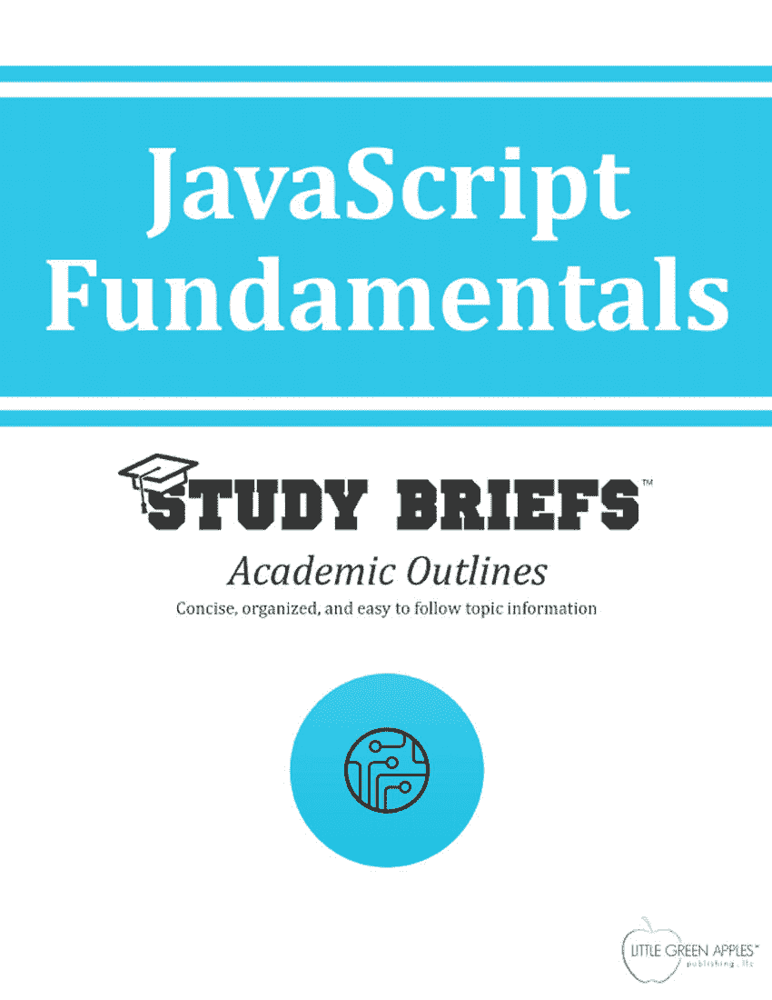
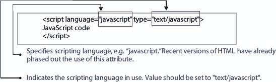
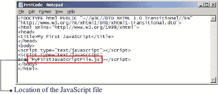
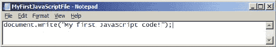
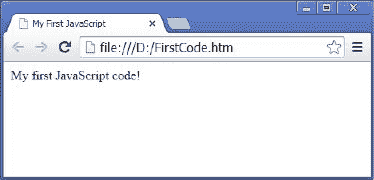
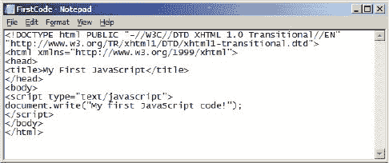
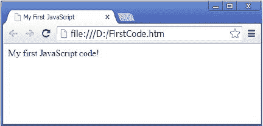
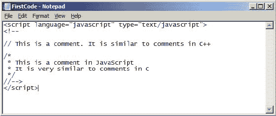
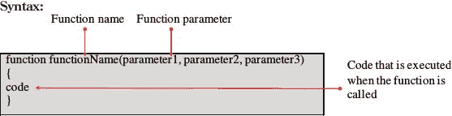
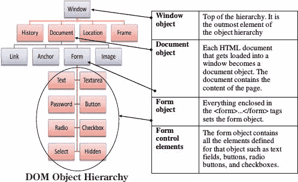

# JavaScript 入门指南





# JavaScript 基础

## 什么是 JAVASCRIPT？

JavaScript 是一种跨平台的、解释性的、基于对象的脚本语言，它最初由网景通信公司（现为甲骨文公司）开发，用于为网站添加多媒体元素、动态页面和交互内容。JavaScript 允许 Web 开发者动态更改网页的内容，还可以添加表单验证、处理图像、打开新窗口等许多功能。JavaScript 还可以用于获取有关浏览器浏览器和 HTML 页面的信息。JavaScript 可以与样式表（CSS）结合使用创建动态 HTML。它被大多数互联网浏览器支持，并允许为网页添加交互功能。

### JavaScript 的两种类型

- **客户端**
    - 允许对网页和客户端浏览器进行增强处理
    - 在客户端机器上进行解析和执行
- **服务端**（也称为 "LiveWire”）
    - 允许访问后端数据库、文件系统和服务器
    - 存储并执行在服务器机器上

### JavaScript 与 Java

JavaScript 并不是 Java 平台的一部分，它也不创建 Applet 或独立应用程序。它嵌入在 HTML 文件中，为原本静态的 HTML 网页添加交互性。Java 是一种面向对象的编程语言，而 JavaScript 是一种基于对象的脚本语言。Java 创建运行在虚拟机或浏览器上的应用程序，而 JavaScript 代码仅在浏览器中运行。Java 代码需要编译，而 JavaScript 代码全以文本形式存在。两者都需要不同的插件。

### JavaScript 和 Java 的区别

| JavaScript | Java |
| :--- | :--- |
| 由客户端解释（无需编译即可执行） | 在服务器上编译 |
| 基于对象 | 面向对象 |
| 变量数据类型无需声明，动态绑定 | 变量数据类型应当声明，静态绑定 |
| 动态绑定 | 静态绑定 |
| 代码嵌入 HTML 中 | 代码仅在安装了 Java 平台的系统上运行 |

**你你知道吗？**

当网景通信公司在 1995 年开发 JavaScript 时，它最初名为 Mocha，后来重命名为 LiveScript，因为它旨在用作类似于 PHP 的服务端语言。后来在 Netscape 3.0 中它被重命名为 JavaScript，这是一种营销手段，为了推广 Sun Microsystems 的 Java 编程语言。

### JavaScript 版本历史

| 发布日期 | 版本 | 浏览器 | 备注 |
| :--- | :--- | :--- | :--- |
| 1996 | 1.0-1.1 | Netscape Navigator 2.0-3.0 和 Internet Explorer 2.0。 | 添加了新对象，如数组、布尔、函数和数字 |
| 1997 | 1.2 | Netscape Navigator 4.0-4.05 | 添加了函数内嵌套函数和正则表达式，以及使用字面量符号创建对象和数组的能力 |
| 1998 | 1.3 | Netscape Navigator 4.06-4.7x | 支持 Unicode、JavaScript 控制台、对 `data.prototype` 方法的若干更改以及严格相等运算符 |
| 1999 | 1.4 | 服务端 JavaScript | LiveConnect 的更改，异常处理（`throw` 和 `try… catch`） |
| 2000 | 1.5 | Netscape Navigator 6.0 和 Firefox 1.0 | 包含了符合 ECMA-262 第 3 版的标准化 |
| 2005 | 1.6 | Firefox 1.5 | 包含用于 XML 的 JavaScript (E4X)，数组方法以及字符串和数组泛型 |
| 2006 | 1.7 | Firefox 2 | 包含生成器、迭代器、数组推导式、let 表达式和解构赋值 |
| 2008 | 1.8 | Firefox 3 | 包含表达式闭包、生成器表达式、`array.prototype.reduce()` 和 `array.prototype.reduceRight()` |
| 2009 | 1.8.1-1.8.2 | Firefox 3.5-3.6 | 包含 TraceMonkey JIT 并支持原生 JSON |
| 2010 | 1.8.5 | Firefox 4 | 包含了许多符合 ECMA-262 第 5 版的新功能 |

### JavaScript 的组成

- **基础语法**：JavaScript 基于 ECMAScript 262 标准，该标准定义了语言核心部分的工作原理。这包括如何定义变量、如何对这些变量进行计算、如何设置循环和函数以及如何定义对象。



- **文档对象模型 (DOM)**：定义了 JavaScript 如何与网页通信，以便从页面提取内容进行处理、添加内容或访问样式表以更改页面外观。
- **浏览器对象模型 (BOM)**：定义了脚本如何从浏览器获取信息并将信息传回浏览器。

## 在网页中嵌入 JavaScript

有两种方法可以在 HTML 文件中嵌入 JavaScript：

### 步骤

- 链接到扩展名为 `.js` 的外部文件
    1. 在记事本或任何文本编辑器中输入以下代码并将其保存为 `FirstCode htm`
       
    2. 在记事本或任何文本编辑器中输入以下代码并将其保存为 `MyFirstJavaScriptFile.js`
       
    3. 打开你的网页浏览器（如 Internet Explorer、Mozilla Firefox 和 Google Chrome）查看结果：
       
- 在 HTML 文档中使用 `<script>` 标签编写代码块
    **步骤**
    1. 将以下代码复制并粘贴到记事本或任何文本编辑器中，保存为 `FirstCode.htm`
       
    2. 打开你的网页浏览器（如 Internet Explorer、Mozilla Firefox 和 Google Chrome）查看结果：
       

## 核心术语

| 术语 | 描述 | 术语 | 描述 |
| :--- | :--- | :--- | :--- |
| 类 (Class) | 定义对象的特征 | 命名空间 (Namespace) | 用于将所有功能封装在唯一的、特定应用程序名称下的容器 |
| Cookie | 包含客户端信息的对象，服务器可以访问该信息 | 对象 (Objects) | 指窗口、文档、图像、表格、表单、按钮或链接等 |
| 事件 (Events) |发生在 Web 服务器、用户和浏览器之间交互背景下的事件 | 运算符 (Operators) | 用于处理变量 |
| 表达式 (Expressions) | 为变量赋值的命令 | 属性 (Properties) | 指对象的属性 |
| 函数 (Functions) | 执行任务并包含内置函数和用户定义函数的语句 | 值 (Values) | 指信息片段，如数字、字符串、布尔、null、对象和函数 |
| 方法 (Methods) | 应用于特定对象的动作 | 变量 (Variables) | 内存中命名的位置，用于存储程序可以更改的值 |

## 操作 JavaScript

### 语句

JavaScript 语句由值、运算符、表达式、关键字和注释组成。

| 语句 | 描述 |
| :--- | :--- |
| const | 定义一个只读**常量**，其值无法更改（与使用 `var` 的变量不同）。定义后不能重新声明。 |

```
const mysalary =3000 //开始（以字母或下划线开头，然后是字母）
```


| `var` | `var` 语句用于在 JavaScript 中显式声明变量。虽然从技术上讲，并不非在变量前面插入 `var` 语句来创建它，但这是一种良好的编程习惯。一旦声明了变量，就可以继续引用该变量而无需包含 `var` 语句。 |

```javascript
var x=5
x=x+10
// (x now contains 15)
```

| `with` | `with` 语句是一种节省时间的语句，用于“缓存”对象，这样在随其后的 `for` 语句中，引用该对象时不再需要再次引用它。 |

```javascript
with (document form 1)[field1 value=”test” field 2 value=”test2”]
```

### 条件语句

| 语句 | 描述 |
| :--- | :--- |
| `if` | 如果条件为真，则执行指定的代码块。 |

```html
<html>
<body>
<script type="text/javascript">
var age=28;
if (age > 18){document.write (<<b>Qualifies for a driving license</b>>);}
</script>
</body>
</html>
```
**Result：** 具备驾照资格

| `if/else` | 如果第一个条件为假，则指定一个新条件进行测试。 |

```html
<html>
<body>
<script type="text/javascript">
var age=17; 
if (age > 18){document.write (<<b>Qualifies for a driving license</b>>);}
else {document.write (<<b>Does not qualify for a driving license</b>>);}
</script>
</body>
</html>
```
**Result：** 驾照资格或不具备驾照资格

| `switch`, `case`, `break`, `default` | “**Switch**”根据表达式的值执行不同的语句。“**Break**”是一个可选语句，如果执行了先前的语句，它将指示“switch”退出。“**Default**”在没有语句被执行时，指令语句执行相应的默认操作。 |

```html
<html>
<body>
<script type="text/javascript">
var grade=’A’;
document.write (“Entering switch block=<br/>);
switch (grade)
{
case ‘A’: document.write(“Excellent<br/>);break;
case ‘B’ document.write(“Good<br/>);break;
case ‘C’ document.write(“Average<br/>);break;
case ‘D’ document.write(“Below average<br/>);break;
case ‘F’ document.write(“Poor<br/>);break;
default: document.write(“No grade<br/>);break; 
}
document.write (“Exiting switch block);
</script>
</body>
</html>
```
**Result：** Entering switch block/ Excellent/ Exiting switch block

| `?:` | “`?:`”或条件运算符用于构建一个评估并根据结果执行两个不同的赋值。 |

```html
<html>
<body>
<script type="text/javascript">
var a = 15;
var b = 30;
var linebreak = “<br />”;
document.write (“((a > b) ? 150 : 300) => “);
result = (a > b) ? 150 : 300;
document.write (result);
document.write (linebreak);
document.write (“((a < b) ? 150 : 300) => “);
result = (a < b) ? 150 : 300;
document.write (result);
document.write (linebreak);
</script>
</body>
</html>
```
**Result：** ((a > b) ? 150 : 300) => 300 ((a < b) ? 150 : 300) => 150

| `return` | “**Return**”退出函数并可选地返回一个值。它用在函数内部。 |

```html
<html>
<head>
<script type="text/javascript">
function concatenate(first, last)
{
var full;
full = first + last;
return full;
}
function secondFunction()
{
var result;
result = concatenate (‘Book’, ‘Dog’);
alert(result );
}
</script>
</head>
<body>
<p>点击下方按钮调用函数</p>
<form>
<input type="button" onclick=”secondFunction()” value=”Call Function”>
</form>
</body>
</html>
```
**Result：** BookDog

### 循环语句

| 语句 | 描述 |
| :--- | :--- |
| `for` | `**for**` 语句根据 `for` 括号 `()` 内定义的三个条件**初始化 (initial)**、**限制 (limit)** 和**增量 (increment)**，多次执行包含的语句。 |

```html
<html>
<body>
<script type="text/javascript">
var count;
document.write (“Start Loop…”+”<br/>);
for(count=0;count=6; count++)
{
document.write(“Current Count :”+ count );
a document.write(<br/>);}
}
document.write(“…End loop!”);
</script>
</body>
</html>
```

| `while` | 只要测试的表达式为真，***循环就会持续执行包含的语句。如果表达式为假，则跳过整个 `while` 循环。 |

```html
<html>
<body>
<script type="text/javascript">
var count = 0;
document.write(“Start loop...”);
while (count < 6){
document.write(“Current Count : “ + count + “<br />”);
count++;
}
document.write(“... End loop!”);
</script>
</body>
</html>
```

| `do/while` | 该语句与标准的***while** 语句的区别在于，测试的表达式被放在末尾，确保***do/while** 循环至少执行一次。 |

```html
<html>
<body>
<script type="text/javascript">
<!--
var count = 1;
document.write (“Starting Loop” + “<br />”);
do{
document.write (“Current Count : “ + count + “<br />”);
count++;
}while (count < 0);
document.write(“Loop stopped!”);
//-->
</script>
</body>
</html>
```

| `for/in` | 遍历对象的属性；适用于内置对象或自定义对象。 |

```html
<html>
<body>
<script type="text/javascript">
var aProperty;
document.write (“Object<br/>);
for (aProperty in Navigator)
{
document.write(aProperty);
}
document.write (“End loop”);
</script>
</body>
</html>
```

| `break` | 退出最内层循环。 |

```html
<html>
<body>
<script type="text/javascript">
var x = 0;
document.write (“Start loop...”);
while (x < 20)
{
if (x == 5){
break; // 跳出循环
}
x = x + 1;
}
document.write (“End loop”);
</script>
</body>
</html>
```

| `continue` | 使 JavaScript 跳过后续的所有语句，并继续下次迭代。 |

```html
<html>
<body>
<script type="text/javascript">
var x = 0;
document.write (“Start loop...”);
while (x < 6)
{
if (x == 5){
continue; // 循环剩余语句
}
x = x + 1;
}
document.write (“End loop”);
</script>
</body>
</html>
```

### 值

JavaScript 语法中使用的两种**值**是固定值和变量值。

*   **字面量：** 固定值被称为**字面量**。在 JavaScript 中，数值可以带有或不带有小数，例如：
    9.5
    9
    文本字符串可以使用双引号或单引号编写，例如
    study guide”
    Harvard University’
    固定值也可以指向表达式，如：
    5 + 7
    5 * 7

*   **变量：** 非固定值被称为**变量**，用于存储值。在 JavaScript 中，使用 `var` 关键字定义变量。等号 (=) 用于为变量赋值，例如：
    `var myName = “John”`

### 运算符

**运算符**作用于变量并改变其值。JavaScript 语言支持以下类型的运算符：算术、赋值、位运算、比较、条件和逻辑。

| **算术运算符** |

| **运算符** | **描述** | **给定变量** A = **15** 和 B = **30** |


| 运算符 | 说明 | 结果 |
| :--- | :--- | :--- |
| `+` | 将两个操作数相 | |
| | `A + B` | `Result = 45` |
| `-` | 从第一个操作数中减去第二个操作数 | |
| | `A - B` | `Result = -15` |
| `*` | 两个操作数乘 | |
| | `A * B` | `Result = 450` |
| `/` | 被除数除以除数 | |
| | `B / A` | `Result = 2` |
| `%` | 取模运算符；找到一个数除以另一个数的余数 | |
| | `B % A` | `Result = 0` |
| `++` | 增增运算符；将整数值加一 | |
| | `A++` | `Result = 16` |
| `--` | 减减运算符；将整数值减一 | |
| | `A--` | `Result = 14` |

### 赋值运算符

| 运算符 | 说明 | 结果 |
| :--- | :--- | :--- |
| `=` | 简单赋值运算符，将右侧操作数的值赋给左侧操作数 | |
| | `C = A + B` | 将 `A+B` 的值赋给 `C` |
| `+=` | 加赋值运算符，将右操作数加到左侧操作数上并将结果赋给左侧操作数 | |
| | `C += A` | 等同于 `C = C + A` |
| `-=` | 减赋值运算符，从左操作数中减去右操作数并将结果赋给左侧操作数 | |
| | `C -= A` | 等同于 `C = C-A` |
| `*=` | 乘赋值运算符，将右操作数与左操作数相乘并将结果赋给左侧操作数 | |
| | `C *= A` | 等同于 `C = C * A` |
| `/=` | 除赋值运算符，将左操作数除以右操作数并将结果赋给左侧操作数 | |
| | `C /= A` | 等同于 `C = C / A` |
| `%=` | 取模赋值运算符，使用两个操作数取模并将结果赋给左侧操作数 | |
| | `C %= A` | 等同于 `C = C % A` |

### 位运算符

| 运算符 | 说明 | 给定变量 A = 2 且 B = 3 |
| :--- | :--- | :--- |
| `&` | 位与运算符，对整数参数的每个位执行布尔逻辑与操作 | |
| | `(A & B)` | `Result = 2` |
| `\|` | 位或运算符，对整数参数的每个位执行布尔逻辑或操作 | |
| | `(A \| B)` | `Result = 3` |
| `^` | 位异异运算符，对整数参数的每个位执行布尔逻辑异或操作 | |
| | `(A ^ B)` | `Result = 1` |
| `~` | 位非运算符，是一个一元运算符，用于反转操作数中的所有位 | |
| | `(~ B)` | `Result = -4` |
| `<<` | 位左移运算符，将第一个操作数中的所有位向左移动第二个操作数指定的位数 | |
| | `A << 1` | `Result = 4` |
| `>>` | 位右移运算符，将第一个操作数中的所有位向右移动第二个操作数指定的位数 | |
| | `A >> 1` | `Result = 1` |
| `>>>` | 无符号右移运算符；与 >> 运算符类似，不同之处左侧移入的位始终为 0 (0) | |
| | `A >>> 1` | `Result = 1` |

### 比较运算符

| 运算符 | 说明 | 给定变量 A = 15 且 B = 30 |
| :--- | :--- | :--- |
| `==` | 检查两个操作数的值是否相等；如果是，则条件为真 | |
| | `(A == B)` | `Result = Not true` |
| `!=` | 检查两个操作数的值是否相等；如果值不相等，则条件为真 | |
| | `(A != B)` | `Result = True` |
| `>` | 检查左操作数的值是否大于右操作数的值，如果是，则条件为真 | |
| | `(A > B)` | `Result = Not true` |
| `<` | 检查左操作数的值是否小于右操作数的值，如果是，则条件为真 | |
| | `(A <= B)` | `Result = True` |
| `>=` | 检查左操作数的值是否大于或等于右操作数的值，如果是，则条件为真 | |
| | `(A >= B)` | `Result = Not true` |
| `<=` | 检查左操作数的值是否小于或等于右操作数的值，如果是，则条件为真 | |
| | `(A <= B)` | `Result = True` |

### 条件运算符

| 运算符 | 说明 |
| :--- | :--- |
| `?:` | 条件条件表达式 |
| | 如果条件为真，则 value = X，否则 value = Y |

### 逻辑运算符

| 运算符 | 说明 | 给定变量 A = 15 且 B = 30 |
| :--- | :--- | :--- |
| `&&` | 逻辑与运算符。如果两个操作数都非零，则条件为真 | |
| | `(A && B)` | `Result = True` |
| `\|\|` | 逻辑或运算符。如果两个操作数中有一个非零，则条件为真 | |
| | `(A \|\| B)` | `Result = True` |
| `!` | 逻辑非运算符。用于反转其操作数的逻辑状态。如果条件为真，则逻辑非运算符将使其为假 | |
| | `(A && B)` | `Result = False` |

## 关键字与注释

### JavaScript 关键字

JavaScript 中的关键字用于标识标识要执行的动作。例如，`var` 关键字指示浏览器创建一个新的关键字：

```javascript
var x = 1 + 2;
var y = x * 15;
```

### 保留字

在 JavaScript 中，有几个标识符是保留字。在编写 JavaScript 时，这些关键字不能用作变量、函数、方法、循环标签或任何对象名称。

| abstract | else | instanceof | switch |
| :--- | :--- | :--- | :--- |
| boolean | enum | int | synchronized |
| break | export | interface | this |
| byte | extends | long | throw |
| case | false | native | throws |
| catch | final | new | transient |
| char | finally | null | true |
| class | float | package | try |
| const | for | private | typeof |
| continue | function | protected | var |
| debugger | goto | public | void |
| default | if | return | volatile |
| delete | implements | short | while |
| do | import | static | with |
| double | in | super | |

### 注释

JavaScript 支持 C-、C++- 和 HTML 注释。在 `//` 到行尾之间的文本被视为注释并被 JavaScript 忽略。JavaScript 识别的另一种注释格式是标签 `/*`。在 `/*` 和 `*/` 之间输入的文本（可以跨多行）会被忽略，起始和结束标签 `<!<!--` 和 `//-->` 也是如此。

**示例：**



#### 编写 JavaScript 的提示

* 换行在语句内部会被忽略。
* JavaScript 是大小写敏感的——关键字、变量、函数名和其他标识符应使用一致的大小写。
* 单词之间的空格和制表符会被忽略。
* JavaScript 语句以分号结束，除非它们单独成行。

## JavaScript 数据类型

数据类型是根据存储的特定类别对值进行分类。有两种类型：

* 原始类型 —— 指 String, Boolean, Integer, Floating Point, Null, Void
* 复合类型 —— 指 Object, Array, Function

### JavaScript 数字

| 类型 | same |
| :--- | :--- |
| Integer | 没有分数部分或小数位的正负数值 |
| Floating Point | 带有小数点或指数表示法的正负数值 |
| String | 被单引号或双引号围绕的字符或文本 |
| Boolean | 逻辑值 True 或 False |
| Null | 无值的变量 |
| Casting | 将变量的内容从一种类型转换为另一种类型 |


字符串转义序列允许用户解析 JavaScript 字符串字面量中的特殊字符/格式，例如 TEXTATEA 输入中的换行符。

| 转义序列 | 属性 | 描述 |
| :--- | :--- | :--- |
| `\b` | 退格 | |
| `\f` | 分页符 | |
| `\n` | 换行符 | |
| `\O` | 空字符 | |
| `\r` | 回车 | |
| `\t` | 水平制表 | |
| `\v` | 垂直制表 | |
| `\’` | 单引号或省撇号 | |
| `\”` | 双引号 | |
| `\\` | 反斜杠 | |
| `\ddd` | 由 0 到 377 之间的三个八进制数字指定的 Latin-1 字符。例如版权符号为 `\251` | |
| `\xdd` | 由 00 到 FF 之间的两个十六进制数字 `dd` 指定的 Latin-1 字符。例如版权符号为 `\xA9` | |
| `\udddd` | 由四个十六进制数字 `dddd` 指定 Unicode 字符。例如版权符号为 `\u00A9` | |

### JavaScript 布尔值

```javascript
Boolean(15 >10) // 返回 true
(5>10) 1 ………// 返回 true
11>10…… …….// 返回 true
```

极大或极小的数字可以使用科学计数法（指数法）书写：

```javascript
var x = 124e5; // 12400000
var y = 124e-5; // 0.00124
```

### JavaScript 数字

JavaScript 只有一种数字类型。数字可以带小数点也可以不带小数点写，例如：

```javascript
var x – 39.00 // 一个带有小数点的数字
var y = 39…// 一个不带小数点的数字
```

**关于数字的提示**

- 数字始终使用 64 位浮点数。
- 与许多其他编程语言不同，JavaScript 没有定义不同类型的数字，例如整数、短整型、长整型、浮点型等。
- JavaScript 数字始终存储为遵循国际 IEEE 754 标准的双倍精度浮点数。

### JavaScript Null

Null 被认为是没有值、无或简单地为不存在。在 JavaScript 中，`null` 的数据类型是一个对象。可以通过将其设置为 `null` 来清空一个对象，如下：

```javascript
var person = null; // 值为 null，但类型仍然是对象
```

### JavaScript Void

JavaScript 中的 `void` 关键字被用作一元运算符，出现在其单个操作数之前。该运算符指定一个要评估的表达式但不返回任何值。

```html
<html>
<head>
<script type="text/javascript"></script>
</head>
<body>
<p>请点击下方内容，这对我没有任何影响……</p>
<a href="javascript:void(alert(0))">请点击我！</a>
</body>
</html>
```

当点击 **请点击我** 链接时，上述脚本将产生以下结果：


### 复合类型

#### 函数

函数是一个 JavaScript 代码块，每当它执行或调用时都会执行特定任务。它用 `function` 关键字定义，后面跟着函数名和括号 `()`。它可能包含字母、数字、下划线符号和美元符号。括号中可以包含逗号分隔的参数名，例如 `parameter1`、`parameter2` 等。要执行的代码放在花括号 `{}` 内部。



**示例：**

```javascript
function convertDataToCentrigrade (degFarenheit)
{
  var degCentigrade;
  degCentigrade = 5/9 * (degFarenheit – 32);
  return degCentigrade;
}
```

## 对象

对象包含属性和方法的复合数据类型。网页、文本框、表单、按钮和图像等屏幕元素被视为对象。在 JavaScript 中，除了**原始值**之外，所有值都被视为对象。

属性定义对象的特性。

### 属性

| 对象属性 | 属性 | 值 |
| :--- | :--- | :--- |
| `firstName` | Clark | |
| `lastName` | Mays | |
| `age` | 18 | |
| `eyeColor` | Green | |

### 方法

可以在对象上执行的操作被称为**方法**。一个**对象方法**是一个包含函数定义的对象属性。

| 对象方法 | 属性 | 值 |
| :--- | :--- | :--- |
| `firstName` | Clark | |
| `lastName` | Mays | |
| `age` | 18 | |
| `eyeColor` | Green | |
| `fullName` | `function() { return this.firstName + “ ” + this.lastName; }` | |

| 对象名称 | 描述 | 标识符 |
| :--- | :--- | :--- |
| 当引用一个**对象**时 | `objectName` | |
| 当引用对象的某个**属性**时 | `objectName.propertyName` | |
| 当引用对象的**方法**时 | `objectName.methodName()` | |

| 内置对象 | 对象名称 | 描述 | 格式 |
| :--- | :--- | :--- | :--- |
| Math 对象 | 为各种数学操作提供方法，包括 `abs()`，`log()`，`pow()`，`random()`，`round()`，`sqrt()` | `Math.method(#)` | |
| | `<SCRIPT language = “JavaScript”> Var theValue =3.14 myAns = Math.round (the value)</SCRIPT>` | | |
| Date 对象 | 提供日期和时间信息 | `dateObject.method()` | |
| | `<SCRIPT language = “JavaScript”> var valDat = new Date() theYr = valDat.getFullYear()</SCRIPT>` | | |
| String 对象 | 提供字符串操作和格式化的方法和属性 | `stringName.method()` | |
| | `<SCRIPT language = “JavaScript”> var theStringValue = “my name” var printString = theString.bold() var numChars = theStringValue.length</SCRIPT>` | | |
| Array 对象 | 用于在变量中存储多个称为**元素**的值 | `var array.name =[item1, item2…];` | | |
| | `<SCRIPT language = “JavaScript”> var cars = [“Toyota”, “Isuzu”, “Kia”]; document.getElementById(“demo”).innerHTML = cars;</SCRIPT>` | | |
| Boolean 对象 | 代表真或假 | `var val = new Boolean (value);` | | |
| | `<SCRIPT language = “JavaScript”> myFunction() { var x = 0; document.getElementById(“demo”).innerHTML = Boolean(x); }</SCRIPT>` | | |

| 文档方法 | 属性/方法 | 描述 | 语法 |
| :--- | :--- | :--- | :--- |
| `document.body` | 获取文档的主体 `<body>` | `document.body` | `document.body.style.backgroundColor = “red”;` |
| `document.close()` | 关闭文档 | `document.close()` | `document.open(); document.write(“<h1>Hello Earth</h1>”); document.close();` | |
| `document.cookie` | 获取 cookie 的键/值对 | `document.cookie` | `var y = document.cookie;` | |
| `document.domain` | 获取服务器的域名 | `document.domain` | `var y = document.domain;` | |
| `document.links` | 获取文档中所有带有 `href` 属性的 `<a>` 和 `<area>` 元素 | `document.links` | `var y = document.links.length;` | |
| `document.open()` | 打开文档 | `document.open (MIMEtype, replace)` | `document.open(); document.write(“<h1>Hello Earth</h1>”); document.close();` | |
| `document.renameNode()` | 重命名指定的节点 | `document.renameNode(node,namespaceURI,nodename)` | `var y = document.getElementsByTagName(“P”)[0]; document.renameNode(p, null, “h1”);` | |
| `document.scripts` | 获取文档中的 `<script>` 元素 | `document.scripts` | `var y = document.scripts.length;` | |
| `document.title` | 获取文档标题 | `document.title` | `var y = document.title;` | |
| `document.URL` | 获取 URL | `document.URL` | `var y = document.URL;` | |
| `document.write()` | 写入 HTML 表达式或 JavaScript 代码 | `document.write(exp1,exp2,exp3…)` | `document.write(“Hello Earth”);` | |

## HTML DOM

HTML 文对象模型 (DOM) 是 HTML 和 XML 的标准对象模型和编程接口。它定义了文档的逻辑结构以及访问和操作它们的方式。可以使用 JavaScript 或其他编程语言访问和使用 DOM。所有 HTML 元素在 DOM 中都被定义为对象。提供了文档方法的示例：

| 属性/方法 | 描述 | 语法 |
| :--- | :--- | :--- |
| `document.body` | 获取文档的主体 `<body>` | `document.body` |


| 方法 | 说明 | 语法 | 示例 |
| :--- | :--- | :--- | :--- |
| `document.close()` | 关闭文档 | `document.close()` | `document.open(); document.write("<h1> Hello Earth</h1>”); document.close();` |
| `document.cookie` | 获取 cookie 的键/值对 | `document.cookie` | `var y = document.cookie;` |
| `document.domain` | 获取服务器的域名 | `document.domain` | `var y = document.domain;` |
| `document.links` | 获取文档中所有带有 `href` 属性的 `<a>` 和 `<area>` 元素 | `document.links` | `var y = document.links.length;` |
| `document.open()` | 打开文档 | `document.open(MIME type,replace)` | `document.open(); document.write("<h1> Hello Earth</h1>”); document.close();` |
| `document.renameNode()` | 重命名指定的节点 | `document.renameNode(node,namespaceURI,nodename)` | `var y = document.getElementsByTagName“P”)[0]; document.renameNode(p, null, “h1”);` |
| `document.scripts` | 获取文档中的 `<script>` 元素 | `document.scripts` | `var y = document.scripts.length;` |
| `document.title` | 获取文档标题 | `document.title` | `var y = document.title;` |
| `document.URL` | 获取 URL | `document.URL` | `var y = document.URL;` |
| `document.write()` |  HTML 表达式或 JavaScript 代码 | `document.write(exp1, exp2,exp3,...)` | `document.write(“Hello Earth”);` |

## JavaScript 对象层次结构

当用户在浏览器中加载文档时，会创建基于文档 HTML 内容和其他信息的属性值的 JavaScript 对象。这些对象存在于基于 HTML 页面结构的层级结构。DOM 使得动态更改网页成为可能。通过 DOM，用户可以定位 HTML 文档中的任何元素，并使用 JavaScript 更改元素的属性。DOM 层级结构所示：



### Window 对象

window 对象指的是浏览器中打开的窗口。它用于在新窗口中打开网页并设置窗口的属性。两个主要的窗口属性是：

| 窗口属性 | 属性 | 值 |
| :--- | :--- | :--- |
| Status | 设置状态消息 |
| Self | 存储当前窗口的名称 |

### Window 方法

window 方法用于打开和关闭新窗口。主要的窗口方法有：

| 窗口方法 | 方法 | same |
| :--- | :--- | :--- |
| `alert()` | 显示消息框 |
| `confirm()` | 显示确认框 |
| `prompt()` | 显示提示框 |
| `open()` | 打开新窗口 |
| `close()` | 关闭窗口 |

## JavaScript 数组

在 JavaScript 中，`array`是一种特殊的变量，可以在单个变量中存储多个值。要创建数组，可以使用`数组字面量`（array literal）。

**语法：**

```
var array-name = [item1, item2, ...];
```

**示例：**

```
var car = [“Toyota”, “Mazda”, “Isuzu”];
```

数组使用数字访问元素。在下面的示例中，`person[0]` 返回 Harry：

**示例：**

```
var person = [“Harry”, “Crawford”, 45]);
```

## JavaScript 事件

事件指的是如何从 Web 用户处获取反馈。与 HTML 的交互通过事件处理，这些事件会在用户点击、加载、关闭、调整大小或操作网页与浏览器进行交互时发生。事件是 DOM  级的一部分，每个 HTML 元素都有一组特定的触发 JavaScript 代码的事件。以下是示例：

| 事件类型 | 事件 | same |
| :--- | :--- | :--- |
| `onblur` | 元素失去焦点时执行 |
| `onchange` | 元素发生变化时执行 |
| `onclick` | 对象被点击时执行 |
| `ondblclick` | 对象被双击时执行 |
| `onfocus` | 元素获得焦点时执行 |
| `onkeydown` | 键被按下时执行 |
| `onkeypress` | 键按下并释放时执行 |
| `onkeyup` | 键被释放时执行 |
| `onmousedown` | 鼠标键被按下时执行 |
| `onmousemove` | 鼠标指针移动时执行 |
| `onmouseout` | 鼠标指针移出元素时执行 |
| `onmouseover` | 鼠标指针移动到元素上时执行 |
| `onmouseup` | 鼠标键被释放时执行 |
| `onreset` | 表单重置时执行 |
| `onselect` | 元素被选中时执行 |
| `onsubmit` | 表单提交时执行 |

## AJAX 与 CSS

JavaScript 可以与 AJAX 和 CSS 使用。

- **AJAX**: AJAX 是**异步 JavaScript**（Asynchronous JavaScript）和 XML 的缩写。通过无需刷新整个页面即可更新页面局部，AJAX 提供了一种更快更简单的创建交互式 Web 应用的方法。它使用 XHTML 用于内容，使用 CSS 用于样式和呈现，使用文档对象模型和 JavaScript 显示动态内容。要了解更多 AJAX，请访问此网站：
[`developer.mozilla.org/en-US/docs/AJAX/Getting_Started`](https://developer.mozilla.org/en-US/docs/AJAX/Getting_Started)

- **CSS**: CSS 代表**级联样式表**（Cascading Style Sheets）。一种用于指定文档呈现方式的样式表语言。

## 在线资源

**Mozilla 开发者网络 (MDN)**
[`developer.mozilla.org/en-US/docs/JavaScript`](https://developer.mozilla.org/en-US/docs/JavaScript)
入门和高级用户的资源。该网站包含官方且完整的 JavaScript 参考，包括指南、教程和文章。

**Eloquent JavaScript**
[`eloquentjavascript.net`](http://eloquentjavascript.net)
由程序员和技术作家 Marijn Haverbek 编写的免费电子书。书中介绍了 JavaScript 的基础知识，并在每章后包含小型练习。这本书涵盖了 JavaScript 如何在浏览器中工作，以及关于 Node.js 的章节。

**Douglas Crockford 的 JavaScript 视频**
[`javascript.crockford.com`](http://javascript.crockford.com)
Douglas Crockford 是 Yahoo 的程序员，在 JavaScript 的规划、开发和增长方面起着关键作用。网站上提供了 Crockford 在 Yahoo 用户界面博客上的视频和转录。

**WebPlatform.org**
[`docs.webplatform.org/wiki/javascript`](http://docs.webplatform.org/wiki/javascript)
该网站包含学习 HTML、CSS 和 JavaScript 等编程语言的文档。

**可汗学院 (Khan Academy)**
[`www.khanacademy.org/computing/cs`](https://www.khanacademy.org/computing/cs)
一个用户可以通过屏幕录制、代码游戏学习 JavaScript 以创建绘制图形和动画，并使用 HTML 和 CSS 创建网页的网站。

**Tutorials Point**
[`www.tutorialspoint.com/javascript/index.htm`](http://www.tutorialspoint.com/javascript/index.htm)
全面的在线资源，不仅针对 JavaScript，还针对其他技术，如 SIP、点击付费 (PPC)、Awk、HBase、XStream、Java8、Guava、Memcached、EasyMock、CICS、面向对象分析设计、Tika、DOM 等。

**W3Schools 在线 Web 教程**
[`www.w3schools.com/js`](http://www.w3schools.com/js)
在线教程，不仅针对 JavaScript，还有 HTML、CSS、XML、DOM、jQuery、ASP.NET、PHP、SQL 等。

**Code Combat**
[`codecombat.com/`](https://codecombat.com/)
一个快速学习 JavaScript 或 Python 等编程的交互式网站。它是一个面向初者的实时编程策略游戏。

**JS Fiddle**
[`jsfiddle.net/`](http://jsfiddle.net/)


一个用户可以在浏览器中直接创建、共享、执行和测试 JavaScript 代码的网站。这对于协作调试或共享代码片段非常有用。用户可以将 JavaScript、HTML 和 CSS。


## 通知与免责声明

此处包含的信息旨在补充而非替代主要资源。本文并非对该主题的详尽阐述，仅供参考。出版者、作者和编辑：(a) 不保证、不陈述或担保此处的任何信息均是准确、完整或实时的，也不保证任何使用本出版物的人将因该等使用而获得特定结果；(b) 对此类信息的使用或误用不负责；且 (c) 明确否认源于因引用、信赖或使用本出版物而产生的所有法律责任（包括金钱赔偿）。未经出版者事先书面许可，任何人不得以任何形式或通过任何手段复制或传输本出版物的任何部分。


