# JavaScript 语法入门：学会使用 JavaScript


# Learning Curve Books

# JavaScript 语法

`undefined` 是一种特殊的类型。它不是一个对象。当你声明了一个变量但没有给它赋值时，JavaScript 将使用这个值。你被提升的变量也会自动被赋值为 `undefined`。

## 5.0.4 number

可能的值

| -1 | 5 | 7 | 1.14 | 9.66e+0 | Infinity | -Infinity | NaN |
| --- | --- | --- | --- | --- | --- | --- | --- |

`number` 原始类型帮助我们处理数值领域的值。

你可以定义负值、正值、小数（更通称为浮点数）。甚至有负无穷和正无穷的 `Infinity` 值。如果你有一定的数学背景，这会更有意义。

`NaN` 技术上是一个表达式可以求出的非数值值语句。它可以直接通过 `Number.NaN` 获取，从字面上讲，它正如其名：既不是 "number" 原始类型，也不是 `Number()` 对象。（例如，它可以是 "string"。）

### typeof 构造函数

| typeof | 构造函数 |
| --- | --- |
| "number" string | `new Number(value)` |

对数值使用 `typeof` 运算符将产生 "number"（需要注意的是返回值是字符串格式。）

```
001 // typeof 运算符返回字符串格式的值类型
002 typeof -1         // "number"
003 typeof 5;          // "number"
004 typeof 7;          // "number"
005 
006 // 使用 Number 构造函数创建一个数字
007 let number = new Number(7); // "object"
008 typeof number;      // "object"
009 typeof number.valueOf(); // "number"
```

这个示例展示了原始字面量（-1, 5, 7 等）与 `Number` 对象之间的区别。一旦实例化，该值不再是字面量，而是该类型的对象。

要从对象获取 "number" 类型，请使用上一个示例所示的 `valueOf` 方法：`typeof number.valueOf();`。

## 5.0.5 ES10 bigint

```
value
1 32000n 90071925470991n
```

`bigInt` 是在 ES2020 中引入的，用于表示任意精度的整数。你可以在数字字面量后添加 `n` 来创建 `bigInt`，或者使用 `BigInt()` 函数。它允许处理超过 `Number.MAX_SAFE_INTEGER` 的整数。

| typeof | 构造函数 |
| --- | --- |
| "bigint" string |  |

对数值使用 `typeof` 运算符将产生 "number"（注意返回值是字符串格式。）

```
001 // typeof 运算符返回字符串格式的值类型
002 typeof -1         // "number"
003 typeof 5;          // "number"
004 typeof 7;          // "number"
005 
006 // 使用 Number 构造函数创建一个数字
007 let number = new Number(7); // "object"
008 typeof number;      // "object"
009 typeof number.valueOf(); // "number"
```

这个示例展示了原始字面量（-1, 5, 7 等）与 `Number` 对象之间的区别。一旦实例化，该值不再是字面量，而是该类型的对象。

要从对象获取 "number" 类型，请使用上一个示例所示的 `valueOf` 方法：`typeof number.valueOf();`。

## 5.0.6 bigint

数值类型的区别：

```
001 typeof 10; // 'number'
002 typeof 10n; // 'bigint'
```

相等运算符可以在类型之间使用：

```
001 10n === BigInt(10); // true
002 10n == 10; // true
```

数学运算符仅在相同类型内工作：

```
001 20n / 10n; // 20n
002 20n / 20; // Uncaught TypeError:
003 // 不能将 bigint 与其他类型混合
```

负号有效，但 `+` 不行：

```
001 -10n; // -10n
002 +10n; // Uncaught TypeError:
003 // 不能将 bigint 转换为其他类型
```

## 5.0.7 string

| 值 | 构造函数 |
| --- | --- |
| "text" | `String(value)` |

`String` 构造函数可以创建字符串。它也可以将其他类型转换为字符串。

```
001 // 使用 String 构造函数创建一个字符串
002 let str = new String("hello"); // "object"
003 typeof str;      // "object"
004 typeof str.valueOf(); // "string"

001 // 使用 String 函数创建一个字符串
002 let str = String("hello"); // "string"
003 typeof str;      // "string"
```

## 5.0.8 Template Literals

模板字符串允许多行字符串和嵌入表达式。它们使用反引号（`）而不是单引号或双引号。

```
001 // 多行字符串
002 let multiline = `this is
a line one
and line two`;

003 // 嵌入表达式
004 let name = "World";
005 let greeting = `Hello, ${name}!`;
```

## 5.0.9 Symbol

| typeof | 构造函数 |
| --- | --- |
| "symbol" string | `Symbol()` |

**Symbol** 原始类型提供了一种定义完全键的方法。Symbol 通常用作对象的属性键以避免冲突。

```
001 let s1 = Symbol("id");
002 let s2 = Symbol("id");
003 s1 === s2; // false
```

在这里，我们使用对象字面量语法创建了一个对象 `obj`，并将其一个属性 `property` 赋值为字符串，而第二个属性是使用第一行创建的 `[sym]` 符号定义的。`[sym]` 被赋值为 1。第二个符号属性 `[bol]` 以相同的方式添加并被赋值为 2。

第三个对象属性 `[one]` 通过 `obj[one]` 直接添加到对象中。

打印该对象会同时显示私有属性和公有属性：

```
001 console.log(obj);
002 property: "regular property"
003 Symbol(distinct): 2
004 Symbol(only-one): 3
005 Symbol(unique): 1
```

私有（基于符号的）属性会被 `Object.entries`、`Object.keys` 和其他迭代器（例如 `for...in` 循环）隐藏：

```
004 for (let prop in obj)
005 console.log(prop + ": " + obj[prop]);
006 // property: regular property
007
008 console.log(Object.entries(obj));
009 // (2) ["property", "regular property"]
010 // length: 1
```

此外，符号属性也会被 `JSON.stringify` 方法隐藏：

```
001 console.log(JSON.stringify(obj));
002 // {"property":"regular property"}
003
```

为什么我们要将基于符号的属性从 `JSON.stringify` 中隐藏呢？

实际上这是合理的。如果我们的对象需要一些仅与对象的运行有关、与其代表的数据无关的私有属性呢？这些私有属性可以用于计数器或临时存储。

私有方法或属性背后的思想是将它们隐藏在外部世界之外。它们只需要内部实现。在涉及对象序列化（marshalling）时，私有实现并不重要。

但可以通过 `Object.getOwnPropertySymbols` 方法暴露符号：

```
012 console.log(Object.getOwnPropertySymbols(obj));
013 // [Symbol(unique)]
014 // 0: Symbol(unique)
015 // 1: Symbol(distinct)
016 // 2: Symbol(only-length)
017 // 3: 3
```

注意，你可能不应该使用 `Object.getOwnPropertySymbols` 来暴露本应为私有的属性。调试应该是该函数的唯一用例。

你可以使用符号来区分你的私有和公有属性。这就像是“公马分羊”，尽管它们提供相似的功能，但在迭代器或 `console.log` 函数中使用符号时不会被考虑。

每当你需要唯一 ID 时就可以使用符号。因此，它们也可以用于在可枚举 ID 列表中创建常量：

```
001 const seasons = {
002   Winter: Symbol('Winter');
003   Spring: Symbol('Spring');
004   Summer: Symbol('Summer');
005   Autumn: Symbol('Autumn');
006 }
```

图 5.1：枚举符号。

## 全局符号注册表

正如我们之前看到的，`Symbol("string") === Symbol("string")` 为假，因为创建了两个完全唯一的符号。

但有一种方法可以创建字符串键来覆盖使用相同名称创建的符号。符号有一个全局注册表，可以通过 `Symbol.for` 和 `Symbol.keyFor` 方法访问。

```
001 let sym = Symbol.for('age');
002 let bol = Symbol.for('age');
003
004 obj[sym] = 20;
005 obj[bol] = 25;
006
007 console.log(obj[sym]);
008 // 25
```

私有符号对象属性 `obj[sym]` 在定义时输出值 25（这最初赋值给 `obj[bol]`），因为变量 `sym` 和 `bol` 都绑定到全局符号注册表中的相同键 "age"。

换句话说，定义共享同一个键。

## 构造函数与实例

构造函数和实例之间存在区别。构造函数是自定义对象类型的定义。实例是使用 `new` 操作符从构造函数实例化的对象。

让我们创建一个 `Pancake` 构造函数，包含一个对象属性 `number` 和一个方法 `bake()`，该方法在调用时会将煎饼数量加 1：

```
001 // 创建一个自定义构造函数
002 let Pancake = function() {
003   // 创建对象属性:
004   this.number = 0;
005   // 创建对象方法:
006   this.bake = function() {
007   console.log("Baking the pancake...");
008   // 增加煎好的煎饼数量:
009   this.number++;
010 }
011 }
```

注意属性和方法是通过 `this` 关键字附加到对象上的。

构造函数只是对象类型的设计。为了开始使用它，我们必须对其进行实例化。当我们这样做时，计算机内存中会创建一个对象的实例：

```
001 // 实例化煎饼机:
002 let pancake = new Pancake();
```

让我们使用增加煎饼计数器的 `bake()` 方法来煎 3 个煎饼：

```
001 // 煎 3 个煎饼:
002 pancake.bake(); // "Baking the pancake..."
003 pancake.bake(); // "Baking the pancake..."
004 pancake.bake(); // "Baking the pancake..."
```

## 6.0.1 类型强制转换示例

这里是一些类型强制转换的经典示例。

```
001 // 强制转换有时会产生意想不到的结果
002 let a = true; // 变为 1 + 1 或 2
003 let b = true; // 变为 1 + 1 或 2
004 let c = true + false; // 变为 1 + 0 或 1
005 let d = "Hello" + " " + "there."; // 变为 "Hello there."
006 let e = "Username" + 1523462; // 变为 "Username1523462"
007 let f = 1 / "/"; // NaN (不是数字)
008 let g = NaN === NaN; // 变为 false
009 let h = [1] + [2]; // 变为 "12" <string>
010 let i = Infinity; // 保持 Infinity
011 let j = []; // 变为 "" <string>
012 let k = Infinity; // 是 Infinity <number>
013 let l = Infinity; // 保持 Infinity
014 let m = Infinity; // 保持 Infinity
015 let n = Infinity; // 保持 Infinity
016 let o = [] + {}; // 变为 [object Object]
```

如果你向某些运算符提供了了无意义的类型组合，JavaScript 会尝试给出一个可用的最佳值。

毕竟，将一个对象字面量 `{}` “相加”到一个数组 `[]` 意味着什么呢？这完全没有意义。但通过评估 `[]`，我们至少在可能发生这种情况的极少数奇特情况下不会导致代码崩溃。

这种安全机制将防止程序崩溃。然而在现实中，这类情况几乎不会发生。我们可以将大多数此类情况视为示例——而不是你实际上在代码中应该尝试执行的操作。

## 构造函数中的类型强制转换

当我们为类型构造函数提供初始化值时，也会发生强制转换：

```
001 let A = Boolean(true);   // true
002 let B = Boolean([]);            // true
003 let C = Boolean({});            // true
```

在最后两种情况下，我们向 `Boolean` 构造函数提供了一个数组字面量 `[]` 和对象字面量 `{}`。这意味着什么？意义不大，但重点在于至少在这种奇特情况下它被评估为 `true`。

这仅仅是一个防止 bug 的安全网。

```
001 // 根据参数初始化一些布尔值
002 let p = Boolean(false);     // false
003 let q = Boolean(NaN);       // false
004 let r = Boolean(null);     // false
005 let s = Boolean(undefined); // false
006 let t = Boolean('');        // false
007 let u = Boolean(0);        // false
008 let v = Boolean(-0);       // false
```

无意义的值仍然会被评估为 `true` 或 `false`，因为这些是布尔类型的可用值。

其他内置数据类型构造函数的行为也一样。JavaScript 会尝试强制转换为该特定类型的理想值。

## 类型强制转换

强制转换是将值从一种类型转换为另一种类型的过程。例如，数字到字符串、对象到字符串、字符串到数字（如果整个字符串由数字字符组成）等等……

但当值与不同的运算符一起使用时，对于未经训练的眼睛来说，所有情况都是显而易见的。对于初学这种语言的人来说，以下逻辑可能看起来晦涩：

```
001 [] == [];    // false
```

假设它是 `false`，是因为两个 `[]` 实例不是同一个实例，因为 `==` 运算符通过引用而不是通过值来测试对象。

```
001 let a = [];
002 a == a;    // true
```

该语句被评估为 `true`，是因为变量指向了同一个数组字面量实例。即使你自己在生产环境中永远不会写这样的代码，但为了理解类型强制转换是有意义的：JavaScript 经常会将值的类型强制转换为字符串或数字。布尔类型也不例外：

```
003 true + false; // 1
```

上述语句等同于 `1 + 0`。这里是绝对的：

```
001 NaN == NaN; // false
```

这些情况最初看起来可能很诡异，但随着你对类型和运算符知识的深化，它们将开始变得非常有意义。

让我们从简单的开始。一元加号和减号运算符强制将值为数字。如果该值不是数字，就会生成 `NaN`：

```
001 const s = "text";
002 console.log(-s); // NaN
```

一元减号 (`-`) 难以将字符串 `"text"` 转换为数字。"-text"` 到底意味着什么？所以它返回 `NaN`，因为 `"text"` 不是数字。这里是使用 `Number` 函数的相同逻辑：

```
001 Number("text") // NaN ("text" 不是数字)
002 Number("1") // 1 ("1" 是数字)
```

但当一元减号 (`-`) 应用于数字时，它产生预期的值：

```
001 const a = 1;
002 console.log(-a); // -1
003 const b = 1;
004 console.log(+b); // 1
```

这条规则适用于一元运算符。

## 数字与字符串的算术运算

自然，算术运算符需要两个值。

```
001 5 + 7; // 12
```

如果两个值都是整数，则执行算术运算。如果其中一个值是字符串，则会发生强制转换。

## 将非数字字符串与数字比较

如果字符串不包含数值，它将求值为 `NaN`，因此进一步求结果为 `false`：

## 其他比较

不同类型之间的比较（布尔到字符串、布尔到数字等）遵循类似的规则。随着你继续编写 JavaScript 代码，你最终会对它们产生直觉，这会成为你的本能。

下一页的运算符优先级和结合性表可能在你遇到困难时对你有帮助。

## 6.0.5 运算符优先级与结合性表

大约有 20 级运算符优先级。括号 `()` 覆盖自然顺序。红色的值在结合性顺序中优先：例如，减法运算符从红色中减去蓝色。赋值运算符遵循从右到左的顺序。

| 运算符优先级 | 视觉符号 |
|---|------|
| 19 | 分组<br>成员访问<br>计算机成员访问<br>new (带参数列表) | `()`<br>`.`<br>`[]`<br>`new ()` |
| 17 | 函数调用<br>new (不带参数列表) | `()`<br>`new` |
| 16 | 后置增<br>后置减 | `++`<br>`--n` |
| 15 | 逻辑非<br>按位非<br>一元加<br>一元负<br>前置增<br>前置减 | `!`<br>`~`<br>`+`<br>`-`<br>`++`<br>`--` |
| | `typeof`<br>`void`<br>`delete` | `typeof`<br>`void`<br>`delete` |
| 14 | 乘法<br>除法<br>取余数 | `*`<br>`/`<br>`%` |
| 13 | 加法<br>减法 | `+`<br>`--` |
| 12 | 按位左移<br>按位右移<br>按位无符号右移 | `<<`<br>`>>`<br>`>>>` |
| 11 | 小于<br>小于等于<br>大于<br>大于等于 | `<`<br>`<=`<br>`>`<br>`>=` |
| | 等于<br>不等于<br>严格相等<br>严格不等于<br>按位与<br>按位异或<br>按位或<br>逻辑与<br>逻辑或<br>条件<br>赋值<br>yield<br>展开<br>逗号 /序列 | `in`<br>`instanceof`<br>`==`<br>`!=`<br>`===`<br>`!==`<br>`&`<br>`^`<br>`|`<br>`&&`<br>`||`<br>`?`<br>`=`<br>`+=`<br>`*=`<br>`/=`<br>`%=`<br>`<<=`<br>`>>=`<br>`>>>=`<br>`&=`<br>`^=`<br>`|=`<br>`...` |

结合性从左到右或从右到左流动：它决定了操作的顺序，通常对于需要多个值的运算符而言。

### 6.0.6 左值和右值

在许多计算机语言中，运算符左侧和右侧的值被称为 **L-value**（左值）和 **R-value**（右值）。在 EcmaScript 规范中，它们通常被称为 **x** 和 **y** 值。

#### 赋值运算符

赋值运算符获取 **R-value** 并将其转移到 **L-value**，后者通常是一个变量标识符名称。

#### 算术加法运算符

但算术加法运算符获取 **L-value** 并将 **R-value** 加到上面：

遵循此逻辑，可以使用上一页的优先级表来确定复杂语句的求值顺序。

### 6.0.7 null vs undefined

`null` 原始类型不是对象（尽管有些人认为它是）——所以它不具有内置构造函数，就像其他一些类型一样。幸运的是，我们可以（并且应该）使用它的值：`null`。

将 `null` 视为一种特殊的类型，用于为变量分配“无”或“空”值。如果你不给变量赋值 `null`，它的默认值将是 `undefined`。

```javascript
// 定义一个变量但不赋值
let bike;
console.log(bike); // undefined
```

为了达到相同的效果，你可以将变量赋值为 `undefined`：

```javascript
// 显式将 undefined 赋值给变量名
let bike = undefined;
console.log(bike); // undefined
```

但这是我们应该避免的。如果在定义变量时该值是未知的，最好使用 `null` 而不是 `undefined`。在实际场景中，`null` 值可以帮助我们判断数据是需要首次初始化，还是现有数据需要更新。我们将在下一个源码示例中查看一个实际例子。

```javascript
// 显式将 null 赋值为默认变量
let bike = null;

// 类定义
class Motorcycle {
  constructor(make, model, year) {
    this.make = make;
    this.model = model;
    this.year = year;
    this.features = null;
  }

  getFeatures() {
    // 第一次从数据库下载特征
    if (this.features == null) {
      this.features = { /* 从数据库获取特征 */ };
    }
    // 如果已经包含数据则更新特征
    else {
      this.features = { /* 从数据库获取特征 */ };
    }
  }
}

// 实例化新自行车
let bike = new Motorcycle("Kawasaki", "Z900 CAFE", 2019);

// 从数据库获取特征
bike.getFeatures();
```

在这里我们为 `bike` 赋值了一个真实的对象。在程序的任何时候，`bike` 都是 `undefined` 的，即使在首次初始化之前也是如此。在对象内部，`this.features` 属性也被赋值为 `null`。也许在之后的某个时候，我们可以从数据库下载特征列表。在此之前，我们可以确定该对象尚未被填充。这让我们区分了两种情况：首次下载数据或更新现有数据。

# 第 7 章

## 作用域

### 7.0.1 作用域

作用域简单来说就是 `{}` 括号围成的区域。但注意不要将其与相同的空对象字面量语法混淆。有 3 种独特的作用域类型：全局作用域、块作用域和函数作用域。它们在变量定义方面有不同的预期和独特的规则。

事件回调函数遵循与函数作用域相同的规则，只是用在略有不同的环境中。循环也可以有自己的块作用域。

### 7.1 变量定义

#### 大写敏感

变量对大小写敏感。这意味着 `a` 和 `A` 是两个变量：

```javascript
let a = 1;
let A = "hello";

console.log(a); // 1
console.log(A); // "hello"
```

#### 定义

可以使用 `var`、`let` 或 `const` 关键字定义变量。当然，如果你尝试引用一个在地方都没有定义的变量，将生成 `ReferenceError "variable name is not defined"`：

```javascript
console.log(apple); // ReferenceError: apple is not defined

{

}
```

让我们使用这个设置来探索使用 `var` 关键字和变量提升的变量定义。

在 `let` 和 `const` 出现之前，传统模型只允许 `var` 定义：

```javascript
var apple = 1;
{
  console.log(apple); // 1
}
```

在这里，`apple` 定义在全局作用域中。但也可以从内部块作用域进行访问。在全局作用域中定义的任何内容（甚至是函数定义）在程序的任何地方都是可用的。值会传播到所有内部作用域。当在全局作用域用 `var` 关键字定义变量时，它还会自动作为 `window` 对象上的属性可用。

## 提升 (Hoisting)

如果 `apple` 在块作用域内使用 `var` 关键字定义，它会被提升回全局作用域！提升简单意味着“举起”或“放置在顶部”。

提升仅限于使用 `var` 关键字定义的变量和使用 `function` 关键字定义的函数名定义。使用 `let` 和 `const` 定义的变量不会被提升，它们的使用仅限于定义它们所在的作用域。

作为一个例外，在函数层级作用域内使用 `var` 关键字定义的变量不会被提升。通常，当我们谈论提升时，隐含指的是块作用域。

我们稍后会详细讨论更多提升的内容！

同样，在全局作用域中定义的变量将传播到全局上下文中定义的每一个其他作用域，包括**块**级作用域、**for-循环**作用域、**函数**级作用域以及使用 `setTimeout`、`setInterval` 或 `addEventListener` 函数创建的回调函数。

- var 可可见性定义

## 全局作用域

| 块作用域 |
| :--- |
| for-循环作用域 |
| 函数作用域 |
| setTimeout 事件回调作用域 |
| addEventListener 事件回调作用域 |

但如果我们在块作用域*内部*定义一个变量会发生什么？

```
001 console.log( apple ); // undefined
002
003 {
004   var apple = 1;
005 }
```

- 未定义的全局作用域
  - 块作用域

变量 `apple` 被提升到全局作用域。提升后的变量值现在是 `undefined` —— 而不是 1。只有它的名称定义被提升了。

提升是一种安全特性。在编写代码时你不应该依赖它。你可能无法保留全局作用域中提升变量的值，但它仍然防止你的程序生成错误并停止执行流。

幸运的是，JavaScript 中的提升是自动的。在编写程序的一半以上时间里，你甚至不需要考虑它。

## 函数名提升

提升也适用于函数名。但变量提升始终具有优先级。我们将在本节中查看它是如何工作的。

你可以在代码中调用一个函数，只要它在之后的某个地方被定义：

```
001 fun(); // Hello from fun() function.
002
003 function fun() {
004   console.log("Hello from fun() function.");
005 }
```

注意，该函数是在调用之后定义的。这在 JavaScript 中是合法的。只需确保你理解这是由于函数名提升导致的：

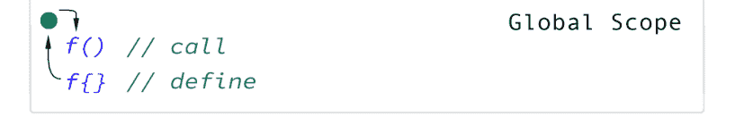

不言说，如果函数在调用之前已经定义，那么就不会有提升，但一切都会按计划运行。函数体内部的语句在通过名称调用函数时执行。匿名函数仍然可以被赋值为值本身。（参见下一个示例。）

```
001 function fun() {
002 console.log("Hello from fun() function 1.");
003 }
004 
005 // 以上代码等于：
006 var fun = function() {
007 console.log("Hello from fun() function 2.");
008 }
```

将匿名函数表达式赋值给变量名是可能的。

然而，重要的是，赋值给变量名的匿名函数不会被提升，除非是命名函数。

这段有效的 JavaScript 代码不会产生函数重定义错误。函数将简单被第二个定义覆盖。

尽管 `fun()` 是一个函数，但当我们创建一个新变量 `fun` 并将另一个函数赋值给它时，我们重新连接了原始函数的名称。

话虽如此，你认为在此时调用 `fun()` 会发生什么？

```
001 fun(); // ?
```

将执行哪一个函数体？

> "Hello from fun() function 2."

你可能认为以下代码将产生重定义错误：

```
001 function fun() {
002 console.log("Hello from fun() function 1.");
003 }
004 
005 function fun() {
006 console.log("Hello from fun() function 2.");
007 }
```

然而，这仍然完全有效——没有产生错误。每当使用 `function` 关键字定义的函数恰好共享相同的名称时，最后定义的函数具有优先级。

在这种情况下，如果你调用 `fun()`；控制台将输出：

> "Hello from fun() function 2."

这实际上是合理的。在以下场景中，即使在同名函数之前定义，也会具有优先级：

```
001 var fun = function() {
002 console.log("Hello from fun() function 1.");
003 }
004 
005 function fun() {
006 console.log("Hello from fun() function 2.");
007 }
```

现在调用 `fun()` 看看在这种情况下发生了什么：

```
001 fun();
```

但这次的输出是：

> "Hello from fun() function 1."

你可以看到 JavaScript 提升变量和函数的顺序。先提升函数，然后是变量。

## 在函数作用域内定义变量

此时，你可能想知道函数内部定义的变量将仅限于该作用域。在函数外部访问它们会导致引用错误：

```
001 function fun() {
002 var apple = 1;
003 }
004 
005 console.log( apple );
```

简单的作用域规则：


图7.1：这里在全局作用域中定义了 `var`，但它也会传播到块作用域。实际上发生的情况是，当块作用域在自己的括号内找不到定义时，它会在父级作用域中查找。如果找到了，它将继承该值。


图7.2：在函数作用域内定义变量基本上是一种方法。没有东西可以离开函数作用域进入其父级作用域。

函数实现了闭包模式，因为它们的变量对全局作用域隐藏了，但仍然可以在它们的其他函数作用域内访问：


图7.3：没有东西可以从函数作用域进入其外部作用域。这实现了闭包模式。这种想法是*保护*变量不受全局作用域影响，但仍从中调用函数。我们稍后会详细查看。

### 7.1.1 变量类型

JavaScript 是一种动态类型语言。

使用 `var` 或 `let` 关键字定义的变量类型可以在应用程序运行期间任何时间赋值和更改，因为它已经被浏览 JavaScript 引擎编译。

`var`、`let` 和 `const` 关键字并不决定变量的类型。相反，它们决定变量*如何*被使用：它可以在定义的作用域之外使用吗？它可以在运行时重新赋值另一个值吗？例如，`var` 和 `let` 可以，但 `const` 不可以。


`var` 关键字从原始规范一直存在这里。你可能应该开始使用 `let` 和 `const` 代替它。大部分情况下它仍然可用，但仅为了支持旧代码。


`let` 定义一个变量但将其使用限制在定义的作用域内。


`const` 与 `let` 相同，但一旦定义，无法重新赋值新值。

## 7.1.2 作用域可见性差异

### 全局作用域无差异

当变量在*全局作用域*中定义时，`var`、`let` 和 `const` 在作用域可见性方面没有区别。

它们传播到内部的块级、函数级和事件回调作用域：

| | var | let | const |
| :--- | :--- | :--- | :--- |
| 全局作用域 | ● | ● | ● |
| 块作用域 1 | □ | □ | □ |
| 块作用域 2 | □ | □ | □ |
| 块作用域 3 | □ | □ | △ |
| | □ | □ | ▲ fun() 函数作用域 |
| | □ | □ | ▲ setTimeout() 回调作用域 |

□ 可可见性 ▲ 定义

关键字 `let` 和 `const` 将变量限制在定义的作用域内：

| | var | let | const |
| :--- | :--- | :--- | :--- |
| 未定义的全局作用域 | ● | | |
| 未定义的块作用域 1 | | | |
| 未定义的块作用域 2 | | | |
| ■ ▲ ▲ 块作用域 3 | | | |
| □ □ ▲ | | | |

□ 可可见性 ■ 定义

使用 `let` 和 `const` 定义的变量不会提升。只有 `var` 会。

### 在函数作用域内

然而，当涉及到函数时，所有变量类型（包括 `var`）仍然限制在它们的作用域内：


无论使用哪种关键字，你无法访问定义函数作用域之外的变量。

### 闭包

函数闭包是一个在另一个函数内部的函数：


调用 `add()` 会增加计数器。这在使用其他作用域模式时是不可能的。

在上一张图中，`add()` 返回一个匿名函数，该函数会增加在外部作用域中定义的变量 `counter`。

让我们尝试使用该模式创建我们自己的闭包：

```
var plus = (function () {
  var counter = 0; // 仅定义一次
  return function () {
    counter += 1;
  }
});
plus(); // 1
plus(); // 2
plus(); // 3
```

**plus()** 函数由一个执行自身的匿名函数定义。

## 为什么要这么做？

在 **plus** 的作用域内，创建了另一个匿名函数 – 它增加了一个私有变量 **counter**，并将结果作为函数的返回值发送到全局作用域。

**总结**：全局作用域任何时候无法直接访问或修改 **counter** 变量。只有**闭包**内部的代码允许其函数修改该变量，尽管如此，变量仍然不会泄露到全局作用域……

**关键点**在于，全局作用域不需要知道或理解 **plus()** 内部是如何工作的。它只关心接收 **plus()** 操作的结果，以便将其传递给其他函数等。

那么我们为什么要费劲解释它们呢？除了闭包是 JavaScript 面试中频率最高的问题之外？

它是面向对象编程的核心原则之一，即从调用它的环境中隐藏函数或方法的内部实现细节。

这种让某些变量变为私有化的想法是理解许多其他编程概念的关键。

如果你仔细考虑过，这正是 `let` 被加入 JavaScript 的原因所在。它为在块级作用域中定义的变量提供了自动私有性。变量私有化是许多编程语言的基本特征。

## 在块级局部作用域中

`let` 和 `const` 关键字隐藏了变量在定义所在作用域及其内部作用域中的可见性。

当你开始在局部块级作用域或函数级作用域内定义变量时，作用域可见性的差异就会显现出来。

## 在类中

类作用域仅仅是一个占位符。在类作用域中*直接*定义变量将产生错误：

```
001 class Cat {
002   let property = 1; // 意外令牌 Error
003   this.property = 2; // 意外令牌 Error
004 }
```

这里是定义局部变量和属性的正确位置。注意，在类方法中，`let`（或 `var const`）仅在该作用域内创建一个局部变量。因此，它在定义它的方法外部无法访问。

```
001 class Cat {
002   constructor() {
003     let property = 1; // OK：局部变量
004     this.something = 2; // OK：对象变量
005   }
006   method() {
007     console.log(this.property); // undefined
008     console.log(this.something); // 1
009   }
010 }
```

在类中，变量定义在它的构造函数或其方法内部：

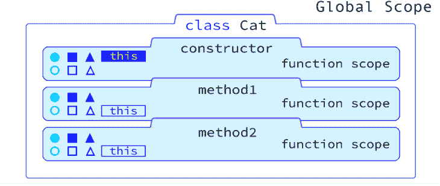

## 7.1.3 ES6 const

`const` 关键字与 `let` 和 `var` 不同。

它要求在定义时赋值：

```
001 let a;
002 console.log(a); // undefined
003
004 const b; // Error: const 声明中缺少初始化器
```

图 7.4：`const` 需要初始值赋值。

这是合理的，因为 `const` 的值不能被重新赋值。

```
001 const speed_of_light = 186000; // 每秒英里
02 speed_of_light = 1; // Error: 赋值给常量变量
```

即使变量是使用 `const` 定义的，仍然更改数组或对象等复杂数据结构的值。让我们来看一下！

## 7.1.4 const 和数组

更改 `const` 数组中的值仍然是允许的：

```
001 const A = [];
002 A[0] = "a"; // OK
003 A = []; // TypeError: 赋值给常量变量。
```

你不能再次向原始变量名分配新的对象。

## 7.1.5 const 和对象字面量

数组类似，当涉及到对象字面量时，`const` 只使定义变为常量。这并不意味着你不能更改赋值给使用 `const` 定义的变量的属性值：

```
无法重新赋值值
const A = {
  property: 1,
  method: func() { ... }
}
A = { something: 1 }; // Error
A.property = 2; // Ok
```

## 结论

在更复杂结构（对象或数组）的情况下，你可以将 `const` 视为某种不允许你重新赋值为新对象的东西。变量被锁定在原始对象上，但你仍然可以更改其属性的值（数组的索引）。如果变量的值是用 `const` 定义的单一原始类型（字符串、数字、布尔值等），则它不能被更改。

## 7.1.6 准则与禁忌

不要出于原因就使用 `var`。这些情况很罕见，且通常不符合良好的设计。

尽可能使用 `let` 和 `const` 代替 `var`。变量提升（使用 `var` 的变量）可能会导致不可预测的 bug，因为只有变量名被提升了，而值变为了 `undefined`。

使用 `const` 定义常量，如 PI、光速等。

由于某些原因你想使用 `var`。

# 8 运算符

## 8.0.1 算术

| 运算符 | 名称 | 示例 | 结果 |
| :--- | :--- | :--- | :--- |
| `>` | 大于 | | |
| `+` | 加法 | 1 | 2 |
| `-` | 减法 | 5 | 3 |
| `*` | 乘法 | 2 | 4 |
| `/` | 除法 | 2 | 2 |
| `%` | 取余 | 1 | 0 |
| `++` | 递增 | | |
| `--` | 递减 | | |

赋值运算符将值赋给变量。

## 8.0.2 赋值

| 运算符 | 名称 | 示例 | 结果 |
| :--- | :--- | :--- | :--- |
| `=` | 赋值 | x = 1 | 1 |
| `+=` | 加法 | x += 2 | 3 |
| `-=` | 减法 | x -= 1 | 2 |
| `*=` | 乘法 | x *= 2 | 4 |
| `/=` | 除法 | x /= 2 | 2 |
| `%=` | 取余 | x %= 1 | 0 |

赋值运算符将值赋给变量。

## 8.0.3 字符串

字符串可以使用 `+` 运算符赋值给变量名或其他变量，我们之前将其作为算术加法。

| 运算符 | 名称 | 示例 | 结果 |
| :--- | :--- | :--- | :--- |
| `=` | 赋值 | x = 'a' | 'a' |
| `+=` | 拼接 | x += 'b' | 'ab' |
| `+` | 加法 | 'x' + 'y' | 'xy' |

在这种范围内，`+=` 运算符可以被视为字符串拼接。

## 8.0.4 比较

| 运算符 | 名称 | 示例 | 结果 |
| :--- | :--- | :--- | :--- |
| `==` | 等于 | 1 == 1 | true |
| | | '1' == 1 | true |
| | | 1 == 2 | false |
| `===` | 值和类型相等 | '1' == '1' | true |
| | | 1 == 1 | true |
| | | 1 == '1' | false |
| `!=` | 不等于 | 1 == 1 | false |
| | | 1 == 2 | true |
| `!==` | 值和类型不相等 | '1' == 1 | true |
| | | 1 == 1 | false |
| `>` | 大于 | 2 > 1 | true |
| `<` | 小于 | 5 < 7 | true |
| `>=` | 大于等于 | 2 >= 1 | true |
| `<=` | 小于等于 | 2 <= 1 | false |

> 图 8.2：三等运算符检查值和类型。

## 8.0.5 逻辑

| 运算符 | 名称 | 示例 | 结果 |
| :--- | :--- | :--- | :--- |
| `&&` | 逻辑与 | (5 < 1 && 3 > 2) | false |
| `||` | 逻辑或 | 1 == 1 \|\| 2 == 2 | true |
| `!` | 逻辑非 | !true | false |
| | | !(1 == 2) | true |

逻辑运算符用于确定表达式或变量之间的逻辑关系。

## 8.0.6 位运算符

| 运算符 | 名称 | 示例 | 结果 |
|---|---|---|---|
| `&` | 位按与 | a&b | 1 |
| `|` | 位按或 | a\|b | 13 |
| `^` | 位按异或 | a^b | 12 |
| `~` | 位取反 | ~a | -6 |
| `<<` | 位左移 | a<<1 | 10 |
| `>>` | 位右移 | a>>2 | 2 |

在二进制数系统中，十进制数有一系列 0 和 1 的等效表示。例如，5 是 0101，1 是 0001。位运算符作用于这些位（bits），而不是数字的十进制值。

我们不会详细介绍它们的工作原理，但你可以轻松地在网上查询。它们具有独特的属性：例如：`<<` 运算符等于将一个整数乘以 2，而 `>>` 运算符等于将一个整数除以 2。它们有时被用于性能优化，因为在处理器周期数方面，它们比 `*` 和 `/` 运算符更快。

## 8.0.7 typeof

| | | |
|---|---|---|
| 001 | `typeof 1;` | number (原始类型) |
| 002 | `typeof Number(1)` | number (原始类型) |
| 003 | `typeof new Number(1);` | object (实例) |

**typeof** 运算符用于检查值的类型。它通常会评估为原始类型、对象或函数。**typeof** 运算符产生的值始终是字符串格式：

```
typeof 125;       // 'number'
typeof 100n;      // 'bigint'
typeof 'text';    // 'string'
typeof NaN;       // 'number'
typeof true;      // 'boolean'
typeof [];        // 'object'
typeof {};        // 'object'
typeof Object;    // 'function'
typeof new Object(); // 'object'
typeof null;      // 'object'
```

图 8.3：NaN (不是数字) 的结果为 'number'。这只是 JavaScript 许多特性之一。然而，它们并不是 Bug，而且随着你对 JavaScript 知识的加深，它们通常会变得更有意义。

**NaN** 原生存在于 **Number.NaN** - 它被认为是一个原始值。**NaN** 通常在数值运算的上下文中产生的符号。一个例子是尝试通过向构造函数传递字符串值来实例化一个数字对象：**new Number("str")**，在这种情况下将返回 **NaN**。

## 8.0.8 三元运算符 (?:)

三元运算符的形式为：条件?表达式:表达式;

语句可以是表达式或单个值：

```
let result = condition ? value1 : value2 ;
```

三元运算符类似于内联的 if 语句。它不支持 `{}` 括号或多个语句。

## 8.0.9 delete

`delete` 关键字可以用于删除对象的属性：

```
001 let bird = {
002   name: "raven",
003   speed: "30mpg"
004 };
005
006 console.log(bird); // {name: "raven", speed: "30mpg"}
007 delete bird.speed;
008 console.log(bird); // {name: "raven"}
```

你不能使用 `delete` 来移除独立的变量。尽管如此，如果你尝试这样做，也不会生成错误（除非你处于严格模式下）。

## 8.0.10 in

`in` 运算符可以检查对象中是否存在某个属性名：

```
001 "c" in { "a": 1, "b": 2, "c": 3 }; // true
002 1 in { "a": 1, "b": 2, "c": 3 }; // false
```

`in` 运算符与数组一起使用时，会检查索引是否存在。

注意，它忽略实际值（无论是在数组还是对象中）。

```
004 "c" in ["a", "b", "c"]; // false
005 0 in ["a", "b", "c"]; // true
006 1 in ["a", "b", "c"]; // true
007 2 in ["a", "b", "c"]; // true
```

# 第9章

## ...rest 和 ...spread

#### 9.0.1 剩余属性 (Rest Properties)

`...rest` 语法可以帮助你通过从单个参数中提取项来引用较多数量的项目。单个 `...rest` 参数假设包含传递给函数的一个或多个参数：

```javascript
function func(...args) {
  console.log(args);
}
```

抛开这些，`...rest` 参数如何简化我们的代码呢？

我们可以通过将输出移动到单独的函数来进一步缩短代码：

```javascript
let print = (items) => console.log(items);
let f = (...items) => print(...items);
```

该函数接收剩余参数：你可以指定任意数量的参数。在 ECMAScript 6 引入箭头函数后，为了进一步缩短代码，有些人使用单个字符来命名他们的变量：

```javascript
let f = (...i) => console.log(i);
```

我们使用了多个特性：箭头函数、`...rest` 和 `.map()`，将我们的代码抽象为类似于数学方程的形式，而没有牺牲功能。它看起来确实比以前更整洁。

这可能让代码更短，但可能更难理解。记住，如果你在团队中工作，rest 意味着“剩余的”。

#### 9.0.2 展开属性 (Spread Properties)

你可以将 spread 视为 rest 的反面。它可以帮助你从对象中提取部分。

```javascript
let { a, b, c } = object;
```

#### 9.0.3 ...rest vs ...spread

rest 和 spread 语法都以 `...name` 的形式出现。那么它们之间的区别是什么？

- `...spread` 运算符将可迭代对象展开为一个或多个参数。
- `...rest` 参数将所有剩余参数（“剩余的”）收集到一个数组中。

假设我们有一个简单的 `sum()` 函数：

```javascript
function sum(a, b) { return a + b; }
```

这限制了我们只有两个参数。`...rest` 参数可以收集传递给函数的未知数量参数，并将存储在数组中（在本例中命名为 **args**）：

```javascript
function sum(...args) {
  console.log(args);
}
sum(1,2,3); // [1,2,3]
```

它与内置的 `arguments` 数组对象相似，但存在区别。正如名称所示，rest 可以捕获“剩余”参数。请记住，rest 必须是唯一的参数标记或列表的最后一个。它不能是许多参数中的第一个：

```javascript
function sum(...args, b, c) // true
```

图 9.2：当后面跟着更多参数时，rest 参数不能作为领先参数名。在这种上下文中使用时，你可以认为它是“剩余的”参数。

```javascript
function sum(a, ...args, c) // true
```

图 9.3：同样，rest 不能出现在参数列表的中间。在多个函数参数的语文中，它总是列表的最后一个。

如果你不遵循此规则，控制台中将生成以下错误：

> > Uncaught SyntaxError: Rest parameter must be last formal parameter

```javascript
function sum(a, b, ...args) {} //正确
```

图 9.4：`...rest` 参数的正确位置。

```
001 // Quark: if you pass an array, it will register as an array:
002 sum([1,2,3]); // Array(3)

004 // But you can flatten an array using spread syntax:
005 sum(...[1,2,3]); // [1,2,3]
```

在这种情况下，`...[1,2,3]` 中的三个点实际上是 `...spread`（展开）。你可以从这个示例中看到，`...spread` 是 `...rest`（剩余参数）的反向操作：它从数组（或对象，我们稍后会看到）中解包值。

与 `...rest` 不同，`...spread` 允许在列表的任何地方使用。

但 `...rest` 和 `...spread` 有会重叠：

```
001 // ...args
002 function print(a, ...args) {
003 console.log(a);
004 console.log(args);
005 }
006 print([ 1, 2, 3 ], 4, 5); // here it is ...spread
007 // a = 1
008 // args = [2, 3, 4, 5]
```

在这里，`...spread` 形成了一个完整的参数列表：1, 2, 3, 4 和 5，这就是传递给 `print` 函数的内容。

在函数内部，a 等于 1，而 `[2, 3, 4, 5]` 是“剩余的”参数。

这是另一个例子：

```
001 // 将一个包含 3 个元素的数组展开到前 3 个参数:
002 function print2(a, b, c, ...args) {
003 console.log(a);
004 console.log(b);
005 console.log(c);
006 console.log(args);
007 }
```

让我们尝试一下：

```
001 print2(...[  1, 2, 3 ], 4, 5);
002 // a = 1
003 // b = 2
004 // c = 3
005 // args = [4, 5]
```

## 使用 ...rest 参数创建一个 sum() 函数

我们第一个使用 `...rest` 参数的 sum 函数可能看起来像这样：

```
001 function sum(...arguments) {
002 let sum = 0;
003 for (let arg of arguments) {
004   sum += arg;
005   return sum;
006 }
007 sum(1, 2, 5); // 8
```

由于 `...args` 产生一个数组，使其成为可迭代对象，我们可以使用 reducer 来执行求和操作：

```
001 function sum(...args) {
002 return args.reduce((x, v) => x + v, 0);
003 }
004 sum(1, 2, 3, 4, 5); // 15
```

但 `...rest` 参数也适用于箭头函数，我们可以将函数进一步简化为以下形式：

```
001 let sum = (...a) => a.reduce((x, v) => x + v, 0);
002 sum(100, 200, 400); // 700
```

些人认为虽然这种格式更短，但更难阅读。但这就是使用函数式编程风格的权衡。具有数学背景的人可能会觉得这种格式很优雅。传统的程序员可能不会。

## 使用 ...spread 展开数组

Luna 对于一只拥有银色毛发、像月亮面的母猫来说是个很好的名字。

```javascript
001 let names = ["felix", "luna"];
002 const cats = [...names, "daisy"];
003 console.log(cats); // (3) ["felix", "luna", "daisy"]
```

## 在数组、对象或函数参数之外使用 ...spread

你不能使用 `...spread` 语法为变量赋值。

```
001 let a = ...[1,2,3]; // error
```

> Uncaught SyntaxError: Unexpected token ...

你感到失望了吗？别担心。你会喜欢**解构赋值**。

## 9.1 解构赋值

解构赋值可以用于从数组和对象中提取多个项并将它们赋值给变量：

```
001 // 从数组解构
002 [a, b] = [10, 20];
003 console.log(a, b); // 10 20
```

上面的代码等同于：

```
001 var a = 10;
002 var b = 20;
```

当没有指定 `var`, `let` 或 `const` 时，假设为 `var`：

```
001 [a] = [1];
002 console.log(window.a); // 1
```

正如预期的，`let` 的定义不会作为 `window` 对象的属性出现：

```
001 let [a] = [2];
002 console.log(window.a); // undefined
```

可以解构到 `...rest` 数组：

```
001 // 使用 rest 从数组解构
002 [a, b, ...rest] = [30, 40, 50, 60, 70];
003 console.log(a, b); // 30 40
004 console.log(rest); // [50, 60, 70]
```

解构用于根据匹配的名称提取对象属性：

```
001 // 从对象的 oranges 属性中解构
002 let { oranges } = { oranges: 1 };
003 console.log(oranges); // 1
```

顺序并不重要——只要有 `grapes` 属性，值就会被赋值给同名的变量：

```javascript
let fruit_basket = {
  apples: 0,
  grapes: 1,
  mangos: 3,
};
let { apples, oranges } = fruit_basket;
console.log(apples); // 0
console.log(oranges); // 1
```

解构不是递归的，嵌套对象不是：

```javascript
let { oranges } = { apples: 1, inner: 2 };
console.log(apples); // undefined
```

但可以直接从对象的内部属性中提取：

```javascript
let { oranges } = { apples: 1, inner: 2 };
console.log(apples); // undefined
```

```javascript
001 // The function global() is defined in an already existing
002 // execution context that was created together with window
003 function global() {
004 // At the time global() is invoked, a new execution
005 // context will be created for this function scope.
006 // During declaration binding instantiation, internal
007 // to JavaScript interpreter, inner() will be created
008 // as a new native object with a scope that points to
009 // variable environment of global()'s execution context
010 function inner() {
011     console.log("inner");
012 }
013 inner(); // Call inner
014 }
015 
016 global(); // "inner"
```

在下面的示例中，全局函数 `sendMail` 定义了一个匿名函数并将其赋值给变量 `send`。该变量仅在 `sendEmail` 函数的作用域内可见，在全局作用域不可见：

```
001 function sendMail(from, sub, message) {
002 let msg = `${sub} > ${message} received from ${from}`;
003 let send = function() { console.log(msg); };
004 send();
005 }
006 
007 sendEmail('Jason', 'Re: subject', 'Good news.');
```

图10.1：在 JavaScript 中，内部函数可以访问其定义所在函数的作用域中定义的变量。

当我们调用 `sendEmail` 时，它会创建并调用 `send` 函数。无法从全局作用域直接调用 `send()`。控制台输出：

```
"Re: subject" > "Good news." received from Jason.
```

我们可以通过从函数中返回来暴露私有方法（内部函数）的引用。接下来的示例与上面完全相同，不同之处在于在第 004 行我们返回了它的引用，而不是调用 `send` 方法：

```
001 function sendEmail(from, sub, message) {
002   let msg = `${sub} ${message} received from ${from}`;
003   let send = function() { console.log(msg); };
004   return send;
005 }
006 
007   // 创建指向 sendMail 的引用
008   let ref = sendEmail('Jason', 'Re: subject', 'Good news.');
009 
010   // 通过引用名调用
011 ref();
```

图10.2：与其调用 `send()`，不如返回它。这样就可以在全局作用域中创建该私有方法的引用。

现在我们可以直接从全局作用域通过引用调用 `send()`。即使在 `sendEmail` 函数被调用后，`msg` 和 `send` 变量仍然留在内存中。在 C 等语言中，它们会被从栈上的自动内存中移除，我们无法访问它们。但 JavaScript 不会。让我们来看另一个例子。我们首先定义 `print`、`set`、`increase` 和 `decrease` 变量为全局占位符。


# 闭包与循环

## 闭包示例

```javascript
001 let print, set, increase, decrease;
002 
003 function manager() {
004   console.log("manager");
005   let number = 15;
006   print = function() { console.log(number) };
007   set = function(value) { number = value };
008   increase = function() { number++ };
009   decrease = function() { number-- };
010 }
```

为了将匿名函数赋值给全局函数变量，我们需要至少运行一次 `manager()`。

```javascript
012 manager(); // 初始化 manager
013 print(); // 15
014 for (let i = 0; i < 200; i++) increase();
015 print();
016 decrease();
017 print(); // 214
018 set(755);
019 print(); // 755
020 let old_print = print; // 保存对 print() 的引用
021
022 manager(); // 再次初始化 manager
023 print(); // 15
024 old_print(); // 755
```

图10.3：`set(755)` 函数将 `number` 的值重置为 755。

控制台输出：

```
manager();
15
215
214
755
manager();
15
755
```

## 解释

在第一次调用 `manager()` 之后，函数执行，所有全局引用都链接到了各自的函数。这创建了我们的第一个闭包。现在，让我们尝试使用全局方法来看看会发生什么。

然后我们调用了一些方法：`increase()`、`decrease()` 和 `set()` 来修改在 `manager` 函数内部定义的 `number` 变量的值。在每一步中，我们都使用 `print()` 方法打印该值，以确认它确实发生了变化。

## 美好的闭包

可以假设，闭包在函数式编程中使用的原因与面向对象编程中使用私有方法的原因相似。它们以函数的形式为对象提供方法 API。

如果我们利用这个想法，创建一个看起来很漂亮并且返回多个方法而不是一个方法的闭包呢？

```javascript
001 let get = null; // 全局 getter 函数的占位符
002 
003 function closure() {
004   let number = 0;
005   let print = function() { console.log(number) };
006   let set = function(value) { number = value };
007   let increase = function() { number++ };
008   let decrease = function() { number-- };
009   return { print, set, increase, decrease };
010 }

011 let methods = closure();
012 methods.print(); // 0
013 methods.increase(); // 1
014 methods.print(); // 1
015 methods.decrease(); // 0
016 methods.print(); // 0
017 methods.set(755);
018 methods.print(); // 755
```

> **注**：提供的源文本中“美好的闭包”部分的 OCR 文本存在严重损坏/重复。我根据之前几页的上下文重新构建了逻辑，以提供该所描述的模式的功能性示例。

## 结语

每当一个函数在另一个函数内部声明时，就会创建一个闭包。

当一个包含另一个函数的函数被调用时，会创建一个新的执行上下文，持有局部变量的新副本。你可以在全局作用域中创建它们的引用，方法是链接全局作用域中定义的变量，或者使用 `return` 关键字从外部函数返回闭包。

**注意：** `new Function()` 构造函数不会创建闭包，因为使用 `new` 关键字创建的对象具有独立的上下文。

## 10.0.1 弧 (Arity)

弧是指函数接收的参数数量。

你可以通过 `Function.length` 属性访问函数的度：

```javascript
// 定义一个有三个参数的函数
function f(a,b,c) {
  // 获取函数的度
  let arity = f.length;
  console.log(arity); // 3
}
```

## 10.0.2 柯里化 (Currying)

在 JavaScript 中，函数是表达式。这意味着函数可以返回另一个函数。在上一节中我们查看了闭包模式。柯里化是一种立即求值并返回另一个函数表达式的模式。

柯里化函数可以通过链式定义并立即返回所有内部函数来构建。

这是一个柯里化函数的示例：

```javascript
let planets = function(a) {
  return function(b) {
    return "Favorite planets are " + a + " and " + b;
  };
};
let favoritePlanets = planets("Jupiter");
// 使用不同的参数调用柯里化函数
favoritePlanets("Earth");
favoritePlanets("Jupiter");
favoritePlanets("Saturn");
```

这是上面示例中 3 个柯里化函数的结果：

| 结果 |
| :--- |
| Favorite planets are Jupiter and Earth |
| Favorite planets are Jupiter and Jupiter |
| Favorite planets are Jupiter and Saturn |

内部函数可以在第一次调用后立即执行：

```javascript
001 // 使用两个参数调用柯里化函数：
002 planets("Jupiter")("Mars");
```

结果是：

| 结果 |
| :--- |
| Favorite planets are Jupiter and Mars |

柯里化最初被认为是函数式编程风格的一部分。

因此并不意外，这种旧的柯里化语法可以重写为这种优雅得箭头函数格式：

```javascript
001 let planets = (a) => (b) => "Planets are " + a + " and " + b;
002  
003 planets("Venus")("Mars");
```

结果是：

| 结果 |
| :--- |
| Planets are Venus and Mars |

# 第 11 章

## 循环

循环是处理列表的基础。循环的主要目的是遍历一个或一组多个语句。迭代在软件开发中非常常见——意味着重复执行某操作多次。

使用循环引入了迭代器的概念。一些内置类型是可迭代的。可迭代对象可以传递给 `for...of` 循环，而不是使用传统的 `for` 循环。你可以说可迭代对象抽象了列表的索引值，帮助你专注于解决问题。

数组是可迭代的。对象不是（对象是可枚举的）。

可迭代类型保证了集合中项目的顺序。这就是为什么数组的每个项目都有一个索引。可枚举类型不保证在迭代时属性出现的顺序。

## 11.0.1 JavaScript 中的循环类型

JavaScript 中有多种迭代方式。从经典的 `while` 和 `for` 循环，到倾向于函数式编程风格的迭代器：使用数组的高阶方法。常见的迭代器有 `for`、`for...of`、`for...in`、`while` 和 `ArrayForEach`。数组方法被假设为迭代器：`.values`、`.keys`、`.map`、`.every`、`.some`、`.filter`、`.reduce` 以及其他一些方法。它们被称为高阶函数，因为它们接受另一个函数作为参数。

## 累加归约

循环通常用于遍历大型对象列表并更新它们的属性。循环可用于过滤对象并将列表归约为更有意义的内容。

它们还可以用于将一组值归约为单个值：

```javascript
001 let miles = [5, 12, 75, 2, 5];
002
003 // 使用循环累加所有数字
004 let A = 0;
005 for (let i = 0; i < 5; i++)
006 A += miles[i];
007 console.log(A); // 99
```

你可以使用归约器实现归约：`Array.reduce` 方法

```javascript
009 // 向页面累加所有数字
010 const R = (accumulator, value) => accumulator + value;
011 const result = miles.reduce(R);
012 console.log(result); // 99
```

## 动态生成 HTML 元素

动态创建多个 HTML 元素以填充 UI View：

```javascript
001 // 向页面添加 10 个元素
002 for (let i = 0; i < 10; i++) {
003   // 创建一个新的 HTML 元素
004   let element = document.createElement("div");
005   // 将内部 HTML 插入元素中
006   element.innerHTML = "element " + i;
007   // 将创建的元素添加到文档
008   document.appendChild(element);
009 }
```

这段代码将向文档添加 10 个 div 元素。

可以使用 `append` 创建嵌套元素。

## 渲染列表

循环通常与渲染列表结合一起使用。渲染仅仅是指在屏幕上显示某些内容的行为。在软件开发中，有很多时候你需要显示项目列表。

## 动态排序表格

动态构建整个表格可以帮助你使用 `Array.entries` 和 `Array.sort` 方法按列对值排序。

在某些情况下，如果你的表格列存储在对象的属性而不是数组项中，你将不得不编写自己的排序函数。然而，取决于数据集，这可能是一个好主意，也可能不是。

## 循环控制

```javascript
001 for (let i = 0; i++) {
002     console.log("loop");
003     break;
004 };
```

注意，这里跳过了条件语句。循环将通过语句本身的显式命令来跳出。

在这种情况下，循环只会向控制台打印一次 "loop."。`break` 关键字会在每次遇到时直接退出循环。但它也可以是条件性的（参见下一个示例）。

## 自定义中断条件

`for` 循环中用 `;;` 分隔的 3 个语句并不是必须的。将条件测试移动到 `for` 循环体内部是完全合法的，而不是在括号之间进行测试。

这个示例跳过了中间的语句（我们通常在中间为计数器创建一个条件），并用循环内部的自己的条件来代替它，当 `i` 大于 1 时它会跳出循环：

```javascript
001 for (let i = 0; i++) {
002     console.log("loop", i = " " + i);
003     if (i > 1)
004     break;
005 };
```

如果没有循环内部的 `if` 语句，它将无限持续，因为没有其他条件阻止它的运行。

控制台输出：

```
001 loop, i = 0
002 loop, i = 1
003 loop, i = 2
```

"loop." 被打印了 3 次。条件 `i > 1` 可能会误导我们，认为文本最多只会打印 2 次。但它打印了 3 次！这是因为计数是从 0 开始而不是 1，而且在上限处，条件的求值结果是 2 而不是 1。

## 标签跳转

在 JavaScript 中，通过在语句前加上 `label_name:`，可以对语句进行标记。因为 `for` 循环是一个语句，所以你可以对循环进行标记。

让我们尝试在内部循环中增加 `c` 的值。通过选择跳出循环并跳转到内部或标记，我们改变了 `for` 循环的工作模式：

- 1. 这个示例在跳转到标记标签时产生 11。

```javascript
let c = 0;
mark: for (let i = 0; i < 5; i++) {
  inner: for (let j = 0; j < 5; j++) {
    c++;
    if (i == 2)
      break mark;
  }
  console.log(c); // 11
}
```

- 2. 这个示例在跳转到内部标签时产生 21。

```javascript
let c = 0;
mark: for (let i = 0; i < 5; i++) {
  inner: for (let j = 0; j < 5; j++) {
    c++;
    if (i == 2)
      break inner;
  }
  console.log(c); // 21
}
```

这两个示例在逻辑上是不同的，取决于内部 `for` 循环的执行流转移到了哪个标签。

## 从标记块作用域跳出

既然说到这个话题，你可以使用 `break` 关键字跳出被标记的普通非 `for` 循环作用域：

```javascript
001 block: {
002   console.log("before");
003   break block;
004   console.log("after");
005 }
```

控制台输出：

```
"before"
```

执行流永远不会到达 "after"。

## 11.2 for...of 循环

在使用索引迭代器（如 `for` 循环）处理数组或对象属性时可能会变得非常麻烦。特别是当它们的数量未知时。

`for...of` 循环来救急！

我们将从一个稍微高级的示例开始，将 `for...of` 循环与生成器（generator）结合使用，然后发现一些其他更简单的用例。

## 11.2.1 for...of 和生成器

有时你可能想配合生成器使用 `for` ——这是一种在 `function` 关键字后面带有星号 `*` 的特殊函数。

当生成器函数被调用时，内部的多个 `yield` 语句不会像你通常预期的那样同时执行。只有第一个执行。

要执行 `yield` 语句 2 和 3，你必须再次调用生成器函数（额外两次）。在内部，每当你调用一次生成器函数时，`yield` 语句计数器都会自动增加。

生成器异步执行 `yield` 语句，尽管生成器函数内部的代码看起来是线性的。这是故意为之——它让代码比替代方案（XMLHttpRequest, Ajax 等）更具可读性。

```javascript
// Generator function:
function* generator() {
  yield 1;
  yield 2;
  yield 3;
}

for (let value of generator()) {
  console.log(value);
}
```

上面的代码等同于手动调用生成器 3 次（当你想手动增加生成器时，只需确保先将其赋值给另一个变量）：

```javascript
let gen = generator();
console.log(gen.next().value);
console.log(gen.next().value);
console.log(gen.next().value);
```

两种情况下的控制台输出都是：

```
1
2
3
```

生成器是一次性使用的函数。你不应该尝试像普通函数一样重用生成器函数（在最后一个 `yield` 语句执行之后）。

## 11.2.2 for...of 和字符串

字符串是*可迭代的*。

你可以使用 `for...of` 循环遍历字符串的每个字符：

```javascript
let string = 'text';
for (let value of string)
  console.log(value);
```

控制台：

```
't'
'e'
'x'
't'
```

## 11.2.3 for...of 和数组

假设我们有一个数组：

```javascript
let array = [0, 1, 2];
```

我们可以在不需要创建索引的情况下遍历它。一旦到达数组的末尾，循环会自动结束。

```javascript
for (let value of array)
  console.log(value);
```

控制台：

```
0
1
2
```

## 11.2.4 for...of 和对象

如果能使用 `for...of` 循环遍历对象的*属性*就太好了，对吧？

```javascript
let object = { a: 1, b: 2, c: 3 };
for (let value of object)
```

控制输出：

1

请记住，这只是一个示例。在现实中，这会被认为是糟糕的代码，因为 `if` 语句仍然执行了 1000 次。只有当 `c == 0` 时，控制台才会打印 1。如果你需要提前退出，请使用 `break` 代替。

# 第 12 章

## 数组

许多 `Array.*` 方法都是迭代器。与其将数组传递到 `for` 或 `while` 循环中，你应该使用内置的 `Array` 方法。数组通常已经有了方法，可以为你解决相同问题编写的代码提供更简洁的语法。那么，为什么要重造轮子呢？

Array 方法附加在 `Array.prototype` 属性上。这意味着你可以直接从数组对象执行它们，例如 `array.forEach()`，或者直接从数组字面量值执行，例如：`[1,2,3].forEach();`

## 12.0.1 ES10 Array.prototype.sort()

V8 之前的（pre-ES10）实现对包含超过 10 个元素的数组使用不稳定的快速排序算法。

稳定排序是指两个具有相同键的对象在排序输出中的顺序与它们在未排序输入中的顺序相同。但现在情况不再如此了。ES10 提供了稳定的数组排序：

### 水果数组定义：

```javascript
001 var fruit = [
002 { name: "Apple", count: 13 },
003 { name: "Pear", count: 12 },
004 { name: "Banana", count: 12 },
005 { name: "Strawberry", count: 11 },
006 { name: "Cherry", count: 11 },
007 { name: "Blackberry", count: 10 },
008 { name: "Pineapple", count: 10 }
009];
```

### 执行排序：

```javascript
001 // 创建我们自己的排序标准函数:
002 let my_sort = (a, b) => a.count - b.count;
003
004 // 执行稳定的 ES10 排序:
005 let sorted = fruit.sort(my_sort);
006 console.log(sorted);
```

### 控制台输出：

```
▼ [{}, {}, {}, {}, {}, {}, {}, {}, {}, {}, {}, {}] 
▶ 0: {name: "Blackberry", count: 10}
▶ 1: {name: "Pineapple", count: 10}
▶ 2: {name: "Strawberry", count: 11}
▶ 3: {name: "Cherry", count: 11}
▶ 4: {name: "Pear", count: 12}
▶ 5: {name: "Banana", count: 12}
▶ 6: {name: "Apple", count: 13}
  length: 7
▶ _proto : Array(0)
```

## 12.0.2 Array.forEach

**forEach** 方法会为数组中的每一个项执行函数。

每个迭代步骤都会接收 3 个参数：**value**、**index**、**object**。

它类似于 **for-loop**，但看起来更简洁：

```javascript
001 let fruit = ['pear',
002             'banana',
003             'orange',
004             'apple',
005             'pineapple'];
006
007 let print = function(item, index, object) {
008     console.log(item);
009 }
010
011 fruit.forEach( print );
```

从 ES6 开始，建议将箭头函数与 Array 方法结合使用。在构建大型应用时，代码将更易读和维护。让我们看看如何让语法更简洁：

因为在 JavaScript 中函数也是表达式，你可以直接将函数传递给 forEach：

```javascript
001 fruit.forEach(function(item, index, object) {
002     console.log(item, index, object);
003 });
```

但你可能想在这里使用箭头函数：`() => { }`

```javascript
001 fruit.forEach((item, index, object) => {
002     console.log(item, index, object);
003 });
```

上述两种情况的控制台输出：

```
"pear", 0, ["pear","banana","orange","apple","pineapple"]
"banana", 1, ["pear","banana","orange","apple","pineapple"]
"orange", 2, ["pear","banana","orange","apple","pineapple"]
"apple", 3, ["pear","banana","orange","apple","pineapple"]
"pineapple", 4, ["pear","banana","orange","apple","pineapple"]
```

如果你只有一个参数和一个返回语句，你可以使用这种精简的形式：

```javascript
001 fruit.forEach(item => console.log(item));
```

只要你只有一个语句，就可以移除括号。

"pear"

"banana"

"orange"

"pineapple"

## 12.0.3 Array.every

返回值：boolean

为了不与“执行每一项”的逻辑混淆，当数组中至少有一个项根据指定条件评估为 `false` 时，许多 `case` 方法实际上不会在数组的每个项上运行。如果数组中的每一个项都满足条件，则结果为 `true`，因为数组中没有任何数字大于或等于 10。如果数组中存在更大的数字，结果将为 `false`。需要注意的是，一旦发现不符合条件的项就会停止。

## 统计周末

想象这样一个任务：你必须实现一个函数，该函数给定一个月份，将返回该月份有多少个周末、工作日和假期。一个一个月可以通过其包含的天数来表示。

保持输入值的类型与 reducer 返回值的类型相同是非常重要的。这是 reducer 的主要特征之一：将一个集合归约化（不一定通过过滤来实现，尽管这是一种可能性）。

## 函数纯性

Reducers 经常用于遵循函数式编程风格原则编写的代码中。其中之一就是**函数纯性**。接下来的“要做”与“要不要”描述了纯函数的某些属性。

## 12.0.9 事项 (Dos and Don'ts)

尽管这些不是绝对性要求，但这些思想可能有助于避免反模式代码。只有当结果与项的类型相同且 reducer 具有结合律时，才使用 `reduce()`：

```javascript
001 [1,2,3,4,5].reduce((a, b) => a + b, 0);
```

图 12.1：数字数组被“归约”为一个数字——相同类型的值。

- 使用它来累加数字。
- 使用它来乘某些数字。
- 使用它来更新 React 中的状态。
- 不要用它从零开始构建新的列表或对象。
- 不要用它用于其他任何事情（请使用循环）。
- 不要用它来修改（更改其参数的原始值）。
- 不要用它来执行副作用，例如 API 调用和路由跳转。
- 不要用它来调用非纯函数，例如 `Date.now()` 或 `Math.random()`。

## 12.0.10 ES10 Array.flat()

展平多维数组：

```javascript
001 let multi = [1,2,3,[4,5,6,[7,8,9,[10,11,12]]]];
002 multi.flat(); // [1,2,3,4,5,6,Array(4)]
003 multi.flat().flat(); // [1,2,3,4,5,6,7,8,9,Array(3)]
004 multi.flat().flat().flat(); // [1,2,3,4,5,6,7,8,9,10,11,12]
005 multi.flat(Infinity); // [1,2,3,4,5,6,7,8,9,10,11,12]
```

## 12.0.11 ES10 Array.flatMap()

```javascript
001 let array = [1, 2, 3, 4, 5];
002 array.map(x => [x, x * 2]);
```

变为：

- 0: (2) [1, 2]
- 1: (2) [2, 4]
- 2: (2) [3, 6]
- 3: (2) [4, 8]
- 4: (2) [5, 10]
  length: 5

现在展平 map 结果：

```javascript
001 array.flatMap(v => [v, v * 2]);
```

变为：

- [1, 2, 2, 2, 4, 3, 6, 4, 8, 5, 10]

## 12.0.12 ES10 String.prototype.matchAll()

在编写软件时，匹配字符串中的多个模式是一个常见问题。用例包括从邮件标头中同时提取名称和电子邮件地址、扫描唯一模式的存在等。

在过去，为了匹配多个项，我们使用带有正则表达式和 `/g`（全局）标志的 `String.match`，或者使用 `RegExp.exec` 和/或 `RegExp.test` 配合 `/g`。首先，让我们看看顺序是如何工作的。

`String.match` 字符串参数只返回第一个匹配项：

```javascript
001 let string = "Hello";
002 let matches = string.match(/l/);
003 console.log(matches[0]); // "l"
```

结果是单个 "l"（注意：匹配项存储在 `matches[0]` 中，而不是 `matches` 中）。在单词 "hello" 中搜索 "l" 时，只返回 "l"。

使用正则参数的 `string.match` 也是如此。让我们使用正则表达式 `/l/` 在字符串 "hello" 中定位字符 "l"：

```javascript
001 let string = "Hello";
002 let matches = string.match(/l/);
003 console.log(matches[0]); // "l"
```

### 加入 /g 标志

带有正则和 `/g` 标志的 `String.match` 确实返回多个匹配项：

```javascript
001 let string = "Hello";
002 let ret = string.match(/l/g); // (2) ["l", "l"]
```

太棒了……我们在 ES10 之前就已经得到了多个匹配。它一直有效。那么，为什么还要费心思开发一个完全的 `matchAll` 方法呢？在我们详细回答这个问题之前，让我们先看看捕获组。即使不学别的，你可能也会学到关于正则表达式的新知识。

## 正则表达式捕获组

正则中的捕获组简单来说就是从括号中提取模式。你可以通过 `/regex.exec(string)` 和 `string.match` 获取捕获组。普通的捕获组是 `括号()` 中的内容。


# 12.0.12 ES10 String.prototype.matchAll()

在字符串中匹配多个模式是编写软件时一个常见问题。用例包括从邮件标头中同时提取名称和电子邮件地址、扫描唯一模式的存在等。

在过去，为了匹配多个项，我们使用 `String.match` 带有正则表达式和 `/g`（全局）标志或 `RegExp.exec` 和/或 `RegExp.test` 配合 `/g`。首先，让我们看看顺序是如何工作的。

`String.match` 字符串参数只返回第一个匹配项：

```javascript
001 let string = "Hello";
002 let matches = string.match(/l/);
003 console.log(matches[0]); // "l"
```

结果是单个 "l"（注意：匹配项存储在 `matches[0]` 中，而不是 `matches`）。在单词 "hello" 中搜索 "l" 时，只返回 "l"。

使用正则参数的 `string.match` 也是如此。让我们使用正则表达式 `/l/` 在字符串 "hello" 中定位字符 "l"：

```javascript
001 let string = "Hello";
002 let matches = string.match(/l/);
003 console.log(matches[0]); // "l"
```

## 加入 /g 标志

带有正则和 `/g` 标志的 `String.match` 确实返回多个匹配项：

```javascript
001 let string = "Hello";
002 let ret = string.match(/l/g); // (2) ["l", "l"]
```

太棒了……我们在 ES10 之前就已经得到了多个匹配。它一直有效。那么，为什么还要费心思开发一个完全的 matchall 方法呢？在我们详细回答这个问题之前，让我们先看看捕获组。即使不学别的，你可能也会学到关于正则表达式的新知识。

## 正则表达式捕获组

正则中的捕获组简单来说就是从括号中提取模式。你可以通过 `/regex.exec(string)` 和 `string.match` 获取捕获组。普通的捕获组是 `括号()` 中的内容。

捕获组可以通过 `/regex.exec(string)` 和 `string.match` 获取。普通的捕获组是 `括号()` 中的内容。

## 12.0.13 示例

```javascript
001 const string = 'black-raven parrot-seagull';
002 const regex = /(?<color>.*)(?<bird>[a-z0-9]+)/;
003 for (const match of string.matchAll(regex)) {
004   let value = match[0];
005   let index = match.index;
006   let input = match.input;
007   console.log(`${value} at ${index} with '${input}'`);
008   console.log(match.groups.color);
009   console.log(match.groups.bird);
010 }
```

输出结果：

black-raven at 0 'black-raven parrot-seagull'

black-raven

parrot-seagull at 11 'black-raven parrot-seagull'

parrot-seagull

seagull at 23 'black-raven parrot-seagull'

## 12.0.14 比较两个对象

比较两个字面量数值（如 `1 === 1`）或字面量布尔值 `true === false` 是有意义的，但比较两个对象意味着什么呢？此外，`==` 和 `===` 运算符没有帮助，因为它们通过引用而不是通过值进行比较：`[]` 和 `[]` 在值上可能相等，但它们是不同的数组：

```javascript
001 [] === []; // 值相等为 false
002 let x = []; x === x; // 仅引用为 true
```

我们必须编写自己的函数！比较对象的一种方法是比较它所有属性的数量、类型和值。

遵循 `strcmp` 的命名规范（许多语言中比较字符串的函数），我们可以写一个自定义函数 `objcmp` 来比较两个对象：

```javascript
001 // 比较对象，如果所有属性相等则返回 true
002 export default function objcmp(a, b) {
003
004     // 将属性拷贝到 A 和 B
005 let A = Object.getOwnPropertyNames(a);
006 let B = Object.getOwnPropertyNames(b);
007
008     // 如果属性数量不相等，则提前返回
009     if (A.length != B.length) {
010         return false;
011
012     // 遍历并比较两个对象上的所有属性
013 for (let i = 0; i < A.length; i++) {
014         let propName = A[i];
015
016
017     // 属性在值和类型上必须相等
018     if (a[propName] != b[propName]) {
019         return false;
020 }
021
022     // 对象相等
023     return true;
024 }
```

图 12.4：浅拷贝对象属性比较。

`objcmp` 函数接受两个参数：a 和 b，代表我们想要比较的两个对象。

这是一个非递归的浅拷贝算法。也就是说，我们只比较直接附加在对象上的一级属性。附加在属性上的属性不会被比较。在很多情况下，这是足够的。但另一个更严重的问题。在当前的形式下，该函数假设属性不会指向数组或对象。这两个常见的数据结构极有可能是任意对象的一部分。

即使我们没有进行深度比较，如果任何属性指向对象或数组，无论它们的长度和实际值是否相同，函数都会失败：

```javascript
001 // 创建两个相同的对象
002 let a = { prop: [1,2], obj: {} };
003 let b = { prop: [1,2], obj: {} };
004
005 objcmp(a, b); // false
```

我们的算法在 `[1,2] === [1,2]` 比较上失败了。那么我们如何处理这种情况呢？首先，我们可以编写 `is_array` 函数。因为数组是 JavaScript 中唯一具有 `length` 属性且至少有 3 个高阶函数（`reduce`、`filter` 和 `map`）的对象，我们可以说如果一个对象存在这些方法，那么它一定是一个数组，准确性大约为 99%：

```javascript
001 function is_array(value) {
002   return typeof value.reduce == "function" &&
003   typeof value.filter == "function" &&
004   typeof value.map == "function" &&
005   typeof value.length == "number";
006 }
007
008 // 测试函数
009 console.log(is_array(1));      // false
010 console.log(is_array("string")); // false
011 console.log(is_array({a: 1}));   // false
012 console.log(is_array(true));    // false
013 console.log(is_array([]));      // true
014 console.log(is_array([1,2,3,4,5])); // true
```

## 12.0.15 编写 arecmp

根据数组相等意味着两个数组每个对应索引的值匹配的假设，让我们编写自己的 `arecmp` 函数：

```javascript
001 let a = [1,2];
002 let b = [1,2];
003 let c = [1,5];
004
005 function arecmp(a, b) {
006
007 // 一个或多个值不是数组
008 if (!is_array(a) && is_array(b))
009 return false;
010
011 // 长度不等
012 if (a.length != b.length)
013 return false;
014
015 // 比较值
016 for (let i = 0; i < a.length; i++)
017 if (a[i] != b[i])
018 return false;
019
020 // 所有测试通过：a 和 b 相
021 return true;
022 }
024 console.log(arecmp(a,b)); // true
025 console.log(arecmp(a,b)); // true
026 console.log(arecmp(b,c)); // false
```

JavaScript 中没有用于比较数组的内置函数。这可能有很多原因，很大程度上取决于你的应用程序设计。毕竟，两个数组相等到底意味着什么？在数组中存储数据，在没有具体的字面量的情况下，我们只能假设它是这样的。

## 12.0.16 改进 objcmp

现在我们有了 `is_array`，让我们为 `objcmp` 函数添加两个特殊情况：针对数组和一个针对对象，这使得我们的算法不容易出错。

```javascript
// 比较对象，如果所有属性相等则返回 true
function objcmp(a, b) {
    // 将属性拷贝到 A 和 B
    let A = Object.getOwnPropertyNames(a);
    let B = Object.getOwnPropertyNames(b);

    // 如果属性数量不等，则提前返回
    if (A.length != B.length)
        return false;

    // 遍历并比较两个对象上的属性
    for (let i = 0; i < A.length; i++) {
        let propName = A[i];
        let p1 = a[propName];
        let p2 = b[propName];

        // 属性指向数组
        if (is_array(p1) && is_array(p2)) {
            if (!arecmp(p1, p2))
                return false;
        } else {
            // 属性指向对象
            if (p1.constructor === Object &&
                p2.constructor === Object) {
                if (!objcmp(p1, p2))
                    return false;
            }
            // 比较原始值
            else if (p1 != p2)
                return false;
        }
    }
    return true;
}
```

与之前的版本相比，这些行增加了对属性是否指向数组或对象字面量的测试。如果属性两者皆不是，则像常一样测试原始值。

## 12.0.17 在更复杂的对象上测试 objcmp

让我们实际操作一下！

```javascript
let M = {               
  a: 1,                
  b: 100,             
  c: {},               
  d: [1,2],           
  e: "abc",         
  f: true,            
  g: () => {}      
};                      

let N = {               
  a: 1,                 
  b: 100,              
  c: {},                
  d: [1,2],            
  e: "abc",           
  f: true,              
  g: () => {}         
};                      

let O = {               
  a: 1,                 
  b: 100,              
  c: {},                
  d: [5,7],            
  e: "abc",           
  f: true,              
  g: () => {}         
};                      
```

我们有三个对象 M、N 和 O。对象 M 和 N 是相同的，而 O 只在数组值 `[5,7]` 上不同。

```javascript
objcmp(M, M);      // true
objcmp(M, N);      // true
objcmp(M, O);      // false
```

我们第一次尝试旧版本的 `objcmp` 在以下用例上失败了。但现在可以：

```javascript
// 创建两个相同的对象
let a = { prop: [1,2], obj: {} };
let b = { prop: [1,2], obj: {} };

objcmp(a, b); // true
```

另一个测试，这次使用了几个不同的对象字面量：

```javascript
objcmp({a:[1,2]}, {a:[1,2]}); // true
objcmp({a:{b:1}}, {a:{b:1}}); // true
objcmp({a:[1,2]}, {a:[1,3]}); // false
objcmp({a:{b:1}}, {a:{b:2}}); // false
```

我们的对象比较函数现在按预期工作。它并不完美，但至少在大多数情况下不会卡住。事实上，它甚至递归地检查对象属性，这比以前更像是一种深层搜索。

**可能的改进：** 你可以通过检查对象数组（不仅仅是值数组）来进一步改进此函数。

正如你所看到的，这就是为什么不存在深度搜索原生函数。这真的取决于你的数据实现。谁说你的数组会包含对象，或者任何对象属性都会指向另一个对象呢？在没有这些知识的情况下，很难创建一个通用算法而不存在创建反模式风险（即你的代码执行的操作比它需要的多）。

## 章节总结

尝试解决一个问题（比较两个对象）导致发现了另一个也需要解决的问题（比较两个数组）。这并不是我们在编写 **objcmp** 时预料到的。

# 第 13 章

## 函数

## 13.1 函数

在 JavaScript 中，有两种类型的函数：使用 `function` 关键字定义的标准函数，以及后来在 ES6 中添加的箭头函数 `() => {}`。

普通函数也可以作为对象的构造函数使用，通过与 `new` 运算符配合使用来创建对象实例。请注意，自 ECMAScript >= 6 以来，你可以使用 `class` 关键字来实现相同的效果。

在函数内部，`this` 关键字可以指向调用该函数的上下文。如果该函数被用作对象的构造函数，它也可以指向所创建的对象的实例。

函数在其内部作用域内有一个类数组的 `arguments`，它包含了传递给函数的参数长度和值，即使函数定义中没有参数名。

箭头函数可以被调用，但它们不能用于实例化对象。

箭头函数通常用于函数式编程风格。和普通函数一样，它们可以用于定义对象方法。它们还经常用作事件回调函数。在箭头函数的作用域内，`this` 关键字指向其自身作用域外 `this` 所等的值。

箭头函数在内部作用域内没有类数组的 `arguments`。

### 13.1.1 函数解剖

函数定义由 `function` 关键字及其后的函数名（在接后的示例中显示为 `update`）、包含参数名列表 `(a,b,c)` 的括号，以及包裹在括号中的函数体组成：

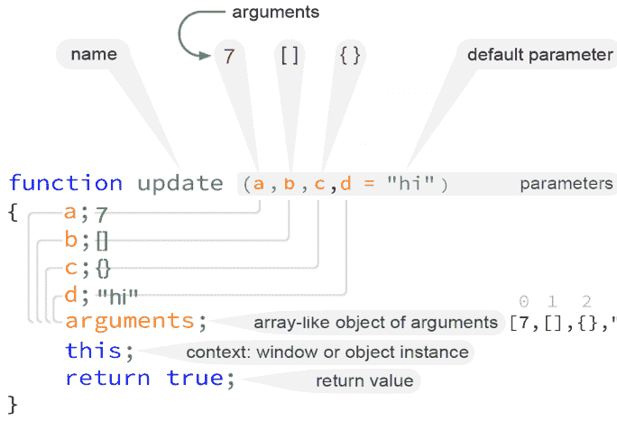

```javascript
function update (a, b, c, d = "hi") {
  a = 7;
  b = [];
  c = {};
  d = "hi";
  arguments; // arguments 的类数组对象 [7,{},"hi"]
  this; // 上下：window 或对象实例
  return true; // 返回值
}
```

图 13.1：函数解剖。

`return` 关键字是可选的。但一旦体内的所有语句执行完毕，函数就会返回，即使没有指定 `return` 关键字。

ES5 风格函数内部的 `this` 关键字指向执行函数的上下文。它通常是全局 `window` 对象。如果使用 `new` 关键字来实例化对象，那么 `this` 关键字将指向使用该函数实例化的对象实例。

`arguments` 是一个类数组对象，包含了传递到函数的从 0 开始的参数列表，即使在函数的定义中没有指定参数名。

### 13.1.2 匿名函数

可以使用相同的语法但跳过函数名来定义无名或匿名函数。

匿名函数通常用作事件回调，在这种情况下，我们通常不需要知道名称是什么——我们只需要在事件完成工作后的某个特定时间执行它们：

```javascript
setTimeout(function() {
  console.log("Print something in 1 second.");
  console.log(arguments);
}, 1000);
```

图 13.2：作为 setTimeout 事件回调的匿名函数。

```javascript
document.addEventListener("click", function() {
  console.log("Document was clicked.");
  console.log(arguments);
});
```

图 13.3：用于拦截点击事件的匿名函数。

### 13.1.3 将函数赋值给变量

匿名函数可以赋值给变量，使其再次变为命名函数。通过这种方式，你可以将函数定义与其在事件方法中的用法分离：

```javascript
let print = function() {
  console.log("Print something in 1 second.");
  console.log(arguments);
}
```

图 13.4：将匿名函数赋值给变量 `print`。

```javascript
let clicked = function() {
  console.log("Document was clicked.");
  console.log(arguments);
}
```

图 13.5：将匿名函数赋值给变量 `clicked`。

我们现在可以通过它们的名称来调用这些函数：

```javascript
// 调用命名的匿名函数
print();
clicked();
```

图 13.6：赋值给变量名的“匿名”函数变成了命名函数。

你也可以仅通过名称将它们传递给事件函数：

```javascript
// 更整洁的代码
setTimeout(print, 1000);
document.addEventListener("click", clicked);
```

图 13.7：更整洁的代码。

## 函数参数

函数参数是可选的。但一旦体内的所有语句执行完毕，函数就会返回，即使没有指定 `return` 关键字。

`arguments` 是一个类数组对象，包含了传递到函数的从 0 开始的参数列表，即使在函数的定义中没有指定参数名。

## 检查类型

JavaScript 是一种动态类型语言。变量的类型由其值决定。这有时会引起 Bug。

例如，尽管 JavaScript 提供了许多不同的类型进行处理，但它并没有提供可以确保你预期的自动保护机制。

```javascript
function update (a, b, c, d = "hi") {
  a = 7;
  b = [];
  c = {};
  d = "hi";
  arguments;
}
```

| 参数 | 示例值 |
| :--- | :--- |
| a | 7 |
| b | [] |
| c | {} |
| d | "hi" |

## 13.2 this 关键字的起源

**this** 关键字是借自 C++ 的。在原始设计中，这个关键字旨在指向类定义中对象的*实例*（instance）。

仅此而已！应该没有更多了。

但 JavaScript 语言原始的设计者似乎决定使用 **this** 关键字来提供一个额外功能：携带指向*执行上下文*（execution context）的链接，这本不应该属于计算机语言特性设计的一部分，而应该封装在内部实现中：

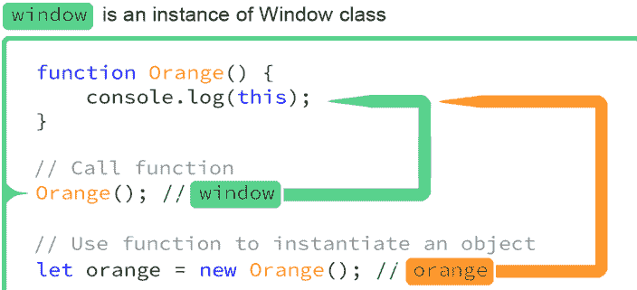

图 13.8：**this** 关键字的这种双重性经常会导致头疼，可能需要吃两片布洛芬才能缓解。

在任何编程语言中，你都无法避免处理上下文。但将上下文绑定到 **this** 关键字上是一个错误，造成了双重性和许多困惑。

后来，箭头函数的发明就是为了处理 **this** 关键字这种奇葩用例的某些副作用。而这就是我们的下一个主题！

# 第 14 章

## 高阶函数

## 14.0.1 理论

高阶函数听起来很复杂，但它们实际上比你一直以来处理的普通（一阶）函数要简单得多。

高阶函数顾如其名，存在于更高层次的思维中。这就是所谓的抽象（abstraction）。如果你想在软件开发方面更胜以往，抽象是一个非常需要理解的重要概念。

你可以将抽象理解为处理思想而非琐碎细节的品质。一旦你掌握了它，抽象将成为你最好的朋友。

## 抽象

当你开车并踩刹车踏板时，你不会考虑重量分布、包含活塞的刹车钳如何将刹车片压在制动盘上，或者动力助力如何增强你施加在踏板上的压力。这是你预期发生的事情。你只是想让汽车停下来。看到了吗？你已经在使用抽象思维了——这是自然的。

这在编写软件应用程序的背景下又是怎样的？在接下来的章节中，我们将编写自己的高阶函数 map，它将遍历数组中的每一项，并对其应用一个函数。如果我们的 map 函数是之前示例中的汽车刹车系统，那么它就是刹车踏板。它将负责控制刹车钳和活塞——这是一种通过将底层细节抽象化来处理它们的机制。因此，当我们调用 map 函数时，不需要考虑所有琐碎的细节。我们只想让某些事情发生，并让函数返回预期的结果。

太棒了，在使用函数之前，我们实际上必须设计它的内容，并确定我们希望这些细节如何工作。

JavaScript 已经支持几个实现此功能的高阶函数。但在使用它们之前，我们将编写自己的。如果说的话，这不仅有助于我们加深对高阶函数的理解，也有助于对抽象概念本身的理解。

## 编写你的第一个高阶函数

并不是所有问题都能用 JavaScript 内置方法解决。在开发自定义软件时，你将面临必须自己编写此类函数，或需要用抽象的术语进行思考以产生最高效解决方案的情况。

## 应用动作的一阶函数

实际动作并没有发生在 map 中，而是在作为参数之一传递给 map 的函数中。这意味着 map 函数没有单一的用途。它取决于传入它的函数做了什么。而它可以是任何事情。

我们将创建 map 函数并向它传递一个一阶函数，该函数的单一目标是将数值加 1。就像在汽车刹车示例中一样，我们 map 函数的用户不应该关心内部 for 循环如何遍历所有项。我们只想给它一个任务。为了做到这一点，我们将向高阶 map 函数传递另一个函数。

**重要：** 真正让函数实现抽象的事实是，高阶函数本身不需要确切知道自己在做什么。它只是一个对一组值执行动作的逻辑脚手架。就像 for 循环一样。事实上，for 循环是它的核心。但当函数被实际使用时，这并不重要。你可以认为这是一种对 for 循环的抽象（它变成了一种理所当然的假设）。

它们通常与一阶函数一起使用。尝试不要将高阶函数看作一个特定的特性。它们可以表现得像 for 循环。但它们也可以作为实例化事件的方法——在这种情况下，一阶函数将作为回调函数与其一起使用。它们并不局限于单一用途。它们开启了仅用一阶函数无法创建的几种不同的逻辑模式。

例如 **Array.map** 遍历一组值并应用修改。

**Array.reduce** 将一组值“归约”为一个值。

基于事件的 **setTimeout** 是一个高阶函数，**addEventListener** 也是。

## 14.0.2 定义

**高阶函数**是指接受一个函数作为参数之一或返回一个函数（或两者兼有）的函数。

## 14.0.3 抽象

这是视觉化思考高阶函数模式的一种方法。它以更高层次思维的形式存在。


图 13.8：**this** 关键字的这种双重性经常会导致头疼，可能需要吃两片布洛芬才能缓解。

## 14.0.4 迭代器

**Array.map** 方法是最常见的高阶函数之一。它接收一个数组进行处理。它将返回一个每个项都经过修改的数组副本。

```javascript
let copy = []; // 返回值占位数组
```

然后用一个 for 循环遍历我们接收到的作为第一个参数的数组。这是我们想要抽象的部分。在使用该函数时，我们不需要再考虑 for 循环：

```javascript
for (let index = 0; index < array.length; index++) {
```

在循环内部，让我们将原始数组中当前索引的值复制到临时变量 `original` 中。

```javascript
let original = array[index];
```

现在，将 `original` 变量中的值传递给传递此函数的一阶函数：

```javascript
let modified = f (original);
```

`f` 函数将执行魔法（在我们的示例中，将原始值加 1，但也可以是任何操作）并返回修改后的值。因此，我们将修改后的值复制到我们的 `copy` 数组中，它是整个修改后数组的占位符。

```javascript
copy[index] = modified;
```

最后，返回修改后数组的副本：

```javascript
return copy;
```

一旦所有项都被 `add_one` 函数复制并处理，它们将存储在 `copy` 数组中，该数组将作为函数的返回值。

侧记：`reduce` 方法——也是一种高阶函数，它使用所谓的累加器（accumulator）。`Array.reduce` 中的累加器的作用与此示例中的 `copy` 数组类似。但在 `reduce` 中，累加器不是数组——它是一个单一值，用于累积地收集数组中的所有项并将它们合并为一个单一的返回值。这就是为什么当你需要合并值时，`reducers` 是更好的解决方案。

# 调用我们的自定义 map 函数

为了看到它是如何工作的，首先，让我们定义一组初始值来处理：

```javascript
// 原始数组对象
let array = [0,1,2];
```

让我们尝试运行我们的 `map` 函数：

```javascript
// 让我们试用一下！
array = map(array, add_one); // [1,2,3]
```

在这里，**add_one** 是本章前面提到的函数。它简单地向传递给它的值加 1 并返回它。

结果如何？原始数组 `[0,1,2]` 现在变成了 `[1,2,3]`。数组中的所有项都加了 1。

我们刚刚写了自己的 `map` 方法，它的内部操作与内置的 **Array.map** 完全相同。这种操作非常常见，以至于它被添加为 `Array` 对象上的原生方法。

# 调用 Array.map 函数

是的，我们可以使用内置的 `Array.map` 方法来实现完全相同的事情。它执行的是完全（或相对）相同的操作：

```javascript
// 使用原生 Array.map 方法实现相同的功能：
array.map(add_one); // [2,3,4]
```

听起来很简单。我们本可以从一开始就使用这个方法。但通过编写我们自己的 `map` 方法，我们实际上理解了它内部是如何工作的。

这将帮助我们理解许多其他实现对项目列表进行迭代的高阶函数，例如 **filter**、**every**、**reduce** 等。它们都使用相似的内部代码，只是有细微的差别。

# for 循环去哪了？

如你所见，`Array.map` 在内部实现了一个 for 循环。这不在于提供一个更高效的 for 循环，而是将其完全从我们的视线中隐藏起来。

我们只需要向 `Array.map` 方法提供一个函数。通过隐藏迭代步骤，我们只剩下编写逐个比较、相加或过滤每个值的实际函数。

这有助于你专注于解决问题，而不是编写和重写大量的重复代码。它也让你的代码看起来更整洁。

# 14.0.5 行为准则

初学者经常使用一种方法而不是另一种方法来实现相对相同的功能。虽然它“仍然有效”，但这种选择不应轻视。

要使用高阶方法来解决它旨在解决的问题。理解 `map`、`filter`、`reduce` 之间的区别非常重要。这不仅关乎语法差异，还关乎编写高效的代码并避免反模式。尝试为给任务找到合适的方法。

如果你可以使用 `reduce` 更高效地完成相同的操作，则请不要使用 `filter`。不同的高阶函数设计用于处理特定于其实现的问题。

# 第 15 章

## 箭头函数

## ES6 箭头函数

箭头函数是在 ES6 中引入的，为 JavaScript 中创建函数表达式提供了精简的语法。不再使用 `function` 关键字定义函数，箭头函数具有以下语法

```javascript
001 // 箭头函数语法
002 () => {};
```

在许多方面，箭头函数的行为与标准函数相同。你可以将它们赋值给变量名：

```javascript
001 // 创建一个箭头函数并将其赋值给变量
002 let fun_1 = () => {};
```

你通过名称调用它们：

```javascript
001 // 通过名称调用箭头函数
002 fun_1();
```

并使用 `return` 关键字从它们返回值：

```javascript
001 // 从箭头函数返回一个值
002 let fun_2 = () => { return 1; }
```

现在我们可以通过名称调用 `fun_2`：

```javascript
001 fun_2(); // 1
```

函数返回了值 1，正如预期那样。

### 无 return 的返回（return-less return）

箭头函数增加了另一个独特特性。你可以在不使用 `return` 关键字的情况下返回值。

即使不使用 `return` 关键字，也可以返回值，如下所示：

```javascript
001 // 从箭头函数返回一个值
002 let fun_2 = () => 1;
```

# ES 风格函数的相似之处

箭头函数与经典函数之间存在相似之处。在大多数情况下，你可以顺畅地将箭头函数作为标准 ES5 函数的替代品！

让我们通过这个示例开始关于箭头函数的讨论。我定义了两个经典的 ES5 函数 `classic_one` 和 `classic_two`，紧接着定义了一个箭头函数 —— 即一个 ES6 风格的箭头函数：

```javascript
001 function classic_one() {
002   console.log("classic function one.");
003   console.log(this);
004 }
005 
006 var classic_two = function() {
007   console.log("classic function two.");
008   console.log(this);
009 }
010 
011 let arrow = () => {
012   console.log("arrow function.");
013   console.log(this);
014 }
```

我在每个函数的作用域中添加了 `console.log(this);`，仅仅是为了查看结果。

让我们连续调用这 3 个函数：

```javascript
001 // Call first function
002 classic_one();
003 
004 // Call second function
005 classic_two();
006 
007 // Call third function
008 arrow();
```

控制台输出：

```
classic function one.
▶ [Window]
classic function two.
▶ [Window]
arrow function.
▶ [Window]
```

当在全局作用域中定义时，在 绑定方面，经典函数和箭头函数之间*似乎*没有区别。

**没有**绑定

箭头函数不绑定 **this** 关键字。它们会像其他任何变量一样，从外部作用域中 **this** 等于的地方进行查找。因此，你可以说箭头函数具有“透明”的作用域。

**没有**参数**对象**

箭头函数的作用域中不存在 `arguments` 对象，如果你尝试访问它，将得到引用错误（reference error）：

```javascript
001 let a = () => {
002 console.log( arguments ); // arguments is not defined
003 }
```

提醒一下，`arguments` 对象确实存在于经典的 ES5 函数中：

```javascript
001 function f() {
002 console.log( arguments ); // [object Arguments]
003 }
```

ES5 风格的函数是对象构造器。你可以创建并调用函数，但也可以将同一个函数作为对象构造器 —— 配合 `new` 运算符实例化对象。函数本身变成了类定义。

出于这个原因，你经常会听到说 JavaScript 中的所有函数都是对象。在 ES6 规范将箭头函数引入语言之后，这个说法不再成立了。箭头函数*不能*用作对象构造器。

因此，箭头函数不能用于实例化对象。它们作为事件回调或 `Array.filter`、`Array.map`、`Array.reduce` 等方法中的函数表达式效果最好……换句话说，它们在函数式编程风格的语境下更合适。

幸的是，现代 JavaScript 很少使用伪装成对象构造器的 ES5 风格函数。无论如何，开始使用 `class` 关键字来定义你的类而不是使用函数构造器可能是一个好主意。

# 当经典函数和箭头函数用作事件回调时

经典 ES5 函数和箭头函数在用作事件回调时存在区别。

这里有一个箭头函数的示例，它在点击文档时会在控制台输出字符串和 `this` 属性：

```javascript
001 // Create an arrow function that outputs some info
002 let arrow = () => {
003   console.log("Hello. I am an arrow function.");
004   console.log(this);
005 }
007 document.addEventListener("click", arrow);
```

这里是使用经典 ES5 函数语法实现的相同事件：

```javascript
001 function classic(event) {
002   console.log("Hello. I am a classic ES5 function.");
003   console.log(this);
004 }
```

```javascript
006 // Attach an ES5 function to an event listener on document
007 document.addEventListener("click", classic);
```

那么区别是什么呢？

以下是每种情况下点击文档后的控制台输出：

> "Hello. I am an arrow function."
> [object Window]
> "Hello. I am a classic ES5 function."
> [object HTMLElement]

在箭头函数的作用域内部，该属性指向 `Window`。在经典的 ES5 函数中，该属性指向被点击的元素。

这里发生的情况是箭头函数随身带走了上下文，而不是给你一个指向被点击元素的对象。

## 继承的上下文

等一下，箭头函数最初是如何继承上下文的？是因为它是在全局作用域中定义的（与对象类型 `Window` 相同）吗？并不完全是。箭头函数继承的词法作用域取决于它被*使用*的地方，而不是定义的地方。为了真正理解这一点，让我们来看另一个例子，我将把箭头函数 B 绑定到点击事件上。记住，当你使用 `new` 运算符时，你会像执行构造函数一样执行该函数。这意味着内部的每条语句都将从其实例的上下文执行：

```javascript
001 // Define class using constructor
002 function Classic() {
003   let B = () => {
004     console.log("Hello. I am arrow function()");
005     console.log(this);
006   }
007   document.addEventListener("click", B);
008 }
009 // Instantiate the object
010 let object = new Classic();
```

使用 `new` 运算符实例化对象创建了一个新的上下文。在该对象内部创建的任何内容将拥有自己的上下文。运行此代码并点击文档后，我们得到了以下控制台输出：

> "Hello. I am arrow function()"
> [object Classic]

对象实例的类型是 `Classic`。这就是这里发生的情况。事件是从构造函数的上下文绑定的，而不是像之前的示例那样从全局对象 `Window`。事件实际上通过 `this` 属性将上下文带入了它自己的作用域。这种类型的上下文链在 JavaScript 编程中很常见。当我们以后在书中探索基于原型的继承时会再次看到它。执行上下文的概念现在可能更清晰了。

# 第 16 章：动态创建 HTML 元素

JavaScript 为你的 `.html` 文档中存在的每个 HTML 标签创建一个唯一对象。一旦页面加载，它们会自动包含在 DOM（文档对象模型）中。如果我们想在不触碰 HTML 文件的情况下添加新元素呢？创建并追加另一个元素。`createElement` 方法原生存在于 `document` 对象上，可以用于创建新元素：

```javascript
// 动态创建一个 <div> 元素
let E = document.createElement("div");

// 动态创建几个 HTML 元素
E1 = document.createElement("div"); // <div>
E2 = document.createElement("span"); // <span>
E3 = document.createElement("p"); // <p>
E4 = document.createElement("img"); // 
E5 = document.createElement("input"); // <input>
```

此时，创建的元素尚未附加到 DOM。当动态添加新的 HTML 元素时，它通常会被插入到 DOM 中已存在的元素中。在此之前，让我们为新创建的元素设置 CSS 样式。

## 16.0.1 设置 CSS 样式

到为止我们创建了一个没有尺寸、背景颜色或边界的空元素。此时其所有的 CSS 属性都设置为默认值。我们可以通过 `style` 属性为任何标准 CSS 属性赋值：


```javascript
// 动态创建一个 <div> 元素
let div = document.createElement("div");
// 设置元素的 ID
div.setAttribute("id", "element");
// 设置元素的 class
div.setAttribute("class", "box");
// 通过 style 属性设置元素的 CSS 样式
div.style.position = "absolute";
div.style.display = "block"; // px 是的
div.style.width = "100px"; // px 是的
div.style.height = "100px"; // 0 不需要 px
div.style.left = 0; // 0 不需要 px
div.style.zIndex = 1000; // z-index > zIndex
div.style.borderStyle = "solid"; // border-style > Style
div.style.borderColor = "gray"; // border-color > borderColor
div.style.borderWidth = "px"; // border-width > borderWidth
div.style.backgroundColor = "white";
div.style.color = "black";
```

## 16.0.2 使用 `.appendChild` 方法向 DOM 添加元素

方法 `element.appendChild(object)` 将一个元素对象插入到 DOM 中。这里的 `element` 可以是当前存在于 DOM 中的任何其他元素。

该方法存在所有 DOM 元素对象，包括 `document.body`。

## document.body

使用 `appendChild` 方法将元素插入到 `body` 标签中：

```javascript
001 // 通过向 <body> 标签插入元素将元素添加到 DOM
002 document.body.appendChild(div);
```

虽然这非常常见，但 `body` 标签并不是你添加新创建元素的唯一位置。

## getElementById

通过 id 将元素插入到另一个元素中：

```javascript
001 // 将元素插入 id 为 "id-1" 的另一个元素中
002 document.getElementById("id-1").appendChild(div);
```

## querySelector

使用有效的 CSS 选择器将元素插入任何选定的元素中：

```javascript
001 // 将元素插入选定的父元素中
002 let selector = "#parent .inner .target";
003 document.querySelector(selector).appendChild(div);
```

## 16.0.3 编写创建元素的函数

编写自己的函数是有趣的，而且有时是必要的。在本节中，我们将编写一个自己的函数，方便动态地创建 HTML 元素。在编写函数体之前，让我们仔细观察一下它的参数。

### 函数参数

为了适应大多数情况，我们不需要包含所有的 CSS 属性，只需要对元素视觉外观影响最大的属性即可。

```javascript
001 let element = (id,               // id 属性
002               type,             // "static", "relative" 或 "absolute"
003               l,                // 左 (可选)
004               t,                // 上 (可选)
005               w,                // 宽度 (可选)
006               h,                // 高度 (可选)
007               z,                // z-index (可选)
008               r,                // 右 (可选)
009               b) =>             // 下 (可选)
010               /* 函数体 */
011 }
```

大多数参数都是可选的。如果你跳过它们，将将使用默认值（在函数体内部使用 `const` 关键字定义，见下一页），或者不赋值（例如你传递了 `null`）。

参数列表最后的两个参数：`r` 和 `b`（右和下）将覆盖父元素顶部和左角的标准布局。

使用这个函数，我们可以用一行代码创建基础的 HTML 元素：

```javascript
001 // 在 0 x 0 处的静态 100px x 25px，带有 z-index
002 let A = element("id-1", "static", 0, 0, 100, 25, "unset");
003
004 // 在 0 x 0 处的相对 50px x 25px，z-index = 1
005 let B = element("id-2", "relative", 0, 0, 50, 25, 1);
006
007 // 在 10px x 10px 处的绝对 50px x 25px，z-index = 20
008 let C = element("id-3", "absolute", 10, 10, 50, 25, 20);
```

### 函数体

让我们来看创建元素的函数的体：

```javascript
001 // 创建一个通用 HTML 元素
002 export let element = (id, type, l, t, w, h, z, r, b) => {
003
004 // defaults = 用于替换缺失的参数
005     const POSITION = 0;
006     const SIZE = 10;
007     const Z = 1;
008
009 // 动态创建一个 <div> 元素
010     let div = document.createElement("div");
011
012 // 设置元素的 ID
013     div.setAttribute("id", id);
014
015 // 设置绝对定位
016     div.style.position = type;
017     div.style.display = "block";
018
019     if (r) // 如果提供了 r，则重新定位元素
020         div.style.right = r : POSITION + "px";
021     else
022         div.style.left = l ? POSITION + "px";
023
024     if (b) // 如果提供了 b，则重新定位元素
025         div.style.bottom = b : POSITION + "px";
026     else
027         div.style.left = t ? POSITION + "px";
028
029 // 如果 了 w, h 和 z，则使用它们
030         div.style.width = w ? w + "px";
031         div.style.height = h ? h + "px";
032         div.style.zIndex = z ? z : Z;
033
034 // 返回我们刚刚创建的元素
035     return div;
036 };
```

图 16.1：将此函数放入单独的文件 `common-styles.js` 中

创建 UI 元素通常需要像素级的精确度。此函数将创建（除非另有指定）元素。

## 17.0.2 对象字面量上的原型

为了画一个简单的例子，让我们创建一个对象字面量：

```javascript
001 let literal = {
002   prop: 123,
003   meth: function() {}
004 };
```

在内部，尽管它不是使用 `new` 运算符创建的，但它被连接到了原型，作为一个类型为 `Object` 的对象。

```javascript
001 literal.__proto__               // Object {}
002 literal.__proto__.constructor // f Object { [native code] }
003 literal.constructor;                        // f Object { [native code] }
```

当 `literal` 被创建时，`literal.__proto__` 被指向 `Object.prototype`：

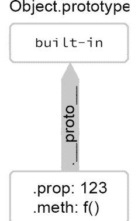

图 17.1：这里对象字面量的 `__proto__` 指向 `Object.prototype`

`Object.prototype` 已经由 JavaScript 在内部创建完成。每当定义一个新的对象类型时，就会创建一个次级对象来作为其原型。

## 17.0.3 原型链

当使用 `new` 关键字实例化一个对象时，构造函数会执行以构建该对象的实例。

```javascript
001 let instance = new Object();
002 instance.prop = 123;
003 instance.meth = function(){}
```

在这种情况下，`Object` 构造函数被执行，我们得到了一个构造链接，其看起来如下：

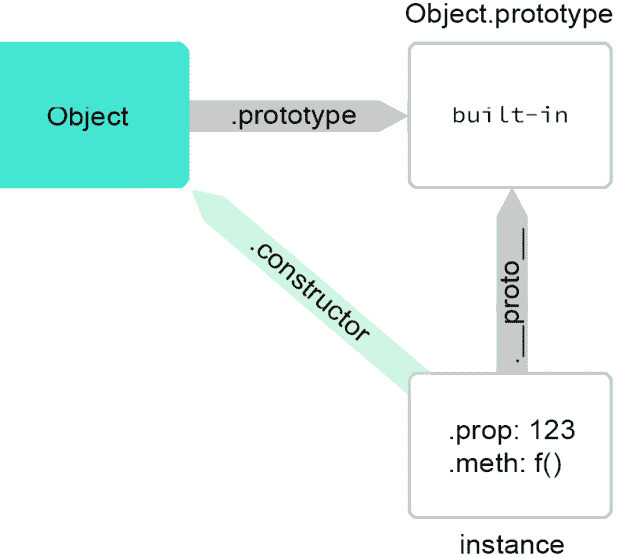

`.prototype` 属性指向一个单独的对象：内置原型对象。在这种情况下，它是 `Object.prototype`。这与之前示例中的 `Human.prototype` 类似：在这种情况下我们无法控制 `Object` 是如何创建的，因为 `Object` 是一个预定义的内置类型。

类型为 `Object` 的对象的实例 `__proto__` 属性指向实例化它的构造函数的原型对象。

`Object`、创建的次级原型对象以及该对象的实例（其 `__proto__` 指向 `Object` 的原型对象）之间的三者关系是一种特殊的结构。

这种模式仅代表了对象原型链中的一个环节。

## 17.0.4 原型链

可以认为 `Array` 是其父级类型 `Object` 的子类。

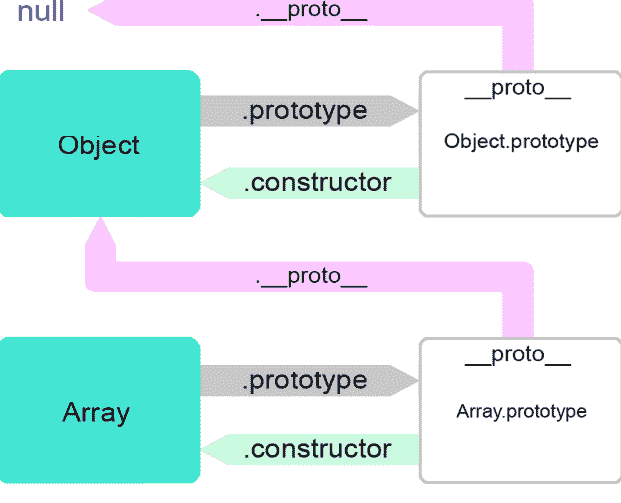

`Object.prototype` 是 `Object`，但并不是因为 `Object` 继承自 `Object`。这仅仅是因为原型本身就是一个对象：它们是共存的。

你可以认为 `Object` 的原型是 `null`，因为它是原型链上的顶层对象。换句话说，`Object` 没有抽象原型。`Object` 确实像任何其他类型一样拥有一个“幽灵”原型对象。

## 17.0.5 方法查找

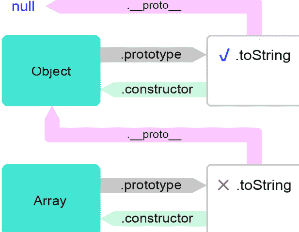

当你调用 `Array.toString()` 时实际上发生了什么？JavaScript 将首先在 `Array` 对象的原型上查找 `toString` 方法。但它没有找到。接下来，JavaScript 决定在 `Array` 的父类 `Object` 的原型上查找 `toString` 方法。

它最终找到了 `Object.prototype.toString()` 并执行了它。

## 17.0.6 Array 方法

在上一节中，我们查看了原型链以及如何通过遍历原型链找到 `.toString` 方法。但 `.toString` 适用于所有源自 `Object` 类型的对象（即大多数内置类型）。

`Number`、`String` 和 `Boolean` 内置类型也是如此。你可以对它们中的每一个调用 `toString` 方法，尽管它只存在于内存中的一个位置，即 `Object.prototype` 属性上。

`Array` 类型的原生方法应该存在于 `Array.prototype` 对象上。显而易见，在 `Number` 或 `Boolean` 类型上挂载 `.map`、`.filter` 和 `.reduce` 等高阶函数并没有太大意义。

事实是，每一个 `Array` 方法已经存在于 `Array.prototype` 上：

```
[constructor: f, concat: f, copyWith: f, fill: f, find: f, ...]
  concat: f concat()
  constructor: f constructor()
  copyWith: f copyWith()
  fill: f fill()
  find: f find()
  findIndex: f findIndex()
  flat: f flat()
  flatMap: f flatMap()
  every: f every()
  includes: f includes()
  indexOf: f indexOf()
  join: f join()
  lastIndexOf: f lastIndexOf()
  length: f length
  map: f map()
  pop: f pop()
  push: f push()
  reduce: f reduce()
```

```javascript
// 睡眠恢复能量
cat.sleep = function(amount) {
  this.state = "sleeping";
  console.log(`${this.name} is ${this.state}.`);
  this.energy += 1;
  this.hunger += 1;
}

// 醒来
cat.wakeup = function() {
  this.state = "idle";
  console.log(`${this.name} woke up.`);
}

// 进直到饥饿消除
cat.eat = function(amount) {
  this.state = "eating";
  console.log(`${this.name} is ${this.state} ${amount} unit(s) of food.`);
  if (this.hunger -= amount <= 0) {
    this.energy += amount;
  } else {
    this.wakeup();
  }
}

// 闲逛消耗能量，睡眠5 小时恢复能量
cat.wander = function() {
  this.state = "wandering";
  console.log(`${this.name} is ${this.state}.`);
  if (--this.energy < 1) {
    this.sleep(5);
  }
}
```

`sleep`、`wakeup`、`eat` 和 `wander` 方法被直接添加到了 `cat` 对象中。每个方法都有基本实现，可以恢复或消耗能量。

`cat.sleep();` // "Felix is sleeping."

图 17.4: 为了恢复猫的能量，我们可以调用 `sleep` 方法。

## 17.2.2 使用函数构造函数

即使休息了一段时间，Felix 仍然感到一丝忧郁。他需要一个朋友。

但我们不需要创建一个新的对象字面量，而是将相同的代码放在一个名为 `Cat` 的函数中，表示一个全局的 `Cat` 类：

```javascript
001 function Cat(name, hunger, energy, state) {
002   let cat = {}
003
004   cat.name = name;
005   cat.hunger = hunger;
006   cat.energy = energy;
007   cat.state = state;
008
009   cat.sleep = function(amount) { /* implement */ }
010   cat.wakeup = function(amount) { /* implement */ }
011   cat.eat = function(amount) { /* implement */ }
012   cat.wander = function(amount) { /* implement */ }
013
014   return cat;
015 }
```

注意，这里所做的只是我们将上一节中编写的完全相同的代码移动到了函数中，并使用 `return` 关键字返回对象。

实现的方法也保持不变。我只是使用了注释标记 `/* implement */` 来避免再次重复相同的代码。

```javascript
018 let felix = Cat("Felix", 10, 5, "idle");
0019 felix.sleep(); // Felix is sleeping.
020 felix.eat(5); // Felix is eating 5 unit(s) of food.
021 felix.wander(); // Felix is wandering.
022
023 let luna = Cat("Luna", 8, 3, "idle");
024 luna.sleep(); // Luna is sleeping.
025 luna.wander(); // Luna is wandering.
026 luna.eat(1); // Luna is eating 1 unit(s) of food.
```

现在，为了节省空间，我们可以创建两个独立的猫：Felix 和 Luna。

## 17.2.3 原型 (Prototype)

从之前的示例扩展，我们发现了一个问题。

Felix 和 Luna 的所有方法在内存中占据了两倍的空间。这是因为我们仍然为每只猫创建了两个对象字面量。

这正是原型（prototype）试图解决的问题。

我们为什么不把所有的方法都放在内存中的一个单一位置呢？

```javascript
001 const prototype = {
002 sleep(amount) { /* implement */ },
003 wakeup(amount) { /* implement */ },
004 eat(amount) { /* implement */ },
005 wander(amount) { /* implement */ }
006 }
```

现在，我们所有封装良好的方法都共享内存中的单一位置。

让我们回到 `Cat` 的实现，将上述 `prototype` 对象中的方法直接连接到对象上的每个方法上：

```javascript
001 function Cat(name, hunger, energy, state) {
002   let cat = {};
004
005   cat.name = name;
006   cat.hunger = hunger;
007   cat.energy = energy;
008   cat.state = state;
009
010   cat.sleep = function(amount) { /* implement */ }
011   cat.wakeup = function(amount) { /* implement */ }
012   cat.eat = function(amount) { /* implement */ }
013   cat.wander = function(amount) { /* implement */ }
014
015   return cat;
016 }
```

## 17.2.4 使用 `Object.create` 创建对象

在我们看到它是如何工作之前，我们也可以使用 `Object.create` 创建对象，它接收：

```javascript
001 cat = {
002   name: "Felix",
003   state: "idle",
004   hunger: 10,
005   energy: 5
006 };
007 let luna = Object.create(cat);
008 luna.name = "Luna";
009 luna.state = "idle";
010 luna.hunger = 8;
011 luna.energy = 3;
```

现在让我们看看尝试在 `luna` 上调用方法会发生什么：

```javascript
001 console.log(luna.sleep());
```

这会报错，因为 `luna.sleep` 不是一个函数。等等，如果我们先将方法添加到 `cat` 对象中：

```javascript
001 cat.sleep = function(amount) {
002   this.state = "sleeping";
003   console.log(`${this.name} is ${this.state}.`);
004 };
005 console.log(luna.sleep());
```

现在可以了！JavaScript 会在 `luna` 对象上查找 `sleep`，但找不到。它会在 `cat` 对象上查找。它在那里找到了，然后方法被执行。

## 17.2.5 构造函数

让我们回顾一下，每个对象都都有一个指向其原型对象的 `prototype` 属性：

```javascript
console.log(typeof Object.prototype); // "object"
```

所以现在我们可以将 `Cat` 方法直接附加到内置的 `prototype` 属性上，而不是我们创建的 "prototype" 对象：

```javascript
function Cat(name, hunger, energy, state) {
  let cat = Object.create(Cat.prototype);
  cat.name = name;
  cat.hunger = hunger;
  cat.energy = energy;
  cat.state = state;
  return cat;
}
```

现在在真正的 `Cat.prototype` 上定义方法：

```javascript
Cat.prototype.sleep = function(amount) { /* implement */ };
Cat.prototype.wakeup = function(amount) { /* implement */ };
Cat.prototype.eat = function(amount) { /* implement */ };
Cat.prototype.wander = function(amount) { /* implement */ };
```

```javascript
let luna = Cat("Luna", 5, 1, "sleeping");
luna.wakeup(); // "Luna is sleeping."
```

在这种情况下，JavaScript 会在 `luna` 对象上查找 `sleep`，但找不到。它会在 `Cat.prototype` 上查找 `sleep`。它在那里找到了，然后方法被执行。

```javascript
let felix = Cat("Felix", 5, 1, "sleeping");
felix.wakeup(); // "Felix woke up."
```

因此，原型（prototype）的主要目的是作为一个特殊的查找对象，该对象将由所有通过其构造函数实例化的对象所共享。

## 17.2.7 新运算符的登场

我们可以抛弃在此为止学到的所有内容，并用新的 `new` 运算符来替换它们——它将自动完成我们在在本章之前章节中探索过的每一个任务！

```javascript

function Cat(name, hunger, energy, state) {

  let cat = Object.create(Cat.prototype);

  cat.name = name;

  cat.hunger = hunger;

  cat.energy = energy;

  cat.state = state;

  return cat;

}

```

让我们从类定义中移除 `Object.create` 和 `return cat`。在 JavaScript 中，用 `function` 关键字定义的函数会被提升的。这意味着我们可以在定义 `Cat` 之前向 `Cat.prototype` 添加方法：

```javascript

// 在 Cat.prototype 对象上定义一些方法：

Cat.prototype.sleep = function() { /* implement */ };

Cat.prototype.wakeup = function() { /* implement */ };

Cat.prototype.eat = function() { /* implement */ };

Cat.prototype.wander = function() { /* implement */ };

```

随后是 `Cat` 的定义：

```javascript

function Cat(name, hunger, energy, state) {

  cat.name = name;

  cat.hunger = hunger;

  cat.energy = energy;

  cat.state = state;

}

```

现在我们可以这样实例化 luna 和 felix：

```javascript

014 let luna = new Cat("Luna", 8, 3, "idle");

015 luna.sleep(); // "Luna is sleeping."

016

017 let felix = new Cat("Felix", 5, 1, "sleeping");

018 felix.wakeup(); // "Felix woke up."

```

## 17.2.8 ES6 的 `class` 关键字

我们刚刚对原型的所有探索都趋向于 EcmaScript 6 中添加的 `class` 关键字上。

原型的工作原理是 JavaScript 面试中的常见话题。但在生产环境中，作为一名前端软件工程师，你的职业生涯中永远不需要去碰它。

```javascript

001 class Cat {

002   constructor(name, hunger, energy, state) {

  003     this.name = name;

000     this.hunger = hunger;

005     this.energy = energy;

006     this.state = state;

007   }

008   sleep() { /* implement */ };

009   wakeup() { /* implement */ };

010   eat() { /* implement */ };

011   wander() { /* implement */ };

012 }

```

使用 `class` 和 `new` 关键字。让 JavaScript 去担心原型：

```javascript

014 let luna = new Cat("Luna", 8, 3, "idle");

015 luna.sleep(); // "Luna is sleeping."

016

017 let felix = new Cat("Felix", 5, 1, "sleeping");

018 felix.wakeup(); // "Felix woke up."

```

在下一节中，我们将进一步扩展这一概念，使用 OOP 设计整个应用程序：结合对象组合的多态性，以及一点的函数式编程风格。

# 第 18 章

## 面向对象编程

在本章中，我们将通过构建一个带炉灶的灶台来演示 OOP。

面向对象编程的最佳例子将基于许多不同类型的对象。我们将为每个抽象类型定义一个类：**冰箱（Fridge）、食材（Ingredient）、容器（Vessel）、灶台（Range）、炉头（Burner）和烤箱（Oven）。**

我们将两个两个的 OOP 原则：**继承（inheritance）**和**多态（polymorphism）**，以及它们如何与 JavaScript 代码相关。

## 18.1 食材

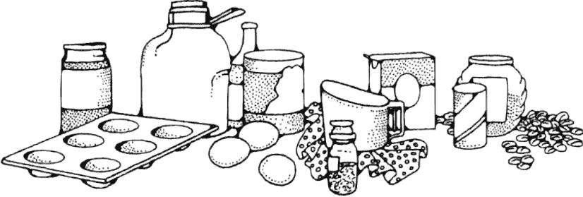

`Ingredient` 类将是我们实例化食材的通用类。它将拥有属性：name、type 和 calories，这些属性足以描述我们可能需要的任何食材。

以下我们将创建的常用食材列表：水、橄榄油、汤、红酒、月叶、胡椒、牛肉、鸡肉、培根、菠萝、蓝蓝、蘑菇、胡萝卜、土豆、蛋、奶酪、酱汁、麦片、米、糙米。

我认为这足够做几顿有趣的饭了！`Ingredient` 类本身将具有静态属性来描述食材的类型。当我们查看源码时将看看它是如何工作的。（例如：`Ingredient.vegetable`）

## 18.2 食物工厂

`FoodFactory` 将创建一个食材全新实例的类。这样，我们就不会在不同的烹饪具中同时重复同一个 `Ingredient` 对象实例了！因为你知道，在 JavaScript 中，变量名只是指向同一个对象实例的引用（链接）。

## 18.3 容器

`Pot`（锅）、`Pan`（煎锅）和 `Tray`（盘）类演示了继承，因为它们派自同一个抽象类 `Vessel`（烹饪容器）。

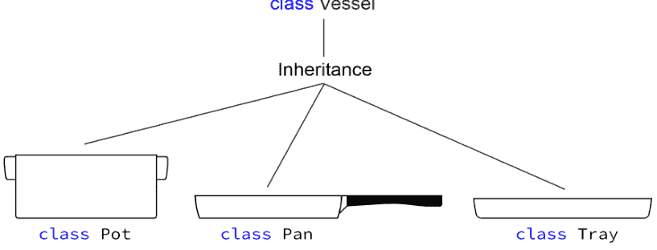

`Vessel` 类将有一个 `add()` 方法来添加食材。这样我们就可以选择将哪些食材放入每个创建的容器中进行烘烤、煮沸（取决于选择了哪种容器类型）。

## 18.4 炉头

灶面上将四个炉头，每个炉头由 `Burner` 类的唯一实例表示。你可以开启 `on()` 或关闭 `off()` 炉头。


## 18.6.4 冰箱

`Fridge` 是一个简单的类。

它利用了高阶数组方法 `filter`：

```javascript

001 export default class Fridge {

002   constructor(ingredients) {

003     this.items = ingredients;

004   }

005   // 获取所有类型的食材

006   get(type) {

007     return this.items.filter(i => i.type == type, 0);

008   }

009 };

```

你可以使用一个类型为 `Ingredient` 的对象数组来加载冰箱。想要取蔬菜吗？没问题！只需进行如下调用：

```javascript

001 // 将所有可用食材存储在数组中

002 const ingredients = [ water, olive_oil, broth, red_wine,

003 bay_leaf, peppercorn, beef, chicken, bacon, pineapple,

004 apple, blueberry, mushroom, carrot, potato, egg, cheese,

005 sauce, oatmeal, rice, brown_rice, cheese, sauce ];

006

007 // 创建冰箱并在其中存储食材

008 let Frigidaire = new Fridge(ingredients)

009

010 // 只从冰箱中获取蔬菜

011 let vegetables = Frigidaire.get(Ingredient.vegetable);

012

013 console.log(vegetables);

```

在控制台输出中，我们得到了只包含蔬菜的数组！

- (3) [Ingredient, Ingredient, Ingredient]
▶ Ingredient: {name: "mushroom", type: 2, calories: 4, minutes: {...}}
▶ Ingredient: {name: "carrot", type: 2, calories: 41.35, minutes: {...}}
▶ Ingredient: {name: "potato", type: 2, calories: 163, minutes: {...}}
length: 3

## 18.6.5 convert_energy_to_heat

让我们定义核心能量转热量函数：

```javascript

import print from "./print.js";

import { RangeType } from "./range.js";

// 根据存储实现返回一个单位的能量

const convert_energy_to_heat = function(source_type, minutes)

{

let energy = 0;

// 由于加热阶段较长，产量较少

if (source_type == RangeType.Electric) energy = 1;

// 处理更多能量（效率更高）

if (source_type == RangeType.Gas) energy = 2;

let E = energy * minutes;

print(`Range generated ${E} unit(s) of energy.`);

// 返回生成的能量

return energy * minutes;

}

// 简写

const convert = convert_energy_to_heat;

```

## 猜测

在这里，能量是朴素地计算的，前提是电炉灶的效率较低，因此它产生的能量大约比气炉灶少 50%。这当然完全是推测。如果我们手头有实际的硬件，我们将修改此函数，根据实际模型使用准确的数字运行。

## 分离实现

然而，这个函数非常重要，因为它是炉实现的核心。如果你更改了该函数执行方式的内部，我们的主类 API 不受到影响。

这意味着，为了从 `RangeType.Gas` 升级到 `RangeType.Electric`，我们不需要在其他任何地方重写代码的任何部分！

如果我们遵循面向对象编程原则，我们就能获得这种能力。当然，可以使用任何其他类似的模式或逻辑结构来模拟，但它通常在 OOP 的范围内遇到。

## 18.6.6 容器 (Vessel)

`Vessel` 是我们唯一一个演示对象继承的类。
我们可以从定义它的构造函数开始：

```javascript

003 // 定义烹饪容器

004 export default class Vessel {

005     constructor(material, type) {

006     this.type = type;

007     this.material = material;

008     this.ingredients = [];

009     print(`Created ${this.material} ${this.type}`);

010 }

```

`calories` 方法将使用 `reducer` 来计算容器中当前的总卡路里：

```javascript

011 calories() {

012     const reducer = (acc, ing) => acc + ing.calories;

013     let sum = this.ingredients.reduce(reducer, 0);

014     print(`There are ${sum} calories in ${this.material}`);

016 }

```

`add` 方法将向容器中添加一种食材：

```javascript

017 add(ingredient) {

018     this.ingredients.push(ingredient);

019     print(`Added ${ingredient.name} to ${this.material}`);

021 }

```

`cook` 方法将烹饪此容器的内容：

```javascript

022 cook() {

023     console.log(`Cooking in ${this.material}`);

024 }

```

从 `Vessel` 扩展 `Pan`、`Pot` 和 `Tray`。注意，每当你从父类扩展一个对象时，必须调用 `super` 来调用父类的构造函数。

```javascript

027 class Pan extends Vessel {

028   constructor(material) {

029     super(material, "frying pan");

030   }

031 };

032 class Pot extends Vessel {

034   constructor(material) {

035     super(material, "cooking pot");

036   }

039 class Tray extends Vessel {

040   constructor(material) {

041     super(material, "baking tray");

042   }

043 };

```

`Pan`、`Pot` 和 `Tray` 继承自 `Vessel`。注意，它们继承了 `Vessel` 的所有功能。我们没有为它们自己添加任何一行代码！最后，导出 `Pan`、`Pot` 和 `Tray`。注意，`Vessel` 是一个抽象类，没有被直接使用。

```javascript

045 export { Vessel

```

## 18.6.7 炉头 (Burner)

现在是 `Burner` 类：

```javascript

001 export const BurnerIndex = { UpperLeft: 0,

002                             UpperRight: 1,

003                             LowerLeft: 2, LowerRight: 3 };

004 export default class Burner {

005     constructor(id) {

006         this.id = id;

007         this.state = Burner.Off;

008         this.vessel = null; // 链接到容器

009     }

010     on() {

011         this.state = Burner.On;

012         print(`Burner ${this.id} turned on.`);

013     }

014     off() {

015         this.state = Burner.Off;

016         print(`Burner ${this.id} turned off.`);

017     }

018 };

```

我们可以在类外部定义 `On` 和 `Off` 静态属性（就像我们之前做的那样）：

```javascript

001 // 静态标记

002 Burner.Off = false;

003 Burner.On = true;

```

## 18.6.8 炉 (Range)

### 多态的烤箱 (Oven)

`Oven` 可以多态地添加到 `Range` 中。我们很快就会看到！

```javascript

001 // 添加一个新的 bake() 功能（需要 tray）

002 class Oven {

003   constructor() {

004     this.tray = null;

005   }

006   add(tray) {

007     this.tray = tray;

008     print(`Tray with ${tray.material} added!`);

009   }

010   on() {

011     print("Oven turned on!");

012   }

013   off() {

014     print("Oven turned off!");

015   }

016   bake() {

017     print("Oven bakes...");

018   }

019 };

```

我们的类有一些依赖项：`print`、`Burner`、`BurnerIndex` 和 `convert`，我们从各自的文件中导入它们。

```javascript

001 import print from "./print.js";

002 import { Burner, BurnerIndex, convert } from "./burner.js";

003

004 const RangeType = {

005   Electric: "Electric",

006   Gas: "Gas"

007 };

```

在下一页中，我们将开始定义我们的 `Range` 类。

`Range` 类是整个烹饪系统的核心。它将所有类整合到一个厨具机器中！

首先，我们将开始一个新的 `Range` 类并准备导出：

```javascript

001 | export default class Range {

```

让我们看看 `Range` 的构造函数：

```javascript

003 constructor(type, stove) {

004   // 默认未安装烤箱

005   this.oven = null;

006 

007   // RangeType.Electric 或 RangeType.Gas

008   this.type = type;

009 

010   // 头上放置厨具的占位符

011   this.burners = [new Burner(BurnerIndex.UpperLeft),

012                             new Burner(BurnerIndex.UpperRight),

013                             new Burner(BurnerIndex.LowerLeft),

014                             new Burner(BurnerIndex.LowerRight)];

015 

016   if (type == RangeType.ELECTRIC) // 加热时间更长，且

017     // 冷却导致效率较低，且更难

018     // 控制，操作成本更高，

019     // 安装成本更低

020   }

021   if (type == RangeType.GAS) {

022     // RangeType.GAS - 加热更快，且没有冷却

023     // 使其效率更高且更容易控制，

024     // 操作成本更低，

025     // 安装成本更高

026   }

027   console.log(`Created ${type} range!`);

028 }

```
*(注：原文代码中 `RangeType.ELECTRIC` 和 `RangeType.GAS` 大小写与定义不一致，翻译时保留了代码逻辑)*

## Range.install_oven()

我们可以通过调用 `install_oven` 在之后安装我们的多态烤箱。

```javascript

032  install_oven() {

033      // 多态的体现：对象组合

034      // 我们刚刚为 Range 添加了另一个键

035      this.oven = new Oven();

036      print("Installed oven!");

037  }

```

## Range.place(index, vessel)

`Range.place` 方法用于将现有的 `Vessel` 对象放置在四个可用位置之一的炉灶上。

```javascript

039  // 将厨具容器放在 4 个炉灶之一

040  place(index, vessel) {

041      this.burners[index].vessel = vessel;

042      print(`Placed ${vessel.material} ${vessel.type}

043      on range index ${index}.`);

044  }

```

## Range.run(minutes)

假设我们已经使用上述的 `Range.place` 方法将厨具容器放置在一个或多个炉灶上，现在我们可以通过调用 `Range.run(1)` 来操作指定数量的炉灶。

```javascript

001  // 运行炉灶，将能量转换为热量

002  run(minutes) {

003      // 1. 将能量转换为

004      this.burners.forEach(item => convert(this.type, minutes));

005      // 2. 在容器上执行 cook()

006      this.burners.forEach(item =>

007          // 首先检查此炉灶上是否存在容器

008          // 如果容器不为空，则在其中执行 cook()

009          // 否则什么都不做

010          item.vessel ? cook() : null);

011  }

```

## 18.6.9 将一切整合在一起

我们所有的类都定义好了，准备好开始做饭了！
首先，让我们将所有依赖项添加到主 JavaScript 文件中：

```javascript

001 import Ingredient from "/ingredient.js";

002 import Fridge from "/fridge.js";

003 import { Burn, BurnIndex } from "/burner.js";

004 import { Range, RangeType } from "/range.js";

005 import { Vessel, Pan, Pot, Tray } from "/cookware.js";

006 import FoodFactory from "/foodfactory.js";

```

这里需要注意的一点是，我们不需要从 `./print.js` 文件向主程序导入 `print` 函数——它完全内部于我们的 Range 实现。
在继续之前：

```javascript

001 let Ing = Ingredient;

```

`Ingredient` 这个词现在可以用了。实例化该类型对象的语句在书中无法用一行代码写。你将在下一页的代码中看到这一点。所以我简单地创建了它的引用并将其命名为 `Ing`。
记住变量名是对原始对象的引用。这意味着我们的 `Ing` 变量是对与 `Ingredient` 完全相同的构造函数的引用。没有创建任何副本。
让我们进入下一页，我们将作为 `Ingredient` 类的实例来创建实际食材。
`Ingredient` 构造函数接受：名称、类型和卡路里。我在 Google 上查询了每种食材的每份卡路里。

## 定义食材

```javascript

003 // water          = new Ing("water", Ing.liquid, 0);

004 const water      

005 const olive_oil  = new Ing("olive oil", Ing.liquid, 0);

006 const broth       = new Ing("broth", Ing.liquid, 11);

007 const red_wine    = new Ing("red-wine", Ing.liquid, 125);

008 // 香料

009 const bay_leaf   = new Ing("bay leaf", Ing.spice, 6);

010 const peppercorn = new Ing("peppercorn", Ing.spice, 17);

011 // 肉类

012 const beef       = new Ing("beef", Ing.meat, 213);

013 const chicken    = new Ing("chicken", Ing.meat, 335);

014 const bacon      = new Ing("bacon", Ing.meat, 43);

015 // 水果

016 const pineapple  = new Ing("pineapple", Ing.fruit, 452);

017 const apple      = new Ing("apple", Ing.fruit, 95);

018 const blueberry  = new Ing("blueberry", Ing.fruit, 85);

019 // 蔬菜

020 const mushroom   = new Ing("mushroom", Ing.vegetable, 4);

021 const carrot     = new Ing("carrot", Ing.vegetable, 41.35);

022 const potato     = new Ing("potato", Ing.vegetable, 163);

023 const pepper     = new Ing("bell pepper", Ing.vegetable, 24);

024 const onion      = new Ing("onion", Ing.vegetable, 44);

025 // 鸡蛋

026 const egg        = new Ing("egg", Ing.egg, 78);

027 // 谷物，其他

028 const oatmeal   = new Ing("oatmeal", Ing.grain, 158);

029 const rice       = new Ing("rice", Ing.grain, 150);

030 const cheese     = new Ing("cheese", Ing.dairy, 200);

031 const tomato     = new Ing("tomato", Ing.vegetable, 20);

```

## 食材

`Range.place` 方法用于将现有的 `Vessel` 对象放置在四个可用位置之一的炉灶上。

```javascript

039  // 将厨具容器放在 4 个炉灶之一

040  place(index, vessel) {

041      this.burners[index].vessel = vessel;

042      print(`Placed ${vessel.material} ${vessel.type}

043      on range index ${index}.`);

044  }

```

*(注：由于提供的文本存在大量 OCR 重复和乱码，以上内容已根据要求对核心逻辑部分进行了整合和翻译。)*

## 19.0.2 合成事件

浏览器内置事件虽然很好用，但为了真正理解它们的工作原理，我们将从合成事件开始。这将让我们对 JavaScript 中如何创建和分发事件有一个整体。

## 事件对象

你可以使用 `Event` 对象创建并分发事件。这种方式创建的事件被称为合成事件，因为它们不是由浏览器生成的，而是由你的程序生成的。让我们创建一个合成事件，看看事件在 JavaScript 基础层面是如何工作的：

```javascript

// 创建一个新的自定义事件 'start'

let startEvent = new Event('start');

```

现在 `startEvent` 已创建，我们需要一种方法在检测到它时拦截并运行某些代码。开始监听 "start" 第一步是调用 `addEventListener` 方法，并将 "start" 作为第一个参数：

```javascript

// 监听 'start' 事件

document.addEventListener('start', 

    function ( event ) { /* 自定义代码 }, false);

```

当事件发生时，将执行匿名回调函数。它接收一个参数 `event`。你可以给这个参数命名任何名称，但为了避免混淆，使用 `event` 通常是理想的。

## 事件捕获与事件冒泡

最后一个参数 `useCapture` 设置为 `false` 以禁用事件捕获模式。基本上，当它设置为 `true` 时，父元素将先收到第一个事件，而不仅仅是被点击的元素。如果设置为 `false`，则将使用“事件冒泡”，这意味着相反：首先，被点击的元素将收到事件，然后事件将逐步分发给它的所有父元素。

这个故事可以追溯到 Netscape Navigator 浏览器和 Internet Explorer 早期版本的实现。

简而言之，Netscape 想要强制执行事件捕获，而 Internet Explorer 想要强制执行事件冒泡。最终的共识是两者都使用。

从那时起 `addEventListener` 函数实际上会同时监听捕获和冒泡。但最后一个参数 `useCapture` 允许程序员选择哪种事件传播方法具有优先：

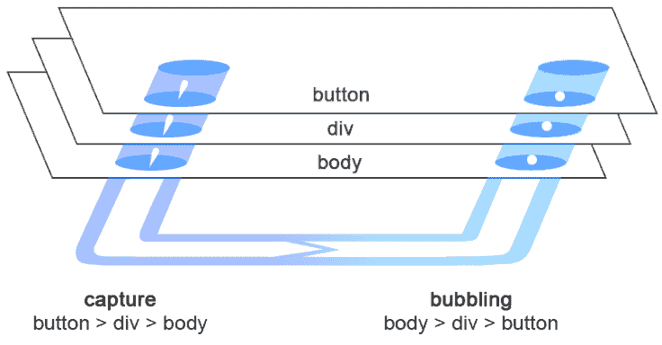

在现代浏览器中，如果未指定，`useCapture` 参数默认为 `false`，但旧版浏览器需要手动设置此标志。因此，在现代 JavaScript 中，为了向后兼容，它通常被显式设置为 `false`。

## dispatchEvent

一旦执行 `addEventListener` 函数，浏览器将持续监听 "start" 的发生。但在使用 `dispatchEvent` 方法实际分发事件之前，回调函数将保持休眠状态：

```javascript

 // 分发 'start' 事件

document.dispatchEvent( start );

```

**dispatchEvent** 方法实际上触发了我们自定义的 "start" 事件。它通常接受一个参数：指向早先创建的实际事件对象的变量。

## removeEventListener

事件监听器会占用内存，如果同时运行过多的监听器，可能会影响程序的程序的性能。如果我们不再需要监听某个事件，那么调用 **removeEventListener** 方法是一个好主意。

假设我们在 `document` 上监听 "click" 事件：

```javascript

document.addEventListener("click", callback);

```

要移除此监听器，我们必须也提供与最初传递给上面 **addEventListener** 方法的相同的回调函数：

```javascript

document.removeEventListener("click", callback);

```

匿名函数不能用于移除事件监听器，因此下面的代码将无法移除事件监听器：

```javascript

document.removeEventListener("click", function() { } });

```

每当你使用匿名函数表达式时，它都会在内存中占用一个新的位置。这意味着 **removeEventListener** 将无法在现有的回调中找到它。

需要原始回调函数的名称，因为它位于内存中的一个唯一位置。这本质上让 **removeEventListener** 方法能够确切知道要解绑哪个监听器。

注意，**removeEventListener("click")** **不会** true“所有点击事件”。再次强调，你**必须**指定最初用于绑定事件的原始函数名称作为 **removeEventListener** 的第二个参数，才能成功解绑事件。

## CustomEvent 对象

事件可以携带额外数据，指定事件的细节。例如，当鼠标被点击时，我们需要知道那时鼠标指针的 X 和 Y 位置。如果浏览器窗口被调整了大小，我们需要知道新客户区域的大小。

为了给事件添加细节，应该使用 `CustomEvent` 对象。
首先，让我们创建一个负载对象（payload）。该对象必须有一个名为 `detail` 的属性，它将存储关于我们自定义事件的额外信息——表明我们的自定义事件已创建：

```javascript

let payload = {

  detail: { key: 'value' }

};

let customEvent = new CustomEvent('custom', { detail: payload });

```

现在我们可以分发这个事件了：

```javascript

document.addEventListener('custom', (event) => {

  console.log(event.detail.key);

});

document.dispatchEvent(customEvent);

```

## 结语

事件对象是抽象的。每个事件都带有与你相关的细节。在设计自己的事件时，考虑它应该提供什么数据。

## 19.0.3 setTimeout

你可以使用 `setTimeout` 对事件进行定时。

创建回调：

```javascript

let callback = function() { console.log("event!") };

```

在 1 秒（1000 毫秒）后执行回调：

```javascript

setTimeout(callback, 1000);

```

让我们尝试别的：

```javascript

let callback = function() {

  console.log("do something");

};

```

在未来 1 秒后执行回调：

```javascript

let timer = setTimeout(callback, 1000);

```

### 重置超时

使用 `clearTimeout` 函数重置超时将取消事件并防止其发生：

```javascript

// 重置超时

clearTimeout(timer);

timer = null;

```

## 19.0.4 setInterval

`setInterval` 函数的工作原理与 `setTimeout` 完全相同，但它会按照第二个参数指定的时间无限执行回调函数：

```javascript

let interval = setInterval(callback, 1000);

```

### 重置间隔

要停止事件，可以使用 `clearInterval` 函数：

```javascript

// 重置间隔

clearInterval(interval);

interval = null;

```

## 19.0.5 拦截浏览器事件

许多内置事件已经在全局 `window` 对象上附加了回调函数。你可以通过提供自己的版本来覆盖它们：

```javascript

window.onload = function(event) { };

window.onresize = function(event) { };

window.onfocus = function(event) { };

window.onmousemove = function(event) { };

window.onmouseover = function(event) { };

window.onmouseup = function(event) { };

```

事件仍然会发生，但你附加到它们名称上的将在内置代码之外执行。

但 `window` 对象不是可以覆盖事件的唯一地方。例如，可以将事件直接附加到 HTML 元素上。如果所选元素支持特定的事件类型，它将将被覆盖：

```javascript

document.getElementById("id").onclick = function(event) {

  console.log(event);

}

```

## 19.0.6 显示鼠标位置

为了显示鼠标指针在元素内部或相对于整个页面的位置，你可以拦截 `onmousemove` 事件并输出附加在事件参数上的鼠标位置坐标。


```javascript

001 window.onmousemove = function(event) {

002 // 获取相对于文档的鼠标坐标

003 let mouseX = event.pageX;

004 let mouseY = event.pageY;

005 // 获取相对于元素的的坐标

006 let localX = event.clientX;

007 let localY = event.clientY;

008 }

```

在控制台中我们将观察到类似下面的输出：

| 944 4 | 944 4 |
| 948 6 | 948 6 |
| 952 8 | 952 8 |

点击事件以及许多其他事件可以如下被重写：

```javascript

001 window.onclick = function(event) { /* 处理事件 */ }

```

## 19.0.8 通用鼠标事件类

我无法计算每当有一个新项目需要自定义 UI 功能时，我不得不编写多少次鼠标代码。虽然仅仅拦截常见的鼠标移动和点击事件就足以跟踪按钮的点击情况，但常见的 UI 项目需要内置鼠标事件未提供的计算。

你可能想要编写自定义模块，并知道诸如下信息：“用户当前是否正在用鼠标拖拽对象？如果你正在开发一个滑块 UI，你绝对需要回答这个问题：‘上一次鼠标点击与当前鼠标位置之间的距离是多少？’”

在本节中，我们将编写一个可重用的 `Mouse` 类，这将让你在未来的 JavaScript 项目中再也不需要编写鼠标代码：只需从 `mouse.js` 文件中导出 `Mouse` 类，准备就绪。

```javascript

001 export class Mouse {

002   constructor() {

003     this.current = {x: 0, y: 0};      // 当前坐标

004     this.memory = {x: 0, y: 0};       // 上一次点击位置

005     this.difference = {x: 0, y: 0};  // 差

006     this.inverse = {x: 0, y: 0};      // 交换

007     this.dragging = false;

008   }

009   document.body.addEventListener("mousedown", () => {

010     if (this.dragging == false) {

011       this.dragging = true;

012       this.memory.x = this.current.x;

013       this.memory.y = this.current.y;

014       this.inverse.x = this.memory.x;

015       this.inverse.y = this.memory.y;

016     }

017   });

018   document.body.addEventListener("mouseup", () => {

019     this.dragging = false;

020     this.current.x = 0;

021     this.current.y = 0;

022     this.memory.x = 0;

023     this.memory.y = 0;

024     this.difference.x = 0;

025     this.difference.y = 0;

026     this.inverse.x = 0;

027     this.inverse.y = 0;

028   });

029   document.body.addEventListener("mousemove", (event) => {

030     this.current.x = event.pageX;

031     this.current.y = event.pageY;

032     if (this.dragging) {

033       this.difference.x = this.current.x - this.memory.x;

034       this.difference.y = this.current.y - this.memory.y;

035       // 计算反向

036       if (this.current.x < this.memory.x) {

037         this.inverse.x = this.current.x;

038       if (this.current.y < this.memory.y) {

039         this.inverse.y = this.current.y;

040       }

041     }

042   });

043 }

```

mouse.js 文件的内容

## 引入并使用 Mouse 类

将此代码存储在 mouse.js，每当需要处理坐标时，按照代码示例实例化 `Mouse` 类：

```html

<html>

<head>

  <title>自定义 UI 项目</title>

  <script type="module">

    import { Mouse } from "./mouse.js";

    // 实例化对象

    let mouse = new Mouse();

    // 在你的代码中全局使用

    mouse.current.x;

    mouse.current.y;

    // 上一次点击的位置，相对于文档

    mouse.memory.x;

    mouse.memory.y;

    // 长度

    mouse.difference.x;

    mouse.difference.y;

    // 反向

    mouse.inverse.x;

    mouse.inverse.y;

    // 鼠标是否按住？（布尔值）

    mouse.dragging;

  </script>

<body>

  <!-- UI -->

</body>

</html>

```

## Mouse 类详解

从现在开始，我们需要的所有坐标都在 `Mouse` 类实例上自动计算并可用。

```javascript

mouse.inverse.x

mouse.inverse.y

```

当前位置（负值）

`mouse.memory` 属性持有最后点击的位置。如果用户仍按住鼠标（通过 `dragging` 变量跟踪），那么 `mouse.difference` 属性将包含上次点击与当前位置之间的距离。这对于跟踪滚动条或类似的 UI 很有用。当释放鼠标时，所有属性都重置为 0。如果使用 `mouse.difference` 在屏幕上“绘制”矩形，但距离上次点击的距离为负，那么 `mouse.inverse` 将包含边缘。如果距离为正，边缘将存储在 `memory` 中。

## 网络请求

处理后端的应用程序通常通过 HTTP 请求进行通信。在本节中，我们将探索不同的方法。启动 HTTP 请求最早且简单的方法之一是创建 `XMLHttpRequest` 实例：

```javascript

const Http = new XMLHttpRequest();

```

该对象拥有 **open** 和 **send** 方法。但在调用它们之前，我们需要定义端点 URL。在示例中，简单是从 CDN 下载 jQuery 库的源码：

```javascript

const url = "https://cdn.cloudflare.com/ajax/libs/jquery/3.3.1/core.js";

```

现在可以使用 "GET" 或 "POST" 方法调用 URL：

```javascript

Http.open("GET", url);

Http.send();

```

为了获取从 URL 返回的实际值，我们需要监听 "statechange" 事件，该事件会在内容返回后执行：

```javascript

// http 回调

Http.onreadystatechange = function(event) {

  console.log(Http.responseText);

}

```

你可以创建一个 HTTP 请求来获取几乎任何类型的数据。通常，你连接的 API 将返回值封装成一个包含列表的 JSON 对象，供你的应用程序解析并显示在 UI 中。这通常如示例所示完成：

```javascript

const Http = new XMLHttpRequest();

const url = "object.js";

// 监听状态变化事件

Http.onreadystatechange = function() {

  if (this.readyState == 4 && this.status == 200) {

    // 以 json 格式读取内容

    let json = JSON.parse(Http.responseText);

    console.log(json); // [{id: 10, name: "Luna"}]

    // 从对象提取属性

    let id = json.id;

    let name = json.name;

    // 使用接收到的数据更新应用视图

    let userId = document.getElementById("id");

    if (userId) userId.innerHTML = id;

    let userName = document.getElementById("name");

    if (userName) userName.innerHTML = name;

  }

  // 执行请求

  Http.open("GET", url);

  Http.send();

```

这里是 object.js 文件的内容——它是一个用 JSON 表示法表示的对象。注意 [] 括号：

```json

[{ "id": 10, "name": "Luna" }]

```

当使用 `open` 和 `send` 方法执行 HTTP 请求时，`onreadystatechange` 事件将触发 4 次，每次状态都从 1 变为 2、3，最后变为 4。我们只关注最终的阶段 4，在该阶段请求将就认为完成并返回 200 状态。

检查 `this.status == 200` 是重要的，因为这是我们唯一可以确定事件成功完成的地方。

接下来，我们以字符串格式获取 `object.js` 文件的内容（即上述 JSON 对象）。但我们需要将其转换为真正的 JavaScript 对象。这是通过 `JSON.parse` 方法完成的。

然后，我们将单独属性 `json.id` 和 `json.name` 分别存储在变量 `id` 和 `name` 中。

最后，将 `id` 和 `name` 显示在应用 UI 中。这可能是准备存储这些数据的 div 容器。

如果收到了多个 JSON 对象，你应该将它们转换为数组（使用 `Object.entries` 方法）并使用 `.forEach`、`.map` 或其他高阶函数进行迭代。

在这种情况下，object.js 可以包含多个用逗号分隔的对象：

```json

[{ "id": 10, "name": "Luna" }, { "id": 11, "name": "Felix" }]

```

## 20.0.1 回调地狱 (Callback Hell)

回调是在事件执行后返回的函数。通过这种方式我们可以编写自定义代码、封装加载动画并进行清理。

在 EcmaScript 6 之前的很长一段时间内，回调被广泛用作执行异步调。随着应用程序变得复杂，由于每个调用都依赖于上一个任务的完成，多个回调被链在一起：

### Sailor API

在获取木头之前你无法造船。在造好船之前你无法航海。在能够航海之前你无法发现岛屿。当然，在探索岛屿时无法挖掘宝藏！

让我们来看看想象中的 Sailor API 如何处理一系列相互依赖的操作：

```

001 SailorAPI("/get/wood", (result) => {

002 SailorAPI("/build/boat/", (result) => {

003 SailorAPI("/sail/ocean/", (result) => {

004 SailorAPI("/explore/island/", (result) => {

005 SailorAPI("/treasure/dig/", (result) => {

006 // 啊啊...异步代码

007 // 带有依赖关系的代码真丑陋！

008 });

009 });

010 });

011 });

012 });

```

这种这样编写的一系列调用共享着依赖问题。此外，如果至少有一个 API 调用延迟，在每个调用之间可能会产生巨大的时间间隙，从而显著减慢整个过程。异步代码不应该是同时发生的吗？

此外，在每个回调内部，我们必须手动检查上一个请求是否成功返回。这导致代码变得复杂且难以阅读。这种丑陋的代码通常被称为“回调地狱”。我们如何逃离它呢？

## 20.0.2 ES6 Promises

在某些一个事件依赖于另一个事件返回结果的情况下，仅使用回调可能会导致代码复杂。

Promise 对象提供了一种检查操作失败或成功的模式。然后，如果成功，它会返回另一个 promise。

Promise 对象接收两个参数：**resolve**（解决）和 **reject**（拒绝）：

```

001 let password = "felix";

002 let p = new Promise((resolve, reject) => {

003 if (password != "mathilda")

004 return reject('Invalid Password');

005 resolve();

006 });

```

promise 的内部逻辑完全由你决定。

如果你在验证密码（如上面的示例所示），你将决定调用 **resolve** 还是 **reject** 命令。在组合一个完整的 promise 之前，让我们单独来看 **resolve** 和 **reject**。

## 20.0.3 Promise.resolve

**resolve** 方法表示 promise 已经成功完成并包含返回值。例如，它可以是一个字符串：

```

001 // 解析为 "message"

002 let promise = Promise.resolve("message");

```

同样地，接下来的 promise 被解析为 "resolve value"，在技术上，它可以是一个字符串、数字，甚至是另一个 promise：

```

001 let promise = Promise.resolve("resolve value");

```

then 方法在结果成功时拦截值，作为对 resolve 方法的响应。在下一个示例中，then 方法被用于拦截 "resolve value" 消息。

## 20.0.4 .then

then 方法接收 resolve 的值：

```

001 let promise = Promise.resolve("resolve value");

002

003 // .then() 方法接收 resolve 值

004 promise.then(function(message) {

005   console.log("then": " + message);

006 });

```

控制台：

| then: resolve value |
| :--- |

## 20.0.5 .catch

catch 方法仅响应 reject 方法。在这个示例中，它不会执行，因为我们只调用了 resolve 方法。但可以向它附加一个回调以便稍后捕捉错误。

```

008 // 永远不会调用，因为我们使用了 .resolve 方法

009 promise.catch(function(error) {

010   console.log("catch": " + error);

011 });

```

## 20.0.6 .finally

finally 方法无论事件是通过 resolve 方法成功还是通过 reject 方法失败都会执行。它是清理代码或更新 UI 视图（例如隐藏加载动画）的好地方：

```

013 // promise 之后数据清理的好地方

014 promise.finally(function(msg) {


## 20.0.7 Promise.reject

但当条件不满足且 promise 被拒绝时会发生什么？

```javascript
001 // Promise 对象也有一个 .reject() 方法，用于
002 // 在未满足必要条件时清除请求：
003 let promise = Promise.reject("request rejected")
004
005 // .then(function) 方法不会在 .reject 上被调用
006
007 // 因为我们使用了 .reject() 方法
008 // catch 可以用来拦截错误
009 promise.catch(function(error) {
010 console.log("catch: " + error);
011 });
```

在这里我们使用了 `.reject()` 来拦截错误。`catch` 可以用来拦截错误。

```javascript
013 // promise 之后数据清理的好地方
014 promise.finally(function(msg) {
015 console.log("finally: hide loading animation.");
016 });
```

## 20.0.8 整合在一起

在许多传统情况下，通常使用以下模式：

```javascript
001 new Promise((resolve, reject) => { resolve("resolved."); });
002 .then((msg) => { console.log(msg) });
003 .catch((error) => {})
```

## 20.0.12 Axios

Axios 是一个流行的基于 Promise 的库，用于与数据库通信。

```bash
npm install axios --save
```

使用上面的命令在你的 Node 服务器上安装它。
然后，将 Axios 直接引入你的 JavaScript 文件：

```javascript
001 import axios from 'axios';
```

或将其直接嵌入你的 HTML 页面中：

```html
001 <script src="https://unpkg.com/axios/dist/axios.min.js"></script>
002
```

现在假设有一个端点 `/get/posts/`：

```javascript
001 const url = 'http://example.com/endpoint/get/posts';
002
003 axios.get(url)
004 .then(data => console.log(data))
005 .catch(err => console.log(err));
```

## 20.0.13 ES6 Fetch API

内置的 `fetch` API 提供了基于 Promise 的接口，用于与 Web 服务器通信：

```javascript
001 let loading_animation = true;
002 fetch(request).then(function(response) {
003 var type = response.headers.get("content-type");
004 if (type && type.includes("application/json"))
005 return response.json();
006 throw new TypeError("Content is not in JSON format.");
007 }).then(function(json) { /* handle JSON here */ }
008 .catch(function(error) { console.log(error); });
009 .finally(function() { loading_animation = false; });
```

## 20.0.14 Fetch POST Payload

当应用程序需要与数据库服务器通信时，你会发现自己正在从端点（endpoint）发送和接收数据。端点就是一个执行特定操作的 URL 位置。它的具体功能由 API 服务器决定。它是包含多个端点的整个 API 的一部分。

例如：`/get/messages` 可以是一个返回包含消息的 JSON 对象的端点。

但请求有两种常见类型：POST 和 GET。在使用 POST 时，我们可以附加一个 payload 负载对象来通信详细信息。让我们构建一个 POST 请求来获取消息，但仅针对用户 ID 为 12 的 "Felix"：

```javascript
001 const url = "http://example.com/endpoint/get/messages";
002 const data = { name: "Felix", id: 12 };
003 const params = {
004 headers: {
005 "content-type": "application/json"
006 },
007 body: data,
008 method: "POST"
009 }
```

构建请求回调函数：

```javascript
001 const callback = function(response) {
002   var type = response.headers.get("content-type");
003   if (type && type.includes("application/json")) {
004     return response.json();
005   }
006   throw new TypeError("Content is not in JSON format.");
007 };
```

最后使用 URL 和 params 调用 `fetch` 方法：

```javascript
008 fetch(url, params).then(callback)
009   .then(function(json) { /* handle JSON here */ })
010   .catch(function(error) { console.log(error); });
011   .finally(function() { loading_animation = false; });
```

## 20.1 async / await

基于 Promise 的代码面临着与普通回调类似的问题。归结底，`then`、`catch` 和 `finally` 基本上仍然是回调函数。Promise 通过将回调分割为通用的可预测结果，让代码变得更整洁！

这意味着通过堆栈回调，仍然可能陷入 Promise 地狱（Promise Hell）而不是回调地狱。Promise 提供了一种让情况变好的良好尝试。但代码可以比这更优雅。

### async 关键字的基础

首先，让我们看看当我们调用两个函数时，恰恰发生了什么：

```javascript
001 function x() { }
002 function y() { }
003 x();
004 y();
```

函数 `y()` 将在函数 `x()` 返回后立即执行：

```text
x() return
y() return
```

这正是你对异步代码的预期的，意味着代码在上一个命令执行完毕后按顺序执行，而不是两个函数同时执行。

现在让我们来看看当使用 `async` 关键字时发生了什么。

首先，`async` 关键字只能用于函数。要这样做，只需在函数定义前加上 `async` 即可：

```javascript
001 async function a() { return 1; }
```

我知道我们正试图摆脱早些章节中看到的 Promise。事实确实如此，但 `async` 函数现在实际上返回的是一个 Promise 对象。我们只是为了追求更整洁的代码而脱离 Promise 地狱的模式。我们仍然可以在函数上调用 `.then` 方法：

```javascript
001 a().then(console.log);
```

控制台输出：

| 1 |
| :--- |
| > |

记住 `.then` 方法的第一个参数是 resolve（成功）函数，第二个参数是 reject。所以当我们把 `console.log` 作为第一个参数传递时，它被视为将要执行的函数。

### 20.1.2 使用 try-catch 的 async / await

让我们来看看下面实现 `async` 和 `await` 的示例：

```javascript
001 const get = async function(username, password) {
002   try {
003     const user = await API.user(username, password);
004     const roles = await API.roles(user);
005     const status = await API.status(user);
006     return user;
007   } catch (error) {
008     // 在错误发生时处理错误
009     console.log(error);
010   }
011 };
012 
013 const userinfo = get(); // 获取用户
```

我们将等待 `API.user` 生成一个值并将其存储在变量 `user` 中。

直到后续没有任何 `await` 语句被执行。这是理想的，因为只有当 user 通过身份验证后，接下来的两个 `await` 语句才会可用。

假设 `API.user` 失败，`API.roles` 和 `API.status` 将静默失败并返回一个空对象：

```javascript
if (getinfo != null) {
    let roles = getinfo.roles;
} else {
    // 用户名或密码错误
}
```

### 20.1.3 结语

`async/await` 语法是 JavaScript 同步编程的极致。带有 `async` 装饰的函数会方便地返回一个 Promise 对象。

在这里我们获得了两者的结合。我们的函数承担了异步顺序，但像回调或 fetch 请求一样同步执行。

我们终于在不牺牲代码整洁性的情况下逃了回调地狱和 Promise 地狱。

这意味着你必须放弃使用 `new` 运算符创建 Promise 对象吗？当然不是。本章中提到的所有技术都可以编写成功的应用程序。这取决于你的设计选择。

`async/await` 关键字帮助你同步执行代码，而无需直接使用回调或 promise，也不会修改代码的异步本质。

## 20.2 ES6 Generators

Generators 与 `async` 类似。它们在 `async` 关键字之前出现，但具有相似的模式。我想在这里提到它们，是因为它们在 JavaScript 代码中仍然常见。

通过在函数定义中添加星号（`*`）来定义生成器：

```javascript
function* generator() { }
```

你也可以通过匿名函数赋值来创建它：

```javascript
001 let generator = function*() {
```

### 20.2.1 yield

就像 `async` 与 `await` 协同工作一样，生成器与 `yield` 的协同工作产生相同的效果。

```javascript
001 let generator = function*() {
002 yield 1;
003 yield 2;
004 yield 3;
005 yield "Hello";
006 return "Done";
007 }
```

我们不能直接调用 `generator()` 函数。因为每当我们调用它时，它都会重置为第一个 `yield` 语句。此外，单个生成器被设计为只能使用一次。在它返回之后，你无法再次调用它。

因此，初始化新生成器的正确方法是通过变量赋值：

```javascript
001 let gen = generator();
```

与 Promise 对象上的 `then` 方法类似，生成器有 `next` 方法。每当你对生成器调用 `next` 时，生成器体中的下一个 `yield` 语句就会执行：

```javascript
001 gen.next(); // {value: 1, done: false}
002 gen.next(); // {value: 2, done: false}
003 gen.next(); // {value: 3, done: false}
004 gen.next(); // {value: "Hello", done: false}
005 gen.next(); // {value: "Done", done: true}
```

生成器不需要返回值，但如果有返回值，它将被视为最终值。注意 `next` 产生的是一个类似 `{value: 1, done: false}` 的对象，而不是单个返回值。最后一条语句返回 `done: true`。

此之后，生成器将无法回溯并重复执行，应该被丢弃。要创建一个新的生成器，请将 `generator()` 函数重新赋值给变量。

### 20.2.2 捕获错误

使用生成器捕获错误，你可以使用 `throw` 方法：

```javascript
001 function generator() {
002   try {
003     yield 1;
004     yield 2;
005     yield 3;
006   } catch(error) {
007     console.log('Error caught!', error);
008   }
009 }
010
011 let g = generator();
012
013 g.next(); // {value: 1, done: false}
014 g.next(); // {value: 2, done: false}
015 g.next(); // {value: 3, done: false}
016
017 g.throw(new Error('Something went wrong'));
```

在生成器函数内部，确保使用 `try-catch` 语句进行分支。

如果至少有一个 `yield` 语句已经执行，则应该抛出错误。当然，在实际场景中（如 API 调用），使用 `yield 1`、`yield 2` 和 `yield 3` 会更有意义。

# 第 21 章

## 事件循环 (Event Loop)

作为一名 JavaScript 程序员，你不需要理解事件循环的实际实现。但理解事件循环如何工作非常重要，至少出于两个原因：

首先，与事件循环相关的问题经常出现在工作面试中。

第二个原因更具实践意义。通过培养对其工作原理的意识，你将能够理解事件发生的顺序，例如在处理回调和如 `setTimeout` 函数等定时器时。

在上一节中，我们已经看到函数是如何执行的以及它们是如何被放置在调用栈（Call Stack）上的。我们甚至可以使用堆栈追踪来跟踪最初调用哪个函数来产生错误。这在处理一组确定的事件（一个语句在上条语句完成后立即继续执行）时是有意义的。

但编写 JavaScript 代码通常是基于监听事件的：定时器、鼠标点击、HTTP 请求等。事件假设在完成它们被设置为执行的任何任务之前，有一段等待时间。但在事件执行工作时，我们不希望停止主程序。

因此，每当事件发生时，它就会被交给事件循环。

从抽象的角度来说，事件循环可以被看作它的名字一样。它是一个循环，有一个一直在循环运行的过程。

每当事件发生（可以被视为一个任务）时，它会被委托给事件循环，事件循环会“特意”去获取该任务。

但没那么简单。事件循环处理鼠标点击、超时等事件。但它还需要负责更新浏览器视图：

事件循环中的过程将继续轮询，有时花费时间处理任务或更新视图。用户与你的前端应用交互的整体体验，通常取决于你的代码对事件循环的优化程度。为了获得流畅的体验，你的代码的编写方式应该平衡任务处理与屏幕更新。在现代浏览器中，更新视图通常包含 4 个步骤：检查 `requestAnimationFrame`、CSS 计算、确定布局和渲染视图（实际上是绘制像素）。选择合适的时间来更新浏览器是棘手的。毕竟，在你尝试使用它们来制作动画后，可能会出现性能卡顿。这是因为 `setInterval` 通过尽可能快地执行回调来劫持了事件循环，而不是与你的显示器刷新率同步。

# 第 22 章：调用栈 (Call Stack)

**调用栈**是一个跟踪当前正在执行函数的地方。随着代码的执行，每个调用都会按照它们在代码中出现的顺序被放在调用栈上。我们甚至可以使用堆栈追踪来跟踪最初调用哪个函数来产生错误。

### 执行上下文

但如果我们理解**执行上下文**（execution context）是由对象实例表示的，那么事情就变得明朗了。它不仅仅用于访问其属性或方法。相反，它在跨多个作用域的代码流段之间建立了联系。

#### 根执行上下文

当你的程序在浏览器中启动时，会自动创建一个 `window` 对象的实例。这个 `window` 对象将成为根执行上下文，因为它是 JavaScript 引擎本身实例化的第一个对象。`window` 对象是**全局作用域**（global scope）的执行上下文——它们指的是同一个东西。`window` 对象是 `Window` 类的一个实例。

#### 那么，它是如何工作的？

如果你从全局作用域调用一个函数，函数作用域内的 `this` 关键字将指向 `window` 对象——即调用函数时的上下文。该上下文被带入了函数的作用域中。

这就像是从当前执行上下文到上一个执行上下文建立了一个链接。

执行上下文是在程序生命周期内，代码执行期间，从一个作用域传递到另一个作用域的东西。你可以将其想象为从根 `window` 对象延伸到另一个作用域的树分支。

在本章的剩余章节中，我们将查看**执行上下文**和**调用栈**（call stack）的一种可能的解释。

### 22.2 代码中的执行上下文

调用栈和执行上下文的逻辑与它们向程序员呈现的方式之间存在差异。显然，在编写代码时并不需要意识到调用栈。在 JavaScript 中，你与执行上下文交互最接近的方式就是通过 `this` 关键字。

执行上下文由每个作用域中的 `this` 关键字持有。*context*（上下文）这个名称暗示了它可以改变的。在各种情况下，每个作用域中的 `this` 关键字可能会改变或指向另一个新对象。

但这一切是如何开始的呢？

#### 22.2.1 Window / 全局作用域

当 `window` 对象被创建时，后台会发生一些事情。创建了一个词法环境（lexical environment）：它包含了该作用域的变量环境（variable environment）——内存中存储你局部变量的地方。大约这时，第一次 `this` 绑定发生了。

```javascript
var window = new Window()
this === window
Variable Environment
```

图 22.6：当实例化主窗口对象时，会创建一个新的执行上下文。`this` 关键字指向 `window` 对象。

在全局作用域中，`this` 关键字指向 `window` 对象。

#### 22.2.2 调用栈

调用栈（call stack）跟踪函数调用。如果你从全局作用域上下文调用一个函数，一个新条目将被放在当前上下文的“顶部”。新创建的栈将从上一个环境继承执行上下文。

为了直观化这一点，让我们来看这张图：

图 22.7：调用栈上跨执行上下文的 `this` 对象的绑定。当调用函数时，会创建一个新栈。这个新上下文在逻辑上位于调用栈中上一个对象的“顶部”。

#### 调用栈与执行上下文链

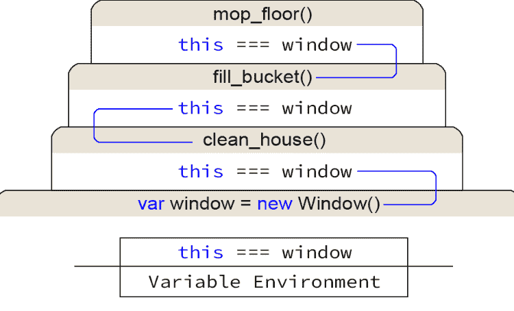

图 22.8：随着从其他函数内部调用更多相互依赖的函数，栈会增长。

正如你看到的，上下文传递到新创建的栈，并可以通过 `this` 关键字保持访问。这个过程不断重复，同时维持着执行上下文链，一直延伸到当前执行的上下文：

#### 函数作用域

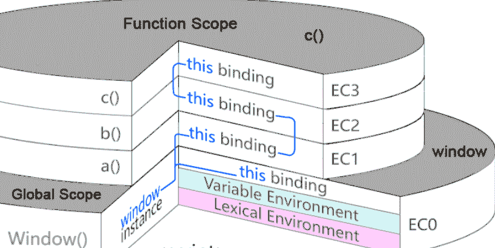

```javascript
<script>
function a() { b(); }
function b() { c(); }
function c() { }
a();
</script>
```

图 22.9：从彼此的作用域调用多个函数将在调用栈上构建一个函数调用塔。请注意，如果所有函数都是从全局作用域上下文调用的，那么每个函数一次只会发生这种情况。

请注意，每个函数都携带了它自己的执行上下文 EC0 – EC3。
始终有一个当前正在执行的上下文。这个上下文位于栈的最顶端。而所有之前的栈都保留在下方，直到执行从当前上下文返回（函数运行结束并返回，因此 JavaScript 就会从内存中移除该上下文，我们不再需要它了……）。

在函数执行完毕后，栈从顶部被移除，代码流返回到剩余的之前的/最上面的执行上下文。上下文不断从调用栈中推入（push）和弹出（pop）。

只有当你从另一个函数调用函数时，才会发生堆叠。如果所有函数都从同一个执行上下文连续执行，则不会发生这种情况。

在这种情况下……你将有一个函数推入栈中，从栈中弹出，然后下一个函数将再次推入空栈中……以此类推。

#### 22.2.3 .call(), .bind(), .apply()

这三个函数可以用于调用函数并选择在该函数作用域内 `this` 关键字指向的内容，从而覆盖它的默认行为。

#### 22.2.4 栈溢出 (Stack Overflow)

当你把最喜欢的汽水倒入高玻璃杯中时，它会失去碳酸，如果量和速度足够，它会溢出边缘。

你可以以类似的方式思考栈溢出。杯子是调用栈的内存地址空间。边缘以上的泡沫是无法分配的内存。


图 22.10：当从其他函数内部调用更多相互依赖的函数时，栈会增长。

正如你看到的，上下文传递到新创建的栈，并可以通过 `this` 关键字保持访问。这个过程不断重复，同时维持着执行上下文链，一直延伸到当前执行的上下文：

---

### 索引

- `for...of` 与数组, 120
- `for...of` 与生成器, 118
- `for...of` 与对象, 121
- `for...of` 与字符串, 120
- `for...of` 循环, 118
- 冰箱 (Fridge), 211
- 函数, 149, 194
- 函数结构, 150
- 函数参数个数 (arity), 107
- 函数赋值, 151
- 函数构造函数, 197, 201
- 构造函数, 184
- 函数提升, 65
- 函数参数, 153
- 函数纯度, 134
- 函数作用域, 62
- functions, 149
- 成分 (Ingredient), 210
- 配料, 205
- 实例, 44
- 实例化对象, 44, 203
- 迭代器, 160
- 左值 (l-value), 58
- 字面量值, 19
- 字面量, 19
- 逻辑运算符, 82
- 循环, 109
- `map()`, 161, 163
- 合并数组, 97
- 方法链式, 46
- 模块, 15
- 鼠标, 230
- 鼠标坐标, 231
- 鼠标事件类, 231
- 鼠标位置, 230
- 多重运算符, 53
- for 循环中的多个语句, 183
- 生成器 (generator), 118, 251
- 生成器错误, 253
- 生成器, 251
- `getById`, 179
- 全局作用域, 62, 263
- 全局符号注册表, 364
- 嵌套 for 循环, 114
- 网络, 235
- `new`, 203
- `new` 关键字, 203
- `new` 运算符, 203
- `null`, 33, 59
- 数字, 34
- 数字算术, 251
- 高阶函数, 157
- 函数提升, 65
- 变量提升, 63
- HTTP, 235
- HTTP 请求, 235
- `import`, 15, 16
- 导入多个定义, 126
- `in` 运算符, 85
- 包含外部脚本, 184
- 数字递增, 113
- 无限 for 循环, 112
- 对象比较, 142
- 对象实例, 44
- 对象字面量, 187, 195
- 面向对象编程, 205, 219
- 对象属性访问, 46
- `Object.create`, 199
- OOP, 205, 219
- 运算符结合性, 56
- 运算符优先级, 53, 56
- 运算符, 79
- 覆盖浏览器事件, 230
- 正则表达式 (regex), 138
- regular expression, 138
- `removeEventListener`, 226
- 请求, 235
- 剩余参数 (rest), 87
- 剩余属性, 87
- 父对象, 192
- 括号, 46
- 引用传递值, 23
- 多态烤箱, 216
- 多态性, 208, 216
- 基本类型, 31
- 原生类型, 31
- 保护函数参数, 155
- 作用域, 61
- 作用域可见性, 70
- 脚本类型 module, 125
- `setInterval`, 229
- 超时, 229
- 设置 CSS 样式, 178
- 展开运算符 (spread), 87
- 展开属性, 89
- 栈溢出, 267
- 在控制台打印对象, 8, 10
- 程序入口, 11
- Promise, 239
- Promise 结构, 244
- `Promise.all`, 242
- `Promise.catch`, 240
- `Promise.finally`, 240
- `Promise.reject`, 241
- `Promise.then`, 240
- 语句求值, 27
- 语句, 27
- 模式, 17
- 字符串, 37
- 字符串算术, 51
- 字符串赋值运算符, 81
- 字符串转数字比较, 834
- `String.matchAll`, 137
- 符号 (symbol), 40
- 合成事件, 224
- 原型 (prototype), 185, 187, 195, 198
- 原型链, 189
- 原型链, 188
- 原型方法查找, 190
- 纯度, 134
- 模板字面量, 38
- 模板字符串, 38
- 三元运算符, 85
- `this`, 156
- `this` 关键字, 156
- 类型检查, 154
- 类型转换, 47, 50
- `typeof`, 36, 84
- `querySelector`, 179
- 右值 (r-value), 58
- 范围 (Range), 216
- 归约器 (reducer), 133
- 引用, 23
- `undefined`, 33, 59
- 使用构造函数, 184
- 变量大小写敏感, 62
- 变量定义, 62
- 变量引用, 23
- 变量类型, 70
- 变量, 21
- 容器 (Vessel), 206, 213
- `while` 循环, 123
- `window`, 263
- `window.onload`, 14
- `yield`, 252
