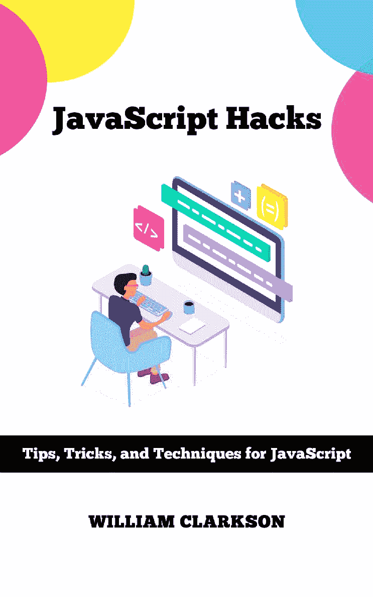
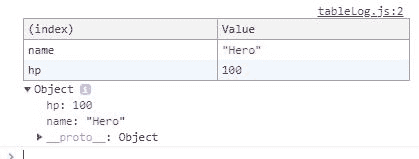

# JavaScript Hacks：JavaScript 技巧、窍门与技术





# 第一章 引言

引言

我编写代码已经 30 多年了。我每天仍然能发现关于编程的新知识。这里是我多年来总结的一些 JavaScript 技巧、窍门和方法。

你可以在我的网站下载代码示例：[WilliamClarkson.net](https://www.williamclarkson.net/code)，如果你对代码或特别是 JavaScript 有任何问题，可以在那里联系我，我会乐意尽力帮助你。

我热爱讨论代码！

如果你对使用 JavaScript 进行游戏设计感兴趣，你可能想看看我的其他书籍，或者访问我的游戏开发网站 [phasergames.com](https://www.phasergames.com)。

希望你喜欢这系列 JavaScript 代码片段！

# 第二章 数组

## 数组转列表

这是一个实用的小函数，我在我的几个程序中使用它，它能将数组转换为 HTML 列表。

```javascript
function arrayToList(array) {
  var oString = "<ol>";
  var len = array.length;
  for (var i = 0; i < len; i++) {
    var word = array[i];
    oString += "<li>" + word + "</li>";
  }
  oString += "</ol>";
  return oString;
}

window.onload = function() {
  document.getElementById('output').innerHTML = arrayToList(['red', 'blue', 'green']);
}
```

## 缓存数组长度

将数组长度存储在变量中意味着浏览器每次执行循环时不需要重新计算数组的长度。多年来，我在自己的代码中看到良好的性能结果。

一些研究似乎表明，浏览器厂商在意识到数组每次都需要计算后，现在已经采取了变通方法为你缓存数组长度，然而，我仍然喜欢这样做。这也是一个良好的习惯，因为你永远不知道用户使用的浏览器有多旧。

未缓存
```javascript
for (i = 0; i < array.length; i++) {
  //执行某些操作
}
```

已缓存
```javascript
var len = array.length;
for (var i = 0; i < len; i++) {
  //执行某些操作
}
```

## 二分查找

这是我在 80 年代使用的一种技巧，那时的时的计算机比现在慢得多。它只适用于按字母顺序排序的数组，但你也可以修改这段代码，使其适用于根据某个键（key）按字母顺序排序的对象数组。

它的工作原理是这样的：想象你有一本电话簿，你想找某个名字。你不会从字母 A 开始一直找，直到找到你要找的那个。但在编程中，我们经常这样做，即只用一个 `for` 循环遍历每一个名字，直到找到我们想要的那个。对于电话簿，我们随机打开一页，然后根据落脚的位置向前或向后翻页。这段代码查看数组中间或一半位置的元素。根据要查找的名字大于还是小于中间元素的值，它会丢弃数组的后半部分或部分。它不断丢弃数组的一半，直到找到想要的那个。

```javascript
function binSearch(array, value) {
  var first = 0,
  last = array.length - 1,
  middle = Math.floor((last + first) / 2);
  while (array[middle] != value && first < last) {
    if (value < array[middle]) {
      last = middle - 1;
    } else if (value > array[middle]) {
      first = middle + 1;
    }
    middle = Math.floor((last + first) / 2);
  }
  return (array[middle] != value) ? -1 : middle;
}

var array = ['Norberto', 'Fay', 'Leonia', 'Silvana', 'Julieann', 'Nubia', 'Verlene', 'Mittie', 'Ophelia', 'Kali', 'Mertie', 'Alaine', 'Caryn', 'Joeann', 'Leonie', 'Carolina', 'Kimber', 'Lacresha', 'Lianne', 'Tatiana'];
//对数组排序
array.sort();
console.log(binSearch(array, 'Nubia'));
//返回 5
```

## 清空数组

清空你想要继续使用的数组的一个快速小技巧就是简单将数组的长度设置为零。

```javascript
var array = [11, 22, 33, 44, 55, 66];
//
console.log(array);
//将长度设置为零
//
array.length=0;
//
console.log(array);
```

## 截断数组

就像将数组长度设置为 0 会清空数组一样，你也可以通过将长度设置为想要保留的元素数量来截断数组。

```javascript
var array = [11, 22, 33, 44, 55, 66];
```


```javascript
var age = 19;

var canDrink;

if (age > 20) {
  canDrink = true;
} else {
  canDrink = false;
}
```

## 新写法
```javascript
var age = 19
canDrink = (age > 20) ? true : false;
Console.log(canDrink);
```

其公式为：
`variable = (condition) ? 符合条件 : 不符合条件`

### 方法的三元运算符
你也可以使用三元运算符来调用方法。

## 旧写法
```javascript
if (success) {
  avatar.start();
} else {
  avatar.stop();
}
```

## 新写法
```javascript
success ? avatar.start() : avatar.stop();
```

### Switch vs If
使用 `switch` 语句代替系列的 `if-then` 语句会让代码更具可读性，并在某些情况下加快执行速度。

## 旧写法
```javascript
if (color == "red") {
  //执行某些操作
}
if (color == "blue") {
  //执行某些操作
}
if (color == "green") {
  //执行某些操作
}
if (color == "brown") {
  //执行某些操作
}
if (color == "yellow") {
  //执行某些操作
}
```

## 新写法
```javascript
switch (color) {
  case "red":
    //执行某些操作
    break;
  case "blue":
    //执行某些操作
    break;
  case "green":
    //执行某些操作
    break;
  case "brown":
    //执行某些操作
    break;
  case "yellow":
    //执行某些操作
    break;
}
```

# 第四章
## 函数

## 假设参数
如果你想能够向函数发送不固定数量的参数，只需让参数部分为空，然后使用 `arguments` 关键字来访问传入的任何参数。值得注意的是，尽管 `arguments` 行为像一个数组，但它并不是真正的 JavaScript 数组。

```javascript
function sum1(a, b) {
  return a + b;
}

function sum2() {
  return arguments[0] + arguments[1];
}

function sum3() {
  var sum = 0;
  for (var i = 0, len = arguments.length; i < len; ++i) {
    sum += arguments[i];
  }
}

sum1(1, 2);
sum2(1, 2);
sum3(1, 2, 3, 4, 5, 6, 7, 8, 9);
```

## 对象 vs 参数
很多时候我在编写类时，我最终会向构造函数传递 10 到 15 个参数。其中一些参数是可选的，因此当我以后想添加必填参数时，我必须回去修改大量代码。我发现，某些情况下，将单个对象作为唯一参数可以节省大量时间。

```javascript
function doAttack(weapon, damage, monster, useMagic = false) {
  console.log('you use the ' + weapon + ' on the ' + monster);
}

function doAttack2(obj) {
  console.log('you use the ' + obj.weapon + ' on the ' + obj.monster);
}

doAttack('sword', 10, orc);

var attackObj = {
  'weapon': 'sword',
  'damage': 10,
  'monster': 'orc'
};

attackObj.extraStuff = 'whatever';
attackObj.speed = 10;
doAttack2(attackObj);
```

## 默认值
使用双管道符 (`||`) `or` 关键字为变量设置默认值。如果没有为该变量传递值，则会设置默认值。

```javascript
function User(name, age) {
  this.name = name || "Oliver Stirling";
  this.age = age || 63;
}
```

## 简写函数
你可以使用双箭头符号来创建一个函数。

```javascript
function calcCircumference(diameter) {
  return Math.PI * diameter
}

calcCircumference = diameter => (Math.PI * diameter;)
```

# 第五章
## 数字

## 偶数还是奇数？
如果将一个数字除以 2 没有余数，它就是偶数，否则是奇数。

```javascript
function isEven(num) {
  return num/2 == Math.floor(num/2);
}
```

## 能被...除？
使用此函数判断一个数字是否能被另一个数字除而没有余数。

```javascript
function isDivisbleBy(num, div) {
  return (num / div == Math.floor(num / div));
}
```

## 获取最大值或最小值
使用 JavaScript 的内置数学函数获取数组中的最大或最小数字。

```javascript
var numbers = [3, 3354, 143, -245, 118, 400, 122222, -80011];
var maxInNumbers = Math.max.apply(Math, numbers);
var minInNumbers = Math.min.apply(Math, numbers);

console.log("max", maxInNumbers);
console.log("min=" + minInNumbers);
```
**输出：**
122222

## 随机范围
该函数将返回一个范围内的随机整数。

```javascript
function random(start, end) {
  return Math.floor(Math.random() * (end - start)) + start;
}
```

## 小数
该代码将数字保留到特定的小数。

```javascript
function toDecimal(num) {
  return num.toFixed(2);
}
```

## 字符串转数字
使用加号运算符将字符串转换为数字。

```javascript
function toNumber(str) {
  return +str;
}
```

# 第六章
## 对象

## 数组转对象
使用 `...` 关键字将数组转换为对象。

```javascript
var obj = {...['fish', 'chicken']}
```

## 多行文本
使用反引号代替转义字符。

## 旧写法
```javascript
var lorem = 'Lorem ipsum dolor amet, consectetur\n' +
'adipisicing elit, sed tempor incididunt\n' +
'ut labore magna aliqua';
```

## 新写法
```javascript
var lorem = `Lorem ipsum dolor amet, consectetur
adipisicing elit, sed tempor incididunt
ut labore magna aliqua`;
```

## 随机字符串
该函数用于生成测试数据和指定长度的随机字符串。

```javascript
function makeRandString(len) {
  var text = "";
  var letters = "ABCDEFGHIJKLMNOPQRSTUVWXYZabcdefuvwxyz0123456789";
  for (var i = 0; i < len; i++) {
    text += letters.charAt(Math.floor(Math.random() * letters.length));
  }
  text += " ";
  return text;
}

makeRandString(10);
```

## 删除双空格
有时用户输入会产生双空格。此函数会移除这些双空格。

```javascript
function removeDoubleSpaces(text) {
  for (var i = 0; i < 100; i++) {
    text = text.split(" ").join(" ");
  }
  return text;
}
```

## 克隆对象
```
```javascript
var obj = "It was the best of times, it was the worst of times";
```

## 替换所有
此函数通过指针或搜索词分割字符串，然后使用替换关键字作为分隔符将数组重新组合成字符串。

```javascript
function replaceAll(haystack, needle, replace) {
  var array = haystack.split(needle);
  var str = array.join(replace);
  return str;
}
```

# 第七章
## 字符串

## 首字母大写
将单词的首字母大写。

```javascript
function capFirstLetter(word) {
  return word.charAt(0).toUpperCase() + word.slice(1);
}
```

## 获取单词
将句子拆分为数组。

```javascript
function getWords(sentence) {
  return sentence.split(" ");
}
```

## 全大写单词
合并并将每个单词的首字母大写。

```javascript
function capAllWords(sentence) {
  var words = sentence.split(" ");
  var numWords = words.length;
  for (var i = 0; i < numWords; i++) {
    words[i] = words[i].charAt(0).toUpperCase() + words[i].slice(1);
  }
  return words.join(" ");
}
```

## 字符串查找字符串
使用此函数判断一个字符串是否包含另一个字符串。

```javascript
function contains(haystack, needle) {
  return haystack.indexOf(needle) != -1;
}
```


# 杂杂

## console.log 的快捷方式

如果你经常使用 `console.log`，可以通过将函数绑定到 `document` 来缩短该函数并减少输入时间。

```javascript
var cl = console.log.bind(document);

cl('shorter to type');
```

**输出**
`shorter to type`

```javascript
cl(1 + 1);
```

**输出**
`2`

## console.table

使用 `console.table` 在控制台中查看对象的视觉化表示。

```javascript
var person={'name':'Hero','hp':100};

console.table(person);
```



---

## 使用类

类是 JavaScript 中一个相当新的特性。它让我们比旧的函数对象提供了更大的灵活性。

```javascript
function Person(firstName, lastName) {
  this.firstName = firstName;
  this.lastName = lastName;
}

class Person2 {
  constructor(firstName, lastName) {
    this.firstName = firstName;
    this.lastName = lastName;
  }
  sayName() {
    console.log("Hi "+this.firstName);
  }
}

var player = new Person('Bob', 'Smith');
var player2=new Person2('Bob','Smith');
player2.sayName();
```

---

## 扩展类

通过使用 `Extends` 关键字，我们可以获取一个类的所有属性和方法，并在新类中对其进行扩展。

```javascript
class Person2 {
  constructor(firstName, lastName) {
    this.firstName = firstName;
    this.lastName = lastName;
  }
  sayName() {
    console.log("Hi " + this.firstName);
  }
}

class Superman extends Person2 {
  constructor(firstName, lastName) {
    super(firstName, lastName);
  }
  fly() {
    console.log("up up and away");
  }
}

var player = new Superman('Clark', 'Kent');
player.sayName();
player.fly();
```

---

## 链表

链表是一系列对象，每个对象都有前一个项目、下一个项目或两者的引用。与循环遍历相比，使用链表可以具有巨大的优势。当我创建虚拟世界时经常使用它，它确实加快了程序的运行。

```javascript
class Person {
  constructor(name) {
    this.name = name;
    this.nextPerson = null;
  }
  sayName() {
    console.log(this.name);
    if (this.nextPerson) {
      this.nextPerson.sayName();
    }
  }
}

var names = ['Aubrey', 'Marlin', 'Brittanie', 'Summer', 'Araceli', 'Jolie', 'Denyse'];

var firstPerson = null;
var previousPerson = null;

//创建列表
var len = names.length;
for (var i = 0; i < len; i++) {
  //创建一个新人物
  var person = new Person(names[i]);
  // 如果尚未设置第一个，则将当前人物设置为第一个
  if (firstPerson == null) {
    firstPerson = person;
  }
  // 如果 previousPerson 存在，则将当前人物赋值为下一个
  if (previousPerson) {
    previousPerson.nextPerson = person;
  }
  previousPerson = person;
}
// 调用第一个人的 sayName 函数
// 启动链式反应
firstPerson.sayName();
```

### 删除链表元素

要从链表中删除元素，我们需要同时拥有链表中下一个和前一个元素的引用。要删除一个元素，我们只需获取前一个元素，并将下一个项目设置为被删除元素的下一个项目。这在代码中更符合逻辑！

```javascript
class Person {
  constructor(name) {
    this.name = name;
    this.nextPerson = null;
    this.previousPerson = null;
  }
  sayName() {
    console.log(this.name);
    if (this.nextPerson) {
      this.nextPerson.sayName();
    }
  }
  removeByName(name) {
    if (this.name == name) {
      this.previousPerson.nextPerson = this.nextPerson;
    }
    if (this.nextPerson) {
      this.nextPerson.removeByName(name);
    }
  }
}

var names = ['Aubrey', 'Marlin', 'Brittanie', 'Summer', 'Araceli', 'Jolie', 'Denyse'];

var firstPerson = null;
var lastPerson = null;

var len = names.length;
for (var i = 0; i < len; i++) {
  //创建一个新人物
  var person = new Person(names[i]);
  // 如果尚未设置第一个，则将当前人物设置为第一个
  if (firstPerson == null) {
    firstPerson = person;
  }
  // 如果 lastPerson 存在，则将当前人物设置为下一个
  // 将 lastPerson 赋值给当前人物的前一个
  if (lastPerson) {
    lastPerson.nextPerson = person;
    person.previousPerson = lastPerson;
  }
  lastPerson = person;
}
firstPerson.removeByName('Summer');
firstPerson.sayName();
```

---

## 碰撞检测

这是我在很多游戏中使用的函数，用于判断两个对象是否互相接触。

```javascript
function checkCollide(obj1, obj2) {
  var distX = Math.abs(obj1.x - obj2.x);
  var distY = Math.abs(obj1.y - obj2.y);
  if (distX < obj1.width / 2) {
    if (distY < obj1.height / 2) {
      return true;
    }
  }
  return false;
}

var obj1={x:100,y:100,width:200,height:50};
var obj2={x:150,y:120,width:200,height:50};
checkCollide(obj1,obj2);
```

---

## 转换为布尔值

使用双感叹号（`!!`）将数字转换为布尔值。请注意，这仅对 0 返回假。负数仍会返回值。

```javascript
function checkPlayerHealth(hitPoints) {
  var isAlive = !!hitPoints;
  return isAlive;
}
console.log(checkPlayerHealth(100));
console.log(checkPlayerHealth(0));
```

---

## 获取页面 URL

如果你需要知道当前页面的名称，请使用 `window.location.href`

```javascript
function getUrl() {
  return window.location.href;
}
console.log(getUrl());
```

---

## 本地存储 - 字符串

使用本地存储（local storage）将字符串存储到浏览器内存中。

```javascript
//设置值
localStorage.setItem('monsterName', 'orc');
//获取值
var name=localStorage.getItem('monsterName');
```

---

## 本地存储 - 对象

要将对象存储到本地存储，首先使用 `JSON.stringify` 将转换为字符串。

```javascript
var monsterObj = { 'name':'orc','health':100,'defense':20 };
//将对象存入
localStorage.setItem('monster', JSON.stringify(monsterObj));

//从存储中检索对象
var monsterObj = localStorage.getItem('monster');
var monster=JSON.parse(monsterObj);
```

---

## 交换变量

使用匿名数组快速交换值。

```javascript
var a = 'world';
var b = 'hello';
[a, b] = [b, a]
console.log(a) //hello
console.log(b) //world
```

希望你喜欢这些 JavaScript 代码段，如果你有任何问题或发现错误，请通过以下方式联系我：[WilliamClarkson.net](https://www.williamclarkson.net/code)

