# JAVASCRIPT HTML CSS：分步指南


变得碎片化，因此他们创建了一项所有网络浏览器都应该遵循的标准规范。这成功地鼓励了浏览器制造商去支持标准标签。HTML5 的最终 W3C 标准规范现在由 Web 超文本应用技术工作组（WHATWG）作为“HTML 存活标准”（HTML Living Standard）继续维护。

全球维网由一系列大容量计算机组成，被称为“网络服务器”，它们通过电话线和卫星连接到互联网。每个网络服务器都使用超文本传输协议（HTTP）作为通用通信标准，允许任何连接到任何网络服务器的计算机访问跨越网络的文件。

HTML 页面仅仅是保存为“.htm”或“.html”文件扩展名的纯文本文件，例如 index.html。


你可以在 whatwg.org 在线查找 HTML 存活规范和其他相关规范。

为了通过互联网访问 HTML 文件，必须在网络浏览器的地址栏中输入其网页地址。该网页地址正式称为“统一资源定位符”（URL），通常包含三个部分：

- 协议 –任何使用 HTTP 协议的 URL 都以指定协议为 http:// 或安全的 https:// 开始
- 域名 – 可以下载文件的计算机的主机名。例如：www.example.com
- 路径 – 在适用情况下，文件名名前缀包含的任何父目录名称。例如：/htdocs/index.html


通过协议、域名和路径描述文件位置的 URL 是在陈述其完整的“绝对地址”。位于同一域内的文件可以使用更简单的“相对地址”来引用，这意味着位于相同目录的文件只需通过其文件名即可进行引用。此外，相对地址可以通过在名称前加上“../”前缀来引用其父目录中的文件。例如，父目录中名为“higher.html”的文件可以通过 `../higher.html` 进行引用。

## 网络服务器是如何工作的？

当你在浏览器地址栏中输入 URL 时，浏览器首先会检查协议。当协议指定为 HTTP，或在未指定时默认为 HTTP 时，浏览器识别出正试图从网络服务器请求文件。然后它会联系域名服务器（DNS）以查找指定域名的数字网际协议（IP）地址。接下来，与该 IP 地址上的网络服务器建立连接，以请求指定路径的文件。当成功找到文件时，它会被复制回浏览器；否则网络服务器将发送错误代码，例如“404 – 页面未找到”。


成功的响应会向网络浏览器发送 HTTP 头部，描述响应的性质，并附带请求文件的副本。HTTP 头部通常不可见，但可以使用各种开发工具进行检查，例如 Google Chrome 浏览器中的 F12 开发者工具功能。

## 理解结构


HTML 文档的骨架结构包含三个部分：

- **文档类型声明** – 精确声明使用哪种版本的 HTML 来标记文档。
- **头部部分（Head section）** – 提供关于文档本身的描述性数据，例如文档标题和所使用的字符集。
- **主体部分（Body section）** – 包含文档加载到网络浏览器时要显示的内容。

## 文档类型声明

文档类型声明必须出现在每个 HTML 文档的第一行开头，以确保网络浏览器以“标准模式”渲染（显示）文档——遵循 HTML 规范。所有 HTML 文档的文档类型声明看起来如下：

```
<DOCTYPE HTML>
```

需要注意的是，HTML 不是一种对大小写敏感的语言——因此文档类型声明标签以及所有其他标签都可以以大写和小小写的任意组合形式书写。例如，以下都是有效的：

```
<DOCTYPE html>
<!Doctype Html>
<!doctype html>
```

大小写的选择由你决定，但建议你始终坚持所选择的任何一种风格。本书书中推崇的文档类型声明大小写风格使用全大写，以强调其作为每页第一个标签的显著性——但所有其他标签均为全小写。

熟悉早期版本 HTML 的人可能会对 HTML 文档类型声明的简单感到惊讶。事实上，早期版本中的文档类型声明实际上并不是 HTML 语言的一部分——因此需要引用架构程序文档（schema documents）。相比之下，现代 HTML 文档类型声明是 HTML 自身的内在部分。


早期 HTML 版本中的文档类型声明是 HTML 所衍生的标准通用标记语言（SGML）的一部分。

整个文档头部和主体部分可以封装在 `<html></html>` 标签对中以包含文档的其他部分。HTML 规范实际上规定这些是可选的，但提供一个 `<root>` 元素是有逻辑的。

## 头部（Head section）

文档的头部部分以 HTML `<head>` 标签开始，以相应的 `</head>` 标签结束。描述文档的数据可以在这些标签之间添加以完成头部。

## 主体部分（Body section）

文档的主体部分以 HTML `<body>` 标签开始，以相应的 `</body>` 标签结束。要在浏览器中显示的内容可以在这些标签之间添加以完成主体。

## 代码注释

可以在头部主体部分的任何位置通过 `<!-- -->` 标签对添加。注释之间的任何内容会被浏览器忽略。


HTML “元素”是任何匹配的开启和闭合标签，或者是任何不需要闭合标签的单个标签。

## 基础结构

因此，创建 HTML 文档基础结构的标签如下：

```
<!DOCTYPE HTML>
<html>
<head>
<!-- 在处添加描述文档的数据 -->
</head>
<body>
<!-- 在处添加在浏览器显示的内容 -->
</body>
</html>
```


代表制表符、换行符、回车和空格的“不可见”字符统称为“空白”。它们可以用于插入标签。

## 创建文档

这里描述的基础 HTML 结构可以使用任何纯文本编辑器——如 Windows 的记事本程序来创建一个简单的 HTML 文档。为了创建一个有效的“骨架”HTML 文档，必须先添加定义文档主要语言、字符编码格式和标题的信息。


文档的主要语言通过在开启的 <html> 根标签内为 `lang` 属性分配标准语言代码来定义。对于英语语言，代码是 en，因此完整的开启根元素如下：

```
<html lang="en">
```

文档的字符编码格式通过为放置在文档头部部分的 `<meta>` 标签分配标准字符集代码来定义。推荐的编码是流行的 8 位 Unicode 转换格式，其代码为 UTF-8，因此完整的元素如下：`<meta charset="UTF-8">`


HTML 文档不应在 MS Word 等文字处理器中创建，因为这些程序会在其文件格式中包含额外信息。最后，文档标题通过放置在头部的 `<title> </title>` 标签对之间的文本来定义。


文档的头部部分。

按照以下步骤创建一个有效的骨架 HTML 文档：
启动你喜喜欢的纯文本编辑器，然后从 HTML 文档类型声明开始创建一个新文档。

```html
<!DOCTYPE HTML>
```


在文档类型声明下方，添加一个根元素，将文档的主要语言定义为英语。

```html
<html lang="en">
<!-- 在此处添加 Head 和 Body 部分。 -->
</html>
```

在根元素内部，插入一个文档头部部分。

```html
<head>
<!-- 在此处添加描述性信息。 -->
</head>
```

在头部部分内部，插入一个定义文档编码字符集的元素。
<meta charset="UTF-8">


`<meta>` 标签是一个单标签标签——它没有匹配的闭合标签。查看本书扉页的元素标签列表以查找其他单标签。

5 下一步，在头部部分内部，插入一个定义文档标题的元素。

<title>Get Started in HTML</title>

6 在头部部分之后，插入一个文档主体部分。

```html
<body>
<!-- 在此处添加实际文档内容。 -->
</body>
```

7 在主体部分内部，插入一个大号一级标题。

<h1>Hello World!</h1>

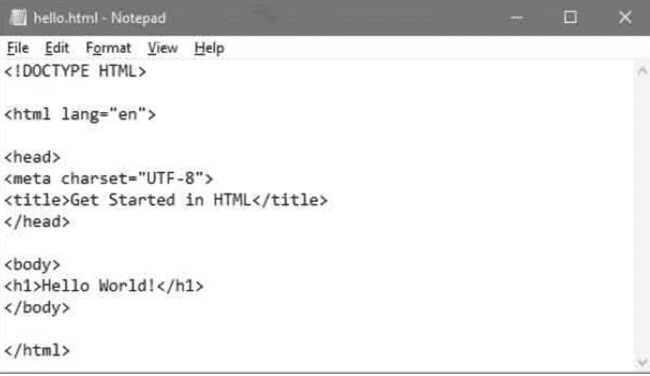

8 将文件的编码设置为 UTF-8 格式，然后将文档保存为“hello.html”。

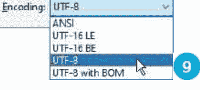

现在，在现代网络浏览器中打开该 HTML 文档，以查看在标题栏或标签页上显示的标题，以及显示为大标题的文档内容。

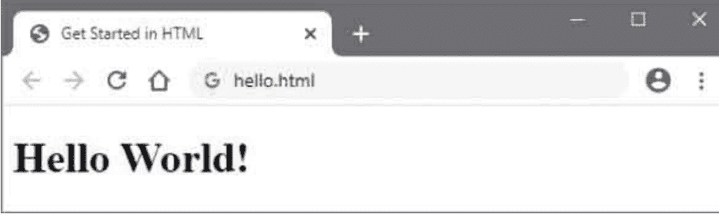

属性值周围的引号通常是可选的，但对于多个值是必须的。为了一致性，本书所有示例中的属性值都用引号包围。


你将在这里发现更多关于标题的内容。

# 验证文档

正如文本文档可能包含拼写和语法错误一样，HTML 文档可能包含各种错误，使其无法符合规范规则。为了验证 HTML 文档确实符合其指定的文档类型声明的规则，可以使用验证工具进行测试。只有成功通过验证测试的 HTML 文档才能确定有效的文档。


网络浏览器并不尝试进行验证，因此即使内容在网络浏览器中看起来良好，在发布之前使用验证工具验证每个 HTML 文档也是非常值得的。当浏览器遇到 HTML 错误时，它会猜测意图——但不同的浏览器可能有不同的解释，因此可能会错误显示文档。相反，有效的 HTML 文档应该在任何符合标准的浏览器中始终正确显示。

万维网联盟 (W3C) 在 [validator.w3.org](https://validator.w3.org) 提供了一个免费的在线验证工具，你可以用它检查 Web 文的语法：连接互联网后，打开网络浏览器并导航到 [validator.w3.org](https://validator.w3.org) 的 W3C 验证工具，点击“Validate by File”（文件验证）标签。

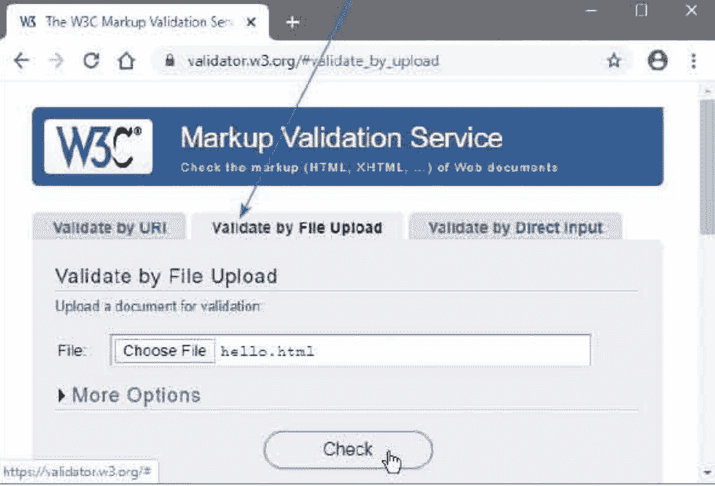


验证器的其他标签允许你输入位于 Web 服务器上的 HTML 文档地址进行“Validate by URI”（URI验证），或复制粘贴代码进行“Validate by Direct Input”（直接输入验证）。点击**Browse**（浏览）按钮导航到你想验证的 HTML 文档——一旦选择，其本地路径将出现在验证器的“File”字段中。接下来，点击验证器的 Check 按钮上传 HTML 文档并运行验证测试——结果将被显示。

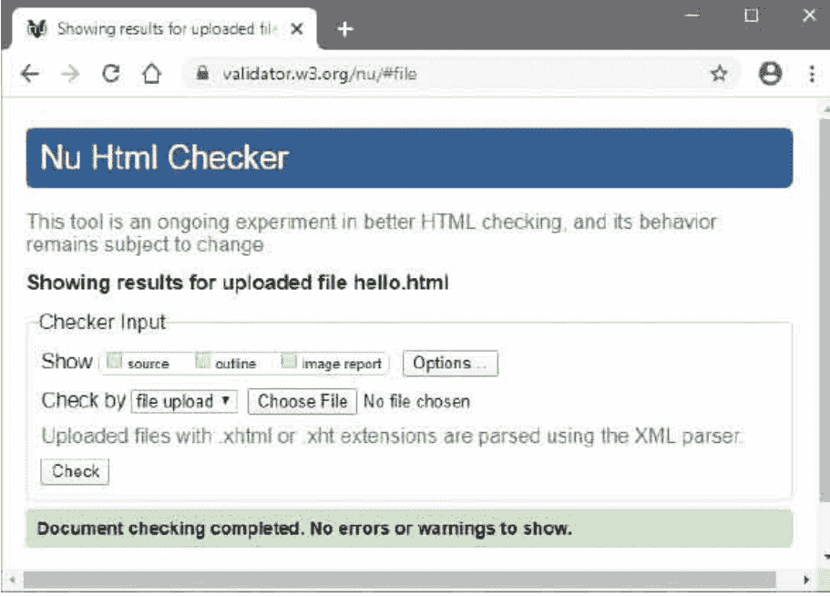


验证器会自动检测文档的字符集和 HTML 版本。如果验证失败，会列出错误以便你修正。当验证成功时，你可以选择在文档末尾包含一个合适的标题以证明验证：

## Hello World!

HTML5 连接性、实时、CSS3 样式、设备访问、图形、3D 效果、多媒体、性能、语义化与离线存储

www.w3.org/html/


验证可以自定义以描述 Web 页面所使用的技术。在 w3.org/html/ 发现 Builder，你可以生成代码粘贴到你的 HTML 文档中显示合适的标题。


## 标题

规范要求每个 HTML 文档都有一个标题，但其重要性被忽视了。然而，应该仔细考虑标题，因为它被广泛使用：

- 书签——保存文档标题到 URL。
- 标题栏——网络浏览器窗口可以显示标题。
- 标签——网络浏览器标签可以显示标题。
- 历史——保存文档标题到 URL。
- 搜索引擎——读取文档标题通常并在搜索结果中显示它。

文档标题应该是短而有意义的——现代标签可能只显示 10 个字符。整个网站的文档标题应遵循一致的命名规范并将主要单词大写。一种流行的命名规范是将个人或公司名称与简短页面描述分开。例如，“Amazon - C Programming in easy steps”。另一种方法是将描述放在前面，这样当标题被截断时依然可见。例如，“C Programming in easy steps - Amazon”。

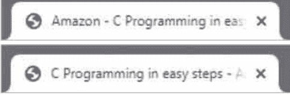

文档标题和文档内容可能包含 HTML 中称为“实体”（entities）的特殊字符。每个实体以 & 符号开头并以分号结束。例如，实体 `&lt;`（小于）创建一个 `<` 字符，实体 `&gt;`（大于）创建一个 `>`。这些通常用于避免与每个 HTML 标签周围的角括号混淆。其他常用的实体包括 `&nbsp;`（不换行空格）、`&bull;`（项目符号）、`&copy;`（©）、`&reg;`（®）、`&trade;`（™）和 `&quot;`（引号）。但在文档标题中最好避免这些，因为视障人士使用的语音读器可能会将每个实体读为一个单词。


规范没有定义文档标题的命名方案，但鼓励作者在其 页面设计的所有方面考虑可访问性问题。


你可以在 dev.w3.org/html5/htmlauthor/charref 找到所有字符实体表。

1. 使用类型声明 `<!DOCTYPE HTML>` 开始一个新的 HTML 文档。

2. 添加包含 head 和 body 部分的根元素 `<html lang="en">`。

```html
<head>
<!-- 在此处添加描述文档的数据。 -->
</head>
<body>
<!-- 在此处添加出现在浏览器中的内容。 -->
</body>
```

3. 在头部部分，插入一个指定字符集的 meta 元素和一个空的 title 元素。
<meta charset="UTF-8">
<title></title>

4. 在 title 元素内部插入包含实体的标题 `&lt;HTML in easy steps&gt;`。

5. 保存文档然后在网络浏览器中打开它。

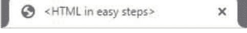

6. 启动语音读器听听标题可能会被读作“Less-thanHTML-in-easy-steps-greater-than>

7. 编辑文档标题使其更符合用户友好 `&quot;HTML in easy steps&quot;`

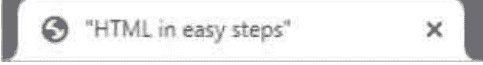

8. 再次保存文档然后在网络浏览器中打开它，听读器现在将文档标题读为“HTML in easy steps”。


字符集可以定义为大写（如所示），也可以定义为小写“utf-8”。


在 Windows 10 中，按下 `Winkey + Ctrl + Enter` 启动讲述器，然后点击标签页即可听到标题。标签页上不可见的标题文本仍能被讲述器读取。Windows 10 会忽略标题中的角括号，但在较版本的 Windows 中，讲述器会逐字读取这些符号。


元数据简单来说描述其他数据的数据。在 HTML 的语境下，文档元数据描述文档本身——而不是文档的内容。

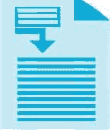

HTML 元数据在 HTML 文档的 `<head>` 部分使用 `<meta>` 标签定义。`<meta>` 标签是一个“空”标签，不需要匹配的闭合标签来创建 HTML 元素 – 它仅用于通过其标签属性来指定信息。之前的示例使用了此标签来指定文档的字符集。可以添加更多的 `<meta>` 标签来描述文档的其他方面。

考虑到可能查看网页的手持设备数量，通过在所有 HTML 文档的 `<head>` 部分包含此 `<meta>` 标签来针对小屏幕优化页面是非常有用的：

```
<meta name="viewport" 
content="width=device-width,initial-scale=1">
```

这将确保你的文档填充设备屏幕宽度，并设置初始缩放级别以确保内容不缩放。

`<meta>` 标签还可以将文档 HTTP 头部属性分配给 `http-equiv` 属性，并将该属性的值指定给 `content` 属性。你可以将 HTTP "refresh" 属性分配给 `http-equiv` 属性，以便在 `content` 属性指定的秒数后重新加载页面——例如，五秒后重新加载页面，如下所示：

```
<meta http-equiv="refresh" content="5">
```

这种技术通常用于网站动态更新新闻或状态项目，因为它不依赖于 JavaScript 支持。另一个流行的用法是在指定的秒数后将浏览器重定向到新的网页，如下所示：

```
<meta http-equiv="refresh" content="5 ; url='new-page.html">
```

在这种情况下，`<meta>` 标签的 `content` 属性指定了延迟的秒数和要加载的新 URL。


将宽度设置为 `device-width` 通常会自动将 `initial-scale` 设置为 1，但将其作为元数据显式设置也无妨。

- 创建一个基础的 HTML 文档

```
<!DOCTYPE html>
<html lang="en">
<head>
<meta charset="UTF-8">
```

```
<!-- 在此处插入更多元数据。 -->
<title>Meta Refresh</title>
<head>
<body>
<h1>即将在 5 秒后移动...</h1>
</body>
</html>
```


refresh.html

- 2 插入另外两个元数据元素
<meta name="viewport" content="width=device-width, initial-scale=1">
<meta http-equiv="refresh" content="5; url='https://ineasystems.com' >
- 3 保存文档，然后在网页浏览器中打开它，等待五秒钟查看浏览器重定向

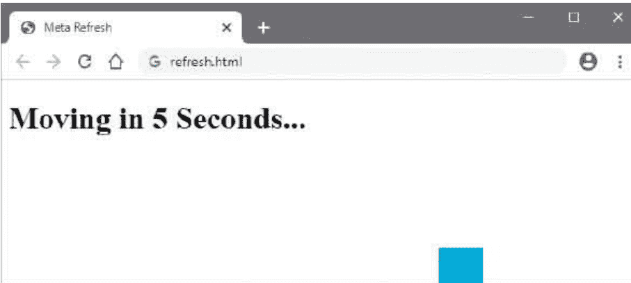

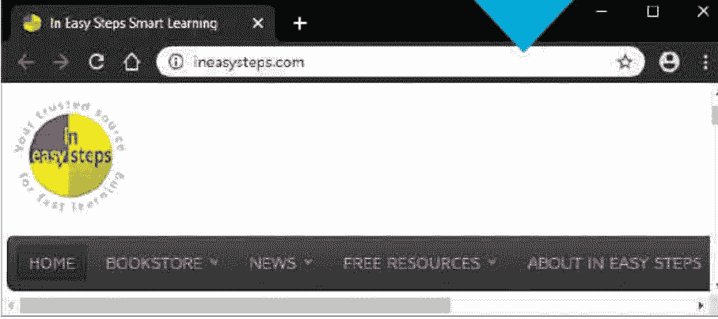


当你像这种情况一样只为 `url` 属性指定域名时，浏览器将自动加载该域名位置下的 `index.html` 页面。


除了指定文档字符集和过期日期外，`<meta>` 标签还可以用于提供可能被搜索引擎使用的信息。然而，这不能保证高排名，因为搜索引擎也会使用其他页面信息来实现此目的——特别是文档标题。通常，搜索引擎结果页面 (SERP) 会会在搜索结果的页面标题下方显示元描述。

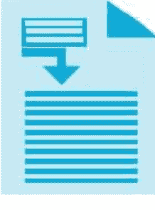

搜索引擎优化 (SEO) 被高度重视，用以确保网页出现在 SERP 的顶部，从而增加网站的流量。遗憾的是，没有一种万之百的技术可以实现这一点，因为搜索引擎不断改变其页面排名的算法。然而，提供描述页面的元数据是有用的。`<meta>` 标签有一个 `name` 属性，被分配“description”值，以及一个 `content` 属性，被分配页面的描述。

描述的长度应在 50-160 个字符之间，因为过长的描述可能会被截断。描述应包含与文本相关的关键词。例如，搜索“意大利陶瓷”可能会返回所有描述中包含“意大利”和“陶瓷”的网页。它作为广告文案，因此使用重要关键词编写易读且具吸引力的描述将鼓励用户从 SERP 访问该页面。你不应该重复关键词，使用易读且包含重要关键词的描述将鼓励用户从 SERP 访问页面。你不应该重复关键词，这可能会被搜索引擎惩罚。

在这种情况下，如果你只为 `url` 属性指定了域名，浏览器将自动加载该域名位置下的 `index.html` 页面。


除了指定文档字符集和过期日期外，`<meta>` 标签还可以用于提供可能被搜索引擎使用的信息。然而，这不能保证高排名，因为搜索引擎也会使用其他页面信息来实现此目的——特别是文档标题。通常，搜索引擎结果页面 (SERP) 会会在搜索结果的页面标题下方显示元描述。


搜索引擎优化 (SEO) 被高度重视，用以确保网页出现在 SERP 的顶部，从而增加网站的流量。遗憾的是，没有一种万之百的技术可以实现这一点，因为搜索引擎不断改变其页面排名的算法。然而，提供描述页面的元数据是有用的。`<meta>` 标签有一个 `name` 属性，被分配“description”值，以及一个 `content` 属性，被分配页面的描述。

描述的长度应在 50-160 个字符之间，因为过长的描述可能会被截断。描述应包含与文本相关的关键词。例如，搜索“意大利陶瓷”可能会返回所有描述中包含“意大利”和“陶瓷”的网页。它作为广告文案，因此使用重要关键词编写易读且具吸引力的描述将鼓励用户从 SERP 访问该页面。你不应该重复关键词，这可能会导致副作用。在这种情况下，如果你只为 `url` 属性指定了域名，浏览器将自动加载该域名位置下的 `index.html` 页面。


层叠样式表 (CSS) 规则可以包含在 HTML 文档中，以控制页面每个元素的演示方面。样式表的使用取代了 HTML 中所有与演示的功能。例如，`<font>` 标签已经过时，因为字体族、粗细、样式和大小现在通过样式表指定。


嵌入 `<style>` 标签的样式表可以添加到 HTML 文档的 `<head>` 部分，以封装控制内容外观的规则。例如，一个包含决定一级标题外观规则的简单样式表可能像这样：

```
<style>
h1 { color : red; background : yellow ; }
</style>
```

这种做法是可以接受的并且可以通过验证，但根据 HTML 将内容与演示分离的理念，样式表可以包含在单独的文件中。将样式表放在单独文件中巨大的优势是它们可以应用于多个 HTML 文档——这使得网站维护变得简单得多。编辑共享的样式表会立即影响共享该文件的 HTML 文档。

外部样式表通过在 HTML 文档的 `<head>` 部分添加 `<link>` 标签来包含在 HTML 文档中。该标签必须包含一个 `rel`（关系）属性，其值被分配为“stylesheets”，并把样式表的 URL 分配给其 `href`（超链接引用）属性——例如，添加一个名为“style.css”的相邻样式文件，如下：

```
<link rel="stylesheets" href="style.css">
```

你通过元素的 `style` 属性“内联”指定样式规则


表现性 HTML 标签，例如：
`<h1 style="color:red">`
内联样式规则在某些情况下非常有用，但会让页面维护变得更加困难。


当多个规则对元素的同一个属性进行样式选择时，浏览器通常应用最后读取的规则，但内联规则的优先级高于嵌入规则和外部规则。嵌入式规则的优先级高于外部规则。

- 1. 创建一个基础 HTML 文档

```html
<!DOCTYPE HTML>
<html lang="en">
<head>
<meta charset="UTF-8">
<title>Style Sheet Example</title>
</head>
<body>
<h1>Styled Heading</h1>
</body>
</html>
```

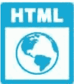

style.html

- 2. 接下来，在 head 部分添加一个嵌入式样式表

```html
<style>
h1 { color : Red ; background : Yellow ; }
</style>
```

- 3. 现在，在 head 部分插入一个指向外部样式表的链接
`<link rel="stylesheet" href="style.css">`

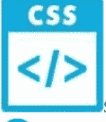

- 4. 保存 HTML 文档，然后打开文本编辑器窗口并精确复制此样式

```css
h1 {
border : 10px dashed Blue ; padding : 5px ;
width : 500px ;
}
```

- 5. 将级联样式表文件保存到与 HTML 文档相同的目录下，然后在浏览器中打开网页以查看应用后的样式规则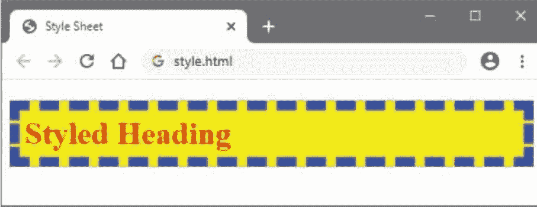

某些 HTML 元素（如 `<div>` 和 `<span>`（参见此处））纯粹是为了样式化。CSS 是独立的主题，但书中的许多示例演示了 HTML 元素的使用，并说明了它们的大小和位置。


脚本可以包含在 HTML 文档中以与用户交互并提供动态效果。随着可以动态更新内容的页面的发展，这种能力变得越来越重要。以前，浏览器通常会从 Web 服务器请求整个新页面，这效率较低且更加繁琐。

由`<script>` 标签封装的 JavaScript 代码可以嵌入到 HTML 文档中。这些内容最好放在文档的 body 部分，就在 `</body>` 闭合标签之前，这样浏览器在读取脚本之前就可以处理文档内容。为了分离演示，脚本也可以包含在单独的文件中。在这种情况下，必须将脚本文件的 URL 赋值给 `<script>` 标签内的 `src` 属性。还需要 `</script>` 闭合标签。这些也可以放在 HTML 文档 body 部分的末尾，因为浏览器会将外部脚本处理为嵌入在其中的形式——例如，添加一个名为“script.js”的脚本文件，如下：

```html
<script src="script.js"></script>
```

记住`<script>` 标签始终需要一个匹配的闭合标签。你也可以将脚本“内联”到 HTML 标签的事件属性中。例如，为了识别鼠标点击事件：
`<h1 onclick="alert('Clicked!')">`

内联脚本在某些情况下有用，但会让页面维护变得更加困难。可以在文档的 body 部分、`<noscript>` 标签之间提供替代的回退内容，这些内容只有在脚本功能缺失或禁用时才会显示。

- 1. 创建一个基础 HTML 文档

```html
<!DOCTYPE HTML>
<html lang="en">
<head>
<meta charset="UTF-8">
<title>JavaScript Example</title> </head>
<body>
</body>
</html>
```


- 2. 在 body 部分插入一条回退消息和标题
`<noscript>JavaScript Is Not Enabled!</noscript>`
`<h1 onclick="this.innerText='Mouse Clicked!'; this.style.color='Red'">Active Heading</h1>`

- 3. 在 body 部分的末尾，添加一个嵌入式脚本并指定一个外部脚本

```html
<script>
document.getElementsByTagName('h1')[0].onmouseover =
function () {
this.innerText='Mouse Is Over '; this.style.color='Blue'
}
</script>
<script src="script.js"></script>
```

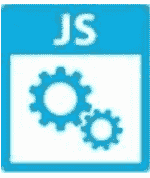

- 4. 保存 HTML 文档，然后打开一个新的文本编辑器窗口并创建外部脚本

```javascript
document.getElementsByTagName('h1')[0].onmouseover = function () { this.innerText = 'Active Heading' ; this.style.color = 'Black' }
```

- 5. 将 JavaScript 文件保存为“script.js”并放在与 HTML 文档相同的目录下，然后在浏览器中打开网页并点击标题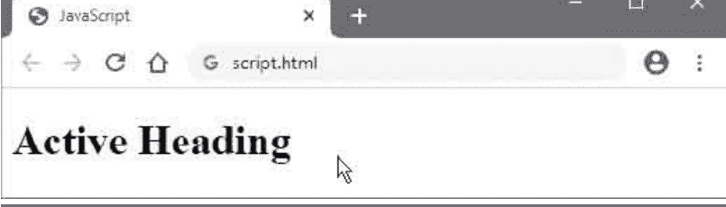

某些 HTML 元素（如 `<div>` 和 `<span>`（参见此处））纯粹是为了样式化。CSS 是独立的主题，但书中的许多示例演示了 HTML 元素的使用。


文档

打开图标编辑器并创建一个大小为 32 x 32 像素的图标，将您的图标保存在 HTML 文档旁边，或者放在“resources”目录下，命名为“favicon.ico”

favicon.ico 32px x 32px

通过 Web 服务器在网页浏览器中打开 HTML 文档，即可在浏览器中看到图标资源

你可以通过为 link 标签的 `href` 属性赋值 `favicon.ico?v=2` 来强制浏览器刷新 favicon。


- Web 超文本应用技术工作组 (WHATWG) 负责 HTML 存活标准。
- 超文本传输协议 (HTTP) 是 Web 服务器使用的通用通信标准。
- 统一资源定位符 (URL) 是由协议、域名和路径部分组成的绝对 Web 地址。
- 相对地址 `..` 语法可以通过其名称引用相邻文件，并可以使用父目录。
- Web 服务器向请求的计算机发送响应头，并复制一份请求文件的副本或错误代码。
- 每个 HTML 文档都应该有一个文档类型声明、一个头部（head）部分和一个正文（body）部分。
- 关于文档本身的信息包含在头部部分中，内容包含在正文部分中。
- 文档的编写语言在起始 `<html>` 元素的 `lang` 属性中指定。
- 文档的字符集编码在头部部分的 `<meta>` 标签的 `charset` 属性中指定。
- 文档标题在头部部分的 `<title></title>` 标签之间指定。
- 可以使用免费在线 W3C 验证工具来验证 HTML 文档无错误。
- 元数据描述文档，内容描述可以被搜索引擎用于索引网页。
- `<style></style>` 标签可以用于在 HTML 文档中嵌入样式表。
- `<script></script>` 标签可以用于在 HTML 文档中包含内部和外部 JavaScript 代码。
- `<link>` 标签可以用于在 HTML 文档中嵌入外部样式和其他资源。


本章演示了如何将页面内容划分到组和章节中。

声明标题 分组标题 包含 导航 完成框架 创建章节 提供侧边 修订划分 总结


HTML 标题元素是通过 `<h1>`、`<h2>`、`<h3>`、`<h4>`、`<h5>` 和 `<h6>` 标签创建的。它们根据数值按重要性进行排序——其中 `<h1>` 重要性最高，`<h6>` 最低。每个标题都需要一个匹配的结束标签，并且应该只包含标题文本。通常，标题的字体大小和粗细将反映其重要性，但标题也有其他用途。

标题元素应该通过正确的排序顺序来隐式地传达文档结构——例如，`<h2>` 元素位于 `<h1>` 元素之下，`<h3>` 元素位于 `<h2>` 元素之下，依此类推。这种结构有助于读者通过导航标题来快速浏览文档。搜索引擎爬虫可能会推广那些标题顺序正确的文档，因为它们可以在索引中使用这些标题。它们假设标题可能描述其内容，因此，将文档头部的元关键词（meta keywords）包含在文档标题中是特别有效的。

`<h1>` 元素是目前为止是最重要的标题，理想情况下应该只出现一次，以声明文档标题。通常，这可以是文档标题的简短版本。下方，若干 `<h2>` 标题可以为长文档声明主题标题。每个主题可能包含在 `<h3>` 元素中的单个文章标题，随后是包含实际内容的段落 `<p>` 元素。

1. 创建一个 HTML 文档（作为模板）heading.html
2. 在正文部分，插入一个主文档标题 `<h1>Document Heading</h1>`
3. 接下来，在正文部分，插入一个主题标题 `<h2>Topic Heading</h2>`
4. 现在，在正文部分，插入一些文章标题，然后跟上包含文章内容的段落 `<h3>Article Heading</h3><p>...</p><h3>Article Heading</h3><p>...</p>`
5. 永远不要为了字体属性而使用标题元素，因为这些属性可以被样式规则覆盖——始终将标题视为结构的表示。
6. 最后，添加另一个带有更多文章的主题 `<h2>Topic Heading</h2><<h3>Article Heading</h3><p>...</p><h3>Article Heading</h3><p>...</p>`

保存 HTML 文档，然后在网页浏览器中打开它，以查看标题和文档结构

通过顺序排列的标题创建的文档结构被称为“大纲（outline）”。构建良好的大纲允许页面的某部分（例如单篇文章）被轻松地分发到另一个网站。上述文档的大纲如上方的截图所示。

你将在这里查阅到更多关于 `<p>` 段落元素的知识。本章中的所有截图都添加了样式规则，以清晰地说明所描述的元素。


标题有时会有副标题或标语。例如，文档标题可以这样标记：
`<h1>American Airlines</h1><h2>Doing We Do Best</h2>`

遗憾的是，这严格要求后续所有标题都必须从 `<h3>` 到 `<h6>`，以保持正确的大纲顺序。幸运的是，HTML 提供了一个使用 `<hgroup>` 元素进行分组解决方案。它可以用于同时包含标题和副标题，如下：

文档可以包含多个 `<hgroup>` 元素，每个 `<hgroup>` 元素可以包含从 `<h1>` 到 `<h6>` 的标题。完整的头部可以包含在 `<header> </header>` 标签中，包含标题元素或 `<hgroup>` 元素以及其他介绍项目——例如横幅、标志或目录。

1. 创建一个 HTML 文档（作为模板）
2. 在正文部分，插入一个包含图像的主文档标题 `<header>`

```html

<hgroup>
<h1>HTML</h1>
<h2>Building better websites</h2>
</hgroup>
</header>
```

3. 接下来，在正文部分，插入一个主题和文章

```html
<hgroup>
<h2>Topic Heading</h2>
<h3>Article Heading</h3>
</hgroup>
```

<p>Article Content...</p>

你不能相互嵌套 `<header>` 元素。

你将在在这里查阅到更多关于 `` 图像元素的知识。现在，在正文部分，插入一个包含单篇文章的第二个主题

```html
<hgroup>
<h1>CSS</h1>
<h2>Cascading Style Sheets</h2>
<h3>Article Heading</h3>
</hgroup>
```

<p>Article content...</p>

保存 HTML 文档，然后在网页浏览器中打开它，以查看分组的标题和文档头部


构建更好的网站


文章标题

文章内容...


层叠样式表

文章标题

文章内容...


- HTML: 构建更好的网站
- 主题标题: 文章标题
- CSS: 层叠样式表: 文章标题

`<hgroup>` 元素仅对标题 `<h1>` 到 `<h6>` 进行分组，而 `<header>` 元素会将标题和其他项目分组。


网页上的超链接组（允许用户在页面或网站之间导航）应该包含在 `<nav> </nav>` 标签之间，或者对于其他链接使用 `<menu> </menu>` 标签。


这组链接通常是文档页眉中的水平菜单——通常称为导航栏（nav bar）——也可能是页面边缘的垂直菜单。注意 `<nav>` 元素仅仅是菜单的容器——它并不替换任何结构性元素。

1. 创建一个 HTML 文档（如此处的模板）
2. 在 `body` 中插入一个包含 Logo、文档标题和水平页面导航栏的页头
```html
<header>

<h1>Building better websites</h1>
<nav id="horizontal">
<h2>Site Links</h2><p><a href="#html">Markup</a></p>
</nav>
```

<a href="#js">Scripting</a> | 
<a href="#css">Style Sheets</a> 
</nav>

<header>
3. 接下来，在 `body` 中插入一个垂直的网站导航菜单

<nav id="vertical" >
<h2>Page Links</h2>
<p>Further Reading
<br><br><a href="nav-js.html">JavaScript</a>
<br><br><a href="nav-css.html">CSS</a> </p>
</nav>

4. 现在，添加主题标题和内容
<h2 id="html">HTML</h2>
<p>关于标记语言的所有内容...</p>
<h2 id="js">JavaScript</h2> <p>关于脚本的所有内容...</p>
<h2 id="css">CSS</h2>
<p>关于样式表的所有内容...</p>


你将在此处发现更多关于 `<a>` 锚点元素的知识，并在这里找到关于 `<br>` 换行元素的详细信息。


并不是并不是链接组都适用于 `<nav>` 元素——只有那些提供全页面或全站导航的组。5. 添加样式表来定位 Logo 图片、水平导航栏和垂直导航菜单

```
<style>
#logo { float: left; }
#horizontal { padding-left: 100px; display: block; }
#vertical { float: left; padding: 0px 30px 30px 30px; }
</style>
```

保存 HTML 文档，然后在浏览器中打开该网页并尝试导航链接

## 构建更好的网站

站点链接
标记 | 脚本 | 样式表

| 页面链接 | HTML |
| :--- | :--- |
| 更多阅读 | 关于标记语言的所有内容... |
| JavaScript | 关于脚本的所有内容... |
| CSS | 关于样式表的所有内容... |

JavaScript 允许你为网页添加功能（逻辑）和动态效果（DHTML）。你可以使用 JavaScript 对象表示法 (JSON) 或采用异步 JavaScript 和 XML (AJAX) 来开发富交互应用程序 (RIAs)。

# 结构大纲
构建更好的网站
站点链接
页面链接
HTML
JavaScript 脚本
CSS

使用无序列表创建垂直导航菜单是很流行的——参见此处。

## 完整框架

正如典型的 HTML 文档可能包含文档标题或页头组，它也可以页面底部包含一个页脚或页脚组。每个页脚的内容包含在 `<footer></footer>` 标签之间，提供关于文档该部分的信息。

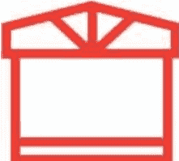

通常，`<footer>` 元素可能包含作者姓名、`<address>` 元素中的作者联系方式，或者 `<small>` 元素中的版权和法律免责声明。类似于 `<header>` 元素，`<footer>` 元素也可以包含嵌套在 `<nav>` 元素中的页面和网站导航超链接。

文档标题和页脚可以通过 `<main> </main>` 元素合理地分离，该元素将包含页面内容。

1. 创建一个 HTML 文档（如此处的模板）

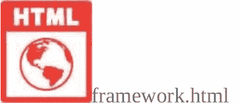

2. 在 `body` 中插入文档标题
3. 接下来，添加一个主容器
<main>
<!-- Page content -->
</main>

4. 在主内容容器中插入两个文章
<article>
<h2 id="art-1">Sally's</h2>
<p>content...</p>
</article>
<article>
<h2 id="art-2">Terry's</h2>
<p>content...</p>
</article>


5. 最后，在 `body` 中添加一个页脚
<footer>
<small>Copyright &copy; Example Corporation</small>
<address>www.example.com</address>
</footer>

## 有趣的文章

Sally's

内容...

Terry's

内容...

页面顶部

Copyright © Example Corporation
www.example.com

## 章节

HTML 中的 `<section>` 元素用于分组相关内容。每个区块通常以标题开始。同样，每篇文章都可能以自己的标题开头，随后是段落。

1. 创建一个 HTML 文档（如此处的模板）

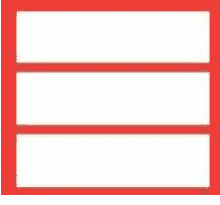

2. 在 `body` 中插入文档标题
<h1>Newspaper</h1>

3. 接下来添加一个主容器
<main>
<!-- Page content -->
</main>

4. 在主内容容器中插入一个包含两篇文章的区块
<section>
<h2>News Section</h2>
<article>
<h3>Article #1</h3>
<p>Article content...</p>
</article>
<article>
<h3>Article #2</h3>
<p>Article content...</p>
</article>
</section>

5. 接下来在主内容容器中，插入另一个包含单篇文章的区块
<section>
<h2>Sport Section</h2>
<article>
<h3>Article #1</h3>
<p>Article content...</p>
</article>
</section>

6. 在主内容容器之后，添加页面页脚
<footer>
<small>Copyright &copy; Example Corporation</small>
</footer>

7. 保存 HTML 文档然后在浏览器中打开它，查看以章节形式的文章内容

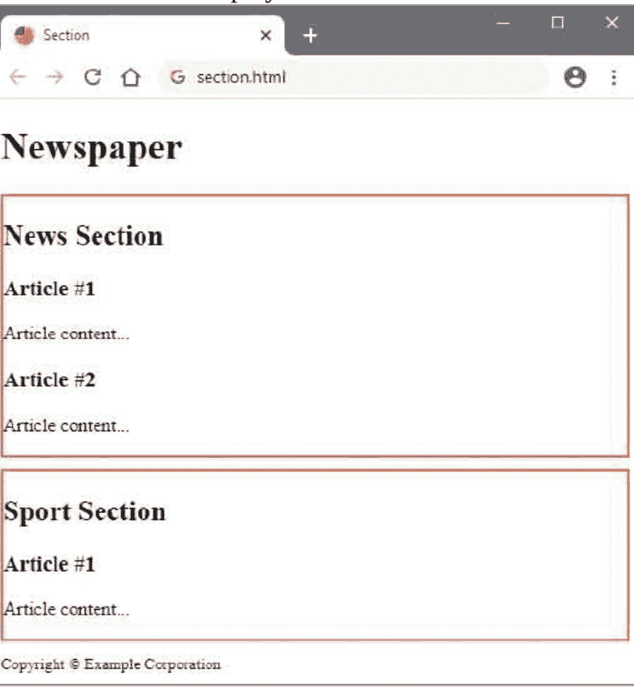


但 `<article>` 包含一个独立的组合。


文档、节和文章的标题在文档大纲中显示嵌套正确。

# 辅助侧旁内容（Asides）

HTML 有用提供了 `<aside> </aside>` 标签，可以嵌套在 `<article>` 元素内部，以包含与该文章主要内容某些相关的内容。这些标签允许包含补充但独立的内容——通常显示为侧边栏或脚注。


`<aside>` 元素内的内容应该是与文章相关的独立信息，例如从相关文章中提取的引言、文章中使用的术语表，甚至是提供与文章相关的进一步阅读的页面的超链接。

或者，`<aside>` 元素也可以单独使用（不使用 `<article>` 元素），包含与整个页面相关的次要内容，例如相关广告或网络博客。

创建一个 HTML 文档（此处为模板）


在 body 中，插入一个文档标题
<h1>著名名言</h1>

接下来，添加一个主内容容器
<main>
<!-- 此处要插入的页面内容。 -->
</main>

现在，在主内容容器中，插入一个包含标题、段落和 `<aside>` 元素的文章
<article>
<h2>幸福</h2>

<p><q>幸福的秘诀不在于做你所喜欢的事，而在于喜欢你所必须做的事。</q> <br><cite>James M. Barrie</cite></p>

<aside>James M. Barrie里 (1860 - 1937) 是一位苏格兰作家和剧作家。</aside>
</article>

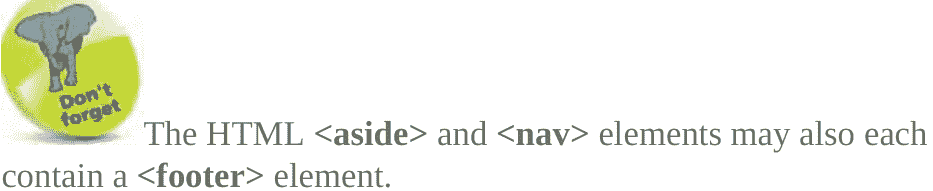

在主内容容器中，插入第二个类似的文章——包含一个用于侧边栏样式的类属性
<article class="sidebar"><<h2>愤世嫉俗</h2>

<p><q>愤世嫉俗者是一个对一切价格都了如掌却毫无价值的人。</q> <cite>Oscar Wilde</cite></p>

<aside>Oscar Wilde (1854 – 1900)<br>是一位爱尔兰作家和诗人。</aside>

- 6 在主内容容器之后添加页面页脚，然后添加样式表来控制 `aside` 的位置

<footer><small>版权 &copy; Example Corporation</small></footer>

```css
<style>
article.sidebar > p,aside
{ display : table-cell ; padding-right : 20px }
>
```

- 7 保存 HTML 文档和样式表，然后在浏览器中打开网页以查看侧旁内容的显示效果

# 著名名言

## 幸福

“幸福的秘诀不在于做你所喜欢的事，而在于喜欢你所必须做的事。”

James M. Barrie

> James M. Barrie (1860-1937) 是一位苏格兰作家和剧作家。

## 愤世嫉俗

“愤世嫉俗者是一个对一切价格都了如掌却毫无价值的人。”

> Oscar Wilde (1854-1900) 是一位爱尔兰作家和诗人。

Oscar Wilde

Copyright © Example Corporation

# 结构大纲

- 幸福
- [没有标题的 aside 元素]
- 愤世嫉俗
- [没有标题的 aside 元素]


避免使用 `<aside>` 元素包含不相关的广告。


不要使用 `<aside>` 元素包含导航超链接；这些链接应该始终包含 `<nav>` 元素内部。

## 修改划分

`<div></div>` 划分标签在 HTML 早期版本中被广泛使用，为了向下兼容仍然继续支持——但 `<div>` 元素没有提供语义含义，因此最好避免使用更有具意义的标签。


与 `<header>`, `<main>`, `<section>`, `<article>`, `<nav>` 和 `<footer>` 等其他具意义元素不同，无意义的 `<div>` 元素是匿名的。例如，智能浏览器可能有一个快捷键跳转到页面的导航部分。当该部分包含在有意义的 `<nav>` 元素中时很容易识别，但包含在无意义的 `<div>` 元素中就不那么明显了。

`<div>` 元素对于样式目的仍然有用，同样匿名的 `<span></span>` 标签也是如此。虽然 `<div>` 和 `<span>` 元素本身没有意义，但它们可以包含一个标识 `id`、`class` 或 `style` 属性以应用样式规则。


避免使用 `<aside>` 元素包含不相关的广告。


元素由浏览器在视觉上与下一个元素分开——通常在它们之间留两个空行。


段落内的文本在遇到元素边缘时通常会自动换行到下一行，但可以通过插入换行符 `<br>` 标签强制其提前换行。

为了强调，可以在段落之间插入水平规则线 `<hr>` 标签，用一条线将它们隔开。然而，`<hr>` 标签不能插入到段落内部来分隔句子。你可能会发现 HTML 中的 `<hr>` 标签感到惊讶，因为它似乎只起了纯视觉呈现的作用。然而，在规范中它被描述为表示一个“段落级的主题分隔”，例如故事中的场景转换。

`<br>` 标签和 `<hr>` 标签都是单标签，不需要匹配的闭合标签。创建一个 HTML 文档


在 body 部分内插入一个大标题 `<h1>自由女神像</h1>`

接下来，在 body 部分内添加一个段落

<p> 自由女神像是由法国雕塑家奥古斯特·巴尔波迪耗时九年时间建造的。在 1884 年建成后，雕像的所有 350 个部件被装在 214 个木箱中，开始了从法国到纽约的漫长航行。</p>

- 4 在段落之后，添加一条水平规则线 `<hr>`

- 5 在水平规则线之后，添加第二个段落

<p> 雕像在几个月后到达美国，并在自由岛上重新组。奥古斯特·巴尔波迪认为，纽约港是他他杰作的完美背景，因为那里是移民们第一次望见新世界的地方。</p>

- 6 现在，在段落中插入换行符以控制行的长度

<p> 自由女神像是由法国雕塑家奥古斯特·巴尔波迪耗时九年时间建造的。<br>在 1884 年建成后，雕像的所有 350 个部件被装在 214 个木箱中，开始了从法国到纽约的漫长航行。</p>

<p> 雕像在几个月后到达美国<br>并在自由岛上重新组。<br>奥古斯特·巴尔波迪认为，纽约港是他他杰作的完美背景，因为那里是移民们第一次望见新世界的地方。</p>

- 7 保存该 HTML 文档，然后在网页浏览器中打开它以查看标题、段落、强制换行符和水平规则线

# 自由女神像

自由女神像是由法国雕塑家奥古斯特·巴尔波迪耗时九年时间建造的。在 1884 年建成后，雕像的所有 350 个部件被装在 214 个木箱中，开始了从法国到纽约的漫长航行。

雕像在几个月后到达美国，并在自由岛上重新组。奥古斯特·巴尔波迪认为，纽约港是他他杰作的完美背景，因为那里是移民们第一次望见新世界的地方。


`<hr>` 元素可以被视为 HTML 等同于故事和文章中常见的 `***` 部分分隔符。

## 引用

必须承认某些 HTML 元素会在页面上产生一个矩形块区域用于显示内容，而另一些元素仅在外部容器块的某行内产生一个小块。这些被称为“流型”（flow）和“短语”（phrasing）元素。短语元素在行内产生小块，必须始终包含在流型元素中（后者产生较大的容器块，例如 `<p></p>`）。流型元素和短语元素之间的差异可以通过对比浏览器如何显示用于文档中引用的两个 HTML 元素来说。


`<blockquote>` 标签用于包含来自另一个来源的长引用，可以通过其 **cite** 属性指定。对于此元素，浏览器通常会产生一个矩形块区域来包含引用，从新行开始并相对于周围内容缩进——如此。

另一方面，`<q>` 标签用于包含来自另一个来源的短引用，可以通过其 **cite** 属性指定。对于此元素，浏览器通常会产生一个矩形块区域来包含引用，从新行开始并相对于周围内容缩进——如此。

*(注：原文后续存在大量重复的 OCR 错误，译文已根据核心逻辑进行整理)*


拿起你发现的任何黄金。
<strong>不要拿任何钻石，它们是爆炸性的。</strong>
你已经收到过警告了。

接下来，在 `body` 部分，添加一些通过强调某些文本来影响句子含义的段落：
<p><em>小狗们</em>是可爱的。</p>
<p>小狗们<em>确实是</em>可爱的。</p>
<p>小狗们是<em>非常可爱的</em>的。</p>

将此样式表插入文档的 `head` 部分，以突出显示强调的文本：
<style>
strong, em { background : LawnGreen; }
</style>

保存 HTML 文档，然后在网页浏览器中打开它，查看文本是如何被强调的。

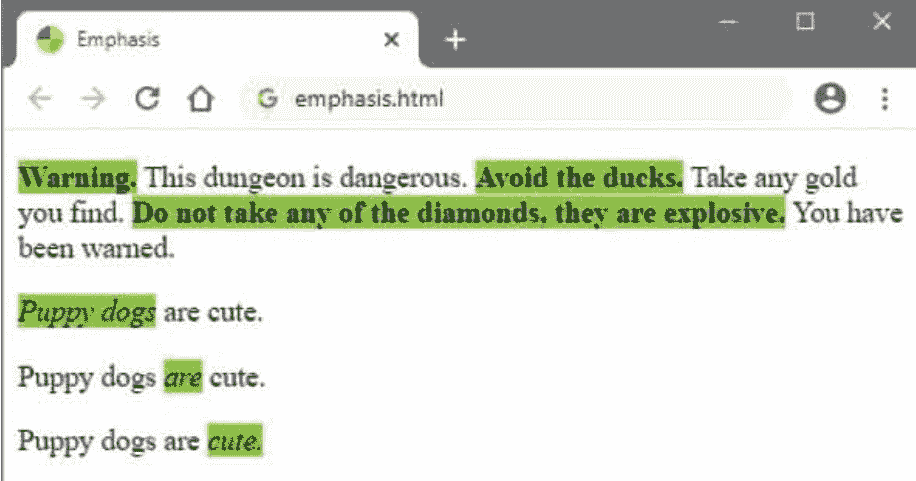


应尽可能避免 `<b>` 标签，但一个合法的用法是标记文章的引导句。

## 添加修改

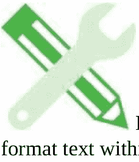

HTML 提供了三个可以用于格式化文档文本的元素：

- 包闭在 `<small></small>` 标签之间的文本被视为周围文本的旁注，例如版权信息——通常以较小的字体显示。

- 包闭在 `<del></del>` 标签内的文本被视为已从文档中删除，例如待办列表中已完成的项目——通常带有删除线显示。

- 包闭在 `<ins></ins>` 标签内的文本被视为已添加到文档中，例如“待办”列表中的新增项目——通常带有下划线显示。

`<small>` 标签仅用于包含补充周围内容的简短注释。它不打算用于大段文本（如多个段落），因为那远超旁注的范围。

在显示 `<small>` 元素包含的内容时，网页浏览器会考虑显示周围内容使用的字体大小，然后应用适当的缩小比例。

因此，当周围内容以 12 点字体大小显示时，`<small>` 元素包含的内容可能会以 10 点字体显示——精确大小由浏览器决定。

`<del>` 和 `<ins>` 元素都可以在内容区域内使用，用于标记更改的文本片段，以及封装整个更改的内容区域（如替换的段落）。

`<del>` 和 `<ins>` 标签可以可选包含 `cite` 属性，以指定说明所做更改的 URL。创建一个 HTML 文档：


- 2. 在 `body` 部分，插入一个包含法律目的旁注的段落：

```
<p>Example Corp 今日宣布第二季度利润刷新 <small>(完全披露：EG News 是 Example Corp 的子公司)</small>，引发了对其与 Demo Group 合并的推测。</p>
```

- 3. 接下来，插入一个大标题和一个普通段落：
<h1>待办事项列表</h1>

```
<p>清空洗碗机</p>
```

- 4. 现在，插入一个已被删除的段落：<del><p>倒垃圾</p></del>

- 5. 然后，插入一个已添加的段落：
<ins><p>清扫院子</p></ins>

- 6. 最后，插入一个已添加的段落，其中包含一个已更改的文本片段：

```
<ins>
<p>喂<del>狗</del><ins> 猫</ins></p>
</ins>
```

- 7. 保存 HTML 文档，然后在网页浏览器中打开它，查看文本是如何被格式化的：


`<small>` 标签并不表示内容重要性较低，仅表示它是周围文本的旁注。

## 添加短语


HTML 提供了四个短语元素，可用于对文档正文中的文本进行特殊标记：

- 包闭在 `<s>...</s>` 标签之间的文本被标记为被更准确或相关的更新内容所取代——通常带有删除线显示。

- 包闭在 `<u>...</u>` 标签内的文本被标记为与普通文本内容有某些不同——通常带有下划线显示。

- 包闭在 `<mark>...</mark>` 之间的文本被标记为具有特殊参考意义的内容——通常以彩色背景块显示以突出显示。

- 被 `<br>` 标签断开的文本被隐形地标记为适合的换行点——代表单词换行的机会。

需要注意的是，规范规定 `<s>` 标签不应用于表示编辑。同样，`<mark>` 标签不应用于强调内容，仅用于参考高亮。`<u>` 标签在 HTML5 中已废弃，因为它可能与超链接混淆。应使用 `<del>` 和 `<ins>` 标签。

不建议作者使用 `<u>` 标签，因为应该使用 `<mark>` 标签进行参考。<s>` 标签不应用于表示编辑。应使用 `<del>` 和 `<ins>` 标签。（此处后续由于原文中存在大量重复的 OCR 噪声，已按要求进行清理处理）。


```
----    @
----  \/_\
---- (*) / (*)    MIKE'S PUSHBIKES
~~~~~~~~~~~~~~~~~~~~~~~~~~~~~~~~~~~~~~~~~~~~~~~~~~~~~~~~~~~~~~~</pre>
```

5 保存 HTML 文档，然后在网络浏览器中打开它，以确保内容保留了预格式。

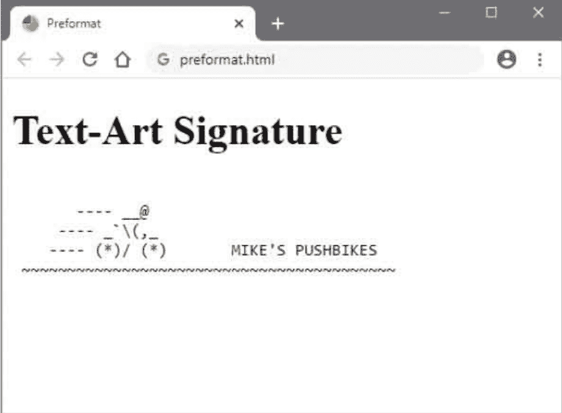

注意 `<pre>` 是一个流元素，因此它不需要包含在段落内——它会创建自己的块。

你可以使用等宽字体中的任何字符来创建你的文本艺术——Windows 用户可以使用系统工具中的“字符表”程序，从 Lucida Console 字体中选择特殊字符。

# 使用上标


网页段落区域的普通文本显示在不可见的内联短语框中，这些框由一个外部逻辑框和一个包含基准线的内部字体框组成：

| 内联短语框。 | 逻辑框 |
| :--- | :--- |
| 基准线 | 字体框 |

垂直行距由字体高度决定，以便在延伸基准线以下的字符（如“p”）和向上延伸的高大字符（如“b”）之间留出空间，加上垂直外边距区域。

```
在内联短语框中编写的段落文本。
行间距设置使得字符不会发生碰撞。™
```

此外，字体框将容纳“上标”，例如由 `&trade;` 字符实体产生的商标符号 ™。

上标是任何比普通文本小且设置在基准线以上的文本、数字或符号。数学公式可以使用上标来表示数字幂，使用字符实体 `&sup2;` 表示 2，`&sup3;` 表示 3。字体框还将容纳“下标”——它看起来比普通文本小且设置在基准线以下。

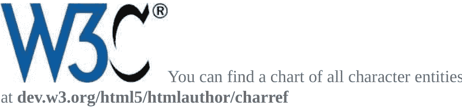

在标准垂直行距下，上标和下标的高度是的，因此字符大小受到限制。与其为此目的使用字符实体，往往不如使用 HTML 的 `<span></span>` 标签用于上标，使用 `<sub></sub>` 标签用于下标更好。这些元素会增加垂直行距，以允许更显著的上标和下标字符。例如，`<span>2</span>`（此处示意）比 `&sup2;` 大。此外，任何内容都可以包含在这些元素中，因此你不受限于可用的字符实体引用。

| 行间距设置使得字符不会与下方的上标碰撞。 | 包含上标和下标的段落文本行 | 行间距设置使得字符不会与上方的下标碰撞。 |
| :--- | :--- | :--- |

- 1 创建一个 HTML 文档 modify.html

- 2 在 `body` 部分中，插入一个包含由字符实体生成的上标的段落

```
<p>
4的平方：4&sup; = 16 <br>
4的立方：4&sup; = 64
</p>
```

- 3 现在，在 `body` 部分中，插入一个包含由 HTML 元素生成的上标的类似段落

```
<p>
4的平方：4<sup>2</sup> = 16 <br>
4的立方：4<sup>3</sup> = 64
</p>
```

- 4 最后，在 `body` 部分中，插入一个包含由 HTML 元素生成的下标的段落

```
<p>
水：H<sub>2</sub>O <br>
硫酸：H<sub>2</sub>SO<sub>4</sub>
</p>
```

- 5 保存文档，然后在浏览器中打开它，以比较上标并查看下标文本

4的平方：4² = 16
4的立方：4³ = 64

4的平方：4² = 16
4的立方：4³ = 64

水：H₂O
硫酸：H₂SO₄


在段落中使用上标 `²` 来表示面积（如 10 feet²，即 10 平方英尺）时，你可能倾向于使用实体 `&sup2;` 而不是 `<sup>2</sup>`，以保持行距相等。

# 显示代码

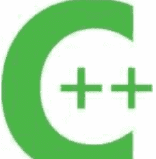

HTML 提供了五个短语元素专门用于在文档正文中包含计算机程序代码：

- 程序变量代码或片段可以包含在 `<code></code>` 标签之间，以便以合适的字体显示。
- 程序变量实例可以包含在 `<var></var>` 标签之间，以与普通文本区分来。
- 示例程序的输入和输出可以包含在 `<samp></samp>` 标签之间，以与普通文本区分来。

- 关联机器读代码的内容也可以包含在 `<data></data>` 标签之间，并为其 `value` 属性指定所需的代码。

- 日期和时间可以包含在 `<time></time>` 标签中，并为其 `datetime` 属性指定机器可读的版本。

`<data>` 元素可以是

- 1 创建一个 HTML 文档

- 2 在 `body` 部分中，插入一个包含上标的段落

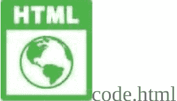

- 2 在 `body` 部分中，插入一个包含上标的段落


- 2 在主体部分，插入一个包含带有工具提示建议的缩写的段落

<p><abbr title="HyperText Markup Language">HTML</abbr> 简单步骤</p>

- 3 接下来，插入一个带有工具提示建议的引用

<p><cite title="Inventor of the HyperText Markup Language">Sir BernersLee</cite></p>

- 4 现在，插入一个带有工具提示建议的定义术

<p><dfn title="The popular language of the World Wide Web. Commonly abbreviated to 'HTML;'>HyperText Markup Language</dfn></p>

记住在嵌套引用时使用单引号——如第 4 步中的 'HTML' 所示 所示。

- 5 然后，插入一个带有工具提示建议的键盘指令

<p><kbd title="按下键盘上的 Y 键以执行脚本。这需要在您的浏览器中启用 JavaScript">按 Y 继续。</kbd></p>

- 6 最后，添加一个将响应键盘指令的脚本 <script>

```javascript
function showkey( e ) {
if( e.keyCode === 89 || e.keyCode === 121) {

alert( 'Y pressed. Thank You.')
}
}
```

```javascript
document.onkeydown = showkey
</script>
```

保存 HTML 文档，然后在浏览器中打开它，并将光标悬停在元素上以查看工具提示

在浏览器中启用 JavaScript 的情况下，按下 Y 键查看脚本响应

脚本会在按键被按下时检查键码，并对小写“y”和大大写“Y”做出响应。

## 测量数量

范围内的值可以使用 HTML `<meter>` 元素在网页上进行视觉表示。

`<meter>` 元素必须包含一个 `value` 属性，用于定义分数测量值。可选的是`<meter>` 标签还可以包含 `min` 和 `max` 属性来指定最小和最大范围边界。如果省略这些属性，则假设范围为 0-1。

`<meter>` 标签还可以包含 `low` 和 `high` 属性来指定范围内的低位和高位，`optimum` 属性可以指定范围内的理想偏位置。

`low` 和 `high` 属性可以指定 `min` 和 `max` 属性所总体范围内的次优范围。这实际上可以将计量表分为三部分——低、中、高。虽然这未包含在 HTML 标准规范中，但网页浏览器可以使用不同的颜色表示这三个部分。例如，Google Chrome 浏览器明智地使用红色表示低部分，黄色表示中间部分，绿色表示高部分。

建议`<meter>` 元素应该包含描述计量表状态的文本，该内容将仅在不显示此元素的浏览器中显示。

交互式 `<details>` 和 `<summary>` 元素可以在无需脚本的情况下响应用户操作以显示额外信息。通常，`<details>` 元素在网页上提供一个由三角形箭头表示的“披露小部件”。嵌套的 `<summary>` 元素显示一个描述小部件内隐藏信息的标题。额外信息包含在`<details>` 元素内部嵌套的元素中，位于 `<summary>` 元素之后。

当用户点击 `<summary>` 元素时，小部件的状态从“关闭”变为“打开”，并显示隐藏信息。再次点击 `<summary>` 元素将关闭小部件并再次隐藏信息。

三角形箭头旋转以表示小部件的打开和关闭状态——因此，这些小部件有时被称为“旋转控件 (twisties)”。

- 创建一个 HTML 文档

- 1 创建一个 HTML 文档
- 2 在主体部分，插入一个带有适当读音注释的日语文本元素 `<ruby>`
- 3 接下来，插入一个带有适当读音注释的中文文本元素 `<ruby>`
- 4 保存 HTML 文档，然后在浏览器中打开以查看文本和 ruby 注释
- 100，一个次优范围 15-50，一个最优值 100，以及当前值 80%

```html
<article>
  <h2>Gauge</h2>
  Fuel Level: <meter min="0" low="15" max="100" optimum="100" value="80"></meter>
</article>
```

- 3 插入描述计量表当前状态的 details 元素
```html
<details>
  <summary>OK to Continue...</summary>
</details>
```

- 4 重复 2 和 3 两次，以创建更多计量表，然后编辑它们的当前值并提供适当的描述
- 5 保存 HTML 文档，然后在浏览器中打开并点击每个 `<summary>` 元素以查看其描述

## 直接语言

`<meter>` 元素应仅用于指示指定范围内的分数测量，而不是指示进度——请使用 `<progress>` 元素实现进度（参见此处）。

推荐的 UTF-8 文档编码提供了对双向文本的支持，因此从右向左写的语言（如希伯来语）的字符会自动按方向写入，并可能与从左到右的文本（如英语）并排出现。读取右向左方向的内容应该封装在 `<bdi>` 隔离标签，以免混淆浏览器，因为浏览器期望从左到右读取。此外，HTML 提供了一个 `<bdo>` 双向覆盖元素，可以通过 `dir` 属性显式地指定文本方向为 "ltr" 或 "rtl"。双向覆盖允许从右向左语言的字符以“逻辑”上的从左到右顺序作为字符实体写入 HTML 文档中，但以“视觉”上的从右到左方式显示。例如，下面的 `<bdo>` 元素包含从左到右的字符（按它们进入的顺序），但从右到左显示它们：

```html
<bdo dir="rtl">שלrש</bdo>
```

如果没有双向覆盖，这些字符实体将按其逻辑顺序显示——对于从右向左的希伯来语来说，这更像是后往前。

## Ruby 注释

对于东方语言，HTML 支持“Ruby 注释”，它可以很有用地在文本旁边提供读音。例如，日语有多种字母表。用语义“汉字”字母表（具有成千上万个字符）编写文本通常用其等效语音“平假名”语言（约 50 个字符）进行注释，以辅助发音。这在日语中被称为“Furigana”，在英语中被称为“Ruby”——以用于指示读音的小字体命名。为了方便西方人，日语汉字文本可以用“罗马字”（Romaji）注释——即其拉丁字母等价物。同样在中文中，用“普通话”字母表编写文本可以用拼音（Pinyin）注释——即其拉丁字母等价物。

HTML Ruby释完全封装在根 `<ruby>` 标签之间。该元素可以在 `<rb>` 标签（Ruby base）内包含东方文本，并在 `<rt>` 标签（Ruby text）内包含读音。可选情况下，可以在 `<rtc>` 标签内提供英语等价物。

```html
<ruby>
  <!-- 日语汉字文本 -->
  <rb></rb>
  <!-- 罗马字注释 -->
  <rt>kyō</rt>
  <!-- 英语等价物 -->
  <rtc>Tokyo</rtc>
</ruby>
```

```html
<ruby>
  <!-- 中文普通话文本 -->
  <rb></rb>
  <!-- 拼音注释 -->
  <rt>běi jīng</rt>
  <!-- 英语等价物 -->
  <rtc>Beijing</rtc>
</ruby>
```

不要将 Ruby 注释与不相关的 Ruby 编程语言混淆。


超链接包含在 `<a>` 锚点标签之间，该标签在起始标签中通过 `href`（超文本引用）属性指明目标 URL。可选情况下，`<a>` 标签还可以包含一个 `title` 属性，用于指定当用户将光标悬停在链接上时显示的“工具提示”文本。

网页浏览器将以一种区别于普通文本的方式显示超链接——通常情况下，超文本会带有下划线，而基于图像的超链接会带有彩色边框。

每个网页超链接对三种交互状态敏感：
* Hover（悬停）—— 获得焦点，光标悬停在链接上。
* Active（激活）—— 正在检索链接资源，用户点击了链接。
* Visited（已访问）—— 曾经检索过链接资源。可以使用样式规则来强调每个超链接状态：

+ 1 创建一个 HTML 文档

+ 2 接下来，在 `head` 部分添加样式表链接：`<link rel="stylesheet" href="link.css">`

+ 3 现在，在 `body` 部分插入一个指向目标页面 `link.html` 的超链接，包括工具提示建议：`<a href="link-target.html" title="A hyperlink to a target page">Visit Target</a>`

+ 4 保存该 HTML 文档，然后创建一个类似的第二个文档，它链接同一个样式表，并包含一个指向第一个文档的超链接：`<a href="link.html" title="A hyperlink to return">Return</a>`

+ 5 将第二个 HTML 文档与第一个保放在一起，然后创建一个样式表来强调每个超链接状态

```
a:hover { background : Yellow ; }
a:active { background : Red ; color : White ; }
a:visited { background : Aqua ; }
```

+ 6 将样式表与两个 HTML 文档保放在一起，然后在浏览器中打开第一个页面，查看处于默认状态的超链接

将光标悬停在超链接上，查看链接在悬停状态下的显示。

+ 按住链接上的左鼠标键，查看链接在激活状态下的显示。释放鼠标键加载目标页面

+ 点击目标页面中的超链接重新加载第一个页面。你会发现第一个页面上的链接现在处于已访问状态。

如果你再次点击链接到目标页面的，浏览器将识别出它已从第一个页面访问过。

## 访问键 (Access Keys)

访问链接有三种方法：

- **Pointer（指针）** —— 使用鼠标或类似设备将屏幕指针置于超链接上，然后点击访问其目标。
- **Tab（制表键）** —— 反复按下 Tab 键依次聚焦到每个超链接，然后按 Return 键访问当前选中链接的目标。
- **Access Key（访问键）** —— 点击指定的字符键聚焦到特定的超链接，然后按 Return 访问其目标。

通过 `<a>` 锚点标签的 `accesskey` 属性为超链接指定指定的字符键。使用该指定键通常需要用户按下 `Alt + accesskey`（对于大多数浏览器，如 Google Chrome），但在 Firefox 中是 `Alt + Shift + accesskey`。

+ 1 创建一个 HTML 文档

+ 2 接下来，在 `head` 部分添加样式表以移除默认超链接样式

```
<style>
a { text-decoration : none; color: Black; }
a:focus { background: Red; color: White; }
</style>
```

+ 3 现在，在 `body` 部分插入两个指定不同数字访问键的超链接

<a href="keys-home.html" accesskey="1">Home Page</a> | <a href="keys-catalog.html" accesskey="2">Catalog Page</a>

+ 4 保存 HTML 文档，然后创建一个类似的第二个文档，包含这两个超链接——但不包含移除默认样式的样式表：`<a href="keys-home.html" accesskey="1">Home Page</a> | <a href="keys-catalog.html" accesskey="2">Catalog Page</a>`

将第二个 HTML 文档与第一个保放在一起，然后在浏览器中打开第一个网页，查看没有默认样式的超链接。反复按 Tab 键直到第二个超链接获得焦点，然后按 Return 键通过访问键组合和数字 1（例如 `Alt + 1`）跟随该链接，然后按 Return 键跟随第一个超链接。移除默认超链接样式意味着它们不再被识别为链接——因此最好避免，除非有其他指示让用户意识到它们可用于导航。Mac 用户在使用 Safari 浏览器时应按下 `CMD + accesskey`。

## 片段链接 (Fragment Links)

超链接可以指向文档中通过“片段”标识符创建的特定点——该标识符是一个在起始标签的 `id` 属性中分配了唯一名称的元素。在链接内部，片段标识符指定在起始 `<a>` 标签的 `href` 属性中，并以 `#` 开头。例如，标签 `<a href="#top">` 指向文档内包含唯一片段标识符名称“top”的元素。

超链接也可以使用文档 URL 指向另一个文档中的特定点，随后是 `#` 号，然后片段标识符。例如，标签 `<a href="index.html#top">` 指向名为“index.html”的文档中包含唯一片段标识符名称“top”的元素。

跟随链接到片段将从片段标识符出现的位置显示文档：

+ 1. 创建一个 HTML 文档

+ 2. 在 `body` 部分插入两个包含片段标识符并指向不同片段的超链接

```
<a id="top" href="#btm">Skip to Page Foot</a>
<a id="next-btm" href="frag-next.html#btm">Skip to Next Page Foot</a>
```

+ 3 接下来，在 `body` 中插入一个代表内容的段落，随后是一个指向文档中第一个链接的片段标识符

```
<p style="height:700px;background:Yellow"></p>
<a id="btm" href="#top">Skip to Page Head</a>
```

+ 4 保存 HTML 文档，然后创建一个类似的第二个文档，在内容上下都有链接：`<a id="top" href="#btm">Skip to Page Foot</a> <p style="height:700px;background:Red">Content...</p>

```
<a id="btm" href="#top">Skip to Page Head</a> |
<a id="prev-top" href="frag.html#top">Skip to Previous Page Head</a>
```

+ 5 将第二个 HTML 文档与第一个保放在一起，然后在浏览器中打开第一个页面，点击第一个链接到页面底部

# Skip to Page Foot | Skip to Next Page Foot
Content...
# Skip to Page Head

接下来，点击链接返回页面顶部。现在，点击第二个链接到下一个页面的底部

# Skip to Page Foot | Skip to Next Page Foot
Content...
# Skip to Page Head | Skip to Previous Page Head

`#` 希字符在 HTML 中用于指向片段和指定十六进制颜色值，并在 CSS 中通过 `id` 属性选择元素进行样式设置。十六进制颜色值指定组成颜色的红、绿、蓝组件——例如，红色的十六值为 #FF0000。

在长页末尾包含一个指向页面顶部片段的链接，这样用户无需向上滚动。

## 协议链接 (Protocol Links)

超链接的 `href` 属性通常指向使用文本传输协议（http:` 或安全的 `https:`）的资源，但也可以指向其他协议的资源。

可以使用 `javascript:` 协议调用脚本函数，可以使用 `mailto:` 协议调用电子邮件客户端：

+ 1. 创建一个 HTML 文档

+ 2. 在 `body` 部分插入一张图表图像 ``


接下来，插入一个包含两个不同协议链接的段落。

```
<p id="links">
<a href="javascript:toggle(toggle)">显示/隐藏图表</a>
<br>
<a href="mailto:wendy@example.com">邮件给 Wendy</a>
</p>
```

现在，添加一个样式表，其中包含一个隐藏图片的规则和一个样式化段落的规则。

```
<style>
#chart { visibility: hidden; height: 0px; }
#links { padding: 5px; border: 1px solid; float: left; width: 200px; }
</style>
```

最后，添加一个脚本，每当点击第一个链接时，交替显示和隐藏图像。

```html
<script>
function toggle () {
  const chart = document.getElementById('chart') let hid = (chart.style.visibility != 'visible') chart.style.visibility = (hid) ? 'hidden' : 'visible'; chart.style.height = (hid) ? 'auto' : '0px'
}
</script>
```


该脚本首先检查图像元素的当前可见性状态，然后将其反转。

保存 HTML 文档，然后在浏览器中打开它并点击第一个链接来显示图表图像。

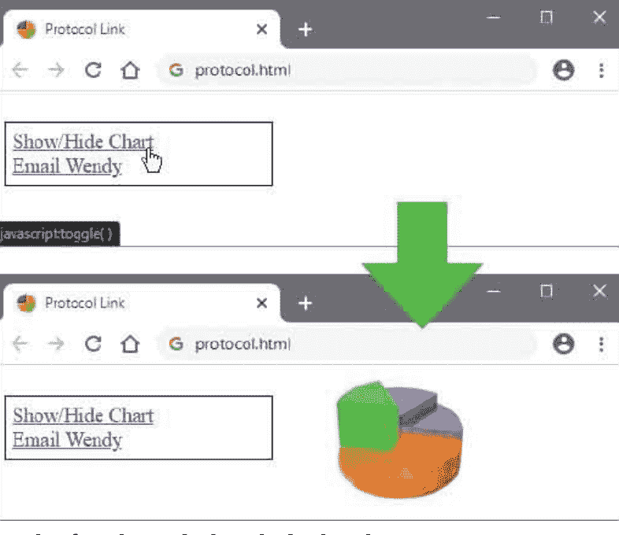

再次点击第一个链接以隐藏图表图像。

- 点击第二个链接以启动你的默认客户端应用程序——准备好发送消息。

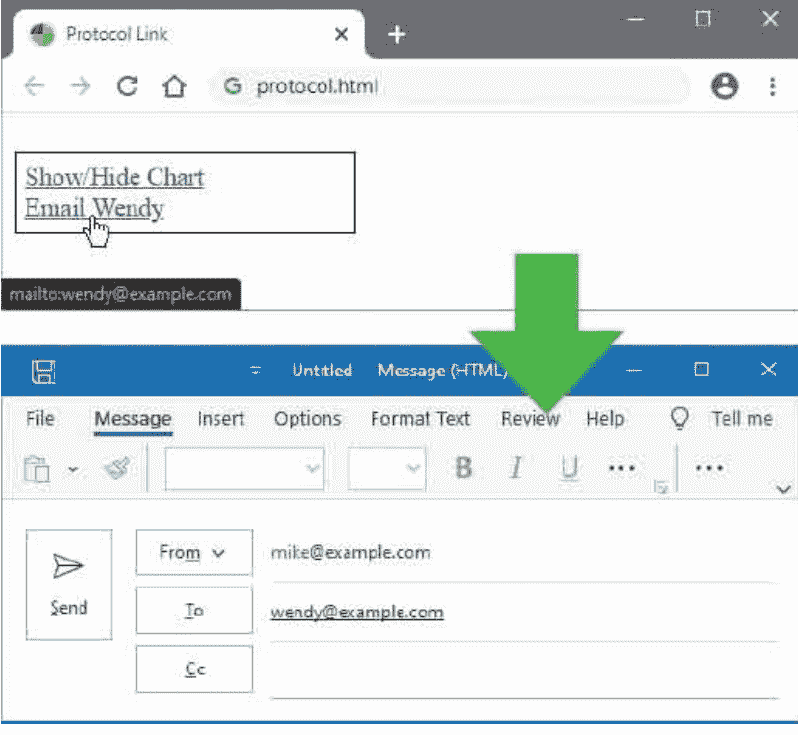

**mailto**: 协议会自动收件人的电子邮件地址添加到邮件客户端的“收件人”字段中。

## 总结

- `<p>` 段落元素可以包含 `<br>` 换行标签，段落可以通过 `<hr>` 水平线分隔。
- 长引用可以包含在 `<blockquote>` 流元素中，短引用可以包含在 `<q>` 短语元素中。
- 为了强调此文本，`<em>` 和 `<strong>` 短语元素优于 `<b>` 和 `<i>` 短语元素。
- 侧边注释可以包含在 `<small>` 元素中，`<ins>` 和 `<del>` 元素用于指示替换的文本。
- <s> 元素表示过时的内容，`<mark>` 元素用于突出显示参考内容。
- <u> 元素表示不同的文本，`<wbr>` 元素可以建议适当的断点。
- 为了避免错位，在创建包含在 `<pre>` 元素预格式文本时，应避免使用制表缩进。
- 使用字符实体或 `<sup>` 和 `<sub>` 元素可以包含上标和下标。
- 使用 `<code>`、`<var>` 和 `<samp>` 元素可以在 HTML 文档中包含程序代码。（注意：已将 `&amp;samp;` 修正为 `&lt;samp;`）
- 机器代码可以指定为 `<data>` 标签的 `value` 属性和 `<time>` 标签的 `datetime` 属性。
- `<abbr>`、`<cite>`、`<dfn>` 和 `<kbd>` 元素提供了建议。
- 许多元素可以包含 `title` 属性来提供工具提示。
- `<bdi>` 和 `<bdo>` 双向元素可以用于围绕从右向左读取的语言的项目。
- Ruby 注释使用 `<ruby>`、`<rb>`、`<rt>`、`<rp>` 和 `<rtc>` 元素为东方语言提供读音辅助。
- <a> 标签可以创建指向其他网页、页面片段或 `javascript:` 和 `mailto:` 等协议的链接。

## 编写列表和表格

本章演示如何在列表和表格单元格中显示项目。

| 无序列表 | 有序列表 | 描述列表 | 基础表格 | 跨单元格 | 增强表格 | 控制列 | 总结 |
| --- | --- | --- | --- | --- | --- | --- | --- |

## 无序列表

无序列表的列表项目顺序不重要，通常在每个项目之前放置一个项目符号，以将列表项目与正文区分开。


在 HTML 中，无序列表使用 `<ul> </ul>` 标签创建，它为列表项目提供容器。每个列表项目可以使用 `<li> </li>` 标签封装项目，或者可选地仅使用 `<li>` 在项目之前——任何形式的 `<li>` 元素都被视为正确的 HTML。无序列表 `<ul>` 元素可以包含许多列表项目 `<li>` 元素。

区分无序列表项目与正文的项目符号可能是三种标记类型之一：

- **Disc（圆点）** – 实心圆形项目符号（默认样式）。
- **Circle（圆形）** – 空心圆形项目符号。
- **Square（方形）** – 实心方形项目符号。

样式规则可以指定无序列表 `list-style-type` 属性的任何一个值，或者为该属性指定 `none` 值来抑制项目符号。

每个 HTML 列表还有一个 `list-style-image` 属性，它可以指定无序列表 `list-style-type` 属性的任何一个值，或者为该属性指定 `none` 值来抑制项目符号。（注：此处 OCR 文本存在重复）。


现在，插入一个从一百百 (100) 开始编号的有序列表
<ol start="100">
<li>Bash</li>
<li>PHP</li>
<li>Python</li>
</ol>

保存 HTML 文档，然后在浏览器中打开它以查看有序列表的编号。

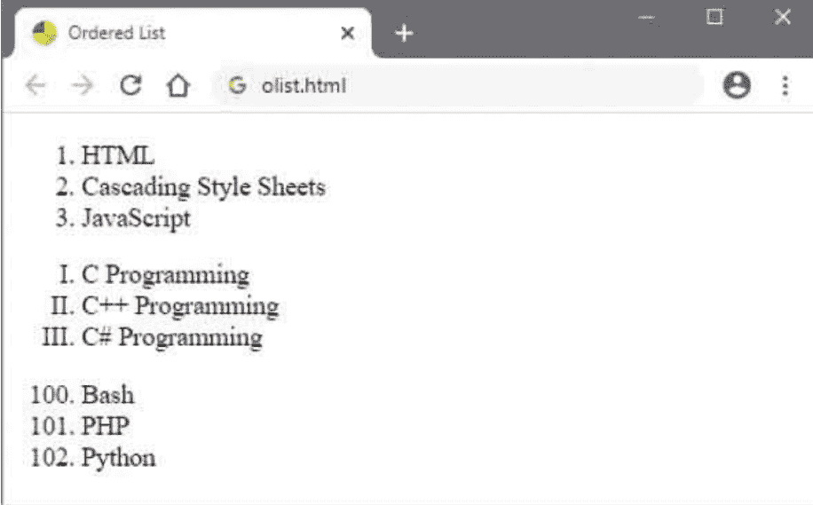


与无序列表中的标记一样，编号绘制在列表内容框的左侧内边区域。

## 描述列表

描述列表（Description list）是一种特殊的列表，其中每个列表项包含两个部分——第一部分是术语（term），第二部分是对第一部分术语的描述。这被称为名称/值对（name/value pair）。例如，术语“sun（太阳）”的名称/值对可以是“sun/太阳系的中心的恒星”。


在 HTML 中，描述列表使用 `<dl> </dl>` 标签创建，它们为列表项提供了一个容器。每个列表项术语包含在 `<dt> </dt>` 定义术语标签之间，每个列表项描述包含在 `<dd> </dd>` 描述标签之间。可选情况下，可以省略 `<dt>` 和 `<dd>` 闭标签——两种形式的 `<dt>` 和 `<dd>` 元素都是有效的。

描述列表中的每个列表项可以包含多个 `<dt>` 定义术语元素和多个 `<dd>` 定义描述元素——以允许单个术语拥有多个描述，或多个术语共用一个描述。通常，浏览器会将描述列表相对于其术语缩进显示。

描述列表也用于包含一系列问题和相关答案，或任何其他名称/值数据组。

- 1 创建一个 HTML 文档

```
list.html
```

- 2 在 body 部分中，插入一个包含两个问答名称/值对的描述列表

```html
<dl>
<dt>What is HTML?</dt>
<dd>The HyperText Markup Language</dd>
<dt>What is it used for?</dt> <dd>Web page structure.</dd>
</dl>
```

- 3 接下来，在 body 部分，插入一个描述术语用法、读音和含义的描述列表

```html
<dl>
<dt><dfn>Homonym</dfn></dt>
<dd class="grammar">noun</dd>
<dd class="spoken">[hom-uh-nim]</dd>
<dd>读音和拼写与另一个词相同但含义不同的词</dd>
</dl>
```

- 4 现在，插入一个描述术语用法、读音和几种含义的描述列表

```html
<dl>
<dt><dfn>Mouse</dfn></dt>
<dd class="grammar">noun</dd>
<dd class="spoken">[mous]</dd>
<dd>各种啮齿类动物的小动物</dd>
<dd>一种手掌大小、按钮驱动的设备，用于移动计算机光标</dd> <dd>一个安静、胆小的人</dd>
</dl>
```

- 5 添加样式表来为列表中的问题和定义术语染色，并为某些特定描述染色

```css
<style>
dt { color : Blue ; }
dfn { color : Red ; font-size : 20pt ; }
dd.grammar { color : Green ; }
dd.spoken { color : Purple ; }
</style>
```

- 6 保存 HTML 文档，然后在浏览器中打开它以查看名称/值对

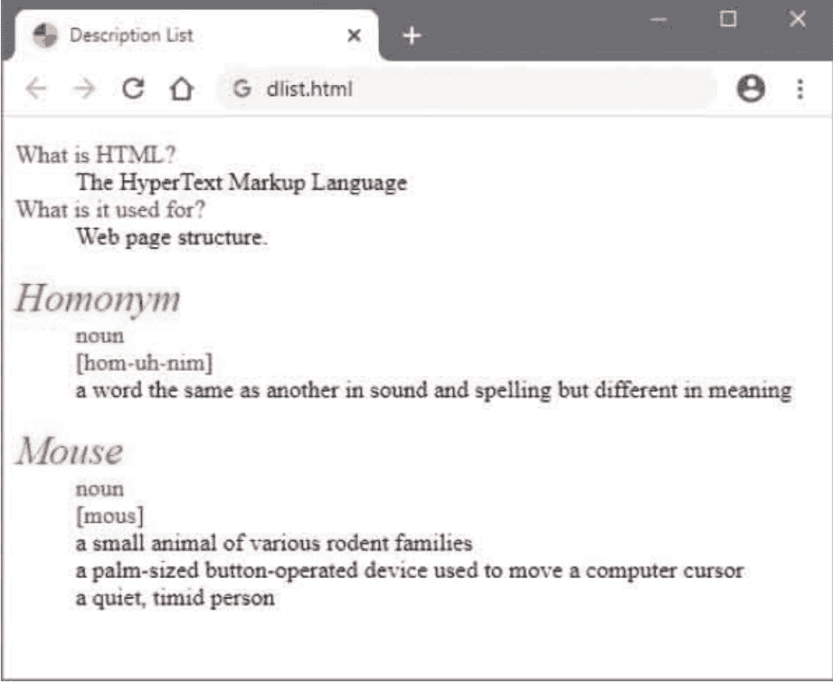


`<dt>` 元素本身并不指示其内容是正在被定义的术语——必须使用嵌套的 `<dfn>` 元素来实现此目的。


不要使用定义列表来标记对话——使用段落来标记每段对话。

## 基础表格

数据通常以表格形式呈现最好，通过行和列排列来分组相关项目，以便理解。


在 HTML 中，表格使用 `<table>` 标签创建，它们为行提供了容器。每行用 `<tr>` 标签创建，它们为单元格提供容器。每个数据单元格用 `<td>` 标签创建，封装要显示的实际数据。可选情况下，可以省略 `</td>` 和 `</tr>` 闭标签——两种形式的 `<td>` 和 `<tr>` 元素都是有效的。

`<table>` 元素通常包含许多 `<tr>` 元素以创建一个显示多行数据的表格。同样，每个 `<tr>` 元素将包含许多 `<td>` 元素以创建一个多列数据的表格。重要的是，表格中的每个 `<tr>` 行必须包含相同数量的 `<td>` 单元格——例如，如果第一行 `<tr>` 包含 `<td>` 单元格，则所有 `<tr>` 行都必须包含数量的 `<td>` 单元格。

创建一个 HTML 文档


在 body 部分插入一个 <table> 元素

```html
<table>
<!-- 在此处添加表格行 -->
</table>
```

现在，在 `<table>` 元素内部插入三行——每行包含三个 `<td>` 单元格

```html
<tr><td>Cell 1.1</td><td>Cell 1.2</td><td>Cell 1.3</td></tr>
<tr><td>Cell 2.1</td><td>Cell 2.2</td><td>Cell 2.3</td></tr>
<tr><td>Cell 3.1</td><td>Cell 3.2</td><td>Cell 3.3</td></tr>
```

添加样式表来设置表格宽度、单元格边框和表头边框

```css
<style>
table { width : 500px; border : 5px solid Black; }
td,th { border : 1px solid Black; }
</style>
```


省略 `</td>` 标签但包含 `</tr>` 标签以更清晰地表示每行的结束。保存 HTML 文档，然后在浏览器中打开它以查看基础表格

| Cell 1.1 | Cell 1.2 | Cell 1.3 |
| --- | --- | --- |
| Cell 2.1 | Cell 2.2 | Cell 2.3 |
| Cell 3.1 | Cell 3.2 | Cell 3.3 |

表格标题可以使用 `<caption>` 标签指定，行标题和列标题可以在 `<th>` 标签之间添加。

- 6 紧跟在 `<table>` 标签之后插入标题 `<caption>Basic Table</caption>`

- 7 接下来，插入新的一行列标题 `<tr><th>Column 1</th><th>Column 2</th><th>Column 3</th></tr>`

- 8 现在，在后续每行的开头插入一个表头 `<tr><th>Row 1</th><td>Cell 1.1</td><td>Cell 1.2</td><td>Cell 1.3</td></tr><tr><th>Row 2</th><td>Cell 2.1</td><td>Cell 2.2</td><td>Cell 2.3</td></tr><tr><th>Row 3</th><td>Cell 3.1</td><td>Cell 3.2</td><td>Cell 3.3</td></tr>`

- 9 保存编辑后的 HTML 文档，然后刷新浏览器查看新增内容

| Cell 1.1 | Cell 1.2 | Cell 1.3 |
|--- |--- |--- |
| Cell 2.1 | Cell 2.2 | Cell 2.3 |
| Cell 3.1 | Cell 3.2 | Cell 3.3 |


如果包含 `<caption>` 元素，它必须紧跟在 `<table>` 标签之后。


`</th>` 闭标签是可选的，但 `<th>` 表头的数量必须与行数完全匹配。

## 单元格合并

单个表格可以与其他表格垂直合并，以跨越表格的多行。


要跨越的行数通过合并单元格的 `<td>` 标签中的 `rowspan` 属性指定。然后必须移除被跨越行中的单元格以保持表格对称。

- 1 在此处复制上示例中创建的 `table.html` 文档，并将其重命名为 "rowspan.html"


- 2 修改文档和表格标题 `<title>Row Spanning Example</title><caption>A Table Spanning Rows</caption>`

- 3 在包含文本“Cell 1.1”的表格数据元素中，在其起始标签中插入一个属性并编辑其内容 `<td rowspan="2">Cell 1.1+2.1</td>`

- 4 接下来，删除包含文本“Cell 2.1”的表格数据元素——因为该单元格现在被合并了

- 5 现在，向样式表中添加规则，为跨行的单元格背景染色 `td[rowspan="2"] { background: Pink; } td[rowspan="3"] { background: HotPink; }`

- 6 保存 HTML 文档，然后在浏览器中打开它以查看第一列中跨越两行的单元格


-   接下来，向包含文本"Cell 2.2"的表格数据元素插入一个属性，并编辑其内容 <td rowspan="2">Cell 2.2+3.2</td>

-   现在，删除包含文本"Cell 3.2"的表格数据元素——因为该单元格现在已被合并

-   保存编辑后的 HTML 文档，然后刷新浏览器以第 2 列中跨越两行的单元格

-   接下来，向包含文本"Cell 1.3"的表格数据元素插入一个属性，并编辑其内容 <td rowspan="3">Cell 1.3+2.3+3.3</td>

-   现在，删除包含文本"Cell 2.3"和"Cell 3.3"的表格数据元素——因为这些单元格现在已被合并

12 保存编辑后的 HTML 文档，然后刷新浏览器以查看第 3 列中跨越三行的单元格

请注意，默认情况下，每个单元格中的文本左对齐，并在合并的单元格中水平居中。

# 增强表格

可以通过在常规表格内容的正下方添加特殊的表头和表脚行来增强表格，从而提供额外的表格信息。

在 HTML 中，表头信息包含在 <head> 标签之间，表脚信息包含在 <footer> </footer> 标签之间。当表格具有 <head> 和/或 <footer> 元素时，所有常规表格行必须包含在 <tbody> </tbody> 标签之间。

在长表格中，可以使用多个 <tbody> 元素将行分组为单独的表格主体部分。当打印这些表格时，每个纸页都可以重复表头和表脚信息。

需要注意的是，在 <table> 元素内部，<head> 元素必须出现在第一个 <body> 元素之前，但如果存在 <caption> 元素，则必须出现在其之后。

-   1 复制在此处创建的 table.html 文档，并将其重命名为“enhance.html”

-   2 修改文档和表格标题：
<title>Enhanced Table Example</title>
<caption>An Enhanced Table</caption>

-   3 向样式表中添加规则，以样式化表头、第二个表格主体标题和最后的表格表脚

```
thead { background : Pink ; }
th.next { background : DeepPink; color : White; } tfoot { background : HotPink ; } }
```

-   4 紧接标题之后，插入一个包含跨越所有四列的单行的表头

-   5 在表头之后，添加一个表格主体元素以包含所有现有的常规表格行

```
<<tbody>
<!-- Existing row elements go here. -->
</tbody>
```

-   6 在表格主体元素之后，插入一个包含四个更多表格行的第二个表格主体元素

```
<<tbody>

<tr> <th colspan="4" class="next">Next section</th></tr>
<tr>
<th>Row 4</th><td>Cell 4.1</td><td>Cell 4.2</td><td>Cell 4.3</td></tr>
<tr>
<th>Row 5</th><td>Cell 5.1</td><td>Cell 5.2</td><td>Cell 5.3</td></tr>
<tr>
<th>Row 6</th><td>Cell 6.1</td><td>Cell 6.2</td><td>Cell 6.3</td></tr>

</</tbody>>
```

-   7 在第二个表格主体之后，插入一个包含跨越所有列的单行的表格表脚

```
<tfoot>
<tr><td colspan="4">Footer Information</tr>
</tfoot>
```

-   8 保存 HTML 文档，然后在浏览器中打开它以查看增强后的表格

表头和表脚应只包含信息——所有表格数据都应出现在表格主体中。

# 控制列

当表格仅通过样式规则指定总宽度时，浏览器将根据其内容默认计算每列的宽度——内容较宽的列将比内容较窄的列更宽。使用 <col> 标签表示单个列可以实现对宽度的更大控制，因此规则可以指定它们的大小和外观。

单个 <col> 元素也可以通过包含 span 属性来指定列数从而表示多个列。因此，指定列宽的样式规则将应用于所有的 <col> 元素。或者，<th> 或 <td> 标签可以包含 colspan 属性来指定列数。可选情况下，<col> 元素可以包含在 <colgroup> 标签之间，以便对列组和单个列进行样式化。

-   1 创建一个 HTML 文档

-   2 在 body 部分内，插入一个包含标题的 table 元素：
<table>
<caption>Breakfast Flights</caption>
<!-- Table content to go here. -->
</table>

-   3 接下来，在表格中插入一个包含用于样式的类名的包含单列的列组

```
<colgroup class="sidebar">
<col>
</colgroup>
```

-   4 现在，再插入两个包含用于分组样式和单个样式类名的列组

```
<colgroup class="info">
<col class="stripe"> <col class="stripe">
</colgroup>
```
```
<colgroup class="info">
<col class="stripe">
</colgroup>
```

<col> 标签是一个单标签——它没有匹配的闭合标签。

-   5 在列组之后，插入一个表头、一个表格主体和一个表脚——每个都有六列

```
<<thead>><tr><th colspan="6">-- Header. --></thead>
<<tbody><!-- Rows with six cells. --></</tbody>>
<tfoot><tr><td colspan="6">-- Footer. --></tfoot>
```

-   6 添加样式表，带有规则指定表格及其表头、表脚和数据单元的外观

```
<style
table { width : 500px; border-collapse : collapse; }
body th { background : DeepPink; color : White; }
body td { padding : 3px; text-align: center; }
tfoot { font-size : small; }
</style>
```

-   7 接下来，添加规则指定每列的宽度

```
colgroup.sidebar col { width : 70px; }
colgroup.info col { width : 80px; }
```

-   8 现在，添加规则来样式组和单个列

```
colgroup.info { border-left : 2px solid White; }
colgroup col.stripe { background : Pink; }
```

-   9 保存 HTML 文档，然后在浏览器中打开它查看不同的列组

&bull; 字符实体在此表脚中用于创建符号。

## 总结

-   HTML <ul> 元素创建一个包含单个 <li> 元素的无序符号列表。
-   list-style-type 属性可以指定无序列表项目具有实心圆、圆形或正方形，或无。
-   list-style-image 属性可以指定用于替代列表项目符号的图像 URL。
-   <ol> 元素创建一个包含单个 <li> 元素的有序数字列表。
-   list-style-type 属性可以指定有序列表项的编号方式，例如数字、大写罗马字母或无。
-   <dl> 元素创建一个定义列表，其中包含在 <dt> 中的元素术语和包含在 <dd> 中的元素描述。
-   HTML <table> 元素创建一个表格，并可以可选地首先包含一个 <caption> 元素为表格命名。
-   每个表格行都用 <tr> 元素创建，以包含多个 <th> 标题元素和 <td> 数据元素。
-   表格单元格可以使用 rowspan 属性跨越单元格，可以使用 colspan 属性跨越右侧单元格。
-   在 <caption> 元素之后立即添加 <head> 和 <footer> 元素可以增强带有表头和表脚的表格。
-   具有表头和表脚的表格必须将所有常规表格行包含在 <tbody> 元素中。
-   可以使用 <colgroup> 元素对列分组进行样式化。
-   每个表格列都可以由 <col> 元素表示，以便进行单独样式化。


在 HTML 文档内容中添加图像引入了许多令人兴奋的可能性可以使用 `` 标签轻松地向文档添加图像，最好始终包含以下属性：

- * 需要一个 `src` 属性来指定图像的所在 URL，可以是绝对路径或相对路径。
- * 建议使用 `width` 属性来指定图像在页面上占据的像素宽度。
- * 建议使用 `height` 属性来指定图像在页面上占据的像素高度。
- * 建议使用 `alt` 属性来指定描述图像的文本，以便在图像无法加载时显示。

赋给 `width` 和 `height` 属性的值将指示网络浏览器在网页上创建一个该尺寸的内容区域。这不需要是图像的实际尺寸，因为网络浏览器可以按另一个指定的尺寸渲染图像。必须注意确保尺寸按实际图像大小等比例缩放，以避免失真。此外，图像只应被缩小，因为放大缩放通常会导致像素化——即肉眼可以看到单个像素。然而，依赖浏览器来缩放不是按全尺寸显示的图像是低效的，因为这需要下载不必要的较大文件。更好的做法是使用图形编辑器（如 Adobe Photoshop）将图像尺寸调整为其在网页上占据的实际尺寸，这样它下载和显示得更快。


| 项目类型 | 尺寸 | 大小 |
| :--- | :--- | :--- |
| PNG 文件 | 600 x 450 | 185 KB |

原始文件大小

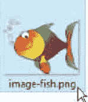

| 项目类型 | 尺寸 | 大小 |
| :--- | :--- | :--- |
| PNG 文件 | 200 x 150 | 30.5 KB |

缩小至 33%

网络位图图形的最优文件类型是流行的非专有便网络图形 (PNG) 格式，它产生紧凑的文件并支持透明度。


HTML 标签中的属性可以任何顺序出现。


网络图形应避免使用 BMP 位图文件格式——将此处显示的原始图像保存为 fish.bmp 会创建一个 790KB 大小的文件！

- 创建一个 HTML 文档


2. 在 body 部分插入三个图像元素——用于显示一个全尺寸的图形加上两个缩放版本

```html


```

3. 保存 HTML 文档然后在浏览器中打开它以查看全尺寸图像和两个缩放版本

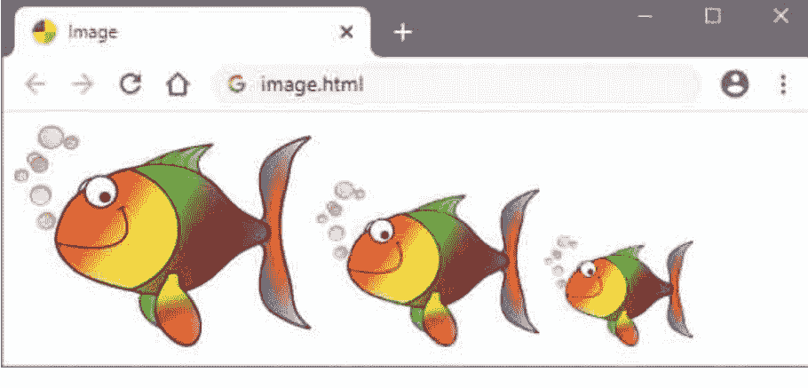

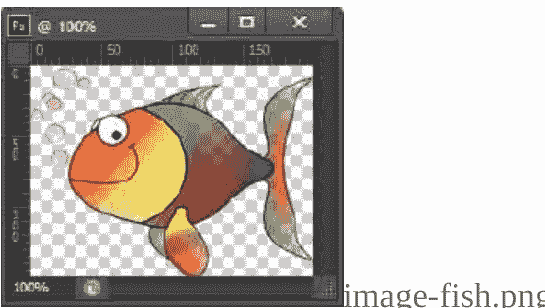

- 现在，为每个图像插入此属性 `style="Aqua"`
- 刷新你的浏览器查看彩色背景

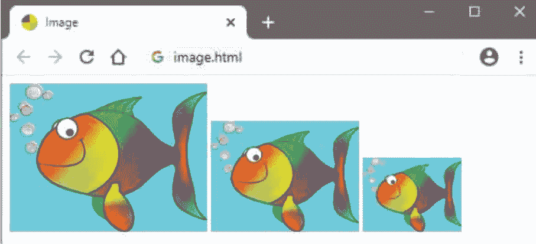

## 图像地图

如果添加“map”，单个图像可以目标多个链接资源，为每个超链接定义热点区域。要使用图像地图，`` 标签必须包含 `usemap` 属性来指定以 # 开头的地图名称。图像地图本身包含在 `<map> </map>` 标签之间，其名称由起始 `<map>` 标签中的 `name` 属性指定。


图像中每个变为超链接热点的区域由 `<map>` 元素内的 `<area>` 标签的四个属性定义。`shape`属性指定形状为 `rect`矩形、`circle`圆形或 `poly`多边形，`coords`属性指定 x 轴和 y 轴坐标的逗号分隔列表：

### 形状坐标

- `rect` 左上 x, 左上 y, 右下 x, 右下 y
- `circle` 中心 x, 中心 y, 半径
- `poly` x1, y1, x2, y2, x3, y3 – 每个点一对。第一个点和最后一个点必须相同以完成形状

此外，每个 `<area>` 标签必须有一个 `href` 属性来指定超链接的目标，以及一个 `alt` 属性在禁用图像时指定替代文本。

1. 创建一个 HTML 文档
```html
map.html
```
2. 在 body 部分插入图像和 map 元素
```html

<!-- 此处放置区域 -->
</map>
```


在 map 元素中，定义一个覆盖图像左部分的矩形热点——从 xy:0,0 的左上点到 xy:200,100 的右下点

```html
<area shape="rect" coords="0,0,200,100" href="https://www.bing.com" alt="Bing" title="Link to Bing">
```

现在，在 map 元素中，定义覆盖图像其他三个部分的相同尺寸热点

```html
<area shape="rect" coords="200,0,400,100" href="https://www.ask.com" alt="Ask" title="Link to Ask">
<area shape="rect" coords="0,100,200,200" href="https://www.google.com" alt="Google" title="Link to Google">
<area shape="rect" coords="200,100,400,200" href="https://www.yahoo.com" alt="Yahoo" title="Link to Yahoo">
```

保存 HTML 文档，然后在浏览器中打开它以查看描述每个可以点击打开其目标的工具提示

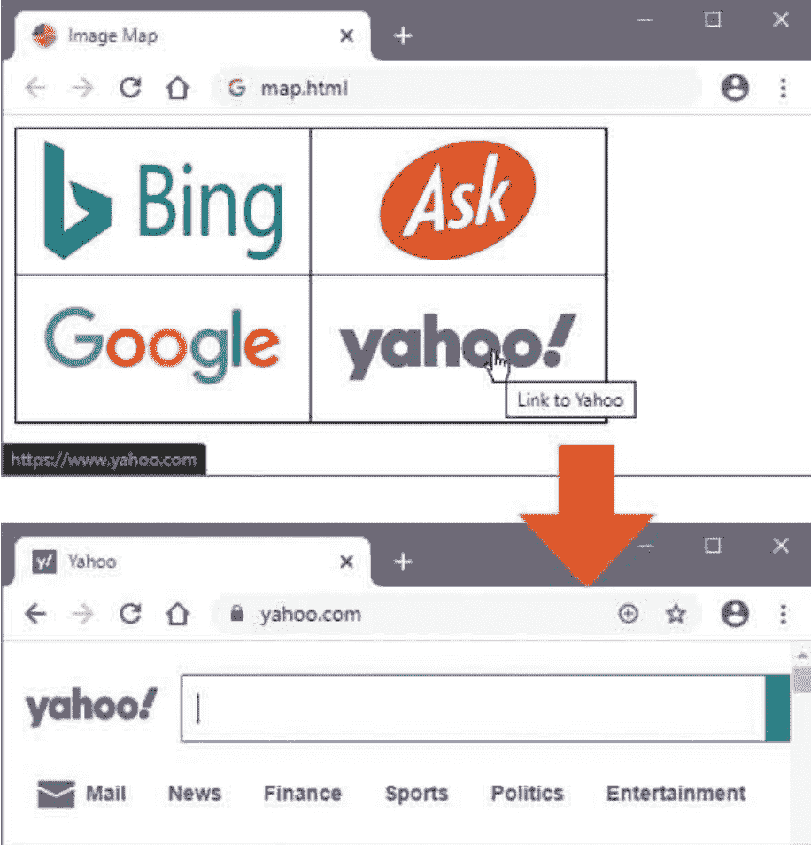

逗号分隔的坐标列表中不要留任何空格。除非每个 `<area>` 标签包含 `alt` 属性，否则验证将失败。


## 参考图

根据最新的 HTML 标准，网页作者有额外的方法向网页插入图像。`` 标签可以嵌套在 `<figure>` 元素中，以嵌入与主内容相关但移除不会破坏文本含义的图像。


由于嵌套图像现在实际上作为“图”是自包含的，根据需要可以将其放置在远离文本的位置，并通过 `<figcaption>` 元素内的说明进行引用：

1. 创建一个 HTML 文档
2. 在 body 部分插入一个标题 `<h1>Web 开发技术栈</h1>`
3. 接下来，插入一个带说明的图形 `<figure id="front-stack">`

```html

<figcaption class="reference">
图 1：前端技术
</figcaption>
</figure>
```

现在，插入引用上述带说明图形的文本：

前端开发，也称为客户端开发，为网站或 Web 应用程序制作 HTML 文档、CSS 样式表和 JavaScript 脚本代码 <span class="reference">(图 1)</span> 的实践，以便用户可以直接查看并与其进行交互。

插入第二个带说明的图形 `<figure id="back-stack">`

```html

<figcaption class="reference">
图 2：后端技术
</figcaption>
</figure>
```


始终仅通过标签引用图——避免使用“右侧图”等引用术语，这样可以轻松更改文档布局而不会产生混乱。

6. 现在，插入引用第二个带说明图形的文本：

后端开发，也称为服务器端开发，使用 SQL、Java、PHP 或 .NET 等编程语言制作复杂网站的实践 <span class="reference">(图 2)</span>，以提供前端之外的功能。

7. 添加样式表来定位每个带说明的图形并指定某些字体样式

```html
<style>
figure#front-stack { float :left ; margin-top :0px ; }
figure#back-stack { float :right; margin-top :0px ; }
.reference { color : Red; font-weight:bold; }
p:first-letter { font-size :xx-large ; }
</style>
```


## Web 开发栈

前端开发（也称为客户端开发）是指为网站或 Web 应用程序制作 HTML 文档、CSS 样式表和 JavaScript 脚本代码（图 1）的过程，使用户可以直接查看并与之交互。

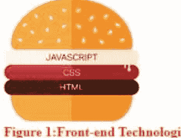

后端开发（也称为服务器端开发）是指使用 SQL、Java、PHP 或 .NET 等编程语言制作复杂网站（图 2），以提供前端之外的功能。

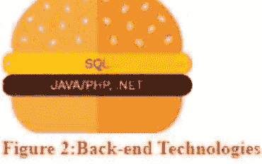


您可以通过 www.ineasystems.com 上该系列关于 SQL、Java、PHP、Python 和 MySQL 的配套书籍了解更多关于后端技术。

## 选择图片

随着 Web 内容越来越多地在小型手持设备上访问，最新的 HTML 规范允许网页作者根据设备屏幕的大小指定显示不同的备用图像。

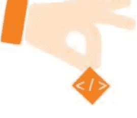

`<picture> </picture>` 元素用于包含多个图像源，浏览器可以从中选择最合适的尺寸。每个图像源指定在嵌套的 `<source>` 元素的 `srcset` 属性中，适用于该图片的最小屏幕宽度指定在它的 `media` 属性中。该赋值需要一种特殊的语法，在 `()` 括号内对 `min-width` 属性指定尺寸——例如，指定图像适用于屏幕宽度超过 500 像素的设备，则使用 `media="min-width: 500px"`。

有用的是，`<picture> </picture>` 元素可以包含最终的标准 `` 元素，用于指定不支持此选择功能的旧版浏览器上显示的图像：

## 创建 HTML 文档


在 `body` 部分内插入一个容器元素
<picture>
<!-- 在此处插入图像源 -->
</picture>

接下来，插入一个仅用于屏幕宽度超过 500 像素设备的显示图像源
<source media="min-width: 500px" srcset="picture-large.png">

现在，插入一个仅用于屏幕宽度超过 200 像素的较小设备的显示图像源
<source media="min-width: 200px" srcset="picture-small.png">

最后，插入一个用于不支持此选择功能的旧浏览器的图像源


`<source>` 元素不需要闭合标签。它也用于 `<audio>` 元素（参见此处）和 `<video>` 元素（参见此处）。

6. 保存 HTML 文档，然后在各种浏览器中打开它查看尺寸合适的图像

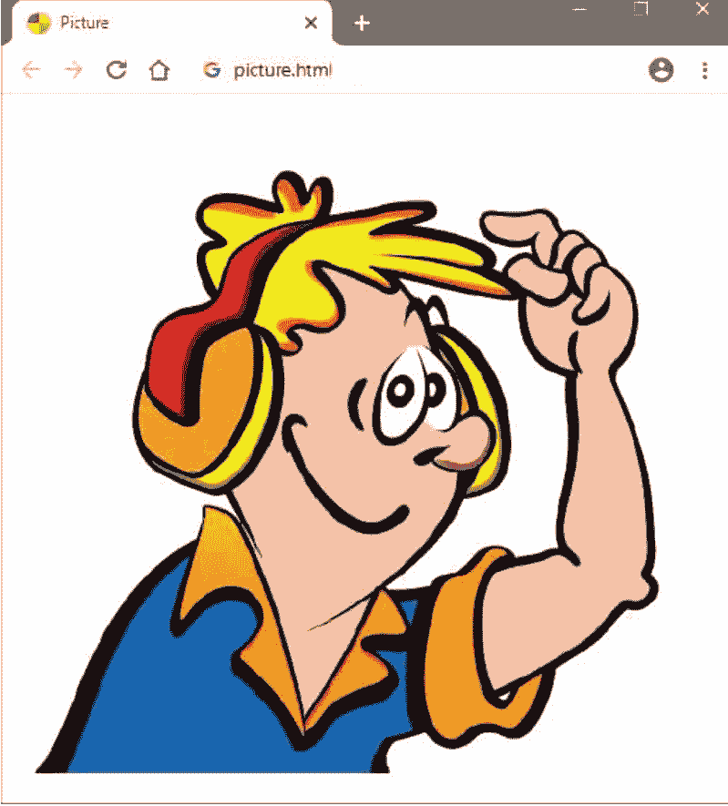

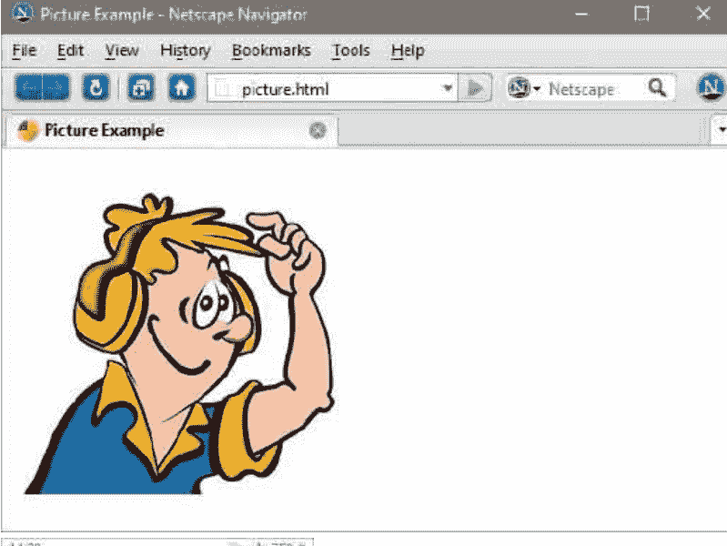

此示例中的图像尺寸如下：大 – 500px x 500px，中 – 250px x 250px，小 – 125px x 125px

如果你检查浏览器缓存，应该会发现它高效地下载了显示的合适图像，而不是所有的图像。

## 嵌入对象


可以使用 `<object></object>` 标签将外部资源嵌入到 HTML 文档中。当资源是图像时，它的处理方式与 `` 元素指定的非常相似，否则可能会需要插件来处理该资源。`<object>` 元素可以通过 `data` 属性指定资源的 URL，通过 `type` 属性指定资源类型。资源类型必须是描述资源的有效 MIME 类型。

| MIME 类型 | 对象文件格式 | 描述 |
| :--- | :--- | :--- |
| image/png | PNG | 图像资源 |
| image/jpeg | JPG, JPEG | 图像资源 |
| image/GIF | GIF | 图像资源 |
| image/svg+xml | | 矢量图像资源 |
| text/plain | TXT | 纯文本资源 |
| text/html | HTM, HTML | 标记文本资源 |
| application/pdf | PDF | 文档资源 |
| application/msword | Doc | Word 资源 |
| application/x-java-applet | Class | Java applet 资源 |
| audio/x-wav | WAV | 音频资源 |
| audio/mpeg | MP3 | 音频资源 |
| audio/ogg | | 音频资源 |
| video/mp4 | MP4 | 视频资源 |
| video/mpeg | MPEG, MPG | 视频资源 |
| video/x-ms | | 视频资源 |
| video/x-msv | WMV | 视频资源 |
| video/quicktime | MOV | 视频资源 |
| video/x-ms | AVI | 视频资源 |
| video/x-matroska | MKV | 视频资源 |


2 在正文部分，插入一个元素来嵌入交互式可缩矢量图形
`<embed src="vector-picker.svg" type="image/svg+xml" width="280" height="200" >`

vector-picker.svg (外部资源)

3 将 HTML 文档与 SVG 文件一同保存，然后在浏览器中打开网页查看嵌入的交互式可缩矢量图形

4 点击图像中的任何圆形颜色样本来选择颜色，以便与矢量图形进行交互

你可以通过从 www.ineasystems.com/resource-centre/downloads 下载示例存档，检查 JavaScript 是如何整合到此 SVG 文档中的

## 嵌入框架 (Embed Frames)

外部资源可以使用 `<iframe></iframe>` 标签嵌入 HTML 文档的`内联帧（inline frame）中。这些框架会在页面上创建一个固定区域，用于显示嵌入的资源。内联帧的尺寸必须通过 `<iframe>` 元素的 `width` 和 `height` 属性指定，并将外部资源的 URL 赋值给其 `src` 属性。当外部资源的尺寸超过内联帧的尺寸时，浏览器会自动添加滚动条，使用户可以查看全部内容。

每个 `<iframe>` 元素还可以可选包含一个 `name` 属性，用于为该帧指定唯一标识符。这允许超链接通过将帧名称分配给 `<a>` 元素中的 `target` 属性，将其 `href` 属性指定的 URL 加载到内联帧中（而不是替换整个页面）。例如，超链接可以指向名为“topbox”的内联帧：`<a href="some.html" target="topbox">`。

通常，内联帧用于在保持页面紧凑格式的同时提供补充内容。

## 创建 HTML 文档

在正文部分，插入一个包含标题和描述性段落的 article（文章）元素，并指定一个类名用于位置样式设置。

```html
<article class="left220">
<h3>概念车</h3>
<p>在近期汽车展上首秀的许多具有创意和创新的概念车让观众对它们的量产充满了热切期待。</p>
</article>
```

接下来，在正文中，作为侧边栏（aside），插入一个内联帧来加载一个包含相关文本和说明性照片的文档，并使其水平并排。

```html
<aside>
<iframe src="concept.html" width="300" height="220">
</iframe>
</aside>
```

现在，添加一个样式表来调整 article的大小并将其定位在内联帧的左侧。

```css
<style>
article,left220 { width:200px; float: left;
margin-right:10px; }
</style>
```

5 将 HTML 文档与外部资源一同保存，然后在浏览器中打开它查看 article 和内联帧的内容。

6 拖动滚动条浏览内容

```
嵌入式框架
iframe iframe.html
```

## 概念车

在近期汽车展上首秀的许多具有创意和创新的概念车让观众对它们的量产充满了热切期待。

## 3. 菲亚特世纪托韦尼 (Fiat Centoveni)

在 `<iframe></</iframe>` 标签之间可以提供一个回退消息，以便在内联帧支持被禁用时显示。

在内联帧中嵌入文档在房产网站上特别受青睐，以便以紧凑的页面格式将照片附在房产描述旁边。

## 添加音频

外部音频资源（如 MP3 文件）可以使用 `<audio></audio>` 标签嵌入 HTML 文档中。

`<audio>` 元素可以包含 `src` 属性来指定要嵌入的音频资源的 URL，并包含额外的属性来确定音频资源的使用方式：

- autoplay – 一个布尔属性，指定浏览器应立即开始播放音频资源。
- loop – 一个布尔属性，指定浏览器应重复播放音频资源。
- controls – 一个布尔属性，指定浏览器应显示用户控件以启动或停止音频播放。
- preload – 接受“auto”或“none”值，建议浏览器加载音频资源以便准备播放。

布尔属性（如 autoplay、loop 和 controls）不需要赋值——它们在元素中存在就足以让浏览器理解其用途。布尔值只能是 True（真）或 False（假）。默认情况下，代表布尔值的属性为 True，除非它们被赋值为 False。

浏览器依赖于内置解码器来解码音频资源以便进行播放。遗憾的是，并非所有的浏览器都包含相同的音频解码器：

- **高级音频编码 (AAC)** – 现代浏览器（如 Google Chrome、Firefox 和 Microsoft Edge）支持的用于 MP3 音频的解码器 "aac"。
- **Ogg audio** – 其他浏览器支持的用于 OGG 格式音频文件的解码器 "vorbis"。

这种不一致性要求音频资源进行两次编码，以便在所有浏览器中播放。为此，可以在 `<audio>` 元素内嵌套两个 `<source>` 元素，而不是在 `<audio>` 标签的 `src` 属性中指定单个资源 URL。对于每个文件，`<source>` 元素可以向 `src` 属性指定其资源 URL，并向 `type` 属性指定其 MIME 类型。浏览器将只加载支持的资源进行播放。

在 `<audio></audio>` 标签之间可以包含一个回退消息，以便在音频播放被禁用时显示。

1 创建 HTML 文档 audio.html

2 在正文部分，插入一个元素来嵌入 MP3 格式的音频资源以自动播放

```html
<audio src="audio.mp3" autoplay>
[ 回退消息 ]
</audio>
```

3 保存 HTML 文档，然后打开网页，在支持的浏览器中听到自动音频播放

4 接下来，将之前的两个属性替换为一个属性，以显示音频播放的控件

```html
<audio controls>
<!-- 在此处插入源 -->
</audio>
```

5 现在

6 再次保存 HTML 文档，然后在任何浏览器中打开网页并使用控件播放

在网站上避免自动音频播放，因为许多用户讨厌自动播放功能。

## 添加视频

外部视频资源（如 MP4 视频文件）可以使用 `<video></video>` 标签嵌入 HTML 文档。

为了确定如何使用视频资源，`<video>` 元素可以包含 **src、autoplay、loop、controls 和 preload** 属性，就像之前的 `<audio>` 元素一样。此外，页面上显示视频的区域可以通过 width 和 height 属性指定。

有两种主要的视频压缩标准：

- 高级视频编码 (AVC) – 一种专利标准，称为 H.264 或 MPEG-4 (.mp4 文件)。
- WEBM 视频 – 专利 H.264 和 MPEG-4 标准的免费方案 (.webm 文件)。

视频资源可以针对每格式进行编码以便在所有浏览器中播放，并通过嵌套在 `<video>` 元素内的 `<source>` 元素进行嵌入。对于每种文件格式，`<source>` 元素可以向 `src` 属性指定其资源 URL，并向 `type` 属性指定每个视频文件的 MIME 类型。浏览器将只加载支持的资源进行播放。

`<track>` 标签可以嵌套在 `<video>` 元素内，将 Web 视频文本轨道 (WebVTT) 字幕文件的位置指定给其 `src` 属性。它可以包含 `kind` 属性来描述轨道，并包含 `srclang` 来描述语言。该标签还必须包含一个布尔属性 `default` 以使用指定的文件。


# WEBVTT --> 00:00:01.000 --> 00:00:04.000
用“简单步骤学 HTML”弹吉他
00:00:05.000 --> 00:00:06.000 感谢观看


video.vtt


注意毫秒部分是用点（句号）分隔的，而不是冒号。

- 1. 创建一个 HTML 文档


video.html

- 2. 在 body 部分，插入一个元素来显示视频播放的用户控件

```
<video controls>
<!-- 在此处插入源文件。 -->
[ Fallback Message ]
</video>
```

- 3. 接下来，在 video 元素中插入元素来嵌入视频资源并指定字幕标题

```
<source src="video.mp4" type="video/mp4" >
<source src="video.webm" type="video/webm" >
<track src="video.vtt" kind="subtitles" srlang="en" default>
```


video.mp4


video.webm

（外部资源)

- 4. 保存 HTML 文档，然后在任何浏览器中打开网页，并使用控件查看视频播放

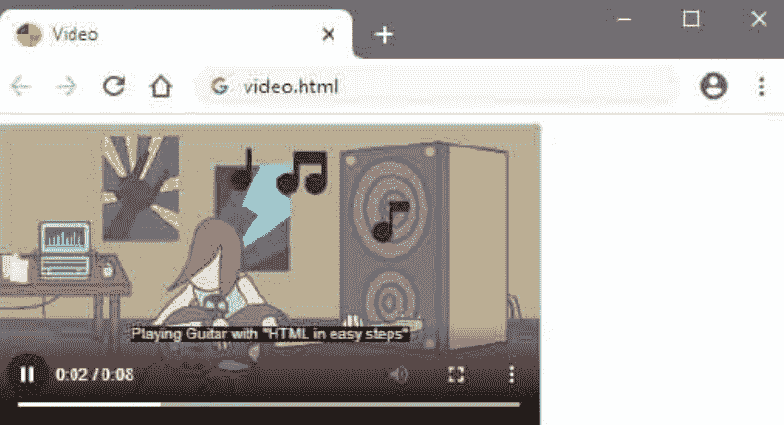

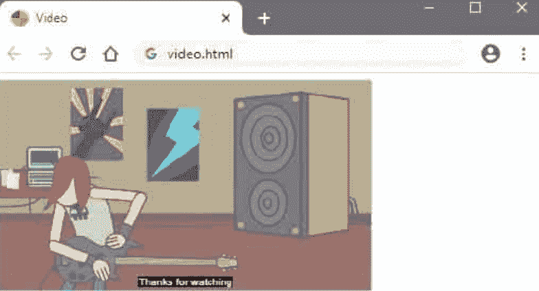

这段短视频显示了 4 秒钟字幕，然后显示第二个字幕。

# 显示进度

如果你不想为音频或视频播放提供浏览器的标准控件，可以从 `<audio>` 和 `<video>` 标签中省略 **controls** 属性。此时可以调用嵌入媒体对象的 JavaScript `play()` 和 `pause()` 方法，通过 `onclick` 事件处理脚本函数来控制播放。


可以使用 `<progress> </progress>` 元素显示媒体播放的视觉指示，以呈现“进度条”。在 `<progress>` 标签内，`value` 属性决定了完成完成的程度。可以通过 `ontimeupdate` 事件处理脚本函数与媒体播放同步地更新此值。

嵌入媒体对象具有 `currentTime` 属性（用于存储自播放开始以来已过去的时间）和 `duration` 属性（用于存储总播放时间）。可以使用它们来计算百分比的播放进度：

- 1. 创建一个 HTML 文档


- 2. 在 body 部分，插入元素来嵌入音频资源以便手动播放
```
<audio id="snd">
<source src="audio.mp3" type="audio/mpeg">
<source src="audio.ogg" type="audio/ogg">
[ Fallback Message ]
</audio>
```


audio.mp3


audio.ogg

（外部资源）

- 3. 接下来，插入一个图像按钮来控制


- 4. 现在，插入元素在播放进行时呈现视觉指示和计算出的百分比
<progress id="bar" value="0"></progress>
<span id="num"></span>


在 `<audio>` 标签中包含 `id` 属性以便从脚本引用媒体，并在所有脚本需要引用的标签中也包含。

- 5. 添加一个脚本，其函数用于在 HTML 文档加载时初始化变量
```
<script>
function () {
  const snd = document.getElementById('snd');
  const ctl = document.getElementById('ctl');
  const bar = document.getElementById('bar');
  const num = document.getElementById('num');
  let run = true;

  /* 事件处理函数在此处。 */
}
</script>
```

插入一个函数来控制播放
```javascript
ctl.onclick = function () {
  if (run) {
    snd.pause();
  } else {
    snd.play();
  }
  run = !run;
};
```

插入一个函数来显示进度
```javascript
snd.ontimeupdate = function () {
  bar.value = (snd.currentTime / snd.duration) * 100;
  num.innerHTML = Math.floor(bar.value) + '%';
};
```

保存 HTML 文档，然后在浏览器中打开它并点击按钮查看播放进度
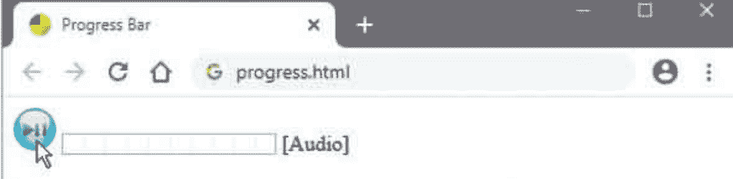


控件根据 `run` 的布尔值播放或暂停播放。


`currentTime` 和 `duration` 属性以秒存储时间，因此需要用 `Math.floor()` 进行向下取整。

# 使用模板 (Templates)

HTML `<template>` 元素允许你包含在网页加载时并不立即显示的内容。


存储在 `<template>` 元素内部的内容可以使用 JavaScript 在之后加载到网页上。当你需要重复添加内容时，这非常有用。

模板内容是一个脚本可以复制的“DocumentFragment”对象。副本可以作为现有内容的“子”元素添加。脚本也可以从内容中删除元素。

创建一个 HTML 文档

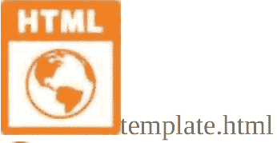

在 body 部分内，添加两个在点击时会调用脚本函数的段落
```
<p id="hotel" style="cursor:pointer" onclick="addStar(this)">Hotel Misty</p>
<p id="clear" style="cursor:pointer" onclick="removeStars()">Clear</p>
```

接下来，添加将脚本函数附加到现有内容的模板内容
```html
<template>
  
</template>
```

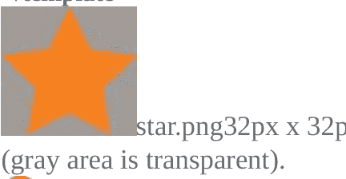

现在，添加一个脚本函数在点击时复制模板内容并添加到第一个段落
```javascript
<script>
function addStar(hotel) {
  const temp = document.getElementById('star');
  const copy = temp.content.cloneNode(true);
  hotel.appendChild(copy);
}
// 在此处插入第二个函数。
</script>
```

- 5. 然后，插入一个函数在点击第二个段落时移除第一个段落的所有子元素
```javascript
function removeStars() {
  const hotel = document.getElementById('hotel');
  while (hotel.ChildElementCount > 0) {
    hotel.removeChild(hotel.lastChild);
  }
}
```

- 6. 将 HTML 文档与星形图像一起保存，然后在浏览器中打开并点击添加/移除内容

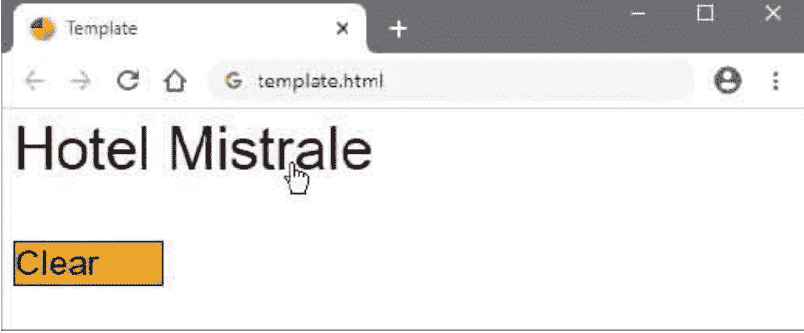

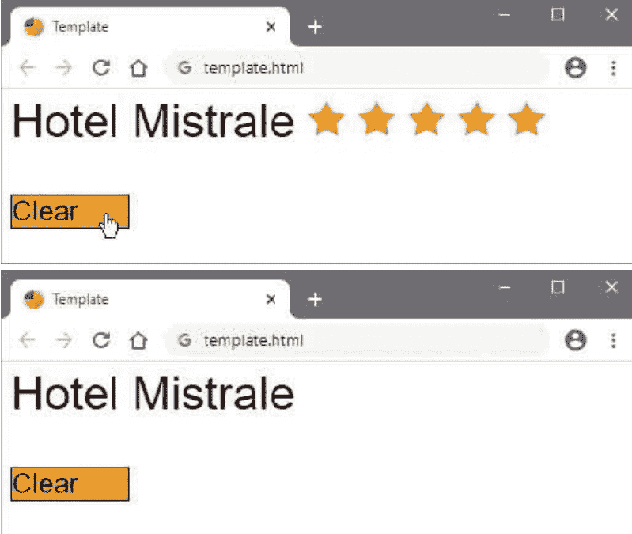


在 `<template>` 标签引入 HTML 之前，脚本必须创建 HTML 元素内容，但使用模板要方便得多。

# 插入槽 (Slots)

在上一个示例 (#) 中的 `<template>` 元素只能附加模板内定义的内容。然而，通过在 `<template>` 元素中包含 HTML `<slot></slot>` 元素，可以使模板更加灵活，其内容在模板的每个实例中可以不同。

`<slot> </slot>` 标签可以包含默认文本，但起始 `<slot>` 标签必须包含 `name` 属性，用于标识该槽为模板中的占位符。

通过在 HTML 元素中包含一个指定匹配槽名称属性值的 `slot` 属性来填充 `<slot>` 元素占位符。然后可以使用 JavaScript 将组合的模板和槽内容附加到网页上。

- 1. 创建一个 HTML 文档


- 2. 在 body 部分内，添加两个除，每个除包含三个命名为相同槽的 span
```html
<div class="homonym">
  <span slot="word">Air</span>
  <span slot="def-1">A lilting tune</span>
  <span slot="def-2">What we breathe</span>
</div>

<div class="homonym">
  <span slot="word">Current</span>
  <span slot="def-1">A flow of water</span>
  <span slot="def-2">Up to date</span>
</div>
```


3 接下来，添加一个描述列表模板，其术语和描述提供了指定的插槽位。

```html
<template id="list-template">
<dl>
<dt><slot name="word">术语</slot>
<dd><slot name="def-1">第一个定义</slot>
<dd><slot name="def-2">第二个定义</slot>
</dl>
<style>
dl { width :250px; border :1px solid; }
dt { background :Orange; color :White; }
</style>
</template>
```


样式表必须包含在模板中，否则规则将无法应用于模板的元素。

4 现在，添加一个脚本，在页面加载时将列表模板与指定插槽的文本内容结合。

```html
<script>
( function () {
const homs = document.getElementsByClassName('homonym')
const temp = document.getElementById('list-template')
if('attachShadow' in homs[ 0 ]) {
let i, copy, shadow
for(i = 0; i < homs.length; i++) {
copy = temp.content.cloneNode(true)
shadow = homs[i].attachShadow({ mode: 'closed' })
shadow.appendChild(copy)
}}
}
}
()
</script>
```

5 保存 HTML 文档，然后在浏览器中打开它查看组合后的模板和插槽内容。

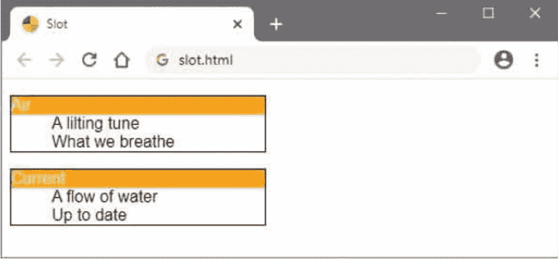


严格来说，这个示例创建了一个“影子 DOM 对象模型”（ShadowDOM），脚本随后将其附加到原始文档。`closed` 模式简单地防止通过 HTML 元素的 `shadowRoot` 属性通过脚本访问 ShadowDOM。


`slot` 属性只能出现在这些 HTML 标签中： 
<article>
<aside>
<blockquote>
<body>
<div>
<footer>
<h1-6>
<header> <main>
<nav>
<p>
<section> <span>

---

# 使用对话框

你可以通过在 `<dialog> ` 和 ` </dialog>` 标签之间包含对话框内容来创建一个“模态”对话框，用户在重新访问网页之前必须对其做出响应。


模态对话框出现在所有其他页面内容之上的层，它可以包含所有类型的内容（文本、图像等），但必须提供某种关闭对话框返回页的方法。通常，这将通过在模态对话框上包含一个或多个按钮来实现，这些按钮在点击时会执行脚本函数以执行某些操作并关闭对话框。

可以使用 `<button>` 元素向网页或模态对话框中添加可点击的按钮。`<button>` 和 `</button>` 标签之间的文本将作为标签显示在按钮上。打开 `<button>` 标签可以包含 `onclick` 属性，用于指定在点击按钮时调用的脚本函数。或者，脚本可以为每个按钮动态添加“事件监听器”来识别用户何时点击按钮——从而创建一个“点击事件”。

- 1. 创建一个 HTML 文档


- 2. 在 `body` 部分中，添加一个按钮和一个空段落，它们都具有用于脚本的唯一 `id`：
<button id="show">显示对话框</button>
<p id="info"></p>

- 3. 接下来，添加一个包含文本、图像和两个按钮的对话框，每个按钮都具有用于脚本的唯一 `id`：
<dialog id="dlog">
您的选择
```html

<br>
<button id="cncl">取消</button>
<button id="conf">确认</button>
</dialog>
```


- 4. 现在，添加一个脚本为每个按钮添加事件监听器和事件处理函数

```html
<script>
( function () {
  const dlog = document.getElementById('dlog')
  const info = document.getElementById('info')
  const show = document.getElementById('show')
  const cncl = document.getElementById('cncl')
  const conf = document.getElementById('conf')

  show.addEventListener('click', function () {
    dlog.showModal()
    info.innerText = '模态对话框已打开'
  });

  cncl.addEventListener('click', function () {
    dlog.close()
    info.innerText = '模态对话框已取消'
  });

  conf.addEventListener('click', function () {
    dlog.close()
    info.innerText = '模态对话框已确认'
  });
})()
</script>
```

5 保存 HTML 文档，然后在浏览器中打开它并点击按钮查看模态对话框


保存 HTML 文档，然后在浏览器中打开它以查看绘制在画布上的填充和描边。


# 摘要

- `<>` 标签在网页上放置图像，最好包含 `src`、`width`、`height` 和 `alt` 属性。
- `<map>` `</map>` 标签包围 `<area>` 元素，用于定义图像映射的区域，并且必须包含一个 `name` 属性。
- `<figure>` 和 `<figcaption>` 标签用于在 HTML 文档中嵌入带说明的引用图像。
- `<picture>` 元素可以包含多个 `<source>` 标签，为不同的屏幕宽度提供各种尺寸的图像。
- `<object>` `</object>` 标签可以用于在 HTML 文档中嵌入外部资源。
- 外部资源可以使用 `<iframe>` 元素嵌入到内联框架中，该元素设置显示区域的大小。
- 外部音频资源可以使用 `<audio>` `</audio>` 标签嵌入 HTML 文档中，外部视频资源可以使用 `<video>` `</video>` 标签嵌入。
- `<video>` 元素可以包含一个嵌套的 `<track>` 元素来指定 WebVTT 格式的字幕文件。
- `<progress>` 元素可以提供媒体播放的视觉指示。
- `<template>` 元素可以指定一组可以被克隆以动态写入内容的元素。
- 模板可以包含 `<slot> </slot>` 元素，其内容在模板的每个实例中可以不同。
- `<dialog> </dialog>` 标签在所有其他页面内容之上的层创建一个模态对话框。
- `<button> </button>` 标签创建一个可点击的按钮。
- `<canvas>` 元素可以用于在网页上添加图形、动画和交互式游戏。

6


# 创建本地域名

本章介绍了如何在你的 PC 上安装和配置 Web 服务器。

# 安装 Abyss 运行 Python 配置 Abyss Echo 脚本 测试环境 摘要

# 安装 Abyss

在系统中安装一个 Web 服务器对于网页开发非常有用。有几种免费的 Web 服务器，例如来自 Aprelium 的 Abyss Web Server X1。


启动你的浏览器并访问 aprelium.com
点击“Downloads”（下载）菜单项，然后选择“Free Download”（免费下载）并下载你系统的安装程序


运行安装程序，接受许可协议并选择选项 – 例如 64 位版本、SSL 支持和开始菜单快捷方式


接受建议的安装位置并点击“Install”（安装）按钮


Abyss 有适用于 Windows、macOS 和 Linux 的版本。


在 Windows 系统上，双击下载的 exe 文件以运行安装程序。
选择你偏好的 Web 服务器启动方式 – 例如选择“安装为 Windows 服务”以便在后台自动持续运行


点击 OK 按钮打开 Abyss Web Server 控制台


选择你的语言（英语），然后输入一个易记的登录名称和密码 – 你以后会需要这些！

点击 OK 按钮保存你的凭据，然后点击下一个 OK 按钮查看 Web 服务器正在运行


9 现在，在浏览器的地址栏中输入 **localhost**，然后按 **Return**（回车）看到默认索引网页的出现


> **热心提示**
> 如果你的系统资源有限，你可能更喜欢在需要时启动 Web 服务器。


默认页面是名为 **index.html** 的文件，位于你安装 Abyss 的位置名为 **htdocs** 的文件夹中。该文件夹是你将放置文件的地方。

安装 Abyss

在系统中安装一个 Web 服务器对于网页开发非常有用。有几种免费的 Web 服务器可用，例如来自 Aprelium 的 Abyss Web Server X1。


启动你的浏览器并访问 aprelium.com
点击“Downloads”（下载）菜单项，然后选择“Free Download”（免费下载）并下载你系统的安装程序


运行安装程序，接受许可协议并选择选项 – 例如 64 位版本、SSL 支持和开始菜单快捷方式


接受建议的安装位置并点击“Install”（安装）按钮


Abyss 有适用于 Windows、macOS 和 Linux 的版本。


在 Windows 系统上，双击下载的 exe 文件以运行安装程序。
选择你偏好的 Web 服务器启动方式 – 例如选择“安装为 Windows 服务”以便在后台自动持续运行


点击 OK 按钮打开 Abyss Web Server 控制台


选择你的语言（英语），然后输入一个易记的登录名称和密码 – 你以后会需要这些！

点击 OK 按钮保存你的凭据，然后点击下一个 OK 按钮查看 Web 服务器正在运行


9 现在，在浏览器的地址栏中输入 **localhost**，然后按 **Return**（回车）看到默认索引网页的出现


> **热心提示**
> 如果你的系统资源有限，你可能更喜欢在需要时启动 Web 服务器。


默认页面是名为 **index.html** 的文件，位于你安装 Abyss 的位置名为 **htdocs** 的文件夹中。该文件夹是你将放置文件的地方。

安装 Abyss

在系统中安装一个 Web 服务器对于网页开发非常有用。有几种免费的 Web 服务器可用，例如来自 Aprelium 的 Abyss Web Server X1。


启动你的浏览器并访问 aprelium.com
点击“Downloads”（下载）菜单项，然后选择“Free Download”（免费下载）并下载你系统的安装程序


运行安装程序，接受许可协议并选择选项 – 例如 64 位版本、SSL 支持和开始菜单快捷方式


接受建议的安装位置并点击“Install”（安装）按钮


Abyss 有适用于 Windows、macOS 和 Linux 的版本。


在 Windows 系统上，双击下载的 exe 文件以运行安装程序。
选择你偏好的 Web 服务器启动方式 – 例如选择“安装为 Windows 服务”以便在后台自动持续运行


点击 OK 按钮打开 Abyss Web Server 控制台


选择你的语言（英语），然后输入一个易记的登录名称和密码 – 你以后会需要这些！

点击 OK 按钮保存你的凭据，然后点击下一个 OK 按钮查看 Web 服务器正在运行


9 现在，在浏览器的地址栏中输入 **localhost**，然后按 **Return**（回车）看到默认索引网页的出现


> **热心提示**
> 如果你的系统资源有限，你可能更喜欢在需要时启动 Web 服务器。


默认页面是名为 **index.html** 的文件，位于你安装 Abyss 的位置名为 **htdocs** 的文件夹中。该文件夹是你将放置文件的地方。

安装 Abyss

在系统中安装一个 Web 服务器对于网页开发非常有用。有几种 免费的 Web 服务器可用，例如来自 Aprelium 的 Abyss Web Server X1。


启动你的浏览器并访问 aprelium.com
点击“Downloads”（下载）菜单项，然后选择“Free Download”（免费下载）并下载你系统的安装程序


运行安装程序，接受许可协议并选择选项 – 例如 64 位版本、SSL 支持和开始菜单快捷方式


接受建议的安装位置并点击“Install”（安装）按钮


Abyss 有适用于 Windows、macOS 和 Linux 的版本。


在 Windows 系统上，双击下载的 exe 文件以运行安装程序。
选择你偏好的 Web 服务器启动方式 – 例如选择“安装为 Windows 服务”以便在后台自动持续运行


点击 OK 按钮打开 Abyss Web Server 控制台


选择你的语言（英语），然后输入一个易记的登录名称和密码 – 你以后会需要这些！

点击 OK 按钮保存你的凭据，然后点击下一个 OK 按钮查看 Web 服务器正在运行


9 现在，在浏览器的地址栏中输入 **localhost**，然后按 **Return**（回车）看到默认索引网页的出现


> **热心提示**
> 如果你的系统资源有限，你可能更喜欢在需要时启动 Web 服务器。


默认页面是名为 **index.html** 的文件，位于你安装 Abyss 的位置名为 **htdocs** 的文件夹中。该文件夹是你将放置文件的地方。

安装 Abyss

在系统中安装一个 Web 服务器对于网页开发非常有用。有 几种 免费的 Web 服务器可用，例如来自 Aprelium 的 Abyss Web Server X1。


启动你的浏览器并访问 aprelium.com
点击“Downloads”（下载）菜单项，然后选择“Free Download”（免费下载）并下载你系统的安装程序


运行安装程序，接受许可协议并选择选项 – 例如 64 位版本、SSL 支持和开始菜单快捷方式


接受建议的安装位置并点击“Install”（安装）按钮


Abyss 有适用于 Windows、macOS 和 Linux 的版本。


在 Windows 系统上，双击下载的 exe 文件以运行安装程序。
选择你偏好的 Web 服务器启动方式 – 例如选择“安装为 Windows 服务”以便在后台自动持续运行


点击 OK 按钮打开 Abyss Web Server 控制台


选择你的语言（英语），然后输入一个易记的登录名称和密码 – 你以后会需要这些！

点击 OK 按钮保存你的凭据，然后点击下一个 OK 按钮查看 Web 服务器正在运行


9 现在，在浏览器的地址栏中输入 **localhost**，然后按 **Return**（回车）看到默认索引网页的出现


> **热心提示**
> 如果你的系统资源有限，你可能更喜欢在需要时启动 Web 服务器。


默认页面是名为 **index.html** 的文件，位于你安装 Abyss 的位置名为 **htdocs** 的文件夹中。该文件夹是你将放置文件的地方。

安装 Abyss

在系统中安装一个 Web 服务器对于网页开发非常有用。有 几种 免费的 Web 服务器可用，例如来自 Aprelium 的 Abyss Web Server X1。


启动你的浏览器并访问 aprelium.com
点击“Downloads”（下载）菜单项，然后选择“Free Download”（免费下载）并下载你系统的安装程序


运行安装程序，接受许可协议并选择选项 – 例如 64 位版本、SSL 支持和开始菜单快捷方式


接受建议的安装位置并点击“Install”（安装）按钮


Abyss 有适用于 Windows、macOS 和 Linux 的版本。


在 Windows 系统上，双击下载的 exe 文件以运行安装程序。
选择你偏好的 Web 服务器启动方式 – 例如选择“安装为 Windows 服务”以便在后台自动持续运行


点击 OK 按钮打开 Abyss Web Server 控制台


选择你的语言（英语），然后输入一个易记的登录名称和密码 – 你以后会需要这些！

点击 OK 按钮保存你的凭据，然后点击下一个 OK 按钮查看 Web 服务器正在运行


9 现在，在浏览器的地址栏中输入 **localhost**，然后按 **Return**（回车）看到默认索引网页的出现


> **热心提示**
> 如果你的系统资源有限，你可能更喜欢在需要时启动 Web 服务器。


默认页面是名为 **index.html** 的文件，位于你安装 Abyss 的位置名为 **htdocs** 的文件夹中。该文件夹是你将放置文件的地方。

安装 Abyss

在系统中安装一个 Web 服务器对于网页开发非常有用。有 几种 免费的 Web 服务器可用，例如来自 Aprelium 的 Abyss Web Server X1。


启动你的浏览器并访问 aprelium.com
点击“Downloads”（下载）菜单项，然后选择“Free Download”（免费下载）并下载你系统的安装程序


运行安装程序，接受许可协议并选择选项 – 例如 64 位版本、SSL 支持和开始菜单快捷方式


接受建议的安装位置并点击“Install”（安装）按钮


Abyss 有适用于 Windows、macOS 和 Linux 的版本。


在 Windows 系统上，双击下载的 exe 文件以运行安装程序。
选择你偏好的 Web 服务器启动方式 – 例如选择“安装为 Windows 服务”以便在后台自动持续运行


点击 OK 按钮打开 Abyss Web Server 控制台


选择你的语言（英语），然后输入一个易记的登录名称和密码 – 你以后会需要这些！

点击 OK 按钮保存你的凭据，然后点击下一个 OK 按钮查看 Web 服务器正在运行


9 现在，在浏览器的地址栏中输入 **localhost**，然后按 **Return**（回车）看到默认索引网页的出现


> **热心提示**
> 如果你的系统资源有限，你可能更喜欢在需要时启动 Web 服务器。


默认页面是名为 **index.html** 的文件，位于你安装 Abyss 的位置名为 **htdocs** 的文件夹中。该文件夹是你将放置文件的地方。

安装 Abyss

在系统中安装一个 Web 服务器对于网页开发非常有用。有 几种 免费的 Web 服务器可用，例如来自 Aprelium 的 Abyss Web Server X1。


启动你的浏览器并访问 aprelium.com
点击“Downloads”（下载）菜单项，然后选择“Free Download”（免费下载）并下载你系统的安装程序


运行安装程序，接受许可协议并选择选项 – 例如 64 位版本、SSL 支持和开始菜单快捷方式


接受建议的安装位置并点击“Install”（安装）按钮


Abyss 有适用于 Windows、macOS 和 Linux 的版本。


在 Windows 系统上，双击下载的 exe 文件以运行安装程序。
选择你偏好的 Web 服务器启动方式 – 例如选择“安装为 Windows 服务”以便在后台自动持续运行


点击 OK 按钮打开 Abyss Web Server 控制台


选择你的语言（英语），然后输入一个易记的登录名称和密码 – 你以后会需要这些！

点击 OK 按钮保存你的凭据，然后点击下一个 OK 按钮查看 Web 服务器正在运行


9 现在，在浏览器的地址栏中输入 **localhost**，然后按 **Return**（回车）看到默认索引网页的出现


> **热心提示**
> 如果你的系统资源有限，你可能更喜欢在需要时启动 Web 服务器。


默认页面是名为 **index.html** 的文件，位于你安装 Abyss 的位置名为 **htdocs** 的文件夹中。该文件夹是你将放置文件的地方。

安装 Abyss

在系统中安装一个 Web 服务器对于网页开发非常有用。有 几种 免费的 Web 服务器可用，例如来自 Aprelium 的 Abyss Web Server X1。


启动你的浏览器并访问 aprelium.com
点击“Downloads”（下载）菜单项，然后选择“Free Download”（免费下载）并下载你系统的安装程序


运行安装程序，接受许可协议并选择选项 – 例如 64 位版本、SSL 支持和开始菜单快捷方式


接受建议的安装位置并点击“Install”（安装）按钮


Abyss 有适用于 Windows、macOS 和 Linux 的版本。


在 Windows 系统上，双击下载的 exe 文件以运行安装程序。
选择你偏好的 Web 服务器启动方式 – 例如选择“安装为 Windows 服务”以便在后台自动持续运行


点击 OK 按钮打开 Abyss Web Server 控制台


选择你的语言（英语），然后输入一个易记的登录名称和密码 – 你以后会需要这些！

点击 OK 按钮保存你的凭据，然后点击下一个 OK 按钮查看 Web 服务器正在运行


9 现在，在浏览器的地址栏中输入 **localhost**，然后按 **Return**（回车）看到默认索引网页的出现


> **热心提示**
> 如果你的系统资源有限，你可能更喜欢在需要时启动 Web 服务器。


默认页面是名为 **index.html** 的文件，位于你安装 Abyss 的位置名为 **htdocs** 的文件夹中。该文件夹是你将放置文件的地方。

安装 Abyss

在系统中安装一个 Web 服务器对于网页开发非常有用。有 几种 免费的 Web 服务器可用，例如来自 Aprelium 的 Abyss Web Server X1。


启动你的浏览器并访问 aprelium.com
点击“Downloads”（下载）菜单项，然后选择“Free Download”（免费下载）并下载你系统的安装程序


运行安装程序，接受许可协议并选择选项 – 例如 64 位版本、SSL 支持和开始菜单快捷方式


接受建议的安装位置并点击“Install”（安装）按钮


Abyss 有适用于 Windows、macOS 和 Linux 的版本。


在 Windows 系统上，双击下载的 exe 文件以运行安装程序。
选择你偏好的 Web 服务器启动方式 – 例如选择“安装为 Windows 服务”以便在后台自动持续运行


点击 OK 按钮打开 Abyss Web Server 控制台


选择你的语言（英语），然后输入一个易记的登录名称和密码 – 你以后会需要这些！

点击 OK 按钮保存你的凭据，然后点击下一个 OK 按钮查看 Web 服务器正在运行


9 现在，在浏览器的地址栏中输入 **localhost**，然后按 **Return**（回车）看到默认索引网页的出现


> **热心提示**
> 如果你的系统资源有限，你可能更喜欢在需要时启动 Web 服务器。


默认页面是名为 **index.html** 的文件，位于你安装 Abyss 的位置名为 **htdocs** 的文件夹中。该文件夹是你将放置文件的地方。


9 现在，点击“关联扩展”（Associated Extensions）字段中的添加按钮，并在“扩展”（Extension）字段中输入 py


10 点击 OK，再次点击 OK，然后点击重启（Restart）按钮以应用新配置


CGI（通用网关接口）和 ISAPI（互联网服务器应用程序接口）允许数据在 Web 服务器和脚本解释器之间传输。


你的选择应该与此处显示的的内容相似。

## Echo 脚本

在为 Abyss Web Server 配置了 Python 解释器以及 .py 扩展名的脚本文件后，你现在可以创建一个 Python 脚本，用于响应 Web 浏览器的请求并执行。

许多请求以 key=value 对的形式将数据发送到 Web 服务器，因此 Python 脚本可以简单地在 HTML 响应中回显这些对，并将键和值放在表格中。

打开一个纯文本编辑器（例如 Windows 的记事本应用），然后在第一行的开头输入一条指令，使用用于服务器端脚本的特殊 Python 模块

```python
import cgi
```


- 接下来，使用特殊 Python 模块提供的函数 `form = cgi.FieldStorage()` 将所有 key=value 对赋值给变量
- 现在，使用 Python 内置的 `print()` 函数写入发送到浏览器的 HTML 头部 `print('Content-Type:text/html; charset=utf-8')`
- 头部必须与内容分开，因此添加此行来写入两个回车和换行符 `print('\r\n\r\n')`
- 使用类型声明、标题和样式表开始编写 HTML 文档

```python
print("<!DOCTYPE HTML>
<html><title>Web Server Response</title>
<style>tr,th,td[border:2px solid Gray]</style>")
```

- 6 接下来，开始一个包含两个头单元的表格

```python
print('<table style="width:500px"><tr><th>Key</th><th>Value</th></tr>
')
```

- 7 然后，添加一个循环在表格单元格中写入任何键和值

```python
for i in form.keys():
    key = str(i)
    val = str(form.getvalue(key))
    print('<tr><td>' + key + '</td>' + val)
```


Python 使用缩进来分组语句，而不是大括号，因此这三行必须具有相同的缩进。

- 8 最后，添加这些行以完成表格、显示服务器图标并完成 HTML 文档

```python
print("</tr></table>
</html>")
```

- 9 确保你的脚本看起来与上面的截图一样
- 10 将文件保存为 `echo.py` 到系统上 Abyss Web Server 目录下的 `htdocs` 文件夹中——通常在 Windows 上，这里是 C:\Abyss Web Server\htdocs
- 11

当 Abyss Web Server 运行时，打开浏览器，然后在地址栏中输入 `localhost/echo.py` 并按回车键，查看脚本响应的空表格。

| Key | Value |
| --- | --- |

你可以通过该系列的丛书《Python in easy steps》了解更多关于 Python 脚本的知识。**echo.py** 脚本在整个第 7 章中用于演示向 Abyss Web Server 提交 HTML 表单。

## 测试环境

现在，由于已经安装并配置了 Abyss Web Server 执行 Python 脚本，可以通过从浏览器向服务器发送数据来测试环境。

可以通过在 Python 脚本的 URL 后面附加“查询字符串”将数据发送到服务器。这以 `?` 问号分隔符开始，后跟一个 key=value 对——例如，要发送单个值对，使用 `http://localhost/echo.py?Forename=Mike`。

可以向服务器发送多个 key=value 对，查询字符串中的每个键值对之间用 `&` 符号字符分隔，例如 `http://localhost/echo.py?Forename=Mike&Surname=McGrath`。

可以直接在浏览器的地址栏中输入 URL 和查询字符串来发送数据。也可以从指向 URL 和查询字符串的超链接或将 location 设置为 URL 和查询字符串的 JavaScript 中发送。

- 1 创建一个 HTML 文档


- 2 接下来，在 body 部分添加一个超链接将数据发送到 Python 脚本 <a href="http://localhost/echo.py?CSS=Style">Styling Web Pages</a>
- 3 现在，在 body 部分添加一个按钮 <button id="sender">Scripting Web Pages</button>
- 4 最后，添加一个脚本，当用户点击按钮时将数据发送到 Python 脚本 <script>

```javascript
( function () {
const sender = document.getElementById('sender');
sender.addEventListener('click', function () {
    location='http://localhost/echo.py?JavaScript=Function'
})
} ()
</script>
```

将 HTML 文档保存在服务器的 htdocs 文件夹中，然后在浏览器中打开它，并使用浏览器的地址栏、超链接或按钮发送数据


等待 Python 脚本。在表格中添加更多的 key=value 对。

## 总结

- 可以在 PC 上安装 Abyss Web Server。
- 必须配置 Abyss 以知道 Python 解释器的位置。
- Abyss Web Server 需要运行才能执行 Python 脚本。
- 最流行的服务器端语言包括 PHP、ASP.NET、Ruby、Perl 和 Python。
- 可以通过向 URL 附加查询字符串将数据发送到 Web 服务器。
- 查询字符串以 `?` 问号分隔符开始。
- 查询字符串包含一个或多个 key=value 对，每个对之间用 `&` 符号字符分隔。
- Python 服务器脚本可以在 Web 响应中回显来自它的数据。

## 创建输入表单

本章介绍了如何包含表单以向 Web 服务器提交数据。

## 提交 文本输入 文本区域 复选框 隐藏数据 上传文件 按钮 添加 Logo 选择 数据列表  标签控件


URL，而通过 POST 方法提交的编码方式不同，并且可以在 GET 方法失败时使用。

通常，HTML 表单会有一个“提交”（Submit）按钮，用户点击它来发送数据进行处理。这是通过为 <input> 标签的 `type` 属性赋值“submit”来实现的。此外，此标签可能包含 `name` 和 `value` 属性，以便以键值对的形式提交分配的数据。

HTML 表单可以提供文本框，用户可以在其中输入内容进行提交。这些是通过为 <input> 标签的 `type` 属性赋值“text”，并为其数据指定一个 `name` 来创建的。文本框中的数据将作为与框名称关联的键值对进行发送。可选情况下，<input> 标签可以包含一个 `value` 属性来指定默认值。输入密码的文本框通过为 <input> 标签的 `type` 属性赋值“password”来创建。它的功能与其他任何文本框类似，但不会将其内容显示为可读文本。文本和密码 <input> 元素都可以可选包含以下其他属性：

- size – 文本框以平均字符宽度计算的宽度。
- minlength 和 maxLength – 允许的字符数。
- min 和 max – 允许的数值范围。
- placeholder –为用户提供数据输入提示。
- readonly – 文本框中的默认值无法更改。
- disabled – 文本框呈灰色显示且不会被提交。

通过 GET 方法发送的数据作为查询字符串附加在请求中，因此在 Web 服务器响应的浏览器地址栏中可见。对于敏感数据，您可以通过 POST 方法提交以防止这种情况。

- 1 创建一个包含表单的 HTML 文档，使用 GET 方法向服务器端脚本发送数据数据

```
<form method="GET" action="http://localhost/echo.py" >
<!-- 此处可放置表单组件。 -->
</form>
```

- 2 现在，在表单元素中插入文本输入和提交按钮 – 其值将显示在按钮上

```
<dl>
<dt>User Name:</dt>
<dd><input type="text" name="Name">
<dt>Password:</dt>
<dd><input type="password" name="Pwd">
<dt>Zip Code:</dt>
<dd><input type="text" name="Zip" size="5" maxlength="5">
</dl>
<input type="submit" name="Form" value="Sender">
```

- 3 将 HTML 文档保存到 Abyss 的 htdocs 文件夹中，然后在浏览器中打开它并提交一些数据

## 输入类型

本章中的示例将表单数据发送到此处创建的服务器端脚本。

注意，响应中的数据顺序并不与表单输入元素的顺序相同。

HTML 表单 <input> 标签可以通过包含 `required` 关键字来强制要求完成填写。它还可以通过分配给其 `type` 属性的值来控制用户允许提交的内容。下表列出的许多输入类型在用户输入不受允许的值时，会阻止表单提交并发出错误通知。某些类型还提供了特殊控件，允许用户轻松选择被允许的值。

| 输入类型 | 允许的输入 |
|---|---|
| text | 文本字符串 |
| password | （被浏览器隐藏） |
| url | 有效的 URL 协议和域名地址 |
| email | 有效的电子邮件地址 |
| date | mm/dd/yyyy 格式的日期 |
| month | 月份和年份 |
| week | 周数和年份 |
| time | HH:MM 格式的时间 |
| datetime-local | mm-dd HH:MM 格式的日期和时间 |
| range | 数值整数值（滑块） |
| color | 十进制格式的颜色（浏览） |
| number | 数值整数值 |

创建一个包含提交按钮的表单 HTML 文档

```
<form method="GET" action="http://localhost/echo.py">
<!-- 此处可放置输入元素。 -->
<p><input type="submit" value="Submit"></p>
</form>
```

input-types.html

现在，在表单插入控制输入元素：

Color: <input type="color" name="color">
Range: <input type="range" name="range" min="1" max="10">
Time: <input type="time" name="time">
URL: <input type="url" name="url" size="54" required>

将 HTML 文档保存到 Abyss 的 htdocs 文件夹中，然后尝试提交表单查看其是否失败。

在 url 类型输入字段中输入有效的 URL。现在，使用特殊控件输入允许的值，然后成功提交表单。注意，特殊字符在查询字符串会被转换为百分比值。在这里 # 符号被转换为其值。

## 文本区域

HTML 表单可以提供多行文本字段，用户可以在其中输入数据并提交给 Web 服务器处理。

这些是通过 <textarea> 标签创建的，标签可以包含默认内容。

<textarea> 标签应该包含一个 `name` 属性，在提交时将作为键值对与元素内容关联。此外，此标签必须包含一个 `rows` 属性来指定可见行数，以及一个 `cols` 属性来以平均字符宽度指定字段宽度。可选情况下，它还可以包含一个 `readonly` 属性以防止用户编辑其内容。

在提交大量文本时，您必须意识到 GET 方法的一些局限性。这因浏览器而异，但可能允许 URL 最多附加约 200 个字符。POST 方法提供了更大的容量，因为文本作为“表单数据”随 HTTP 请求头发送，而不是简单地附加到 URL 上：

- 1 创建一个包含表单元素的 HTML 文档，通过 POST 方法提交数据

```
<form method="POST" action="http://localhost/echo.py">
<!-- 此处可放置文本区域元素。 -->
<p><input type="submit" value="Submit Form"></p>
</form>
```

- 2 现在，在表单元素中插入一个 10 行且宽度为 65 个平均字符的文本输入区域

```
<textarea name="The Future Web" rows="10" cols="65"></textarea>
```

- 3 将 HTML 文档保存到 Abyss 的 htdocs 文件夹中，然后在浏览器中打开网页，输入一些数据并提交表单。

与文本 <input> 元素不同，<textarea> 元素没有 `value` 属性 – 因为它的内容被视为其值。

## 文本区域

听过 HTML 吗？W3 生成了一项规范，将 HTML 的词汇与可扩展标记语言 (XML) 的语法相结合——但它并不流行。根据万维网发明者 Tim Berners-Lee 的说法，“试图让世界转转向 XML（包括属性值周围的引号以及空标签和命名空间之间的冲突）并并不成功。”网页内容的生存标准是 HTML！

## 服务器响应

| 键 | 值 |
|---|---|
| Future | 听过 HTML 吗？W3 生成了一项规范，将 HTML 的词汇与可扩展标记语言 (XML) 的语法相结合——但它并不流行。根据万维网发明者 Tim Berners-Lee 的说法，“试图让世界转转向 XML（包括属性值周围的引号以及空标签和命名空间之间的冲突）并并不成功。”网页内容的生存标准是 HTML！ |

- 4 文本未附加到 URL，因此检查响应头以查看是否已作为“表单数据”发送


一个 HTML 表单可以提供一个可视的复选框“开启/关闭”开关，用户可以切换它来包含或排除与其关联的数据以提交到服务器。当方框被勾选时，开关被设置为“开启”，其 `key=value` 对将被提交。


通过为 `<input>` 标签的 `type` 属性分配值“checkbox”来创建一个复选框。该标签还必须包含 `name` 属性和 `value` 属性以指定键值值对。可选地，该标签还可以包含一个布尔 `checked` 属性，将开关的初始状态设置为“开启”——这样复选框中会自动出现勾选标记。复选框的名称可以是单独唯一的，也可以多个复选框共享同一个名称，以允许用户为同一个命名属性选择多个值。在这种情况下，服务器将选中的值返回为逗号分隔的列表，格式为 `key=value,value,value`。

“单选按钮”与复选框类似，但通过为 `<input>` 标签的 `type` 属性分配值“radio”来创建。与复选框不同，共享相同的单选按钮是互斥的，因此当选中一个单选按钮时，组中的所有其他按钮会自动关闭。

可以使用 `<fieldset></fieldset>` 标签围绕 `<input>` 元素将多个复选框和单选按钮在视觉上分组。这些还可以包含 `<legend></legend>` 标签来指定公共组名称：

## 创建包含提交按钮的表单元素的 HTML 文档

```
<form method="GET" action="http://localhost/echo.py">
<!-- 此处放置复选框和单选按钮。 -->
<p><input type="submit"></p>
</form>
```


checkbox.html

## 现在，在表单元素中，插入一个包含两个复选框的段落

发送详情
<input type="checkbox" name="Send" value="Details">
发送价格
<input type="checkbox" name="Send" value="Prices">


> `checked` 属性不需要分配值——“on”或其缺失都会让开关处于“关闭”状态。

接下来，在表单元素中，插入一个带有图例的 fieldset
<fieldset>
<legend>-HTML 是什么种语言？</legend>
<!-- 此处放置单选按钮。 -->
</fieldset>

然后，在 fieldset 中，插入一个已选中的单选按钮

脚本语言 <input type="radio" name="Definition" value="Scripting"> <br> 标记 <input type="radio" name="Definition" value="Markup"> <br> 编程 <input type="radio" name="Definition" value="Programming"> checked

5 将 HTML 文档保存到 Abyss 的 hdocs 文件夹中，然后打开页面，勾选两个复选框，选择正确的单选按钮答案，并提交表单


`<fieldset>` 元素仅在视觉上对其包含的相关元素进行分组——它并没有在程序上将它们关联。


仅勾选一个复选框并提交表单，查看只有复选框的名称和值发送到 Web 服务器。

## 隐藏数据

HTML 表单可以提供隐藏元素，这些元素不创建可见的控件，但允许将额外数据提交到服务器。隐藏表单数据通过为 `<input>` 标签的 **type** 属性分配值“hidden”来创建。该标签还必须包含 **name** 属性，并可以包含 **value** 属性以指定将以 `name=value` 对形式提交的静态数据。可选地，`<input>` 标签可以包含 **id** 属性并省略 **value** 属性，以便其值可以通过脚本指定。


隐藏表单数据还可以用于计算并在 `<output>` 元素中动态显示结果。`<output>` 标签必须包含 **id** 属性和 **for** 属性，以便在脚本中引用。**for** 属性可以以空格分隔列表的形式指定多个元素。这些元素可以赋值给 `<form>` 标签的 **oninput** 属性，以执行计算，其结果将显示在 `<output>` 元素中——但不会提交到服务器：

- 创建一个包含显示销售详情的 HTML 文档


hidden.html
接下来，插入表单元素
<form method="GET" action="http://localhost/echo.py">
<!-- 此处放置隐藏数据、输入和输出 -->
<input type="submit" name="Offer" value="Buy Bears">
</form>

- 在表单元素内，插入一个用户输入数据的可见输入元素
数量 (60) <input type="number" name="Qty" value="60">

- 现在，在表单元素中，插入一个带有图例的隐藏元素和一个用于显示结果的 output 元素
<input type="hidden" id="price" value="29">
<output id="result" for="price"></output>


隐藏表单数据还可以用于计算并在 `<output>` 元素中动态显示结果。`<output>` 标签必须包含 **id** 属性和 **for** 属性，以便在脚本中引用。**for** 属性。

- 添加一个脚本执行计算
<script>
function calculate(q, p) {
  let result = parseFloat(q) * parseFloat(p);
  if (isNaN(result)) {
    document.getElementById("result").value = '';
  } else {
    document.getElementById("result").value = result;
  }
}
</script>

- 在表单元素内，插入一个用户输入数据的可见输入元素
数量 (60) <input type="number" name="Qty" value="60">

- 现在，在表单元素中，插入一个隐藏元素和一个用于显示结果的 output 元素
<input type="hidden" id="price" value="29">
<output id="result" for="price"></output><br>


隐藏表单数据还可以用于计算并在 `<output>` 元素中动态显示结果。`<output>` 标签必须包含 **id** 属性和 **for** 属性，以便在脚本中引用。**for** 属性可以以空格分隔列表的形式指定多个元素。这些元素可以赋值给 `<form>` 标签的 **oninput** 属性，以执行计算，其结果将显示在 `<output>` 元素中——但不会提交到服务器：

- 在表单标签上使用 oninput 属性执行计算
<form oninput="calculate(this.Qty.value, price.value)">
<input type="number" name="Qty" value="60">
<input type="hidden" id="price" value="29">
<output id="result" for="price"></output>
<input type="submit">
</form>


# 文件上传

HTML 表单可以提供一个可视的复选框“开启/关闭”开关，用户可以切换它来包含或排除与其关联的数据以提交到服务器。当方框被勾选时，开关被设置为“开启”，其 `key=value` 对将被提交。


文件选择器是通过为 `<input>` 标签的 `type` 属性分配值“file”来创建的。该标签还必须包含 `name` 属性。`accept` 属性可以指定允许的文件类型。`multiple` 属性可以允许用户选择多个文件。

`<input type="file" name="images" accept=".jpg,.png" multiple>`

当文件被选择后，文件名将显示在文本框中。可以使用 JavaScript 获取所选的文件名：

```javascript
let input = document.querySelector('input');
input.addEventListener('change', () => {
  console.log(input.files[0].name);
});
```

为了将文件上传到 Web 服务器，`<form>` 标签必须包含 `enctype` 属性并将编码类型设置为 `multipart/form-data`。此外，其 `method` 属性必须指定 `POST` 方法——因为表单数据无法通过 `GET` 方法附加 URL：

- 1 创建一个包含提交按钮的 HTML 文档，通过 POST 方法发送表单数据并指定编码类型

```
<form method="POST" action="http://localhost/upload.py" enctype="multipart/form-data">
<!-- 此处放置文件元素。 -->
<input type="submit">
</form>
```


- 2 在表单元素中，插入一个文件元素和一个换行符
<input type="file" name="Upload"> <br><br>
3 将 HTML 文档保存到 Abyss 的 hdocs 文件夹中，然后在浏览器中打开网页，从您的系统选择一个文件并提交表单
4 查看 Abyss hdocs 文件夹，查看所选文件的副本已放置在该处


## 打开

本地磁盘 (C:) > 我的项目

搜索我的项目

新建文件夹


文件名：project-1.xlsx

所有文件 (*)

打开

取消

# 文件上传

localhost/upload.html

选择文件 project-1.xlsx

提交


# Web 服务器响应

localhost/upload.py

| 文件 | 状态 |
|---|---|
| project-1.xlsx | 上传成功 |

由 Abyss Web Server 提供


此示例使用一个名为 `upload.py` 的 Python 脚本，位于 Abyss 的 htdocs 文件夹中。该脚本在本书中下载包中，可以从 www.ineasystems.com/resourcecentre/downloads 免费获取。

## 按钮 (Push Buttons)

HTML 表单可以为脚本提供按钮。当用户按下按钮时，会触发“点击事件”，脚本函数可以对此做出响应。这允许用户与表单进行动态交互，并用于设置属性值。当脚本指定一个要调用的函数时，每当按钮被按下，就称为为该按钮附加了“行为”。通过在 `<input>` 标签的 `type` 属性指定“button” 值来创建按钮，并且还应该包含一个 `id` 属性，以便脚本能够轻松识别该元素。分配给按钮 `value` 属性的文本将显示在按钮表面。

此外，通过在 `<input>` 标签的 `type` 属性指定“reset” 值来创建一个重置按钮，可以将任何 HTML 表单恢复到原始状态：

### 创建一个包含重置按钮、按钮和提交按钮的表单元素的 HTML 文档

```
<form method="GET" action="http://localhost/echo.py">
<!-- Fieldset 放在这里。 -->

<input type="reset" value="Reset Form">
<input type="button" value="Choose For Me" id="btn">
<input type="submit" value="Submit Form">
</form>
```

在表单元素内，插入一个包含图例（legend）和复选框组的字段集（fieldset）

```
<fieldset>
<legend>Pizza Toppings</legend>
<input id="pepperoni" type="checkbox" name="Toppings" value="Pepperoni"> 腊肠 |
<input id="mushroom" type="checkbox" name="Toppings" value="Mushroom"> 蘑菇 |
<input id="bbqsauce" type="checkbox" name="Toppings" value="BBQ Sauce"> BBQ 酱
</fieldset>
```

添加一个为按钮附加行为的脚本

```
<script>
( function () {
const pep = document.getElementById('pepperoni')
const btn = document.getElementById('btn')

btn.addEventListener('click', function () {
pep.checked = true
})
})();
</script>
```

将 HTML 文档保存到 Abyss 的 htdocs 文件夹中，然后在浏览器中打开网页，并点击按钮来勾选框

点击重置按钮清除表单，然后勾选另外两个框并提交表单

在 HTML 元素中存在布尔属性 `checked` 就会勾选框，但在脚本中需要为框的 `checked` 属性赋值 `true` 值才能勾选。

## 图像按钮 (Image Buttons)

HTML 表单可以使用图像按钮来提交表单，而不是普通的提交按钮。通过在 `<input>` 标签的 `type` 属性指定“image” 值并包含 `alt` 属性来创建图像按钮。当通过图像按钮提交表单时，点击点的 XY 坐标将作为键值值对的形式与表单其余数据一起自动提交。

此外，可以通过脚本附加行为，将普通的 `` 标签作为图像按钮。当行为是提交表单时，脚本函数可以完全包含验证逻辑——例如，确保用户输入的电子邮件地址符合预期格式：

- 创建一个包含文本输入字段的表单元素的 HTML 文档，两者都具有用于脚本的标识
```html
<form id="my-form" method="GET" action="http://localhost/echo.py" >
Please Supply Your Email Address:
<input id="Address" type="text" size="45"> <br>
<!-- 图像按钮放在这里。 -->
</form>
```

- 2 接下来，在表单元素内插入一个简单提交表单的图像按钮
```html
<input type="image" src="button.png" alt="Submit Button" title="Click to submit form">
```

- 3 现在，在表单元素内插入一个执行验证后会提交表单的图像按钮
```html

```

注意，执行验证的图像按钮被赋予了一个脚本可以附加的标识。

- 4 添加一个为图像按钮附加行为的脚本
```javascript
<script>
( function () {
  const btn = document.getElementById('btn')
  btn.addEventListener('click', function () {
  const myForm = document.getElementById('myForm')
  const pattern = /^([a-zA-Z0-9\-_]+@([a-zA-Z0-9\-]+)\.[a-zA-Z]{2,})$/
  let adr = document.getElementById('adr').value
  if(!pattern.test(adr)) alert('Invalid Email Address')
  else myForm.submit()
})()
</script>
```

将 HTML 文档保存到 Abyss 的 htdocs 文件夹中，然后在浏览器中打开它，输入一个不完整的电子邮件地址并使用每个按钮提交表单

当使用带脚本按钮验证失败时，纠正电子邮件地址然后再次点击按钮成功提交表单

示例中的脚本根据正则表达式检查输入文本，该正则描述了任何有效电子邮件地址的格式。模式必须出现在单行——正如这里在这里一样。

使用无脚本的图像按钮提交表单，查看 Web 服务器响应中的坐标。

## 添加 Logo (Add Logos)

HTML 可以使用 `<button> </button>` 标签创建显示小“Logo”图像的按钮。这些标签可以包含一个指定图像 URL 的 `` 元素以及按钮文本。

每个 `<button>` 标签应该包含一个 `type` 属性，以指定按钮是简单的“button”类型、“submit”表单类型或“reset”表单类型。脚本按钮可以在 `<button>` 标签中包含 `onclick` 属性来指定在被点击时调用的函数，或直接指定要执行的脚本片段：

- 1 创建一个包含字段集（fieldset）的表单 HTML 文档
```html
<form method="GET" action="http://localhost/echo.py">
<fieldset>
<legend>Favorite Color</legend>
<input type="text" name="Color">
<!-- 按钮放在这里。 -->
</fieldset>
</form>
```

- 2 在字段集中，插入一个在点击时执行脚本片段的脚本 按钮
```html
<button type="button" onclick="alert('Enter your favorite color in the text box')
<!-- 图像和显示文本放在这里。 -->
</button>
```

- 3 现在，在按钮元素内插入一个图像元素和文本 Help

- 4 接下来，添加一个提交表单的按钮元素
```html
<button type="submit">
 Submit
</button>
```

- 5 最后，添加一个重置表单的按钮元素
```html
<button type="reset">
 Reset
</button>
```

- 6 将 HTML 文档保存到 Abyss 的 htdocs 文件夹中，然后在浏览器中打开它并点击“Help”按钮

- 7 在文本框中输入颜色，然后点击重置 Logo 按钮清除文本框

- 8 再次在文本框中输入颜色，然后提交表单

你可以通过 `<input>` 标签的 `value` 属性为文本输入指定默认值。

## 选择选项 (Select Options)

HTML 表单可以提供一个选择列表，用户可以从中选择一个选项并将其关联的数据提交给服务器。


使用 `<select> </select>` 标签创建一个选择选项列表。起始 `<select>` 标签必须包含一个 `name` 属性，用于指定列表名称。`<select>` 元素包含 `<option> </option>` 标签，用于定义每个选项。每个起始 `<option>` 标签必须包含一个 `value` 属性，用于指定选项值。当提交表单时，列表名称和选中的选项值将以 `name=value` 对的形式发送到服务器。

可选地，一个 `<option>` 标签也可以包含布尔属性 `selected` 属性来自动选择该选项，并且 `<option>` 元素可以通过在 `<optgroup> </optgroup>` 标签中进行分组。起始 `<optgroup>` 标签可以通过 `label` 属性指定选项组名称。

选择选项列表通常显示为单行下拉列表，除非在 `<select>` 标签中包含 `size` 属性来指定可见的行数：

- 1 创建一个包含提交按钮的表单元素的 HTML 文档

```
<form method="GET" action="http://localhost/echo.py">
<!-- 在此处插入选择选项列表。 -->

<p>
<input type="submit">
</p>
</form>
```

- 2 现在，在表单元素中插入一个具有固定高度且自动选中一个选项的选择选项列表

```
<select name="HTML List Type Selector One" size="4">
<optgroup label="List Type 1">
<option value="UL">无序列表</option>
<option value="OL"selected>有序列表</option>
<option value="DL">描述列表</option>
</optgroup>
</select>
```

- 3 接下来，在表单元素中插入一个自动选中一个选项的下拉选择选项列表

```
<select name="HTML List Type Selector Two">
<optgroup label="List Type 2">
<option value="UL">无序列表</option>
<option value="OL">有序列表</option>
<option value="DL"selected>描述列表</option>
</optgroup>
</select>
```

- 4 将 HTML 文档保存到 Abyss 的 htdocs 文件夹中，然后在浏览器中打开它

- 5 打开下拉列表并提交表单，查看默认选项值被提交的情况

始终包含 `selected` 属性以在每个选项列表中自动选择一个选项 —— 以提供默认选择。

## Datalist 选项

可以使用 `<datalist></datalist>` 元素为文本 `<input>` 提供简单的“自动完成”功能，其中包含多个预定义的 `<option>` 值。用户可以选择选项中的任何一个，或者直接输入输入字段。为了将 `<input>` 字段与列表关联，`<datalist>` 标签必须包含一个 `id` 属性来指定列表名称。然后在 `<input>` 标签的 `list` 属性中指定相同的名称以创建关联。`<input>` 标签还必须包含 `name` 属性以便像往一样发送到服务器。

- 1 创建一个包含提交按钮的表单元素的 HTML 文档
```html
<form method="GET" action="http://localhost/echo.py">
<!-- 在此处插入表单数据列表和输入字段。 -->
<p><input type="submit" value="Submit Form"></p>
</form>
```

- 2 接下来，插入一个带有指定 id 名称的预定义选项数据列表
```html
<datalist id="browsers">
<option value="Google Chrome">
<option value="Firefox">
<option value="Internet Explorer">
<option value="Opera">
<option value="Safari">
<option value="Microsoft Edge">
</datalist>
```

- 3 现在，插入一个包含文本的标签和一个与上方数据列表关联的输入字段

<label>从列表中选择您的浏览器：<input list="browsers" name="myBrowser"></label>

- 4 将 HTML 文档保存到 Abyss 的 htdocs 文件夹中，然后在浏览器中打开该页面。提交到服务器的 key=value 对是指定的列表名称以及从选项中选择或由用户直接输入的输入值。

- 5 选择输入字段，查看下拉列表中出现的预定义选项

- 6 从下拉列表中选择任何选项，或在输入字段中输入您自己的文本以创建一个值

- 7 提交表单以将输入字段名称和您选择的值发送到服务器。您可能需要双击输入字段以覆盖浏览器的自动完成建议。

## Label 控件

与 HTML 控件关联的文本可以包含在 `<label>...</label>` 标签之间。起始 `<label>` 标签可以包含一个 `for` 属性来指定控件的 `id` 属性以建立关联。

此外，每个 `<label>` 元素也可以简单地包含文本和控件元素来建立关联。这允许将样式应用于整个标签 —— 包括文本和控件。这对于带有特定文本的控件通常有用。

此外，每个表单元素可以包含一个 `tabindex` 属性，用于指定其在文档中的制表顺序，其值为 0 到 7 之间的唯一值。使用 Tab 键，用户可以从最低的 tabindex 值开始导航文档，并向较高的值逐一进行：

- 1 创建一个包含 fieldset 元素的 HTML 文档，method="GET" action="http://localhost/echo.py"
```
<fieldset><legend>工具箱</legend>
<!-- 在此处插入表单控件。 -->
</fieldset>
</form>
```

- 2 现在，在 fieldset 中插入每个包含文本的标签和具有指定制表顺序的复选框
<label><input type="checkbox" name="Toolbox" value="Hammer" tabindex="2" checked></label>
<label><input type="checkbox" name="Toolbox" value="Screwdriver" tabindex="3" checked></label>
<label><input type="checkbox" name="Toolbox" value="Wrench" tabindex="4" checked></label>
<label><input type="checkbox" name="Toolbox" value="Drill" tabindex="5" checked></label>
<label><input type="checkbox" name="Toolbox" value="Saw" tabindex="6" checked></label>

- 3 接下来，在第一个 tab 位置插入一个图标提交按钮 <button type="submit" tabindex="1">提交</button>

表单“控件”可以是任何 `<input>``<button>` 或 `<textarea>` 元素。tabindex 属性可以包含在这些标签中，也可以包含在任何 <a>、`<area>`、`<object>` 或 `<select>` 标签中。

- 4 将 HTML 文档保存到 Abyss 的 htdocs 文件夹中，然后在浏览器中打开它，查看文本-控件关联不清晰。

## 编辑 HTML 文档，为每个标签添加 class 属性以便设置样式

```
<label class="hilite">
```

- 6 添加带有规则的样式表以区分标签

```
<style>
label.hilite { background : Red; color : White; } </style>
```

- 7 再次保存 HTML 文档，然后打开网页，查看文本-控件关联现在变得清晰。使用 Tab 键在控件之间移动，使用空格键选择复选框，然后提交表单。

## 总结

- HTML 表单以 key=value 对的形式数据提交到 Web 服务器，由指定的服务器端脚本处理。
- 所有表单组件元素都包含在 `<form></form>` 标签之间，标签必须包含 `action` 属性以指定处理脚本的 URL，以及 `method` 属性以指定提交方法为 GET 或 POST。
- 每个 `<input>` 标签的 `type` 属性指定其组件类型，如 "text""password""checkbox""radio" 等。
- `<input>` 标签可以包含 `name` 和 `value` 属性，用于指定以 key=value 对形式提交的数据。


- `<input>` 标签可以通过包含 `required` 关键字来强制要求填写，但如果用户输入了不允许的值，许多表单会自动阻止提交。
- 多行文本字段通过`<textarea> </textarea>` 标签创建，需要使用 `rows` 和 `cols` 来指定其大小。
- 单选按钮（Radio button）和复选框（checkbox）只有在选中时才会提交其名称和值数据。
- 表单可以包含“隐藏”元素，允许将静态或脚本生成的数据提交到服务器进行处理。
- 当表单需要上传文件时，`<form>` 标签必须包含 `entype` 属性，并将编码指定为 "multipart/form-data"。
- 表单可以通过普通的提交 `<input>` 元素、图像 `<input>` 元素或 `<button>` 元素来提交。
- 可以将图像封装在`<button> </button>` 标签之间，将 Logo 图像添加到按钮上。
- 选项列表通过在`<select> </select>` 标签之间包含多个`<option>` 元素来创建。
- 选项列表可以包含在`<optgroup> </optgroup>` 标签之间，该标签可以为 `label` 属性指定选项名称。
- `<input>` 标签可以包含 `list` 属性，与`<datalist>` 元素的 `id` 关联以提供预定义的选项。
- 每个表单控件都可以封装在`<label> </label>` 标签之间，以便在视觉上将其与文本分组以进行样式化。


# CSS 入门

本章介绍了层叠样式表（CSS）的精彩世界，并演示了如何为 HTML 文档创建和应用样式规则。

认识 CSS 创建规则 应用规则 选择类型 选择类 身份 选择相对元素 选择属性 权重 重要性 绘制颜色 设置背景 总结

## 认识 CSS

层叠样式表（CSS）是一种用于控制超文本标记语言（HTML）文档中元素呈现方式的语言。呈现方式通过“样式”指定，这些样式可以“内联”赋值给 HTML 元素的样式属性，也可以通过 HTML 文档头部部分`<style></style>` 标签内的“规则”指定，或者作为单独样式表中的规则指定。每条样式规则选择指定的元素，然后对它们应用指定的样式。


CSS 由万维网联盟（W3C）创建，旨在重新获得对文档标记的控制，因为 HTML 已从最初的几个仅定义文档结构元素的“标签”（如标题、段落、超链接、列表等）增长到了许多。随着更多控制图像、文本颜色、字体大小和背景色的标签被添加，人们发现许多网页的源代码通常包含大量的标记，而实际内容很少。

W3C 提供了一种解决方案，通过将结构和呈现方面分离来重新获得文档标记的控制。HTML 标签继续控制结构，但呈现方面将由层叠样式表（CSS）语言编写的“样式规则”控制。除了区分文档的结构和呈现方面外，CSS 解决方案还带来了以下好处：

- 更易维护——单个样式表可以控制多个 HTML 文档，因此通过编辑一个样式表即可更改整个网站的外观。
- 更小的文件体积——从 HTML 中移除所有呈现标记可以产生更小的文件，下载速度更快。
- 更强的控制力——现在可以为任何 HTML 元素指定边距、边框、内边距、背景颜色和背景图像，以及界面某些部分（如光标）的外观。

最新的 CSS 规范（CSS3）分为多个模块，允许圆角边框、投影、渐变颜色填充和动画效果等增强——本书将通过示例演示这些功能。


W3C 是一个国际联盟，其成员共同开发 Web 标准。可以在 W3C 网站 www.w3.org/Style/CSS 找到 CSS 主页。

CSS 中的“层叠”（Cascading）一词描述了样式规则从一个样式表到另一个样式表的方式。层联决定了哪条样式规则具有优先级，并成为应用于所选 HTML 元素的规则。

有三种基本的样式表类型，可以指定应用于 HTML 元素的样式规则：

- 浏览器（默认）样式表——浏览器为元素提供默认样式。
- 用户样式表——允许用户定义其对网页外观的偏好。
- 作者样式表——允许 Web 开发者定义网站的整体外观。

层联决定了哪条样式规则具有优先级，并成为应用于所选 HTML 元素的规则。

## 创建规则

在 CSS 中，每个样式规则由两个主要部分组成：
1. 选择器——指定目标目标元素。
2. 声明块——指定如何对其进行样式处理。

样式规则以选择器开始，随后是位于大括号内的声明块。

| 选择器 | 声明块 |
| :--- | :--- |
| h1 | { color : Blue ; background : Yellow ; } |

1. 在创建新的 CSS 样式规则时，作者必须首先指定选择器来指向应用规则的 HTML 元素——CSS 选择器是声明块左大括号之前的所有内容。

# h1


2. 接下来，必须通过选择器后添加一对大括号来创建声明块。

```css
h1 { }
```

3. 现在，可以在声明块内插入一个声明，为属性分配值。

```css
h1 { color : Blue ; }
```

4. 随后可以在声明块内添加第二个声明，与第一个声明用分号隔开。

```css
h1 { color : Blue ; background : Yellow ; }
```

样式规则集现在已完成，但也可以通过扩展选择器成为逗号分隔的列表，将其应用于另一个 HTML 元素。

```css
h1, h2 { color : Blue ; background : Yellow ; }
```

6. 可以在第一条样式规则下方添加更多的样式规则集。


```css
设置到其他元素
h1, h2 { color : Blue ; background : Yellow ; }
p { color : Red ; }
```

样式规则内允许使用空格（空格、制表符、换行符和回车），以便作者根据自己的偏好格式化样式规则。

样式规则内允许作者根据自己的偏好格式化样式规则。

少于四个声明的样式规则将写在一行，否则将跨多行编写以保持清晰——通常选择器和 `{` 左括号会出现在第一行，随后是每行一个声明，最后在最后一行是右括号 `}`。由于页面空间限制，本书中列出的代码格式较为紧凑。

## 应用规则

样式表简单来说就是用于应用于 HTML 文档的样式规则集合。通过在 HTML 文档的 `head` 部分在 `<style>` 和 `</style>` 标签之间插入样式规则可以创建一个内部样式表。

此外，每个 HTML 文档的 `head` 部分应该包含一个 `<meta>` 标签来设置页面的“视口（viewport）”。该标签决定了适应查看页面设备的网页可见区域，其外观完全如下所示：

```html
<meta name="viewport" content="width=device-width, initial-scale=1.0 >
```

- * `width=device-width` 部分将页面宽度设置为与查看设备的屏幕宽度匹配。
- * `initial-scale=1` 部分在网页首次加载时将浏览器的初始缩放级别设置为 100%。

视口的 `<meta>` 标签不需要跨两行显示。在这里显示成这样是由于空间限制的考量。

- 1 打开一个纯文本编辑器（如 Windows 的记事本应用），然后创建一个包含标题、子标题和段落元素的 HTML 文档。

```html
<!DOCTYPE HTML>
<html lang="en">
<head>
<meta charset="UTF-8">
<meta name="viewport" content="width=device-width, initial-scale=1.0 >
<title> 应用样式规则</title>
<!-- 在此处插入内部样式表。 --></head>
<body>
<h1>标题</h1>
<h2>子标题</h2>
<p>段落 </p>
</body>
</html>
```

- 2 在文档的 `head` 部分插入一个包含标题元素样式规则的内部样式表。

```html
<style>
h1 { color : Blue ; background : Yellow ; }
</style>
```

- 3 保存 HTML 文件，然后在网页浏览器中打开它，查看内部样式表规则如何应用于标题。

样式规则也可以通过为元素的 `style` 属性分配“内联”属性和值来应用：

- 4 编辑子标题标签以添加内联规则集 `<h2 style="color : White ; background : Green ;">`。样式规则也可以从外部样式表应用：

- 5 打开纯文本编辑器，输入下面的样式规则并将其保存为名为“external.css”的外部样式表。
```css
p { color : Yellow ; background : Red ; }
```

- 6 编辑 HTML 文件，通过在文档的 `head` 部分插入此标签来链接外部样式表：`<link rel="stylesheet" href="external.css" type="text/css">`

- 7 保存 HTML 文件，然后在网页浏览器中重新打开它，查看内联和外部样式规则的应用。

## 标题
## 子标题
## 段落

内联规则可能会覆盖其他样式表指定的规则，因为内联规则是浏览器最后应用的规则。

外部样式表对于在多个页面之间保持样式一致非常有用，因此作者可以更改单个规则，该规则将立即应用到所有页面。书中的大多数示例都使用内部样式表，以便使每个 HTML 文档都是独立的。

## 选择类型

样式规则的选择器部分选择 HTML 文档中的元素，并根据该块中指定的值进行样式处理。“类型”选择器选择页面中所有匹配选择器的元素。通过类型选择器指定一个用逗号分隔的元素类型列表，可以选择多个元素。

- 创建一个 HTML 文档，其中在 `div` 内部包含一个标题和一个包含超链接的无序列表。

```html
<div>
<h1>大标题</h1>
<ul>
<li><a href="https://google.com">Google</a></li>
<li><a href="https://yahoo.com">Yahoo</a></li>
<li><a href="https://mediafire.com">MediaFire</a></li>
</ul>
</div>
```

- 添加一个样式表，其样式规则将容器的宽度设置为页面宽的一的一半。

```html
<style>
div { width: 50%; }
</style>
```

- 3 添加设置所有超链接、标题和列表元素背景颜色的规则。

```css
a { background : Yellow ; } h1, ul { color : White ; }
```

- 4 保存 HTML 文件，然后在浏览器中打开网页，查看由类型选择器样式化的元素。记住，在针对多个元素类型的选择器中，元素类型之间必须有逗号。CSS `*` 通配选择器可以用于选择 HTML 文档中所有类型的元素，就像一个列出所有元素类型并用逗号分隔的列表选择器一样：

- 5 添加一个带有通配选择器的样式规则，以使所有文本变为斜体，然后再次保存 HTML 文件并刷新浏览器，查看标题和列表文本都变为斜体。

```css
* { font-style : italic ; }
```

通配选择器也可以用于选择指定元素类型内的任何类型元素：使用通配选择器添加样式规则，为“div”容器内的所有元素添加 2 像素宽的边框，然后再次保存 HTML 文件并刷新浏览器查看边框。

```css
div * { border : 2px solid Red; }
```

你将在本书的第 10 章发现更多 CSS 字体属性。`div *` 选择 div 内部所有类型的元素，但不包括 `<div>` 元素本身。

## 选择类

作为按类型选择元素的替代方案，类选择器可以选择包含 `class` 属性且其值与选择器匹配的 HTML 元素。类选择器以 `.` 点开头，后跟与匹配的 `class` 值。这对于跨多个特定元素应用样式规则特别有用。此外，类选择器可以与类型选择器结合以选择类的实例。在这种情况下，选择器首先指定元素类型，随后是 `.` 点和与匹配的 `class` 值：

创建一个包含段落和两个 span 元素的 HTML 文档——它们都具有共同的类值。

```html
<p class="frame">你可以有时欺骗所有人<span class="frame">某些</span>人，也可以一直欺骗<span class="frame">某些</span>人，但你无法永远欺骗所有人。</p>
```

- 添加一个样式表，其样式规则使用类值为每个元素绘制红色边框。

```html
<style>
.frame { border: 2px solid Red; }
</style>
```

- 现在，添加一条仅针对段落元素的覆盖之前规则的样式规则——为段落绘制蓝色边框并设置其宽度。

```css
p.frame { border: 2px solid Blue; width: 50%; }
```


如果两个规则选择了同一个元素，则样式表中位置靠后的规则将生效。但这些规则在样式表中的出现顺序并不重要。与类型选择器结合的类选择器将被应用，因为它具有更高的特异性。点击此处如何计算特异性。

## 选择标识 (Select Identity)

与类选择器类似，标识选择器可以选择包含 id 属性的 HTML 元素，该属性的值必须与选择器匹配。标识选择器以 # 哈希字符开头，后跟跟要匹配的 id 值。这对于对某一个特定元素应用样式规则非常有用，因为 HTML 文档中的每个 id 属性值必须是唯一的。

可选，标识选择器可以与类型选择器结合，用于识别元素类型。在这种情况下，选择器首先指定元素类型，然后是哈希字符和要匹配的 id 值：

- 1. 创建一个包含段落和跨度短语的 HTML 文档——它们都具有唯一的 id 值

```html
<p id="para1">You may only be someone<span id="span1">in the world</span>span></span><br>but to someone else you may<span id="span2">be the world</span>span></span></p>
```

- 2. 添加样式表，其样式规则为每个 span 元素中的文本绘制彩色背景

```css
<style>
#span1 { color : White ; background : Red ; }
#span2 { color : White ; background : Lime ; }
</style>
```

- 3. 现在，添加一条样式规则为段落的其余部分绘制彩色背景并设置其宽度

```css
p#para1 { background: Yellow ; width: 70%; }
```

- 4. 保存 HTML 文档，然后在浏览器中打开网页，查看由标识选择器样化的元素

如果类选择器和标识选择器都尝试对一个元素的同一个属性进行样式化，则标识选择器的值将被应用，因为它具有更高的权重。点击此处查看更多关于选择器权重评定的信息。

## 选择关系元素 (Select Relatives)

除了通过类型、类或标识选择目标元素（如此处所述），CSS 还允许组合选择器，以相对于 HTML 文档中其他元素的相对关系来选择元素。这些“组合器”提供了四种选项：

### 后代选择器 ( 空格 )

这选择所有作为父元素后代的元素。CSS 选择器首先指定父元素，然后是一个空格，最后是后代元素。例如，选择 <div> 划分元素内任何层级下的所有 <p> 段落元素。

```css
div p { }
```

### 子选择器 ( > )

这选择所有作为父元素直接子元素的元素。CSS 选择器首先指定父元素，然后是 > 尖角字符，最后是子元素。例如，选择所有直接父元素为 <div> 划分元素的 <p> 段落元素：

```css
div > p { }
```

> 子选择器将目标指向父元素的所有子元素——即使它们之间存在其他元素层级。

### 相邻兄弟选择器 ( + )

这选择所有紧跟在父元素之后的相邻兄弟元素。CSS 选择器首先指定父元素，然后是一个加号，最后是兄弟元素。例如，选择所有紧跟在每个 <div> 划分元素之后的 <p> 段落元素：

```css
div + p { }
```

### 通用兄弟选择器 ( ~ )

这选择所有紧跟在父元素之后的兄弟元素。CSS 选择器首先指定父元素，然后是一个波浪号字符，最后是兄弟元素。例如，选择所有跟在 <div> 划分元素之后的 <p> 段落元素：

```css
div ~ p { }
```

兄弟元素必须具有相同的父元素。相邻兄弟必须紧随父元素，但通用兄弟都包含在父元素内部。

- 1. 创建一个包含标题、多个 div 和一个 aside 元素的 HTML 文档：
```html
<h3>Heading</h3>
<div>Content</div>
<div>More content</div>
<div><p>Para 1</p><p>Para 2</p>
<aside><p>Para 3</p></aside>
</div>
```

- 2. 添加样式表，其样式规则选择所有段落，以及仅紧跟在标题后的 div 元素

```css
<style>
div > p { color : White ; background : Blue ; }
h3 ~ div { background : Yellow ; }
</style>
```

- 3 保存（此处原文漏了点）保存 HTML 文档，然后在浏览器中打开网页，查看由关系选择器样化的元素

相邻兄弟
Heading
Content
Para 1
Para 2
Para 3

编辑样式规则以仅选择直接父元素为 div 元素的段落，以及所有跟在标题后的 div 元素

你可以指定多个后代来精化后代选择器，例如 `div p { }`

## 选择属性 (Select Attributes)

除了通过类型、类、标识或关系（如此处所述）选择目标元素外，CSS 选择器还可以针对具有特定属性或特定属性值的 HTML 元素。属性选择器有七种选项：

- 属性名称选择器 [ 属性 ] 这通过指定一个元素后跟 [] 括号中的属性名来选择所有具有指定属性的元素：`ol[]`

- 属性值选择器 [ 属性="值" ] 这选择所有具有指定属性和指定值的元素，值写在 [] 括号内：`li[class="value"]`

- 属性值项选择器 [ 属性~="值" ] 这选择所有具有指定属性且包含指定单词的值列表的元素：`li[class~="item"]`

- 属性开头单词选择器 [ 属性^="值" ] 这选择所有具有指定属性且值以指定单词开头的元素：`li[class^="word"]`（注：OCR 原为 `*="word"`，已修正为 `^`）

- 属性包含字符串选择器 [ 属性*="值" ] 这选择所有具有指定属性且值或列表中包含指定子字符串的元素：`li[class*="substring"]`

- 属性开头字符串选择器 [ 属性^="值" ] 这选择所有具有指定属性且值或列表中的以指定子字符串开头的元素：`li[class^="substring"]`

- 属性结尾字符串选择器 [ 属性$="值" ] 这选择所有具有指定属性且值或列表中的以指定子字符串结尾的元素：`li[class$="substring"]`

开头单词选择器仅在属性值为单个完整单词或带连字符时才会选择该元素——例如，选择值为 "topcat" 或 "top-cat" 的 `[class="top"]`。

- 创建一个包含列表的 HTML 文档，其中所有元素都包含属性

```html
<ol id="list">
<li class="reptile">Alligator</li>
<li class="domestic animal">Dog</li>
<li class="animal wild">Tiger</li>
<li class="cat-family">Lion</li>
<li class="sea fish">Barracuda</li>
<li class="topcat">Cartoon</li>
<li class="domestic bird">Budgerigar</li>
</ol>
```

attribute.html
添加样式表，其样式规则通过其属性选择列表元素

```css
<style>
ol[id] { border : 2px solid Red ; }
</style>
```

现在，添加样式规则以根据其属性值选择所有列表项

```css
li[class="reptile"] { background : Red ; }
li[class~="animal"] { background : Blue ; }
li[class="cat"] { background : Green ; }
li[class*="fi"] { background : Yellow ; }
li[class^="top"] { background : Orange ; }
li[class$="ird"] { background : Purple ; }
```


三个子字符串选择器未指定的数值不需要是完整的单词。

# 权重重要

当多个样式规则针对同一个元素的属性时，CSS 级联会通过检查选择器的“特性”（specificity）来评估它们的重要性——即考虑每个选择器定位元素的具体程度，以确定它们的相对重要性。

有四类定义选择器的重要性。按重要性从高到低排列如下：

- 内联（Inline）：直接在元素 style 属性中声明的样式规则——例如 `style="color:White";`
- 标识（Identity）：指向元素 id 属性的选择器——例如 `h2#header`。
- 类、属性（Class, Attribute）：指向元素的类或 [attribute] 属性的选择器——例如 `h2.head`。
- 元素（Element）：按名称指向元素类型的选择器——例如 `h2`。

特性评估过程为每个选择器组件打分，这些分被存储在四个权重“寄存器”中，以便稍后与冲突选择器的特性值进行比较。因此，特性值可以表示为用逗号分隔的列表——其中 0,0,0,0 是零特性值。选择器组件的评分方式如下：

- 内联 style 属性声明，加 1,0,0,0。
- 选择器中的每个 id 属性，加 0,1,0,0。
- 选择器中的每个类属性（class）或属性值选择，加 0,0,1,0。
- 选择器中的每个元素（或伪元素），加 0,0,0,1。

如果两个选择器具有相同的特性权重评分，则遵循“最后规则优先”（latest rule counts），因此样式表中位置较靠后的规则将被应用。

嵌入式样式表规则优先级高于外部样式表，且 `*` 通用选择器（universal selector）的特性值为 0,0,0,0。

# 此处描述了伪元素（Pseudo elements）。

- 1 创建一个包含三个标题的 HTML 文档
<h2 style="color:White;">Element Style</h2>
<h2 id="header">Identity Style</h2>
<h2 class="head">Class Style</h2>

specificity.html

- 2 增加一个样式表，其中包含一条按类型选择所有标题元素的样式规则

```
<style>
h2 { color : Yellow ; }
</style>
```

- 3 现在，添加样式规则，以不同的方式针对标题元素的背景属性
h2 { background : Red ; } /* 0,0,0,1 */
body h2 { background : Blue ; } /* 0,0,0,2 */
#header { background : Red ; } /* 0,1,0,0 */
h2#header { background : Red ; } /* 0,1,0,1 */
h2.head { background : Red ; } /* 0,0,1,1 */
body h2.head { background : Green ; } /* 0,0,1,2 */

`/* */` 语法可在 CSS 样式表中添加单行和多行注释。

- 4 保存 HTML 文档，然后在浏览器中打开网页，查看在考虑特性并评估重要性后元素的样式效果。你会发现第一个标题的颜色应用了内联声明——覆盖了样式表中的类型选择器。每个标题的背景都由权重最高的规则应用。

# 绘制颜色（Paint Colors）

Web 浏览器识别这些表格列出的所有颜色名称。你可以在 CSS 规则中使用这些名称来设置 HTML 元素的颜色。名称不区分大小写，因此也可以写成全小写——例如 aqua

| | | |
| :--- | :--- | :--- |
| AliceBlue | AntiqueWhite | Aqua |
| Aquamarine | Azure | Beige |
| Bisque | Black | BlancheAlmond |
| Blue | BlueViolet | Brown |
| Burllywood | CadetBlue | Chartreuse |
| Chocolate | Coral | CornflowerBlue |
| Cornsilk | Crimson | Cyan |
| DarkBlue | DarkCyan | DarkGoldenRod |
| DarkGray | DarkGreen | DarkKhaki |
| DarkMagenta | DarkOliveGreen | DarkOrange |
| DarkOrchid | DarkRed | DarkSalmon |
| DarkSeaGreen | DarkSlateBlue | DarkSlateGray |
| DarkTurquoise | DarkViolet | DeepPink |
| DeepSkyBlue | FloralWhite | ForestGreen |
| Fuchsia | Gainsboro | GhostWhite |
| Gold | GoldenRod | Gray |
| Green | GreenYellow | HoneyDew |
| HotPink | IndianRed | Indigo |
| Ivory | Khaki | Lavender |
| LavenderBlush | LawnGreen | LemonChiffon |
| LightBlue | LightCoral | LightCyan |

颜色也可以作为组成颜色的红、绿、蓝分量来写——例如颜色为 `rgb(255, 0, 0)`。另一种，颜色可以写为十六进制数——例如红色为 `#FF0000`，其中 FF（十进制 255）是红，00（十进制 0）是绿，00（十进制 0）是蓝。

| | | |
| :--- | :--- | :--- |
| LightGoldenRodYellow | LightGray | LightGreen |
| LightPink | LightSalmon | LightSeaGreen |
| LightSkyBlue | LightSlateGray | LightSteelBlue |
| LightYellow | Lime | LimeGreen |
| Linen | Magenta | Maroon |
| MediumAquamarine | MediumBlue | MediumOrchid |
| MediumPurple | MediumSeaGreen | MediumSlateBlue |
| MediumSpringGreen | MediumTurquoise | MediumVioletRed |
| MidnightBlue | MintCream | MistyRose |
| Moccasin | NavajoWhite | Navy |
| OldLace | Olive | OliveDrab |
| Orange | OrangeRed | Orchid |
| PaleGoldenRod | PaleGreen | PaleTurquoise |
| PaleVioletRed | PapayaWhip | PeachPuff |
| Peru | Pink | Plum |
| PowderBlue | Purple | RebeccaPurple |
| Red | RosyBrown | RoyalBlue |
| SaddleBrown | Salmon | SandyBrown |
| SeaGreen | SeaShell | Sienna |
| Silver | SkyBlue | SlateBlue |
| SlateGray | Snow | SpringGreen |
| SteelBlue | Tan | Teal |
| Thistle | Tomato | Turquoise |
| Violet | Wheat | White |
| WhiteSmoke | Yellow | YellowGreen |

颜色也可以用色相、饱和度和亮度（HSL）值来写——例如红色指定为 `hsl(0, 100%, 50%)`。

可选地可以在颜色规范中添加第四个 Alpha 值来确定颜色的透明度——例如，半透明的红色为 `rgba(255, 0, 0, 0.5)` 或 `hsla(0, 100%, 50%, 0.5)`。

# 设置背景（Set Backgrounds）

正如每个元素都可以通过 background 属性指定背景颜色一样，也可以通过 background 属性指定背景图像，其格式为 `url(filename)` 值。这里，文件名是图像文件的路径——例如 `background :url(bg.png) ;`

background 属性也可以用于通过用空格分隔的值来同时指定背景图像和颜色——例如 `background :LightBlue url(bg.png ) ;` 背景图像放置在背景颜色层之上，因此指定具有透明区域的图像将允许背景颜色透过的图像显示。

任何指定的背景图像通常会位于元素的左上角，浏览器默认情况下会按行跨越整个元素区域重复地“平铺”该图像。这种行为可以通过给 background 属性分配不同的值来修改，其中 `repeat-x` 值将平铺模式限制为水平行，而 `repeat-y` 值将平铺模式限制为垂直一列。也可以通过分配 `norepeat` 值来防止平铺，使图像的副本出现在内容框的左上角。


background-image, background-repeat, background-position 和 background-attachment。

在选择背景图像时，请确保它不会导致文本内容难以阅读。

使用背景简写属性而不是各种单独的属性——以使样式表更加简洁。值的列表出现顺序应与此处列出的顺序一致，但可以选择省略这些值中的任何一个。

- 创建一个包含两个段落的 HTML 文档
<p class="repeat"></p>
<p class="repeat-y"></p>

- 添加一个样式表，其规则设置每个段落的尺寸和背景属性
<style>
repeat { width: 384px; height: 128px; background: LightBlue url(crab.png); }
repeat-y { width: 384px; height: 128px; background: DeepSkyBlue url(crab.png ) repeat-y top right; }</style>

灰色区域是透明的。

- 3. 现在，添加一个样式规则，将背景图像以固定位置附加到页面上
`body { background : url( crab.png ) no-repeat bottom right fixed; }`

- 4. 保存 HTML 文档，然后在浏览器中打开网页以查看背景——滚动页面以查看固定背景图像

## 总结

- CSS 是 W3C 提供的一种语言，用于通过将文档结构与呈现分离来重新控制标记。
- 级联（cascade）允许样式规则从一个样式表传递到另一个样式表，并决定将应用哪条样式规则。
- 每个样式规则由一个选择器和一个声明块组成。
- 每个声明指定了一个一个属性和一个应用于该属性的值——用冒号 `:` 分隔。
- 一个样式规则集可能包含多个声明——每个声明都以分号 `;` 结束。
- 样式规则可以在内联样式表中指定、内联到 HTML 元素的 style 属性中，或者在外部样式表中指定。
- 类型选择器（Type selectors）选择所有匹配选择器的元素。
- 类选择器（Class selectors）选择所有包含类属性且其值与选择器匹配的元素。
- 标识选择器（Identity selectors）选择所有包含 id 属性且其值与选择器匹配的元素。
- 相对选择器（Relative selectors）是组合器，选择相对于其他元素的后代、子元素或兄弟元素。
- 属性选择器（Attribute selectors）选择具有特定属性或特定属性值的元素。
- 级联通过评估选择器的特异性（specificity），根据针对目标元素的具体程度来评估重要性。
- 颜色值可以通过名称、十六进制值、红绿蓝（RGB）值或色相、饱和度、亮度（HSL）值来指定。
- 背景简写属性可以指定元素的背景颜色、图像、重复、位置和附加。

## 管理盒模型

本章演示了如何对围绕所有 HTML 元素的内容框进行样式设置。

- 识别盒子
- 内联显示 (Inline)
- 定义尺寸
- 控制边框 (Borders)
- 添加内边距 (Padding)
- 设置外边距 (Margins)
- 放置盒子
- 固定位置
- 堆叠盒子 (Stack Boxes)
- 浮动盒子 (Float Boxes)
- 处理溢出 (Handle Overflow)
- 布局页面
- 总结

## 识别盒子

网页上的内容显示在浏览器生成的多个不可见的的矩形框中。这些内容框可以是“块级”（block-level）或“内联”（inline）的。

块级内容框通常在框的前后都有换行，例如段落、标题和 div 元素。另一方面，内联内容框不添加换行，而是创建在内容行内，例如 span、强调（emphasis）和超链接元素。每个块级内容框由一个核心内容区域组成，周围由可选的内边距（padding）、边框（border）和外边距（margin）区域组成。

样式规则可以指定 padding、border 和 margin 属性的值来控制内容框的外观。所有属性适用于块级框，但某些属性（如宽度和高度）不适用于内联框。此外，内联框的 margin 和 padding 属性仅适用于内容的两侧——而不适用于上方和下方的区域。当 padding、border 和 margin 属性的宽度均为零时，内容框的大小将与内容相同。

样式规则可以指定 padding、border 和 margin 属性的值来控制内容框的外观。所有属性适用于块级框，但某些属性（如宽度和高度）不适用于内联框。此外，内联框的 margin 和 padding 属性仅适用于内容的两侧——而不适用于上方和下方的区域。当 padding、border 和 margin 属性的宽度均为零时，内容框的大小将与内容相同。

块级内容框默认在页面上堆叠。内联内容框出现在块级框内部。Padding 是内容周围的区域。Border 包围内容。Margin 是内容外的区域。

- 1. 创建一个包含四个段落的 HTML 文档，三个分配了类值
```
<p> Content Box</p>
<p class="pad">Content + Padding</p>
<p class="pad bdr">Content + Padding + Border</p>
<p class="pad bdr mgn">Content + Padding + Border + Margin</p>
```

- 2. 添加一个样式表，设置内容的背景颜色及其宽度为 300像素
p { background : MistyRose; width : 300px; }

- 3. 接下来，添加一个样式规则添加 10 像素的内边距
p.pad { padding : 10px; }

- 4. 现在，添加一个样式规则添加 5 像素的边框
p.bdr { border : 5px solid Tomato; }

- 5. 最后，添加一个样式规则添加 20 像素的外边距
p.mgn { margin : 20px; }

- 6. 保存 HTML 文档，然后在浏览器中打开网页以查看添加了内边距、边框和外边距的内容框

后续示例中省略了 <style> 和 </style> 标签以节省空间。此处提供了如何向 HTML 文档添加样式表的说明。

如果你指定了元素的宽度和高度，你只设置了内容区域的宽度和高度。必须加上任何 padding、border 和 margin 区域来计算元素占据的空间。在这种情况下，元素占据的总宽度为 300px（宽度）+ 20px（左右内边距）+ 10px（左右边框）+ 40px（左右外边距）= 370 像素。

## 内联显示

网页依赖于创建块级内容框来确定其总体布局，并依赖于在块内创建内联内容框来确定其精确布局。

这使得元素是否被视为块级或内联对于决定显示格式至关重要。通常情况下，每个元素的默认显示格式将是最合适的。例如，在块级列表中将列表项逐行显示通常是理想的。

元素的显示格式也可以通过样式规则显式确定，将 block 或 inline 关键字分配给元素的 display 属性。这意味着可以在不更改 HTML 标签的情况下以不同的格式显示内容。例如，列表项可以在单行显示：

display : inline ; declaration.


一如既常，与普通的内联内容框不同，它的宽度和高度属性可以被赋值来控制其大小。


使用 `display:inline` 声明时，顶部和底部的外边距（margin）和内边距（padding）不会生效——但在 `inline-block` 中有效。此外，请注意 `display:block` 声明会在元素后添加一个换行，而 `inline-block` 则不会。


为元素分配非默认的 `display` 类型只会改变它的显示方式——在文档树中，内联元素始终是块级元素的后代。


如果将每个列表项元素都设置为 `inline-block`，则列表项可以水平显示而不是垂直显示。这通常用于创建一个包含水平链接的导航栏——参见此处。

## 创建一个带有三个无序列表的 HTML 文档

```
<ul class="block">
  <li>Block</li><li>Block</li><li>Block</li></ul>
  <ul class="inline">
    <li>Inline</li><li>Inline</li><li>Inline</li></ul>
    <ul class="inline-block">
      <li>Inline Block</li><li>Inline Block</li><li>Inline Block</li>
    </ul>
</ul>
```


## 添加一个带有规则的样式表，用于样式化每个列表的边框和列表项元素

```
ul { border : 2px solid Tomato ; }
ul > li { background : MistyRose ; margin : 10px ;
padding : 5px ; width : 100px ; height : 20px ; }
```

## 现在，添加样式规则来指定每个列表元素的显示类型

```
ul.block > li { display : block ; }
ul.inline > li { display : inline ; }
ul.inline-block > li { display : inline-block ; }
```

保存 HTML 文档，然后在浏览器中打开网页以查看以特定格式显示的内容


内联框不包含顶部的内边距或外边距值。内联块框将包含顶部的内边距或外边距值。

## 定义尺寸

在给属性分配任何非零值时，声明必须包含一个双字母单位名称，以指定应用哪种测量单位。CSS 规范提供了以下代表现实世界测量的单位名称：


| 单位 | 说明 | 示例 |
| :--- | :--- | :--- |
| in (英寸) | 美国标准长度测量单位 | `div { width : 1in ; }` |
| cm (厘米) | 长度制长度单位，2.54 厘米等于 1 英寸 | `div { height : 2.54cm; }` |
| mm (毫米) | 长度制长度单位（厘米的十分分之一），25.4 毫米等于 1 英寸 | `div { height : 25.4mm ; }` |
| pt (磅) | 字体高度的排版单位，72 磅等于 1 英寸 | `div { font-size : 12pt ; }` |
| pc (亚) | 字体高度的排版单位，6 亚等于 1 英寸 | `div { font-size : 2pc ; }` |

CSS 规范还提供了以下根据查看设备的相对值单位名称：

| 单位 | 说明 | 示例 |
| :--- | :--- | :--- |
| em (字体大小) | 字体大小的抽象排版单位，1em 等于给定字体的高度 | `div { font-size : 12pt; } (1em = 12pt)` |
| ex (字体大小) | 字体大小的抽象排版单位，1ex 等于字体中小写字母“x”的高度（通常是 1em 的 50%） | `div { font-size : 12pt; } (1ex = 6pt)` |
| px (像素) | 代表显示器上点的抽象单位，当显示器分辨率为 1024x768 时，每行有 1024 个像素 | `div { height : 100px ; }` | - |


可以使用数字“0”直接分配零值——无需指定单位名称。


百分比值也可以指定相对大小——百分比值相对于包含元素的大小

1. 创建包含四个元素的 HTML 文档
```
<div class="absolute">in</div>
<div class="container">px</div>
<div class="percent">50%</div>
<div class="relative">em</div>
```

2. 添加一个带有规则的样式表，以英寸样式化元素 
`div.absolute { border: 3in solid Tomato; }` 这里的英寸

3. 接下来，添加样式规则以像素样式化元素
`div.container { border: 150px solid MistyRose; }` 150 像素

4. 现在，添加样式规则以百分比样式化元素
`div.percent { border: 50% solid Tomato; }` 百分%

5. 然后，添加样式规则以 em 样式化元素
`div.relative { border: 2em solid LightSalmon; }` 2em

6. 保存 HTML 文档，然后在浏览器中打开网页以查看元素尺寸


em 单位的名称源于排版，它代表字体中字母“M”的宽度。但在 CSS 中不同，它代表字体的高度。

## 控制边框

每个内容框都可以有一个由边框宽度、边框颜色和边框样式组成的边框。可以为这些属性指定一个值以应用于四个侧的统一边框，也可以指定一个空格分隔的值列表以应用不同的边框：

- 列出两个值时，第一个应用于顶部和底部边框。
- 列出三个值时，第一个应用于顶部边框，第二个应用于左右边框，第三个应用于底部边框。
- 列出四个值时，它们按顺时针应用于顶部、右侧、底部和左侧框。

默认的边框宽度值为 medium（一个计算值），默认的边框颜色继承元素的颜色，但默认的边框样式为 none。这意味着在赋值之前，边框是不可可见的——可能的边框样式有实线、双线、点线、虚线、槽、凸、内凹、隐藏和无。

与其为边框宽度、边框颜色和边框样式属性创建单独的样式规则，不如使用 CSS 简写技术，为这三个属性中的每个属性指定一个值，作为空格分隔列表。这统一地为内容框的每个侧应用指定的宽度、颜色和样式。例如，样式规则声明 `border : 0.5in dotted Red` 将为内容框的所有四个侧应用半英寸宽的红色点线边框。

如果需要不同的样式，可以通过创建元素 border-top、border-right、border-bottom 和 border-left 属性的规则来单独样式化内容框的每个侧。CSS 简写技术也适用于这些属性，以空格分隔列表的形式为单个侧指定宽度、颜色和样式。例如，样式规则声明 `border-bottom : 0.5in red dotted` 将仅为内容框的底部应用半英寸宽的红色点线边框。


outset 边框样式可以创建凸按钮的外观——而 inset 边框样式可以创建凹按钮的外观。


注意浏览器是如何在边界相交处进行斜角处理的——这提供了一些创造性的可能。

# 添加内边距 (Padding)

每个内容框都可以通过为 `padding` 属性赋值的样式规则在核心内容区域周围添加“内边距”（padding）空间。可以指定单个值为内容区域的所有四边应用统一的内边距宽度，也可以指定用空格分隔的值列表为每边应用不同的内边距宽度：

- 当列出两个值时，第一个值应用于顶部和底部，第二个应用于左侧和右侧。
- 当列出三个值时，第一个值应用于顶部，第二个应用于左侧和右侧，第三个应用于底部。
- 当列出四个值时，它们按顺时针顺序应用于顶部、右侧、底部和左侧。

内边距区域围绕着核心内容区域，如果指定了边界，它将延伸到边界区域的外边缘——一直到外边距（margin）区域的开始。元素的背景填充核心内容区域和内边距区域，因此指定的背景颜色将自动应用于核心内容区域和内边距区域。

`padding` 属性可以指定为单位值或百分比值。当指定百分比时，内边距宽度将使用包含元素的宽度和高度计算——如果包含元素的大小发生变化，内边距区域的大小也将随之调整。

通常在为元素添加边界时会指定内边距区域，以增加内容与边界之间的空间。如果希望内容框的每边具有不同的内边距宽度，可以通过为元素的 `padding-top`、`padding-right`、`padding-bottom` 和 `padding-left` 属性创建规则来单独对内边距进行样式。例如，`padding-top: 0.5in; padding-bottom: 0.5in;` 样式规则将顶部和底部应用半英寸的内边距区域。或者，也可以使用 CSS 简写声明 `padding: 0.5in 0 0.5in 0;` 相同的结果。

当用户调整浏览器窗口大小时，将内边距设置为百分比可能会产生不理想的结果——你可以指定单位值来避免这种情况。

始终可以使用 CSS `padding` 简写设置每边的内边距宽度，只需将不需要内边距的边设置为零——始终使用简写。

- 创建一个包含三个段的 HTML 文档，每个段包含一个 `span` 元素并由水平线分隔

```
<p> Horizontally
<span id="pad-h">Padded</span> Content. </</p> <hr>
<p> Vertically
<span id="pad-v">Padded</span> Content. </</p> <hr>
<p> Horizontally and Vertically
<span id="pad-hv">Padded</span> Content. </</p>
```

- 2 添加一个样式表，其规则为段落和 `span` 元素着色

```
p { background : LightSalmon; }
span { background : MistyRose; }
border : 0.3em dashed Tomato; }
```

- 3 接下来，添加一个样式规则为第一个 `span` 内容框的左侧和右侧添加内边距

```
span#pad-h { padding : 0 3em 0 3em; }
```

- 4 现在，添加一个样式规则为第二个 `span` 内容框的顶部和底部添加内边距

```
span#pad-v { padding : 1em 0 1em 0; }
```

- 5 然后，添加一个样式规则为第三个 `span` 元素的所有边添加统一的内边距

```
span#pad-hv { padding : 1em; }
```

- 6 保存 HTML 文档，然后在浏览器中打开网页以查看添加的内边距。注意背景颜色是如何填充内容区域和内边距区域的——一直到边界区域的外边缘。

# 设置外边距 (Margins)

每个内容框都可以通过为 `margin` 属性赋值的样式规则在整个内容、内边距和边界区域周围添加外部“外边距”（margin）空间。可以指定单个值为内容框的所有边应用统一的外边距宽度，也可以指定用空格分隔的值列表为每边应用不同的外边距宽度：

- 当列出两个值时，第一个值应用于顶部和底部，第二个应用于左侧和右侧。
- 当列出三个值时，第一个值应用于顶部，第二个应用于左侧和右侧，第三个应用于底部。
- 当列出四个值时，它们按顺时针顺序应用于顶部、右侧、底部和左侧。

`margin` 属性的默认值为零，但实际上浏览器会应用自己的默认值以允许元素之间存在间距。`margin` 属性可以指定为单位值、百分比值，或使用 `auto` 关键字让浏览器计算合适的外边距。当为元素的 `margin` 属性指定 `auto` 关键字时，浏览器会计算该元素到其包含元素边界的左右距离，然后将总和平分二以计算每个外边距的值。例如，在一个宽度为 400px 的外部 `div` 元素内，对一个宽度为 80px 的段落元素应用 `margin: auto`，浏览器将 320px 的总差平分为半，然后在段落元素的每边应用 160px 的边距——因此它在 `div` 元素中居中对。

如果希望内容框的每边具有不同的外边距宽度，可以通过为元素的 `margin-top`、`margin-right`、`margin-bottom` 和 `margin-left` 属性创建规则来单独创建外边距。例如，`margin-top: 0.5in; margin-bottom: 0.5in;` 的声明将顶部和底部应用半英寸的外边距区域。或者，也可以使用 CSS 简写声明 `margin: 0.5in 0 0.5in 0;` 相同的结果。

当用户调整浏览器窗口大小时，将外边距设置为百分比可能会产生不理想的结果。

始终可以使用 CSS `margin` 简写设置每边的边距宽度，只需将不需要边距的边设置为零——始终使用简写。

- 1 创建一个 HTML 文档，有一个外部 `div` 元素，其中包含三个内部 `div` 元素

```
<div class="container"> Centered Block
<div class="zero">Default Position</div>
<div class="center">Centered Block</div>
<div class="offset">Offset Block</div>
</div>
```
margin.html

- 2 添加一个样式表，其规则为外部 `div` 在页面内居中，并为该元素创建一个边界

```
div.container { margin : auto ;
border : 0.3em dashed Tomato ; }
```

- 3 接下来，添加样式规则移除第一个内部 `div` 元素的所有边距，并为其着色

```
div.zero { margin : 0 ; width : 10em ;
background : LightSalmon ; }
```

- 4 现在，添加样式规则使第二个内部 `div` 元素居中，创建一个边界，并为其着色

```
div.center { margin: auto; border: 0.3em dashed Tomato; width: 10em; background: MistyRose; }
```

- 5 然后，添加样式规则为第三个内部 `div` 元素添加顶部和左侧边距，并为其着色

```
div.offset { margin: 20px 0 20px; background: LightSalmon; }
```

- 6 保存 HTML 文档，然后在浏览器中打开网页以查看边距样式

自动计算边距大小的能力对于内容居中至关重要。注意 **margin:auto;** 使块居中，但不能使块内的文本居中。请查看文本对齐样式。


# 定位框 (Position Boxes)

在布局网页的元素内容框时，CSS `position` 属性的默认值为 `static` —— 代表普通流布局方案。通过为元素的 `position` 属性分配不同的值，可以使该元素的位置离开普通流，从而进行独立定位。


可以使用 `absolute`（绝对）、`relative`（相对）、`fixed`（固定）和 `sticky`（粘性）关键字来指定默认 `static` 值以外的其他值，以指定区别于普通流布局的定位方案。

绝对、相对、固定和粘 `sticky` 定位方案分别使用一个或多个 CSS “偏移”属性 `top`、`right`、`bottom` 和 `left` 来定义元素的位置。

当 `position` 属性指定为 `absolute` 时，定位方案会将元素放置在距离其包含元素边界指定的偏移距离。例如，一个 `top` 和 `left` 值为 `100px` 的绝对定位 `div` 元素将位于其包含元素边界的下方 100 像素和右侧 100 像素处。

当 `position` 属性指定为 `relative` 时，定位方案会相对于元素在普通流布局中原本占据的位置调整元素的位置。例如，指定 `top` 值为 `-18px` 会将选元素向上移动，指定 `left` 值为 `100px` 会将其向右移动 —— 但关键在于，其原始位置占据的空间会被保留。在段落内的 `span` 元素上应用这些相对位置值具有以下效果：

这一行有一个重新定位的 `span` 元素，但它不会忽略其他段落内容，因为它是一个内联内容框。

注意原始内容是如何从其普通布局位置移动到一个新创建的内容框的，该框相对于其原始位置处于指定的距离。即使外部元素的位置发生变化，这种相对位置也会保持。

因此，虽然绝对定位通常可以控制外部元素的位置，但相对定位方案通常用于控制嵌套内部元素的位置。


绝对定位元素和相对定位元素在页面滚动时会随页面移动。


注意这里如何使用负值 —— 这些值也可以与其他属性一起使用，但可能会产生意外的结果。

- 1. 创建一个 HTML 文档，包含两个 `div` 元素，每个元素内部包含一个 `span` 元素
```html
<div class="left">
<span>普通流元素</span>
</div>

<div class=" right">
<span class="offset">相对定位元素</span>
</div>
```


- 2. 添加一个样式表，并包含规则来指定 `div` 元素的大小，并为所有元素添加边框
```css
div { width : 250px ; height : 100px ; }
div,span { border : 2px solid Tomato ; }
```
- 3. 接下来，添加样式规则对 `div` 元素进行绝对定位
```css
div.left { position : absolute ; top : 20px ; left : 20px ; }
div.right { position : absolute ; top : 80px ; left : 245px ; }
```
- 4. 现在，添加样式规则对 `span` 元素进行相对定位
```css
span.offset { position : relative ; top : 70px ; left : 25px ; }
```
- 5. 保存 HTML 文档，然后在浏览器中打开网页，查看 `div` 元素在页面上绝对坐标上的定位，并看到 `span` 相对于其容器边界进行定位


记住，位置值指定的是目标元素左上角的位置。在这里，它是向下偏移 70 像素并向右偏移 25 像素。

# 固定位置 (Fix Positions)

**fixed** 定位方案与 **absolute** 定位方案一样，会将选定元素的内容框从普通流布局中完全移除。但与 **absolute** 定位（其偏移值相对于包含元素的边界）不同，在 **fixed** 定位中，偏移值相对于视口（viewport） —— 位置相对于浏览器窗口，而不是文档的任何部分。


很有用的是，元素的位置可以被固定，以模拟框架式界面，无论普通页面如何滚动，某些框架都保持在固定位置。例如，Logo 框架可以固定在页面的底部角落，使其在页面滚动时始终保持可见。

**A sticky**（粘性）定位方案也可以用于确保元素在用户滚动页面时保持可见。这最初将元素相对于页面上的其他元素放置，并在滚动滚动时保持这种位置，直到达到特定点。

在用户滚动页面时，**sticky** 定位方案也可以确保元素保持可见。这最初将元素相对于页面上的其他元素放置，并在滚动页面时保持这种位置，直到到达视口。

要使用 **sticky** 定位方案，必须在 `top`、`bottom`、`left` 或 `right` 属性之一上指定偏移量，否则它不会生效。在写作时，Safari 浏览器不支持 `position: sticky;` 规则。

- 1 创建一个 HTML 文档，包含一个标题、两个 `div` 元素和一个图像

```html
<h1>固定的元素</h1>
<div class="sticky">粘性元素</div>
<div class="fixed">固定元素</div>

```


- 2. 添加样式表，包含规则来指定 `div` 元素的大小和颜色
```css
div { width : 150px; padding : 10px; background : Tomato; color : White; }
```
- 3. 接下来，添加样式规则使第一个 `div` 元素位于页面顶部中心
```css
div.sticky { position : sticky; top : 10px; margin : auto; }
```
- 4. 现在，添加样式规则将第二个 `div` 元素固定在页面右下角
```css
div.fixed { position : fixed; bottom : 0px; right : 0px; }
```
- 5. 保存 HTML 文档，然后在浏览器中打开网页并滚动页面，查看固定的元素元素


# 堆叠框 (Stack Boxes)

通过为 `position` 属性分配 `absolute` 值来改变静态布局，允许元素重叠 —— 按照它们在 HTML 代码中的顺序相互堆叠。


然而，在 CSS 中可以通过为每个元素分配 `z-index` 属性的整数值来显式指定堆叠顺序。值最大的元素出现在最上方，其下方是值次高的元素，依此类推。

因此，绝对定位方案允许使用 XYZ 坐标来精确控制元素位置——X 轴使用 `left` 和 `right` 偏移属性，Y 轴使用 `top` 和 `bottom` 偏移属性，Z 轴使用 `z-index` 堆叠顺序属性。

为堆叠元素指定 `z-index` 属性的值可以让你控制元素出现在其他元素的前面后面 —— 无论它们在 HTML 文档中的列表顺序如何。

将包含文本的元素堆叠在图像元素之上为图像添加文本标签通常有用。

- 1 创建一个包含三个 `div` 元素和一个图像元素的 HTML 文档

```html
<div class="container">

<div class="btm-label">街景</div>
<div class="top-label">巴黎，1966</div>
</div>
```


传递给 z-index 属性的值用于确定堆叠顺序，可以是正整数（例如 1），也可以负整数（例如 -1）。

+ 2 添加一个样式表，其规则将外部 div 元素放置在堆叠的底部
div.container { position : absolute ; top : 0px ; z-index : 0 ; }

+ 3 接下来，添加规则将一个 div 元素放置在堆叠的下一层
div.top-label { position : absolute; color : Red; top : 10px ; right : 20px; z-index : 1 ; }

+ 4 现在，添加规则将一个 div 元素放置在堆叠的最顶层
div.btm-label { position : absolute; color : Red; bottom : 10px ; left : 220px; z-index : 2 ; }

+ 5 保存 HTML 文档，然后在浏览器中打开网页，查看在三个维度上都定位的元素，并在图像上方添加文本标签

scene.png
500px x 350px

# 浮动盒子

CSS float 属性允许内容框定位在其包含元素的侧边界处——使用 left 或 right 关键字来指定首选侧。通常，此功能用于让文本环绕已浮动到包含段落元素侧边的图像。

你也可以使用 CSS clear 属性显式防止文本在浮动内容框旁边流动——指定 left、right 或两者都来确定哪一侧必须清除，以便文本将从浮动内容框的下方开始。

+ 1 创建一个包含三个段落和两个图像的 HTML 文档

<p> 极速 - 禁忌之果！在普通车辆中，很容易避免这种违法的  活动。但有一条邪恶的蛇；一条 Viper（蝰蛇），诱惑你咬碎沥青。凭借一辆动力迷人的 500 马力跑车，Dodge SRT-10 诱骗你踩下油门来“演奏音乐”。</p>

<p> 这辆车太夸张、太史诗了，大多数人无法日常使用。 对于其他只需要两个座位的夫妇来说，这辆车将令那些反对他们的人感到羞愧。</p>

```
<p class="clear">如果你买得起的话...
买一个吧。你会喜欢它的。</p>
```

```
float.html
```

viper-front.png
150px x 128px

viper-rear.png
155px x 115px

+ 2 添加一个样式表，其规则为所有段落设置背景
p { background : LightSalmon ; }

+ 3 接下来，添加样式规则将第一个图像浮动到其包含段落元素的右侧并添加边框
img[src="viper-front.png"] {
float : right; border : 2px dashed Tomato ; }

+ 4 现在，添加样式规则将第二个图像浮动到其包含段落元素的左侧并添加边框
img[src="viper-rear.png"] {
float : left; border : 2px dashed Tomato ; }

+ 5 保存 HTML 文档，然后在浏览器中打开网页，查看浮动的图像

+ 6 编辑样式表，添加一条规则以防止最后一个段落在第二个浮动图像旁边流动
p.clear { clear : both; }

+ 7 再次保存 HTML 文档并刷新浏览器，查看最后一个段落现在位于第二个图像下方

极速 禁忌之果！在普通车辆中，很容易避免这种违法的活动。但有一条邪恶的蛇；一条 Viper（蝰蛇），诱惑你咬碎沥青。凭借一辆动力迷人的 500 马力 Viper 驱动一辆仅 3,300 磅的跑车，Dodge Viper SRT-10 诱骗你踩下油门来“演奏音乐”。

这辆车太夸张、太史诗了，大多数人无法日常使用。对于其他只需要两个座位的夫妇来说，这辆车将令那些反对他们的人感到羞愧。

如果你买得起的话... 买一个吧。你会喜欢它的。

极 禁忌之果！在普通车辆中，很容易避免这种违法的活动。但有一条邪恶的蛇；一条 Viper（蝰蛇），诱惑你咬碎沥青。凭借一辆动力迷人的 500 马力 Viper 驱动一辆仅 3,300 磅的跑车，Dodge Viper SRT-10 诱骗你踩下油门来“演奏音乐”。

这辆车太夸张、太史诗了，大多数人无法日常使用。对于其他只需要两个座位的夫妇来说，这辆车将令那些反对他们的人感到羞愧。

如果你买得起的话... 买一个吧。你会喜欢它的。

# 浮动盒子

CSS float 属性允许内容框定位在其包含元素的侧边界处——使用 left 或 right 关键字来指定首选侧。通常，此功能用于让文本环绕已浮动到包含段落元素侧边的图像。

你也可以使用 CSS clear 属性显式防止文本在浮动内容框旁边流动——指定 left、right 或两者都来确定哪一侧必须清除，以便文本将从浮动内容框的下方开始。

# Overflow

CSS overflow 属性决定当元素超出容器尺寸时如何处理内容。可能的值有：

- visible: 溢出内容不裁剪，将在元素边界外渲染。hidden: 溢出内容被裁剪，没有滚动条。
- scroll: 内容被裁剪，但始终提供滚动条。
- auto: 内容被裁剪，但仅在内容溢出时提供滚动条。
- clip: 溢出内容被裁剪，且不提供滚动条（类似于 hidden）。

当内容比元素宽时，可以使用 `overflow-x` 属性来控制水平溢出。同样，`overflow-y` 属性控制垂直溢出。

## Overflow 属性

`overflow-x` 和 `overflow-y` 属性允许为水平和垂直溢出指定不同的行为。

| 属性 | 描述 |
| :--- | :--- |
| overflow-x | 设置水平溢出行为 |
| overflow-y | 设置垂直溢出行为 |
| overflow | overflow-x 和 overflow-y 的简写 |

### 示例

```css
div {
  width: 200px;
  height: 100px;
  overflow: hidden auto;
}
```

在这个示例中，水平溢出被隐藏，当内容超过 100px 时，垂直溢出将显示滚动条。


6 保存 HTML 文档，然后在浏览器中打开网页，查看溢出是如何处理的。


注意溢出的不同处理方式……


# 页面布局

网页上内容框的排列可以创建许多不同的布局，但常见的布局方案之一是将网页分为头部、导航栏、侧边栏、主内容和页脚——如下所示。


## 头部

## 导航栏

## 侧边栏

## 主内容

## 侧边栏

## 页脚

- **头部** – 网站名称，通常包含 logo 图片。
- **导航栏** – 指向网站页面的超链接。
- **主内容** – 网页上最重要的部分。
- **侧边栏** – 补充信息或广告。
- **页脚** – 版权信息和联系方式等详情。

为了最好实现网页布局，包含一个通用的 **margin: 0px;** 样式规则以覆盖浏览器的默认边距是非常重要的。

你还应该包含一个通用的 **box-sizing: border-box;** 样式规则，它允许内容框的内边距（padding）和边框（border）包含在元素的总宽度和高度内。这意味着边框和内边距不会被到每个元素指定的尺寸之外——这样你有更好的控制。


你可以在此处了解更多关于 box-sizing 属性的知识。

+ 1 创建包含六个 division 元素的 HTML 文档

```html
<div>Header</div>
<div>Navigation Bar</div>
<div class="column size">Side<br>Bar</div>
<div class="column main">Main Content</div>
<div class="column size">Side<br>Bar</div>
<div class="footer">Footer</div>
```

![HTML layout.html

+ 2 添加一个带有通用覆盖规则的样式表
```css
* { margin: 0px; box-sizing: border-box; }
```

+ 3 接下来，添加样式规则为每个 division 元素添加内边距和边框——现在它们被包含在总尺寸内了
```css
div { padding: 5px; border: 1px solid Tomato; }
```

+ 4 现在，添加规则为三个 division 元素设置尺寸并浮动


```css
div.column { float: left; height: 200px; }
div.side { width: 15%; }
div.main { width: 70%; }
```

+ 5 最后，添加样式规则为最后的 division div 定位。
```css
div.footer { clear: both; }
```

+ 6 保存 HTML 文档，然后在浏览器中打开网页查看布局


你可以调整三个列 division 元素的百分比值，但它们加起来必须总为 100%。


这是创建 3 列布局的传统 CSS 方法，但你将在本书后面发现更现代的响应式布局方法。

## 总结

- 网页上的内容显示在不可见的矩形框内，这些框可以是块级（block-level）或行内（inline）。
- 块级内容框在框前后添加换行符，并有内边距、边框和边距的可选区域。
- 行内内容框不添加换行符，也不宽度、高度、上下边距和内边距的规则。
- 行内块（inline-blocks）呈行显示，但与普通的行内内容框不同，它们支持宽度和高度的规则。
- 给属性分配任何非零值时，声明必须包含一个两个字母的单位名称。
- 可以通过指定宽度、颜色和边框样式的规则在内容框周围添加边框。
- 可以通过指定内边距尺寸的规则在核心内容区域添加内边距空间。
- 内边距和边框被添加在元素宽度和高度规则设置的核心内容区域之外。
- 可以通过指定边距尺寸的规则在内容、内边距和边框周围添加透明空间。
- 内容框可以以绝对（absolute）、相对（relative）或固定（fixed）位置放置在网页上。
- 重叠内容框的堆叠顺序可以通过指定 z-index 整数值的规则确定。
- 可以通过指定左或右侧将内容框放置在其容器元素的边界处。
- 溢出内容通常是可见的，但可以通过指定隐藏（hidden）或滚动（scroll）选项使其不可见。

- 为了最好实现网页布局，包含一个通用的 **margin: 0px;** 样式规则以覆盖浏览器的默认边距是非常重要的。
- 为了最好实现网页布局，包含一个通用的 **box-sizing: border-box;** 样式规则，它允许内容框的内边距和边框包含在元素的总宽度和高度内。


纽约市接触职业橄榄球的日子与接触纽约巨人队（NEW YORK GIANTS）是同一天。那是1925年一个晴朗明媚的下午，巨人队上场对阵法兰福德黄夹克队（Frankford Yellow Jackets）。

在每个 **font-family** 声明中指定一个通用的字体族偏好是一个良好的习惯。

# 设置大小

CSS 提供了多种方法，通过为 **font-size** 属性赋值，在样式规则声明中指定文本的大小。最直观的方法是使用任何单位作为绝对尺寸，例如使用[这里]()列表中的 **font-size : 12pt**。此外，CSS 还提供了许多关键字来指定相对大小：

| 关键字 | 等于： |
| :--- | :--- |
| xx-large | 24pt |
| x-large | 17pt |
| large | 13.5pt |
| medium | 12pt |
| small | 10.5pt |
| x-small | 7.5pt |
| xx-small | 7pt |

使用左表中列出的关键字时，**medium** 大小是浏览器的默认字体大小，其余的相对于该大小计算。当浏览器的默认字体大小为 **12pt** 时，计算出的值可能如表所示。

使用 **em** 单位或百分比值来指定相对于浏览器默认字体的大小。例如，当浏览器的默认字体大小为 **12pt** 时，**1em**（或 **100%**）等同于 12 点字体大小——因此 **1.5em**（或 **150%**）等同于 18 点字体大小。

使用相对值来指定字体大小可以获得最大的灵活性。W3C 建议使用 **em** 单位设置字体大小。

进一步的改进是使用 **vw**（视口宽度）单位来指定 font-size 属性，其中 1vw 是当前视口宽度的百分比。这适应设备或浏览器窗口的大小。

文本的粗细或“权重”可以使用 CSS font-weight 属性以及 **bold** 和 **normal** 关键字轻松调整。

为所选元素的 font-weight 属性指定 **bold** 值会导致普通权重文本以更粗的字体显示，而指定 **normal** 值则会导致粗权重文本以较细的字体显示。实际上，浏览器使用两种不同的字体来实现这种效果——对于普通文本使用常规权重字体（例如“Verdana”），对于粗体文本切换到加权变体（例如“Verdana Bold”）。

- 1 创建一个包含四个段的 HTML 文档

```
<p>默认大小的文本</p>
<p class="lg">150% 大小的文本</p>
<p class="sm">60% 大小的文本</p>
<p class="huge">双倍大小的粗文本</p>
```

- 2 添加一个样式表，包含一个规则指定相对于视口的浏览器字体大小

```css
body { font-size : 4vw; }
```

- 3 接下来，添加规则指定第二个段的字体大小

```css
p.lg { font-size: 1.5em; }
```

- 4 现在，添加规则指定第三段的字体大小和通用字体族

```css
p.sm { font-size : 0.6em ; font-family : sans-serif; }
```

- 5 最后，添加规则指定第四段的字体大小和字体权重

```css
p.huge { font-size: 200%; font-weight: bold; }
```

- 6 保存 HTML 文档，然后在浏览器中打开网页，查看每个段落的字体大小和权重

无衬线字体被认为较小文本更具可读性。通过此示例，你可以调整浏览器窗口的大小，使字体大小适应当前视口。

## 改变样式

### 倾斜文本

CSS font-style 属性可以通过指定 **italic** 或 **oblique** 关键字来请求浏览器使用当前字体的倾斜变体——这些者细有不同。

当指定 *italic* 关键字时，浏览器会在字体数据库中寻找当前字体的斜体变体。这是一个真实的字体集，与正体相似但在图形上不同，以产生每个正体字符倾斜版本。

当指定 **oblique** 关键字时，浏览器会在字体数据库中寻找当前字体的倾斜变体。这可能是一个真实的字体集——正体的倾斜版本——或者，它可能是一个生成的版本，其中浏览器计算出正体的倾斜版本。这两者都可以映射到浏览器字体数据库中的 **oblique** 关键字，并通过 CSS font-style 属性调用。

实际上，使用 **italic** 或 **oblique** 关键字通常产生相同的斜体文本外观，在每种情况下通过为元素的 font-style 属性指定 **normal** 关键字都可以恢复正体文本。

### 小型大写

名为 **font-variant** 的 CSS 属性可以指定 **small-caps** 值，允许使用两种不同大小的大写字符以小型大写格式显示文本。所选元素中的大写文本将显示为大写字母，但小写文本将显示为较小字母。浏览器可以使用字体集中较小的大字母来实现小型大写效果，或者通过生成计算版本。再次，通过指定 normal 关键字作为 font-variant 可以恢复普通文本。

你可以为标题元素的 font-variant 属性指定 small-caps 值，使文档标题更有趣。

- 1 创建一个包含四个标题的 HTML 文档

```html
<h1>普通字体样式标题</h1>
<h1 class="ital">斜体字体样式标题</h1>
<h1 class="caps">小型大写标题</h1>
<h1 class="caps">混合变体<span class="norm">标题</span></h1>
```

- 2 添加一个样式表，包含一个规则为第二个标题指定斜体字体样式

```css
h1.ital { font-style : italic; }
```

- 3 接下来，添加规则为第三个标题指定小型大写字体变体

```css
h1.caps { font-variant: small-caps ; }
```

- 4 现在，添加规则指定第四个标题的部分从小型大写字体变体恢复正常，并添加背景颜色强调这一变化

```css
span.norm { font-variant : normal; background:LightGreen; }
```

保存 HTML 文档，然后在浏览器中打开网页，查看每个标题的字体样式变体

# 使用简写

为了方便，CSS 提供了一个 font 属性，可以在组合规则中指定各种字体偏好：

# font-style | font-variant | font-weight | font-size | font-family

可以为字体简写属性的每个部分分配适当的值——例如：

```css
p { font : italic small-caps bold medium "Times", serif ; }
```

**font-size** 和 **font-family** 值是强制性的，但前三个属性 **font-style**、**font-variant** 和 **font-weight** 的值是可选的，并且可以任何顺序出现。这三个可选属性中的每一个都可以完全省略，并自动假设 **normal** 值。

重要的是，未显式指定的值仍然会应用 **normal** 值——不会从容器元素继承值，这可能会产生意想不到的结果。例如，选择位于上述规则样式的容器段落元素内的 span 元素的样式规则可能如下：

```css
span { font : large cursive; }
```

此规则中显式指定的值应用于 span 元素的 **font-size** 和 **font-family** 属性，而其 **font-style**、**font-variant** 和 **font-weight** 属性将应用 **normal** 值——因此 span 元素内的文本不会继承段落的 **italic、small-caps** 或 **bold** 值。

组合 **font** 规则的另一种可能性是提供了指定 **line-height**（行间距）的选择，通过


在 `font-size` 值之后添加一个正斜杠和单位值。这对于在出现不同字体大小时建立通用的标准行距很有用。


记住，除非显式指定，否则组合字体规则的每个部分都应用普通值——这将会覆盖当前父元素的值。

- 1. 创建一个 HTML 文档，其中包含一个带有多个 `span` 文本段的段落

```
<p>
<span class="head">The Sneakers Game</span><br>
In 1934 the
<span class="giant">New York Giants </span>击败了
<span class="bears">Chicago Bears</span>，比分是
<span class="score">30-13</span>，
在 9 度的温度下[
<span class="venue">at the Polo Grounds </span></span>
）这场比赛已因“球鞋大战”而闻名。当 <span class="giant">Giants</span> 在半场结束时落后 <span class="score">10-3</span> 时，主教练 <span class="coach">Steve
Owen</span> 为他的球队提供了篮球鞋，以增加在冰冷草坪上的抓地力。球队在下场通过四个达阵作为回应，将比赛变成了一场 <span class="giant">Giants </span> 的大获胜利。</p>
```


- 2. 添加一个样式表，为段落以及每个 `span` 元素编写字体规则

```
p { font : normal small/1.3em "Courier",monospace ; }
span.head { font : 350% "Pristina", cursive ; }
span.giant { font : small-caps large "Castellar", fantasy ; }
span.bears { font : large "Arial", sans-serif ; }
span.score { font : bold small "Verdana", sans-serif ; }
span.venue { font : italic medium "Arial", sans-serif ; }
span.coach { font : medium "Comic Sans MS", cursive ; }
```

- 3. 保存 HTML 文档，然后在浏览器中打开网页，查看使用字体简写形式所应用的样式

# 球鞋大战

1934 年，纽约巨人队击败了芝加哥熊队，比分 30-13。在 9 度的温度下[ 在波罗球场 ]，这场比赛已因“球鞋大战”而闻名。当巨人队在半场结束时落后 10-3 时，主教练 Steve Owen 为他的球队提供了篮球鞋，以增加在冰冷草坪上的抓地力。球队在下场通过四个达阵作为回应，将比赛变成了一场巨人队的大获胜利。


始终使用 `font` 简写属性，而不是单独的 `fontstyle`、`font-variant`、`font-weight`、`font-size` 和 `font-family` 属性。

# 文本对齐

段落中的英文文本通常水平对齐到段落的左边缘，这是在段落元素内容框中显示文本的默认行为。


此外，CSS 提供了 `text-align` 属性，可以使用 `left`、`center`、`right` 或 `justify` 关键字显式指定文本在段落元素内容框内的水平对齐方式。预期，`left` 值将每行对齐到段落的左边缘，`right` 值将每行对齐到段落的右边缘，`center` 值将每行在两个边缘之间居中对齐。

也许更有趣的是，`justify` 值将每行完整的行对齐到内容框的左右边缘，并调整字符和单词之间的间距，使每行的长度相同。

在显示文本行时，浏览器会自动计算行高——这通常是字体高度的 1.2 倍。然后，浏览器将文本在计算高度的“行框”中垂直居中。

CSS `vertical-align` 属性可以使用 `baseline`、`sub` 和 `super` 关键字显式指定文本的垂直对齐方式。`baseline` 值指定垂直居中：这是默认行为。`sub` 和 `super` 值增加了行框所在的外部容器的边界，并分别将文本向下或向上移动以显示下标或上标。

也可以通过向 `vertical-align` 属性指定正单位值、负单位值或百分比值来将内容向上或向下移动。或者，`top`、`middle` 和 `bottom` 关键字可以指定与最顶部、中间或最底部内容的垂直对齐。

此外，`text-top` 和 `text-bottom` 这两个关键字可以指定到 `vertical-align` 属性中，以便将其他内联内容框（例如图像元素）垂直对齐到行框的顶部或底部边缘。


`text-align` 属性只控制内容框内文本的对齐——它不用于居中内容框。有关如何居中内容框的详情，请参见此处。


`text-align` 属性只控制内容框内文本的对齐——它不用于居中内容框。有关如何居中内容框的详情，请参见此处。（注：OCR 文本在后面的页面中存在重复/重叠。我将根据提供的原始文本进行处理。）


字间距（word-spacing）和字母间距（letter-spacing）属性都可以接受负值——从而产生一些有趣的结果。

- 1 创建一个 HTML 文档，包含两个带有跨度文本的段落

<p> <span class="spread">大峡谷</span> 处的地质故事由于许多原因吸引了世界的关注，但其重大的意义可能在于这里保存并暴露的地质记录。</p><p><span class="spread">大峡谷</span> 岸的岩石本身并非独一无二，但 <span class="space">清晰暴露的多种岩石呈现了一个复杂的地质故事。</span></p>


- 2 添加一个样式表，其中包含一条使每个段落开头缩进的规则
p { text-indent : 5em ; }

- 3 接下来，添加样式规则来增加字母间距，并为文本的两个跨度区域设置背景颜色
span.spread { letter-spacing : 1em ; background : LightGreen; }

- 4 现在，添加样式规则来增加字间距，并为另一个跨度文本设置背景颜色
span.space { word-spacing : 1.5em ; background : LawnGreen; }

保存 HTML 文档，然后在浏览器中打开该网页以查看缩进和间距


注意增加的字母间距和字间距。

# 装饰文本

样式规则可以使用 CSS 的 `text-decoration` 属性配合 `underline`（下划线）、`overline`（上划线）和 `line-through`（删除线）关键字为文本内容添加装饰线。这些行为符合预期，分别在文本下方、上方和贯穿添加一条线。


很有用的是，`text-decoration` 属性可以指定 `none` 关键字来防止出现不必要的装饰——这在显示不带默认下划线的超链接时特别流行。

可以将多个关键字作为以空格分隔的列表指定给 `text-decoration` 属性，以对文本应用多种装饰。使用 CSS 增强文本的另一种方法是使用 `text-transform` 属性，通过使用 `uppercase`、`lowercase` 或 `capitalize` 关键字来指定所选元素的大小写形式。

- 1 创建一个 HTML 文档，包含一个带有跨度文本的段落和一个包含超链接的段落，两者之间用一条水平线隔开

```
<p class="main">你知道当
<span class="under caps">重要</span>
<<br>当它被
<span class="under">加上下划线</span>时
<br>并且当它被
<span class="thru caps">划掉</span>
<br>当它被
<span class="thru">删除线</span>时
<br>但你也必须记住 <br>
<span class="rails upper">读懂言外之意</span>
<br>
<span class="signature lower"> - MIKE MCGRATH</span>
</p>
```

<hr>

<p><a href="https://ineasysteps.com">普通链接</a> | <a class="plain" href="https://ineasysteps.com">纯文本链接</a></p>


decor.html


如果删除了默认的下划线，某些用户可能无法识别超链接。
添加一个带有指定字体和颜色规则的样式表

```
p.main { font : medium "Courier", monospace ;
background : LightGreen; }
span.signature { font : 2em "Lucida Handwriting", cursive ;
color : Green; }
```

接下来，添加样式规则来用线条装饰跨度文本

```
span.under { text-decoration : underline ; }
span.thru { text-decoration : line-through ; }
span.rails { text-decoration : overline underline ; }
```

现在，添加样式规则来转换跨度文本的大小写

```
span.lower { text-transform : lowercase ; }
span.upper { text-transform : uppercase ; }
span.caps { text-transform : capitalize ; }
```

- 5 最后，添加一条样式规则来移除超链接的默认下划线
a.plain { text-decoration: none; }

- 6 保存 HTML 文档，然后在浏览器中打开该网页以查看装饰和大小写转换


注意小写是如何转换为大写的，以及大写是如何转换为小写的。

# 改变方向

文本中空白的默认处理方式是将多个空格合并为一个空格，但可以通过 `white-space` 属性进行控制。指定 `pre` 会保留原始文本中出现的所有空格，包括换行符。相反，`no-wrap` 可以防止块中文本的自动换行。此外，可以指定 `pre-wrap` 在保留空格的同时允许文本换行，或者指定 `pre-line` 在保留换行符的同时合并多个空格。


文本的从左到右默认方向可以通过 `rtl` 属性更改为右到左。有趣的是，当指定 `rtl` 时，即使文本是从左到右书写的，也会从右到左显示。这种功能允许从右到左的语言在同一行内混合。然而，通过指定 `unicode-bidi` 属性可以关闭这种自动双向处理。


你可以在 unicode.org 了解更多关于 Unicode 的信息，在 w3.org 了解更多信息。

- 1 创建一个 HTML 文档，包含一个带有跨度文本的段落和一个包含超链接的段落
<p>带有希伯来文本的“恭喜”：
<span class="under">空格</span>
<br>

<span class="under">恭喜</span>
<br>
</p>


- 2 接下来，创建一个包含相同实体的定义列表
<dl>
<dt>从左到右的默认方向：</dt>
<dd class="ltr">恭喜<br>空格</dd>

- 3 现在，再添加两个定义以完成列表，同样具有相同的希伯来实体
<dl>
<dt>从右到左的自定义方向：</dt>
<dd class="rtl">恭喜<br></dd>
<dt>从左到右的显式方向 + 双向覆盖：</dt>
<dd class="bidi-off ltr">不再按这种方式读取恭喜</dd>
</dl>

- 4 添加一个样式表，包含指定元素背景颜色和保留段落空白的规则
p.dd { background : LightGreen ; }
p { white-space : pre ; }

- 5 现在，添加样式规则来设置列表中每个定义的方向
dd.ltr { direction : ltr ; }
dd.rtl { direction : rtl ; }
dd.bidi-off { unicode-bidi : bidi-override ; }

- 6 保存 HTML 文档，然后在浏览器中打开该网页以查看保留的空白和文本改变的方向

带有希伯来文本的“恭喜”：
空格
恭喜
恭喜
=


CSS 提供了五个“伪元素”：`::before`、`::after`、`::first-letter`、`::first-line` 和 `::selection`，它们可以包含在样式规则选择器中以增强所选元素的内容。


`::first-letter` 和 `::first-line` 伪元素用于在文本开头添加样式。`::selection` 伪元素用于为用户选中的文本添加样式。


在 CSS 中，所有伪元素都以两个冒号开头。

`::before` 和 `::after` 伪元素用于在原始内容周围插入内容。例如，`p::before` 选择器会在每个段落之前插入内容。

`::before` 和 `::after` 伪元素在样式规则声明的 `content` 属性中指定要插入的内容。最简单的方法是指定一个要插入的文本字符串。字符串必须包含在引号中，但这些引号不会包含在插入的文本中——尽管字符串中的空格会在插入的文本中保留。然而，`content` 属性可以使用关键字 `open-quote` 或 `close-quote` 来显式插入引号。

生成的内容不仅限于文本字符串，因为可以使用 CSS `url()` 函数通过在括号内指定资源路径来为 `content` 属性指定非文本内容。

此外，可以使用 CSS `attr()` 函数为 `content` 属性指定所选元素中某个属性的名称，并将该属性赋值的值作为内容插入。

可以以空格分隔的列表形式为 `content` 属性指定多个要插入的项——可以使用上述任何一种方法。

- 1. 创建一个 HTML 文档，包含一个标题和四个段落，每个段落都包含指向相同资源的链接

<h1>Pseudo Elements</h1>
<p>Get more <a href="info.pdf">info</a> <a>here</a></p>
<p>Get more
<a href="info.pdf" class="quote">info</a> <a>here</a></p>
<p>Get more
<a href="info.pdf" class="pdf">info</a> <a>here</a></p>
<p>Get more
<a href="info.pdf" class="att">info</a> <a>here</a></p>


pseudo.html


info.pdf

- 2. 添加一个样式表，其中包含设置标题首字母和选中文本的规则（如果被用户选中了）
h1::first-letter { color : ForestGreen ; }
h1::selection { background : LawnGreen ; }

- 3. 接下来，添加规则在每个段落 `p` 的内容前后在彩色背景上插入文本字符 `p::before { content: ""; background: LightGreen; } p::after { content: "!!"; background: LawnGreen; }`

- 4. 现在，添加规则在链接 `a[href]` 周围插入彩色引号 `a[href].quote::before { content: open-quote; color: Blue; } a[href].quote::after { content: close-quote; color: Blue; }`

- 5. 然后，添加一条规则在链接后插入一张图片 `a[href].pdf::after { content: url(pdf-ico.png) ; }`


- 6. 最后，添加规则在链接后插入彩色属性值以显示链接资源的名称 `a[href].att::after { content: "("attr(href)")"; color: Blue; }`

- 7. 保存 HTML 文档，然后在浏览器中打开网页，并选择标题文本以查看 CSS 样式规则插入的内容


插入的内容被添加到所选元素的框内
——因此示例中链接的增强变成了链接的一部分。

## 章节计数

此处示例中的 CSS `::before` 伪元素可以使用 CSS `counter()` 函数为 HTML 文档的章节生成自动计数。这指定了要插入到括号 `()` 中的计数器名称。


用于计算所选元素实例的计数器必须通过为 **counter-increment** 属性指定指定的名称和递增值来创建。

计数器默认从零开始计数，并在每个所选元素处按指定的递增值增加。可以省略显式指定的递增值。

## 总结
- 样式规则可以通过名称建议特定的**字体**（font）以及通用的**字体族**（font-family），如 serif、sans-serif、monospace、cursive 或 fantasy。
- 可以使用关键字或绝对大小指定**字体大小**（font-size），但建议使用相对大小以获得灵活性。


# 11


# 组织表格与列表

本章演示了如何在 HTML 文档中为表格和列表设置样式。

## 构建列

虽然网页作者现在被鼓励使用 CSS 而非 HTML 表格来进行页面布局，但表格对于页面内容中的信息呈现仍然是一种无价之的格式。


在显示 HTML 表格时，浏览器默认会自动创建一个适应其内容的表格布局。这不可避免地产生一个列宽不一的表格，其中每列的宽度由该列中任何单元格中最宽的内容决定。此过程需要浏览器在计算出最佳表格布局之前对表格内容进行详细检查，特别是对于大型表格，浏览器在能够绘制表格之前可能需要花费一些时间。

CSS 提供了一种替代方案，允许浏览器快速计算整个表格的内容——可以通过为表格元素的 `table-layout` 属性指定 **fixed** 关键字来设定固定布局。

在 **fixed** 布局中，浏览器只需要考虑表格本身的 **width** 值以及第一行中列和单元格的 **width** 值即可确定表格布局，如下所示：

- 表格总宽度将是其指定的 **width** 值或所有列 **width** 值之和——以较大者为准。
- 指定列 **width** 值将设置该列的宽度。
- 当没有指定的列 **width** 值时，指定的单元格 **width** 值将设置该列的宽度。
- 任何未指定列或单元格 **width** 值的列都将在表格宽度内等宽分配。或者，也可以通过样式规则显式地指定使用默认表格布局方案，通过为 `table-layout` 属性分配 `auto` 值，让浏览器根据其内容计算列宽。如果表格包含 `caption` 元素，可以通过为表格元素的 CSS `caption-side` 属性指定 `top` 或 `bottom` 关键字来建议标题的位置。


指定第一列宽度和固定布局规则，创建一个自定义宽度的第一列以及宽度相等的其他列。创建一个包含两个相似内容表格的 HTML 文档

```html
<table>
<caption>Auto Layout</caption>
<tr><td>Text content（文本内容）</td></tr>
<tr><td>This is text content wider than 130px（这是大于 130px 的文本内容）</td></tr>
<tr><td>Text content（文本</tr>）</table></tr>


```
```html
<fixed class
fixedcaption
Fixed Layoutcaptioncaption>
captioncaptionText content<td><td>内容 content</td></tr>
<tr><td>This is text content wider than 130px（这是大于 130px 的文本内容）</td></tr>
<tr><td>Text content（</td></td>


```


imgimg/7c100a38b3cc2b833d6cb23658cfa0_397_1.png)

columns.html

添加一个包含指定表格宽度和特征规则的样式表
```css
table { width : 500px; border : 2px dashed DeepPink ;
caption-side : top; text-align : center; margin : 0 0 30px; }
```

接下来，添加样式规则为每个表格单元格和标题着色
```css
td { border : 2px solid DeepPink ; }
caption { background : Pink ; }
```

4 现在，添加一个样式规则为第二个表格指定固定尺寸列方案
```css
table.fixed { table-layout : fixed ; }
```

5 保存 HTML 文档，然后在浏览器中打开网页，查看使用自动布局和固定布局方案绘制的表格


`caption-side` 属性可以建议标题可能的位置，但对标题的实际处理取决于浏览器。

## 单元格间距

表格单元格边界之间的距离可以作为单位值指定给 CSS 的 `border-spacing` 属性。这允许单元格轻松在整个表格中隔开某些距离。

指定的 `border-spacing` 值将均匀应用到所有单元格间隙——这类似于 HTML 的 `cellspacing` 属性。

然而，CSS 提供了更大的灵活性，允许通过 `border-spacing` 属性以空格分隔的列表形式指定两个值。第一个将应用于每个表格单元格左侧和右侧的水平间距，第二个将应用于每个单元格顶部和底部垂直间距。这意味着可以为整个表格的水平和垂直间距指定不同的距离。

CSS 提供的另一种可能性是隐藏不包含内容的单元格。这些通常由于表格的网格格式导致，网格格式并不总是方便地匹配所需的单元格数量——例如，显示所需的单元格数量。


在比较相邻的 `dotted`（虚线）和 `double`（双线）边框样式时，合并后的边框将为 `double` —— 优先级更高。
同样，比较相邻的 `dotted` 和 `solid`（实线）边框样式时，合并后的边框将为 `solid` —— 优先级更高。


也可以为 `border-collapse` 属性指定单独的关键字以显式防止边框合并。

- 1 创建一个包含两个相似内容表格的 HTML 文档

```
<table><tr>
<td class="twin">1</td>
<td class="dots">2</td>
<td class="full">3</td> </tr></table>
```

```
<table class="fold"><tr>
<td class="twin">1</td>
<td class="dots">2</td>
<td class="full">3</td> </tr></table>
```


- 2 添加一个包含规则的样式表，指定表格宽度及其特征

```
table { width : 500px; height : 60px; margin : 20px; }
```

- 3 接下来，添加样式规则指定表格边框以及每个表格单元格的大小和颜色

```
table { border : 2px solid DeepPink ; }
td.twin { border : 5px double DeepPink ; }
td.dots { border : 5px dotted DeepPink ; }
td.full { border : 5px solid DeepPink ; }
```

- 4 现在，添加样式规则来合并第二个表格的边框。table.fold { border-collapse: collapse ; }

- 5 保存 HTML 文档，然后在浏览器中打开网页，以查看同时用普通边框和合并边框绘制的表格


## 分配特征

CSS `display` 属性可以接受一系列值，用于指定所选元素应视为表格组件 —— 模拟浏览器自动应用于表格组件的 HTML 标签的默认行为：


HTML 标签：
`<table>`
`<tr>`
`<thead>`
`<tbody>`
`</tfoot>`
`<col>`
`<colgroup>`
`<th>`
`<td>`
`<caption>`

CSS 等效：
`table`
`table-row`
`table-header-group`
`table-row-group`
`table-footer-group`
`table-column`
`table-column-group`
`table-cell`
`table-caption`

可以指定 `display` 属性的 CSS 值列在上表所示，以及它们最接近的 HTML 标签。这些值可以用于指定 XML 文档元素的表格特征，以便浏览器能够像显示 HTML 表格一样显示它们的内容。

- 创建一个 XML 文档，指定一个 CSS 样式表来格式其元素内容

```
<?xml version="1.0" encoding="UTF-8"?>
<xml-stylesheet href="xtable.css" type="text/css">
<league><caption>La Liga Top 3</caption>
<headers>
<lbl>Position</lbl><lbl>Team</lbl> <lbl>Points</lbl> 
</headers>
<rows>
<team><pos>1</pos><name>Barcelona</name><pts>84</pts></team>
<team><pos>2</pos><name>Real Madrid</name><pts>80</pts></team>
<team><pos>3</pos><name>Villareal</name><pts>65</pts></team>
</rows>
</league>
```


- 2 保存 XML 文档，然后创建一个带有规则的样式表，为 XML 标签分配表格特征

```
caption { display : table-caption; }
league { display : table; }
headers { display : table-header-group; }
rows { display : table-row-group; }
team { display : table-row; }
name, pos, lbl { display : table-cell; }
```


- 3 接下来，添加指定表格特征的样式规则

```
league { margin : auto; margin-top : 20px; width : 300px; border-spacing : 3px; border : 8px DeepPink; }
```

现在，添加样式规则为表头和行单元格着色
headers { background : DeepPink ; color : White ; }
rows { background : Pink ; }

将样式表与 XML 文档一同保存，然后在浏览器中打开 XML 文档以查看表格


## 选择标记

“marker”（标记）指示列表项目的开始 —— 在 `<ul>` 列表中通常是符号，在 `<ol>` 列表中是数字。浏览器会对每种情况进行计数，但通常为 `<ol>` 列表中的项目编号。


`list-style-type` 属性可以为列表指定另一种标记 —— 因此无序列表可以使用数字标记，有序列表可以使用符号。关键字允许将符号类型指定为 `disc`、`circle` 或 `square`，将数字类型指定为 `lower-roman`、`upper-roman`、`decimal` 或 `decimal-leading-zero`。字母标记可以使用 `lower-latin`、`upper-latin` 和 `lower-greek` 指定。此外，CSS 为亚美尼亚等等语言提供了关键字 —— 但需要字体来显示标记。`list-style-type` 属性也可以指定 `none` 值来显式抑制标记，尽管它们仍然处于计数中。可选，可以通过指定 `list-style-image` 属性的路径将图像指定为标记。创建一个包含标题和多个有序列表的 HTML 文档

```
<h3>Alphabetical list types:</h3>
<ol id="list-0"><li>lower-latin</li></ol>
<ol id="list-1"><li>upper-latin</li></ol>
<ol id="list-2"><li>lower-greek</li></ol>

<h3>Bullet list marker types:</h3>

<ol id="list-3"><li>disc</li></ol>

<ol id="list-4"><li>circle</li></ol>
<ol id="list-5"><li>square</li></ol>
<ol id="list-6">list-style-image : url(tick.png);</ol>

<h3>Numerical list marker types:</h3>

<ol id="list-7"><li>lower-roman</li></ol>
<ol id="list-8"><li>upper-roman</li></ol>
<ol id="list-9"><li>decimal</li></ol>

<ol id="list-10"><li>decimal-leading-zero</li></ol>

```

- 2 添加带有规则的样式表以指定标题和列表特征

```
h3 { clear : left; margin: 0; }
ol { margin : 0 5px 0 0; border: 2px solid DeepPink; float : left; background: Pink; padding: 0 0 10px; }
li { margin : 0 0 20px; background: White; }
```

- 3 接下来，添加样式规则指定字母列表标记

```
ol id="list-0" { list-style-type: lower-latin; }
ol id="list-1" { list-style-type: upper-latin; }
ol id="list-2" { list-style-type: lower-greek; }
```

- 4 现在，添加样式规则指定符号列表标记

```
ol id="list-3" { list-style-type: disc; }
ol id="list-4" { list-style-type: circle; }
ol id="list-5" { list-style-type: square; }
ol id="list-6" { list-style-image : url(tick.png); }
```


灰色区域是透明的。

- 5 最后，添加样式规则指定数字列表标记
ol id="list-7" { list-style-type: lower-roman; }
ol id="list-8" { list-style-type: upper-roman; }
ol id="list-9" { list-style-type: decimal; }
ol id="list-10" { list-style-type: decimal-leading-zero; }
- 6 保存 HTML 文档，然后在浏览器中打开网页以查看标记

## 标记的位置

通常，为了显示列表，浏览器为整个列表创建一个块级内容框，并为每个列表项目创建内联内容框。通常，自动的左边距会缩进列表项目内容框，每个标记出现在该边距区域的右边缘 —— 即列表项目内容框的外部。

标记的位置可以通过 `list-style-position` 属性显式指定，使用 `inside` 或 `outside` 关键字来确定标记是否出现在列表项目内容框内部。

与其为 `list-style-type`、`list-style-image` 和 `list-style-position` 属性创建单独的样式规则，不如使用 CSS 简写技术更为简单，可以将每个属性的值作为空格分隔的列表传递给 `list-style` 属性。值可以以任何顺序出现，如果遗漏了任何值，则将假设该属性的默认值。

两种类型的列表都可以嵌套，并独立指定其标记的位置和类型：

- 创建一个包含三个列表和一个嵌套列表的 HTML 文档

```
<ol class="outside-markers">
<li>List<li>Markers<li>Outside content box</li>
</ol>
```

```
<ol class="inside-markers">
<li>List<li>Markers<li>Inside content box</li>
</ol>
```


<ul>
  <li>列表样式
    <ol class="inside-markers">
      <li>列表标记</li>
      <li>内部内容框</li>
    </ol>
  </li>
  <li>简写</li>
</ul>


2 添加一个包含规则的样式表，用以显示列表边界：
`li { background : Pink ; } ol,ul { border : 2px solid DeepPink ; }`


嵌套列表可以使用 `inherit` 关键字来指定其应采用包含元素的列表样式，或者使用 `none` 关键字抑制标记。

3 接下来，添加一条样式规则，指定某些有序列表标记应该出现在列表项目内容框之外：`ol.outside-markers { list-style-position : outside ; }`

4 现在，添加一条样式规则，指定其他有序列表标记应该出现在列表项目内容框之内：`ol.inside-markers { list-style-position : inside ; }`

5 最后，添加一条简写规则，为无序列表 `ul` 指定位置、图像和符号类型：`ul { list-style : url(star.png) outside square ; }`

star.png – 20px x 20px

灰色区域是透明的。

6 保存 HTML 文档，然后在浏览器中打开网页以查看列表


当指定的图像不可时，将使用简写规则指定的正方形标记类型。

## 提供导航

导航栏仅仅是应用了特定 CSS 样式规则的 HTML 列表元素的超链接列表。不需要标记，因此 `list-style-type` 属性被设置为 **none**，并移除了浏览器默认的外边距和内边距。列表中的超链接随后使用 **display : block** 进行样式化，以便其整个内容框都是可点击的（而不只是链接文本），并使用 **text-decoration : none** – 移除默认的下划线。


超链接可以通过添加用于样式的类来指示状态，以指示网站上的当前位置，并通过在选择器后添加 `:hover` 伪类。

垂直导航栏通常为列表指定固定宽度值，而水平导航栏则可以对列表项目进行 **float** 浮，并隐藏 **overflow** 以保持栏的可视性。

1. 创建一个包含四个超链接列表的 HTML 文档：

```html
<ul>
  <li><a href="#home" class="current">首页</a></li>
  <li><a href="#info">信息</a></li>
  <li><a href="#extra">更多</a></li>
</ul>
```

```html
<ul>
  <li><a href="#contact">联系</a></li>
</ul>
```


navigation.html

2 添加一个包含规则的样式表，以移除标记、外边距和内边距，然后指定颜色和固定宽度：

```css
ul { list-style-type : none ; margin : 0 ; padding : 0 ;
background : Pink ; width : 150px; }
```

3 接下来，添加样式规则以块级显示超链接，并指定它们的显示：

```css
li a { display : block; text-align : center;
text-decoration : none;
color : Black; padding : 10px; }
```

4 现在，添加样式规则来指示超链接的状态：

```css
li.current { background : HotPink; }
li:hover { background : DeepPink; color : White; }
```

5 保存 HTML 文档，然后在浏览器中打开网页以查看垂直导航栏


伪类用于指示超链接的状态，如 a:link（默认）、a:visited、a:hover 和 a:active。

6. 修改步骤 2 中的规则，将 `width` 替换为 `overflow`：`ul { list-style-type : none ; margin : 0 ; padding : 0 ; background : Pink ; overflow : hidden ; }`

7. 同样修改步骤 3 中的规则以添加一个浮动规则：

```css
li { display: block; text-align: center; 
text-decoration: none;
color: Black; padding: 10px; float: left; }
```

再次保存 HTML 文档，然后在浏览器中刷新网页以查看水平导航栏


你可以在此处发现如何为不同设备尺寸自动显示适当导航。

## 创建下拉菜单

下拉框是一个内容框，在用户将光标悬停在活动元素上之前它是隐藏的，此时该框出现并提供更多信息、当悬停在缩略图上时显示更大的图像，或者一个可点击的选项列表。


下拉活动元素应该相对定位，这样下拉框就可以绝对定位在它下方。使用 `box-sizing` 来包含标题周围的内边距也是很有用的。

1. 创建一个带有标题、两个 div 和段落的 HTML 文档：

```html
<h1>横幅</h1>
<div class="dropdown">
  <a href="#option1">选项 1</a>
  <a href="#option2">选项 2</a>
  <a href="#option3">选项 3</a>
</div>
<p>随机文本：下拉菜单。</p>
```

2 添加一个包含规则的样式表，以移除标记、外边距和内边距，然后指定颜色和固定宽度：

```css
ul { list-style-type : none ; margin : 0 ; padding : 0 ;
background : Pink ; width : 150px; }
```

3 接下来，添加样式规则以块级显示超链接，并指定它们的外观：

```css
li a { display : block; text-align : center;
text-decoration: none;
color : Black; padding : 10px; }
```

4 现在，添加样式规则来指示超链接的状态：

```css
li.current { background : HotPink; }
li:hover { background : DeepPink; color : White; }
```


## 生成效果

本章演示了如何在 HTML 文档中制作样式化的效果。

- 选择光标
- 显示焦点
- 鼠标悬停 压入按钮 显示元素 绘制圆角 绘制阴影 混合渐变 装饰边框 变换形状 制作过渡 动画化元素 自适应对象 总结

## 选择光标

CSS `cursor` 属性可以指定当指针悬停在所选元素上时显示的光标类型。其默认值 `auto` 允许浏览器决定显示哪种光标，但指定默认关键字将强制强制浏览器使用操作系统的默认光标。


下面列出了可选的光标关键字，以及它们在 Windows 操作系统中代表的光标图标：

| 关键字 | 光标 |
| :--- | :--- |
| default | |
| pointer | |
| crosshair | |
| move | |
| text | |
| wait | |
| progress | |
- help-n-resize
- e-resize
- se-resize\ls-resize
- sw-resize
- w-resize
- nw-resize

传统上，`pointer` 光标图标表示超链接，`move` 光标图标表示可以拖拽的项目，而 `text` 光标图标表示可以选择文本的组件。由于大多数用户熟悉这些光标惯例，最好遵循这些习惯。

除了系统光标图标外，`cursor` 属性还可以在 CSS `url()` 函数的括号内通过路径来指定作为自定义光标图标的图像。可以指定多个图像（以逗号分隔的列表形式），但列表始终应以一个普通的光标关键字结束，以便在指定的图像不可用时指定使用的系统光标图标。


默认情况下，Windows 对每个对角线方向（南北）使用相同的缩放大小图标，但这些图标可以各不相同。


`wait` 光标意味着用户在当前任务完成之前不应继续，而 `progress` 光标则允许用户无延迟继续。

- 1 创建包含两个段落的 HTML 文档
<p class="help-cursor">浏览器定义的帮助光标</p>
<p class="target-cursor">自定义光标（或浏览器默认）</p>


- 2 添加一个样式表，编写规则指定边框、段落高度和颜色
p { border : 2px solid DarkOrange ; height : 60px; background : Bisque ; }

- 3 接下来，添加样式规则为段落指定光标
p.help-cursor { cursor : help ; }
p.target-cursor{ cursor : url(target.cur), default ; }

target.cur – 32px x 32px 灰色区域是透明的。

- 4 保存 HTML 文档，然后指针悬停在每个段落上查看光标


## 显示焦点

HTML 文档的交互组件包括那些可以接受键盘输入的元素（如文本字段），以及那些可以通过用户操作激活的元素（如推送按钮或超链接）。当这些交互组件之一被用户选中（通常通过鼠标点击或 tab 键）时，它就已准备好被激活，并被称为具有“焦点”。


CSS 提供了 `:focus` 伪类，用于为文档中具有当前焦点的元素应用样式以 用户的选择。当用户切换到另一个元素（即选择不同的交互组件）时，该元素上的样式会被移除。

显示具有当前焦点的元素在具有许多输入字段的长表单中特别有用，因为它作为一个标记，可以轻松识别通过表单的进度。

- 创建一个包含多个交互组件表单的 HTML 文档

```
<form action="echo.py">
<fieldset>
<legend>发送详情</legend>
<label for="addr">输入您的电子邮件地址:</label>
<input id="addr" type="text"><br>
<input type="submit" value="Send">
<a href="http://samples">示例页面</a></a>
</fieldset>
</form>
```


- 2 添加一个样式表，编写规则在输入元素获得焦点时对其着色
input:focus { background : DarkOrange ; }

- 3 接下来，添加样式规则在超链接获得焦点时对其着色
a:focus { background : Orange ; }

- 4 保存 HTML 文档，然后在浏览器中打开网页并依次选择每个交互组件以查看所应用的样式


## 鼠标悬停

HTML 文档的交互组件包括那些可以接受键盘输入的元素（如文本字段），以及那些可以通过用户操作激活的元素（如推送按钮或超链接）。当这些交互组件之一被用户选中（通常通过鼠标点击或 tab 键）时，它就已准备好被激活并被称为具有“焦点”。


CSS 提供了 `:focus` 伪类，用于为文档中具有当前焦点的元素应用样式以 用户的选择。当用户切换到另一个元素（即选择不同的交互组件）时，该元素上的样式会被移除。

显示具有当前焦点的元素在具有许多输入字段的长表单中特别有用，因为它作为一个标记，可以轻松识别通过表单的进度。

- 创建包含多个交互组件表单的 HTML 文档

```
<form action="echo.py">
<fieldset>
<legend>发送详情</legend>
<label for="addr">输入您的电子邮件地址:</label>
<input id="addr" type="text"><br>
<input type="submit" value="Send">
<a href="http://samples">示例页面</a></a>
</fieldset>
</form>
```


- 2 添加一个样式表，编写规则在输入元素获得焦点时对其着色
input:focus { background : DarkOrange ; }

- 3 接下来，添加样式规则在超链接获得焦点时对其着色
a:focus { background : Orange ; }

- 4 保存 HTML 文档，然后在浏览器中打开网页并依次选择每个交互组件以查看所应用的样式


`:focus` 伪类只关系到可以输入的元素
– 但 `:hover` 伪类关系到几乎任何元素。

鼠标悬停效果（此处示例所示）可以用于几乎任何 HTML 元素来创建 CSS 推送按钮 – 用于链接、脚本或表单提交。

1 创建一个 HTML 文档，其中包含一个表单，该表单包含三个将被样式化按钮的内部元素

```
<a class="button" href="target.html">链接按钮</a>
<button class="button" onclick="alert(this.innerText + ‘ Clicked')">脚本按钮</button>
<form method="GET" action="http://localhost/echo.py">
<input class="button" type="submit" value="提交按钮">
</form>
```


```css
border : none ; padding: 16px 32px; margin : 5px ;
text-align : center ; text-decoration : none ;
cursor : pointer ; }
```

接下来，添加规则为每个按钮创建鼠标悬停效果，并对齐表单：

```css
.button:link, .button:visited { color: White ; }
.button:hover { background: Coral ; }
.button:active { background: OrangeRed ; }
form { display : inline-block ; }
```

保存 HTML 文档然后在浏览器中打开它，查看每个按钮上的悬停效果。


注意在此示例中选择器仅指定了类（class），以便将相同的样式规则应用于不同类型的元素。

- 点击链接按钮打开目标页面，然后返回按钮页面。


- 点击脚本按钮执行分配给 `onclick` 属性的代码段，然后关闭对话框。


- 点击提交按钮查看 Web 服务器响应。


这里的目标页面包含一个链接按钮，其样式与其他按钮具有相同的规则。


此示例运行在支持 Python 脚本 `echo.py` 的本地 Web 服务器上——该脚本处理表单提交并向 浏览器提供响应。

## 显示元素 (Reveal Elements)

可以使用下拉框显示缩略图的大尺寸，并可选地显示额外的描述性文本。这种技术与此处显示下拉菜单的方法类似，因此缩略图元素应该使用 `position : relative ;` 规则进行样式化：


这样可以使用 `position : absolute ;` 规则将下拉框直接位于其下方。此外，下拉框应该有一个指定的 z-index 值，以将其置于页面上任何现有内容之上。


创建一个 HTML 文档，其中一个 `div` 包含一张缩略图，外加一个内部 `div` 包含图像的大尺寸和一些描述性文本：

```html
<div class="thumbnail">

<div class="dropdown">

<span class="label">HyperText Markup Language</span>
</div></div>
```


reveal.html
html.png & css.png & js.png –  330px x 464px

接下来，复制并粘贴第1 步中的元素，然后在副本中将两个图像源替换为 `css.png`，并将描述性文本替换为

## 级联样式表 (Cascading Style Sheets)

3 再次复制并粘贴第1 步中的元素，然后在这些副本中将两个图像源替换为 `js.png`，并将描述性文本替换为 JavaScript

4 添加一个带有规则的样式表来定位缩略图——这将是下拉框的活动元素：

```css
div.thumbnail { position : relative ; display : inline-block ; }
```

5 接下来，添加规则来定位并隐藏第二个内部 `div`——这将是下拉内容：

```css
div. dropdown { position : absolute ; padding : 2px ; border : 2px dashed DarkOrange ; background : White ; z-index : 1 ; display : none ; }
```

6 现在，添加一条规则，当用户光标悬停在缩略图上时显示下拉内容：

```css
div.thumbnail:hover div.dropdown { display : block ; }
```


如果你没有为下拉内容指定背景值，它可能是透明的——使得下方的内容保持可见。

7 最后，添加规则对描述性文本进行样式化：

```css
span. label { display : block ; padding : 15px ; text-align : center ; background : DarkOrange ; color : White ; }
```

8 保存 HTML 文档，然后将光标悬停在每个缩略图上显示下拉内容：


或者，可以使用 `visibility : hidden ;` 规则隐藏元素，并用 `visibility : visible ;` 规则显示。使用这些规则时，即使内容隐藏，它仍占据页面空间；而使用 `display : none ;` 规则，内容将完全从页面流布局中移除。

## 绘制圆角 (Draw Corners)

可以通过 CSS `border-radius` 属性通过圆角来增强内容框边界的外观。当所有角具有相同的半径时，该属性可以指定水平和垂直方向上距离角点的距离大小——例如，`20px` 的值。


也可以通过为 `border-top`、`border-top-right`、`border-bottom-right` 和 `border-bottom-left` 属性指定半径大小对单个角进行圆角。


或者，可以使用 `border-radius` 作为简写属性指定四个值来对单个角进行圆角，顺序为 `border-top-left`、`border-top-right`、`border-bottom-right`、`border-bottom-left`。如果对任何角指定零值，则不会产生半径。也可以通过指定两个值来定义椭圆以使单个角弯曲，使得水平和垂直方向获得不同的半径。第一个值指定水平 x 半径，第二个值指定垂直 y 半径。例如，`border-top-right-radius : 20px 50px` 定义了一个椭圆。通过将 `border-radius` 设置为正方形大小的一半，可以创建圆形。


- 你可以通过在长形框上设置 `border-radius: 50%` 来创建一个椭圆。
- 或者，可以使用 `border-radius` 作为简写属性指定四个值来对单个角进行圆角，顺序为 `border-top-left`、`border-top-right`、`border-bottom-right`、`border-bottom-left`。如果对任何角指定零值，则不会产生半径。也可以通过指定两个值来定义椭圆以使单个角弯曲，使得水平和垂直方向获得不同的半径。第一个值指定水平 x 半径，第二个值指定垂直 y 半径。例如，`border-top-right-radius : 20px 50px` 定义了一个椭圆。通过将 `border-radius` 设置为正方形大小的一半，可以创建圆形。


radius.html
html.png & css.png & js.png – 全部 330px x 464px

接下来，复制并粘贴第 1 步中的元素，然后在副本中将两个图像源替换为 `css.png`，并将描述性文本替换为

```css
div.thumbnail { position : relative ; display : inline-block ; }
div. dropdown { position : absolute ; padding : 2px ; border : 2px dashed DarkOrange ; background : White ; z-index : 1 ; display : none ; }
```

6 现在，添加规则当用户光标悬停在缩略图上时显示下拉内容：

```css
div.thumbnail:hover div.dropdown { display : block ; }
```


如果你没有为下拉内容指定背景值，它可能是透明的——使得下方的内容保持可见。

7 最后，添加规则对描述性文本进行样式化：

```css
span. label { display : block ; padding : 15px ; text-align : center ; background : DarkOrange ; color : White ; }
```

8 保存 HTML 文档，然后将光标悬停在每个缩略图上显示下拉内容：


此外，第四个可选值可以指定扩散距离（spread distance），用于确定阴影超出偏移量延伸多远，并且可以使用 `inset` 关键字来创建内阴影。

你还可以通过向 `text-shadow` 属性指定由逗号分隔的阴影值列表，为文本添加多个阴影。


虽然不是严格指定颜色，但建议避免不同网页浏览器之间的不一致性。

- 创建一个包含三个外层 div 的 HTML 文档，每个 div 内部包含一个内部 div 元素

```html
<div class="outer drop">
<div class="inner">HTML</div></div>
<div class="outer glow">
<div class="inner">CSS</div></div>
<div class="outer inset">
<div class="inner">JS</div></div>
```

# shadow.html

2 接下来，添加一个带有规则的样式表，指定每个元素的位置和外观

```css
div.outer,div.inner { width : 120px ; height : 120px ; }
div.outer { display : inline-block; margin : 20px ; border : 2px solid Black; background : White ; }
div.inner { display : table-cell; text-align : center; vertical-align: middle; font : bold 2em sans-serif ; }
```

3 现在，添加规则为框框和文本应用阴影

```css
div.drop { box-shadow : 10px 10px 10px DarkOrange ; }
div.drop > div.inner { text-shadow : 2px 2px DarkOrange ; }
div.glow { box-shadow : 0 0 10px 10px DarkOrange ; }
div.glow > div.inner { color : White; text-shadow : 2px 2px 4px Black ; }
```

```css
div.inset { box-shadow : 10px 10px 30px DarkOrange inset ; }
div.inset > div.inner { color : Bisque ; text-shadow : \
-1px 0 Black, 0px 1px Black, 1px 0 Black, 0 -1px Black ; }
```

4 保存 HTML 文档然后在浏览器中打开它查看阴影


注意多个阴影规则如何在文本周围创建了一个边框。

# 混合渐变 (Blend Gradients)

CSS 提供了四个函数来创建渐变填充，浏览器将其从一种指定的颜色平滑过渡到另一种颜色——`linear-gradient()`、`repeating-linear-gradient()`、`radial-gradient()` 和 `repeating-radial-gradient()`。


`linear-gradient()` 函数沿着线性路径创建颜色渐变，从一个“颜色停止点”（color stop）混合到另一个点。每个颜色停止点可以在函数括号中简单地以逗号分隔的颜色值指定，或者以逗号分隔的颜色和位置值指定——例如，如使用 Red、Yellow，或者使用 Red 50%、 Yellow 100% 来定义路径中点和终点的颜色停止点。必须有两个颜色停止点，但你可以指定多个颜色停止点以实现使用更多颜色的更复杂的渐变效果。

**linear-gradient()** 函数路径的默认方向是从上到下，但你可以通过包含一个可选的第一个值（作为关键字 **to top**、**left**、**right** 的组合）来定义不同的方向——例如，使用 **to bottom right** 关键字创建一个从左上角开始的对角线渐变。为了更精确地控制方向，可以将可选第一个值指定为角度，例如 **45deg** 或 **90deg**。在这种情况下，该值指定了水平边与 **linear-gradient()** 路径之间的角度。例如，**45deg** 创建了一个从左下角到右上角的对角路径，而 **90deg** 生成了从左到右的水平路径。你也可以指定负值。例如，**-90deg** 创建了从右到左的水平路径（**270deg** 也是）。

**radial-gradient()** 函数也从一个颜色停止点混合到另一个，但路径从中心点扩散。默认情况下，它从元素的中心开始并呈圆形成。可选，可以配合长度和位置值指定 **ellipse** 关键字以定义不同的径向形状和不同的中心点。你可以通过包含一个可选的第一个值（作为关键字 **closest-side**、**farthest-side**、**closest-corner**、**farthest-corner** 的组合）以及 x 轴和 y 轴的 at 和百分比值来定义不同的中心点——例如，使用 **closest-side at 60% 60%** 创建从中心右侧和下方开始的径向渐变。

`repeating-linear-gradient()` 和 `repeating-radial-gradient()` 函数接受与它们的非重复副本相同的值，但在达到最后一个颜色停止点后会自动重复渐变。


- 1 创建具有四个外层 div 的 HTML 文档

```html
<div class="linear"></div>
<div class="linear-repeat"></div>
<div class="radial"></div>
<div class="radial-repeat"></div>
```


- 2 接下来，添加带有规则的样式表，指定每个元素的位置和外观

```css
div.outer,div.inner { width : 120px ; height : 120px ; }
div.outer { display : inline-block; margin : 20px ; border : 2px solid Black; background : White ; }
```

- 3 现在，添加规则为框框和文本应用阴影

```css
div.drop { box-shadow : 10px 10px 10px DarkOrange ; }
div.drop > div.inner { text-shadow : 2px 2px DarkOrange ; }
div.glow { box-shadow : 0 0 10px 10px DarkOrange ; }
div.glow > div.inner { color : White; text-shadow : 2px 2px 4px Black ; }
```

```css
div.inset { box-shadow : 10px 10px 30px DarkOrange inset ; }
div.inset > div.inner { color : Bisque ; text-shadow : \
-1px 0 Black, 0px 1px Black, 1px 0 Black, 0 -1px Black ; }
```

- 4 保存 HTML 文档然后在浏览器中打开它查看阴影

```css
div.linear { background: linear-gradient(Red, Yellow); }
div.linear-repeat { background: repeating-linear-gradient(Red, Yellow); }
div.radial { background: radial-gradient(Red, Bisque); }
div.radial-repeat { background: repeating-radial-gradient(Red, Bisque); }
```


**linear-gradient()** 函数沿着线性路径创建颜色过渡，从一个“颜色停止点”混合到另一个。每个颜色停止点可以在函数括号中简单地以逗号分隔的颜色值指定，或者以逗号分隔的颜色和位置值指定——例如，如使用 Red、Yellow，或者使用 Red 50%、 Yellow 100% 来定义路径中点和终点的颜色停止点。必须有两个颜色停止点，但你可以指定多个颜色停止点以实现使用更多颜色的更复杂的渐变效果。

**linear-gradient()** 函数路径的默认方向是从上到下，但你可以通过包含一个可选的第一个值（作为关键字 **to top**、**left**、**right** 的组合）来定义不同的方向——例如，使用 **to bottom right** 关键字创建一个从左上角开始的对角线渐变。为了更精确地控制方向，可以将可选第一个值指定为角度，例如 **45deg** 或 **90deg**。在这种情况下，该值指定了水平边与 **linear-gradient()** 路径之间的角度。例如，**45deg** 创建了一个从左下角到右上角的对角路径，而 **90deg** 生成了从左到右的水平路径。你也可以指定负值。例如，**-90deg** 创建了从右到左的水平路径（**270deg** 也是）。

**radial-gradient()** 函数也从一个颜色停止点混合到另一个，但路径从中心点扩散。默认情况下，它从元素的中心开始并呈圆形成。可选，可以配合长度和位置值指定 **ellipse** 关键字以定义不同的径向形状和不同的中心点。你可以通过包含一个可选的第一个值（作为关键字 **closest-side**、**farthest-side**、**closest-corner**、**farthest-corner** 的组合）以及 x 轴和 y 轴的 at 和百分比值来定义不同的中心点——例如，使用 **closest-side at 60% 60%** 创建从中心右侧和下方开始的径向渐变。

`repeating-linear-gradient()` 和 `repeating-radial-gradient()` 函数接受与它们的非重复副本相同的值，但在达到最后一个颜色停止点后会自动重复渐变。

# 装饰边框 (Decorate Borders)

CSS 提供了一个 **border-image** 属性，允许你为边框指定图像源。这是唯一必须的值，它将图像置在指定的边框区域内。

**border-image** 属性将图像分成九部分，类似于井棋盘的区域。第一个额外值可以指定从顶部、右侧、底部和左边缘切割图像的点。例如，**33%** 值将从每条边切割三分之一。四个角切片被放置在每个角，四个中间切片默认被拉伸以装饰角之间的边框区域。

第二个额外值可以使用以下关键字显式指定如何装饰角之间的边框区域：

- stretch – 中间切片拉伸以填充区域（默认值）。
- repeat – 中间切片平铺以填充区域，必要时进行分割。
- round – 中间切片平铺以填充区域，必要时进行缩放以避免分割。

border-image 属性是 `border-image-source`、`border-image-slice` 和 `border-image-repeat` 属性的复合属性。还可以指定额外的值 `border-image-width`（指定边框图像的宽度）和 `border-image-outset`（指定图像延伸到边框区域之外多远）。

所有支持 border-image 属性的浏览器也都支持渐变。这意味着除了图像之外，你还可以指定任何类型的渐变来装饰边框。


2 接下来，添加带有规则的样式表以指定每个元素的位置和外观——包括边框

```
div { display : inline-block; width : 175px; height : 100px; margin : 10px; border : 30px solid transparent; background : Bisque ; }
```

3 现在，添加规则来装饰每个 div 元素的边框

```
div.image { border-image : url(stars.png) ; }
div.round { border-image : url(stars.png) 33% round ; }
div.stretch { border-image : url(stars.png) 33% stretch ; }
div.gradient { border-image : repeating-linear-gradient( 45deg, OrangeRed, Orange 20% ) 33% ; }
```

灰色区域是透明的。

4 保存 HTML 文档，然后在浏览器中打开它查看装饰后的边框

## # 变换形状

CSS 可以动态操纵内容框，通过向 `transform` 属性指定以下变换函数之一，来改变其尺寸、位置或取向。

函数：

```
scale(n1,n2)
scaleX(n)
scaleY(n)
skew(n1,n2)
skewX(n)
skewY(n)
rotate(n)
rotateX(n)
rotateY(n)
rotateZ(n)
translate(n1,n2)
translateX(n)
transformY(n)
matrix(n,n,n,n,n)
```

| 变换 | 描述 |
| :--- | :--- |
| scale(n1,n2) | 按比例 n1 n2 缩放 X 和 Y 轴 |
| scaleX(n) | 按比例 n 缩放 X 轴 |
| scaleY(n) | 按比例 n 缩放 Y 轴 |
| skew(n1,n2) | 按角度 n1 n2 倾斜 X 和 Y 轴 |
| skewX(n) | 按角度 n 倾斜 X 轴 |
| skewY(n) | 按角度 n 倾斜 Y 轴 |
| rotate(n) | 按角度 n 旋转 |
| rotateX(n) | 按角度 n 旋转 X 轴 |
| rotateY(n) | 按角度 n 旋转 Y 轴 |
| rotateZ(n) | 按角度 n 旋转 Z 轴 |
| translate(n1,n2) | 按 n1 n2 移动 X 和 Y 轴 |
| translateX(n) | 按量 n 移动 X 轴 |
| transformY(n) | 按量 n 移动 Y 轴 |
| matrix(n,n,n,n,n) | 按 n, n 缩放，按 n, n, n, n 倾斜 |

**matrix()() 函数很少使用，但它允许你同时对元素进行旋转、缩放、移动和倾斜。它的六个值按照（某种困惑的）顺序代表各个函数 `scaleX()`、`skewY()`、`skewX()`、`scaleY()`、`translateX()` 和 `translateY()`。

“变换原点”（transform origin）是执行变换的中心，默认是元素的中心。然而，你可以指定 `transform-origin` 属性的替代方案，可以使用单位、百分比值或关键字 `top`、`bottom`、`left`、`right` 和 `center`。例如，使用 `rotate()` 和 `transform-origin: top left;`；元素将围绕其左上角旋转，而不是中心点。

可以将变换指定给元素的 `:hover` 伪类，这样当用户将鼠标悬停在元素上时将执行变换，当用户将鼠标移出元素时将恢复正常状态。

你也可以仅为 `scale()` 函数指定单个值，同时应用于 X 轴和 Y 轴。

`transform-origin` 属性只能与 `transform` 属性结合使用。

- 创建一个包含两个 div 元素的 HTML 文档

```
<div class="rotate">Rotate</div>
<div class="scale">Scale</div>
<div class="skew">Skew</div>
```

2 接下来，添加带有规则的样式表以指定每个元素的位置和外观

```
div { display : inline-block; margin : 50px 0 50px; padding : 15px; background : DarkOrange; color : White; font : 1.5em sans-serif; }
```

3 现在，添加规则，当用户将鼠标悬停在内容框上时变换每个 div 元素

```
div.rotate:hover { transform : rotate(45deg) };
div.scale:hover { transform : scale(2, 2) };
div.skew:hover { transform : skew(15deg, 15deg) };
```

4 保存 HTML 文档，然后在浏览器中打开，并将鼠标悬停在每个元素上查看变换效果

## # 创建过渡效果

CSS 可以动态修改属性值，在指定的时间内改变它们的颜色、尺寸、取向等，从而通过 `transition` 属性创建简单的动画效果。

`transition` 属性必须指定要修改的 CSS 属性以及效果的持续时间——例如，使用样式规则 `transition: width 5s;` 可在五秒钟内修改元素的宽度。可以以逗号分隔的属性和持续时间列表指定多个属性，例如 `transition: width 5s, height 3s;` 以同时修改宽度和高度。

你可以通过为 `transition-timing-function` 属性分配以下函数之一来控制效果的“加速曲线”。

| 过渡函数 | 描述 |
| :--- | :--- |
| linear | 从开始到结束速度一致 |
| ease | 从开始加速达到全速，然后在结束时减速（默认） |
| ease-in | 仅在开始加速 |
| ease-out | 在开始加速并在结束减速 |
| ease-in-out | 在开始加速并在结束减速 |
| steps(n) | 跳跃到 n 个间隔 |
| cubic-bezier(x1,y1,x2,y2) | 坐标之间的弹性或回弹效果 |

此外，你还可以指定 `transition-delay` 时间值（例如 `1s` 表示一秒），这样效果就不会立即开始。`transition` 属性是 `transition-property`、`transition-duration`、`transition-timing-function` 和 `transition-delay` 属性的简写。这些属性可以为每个单独属性指定，也可以按照此顺序为简写属性指定所有四个属性的值——例如，要在五秒内以恒定速度、在延迟半秒后后修改宽度，可以使用 `transition: width 5s linear 0.5s;`；你也可以在逗号分隔的分组值列表中指定多个过渡。要修改属性的最终值可以指定元素的 `:hover` 伪类，这样当用户将鼠标悬停在元素上时将执行变换。

除非指定持续时间，否则过渡将不会运行。`steps()` 函数会在过渡中进行跳跃，因此 `steps(5)` 在五秒的效果中每秒停顿一次。

- 1 创建包含一个 div 元素的 HTML 文档 `<div class="transition">Transition</div>`

- 2 接下来，添加带有规则的样式表以指定元素的位置和外观

```
div { margin : 50px; padding : 15px; color : White; font : 1.5em sans-serif; background : Orange; width : 100px; height : 30px; }
```

3 现在，添加规则在五秒的过渡效果中修改背景、宽度和高度属性

```
div.transition { transition : background 5s linear 0.5s,
width 5s ease-out 0.5s,
height 5s steps(5) 0.5s; }
```

4 然后，添加规则指定效果结束时背景、宽度和高度的最终值

```
div.transition:hover { background : OrangeRed;
width : 350px; height : 100px; }
```

5 保存 HTML 文档，然后在浏览器中打开，并将鼠标悬停在元素上查看过渡效果

## # 元素动画

CSS 可以通过 `transition` 属性在指定的时间内动态修改属性值以改变它们的颜色、尺寸、取向等（如此处所述），但还可以指定“关键帧”（keyframes）来确定 `animation` 属性在特定点的属性值。


animation-duration、animation-timing-function、animation-delay、animation-iteration-count、animation-direction 属性。这些属性可以为每个单独属性指定值，也可以按照此顺序为简写属性指定所有六个属性的值——例如，要将名为“bounce”的关键帧绑定到一个持续五秒的动画上，以恒定的速度，延迟一秒后，无限循环，并交替方向，可以写为 `animation: bounce 5s linear 1s infinite alternate;`；

对于运行指定次数的动画，还可以添加 animation-fill-mode。它可以指定 `forwards`（向前），以便元素将保留最后一个关键帧的值；`backwards`（向后），使其将获取第一个关键帧的样式值；或者两者都指定。


关键帧（Keyframes）决定了一个或多个属性在动画过程中不同点将具有的样式。


你可以将过渡（transitions）和动画（animations）结合起来来创建一些棒的效果。

- 1 创建一个 HTML 文档，其中有一个包含内部 `div` 元素的 `div` 元素

```html
<div class="ball">
<div class="label">Animation</div>
</</div>
```


- 2 接下来，添加带有规则的样式表，以指定外部 `div` 元素的位置和外观

```css
div. ball { position : absolute; top : 10px; width : 120px; height : 120px; color : White; font : 1.5em sans-serif; background: Orange; border-radius : 50%; }
```

- 3 现在，添加规则来指定内部 `div` 元素的外观

```css
div.label { display : table-cell; width : 120px; height : 120px; text-align : center; vertical-align : middle; }
```

- 4 然后，添加一个关键帧来定义动画名称并为动画指定时间点

```css
@keyframes bounce { from { top : 10px; } 50% { top : 40px; } to { top : 100px; } }
```

- 5 最后，添加一条规则将动画绑定到外部 `div` 元素

```css
div.ball { animation : bounce 2s linear infinite alternate; }
```

- 6 保存 HTML 文档，然后在浏览器中打开它以查看动画


此示例不需要任何动画延迟，因此其值在样式规则中省略了，浏览器使用其默认的零延迟值。

# 适应对象 (Fit Objects)

CSS 提供了多种方法来操作图像或视频内容。只需通过将 `` 或 `<video>` 元素设置为块级元素并将左右边边距设置为 `auto` 值，即可让它们在容器内居中。


趣的是，你可以使用 CSS object-fit 属性来指定图像或视频内容如何适应 `` 或 `<video>` 元素本身。可以通过指定下面列出的任何值来决定内容应该是被拉伸、压缩、缩放还是裁剪：

值：Fit:

- **fill**: 内容被拉伸或压缩以填充元素的内容框（默认值）
- **contain**: 内容被放大或缩小以保持其纵横比并填充元素内容框的内部
- **cover**: 内容被缩放以保持其纵横比并填充元素的内容框，因此可能会被裁剪
- **scale-down**: 内容被缩小，以便在较小的框中保持其纵横比
- **none**: 内容不调整大小，因此可能会被裁剪

理解这些值如何影响对象适应其内容框的最佳方法可能是通过对比：

创建一个包含六个元素的 HTML 文档，它们将显示相同的图像——但适应方式不同

```html


```


添加带有规则的样式表，以指定每个元素的外观并设置宽度以匹配图像宽度

```css
img { display : inline-block; border : 2px solid DarkOrange;
margin : 5px; width : 150px; }
```

接下来，添加样式规则，设置某些内容框比 120 像素的图像高度短，某些则高

```css
img.short { height : 80px; }
img.tall { height : 200px; }
```

现在，添加规则来指定图像如何适应其各自的内容框

```css
img.scale-down { object-fit : scale-down; }
img.none { object-fit : none; }
img.fill { object-fit : fill; }
img.contain { object-fit: contain; }
img.cover { object-fit: cover; }
```

5 保存 HTML 文档，然后在浏览器中打开它，比较对象如何适应每个内容框 

## 总结

- 当指针悬停在选定元素上时显示的光标类型可以通过关键字指定。
- 可以通过为 `:focus` 伪类指定值来指示页面中当前选中的交互组件。
- 用户操作引起的事件由 `:focus`、`:hover` 和 `:active` 伪类识别。
- `MouseOver` 和 `MouseOut` 状态可以用于为链接、脚本或表单按钮效果。
- 相对定位元素可以显示一个直接定位在其正下方的较大缩略图。
- 通过为 `border-radius` 属性指定半径，内容框边框可以具有圆角。
- 通过为 `box-shadow` 或 `text-shadow` 属性指定偏移值，内容框和文本可以具有阴影。
- 线性渐变和径向渐变使用指定停止点之间的颜色填充内容框。
- 可以通过拉伸或平铺图像到 `border-image` 属性来装饰内容框边框。
- 变换（Transformations）操作内容框以改变其尺寸、位置或方向。
- 过渡（Transitions）在指定的时间内修改属性值以创建动画效果。
- 动画（Animations）在一段时间和特定点的关键帧处修改属性值。
- 图像和视频可以被拉伸、压缩、缩放或裁剪以适应内容框。


# 控制网页

本章演示了 HTML 文档中的列布局、flexbox 布局和网格布局。

# 模型 (Models)

网络浏览器应用包含在其“代理样式表”中的默认元素样式，这些样式对元素应用了边距值。例如，<body> 元素通常具有 8 像素的边距。你可以通过按 F12 键打开开发者工具窗口并选择 元素来检查这一点

default.html
```css
body {
  display: block;
  margin: 8px;
}
继承自 html
html {
  color: -internal-color;
}
```

此外，浏览器的默认框模型会将指定的填充应用于元素尺寸之外，因此元素的整体尺寸会比你的规格大。例如，指定具有 2 像素边框且大小为 100 x 70 像素的 <ul> 列表元素通常获得 16 像素的上下边距、40 像素的左内边距（用于标记）以及内容框外的 2 像素边框。这使得元素的整体尺寸变为 144 x 106 像素：


```css
ul {
  border: 2px solid RoyalBlue;
  width: 100px;
  height: 70px;
}

li {
  display: block;
  list-style-type: disc;
  margin-block-start: em;
  margin-inline-start: 0px;
  margin-inline-end: 0px;
  padding-inline-start: 40px;
}
```

| | 16 |
|---|---|
| border | 2 |
| padding | | |
| 40 | 100 | 70 |
| | 2 |
| | 16 |

CSS box-sizing 属性的默认值是 `content-box`。为了控制这些默认浏览器行为，你可以在你的每个样式表的开始使用通用规则：

```css
* {
  margin: 0;
  padding: 0;
  box-sizing: border-box;
}
```


```html
body
  Styles Event Listeners DOM Breakpoints Properties Accessibility
  Filter
  .nov .is
  control.html: {
    margin: 0;
    padding: 0;
    box-sizing: border-box;
  }
  body {
    display: block;
    margin: 8px;
  }
```


此外，浏览器的默认盒模型将不再在你指定的元素尺寸之外应用内边距（padding）和边框（borders），因此元素的整体尺寸将完全符合你的指定。例如，一个指定为 2 像素边框和 100 x 70 像素尺寸的 <ul> 列表元素，现在不再有外边距（margins）或内边距，且 2 像素的边框现在位于内容框内部。这使得元素的总尺寸正如你的规格所示的 100 x 70 像素：


你现在拥有了控制权，如果需要，可以为列表标记添加左内边距。

## 绘制轮廓 (Draw Outlines)

CSS 提供了三个适用于用户界面的属性，补充了标准的盒模型。其中前两个可以用于在元素周围添加轮廓。**outline** 属性接受与 border 属性相同的指定值——例如，使用 `outline: 2px solid RoyalBlue;` 可以在元素周围绘制一个 2 像素的蓝色轮廓。


关键的是，与边框（border）不同，轮廓（outline）不是元素尺寸的一部分，因此元素的总宽度和高度不受添加轮廓的影响。轮廓绘制在 Z 轴的另一个层上，因此可能会与其他内容重叠。

此外，你可以通过为 outline-offset 属性指定一个距离值，在轮廓与元素的边缘（或边框）之间添加空间——例如，使用 `outline-offset: 5px;` 在元素的边缘和轮廓之间添加 5 像素的空间。

第三个可以应用于用户界面的属性可以允许用户调整元素的大小，通常是通过拖动其右下角来实现。当 resize 属性同时指定两个值时，它可以允许用户在水平和垂直方向上调整元素的大小。

如果用户调整元素以减小其尺寸，内容可能会溢出，因此在使用 resize 属性时应配合 overflow 样式规则来处理内容溢出。重要的是 overflow 应该指定为 scroll、auto 或 hidden，因为 resize 属性不会应用于 overflow 设置为 visible 值的行内（inline）或块级（block）元素。

当你想要限制用户在两个方向上调整元素的能力时，可以为 resize 属性指定一个水平值——这样用户就可以通过拖动角落来调整元素的宽度。

相反，你可以为 resize 属性指定一个垂直值——这样用户就可以通过拖动角落来调整元素的高度。


将所有元素的 box-sizing 属性设置为 border-box 意味着元素的边缘与它任何边框的边缘相同。

- 1 创建一个包含 division 元素的 HTML 文档 `<div class="outline resize">此 division 具有蓝色轮廓，可以通过拖动右下角调整大小。</div>`


- 2 添加一个带有规则的样式表，以控制网页 `* { margin: 0; padding: 0; box-sizing: border-box; }`

- 3 接下来，添加规则来指定 division 的外观 `div { width: 420px; margin: 20px; padding: 10px; border: 2px solid Black; background: LightSteelBlue; font: 1.25em sans-serif; }`

- 4 现在，添加规则用轮廓包围 division `div.outline { outline: 10px RoyalBlue; outline-offset: 5px; }`

- 5 然后，添加一条规则使 division 可调整大小 `div.resize { resize: both; overflow: auto; }`

- 6 保存 HTML 文档，然后在网页浏览器中打开它查看轮廓并调整元素  

轮廓可以覆盖内容。

## 使用分栏布局 (Use Columns)

CSS 提供了许多属性，可以轻松为文本创建列布局——就像报纸中的布局一样

首先，你需要为 column-count 属性指定一个整数值来确定列数。


# 专业 Word 文档

为了让你的文档看起来制作专业，Word 提供了页眉、页脚、封面和文本框设计，这些设计相得益彰。你可以添加匹配的封面、页眉和侧边栏。点击“插入”，从不同的库中选择你需要的元素。

## 协调的文档样式

主题和样式也有助于保持文档的协调。当你点击“设计”并选择一个新主题时，图片、图表和 SmartArt 图形将更改以匹配你的新主题。当你应用样式时，你的标题将更改以匹配新主题。


-   添加一个带有规则的样式表来控制网页 { margin: 0; padding: 0; box-sizing: border-box; }

接下来，添加规则为分元素添加左右边距，并指定三列布局的外观——建议宽度为 100 像素

```css
div.newspaper { margin: 0 15px;
column-gap: 50px;
column-rule: 5px solid LightSteelBlue; columns: 100px 3; }
```

现在，添加规则来指定标题的外观，并让标题跨跨所有列

```css
h1, h2 {
padding: 10px 10px 10px;
margin: 20px 0 0 0;
background: LightSteelBlue;
column-span: all; }
```

保存 HTML 文档，然后在网页浏览器中打开它，查看多列布局和跨列的标题


`column-rule` 属性是 `column-width`、`column-style` 和 `column-color` 属性的简写。

# 使用 Flexbox

本书中之前的示例使用了绝对定位或相对定位以及浮动内容来显示内容。这些是重要的，但并不适用于创建能够响应各种浏览器屏幕尺寸的灵活布局。为了满足这一需求，CSS 引入了弹性框（“flexbox”）布局方案。


要创建一个弹性框，你必须通过为其 `display` 属性指定一个 flex 值来定义一个元素为“弹性容器”。

弹性容器内的任何内部元素（“弹性项目”）将显示在单行中。如果行的长度超过浏览器的宽度，行默认不会换行到下一行——除非你为 `flex-wrap` 属性指定了 `wrap` 值。

你还可以通过为 `flex-wrap` 属性指定 `wrap-reverse` 值来反转行中弹性项目的顺序。因此，要创建一个可以将项目换行到新行的弹性框，你需要同时对 `display` 和 `flex-wrap` 属性指定值。

-   1 创建一个 HTML 文档，其中一个 `division` 元素包含五个内部 `division` 

```html
<div class="flex-container">
<div>One</div>
<div>Two</div>
<div>Three</div></div>
```

```html
<div>Four</div>
<div>Five</div>
</div>
```


flexbox.html

-   2 添加一个带有规则的样式表来控制网页 { margin: 0; padding: 0; box-sizing: border-box; }

-   3 接下来，添加规则让外部 `division` 变得灵活

```css
div.flex-container { display: flex;
flex-wrap: wrap;
border: 2px dashed RoyalBlue; }
```

-   4 现在，添加规则来指定弹性项目的外观

```css
div.flex-container > div {
padding: 10px 40px;
background: LightSteelBlue;
border: 2px solid RoyalBlue;
font: 1.25em sans-serif; }
```


参考此处的绝对定位和浮动布局。


所有现代浏览器都支持 flexbox：

 Chrome 29.0

 Edge 11.0

 Firefox 22.0

 Safari 10

 Opera 48

-   5 保存 HTML 文档，然后在网页浏览器中打开它查看 flexbox 布局

-   6 拖动浏览器的一侧使其变窄，查看项目如何换行到下一行


编辑步骤 3 中的规则——反转顺序

```css
div.flex-container { display: flex; flex-wrap: wrap-reverse; background: RoyalBlue; }
```

再次保存 HTML 文档，然后刷新浏览器查看弹性项目以反向顺序出现


`wrap` 属性的默认值为 `nowrap`。

# 对齐项目

这里的 flexbox 示例将弹性项目拉伸到弹性容器行的范围内。这是默认设置，但你可以使用 `justify-content` 属性控制弹性项目在行内的对齐方式，指定 `center`、`flex-start`、`flex-end`、`space-around` 或 `space-between`。`center` 值在行中心对齐项目，但 `flex-start` 和 `flex-end` 将它们对齐在容器的开始或结束。`space-evenly` 在每个项目周围添加均匀的空间；`space-around` 在项目前后添加空间；而 `space-between` 只在项目之间添加空间。


你还可以使用 `align-items` 属性控制弹性项目在行内的垂直对齐，指定 `center`、`flex-start`（起始）或 `flex-end`（行尾）。同样，你可以使用 `align-content` 属性控制行在弹性容器内的对齐，指定 `center`、`flex-start`（容器起始）或 `flex-end`（容器结束）。

如果你想对齐行内的单个弹性项目，可以通过 `:nth-child()` 伪类的指定索引来引用每个内部元素，并在 `align-self` 属性上指定你偏好的的值。

-   创建一个包含五个内部 `division` 元素的 HTML 文档

```html
<div class="flex-container">
<div>One</div>
<div>Two</div>
<div>Three</div>
<div>Four</div>
<div>Five</div>
</div>
```

alignment.html

-   添加一个带有规则的样式表来控制网页 * { margin: 0; padding: 0; box-sizing: border-box; }

-   接下来，添加规则让外部 `division` 变得灵活并指定弹性项目的对齐方式

```css
div.flex-container { display: flex; flex-flow: row wrap;
border: 2px dashed RoyalBlue;
height: 200px;
justify-content: space-between;
align-items: center; }
```


对于完美居中，请使用 `justify-content: center; align-items: center;` 样式。

-   现在，添加规则来指定弹性项目的外观

```css
div.flex-container > div {
padding: 10px 40px; background: LightSteelBlue;
border: 2px solid RoyalBlue;
font: 1.25em sans-serif; }
```

-   保存 HTML 文档，然后在网页浏览器中打开它查看弹性项目对齐


现在，添加规则更改两个弹性项目的对齐 `div.flex-container > div:nth-child(2) { align-self: flex-end; } div.flex-container > div:nth-child(3) { align-self: flex-start; }`

再次保存 HTML 文档，刷新浏览器查看更改后的弹性项目对齐


`align-self` 属性会覆盖传递给 `align-items` 属性的值。

# 绘制网格

第290-293页描述的 CSS 弹性框方案是一个维度系统，可以在小的显示区域自动将项目行换行到下一列。相比之下，CSS 网格布局方案是一个二维系统，将“网格项目”放置在列和行中。


要创建一个网格布局，你必须首先通过为其 `display` 属性指定 `grid`（或 `inline-grid`）值来定义一个元素为“网格容器”。网格容器内的所有直接子元素随后成为网格项目。

你可以通过 `grid-template-columns` 属性指定一组分隔的宽度值来指定网格有多少列。例如，`grid-template-columns: 20% 60% 20%;` ；同样，你可以通过 `grid-template-rows` 属性指定一组分隔的高度值来指定网格有多少行——例如，`grid-template-rows: 20% 40% 40%;` ；`auto` 关键字也可以用于指定任何列宽或行高——例如，使用 `grid-template-columns: auto auto auto;` 和 `grid-template-rows: auto auto auto;` 创建三列等大小的列和行。


| 列 | 列 | 列 |
| --- | --- | --- |
| 行 | | |
| 行 | | |
| 行 | | |

CSS `repeat()` 函数可以指定重复的片段单位 `fr` 来指定大量数量的列或行。该函数接受两个参数来指定重复的次数和网格轨道片段的数量——例如，使用 `grid-template-columns : repeat(10, 1fr) ;` 可以创建十列等宽的列。


网格（grid）是块级元素，因此会填满页面宽度，而内联网格（inline-grid）则不会。


所有现代浏览器都支持网格，版本如下：


Chrome 57.0


Edge 16.0


Firefox 52.0


Safari 10


Opera 44

- 1. 创建一个 HTML 文档，其中一个包含七个内部 `div` 元素的 `div` 元素

```
<div class="grid-container">
<div>One</div> <div>Two</div> <div>Three</div>
<div>Four</div> <div>Five</div> <div>Six</div>
<div>Seven</div></div>
```


grid.html

- 2. 添加一个带有规则的样式表来控制网页
* { margin : 0 ; padding : 0 ; box-sizing: border-box ; }

- 3. 接下来，添加规则将外部 `div` 设变为一个三列两行的网格

```
div.grid-container {
  display : grid;
  grid-template-columns : auto 250px auto;
  grid-template-rows : auto 100px;
  border : 2px dashed RoyalBlue;
}
```

- 4. 现在，添加规则来指定网格项的样式

```
div.grid-container > div {
  background : LightSteelBlue;
  border : 2px solid RoyalBlue;
  padding : 10px 40px;
  font : 1.25em sans-serif;
}
```

- 5. 保存 HTML 文档，然后在网页浏览器中打开它查看网格布局


注意第二行和第二列更大，并且自动添加了第三行。后续行都将只使用第一行的模板值。

# 放置项目

在网格容器中，列和行之间的前缘线条被称为“列线”（column lines）和“行线”（row lines）。


线号可将网格项放置在网格容器的特定位置。`grid-column` 和 `grid-row` 简写属性可以使用单个行号指定水平和垂直位置，例如，对于所示网格的左下角，可以使用 `grid-column : 1 ; grid-row : 2 ;`。

| 线 1 | 线 2 | 线 3 | 线 4 |
|---|---|---|---|
| 线 2 | | | |
| 线 3 | | | |

或者，可以使用两个用正斜杠分隔的值来指定起始和结束线号，以使项目跨越行或列——例如，`grid-column : 1 / 3` 将跨越所示网格的前两列。此外，使用 **span** 关键字可以通过 **grid-column : span 2 ;** 达到相同的结果。

- 1. 创建一个 HTML 文档，其中一个包含内部 `div` 元素的 `div` 元素

```
<div class="grid-container">
<div>One</div> <div>Two</div> <div>Three</div></div>
```

gridlines.html

- 2. 添加一个带有规则的样式表来控制网页并将外部 `div` 设为网格容器

```
* { margin : 0; padding : 0; box-sizing: border-box; }

grid-container {
  display: grid; height: 200px;
  grid-template-columns: 100px 100px 100px;
  grid-template-rows: 100px 100px;
  justify-content: space-evenly;
  align-items: center; align-content: center;
  border: 2px dashed DeepSkyBlue;
}
```

- 3. 现在，添加规则指定网格项的样式

```
div.grid-container > div { padding : 10px 30px; background : LightBlue; border : 2px solid DeepSkyBlue; font:1.25em sans-serif; }
```


注意 `justify-content`、`align-items` 和 `align-content` 属性可以像 flexbox 一样用于网格对齐。

- 4. 保存 HTML 文档，然后在浏览器中打开它查看项目对齐情况

| 网格线 | | | |
|---|---|---|---|
| One | | | 1 |
| | Two | | 2 行 |
| | | Three | 3 |
| | | | 1 2 3 4 列 |

- 5. 现在，添加规则来放置每个网格项

```
div.grid-container > div:nth-child(1) { grid-column: span 2; grid-row: 1; }
div.grid-container > div:nth-child(2) { grid-column: 3; grid-row: 1 / 3; }
div.grid-container > div:nth-child(3) { grid-column: 2; grid-row: 2; }
```

- 6. 再次保存 HTML 文档，刷新浏览器查看网格项的位置和范围

# 媒体查询 (Query Media)

CSS 通过制作“媒体查询”（media queries）应用样式规则来发现查看设备的能力。CSS 媒体查询的语法如下：

```
@media media-type and ( media-feature ) { style-rules }
```


可以使用以下关键字指定媒体类型：
关键字：描述：
all 检测所有媒体类型
print 检测打印机
screen 检测 PC 桌面电脑、平板电脑和手机屏幕
speech 检测屏幕阅读器

媒体查询可以检查许多媒体特征，但最用的是使用这些关键字检测显示区域宽度设备方向：

关键字：描述：
min-width 显示区域的最小宽度，例如浏览器窗口
max-width 显示区域的最大宽度，例如浏览器窗口
orientation 视口的方向，可以是横屏或竖屏

当指定的媒体类型检测到指定的媒体特征时，媒体查询将报告为真，因此大括号内的样式规则将被应用——否则它们将被忽略。例如，使用此媒体查询仅对显示区域小于或等于 600 像素的设备应用背景颜色：

```
@media screen and ( max-width:600px ) { body { background : Blue ; }
```


可以通过添加额外的 `and ( media-feature )` 部分来检查多个媒体特征的存在。

- 1. 创建一个 HTML 文档，使用样式表为宽显示区域指定默认背景颜色 `body { background : Tomato ; }`


- 2. 接下来，添加一个媒体查询为中等显示区域指定背景颜色 `@media screen and ( min-width:600px ) and ( max-width:992px ) { body { background : DarkOrange ; } }`

```


注意媒体特征规范中的冒号周围没有空格。

- 3. 现在，为窄宽显示区域和不同方向添加媒体查询
@media screen and ( max-width:600px ) and ( orientation:landscape ) { body { background : LimeGreen ; } }
@media screen and ( max-width:600px ) and ( orientation:portrait ) { body { background : RoyalBlue ; } }

- 4. 保存 HTML 文档，然后在桌面、平板电脑和手机设备上打开它查看相应的颜色


此处指定的屏幕宽度是用于针对小、中、大设备的典型断点。

# 切换导航 (Switch Navigation)

媒体查询允许为大设备和小设备提供适当的导航。通常，为宽显示区域提供水平导航栏，而垂直导航列表更适用于较小的屏幕。

垂直导航栏将为列表指定固定宽度值，而水平导航栏则可以让列表项浮动并隐藏溢出以保持导航栏的可见性。

- 1. 创建一个包含四个链接项列表的 HTML 文档

```
<ul>
<li><a href="#home" class="current">Home</a></li>
<li><a href="#info">Information</a></li>
<li><a href="#extra">Extra</a></li>
<li><a href="#contact">Contact</a></li>
</ul>
```


- 2. 添加一个带有规则的样式表来控制网页
* { margin : 0; padding : 0; box-sizing: border-box; }

- 3. 接下来，添加规则移除标记、外边距和内边距，并指定颜色、固定宽度和字体

```
ul { list-style-type : none;
margin : 0;
padding : 0;
background : LightSteelBlue;
}
```


4. 现在，添加样式规则以块级形式显示链接，并指定它们的显示方式

```css
li { display : block;
text-align : center;
text-decoration : none ;
color : Black ;
padding : 10px ; }
```

5. 接着，添加样式规则来指示链接的状态
li.current { background : CornflowerBlue ; }
li:hover { background : RoyalBlue ; color : White ; }

6.  最后，添加一个媒体查询，当显示区域宽度为 600 像素或更多时应用新规则
```css
@media screen and ( min-width:600px ) {
li { overflow : hidden ; width : 100% ; }
li { float : left ; }
}
```

7. 保存 HTML 文档，然后在桌面 浏览器中打开该网页以查看水平导航栏


8. 拖动浏览器边缘减小其尺寸，观察导航栏如何自动切换为垂直列表


此示例与此处的类似，但实现了导航类型的自动切换。

## 总结

- 通用样式规则可以覆盖浏览器默认的 margin（外边距）和 padding（内边距）样式。
- 元素的总宽度和高度不受 outline（轮框）的影响。
- 可以调整大小的元素应该指定如何处理内容溢出。
- `column-count` 可以指定文本内容划分的列数。
- `column-gap` 可以指定列之间的间隙宽度。
- `column-rule` 简写属性可以指定列之间垂直规则线的宽度、样式和颜色。
- `column-span` 可以指定跨越的列数。
- flexbox 方案首先需要通过对其 `display` 属性指定一个 flex 值来创建一个 flex 容器元素。
- flex 容器内部的元素是 flex 项目，它们默认会显示在单行。
- `justify-content` 可以水平对齐 flex 项目，`align-items` 可以在行内垂直对齐 flex 项目。
- grid 布局方案首先需要通过对其 `display` 属性指定一个 grid 值来创建一个 grid 容器元素。
- grid 布局是一个二维系统，它将 grid 项目放置在列和行中。
- `grid-column` 和 `grid-row` 简写属性可以指定 grid 项目的水平和垂直位置。
- 媒体查询可用于检测查看设备的能力以应用适当的样式规则。
- 媒体查询可以指定屏幕媒体类型以检测桌面、平板电脑和手机屏幕。
- 媒体查询可以检查许多类型的媒体特征，以发现显示区域的宽度和设备方向。

# 14


# 设备设计

本章介绍了 HTML 文档中的响应式网页设计 (RWD)。

- 适应布局 比较方案 组合方案 添加断点 缩放图像 隐藏内容 总结

# 适应布局

网页在各种设备上查看，这些设备具有不同尺寸的显示区域和不同的特征。事实上，自 2015 年以来，现在在移动设备上查看的网页多于桌面电脑。这意味着将网页设计成在各种设备和屏幕尺寸上都有良好的显示是非常重要的。


响应式网页设计（RWD”）旨在通过设计在所有设备上都能良好展示内容并运行良好的网页，以确保最佳可用性和用户满意。

使用 RWD 设计的网页仅使用 HTML 和 CSS（不需要 JavaScript）即可调整布局以适应查看设备。

响应式网页设计的关键是使用 CSS 媒体查询来确定查看设备的尺寸和能力。识别设备特征后，可以通过基于比例的流体网格和灵活图像调整布局以适应查看环境，创建响应式布局：

- CSS 媒体查询 – 允许网页使用适用于查看设备屏幕尺寸或浏览器窗口宽度的样式表规则。
- 流体网格布局 – 要求网页尺寸使用相对单位（如百分比和 em 值，而不是像素和点值等绝对单位）来指定，以便项目可以伸缩或收缩。
- 灵活图像 – 要求图像尺寸使用相对单位（如百分比）指定，以便它们在较小的查看设备上不会溢出容器元素。
- 响应式布局 – 将自动适应查看设备的尺寸，并在用户调整浏览器窗口时进行调整。

针对响应式网页设计优化的页面必须在文档的 `<head>` 部分包含 `<meta viewport>` 标签（如此处所示），以指示网页浏览器如何控制页面的尺寸和缩放。该标签的 `width=device-width` 值告诉浏览器匹配设备无关像素的屏幕宽度，而标签的 `initial-scale=1` 值告诉浏览器设置初始缩放级别。

RWD 中的灵活图像有时被称为“响应式”。

| Header | | |
| :--- | :--- | :--- |
| Menu | | |
| Aside | | |

| Header | | |
| :--- | :--- | :--- |
| Menu | | |
| Content | | |

| Header | | |
| :--- | :--- | :--- |
| Menu | | |
| Aside | | |

| Header | | |
| :--- | :--- | :--- |
| Menu | | |
| Content | | |

| Header | | |
| :--- | :--- | :--- |
| Menu | | |
| Aside | | |

| Header | | |
| :--- | :--- | :--- |
| Menu | | |
| Content | | |

| Header | | |
| :--- | :--- | :--- |
| Menu | | |
| Aside | | |

| Header | | |
| :--- | :--- | :--- |
| Menu | | |
| Content | | |

| Header | | |
| :--- | :--- | :--- |
| Menu | | |
| Aside | | |

| Header | | |
| :--- | :--- | :--- |
| Menu | | |
| Content | | |

| Header | | |
| :--- | :--- | :--- |
| Menu | | |
| Aside | | |

| Header | | |
| :--- | :--- | :--- |
| Menu | | |
| Content | | |

| Header | | |
| :--- | :--- | :--- |
| Menu | | |
| Aside | | |

| Header | | |
| :--- | :--- | :--- |
| Menu | | |
| Content | | |

| Header | | |
| :--- | :--- | :--- |
| Menu | | |
| Aside | | |

| Header | | |
| :--- | :--- | :--- |
| Menu | | |
| Content | | |

| Header | | |
| :--- | :--- | :--- |
| Menu | | |
| Aside | | |

| Header | | |
| :--- | :--- | :--- |
| Menu | | |
| Content | | |

| Header | | |
| :--- | :--- | :--- |
| Menu | | |
| Aside | | |

| Header | | |
| :--- | :--- | :--- |
| Menu | | |
| Content | | |

| Header | | |
| :--- | :--- | :--- |
| Menu | | |
| Aside | | |

| Header | | |
| :--- | :--- | :--- |
| Menu | | |
| Content | | |

# 比较方案

在决定哪种布局最适合 RWD 时，比较 flexbox 和 grid 布局很有用。如果你想在两个维度上布局项目，请选择 grid 布局。


首先，记住 flexbox 用于一维布局，而 grid 用于二维布局。

# 比较方案

如果你想在一行布局项目（例如水平导航栏），请选择 flexbox 方案。相反，如果你想在两个维度（同时包含行和列）上布局项目，请选择 grid 布局。


上述头部项目的直接选择是 flexbox 方案。然而，使用一种方案构建头部来比较它们是一个很有用的练习：

- 创建包含两个由换行符隔的 header 的 HTML 文档

```html
<header class="flex-container">
<div>Home</</div><div>News</</div><div>Logout</</div>>
</header>
<br>
<header class="grid-container">
<div>Home</</div><div>News</</div><div>Logout</</div>>
</header>
```


flexvgrid.html

2. 接下来，添加带有规则的样式表以控制页面并指定头部外观

```css
* { margin: 0; padding: 0; box-sizing: border-box; }
header { background: Purple; color: White; }
header > div { font: 1em sans-serif; padding: 0em; }
```

3. 现在，添加规则创建 flexbox 布局并将其项目置于右侧

```css
header.flex-container { display: flex; }
header.flex-container > div:nth-child(3) {
margin: 0 0 0 auto; }
```


注意 flexbox 布局通过添加左边距即可轻松将最后一个项目置于右侧，而 grid 布局必须显式地将其放置在网格的第 10 列。

4. 那么，添加规则创建一个十列的 grid 布局，并将其项目置于右侧

```css
header.grid-container { display: grid; }
grid-template-columns: repeat(10, 1fr ); }
header.grid-container > div:nth-child(3) {
```


grid-column : 10; }

5 保存 HTML 文档，然后在浏览器中打开它，你会发现这些标题看起来是完全相同的


6 打开浏览器的开发者工具，然后检查每个标题以查看它们是如何对比的

在 Google Chrome 中打开网页，按 F12 键，并点击“开发者工具”窗口中的按钮在浏览器窗口中打开设备工具栏。将光标悬停在任何元素上对其进行检查。

## 结合方案

RWD（响应式网页设计）页的最优方案总是结合使用网格（grid）和 flexbox 布局方案。页面整体布局最好由网格布局控制，而 flexbox 布局最适合水平组件——例如导航栏中的项目。


由于现在移动设备上查看网页的人数多于桌面电脑，因此采用移动优先的设计策略是一种良好的做法。

- 1 创建一个 HTML 文档，其中包含 header、menu、content、aside 和 footer 元素的 division 容器

```
<div class="grid-container">
<header>
<div>首页</div>
<div>新闻</div>
<div>登录</div>
</header>

<nav>菜单</nav>
<main>内容</main>
<aside>侧边栏</aside>
<footer>页脚</footer>
</div>
```

```
</div> <!-- 此处原文有误，应为结束标签 -->
HTML
```

responsive.html

添加一个样式表，并编写规则来控制网页及其所有文本的显示

```css
* { margin : 0 ; padding : 0 ; box-sizing : border-box ; font : 1em sans-serif ; text-align : center ; }
```

接下来，添加规则来指定某些页面元素的样式：
header, footer { background : Purple ; color : White ; } 
nav, aside { background : Thistle ; }

现在，添加规则使 division 元素形成 10 列 5 行的网格布局，并填充视口

```css
div. grid-container {
  display : grid;
  width : 100vw;
  height : 100vh;
  grid-template-columns : repeat(10,1fr);
  grid-template-rows: 10% 15% 60% 10% 5%;
}
```


vw 和 vh 单位是宽度和高度为 100 的视口尺寸。然后，添加规则来对网格中的元素进行定位

```css
header { grid-column : span 10 ; }
nav { grid-column : span 10 ; }
main { grid-column : span 10 ; }
```

```css
aside { grid-column : span 10 ; }
footer { grid-column : span 10 ; }
```

- 6 接下来，添加规则使元素成为 flexbox 布局，并使其垂直居中
`header { display : flex; align-items : center; }`

- 7 现在，添加规则为 flexbox header 项目的侧添加内边距，并将最后一个项目置于最右侧
`header > div { padding : 0 1em; }`
`header > div:nth-child(3) { margin : 0 0 0 auto; }`

- 8 保存 HTML 文档，然后在浏览器中打开它以查看


水平和垂直调整浏览器窗口的大小，查看网格布局和 flexbox 布局是否都保持完好。

## 添加断点

在此处创建的响应式网页现在可以通过在样式表中添加媒体查询（media queries），使其布局适应具有更大显示区域的设备。这些查询将网格布局从小设备的 1 列网页布局变为中等设备的 2 列布局，以及大设备的 3 列布局。


从这里新建“responsive.html”的副本并将其保存为“breakpoints.html”

## HTML

在样式表中，现有规则之后，添加一个针对中等设备的媒体查询，通过将行数从五行减少到四行来改变布局

```css
@media screen and ( min-width:600px ) 
and ( max-width:992px ) {
div.grid-container {
  grid-template-rows : 10% 75% 10% 5%;
nav { grid-column: span 2 ; }
main { grid-column: span 8 ; }
}
```

接下来，添加另一个媒体查询，通过将行数从五行减少到三行来改变设备的布局

```css
@media screen and ( min-width:992px ) {
div.grid-container {
  grid-template-rows : 10% 85% 5% ;
nav { grid-column: span 2 ; }
main { grid-column: span 6 ; }
aside { grid-column: span 2 ; }
}
```

```
保存 HTML 文档，然后在各种设备上打开它，查看断点如何适应布局


## 桌面端


## 平板端


## 手机

## 缩图像

响应式网页设计应该意识到网页上的图像和视频内容也应该适应不同尺寸的设备。

背景图片可以缩小并保持宽度和高度之间的宽高比，通过为 **background-size** 属性指定 **contain** 关键字以及为 **background-repeat** 属性指定 **no-repeat** 关键字——例如：

```css
div {
  width : 100%;
  height : 400px;
  background-image : url(ferari.png); background-size : contain;
  background-repeat : no-repeat;
}
```

但这种技术只会缩小其容器元素内的图像——其容器保持指定的高度。

如果图像文件大小是一个问题，可以使用媒体查询为不同设备指定不同版本的图像，为小设备提供较小的图像文件以获得更好的性能。记住移动优先设计，最初为小设备指定较小的图像文件，然后添加媒体查询为中等和大型设备指定日益较大的图像文件。

简单来说，可以使用 CSS 规则轻松地放大或缩小图像和视频，只需为它们的 **width** 属性分配百分比值，并为它们的 **height** 属性指定 **auto** 关键字。

- 1. 创建一个包含 division 元素和单个图像的 HTML 文档

```html

scale.html
```


添加一个样式表，并编写规则来控制网页

```css
img.scale { width: 100%; height: auto; }
```

现在，添加规则来缩放图像

```css
* { margin: 0; padding: 0; box-sizing: border-box; }
```

## 隐藏内容

CSS 提供了多种方式可以隐藏网页内容，但具有不同的后果：


- **display: none;** 从页面流中完全移除内容，且对屏幕阅读器不可见。
- **visibility: hidden;** 留在页面流中，占位保留，但对用户不可见（注：通常对屏幕阅读器仍是可见的）。
- **opacity: 0;** 留在页面流中，占位保留，但对用户不可见。

响应式网页设计内容理想情况下不应从小设备上省略。你可以，通过绝对定位将内容移出显示区域来隐藏它，但使其对屏幕阅读器可见。

- 1. 创建一个包含 division 元素的 HTML 文档

```html
<div class="flex-container">

<p class="screen-reader-text">兰花是香港的市花。</p>
</div>
```


orchid.png
200px x 200px

添加一个样式表，并编写规则来控制网页

```css
div.flex-container {
  display : flex;
  justify-content : center;
}
```

- 5 保存 HTML 文档，然后在浏览器中打开它，并启用屏幕阅读器


- 6 拖动浏览器窗口边缘以缩小宽度——看到段落被隐藏且图像居中


> “兰花照。兰花是香港的市花。”

# 点击页面以听屏幕阅读器读取图像名称和隐藏段落文本


ChromeVox 是 Google Chrome 浏览器的屏幕阅读器扩展——可从 chrome.google.com/webstore/category/extensions 获取

## 总结

-   响应式网页设计 (RWD) 旨在确保网页在所有设备上良好地展示内容并运行。
-   响应式网页设计使用媒体查询来确定查看设备的大小和能力。
-   针对响应式网页设计优化的页面必须在文档的 head 区域包含 `<meta viewport="...">` 标签。
-   响应式网页设计的要求可以使用 flexbox 布局方案和网格（grid）布局方案来满足。
-   flexbox 布局方案将项目放置在行，而网格布局方案将项目放置在行和列中。
-   响应式网页设计的最佳解决方案始终使用网格和 flexbox 布局方案的组合。
-   采用移动优先的设计是一种良好的做法，因为现在在移动设备上查看的网页多于桌面式个人电脑。
-   通过添加媒体查询，可以使响应式网页适应具有较大显示区域的设备布局。
-   媒体查询可用于不同尺寸的设备指定不同版本的图像。
-   通过在 `background-size` 属性中指定 `contain` 关键字，并在 `background-repeat` 属性中指定 `no-repeat` 关键字，可以让背景图像缩小。
-   通过为宽度属性指定百分比值，并为高度属性指定 `auto` 关键字，可以让图像和视频放大或缩小。
-   通过在 `display` 属性中指定 `none` 关键字，可以隐藏内容并从页面流中移除它。
-   `visibility` 和 `opacity` 属性可以用于隐藏内容，但它们都会在网页上留出空间。
-   通过绝对定位将内容放在显示区域之外，可以将内容从视图中隐藏，同时对屏幕阅读器可见，且不占用页面空间。

# 15


# 学习 JavaScript

这一章是对 JavaScript 精彩世界的介绍。它演示了如何向 HTML 文档添加提供 JavaScript 变量和泛的脚本。

## 认识 JS
-   包含脚本
-   控制台输出
-   编写语句
-   避免关键字
-   存储值
-   创建函数
-   分配函数
-   识别作用域
-   使用闭包
-   总结

## 认识 JS

JavaScript ("JS") 是一种基于对象的脚本语言，其解释器嵌入在 Google Chrome、Microsoft Edge、Firefox、Opera 和 Safari 等网络浏览器软件中。这允许网页包含的脚本在浏览器加载页面时被解释以提供功能。出于安全考虑，JavaScript 无法读取或写入文件，存储少量数据的“cookie”文件除外。


JavaScript 由 Brendan Eich 在 Netscape 创建，首次于 1995 年 12 月推出，最初名为“LiveScript”。然而，它很快被更名，也许是为了利用 Sun Microsystems 的 Java 编程语言的人气——尽管两者几乎没有相似。

在引入 JavaScript 之前，网页功能需要浏览器调用驻留在网络服务器上的“服务端”脚本，那里缓慢的响应会影响性能。调用驻留在用户系统上的“客户端”脚本解决了延迟问题并提供了卓越的体验。

JavaScript 迅速变得流行，但 Netscape 和微软在许可问题上产生了分歧——因此微软引入了自己的名为“JavaScript”的新版本。虽然与 JavaScript 相似，但新的 JavaScript 版本具有更多扩展功能。在意识到碎片化的危险后，JavaScript 语言由 Ecma International 标准组织在 1997 年 6 月标准化为“ECMAScript”。这有助于稳定核心功能，但这个名字听起来像某种皮肤病，并并不被广泛使用，大多数人将一直称这种语言为“JavaScript”。


JavaScript 的创建者 Brendan Eich 也是 Mozilla 的联合创始人，并帮助发布了 Firefox。本书中的 JavaScript 描述了三个关键要素：

-   语言基础——句法、关键字、内置对象。
-   网页功能——文档对象模型 (DOM)。
-   Web 应用——JSON

# 包含脚本

要直接包含 JavaScript，请将其放在 HTML 的 `<script>` 和 `</script>` 标签之间：

```html
<script>
  // 此处编写 JavaScript 代码
</script>
```

外部脚本文件可以使维护更容易。然而，本书中的大多数示例都是独立的，因此直接在 HTML 标签之间包含代码。不要在外部文件中包含 `<script>` 和 `</script>` 标签，只包含脚本代码。


要包含外部文件，使用 `<script>` 标签的 `src` 属性：

```html
<script src="script.js"></script>
```

如果脚本位于相邻文件夹中（例如名为 "js" 的文件夹），你分配相对路径，如下：

```html
<script src="js/script.js"></script>
```

如果脚本位于其他地方，你可以分配绝对路径，如下：

```html
<script src="https://example.com/js/script.js"></script>
```

你还可以通过在 body 中包含 `<noscript>` 元素来指定仅当用户在网页中禁用 JavaScript 时才会显示的内容：

```html
<noscript>未启用 JavaScript!</noscript>
```


你可能会在 `<script>` 标签中看到 `type="text/javascript"` 属性，但这不再需要，因为 JavaScript 现在是 HTML 的默认脚本语言。


# 控制台输出

JavaScript 可以通过向 HTML 元素动态写入内容来显示输出。例如，使用这段代码：

`document.getElementById('message').innerText = 'Hello World!';`


元素通过分配给其 id 的值来识别，innerText 属性指定了要写入那里的文本。

此外，JavaScript 可以通过向弹出对话框写入内容来显示输出，如下：

`window.alert('Hello World!')`

这调用了窗口对象的 `alert()` 方法，在对话框中显示 ( ) 括号内指定的内容。


在开发 JavaScript 并学习该语言时，最初最好在浏览器的 JavaScript 控制台中显示输出，如下：

`console.log('Hello World!')`


注意使用 `.`（句号）运算符，通过“点表示法”来描述对象的属性或方法。

如果你的代码中发生错误，控制台会提供有用的信息——因此它非常适合调试代码。

- 1 创建一个 HTML 文档，包含一个空段落和一个用于以三种方式显示输出的脚本。

```html
<p id="message"></p>
<script>
document.getElementById('message').innerText = 'Hello World!'
window.alert('Hello World!')
console.log('Hello World!')
</script>
```

output.html

- 2 保存该 HTML 文档，然后在浏览器中打开它，查看写入段落的输出以及在对话框中显示的输出——如对面所示。

- 3 接下来，按下 F12 键，或使用浏览器菜单打开开发者工具功能。

- 4 现在，选择控制台（Console）标签以查看写入控制台窗口的输出。

- 5 点击“显示/隐藏”按钮来隐藏或显示侧边栏，点击“自定义”按钮选择控制台窗口在浏览器窗口中的停靠方式，然后点击“清除”按钮清除控制台中的所有内容。

还有一个 `document.write()` 方法，它可以替换整个网页的头部和主体，但它的用法通常被认为是一种坏习惯。

可以看到控制台显示了输出、HTML 文档名称以及创建输出的 JavaScript 代码所在的行号。

# 语句 (Make Statements)

JavaScript 代码由一系列称为“语句”的指令组成，当浏览器的 JavaScript 引擎处理脚本时，它们通常按从上到下的顺序执行。

# (*.)

每个语句可以包含以下任何组件：

- **关键字（Keywords）**——在 JavaScript 语言中具有特殊意义的单词。
- **运算符（Operators）**——对一个或多个操作数执行操作的特殊字符。
- **值（Values）**——文本字符串、数字、布尔值 **true** 或 **false**、undefined 和 null。
- **表达式（Expressions）**——产生单个值的代码单元。

在早期的 JavaScript 代码中，每个语句都必须以 `;`（分号）结束——就像英语中的每个句子都必须以 `.`（句号）结尾一样。现在这是可选的，除非你想在单行内编写多个语句，否则可以省略。在这种情况下，语句确实需要用分号隔开，如下：

statement ; statement ; statement

一些 JavaScript 程序员仍然习惯在每个语句末尾加上分号。为了简洁，书中的示例选择了省略它们，但选择权在于你。

JavaScript 解释器忽略制表符和空格（“空白字符”），所以你应该使用空格来提高代码的可读性。例如，在将两个数字相加时：

```
total = 100 + 200 rather than total=100+200
```

JavaScript 语句通常分组在函数块的 `{ }`（大括号）中，这些块可以在需要时被重复调用执行。将这些语句缩进两个空格以提高可读性是一种良好的习惯，如下：

```
{
  statement statement statement
}
```

这里描述了 JavaScript 关键字，你之后将学习运算符、值和表达式。

“表达式”产生一个值，而“语句”执行一个操作。

使用空格键来缩进语句，因为在文本编辑器中查看代码时，制表符间距可能会被不同的处理。

支配 JavaScript 语言的规则称为“语法”，它识别两种类型的值——固定值和变量值。固定的数字和字符串值称为“字面量”（literals）：

- **数字字面量（Number literals）**——整数，如 100，或浮点数如 3.142。
- **字符串字面量（String literals）**——双引号内的文本，如“JavaScript Fun”，或单引号内的如 'JavaScript Fun'。

变量值被简单地称为“变量”（variables），用于存储内部数据。（注：此处原文存在大量重复行，译文已按逻辑要求处理）

HTML 事件属性示例：
- onclick ondblclick onclickfocusout keydown keykeypress keyup onload
- mousedown mouseup mouseover mouseout
- onchange onreset onSubmit

# 存储值 (Store Values)

“变量”是一个容器，在每个脚本和编程语言中通用，可以在其中存储数据并在稍后检索。与大多数其他语言中的“强类型”变量（必须声明其包含的特定数据类型）不同，JavaScript 变量要用得多，因为它们是“松类型”的——所以它们可以包含任何类型的数据：

| 数据类型 | 示例 |  |
| :--- | :--- | :--- |
| String | ‘Hello World!’ | 一段文本字符 |
| Number | 3.14 | 整数或浮点数 |
| Boolean | true | true (1) 或 false (0) 值 |
| Object | {} | 用户定义的对象或内置对象 |
| Function | log() | 用户定义的函数、内置函数或对象方法 |
| Symbol | Symbol() | 唯一的属性标识符 |
| null | null | 绝对无（甚至不是 0） |
| undefined | undefined | 未配置的属性 |


JavaScript 变量可以使用 `let`、`const` 或 `var` 关键字来声明，后面跟着一个空格以及你选择的名称。
使用 `let` 的变量可以在脚本执行过程中重新赋值新值，而 `const`（常量）则不允许这种操作。
在引入 `let` 关键字之前，JavaScript 使用的是 `var` 关键字，但现在最好避免使用它，因为它无法防止你在同一上下文中重复声明同一个变量。

在脚本中通过 `let` 声明变量可能只是创建一个稍后赋值的变量，也可能包含一个赋值操作以用一个值立即“初始化”该变量：

```javascript
myNumber // 声明变量。
myNumber = 10 // 初始化变量。
let myString = 'Hello World!' // 声明并初始化变量。
```

也可以在一行声明多个变量：
let i, j, k // 声明 3 个变量。
let num = 10, char = 'C' // 声明并初始化 2 个变量。
然而，常量变量在声明时必须初始化：
const myName = 'Mike'


变量名是其所包含值的别名——在脚本中使用该名称即是引用了其存储的值。


为你的变量选择有意义的名称，以便以后更容易理解脚本。

初始化时，JavaScript 会自动为赋值的值设置变量类型。稍后在脚本中不同数据类型的赋值可以更改变量类型。可以通过 `typeof` 关键字显示当前的变量类型。

- 1. 创建一个 HTML 文档，其中包含一个声明了几个赋值不同类型的变量的脚本

```javascript
const firstName = 'Mike'
const valueOfPi = 3.142
let isValid = true
let jsObject = console
let jsMethod = console.log
let js = Symbol ()
let emptyVariable = null
let unusedVariable
```


- 2. 添加语句输出每个变量的数据类型

```javascript
console.log(' firstName: ' + typeof firstName )
console.log('valueOfPi: ' + typeof valueOfPi)
console.log('isValid: ' + typeof isValid)
console.log('jsObject: ' + typeof jsObject)
console.log('jsMethod: ' + typeof jsMethod)
console.log('jsSymbol: ' + typeof jsSymbol)
console.log('emptyVariable: ' + typeof emptyVariable)
console.log('unusedVariable: ' + typeof unusedVariable)
```

- 3. 保存 HTML 文档然后在浏览器中打开它，并启动控制台查看输出的数据类型

# DevTools - variables.html

| | | |
|---|---|---|
| 8 messages | firstName: string | variables.html:26 |
| 8 user messages | valueOfFPI: number | variables.html:27 |
| No errors | isValid: boolean | variables.html:28 |
| No warnings | jsObject: object | variables.html:29 |
| 8 info | jsMethod: function | variables.html:30 |
| No verbose | jsSymbol: symbol | variables.html:31 |
| | emptyVariable: object | variables.html:32 |
| | unusedVariable: undefined | variables.html:34 |


这里使用连接运算符 `+` 来输出一个组合的文本字符串。


你应该会对赋值为 `null` 值的变量被描述为对象类型而非 null 类型感到惊讶。这是 JavaScript 语言中的一个已知错误。

# 创建函数

函数表达式简单是指在 `{ }` 大括号中分组执行的一个或多个语句，并返回一个最终的单一值。根据脚本需要调用函数以执行其语句。属于对象的函数（例如 `console.log()`）被称为“方法”——以将其与内置函数和用户定义函数区分开来。两者都有末尾的括号，可以接受“参数”值以传递给函数进行处理——例如，在 `console.log()` 方法的括号中传递的参数。


传递给函数的参数数量通常必须与函数块声明中括号内指定的“参数”数量匹配。例如，一个需要恰好一个参数的用户定义函数看起来如下：

```javascript
function function-name ( parameter ) {
// 在此处编写执行语句。
}
```

多个参数可以以逗号分隔列表的形式指定，并且你可以可选地指定一个在函数调用未传递参数时使用的默认值，如下：

```javascript
function function-name ( parameter ) {
```

```javascript
function function-name ( ) {
// 在此处编写执行语句。
}
```

```javascript
function function-name ( parameter ) {
```

```javascript
function function-name ( parameter ) {
// 在此处编写执行语句。
}
```

```javascript
function function-name ( ) ) {
// 在此处编写执行语句。
}
```

```javascript
function function-name ( ) ) {
// 在此处编写执行语句。
}
```

```javascript
function function-name ( ) ) {
// 在此处编写执行语句。
}
```

```javascript
function function-name ( ) ) {
// 在此处编写执行语句。
}
```

```javascript
function function-name ( ) ) {
// 在此处编写执行语句。
}
```

```javascript
function function-name ( ) ) {
// 在此处编写执行语句。
}
```

```javascript
function function-name ( ) ) {
// 在此处编写执行语句。
}
```

```javascript
function function-name ( ) ) {
// 在此处编写执行语句。
}
```

```javascript
function function-name ( ) ) {
// 在此处编写执行语句。
}
```

```javascript
function function-name ( ) ) {
// 在```编写执行语句。
}
```

```javascript

 function-name ( ( ) {

//

执行语句。
}
```

```javascript

 function-name ( ( ) {
//
//
执行语句。
}
```

```javascript

 function-name ( ( ) {
//
//
执行语句。
}
```


然而，第一次扫描并没有识别出使用 `let` 或 `const` 关键字赋值给变量的！

## 匿名函数

在将函数赋值给变量时，可以省略函数名，因为可以在语句中通过变量名和 `()` 运算符来调用该函数。这些被称为匿名函数表达式，其语法如下：

`let variable = function ( parameters ) { statements ; return value }`

匿名函数表达式也可以通过将整个函数封装在 `()` 括号内，并在表达式末尾添加 `()` 运算符来使其变为“自执行”。这意味着当脚本首次被浏览器加载时，其内部的语句会自动执行一次。自执行函数表达式的语法如下：

`( function () { statements ; return value } ) ()`

自执行函数在本书的范围内被广泛使用，用于在脚本加载时执行示例代码。


> 自执行函数表达式也称为立即调用函数表达式（IIFE – 通常读作“iffy”）。

- 创建一个 HTML 文档，其中包含一个调用尚未声明函数的脚本

```javascript
console.log('Hoisted: ' + add(100, 200) )
```


- 2 接下来，在上方调用的函数下方添加

```javascript
function add(numOne, numTwo) {
  return numOne + numTwo
}
```

- 3 现在，添加一个函数将上面的函数赋值给变量 `addition`：`let addition = add; console.log('Assigned: ' + addition(32, 64) )`

- 4 然后，将一个类似的但匿名的函数赋值给变量并调用该赋值的函数

```javascript
let anon = function (numOne, numTwo) {
  let result = numOne + numTwo ; return result
}
console.log('Anonymous: ' + anon(9, 1) )
```

- 5 最后，将自执行函数返回的值赋值给变量并显示该值

```javascript
let iff = ( function () {
  let str = 'Self Invoked Output'; return str
} )()
console.log(iffy)
```

- 6 保存 HTML 文档，然后在浏览器中打开它并启动控制台查看函数返回的值

```
DevTools - anonymous.html
Elements  Console  Sources  Network
top  Filter  Default levels
Hoisted: 300             anonymous.html:19
Assigned: 96             anonymous.html:26
Anonymous: 10            anonymous.html:29
Self Invoked Output      anonymous.html:35
```


在将命名函数赋值给变量时，只需在语句中指定函数名即可。


自执行函数的意义可能显而易见，但到本章结束时，它们的重要性应该变得更加清晰。

## 识别作用域

变量在脚本中的可访问范围取决于它们的“词法作用域”——即变量创建的环境。这可以是“全局的”，也可以是“局部的”。


## 全局作用域

在函数块外部创建的变量可以在整个范围内全局访问。这意味着它们持续存在并供同一脚本环境内的函数使用。初看起来这可能非常方便，但它有一个非常严重的缺点，即同名变量可能会冲突。例如，想象你创建了一个全局 `methodName` 变量并赋值为你的名字，但随后包含了一个外部脚本，另一个开发者也创建了一个赋值为其名字的全局 `methodName` 变量。同名变量存在于同一个脚本环境中，因此产生冲突。最好避免这种情况，因此你不应该创建全局变量。

## 局部作用域

在函数块内部创建的变量可以在本地访问。它们只在函数执行时存在，之后就会销毁。它们的作用域从创建点一直限制到返回为止。

## 最佳实践

使用 `var` 声明全局变量允许同名变量发生冲突。因此，建议使用 `let` 或 `const` 代替。

- 1 创建一个外部脚本，将自执行匿名函数赋值给全局变量

```javascript
const add = ( function () {
  // 在此处插入语句。
}) ()
```

- 2 接下来，插入语句来初始化局部变量并在同一作用域内将函数赋值给局部变量

```javascript
let count = nested = function ( ) { return count = count + 1 }
```

- 3 现在，插入一条语句返回内部函数——将内部函数赋值给全局变量
return nested

- 4 最后，为现在赋值给全局变量的内部函数添加三次相同的函数调用

```javascript
console.log(' Count is ' + add())
console.log(' Count is ' + add())
console.log('Count is ' + add())
```

## 使用闭包

之前的示例展示了在 JavaScript 中创建全局变量来存储值的危险，但有时你可能想要存储持续的值——例如，记住一个不断增加的得分计数。如何在不使用全局变量的情况下做到这一点？答案就是闭包。

闭包是嵌套在外部函数内部的函数，它保留了对外部函数中声明的变量的访问权限——因为那是嵌套函数创建时的词法作用域。


| Elements | Console | Sources | Network |
| --- | --- | --- | --- |
| Count is 1 | closure.html:25 | | |
| Count is 2 | closure.html:26 | | |
| Count is 3 | closure.html:27 | | |

这里描述了自执行函数表达式（Self-invoking function expressions）。它们只会执行一次语句。在这里，你可以使用 `console.log( add )` 来确认函数表达式已赋值给外部变量。

闭包（closures）的概念可能很难理解，因为看起来示例中的 `count` 变量在自执行函数执行完成后应该被销毁。为了更好地理解闭包的工作原理，你可以探索已赋值函数的 `prototype` 属性。

- 在脚本末尾添加一条语句来显示赋值的函数在内部是如何构建的 `console.log( add.prototype )`
- 保存 HTML 文档，然后刷新浏览器并展开“constructor”（构造函数）下拉列表以查看作用域

仔细检查发现，赋值的函数除了普通的局部（脚本/Script）作用域和外部（全局/Global）作用域外，还有一个特殊的（闭包/Closure）作用域。这就是为什么 count 变量可以通过赋值的函数保持可访问，但重要的是，它无法通过任何其他方式被引用。

使用闭包将持久变量隐藏在脚本的其他部分是一个重要概念。这类似于在其他编程语言中隐藏“私有”变量的方法，它们只能通过“get”（getter）方法访问。

所有的 JavaScript 对象都从原型（prototype）继承属性和方法。标准 JavaScript 对象（如函数）调用一个内部构造函数，通过定义其组件来创建对象。

如果你无法立即理解闭包的工作原理，不要担心。它们初看起来可能很神秘，但随着经验的增加会变得清晰。你可以继续后续，后再来看这种技术。

## 总结

- JavaScript 代码可以直接包含在 HTML 文档中，也可以使用 <script> </script> 标签从外部文件引入。
- JavaScript 可以在 HTML 元素的警告框或浏览器控制台中显示输出。
- JavaScript 语句可以包含关键字、运算符、值和表达式。
- JavaScript 解释器忽略制表符和空格。
- JavaScript 语句可以分组在 { } 花括号函数块中，可以在需要时调用以执行。
- 变量和函数名可以由字母、数字和下划线字符组成，但必须避免关键字。
- JavaScript 变量可以包含 String、Number、Boolean、Object、Function、Symbol、null 和 undefined 数据类型。
- 使用 `let` 关键字声明的变量可以重新赋予新值，但 `const` 关键字不允许。
- 函数表达式具有分组在 {} 花括号中的语句用于执行，并返回一个最终的单一值。
- 函数表达式的 () 括号可以包含参数，用于从调用者处传递参数值。
- 函数块可以包含 `return` 语句，以指定传回调用者的数据。
- JavaScript 的 () 括号调用函数。
- 变量提升（Hoisting）允许函数调用出现在脚本中函数声明之前。
- 匿名函数表达式没有函数名。
- 词法作用域（Lexical scope）变量创建的环境，可以是全局、局部或闭包。
- 局部变量应用于存储值，但全局变量可以赋值给函数以创建闭包。
- 闭包嵌套在外部函数内部的函数，它保留了对外部函数中声明的的访问访问。

# 16

# 执行有用操作

本介绍了 JavaScript 运算符，并演示了如何在你的脚本中使用它们。

转换值 | 执行算术运算 | 赋值值 | 进行比较 | 评估逻辑 | 检查条件 | 位操作处理 | 强制顺序 | 总结

## 转换值

在 JavaScript 中执行操作之前，识别你正在处理的值的数据类型非常重要，以避免产生意外结果。例如，值 42 是一个数字，但值 '42' 是一个字符串，因此尝试对 '42' + 8 执行加法将返回字符串结果 '428'而不是数字 50。幸运的是，JavaScript 提供了多种方法返回其他数据类型的值版本，而不改变值本身的原始数据类型。

# 字符串转数字

JavaScript 内置函数 `parseInt()` 可以返回括号内指定字符串的整数整数版本（属于 `number` 数据类型）。例如，`parseInt('42')` 将返回数字 42，因此 42 + 8 将返回数字结果 50。

同样，JavaScript 内置函数 `parseFloat()` 可以返回括号内指定字符串的浮点数版本（属于 `number` 数据类型）。

这两种方法都允许字母字符跟在指定字符串的数字部分之后，并从结果中剔除它们——例如，`parseInt('42nd Street')` 返回数字 42。

如果任一个函数无法在指定字符串的开头找到数值，结果将是 NaN —— 这是 JavaScript 的属性，表示“不是数字”（Not a Number）。你也可以通过在 JavaScript 内置函数 `isNaN()` 的括号内指定值来检查一个值是否不是数字。这也会首先尝试在指定值的开头寻找数字，如果找到了数字（即使是来自指定的字符串），则返回 false；否则如果找不到数字，将返回 true。

数据类型的转换被称为“强制类型转换”（coercion），它可以是显式的也可以是隐式的。当 '42' + 8 返回字符串 '428' 时，这是隐式的。当 `String( 42 )` 返回字符串 '42' 时，这是显式的。

## 数字转字符串

JavaScript `String()` 方法可以返回括号内指定数字的字符串表示（`string` 数据类型）。例如，`String( 42 )` 将返回字符串形式的42。

或者，你可以在变量名后附加 `toString()` 方法来返回字符串表示。例如，当名为 `num` 的变量被赋值为数字时，`toString()` 将返回字符串。

- 创建一个 HTML 文档，其中包含一个声明了三个变量的自执行函数
```javascript
function () {
  let net = '25', tax = 5
  // 在此处插入语句。
}()
```

- 接下来插入创建不同版本的语句并在输出字符串中打印结果
```javascript
sum = net + tax
console.log('sum: ' + sum + ' ' + typeof sum )
sum = parseFloat( net ) + tax
console.log('sum: ' + sum + ' ' + typeof sum )
console.log('tax: ' + tax + ' ' + typeof tax ) tax = tax.toString()
console.log('tax: ' + tax + ' ' + typeof tax )
```
```javascript
net = '$' + net
console.log('net: ' + net + ' ' + parseInt( net ) )
console.log('net a Number? ' + isNaN( net ) )
```

- 保存 HTML 文档，然后在浏览器中打开它并启动控制台查看不同的版本

如果在字符串添加 '$' 前尝试 `isNaN( net)`，结果为 false —— 因为该方法在 '25' 字符串的开头找到了数字。

# 执行算术运算

JavaScript 中常用的算术运算符下表所示，以及它们执行的操作：

- + 数字加法
字符串拼接
- 减法
* 乘法
/ 除法
- % 取模（取余）
- ++ 递增
-- 递减
- ** 幂运算

除以二将返回余数


使用 1 或 0 来有效判断第一个操作数是奇数还是偶数。

`++` 增加运算符和 `--` 递减运算符会将单个操作数的值改变 1，并返回新值。这些运算符最常用于计数循环的次数，并以两种不同的方式使用，产生细微不同的效果。当放在操作数之前（前缀）时，其值在表达式求值之前会立即改变；但当放在操作数之后（后置）时，会先求表达式，然后再改变值。


**\*** 幂运算符返回第一个操作数相对于第二个操作数的幂的结果。


在这里可以找到一个使用模运算符判断奇偶数的示例。

- 1 创建一个带有自执行匿名函数块的 HTML 文档
```javascript
( function () {
  // 在此处插入语句。
}) ()
```


arithmetic.html

- 2 接下来，插入使用每个算术运算符为变量赋值的语句，并在输出字符串中打印每个结果
```javascript
let sum = 80 + 20; console.log('Addition: ' + sum)
let sub = sum - 50; console.log('Subtraction: ' + sub)
let mul = sum * 5; console.log('Multiplication: ' + mul)
let div = sum / 4; console.log('Division: ' + div)
let mod = sum % 2; console.log('Modulus: ' + mod)
let inc = ++sum; console.log('Increment: ' + inc)
let dec = -sum; console.log('Decrement: ' + dec)
```

保存 HTML 文档，在浏览器中打开它并启动控制台查看算术结果


# 赋值

JavaScript 中常用于赋值的运算符都列在下表中。除了简单的 `=` 赋值运算符外，所有运算符都是长表达式的简形式，因此为了清晰起见，也给出了等效形式。

| 运算符 | 示例 | 等效于 |
| :--- | :--- | :--- |
| = | a = b | b |
| += | a += b | (a + b) |
| -= | a -= b | (a - b) |
| *= | a *= b | (a * b) |
| /= | a /= b | (a / b) |
| %= | a %= b | (a % b) |
| ** | a **= b | (a ** b) |

将 `=` 运算符视为“赋值”而不是“等于”，以避免与 JavaScript 的 `===` 相等运算符混淆。

在变量赋值示例中，变量 `a` 被赋值变量 `b` 中包含的值，成为其新的存储值。

组合运算符 `+=` 最有用，可以用于将字符串附加到现有字符串上。例如，对于变量 `let str = 'JavaScript'` 并执行 `str += 'Fun'`，变量现在存储了组合后的字符串 `'JavaScript Fun'`。

从数字角度上说，表中的 `+=` 示例会将变量 `a` 中的值加到变量 `b` 中的值，然后将总和赋值为变量 `a` 的存储值。所有其他组合赋值运算符的工作原理与 `+=` 运算符类似。它们都会先对两个操作数执行算术运算，然后将该操作的结果赋值给第一个变量——使其成为其新的存储值。

`===` 相等运算符比较值，此处对此有详细解释。

> 1 创建一个带有自执行匿名函数的 HTML 文档，用于拼接两个字符串

```javascript
( function () {
  let msg = 'JavaScript'; msg += 'Fun'
  console.log('Add & concatenate: ' + msg)
  // 在此处插入语句。
}()
```


> 2 接下来，插入使用组合运算符执行算术运算并赋值结果输出的语句

```javascript
let sum = 5.00 ; sum += 2.50
console.log('Add & assign decimal: ' + sum)
sum = 8 ; sum -= 4
console.log('Subtract & assign integer: ' + sum)
sum = 8 ; sum *= 4
console.log('Multiply & assign integer: ' + sum)
sum = 8 ; sum /= 4
console.log('Divide & assign integer: ' + sum)
sum = 8 ; sum %= 4
console.log('Modulus & assign integer: ' + sum)
```

> 3 保存 HTML 文档，然后在浏览器中打开它并启动控制台查看赋值的值


# 比较

JavaScript 中常用于比较两个值的运算符都列在下表中。


- 等
- 不等于
- 大于
- 大于等于
- 小于
- 小于等于

`===` 相等运算符比较值，此处对此有详细解释。

将 `=` 运算符视为“赋值”而不是“等于”，以避免与 JavaScript 的 `===` 相等运算符混淆。

在变量赋值示例中，变量 `a` 被赋值变量 `b` 中包含的值，成为其新的存储值。

组合运算符 `+=` 最有用，可以用于将字符串附加到现有字符串上。例如，对于变量 `let str = 'JavaScript'` 并执行 `str += 'Fun'`，变量现在存储了组合后的字符串 `'JavaScript Fun'`。

从数字角度上说，表中的 `+=` 示例会将变量 `a` 中的值加到变量 `b` 中的值，然后将总和赋值为变量 `a` 的存储值。所有其他组合赋值运算符的工作原理与 `+=` 运算符类似。它们都会先对两个操作数执行算术运算，然后将该操作的结果赋值给第一个变量——使其成为其新的存储值。

`===` 相等运算符比较值，此处对此有详细解释。

> 1 创建一个带有自执行匿名函数的 HTML 文档，用于拼接两个字符串

```javascript
( function () {
  let msg = 'JavaScript'; msg += 'Fun'
  console.log('Add & concatenate: ' + msg)
  // 在此处插入语句。
}()
```

> 2 接下来，插入使用组合运算符执行算术运算并赋值结果输出的语句

```javascript
let sum = 5.00 ; sum += 2.50
console.log('Add & assign decimal: ' + sum)
sum = 8 ; sum -= 4
console.log('Subtract & assign integer: ' + sum)
sum = 8 ; sum *= 4
console.log('Multiply & assign integer: ' + sum)
sum = 8 ; sum /= 4
console.log('Divide & assign integer: ' + sum)
sum = 8 ; sum %= 4
console.log('Modulus & assign integer: ' + sum)
```

> 3 保存 HTML 文档，然后在浏览器中打开它并启动控制台查看赋值的值

# 比较

JavaScript 中常用于比较两个值的运算符都列在下表中。


- 等
- 不等于
- 大于
- 大于等于
- 小于
- 小于等于

`===` 相等运算符比较值，此处对此有详细解释。

将 `=` 运算符视为“赋值”而不是“等于”，以避免与 JavaScript 的 `===` 相等运算符混淆。

在变量赋值示例中，变量 `a` 被赋值变量 `b` 中包含的值，成为其新的存储值。

组合运算符 `+=` 最有用，可以用于将字符串附加到现有字符串上。例如，对于变量 `let str = 'JavaScript'` 并执行 `str += 'Fun'`，变量现在存储了组合后的字符串 `'JavaScript Fun'`。

从数字角度上说，表中的 `+=` 示例会将变量 `a` 中的值加到变量 `b` 中的值，然后将总和赋值为变量 `a` 的存储值。所有其他组合赋值运算符的工作原理与 `+=` 运算符类似。它们都会先对两个操作数执行算术运算，然后将该操作的结果赋值给第一个变量——使其成为其新的存储值。

`===` 相等运算符比较值，此处对此有详细解释。


“布尔”（Boolean）一词指的是由英国数学家乔治·布尔（George Boole，1815–1864）开发的逻辑思维体系。

- 1 创建一个 HTML 文档，其中包含一个自执行匿名函数，该函数声明了三个变量
```javascript
function () {
  let result, yes = true, no = false
// 在此处插入语句。
}()
```

- 2 接下来，插入使用逻辑运算符赋值并输出布尔结果的语句
```javascript
result = yes && yes
console.log ('Are both true? ' + result)
result = yes && no
console.log ('Are both still true? ' + result)
result = yes || no
console.log ('Are either true? ' + result)
result = no || no
console.log ('Are either still true? ' + result)
console.log ('Original value: ' + yes )

yes = !yes
console.log ('Toggled value: ' + yes )
```

- 3 保存 HTML 文档，然后在浏览器中打开它并启动控制台查看返回的结果

看到 `false && false` 返回 `false` 而不是 `true` —— 这可能说明了“两个错凑不出对错”这一格言。

## 检查条件

JavaScript 作者可能最喜欢的运算符是 `?:` 条件运算符。该运算符也被称为“三元”运算符 —— 意味着它由三部分组成。

三元运算符对指定的条件进行真或假值的求值，然后根据结果执行两个指定语句之一。它的语法如下：

```javascript
condition ? if-true-do-this : if-false-do-this
```

如果需要根据条件评估的结果执行多个操作，则每个指定的语句都可以可能是一个函数调用，以便在每个函数中执行多个语句——例如，根据名为“flag”的变量的布尔值调用函数来执行多条语句，如下所示：

```javascript
flag === true ? doThis() : doThat()
```

在这个示例中，`===` 相等比较运算符和 `true` 关键字实际上是多余的，因为评估表达式以求得布尔值的运算符会自动执行这种评估，因此该示例可以更简单地表述为：

```javascript
flag ? doThis() : doThat()
```

或者，三元运算符指定的两个语句可能会根据条件评估的结果为变量赋值，如下：

```javascript
flag ? str = 'Go left' : str = 'Go right'
```

虽然这在语法上是正确的，但通过让三元运算符在单个赋值语句为变量赋值适当的值可以表达得更优雅，如下：

```javascript
str = flag ? 'Go left' : 'Go right'
```

对于数值的奇偶性，这两个语句可以根据评估判断数字是偶数还是奇数来提供选项。

三元运算符有三个操作数 —— `?` 之前的以及冒号 `:`另一侧的。

- 1 创建一个 HTML 文档，其中包含一个自执行匿名函数，该函数声明了两个变量
```javascript
function () {
  const numOne = 8, numTwo = 3
// 在此处插入语句。
}()
```

- 2 接下来，插入输出符合语法的字符串的语句
```javascript
let verb = ( numOne != 1 ) ? 'are' : 'is'
console.log('There ' + verb + numOne )
```

- 3 现在，插入正确描述两个变量奇偶性的字符串输出语句
```javascript
let parity = ( numOne % 2 != 0 ) ? 'Odd' : 'Even'
console.log(numOne + ' is ' + parity)
parity = ( numTwo % 2 != 0 ) ? 'Odd' : 'Even'
console.log(numTwo + ' is ' + parity)
```

- 4 最后，插入输出两个变量中较大者的字符串的语句
```javascript
let max = ( numOne > numTwo ) ? numOne : numTwo
console.log(max + ' is Greater')
```

- 5 保存 HTML 文档，然后在浏览器中打开它并启动控制台查看描述。

三元运算符可以返回任何数据类型的值 —— 字符串、数字等。

## 位

JavaScript “位”运算符将其操作数视为 32 位序列，其中每一位都可能包含 0 (0) 或 1 (1) 的值。每一位都贡献一个十进制分量，从右到左指定为“最低有效位”（LSB）到“最高位”（MSB）。

下方八位模式中的二进制数表示十进制 50，由置为 1 的位表示（2 + 16 + 32 = 50）。

可以使用下表列出的 JavaScript 位运算符来操作序列中的单个位。

| 运算符 | 名称 | 二进制数操作 |
| :--- | :--- | :--- |
| \| | 或 (OR) | 如果两个比较位中至少有一个为 1，则在每一位返回 1 (1010 \| 0101 = 1111) |
| & | 与 (AND) | 如果两个比较位中两个都为 1，则在每一位返回 1 (1010 & 1100 = 1000) |
| ~ | 非 (NOT) | 如果位不是 1，则在每一位返回 1，位为 1 则返回 0 (~1010 = 0101) |
| ^ | 异或 (XOR) | 如果两个比较位中只有一个为 1，则在每一位返回 1 (1010 ^ 0100 = 1110) |
| << | 左移 | 如果两个比较位中有一个为 1，则在每一位返回 1 (1010 << 0100 = 1110) |
| >> | 右移 | 从右侧移动每一位 (1010 >> 2 = 0010) |
| >>> | 无符号右移 | 从左侧移动每一位 (1010 >>> 2 = 0010) |

*(注：原文表格中位移运算符的描述与符号对应关系错乱，翻译时已根据逻辑进行了进行了对齐)*


乘法、除法、取模
加法、减法
位移
比较
相等、不相等
位按与
位按异或

优先级

```
&&
||
?:

+= -== *= /= %%= &= ^= <<=|=
```

<<== === >>> >>>==

,

位按或
逻辑与
逻辑或
三元条件运算符
赋值
逗号

`[]` 运算符在此处开始演示数组的章节中被引入。同时，请注意 `.`（点/句号）运算符在点表示法（如 `console.log()` )）中被赋予较高的优先级，以便及早识别对象及其成员。

创建一个 HTML 文档，其中包含一个自执行的匿名函数，该函数用未分组表达式的结果初始化一个变量并输出其值

```javascript
( function () { let sum = 9 + 12 / 3 // 等于 9 + 4. console.log('Ungrouped sum: ' + sum )
})()
```

precedence.html

保存该 HTML 文档，然后在浏览器中打开它并启动控制台查看结果

求值首先计算除法，因为其运算符的优先级高于加法运算符，所以结果为 13。但你可以通过在括号内对表达式分组来强制优先级顺序，使其先被求值，因为 `()` 运算符具有所有运算符中最高的优先级。

+ 3 修改函数内部语句以强制求值顺序，使加法在除法之前执行
let sum = (9 + 12) / 3 // 等于 21 / 3.
console.log('Grouped sum: ' + sum )

+ 4 再次保存 HTML 文档，然后刷新浏览器以查看新的结果值

```
DevTools - precedence.html
Elements  Console  Sources  Network  
top  Filter  Default levels
Grouped sum: 7
precedence.html:21
```

养成使用括号分组表达式的习惯，从而设置求值的优先级顺序。

## 总结

- `parseInt()` 和 `parseFloat()` 可以将字符串转换为数字，但 `String()` 和 `toString()` 可以将数字转换为字符串。
- `isNaN()` 函数测试参数是否为 `NaN` 值。
- 算术运算符执行常规算术运算，加上 `%` 取模、`++` 递增、`--` 递减以及 **幂**。
- 当 `++` 递增或 `--` 递减运算符位于操作数值之前，值立即改变；但当它们位于操作数之后时，会先计算表达式。
- `=` 运算符可以与算术运算符结合执行算术运算然后赋值其结果。
- `+=` 运算符用于向现有字符串追加。
- 两个操作数可以进行 `===` 相等、`!==` 不相等、`>` 大于或 `<` 小于比较。
- `<=` 和 `>=` 比较运算符在两个操作数相等时也会返回 `true`。
- 逻辑 `&&` 与运算符评估两个操作数，当两者都为真时返回 `true`，但逻辑 `||` 或运算符在任一操作数为真时即返回 `true`。
- 逻辑 `!` 非运算符可以放在单个操作数之前以返回其反反值。
- 三元运算符 `?:` 评估条件的真假，然后根据结果执行两个语句之一。
- JavaScript 位运算符可以操作二进制序列的单个位以执行二进制算术。
- JavaScript 运算符具有不同的优先级级别，以确定语句被求值的顺序。
- 可以通过在 `()` 括号内对表达式分组来强制优先级顺序。

# 17

# 管理脚本流

本章描述了 JavaScript 控制结构并演示了它们如何控制脚本的进度。

# 分支 If 分支分支 Switch分支 循环 For循环 While Do 循环 跳出 捕捉错误总结

# 分支 If

任何脚本或计算机程序的进展都取决于对条件的求值以确定流向。每次求值都可能根据结果提供一个或多个分支，沿着这些分支继续。

在 JavaScript 中，基本的条件测试使用 `if` 关键字进行，以测试条件是否为布尔真或假值。当结果为真时，求值后的语句将执行，否则将跳过该语句并在后续的语句处继续流。

`if` 语句的语法要求将测试的条件放置在 `if` 关键字后的括号内，格式如下：`if ( condition ) 执行-当为真时的-语句`

`if` 语句也可以通过将这些语句封装在大括号内来指定结果为真时执行的多个语句，如下：

```javascript
if ( condition ) {
执行-当为真时的-语句 执行-当为真时的-语句
执行-当为真时的-语句
}
```

对条件的求值和根据其结果执行操作简单反映了现实生活的思维过程——例如，你在夏日里可能可能执行的动作：

```javascript
let temperature = readThermometer() const tolerable = 25
if ( temperature > tolerable ) {
开启-空调 ( ) 喝点饮料
待在阴凉处
}
```

条件测试等同于 `if( condition )`，但由于它自动执行相等测试，因此不需要包含 `true`。

建议即使是单个语句也封装在大括号内，以保持一致的编码风格。创建一个 HTML 文档，其中包含一个自执行函数，该函数从初始化一个布尔变量 `flag = true` 开始

2 下，插入语句对变量值进行条件测试

```javascript
if(!flag)
{
console.log('Power is OFF')
}
```

```javascript
if(flag)
{
console.log('Power is ON')
}
```

3 现在，插入语句对比较两个整数的表达式进行条件测试

```javascript
if(7 < 2)
{
console.log('Failure')
}
if(7 > 2)
{
console.log('Success')
}
```

4 保存 HTML 文档，然后在浏览器中打开它并启动控制台查看哪些输出被执行了，哪些被忽略了

逻辑 `!` 非运算符在此用于反转条件测试，使其变为 `if( false )`

# 分支分支

`if` 语句测试条件的布尔值并仅在结果为真时执行其语句，提供了脚本可以遵循的单一分支。当结果为假时，可以通过 `else` 关键字扩展 `if` 语句来提供另一种分支。

`else` 语句跟在 `if` 语句之后，如下：
`if ( condition ) 执行-当为真时的-语句`
`else 执行-当为假时的-语句`

`if else` 语句也可以通过将语句封装在大括号内来指定执行的多个语句，如下：

```javascript
if ( condition )
{
执行-当为真时的-语句 执行-当为真时的-语句
else
{
执行-当为假时的-语句 执行-当为假时的-语句
}
```

可以通过在每个 `else` 语句块的开头创建后续的条件 `if` 测试来提供多个分支，如下：
`if ( condition )`

```javascript
{
执行-当为真时的-语句
}else if ( condition )
{
执行-当为真时的-语句
}else if ( condition )
{
执行-当为真时的-语句
}else
```


{
execute-this-statements-when-false
}
```

`if else` 语句可能会对变量的一系列范围值进行重复测试，也可能会测试各种条件。最后的 `else` 语句在没有找到真条件时充当默认值。


一旦在 `if else` 语句中发现某个条件为真，其相关的语句就会被执行，然后流将在 `if else` 语句之后继续——而不再评估后续的 `else` 语句。

- 创建一个 HTML 文档，其中包含一个自执行函数，该函数从初始化两个变量开始
let flag = false
const num = 10


- 接下来插入语句对第一个变量的布尔值进行条件测试
if(!flag )

```javascript
{
console.log('Power is OFF')
}
else
{
console.log('Power is ON')
}
```

- 3 现在，插入语句对第二个变量的数值值进行条件测试

```javascript
if ( num === 5 ) {
  console.log('Number is Five')
} else if ( num === 10 ) {
  console.log('Number is Ten')
} else {
  console.log('Number is Neither Five nor Ten')
}
```

- 4 保存该 HTML 文档，然后在浏览器中打开它并启动控制台，查看哪些输出语句被执行了，哪些被忽略了


`else` 语句在条件测试为假时指定了一个替代方案，但 `else if` 语句指定了一个新的条件测试。

## Switch 备选方案

使用 `if else` 语句进行条件分支脚本流在测试少数条件时是可以的，但当有大量条件需要测试时，它会变得难以难以。。在这种情况下，使用 `switch` 语句比使用 `if else` 语句通常更高效、更优雅。


`switch` 语句的工作方式很特殊——它首先评估一个指定的表达式，然后为结果值查找匹配。如果找到匹配，`switch` 语句将执行与该值相关的一个或多个语句；否则，它将执行指定为“默认语句”的一个或多个语句。

`switch` 语句首先在 `switch` 关键字后的括号内括上要评估的表达式。紧接着是一对 `{ }` 大括号，其中包含了可能的匹配项。每个匹配值跟在 `case` 关键字之后，并使用 `:` 字符将一个或多个要执行的语句关联起来。重要的是，每个 `case` 必须以 `break` 语句结束，以便在相关语句执行后退出 `switch` 语句。

可选地，`switch` 语句可以包含一个最后的 `default` 备选方案，当所有指定的 `case` 值都不匹配表达式评估的结果时，关联一个或多个要执行的语句。

因此，`switch` 语句的语法如下：

```javascript
switch ( expression ) {
case value-1 : statements-to-be-executed-when-matched ; break
case value-2 : statements-to-be-executed-when-matched ; break
case value-3 : statements-to-be-executed-when-matched ; break
default : statements-to-be-executed-when-no-match-found
}
```

`switch` 块中可以包含的 `case` 值数量没有限制，因此这是匹配几十、几百甚至数千个不同值的理想方式。


省略 `break` 语句允许脚本也执行与后续未匹配的 `case` 值相关的语句。

- 1 创建一个 HTML 文档，其中包含一个自执行函数，该函数从声明一个变量开始
HTML


- 2 接下来，插入一个 `switch` 语句，在评估表达式后为变量赋值
switch(5 - 2 )

```javascript
{
case 1 : day = ‘Monday’ ; break
case 2 : day = 'Tuesday' ; break
case 3 : day = 'Wednesday' ; break
case 4 : day = 'Thursday' ; break
case 5 : day = 'Friday' ; break
default : day = 'Weekend'
}
```

现在，插入一条语句输出由找到匹配的 `case` 语句赋值的值：
console.log('It is ' + day )

保存该 HTML 文档，在浏览器中打开它并启动控制台，查看输出中的赋值值


## For 循环

循环是一种包含在条件满足时重复执行的一个或多个语句的结构。JavaScript 中最常用的结构是 **for** 循环，其语法如下：括号内包含三个表达式：

```javascript
for ( initializer ; condition ; modifier ) {
  statements-to-executed
}
```

- **Initializer**：指定变量初始值的语句
- **Condition**：测试布尔值的表达式；当它返回假时，循环结束
- **Modifier**：修改值的语句

例如，执行一百次一组语句的 `for` 循环结构可能如下：

```javascript
let i
for(i = 0; i < 100; i++) {
  // statements-to-executed
}
```

省略 `break` 语句允许脚本也执行与后续未匹配的 case 值相关的语句。（注：此处应指 switch）。

- 1 创建一个 HTML 文档，其中包含一个自执行函数，该函数从初始化循环计数器 i = 0 开始


- 2 接下来，插入一个 `for` 循环结构，它将进行 10 次迭代并在每次迭代输出循环计数器
for(i = 1; i < 10; i++) {
  console.log('Iteration Number: ' + i)
}
```

- 3 保存该 HTML 文档，在浏览器中打开它并启动控制台，查看输出


## While 循环

当所需的迭代次数未知时，**while** 循环结构通常更优。`while` 循环的语法如下：

```javascript
while( condition )
{
  statements-to-executed modifier
}
```


`while` 关键字后的括号内包含一个在每次迭代时都评估布尔值的条件。只要评估结果保持为真，语句就会每次迭代中被执行。要执行的语句被括在大括号内，并带有一个修改测试条件值的语句，以便在某处其评估结果会返回假，循环退出。

创建了一个无限循环：

```javascript
while(true) {
  // statements-to-executed
}
```

如果在第一次迭代时条件评估为假，则循环立即退出，因此其大括号内的语句永远不会被执行。


```javascript
let i = 0
while (i < 100)
{
  statements-to-be-executed i++;
}
```

计数器变量在每次迭代中都会增加，直到其值达到 100，此时评估返回 false，循环结束。


> 在 `while` 循环结构中遗漏修饰符将创建一个无限运行的死循环。

- 1. 创建一个 HTML 文档，其中包含自执行函数，该函数从初始化循环计数器变量 `i = 1` 开始


- 2. 接下来，插入一个 `while` 循环结构，执行迭代并在每次迭代中输出循环计数器的值，直到它达到零。while.html

```javascript
while(i > -1)
{
  console.log('Countdown Number: ' + i)
}
```

- 3. 保存 HTML 文档，然后在浏览器中打开它并启动控制台查看循环迭代


每个 `while` 循环必须带有大括号，因为它们至少包含两个语句——一个要执行的语句和一个修饰符。

# Do 循环 (Do Loops)

JavaScript 中提供的另一种循环类型是 **do while** 循环结构。这就像是此处描述的 **while** 循环的反转版本，当每次迭代中要执行的语句绝对至少要执行一次时，它是理想的。它的语法如下：

```javascript
do
{ 
  statements-to-be-executed modifier 
} while ( condition )
```


`while` 关键字后面的括号包含一个条件，该条件在每次迭代后都会被评估为布尔值。每次迭代要执行的语句封装在大括号内，并与一个修改测试条件中值的语句放在一起，这样在某个点它的评估将返回 false，循环将退出。只要评估结果保持为 true，语句将在循环的每次迭代中执行。

如果条件在第一次迭代时评估为 false，循环将立即退出，因此大括号内的语句已经执行了一次。`do while` 循环有时被称为“后测试”循环，因为测试条件是在语句执行后才进行评估的。

通过使用计数器变量作为测试条件并在每次迭代中增加其值，可以将 `do while` 循环设计为执行特定次数的迭代，类似于 `for` 循环。例如，一个执行 100 次一组语句的 `do while` 循环结构可能如下所示：

```javascript
let i = 0
do
{
  statements-to-be-executed i++
} while ( i < 100 )
```

计数器变量在每次迭代中都会增加，直到其值达到 100，此时评估返回 false，循环结束。


只有当语句必须至少执行一次时，才使用 `do while` 循环。

- 1. 创建一个 HTML 文档，其中包含自执行函数，该函数从初始化循环计数器变量 `i = 2` 开始


- 2. 接下来，插入一个 `do while` 循环结构，执行迭代并在每次迭代中输出循环计数器的值，直到它超过 1000。

```javascript
do
{
  i *= 2
  console.log('Multiplied Number: ' + i)
} while(i < 1000 )
```

- 3. 保存 HTML 文档，然后在浏览器中打开它并启动控制台查看循环迭代


注意，最终值超过了条件限制，因为它在进行测试之前就已经被输出了。

# 跳出循环 (Break Out)

JavaScript 的 `break` 关键字可以在遇到指定条件时退出循环。条件测试应该出现在所有其他要执行的语句之前，以便循环能立即结束。


当遇到指定条件时，JavaScript `break` 关键字可以用于退出循环。`continue` 关键字可以跳过循环的单次迭代。

- 创建一个 HTML 文档，其中包含自执行函数，该函数从初始化循环计数器变量 `i = 0` 开始。

```javascript
let j = 0
for (i = 0; i < 3; i++) {
  if (i === 2) break;
  console.log('Outer loop: ' + i);
  for (j = 0; j < 4; j++) {
    if (j === 2) continue;
    console.log('Inner loop: ' + j);
  }
}
```


保存 HTML 文档，然后在浏览器中打开它并启动控制台查看迭代。

当遇到指定条件时，JavaScript `continue` 关键字可以跳过循环的单次迭代。`break` 关键字可以用于退出循环。

# 异常异常 (Catch Errors)

可能出现错误的代码段（例如用户输入）可以封装在 `try` 块中，要执行的语句包含在大括号内，并可选地跟随 `finally` 块。JavaScript 识别 `Error`、`InternalError`、`RangeError`、`ReferenceError`、`SyntaxError`、`TypeError` 和 `URIError`。这些错误会自动创建，也可以通过 `new` 关键字手动创建。每个错误对象都有 `name` 属性和 `message` 属性允许 `catch` 块描述其性质。对于手动创建的对象，`message` 是作为构造函数的参数指定的，否则它是预定义的。或者，可以通过 `throw` 关键字向 `catch` 块传递字符串以标识错误。

- 1. 创建一个 HTML 文档，其中包含自执行函数，该函数从初始化变量 `day = 32` 开始


- 2. 接下来，插入一个 `try` 块来识别无效值

```javascript
try {
  if( day > 31 ) {
    throw new RangeError('Day Cannot Exceed 31');
  }
  throw 'invalid';
}
```

- 3. 现在，为 `try` 块附加 `catch` 块来处理无效值

```javascript
catch(err) {
  if(err ===='invalid') {
    console.log('Variable has invalid value of ' + day);
  } else {
    console.log(err.name + ' Exception: ' + err.message);
  }
}
```

- 4. 然后，为 `catch` 块附加 `finally` 块以输出最终消息

```javascript
finally
{
  console.log('The script has ignored the error...');
}
```

再次保存 HTML 文档，然后在浏览器中打开它并启动控制台查看捕获的错误


将变量值改为零，然后保存 HTML 文档并刷新浏览器查看捕获的错误


删除或注释掉 `day` 变量声明，然后保存并刷新此示例，以查看自动生成的 `ReferenceError` 被捕获。


## 总结

- 使用 `if` 关键字执行基础条件测试，测试条件是否为布尔真或假。
- 可以通过 `else` 关键字扩展 `if` 语句来提供基础条件测试的替代方案。
- 可以 `switch` 语句对大量条件进行布尔真或假的测试。
- 在 `switch` 块中，每个 `case` 语句必须以 `break` 关键字结束，以便在找到匹配时退出。
- `switch` 块可以包含一个最后的 `default` 语句，用于在未找到匹配时执行。
- `for` 循环必须指定一个初始化器、一个用于布尔真或假的测试条件，以及一个修改器。
- 循环修改器必须使测试条件在以后某个时刻变为假，以便退出循环。
- `while` 循环和 `for` 循环在执行任何语句之前评估测试条件。
- `while` 循环在执行其语句后评估测试条件。
- 使用 `break` 关键字可以在遇到指定条件时退出循环。
- 使用 `continue` 关键字可以在遇到指定条件时跳过循环的单次迭代。
- `try catch` 结构可用于处理脚本中发生的异常错误。
- 每个错误对象都可以有一个 `name` 属性和一个 `message` 属性，允许 `catch` 块描述其性质。
- 可以 `throw` 关键字将字符串传递给 `catch` 块以识别错误。
- `try catch` 结构后面可以跟一个 `finally` 块，其中包含在处理异常后执行的语句。

# 18

# 使用对象

本章描述了如何创建脚本对象，并演示了如何使用内置 JavaScript 对象。

自定义对象 扩展对象 内置对象 创建数组 循环 元素 切片数组 排序元素 获取日期 提取日历 提取时间 设置日期 匹配模式 JSON 创建 Promises 获取数据 总结

现实对象无处不在，它们每个都有我们可以描述的属性和行为：

- 属性描述对象拥有的特征。
- 行为描述对象可以执行的操作。

例如，一辆汽车可以被描述为“品牌”和“型号”属性，以及“加速”和“刹车”行为。

这些特征可以在 JavaScript 中通过一个自定义汽车对象来表示，该对象包含品牌和型号的变量属性，以及 `accelerate()` 和 `brake()` 方法。

值通过 `{}` 大括号内逗号分隔的 `name:value` 列表赋值给对象，如下：

```javascript
let car = { make: 'Jeep', model: 'Wrangler',
accelerate: function () { return this.model + ' drives away' },
brake: function () { return this.make + 'pulls up' }
```

你可以通过两种方式引用对象的属性值——使用 `objectName.propertyName` 点符号语法，或使用 `objectName['propertyName']` 语法。

对象方法可以使用点符号语法 `objectName.methodName()` 调用。

`this` 关键字可以在对象方法定义中使用，指向“拥有”该方法的对象。在上面的示例中，`this` 指 `car` 对象，因此 `this.model` 引用 `car.model` 属性，`this.make` 引用 `car.make` 属性。

对象的 `name:value` 列表会忽略空格，但不要忘记在值对之间加上逗号。

1. 创建一个 HTML 文档，其中包含一个自执行函数，该函数从声明一个包含对象定义的变量 `let car =` 开始：

```javascript
// 在此处插入语句。
}
```

2. 接下来，插入语句定义对象的属性 `make: ‘Jeep’, model: ‘Wrangler’ ,`。

3. 现在，插入语句定义对象的方法：

```javascript
accelerate : function () {
  return this.model + ' drives away' ,
  brake: function () {
    return this.make + ' pulls up'
  }
}
```

然后，在变量声明的结束括号 `}` 之后，添加一条语句输出包含对象属性值的字符串——使用每种引用技术 `console.log('Car is a ' + car.make + ' ' + car['model'] + ' ');`

最后，添加语句调用每个对象方法 `console.log(car.accelerate())`
`console.log(car.brake())`

保存 HTML 文档，然后在浏览器中打开它并启动控制台，查看对象的属性值和从其方法返回的字符串

| | |
|---|---|
| Car is a Jeep | object.html:25 |
| Wrangler drives away | object.html:26 |
| Jeep pulls up | object.html:27 |

你必须包含尾部的 `()` 来调用方法，否则将仅仅返回函数定义。

# 扩展对象

自定义对象非常灵活，只需通过赋值新值，并使用点符号引用属性如 `objectName.propertyName`，即可随时扩展和更新。

可以使用特殊的 `for...in` 循环并使用此语法来列出对象的所有属性名和方法名（“键”）：`for ( property in objectName ) { console.log(property) }` 。为了在每次迭代中引用每个属性的值，可以将属性名封装在跟随对象名称的方括号内，格式为 `objectName[property]`。

1. 创建一个 HTML 文档，其中包含一个自执行函数，该函数从初始化一个变量开始，精确重建上一个示例中的对象：

```javascript
let car = {
  make: 'Jeep',
  model: 'Wrangler',
  accelerate: function () {
  return this.model + ' drives away' },
  brake: function () {
  return this.make + ' pulls up' }
}
```

2. 添加一个循环语句来列出每个属性和方法的名称和值：

```javascript
for( property in car ) {
  console.log(property + ' ' + car[property])
}
```

3. 保存 HTML 文档，然后在浏览器中打开它并启动控制台，查看对象的键和值

此示例中的 `property` 变量实际上可以赋予任何变量名。

4. 接下来，添加语句为现有对象属性赋值新值：

```javascript
car.make = 'Ford'
car.model = 'Bronco'
```

5. 现在，添加语句为对象扩展额外的属性和方法：

```javascript
car.engine = 'V6'
car.start = function () {
return this.make + ' motor is running }
```

6. 然后，添加语句输出包含对象属性值的字符串——使用每种引用技术 `console.log('\nCar is ' + car.make + ' ' + car['model'] )`
`console.log(' Engine Type: ' + car.engine )`

`\n` 转义序列在此语句中使用在输出中包含一个换行符（行符）。

7. 最后，添加语句调用每个对象方法 `console.log(car.start())`
`console.log(car.accelerate())`
`console.log(car.brake())`

8. 再次保存 HTML 文档，然后刷新浏览器以查看扩展对象的属性值和从其方法返回的字符串

# 内置对象

- String（在使用 **new** 关键字时为对象）
- Number（在使用 **new** 关键字时为对象）
- 布 布尔（在使用 **new** 关键字时为对象）
- Object – 由你定义的对象
- Date – 包含日期和时间的对象
- Array – 存储索引数据的对象
- RegExp – 描述正则表达式的对象
- Math – 提供数学属性和方法的对象
- Error – 提供错误详情的对象

JavaScript 提供了表中列出的预定义内置对象。除了 Math 之外，这些每个对象都有同名的构造方法，可以使用 `new` 关键字创建该类型的对象——例如，通过 `let now = new Date()` 创建一个新的 Date 对象。

然而，不建议你对除 Error 和 Date 之外的任何对象类型使用 `new` 关键字和构造方法。除非所赋值的值是字符串或布尔值，否则 JavaScript 可以智能地识别出应该创建什么类型的对象。这些每个都被视为“原始”字面量值，它们没有属性或方法，因此 `typeof` 语句对这些值返回 string、number、boolean——而不是 object。


如果你是从头开始阅读这本书的，那么你应该对 String、Number、Boolean、Error 和 Object 对象有了某种程度的熟悉。这里介绍了 Array 对象，这里介绍了 Date 对象，这里引入了 RegExp 对象，这里引入了 Math 对象。

- 1 创建一个 HTML 文档，其中包含一个自执行函数，该函数首先通过向三个变量分配原始字面量值来开始
`let jsString = 'Text' // 不是 new String('Text').`
`let jsNumber = 125000 // 不是 new Number( 125000 )`
`let jsBoolean = true // 而不是 new Boolean( true ).`


- 2 接下来，为每种类型赋值以创建相应类型的对象

```javascript
let jsObject = { firstName: 'Mike', lastName: 'McGrath' }
let jsDate = new Date()
let jsArray = [ 1, 2, 3 ]
let jsRegExp = /ineasteps/i
let jsMath = Math
let jsError = new Error('Error!')
```

- 3 现在，插入语句输出 Date 对象的内容和本地格式化的日期字符串
`console.log('Date Object: ' + jsDate)`
`console.log('Locale Date String: ' + jsDate.toLocaleString())`

- 4. 然后，插入语句输出原始字面量数字和本地格式化的数字字符串
`console.log('Primitive Number: ' + jsNumber) console.log('Locale Number String: ' + jsNumber.toLocaleString())`

- 5 保存该 HTML 文档，然后在浏览器中打开它并启动控制台查看输出字符串


Math 对象是唯一一个不提供构造方法的 JavaScript 对象。

# 创建数组

Array 对象是 JavaScript 内置对象，可以在单个的“元素”中存储多个项（各种数据类型）。数组通过向变量分配 `[]` 方括号来创建，方括号可选地包含一个逗号分隔的值列表以初始化数组元素。它的语法如下：


```javascript
let arrayName = [ value1, value2, value3 ]
```

与每个属性都有命名的自定义对象不同，数组元素是自动编号的——从 0 开始。因此，第一个元素是 0，第二个元素是 1，第三个元素是 2，以此此类推。这种编号系统通常被称为“零索引”。

数组元素中存储的值可以通过在对象名称后紧跟方括号并包围其元素索引数字来引用。例如，`colors[ 0 ]` 将引用名为“colors”的数组中第一个元素的值。

当不需要立即初始化数组元素时，可以创建一个空数组并在稍后向其元素赋值，如下所示：

```javascript
let colors = []
colors[0] = 'Red'
colors[1] = 'Green'
colors[2] = 'Blue'
```

虽然 Array 对象提供了 `Array()` 构造函数，但不应使用它，因为它可能会产生意想不到的结果——例如，创建一个初始化了第一个元素的数组，如下：

```javascript
let jsArray = new Array( 10 )
```

你可能会合理地预期 `jsArray[ 0 ]` 引用第一个元素中值为 10 的整数值，但它实际上返回的是一个 `undefined` 值。发生了什么？这是一种只在你向构造方法指定单个整数参数时才会发生的异常情况——这会导致 JavaScript 创建一个包含 10 个空元素的数组！使用 `jsArray = [ 10 ]` 创建数组不会产生那种效果，它会如预期那样创建一个其第一个元素包含整数值 10 的数组。


所有内置对象的名称都以大写字母开头——因此，构造函数被命名为“Array”，而不是“array”。

- 1 创建一个 HTML 文档，其中包含一个自执行函数，该函数首先创建一个数组——使用错误的方法 `let jsArray = new Array( 10 )` array.html


- 2 接下来，添加语句输出第一个数组元素的值并列出整个数组
`console.log(jsArray[ 0 ] ) console.log(jsArray )`

- 3 现在，添加一条语句声明变量，并声明一个用数组初始化的变量 `let month, summer = [ 'June', 'July', 'August' ]`

- 4 然后，添加一个循环输出数组元素的索引号和值

```javascript
for ( month in summer ) {
  if ( month!==' ') {
    console.log(month + ' ' + summer[ month ])
  }
}
```

最后添加语句输出第一个元素的值并列出整个数组
`console.log('Value: ' + summer[0]) console.log('Array: ' + summer)`


操作数组中的元素。这些方法列在下表中，并附有它们执行任务的简要描述：

| 方法 |  |
| :--- | :--- |
| join( separator ) | 将所有元素值合并为一个字符串，并用指定的分隔符分隔；如果未指定分隔符，则使用逗号 |
| pop() | 删除数组的最后一个元素，并返回其值 |
| push( value, value ) | 在数组末尾添加元素并返回新长度 |
| reverse() | 反转数组中所有元素的顺序，并返回每个元素重排后的值 |
| shift() | 删除数组的第一个元素，并返回其值 |
| slice( begin, end ) | 返回指定索引位置之间的元素；如果未指定位置，则返回数组的末尾 |
| sort() | 将数组中的所有元素按字母或数字顺序排序，并返回每个元素重排后的值 |
| splice( position, number, value, value ) | 从指定位置开始替换指定数量的元素值，并返回被替换的值 |
| unshift( value, value ) | 在数组开头添加元素并返回新长度 |

当 `push()` 或 `unshift()` 方法未指定值时，数组中会添加单个空元素。可以为 `push()`、`unshift()` 和 `splice()` 方法指定用逗号分隔的值值列表以更改多个元素。

`join()` 方法在将大量元素值合并为单个字符串时速度更快，但 `+` 拼接运算符在合并少数元素值时速度更快。

`slice()` 方法返回直至但不包含可选的结束索引位置的元素值。

- 1. 创建一个 HTML 文档，其中有一个自执行函数，该函数首先创建一个数组
`let seasons = [ 'Spring', 'Summer', 'Fall', 'Winter' ]`
`console.log('Elements: ' + seasons )`

- 2. 接下来输出修改后的元素列表
`console.log('Joined: ' + seasons.join(' & ' ) )`

- 3. 现在，从数组中提取最后一个元素
`console.log('Popped: ' + seasons.pop( ) )`
`console.log('Elements: ' + seasons )`

slice.html

- 4. 然后，将最后一个元素放回数组
`console.log('Pushed: ' + seasons.push('Winter' ))`
`console.log('Elements: ' + seasons )`

- 5. 接下来，仅输出两个元素值
`console.log('Sliced: ' + seasons.slice(1, 3))`

- 6. 最后，替换第三个元素的值
`console.log('Sliced: ' + seasons.slice(2, 1, 'Autumn'))`
`console.log('Elements: ' + seasons )`

- 7. 保存 HTML 文档，然后在浏览器中打开它并启动控制台查看被操作的元素

| 输出 | 行 |
| :--- | :--- |
| Elements: Spring,Summer,Fall,Winter | slice.html:22 |
| Joined: Spring & Summer & Fall | slice.html:24 |
| Popped: Winter | slice.html:26 |
| Elements: Spring,Summer,Fall | slice.html:27 |
| Pushed: 4 | slice.html:29 |
| Elements: Spring,Summer,Fall,Winter | slice.html:30 |
| Sliced: Summer,Fall | slice.html:32 |
| Sliced: Fall | slice.html:33 |
| Elements: Spring,Summer,Autumn,Winter | slice.html:34 |

使用 `slice()` 方法时不带替换值，可以在指定位置删除指定数量的元素，它将自动对数组中该之后的所有剩余元素重新编号。

`shift()` 和 `unshift()` 方法的作用类似于 `pop()` 和 `push()`，但它们作用于第一个元素而不是最后一个元素。`reverse()` 和 `sort()` 方法将在下一个示例中使用。

## Sort (排序)

通常希望使用 `sort()` 方法将数组元素值按特定顺序排列。这可以可选地指定一个比较函数参数来定义排序顺序。当未指定比较函数时，`sort()` 方法默认将将所有元素值转换为字符串，然后按字典顺序进行字母序排序——即比较每个字符，然后是下一个字符，依此类推。当元素包含仅大小写不同的不同的匹配字符串时，大写字母最多的字符串将获得较低的索引位置——即出现在大写字母较少的字符串之前。

`sort()` 方法按字典顺序排序的默认行为对于字符串值是满意的，但在排序数值值时通常不是你想要的。例如，在对值 30, 100, 20 进行排序时，结果是 100, 20, 30，因为第一个字符不同，仅根据该字符进行排序。通常，`sort()` 方法指定的比较函数将连续接收成对元素值进行比较，必须返回一个整数值来表示每次比较的结果。当第一个值大于第二个值时，应返回一个大于零的值，表示第一个值应该被排序到较高的索引位置——出现在第二个值之后。相反，比较函数应返回一个小于零的值，表示第一个值应该被排序到较低的索引位置——出现在第二个值之前。当两个值相同时，应返回 0，表示位置应保持不变。当完成所有比较后，元素将按升序排列。如果需要降序，随后可以使用数组的 `reverse()` 方法。

为了达到预期效果，比较数值值的比较函数只需要返回第一个值减去第二个值的结果。

记住 `sort()` 会会重排列存储在数组中的值。`sort()` 方法的默认行为等于使用以下语句比较 x 和 y：
`if(x > y ) return 1 if(x < y ) return -1 else return 0.`

- 1. 创建一个 HTML 文档，其中有一个自执行函数，该函数首先创建两个数组
`let hues = [ 'Red', 'RED', 'red', 'Green', 'Blue' ]`
`let nums = [ 1, 20, 3, 17, 14, 0.5 ]`

sort.html

- 2. 接下来输出每个数组中的值，并输出按字典排序后的元素值
```
console.log( Colors: ' + hues )
console.log( Dictionary Sort: ' + hues.sort() )
console.log( '\Numbers: ' + nums )
console.log( Dictionary Sort: ' + nums.sort() )
```

- 3. 现在，添加一个语句，在调用后输出数值值 `console.log('Numerical Sort: ' + nums.sort( sortNums ) )`

- 4. 最后，在函数块中添加一个语句，按降序输出数值值 `console.log('Reversed Sort: ' + nums.reverse() )`

- 5. 接下来，在脚本中添加比较函数
```javascript
function sortNums(numOne, numTwo) {
return numOne - numTwo
}
```

可以使用 `toString()` 方法提取 Date 对象中各个组件的字符串，或者使用 `toUTCString()` 方法将其转换为 UTC 时间的等效字符串。

JavaScript 可以通过检查当前 Date 对象的 `getTimeOffset()` 方法返回的值，来确定用户所处的时区（前提是系统已正确设置为本地时区）。该方法返回返回一个整数值，表示当前本地时间与 UTC 时间之间的分钟数差异。计算是以分钟而非小时为单位进行的，因为某些时区存在偏移，但它们必须以一小时为间隔进行调整——例如，加拿大的纽芬兰岛是 UTC -3:30（夏令时间期间为 UTC -2:30）。

时区偏移值可以用于为美国时区提供本地化定制，但在夏令时间期间必须通过减去 60（分钟）来进行调整。对侧的示例调用了 Date 对象的 `getMonth()` 和 `getDate()` 方法，如果当前日期未处于夏令时，则调整时区偏移值。


- - 后面有更多示例演示了如何通过调用 Date 对象的许多方法来使用其组件。
- 创建一个包含自执行函数的 HTML 文档，该函数从开始初始化三个变量。

```javascript
const now = new Date ()
let offset = now.getTimezoneOffset()
let dst = 60
```


2 接下来，添加语句以从 11 月 3 日到 3 月 10 日关闭夏令时。

```javascript
if (( now.getMonth() < 3 ) && ( now.getDate() < 10 ))
  { dst = 0 }
if (( now.getMonth() > 9 ) && ( now.getDate() > 2 ))
  { dst = 0 }
```

3 现在，添加一条语句来建立时区。

```javascript
switch( offset )
{
  case ( 300 - dst ) : offset = 'East Coast' ; break
  case ( 360 - dst ) : offset = 'Central' ; break
  case ( 420 - dst ) : offset = 'Mountain' ; break
  case ( 480 - dst ) : offset = 'Pacific' ; break
  default : offset = 'All'
}
```

4 最后，添加语句以输出日期和时间信息以及合适的问候消息。

```javascript
console.log(' System Time: ' + now.toString() )
console.log(' UTC (GMT) Time: ' + now.toUTCString() )
console.log('\nWelcome to ' + offset + ' Visitors' )
```

5 保存 HTML 文档，然后在浏览器中打开它并启动控制台查看排序后的元素。

```text
System Time: Fri Nov 22 2025 01:49:21 GMT-0800 (Pacific Standard Time) date.html:26
UTC (GMT) Time: Fri, Nov 22 2025 09:49:21 GMT date.html:47
Welcome to Pacific Visitors
```


**getMonth()** 方法返回一个从零开始的索引数字，其中三月位于 2——关于这一点在下一个示例中会有详细介绍。


发现用户的本地时区可以引导浏览器进入与该时区相关的页面——例如，为太平洋时区的用户显示一个仅包含加州经销商的页面。请注意，系统时间信息可以被用户轻松更改为任何时间、日期或时区，因此不一定反映其实际位置。

# 提取日历

JavaScript Date 对象提供了独立的方法来提取其日期的每个组件，包括年份、月份名称、日期几和星期：


| 方法 | 返回值 |
| :--- | :--- |
| getFullYear() | 四位数的年份 (yyyy) |
| getMonth() | 索引数字月份 (0-11) |
| getDate() | 数字格式日期 (1-31) |
| getDay() | 索引数字星期几 (0-6) |

Date 对象的 `getYear()` 方法返回四位数的年份（例如 2025），而 Date 对象的 `getDate()` 方法返回月份中的第几——因此在每月的第一天，它返回 1。

出于国际化的考虑，`getMonth()` 和 `getDay()` 返回的是索引数字值，必须由脚本转换为本地语言的月份和星期名称。对于月份，可以通过创建一个包含所有月份名称的数组（从一月开始），然后使用 `getMonth()` 返回的索引来引用数组元素中的相应月份名称，从而完成转换。

同样，对于星期，可以通过创建一个包含所有星期名称的数组（从星期日开始），然后使用 `getDay()` 方法返回的索引来引用数组元素中的相应星期名称以完成转换。

这些组件可以被组合成字符串。1 创建一个自执行函数的 HTML 文档，该函数从开始初始化变量。

```javascript
days = ['Sun', 'Mon', 'Tue', 'Wed', 'Thu', 'Fri', 'Sat']
months = ['Jan', 'Feb', 'Mar', 'Apr', 'May', 'Jun', 'Jul', 'Aug', 'Sep', 'Oct', 'Nov', 'Dec']
now = new Date()
```


2 接下来，使用 Date 对象的方法提取小时、月份、日期。

```javascript
hour = now.getHours()
month = now.getMonth()
day = now.getDate()
```

3 现在，提取星期名称。

```javascript
dayName = days[now.getDay()]
year = now.getFullYear()
```

4 然后，将日期组件组合成字符串。

```javascript
usDate = dayName + ' ' + month + ' ' + year
```

5 最后，输出日期字符串。

```javascript
console.log(' U.S. ' + usDate )
console.log(' U.K. ' + ukDate )
```

# 提取时间

Date 对象提供了独立的方法来提取其每个时间组件：小时、分钟、秒和毫秒。


| 方法 | 返回值 |
| :--- | :--- |
| getHours() | 小时 (0-23) |
| getMinutes() | 分钟 (0-59) |
| getSeconds() | 秒 (0-59) |
| getMilliseconds() | 毫秒 (0-999) |

Date 对象的 `getHours()` 方法返回24小时制的小时。`getMinutes()` 和 `getSeconds()` 方法都返回 0-59 之间的值。还有一个 `getMilliseconds()` 方法用于更高的精度。

时间组件基于用户的系统时间——这可能不准确。1 创建一个包含自执行函数的 HTML 文档，该函数从开始初始化五个变量。

```javascript
const now = new Date()
hour = now.getHours()
minute = now.getMinutes()
second = now.getSeconds()
millisecond = now.getMilliseconds()
```

2 接下来，对小于 10 的分钟和秒值补零。

```javascript
if (minute < 10) { minute = '0' + minute }
if (second < 10) { second = '0' + second }
```

3 现在，将时间组件组合成字符串，然后输出字符串。

```javascript
time = 'It is now: ' + hour + ':' + minute + ':' + second + ' ' + millisecond + ' milliseconds'
console.log( time )
```

4 然后，根据当前时间输出合适的问候语。

```javascript
greeting = 'Good Morning!'
if (hour > 11) { greeting = 'Good Afternoon!' }
if (hour > 17) { greeting = 'Good Evening!' }
console.log( greeting )
```

5 最后，以12 小时制输出时间。

```javascript
suffix = (hour > 11 ) ? 'P.M.' : 'A.M.'
if (hour > 12) { hour = 12 }
console.log( 'Time is: ' + hour + ':' + minute + suffix )
```

Date 对象还提供了方法来获取每个日期和时间组件的 UTC 对应值——例如，`getUTCMonth()` 和 `getUTCHours()` 方法。

# 设置日期

JavaScript `Date( ) 构造函数可以可选地指定二到七个参数来为它的每个组件设置值，如下：

```
new Date(year, month, date, hours, minutes, seconds, milliseconds )
```

当只指定最小的年份和月份时，日期组件被设置为一 (1)，而所有时间组件被设置为零 (0)。

Date 对象还提供了单独的方法来分别指定其每个日期和时间组件的值：

- 方法 `setState( )` 设置日期为数字 (1-31)
- `setFullYear( )` 设置四位数的年份 (yyyy)
- `setMonth( )` 设置月份为数字 (0-11)
- `setHours( )` 设置小时为数字 (0-23)
- `setSeconds( )` 设置秒为数字 (0-59)
- `setMilliseconds( )` 设置毫秒为数字 (0-999)

`setMonth( )` 方法在数值范围内设置月份，其中 0=一月-11=十二月，并且可选地，`setFullYear( )` 方法也可以使用此语法设置月份和日期：

```
date.fullYear(year , monthNumber , dayNumber )
```

可以通过显示整个 Date 对象来揭示每个组件的值。此外，所有 Date 对象都有方法来输出各种显示日期和时间的字符串。`toString( )` 方法将日期转换为字符串值；`toUTCString( )` 方法将日期转换为其 UTC 对应值；而 `toLocaleString( )` 方法使用计算机的本地区域习惯显示日期。常用的 `toDateString()` 和 `toTimeString()` 方法可以显示日期时间和组件。

`toString()` 方法返回任何 JavaScript 对象的字符串值，并有许多用途。

- 创建一个 HTML 文档，其中包含一个自执行函数，首先创建一个 7 月 4 日的 Date 对象

```javascript
const holiday = new Date(2025, 6, 4)
console.log('Object: ' + holiday )
```

- 接下来，添加语句修改单个日期组件，使其成为中午的圣诞节

```javascript
holiday.setYear(2028)
holiday.setMonth(11)
holiday.setDate(25)
holiday.setHours(12)
holiday.setMinutes(0)
holiday.setSeconds(0)
holiday.setMilliseconds(0)
```

- 现在，添加语句输出修改后的日期时间及其对应的 UTC (GMT) 时间

```javascript
console.log('String: ' + holiday.toString())
console.log('UTC: ' + holiday.toUTCString())
```

- 然后，添加语句以本地字符串、日期字符串和时间字符串格式输出修改后的日期时间

```javascript
console.log(` Locale: ` + holiday.toLocaleString() );
console.log(` Date: ` + holiday.toDateString() );
console.log(`Time: ` + holiday.toTimeString() );
```

5 保存 HTML 文档，然后在浏览器中打开它并启动控制台以查看日期时间和字符串字符串

Date 对象还有一个 `setTime()` 方法，它接受一个自纪元以来的毫秒数作为参数——每天有 86,400,000 毫秒，因此 `setTime(86400000)` 将日期设置为 1970 年 1 月 1 日。

# 匹配模式

RegExp 对象是 JavaScript 的内置对象，可以包含“正则表达式”模式——描述一个字符字符串。正则表达式用于文本验证以及在文本内进行搜索替换操作，通过将指定的模式与文本的某部分进行匹配来实现。

正则表达式模式可能完全由 `//` 之间的字面字符组成，描述要匹配的字符字符串。例如，正则表达式 `/wind/` 在“windows”中找到匹配项——该模式在字面上匹配了文本中的字符串。通常，正则表达式模式由字面字符和这些“元字符”的组合组成：

| 元字符 | 匹配内容 | 示例 |
|---|---|---|
| . | 任意字符 | ja.pt |
| ^ | 起头字符 | ^ja |
| $ | 结尾字符 | ...pt$ |
| * | 零次或多次重复 | ja* |
| + | 一次或多次重复 | ja+ |
| ? | 零次或一次重复 | ja? |
| { } | 多次重复 | { 3 } |
| [ ] | 字符类 | [ a-z ] |
| \d | 任意数字 | \d |
| \| | 可选字符 | a \| b |
| () | 表达式组 | ( ... ) |

模式还可以在最后一个 `/` 字符之后包含 `i` 修饰符以执行不区分大小写的搜索，或者包含 `g` 修饰符以对模式的所有匹配项执行全局搜索。

RegExp 对象有一个 `test()` 方法，在找到匹配项时返回 true，否则返回 false。RegExp 对象还有一个 `exec()` 方法，在未找到匹配项时返回 null 值，如果搜索成功则返回找到的文本，以及一个包含匹配开始字符位置的 `index` 属性。

正则表达式的主题非常广泛，但这里提供一个简要介绍。

- 1 创建一个 HTML 文档，其中包含一个自执行函数，首先创建一个 7 月 4 日的 Date 对象

```javascript
const holiday = new Date(2025, 6, 4)
console.log('Object: ' + holiday )
```

- 2 接下来，添加语句修改单个日期组件，使其成为中午的圣诞节

```javascript
holiday.setYear(2028)
holiday.setMonth(11)
holiday.setDate(25)
holiday.setHours(12)
holiday.setMinutes(0)
holiday.setSeconds(0)
holiday.setMilliseconds(0)
```

- 3 现在，添加语句输出修改后的日期时间及其对应的 UTC (GMT) 时间

```javascript
console.log('String: ' + holiday.toString())
console.log('UTC: ' + holiday.toUTCString())
```

- 4 然后，添加语句以本地字符串、日期字符串和时间字符串格式输出修改后的日期时间

```javascript
console.log(` Locale: ` + holiday.toLocaleString() );
console.log(` Date: ` + holiday.toDateString() );
console.log(`Time: ` + holiday.toTimeString() );
```

- 5 保存 HTML 文档，然后在浏览器中打开它并启动控制台以查看日期时间和字符串

- 6 最后，添加语句以本地字符串、日期字符串和时间字符串格式输出修改后的日期时间

| | |
|---|---|
| In Windows? | false |
| In Office? | true |
| Found: 3 | |
| mike@example | false |
| mike@example.com | true |

字符索引从零开始，所以第四个字符是 3。

# 认识 JSON

JSON 对象表示法（JSON）是一种用于存储和交换数据的流行文本格式。它是 JavaScript 语言的一个子集，在 JSON 对象中数据以逗号分隔的键值对列表形式存储。所有的键必须是字符串类型并用双引号括起来，其关联的值可以是这些数据类型之一：

- 字符串 —— 在双引号内，而不是单引号。
- 数字 —— 整数或浮点数。
- 对象 —— 一个 JSON 对象。
- 数组 —— 不是函数或日期。
- 布尔值 —— true 或 false。
- null —— 不是 undefined。

JSON 键值对包含在花括号中，如下：

```json
{"name":"Alice","age":21,"city":"New York"}
```

你可以通过指定 `JSON.stringify()` 方法轻松将 JavaScript 对象转换为 JSON 对象。相反，你可以通过指定 `JSON.parse()` 方法将 JSON 对象转换为 JavaScript 对象。

通常，JSON 对象将数据存储在具有 .json 文件扩展名的文本文件中，作为在线资源。因此，网页页面脚本可能会从 Web 服务器接收 JSON 格式的数据。

在使用 `JSON.parse()` 方法将 JSON 对象转换为 JavaScript 对象后，可以像往常一样使用点表示法或括号表示法来访问数据。


你可以在 jsonlint.com 找到一个免费的 JSON 对象验证器。用一个自执行函数开始脚本，该函数创建一个包含字符串和数组的 JavaScript 对象 let obj = { category : 'Fashion', models : [ { name : 'Alice', age : 21, city : 'New York' }, { name : 'Kelly', age : 23, city : 'Las Vegas' } ] }

接下来，创建一个 JavaScript 对象的 JSON 版本并将其打印出来 let json_obj = JSON.stringify( obj ) console.log(json_obj)

现在，创建一个 JSON 对象的 JavaScript 版本并打印出来进行对比 let new_obj = JSON.parse( json_obj ) console.log(new_obj)

最后，使用点符号表示和括号表示打印选定的值 console.log(new_obj[' category' ]) console.log(new_obj.models[ 0 ].name ) console.log(new_obj['models'][ 1 ][ 'name' ] )

保存 HTML 文档，然后在 浏览器中打开它，并启动开发者工具中的控制台来比较这些对象

```
{
  "category": "Fashion",
  "models": [{"name": "Alice","age":21,"city":"New York"}, {"name": "Kelly","age":23,"city":"Las Vegas"}],
  "models": Array(2)
    0: {name: "Alice", age: 21, city: "New York"}
    1: {name: "Kelly", age: 23, city: "Las Vegas"}
    proto: Object
}
```

你会发现 JSON 对象所有的字符串值都在双引号内。

# 创建 Promise

JavaScript 是一种单线程“同步”语言。这意味着在任何给定时刻只能执行一个操作。随着脚本的进行，每个操作都会被添加到“调用栈”中，然后（按从上到下的顺序）执行，然后从栈中移除。

然而，某些函数是由浏览器 API（应用程序编程接口）处理的，而不是 JavaScript 引擎。例如，`setTimeout()` 方法由浏览器处理——这样可以在等待计时器结束时执行其他操作。当计时器结束时，它会将操作传递给“回调队列”，然后（当到达队列前端时）执行。整个过程由“事件循环”控制，它不断监控调用栈和回调队列的状态。

在 JavaScript 中，Promise 对象表示异步操作的最终完成或失败及其产生的值。它的状态可以是 pending（待定）、resolved（已完成）或 rejected（已拒绝/失败）。

你使用 JavaScript 的 `new` 关键字和 `Promise()` 构造函数创建一个 promise。它接受一个函数作为参数，该函数反过来接受两个函数名，用于指定在 promise 被解析或拒绝时执行的操作。

每个 JavaScript promise 随后都有 `then()` 和 `catch()` 方法，可以使用点符号表示在 promise 对象之后进行“链式”调用。`then()` 方法可以处理异步操作产生的值，而 `catch()` 方法可以在被拒绝时处理错误。

 浏览器有多个 API，包括 Fetch API，它用于通过网络获取资源。

你可以向 promise 链接多个 `then()` 方法调用，但只有一个会接收到 resolved（解析结果）。

- 用一个自执行函数开始脚本，该函数创建一个 JavaScript Promise，它将在一秒延迟后执行两个函数之一

```javascript
const promise = new Promise( function( resolve, reject ) { let random = Math.round(Math.random() * 10 )
if ( random % 2 === 0 ) { setTimeout(function() { resolve( random) }, 1000 ) }
else { setTimeout(function() { reject( random) }, 1000 ) }
})
```

promise.html

- 接下来，添加一个带有链式方法的语句显示 promise 状态并处理返回的值

```javascript
promise
  .then( console.log( promise ) )
  .then(function(res) { console.log(res + ' Is Even') })
  .catch(function(err) { console.log(err) })
```

保存 HTML 文档，然后在 浏览器中打开它，并启动开发者工具中的控制台来比较这些对象

```json
{
  "category": "Fashion",
  "models": [{"name": "Alice","age":21,"city":"New York"}, {"name": "Kelly","age":23,"city":"Las Vegas"}],
  "models": Array(2)
    0: {name: "Alice", age: 21, city: "New York"}
    1: {name: "Kelly", age: 23, city: "Las Vegas"}
    proto: Object
}
```

# 获取数据

浏览器有多个 API，包括 Fetch API，它用于通过网络获取资源。

你可以向 promise 链接多个 `then()` 方法调用，但只有一个会接收到 resolved（解析结果）。

# 箭头函数表达式

使用箭头函数时，`this` 关键字表示原始上下文，而在普通函数中，`this` 关键字表示对象。


-   每个 `Array` 对象都有一个 `length` 属性和可以用于操作数组元素的方法。
-   JavaScript 内置的 `Date` 对象提供了独立的方法来提取每个日期和时间部分。
-   JavaScript 的 `Date()` 构造函数可以可选指定两个到七个参数，以设置每个部分的值。
-   `Date` 对象还提供了独立的方法来单独设置其每个日期和时间部分的值。
-   JavaScript 内置的 `RegExp` 对象可以包含一个描述字符字符串的正则表达式模式。
-   `RegExp` 对象拥有 `test()` 和 `exec()` 方法，用于在指定的字符串参数中搜索与其模式匹配的内容。
-   JavaScript 的 `JSON` 对象以逗号分隔的键值对列表存储数据，其中每个键必须是 `String` 类型。
-   `JSON` 对象拥有 `parse()` 和 `stringify()` 方法，可以在 JavaScript 对象和 JSON 对象类型之间转换。
-   `Promise` 对象表示异步操作的最终完成或失败及其产生的值。
-   `then()` 和 `catch()` 方法可以在 `Promise` 对象或 `fetch()` 方法之后链式调用以处理结果。

# 19

## 控制字符串与数字

本章描述并演示了 JavaScript 内置 `Math` 和 `String` 对象的方法。

# 计算面积 比较数字 四舍五入 生成随机数 合并分割字符串 查找字符 修剪字符串 总结

## 计算面积


JavaScript 有一个内置的 `Math` 对象，提供了许多实用的方法和数学常量。这些常量列在下表中，以及它们的近似值：

| 常量 | 描述 |
| :--- | :--- |
| Math.E | 常数 E，自然对数的底，近似值为 2.71828 |
| Math.LN2 | 2 的自然对数，近似值为 0.69315 |
| Math.LN10 | 10 的自然对数，近似值为 0.43429 |
| Math.LOG2E | 常数 E 的以 2 为底的对数，近似值为 1.44269 |
| Math.LOG10E | 常数 E 的以 10 为底的对数，近似值为 0.43429 |
| Math.PI | 常数 PI，近似值为 3.14159 |
| Math.SQRT1_2 | 0.5 的平方根，近似值为 0.70711 |
| Math.SQRT2 | 2 的平方根，近似值为 1.41421 |

不需要创建 `Math` 对象的实例，因为它是默认全局用的，所以可以在脚本的任何地方通过 `Math` 对象和点符号语法访问 `Math` 常量和方法。

`Math` 常量主要用于具有特定数学目的的脚本，但为了完整起见，上面列出了所有的 `Math` 常量。


所有的 `Math` 方法都列在这里。

-   创建一个 HTML 文档，其中包含自执行函数，该函数首先初始化变量 `radius = 4`

```javascript
console.log('\nRadius of Circle: ' + radius )
```


2.   接下来，添加语句执行数学计算并在输出中显示结果

```javascript
let area = Math.PI * ( radius * radius )
console.log('\nArea of Circle: ' + area )
```

3.   现在，添加语句执行另一项数学计算并在输出中显示结果

```javascript
let circumference = 2 * ( Math.PI * radius )
console.log('\nPerimeter of Circle: ' + circumference )
```

4.   然后，添加语句执行最后的数学计算并在输出中显示结果

```javascript
let cube = ( radius * radius * radius )
let volume = ( ( 4 / 3 ) * Math.PI ) * cube
console.log('\nVolume of Sphere: ' + volume )
```

5.   保存 HTML 文档，然后在浏览器中打开它并启动控制台查看数学结果

```text
DevTools - constants.html
Elements Console Sources Network >>
top Filter Default levels
Radius of Circle: 4               constants.html:20
Area of Circle: 50.2654825473669   constants.html:23
Perimeter of Circle: 25.132741228718345 constants.html:26
Volume of Sphere: 268.082573106329                               constants.html:30
```


所有的 `Math` 常量名称必须大大写——例如，务必使用 `Math.PI` 而不是 `Math.pi`。

## 比较数字


内置的 `Math` 对象提供了这些实用的方法：

| 方法 | 返回 |
| :--- | :--- |
| Math.abs() | 绝对值 |
| Math.acos() | 弧余弦值 |
| Math.asin() | 弧正弦值 |
| Math.atan() | 弧切值 |
| Math.atan2() | 来自 X 轴点的角度 |
| Math.ceil() | 向上取整的值 |
| Math.cos() | 余弦值 |
| Math.exp() | 常数 E 的指数 |
| Math.floor() | 向下取整的值 |
| Math.log() | 自然对数值 |
| Math.max() | 两个数字中较大的 |
| Math.min() | 两个数字中较小的 |
| Math.pow() | 幂值 |
| Math.random() | 伪随机值 |
| Math.round() | 最接近的整数值 |
| Math.sin() | 正弦值 |
| Math.sqrt() | 平方根值 |
| Math.tan() | 正切值 |

1.   创建一个 HTML 文档，其中包含自执行函数，该函数首先初始化两个变量

```javascript
let square = Math.pow(5, 2 )
let cube = Math.pow(4, 3 )
```


```javascript
console.log('Corrected: ' + (((81.66 * 100) * 15) / 100))
```

4 然后，添加语句来显示长浮点值和提交的等效值
```javascript
console.log(`Float: ` + Math.PI)
console.log(`Commuted: ` + ((Math.round (Math.PI * 100) / 100)))
```

5 保存 HTML 文档，然后在浏览器中打开它并启动控制台以查看舍入后的数字


最内层括号中的表达式首先求值。

# 生成随机数

JavaScript 的 Math.random() 方法返回一个 0.0 到 1.0 之间的随机浮点数。它可以用于各种需要生成随机数的网页效果。通过乘以随机浮点数可以扩大其范围。例如，将其乘以 10，范围就会扩大到 0.0-10.0。


通常情况下，使用 Math.ceil() 方法将随机值向上取整是很有用的，这样范围就会变成 1-10。

指定随机数值范围的过程可以写成单独步骤，也可以使用括号在单个表达式中确定顺序。例如，为名为“rand”的变量指定 1-10 的范围可以写为：

```javascript
let rand = Math.random()
rand *= 10
rand = Math.ceil(rand)
```

或者另一种写法：
```javascript
let rand = Math.ceil(Math.random() * 10)
```

可以在指定的范围内生成一系列唯一的随机数。

在指定的范围内可以生成一系列唯一的随机数。59：

- 创建一个 HTML 文档，其中包含一个自执行函数，该函数从声明五个变量开始

```javascript
let i, rand, temp, nums = []
let str = '\nYour Six Lucky Numbers: ' 
random.html
```

- 下一步，添加一个循环将数组元素 1-59 填充为相应的索引号
```javascript
for(i = 1; i < 60; i++) { nums[i] = i }
```

- 现在，添加一个循环使数组元素中的数字随机化
```javascript
for(i = 1; i < 60; i++) {
  rand = Math.ceil(Math.random() * 59 )
  temp = nums[i]
  nums[i] = nums[rand]
  nums[rand] = temp
}
```


步骤 3 包含一个洗乱数字的算法，并确保两个元素包含相同的数字。

- 然后，添加一个循环将包含六个元素值的连字符列表附加到字符串变量中
```javascript
for(i = 1; i < 7; i++) {
  str += nums[i]
  if(i== 6) { str += '-' ' ' }
}
```

- 最后，添加一个语句来输出字符串变量
```javascript
console.log(str)
```

保存 HTML 文档，然后在浏览器中打开它并启动控制台，每次执行脚本时都能在指定的范围内看到一组唯一的随机数选择


在这里，随机数范围在 1 到 59 之间——用于玩玩英国乐透或美国纽约乐透。

# 合并字符串

JavaScript 拥有一个 String 对象，它提供了操作字符串值的有用方法。然而，没有需要使用 `new` 关键字和 `String()` 构造函数来创建 String 对象的实例，因为它的方法可以直接使用点表示法应用于字符串变量。例如，`str.toUpperCase()` 返回名为“str”的字符串变量的所有字符的大写形式，而 `str.toLowerCase()` 则返回其所有字符的小写形式。


还有一个字符串长度属性，它存储了字符串中字符的总数。

早些列出的许多示例使用 `+` 拼接运算符来合并多个字符串，或者，可以使用字符串 `concat()` 方法来以逗号分隔参数列表的形式附加一个或多个字符串。

`eval()` 内置函数也被一些脚本作者用于合并字符串和变量——但绝对应该避免这种做法。`eval()` 函数直接调用 JavaScript 编译器，将其字符串参数编译为 JavaScript 语句：

- 如果字符串表示一个表达式，`eval()` 将评估该表达式——例如，`eval('1 + 1')` 返回 2。

- 如果字符串表示一个语句或语句序列，`eval()` 将评估最后一个语句——例如，代码 `eval('let num = 100; alert( num )')` 会产生一个警告框。

这种对 `eval()` 的用法在脚本性能上付出了很大，而且在大多数情况下都是必要的，因为通常有更高效、优雅的解决方案。此外，如果脚本允许用户输入被评估为 JavaScript 指令，`eval()` 函数可能会产生安全影响。这提供了执行恶意代码的机会。例如，代码 `eval('while(true); alert()')` 将产生锁定浏览器的无限循环。

避免使用 `eval()` 函数，因为“eval 是邪恶的”。

- 1 创建一个 HTML 文档，其中包含一个自执行函数，该函数从声明三个变量开始

```javascript
let topic = 'JavaScript'
let series = 'in easy steps'
let title = ""
```


- 2 下一步，添加语句显示第一个字符串的转换版本
```javascript
console.log(topic + ' ' + topic.toLowerCase())
console.log(series + ' ' + series.toUpperCase())
```

- 3 现在，添加语句附加空格第二个字符串
```javascript
title = topic.concat(series)
console.log(title)
```

- 4 然后，添加语句显示每个字符串的长度
```javascript
console.log(topic + ' ' + topic.length)
console.log(series + ' ' + series.length)
console.log(title + ' ' + title.length)
```

5 保存 HTML 文档，然后在浏览器中打开它并启动控制台查看字符串输出。html


# 分割字符串

有几种字符串方法允许从完整字符串中复制指定的部分。这些方法将每个字符串视为数组，每个元素包含一个字符并可以通过索引位置引用。与数组一样，字符串索引是从零开始的，第一个字符位于位置零。


开始复制“子字符串”的起点可以通过将其索引位置作为字符串 `substring()` 方法的参数来指定。这将复制从该位置到字符串末尾的所有字符。可选，可以为字符串 `substring()` 方法提供第二个参数，指定一个后续索引位置作为子字符串的结束。这将复制开始和结束位置之间的所有字符。

另一种复制子字符串的方法由字符串 `substr()` 方法提供。与 `substring()` 方法一样，它可以接收单个参数以指定开始复制的索引位置，并复制该位置到字符串末尾的所有字符。与 `substring()` 方法不同，`substr()` 方法可以可选提供第二个参数，以指定从开始位置后复制的字符数量。

同样，`slice()` 方法可以用于返回起始位置（由单个参数指定）的所有字符，或两个位置之间（作为两个参数指定）的所有字符。

有时复制由特定字符分隔的字符串部分是有用的。分隔符字符可以作为字符串 `split()` 方法的参数，该方法将返回该字符出现之间的所有子字符串的数组。可选，可以为 `split()` 方法提供第二个参数，指定它应该返回的数组大小。在这种情况下，将返回指定的分符字符之间的每个子字符串直到达到限制，其余字符串将被忽略。这些字符串方法均都不会修改原始字符串，而只是创建原始字符串特定部分的副本。


`substr( )` 方法总是比 `substring( )` 方法更容易使用——因为你只需要计算起始位置和子字符串长度，而不需要结束位置。

在本示例中，`split( )` 方法用于分离 cookie 数据1. 创建一个 HTML文档，包含一个自执行函数，该函数首先初始化一个变量 `let definition = ‘JavaScript is the original dialect of \
the ECMAScript standard language.`。

`\` 字符允许你在下一行继续编写字符串。

split.html
2. 接下来，添加语句将字符串的选定片段赋值给第二个变量，然后输出其值
```javascript
let str = definition.slice(0, 27 )
str += definition.slice(62, 70 )
console.log( str)
```

3. 现在，添加语句输出 `console.log( str.split(‘ ', 4 )` 的四个独立单词。

- 4. 那么，添加语句将原始字符串的选定子字符串赋值给第二个变量，然后输出其值

```javascript
str = definition.substring(42, 52)
str += definition.substring(10, 17)
str += definition.substr(52, 70)
console.log( str )
```

- 5. 保存 HTML文档，然后在浏览器中打开它并启动控制台查看分割后的字符串输出。

使用 `''`（一个没有任何空格的空字符串）作为 `split()` 函数的分隔符，以返回单个字符的数组。

## 查找字符

JavaScript String 对象提供了许多方法，允许搜索字符串中的特定字符或子字符串。`search()` 方法接收子字符串作为参数，并返回其在被搜索字符串中出现的位置，如果未找到则返回值 -1。或者，可以将子字符串指定为 `match()` 方法的参数，如果存在则将返回该子字符串，如果不存在则返回 JavaScript 的 `null` 值。

字符串 `indexOf()` 方法接收子字符串作为参数，当子字符串存在时，返回其第一次出现的索引位置，当其不存在时返回 -1。`lastIndexOf()` 方法的工作方式相同，但从字符串末尾反向搜索，报告子字符串的最后一次出现。

要发现字符串中特定索引位置的字符，可以将其索引值指定为 `charAt()` 方法的参数，或者通过将索引值传递给 `charCodeAt()` 方法来揭示其数字 Unicode 值。相反，可以将一个或多个 Unicode 值作为 `String.fromCharCode( )` 方法的参数，以返回它们的字符值。

此外，可以通过将字符或子字符串的值指定为字符串 `replace( )` 方法的第一个参数，并将替换值作为第二个参数来替换所有出现项。

- 1. 创建一个 HTML文档，包含一个自执行函数，该函数首先初始化一个带有字符串值的变量
`let str = 'JavaScript in easy steps'`

- 2. 接下来，添加语句输出两个大小敏感的字符串搜索结果
```javascript
console.log("Script" Search: ‘ + str.search(‘Script’ ))
console.log("script" Search: ‘ + str.search(‘script’ ))
```

- 3. 现在，添加语句输出两个大小敏感的字符串匹配结果
```javascript
console.log("nScript" Match: ‘ + str.match(‘Script’ ))
console.log("script" Match: ‘ + str.match(‘script’ ))
```

`null` 关键字不等于零值，因为 `null` 没有任何值。使用双引号在由单引号包围的字符串中包含引号。

- 4. 添加语句，如果在字符串内找到某个字符，则输出其第一个和最后一个索引位置
```javascript
console.log("s" index: ' + str.indexOf('s'))
console.log("m" index: ' + str.indexOf('m'))
console.log("s" last: ' + str.lastIndexOf('s'))
console.log("m" last: ' + str.lastIndexOf('m'))
```

- 5. 那么，添加语句输出字符串的第一个字符及其 Unicode 值，再加上它的 Unicode 值
```javascript
console.log('charAt 0: ' + str.charAt(0))
console.log('charCodeAt 0: ' + str.charCodeAt(0))
console.log('fromCharCode: ' + String.fromCharCode(...))
```

- 6. 最后，添加语句输出原始字符串以及该字符串的修改版本
```javascript
console.log('Original: ' + str)
console.log('Replaced: ' + str.replace('easy', 'simple'))
```

- 7. 保存 HTML文档，在浏览器中打开它并启动控制台查看输出。

## 修剪字符串

JavaScript String 对象提供了 `trim()` 方法，可以移除字符串两端的空白字符。这对于确保用户输入不包含用户输入的空格、制表符或换行符特别有用。

从字符串中修剪空白后，你可以使用 `startsWith()` 方法验证第一个字符，并使用 `endsWith()` 方法验证最后一个字符。这些方法都接受字符或子字符串作为参数，并在字符串内寻找大小敏感的匹配。如果找到匹配，它们将返回 `true`，否则如果没有找到匹配，则返回 `false`。

可以通过在字符串名称后的 [方括号] 中指定其索引位置来引用单个字符——例如使用 `str[ 0 ]` 来引用名为“str”的字符串的首字母。

你还可以通过将字符或子字符串作为 `includes()` 方法的参数在字符串内进行大小敏感的匹配。如果找到匹配，将返回 `true`，否则如果没有找到匹配，将返回 `false`。

如果你希望构建一个包含现有字符串多个副本的新字符串，只需为 `repeat()` 方法指定一个整数参数，以确定该字符串在新创建的字符串中重复的次数。


- 4. 然后，添加语句输出修剪后的字符串，并像之前一样测试它的开头和结尾

```javascript
console.log(' Trimmed: ' + str )
console.log('Starts With "L" ? ' + str.startsWith( 'L' ) )
console.log('Ends With "." ? ' + str.endsWith( '.' ) )
console.log('First Letter: ' + str[ 0 ])
```

- 5. 添加语句来查看字符串中的子字符串

```javascript
console.log('\nIncludes "Hat" ? ' + str.includes( 'Hat' ) )
console.log('Includes "hat" ? ' + str.includes( 'hat' ) )
```

- 6. 最后，添加一条语句输出 10 份修剪后的字符串

```javascript
console.log('\nRepeat:\n' + str.repeat( 10 ) )
```

- 7. 保存 HTML 文档，然后在浏览器中打开它并启动控制台以查看输出结果

# DevTools - trim.html

| String | |
| :--- | :--- |
| String: Love For All, Hatred For None. | trim.html:21 |
| Starts With "L" ? false | trim.html:22 |
| Ends With "." ? false | trim.html:23 |
| First Letter: | trim.html:24 |
| Trimmed: Love For All, Hatred For None. | trim.html:28 |
| Starts With "L" ? true | trim.html:29 |
| Ends With "." ? true | trim.html:30 |
| First Letter: L | trim.html:31 |
| Includes "Hat" ? true | trim.html:33 |
| Includes "hat" ? false | trim.html:34 |
| | trim.html:36 |

Repeat:
Love For All, Hatred For None.Love For All, Hatred For None.Love For All, Hatred For None.Love For All, Hatred For None.Love For All, Hatred For None.Love For All, Hatred For None.Love For All, Hatred For None.Love For All, Hatred For None.Love For All, Hatred For None.Love For All, Hatred For None.


字符匹配也可以使用等等运算符进行，例如 `str[0 ] === ‘L’`


使用这些方法匹配是大小敏感的。

## 总结

- **Math** 对象提供了数学常量（如 **Math.PI**）以及数学方法（如 **Math.max()）。
- 浮点数可以使用 **Math.floor(), Math.ceil()** 和 **Math.round()** 方法舍入到最近的整数。
- JavaScript 不提供自动舍入来解决浮点数差异问题。
- 将浮点值乘以 100，进行算术运算，然后将结果除以 100，以避免误差。
- **Math.random()** 方法返回 0.0 到 1.0 之间的随机浮点数。
- 将随机浮点数乘以 10 并使用 **Math.ceil()** 舍入结果，范围变为 1-10。
- **String** 对象提供了处理字符串值的实用方法：**toUpperCase()** 和 **toLowerCase()**。
- 每个字符串都有一个 **length** 属性，包含一个表示该字符串字符总数的整数。
- 字符串可以使用 + 拼接运算符或字符串 **concat()** 方法连接在一起。
- **eval()** 内置函数可能会有安全影响，因此最好避免使用。
- **slice()** 和 **substring()** 方法的参数指定起始和结束位置，而 **substr()** 方法指定起始位置和要复制的字符数。

- split() 方法返回一个数组，包含所有存在于参数指定的字符出现位置之间的子字符串。

- search(), match(), indexOf(), lastIndexOf(), 和 charAt() 方法可用于在字符串内查找字符。

- trim() 方法移除字符串两端的空白字符。

- startsWith(), endsWith(), 和 includes() 方法在字符串内寻找大小敏感的匹配。

- replace() 和 repeat() 方法创建修改后的字符串。

# 20


# 处理 Window 对象

本章描述并演示了 浏览器环境中顶层 Window 对象的方法。

# 认识 DOM 检查属性 显示对话框 浏览 弹出窗口 创建计时器 检查

# 浏览器 状态 控制 位置 历史 总结

# 认识 DOM


浏览器在一个名为“文档对象模型”(DOM)的层级树中表示网页的所有组件。每个组件都显示在顶层窗口对象下方，该树包含了如下所示的分支：


浏览器在一个名为“文档对象模型”(DOM)的层级树中表示网页的所有组件。每个组件都显示在顶层窗口对象下方，该树包含了如下所示的分支：


树包含了浏览器，以及与浏览器常见的属性。

- 1. 创建一个空的 HTML 文档
- 2. 接下来，在脚本中创建一个自执行函数，通过初始化几个变量
- 3. 现在，添加一条语句输出结果
- 4. 保存 HTML 文档，然后在浏览器中打开它并启动控制台以查看输出结果


let availH = window.screen.availHeight + 'px'
let colors = 'Unknown'

3 现在，添加一条语句来描述颜色能力

```javascript
switch(window.screen.colorDepth ) {
  case 8 : colors = 'Low Color '; break
  case 16 : colors = 'High Color '; break
  case 24 : colors = 'True Color '; break
  case 32 : colors = 'Deep Color '; break
}
```

4 然后，添加语句来显示屏幕信息

info.innerHTML = 'Screen Resolution: ' + 
width + ' x ' + height + '<br>'
info.innerHTML += 'Available Screen Size: ' + availW + ' x ' + availH + 
'<br>'

info.innerHTML += 'Color Capability: ' + colors + '<br>' if(
window.screen.orientation ) {

info.innerHTML += 'Orientation: ' + 
window.screen.orientation.type }

5 保存 HTML 文档，然后在浏览器中打开它以查看
屏幕信息


这里的可用高度比屏幕高度少 40 像素，因为桌面任务栏高度为 40 像素。


对于颜色能力有限的浏览器，可以使用 colorDepth 属性在文档中提供低分辨率的图像。

# 显示对话框

顶层 DOM window 对象提供了三种方法，JavaScript可以通过这些方法向用户显示对话框消息。可以将一个简单的警告消息字符串作为 window.alert() 方法的参数。它将显示在一个只有一个“OK”按钮的对话框中，点击该按钮只会关闭对话框。


更详细地说，可以将消息作为 window.confirm() 方法的参数，向用户请求决策。它将显示在一个带有“OK”按钮和“Cancel”按钮的对话框中。按下任何一个按钮都会关闭对话框，但“OK”按钮返回 true 值，而“Cancel”按钮返回 false 值。

还可以将消息作为 window.prompt() 方法的参数，向用户请求输入。它将显示在一个带有“OK”按钮、“Cancel”按钮和文本输入字段的对话框中。按下任何按钮都会关闭对话框，但“OK”按钮返回文本字段中的值，而“Cancel”按钮返回 null 值。还可以为 window.prompt() 方法提供第二个参数，以指定文本字段的默认内容。

- 1. 创建一个带有空段落 <p id="response" style="font:1.5em sans-serif"></p> 的 HTML 文档


- 2. 接下来，在 script 元素中，创建一个自执行函数，该开始初始化一个变量引用 const info = document.getElementById('response')

- 3 现在，添加一条语句在简单的对话框上显示消息 
window.alert('Hello from JavaScript'),

- 4 然后，添加一条语句向用户请求决策，并将响应写入段落中
info.innerHTML = 'Confirm: ' + window.confirm('Go or Stop? ')

- 5 接下来，添加一条语句向用户请求文本输入，并将文本响应显示在段落中
info.innerHTML += '<br>Prompt: ' + window.prompt('Yes or No?'),
'Yes '

- 6 保存 HTML 文档，然后在浏览器中打开它，以查看消息出现在简单的对话框中


- 7 点击每个对话框上的 OK 按钮以逐个关闭它们，然后查看响应是否出现在段落中


# Confirm: true

Prompt: Yes


**confirm** 对话框可以与 **if** 语句一起使用来实现脚本分支——例如，
if( confirm('OK?' ) ) { ... } else { ... }


如果脚本要使用来自 prompt 对话框的输入，良好的做法是去除字符串两端的空格——参见此处。

# 滚动

DOM window 对象有一个 scrollBy() 方法，允许当内容在任一方向溢出窗口时，窗口进行水平或垂直滚动。该方法需要两个参数来指定沿 X 和 Y 轴移动的像素数。


当内容垂直溢出窗口时，右侧会出现滚动条。scrollBy() 方法将根据第一个参数指定的像素数进行滚动，直到到达内容的边界。

同样，当内容水平溢出窗口时，浏览器底部会出现滚动条。scrollBy() 方法将根据第二个参数指定的像素数进行滚动，直到到达内容的边界。

还有一个 scrollTo() 方法，它接受两个 X 和 Y 坐标，指定当内容水平和垂直溢出窗口时窗口左上角滚动的位置。这可以从默认的 X=0, Y=0 坐标移动到指定位置。例如，当浏览器以表格格式显示第一行第一个单元格数据时，scrollTo() 方法可以将特定单元格放在左上角。

DOM window 对象有一个 scrollX 属性，存储窗口滚动的像素数。它表示相对于左角的“滑块”的位置。window.scrollX 是 DOM 中仍然存在的 pageOffset 属性的别名，可以代替 scrollX。同样，还有一个 scrollY 属性，存储窗口滚动的像素数。它表示相对于顶部顶角的“滑块”的位置。window.scrollY 是 DOM 中仍然存在的 pageOffset 属性的别名，可以代替 scrollY。


向 scrollBy() 方法提供负值以向上和向左移动。

scrollBy() 方法的效果在内容溢出窗口导致滚动条出现时是明显的。

- 1 创建一个 HTML 文档，在窗口左侧有一个宽的空段落
```html
<p id="info" style="width:2000px; margin-left:300px; font:1.2em sans-serif"></p>
```


- 2 接下来，在 script 元素中，创建一个自执行函数，开始初始化两个变量
```javascript
const info = document.getElementById('info')
let i = 0
```

- 3 现在，添加一个循环向段落中写入一列 40 个数字
```javascript
for(i = 1; i < 41; i++)
{
info.innerHTML += (i + '<br>')
}
```

- 4 然后，添加一条语句将窗口向右水平滚动 200 像素，并向下滚动段落元素的高度
```javascript
window.scrollBy( 200, info.clientHeight )
```


元素还有一个有用的 clientWidth 属性。

- 5 最后，添加一条语句附加当前窗口滑块的位置
info.innerHTML += 'scrollX: ' + window.scrollX + '& scrollY: ' + window.scrollY

- 6 保存 HTML 文档，然后在浏览器中打开它以查看滚动和滑块位置


# 弹出窗口


可以使用 window 对象的 open() 方法打开新的浏览器窗口。这需要三个参数来指定要在新窗口中加载的 HTML 文档的 URL 地址、新窗口的名称以及窗口应该包含的逗号分隔特征列表——下表描述的可能特征：

# 特性描述

| 特性 |  |
| :--- | :--- |
| **directories** | 添加链接栏 |
| **height** | 设置文档区域的高度（像素） |
| **left** | 窗口的屏幕 X 坐标 |
| **location** | 添加地址栏 |
| **menubar** | 添加标准菜单栏 |
| **resizable** | 允许调整窗口大小 |
| **scrollbars** | 需要时启用滚动条 |
| **status** | 工具栏添加前进和后退按钮栏 |
| **top** | 窗口的屏幕 Y 坐标 |
| **width** | 设置文档区域的宽度（像素） |

成功后，window.open() 方法返回一个新的窗口对象并打开新的“弹出”窗口；如果失败，该方法简单返回 null。返回的结果应赋值给变量，随后对其进行测试——如果变量不为 null，则它必须代表弹出窗口对象。然后可以通过调用 close() 方法关闭该窗口，或通过调用 print() 方法打印其内容。

也可以通过指定 X 和 Y 屏幕坐标作为 window.moveTo() 方法的参数来定位窗口。还有一个类似的 window.moveBy() 方法，它接受两个参数，指定窗口从当前屏幕位置沿 X 和 Y 轴移动的像素数。


由于弹出窗口的泛滥，浏览器制造商已添加了弹出窗口拦截器——因此不再建议使用弹出窗口，但为了完整性起见，在这里仍进行了演示。

- 1. 创建一个包含标题 `<h1>Pop-up Window</h1>` 的 HTML 文档


popup.html


opener.html

- 2. 创建第二个包含标题 `<h1>Main Window</h1>` 的 HTML 文档

- 3. 接下来，在第二个文件的 `script` 元素中添加一个创建窗口对象的自执行函数

```
const popWin = window.open('popup.html', 'Popup', 'top=150,left=100,width=350,height=100');
```

- 4. 保存两个 HTML 文档，然后打开第二个文档，查看其弹出窗口已被拦截

- 5. 打开浏览器的弹出窗口拦截器对话框，并选择允许此页面弹出窗口


- 6. 现在，刷新浏览器窗口，查看带有指定特性的弹出窗口

## 主窗口


在特性列表字符串中不要包含任何空格，否则可能会导致 `window.open()` 方法失败。
注意弹出窗口没有在其标题栏上显示指定的“favicon”。

## 创建计时器

JavaScript `window` 对象有一个有趣的 `setTimeout()` 方法，它可以在指定时间后重复评估一个指定的表达式。如果指定的表达式调用了 `window.setTimeout()` 语句所在的函数，就会创建一个递归循环——在该循环中，函数会在指定时间后重复执行。


**setTimeout()** 方法要评估的表达式必须作为其第一个参数指定，时间必须作为第二个参数指定的数字。时间以毫秒为单位，其中 1000 代表一秒。

**setTimeout()** 方法返回一个数值，可以将该值赋值给变量以唯一标识等待过程。该值可以作为窗口对象 **clearInterval()** 方法的参数，以便在某处终止计时器循环。

**window** 对象还具有 **setInterval()** 和 **clearInterval()** 方法，它们接收相同的参数且工作方式相似。区别在于传递给 **setInterval()** 的时间指定评估表达式的间隔，无论执行需要多长时间。相反，传递给 **setTimeout()** 方法的时间是从一次执行结束到下一次执行开始之间的时间。这意味着，当间隔很短而执行表达式所需时间长时，**setInterval()**可能会尝试重叠执行。因此，通常更倾向于使用 **setTimeout()** 方法。

- 创建一个带有空段落 `<p id="info"></p>` 的 HTML 文档
timer.html

接下来，在 `script` 元素中，使用一个返回递减整数的闭包函数初始化变量

```
const count = ( function () {
  let num = 10
  return (function() { return num-- })
)()
```


设置间隔为 10 分钟的两分钟任务每 10 分钟开始一次，但设置超时为 10 分钟的任务每 12 分钟开始一次（10+2）。


关于闭包函数的复习请查看此处。

现在，添加一个计时函数，该函数从初始化三个变量开始

```javascript
function countDown() {
  const info = document.getElementById('info')
  let timerId = null
  let num = count()
  // 在此处插入语句。
}
```

插入语句，每隔一秒将递减的整数写入段落中，直到其变为零

```javascript
if ( num > 0 ) {
  info.innerHTML += '<<span>' + num + '</span>';
  timerId = window.setTimeout(countDown, 1000);
} else {
  info.innerHTML += '<span>Done!</span>';
  window.clearInterval(timerId);
}
```

- 5. 在函数之后，添加一条语句在页面加载时调用 `countDown()`
- 6. 保存 HTML 文档，然后在任何浏览器中打开它以查看计时器计数


## 检查浏览器


在所有现代 浏览器中，`window` 对象都有属性。之前的示例显式地使用了 `window` 前缀以使窗口方法和属性的父级关系清晰，但技术上最好省略 `window` 前缀——这样它们就不会通过 `window` 对象进行引用。

Google Chrome 和其他浏览器自称为 Netscape、Mozilla 的原因源于“浏览器大战”时代——当时浏览器必须假装这些名称，以便能够加载 Netscape Mozilla 浏览器能够加载的所有网页。


DOM 窗口对象的 `navigator` 子对象有一个 `javaEnabled()` 方法，只有当 Web 浏览器启用 Java 支持时，它才会返回 true。


还有一个 `cookieEnabled` 属性，只有当浏览器启用 cookie 支持时，该属性才为 true。

此外，`navigator` 有一个 `plugins` 子对象和一个 `mimeTypes` 子对象。与其他数组一样，`plugins` 和 `mimeTypes` 数组都具有一个 `length` 属性，该属性包含元素的数值总数。

每个 `plugins` 数组元素都有一个 `name` 和 `description` 属性，包含已安装插件功能的详细信息。可以像往常使用元素索引数字来引用它们。例如，`navigator.plugins[0].name` 引用的是 `plugins` 数组中第一个元素的 `name` 属性。

同样，每个 `mimeTypes` 数组元素都有一个 `type` 和 `description` 属性，包含一个受支持 MIME 功能的详细信息。可以像往常使用元素索引数字来引用它们。例如，`navigator.mimeTypes[0].type` 引用的是 `mimeTypes` 数组中第一个元素的 `type` 属性。

- 创建一个带有空段的 HTML 文档

```
<p id="info"></p>
```


enabled.html

2 接下来，在 `<script>` 元素中创建一个自执行函数，该函数开始时初始化两个变量

```javascript
const info = document.getElementById('info')
let status = " "
```

3 现在，添加语句，只有在启用 Java 支持时才在段落中写入确认信息

```javascript
status = (navigator.javaEnabled()) ? 'Enabled' : 'Disabled'
info.innerHTML += 'Java Support ' + status + '<hr>'
```

4 那么，添加语句，只有在启用 cookie 支持时才在段落中写入确认信息

```javascript
status = (navigator.cookieEnabled) ? 'Enabled' : 'Disabled'
info.innerHTML += 'Cookie Support ' + status + '<hr>'
```


这些数组元素的内容取决于每个浏览器支持的种功能。

5 现在，添加语句来写入 `plugins` 数组的长度和一个示例元素

```javascript
if ( navigator.plugins.length!= 0 )
{
info.innerHTML += 'No. of Plugins: ' +
navigator.plugins.length
info.innerHTML += '<br>Example: ' +
navigator.plugins[ 0 ].name
info.innerHTML += '<br>For: ' +
navigator.plugins[ 0 ].description + '<hr>'
}
```

- 6. 最后，添加语句来写入 MIME types 数组的长度和一个示例元素

```javascript
if ( navigator.mimeTypes.length == 0 ) {
info.innerHTML += 'No. of MIME Types: ' + navigator.mimeTypes.length
info.innerHTML += '<br>Example: ' + navigator.mimeTypes[ 1 ].type
info.innerHTML += '<br>For: ' + navigator.mimeTypes[ 1 ].description
}
```

- 7. 保存 HTML 文档，然后在任何浏览器中打开它以查看已启用功能的状态

Java Support is Disabled

Cookie Support is Enabled

No. of Plugins: 3
Example: Chrome PDF Plugin
For: Portable Document Format

No. of MIME Types: 4
Example: application/x-google-chrome-pdf
For: Portable Document Format


你可以使用循环来写入所有 `plugins` 和 `mimeTypes` 元素的内容。

# 控制位置 (Control Location)

窗口的 `location` 对象具有五个属性，包含当前在浏览器中加载的文档 URL 地址组件。完整地址（描述协议、域名、文件名以及如果有锚点）包含在 `location.href` 属性中。地址的各个部分包含在 `location.protocol`（http: 或 https）、`location.host`（域名）、`location.pathname`（文件路径）和 `location.hash`（锚点）中。为 `location` 属性分配一个新的 URL 将导致浏览器加载该页面或资源。


- 1 创建一个带有超链接锚点的 HTML 文档

```html
<p id="info">
<a id="frag">Fragment Anchor</a>
</p>
```


- 2 接下来，在 `<script>` 元素中创建一个自执行函数，开始时初始化两个变量

```javascript
const info = document.getElementById('info')
let jump = confirm('Jump to?')

- 3 现在，如果用户同意请求，添加语句更改窗口的 `location`

```javascript
{
location = location.href + '#frag'
}
```

- 4 那么，添加语句写入当前位置地址的每个组件

```javascript
info.innerHTML += '<br>Href: ' + location.href
info.innerHTML += '<br>Protocol: ' + location.protocol
info.innerHTML += '<br>Host: ' + location.host
info.innerHTML += '<br>Path: ' + location.pathname
info.innerHTML += '<br>Hash: ' + location.hash
```

- 5 保存 HTML 文档，然后在任何浏览器中打开它以查看更改位置的确认对话框

- 6 点击“取消”按钮拒绝请求，并按其“根”位置加载页面


Web 浏览器可以加载任何支持的 MIME 类型的文件——例如所有 PNG 文件的 image/png 类型。

7 刷新浏览器，然后点击“确定”按钮接受请求，查看在锚点位置加载页面


# 位置锚点 (Location Fragment Anchor)

Href: http://localhost
Protocol: http:
Host: localhost
Path: /location.html
Hash: #frag


Web 浏览器将会话中访问的 URL 历史存储为数组。与其他数组一样，它有一个 `length` 属性，还有用于在元素间移动的 `back()` 和 `forward()` 方法。例如，`history.go(1)` 向移动一个元素，`history.go(-2)` 向后移动两个元素。

# 旅行历史

1 创建三个相同的 HTML 文档，包含一个空段并嵌入同一个脚本文件

```html
<p id="info"></p>
<script src="history.js"></script>
```


page-1.html
page-2.html
page-3.html

2 接下来，创建一个脚本文件，其中包含一个自执行函数，开始时初始化变量

```javascript
const info = document.getElementById('info')
```


history.js

3 现在，在函数块中添加语句将内容写入空段中

```javascript
info.innerHTML += '<a href="page-1.html">Page 1</a>'
info.innerHTML += '<a href="page-2.html">Page 2</a>'
info.innerHTML += '<a href="page-3.html">Page 3</a>'
info.innerHTML += '<br>History Length: ' + history.length
info.innerHTML += '<br>Current Location: ' + location.pathname + ' <br>'
```

4 那么，添加语句在段落中创建按钮

```javascript
info.innerHTML += '<button onclick="history.back()">Back</button>'
info.innerHTML += '<button onclick="history.forward()">Forward</button>'
```

- 5. 将 HTML 文档和 JavaScript 脚本文件存在同一个文件夹中，然后清除你的浏览器历史


要在 Google Chrome 浏览器中清除浏览器历史，点击按钮，然后选择“更多工具”、“清除浏览数据”，并点击“清除数据”按钮。

6 打开第一个页面，查看初始历史长度为 1


7 点击链接加载第三个页面，查看历史长度增加到 2


8 点击“后退”按钮返回第一个页面，但看到历史长度保持为 2


URL 以受保护的方式存储在 history 对象的数组元素中，因此无法以字符串的形式检索。

在此示例中，只有当点击链接移动到不同页面时，每个 URL 才会被添加到 history 数组中。`back()`、`forward()` 和 `go()` 方法仅选择 history 数组中的元素，因此不会改变其 `length` 属性。

## 总结

- 文档对象模型 (DOM) 是网页中所有组件的层级树形表示。
- `window` 对象是 DOM 层次结构中的顶层，具有描述浏览器窗口的属性。
- `screen` 对象是 `window` 对象的子，具有描述屏幕尺寸和色深的属性。
- `window` 对象拥有 `scroll()` 和 `scrollTo()` 方法，以及指定滚动位置的 `scrollX` 和 `scrollY` 属性。
- 使用 `window` 对象的 `alert()`、`confirm()` 和 `prompt()` 方法显示对话框。
- 使用 `window` 对象的 `open()` 方法创建窗口，但可能会被弹出拦截拦截。
- `window` 对象的 `setTimeout()` 方法创建一个定时器，稍后可以使用 `clearTimeout()` 方法取消。
- `navigator` 对象是 `window` 对象的子，具有描述浏览器和主机平台版本的属性。
- `window` 对象存在于全局命名空间中，因此其所有子对象都不需要包含地址中的 window 部分。
- 功能检测用于识别现代 DOM。
- `navigator.plugins` 和 `navigator.mimeTypes` 属性是包含支持功能详情的数组。
- `location` 对象是 `window` 对象的子，具有描述已加载文档地址的属性。
- `history` 对象是 `window` 对象的子，包含当前会话中访问过的位置的数组。
- `history` 对象拥有 `back()`、`forward()` 和 `go()` 方法，用于在当前会话中切换页面。

# 21

# 与文档交互

本章演示了如何使用文档对象模型 (DOM) 中文档对象的属性和方法。

## 提取信息 地址数组 地址元素 写入内容 管理 Cookie 加载 事件 鼠标 事件 值 复选框 选项 重置  验证 表单 总结

# 提取信息

DOM window 对象子中最感兴趣的是 `document` 对象，它提供了对 HTML 文档的访问权限。

`document` 对象具有多个描述文档及其位置的属性：

- `document.title` 属性包含 HTML 文档中 `title` 元素内指定的值。
- HTML 文档的位置包含在 `document.URL` 属性中，与 `location.href` 属性中的值相似。
- 托管文档的域名包含在 `document.domain` 属性中，类似于 `location.host` 值。

- HTML 文档会将其创建或最后修改日期作为 HTTP 头部发送给浏览器，以便其决定使用文档的缓存副本还是寻找新副本。该日期也可以在 JavaScript 中通过 DOM 的 `document.lastModified` 属性获取。

- 有 `document.referrer` 属性，用于存储包含超链接的网页 URL，用户通过点击该链接加载了当前 HTML 文档。只有当用户通过超链接加载页面时才会设置此属性，如果他们是输入 URL 或使用其他方法加载页面，则不会设置。

创建一个 HTML 文档，在其主体部分提供一个指向第二个（目标）HTML 文档的超链接

```html
<p>
<a href="info-2.html">到下一页</a>
</p>
```

接下来，创建目标 HTML 文档，其中包含一个空的无序列表
`<ul id="list"></ul>`

现在，在 `script` 元素中创建一个自执行函数，该函数首先初始化一个变量引用
`const list = document.getElementById('list')`

然后，添加语句列出文档的特征

```javascript
list.innerHTML = '<li>链接自: ' + document.referrer
list.innerHTML += '<li>标题: ' + document.title
list.innerHTML += '<li>URL: ' + document.URL
```

```javascript
list.innerHTML += '<li>域名: ' + document.domain
list.innerHTML += '<li>最后修改: ' +
document.lastModified
```

- 5 将 HTML 文档保存在同一个文件夹中，然后在浏览器中打开包含链接的文档。

- 6 现在，点击超链接在浏览器中加载第二个 HTML 文档，并查看文档信息

- 链接自: http://localhost/info.html
- 标题: Document
- URL: http://localhost/info.html
- 域名: localhost
- 最后修改: 12/11/2025 15:

`document.lastModified` 属性相对于 HTML 文档，而不是脚本。

# 地址数组

`document` 对象拥有子对象：`forms`、`links`、`stylesheets` 和 `scripts`。`forms` 对象有一个 `elements` 数组。例如，文档中的第一张图片可以使用 `document.images[0]` 引用`links` 数组代表 HTML 标签；`stylesheets` 数组代表 HTML 样式；`scripts` 数组代表 HTML 标签。`forms` 数组有它自己的元素。第一个元素的值为 `document.forms[0].elements[0]`。

# Info

```html
<form>
<input type="text" name="topic" size="30">在此输入问题
<input type="button" value="提问"> <br>
<a href="help.html" style="margin:5px">帮助?</a>
</form>
```

```html<ul id="list"></ul>
```

# HTML

2 现在，添加一个样式表来设置字体和表单样式

```css
<style>
* { font: 1em sans-serif; }
form { width: 500px; height: 100px;
background: url(bg.png); }
</style>
```

3 接下来，在 `script` 元素中创建一个自执行函数，该函数首先初始化一个变量引用
`const list = document.getElementById('list')`

注意 `stylesheets` 数组的驼峰命名法。

4 现在，添加语句列出文档的组件
list.innerHTML = '<li>表单数量: ' +
document.forms.length
list.innerHTML += '<li>链接数量: ' +
document.links.length
list.innerHTML += '<li>图片数量: ' +
document.images.length
list.innerHTML += '<li>样式表数量: ' +
document.stylesheets.length
list.innerHTML += '<li>脚本数量: ' +
document.scripts.length

5 最后，添加语句列出两个属性值
list.innerHTML += '<li>第一图片 URL: ' +
document.images[0].src
list.innerHTML += '<li>第一个元素值: ' +
document.forms[0].elements[0].value

6 保存 HTML 文档，然后在浏览器中打开它以查看列出的文档组件


请注意，通过样式规则包含在文档中的图像不会包含在 `images` 数组中，只有通过 HTML `` 标签包含包含——因此这里的表单背景图像（bg.png）不会出现在 `images` 数组中。同样，内联到 `style` 属性的样式规则也不会包含在 `styleUrls` 数组中。


数组元素仅代表相关的 HTML 标签。

# 元素


使用点符号配合组件数组来引用特定元素，需要脚本作者计算组件的数量以确定每个索引位置。这对于长文档来说特别繁琐、容易出错，而且修改 HTML 文档可能会更改元素的索引位置。这在以前是必须的，但最终通过向文档对象添加三个新方法解决了这个问题：

- `document.getElementById()` 方法，在本书之前的示例中使用它通过 JavaScript 代码添加内容，允许通过其 HTML `id` 属性值来引用任何组件。该方法只需指定目标 `id` 值作为其参数，并用于引用单个特定的 HTML 元素。

- `document.getElementsByTagName()` 方法返回一个类数组的 `HTMLCollection` 对象，它引用所有作为参数指定的标签名称的 HTML 元素。然后可以像操作数组一样使用元素的索引数字来引用特定的 HTML 元素。

- `document.getElementsByClassName()` 方法返回一个类数组的 `HTMLCollection` 对象，它引用所有包含作为参数指定的名称 `class` 属性的 HTML 元素。然后可以像操作数组一样使用元素的索引数字来引用特定的 HTML 元素。

创建一个包含两个列表和一个空段落的 HTML 文档

```
<ol>
<li class="fruit">Apple</li>
<li class="nut">Almond</li>
<li class="fruit">Apricot</li>
</ol>
```

```
<ol>
<li class="fruit">Blackberry</li>
<li id="country" class="nut">Brazil</li><li class="fruit">Banana</li>
</ol>
```

```
<p id="info"></p>
```


在返回 `HTMLCollection` 的两个方法名称中是“Elements”（复数），但在另一个方法的名称中中是“Element”（单数）。

接下来，在 `script` 元素中，创建一个自执行函数，该函数开始时初始化五个变量

```
const info = document.getElementById( 'info' )
const item = document.getElementById( 'country' )
const lists = document.getElementsByTagName( 'ol' )
const fruits = document.getElementsByClassName( 'fruit' )
let i = 0
```

- 现在，添加一条语句来描述元素对象以及该元素包含的文本：
info.innerHTML = item + ' : ' + item.innerText + '<br>'

- 然后，添加语句描述 `HTMLCollection` 对象及其包含的文本元素：
info.innerHTML += '<br>' + lists + ' : Tags: <br>'
for(i = 0; i < lists.length; i++) {
info.innerHTML += (i + 1) + ' : ' + lists.length
info.innerHTML += ' : ' + lists[i].innerText + '<br>}

元素的 `innerText` 属性仅返回其起始标签和结束标签之间的内容，而 `innerHTML` 属性还会返回 HTML 标签。将其更改为 `innerHTML` 以查看差异。

- 最后，添加语句描述第二个 `HTMLCollection` 对象及其包含的文本元素：
info.innerHTML += '<br>' + fruits + ' Class:<br>'
for(i = 0; i < fruits.length; i++) {
info.innerHTML += (i + 1) + ' : ' + fruits.length
info.innerHTML += ' : ' + fruits[i].innerText+ '<br>}

- 保存 HTML 文档，然后在浏览器中打开它，查看通过不同方法获取的元素值


# 写内容

如之前的示例所示，文档对象的 `innerHTML` 和 `innerText` 属性可以用于内容写入现有元素中。文档对象还有一个 `write()` 方法，提供了写入内容的另一种方式，但它会自动调用 `document.open()` 方法来启动新文档——因此当前文档不再显示。


更有用的是 `document.createElement()` 方法接受一个标签名称作为参数并创建该类型的元素。然后可以通过赋值给其 `innerHTML` 或 `innerText` 属性向新元素添加内容。随后，通过指定新元素作为 `document.appendChild()` 方法的参数，将其插入现有元素内的网页中。

你还可以通过将属性名称和值作为两个参数传递元素的 `setAttribute()` 方法，动态地向元素写入属性。创建一个包含标题和一个有三个项目的有序列表的 HTML 文档

```
<h1 id="heading">Top 3 Cities</h1>
<ol id="list">
<li>Tokyo, Japan</li>
<li>New York, USA</li>
<li>Rio de Janeiro, Brazil</li>
</ol>
```


保存 HTML 文档，然后在浏览器中打开它以查看网页

接下来，在 `script` 元素中，创建一个自执行函数，该函数开始时初始化两个变量

```
const itemFour = document.createElement('li ')
const itemFive = document.createElement('li ')
const heading = document.getElementById('heading'),
```

现在，为新元素赋值文本内容：
itemFour.innerText = 'London, England'
itemFive.innerText = 'Cape Town, South Africa'

然后，将新元素插入有序列表的网页中：
document.getElementById('list').appendChild( itemFour )
document.getElementById('list').appendChild( itemFive )

- 为标题添加属性以更改字体颜色：
heading.setAttribute('style', 'color:Red')

- 最后，更改标题以更好地描述列表：
heading.innerText = 'Best Cities'

- 再次保存 HTML 文档，然后刷新浏览器以查看写入的内容


现有元素可以通过指定作为 `document.removeChild()` 方法的参数从网页中删除，或者通过指定新旧元素作为 `document.replaceChild()` 方法的参数进行替换。


你可以通过将名称传递给元素的 `removeAttribute()` 方法来移除属性

# 管理 Cookie

出于安全考虑，JavaScript 无法在用户硬盘上写入普通文件，但可以写入“cookie”文件来存储少量数据。这些文件的大小限制为最大 4KB，每个服务器限制 20 个。通常，存储在 cookie 中的数据将用于识别用户。


Cookie 数据存储在 DOM 文档对象的 `cookie` 属性中，格式为一个或多个“key=value”对，以“;”字符结束。值不能包含空格、逗号或分号，除非作为参数传递给内置的 `encodeURI()` 函数，该函数将字符串编码为 Unicode 格式——例如，这会将空格表示为 %20。

默认情况下，cookie 的生存周期限于当前浏览器会话，除非在创建 cookie 时指定了“expires=date”对，其中日期值为 UTC 字符串。通常，这是通过使用 `toUTC()` 方法转换的 JavaScript Date 对象实现的。将现有 cookie 的过期时间设置为过去的时间将删除该 cookie。


`split()` 方法。同样，当值是一个用逗号分隔的项目列表时，可以将“，”逗号作为 `split()` 方法的参数，将它们分离为数组元素。

创建一个外部 JavaScript 文件，其中包含“setter”（设置）和“getter”（获取）实用函数是有用的，这些函数可以轻松地调用以存储和检索 cookie 数据。以一个 setter 函数开始 JavaScript 文件，该函数具有 key、value 和 expiry 参数参数：

```javascript
function setCookie(key, value, days) {
const d = new Date()
d.setTime(d.getTime() + ( days * 86400000 ))
document.cookie = key + '=' + encodeURI(value) + 
';expires=' + d.toUTCString() + ';';
}
```


cookie 的过期日期通常无法通过 JavaScript 读取。如果需要它是可读的，请将其添加到 cookie 值的列表中。

此处设置过期的长数字是整天的毫秒数。

然后，添加一个 getter 函数来接受 key 参数：

```javascript
function getCookie( key ) {
if( document.cookie ) {

const pairs = decodeURI(document.cookie).split('; ') let i, value
for(i = 0; i < pairs.length; i++) {

name = ( pairs[i ].split('=')[ 0 ]).trim()
if( name === key ) { value = pairs[ i ].split('=')[ 1] }
return value
}
}
}
```


注意这里使用了 `trim()` 方法来移除名称末端的任何空格。

接下来，创建一个 HTML 文档，其中包含一个空列表并导入外部 JavaScript 文件
<ul id="list"></ul><script src="cookie.js"></script>


现在，在另一个 script 元素中，创建一个自执行函数来设置 cookie，然后获取它的值：
setCookie('User','Mike McGrath,12345', 7 )

```javascript
const list = document.getElementById('list')
let i, value = getCookie('User')
if( value.indexOf(',') !== -1){

value = value.split(', ')
}
for(i = 0; i < value.length; i++ )
{
list.innerHTML += '<li>' + value[ i ] + '</li>'
}
```

5 将 HTML 文档和 JavaScript 文件保存在 Web 服务器上的同一个文件夹中，然后在浏览器中打开网页，以查看检索到的 cookie 值


可以通过将 cookie 的过期日期设置为当前实际之前的日期来删除 cookie。

# 加载事件 (Load Events)


DOM 允许 JavaScript 通过脚本作者提供在特定事件发生时执行的函数，对网页上发生的“事件”做出反应。这些函数被称为“事件处理器”（event-handlers），可以对等事件做出反应：

- load – 当页面加载到浏览器时触发
- click – 当用户点击鼠标按钮时触发
- keydown – 当用户按下键盘键时触发
- change – 当用户修改输入字段时触发
- submit – 当用户提交 HTML 表单时触发

要响应加载事件（load），可以通过赋值给 `window` 对象的 `onload` 属性来指定事件处理器函数名，使用此语法：
window.onload=function-name

或者，可以将事件名称和事件处理器函数名指定为 `window` 对象的 `addEventListener( )` 方法的参数，但事件名称必须包含在引号内，如下：

addEventListener( 'load', function-name )

加载事件的事件处理器可能用于检查浏览器的功能，并可以完全检查 cookie 数据。

1 创建一个 HTML 文档，其中包含一个指向此处 cookie 示例链接的段落、一个空段落，并导入来自上一个示例的外部 JavaScript 文件

```html
<p><a href="cookie.html">链接</a></a></p>
<p id="info"></p>
<script src="cookie.js"></script>
```

load.html

2 接下来，在 script 元素中，指定一个在页面加载后执行的事件处理器函数

```javascript
addEventListener('load', welcome);
```


还有一个卸载事件（unload），用户离开页面时触发。其事件处理器可以通过赋值给 `window.onunload` 属性来指定，也可以指定给 `addEventListener()` 方法。

- 现在，用于欢迎用户的事件处理器函数

```javascript
function welcome() {
const info = document.getElementById('info')
if (getCookie('Name')) {
info.innerHTML = ' Welcome Back, ' + getCookie('Name')
} else {
let name = prompt('Please Enter Your Name', 'User')
setCookie('Name', name, 7)
info.innerHTML = 'Welcome, ' + name
}
}
```


`prompt()` 方法的第二个参数是默认输入值。保存 HTML 文档并在浏览器中打开它 – 输入你的名字，点击链接，然后点击后退按钮


# 鼠标事件 (Mouse Events)

当用户点击 HTML 文档中的特定对象时执行的事件处理器函数，可以通过将函数名赋值给对象的 **onclick** 和 **ondblclick** 属性来指定。这些属性响应于如用户点击一次或两次鼠标等事件。


此外，对象的 **mousedown** 和 **onmouseup** 属性可以指定在鼠标按钮按下和释放时执行的事件处理器。同样，对象的 **onmouseover** 和 **onmouseout** 属性可以指定在鼠标悬停在元素上和离开元素时执行的事件处理器。这些通常用于创建悬停效果（rollover effect），例如更改元素 `style.background` 属性的值。

或者，可以像上一个示例一样，将事件名称和事件处理器函数名指定为对象的 `addEventListener()` 方法的参数以通过名称指定函数，或者你可以作为第二个参数内联编写函数定义。大多数开发者倾向于使用 `addEventListener()` 方法指定事件处理器，而不是通过赋值给 `onclick` 属性，因为它允许为同一个事件设置多个处理器。

当事件发生时，可以将 **event**（事件）对象传递给内联事件处理器函数。它有一个 **type** 属性，用于标识该事件的名称。创建一个包含两个段落和一个按钮的 HTML 文档

```html
<p id="box">目标</p>
<p id="info">放置鼠标目标</p>
<button id="btn">点击我</button>
```

mouse.html

2 接下来，在 script 元素中，创建一个自执行函数，首先初始化两个变量

```javascript
( function () {
  const box = document.getElementById('box')
  const btn = document.getElementById('btn')

  // 此处插入语句。
}) ()
```

3 现在，插入语句以指定内联事件处理器，并将参数传递给第二个函数

```javascript
box.addEventListener('mouseover',
function (event) { reactTo(event, 'Red') })
box.addEventListener('mouseout',
function (event) { reactTo(event, 'Purple') })
box.addEventListener('mousedown',
function (event) { reactTo(event, 'Green') })
box.addEventListener('mouseup',
function (event) { reactTo(event, 'Blue') })
btn.addEventListener('click',
function ( event ) { reactTo(event, 'Orange') })
```

4 最后，添加第二个函数来显示事件类型并更改第一个段落的背景颜色

```javascript
function reactTo(event, color ) {
document.getElementById('box').style.background = color
document.getElementById('info').innerText = event.type
}
```

5 保存 HTML 文档并在浏览器中打开它，然后使用鼠标观察事件和反应


如果移除一个挂载了事件处理器的对象，你还应该移除它的事件处理器，以避免内存泄漏。

# 事件值

除了此处示例中描述的鼠标事件外，还有一个“mousemove”事件。它可以将一个事件对象传递给事件处理器函数，该对象包含 x 和 y 属性，这些属性包含了鼠标指针在当前窗口中的坐标。

还有一个“keydown”事件，它在用户首次按下按键时触发；“keypress”事件在按键被按下时触发；以及“keyup”事件，在按键释放时触发。这些事件可以将一个事件对象传递给事件处理器函数，该对象包含一个 type 属性用于识别该事件的名称，以及一个 **keyCode** 属性，用于存储最后一次按键的数值值。

键的数值值是其 Unicode 值，它可以作为 `String.fromCharCode()` 方法的参数指定，以将其转换为字符值。事件处理器函数可以命名在 **onmove**、**keydown**、**onkeypress** 和 **onkeyup** 属性上，也可以作为对象的 `addEventListener()` 方法的参数指定。

- 1 创建一个包含空段落 `<p id="info"></p>` 的 HTML 文档

- 2 接下来，在脚本元素中，在 values.html 中创建一个自执行函数，为三个事件命名一个事件处理器函数，并将事件参数传递给该函数

```javascript
( function ) { 
document.addEventListener('keydown',
function ( event ) { reactTo( event ) })
document.addEventListener( 'keyup',
function ( event ) { reactTo( event ) })
document.addEventListener( 'mousemove',
function ( event ) { reactTo( event ) })
} ()
```

- 3 现在，用一个语句开始事件处理器函数以初始化一个变量

```javascript
function reactTo(event ) {
const info = document.getElementById('info')
// 在此处插入语句。
}
```

常用字符的 Unicode 值与 ASCII 代码值相同，其中小写 a-z 为 65-90，大写 A-Z 为 97-122。

- 4 然后，插入语句显示鼠标指针的当前窗口坐标值

```javascript
if( event.type === 'mousemove')
{
info.innerHTML =
'Mouse pointer is at X:' + event.x + ' Y:' + event.y
}
```

- 5 接下来，添加语句在按下键盘键时显示其 Unicode 值

```javascript
if( event.type === 'keydown')
{
info.innerHTML += '<br>' + event.type + ': ' + event.keyCode
}
```

- 6 最后，添加语句在释放键盘键时显示该键的字符

```javascript
if(event.type === 'keyup')
{
info.innerHTML += '<br>' + event.type + ': ' + String.fromCharCode(event.keyCode) + '<br>';
}
```

保存 HTML 文档然后在浏览器中打开它，并在窗口上移动鼠标指针，以便鼠标移动时查看显示的坐标值。

- 8 按任意字母数字键盘键以查看该键的 Unicode 数字和字符值

keydown 和 keyup 事件作用于所有键盘键，但 keypress 仅作用于字母数字键。

如果事件处理器挂载在 document 对象以外的对象上，则坐标值始终与窗口位置相关。

# 复选框

单选按钮组允许用户从组中选择任意一个按钮，所有按钮输入元素的 HTML name 属性共享相同的名称。在脚本术语中，该组名称是数组的名称，每个按钮对象可以使用其数组索引进行引用。

与单选按钮组不同，复选框组允许用户选择该组中的一个或多个按钮。但与单选按钮组一样，每个组名称也是数组的名称，每个复选框对象可以通过其数组值进行引用。单选按钮对象和复选框对象都有一个 checked 属性，当其被选中时该属性为 true。

- 创建一个包含三个复选框的表单和提交按钮的 HTML 文档，并使用 fieldset 标签和 legend 标签命名这些复选框

```html
<form action="checkbox." method="POST">
<fieldset>
<legend>Toppings</legend>
<input type="checkbox" name="Top" value="Cheese">
<input type="checkbox" name="Top" value="Ham">
<input type="checkbox" name="Top" value="Peppers">
</fieldset>
<input type="submit">
</form>
```

- 接下来，在脚本元素中，创建一个自执行函数，为表单的“submit”事件命名一个事件处理器，并检查复选框

```javascript
( function () {
const form = document.getElementById('pizza')
form.addEventListener('submit', 
function ( event ) { reactTo(form, event) })
form.Top[0].checked = true
})
```

复选框组中的多个按钮被选中时，它们的值将被提交。

- 现在，通过声明变量和循环开始事件处理器以确定哪些框被选中

```javascript
function reactTo(form, event ) {
let i, summary = ""
for(i = 0; i < form.Top.length; i++) {
if(form.Top[ i ].checked ) {
summary += form.Top[ i ].value + ""
}
}
```

添加语句确认并提交选择

```javascript
ok = confirm('Submit These Choices?' + summary)
if(!ok) event.preventDefault()
```

将 HTML 文档保存到 Web 服务器然后在浏览器中打开它，做出选择并提交。

点击表单按钮会触发表单的默认操作，即将表单数据提交到 Web 服务器。调用表单事件的 **preventDefault()` 方法可以阻止表单提交。此示例运行在支持 Python 脚本的本地 Web 服务器上，该脚本处理表单提交并提供响应。

# 选择

HTML <select> 下拉列表对象中的选项在 DOM 中通过 options[] 数组唯一表示，数组中的每个元素由 <option> 标签指定。提交到 Web 服务器时，赋值给 <select> 标签 name 属性的值以及赋值给当前 <option> 标签 value 属性的值将以 name=value 对的形式发送。

重要的是，选择列表有一个 selectedIndex 属性，它包含当前选中 options[] 数组的索引数字，可以使用它获取当前选中选项的值。

当用户更改选择列表中的选项时，会触发“change”事件。列表对象的 onchange 属性可以命名一个事件处理器来执行。另一种，事件名称和事件处理器名称可以作为对象 addEventListener() 方法的参数指定。

- 创建一个包含选择列表和提交按钮的 HTML 文档，以及一个空段落

```html
<form action="echo.py" method="POST">
<select id="list" name="City">
<option value="Rome" selected</option>
<option value="London">London</option>
<option value="New York">New York</option>
</select>
<input type="submit">
</form>
```

<p id="info"></p>
options.html

- 接下来，在脚本元素中，创建一个自执行函数，为表单的“submit”事件和窗口的“load”事件命名一个事件处理器

```javascript
( function () {
const list = document.getElementById('list')
list.addEventListener('change', 
function ( event ) { reactTo(list, event) })
addEventListener('load', 
function ( event ) { reactTo(list, event) })
}) ()
```

注意，HTML selected 属性选择了第一个选项元素，它在 DOM 中由 options[ 0 ] 表示。


3. 现在，添加事件处理函数，它将在段落中显示事件和当前选中的列表项：

function reactTo(list, event) {

```javascript
const info = document.getElementById('info');
let index = list.options.selected;
let city = list.options[index].value;
info.innerHTML = event.type + '<br>Selected: ';
info.innerHTML += city + '<br>Index: ' + index
```

4. 将 HTML 文档保存到 Web 服务器上，然后在浏览器中打开，选择一个选项并提交表单


| 键 | 值 |
| --- | --- |
| City | New York |


echo.pl

从层级上看，这个选中的选项可以通过 `document.forms[0].elements[0].options[1].value` 来引用——这是 DOM 的最深层。

## 重置更改

事件处理函数可以指定给表单文本输入对象和文本对象的 `focus` 和 `focusout` 属性，以识别活动元素。当用户选择文本字段时，会触发“focus”事件；当用户离开该文本字段时，会触发“focusout”事件。

很有用的是，可以将事件处理函数指定表单对象的 **onreset** 属性，当表单通过重置按钮恢复到原始状态时，移除与表单输入相关的内容。

与其他对象一样，可以将事件名称和事件处理函数名作为参数传递给文本字段和表单对象的 **addEventListener()** 方法。

- 1 创建一个 HTML 文档，其中包含一个带有文本字段和重置按钮的表单，以及一个空段落。

```html
<form id="code" >
<input id="lang" name="Language" type="text">
<input type="reset">
<input type="submit">
</form>
```

```html
<p id="info"></p>
```


- 2 接下来，在 script 元素中创建一个自执行函数，为文本字段的“focus”和“focusout”事件、表单的“reset”事件以及窗口的“load”事件指定事件处理函数：

(function () {

```javascript
const form = document.getElementById('code')
const lang = document.getElementById('lang')
const info = document.getElementById('info')

lang.addEventListener('focus', 
function (event) { reactTo(event, info) })
lang.addEventListener('focusout', 
function (event) { reactTo(event, info) })
form.addEventListener('reset', 
function () { defaultMessage(info) })
addEventListener('load', 
function () { defaultMessage(info) })
)()
```


文本字段还有一个 `onselect` 属性，可以对其指定事件处理函数，以响应用户选择部分文本时触发的“select”事件。

- 3 现在，为文本字段的“focus”和“focusout”添加事件处理函数以显示事件类型：

```javascript
function reactTo(event, info) {
info.innerHTML = event.type
}
```

- 4 然后，为窗口的“load”和表单的“reset”事件添加事件处理函数以显示消息：

```javascript
function defaultMessage(info) {
info.innerHTML = 'Please enter your favorite coding language'
}
```

- 5 保存 HTML 文档，然后在浏览器中打开它，看到段落中出现默认消息


- 6 选择文本字段并查看“focus”事件触发，然后输入你最喜欢的编程语言


- 7 按 Tab 键将焦点移动到重置按钮上，查看“focusout”事件触发


- 8 按回车键（触发重置按钮）清除文本字段并再次看到默认消息


## 验证表单

表单对象的 **onsubmit** 属性可以指定事件处理函数，在将表单提交到 Web 服务器处理之前验证用户在表单中输入的内容。或者可以将“submit”事件名称和事件处理函数名作为参数传递给表单对象的 **addEventListener()** 方法。

简单的表单验证是检查文本输入以确保有条目输入。高级的表单验证可以检查输入的字符串以确保其符合格式。如果值为空，验证函数可以调用 `preventDefault()`。

表单元素可以通过其名称在 elements 数组进行引用。

- 1 创建一个包含带有文本字段和重置按钮的表单的 HTML 文档：

```html
<form id="contact" method="POST">
<fieldset>
<legend>Enter Details</legend>
Name: <input type="text" name="Name"><br>
Email: <input type="text" name="Email">
</fieldset>
<input type="submit">
</form>
```

- 2 接下来，在脚本中创建一个自执行函数，为表单的“submit”事件指定事件处理函数：

```javascript
const form = document.getElementById('contact')
form.addEventListener('submit', 
function (event) {
let value = form.elements['Name'].value
let email = form.elements['Email'].value
if (value === '' || email.indexOf('@') === -1 || email.indexOf('.') === -1) {
alert('Please Enter Name and a Valid Email Address')
event.preventDefault()
})
()
```

