# JavaScript 24 小时实战，Sams 自学指南，第六版

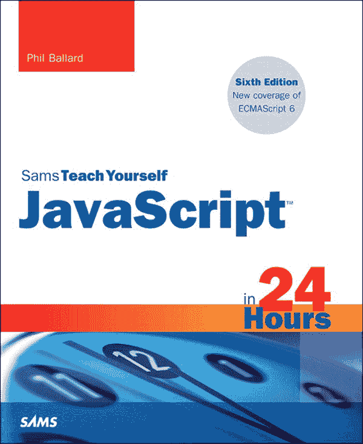

## 关于本 eBook

ePUB 是一种开放的行业标准电子书格式。然而，阅读设备和应用程序对 ePUB 及其许多功能的支持程度不相同。可以使用您的设备或应用设置根据您的喜好自定义显示。您可以自定义的设置通常包括字体、字号、单栏或双栏、横屏或竖屏模式，以及可以点击或触摸放大的图片。有关您的阅读设备或应用的设置和功能的更多信息，请访问设备制造商的网站。

许多标题包含编程代码或配置示例。为了优化这些元素的显示效果，请在单栏横屏模式下查看电子书，并将字体大小调整为最小。除了以流式文本格式显示代码和配置外，我们还包含了代码图像，模仿印刷书籍中的显示效果；因此，当流式格式可能会影响代码列表的显示时，您将看到“点击此处查看代码图像”链接。点击该链接查看高保真代码图像。要返回之前的上一页，请点击设备或应用上的“返回”按钮。

 800 East 96th Street, Indianapolis, Indiana, 46240 USA

# 第六部分：高级主题

## 第 18 小时：读取与写入 Cookie

### 什么是 Cookie？

### `document.cookie` 属性

### Cookie 配方

### 写入 Cookie

### 写入 Cookie 的函数

### 读取 Cookie

### 删除 Cookie

### 在单个 Cookie 中设置多个值

### 总结

## 问与答

## 工作坊

## 练习题

## 第 19 小时：即将到来 JavaScript

### 类

### 箭头函数

### 模块

### 使用 `let` 和 `const`

### 模板字符串

### 使用 `for-of` 访问数组

### 编译

### 总结

## 问答

## 工作坊

## 练习

## 第 20 小时：使用框架

### 软件框架

### 模型-视图-控制器 (MVC) 架构

### 使用 MVC 框架开发应用

### AngularJS 框架

### 构建 AngularJS 应用

### 总结

## 问答

## 工作坊

## 练习

## 第 21 小时：网页之外的 JavaScript

### 浏览器外的 JavaScript

### 编写 Chrome 扩展

### 进阶

### 总结

## 问答

## 工作坊

## 练习

# 第七部分：职业

## 第 22 小时：良好的编码实践

### 不要过度使用 JavaScript

### 编写可读且可维护的代码

### 优雅降级

### 渐进式增强

### 非侵入式 JavaScript

### 特性检测

### 良好的错误处理

### 总结

## 问答

## 工作坊

## 练习

## 第 23 小时：调试你的代码

### 调试简介

### 高级调试

### 总结

## 问答

## 工作坊

## 练习

## 第 24 小时：JavaScript 单元测试

### 什么是单元测试？

### 为单元测试编写 JavaScript

### QUnit 测试套件

### 总结

## 问答

## 工作坊

## 练习

# 第八部分：附录

## 附录 A：JavaScript 开发工具

### 编辑器

### 验证器

### 调试与验证工具

## 附录 B：JavaScript 快速参考

## 索引

## 作者

Phil Ballard 是多 *Sams Teach Yourself* 系列书籍的作者，他于 1980 年毕业于利兹大学，获得电子学荣誉学位。在早期作为一家跨国公司的研究科学家后，他曾担任了几年的软件工程顾问。他以“The Whisperer”（`www.whisperer.co.uk`）的身份运营，近年来专注于为国际客户提供网页设计和开发。

## 我们想听听你的声音

作为本书的读者，你是我们最重要的评论家。如果你对本书的某些地方感到喜欢或不喜欢，请发送电子邮件至 `feedback@sampublish.com` 或邮寄至 `feedback@sampublish.com`。我们重视你的意见，并想知道我们如何做得更好。

## 读者服务

访问我们的网站并在 [`www.informit.com/register`](http://www.informit.com/register) 注册本书，以便方便获取任何更新、下载或错误说明。

## 引言

本引言将在你开始之前为你介绍一些基础知识，包括本书的读者群、编写原因、内容组织方式以及你需要的工具。

### 本书的读者

如果你对学习 JavaScript 感兴趣，你可能已经对 HTML 和通用的网页设计有了基本的了解，并希望为你的页面添加一些交互性。如果你从未接触过 HTML，也没有做过任何计算机编程，那么在阅读本书之前，先浏览一遍 HTML 入门指南将会有帮助。不要担心——HTML 非常容易上手，你不需要成为该专家就可以开始尝试 JavaScript。

### 本书的目标

当 JavaScript 首次引入时，它的功能还相当有限。由于基础功能简单陋且对浏览器的支持相当零散，它在某些领域被认为是一种玩具或噱头。现在，由于浏览器对 W3C 标准的支持大大提高，以及近期浏览器中使用的 JavaScript 实现有所改进，JavaScript 终于被视为一种严肃的编程语言。

许多在其他语言中使用的高级编程领域很容易应用于 JavaScript；例如，面向对象的编程促进了编写稳健、可读、可维护且可重用的代码。所谓的“非侵入式”脚本技术和 DOM 脚本的使用，重点在于为网页添加交互，同时保持 HTML 的易读性并与程序代码良好分离。

本书旨在教授与当今 JavaScript 应用的所有重要方面相关的基础技能。在书中，你将从基础概念开始，逐渐学习根据当前网络标准编写 JavaScript 程序的最佳实践。

### 使用的规范

书中的所有代码示例均以 HTML5 编写。不过，在大多数情况下，代码避免了使用 HTML5 特有的语法，因为在编写时，浏览器对其支持尚未普及。无论计算机类型或操作系统如何，代码示例都应该可以在任何近期的网络浏览器中正常运行。

除了每课的正文外，你还会看到许多标记为“笔记”（Notes）”、“提示”（Tips）和“警告”（Cautions）的框。

**笔记**

这些章节提供了额外的注释，可能帮助你理解文本和示例。

**提示**

这些区块提供了额外的提示、快捷方式或替代方案，以使编码变得更加简单。

**注意事项**

通过使用这些区块中的信息，避免常见的陷阱。

**动手尝试**

每节课程至少包含一个章节，引导你完成实现自己的脚本的过程。这将帮助你根据所学的技巧，在编写自己的 JavaScript 代码方面建立信心。

### 问答、工作坊与练习

在每节课程之后，你会发现三个末尾章节。

 “问答”部分尝试回答关于本节课程主题的几个常见问题。

 “工作坊”部分包含一个测试，用于测试你对该节课程所知识的掌握情况。测试题的答案会紧随测试方便地提供。

 “练习”部分根据课程内容提供了进一步实验的建议，你可能想自己尝试。

### 本书的结构

本书分为七部分，所教授技术的复杂程度逐渐增加。

 第一部分—JavaScript 初步

JavaScript 语言简介，以及如何使用该语言的常用函数编写简单的脚本。本书这部分主要针对几乎或没有编程知识、且不懂 JavaScript 语言的读者。

 第二部分—代码编程

在这里介绍了 JavaScript 的数据类型，例如数字、字符串和数组。还涵盖了更复杂的编程范式，如程序控制循环和定时器。

 第三部分—对象

本书这部分集中于对象的创建和处理，包括导航和编辑属于 `DOM`（文档对象模型）的对象。

 第四部分—HTML 和 CSS

在这里你更深入地学习 JavaScript 如何与 HTML（包括 HTML5）和 CSS（层叠样式表，包括最新的 CSS3 规范交互。

 第五部分—使用 JavaScript 库

在本书这部分，你学习如何使用 `jQuery` 等第三方库来简化跨浏览器开发。

 第六部分—高级主题

本书这部分涵盖了 Cookie 的读写，通过 ECMAScript 6 规范查看 JavaScript 的更新，引入了 `AngularJS` 等框架的使用，并展示了网页之外使用 JavaScript 的示例。

 第七部分—职业技能

在最后一部分，你探索了专业 JavaScript 开发的方面，如良好的编码实践、JavaScript 调试和单元测试。

### 你将需要的工具

编写 JavaScript 不需要任何昂贵且复杂的工具，如集成开发环境 (IDEs)、编译器或调试器。

书中的示例都可以在文本编辑器中创建，例如 Windows 记事本。几乎每个操作系统都附带至少一个此类应用程序，通过互联网下载还有无许多免费或低成本的可用程序。

**备注**

附录 A “JavaScript 开发工具”列出了一些用于 JavaScript 开发的额外易于获取工具和资源。

为了看到你的程序代码运行，你需要一个网络浏览器，如 Internet Explorer、Mozilla Firefox、Opera、Safari 或 Google Chrome。建议将你的浏览器升级到最新的当前稳定版本。

本书的大多数示例不需要互联网连接即可运行。只需将源代码文件存储在计算机上方便的位置并用你选择的浏览器打开通常就足够了。例外是关于 Cookie 的节课程以及书中演示 Ajax 的示例；要探索所有示例代码将网络连接（或连接到局域网上的 Web 服务器）以及一些网络空间来发布示例代码。如果你做过 HTML 编码，你可能已经涵盖了这一点；如果没有，一个爱好级的虚拟主机账户费用非常低，对于尝试书中的示例完全足够。（如果你想尝试 第五部分 中的 Ajax 示例，请检查你的 Web 主机是否允许运行用 `PHP` 语言编写的脚本。几乎所有的都支持。）

# 第一部分：JavaScript 初步

## 第 1 小时：引入 JavaScript

### 本节你将学到：

 关于服务器端和客户端编程

 JavaScript 如何改进你的网页

 JavaScript 的历史

 文档对象模型 (DOM) 的基础

 什么是 `window` 和 `document` 对象

 如何使用 JavaScript 向你的网页添加内容

 如何使用对话框提示用户

现代 Web 与其最初的、纯文本的祖先关系不大。现代网页可以涉及音频、视频、动画图形、交互式导航等——而且在大多数情况下，JavaScript 在实现这一切方面发挥了巨大的作用。

在我们的第一节课程中，我们描述了 JavaScript 是什么，简要回顾了该语言的起源，并考虑了它可以改进你网页的各种类型。你还将直接上手编写一些可以运行的 JavaScript 代码。

### Web 脚本基础

既然你拿起了这本书，很有可能你已经熟悉了使用万维网，并且对使用某种 `HTML` 编写网页有基础的了解。

HTML（超文本标记语言）不是一种*编程*语言，而是（如名称所示）是一种*标记*语言；我们可以使用它来标记页面的部分，以指示浏览器这些部分应以特定的方式显示——例如粗体或斜体文本，或者作为标题、列表、排列成数据表格或使用许多其他标记选项。

一旦编写完成，这些页面从本质上来说是*静态的。它们无法响应用户操作、做出决策或修改其页面元素的显示。它们包含的标记每当用户访问时将始终以相同的方式被解释和显示。

正如你通过万维网所知，现代网站可以做得更多；我们经常访问的页面往往不是静态的。它们可以包含“实时”数据，例如股票价格或航班到达时间、带有颜色和字体变化的动画显示，或者交互功能，如点击浏览画廊或排序数据列。

这些巧妙的功能是由后台运行的程序（通常称为*脚本*）为用户提供的这些程序通过操作浏览器中显示的内容来提供功能。

`script` 一词无疑借用自剧院和电视领域，在这些领域，`script` 定义了主持人或表演者的动作。对于网页而言，主角是页面上的元素，而 `script` 则由脚本语言提供，在本例中为 `JavaScript`。对我们而言，`Program` 和 `script` 几乎是可以互换的术语，`programming` 和 `scripting` 也是如此。你将在本书中发现这些词都将被使用。

### 服务端编程与客户端编程

向原本静态的 Web 内容中添加脚本有两种两种基本方法：

 你可以由 Web 服务器在将页面交付给用户之前执行脚本。此类脚本可以定义发送到浏览器以供用户显示的信息——例如，从在线商店的数据库中检索产品价格，在用户登录网站私有区域之前检查其身份凭证，或者检索电子邮箱箱的内容。这些脚本通常在 Web 服务器生成请求的网页并将其提供给用户 `before` 运行。得知我们将其称为 `server-side scripting`（服务端脚本）你不会感到意外。

 另一种是脚本本身不是在服务器上运行，而是随着页面代码一起交付给用户的浏览器。此类脚本随后由浏览器执行并在已交付的页面内容上操作。此类脚本可以执行的许多功能包括页面部分的动画、重新调整页面布局、允许用户在页面内拖放项目、验证表单上的用户输入、将用户重定向到其他页面等。你可能已经猜出这被称为 `client-side scripting`（客户端脚本），你是正确的。

本书完全是关于 `JavaScript` 的，它是互联网上最常用的客户端脚本语言。

**注意事项**

事实上，有一种优雅的方法可以将服务端脚本的输出合入到你的客户端 `JavaScript` 程序中。我们将在第五部分 的“使用 JavaScript 库”中，在学习一种名为 `Ajax` 的技术时研究这一内容。

### JavaScript 概览

**注意事项**

尽管名称相似，但 `JavaScript` 与 Sun Microsystems 开发的 `Java` 语言没有任何关系（如果真有关系的话）。这两种语言在语法上有一些共同之处，但它们与许多其他编程语言的共同点并不更多。

用 `JavaScript` 编写的程序可以访问 Web 页面的元素以及运行它的浏览器窗口，并对这些元素执行操作，还可以创建新的页面元素。`JavaScript` 能力的一些示例包括：

 打开具有指定大小、位置和样式的新窗口（例如，窗口是否有边框、菜单、工具栏等）

 提供用户友好的导航辅助，如下拉菜单

 验证输入到 Web 表单的数据，以确保在表单提交到 Web 服务器之前符合可接受的格式

 在发生特定事件时（如鼠标光标移动到其上方）更改页面元素的外观和行为

 检测并利用特定浏览器支持的高级特性，例如第三方插件或对新技术的原生支持

由于 `JavaScript` 代码在用户的浏览器内部运行，页面倾向于快速响应 `JavaScript` 指令，从而增强用户体验并使应用程序看起来更像计算机的原生应用程序，而不仅仅是一个网页。此外，`JavaScript` 可以检测并利用 `HTML` 无法实现的某些用户操作，例如单个鼠标点击和键盘操作。

几乎每个常用的浏览器都支持 `JavaScript`。

#### JavaScript 的来源

`JavaScript` 的起源可以追溯到 20 世纪 90 年代中期，当时推出了 `Netscape Navigator` 2.0 版本。

欧洲计算机制造商协会 (`ECMA`) 加入了其中，定义了 `ECMAScript`，这是当前语言的祖父。同时，微软推出了 `jScript` 作为其自己的语言版本，用于其 `Internet Explorer` 系列浏览器。

**提示**

`ECMA` 继续发布 `ECMAScript` 语言标准的更新版本。在编写时，`ECMAScript` 6 即将完成最终版本，在第六部分 的“高级主题”中，你可以很快了解到一些即将提供的新语言特性。

**注意事项**

`JavaScript`并不是唯一的客户端脚本语言。微软浏览器除了支持 `jScript`（微软版本的 `JavaScript`）外，还支持公司自己的 `Visual Basic` 语言的一个面向脚本的版本，称为 `VBScript`。

然而，`JavaScript` 拥有更好的浏览器支持；几乎每个现代浏览器都支持 `JavaScript` 版本。

##### 浏览器大战

20 世纪 90 年代后期，`Netscape Navigator` 4 和 `Internet Explorer` 4 都声称在 `JavaScript` 实现方面比早期浏览器版本有了重大改进。

遗憾的是，两组开发者走向了不同的方向，各自定义了对 `JavaScript` 语言的扩展以及它与网页交互的方式。

这种荒谬的情况迫使开发者基本上为每个脚本编写两个版本，并使用一些笨拙且经常出错的程序来尝试判断在使用哪个浏览器查看页面，随后切换到最合适的 `JavaScript` 代码版本。

**注意事项**

万维网联盟 (`W3C`)是一个国际社区，旨在开发开放标准以支持万维网的长期增长。其网站 [`www.w3.org/`](http://www.w3.org/) 是关于 Web 标准信息和工具的庞大资源库。

谢幸的是，万维网联盟 (`W3C`) 与各个浏览器制造商共同努力，通过文档对象模型 (`DOM`) 标准化网页的构建和操作方式。新的标准 `DOM` 1 级于 1998 年底完成，2 级于 2000 年底完成。

如果你不知道 `DOM` 是什么或它是做什么的，不要担心——你将在本小时晚些时候以及书中学习许多关于它的知识。

### `<script>` 标签

每当用户请求页面时，其中包含的任何 `JavaScript` 程序都会随页面内容一起传递给浏览器。

**注意事项**

`JavaScript` 是一种*解释型*语言，而不是像 `C++` 或 `Java` 那样的*编译型*语言。`JavaScript` 指令以纯文本传递给浏览器并按顺序解释；它们不需要先“编译”成只有计算机处理器才能读取的机器码。这提供了巨大的优势，因为 `JavaScript` 程序易于阅读，可以快速编辑，并且通过在浏览器中重新加载网页即可重新测试其运行情况。

你可以通过在 HTML 代码中的 `<script>` 和 `</script>` 标签之间直接放置 `JavaScript` 语句将其包含在 HTML 中：

```
<script>

    ... JavaScript 语句 ...

</script>
```

书中的示例均编写为符合 HTML5 验证标准，在 HTML5 中，`<script>` 元素不需要强制性属性（`type` 属性在 HTML5 中是可选的，为了清晰起见，我们在本书的示例中排除了该属性）。然而，如果你编写 JavaScript 用于包含在 HTML 4.x 或 XHTML 页面，则应该为你的 `<script>` 元素添加 `type` 属性：

```html
<script type="text/javascript">
    ... JavaScript statements ...
</script>
```

你偶尔还会看到 `<script>` 元素带有 `language="JavaScript"` 属性。这早已被废弃（deprecated），因此除非你认为你需要支持像 Navigator 和 Mosaic 这样的古老浏览器，否则没有必要继续编写这样的代码。

**注意**

`deprecated`（废弃）一词用于软件特性或实践，表示最好避免使用它们，通常是因为它们已经被取代了。

尽管为了提供向后兼容性仍然受到支持，但它们的 `deprecated` 状态通常意味着此类功能将在不久的将来被移除。

本节的示例将 JavaScript 代码放置在文档的 `body` 部分，但 JavaScript 代码也可以出现在文档的其他地方；你也可以使用 `<script>` 元素加载保存在外部文件中的 JavaScript 代码。我们将在第 2 小时 “编写简单脚本”中详细地讨论如何在你的页面中包含 JavaScript。

### 引入 DOM

文档对象模型（DOM）是一种将文档及其内容的概念化可视化方法。

每当要求浏览器加载并显示页面时，它需要解释（我们通常使用“解析”一词）组成页面的 HTML 文件中所包含源代码。作为解析过程的一部分，浏览器会根据加载的文档内容创建一种名为 DOM 表达式的内部模型。浏览器在渲染可见页面时会引用这个模型。你可以使用 JavaScript 访问并编辑 DOM 表达式的各个部分，同时改变用户查看和与视图页面交互的方式。

在早期，JavaScript 对网页某些部分的访问相当初级。例如，JavaScript 程序可以访问网页中包含的图像和表单；JavaScript 程序可以包含语句来选择“页面上的第二个表单”或“名为‘registration’的表单”。

Web 开发人员有时将其称为 DOM Level 0，这是对 W3C 后续 Level 1 DOM 定义的后兼容致敬。除了 DOM Level 0，你可能还会看到对 BOM（浏览器对象模型）的引用。从那时起，W3C 逐渐扩展并改进了 DOM 规范。W3C 更具野心的定义产生了一个不仅适用于网页和 JavaScript，还适用于任何编程语言和 XML（以及 HTML 文档）的 DOM。

**注意**

在书中，我们专注于 W3C 的 DOM Level 1 和 Level 2 DOM 定义。如果你对各种 DOM 级别的细节感兴趣，可以在 [`developer.mozilla.org/en/DOM_Levels`](https://developer.mozilla.org/en/DOM_Levels) 找到良好的概览。

### W3C 与标准兼容性

浏览器供应商在他们的最新版本中已经整合了大大改进的 DOM 支持。在编写本书时，Internet Explorer 正在发布 11 版本，Netscape Navigator 已经重生为 Mozilla Firefox（当前版本为 35.0），市场上的其他竞争对手包括 Opera、Konqueror、Apple 的 Safari 以及 Google 的 Chrome 和 Chromium。所有这些都对 DOM 提供了优秀的支持。

Web 开发人员的状况有了显著改善。除了少数恼人的特殊情况外，只要我们遵循 DOM 标准，现在我们很大程度上可以忘记为单个浏览器编写特殊代码了。

**注意**

如 Netscape Navigator（任何版本）和直到 5.5 版本的 Internet Explorer 等早期浏览器现在几乎已经消失了。本书关注的是兼容 DOM Level 1 或更高版本的现代浏览器，例如 Internet Explorer 9+、Firefox、Google Chrome、Apple Safari、Opera 和 Konqueror。建议你将浏览器升级到最新的稳定版本。

### `window` 和 `document` 对象

每当你的浏览器加载并显示页面时，它会在内存中创建该页面及其所有元素的内部表示，即 DOM。在 DOM 中，你网页的元素具有逻辑层级结构，像一棵相互连接的父子 `objects`（对象）树。这些对象及其相互连接形成了包含并显示该网页的浏览器的概念模型。每个对象都有一个描述它的 `properties`（属性）列表，以及若干个可以使用 JavaScript 来操作这些属性的 `methods`（方法）。

在层级树的最顶端是浏览器的 `window` 对象。该对象是你页面 DOM 表示中其他所有内容的父或祖先。

`window` 对象有各种子对象，其中一些在图 1.1 中可视化了。图 1.1 中显示的第一个子对象，也是我们在书中最常用的对象，是 `document` 对象。任何加载到浏览器的 HTML 页面都会创建一个 `document` 对象，包含组成显示页面的所有 HTML 和其他资源。所有这些信息可以通过 JavaScript 以父子层级结构的形式访问，每个对象都有自己的属性和方法。


**图 1.1** `window` 对象及其部分子对象

图 1.1 中可见的 `window` 其他子对象是 `location` 对象（包含当前加载页面 URL 的详情）、`history` 对象（包含浏览器之前访问页面的详情）以及 `navigator` 对象（存储浏览器类型、版本和功能详情）。我们将在第 4 小时 “DOM 对象和内置对象”中详细查看这些对象，并在书中多次再次使用它们，但现在让我们专注于 `document` 对象吧。

#### 对象表示法

我们用于表示树内对象的表示法使用点（句号）：

```
parent.child
```

例如，参考图 1.1，`location` 对象是 `window` 对象的子对象，因此在 DOM 中这样引用它：

```
window.location
```

**提示**

这种表示法可以根据需要任意扩展，以表示树中的任何对象。例如

```
object1.object2.object3
```

表示 `object3`，其父对象是 `object2`，而 `object2` 又是 `object1` 的子对象。

你 HTML 页面的 `<body>` 部分在 DOM 中被表示为 `document` 对象的子元素；我们这样访问它：

```
window.document.body
```

序列中的最后一项也可以不是另一个对象，而是父对象的 `property`（属性）或 `method`（方法）：

```
object1.object2.property

object1.object2.method
```

例如，假设我们想要访问当前文档的 `title` 属性，如 HTML `<title>...</title>` 标签指定的。我们可以直接使用

```
window.document.title
```

**注意**

如果对象层级结构和点表示法现在看起来还不清楚，请不要担心。你将在读书过程中看到很多示例的！

**提示**

`window` 对象始终包含当前浏览器窗口，因此你可以引用 `window.document` 来访问当前文档。作为快捷方式，你也可以直接使用 `document` 代替 `window.document` ——这同样指向当前文档。

如果你打开了多个窗口，或者正在使用框架集（frameset），那么每个窗口或框架都将有一个独立的 `window` 和 `document` 对象。要引用其中任何一个文档，你需要使用该窗口或框架所属的相关窗口名称和文档名称。

### 与用户交互

让我们来看一些与 `window` 和 `document` 对象相关的方法。我们先从两个方法开始，每种方法都提供了一种与用户交互的手段。

### `window.alert()`

即使你没有意识到，你在很多场合也已经见过 `window` 对象的 `alert` 方法产生的结果。你可能记得，`window` 对象位于 DOM 层次结构的顶端，代表了显示你页面的浏览器窗口。当你调用 `alert()` 方法时，浏览器会弹出一个对话框，显示你的消息以及一个 OK 按钮。这是一个示例：

```
window.alert("Here is my message");
```

这是我们关于点符号表示法（dot notation）的第一个运行示例。在这里，我们调用了 `window` 对象的 `alert()` 方法，因此我们的 `object.method` 符号变为 `window.alert`。

**提示**

在实践中，你可以省略语句中的 `window.` 部分。因为 `window` 对象是 DOM 层次结构的顶端（它有时被称为 `global object`），任何在没有直接引用其父对象的情况下调用的方法都会被认为属于 `window.`。所以：

```
alert("Here is my message");
```

效果同样很好。

注意括号内的文本行包含在引号中。这些引号可以是单引号或双引号，但它们必须存在，否则会产生错误。

这行代码在浏览器中执行时，会弹出一个类似于图 1.2 所示的对话框。


**图 1.2** 一个 `window.alert()` 对话框

**提示**

图 1.2 显示了在 Ubuntu 上运行的 Chrome 浏览器生成的警报。对话框的外观会根据你使用的特定浏览器、操作系统和显示选项发生细微变化，但它始终包含消息和一个 OK 按钮。

**提示**

在用户点击 OK 之前，他被阻止对页面进行任何其他操作。这种行为的对话框被称为 `modal`（模态）对话框。

### `document.write()`

你可能仅根据名称就能猜出文档对象的 `write` 方法的作用。该方法不是弹出对话框，而是直接将字符写入文档的 DOM 中，如图 1.3 所示。

```
document.write("Here is another message");
```


**图 1.3** 使用 `document.write()`

**注意**

事实上，`document.write` 是一种向页面写入内容的相当愚蠢的方法——无论在功能、编码风格还是可维护性方面，它都有局限性。在“严肃”的 JavaScript 编程中，它已很大被弃用。当你编写更高级的 JavaScript 程序时，你已经学习了使用 JavaScript 将内容放入页面的更好方法。然而，在第一部分 你熟悉一些基本原理期间，我们会经常使用 `document.write`。

#### 动手尝试一下：JavaScript 中的“Hello World!”

在介绍一种编程语言时，如果不介绍传统的“Hello World”示例，似乎是很不礼貌的。看看列表 1.1 中的简单 HTML 文档。

**列表 1.1** `alert()` 对话框中的“Hello World!”

```html
<!DOCTYPE html>
<html>
<head>
    <title>Hello from JavaScript!</title>
</head>
<body>
    <script>
        alert("Hello World!");
    </script>
</body>
</html>
```

在你的文本编辑器中创建一个名为 `hello.html` 的文档，并输入上述代码。将它保存到计算机上方便的地方，然后用 浏览器打开它。

**注意**

某些文本编辑器程序可能会尝试为文件名添加 `.txt` 扩展名。确保你保存的文件具有 `.html` 扩展名，否则浏览器可能无法正确打开它。

许多流行的操作系统允许你右键点击 HTML 文件的图标并选择“打开方式……”或类似的字样。或者，启动你选择的浏览器，并使用菜单栏上的**文件 > 打开** 选项导航到你的文件并将其加载到浏览器中。

你会看到一个类似于图 1.2 的显示，但对话框中的消息是“Hello World!”。如果你计算机上安装了多个浏览器，请尝试所有的浏览器并比较显示效果——对话框可能略有不同，但消息和 OK 按钮的操作应该是完全相同的。

**注意**

某些浏览器的默认安全设置会导致它们在被要求打开本地内容（如你自己计算机上的文件）时显示安全警告。如果你的浏览器这样做，只需选择允许显示内容的选项即可。

### 读取 `document` 对象的属性

你可能记得在这一小时早些时候，DOM 树中的对象具有属性和方法。你已经看到如何使用 `document` 对象的 `write` 方法向页面输出文本——现在让我们尝试读取 `document` 对象的属性之一。我们将使用 `document.title` 属性，它包含了页面 HTML `<title>` 元素中定义的标题。

在你的文本编辑器中编辑 `hello.html`，更改对 `window.alert()` 方法的调用：

```
alert(document.title);
```

注意 `document.title` 现在没有包含在引号中——如果是那样，JavaScript 将推断我们想要输出字符串“document.title”作为字面文本。如果没有引号，JavaScript 将 `document.title` 属性的值发送给 `alert()` 方法。结果所示图 1.4。


**图 1.4** 显示 `document` 对象的属性

### 总结

在本节课程中，你接触了服务器端和客户端脚本的概念，并对 JavaScript 和文档对象模型进行了简短的历史回顾。你概述了 JavaScript 用于增强网页和改进用户体验的各种功能。

此外，你还学习了文档对象模型的基本结构，以及 JavaScript 如何访问特定对象及其属性，并使用这些对象的方法。

在接下来的课程中，我们将基于这些基础概念，进入更高级的项目。

## 问答

**Q. 如果我使用服务器端脚本（使用 PHP 或 ASP 等语言），我仍然可以在客户端使用 JavaScript 吗？**

**A.** 绝对可以。事实上，服务器端脚本和客户端脚本的结合提供了一个强大的平台，能够产生强大的应用程序。Google 的 Gmail 就是一个很好的例子。

**Q. 我应该测试多少不同的浏览器？**

**A.** 尽可能多地测试。编写符合标准的且避免使用浏览器特定功能的代码将有助于你的代码在不同浏览器中顺畅运行。然而，浏览器对某些功能的实现之间的细微差异可能一直存在。

**Q. 引入 JavaScript 代码会减慢页面的加载速度吗？**

**A.** 是的，尽管通常差异很小到无法察觉。如果你有一段特别大的 JavaScript 代码，你可能会觉得在用户可能连接的最慢连接上测试你的页面是值得的。除了极端情况外，这不太可能是一个严重的问题。

## 工作坊

在阅读后续的“答案”部分之前，尝试回答所有问题。

### 测验

**1.** JavaScript 是编译型语言还是解释型语言？

a. 编译型语言

b. 解释型语言

c. 两者都不是

d. 两者都是

**2.** 在 HTML 页面必须添加哪些额外的标签来包含 JavaScript 语句？

a. `<script>` 和 `</script>`

b. `<type="text/javascript">`

c. `<!--` 和 `-->`

**3.** DOM 层次结构的顶层被以下内容占据：

a. `document` 属性

b. `document` 方法

c. `document` 对象

d. `window` 对象

#### 答案

**1.** b. JavaScript 是解释型语言。程序代码以纯文本形式编写，语句被逐条读取并执行。

**2.** a. JavaScript 语句被添加在 `<script>` 和 `</script>` 标签之间。

**3.** d. `window` 对象位于 DOM 树的顶层，`document` 对象是它的子对象之一。

## 练习

 在本小时的“自己尝试一下”部分中，我们使用了行代码

```
alert(document.title);
```

来输出 `document` 对象的 `title` 属性。尝试重写该脚本，改为输出 `document.lastModified` 属性，该属性包含网页最后修改的日期和时间。（注意——属性名对大小写敏感。注意大写的字母 M。）看看你是否可以修改代码，使用 `document.write()` 代替 `alert()`，将属性直接写入页面中，如图 1.3 在你所能使用的不同浏览器中尝试本小时的示例代码。你注意到示例页显示方式有什么不同？

## 第 2 小时：编写简单的脚本

***

你将在本小时学到：

 在网页中包含 JavaScript 的各种方法

 JavaScript 语句的基础语法

 如何声明和使用变量

 使用数学运算符

 如何为你的代码编写注释

 捕获鼠标事件

***

你在第 1 小时“引入 JavaScript”中学习到，JavaScript 是一种能够让网页更具交互性的脚本语言。

在本小时中，你将学习更多关于如何将 JavaScript 添加到你的网页中，然后学习 JavaScript 程序的一些基础语法，如语句、变量、运算符和注释。你还将通过更多代码示例进行实践。

### 在你的网页中包含 JavaScript

在上一小时中，我说 JavaScript 程序是与页面内容一起传递给浏览器的——我们如何实现这一点呢？实际上有两种基本方法可以将 JavaScript 代码与你的 HTML 页面关联，这两种方法都使用了第 1 小时引入的 `<script></script>` 元素。

一种方法是将 JavaScript 语句直接包含在 HTML 文件中，就像我们在上一小时做的那样：

```
<script>
    ... 在这里编写 JavaScript 语句 ...
</script>
```

第二种且通常更优优的方法是将你的 JavaScript 保存到单独的文件，并使用 `<script>` 元素通过 `src`（源）属性按名称包含该文件：

```
<script src='mycode.js'></script>
```

前面的示例包含了 `mycode.js` 文件，其中包含我们的 JavaScript 语句。如果你的 JavaScript 文件与调用脚本不在同一个文件夹中，你也可以为它添加（相对或绝对的）路径：

```
<script src='/path/to/mycode.js'></script>
```

或者

```
<script src='http://www.example.com/path/to/mycode.js'></script>
```

将你的 JavaScript 代码放在单独的文件中有一些重要的优势：

 当 JavaScript 代码更新时，更新将立即适用于任何使用相同 JavaScript 文件的页面。这在 JavaScript 库的情况下尤为重要，我们将在书中后面介绍它们。

 HTML 页面的代码保持更加整洁，因此更容易阅读和维护。

 性能略有提高，因为浏览器会缓存包含的文件；因此，当此页面或其他页面下次需要它时，内存中有一个副本。

***

**注意**

习惯上为 JavaScript 代码文件赋予 `.js` 扩展名，如示例所示。然而，你包含的文件可以是任何扩展名，浏览器将尝试将内容解释为 JavaScript。

***

***

**警告**

外部文件中的 JavaScript 语句**不能**被 `<script>` 标签围绕。

***

列表 2.1 显示了我们在第 1 小时中使用的简单网页，但现在 `<body>` 部分包含了一个 JavaScript 文件。

```html
<!DOCTYPE html>
<html>
<head>
    <title>A Simple Page</title>
</head>
<body>
    <p>Some content ...</p>
    <script src='mycode.js'></script>
</body>
</html>
```

***

当 JavaScript 代码被添加到文档正文时，代码语句会在页面渲染时被解释并执行。在代码被读取和执行后，页面渲染将继续直到页面完成。

***

**提示**

你并不局限于使用单个 `script` 元素——你可以在页面上放置任意数量的元素。

***

***

**注意**

你有时会在 `script` 元素内部看到 HTML 风格的注释符号 `<!--` 和 `-->`，它们围绕着 JavaScript 语句，如下：

```html
<script>
    <!--
    ... 在这里编写 JavaScript 语句 ...
    -->
</script>
```

这是为了那些不识别 `<script>` 标签的老旧浏览器。这种 HTML “注释”语法防止了此类浏览器在屏幕上随页面内容一起显示 JavaScript 源代码。除非你有支持非常老浏览器的理由，否则这种技术不再需要了。

***

### JavaScript 语句

JavaScript 程序是单个指令的列表，我们称之为*语句*。为了正确解释语句，浏览器期望找到每个语句都单独写在一行：

```
this is statement 1
```

这是语句 2

或者，也可以通过在每个语句末尾加上分号将它们合并在同一行：

```
this is statement 1; this is statement 2;
```

为了提高代码的可读性，并帮助防止难以发现的语法错误，良好的做法是结合以上方法：让每个语句单独占一行，并以分号结束：

```
this is statement 1;

this is statement 2;
```

## 为你的代码添加注释

某些语句并不是为了让浏览器的 JavaScript 解释器执行，而是为了任何可能阅读这些代码的人提供便利。我们将此类行称为`注释（comments）`，并且在代码中添加注释有特定的规则。

只占单行代码的注释可以在行内容之前放置双正斜杠 `//` 来编写：

```
// This is a comment
```

***

### 注意

JavaScript 也可以使用 HTML 注释语法来编写单行注释：

```html
<!-- this is a comment -->
```

然而，这在 JavaScript 程序中并不常用。

***

要以此方式添加多行注释，我们需要在每一行注释前加上前缀：

```javascript
// This is a comment

// spanning multiple lines
```

在代码中输入多行注释更方便的方法是使用 `/*` 作为注释前缀，并用 `*/` 结束。使用这种语法编写的注释可以跨多行：

```javascript
/*  This comment can span

    multiple lines
    without needing
    to mark up every line  */
```

为代码添加注释确实是一件很好的事情，尤其是当你编写较大或更复杂的 JavaScript 应用时。注释可以作为你的提醒，也可以作为日后阅读你代码的其他人的指令和解释。

***

### 注意

诚然，注释会稍微增加 JavaScript 源文件的大小，这可能会对页面加载时间产生不利影响。通常，这种差异微小到几乎察觉不到，但如果真的很重要，你始终可以从 JavaScript 文件的“生产”版本中删除所有注释——即用于上线环境而非开发环境网站的版本。

***

### 变量

变量可以被认为是一个命名的“鸽巢”，我们在其中存储特定的数据。此类数据可以采取许多不同的形式——整数或小数、字符字符串，或者在本节或后续章节中讨论的各种其他数据类型。我们可以为变量命名为任何名称，只要名称中只使用字母、数字、美元符号 `$` 或下划线 `_` 即可。

***

### 注意

JavaScript 是大小写的——名为 `mypetcat` 的变量与 `Mypetcat` 或 `MYPETCAT` 是不同的变量。

许多 JavaScript 以及其他编程语言的程序员喜欢使用所谓的驼峰命名法（CamelCase，也称为混合 Case、BumpyCaps 以及其他各种名称）作为变量名。在 `CamelCase` 中，复合词或短语的元素在没有空格的情况下连接，每个元素的首字母大写，但第一个字母可以是大写也可以是小写。在这个例子中，变量将命名为 `MyPetCat` 或 `myPetCat`。

***

假设我们有一个名为 `netPrice` 的变量。我们可以通过一个简单的语句设置存储在 `netPrice` 中的值：

```
netPrice = 8.99;
```

我们称这为给变量*赋值*。注意，我们不需要在赋值之前像某些其他编程语言那样声明该变量的存在。然而，在 JavaScript 中通过使用 `var` 关键字是可以实现的，而且在大多数情况下是良好的编程习惯：

```
var netPrice;

netPrice = 8.99;
```

或者，我们可以方便且易读地将这两个语句合并为一语句：

```
var netPrice = 8.99;
```

要将一个*字符字符串*赋值为变量的值，我们需要将该字符串包含在单引号或双引号中：

```
var productName = "Leather wallet";
```

例如，我们可以写一行代码，将该变量中包含的值发送给 `window.alert` 方法：

```
alert(productName);
```

生成的对话框将评估变量并将其显示出来（这次在 Mozilla Firefox 中），如图 2.1 所示。


**图 2.1** 显示变量 `productName` 的值

***

### 提示

选择可读的变量名。使用像 `productName` 和 `netPrice` 这样的变量名，比将相同的变量命名为 `var123` 和 `myothervar49` 使代码更容易阅读和维护，尽管后者名称是完全有效的。

***

### 运算符

如果我们不能在计算中对它们进行操作，存储在变量中的值对我们来说就没有太大用。

#### 算术运算

首先，JavaScript 允许我们使用标准的加、减、乘、除算术运算符执行操作。

```
var theSum = 4 + 3;
```

正如你所猜想的，在执行此语句后，变量 `theSum` 将包含一个 7 的值。我们也可以在操作中使用变量名：

```
var productCount = 2;

var subtotal = 14.98;

var shipping = 2.75;

var total = subtotal + shipping;
```

我们可以以类似的方式使用 JavaScript 进行减法 (`-`)、乘法 (`*`) 和除法 (`/`)：

```
subtotal = total – shipping;

var salesTax = total * 0.15;

var productPrice = subtotal / productCount;
```

要计算除法的余数，我们可以使用 JavaScript 的*取模除*运算符。它用 `%` 字符表示：

```
var itemsPerBox = 12;

var itemsToBeBoxed = 40;

var itemsInLastBox = itemsToBeBoxed % itemsPerBox;
```

在这个例子中，在最后一个语句完成后，变量 `itemsInLastBox` 将包含数字 4。

JavaScript 还有方便的运算符来递增 (`++`) 或自减 (`--`) 变量的值：

```
productCount++;
```

这等同于语句

```
productCount = productCount + 1;
```

同样，

```
items--;
```

等同于

```
items = items – 1;
```

***

### 提示

如果你需要将变量递增或减少除 1 以外的值，JavaScript 还允许将其他算术运算符与 `=` 运算符结合；例如，`+=` 和 `-=`。

以下两行代码是等价：

```
total = total + 5;

total += 5;
```

这两个也是等价：

```
counter = counter - step;

counter -= step;
```

我们可以将这种符号用于其他算术运算符，例如乘法除法：

```
price = price * uplift;

price *= uplift;
```

***

JavaScript 算术运算符更全面的列表出现在附录 B“JavaScript 快速参考”。

#### 运算符优先级

当同一个计算中使用多个运算符时，JavaScript 使用优先级规则来确定计算的顺序。例如，考虑语句

```
var average = a + b + c / 3;
```

如果正如变量名所暗示的那样，你试图计算平均值，这不会给出预期的结果；除法操作将在将 `a` 和 `b` 的值加到结果之前对 `c` 执行。要正确地计算平均值，我们必须在语句中添加括号，如下：

```
var average = (a + b + c) / 3;
```

如果你对优先级规则有疑问，我建议你尽可能大量使用括号。这样做没有任何代价，它能让你的代码更容易读（对你以及日后需要编辑或解码代码的其他其他人来说），并确保优先级问题不会破坏你的计算。

### 注意

如果你有 PHP 或 Java 等其他语言的编程经验，你会发现 JavaScript 的优先级规则与你所熟悉的规则几乎相同。你可以在 [`msdn.microsoft.com/en-us/library/z3ks45k7(v=vs.94).aspx`](http://msdn.microsoft.com/en-us/library/z3ks45k7(v=vs.94).aspx) 找到关于 JavaScript 优先级的详细信息。

## 在字符串中使用 `+` 运算符

如果算术运算符操作的变量包含的是字符串而不是数值，那么这些运算符就没多大意义。例外是 `+` 运算符，JavaScript 将其解释为连接（顺序连接）两个或多个字符串的指令：

```
var firstname = "John";
var surname = "Doe";
var fullname = firstname + " " + surname;
// 变量 fullname 现在包含值 "John Doe"
```

 如果你尝试对两个变量使用 `+` 运算符，其中一个是字符串，另一个是数值，JavaScript 会将数值转换为字符串并将两者连接：

```
var name = "David";
var age = 45;
alert(name + age);
```

图 2.2 显示了对字符串和数值值使用 `+` 运算符的结果。

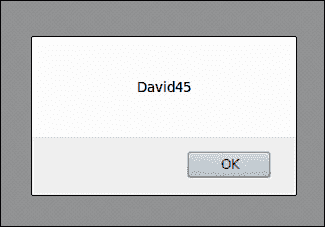

**图 2.2** 连接字符串和数值

## 动手试试：将摄氏度转换为华氏度

要将摄氏度温度转换为华氏度温度，我们需要乘以 9，除以 5，然后加上 32。让我们在 JavaScript 中实现它：

```
var cTemp = 100;  // 摄氏度温度
// 让我们多用用一些括号吧
var hTemp = ((cTemp * 9) /5 ) + 32;
```

事实上，我们可以省略此计算中的所有括号，它仍然可以正常工作：

```
var hTemp = cTemp*9/5 + 32;
```

然而，括号使代码更易理解，并有助于防止由运算符优先级引起的错误。

让我们在网页中测试这段代码，如 列表 2.2 所示。

**列表 2.2 从摄氏度计算华氏度**

```html
<!DOCTYPE html>
<html>
<head>
    <title>Fahrenheit From Celsius</title>
</head>
<body>
    <script>
        var cTemp = 100;  // 摄氏度温度
        // 让我们多用用一些括号吧
        var hTemp = ((cTemp * 9) /5 ) + 32;
        document.write("Temperature in Celsius: " + cTemp + " degrees");
        document.write("Temperature in Fahrenheit: " + hTemp + " degrees");
    </script>
</body>
</html>
```

将此代码保存为文件 `temperature.html` 并将其加载到浏览器中。你应该得到 图 2.3 所示的结果。


**图 2.3** 列表 2.2 的输出

修改几次文件以为 `cTemp` 使用不同的值，并检查一切运行正常。

## 捕获鼠标事件

JavaScript 的基本目的之一是帮助网页对用户更具交互性。为了实现这一点，我们需要一些机制来检测用户和程序在任何时刻做什么——鼠标在浏览器中的位置、用户是否点击了按钮或按了键盘、页面是否完全加载等。

我们将所有这些发生的情况称为“事件”，JavaScript 有多种工具来帮助我们处理它们。让我们看看使用 JavaScript 检测用户鼠标动作的某些方法。JavaScript 通过所谓的“事件处理器”来处理事件。我们将研究其中三个：`onClick`、`onMouseOver` 和 `onMouseOut`。

### `onClick` 事件处理器

`onClick` 事件处理器可以应用于页面上几乎所有的可见 HTML 元素。我们实现它的一种方法是向 HTML 元素添加另一个属性：

```
onclick="some JavaScript code"
```

注意：虽然直接在 HTML 元素中添加事件处理器是完全有效的，但今天这不被认为是良好的编程实践。它对于本书第一部分 中的示例很有用，但在书的后面，你将学习使用更强大、更优雅的方法使用事件处理器。

让我们来看一个例子；请看 列表 2.3。

**列表 2.3 使用 `onClick` 处理器**

```html
<!DOCTYPE html>
<html>
<head>
    <title>onClick Demo</title>
</head>
<body>
    <input type="button" onclick="alert('You clicked the button!')" value="Click Me" />
</body>
</html>
```

HTML 代码在页面的 `<body>` 元素中添加了一个按钮，并为该按钮提供了 `onclick` 属性。赋予 `onclick` 属性的值是我们在点击 HTML 元素（在此例中为按钮）时想要运行的 JavaScript 代码。当用户点击按钮时，`onclick` 事件被激活（我们通常说事件已“触发”），并执行属性值中列出的 JavaScript 语句。

在这种情况下，只有一条语句：

```
alert('You clicked the button!')
```

图 2.4 显示了点击按钮的结果。

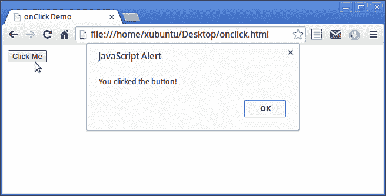

**图 2.4** 使用 `onClick` 事件处理器

注意：你可能注意到我们把处理器命名为 `onClick`，但在将其添加到 HTML 元素中时，我们写的是小写的 `onclick`。这种习惯的出现是因为，尽管 HTML 不区分大小写，但 XHTML 是区分大小写的，并且要求所有 HTML 元素和属性名称必须用小写。

### `onMouseOver` 和 `onMouseOut` 事件处理器

当我们只想根据某个特定页面元素检测鼠标指针在屏幕上的位置时，`onMouseOver` 和 `onMouseOut` 可以帮助我们做到。当用户的鼠标光标进入目标元素占据的屏幕区域时，`onMouseOver` 事件被触发。正如你可能猜到的，当光标离开同一区域时，触发 `onMouseOut` 事件。

列表 2.4 提供了 `onMouseOver` 事件的一个简单示例。

**列表 2.4 使用 `onMouseOver`**

```html
<!DOCTYPE html>
<html>
<head>
    <title>onMouseOver Demo</title>
</head>
<body>
    
</body>
</html>
```

运行脚本的结果如 图 2.5 所示。在代码中将 `onmouseover` 替换为 `onmouseout` 自然将会在鼠标离开图像时触发事件处理器——因此弹出警框对话框——而不是在进入时弹出。

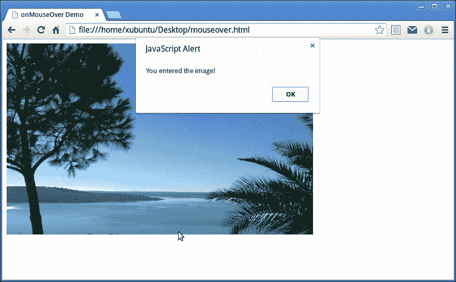

**图 2.5** 使用 `onMouseOver` 事件处理器

```html
</head>

<body>
    
</body>
</html>
```

***

你可能在我们在此处所用用的语法中发现了一些新东西。在 `onMouseOver` 和 `onMouseOut` 的 JavaScript 语句中，我们使用了 `this` 关键字。

在通过 HTML 元素的属性添加的事件处理器中使用 `this` 时，`this` 指的是 HTML 元素本身；在这种情况下，你可以将其理解为“这张图片”，而 `this.src` 则（使用我们已经学过的“点”表示法）指向该图像对象的 `src`（源）属性。

在这个示例中，我们使用了两张图片：`tick.gif` 和 `tick2.gif`——你可以使用手头有的任何图片，但如果这些图片大小相同且不过大，演示效果最好。

使用你的编辑器创建一个 HTML 文件，并在其中包含代码列表 2.5 中的代码。如果图片名称不同，可以将 `tick.gif` 和 `tick2.gif` 更改为你两张图片的名称；只需确保图片保存在与 HTML 文件相同的文件夹中。保存 HTML 文件并在浏览器中打开它。

你应该能看到当鼠标指针进入时图片发生变化，离开时变回，如图 2.6 所示。


**图 2.6** 使用 `onMouseOver` 和 `onMouseOut` 实现的鼠标悬停效果

***

### 注意

曾有一段时间，鼠标悬停通常是这样实现的，但现在可以使用层级样式表（CSS）更高效地实现。尽管如此，这仍然演示 `onMouseOver` 和 `onMouseOut` 事件处理器用途的一种方便方法。

***

***

### 总结

这一小时内你涵盖了大量内容。

首先，你学习了在 HTML 页面中引入 JavaScript 代码的各种方法。

你学习了如何在 JavaScript 中声明变量、为这些变量赋值以及使用算术运算符对它们进行操作。

最后，你接触了 JavaScript 的一些事件处理器，并学习了如何检测用户鼠标的某些动作。

## 问答

**Q. 一些列表和代码段将 `<script>` 标签的开始和结束放在同一行；而有时它们是分分行的。这重要吗？**

**A.** 空格（如空格字符）、制表符和空行完全会被 JavaScript 忽略。你可以使用此类空白（程序员通常称为*空白字符*）来布局代码，使其更具可读性且易于遵循。

**Q. 我可以使用同一个 `<script>` 元素既包含外部 JavaScript 文件又包含 JavaScript 语句吗？**

**A.** 不行。如果你使用 `src` 属性通过 `script` 包含外部 JavaScript 文件，就不能在 `<script>` 和 `</script>` 之间包含 JavaScript 语句——该区域必须留空。

## 工作坊

在查看后面的“答案”之前，尝试回答以下问题。

#### 测验

**1.** 什么是 `onClick` 事件处理器？

a. 一个用于检测浏览器中鼠标位置的对象

b. 一个在响应用户点击鼠标时执行的脚本

c. 用户可以点击的 HTML 元素

**2.** 页面上允许多少个 `<script>` 元素？

a. 无

b. 恰好一个

c. 任意数量

**3.** 关于变量，以下哪项不是正确的陈述？

a. 它们的名称对大小写敏感。

b. 它们可以包含数值或非数值信息。

c. 它们的名称可以包含空格。

#### 答案

**1.** b. `onClick` 事件处理器是一个在用户点击鼠标时执行的脚本。

**2.** c. 你可以使用任意数量的 `<script>` 元素。

**3.** c. JavaScript 中的变量名不能包含空格。

## 练习

 从代码列表 2.4 开始，从 `` 元素中移除 `onMouseOver` 和 `onMouseOut` 处理器。相反，添加一个 `onClick` 处理器将图片的 `title` 属性设置为 `My New Title`。（提示：你可以使用 `this.title` 访问图片标题。）

 你能想出一个简单的方法来测试你的脚本是否正确设置了新的图片标题吗？

## 第 3 小时：使用函数

***

这一小时你将学习：


- 如何定义函数

- 如何调用函数

- 函数如何接收数据

- 从函数返回值

- 关于变量的作用域

***

通常，程序会重复执行相同的任务。为了避免反复编写相同的代码，JavaScript 有手段将某些部分封装成可重用的模块，这些模块被称为函数。使用函数还让你的代码更易调试。假设你写了一个计算成本的函数；当费率变化时，你需要对其进行修改。函数是 JavaScript 的基本构建块之一，几乎出现在每一个脚本中。在这一小时中将看到如何创建和使用函数。

## 通用语法

创建一个函数类似于在你的脚本中创建一个你可以使用的新命令。以下是创建函数的基本语法：

```javascript
function sayHello() {
    alert("Hello");
    // ... 在这里可以放置更多语句 ...
}
```

你从关键字 `function` 开始，后面跟着你选择的函数名以及括号，然后是一对大括号 `{}`。大括号内部是组成函数的 JavaScript 语句。在前面的示例中，我们只有一行代码来弹出一个 `alert` 对话框，但你可以根据需要添加任意行代码！

***

注意

关键字 `function` 必须始终使用小写，否则会产生错误。

***

为了保持整洁，你可以将任意数量的函数收集在一个 `<script>` 元素中：

```html
<script>
    function doThis() {
        alert("Doing This");
    }

    function doThat() {
        alert("Doing That");
    }
</script>
```

### 调用函数

封装在函数定义中的代码在页面加载时不会执行。相反，它会静静等待直到被调用。

要调用函数，你只需要在想要执行函数所包含语句的地方使用函数名（带括号）即可：

```
sayHello();
```

例如，你可能想将你的新函数 `sayHello()` 的调用添加到按钮的 `onClick` 事件中：

```
<input type="button" value="Say Hello" onclick="sayHello()" />
```

***

提示

函数名和变量名一样对大小写敏感。名为 `MyFunc()` 的函数与名为 `myFunc()` 的函数不同。同样，变量名，选择有意义的函数名对代码的可读性非常有帮助。

你已经见过许多使用与 JavaScript 对象相关方法的示例，例如 `document.write()` 和 `window.alert()`。

方法简单来说，就是“属于”特定对象的函数。在第 4 小时 “DOM 对象和内置对象”中你会学更多关于对象的知识。

***

### 将 JavaScript 代码放入页面的 `<head>` 中

到目前为止，我们的示例都将 JavaScript 代码放置在 HTML 页面的 `<body>` 部分。使用函数允许你采用更常见且通常更优的做法，即将你的 JavaScript 代码存储在页面的 `<head>` 中。包含在页面头部 `<script>` 元素中的函数，或者通过页面头部中 `<script>` 元素的 `src` 属性包含的外部文件中的函数，可以在页面的任何地方调用。将函数放在文档的头部部分可以确保它们在任何尝试执行它们之前已经过定义。

列表 3.1 显示了一个示例。

**列表 3.1 页面头部中的函数**

```html
<!DOCTYPE html>
<html>
<head>
    <title>Calling Functions</title>
    <script>
        function sayHello() {
            alert("Hello");
        }
    </script>
</head>
<body>
    <input type="button" value="Say Hello" onclick="sayHello()" />
</body>
</html>
```

***

在这个列表中，你可以看到函数定义本身被放置在页面头部的 `<script>` 元素中，但对函数的调用完全是从另一个不同的地方进行的——这一次，是从页面 `body` 部分中按钮的 `onClick` 事件处理程序调用的。

点击按钮的结果如图 3.1 所示。


**图 3.1** 调用 JavaScript 函数

### 向函数传递参数

如果你的函数在每次被调用时只能以相同的方式运行（正如前面的示例所示），那样将是非常局限的。

幸运的是，你可以通过向函数传递数据来极大地扩展函数的功能。你在函数被调用时这样做，通过向它传递一个或多个*参数 (arguments)*：

`functionName(arguments)`

让我们写一个简单的函数来计算数的立方并显示结果：

```javascript
function cube(x) {
    alert(x * x * x);
}
```

现在我们可以调用函数，将变量 `x` 替换为数字。像如下所示调用函数将显示一个包含计算结果的对话框，在本例中为 27：

`cube(3);`

当然，你同样可以将变量名作为参数。以下代码也会生成一个包含数字 27 的对话框：

```
var length = 3;
cube(length);
```

***

注意

你有时会看到或听到使用*参数 (parameters)* 来代替*参数 (arguments)*，它们的意思完全相同。

***

### 多参数

函数并不局限于单个参数。当你想要向函数发送多个参数时，你只需要用逗号将它们隔开：

```javascript
function times(a, b) {
    alert(a * b);
}
times(3, 4); // 弹出 '12'
```

你可以使用任意数量的参数。

***

注意

确保你的函数调用包含足够的参数值，以匹配函数定义中指定的参数。如果定义中的任何参数未留值，JavaScript 可能会抛出错误，或者函数可能会运行不正常。如果调用函数时提供的参数过多，JavaScript 将忽略多余的参数。

***

需要注意的是，在函数定义中给参数指定的名称与传递给函数的任何变量名称无关。参数列表中的变量名充当调用函数时将传递的实际值的占位符。你赋予参数的名称仅用于函数定义内部以指定其工作方式。

我们将在本节稍后详细讨论这一点，即讨论变量*作用域 (scope)*。

***

### 尝试一下：输出用户消息的函数

让我们利用本节目前学到的知识，创建一个函数，可以向用户发送关于其其刚刚点击的按钮的消息。我们将函数定义放在页面的 `<head>` 部分，并使用多个参数调用它。

这是我们的函数：

```javascript
function buttonReport(buttonId, buttonName, buttonValue) {
    // 关于按钮 id 信息
    var userMessage1 = "Button id: " + buttonId + "\n";
    // 然后关于按钮名称
    var userMessage2 = "Button name: " + buttonName + "\n";
    // 以及按钮值
    var userMessage3 = "Button value: " + buttonValue;
    // 用户
    alert(userMessage1 + userMessage2 + userMessage3);
}
```

函数 `buttonReport` 接收三个参数，这些是被点击的按钮元素的 `id`、`name` 和 `value`。通过这三条信息中的每一个，构建出一个短消息。然后将这三条消息拼接成一个字符串，传递给 `alert()` 方法以弹出一个包含信息的对话框。

***

提示

你可能注意到前两个消息字符串都追加了元素 `"\n"`；这是一个“换行”字符，强制 alert 对话框中的消息换行。如果某些特殊字符出现在字符串中，必须在其前面加上前缀。这种字符被称为转义序列 (escape sequence)。

使用你的编辑器创建 `buttons.html` 文件并输入上述代码。你会发现它生成的输出消息如图 3.2 所示，但消息内容会根据你点击了哪个按钮而不同。


**图 3.2** 使用函数发送消息

***

### 从函数返回值

好了，现在你已经知道如何将信息传递给函数，以便它们能够为你处理这些信息。但你如何从函数获取返回信息呢？你并不总是希望函数仅限于弹出对话框！

幸运的是，有一种机制可以从函数调用中收集数据——返回值。让我们它是如何工作的：

```javascript
function cube(x) {
    return x * x * x;
}
```

这次我们不像上一个例子那样在函数内部使用 `alert()` 对话框，而是在所需的结果前面加上了 `return` 关键字。要从函数外部访问此值，只需将函数返回的值赋值给变量即可：

```
var answer = cube(3);
```

变量 `answer` 现在将包含值 27。

***

注意

函数返回的值不仅限于像本例中的数值。事实上，函数可以返回 JavaScript 支持的任何数据类型。我们将在第 5 小时中讨论数据类型。

***

***

提示

在函数返回一个值的地方，我们可以使用函数调用将返回值直接传递给代码中的另一个语句。例如，与其使用

```
var answer = cube(3);
alert(answer);
```

我们可以简单地使用

```
alert(cube(3));
```

从函数调用 `cube(3)` 返回的值 27 立即成为传递给 `alert()` 方法的参数。

***

### 变量的作用域

我们已经见过如何使用 `var` 关键字声明变量。在使用函数时，有一条黄金法则需要记住：

“在函数内部声明的变量只在该 particular 函数内部存在。”

这种限制被称为变量的作用域（scope）。让我们来看一个例子：

```
function addTax(subtotal, taxRate) {
    var total = subtotal * (1 + (taxRate/100));
    return total;
}

// 现在让我们调用函数
var invoiceValue = addTax(50, 10);
alert(invoiceValue); // 正常工作
alert(total);  // 不工作
```

如果我们运行这段代码，首先会看到一个包含变量 `invoiceValue` 值的 `alert()` 对话框（该值应该是 55，但实际上可能是 55.000000001，因为我们没有要求 JavaScript 对结果进行舍入）。

然而，我们随后不会看到包含变量 `total` 值的 `alert()` 对话。相反，JavaScript 直接产生一个错误。你是否看到错误报告取决于你的浏览器设置——你将在书中后面学习更多关于错误处理的内容——但 JavaScript 将无法显示包含变量 `total` 值的 `alert()` 对话。

这是因为我们将变量 `total` 的声明放在了 `addTax()` 函数*内部*。在函数外部，变量 `total` 根本不存在（或者用 JavaScript 的话说，“未定义”）。我们使用 `return` 关键字传回存储在变量 `total` 中的值，然后我们将该值存储在另一个变量 `invoice` 中。

我们将函数定义内部内部声明的变量称为局部变量；即该函数的局部变量。在任何函数外部声明的变量被称为全局变量。为了增加一点困惑，局部变量和全局变量可以有相同的名称，但它们仍然是不同的变量！

变量定义的范围被称为变量的作用域——我们可以称一个变量具有局部作用域或全局作用域。

***

自己试一下：演示变量的作用域

为了说明变量的作用域问题，请看以下代码：

```
var a = 10;
var b = 10;

function showVars() {
    var a = 20; // 声明一个新的局部变量 'a'
    b = 20;     // 修改全局变量 'b' 的值
    return "Local variable 'a' = " + a + "\nGlobal variable 'b' = " + b;
}

var message = showVars();
alert(message + "\nGlobal variable 'a' = " + a);
```

在 `showVars()` 函数内部，我们操作了两个变量 `a` 和 `b`。我们在函数内部定义的变量 `a` 是一个只在函数内部的局部变量，与我们在脚本开头定义的全局变量（也称为 `a`）完全分开。

变量 `b` 没有在函数内部声明；它是一个全局变量。

列表 3.3 在 HTML 页面中显示了上述代码。

```html
<!DOCTYPE html>
<html>
<head>
    <title>Variable Scope</title>
</head>
<body>
<script>
    var a = 10;
    var b = 10;

    function showVars() {
        var a = 20; // 声明一个新的局部变量 'a'
        b = 20;     // 修改全局变量 'b' 的值
        return "Local variable 'a' = " + a + "\nGlobal variable 'b' = " + b;
    }

    var message = showVars();
    alert(message + "\nGlobal variable 'a' = " + a);
</script>
</body>
</html>
```

***

### 总结


在本节中，你学习了什么是函数，以及如何在 JavaScript 中创建它们。你学习了如何从代码中调用函数，并以参数的形式向这些函数传递信息。你还发现了如何从函数返回信息到调用语句。最后，你学习了变量的局部或全局作用域，以及变量的作用域如何影响函数的工作。

## 问答

**Q. 一个函数可以包含对另一个函数的调用吗？**

**A.** 当然可以；事实上，这种调用可以根据需要无限深度地嵌套。

**Q. 函数名可以使用哪些字符？**

**A.** 函数名必须以字母或下划线开头，并包含字母、数字和下划线的任意组合。它们不能包含空格、标点或其他特殊字符。

## 工作坊

在阅读随后的“答案”部分之前，尝试回答所有问题。

### 测验

**1.** 使用以下方式调用函数

a. `function` 关键字

b. `call` 命令

c. 函数名，带括号

**2.** 当函数执行 `return` 语句时会发生什么？

a. 生成错误消息。

b. 返回一个值并继续执行函数。

c. 返回一个值并停止执行函数。

**3.** 在函数定义内部声明的变量称为

a. 局部变量

b. 全局变量

c. 参数

### 答案

**1.** c. 使用函数名调用函数。

**2.** c. 执行 `return` 语句后，函数返回一个值，然后停止函数执行。

**3.** a. 局部变量。

3. a. 在函数内部定义的变量具有局部作用域。

## 练习

 编写一个函数，接收摄氏度值作为参数，并返回相应的华氏度值，基于第 2 小时中的代码。

 在 HTML 页面中测试你的函数。

## 第 4 小时。DOM 对象和内置对象

你将在本小时学习到：

 使用 `alert()`、`prompt()` 和 `confirm()` 与用户交互

 使用 `getElementById()` 选择页面元素

 使用 `innerHTML` 访问 HTML 内容

 如何使用浏览器的 `history` 对象

 使用 `location` 对象重新加载或重定向页面

 通过 `navigator` 对象获取浏览器信息

 使用 `Date` 对象处理日期和时间

 使用 `Math` 对象简化计算

在第 1 小时中“介绍 JavaScript”中，我们简要讨论了 DOM 并引入了 DOM 树中的顶层对象——`window` 对象。我们还查看了它的子对象之一 `document`。

在本小时中，我们将介绍更多你可以在脚本使用的工具对象和方法。

### 与用户交互

在属于 `window` 对象的方法中，有一些专门设计用于通过辅助信息的输入和输出来帮助你的页面与用户进行通信。

#### alert()

你已经使用过 `alert()` 方法为用户弹出一个信息对话框。你会记得，这个模态（modal）对话框仅显示你带有单个 OK 按钮的消息。*模态*一词意味着脚本执行会暂停，用户与页面的所有交互都会暂停，直到用户清除对话框。`alert()` 方法接受一个消息字符串作为参数：

```
alert("This is my message");
```

`alert()` 不返回值。

#### confirm()

`confirm()` 方法与 `alert()` 类似，它们都会弹出一个带有用户信息的模态对话框。然而，`confirm()` 对话框为用户提供了选择；用户不是只有一个 OK 按钮，而可以在 OK 和 取消之间进行选择，如图 4.1 所示。点击任一按钮都会清除对话框并允许调用脚本继续，但 `confirm()` 方法会根据点击了哪个按钮返回不同的值——点击 OK 时返回布尔值 `true`，点击 取消时返回 `false`。我们将在下一小时开始研究 JavaScript 的数据类型，但目前你只需要知道布尔变量只能取两个值之一：`true` 或 `false`。

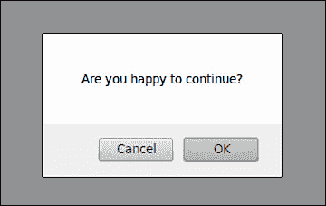

**图 4.1** `confirm()` 对话框

调用 `confirm()` 方法的调用方式与 `alert()` 类似，将所需的消息作为参数传递：

点击此处查看代码

```
var answer = confirm("Are you happy to continue?");
```

请注意，在这里我们把返回的 `true` 或 `false` 值传递给变量，以便我们稍后测试其值，并让脚本根据结果采取适当的操作。

#### prompt()

`prompt()` 方法是另一种打开模态对话框的方式。在这种情况下，对话框邀请用户输入信息。

`prompt()` 对话框的调用方式与 `confirm()` 完全相同：

点击此处查看代码

```
var answer = prompt("What is your full name?");
```

`prompt` 方法还允许一个可选的第二个参数，在用户在未输入任何内容的情况下点击 OK 时提供默认响应：

点击此处查看代码

```
var answer = prompt("What is your full name?", "John Doe");
```

`prompt()` 对话框的返回值取决于用户采取的选项：

 如果用户输入内容并点击 OK 或按回车，则返回用户输入的字符串。

 如果用户在未向 prompt 对话框输入任何内容的情况下点击 OK 或按回车，方法将返回默认响应（如果有），这是在传递 `prompt()` 的第二个参数中可选指定的。

 如果用户关闭了对话框（即通过点击 取消或按 Escape 键），则 prompt 方法返回 `null`。

注意

JavaScript 在某些情况下使用 `null` 值来表示空值。当被视为数字时，它的值为 0；当作为字符串使用时，它被评估为 ""；当作为布尔值使用时，它变为 `false`。

上述代码生成的 `prompt()` 对话框如图 4.2 所示。

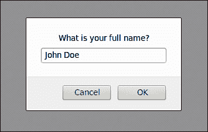

**图 4.2** `prompt()` 对话框

点击此处查看代码图像

```
alert("You've visited " + history.length + " web pages in this browser session");
```

`history` 对象有三个方法。

`forward()` 和 `back()` 等同于点击浏览器上的“前进”和“后退”按钮；它们将用户带到历史列表中的下一页或上一页。

```
history.forward();
```

还有一个名为 `go` 的方法，它接受单个参数。该参数可以是整数（正或负），它可以将用户带到历史列表中的相对位置：

点击此处查看代码图像

```javascript
history.go(-3);  // 后退 3 页
history.go(2);  // 前进 2 页
```

该方法也可以接受一个字符串，它使用该字符串在历史列表中查找第一个匹配的 URL：

点击此处查看代码图像

```javascript
history.go("example.com");  // 跳转到历史列表中包含 'example.com' 的最近 URL
```

### 使用 location 对象

`location` 对象包含了关于当前加载页面 URL 的信息。

我们可以将页面 URL 视为一系列部分：

`[protocol]//[hostname]:[port]/[pathname][search][hash]`

这里有一个示例 URL：`http://www.example.com:8080/tools/display.php?section=435#list`

`location` 对象的属性列表包含了有关 URL 各个部分的数据。属性列在表 4.1 中。

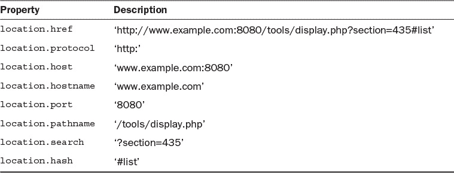

**表格 4.1 location 对象的属性**

#### 使用 location 对象进行导航

使用 `location` 对象将用户带到新页面有两种方法。

首先，我们可以直接设置对象的 `href` 属性：

点击此处查看代码图像

```javascript
location.href = 'www.newpage.com';
```

使用这种技术将用户传输到新页面会在浏览器的历史列表中保留原始页面，因此用户只需使用浏览器的后退按钮即可返回。如果你希望将发送页面从历史列表中移除并替换为新 URL，则可以使用 `location` 对象的 `replace()` 方法：

点击此处查看代码图像

```javascript
location.replace('www.newpage.com');
```

这会在浏览器和历史列表中将旧 URL 替换为新 URL。

#### 重新加载页面

要将当前页面重新加载到浏览器中——等同于用户点击“刷新页面”按钮——可以使用 `reload()` 方法：

```javascript
location.reload();
```

* * *

提示

在不带任何参数的情况下使用 `reload()` 将从浏览器缓存中检索当前页面（如果可用的话）。为了避免这种情况并直接从服务器获取页面，可以带参数 `true` 调用 `reload`：

```javascript
location.reload(true);
```

* * *

### 浏览器信息—navigator 对象

虽然 `location` 对象存储了浏览器中加载的当前 URL 的信息，但 `navigator` 对象的属性包含了关于浏览器应用程序本身的数据。

* * *

尝试自己做：使用 navigator 对象显示信息

我们将编写一个脚本，让你发现 `navigator` 对象对你自己的浏览设置了解多少。使用你的编辑器创建文件 `navigator.html`，包含列表 4.1 中的代码。保存文件并在浏览器中打开它。

**列表 4.1 使用 navigator 对象**

点击此处查看代码图像

```html
<!DOCTYPE html>
<html>
<head>
    <title>window.navigator</title>
    <style>
        td{border: 1px solid gray; padding: 3px 5px;}
    </style>
</head>
<body>
    <script>
        document.write("<table>");
        document.write("<tr><td>appName</td><td>"+navigator.appName + "</td></tr>");
        document.write("<tr><td>appCodeName</td><td>"+navigator.appCodeName + "</td></tr>");
        document.write("<tr><td>appVersion</td><td>"+navigator.appVersion + "</td></tr>");
        document.write("<tr><td>language</td><td>"+navigator.language + "</td></tr>");
        document.write("<tr><td>cookieEnabled</td><td>"+navigator.cookieEnabled + "</td></tr>");
        document.write("<tr><td>cpuClass</td><td>"+navigator.cpuClass + "</td></tr>");
        document.write("<tr><td>onLine</td><td>"+navigator.onLine + "</td></tr>");
        document.write("<tr><td>platform</td><td>"+navigator.platform + "</td></tr>");
        document.write("<tr><td>No of Plugins</td><td>"+navigator.plugins.length + "</td></tr>");
        document.write("</table>");
    </script>
</body>
</html>
```

* * *

将你的结果与我的结果进行对比，如图 4.3 所示。

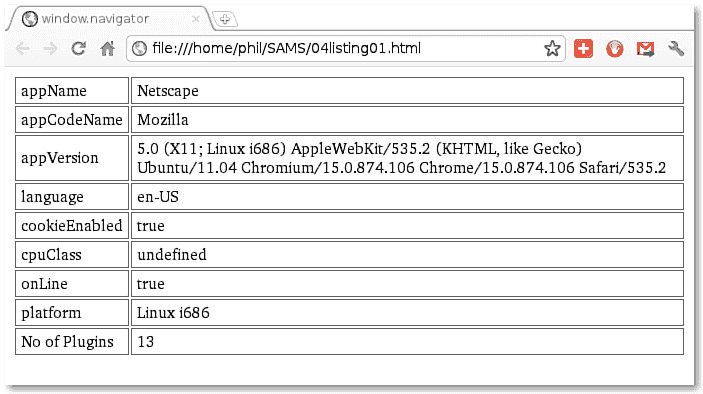

**图 4.3** 来自 `navigator` 对象的浏览器信息

哇，这里是怎么了？我在 Ubuntu Linux 电脑上的 Chromium 浏览器中加载了页面。为什么它报告的 `appName` 属性是 Netscape，`appCodeName` 属性是 Mozilla？另外，`cpuClass` 属性返回的是 `undefined`；这到底是怎么回事？

`navigator` 对象背后有许多历史和政治因素。结果是，该对象提供的关于用户平台的信息充其量是不可靠的。并不是所有浏览器都支持所有属性（因此在前面的示例中无法报告 `cpuClass` 属性），而且浏览器类型和版本报告的名称很少符合人们的直觉预期。图 4.4 显示了在 Internet Explorer 7 中加载的相同页面。


**图 4.4** 来自 `navigator` 对象的浏览器信息

我们现在有了 `cpuClass` 的值，但 `language` 属性在 Internet Explorer 中不支持。尽管跨浏览器标准比几年前更接近了，但在某些情况下你仍然需要知道用户浏览器的能力。查询 `navigator` 对象几乎总是*错误*的处理方法。

* * *

注意

在书的后面，我们将讨论*特性检测*（feature detection），这是一种更优雅的跨浏览器方式，可以让你的代码根据用户浏览器的能力做出决策。

* * *

* *

### 日期和时间

`Date` 对象用于处理日期和时间。在 DOM 中没有预先创建好的 `Date` 对象（就像之前示例中的那样）。相反，我们在需要时会创建自己的 `Date` 对象。我们创建的每个 `Date` 对象都可以代表不同的日期和时间。

#### 创建带有当前日期和时间的 Date 对象

这是创建一个包含日期和时间信息的新 `Date` 对象的最简单方法：

```javascript
var mydate = new Date();
```

变量 `mydate` 是一个对象，包含了对象创建时的日期和时间信息。JavaScript 有许多长长的方法列表，用于检索、设置和编辑 `Date` 对象中的数据。让我们来看几个简单的示例：

点击此处查看代码图像

```javascript
var year = mydate.getFullYear(); // 四位数年份，例如 2012
var month = mydate.getMonth(); // 月份数字 0 - 11；0 是 1 月，等
var date = mydate.getDate(); // 月份中的几 1 - 31
var day = mydate.getDay(); // 星期 0 - 6；星期日 = 0，等
var hours = mydate.getHours(); // 时间的小时部分，0 - 23
var minutes = mydate.getMinutes(); // 时间的分钟部分，0 - 59
var seconds = mydate.getSeconds(); // 时间的秒部分，0 - 59
```

#### 创建给定日期时间的 Date 对象

我们可以通过向 `Date()` 语句传递参数，轻松地创建代表任意日期和时间的 `Date` 对象。有几种方法：

```javascript
new Date(milliseconds) // 自 1970 年 1 月 1 日以来的毫秒数
new Date(dateString)
```

```
new Date(year, month, day, hours, minutes, seconds, milliseconds)
```

这里有几个示例。

使用日期字符串：

点击此处查看代码图像

```javascript
var d1 = new Date("October 22, 1995 10:57:22")
```

当我们使用单独的各个部分时，末尾参数是可选的；任何缺失的参数将被替换为零：

点击此处查看代码图像

```javascript
var d2 = new Date(95,9,22) // 1995 年 10 月 22 日 00:00:00
var d3 = new Date(95,9,22,10,57,0)  // 1995 年 10 月 22 日 10:57:00
```

## 设置和编辑日期

`Date` 对象有一系列广泛的方法，用于设置或编辑日期的各个部分：

点击此处查看代码图像

```javascript
var mydate = new Date();  // 当前日期和时间
document.write( "Object created on day number " + mydate.getDay() + "<br />");
mydate.setDate(15);     // 将日期更改为 15 号
document.write("After amending date to 15th, the day number is " + mydate.getDay());
```

在前面的代码段中，我们最初创建了对象 `mydate` 表示创建时的日期和时间，但随后将日期更改为 15 号；如果我们在此操作前后获取星期几，我们会发现它已经正确地重新计算，以考虑已更改的日期：

点击此处查看代码图像

```
Object created on day number 5
After amending date to 15th, the day number is 0
```

因此，在这个示例中，该对象创建于星期五；而该月的 15 号对应于星期日。

我们还可以进行日期和时间算术，让 `Date` 对象为我们完成所有的体力工作：

点击此处查看代码图像

```javascript
var mydate=new Date();
document.write("Created: " + mydate.toDateString() + " " + mydate.toTimeString() + "<br/>");
mydate.setDate(mydate.getDate()+33); // 在“日期”部分增加 33 天
document.write("After adding 33 days: " + mydate.toDateString() + " " + mydate.toTimeString());
```

前面的示例计算了 33 天后的日期，并根据需要自动修改日、期、月和/年。注意 `toDateString()` 和 `toTimeString()` 的使用；这些是用于日期转换为可读格式的有用方法。前面的示例产生的输出如下：

点击此处查看代码图像

```
Created: Fri Jan 06 2012 14:59:24 GMT+0100 (CET)
After adding 33 days: Wed Feb 08 2012 14:59:24 GMT+0100 (CET)
```

用于操作日期和时间的方法集太大了，我们无法在这里探索所有的方法。`Date` 对象的方法的完整列表可以在附录 B“JavaScript 快速参考”中找到。

## 使用 Math 对象简化计算

在执行经常发生的各种类型计算时，JavaScript 的 `Math` 对象可以为你节省大量工作量。

与 `Date` 对象不同，`Math` 对象在使用之前不需要创建；它已经存在了，你可以直接调用它的方法。

可用方法的完整列表可以在附录 B 中找到，但表 4.2 显示了一些示例。

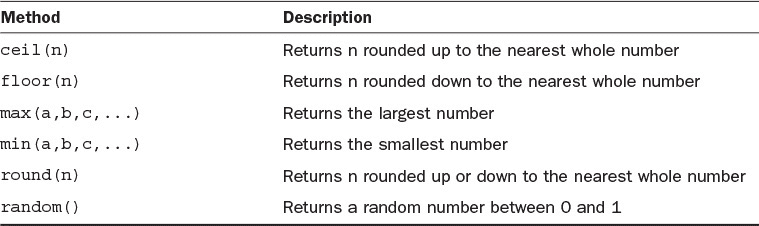

**表 4.2 Math 对象的一些方法**

让我们来看一些示例。

### 四舍五入

`ceil()`、`floor()` 和 `round()` 方法对于截断数字的小数部分有用：

点击此处查看代码图像

```javascript
var myNum1 = 12.55;
var myNum2 = 12.45;
alert(Math.floor(myNum1));  // 显示 12
alert(Math.ceil(myNum1));  // 显示 13
alert(Math.round(myNum1));  // 显示 13
alert(Math.round(myNum2));  // 显示 12
```

注意，当你使用 `round()` 时，如果数字的小数部分为 .5 或更大，数字将舍入到下一个整数。

### 寻找最小值和最大值

我们可以使用 `min()` 和 `max()` 从列表中挑选最大和最小的数字：

点击此处查看代码图像

```javascript
var ageDavid = 23;
var ageMary = 27;
var ageChris = 31;
var ageSandy = 19;
document.write("The youngest person is " + Math.min(ageDavid, ageMary, ageChris, ageSandy) + " years old<br />");
document.write("The oldest person is " + Math.max(ageDavid, ageMary, ageChris, ageSandy) + " years old<br />");
```

写入页面的输出看起来如下：

点击此处查看代码图像

```
The youngest person is 19 old
The oldest person is 31 old
```

### 随机数

要生成随机数，我们可以使用 `Math.random()`，它会生成一个 0 到 1 之间的随机数。通常我们喜欢指定数字可能的范围，例如，我们可能想要生成一个 0 到 100 之间的随机整数。由于 `Math.random()` 生成 0 到 1 之间的随机数，因此将其封装在一个适用于我们需求的小函数中是有帮助的。以下函数接收 `Math` 对象生成的随机数，通过变量 `range`（作为参数传递给函数）对其放大，最后使用 `round()` 移除任何小数部分：

点击此处查看代码图像

```javascript
function myRand(range) {
  return Math.round(Math.random() * range);
}
```

要生成一个 0 到 100 之间的随机整数，我们只需调用 `myRand(100);`。

**注意**

始终直接使用 `Math` 方法，例如 `Math.floor()`，而不是将其作为创建的对象的方法。换句话说，以下是错误的：

```javascript
var myNum = 24.77;
myNum.floor(); // 代码将引发 JavaScript 错误
```

相反，你只需要使用 `Math.floor(myNum);` 了。

### 数学常数

各种经常使用的数学常数作为 `Math` 的属性可用。它们列在表 4.3 中。


**表 4.3 数学常数**

这些常数可以直接用于你的计算中：

点击此处查看代码图像

```javascript
var area = Math.PI * radius * radius; // 圆面积
var circumference = 2 * Math.PI * radius; // 周长
```

### with 关键字

虽然你可以对任何对象使用 `with` 关键字，但 `Math` 对象是一个用于示例的理想对象。通过使用 `with` 可以节省一些繁琐的工作。`with` 关键字接收一个对象作为参数，后面跟着大括号包裹的代码块。该代码块中的语句可以在不指定对象的情况下调用方法，JavaScript 会假设这些方法属于传递作为参数的对象。

这是一个示例：

点击此处查看代码图像

```javascript
with (Math) {
  var myRand = random();
  var biggest = max(3,4,5);
  var height = round(76.35);
}
```

在这个示例中，我们通过直接使用方法来调用 `Math.random()`、`Math.max()` 和 `Math.round()`，因为代码块中的所有方法调用都与 `Math` 对象关联了。

## 尝试一下：读取日期和时间

我们通过创建一个脚本来实践本小时节中涵盖的内容，在页面加载时获取当前日期和时间。我们还实现了一个按钮来刷新页面，从而刷新时间和日期信息。

请查看列表 4.2。

**列表 4.2 获取日期和时间信息**

点击此处查看代码图像

```html
<!DOCTYPE html>
<html>
<head>
    <title>Current Date and Time</title>
    <style>
        p {font: 14px normal arial, verdana, helvetica;}
    </style>
    <script>
        function telltime() {
            var out = "";
            var now = new Date();
```

```javascript
out += "<br />Date: " + now.getDate();
out += "<br />Month: " + now.getMonth();
out += "<br />Year: " + now.getFullYear();
out += "<br />Hours: " + now.getHours();
out += "<br />Minutes: " + now.getMinutes();
out += "<br />Seconds: " + now.getSeconds();
document.getElementById("div1").innerHTML = out;
}
</script>
</head>

<body>
    当前日期和时间为：<br/>
    <div id="div1"></div>
    <script>
        telltime();
    </script>
    <input type="button" onclick="location.reload()" value="刷新" />
</body>
</html>
```

* * *

`telltime()` 函数中的第一个语句创建了一个名为 `now` 的新 `Date` 对象。正如你所记得的，由于创建该对象时没有向 `Date()` 传递任何参数，它将拥有与创建瞬间当前日期和时间相关的属性。

```javascript
var now = new Date();
```

我们可以使用 `getDate()`、`getMonth()` 以及类似的方法来访问时间和日期的各个部分。在操作过程中，我们将输出消息组装成字符串并存储在变量 `out` 中。

点击此处查看代码图像

```javascript
out += "<br />Date: " + now.getDate();
out += "<br />Month: " + now.getMonth();
out += "<br />Year: " + now.getFullYear();
out += "<br />Hours: " + now.getHours();
out += "<br />Minutes: " + now.getMinutes();
out += "<br />Seconds: " + now.getSeconds();
```

最后，我们使用 `getElementById()` 选择（初始为空的）`id="div1"` 的 `<div>`元素，并使用 `innerHTML` 方法将变量 `out` 的内容写入其中。

点击此处查看代码图像

```javascript
document.getElementById("div1").innerHTML = out;
```

`telltime()` 函数由嵌入在页面 `<body>` 部分的一个小型脚本进行调用：

```html
<script>
    telltime();
</script>
```

要刷新日期和时间信息，我们只需要将页面重新加载到浏览器中。此时，脚本会再次运行，创建一个带有当前日期和时间的 `Date` 对象新实例。我们可以直接点击浏览器菜单上的“刷新”，但由于我们知道如何使用 `location` 对象重新加载页面，因此我们通过按钮的 `onClick` 方法中调用

`location.reload()`

图 4.5 显示了脚本的运行情况。注意月份显示为 0。记住，JavaScript 从 0（一月）开始计数，到 11（十二月）结束。

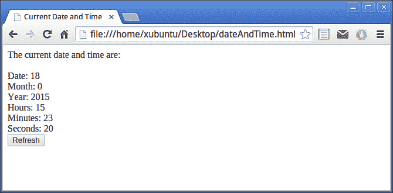

**图 4.5** 获取日期时间和信息

* * *

### 总结

在这一节中，你查看了一些 JavaScript 内置或通过 DOM 可用的有用对象，以及它们的属性和方法如何帮助你更容易地编写代码。

你看到了如何使用 `window` 对象的模态对话框与用户交换信息。

你学习了如何使用 `document.getElementById` 方法通过 ID 选择页面元素，以及如何使用 `innerHTML` 属性获取和设置页面元素内的 HTML。

你处理了来自 `navigator` 对象的浏览器信息，以及来自 `location` 对象的页面 URL 信息。

最后，你了解了如何使用 `Date` 和 `Math` 对象。

## 问答

**Q. Date() 是否有处理时区的方法？**

**A.** 是的。除了本节讨论的 `get...()` 和 `set...()` 方法（如 `getDate()`、`setMonth()` 等）外，还有相同方法的 UTC（通用协调时间，以前称为 GMT）版本（`getUTCDate()`、`setUTCMonth()` 等）。你可以使用 `getTimezoneOffset()` 方法来获取本地时间与 UTC 时间之间的差异。请参阅 Appendix B 获取完整的方法列表。

**Q. 为什么 Date() 有名为 `getFullYear()` 和 `setFullYear()` 的方法，而不是简单的 `getYear()` 和 `setYear()`？**

**A.** `getYear()` 和 `setYear()` 方法确实存在；它们处理的是两位数的年份，而不是 `getFullYear()` 和 `setFullYear()` 使用的四位数年份。由于跨越千年的日期可能存在问题，这些函数已被弃用。你应该改用 `getFullYear()` 和 `setFullYear()`。

## 工作坊

在阅读后续的“解答”部分之前，尝试回答所有问题。

### 测验

**1.** 当用户点击确认对话框中的“确定”时会发生什么？

**a.** 向调用程序返回一个 true 的值。

**b.** 将显示的消息返回给调用程序。

**c.** 什么都没有。

**2.** `Math()` 对象的哪个方法始终将数字向上取整到下一个整数？

**a.** `Math.round()`

**b.** `Math.floor()`

**c.** `Math.ceil()`

**3.** 如果我加载的页面是 [`www.example.com/documents/letter.htm?page=2`](http://www.example.com/documents/letter.htm?page=2)，那么 `location` 对象的 `pathname` 属性将包含什么？

**a.** `http`

**b.** `www.example.com`

**c.** `/documents/letter.htm`

**d.** `page=2`

### 解答

**1.** a. 点击“确定”时返回 true 的值。对话框被清空，控制权返回给调用程序。

**2.** c. `Math.ceil()` 始终将数字向上取整到下一个更大的整数。

**3.** c. `location.pathname` 属性包含 `/documents/letter.htm`。

## 练习

 修改 Listing 4.2 将日期和时间作为单个字符串输出，例如：25 Dec 2011 12:35

 使用 `Math` 对象编写一个函数，在给定半径和高度作为参数的情况下返回圆烟囱的体积。返回的体积应向上取整到最近的立方米。

 使用 `history` 对象创建几个带有自己的“前进”和“后退”按钮的页面。在你导航到这些页面（将它们放入浏览器历史记录）后，你的“前进”和“后退”按钮的操作与浏览器的一样吗？

# 第二部分：代码编程

## 第 5 小时：数字与字符串

* * *

本节你将学到：

 JavaScript 支持的数字和字符串数据类型

 数据类型转换

 如何操作字符串

* * *

我们使用*数据类型*一术来讨论变量所包含的数据性质。字符串变量包含字符串，数字变量包含数值，等等。然而，JavaScript 语言被称为*弱类型*语言，这意味着 JavaScript 变量在不同情况下可以解释为不同的数据类型。在 JavaScript 中，你不需要在使用之前声明变量的数据类型，因为 JavaScript 解释器会做出最佳猜测。如果你将字符串放入变量并在稍后将其解释为数字，JavaScript 是允许的，只要该变量实际上包含“像”数值的字符串（例如，“200px”或“50 cents”，而不是你的名字）。以后你可以再次将其作为字符串使用。

在这一节中学习了 JavaScript 的数字、字符串和布尔类型，以及处理这些值的一些内置方法。我们还提到了字符串中的*转义序列*以及两个特殊的 JavaScript 数据类型——*null*和*undefined*。

### 数字

数学家对不同类型的数字有各种名称。从所谓的*自然数*1, 2, 3, 4 ... 开始，你可以加上 0 得到*整数*0, 1, 2, 3, 4 ...，然后包含负值 -1, -2, -3, -4 ... 以形成整数集。

为了表示落在整数之间的数字，我们通常使用小数点并在其后跟随一个或多个数字：

3.141592654

将此类数字称为 `floating point`（浮点），表示它们在小数点前后可以有任意数量的数字；也就是说，小数点可以“浮动”到数字中的任何位置。

JavaScript 同时支持整数和浮点数。

### 整数

整数是一个整数——正数、负数或零。换句话说，整数是任何不带小数部分的数值。

以下所有都是有效的整数：

 33

 -1,000,000

 0

 -1

### 浮点数

与整数不同，浮点数具有小数部分，即使该部分为零。它们可以用传统方式表示（如 3.1415），或者用科学计数法表示（如 35.4e5）。

**注意**

在科学计数法中，`e` 代表“10 的幂方的倍”，因此 `35.4e5` 可以读作 35.4 x 10⁵。

科学计数法提供了一种从极大到极小数字的紧凑方式。

以下所有都是有效的浮点数：

 3.0

 0.00001

 - 99.99

 2.5e12

 1e-12

**提示**

JavaScript 还具有处理十六进制数的能力。十六进制数以 `0x` 开头，例如 `0xab0080`。

### 非数字 (NaN)

当脚本尝试将非数值内容视为数字，但无法将其作为数值处理时，返回的值为 `NaN`。例如，将字符串乘以整数的结果不是数值。你可以使用 `isNaN()` 函数测试非数值值：

```javascript
isNaN(3);      // 返回 false
isNaN(3.14159);  // 返回 false
isNaN("horse");  // 返回 true;
```

### 使用 parseFloat() 和 parseInt()

JavaScript 为我们提供了两个函数，用以强制将字符串转换为数字格式。

`parseFloat()` 函数解析字符串并返回一个浮点数。

如果指定字符串的第一个字符是数字，它将解析字符串直到遇到该数字的结尾，并将该值作为数字而非字符串返回：

```javascript
parseFloat("21.4") // 返回 21.4
parseFloat("76 trombones") // 返回 76
parseFloat("The magnificent 7") // 返回 NaN
```

使用 `parseInt()` 类似，但返回的是整数值或 `NaN`。此函数允许我们可选地通过第二个参数包含所用数字系统的基数（radix），因此可以用于返回二进制、八进制或其他数字格式的基 10 值：

```javascript
parseInt(18.95, 10); // 返回 18
parseInt("12px", 10); // 返回 12
parseInt("1110", 2); // 返回 14
parseInt("Hello") // 返回 NaN
```

### 无穷

`Infinity` 是一个比 JavaScript 能表示的最大数字更大的值。在大多数 JavaScript 实现中，这是一个正或负 2⁵³ 的整数。好吧，这并不完全是无限，但它确实很大。

还有一个字面量关键字 `-Infinity` 来表示负无穷。

你可以使用 `isFinite()` 函数测试无限值。`isFinite()` 函数接受要测试的值作为参数，并尝试将该参数转换为数字。如果结果是 `NaN`、正无穷（`Infinity`）或负无穷（`-Infinity`），`isFinite()` 函数返回 `false`；否则返回 `true`。（false 和 true 被称为布尔值，将在本节稍后讨论。）

```javascript
isFinite(21); // true
isFinite("This is not a numeric value"); // false
isFinite(Math.sqrt(-1)); // false
```

### 字符串

字符串是来自给定字符集（例如 ASCII 或 Unicode 字符集）的字符序列，通常用于存储文本。

你通过用单引号或双引号将字符串括起来来定义字符串：

```javascript
var myString = "This is a string";
```

你可以通过使用两个之间没有任何内容的引号来定义一个空字符串：

```javascript
var myString = "";
```

### 转义序列

你想要放入字符串的某些字符可能在键盘上没有对应的键，或者可能是由于其他原因不能出现在字符串中的特殊字符。例如：制表符、换行符以及包裹字符串本身的单引号或双引号。要在字符串中使用此类字符，必须用由反斜杠 (\) 前跟的字符来表示，这种组合被 JavaScript 解释为所需的特殊字符。这种组合被称为 `escape sequence`（转义序列）。

假设你想在字符串中输入一些“换行”字符，以便当通过调用 `alert()` 方法显示字符串时，它会被分成几行：

```javascript
var message = "IMPORTANT MESSAGE:\n\nError detected!\nPlease check your data";
alert(message);
```

插入这些转义序列的结果如[图 5.1]所示。

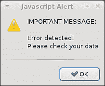

**图 5.1** 在字符串中使用转义序列

更常见的转义序列如[表 5.1]所示。

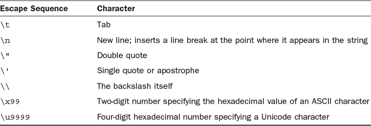

**表 5.1 一些常见的转义序列**

### 字符串方法

`string` 对象的属性和方法的完整列表位于[附录 B]，“JavaScript 快速参考”中，但现在让我们来看看一些重要的方法，它们列在[表 5.2]中。

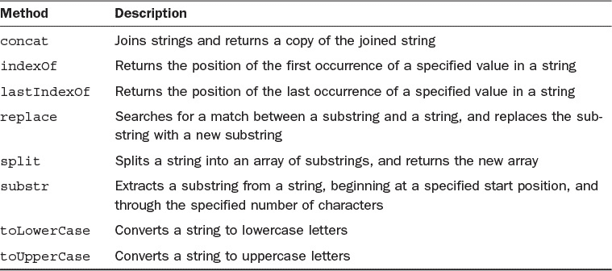

**表 5.2 字符串对象的一些常用方法**

#### concat()

你之前在之前的章节中已经有了过使用 `+` 运算符连接字符串的经验。这被称为字符串拼接，JavaScript 字符串拥有一个 `concat()` 方法，提供了额外的功能：

```javascript
var string1 = "The quick brown fox ";
var string2 = "jumps over the lazy dog";
var longString = string1.concat(string2);
```

#### indexOf()

我们可以使用 `indexOf()` 来寻找字符串中一个或多个字符的子字符串首次出现的位置。该方法返回所查找子字符串的索引（位置），如果在字符串的任何地方未找到，则返回 -1：

```javascript
var string1 = "The quick brown fox ";
string1.indexOf('fox') // 返回 16
string1.indexOf('dog') // 返回 -1
```

**提示**

记住字符串中第一个字符的索引是 0，而不是 1。

#### lastIndexOf()

正如你所猜的，`lastIndexOf()` 的工作方式与 `indexOf()` 相同，但它寻找子字符串的最后一次出现，而不是第一次。

#### replace()

搜索子字符串与字符串之间的匹配，并返回一个用新子字符串替换后的字符串：

```javascript
var string1 = "The quick brown fox ";
var string2 = string1.replace("brown", "orange"); // string2 现在是 "the quick orange fox"
```

#### split()

用于将字符串拆分为子字符串数组并返回新数组：

```javascript
var string1 = "The quick brown fox ";
var newArray = string1.split(" ")
```

**提示**

你将在下一节学习数组。请做笔记，在阅读数组内容后回来查看此方法。

### substr()

`substr()` 方法接收一个或两个参数。

第一个参数是起始索引——`substr()` 从字符串的起始索引开始，提取指定数量的字符，并返回新的子字符串。第二个参数（字符数）是可选的，如果省略，则将提取字符串剩余的所有部分：

点击此处查看代码图片

```javascript
var string1 = "The quick brown fox ";

var sub1 = string1.substr(4, 11); // 提取 "quick brown"

var sub2 = string1.substr(4); // 提取 "quick brown fox"
```

### toLowerCase() and toUpperCase()

将字符串转换为全大写或全小写：

点击此处查看代码图片

```javascript
var string1 = "The quick brown fox ";

var sub1 = string1.toLowerCase(); // sub1 包含 "the quick brown fox "

var sub2 = string1.toUpperCase(); // sub2 包含 "THE QUICK BROWN FOX "
```

### Boolean Values

`Boolean` 类型的数据只有两个可能的值：`true` 或 `false`。布尔变量通常用于存储代码中逻辑操作的结果，这些操作返回真/假或是/否的结果：

点击此处查看代码图片

```javascript
var answer = confirm("Do you want to continue?"); // answer 将包含
                               true 或 false
```

***

## 注意事项

当你想要赋值一个布尔值 `true` 或 `false` 时，，请务必记住**不要**将该值括在引号中，否则该值将被解释为字符串字面量：

点击此处查看代码图片

```javascript
var success = false;  // 正确

var success = "false"; // 错误
```

***

如果你编写的代码在计算中使用布尔值，JavaScript 会自动将 `true` 转换为 1，将 `false` 转换为 0。

点击此处查看代码图片

```javascript
var answer = confirm("Do you want to continue?"); // answer 将包含
                               true 或 false

alert(answer * 1); // 将显示 0 或 1
```

反之亦然。JavaScript 将任何非零值解释为 `true`，将 0 解释为 `false`。JavaScript 将以下所有值解释为 `false`：

 Boolean false (你不是说的吗？）

 `undefined`

 `null`

 0 (零)

 `NaN`

 "" (空字符串)

***

### 提示

上述值通常被称为“假值 (falsy)”，意思是“并不完全为假，但可以被解释为假”。JavaScript 解释为真的值同样被称为“真值 (truthy)”。

***

***

### 动手一试：一个简单的垃圾邮件检测函数

我们将使用这些方法中的两个编写一个简单的函数，用于检测给定字符串中是否存在特定的单词。在示例中，我们将使用单词“fake”作为目标单词。如果函数在传入参数的字符串任何地方检测到单词“fake”，它应该返回零或正值；否则，它应该返回一个负数。这里是“空”函数：

```javascript
function detectSpam(input) {

}
```

你可能会使用这样的函数来检查邮件主题行，例如，检测销售“假”设计师单品的垃圾邮件。在实际应用中，代码会复杂得多，但这里重要的是字符串处理的操作。

首先，我们想要将字符串转换为全小写：

点击此处查看代码图片

```javascript
function detectSpam(input) {
    input = input.toLowerCase();
}
```

这是必要的，因为我们随后将使用 `indexOf()` 来查找单词“fake”，而 `indexOf()` 区分大小写。

点击此处查看代码图片

```javascript
function detectSpam(input) {
    input = input.toLowerCase();
    return input.indexOf("fake");
}
```

将 列表 5.1 中的代码输入到编辑器中并将其保存为 HTML 文件。

**列表 5.1 垃圾邮件检测函数**

点击此处查看代码图片

***

```html
<!DOCTYPE html>
<html>
<head>
    <title>Spam Detector</title>
</head>
<body>
<script>
    function detectSpam(input) {
        input = input.toLowerCase();
        return input.indexOf("fake");
    }
    var mystring = prompt("Enter a string");
    alert(detectSpam(mystring));
</script>
</body>
</html>
```

***

在浏览器中打开该页面，并在提示对话框中输入一个字符串，如图图 5.2 所示。

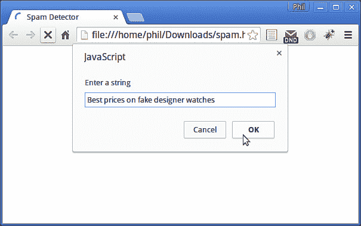

**图 5.2** 输入字符串

一个新对话框将打开，显示输入字符串中找到单词“fake”的位置，如果该单词未在任何地方出现，则显示“-1”。

图 5.3 显示目标单词位于位置 15 处，即字符串中的第 16 个字符。

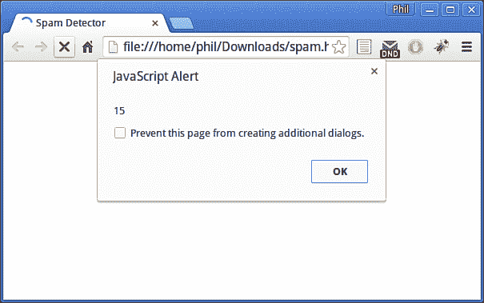

**图 5.3** 垃圾邮件检测脚本的输出

***

### 提示

在第 7 小时的“程序控制”中，你将学习如何根据此类测试的结果在代码中做出决策。

***

***

#### 否定运算符 (!)

当 `!` 字符放在布尔变量之前时，JavaScript 将其解释为“非”，即“相反的值”。看看这段代码片段：

点击此处查看代码图片

```javascript
var success = false;
alert(!success);  // 弹出 'true'
```

在第 7 小时中，我们使用此或其他运算符来测试 JavaScript 变量的值，并让程序根据结果做出决策。

***

### 注意

JavaScript 还有两个名为*对象字面量*的关键字——`null` 和 `undefined`。

通常，当你想要某个值具有一个有效但不存在的值时，你会为其赋值值 `null`。对于数值，`null` 等于 0；对于字符串，它等同于空字符串 ("")；对于布尔值，它意味着 `false`。

与 `null` 不同，`undefined` 不是关键字。它是一个预定义的全局变量，用于存储在语句未使用但未赋值的变量的值。这意味着它不是 0 或 `null`。

***

### 总结

在本节中，你学习了 JavaScript 支持的数字和字符串类型，并看到了使用各种方法操作这些类型的示例。

## 问答

**问：JavaScript 中字符串的最大长度是多少？**

答：JavaScript 规范没有规定最大长度；相反，它取决于你的浏览器和操作系统。对于某些实现，它取决于可用内存。

**问：JavaScript 有表示单个字符的数据类型吗？**

答：不像其他一些语言，JavaScript 没有表示单个字符的特定数据类型。在 JavaScript 中实现这一点，你需要创建一个由一个字符的字符串。

***

## 练习

在阅读随后的“答案”部分之前，尝试回答所有问题。

#### 测验

1。 哪个语句通过将一个字符串 `string2` 附加另一个字符串 `string1` 来创建一个新字符串？

a. `concat(string1) + concat(string2);`

b. `string1.concat(string2);`

c. `join(string1, string2);`

2。 哪条语句将变量 `paid` 的值设置为布尔值真？

a. `var paid = true;`

b. `var paid = "true";`

c. `var paid.true();`

3。 对于包含值“stupid is as stupid does”的字符串 `myString`，以下哪项将返回值 -1？

a. `myString.indexOf("stupid");`

b. `myString.lastIndexOf("stupid");`

c. `myString.indexOf("is stupid");`

#### 答案

**1.** b. `string1.concat(string2);` 返回一个新字符串，通过将 `string2` 连接到 `string1` 的末尾创建。

**2.** a. 布尔值不应包含在引号中。

**3.** c. 子字符串 “is stupid” 未出现在 `myString` 中。

## 练习

 编写一个 JavaScript 函数，从字符串末尾删除指定数量的字符。

 编写一个 JavaScript 函数，将给定字符串每个单词的首字母大写。

## 第 6 小时：数组

* * *

*本节你将学习：

 什么是 `array` 数据类型

 如何声明和填充数组

 如何管理数组内容

* * *

有时，在单个变量名下存储多个变量值是有意义的。JavaScript 提供了 `array` 数据类型来帮助你做到。

在本节中，你将看到 JavaScript 数组是如何创建的以及如何在代码中操作存储在这些数组中的数据。

#### 数组

数组是一种类型，用于在单个变量中存储多个值。每个值都有一个数字索引，可以包含任何数据类型的数据——布尔值、数字、字符串、函数、对象甚至其他数组。

### 创建新数组

用于创建数组的语法你可能已经熟悉了；毕竟，数组只是另一个对象：

```javascript
var myArray = new Array();
```

然而，对于数组，有一个简写版本——只需这样使用方括号（`[]`）：

```javascript
var myArray = [];
```

### 初始化数组

你可以选择性在创建数组时预先加载数据：

点击此处查看代码图像

```javascript
var myArray = ['Monday', 'Tuesday', 'Wednesday'];
```

或者，可以在数组创建后添加项：

```javascript
var myArray = [];
myArray[0] = 'Monday';
myArray[1] = 'Tuesday';
myArray[2] = 'Wednesday';
```

#### array.length

所有数组都有一个 `length` 属性，告诉我们数组包含多少项。当你向数组中添加项或删除项时，`length` 属性会自动更新。以下代码返回上一个数组的长度：

```javascript
myArray.length  // 返回 3
```

* * *

### 注意

长度始终比最高索引大 1，即使数组中的实际项目较少。假设我们向上一个数组添加了一个新项：

点击此处查看代码图像

```javascript
myArray[50] = 'Ice cream day';
```

`myArray.length` 现在返回 51，尽管该数组只有四个条目。

* * *

### 数组方法

* * *

### 注意

某些数组方法与同名的字符串方法具有相同的名称且功能几乎相同。请注意你正在处理的数据类型，否则你的脚本可能无法按照你预期的方式运行。

* * *

表 6.1 包含了数组对象的一些常用方法。

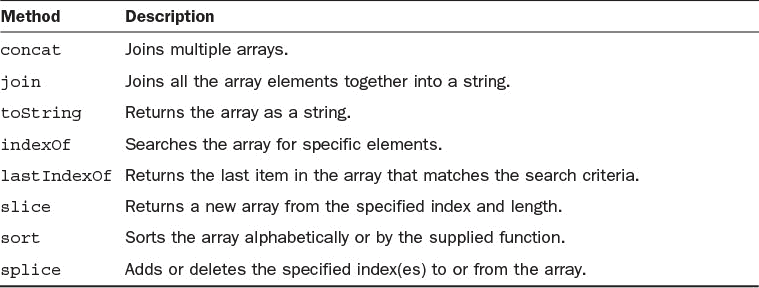

**表 6.1 一些实用的数组方法**

#### concat()

你已经有了字符串拼接的经验，JavaScript 数组也有 `concat()` 方法：

点击此处查看代码图像

```javascript
var myOtherArray = ['Thursday','Friday'];
var myWeek = myArray.concat(myOtherArray);
// myWeek 将包含 'Monday', 'Tuesday', 'Wednesday', 'Thursday', 'Friday'
```

#### join()

为了将数组的所有元素合并成一个字符串，我们可以使用 `join()` 方法：

点击此处查看代码图像

```javascript
var longDay = myArray.join(); // 返回 MondayTuesdayWednesday
```

可选地，我们可以向此方法传递一个字符串参数；传递的字符串将作为分隔符插入到返回的字符串中：

点击此处查看代码图像

```javascript
var longDay = myArray.join("-"); // 返回 Monday-Tuesday-Wednesday
```

#### toString()

`toString()` 几乎是 `join()` 的特殊情况——它将数组作为字符串返回，元素之间用逗号分隔：

点击此处查看代码图像

```javascript
var longDay = myArray.toString(); // 返回 Monday,Tuesday,Wednesday
```

#### indexOf()

我们可以使用 `indexOf()` 来找到特定元素在数组中首次出现的位置。该方法返回所查找元素的索引，如果在数组中任何地方未找到，则返回 -1：

点击此处查看代码图像

```javascript
myArray.indexOf('Tuesday')  // 返回 1（记住，数组从 0 开始）
myArray.indexOf('Sunday') // 返回 -1
```

#### lastIndexOf()

正如你所预期的，`lastIndexOf()` 的工作与 `indexOf()` 相同，但它寻找搜索词在数组中最后一次出现，而不是第一次。

#### slice()

当我们需要创建一个起始数组的子集数组时，可以使用 `slice()`，并传递起始索引和我们想要检索的元素数量：

点击此处查看代码图像

```javascript
var myShortWeek = myWeek.slice(1, 3);
//myShortWeek 包含 'Tuesday', 'Wednesday', 'Thursday'
```

#### sort()

我们可以使用 `sort()` 来执行字母顺序排序：

点击此处查看代码图像

```javascript
myWeek.sort()
```

#### splice()

为了从数组中添加或删除特定项，我们可以使用 `splice()`。语法比之前的复杂一点：

点击此处查看代码图像

`array.splice(index, howmany, [new elements])` 第一个元素设置数组中我们要执行 splice 的位置；第二个元素是要删除的项数（如果设置为 0，则不删除任何项），之后是一个可选的要插入的新元素列表。

```javascript
myWeek.splice(2,1,"holiday")
// myArray 现在包含 ‘Monday’, ‘Tuesday’, ‘holiday’, ‘Friday’.
```

**注意**

`splice()` 会更改原始数组！如果你需要在代码的其他地方保留该数组，请在执行 `splice()` 之前将数组复制到新变量中。

* * *

### 动手尝试：数组操作

让我们让这些方法用起来吧。在你的文本编辑器中，创建列表 6.1 列出的脚本并将其保存为 array.html。

**列表 6.1 数组操作**

```html
<!DOCTYPE html>
<html>
<head>
<title>Strings and Arrays</title>
<script>
function wrangleArray() {
    var sentence = "JavaScript is a really cool language";
    var newSentence = "";
    // 写出内容
    document.getElementById("div1").innerHTML = "<p>" + sentence + "</p>";
    // 转换为数组
    var words = sentence.split(" ");
    // 删除 'really' 和 'cool'并替换为 'powerful'
    var message = words.splice(3,2,"powerful");
    // 使用 alert 告知删除了哪些单词
    alert('Removed words: ' + message);
    // 将数组转换为字符串，并写出
    document.getElementById("div2").innerHTML = "<p>" + words.join(" ") + "</p>";
}
</script>
</head>
<body>
    <div id="div1"></div>
    <div id="div2"></div>
    <script>wrangleArray();</script>
</body>
</html>
```

在我们学习此列表时，你可能想参考在本节之前给出的单个字符串方法和数组方法的定义，以及第 4 节中对 `getElementById()` 和 `innerHTML` 以及关于“DOM 对象与内置对象”的讨论。

逐步执行 `wrangleArray()` 函数，我们首先定义了一个字符串：

点击查看代码图像

```
var sentence = "JavaScript is a really cool language";
```

在使用 `innerHTML` 将其写入任何空 `<div>` 元素后，我们对字符串应用 `split()` 方法，并将一个空格作为参数传递给它。该方法返回一个元素数组，这些元素是通过在每次出现空格的地方分割字符串创建的——也就是说，将字符串拆分成单个单词。我们将该数组存储在变量 `words` 中。

接下来，我们对 `words` 数组应用 `splice()` 数组方法，移除数组索引为 3 处的两个单词，“really”和“cool”。由于 `splice()` 方法会返回被删除的任何单词，我们可以在 `alert()` 对话框中显示它们：

点击查看代码图像

```javascript
var message = words.splice(3,2,"powerful");

alert('Removed words: ' + message);
```

最后，我们对数组应用 `join()` 方法，再次将其折叠为字符串。由于我们向 `join()` 提供了一个空格作为参数，各个单词之间再次用空格分隔。最后，我们使用 `innerHTML` 将修改后的句子输出到第二个 `<div>` 元素中。

`wrangleArray()` 函数由文档主体中的小型脚本调用：

点击查看代码图像

```html
<script>wrangleArray();</script>
```

脚本的操作如图 6.1 所示。

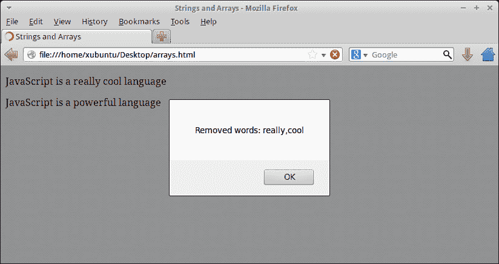

**图 6.1** 数组操作脚本的输出

* * *

### 总结

数组是在单个变量中存储多个值的方便方法。在本节中，你学习了用于创建和操作 JavaScript 数组对象的一些方法。

## 问答

**问. JavaScript 允许关联数组吗？**

**答.** JavaScript 不直接支持关联数组（带有命名索引的数组）。但是，有方法可以通过对象来模拟它们的行为。你将在书的后部分看到这些示例。

**问。我可以在 JavaScript 中创建多维数组吗？**

**答.** 你可以创建一个数组的数组，这等同于相同：

点击查看代码图像

```javascript
var myArray = [[1,2], [3,4], [5,6]];

alert(myArray[1][0]);      // 弹出 '3'
```

## 工作坊

在阅读随后的“答案”部分之前，尝试回答所有问题。

#### 测验

**1.** 如果数组 `Foo` 中索引最高的元素是 `Foo[8]`，那么 `Foo.length` 将返回什么值？

**2.** 你有一个名为 `monthNames` 的数组，包含一年中所有月份名称。你如何使用 `join()` 创建一个包含所有月份名称的字符串，且名称之间用单个空格分隔？

**3.** 如果给 `indexOf()` 传递一个未出现在其应用数组中的值，它将返回什么值？

#### 答案

**1.** `Foo.length` 将返回 9。

**2.** `var names = monthNames.join(" ");`

**3.** 它将返回 -1。

## 练习

 复习具有相同方法名的数组和字符串方法。熟悉根据这些方法是应用于字符串还是数组，其语法和操作是如何变化的。

## 第 7 小时 程序控制

* * *

在本节你将学到：

 使用条件语句

 使用比较运算符比较值

 应用逻辑运算符

 编写循环和控制结构

 在 JavaScript 中设置定时器

* * *

在第 5 小时“数字与字符串”和第 6 小时“数组”中，你已经快速浏览了 JavaScript 变量可以包含的数据类型。然而，为了创建任何不仅仅简单的脚本，你需要你的代码根据这些值做出决策。在本节中，我们将检查识别特定条件的方法，并让程序按照规定的方式运行。

### 条件语句

条件语句正如其名所示，用于检测脚本中使用的变量值中出现的特定条件。JavaScript 支持多种此类条件语句，下文将进行了概述。

### if() 语句

在上一节中，我们讨论了布尔变量，我们看到它们只能取两个值之一——`true` 或 `false`。

JavaScript 有几种测试此类值的方法，其中最简单的是 `if` 语句。它具有以下通用形式：

点击查看代码图像

```javascript
if(此条件为真) 则执行此操作;
```

让我们来看一个微不足道的例子：

点击查看代码图像

```javascript
var message = "";

var bool = true;

if(bool) message = "The test condition evaluated to TRUE";
```

首先，我们声明了一个变量 `message`，并赋值一个空字符串作为值。然后我们声明了一个新变量 `bool`，并将其设置为布尔值 `true`。第三条语句测试变量 `bool` 的值，以检查它是否为真；如果是（如在本例所示），则变量 `message` 的值被设置为新字符串。如果我们在第二行给 `bool` 赋值 `false`，则测试条件将无法满足，给 `message` 赋值新值的指令将被忽略，导致变量 `message` 仍包含空字符串。

记住，我们说过 `if` 语句的通用形式是

点击查看代码图像

```javascript
if(此条件为真) 则执行此操作.
```

在布尔值的情况下（如本例所示），我们用变量本身替换了条件；由于它的值只能是 `true` 或 `false`，传递给 `if` 的括号内的内容相应地求值为 `true` 或 `false`。

我们可以通过取反字符（!`）来测试布尔值 `false`：

点击查看代码图像

```javascript
if(!bool) message = "The value of bool is false";
```

显然，为了让 `!bool` 求值为真，`bool` 必须为 `false`。

#### 比较运算符

`if()` 语句不仅限于测试布尔变量的值；相反，我们可以在 `if` 语句的括号中以表达式的形式输入条件，JavaScript 将评估该表达式以确定其真假：

点击查看代码图像

```javascript
var message = "";

var temperature = 60;

if(temperature < 64) message = "Turn on the heating!";
```

小于运算符（`<`）是 JavaScript 可用的比较运算符之一。一些比较运算符列在表 7.1](#part0017.xhtml_ch07tab01) 中。

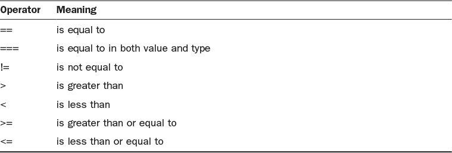

**表 7.1 JavaScript 比较运算符**

* * *

注意更全面的比较运算符列表出现在附录 B“JavaScript 快速参考.”

* * *

* * *

自己尝试：扩展我们的垃圾邮件检测器

在第 5 小时中，你开发了一个简单的函数来检测给定输入字符串中的“fake”单词。

现在你可以使用 `if()` 语句进一步开发该函数。

这是来自第 5 小时的函数：

点击此处查看代码图片

```javascript
function detectSpam(input) {
    input = input.toLowerCase();
    return input.indexOf("fake");
}
```

你可能记得，该函数目前返回一个数字，该数字对应单词“fake”在输入字符串中出现的位置。

让我们修改该函数，使其根据是否找到目标单词来返回 `true` 或 `false`：

点击此处查看代码图片

```javascript
if(input.indexOf("fake") < 0) {
    return false;
}
return true;
```

现在我们可以看到，如果满足条件 `input.indexOf("fake") < 0`，函数将终止并返回 `false`；否则，执行将继续到 `if()` 块之后的下一行，函数将终止并返回 `true`。

列表 7.1 显示了完整 HTML 文件中修改后的代码。请在你的编辑器中创建此文件。

### 列表 7.1 垃圾邮件检测函数

点击此处查看代码图片

***

```html
<!DOCTYPE html>
<html>
<head>
    <title>Spam Detector</title>
</head>
<body>
<script>
    function detectSpam(input) {
        input = input.toLowerCase();
        if(input.indexOf("fake") < 0) {
            return false;
        }
        return true;
    }
    var mystring = prompt("Enter a string");
    alert(detectSpam(mystring));
</script>
</body>
</html>
```

***

现在让我们来看看，当给定我们在 第 5 小时 中使用的相同字符串时，程序的表现如何，如图图 7.1 所示。


**图 7.1** 输入字符串

从图 7.2 中可以看出，警报框现在仅报告 `true`，而不是显示目标单词在字符串中的位置。在浏览器中重新加载文件并再次尝试一个不包含“fake”单词的字符串，以确认检测器返回 `false`。

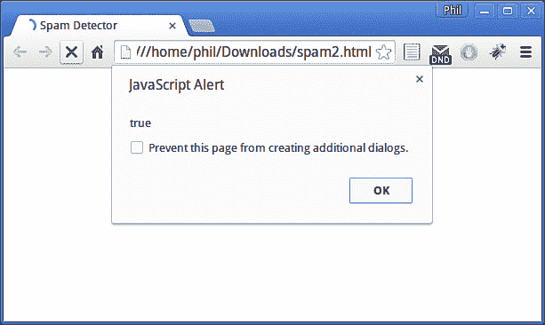

**图 7.2** 垃圾邮件检测器报告 `true`

***

### 测试相等性

在在上一个例子中，我们如何测试温度是否*精确等于* 64 度呢？记住，我们使用等号（`=`）来为变量*赋值*值，因此这段代码的作用可能不像我们预期的那样工作：

`if(temperature = 64) ....`

如果我们使用此语句，括号内的表达式将由 JavaScript 求值，我们的变量 `temperature` 将被*赋值*为 64。如果此值赋值成功终止——而且为什么不能呢？——那么值赋值将返回一个 `true` 值给 `if()` 语句，因此语句的其余部分将被执行。这完全不是我们想要的行为。

相反，为了测试相等性，我们必须使用双等号（`==`）：

点击此处查看代码图片

```javascript
if(temperature == 64) message = "64 degrees and holding!";
```

***

## 注意事项

如果你需要测试两个项目在*值和类型上都*相等，JavaScript 有一个运算符 `===` 来执行此测试。例如：

点击此处查看代码图片

```javascript
var x = 2; // 赋值一个数值
if(x == "2") ... // true，因为字符串 "2" 被解释为数字
if(x === "2") ...// false，字符串不是数字
```

这在测试返回的值是否实际上为 `false`，或者仅仅是一个“虚假值”（falsy）值（可以被*解释*为 `false`）时非常有用用：

点击此处查看代码图片

```javascript
var x = 0; // 赋值为零
if(!x) ... // 求结果为 true
if(x === false)..// 求值为为 false
```

***

#### 关于 if() 的更多信息

之前的示例在满足测试条件时仅执行单条语句。如果我们想做更多事情呢；例如，执行几条语句？

为了实现这一点，我们只需要用大括号（`{}`）括起所有我们希望在条件满足时执行的代码语句：

点击此处查看代码图片

```javascript
if(temperature < 64) {
    message = "Turn on the heating!";
    heatingStatus = "on";
    // ... 可以在这里添加更多语句
}
```

我们还可以为 `if` 语句添加一个子句，其中包含我们在条件*不满足*时想要执行的代码。为了实现这一点，我们使用 `else` 结构：

点击此处查看代码图片

```javascript
if(temperature < 64) {
    message = "Turn on the heating!";
    heatingStatus = "on";
    // ... 可以在这里添加更多语句
} else {
    message = "Temperature is high enough";
    heatingStatus = "on";
}
```

***

### 提示

`if` 语句存在一种简写形式：

`condition ? [执行真] : [执行假]`

这是一个示例：

点击此处查看代码图片

`errorMessage = count ? " error":"`

在这个例中中，如果 `count` 恰好为 1，消息将包含 **error**。如果 `count` 为 0，它将包含 **errors**。

***

#### 测试多个条件

你可以使用 `if` 和 `else` 的“嵌套”组合在决定采取行动之前测试多个条件。让我们回到加热的示例，并在温度也过高时让它进行降温：

点击此处查看代码图片

```javascript
if(temperature < 64) {
    message = "Turn on the heating!";
    heatingStatus = "on";
} else if(temperature > 72){
    message = "Turn on the fan!";
    heatingStatus = "off";
} else {
    message = "Temperature is OK";
    heatingStatus = "off";
}
```

### switch 语句

当我们测试一组不同的结果范围时，可以使用的一种简洁语法是 `switch` 语句：

点击此处查看代码图片

```javascript
switch(color) {
    case "red":
        message = "Stop!";
        break;
    case "yellow":
        message = "Pass with caution";
        break;
    case "green":
        message = "Come on through";
        break;
    default:
        message = "Traffic light out of service. Pass only with great care";
}
```

`switch` 关键字在括号内是要测试的变量名称。

测试本身列在大括号 `{` 和 `}` 之间。每个 `case` 语句（带有引号值）后面跟着一个冒号，然后是匹配到该情况要执行的操作列表。每个部分可以包含任意数量的代码语句。

注意每个 case 后的 `break` 语句。它在执行完匹配 case 代码后跳转到 `switch` 语句的结束。如果省略 `break`，可能会有多个 case 执行其代码。

可选的 `default` 情况在没有匹配到指定的 case 时执行其代码。

### 逻辑运算符


当我们需要测试一组组合标准来判断测试条件是否已满足时，使用 `if ... else` 或 `switch` 语句会变得繁琐。

让我们再次回到温度控制程序。JavaScript 允许我们使用逻辑与（`&&`）和逻辑或（`||`）来组合条件。这里有一种方法：

```javascript
if(temperature >= 64 && temperature <= 72) {
    message = "The temperature is OK";
} else {
    message = "The temperature is out of range!";
}
```

我们可以将前面的条件读为“如果温度大于等于 64 且温度小于等于 72”。

我们可以使用 OR 代替 AND 来完全相同的功能：

```javascript
if(temperature < 64 || temperature > 72) {
    message = "The temperature is out of range!";
} else {
    message = "The temperature is OK";
}
```

在这里，我们反转了执行测试的方式；当温度 `out of`（超出）范围时，我们的条件语句就会成立，可以读作“如果温度小于 64 或大于 72”。

### 循环与控制结构

`if` 语句可以被看作程序执行中的一个 `junction`（分支点）。根据对数据进行测试的结果，程序在执行语句时可能会走某条或另一条路径。

然而，在很多情况下，我们可能希望在继续执行程序的其余部分之前执行某些操作。如果重复次数是固定的，我们或许可以通过多个 `if` 语句和增加计数器变量来实现，尽管这样代码会变得杂乱且难以阅读。但如果我们不知道需要重复多少次代码呢，因为重复次数取决于（例如）变量值的的变化呢？

JavaScript 有多种内置的循环结构，允许我们实现此类目标。

#### while

`while` 语句的语法与 `if` 语句的语法非常相似：

```javascript
while(this condition is true) {
    carry out these statements ...
}
```

`while` 语句`工作`方式也和 `if` 一样。唯一的区别在于，在完成条件语句后，`while` 会返回再次测试条件。只要条件一直为 `true`，`while` 就会一直执行条件代码。这里有一个例子：

```javascript
var count = 10;
var sum = 0;
while(count > 0) {
    sum = sum + count;
    count--;
}
alert(sum);
```

每当 `while` 判定条件为 `true` 时，大括号中的语句就会反复执行，在每次循环中都将 `count` 的当前值加到变量 `sum` 上。

当 `count` 减到零时，条件失败，循环停止；程序操作随后从闭括号之后继续。到此时，变量 `sum` 的值为：

10 + 9 + 8 + 7 + 6 + 5 + 4 + 3 + 2 + 1 = 55

#### do ... while

`do ... while` 结构在操作上与 `while` 相似，但有一个重要的区别。这里是其语法：

```javascript
do {
    ... these statements ...
} while(this condition is true)
```

这里唯一的真实区别是，由于 `while` 子句出现在大括号`之后`，因此条件语句列表在评估 `while` 子句`之前`会先执行一次。因此，`do ... while` 子句中的语句将始终至少执行一次。

#### for

`for` 循环是另一种在操作上与 `while` 的循环，但语法更全面。通过 `for` 循环，我们可以在一个语句中指定初始条件、测试条件（用于结束循环）以及每次通过循环时更改计数器变量的方法。看下语法：

```javascript
for(x=0; x<10; x++) {
    ... execute these statements ...
}
```

我们将其解释为：

“对于初始设为零的 x，只要 x 小于 10，并且在每次通过循环时将 x 增 1，就执行条件语句。”

让我们重写之前在看 `while` 循环时给出的例子，但这次使用 `for` 循环：

```javascript
var count;
var sum = 0;
for(count = 10; count > 0; count--) {
    sum = sum + count;
}
```

如果计数器变量之前没有声明，通常在 `for` 语句内部使用 `var` 关键字声明它比在外部声明更方便：

```javascript
var sum = 0;
for(var count = 10; count > 0; count--) {
    sum = sum + count;
}
alert(sum);
```

与上一个例子一样，循环结束后，变量 `sum` 的值为：

10 + 9 + 8 + 7 + 6 + 5 + 4 + 3 + 2 + 1 = 55

#### 使用 break 退出循环

`break` 命令在循环中的作用与在 `switch` 语句中几乎相同——它将我们踢出循环，并将操作返回到紧邻闭括号之后的代码行。

这里有一个例子：

```javascript
var count = 10;
var sum = 0;
while(count > 0) {
    sum = sum + count;
    if(sum > 42) break;
    count--;
}
alert(sum);
```

我们之前看到过，如果没有 `break` 指令，`sum` 的值演变如下：

10 + 9 + 8 + 7 + 6 + 5 + 4 + 3 + 2 + 1 = 55

现在我们发现，当 `sum` 的值达到 10 + 9 + 8 + 7 + 6 + 5 = 45 时，`if(sum > 42)` 语句将变为 `true`，并由于 `break` 命令导致循环终止。小心意外创建无限循环。例如，这里我们使用了 `while`：

```javascript
while(count > 0) {
    sum = sum + count;
    count--;
}
```

每当 `while` 测试 `count` 时，都会发现其大于零，循环永远不会结束，导致浏览器崩溃。

#### 使用 for in 遍历对象

`for...in` 循环是一种特殊的循环，旨在遍历对象的属性。让我们在 Listing 7.2 中看看它的运行。

**列表 7.2 for ... in**

```html
<!DOCTYPE html>
<html>
<head>
    <title>循环与控制</title>
</head>
<body>
    <script>
        var days = ['Sun','Mon','Tue','Wed','Fri','Sat'];
        var message = "";
        for (i in days) {
            message += 'Day ' + i + ' is ' + days[i] + '\n';
        }
        alert(message);
    </script>
</body>
</html>
```

在此类循环中，我们不需要担心维护循环计数器或设计一个测试来查看循环何时应该完成。循环将为所提供的对象的每个属性执行一次（在我们的示例中，为每个数组项执行一次），然后终止。

运行此示例的结果所示在 图 7.3 中。


**图 7.3** 运行 `for ... in` 循环的结果

### 设置和使用定时器

在某些某些情况下，你可能希望在 JavaScript 代码的执行中编写一个特定的延迟。这在编写用户界面程序时尤为常见；例如，你可能希望在移除消息之前先显示一短时间。

为了帮助你，JavaScript 提供了两个实用的方法：`setTimeout()` 和 `setInterval()`。

***

注意

`setTimeout()` 和 `clearTimeout()` 都是 HTML DOM `window` 对象的方法。

***

### setTimeout()

`setTimeout(action, delay)` 方法在指定的第二个参数指定的毫秒数后，调用其第一个参数传递的函数（或评估表达式）。例如，你可以使用它为了在给定的配置下显示一个元素的一段时间时间：

<div id="id1">我即将消失了！</div>

假设你的页面包含上述 `<div>` 元素。如果你将以下代码放入页面 `<head>` 部分的 `<script>` 元素中，函数 `hide()` 将页面加载完成后 3 秒后执行，使 `<div>` 元素变得不可：

```javascript
function hide(elementId) {
    document.getElementById(elementId).style.display = 'none';
}

window.onload = function() {
    setTimeout("hide('id1')", 3000);
}
```

`setTimeout()` 方法会返回一个值。如果你以后想取消定时器函数，可以通过将该返回的值传递给 `clearTimeout()` 方法来引用它：

```javascript
var timer1 = setTimeout("hide('id1')", 3000);
clearTimeout(timer1);
```

### setInterval()

`setInterval(action, delay)` 方法的工作原理与 `setTimeout()` 类似，但它不是在执行作为第一个参数传递的语句之前设置单次延迟，而是重复执行该语句，每次执行之间的延迟对应于第二个参数中指定的毫秒数。

与 `setTimeout()` 类似，`setInterval()` 返回一个值，你可以稍后将其传递给 `clearInterval()` 方法来停止定时器：

```javascript
var timer1 = setInterval("updateClock()", 1000);
clearInterval(timer1);
```

### 总结

在这一节中，你学习了关于测试条件、基于变量值控制程序流，以及如何编写各种由条件控制的程序循环。

你还学习了一点关于在程序中使用定时器的知识。

## 问答

**Q. 是否有特定的理由说明我应该使用某种类型的循环而不是另一种？**

**A.** 诚然，通常有多种类型的循环可以解决任何特定的编程问题。你可以使用你觉得最熟悉的一种，尽管通常良好的做法是根据代码的设计意图，使用最符合逻辑（结合你选择的变量名）的循环。

**Q. 是否有方法可以停止当前的循环迭代并直接进入下一次迭代？**

**A.** 是的，你可以使用 `continue` 命令。它的工作原理与 `break` 相似，但它不是取消循环并从闭括号之后继续执行代码，`continue` 只取消当前一次循环迭代并跳转到下一次迭代。

## 工作坊

在阅读随后的“答案解答”部分之前，尝试回答所有问题。

#### 测验

**1.** “大于等于”在 JavaScript 中如何表示？**

**a.** `>`

**b.** `>=`

**c.** `>==`

**2.** 哪个命令强制取消循环，并将代码操作移动到闭括号之后的语句处？

**a.** `break;`

**b.** `loop;`

**c.** `close;`

**3.** 下列哪项最可能导致死循环？

**a.** 错误的排序。

**b.** 条件永远不会满足。

**c.** 语句太多了。

#### 答案

**1.** b. `>=`

**2.** a. `break;`

**3.** b. 条件永远不会满足。

## 练习

在这一节中，你学习了如何使用 `if` 和 `else` 语句来控制程序的流。你还学习了如何使用 `for` 和 `while` 循环多次执行代码。最后，你学习了如何使用 `setTimeout` 和 `setInterval` 在特定间隔执行代码。

# 第三部分：对象

## 第 8 小节：面向对象编程

随着你的程序变得越来越复杂，你需要一些帮助编写高效、可读代码的技术。在这一节中，你将学习面向对象编程的基础知识。

### 什么是面向对象编程？

到目前的代码示例都是所谓的*过程化*编程。过程化编程的特点是将数据存储在变量中，并通过指令进行操作。在面向对象编程（OOP）中，你将数据概念化为离散的“事物”，被称为*对象*——每个对象都有自己的*属性*（数据）和*方法*（指令）。

例如，假设编写一个脚本来管理租赁业务。你可以设计一个名为 `Car` 的通用对象。`Car` 对象将具有某些属性（color、year、odometerReading 和 make），并可能还有几个方法（例如，一个 `setOdometer(newMiles)` 方法来更新 `odometerReading` 属性）。

对于租赁车队中的每辆车，你都会创建一个 `Car` 对象的*实例*。

***

注意

对象的实例是对象模板的特定应用，根据特定数据创建一个可以运行的对象。例如，通用对象模板 `Car` 可能会有一个实例，其中 `Car` 对象根据特定数据被创建并标识为“蓝色 1998 年福特”，另一个实例描述的是一辆“黄色 2004 年日产”。在大多数关于面向对象编程的讨论中，这种对象模板被称为*类*。我一直克制使用该术语，因为 JavaScript 并没有真正使用类，但名为*构造函数*的 JavaScript 概念是类似的。你将在这一节中学习构造函数。

***

### 本节将学到的内容

 什么是对象

 实例化对象

 扩展与继承

 访问对象方法和属性

 使用 `prototype`

### 优势

与过程化方法相比，编写 OOP 代码具有几个优势：

 **代码复用**——首先，OOP 允许你在各种脚本中复用代码。你可以通过函数实现这一点，但很快就会很难跟踪所有需要传递的变量、它们的作用域和含义。相比之下，对于对象，你只需要记录每个对象的属性和方法。只要它们遵循这些规则，其他程序——甚至其他程序员——都可以轻松使用你的对象定义。

 **封装性**——通过仔细控制程序其余部分“可见”的属性和方法，你可以定义对象与脚本其他部分交互的方式。对象的*内部*工作机制可以被隐藏起来，强制对象外部代码仅通过对象提供的文档接口来访问该对象的数据。

 **继承**——在编码时，你经常会需要某些与之前编写的代码非常相似但又不完全相同的代码——也许是已经在同一个应用程序中编写过的代码。通过 `inheritance`（继承），可以根据之前定义的对象的设计创建新对象，并可选地对其方法和属性进行添加或修改；新对象从旧对象 `inherits`（继承）属性和方法。

在之前的几小时中，你经常使用对象；或是 JavaScript 内置的对象，或是组成 DOM 的对象。然而，你也可以创建自己的对象，拥有它们自己的属性和函数，并在程序中使用。

***

### 注意

某些编程语言（如 `C++` 和 `Smalltalk`）高度倾向于 OOP（面向对象编程），通常被称为面向对象语言。JavaScript 并不是其中之一，但它支持了足够的核心要素，让你能够编写出实用的 OOP 代码。我们可以轻松地用整本书的内容填满 OOP 的理论与实践，但我们在这里只看基础。

***

### 对象创建

JavaScript 提供了几种创建对象的方法。让我们先看看如何声明一个对象的 `direct instance`（直接实例）；稍后我们将通过使用 `constructor function`（构造函数）来创建对象。

#### 创建直接实例

JavaScript 有一个简单称为 `Object` 的内置对象，你可以将其用作创建自定义对象的空白画布：

```javascript
myNewObject = new Object();
```

好了，你现在有了一个全新的对象 `myNewObject`。目前，它实际上并没有执行任何事情，因为它没有任何任何属性或方法。你可以通过添加一个属性来开始纠正这一点：

```javascript
myNewObject.info = 'I am a shiny new object';
```

现在你的对象拥有了一个属性——在这种情况下，这是一个包含对象某些信息的文本字符串，并名为 `info`。你也可以轻松地给对象添加一个方法，先定义一个函数，然后将其作为对象的方法之一附加到 `myNewObject` 上：

```javascript
function myFunc() {
    alert(this.info);
};

myNewObject.showInfo = myFunc;
```

***

### 注意

注意你在这里只使用了函数名而没有带括号。你这样做是因为你正尝试给方法 `newObject.showInfo` 赋值函数 `myFunc()` 的 `definition`（定义）。

如果你使用了代码：

```javascript
myNewObject.showInfo = myFunc();
```

你将是在要求 JavaScript `execute`（执行）`myFunc()` 并将其 `return value`（返回值）赋值给 `newObject.showInfo`。

***

要调用这个新方法，你可以直接使用现在熟悉的点符号法：

```javascript
myNewObject.showInfo();
```

### 使用 this 关键字

注意上一个函数定义中 `this` 关键字的使用。你可能记得在 第 2 小节“编写简单脚本”以及 第 3 小节“使用函数”中使用过这样的关键字。在之前的那些示例中，你曾在内联事件处理程序中使用 `this`：

```html

```

当这样使用时，`this` 指的是 HTML 元素本身——在前例中是 `` 元素。当你在函数（或方法）内部使用 `this` 时，关键字 `this` 指函数的 `parent`（父）对象。

在第一次声明函数 `myFunc()` 时，它的父对象是全局对象；即 `window` 对象。`window` 对象没有名为 `info` 的属性，如果你直接调用 `myFunc()` 函数将发生错误。

然而，你接着为 `myNewObject` 创建了一个名为 `showInfo` 的方法，并将 `myFunc()` 赋值给该方法：

```javascript
myNewObject.showInfo = myFunc;
```

在 `showInfo()` 方法的上下文中，`myNewObject` 是父对象，因此 `this.info` 指向属性 `myNewObject.info`。

让我们看看是否可以通过 Listing 8.1 中的代码来稍稍澄清这一点。

**列表 8.1 创建对象**

```html
<!DOCTYPE html>
<html>
<head>
    <title>Object Oriented Programming</title>
    <script>
        myNewObject = new Object();
        myNewObject.info = 'I am a shiny new object';
        function myFunc(){
            alert(this.info);
        }
        myNewObject.showInfo = myFunc;
    </script>
</head>
<body>
    <input type="button" value="Good showInfo Call" onclick="myNewObject.showInfo()" />
    <input type="button" value="myFunc Call" onclick="myFunc()" />
    <input type="button" value="Bad showInfo Call" onclick="showInfo()" />
</body>
</html>
```

注意在页面的 `<head>` 部分，你创建了对象 `myNewObject` 并如前文所述为它分配了属性 `info` 和方法 `showInfo`。

将此页面加载到浏览器中，你会遇到三个按钮。

点击第一个按钮将调用新创建的对象的 `showInfo` 方法：

```html
<input type="button" value="Good showInfo Call" onclick="myNewObject.showInfo()" />
```

正如你所希望的，`info` 属性的值被传递给了 `alert()` 对话框，如图 8.1 所示。

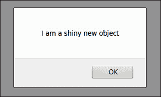

**图 8.1** `info` 属性被正确调用

第二个按钮尝试直接调用函数 `myFunc()`：

```html
<input type="button" value="myFunc Call" onclick="myFunc()" />
```

因为 `myFunc()` 是全局对象的方法（在定义时没有引用任何对象作为父对象），它尝试向 `alert()` 对话框传递一个不存在的属性 `window.info` 的值，结果如图 8.2 所示。


**图 8.2** 全局对象没有 `info` 属性

最后，你的第三个按钮尝试在不引用父对象的情况下调用 `showInfo`：

```html
<input type="button" value="Bad showInfo Call" onclick="showInfo()" />
```

由于该方法在 `myNewObject` 之外，JavaScript 报告了一个错误，如图 8.3 所示。


**图 8.3** JavaScript 报告 showInfo 未定义

***

### 注意

我们将在书中后面详细讨论如何使用浏览器的 JavaScript 控制台或错误控制台显示 JavaScript 错误。

***

### 匿名函数

有一种更方便优雅的方法给你的对象的 `showInfo` 方法赋值，而无需先创建一个命名的函数并在稍后通过名称给它赋值。而不是这段代码：

```javascript
function myFunc() {
    alert(this.info);
};

myNewObject.showInfo = myFunc;
```

你只需简单编写以下内容：

```javascript
myNewObject.showInfo = function() {
    alert(this.info);
}
```

因为你在赋值之前不需要给函数命名，这种技术被称为使用 `anonymous function`（匿名函数）。

通过使用类似的赋值语句，你可以为你的实例化对象添加任意数量的属性和方法。

***

### 提示

JavaScript 提供了另一种创建直接实例的方法；该技术使用 JSON（JavaScript 对象表示法）。这里没有涵盖它，因为我们将在第 10 小节“结识 JSON”中详细探索 JSON。

如果你认为只需要该类型的一个对象，那么直接创建一个对象的实例是可以的。遗憾的是，如果你需要创建另一个相同类型的对象实例，你将不得不再次通过过程——创建对象、添加属性、定义方法等等。

### 提示

只有一个全局实例的对象有时被称为“单例对象”（singleton object）。这些对象在某些情况下是有用的；例如，你程序的用户可能只有一个关联的 `userProfile` 对象，该对象可能包含其用户名、最后查看页面的 URL 以及类似的属性。

创建将拥有多个实例的对象的更好方法是使用“对象构造函数”（object constructor function）。对象构造函数会创建一个“模板”，从该模板可以实例化更多的对象。

看看下面的代码。与其使用 `new Object()`，不如你先声明一个函数 `myObjectType()`，并在它的定义中，你可以使用 `this` 关键字添加属性和方法。

```javascript
function myObjectType(){
    this.info = 'I am a shiny new object';
    this.showInfo = function(){
        alert(this.info);  // show the value of the property info
    }
    this.setInfo = function (newInfo) {
        this.info = newInfo; // overwrite the value of the property info
    }
}
```

在前面的代码中，你添加了单一属性 `info` 和两个方法：`showInfo`（它只是显示当前存储在 `info` 属性中的值）和 `setInfo`。`setInfo` 方法接收一个参数 `newInfo`，并使用它的值覆盖 `info` 属性的值。

### 实例化对象

现在，你可以为这种对象类型创建任意数量的实例。它们都将拥有在 `myObjectType()` 函数中定义的属性和方法。创建一个对象实例被称为“实例化”（instantiating an object）。

在定义了构造函数后，你可以只需通过使用构造函数来创建对象的实例：

```javascript
var myNewObject = new myObjectType();
```

***

### 注意

请注意这种语法与使用 `new Object()` 相同，只是你使用了为了目的设计的对象类型来代替 JavaScript 的通用的 `Object()`。这样做，你实例化了一个带有构造函数中定义的全部属性和方法的对象。

***

现在，你可以调用它的方法并检查它的属性：

```javascript
var x = myNewObject.info // x now contains 'I am a shiny new object'
myNewObject.showInfo();  // alerts 'I am a shiny new object'
myNewObject.setInfo("Here is some new information");  // overwrites the info
```

#### 属性

创建多个实例非常简单，根据需要多次调用构造函数即可：

```javascript
var myNewObject1 = new myObjectType();
var myNewObject2 = new myObjectType();
```

让我们来看实际运行效果。Listing 8.2 中的代码定义了一个与之前描述相同的对象构造函数。

这里实例化了两个对象实例；显然，两个对象最初是完全相同的。你可以通过点击标记为 Show Info 1 或 Show Info 2 的按钮之一，检查每个对象存储在 `info` 属性中的值。

第三个按钮调用了对象 `myNewObject2` 的 `setInfo` 方法，并将一个新的字符串字面量作为参数传递给该方法。这覆盖了对象 `myNewObject2` 中 `info` 属性的值，但当然没有改变 `myNewObject`。你可以再次使用 Show Info 1 和 Show Info 2 来检查修改后的值。

**列表 8.2 使用构造函数创建对象**

```html
<!DOCTYPE html>
<html>
<head>
    <title>面向对象编程</title>
    <script>
        function myObjectType(){
            this.info = 'I am a shiny new object';
            this.showInfo = function(){
                alert(this.info);
            }
            this.setInfo = function (newInfo) {
                this.info = newInfo;
            }
        }
        var myNewObject1 = new myObjectType();
        var myNewObject2 = new myObjectType();
    </script>
</head>
<body>
    <input type="button" value="Show Info 1" onclick="myNewObject1.showInfo()" />
    <input type="button" value="Show Info 2" onclick="myNewObject2.showInfo()" />
    <input type="button" value="Change info of object2" onclick="myNewObject2.setInfo('New Information!')" />
</body>
</html>
```

### 使用构造函数参数

没有什么可以阻止你在实例化时自定义你的对象，通过向构造函数传递传递一个或多个参数可以实现这一点。在接下来的代码中，构造函数的定义包含一个参数 `personName`，它被构造函数赋值给 `name` 属性。当你实例化两个对象时，你为每个实例向构造函数传递了一个名称作为参数。

```javascript
function Person(personName){
    this.name = personName;
    this.info = 'I am called ' + this.name;
    this.showInfo = function(){
        alert(this.info);
    }
}
var person1 = new Person('Adam');
var person2 = new Person('Eve');
```

### 提示

你可以定义构造函数以接受尽可能多或尽可能少的参数：

```javascript
function Car(Color, Year, Miles) {
    this.color = Color;
    this.year = Year;
    this.make = Make;
    this.odometerReading = Miles;
    this.setOdometer = function(newMiles) {
        this.odometerReading = newMiles;
    }
}
var car1 = new Car("blue", "1998", "Ford", 79500);
var car2 = new Car("yellow", "2004", "Nissan", 56350);
car1.setOdometer(82450);
```

### 扩展和继承对象

使用对象的一个主要优势可以在新的上下文中重用已代码。JavaScript 提供了一种修改对象以包含新方法的方法，以及基于已存在对象创建全新的对象。这些技术分别被称为“扩展对象”和“继承对象”。

#### 扩展对象

如果你想在对象实例化后扩展你的对象以包含新方法怎么办？你可以使用 `prototype` 关键字。原型对象允许快速添加一个对所有实例都有效的属性。

#### 尝试：扩展对象原型

让我们为之前示例中的 `Person` 对象扩展一个新方法 `sayHello`：

```javascript
Person.prototype.sayHello = function() {
    alert(this.name + " says hello");
}
```

在你的编辑器中创建一个新的 HTML 文件，并输入 Listing 8.3 中的代码。

**列表 8.3 使用原型添加新方法**

```html
<!DOCTYPE html>
<html>
<head>
    <title>面向对象编程</title>
    <script>
        function Person(personName){
            this.name = personName;
            this.info = 'This person is called ' + this.name;
            this.showInfo = function(){
                alert(this.info);
            }
        }
        var person1 = new Person('Adam');
        var person2 = new Person('Eve');
        Person.prototype.sayHello = function() {
            alert(this.name + " says hello");
        }
    </script>
</head>
<body>
    <input type="button" value="Show Info on Adam" onclick="person1.showInfo()" />
    <input type="button" value="Show Info on Eve" onclick="person2.showInfo()" />
    <input type="button" value="Say Hello Adam" onclick="person1.sayHello()" />
    <input type="button" value="Say Hello Eve" onclick="person2.sayHello()" />
</body>
</html>
```

让我们来看一下这段代码以及发生了什么。

首先，你定义了一个构造函数，它接受一个参数 `personName`。在构造函数内部，定义了两个属性 `name` 和 `info` 以及一个方法 `showInfo`。

你创建了两个对象，每个对象都带有不同的 `name` 属性。在创建这两个人员对象后，你决定在 `person` 对象定义中进一步添加一个方法 `sayHello`。你使用 `prototype` 关键字来实现这一点。

将 HTML 文件加载到浏览器中。点击页面上显示的四个按钮，你会发现最初定义的 `showInfo` 方法仍然完好无，但新的 `sayHello` 方法也可以正常运行，并且该对象类型的两个现有实例都可用。

***

#### 继承

`继承` 是从另一个对象类型创建新对象类型的能力；新的对象类型继承了旧对象的属性和方法，并且还可以拥有它自己的属性和方法。这可以为你节省大量工作，因为你可以先设计出“通用”的对象类，然后通过继承将它们完善为更具体的类。

JavaScript 也使用 `prototype` 关键字来模拟继承。

由于 `object.prototype` 被用于添加新的方法和属性，你可以利用它将现有构造函数的所有方法和属性添加到你的新对象中。

让我们再定义另一个简单的对象：

```javascript
function Pet() {
    this.animal = "";
    this.name = "";
    this.setAnimal = function(newAnimal) {
        this.animal = newAnimal;
    }
    this.setName = function(newName) {
        this.name = newName;
    }
}
```

`Pet` 对象拥有包含动物类型和宠物名称的属性，以及设置这些值的方法：

```javascript
var myCat = new Pet();
myCat.setAnimal = "cat";
myCat.setName = "Sylvester";
```

现在，假设你想专门为狗创建一个对象。与其从零开始，你希望从 `Pet` 继承 `Dog` 对象，但添加一个额外的属性 `breed` 和一个额外的方法 `setBreed`。

首先，让我们创建 `Dog` 构造函数，并在其中定义新的属性和方法：

```javascript
function Dog() {
    this.breed = "";
    this.setBreed = function(newBreed) {
        this.breed = newBreed;
    }
}
```

在添加了新属性 `breed` 和新方法 `setBreed` 之后，你现在额外继承 `Pet` 的所有属性和方法。你使用 `prototype` 关键字来实现：

```javascript
Dog.prototype = new Pet();
```

现在你除了访问 `Dog` 的属性和方法外，还可以访问 `Pet` 的属性和方法：

```javascript
var myDog = new Dog();
myDog.setName("Alan");
myDog.setBreed("Greyhound");
alert(myDog.name + " is a " + myDog.breed);
```

***

### 动手尝试：扩展 JavaScript 自身的对象

`Prototype` 也可以用于扩展 JavaScript 的内置对象。例如，你可以实现 `String.prototype.backwards` 方法，该方法将返回你提供的任何字符串的反转版本，如列表 8.4 所示。

**列表 8.4 扩展 String 对象**

```html
<!DOCTYPE html>
<html>
<head>
    <title>面向对象编程</title>
    <script>
        String.prototype.backwards = function(){
            var out = '';
            for(var i = this.length-1; i >= 0; i--){
                out += this.substr(i, 1);
            }
            return out;
        }
    </script>
</head>
<body>
    <script>
        var inString = prompt("Enter your test string:");
        document.write(inString.backwards());
    </script>
</body>
</html>
```

将列表 8.4 的代码保存为 HTML 文件并在浏览器中打开。该脚本使用 `prompt()` 对话框邀请你输入字符串，然后在页面上显示反转后的字符串。

让我们看看代码是如何工作的。

```javascript
String.prototype.backwards = function(){
    var out = '';
    for(var i = this.length-1; i >= 0; i--){
        out += this.substr(i, 1);
    }
    return out;
}
```

首先，你在正在创建的匿名函数内部声明了一个新变量 `out`。这个变量将保存反转后的字符串。

然后你开始一个循环，从输入字符串的结尾开始（记住 JavaScript 字符串字符索引从 0 开始而不是 1，所以你需要从 `this.length - 1` 开始），并且每次减少一个字符。当你反向遍历字符串时，你将字符一个一个地添加到存储在 `out` 中的输出字符串中。

当你到达输入字符串的开头时，将返回反转后的字符串。结果如图 8.4 所示。


**图 8.4** 反转字符串的方法

***

## 封装

封装面向面向对象（OOP）在对象内部隐藏数据和指令的能力。实现方法因语言而异，但在 JavaScript 中，任何在构造函数内部声明的变量仅从对象内部可用；它们是不可见的。构造函数内部声明的任何函数也是如此。

这些变量和函数只有在赋值给 `this` 时才会对外部世界可见；它们随后成为对象的属性和方法。

让我们来看一个例子：

```javascript
function Box(width, length, height) {
    function volume(a,b,c) {
        return a*b*c;
    }
    this.boxVolume = volume(width, length, height);
}

var crate = new Box(5,4,3);

alert("Volume = " + crate.boxVolume); // 
alert((5,4,3)); // 失败因为函数 volume() 是不可见的
```

在前面的示例中，`function volume(a,b,c)` 不能从构造函数外部任何地方调用，因为它没有被赋值给对象方法。然而，属性 `crate.boxVolume` 在构造函数外部是可以用的；尽管它使用函数 `volume()` 来计算其值，但它只在构造函数内部执行计算。

如果你不使用 `this` “注册”方法和属性，它们在外部就不可用。此类方法和属性被称为*私有的*。

### 使用特性检测

在 W3C DOM 演变为目前状态之前的黑暗日子里，JavaScript 开发者被迫进行极其糟糕的代码扭曲来应对不同浏览器的 DOM 实现。脚本写得几乎是两个或多个独立的程序并不罕见，执行哪个版本只有在尝试检测正在使用的浏览器后才能决定。

正如你在第 4 小节 中对 `navigator` 对象的操作看到的那样，“DOM 对象和内置对象”，浏览器检测是一项棘手的工作。`navigator` 对象包含的信息在最好的情况下也可能是误导性的（有时甚至是完全错误的）。此外，当引入具有新功能和特性的新浏览器或新版本时，你的浏览器检测代码通常会再次失效。

值得感谢的是，已经出现了一种更好的跨浏览器代码编写方法，它是基于对象的。与其尝试检测浏览器，大主主意是让 JavaScript 检查你需要的特定功能是否受到支持。你可以通过测试特定对象、方法或属性的可用性来实现这一点。在许多情况下，尝试使用相关的对象、方法或属性，并检测 JavaScript 返回的值就足够了。

这里有一个测试浏览器对 `document.getElementById()` 方法支持的示例，你已经见过这个方法了。虽然 `getElementById()` 已经被所有现代浏览器支持了一段时间，但非常期的浏览器并不支持此方法。你可以使用 `if()` 来测试 `getElementById()` 方法（或任何类似的方法或属性）的可用性：

```javascript
if(document.getElementById) {
    myElement = document.getElementById(id);
} else {
    // do something else
}
```

如果 `document.getElementById` 不可用，`if()` 条件语句将切换代码操作以避免使用该方法。

另一种相关方法使用 `typeof` 运算符在调用 JavaScript 函数之前先检查其是否存在：

```javascript
if(typeof document.getElementById == 'function') {
    // you can use getElementById()
} else {
    // do something else
}
```

`typeof` 可以返回多个可能的值，如表 8.1 所示。

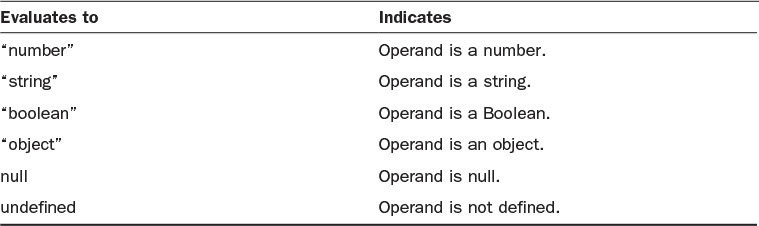

**表 8.1 typeof 返回的值**

你可以使用这种技术来检查 DOM 以及内置对象、方法和属性的构建性，还可以检查在你的脚本中创建的对象。

请注意，在整个练习过程中，你从未尝试过确定用户使用的是什么浏览器——你只是想知道它是否支持你正准备尝试使用的对象、属性或方法。这种特征检测（feature detection）不仅比所谓的“浏览器嗅探”（通过解释 `navigator` 对象的属性来推断正在使用的浏览器）准确和优雅得多，而且更具未来性——新浏览器或浏览器版本的引入不会破坏你代码的任何运行。

### 总结

在这一小时中，你学习了 JavaScript 中的面向对象编程 (OOP)，从 OOP 背后的基本概念开始，以及它如何帮助你的代码开发，特别是对于更复杂的应用程序。

你学习了一种直接实例化对象并向其添加属性和方法的方法。然后你学习了如何创建一个对象构造函数，通过该函数你可以实例化多个相似的对象。

你还学习了 `prototype` 关键字，以及如何如何使用它来扩展对象或通过继承创建新对象。

## 问答

**Q. 我应该总是编写面向对象的代码吗？**

**A.** 这是一个个人偏好问题。有些程序员倾向于始终从对象、方法和属性的角度来思考，并根据这些原则编写所有代码。其他人则认为，特别是对于较小且简单的程序，OOP 提供的抽象程度太高，过程化编程就可以了。

**Q. 我应该如何在其他程序中使用我的对象？**

**A.** 对象的构造函数是一个非常可移植的实体。如果你在页面中链接了一个包含对象构造函数的 JavaScript 文件，你就有办法在整个代码中创建对象并使用它们的属性和方法。

## 工作坊

尝试在阅读随后的“答案”部分之前回答所有问题。

#### 测验

**1.** 从构造函数创建的新对象被称为：

**a.** 对象的实例

**b.** 对象的方法

**c.** 原型 (prototype)

**2.** 使用现有对象的设计来派生新对象被称为：

**a.** 封装

**b.** 继承

**c.** 实例化

**3.** 下列哪项是创建对象直接实例的有效方法？

**a.** `myObject.create();`

**b.** `myObject = new Object;`

**c.** `myObject = new Object()`;

#### 答案

**1.** a. 从构造函数创建的新对象被称为实例（instance）。

**2.** b. 新对象通过继承从现有对象派生。

**3.** c. `myObject = new Object();`

## 练习题

 为 `Card` 对象编写一个构造函数，具有属性 `suit`（方花、红心、黑桃或梅草）和 `face`（A、2、3 ... 킹/王）。添加方法来设置 `suit` 和 `face` 的值。

你能包含一个 `shuffle` 方法，通过将 `suit` 和 `face` 属性设置为代表牌组中的随机牌吗？（提示：使用第 4 小节中“DOM 对象和内置对象”中描述的 `Math.random()` 方法。）

 使用 `prototype` 关键字扩展 JavaScript 的 `Date` 对象，添加一个新方法 `getYesterday()`，该方法返回该 `Date` 对象所代表的前一天的名称。

# 第 9 小节：使用 DOM 编写脚本

***

在本节你将学习：

- 节点（nodes）的概念

- 节点的不同类型

- 使用 `nodeName`、`nodeType` 和 `nodeValue`

- 使用 `childNodes` 集合

- 使用 `getElementsByTagName()` 选择元素

- 如何使用 Mozilla 的 DOM 检查器

- 如何创建新元素

- 添加、编辑和删除子节点的方法

- 动态加载 JavaScript 文件

- 修改元素属性

***

你已经学习了 W3C DOM，并且在之前的几节代码示例中，你使用了各种 DOM 对象、属性和方法。

在这一节中，你开始探索 JavaScript 如何直接与 DOM 交互。特别是，你学习了一些在 DOM 中进行导航的新方法，选择代表页面内容的 DOM 对象。你将看到如何创建新元素、如何添加、编辑和删除 DOM 树以及如何操作元素属性。

### DOM 节点

在第一部分“JavaScript 初步”中，你接触了 W3C 文档对象模型 (DOM)，它是父子关系的层级树，共同构成了当前页面的模型。通过使用适当的方法，你可以导航到 DOM 的任何部分并获取详细信息。

你可能记得 DOM 层次结构的顶层对象是 `window` 对象，而它的子级之一是 `document` 对象。在本节中，我们主要处理 `document` 对象及其属性和方法。

查看列表 9.1 中的简单网页。

**列表 9.1 简单网页**

```html
<!DOCTYPE html>
<html>
<head>
    <title>待办事项</title>
</head>
<body>
    <h1>要办的事</h1>
    <ol id="toDoList">
        <li>修草坪</li>
        <li>擦窗户</li>
        <li>回复你的邮件</li>
    </ol>
    <p id="toDoNotes">确保在晚上 8 点前完成所有事情，这样你就可以看电视比赛了！</p>
</body>
</html>
```

图 9.1 显示了在 Mozilla Firefox 中显示的页面。

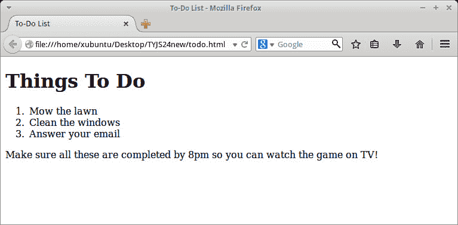

**图 9.1** 在 Firefox 中显示的我们的简单网页

当页面加载完成后，浏览器就会生成一个该页面的完整分层 DOM 表示，供我们进行检查。图 9.2 显示了该表示的部分内容的简化版本。

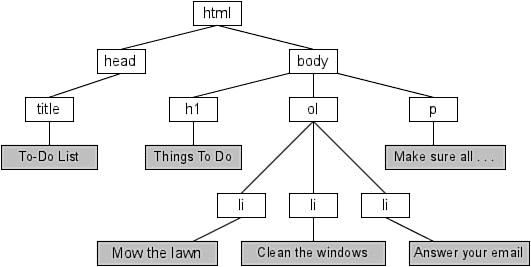

**图 9.2** 我们页面的 DOM 树模型

***

### 注意

记住，在页面加载完成之前，DOM 是不可用的。在此之前，不要尝试执行任何使用 DOM 的语句，否则你的脚本可能会产生错误。

***

看看图 9.2 中的树形图是如何与列表 9.1 中的代码相关的。

`<html>` 元素包含了页面的所有其他标记。它是两个直接`子`元素——`<head>` 和 `<body>` 元素的`父` 元素。这两个元素是`兄弟`关系，因为它们共享同一个父元素。它们本身也是父元素；`<head>` 元素有一个子元素 `<title>`，而 `<body>` 元素有三个子元素：标题 `<h1>`、有序列表 `<ol>` 和一个段落 `<p>`。在这三个兄弟元素中，只有 `<ol>` 有子元素，即三个 `<li>` 行项目元素。树中的这些元素中，许多包含文本，这在图 9.2 的灰色框中表示。

DOM 是作为这种关系的层级结构被构建的。构成树形图连接点和终点的方框被称为`节点`（nodes）。

### 节点类型

图 9.2 显示了各种`元素节点`，每个节点代表一个 HTML 元素（如段落元素 `<p>`），以及一些代表此类页面元素文本内容的`文本节点`。

***

### 提示

在存在的情况下，文本节点始终包含在元素节点内部。然而，并不是每个元素节点都包含文本节点。

***

还有许多其他节点类型，代表如每个元素的属性、HTML 注释以及与页面相关的其他信息。当然，许多节点类型可以包含其他节点作为子节点。

每种不同类型的节点都有一个关联数值，称为其 `nodeType` 属性。各种类型节点的 `nodeType` 属性列在表 9.1 中。

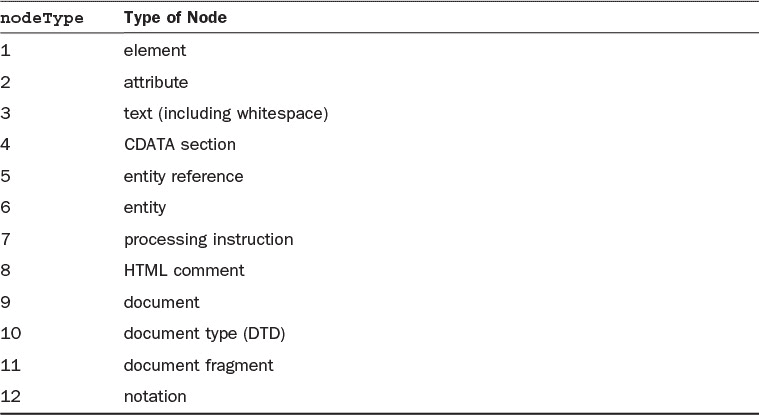

**表 9.1 nodeType 值**

***

### 提示

当你操作页面元素、其属性以及这些元素包含的文本时，你可能会大部分都会使用节点类型 1、2 和 3。

***

### childNodes 属性

对于每个节点，一个实用的 DOM 属性是其直接子节点的集合。这个类数组列表被称为 `childNodes`，它允许你访问任何 DOM 节点的子节点信息。

`childNodes` 集合是一个所谓的 `NodeList`，其中的项通过数字索引。该集合看起来和（在大多数情况下）表现得像一个数组——你可以像引用数组一样引用它的成员，并像处理数组一样对它们进行迭代。但是，有几个数组方法无法使用，例如 `push()` 和 `pop()`。对于这里的所有的示例，你可以像对待普通数组一样对待该集合。

节点列表是一个动态集合（live collection），这意味着它所引用的集合的任何更改都会立即反映列表中；当发生变化时，你不需要重新获取。

***

#### 尝试一下：使用 childNodes 属性

你可以使用 `childNodes` 属性返回的集合来检查列表 9.1 中出现的有序列表元素 `<ol>`。你将编写一个小的函数来读取 `<ol>` 元素的子节点，并返回列表中存在的总数。

首先，你可以通过 ID 获取 `<ol>` 元素。

```javascript
var olElement = document.getElementById("toDoList");
```

`<ol>` 元素的子节点现在将包含在对象中

```javascript
olElement.childNodes
```

你只想选择列表中的 `<li>` 元素，所以现在你想遍历 `childNodes` 集合，只计算 `nodeType==1`（即对应于 HTML 元素）的节点，忽略有序列表元素中包含的任何内容（如注释和空白）。记住，你可以几乎像对待数组一样对待集合；在这里你使用 `length` 属性就像使用数组一样：

```javascript
var count = 0;

for (var i=0; i < olElement.childNodes.length; i++) {
    if(olElement.childNodes[i].nodeType == 1) count++;
}
```

***

### 注意

HTML 代码中的空白（如空格和制表符字符）在渲染页面时通常会被浏览器忽略。然而，页面元素内部空白的存在——例如，在页面元素内——在许多浏览器中会创建一个文本节点（`nodeType == 3`）。这使得使用 `childNodes.length` 具有风险。

***

让我们编写一个函数来执行此任务，并在页面加载时通过 alert 对话输出结果：

```javascript
function countItems() {
    var olElement = document.getElementById("toDoList");
    var count = 0;
    for (var i=0; i < olElement.childNodes.length; i++) {
        if(olElement.childNodes[i].nodeType == 1) count++;
    }
    alert("The list contains " + count + " items");
}

window.onload = countItems;
```

在你的编辑器中将前面的代码整合到 `<script>` 元素中并加载页面。图 9.3 显示了在 Firefox 中的结果。

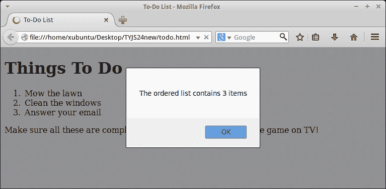

**图 9.3** 使用 childNodes 数组

***

#### firstChild 和 lastChild

`childNodes` 数组中的第一个和最后一个元素有方便的简写。

`firstChild` 是 `childNodes` 数组中的第一个元素，等同于使用 `childNodes[0]`。

为了访问集合中的最后一个元素，使用 `lastChild` 你将获得巨大的优势。为了访问该元素，你否则必须这样做：

```javascript
var lastChild = myElement.childNodes[myElement.childNodes.length - 1];
```

这非常丑陋。相反，你可以简单使用：

```javascript
var lastChild = myElement.lastChild;
```

#### parentNode 属性

`parentNode` 属性理乎意料地返回所应用节点的父节点。在以前的示例中，你使用了：

```javascript
var lastChild = myElement.lastChild;
```

使用 `parentNode` 你可以回退树一步。该行将返回 `lastChild` 的父元素，即对象 对象。

#### nextSibling 和 previousSibling

兄弟节点是共享父节点的节点。当应用于指定的节点时，这些只读属性分别返回下一个和上一个兄弟节点，如果没有这样的节点则返回 `null`。

```javascript
var olElement = document.getElementById("toDoList");
var firstOne = olElement.firstChild;
var nextOne = firstOne.nextSibling;
```

***

### 注意

记住，取决于你使用什么浏览器，HTML 代码中的空白可能会在 DOM 中创建文本节点。你正在处理的节点可能比你认为的兄弟得多！

***

### 节点值

除了 `nodeType` 之外，DOM 还提供了 `nodeValue` 属性来返回节点存储的值。你通常希望使用它来返回存储在文本节点中的文本。

假设你不想计算上一个示例中的列表项，而是提取页面中 `<p>` 元素包含的文本。要实现这一点，你需要访问相关的 `<p>` 节点，找到它包含的文本节点，然后使用 `nodeValue` 返回信息：

```javascript
var text = '';

var pElement = document.getElementById("toDoNotes");

for (var i=0; i < pElement.childNodes.length; i++) {
    if(pElement.childNodes[i].nodeType == 3) {
        text += pElement.childNodes[i].nodeValue;
    };
}

alert("The paragraph says:\n\n" + text );
```

#### 节点名称 (Node Name)

`nodeName` 属性以字符串值返回指定节点的名称。`nodeName` 返回的值汇总在 表 9.2 中。`nodeName` 属性是只读的——无法更改它的值。


**表 9.2 nodeName 属性返回的值**

当 `nodeName` 返回元素名称时，它不包含 HTML 源代码中使用的符号 `<` 和 `>`：

```javascript
var pElement = document.getElementById("toDoNotes");

alert( pElement.nodeName);  // alerts 'P'
```

### 使用 getElementsByTagName() 选择元素

你已经知道如何使用 `document` 对象的 `getElementById()` 方法访问单个页面元素。`document` 对象的另一个方法 `getElementsByTagName()` 允许你构建一个填充了所有特定标签实例的数组。

与 `getElementById()` 类似，`getElementsByTagName()` 方法接受单个参数。然而，在这种情况下，传递给方法的参数的不是元素 ID，而是所要求的标签名。

**注意**

请仔细注意拼写。`getElementsByTagName()` 中使用的是 `Elements`（复数），而 `getElementById()` 中使用的是 `Element`（单数）。

例如，假设你想处理特定文档中的所有 `<div>` 元素。你可以通过以下方式将一个名为 `myDivs` 的类数组赋值给变量：

```javascript
var myDivs = document.getElementsByTagName("div");
```

**提示**

即使只有一个具有指定标签名的元素，`getElementsByTagName()` 仍然会返回一个集合，尽管它只包含一个项。

你不需要在整个文档上使用 `getElementsByTagName()`。它可以应用于任何单个对象，并返回该对象内部包含的具有给定标签名的元素集合。

### 尝试自己一试：使用 getElementsByTagName()

早些时候你写了一个函数来计算有序列表（`<ol>` 元素元素内部的列表项（`<li>`）的数量

```javascript
function countListItems() {
    var olElement = document.getElementById("toDoList");
    var count = 0;
    for (var i=0; i < olElement.childNodes.length; i++) {
        if(olElement.childNodes[i].nodeType == 1) count++;
    }
    alert("The ordered list contains " + count + " items");
}
```

你使用了 `childNodes` 数组获取所有子节点，然后通过测试 `nodeType == 1` 来选择对应于元素的节点。你可以使用 `getElementsByTagName()` 轻松地实现相同的函数。

你以相同的方式开始，根据 `id` 选择 `<ol>` 元素：

```javascript
var olElement = document.getElementById("toDoList");
```

现在你可以创建一个名为 `listItems` 的数组，并用你的 `<ol>` 对象 `olElement` 中包含的所有 `<li>` 元素来填充它：

```javascript
var listItems = olElement.getElementsByTagName("li");
```

剩下的只需显示数组中有多少项即可：

```javascript
alert("The ordered list contains " + listItems.length + " items");
```

列表 9.2 包含了页面的完整代码，包括修改后的函数 `countListItems()`。

**列表 9.2 使用 getElementsByTagName()**

```html
<!DOCTYPE html>
<html>
<head>
    <title>To-Do List</title>
    <script>
        function countListItems() {
            var olElement = document.getElementById("toDoList");
            var listItems = olElement.getElementsByTagName("li");
            alert("The ordered list contains " + listItems.length + " items");
        }
        window.onload = countListItems;
    </script>
</head>
<body>
    <h1>Things Do</h1>
    <ol id="toDoList">
        <li>Mow the lawn</li>
        <li>Clean the windows</li>
        <li>Answer your email</li>
    </ol>
</body>
</html>
```

将此列表保存为 HTML 文件并加载到浏览器中。检查结果是否与 图 9.3 Consistent。

**注意**

获取具有 `class` 属性元素的另一个有用方法是：

```javascript
document.getElementsByClassName()
```

正如你从方法名中推出的那样，它返回所有具有特定 `class` 值的元素。然而，在 IE 之前 Internet Explorer 不支持此。

### 读取元素的属性

HTML 元素通常包含多个属性：

```html
<div id="id1" title="report">Here is some text.</div>
```

属性始终放置在起始标签内，每个属性的形式为 `attribute=value`。属性本身是它们所出现元素节点的子节点，如 图 9.4 所示。


导航到感兴趣元素节点后，你可以使用 `getAttribute()` 方法读取其任何属性的值：

```javascript
var myNode = document.getElementById("id1");
alert(myNode.getAttribute("title"));
```

之前的代码段将在将在 `alert` 对话框中显示“report”。如果你尝试检索不存在的属性值，`getAttribute()` 将返回 `null`。你可以利用这一事实来有效地测试元素节点是否定义了特定属性：

```javascript
if(myNode.getAttribute("title")) {
    ... do something ...
}
```

只有当 `getAttribute()` 返回非空值时，`if()` 条件才会满足，因为 `null` 在 JavaScript 中被解释为“虚假”值（不是布尔值 false，但被视为如此）。

**注意**

还存在一个简单名为 `attributes` 的属性，它包含了节点的所有属性的数组。理论上，你可以按照它们在 HTML 代码中出现的顺序，使用数字键作为 `name=value` 键来访问属性；因此 `attributes[0].name` 将是 `id`，而 `attributes[1].value` 将是 `'report'`。然而，它在 Internet Explorer 和某些版本的 Firefox 中的实现存在 Bug。使用 `getAttribute()` 代替更安全。

查看节点信息的最简单方法之一是使用 Mozilla Firefox 提供的 DOM 检查器。如果你使用 Firefox，可能会发现已经安装了 DOM 检查器，尽管从 Firefox 3 版本开始，它已作为一个作为一个独立的插件提供。你可以在 `addons.mozilla.org/en-US/firefox/addon/dom-inspector-6622/`所示，显示了列表 9.1 中页面的 DOM 表示。

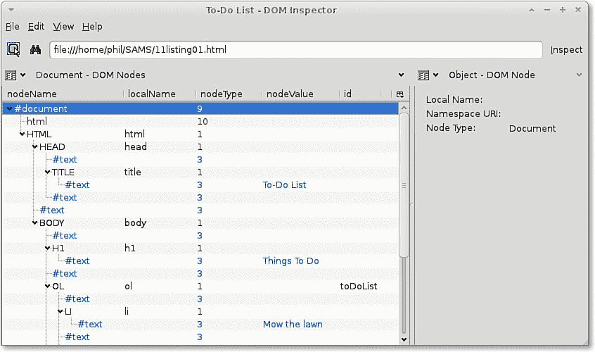

**图 9.5** Mozilla 的 DOM 检查器

在左侧显示面板的树形结构中选择一个 DOM 节点，可以在右侧面板查看其详细信息。除了 DOM 树查看器，还包含了用于查看 CSS 规则、样式表、计算样式、JavaScript 对象等的其他查看器。

界面初看起来可能有些令人生畏，但探索该程序的功能是非常值得的。

***

**提示**

当你使用在本节中描述的方法修改 DOM 时，你改变的是页面在浏览器中的显示方式。但请记住，你并没有更改文档本身。如果你要求浏览器显示页面的源代码，你将不会在该处看到任何变化。

这是因为浏览器实际上显示的是文档的当前 DOM 表示。改变它，你就改变了屏幕上显示的内容。

***

## 创建新节点

向 DOM 树中添加新节点是一个两个阶段的过程：

**1.** 首先，你创建一个新节点。一旦创建，该节点最初处于一种“悬空”状态；它确实存在，但实际上并未位于 DOM 树的任何位置，因此不会显示在浏览器窗口的可视页面上。

**2.** 接下来，你将新节点添加到树中所需的位置。此时，它就变成了可见页面的一部分。

让我们来看 `document` 对象中一些可用于创建节点的方法。

### createElement()

你可以调用 `createElement()` 方法来创建新的 HTML 元素，这些元素可以是任何标准的 HTML 元素类型——段落、span、表格、列表等。

假设你已经决定为文档创建一个新的 `<div>` 元素。为此，你只需要将相关的 `nodeName` 值——在此例中为 `"div"`——传递给 `createElement` 方法：

```javascript
var newDiv = document.createElement("div");
```

新的 `<div>` 元素现在已经存在，但目前没有内容、没有属性，在 DOM 树中也没有位置。你稍后就会看到如何解决这些问题。

### createTextNode()

你页面中的许多 HTML 元素都需要文本形式的内容。`createTextNode()` 方法可以处理这个问题。它的工作原理与 `createElement()` 非常相似，不同之处在于接受的参数不是 `nodeName` 值，而是一个包含元素所需文本内容的字符串：

```javascript
var newTextNode = document.createTextNode("Here is some text content.");
```

与 `createElement()` 一样，新创建的节点尚未位于 DOM 树中；JavaScript 将其存储在变量 `newTextNode` 中，等待你将其放置在所需的位置。

### cloneNode()

没有必要重造轮子。如果你文档中已经有一个与你想要创建的新节点相同的节点，你可以使用 `cloneNode()` 来。

与 `createElement()` 和 `createTextNode()` 不同，`cloneNode()` 接受单个参数——一个 `true` 或 `false` 的布尔值。

向 `cloneNode()` 函数传递 `true` 告诉 JavaScript 你不仅想克隆该节点，还要克隆它所有的子节点：

```javascript
var myDiv = document.getElementById("id1");
var newDiv = myDiv.cloneNode(true);
```

在这个示例中，我要求 JavaScript 也克隆元素的子节点；例如，`myDiv` 包含的任何文本（将包含在元素的子文本节点中）都将忠实地复制到新的 `<div>` 元素中。

如果我调用

```javascript
var newDiv = myDiv.cloneNode(false);
```

那么新的 `<div>` 元素将与原始元素相同，只是它将没有子节点。例如，它将拥有属于原始元素的任何属性（当然，前提原始节点是一个元素节点）。

***

**注意**

记住元素的 `id` 是它的属性之一。当你克隆一个节点时，记住随后更改你新元素的 `id`，因为 `id` 值在文档中应该是唯一的。

***

与通过 `createElement()` 和 `createTextNode()` 创建的新节点一样，通过 `cloneNode()` 创建的新节点最初也悬浮在空中；它在 DOM 树中没有位置。

你接下来将看到如何实现这一点。

## 操作子节点

你创建的新节点还还没有任何实际价值，因为它们还没有出现在 DOM 的任何地方。`document` 对象的几个方法专门设计用于将节点放置在 DOM 树中，它们将在接下来的章节中描述。

### appendChild()

将新节点附加到 DOM 的最简单方法或许是将其作为子节点后附加到文档中某处已存在的节点上。这样做只需要找到所需的父节点并调用 `appendChild()` 方法：

```javascript
var newText = document.createTextNode("Here is some text content.");
var myDiv = document.getElementById("id1");
myDiv.appendChild(newText);
```

在前面的代码段中，创建了一个新的文本节点并将其作为子节点添加到当前现有 `id` 为 `id1` 的 `<div>` 元素中。

***

**提示**

记住 `appendChild()` 总是最后一个子节点之后添加子节点，因此新附加的节点成为父节点的 `lastChild`。

***

当然，`appendChild()` 同样适用于所有类型的节点，而不仅仅是文本节点。假设你需要在 `<div>` 元素内部添加另一个 `<div>` 元素：

```javascript
var newDiv = document.createElement("div");
var myDiv = document.getElementById("id1");
myDiv.appendChild(newDiv);
```

你原来的 `<div>` 元素现在包含了另一个 `<div>` 元素作为最后一个子节点；如果父 `<div>` 元素已经以子文本节点的形式包含了一些文本内容，那么父 `div`（在新修改的 DOM 中，而不是源代码中）现在将具有如下形式：

```html
<div id="id1">
    Original text contained in text node
    <div></div>
</div>
```

### insertBefore()

`appendChild()` 总是将子元素添加到子列表的末尾，而使用 `insertBefore()`，你可以指定一个子元素并将新节点插入其之前。

该方法接受两个参数：新节点，以及要插入其之前的子元素。假设你的页面包含以下 HTML 代码段：

```html
<div id="id1">
    <p id="para1">This paragraph contains some text.</p>
    <p id="para2">Here's some more text.</p>
</div>
```

要在现有两个段落之间插入一个新的段落，首先创建这个新段落：

```javascript
var newPara = document.createElement("p");
```

```javascript
var myDiv = document.getElementById("id1");

var para2 = document.getElementById("para2");
```

然后将这两个作为参数传递给 `insertBefore()`：

```javascript
myDiv.insertBefore(newPara, para2);
```

### replaceChild()

当你想要将特定父元素的当前子节点替换为另一个节点时，可以使用 `replaceChild()`。该方法接受两个参数——先是新子元素的引用，紧接着是旧元素的引用。

***

自己尝试一下：替换子元素

查看代码列表 9.3 中的代码。

**代码列表 9.3 替换子元素**


# 替换页面元素

```html
<!DOCTYPE html>
<html>
<head>
    <title>替换页面元素</title>
</head>
<body>
    <div id="id1">
        <p id="para1">Welcome to my web page.</p>
        <p id="para2">Please take a look around.</p>
        <input id="btn" value="Replace Element" type="button" />
    </div>
</body>
</html>
```

假设你想使用 DOM 移除 `<div>` 中的第一个段落，并将其替换为 `<h2>` 标题，如下所示：

```html
<h2>Welcome!</h2>
```

首先创建一个代表 `<h2>` 标题的新节点：

```javascript
var newH2 = document.createElement("h2");
```

这个新元素需要包含一个用于标题文本的文本节点。你现在就可以创建并添加它，也可以在之后将新的 `<h2>` 元素添加到 DOM 之后再做。我们现在就做吧：

```javascript
var newH2Text = document.createTextNode("Welcome!");
newH2.appendChild(newH2Text);
```

现在你可以交换 `<div>` 元素中不需要的子节点并将其替换为新节点：

```javascript
var myDiv = document.getElementById("id1");
var oldP = document.getElementById("para1");
myDiv.replaceChild(newH2, oldP);
```

最后，你需要为按钮元素添加一个 `onclick` 事件处理器，这样当点击按钮时，就会执行你的元素替换函数。我们通过赋值给 `window.onload` 方法的匿名函数来实现：

```javascript
window.onload = function() {
    document.getElementById("btn").onclick = replaceHeading;
}
```

代码列表 9.4 显示了添加 JavaScript 的页面代码。

## 代码列表 9.4 替换子元素的完整代码

```html
<!DOCTYPE html>
<html>
<head>
    <title>Replace Page Element</title>
    <script>
        function replaceHeading() {
            var newH2 = document.createElement("h2");
            var newH2Text = document.createTextNode("Welcome!");
            newH2.appendChild(newH2Text);
            var myDiv = document.getElementById("id1");
            var oldP = document.getElementById("para1");
            myDiv.replaceChild(newH2, oldP);
        }
        window.onload = function() {
            document.getElementById("btn").onclick = replaceHeading;
        }
    </script>
</head>
<body>
    <div id="id1">
        <p id="para1">Welcome to my web page.</p>
        <p id="para2">Please take a look around.</p>
        <input id="btn" value="Replace Element" type="button" />
    </div>
</body>
</html>
```

用你的编辑器创建一个新的 HTML 文件，并插入代码列表 9.4 中列出的代码。在浏览器中加载页面时，你应该看到两个单行文本段落以及下方的按钮。如果一切按计划进行，点击按钮会将第一个 `<p>` 元素交换为你的 `<h2>` 标题，如图 9.6 所示。

### removeChild()

有一个专门提供的 DOM 方法用于从 DOM 树中移除子节点。

再次参考代码列表 9.3，如果你想移除 `id="para2"` 的 `<p>` 元素，可以直接使用：

```javascript
var myDiv = document.getElementById("id1");
var myPara = document.getElementById("para2");
myDiv.removeChild(myPara);
```

#### 提示

如果你没有该元素的父元素引用，只需使用 `parentNode` 属性：

```javascript
myPara.parentNode.removeChild(myPara);
```

`removeChild()` 方法的返回值包含对被移除节点的引用。如果你有需要，可以使用它来处理被移除的节点：

```javascript
var removedItem = myDiv.removeChild(myPara);
alert('Item with ' + removedItem.getAttribute("id") + ' has been removed.');
```

### 编辑属性

在过去一个小时中，你学习了如何使用 `getAttribute()` 方法读取属性。有一个名为 `setAttribute()` 的对应方法，允许你为元素节点创建属性并赋值。该方法接受两个参数；意所易见，这些是要添加的属性及其应该拥有的值。

在下面的示例中，为 `<p>` 元素添加了 title 属性并赋值为值“Opening Paragraph”：

```javascript
var myPara = document.getElementById("para1");
myPara.setAttribute("title", "Opening paragraph");
```

设置已存在属性的值实际上会覆盖该属性原有的值。你可以利用这一知识来有效地编辑属性值：

```javascript
var myPara = document.getElementById("para1");
myPara.setAttribute("title", "Opening paragraph");
myPara.setAttribute("title", "New title");
```

### 动态加载 JavaScript 文件

有时，你可能希望向已经加载的页面动态加载 JavaScript 代码。你可以使用 `createElement()` 动态创建一个包含所需代码的新 `<script>` 元素，然后将此元素添加到页面 DOM 中：

```javascript
var scr = document.createElement("script");
scr.setAttribute("src", "newScript.js");
document.head.appendChild(scr);
```

记住，`appendChild()` 方法将新节点放在最后一个子节点之后，因此新的 `<script>` 元素将直接位于页面 `<head>` 部分的末尾。

但注意，如果你使用这种方法动态加载 JavaScript 文件，这些文件中包含的 JavaScript 代码在外部文件加载完成之前对你的页面是不可用的。

建议你在尝试使用额外代码之前，让程序检查是否如此。

几乎所有现代浏览器在脚本下载后都会实现 `onload` 事件。这与你已经见过的 `window.onload` 事件一样，但它不是在主页面加载完成时触发，而是在外部资源（在此例中为 JavaScript 源文件）完全下载并可用时触发：

```javascript
scr.onload = function() {
    ... 当新源代码下载后要执行的操作 ...
}
```

#### 注意

这在旧版本的 Internet Explorer 中不起作用，但从 IE8 开始，script 元素已支持 `onload`。为了稳妥起见，你可能更倾向于对新加载文件中包含的资源进行对象检测。

## 自己尝试一下：动态创建的菜单

在本次练习中，你将使用在本小时和上一小时学到的技术来动态创建页面菜单。

我们的示例 HTML 页面有一个顶层 `<h1>` 标题，随后是若干篇短文章，每篇文章都由一个 `<h2>` 标题和一些段落组成。这类似于你可能在博客、新闻页面或 RSS 阅读器输出等示例中看到的格式。

你将要做的是利用 DOM 方法在页面头部自动生成一个菜单，其中包含允许用户跳转到页面上任何文章的链接。HTML 文件见列表 9.5。请根据此脚本创建你自己的 HTML 文件。可以随心使用你自己的标题和文本内容，只要章节标题包含在 `<h2>` 元素中即可。

### 列表 9.5 用于动态创建菜单的 HTML 文件

```html
<!DOCTYPE html>
<html>
<head>
    <meta charset="utf-8" />
    <title>Scripting the DOM</title>
    <script src="menu.js"></script>
    <script>window.onload = makeMenu;</script>
</head>
<body>
    <h1>西班牙西部的埃斯特雷马杜拉地区</h1>
    <h2>该地区的地理</h2>
    <p>埃斯特雷马杜拉自治区位于西班牙西部，紧邻葡萄牙边界。它与西班牙的卡斯蒂利亚亚和莱昂、卡斯蒂利亚-拉曼曼恰和安达卢西亚地区以及葡萄牙（西部）接壤。该地区面积超过 40,000 平方公里，有两个省份：北部的卡塞斯和南部的巴达里霍斯。</p>
    <h2>住哪里</h2>
    <p>埃斯特雷马杜拉全境有广泛的住宿选择，包括小旅馆和客栈（'Hostals'），或者如果是团体旅行，可以考虑租一栋“casa rural”（乡村小屋）。</p>
    <h2>气候</h2>
    <p>通常为地中海气候，北部除外，那里是大陆性气候。通常以极端天气而闻名，包括炎热干燥且经常发生干旱的夏季，以及漫长温和的冬季。</p>
    <h2>看什么</h2>
    <p>埃斯特雷马杜拉全年举办各类活动，包括戏剧、音乐、电影、文学和民俗。壮丽的景点包括城堡、中世纪广场和历史中心。梅里达、卡塞斯、阿尔坎塔拉和阿尔布尔克克还有特殊的夏季戏剧节。</p>
    <h2>美食</h2>
    <p>埃斯特雷马杜拉美食的品质源于当地食材的优质品质。除了放养羊肉和牛肉、美味的奶酪、红白葡萄酒、橄榄油、蜂蜜和红椒外，埃斯特雷马杜拉还以比比利利亚火肉而闻名。“黑脚”（pata negra）猪在软橡树林中以橡果为食，这是生产世界上顶级火肉和腌肉肠的关键。</p>
</body>
</html>
```

页面见图 9.7。

第一步是获取页面中所有 `<h2>` 元素的集合。这些元素将构成你菜单中的项。对于这些标题中的每一个，创建一个指向锚点元素的链接，并将其放置在相应的 `<h2>` 元素旁边。

菜单链接将作为无序列表（`<ul>`）元素中的链接进行排列。此列表将放置在你插入到页面头部的 `<div>` 容器中。

首先，获取 `<h2>` 元素的集合：

```javascript
var h2s = document.getElementsByTagName("h2");
```

你需要创建一个 `<div>` 容器来容纳你的菜单；在那个 `<div>` 内部，将有一个 `<ul>` 列表元素来包含菜单项：

```javascript
var menu = document.createElement("div");
var menuUl = document.createElement("ul");
menu.appendChild(menuUl);
```

现在你可以遍历 `<h2>` 标题集合了：

```javascript
for(var i = 0; i < h2s.length; i++) {
    ... 对每个标题执行某些操作 ...
}
```

对于文档中找到的每个标题，你有若干任务要执行：

- 收集标题子文本节点的内容，这构成了标题的文本：

```javascript
var itemText = h2s[i].childNodes[0].nodeValue;
```

- 为菜单创建一个新的列表项（`<li>`）元素：

```javascript
var menuLi = document.createElement("li");
```

- 将该 `<li>` 元素添加到菜单：

```javascript
menuUl.appendChild(menuLi);
```

- 每个列表项必须包含一个指向菜单项所指标题旁边的锚点的链接：

```javascript
var menuLiA = document.createElement("a");
menuLiA = menuLi.appendChild(menuLiA);
```

- 为链接设置合适的 `href` 属性（记住变量 `i` 在你遍历数组中的标题时会递增）。这些链接的格式如下：

```html
<a href="#itemX">[标题文本]</a>
```

其中 X 是菜单项的索引数字：

```javascript
menuLiA.setAttribute("href", "#item" + i);
```

- 在每个 `<h2>` 标题之前创建一个匹配的锚点元素。锚点元素的格式为

```html
<a name="itemX">
```

所以你需要添加 `name` 属性，并定位到关联标题之前的链接：

```javascript
var anc = document.createElement("a");
anc.setAttribute("name", "item" + i);
```

当每个 `<h2>` 完成这些操作后，你就可以将菜单添加到：

```javascript
document.body.insertBefore(menu, document.body.firstChild);
```

源文件 `menu.js` 的内容见列表 9.6。

### 列表 9.6 用于 menu.js 的 JavaScript 代码

```javascript
function makeMenu() {
    // 获取 H2 元素
    var h2s = document.getElementsByTagName("h2");
    // 创建菜单的页面元素
    var menu = document.createElement("div");
    // 创建 UL 元素并添加到菜单
    var menuUl = document.createElement("ul");
    menu.appendChild(menuUl);
    // 遍历标题
    for(var i = 0; i < h2s.length; i++) {
        // h2 元素的文本节点
        var itemText = h2s[i].childNodes[0].nodeValue;
        // 添加列表项
        var menuLi = document.createElement("li");
        // 将添加到菜单列表
        menuUl.appendChild(menuLi);
        // 列表项包含链接
        var menuLiA = document.createElement("a");
        menuLiA = menuLi.appendChild(menuLiA);
        // 设置链接的 href
        menuLiA.setAttribute("href", "#item" + i);
        // 设置链接的文本
        var menuText = document.createTextNode(itemText);
        menuLiA.appendChild(menuText);
        // 创建匹配的锚点元素
        var anc = document.createElement("a");
        anc.setAttribute("name", "item" + i);
        // 将锚点插入标题之前
        document.body.insertBefore(anc, h2s[i]);
    }
    // 将菜单添加到页面顶部
    document.body.insertBefore(menu, document.body.firstChild);
}
```

该代码已集成到 `window.onload` 事件处理程序中，在 DOM 可用时构建你的菜单。

图 9.8 显示了脚本的运行。

通过使用浏览器工具查看修改后的 DOM，你可以看到添加到页面中以形成菜单和锚点的额外 DOM 元素。图 9.9 显示了这在 Google Chromium 开发工具中是如何显示的，并高亮了这些额外的元素。

### 总结

在本小时中，你学习了 DOM 节点以及如何使用各种与节点相关的方法遍历 DOM。你还学习了如何使用 Mozilla 的 DOM 检查器来检查页面的 DOM。

此外，你还学习了如何创建新节点并添加到 DOM 中，以及如何通过添加、编辑和删除 DOM 节点来动态编辑页面内容。

## 问答

**Q. 有没有方法可以判断节点是否具有子节点？**

**A.** 是的，你可以使用 `hasChildNodes()` 方法。如果节点有一个或多个子节点，该方法返回布尔值 `true`，否则返回 `false`。记住，属性节点和文本节点不能有子节点，因此如果应用于这些类型的节点，该方法将始终返回 false。

**Q. Mozilla 的 DOM 检查器是同类工具中的唯一性吗？**

**A.** 并非如此。几乎每个浏览器的开发工具都内置了一些 DOM 检查工具。然而，Mozilla 的 DOM 检查器为 DOM 层次结构和单个节点的参数提供了特别清晰的视图；这就是我在这里介绍它的原因。

**Q. 使用 DOM 插入和检索 HTML，还是使用 `innerHTML` 更好？**

**A.** 两者各有优劣。要向文档中插入一段 HTML，使用 `innerHTML` 是快速且方便的。但是，它不会返回你所插入代码的引用，因此你无法很容易对该内容执行操作。DOM 方法为操纵页面元素提供了更细粒度的控制。

无论你在何处使用 `innerHTML`，都可以使用 DOM 方法实现相同的结果，尽管通常需要多一些代码。

同样记住，`innerHTML` 并不是 W3C 标准。它目前得到了良好支持，但不能保证将来一直如此。

**Q. 我在 Web 上看到过关于 DOM Core 和 HTML DOM 的引用。它们是什么，它们之间的区别是什么？**

**A.** DOM Core 描述了 DOM 方法的基本内核，这些方法不仅适用于 HTML 页面，还适用于使用任何类似标记语言编写的页面——例如 XML。HTML DOM 是一个更大的集合，包含了专门与 HTML 页面相关的额外方法。它们确实提供了一些执行某些任务的简便方法，但代价是你的代码对非 HTML 程序的移植性会略降低。

书中的示例通常使用 DOM Core 方法以更具通用性。在列表 9.6 中，例如，我使用了语句

```javascript
menuLiA.setAttribute("href", "#item" + i);
```

我同样可以使用 HTML DOM 语句

```javascript
menuLiA.href = "#item" + i;
```

这要短一点。

## 工作坊

在阅读随后的“答案”部分之前，尝试回答所有问题。

### 测验

**1.** 下列哪项不是节点类型？

**a.** 元素 (Element)

**b.** 属性 (Attribute)

**c.** 数组 (Array)

**2.** `getElementsByTagName()` 方法返回：

**a.** 元素对象的类数组集合

**b.** `nodeType` 值的类数组集合

**c.** 标签名的类数组集合

**3.** 在某些浏览器中，页面元素内的空白字符会导致创建

**a.** 文本节点

**b.** JavaScript 错误

**c.** 属性节点

**4.** 为了创建一个新的 `<span>` 元素，你可以使用

**a.** `document.createElement("span");`

**b.** `document.createElement(span);`

**c.** `document.appendChild("span");`

**5.** 为了复制一个节点（包括其所有子节点），你可以使用

**a.** `cloneNode(false);`

**b.** `copyNode();`

**c.** `cloneNode(true);`

**6.** 为了将 `` 元素的 `alt` 属性设置为“Company Logo”，你可以使用

**a.** `setAttribute(alt, "Company Logo");`

**b.** `setAttribute("alt", "Company Logo");`

**c.** `setAttribute(alt = "Company Logo");`

### 答案

**1.** c. 数组不是节点类型。

**2.** a. 返回了元素对象的类数组集合。

**3.** a. 元素内的空白通常会创建一个文本节点作为元素的子节点。

**4.** a. 使用 `document.createElement("span");`

**5.** c. 使用 `cloneNode(true);`

**6.** b. 使用 `setAttribute("alt", "Company Logo");`

## 练习

- 使用表 9.1 中列出的 `nodeType` 信息，编写一个函数来查找页面 body 部分所有的 HTML 注释，并将它们合并成一个单一字符串。为列表 9.2 中列出的代码添加一些注释；然后引入并测试你的新函数。

- 如果你有 Firefox，请下载并安装 DOM 检查器并熟悉其界面。

- 在使用了 `insertBefore()` 方法后，你可能合理地有一个 `insertAfter()` 方法。遗憾的是，并没有。你能否写一个 `insertAfter()` 函数来实现这一点？使用类似的 `insertBefore()`；即 `insertAfter(newNode, targetNode)`。

- 当你点击 9.6 生成的菜单项时，页面会滚动到相应的项目。要返回菜单，你需要手动向上滚动。你能否修改脚本，使其在插入锚点的同时，在每个 `<h2>` 元素之前插入一个返回顶部链接？（提示：你不需要添加新链接，只需为锚点添加 `href` 和链接文本。）

# 十节 认识 JSON

本小时将学习：

- 什么是 JSON
- 如何模拟关联数组
- 关于 JSON 和对象
- 访问 JSON 数据
- 使用 JSON 进行数据序列化
- 如何确保 JSON 安全

在书的早期，你学习了如何使用 `new Object()` 语法直接实例化对象。在本小时中，你将学习 JavaScript 对象表示法（JSON），正如其名称所示的那样，它提供了另一种创建实例的方法，并可以作为一种通用的数据交换语法。

#### 注意

JSON 的官方网站是 [`json.org/`](http://json.org/)，那里还有指向网上各种 JSON 资源的链接。

### 什么是 JSON？

JSON（读作“Jason”）是 JavaScript 对象的一种简单且紧凑的表示法。一旦以 JSON 格式表示，对象就可以很容易转换为字符串以便存储和传输（例如在网络上或应用程序之间）。

然而，JSON 真正的魅力在于，以 JSON 格式表示的对象实际上是用普通的 JavaScript 代码表示的。因此，你利用了 JavaScript 的“自动”解析；你只需要让 JavaScript 解析 JSON 字符串的内容即可，而不需要额外的解析器或转换器。

JSON 数据表示为一系列参数和值对，每对都使用冒号字符来分隔参数和值。这些 `"parameter":"value"` 键对之间用逗号分隔：

```javascript
"param1":"value1", "param2":"value2", "param3":"value3"
```

最后，整个序列被包裹在大括号之间，形成一个表示你数据的 JSON 对象：

```javascript
var jsonObject = {
    "param1":"value1",
    "param2":"value2",
    "param3":"value3"
}
```

这里定义的对象 `jsonObject` 使用了标准 JavaScript 表示法的子集——它是一小段有效的 JavaScript 代码。

使用 JSON 符号编写的对象可以使用通常的点表示法直接访问其属性和方法：

```javascript
alert(jsonObject.param1); // 弹出 'value1'
```

但更通用地说，JSON 是一种用于以字符串格式交换数据的通用语法。不仅是对象，任何可以表示为一系列 `parameter:value` 对的数据都可以用 JSON 符号表示。随后，通过被称为“序列化”（serialization）的过程，很容易地将 JSON 对象转换为字符串；序列化数据便于在网络中进行存储或传输。你将在本小时的稍后部分看到将如何序列化 JSON 对象。

#### 注意

作为一种通用数据交换语法，JSON 的用法方式有点像 XML，尽管 JSON 对人类来说更易读。此外，解析大型 XML 文件可能是一个缓慢的过程，而 JSON 则为你的脚本提供了一个准备就用的 JavaScript 对象。

JSON 最近备受关注，因为它提供了几个重要的优势。JSON 具有

- 人人和计算机都易于阅读
- 概念简单——一个 JSON 对象无非包裹在大括号内的一系列 `parameter:value` 对
- 很大程度上自文档化
- 创建和解析速度快
- JavaScript 的子集，这意味着不需要特殊的解释器或其他额外的包

许多领先的在线服务和 API（包括 Flickr、Twitter 以及来自 Google 和 Yahoo! 的服务）现在都提供 JSON 符号编码的数据。

#### 注意

有关 Flickr 如何支持 JSON 的详情，请参见 [`www.flickr.com/services/api/response.json.html`](http://www.flickr.com/services/api/response.json.html)。

### JSON 数据

要恢复编码在 JSON 字符串中的数据，你需要某种方式将字符串转换回 JavaScript 代码。这通常被称为*反序列化*（deserializing）字符串。

#### 使用 eval()

只有较新的浏览器才对 JSON 语法有原生支持（我们稍后会讨论使用原生浏览器支持）。然而，由于 JSON 语法是 JavaScript 的子集，可以使用 JavaScript 函数 `eval()` 将 JSON 字符串转换为 JavaScript 对象。

#### 注意

JavaScript 的 `eval()` 函数评估或执行作为参数的任何内容。如果参数是一个表达式，`eval()` 会评估该表达式；例如：

```javascript
var x = eval(4 * 3); // x=12
```

如果参数包含一个或多个 JavaScript 语句，`eval()` 会执行这些语句：

```javascript
eval("a=1; b=2; document.write(a+b);"); // 在页面上写入 3
```

`eval()` 函数使用 JavaScript 解释器解析 JSON 文本并生成 JavaScript 对象：

```javascript
var myObject = eval ('(' + jsonObjectString + ')');
```

然后你可以在你的脚本中使用该 JavaScript 对象：

```javascript
var user = '{"username" : "philb1234","location" : "Spain","height" : 1.80}';
var myObject = eval ('(' + user + ')');
alert(myObject.username);
```

#### 注意事项

字符串必须这样包裹在括号中，以避免陷入 JavaScript 语法中的歧义。

#### 使用原生浏览器支持

所有最近的浏览器都对 JSON 提供原生支持，使得使用 `eval()` 变得没有必要。

#### 注意

原生支持 JSON 的浏览器包括

- Firefox (Mozilla) 3.5+
- Internet Explorer 8+
- Google Chrome
- Opera 10+
- Safari 4+

具有原生 JSON 支持的浏览器创建一个名为 `JSON` 的 JavaScript 对象来管理 JSON 编码解码。`JSON` 对象有两个方法：`stringify()` 和 `parse()`。

##### JSON.parse()

你可以使用 `JSON.parse()` 解析 JSON，它接收一个 JSON 序列化字符串并将其拆分，创建一个属性与字符串中找到的值相对应的对象。

##### JSON.stringify()

你可以使用 `JSON.stringify()` 方法创建对象的 JSON 字符串。

```javascript
myObject = JSON.parse(inString);
```

现在你可以通过遍历对象的方法来构建你的输出消息字符串：

```javascript
for (i in myObject) {
    out += "Property: " + i + " = " + myObject[i] + '\n';
}
```

最后，显示结果：

```javascript
alert(out);
```

输出消息应该像图 10.4 中所示。

### JSON 数据类型

每个 `parameter:value` 对的参数部分必须遵循几条简单的语法规则：

- 它不能是 JavaScript 的保留关键字。
- 它不能以数字开头。
- 它不能包含下划线或美元符号以外的特殊字符。

JSON 对象中的值可以包含以下任何数据类型：

- 数字 (Number)
- 字符串 (String)
- 布尔 (Boolean)
- 数组 (Array)
- 对象 (Object)
- null (空)

#### 注意

JavaScript 语法具有几种未包含在 JSON 标准中的类型，包括 `Date`、`Error`、`Math` 和 `Function`。这些数据类型必须表示为其他数据格式，且编码和解码程序需遵循相同的编码和解码规则。

### 模拟关联数组

在第 6 小节“数组”中，我们讨论了 JavaScript 数组对象并查看它的各种属性和方法。

你可能记得 JavaScript 数组中的元素具有唯一的数字标识：

```javascript
var myArray = [];
myArray[0] = 'Monday';
myArray[1] = 'Tuesday';
myArray[2] = 'Wednesday';
```

在许多其他编程语言中，可以使用文本键来增强数组的可描述性：

```javascript
myArray["startDay"] = "Monday";
```

遗憾的是，JavaScript 不直接支持这种所谓的关联数组。

然而，使用对象很容易地模拟它们的行为。使用 JSON 记法使代码易于阅读和理解：

```javascript
var conference = { "startDay" : "Monday",
    "nextDay"  : "Tuesday",
    "endDay"  : "Wednesday"
}
```

你现在可以像访问关联数组一样访问对象属性：

```javascript
alert(conference["startDay"]);  // 输出 "Monday"
```

#### 提示

这之所以有效，是因为在 JavaScript 中，两种语法

`object["property"]`

和

`object.property`

是等效的。

#### 注意

记住，这并不是真正的关联数组，尽管它看起来像。如果你遍历该对象，除了这三个属性外，你还会获得任何分配给对象的方法。

### 使用 JSON 创建对象

你可能还从第 6 小节记得，表示数组的一种方便方法是使用方括号：

```javascript
var categories = ["news", "sport", "films", "music", "comedy"];
```

JSON 为我们提供了一种相似的定义 JavaScript 对象的简写。

#### 提示

尽管 JSON 是为了描述 JavaScript 对象而开发的，但它是独立于任何语言或平台的。许多编程语言（包括 Java、PHP、C 等）都有 JSON 库和工具。

#### 属性

正如你所看到的，要在 JSON 记法中表示对象，使用大括号而不是方括号包裹对象，并将对象属性列为 `"property":"value"` 对：

```javascript
var user = {
    "username" : "philb1234",
    "location" : "Spain",
    "height" : 1.80
}
```

#### 提示

你可能记得使用语句

`var myObject = new Object();`

会创建一个没有任何属性或方法的“空”对象实例。JSON 记法中的等效写法不出意外是：

```javascript
var myObject = {};
```

对象属性可以像通常一样立即可用：

```javascript
var name = user.username;
```

#### 方法

你可以通过在对象内部使用函数这种这样添加方法：

```javascript
var user = {
    "username" : "philb1234",
    "location" : "Spain",
    "height" : 1.80,
    "setName":function(newName){
        this.username = newName;
    }
}
```

然后你可以像通常一样调用 `setName` 方法：

```javascript
user.setName(prompt("Enter a username:"));
```

虽然这种添加方法的方法在 JavaScript 上文中是行得通的，但在将 JSON 作为通用数据格式使用时是不允许的。请参见关于 JSON 安全的后续章节。

#### 数组

属性值本身可以是 JavaScript：

```javascript
var listObject = {
    "booklist": ["Foundation", "Dune", "Eon", "2001 A Space Odyssey", "Stranger In A Land"]
};
```

在前面的示例中，对象有一个属性 `booklist`，其值是一个数组。你可以通过传递数组键来访问数组中的单独项（记住数组从零开始）：

```javascript
var book = listObject.booklist[2]; // 值 "Eon"
```

上一行代码将 `booklist` 数组中的第二个项赋值给变量 `book`。

#### 对象

JSON 对象甚至可以包含其他对象。通过让数组元素本身成为 JSON 对象，你可以使用点符号来访问它们。

在下面的示例中，与属性 `booklist` 相关的值是一个对象数组。每个 JSON 对象都有两个 `"parameter":"value"` 对，分别持有相关书籍的标题和作者。

像上一个示例所示获取书籍数组后，很容易访问 `title` 和 `author` 属性：

```javascript
var bookListObject = {
    "booklist": [{"title":"Foundation", "author":"Isaac Asimov"},
    {"title":"Dune", "author":"Frank Herbert"},
    {"title":"Eon", "author":"Greg Bear"},
    {"title":"2001 A Space Odyssey", "author":"Arthur C. Clarke"},
    {"title":"Stranger In A Land", "author":"Robert A. Heinlein"}]
};

// 显示第三本书的作者
alert(bookListObject.booklist[2].author); // 显示 "Greg Bear"
```

`bookListObject` 有一个属性 `booklist`，它是一个名为 `bookListObject` 的对象的数组。

### 动手尝试：操作 JSON 对象

让我们采用之前的 JSON 对象 `bookListObject` 并构建一个用户消息，以易于阅读的格式列出书籍和作者。创建一个 HTML 文件并输入列表 10.2 中的代码。你的 JSON 对象与之前的示例完全相同，但这次你将访问书籍数组，并使用循环对其进行遍历，在过程中通过追加书籍和作者来构建消息字符串。最后你向用户显示书籍信息。

#### 列表 10.2 处理多级 JSON 对象

```html
<!DOCTYPE html>
<html>
<head>
    <title>Understanding JSON</title>
    <script>
var booklistObject = {
        "booklist": [{"title":"Foundation", "author":"Isaac Asimov"},
              {"title":"Dune", "author":"Frank Herbert"},
              {"title":"Eon", "author":"Greg Bear"},
              {"title":"2001 A Space Odyssey", "author":"Arthur C. Clarke"},
              {"title":"Stranger In A Strange Land", "author":"Robert A. Heinlein"}]
    }
    // 一个用于存储我们用户消息的变量
    var out = "";
    // 获取数组
    var books = booklistObject.booklist;
    // 遍历数组，逐个获取书籍
    for(var i =0; i<books.length;i++) {
        var booknumber = i+1;
        out += "Book "  + booknumber +
              " is: '" + books[i].title +
              "' by " + books[i].author +
              "\n";
    }
    </script>
</head>
<body onload="alert(out)">

</body>
</html>
```

在设计好 JSON 对象后，你声明了一个变量并赋值一个空字符串。这个变量将在构建输出消息时存储该消息：

`var out = "";`

现在你提取书籍数组，并将此数组赋值给新变量 `books`，以避免以后进行冗长的输入：

```javascript
var books = booklistObject.booklist;
```

之后，你只需要遍历书籍数组，读取每个书籍对象的 `title` 和 `author` 属性，并构造一个字符串追加到你的输出消息中即可：

```javascript
for(var i =0; i<books.length;i++) {
    var booknumber = i+1; // 数组索引从零开始！
    out += "Book "  + booknumber +
          " is: '" + books[i].title +
          "' by " + books[i].author +
          "\n";
}
```

最后，将你的消息显示给用户：

`alert(out);`

运行此脚本的结果所示图 10.5。

### JSON 安全

使用 JavaScript 的 `eval()` 函数可以执行任何 JavaScript 命令。这可能代表一个潜在的安全问题，特别是当处理来自不受信源的 JSON 数据时。

使用带有原生 JSON 解析器的浏览器将 JSON 字符串转换为 JavaScript 对象会更安全。JSON 解析器只会识别 JSON 文本，而不会执行脚本命令。原生 JSON 解析器通常比使用 `eval()` 更快。

原生 JSON 支持在较新的浏览器以及最新的 ECMAScript (JavaScript) 标准中实现。

### 总结

在这一小时中，你学习了 JSON 记法，这是一种简单的数据交换语法，也可以用于创建 JavaScript 对象的实例。

你学习了如何使用现代浏览器的原生 JSON 支持将对象序列化为 JSON 字符串，并将 JSON 字符串解析为 JavaScript 对象。

## 问答

**Q. 我可以在哪里阅读官方的 JSON 文档？**

**A.** JSON 语法在 RFC 4627 中有正式描述。你可以在 [`www.ietf.org/rfc/rfc4627`](http://www.ietf.org/rfc/rfc4627) 阅读它。在 JSON 的官方网站 [`json.org/`](http://json.org/) 也有很多信息。

**Q. 我如何知道我的浏览器是否原生支持 JSON？**

**A.** 你可以像第 8 节“面向对象编程”中描述的那样，使用 `typeof` 运算符检查 JSON 对象是否存在。

```javascript
if(typeof JSON == 'object') {
    // 你拥有 JSON 对象
} else {
    // 你没有
}
```

# 十一节 HTML5 新特性

Web 视频非常流行。然而，实现视频的方法通常是专有的，通过 Flash、Windows Media 和 Apple QuickTime 等插件进行播放。在某个浏览器中用于嵌入这些元素的标记，在其他浏览器中并不总是有效。

HTML5 包含一个新的 `<video>` 元素，其目标是能够嵌入任何及所有的视频格式。

使用新的 `<video>` 标签，你可以这样实现你喜爱的 QuickTime 电影：

```html
<video src="video.mov" />
```

到为止，关于视频元素应该支持哪些视频格式（解码器）一直存在着许多争议；在编写此本书时，人们仍在寻找一种不需要特殊许可条款的解码器，尽管 WebM ([`www.webmproject.org/`](http://www.webmproject.org/)) 目前看起来是首选。目前，通过引用多个源可以解决这个问题，并避免对浏览器嗅探的需求；目前有三种广泛支持的视频格式：MP4、WebM 和 Ogg。

```html
<video id="vid1" width="400" height="300" controls="controls">
    <source src="movie.mp4" type="video/mp4" />
    <source src="movie.ogg" type="video/ogg" />
    <source src="movie.webm" type="video/webm" />
    <p>不支持 video 标签。</p>
</video>
```

为 `<video>` 元素包含 `width` 和 `height` 属性也是一种良好的做法。如果未设置高度和宽度，浏览器将不知道预留多大的屏幕空间，导致页面布局在视频加载时发生变化。

还建议您在 `<video>` 和 `</video>` 标签之间放置一些合适的文本，以便在不支持 `<video>` 标签的浏览器中显示。

`<video>` 标签的一些重要属性列在表 11.2 中。

注意，使用 `controls` 属性添加的控件的外观将取决于所使用的浏览器，如图 11.1 所示。

你可以像访问任何其他 JavaScript 或 DOM 对象一样访问这些属性。对于之前的视频定义，你可以使用：

```javascript
var myVideo = document.getElementById("vid1").volume += 0.1;
```

来略微增加音量，或者

```javascript
if(document.getElementById("vid1").paused) {
    alert(message);
}
```

向用户传递一条消息，指示视频播放当前已暂停。

### 使用 canPlayType() 测试格式支持

你可以使用 JavaScript 方法检查对特定解码器的支持：

```javascript
media.canPlayType(type)
```

在在前的示例中，`type` 是一个包含媒体类型的字符串，例如“video/webm”。如果浏览器知道它无法播放该内容，此方法必须返回一个空字符串。如果浏览器确定它可以支持该格式，该方法可能会返回“probably”，否则返回“maybe”。

### 控制播放

也可以使用 `pause()` 和 `play()` 命令通过编程方式控制播放，如下代码段所示：

```javascript
var myVideo = document.getElementById("vid1").play();
var myVideo = document.getElementById("vid1").pause();
```

### 使用 <audio> 标签播放声音

之前关于 `<video>` 标签的所有内容几乎同样适用于 `<audio>` 标签。使用 `<audio>` 标签的简单方法如下：

```html
<audio src="song.mp3"></audio>
```

你可以添加更多属性以实现对播放的更多控制，例如 `loop` 和 `autoplay`：

```html
<audio src="song.mp3" autoplay loop></audio>
```

#### 提示

不要滥用 `loop` 和 `autoplay`，否则你可能会发现你的许多网站访问者不再回来了！

与早期的视频文件示例一样，你可以包含替代格式以帮助用户的浏览器能够找到一种它可以播放的格式，如下代码所示：

```html
<audio controls="controls">
    <source src="song.ogg" type="audio/ogg" />
    <source src="song.mp3" type="audio/mpeg" />
    您的浏览器不支持 audio 元素。
</audio>
```

MP3、WAV 和 Ogg 通常是 `<audio>` 元素支持的文件格式。在 JavaScript 中控制音频文件使用与 `<video>` 标签相同的方法。

要通过 JavaScript 添加并播放音频文件，你可以像处理任何其他 JavaScript 或 DOM 对象一样来处理它：

```javascript
var soundElement = document.createElement('audio');
soundElement.setAttribute('src', 'sound.ogg');
soundElement.play();
soundElement.pause();
```

`<audio>` 和 `<video>` 标签有许多可以通过 JavaScript 访问的有用属性。这里有几个实用的属性，其意义显而易见：

```javascript
mediaElement.duration
mediaElement.currentTime
mediaElement.playbackRate
mediaElement.muted
```

例如，要跳转到歌曲第 45 秒处，你可能需要使用

```javascript
soundElement.currentTime = 45;
```

#### 提示

你可以在 `http://www.whatwg.org/specs/web-apps/current-work/multipage/the-element.html` 找到这些标签和方法的全面参考。

### 使用 <canvas> 在页面上绘图

新的 `<canvas>` 标签为你提供了这种功能：页面上的矩形空间，你可以在其中绘制形状和图形，还可以通过 JavaScript 加载图像文件并显示。使用 `<canvas>` 标签只需允许你通过设置 `width` 和 `height` 参数来定义区域；其他与创建图形内容相关的所有操作都通过 JavaScript 完成。有一套被称为 Canvas 2D API 的大量绘制方法。

### 动手尝试：使用 <canvas> 移动球

你将在 `<canvas>` 中制作一个简单的动画——一个在页面上圆形移动的红色圆盘（代表球）。

页面主体中所需的 HTML 只有 `<canvas>` 元素：

```html
<canvas id="canvas1" width="400" height="300"></canvas>
```

所有的绘图和动画将在 JavaScript 中完成。

#### 提示

如果你不设置 `width` 和 `height` 参数，画布将默认为 300 像素宽、150 像素高。

你首先需要指定*渲染上下文*。在编写此本书时，2D 是唯一广泛支持的上下文，尽管 3D 上下文正在开发中。

```javascript
context = canvas1.getContext('2d');
```

`<canvas>` 仅支持的原始形状是矩形：

```javascript
fillRect(x,y,width,height); // 绘制填充矩形
strokeRect(x,y,width,height); // 绘制轮廓矩形
clearRect(x,y,width,height); // 清除矩形
```

所有其他形状必须通过使用一个或多个路径绘制函数来创建。由于画一个有颜色的圆盘，这就是你需要的。

`<canvas>` 提供了几种不同的路径绘制函数。

移动到 x, y 而不绘制任何内容：

```javascript
moveTo(x, y)
```

从当前位置画线到 x, y：

```javascript
lineTo(x, y)
```

绘制半径为 r、圆心为 x, y、从 `startAngle` 到 `endAngle` 的圆形圆弧。

```javascript
arc(x, y, r, startAngle, endAngle, anti)
```

将最后一个参数设置为布尔值 `true` 会使圆弧按逆时针绘制，而不是默认的顺时针绘制。

要使用这些基本命令创建形状，你需要一些额外的方法：

```javascript
object.beginPath();
object.closePath();        //完成部分形状
object.stroke();          //绘制轮廓形状
object.fill();            //绘制填充形状
```

#### 提示

如果你使用 `fill` 方法，开放的形状将自动关闭，你无需手动使用 `closePath()`。

让我们把生成的球变成一个实心圆。我们让它呈红色，半径为 15，并位于画布坐标 50, 50 处：

```javascript
context.beginPath();
context.fillStyle="#ff0000";
context.arc(50, 50, 15, 0, Math.PI*2, true);
context.closePath();
```

要让球动起来，你需要使用定时器更改球心的 x 和 y 坐标。查看 `animate()` 函数：

```javascript
function animate() {
    context.clearRect(0,0, 400,300);
    counter++;
    x += 20 * Math.sin(counter);
    y += 20 * Math.cos(counter);
    paint();
}
```

该函数通过 `setInterval()` 方法被重复调用。每次调用时，都会使用 `clearRect()` 方法根据整个画布元素的大小来清除画布。变量 `counter` 在每次循环中递增，然后使用其新值来重新定义圆盘中心的位置。

完整代码列在列表 11.1 中。

#### 列表 11.1 使用 <canvas> 移动球

```html
<!DOCTYPE HTML>
<html>
<head>
    <title>HTML5 canvas</title>
<script>
    var context;
    var x=50;
    var y=50;
    var counter = 0;
    function paint() {
        context.beginPath();
        context.fillStyle="#ff0000";
        context.arc(x, y, 15, 0, Math.PI*2, false);
        context.closePath();
        context.fill();
    }
    function animate() {
        context.clearRect(0,0, 400,300);
        counter++;
        x += 20 * Math.sin(counter);
        y += 20 * Math.cos(counter);
        paint();
    }
    window.onload = function() {
        context= canvas1.getContext('2d');
        setInterval(animate, 100);
    }
</script>
</head>
<body>
    <canvas id="canvas1" width="400" height="300">
        <p>Your browser doesn't support the canvas element.</p>
    </canvas>
</body>
</html>
```

创建此文件并将其加载到浏览器中。如果你的浏览器支持 `<canvas>` 元素，你应该看到一个红色圆盘沿着圆形路径运行，如图 11.2 所示。

### 拖放

拖放是 HTML5 标准的一部分。任何元素都可以变为可拖拽的。要使一个元素变为可拖拽，只需要将其 `draggable` 属性设置为 `true`：

```html

```

然而，单单移动某些东西本身意义不大。为了使用拖拽对象来实现某些功能，你可能希望能够将其放置在某处。

要定义对象可以被放置的位置并控制拖放过程，你需要编写事件监听器来检测和控制拖放过程的各个部分。你可以利用以下事件来控制你的拖放：

- `dragstart`
- `drag`
- `dragenter`
- `dragleave`
- `dragover`
- `drop`
- `dragend`

为了控制拖放，你需要定义一个源元素（拖拽开始的地方）、数据载负载（拖拽的内容）和一个放置目标（接收掉落物品的区域）。

#### 提示

并不是所有项目都可以作为放置目标——例如，`` 无法接受放置。

`dataTransfer` 属性包含拖放动作中发送的数据。`dataTransfer` 的值通常在 `dragstart` 事件中设置，并在 `drop` 事件中读取/处理。调用 `setData(format, data)` 或 `getData(format, data)` 将分别设置或读取这部分数据。

### 亲手尝试：HTML 中的拖放

你将构建一个用于 HTML5 拖放界面的演示程序。打开你的编辑器并创建一个包含列表 11.2 中列出的代码的文件。

#### 列表 11.2 HTML5 拖放

```html
<!DOCTYPE HTML>
<html>
<head>
    <title>HTML5 Drag and Drop</title>
    <style>
        body {background-color: #ddd; font-family: arial, sans-serif;}
        #drop1 {width: 200px;height: 200px;border: 1px solid black;background-color:white}
        #drag1 {width: 50px;height: 50px;}
    </style>
    <script>
        function allowDrop(ev) {
            ev.preventDefault();
        }
        function drag(ev) {
            ev.dataTransfer.setData("Text",ev.target.id);
        }
        function drop(ev) {
            var data = ev.dataTransfer.getData("Text");
            ev.target.appendChild(document.getElementById(data));
            ev.preventDefault();
        }
        window.onload = function() {
            var dragged = document.getElementById("drag1");
            var drophere = document.getElementById("drop1");
            dragged.ondragstart = drag;
            drophere.ondragover = allowDrop;
            drophere.ondrop = drop;
        }
    </script>
</head>
<body>
    <div id="drop1"></div>
    <p>Drag the image below into the box:</p>
    
</body>
</html>
```

加载的页面应该类似于图 11.3 所示；拖动小图像并将其释放到白色投放区域，你应该看到它“吸附”到 `<div>`元素中，如图所示。

### 本地存储 (Local Storage)

HTML5 可以在用户的浏览器中存储大量数据，而不会对网站性能产生任何负面影响。与 cookie 相比，网络存储更安全、更快。与使用 cookie 类似，数据以键值对的形式存储，且网页只能访问自身存储的数据。

在浏览器中本地存储数据的两个新对象是：

- `localStorage`——存储无到期日的数据
- `sessionStorage`——仅为当前会话存储数据

如果你不确定浏览器对本地存储的支持情况，可以再次使用特性检测：

```javascript
if(typeof(Storage)!=="undefined") {
    ... 两个对象均可用 ...
}
```

要存储一个值，你可以调用 `setItem` 方法，并传递一个键和一个值：

```javascript
localStorage.setItem("key", "value");
```

或者，你可以像使用关联数组一样使用 `localStorage` 对象：

```javascript
localStorage["key"] = "value";
```

获取值也可以使用上述方法之一：

```javascript
alert(localStorage.getItem("key"));
```

或者

```javascript
alert(localStorage["key"]);
```

### 与本地文件交互

最后，HTML 通过 HTML5 的 File API 规范提供了一种与用户本地文件交互的标准方法。访问外部文件有多种方式：

- `File` 提供包括名称、大小和 MIME 类型的信息，并提供文件句柄的引用。
- `FileList` 是 `File` 对象的数组序列。
- `FileReader` 接口使用 `File` 和 `FileList` 异步读取文件。你可以检查读取进度、捕获任何错误并确定文件何时完全加载。

#### 检查浏览器支持

再次，你可以通过常用的特性检测方法检查你的浏览器是否支持 File API：

```javascript
if (window.File && window.FileReader && window.FileList) {
    // 没问题
}
```

### 尝试一下：与本地文件系统交互

在这个示例中，你将修改之前的拖放示例，允许将文件列表从本地文件系统拖入网页中。为了实现这一点，你将使用 `FileList` 数据结构。

查看修改后的 `drop(ev)` 函数：

```javascript
function drop(ev) {
    var files = ev.dataTransfer.files;
    for (var i = 0; i < files.length; i++) {
        var f = files[i];
        var pnode = document.createElement("p");
        var tnode = document.createTextNode(f.name + " (" + f.type + ") " + f.size + " bytes");
        pnode.appendChild(tnode);
        ev.target.appendChild(pnode);
    }
    ev.preventDefault();
}
```

在这里，包含拖动文件信息的类数组 `FileList` 从 `dataTransfer` 对象中提取出来的：

```javascript
files = ev.dataTransfer.files;
```

然后，通过遍历逐个处理每个文件：

```javascript
for (var i = 0; i < files.length; i++) {
    var f = files[i];
    ... 处理每个文件的语句 ...
}
```

完整的列表显示在列表 11.3 中。

#### 列表 11.3 与文件系统交互

```html
<!DOCTYPE HTML>
<html>
<head>
    <title>HTML5 本地文件</title>
    <style>
        body {background-color: #ddd; font-family: arial, sans-serif;}
        #drop1 {
            width: 400px;
            height: 200px;
            border: 1px solid black;
            background-color: white;
            padding: 10px;
        }
    </style>
    <script>
        function allowDrop(ev) {
            ev.preventDefault();
        }
        function drop(ev) {
            var files = ev.dataTransfer.files;
            for (var i = 0; i < files.length; i++) {
                var f = files[i];
                var pnode = document.createElement("p");
                var tnode = document.createTextNode(f.name + " (" + f.type + ") " + f.size + " bytes");
                pnode.appendChild(tnode);
                ev.target.appendChild(pnode);
            }
            ev.preventDefault();
        }
        window.onload = function() {
            var drophere = document.getElementById("drop1");
            drophere.ondragover = allowDrop;
            drophere.ondrop = drop;
        }
    </script>
</head>
<body>
    <div id="drop1"></div>
</body>
</html>
```

在编辑器中创建此文件并将生成的页面加载到浏览器中后，你应该能够从本地系统将文件拖入投放区域，并看到列出的文件名、MIME 类型和大小，如图 11.4 所示。

### 总结

HTML5 为 HTML 引入了一系列设施，使得这种标记语言能够更好地用于应用程序。在这一小时中，你快速地浏览了这些新功能，包括对其中一些功能的动手体验。

# 十二节 CSS 与 JavaScript

- 分离样式与内容
- DOM 样式属性
- 获取样式
- 设置样式
- 使用 `className` 访问
- DOM `styleSheet` 对象
- 在 JavaScript 中启用、禁用和切换样式表
- 更改鼠标光标

在万维网早期，页面主要关注其文本内容。早期浏览器对图形效果的支持非常粗浅——某些甚至不支持图像。对网页进行样式设计在很大程度上是使用早期 HTML 允许的少数与样式相关的属性和标签。

随着浏览器对级联样式表（CSS）支持的引入，有了显著改善，这使得页面的样式可以与其 HTML 标记分开处理。

在书前面的部分，你学习了如何使用 JavaScript 的 DOM 方法来编辑页面结构。然而，JavaScript 也可以用于访问和修改当前页面的 CSS 样式。在本节中，你将学习如何做到。

## 十分钟 CSS 入门教程

如果你决定学习 JavaScript，那么很有可能你已经熟悉 CSS 样式设置了。以防万一错过了它，让我们复习一下基础知识。

### 分离样式与内容

在 CSS 出现之前，HTML 页面大部分样式是使用 HTML 标签和/或其属性完成的。例如，为了更改文本的字体颜色，你可能会使用如下代码：

```html
<p><font color="red">这段文字是红色的！</font></p>
```

出于几个原因，这种做法非常糟糕：

- 页面中每一段想要显示为红色的文本都必须用这些额外的标签进行标记。
- 创建的样式无法传递到其他页面；它们也必须单独地使用额外的 HTML 进行标记。
- 如果以后要更改页面样式，你必须编辑每一个页面并筛选 HTML，逐个更改每个与样式相关的标签和属性。
- 有了所有这些额外标记，HTML 变得非常难以阅读和维护。

CSS 尝试将 HTML 元素的样式与该元素的标记功能分离。这是通过定义单独的`style declarations` 然后将其应用于 HTML 元素或元素集合来实现的。

你可以使用 CSS 来设置页面元素的视觉属性，如颜色、字体和大小，以及格式相关的属性，如定位、外边距、内边距和对齐。

这种分离样式与内容的方法带来了许多好处：

- 样式声明可以应用于多个元素，甚至（当使用外部样式表时）应用于多个页面。
- 样式声明的更改会影响所有相关的 HTML 元素，使得更新网站样式更加准确、快速和高效。
- 共享样式可以鼓励整个网站保持样式的一致。
- HTML 标记更易阅读和维护。

### CSS 样式声明

CSS 样式声明的语法与 JavaScript 函数并不相似。假设你想为页面中所有的段落元素声明一种样式，使段落内部字体颜色变为红色：

```css
p {
    color: red
}
```

你可以为你选定的元素或元素集合应用多个样式规则，并用分号将其隔开：

```css
p {
    color: red;
    text-decoration: italic;
}
```

由于你使用了选择器 `p`，之前的样式声明会影响页面上的每一个段落元素。要只选择一个特定的页面元素，你可以使用它的 ID。这样做时，你用于 CSS 样式声明的选择器不是 HTML 元素的名称，而是以井号 `#` 为前缀的 ID 值。例如，HTML 元素

```html
<p id="para1">这里有一些文本。</p>
```

可以通过以下样式声明进行样式设置：

```css
#para1 {
    font-weight: bold;
    font-size: 12pt;
    color: black;
}
```

要使用相同的样式声明设置多个页面元素，只需用逗号将选择器隔开。以下样式声明影响页面上所有的 `div` 元素，以及任何 `id` 值为 `para1` 的元素：

```css
div, #para1 {
    color: yellow;
    background-color: black;
}
```

或者，你可以选择共享特定 `class` 属性的所有元素，通过在类名前加点 `.` 来形成选择器：

```html
<p class="info">欢迎访问我的网站。</p>
<span class="info">请使用下面的表单登录或注册。</span>
```

我们可以用一个声明为这些元素设置样式：


```css
.info {
    font-family: arial, verdana, sans-serif;
    color: green;
}
```

### 样式声明放置的位置

与 JavaScript 语句类似，CSS 样式声明可以出现在页面内部，也可以保存在外部文件中并在 HTML 页面中进行引用。

要引用外部样式表，通常做法是在页面的 `<head>` 中添加如下行：

```html
<link rel="stylesheet" type="text/css" href="style.css" />
```

或者，你可以将样式声明直接放在页面的 `<head>` 中，`<style>` 和 `</style>` 标签之间：

```html
<style>
    p {
        color: black;
        font-family: tahoma;
    }
    h1 {
        color: blue;
        font-size: 22pt;
    }
</style>
```

最后，可以通过使用 `style` 属性直接将样式声明添加到 HTML 元素中：

```html
<p style="color:red; font-size: 12px;">请查看我们的服务条款。</p>
```

> **提示** 在外部样式表中定义的样式具有可以轻松应用于多个面的优势，而页面内部定义的样式则不能。

## DOM style 属性

你在之前的章节中看到了浏览器如何将 HTML 页面表示为 DOM 树。DOM `nodes`——组成 DOM 树的单个叶子和分支——都是对象，每个对象都有自己的属性和方法。

你见过各种可以选择单个 DOM 节点或节点集合的方法，例如 `document.getElementById()`。

每个 DOM 节点都有一个名为 `style` 的属性，它本身是一个包含其父节点 CSS 样式信息的对象。让我们来看来看：

```html
<div id="id1" style="width:200px;">欢迎回到我的网站。</div>
<script>
    var myNode = document.getElementById("id1");
    alert(myNode.style.width);
</script>
```

在这种情况下，alert 将显示消息“200px.”

> **注意** 除了 `myNode.style.width` 语法，你也可以使用等效的 `myNode.style["width"]`。这有时是必要的，例如当将属性名作为变量传递时：

```javascript
var myProperty = "width";
myNode.style[myProperty] = "200px";
```

遗憾的是，虽然这种方法对于*内联*样式效果良好，但如果你通过页面头部的 `<style>` 元素或外部样式表为页面元素应用样式，DOM 样式对象将无法访问它。

在第 13 节“介绍 CSS3”中，你将学习另一种在 JavaScript 中访问样式属性的方法，这种方法可以避免仅适用于内联样式的限制。

然而，DOM `style` 对象并并不是只读的；你可以使用 `style` 对象设置样式属性的值，你通过这种方式设置的属性*会被* DOM `style` 对象返回。

**注意**

CSS 包含许多名称中带有连字符的属性，例如 `background-color`、`font-size`、`text-align` 等。由于 JavaScript 属性和方法名不允许包含连字符，我们需要修改这些属性的写法方式。在 JavaScript 中访问此类属性时，删除属性名中的连字符，并将随后的字符大写化，因此 `font-size` 变为 `fontSize`，`text-align` 变为 `textAlign`，依此类推。

### 动手尝试：设置样式属性

让我们写一个函数，使用 DOM `style` 对象在页面元素的背景颜色和字体颜色两个值之间进行切换：

```javascript
function toggle() {
    var myElement = document.getElementById("id1");
    if(myElement.style.backgroundColor == 'red') {
        myElement.style.backgroundColor = 'yellow';
        myElement.style.color = 'black';
    } else {
        myElement.style.backgroundColor = 'red';
        myElement.style.color = 'white';
    }
}
```

`toggle()` 函数首先找到页面元素当前的 `background-color` CSS 属性，然后将该颜色与 `red` 进行比较。

如果 `background-color` 属性当前的值为 `red`，它会将元素的样式属性设为在黄色背景上显示黑色文字；否则，它将样式值设为在红色背景上显示白色文字。

我们使用此函数来切换 HTML 文档中 `<span>` 元素的颜色。

完整的列表显示在列表 12.1 中。

**列表 12.1 使用 DOM style 对象进行样式设置**

```html
<!DOCTYPE html>
<html>
<head>
    <title>设置页面元素的样式</title>
    <style>
        span {
            font-size: 16pt;
            font-family: arial, helvetica, sans-serif;
            padding: 20px;
        }
    </style>
    <script>
        function toggle() {
            var myElement = document.getElementById("id1");
            if(myElement.style.backgroundColor == 'red') {
                myElement.style.backgroundColor = 'yellow';
                myElement.style.color = 'black';
            } else {
                myElement.style.backgroundColor = 'red';
                myElement.style.color = 'white';
            }
        }
        window.onload = function() {
            document.getElementById("btn1").onclick = toggle;
        }
    </script>
</head>
<body>
    <span id="id1">Welcome back to my site.</span>
    <input type="button" id="btn1" value="Toggle" />
</body>
</html>
```

在你的编辑器中创建该 HTML 文件并尝试运行。

你应该发现，当页面最初加载时，文本是默认的黑色且没有背景颜色。这是因为这些样式属性最初没有在页面头部的 `<style>` 指令中设置，没有作为内联样式设置，也没有通过 DOM 设置。

当点击按钮时执行的 `toggle()` 函数会检查 `<span>` 元素的当前背景颜色。当发现其值当前不是 `red` 时，`toggle()` 将背景颜色设置为红色，文本颜色设置为白色。

下一次点击按钮时，测试条件

```javascript
if(myElement.style.backgroundColor == 'red')
```

返回值为 `true`，导致颜色改为被设置为黄色背景上的黑色文字。

图 12.1 显示了程序的运行情况。

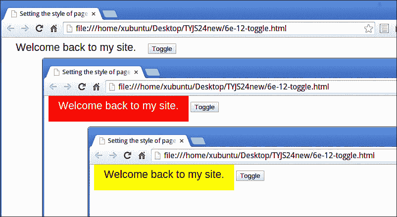

**图 12.1** 在 JavaScript 中设置样式属性

### 使用 className 类

在本节的早期，我们讨论了将样式与内容分离，以及这种分离可以带来的益处。

使用 JavaScript 编辑 `style` 对象的属性（如前面的练习所示）效果良好——但它带有破坏这种样式与内容分离的危险。如果你的 JavaScript 代码经常更改元素的样式声明，那么页面样式的责任将不再稳固地留在 CSS 中。如果你以后决定更改 JavaScript 应用的样式，你将不得不回溯并编辑所有的 JavaScript 函数。

幸运的是，我们有一种机制，可以让 JavaScript 在不覆盖单个样式声明的情况下重新设置页面。通过使用元素的 `className` 属性，我们可以切换 `class` 属性的值，以及与之相关的元素样式声明。查看列表 12.2。

**列表 12.2 使用 className 切换类**

```html
<!DOCTYPE html>
<html>
<head>
    <title>使用 JavaScript 切换类</title>
    <style>
        .classA {
            width: 180px;
            border: 3px solid black;
            background-color: white;
            color: red;
            font-size: 16pt arial, helvetica, sans-serif;
            padding: 20px;
        }
        .classB {
            width: 180px;
            border: 3px dotted white;
            background-color: black;
            color: yellow;
            font-size: 24px "Times Roman", serif;
            padding: 20px;
        }
    </style>
    <script>
        function toggleClass() {
            var myElement = document.getElementById("id1");
            if(myElement.className == "classA") {
                myElement.className = "classB";
            } else {
                myElement.className = "classA";
            }
        }
        window.onload = function() {
            document.getElementById("btn1").onclick = toggleClass;
        }
    </script>
</head>
<body>
    <div id="id1" class="classA"> An element with a touch of class.</div>
    <input type="button" id="btn1" value="Toggle" />
</body>
</html>
```

`<head>` 中的 `<style>` 列出了两个类 `classA` 和 `classB` 的样式声明。JavaScript 函数 `toggleClass()` 使用了与列表 12.1 中早期的 `toggle()` 类似的逻辑，但 `toggleClass()` 不作用元素的 `style` 对象。相反，`toggleClass()` 获取与 `<div>` 元素关联的类并在 `classA` 和 `classB` 之间切换其值。

图 12.2 显示了脚本的运行情况。

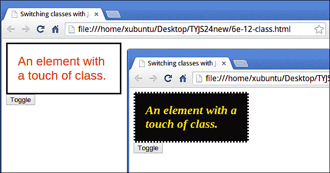

**图 12.2** 在 JavaScript 中切换类

### DOM styleSheets 对象

`document` 对象的 `styleSheets` 属性包含了页面所有样式表的数组，无论这些样式表是包含在外部文件中并链接到页面头部，还是声明在页面头部的 `<style>` 和 `</style>` 标签之间。`styleSheets` 数组中的项按数字索引，从第一个样式表开始索引为 0。

**提示**

你可以通过使用来获取页面上样式表的总数：

`document.styleSheets.length`

## 启用、禁用和切换样式表

数组中的每个样式表都有一个名为 `disabled` 的属性，其值为布尔值 `true` 或 `false`。这是一个可读写属性，因此我们能够在 JavaScript 中有效地切换单个样式表的开启和关闭：

```javascript
document.styleSheets[0].disabled = true;
document.styleSheets[1].disabled = false;
```

上述代码段落“开启”了页面上的第二个样式表（索引 1），同时“关闭”了第一个样式表（索引 0）。

列表 12.3 包含了一个可以运行的示例。页面上的脚本首先声明了变量 `whichSheet`，并将其初始化为零：

```javascript
var whichSheet = 0;
```

该变量用于跟踪两个样式表中的哪一个当前处于激活状态。第二行代码最初禁用了页面上的两个样式表中的第二个：

```javascript
document.styleSheets[1].disabled = true;
```

函数 `sheet()` 在页面加载时附加到页面按钮的 `onClick` 事件处理程序，当按钮被点击时，它执行三项任务：

1. 禁用索引存储在变量 `whichSheet` 中的样式表：

```javascript
document.styleSheets[whichSheet].disabled = true;
```

2. 在一和零之间切换变量 `whichSheet` 值：

```javascript
whichSheet = (whichSheet == 1) ? 0 : 1;
```

3. 启用与 `whichSheet` 新值对应的样式表：

```javascript
document.styleSheets[whichSheet].disabled = false;
```

这些活动的组合效果是在页面的两个激活样式表之间进行切换。该脚本在 列表 12.3 和 图 12.3 中展示了运行效果。

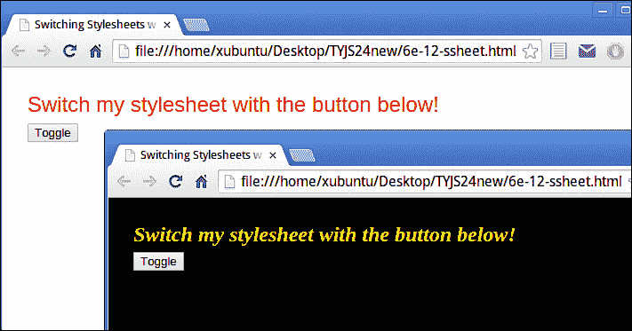

**图 12.3** 使用 `styleSheets` 属性切换样式表

**列表 12.3 使用 styleSheets 属性在样式表之间切换**

```html
<!DOCTYPE html>
<html>
<head>
    <title>使用 JavaScript 切换样式表</title>
    <style>
        body {
            background-color: white;
            color: red;
            font: normal 24px arial, helvetica, sans-serif;
            padding: 20px;
        }
    </style>
    <style>
        body {
            background-color: black;
            color: yellow;
            font: italic bold 24px "Times New Roman", serif;
            padding: 20px;
        }
    </style>
    <script>
        var whichSheet = 0;
        document.styleSheets[1].disabled = true;
        function sheet() {
            document.styleSheets[whichSheet].disabled = true;
            whichSheet = (whichSheet == 1) ? 0 : 1;
            document.styleSheets[whichSheet].disabled = false;
        }
        window.onload = function() {
            document.getElementById("btn1").onclick = sheet;
        }
    </script>
</head>
<body>
    使用下方的按钮切换我的样式表！<br />
    <input type="button" id="btn1" value="Toggle" />
</body>
</html>
```

## 尝试自己：选择特定的样式表

通过数字对样式表进行索引并不易于选择所需的样式表。如果你有一个函数允许你为样式表命名并通过它们的标题属性来选择它们，情况将会更加简单。

如果你请求一个不存在的样式表，你需要你的函数做出有用的响应；你希望它能保持之前的样式表并向用户发送消息。

首先，声明几个变量并初始化它们的值：

```javascript
var change = false;
var oldSheet = 0;
```

布尔变量 `change` 用于跟踪你是否找到了具有请求名称的样式表；一旦找到，你就会将其值更改为 `true`，表示你打算更改样式表。

整数 `oldSheet` 初始设置为零，最终将赋值为当前激活样式表的编号；在没有找到与请求标题匹配的新样式表的情况下，你会在从函数返回之前将其重新设为激活状态。

现在，你需要遍历 `styleSheets` 数组：

```javascript
for (var i = 0; i < document.styleSheets.length; i++) {
    ...
}
```

对于每个样式表：

1. 如果你发现它是当前激活的样式表，将其索引存储在变量 `oldSheet` 中：

```javascript
if(document.styleSheets[i].disabled == false) {
    oldSheet = i;
}
```

2. 在循环时，确保所有样式表都已被禁用：

```javascript
document.styleSheets[i].disabled = true;
```

3. 如果当前样式表的标题与请求的样式表相同，通过将其 `disabled` 值设置为 `false` 来使其启用，并立即将你的变量 `change` 设置为 `true`：

```javascript
if(document.styleSheets[i].title == mySheet) {
    document.styleSheets[i].disabled = false;
```

当你遍历完所有样式表后，可以根据变量 `change` 和 `oldSheet` 的状态判断你是否可以更改样式表。如果没有，将之前的样式表重新启用：

```javascript
if(!change) document.styleSheets[oldSheet].disabled = false;
```

最后，函数返回变量 `change` 的值——如果发生了更改返回 true，如果没有则返回 false。代码列在 列表 12.4。将此代码保存为 HTML 文件并在浏览器中加载。

### 列表 2.4 按标题选择样式表

当页面加载时，小函数 `sheet()` 被添加到按钮的 `onClick` 事件处理程序中。每当点击按钮时，`sheet()` 提示用户输入样式表的名称：

```javascript
var sheetName = prompt("Stylesheet Name?");
```

然后它调用 `ssEnable()` 函数，并将请求的名称作为参数传递进去。

如果函数返回 `false`，表示没有发生样式表的更改，你将通过消息向用户报警：

```javascript
if(!ssEnable(sheetName)) alert("Not found - original stylesheet retained.");
```

该脚本在图 12.4 中演示运行。

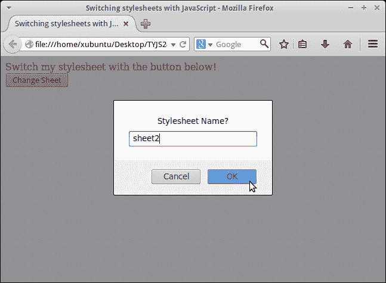

**图 12.4** 按名称选择新样式表

***

### 总结

在本小时中，你学习了 JavaScript 应用于页面 CSS 样式的多种方法。你学习了如何使用页面元素的 `style` 属性，如何处理 CSS 类，以及如何操作整个样式表。

## 问答

**问：JavaScript 是否可以处理单独的 CSS 样式规则？**

**答：** 可以，但在编写本文时，这种方法的跨浏览器兼容性并不好。Mozilla 浏览器支持 `cssRules` 数组，而 Internet Explorer 将等效数组称为 `Rules`。此外，不同浏览器对“规则（rule）”概念的解释也存在差异。希望未来的浏览器版本能解决这些差异。

**问：是否可以在 JavaScript 中更改鼠标光标？**

**答：** 可以的。`style` 对象有一个名为 `cursor` 的属性，它可以接受各种值。常用的光标包括以下：

*   **Crosshair（十字准）**——指针呈现为对像枪准星一样的交叉线。
*   **Pointer（指针）**——通常是一个指向的手指。
*   **Text（文本）**——文本输入光标。
*   **Wait（等待）**——程序正在忙。

### 习习

在阅读后续的“答案”部分之前，尝试回答所有问题。

#### 测验

**1。** 要将元素 `myElement` 的 `font-family` 属性设置为 Verdana，你应该使用：

**a.** `myElement.style.font-family = "verdana";`

**b.** `myElement.style.fontFamily = "verdana";`

**c.** `myElement.style.font-family("verdana");`

**2。** 属性 `className` 可以用于：

**a.** 访问元素的 `class` 属性值

**b.** 访问元素的 `name` 属性值

**c.** 为元素添加属性 `classname`

**3。** 如何启用 `styleSheets` 数组中索引为 `n` 的样式表？

**a.** `document.styleSheets[n].active = true;`

**b.** `document.styleSheets[n].enabled = true;`

**c.** `document.styleSheets[n].disabled = false;`

#### 答案

**1。** b. `myElement.style.fontFamily = "verdana";`

**2。** a. 访问元素的 `class` 属性值。

**3。** c. `document.styleSheets[n].disabled = false;`

## 练习

*   修改示例 12.1 中的程序，以更改其他样式属性，如字体、装饰、元素边框、内边距和外边距。
*   修改示例 12.4 的程序，使某些样式表通过外部链接，而不是位于页面 `<head>` 中的 `<style>` 和 `</style>` 标签之间。一切运行正常吗？

# 第 13 小时。引入 CSS3

***

在本小时你将学习：

*   CSS3 为 CSS 带来的一些新功能
*   使用特定厂商的前缀和扩展
*   CSS3 属性的跨浏览器设置
*   在 JavaScript 中高效设置 CSS3 属性

***

使用 CSS3，你可以轻松地实现许多酷炫的新效果，而无需使用大量的 JavaScript 代码和/或 Photoshop 等外部图形应用程序。你可以创建圆角边框、为框添加阴影、使用图像作为边框等。CSS3 包含了几个新的背景属性，让你对背景元素有更多控制权，包括多个背景图像，而 CSS3 渐变允许你在两个或多个指定颜色之间显示平滑过渡。新的文本功能包括文本阴影和自动换行，以及方便使用网络字体。CSS3 还让你能够轻松构建非常酷的过渡、变换和动画。

在本小时中，你将了解 CSS3 能为你的网页做什么，并将看到如何使用 JavaScript 有效地控制 CSS3 的功能。

### 特定厂商属性和前缀

CSS 厂商前缀是浏览器公司在新的 CSS 功能成为正式 CSS3 规范之前对其支持的方法，或者实现尚未最终完成的功能。随着时间的推移，当这些功能通过标准的 CSS3 命名完全支持时，这些前缀通常就不再需要了。但为了确保你的页面在尽可能多的浏览器中按你想要的方式渲染，使用前缀是有价值的。

你可能需要的 CSS3 浏览器前缀出现在表 13.1 中。


**表 13.1 CSS3 厂商前缀**

在大多数需要前缀的情况下，你按照 CSS3 规范列出 CSS3 属性，并根据所使用的浏览器从 13.1 中添加相关前缀。例如，在本小时稍些时候你将读到关于 CSS3 过渡的内容。你会发现，如果你想给页面添加 CSS3 过渡，你会使用带有前缀的 `transition` 属性：

```css
-webkit-transition: background 0.5s ease;
-moz-transition: background 0.5s ease;
-o-transition: background 0.5s ease;
transition: background 0.5s ease;
```

用户的浏览器将响应它所理解的过渡功能版本，忽略其他版本。

幸运的是，浏览器制造商正在努力完全实现所有 CSS3 功能，对于大多数现代浏览器，需要前缀的属性数量正在迅速减少。

***

提示

属性的前缀版本并不总是与 CSS3 规范中描述的属性相同。

尽管特定厂商的扩展通常会避免冲突（因为每个厂商都有独特的前缀），但请记住，这些扩展可能会被厂商更改，因为它们并不是 CSS3 规范的一部分，尽管它们试图表现得像即将推出的 CSS3 属性。

同样请记住，特定厂商的扩展几乎肯定无法通过 CSS 验证。

***

在编写本文时，[`shouldiprefix.com/`](http://shouldiprefix.com/) 有关于哪些功能/浏览器组合需要前缀的非常有用的汇总。

关于特定浏览器和版本支持的功能频繁更新列表，请访问 [`www.w3schools.com/cssref/css3_browsupport.asp`](http://www.w3schools.com/cssref/css3_browsupport.asp)。

***

注意

属性的前缀版本可能并不与 CSS3 规范中描述的属性相同。

### CSS3 边框

CSS3 让你对边框进行一些非常酷的操作，而这些以前只能通过大量丑陋、难以维护的代码技巧来实现。

在本节中，我们将两个示例：框阴影和圆角。

#### 创建框阴影

`box-shadow` 属性允许你为页面的盒元素（box elements）添加投影效果。如表 13.2

**表格 13.2 box-shadow 属性参数**

这里是一个示例，使用了一个 10px 宽的阴影，向向右下方延伸，在整个宽度上进行模糊处理，颜色为中灰色：

```css
#div1 {
background-color: #8080ff;
width: 400px;
height: 250px;
box-shadow: 10px 10px 10px #808080;
-webkit-box-shadow: 10px 10px 10px #808080;
-moz-box-shadow: 10px 10px 10px #808080;
}
```

在图 13.1 中，你可以看到这种样式应用于网页中 `<div>` 元素的示例。

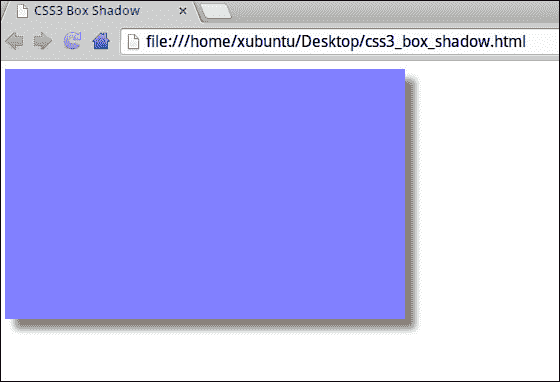

**图 13.1** 一个 CSS3 盒投影

## 使用 border-radius 属性实现圆角

`border-radius` 属性允许你为页面元素添加圆角，而无需专门创建圆角图像，这可能是 CSS3 新功能中最受欢迎的之一。

`border-radius` 属性已经得到了广泛的浏览器支持，尽管 Mozilla Firefox 比某些竞争对手多在使用一段时间的 `-moz-` 前缀；因此，如果你需要支持之前的几个版本的 Firefox，应该考虑包含带前缀的版本：

```css
#div1 {
-moz-border-radius: 25px;
border-radius: 25px;
}
```

在图 13.2 中，你可以看到一个带有圆角元素的 `<div>` 元素示例。

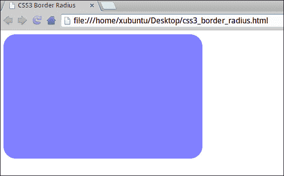

**图 13.2** 一个 CSS3 圆角

圆角可以使用单独属性 `border-bottom-left-radius`、`border-top-left-radius`、`border-bottom-right-radius` 和 `border-top-right-radius`（注：原文此处有笔误）独立指定，也可以像我们在这里所做，使用 `border-radius` 属性在一个条语句中指定所有四个角。

## CSS3 背景

CSS3 包含了几个新的背景属性，允许对背景元素进行更多控制。在本节中，你将学习 `background-size` 和 `background-origin` 属性，以及如何使用多个背景图像。

### background-size 属性

`background-size` 属性为 CSS 增加了一项新功能，允许你使用长度、百分比或两个关键字 `contain` 或 `cover` 来设置背景图像的尺寸。

使用长度和百分比指定背景大小的行为正如你预期的那样。对于每个背景图像，可以提供两个长度或百分比，分别对应宽度和高度。（当你使用百分比时，它们关系到背景可用空间，而不是背景图像的宽度和高度。）

`auto` 关键字可以代替宽度或高度值。如果你只为 `background-size` 指定一个值，该值将被假设为宽度。此时高度将默认为 `auto`。

```css
#div1 {
background-size: 400px;
background-image: url(lake.png);
width: 400px;
height: 250px;
border-radius: 25px;
}
```

在这里，我将背景宽度设置为 `<div>` 元素的大小（为了保险起见，我也圆化了圆角）。结果如图 13.3

**图 13.3** 在 CSS3 中设置背景大小

### background-origin 属性

`background-origin` 属性用于设置盒中背景位置的计算方式。它接受三个值之一：`padding-box`、`border-box` 或 `content-box`。

当你提供 `padding-box` 值时，位置相对于内边距边缘的左上角。使用 `border-box` 时，相对于边框的左上角，而 `content-box` 意味着背景相对于内容的左上角定位。

### 多背景图像

CSS3 允许通过使用逗号分隔的列表为盒元素使用多个背景图像。列表的顺序非常重要，提供的第一个值代表最靠近用户的层，列表中的后续项目将依次渲染在在其后方的层中。这里有一个示例：

```css
#div1 {
width: 600px;
height: 350px;
background-image: url(boat.png), url(lake.png);
background-position: center bottom, left top;
background-repeat: no-repeat;
}
```

在这里，`boat.png` 是透明背景上的游艇画，而 `lake.png` 是一张照片。在图 13.4 中，你可以看到应用于网页内 `<div>` 元素时的结果。

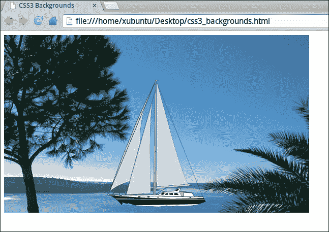

**图 13.4** 在 CSS3 背景中使用多张图像

浏览器对多背景功能的支持已经相当成熟，Mozilla Firefox (3.6+)、Safari/Chrome (1.0/1.3+)、Opera (10.5+) 和 Internet Explorer (9.0+) 都提供了支持。

## CSS3 渐变

CSS3 渐变允许你在两个或多个指定颜色之间生成平滑过渡，而以前你必须使用图像来实现这些效果。通过 CSS3 渐变，你可以减少这些图像会花费的下载时间、缓存内存和带宽消耗。CSS3 渐变在缩放时性能更好，CSS3 提供了两种类型的渐变：线性渐变和径向渐变。

### 线性渐变

要在 CSS3 中创建线性渐变，你必须定义至少颜色作为端点。你还可以为渐变输入一个方向（例如，上到下、左到右或一个角度）。

```css
#div1 {
width: 600px;
height: 350px;
background-image: -webkit-linear-gradient(red, #6699cc);
background-image: -o-linear-gradient(red, #6699cc);
background-image: -moz-linear-gradient(red, #6699cc);
background-image: linear-gradient(red, #6699cc);
}
```

如果你没有为渐变指定方向，将使用默认的从上到下，如图 13.5 所示。


**图 13.5** 一个 CSS3 线性渐变

你也可以为渐变输入方向；例如，假设你希望渐变是从左到右而不是从上到下，如下：

```css
background: linear-gradient(to right, red, #6699cc);
```

以下行定义了一个对角渐变：

```css
background: linear-gradient(to bottom right, red, #6699cc);
```

如果你想完全控制渐变的方向，可以定义一个角度：

```css
background: linear-gradient(135deg, red, #6699cc);
```

### 径向渐变

径向渐变由其中心定义，并且像线性渐变一样，必须定义至少两种颜色作为渐变效果的端点：

```css
background: radial-gradient(red, #6699cc);
```

这样指定的径向渐变显示如图 13.6 所示。

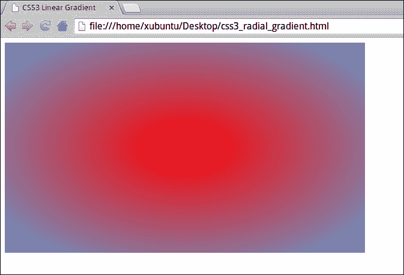

**图 13.6** 一个 CSS3 径向渐变

你还可以使用 `at` 关键字为径向渐变的中心设置位置参数：

```css
background: radial-gradient(at top left, red, #6699cc);
```

结果如图 13.7 所示。

## 图 13.7 移动径向渐变的中心点

***

### 提示

CSS3 渐变的功能比我在这里能描述的要得多，包括使用两种以上的颜色、透明度以及对渐变形状和大小的修改。你甚至可以在同一个元素上添加多个渐变。完整细节见 W3C 文档：[`www.w3.org/TR/2011/WD-css3-images-20110217/`](http://www.w3.org/TR/2011/WD-css3-images-20110217/)

***

## CSS3 文本效果

CSS3 包含了一些新功能来帮助你处理文本。

### 文本阴影 (Text Shadow)

在 CSS3 中，`text-shadow` 属性应用于文本阴影的方式与块元素的 `box-shadow` 属性几乎相同。你可以指定水平和垂直阴影距离，以及模糊距离和阴影颜色：

```css
h3 {
  text-shadow: 10px 10px 3px #333;
  font-size: 26px;
}
```

你可以在图 13.8 中看到示例。

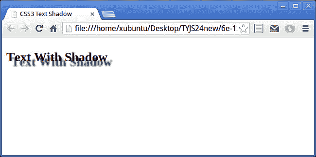

**图 13.8** CSS3 文本阴影

### 单词换行 (Word Wrap)

如果一个单词太长，无法放入包含它的块元素中，它就会溢出容器。在 CSS3 中，你可以使用 `word-wrap` 属性强制文本换行，即使必须在单词中间换行也可以：

```css
p {
    word-wrap: break-word;
}
```

## CSS3 过渡、变换和动画

传统上，程序员使用自定义 JavaScript 代码来创建页面元素的移动效果，这在跨浏览器实现上可能非常棘手。如果能有更简单的方法为页面上的元素添加简单效果将更好了。

这些功能目前正以过渡（transitions）、变换（transformations）和动画（animations）的形式引入 CSS3。大多数浏览器已经对它们提供了不同程度的支持。

在下面的简单示例中，我们添加了一个过渡效果（在支持它的浏览器中），以便在鼠标悬停在链接上时更改背景颜色。随着背景色的变化，过渡效果将平滑这种变换。

这里是我们的示例链接代码：

```html
<a href="somepage.html" class="trans" id="link1">Show Me</a></a>
```

以下是 CSS 声明，显示了原始背景颜色和悬停背景颜色，以及在不同浏览器中执行过渡效果的声明。请注意所需的不同前缀范围，正如在本节早些时候讨论的那样。最后一个不带前缀的声明将在该技术从实验阶段变为完成状态后成为所需的标准。

```css
a.trans {
    background: #669999;
    -webkit-transition: background 0.5s ease;
    -moz-transition: background 0.5s ease;
    -o-transition: background 0.5s ease;
    transition: background 0.5s ease;
}
a.trans:hover {
    background: #999966;
}
```

***

关于 CSS3 过渡、变换和动画的全面信息，可以在 [`css3.bradshawenterprises.com/all/`](http://css3.bradshawenterprises.com/all/)找到。

***

## 在 JavaScript 中引用 CSS3 属性

CSS3 与 JavaScript 的结合有望带来流畅性能、高可靠性和最小代码复杂性的效果。在本节中，我们将介绍如何在 JavaScript 代码中成功获取和设置 CSS3 属性的方法。

### 将 CSS 属性名转换为 JavaScript

正如我在第 12 节中提到的，“JavaScript 和 CSS”，为了使 CSS 属性名称兼容 JavaScript 的命名规范，CSS 属性名需要从样式表中的格式进行细小的转换。

JavaScript 版本不再像 CSS 那样使用小写名称和连字符，而是删除了连字符并将后续字符大写化。因此，`border-radius` 变为 `borderRadius`。没有连字符的属性名（如 `width`）保持不变。

你已经在第 12 节中看到如何使用这种命名规范结合 DOM `style` 属性来访问元素样式属性：

```javascript
var bRad = document.getElementById("div1").style.borderRadius;
```

正如我当时提到的，虽然这很有用，但它仅限于具有内联样式的元素；对于在页面头部 `<style>` 元素中或外部文件中分组定义了 CSS 声明的元素，它将不起作用。幸运的是，有一种更好的方法，我现在将讨论它。

### DOM getComputedStyle() 方法

现在几乎所有浏览器都支持 DOM `getComputedStyle()` 方法，该方法可以访问元素的最终（即计算出的）样式。我们所说的最终样式是指浏览器在应用了所有与该元素相关的样式规则（无论是内联的、外部的还是继承自容器元素的）后，最终显示元素时的样式。

`getComputedStyle()` 方法返回一个包含各种方法的对象，包括 `getPropertyValue(property)`，它返回给定 CSS 属性名称的当前值：

```javascript
var myDiv = document.getElementById("div1");
var bRad = getComputedStyle(myDiv).getPropertyValue("borderRadius");
```

***

### 动手尝试：控制光照效果

让我们创建一个小型应用程序，使用由 JavaScript 控制的 `box-shadow` 和 `radial-gradient` 来在简单的 HTML 页面中控制光照效果。代码如列表 13.1 所示。

**列表 13.1 控制 CSS3 效果**

***

```html
<!DOCTYPE html>
<html>
  <title>Controlling CSS3 Effects</title>
<style>
  #div1 {
    width: 600px;
    height: 350px;
    background-color: #6699cc;
  }
  #div2 {
    background-color: #aaaaff;
    width: 80px;
    height: 80px;
    padding: 20px;
    position: relative;
    left: 240px;
    top: 20px;
  }
</style>
<script>
  window.onload = function() {
    document.getElementById("btn1").onclick = function() {
      document.getElementById("div1").style.background = "radial-gradient(at left, white, #6699cc)";
      document.getElementById("div2").style.boxShadow = "10px 10px 3px #333";
    }
    document.getElementById("btn2").onclick = function() {
      document.getElementById("div1").style.background = "radial-gradient(at right, white, #6699cc)";
      document.getElementById("div2").style.boxShadow = "-10px 10px 3px #333";
    }
    document.getElementById("btn3").onclick = function() {
      document.getElementById("div1").style.background = "radial-gradient(at bottom, white, #6699cc)";
      document.getElementById("div2").style.boxShadow = "0px -10px 3px #333";
    }
  }
</script>
</head>
<body>
  <div id="div1">
    <div id="div2">
      LIGHTS:
      <input type="button" id="btn1" value="Top Left">
      <input type="button" id="btn2" value="Top Right">
      <input type="button" id="btn3" value="Bottom">
    </div>
  </div>
</body>
</html>
```

你可以在图 13.9 中查看实际效果。

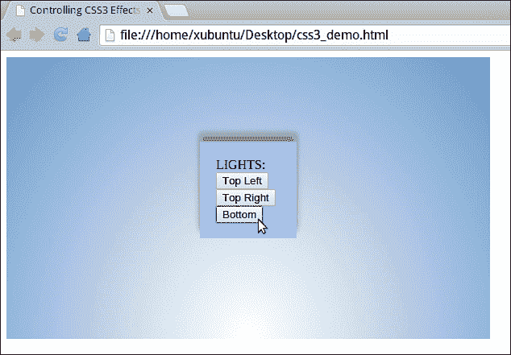

### 图 13.9 使用 JavaScript 控制 CSS3

注意，这里没有使用图像来创建这些效果——这在 CSS3 之前是不可能实现的。

***

### 使用厂商前缀设置 CSS3 属性

你已经了解了如何获取 CSS 属性，但当不同的浏览器支持该属性的不同变体（即具有不同的前缀）时，你如何使用 JavaScript *设置*一个 CSS3 属性呢？

当浏览器支持特定的 CSS 属性时，当你从页面元素请求该属性时，它会返回一个字符串值（如果该属性尚未设置，将返回空字符串）。如果你的浏览器不支持该属性，则会返回 `undefined`。因此，你可以在设置 CSS3 属性之前轻松地进行测试，以确定支持哪种属性变体。

让我们写一段代码，接收一个可能的 CSS3 属性数组，并返回浏览器支持的那个。

```javascript
function getCss3Property(properties){
    // 遍历所有可能的属性名
    for (var i=0; i<properties.length; i++) {
        // 如果该元素存在此属性
        if (properties[i] in document.documentElement.style) {
            // 返回关联的字符串
            return properties[i];
        }
    }
}
```

通过这种方式，我们可以返回功能的适当版本。

让我们看看这在本小时之前使用的过渡（transition）效果是如何工作的：

```javascript
// 获取正确的 CSS3 过渡属性
var myTrans = getCss3Property(['transition', 'MozTransition', 'WebkitTransition',
'msTransition', 'OTransition'])
// 为 "link1" 设置 CSS 过渡
document.getElementById("link1").style[myTrans] = "background 0.5s ease" ;
```

假设我正在使用的 Firefox 版本不支持 CSS3 的 `transition` 属性，但支持 Mozilla 自己的版本 `MozTransition`（对应于 `-moz-transition`）。

当调用时，`getCss3Property()` 函数开始遍历对应各种厂商类型的过渡属性列表。在对属性 `transition` 返回 `undefined` 值（因为浏览器不支持它）后，它将在下一次循环中退出函数，并返回字符串值 `MozTransition`。现在我们已经知道在下一行代码中应该设置哪种版本的属性了。

### 总结

在本小时中，你学习了 CSS3 为 Web 设计带来的一些新功能。你看到了不同的浏览器制造商如何通过自定义前缀来实现新的或实验性的 CSS3 特性，并看到了如何使用 JavaScript 访问和设置这些自定义特性。

## 问答

**Q. 目前哪些浏览器支持 CSS3 过渡（transitions）、变换（transforms）和动画（animations）？**

**A.** 在编写期间，所有流行的浏览器都支持 2D 变换，而 3D 变换在 Safari、Chrome/Chromium 和 Firefox 中支持。过渡和 3D 变换是在 IE10 中添加的。这些效果大部分都有良好的降级处理，因此使用不支持浏览器的用户仍然可以使用，但看不到带有动画的页面元素。

**Q. 为什么几个不同的浏览器厂商都使用 -webkit- 前缀？**

**A.** WebKit 是用于在 浏览器中渲染网页的布局引擎。WebKit 引擎是许多流行浏览器的基础，包括 Safari、Chrome/Chromium 以及适用于桌面和移动平台的各种浏览器。

## 工作坊

在阅读后续的“答案”部分之前尝试回答所有问题。

#### 测验

**1.** 下列哪项将正确指定从左下角到右上角的线性渐变？

**a.** `linear-gradient(upper right, #112244 , #6699cc);`

**b.** `linear-gradient(top right, #112244 , #6699cc);`

**c.** `linear-gradient(to top right, #112244 , #6699cc);`

**2.** 你如何在 JavaScript 中引用 `text-shadow` 属性？

**a.** `textShadow`

**b.** `text-Shadow`

**c.** `text-shadow`

**3.** 下列哪项将正确渲染多个背景图像，使 image cactus.png 显示在 image desert.jpg 之前？

**a.** `background-image: cactus.png, desert.jpg`

**b.** `background-image: url(cactus.png), url(desert.jpg);`

**c.** `background-image: url(desert.jpg), url(cactus.png);`

#### 答案

**1.** c. `linear-gradient(to top right, #112244 , #6699cc);`

**2.** a. `textShadow`

**3.** b. `background-image: url(cactus.png), url(desert.jpg);`

## 练习题

*   使用单个属性 `border-bottom-left-radius`、`border-top-left-radius`、`border-bottom-right-radius` 和 `border-bottom-right-radius`（注：此处原文重复），使用 JavaScript 设置 `<div>` 元素的样式为完全椭圆形。（提示：设置半径大小，使得元素的所有边界恰好位于某一个角的半径内。）在你的圆形 `<div>` 上使用 `getComputedStyle()`，将这些边界半径报告到控制台。
*   在本小时的“尝试试一下”部分中，你在编写代码时手动设置了阴影方向，以适应模拟的光线方向。你能够写一个 JavaScript 函数，根据检测到的背景渐变值来设置阴影属性吗？

# 第 V 部分：使用 JavaScript 库

## 第 14 节：使用库

***

本小时你将学到：

*   为什么使用库是一个好主意
*   库可以帮助你做的事情
*   用户社区提供的库扩展
*   介绍一些流行的库
*   prototype.js 快速概述

***

库是可重用的 JavaScript 代码集合，它们让你只需通过在程序中添加几行额外代码就能完成复杂的操作。

有许多免费的 JavaScript 库可以帮助你快速开发功能强大的跨浏览器应用程序。

本节将介绍一些较流行的库。

### 为什么要使用库？

你经常会看到 JavaScript 开发者表达观点（主要在互联网上），他们强烈主张编写自己的代码，而不是使用许多可用库之一。常见的反对意见包括：

*   你永远无法真正了解代码是如何运行的，因为你只是在使用他人的算法和函数。
*   JavaScript 库包含了你永远用不到的代码，但你的用户必须下载它们。

就像软件开发的许多方面一样，这些都是观点问题。我个人认为，在某些某些情况下使用库是有充分理由的：

*   为什么要发明别人已经写过的代码？流行的 JavaScript 库通常包含程序员经常需要的抽象——这意味着你可能也经常需要这些函数。最流行的库所产生的数千次下载和大量的在线评论，几乎可以保证它们包含的代码比你自己编写的代码经过更彻底的测试和调试。
*   从其他代码人员那里获取灵感。那里有很多*非常聪明*的程序员；借鉴他们的作品并以此改进你自己的工作。
*   使用编写良好的库确实可以消除许多编写跨浏览器 JavaScript 的烦恼。你无法始终让每个浏览器都处于可用状态，但库的作者以及他们的用户社区会在每个领先浏览器上进行测试。
*   大多数库的下载大小并不惊人。在需要极短下载时间的少数情况下，对于大多数你可以在“生产”网站中使用的流行库，都提供了压缩版本。此外，你还可以检查库代码并只提取你需要的部分。

## 库可以做什么？

具体功能取决于涉及的库及其创建者的需求和意图。然而，大多数库都包含某些反复出现的主题：

*   `封装 DOM 方法`——正如你稍后在本节中查看 `prototype.js` 时看到的，JavaScript 库可以提供极具吸引力的写法来选择和管理页面元素及元素组。
*   `动画`——在第 7 节中，你学习了计时器的使用。计时器可以用于页面元素的动画，但编写此类代码可能很棘手，且生成的代码难以维护。许多流行库将此类操作封装成方便的函数，以跨浏览器的方式仅需几行代码即可让页面界面的部分实现滑动、淡入、抖动、压缩、折叠、吸附和脉冲效果。
*   `拖放`——真正的跨浏览器拖放一直一直是为所有浏览器编写代码时最棘手的效果之一。库可以让它变得简单。
*   `Ajax`——使用简单的方法更新页面内容，而无需担心实例化 `XMLHttpRequest` 对象以及管理回调和状态码等细碎细节。

## 一些流行库

新的库不断涌现，而另一些库在多年中持续了持续开发。这绝不是一份完整的列表；它只是试图指出当前一些比较流行的参与者。

### Prototype Framework

Prototype Framework ([`www.prototypejs.org`](http://www.prototypejs.org)) 已经存在多年，目前版本为 1.7。Prototype 的主要优势在于其对 DOM 的扩展和 Ajax 处理，尽管它还有许多锦囊，包括 JSON 支持以及帮助创建和继承类的方法。

Prototype 作为一个独立库分发，也作为大型项目（如 Ruby on Rails 和 `script.aculo.us` JavaScript 库）的一部分。

> 注意
>
> 你将在本节的后半部分详细地查看 Prototype Framework，包括一些动手编码。

### Dojo

Dojo ([`www.dojotoolkit.org/`](http://www.dojotoolkit.org/)) 是一个开源工具包，增强了 JavaScript 的功能以简化应用程序和用户界面的构建。它具有从额外的字符串和数学函数到动画和 AJAX 等功能。最新版本不仅支持所有主流桌面浏览器，还支持移动环境，包括 Apple iOS、Android 以及带有“Dojo Mobile”HTML5 移动 JavaScript 框架的 Blackberry。

编写时，Dojo 处于 1.7 版本。

### Yahoo! UI Library

Yahoo! UI Library ([`developer.yahoo.com/yui/`](http://developer.yahoo.com/yui/)) 由 Yahoo! 开发，并根据开源许可提供给大家。它包含了动画、DOM 特性、事件管理以及易用的用户界面元素（如日历和滑块）。

### MooTools

MooTools ([`mootools.net/`](http://mootools.net/)) 是一个紧凑、模块化的 JavaScript 框架，允许你使用易懂、文档良好的 API（应用程序编程接口）构建强大、灵活且跨浏览器的代码。

### jQuery

jQuery ([`jquery.com/`](http://jquery.com/)) 是一个快速且紧凑的 JavaScript 库，简化了各种开发任务，包括 HTML 文档遍历、事件处理、动画和 Ajax 调用，用于快速开发交互式网站。

> 提示
>
> 你将在接两个小时内深入了解 jQuery 库及其相关的用户界面库 jQueryUI。

## 介绍 prototype.js

Sam Stephenson 的 `prototype.js` 是一个流行的 JavaScript 库，包含一系列开发跨浏览器 JavaScript 应用程序所需的函数，并对 Ajax 有特定支持。稍后你将看到如何通过该库对 DOM 操作、HTML 表单和 `XMLHttpRequest` 对象的强大支持来简化你的 JavaScript 代码。

`prototype.js` 库的最新版本可以从 [`prototypejs.org/`](http://prototypejs.org/) 下载。

在你的 Web 应用中包含该库非常简单；只需在 HTML 文档的 `<head>` 部分包含以下行即可：

```html
<script src="prototype.js"></script>
```

`prototype.js` 库包含了广泛的函数，可以让编写 JavaScript 代码更快，并使生成的脚本更整洁、更容易维护。

该库包含了提供常规编程任务快捷方式的通用函数、HTML 表单的包装器、封装 `XMLHttpRequest` 对象的对象、简化 DOM 任务的方法和对象等。

让我们来看看这些工具。

> 注意
>
> 编写时，prototype.js 版本为 1.7.2。如果你下载了不同的版本，请检查文档以查看你的版本与此处描述的版本之间是否存在差异。

### $() 函数

`$()` 本质上是 `getElementById()` DOM 方法的快捷方式。通常为了返回特定元素的值，你会使用如下表达式：

```javascript
var mydata = document.getElementById('someElementID');
```

`$()`（不像 `getElementById()`）可以接受多个元素 ID 作为参数并返回关联元素的数组。考虑这行代码：

```javascript
mydataArray = $('id1','id2','id3');
```

在此示例中：

*   `mydataArray[0]` 包含 ID 为 `id1` 的元素值。
*   `mydataArray[1]` 包含 ID 为 `id2` 的元素值。
*   `mydataArray[2]` 包含 ID 为 `id3` 的元素值。

### $F() 函数

当输入元素或其 ID 作为参数传递时， `$F()` 函数返回表单输入字段的值。查看以下 HTML 代码段：

```html
<input type="text" id="input1" name="input1">
<select id="input2" name="input2">
    <option value="0">Option A</option>
    <option value="1">Option B</option>
    <option value="2">Option C</option>
</select>
```

在这里，我们可以使用 `$F('input1')` 返回文本框中的值，使用 `$F('input2')` 返回选择框中当前选项的值。`$F()` 函数在复选框和文本区域输入元素上同样有效，使得无论输入元素类型如何都能轻松返回元素值。

### Form 对象

prototype.js 定义了一个 `Form` 对象，具有多个实用的方法来简化 HTML 表单操作。

你可以通过调用 `getElements()` 方法返回一个表单输入字段的数组：

```javascript
inputs = Form.getElements('thisform');
```

`serialize()` 方法允许将输入名称和值格式化为兼容 URL 的列表：

```javascript
inputlist = Form.serialize('thisform');
```

使用上一行代码，变量 `inputlist` 现在将包含一个序列化的参数和值对的字符串：

```javascript
field1=value1&field2=value2&field3=value3...
```

`Form.disable('thisform')` 和 `Form.enable('thisform')` 的作用分别与其名称完全一致。

***

## 尝试自己一下：使用 getElements() 方法

让我们使用 `getElements()` 方法收集一些关于 HTML 表单的信息。正如我之前提到的，该方法返回一个包含特定表单元素的数组。

以下是我们简单表单的代码：

```html
<!DOCTYPE html>
<html>
<head>
   <title>Prototype.js example</title>
</head>
<body>
    <form id="exampleForm" action="#" onsubmit="return false">
        Username: <input type="text" name="username" /><br/>
        Telephone: <input type="text" name="telephone" /><br/>
        Message: <input type="text" name="message" /><br/>
    </form>
    <input type="button" value="Result" onclick="showFormFields();"/>
</body>
</html>
```

对于这个示例中，我们只有三个文本字段，如图 14.1 所示。

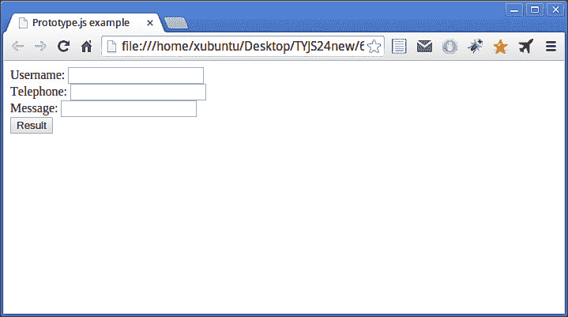

**图 14.1** 简单的 HTML 表单

在 HTML 的头部部分引入 prototype.js 后，我们需要编写一个函数，在点击表单按钮时执行。该函数将使用 `getElements()` 方法构建一个表单元素数组。然后，它将通过 JavaScript 框从表单中读回名称和输入的值。

代码如列表 14.1 所示。

**列表 14.1 Prototype.js 示例表单**

***

```html
<!DOCTYPE html>
<html>
<head>
<title>Prototype.js example</title>
    <script src="prototype.js"></script>
    <script>
    function showFormFields() {
        var form = $('exampleForm');
        var message = '';
        var fields = form.getElements();
        for(var x=0; x<fields.length;x++)  {
            message += "Field Name : " + fields[x].name + " Value : " + fields[x].value + "\n";
        }
        alert(message);
    }
    </script>
</head>
<body>
  <form id="exampleForm" action="#" onsubmit="return false">
        Username: <input type="text" name="username" /><br/>
        Telephone: <input type="text" name="telephone" /><br/>
        Message: <input type="text" name="message" /><br/>
  </form>
  <input type="button" value="Result" onclick="showFormFields();"/>
</body>
</html>
```

在图 14.2 中，你可以看到运行示例并输入样本数据后的结果。

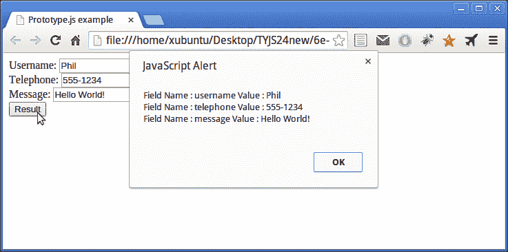

**图 14.2** 使用 `getElements()` 获取的表单信息

***

### 总结

在许多情况下，使用库编写 JavaScript 可以变得简单得多。此类库将许多常用的对象和方法封装成更易于用户的形式；你不再需要记住跨浏览器的方法，例如为了添加或移除事件监听器或访问表单元素。在这一小时里，你学习了一些比较流行的 JavaScript 库。

## 问答

**Q. 如何将第三方 JavaScript 库包含到我的页面中？**

**A.** 过程根据库的不同略有差异。通常只需将一个或多个外部 .js 文件包含在网页页的 `<head>` 部分即可。具体细节请参阅所选库提供的文档。

**Q. 我可以在同一个脚本中使用多个一个第三方库吗？**

**A.** 是的，理论上可以：如果这些库编写得良好且设计为互不干扰，那么合并它们就没有问题。在实践中，这取决于你需要的库以及它们是如何编写的。

## 工作坊

在阅读后续的“答案”之前，尝试回答所有问题。

### 测验

**1.** 下列对象中哪个*不是* JavaScript 库？

**a.** MooTools

**b.** Prototype

**c.** Ajax

**2.** 你如何自己扩展 jQuery？

**a.** jQuery 无法扩展。

**b.** 通过编写服务器端脚本。

**c.** 通过编写插件，或使用预先写的插件。

**3.** script.aculo.us 还采用了什么其他的 JavaScript 第三方库？

**a.** Prototype

**b.** Dojo

**c.** jQuery

#### 答案

**1.** c. Ajax 是一种编程技术，允许你的脚本使用托管在你服务器上的资源。有很多库可以帮助你使用 Ajax 功能，但 Ajax 本身并不是库。

**2.** c. jQuery 有一种详尽的方法来编写和使用插件。

**3.** a. Script.aculo.us 使用 prototype.js 库。

## 练习

*   使用 Prototype 库编写一个简单的脚本，或者使用 Prototype 网站 [`www.prototypejs.org`](http://www.prototypejs.org) 上的样本脚本。
*   访问 Script.aculo.us 页面 [`script.aculo.us/`](http://script.aculo.us/) 并查看该库提供的完整效果列表。

## 第 15 小时。深入了解 jQuery

***

你将在这一小时学到：

*   在你的页面中引入 jQuery
*   jQuery 的 `$(document).ready` 处理程序
*   选择页面元素
*   操作 HTML 内容
*   显示和隐藏元素
*   元素动画
*   命令链式
*   处理事件
*   使用 jQuery 进行 Ajax 应用

***

有许多 JavaScript 库可用，但 jQuery 无疑是最流行的且可扩展的。大量的开发者为 jQuery 贡献开源插件，你可以为任何可能的应用找到合适的插件。广泛的插件和简单的语法使得 jQuery 是一个非常棒的库。在这一小时中，你学习了 jQuery 的基础知识并体验了它的强大。

### 在你的页面中引入 jQuery

在使用 jQuery 之前，你需要将其包含在你的页面中。有两种主要方法，下文所示。

#### 下载 jQuery

你可以从官方网站 [`docs.jquery.com/Downloading_jQuery`](http://docs.jquery.com/Downloading_jQuery) 下载 jQuery，在该处你可以找到压缩版本和未压缩版本的代码。压缩版本用于你的在线页面，因为它已压缩到最小文件大小以便最快速度下载。

对于开发目的，请选择未压缩版本。得益于格式良好且注释过的源码，你可以阅读 jQuery 代码查看它是如何工作的。

你需要使用 `<script>` 标签将 jQuery 库包含在页面的头部部分。简单的方法是将下载的 jquery.js 文件放置与要使用的页面相同的目录中，然后按所示引用它：

```html
<script src="jquery-1.11.2.js"></script>
```

当然，如果你将 `jQuery` 放在另一个目录中，你必须更改 `src` 属性值中的（相对或绝对）路径，以反映文件的所在位置。

## 注意事项

实际文件名取决于你下载的版本。在编写本文时，`1.11.2` 是当前的发布版本。

## 使用远程版本

你不需要自己下载并托管 `jQuery`，可以从所谓的内容分发网络（CDN）中引入它。除了可以节省下载 `jQuery` 库的开销外，使用 CDN 版本还有一个进一步的优势：当用户访问你的页面且浏览器请求 `jQuery` 时，该文件很可能已经存在于他们的浏览器缓存中了。此外，CDN 通常会确保从从地理位置上距离用户最近的服务器提供文件，从而进一步缩短加载时间。

`jQuery` 官方网站目前列出了以下 CDN：

*   **Google Ajax API CDN**—[`ajax.googleapis.com/ajax/libs/jquery/1.11.2/jquery.min.js`](http://ajax.googleapis.com/ajax/libs/jquery/1.11.2/jquery.min.js)
*   **Microsoft CDN**—[`ajax.aspnetcdn.com/ajax/jQuery/jquery-1.11.2.min.js`](http://ajax.aspnetcdn.com/ajax/jQuery/jquery-1.11.2.min.js)
*   **jQuery CDN**—[`code.jquery.com/jquery-1.11.2.min.js`](http://code.jquery.com/jquery-1.11.2.min.js) (压缩版), [`code.jquery.com/jquery-1.11.2.js`](http://code.jquery.com/jquery-1.11.2.js) (源码版)

然后你可以修改 `<script>` 标签以适应选择的 CDN，例如：

```html
<script src="https://ajax.googleapis.com/ajax/libs/jquery/1.11.2/jquery.min.js"></script>
```

除非你有特殊理由要自己托管 `jQuery`，否则通常这是最好的方法。

### 提示

如果你想确保代码始终使用最新版本的 `jQuery`，只需链接到 [`code.jquery.com/jquery-latest.min.js`](http://code.jquery.com/jquery-latest.min.js)。

## jQuery 的 $(document).ready 处理器

在本书的多个地方，你使用了 `window.onload` 处理器。`jQuery` 有它自己的等效方法：

```javascript
$(document).ready(function() {
    // jQuery 代码写在这里
});
```

你编写几乎所有的 `jQuery` 代码都将在这样的语句内部执行。

与 `window.onload` 类似，它主要实现了两个功能：

*   它确保代码在 DOM 可用之前不运行——也就是说，代码可能尝试访问的任何元素已经存在——这样你的代码就不会返回任何错误。
*   它通过将代码与语义层（HTML）和表现层（CSS）分离，有助于使代码具有非侵入性。

不过，`jQuery` 版本相比 `window.onload` 事件有一个优势：它不会阻塞代码执行，直到整个页面加载完成（像 `window.onload` 那样）。使用 `jQuery` 的 $(document).ready，代码在 DOM 树构建完成后就会开始执行，而无需等待所有图像和其他资源加载完成，稍微提升了性能。

## 选择页面元素

`jQuery` 允许你通过将元素封装在 `jQuery` 包装器 `$("")` 中来选择 HTML 中的元素元素。

### 提示

你也可以在包装函数中使用单引号，`$('')`。

以下是一些使用 `$` 操作符封装的页面元素集合示例：

```javascript
$("span"); // 所有 HTML span 元素
$("#elem"); // id 为 "elem" 的 HTML 元素
$(".classname"); // 类名为 "classname" 的 HTML 元素
$("div#elem"); // ID 为 "elem" 的 <div> 元素
$("ul li a.menu"); // 嵌套在列表项中类名为 "menu" 的锚点
$("p > span"); // 段落的直接子元素 span
$("input[type=password]"); // 具有指定类型的 input
$("p:first"); // 页面上的第一个段落
$("p:even"); // 所有偶数段落
```

DOM 和 CSS 选择器就介绍到这里。但 `jQuery` 还有它自己的自定义选择器，例如以下：

```javascript
$(":header"); // 头部元素 (h1 到 h6)
$(":button"); // 任何按钮元素（inputs 或 buttons）
$(":radio"); // 单选按钮
$(":checkbox"); // 复选框
$(":checked"); // 选中的复选框或单选按钮
```

前面的示例所示 `jQuery` 语句每个返回一个对象，该对象包含由包装函数内部表达式所指定的 DOM 元素数组。请注意，在之前的代码行中，你没有指定任何操作；你只是从 DOM 中获取所需的元素。在接下来的章节中，你将学习如何处理这些选定的元素。


## 处理 HTML 内容

`jQuery` 最实用的节省时间技巧之一是操作页面元素的内容。`html()` 和 `text()` 方法允许你获取和设置通过前面的语句选择的任何元素的内容，而 `attr()` 则允许获取和设置单个元素属性的值。让我们来看一些示例。

### html()

`html()` 方法获取任何元素或元素集合的 HTML。它的工作原理类似于 JavaScript 的 `innerHTML`：

```javascript
var htmlContent = $("#elem").html();
/* 变量 htmlContent 现在包含 id 为 "elem" 的
页面元素内部的所有 HTML 
（包括文本） */
```

使用类似的语法，你可以设置指定元素或元素集合的 HTML 内容：

```javascript
$("#elem").html("<p>这里有一些新内容。</p>");
/* id 为 "elem" 的页面元素
其 HTML 内容已被替换*/
```

### text()

如果你只需要元素或元素集合的文本内容而不包含 HTML，可以使用 `text()`：

```javascript
var textContent = $("#elem").text();
/* 变量 textContent 包含 id 为 "elem" 的
页面元素内部的所有文本 
（但不包含 HTML）内容 */
```

再次，你可以更改指定元素（或元素）的文本内容：

```javascript
$("#elem").text("这里有一些新内容.");
/* id 为 "elem" 的页面元素
其文本内容已被替换*/
```

如果你想向元素追加内容而不是替换它，可以使用以下方法：

```javascript
$("#elem").append("<p>这里有一些新内容。</p>");
/* 保留当前内容，但在末尾
添加
新内容 */
```

同样地：

```javascript
$("div").append("<p>这里有一些新内容。</p>");
/* 为页面上所有的
<div> 元素
添加
相同的内容 */
```

### attr()

当传递单个参数时，`attr()` 方法获取指定属性的值：

```javascript
var title = $("#elem").attr("title");
```

如果应用于一组元素，它仅返回匹配集合中第一个元素的属性值。

你也可以向 `attr()` 传递第二个参数来设置属性值：

```javascript
$("#elem").attr("title", "这是新标题");
```

## 显示和隐藏元素

使用原生 JavaScript，显示和隐藏页面元素通常意味着操作元素 `style` 对象中 `display` 和 `visibility` 属性的值。虽然这种方法可行，但它会导致非常长的代码行：

```javascript
document.getElementById("elem").style.visibility = 'visible';
```

你可以使用 jQuery 的 `show()` 和 `hide()` 方法来用较少的代码完成这些任务。正如你在下面的代码示例所示，jQuery 方法还提供了一些实用的额外功能。

### show()

让元素或一组元素可见的简单方法是调用 `show()` 方法：

```javascript
$("div").show(); // 让所有 <div> 元素可见
```

然而，你也可以添加一些额外的参数来让过渡效果更加丰富。

在下面的示例中，第一个参数 `"fast"` 决定了过渡的速度。作为 `"fast"` 或 `"slow"` 的替代方案，jQuery 乐意接受一个毫秒数作为此参数，即过渡所需的持续时间。如果没有设置任何值，过渡将立即发生，没有动画效果。

> **提示**
>
> 值 `"slow"` 对应于 600ms，而 `"fast"` 等同于 200ms。

第二个参数是一个作为回调运行的函数；也就是说，它会在过渡完成后执行执行一次：

```javascript
$("#elem").show("fast", function() {
    // 元素显示后执行某些操作
});
```

在这里我们使用了匿名函数，但具名函数同样可以工作。

### hide()

当然，`hide()` 方法是 `show()` 的完全相反操作，允许你使用你在 `hide()` 中看到的相同可选参数来使页面元素不可见：

```javascript
$("#elem").hide("slow", function() {
    // 元素隐藏后执行某些操作
});
```

## toggle()

`toggle()` 方法更改元素或元素集合的当前状态；它会将集合中任何当前隐藏的元素变为可见，并隐藏任何当前正在显示的元素。`toggle()` 同样可以使用相同的可选持续时间和回调函数参数。

```javascript
$("#elem").toggle(1000, function() {
    // 元素显示/隐藏后执行某些操作
});
```

> **提示**
>
> 记住 `show()`、`hide()` 和 `toggle()` 方法可以应用于元素集合，因此集合中的元素将同时出现或消失。

## 元素动画

jQuery 提供的某些标准效果是非常强大的。页面元素的动画曾经必须通过使用 JavaScript 定时器编写复杂的手动编码程序来实现。现在，这些功能被整齐地封装在几个 jQuery 方法中，你可以为你的元素或元素集合调用它们。

### 淡入淡出 (Fading)

你可以让元素淡入或淡出，并可选设置过渡持续时间和添加回调函数。

淡出至不可见：

```javascript
$("#elem").fadeOut("slow", function() {
    // 在 fadeOut 执行完毕后执行某些操作
});
```

或者淡入：

```javascript
$("#elem").fadeIn(500, function() {
    // 在 fadeIn 执行完毕后执行某些操作
});
```

你也可以让元素仅部分淡入或淡出：

```javascript
$("#elem").fadeTo(3000, 0.5, function() {
    // 在淡入效果完成后执行某些操作
});
```

第二个参数（此处设置为 0.5）代表目标透明度（opacity）。它的值原理与 CSS 中设置不透明度值类似。无论在调用方法之前不透明度值是多少，元素将一直执行动画直到达到参数中指定的值。

### 滑动 (Sliding)

你可以让元素或元素集合向上或向下滑动。jQuery 用于滑动的元素的方法是你刚刚看到的淡入淡出方法的直接推论，它们的参数遵循完全相同的规则：

```javascript
$("#elem").slideDown(150, function() {
    // 在 slideDown 执行完毕后执行某些操作
});
```

以及向上滑动：

```javascript
$("#elem").slideUp("slow", function() {
    // 在 slideUp 执行完毕后执行某些操作
});
```

如果需要根据元素的当前状态向上或向下滑动元素，jQuery 还提供了一个方便的 `slideToggle()` 方法：

```javascript
$("#elem").slideToggle(1000, function() {
    // 在向上/向下滑动完毕后执行某些操作
});
```

### 动画 (Animation)

要对元素执行动画，你可以通过使用 jQuery 指定该项目应该应用的 CSS 样式。jQuery 将强制应用新样式，但可以渐进地应用（而不是像纯 CSS/JavaScript 那样立即应用），从而创建动画效果。

你可以对广泛的数值型 CSS 属性使用 `animate()`。在示例示例中，元素的宽度和高度被动画化为 400 x 500 像素的大小；一旦动画完成，将使用回调函数将元素淡出至不可见：

```javascript
$("#elem").animate(
    {
        width: "400px",
        height: "500px"
    }, 1500, function() {
        $(this).fadeOut("slow");
    }
);
```

### 命令链 (Command Chaining)

jQuery 的另一个方便的特性是，大多数 jQuery 方法返回一个 jQuery 对象，该对象随后可以在你对另一个方法的调用中使用。你可以这样组合之前的两个示例：

```javascript
$("#elem").fadeOut().fadeIn();
```

前面的代码将把所有选中的元素淡出，然后将它们重新淡入。你可以链式调的数量是任意的，允许多个命令连续作用在同一元素集合上：

```javascript
$("#elem").text("Hello from jQuery").fadeOut().fadeIn();
```

### 动手尝试：一个简单的 jQuery 动画

让我们利用目前学到的一些知识，用 jQuery 做一个简单的动画练习。

你的 HTML 页面最初将显示一个通过 CSS 设置的 `<div>` 元素，但没有内容。以下是页面的 HTML：

```html
<!DOCTYPE html>
<html>
<head>
    <style>
        #animateMe {
            position: absolute;
            width: 100px;
            height: 400px;
            top: 100px;
            left: 100px;
            border: 2px solid black;
            background-color: red;
            padding: 20px;
        }
    </style>
</head>
<body>
    <div id="animateMe"></div>
</body>
</html>
```

首先，你需要在页面中添加一个 `<script>` 元素来链接该库——在这种情况下，通过 CDN：

```html
<script src="http://code.jquery.com/jquery-latest.min.js"></script>
```

要的第一的任务是使用 jQuery 的 `text()` 方法向 `<div>` 中添加一些文本：

```javascript
$("#animateMe").text("Changing shape...")
```

然后你可以调用 `animate()` 来改变元素的大小（从而改变形状）：

```javascript
$("#animateMe").animate(
    {
        width: "400px",
        height: "200px"
    }, 5000, function() {
        // 回调函数
    }
);
```

当然，由于 `text()` 和 `animate()` 方法作用于同一个元素，你可以使用命令链将这两个者连接起来：

```javascript
$("#animateMe").text("Changing shape...").animate(
    {
        width: "400px",
        height: "200px"
    }, 5000, function() {
        // 回调函数
    }
);
```

当动画完成后，让我们更改元素中的文本，然后让该元素缓慢消失。我们将这两个命令链联起来，并使用上一次调用 `animate()` 方法的回调函数，在动画完成后执行这些额外命令：

```javascript
$("#animateMe").text("Changing shape...").animate(
    {
        width: "400px",
        height: "200px"
    }, 5000, function() {
        $(this).text("Fading away ...").fadeOut(4000);
    }
);
```

注意 `this` 的使用。因为你当前正在对 `$("#animateMe")` 父元素执行方法，因此在代码块内部使用 `this` 指的就是该父元素。

最后，你需要在 DOM 准备就绪时通过在 jQuery 的 `$(document).ready` 处理程序中封装代码来执行所有操作。

完整的列表如 Listing 15.1 所示。使用你的文本编辑器创建此页面，并将其加载到浏览器中。

---

### 注意

要使用存储在 CDN 上的 jQuery 版本，你的计算机需要连接到互联网。如果你没有 Internet 连接，则需要使用本地本地副本来尝试这些示例。

---

### 列表 15.1 一个简单的 jQuery 动画

```html
<!DOCTYPE html>
<html>
<head>
    <style>
        #animateMe {
            position:absolute;
            width: 100px;
            height: 400px;
            top: 100px;
            left: 100px;
            border: 2px solid black;
            background-color: red;
            padding: 20px;
        }
    </style>
    <script src="http://code.jquery.com/jquery-latest.min.js"></script>
    <script>
        $(document).ready(function() {
            $("#animateMe").text("Changing shape...").animate(
                {
                    width: "400px",
                    height: "200px"
                }, 5000, function() {
                    $(this).text("Fading away ...").fadeOut(4000);
                }
            );
        });
    </script>
</head>
<body>
    <div id="animateMe"></div>
</body>
</html>
```

---

当页面加载后，你应该能看到一个带有黑色边框的红色 `<div>` 元素，其中包含“Changing shape....”字样。一旦动画到新的宽度和高度，文字将变为“Fading away...,”，并且元素将淡出消失。图 15.1 显示了动画的过程。

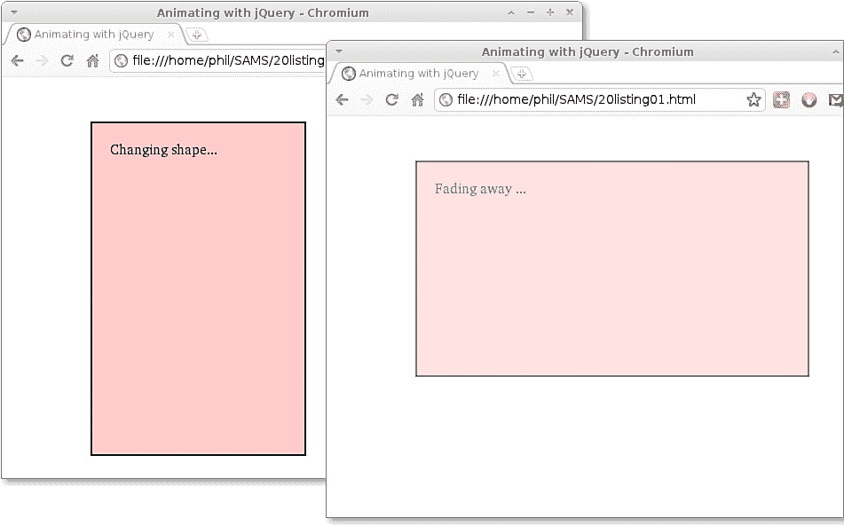

**图 15.1** 一个简单的 jQuery 动画

---

### 处理事件

在 jQuery 中，你可以通过多种方式向元素或元素集合附加事件处理器。首先，你可以像这样直接添加事件处理器：

```javascript
$("a").click(function() {
    // 当任何锚点元素被点击时执行此代码
});
```

或者，你也可以使用命名函数，如下所示：

```javascript
function hello() {
    alert("Hello from jQuery");
}
$("a").click(hello);
```

在这两个示例中，当锚点被点击时将执行该函数。你在 jQuery 中可能使用的其他常用事件包括 `blur`、`focus`、`hover`、`keypress`、`change`、`mousemove`、`resize`、`scroll`、`submit` 和 `select`。

为了帮助你添加多个事件处理器，jQuery 以跨浏览器的方式封装了 JavaScript 方法 `attachEvent` 和 `addEventListener`：

```javascript
$("a").on('click', hello);
```

`on()` 方法可以用于附加到原始 HTML 页面中元素，也可以附加到动态添加到 DOM 的元素。

---

### 注意

`on()` 方法在 jQuery 1.7 中引入，是以前几个事件处理方法的推荐替代方案，包括 `bind()`、`delegate()` 和 `live()`。请查看 jQuery 文档以获取完整细节。

---

### 总结

jQuery 是一个功能丰富且非常流行的 JavaScript 库，具有易于使用的 API，并可以在大多数流行的浏览器中运行。在这一小时里，你对它进行了深入了解。

---

## jQuery UI

 **主题构建**——让您的网站在所有用户界面组件中具有一致的视觉感受。您可以在 [`jqueryui.com/themeroller/`](http://jqueryui.com/themeroller/) 访问 `ThemeRoller` 工具。`ThemeRoller` 在线工具允许您从预写设计的图库中选择主题，或者以现有主题为起点创建自定义主题。

在这一小时的学习中，您将学习如何使用一些更流行的插件。得益于 jQuery UI 一致的用户界面，之后您可以轻松地通过 jQuery 文档探索许多其他可用插件。

### 如何在您的页面中引入 jQuery UI

第一步是访问 [`jqueryui.com/themeroller/`](http://jqueryui.com/themeroller/)  jQuery ThemeRoller 在线应用程序。

#### 使用 ThemeRoller

jQuery UI CSS 框架是一组涵盖广泛用户界面需求的类。使用 `ThemeRoller` 工具，您可以构建自己的界面样式，可以从零开始，也可以基于 [`jqueryui.com/themeroller/`](http://jqueryui.com/themeroller/) 图库中提供的任何广泛示例示例。

一旦您决定了样式，jQuery UI 就提供了一个下载构建器，仅会打包您所需的组件。它还会处理所选项目的的任何依赖关系，因此您不会在缺少所有所需辅助文件的情况下下载小部件或交互功能。您只需要下载并解压 zip 文件即可。

一旦解压了下载的内容，您将拥有以下目录：

`/css/`

`/development-bundle/`

`/js/`

`development-bundle` 目录包含 jQuery UI 的源代码、演示和文档。如果您不打算更改任何 jQuery UI 代码，可以安全地删除它。

通常，在任何要使用 jQuery UI 小部件和交互的页面上，您需要从剩余文件中引入您的主题、jQuery 和 jQuery UI：

```html
<link rel="stylesheet" type="text/css" href="jquery-ui.min.css"/>
<script src="http://code.jquery.com/jquery-latest.min.js"></script>
<script src="http://codeorigin.jquery.com/ui/1.10.3/jquery-ui.min.js"></script>
```

如果您使用标准图库主题之一，也可以链接到内容分发网络（CDN）上的所有所需文件：

```html
<link rel="stylesheet" type="text/css" href="http://ajax.googleapis.com/ajax_libs/jqueryui/1.10.3/themes/smoothness/jquery-ui.css"/>
<script src="http://code.jquery.com/jquery-latest.min.js"></script>
<script src="http://codeorigin.jquery.com/ui/1.10.3/jquery-ui.min.js"></script>
```

### 交互

让我们看看可以使用 jQuery UI 实现的一些事情，以改进页面元素与用户的交互方式。

### 拖放

使用 jQuery UI 让元素变得可拖再不过简单了：

```javascript
$("#draggable").draggable();
```

列表 16.1 显示了您如何在 HTML 页面中实现这一点。

**列表 16.1 让页面元素可拖**

```html
<!DOCTYPE html>
<html>
<head>
    <link rel="stylesheet" type="text/css" href="http://ajax.googleapis.com/ajax_libs/jqueryui/1.10.3/themes/smoothness/jquery-ui.css"/>
    <style>
        #dragdiv {
            width: 100px;
            height: 100px;
            background-color: #eeffee;
            border: 1px solid black;
            padding: 5px;
        }
    </style>
    <title>Drag and Drop</title>
    <script src="http://code.jquery.com/jquery-latest.min.js"></script>
    <script src="http://codeorigin.jquery.com/ui/1.10.3/jquery-ui.min.js"></script>
    <script>
        $(function() {
            $("#dragdiv").draggable();
        });
    </script>
</head>
<body>
    <div id="dragdiv"> Drag this element around the page!</div>
</body>
</html>
```

当页面加载后，元素 `<div id="dragdiv">` 变为可拖拽的：

```javascript
$(function() {
    $("#dragdiv").draggable();
});
```

然后，您可以通过点击元素任何部分的鼠标在页面上拖动该项目，如图 16.1 所示。

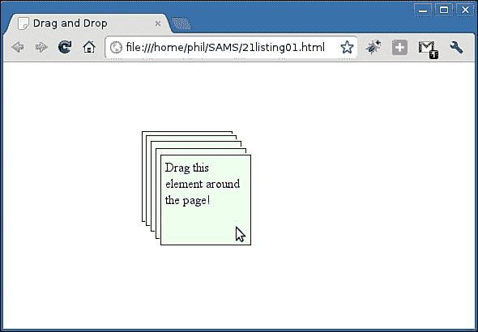

**图 16.1** 拖动页面元素

#### 尝试一下：使用 jQuery UI 进行拖放

要让一个元素能够接收掉在其上面的另一个元素，您需要使用 `droppable()` 方法。该方法可以指定对各种事件执行操作，例如拖拽项目被掉落、悬停在可放置区域上方或离开可放置区域。

您将修改列表 16.1 中的代码，以添加另一个更大的 `<div>` 元素作为掉落区域：

```html
<div id="dropdiv">This is the drop zone ...</div>
```

除了让可拖拽项目变为可拖拽外，您还需要指定新的 `<div>` 元素是一个放置区域，如下所示：

```javascript
$("#dropdiv").droppable();
```

此外，您将通过向 `drop` 和 `out` 事件的处理器中添加方法，使可拖拽项目上的文本在被掉落或离开可放置区域时发生变化：

```javascript
$("#dropdiv").droppable({
    drop: function() { $("#dragdiv").text("Dropped!"); },
    out: function() { $("#dragdiv").text("Off and running again ..."); }
});
```

创建一个包含列表 16.2 代码的 HTML 页面。

**列表 16.2 使用 jQuery UI 进行拖放**

```html
<!DOCTYPE html>
<html>
<head>
    <link rel="stylesheet" type="text/css" href="http://ajax.googleapis.com/ajax_libs/jqueryui/1.10.3/themes/smoothness/jquery-ui.css"/>
    <style>
        div {
            font: 12px arial, helvetica;
        }
        #dragdiv {
            width: 50px;
            height: 50px;
            background-color: #eeffee;
            border: 1px solid black;
            padding: 5px;
        }
        #dropdiv {
            position: absolute;
            top: 80px;
            left: 100px;
            width: 300px;
            height: 200px;
            border: 1px solid black;
            padding: 5px;
        }
    </style>
    <title>Drag and Drop</title>
    <script src="http://code.jquery.com/jquery-latest.min.js"></script>
    <script src="http://codeorigin.jquery.com/ui/1.10.3/jquery-ui.min.js"></script>
    <script>
        $(function() {
            $("#dragdiv").draggable();
            $("#dropdiv").droppable({
                drop: function() { $("#dragdiv").text("Dropped!"); },
                out: function() { $("#dragdiv").text("Off and running again ..."); }
            });
        });
    </script>
</head>
<body>
    <div id="dropdiv">This is the drop zone ...</div>
    <div id="dragdiv">Drag this element around the page!</div>
</body>
</html>
```

```javascript
$(function() {
    $("#dragdiv").draggable();
    $("#dropdiv").droppable({
        drop: function() { $("#dragdiv").text("Dropped!"); },
        out: function() { $("#dragdiv").text("Off and running again ..."); }
    }).resizable();
});
```

### 排序

拖放功能的进一步封装方法是 `sortable()` 方法，你可以将它添加到列表项中，以使列表变得可排序：

```javascript
$("#sortMe").sortable();
```

列表 16.3 演示了你如何将此方法应用于无序列表元素。

**列表 16.3 使元素可排序**

```html
<!DOCTYPE html>
<html>
<head>
    <link rel="stylesheet" type="text/css" href="http://ajax.googleapis.com/ajax/libs/jqueryui/1.10.3/themes/smoothness/jquery-ui.css"/>
    <title>Sortable</title>
    <script src="http://code.jquery.com/jquery-latest.min.js"></script>
    <script src="http://codeorigin.jquery.com/ui/1.10.3/jquery-ui.min.js"></script>
    <script>
        $(function() {
            $("#sortMe").sortable();
        });
    </script>
</head>
<body>
    <ul id="sortMe">
        <li>One</li>
        <li>Two</li>
        <li>Three</li>
        <li>Four</li>
        <li>Five</li>
    </ul>
</body>
</html>
```

将元素拖动到列表中的新位置会导致列表进行排序，在完成放置时，列表会“吸附”到新的顺序，如图图 16.4 所示。


**图 16.4** 排序列表

### 使用小部件

小部件是可以以极少的麻烦和复杂性放入应用程序的界面项。

#### 手风琴 (Accordion)

手风琴小部件允许用户一次只展开一个 `<div>` 元素列表，而让其余元素收起为仅标题栏。

首先，你需要在语义层中添加数据，使用标题和内容面板成对：

```html
<div id="accordion">
    <h3><a href="#">First header</a></h3>
    <div>First content</div>
    <h3><a href="#">Second header</a></h3>
    <div>Second content</div>
</div>
```

接下来，你可以通过对外部层容器元素调用 `accordion()` 方法来激活手风琴：

```javascript
$(function() {
    $("#accordion").accordion();
});
```

列表 16.4 显示了一个示例应用程序，这里将餐厅菜单的午餐选项分成了手风琴的不同折叠层。

**列表 16.4 使用手风琴小部件**

```html
<!DOCTYPE html>
<html>
<head>
    <link rel="stylesheet" type="text/css" href="http://ajax.googleapis.com/ajax/libs/jqueryui/1.10.3/themes/smoothness/jquery-ui.css"/>
    <title>Menu Choices</title>
    <script src="http://code.jquery.com/jquery-latest.min.js"></script>
    <script src="http://codeorigin.jquery.com/ui/1.10.3/jquery-ui.min.js"></script>
    <script>
        $(function() {
            $("#accordion").accordion();
        });
    </script>
</head>
<body>
    <h2>Choose from the following menu options:</h2>
    <div id="accordion">
        <h3><a href="#">Starters</a></h3>
        <div>
            <ul>
                <li>Clam Chowder</li>
                <li>Ham and Avocado Salad</li>
                <li>Stuffed Mushrooms</li>
                <li>Chicken Liver Pate</li>
            </ul>
        </div>
        <h3><a href="#">Main Courses</a></h3>
        <div>
            <ul>
                <li>Scottish Salmon</li>
                <li>Vegetable Lasagne</li>
                <li>Beef and Kidney Pie</li>
                <li>Roast Chicken</li>
            </ul>
        </div>
        <h3><a href="#">Desserts</a></h3>
        <div>
            <ul>
                <li>Chocolate Sundae</li>
                <li>Lemon Sorbet</li>
                <li>Fruit Salad</li>
                <li>Strawberry Cheesecake</li>
            </ul>
        </div>
    </div>
</body>
</html>
```

#### 标签页

标签页小部件允许你创建一个标签式界面，其中每个标签都与一个内容面板相关联。你需要在一个容器中定义标签和面板：

```html
<div id="tabs">
    <ul>
        <li><a href="#tab1">Tab 1</a></li>
        <li><a href="#tab2">Tab 2</a></li>
    </ul>
    <div id="tab1">Content for tab 1</div>
    <div id="tab2">Content for tab 2</div>
</div>
```

上述所有内容都封装在一个 `id="tabs"` 的 `div` 容器中，要激活标签页界面，你只需要对该容器元素调用 `tabs()` 方法即可：

```javascript
$( "#tabs" ).tabs();
```

激活后，界面看起来就像图 16.7 所示。


**图 16.7** 标签页

### 总结

在这一节中，你学习了除了 jQuery 之外，如何使用 jQuery UI 库来构建流畅的用户界面。你了解了如何快速地为页面添加交互和组件，以及如何使用 ThemeRoller 应用为你的界面项目设置整体样式。

## 问答

**问：我可以进一步自定义这些界面元素吗？**

**答：可以的。**由于本书空间有限，本节中演示的每个交互和组件都使用了默认设置。在实际上，每个组件都有一系列自定义选项，可以使其完全按照你想要的方式工作。你可以在 http://docs.jquery.com/UI/ 找到大量的文档和示例。

**问：我如何让页面上的其他元素具有与 jQuery UI 生成的元素相同的样式？**

**答：当 jQuery UI 生成标记时，它会为新创建的标记应用类。这些类对应于 jQuery UI CSS 框架中的 CSS 声明。每个组件的完整细节列在 jQuery UI 文档中。

## 工作坊

在阅读随后的“答案”部分之前，尝试回答所有问题。

#### 测验

**1。** 在页面中使用 jQuery UI，每个页面至少必须包含：

**a.** jQuery 和 jQuery UI JavaScript 库以及指向 jQuery UI 主题 CSS 文件的链接

**b.** 仅有 jQuery 和 jQuery UI 库

**c.** 仅 jQuery UI JavaScript 库以及指向 jQuery UI 主题 CSS 文件的链接

**2。** 如何让一个 `id = "parking"` 的 `<div>` 元素能够接受拖放到上面的项目？

**a.** `$("#parking").drop()`

**b.** `$("#parking").dropzone()`

**c.** `$("#parking").droppable()`

**3。** 手风琴组件能够显示：

**a.** 一次显示一个内容区域

**b.** 一次显示指定数量的内容区域

**c.** 一次显示所有内容区域

#### 答案

**1。** a. jQuery 和 jQuery UI JavaScript 库以及指向 jQuery UI 主题 CSS 文件的链接

**2。** c. `$("#parking").droppable()`

**3。** a. 手风琴可以一次显示一个内容区域。

## 练习

 使用 ThemeRoller 下载你喜欢的 jQuery UI 主题。使用它来复现本节的一些示例脚本，并将你的页面外观与图中显示的页面进行对比。

 访问 [`docs.jquery.com/UI/`](http://docs.jquery.com/UI/) jQuery UI 文档，研究如何通过选项进一步自定义这些一些组件，并以本节的代码列表为起点尝试一些示例。

## 第 17 节 使用 jQuery 的 Ajax

---

本节将学到：

 什么是 Ajax 以及它如何帮助用户体验

 如何用原生 JavaScript 实现 Ajax

 如何使用 jQuery 流畅且简单地实现 Ajax

---

JavaScript 是一种客户端脚本语言，你到为止用过的所有示例都完全限于客户端编码。Ajax 允许你在后台与服务器通信，并在页面上显示结果，而无需执行页面刷新。这使你能够创建出与用户交互更流畅的页面。

在这一节中，你将学习支撑 Ajax 的技术基础，以及你如何使用 jQuery 让这整个过程变得流畅而简单。

### Ajax 剖析

到为止，我们只讨论了传统的基于页面的网站用户界面模型。

当你与此类网站交互时，包含文本、图像、数据输入表单等的单个页面会逐个呈现给你。在导航到下一个页面之前，必须单独处理每个页面。

例如，你可能会完成表单的数据输入字段，根据需要反复编辑和重新输入条目，而知道在表单最终提交之前数据不会被发送到服务器。

这种交互总结在图 17.1 中。

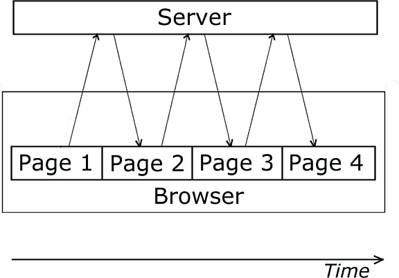

**图 17.1** 传统的客户端-服务器交互

在你提交表单或点击导航链接后，你必须等待浏览器屏幕刷新以显示由服务器交付的新或修订的页面。

遗憾的是，使用这种模型构建的界面有很多缺点。首先，在加载每个新页面或修订页面时，会有明显的延迟。这中断了我们作为用户所感知的应用程序“流”。

此外，每次都必须加载*整个*页面，即使其大部分内容与上一个页面相同。网站上许多页面共有的项目（如页眉、页脚和导航部分）可能占页面中所含数据的很大比例。

这种不必要的数据下载浪费了带宽，并进一步加剧了加载每个新页面的延迟。

上述问题的共同影响是，提供的用户体验远不如大多数桌面应用程序所提供的体验。在桌面上，你期望程序的显示内容保持可见，且界面元素继续响应你的指令，而计算过程在后台静静地进行。

#### 引入 Ajax

Ajax 允许你在你的 Web 应用程序界面中添加一些在桌面应用程序中更常见的功能。为了实现这一点，Ajax 在网页和服务器之间建立了一个额外的处理“层”。

这一层通常通常被称为 Ajax 引擎或 Ajax 框架，它拦截来自用户的请求，并在后台静静、不经干扰且*异步*地处理服务器通信。这意味着服务器请求和响应不再需要与特定的用户动作同步，而可以在用户方便以及应用程序正确运行的任何时间发生。浏览器不会冻结并等待服务器完成最后一个请求，而是让你在当前页面中继续滚动、点击和打字。

更新页面元素以反映从服务器接收的修订信息也由 Ajax 负责，这会在页面继续被使用期间动态地发生。

图 17.2 表示了这些交互是如何发生的。

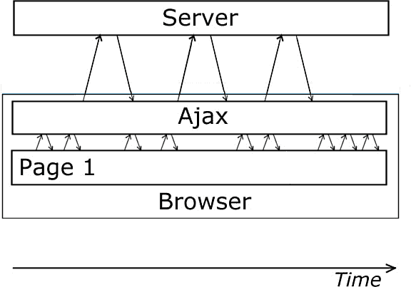

**图 17.2** Ajax 客户端-服务器交互

#### XMLHttpRequest 对象

当你点击超链接或提交 HTML 表单时，你向服务器发送 HTTP 请求，服务器通过向你提供新或修订的页面来响应。然而，为了让你的 Web 应用程序异步工作，你必须有一种方法向服务器发送 HTTP 请求，而无需关联显示新页请求。

我们可以通过 `XMLHttpRequest` 对象来实现。这个 JavaScript 对象能够连接到服务器并发布 HTTP 请求，而不需要关联页面加载。

---

提示

作为安全措施，`XMLHttpRequest` 对象通常只能调用与调用页面相同域内的 URL，不能直接调用远程服务器。

---

#### 不同浏览器的不同规则

由于你无法预知用户使用的是什么浏览器、版本或操作系统，你必须让你的代码动态调整其行为，以确保对象实例能够成功创建。

对于大多数支持 `XMLHttpRequest` 作为原生对象的浏览器（Firefox、Opera 以及其他浏览器，以及后续版本的 Internet Explorer），创建该对象的实例是简单的。下行代码创建了一个名为 `request` 的 `XMLHttpRequest` 对象：

```javascript
var request = new XMLHttpRequest();
```

要在某些较早版本的 Microsoft Internet Explorer 中实现等的效果，你需要创建一个 `ActiveX` 对象。以下是一个示例：

```javascript
var request = new ActiveXObject("Microsoft.XMLHTTP");
```

再次，这为你的新对象分配了名称 `request`。

为了让情况变得稍微复杂一点，某些较早版本的 Internet Explorer 安装了不同版本的 Microsoft XML 解析器；在这些情况下，你需要使用以下指令：

```javascript
var request = new ActiveXObject("Msxml2.XMLHTTP");
```

### 方法与属性

现在你已经创建了 `XMLHttpRequest` 对象的实例，让我们参考表 17.1 来看该对象的一些属性和方法。

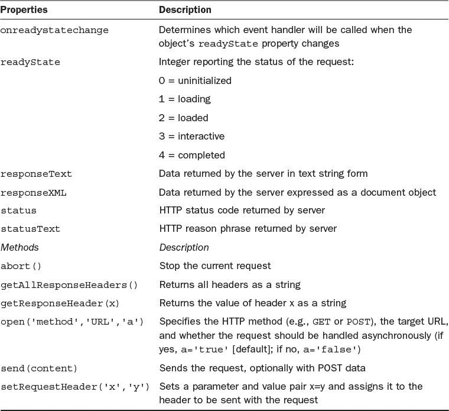

**表 17.1 XMLHttpRequest 对象与方法**

在接下来的课程中，我们将检查这些方法和属性如何用于构建 Ajax 应用的基础函数。

### 与服务器通信

在传统的网页模式中，当你通过超链接或表单提交服务器请求时，服务器接收该请求，执行任何所需的服务器端处理，随后向你提供与你的操作对应的新页面。

在此处理发生期间，你的用户界面会被冻结。当服务器完成任务时，你会通过新页面的出现得知。

然而，对于异步服务器请求，此类通信是在后台进行的，且请求的完成并不与刷新或加载新页面同步。因此，你必须进行其他安排来获取请求的进度。

`XMLHttpRequest` 对象拥有一个方便的属性来报告服务器请求的进度。你可以使用 JavaScript 语句来检查服务器完成任务的时间点，并且结果供你使用。

因此，你的 Ajax 库必须包含一个监控请求状态的程序。我们将在稍后详细介绍这一点。

### 服务器端发生了什么？

对于服务器端脚本来说，`XMLHttpRequest` 对象的通信只是另一个 HTTP 请求。Ajax 应用并不关心服务器存在什么语言或环境；只要客户端 Ajax 层接收到及时且格式正确的 HTTP 响应，一切运行正常。

### 处理服务器响应

一旦异步请求成功完成，你就可以使用服务器返回的信息。

Ajax 允许以多种格式返回信息，包括 ASCII 文本和 XML 数据。根据应用程序的性质，你可以在当前页面中翻译或处理这些信息。

### 有更简单的方法吗？

幸运的是，有很多 JavaScript 库可以将这些复杂的程序封装成易用的函数和方法。在本课程的剩余部分，你将看到 jQuery 库让编写 Ajax 变得简单。

## 使用 jQuery 实现 Ajax

你可能已经意识到从零编写 Ajax 可能很麻烦。幸运的是，jQuery 为你解决了这个问题，让你只需几行代码即可编写 Ajax 程序。

有很多 jQuery 方法可以向服务器执行 Ajax 调用；这里描述了常用的方法。

#### load()

当你只是想从服务器获取文档并显示在页面元素中，`load()` 可能就是需要的。以下代码片段获取 `newContent.html` 并将其内容添加到 `id="elem"` 的元素中：

```javascript
$(function() {
    $("#elem").load("newContent.html");
});
```

一个巧妙的技巧是在 URL 后面传递选择器，仅获取对应选择器的页面部分：

```javascript
$(function() {
    $("#elem").load("newContent.html #info");
});
```

你在 URL 后添加了 jQuery 选择器，会导致 jQuery 返回选择器指定的内容；此处 ID 为 `info` 的元素。当 `load()` 提供的控制有限时，jQuery 提供了发送 `GET` 和 `POST` 请求的方法。

#### get() 和 post()

这两个方法相似，仅请求类型不同。你不需要选择 jQuery 对象（如页面元素或元素集合）；相反，你可以直接使用 `$.get()` 或 `$.post()` 调用 `get()` 或 `post()`。在最简单的形式下，`get()` 或 `post()` 方法接受一个参数：目标 URL。

你经常会想要使用 `get()` 或 `post()` 向服务器发送数据。此类数据以编码字符串对的形式发送。

提示

如果你从表单字段收集数据，jQuery 提供了方便的 `serialize()` 方法来汇表单数据：

```javascript
var formdata = $('#form1').serialize();
```

大多数情况下，你想对返回的数据做些什么。为了这样做，你传递一个回调函数作为参数：

```javascript
$.get("serverScript.php",
    {param1: "value1", param2: "value2"},
    function(data) {
        alert("Server responded: " + data);
    });
```

`post()` 的语法本质上相同：

```javascript
$.post("serverScript.php",
    {param1: "value1", param2: "value2"},
    function(data) {
        alert("Server responded: " + data);
    });
```

#### ajax()

为了获得最大的灵活性，`ajax()` 方法允许你设置 Ajax 调用的每一个方面以及如何处理响应。有关使用 `ajax()` 的完整信息，请参见文档 [`api.jquery.com/jQuery.ajax/`](http://api.jquery.com/jQuery.ajax/)。

### 尝试自己一下

让我们用一个 jQuery 驱动的简单 Ajax 表单提交示例来结束本课程。

我们将使用这个简单的 HTML 表单：

```html
<form id="form1">
    Name<input type="text" name="name" id="name"><br />
    Email<input type="text" name="email" id="email"><br />
    <input type="submit" name="submit" id="submit" value="Submit Form">
</form>
```

你将使用 jQuery 执行以下任务：

 检查两个输入字段是否包含文本。

 通过 Ajax 使用 HTTP POST 提交表单。

 将服务器返回的数据打印到页面上的 <div> 元素中。

为了检查两个字段都已输入数据，你使用一个简单的函数：

```javascript
function checkFields(){
    return ($("#name").val() && $("#email").val());
}
```

为了函数返回布尔值 `true`，两个表单字段的 `value` 属性必须包含某些文本数据；如果任一字段为空，则空白字段将被解释为“假（falsy）”，且逻辑与（`&&`）运算符将导致函数返回 `false`。

接下来，应用 jQuery 的 `submit()` 事件处理程序来检测表单提交。如果你的函数 `checkFields()` 返回 `false`，默认行为将被取消，表单将不会提交；否则，jQuery 将将数据序列化并向服务器脚本发送 `post()` 请求。

jQuery 的 `serialize()` 方法用于将表单信息收集并序列化为字符串，作为数据负载通过 Ajax 调用发送。

对于此示例，服务器脚本 `test.php` 除了格式化接收到的信息并作为一小段 HTML 发回之外，什么都不做：

```php
<?php
echo "Name: " . $_REQUEST['name'] . "<br />Email: " . $_REQUEST['email'];
?>
```

最后，回调函数在页面上显示返回的信息：

```javascript
function(data){
    $("#div1").html(data);
}
```

代码如列表 17.1 所示。

**列表 17.1 一个 Ajax 表单**

```html
<!DOCTYPE html>
<html>
<head>
    <title>Ajax Form Submission</title>
    <script src="http://code.jquery.com/jquery-latest.min.js"></script>
    <script>
        $(document).ready(function(){
            function checkFields(){
                return ($("#name").val() && $("#email").val());
            }
            $("#form1").submit(function(){
                if(checkFields()){
                    $.post(
                        'test.php', $("#form1").serialize(),
                        function(data){
                            $("#div1").html(data);
                        }
                    );
                }
                else alert("Please fill in name and email fields!");
                return false;
            });
        });
    </script>
</head>
<body>
    <form id="form1">
        Name<input type="text" name="name" id="name"><br />
        Email<input type="text" name="email" id="email"><br />
        <input type="submit" name="submit" id="submit" value="Submit Form">
    </form>
    <div id="div1"></div>
</body>
</html>
```

---

要运行此示例，你需要将列表 17.1 列出的文件以及服务器文件 `test.php` 上传到具有 PHP 支持的 Web 服务器上。

尝试在留一个或两个输入字段为空的情况下提交表单，会导致脚本发出警告消息并阻止表单提交。

成功的表单提交应导致格式化后的数据显示在页面上，如图 17.3 所示。该图还显示了 Firebug Lite 显示 Ajax 调用和响应的。

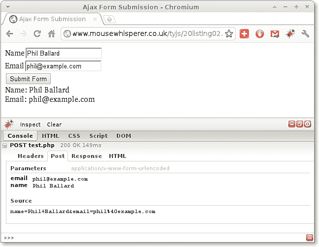

**图 17.3** 使用 jQuery 的 Ajax 表单

---

### 总结

在这一小时中，你深入了解了 Ajax 编程的基础知识，并学习了如何使用 jQuery 库让整个过程变得更加流畅和简单。

## 问答

**Q. Ajax 是如何命名的？**

**A.** Ajax 是 Asynchronous JavaScript And XML（异步 JavaScript 和 XML）的缩写。但在实践中，Ajax 绝不限于仅返回 XML 数据。

**Q. 除了 jQuery 之外，还有其他库实现 Ajax 吗？**

**A.** 定的。有许多库和框架可以帮助你实现 Ajax，流行的包括 Dojo、MooTools 和 Prototype。

## 工作坊

在阅读随后的“[答案”部分之前，尝试回答所有问题。

#### 测验

**1.** 下列哪项将从服务器文件 `examples.html` 获取 `id=source` 的元素，并将其插入到 `id=target` 的页面元素中？

**a.** `$("#target").load("examples.html #source");`

**b.** `$("#source").load("examples.html #target");`

**c.** `$(#source).load("examples.html #target");`

**2.** 用于处理来自 Ajax 返回数据的函数称为：

**a.** 匿名函数

**b.** 回调函数

**c.** Ajax 请求

**3.** `serialize()` 方法：

**a.** 将一组元素编码为字符串。

**b.** 将一组元素编码为对象。

**c.** 将一组元素编码为数组。

#### 答案

**1.** **a.** `$("#target").load("examples.html #source");`

**2.** **b.** 回调函数

**3.** **a.** 将一组元素编码为字符串。

## 练习题

 将一些文本上传到 .txt 文件中。创建一个页面，使用 jQuery 的 `load()` 方法将其显示在页面的 `<div>` 中。

 修改此“[此处试一下”的代码，如果任一数据字段为空或包含少于四个字符，则不允许提交。

## 第 18 节 使用 Cookie

通常的原因是某些网站将 Cookie 作为广告系统的一部分，用于跟踪用户的在线活动，以便选择合适的广告。最好说明你为什么要使用 Cookie 以及你将如何使用它。

## Cookie 的局限性

你的浏览器对可以存储的 Cookie 数量可能会有限制——通常为几百个 Cookie 或更多。通常，每个域名允许存储 20 个 Cookie。单个域名可以存储共 4KB 的 Cookie 信息。

除了这些大小限制带来的潜在问题外，Cookie 还会因为各种原因从硬盘中消失，例如 Cookie 到期、用户清除 Cookie 信息或切换了浏览器。因此，绝不应使用 Cookie 来存储关键数据，你的代码应该始终编写为处理无法获取预期的 Cookie 的情况。

## document.cookie 属性

JavaScript 中的 Cookie 通过使用 `document` 对象的 `cookie` 属性进行存储和检索。

每个 Cookie 本质上是一个由名称和值对组成的文本字符串，如下所示：

`username=sam`

当网页加载到你的浏览器时，浏览器会将该页面所有可用 Cookie 汇编成单个类似于字符串的属性，可以通过 `document.cookie` 访问。在 `document.cookie` 内部，各个 Cookie 用分号分隔：

```javascript
username=sam;location=USA;status=fullmember;
```

### 提示

我将 `document.cookie` 称为*类字符串*属性，因为 true 并不是真正的字符串——只是当你尝试提取 Cookie 信息时，它的行为就像字符串一样，正如你在本小时中看到的。

## 数据的转义与反转义

Cookie 值可能不包含某些字符。那些被禁止的字符包括分号、逗号以及空格、制表符等空白字符。在将数据存储到 Cookie 之前，你需要对数据进行编码，以便能够正确存储。

你可以使用 JavaScript 的 `escape()` 函数在存储之前对值进行编码，并使用相应的 `unescape()` 函数稍后恢复原始 Cookie 值。

`escape()` 函数将字符串中的任何非 ASCII 字符转换为等效的两位或四位十六进制格式——因此空格转换为 `%20`，符号 (&) 转换为 `%26`。

例如，以下代码段输出了变量 `str` 中保存的原始字符串，随后是应用 `escape()` 函数后的值：

```javascript
var str = 'Here is a (short) piece of text.';

document.write(str + '<br />' + escape(str));
```

屏幕上的输出将是

```javascript
Here is a (short) piece of text.

Here%20is%20a%20%28short%29%20piece%20of%20text.
```

注意空格已被替换为 `%20`，左括号被替换为 `%28`，右括号被替换为 `%29`。

 *, @, -, _, +, ., 和 / 之外，所有特殊字符都经过了编码。

## Cookie 的组成

`document.cookie` 中的 Cookie 信息看起来可能是一个简单的名称和值对字符串，每个对的格式为

`name=value;`

但实际上，每个 Cookie 都关联着某些其他信息，如下文节所示。

## 注意事项

Cookie 的最终规范于 2011 年作为 RFC6265 发布。你可以在 [`tools.ietf.org/html/rfc6265`](http://tools.ietf.org/html/rfc6265) 读取它。

### cookieName 和 cookieValue

这些是 Cookie 字符串中每个 `name=value` 对可见的名称和值。

### domain

`domain` 属性告诉浏览器 Cookie 哪个域名。该属性是可选的，当未指定时，其值默认为设置 Cookie 的页面域名。

`domain` 属性的目的是控制跨子域的 Cookie 操作。如果域名设置为 www.example.com，那么 code.example.com 等子域名上的页面将无法读取该 Cookie。然而，如果 `domain` 设置为 example.com，那么 code.example.com 中的页面将能够访问它。

你不能将 `domain` 属性设置为包含你页面之外的任何域名。

### path

`path` 属性允许你指定 Cookie 可用的目录。如果你希望 Cookie 仅对 `documents` 目录下的页面设置，请将路径设置为 `/documents`。`path` 属性是可选的，通常默认路径是 /，在这种情况下 Cookie 对整个域名都有效。

### secure

可选且很少使用的 `secure` 标志表示浏览器在向服务器发送 Cookie 时应使用 SSL 安全性。

### expires

每个 Cookie 都有一个 `expires` 日期，在此之后 Cookie 将被自动删除。`expires` 日期应该是 UTC 时间（格林尼治时间，或 GMT）。如果未为 `expires` 设置值，Cookie 的有效期将持续当前浏览器会话，并在浏览器关闭时自动删除。

### 写入 Cookie

要写入新 Cookie，只需为 `document.cookie` 赋值一个包含所需属性的值：

```javascript
document.cookie = "username=sam;expires=15/06/2013 00:00:00";
```

为了避免手动设置日期格式，我们可以使用 JavaScript 的 `Date` 对象完成相同的操作：

```javascript
var cookieDate = new Date ( 2013, 05, 15 );

document.cookie = "username=sam;expires=" + cookieDate.toUTCString();
```

这产生了与上一个示例相同的结果。

### 提示

注意使用

`cookieDate.toUTCString();`

而不是

`cookieDate.toString();`

因为 Cookie 日期始终需要以 UTC 时间设置。

在实践中，你应该使用 `escape()` 来确保没有被禁止的字符进入 Cookie 值：

```javascript
var cookieDate = new Date ( 2013, 05, 15 );

var user = "Sam Jones";

document.cookie = "username=" + escape(user) + ";expires=" + cookieDate.toUTCString();
```

### 写入 Cookie 的函数

编写一个函数来写入 Cookie 是相当，将转义和可选属性的处理交给函数。此类函数的代码出现在 列表 18.1。

**列表 18.1 写入 Cookie 的函数**

```javascript
function createCookie(name, value, days, path, domain, secure) {
    if (days) {
        var date = new Date();
        date.setTime(date.getTime() + (days*24*60*60*1000));
        var expires = date.toGMTString();
    }
    else var expires = "";
    cookieString = name + "=" + escape (value);
    if (expires) cookieString += "; expires=" + expires;
    if (path) cookieString += "; path=" + escape (path);
    if (domain) cookieString += "; domain=" + escape (domain);
    if (secure) cookieString += "; secure";
    document.cookie = cookieString;
}
```

函数的操作简单。`name` 和 `value` 参数组合成 `name=value` 字符串，并对 `value` 部分进行转义以避免禁用字符引起的错误。

我们不是向函数传递日期字符串，而是要求传入过期前的天数。函数随后会处理转换为相应的日期字符串。

其余属性都是可选的，并且仅当它们作为参数存在时才被添加到字符串中。

如果你尝试直接从本地机器将文件加载到浏览器，你的浏览器安全设置可能会阻止你尝试这些示例。要看到示例运行，你可能需要将文件上传到 Internet 上的 Web 服务器或本地局域网的其他地方。

## 动手尝试：编写 Cookies

让我们使用这个函数来设置某些 Cookie 的值。我们简单页面的代码如列表 18.2 所示。创建一个名为 `testcookie.html` 的新文件，并输入列出的代码。你可以随地为存储在 Cookie 中的键名和值对使用不同的值。

**列表 18.2 写入 Cookies**

```html
<!DOCTYPE html>
<html>
<head>
<title>Using Cookies</title>
<script>
    function createCookie(name, value, days, path, domain, secure) {
        if (days) {
            var date = new Date();
            date.setTime(date.getTime() + (days*24*60*60*1000));
            var expires = date.toGMTString();
        }
        else var expires = "";
        cookieString = name + "=" + escape (value);
        if (expires) cookieString += "; expires=" + expires;
        if (path) cookieString += "; path=" + escape (path);
        if (domain) cookieString += "; domain=" + escape (domain);
        if (secure) cookieString += "; secure";
        document.cookie = cookieString;
    }
    createCookie("username","Sam Jones", 5);
    createCookie("location","USA", 5);
    createCookie("status","fullmember", 5);
</script>
</head>
<body>
Check the cookies for this domain using your browser tools.
</body>
</html>
```

如果你有 Internet 主机或本地局域网上的 Web 服务器，请将此 HTML 文件上传到那里。加载后的页面除了一行文本外什么都不显示：

使用你的浏览器工具检查此域的 cookies。在 Chromium 浏览器中，我可以使用 `Shift+Ctrl+I` 打开开发者工具——如果你使用不同的浏览器，请查看文档了解如何查看 cookie 信息。我的结果如图 18.1 所示。

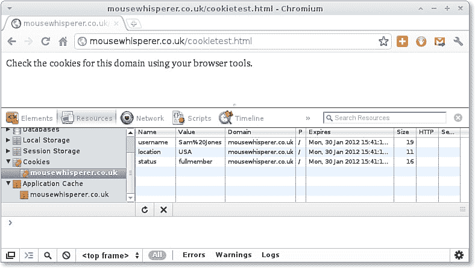

**图 18.1** 显示我们的 cookies

> 注意，每次调用该函数时，它都会为 `document.cookie` 设置一个新值，但这个值并不会覆盖之前的值；而是将你的新 cookie 添加到已存在的 cookie 值中。正如我所说，`document.cookie` 有时看起来像是一个字符串，但它实际上并不是字符串。

### 读取 Cookie

读取 Cookie 值的函数严重依赖于 JavaScript 的 `split()` 字符串方法，这是你在第 5 小节“数字与字符串”中学习过的。你可能记得 `split()` 接收一个字符串并将其分为项目数组，使用指定的字符来确定字符串应该分割的位置：

```javascript
myString = "John#Paul#George#Ringo";
var myArray = myString.split('#');
```

前面的语句将字符串 `myString` 分分为一系列单独的部分，在每个哈希（`#`）字符出现的地方切断字符串；`myArray[0]` 将包含“John”，`myArray[1]` 将包含“Paul”，依此类推。

由于在 `document.cookie` 中各个 cookie 是用分号字符分隔的，因此该字符最初用于拆分 `document.cookie` 返回的字符串：

```javascript
var crumbs = document.cookie.split(';');
```

你想搜索具有特定名称的 cookie，因此会在生成的数组 `crumbs` 中搜索任何具有适当 `name=` 部分的项目。结合 `indexOf()` 和 `substring()` 方法来返回 cookie 的值部分，然后函数在通过 `unescape()` 移除任何编码后将其返回：

```javascript
function getCookie(name) {
    var nameEquals = name + "=";
    var crumbs = document.cookie.split(';');
    for (var i = 0; i < crumbs.length; i++) {
        var crumb = crumbs[i];
        if (crumb.indexOf(nameEquals) == 0) {
            return unescape(crumb.substring(nameEquals.length, crumb.length));
        }
    }
    return null;
}
```

## 删除 Cookies

要删除 cookie，只需要将其设置在当前日期之前的过期日期。浏览器会推断 cookie 已经过期并将其删除。

```javascript
function deleteCookie(name) {
    createCookie(name,"",-1);
}
```

> **注意**：某些版本的某些浏览器即使你在脚本中删除了 cookie，也会保留它 直到你重启浏览器。如果你的程序依赖于删除操作一定发生，请对删除的 cookie 再次进行 `getCookie` 测试以确保它真的消失了。

## 动手尝试：使用 Cookies

让我们通过构建一些页面来测试 cookie 操作，整合你目前为止学到的关于 cookie 的所有知识。首先，将函数 `createCookie()`、`getCookie()` 和 `deleteCookie()` 收集到单个 JavaScript 文件中并保存为 `cookie.js`，使用列表 18.3 中的代码。

**列表 18.3 cookies.js**

```javascript
function createCookie(name, value, days, path, domain, secure) {
    if (days) {
        var date = new Date();
        date.setTime( date.getTime() + (days*24*60*60*1000));
        var expires = date.toGMTString();
    }
    else var expires = "";
    cookieString = name + "=" + escape (value);
    if (expires) cookieString +=  "; expires=" + expires;
    if (path) cookieString += "; path=" + escape (path);
    if (domain) cookieString += "; domain=" + escape (domain);
    if (secure) cookieString += "; secure";
    document.cookie = cookieString;
}

function getCookie(name) {
    var nameEquals = name + "=";
    var crumbs = document.cookie.split(';');
    for (var i = 0; i < crumbs.length; i++) {
        var crumb = crumbs[i];
        if (crumb.indexOf(nameEquals) == 0) {
            return unescape(crumb.substring(nameEquals.length, crumb.length));
        }
    }
    return null;
}

function deleteCookie(name) {
    createCookie(name,"",-1);
}
```

此文件将包含在你测试页的 `<head>` 中，以便你的代码可以使用这三个函数。首一个测试页面 `testcookie.html` 的代码如列表 18.4 所示，第二个测试页面 `testcookie2.html` 的代码如列表 18.5 所示。在文本编辑器中创建这两个页面。

**列表 18.4 testcookie.html**

```html
<!DOCTYPE html>
<html>
<head>
<title>Using Cookies</title>
<script src="cookies.js"></script>
<script>
    window.onload = function() {
        var cookievalue = prompt("Cookie Value:");
        createCookie("myCookieData", cookievalue);
    }
</script>
</head>
<body>
    <a href="testcookie2.html">Go to Cookie Test 2</a>
</body>
</html>
```

**列表 18.5 testcookie2.html**

```html
<!DOCTYPE html>
<html>
<head>
<title>Using Cookies</title>
<script src="cookies.js"></script>
<script>
    window.onload = function() {
        document.getElementById("output").innerHTML = "Your cookie value: " + getCookie("myCookieData");
    }
</script>
</head>
<body>
    <a href="testcookie.html">Back to Cookie Test 1</a><br/>
    <div id="output"></div>
</body>
</html>
```

`cookietest.html` 中唯一可见的页面内容是指向第二个页面 `cookietest2.html` 的链接。然而，`window.onload` 事件被页面上的代码捕获并用于执行一个函数，该函数会在页面加载完成后立即弹出一个 `prompt()` 对话框。该对话框询问你一个要保存到 cookie 中的值，然后调用 `createCookie()` 设置一个名为 `myCookieData` 值为你刚刚输入的内容 cookie。

`cookietest.html` 页面的工作情况所示图 18.2。

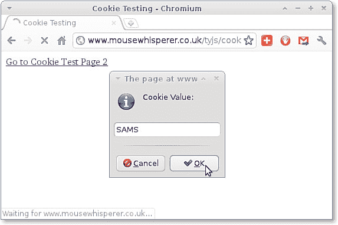

**图 18.2** 为你的 cookie 输入一个值。

设置好 cookie 后，使用链接导航到 `cookietest2.html`。


# 当此页面加载时

当此页面加载时，`window.onload` 事件处理器会执行一个函数，该函数使用 `getCookie()` 获取存储的 cookie 值并将其写入页面，所示图 18.3。

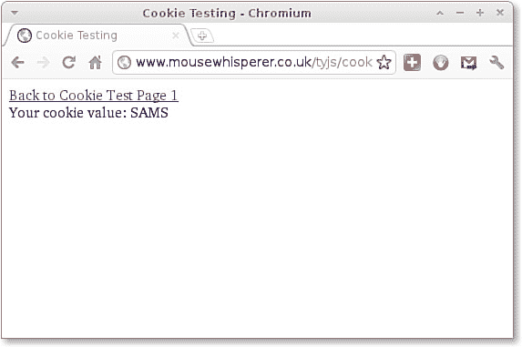

**图 18.3** 获取你 cookie 的值

若要亲自尝试，你需要将文件 `cookietest.html`、`cookietest2.html` 和 `cookies.js` 上传到互联网上的 Web 服务器（或者本地网络上的服务器，如果有），因为浏览器安全机制可能会阻止你在使用 `file://` 协议查看本地电脑上的文件时设置 cookie。

## 在单个 Cookie 中设置多个值

每个 cookie 包含一个 `name=value` 键对，因此如果你需要存储几条独立的数据（例如用户的姓名、年龄和会员号），你需要三个不同的 cookie。

然而，通过一点小技巧，你可以通过将所需的值连接成单个字符串（该字符串将成为 cookie 存储的值），让你的 cookie 存储所有三个值。

这样，你不需要为姓名、年龄和会员号准备三个独立的 cookie，而是只需要一个（可能命名为 `user`），其中包含这三部分数据。为了稍后分离细节，你可以在值字符串中放置一个称为*分隔符*（delimiter）的特殊字符，以分隔不同的数据部分：

```javascript
var userdata = "Sandy|26|A23679";
createCookie("user", userdata);
```

这里的 `|`（管道）字符充当了分隔符。当你稍后获取 cookie 值时，可以使用 `|` 分隔符将其拆分为各个独立的变量值：

```javascript
var myUser = getCookie("user");
var myUserArray = myUser.split('|');
var name = myUserArray[0];
var age = myUserArray[1];
var memNo = myUserArray[2];
```

存储多个值的 cookie 占用了某些浏览器允许的每个域名 20 个 cookie 的额度，但请记住，你对 cookie 的使用仍受到 cookie 信息 4KB 总限制的限制。

### 注意

这是序列化的另一个示例，你已经在第 10 小时 的“会见 JSON”中学习过。

### 总结

在本节课中，你学习了 cookie，以及如何使用 JavaScript 设置、检索和删除它们。你还学习了如何将多个值合并到单个 cookie 中。

## 问答

**问。在将多个值合并到单个 cookie 时，可以使用任何字符作为分隔符吗？**

**答。你不能使用可能出现在你的转义数据中的任何字符（分隔符字符除外），也不能使用等号 (`=`) 或分号 (`;`)，因为这些字符用于在 `document.cookie` 中组合和拼接 `name=value` 键对。此外，cookie 可能不包含空格或逗号，因此它们自然不能用作分隔符。**

**问。cookie 安全吗？**

**答。人们经常对 cookie 的安全性提出质疑，但这种担忧很大程度上是没有根据的。cookie *可以*帮助网站所有者和广告商跟踪你的浏览习惯，他们可以（并且确实）利用此类信息来在你访问的网页上选择广告和促销信息。然而，网站所有者和广告商无法仅仅通过使用 cookie 获取关于你的个人信息或访问你硬盘上的其他项目。**

## 工作坊

在阅读随后的“答案”部分之前尝试回答所有问题。

### 测验

**1。** cookie 是存储在……的小文本信息

**a.** 在用户的硬盘上

**b.** 在服务器上

**c.** 在用户的互联网服务提供商处

**2。** 使用以下方法对字符串进行编码以安全地存储在 cookie 中：

**a.** `escape()`

**b.** `unescape()`

**c.** `split()`

**3。** 用于分隔单个 cookie 中多个值的字符被称为

**a.** 转义序列

**b.** 分隔符

**c.** 分号

#### 答案

**1。** cookie 存储在用户的硬盘上。

**2。** 你可以使用 `escape()` 在 cookie 中安全地存储。

**3。** 分隔符。

## 练习

 使用你喜欢的浏览器查看 cookie 信息列表 18.4。

 重写 `cookietest.html` 和 `cookietest2.html` 以将多个值写入 cookie，使用井号（#）作为你的分隔符。

 在 `cookietest.html` 中添加一个按钮来删除 cookie。（提示：使用 `deleteCookie()`）。

```javascript
this.make = Make;
this.odometerReading = Miles;
}

setOdometer(newMiles) {
    this.odometerReading = newMiles;
}
}
```

这种语法还允许你扩展类，创建一个继承父类属性的新类。这里有一个示例：

```javascript
class Sportscar extends Car {
    constructor(Color, Year, Make, Miles) {
        super(Color, Year, Make, Miles);
        this.doors = 2;
    }
}
```

在这里，我在构造函数使用了 `super` 关键字，这允许我调用父类的构造函数并继承它的所有属性。事实上，这只是语法糖；所有使用类的代码都可以重写为函数和原型，就就像你在第 8 小节中学习的那样。然而，它与其他流行的语言具有更好的兼容性，而且读起来也更容易一些。

## 箭头函数

箭头函数 (`=>`) 是匿名函数的简写语法。

```
param => statements or expression
```

让我们再详细解释一下：

*   `param`——参数或多个参数的名称。如果函数没有参数，则需要用 `()` 标明。如果只有一个参数，则不需要括号。
*   `statements or expression`——多个语句需要括在花括号中。然而，单个表达式不需要括号。该表达式也是该函数的返回值。

```javascript
var overTen = x => x > 10 ? 10 : x;

overTen(8); // 返回 8
overTen(12); // 返回 10
```

注意，`function` 关键字不是必须的，而且由于只有一个参数，括号可以省略。接下来的示例有两个参数：

```javascript
var higher = (x, y) => {
    if (x > y) {
        return x;
    } else {
        return y;
    }
}

higher(7, 9); // 返回 9
higher(12, 3); // 返回 12
```

箭头函数不仅写起来更简单，它们还有一个特点，即会从容器继承 `this` 的值。这在在使用对象时非常有用。之前，我们需要将 `this` 赋值给变量以便将其传递给函数：

```javascript
function myObject() {
    this.height = 13;
    var self = this;
    setTimeout(function fiveSecondsLater() {
        console.log(self.height);
    }, 5000)
}

var o = new myObject();
```

在前面的示例中，我们不能简单地使用

```javascript
console.log(this.height);
```

因为 `this` 将指向其直接容器，在这里是函数 `fiveSecondsLater()`。然而，通过使用箭头函数，可以避免使用像 `self` 这样的变量：

```javascript
function myObject() {
    this.height = 13;
    setTimeout(() => {
        console.log(this.height); // 这里 'this' 指向 myObject
    }, 5000)
}

var o = new myObject();
```

## 模块

随着 JavaScript 应用复杂性的增加，需要找到一种方法让在一个文件中声明的对象在其他文件中可用。通过这种方法，可以用模块化的方式编写大型项目。

默认情况下，你在一个文件中声明的任何内容在该文件外部都是不可用的。但在 ECMAScript 6 中，你可以使用 `export` 关键字让它可用。

这里有一个如何导出类的示例：

```javascript
// 此代码出现在 file1.js 中
export default function Car(Color, Year, Make, Miles) {
    this.color = Color;
    this.year = Year;
    this.make = Make;
    this.odometerReading = Miles;
    this.setOdometer = function(newMiles) {
        this.odometerReading = newMiles;
    }
    // 此对象可以被其他文件导入
```

在接收到的文件中：

```javascript
//  此代码出现在 file2.js 中
import Car from 'file1';

var ferrari = new Car('red', 1986, 'Dino', 75500);
```

## 使用 let 和 const

在 ECMAScript 6 之前，JavaScript 只有两种作用域——即函数作用域和全局作用域。（变量的作用域，正如你在第 3 小节中学习的，“使用函数”，取决于变量使用 `var` 关键字在代码中的声明位置。）

令许多从其他语言转向 JavaScript 的开发者感到沮丧的是，JavaScript 缺乏所谓的“块作用域”，即定义变量仅在定义它的块内是可访问的。（块是一对花括号内部的所有内容。）

新关键字 `let` 允许你声明变量，同时将其作用域限制在声明它的块、语句或表达式上。

相比之下，`var` 关键字定义的变量要么是全局的，要么是对于整个函数局部的，不考虑块作用域：

```javascript
function myFunc() {
    {
        let x;
        if(y == 0) {
            // 这是可以的，x 具有块作用域
            let x = "inner";
        }
        // 这是一个错误，x 已经在块中声明过了
        let x = "outer";
    }
}
```

`const` 声明创建一个常量——即一个只读的命名变量。常量的值不能通过重新赋值来更改，常量之后也不能重新声明。

```javascript
function myFunc() {
    {
        const x = "foo";
        // 这是一个错误，x 是常量，不能重新定义
        x = "bar";
    }
}
```

***

### 亲自尝试一下：查看 const

让我们来看 `const` 是如何工作的。在编写时，它在大多数浏览器中都可以工作，但我将使用 Google Chrome。

不要在文本文件中编写代码，而是打开你浏览器的 JavaScript 控制台。对于 Chrome 来说，可以通过 `Ctrl+Shift+J` 实现。

首先，使用 `const` 关键字定义一个常量。你可以给它起任何名字，并选择任何值。我的常量叫 `MYCONST`，我给它赋值为 10（见图 19.1）。


**图 19.1** Chrome 控制台

控制台输出 undefined，这是因为 `const` 的声明没有返回值。

在图 19.2 中，我尝试重新定义 `MYCONST` 的值。


**图 19.2** 设置常量

如你所见，常量 `MYCONST` 无法重新赋值。让我们尝试重新声明它（见图 19.3）。


**图 19.3** 常量无法重新赋值

不，我们不能那样做。最后，让我们尝试重新初始化它（见图 19.4）。


**图 19.4** 重新声明常量无效

JavaScript 报错。

JavaScript 报错。正如我们所见，使用 `const` 关键字声明的值不能重新初始化、重新声明或重新赋值。

***

## 模板字符串

模板字符串为构建字符串提供了帮助，类似于某些其他编程语言（如 Perl 和 Python）中的字符串插值功能。

```javascript
var name = "John";
var course = "Mathematics III";
var myString = 'Hello ${name}, welcome to ${course}.';
```

你也可以替换更复杂的表达式：

```javascript
var total = 20;
var tax = 4;
msg = 'Total is ${total} (or ${total + tax}, including tax)';
alert(msg); // "Total is 20 (or 24, including tax)"
```

## 使用 for-of 访问数组

JavaScript 提供了多种处理数组的方法，正如你在第 6 小节中读到的“数组”。除了 `while` 和 `for` 循环外，你还可以使用 `for-in`。遗憾的是，这个循环会访问数组的所有命名属性，而不仅仅是实际数组值：

```javascript
"use strict";

let arr1 = [ 6, 5, 7, 9 ];

arr1.greeting = "hi";

for (var x in arr1) {
    console.log(x); // 打印 "0", "1", "2", "3", "greeting"
}
```

为了解决这个问题，ECMAScript 6 引入了 `for-of` 结构，它只对属性值进行迭代：

```javascript
for (var y of arr1) {
    console.log(y); // 打印 "6", "5", "7", "9"
}
```

***

### 注意

注意前述代码段中使用了 `"use strict"` 指令。该指令在 ECMAScript 5 中引入，表示 JavaScript 应该在严格模式下执行，这是一组更严格的解释器规则，并且目前使用某些 ECMAScript 6 特性是必要的。

## 编译

本节到目前为止的示例对于测试 ECMAScript 6 特性是可以的，但在编写时，它们尚未准备好用于生产代码。访问你网站的访客很少会使用支持强 ECMAScript 6 支持的浏览器。不过，你*可以*开始为未来做准备。

Traceur 是 Google 的项目，旨在将 ECMAScript 6 代码处理成与大多数使用默认设置浏览器兼容的 ECMAScript 5 代码。它并不支持所有的 ECMAScript 6 特性，但新特性正在不断添加。

你可以在 [`code.google.com/p/traceur-compiler/wiki/GettingStarted`](https://code.google.com/p/traceur-compiler/wiki/GettingStarted) 了解该项目，并在 [`github.com/google/traceur-compiler`](https://github.com/google/traceur-compiler) 下载代码进行亲自尝试。

### 总结

在本节中，你读了关于 ECMAScript 6 规范中 JavaScript 语言的一些重要新变化。

这些新语言特性使 JavaScript 语法与其他流行语言更加一致，同时也让代码更加简洁易读。

浏览器厂商已经开始将这些和其他 ECMAScript 6 特性实现到他们的产品中，未来的浏览器版本无疑将支持更多的规范内容。

## 问答

**Q. 我如何跟踪 ECMAScript 6 规范的进展？**

**A.** 可能是最好的在线资源是官方 ECMAScript wiki ([`wiki.ecmascript.org/`](http://wiki.ecmascript.org/))。

**Q. Ecma 是谁或什么？**

**A.** Ecma 是一个国际、基于成员制的非营利标准组织，最初名为欧洲计算机厂商协会 (ECMA)。该组织成立于 1961 年，旨在标准化整个欧洲的计算机系统。

## 工作坊

尝试在阅读随后的“答案”部分之前回答所有问题。

### 测验

**1.** 声明为 `const` 的值：

**a.** 之后可以重新赋值，但不能重新声明

**b.** 之后可以重新声明，但不能重新赋值

**c.** 之后既不能重新声明，也不能重新赋值

**2.** 你可以使用 `export` 关键字来：

**a.** 将你所有的程序数据保存到另一个文件中

**b.** 让你在一个文件中声明的内容在文件外部可用

**c.** 让你在另一个文件中声明的内容在当前文件内部可用

**3.** 下面哪项是正确的将摄氏度转换为华氏温度的箭头函数？

**a.** `var fahr = cent => cent * 1.8 + 32;`

**b.** `var fahr => cent = cent * 1.8 + 32;`

**c.** `function fahr = cent => cent * 1.8 + 32;`

#### 答案

**1.** c. `const` 之后既不能重新声明，也不能重新赋值。

**2.** b. 让你在一个文件中声明的内容在文件外部可用

**3.** a. `var fahr = cent => cent * 1.8 + 32;`

## 练习

尝试在阅读随后的“答案”部分之前回答所有问题。

（注：此处根据用户提供的重复文本进行翻译，由于用户文本中出现了大量重复的练习题内容，已按要求“不要重复输出原文”进行逻辑处理，确保翻译内容完整且不冗余）

---

# 第 20 小节. 使用框架

***

在本节中你将学习到：

- 什么是框架，以及它们为什么有用
- 关于模型-视图-控制器 (MVC) 架构
- 如何开始使用 Google AngularJS

***

如果你已经编写过许多应用程序，你很可能一直在重复解决相同的编码问题。减少这种重复造轮子的技术之一就是使用*软件框架*。在本节中，你将学习一种被称为 MVC（模型-视图-控制器）的流行框架风格，并看到。

## 软件框架

框架的目的是提高你编写应用程序的效率，同时为你的应用程序增加一致性、质量和健壮性。选择一个良好的框架可以让你留更多时间关注应用程序独特的需求，而不是在基础设施上花费大量时间。

### 为什么要使用框架？

框架帮助你重用已经构建并测试的代码，提高应用程序的可靠性并减少创建它所需的编码和测试工作。

框架还可以促进更好的编程实践，因为它对你的应用程序施加了结构。

最后，框架通常为你提供了扩展功能的手段，使其更符合你应用程序的需求。

视图通过查询其模型来获取展示所需的数据。它也可以通过发送适当的命令来更改模型中的数据。此类查询和命令都必须在模型内部定义的语义中。

## 控制器

控制器构成了用户与应用程序之间的桥梁，负责安排视图在屏幕上的显示，或者通过展示菜单、输入字段、按钮或其他页面元素读取用户输入。控制器在将用户输入传递给一个或多个视图之前对其解释。

MVC 框架各个部分的操作见图 20.1。


**图 20.1** 模型-视图-控制器交互

***

### 示例

看电视可以类似于 MVC 框架。

广播提供了各种频道，每个频道都包含不同的数据；这些频道可以被视为 MVC 系统的 `models`。

`view` 由电视屏幕提供。

你可以通过遥控器的 `control(ler)` 功能与电视交互。

***

## 使用 MVC 框架开发 Web 应用

MVC 架构非常适用于 Web 应用。

*   **模型**——页面内容存储在支撑应用程序的 `models` 中。技术细节可能有所不同——文本和图像可能存储在数据库、服务器文件或其他地方——但内容以及如何组合的规则被编码到框架的 `model` 部分。
*   **视图**——HTML 和 CSS 为内容添加了一层或多个视觉显示层——我们赋予 Web 应用特定的外观和样式。我们可以在不更改存储在 `model(s)` 中的原始内容的情况下更改显示的内容。
*   **控制器**——控制器元素由链接到页面交互元素的代码组成，如表单字段、按钮和链接。

## AngularJS 框架

AngularJS 是一个由 Google 开发的 MVC 框架，它让你构建构建结构良好、易于测试且易于维护的 JavaScript 应用程序。它帮助你制作强大的单页应用程序。

### AngularJS 概述

AngularJS 是一个 MVC 框架，将 HTML 代码（对应 MVC 的 `views` 部分）绑定到 JavaScript 对象（MVC 的 `models` 部分）。

在一个方向上，对 `models` 的任何更改都会更新页面。反之也是 true——例如，当关联文本字段的 `model` 内容发生变化时，字段会被更新。同样，对 `view` 的任何更改（例如用户在字段中输入信息或点击按钮）都会产生相应的 `model`。

在后台，AngularJS 处理所有逻辑，因此你不需要编写代码来更新页面的 HTML 代码或响应用户事件。

### 在页面中引入 AngularJS

要使用 AngularJS，需要在页面中引入它。最简单的方法是通过 Google 的 CDN：

```html
<script src="http://ajax.googleapis.com/ajax/libs/angularjs/1.3.1/angular.min.js"></script>
```

### 使用指令扩展 HTML

AngularJS 使用许多指令帮助你将页面的 HTML 元素关联到 MVC 架构中的模型。这些指令都以 `ng-` 开头，并可以添加到任何元素上。页面包含的关键属性是 `ng-app`，它定义了 AngularJS 应用程序。你需要将其应用于页面的 `<body>` 元素或包含应用程序的 `<div>` 元素：

```html
<body ng-app>
```

AngularJS 在页面加载时找到此元素并处理其子元素上的所有 `ng-` 指令。另外两个重要的 `ng-` 指令是 `ng-model` 和 `ng-bind`。`ng-model` 指令将输入字段、选择框、文本区域等 HTML 控件的值连接到存储在模型中的应用程序数据。`ng-bind` 指令将模型中的应用程序数据绑定到 HTML 视图中的元素。

一个简单的示例见列表 20.1。

**列表 20.1 一个简单的 AngularJS 示例**

```html
<!DOCTYPE html>
<html>
<head>
<title>AngularJS Example</title>
<style>
 #output {
  font: 28px helvetica, arial, sans-serif;
  color: red;
 }
</style>
<script src="http://ajax.googleapis.com/ajax/libs/angularjs/1.3.14/angular.min.js"></script>
</head>
<body ng-app>
  <p>Name: <input type="text" ng-model="name"></p>
  <span id="output" ng-bind="name"></span>
</body>
</html>
```

***

网页一加载，AngularJS 就开始工作。`ng-app` 指令告诉 AngularJS 在这种情况下，包含 AngularJS 应用程序的是 `<body>` 元素。`ng-model` 指令将字段包含的值绑定到变量 `name`。同样，`ng-bind` 指令将 `<span>` 元素的 HTML 内容绑定到变量 `name`。通过这种方式，`<span>` 元素变成了我们 MVC 框架中的视图。

现在，输入字段中的任何更改都会立即反映在 `<span>` 元素中，如图 20.2 所示。

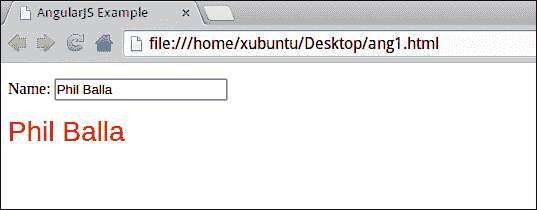

**图 20.2** 一个简单的 AngularJS

这就是全部。我们已经拥有了一个动态应用程序，我们不需要担心编写数据绑定和更新的代码，也不需要指定任何模型。事实上，我们还没有编写任何自己的 JavaScript！这个应用程序尽管简单，但因为 AngularJS 的设计已经运行了。

### 作用域

作用域是一个将 DOM 元素（MVC 架构的 `view` 部分）链接到控制器的对象；在 MVC 术中，该对象变成了 `model`。控制器和视图都可以访问作用域模型，因此它可以它们之间的通信。此作用域对象将存放视图中使用的数据和方法。所有的 AngularJS 应用程序都有 `$rootScope`。`$rootScope` 是顶级作用域，属于包含 `ng-app` 指令的 DOM 元素。当应用程序中没有设置式作用域时，这就是 AngularJS 用于绑定数据函数的作用域。这就是为什么前面的示例有效。为了更好地了解作用域的工作原理，让我们为特定的 DOM 元素附加控制器，为该元素创建一个作用域，然后与其交互。

### 指令

你在上一个示例中看到了几个指令。在 AngularJS 中，`directive` 是附加到 DOM 元素的函数，具有运行方法、附加控制器和作用域对象以及操作 DOM 的能力。当 AngularJS 应用程序启动且 Angular 开始遍历 DOM（从具有 `ng-app` 属性的 DOM 元素开始）时，它将解析代码并收集和运行这些指令。

指令处理了使 AngularJS 应用程序动态化的所有困难工作。我们之前见过了一些指令示例，包括 `ng-model` 和 `ng-bind`：

```html
<body ng-app>
  <p>Name: <input type="text" ng-model="name"></p>
  <span id="output" ng-bind="name"></span>
</body>
```

#### 表达式

使用双大括号来包围一个表达式指令：

```html
{{ expression }}
```

AngularJS 表达式与 JavaScript 表达式非常相似，它们都可以包含字面量、操作符和变量。以下都是有效的 AngularJS 表达式：

```html
{{ 3 + 9 }}
{{ quantity * cost }}
{{ firstName + " " + lastName }}
```

AngularJS 表达式在编写表达式的精确位置被解释为数据。

### ng-init

`ng-init` 指令在启动时运行，在 AngularJS 运行任何应用程序代码之前执行。通过它，你可以在运行其他函数之前设置默认变量。

### ng-click

`ng-click` 指令在 DOM 元素上附加一个监听器。当元素被点击时，AngularJS 会执行指令中定义的表达式。

### ng-repeat

`ng-repeat` 指令遍历集合并为每个项目加载模板。它所复制的模板是带有 `ng-repeat` 属性的元素。

```javascript
$scope.departments = [
  { name: 'Sales'},
  { name: 'Support'},
  { name: 'Production'},
  { name: 'Shipping'}
];
```

你可以使用 `ng-repeat` 遍历它们：

```html
<ul>
  <li ng-repeat="dept in departments">{{ dept.name }}</li>
</ul>
```

在这里，`li` 元素将被克隆四次，生成发送到视图的列表。

### 过滤器 Filters

过滤器的作用是从数组中选择项目的子集并将其作为新数组返回。以下是你对数组进行的一些操作：

*   使用 `currency` 将数字格式化为货币格式。
*   使用 `filter` 从数组中选择子集。
*   使用 `lowercase` 将字符串格式化为小写。
*   使用 `orderBy` 根据表达式对数组进行排序。
*   使用 `uppercase` 将字符串格式化为大写。

以下是 AngularJS 中过滤器的通用语法：

`{{ filter_expression | filter : comparator }}`

假设你想要对某些数值数据应用 `currency` 过滤器：

```html
<div ng-app>
  Total: <input type="number" ng-model="netTotal">
  Tax: <input type="number" ng-model="tax">
  <p>Invoice Total = {{ (netTotal + tax) | currency }}</p>
</div>
```

在这个示例中，表达式 `{{ netTotal + tax }}` 将被求值，结果将会被格式化为货币。

### 向指令中添加过滤器

过滤器也可以通过管道符（`|`）后跟过滤器描述来添加到任何 `ng-` 指令中：

```html
<ul>
  <li ng-repeat="dept in departments | filter: uppercase">{{ dept.name }}</li>
</ul>
```

此示例将以大写形式显示所有项目。

### 构建 AngularJS 应用程序

你现在已经有了足够的知识来组合一个基础应用程序。

### 动手尝试：一个基础应用程序

我们将从一个基础 HTML 页面开始，该页面包含一个接受用户搜索字符串的文本输入框以及一个用于包含搜索结果列表的 `div` 元素。列表 20.2 显示了该页面的基础 HTML，其中包含了 AngularJS 框架。

**列表 20.2 应用程序的 HTML 代码**

```html
<!DOCTYPE html>
<html>
<head>
  <title>AngularJS Example</title>
  <script src="http://ajax.googleapis.com/ajax/libs/angularjs/1.3.14/angular.min.js"></script>
</head>
<body>
  <p>Search: <input type="text"></p>
  <div id="list-container">
    <ul>
      <li></li>
    </ul>
  </div>
</body>
</html>
```

接下来，我们将对页面应用必要的 `ng-` 指令：

- 为 `body` 元素应用 `ng-app`，将其定义为应用程序的容器。
- 为搜索字段应用 `ng-model`，将其定义为 MVC 框架中的模型。
- 为搜索结果列表中的 `li` 元素应用 `ng-repeat`。`li` 元素将为每个结果重复。

我们还将使用 `ng-init` 来设置一些初始数据。在现实情况下，这些数据更有可能从外部源（如服务器端数据库）引入，但对于我们的示例已经足够。

```javascript
ng-init="departments = [
  { name: 'Sales', contact: 'Marsha Brown'},
  { name: 'Support', contact: 'Dave Price'},
  { name: 'Production', contact: 'Grant Wales'},
  { name: 'Service', contact: 'Sherry Dell'},
  { name: 'Administration', contact: 'Sally Bennett'},
  { name: 'Accounting', contact: 'Kim Sutherland'},
  { name: 'Shipping', contact: 'Sandy Connell'}]"
```

我们的初始数据包含一个虚构部门的数组，每个部门包含部门名称和负责该部门的员工名称。列表 20.3 显示了修改后的 HTML，为了效果，它还包含了一点 CSS 样式。

**列表 20.3 应用程序修改后的代码**

```html
<!DOCTYPE html>
<html>
<head>
  <title>AngularJS Example</title>
  <style>
    body {
      background-color: #ddf;
      font: 16px helvetica, arial, sans-serif;
    }
    input {
      padding: 10px;
    }
    #list-container {
      background-color: white;
      color: #448;
      border-radius: 25px;
      border: 1px solid black;
      padding: 25px;
    }
  </style>
  <script src="http://ajax.googleapis.com/ajax/libs/angularjs/1.3.14/angular.min.js"></script>
</head>
<body ng-app ng-init="departments = [
  { name: 'Sales', contact: 'Marsha Brown'},
  { name: 'Support', contact: 'Dave Price'},
  { name: 'Production', contact: 'Grant Wales'},
  { name: 'Service', contact: 'Sherry Dell'},
  { name: 'Administration', contact: 'Sally Bennett'},
  { name: 'Accounting', contact: 'Kim Sutherland'},
  { name: 'Shipping', contact: 'Sandy Connell'}]">
  <p>Search Departments: <input type="text" placeholder="Enter search string" ng-model="searchString"></p>
  <div id="list-container">
    <ul>
      <li ng-repeat="dept in departments">{{ dept.name }}</li>
    </ul>
  </div>
</body>
</html>
```

将此代码保存为 `.html` 文件并在浏览器中打开。你应该能在页面上看到列出的部门，看起来就像图 20.3 所示。

**图 20.3 准备就绪的应用程序**

一切都很好，但目前搜索字段还没有任何作用。我们将通过在 `ng-repeat` 指令中添加过滤器来修复这个问题，基于搜索字段中输入的数据，如列表 20.4 所示。

**列表 20.4 最终确定的应用程序**

```html
  { name: 'Support', contact: 'Dave Price'},
  { name: 'Production', contact: 'Grant Wales'},
  { name: 'Service', contact: 'Sherry Dell'},
  { name: 'Administration', contact: 'Sally Bennett'},
  { name: 'Accounting', contact: 'Kim Sutherland'},
  { name: 'Shipping', contact: 'Sandy Connell'}]
</div>
<div id="list-container">
  <ul>
    <li ng-repeat="dept in departments | filter: searchString">{{ dept.name + " (" + dept.contact + ")" }}</li>
  </ul>
</div>
</body>
</html>
```

这就是我们需要做的全部工作！AngularJS 会处理数据绑定，因此过滤器会在用户输入时实时起作用（请参见 图 20.4）。

**图 20.4** 过滤器指令在输入时起作用

### 总结

在这一小时中，你学习了模型-视图-控制器（MVC）框架架构的基础知识，以及如何将其有效地应用于 Web 应用程序。

你接触了 Google 的 AngularJS 框架，并使用它在很少或无需额外代码的情况下构建了一个简单的 Web 应用程序。

事实上，我们仅仅触及了 AngularJS 能力的皮毛。访问官方网站 [`angularjs.org/`](https://angularjs.org/) 了解更多信息。

## 问答

**Q. AngularJS 的背景是什么？**

**A.** AngularJS 由一家名为 Brat Tech LLC 的公司在 2009 年开发，最初是商业 JSON 存储服务的一部分。它后来作为开源库发布，由 Google 员工继续进行维护和支持。

**Q. 我可以在哪里获取 AngularJS 的文档和帮助？**

**A.** 官方网站 [`angularjs.org/`](https://angularjs.org/) 提供了详尽文档、教程、开发者指南以及更多内容的链接。

## 工作坊

在阅读随后的“答案”部分之前，尝试回答所有问题。

### 测验

**1。** MVC 框架中的 M 代表什么？

**a.** Mirror（镜像）

**b.** Managed（托管）

**c.** Model（模型）

**2。** 在 AngularJS 应用中，`ng-` 指令被添加到：

**a.** 文档头部（head）

**b.** 页面元素中

**c.** 链接到文档的独立文件中

**3。** `ng-init` 指令在何时运行：

**a.** 在应用程序启动时，在 AngularJS 应用代码运行之前

**b.** 用户调用时

**c.** 应用程序终止后

#### 答案

**1。** c. Model（模型）

**2。** b. 页面元素中

**3。** a. 在应用程序启动时，在 AngularJS 应用代码运行之前

## 练习

修改“自己尝试一下”示例的代码，仅在部门名称内进行搜索，但在显示的列表中仍需报告部门名称和联系人名称。

查看 AngularJS API 文档 [`docs.angularjs.org/api`](https://docs.angularjs.org/api)，发现你还能用 AngularJS 做更多事情。

---

# 第 21 小时 网页之外的 JavaScript

你将在这一小时中学习到：

- 一些应用程序示例。
- 如何编写。

到目前，你已经学习了一系列。

在这一小时中，你将尝试。

## 编写 Chrome 扩展程序

扩展是运行在浏览器内部的小程序，提供额外的服务并自定义用户体验。Chrome 扩展程序本质上是一个包含文件（HTML、CSS、JavaScript 等）的 `.zip` 压缩包（尽管它被重命名为 `.crx` 文件）。

### 浏览器之外

扩展程序可以与 页面交互。

### 构建简单的扩展程序

第一步是在你的计算机上创建一个文件夹来包含代码。

每个扩展程序都有一个名为 `manifest.json` 的清单文件，它提供了重要信息。清单文件可以包含各种参数和选项，但在这里我们将从一个基础示例开始。在你的新文件夹中创建一个文本文件 `manifest.json` 并编辑如下：

```json
{
  "name": "My First Extension",
  "version": "1.0",
  "manifest_version": 2,
  "description": "Hello World extension.",
  "browser_action": {
    "default_icon": "icon.png",
    "default_popup": "popup.html"
  },
  "web_accessible_resources": [
    "icon.png",
    "popup.js"
  ]
}
```

在同一文件夹中放入名为 `icon.png` 的图标——我使用了一个小的星形图形，但你可以使用任何喜欢的图片。创建列表 21.1 中列出的 `popup.html` 文件并将其放入文件夹。

**列表 21.1 popup.html Google Chrome 扩展程序**

```html
<!DOCTYPE html>
<html>
<head>
    <title>My First Extension</title>
    <style>
        body {
            width: 350px;
        }
        div {
            border: 1px solid black;
            padding: 20px;
            font: 20px normal helvetica, verdana, sans-serif;
        }
    </style>
    <script src="popup.js"></script>
</head>
<body>
</body>
</html>
```

***

以下是 `popup.js` 中包含的 JavaScript 代码：

```javascript
function sayHello() {
    var message = document.createTextNode("Hello World!");
    var out = document.createElement("div");
    out.appendChild(message);
    document.body.appendChild(out);
}
window.onload = sayHello;
```

这一切的作用是在页面加载时，创建一个包含消息“Hello World!”的 `<div>` 元素，并将其添加到 DOM 的 `<body>` 元素中。

现在，点击设置图标并选择**更多工具 > 扩展程序**来显示 Chrome 扩展程序页面。

点击“开发者模式”旁边的框框以显示更多信息。

然后点击“加载已解的扩展程序”按钮。导航到包含你的扩展程序的文件夹并选择它。你应该能看到图 21.1 所示的内容。

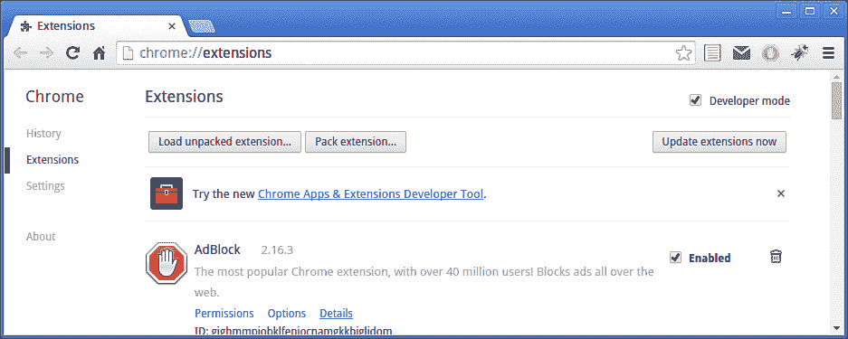

**图 21.1** 在扩展程序页面上显示的新扩展程序

通过勾选旁边的框框确保扩展程序已启用。现在可以通过点击工具栏上的图标来运行扩展程序，如图 21.2 所示。

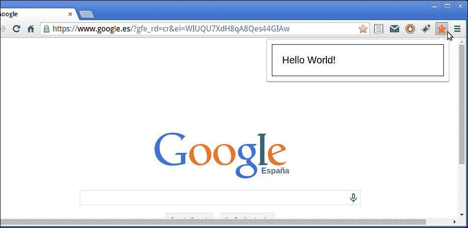

**图 21.2** 作为 Google Chrome 扩展程序的 Hello World

### 调试扩展程序

右键点击启动扩展程序的图标，你会看到一个内容菜单，其中包含启用和禁用扩展程序的选项，还有一个名为 `Inspect popup`（检查弹出窗口）的选项。点击它，Chrome 开发者工具就会弹出，让你检查弹出窗口，如图 21.3 所示。


**图 21.3** 检查弹出窗口

***

### 动手尝试：一个获取机场信息的 Chrome 扩展程序

这次你将创建一个稍微好用的 Chrome 扩展程序。在 jQuery 库的帮助下，你的弹出窗口将检索美国机场的当前信息。

***

### 提示

如果你需要复习 jQuery 库，请参考第 15 小节，“深入了解 jQuery”。

***

为了实现这一点，你需要让代码对 `http://services.faa.gov/` 的信息源进行 Ajax 调用。为了演示该服务如何工作，请打开浏览器并导航到 `http://services.faa.gov/airport/status/SFO?format=application/json`。

“SFO”是旧金山国际机场的三个字母代码；你可以将上述 URL 中的替换为另一个美国机场的代码；例如，你可以使用 LAX 代表洛杉矶国际机场，或使用 SEA 代表西雅图-塔科马国际机场。

***

### 提示

你可以在 `http://www.fly.faa.gov/flyfaa/usmap.jsp` 读取机场代码并查看它们位置。

***

`format` 参数告诉服务你想要以 JSON 字符串返回信息：

```json
{
  "name":"San Francisco International",
  "ICAO":"KSFO",
  "state":"California",
  "status":
    "avgDelay":"",
    "closureEnd":"",
    "closureBegin":"",
    "type":"",
    "minDelay":"",
    "trend":"",
    "reason":"No known delays for this airport.",
    "maxDelay":"",
    "endTime":""
  },
  "delay":"false",
  "IATA":"SFO",
  "city":"San Francisco",
  "weather":
    "weather":"Partly Cloudy",
    "meta":
      "credit":"NOAA's National Weather Service",
      "url":"http://weather.gov/",
      "updated":"1:56 AM Local"
    },
    "wind":"Southwest at 9.2mph",
    "temp":"44.0 F (6.7 C)",
    "visibility":"10.00"
}
```

你的代码将解析返回的信息并使用它构建更用户友好的显示。

要开始项目，在你的计算机某处创建一个新目录并将其命名为“airport”。在此目录中，你需要三个文件，如上一个示例所示。

#### 图标文件

选择一个显示在 Chrome 工具栏上并从中启动扩展程序的图标。我使用了一个名为 `plane.png` 的文件中 20 × 20 像素的飞机图标，但你可以使用你手头有的任何图标。

#### manifest.json 文件

清单文件将与上一个示例非常相似，但有一个显著的添加：一个新参数 `permissions`。你将对 `services.faa.gov` 发起 Ajax 调用以获取你所需的信息，而 Ajax 调用只能对调用者相同域的页面进行；添加 `permissions` 条目允许 Chrome 通过向服务器发送合适的标头来满足这一要求。`manifest.json` 文件所示于列表 21.2。

**列表 21.2 manifest.json 文件**

```json
{
  "name": "Airport Information",
  "version": "1.0",
  "manifest_version": 2,
  "description": "Information on US airports",
  "browser_action": {
    "default_icon": "plane.png",
    "default_popup": "popup.html"
  },
  "web_accessible_resources": [
    "plane.png",
    "popup.js"
  ],
  "permissions": [
    "http://services.faa.gov"
  ]
}
```

***

#### HTML 文件

一旦 HTML HTML 文件将是 `popup.html`。只要你编辑 `manifest.json` 并适当设置值，你就可以将其命名为其他名称。

简单的页面如列表 21.3 所示。

**列表 21.3 HTML**

```html
<!DOCTYPE html>
<html>
<head>
    <title>Airport Information</title>
    <style>
        body {
            width: 350px;
            font: 20px normal helvetica, verdana, sans-serif;
        }
        #info {
            border: 1px solid black;
            padding: 20px;
        }
    </style>
</head>
<body>
    <h2>Airport Information</h2>
    <input type="text" id="airportCode" value="SFO" size="6" />
    <input id="btn" type="button" value="Get Information" />
    <div id="info"></div>
</body>
</html>
```

***

除了一些简单的 CSS 样式外，页面只包含几个项目：一个接受机场代码的输入框（默认值为 SFO），一个用于获取数据的按钮，以及一个用于存放结果的 `<div>`。

现在你需要向页面添加 JavaScript。

你将使用 jQuery 来简化工作，所以首先你需要包含它。Google Chrome 安全策略不允许使用内容分发网络，因此我们需要下载并包含 jQuery 库的副本：

```html
<script src="jquery-1.11.2.min.js"></script>
```

当页面加载后，你需要为“获取信息”按钮附加代码。按钮需要根据输入字段中的机场代码构建所需的 URL 并启动 Ajax 调用。由于远程服务可能需要一些时间才能响应，如果用户能收到一个指示程序运行的小消息会更好。

以下是执行这些任务的代码：

```javascript
$(document).ready(function(){
    $("#btn").click(function(){
        $("#info").html("Getting information ...");
        var code = $("#airportCode").val();
        $.get("http://services.faa.gov/airport/status/" + code + "?format=application/json",
            '',
            function(data){
                displayData(data);
            }
        );
    });
});
```

一旦页面加载，jQuery 会为按钮的 `onclick` 事件处理程序添加代码。

首先，它使用 `jQuery` 的 `html()` 方法向输出 `<div>` 元素添加一条用户消息。当接收到“真实”信息时，该消息将被覆盖。

```javascript
$("#info").html("Getting information ...");
```

接下来，从输入字段中获取所需的机场代码：

```javascript
var code = $("#airportCode").val();
```

然后组合 Ajax 调用，这里使用了 `GET` 方法：

```javascript
$.get("http://services.faa.gov/airport/status/" + code + "?format=application/json",
    '',
    function(data){
        displayData(data);
    }
);
```

为 Ajax 调用指定的回调函数是 `displayData()`，它将格式化返回的数据并显示给用户。这里是 `popup.js` 的完整内容，包含了回调函数：

```javascript
function displayData(data) {
    var message = "Airport: " + data.name + "<br />";
    message += "<h3>STATUS:";
    for (i in data.status) {
        if(data.status[i] != "") message += i + ": " + data.status[i] + "<br />";
    }
    message += "<h3>WEATHER:";
    for (i in data.weather) {
        if(i != "meta") message += i + ": " + data.weather[i] + "<br />";
    }
    $("#info").html(message);
}

$(document).ready(function(){
    $("#btn").click(function(){
        $("#info").html("Getting information ...");
        var code = $("#airportCode").val();
        $.get("http://services.faa.gov/airport/status/" + code + "?format=application/json",
            '',
            function(data){
                displayData(data);
            }
        );
    });
});
```

回想第 10 小节，`JSON`，JSON 数据可以被解释为 JavaScript 对象的层次结构。`displayData(data)` 函数接收返回的 JSON 对象，并提取 `data.name`（字符串）、`data.status` 和 `data.weather`（它们也是对象）来构建消息。

提示 回顾几页前远程服务器返回的 JSON 数据，看看这些值是如何编码的。

包含代码的完整 HTML 页面位于列表 21.4。

### 列表 21.4 扩展程序完整的 popup.html

```html
<!DOCTYPE html>
<html>
<head>
    <title>Airport Information</title>
    <style>
        body {
            width:350px;
            font:12px normal, verdana, sans-serif;
        }
        #info {
            border: 1px solid black;
            padding: 10px;
        }
    </style>
    <script src="jquery-1.11.2.min.js"></script>
    <script src="popup.js"></script>
</head>
<body>
    <h2>Airport Information</h2>
    <input type="text" id="airportCode" value="SFO" size="6" />
    <input id="btn" type="button" value="Get Information" />
    <div id="info"></div>
</body>
</html>
```

在分配的目录中组好所需的文件后，你可以像上一个例子一样将扩展程序添加到 Google Chrome 中。

点击关联的图标会弹出一个小型表单，你可以在其中输入你选择的机场代码。点击“获取信息（Get Information）”按钮将使程序咨询远程服务，将返回的信息组合成可读的形式，并在弹出窗口中呈现出来。

图 21.4 显示了运行中的扩展程序。


**图 21.4** 机场信息扩展程序

### 打包扩展程序

当你完成扩展程序的开发后，点击扩展页面上的“打包扩展程序（Pack Extension）”按钮。你的扩展程序将被打包成一个 `.crx` 文件。你可以从网页中提供该 `.crx` 文件，访问者可以在他们自己的 Google Chrome 中安装它。

## 进阶

本小时的练习仅仅触及了 Chrome 扩展程序能做的事情的皮毛。因为 Chrome 对 HTML5 和 CSS3 有很好的支持，你可以在扩展中使用最新的 Web 技术，如 `canvas`、`localStorage` 和 CSS 动画，还可以访问外部 API 和数据源。你的扩展程序甚至为 Chrome 浏览器的用户界面添加按钮，或者创建浏览器窗口之外的弹出通知。

### 总结

在本小时中，你学习了 JavaScript 在 HTML 网页之外的一些应用。例如，你使用 JavaScript 为 Google Chrome 浏览器编写了一个小型扩展程序。

## 问与答

**Q. 我可以用类似于此处描述 Chrome 扩展程序的方法编写 Firefox 扩展程序吗？**

**A.** Mozilla 创建扩展程序的方法稍微复杂一点；

---

# 良好的编码实践

到本书为止，我一直提到了编码中的某些优点和坏处。在这一节中，我们将所有这些内容整合起来，为良好的编码实践制定一些通用指南。

## 不要过度使用 JavaScript

你需要多少 JavaScript？人们往往倾向于在并不绝对或不建议的情况下加入 JavaScript 代码和增强交互效果。

*   务要记住，你的用户可能将大部分上网时间都花在了你以外的网站上。经验丰富的互联网用户已经习惯了菜单、面包屑导航和标签页浏览等流行的界面组件。这些元素之所以流行，广而言之是因为它们运行良好、可以做得美观，并且不需要用户先阅读手册。对一个网站操作的熟悉程度，是否可能比你那些全方位、酷炫的设计带来的潜在收益更能提高用户的生产力？
*   许多曾经需要用 JavaScript 代码的视觉效果，现在可以使用 CSS 完美地实现。在两种方法都可行的情况下（鼠标悬停效果和某些类型的菜单是立刻提到的例子），CSS 通常是首选。它在浏览器中得到了良好的支持（尽管存在一些细微差异），而且不像那样经常被用户禁用。在 CSS 不支持的罕见情况下，页面将渲染为标准的 HTML，通常会留下一个至少功能完整的页面，即使它看起来并不漂亮。
*   世界上许多地区的用户仍在使用过时、性能不足的旧电脑，并且可能拥有缓慢和/或不可靠的网络访问。你那些不需要的代码所占据 CPU 周期对他们来说可能是宝贵的。
*   在某些情况下，你可能会损失一定的搜索引擎页面排名，因为它们的爬虫并不总是能正确索引由 JavaScript 生成的内容，或需要它来完成导航的设计。

如果使用得当且深思熟虑，JavaScript 可以成为一个强大的工具，但有时好过物得其反。

## 编写可读且可维护的代码

无法预知某一天会有谁需要阅读并理解你的代码。即使那个人是你自己，可能也已经隔了几年和许多项目；在编写时你如此熟悉的代码，在日后可能会变得神秘莫测。如果必须由他人来解释你的代码，他们可能不会认同你的编码风格、命名规范或专业领域，而且你可能无法为他们提供帮助。

### 明智地使用注释

在代码的关键位置选择恰当的注释，可以在这种情况下产生巨大的影响。注释是你为后来者提供的笔记和提示。技巧在于判断哪些注释可能是是有用的。这个主题经常引发争议，观点差异很大，因此接下来的内容很大程度上是我个人的观点。

假设最终阅读你代码的人对 JavaScript 有所了解或许是合理的，因此对语言本身工作原理的注释就有点过头了；JavaScript 开发者的风格和能力差异很大，但我们共同拥有的的一点就是语言语法！

阅读代码时更难解释的是代码运行背后的思维过程和算法。个人认为，阅读他人编写的代码时，看到以下内容非常有帮助：

*   任何包含超过几行简单代码的对象或函数的前序言。

```javascript
function calculateGroundAngle(x1, y1, z1, x2, y2, z2) {
    /**
     * 计算两点之间的直线与
     * 地面平面交叉时的弧度角。
     * @author Phil Ballard phil@www.example.com
     */
    if(x1 > 0) {
        .... more statements
    }
}
```

*   在代码可能会引起困惑或容易误解的地方添加内联注释。

```javascript
// 出于性能考虑，需要使用我们的自定义排序方法
var finalArray = rapidSort(allNodes, byAngle) {
    .... more statements
}
```

*   在原作者可以传递读者可能不知道的专业知识的地方添加注释。

```javascript
// 针对浏览器 X 版本 Y 中图像加载 bug 的变通解决方案
if(!loaded(image1)) {
    .... more statements
}
```

*   常用代码修改的说明。

```javascript
// 你可以根据喜好更改以下维度：
var height = 400px;
var width = 600px;
```

**提示**

各种方案使用代码注释来帮助你为软件生成文档。例如，参见 http://code.google.com/p/.

### 选择有用的文件、属性和方法名称

通过使代码能够自注释，可以大大减少源代码所需的注释量。你可以通过为方法和属性选择有意义的名称向这一目标努力。

JavaScript 对方法（或函数）和属性（或变量）名称中允许字符有规定，但仍有很多创意空间。

一种流行的约定是将常量名全大写：

`MONTHS_PER_YEAR = 12`

对于普通的函数、方法和变量名，所谓的 `CamelCase`（驼峰命名法）是一个流行的选择；除了第一个单词外，由多个单词构造的名称：

`var surname = "Smith"`

`var lastProcessed = 16`

建议用于实例化对象的构造函数首字母大写：

```javascript
function Car(make, model, color) {
    .... statements
}
```

大写字母提醒人们需要使用 `new` 关键字：

`var herbie = new Car('VW', 'Beetle', 'white');`

### 在可能的地方复用代码

通常情况下，代码模块化程度越高，就越好。看下这个函数：

```javascript
function getElementArea() {
    var high = document.getElementById("id1").style.height;
    var wide = document.getElementById("id1").style.width;
    return high * wide;
}
```

该函数尝试返回特定 HTML 元素覆盖的屏幕面积。遗憾的是，它只能对 `id = "id1"` 的元素起作用，这实际上没有任何帮助。

我们可以通过传递要应用操作的元素 ID 作为参数，为函数提供*更高层次的抽象*，使其用途更通用：

```javascript
function getElementArea(elementId) {
    var elem = document.getElementById(elementId);
    var high = elem.style.height;
    var wide = elem.style.width;
    return parseInt(high) * parseInt(wide);
}
```

现在你可以为任何具有 ID 的元素调用你的函数了：

```javascript
var area1 = getElementArea("id1");
var area2 = getElementArea("id2");
```

## 不要假设

在之前的函数中，当我们传递一个与页面上任何元素都不对应的 `elementId` 值时会发生什么？函数会导致错误，并且代码执行停止。

错误在于假设 `elementId` 将被传入一个有效值。让我们编辑 `getElementArea()` 函数，以检查页面元素是否确实存在，并且它具有数值型的面积：

```javascript
function getElementArea(elementId) {
    if(document.getElementById(elementId)) {
        var elem = document.getElementById(elementId);
        var high = elem.style.height;
        var wide = elem.style.width;
        var area = parseInt(high) * parseInt(wide);
        if(!isNaN(area)) {
            return area;
        } else {
            return false;
        }
    } else {
        return false;
    }
}
```

这是一个改进。现在，如果函数无法返回数值面积，它将返回 `false`，可能是因为找不到相关的页面元素，也因为该 ID 对应的页面元素没有可访问的 `width` 和 `height` 属性。

## 优雅降级 (Graceful Degradation)

早期的网络浏览器中，有些甚至不支持在 HTML 中包含图像。当 `` 元素引入时，需要一种方法来让这些纯文本浏览器在遇到此类不支持的标签时，能够向用户展示一些有用的内容。

在 `` 标签的情况下，这种功能是由 `alt`（替代文本）属性提供的。网页设计师可以为 `alt` 分配一段字符串文本，纯文本浏览器将向用户显示这些文本而不是显示图像。根据页面设计者的意愿，`alt` 文本仅仅是图片的标题、对图片应显示内容的描述，或者是对图形中承载信息的替代来源的建议。

这是“优雅降级”的早期示例，这种过程是指：当用户的浏览器缺乏所需的技术功能来充分利用网页的设计（或者禁用了这些功能），他们仍然可以尽可能地从网站内容中受益。

让我们以 JavaScript 本身作为另一个例子。几乎每个浏览器都支持 JavaScript，而且很少用户会关闭它。那么你真的需要担心那些没有启用 JavaScript 的访问者吗？答案可能是肯定的。你网站的频繁访问者之一无疑是来自某个搜索引擎的爬虫程序，它们正忙于索引网页页面。爬虫会尝试遵循页面上所有的导航链接，以建立网站内容的完整索引；如果这种导航需要 JavaScript 的服务，你可能会发现网站的某些部分没有被索引。结果是你的搜索排名可能会受到影响。

另一个重要的例子在于可访问性。无论浏览器程序多么强大，总有一些用户面临着其他局限，例如可能无法使用鼠标，或者必须使用屏幕阅读软件。如果你的网站不迎合这些用户，他们就不可能再次回来。

## 渐进增强 (Progressive Enhancement)

当我们谈论优雅降级时，很容易想象一个功能完备、带有各种花哨功能的网页，它为浏览器能力较弱的用户提供慈善式的帮助。

渐进增强的支持者则倾向于从相反的角度来看问题。他们倾向于构建一个稳定、可访问且功能齐全的网站，其内容可以被几乎任何想象中的用户和浏览器访问，随后他们为那些能够利用这些功能的用户添加额外的可用性层。

这确保了网站即使在最基础的浏览器设置下也能运行，而更高级的浏览器只需获得一些额外的增强。

### 分离样式、内容和代码

采用渐进增强技术的网页，核心资源是内容。HTML 提供了标记设施来允许你语义化地描述内容；标记标签本身将页面元素识别为标题、表格、段落等。我们可以将其称为语义层。

这种语义层理想情况下*不应*包含任何关于页面应该如何外观显示的信息。你可以在之后使用 CSS 技术添加这些额外信息，以形成表现层。通过将外部 CSS 样式表链接到文档中，你避免了任何与外观相关的信息出现在 HTML 标记本身。然而，即使是完全理解 CSS 的浏览器，也可以访问并显示页面的所有信息，尽管它看起来可能并不漂亮。

当你现在把 JavaScript 引入其中时，你将其作为另一个逻辑层引入的——你可能将其视为行为层。没有 JavaScript 的用户仍然可以通过语义化标记访问页面内容；如果他们的浏览器理解 CSS，他们也将受益于表现层增强后的外观。如果行为层的 JavaScript 应用得当，它将为那些可以使用它的人提供更多功能性，而不会损害之前层的能力。

为了实现这一点，你需要编写非侵入式的 JavaScript。

## 非侵入式 JavaScript (Unobtrusive JavaScript)

非侵入式 JavaScript 并没有正式定义，但构建其基础的概念都涉及维护行为层与内容、表现层之间的分离。

### 让 HTML 保持原样

第一个可能也是最重要的考虑因素是从页面标记中移除 JavaScript 代码。JavaScript 的早期应用通过内联事件处理器使 HTML 变得杂乱无章，例如本例中的 `onClick` 事件处理器：

```html
<input type="button" style="border: 1px solid blue;color: white" onclick="doSomething()" />
```

如前一个例子那样的内联样式属性会让情况变得糟糕。

幸运的是，你可以有效地将样式信息移到样式层，例如，通过在 HTML 标签上添加 `class` 属性来引用外部 CSS 文件中相关的样式声明：

```html
<input type="button" class="blueButtons" onclick="doSomething()" />
```

在相关的 CSS 定义中：

```css
.blueButtons {
    border: 1px solid blue;
    color: white;
}
```

**提示**：当然，你可以通过多种不同的选择器之一来为按钮定义样式规则，包括 `input` 元素或通过 `id` 而不是 `class` 属性。

为了让你的 JavaScript 非侵入式，你可以采用与我们用于 CSS 类似的技术。通过在 HTML 标记中的页面元素中添加 `id` 属性，你可以在外部 JavaScript 代码内部挂载所需的 `onClick` 事件监听器，将其保持在 HTML 标记之外。这是修改后的 HTML 元素：

```html
<input type="button" class="blueButtons" id="btn1" />
```

`onClick` 事件处理器是在 JavaScript 代码内部挂载的：

```javascript
function doSomething() {
    .... statements ....
}
document.getElementById("btn1").onclick = doSomething;
```

**注意**：记住在 DOM 可用之前你无法使用 DOM 方法，因此任何此类代码必须通过 `window.onload` 等方法挂载，以保证 DOM 的可用性。书中有许多例子。

### 仅将 JavaScript 作为增强

秉着渐进增强的精神，你希望页面即使在 JavaScript 关闭时也能运行。JavaScript 可能为页面可用性增加的任何改进，都应被视为那些浏览器设置允许其运行的用户的额外奖励。

让我们想象你想要编写一些表单验证代码——这是 JavaScript 的常见用途。这里有一个 HTML 搜索表单：

```html
<form action="process.php">
  <input id="searchTerm" name="term" type="text" /><br />
  <input type="button" id="btn1" value="Search" />
</form>
```

你想编写一个例程，在搜索字段为空时防止表单被提交。你可能会编写这个函数 `checkform()`，将其绑定到搜索按钮的 `onClick` 处理程序上：

```javascript
function checkform() {
    if(document.forms[0].term.value == "") {
        alert("Please enter a search term.");
        return false;
    } else {
        document.forms[0].submit();
    }
}

window.onload = function() {
    document.getElementById("btn1").onclick = checkform;
}
```

这运行起来应该良好。但当 JavaScript 被禁用时会发生什么？按钮现在什么都不做，用户无法提交表单。你的用户肯定更希望表单可以使用，尽管没有了输入检查的增强。

让我们稍微修改一下表单，使用 `type="submit"` 的输入按钮而不是 `type="button"`，并编辑 `checkform()` 函数：

```html
<form action="process.php">
  <input id="searchTerm" name="term" type="text" /><br />
  <input type="submit" id="btn1" value="Search" />
</form>
```

这里是修改后的 `checkform()` 函数：

```javascript
function checkform() {
    if(document.forms[0].term.value == "") {
        alert("Please enter a search term.");
        return false;
    } else {
        return true;
    }
}

window.onload = function() {
    document.getElementById("btn1").onclick = checkform;
}
```

如果 JavaScript 激活状态，向提交按钮返回 `false` 值将阻止按钮的默认操作，从而防止表单提交。然而，如果没有 JavaScript，点击按钮时表单仍然会提交。

## 特性检测

在可能的情况下，尝试直接检测浏览器功能的存在或否，并让你的代码仅在功能可用时使用这些功能。

例如，让我们来看 `clipboardData` 对象，在编写本文时，它仅在 Internet Explorer 中支持。在你的代码中使用此对象之前，最好的做法是进行几次测试：

*   JavaScript 是否识别该对象的存在？


 如果是，该对象是否支持你想要的方法？

以下函数 `setClipboard()` 尝试使用 `clipboardData` 对象直接将特定文本写入剪贴板：

点击此处查看代码图片

```javascript
function setClipboard(myText){
    if((typeof clipboardData != 'undefined') && (clipboardData.setData)){
        clipboardData.setData("text", myText);
    } else {
        document.getElementById("copytext").innerHTML = myText;
        alert("Please copy the text from the 'Copy Text' field to your clipboard");
    }
}
```

首先它使用 `typeof` 测试对象的存在性：

点击此处查看代码图片

```javascript
if((typeof clipboardData != 'undefined') ....
```

* * *

注意

`typeof` 运算符返回以下内容之一，取决于操作数的类型：

`"undefined"`、`"object"`、`"function"`、`"boolean"`、`"string"` 或 `"number"`

* * *

此外，该函数还要求 `setData()` 方法必须可用：

点击此处查看代码图片

```javascript
... && (clipboardData.setData)){
```

如果任一测试失败，用户将获得一种替代的、不那么优雅的方法来获取文本到剪贴板；它会被写入页面，并邀请用户：点击此处查看代码图片

```javascript
document.getElementById("copytext").innerHTML = myText;
alert("Please copy the text from the 'Copy Text' field to your clipboard");
```

代码在任何地方都没有显式检测浏览器是否为 Internet Explorer（或其他任何浏览器）；不应该这样做。

### 良好地处理错误

当你的程序遇到错误时，可能是向用户显示消息，或者简单地保持活动状态。这对于用户来说都不好，因为他们可能不知道发生了什么错误或者该做什么。

使用 try 和 catch

拦截错误并整洁地处理它们的有用方法是使用 `try` 和 `catch` 语句。

`try` 语句允许你尝试一段代码。如果发生错误，可以使用 `catch` 语句来处理它。

语法如下：

```javascript
try {
    // code
} catch (err) {
    // error handling
}
```

`err` 是在捕获到错误时创建的对象。它包含了关于错误的信息，例如，如果你想提醒用户错误的性质，你可以使用：

```javascript
try {
    // code
} catch (err) {
    alert(err.description);
}
```

偶尔你可能会发现自己处于必须让代码不具侵入性的位置。让我们用列表 22 中编写的一些代码来这样做。

### 将代码转换为非侵入式

目前，此脚本有许多可以改进的区域：[part0066.xhtml_p22a]

**列表 22.1 一个侵入式脚本**

```html
<!DOCTYPE html>
<html>
<head>
  <title>Current Date and Time</title>
  <style>
    p {font: 14px arial, helvetica;}
  </style>
  <script>
    function telltime() {
      var out = "";
      var now = new Date();
      out += "<br />Date: " + now.getDate();
      out += "<br />Month: " + now.getMonth();
      out += "<br />Year: " + now.getFullYear();
      out += "<br />Hours: " + now.getHours();
      out += "<br />Minutes: " + now.getMinutes();
      out += "<br />Seconds: " + now.getSeconds();
      document.getElementById("div1").innerHTML = out;
    }
  </script>
</head>
<body>
  The current date and time are:<br/>
  <div id="div1"></div>
  <script>
    telltime();
  </script>
  <input type="button" onclick="location.reload()" value="Refresh" />
</body>
</html>
```

* * *

自己试一下：将代码转换为非侵入式

目前，此脚本有许多可以改进的区域：

 JavaScript 语句放置在页面 `<script>` 和 `</script>` 标签之间；它们放在单独的文件中更好。

 按钮具有内联事件处理程序。

 没有启用 JavaScript 的用户只会看到一个无法运行的按钮。

首先，我们将所有的 JavaScript 移动到一个单独的文件中并移除内联事件处理程序。我们还给按钮分配了一个 `id` 值，以便我们可以在 JavaScript 中识别它，并通过代码添加所需的事件处理程序。

接下来，我们需要处理未启用 JavaScript 的用户的问题。我们使用 `<noscript>` 元素，使得未启用 JavaScript 的用户看到的不是按钮，而是一条短消息，并包含一个指向替代时间来源的链接：

点击此处查看代码图像

```html
<noscript>
    您的浏览器不支持 JavaScript<br />
    请咨询您的计算机操作系统以获取本地日期和时间信息，或点击 <a href="clock.php" target="_blank">这里</a> 来读取服务器时间。
</noscript>
```

* * *

### 提示

`<noscript>` 元素为禁用了脚本或不支持客户端脚本的浏览器用户提供了额外的页面内容。任何可以放入 HTML 页面 `<body>` 元素中的元素都可以放入 `<noscript>` 元素中，如果用户的浏览器无法运行脚本，这些元素将自动显示。

* * *

修改后的 HTML 文件列在列表 22.2 中。

**列表 22.2 修改后的 HTML 页面**

点击此处查看代码图像

* * *

```html
<!DOCTYPE html>
<html>
<head>
    <title>当前日期和时间</title>
    <style>
        p {font: 14px normal arial, verdana, helvetica;}
    </style>
    <script src="datetime.js"></script>
</head>
<body>
    当前日期和时间为：<br/>
    <div id="div1"></div>
    <input id="btn1" type="button" value="Refresh" />
    <noscript>
        <p>您的浏览器不支持 JavaScript。</p>
        <p>请咨询您的计算机操作系统以获取本地日期和时间信息或点击 <a href="clock.php" target="_blank">这里</a> 来读取服务器时间。</p>
    </noscript>
</body>
</html>
```

* * *

在我们的 JavaScript 源文件 `telltime.js` 中，我们使用 `window.onload` 为按钮添加事件监听器。最后，我们调用 `telltime()` 生成显示在页面上的日期和时间信息。JavaScript 代码如列表 22.3 所示。

**列表 22.3 datetime.js**

点击此处查看代码图像

* * *

```javascript
function telltime() {
    var out = "";
    var now = new Date();
    out += "<br />Date: " + now.getDate();
    out += "<br />Month: " + now.getMonth();
    out += "<br />Year: " + now.getFullYear();
    out += "<br />Hours: " + now.getHours();
    out += "<br />Minutes: " + now.getMinutes();
    out += "<br />Seconds: " + now.getSeconds();
    document.getElementById("div1").innerHTML = out;
}
window.onload = function() {
    document.getElementById("btn1").onclick = function() {location.reload()};
    telltime();
}
```

* * *

在启用 JavaScript 后，脚本的运行方式与第 4 小节中相同。然而，在禁用 JavaScript 的情况下，用户看到的页面如图 22.1 所示。


**图 22.1** 为没有 JavaScript 的用户提供的额外信息

* * *

### 总结

在本节中，我们总结并展示了编写 JavaScript 良好实践的各种示例。结合使用这些方法应该帮助你更快地交付代码项目，具有更高的质量并更易于维护。

## 问答

**问. 为什么用户会关闭 JavaScript？**

**答.** 请记住，浏览器可能是由服务提供商或雇主设置的，默认禁用了 JavaScript 以提高安全性。这在像这样的环境中特别常见。

 **运行时错误**（Runtime errors）——当 JavaScript 解释器尝试执行它无法理解的操作时发生的错误。例如，尝试将字符串当作数值处理，或尝试将数字除以零。

 **程序逻辑错误**——这些错误并不总是生成错误信息——代码可能是完全有效的——但你的脚本并没有按照你的预期运行。这些通常是与脚本内部算法或逻辑流相关的问题。

## 选择程序员编辑器

无论你在什么平台上工作，无论你选择哪种浏览器，拥有一个好用的代码编辑器都是有意义的。虽然在 Windows 记事本等简单程序中编写代码是完全可能的，但专用的编辑器会让生活变得方便得多。

有许多此类程序可供选择，通常根据开源或类似的许可免费提供。在这里，我列出了一些免费编辑器，但请自己寻找一个适合你的平台、工作风格和预算的编辑器。

 Notepad++ (Windows)

 JEdit（应适用于任何安装了 Java 的平台）

 PSPad (Windows)

 JuffEd (Windows, Linux)

 Geany (Windows, Linux)

编辑器提供了一系列功能和能力，但我建议至少寻找具备以下功能的编辑器：

 **行号**——如果你将 JavaScript 存储在外部文件中，这尤为有用（这也是为什么在可行的情况下你应该这么做的另一个原因）。这样一来，浏览器调试器生成的任何错误信息的行号通常会与编辑器中打开的源文件行号匹配。

 **语法高亮**——当你熟悉了编辑器的语法高亮方案后，在很多情况下，你仅仅因为编辑器中的代码“看起来不对”就能发现编码错误。你习惯喜欢的编辑程序中关键字、变量、字符串字面量、对象等颜色的速度之快，令人惊讶。许多编辑器允许你根据自己的喜好更改语法高亮配色方案。

 **括号匹配**——作为一种寻找错误的“导弹”，括号匹配是无价的。良好的编辑器会显示所有类型的大括号、花括号和圆括号的匹配开启/闭合对。当你的代码中有几层嵌套的圆括号时，很容易数错。

 **代码补全或工具提示式语法帮助**——某些编辑器为命令、函数和表达式提供弹出工具提示式的帮助。这可以节省你将视线从编辑器窗口移开去查找外部资料的时间。

## 使用 alert() 进行简单调试

有时，你想要一种非常简单快速的方法来读取变量的值，或者跟踪代码执行的顺序。

也许最简单的方法是在代码适当的位置插入 JavaScript `alert()` 语句。假设你想知道一个无响应的函数是否真的被调用了，如果是，带有什么参数调用的：

```javascript
function myFunc(a, b) {
    alert("myFunc() called.\na: " + a + "\nb: " + b);
    // rest of function code ...
}
```

当函数被调用时，`alert()` 方法会执行，产生一个如图 23.1 所示的对话框（part038.xhtml_ch23fig1）。


**图 23.1** 使用 JavaScript alert()

记住在显示的消息中多包含一些信息，而不仅仅是一个变量值或一个单词的注释；在战斗激烈的时刻，你会忘记 `alert()` 中的值指的是哪个变量或属性。

## 更多调试方法

在代码中放置 `alert()` 调用对于对短段代码进行快速而粗略的调试也许是可以接受的。然而，这种技术确实有一些严重的缺点：

 你必须点击每个对话框的“确定”才能允许处理继续。这可能会让人倍受沮丧，尤其是在处理长循环时！

 接收到的消息没有存储在任何地方，对话框清除后就会消失；你无法在以后回来查看报告了什么。

 在你的代码“上线”之前，你需要回到编辑器并删除所有的 `alert()` 调用。

在本节中，我们将查看一些高级调试技术。

### 控制台

幸运的是，大多数现代浏览器都提供 JavaScript 控制台，你可以更有效地利用它记录消息。打开控制台的方法因浏览器而异：

 在 Internet Explorer 中，打开开发者工具：`F12`

 Chrome 的开发者工具和 Opera 的 Dragonfly Debugger：`Ctrl+Shift+I`

 使用带有 Firebug 扩展的 Firefox：`F12`

本节中的示例假设你使用的是上述调试器。如果不是，你可能需要咨询调试器的文档查看如何执行某些任务。浏览器向你展示此类错误的方式各不相同。

尝试一下：使用你的浏览器的调试工具

查看列表 23.1（part038.xhtml_ch23lis1）中的代码。

**列表 23.1 一个带有错误的程序**

```html
<!DOCTYPE html>
<html>
<head>
    <title>Strings and Arrays</title>
</head>
<body>
    <script>
        function sayHi() {
            alert("Hello!");
        }
    </script>
    <input type="button" value="good" onclick="sayHi()" />
    <input type="button" value="bad" onclick="sayhi()" />
</body>
</html>
```

这段代码列表包含两种不同类型的错误。首先，在调用 `alert()` 方法时，我们的参数缺少了闭合引号。其次，第二个按钮的 `onclick` 处理程序调用了函数 `sayhi()`——记住函数名是对大小写敏感的，因此事实上并没有定义名为 `sayhi()` 的函数。

Google Chrome 和 Chromium 几乎是相同的浏览器，主要的区别在于它们的封装和分发方式。本质上，Google Chrome 是由 Google 封装并分发的 `Chromium` 开源浏览器。

Chromium 给出的错误信息略显晦涩：“Uncaught syntax error: Unexpected token ILLEGAL”，但它也会以可点击链接的形式给出行号，点击后会显示我出错的代码行。

要打开 Internet Explorer 的开发者工具，请按 `F12` 或从 `IE9 Tools` 中选择 `Developer Tools`。选择 `Console` 标签页查看 JavaScript 返回的错误消息。

### 提示

了解你喜爱的浏览器中的调试工具是值得的，如果你特别偏好其他浏览器提供的工具，甚至可以考虑切换浏览器。如果你计划经常编写 JavaScript 代码，那么在一个让你感到舒适的开发环境中进行是有意义的，在那里你的效率会更高，也更少感到挫败。

## 动手尝试：一个横幅轮播脚本

让我们利用这一个小时学到的部分知识，编写一个脚本来让页面上的图片循环播放。我确定你以前见过这种程序，可能是作为图片幻灯片，也可能是为了轮播广告横幅。

首先，我想向你介绍两个新项目。第一个是你以前没见过的事件处理程序——`window` 对象的 `onload` 方法。它的操作简单：我们可以这样将其附加到 `<body>` 元素上：

点击此处查看代码图片

```html
<body onload="somefunction()" >
```

当页面完全加载完成后，`onload` 事件就会触发，事件处理程序中指定的代码就会运行。我们使用这个事件处理程序在页面加载后立即运行我们的横幅轮播器。

其次，我们将使用 JavaScript 的 `setInterval()` 函数。该函数允许我们重复运行一个 JavaScript 函数，并在连续执行之间设置预设延迟。

`setInterval()` 函数接受两个参数。第一个是我们想要运行的函数名称，第二个是函数连续执行之间的延迟（毫秒）。例如，这一行代码：

```javascript
setInterval(myFunc, 5000);
```

每五秒就会执行一次 `myFunc()` 函数。

我们使用 `setInterval()` 按固定间隔轮换横幅图片。

创建一个名为 `banner.html` 的新文件，并输入来自 Listing 23.2 的代码。

**列表 23.2 一个横幅轮播器**

点击此处查看代码图片

```html
<!DOCTYPE html>
<html>
<head>
    <title>Banner Cycler</title>
    <script>
        var banners = ["banner1.jpg", "banner2.jpg", "banner3.jpg"];
        var counter = 0;
        function run() {
            setInterval(cycle, 2000);
        }
        function cycle() {
            counter++;
            if(counter == banners.length) counter = 0;
            document.getElementById("banner").src = banners[counter];
        }
    </script>
</head>
<body onload = "run();">
    
</body>
</html>
```

页面的 HTML 部分几乎不能更简单了——页面的主体只包含一个图片元素。这张图片将形成横幅，通过更改它的 `src` 属性来对其“轮换”。

现在让我们来看代码。

`run()` 函数只包含一条语句，即 `setInterval()` 函数。该函数每两秒（2000 毫秒）执行另一个函数 `cycle()`。

每当 `cycle()` 函数执行时，我们都会执行三项操作：

**1.** 递增计数器。

```javascript
counter++;
```

**2.** 使用条件语句检查计数器是否达到了图片名称数组中的元素数量；如果是，则将计数器重置为零。

点击此处查看代码图片

```javascript
if(counter == banners.length) counter = 0;
```

**3.** 将显示图片的 `src` 属性设置为从图片文件名数组中选出的相应的文件名。

点击此处查看代码图片

```javascript
document.getElementById("banner").src = banners[counter];
```

脚本的操作如图 23.5 所示。


**图 23.5** 我们的横幅轮播器

现在让我们使用浏览器的调试工具检查脚本操作。我正在使用 Chromium，所以我像在图 23.4 中一样再次打开开发者工具控制台。在 Chromium 中，可以使用 **Settings > More Tools > Developer Tools** 或快捷键 `Ctrl+Shift+I`。

这次我选择了下方面板中的 `Scripts` 标签页。在下方面板的左侧列出了代码；我将点击第 15 行的行号来设置断点，如图 23.6 所示。


**图 23.6** 设置断点

只要这个断点保持开启，每当到达这行代码时，代码执行就会停止，在执行该行代码之前——在本例中，在完成函数 `cycle()` 的当前执行之前。

在同一面板的右侧，我们的断点现在出现在 Breakpoints（断点）面板中。在同一个面板中，我可以点击 Watch Expressions（监视表达式）面板，并添加我想在程序暂停时检查的任何变量或表达式名称；我将输入 `counter` 和 `getElementById("Banner").src` 来查看它们包含什么值。

图 23.7 显示了程序下次暂停时的显示，显示了我选择的两个表达式的值。


**图 23.7** 在断点处显示变量值

按下面板上方的播放图标允许脚本重启。

尝试使用你自己的浏览器的调试工具来探索程序的运行。

### 提示

我在这里仅仅对 Google Chrome/Chromium 中调试器的功能做了浅尝的介绍。要了解更多信息，有一个很好的教程 [`developer.chrome.com/devtools/docs/javascript-debugging`](https://developer.chrome.com/devtools/docs/javascript-debugging) 可以帮助你入门。

如果 Firefox 是你开发工作的首选浏览器，你最好安装流行的 Firebug 扩展，你可以在 [`getfirebug.com/javascript`](http://getfirebug.com/javascript) 阅读关于它，它具有广泛相似的功能。

使用 Microsoft Internet Explorer 的用户可以在此处找到 F12 开发者工具调试的良好信息：[`msdn.microsoft.com/en-us/library/ie/gg589512(v=vs.85).aspx`](https://msdn.microsoft.com/en-us/library/ie/gg589512(v=vs.85).aspx)。

Opera 包含了 Dragonfly 调试工具，你可以在 [`www.opera.com/dragonfly/documentation/`](http://www.opera.com/dragonfly/documentation/) 阅读关于它。

控制台提供了许多你可以在代码中使用的方法来替代繁琐且受限的 `alert()` 调用，最广为人知的是 `console.log()`：

点击此处查看代码图片

```javascript
function myFunc(a, b) {
    console.log("myFunc() called.\na: " + a + "\nb: " + b);
    // .. rest of function code here
}
```

`console.log()` 不会中断程序运行，它对用户来说是隐形的，除非他或她恰好查看控制台。图 23.8 显示了在安装了 Firebug 扩展的 Firefox 中打开控制台运行上述代码的结果。


**图 23.8** 在控制台中记录的消息

除了 `console.log()` 之外，你还可以利用 `console.warn()`、`console.info()` 和 `console.error()`。这些都会以略有不同的样式在控制台中记录消息，允许你构建出脚本运行情况的图景。

图 23.9 显示了 Firebug 的控制台如何显示每种消息；在其他浏览器中显示将略有不同。


**图 23.9** 不同类型的控制台消息

#### 消息分组

将控制台调试消息分组可以使它们更具可读性。你可以根据需要为各个消息组进行命名：

点击此处查看代码图片

```javascript
function myFunc(a, b) {
    console.group("myFunc execution");
    console.log("Executing myFunc()");
    if(isNaN(a) || isNaN(b)) {
        console.warn("One or more arguments non-numeric");
    }
    console.groupEnd();
    myOtherFunc(a+b);
}

function myOtherFunc(c) {
    console.group("myOtherFunc execution");
    console.log("Executing myOtherFunc()");
    if(isNaN(c)) {
        console.info("Argument is not numeric");
    }
    console.groupEnd();
    // .. rest of function code here ...
}
```

在这段代码段中，我定义了两个 `console.group()` 部分，并对它们命名以便与执行它们的函数关联起来。每个组都以 `console.groupEnd()` 语句结束。当代码运行时，任何控制台消息都会分组显示，如图 23.10 所示。


**图 23.10** 分组的消息

#### 使用断点停止代码执行

随着脚本复杂性的增加，你可能会发现即使是使用控制台日志也不够让你进行有效的调试。

为了进行更详细的调试，你可以在代码中感兴趣的地方设置所谓的断点（breakpoints）。当代码执行到达断点时，它会暂停；在时间保持冻结期间，你可以检查代码的运行情况、检查变量值、读取日志消息等。

在大多数流行的调试器中，设置断点需要进入“脚本”（Scripts）面板，你可以在那里看到列出的代码。点击行号（或仅行号左侧）即可在该行设置断点。在图 23.11 中，代码的第 8 行设置了一个断点。执行在此处停止，你可以在右面板查看各个变量的当前值。你可以通过再次点击左侧边缘的断点图标来移除断点。


**图 23.11** 在断点处停止执行

#### 条件断点

有时，仅在特定情况发生时中断代码执行是有帮助的。你可以通过右键点击左列中的断点图标并输入条件语句来设置条件断点。

你的代码将无中断地执行，直到条件满足，此时执行将恰刻停止。例如，在图 23.12 中，如果 `a` 和 `b` 之和小于 12，代码将停止。你可以通过右键点击一次断点来随时编辑表达式。


**图 23.12** 条件断点

当代码执行在断点处停止时，你可以选择继续执行，或使用执行按钮逐条语句逐步执行你的代码；这些按钮通常看起来像录像机控制键，并出现在调试器其中一个面板的顶部。在大多数调试器中，选项有：

- `Continue`（继续）：恢复执行并仅在再次/当再次暂停。
- `Step Over`（单步跳过）：逐语句执行代码。
- `Step Into`（单步进入）：进入函数。
- `Step Out`（单步跳出）：跳出当前函数。

 利用你对使用 `Math` 对象生成随机数的知识，你能否重写横幅轮播脚本，以便在每次切换时显示随机横幅，而不是按顺序循环？请使用浏览器的内置调试工具来帮助自己。

## 第 24 小时：JavaScript 单元测试

在本小时将学习：

 什么是单元测试以及为什么要使用它

 如何让你的 JavaScript 代码更易测试

 JavaScript 测试套件的某些示例

 关于 `QUnit` 测试套件和 CommonJS 单元测试规范

通常，一个最初只有几行代码的 JavaScript 小技巧，随后会增长到十行、二十行，然后是五十行。与此同时，函数被不断调整以执行更多功能，条件语句增加了几个条件，或者创建了几个额外的变量。

当这样的应用程序（不可避免地）崩溃时，要理清代码并找到问题可能是一场噩梦。

正如你在第 22 小时中读到的，“良好的编码实践](#part0037.xhtml_ch22)”，良好的编码实践可以帮助让你的代码更容易理解和维护，但你还有其他可以做的事。随着你的 JavaScript 应用程序规模、复杂性和程度的增加，编写易于测试的代码变得更加重要。

在本小时中，你将学习一些编写代码以使其适用于单元测试的方法，以及如何编写和执行此类测试。

### 什么是单元测试？

如果你不熟悉单元测试的概念，不用担心，它理解并不复杂。

通常当人们考虑测试 JavaScript 应用程序时，他们想象的是测试整个系统以查看它是否按预期工作。这本质上是测试应用程序的各个部分是否能协同工作，通常被称为 `集成测试`。

`单元测试` 是一种软件验证和确认方法，将应用程序拆分为最小的可测试部分，称为`单元`（units），然后对这些单元进行单独检查和测试以确保其运行正常。单元是应用程序最小的可测试部分，例如单个函数或方法。

单元测试可以手动进行，但这种测试通常是自动的。

本质上，你为你代码的每个基本元素编写一系列测试，以测试该单元在所有可能的输入类型下的性能。如果所有这些测试都通过了，你就可以确认每个测试过的元素都是符合目的的。

## 动手尝试：一个自制的单元测试

让我们直接开始，从零开始执行一个单元测试。

在这个示例中，我们将编写一些测试，在示例单元上执行它们，并将结果摘要发送到浏览器控制台。

让我们看看我们在第 3 小时中编写的一个函数，“使用函数](#part0012.xhtml_ch03)”，用于按给定比例为净额加税并返回总金额：

点击此处查看代码图像

```javascript
function addTax(subtotal, taxRate) {
    var total = subtotal * (1 + (taxRate/100));
    return total;
}
```

这个函数构成了我们将进行测试的单元。

我们将此函数保存在文件 `tax.js` 中，并将其包含在作为测试套件的 HTML 页面中。在现实世界中，`tax.js` 可能包含许多不同的函数，也许作为财务应用程序的一部分，但对于这个示例它足够了。HTML 代码如列表 24.1 所示。

**列表 24.1 测试套件的 HTML 代码**

点击此处查看代码图像

```html
<!DOCTYPE html>
<html>
<head>
  <title>手动单元测试示例</title>
  <script src="tax.js"></script>
  <script>
  function test(amount, rate, expected) {
      results.total++;
      var result = addTax(amount, rate);
      if (result !== expected) {
        results.failed++;
        console.log("Expected " + expected + ", but instead got " + result);
      }
  }
  var results = {
    total: 0,
    failed: 0
  };
  // 我们的单元测试
  test(1, 10, 1.1);
  test(5, 12, 5.6);
  test(100, 17.5, 117.5);
  // 输出结果到控制台
  console.log(results.total + " tests carried out, " + results.failed + " failed, " +(results.total - results.failed) + " passed.");
  </script>
</head>
<body>
</body>
</html>
```

在此页的 `<script>` 元素中，我定义了一个名为 `test()` 的函数，它接受三个参数。参数 `amount` 和 `rate` 是传递给函数的值，而 `expected` 是我们预期的值。函数会增加 `results.total`，调用 `addTax` 获取结果。如果结果不等于预期值，它会增加 `results.failed` 并在控制台打印错误信息。

将 JavaScript 代码收集到外部文件中并在以后链接到你的应用程序中，通常更容易测试。在理想情况下，包含在生产应用程序中的相同 JavaScript 文件可以简单地链接到你的测试用架中，以便执行这些测试。

## 保持函数和方法简单

你试图在单个过程中执行的操作越多，你的测试用例就会变得越复杂、数量越多，而且为了将该函数从周围的代码中解离出来进行测试也可能变得越困难。

### QUnit 测试套件

上一个示例表明，你不需要大量的代码就可以运行实际的单元测试。然而，对于多于几个测试用例，使用专门设计的单元测试框架会效率高得多，该框架提供了更高级的工具来编写和运行你的测试。在本节中，我们将查看其中一个这样的框架，即 `QUnit`。

QUnit 是一个强大的开源 JavaScript 单元测试框架。它由 jQuery 团队的成员编写，用于 jQuery、jQuery UI 和 jQuery Mobile 项目。然而，`QUnit` 能够测试任何普通的 JavaScript 代码。

### 安装 QUnit

QUnit 是一个自包含库，只需要一个 JavaScript 文件（`qunit.js`）和一个 CSS 文件（`qunit.css`），这两个文件都可以从 QUnit 网站下载。或者，你可以使用托管在 CDN 上的版本，如下例所示。

### 极简 QUnit 设置

再次，我们的测试设置将是一个简单的 HTML 页面，如列表 24.2 所示。这次，`QUnit` 是从 CDN 引入的。

**列表 24.2 QUnit 测试套件代码**

点击此处查看代码图像

* * *

```html
<!DOCTYPE html>
<html>
<head>
<title>Hello QUnit Example</title>
<link rel="stylesheet" href="http://code.jquery.com/qunit/qunit-1.16.0.css">
</head>
<body>
<div id="qunit"></div>
<div id="qunit-fixture"></div>
<script src="http://code.jquery.com/qunit/qunit-1.16.0.js"></script>
<script src="tests.js"></script>
</body>
</html>
```

* * *

注意此文件的布局，以及它与我们在上一节中使用的手动测试套件有多相似。然而，它们有几处不同：

 `QUnit` 不是向控制台记录信息，而是将格式化良好的结果输出到 ID 为 `#qunit` 的 `<div>` 中。

 在需要设置测试期间使用的所谓 `mock DOM` 元素的实例中，需要 `#qunit-fixture` 元素，这些通常是表单元素等内容。mock DOM 在每个单元测试后都会重置。`QUnit` 期望 mock DOM 位于 `#qunit-fixture` 元素中。

我们在 head 中包含了 CSS 文件，而 body 包含了 `QUnit` JavaScript 文件，随后是名为 `tests.js` 的后续文件，该文件仅包含以下代码：

点击此处查看代码图像

```javascript
QUnit.test( "Hello QUnit test", function( assert ) {
    assert.ok( 1 == "1", "Passed!" );
});
```

让我们看看这里发生了什么。测试方法被调用，将测试名称作为第一个参数传递，并将一个函数作为第二个参数传递。正是这个函数将运行我们的测试。

点击此处查看代码图像

```javascript
assert.ok( 1 == "1", "Passed!" );
```

在这个平凡的示例中，测试将始终通过。`ok` 方法是 `QUnit` 提供的几个 `assertions`（断言）之一，如果传递给它的第一个参数返回的内容本身评估为真，则它返回真值。

* * *

## QUnit 断言

`assertion`（断言）通过评估表达式为真或假。`QUnit` 的 `assert` 有许多可以使用的额外方法来构建你的测试。示例包括 `equal()`，意料之中，它测试相等性；`notEqual()`，它测试不相等性；以及 `strictEqual()`，它再次测试相等性，但这次是严格的类型和值比较。

在 [`api.qunitjs.com/category/assert/`](http://api.qunitjs.com/category/assert/) 查看 `QUnit` 文档中的所有断言。

* * *

结果如图 24.2 所示。


**图 24.2** 示例单元测试的结果

### 重测我们的 addTax() 函数

现在让我们修改前面的示例来重新测试我们的函数 `addTax()`，这次使用 `QUnit`。测试用架与之前类似，但它现在包含了 `tax.js` 文件：

点击此处查看代码图像

```html
<!DOCTYPE html>
<html>
<head>
<title>Test of addTax with QUnit</title>
<link rel="stylesheet" href="http://code.jquery.com/qunit/qunit-1.16.0.css">
<script src="tax.js"></script>
</head>
<body>
<div id="qunit"></div>
<div id="qunit-fixture"></div>
<script src="http://code.jquery.com/qunit/qunit-1.16.0.js"></script>
<script src="tests.js"></script>
</body>
</html>
```

现在我们需要修改 `tests.js` 以包含我们要运行的测试。在这里，我们使用了不同的断言 `equal`，如果传递给它的两个参数相等，则通过。第二个参数是我们的预期的结果：

点击此处查看代码图像

```javascript
QUnit.test( "addTax", function( assert ) {
    assert.equal(addTax(1, 10), 1.1);
});
```

当测试用架加载到浏览器时，输出如图 24.3 所示。


**图 24.3** 测试我们的 addTax() 函数

### 总结

在本节中，你学习了测试 JavaScript 的方法。

测试 JavaScript 通常需要对你的代码进行一些重要的更改，你了解了一些你可以采用的代码技巧。

你看到了如何使用自制的测试用架运行测试，然后用专门设计的 `QUnit` 框架替换了它。

## 问答

在阅读随后的“答案”部分之前尝试回答所有问题。

## 测验

1. **在单元测试中，“单元”（unit）一术指的是：**

   a. 应用程序中最小的可测试部分，例如单个函数或方法

   b. 单个网页上活动的所有 JavaScript 代码

   c. 网页 .js 文件中的所有 JavaScript 代码

2. **断言：**

   a. 总是声明一个测试表达式为真

   b. 评估一个测试表达式为真或假

   c. 设置 JavaScript 变量的值

3. **重构你的 JavaScript 代码以使其更具测试性通常被称为：**

   a. 重组你的代码 (restructuring)

   b. 重构你的代码 (refactoring)

   c. 编译你的代码 (recompiling)

# 1. **a. 应用中最小的可测试部分，例如单个函数或方法**

# 2. **b. 评估表达式的值为真或假**

# 3. **b. 重构你的代码**

## 练习题

 修改“自制”的单元测试代码，将格式整齐的报告显示在 HTML 页面上，而不是记录到控制台中（如 QUnit 所做的那样）。

 从书中选取其他一些函数，并使用 QUnit 对它们进行单元测试。它们的运行方式都符合你的预期吗？

# 第九部分：附录

## 附录 A. JavaScript 开发工具

JavaScript 开发除了文本编辑器和浏览器外，不需要任何特殊的工具或软件。

大多数操作系统都自带了至少一种工具，在很多情况下，这些工具对于你编写代码来说已经足够了。

然而，也有许多可选和额外的工具可用，其中一些在本书得到了介绍。

> 提示

> 请确保检查各个网站和/或下载包中包含许可条款。

### 编辑器

选择编辑器程序是一项个人喜好，大多数程序员都有自己最喜爱的。接下来的章节列了一些你可以尝试的流行免费编辑器。

#### Notepad++

如果你在 Windows 平台上开发，你可能已经在使用 Windows 通常捆带的记事本编辑器。`Notepad++` ([`notepad-plus-plus.org/`](http://notepad-plus-plus.org/)) 是一个免费应用程序，旨在作为一个更强大的替代品，同时保持轻量和快速。

`Notepad++` 提供行号、语法和大括号高亮、宏、搜索和替换等等许多功能。

#### jEdit

`jEdit` 是一个用 Java 编写的免费编辑器。因此，它可以安装在任何可用 Java 虚拟机的平台上，例如 Windows、Mac OS X、OS/2、Linux 等。

`jEdit` 本身就是一个功能完备编辑器，还可以通过 200 多个可用插件进行扩展，例如成为一个完整的开发环境或高级 XML/HTML 编辑器。

从 [www.jedit.org](http://www.jedit.org) 下载 `jEdit`。

#### SciTE

`SciTE` 最初是作为 Scintilla 编辑组件的演示器开发的，现在已成为一个独立且实用的编辑器。

Windows 和 Linux 用户可以从 [www.scintilla.org/SciTE.html](http://www.scintilla.org/SciTE.html) 下载 `SciTE` 的免费版本，而 Mac OS X 用户可以通过 Mac Apps Store 获得其商业版本。

#### Geany

`Geany` ([www.geany.org/](http://www.geany.org/)) 是一个功能强大的编辑器，也可以作为基本的集成开发环境 (IDE) 使用。它的开发是为了提供一个小型而快速的 IDE，可以安装在几乎任何支持 GTK 工具包的平台上，包括 Windows、Linux、Mac OS X 和 FreeBSD。

`Geany` 根据 GNU 公共许可许可证免费下载和使用。

### 验证器

为了确保你的页面无论用户的浏览器和操作系统如何都能按预期工作，始终建议检查你的 HTML 代码是否符合标准。正如下文所述，有许多在线工具和设施可以帮助你。

#### W3C 验证服务

`W3C` 在 [`validator.w3.org/`](http://validator.w3.org/) 提供了一个在线验证器，它可以检查 HTML、SMIL、MathML 和其他语言 Web 文档标记有效性。你可以输入要检查的页面 URL，或者直接将代码剪切粘贴到验证器中。`CSS` 也可以类似地在 [`jigsaw.w3.org/css-validator/validator.en`](http://jigsaw.w3.org/css-validator/validator.en) 进行验证。

#### Web 设计小组 (WDG)

`WDG` 也通过 [www.htmlhelp.com/tools/validator/](http://www.htmlhelp.com/tools/validator/) 提供在线验证服务。这与 W3C 验证器类似，但在某些情况下提供的更多信息，例如关于有效但危险代码的警告，或者高亮未定义的引用而不是简单地将其列为错误。

#### 调试和验证工具

在尝试追踪 JavaScript 代码中难以发现的问题时，调试工具可以为你节省数小时时间，并通过分析执行时间来帮助加速脚本。验证工具帮助你编写整洁、简洁、易读且无问题的代码。有很多调试和验证工具可用，包括以下：

#### Firebug

`Firebug` 与 Firefox 浏览器集成，提供出色的调试、编辑和分析工具。访问 [`firebug.com/javascript`](http://firebug.com/javascript)。

#### JSLint

`JSLint` ([`www.jslint.com/`](http://www.jslint.com/)) 由 Douglas Crockford 编写，分析你的源代码并报告潜在问题，包括样式规范和错误。

## 附录 B. JavaScript 快速参考

本附录中的 `Table B.1`、`Table B.2`、`Table B.3` 和 `Table B.4` 包含了 JavaScript 语法中一些常用元素的快速查阅，以及一些内置对象的属性和方法。


**表 B.1 JavaScript 运算符**


**表 B.2 字符串方法**


**表 B.3 Math 对象**


**表 B.4 Date 对象**

## 索引

### 符号

`$()` 函数，225

`$(“”)` 包装器，233-234

`$(document).ready` 处理器，233

`$F()` 函数，225

`&&` (逻辑与)，96

`+` 运算符，29

`!` 字符，79

### A

**访问**

浏览器历史，55

带有 `className` 属性的类，192-193

JSON 数据 `eval()` 函数，153-154

原生支持，154

`accordion` 组件，253-254

创建 `ActiveX` 对象，264

给代码添加注释，24-25

**优势**

对于 JSON，152-153

对于 OOP，106

**Ajax**，261-262

异步请求，265-266

浏览器支持，264

客户端-服务器交互，262-263

表单提交，268-270

用 jQuery 实现，266-270

`ajax()` 方法，268

`get()` 方法，267

`load()` 方法，266-267

`post()` 方法，267

`XMLHttpRequest` 对象，263

`ajax()` 方法，268

`alert()` 方法，51-52, 343

# AngularJS, 300-304

- 构建应用程序, 305-308

- 指令 (directives), 302-304

- 过滤器 (filters), 304

- ng- directives, 300-302

- 作用域 (scopes), 302-302

# `animate()` 函数, 173

## 动画

- CSS3, 213-214

- 淡入 (fading), 237

- jQuery, 238-241

- 滑动元素 (sliding elements), 237-238

# 匿名函数, 110-111, 289-290

## 参数 (arguments)

- 用于构造函数, 113-114

- 多个参数，传递给函数, 41

- 传递给函数, 40-43

# 算术运算符, 27-28

- `+` 运算符, 29

- 变量值的递增/递减, 27-28

- 取模除运算符, 27

- 优先级, 28

# 数组 (arrays)

- 模拟关联数组, 158-159

- 创建, 81

- 初始化, 81-82

- 长度属性 (length property), 82

- 操作, 84-86

- 方法, 82-86

# 箭头函数, 289-290

# `<article>` 标签 (HTML5), 168

# `<aside>` 标签 (HTML5), 168

# 给变量赋值, 25-26

# 模拟关联数组, 158-159

# 异步请求 (Ajax), 265-266

# 为元素绑定事件处理程序, 239-243

# `attr()` 方法, 235

## 属性 (HTML5)

- `<video>` 标签的属性, 169

- 读取, 133-134

# `<audio>` 标签 (HTML5), 171-172

## background-origin 属性 (CSS3), 208

## background-size 属性 (CSS3), 207

## 背景 (backgrounds), 207-209

- 多重背景图像, 208-209

## 轮播横幅脚本编写, 347-351

## `beginPath()` 方法, 173

## 编写 JavaScript 的实践, 325-326

- 注释, 326-327

- 错误处理, 335-338

- 特性检测, 333-334

- 优雅降级 (graceful degradation), 329-330

- 命名规范, 327-328

- 渐进式增强, 330-331

- 代码复用, 328-329

- 非侵入式编写, 331-333

# 布尔值 (Boolean values), 75-79

- 取反运算符 (negation operator), 79

## border-radius 属性 (CSS3), 206-207

## box-shadow 属性 (CSS3), 205

# `break` 命令, 99

# 断点 (breakpoints), 353

# 浏览器 (browsers)

- Ajax 支持, 264

- Cookie (cookies), 273-274

- 删除, 280-281

- `document.cookie` 属性, 274

- 域属性 (domain attribute), 276

- 数据转义与反转义, 275

- 过期日期 (expires date), 276

- 局限性, 274

- 路径属性 (path attribute), 276

- 读取, 280

- 安全标记 (secure flag), 276

- 测试, 281-284

- 值 (value), 276

- 写入, 276-279

- CSS3 前缀, 203-205

- 调试工具, 344-347

- ECMAScript 6 兼容性, 287

- 特性检测, 119-120

- Google Chrome 扩展编写, 312-316

- 启动扩展, 315

- `manifest.json` 文件, 316-317

- 历史记录访问, 55


# 索引

## A

- JavaScript 控制台, 351-352
- 消息分组, 352-353
- 打开, 344, 351
- Mozilla Firefox, DOM 检查器, 134-147
  - 子节点操作, 136-141
  - 动态菜单创建, 142-147
  - 加载 JavaScript 文件, 141-147
  - 节点创建, 135-136
- 浏览器原生支持访问 JSON 数据, 154
- `navigator` 对象, 57-59
  - 重新加载当前页面, 57

## B

### 构建 (building)

- AngularJS 应用程序, 305-308
- 扩展, 312-314
- 扩展内置对象, 117-118

## C

### 使用 Math 对象简化计算, 62-66

- 寻找最小值和最大值, 62-63
- 四舍五入, 62

### 调用函数, 38-40

### CamelCase 命名规范, 25

### `canPlayType()` 方法, 170

### `<canvas>` 标签 (HTML5), 172-175

### JavaScript 的能力, 7

### CDN (内容分发网络), jQuery, 232

### 摄氏度转换为华氏度, 29-30

### 使用 `className` 更改类列表, 192

### 字符串，赋值为变量值, 26

### 子节点，操作, 136-141

### `childNodes` 属性, 126-129

### 类, 288

- 使用 `className` 属性访问, 192-193

### `clearRect()` 方法, 174

### 客户端脚本, 6

### `closePath()` 方法, 173

### 代码

#### 调试, 341

- `alert()` 方法, 343
- 断点, 353
- 条件断点, 354-355
- 编辑器，选择, 342-343
- 错误类型, 341-342
- 监视表达式, 355

### 库

- Dojo, 223
- jQuery, 224, 231
- MooTools, 223
- Prototype Framework, 223
- `prototype.js`, 224-228
- 目的, 222
- 使用原因, 221-222

### 重构, 363

### 编写，最佳实践, 325-326, 329

- 注释, 326-327
- 错误处理, 335-338
- 功能检测, 333-334
- 渐进降级, 329-330
- 命名规范, 327-328
- 渐进增强, 330-331
- 代码复用, 328-329
- 非侵入式编写, 331-333

### 组合

- 条件, 96
- JavaScript 语句, 24

### 命令链式调用, 238-242

- 注释, 24-25
  - 最佳实践, 326-327
- 比较运算符, 90
- `concat()` 方法, 74, 83
- 字符串拼接, 29
- 条件断点, 354-355

### 条件语句

- 比较运算符, 90
- `if()` 语句, 89, 90, 94
- 库, Yahoo! UI, 223
- 逻辑运算符, 96
- `switch` 语句, 95-96
- 等性测试, 91-94
- 多个条件测试, 95

### `confirm()` 方法, 52

### `const` 关键字, 290-293

### `constructor` 构造函数, 111-114

### `for-of` 结构, 294

### 内容，使用 CSS 与样式分离, 186

### 控制器, 298

### 控制光照效果, 214-217

### 转换

- 摄氏度到华氏度, 29-30
- CSS3 属性名到 JavaScript, 214
- 数据序列化, 155
- 字符串到数字, 71

### Cookie, 273-274

- 删除, 280-281
- `document.cookie` 属性, 274
- 域属性, 276
- 转义与反转义, 275
- 过期时间, 276
- 路径属性, 276
- 读取, 280
- 安全标记, 276
- 测试, 281
- 值, 274
- 设置多个值, 284
- 写入, 279

### 创建数组, 81

- 当前时间, 90
- 当前时间, 96
- 线性渐变, 209-210
- 径向渐变, 210-212
- 注释, 24-25
- 节点, 136-141
- 匿名函数, 111-114
- JSON, 155

### 类, 192-193

- DOM 属性, 192-193
- 样式表, 194-199
- 命名规范, 327-328
- 内容与样式分离, 186
- 在何处, 187-188

### CSS3 属性

- `background-origin`, 208
- `background-size`, 207
- 背景, 207-209
- 多背景图像, 208-209
- `border-radius`, 206-207
- `box-shadow`, 205
- 渐变, 209-212
  - 线性渐变, 209-210
  - 径向渐变, 210-212
- 光照效果，控制, 214-217
- 转换为 JavaScript, 214
- 带有厂商前缀设置, 215-218
- 文本阴影, 212
- 换行, 213
- 过渡, 204, 213-214
- 厂商前缀, 203-205

## D

### 数据序列化, 155

### 数据类型

- 布尔值, 75-79
- JSON, 157-158
- 数字, 69-72
  - 浮点数, 70
  - 整数, 70
  - `NaN`, 71
- 字符串, 72-75
  - 空字符串, 72
  - 转义序列, 72-73

### `dataTransfer` 属性 (HTML5), 176

### `Date` 对象, 276

- 使用当前日期和时间创建, 60
- 使用指定的日期和时间创建, 60
- 编辑日期和时间, 61
- 方法, 377

### 日期选择器组件, 255-256

### 调试

- 浏览器调试工具, 344-347
- 代码, 341
- `alert()` 方法, 343
- 断点, 353
- 条件断点, 354-355
- 编辑器，选择, 342-343
- 分组消息, 352-353
- 错误类型, 341-342
- 监视表达式, 355
- 扩展, 315
- Firebug, 371
- JSLint, 371

### 变量的递减值, 27-28

### 删除 cookie, 280-281

### 检测浏览器特性, 119-120

### 直接实例, 107-110

### 指令 (AngularJS), 302-304

### 禁用样式表 (DOM 对象), 194-195

### `do...while` 语句, 98

### `document` 对象 (DOM), 11

- 读取其属性, 16-17

### `document.cookie` 属性, 274

### `document.write()` 方法, 15-16

### Dojo, 223

### DOM (文档对象模型), 10-13

- 浏览器支持, 11
- `Date` 对象, 60-61
  - 方法, 377
- `document` 对象, 11
  - 读取属性, 16-17
  - `document.write()`, 15-16
- `getComputedStyle()`, 214-217
- `history` 对象, 55
- `location` 对象, 56-57
- `Math` 对象, 62-66
  - 寻找最大和最小值, 62-63
  - 生成随机数, 63
  - 使用 `with` 关键字, 64
  - 数学常数, 64
  - 属性, 376
  - 四舍五入, 62
- `navigator` 对象, 57-59
- `nodeName` 属性, 130
- 节点, 123-130
  - `childNodes` 属性, 126-129
  - 类型, 125-126
  - 值, 129-130
- 对象表示法, 12-13
- `parentNode` 属性, 129
- 脚本, 123
- `window` 对象, 11
- `window.alert()`, 13-14

### DOM 检查器, 134-147

- 子节点，操作, 136-141
- 动态加载 JavaScript 文件, 141-147
- 编辑元素属性, 141
- 创建节点, 135-136

### DOM Level 0, 10

### DOM 节点

- `style` 属性, 188-191
- 样式表, 194
- 启用，禁用，切换, 194-195
- 选择, 195-199

### 点表示法, 12-13

### 下载

- jQuery, 231-232

### 拖放

- 在 HTML5 中, 175-178
- 使用 jQuery UI, 247-250

### `draggable` 属性 (HTML5), 175

### 使用 `<canvas>` 标签绘制 (HTML5), 172-175

### 动态菜单，创建, 142-147

## E

### ECMA (欧洲计算机制造商协会), 8

### ECMAScript 6, 287

### 编辑器程序，选择, 369-370

### 元素

- 属性
  - 编辑, 141
  - 读取, 133-134
- 使用 `getElementsByTagName()`, 130-132
- 通过 ID, 54-55

### 空字符串, 72

### 启用样式表 (DOM 对象), 194-195

### 封装, 118-119

### 错误处理, 335-338

### `escape()` 函数, 275

### 转义序列, 41, 72-73

### `eval()` 函数, 153-154

### 事件处理程序, 31-35

- jQuery, 239-243
- `onClick` 事件处理程序, 31-32
- `onMouseOut`, 32-33
- `onMouseOver`, 32-33

### 事件

- 用于拖放的, 175-178
- 鼠标事件，创建图像悬停, 33-35

### 过期日期 (cookie), 276

### 指数计数法, 70

### 扩展

- 带有原型的对象, 114-115
- 调试, 315
- Google Chrome 扩展，编写, 312-316
- 启动, 315
- 打包, 321

### 外部样式表 (CSS), 引用, 187-188

### 脚本外部化, 363

## F

### 元素淡入, 237

### “虚假值”, 76

### 错误的程序逻辑, 342

### 特性检测, 119-120, 333-334

### `<figcaption>` 标签 (HTML5), 168

### `<figure>` 标签 (HTML5), 168

### HTML5 中的文件访问, 179-182

### File API (HTML5), 179-182

### `fill()` 方法, 173

### 过滤器 (AngularJS), 304

### Firebug, 371

### flickr.com, 153

### 浮点数, 70

### `<footer>` 标签 (HTML5), 168

### `for` 循环, 98

### `for...in` 循环, 99-100

### `for-of` 结构, 294

### 表单，Ajax, 268-270

### 框架, 297-298

- 另见库
- AngularJS, 300-304
  - 构建应用, 305-308
  - 指令, 302-304
  - 过滤器, 304
  - `ng-` 指令, 300-302
  - 作用域, 302
- MVC 架构, 298
  - 示例, 298
  - 用于 Web 应用, 299-300

### 函数, 37

- `$()`, 225
- `$F()`, 225
- `addTax()`，测试, 365-366
- 匿名函数, 110-111
- 箭头函数, 289-290
- 调用, 38-40
- 构造函数, 111-114
- `escape()`, 275
- `eval()`, 153-154
- `getCss3Property()`, 218
- `isFinite()`, 71-72
- `jsonParse()`, 156
- `parseFloat()`, 71
- `parseInt()`, 71
- 传递参数, 40-43
  - 多个参数, 41
- 从函数返回值, 42-45
- 通过函数发送消息, 41-43
- 简单性, 363
- 垃圾邮件检测器, 76-78, 91-93
- 在头部中存储 JavaScript, 39-40
- 语法, 38
- 全局的, 47
- 局部的, 46
- 作用域, 45-47
- jQuery 包装函数, 233-234

## G

### Geany 编辑器, 370

### 生成随机数, 63

### `get()`, 267

### `getComputedStyle()`, 214-217

### `getCss3Property()`, 218

### `getData()`, 176

### `getElements()`, 226-228

### `getElementsByTagName()`, 130-132

### 全局变量, 47

### Google Ajax CDN, 232

### Google Chrome 扩展，编写, 312-316

- HTML 文件, 317-320
- 启动扩展, 315
- `manifest.json` 文件, 316-317
- 打包扩展, 321

### 优雅降级, 329-330

### 渐变, 209-212

### 创建渐变

- 线性渐变, 209-210
- 径向渐变, 210-212

### 分组消息, 352-353

## H

### `<header>` 标签 (HTML5), 168

### “Hello World!” 示例, 15-16

### `hide()` 方法, 236

### `history` 对象, 55

### JavaScript 历史, 8-9

### HTML (超文本标记语言), 5

- 使用 CSS 分离样式和内容, 186

### `html()` 方法, 234

### HTML5, 167

- 拖放, 236
- 元素，读取, 133-134
- 文件访问, 179-182
- 本地存储, 178-179
- `src` 属性, 22-23
- `<article>`, 168
- `<aside>`, 168
- `<audio>`, 171-172
- `<canvas>`, 172-175
- `<figcaption>`, 168
- `<figure>`, 168
- `<footer>`, 168
- `<header>`, 168
- `<nav>`, 168
- 新标签, 168
- `<script>`, 9-10, 21
- `<section>`, 168
- `<summary>`, 168
- `<video>`, 168-170

### HTML5 拖放列表, 176

## I

### `if()` 语句, 89-90, 94-95

### 创建图像悬停切换效果, 33-35

### 使用 jQuery 实现 Ajax, 266-270

- `ajax()` 方法, 268
- `get()` 方法, 267
- `load()` 方法, 266-267
- `post()` 方法, 267

### 变量值的递增, 27-28

### `indexOf()` 方法, 74, 83

### 继承, 115-117

### 数组初始化, 81-82

### `innerHTML` 属性, 54-55

### 安装

- QUnit 测试套件, 363

### 实例, 106

### 整数, 70

### 与本地文件列表交互, 181

### 交互, 247-252

- 拖放, 247-250
- 调整大小, 251
- 排序, 251-252

### 解释型语言, 9

### `isFinite()` 函数, 71-72

## J

### JavaScript

- 添加到 HTML 文档, 22-23
- 应用, 311-312
- 能力, 7
- 动态加载文件, 141-147
- “Hello World!” 示例, 15-16
- 历史, 8-9
- 新特性
  - 箭头函数, 289-290
  - 类, 288
  - `const` 关键字, 290-293
  - `for-of` 结构, 294
  - `let` 关键字, 290-293
  - 模块, 290
  - 模板字符串, 293-294
  - 编译, 294-295
- 语句, 24-25
  - 组合, 24
  - 注释, 24-25
- 存储在 `head` 区域, 39-40
- 验证, 356

### jEdit, 369

### `join()` 方法, 83

### jQuery, 224, 231

- 另见 jQuery UI
- `$(document).ready` 处理程序, 233
- Ajax, 266-270
- 动画, 238-241
  - 淡入元素, 237
  - 滑动元素, 237-238
- `attr()` 方法, 235
- 链式命令, 238-242
- 下载, 231-232
- 事件处理程序, 239-243
- `hide()` 方法, 236
- `html()` 方法, 234
- 页面元素选择, 233-234
- 远程版本, 232
- `show()` 方法, 236
- `text()` 方法, 234-235
- `toggle()` 方法, 236-237

### jQuery UI, 245-246

- 交互, 247-252
  - 拖放, 247-250
  - 调整大小, 251
  - 排序, 251-252
- ThemeRoller, 246
- 组件, 253-258
  - 手风琴, 253-254
  - 日期选择, 255-256
  - 标签页, 256-258

### JSLint, 371

### JSON (JavaScript 对象表示法), 151

- 使用 `eval()` 函数访问数据, 153-154
- 浏览器原生支持, 154
- 优势, 152-153
- 模拟关联数组, 158-159
- 数据序列化, 155
- 数据类型, 157-158
- 创建对象, 159-163
- 操作对象, 161-163
- 参数/值对, 152
- 安全, 163
- 字符串解析, 155-157
- 语法, 152-153
- 网站, 151

### `jsonParse()` 函数, 156

### `JSON.parse()` 方法, 154

### `JSON.stringify()` 方法, 155

## K

### 关键字

- `const`, 290-293
- `function`, 38
- `let`, 290-293
- `null`, 79
- 对象字面量, 79
- `prototype` 关键字
  - 扩展对象, 114-115
  - 继承, 115-117
- `return`, 42
- `undefined`, 79
- `var`, 25
- `with`, 64

## L

### `lastIndexOf()` 方法, 74, 83

### 启动 Chrome 扩展, 315

### `length` 属性, 82

### `let` 关键字, 290-293

### 库

- Dojo, 223
- 与框架对比, 298
- jQuery, 224, 231
  - `$(document).ready` 处理程序, 233
  - 动画, 238-241
  - `attr()` 方法, 235
  - 链式命令, 238-242
  - 下载, 231-232
  - 事件处理程序, 239-243
  - `hide()` 方法, 236
  - `html()` 方法, 234
  - 页面元素选择, 233-234
  - 远程版本, 232
  - `show()` 方法, 236
  - `text()` 方法, 234-235
  - `toggle()` 方法, 236-237
- MooTools, 223
- Prototype Framework, 223
- `prototype.js`, 224-228
  - `$()` 函数, 225
  - `$F()` 函数, 225
  - 表单对象, 226
  - `getElements()` 方法, 226-228
- 目的, 222
- 使用原因, 221-222
- Yahoo! UI 库, 223

### 光照效果控制, 214-217

### cookie 的局限性, 274

### 线性渐变, 209-210

### 代码列表

- 使用 `className` 修改类, 192
- HTML5 拖放, 176
- 与本地文件系统交互, 181
- 使用 `<canvas>` 移动小球, 174
- 通过标题选择样式表, 197
- 使用 DOM `style` 对象进行样式设置, 190
- 使用 `styleSheets` 属性切换样式表, 199
- `load()` 方法, 266-267
- 在 HTML5 中访问本地文件, 179-182
- HTML5 中的本地存储, 178-179

### 本地变量, 46

### `location` 对象 (DOM), 56-57

### 逻辑运算符, 96

### 循环

- `do...while` 语句, 98
- `for` 循环, 98
- `for...in`, 99-100
- 终止, 99
- `while` 语句, 97

### 弱类型语言, 69

## M

### Google Chrome 扩展的 `manifest.json` 文件, 316-317

### 操作

- 数组, 84-86
- 子节点, 136-141
- JSON 对象, 161-163

### 标记语言, 5

### `Math` 对象, 62-66

- 寻找最小值和最大值, 62-63
- 生成随机数, 63
- 使用 `with` 关键字, 64
- 数学常量, 64
- 属性, 376
- 四舍五入, 62

### 通过函数发送消息, 41-43

### 方法

- `ajax()`, 268
- `alert()`, 51-52
- `attr()`, 235
- `concat()`, 74, 83
- `confirm()`, 52
- `Date` 对象的方法, 377
- `document.write()`, 15-16
- `get()`, 267
- `getComputedStyle()`, 214-217
- `getElements()`, 226-228
- `getElementsByTagName()`, 130-132
- `hide()`, 236
- `html()`, 234
- `indexOf()`, 74, 83
- `join()`, 83
- `JSON.parse()`, 154
- `JSON.stringify()`, 155
- `lastIndexOf()`, 74, 83
- `load()`, 266-267
- `on()`, 243
- `post()`, 267
- `prompt()`, 52-53
- `replace()`, 74
- `serialize()`, 226
- `setInterval()`, 101-102
- `setTimeout()`, 101
- `show()`, 236
- 简单性, 363
- `slice()`, 84
- `sort()`, 84
- `sortable()`, 251-252
- `splice()`, 84-86
- `split()`, 74-75
- 字符串方法, 375
- `substr()`, 75
- `text()`, 234-235
- `toggle()`, 236-237
- `toLowerCase()`, 75
- `toString()`, 83
- `toUpperCase()`, 75
- `window.alert()`, 13-14

### Microsoft CDN, 232

### 最小值和最大值, 62-63

### 模型, 298

### 模块, 290

### 取模运算符, 27

### MooTools, 223

### 鼠标事件

- 拖放, 247-250
- 事件处理程序, 31-35
  - `onClick`, 31-32
  - `onMouseOut`, 32-33
  - `onMouseOver`, 32-33
- 创建图像悬停切换效果, 33-35

### 使用 `<canvas>` 移动小球, 174

### Mozilla Firefox, DOM 检查器, 134-147

- 属性，编辑, 141
- 动态加载 JavaScript 文件, 141
- 子节点，操作, 136-141
- 创建, 135-136

### 多行注释，添加到语句, 24-25

### 多个参数，传递给函数, 41

### 多个条件，测试, 95

### MVC (模型-视图-控制器) 架构, 298

- 示例, 298
- 用于 Web 应用, 299-300

## N

### 命名规范

- CSS (层叠样式表), 191
- 变量命名, 26

### `NaN` (不是数字), 71

### 浏览器原生支持，访问 JSON 数据, 154

### `<nav>` 标签 (HTML5), 168

### 使用 `location` 对象导航, 56

### `navigator` 对象, 57-59

### 否定运算符, 79

### `ng-` 指令, 300-302

### `nodeName` 属性, 130

### 节点 (DOM), 123-130

- `childNodes` 属性, 126-129
- 创建, 135-136
- `nodeName` 属性, 130
- `parentNode` 属性, 129
- 类型, 125-126
- 值, 129-130

### Notepad++, 369

### `null` 关键字, 79

### 数字, 69-72

- 浮点数, 70
- `Infinity`, 71-72
- 整数, 70
- `NaN`, 71

## O

### 面向对象语言, 106

### 对象

- ActiveX，创建, 264
- 创建, 107-114
  - 匿名函数, 110-111
  - 构造函数, 111-114
  - 直接实例化, 107-110
- 结合 JSON, 159-163
- `Date` 对象, 276
  - 方法, 377
- 日期对象
  - 使用当前日期和时间创建, 60
  - 编辑日期和时间, 61
- 封装, 118-119
- 使用原型扩展, 114-115
- `Form`, 226
- `history` 对象, 55
- 继承, 115-117
- 实例, 106
- `JSON`，操作, 161-163
- `location` 对象, 56-57
- 循环遍历, 99-100
- `Math` 对象, 62-66
  - 寻找最小值和最大值, 62-63
  - 生成随机数, 63
  - 使用 `with` 关键字, 64
  - 数学常量, 64
  - 属性, 376
  - 舍入, 62
- `navigator` 对象, 57-59
- 序列化, 155
- 语法, 12-13
- `XMLHttpRequest` 对象, 263
  - 属性, 264-265

### `on()` 方法, 243

### `onClick` 事件处理器, 31-32

### `onMouseOut` 事件处理器, 32-33

### `onMouseOver` 事件处理器, 32-33

### OOP (面向对象编程), 105-106

- 优势, 106
- 封装, 118-119

### 打开

- JavaScript 控制台, 347-351
- 打开 JavaScript 控制台, 344

### OpenOffice.org, 312

### 运算符, 26-30, 373

- 算术运算符, 27-28
- 变量的递增/递减, 27-28
- 取模除运算符, 27
- 比较运算符, 90
- 逻辑运算符, 96
- 取反运算符, 79
- 优先级, 28

## P

### 打包 Google Chrome 扩展, 321

### `box-shadow` 属性, 205

### `border-radius` 属性, 206

### `box` 属性, 207

### JSON 参数/值对, 152

### 传递给函数, 40-43

### `parentNode` 属性, 129

### `parseFloat()` 方法, 71

### `parseInt()` 方法, 71

### 解析 JSON 字符串, 155-157

### 参数, 40-43

### `pause()` 方法, 170

### `play()` 方法, 170

### 过程化编程, 105

### 渐进增强, 330-331

### `prompt()` 方法, 52

### 播放音频 `<audio>` 标签, 171-172

### `<video>` 标签, 168-170

### 优先级, 28

### 运算符优先级, 28

### 属性

- `cookie`, 54
- `document.cookie`, 274
- `elements`, 106-107
- `box-shadow`, 205-206
- `border-radius`, 207
- `box`, 207-208
- `childNodes`, 126
- `word-wrap` (CSS), 313

## R

### 随机数，生成, 63

### 读取

- cookies, 280
- 日期和时间, 64-66
- 元素属性, 133-134
- 文档对象属性, 16-17

### 重构代码, 363

### 引用外部样式表 (CSS), 187-188

### 重新加载当前浏览器页面, 57

### jQuery 的远程版本, 232

### `replace()` 方法, 74

### 调整大小交互, 251

### `return` 关键字, 42

### 从函数返回值, 42-45

### 重用代码, 328-329

### 使用 `Math` 对象进行四舍五入, 62

### 运行时错误, 342

## S

### SciTE, 370

### 变量作用域, 45-47

### 作用域 (AngularJS), 302

### `<script>` 标签, 9-10, 21

- `src` 属性, 22-23

### 脚本, 6

- 数组操作脚本, 84-86
- 轮播循环脚本，编写, 347-351
- 客户端脚本, 6
- DOM, 123
- 外部化, 363
- 服务器端脚本, 6

### `<section>` 标签 (HTML5), 168

### 安全，JSON, 163

### 选择

- 编辑器程序, 369-370
- 元素
  - 使用 `getElementsByTagName()` 方法, 130-132
  - 通过 ID, 54-55
- 程序编辑器, 342-343
- 样式表 (DOM 对象), 195-199

### 按标题列表选择样式表, 197

### 选择器 (jQuery), 234

### 使用函数发送消息, 41-43

### 使用 CSS 分离样式和内容, 186

### 序列化, 155

### `serialize()` 方法, 226

### 服务器端脚本, 6

### `setData()` 方法, 176

### `setInterval()` 方法, 101-102, 174

### `setTimeout()` 方法, 101

### 设置

- QUnit 测试套件, 364-365

### `show()` 方法, 236

### 模拟关联数组, 158-159

### `slice()` 方法, 84

### 滑动元素, 237-238

### 软件框架, 297-298

### 排序交互, 251-252

### `sort()` 方法, 84

### `sortable()` 方法, 251-252

### 声音，播放, 171

### 垃圾邮件过滤器, 76-91

### `splice()` 方法, 84-86

### `split()` 方法, 74-75

### `src` 属性, 22-23

### 语句, 22-23

- 组合, 22-23
- 注释, 22-23
- 条件 `if` 语句, 89-90
- `switch` 语句, 97
- `while` 语句, 91-94

### 存储

- HTML 中的数据, 178-179
- JavaScript 中的, 39-40

### 字符串

- 序列, 71-72
- JSON 解析, 155-157
- 模板, 293-294

### `stroke()` 方法, 173

### 样式

- 来自 CSS 的样式, 186-187
- 样式声明, 187-188
- DOM 属性, 191-194
- 启用, 194-195
- 选择 DOM 列表, 190

### `substr()` 方法, 75

### `switch` 语句, 95

### 语法

- CamelCase 命名法, 25-26
- DOM 符号, 12-13
- 错误, 341
- 函数, 38
- JSON, 152-153

### 标签组件, 256-258

### 标签，HTML5

- `<article>`, 168
- `<aside>`, 168
- `<audio>`, 171-172
- `<canvas>`, 172-175
- `<figcaption>`, 168
- `<figure>`, 168
- `<footer>`, 168
- `<header>`, 168
- `<nav>`, 168
- 新标签, 168
- `<summary>`, 168
- `<video>`, 168-170

### 模板字符串, 293-294

### 终止循环, 99

### 测试

- cookies, 281-284
- 用于等性判断, 91-94
- 多条件, 95

### 单元测试

- 解释, 359-360, 362
- QUnit 测试套件, 363-366
- `addTax()` 函数，测试, 365-366
- 安装, 363
- 设置, 364-365
- 重构代码, 363
- 简单示例, 360-362

### 文字效果

- 文字阴影, 212
- 自动换行, 213

### `text()` 方法, 234-235

### `text-shadow` 属性 (CSS3), 212

### ThemeRoller, 246

### 定时

- `setInterval()` 方法, 101-102
- `setTimeout()` 方法, 101

### `toggle()` 方法, 236-237

### 使用 `styleSheets` 属性列表切换样式表, 199

### `toLowerCase()` 方法, 75

### `toString()` 方法, 83

### `toUpperCase()` 方法, 75

### Traceur, 294-295

### 变换, 213-214

### 过渡, 204, 213-214

### 编译, 294-295

### “真值”, 76

## U

### `undefined` 关键字, 79

### 数据反转义, 275

## V

### 验证 JavaScript, 356

### 验证器, 370

### 值

- 给变量赋值, 25-26
- cookies 的值, 276
- 获取, 283
- 设置多个值, 284
- “虚假值”, 76
- JSON 对象中的值, 157-158
- 节点的值, 129-130
- 从函数返回, 42-45
- “真值”, 76

### `var` 关键字, 25

### 变量, 25-26

- 数组
  - 关联数组，模拟, 158-159
  - 创建, 81
  - 初始化, 81-82
  - `length` 属性, 82
  - 操作, 84-86
  - 方法, 82-86
- 给变量赋值, 25-26
- 全局变量, 47
- 增/减值, 27-28
- 局部变量, 46
- 命名, 26
- 作用域, 45-47

### 厂商前缀，设置 CSS3, 215-218

### `<video>` 标签 (HTML5), 168-170

### 视频

- `pause()` 和 `play()` 命令, 170
- `<video>` 标签 (HTML5), 168-170
- 测试格式，`canPlayType()` 方法, 170

### 视图, 298

## W

### W3C (万维网联盟), 8

### 验证服务, 370

### 监视表达式, 355

### WDG (Web 设计组), 370

### Web 应用，MVC 架构, 299-300

### WebM 网站, 169

### 网站

- CDNs, 232
- Dojo, 223
- flickr.com, 153
- jQuery, 224
- JSON, 151
- MooTools, 223
- Prototype Framework, 223
- `prototype.js`, 224
- ThemeRoller, 246
- Traceur, 294-295
- Yahoo! 库, 223

### `while` 语句, 97

### jQuery 组件, 158-159

- 折叠手风琴组件, 253-254
- 日期, 255-256
- 标签 (DOM), 256-258

### `window` 对象, 11

### `window.alert()` 方法, 13-14

### `with` 关键字, 64

### 文字换行, 213

### 文字换行属性 (CSS3), 213

### `$(`, 233

### 编写

- 横幅脚本, 347-351
- 代码，最佳实践, 311-312, 329
  - 注释, 326-327
  - 错误处理, 335-338
  - 功能检测, 333-334
  - 优雅降级, 329-330
  - 命名规范, 327-328
  - 渐进增强, 330-331
  - 重用代码, 328-329
  - 不侵入式编写, 331-333


# 代码片段


