# JavaScript 入门指南 第6 版


版权 © 2020 In Easy Steps Limited. 版权所有。未经出版者书面许可，不得以任何形式或通过任何手段（电子或机械，包括复印、录制或通过信息存储或检索系统）复制或传输本书的任何部分。

# 免责声明

我们已尽力确保本书包含准确和最新的信息。然而，In Easy Steps Limited 和作者对读者因此处包含的任何信息而遭受的任何损失或损害不承担任何责任。

# 商标

所有商标均归其各自公司所有。

# 目录

## 1 **入门 JavaScript**
- 了解 JS
- 引入脚本
- 控制台输出
- 编写语句
- 避免关键字
- 存储数值
- 创建函数
- 分配函数
- 识别作用域
- 使用闭包
- 总结

## 2 **执行常用操作**
- 转换数值
- 进行算术运算
- 赋值
- 进行比较
- 评估逻辑
- 检查条件
- 处理位操作
- 强制排序
- 总结

## 3 **管理脚本流程**
- if 分支
- 备分支
- switch 分支
- for 循环
- while 循环
- do 循环
- 退出
- 捕获错误
- 总结

## 4 **使用脚本对象**
- 自定义对象
- 扩展对象
- 内置对象
- 创建数组
- 循环元素
- 切片数组
- 排序元素
- 获取日期
- 提取日历
- 提取时间
- 设置日期
- 匹配模式
- 总结

## 5 **控制数字与字符串**
- 计算面积
- 比较数字
- 四舍五入小数
- 生成随机数
- 合并字符串
- 分割字符串
- 查找字符
- 修剪字符串
- 总结

## 6 **处理 Window 对象**
- 了解 DOM
- 检查属性
- 显示对话框
- 滚动页面
- 弹出窗口
- 制作计时器
- 检查浏览器
- 检查状态
- 控制位置
- 浏览历史记录
- 总结

## 7 **与文档交互**
- 提取信息
- 处理数组
- 处理元素
- 写入内容
- 管理 Cookies
- 加载事件
- 鼠标事件
- 事件值
- 复选框
- 选择选项
- 验证表单
- 总结

## 8 **创建 Web **
- 了解 JSON
- 制作 Promises
- 获取数据
- 创建界面
- 填充单元
- 总值
- 更新应用
- 总结

## 9 **脚本魔法**
- 请求数据
- 嵌入矢量
- 绘制 Canvas
- 存储数据
- 传递消息
- 定位用户
- 总结

# 1 **入门 JavaScript**
*本章介绍了 JavaScript 的精彩世界。它演示了如何向 HTML 添加脚本。*

- 了解 JS
- 引入脚本
- 控制台输出
- 编写语句
- 避免关键字
- 存储数值
- 创建函数
- 分配函数
- 识别作用域
- 使用闭包
- 总结

JavaScript (“JS”)是一种基于对象的脚本语言，其解释器嵌入 Google Chrome、Microsoft Edge、Firefox 和 Safari 等浏览器软件中。这允许网页中的脚本在页面加载时被解释。出于安全考虑，它无法读取或写入存储数据的 `cookie` 文件。

- 引入脚本
- 控制台输出
- 编写语句
- 避免关键字
- 存储数值
- 创建函数
- 分配函数
- 识别作用域
- 使用闭包
- 总结

# 2 **执行操作**
*本章介绍了如何使用算术、比较和逻辑运算符来操作数据。*

- 转换数值
- 进行算术运算
- 赋值
- 进行比较
- 评估逻辑
- 检查条件
- 处理位操作
- 强制排序
- 总结

# 3 **管理脚本流程**
*本章解释了如何使用条件、循环和错误处理来控制脚本的执行。*

- if 分支
- 备分支
- switch 分支
- for 循环
- while 循环
- do 循环
- 退出
- 捕获错误
- 总结

# 4 **使用脚本对象**
*本章探索了如何处理自定义和内置对象、数组和日期。*

- 自定义对象
- 扩展对象
- 内置对象
- 创建数组
- 循环元素
- 切片数组
- 排序元素
- 获取日期
- 提取日历
- 提取时间
- 设置日期
- 匹配模式
- 总结

# 5 **控制数字与字符串**
*本章了处理数字和字符串的技术。*

- 计算面积
- 比较数字
- 四舍五入小数
- 生成随机数
- 合并字符串
- 分割字符串
- 查找字符
- 修剪字符串
- 总结

# 6 **处理 Window 对象**
*本章侧重于与浏览器窗口和 DOM 的交互。*

- 了解 DOM
- 检查属性
- 显示对话框
- 滚动页面
- 弹出窗口
- 制作计时器
- 检查浏览器
- 检查状态
- 控制位置
- 浏览历史记录
- 总结

# 7 **与文档交互**
*本章介绍了如何动态操作 HTML 元素和处理用户事件。*

- 提取信息
- 处理数组
- 处理元素
- 写入内容
- 管理 Cookies
- 加载事件
- 鼠标事件
- 事件值
- 复选框
- 选择选项
- 验证表单
- 总结

# 8 **创建 Web 应用**
*本章介绍了现代 JavaScript 特性，如 JSON、Promises 和异步编程。*

- 了解 JSON
- 制作 Promises
- 获取数据
- 创建界面
- 填充单元
- 总值
- 更新应用
- 总结

# 9 **脚本魔法**
*本章涵盖了创建更强大的 Web 应用的高级主题。*

- 请求数据
- 嵌入矢量
- 绘制 Canvas
- 存储数据
- 传递消息
- 定位用户
- 总结


- **Web 应用程序** – 阐述响应式 Web 应用和 JavaScript 对象表示法（JSON）技术。

### 引入脚本

要在 HTML 文档中直接包含 JavaScript 代码，必须将其插入 `<script>` 和 `</script>` 标签之间，如下：

```html
<script>
document.getElementById( ‘message’ ).innerText = ‘Hello World!’
</script>
```

HTML 文档可以包含多个脚本，这些脚本可以放置在文档的 `head` 或 `body` 部分。然而，建议将脚本放在 `body` 部分的末尾（紧接 `</</body>` 结束标签之前），这样浏览器在解释脚本之前可以先渲染网页。

JavaScript 代码也可以写在具有 `.js` 文件扩展名的外部纯文本文件中。这允许多个不同的网页页面调用同一个脚本。若要在 HTML 文档中引入外部脚本，必须将脚本的文件赋值给 `<script>` 标签的 `src` 属性，如下：

```html
<script src=”external_script.js”> </script>
```

同样，这可以放置在文档的 `head` 或 `body` 部分，浏览器会将该脚本视为直接写在 HTML 文档中该位置。

仅将外部脚本的文件赋值给 `<script>` 标签的 `src` 属性需要脚本文件与 HTML 文档位于同一个文件夹（目录）。如果脚本位于相邻的文件夹，你可以分配文件的相对路径地址，如下：

```html
<script src=”js/external_script.js”> </script>
```

如果脚本位于其他地方，你可以分配文件的绝对路径地址，如下：

```html
<script src=”https://www.example.com/js/external_script.js”>
</script>
```

你还可以通过在 HTML 文档的 `body` 中包含 `<noscript>` 元素来指定用户在浏览器中禁用 JavaScript 时才会显示的内容，如下：

```html
<noscript>JavaScript is Not Enabled!</noscript>
```


你可能会在`<script>` 标签中看到 `type=”text/javascript”` 属性，但这不再是需要的，因为 JavaScript 现在是 HTML 的默认脚本语言。


在外部 JavaScript 文件中不要包含 `<script>` 和 `</script>` 标签，只包含脚本代码。


外部脚本文件可以使代码维护变得更容易，但为了清晰起见，书中几乎所有的示例都是独立的，因此请直接在 HTML 文档的标签之间包含脚本代码。

### 控制台输出

JavaScript 可以通过动态向 HTML 元素写入内容来显示输出。例如，使用这段代码：

```javascript
document.getElementById( ‘message’ ).innerText = ‘Hello World!’
```

该元素通过赋值给其 `id` 属性的值来识别，`innerText` 属性指定写入该处的文本。

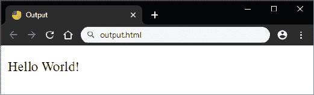

此外，JavaScript 还可以通过将内容写入弹出对话框来显示输出，如下：

```javascript
window.alert( ‘Hello World!’ )
```

这调用了 `window` 对象的 `alert()` 方法，在对话框中显示 `()` 括号内指定的内容。

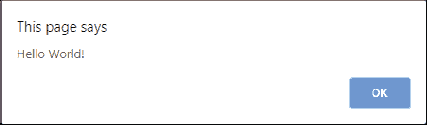

在开发 JavaScript 和学习该语言时，最初最好在浏览器的 JavaScript 控制台中显示输出，如下：

```javascript
console.log( ‘Hello World!’ )
```

这调用了 `console` 对象的 `log()` 方法，在控制台窗口中显示 `()` 括号内指定的内容。所有主流浏览器在其开发者工具中都有 JavaScript 控制台——通常通过按 F12 键访问。由于 Google Chrome Web 浏览器在编写时统计上是最流行的浏览器，书中全程用于演示 JavaScript，并最初使用其控制台窗口显示输出。


注意使用 `.`（句号）运算符通过“点点表示法”来描述对象的属性或方法。


还有一个 `document.write()` 方法，它可以替换网页的整个头部和正文，但其使用通常被认为是坏做法。


如果代码中发生错误，控制台会提供有用的信息——因此非常适合调试代码。

创建一个 HTML 文档，其中包含一个空段落和一个以三种方式显示输出的脚本。

```html
<p id=”message”></p>
<script>
document.getElementById( ‘message’ ).innerText = ‘Hello World!’
window.alert( ‘Hello World!’ )
console.log( ‘Hello World!’ )
</script>
```


output.html

保存 HTML 文档然后在浏览器中打开它，查看在段落中写入并在对话框中显示的输出——如侧所示

接下来，按下 F12 键，或使用浏览器的菜单打开开发者工具功能

现在，选择 Console 标签以查看写入控制台窗口的输出

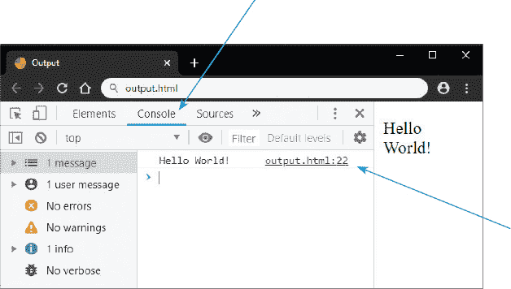


看到控制台显示了输出以及 HTML 文档名称和创建输出的 JavaScript 代码所在的行号。

点击 显示/隐藏按钮来隐藏或显示侧边栏，点击自定义按钮选择控制台窗口在浏览器窗口中的停靠方式，然后点击 清除按钮清除控制台中的所有内容

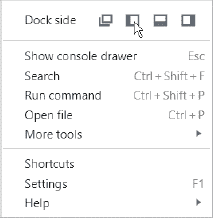

### 语句

JavaScript 代码由一系列称为“语句”的指令组成，当浏览器 JavaScript 引擎处理脚本时，它们通常按从到下的顺序执行。

每个语句都可能包含以下任何组件：

- **关键字** – 在 JavaScript 语言中具有特殊意义的单词。
- **运算符** – 对一个或多个操作数执行操作的特殊字符。
- **值** – 文本字符串、数字、布尔值 `true` 或 `false`、`undefined` 和 `null`。
- **表达式** – 产生单个值的代码单元。

在早期的 JavaScript 代码中，每条语句都必须以 `;` 分号字符结束——就像英语中的每个句子都必须以 `.`（句号）字符结束一样。现在这是可选的，所以除非你想在一行中编写多条语句，否则可以省略。在这种情况下，语句确实需要用分号分隔，如下：

```javascript
statement ; statement ; statement
```

一些 JavaScript 程序员仍然倾向于在每条语句结束加上分号。书中的示例为了简洁省略了它们，但选择权在于你。

JavaScript 解释器会忽略制表符和空格（“空白字符”），因此你应该使用间距来提高代码的可读性。例如，当两个数字相加时：

```javascript
total = 100 + 200
```

而不是 `total=100+200`

JavaScript 语句通常分组在函数块中的 `{ }` 大括号（大括号），这些块可以在需要时被重复调用。良好的做法是将这些语句缩进两个空格以提高可读性，如下：

```javascript
{
statement
statement
statement
}
```


JavaScript 关键字将在此处，你稍后将学习运算符、值和表达式。


“表达式”产生一个值，而“语句”执行一个动作。


使用空格键来缩进语句，因为在文本编辑器中查看代码时，制表符间距可能会被不同的处理。


管理 JavaScript 语言的规则被称为“语法”（syntax），它识别两种值——固定值和变量。固定的数值和文本字符串值被称为“字面量”（literals）：“

*   **数字字面量** – 整数，如 `100`，或浮点数如 `3.142`。
*   **字符串字面量** – 位于双引号内的文本，如 `“JavaScript Fun”`，或单引号内的文本，如 `‘JavaScript Fun’`。

变量值简单来说被称为“变量”，用于在脚本中存储数据。可以使用 JavaScript 的 `let` 关键字创建变量——例如，`let total` 会创建一个名为“total”的变量。可以使用 JavaScript 的 `=` 赋值运算符为变量赋值以存储，如下所示：

```javascript
let total = 300
```

可以使用其他 JavaScript 运算符形成表达式，这些表达式将求出一个单一值。通常，一个表达式可以包含在 `( )` 括号内，如下所示由数字和 JavaScript 的 `+` 加法运算符组成的表达式，其求值为单一 100：

```javascript
( 80 + 20 )
```

表达式也可能包含变量值，如下所示由之前的变量值、JavaScript 的 `-` 减法运算符和一个数字组成的表达式，其求值为单一 100：

```javascript
( total - 200 )
```

JavaScript 是一种区分大小写的语言，因此名为 `total` 和 `Total` 的变量被视为两个完全不同的变量。

在 JavaScript 代码中添加解释性注释是一个良好的习惯，这可以让其他人更容易理解代码，也能让你以后回顾代码时更容易理解。出现在 `//` 双斜杠之后的单行，或出现在一行或多行 `/*` 和 `*/` 字符序列之间的任何内容都会被忽略。

```javascript
let total = 100 // 这代码将会被执行。

/* let total = 100
这段代码将不会被执行。 */
```


决定在代码的字符串字面量中使用哪一种引号形式，并保持一致性。本书中的示例使用单引号。


在调试代码时，“注释掉”某些代码行以防止其执行通常很有用。

### 避免关键字


在 JavaScript 代码中，你可以为变量和函数选择自己的名称。名称应该具有意义并反映变量或函数的用途。你的名称由字母、数字和下划线组成，但不能包含空格或以数字开头。你还必须避免这些 JavaScript 语言中具有特殊意义的词：

| JavaScript 关键字 | | | | |
| :--- | :--- | :--- | :--- |
| `abstract` | `arguments` | `await` | `boolean` |
| `break` | `byte` | `case` | `catch` |
| `char` | `class` | `const` | `continue` |
| `debugger` | `default` | `delete` | `do` |
| `double` | `else` | `enum` | `eval` |
| `export` | `extends` | `false` | `final` |
| `finally` | `float` | `for` | `function` |
| `goto` | `if` | `implements` | `import` |
| `in` | `instanceof` | `int` | `interface` |
| `let` | `long` | `native` | `new` |
| `null` | `package` | `private` | `protected` |
| `public` | `return` | `short` | `static` |
| `super` | `switch` | `synchronized` | `this` |
| `throw` | `throws` | `transient` | `true` |
| `try` | `typeof` | `var` | `void` |
| `volatile` | `while` | `with` | `yield` |

| JavaScript 对象、属性和方法 | | | |
| :--- | :--- | :--- | :--- |
| `Array` | `Date` | `eval` | `function` |
| `hasOwnProperty` | `Infinity` | `isFinite` | `isNaN` |
| `isPrototypeOf` | `length` | `Math` | `NaN` |
| `name` | `Number` | `Object` | `prototype` |
| `String` | `toString` | `undefined` | `valueOf` |

| HTML 名称、窗口对象和属性 | | | | |
| :--- | :--- | :--- | :--- |
| `alert` | `all` | `anchor` | `anchors` |
| `area` | `assign` | `blur` | `button` |
| `checkbox` | `clearInterval` | `clearTimeout` | `clientInformation` |
| `close` | `closed` | `confirm` | `constructor` |
| `crypto` | `decodeURI` | `decodeURIcomponent` | `defaultStatus` |
| `document` | `element` | `elements` | `embed` |
| `embeds` | `encodeURI` | `encodeURIcomponent` | `escape` |
| `event` | `fileUpload` | `focus` | `form` |
| `forms` | `frame` | `innerHeight` | `innerWidth` |
| `layer` | `layers` | `link` | `location` |
| `mimeTypes` | `navigate` | `navigator` | `frames` |
| `frameRate` | `hidden` | `history` | `image` |
| `images` | `offscreenBuffering` | `open` | `opener` |
| `option` | `outerHeight` | `outerWidth` | `packages` |
| `pageXOffset` | `pageYOffset` | `parent` | `parseFloat` |
| `parseInt` | `password` | `pkcs11` | `plugin` |
| `prompt` | `propertyIsEnum` | `radio` | `reset` |
| `screenX` | `screenY` | `scroll` | `secure` |
| `select` | `self` | `setInterval` | `setTimeout` |
| `status` | `submit` | `taint` | `text` |
| `textarea` | `top` | `unescape` | `untaint` |
| `window` | | | |

| HTML 事件属性 | 示例： | | | |
| :--- | :--- | :--- | :--- |
| `onclick` | `ondblclick` | `onfocus` | `onfocusout` |
| `onkeydown` | `onkeypress` | `onkeyup` | `onload` |
| `onmousedown` | `onmouseup` | `onmouseover` | `onmouseout` |
| `onmousemove` | `onchange` | `reset` | `submit` |

### 存储值


“变量”是每种脚本语言通用的容器，可以在其中存储和检索数据。与大多数语言中的“强类型”变量不同（它们必须声明包含的特定类型），JavaScript 变量要容易得多，因为它们是“松类型”的——它们可以包含任何类型的数据：

| 数据类型 | 示例 | 描述 |
| :--- | :--- | :--- |
| 字符串 | `‘Hello World!’` | 字符字符串 |
| 数字 | `3.142` | 整数或浮点数 |
| 布尔 | `true` | 真 (1) 或 假 (0) 值 |
| 对象 | `console` | 用户定义或内置对象 |
| 函数 | `log()` | 用户定义函数、内置函数或对象方法 |
| Symbol | `Symbol()` | 唯一的属性标识符 |
| null | `null` | 绝对的一无所有 |
| undefined | `undefined` | 未配置的属性 |

JavaScript 变量可以使用 `let`、`const` 或 `var` 关键字后跟一个空格和你选择的名称来声明。`let` 变量声明可能只是创建一个可以被赋值的变量，也可能包含一个赋值来“初始化”变量的值：

```javascript
let myNumber // 声明变量。
myNumber = 10 // 初始化变量。
let myString = ‘Hello World!’ // 声明并初始化变量。
```

也可以在同一行声明多个变量：

```javascript
let i, j, k // 声明 3 个变量。
let num = 10, char = ‘C’ // 声明并初始化 2 个变量。
```

用 `let` 声明的变量可以在脚本执行过程中重新赋予新值，而 `const`（常量）不能。`var` 关键字在 `let` 关键字引入之前已用于 JavaScript，但现在最好，因为它不会阻止你重复声明同一个变量。

常量变量必须在声明时初始化：

```javascript
const myName = ‘Mike’
```


变量名是其包含值的别名——在脚本中使用名称即是引用其存储的值。


在初始化时，JavaScript 会自动为赋值的值设置变量类型。在脚本后续部分，可以通过赋值不同的数据类型来更改变量类型。可以使用 `typeof` 关键字显示当前的变量类型。


创建一个 HTML 文档，并在其中包含脚本，声明几个赋值了不同数据类型的变量

```javascript
const firstName = ‘Mike’
const valueOfPi = 3.142
let isValid = true
let jsObject = console
let jsMethod = console.log
let jsSymbol = Symbol( )
let emptyVariable = null
let unusedVariable
```


variables.html


添加语句来输出每个变量的数据类型

```javascript
console.log( ‘firstName: ‘ + typeof firstName )
console.log( ‘valueOfPi: ‘ + typeof valueOfPi )
console.log( ‘isValid: ‘ + typeof isValid )
console.log( ‘jsObject: ‘ + typeof jsObject )
console.log( ‘jsMethod: ‘ + typeof jsMethod )
console.log( ‘jsSymbol: ‘ + typeof jsSymbol )
console.log( ‘emptyVariable: ‘ + typeof emptyVariable )
console.log( ‘unusedVariable: ‘ + typeof unusedVariable )
```


保存 HTML 文档，然后在浏览器中打开它并启动控制台查看输出的数据类型

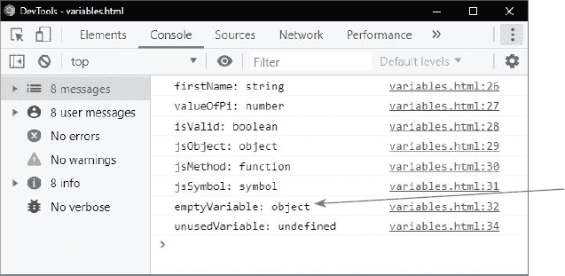


你可能会惊讶地发现，赋值为 `null` 值的变量被描述为 `object` 类型，而不是 `null` 类型。这是 JavaScript 语言中的已知错误。


这里使用了拼接运算符 `+` 来输出组合后的文本字符串。

## 创建函数

函数表达式简单来说就是成组在 `{}` 大括号中以便执行的一个或多个语句，并且它返回一个最终的单一值。函数可以根据脚本需要被调用以执行其语句。属于对象的函数（例如 `console.log()`）被称为“方法”——以将其与内置函数和用户定义函数区分开来。两者都有末尾的括号，可以接收“参数”值并传递给函数进行处理——例如，在 `console.log()` 方法的括号中传递的参数。


传递给函数的参数数量通常必须与函数块声明括号内指定的“参数”数量匹配。例如，一个需要恰好一个参数的用户定义函数看起来如下：

```javascript
function *function-name* ( *parameter* ) {
// 在此处编写要执行的语句。
}
```

多个参数可以以逗号分隔列表的形式指定，你可以选择指定一个默认值，当函数调用未传递参数时使用该值，如下：

```javascript
function *function-name* ( *parameter , parameter* = *value* ) {
// 在此处编写要执行的语句。
}
```

你遵循与变量名相同的命名规范来选择自己的参数名。这些参数名可以在函数内部使用，引用从函数调用括号传递的参数值。

函数块可以包含一个 `return` 语句，以便脚本流在调用者处继续——函数中的后续语句将不再执行。通常的做法是将处理过的传递参数值的结果返回给调用者：

```javascript
function *function-name* ( *parameter , parameter* ) {
// 在此处编写要执行的语句。
return *result*
}
```

函数块内的语句包含对其他函数的调用是很常见的——以便将脚本模块化为块。


注意函数声明的首选格式是将左大括号 `{` 放在与 `function` 关键字同一行。


你可以省略 `return` 语句，或者在不指定值的情况下使用 `return` 关键字，函数将简单向调用者返回一个 `undefined` 值。


创建一个 HTML 文档，并在其中包含脚本，声明一个返回所传参数平方值的函数

```javascript
function square ( arg ) {
return arg * arg
}
```


functions.html


接下来，添加一个返回加法结果的函数

```javascript
function add ( argOne, argTwo = 10 ) {
return argOne + argTwo
}
```


现在，通过调用上述每个函数，添加一个返回平方和加法结果的函数

```javascript
function squareAdd ( arg ) {
let result = square( arg )
return result + add( arg )
}
```


最后，添加调用函数并将返回值打印在输出字符串中的语句

```javascript
console.log( ‘8 x 8: ‘ + square( 8 ) )
console.log( ‘8 + 20: ‘ + add( 8, 20 ) )
console.log( ‘8 + 10: ‘ + add( 8 ) )
console.log( ‘(8 x 8) + (8 + 10): ‘ + squareAdd( 8 ) )
```


注意当调用者只传递一个参数值时，这里使用了默认的第二个参数值（10）。


保存 HTML 文档，然后在浏览器中打开它并启动控制台查看函数返回值

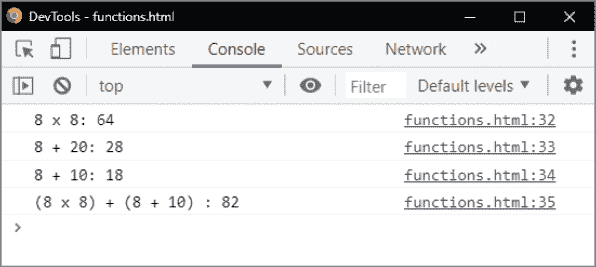


`*` 星号字符是 JavaScript 中的算术乘法运算符。

## 分配函数

函数在 JavaScript 中非常有用，因为它们可以在需要时被调用（“触发”）以执行其语句，调用者可以传递不同的参数以返回不同的结果。

重要的是，JavaScript 的 `()` 括号运算符是调用语句中实际调用函数的组件。这意味着语句可以通过仅指定函数名将函数赋值给变量。然后该变量可以在指定变量名后跟 `()` 运算符的语句中用于调用该函数。但请注意，如果你尝试通过指定函数名后跟 `()` 将函数赋值给变量，该函数将被调用，该函数返回的值将被赋值。


在将命名函数赋值给变量时，仅在语句中指定函数名。

## 函数提升

尽管 JavaScript 解释器从上到下读取脚本，但它实际上进行了两次扫描。第一次扫描寻找函数声明并记住找到任何项，这一过程被称为“提升”。第二次扫描是解释器实际执行脚本时。提升允许函数调用出现在函数声明之前，因为解释器在第一次扫描时已经识别了函数。然而，第一次扫描不会识别使用 `let` 或 `const` 关键字赋值给变量的函数！


使用旧 `var` 关键字声明的变量也会提升，但使用 `let` 或 `const` 声明的变量不会。

## 匿名函数

将函数赋值给变量时，可以省略函数名，因为函数可以在指定变量名和 `()` 运算符的语句中调用。这些被称为匿名函数表达式，其语法如下：

```javascript
let *variable* = function ( *parameters* ) { *statements* ; return *value* }
```

匿名函数表达式还可以通过整个函数封装在 `()` 括号内并在表达式末尾添加 `()` 括号运算符变为“自执行”。这意味着它们的语句在浏览器首次加载脚本时会自动执行一次。自执行函数表达式的语法如下：

```javascript
**( function ( ) { *statements* ; return *value* } ) ( )
```


自调用函数（Self-invoking functions）在本书中广泛用于在脚本加载时执行示例代码。


自调用函数表达式也称为立即执行函数表达式（Immediately Invoked Function Expressions，简称 IIFE – 通常读作“iffy”）。

创建一个 HTML 文档，其中脚本调用了一个尚未定义的函数

```javascript
console.log( ‘Hoisted: ‘ + add( 100, 200 ) )
```


anonymous.html

接下来，在上方调用的函数下方添加

```javascript
function add( numOne, numTwo ) {
  return numOne + numTwo
}
```

现在，添加一个将上述函数赋值给变量并调用该被赋值函数

```javascript
let addition = add
console.log( ‘Assigned: ‘ + addition( 32, 64 ) )
```

然后，将一个类似的但匿名函数赋值给变量并调用该被赋值的函数

```javascript
let anon = function ( numOne, numTwo ) {
  let result = numOne + numTwo ; return result
}
console.log( ‘Anonymous: ‘ + anon( 9, 1 ) )
```

最后，将自调用函数的返回值赋值给变量并显示该值

```javascript
let iffy = ( function ( ) {
  let str = ‘Self Invoked Output’ ; return str
} ) ( )
console.log( iffy )
```

保存 HTML 文档，然后在浏览器中打开它并启动控制台以查看函数返回的值

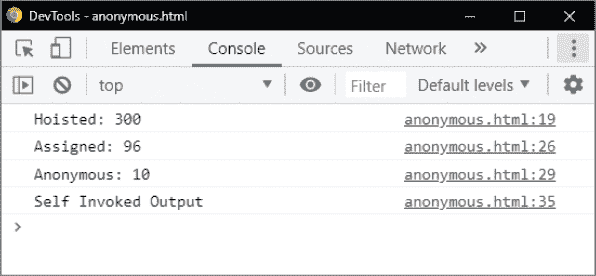


自调用函数的意义可能不会立而易见，但到本章结束时，它们的重要性应该变得清晰。

## 识别作用域

变量在脚本中的可访问范围取决于它们的“词法作用域”（lexical scope）——即变量创建的环境。这可以是“全局的”，也可以是“局部的”。


### 全局作用域

在函数块外部创建的变量在整个脚本范围内全局可用。这意味着它们持续存在，并对同一脚本环境中的函数可用。初看之下这可能非常方便，但它有一个非常严重的缺点：同名的变量可能会发生冲突。例如，假设你创建了一个全局变量 `myName` 并赋值了你的名字，但随后又包含了一个外部脚本，另一个开发者在脚本中也创建了一个全局变量 `myName` 并赋值了他们的名字。两个同名变量存在于同一个脚本环境中，因此产生冲突。最好避免这种情况，因此你不应该在脚本中创建全局变量来存储原始值（除 `Object` 和 `Function` 外的所有数据类型）。

### 局部作用域

在函数块内部创建的变量在函数的整个生命周期内仅局部可用。它们只在函数执行时存在，随后会被销毁。它们的脚本环境是有限的——从创建点开始到最后的 `}` 大括号，或者函数返回的那一刻。在函数块的最开始声明变量是一个良好的习惯，这样它们的词法作用域就是整个函数的时长。这意味着同名变量可以在不同的函数中存在而不会产生冲突。例如，局部变量 `myName` 可以愉快地存在于脚本中不同函数中，以及包含的外部脚本的函数中。建议你在脚本中只尝试创建局部变量来存储值。

## 最佳实践

使用旧的 `var` 关键字声明全局变量会导致同名的冲突变量在没有警告的情况下覆盖其被赋值的值。较新的 `let` 和 `const` 关键字禁止了这种行为，并将该行为识别为“未捕获的语法错误”（Uncaught SyntaxError）。因此，建议使用 `let` 或 `const` 关键字声明变量来在脚本中存储值。


你可以在这里发现如何捕捉错误。

创建一个外部脚本，通过调用函数来输出全局变量的值

```javascript
let myName = ‘External Script’
function readName( ) { console.log( myName ) }
readName( )
```


external.js

创建一个 HTML 文档，包含外部脚本并添加一个类似的脚本

```html
<script src=”external.js”></script>
<script>
let myName = ‘Internal Script’
function getName( ) { console.log( myName ) }
getName( )
</script>
```


scope.html

将两个文件保存在同一个文件夹中，然后打开 HTML 文档查看控制台中报告的冲突错误

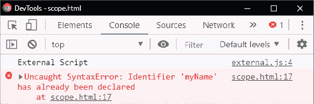

编辑两个脚本，将全局变量变为局部变量，然后刷新浏览器查看无冲突

```javascript
function readName( ) {
  let myName = ‘External Script’ ; console.log( myName )
}
function getName( ) {
  let myName = ‘Internal Script’ ; console.log( myName )
}
```


## 使用闭包

上一个示例演示了创建全局变量存储值的危险，但有时你可能想要存储持续存在的值——例如，随着脚本的进行记住不断增加的分数。如何在不使用全局变量的情况下做到这一点？答案在于使用“闭包”。


闭包嵌套在外部函数内部的函数，它保留了对外部函数中声明的变量的访问——因为那是函数创建时的词法作用域。

创建一个 HTML 文档，其脚本将自调用函数赋值给全局变量

```javascript
const add = ( function ( ) {
  // 在此处插入语句。
} ) ( )
```


closure.html

接下来，插入语句初始化局部变量并在同一作用域内赋值一个函数

```javascript
let count = 0
const nested = function ( ) { return count = count + 1 }
```

现在，插入一条语句返回内部函数——将内部函数赋值给全局变量

```javascript
return nested
```

最后，向已赋值给全局变量的内部函数添加三个相同的函数调用

```javascript
console.log( ‘Count is ‘ + add( ) )
console.log( ‘Count is ‘ + add( ) )
console.log( ‘Count is ‘ + add( ) )
```

保存 HTML 文档，然后在浏览器中打开它并启动控制台以查看闭包返回的值

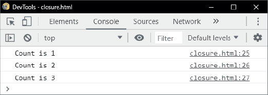


自调用函数表达式在这里 有描述。它们只执行一次语句。在这里，你可以使用 `console.log( add )` 来确认函数表达式已赋值给外部变量。

理解闭包的概念可能困难，因为在这个示例中 `count` 变量似乎在自调用函数执行完成后应该被销毁。为了更好地理解闭包的工作原理，你可以探索被赋值函数的 `prototype` 属性。

在脚本末尾添加语句以揭示被赋值函数是如何构造的

```javascript
console.log( add.prototype )
```

保存 HTML 文档，然后刷新浏览器并展开“constructor”下拉菜单以查看作用域

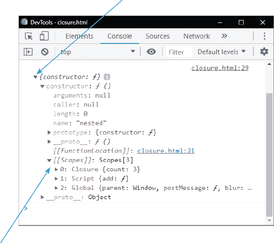


仔细观察可以发现，赋值的函数除了普通的局部（脚本）作用域和外部（全局）作用域外还有一个特殊的（闭包）作用域。这就是为什么 `count` 变量可以通过赋值函数访问，但重要的是，它无法通过任何其他方式被引用。

使用闭包来从脚本的其他部分隐藏持久变量是一个重要概念。这类似于在其他编程语言中隐藏“私有”变量，并仅通过“getter”方法访问。


所有的 JavaScript 对象都从 `prototype` 继承属性和方法。标准的 JavaScript 对象（如函数）会调用内部构造函数，通过定义其组件来创建对象。


如果你不能立即理解闭包的工作原理，不要担心。它们起初看起来可能神秘，但随着经验的增加会变得清晰。你可以继续后续稍后再回来这项技术。

## 总结

- JavaScript 代码可以直接包含在 HTML 文档中，也可以使用 `<script> </script>` 标签从外部文件引入。
- JavaScript 可以在 HTML 元素的警报对话框或浏览器的控制台窗口显示输出。
- JavaScript 语句可以包含关键字、运算符、值和表达式。
- JavaScript 解释器忽略制表符和空格。
- JavaScript 语句可以分组在 `{ }` 大括号函数块中，可以在需要时调用执行。
- 变量和函数名可以由字母、数字和下划线字符组成，但必须避免关键字。
- JavaScript 变量可以包含 String、Number、Boolean、Object、Function、Symbol、`null` 和 `undefined` 数据类型。
- 使用 `let` 关键字声明的变量可以重新赋值新值，但 `const` 关键字不允许此操作。
- 函数表达式具有分组在 `{ }` 大括号中的语句用于执行，并返回最终的单一值。
- 函数表达式的 `( )` 括号可以包含参数，用于从调用者传递参数值。
- 函数块可以包含一个 `return` 语句，用于指定传递给调用者的数据。
- JavaScript 的 `( )` 运算符调用函数。
- 提升允许函数调用出现在函数声明之前的脚本中。
- 匿名函数表达式没有函数名。
- 词法作用域是变量创建的环境，可以是全局、局部的或闭包。
- 局部变量应用于存储值，但全局变量可以分配函数以创建闭包。
- 闭包嵌套在外部函数内部的函数，它保留了对外部函数中声明变量的访问。

## 2 执行常用操作

*本章描述了 JavaScript 运算符并演示了如何在你的脚本中使用它们。*

- 转换值
- 进行算术运算
- 赋值值
- 进行比较
- 评估逻辑
- 检查条件
- 处理位运算
- 强制排序
- 总结

## 转换值

在 JavaScript 中执行操作之前，识别你正在处理的值的数据类型是重要的，以避免出现意外的结果。例如，值 42 是数字，但值 ‘42’ 是字符串，因此尝试执行 `‘42’ + 8` 加法将返回字符串结果 `‘428’，而不是数字 50。幸运的是，JavaScript 提供了多种方法返回其他数据类型的值的版本，而不改变值的原始数据类型。


### 字符串转数字

JavaScript 内置函数 `parseInt()` 可以返回括号内指定字符串的整数版本（在数字数据类型中）。例如，`parseInt( ‘42’ )` 将返回数字 42，因此 `42 + 8` 将返回数字结果 50。

同样，JavaScript 内置函数 `parseFloat()` 可以返回括号内指定字符串的浮点数版本（在数字数据类型中）。

这两个方法都允许字母跟在指定字符串的数字部分之后，并将其从结果中剔除——例如，`parseInt( ‘42nd Street’ )` 返回数字 42。

如果这两个函数任一无法在指定字符串的开头找到数值，结果将是 `NaN` —— 这是一个 JavaScript 属性，意味着“不是数字”（Not a Number）。你也可以通过在 JavaScript 内置函数 `isNaN()` 的括号内指定值来检查一个值是否不是数字。这同样会首先尝试在指定值的开头寻找数字，如果找到了数字（即使来自指定的字符串），则返回 false，否则如果找不到数字，将返回 true。


数据类型的转换被称为“强制类型转换”（coercion），它可以是显式的也可以是隐式的。`‘42’ + 8` 返回字符串 `‘428’` 是隐式转换。而 `String( 42 )` 返回字符串 `‘42’` 是显式转换。

### 数字转字符串

JavaScript 的 `String()` 方法可以返回括号内指定数字的字符串表示（在字符串数据类型中）——例如，`String( 42 )` 将返回字符串数据类型的数字 `’42’`。

或者，你可以在变量名后附加 `toString()` 方法调用，以返回存储的数字数据类型的字符串表示。例如，当一个名为“num”的变量被赋值数字时，`num.toString()` 将返回该存储数字的字符串版本。


创建一个带有自执行匿名函数块的 HTML 文档，其中声明了三个变量

```javascript
( function ( ) {
  let sum, net = ‘25’, tax = 5.00
  // 在此处插入语句。
} ) ( )
```


conversion.html


接下来，插入创建不同数据类型版本的语句并在输出字符串中打印结果

```javascript
sum = net + tax
console.log( ‘sum: ‘ + sum + ‘ ‘ + typeof sum )
sum = parseFloat( net ) + tax
console.log( ‘sum: ‘ + sum + ‘ ‘ + typeof sum )
console.log( ‘tax: ‘ + tax + ‘ ‘ + typeof sum )
tax = tax.toString( )
console.log( ‘tax: ‘ + tax + ‘ ‘ + typeof tax )
net = ‘$’ + net
console.log( ‘net: ‘ + net + ‘ ‘ + parseInt( net ) )
console.log( ‘net Not a Number? ‘ + isNaN( net ) )
```


保存 HTML 文档，然后在浏览器中打开它并启动控制台以查看不同的版本

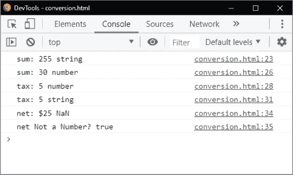


如果你在向字符串添加 ‘$’ 前缀之前尝试 `isNaN( net )`，结果为 **false** —— 因为该方法在 `‘25’` 字符串的开头找到了数字。

## 进行算术运算

JavaScript 中常用的算术运算符列在下表中，以及它们执行的操作：

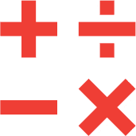

| **运算符** | **操作** |
| :--- | :--- |
| + | 数字相加 字符串拼接 |
| **–** | 减法 |
| ***** | 法 |
| **/** | 除法 |
| **%** | 取模 |
| **++** | 增 |
| **– –** | 减 |
| ****** | 幂 |

操作语句中指定的值被称为“操作数”。例如，在语句 `5 + 2` 中，`+` 运算符被提供了五和二的操作数值。注意 `+` 运算符根据操作数的类型执行两种不同的操作。数字操作数相加返回总和，但字符串操作数拼接返回单个连接的字符串。


`%` 模运算符将第一个操作数除以第二个操作数，并返回余数。除以二会返回一或零，从而很有用地判断第一个操作数是奇数还是偶数。

`++` 增量运算符和 `--` 减量运算符会将单个操作数的值改变一，并返回新值。这些运算符通常用于计数循环的次数，并有两种不同的不同的方式，产生细微不同的效果。当放在操作数之前（前置）时，在表达式求值之前立即改变值；但当放在操作数之后（后置）时，先求值表达式，然后改变值。


`**` 幂运算符返回第一个操作数相对于第二个操作数的幂次方的结果。


使用模运算符判断奇数或偶数的示例可以参考这里。

创建一个带有自执行匿名函数块的 HTML 文档

```javascript
function ( ) {
  // 在此处插入语句。
} ( ) ;
```


arithmetic.html

接下来，插入使用每个算术运算符为变量赋值的语句并在输出字符串中打印每个结果

```javascript
let sum = 80 + 20 ; console.log( ‘Addition: ‘ + sum )
let sub = sum - 50 ; console.log( ‘Subtraction: ‘ + sub )
let mul = sum * 5 ; console.log( ‘Multiplication: ‘ + mul )
let div = sum / 4 ; console.log( ‘Division: ‘ + div )
let mod = sum % 2 ; console.log( ‘Modulus: ‘ + mod )
let inc = ++sum ; console.log( ‘Increment: ‘ + inc )
let dec = --sum ; console.log( ‘Decrement: ‘ + dec )
```

保存 HTML 文档，然后在浏览器中打开它并启动控制台以查看算术结果

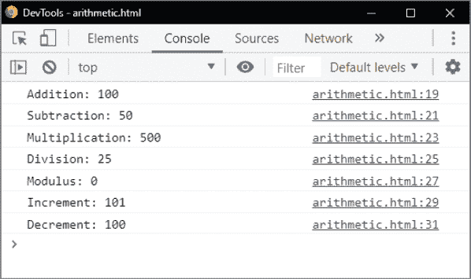

### 赋值值

JavaScript 中常用的用于赋值的运算符都列在下表中。除了简单的 `=` 赋值运算符外，所有运算符都是较长表达式的简写，因此为了清晰起见，也提供了相应的写法。


| 运算符 | 示例 | 等效于 |
| :--- | :--- | :--- |
| `=` | `a = b` | `a = b` |
| `+=` | `a += b` | `a = ( a + b )` |
| `–=` | `a –= b` | `a = ( a – b )` |
| `*=` | `a *= b` | `a = ( a * b )` |
| `/=` | `a /= b` | `a = ( a / b )` |
| `%=` | `a %= b` | `a = ( a % b )` |
| `**=` | `a ** b` | 错误 |

将 `=` 运算符理解为“赋值”而不是“等于”是非常重要的，以避免与 JavaScript 的 `===` 相等运算符混淆。

在表格的 `=` 示例中，变量 `a` 被赋值变量 `b` 中包含的值，成为其新的存储值。

组合运算符 `+=` 很有用，可以用于将字符串附加到现有字符串上。例如，对于变量 `let str = ‘JavaScript’` 和 `str += ‘ Fun’`，变量现在存储组合后的字符串 ‘JavaScript Fun’。

从数字上来说，表格中的 `+=` 示例将变量 `a` 中的值加到变量 `b` 中的值，然后将总和赋值为变量 `a` 中存储的新值。

所有其他组合赋值运算符的工作方式与 `+=` 运算符类似。它们都先对两个操作数执行算术操作，然后将该操作的结果赋值给第一个变量——使其成为其新的存储值。


`===` 相等运算符比较值，并在此处 有详细解释。

创建一个带有连接两个字符串的自执行匿名函数的 HTML 文档

```javascript
function ( ) {
  let msg = ‘JavaScript’ ; msg += ‘ Fun’
  console.log( ‘Add & concatenate: ‘ + msg )
  // 在此处插入语句。
} ( ) ;
```


assignment.html

接下来，插入使用组合运算符执行算术运算并赋值结果输出的语句

```javascript
let sum = 5.00 ; sum += 2.50
console.log( ‘Add & assign decimal: ‘ + sum )
sum = 8 ; sum -= 4
console.log( ‘Subtract & assign integer: ‘ + sum )
sum = 8 ; sum *= 4
console.log( ‘Multiply & assign integer: ‘ + sum )
sum = 8 ; sum /= 4
console.log( ‘Divide & assign integer: ‘ + sum )
sum = 8 ; sum %= 4
console.log( ‘Modulus & assign integer: ‘ + sum )
```

保存 HTML 文档，然后在浏览器中打开它并启动控制台以查看算术结果

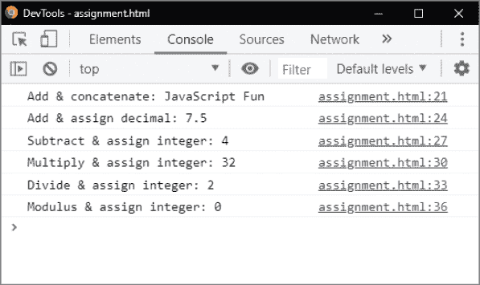

### 比较

JavaScript 中常用的用于比较值的运算符都列在下表中。


| 运算符 | 比较 |
| :--- | :--- |
| `===` | 相等 |
| `!==` | 不相等 |
| `>` | 大于 |
| `<` | 小于 |
| `>=` | 大于等于 |
| `<=` | 小于等于 |

`===` 相等运算符比较两个值，如果它们完全相等则返回 true，否则返回 false。`>` 大于运算符在第一个值大于值时返回 true。`<` 小于运算符在第一个值小于第二个值时返回 true。在 `>` 大于运算符或 `<` 小于运算符后添加 `=` 字符可以使它们在两个操作数相等时也返回 true。`>` 大于运算符和 `<` 小于运算符经常用于测试循环结构中计数器变量的值。


在循环结构中使用 `<` 小于运算符的示例可以参考这里。


还有 `==` 相等运算符和 `!=` 不相等运算符，但这些可能会产生意外的结果，因为与 `===` 和 `!==` 不同，它们不确保所比较的值是相同类型。这意味着 `25 == ‘25’` 返回 `true`，而 `25 === ‘25’` 返回 `false`。始终使用三字符的版本，以便你的脚本进行准确的比较。

创建一个声明三个变量的自执行匿名函数的 HTML 文档

```javascript
function ( ) {
  let comparison, sum = 8, str = ‘JavaScript’
  // 在此处插入语句。
} ( ) ;
```


comparison.html

接下来，插入使用比较运算符赋值布尔结果输出的语句

```javascript
comparison = str === ‘JAVASCRIPT’
console.log( ‘String Equality? ‘ + comparison )
comparison = str === ‘JavaScript’
console.log( ‘String Equality? ‘ + comparison )
comparison = sum === 8
console.log( ‘Number Equality? ‘ + comparison )
comparison = sum > 5
console.log( ‘Greater Than? ‘ + comparison )
comparison = sum < 5
console.log( ‘Less Than? ‘ + comparison )
comparison = sum <= 8
console.log( ‘Less Than or Equal To? ‘ + comparison )
```


JavaScript 是区分大小写的，因此为了使比较的字符串相等，字符的大小写必须匹配。

## 评估逻辑

JavaScript 中可以使用的三种逻辑运算符列如表所示：


| 运算符 | 操作 |
| :--- | :--- |
| `&&` | 逻辑与 (AND) |
| `||` | 逻辑或 (OR) |
| `!` | 逻辑非 (NOT) |

逻辑运算符通常用于具有布尔值 true 或 false 的操作数——或者可以转换为 true 或 false 的值。

`&&` 逻辑与运算符评估两个操作数，只有当两个操作数本身都为 true 时，才会返回 true。否则，`&&` 与运算符将返回 false。这通常用于条件分支，即通过测试两个条件来决定脚本的执行方向。如果两个条件都满足，脚本将按照特定方向执行，否则将遵循另一个方向。

与需要两个操作数都为 true 的 `&&` 逻辑与运算符不同，`||` 逻辑或运算符会评估两个操作数，如果其中一个操作数本身为 true，则返回 true。如果两个操作数都不 true，则 `||` 或运算符将返回 false。这对于在两个测试条件中的任意一个满足时让脚本执行特定操作非常有用。

第三个逻辑运算符是 `!` 逻辑非运算符，它用于单个操作数之前，并返回操作数的反向值。例如，如果名为 `tog` 的变量值为 true，那么 `!tog` 将返回 false。这对于在连续的循环迭代中使用如 `tog = !a` 的语句来“切换”变量的值非常有用，使其每次迭代时值发生反转——就像开关灯泡一样。

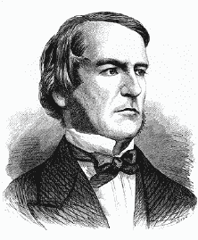

“布尔”（Boolean）一词指的是由英国数学家乔治·布尔（George Boole，1815-1864）开发的逻辑思维体系。

创建一个带有自执行匿名函数的 HTML 文档，并声明三个变量

```javascript
function () {
  let result, yes = true, no = false;
  // 在此处插入语句。
}()
```


`logic.html`

接下来，插入使用逻辑运算符为输出分配布尔结果的语句

```javascript
result = yes && yes
console.log( ‘Are both true? ‘ + result )
result = yes && no
console.log( ‘Are both still true? ‘ + result )
result = yes || no
console.log( ‘Are either true? ‘ + result )
result = no || no
console.log( ‘Are either still true? ‘ + result )
console.log( ‘Original value: ‘ + yes )
yes = !yes
console.log( ‘Toggled value: ‘ + yes )
```

保存该 HTML 文档，然后在浏览器中打开它并启动控制台以查看返回的结果

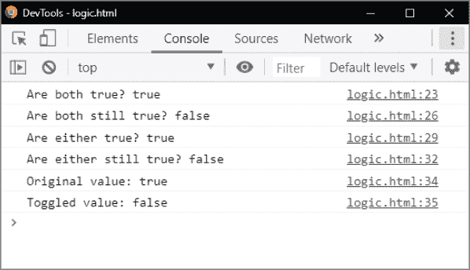


看 `false && false` 返回的是 `false` 而不是 `true`——这也许证明了“两个错不成就一个对”的格言。

## 检查条件

可能 JavaScript 作者最喜欢的运算符是 `?:` 条件运算符。该运算符也被称为“三元”运算符——意味着它由三部分组成。

三元运算符评估指定条件为 true 或 false 值，然后根据结果执行两个指定语句中的一个。它的语法如下：


```
condition ? if-true-do-this : if-false-do-this
```

其中如果根据条件评估的结果需要执行多个操作，每个指定的语句可以是一个函数调用，以便在每个函数中执行多个语句——例如，根据名为 `flag` 的变量的布尔值调用函数来执行多个语句，如下：

```javascript
flag === true ? doThis() : doThat()
```

在这个示例中，`===` 等于运算符和 `true` 关键字实际上是多余的，因为评估表达式的布尔值的运算符会自动执行这种评估，因此示例可以更简单地表述为：

```javascript
flag ? doThis() : doThat()
```

或者，为三元运算符指定的两个语句可能会根据条件评估的结果为变量赋值，如下所示：

```javascript
flag ? str = ‘Go left’ : str = ’Go right’
```

虽然这在语法上是正确的，但通过让三元运算符在单个赋值语句中为变量分配适当的值可以得更优雅，如下：

```javascript
str = flag ? ‘Go left’ : ’Go right’
```

当条件评估数值的奇偶性时，两个语句可以根据评估结果确定数字是偶数还是奇数来提供方案。


三元运算符有三个操作数——`?` 之前的以及 `:` 冒号两侧的

创建一个带有自执行匿名函数的 HTML 文档，并声明两个变量

```javascript
function () {
  const numOne = 8, numTwo = 3;
  // 在此处插入语句。
}()
```


`ternary.html`

接下来，插入使用合适数量语法的输出字符串的语句

```javascript
let verb = ( numOne !== 1 ) ? ‘ are ‘ : ‘ is ‘
console.log( ‘There’ + verb + numOne )
```

现在，插入语句以正确描述两个变量值的奇偶性的字符串

```javascript
let parity = ( numOne % 2 !== 0 ) ? ‘Odd’ : ‘Even’
console.log( numOne + ‘ is ‘ + parity )
parity = ( numTwo % 2 !== 0 ) ? ‘Odd’ : ‘Even’
console.log( numTwo + ‘ is ‘ + parity )
```

最后，插入语句输出两个变量值中较大者的字符串

```javascript
let max = ( numOne > numTwo ) ? numOne : numTwo
console.log( max + ‘ is the Greater Number ‘ )
```

保存该 HTML 文档，然后在浏览器中打开它并启动控制台以查看字符串描述

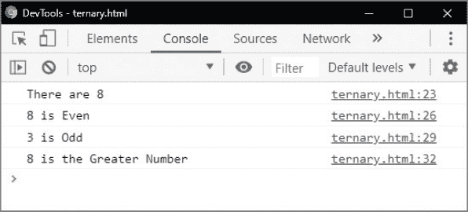


三元运算符可以返回任何数据类型的值——字符串、数字、布尔值等。

## 位位运算

JavaScript “位”运算符将其操作数视为 32 位的序列，其中每个位可能包含零 (0) 或一 (1) 的值。只有当该位包含一时，该位才贡献一个十进制部分。组件从右到左从“最低有效位”（LSB）命名为“最高有效位”（MSB）。下方八位模式中的二进制数表示十进制 50，由设置为 1 值的位表示（2 + 16 + 32 = 50）。

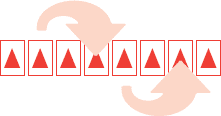

| 位数 | 8 | 7 | 6 | 5 | 4 | 3 | 2 | 1 |
| :--- | :--- | :--- | :--- | :--- | :--- | :--- | :--- | :--- |
| 十进制 | 128 | 64 | 32 | 16 | 8 | 4 | 2 | 1 |
| 二进制 | 0 | 0 | 1 | 1 | 0 | 0 | 1 | 0 |

可以使用表中所列的 JavaScript 位运算符操作序列中的单个位。

| 运算符 | 称为 | 二进制数操作 |
| :--- | :--- | :--- |
| `\|` | 或 (OR) | 如果两个比较位中任意一个为 1，则每个位都返回 1 示例：`1010 \| 0101 = 1111` |
| `&` | 与 (AND) | 如果两个比较位都为 1，则每个位都返回 1 示例：`1010 & 1100 = 1000` |
| `~` | 非 (NOT) | 当位不是 1 时，每个位都返回 1；当位为 1 时，返回 0 示例：`~ 1010 = 0101` |
| `^` | 异或 (XOR) | 如果两个比较位中只有一个为 1，则每个位都返回 1 示例：`1010 ^ 0100 = 1110` |
| `<<` | 左移 | 从右侧推入零，将每个位向左移动位数 示例：`0010<< 2 = 1000` |
| `>>` | 有符号右移 | 从左侧推入最左侧位的副本，将每个位向右移动位数。示例：`1000 >> 2 = 0010` |


| **>>>** | 右移 | 从左侧补零，将每个位向右移动指定的的位数。示例：**1000 >> 2 = 0010** |


许多 JavaScript 作者从不使用位运算符，但了解它们是什么以及如何使用是有用的。


一个“字节”（byte）包含 8 位，字节的每个半部分被称为“半字节”（nibble，4 位）。此表示例中的二进制数描述了存储在半字节中的值。

创建一个 HTML 文档，使用一个自执行的匿名函数来声明两个变量

```javascript
function ( ) {
  let numOne = 10, numTwo = 5;
  // 在此处插入语句。
} ( )
```


bitwise.html

接下来，插入语句简单输出字符串，以确认存储在每个变量中的初始值

```javascript
console.log( ‘numOne:‘ + numOne )
console.log( ‘numTwo: ‘ + numTwo )
```

现在，插入语句使用位运算交换每个变量中存储的值

```javascript
numOne = numOne ^^ numTwo;
// 1010 ^^ 0101 = 1111 = (十进制 15)
numTwo = numOne ^^ numTwo;
// 1111 ^^ 0101 = 1010 (十进制 10)
numOne = numOne ^^ numTwo;
// 1111 ^^ 1010 = 0101 (十进制 5)
```

最后，插入语句输出换行符和字符串，以确认存储在每个变量中的最终值

```javascript
console.log( ‘\n’ + ‘numOne: ‘ + numOne )
console.log( ‘numTwo: ‘ + numTwo )
```

保存 HTML 文档，然后在浏览器中打开它并启动控制台查看交换后的值

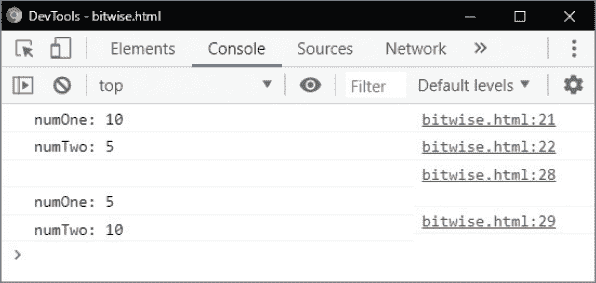


注意此示例如何使用特殊的 `\n` 转义序列在控制台输出中创建换行。

**强制顺序**

JavaScript 运算符具有不同的优先级，用于决定包含多个不同运算符的语句的评估顺序——优先级高的运算符优于优先级低的运算符。下表按照从高到低的顺序列出了每种类型的运算符：


| | 运算符 | 操作 |
| :--- | :--- | :--- |
|  | `( )` | 表达式分组 |
| `.` | 对象成员 |
| `[ ]` | 数组成员 |
| `( )` | 函数调用 |
| `++ --` | 后置递增、后置递减 |
| `++ --` | 前置递增、前置递减 |
| `! ~` | 逻辑非、位非 |
| `******` | 幂 |
| `*** / %` | 乘法、除法、取模 |
| `+ –` | 加法、减法 |
| `<< >> >>>` | 位移 |
| `< <= => >` | 比较 |
| `=== === !== !=` | 相等、不相等 |
| `&` | 位与 |
| `^` | 位异异 |
| `&#124;` | 位或 |
| `&&` | 逻辑与 |
| `&#124;&#124;` | 逻辑或 |
| `?:` | 三元条件运算符 |
| `= += –= *= /= %= &= ^= &#124;= <<= >>= >>>=` | 赋值 |
| `,` | 逗号 |


`[ ]` 运算符在演示数组的章节中从此处` 等点符号表示法）具有高优先级，以便及早识别对象及其成员。

创建一个 HTML 文档，使用一个自执行的匿名函数用未分组表达式的结果初始化变量并输出其值

```javascript
function ( ) {
  let sum = 9 + 12 / 3; // 等于 9 + 4。
  console.log( ‘Ungrouped sum: ‘ + sum )
} ( )
```


precedence.html

保存 HTML 文档，然后在浏览器中打开它并启动控制台查看结果

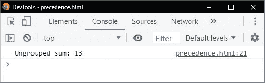

首先计算除法，因为它的运算符优先级高于加法运算符，所以结果是 13。但你可以通过括号内分组表达式来强制优先级顺序，使其先计算，因为 `( )` 运算符具有所有运算符中最高的优先级。

编辑函数内的语句以强制评估顺序，使加法在除法之前执行

```javascript
let sum = ( 9 + 12 ) / 3; // 等于 21 / 3.
console.log( ‘Grouped sum: ‘ + sum )
```

再次保存 HTML 文档，然后刷新浏览器查看新的结果值

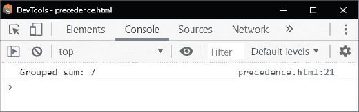


养成使用括号分组表达式的习惯，从而设定评估的优先级顺序。

**总结**

- `parseInt()` 和 `parseFloat()`可以将字符串转换为数字，但 `String()` 和 `toString()`可以将数字转换为字符串。
- `isNaN()` 函数测试其参数是否为 NaN 值。
- 算术运算符执行常规算术以及 `%` 取模、`++` 增、`--` 减以及 `**` 幂。
- 当 `++` 增或 `--` 减运算符位于操作数之前时，其值立即改变；但当它们位于操作数之后时，先评估表达式。
- `=` 运算符可以与算术运算符结合进行运算。
- `+=` `-=` `*=` `/=` `%=` `&=` `^=` `|=` `<<=` `>>=` `>>>=` 用于赋值。
- `,` 逗号。

**3**

**管理脚本流**

*本章介绍了 JavaScript 控制结构并演示了它们如何控制脚本的进度。*

- If 分支
- 备选分支
- Switch 分支
- For 循环
- While 循环
- Do 循环
- Break 跳
- 捕获错误
- 总结

**If 分支**

任何脚本或计算机程序的进度都取决于条件的评估，以确定流的方向。每次评估都可能根据评估结果提供一个或多个继续执行的分支。


在 JavaScript 中，基本的条件测试使用 `if` 关键字进行，用以测试条件是否为布尔真或假值。当结果为真时，将执行评估后的语句；否则，跳过该语句并在后续语句处继续执行。

`if` 语句的语法要求将测试的条件放在 `if` 关键字后的括号内，格式如下：

```javascript
if ( condition ) execute-this-statement-when-true
```

`if` 语句也可以通过将语句封装在大括号内来指定在结果为真时执行的多个语句，如下所示：

```javascript
if ( condition )
{
  execute-this-statement-when-true
  execute-this-statement-when-true
  execute-this-statement-when-true
}
```


对条件进行评估并根据结果执行操作，简单地反映了现实中的思考过程——例如，你可能在夏日里执行的动作：

```javascript
let temperature = readThermometer( )
const tolerable = 25
if ( temperature > tolerable )
{
  turn_on_air-conditioning( )
  get_a_cool_drink( )
  stay_in_shade( )
}
```

条件测试等于 `if( condition === true )`，但因为它会自动对真值进行等值测试，因此没有必要在括号中包含 `=== true`。


建议即使是执行单个语句，也将其封装在大括号内 ——用以保持一致的编码风格。

创建一个 HTML 文档，包含一个自执行函数，首先初始化一个布尔变量

```javascript
let flag = true
```


if.html

接下来，插入语句对变量的布尔值进行条件测试

```javascript
if( !flag )
{
  console.log( ‘Power is OFF’ )
}
if( flag )
{
  console.log( ‘Power is ON’ )
}
```

现在，插入语句对比较两个整数的表达式进行条件测试

```javascript
if( 7 < 2 )
{
  console.log( ‘Failure’ )
}
if( 7 > 2 )
{
  console.log( ‘Success’ )
}
```

保存 HTML 文档，然后在浏览器中打开它并启动控制台，查看哪些输出语句被执行，哪些被忽略了

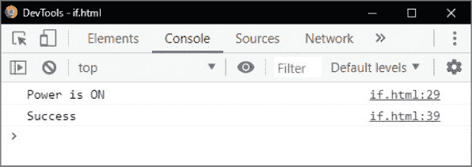


这里使用了逻辑 `!`（非）运算符来反转条件测试，使其等同于

```javascript
if( flag === false )
```


为了节省页面空间，本示例以及大多数后续示例都省略了创建函数块的脚本代码。你可以参考此处 获取有关如何创建匿名自执行函数的说明。

## 分支备

`if` 语句测试条件的布尔值并仅在结果为真时执行其语句，它提供了一个脚本可以遵循的单一分支。通过 `else` 关键字扩展 `if` 语句，可以提供脚本在结果为假时遵循的备选分支。


`else` 语句位于 `if` 语句之后如下：

```javascript
if ( condition ) execute-this-statement-when-true
else execute-this-statement-when-false
```

`if else` 语句也可以通过将这些语句封装在大括号内来指定多个执行语句，如下：

```javascript
if ( condition )
{
  execute-this-statement-when-true
  execute-this-statement-when-true
}
else
{
  execute-this-statement-when-false
  execute-this-statement-when-false
}
```

通过在每个 `else` 语句块的开头进行后续的条件 `if` 测试，可以提供多个分支，如下：

```javascript
if ( condition )
{
  execute-these-statements-when-true
}
else if ( condition )
{
  execute-these-statements-when-true
}
else if ( condition )
{
  execute-these-statements-when-true
}
else
{
  execute-this-statements-when-false
}
```

`if else if` 语句可能会反复测试变量在一个范围内的值，也可能会测试各种条件。最终的 `else` 语句在没有找到真条件时充当默认值。


一旦在 `if else` 语句中发现真条件，其关联语句将被执行，然后流在 `if else` 语句之后继续 ——不再评估后续的 `else` 语句。

创建一个 HTML 文档，包含一个自执行函数，首先初始化两个变量

```javascript
let flag = false
const num = 10
```


else.html

接下来，插入语句对第一个变量的布尔值进行条件测试

```javascript
if( !flag )
{
  console.log( ‘Power is OFF’ )
}
else
{
  console.log( ‘Power is ON’ )
}
```

现在，插入语句对第二个变量的数值值进行条件测试

```javascript
if( num === 5 )
{
  console.log( ‘Number is Five’ )
}
else if( num === 10 )
{
  console.log( ‘Number is Ten’ )
}
else
{
  console.log( ‘Number is Neither Five nor Ten’ )
}
```

保存 HTML 文档，然后在浏览器中打开它并启动控制台，查看哪些输出语句被执行，哪些被忽略了


使用 `if` 语句进行条件分支流测试几个条件是可以的，但当有许多条件时，会变得臃肿。在这种情况下，使用 `switch` 语句通常更高效、更优雅。


`switch` 语句的工作方式很特殊 —— 它首先评估一个表达式，然后为结果值寻找匹配。在找到匹配的地方，`switch` 语句将执行与该值关联的一个语句，否则它将执行一个指定为 `default` 的语句。

因此，`switch` 语句的语法如下：

```javascript
switch ( expression )
{
  case value-1 : statements-to-executed-when-matched ; break
  case value-2 : statements-to-executed-when-matched ; break
  case value-3 : statements-to-executed-when-matched ; break
  default : statements-to-executed-when-match-found
}
```

`switch` 语句首先通过在 `switch` 关键字后的括号内封装要评估的表达式。紧接着是一对 `{ }` 大括号，其中包含了可能的匹配项。每个匹配项都跟一个 `case` 关键字，并使用冒号 `:` 关联一个更多要执行的语句。重要的是，每个 `case` 必须以 `break` 语句结束，以便在执行其关联语句后退出 `switch` 语句。

可选地，`switch` 语句可以包含一个最后的 `default` 备选，以便在未找到匹配时关联一个更多要执行的语句。

`switch` 语句中包含的 `case` 值数量没有限制，因此它是匹配几十、数百或数千个不同值的理想方式。


省略 `break` 语句允许脚本也执行与后续不匹配 `case` 值关联的语句。

创建一个 HTML 文档，包含一个自执行函数，首先声明一个变量

```javascript
let day
```


switch.html

接下来，插入一个 `switch` 语句在评估表达式后给变量赋值一个值

```javascript
switch( 5 - 2 )
{
  case 1 : day = ‘Monday’ ; break
  case 2 : day = ‘Tuesday’ ; break
  case 3 : day = ‘Wednesday’ ; break
  case 4 : day = ‘Thursday’ ; break
  case 5 : day = ‘Friday’ ; break
  default : day = ‘Weekend’
}
```

现在，插入一个语句输出由匹配的 `case` 语句赋值的值

```javascript
console.log( ‘It is ‘ + day )
```

保存 HTML 文档，然后在浏览器中打开它并启动控制台，查看输出中的赋值值

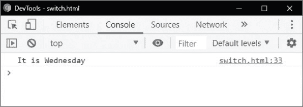


作为可能情况匹配的 `String` 值必须像所有其他字符串值一样括在引号内。

### For 循环

循环是一种包含一个测试条件和一个或多个语句的结构，当测试条件满足时，这些语句会被重复执行。对条件的单次检查和语句的执行被称为一次“迭代”。当测试条件不再满足时，不再进行后续迭代，程序流将到循环结构之后的下一个语句。


在 JavaScript 中最常用的循环结构可能是 `for` 循环，其语法如下：

`for ( *initializer ; condition ; modifier ) { *statements-to-be-executed }`

`for` 关键字后面的括号内包含三个表达式，用于控制循环执行的次数：

- `Initializer`（初始化器） – 一个语句，指定用于计数循环迭代次数变量的初始值。传统上，这个简单的计数器变量通常命名为“i”。
- `Condition`（条件） – 在每次迭代中都会进行布尔值测试的表达式。当求值结果为 true 时，执行循环语句以完成该迭代。如果求值结果为 false，则不执行语句并结束循环。通常，该条件检查循环计数器变量的值。
- `Modifier`（修改器） – 一个修改测试条件中值的语句，以便在某一点其求值结果能返回 false。通常，这会递增或递减循环计数器变量。

例如，执行一组语句一百次的 `for` 循环结构可能如下所示：

```javascript
let i
for ( i = 0 ; i < 100 ; i++ ) { statements-to-be-executed }
```

在这种情况下，计数器变量在每次迭代中递增，直到其值达到 100，此时求值返回 false，循环结束。


除非修改器能够让求值在某一点返回 false，否则会创建一个永远运行的死循环。

创建一个带有自执行函数的 HTML 文档，从初始化一个循环计数器变量开始

```javascript
let i = 0
```


for.html

接下来，插入一个 for 循环结构，它将进行 10 次迭代并在每次迭代中输出循环计数器的值

```javascript
for( i = 1 ; i < 11 ; i++ )
{
console.log( ‘Iteration Number: ‘ + i )
}
```

保存 HTML 文档，然后在浏览器中打开它并启动控制台查看循环迭代

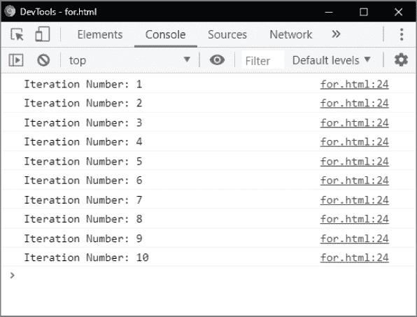


这是普通的 `for` 循环。还有一种特殊的 `for in` 循环，用于遍历对象的属性，稍后会演示，详见此处。

### While 循环

此处描述的 `for` 循环结构适用于所需迭代次数已知的情况，但在次数未知时，`while` 循环结构通常更好。`while` 循环的语法如下：

```javascript
while( *condition )
{
*statements-to-be-executed*
*modifier*
}
```

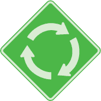

`while` 关键字后面的括号内包含一个条件，在每次迭代时进行布尔值求值。每次迭代要执行的语句括在大括号内，并包含一个修改测试条件中值的语句，以便在某一点其求值结果返回 false 并退出循环。只要求值结果保持为 true，语句就会循环的每次迭代中执行。

如果条件在第一次迭代时求值为 false，循环将立即退出，因此大括号内的语句永远不会被执行。`while` 循环和 `for` 循环有时被称为“预测试”循环，因为它们的测试条件是在执行任何语句之前进行求值的。

通过使用计数器变量作为测试条件并在每次迭代中增加其值，可以让 `while` 循环像 `for` 循环一样执行特定次数的迭代。例如，执行一组语句一百次的 `while` 循环结构可能如下所示：

```javascript
let i = 0
while ( i < 100 )
{
statements-to-be-executed
i++ ;
}
```

计数器变量在每次迭代中递增，直到其值达到 100，此时求值返回 `false` 循环结束。


在 `while` 循环结构中省略修改器将创建一个永远运行的死循环。

创建一个带有自执行函数的 HTML 文档，从初始化一个循环计数器变量开始

```javascript
let i = 10
```


while.html

接下来，插入一个 while 循环结构，它将进行迭代并在每次迭代中输出循环计数器的值，直到其达到零

```javascript
while( i > -1 )
{
console.log( ‘Countdown Number: ‘ + i )
i--
}
```

保存 HTML 文档，然后在浏览器中打开它并启动控制台查看循环迭代

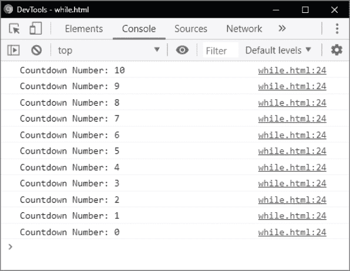


每个 `while` 循环必须带有大括号，因为它们至少包含两个语句——一个执行语句和一个修改器。

### Do 循环

JavaScript 中提供的另一种循环是 `do while` 循环结构。这是此处描述的 `while` 循环的反转版本，适用于每次迭代要执行的语句绝对至少执行一次的情况。其语法如下：

```javascript
do
{
statements-to-be-executed
modifier
}
while *( condition )
```


`while` 关键字后面的括号内包含一个条件，在每次迭代后进行布尔值求值。每次迭代要执行的语句括在大括号内，并包含一个修改测试条件中值的语句，以便在某一点其求值结果返回 false 并退出循环。只要求值结果保持为 true，语句就会循环的每次迭代中执行。

如果条件在第一次迭代时求值为 false，循环将立即退出，因此大括号内的语句已经执行了一次。`do while` 循环有时被称为“后测试”循环，因为测试条件是在语句执行后求值的。

通过使用计数器变量作为测试条件并在每次迭代中增加其值，可以让 `do while` 循环像 `for` 循环一样执行特定次数的迭代。例如，执行一组语句一百次的 `do while` 循环结构可能如下所示：

```javascript
let i = 0
do
{
statements-to-be-executed
i++
}
while ( i < 100 )
```

计数器变量在每次迭代中递增，直到其值达到 100，此时求值返回 false 循环结束。


只有在语句绝对至少执行一次时，才使用 `do while` 循环。

创建一个带有自执行函数的 HTML 文档，从初始化一个循环计数器变量开始

```javascript
let i = 2
```


do.html

接下来，插入一个 do while 循环结构，它将进行迭代并在每次迭代中输出循环计数器的值，直到其超过 1000

```javascript
do
{
i *= 2
console.log( ‘Multiplied Number: ‘ + i )
}
while( i < 1000 )
```

保存 HTML 文档，然后在浏览器中打开它并启动控制台查看循环迭代

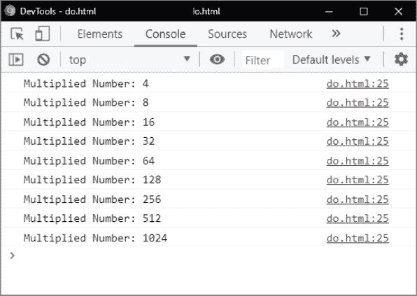


注意，最终值超过了条件限制，是因为它在测试之前就已经写入了输出中。

### 跳出循环


JavaScript `break` 关键字可以用于遇到指定条件时退出循环。条件测试应该出现在所有要执行的其他语句之前，这样循环将立即结束。


当 `break` 语句在嵌套在外层循环的循环中使用时，流将回到外层循环迭代继续执行。

JavaScript `continue` 关键字可以用于遇到指定条件时跳过循环的单次迭代。

当 `continue` 语句在嵌套在外层循环的循环中使用时，流将从内层循环的下一次迭代开始。

创建一个 HTML 文档，包含一个自执行函数，该函数开始初始化两个循环计数器

`let i = 0`

`let j = 0`


break.html

接下来，插入一个包含内部嵌套 for 循环的 for 循环

```javascript
for ( i = 1 ; i < 3 ; i++ )
{
    console.log( ‘Outer Loop: ‘ + i )
    for ( j = 1 ; j < 4 ; j++ )
    {
        // 在此处插入语句。
        console.log( ‘\tInner Loop: ‘ + j )
    }
}
```


此处处使用 `\t` 转义序列是为了在输出中包含一个制表符空格。

保存 HTML 文档，然后在浏览器中打开它并启动控制台，查看外层循环的两次迭代和内层循环的三次迭代

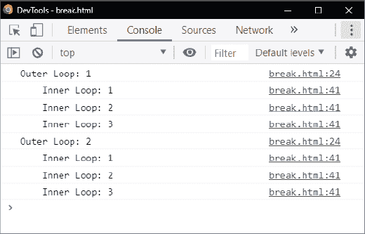

接下来，在内层循环中插入语句以跳过内层循环的迭代并跳出外层循环

```javascript
if( ( i === 1 ) && ( j === 2 ) ) {
    console.log( ‘\tSkipped: ‘ + j )
    continue
}

if( ( i === 2 ) && ( j === 2 ) ) {
    console.log( ‘\tBroken: ‘ + j )
    break
}
```

再次保存 HTML 文档，然后在浏览器中打开它并启动控制台，看到一次迭代被跳过且循环被完全中断

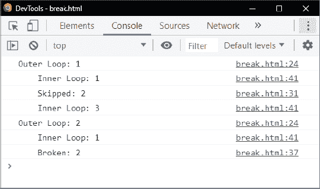


`break` 关键字也用作 switch 语句中的终止符。


不要倾向于使用 `break` 语句来退出循环，以代替构成循环结构部分的常规条件测试。

## 捕获错误

可能预判错误的脚本部分（例如处理用户输入的部分）可以封装在 `try catch` 结构中以处理“异常”错误。要执行的语句包含在 `try` 块的大括号内，异常作为参数传递给随后的 `catch` 块进行处理。可选情况下，后面可以跟一个 `finally` 块，其中包含在处理异常后执行的语句。


JavaScript 识别 `Error`、`EvalError`、`InternalError`、`RangeError`、`ReferenceError`、`SyntaxError`、`TypeError` 和 `URIError` 错误对象。这些对象可能由解析器自动创建并传递给 `catch` 块，或通过 `new` 关键字和构造方法手动创建，然后使用 `throw` 关键字传递。

每个错误对象都可以有一个 `name` 属性和一个 `message` 属性，以允许 `catch` 块描述其性质。`message` 被指定为手动创建的错误对象的构造函数的参数，否则它是预定义的。

或者，也可以通过 `throw` 关键字将字符串传递给 `catch` 块以识别错误。然后可以通过检查字符串值来确定适当的操作。

创建一个 HTML 文档，包含一个自执行函数，该函数开始初始化一个变量

`let day = 32`


catch.html

接下来，插入一个 `try` 块来识别无效的整数值

```javascript
try
{
    if( day > 31 )
    {
        throw new RangeError( ‘Day Cannot Exceed 31’ )
    }
    if( day < 1 )
    {
        throw ‘invalid’
    }
}
```

现在，在 `try` 块后附加一个 `catch` 块来处理无效的整数值

```javascript
catch( err )
{
    if( err === ‘invalid’ )
    {
        console.log( ‘Variable has invalid value of ‘ + day )
    }
    else
    {
        console.log( err.name + ‘ Exception: ‘ + err.message )
    }
}
```

然后，在 `catch` 块后附加一个 `finally` 块以输出最终消息

```javascript
finally
{
    console.log( ‘The script has ignored the error...’ )
}
```

再次保存 HTML 文档，然后在浏览器中打开它并启动控制台查看捕获到的错误

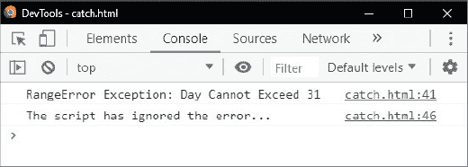

将变量值改为零，然后保存 HTML 文档并刷新浏览器以查看捕获到的错误

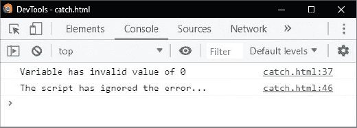


删除或注释掉 `day` 变量声明，然后保存并刷新此示例以查看自动捕获的 `ReferenceError`。

## 总结

- 基本条件测试使用 `if` 关键字进行，以测试条件是否为布尔真或假值。
- 可以通过 `else` 关键字扩展 `if` 语句来提供基本条件测试的备分支。
- 使用 `switch` 语句对大量条件进行布尔真或假值的测试。
- 在 `switch` 块中，每个 `case` 语句必须以 `break` 关键字结束，以便在找到匹配时退出。
- `switch` 块可以包含一个最终的 `default` 语句，在未找到匹配时执行。
- `for` 循环必须指定一个初始化器、一个测试布尔真或假值的条件以及一个修饰符。
- 循环修饰符必须使测试的条件在某一点变为假。
- `while` 循环在执行语句前测试条件是否为布尔真或假值。
- `do while` 循环在执行语句后测试条件。

- `break` 关键字可以用于遇到指定条件时退出循环。
- `continue` 关键字可以用于遇到指定条件时跳过循环的单次迭代。
- `try catch` 结构可以用于处理脚本中发生的异常。
- 每个错误对象都可以有一个 `name` 属性和一个 `message` 属性，以允许 `catch` 块描述其性质。
- 可以通过 `throw` 关键字将字符串传递给 `catch` 块以识别错误。
- `try catch` 结构后面可以跟一个 `finally` 块，包含处理异常后执行的语句。

## 4 使用对象

*本章介绍了如何创建脚本对象并演示了如何使用内置对象。*

- 自定义对象
- 扩展对象
- 内置对象
- 创建数组
- 循环元素
- 切片数组
- 排序元素
- 获取日期
- 提取日历
- 提取时间
- 设置日期
- 匹配模式
- 总结

## 自定义对象


现实世界的对象无处不在，它们都有我们可以描述的属性和行为：

- 属性描述对象拥有的特征。
- 行为描述对象可以执行的操作。

例如，可以描述汽车具有“品牌”和“型号”属性，以及“加速”和“刹车”行为。


这些特征可以用 JavaScript 中的一个自定义汽车对象来表示，该对象包含品牌和型号的变量属性，以及 `accelerate()` 和 `brake()` 方法。

值通过 `{ }` 内逗号分隔的键值对列表分配给对象，如下：

```javascript
let car = { make: ‘Jeep’, model: ‘Wrangler’,
```


```javascript
accelerate: function ( ) { return this.model + ‘ drives away’ } ,
brake: function ( ) { return this.make + ‘ pulls up’ }
}
```

你可以通过两种方式引用对象的属性值——使用 `objectName.propertyName` 的点符号语法，或者使用 `objectName['propertyName']` 语法。

可以使用点符号语法 `objectName.methodName()` 来调用对象方法。

`this` 关键字可以在对象方法定义中使用，用以指向“拥有”该方法的对象。在上面的示例中，它指的是 `car` 对象，因此 `this.model` 引用 `car.model` 属性，而 `this.make` 引用 `car.make` 属性。


在对象的 `name:value` 键值对列表中，空白会被忽略，但不要忘记在键值对之间加上逗号。


创建一个带有自执行执行函数的 HTML 文档，该函数首先声明一个变量来包含一个对象定义

```javascript
let car = {
// 在此处插入语句。
}
```


object.html

接下来，插入语句来定义对象的属性

```javascript
make: ‘Jeep’ ,
model: ‘Wrangler’ ,
```

现在，插入语句来定义对象的方法

```javascript
accelerate: function ( ) {
return this.model + ‘ drives away’ } ,
brake: function ( ) {
return this.make + ‘ pulls up’ }
```

然后，在变量声明的结束括号 `}` 之后，添加一条语句输出包含对象属性值的字符串——使用每种引用技术

```javascript
console.log( ‘Car is a ‘ + car.make + ‘ ‘ + car[ ‘model’ ] )
```

最后，添加语句来调用每个对象方法

```javascript
console.log( car.accelerate( ) )
console.log( car.brake( ) )
```

保存该 HTML 文档，然后在浏览器中打开并启动控制台，查看对象的属性值以及从方法返回的字符串

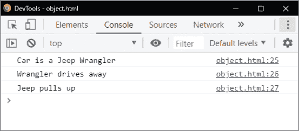


你必须包含结尾的 `()` 括号来调用方法，否则它将仅仅返回函数定义。

## 扩展对象

自定义对象非常灵活，只需通过赋值新值即可随时轻松扩展和更新，使用点符号引用属性，如 `objectName.propertyName`。


可以使用特殊的 `for...in` 循环并使用以下语法来列出对象的所有属性名和方法名（“键”）：

```javascript
for ( property in objectName ) { console.log( property ) }
```

为了在每次迭代中引用每个属性的值，可以将属性变量名包含在对象名称后的方括号中，格式为 `object-Name[property]`。

创建一个带有自执行函数的 HTML 文档，该函数首先初始化一个变量，精确重建上一个示例中的对象

```javascript
let property, car = {
make: ‘Jeep’ ,
model: ‘Wrangler’ ,
accelerate: function ( ) {
return this.model + ‘ drives away’ } ,
brake: function ( ) {
return this.make + ‘ pulls up’ }
}
```


extend.html

添加循环语句来列出每个属性和方法的名称和值

```javascript
for( property in car ) {
console.log( property + ‘: ‘ + car[ property ] )
}
```

保存该 HTML 文档，然后在浏览器中打开并启动控制台，查看对象的键和值

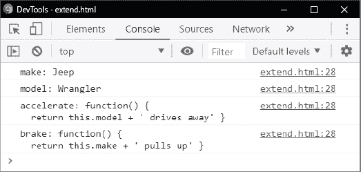


示例中的 `property` 变量实际上可以被赋予任何有效的变量名。

接下来，添加语句为两个现有的对象属性分配新值

```javascript
car.make = ‘Ford’
car.model = ‘Bronco’
```

现在，添加语句通过一个额外的属性和额外的方法来扩展对象

```javascript
car.engine = ‘V6’
car.start = function ( ) {
return this.make + ‘ motor is running’ }
```

然后，添加语句输出包含对象属性值的字符串——使用每种引用技术

```javascript
console.log( ‘\nCar is a ‘ + car.make + ‘ ‘ + car[ ‘model’ ] )
console.log( ‘Engine Type: ‘ + car.engine )
```


该语句中的 `\n` 转义序列用于在输出中包含换行（换行符）。

最后，添加语句来调用每个对象方法

```javascript
console.log( car.start( ) )
console.log( car.accelerate( ) )
console.log( car.brake( ) )
```

再次保存该 HTML 文档，然后刷新浏览器以查看扩展对象的属性值以及从其方法返回的字符串

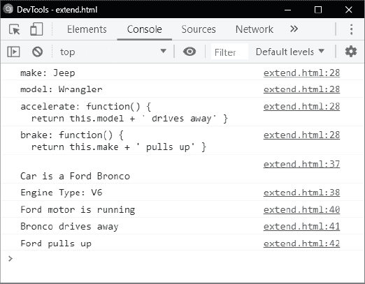

## 内置对象


| 对象 |
| :--- |
| `String`（仅在使用 `new` 关键字创建时为对象） |
| `Number`（仅在使用 `new` 关键字创建时为对象） |
| `Boolean`（仅在使用 `new` 关键字创建时为对象） |
| `Object` – 你定义的对象 |
| `Date` – 包含日期和时间部分的对象 |
| `Array` – 存储索引数据项的对象 |
| `RegExp` – 描述正则表达式模式的对象 |
| `Math` – 提供数学属性和方法的对象 |
| `Error` – 提供错误详细信息的对象 |

JavaScript 提供了上表列出的预定义内置对象。这些对象中，除了 `Math` 之外，每个对象都有同名的构造方法可以使用。


现在，插入语句输出 `Date` 节点的内容和本地格式化的日期字符串

```javascript
console.log( ‘Date Object: ‘ + jsDate )
console.log( ‘Locale Date String: ‘ + jsDate.toLocaleString( ) )
```

然后，插入语句输出原始类型字面量数值值和本地格式化的数字字符串

```javascript
console.log( ‘\nPrimitive Number: ‘ + jsNumber )
console.log( ‘Locale Number String: ‘ + jsNumber.toLocaleString( ) )
```

保存 HTML 文档，然后在浏览器中打开它并启动控制台查看输出字符串

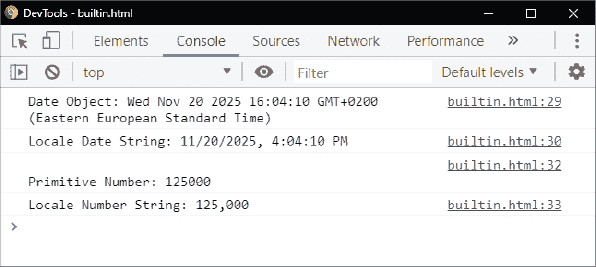


`Math` 对象是唯一一个不提供构造方法的 JavaScript 对象。

## 创建数组

`Array` 对象是 JavaScript 的内置对象，可以在单独的“元素”中存储多个项目（各种数据类型）。数组通过给变量赋值 `[]` 方括号来创建，方括号内可以包含由逗号分隔的值列表，用于初始化数组元素。其语法如下：


```javascript
let arrayName = [ value1 , value2 , value3 ]
```

与自定义对象不同（对象的每个属性都有名称），数组元素是自动编号的——从零开始。因此，第一个元素是 0，第二个是 1，第三个是 2，以此此类推。这种编号系统通常被称为“基于零的索引”。

存储在数组元素中的值可以通过在对象名后加上方括号并包含其元素索引数字来引用。例如，`colors[ 0 ]` 将引用名为“colors”的数组中第一个元素的值。

当数组元素不需要立即初始化时，可以创建一个空数组稍后将值赋值给其元素，如下：

```javascript
let colors = [ ]
colors[ 0 ] = ‘Red’
colors[ 1 ] = ‘Green’
colors[ 2 ] = ‘Blue’
```

虽然 `Array` 对象提供了 `Array()` 构造函数，但不应使用它，因为它可能会产生意想不到的结果——例如，创建一个初始化了第一个元素的数组，如下：

```javascript
let jsArray = new Array( 10 )
```

你可能会合理地预期 `jsArray[ 0 ]` 引用第一个元素中的整数值 10，但它实际上返回一个 `undefined` 值。这是怎么了？这是一个只在你向构造方法指定单个整数参数时才会发生的异常——这会导致 JavaScript 创建一个包含 10 个空元素的数组！使用 `jsArray = [ 10 ]` 创建数组则没有该效果，并会如预期创建一个第一个元素包含整数值 10 的数组。


所有内置对象的名称以大写字母开头——因此构造函数的名称是“Array”，而不是“array”。

创建一个带有自执行函数的 HTML 文档，该函数首先创建一个数组——用错误的方法

```javascript
let jsArray = new Array( 10 )
```


array.html

接下来，添加语句输出第一个数组元素的值并列出整个数组

```javascript
console.log( jsArray[ 0 ] )
console.log( jsArray )
```

现在，添加语句声明一个变量，并声明一个初始化数组的变量

```javascript
let month, summer = [ ‘June‘, ‘July‘, ‘August‘ ]
```

然后，添加一个循环输出每个数组元素的索引号和值

```javascript
for ( month in summer )
{
  if ( month !== ‘ ‘ )
  {
    console.log( month + ‘: ‘ + summer[ month ] )
  }
}
```

最后添加语句输出第一个数组元素的值并列出整个数组

```javascript
console.log( ‘Start of Summer: ‘ + summer[ 0 ] )
console.log( summer )
```

保存 HTML 文档，然后在浏览器中打开它并启动控制台查看数组元素的内容

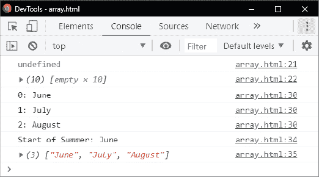


将 `for in` 循环的主体封装在 `if` 语句中是一个良好的习惯——在这里，它确保了元素不是空的。

## 循环元素

数组和循环是绝佳拍档！任何类型的循环都可以用于向元素填充值。即使是非常巨大的数组，也可以通过这种方式“填充”——而且代码少得惊人。


同样，循环可以快速读取每个数组元素的值，并在循环的每次迭代中对该值执行适当的操作。

有用的是，每个数组都有一个 `length` 属性，其中包含该数组元素总数的整数记录。由于基于零的索引，此值始终比最后一个元素的索引号大一，因此可以随时用于条件测试以终止循环。

创建一个带有自执行函数的 HTML 文档，该函数首先声明三个变量

```javascript
let i, result, boolArray = [ ]
```


elements.html

接下来，输出一个简单的标题

```javascript
console.log( ‘Fill Elements...’ )
```

现在，添加一个循环用布尔值填充 10 个元素，并输出它们的索引号和每个存储的值

```javascript
for( i = 1 ; i < 11 ; i++ )
{
  boolArray[ i ] = ( i % 2 === 0 ) ? true : false
  console.log( ‘Element ‘ + i + ‘: ‘ + boolArray[ i ] )
}
```

然后，输出第二个简单的标题并用空字符串值初始化变量

```javascript
console.log( ‘Read Elements...’ )
result = ‘’
```

接下来，添加一个循环将任何包含 true 值的元素的索引号赋值给字符串

```javascript
for( i = 1 ; i < boolArray.length ; i++ )
{
  if( boolArray[ i ] ) { result += i + ‘ | ‘ }
}
```


这里的数组 `length` 属性值为 11，因为数组有十一个元素——尽管元素 0 还没有填充。

现在，输出字符串以显示包含 true 值的元素的索引号

```javascript
console.log( ‘True in Elements: ‘ + result )
```

重置字符串变量包含一个空字符串

```
result = ‘‘
```

然后，添加一个循环将任何包含 false 值的元素的索引号赋值给字符串

```javascript
for( i = 1 ; i < boolArray.length ; i++ )
{
  if( !boolArray[ i ] ) { result += i + ‘ | ‘ }
}
```

最后，输出字符串以显示包含 false 值的元素的索引号

```javascript
console.log( ‘False in Elements: ‘ + result )
```

保存 HTML 文档，然后在浏览器中打开它并启动控制台写入和读取元素

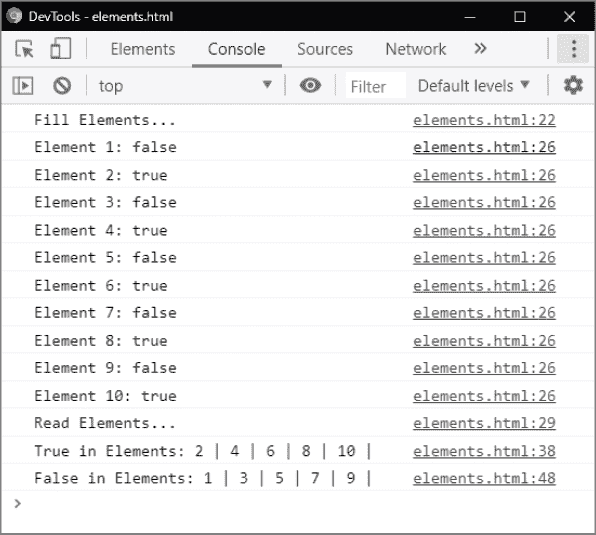


布尔值的条件测试不需要包含 `=== true`，因为那是自动的。

## 切割数组

JavaScript 对象具有属性和方法。除了 `length` 属性外，每个数组对象都有用于操作数组元素的方法。它们列在下表中，并附带有它们执行任务的简短描述：


| 方法 | 描述 |
| :--- | :--- |
| `join( *separator* )` | 将所有元素值合并由指定分隔符分隔的字符串，如果没有指定分隔符则用逗号分隔 |
| `pop()` | 删除数组的最后一个元素并返回其值 |
| `push( *value , value* )` | 在数组末尾添加元素并返回新长度 |
| `reverse()` 反转数组中所有元素的顺序并返回每个元素的重排序后的值 |
| `shift()` | 删除数组的第一个元素并返回其值 |


| `slice( *begin , end* )` | 返回指定索引位置之间的元素，如果未指定结束位置，则返回数组的末尾 |
| `sort( )` | 将数组中的所有元素按字母顺序或数字顺序进行排序，并返回每个元素重排序后的值 |
| `splice( *position , number, value, value* )` | 从指定的索引位置开始替换指定数量的元素值，并返回被替换的值 |
| `unshift( *value , value* )` | 在数组开头添加元素并返回新长度 |

当 `push( )` 或 `unshift()` 方法未指定任何值时，会向数组中添加一个单一空元素。可以为 `push()`、`unshift()` 和 `splice()` 方法指定一个用逗号分隔的值列表来更改多个元素。


`join( )` 方法在将大量元素值合并为单个字符串时速度更快，但 `+` 拼接运算符在合并少数几个元素值时速度更快。


`slice( )` 方法返回直到可选的结束索引位置但不包括该位置在内的元素值。

创建一个带有自执行函数的 HTML 文档，该函数首先创建一个数组

```
let seasons = [ ‘Spring’, ‘Summer’, ‘Fall’, ‘Winter’ ]
console.log( ‘Elements: ‘ + seasons )
```


slice.html

接下来，输出修改后的元素列表

```
console.log( ‘Joined: ‘ + seasons.join( ‘ & ‘ ) )
```

现在，从数组中提取最后一个元素

```
console.log( ‘Popped: ‘ + seasons.pop( ) )
console.log( ‘Elements: ‘ + seasons )
```

然后，将最后一个元素放回数组

```javascript
console.log( ‘Pushed: ‘ + seasons.push( ‘Winter’ ) )
console.log( ‘Elements: ‘ + seasons )
```

接下来，仅输出两个元素值

```javascript
console.log( ‘Sliced: ‘ + seasons.slice( 1, 3 ) )
```

最后，替换第三个元素的值

```javascript
console.log( ‘Spliced: ‘ + seasons.splice( 2, 1, ‘Autumn’ ) )
console.log( ‘Elements: ‘ + seasons )
```

保存 HTML 文档，然后在浏览器中打开它并启动控制台查看操作后的元素

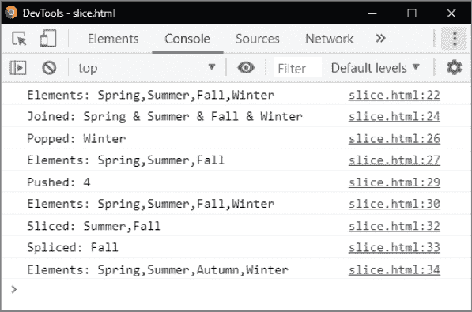


不使用 `slice( )` 方法（此处原文似乎不完整，根据上下文推测为“使用 slice( ) 方法不...”）[注：由于提供的原文文本后半部分存在大量乱码或重复逻辑，此处已根据逻辑对对有效部分进行了翻译。]


计算机日期和时间以数值形式测量，即自 1970 年 1 月 1 日 00:00:00 以来的已时间——该点通常被称为“纪元”（epoch）。在 JavaScript 中，已时间被记录为自 `epoch` 以来的毫秒数。可以使用 `Date` 对象的 `getTime()` 方法提取此数字，并可能将其减去另一个 `Date` 对象的数值，以计算脚本中两个时间点之间的间隔时间——例如，计算执行循环所需的时间。

可以使用 `toString()` 方法提取 `Date` 对象中各个组件的字符串，或者使用 `toUTCString()` 方法将其转换为 UTC 时间的等效字符串。

在系统已正确设置为本地时间的情况下，JavaScript 可以通过检查当前 `Date` 对象的 `getTimezoneOffset()` 方法返回的值，确定用户所在的时区。该方法返回一个整数值，表示当前本地时间与 UTC 时间的分钟差。之所以以分钟而不是小时进行计算，是因为某些时区的偏移量不是一小时的间隔——例如，加拿大的纽芬兰岛在夏令时期间为 UTC -3:30。

时区偏移值可用于为美国时区提供本地化，但在夏令时期间必须减去 60（分钟）。示例调用了 `Date` 对象的 `getMonth()` 和 `getDate()` 方法，如果当前日期处于夏令时期间，则调整时区偏移值。


更多示例请参见 #chapter04.xhtml，其中演示了如何通过调用 `Date` 对象的方法来使用其组件。


创建一个 HTML 文档，包含一个自执行函数，开始初始化三个变量

```javascript
const now = new Date()
let offset = now.getTimezoneOffset()
let dst = 60
```


date.html


接下来，添加语句在 11 月 3 日至 3 月 10 日之间关闭夏令时

```javascript
if (now.getMonth() < 3 && now.getDate() < 10) {
    dst = 0
}
if (now.getMonth() > 9 && now.getDate() > 2) {
    dst = 0
}
```


现在，添加一条语句来建立时区

```javascript
switch (offset) {
    case 300:
        offset = 'East Coast';
        break;
    case 360:
        offset = 'Central';
        break;
    case 420:
        offset = 'Mountain';
        break;
    case 480:
        offset = 'Pacific';
        break;
    default:
        offset = 'All';
}
```


最后，添加语句输出日期时间信息以及适当的问候消息

```javascript
console.log('System Time: ' + now.toString())
console.log('UTC (GMT) Time: ' + now.toUTCString())
console.log('Welcome to ' + offset + ' Visitors')
```


保存 HTML 文档，然后在浏览器中打开它并启动控制台查看元素


`getMonth()` 方法返回一个从零开始的索引数字，其中三月的位置是 2——更多信息请参见下一个示例 #chapter04.xhtml。


发现用户的本地时区可用于引导浏览器进入与该时区相关的页面——例如，为太平洋时区的用户显示一个仅包含加州经销商的页面。但请注意，系统时间信息可以被用户轻松更改为任何时间、日期或时区，因此不一定反映其实际位置。

### 提取日历

JavaScript `Date` 对象提供了独立的方法来提取其每个日期组件，包括年份、月份名称、日期和星期名：


| 方法 | 返回值 |
| :--- | :--- |
| `getFullYear()` | 四位数的年份 (yyyy) |
| `getMonth()` | 月份索引数字 (0-11) |
| `getDate()` | 日期数字 (1-31) |
| `getDay()` | 星期几索引数字 (0-6) |

`Date` 对象的 `getFullYear()` 方法返回四位数的年份（例如 2025），而 `Date` 对象的 `getDate()` 方法返回月份中的日期数字——因此在每月的第一天，它返回 1。

出于国际化的考虑，`getMonth()` 和 `getDay()` 返回的是索引值，必须由脚本转换为本地语言的月份和星期名称。对于月份名称，这种转换很容易实现：创建一个包含所有月份名称的数组（从一月开始），然后使用 `getMonth()` 返回的索引数字从数组元素中引用相应的月份名称。

同样，星期名的转换也是通过创建一个所有星期名称的数组（从星期日开始），然后使用 `getDay()` 方法返回的索引数字从数组元素中引用相应的星期名。

可以将各种组件组合成按照任何区域偏好日期格式排列的日期字符串。


创建一个 HTML 文档，包含一个自执行函数，开始初始化三个变量

```javascript
const days = ['Sun', 'Mon', 'Tue', 'Wed', 'Thu', 'Fri', 'Sat']
const months = ['Jan', 'Feb', 'Mar', 'Apr', 'May', 'Jun', 'Jul', 'Aug', 'Sep', 'Oct', 'Nov', 'Dec']
const now = new Date()
```


date.html


接下来，添加语句使用 `Date` 对象提取各个组件

```javascript
let year = now.getFullYear()
let month = now.getMonth()
let dayNumber = now.getDate()
let dayName = now.getDay()
```


现在，添加语句将索引数字转换为月份名称和星期名称

```javascript
let monthName = months[month]
let dayName = days[dayName]
```


然后将日期组件拼接成日期字符串——包括美式和英式格式

```javascript
let usDate = monthName + ' ' + dayNumber + ', ' + year
let ukDate = dayName + ', ' + monthName + ' ' + year
```


最后，添加语句输出日期字符串

```javascript
console.log('U.S. Date: ' + usDate)
console.log('U.K. Date: ' + ukDate)
```


## Date 对象操作

`Date` 对象的时间组件基于用户的系统时间，而该时间可能并不准确。


创建一个 HTML 文档，包含一个自执行函数，该函数从初始化变量开始

```javascript
const now = new Date()
let hour = now.getHours()
let minute = now.getMinutes()
let second = now.getSeconds()
let millisecond = now.getMilliseconds()
```


time.html

## 设置日期

接下来，添加语句为小于 10 的分钟和秒值前加上一个零：

```javascript
if (minute < 10) { minute = '0' + minute }
if (second < 10) { second = '0' + second }
```


现在，将时间组件拼接成字符串，然后输出该字符串：

```javascript
let time = 'It is now: ' + hour + ':' + minute + ':' + second + '.' + millisecond
console.log(time)
```


然后，输出与当前时间合适的问候语：

```javascript
let greeting = 'Morning!'
if (hour > 12) { greeting = 'Afternoon!' }
if (hour > 17) { greeting = 'Evening!' }
console.log(greeting)
```


最后，以 12 小时格式输出时间：

```javascript
let suffix = (hour > 11) ? 'P.M.' : 'A.M.'
if (hour > 12) { hour -= 12 }
console.log('Time is: ' + hour + ':' + minute + suffix)
```


保存该 HTML 文档，然后在浏览器中打开并启动控制台查看格式化的时间字符串。

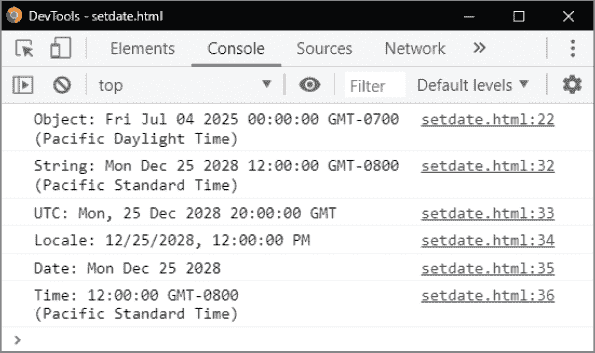


`Date` 对象还提供了方法来获取每个日期和时间组件的 UTC 等值——例如方法 `getUTCHours()` 和 `getUTCMinutes()`。

## 设置日期 (Set Dates)

JavaScript 的 `Date()` 构造函数可以可选指定七个参数来设置每个组件的值：

```javascript
new Date(year, month, date, hours, minutes, seconds, milliseconds)
```


当只指定年份和月份时，日期组件被设置为 1，所有时间组件被设置为 0。`Date` 对象提供了独立的方法来指定每个日期和时间组件的值：

| 方法 | 设置内容 |
| :--- | :--- |
| `setDate()` | 日期数字 (1-31) |
| `setFullYear()` | 四位年份 (yyyy) |
| `setMonth()` | 月份数字 (0-11) |
| `setHours()` | 小时数字 (0-23) |
| `setMinutes()` | 分钟数字 (0-59) |
| `setSeconds()` | 秒数字 (0-59) |
| `setMilliseconds()` | 毫秒数字 (0-999) |

`setMonth()` 方法在数值范围内设置月份，其中 0=一月-11=十二月，此外，`setFullYear()` 方法也可以使用此语法设置月份和日期：

```javascript
date.setFullYear(year, monthNumber, dayNumber)
```

通过显示整个 Date 对象可以显示每个组件的值。此外，所有 Date 对象都具有方法来输出显示日期和时间的各种字符串：

- `toString()` 将日期转换为字符串值
- `toUTCString()` 将日期转换为其 UTC 等值
- `toLocaleString()` 使用计算机的本地化习惯显示日期
- `toDateString()` 和 `toTimeString()` 可以显示日期和时间组件


### 示例：修改特定日期

创建一个 HTML 文档，包含一个自执行函数，该函数从创建一个 7 月 4 日的 `Date` 对象开始：

```javascript
const holiday = new Date(2025, 6, 4)
console.log('Object: ' + holiday)
```


setdate.html

接下来，添加语句修改单个日期组件，使其成为中午的圣诞节：

```javascript
holiday.setFullYear(2028)
holiday.setMonth(11)
holiday.setDate(25)
holiday.setHours(12)
holiday.setMinutes(0)
holiday.setSeconds(0)
holiday.setMilliseconds(0)
```


现在，添加语句输出修改后的日期和时间及其对应的 UTC (GMT) 时间：

```javascript
console.log('String: ' + holiday.toString())
console.log('UTC: ' + holiday.toUTCString())
```


然后，添加语句以本地化字符串、日期字符串和时间字符串格式输出修改后的日期和时间：

```javascript
console.log('Locale: ' + holiday.toLocaleString())
console.log('Date: ' + holiday.toDateString())
console.log('Time: ' + holiday.toTimeString())
```


`Date` 对象还有一个 `setTime()` 方法，它接受自纪元以来的毫秒数作为参数——每天有 86,400,000 毫秒，因此 `setTime(86400000)` 将日期设置为 1970 年 1 月 1 日。

## 匹配模式 (Match Patterns)

`RegExp` 对象是 JavaScript 的内置对象，可以包含“正则表达式”。


正则表达式模式可能完全由字面字符组成。例如，`/wind/` 匹配 "windows"。

| 元字符 | 匹配内容 | 示例 |
| :--- | :--- | :--- |
| `.` | 任意字符 | `..` |
| `^` | 起始字符 | `^ja` |
| `$` | 结尾字符 | `ja$` |
| `*` | 零或多次重复 | `ja*` |
| `+` | 一或多次重复 | `ja+` |
| `?` | 零或一次重复 | `ja?` |
| `{ }` | 多次重复 | `ja{3 }` |
| `[ ]` | 字符类 | `[a-z]` |
| `\` | 任意数字 | `\d` |
| `\|` | 或或可选字符 | `a\|b` |
| `( )` | 表达式分组 | `( )` |

模式还可以在最后一个 `/` 之后包含 `i` 修饰符以执行不区分大小写的搜索，或者包含 `g` 修饰符以对所有匹配执行全局搜索。


`RegExp` 对象有一个 `test()` 方法，找到匹配时返回 true，返回 false。`RegExp` 对象还有一个 `exec()` 方法，在未找到匹配时返回 `null` 值，在搜索成功时返回找到的文本，其 `index` 属性包含匹配开始的字符位置。

### 示例：正则表达式测试

创建一个 HTML 文档，包含一个自执行函数，该函数从初始化变量开始：

```javascript
const system = 'Windows', suite = 'Office', pattern = /ice/i
```

```javascript
console.log('In ' + system + '? ' + pattern.test(system))
console.log('In ' + suite + '? ' + pattern.test(suite))
```


然后，添加语句来输出验证格式错误的电子邮件地址的尝试结果。

```javascript
let email = ‘mike@example’
```

```javascript
const format = /.+\@.+\..+/**
```

```javascript
console.log( email + ‘ Valid? ‘ + format.test( email ) )
```


这里使用的正则表达式仅测试了最基本的电子邮件格式要求。

最后，添加语句来纠正地址格式并输出验证结果。

```javascript
email += ‘.com’
```

```javascript
console.log( email + ‘ Valid? ‘ + format.test( email ) )
```

保存 HTML 文档，然后在浏览器中打开它并启动控制台查看正则表达式的匹配情况。

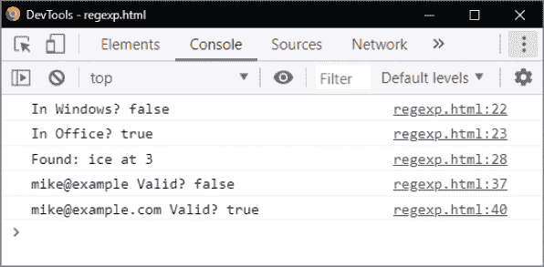


字符索引从零开始，所以第四个字符位于索引位置 3。

## 总结

- 值以逗号分隔的`名称:值`列表形式赋值给自定义对象，位于 `{ }` 大括号内。
- 对象属性可以使用点符号语法或通过在`[ ]` 方括号中加引号的名称来引用。
- 通过在对象方法名后附加 `( )` 括号来调用对象方法。
- `this` 关键字可以在对象方法定义中使用，指向拥有该方法的对象。
- 可以通过使用点符号语法引用属性并赋值新值来扩展自定义对象。
- 可以使用 `for in` 循环列出对象的所有属性名和方法名。
- 所有 JavaScript 内置对象都从顶层的 `Object.prototype` 对象继承属性和方法。
- JavaScript 内置的 `Array` 对象将项目存储在单独的元素中，元素从零开始编号。
- 值可以以`[ ]` 方括号内的逗号分隔列表形式赋值给数组。
- 通过在对象名后将索引数字封装在 `[ ]` 方括号中来引用数组元素中的值。
- 每个 `Array` 对象都有一个 `length` 属性和可以操作数组中元素的方法。
- JavaScript 内置的 `Date` 对象提供了单独的方法来提取每个日期和时间分量。
- JavaScript `Date()` 构造函数可以可选指定二到七个参数，为每个分量设置值。
- `Date` 对象还提供了单独的方法分别设置每个日期和时间分量的值。
- JavaScript 内置的 `RegExp` 对象可以包含一个描述字符字符串的正则表达式模式。
- `RegExp` 对象拥有 `test()` 和 `exec()` 方法，用于在指定的字符串参数中搜索与其模式匹配的内容。

## 5 控制数字与字符串

**本章描述并演示了 JavaScript 内置 `Math` 和 `String` 对象的方法。**

- 计算面积
- 比较数字
- 小数舍舍入
- 生成随机数
- 合并字符串
- 分割字符串
- 查找字符
- 修剪字符串
- 总结

## 计算面积

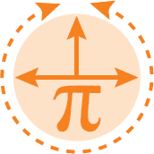

JavaScript 有一个内置的 `Math` 对象，提供了许多实用的方法和数学常量。常量列在下表中，以及它们的近似值：

| 常量 | 描述 |
| :--- | :--- |
| `Math.E` | 常数 E，自然对数的底，近似值为 2.71828 |
| `Math.LN2` | 2 的自然对数，近似值为 0.69315 |
| `Math.LN10` | 10 的自然对数，近似值为 2.30259 |
| `Math.LOG2E` | 常数 E 的以 2 为底的数，近似值为 1.44269 |
| `Math.LOG10E` | 常数 E 的以十数为底的数，近似值为 0.43429 |
| `Math.PI` | 常数 PI，近似值为 3.14159 |
| `Math.SQRT1_2` | 0.5 的平方根，近似值为 0.70711 |
| `Math.SQRT2` | 2 的平方根，近似值为 1.41421 |

不需要创建 `Math` 对象的实例，因为它默认全局可用，因此在脚本的任何地方都可以通过 `Math` 对象和点符号语法访问 `Math` 常量和方法。

`Math` 常量主要用于具有特定数学目的的脚本，但为了完整，上面列出了所有 `Math` 常量。


所有的 `Math` 方法可以在这里查看。

创建一个自执行函数的 HTML 文档，该函数从初始化变量开始。

```javascript
let radius = 4
```

```javascript
console.log( ‘\nRadius of Circle: ‘ + radius )
```


constants.html

接下来，添加语句执行数学计算并在输出中显示结果。

```javascript
let area = Math.PI * ( radius * radius )
```

```javascript
console.log( ‘\nArea of Circle: ‘ + area )
```

现在，添加语句执行另一个数学计算并在输出中显示结果。

```javascript
let circumference = 2 * ( Math.PI * radius )
```

```javascript
console.log( ‘\nPerimeter of Circle: ‘ + circumference )
```

然后，添加语句执行最后的数学计算并在输出中显示结果。

```javascript
let cube = ( radius * radius * radius )
```

```javascript
let volume = ( ( 4 / 3 ) * Math.PI ) * cube
```

```javascript
console.log( ‘\nVolume of Sphere: ‘ + volume )
```

保存 HTML 文档，然后在浏览器中打开它并启动控制台查看数学结果。

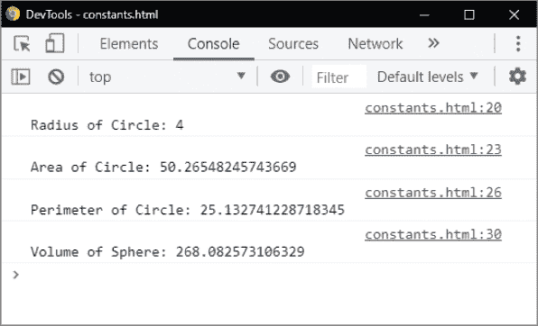


所有的 `Math` 常量名必须大写——例如，确保使用 `Math.PI` 而不是 `Math.pi`。

## 比较数字


内置的 `Math` 对象提供了这些有用的方法：

| 方法 | 返回 |
| :--- | :--- |
| `Math.abs()` | 绝对值 |
| `Math.acos()` | 弧余弦值 |
| `Math.asin()` | 弧正弦值 |
| `Math.atan()` | 弧正切值 |
| `Math.atan2()` | 来自 X 轴点的角度 |
| `Math.ceil()` | 向上取整的值 |
| `Math.cos()` | 余弦值 |
| `Math.exp()` | 常数 E 的指数 |
| `Math.floor()` | 向下取整的值 |
| `Math.log()` | 自然对数值 |
| `Math.max()` | 两个数字中较大的 |
| `Math.min()` | 两个数字中较小的 |
| `Math.pow()` | 幂值 |
| `Math.random()` | 伪随机数 |
| `Math.round()` | 最近的整数值 |
| `Math.sin()` | 正弦值 |
| `Math.sqrt()` | 平方根值 |
| `Math.tan()` | 正切值 |

创建一个自执行函数的 HTML 文档，该函数从初始化两个变量开始。

```javascript
let square = Math.pow( 5, 2 ) // 5 的 2 次方幂 ( 5 x 5 )
```

```javascript
let cube = Math.pow( 4, 3 ) // 4 的 3 次方幂 ( 4 x 4 x 4 )
```


math.html

接下来，添加语句在输出中显示这两个正变量值中的最大值最小值。

```javascript
console.log( ‘\nLargest Positive: ‘ + Math.max( square, cube ) )
```

```javascript
console.log( ‘\nSmallest Positive: ‘ + Math.min( square, cube ) )
```

现在，添加语句反转每个变量的数值极性——将正值变为负值。

```javascript
square *= -1
```

```javascript
cube *= -1
```

然后，添加语句在输出中显示这两个负变量值中的最大值最小值。

```javascript
console.log( ‘\nLargest Negative: ‘ + Math.max( square, cube ) )
```

```javascript
console.log( ‘\nSmallest Negative: ‘ + Math.min( square, cube ) )
```


最大的负值是最接近零的那个。

## 小数舍入

JavaScript 内置的 `Math` 对象提供了三种方法将浮点数舍入为整数值。每个方法都接受浮点值作为参数并返回一个整数。`Math.ceil()` 方法向上舍入，`Math.floor()` 方法向下舍入，而 `Math.round()` 方法则四舍五入到最近的整数。


在处理浮点数时，识别出 IEEE（电气与电子工程师学会）定义的流行计算机浮点数数学标准与通常接受的数学准确性之间存在差异是非常重要的。这是因为某些十进制数字无法精确转换为二进制形式。例如，小数 `81.66` 无法精确转换为二进制——因此表达式 `81.66 * 15` 返回的是 `1224.8999999999999`，而不是数学上准确的数字 `1224.9`。

某些编程语言提供自动舍入功能来克服浮点数差异，但 JavaScript 没有，因此必须小心，特别是在处理货币值时，以避免数学错误结果。推荐的做法是先将浮点值乘以 `100`，然后进行算术运算，最后将结果除以 `100` 以返回相同的小数位。

可以使用类似的步骤将长浮点数转换为两位小数。在将值乘以 `100` 后，可以使用 `Math.round()` 方法对该值进行舍入，然后除以零返回两位小数。

乘、运算、除的步骤可以写为单独步骤，也可以使用括号在单个简洁的表达式中确定顺序。例如，将名为 `num` 的变量中的长浮点数可以写写：

```javascript
num = num * 100
num = Math.round( num )
num /= 100
```

或者写为：

```javascript
num = ( Math.round( num * 100 ) ) / 100
```


`Math.round()` 方法默认向上舍入——因此 `Math.round( 7.5 )` 返回 8 而不是 7，而 `Math.round( -7.5 )` 返回 -7 而不是 -8。

创建一个带有自执行函数的 HTML 文档，从初始化变量开始

```javascript
let bodyTemp = 98.6
```


round.html

接下来，添加语句显示与浮点值最接近的整数

```javascript
console.log( ‘Ceiling: ‘ + Math.ceil( bodyTemp ) )
console.log( ‘Floor: ‘ + Math.floor( bodyTemp ) )
console.log( ‘Round: ‘ + Math.round( bodyTemp ) )
```

现在，添加语句显示表达式的错误计算结果及其后的等值结果

```javascript
console.log( ‘\nImprecision: ‘ + ( 81.66 * 15 ) )
console.log( ‘Corrected: ‘ + ( ( 81.66 * 100 ) / 100 ) )
```

然后，添加语句显示长浮点值及其转换后的等值结果

```javascript
console.log( ‘\nFloat: ‘ + Math.PI )
console.log( ‘Commuted: ‘ + ( Math.round ( Math.PI * 100 ) / 100 ) )
```

保存 HTML 文档，然后在浏览器中打开它并启动控制台查看舍入后的数字

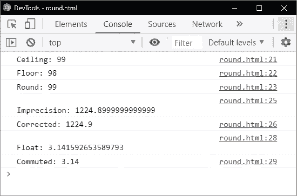

最内层括号中的表达式优先计算。

## 生成随机数

JavaScript 的 `Math.random()` 方法返回一个 `0.0` 到 `1.0` 之间的随机点数。它可以用于各种需要随机数的网页效果。乘以浮点值会增加其范围。例如，将其乘以 `10` 会将范围扩大到 `0.0-10.0`。


通常，使用 `Math.ceil()` 方法将随机值向上舍入是有用的，这样范围就变成了 `1-10`。指定随机数范围的过程可以写为单独步骤，也可以使用括号在单个表达式中确定顺序。例如，为名为 `rand` 的变量指定 `1-10` 的范围可以写为：

```javascript
let rand = Math.random()
rand *= 10
rand = Math.ceil( rand )
```

或者写为：

```javascript
let rand = Math.ceil( Math.random() * 10 )
```

在指定的范围内可以生成一系列唯一的随机数。例如，在 `1-59` 范围内产生随机彩票号码：

创建一个带有自执行函数的 HTML 文档，从声明变量开始

```javascript
let i, rand, temp, nums = []
let str = ‘\nYour Lucky Numbers: ‘
```


random.html

接下来，添加一个循环将数组元素 `1-59` 填充为相应的索引号

```javascript
for( i = 1 ; i < 60 ; i ) { nums[ i ] = i }
```

现在，添加循环使数组元素中的数字随机化

```javascript
for( i = 1 ; i < 60 ; i ) {
  rand = Math.ceil( Math.random() * 59 )
  temp = nums[ i ]
  nums[ i ] = nums[ rand ]
  nums[ rand ] = temp
}
```

步骤 3 包含一个洗牌算法，并确保没有两个元素包含相同的数字。

然后，添加循环将包含六个元素值的连字符列表追加到字符串变量

```javascript
for( i = 1 ; i < 7 ; i ) {
  str += nums[ i ]
  if( i !== 6 ) { str += ‘ - ‘ }
}
```

最后，添加语句输出字符串变量

```javascript
console.log( str )
```

保存 HTML 文档，然后在浏览器中打开它并启动控制台，每次执行脚本都会看到指定范围内唯一的随机数选择。

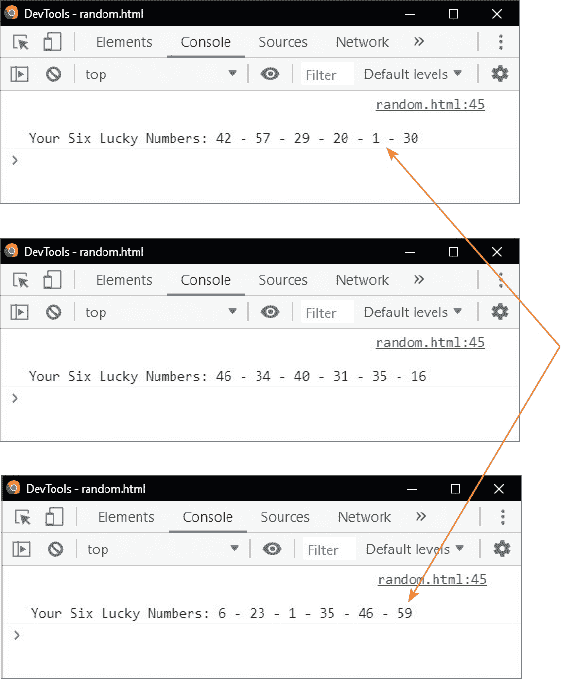

这里，随机数在 `1` 到 `59` 范围内——用于玩英国乐透或美国纽约乐透。


## 并字符串

JavaScript 有一个 `String` 对象，提供了操作字符串值的有用方法。然而，没有需要使用 `new` 关键字和 `String()` 构造函数创建 `String` 对象的实例，因为其方法可以直接使用点表示法应用于字符串变量。例如，`str.toUpperCase()` 返回名为 `str` 的字符串变量中所有字符的大写形式，而 `str.toLowerCase()` 则返回其所有字符的小写形式。


还有一个 `length` 属性，用于存储字符串中的字符总数。

之前列出的许多示例使用 `+` 拼接运算符来合并多个字符串，但也可以使用字符串 `concat()` 方法以逗号分隔的参数列表的形式追加一个或多个字符串。

某些脚本作者使用内置函数 `eval()` 来合并字符串和变量——但绝对应该避免这样做。`eval()` 函数直接调用 JavaScript 编译器将其字符串参数编译为 JavaScript 语句：

- 如果字符串表示一个表达式，`eval()` 将计算该表达式——例如 `eval('1 + 1')` 返回 `2`。
- 如果字符串表示一个语句或一系列语句，`eval()` 将计算最后一个语句——例如代码 `eval('let num = 100 ; alert( num )')` 会产生一个警告对话框。

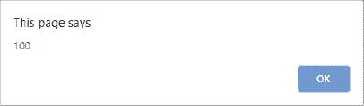

这种 `eval()` 的用法会在脚本性能上产生巨大代价，并且在几乎所有情况下都是必要的，因为通常有更高效、更优雅的解决方案。此外，如果脚本允许用户输入作为 JavaScript 指令进行评估，`eval()` 函数可能会产生影响。这提供了执行恶意代码的机会。例如，代码 `eval('while( true) ; alert( )')` 将产生导致浏览器锁死的无限循环。


避免使用 `eval()` 函数，因为“eval 是邪恶的”。


创建一个 HTML 文档，包含一个自执行函数，并开始声明三个变量

```javascriptlet topic = ‘JavaScript’
let series = ‘in easy steps’
let title = ‘‘
```


string.html


接下来，添加语句显示前两个字符串变量值转换大小写后的版本

```javascript
console.log( topic + ‘ > ‘ + topic.toLowerCase( ) )
console.log( series + ‘ > ‘ + series.toUpperCase( ) )
```


现在，添加语句将空格和第二个字符串附加到第一个字符串，然后将其赋值给第三个变量并输出拼接后的字符串

```javascript
title = topic.concat( ‘ ‘, series )
console.log( ‘Title: ‘ + title )
```


然后，添加语句在输出中显示每个字符串的长度

```javascript
console.log( ‘\n’ + topic + ‘ - Length: ‘ + topic.length )
console.log( series + ‘ - Length: ‘ + series.length )
console.log( title + ‘ - Length: ‘ + title.length )
```


保存 HTML 文档，然后在浏览器中打开它并启动控制台查看字符串输出

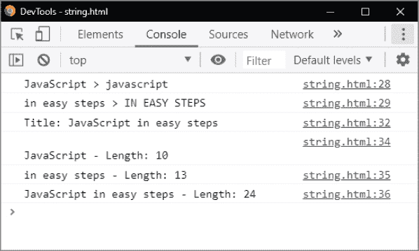

## 分割字符串

有几种字符串方法允许从完整字符串中复制指定的某个部分。这些方法将每个字符串视为数组，其中每个元素包含一个字符或一个空格，可以通过它们的索引位置引用。与数组一样，字符串索引是从零开始的，因此第一个字符位于位置零。


通过将其索引位置作为字符串的 `substring()` 方法的参数，可以指定开始复制“子字符串”的起点。这将复制该位置之后直到字符串末尾的所有字符。可选，可以为字符串的 `substring()` 方法提供第二个参数，以指定随后的索引位置作为子字符串的结束。这将复制起始和结束位置之间的所有字符。

字符串 `substr()` 方法提供了另一种复制子字符串的方法。与 `substring()` 方法类似，它可以接受一个参数来指定开始复制的索引位置，并将复制该位置之后直到字符串末尾的所有字符。与 `substring()` 方法不同，`substr()` 方法可以可选地提供第二个参数，以指定起始位置后要复制的字符数。

同样，可以使用字符串 `slice()` 方法来返回起始位置（由单个参数指定）之后的所有字符，或返回两个位置（由两个参数指定）之间的所有字符。

有时复制由特定字符分隔的字符串部分是非常有用的。可以将分隔符指定为字符串 `split()` 方法的参数，该方法将返回该字符出现处之间所有子字符串的数组。可选，`split()` 方法可以提供第二个参数来指定它应该返回的数组大小。在这种情况下，将返回指定分隔符之间的每个子字符串，直到达到限制为止，字符串的其余部分将被忽略。

这些字符串方法都不会修改原始字符串，只是创建了原始字符串某个部分的副本。


`substr()` 方法一向比 `substring()` 方法更容易使用——因为你只需要计算起始位置和子字符串的长度，而不需要结束位置。


`split()` 方法用于在示例此处 中分离 cookie 数据。


创建一个 HTML 文档，包含一个自执行函数，并开始初始化一个变量

```javascript
let definition = ‘JavaScript is the original dialect of \ the ECMAScript standard language.’
```


反斜杠字符允许你在下一行继续字符串


split.html


接下来，添加语句将选定的字符串切片赋值给第二个变量，然后输出其值

```javascript
let str = definition.slice( 0, 27 )
str += definition.slice( 62, 70 )
console.log( str )
```


现在，添加语句输出切片的四个独立单词

```javascript
console.log( str.split( ‘ ‘, 4 )
```


然后，添加语句将原始字符串的选定子字符串赋值给第二个变量，然后输出其值

```javascript
str = definition.substring( 42, 52 )
str += definition.substring( 10, 17 )
str += definition.substr( 52, 70 )
console.log( str )
```


保存 HTML 文档，然后在浏览器中打开它并启动控制台查看分割后的字符串输出

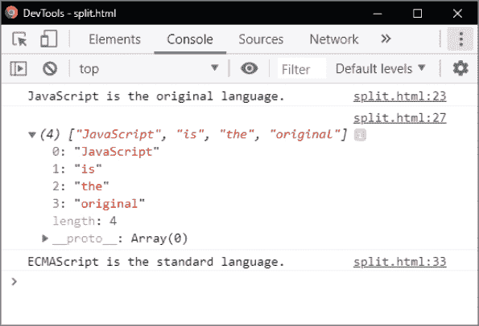


将 `''`（不带空格的空字符串）指定 `split()` 函数的分隔符以返回字符数组。

## 查找字符

JavaScript `String` 对象提供了许多方法，允许在字符串中搜索特定字符或子字符串。`search()` 方法接受子字符串作为参数，并返回它在搜索字符串中出现的位置，如果未找到则返回 -1。或者，可以将子字符串指定为 `match()` 方法的参数，如果它存在则返回该子字符串，如果不存在则返回 JavaScript 的 `null` 值。


`indexOf()` 方法接受子字符串作为参数，并返回首次出现的索引。`lastIndexOf()` 工作原理相同，但它从字符串末尾向后搜索，报告最后一次出现。

要发现字符串中特定索引位置的字符，可以将其索引值作为 `charAt()` 方法的参数，或者通过将其索引指定给 `charCodeAt()` 方法来揭示其数值 Unicode 值。相反，可以将一个或多个 Unicode 值作为 `String.fromCharCode()` 方法的参数，以返回它们的字符值。

此外，可以通过将字符或子字符串的值指定为 `replace()` 方法的第一个参数，并将替换值指定为第二个参数来替换所有出现的位置。


创建一个 HTML 文档，包含一个自执行函数，并开始用字符串值初始化一个变量

```javascript
let str = ‘JavaScript in easy steps’
```


find.html


接下来，添加语句输出两个区分敏感字符串搜索的结果

```javascript
console.log( ‘”Script” Search: ‘ + str.search( ‘Script’ ) )
console.log( ‘”script” Search: ‘ + str.search( ‘script’ ) )
```


现在，添加语句输出两个区分敏感字符串匹配的结果

```javascript
console.log( ‘\n”Script” Match: ‘ + str.match( ‘Script’ ) )
console.log( ‘”script” Match: ‘ + str.match( ‘script’ ) )
```


`null` 关键字不等同于零值，因为 `null` 没有任何值。


使用双引号在单引号围绕的字符串中包含引号。


添加语句，如果在字符串内找到字符，则输出该字符的和最后一个索引位置

```javascript
console.log( ‘\nindexOf “s”: ‘ + str.indexOf( ‘s’ ) )
console.log( ‘indexOf “m”: ‘ + str.indexOf( ‘m’ ) )
console.log( ‘\nlastIndexOf “s”: ‘ + str.lastIndexOf( ‘s’ ) )
console.log( ‘lastIndexOf “m”: ‘ + str.lastIndexOf( ‘m’ ) )
```


然后，添加语句输出字符串中的第一个字符及其 Unicode 值，加上通过其 Unicode 值指定的四个字符。


```javascript
console.log( ‘\ncharAt 0: ‘ + str.charAt( 0 ) )
```

```javascript
console.log( ‘charCodeAt 0: ‘ + str.charCodeAt( 0 ) )
```

```javascript
console.log( ‘fromCharCode: ‘ +
String.fromCharCode( 74, 97, 118, 97 ) )
```

最后，添加语句来输出原始字符串及其修改后的版本。

```javascript
console.log( ‘\nOriginal: ‘ + str )
```

```javascript
console.log( ‘Replaced: ‘ + str.replace( ‘easy’, ‘simple’ ) )
```

保存 HTML 文档，然后在浏览器中打开它并启动控制台以查看输出结果。

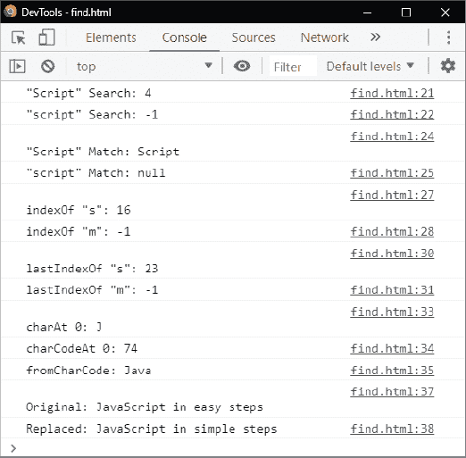


Unicode 大写字母 A-Z 的值为 65-90，小写字母 a-z 的值为 97-122。


`replace( )` 方法返回原始字符串的修改版本，但实际上不会改变原始字符串。

### 修剪字符串

JavaScript 的 `String` 对象提供了一个 `trim( )` 方法，可以移除字符串两端的空白字符。这对于确保用户输入不会意外包含空格、制表符或换行符特别有用。


从字符串中修剪空白后，你可以使用 `startsWith( )` 方法验证其开头字符，并使用 `endsWith( )` 方法验证其末尾字符。这些方法都接受字符或子字符串作为参数，并在字符串中进行区分大小的匹配。如果找到匹配，它们将返回 `true`；否则如果没有找到匹配，将返回 `false`。

可以通过在字符串变量名后的 `[ ]` 方括号中指定其索引位置来引用单个字符——例如使用 `str[ 0 ]` 来引用名为“str”的变量中的第一个字母。

你还可以通过指定字符或子字符串作为 `includes( )` 方法的参数，在字符串中进行区分大小的匹配。如果找到匹配，将返回 `true`；否则如果没有找到匹配，将返回 `false`。

如果你希望构建一个包含现有字符串多个副本的新字符串，只需为 `repeat( )` 方法指定一个整数参数，以确定现有字符串在新创建的字符串中重复的次数。

创建一个 HTML 文档，其中包含自执行函数，该函数首先初始化一个变量——其值为一个两端带有空白字符的字符串。

```javascript
let str = ‘ Love For All, Hatred For None.  ;’
```


trim.html

接下来，添加语句输出字符串并测试它的开头和结尾。

```javascript
console.log( ‘String: ‘ + str )
```

```javascript
console.log( ‘Starts With “L” ? ‘ + str.startsWith( ‘L’ ) )
```

```javascript
console.log( ‘Ends With “.” ? ‘+str.endsWith( ‘.’ ) )
```

```javascript
console.log( ‘First Letter: ‘ + str[ 0 ] )
```

现在，添加一条语句将修剪后的字符串赋值给变量。

```javascript
str = str.trim( )
```


`split( )` 方法用于移除示例此处中 cookie 数据中的空白字符。

然后，添加语句输出修剪后的字符串并像之前一样测试它的开头和结尾。

```javascript
console.log( ‘Trimmed: ‘ + str )
```

```javascript
console.log( ‘Starts With “L” ? ‘ + str.startsWith( ‘L’ ) )
```

```javascript
console.log( ‘Ends With “.” ? ‘+str.endsWith( ‘.’ ) )
```

```javascript
console.log( ‘First Letter: ‘ + str[ 0 ] )
```

添加语句以查看字符串中的子字符串。

```javascript
console.log( ‘\nIncludes “Hat” ?+ str.includes( ‘Hat’ ) )
```

```javascript
console.log( ‘Includes “hat” ?+ str.includes( ‘hat’ ) )
```

最后，添加一条语句输出 10 份修剪后的字符串。

```javascript
console.log( ‘\nRepeat:\n’ + str.repeat( 10 ) )
```

保存 HTML 文档，然后在浏览器中打开它并启动控制台以查看输出结果。

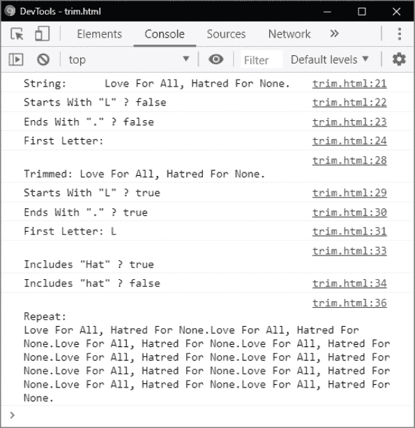


字符匹配也可以使用等等运算符进行，例如 `str[ 0 ] === ‘L’`。


使用这些方法匹配是区分大小的。

## 总结

- `Math` 对象提供了数学常量（如 `Math.PI`）和数学方法（如 `Math.max( )`）。
- 浮点数可以使用 `Math.floor( )`、`Math.ceil( )` 和 `Math.round( )` 方法舍入到最接近的整数。
- JavaScript 不提供自动舍入来解决浮点数差异。
- 将浮点值乘以 100，执行运算，然后将结果除以 100 以避免差异误差。
- `Math.random( )` 方法返回一个 0.0 到 1.0 之间的随机浮点数。
- 将随机浮点数乘以 10 并使用 `Math.ceil( )` 对结果舍入，范围变为 1-10。
- `String` 对象提供了处理字符串值的有用方法，如 `toUpperCase( )` 和 `toLowerCase( )`。
- 每个字符串都有一个 `length` 属性，包含一个表示该字符串字符总数的整数。
- 可以使用 `+` 拼接运算符或字符串 `concat( )` 方法将字符串连接在一起。
- `eval( )` 内置函数可能会产生安全影响，因此最好避免。
- `slice( )` 和 `substring( )` 方法的参数指定起始和结束位置，但 `substr( )` 方法的参数指定起始位置和要复制的字符数。
- `split( )` 方法返回位于指定字符出现位置之间的所有子字符串的数组。
- `search( )`、`match( )`、`indexOf( )`、`lastIndexOf( )` 和 `charAt( )` 方法可用于在字符串内查找字符。
- `trim( )` 方法移除字符串两端的空白字符。
- `startsWith( )`、`endsWith( )` 和 `includes( )` 方法在字符串内进行区分大小的匹配。
- `replace( )` 和 `repeat( )` 方法创建后的字符串。

## 6 处理 Window 对象

*本章描述并演示了顶层 Window 对象环境的方法。*

- 认识 DOM
- 检查属性
- 显示对话框
- 滚动查看
- 弹出窗口
- 制作计时器
- 检查浏览器
- 检查状态
- 控制位置
- 浏览历史
- 总结

### 认识 DOM


浏览器在一个称为“文档模型”（DOM）的层次树中表示网页的所有组件。每个组件都在顶层窗口对象下方，树包含如下分支：

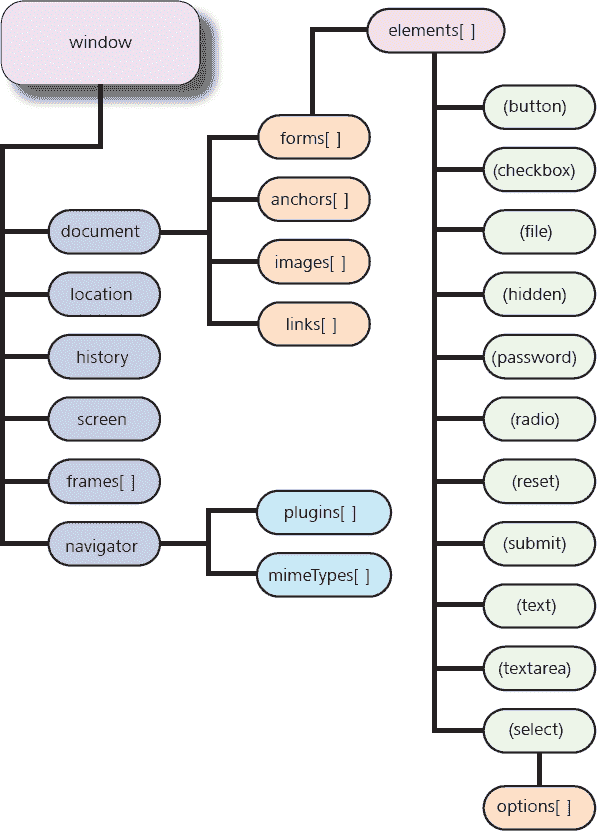

可以使用 `for in` 循环列出浏览器提供的窗口对象属性。列表将包含所有现代浏览器的基础属性，以及特定浏览器的少量属性。


跟随方括号的项目是数组对象，而圆括号内的是各种表单元素。

创建一个带有空列表元素的 HTML 文档。

```html
<ol id="props" style="column-count:3"></ol>
```


dom.html

接下来，在 `script` 元素中创建一个自执行函数，该函数首先初始化两个变量。

```javascript
const list = document.getElementById( ‘props’ )
let property = null
```

现在，添加一个循环，为列表元素填充浏览器窗口对象的直接属性。

```javascript
for( property in window )
{
  if( property ) { list.innerHTML += ‘<li>’ + property }
}
```

保存 HTML 文档，然后在浏览器中打开它以查看窗口属性和方法名。


闭合 `</li>` 标签是可选的，因此在此循环中省略了。


滚动列表以检查所有的 `window` 属性和方法——这次总共有 204 个项目。对面树状插图中重要的属性在截图中已高亮显示。

### 检查属性

顶层 DOM `window` 对象有一个 `screen` 子对象，该对象提供了描述用户显示器分辨率（以像素为单位）的属性。屏幕尺寸可以在 `window.screen.width` 和 `window.screen.height` 属性中找到。


同样，可用的屏幕尺寸（排除桌面任务栏占据的空间）可以在 `window.screen.availWidth` 和 `window.screen.availHeight` 属性中找到。

屏幕的色彩能力可以通过 `window.screen.colorDepth` 属性发现，该属性包含一个位值，描述屏幕可以显示的可能颜色范围：

- **8-bit** – 低色（Low Color），只能显示 256 种颜色。
- **16-bit** – 高色（High Color），可以显示 65,536 种颜色。
- **24-bit** – 真色（True Color），可以显示数百万种颜色。
- **32-bit** – 深色（Deep Color），可以显示包含十亿或更多颜色的色域。

现代计算机使用 24 位或 32 位硬件进行色彩显示，而旧的计算机使用 16 位硬件。只有非常旧的计算机和旧手机使用 8 位硬件进行色彩显示。

还有一个 `window.screen.pixelDepth` 属性包含屏幕的像素深度，但在现代计算机上，这个值与 `window.screen.colorDepth` 属性的值相同——始终使用 `window.screen.colorDepth` 来发现色彩能力。

某些浏览器现在支持 `window.screen.orientation` 对象，它有一个 `type` 属性，描述屏幕当前的方向为横屏或竖屏，以及这是否为屏幕的主次常用方向。

由于 `window` 对象是浏览器脚本环境中的顶层全局对象，在引用其子对象及其属性时可以可选省略它的名称。例如，你可以直接写 `screen.colorDepth` 来引用 `window.screen.colorDepth` 属性。


注意这些属性名的“驼峰命名法”（camelCase）大小写。

创建一个空段落的 HTML 文档

```html
<p id="props" style="font:1.5em sans-serif"></p>
```


screen.html

接下来，在 script 元素中创建一个自执行函数，该函数开始初始化六个变量

```javascript
const info = document.getElementById( ‘props’ )
let width = window.screen.width + ‘px’
let height = window.screen.height + ‘px’
let availW = window.screen.availWidth + ‘px’
let availH = window.screen.availHeight + ‘px’
let colors = ‘Unknown’
```

现在，添加一条语句描述色彩能力

```javascript
switch( window.screen.colorDepth )
{
  case 8 : colors = ‘Low Color’ ; break
  case 16 : colors = ‘High Color’ ; break
  case 24 : colors = ‘True Color’ ; break
  case 32 : colors = ‘Deep Color’ ; break
}
```

然后，添加语句显示屏幕信息

```javascript
info.innerHTML = ‘Screen Resolution: ‘ +
width + ‘ x ‘ + height + ‘<br>’
info.innerHTML += ‘Available Screen Size: ‘ +
availW + ‘ x ‘ + availH + ‘<br>’
info.innerHTML += ‘Color Capability: ‘ + colors + ‘<br>’
if( window.screen.orientation )
{
  info.innerHTML += ‘Orientation: ‘ +
  window.screen.orientation.type
}
```

保存 HTML 文档，然后在浏览器中打开它以查看屏幕信息


这里的可用高度比屏幕高度少 40 像素，因为桌面任务栏高度为 40 像素。


`colorDepth` 属性可以用于为色彩能力有限的浏览器在文档提供低分辨率图像。

### 显示对话框

顶层 DOM `window` 对象提供了三种方法，JavaScript 可以这些方法向用户显示对话消息。可以将简单的警告消息字符串作为 `window.alert()` 方法的参数。它将显示在一个只有一个“确定”按钮的对话框中，点击该按钮仅会关闭对话框。


更有用的是，可以指定消息作为 `window.confirm()` 方法的参数，请求用户做出决定。它将显示在一个带有“确定”按钮和“取消”按钮的对话框中。按下任何一个按钮都会关闭对话框，但“确定”按钮返回 `true` 值，而“取消”按钮返回 `false` 值。

还可以指定消息作为 `window.prompt()` 方法的参数，请求用户输入。它将显示在一个带有“确定”按钮、“取消”按钮和一个文本输入字段的对话框中。按下任何一个按钮都会关闭对话框，但“确定”按钮返回文本字段中的值，而“取消”按钮返回 `null` 值。还可以为 `window.prompt()` 方法提供第二个参数来指定文本字段的默认内容。

创建一个空段落的 HTML 文档

```html
<p id="response" style="font:1.5em sans-serif"></p>
```


dialogs.html

接下来，在 script 元素中创建一个自执行函数，该函数开始初始化一个变量引用

```javascript
const info = document.getElementById( ‘response’ )
```

现在，添加一条语句在简单的对话框上显示消息

```javascript
window.alert( ‘Hello from JavaScript’ )
```

然后，添加一条语句用户用户决定并将响应写入段落中

```javascript
info.innerHTML = ‘Confirm: ‘ + window.confirm( ‘Go or Stop?’ )
```

接下来，添加一条语句请求用户输入文本并将文本响应写入段落中

```javascript
info.innerHTML += ‘<br>Prompt: ‘ + window.prompt( ‘Yes or No?’, ‘Yes’ )
```

保存 HTML 文档，然后在浏览器中打开它以查看消息出现在简单的对话框上


点击每个对话框上的“确定”按钮以依次关闭它们，然后查看响应出现在段落中


`confirm` 对话框结合 `if` 语句用于脚本分支——例如，

```javascript
if( confirm( ‘OK?’ ) ) { ... } else { ... }
```


如果脚本要使用来自 `prompt` 对话框的文本输入，良好的做法是去除字符串两端的空格——参见此处。

### 滚动查看

DOM `window` 对象有一个 `scrollBy()` 方法，允许窗口在内容向任一方向溢出时进行水平或垂直滚动。该方法需要两个参数来指定沿 X 轴和 Y 轴移动的像素数。


当内容垂直溢出窗口时，浏览器窗口的右侧会出现一个滚动条。`scrollBy()` 方法将按照其第一个参数指定的像素数进行滚动——直到到达内容的末端。

同样，当内容水平溢出窗口时，浏览器窗口的底部会出现一个滚动条。`scrollBy()` 方法将按照其第二个参数指定的像素数进行滚动——直到到达内容的末端。


还有一个 `scrollTo()` 方法，它接受两个参数，用于指定 X 和 Y 坐标，当内容在水平或垂直方向溢出窗口时，窗口左上角应滚动到的这些坐标。这可以用于偏离默认的 `X=0`, `Y=0` 坐标，到指定的替代位置。例如，当浏览器以表格电子表格格式显示数据，且第一行的第一个单元格位于浏览器窗口的左上角时，`scrollTo()` 方法可以将特定的单元格放在浏览器窗口的左上角。

DOM 窗口对象有一个 `scrollX` 属性，存储窗口水平滚动的像素数。这表示“滑块”（滚动框）在窗口底部滚动条上的位置，相对于其左角的距离。`window.scrollX` 属性是旧属性 `window.pageXOffset` 的别名，该属性在 DOM 中仍然存在，并且为了向后兼容可以代替 `window.scrollX` 使用。

同样，还有一个 `scrollY` 属性，它存储窗口垂直滚动的像素数。这表示滑块在窗口右侧滚动条上的位置，相对于其顶角的距离。`window.scrollY` 属性是旧属性 `window.pageYOffset` 的别名，该属性在 DOM 中仍然存在，并且为了向后兼容可以代替 `window.scrollY` 使用。


为 `scrollBy()` 方法提供负值可以向上和向左移动。


`scrollby()` 方法的效果在内容溢出窗口（导致滚动条出现）时才会明显。

创建一个 HTML 文档，其中包含一个从左侧缩进的空段落

```html
<p id=”info" style="width:2000px; margin-left:300px; font:1.2em sans-serif"></p>
```


scroll.html

接下来，在 script 元素中创建一个自执行函数，该函数开始初始化两个变量

```javascript
const info = document.getElementById( ‘info’ )
let i = 0
```

现在，添加一个循环向段落中写入一列 40 个数字

```javascript
for( i = 1 ; i < 41 ; i++ )
{
    info.innerHTML += ( i + ‘<br>’ )
}
```

然后，添加一条语句窗口水平向右滚动 200 像素，并垂直向下滚动段落元素的高度

```javascript
window.scrollBy( 200, info.clientHeight )
```


注意这里使用了元素的 `clientHeight` 属性。元素还有一个非常有用的 `clientWidth` 属性。

最后，添加一条语句来追加当前窗口滑块位置的确认

```javascript
info.innerHTML += ‘scrollX: ‘ + window.scrollX + ‘& scrollY: ‘ + window.scrollY
```

保存该 HTML 文档，然后在浏览器中打开它以查看窗口滚动和滑块位置


## 弹出窗口


可以使用窗口对象的 `open()` 方法打开新的浏览器窗口。这需要三个参数：指定在新窗口中加载的 HTML 文档的 URL 地址、新窗口的名称，以及该窗口应包含的逗号分隔特性列表——来自下表描述的可能特性：

| 特性 | 说明 |
| :--- | :--- |
| directories | 添加链接栏 |
| height | 设置文档区域的高度（像素） |
| left | 窗口的屏幕 X 坐标 |
| location | 添加地址栏 |
| menubar | 添加标准菜单栏 |
| resizable | 允许调整窗口大小 |
| scrollbars | 需要时启用滚动条 |
| status | 添加状态栏 |
| toolbar | 添加前进和后退按钮栏 |
| top | 窗口的屏幕 Y 坐标 |
| width | 设置文档区域的宽度（像素） |

当成功时，`window.open()` 方法返回一个新窗口对象并打开新的“弹出”窗口；如果失败，该方法简单返回 null。返回的结果应赋值给一个变量，随后对其进行测试——如果变量不为 null，则它必须代表弹出窗口对象。然后可以通过调用 `close()` 方法关闭该窗口，或通过调用 `print()` 方法打印其内容。

还可以通过指定 X 和 Y 屏幕轴坐标作为窗口 `moveTo()` 方法的参数来定位窗口。还有一个类似的 `window.moveBy()` 方法，它接受两个参数，指定窗口从当前屏幕位置沿 X 和 Y 轴移动多少像素。


由于弹出窗口烦人的泛滥，浏览器制造商添加了弹出拦截器——因此不再建议使用弹出窗口，但为了完整性，这里对其进行了演示。

创建一个包含标题的 HTML 文档

```html
<h1>Pop-up Window</h1>
```

popup.html

创建一个包含标题的第二个文档

```html
<h1>Main Window</h1>
```

opener.html

接下来，在第二个文档的 script 元素中添加

```javascript
const popWin = window.open( ‘popup.html’, ‘Popup’, ‘top=150,left=100,width=350,height=100’ )
```

保存两个 HTML 文档，然后在浏览器中打开它们以查看弹出已被拦截


打开浏览器的弹出拦截器对话框并选择允许来自此页面的弹出


现在，刷新浏览器窗口查看弹出窗口出现


在特性列表中不要包含任何空格，否则可能导致 `window.open()` 方法失败。


注意弹出窗口没有在其标题栏上显示指定的“网站图标”。

## 创建计时器

JavaScript 窗口对象有一个有趣的 `setTimeout()` 方法，它可以在指定时间后重复评估一个表达式。在指定的表达式调用 `setTimeout()` 语句的地方，会创建一个递归循环——其中函数会在指定时间后被重复执行。


`setTimeout()` 方法要评估的表达式必须作为其第一个参数指定，而时间必须作为第二个参数指定的数字。时间以毫秒表示，其中 1000 代表一秒。

`setTimeout()` 方法返回一个数值，该数值可以赋值给变量以唯一标识等待过程。此值可以作为窗口对象 `clearTimeout()` 方法的参数，以便在某处终止计时循环。

窗口对象还有 `setInterval()` 和 `clearInterval()` 方法，它们采用相同的参数且工作方式相似。区别在于，`setInterval()` 指定的时间是评估表达式的间隔时间，无论执行需要多长时间。相反，`setTimeout()` 方法指定的时间是从上一次执行结束到下一次执行开始的时间段。这意味着当间隔较短且执行表达式所需时间较长，`setInterval()` 可能会尝试重叠执行。因此，通常优选使用 `setTimeout()` 方法。

创建一个带有空段落的 HTML 文档

```html
<p id=”info"></p>
```


timer.html


接下来，在 script 元素中，使用一个返回递减整数的闭包函数初始化一个变量

```javascript
const count = ( function ( ) {
  let num = 10
  return ( function( ) { return num-- } )
} ) ( )
```


一个设置为间隔为 10 分钟的两分钟任务每 10 分钟启动一次，但一个设置为超时为 10 分钟的相同任务则每 12 分钟启动一次（10+2）。


关于闭包函数的复习，请参此处。

现在，添加一个计时器函数，该函数开始初始化三个变量

```javascript
function countDown( ) 
{
  const info = document.getElementById( ‘info’ )
  let timerId = null
  let num = count( )
  // 在此处插入语句。
}
```

插入语句以每秒一次的间隔将递减整数写入段落中，直到达到零

```javascript
if ( num > 0 )
{
  info.innerHTML += ‘<span>’+ num + ‘</span>’
  timerId = window.setTimeout( countDown , 1000 )
}
else
{
  info.innerHTML += ‘<span>Lift Off!</span>’
  window.clearTimeout( timerId )
}
```

在函数块之后，添加一条语句在页面加载时调用计时器函数

```javascript
countDown( )
```

保存 HTML 文档，然后在浏览器中打开它，以查看计时器倒计时 10 秒


你可以性地在计时器函数中添加 `console.log( timerId )` 语句，以查看计时器的 ID 值。

## 检查浏览器

在 DOM 层次结构中，顶层窗口对象有很多子对象，每个对象都有自己的属性和方法。其中之一是 `window.navigator` 对象，它包含了有关网络浏览器的信息。由于顶层窗口对象存在“全局命名空间”中，它的所有子对象都可以省略地址的该部分，因此可以使用 `alert(` 直接调用 `window.alert( )` 方法，可以使用 `onload` 引用 `window.onload` 属性，可以使用 `navigator` 引用 `window. navigator` 对象。


`navigator` 对象有一个 `appName` 属性包含浏览器名称，`appCodeName` 属性包含其代码，`appVersion` 属性包含其版本号。但你可能会对这些值感到惊讶，因为 Google Chrome、Firefox、Safari 和 Opera 都将它们的代码标记为“Mozilla”。

每个浏览器在向 Web 服务器发送请求时，会在名为“User-Agent”的 HTTP 请求头中发送浏览器代码和版本，此字符串也可以从 `navigator.userAgent` 属性中获取。还有一个 `navigator.platform` 属性用于描述浏览器的宿操作系统。

在过去几年中，人们非常关注浏览器检测脚本，这些脚本尝试通过 `navigator` 属性来识别浏览器，以便提供适用于该浏览器支持的功能的适当代码。这现在被认为是不良实践，现在建议使用特性检测。

例如，查询浏览器是否支持有用的 `addEventListener( )` 方法可以判断该浏览器是否支持现代的文档对象模型。

创建一个空列表的 HTML 文档

```html
<ul id=”list”></ul>
```


browser.html

接下来，在 script 元素中，创建一个自执行函数，该函数开始初始化变量引用

```javascript
const list = document.getElementById( ‘list’ )
```

现在，添加语句列出你浏览器的名称

```javascript
list.innerHTML = ‘<li>Browser: ‘ + navigator.appName
list.innerHTML += ‘<li>Code Name: ‘ +
navigator.appCodeName
```


之前的示例显式地使用了 `window` 前缀，以使 `window` 对象方法和属性的父关系明显，但在技术上最好省略 `window.` 前缀——这样它们就不会通过 `window` 对象自身的 `window` 属性被引用。例如，直接使用 `onload` 而不是 `window.onload`。

然后，添加语句列出你的浏览器和你操作系统的版本详情

```javascript
list.innerHTML += ‘<li>Version: ‘ + navigator.appVersion
list.innerHTML += ‘<li>Platform: ‘ + navigator.platform
```

最后，添加一条语句确认你使用的是现代浏览器

```javascript
if( window.addEventListener )
{
  list.innerHTML += ‘<li>This is a modern DOM browser’
}
```

保存 HTML 文档，然后在任何浏览器中打开它以查看名称和版本详情


在所有现代浏览器中，`window` 对象都有一个 `addEventListener( )` 方法——Google Chrome 和其他浏览器之所以自称为 Netscape，原因源于“浏览器大战”时代——当时浏览器必须采用这些名称以便提供网页。

## 检查状态

DOM 窗口对象有一个 `javaEnabled()` 方法，只有在启用了 Java 支持时它才会返回 true。


还有一个 `cookieEnabled` 属性，只有在启用了 cookie 支持时它为真。

此外，`navigator` 拥有 `plugins` 子对象和 `mimeTypes` 子对象。与其他数组一样，`plugins` 和 `mimeTypes` 数组都有一个 `length` 属性，包含其元素的数字总数。

每个 `plugin` 数组元素都有 `name` 和 `description` 属性，包含一个插件的详情。可以使用元素索引引用它们。例如，`navigator.plugins[0].name` 引用第一个元素的名称。

同样，每个 `mimeTypes` 数组元素都有 `type` 和 `description` 属性，包含一个支持的 MIME 特性的详情。可以使用元素索引引用它们。例如，`navigator.mimeTypes[0].type` 引用第一个元素的类型。

创建一个空段落的 HTML 文档

```html
<p id=”info”></p>
```


enabled.html

接下来，在 script 元素中，创建一个自执行函数，该函数开始初始化两个变量

```javascript
const info = document.getElementById( ‘info’ )
let status = ‘‘
```

现在，添加语句在启用了 Java 支持时在段落中写入确认

```javascript
status = ( navigator.javaEnabled( ) ) ? ‘Enabled’ : ‘Disabled’
info.innerHTML += ‘Java Support is ‘ + status + ‘<hr>’
```

然后，添加语句在启用了 cookie 支持时在段落中写入确认

```javascript
status = ( navigator.cookieEnabled ) ? ‘Enabled’ : ‘Disabled’
info.innerHTML += ‘Cookie Support is ‘ + status + ‘<hr>’
```


这些数组元素的内容根据每个浏览器支持的功能而异。

现在，添加语句写入 `plugins` 数组的长度和一个示例元素

```javascript
if ( navigator.plugins.length !== 0 )
{
  info.innerHTML += ‘No. of Plugins: ‘ +
  navigator.plugins.length
  info.innerHTML += ‘<br>Example: ‘ +
  navigator.plugins[ 0 ].name
  info.innerHTML += ‘<br>For: ‘ +
  navigator.plugins[ 0 ].description + ‘<hr>’
}
```


最后，添加语句来写入 MIME 类型数组的长度和一个示例元素

```javascript
if ( navigator.mimeTypes.length !== 0 )
{
  info.innerHTML += ‘No. of MIME Types: ‘ + navigator.mimeTypes.length
  info.innerHTML += `<br>Example: ‘ + navigator.mimeTypes[ 1 ].type
  info.innerHTML += `<br>For: ‘ + navigator.mimeTypes[ 1 ].description
}
```

保存 HTML 文档，然后在任何浏览器中打开它以查看已启用功能的状态


你可以使用循环来编写所有插件和 mimeTypes 元素的内容。

## 控制位置

窗口的 `location` 对象具有五个属性，包含了当前在浏览器窗口中加载的文档的完整 URL 地址的组件。描述协议、域名、文件名以及（如果适用）片段锚点的完整地址包含在 `location.href` 属性中。完整地址的各个组件包含在 `location.protocol`（`http:` 或 `https:`）、`location.host`（域名）、`location.pathname`（文件路径）和 `location.hash`（片段锚点）中。为 `location` 属性分配一个新 URL 将导致浏览器加载该地址的页面或其他资源。


创建一个包含超链接锚点段落的 HTML 文档

```html
<p id=”info”>
<a id=”frag”>片段锚点</a>
</p>
```


location.html

接下来，在 script 元素中，创建一个自执行函数，该函数从初始化两个变量开始

```javascript
const info = document.getElementById( ‘info’ )
let jump = confirm( ‘Jump to Fragment?’ )
```

现在，添加语句，如果用户同意了请求，则更改窗口的 location

```javascript
if ( jump )
{
  location = location.href + ‘#frag’
}
```

然后，添加语句在面板中写入当前位置地址的每个组件

```javascript
info.innerHTML += `<hr>Href: ‘ + location.href
info.innerHTML += `<br>Protocol: ‘ + location.protocol
info.innerHTML += `<br>Host:‘ + location.host
info.innerHTML += `<br>Path:‘ + location.pathname
info.innerHTML += `<br>Hash: ‘ + location.hash
```

保存 HTML 文档，然后在任何浏览器中打开它，以查看请求更改位置的确认对话框

点击取消按钮拒绝请求，并查看页面照常加载在其“根部”位置


网页浏览器可以加载任何支持的 MIME 类型的文件——例如，所有 PNG 文件的 MIME 类型为 `image/png`。


刷新浏览器，然后点击 OK 按钮接受请求，并查看页面加载在其片段位置


这里显示的 location 是位于本地系统 Web 服务器上的页面。如果页面位于你的桌面上，协议将是 `file:` 且没有 `host` 值。

## 历史记录

网页浏览器将当前会话中访问的 URL 历史存储在 `window` 对象的 `history` 子对象中的数组中。像其他数组一样，它有一个 `length` 属性，以及用于在元素之间移动的 `back()` 和 `forward()` 方法。或者，`history` 对象的 `go()` 方法接受一个正或负整数参数，指定沿数组移动多少个元素。例如，`history.go( 1 )` 向前移动一个元素，`history.go( -2 )` 向后移动两个元素。


创建三个相同的 HTML 文档，它们包含一个空段落并嵌入相同的外部脚本文件

```html
<p id=”info” > </p>
<script src=”history.js” > </script>
```


page-1.html

page-2.html

page-3.html

接下来，创建一个脚本文件，其中包含一个从初始化变量引开始自执行函数

```javascript
const info = document.getElementById( ‘info’ )
```


history.js

现在，在函数块中，添加语句将内容写入空段落中

```javascript
info.innerHTML += `<a href=”page-1.xhtml”>Page 1</a> | ‘
info.innerHTML += `<a href=”page-2.xhtml”>Page 2</a> | ‘
info.innerHTML += `<a href=”page-3.xhtml”>Page 3</a’
info.innerHTML += `<br>History Length: ‘ + history.length
info.innerHTML += `<br>Current Location: ‘ + location.pathname + ‘<br>’
```

然后，添加语句在段落中创建按钮

```javascript
info.innerHTML += `<button onclick=”history.back( )”>Back</button>’
info.innerHTML += `<button onclick=”history.forward( )”>Forward</button>’
```

将 HTML 文档和 JavaScript 脚本文件放在同一个文件夹中，然后清除浏览器历史


要在 Google Chrome 浏览器中清除历史记录，点击 按钮，然后选择**更多工具**、**清除浏览数据**，并点击**清除数据**按钮。

打开第一个页面查看初始历史长度为 1


点击链接加载第三页，查看历史长度增加到 2


点击后退按钮返回第一个页，查看历史长度保持为 2


URL 存储在 `history` 对象数组中并受保护，无法以字符串形式检索


在本示例中，只有当点击链接进入不同页面时，URL 才会添加到 history 数组。`back()`、`forward()` 和 `go()` 方法只是选择数组中的元素，不会更改 `length` 属性。

## 总结

- 文档对象模型 (DOM) 是网页组件的层级表示。
- `window` 对象是 DOM 的顶层，具有描述浏览器窗口的属性。
- `screen` 对象是 `window` 对象的子，具有描述屏幕尺寸和色彩深度属性。
- `window` 对象具有 `scrollBy()` 和 `scrollTo()` 方法，以及指定滚动位置的 `scrollX` 和 `scrollY` 属性。
- 使用 `window` 对象的 `alert()`、`confirm()` 和 `prompt()` 方法显示对话消息。
- 使用 `window` 对象的 `open()` 方法可以创建窗口，但可能会被弹出拦截。
- `window` 对象的 `setTimeout()` 方法创建一个定时器，稍可以使用 `clearTimeout()` 方法取消。
- `navigator` 对象是 `window` 对象的子，具有描述浏览器和主机平台版本的属性。
- `window` 对象存在于全局命名空间中，因此所有子对象不需要包含地址中的 window 部分。
- 功能检测用于识别现代 DOM。
- `navigator.plugins` 和 `navigator.mimeTypes` 属性是包含支持功能详情数组。
- `location` 对象是 `window` 对象的子，具有描述加载文档地址的属性。
- `history` 对象是 `window` 对象的子，包含当前会话中访问过的位置的数组。
- `history` 对象具有 `back()`、`forward()` 和 `go()` 方法，用于在当前会话中切换页面。


## 元素数组 (#chapter07.xhtml_sec64)

## 元素 (#chapter07.xhtml_sec65)

## 写入内容 (#chapter07.xhtml_sec66)

## 管理 Cookies (#chapter07.xhtml_sec67)

## 加载事件 (#chapter07.xhtml_sec68)

## 鼠标事件 (#chapter07.xhtml_sec69)

## 事件值 (#chapter07.xhtml_sec70)

## 复选框 (#chapter07.xhtml_sec71)

## 选择选项 (#chapter07.xhtml_sec72)

## 重置更改 (#chapter07.xhtml_sec73)

## 验证表单 (#chapter07.xhtml_sec74)

## 总结 (#chapter07.xhtml_sec75)

## 提取信息

DOM window 对象子元素中最有趣的是 document 对象，它提供了对 HTML 文档的访问。


document 对象有许多个描述文档及其位置的属性：

• `document.title` 属性包含 HTML 文档 title 元素中指定的值。

• HTML 文档的位置包含在 `document.URL` 属性中，与 `location.href` 属性中的值相似。

•托管文档的域名包含在 `document.domain` 属性中，类似于 `location.host` 值。

• HTML 文档会将其创建日期或最后修改日期作为 HTTP 请求头提供给浏览器，以便浏览器决定是使用文档的缓存还是获取新副本。此日期也可以在 JavaScript 中通过 DOM 的 `document.lastModified` 属性获取。

创建一个 HTML 文档，在其主体部分提供一个指向第二个（目标）HTML 文档的超链接。

```html
<p>
<a href="info-2.html">跳转到下一页</a>
</p>
```


info-1.html

接下来，创建目标 HTML 文档，它包含一个空的无序列表。

```html
<ul id="list"></ul
```


info-2.html

现在，在 script 元素中创建一个自执行函数，该函数初始化一个变量引用。

```javascript
const list = document.getElementById('list');
```

然后，添加语句来列出文档的特征。

```javascript
list.innerHTML = '<li>来源页: ' + document.referrer;
list.innerHTML += '<li>标题: ' + document.title;
list.innerHTML += '<li>URL: ' + document.URL;
list.innerHTML += '<li>域名: ' + document.domain;
list.innerHTML += '<li>最后修改: ' + document.lastModified;
```

将 HTML 文档保存在同一个文件夹中，然后在浏览器中打开包含链接的文档。


现在，点击超链接在浏览器中加载第二个 HTML 文档，并查看文档信息。


`document.lastModified` 中的日期仅与 HTML 文档本身有关，而与 HTML 文档可能导入的任何样式表或外部脚本文件无关。


这里显示的域名位于本地系统 Web 服务器上的页面。如果页面位于你的桌面上，`document.referrer` 和 `document.domain` 属性将不会赋予任何值。

## 元素数组

DOM document 对象拥有表单、图像、链接、样式表和脚本的子对象。这些子对象都是数组，其中每个数组元素按照它们在 HTML 文档中出现的顺序代表文档组件。例如，文档主体中的第一张图像（由 HTML `` 标签指定）由 `document.images[0]` 表示。这意味着可以使用 `document.images[0].src` 引用其 URL，这会显示分配给 HTML `` 标签 `src` 属性的路径。在脚本中为此组件分配新 URL 将动态替换旧图像。


`links` 数组代表 HTML 文档中的 HTML `<a>` 标签；`styleSheets` 数组代表 HTML `<style>` 标签；`scripts` 数组代表 HTML `<script>` 标签。

`forms` 数组代表 HTML `<form>` 标签，但它也有自己的子元素对象，它是所有表单组件的数组。例如，HTML 文档中第一个表单的第一个组件的值可以使用 `document.forms[0].elements[0].value` 引用。在脚本中为此组件分配新值将动态替换旧值。

创建一个包含表单和空列表的 HTML 文档。

```html
<form>

<input type="text" name="topic" size="30">
<input type="button" value="提问">
<br>
<a href="help.html" style="">帮助？</a>
</form>
<ul id="list"></ul
```


components.html

现在，添加一个样式表来美化表单。

```html
<style>
form {
    font:1em sans-serif;
    width: 500px;
    height: 100px;
    background: url(bg.png);
}
</style>
```


bg.png 64x64 透明


接下来，在 script 元素中创建一个自执行函数，该函数初始化一个变量引用。

```javascript
const list = document.getElementById('list');
```


注意 `styleSheets` 数组的驼峰命名法。

现在，添加语句列出文档的组件。

```javascript
list.innerHTML = '<li>表单数量: ' + document.forms.length;
list.innerHTML += '<li>链接数量: ' + document.links.length;
list.innerHTML += '<li>图像数量: ' + document.images.length;
list.innerHTML += '<li>样式表数量: ' + document.styleSheets.length;
list.innerHTML += '<li>脚本数量: ' + document.scripts.length;
```

最后，添加语句列出属性值。

```javascript
list.innerHTML += '<li>第一张图像 URL: ' + document.images[0].src;
list.innerHTML += '<li>第一个表单元素值: ' + document.forms[0].elements[0].value;
```

保存 HTML 文档，然后在浏览器中打开它查看列出的文档组件。


注意，通过样式规则包含在文档中的图像不包含在图像数组中，只有通过 `` 标签包含的——因此，这里的表单背景图像（`bg.png`）没有出现在图像数组。同样，分配给 style 属性的样式规则也没有包含在 `styleSheets` 数组中。


数组元素仅代表相关的 HTML 标签。

## 元素

（等待，原文说是 pg134_1.jpg）

使用组件数组配合点表示法来引用特定元素需要脚本作者计算组件数量以确定每个索引位置。这对于很长的文档来说特别繁琐，容易出错，而且修改 HTML 文档可能会更改元素的索引位置。这在早几年是必须的，但最终通过向 document 对象添加三个新方法解决了这个问题：

• `document.getElementById( )` 方法在书中之前的示例中用于从 JavaScript 代码添加内容，它允许通过 HTML id 属性值来引用任何组件。该方法仅将目标 id 值作为参数，用于引用单个特定的 HTML 元素。


- `document.getElementsByTagName( ` 方法返回一个类数组的 `HTMLCollection` 对象，该对象引用了所有作为参数指定的标签名称的 HTML 元素。可以使用元素的索引数字来引用特定的 HTML 元素，就像在数组中操作一样。
- `document.getElementsByClassName( ` 方法返回一个类数组的 `HTMLCollection` 对象，该对象引用了所有包含作为参数指定的类名属性的 HTML 元素。可以使用元素的索引数字来引用特定的 HTML 元素，就像在数组中操作一样。

创建一个包含两个列表和一个空段落的 HTML 文档

```html
<ol>
  <li class="fruit">Apple</li>
  <li class="nut">Almond</li>
  <li class="fruit">Apricot</li>
</ol>
<ol>
  <li class="fruit">Blackberry</li>
  <li id="country" class="nut">Brazil</li>
  <li class="fruit">Banana</li>
</ol>
<p id="info"></p>
```


collection.html


在返回 `HTMLCollection` 的两个方法名称中，使用的是“Elements”（复数），而在另一个方法的名称中，用的是“Element”（单数）。

接下来，在 script 元素中，创建一个自执行函数，该函数首先初始化五个变量

```javascript
const info = document.getElementById( ‘info’ )
const item = document.getElementById( ‘country’ )
const lists = document.getElementsByTagName( ‘ol’ )
const fruits = document.getElementsByClassName( ‘fruit’ )
let i = 0
```

现在，添加一条语句来描述元素对象以及该元素包含的文本

```javascript
info.innerHTML = item + ‘ Id: ‘ + item.innerText + ‘<br>’
```

然后，添加语句来描述 HTMLCollection 对象及其元素包含的文本

```javascript
info.innerHTML += ‘<br>’ + lists + ‘ Tags:<br>’
for( i = 0; i < lists.length ; i++ ) {
  info.innerHTML += ( i + 1 ) + ‘ of ‘ + lists.length
  info.innerHTML += ‘ : ‘ + lists[ i ].innerText + ‘<br>’
}
```


元素的 `innerText` 属性仅返回其起始标签和结束标签之间的内容，而 `innerHTML` 属性也会返回 HTML 标签。将其更改为 `innerHTML` 以查看差异。

最后，添加语句来描述第二个 HTMLCollection 对象及其元素包含的文本

```javascript
info.innerHTML += ‘<br>’ + fruits + ‘ Class:<br>’
for( i = 0 ; i < fruits.length ; i++ ) {
  info.innerHTML += ( i + 1 ) + ‘ of ‘ + fruits.length
  info.innerHTML += ‘ : ‘ + fruits[ i ].innerText+ ‘<br>’
}
```

保存 HTML 文档，然后在浏览器中打开它，查看通过不同方法获取的元素值


## 写入内容

如前面的示例所示，`document` 对象的 `innerHTML` 和 `innerText` 属性可以用于内容写入现有元素中。`document` 对象还有一个 `write( )` 方法，提供了另一种写入内容的方法，但它会自动调用 `document.open( )` 方法来启动新文档——因此当前文档不再显示。


更有用的是 `document.createElement( )` 方法接受标签名作为参数并创建该类型的元素。然后可以通过赋值给其 `innerHTML` 或 `innerText` 属性向新元素添加内容。随后，通过指定新元素作为 `document.appendChild( )` 方法的参数，将其插入到网页中现有元素内。

你还可以通过指定属性名和值作为元素 `setAttribute( )` 方法的两个参数，动态地向元素写入属性。

创建一个包含标题和一个包含三个项目的有序列表的 HTML 文档

```html
<h1 id=”heading”>Top 3 Cities</h1>
<ol id=”list”>
  <li>Tokyo, Japan</li>
  <li>New York, USA</li>
  <li>Rio de Janeiro, Brazil</li>
</ol>
```


write.html

保存 HTML 文档，然后在浏览器中打开它查看网页


接下来，在 script 元素中，创建一个自执行函数，该函数首先初始化两个新的新的列表项元素和一个变量引用

```javascript
const itemFour = document.createElement( ‘li’ )
const itemFive = document.createElement( ‘li’ )
const heading = document.getElementById( ‘heading’ )
```

现在，为两个新元素分配文本内容

```javascript
itemFour.innerText = ‘London, England’
itemFive.innerText = ‘Cape Town, South Africa’
```

然后，将新元素内容作为有序列表元素的子元素插入网页

```javascript
document.getElementById( ‘list’ ).appendChild( itemFour )
document.getElementById( ‘list’ ).appendChild( itemFive )
```

给现有标题元素添加属性以更改其字体颜色

```javascript
heading.setAttribute( ‘style’, ‘color:Red’ )
```

最后，更改标题以更好地描述扩展后的列表

```javascript
heading.innerText = ‘Best Five Cities’
```

再次保存 HTML 文档，然后刷新浏览器查看新写入的内容


通过将现有元素作为 `document.removeChild( )` 方法的参数，可以从网页中移除它，或者通过指定新旧元素作为 `document.replaceChild( )` 方法的参数来替换它。


你可以通过将属性名作为元素 `removeAttribute( )` 方法的参数来移除属性。

## 管理 Cookie

出于安全考虑，JavaScript 无法在用户的硬盘上写入普通文件，但它可以写入“cookie”文件来存储少量数据。这些文件的大小限制为最大 4KB，每个 Web 服务器最多 20 个。通常，存储在 cookie 中的数据将用于识别后续访问网站的用户。


Cookie 数据存储在 DOM `document` 对象的 `cookie` 属性中，格式为一个或多个“key=value”对，并以“;”分号结尾。值可能包含空格、逗号或分号，除非作为内置 `encodeURI( )` 函数的参数传递，该函数会将字符串以 Unicode 格式编码——例如，这会将空格表示为 %20。

默认情况下，cookie 的寿命限制为当前浏览器会话，除非在创建 cookie 时通过“expires=date”对指定过期日期（该日期值为 UTC 字符串）。通常，这通过使用 JavaScript `Date` 对象并使用 `toUTCString( )` 方法来实现。将现有 cookie 的过期日期设置为过去的时间将删除该 cookie。

从 cookie 中检索数据需要一些字符串处理将 Unicode 转换为普通文本（使用内置的 `decodeURI( )` 函数让 %20 再次变为空格），并分离数据的名称和值项。在 cookie 字符串内部，多个对可以通过指定“;”分号作为 `split( )` 方法的参数来分离。同样，键和值可以通过指定“=”字符作为 `split( )` 方法的参数来分离。同样，当值是逗号分隔的项目列表时，可以指定“，”逗号作为 `split( )` 方法的参数将其分离为数组元素。

创建一个包含“setter”和“getter”实用函数的外部 JavaScript 文件是有用的，这些函数可以被方便地调用以存储和检索 cookie 数据。

从 JavaScript 文件开始编写一个 setter 函数，该函数具有键、值和过期期的参数

```javascript
function setCookie( key, value, days ) {
  const d = new Date( )
}
```


```javascript
d.setTime( d.getTime( ) + ( days * 86400000 ) )
```

```javascript
document.cookie = key + ‘=’ + encodeURI( value ) + ‘;expires=’ + d.toUTCString( ) + ‘;’
}
```


cookie.js


cookie 的过期时间通常无法通过 JavaScript 读取。如果需要它可读，请将其也添加到 cookie 值的列表中。


此处设置过期的长数字是一天的毫秒数。

然后，添加一个 getter 函数来接收一个键参数

```javascript
function getCookie( key ) {
  if( document.cookie )
  {
    const pairs = decodeURI( document.cookie ).split( ‘;’ )
    let i, name, value
    for( i = 0 ; i < pairs.length ; i++ )
    {
      name = ( pairs[ i ].split( ‘=’ )[ 0 ] ).trim( )
      if( name === key ) { value = pairs[ i ].split( ‘=’ )[ 1 ] }
    }
    return value
  }
}
```


注意这里使用了 `trim( )` 方法来移除名称末尾的任何空格。

接下来，创建一个 HTML 文档，其中包含一个空列表并导入了外部 JavaScript 文件

```html
<ul id=”list”></ul> <script src=”cookie.js”></script>
```


cookie.html

现在，在另一个 script 元素中，创建一个自执行函数来设置 cookie，然后获取它的值

```javascript
setCookie( ‘User’,’Mike McGrath,12345’, 7 )
const list = document.getElementById( ‘list’ )
let i, value = getCookie( ‘User’ )
if( value.indexOf( ‘,’ ) )
{
  value = value.split( ‘,’ )
}
for( i = 0 ; i < value.length ; i++ )
{
  list.innerHTML += ‘<li>’ + value[ i ]
}
```

将 HTML 文档和 JavaScript 文件保存在 Web 服务器的同一个文件夹中，然后在浏览器中打开网页以查看检索到的 cookie 值


可以通过将 cookie 的过期日期设置为早于当前实际日期的来删除 cookie。

## 加载事件


DOM 允许 JavaScript 通过脚本作者提供在特定事件发生时执行的函数，来响应网页上发生的“事件”。这些函数被称为“事件处理器”，可以对以下事件做出反应：

-   **load** – 页面加载到浏览器时触发
-   **click** – 用户点击鼠标按钮时触发
-   **keydown** – 用户按下键盘键时触发
-   **change** – 用户修改输入字段时触发
- **submit** – 用户提交 HTML 表单时触发

要响应加载事件，可以通过将事件处理器函数赋值给 window 对象的 `onload` 属性来指定，使用此语法：

`onload=*function-name*`

或者，可以将事件名称和事件处理器函数名作为 window 对象的 `addEventListener( )` 方法的参数，但事件名称必须包含引号内：

`addEventListener( ‘load’ , *function-name* )`

加载事件的事件处理器可能用于检查浏览器的功能，并有效地检查 cookie 数据。

创建一个 HTML 文档，其中包含一个指向 cookie 示例此处的链接、一个空段落，并导入了上一个示例中的外部 JavaScript 文件

```html
<p><a href=”cookie.html”>Link</a></p>
<p id=”info”></p>
<script src=”cookie.js”></script>
```


load.html

接下来，在 script 元素中指定一个在页面加载后执行的事件处理器函数

```javascript
addEventListener( ‘load’, welcome )
```


还有一个卸载事件，在用户离开页面时触发。其事件处理器可以通过赋值给 `window.onunload` 属性来指定，也可以指定给 `addEventListener( )` 方法。

现在，添加事件处理器函数来欢迎用户

```javascript
function welcome( ) {
  const info = document.getElementById( ‘info’ )
  if( getCookie( ‘Name’ ) )
  {
    info.innerHTML = ‘Welcome Back, ‘ + getCookie( ‘Name’ )
  }
  else
  {
    let name = prompt( ‘Please Enter Your Name’, ‘User’ )
    setCookie( ‘Name’, name, 7 )
    info.innerHTML = ‘Welcome, ‘ + name
  }
}
```


`prompt( )` 方法的第二个参数是默认输入值。

保存 HTML 文档并在浏览器中打开它 —— 输入名字，点击链接，然后点击后退按钮


## 鼠标事件

当用户点击 HTML 文档中的特定对象时执行的事件处理器函数，可以通过将函数名赋值给该对象的 `onclick` 和 `ondblclick` 属性来指定。这些处理器响应于：当用户点击一次鼠标按钮时触发的“click”事件，以及当快速连续按下两次鼠标按钮时触发的“dblclick”事件。


此外，对象的 `onmousedown` 和 `onmouseup` 属性可以指定事件处理器函数，在鼠标按钮被按下时执行（触发“mousedown”事件），以及在释放时执行（触发“mouseup”事件）。

同样，对象的 `onmouseover` 和 `onmouseout` 属性可以指定事件处理器函数，在鼠标悬停在元素上时执行（触发“mouseover”事件），以及在移离开元素时执行（触发“mouseout”事件）。这些通常用于创建悬停效果，例如将该元素的 `style.background` 属性值更改为不同的颜色。

或者，可以将事件名称和事件处理器函数名作为该对象的 `addEventListener( )` 方法的参数。这可以像上一个示例中 window 对象的 `addEventListener( )` 方法一样使用，通过名称指定函数，或者你可以在第二个参数中内联编写函数定义。

当事件发生时，可以将事件对象传递给内联事件处理器函数。它有一个 `type` 属性，用于识别该事件的名称。

创建一个包含两个段落和一个按钮的 HTML 文档

```html
<p id=”box”>Target</p>
<p id=”info”>Place Mouse Over</p>
<button id=”btn”>Click Me</button>
```


mouse.html

接下来，在 script 元素中创建一个自执行函数，首先初始化两个变量

```javascript
( function ( ) {
  const box = document.getElementById( ‘box’ )
  const btn = document.getElementById( ‘btn’ )
  // 在此处插入语句
} ) ( )
```


HTML 文档中的任何可见对象都可以为其 **click** 事件分配事件处理器，以便该对象可以像按钮一样工作。大多数开发者倾向于使用 `addEventListener( )` 方法指定事件处理器函数，而不是赋值给 `onclick` 属性。

现在，插入语句来指定内联事件处理器，这些处理器将向第二个函数传递参数

```javascript
box.addEventListener( ‘mouseover’,
  function ( event ) { reactTo( event, ‘Red’ } ) )
box.addEventListener( ‘mouseout’,
  function ( event ) { reactTo( event,‘Purple’ } ) )
box.addEventListener( ‘mousedown’,
  function ( event ) { reactTo( event,‘Green’ } ) )
box.addEventListener( ‘mouseup’,
  function ( event ) { reactTo( event,‘Blue’ } ) )
btn.addEventListener( ‘click’,
  function ( event ) { reactTo( event,‘Orange’ } ) )
```

最后，添加第二个函数来显示事件类型并更改第一个段落的背景颜色

```javascript
function reactTo( event, color ) {
```


```javascript
document.getElementById( ‘box’ ).style.background = color
document.getElementById( ‘info’ ).innerText = event.type
}
```

保存该 HTML 文档并在浏览器中打开它，然后使用鼠标查看事件和反应


如果移除一个绑定了事件处理程序的对象，你也应该移除其事件处理程序，以避免创建内存泄漏。

## 事件值

除了此处 描述的鼠标事件外，还有一个 `“mousemove”` 事件。它可以将一个事件对象传递给事件处理函数，该对象包含 `x` 和 `y` 属性，这些属性包含了鼠标指针的当前窗口坐标。


还有一个 `“keydown”` 事件，在用户首次按下键时触发；一个 `“keypress”` 事件在键被按下时触发；以及一个 `“keyup”` 事件在键释放时触发。这些事件都可以将一个事件对象传递给事件处理函数，该对象包含一个 `type` 属性用于识别事件名称，以及一个 `keyCode` 属性用于存储最后一次按下键的数值值。

按键的数值值是其 Unicode 值，可以作为 `String.fromCharCode( )` 方法的参数，将其转换为字符值。

事件处理函数可以被指定为 `onmousemove`、`onkeydown`、`onkeypress` 和 `onkeyup` 属性，或者指定为对象的 `addEventListener( )` 方法的参数。

创建一个包含空段落的 HTML 文档

```html
<p id=”info”></p>
```

values.html

接下来，在脚本元素中，创建一个自执行函数，该函数为三个事件指定一个事件处理函数，并将事件参数传递给该函数

```javascript
function ( ) {
  document.addEventListener( ‘keydown’,
  function ( event ){ reactTo( event ) } )
  document.addEventListener( ‘keyup’,
  function ( event ){ reactTo( event ) } )
  document.addEventListener( ‘mousemove’,
  function ( event ){ reactTo( event ) } )
} ) ( )
```

现在，用一个语句开始事件处理函数以初始化变量

```javascript
function reactTo( event ) {
  const info = document.getElementById( ‘info’ )
  // 在此处插入语句。
}
```

常用字符的 Unicode 值与 ASCII 码值相同，其中小写 a-z 为 65-90，A-Z 为 97-122。

然后，插入语句显示鼠标指针的当前窗口坐标值

```javascript
if( event.type === ‘mousemove’ )
{
  info.innerHTML =
  ‘Mouse pointer is at X:’ + event.x + ‘ Y:’ + event.y
}
```

接下来，添加语句在按下键盘键时显示该键的 Unicode 值

```javascript
if( event.type === ‘keydown’ )
{
  info.innerHTML += ‘<hr>’ + event.type
  info.innerHTML += ‘: ‘ + event.keyCode
}
```

最后，添加语句在释放键盘键时显示该键的字符

```javascript
if( event.type === ‘keyup’ )
{
  info.innerHTML += ‘<br>’ + event.type + ‘: ‘ +
  String.fromCharCode(** event.keyCode ) + ‘<hr>’
}
```

保存该 HTML 文档然后在浏览器中打开它，并将鼠标移动到窗口上方，观察随着鼠标移动时显示的坐标值的变化


按下任何字母数字键以查看该键的 Unicode 数字和字符值


`keydown` 和 `keyup` 事件适用于所有键盘键，但 `keypress` 仅作用于字母数字键。


坐标值始终相对于窗口位置，即使事件处理程序绑定在 `document` 对象以外的其他对象上。

## 复选框

单选按钮组允许用户从组中选择任意一个按钮，该组中所有单选按钮输入元素的 HTML `name` 属性共享相同的名称。在脚本术语中，该组名是一个数组的名称，可以通过其索引值引用每个单选按钮对象。


与单选按钮组不同，复选框按钮组允许用户选择组中的一个或多个按钮。但与单选按钮组一样，每个 `name` 属性都共享相同的组名。该组名也是数组的名称，可以通过其索引值引用每个复选框按钮对象。

单选按钮对象和复选框按钮对象都有一个 `checked` 属性，当按钮被选中时其为 `true`，否则为 `false`。通过循环数组来检查哪些框被选中。脚本语句也可以为 `checked` 属性赋值为 `true`。

创建一个包含三个复选框和一个提交按钮的表单的 HTML 文档

```html
<form id=”pizza” action=”echo.pl” method=”POST”>
  <fieldset>
    <legend>Select Toppings</legend>
    <input type=”checkbox” name=”Top” value=”Cheese”
    <input type=”checkbox” name=”Top” value=”Ham”
    <input type=”checkbox” name=”Top” value=”Peppers”
  </fieldset>
  <input type=”submit”>
</form>
```

checkbox.html

接下来，在脚本元素中，创建一个自执行函数，为表单的“submit”事件指定一个事件处理函数并检查一个复选框

```javascript
function ( ) {
  const form = document.getElementById( ‘pizza’ )
  form.addEventListener( ‘submit’,
  function ( event ){ reactTo( event ) } )
  form.Top[ 0 ].checked = true
} ) ( )
```

当复选框组中的多个按钮被选中时，它们的值将以逗号分隔列表的形式提交。

现在，通过声明三个变量和一个循环开始事件处理函数，以确定哪些框被选中

```javascript
function reactTo( form, event ) {
  let i, ok, summary = ‘’
  for( i = 0 ; i < form.Top.length ; i++ )
  {
    if( form.Top[ i ].checked )
    {
      summary += form.Top[ i ].value + ‘ ‘
    }
  }
  // 在此处插入语句。
}
```

然后，添加语句确认选择并将其提交到 Web 服务器，或者取消提交

```javascript
ok = confirm( ‘Submit These Choices?\n’ + summary )
if( !ok ) { event.preventDefault( ) }
```

将 HTML 文档保存到 Web 服务器，然后在浏览器中打开它，做出选择，然后确认提交


当表单按钮被点击时，会触发表单的默认**事件**动作，即将表单数据提交到 Web 服务器。调用表单事件的 `preventDefault( )` 方法可以阻止表单数据的提交。

此示例在支持 Perl 服务器端脚本的本地 Web 服务器上运行，该脚本处理表单提交并为浏览器提供响应。

## 选择选项

HTML `<select>` 下拉列表对象中的选项在 DOM 中由 `options[ ]` 数组唯一表示，其中每个数组元素包含 HTML `<option>` 标签指定的选项。提交到 Web 服务器时，赋值给 `<select>` 标签 `name` 属性的值以及赋值给当前选中 `<option>` 标签 `value` 属性的值将以 name=value 对的形式发送。


重要的是，选择列表对象有一个 `selectedIndex` 属性，它包含当前选中的 `options[]` 数组元素的索引号，可以用它来获取当前所选选项的值。

当用户更改选择列表中的选定选项时，会触发“change”事件。列表对象的 `onclick` 属性可以指定一个事件处理函数，在选定选项更改时执行该函数。或者，也可以将事件名称和事件处理函数名称作为列表对象的 `addEventListener()` 方法的参数。

创建一个包含表单选择列表、提交按钮以及一个空段落的 HTML 文档。

```html
<form action=”echo.pl” method=”POST">
<select id=”list” name=”City">
<option value=”Rome” selected>Rome</option>
<option value=”London”>London</option>
<option value=”New York” >New York</option>
</select>
<input type=”submit">
</form>
<p id=”info”></p>
```


options.html

接下来，在一个 script 元素中创建一个自执行函数，为表单的“submit”事件和窗口的“load”事件指定一个事件处理函数。

```javascript
function ( ) {
const list = document.getElementById( ‘list’ )
list.addEventListener( ‘change’ ,
function ( ) { reactTo( list, event ) } )
addEventListener( ‘load’ ,
function ( ) { reactTo( list, event ) } )
} ) ( )
```


注意，HTML 的 selected 属性选择了第一个 元素，该元素在 DOM 中由 `options[0]` 表示。

现在，添加事件处理函数，它将在段落中显示事件类型和当前的列表选择项。

```javascript evenfunction reactTo( list, event ) {
const info = document.getElementById( ‘info’ )
let index = list.options.selectedIndex
let city = list.options[ index ].value
info.innerHTML = event.type + ‘<br>Selected: ‘
info.innerHTML += city + ‘<br>Index: ‘ + index
}
```

将 HTML 文档保存到 Web 服务器上，然后在浏览器中打开它，选择一个选项并提交表单。


echo.pl


从层级上来说，这个选中选项可以通过 `document.forms[0].elements[0].options[1].value` 来引用——这是 DOM 的最深层。

## 重置更改

为表单文本输入对象和文本对象的 `onfocus` 和 `onfocusout` 属性指定事件处理函数，以识别活动元素。当用户选择文本字段时，会触发“focus”事件；当用户离开该文本字段时，会触发“focusout”事件。


很有用的是，为表单对象的 `onreset` 属性指定事件处理函数，当表单通过重置按钮恢复到原始状态时，移除与表单输入相关的内容。

与其他对象一样，也可以将事件名称和事件处理函数名称作为文本字段和表单对象的 `addEventListener()` 方法的参数。

创建一个包含带有文本字段和重置按钮的表单以及一个空段落的 HTML 文档。

```html
<form id=”code” >
<input id=”lang” name=”Language” type=”text” >
<input type=”reset">
<input type=”submit">
</form>
<p id=”info”></p>
```


reset.html

接下来，在一个 script 元素中创建一个自执行函数，为文本字段的“focus”和“focusout”事件、表单的“reset”事件以及窗口的“load”事件指定事件处理函数。

```javascript
function ( ) {
const form = document.getElementById( ‘code ’ )
const lang = document.getElementById( ‘lang ’ )
const info = document.getElementById( ‘info’ )
lang.addEventListener( ‘focus’ ,
function ( event ) { reactTo( event, info ) } )
lang.addEventListener( ‘focusout’ ,
function ( event ) { reactTo( event, info ) } )
form.addEventListener( ‘reset’,
function ( ) { defaultMessage( info ) } )
addEventListener( ‘load’,
function ( ) { defaultMessage( info ) } )
} ) ( )
```


文本字段还有一个 `onselect` 属性，可以对其指定事件处理函数，以响应用户选择其部分文本时触发的“select”事件。

现在，为文本字段的“focus”和“focusout”事件添加事件处理函数以显示事件类型。

```javascript
function reactTo( event, info ) {
info.innerHTML = event.type
}
```

然后，为窗口的“load”和表单的“reset”事件添加事件处理函数以显示一条消息。

```javascript
function defaultMessage( info ) {
info.innerHTML =
‘Please enter your favorite coding language’
}
```

保存 HTML 文档，然后在浏览器中打开它，查看段落中出现的默认消息。


选择文本字段并查看“focus”事件触发，然后输入你喜欢的编程语言名称。


按下 Tab 键将焦点移动到重置按钮并查看“focusout”事件触发。


按下 Enter 键（触发重置按钮）清除文本字段，并再次看到默认消息。


## 验证表单

表单对象的 `onsubmit` 属性可以指定事件处理函数，在用户输入的表单提交到 Web 服务器之前进行验证。或者，也可以将“submit”事件名称和事件处理函数名称作为表单对象的 `addEventListener()` 方法的参数。


简单的表单验证检查文本输入以确保用户已输入内容。当其值为空字符串时，说明没有输入，因此验证函数可以调用 `event.preventDefault()` 方法阻止表单提交。

高级表单验证可以检查用户输入的字符串以确保符合预期格式。例如，对于电子邮件地址，格式要求字符串包含“@”字符和至少一个“.”字符。当缺失其中任何一个时，字符串不是有效的邮箱地址，因此验证函数可以阻止表单提交。

可以通过在表单的 `elements[]` 中引用属性值来引用表单元素。

创建一个包含两个文本字段和一个提交按钮表单的 HTML 文档。

```html
<form id=”contact” action=”echo.pl” method=”POST">
<fieldset>
<legend>Please Enter Your Details</legend>
Name: <input type=”text” name=”Name” value=””>
<br><br>
Email: <input type=”text” name=”Email” value=””>
</fieldset>
<input type=”submit">
</form>
```


validate.html

接下来，在一个 script 元素中创建一个自执行函数，为表单的“submit”事件指定一个事件处理函数。

```javascript
function ( ) {
const form = document.getElementById( ‘contact’ )
form.addEventListener( ‘submit’ ,
function ( event ) { validate( form, event ) } )
} ) ( )
```

现在，添加事件处理函数来验证输入。

```javascript
function validate( form, event ) {
let value = form.elements[ ‘Name’ ].value
if( value === ‘’ ) {
alert( ‘Please Enter Your Name’ )
event.preventDefault( ) ; return }
value = form.elements[ ‘Email’ ].value
if( ( value === ‘’ ) || ( value.indexOf(‘@’) === -1 ) ||
(value.indexOf(‘.’) === -1 ) ) {
```


```javascript
alert( ‘Please Enter A Valid Email Address’ )
event.preventDefault( ) }
}
```


`indexOf()` 方法返回一个整数，表示字符在字符串中的位置；如果未找到字符则返回 -1。详情请参见此处。

将 HTML 文档保存到 Web 服务器上，然后在浏览器中打开，输入详细信息并提交表单


```pl
echo.pl
```

## 总结

- document 对象具有 title、URL、domain、lastModified 和 referrer 属性，用于描述该文档。
- document 对象具有 forms、images、links、styleSheets 和 scripts 子对象，它们是文档组件的数组。
- forms 数组代表 `<form>` 标签，并具有一个 elements 子对象，它是表单组件的数组。
- document 对象具有 `getElementById()`、`getElementsByTagName()` 和 `getElementsByClassName()` 方法，可用于引用 HTML 元素。
- document 对象的 `innerHTML` 和 `innerText` 属性可向现有元素写入内容。
- document 对象具有 `createElement()`、`appendChild()` 和 `setAttribute()` 方法，可以向文档添加内容。
- document 对象的 `cookie` 属性具有“key=value”键对，可以在用户系统上存储少量数据。
- `encodeURI()`、`decodeURI()`、`toUTCString()` 和 `split()` 函数用于处理 cookie 数据的字符串。
- DOM 允许 JavaScript 响应如 load、click、keydown、change 和 submit 等事件，以响应用户操作。
- 事件处理器函数可以赋值给对象属性，或通过 `addEventListener()` 方法指定。
- 事件对象可以传递给事件处理器函数，并通过其 `event.type` 属性识别事件。
- mousemove 事件对象具有 `x` 和 `y` 属性，包含指针的当前窗口坐标。
- 单选按钮和复选框按钮对象具有 `checked` 布尔属性，仅在按钮被选中时为 true。
- 选择列表列表对象具有 `selectedIndex` 属性，包含当前选中选项 `[]` 数组元素的索引号。
- 表单提交事件具有 `preventDefault()` 方法，可以调用它来停止表单提交到 Web 服务器。

## 8 创建 Web 应用程序

本章演示了如何创建一个从在线资源获取数据的 Web 应用程序。

- 认识 JSON
- 制作 Promise
- 获取数据
- 创建界面
- 填充单元
- 计算总值
- 更新应用
- 总结

## 认识 JSON


JavaScript 对象表示法（“JSON”）是一种常用于存储和交换数据的流行文本格式。它是 JavaScript 语言的子集，数据在 JSON 对象内部以用逗号分隔的键值对列表形式存储。所有键必须是 String 类型，并用双引号括起来，关联的值只能是以下数据类型之一：

- **String** – 位于双引号内，而不是单引号。
- **Number** – 整数或浮点数。
- **Object** – 一个 JSON 对象。
- **Array** – 但不是 Function 或 Date。
- **Boolean** – true 或 false。
- **null** – 但不是 undefined。

JSON 键值对被括在花括号中，如下所示：

`{"name”:”Alice”,”age”:21，“city”:”New York”}`

你可以通过将 JavaScript 对象指定为 `JSON.stringify()` 方法的参数，轻松地将其转换为 JSON 对象。

相反，你可以通过将 JSON 对象指定为 `JSON.parse()` 方法的参数，将其转换为 JavaScript 对象。

通常，JSON 对象将数据存储在具有 `.json` 扩展名的文本文件中，并作为在线资源。因此，网页脚本可能会从 Web 服务器接收 JSON 格式的数据。

使用 `JSON.parse()` 方法将 JSON 对象转换为 JavaScript 对象后，可以像往常一样使用点表示法或括号表示法来访问数据。

JSON 和 XML（可扩展标记语言）都可以用于从 Web 服务器接收数据，但 JSON 被认为更好，因为你需要遍历元素来从 XML 格式中提取数据，而 `JSON.parse()` 方法只需返回所有数据的字符串。

非常有用的是，JavaScript 可以从在线 JSON 资源获取数据用于 Web 应用程序。


你可以在 [jsonlint.com](http://www.jsonlint.com) 在线找到免费的 JSON 对象验证器。

用自执行函数开始脚本，创建一个包含 String 和 Array 的 JavaScript 对象

```javascript
let obj = { category : ’Fashion’ ,
models : [ { name : ’Alice’, age : 21, city : ’New York’ } ,
{ name : ’Kelly’, age : 23, city : ’Las Vegas’ } ] }
```


```html.html
```

接下来，创建 JavaScript 对象的 JSON 版本并打印出来

```javascript
let json_obj = JSON.stringify( obj )
console.log( json_obj )
```

现在，创建一个 JSON 对象的 JavaScript 版本并打印出来进行对比

```javascript
let new_obj = JSON.parse( json_obj )
console.log( new_obj )
```

最后，分别使用点表示法和括号表示法打印选定的值

```javascript
console.log( new_obj[ ‘category’ ] )
console.log( new_obj.models[ 0 ].name )
console.log( new_obj[ ‘models’ ][ 1 ][ ‘name’ ] )
```

保存 HTML 文档，然后在浏览器中打开并启动开发者工具中的控制台以比较对象


可以看到 JSON 对象所有的 String 值都在双引号内。

## 制作 Promise

JavaScript 是一种单线程的“同步”语言。这意味着在任何给定时刻只能执行一个操作。随着脚本的进行，每个操作被添加到“调用栈”中，然后执行（按顺序）——然后从栈中移除。

然而，某些函数是由浏览器 API（应用程序接口）处理的，而不是由 JavaScript 引擎。例如，`setTimeout()` 方法是由浏览器处理的——这样在等待计时器结束就可以执行其他操作。当计时器结束时，会将操作传递给“回调队列”，然后（当它到达队列头部时）执行执行。整个过程由“事件循环”控制，它不断监控调用栈和回调队列的状态。


在 JavaScript 中，Promise 对象代表异步操作的最终完成或失败及其结果值。它的状态可以是等待中（pending）、已解决（resolved）或已拒绝（rejected）。

使用 JavaScript 的 `new` 关键字和 `Promise()` 构造函数创建 promise。它接受一个函数作为参数，该函数反过来接受两个函数名称，指定在 promise 解决或拒绝时执行的操作。

每个 JavaScript promise 都有 `then()` 和 `catch()` 方法，可以使用点表示法在 promise 对象之后进行“链式”。`then()` 方法可以处理异步操作的结果，而 `catch()` 方法可以处理拒绝时的错误。


Web 浏览器有多个 API，包括 Fetch API，它用于从网络获取资源。


你可以在 promise 上链式调用多个 `then()` 方法，但只有一个会接收解析后的结果。


用一个自执行函数开始脚本，该函数创建一个 JavaScript Promise 对象，该对象将在一秒后执行两个函数之一。

```javascript
const promise = new Promise( function( resolve, reject ) {
  let random = Math.round( Math.random( ) * 10 )
  if ( random % 2 === 0 ) {
    { setTimeout( function( ) { resolve( random ) }, 1000 ) }
  } else {
    { setTimeout( function( ) { reject( random ) }, 1000 ) }
  }
} )
```


promise.html

接下来，添加带有链式方法的语句来显示 promise 的状态并处理返回的值。

```javascript
promise
  .then( console.log( promise ) )
  .then( function( res ) { console.log( res + ‘ Is Even’ ) ) )
  .catch( function( err ) { console.log( err + ‘ Is Odd’ ) ) )
```

保存 HTML 文档然后在网页浏览器中打开它，启动开发者工具中的控制台以查看异步操作。


注意控制台是如何提供 promise 的行号以及处理结果函数的行号的。

## 获取数据

浏览器支持 Fetch API，可以在 JavaScript 中使用它通过网络获取资源。`fetch()` 方法接受单个参数，即要获取的资源的 URL。


`fetch()` 方法是异步的，这意味着在等待资源到达时，可以执行其他操作。完成后，`fetch()` 方法会返回一个 `Promise` 对象，该对象包含一个响应（一个 `HTTPResponse` 对象）。

通常情况下，`fetch()` 方法可以获取 JSON 资源并使用 `HTTPResponse` 对象的 `json()` 方法对其进行解析。返回的 JSON 数据随后可以作为参数传递给下一个链式 promise 方法，该方法反过来又可以将 JSON 数据传递给处理函数。该过程的语法如下：

```javascript
fetch( url )
  .then( function( response ) { return response.json( ) } )
  .then( function( data ) { return handler( data ) } )
  .catch( function( err ) { return console.log( err ) } )
```

## 箭头函数表达式

上面的函数定义可以选择地写成更简洁的 JavaScript `=>` 箭头函数表达式。这允许你省略 `function` 关键字，如下：

```javascript
.then( ( response ) => { return response.json( ) } )
```

如果函数体只包含一条语句，并且该语句返回一个值，你也可以省略 `=>` 箭头函数中的大括号和 `return` 关键字，如下：

```javascript
.then( ( response ) => response.json( ) )
```

任何参数都可以像往常一样圆圆 `()` 中以逗号分隔列表出现，但如果只有一个参数，你甚至可以省略 `=>` 箭头函数的括号——因此整个过程的语法可以选择地看起来像这样：

```javascript
fetch( url )
  .then( response => response.json( ) )
  .then( data => handler( data ) )
  .catch( err => console.log( err ) )
```

这种方式更易读，但你应该意识到 `=>` 箭头函数处理 `this` 关键字的方式与普通函数不同。


使用箭头函数时，`this` 关键字代表原始上下文的对象，而在普通函数中，`this` 关键字代表调用函数的对象。

打开一个纯文本编辑器（例如 Windows 的记事本应用），然后创建一个包含五个键值对对象的 JSON 文档。


weekdays.json


将 JSON 文档保存在 Web 服务器的“htdocs”文件夹中——这样就可以通过网络访问了。

创建一个创建一个通过获取数据来解析的 promise，通过异步 HTTP 请求开始脚本。

```javascript
fetch( http://localhost/weekdays.json’ )
  .then( response => response.json( ) )
  .then( data => list( data ) )
  .catch( err => console.log( err ) )
```


fetch.html

现在，创建一个用于打印数据的函数。

```javascript
function list( data ) {
  const values = Object.values( data )
  let i = 0
  while( i < values.length ) { console.log( values[ i ] ) ; i++ }
}
```

将 HTML 文档与 JSON 文档保在一起，然后通过 HTTP 打开网页并启动开发者工具中的控制台以查看数据。


## 创建界面

本章其余部分将演示一个 Web 应用程序的创建，该程序允许在不重新加载的情况下动态更新网页上的数据。

网页上的数据可以在不重新加载的情况下动态更新。界面提供了一个表单和一个表格。部分单元格被填充了数据，其他单元格是空的。

在文档主体部分创建一个包含表格的 `div` 元素的 HTML 文档。

```html
<div id="databox">
  <table>
    <tr>
      <td></td>
      <td class="col">1</td>
      <td class="col">2</td>
      <td class="col">3</td>
      <td class="col">4</td>
      <td class="col">5</td>
      <td class="tot">Total</td>
    </tr>
    <tr>
      <td class="row">1</td>
      <td id="n0"></td>
      <td id="n1"></td>
      <td id="n2"></td>
      <td id="n3"></td>
      <td id="n4"></td>
      <td id="rt1"></td>
    </tr>
    <tr>
      <td class="row">2</td>
      <td id="n5"></td>
      <td id="n6"></td>
      <td id="n7"></td>
      <td id="n8"></td>
      <td id="n9"></td>
      <td id="rt2"></td>
    </tr>
    <tr>
      <td class="row">3</td>
      <td id="n10"></td>
      <td id="n11"></td>
      <td id="n12"></td>
      <td id="n13"></td>
      <td id="n14"></td>
      <td id="rt3"></td>
    </tr>
    <tr>
      <td class="col">1</td>
      <td class="col">2</td>
      <td class="col">3</td>
      <td class="col">4</td>
      <td class="col">5</td>
      <td id="gt" class="tot"></td>
    </tr>
  </table>
</div>
```


webapp.html

表格中的空单元格具有 `id` `n0-n14`，行合计单元格具有 `rt1-rt3`，列合计单元格具有 `ct1-ct3`，右下角的总计单元格具有 `id` `gt`。在表格之后添加一个包含两个选择框、一个文本输入和一个按钮的表单。

```html
<form action="#">
  <fieldset id="editbox">
    <legend>单元格编辑器</legend>
    <div>
      <select id="rownum">
        <option selected="selected">1</option>
        <option>2</option>
        <option>3</option>
      </select>
      <select id="colnum">
        <option selected="selected">1</option>
        <option>2</option>
        <option>3</option>
        <option>4</option>
        <option>5</option>
      </select>
      新值: <input id="newval" type="text" size="5" value="">
      <input type="button" value="更新" onclick="update()">
    </div>
  </fieldset>
</form>
```

在 HTML 文档的头部部分添加样式表，然后通过 HTTP 打开网页以查看应用于表格和表单的样式。

```css
<style>
  legend { background: Tomato; color: White; }
  table { text-align: center; }
  td { width: 50px; height: 20px; }
  td.col { background: LightBlue; }
  td.row { background: LightGreen; }
  td.tot { background: DarkOrange; color : White; }
  td.gto { background: Khaki; }
  #databox { width: 360px; padding: 5px; margin: auto; }
  #editbox { width : 360px; padding : 5px; margin: auto; border: 1px solid Tomato; color: Tomato; }
</style>
```


此示例中的 JSON 和 HTML 文件位于位于此 PC 上运行的 Web 服务器的“htdocs”文件夹中，因此 HTTP 中的域名 URL 地址为“localhost”。

## 填充单元格

在此处创建了 Web 应用程序表格和表单后，可以创建一个 JSON 数据文件和 JavaScript 例程，用于填充表格。

打开一个纯文本编辑器（如 Windows 的记事本应用），然后创建一个包含十五个键值对的对象的 JSON 文档。


`data.json`


将 JSON 文档与 HTML 文档一起保存到 Web 服务器的“htdocs”文件夹中。

在 HTML 文档的 `</body>` 标签之前添加一个 `<script> </script>` 元素。


`webapp.html`（续）

接下来，在 `<script>` 元素中插入一个函数，通过创建一个必须通过获取 JSON 数据来解析的 promise，来执行异步 HTTP 请求。

```javascript
fetch( ‘http://localhost/data.json’ )
```

```javascript
.then( response => response.json( ) )
```

现在，在 promise 上再链接另外两个语句，将 JSON 数据传递给下一个链式方法，或者如果请求无法解析，则记录错误消息。

```javascript
.then( cells => fill( cells ) )
```

```javascript
.catch( err => console.log( err ) )
```

保存 HTML 文档，然后通过 HTTP 重新加载网页并打开开发者工具中的控制台查看错误消息——因为接收 JSON 数据的函数尚未创建。


返回 HTML 文档中的 `<script>` 元素，创建一个接收 JSON 数据的函数，并将其所有值插入表格单元格中。

```javascript
function fill( cells ) {
  const values = Object.values( cells )
  let i = 0
  while( i < values.length ) {
    document.getElementById( ‘n’ + i ).innerText =
    values[ i ].toFixed( 2 )
    i++
  }
}
```

再次保存 HTML 文档，然后通过 HTTP 重新加载网页即可在表格中看到数值。


## 总数值

一旦空白白色表格单元格填充了数据，就可以按照此处的步骤计算并写入行合计、列合计以及总计。

在 `fill( cells )` 函数块的末尾，最后一个 `}` 之前，插入一个计算总计的函数调用。

```javascript
total( )
```


`webapp.html`（续）

通过初始化四个变量开始计算总计的函数。

```javascript
function total( ) {
  let i = 0
  let sum = 0
  let rownum = 1
  let colnum = 0
  // 在此处插入语句。
}
```

在函数块变量之后，插入一个循环在每行末尾的单元格中写入每行的合计。

```javascript
for ( i = 0 ; i < 15 ; i++ ) {
  sum +=
  parseFloat( document.getElementById( ‘n’ + i ).innerText )
  if ( ( i + 1 ) % 5 === 0 ) {
    document.getElementById( ‘rt’ + rownum ).innerText =
    sum.toFixed( 2 )
    rownum++
    sum = 0
  }
}
```


该循环通过在字母“n”后面附加递增的索引数字来选择行单元格，选择元素 `id` 值为 `n0`、`n1`、`n2`、`n3`、`n4`，然后是下一行的单元格。

接下来，在函数块中插入一个循环，在每列底部的单元格中写入每列的合计。

```javascript
while ( colnum !== 5 ) {
  for ( i = 0 ; i < 15 ; i++ ) {
    if ( i % 5 === 0 ) sum += parseFloat(
      document.getElementById( ‘n’ + ( i + colnum ) ).innerText )
    )
  }
  colnum++
  document.getElementById( ‘ct’ + colnum ).innerText =
  sum.toFixed( 2 )
  sum = 0
}
```

现在，在函数块中插入一个循环，在表格右下角的单元格中写入所有白色单元格的总计。

```javascript
for ( i = 0 ; i < 15 ; i++ ) {
  sum +=
  parseFloat( document.getElementById( ‘n’ + i ).innerText )
}
document.getElementById( ‘gt’ ).innerText = sum.toFixed( 2 )
```


注意 `toFixed( 2 )` 方法确保单元格值将以两位小数显示。

保存更改并通过 HTTP 重新加载网页即可查看总计被写入表格。


该循环通过在字母“n”后面附加递增的索引数字加递增的列号来选择列单元格，选择元素 `id` 值为 `n0`、`n5`、`n10`，然后是下一列的单元格。

## 更新应用

一旦填充了合计单元，就可以按照此处的步骤向脚本添加允许用户更新表格的表单按钮事件处理函数。

开始一个初始化六个变量的函数。

```javascript
function update( ) {
  let row =
  document.getElementById( ‘rownum’ ).options.selectedIndex
  let col =
  document.getElementById( ‘colnum’ ).options.selectedIndex
  let newval =
  parseFloat( document.getElementById( ‘newval’ ).value )
  let legend = document.getElementById( ‘legend’ )
  let target = null
  // 在此处插入语句。
}
```


`webapp.html`（续）


此处使用 `parseFloat( )` 函数将字符串输入转换为数字类型以便进行算术运算。

接下来，在函数块中插入验证表单语句，如果无效则写入提示。

```javascript
if( row === 0 ) { legend.innerText = ‘选择行’ ; return }
if( col === 0 ) { legend.innerText = ‘选择列’ ; return }
if( !newval ) { legend.innerText = ‘输入值’ ; return }
if( isNaN( newval ) ) { legend.innerText = ‘输入数字’ ; return }
```

现在，在函数块中将用户的有效输入进入选定的单元格，然后计算并应用新的总计。

```javascript
target = ( ( row - 1 ) * 5 ) + col ) -1
document.getElementById( ‘n’ + target ).innerText =
newval.toFixed( 2 )
total( )
```

最后，在函数块中重置表单以便进一步输入。

```javascript
document.getElementById( ‘rownum’ ).options[ 0 ].selected = true
document.getElementById( ‘colnum’ ).options[ 0 ].selected = true
document.getElementById( ‘newval’ ).value = ‘ ‘
legend.innerText = ‘单元格编辑器’
```

保存 HTML 文档，然后通过 HTTP 在浏览器中打开网页并编辑单元格值以查看总计更新。


例如：选择第二行第一列。

输入新值并点击按钮。

当输入不完整时，可以点击按钮查看验证消息。

看到单元格值、列合计、行合计以及总计全部更新，并看到表单重置以便再次编辑。


`toFixed( 2 )` 函数确保整数输入以两位小数显示。

总结

•JSON 是一种用于存储和交换数据的文本格式，是 JavaScript 语言的子集。

•JSON 对象在花括号内包含逗号分隔的键值对列表。

•JSON 对象中的所有键必须是 String 类型。

•JSON 对象中的所有值只能是 String、Number、Object、Array、Boolean 或 null 类型。

•可以使用 `JSON.stringify( )` 方法将 JavaScript 对象转换为 JSON 对象。


- JSON 对象可以通过 `JSON.parse()` 方法转换为 JavaScript 对象。
- JavaScript 是一种单线程同步语言，但浏览器 API 支持一些异步操作。
- 事件循环（event loop）不断监控调用栈和回调队列的状态。
- `Promise` 对象代表异步操作的最终完成或失败及其产生的值。
- `then()` 和 `catch()` 方法可以链式调用到 `Promise` 对象，以处理异步操作的结果。
- `Fetch API` 可以在 JavaScript 中用于通过网络异步获取资源。
- 完成后，`fetch()` 方法返回一个包含 `HTTPResponse` 对象的 `Promise` 对象。
- `HTTPResponse` 对象有一个 `json()` 方法，可以解析 JSON 对象。
- 一些函数定义可以写成更简洁的 JavaScript `=>` 箭头函数表达式。
- 箭头函数表达式处理 JavaScript `this` 关键字的方式与普通函数不同。
- JSON 数据可以填充 Web 应用程序的单元格。

## 9 编写脚本魔法

本章演示了使用各种 API 的魔法能力。

- 请求数据
- 嵌入矢量
- 绘制画布
- 存储数据
- 拖拽项目
- 传递消息
- 定位用户
- 总结

## 请求数据

异步 JavaScript 和 XML (“AJAX”)允许通过向 Web 服务器请求数据来更新 页面，而不中断其他操作。

要使用 AJAX，JavaScript 必须首先使用 `new` 关键字和 `XMLHttpRequest()` 构造函数创建一个 `XMLHttpRequest` 对象。实际请求作为该对象的 `open()` 方法的三个参数指定——说明检索方法、一个 `URL` 以及一个使请求异步执行的布尔值 `true`。

然后可以通过调用对象的 `send()` 方法来发送请求。最后，必须将事件处理程序指定给 `XMLHttpRequest` 对象的 `onreadystatechange` 属性以处理来自 Web 服务器的响应。这可以首先测试对象的 `readyState` 属性是否为 `4` 且对象的 `status` 属性为 `200`，以确保响应确实完成且成功。

通过 `XMLHttpRequest` 对象检索的文本自动存储在它的 `responseText` 属性中，但 XML 数据自动存储在 `responseXML` 属性中。DOM 将 XML 文档元素表示为“节点”，因此需要额外的步骤来访问其内容。例如，特定标签名的元素节点可以通过 `responseXML` 属性的 `getElementsByTagName()` 方法分配给数组变量。

每个元素节点都有一个 `firstChild` 属性，它是内容的文本节点。这反过来有一个 `data` 属性，包含实际的文本内容。因此，元素节点的 `firstChild.data` 属性可以揭示该 XML 元素中的文本。


`books.xml`

创建一个包含 10 个 `<book>` 元素和内部（子）`<title>` 元素的 XML 文档


在请求的每个阶段，`readyState` 属性会被分配一个数字：

- **0**: 未初始化
- **1**: 服务器已连接
- **2**: 请求已接收
- **3**: 正在处理请求
- **4**: 响应就绪

完成后，`status` 属性会被分配一个代码：

- **200**: “OK”
- **403**: “Forbidden”
- **404**: “Page Not Found”


这里的截图只显示了 10 个 `<book>` 元素中的两个，这些元素提供从 [www.ineasysteps.com/resource-centre/downloads](http://www.ineasysteps.com/resource-centre/downloads) 下载的免费源码。

创建一个包含按钮元素和空有序列表元素的 HTML 文档

```html
<button onclick="loadXML()">获取书籍</button>
<ol id="list"></ol>
```


`xmldom.html`

以一个请求 XML 数据的函数开始脚本

```javascript
function loadXML() {
  const xmlhttp = new XMLHttpRequest();
  xmlhttp.open('GET', 'books.xml', true);
  xmlhttp.send();
  xmlhttp.onreadystatechange = function() {
    if(this.readyState == 4 && this.status == 200)
      getData(this)
  }
}
```

接下来，添加一个函数处理响应并将 XML 数据写入页面的空列表元素

```javascript
function getData(xml) {
  const xmlDoc = xml.responseXML;
  const tags = xmlDoc.getElementsByTagName('book');
  let list = '', i = 0;
  for (i = 0; i < tags.length; i++) {
    list += '<li>' + tags[i].getElementsByTagName('title')[0].firstChild.data;
  }
  document.getElementById('list').innerHTML = list;
}
```


此处的循环的每次迭代都在获取“book.title.data”。使用 CSS，通过 `li.nth-child(even)` 选择器为列表项目赋予了交替的背景颜色。

将 XML 和 HTML 文档保存到 Web 服务器的“htdocs”文件夹中，然后打开网页并点击按钮，魔法般请求 XML 数据


像 HTML 文档一样，XML 文档也可以通过 W3C 的线验证工具 [validator.w3.org](http://validator.w3.org) 进行验证

## 嵌入矢量

嵌入在 HTML 文档中的 SVG 图形维护了所有元素和属性的 SVG DOM 节点树。这与 HTML DOM 分离，但可以通过脚本轻松访问，允许 HTML 文档与嵌入的 SVG 图形进行交互。


访问 SVG DOM 的关键是首先使用 `getSVGDocument()` 方法创建 SVG 文档的引用对象。然后可以通过以下方式访问 SVG 文档中的元素、属性和文本：

创建一个带有矩形、圆形和文本的 SVG 图形

```xml
<?xml version="1.0" encoding="UTF-8"?>
<svg xmlns="http://www.w3.org/2000/svg" version="1.1" width="100%" height="100%" viewBox="0 0 500 70" preserveAspectRatio="none">
  <rect width="100%" height="100%" style="fill:bisque;stroke-width:2;stroke:tomato" />
  <text id="svgTxt" x="10" y="50" font-family="sans-serif" font-size="30" fill="tomato">SVG Text</text>
  <circle id="svgBtn" cx="460" cy="35" r="30" fill="tomato" cursor="pointer" />
</svg>
```


`banner.svg`

接下来，创建一个嵌入 SVG 图形并包含文本输入字段和推送按钮的 HTML 文档

```html
<embed id="svgDoc" src="banner.svg" type="image/svg+xml" width="500" height="70">
<br>
<input id="htmTxt" size="50">
<button id="htmBtn">发送到 SVG 文档</button>
```


`svgdom.html`

现在，在脚本元素中为 SVG 文档和两个文档内的元素创建引用

```javascript
function loadSVG() {
  const svgDoc = document.getElementById('svgDoc').getSVGDocument();
  const svgTxt = svgDoc.getElementById('svgTxt');
  const svgBtn = svgDoc.getElementById('svgBtn');
  const htmTxt = document.getElementById('htmTxt');
  const htmBtn = document.getElementById('htmBtn');
  // 插入语句
}

onload = loadSVG;
```


注意此示例通过 `window.onload` 事件初始化

插入语句为 HTML 推送按钮指定点击事件处理函数

```javascript
htmBtn.addEventListener('click', function () {
  svgTxt.lastChild.replaceWith(htmTxt.value)
})
```


然后，插入语句为 SVG 圆形指定点击事件处理函数

```javascript
svgBtn.addEventListener( ‘click’, function ( ) {
  htmTxt.value = svgTxt.lastChild.wholeText
  svgTxt.lastChild.replaceWith( ‘SVG Text’ ) )
```

将 HTML 和 SVG 文档保存到 Web 服务器的“htdocs”文件夹中，然后在浏览器中打开网页并输入一些文本——点击按钮和圆形，查看你的文本如何在 HTML 和 SVG 之间发生魔法般地移动


注意，在 SVG DOM 中，实际文本包含在 SVG `<text>` 元素的 `lastChild` 节点的 `wholeText` 属性中。


在线在 **[w3.org/TR/SVG11/svgdom.html](http://www.w3.org/TR/SVG11/svgdom.html)** 更多关于 SVG DOM 的知识。

## 绘制画布 (Paint Canvas)


在 HTML 中，`<canvas>` 元素在页面上创建一个位图画布区域，JavaScript 可以 Canvas2D API 的方法和属性在该区域绘制形状和文本。可以轻松创建动画，只需反复清除当前画布，然后以比人眼能察觉的速度在修改后的位置重绘形状。画布动画脚本的基本组件是：

• 初始化 Context 对象和形状的起始位置。
• 清空画布，然后在画布上绘制形状。
•为下一次重绘计算新的形状位置。

创建一个在 body 部分包含一个有颜色画布区域的 HTML 文档

```html
<canvas id=“canvas” width=“500” height=“150” style=“background: Bisque; border: 2px solid Tomato”>
[Canvas Area]
</canvas>
```


canvas.html

接下来，编写一个脚本，用函数在 HTML DOM 内容加载后初始化 context 对象属性，然后用画布大小、“小球”起始位置的 X 和 Y 坐标以及它的方向步长初始化变量

```javascript
function init( ) {
  const canvas = document.getElementById( ‘canvas’ )
  if ( canvas.getContext ) {
    const context = canvas.getContext( ‘2d’ )
    const cw = canvas.width
    const ch = canvas.height
    let x = 5 , y = 44 , dx = 5 , dy = 5
    context.fillStyle = ‘Red’
    // 在此处插入语句。
  }
}

document.addEventListener( ‘DOMContentLoaded’, init )
```


要在画布上绘制，脚本必须首先创建一个具有绘制方法和属性的 `CanvasRenderingContext2D` 对象。在这里，该对象赋值给名为 `context` 的变量。注意初始化函数会在 `DOMContentLoaded` 事件触发时被调用。

现在，插入语句每隔 25 毫秒计算新的 X 和 Y 坐标并调用函数在画布上绘制小球

```javascript
setInterval( function( ) {
  if ( ( x + dx > cw-30 ) || ( x + dx < 10 ) ) dx = -dx
  if ( ( y + dy > ch-30 ) || ( y + dy < 10 ) ) dy = -dy
  x += dx
  y += dy
  paint( context, cw, ch, x, y ) } , 25 )
```

最后，添加函数以真正向画布上绘制小球

```javascript
function paint( context, cw, ch, x, y ) {
  context.clearRect( 0, 0, cw, ch )
  context.beginPath( )
  context.arc( x, y, 30, 0, ( Math.Pi * 2 ), true )
  context.fill( )
}
```

保存 HTML 文档和脚本，然后在浏览器中打开网页，查看动画小球魔法般地在画布上跳动


注意当小球碰撞边界时方向步长的极性是如何反转的——这样它就不会跳出画布。


创建静态背景和边框作为样式——这样它们就不需要反复绘制。


在线在 **[w3.org/TR/2dcontext](http://www.w3.org/TR/2dcontext)** 更多关于 Canvas2D API 的知识。

## 存储数据

卓越的 Web Storage API 支持存储用户数据，它让存储用户数据变得轻而易举。它提供了 `localStorage` 对象，即使在浏览器关闭后仍保留存储的数据，以及 `sessionStorage` 对象，它只保留数据直到浏览器关闭。这些对象都具有相同存储和检索数据的方法。`setItem()` 方法需要两个参数来指定键和要存储的数据——例如，使用 `localStorage.setItem( “Name”, “Mike” )` 中的键“Name”。然后可以通过指定键作为 `getItem()` 方法的唯一参数来检索存储的数据，或者通过指定键作为 `removeItem()` 方法的唯一参数来删除数据。此外，可以使用不带参数的 `clear()` 方法删除所有存储项。

创建一个包含带有文本输入和三个按钮的 fieldset 的 HTML 文档

```html
<fieldset> <legend id=”legend” >输入数据</legend>
<input id=”data” type=”text” >
<button onclick=”store( )”>存储数据</button>
<button onclick=”recall( )”>召回数据</button>
<button onclick=”remove( )”>重置</button> </fieldset>
```


webstorage.html

接下来，为第一个按钮创建一个事件处理函数——如果有效，则将数据保存到本地存储中

```javascript
function store( ) {
  let data = document.getElementById( ‘data’ ).value
  if( data === ‘‘ ) { return false } else {
    localStorage.setItem( ‘ls_data’ , data )
    document.getElementById( ‘data’ ).value = ‘‘
    document.getElementById( ‘legend’ ).innerText =
    localStorage.getItem( ‘ls_data’ ) + ‘ - 已存储’ )
  }
}
```

接下来，为第二个按钮添加事件处理函数——从本地存储中检索并显示数据

```javascript
function recall( ) {
  if ( localStorage.getItem( ‘ls_data’ ) === null ) {
    document.getElementById( ‘legend’ ).innerText =
    ‘输入数据’ ; return false } else {
    document.getElementById( ‘data’ ).value = ‘‘
    document.getElementById( ‘legend’ ).innerText =
    ‘存储的数据：’ + localStorage.getItem( ‘ls_data’ )
  }
}
```


`localStorage` 和 `sessionStorage` 中的所有数据都以字符串值存储——因此添加检索到的值 5 和 7 将拼接为 57。


页面必须通过 HTTP（来自 Web 服务器）提供才能使用 Web Storage。它提供了 cookie 存储的替代方案，并提供了至少 5MB 的更大容量。

最后，为第三个按钮添加事件处理函数——移除本地存储中的数据

```javascript
function remove( ) {
  if ( localStorage.getItem( ‘ls_data’ ) === null ) {
    document.getElementById( ‘legend’ ).innerText =
    ‘输入数据’ ; return false } else {
    document.getElementById( ‘legend’ ).innerText =
    localStorage.getItem( ‘ls_data’ ) + ‘ 已删除’
    localStorage.remove( ‘ls_data’ )
    document.getElementById( ‘data’ ).value = ‘‘
  }
}
```


您可以在 [www.w3.org/TR/webstorage](http://www.w3.org/TR/webstorage) 在线了解更多关于 Web Storage API 的信息。

## 拖拽项目


Drag-and-Drop API 支持用户拖动页面对象并将其释放到目标上。它指定了许多在用户拖动对象时触发的事件，但最重要的的是 `dragstart`、`dragover` 和 `drop` 事件。需要为这些事件中的每一个编写事件处理器：

• `ondragstart` 事件处理器 – 用于指定在拖拽开始时附加到被拖拽对象上的 `Text` 数据。
• `ondragover` 事件处理器 – 用于取消释放目标的默认行为，从而允许将对象释放到其上。
• `ondrop` 事件处理器 – 用于定义当对象被释放到释放目标时应该发生什么。

此外，`ondrop` 事件处理器通常应该确保目标本身不会被拖拽到自身：

创建一个 HTML 文档，其中包含一个带有图片的段落以及 fieldset 中的一个空列表

```html
<p>


</p>
<fieldset>
<legend>Folders Dropped:</legend>
<ol id="list"></ol>
</fieldset>
```


dragndrop.html

编写一个脚本，在 DOM 完全加载后通过一个语句添加事件监听器

```javascript
document.addEventListener('DOMContentLoaded', dragNdrop)
```

接下来，创建事件处理器函数，该函数首先获取对图片和列表元素的引用

```javascript
function dragNdrop() {
    const bin = document.getElementById('bin');
    const folders = document.getElementsByClassName('folder');
    const list = document.getElementById('list');
    // Statements to be inserted here.
}
```

现在，插入语句为每个文件夹图片附加事件处理器，并取消 bin 的默认行为

```javascript
let i = 0;
for(i = 0; i < folders.length; i++) {
    folders[i].ondragstart = function(event) {
        event.dataTransfer.setData('Text', this.id)
    }
}
bin.ondragover = function(event) { return false }
```

最后，插入语句来获取被拖拽文件夹的 id 和元素引用，然后（除非是 bin）将其 id 写入列表并删除该文件夹图片

```javascript
bin.ondrop = function(event) {
    const did = event.dataTransfer.getData('Text');
    const tag = document.getElementById(did);
    if (did === 'bin') { return false }
    else { list.innerHTML += '<li>' + did }
    tag.parentNode.removeChild(tag)
}
```

保存 HTML 文档，然后在浏览器中打开它，神奇地将文件夹拖入垃圾桶中


注意 `dragstart` 事件的 `dataTransfer.setData()` 方法的参数指定了数据格式和实际数据——在这种情况下是“Text”格式和被拖拽元素的 `id`。


您可以在 [dev.w3.org/html5/spec/dnd.html](http://dev.w3.org/html5/spec/dnd.html) 在线了解更多关于 Drag-and-Drop API 的信息。

## 传递消息

Messaging API 支持在文档之间发送纯文本消息。要向另一个文档发送消息，发送者可以在目标窗口引用（例如 `iframe` 元素）调用 `postMessage()`。接收者监听 `message` 事件并处理来自 `event` 对象的数据。出于安全考虑，接收者应该始终使用 `event.origin` 验证发送者的来源。

```javascript
// 发送端
const cage = document.getElementById('cage').contentWindow;
cage.postMessage('Hello from sender', 'http://localhost');
```

```javascript
// 接收端
window.addEventListener('message', function(event) {
    if (event.origin === 'http://localhost') {
        document.getElementById('msg').innerText = event.data;
    }
});
```

## 定位用户

强大的 Geolocation API 支持精确定用户的地理位置。它首先请求用户同意共享位置详情——例如，将附近的无线访问点和计算机的 IP 地址信息发送给 Google 位置服务。该服务返回用户估计的纬经度坐标。成功获取的坐标可以显示在页面上，并提供给 Google Maps 服务以获取该位置的地图。

在 body 部分创建一个包含两个固定大小段落的 HTML 文档：

```html
<p id="msg" style="width:450px;height:50px;"></p>
```


<p id="map" style="width:450px;height:200px"></p>


geolocation.html

接下来，在文档的头部（head）部分添加一个元素来获取 Google Maps API

```html
<script src="https://maps.googleapis.com/maps/api/js?key=API_KEY"></script>
```


现在，在文档的主体（body）部分结尾开始一个脚本，包含一个在 HTML 文档加载后尝试获取用户位置函数

```javascript
function init( ) {
  if ( navigator.geolocation ) {
    document.getElementById( ‘msg’ ).innerText = ‘Geolocation service is trying to find you...’
    navigator.geolocation.getCurrentPosition( success , fail )
  } else {
    document.getElementById( ‘msg’ ).innerText = ‘Your browser does not support Geolocation service’
  }
}
document.addEventListener( ‘DOMContentLoaded’, init )
```


然后，添加一个函数在尝试失败时显示消息

```javascript
function fail( position ) {
  document.getElementById( ‘msg’ ).innerText = ‘Geolocation service cannot find you at this time’
}
```


在此示例中，`navigator.geolocation` 对象提供了 `getCurrentPosition()` 方法，该方法必须指定函数来处理成功和失败。这些函数必须都接受一个返回的 `position` 对象参数，因为其中包含了坐标或错误详情。


最后，添加一个成功函数，在尝试成功时显示获取到的坐标和地图

```javascript
function success( position ) {
  const lat = position.coords.latitude
  const lng = position.coords.longitude
  document.getElementById( ‘msg’ ).innerHTML = ‘Found you at...<br>Latitude: ‘ + lat + ‘ , Longitude: ‘ + lng
  const latlng = new google.maps.LatLng( lat , lng )
  const options = { zoom: 18 , center : latlng , mapTypeId: google.maps.MapTypeId.ROADMAP }
  const map = new google.maps.Map( document.getElementById( ‘map’ ) , options )
  const marker = new google.maps.Marker( { position: latlng , map: map , title: ‘You are here’ } )
}
```


将 HTML 文档保存在本地 Web 服务器的“htdocs”文件夹中，然后打开网页并允许获取您的位置——即可神奇地精准定位


要重现此示例，你首先需要在 [cloud.google.com](http://cloud.google.com) 登录在线 Google Cloud 并创建一个项目。然后，为你的项目启用 Maps JavaScript API 并获取 API 密钥。将步骤 2 中的 `API_KEY` 替换为你自己的密钥以运行该示例。


可以在 [dev.w3.org/geo/api](http://dev.w3.org/geo/api) 在线发现更多关于 Geolocation API 的信息。

## 总结

- AJAX 允许网页通过从 Web 服务器请求数据来更新，而不会中断其他操作。
- 成功的 `XMLHttpRequest` 将文本存储在 `responseText` 属性中，并将 XML 数据存储在 `responseXML` 属性中。
- 嵌入 HTML 文档的 SVG 图形维护其所有元素和属性的 SVG DOM 节点树。
- `getSVGDocument()` 方法创建 SVG 文档元素、属性和文本的引用对象。
- Canvas2D API 提供了可以在画布区域绘制形状和文本的方法和属性。
- `getContext()` 方法创建画布区域的引用对象。
- Web Storage API 提供了长期的 `localStorage` 对象和用于临时存储的 `sessionStorage` 对象。
- 使用 `setItem()` 方法可以将项目存储在 `localStorage` 或 `sessionStorage` 中，并指定键和数据。
- 拖放 API 允许用户拖动页面对象并将其到到目标。
- 需要为 `dragstart`、`dragover` 和 `drop` 事件编写脚本，以创建拖放界面。
- Messaging API 允许在文档之间安全地发送纯文本消息——即使是不同域的文档。
- 要接收消息，接收方文档必须正确识别托管发送文档的域。
- Geolocation API 提供了在用户同意共享位置详情时精准定位用户位置的能力。
- Google Location Services 返回用户估计的纬度和经度坐标。
- 坐标可以显示在页面上并提供给 Google Maps 以获取该位置地图。


