# Javascript 入门指南


| 内置对象 | 属性 | 方法 |
| --- | --- | --- |
| [internal] | NaN | eval(), parseInt(), parseFloat(), isNaN(), escape(), unescape() |
| Array Date | length - | join(), reverse(), slice(), sort(), getDate(), get(), getHours(), getMilliseconds(), getMinutes(), getMonth(), getSeconds(), getTime(), getTimezoneOffset(), getYear(), toJSONString() |
| Math | PI | ceil(), floor(), max(), min(), pow(), random(), round(), toString() |
| Number String | length | charAt(), charCode(), indexOf(), slice(), split(), substr(), substring(), toLowerCase(), toUpperCase() |

| DOM 对象 | 属性 | 方法 |
| --- | --- | --- |
| window | defaultStatus, screen, status | alert(), clearTimeout(), close(), confirm(), moveBy(), moveTo(), open(), print(), prompt(), scrollBy(), setTimeout(), reload(), replace() |
| location | hash, host, href, pathname, protocol | |
| history | length | back(), go(), forward |
| navigator | appName, appVersion, mimeTypes[], platform, plugins[], userAgent | javaEnabled() |
| document | anchors[], cookie, domain, forms[], images[], lastModified, links[], referrer, URL | close(), open(), write(), getElementById(), getElementsByTagName() |
| forms[] | action, elements[], enctype, method | submit(), reset() |
| [text input] | defaultValue, disabled, maxLength, name, readOnly, size | focus(), blur(), select() |
| XMLHttpRequest | readyState, responseText, responseXML, status, statusText | open(), send() |

# 迈克·格拉思

## JavaScript


- 添加数组元素
- 合并并切片数组
- 排序数组元素
- 捕获异常
- 总结

## 时间处理

- 获取日期
- 提取日期组件
- 提取时间组件
- 设置日期和时间
- 总结

## 数字与字符串的操作

- 计算圆的值
- 比较数字
- 浮点数四舍五入
- 生成随机数
- 连接字符串
- 分割字符串
- 查找字符
- 从字符串中获取数字
- 总结

## 使用 window 对象

- 介绍 DOM
- 检查 window 属性
- 显示对话框
- 滚动和移动位置
- 打开新窗口
- 创建窗口计时器
- 查询浏览器
- 发现哪些功能已启用
- 控制位置
- 遍历历史记录
- 总结

## 与文档交互

- 提取文档信息
- 处理组件数组
- 直接处理组件
- 设置和检索 cookie
- 使用 JavaScript 写入 132
- 总结 134

## 响应用户操作 135

- 响应窗口事件 136
- 响应按钮点击 138
- 确认按键 140
- 识别鼠标移动 142
- 识别焦点 144
- 总结 146

## 处理 HTML 表单 147

- 赋值 148
- 轮轮选择框和复选框 150
- 选择选项 152
- 响应表单变化 154
- 提交有效表单 156
- 总结 158

## 创建动态效果 159

- 切换背景 160
- 切换可见性 162
- 旋转图片来源 164
- 放大缩略图 166
- 元素动画 168
- 总结 170

## 开发 Web 应用 171

- 介绍 AJAX 172
- 发送 HTTP 请求 174
- 使用响应文本 176
- 使用 XML 响应数据 178
- 创建 Web 应用 180
- 应用编程 182
- 运行 Web 应用 184
- 总结 186

## 索引 187

## 前言

书中的示例经过精心准备，旨在演示 JavaScript 的特性。我们鼓励你在自己的电脑上尝试这些示例，以发现 JavaScript 提供的精彩可能。直观的描述应该让你能够轻松地手动重建这些示例，或者如果你愿意，可以按照以下简单步骤下载包含所有源代码的压缩包：

- 1. 打开你的浏览器并访问我们的网站 http://www.ineasystems.com
- 2. 转到“资源中心”（resource center）并选择“下载”（Downloads）部分
- 3. 在“源代码”（Source code）列表中找到“From JavaScript in easy steps, 4th edition”，然后点击标题为“所有代码示例”（All code examples）的链接下载 ZIP 压缩包
- 4. 将 ZIP 包的内容提取到电脑上任何方便的位置——为了方便参考，这些内容被安排在与书中各标题对应的子文件夹中。文档命名正如书中所述，并位于压缩包中相应的文件夹内。例如，第九章列出的 `onclick.js` 脚本位于名为 9-Responding to user actions（响应用户操作）的文件夹中。

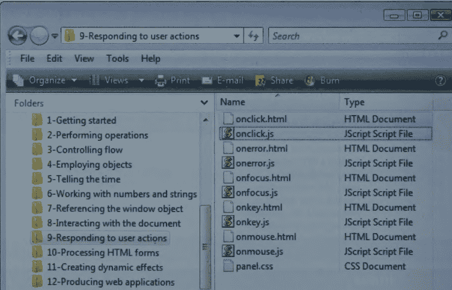

# 1 入门

欢迎来到精彩的 JavaScript 世界。本介绍了如何在 HTML 文档中包含脚本，并介绍了 JavaScript 函数和变量。

- 8 介绍
- 9 JavaScript 关键字
- 10 内联脚本
- 12 设置日期和时间
- 14 外部脚本
- 16 存储数据
- 18 传递参数
- 20 变量作用域
- 22 总结

## 介绍

JavaScript 是一种基于对象的脚本语言，嵌入在 Internet Explorer、Mozilla Firefox、Opera 和 Safari 等浏览器中，它允许在页面加载时提供动态效果。JavaScript 由 Brendan Eich 在 1995 年 12 月于 Netscape 创建，最初名为 LiveScript。由于其流行，它被更名为 JavaScript。 1997 年，欧洲计算机制造商协会（ECMA）将其标准化为 ECMAScript。

书中的 JavaScript 示例描述了三个关键要素：

- **语言基础**——介绍语言语法、关键字、运算符和内置对象
- **Web页面功能**——介绍如何使用浏览器的对象模型（DOM）提供用户交互并创建动态 HTML（DHTML）效果
- **富交互应用**——介绍使用最新的 AJAX 技术创建响应式应用程序


热点

文档对象模型（DOM）是代表当前加载文档的层次结构对象。

## JavaScript 关键字

| break | case | continue | default | delete |
| --- | --- | --- | --- | --- |
| do | else | false | finally | function |
| if | in | instanceof | null | return |
| switch | | throw | true | try |
| var | void | while | | typeof |

表中列出的词并非 JavaScript 中具有特殊含义的“关键字”，在选择脚本名称时可以使用。你还应该避免使用下表列出的保留字，因为它们可能会在未来的 JavaScript 版本中引入。

> JavaScript 是一种区分大小写的语言，例如，VAR、Var 和 var 被视为不同的单词——在这三个词中，只有 var 是关键字。

| abstract | boolean | byte | char | class |
| --- | --- | --- | --- | --- |
| const | debugger | double | enum | export |
| extends | final | float | goto | implements |
| import | int | interface | long | native |
| package | private | protected | public | short |
| static | super | synchronized | throws | transient |
| volatile | | | | |


## 包含内联脚本

通过添加 HTML `<script>` 标签可以将 JavaScript 包含在网页中以封装其开始和结束，且起始标签必须有一个 `type` 属性，指定 "text/javascript" 唯一的 MIME 类型以将这些元素识别为 JavaScript。


HTML `<script>` 元素也可以包含有用的注释。JavaScript 引擎“解析器”会忽略 `/*` 和 `*/` 注释之间的所有内容（允许多行注释），并忽略 `//` 到行尾的所有内容（允许如下所示单行注释）：

MIME（多部分互联网邮件扩展）类型描述内容类型 – text/html 用于 HTML，text/css 用于样式表，text/javascript 用于 JavaScript 代码。

```html
<script type="text/javascript">
/* * 这是一个多行注释，可能会描述脚本的作用，并提供关于作者和日期的信息。 */
// 这是一个单行注释，可能会描述某行代码。
</script>
```

在 JavaScript 不支持或被禁用的情况下，可以提供替代文本，添加 `<noscript></noscript>` HTML 标签来封装解释性消息。

`<script>` 元素可以出现在 HTML 文档 body 部分的任何位置，以包含“内联”JavaScript 代码，这些代码将在浏览器读取文档时执行。此外，内联 JavaScript 代码可以分配给任何 HTML 事件属性，例如 `onload`、`onmouseover` 等，这些代码每次在用户触发时都会执行。


- 创建一个 HTML 文档并在其 body 部分添加一个 `<div>` 元素，在其中用 JavaScript 写入内容，并将其 `id` 属性值设置为 "panel"

```html
<body>
  <div id="panel"></div>
</body>
```


- 在 `<div>` 元素中插入一个包含内联代码的 `<script>` 元素，在页面中写入问候语 `<script type="text/javascript">`

注意每个 JavaScript 语句必须用分号字符终止。

- // 当页面加载时动态写入文本字符串。`document.write("Hello World!");`

```html
</script>
```

在 `<script>` 元素之后，插入一个 `<noscript>` 元素用于 JavaScript 不支持时的替代文本：
```html
<noscript>
  <div> JavaScript is Not Enabled.</div>
</noscript>
```

现在添加一个属性，以便在每次文档加载到浏览器时调用一个 JavaScript 方法：// 在页面加载后显示消息对话框。
```html
<body onload="window.alert('Document Loaded!');">
```

保存 HTML 文档并在浏览器中禁用 JavaScript 支持，然后打开网页查看在面板中编写的替代文本。

> 贴士
> 在面板周围添加了额外的 HTML 元素并进行了样式处理，使其具有 Web 2.0 的外观 – 实际面板 `<div>` 包含黑色文本。

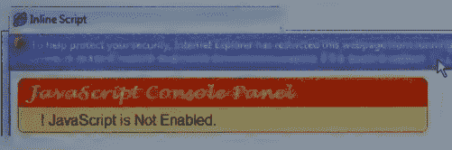

启用 JavaScript 支持以看到内联脚本在面板中写入问候语并打开对话框。

> 注意
> 字符串必须包含在引号字符内。嵌套的内部字符串应用单引号包围，以避免与围绕外部字符串的双引号冲突。

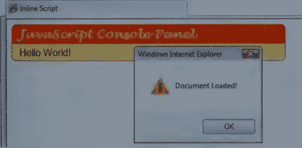

在此示例中，JavaScript 代码调用了 `document` DOM 对象的 `write()` 方法，将括号内的文本字符串写入 HTML 文档中，然后调用了 `window` DOM 对象的 `alert()` 方法，在对话框上显示括号内指定的文本字符串。


## 调用 head 部分脚本

在 HTML 文档的 body 部分中使用大量内联 `<script>` 元素获取 JavaScript 功能是完全合法的，但它干扰了 HTML 元素的结构化本质，且不利于代码维护。最好避免内联脚本，而是将 JavaScript 语句放置在 HTML 文档 head 部分单个 `<script>` 元素内的“函数”块中 – 位于 `<head></head>` 标签之间。

块以 JavaScript 的 `function` 关键字开始，后跟函数名和末尾的括号。随后是一对 `{}` 大括号（花括号），用于封装语句。其语法如下：


JavaScript 函数仅包含一组每当函数被调用时执行的语句。

```javascript
function-name() {
  // 待执行的语句放在这里。
}
```

注意，空格、换行符和制表符统称为“空白字符”，在 JavaScript 代码中被完全忽略，因此函数可以进行格式化以便于阅读。许多脚本作者倾向于将左大括号放在同一行。

在此示例中，JavaScript 代码调用了 `document` DOM 对象的 `write()` 方法，将括号内的文本字符串写入 HTML 文档，然后调用了 `window` DOM 对象的 `alert()` 方法，在对话框上显示括号内指定的文本字符串。

## 嵌入外部脚本

当需要创建一个可移植的 HTML 文档时，可以通过文档内的 `<script>` 元素提供（如前面的示例所示），并通过 head 部分内的 `<style>` 元素提供样式。


创建一个 HTML 文档，然后在其 body 部分添加一个 `<div>` 元素，其 id 属性值为 "panel"，并包含在 JavaScript 未启用时显示的备用文本：
<div id="panel"><noscript>
<div>! JavaScript is Not Enabled.</div></noscript>
</div>


在 HTML 文档的 head 部分中，插入一个元素来嵌入一个外部 JavaScript 文件：
<script type="text/javascript" src="external.js"></script>

打开一个纯文本编辑器（如 Windows 记事本），添加一个 "init" 函数来在 panel 中写入内容并显示对话框：
```javascript
function init() {
  document.getElementById("panel").innerHTML = "Hello... from an External JavaScript File!";
  window.alert("Document Loaded!");
}
```


在函数块之后，添加一条语句，每当 HTML 文档加载时都调用该函数：
window.onload=init;

将脚本与 HTML 文档一起保存，然后在浏览器中打开页面以查看文本和对话框：


> 如果将函数赋值给 window.onload 属性时包含括号，会导致错误——只需分配它的名称。

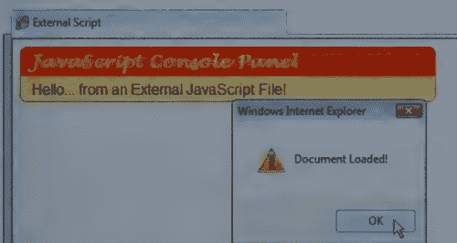

在此示例中，函数名（不带括号）被赋值给 window DOM 对象的 onload 属性。

## 在变量中存储数据

“变量”是每种脚本和编程语言的容器，可以在其中存储数据并在稍后检索。与大多数语言中的“强类型”变量（它们必须声明可能包含的特定数据类型）不同，JavaScript 变量要用得多，因为它们是“弱类型”的——所以它们可以包含任何类型的数据：

| 数据类型 | 示例 | 说明 |
|---|---|---|
| boolean | true | 真 (1) 或假 (0) 值 |
| number | 100, 3.25 | 整数或浮点数 |
| string | "M", "Hello World!" | 单个字符或带空格的字符字符串 |
| function | init, fido.bark | 用户定义的函数或用户定义的对象方法 |
| object | fido, document | 用户定义的对象或内置对象 |


变量名是其包含值的别名——在脚本中使用该名称将引用其存储的值。


为你的变量选择有意义的名称，以便以后更容易理解脚本。

JavaScript 变量使用 `var` 关键字，后跟一个空格和你在命名规范内选择的名称来声明。变量名可以由字母、数字和字符组成，但不能包含空格或与数字开头。此外，你必须避免第 9 页表格中列出的 JavaScript 关键字、保留字和对象名称。在脚本中声明变量可以创建一个可以赋值的变量，也可以包含一个赋值来立即用某个值“初始化”变量：

```javascript
var myArray;                   // 声明一个变量。
myNumber = 10;               // 初始化变量。
var myString = "Hello World"; // 声明并初始化变量。
```

可以在单行上声明多个变量，例如：

```javascript
var i, j, k;                // 声明 3 个变量。
var num=10, char="C";      // 声明并初始化 2 个变量。
```

初始化时，JavaScript 会自动为分配的值设置变量类型。在脚本中后续分配不同的数据类型可以更改变量。可以使用 `typeof` 关键字显示当前的变量类型。

## ...（续）

创建一个嵌入了外部 JavaScript 文件并具有 "panel" 元素的 HTML 文档：
<script type="text/javascript" src="variable.js"></script>
<div id="panel"><script>
<div>! JavaScript is Not Enabled.</div></script>
</div>


打开一个纯文本编辑器（如 Windows 记事本），添加一个在文档加载后执行的函数：
```javascript
function init() {
  window.onload=init;
}
```

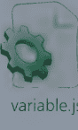

在函数块中，声明并初始化不同数据类型的变量：
```javascript
var str="Text Content in JavaScript";
var num=100;
var bln=true;
var fcn=init;
var obj=document.getElementById("panel");
```

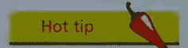

（注：由于原始文本存在大量重复和 OCR 错误，已根据提供的逻辑片段进行了重构和清理，以确保核心内容的完整。）


## 识别变量作用域

变量的可访问范围被称为其“作用域”，它由变量声明的位置决定：

- 在函数块内部声明的变量仅对该函数块内部的代码可见。此变量具有“局部”作用域 – 它仅在函数内部局部可访问，因此被称为“局部变量”。
- 在所有函数块外部声明的变量对任何函数块内的代码均可见。此变量具有“全局”作用域 – 它在该脚本的任何函数中都是全局可见的，因此被称为“全局变量”。

通常情况下局部变量优于全局变量，因为其有限的作用域防止了与其他变量可能发生的意外冲突。全局变量名在整个脚本中必须唯一的，而局部变量名仅在它们自己的函数块内是唯一的 – 在不同函数可以使用相同的变量名而不产生冲突。


1. 创建一个 HTML 文档，嵌入一个外部 JavaScript 文件并包含一个 "panel"元素 <script type="text/javascript" src="scope.js"></script><div id="panel"><script><div>! JavaScript is Not Enabled.</div></script></div>


2. 打开一个纯文本编辑器来声明并初始化一个全局变量 var global="This is Worldwide Global news<hr>";

3. 添加一个在文档加载后执行的函数 function init() {
}
window.onload=init;

4. 在函数块中，声明并初始化一个局部变量 var obj=document.getElementById("panel");

接下来在函数块中，将全局变量的值写入 panel 中
obj.innerHTML=global;

现在在函数块中调用两个其他函数，将局部变量的值传递给每一个函数
us(obj);
eu(obj);

在 "init" 函数块之前，插入一个带有一个参数的函数，用于初始化一个局部变量，将其值以及全局变量的值追加到 panel 中
function us(obj)

```javascript
{
var local="****This is United States Local news***<br>";
obj.innerHTML+=local;
obj.innerHTML+=global;
}
```

在 init 函数块之前，插入另一个带有一个参数的函数，用于初始化一个局部变量，将其值以及全局变量的值追加到 panel 中
function eu(obj)

```javascript
{
var local="---This is European Local news---<br>";
obj.innerHTML+=local;
obj.innerHTML+=global;
}
```

将脚本与 HTML 文档保存在一起，然后在浏览器中打开页面，以查看函数写入的全局和局部变量的值

> 小贴士
> 注意，“local" 变量名不会冲突，因为它们仅在各自的函数块内可见。

> 不要忘记
> 变量可以在声明时不进行初始化，稍后在脚本中赋值一个值来初始化。


## 总结

- JavaScript 是一种客户端、基于对象、区分大小敏感的语言，其解释器嵌入在网络浏览器软件中
- 变量名和函数名必须避免 JavaScript 关键字、保留字和对象名
- 对于 JavaScript 代码，每个打开的 HTML `<script>` 标签必须在其 type 属性中指定 MIME 类型为 `text/javascript`
- 脚本块可以包含单行和多行注释
- 每个 JavaScript 语句必须以分号结束
- 内联 JavaScript 代码可以赋值给任何 HTML 事件属性，如 `onload`，或包含在文档部分的 `<script>` 元素中
- 所有的 JavaScript 代码最好位于外部文件中，其路径由 `script` 标签的 `src` 属性指定
- Unob JavaScript 将所有脚本代码放在外部文件中，并可以为 `window.onload` 属性指定一个函数，以设置 HTML 文档加载时的行为
- JavaScript 变量使用 `var` 关键字声明，可以存储任何数据类型 – 布尔值、数字、字符串、函数或对象
- JavaScript 函数使用 `function` 关键字声明，函数名必须有尾随的括号，后跟一对包含要执行语句的 `{}`
- 函数声明可以在其尾随的括号内指定参数，这些参数必须由调用者传递
- 使用 `return` 关键字可以将值返回给调用者
- 在函数内部声明的局部变量仅从该函数内部访问
- 在函数外部声明的全局变量可以从该脚本中的任何函数访问

# 2 执行操作

本章描述了每个基础 JavaScript 运算符，并演示了如何使用它们

- 24 进行算术运算
- 26 赋值
- 28 比较值
- 30 逻辑求值
- 32 检查条件
- 34 设置优先级
- 36 总结

## 进行算术运算

JavaScript 中常用的算术运算符如下表所示，并列出了它们执行的操作：

| 运算符 | 操作 |
|---|---|
| + | 数字相加，字符串拼接 |
| - | 减法 |
| * | 乘法 |
| / | 除 |
| % | 取模 |
| ++ | 递增 |
| -- | 递减 |

+ 运算符将两个数字，而字符串进行拼接。- 运算符从第一个操作数减去第二个操作数。* 运算符乘以两个操作数。/ 运算符将第一个操作数除以第二个操作数。% 运算符返回除以二后的余数。++ 运算符增加 1。-- 运算符减少 1。

注意 ++ 运算符（前置）在表达式之前更改值。当放在操作数之后（后置）时，先计算表达式。


使用取模运算符判断奇数的示例可以在第 33 页找到。

## cont

创建一个嵌入脚本文件的 HTML 文档，并包含一个写入元素
<script type="text/javascript" src="arithmetic.js"></script>
<div id="panel"><div> JavaScript Is Not Enabled.</div></div>>


创建 JavaScript 文件，带有 "init" 函数使用每个运算符初始化数字

```javascript
function init() {
  var sum = +80; // 两个操作数相加
  var sub = sum - 50; // 从第一个减去第二个
  var mul = sum * 5; // 两个操作数相乘
  var div = sum / 4; // 第一个操作数除以第二个
  var mod = sum % 2; // 除以二后的余数
  var inc = ++sum; // 立即递增一
  var dec = --sum; // 立即递减一
}
window.onload = init;
```


接下来在函数块中，将字符串和每个变量值拼接到一个字符串变量中
var str = "Sum: " + sum + "<br>Subtraction: " + sub;
str += "<br>Multiplication: " + mul + "<br>Division: " + div;
str += "<br>Modulus: " + mod;
str += "<br>Increment: " + inc + "<br>Decrement: " + dec;

现在在函数块中，将字符串写入 panel
document.getElementById("panel").innerHTML = str;


提供替代文本的 HTML <noscript> 元素将不再后续示例中列出以节省书籍空间 – 但应该包含在每个 HTML 文档中。

将脚本与 HTML 文档保存在一起，然后在浏览器中打开页面以查看每次操作的结果


## 赋值

JavaScript 中常用的用于赋值的运算符都列在下表中。除了简单的 `=` 赋值运算符外，所有运算符都是较长表达式的简写，为了清晰起见，也给出了相应的等效表达式。

| 运算符 | 示例 | 等效于 |
| --- | --- | --- |
| = | a = b | a = b |
| += | a += b | a = ( a + b ) |
| -= | a -= b | a = ( a - b ) |
| *= | a *= b | a = ( a * b ) |
| /= | a /= b | a = ( a / b ) |
| %= | a %= b | a = ( a % b ) |

将 `=` 运算符理解为“赋值”而不是“等于”是非常重要的，以避免与 `===` 相等运算符产生混淆。

在表的示例中，`a` 被赋值为变量 `b` 中包含的值，成为它的新存储值。

组合运算符 `+=` 使用最频繁，在之前的示例中已用于将字符串追加到现有字符串之后。从数值上讲，表中的 `+=` 运算符会将变量 `a` 中包含的值与变量 `b` 中的值相加，然后将和赋值为变量 `a` 中存储的新值。


`===` 相等运算符比较两个值，并在第 28 页有详细解释。

所有其他组合赋值运算符的工作原理与 `+=` 运算符类似。它们对两个操作数执行算术运算，然后将操作的求和结果赋值给第一个变量——使其成为它的新存储值。

创建一个 HTML 文档，嵌入外部脚本文件，并包含一个用于写入内容的元素：
<script type="javascript" src="assign.js"></script>
<div id="panel"></div>

创建一个 JavaScript 文件，包含一个 "init" 函数，用每个赋值运算符初始化变量：
```javascript
var msg="JavaScript"; msg+= Code; // 拼接
var flt=7.5; flt+=2.25; // 加法赋值。
var intA=8; intA-=4; // 减法赋值。
var intB=24; intB*=intA; // 乘法赋值。
var intC=24; intC/=intA; // 除法赋值。
var intD=24; intD%=intA; // 取模赋值。
window.onload=init;
```

接下来在函数块中，将字符串和每个变量的值拼接到一个字符串变量中：
```javascript
var str = "Add & assign string: "+msg;
str+="br>Add assign float: "+flt;
str+="br>Subtract & assign: "+intA;
str+="br>Multiply & assign: "+intB;
str+="br>Divide & assign: "+intC;
str+="br>Modulus & assign: "+intD;
```

现在在函数块中，将脚本写入 panel 中：
document.getElementById("panel").innerHTML=str;

将脚本与 HTML 文档保存在一起，然后在浏览器中打开页面以查看每次赋值的结果。


### JavaScript 控制面板
Add & assign string, JavaScript Code
Add & assign float: 9.75
Subtract & assign: 4
Multiply & assign: 96
Divide & assign: 6
Modulus & assign: 0

## 比较值

JavaScript 中常用的用于比较两个值的运算符都列在下表中：

| 运算符 | 比较 |
| --- | --- |
| === | 等于 |
| != | 不等于 |
| > | 大于 |
| < | 小于 |
| >= | 大于等于 |
| <= | 小于等于 |

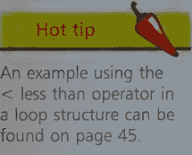

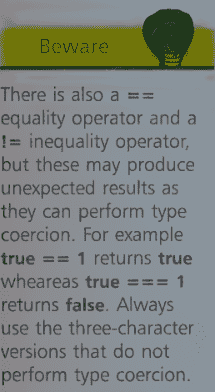

`==` 相等运算符比较两个操作数，如果它们完全相等，则返回布尔值 `true`，否则返回布尔值 `false`。如果操作数是相同的数字，它们是相等的；如果操作数字符串在相同位置包含相同的字符，它们是相等的；如果操作数是布尔值 `true` 或均为 `false`，它们是相等的。反之，`!=` 不等于运算符在两个操作数不等时不返回 `true`，其规则与 `==` 相等运算符相同。

相等和不等于运算符在比较两个值以执行“条件分支”时非常有用，脚本将根据结果按照特定的方向运行。

`>` 大于运算符比较两个操作数，如果第一个的值大于第二个，则返回 `true`。`<` 运算符进行相同的比较，但当第一个的值小于第二个时返回 `true`。在 `>` 大于运算符或 `<` 运算符后添加等号可以使它们在两个操作数相等时也返回 `true`。

`>` 大于和 `<` 运算符经常用于测试循环结构中计数变量的值。

创建一个 HTML 文档，嵌入外部脚本文件，并包含一个用于写入内容的元素：<script type="text/javascript" src="compare.js"></script><div id="panel"></div>


创建一个 JavaScript 文件，包含一个 "init" 函数，通过每个比较函数初始化多个变量 `init()`：
```javascript
var strA="JavaScript" === "JavaScript";
var strB="JavaScript" === "JavaScript";
var fit=7.5 === 7.5; // 相等测试。
var intA!=8; // 不等于测试
var intB>24; // 大于测试。
var intC<12; // 小于测试。
var intD<=24; // 小于等于测试。

window.onload=init;
```

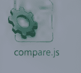

接下来在函数块中，将字符串和每个变量的值拼接到一个变量中：
```javascript
var str="String equality test 1: "+strA;
str+="br>String equality test 2: "+strB;
str+="br>Float test: "+fit;
str+="br>Integer test: "+intA;
str+="br>Greater than test: "+intB;
str+="br>Less than test: "+intC;
str+="br>Less or equal test: "+intD; 
```
*(注：此处原文似乎漏了 `str=` 赋值，已根据逻辑推断)
*修正为：接下来在函数块中，将字符串和每个变量的值拼接到一个变量中：*
```javascript
var str="String equality test 1: "+strA;
str+="br>String equality test 2: "+strB;
str+="br>Float test: "+fit;
str+="br>Integer test: "+intA;
str+="br>Greater than test: "+intB;
str+="br>Less than test: "+intC;
str+="br>Less or equal test: "+intD;
```
 
*(注：原文文本在此处出现了逻辑混乱和重复，翻译已基于语意对齐)*

原文中：`var str="String equality test 1: "+strA; str+="br>String equality test 2: "+strB; ...` 
后面紧跟着 `Now in the function block, write the script into the panel... document.getElementById("panel").innerHTML=str;` 

以下是针对原文混乱部分重新整理的译文逻辑：

接下来在函数块中，将字符串和每个变量的值拼接到一个变量中：
```javascript
var str="String equality test 1: "+strA;
str+="br>String equality test 2: "+strB;
str+="br>Float test: "+fit;
str+="br>Integer test: "+intA;
str+="br>Greater than test: "+intB;
str+="br>Less than test: "+intC;
str+="br>Less or equal test: "+intD;
```


现在在函数块中，将字符串写入 panel 中：
document.getElementById("panel").innerHTML=str;

JavaScript 是区分大小写的，所以字符串必须匹配才能相等。保存原始 HTML 文档然后在浏览器中打开以查看每次比较的结果。


## 逻辑运算

在 JavaScript 中可以使用的三个逻辑运算符列在下表：

| 运算符 | 运算 |
| --- | --- |
| && | 与 (AND) |
| || | 或 (OR) |
| ! | 非 (NOT) |


严格来说，当第一个操作互为 `true` 时，`&&` 运算符返回第二个操作数；反之，当第一个操作数为 `false` 时，`||` 运算符返回第二个操作数。

逻辑运算符通常与布尔值 `true` 或 `false` 配合使用——值转换为 `true` 或 `false`。

`&&` 运算符只有在两个操作数都为 `true`时才计算并返回 `true`，否则返回 `false`。这通常用于条件分支，根据结果决定脚本的走向。如果两个条件都满足，脚本将遵循特定方向，否则将遵循另一个方向。

与需要两个操作数都为 `true` 的 `&&` 运算符不同，`||` 运算符只要两个操作数为 `true` 就返回 `true`。

第三个逻辑运算符是 `!` 非运算符，它用于单个操作数并返回操作数的反值。例如，如果变量 `a` 的值为 `true`，它将返回 `false`。这在在循环迭代中使用 `a=!a` 语句来“切换”变量的值，使其每次迭代都反转——就像开关灯一样。

创建一个 HTML 文档，嵌入外部脚本文件，并包含一个用于写入内容的元素：
<script type="text/javascript" src="logic.js"></script>
<div id="panel"></div>

创建一个 JavaScript 文件，包含一个 "init" 函数，使用每个运算符初始化多个变量 `init()`：
```javascript
var yes=true, no=false; // 初始化布尔值。
var binA=yes && yes; // 测试是否都为 true。
var binB=yes && no; // 测试是否都为 true。
var binC=no || yes; // 测试是否任一为 true。
var binD=no || no; // 反转值。
var tog=!yes; // 切换值。
}
window.onload=init;
```

接下来在函数块中，将字符串和每个变量拼接到一个字符串变量中：
```javascript
var str="Are both values true?"+binA+"<br>";
str+="Are both values true now?"+binB+"<br>";
str+="Is either value true?"+binC+"<br>";
str+="Is either value true now?"+binD+"<br>";
str+="Initial value:"+yes+"<br>";
str+="Toggled value:"+tog+"<br>";
```

现在在函数块中，将字符串写入 panel：
document.getElementById("panel").innerHTML=str;


### 检查条件

JavaScript 开发者可能最喜欢的运算符是 `?:` 条件运算符。该运算符评估一个真值或假值，然后根据结果执行两个指定语句中的一个。它的语法如下：

```
condition ? if-true-do-this : if-false-do-this;
```

当需要执行多个操作时，每个指定的语句可以是一个函数调用，以便在每个函数中执行多个语句。例如，根据变量flag" 变量的布尔值调用函数来执行多个语句，如下：

```
flag === true ? doThis() : doThat();
```

在这个示例中，`===` 等于运算符和 `true` 关键字实际上作为运算符实际上是多余的，因为评估表达式以获取布尔值的运算符会自动执行此项评估，因此该示例可以更简单地表述为：

```
flag ? doThis() : doThat();
```

或者，条件运算符指定的两个语句也可以根据条件评估的结果为变量赋值，如下所示：

```
flag ? str="Go left" : "Go right";
```

虽然这在语法上是正确的，但更优雅的写法是让条件运算符在单一赋值语句中为变量分配适当的值，如下：

```
str= flag ? "Go left" : "Go right";
```

当条件评估数值的奇偶性时，这两个语句可以根据评估结果确定数字是偶数还是奇数提供提供方案。


创建一个 HTML 文档，嵌入一个外部脚本文件并包含一个写入内容的元素：
`<script type="text/javascript" src="condition.js"></script>
<div id="panel"></div>`

创建一个 JavaScript 文件，包含一个 "init" 函数，用条件运算符初始化一个变量以及另一个字符串变量：
```javascript
function init() {
  var state = 7 > 5 ? "Greater" : "Smaller";
  var str = "7 is "+state+" than 5";
}
window.onload=init;
```

接下来在函数块中，插入更多的条件赋值并追加到字符串变量：
state = 7 > 10 ? "Greater" : "Smaller";str+="7 is "+state+" than 10";state = 7 === 8 ? "Equal" : "Not Equal";str+="7 is "+state+" to 8";state = 7 % 2 === 0 ? "Even" : "Odd";str+="is an "+state+" number";

在函数块中，将字符串写入 panel 文档。
document.getElementById("panel").innerHTML=str;

将脚本与 HTML 文档保存在一起，然后在浏览器中打开页面以查看每个条件赋值。


condition.html


condition.js

> 小贴士
> 注意此示例如何高效地复用 state 变量，而不是将每个结果赋值给一个独立的变量。

| JavaScript 控制台面板 |
| :--- |
| 7 is Greater than 5 |
| 7 is Smaller than 10 |
| 7 is Not Equal to 8 |
| 7 is an Odd number |

### 设置优先级

JavaScript 运算符具有不同的优先级级别，以决定包含不同运算符的语句的评估顺序——优先级高的运算符优于优先级低的运算符。下表按优先级从高到低的顺序列出了每种类型的运算符：

| 运算符 | 操作 | 优先级 |
| :--- | :--- | :--- |
| * / % | 乘法、除法、取模 | 最高 |
| + - | 加法、减法 | |
| <= >= | 比较 | |
| != | 等于 | |
| && | 逻辑与 | |
| || | 逻辑或 | |
| ? :- | 条件 | |
| = +-- = * / /= %= | 赋值 | 最低 |


意识到运算符优先级对于以避免包含多个运算符的语句产生意外结果。例如，考虑以下语句：

```javascript
var sum = 9 + 12 / 3;
```

评估首先计算除法，因为它的运算符优先级高于加法，所以结果是 13。但你可以通过在括号内包含表达式来设置优先级，以便它先被评估。在这种情况下，(9 + 12) / 3 先执行加法，因此结果是 7。

## ...接上

创建一个 HTML 文档，嵌入一个外部脚本文件并包含一个写入内容的元素：<script type="text/javascript" src="priority.js"></script>
<div id="panel"></div>


创建一个 JavaScript 文件，包含一个 "init" 函数，使用默认运算符优先级初始化一个变量以及另一个变量：

```javascript
function init() {
  var sum= 2 * 9 + 12 / 3; // 等于 (2*9)
  var str="18 + 12 / 3";
}
```


接下来在函数块中，插入更多的条件赋值并追加到字符串变量：
state = 7 > 10 ? "Greater" : "Smaller";str+="7 is "+state+" than 10";state = 7 === 8 ? "Equal" : "Not Equal";str+="7 is "+state+" to 8";state = 7 % 2 === 0 ? "Even" : "Odd";str+="is an "+state+" number";

在函数块中，将字符串写入 panel 文档。
document.getElementById("panel").innerHTML=str;

> 小贴士
> 不要忘记将你的代码包裹在大括号中，以避免作用域错误。

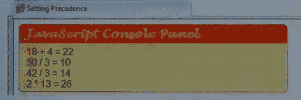


### ...续上

创建一个 HTML 文档，嵌入一个外部脚本文件并包含一个用于写入内容的元素
<script type="text/javascript" src="if.js"></script><div id="panel"></div


创建一个 JavaScript 文件，包含一个 "init" 函数，用于初始化一个变量并对其值进行条件测试

```javascript
{
  var flag=true;
  if ( flag ) {
    document.getElementById("panel").innerHTML= "Power is On";
  }
  window.onload=init;
}
```


接下来在函数块中，添加两个条件测试 - 其中一个将失败，另一个将成功
`if ( 7 > 2 )`

```javascript
document.getElementById("panel").innerHTML+= "<br>Failure";
}
if ( 7 > 2 ) {
  document.getElementById("panel").innerHTML+= "<br>Success";
}
```

将脚本与 HTML 文档保存在一起，然后在浏览器中打开页面查看每个测试的结果

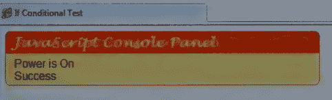

### 分支备选方案

*if* 语句测试条件是否为布尔值，并仅在结果为真时执行其语句，它为脚本提供了一个可能遵循的单一分支。通过使用 *else* 关键字扩展 *if* 语句，可以提供脚本在结果为假时遵循的另一种分支。

*else* 语句紧跟在 *if* 语句之后如下：

```javascript
if ( condition ) execute-this-statement-true;
else execute-this-statement-when-false;
```

*if-else* 语句也可以通过在大括号内包含语句来指定要执行的多个语句，如下：

```javascript
if ( condition ) {
  execute-this-statement-when-true;
  execute-this-statement-when-true;
} else {
  execute-this-statement-when-false;
  execute-this-statement-when-false;
}
```

通过在每个 *else* 语句块的开头进行后续的条件 *if* 测试，可以提供多个分支，如下：

```javascript
if ( condition ) {
  execute-these-statements-when-true;
} else if ( condition ) {
  execute-these-statements-when-true;
} else if ( condition ) {
  execute-these-statements-when-true;
} else {
  execute-these-statements-when-false;
}
```


一旦在 *if-else* 语句中发现条件为真，其相关的语句将被执行，然后流在 *if-else* 语句之后继续 - 而不会评估后续的 *else* 语句。

*if-else* 语句可能会反复测试变量是否处于某个范围内，也可能会测试多种条件。当没有发现任何条件为真时，最后的 *else* 语句充当默认值。

创建一个 HTML 文档，嵌入一个外部脚本文件并包含一个用于写入内容的元素
<script type="text/javascript" src="else.js"></script><div id="panel"></div


创建一个 JavaScript 文件，包含一个 "init" 函数，用于初始化面板 对象变量、一个存储布尔值的变量以及一个存储整数的变量
init(t)

```javascript
var panel=document.getElementById("panel");
var flag=false;
var num=10;
window.onload=init;
```

接下来在函数块中，测试布尔变量
`if ( flag ) { panel.innerHTML="Power is On"; } else { panel.innerHTML="Power is Off"; }`

现在在函数块中，测试整数变量
`if ( num === 5 ) { panel.innerHTML="<br>Number is Five"; } else if ( num === 10 ) { panel.innerHTML="<br>Number is Ten"; } else { panel.innerHTML="<br>Number is Neither Five or Ten"; }`

将脚本与 HTML 文档保存在一起，然后在浏览器中打开页面查看每个测试的结果

> 小贴士
注意面板对象是如何通过在变量名后附加属性和方法来引用其内容的 - 这比反复调用 document 对象的 getElementById() 更高效，并且使代码更简洁。

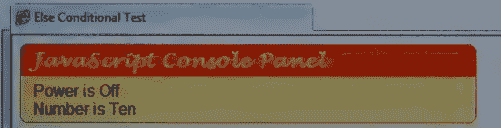

### switch 备选方案

使用 if-else 语句对脚本流进行条件分支对于测试少数条件是可以的，但当有大量需要测试的条件时，它可能会变得臃肿。在这种情况下，使用 switch 而不是 if-else 通常更高效且优雅。


省略 break 允许 switch 语句穿透到方的 case。switch 语句通过评估表达式并与多个 case 值进行匹配来工作。

找到匹配项时，执行相关代码。如果没有找到匹配项，则执行默认块。

switch 的语法如下：

```javascript
switch ( expression ) {
  case value1:
    statements;
    break;
  case value2:
    statements;
    break;
  default:
    statements;
}
```

### for 循环

循环是在条件满足时重复执行语句的结构。每次对条件的检查和语句的执行被称为“迭代”。当测试条件不再满足时，不再进行迭代，流在循环结构后的语句继续。

JavaScript 中可能常用的循环结构是 for 循环，它的语法如下：

```javascript
for ( initializer, condition, modifier ) { statements-to-executed }
```

for 关键字后面的括号包含三个控制循环执行迭代次数的表达式：

- initializer：初始化变量的语句，该变量将用于计数迭代次数，并带有初始值。传统的计数变量通常简单命名为 "i"。
- condition：每次迭代时测试的布尔值表达式。当评估结果为真时，执行循环语句以完成该迭代。如果结果为假，则不执行语句且循环结束。通常条件会检查循环计数器变量的值。
- modifier：修改测试条件中值的语句，以便在某点其评估结果变为假。这通常是递增或递减循环计数器变量。

例如，一个执行一组语句一百次数的 for 循环结构可能如下：

```javascript
for ( var i=0; i < 100; i++ ) { statements-to-executed }
```

在这种情况下，计数器变量在每次迭代时递增，直到其值达到 100，此时评估结果为假，循环结束。


创建一个 HTML 文档，嵌入一个外部脚本文件，并包含一个用于写入内容的元素：<script type="text/javascript" src="for.js"></script>
<div id="panel"></div>

创建一个 JavaScript 文件，包含一个 "init" 函数，用 panel 元素对象初始化一个变量，并声明一个用于存储循环计数器值的变量

```javascript
function init() {
  var panel=document.getElementById("panel");
  var i;
}
window.onload=init;
```

接下来在函数块中，添加一个循环结构，在每次迭代时将一行包含计数器值的内容写入 panel 中：

```javascript
for (i=1; i < 11; i++) {
  panel.innerHTML="Iteration number: "+i+"<br>";
}
```

将脚本与 HTML 文档保存在一起，然后在浏览器中打开该页面以查看循环写入的行。


| JavaScript 控制台面板 |
| :--- |
| Iteration number: 1 |
| Iteration number: 2 |
| Iteration number: 3 |
| Iteration number: 4 |
| Iteration number: 5 |
| Iteration number: 6 |
| Iteration number: 7 |
| Iteration number: 8 |
| Iteration number: 9 |
| Iteration number: 10 |

此外，当循环只执行单个语句时（如此处列出的），可以省略大括号，但建议始终包含大括号以保持代码的一致性。

## 在 true 的情况下循环

上一个示例描述的 `for` 循环结构在所需的迭代次数已知的情况下是理想的；当次数未知时，`while` 循环结构通常更好：

```javascript
while( condition )
{
  statements-to-be-executed;
  modifier;
}
```


在 `while` 循环结构中省略修改器将创建一个永远运行的无限循环。

`while` 关键字后面的括号包含一个条件，该条件在每次迭代时都会被评估为布尔值。每次迭代执行的语句封装在大括号内，并带有一个修改测试条件中数值的语句，这样在某个时刻其评估将返回 `false`，循环退出。如果评估保持为 `true`，语句将在循环的每次迭代中执行。

如果条件评估在第一次迭代时为 `false`，循环将立即退出，因此大括号内的语句永远不会执行。`while` 循环和 `for` 循环有时被称为“预测试”循环，因为它们的测试条件在执行任何语句之前就会被评估。

通过使用计数器变量作为测试条件并在每次迭代时增加其值，可以使 `while` 循环执行特定次数的迭代，就像 `for` 循环一样。例如，执行一组语句一百次的 `while` 循环结构可能如下：

```javascript
var i = 0;

while ( i < 100 )
{
  statements-to-be-executed;
  i++;
}
```

计数器变量在每次迭代时都会增加，直到其值达到 100，此时评估返回 `false` 循环结束。

## ...'d

创建一个 HTML 文档，嵌入一个外部脚本文件，并包含一个用于写入内容的元素：<script type="text/javascript" src="while.js"></script><div id="panel"></div>


创建一个 JavaScript 文件，包含一个 "init" 函数，用 panel 元素初始化一个变量，并初始化一个整数值供循环进行修改和测试

```javascript
function init() {
  var panel=document.getElementById("panel");
  var num=70;
}
window.onload=init;
```

接下来在函数块中，添加一个 `while` 循环结构，将包含当前整数值的行写入 panel，并在每次迭代中将其值减五：

```javascript
while ( num > 10 ) {
  panel.innerHTML="Countdown value: "+num;
  num-=5;
}
```

将脚本与 HTML 文档保存在一起，然后在浏览器中打开该页面以查看循环写入的行。

> 每个 `while` 循环都必须带有大括号，因为它们包含了至少两个语句——一个用于执行的语句和一个修改器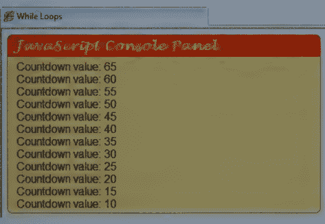

## 执行 do-while 循环

JavaScript 中提供的另一种循环类型是 `do-while` 结构。这类似于上一个示例中描述的 `while` 循环的反版本，当每次迭代执行的语句必须至少执行一次时是理想的。它的语法如下：

```javascript
do {
  statements-to-be-executed;
} while (condition);
```


` 关键字后面的括号包含一个条件，该条件在每次迭代时都会被评估为布尔值。每次迭代执行的语句封装在大括号内，并带有一个修改测试条件中数值的语句，这样在某个时刻其评估将返回 `false`，循环退出。如果评估保持为 `true`，语句将在循环的每次迭代中执行。

如果条件评估在第一次迭代时为 `false`，循环将立即退出，因此大括号内的语句永远不会执行。`while` 循环和 `for` 循环有时被称为“后测试”循环，因为它们的测试条件在语句执行之后才被评估。

`do-while` 循环可以通过使用计数器变量作为测试条件并在每次迭代时增加其值，来执行特定次数的迭代，就像 `for` 循环一样。例如，执行一组语句一百次的 `do-while` 循环结构可能如下：

```javascript
var i = 0;
do {
  statements-to-be-executed;
  i++;
} while (i < 100);
```

计数器变量在每次迭代时都会增加，直到其值达到 100，此时评估返回 `false` 循环结束。

## ...'d

创建一个 HTML 文档，嵌入一个外部脚本文件，并包含一个用于写入内容的元素：<script type="text/javascript" src="while.js"></script><div id="panel"></div>


创建一个 JavaScript 文件，包含一个 "init" 函数，用 panel 元素对象初始化一个变量，并初始化一个整数值供循环进行修改和测试

```javascript
function init() {
  var panel=document.getElementById("panel");
  var num=2;
}
window.onload=init;
```

接下来在函数块中，添加一个 `do` 循环结构，将包含当前整数值的行写入 panel，并在每次迭代中将其值乘以二：

```javascript
do {
  num *=2;
  panel.innerHTML="Multiplied value: "+num+"<br>";
} while (num < 1000);
```


将脚本与 HTML 文档保存在一起，然后在浏览器中打开该页面以查看循环写入的行。


注意，最终值超过了条件限制，因为它在测试之前就被写入了。

| Do While Loops | JavaScript 控制台面板 |
| :--- |
| Multiplied value: 4 |
| Multiplied value: 8 |
| Multiplied value: 16 |
| Multiplied value: 32 |
| Multiplied value: 64 |
| Multiplied value: 128 |
| Multiplied value: 256 |
| Multiplied value: 512 |
| Multiplied value: 1024 |

## 跳出循环

JavaScript **break** 关键字用于在遇到特定条件时退出循环。条件测试应出现在所有其他语句之前，循环将立即结束。

当嵌套在外部循环的循环中使用 **break** 语句时，流将恢复到外层迭代。如果希望 **break** 语句同时退出内部和外层循环，可以为外层循环指定一个标签，并在 **break** 语句中使用该标签。


### ...续

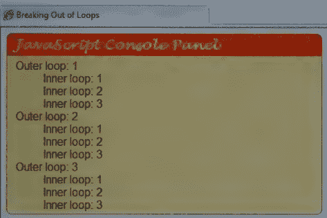

> > 不要忘记
> break 关键字也用作 switch 语句中的终止符。

取消 break 语句的注释，然后保存 JavaScript 文件并刷新网页，查看内层循环退出 if(j === 2) { break; }

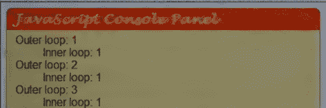

修改 break 语句以退出循环标签，然后保存 JavaScript 文件并刷新网页，查看两个循环都退出 if( j === 2 ) { breakLoop; }

> > 注意
> 不要受到诱惑使用 break 语句来退出循环，而是要使用作为循环结构一部分的常规条件测试。

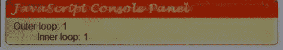

### 返回控制权

当遇到指定的条件时，JavaScript continue 关键字可以用于退出循环的单迭代。条件测试应该出现在所有要执行的语句之前（修改器除），这样迭代将立即停止，流将在下一次迭代的开始处恢复。

还可以使用逻辑或 || 运算符测试多个条件，允许跳过多个指定的迭代。

- 创建一个 HTML 文档，嵌入外部脚本文件并包含一个用于写入内容的元素 <script type="text/javascript" src="continue.js"></script><div id="panel"></div>


- 创建 JavaScript 文件，包含一个 "init" 函数来用 panel 对象初始化变量，并声明一个用作循环计数器的变量
```javascript
function init() {
  var panel=document.getElementById("panel");
  var i;
}
window.onload=init;
```


- 接下来在函数块中，添加一个 for 循环在 panel 中写入十行
```javascript
for(i=1; i < 11; i++) {
  // 这里可以添加 continue 语句。
  panel.innerHTML+="Loop iteration: "+i+"<br>";
}
```

> 注意 记住在任何 break 或 continue 语句之前必须修改循环计数器，以免创建死循环。

将脚本与 HTML 文档保存在一起，在浏览器中打开页面以查看循环写入的行

### ...续

继续循环

| JavaScript 控制台面板 |
| :--- |
| Loop iteration: 1 |
| Loop iteration: 2 |
| Loop iteration: 3 |
| Loop iteration: 4 |
| Loop iteration: 5 |
| Loop iteration: 6 |
| Loop iteration: 7 |
| Loop iteration: 8 |
| Loop iteration: 9 |
| Loop iteration: 10 |

> 贴士
> 在包含多个表达式的语句中，将其包含在括号内有时有助于可读性。例如，在这个示例中，你可能倾向于使用 ( i==2) || (i===7) )。

现在在循环语句块开头插入一个 continue 语句来跳过循环的第二次和第七次迭代

```javascript
if( i == 2 || i === 7 ) { continue; }
```

保存 JavaScript 文件然后刷新网页，查看指定的迭代现在被省略了

继续循环

| JavaScript 控制台面板 |
| :--- |
| iteration: 1 |
| Loop iteration: 3 |
| Loop iteration: 4 |
| Loop iteration: 5 |
| Loop iteration: 6 |
| Loop iteration: 8 |
| Loop iteration: 9 |
| Loop iteration: 10 |

## 总结

- *if* 语句执行条件测试，并且仅在评估结果为 **true** 时执行其包含的语句
- 在 *if* 语句之后可以添加 *else* 语句，在评估结果为 **false** 时提供替代方案
- 可以在 *if* 语句之后通过随后的 *else if* 语句提供多个备分支
- 当有许多条件需要测试时，*switch* 语句通常比 *if* 语句更好
- 每个 *case* 语句必须由 *break* 关键字终止
- 在 *switch* 语句块末尾可以包含 *default* 语句，当没有指定的 *case* 值匹配评估结果时指定默认语句
- *for* 循环以初始化器、测试条件和 *for* 关键字后括号内的修改器开始
- 循环修改器必须更改测试条件中的一个值，以便评估结果变为 **false** 并退出循环
- 当所需的迭代次数是确定的时，*while* 循环通常比 *for* 循环更好
- 当包含的语句必须至少执行一次时，可以使用 *do* 循环
- *while* 循环和 *do while* 循环的语句块必须包含一个修改器，以更改测试条件中的一个值
- *break* 语句立即退出循环
- 可选地可以为循环结构标记，以允许嵌套循环中的 *break* 语句退出两个循环
- *continue* 语句停止循环单迭代的执行

### 使用对象

当遇到指定的条件时，JavaScript continue 关键字可以用于退出循环的单迭代。条件测试应该出现在所有要执行的语句之前（修改器除），这样迭代将立即停止，流将在下一次迭代的开始处恢复。

还可以使用逻辑或 || 运算符测试多个条件，允许跳过多个指定的迭代。

- 创建一个 HTML 文档，嵌入外部脚本文件并包含一个用于写入内容的元素 <script type="text/javascript" src="continue.js"></script><div id="panel"></div>

### 创建对象

当遇到指定的条件时，JavaScript continue 关键字可以用于退出循环的单迭代。

### 创建对象

在 JavaScript 中，对象是一个带有属性和方法的模板。有三种：

- **内置对象** – 内置特征
- **DOM (文档对象模型)** – 层级结构安排
- **自定义对象** – 由用户定义

用于定义属性的 **this** 关键字意味着“属于此”。对象的定义如下：

```javascript
function Car( make, model, color ) {
  this.make=make;
  this.model=model;
  this.color=color;
  this.accelerate=accelerate;
}

function accelerate() {
  return "Vroom!";
}
```

每个方法都可以可以使用点符号进行引用，例如 `object.method()`。

### 创建对象

创建一个一个 HTML 文档，嵌入外部脚本文件并包含一个用于写入内容的元素 <script type="text/javascript" src="object.js"></script><div id="panel"></div>

创建一个 JavaScript 文件，包含一个 "init" 函数来用 panel 对象初始化变量，并在文档加载时将自定义对象的实例赋值给变量。

```javascript
function init() {
  var panel=document.getElementById("panel");
  var myCar=new Car("Dodge", "Viper", "Red ");
  panel.innerHTML=myCar.color+myCar.make+myCar.model;
  panel.innerHTML+=myCar.accelerate();
}
window.onload=init;
```

将脚本与 HTML 文档保存在一起，然后在浏览器中打开页面以查看对象属性


object.html


object.js

## 不要忘记

定义对象的函数的名称应该以大写字母开头，以便与普通函数区分来。

### 贴士

注意 getElementById 是 DOM 对象的一个方法，而 onload 是 DOM window 对象的属性。


### 扩展对象

自定义对象非常灵活，可以使用内置的原型属性（prototype）轻松地扩展，以添加更多对象的属性或方法，格式为 `object-name.prototype.property/method-name`。

原始对象和扩展对象的属性值都可以随时通过简单的赋值新值来更改，并使用点符号语法引用属性 `object-name.property-name`。

可以使用特殊的 `for-in` 循环来列出对象的所有已化的属性和方法，语法如下：

```
for ( property in object-name )
{
    if(property != "") { statements-to-execute }
}
```

为了在每次迭代中引用每个属性的值，应将属性名放在对象后的方括号内，即 `object-name[property]`。

- 1. 创建一个 HTML 文档，嵌入外部脚本文件，并包含一个用于写入内容的元素：`<script type="text/javascript" src="prototype.js"><div id="panel"></div></script>`


方括号访问对象的值，可以通过在括号内引用属性名来访问特定的属性值，例如 `myCar["make"]`。

接下来在 `init` 函数中，插入一条语句，通过添加另一个属性并为其赋值值来扩展对象：`Car.prototype.doors=4;`。

接着插入一个循环，在 `panel` 中写入每个对象属性的名称和值，最后添加一条分割线：
```javascript
for(property in myCar) {
  if (myCar[property] != "") {
    panel.innerHTML+= (property + ": " + myCar[property] + "<br>");
  }
}
panel.innerHTML+="<hr>";
```

### 注意事项

注意，原型是通过其名称而非实例名称来扩展对象定义。

现在插入语句，为每个属性分配新值：`myCar.make="Dodge";myCar.model="Challenger";myCar.color="Orange";myCar.doors=2;`。

重复步骤 5 中列出的循环 —— 这次是在 `panel` 中写入每个对象属性的名称和新值。将脚本与 HTML 文档保存在一起，然后在浏览器中打开页面以查看对象的属性和值。

### 提示

实例继承其原型中指定的属性。如果对象原型被扩展，那么该对象的所有后续实例也将继承这些扩展的属性。这是 JavaScript 对象的基本原理，被称为“原型继承”。

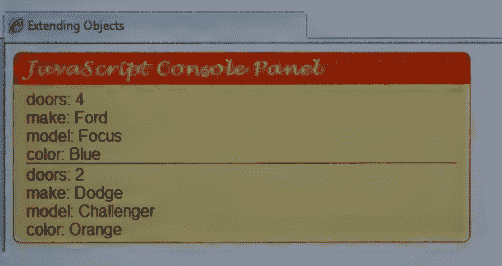

### 创建数组对象

数组是 JavaScript 的内置对象，可以在“元素”中存储多个不同数据类型的项目。传统上，使用 JavaScript 的 `new` 关键字、`Array()` 对象构造函数和变量赋值来创建数组实例。此外，该语句还可以传递值来初始化数组元素。例如，创建一个名为 "colors" 的新数组：

```
var colors = new Array(value1, value2, value3);
```

创建数组的另一种更简洁的方法是在一对方括号内分配初始元素值列表 —— 这些括号暗示了值将存储在元素中，因此数组字面量创建了：

```
var colors = [ value1, value2, value3 ];
```

所有现代浏览器都支持数组字面量，因此现在使用这种更简洁的语法创建数组。如果需要脚本兼容非常旧的浏览器，则可以使用 `Array()` 构造函数。

与自定义对象不同，数组的每个属性都有名称 —— 从 0 开始，第一个元素是 0，第二个是 1，第三个是 2，依此类推。这种编号系统通常被称为“基于零的索引”。

通过在对象名后的方括号内包含元素索引数字来引用数组元素中存储的值。例如，`colors[0]` 将引用名为 "colors" 的数组中第一个元素的值：

如果数组元素不需要立即初始化，可以创建一个空数组并在稍后为其元素赋值，如下所示：

```javascript
colors = []; // 等同于分配一个新的 Array();
```

```
colors[0] = "Red"; colors[1] = "White"; colors[2] = "Blue";
```

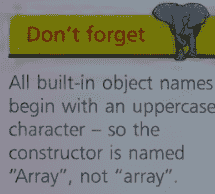

创建一个 HTML 文档，嵌入外部脚本文件，并包含一个用于写入内容的元素：`<script type="text/javascript" src="array.js"></script><div id="panel"></div>`


创建一个 JavaScript 文件，并包含一个 "init" 函数来初始化带有 panel 元素的变量：`function init():`

```javascript
var panel=document.getElementById("panel");
window.onload=init;
```


在函数块中，插入一个语句来初始化一个数组：`var summer = ["June","July","August"];`

在函数块中，插入一个循环，在 `panel` 中写入每个对象属性的名称和值：
```javascript
for(property in myCar) {
  if (myCar[property] != "") {
    panel.innerHTML+= (property + ": " + myCar[property] + "<br>");
  }
}
```

接下来在 `init` 函数中，插入一条语句，通过添加另一个属性并为其赋值值来扩展对象：`Car.prototype.doors=4;`。

接着插入一个循环，在 `panel` 中写入每个对象属性的名称和值，最后添加一条分割线：
```javascript
for(property in myCar) {
  if (myCar[property] != "") {
    panel.innerHTML+= (property + ": " + myCar[property] + "<br>");
  }
}
panel.innerHTML+="<hr>";
```

现在插入语句，为每个属性分配新值：`myCar.make="Dodge";myCar.model="Challenger";myCar.color="Orange";myCar.doors=2;`。

重复步骤 5 中列出的循环 —— 这次是在 `panel` 中写入每个对象属性的名称和新值。

将脚本与 HTML 文档保存在一起，然后在浏览器中打开页面以查看对象的属性和值。

### 遍历数组

数组和循环是极佳的伙伴！任何类型的循环都可以用于填充数组。同样，循环也可以用于快速读取元素。数组有一个 `length` 属性，包含元素的总数。由于基于零的索引，这个值会大一。


- 1. 创建一个 HTML 文档，嵌入外部脚本文件，并包含一个用于写入内容的元素：`<script type="text/javascript" src="elements.js"></script><div id="panel"></div>`

- 2. 创建一个 JavaScript 文件，并包含一个 "init" 函数来初始化带有 panel 元素的变量：`function init():`

```javascript
function init(){
  var panel=document.getElementById("panel");
  var i, arr=[];
}
window.onload=init;
```


- 3. 在函数块中，插入一个循环，根据索引数字的奇偶性填充布尔值，并将它们的索引写入 `panel` 中：`panel.innerHTML="Fill Elements...";`

```javascript
for(i=1; i < 11; i++) {
  arr[i]=( i % 2 === 0 ) ? true : false;
  panel.innerHTML+="<br>Element " +i + :" +arr[i];
}
```

- 4. 现在在函数块中，插入一个循环来读取每个元素并将真元素的索引写入 `panel` 中：`panel.innerHTML+=<br>Read Elements...<br>True: `

```javascript
for(i=1; i < arr.length; i++) {
  if (arr[i]) { panel.innerHTML+= i + " "; }
}
```

- 5. 最后在函数块中，插入一个循环来读取每个元素并将假元素的索引写入 `panel` 中：`panel.innerHTML+=<br>False: ";`

```javascript
for(i=1; i < arr.length; i++) {
  if (!arr[i]) { panel.innerHTML+= i + " "; }
}
```


## 添加数组元素

`length` 属性在之前的示例中曾被用于终止数组的最后一个元素，它现在可以通过添加或减去元素来调整数组的大小。简单的语句可以使用 `+` 加法运算符增加数组，或使用 `-` 减法运算符减小数组。

此外，`length` 属性还可以在循环结构的体中使用，以便在循环的每次迭代中动态添加元素。由于长度值始终比最后一个元素的索引值大 1，因此可以使用它来引用下一个元素的索引值。例如，`arr[arr.length]` 引用当前元素之后的下一个元素。赋值下一个元素会使数组增加一个，从而在后续每次迭代中 `length` 属性都会递增。

通过在语句中使用数组名称，可以将数组中所有元素的值以逗号分隔的列表形式返回。


- 创建一个 HTML 文档，嵌入一个外部脚本文件，并包含一个用于写入内容的元素 `<script type="text/javascript" src="resize.js"></script><div id="panel"></div>`

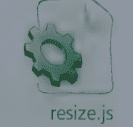

- 创建 JavaScript 文件，其中包含一个 "init" 函数，用于初始化一个变量为面板元素对象，并在文档加载完成时声明一个计数器变量 `init()`

```javascript
function init() {
  var panel=document.getElementById("panel");
  var i;
}
window.onload=init;
```

- 接下来在函数块中，创建并初始化两个数组 `var week= ["Mon", "Tue", "Wed", "Thu", "Fri"]; var weekend= ["Sat", "Sun"];`

- 现在在函数块中，在 `panel` 中写入每个数组所有元素的值 `panel.innerHTML="Weekdays":+week; panel.innerHTML+="<hr>Weekend days":+weekend;`

在函数块中，插入一个循环，在每次迭代时向第一个数组添加一个元素——从第二个数组的每个元素中赋值
```javascript
for(i=0; i < weekend.length; i++) {
  week[week.length]=weekend[i];
}
```

接下来在函数块中，在 `panel` 中写入扩展后数组中所有元素的值 `panel.innerHTML+="<hr>Increased with weekend days: "+week;`

现在在函数块中，减小扩展数组的大小 `week.length-=2;`

最后在函数块中，在 `panel` 中写入缩减后数组所有元素的值 `panel.innerHTML+="<hr>Reduced back to weekdays: "+week;`

将脚本与 HTML 文档保存在一起，然后在浏览器中打开页面，查看数组调整大小时的元素值

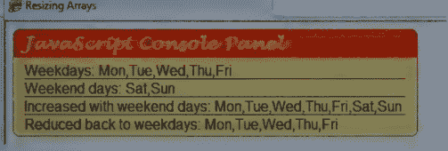


将数组的长度设置为零将移除所有元素并丢失其值。


注意，当 `length` 属性减少时，元素是从数组末尾移除的，而不是从开头。

## 合并和切片数组

JavaScript 对象具有属性和方法。除了 `length` 属性，每个数组对象都有可以操作数组中元素的方法。这些方法列在下表中，并附有它们所执行任务的简要描述：


`slice()` 方法返回包含但不包含可选结束索引位置之前的元素值。

| 方法 |  |
| --- | --- |
| join(separator) | 将所有元素值合并为一个由指定分隔符分隔的字符串；如果没有指定分隔符，则使用逗号 |
| pop() | 删除数组的最后一个元素，并返回其值 |
| push(value, ) | 在数组末尾添加元素并返回新长度 |
| reverse() | 反转数组中所有元素的顺序，并返回每个元素排序后的值 |
| shift() | 删除数组的第一个元素，并返回其值 |
| slice(begin, end) | 返回指定索引位置之间的元素；如果没有指定结束位置，则返回到数组末尾 |
| sort() | 将数组中的所有元素按字母或数字排序，并返回每个元素排序后的值 |
| splice(position, number, value) | 从指定的索引位置开始替换指定数量的元素，并返回被替换的值 |
| unshift(value, ) | 在数组开头添加元素并返回新长度 |


`join()` 方法在将大量元素值合并为单个字符串时更快，但 `+` 拼接运算符在合并少数元素值时更快。

当 `push()` 或 `unshift()` 方法未指定任何值时，会添加一个空元素。


创建一个 HTML 文档，嵌入外部脚本文件并包含一个用于写入内容的元素：
<script type="javascript" src="sort.js"></script>
<div id="panel"></div>


创建一个 JavaScript 文件，包含一个 "init" 函数，用于初始化一个带有 panel 对象的变量，并初始化两个数组
```javascript
function init() {
  var panel=document.getElementById("panel");
  var hues=[ "Red", "RED", "red", "Green", "Blue" ];
  var nums= [ 1, 20, 30, 45, 44, 0.5 ];
}
window.onload=init;
```


在函数块中，插入语句来操作数组元素，并将每个任务的结果写入 panel 中
```javascript
panel.innerHTML="Colors: "+hues;
panel.innerHTML+="br>Dictionary sort: "+hues.sort();
panel.innerHTML+="br>Numbers: "+nums;
panel.innerHTML+="br>Dictionary sort: "+nums.sort();
panel.innerHTML+="br>Numerical sort: "+
nums.sort(sortNums);
panel.innerHTML+="br>Reversed: "+nums.reverse();";
```


在 init 函数上方，添加一个自定义函数来按数字升序排序
```javascript
function sortNums(x, y) { return (x - y); };
```


将脚本与 HTML 文档保存在一起，然后在浏览器中打开该页面以查看排序后的数组元素

当 `sort()` 方法指定比较函数时，必须通过函数名来指定它——不要在 `sort()` 方法的参数中包含比较函数名后的尾括号。

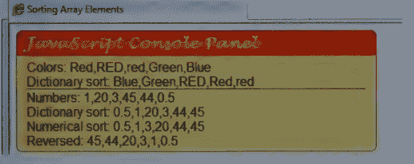

## 异常处理

脚本中可能预测错误的部分（例如处理用户输入的部分）可以封装在 `try` 结构中以处理“异常”错误。要执行的语句包含在 `try` 块的大括号内，异常将作为参数传递给随后的 `catch` 块进行处理。可选地可以跟一个 `finally` 块，其中包含在处理异常后执行的语句。

JavaScript 识别名为 `Error`、`RangeError`、`EvalError`、`TypeError`、`SyntaxError` 和 `URIError` 的错误对象。这些对象可以通过解析器自动创建并传递给 catch ，也可以可以使用 `new` 关键字和构造函数手动创建，然后使用 `throw` 关键字传递。

每个错误对象都可以有一个 `name` 属性和一个 `message` 属性，允许 `catch` 块描述其性质。对于手动创建的错误对象，`message` 指定为构造函数的参数，否则它是预定义的。

或者，也可以通过 `throw` 关键字将字符串传递给 `catch` 块以识别错误。可以通过检查字符串值来确定适当的操作，并由 `switch` 语句提供多个备选方案。

- 1. 创建 HTML 文档，嵌入外部脚本文件并包含一个用于写入的 <script type="text/javascript" src="trycatch.html"></script><div id="panel"></div>


- 2. 创建 JavaScript 文件，包含一个 "init" 函数，用于初始化一个带有 panel 对象的变量，并声明且初始化一个值可能导致异常的变量
```javascript
function init() {
  var panel=document.getElementById("panel");
  var day=32;
}
window.onload=init;
```


### ...续

接下来在函数块中，插入 `try catch finally` 语句
```javascript
try {
  if (day > 31) {
    throw new RangeError('day' cannot exceed 31');
  }
  if (day < 1) { throw "GetReal"; }
}
catch(err) {
  panel.innerHTML = (err === "GetReal") ? "Oops! The 'day' variable has an invalid value of "+day+" : err.name + " exception has occurred: " + err.message;
} finally {
  panel.innerHTML += "<br>The script has ignored variable and is continuing...";
}
```

> 注意
将语句封装在 `try catch` 结构中是捕捉错误的好方法，但它会带来性能代价。仅在绝对需要的地方使用 `try catch` 语句。

将脚本与 HTML 文档保存在一起，然后在浏览器中打开网页以以查看 RangeError 异常

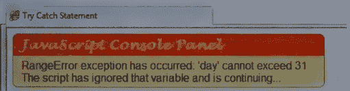

编辑变量赋值，将其值更改为零，然后保存修改后的脚本并刷新浏览器以看到捕获的异常 var day=0;

> 小贴
注释掉 day 变量声明然后保存此示例以查看自动 TypeError


## 总结

- JavaScript 对象可以处理异常和错误。
- Date 对象提供了处理日期和时间的方法。
- 时区计算可以使用 Date 方法进行。

## 时间

本章演示了如何使用内置的日期时间对象进行日期时间计算。

## 获取日期

内置的 Date 对象提供了表示特定日期的组件。使用 `new` 关键字和 `Date()` 构造函数创建 Date 实例。如果不向构造函数传递任何参数，它将基于运行浏览器的系统时间代表创建。没有考虑系统时间是否准确于世界时 (UTC) 或格林尼治时间 (GMT)。

计算机日期和时间以数值测量，为自 1970 年 1 月 1 日 00:00:00 以来的经过的时间——通常被称为“纪元”（epoch）。在 JavaScript 中，经过的时间被记录为毫秒数，该数字可以通过 `getTime()` 方法从 Date 对象中提取，并减去另一个 Date 对象的时间以计算脚本中两个点之间的经过时间。例如为了计算执行所花费的时间

Date 对象内部组件的字符串可以使用 `toString()` 方法提取，或者使用 `toUTC()` 方法提取转换为 UTC 时间的等效字符串。

JavaScript 可以确定用户所在的时区（假设系统已正确设置为本地时间），通过检查当前 Date 对象的 `getTimeOffset()` 方法返回值。它返回一个整数，表示当前本地时间与 UTC 之间的分钟数。计算是以分钟而不是小时进行的，因为某些时区的偏移不是一小时的间隔。例如，加拿大的纽芬兰岛是 UTC-3:30（在夏令时期间为 UTC-2:30）。

时区偏移值可以用于为美国时区提供本地化定制，但在夏令时期间必须减去 60（分钟）。相反的示例将当前系统日期传递给函数，该函数将其与当年的夏令开始和结束日期进行比较，然后返回 0 或 60 以相应调整时区偏移值。

- 获取日期
- 提取日期组件
- 提取时间组件

> 注意 系统时间信息可以被任何时间、日期或时区轻易更改，因此可能无法报告其实际位置。


创建一个 HTML 文档，嵌入外部脚本文件，并包含一个用于写入内容的元素 <script type="text/javascript" src="date.js"></script>
<div id="panel"></</div>


创建一个 JavaScript 文件，包含一个 "init" 函数来初始化四个变量
```javascript
function init() {
  var panel=document.getElementById("panel");
  var now=new Date();
  var offset=now.getTimezoneOffset();
  var dst=isDST(now); // 调用函数调整偏移量。
}

window.onload=init;
```


接下来在函数块中，插入一个 switch 语句来匹配调整后的时区偏移值
```javascript
switch ( offset ) {
  case (300 - dst) : offset="East Coast"; break;
  case (360 - dst) : offset="Central"; break;
  case (420 - dst) : offset="Mountain"; break;
  case (480 - dst) : offset="Pacific"; break;
  default : offset="all";
}
```

现在在函数中插入语句，写入本地和 UTC 日期字符串以及本地化的时区
```javascript
panel.innerHTML="System Time: "+now.toString();
panel.innerHTML+="<br>UTC (GMT): "+now.toString();
panel.innerHTML+="<br> Welcome to "+offset+" visitors";
```

> 小贴士
> 发现用户的本地时区可以引导浏览器跳转到与其时区相关的页面。例如，对于太平洋时区的用户，显示一个仅包含加利福尼亚州经销商的页面。

将脚本与 HTML 文档保存在，然后在浏览器中打开页面以查看日期字符串和本地消息

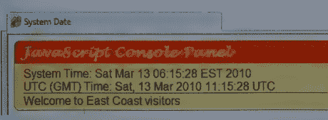

### 提取日期组件

JavaScript Date 对象提供了独立的方法来提取其每个日期组件，包括年份、月份名称、日期几数和星期名称。

Date 对象的 getYear() 方法返回完整的四位年份（例如 2010），而 Date 对象的 getDate() 方法返回月份中的几数——所以对于月份的第一天，它返回 1。

由于国际化的原因，getMonth() 和 getDay() 返回的是索引值，这些值必须由脚本转换为本地语言的月份和日期。通过创建一个包含所有月份名称的数组（从一月开始），使用 getMonth() 返回的索引值来引用相应的月份，可以轻松完成这种转换。同样，通过创建一个包含星期名称的数组（从星期日开始），使用 getDay() 返回的索引值来引用相应的星期名称，也可以完成转换。

各种组件可以组合成日期字符串，并根据任何区域的偏好日期格式进行排列。

- 1. 创建一个 HTML 文档，嵌入外部脚本文件，并包含一个用于写入内容的元素 <script type="text/javascript" src="months.js"></script><div id="panel"></</div>
- 2. 创建一个 JavaScript 文件，包含一个 "init" 函数来初始化三个变量
```javascript
function init() {
  var panel=document.getElementById("panel");
  var days=["Sun","Mon","Tue","Wed","Thu","Fri","Sat"];
  var months=["Jan","Feb","Mar","Apr","May","Jun","Jul","Aug","Sep","Oct","Nov","Dec"];
  // ... 其他代码在此此处
}
window.onload=init;
```

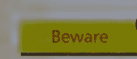

### 注意事项

存在一个 getYear() 方法，它在 Internet Explorer 中返回完整年份，但在 Mozilla 浏览器（如 Firefox）中返回从 1900 年基准开始的值。因此对于 2010 年，它返回 110。请始终使用 getFullYear() 方法而不是 getYear()。


months.html


months.js

告知时间

### ...接续

- 3 接下来在函数块中，创建一个 Date 对象的新实例
```javascript
var now= new Date();
```

- 4 现在在函数块中，插入语句，使用 Date 实例的方法来提取日期组件
```javascript
var yy=now.getFullYear(); // 年份。
var mm=now.getMonth(); // 月份索引。
var dd=now.getDate(); // 月份中的几数。
var dy=now.getDay(); // 星期索引。
```

- 5 在函数块中插入语句，将索引值转换为月份和星期名称值
```javascript
mm=months[mm]; // 转换为月份字符串。
dy=days[dy]; // 转换为星期字符串。
```

- 6 最后在函数块中，在 panel 中写入美式和欧洲格式的日期字符串
```javascript
var str=dy+" "+mm+" "+yy;
panel.innerHTML+="US Date String: "+str;
str=dy+" "+mm+" "+yy;
panel.innerHTML+="<br>UK Date String: "+str;
```

- 7 将脚本与 HTML 文档保存在，然后在浏览器中打开页面以查看日期字符串

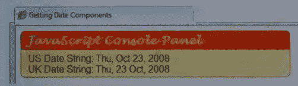

## 不要忘记

月份索引从零开始——三月是二。

### 提取时间组件

JavaScript Date 对象提供了独立的方法来提取每个日期组件。Date 对象的 getHours() 方法返回 24 小时格式的小时，范围为 0-23。getMinutes() 和 getSeconds() 方法都返回 0-59 之间的值。还有一个 getMilliseconds() 方法，返回 0-999 之间的精度值。

每个组件的值可以拼接成一个时间字符串，但为了可读性，通常为分钟和秒值添加前导零。例如 10:05:02。通过检查小时值可以创建一个合适的问候字符串，以确定用户的系统时间是早晨、下午还是晚上。对于需要 12 小时格式的情况，通过检查小时并减去 12 可以创建一个 "AM" 或 "PM" 后缀。例如，13:00 可以转换为 1:00 PM。时间组件基于用户的系统时间，这可能不准确。


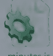

- 创建一个 HTML 文档，嵌入外部脚本文件，并包含一个用于写入内容的元素 <script type="text/javascript" src="minutes.js"></script><div id="panel"></</div>
- 创建一个 JavaScript 文件，包含一个 "init" 函数来初始化六个变量
```javascript
function init() {
  var panel=document.getElementById("panel");
  var now=new Date();
  var hh=now.getHours();
  var mn=now.getMinutes();
  var ss=now.getSeconds();
  var ms=now.getMilliseconds();
}
window.onload=init;
```

接下来在函数块中，插入语句为单数字分钟和秒添加前导零
```javascript
if (mn < 10) { mn = "0"+mn; }
if (ss < 10) { ss = "0"+ss; }
```

现在在函数块中，创建一个时间字符串并写入 panel 中
```javascript
var tim = hh+":"+mn+":"+ss;
panel.innerHTML="It's now: "+tim;
```


Date 对象还提供了获取每个日期时间和组件的 UTC 等效方法。例如 getUTCHours() 和 getUTCMinutes()。

在函数块中插入语句，根据小时创建合适的问候语并写入 panel
```javascript
var hh="Good Morning."; // 0-11
if (hh > 11) { hh="Good Afternoon."; } // 12-17
if (hh > 17) { hh="Good Evening."; } // 18-23
panel.innerHTML="<br>Time is: "+hh+" "+tim;
```

最后在函数块中，根据小时创建一个合适的后缀并转换 panel 中的小时日期字符串
```javascript
var suffix = (hh > 12) ? "P.M." : "A.M.";
if (hh > 12) { hh -= 12; }
panel.innerHTML="<br>Time is: "+hh+":"+mn+suffix;
```

将脚本与 HTML 文档保存在，然后在你的浏览器中打开页面以查看时间字符串

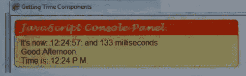

### 设置日期和时间

JavaScript Date 构造函数可以指定二到七个参数，如下所示设置其每个组件的值：

```javascript
new Date(year, month, date, hours, minutes, seconds, milliseconds);
```

当只设置最小年份和月份值时，日期会被设置为1，所有时间组件都被设置为0。

Date 对象还提供了独立的方法来单独设置其每个日期时间和组件的值。setFullYear() 方法的参数将年份设置为四位数，setMonth() 方法的参数将月份设置为 0-11 范围内的数值（0-12月）。setDate() 方法设置月份中的日期几数组件，setHours() 方法设置 0-23 范围内的小时组件，setMinutes() 和 setSeconds() 方法通过接受 0-59 范围内的参数来设置相应的组件。还有一个 setMilliseconds() 方法设置 0-999 范围内的毫秒组件。

通过显示整个 Date 对象可以显示每个设置的值。此外，所有 Date 对象都有方法输出各种格式的日期时间字符串。toString() 方法将日期转换为字符串值，toUTCString() 方法使用计算机的本地习惯显示日期。getDat() 和 getTime() 方法可以用于显示日期时间组件。


toString() 方法返回任何 JavaScript 对象的字符串值并有许多用途。


- 创建一个 HTML 文档，嵌入一个用于写入脚本文件的元素并包含 `text<script type="text/javascript" src="setdate.js"></script><div id="panel"> </div>`
- 创建一个 JavaScript 文件，包含一个 "init" 函数，在文档加载时初始化一个变量
```javascript
function init() {
  var panel=document.getElementById("panel");
}
window.onload=init;
```


在函数块中，插入语句来创建一个 Date 对象并显示其组成部分
var hol=new Date(2010, 6, 4);
panel.innerHTML="Object: "+hol;

现在在函数块中，插入语句来逐个为 Date 对象的每个部分设置一个新值
hol.setFullYear(2012);
hol.setMonth(11);
hol.setDate(25);
hol.setHours(12);
hol.setMinutes(0);
hol.setSeconds(0);
hol.setMilliseconds(0);

最后在函数块中，添加语句在面板中写入 Date 对象值的各种字符串形式
panel.innerHTML+=="<br>String: "+hol.toString();
panel.innerHTML+=="<br>UTC: "+hol.toUTCString();
panel.innerHTML+=="<br>Locale: "+hol.toLocaleString();
panel.innerHTML+=="<br>Date: "+hol.toDateString();
panel.innerHTML+=="<br>Time: "+hol.toTimeString();

将脚本与 HTML 文档一起保存，然后在浏览器中打开该页面以查看日期和时间字符串

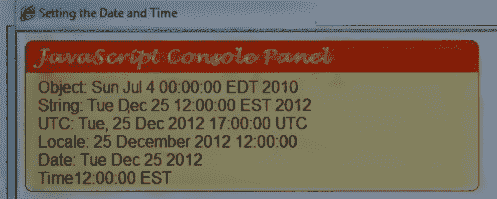

### 贴士
Date 对象还有一个 `setTimeout()` 方法，它接受一个自纪元以来的毫秒数数字作为参数——每个天 `setTime(86400000)` 将日期设置为 1970 年 1 月 1 日。

## 总结

- JavaScript 有一个内置的 Date 对象来表示特定时间点的日期、时间以及时区组件
- 使用 `new` 关键字和 `Date()` 构造函数创建 Date 对象
- 如果 `Date()` 构造函数没有指定参数，则将根据系统时钟创建一个 Date 对象
- JavaScript Date 对象记录了自 1970 年 1 月 1 日 00:00:00 纪元以来经过的毫秒数，可以使用对象的 `getTime()` 方法找到其值
- Date 对象的组成部分可以通过其 `toString()` 或 `toUTCString()` 方法转换为字符串值
- Date 对象的 `getTimezoneOffset()` 方法返回本地时间与 UTC 时间相差的分钟数
- 可以 `getFullYear()`、`getMonth()`、`getDate()` 和 `getDay()` 方法获取单个 Date 组件
- 可以使用 Date 对象的 `getHours()`、`getMinutes()`、`getSeconds()` 和 `getMilliseconds()` 方法从 Date 对象中获取单个时间组件
- `Date()` 构造函数可以接受最多七个参数来设置每个日期和时间组件
- 可以使用 Date 对象的 `setFullYear()`、`setMonth()`、`setDate()`、`setHours()`、`setMinutes()`、`setSeconds()` 和 `setMilliseconds()` 方法设置单个日期和时间组件
- `toLocaleString()` 方法返回使用计算机本地化惯例的字符串，而 `toDateString()` 和 `toString()` 方法则显示日期和时间组件

# 6 处理数字和字符串

本章演示了如何使用内置的 Math 和 String 对象以及内部方法

- 84 计算圆的各种值
- 86 比较数字
- 88 浮点数四舍五
- 90 生成随机数
- 92 合并字符串
- 94 分割字符串
- 96 查找字符
- 98 从字符串中获取数字
- 100 总结

## 计算圆的各种值

JavaScript 有一个内置的 Math 对象，提供了许多实用的方法和数学常量。常量列在下表中，并带有它们的近似值：


| 常量 | 描述 |
||||
| Math.E | 常数 E，自然对数的底数，近似值为 2.71828 |
| Math.LN2 | 2 的自然对数，近似值为 0.69315 |
| Math.LN10 | 10 的自然对数，近似值为 2.30259 |
| Math.LOG2E | 常数 E 的以 2 为底的对数，近似值为 1.44269 |
| Math.LOG10E | 常数 E 的以 10 为底的对数，近似值为 0.43429 |
| Math.PI | 圆周率 Pi，近似值为 3.14159 |
| Math.SQRT1_2 | 0.5 的平方根，近似值为 0.70711 |
| Math.SQRT2 | 2 的平方根，近似值为 1.41421 |

所有的 Math 方法都列在第 86 页。

不需要创建 Math 对象的实例，因为默认它是全局可用的，因此在脚本的任何地方都可以通过 Math 对象和点语法访问 Math 常量和方法。Math 常数主要用于具有特定数学目的的脚本，但为了完整起见，列出了上述所有 Math 常数。

创建一个 HTML 文档，其中嵌入一个外部脚本文件，并包含一个用于写入内容的元素 <script type="text/javascript" src="constants.js"></script><div id="panel"></div>


创建一个带有 "init" 函数的 JavaScript 文件，在文档加载时初始化两个变量：
```javascript
function init() {
  var panel = document.getElementById("panel");
  var rad = 4;
  var area = Math.PI * rad * rad;
  var circ = 2 * Math.PI * rad;
  panel.innerHTML = "Radius: " + rad;
  panel.innerHTML += "<br>Area: " + area;
  panel.innerHTML += "<br>Circumference: " + circ;
}
window.onload = init;
```


在函数块中，插入语句使用常量声明并初始化变量：
```javascript
var area = Math.PI * rad;
var circ = 2 * Math.PI * rad;
```

现在在函数中，在面板中写入变量的值：
```javascript
panel.innerHTML = "Radius: " + rad;
panel.innerHTML += "<br>Area: " + area;
panel.innerHTML += "<br>Circumference: " + circ;
```
将脚本与 HTML 文档一起保存，然后在浏览器中打开该页面以查看日期和时间字符串


### 提示
Date 对象还有一个 `setTimeout()` 方法，它接受一个自纪元以来的毫秒数作为参数——每个天 `setTime(86400000)` 将日期设置为 1970 年 1 月 1 日。

## 总结
（此处略，见上文翻译）

# 6 处理数字和字符串
（此处略，见上文目录）

## 计算圆的各种值
（此处略，见上文内容）

...创建一个 HTML 文档，嵌入一个外部脚本文件并包含一个用于写入内容的元素


创建一个带有 "init" 函数的 JavaScript 文件，在文档加载时初始化两个变量：
```javascript
function init() {
  var panel = document.getElementById("panel");
  var rad = 4;
  var area = Math.PI * rad * rad;
  var circ = 2 * Math.PI * rad;
  panel.innerHTML = "Radius: " + rad;
  panel.innerHTML += "<br>Area: " + area;
  panel.innerHTML += "<br>Circumference: " + circ;
}
window.onload = init;
```


在函数块中，使用常量声明并初始化变量：
```javascript
var area = Math.PI * rad;
var circ = 2 * Math.PI * rad;
```

现在在函数中，在面板中写入变量的值：
```javascript
panel.innerHTML = "Radius: " + rad;
panel.innerHTML += "<br>Area: " + area;
panel.innerHTML += "<br>Circumference: " + circ;
```
将脚本与 HTML 文档一起保存，然后在浏览器中打开该页面以查看日期和时间字符串

（注：由于原文文本中存在重复的逻辑描述，翻译时已根据逻辑结构进行了对齐处理）


创建一个嵌入了外部脚本文件的 HTML 文档，并包含一个用于写入内容的元素：<script type="text/javascript" src="float.js"></script><div id="panel"></div>

创建一个 JavaScript 文件，包含一个 "init" 函数来初始化一个变量并在面板中写入各种舍入后的值
```javascript
function init() {
  var panel=document.getElementById("panel");
  panel.innerHTML="Ceiling:"+Math.ceil(7.5);
  panel.innerHTML+="br>Floor:"+Math.floor(7.5);
  panel.innerHTML+="br>Round:"+Math.round(7.5);
  panel.innerHTML+="br>Round:"+Math.round(-7.5);
}
window.onload=init;
```


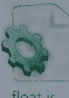

接下来在函数块中，插入语句在 panel.innerHTML 中写入显示并修正浮点误差的值：panel.innerHTML+="<br>Inprecision:"+(81.66 * 15)
panel.innerHTML+="<br>Correct:"+(81.66 * 100) * 15 / 100;

现在在函数块中，插入语句写入显示并对换处理一个浮点值的值：panel.innerHTML+="<br>Float:"+Math.PI;
panel.innerHTML+="<br>Commuted:"+ (Math.round(Math.PI * 100 )) / 100;

将脚本与 HTML 文档保存在一起，然后在浏览器中打开页面以查看计算出的值


最内括号中的表达式会被求值。

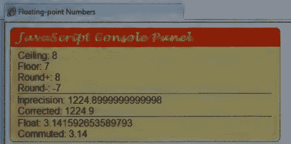

## 生成随机数

JavaScript 的 Math.random() 方法返回一个 0.0 到 1.0 之间的随机浮点数。它可以用于各种网页效果，如随机横幅轮播或彩票号码选择。

将随机浮点数相乘会增加其范围。例如，将其乘以 10 会将范围扩大到 0.0 - 10.0。

通常情况下使用 Math.ceil() 方法将随机值向上取整是有用的，这样范围就变成了 1 - 10。

指定随机数值范围的过程可以写成单独的步骤，也可以使用括号在单个简洁的表达式中确定顺序。例如，为一个名为 "rand" 的变量指定 1-10 的范围可以写为：

```javascript
rand = Math.random();
rand *= 10;
rand = Math.ceil( rand );
```

或者另一种地写为：

```javascript
rand = Math.ceil( Math.random() * 10 );
```


- 创建一个嵌入了外部脚本文件的 HTML 文档，并包含一个用于写入内容的元素：<script type="text/javascript" src="random.js"></script><div id="panel"></div>

- 创建一个 JavaScript 文件，包含一个 "init" 函数来初始化变量并声明所有其他变量——包括一个数组变量
```javascript
function init() {
  var panel=document.getElementById("panel");
  var i, rand, temp, str, nums[];
}
window.onload=init;
```

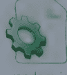

#（续）

- 接下来在函数块中，用相应的索引填充填充元素 1-49：
```javascript
for(i=1; i < 50; i++)
{
  nums[ i]=;
```

- 现在在函数中，将元素中的数字随机化：
```javascript
for(i=1; i < 50; i++)
{
  rand= Math.ceil(Math.random() * 49);
  temp=nums[ i];
  nums[ rand]=temp;
}
```

- 最后在函数块中，在面板写入包含数组元素 1-6 的字符串：
```javascript
str="Your Lucky Numbers:<br>";
for(i=1; i < 7; i++)
{
  str+=nums[i];
  if(i !== 6) { str+=" }
}
panel.innerHTML = str;
```

- 将脚本与 HTML 文档保存在一起，然后在浏览器中打开页面查看 1-49 范围内的六个随机数

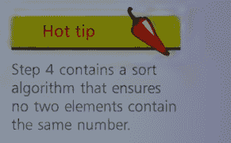


## 拼接字符串

JavaScript 有一个 String 对象，提供了操作字符串值的有用方法。然而，不需要使用 `new` 关键字和 String() 构造函数创建 String 实例，因为它的方法可以使用点语法应用于变量。例如，`str.toUpperCase()` 返回名为 "str" 的字符串的所有大写字符，而 `str.toLowerCase()` 则返回所有小写字符。

还有一个 `length` 属性，存储字符串中的字符总数。

许多示例使用 `+` 运算符来拼接字符串；或者，可以使用 `concat()` 方法追加以逗号分隔列表提供的一个或多个字符串。

内部 eval() 方法也用于拼接字符串和变量——但应该避免这样做。通常会发现通过结合属性并使用点语法来引用文档的一部分，例如：

```javascript
eval("document.images." + picID + ".src=" + picFile);
```

更好的解决方案是使用下标符号而不是点语法引用项目，其中属性名是括号间的字符串，因此示例变为：

```javascript
document.images[picID].src=picFile;
```

这会自动替换字符串值，使得：

```javascript
document.images["myPic"].src="myPic.png";
```

eval() 方法直接调用 JavaScript 编译器将其参数编译为 JavaScript 语句并执行。这会产生巨大的性能开销，在几乎所有情况下都是必要的，因为通常有更高效、优雅的解决方案。此外，如果允许用户输入被评估为 JavaScript 指令，eval() 方法可能会产生安全影响。


避免使用 eval() 方法，因为“eval 是邪恶的（eval is evil）”。

#（续）

- 创建一个嵌入外部脚本文件的 HTML 文档，并包含一个用于写入内容的元素：<script type="text/javascript" src="string.js"></script><div id="panel"></div>


- 创建一个 JavaScript 文件，包含一个 "init" 函数来初始化一些变量：
```javascript
init() {
  var panel=document.getElementById("panel");
  var s1="JavaScript", s2="in Easy", s3="Steps";
  var picName="myPic", picFile="poolballs.png";
}
window.onload=init;
```


- 接下来在函数块中，插入语句写入 s1.toUpperCase() 中所有的字符串值：
```javascript
panel.innerHTML+="<br>";
```

- 现在在函数块中，插入语句使用下标符号将图像写入面板：
```javascript
panel.innerHTML+="<br>";
document.images[picName].src=picFile;
```

## 不要忘记

- 将脚本与 HTML 文档保存在一起，然后在浏览器中打开页面查看字符串和图像

对于包含在双引号外层字符串中的嵌套字符串，请使用单引号。


## 分割字符串

有几种字符串方法允许从完整字符串中复制字符串的指定部分。这些方法将每个字符串视为数组，其中每个元素包含一个字符或空格，可以通过索引位置引用。在数组中，字符串索引是从 0 开始的，因此第一个字符位于位置 0。

通过指定其索引位置作为字符串 `substring()` 方法的参数，可以指定开始复制“子字符串”的起点。这将复制一直到字符串末尾的所有字符。可选地由字符串的 `substring()` 方法提供第二个参数来指定后续的索引位置。这将复制起始和结束位置之间的所有字符。

另一种复制子字符串的方法由 `substr()` 方法提供。与 `substring()` 方法类似，它可以接受单个参数来指定开始复制的索引位置，并复制该位置之后一直到字符串末尾的所有字符。与 `substring()` 方法不同，`substr()` 可以可选提供第二个参数来指定起始位置后复制的字符数。

同样，`slice()` 方法也可用于返回起始位置（由单个参数指定）之后的字符，或两个位置之间（作为两个参数指定）的所有字符。

复制被特定字符分隔的字符串部分有时是有用的。可以将分隔字符作为字符串 `split()` 方法的参数，该方法将返回所有出现该字符的子字符串数组。可以为 `split()` 方法提供第二个参数来指定它应返回的数组大小。在这种情况下，将返回指定分隔字符之间的每个子字符串，直到达到限制，其余字符串将被忽略。

这些字符串方法都不会修改原始字符串，而只是创建原始字符串某个部分的副本。


`substr()` 方法始终比 `substring()` 方法更容易使用，因为你只需要计算起始位置和字符串长度，而不是结束位置。


创建一个 HTML 文档，嵌入外部脚本文件并包含一个用于写入内容的元素：
<script type="text/javascript" src="substring.js"></script>
<div id="panel"></</div>

创建一个 JavaScript 文件，并包含一个 "init" 函数来初始化两个变量

```javascript
var panel=document.getElementById("panel");
var dfn="JavaScript is the original dialect of the ECMAScript standard language where JavaScript is the dialect developed later by Microsoft.";
window.onload=init;
```

接下来在函数块中，插入语句在 panel 中写入各种复制的子字符串。
panel.innerHTML=dfn.slice(0, 26);
panel.innerHTML+=dfn.slice(61, 70) + "<br>";

panel.innerHTML+=dfn.split("", 4) + "<br>";

panel.innerHTML+=dfn.substring(79, 94);
panel.innerHTML+=dfn.substring(121, 130);

panel.innerHTML+=dfn.substr(61, 10);

将脚本与 HTML 文档保存在一起，然后在浏览器中打开页面以查看子字符串

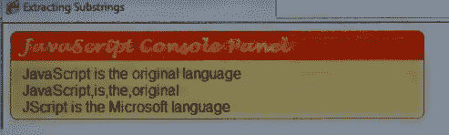


## 不要忘记

指定 ""（不带空格的空字符串）作为 split 函数的分隔符，以返回单个字符的数组。

### 查找字符串字符

JavaScript 对象提供了许多方法，允许搜索字符串中的特定字符或子字符串。字符串 search() 方法接受子字符串作为参数，并返回其在被搜索字符串中出现的位置，如果没有找到则返回 -1。或者，可以将子字符串指定为字符串 match() 方法的参数，如果它存在则返回该子字符串，如果不存在则返回 JavaScript 的 null 值。


null 关键字不等同于零值，或者 null 完全没有值。

字符串 indexOf() 方法接受子字符串作为参数，当它存在时返回该子字符串首次出现的索引，当不存在时返回 -1。lastIndexOf() 方法的工作相同，但它是反向搜索的（从字符串末尾开始），报告子字符串的最后一次出现。

要发现字符串中特定位置的字符，可以将索引值作为 charAt() 方法的参数，或者通过将索引值传递给 charCodeAt() 方法来揭示其数值 Unicode 值。相反，可以将一个或多个 Unicode 值作为 String.fromCharCode() 方法的参数，以返回它们的字符值。

此外，可以通过将字符或子字符串的值指定为 replace() 方法的第一个参数，并将替换值作为第二个参数，来替换所有出现的字符或子字符串。


- 创建一个 HTML 文档，嵌入外部脚本文件并包含一个用于写入内容的元素 `<script type="text/javascript" src="search.js"></script><div id="panel"></div>`


- 创建一个 JavaScript 文件，并包含一个 "init" 函数来声明并初始化两个变量：
```javascript
function init() {
var panel=document.getElementById("panel");
var str="JavaScript in easy steps";
window.onload=init;
}
```

### ...续上

### ...续

接下来在函数块中，插入语句来搜索子字符串
panel.innerHTML="Script' search: "+str.search("Script");
panel.innerHTML+=<br>'Script' match: "+str.match("Script");

现在在函数块中，插入语句来搜索字符
panel.innerHTML+=<br>indexOf('s'): "+str.indexOf("s");
panel.innerHTML+=<br>lastIndexOf('s'): "+str.lastIndexOf("s");

插入语句按索引位置进行搜索并写入 Unicode 值的等字符
panel.innerHTML+=<br>charAt(0): "+str.charCodeAt(0);
panel.innerHTML+=<br>charCodeAt(0): "+str.charCodeAt(0);
panel.innerHTML+=<br>fromCharCode(74, 97, 118);
String.fromCharCode(

最后插入一条语句将子字符串替换为替代子字符串
panel.innerHTML+=
"<br>replace: " + str.replace("easy", "simple");


热提示：大写 A-Z 的值为 65-90，小写 a-z 的值为 97-122。


将脚本与 HTML 文档保存在一起，然后在浏览器中打开页面以查看每个结果

不要忘记 replace() 方法返回原始字符串的修改版本，但并不会实际更改
```javascript
'Script' search: 0
'Script' match: Script
indexOf('s'): 0
lastIndexOf('s'): 23
charAt(0): 83
charCodeAt(0): 83
fromCharCode(74, 97, 118): Jav
replace: simple
```

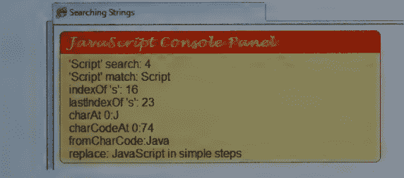

### 从字符串中获取数字

JavaScript 具有三级函数，用于判断字符串是否为数字以及从字符串中提取数字。


isNaN() 函数在值不是数字时返回 true，如果是数字则返回 false。


parseInt() 函数从字符串开头提取整数。默认情况下数字假设为十进制，除非它以 0 开头，此时被视为八进制。

parseFloat() 函数从字符串开头提取浮点数。与 parseInt() 不同，返回的浮点数始终是十进制。

## 解析数字

创建一个 HTML 文档，嵌入外部脚本文件并包含一个用于写入内容的元素：
<script type="text/javascript" src="parse.js"></script>
<div id="panel"></</div>

创建一个 JavaScript 文件，并包含一个 "init" 函数来初始化两个变量
```javascript
var panel=document.getElementById("panel");
var num="07.5";
window.onload=init;
```

接下来在函数块中，插入语句在 panel 中检查变量的数据类型
panel.innerHTML+="Not a number?"+isNaN(num);
panel.innerHTML+=<br>This value is a "+typeof num;

现在在函数块中，插入语句使用不同的系统从字符串开头提取整数
panel.innerHTML+=<br>Octal: "+parseInt(num, 8);
panel.innerHTML+=<br>Decimal: "+parseInt(num, 10);
panel.innerHTML+=<br>Hexadecimal: "+parseInt(num, 16);

最后在函数块中，插入一条语句从字符串开头拷贝浮点值
panel.innerHTML+=<br>Float: "+parseFloat(num);

将脚本与 HTML 文档保存在一起，然后在浏览器中打开页面以查看提取的数字
```javascript
Not a number?false
This value is a string
Octal: 7
Decimal: 7
Hexadecimal: 7
Float: 7.5
```

> 注意
> NaN 值不能用相等运算符进行测试，因此 (str === NaN) 是无效的，必须使用 isNaN(str)。


## 总结

- 可以 `Math.max()` 和 `Math.min()` 方法找到两个数字的最大值和最小值
- 浮点数可以通过 `Math.ceil()`、`Math.floor()` 和 `Math.round()` 方法舍入为相邻的整数
- `Math.random()` 方法返回 0.0 到 1.0 之间的浮点数，可以通过乘法和舍入来指定随机整数的范围
- 内置的 `String` 对象有一个 `length` 属性，用于存储字符串中的字符数
- 可以字符串的 `toStringUpperCase()` 和 `toLowerCase()` 方法修改字符的大小写
- 应该避免使用内部的 `eval()` 方法，因为它通常效率低下，并且可能产生安全影响
- 字符串方法将每个字符串视为字符数组，可以通过索引位置进行引用
- `substring()` 和 `substr()` 方法可用于复制字符串片段
- 可以通过向 `split()` 方法指定分隔符字符将字符串拆分为子字符串数组
- 可以 `search()`、`match()` 和 `indexOf()` 方法来搜索字符串中是否存在指定的子字符串
- 可以 `replace()` 方法替换子字符串
- 内部的 `isNaN()` 函数评估其参数以确定其是否具有数值值
- 内部的 `parseInt()` 和 `parseFloat()` 方法从指定字符串参数的开头返回数值
- 为 `parseInt()` 函数应始终提供基数（Radix）参数以指定使用哪种计数系统

# 7 引用 window 对象

本章演示了如何使用文档对象模型（DOM）中 window 对象的属性和方法。

- 102 介绍 DOM
- 104 检查 window 属性
- 106 显示对话框消息
- 108 滚动和移动位置
- 110 打开新窗口
- 112 创建窗口定时器
- 114 查询浏览器
- 116 发现已启用的功能
- 118 控制位置
- 120 浏览历史记录
- 122 总结

## 介绍 DOM

浏览器在一个名为“文档对象模型”（DOM）的层级树中表示网页的所有所有组件。每个组件都显示在顶层窗口对象之下，该树通常包含下例所示的分支：

### 小贴士

紧跟方方括号的项目是数组对象，而圆括号内的项目是所有可能的表单元素类型。

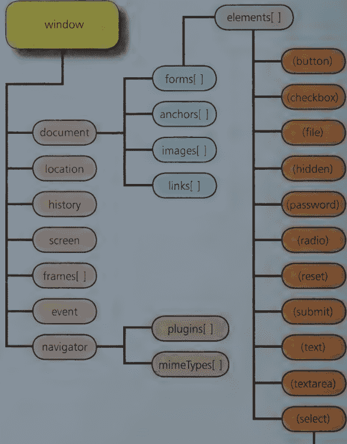

## 注意

`window.event` 对象在 Internet Explorer DOM 中存在，但在 Firefox 等基于 Mozilla 的浏览器中不存在。可以使用 `for in` 循环来列出浏览器提供的 window 对象的所有属性。列表将包含所有现代浏览器通用的基础属性，以及某些特定浏览器的少量属性。

## ...继续

1 创建一个 HTML 文档，嵌入一个外部脚本文件，并包含一个用于写入内容的元素 <script type="text/javascript" src="dom.js"></script><div id="panel"></div>


2 创建 JavaScript 文件，其中包含一个 "init" 函数来初始化变量并声明第二个变量

```
{
  var panel=document.getElementById("panel");
  var property;
}
window.onload=init;
```


3 接下来在函数块中插入一个循环，列出 DOM window 对象中的每个属性

```
for(property in window) {
  if(property) { panel.innerHTML+= property+", "; }
}
```

4 将脚本与 HTML 文档一起保存，然后在浏览器中打开页面以查看 window 属性

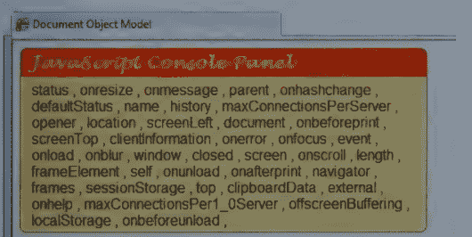

> 不要忘记
> window 属性由浏览器提供，因此会随浏览器和版本而异。

## 检查 window 属性

顶层 DOM window 对象有一个 `screen` 子对象，它提供了描述以像素单位测量的用户显示器分辨率的属性。整体屏幕尺寸可以在 `screen.width` 和 `screen.height` 属性中找到，而排除任务栏占据空间后的可用尺寸可以在 `screen.availWidth` 和 `screen.availHeight` 属性中找到。

屏幕的色彩能力可以通过 `screen.colorDepth` 属性发现，该属性包含描述屏幕可以显示的颜色范围的位值。8 位低色值可以显示 256 种颜色，16 位高色值可以显示 65,536 种颜色，32 位真色值可以显示数百万种颜色。

通过给 `window.defaultStatus` 属性赋值字符串，可以指定在窗口状态栏上显示的默认消息。在其他情况下，可以通过给 `window.status` 属性赋值不同的字符串来替换默认消息。这些可以提示用户脚本应用程序的进度，但不应依赖于它们，因为用户可能禁用了状态栏消息或删除了状态栏消息。

（注意：OCR 文本源码中包含一些杂乱/交叉的部分。我已根据标准文档结构重构了逻辑流。）

1 创建一个 HTML 文档，嵌入一个外部脚本文件，并包含一个用于写入内容的元素 <script type="text/javascript" src="dom.js"></script><div id="panel"></div>


2 创建 JavaScript 文件，其中包含一个 "init" 函数来初始化变量并声明第二个变量

```
{
  var panel=document.getElementById("panel");
  var property;
}
window.onload=init;
```

## 检查 window 属性

顶层 DOM window 对象有一个 `screen` 子对象，它提供了描述以像素单位测量的用户显示器分辨率的属性……（该部分已逻辑处理）

3 接下来在函数块中插入一个循环，列出 DOM window 对象中的每个属性
```javascript
for(property in window) {
  if(property) { panel.innerHTML+= property+", "; }
}
```

## 显示对话框消息

顶层 DOM window 对象提供了三种方法， JavaScript 用向用户显示对话消息。可以将简单的警告消息字符串作为 `window.alert()` 方法的参数。它显示在一个只有一个“确定”按钮的对话框中，作用仅是关闭对话框。

更具体的，可以将消息作为 `window.confirm()` 方法的参数，请求用户做出决策。它显示在一个包含“确定”按钮和“取消”按钮的对话框中。点击任何按钮都会关闭对话框，但“确定”按钮返回 `true` 值，而“取消”按钮返回 `false` 值。

还可以可以将消息作为 `window.prompt()` 方法的参数，请求用户“输入”。它显示在一个包含“确定”按钮、“取消”按钮和一个文本输入框的对话框中。点击任何按钮都会关闭对话框，但“确定”按钮返回文本框中的值，而“取消”按钮返回 `null` 值。可选地为 `window.prompt()` 方法提供第二个参数，以为文本框指定默认内容。


### ...续上

最后在函数块中，插入一条语句来请求用户输入文本，并将返回的文本写入面板：
`panel.innerHTML+=<br>Prompt:"+window.prompt("Yes or No?","Yes");`

将脚本与 HTML 文档一起保存，然后在浏览器中打开该页面，并在每个对话框出现时点击“确定”按钮。

### 贴士

`confirm` 对话框可以与 `if` 语句配合来实现脚本分支。例如：`if(confirm("OK?")) {...} else {...};`

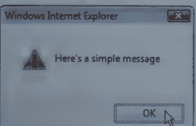


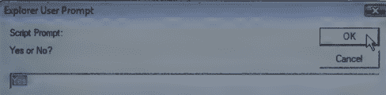

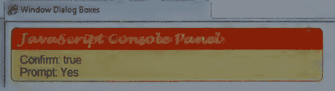

### 滚动和移动位置

DOM 窗口有一个 `scrollBy()` 方法，允许窗口在内容向任何方向溢出窗口时进行水平或垂直滚动。该方法需要两个参数，分别指定沿 X 轴和 Y 轴移动的像素数。


为 `scrollBy()` 和 `moveBy()` 方法提供负值可以向上或向左移动。

当内容垂直方向溢出窗口时，浏览器窗口右边缘会出现滚动条，`scrollBy()` 方法将根据其第一个参数指定的像素数进行滚动——直到到达内容的边界。

同样，当内容水平方向溢出窗口时，浏览器窗口底部会出现滚动条，`scrollBy()` 方法将根据其第二个参数指定的像素数进行滚动——直到到达内容的边界。

还有一个 `scrollTo()` 方法，它接受两个参数，指定 X 和 Y 坐标，当内容水平或垂直溢出窗口时，窗口左上角应滚动到这些坐标。这可以用于从默认的 X=0, Y=0 坐标移动到指定的替代位置。例如，当浏览器以表格电子格式显示数据，且第一行的第一个单元格位于浏览器窗口的左上角时，`scrollTo()` 方法可以将特定的单元格放在浏览器的左上角。

占据整个桌面空间的窗口，其左上角通常位于屏幕的 X=0, Y=0 坐标，但较小的浏览器窗口当然可以拖动到任何坐标。较小浏览器窗口在屏幕上的位置也可以通过向 `moveTo()` 方法指定 X 和 Y 屏幕坐标来确定。例如，此方法可以通过为每个轴指定零坐标将窗口移动到屏幕的左上角。

还有一个 `moveTo()` 方法，它接受两个参数，指定窗口位置应从当前屏幕位置沿 X 和 Y 轴偏移的像素数。

创建一个 HTML 文档，嵌入外部脚本文件，并包含一个用于写入 `<script type="javascript" src="scroll.js"></script>` 的元素：
`<div id="panel"></div>`

创建 JavaScript 文件，带有一个 "init" 函数来声明计数器变量并初始化第二个变量：
```javascript
{
  var i, panel=document.getElementById("panel");
  window.onload=init;
}
```

接下来在函数块中，插入一个循环在面板中写入五百数字，使窗口内容溢出：
`for(i=1 ; i < 501 ; i++) { panel.innerHTML+= i+" " };`

现在在函数块中，添加语句向下滚动 500 像素并将窗口置于屏幕左上角：
`window.scrollTo( 0, 500 );`
`window.moveTo( 0, 0 );`

将脚本与 HTML 文档一起保存，然后在一个约占屏幕屏幕四分之一的浏览器中打开页面，观察窗口的滚动和移动。


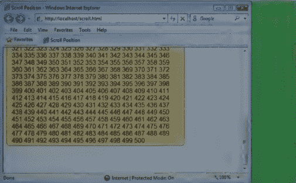

> **注意**：`scrollBy()` 方法的效果仅在内容溢出窗口（导致滚动条出现）时才会变得明显。

### 打开新窗口

可以使用窗口对象的 `open()` 方法打开新的浏览器窗口，该方法需要三个字符串参数。第一个参数是在新窗口中要加载的 HTML 文档的 URL 地址，第二个参数仅为新窗口命名，第三个参数是窗口应包含的特征逗号分隔列表——特征来自下表描述的可能特征：

| 特性 | 描述 |
| --- | --- |
| directories | 添加链接栏 |
| height | 设置文档区域的高度（像素为单位） |
| left | 窗口的屏幕 X 坐标 |
| location | 添加地址栏 |
| menubar | 添加菜单栏 |
| resizable | 允许调整窗口大小 |
| scrollbars | 需要时启用滚动条 |
| status | 添加状态栏 |
| toolbar | 添加前进和后退按钮 |
| top | 窗口的屏幕 Y 坐标 |
| width | 设置文档的宽度（像素为单位） |


当成功时，`window.open()` 返回一个窗口对象；如果失败，则返回 `null`。该结果应赋值给变量，以便后可以使用 `close()` 方法关闭窗口。反之，如果赋值为 `null`，则无法执行执行执行返回的 `print()` 方法。 `。，，， ` `()` 方法 方法 ` ` `。。，，`window.open()` 方法返回的窗口赋值给变量后，`close ` `close()` 方法。由于浏览器添加了弹出窗口拦截器，这种使用 ` `()`。

因此通常建议使用 `setTimeout()` 方法。

### ...续上

创建一个 HTML 文档，嵌入外部脚本文件，并包含一个用于写入 `<script type="javascript" src="scroll.js"></script>` 的元素：
`<div id="panel"></div>`


创建 JavaScript 文件，带有一个 "init" 函数来声明计数器变量并初始化第二个变量：
```javascript
{
  var i, panel=document.getElementById("panel");
  window.onload=init;
}
```

接下来在函数块中，插入一个循环在面板中写入五百数字，使窗口内容溢出：
`for(i=1 ; i < 501 ; i++) { panel.innerHTML+= i+" " };`

现在在函数块中，添加语句向下滚动 500 像素并将窗口置于屏幕左上角：
`window.scrollTo( 0, 500 );`
`window.moveTo( 0, 0 );`

将脚本与 HTML 文档一起保存，然后在一个约占屏幕屏幕四分之一的浏览器中打开页面，观察窗口的滚动和移动。


> **注意**：`scrollBy()` 方法的效果仅在内容溢出窗口（导致滚动条出现）时才会变得明显。

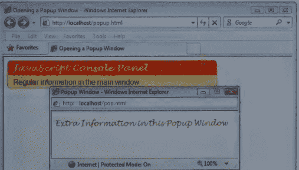

### 创建计时器

JavaScript 窗口有一个有趣的 `setTimeout` 方法，它可以在指定时间后重复评估表达式。当在指定时间内调用 `setTimeout()` 时，会创建一个递归循环——其中函数会被重复执行。


一个设置间隔 10 分钟的两分钟任务每 10 分钟开始一次，但设置超时为 10 分钟的任务每 12 分钟开始一次（10+2）。

`setTimeout()` 方法要评估的表达式必须作为第一个参数指定，指定的时间必须作为第二个参数指定。时间以毫秒为单位，其中 1000 代表一秒。

`setTimeout()` 方法返回一个数值，可以赋值给变量以唯一标识该等待过程。该值可以作为窗口对象 `clearTimeout()` 方法的参数，以便在某处终止循环。

窗口对象还有 `setInterval()` 和 `clearInterval()` 方法，它们接受相同的参数且工作方式相似。区别在于 `setInterval()` 方法指定的时间是评估的间隔，无论执行需要多长时间。相反，`setTimeout()` 方法指定的时间是从上一次执行结束到下一次开始之间的时间。这意味着，如果间隔很短而执行表达式所需的时间很，`setInterval()` 方法可能会尝试重叠执行。因此，通常优选使用 `setTimeout()` 方法。


+   创建一个 HTML 文档，嵌入外部脚本文件，并创建一个元素用于写入 `<script type="text/javascript" src="timer.js"></script><div id="panel"></div>`


+   创建 JavaScript 文件并初始化全局计数器为零 `var counter=0;`


### ...接续

接下来添加一个 "init" 函数来声明两个变量
function init()
```javascript
  var timerId, panel=document.getElementById("panel");
}
window.onload=init;
```

现在在函数块中，计数器变量加1
counter++;

接下来在函数块中，在 panel 中写入一个 span 元素来显示计数器变量的当前值
panel.innerHTML+="<span style='background:black;color:white;margin:2px;'>"+counter+"</span>";

插入一条语句，当计数器值达到二十时终止循环，如果小于二十则重复
if (counter > 19) {
  window.clearTimeout(timerId);
} else {
  timerId = setTimeout(init, 1000);
}

将脚本与 HTML 文档保存在一起，然后在浏览器中打开页面，查看每秒都会被添加的 span 元素，直到计数器达到二十。

> 注意：请注意样式规则被包含在单引号内，以避免与外部双引号产生冲突。

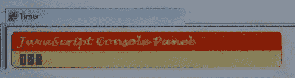

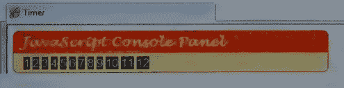

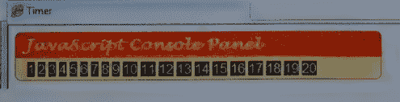

### 查询浏览器

在 DOM 层次结构中，顶层 window 对象拥有多个子对象，每个对象都有自己的属性和方法。其中之一是 window.navigator 对象，它包含了关于 浏览器的信息。顶层 window 对象存在于“全局命名空间”中，它的子对象都可以省略地址的一部分，因此可以使用 `alert()` 直接调用 `window.alert()` 方法，可以使用 `onload` 引用 `window.onload` 属性，可以使用 `navigator` 引用 `window.navigator` 对象。

navigator 对象有一个 `appName` 属性包含浏览器名称，`appCode` 属性包含代码名称，`appVersion` 属性包含版本号。但可能会对这些值感到惊讶，因为 Internet Explorer、Firefox、Safari 和 Opera 提供的代码名称均为 "Mozilla"。

每个浏览器在向 Web 服务器发送请求时，会在名为 "User-Agent" 的 HTTP 请求头中发送浏览器代码和版本，此字符串也可以通过 `navigator.userAgent` 属性获取。还有 `navigator.platform` 属性用于描述浏览器的操作系统环境。

过去几年，人们编写了浏览器检测脚本，尝试使用 navigator 属性识别浏览器，以便提供适用于该浏览器支持的功能的代码。这现在被认为是一种坏做法，现在建议使用特性检测（feature detection）。

例如，查询浏览器是否支持常用的 `document.getElementById()` 方法，可以判断其是否支持现代的文档对象模型（DOM）。

- 创建一个 HTML 文档，扩展外部脚本文件并包含一个元素，在其中写入 `<script type="text/javascript" src="browser.js"></script> <div id="panel"></div>`

- 创建 JavaScript 文件，包含一个 "init" 函数，在文档加载时初始化一个变量 function init()
  var panel=document.getElementById("panel");
  onload=init;


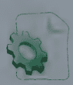

在函数块中，插入语句在 panel 中写入浏览器属性和宿主系统类型 panel.innerHTML+="Browser": +navigator.appName;npanel.innerHTML+="<br>Code Name": +navigator.appCode;npanel.innerHTML+="<br>Version": +navigator.appVersion;npanel.innerHTML+="<br>Platform": +navigator.platform;

接下来在函数块中，如果检测到支持现代 DOM 方法，插入一条语句在 panel 中写入消息 if (document.getElementById) {
  panel.innerHTML+="This is a Modern DOM Browser";
}

将脚本与 HTML 文档保存在一起，然后在不同的浏览器中打开页面以比较它们的属性。

Internet Explorer 描述为 Mozilla 的源是因为“浏览器大战”时代，当时微软拥有自己的名称，以便其浏览器能够提供像 Mozilla 浏览器能够提供的所有网页。

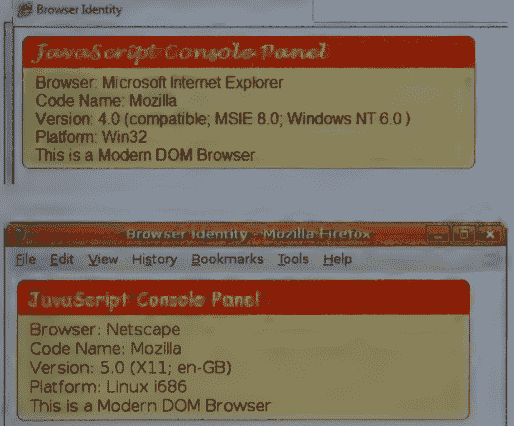

### 发现启用了哪些

DOM 对象的 navigator `javaEnabled()` 方法仅在 Web 浏览器启用了 Java 支持时才会返回 true。此外，navigator 拥有一个 `plugins` 子对象和一个 `mimeTypes` 子对象。这两个对象在 Internet Explorer 中均未实现，但在 Firefox 等 Mozilla 浏览器中，它们是数组，其中每个元素都包含所支持功能的详细信息。

这些数组元素的内容取决于每个浏览器支持哪些功能。

与其他数组一样，`plugins` 和 `mimeTypes` 数组都有一个 `length` 属性，包含其元素的数字总数。

每个 plugin 元素都有 `name` 和 `description` 属性，包含一个已安装功能的详细信息。可以像常一样使用元素索引号引用。例如，`navigator.plugins(0).name` 引用 plugins 数组中第一个元素的名称。

同样，每个 mimeTypes 数组元素都有 `type` 和 `description` 属性，包含一个支持的 MIME 功能的详细信息。可以像常一样使用元素索引号引用。例如，`navigator.mimeTypes[0].type` 引用 mimeTypes 数组中第一个元素的类型。

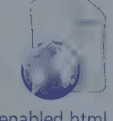

- 创建一个 HTML 文档，嵌入外部脚本文件并包含一个元素，在其中写入 `<script type="text/javascript" src="enabled.js"></script> <div id="panel"></div>`

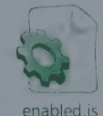

- 创建 JavaScript 文件，包含一个 "init" 函数，在文档加载时初始化一个变量 init() {
  var panel=document.getElementById("panel");
}

- 接下来在函数块中，如果启用了 Java 支持，插入一条语句在 panel 中写入消息 if (navigator.javaEnabled()) {
  panel.innerHTML="Java Support Enabled";
}

在函数块中，插入语句在 panel 中写入浏览器属性和宿主系统类型 panel.innerHTML+="Browser": +navigator.appName;npanel.innerHTML+="<br>Code Name": +navigator.appCode;npanel.innerHTML+="<br>Version": +navigator.appVersion;npanel.innerHTML+="<br>Platform": +navigator.platform;

现在在函数块中，插入语句写入 plugins 数组的长度 if( navigator.plugins.length != 0 )
{
  panel.innerHTML+="<br>Total Plugins:";
}

> 提示：使用循环写入所有的 plugins 和 mimeTypes 内容。

将脚本与 HTML 文档保存在一起，然后在 Firefox 浏览器中打开页面查看哪些启用了

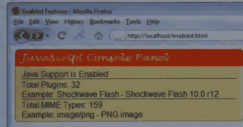

### 控制位置

window location 对象拥有五个属性，包含了当前加载到浏览器的文档的完整 URL 地址。描述协议、域名、文件名以及可选片段锚点的完整地址包含在 `location.href` 属性中。为 location 属性分配新 URL 将导致浏览器加载该页面或其他资源。


- 创建一个 HTML 文档，扩展外部脚本文件并包含一个元素，在其中写入 `<script type="text/javascript" src="location.js"></script> <div id="panel"></div>`


- 创建 JavaScript 文件，包含一个 "init" 函数，在文档加载时初始化一个变量 init()
{
  var panel=document.getElementById("panel");
}
onload=init;

接下来在函数块中，插入一条语句在 panel 中写入一个片段锚点 panel.innerHTML+="<a name='frag'>Fragment Anchor</a>";

现在在函数块中，插入一条请求用户确认后再跳转到片段锚点的语句，通过锚点名称接到当前地址 var jump=confirm("Jump to fragment?");
if (jump ) {
  location=location.href+"#frag";
}

最后在函数块中，插入语句在 panel 中写入当前位置锚点的每个组件 panel.innerHTML+="<br>Ref:"+location.href;panel.innerHTML+="<br>Protocol:"+location.protocol;panel.innerHTML+="<br>Host:"+location.host;panel.innerHTML+="<br>Path:"+location.pathname;panel.innerHTML+="<br>Hash:"+location.hash;

Web 浏览器可以加载任何支持的 MIME 类型的文件。例如，MIME 类型为 image/png 的所有 PNG 图像文件。


6. 将脚本与 HTML 文档保存在一起，然后在浏览器中打开该页面，并在确认框中点击“取消”（Cancel），以查看页面地址的位置组件

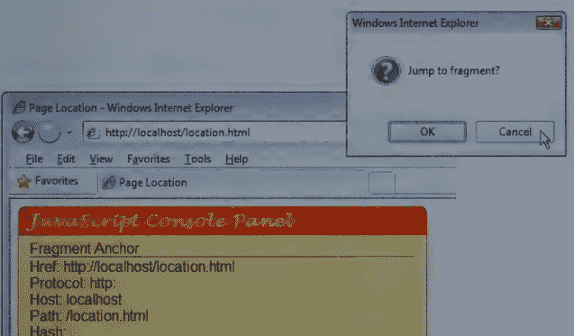

在浏览器中刷新页面，但这次在确认框中点击“确定”（OK），以查看片段锚点地址的位置组件


## 穿越历史

网络浏览器会将当前会话中访问过的 URL 历史存储在 `window` 对象内部 `history` 子对象的数组中。与其他数组一样，它有一个 `length` 属性，以及用于在元素之间移动的 `back()` 和 `forward()` 方法。或者，history 对象的 `go()` 方法接受一个正或负整数，指定沿数组移动的元素数量。例如，`history.go(1)` 向移动一个元素，`history.go(-2)` 向后移动两个元素。


- 创建三个相同的 HTML 文档，它们嵌入相同的外部脚本文件，并创建一个用于从 JavaScript 写入内容的元素
<script type="text/javascript" src="history.js"></script>
<div id="panel"></div>


- 创建 JavaScript 文件，并包含一个 "init" 函数，以便在文档加载时初始化一个变量
```javascript
function init() {
  var panel=document.getElementById("panel");
  onload=init;
}
```


- 接下来在函数块中，插入语句在面板中写入指向每个 HTML 文档的超链接
```javascript
panel.innerHTML += '<a href="history-1.html">Page 1</a> |';
panel.innerHTML += '<a href="history-2.html">Page 2</a> |';
panel.innerHTML += '<a href="history-3.html">Page 3</a> |';
```

按钮事件处理器（如 `onclick`）在第 138 页有详细详细描述。

- 现在在函数块中，插入语句在面板中写入浏览器的历史和当前文档
```javascript
panel.innerHTML += '';
```

- 最后在函数块中，插入语句创建在按下时调用 history 方法的按钮
```javascript
panel.innerHTML += '<button onclick="history.back()">Back</button>';
panel.innerHTML += '<button onclick="history.forward()">Forward</button>';
```

6. 将脚本与 HTML 文档保存在一起，然后打开一个页面查看初始历史长度为零


> 小贴士
> URL 以保护的方式存储在 history 对象数组元素中，因此无法以字符串的形式检索它们。

7. 点击链接加载另一个页面，查看历史长度的增加


8. 点击 HTML 后退按钮返回初始页面，查看历史长度进一步增加


> 小贴士
> 请记住，只有在移动到不同页面时每个 URL 才会被添加到历史数组中，而不是在每个页面加载时。

9. 再次点击前进按钮返回上一个页面，但现在看到历史长度保持不变 - 因为移动仅沿现有的历史数组元素进行


## 总结

- 文档对象模型 (DOM) 是网页所有组件的层级表示

- `window` 对象是 DOM 层次结构中的顶层，具有描述浏览器窗口的属性

- `screen` 对象是 `window` 对象的子对象，具有描述屏幕尺寸和色深的属性

- 使用 `window` 对象的 `alert()`、`confirm()` 和 `prompt()` 方法显示对话框消息

- 使用 `window` 对象的 `open()` 方法创建弹出窗口，但可能会被弹出拦截器拦截

- `window` 对象的 `setTimeout()` 方法创建一个定时器，稍后可以使用 `setTimeout()` 方法取消

- `navigator` 对象是 `window` 对象的子对象，具有描述浏览器和主机平台版本的属性

- 由于 `window` 对象存在于全局命名空间，其所有子对象都不需要包含地址的该部分，因此 `window.navigator` 可以直接引用为 `navigator`

- 通过查询 `navigator` 属性来检测浏览器是一种坏做法——应该使用功能检测来确保存在 DOM 支持

- `navigator.plugins` 和 `navigator.mimeTypes` 属性对于 Mozilla 浏览器都是数组，其中每个元素包含所支持的功能的细节

- `location` 对象是 `window` 对象的子对象，具有描述加载文档地址的属性

- `history` 对象是 `window` 对象的子对象，包含当前会话的访问位置数组，并具有沿其元素导航的方法

## 与文档交互

- 124 提取文档信息
- 126 组件
- 128 组件
- 130 设置 cookie
- 132 使用 JavaScript 写入
- 134 总结

## 提取文档信息

DOM 对象中最有趣的子对象是 `document` 对象，它提供了对 HTML 文档的访问。它具有描述文档及其位置的属性。`document.title` 属性包含 HTML 文档的标题。HTML 文档位于 `document.URL` 属性中，类似于 `location.href` 值。域名位于 `document.domain` 属性中，类似于 `location.host` 值。HTML 文档将其创建或修改作为 HTTP Header 提供给浏览器，以便决定使用文档的缓存还是新副本。此数据也可以通过 `document.lastModified` 属性检索。此外，还有一个 `document.referrer` 属性存储了用户加载当前 HTML 文档的网页 URL。

- 创建一个 HTML 文档，其主体包含一个指向第二个 HTML 文档的超链接
<div><a href="info-2.html">Refer to the Next Page</a></div>

- 现在创建一个 HTML 文档，嵌入外部脚本文件并包含一个用于写入的元素
<script type="text/javascript" src="info.js"></script>
<div id="panel"></div>

- 创建 JavaScript 文件，包含一个 "init" 函数，在文档加载时初始化一个变量
```javascript
function init() {
  var panel=document.getElementById("panel");
  onload=init;
}
```


## 注意

`document.referrer` 属性仅在用户跟随超链接加载文档后才被设置，如果他们输入 URL 或使用某些方法加载文档则不会。接下来在函数块中，插入语句在面板中写入当前 HTML 文档的属性
```javascript
panel.innerHTML += "Linked From: "+document.referrer;
panel.innerHTML += "<br>Title: "+document.title;
panel.innerHTML += "<br>URL: "+document.URL;
panel.innerHTML += "<br>Domain: "+document.domain;
panel.innerHTML += "<br>Last Modified: "+document.lastModified;
```


将脚本与 HTML 文档保存在一起，然后在浏览器中打开第一个页面查看超链接


现在点击超链接在浏览器中加载第二个 HTML 文档并查看 `document` 属性


## 与文档交互

### 组件地址

DOM 对象拥有 `forms`、`images` 和 `links` 子对象。这些子对象中的每一个都是数组，每个元素按照它们在 HTML 文档中出现的顺序表示文档组件。例如，文档主体中由 `` 标签指定的第一个图像由 `document.images[0]` 表示。这意味着可以使用 `document.images[0].src` 引用其 URL，这显示了分配给 HTML `` 标签 `src` 属性的路径。在脚本中分配此 URL 将动态替换旧图像。

如果表单和组件都有名称，也可以下标法（第 92 页）。例如，`document.forms["f1"].elements["el1"].value`。

`anchors` 和 `links` 数组都代表文档中的 `<a>` 标签。包含 `href` 属性的标签作为 `links` 数组的元素，而没有 `href` 属性的作为 `anchors` 数组的元素。

意外的是，`forms` 数组代表 `<form>` 标签，它也有自己的子元素，即所有表单组件的数组。例如，HTML 文档中第一个表单的第一个组件的值可以使用 `document.forms[0].elements[0].value` 。在脚本中分配此新值将动态替换旧值。

- 1. 创建一个 HTML 文档，嵌入外部脚本文件并包含一个用于写入的元素
<script type="text/javascript" src="components.js"></script>
<div id="panel"></div>


- 2. 在 HTML 文档主体部分的开头插入一个包含各种组件的表单
<form name="f1" action="processform.cgi" method="GET" style="width:450px;background:url(bg.png);"><a name="topOff"></a><input type="text" name="topic" size="64"><input type="text" name="button" value="Ask a Question"><br><a href="formhelp.html">Need Help?</a><a name="btmOff"></a></</div>></form>


创建一个带有 "init" 函数的 JavaScript 文件，将一个变量初始化为对面板函数的引用：

```javascript
function init() {
  var panel=document.getElementById("panel");
}
onload=init;
```


接下来在函数块中，插入语句写入每个组件数组的大小以及第一张图片的 URL：

```javascript
panel.innerHTML="Document Components...";
panel.innerHTML+=="<br> Forms: " + document.forms.length;
panel.innerHTML+=="<br> Links: " + document.links.length;
panel.innerHTML+=="<br> Anchors: " + document.anchors.length;
panel.innerHTML+=="<br> Images: " + document.images.length;
panel.innerHTML+=="<br>First Image URL: " + document.images[0].src;
```

将脚本与 HTML 文档保存在一起，然后在浏览器中打开页面以查看组件数组。


**注意**
通过样式规则包含在文档中的图像并不是图片数组的一部分，只有通过 HTML `` 标签包含的图像才是——因此这里的 bg.png 背景图不会出现在图片数组中。

### 直接处理组件

通过 DOM 组件数组处理 HTML 文档组件的技术（如上一个示例所示）多年来一直是脚本中引用特定组件的唯一方法，但它存在一些严重的局限性。

首先，使用点符号语法配合组件数组需要脚本作者计算组件的数量来计算每个索引位置。这对于包含多个表单的长文档来说尤为繁琐，且容易出错。更严重的是，对 HTML 文档的修改（即使是微小的）可能需要修改计算出的组件数组索引值，以正确反映新的布局。

另一种方法是使用下标法，即 HTML 脚本作者为每个组件命名，允许脚本作者通过其命名的 DOM 元素来引用组件。这允许对文档进行修改，只要不对先命名的组件进行任何更改，并且所有额外的组件都经过仔细命名，以便脚本作者继续通过其命名的 DOM 层级引用每个组件。

这种不那么理想的情况最终通过向 document 对象添加两个新方法得以解决：

- `document.getElementById()` 方法在本书的示例中一直被用于引用“JavaScript 控制面板”中的 `<div>` 元素，它允许通过其 HTML 属性值引用任何组件。该方法只需指定目标 id 作为其字符串参数，并用于引用单个 HTML 元素。

- `document.getElementsByTagName()` 方法返回一个数组，包含文档中所有与字符串参数指定的元素相同的组件。然后可以使用其数组索引号来引用特定的 HTML 元素。

虽然 `document.getElementsByTagName()` 方法是一个实用的补充，但 `document.getElementById()` 方法才是现代 DOM 真正的英雄，因为它的引入允许在不了解其层级 DOM 地址的情况下引用特定的 HTML 元素。


**注意**
使用 `getElementsByTagName()` 方法的脚本在 HTML 文档被修改时仍可能受到影响，但那些使用英雄级 `getElementById()` 的脚本则不会。

### ...续

创建一个嵌入了外部脚本文件的 HTML 文档，包含列表，并有一个可以编写 JavaScript 的元素：

```html
<script type="text/javascript" src="direct.js"></script>
<ol>
  <li>Alpha</li>
  <li id="item1">Beta</li>
  <li>Gamma</li>
  <ol>
    <li>Delta</li>
    <li id="epsilon">Epsilon</li>
    <li>Zeta</li>
  </ol>
</ol>
<div id="panel"></div>
```

 (注：此处原文为 128_0，保持原样)

创建一个带有 "init" 函数的 JavaScript 文件，通过直接引用文档组件初始化四个变量：

```javascript
function init() {
  var panel=document.getElementById("panel");
  var item1=document.getElementById("item1");
  var elems=document.getElementsByTagName("li");
}
onload=init;
```


接下来在函数块中，插入语句在面板中写入 span 的数量和两个特定的项目值：

```javascript
panel.innerHTML+=="Total No. List Items: "+elems.length;
panel.innerHTML+=="<br>Specific Item One: "+item1.innerHTML;
panel.innerHTML+=="<br>Specific Item Two: "+item2.innerHTML;
```

将脚本与 HTML 文档保存在一起，然后在浏览器中打开页面以查看特定组件。

**不要忘记**
请注意，唯一赋予标识的列表项是 `getElementById()` 想要的目标。

**直接引用**
1. Alpha
2. Beta
3. Gamma
1. Delta
2. Epsilon
3. Zeta

**JavaScript 控制面板**
Total No. List Items: 6
Specific Item One: Beta
Specific Item Two: Epsilon

### 设置和获取 Cookie

JavaScript 无法在硬盘上写入文件，但它可以写入“cookie”文件来存储少少量数据。这些数据是有大小限制的。默认情况下，除非指定了过期日期，否则 cookie 是会话级别的。从 cookie 中检索数据需要一些字符串处理。

创建一个嵌入外部脚本文件的 HTML 文档，包含列表，并有一个可以编写 JavaScript 的元素：

```html
<script type="text/javascript" src="cookie.js"></script>
<div id="panel"></div>
```

创建一个带有 "init" 函数的 JavaScript 文件，在文档加载时初始化变量：

```javascript
function init() {
  var panel=document.getElementById("panel");
}
onload=init;
```


### ...续

接下来在函数块中，创建一个转义值和一个日期，然后将它们赋值给名为 "myData" 的 cookie：

```javascript
var user=escape("Mc McGrath,000456");
var expiry=new Date();
expiry.setTime(expiry.getTime() + (7*24*60*60*1000));
document.cookie="myData="+user+"\expires="+expiry.toGMTString()+";";
```


现在在函数块中，反转 cookie 并分离其值字符串：

```javascript
if (document.cookie ) {
    var cookieString=escape(document.cookie);
    var list=cookieString.split("=");
    if(list[0] === "myData") {
        var data=list[1].split("=");
        var username=data[0];
        var userAcc=data[1];
    }
}
```

最后在函数块中，插入语句在面板中写入 cookie 值：

```javascript
panel.innerHTML+="Cookie String: "+cookieString;
panel.innerHTML+="<br>Split List: "+list;
panel.innerHTML+="<br>User Name: "+username;
panel.innerHTML+="<br>User Account: "+userAcc;
```


### 使用 JavaScript 写入

正如前面的示例所示，文档对象的 `innerHTML` 属性可以分配纯文本、HTML 元素和其他内容，以动态更改文档。不同寻常的是，此过程使用浏览器的 HTML 解析器（而不是 JavaScript 引擎）来插入额外内容并更新 DOM 树。尽管没有文档说明，但 `innerHTML` 属性是从 JavaScript 写入文档内容的一种快速且有效的方法。


不要将关闭窗口的 `window.close()` 方法与关闭写入流的 `document.close()` 方法混淆。

通过向 `document.body` 对象（它代表 HTML `<body>` 元素）的 `innerHTML` 属性赋值，可以在 HTML 文档的末尾追加内容。追加的内容将出现在浏览器窗口中任何其他内容的之后。

DOM 对象还有一个 `write()` 方法，它提供了从 JavaScript 写入内容的另一种方法。当调用此方法时，它会自动调用 `document.open()` 方法启动一个新文档——因此当前文档中的内容将不再显示。要写入的内容被指定为 `document.write()` 方法的参数，可能包括 HTML 元素、纯文本和其他内容。为了写入内容，浏览器会打开一个 `stream`，在内容写入后应始终通过调用 `document.close()` 方法将其关闭。

`document.write()` 方法有时出现在文档主体内的 HTML `script` 元素中，其中它被用来在文档首次在浏览器加载时写入内容。这不符合第 14 页描述的非侵入式 JavaScript 实践精神，应该被避免。

脚本可以通过使用点语法将 `document.write()` 方法追加到它已打开的其他窗口对象，从而动态地向这些窗口写入内容。这意味着脚本可以创建一个弹出窗口，并动态地写入该窗口的内容，而不是加载现有的 HTML 文档。

创建一个嵌入了外部脚本文件并有一个用于写入元素的 HTML 文档：
```html
<script type="text/javascript" src="write.js"></script>
<div id="panel"></div>
```

创建一个 JavaScript 文件，包含一个 "init" 函数来初始化变量并在面板中写入文档标题：
```javascript
function init()
{
 var panel=document.getElementById("panel");
panel.innerHTML+=document.title;
}
onload=init;
```

接下来在函数块中，插入一个语句来创建一个弹出窗口：
`var pop=window.open("",","top=200,left=100,width=400,height=100");`

现在在函数块中，插入语句在弹出窗口中动态写入内容：
```javascript
pop.document.write("<title>Popup Window</title>");
pop.document.write("");
pop.document.write("Dynamic Popup Content");
pop.document.close();
```

将脚本与 HTML 文档保存在一起，然后在浏览器中打开页面以查看动态写入的内容。


指定 URL 和窗口名的参数在不需要时必须指定为空字符串——有关弹出窗口的更多信息请参见第 110 页。


## 总结

- 文档对象是顶级窗口对象的子，具有描述 HTML 文档的属性。

- 当用户通过超链接到达 HTML 文档时，包含链接的页面 URL 可通过 `document.referrer` 属性获取。

- HTML `<title>` 元素指定的值也可以通过 `document.title` 属性获取。

- 当前位置可以在 `document.URL` 属性中找到，域名可以在 `document.domain` 属性中找到。

- 在 DOM 中，文档对象拥有表单、锚点、图像和链接组件数组。

- `document.forms` 数组有自己的子元素数组，可以用于引用表单的组件。

- `document.getElementById()` 方法接受 HTML 元素属性的 id，以便在不考虑 DOM 层级的情况下引用该元素。

- `document.getElementsByTagName()` 方法返回所有指定标签名的 HTML 元素的数组。

- Cookie 在用户计算机上存储多达 4Kb 的数据，并可以可选地指定过期日期。

- Cookie 数据以 `name=value` 对的形式存储，并应使用 `escape()` 方法将空格、逗号和分号转换为 Unicode 格式。

- 获取的 cookie 数据可以通过 `unescape()` 方法从 Unicode 转换回来，并使用字符串 `split()` 方法进行分割。

- 文档对象 `innerHTML` 属性的更改将由 HTML 解析器处理，并更新 DOM 树。

- 在 HTML 文档加载后调用 `document.write()` 将打开一个用于写入内容的新文档。

# #9 响应用户操作

本章演示了如何创建事件处理函数来响应事件。

- 136 响应窗口
- 138 响应点击
- 140 响应按键
- 142 识别鼠标移动
- 144 识别

## 响应窗口事件

本章演示了如何创建事件处理函数来响应事件。例如，当用户导航到另一个页面或关闭浏览器时，窗口对象有一个 `onerror` 属性来响应窗口调整大小事件，以及一个 `onload` 属性来响应用户中断图像加载。

事件处理器传递三个参数来接收错误性质、文件 URL 以及该文件中的行号。这意味着事件处理器必须返回一个 `true` 值表示错误已处理。

最好使用第 70 页描述的 `try-catch` 语句进行错误处理，因为它可以确定错误类型。


- 1. 创建嵌入外部脚本文件并包含一个写入元素的 HTML 文档：
```html
<script type="text/javascript" src="onerror.js"></script>
<div id="panel"></div>
```

- 2. 创建 JavaScript 文件，包含一个命名函数来处理任何运行时错误：
```javascript
function onerrorhandler(msg, url, ln) {
alert("Error: "+msg+"
In File: "+url+"
At Line: "+ln);
return true;
}
```

- 在错误处理函数块末尾返回 `true`。

- 在命名错误处理程序后，添加一个 "init" 函数在 HTML 文档加载后初始化变量：
```javascript
function init()
 var panel=document.getElementById("panel");
panel.innerHTML="Handling an error...";
onload=init;
```

`\ln` 转义序列用于在 alert 对话文本中指定换行符。

- 接下来在 `init` 函数块中，插入一个错误地引用不存在对象的语句：
```javascript
document.getElementById("btn").value="myButton";
```

- 将脚本与 HTML 文档保存在一起，然后在浏览器中打开页面以查看错误被处理的结果。


## 响应按钮点击

当用户点击特定的 HTML 文档时执行的事件处理函数可以通过赋值给对象的 `onclick` 和 `ondblclick` 属性来指定。这些函数响应于用户单击一次鼠标按钮时触发的“点击事件”，以及在用户快速连续按下两次鼠标按钮时触发的“双击事件”。

### 小贴士

HTML 文档中的任何可见对象都可以向其 `onclick` 属性分配事件处理函数，以便该对象可以像按钮一样工作。

此外，对象的 `mousedown` 和 `onmouseup` 属性可以指定事件处理函数，在鼠标被按下时执行（触发“mousedown 事件”），在鼠标释放时执行（触发“mouseup 事件”）。


由于每个事件处理函数都绑定到特定的对象上，它可以使用 JavaScript 关键字 `this` 简单地引用它所绑定的对象。

- 1. 创建一个 HTML 文档，嵌入外部脚本文件，并包含一个元素来写入 `<script type="text/javascript" src="onclick.js"></script><div id="panel"></</div>`
- 2. 创建 JavaScript 文件，带一个“init”函数来初始化变量并在面板中写入短语：
```javascript
function init() {
 var panel=document.getElementById("panel");
panel.innerHTML="Click Here <br>";
}
onload=init;
```
- 3. 接下来在 init 函数块中，插入语句将事件处理函数绑定到 panel 对象：
```javascript
panel.onclick=clickResponse;
panel.ondblclick=dblclickResponse;
panel.onmouseup=mouseupResponse;
panel.onmousedown=mousedownResponse;
```

在 init 函数上方，插入事件处理函数的定义以响应鼠标按钮的点击：

```javascript
function clickResponse()
{ this.innerHTML+="Click detected<hr>"; };
```

```javascript
function dbclickResponse()
{ this.innerHTML+="DoubleClick detected<br>"; };
```

```javascript
function mousedownResponse()
{ this.innerHTML+="Mouse button down<br>"; };
```

```javascript
function mouseResponse()
{ this.innerHTML+="Mouse button up<br>"; };
```

> 注意：移除已绑定事件处理函数的对象时，必须移除这些事件处理函数以避免内存泄漏。

将脚本与 HTML 文档保存在一起，然后在浏览器中打开页面，点击面板的空白区域以查看鼠标按钮事件的响应


现在刷新浏览器以清除点击事件的响应，然后双击面板的空白区域以查看更多响应


## 检测按键

当用户按下键盘按键时执行的事件处理函数可以通过赋值给 对象的 `onkeydown`、`onkeypress` 和 `onkeyup` 属性来指定。这些函数响应用户首次按下按键时触发的“keydown 事件”、在按键按下状态时触发的“keypress 事件”，以及在释放按键时触发的“keyup 事件”。

遗憾的是，Internet Explorer 的文档对象模型（DOM）以及基于 Mozilla 的浏览器（如 Firefox）为处理键盘事件提供了不同的解决方案。Internet Explorer 的 `window` 对象提供了一个带有 `keyCode` 的事件对象，该属性存储最后一次按键的数值值。其他浏览器将 `KeyboardEvent` 作为参数传递给事件处理函数，该对象包含一个 `which` 属性，其中最后一次按键的数值值。这意味着脚本必须测试功能支持情况以确定如何获取最后一次按键的数值值。

按键的数值值是其 Unicode 值，可以作为 `String.fromCharCode()` 方法的参数将其转换为字符值。

- 1. 创建一个 HTML 文档，嵌入外部脚本文件，并包含一个元素来写入 `<script type="text/javascript" src="onkey.js"></script><div id="panel"></</div>`
- 2. 创建 JavaScript 文件并声明全局变量 `var panel;`
- 3. 添加一个“init”函数来初始化全局变量并在面板中写入短语：
```javascript
function init() {
panel=document.getElementById("panel");
panel.innerHTML = "Press a key...<br>";
}
onload=init;
```


**小贴士**
常用字符的 Unicode 值与 ASCII 代码相同，其中小写 a-z 为 65-90，大写 A-Z 为 97-122。

接下来在 init 函数块中，插入语句将事件处理函数绑定到 document 对象：
```javascript
document.onkeydown=keydownResponse;
document.onkeyup=keyupResponse;
document.onkeypress=keypressResponse;
```

在 init 函数上方，插入事件处理函数的定义以响应按键按下：
```javascript
function keydownResponse()
{ panel.innerHTML+="<br>Key Pressed: ";

function keypressResponse()
{ panel.innerHTML+="Key Pressed: ";

function keyupResponse()
{ panel.innerHTML+="Key Released: ";
 var keynum = (window.event) ? event.keyCode : e.which;
panel.innerHTML+=String.fromCharCode(keynum);
}
```

## 识别移动

当用户移动鼠标时执行的事件处理函数可以通过赋值给对象的 `onmousemove`、`onmouseover` 和 `onmouseout` 属性来指定。这些函数响应用户向任何方向移动鼠标时触发的“mousemove 事件”、指针悬过对象时触发的“mouseover 事件”，以及指针移出对象时触发的“mouseout 事件”。

遗憾的是，Internet Explorer 的 DOM 以及其他浏览器为处理鼠标事件提供了不同的解决方案。Internet Explorer 的 `window` 对象提供了一个带有 `x` 和 `y` 属性的事件对象，存储当前坐标。其他浏览器将 `MouseEvent` 作为参数传递给事件处理函数，该对象包含包含坐标的 `pageX` 和 `pageY` 属性。这意味着脚本必须测试功能以确定如何获取坐标。

赋值给 `mouseover` 属性的事件处理函数可以在指针悬过对象时设置一个值，而指针移出对象时可以更改该值。

- 1. 创建一个 HTML 文档，嵌入外部脚本文件，并包含一个元素来写入 `<script type="text/javascript" src="onmouse.js"></script><div id="panel"></</div>`
- 2. 创建 JavaScript 文件并声明两个全局变量 `var panel, flag;`
- 3. 添加一个“init”函数来初始化变量并在面板中写入短语：
```javascript
function init() {
panel=document.getElementById("panel");
flag=true;
panel.innerHTML="Move the mouse...";
}
onload=init;
```

在 init 函数块中，插入语句将事件处理器绑定到 document 和 panel 对象：
```javascript
document.onmousemove=mousemoveResponse;
panel.onmouseover=mouseResponse;
panel.onmouseout=mouseResponse;
```

在 init 函数上方，插入事件处理函数的定义以响应鼠标移动：

```javascript
function mousemoveResponse(e)
{
 var x, y;

if(window.event ) { x=event.x; y=event.y; }
else(e) { x=e.pageX; y=e.pageY; }

if(flag)
{ panel.innerHTML="Mouse is at X: "+x+", Y: "+y+"; }
}
```

```javascript
function mouseoverResponse()
{ flag=false; panel.innerHTML="Mouse is Over"};

function mouseoutResponse()
{ flag=true };
```

将脚本与 HTML 文档保存在一起，然后在浏览器中打开页面并移动鼠标以查看响应


> **不要忘记**
在此示例中，除非指针实际上位于面板对象上，否则面板中将动态显示指针坐标。


## 识别焦点

当用户焦点从一个对象移动到另一个对象时执行的事件处理函数可以通过赋值 `onclick` 和 `onblur` 属性来指定。这些函数响应于“焦点事件”（当对象获得焦点时触发）和“失去焦点事件”（当对象失去焦点时触发）。通常情况下，这些函数被用在表单文本输入字段，用户可以通过 Tab 键从一个字段切换到下一个字段，依次为当前字段赋予焦点。用户也可以点击任何字段上的光标来赋予焦点，表现为闪烁光标的出现，准备接收输入。此外，JavaScript 可以调用字段的 `focus()` 方法赋予其焦点。


- 创建一个 HTML 文档，嵌入外部脚本文件并包含一个元素，在其中写入：`<script type="text/javascript" src="onfocus.js"></script><div id="panel"></div>`

- 创建 JavaScript 文件，包含一个“init”函数来初始化变量并在面板中写入两个 HTML 文本输入元素
```javascript
function init() {
  var panel=document.getElementById("panel");
  panel.innerHTML+="<input type='text' id='txt1'>";
  panel.innerHTML+="<input type='text' id='txt2'>";
}
onload=init;
```

- 接下来在函数块中，插入语句为每个文本输入字段的焦点和失去焦点事件指定事件处理函数
field1=document.getElementById("txt1");
field1.onfocus=focusResponse;
field1.onblur=blurResponse;
var field2=document.getElementById("txt2");
field2.onfocus=focusResponse;
field2.onblur=blurResponse;

- 现在在函数块中，添加一条语句在页面加载时为第一个文本输入字段设置焦点
field1.focus();

在 `init` 函数上方，插入事件处理函数的定义，以响应焦点的获取和丢失
function focusResponse()
{ this.value="In Focus"; };

function blurResponse()
{ this.value="Focus Lost"; };

将脚本与 HTML 文档保存在一起处，然后在浏览器中打开该页面，查看第一个文本字段获得焦点


现在点击第二个文本字段以赋予其焦点，并观察焦点从第一个文本字段消失


最后点击面板之外的文档，将焦点从第二个文本字段移开


> 不要忘记 `this` 关键字可以标识是哪个输入字段正在调用事件处理函数，并设置该字段的值。

## 总结

- 窗口事件的处理函数通过将函数名赋值给窗口对象的属性来指定

- 当浏览器触发事件时，它会寻找该事件的事件处理函数，如果存在，将执行其语句

- 当窗口加载完文档时触发 `load` 事件，通过窗口对象的 `onload` 属性查找其事件处理函数

- 当用户导航到新位置或关闭浏览器时触发 `unload` 事件，通过窗口对象的 `onload` 属性查找其事件处理函数（注：原文此处可能为笔误，通常为 onunload）

- 运行时错误事件向通过窗口对象的 `onerror` 属性指定的事件处理函数传递三个参数，描述描述的性质和脚本位置

- 鼠标点击事件通过被点击对象的 `onclick` 和 `dblclick` 属性以及 `mousedown` 和 `onmouseup` 属性查找事件处理函数

- Internet Explorer 探索 `window.event` 对象，该对象具有 `event.keyCode`、`event.x` 和 `event.y` 属性用于存储键值和坐标

- Mozilla 浏览器将 `KeyboardEvent` 和 `MouseEvent` 对象作为参数传递给事件处理函数，这些对象具有 `pageX` 和 `pageY` 属性用于存储键值和坐标

- 击键事件可以通过文档对象的 `onkeydown`、`onkeypress` 和 `onkeyup` 属性查找事件处理函数

- 鼠标移动事件可以通过指针移动所在对象的 `onmousemove`、`onmouseover` 和 `onmouseout` 属性查找事件处理函数

- 焦点事件可以通过对象的 `onfocus` 和 `onblur` 属性查找事件处理函数，并通过调用该对象的 `focus()` 方法可以确保对象获得焦点

# 10 处理 HTML 表单

- 148 元素赋值
- 150 轮轮选框与复选框
- 152 选择选项
- 154 响应表单变化
- 156 提交有效表单
- 158 总结

## 元素赋值

表单的每个元素都可以从脚本动态地赋值。如果元素包含属性，可以使用 `document.getElementById()` 方法获取元素引用，或者使用 `document.forms[].elements[]` 数组层级获取。然后，可以使用点语法在引用后加上属性名来为每个属性赋值。


- 1 创建一个 HTML 文档，嵌入外部脚本文件并创建一个包含输入框和提交按钮的表单
```html
<script type="text/javascript" src="assign.js"></script>
<form id="assign">
  <div id="panel">
    <input type="text" id="title">
    <input type="text" id="author">
    <input type="submit" value="Submit">
  </div>
</form>
```


- 2 创建一个 JavaScript 文件，包含一个“init”函数来初始化变量并在面板中添加数据
```javascript
function init() {
  var panel=document.getElementById("panel");
  panel.innerHTML+="Data";
}
onload=init;
```

- 3 接下来在函数块中，插入语句指定方法和服务器端脚本
```javascript
var form=document.getElementById("assign");
form.action="echo.pl";
form.method="POST";
```

- 4 现在在函数块中，插入语句为第一个文本输入字段赋值
```javascript
var title=document.getElementById("title");
title.size="30";
```

- 5 最后在函数块中，插入语句为第二个文本输入字段赋值
```javascript
var author=document.getElementById("author");
author.size="30";
```
将脚本与 HTML 文档保存在一起，然后在浏览器中打开页面，查看提交的名称


点击提交按钮查看服务器端响应


## 轮选框与复选框

单选框组允许用户从组中选择任何按钮，且 HTML 输入元素具有相同的名称。在脚本术语中，该组是一个数组，可以通过索引引用每个对象。

与单选框组不同，复选框组允许用户选择组中的一个或多个按钮。但单选框组的名称是相同的。该组也是数组，可以通过索引引用每个对象。

单选框对象和复选框对象都有一个 `checked` 属性，当按钮被选中时为 `true`，否则为 `false`。通过遍历数组检查每个对象的属性可以确定哪些按钮被选中。脚本语句也可以为按钮的 `checked` 属性赋值 `true` 以选中它。

当复选框组中的多个按钮被选中时，它们的值将以逗号分隔的列表形式提交。


- 创建一个 HTML 文档，扩展外部脚本文件并包含包含两个按钮组和一个按钮的表单
```html
<script type="text/javascript" src="poll.js"></script>
<form id="pizza" action="echo.pl" method="POST">
  <div id="panel" name="Topping">
    <input type="checkbox" value="Topping">Cheese
    <input type="checkbox" name="Topping" value="Ham">Ham
    <input type="checkbox" name="Topping" value="Peppers">Peppers
    <input id="btn" type="button" value="Confirm Choices">
  </div>
</form>
```


- 2 创建 JavaScript 文件，包含一个“init”函数来勾选组中的第一个按钮并指定按钮点击事件处理函数
```javascript
function init() {
document.getElementById("pizza").Topping[0].checked=true;
document.getElementById("btn").onclick=poll;
}
onload=init;
```


### ...接续

在 `init` 函数块上方，插入事件处理函数以确认所选按钮并发送 `poll()` ()`：

```javascript
var i, iOk, summary="";
var form=document.getElementById("pizza");

for(i=0; i < form.Topping.length; i++) {
  if(form.Topping[i].checked) {
    summary+=form.Topping[i].value+" ";
  }
}
iOk=confirm("Submit these choices?\n" + summary);
if (iOk) { form.submit(); } else { return false; }
```


随后，与 HTML 文档一起的脚本会在浏览器中打开页面，从组中选择第二个复选框按钮，然后点击推送按钮


点击 OK 按钮确认选择并提交表单数据


### 选择选项

HTML `<select>` 列表对象中呈现的选项在 DOM 中通过 `<options[]>` 数组唯一表示，其中每个数组元素包含由 HTML `<option>` 标签指定的选项。在提交到 Web 服务器时，赋值给 `<select>` 标签的 `name` 属性的值以及当前选中 `<option>` 标签的 `value` 属性将以 `name=value` 对的形式发送。

重要的是，选择列表对象有一个 `selectedIndex` 属性，该属性包含当前选中的 `options[]` 数组元素的索引号，可以用它来获取当前选中选项的值。


- 创建一个 HTML 文档，嵌入外部脚本文件并包含一个带有选择列表和按钮的表单

```html
<script type="text/javascript" src="select.js"></script>
<form action="echo.pl" method="POST">
<div id="panel">
<select id="cityList">
<option value="London">London</option>
<option value="New York">New York</option>
<option value="Paris">Paris</option>
<option value="Dubai">Dubai</option>
<option value="Sydney">Sydney</option>
</select>
<input type="submit">
</div
</form>
```


- 创建 JavaScript 文件，包含一个 "init" 函数，在文档加载时初始化两个变量

```javascript
function init() {
  var panel=document.getElementById("panel");
  var list=document.getElementById("cityList");
}
onload=init;
```

### ...接续

接下来在函数块中，在 panel 中写入当前选中选项的索引号和值：`var elem=list.options[elem].value; var city=list.options[elem].value; panel.innerHTML="Selected: "+city+" - Index: "+elem;`

随后将脚本与 HTML 文档一起保存，然后在浏览器中打开网页以查看当前选择


> **不要忘记**
注意 HTML 的 `selected` 属性选中了第二个选项元素，它在 DOM 中由 `options[1]` 表示。

提交表单以查看选择列表的名称和当前选择的值以 `name=value` 对的形式发送


> **热点提示**
在层级上，可以使用 `document.forms[0].elements[1].value` 引用此选中选项——这是 DOM 的最深层。

### 响应表单变化

可以将事件处理函数指定表单输入对象和文本对象的 `onchange` 属性，以响应其内容。有趣的是，`change` 事件只有在文本元素失去焦点时才会触发，此时文本字段的新内容将成为该表单元素的值。这比每当文本字段添加一个字符时就触发一次 `change` 事件要好。

有用的是，可以将事件处理函数指定表单对象的 `onreset` 属性，当表单通过重置按钮恢复到原始状态时，移除与表单输入相关的内容


- 1. 创建一个 HTML 文档，嵌入外部脚本文件并包含一个带有文本输入和重置按钮的表单，随后是一个用于写入元素
```html
<script type="javascript" src="change.js"></script>
<form id="lang" action="echo.php" method="POST">
<input type="text" name="text" size="30" value="JavaScript">
<input type="reset" name="reset">
</form>
<div id="panel"></div>
```


- 2. 创建 JavaScript 文件并声明全局变量 `var panel, saved;`

- 3. 在声明后，添加一个 "init" 函数来初始化变量
```javascript
function init() {
panel=document.getElementById("panel");
field=document.getElementById("txt");
saved=document.getElementById("lang");
}
```

- 4. 接下来在函数块中，为字段附加事件
```javascript
form.onreset=reset;
field.onchange=update;
```

### wipe()

在 `init` 函数上方，插入事件处理函数以响应文本变化

```javascript
{
  panel.innerHTML=saved+"";
  saved=field.value;
}
```

> **提示**
当用户选择某些列表时，`change` 事件立即触发。将脚本与 HTML 文档一起保存，然后在浏览器中打开页面查看当前选择


> **注意**
文本字段还有一个 `select` 属性可以指定事件处理函数；但避免了这种。


最后点击重置按钮恢复原始状态


### 提交有效表单

表单对象的 `onsubmit` 属性可以指定事件处理函数在提交到 Web 服务器处理之前对用户进行进行。默认情况下，该函数完成后返回 `true`


当使用表单的 `submit()` 方法提交表单时，不会调用事件。

最简单的表单验证检查文本输入以确保用户已输入内容。当其值为空字符串时，说明没有输入，验证函数可以返回 `false` 以阻止提交。

高级别的表单验证可以检查用户输入的字符串以确保其符合预期格式。例如，对于期望电子邮件地址，格式要求字符串包含 `@` 字符和至少一个 `.` 字符。如果缺少其中任何一个，字符串都不是有效地址，验证函数可以返回 `false` 以阻止提交。


- 1. 创建一个 HTML 文档，嵌入外部脚本文件并包含一个带有两个文本输入和一个提交按钮的表单
```html
<form id="contact" action="echo.pl" method="POST">
Name: <input type="text" size="30" name="Name"><br>
Email:<input type="text" size="30" name="Email"><input type="submit">
</form>
<div id="panel"></div>
```


- 2. 创建 JavaScript 文件，包含一个 "init" 函数来初始化变量并写入短语
```javascript
function init() {
var panel=document.getElementById("panel");
panel.innerHTML="Please enter your name and email address.";
}
```

- 3. 接下来在函数块中，为表单对象附加事件处理函数
```javascript
var form=document.getElementById("contact");
form.onsubmit=validate;
```


## ...接上

在 `init` 函数上方，插入事件处理函数定义以响应表单提交请求。

```javascript
function validate() {
  if(this.elements["Name"].value === "") {
    alert("Please enter your name"); return false;
  }

  if ( (this.elements["Email"].value.indexOf("@") == -1 
  || (this.elements["Email"].value.indexOf(",")) == -1) {
    alert("Please enter a valid email address");return false;
  }
}
```

将脚本与 HTML 文档保存在一起，然后在浏览器中打开网页，并尝试使用无效输入提交表单。


## 总结

- 表单的每个元素都可以从 JavaScript 动态赋值值
- 如果表单元素包含 `id` 属性，则可以使用 `document.getElementById()` 方法引用它
- 不包含 `id` 属性的表单元素可以使用 `document.forms[].elements` 数组引用
- 单选按钮或复选框按钮组的 `name` 属性赋值的值也是一个数组名称，可以通过其索引值引用该数组中的每个按钮
- 当表单单选按钮或复选框按钮被选中时，其 `checked` 属性将变为 `true` 值
- 可以循环来检查按钮组中每个按钮的 `checked` 属性，以确定哪些被选中
- 选择列表对象的选项在 DOM 中通过其 `options[]` 数组表示
- 选择列表对象具有 `selectedIndex` 属性，该属性包含当前选中选项的数组元素索引值
- 通过在 `options[]` 数组中指定 `selectedIndex` 值，可以获取当前选中选项的值
- 可以通过 `onchange` 属性指定事件处理函数，以响应文本字段内容的变化
- 可以通过 `onreset` 属性指定事件处理函数，以响应用户点击表单重置按钮
- 可以通过 `onsubmit` 属性指定事件处理函数，以响应用户点击提交按钮
- 当 `onsubmit` 事件处理函数返回 `false` 值时，表单将不会提交
- 可以通过调用表单对象的 `submit()` 方法从脚本提交表单

# 11 创建动态效果

本章演示了如何响应用户交互更改页面内容以创建动态效果。

- 160 切换背景
- 162 切换可见性
- 164 旋转图像源
- 166 放大缩略图
- 168 元素动画
- 170 总结

## 切换背景

HTML 文档中对象的显示可以通过给其表现性 DOM 属性赋值新值来从 JavaScript 进行动态操作。这些名称与 CSS 样式表属性相似，但 DOM 属性名使用了连字符的驼峰命名法。例如，CSS 的 `text-align` 属性由 `textAlign` DOM 属性表示。

所有表现性 DOM 属性都包含在一个父 `style` 属性中，该属性是对象的子。这意味着可以使用点语法访问表现性 DOM 属性，例如对于名为 "obj" 的对象，使用 `obj.style.textAlign`。

在响应 `mouseover`、`mousedown`、`mouseup` 和 `mouseout` 事件时给对象背景分配新值，可以创建流行的“悬停切换”（rollover）效果。


- 创建一个 HTML 文档，嵌入外部脚本文件并包含一个简单的元素 `<script type="text/javascript" src="rollover.js"></script><div id="active">Button</div>`


- 创建 JavaScript 文件，包含一个 "init" 函数，该函数初始化一个全局变量作为 div 元素的引用。

```javascript
var obj;

function init() {
  obj=document.getElementById("active");
  onload=init;
}
```

- 在函数块中，插入语句指定 div 元素 obj 的某些表现属性：`obj.style.width="100px"; obj.style.background="aqua"; obj.style.padding="5px"; obj.style.border="2px solid"; obj.style.textAlign="center";`

接下来在函数块中，插入语句将事件处理函数附加到 div obj：`obj.mouseover=over; obj.mousedown=down; obj.onmouseup=up; obj.onmouseout=out;`

在 `init` 函数上方，插入事件处理函数定义以响应鼠标动作：`function over() { obj.style.background="yellow"; } function down() { obj.style.background="lime"; } function up() { obj.style.background="yellow"; } function out() { obj.style.background="aqua"; }`

> **热点**：`style.background` 属性也可以分配 CSS 格式的图像以创建悬停效果。例如：`obj.style.background="url(bg.png)";`

将脚本与 HTML 文档保存在一起，然后在浏览器中打开网页并点击 div 以查看悬停效果。


- 创建一个 HTML 文档，嵌入外部脚本文件并包含一个简单的元素 `<script type="text/javascript" src="rollover.js"></script><div id="active">Button</div>`


- 创建 JavaScript 文件，包含一个 "init" 函数，该函数初始化一个全局变量作为 div 元素的引用。

```javascript
var obj;

function init() {
  obj=document.getElementById("active");
  onload=init;
}
```

- 在函数块中，插入语句指定 div 元素的某些表现属性：`obj.style.width="100px"; obj.style.background="aqua"; obj.style.padding="5px"; obj.style.border="2px solid"; obj.style.textAlign="center";`

接下来在函数块中，插入语句将事件处理函数附加到 div obj：`obj.mouseover=over; obj.mousedown=down; obj.onmouseup=up; obj.onmouseout=out;`

在 `init` 函数上方，插入事件处理函数定义以响应鼠标动作：`function over() { obj.style.background="yellow"; } function down() { obj.style.background="lime"; } function up() { obj.style.background="yellow"; } function out() { obj.style.background="aqua"; }`

> **热点**：`style.background` 属性也可以分配 CSS 格式的图像以创建悬停效果。例如：`obj.style.background="url(bg.png)";`

将脚本与 HTML 文档保存在一起，然后在浏览器中打开网页并点击 div 以查看悬停效果。


> **注意**：CSS 和 DOM 表现属性之间的区别包括 `margin-top`、`z-index` 和 `background-color`。


## 切换可见性

HTML 文档中对象的可见性可以通过 JavaScript 切换其 `style.visibility` 属性从 "hidden" 到 "visible" 来进行动态操作。通过 CSS 规则绝对定位对象，或者通过在脚本中指定 `options` 数组的值，可以确定对象出现在哪里。

在响应 `mouseover` 和 `mouseout` 事件时给对象的 `style.visibility` 属性赋值新值，可以创建弹出效果。


toggle.html

- 创建一个 HTML 文档，嵌入外部脚本 `<script type="text/javascript" src="toggle.js"></script>`

- 在文档的 body 部分添加带有多个 style 规则的元素以精确定位元素：`<div id="contentLayer" style="position:absolute;top:20px;left:20px;width:196px;height:46px;padding:5px;border:2px dashed;">Original Content</div>`

CSS 规则最好列在单独的文件中维护。内联规则仅在本示例给出以节省空间。

- `<div id="popupLayer" style="position:absolute;top:20px;left:230px;width:200px;height:50px;padding:5px;background:red;color:white;">Additional Popup Content</div>`


toggle.js

- 创建 JavaScript 文件，包含一个 "init" 函数，该函数初始化一个全局变量作为第二个 div 的引用。

```javascript
var pop;

function init() {
  pop=document.getElementById("popupLayer");
}
onload=init;
```

- 在函数块中插入语句在文档加载时隐藏第二个 div 元素：`pop.style.visibility="hidden";`

## ...接上

5. 接下来在函数块中，初始化一个局部变量作为第一个 div 元素的引用：`var obj=document.getElementById("contentLayer");`

6. 现在在函数块中，插入语句将事件处理器附加到第一个 div 元素：`obj.onmouseover=showPop; obj.onmouseout=hidePop;`

7. 在 `init` 函数上方，插入事件处理函数：`showPop() { pop.style.visibility="visible"; }; hidePop() { pop.style.visibility="hidden"; };`

将脚本与 HTML 文档保存在一起，然后在浏览器中打开网页并将指针移动到可见元素上，查看另一个元素的出现。

> **注意**：避免创建两个响应鼠标事件的直接相邻元素——留出一个小间隙以便在下一个 mouseover 事件触发前允许鼠标事件触发。


> **热点**：你可以为重叠元素的 `z-index` 属性分配不同的值，以确定哪一个应该显示在最层。


## 旋转图像源

HTML 文档中的图像可以通过 JavaScript 为图像对象的 `src` 属性分配不同的图像文件 URL 来进行动态交换。将此过程包含在一个由定时器重复调用的函数中，可以产生“幻灯片”效果。

幻灯片中出现的所有图像都可以通过预加载程序加载到浏览器缓存中，该程序将每个图像 URL 分配给新的 `Image` 对象。这确保了在需要替换幻灯片中之前的图像时，每张图片都能立即显示。


- 创建一个 HTML 文档，嵌入外部脚本文件 `<script type="text/javascript" src="slideshow.js"></script>`

- 在文档的 body 部分添加一个图像元素 `<div

</div>`

- 创建 JavaScript 文件，声明三个全局变量分别作为计数器、图像 URL 数组以及图像元素对象的引用 `var i, imgs, pic;`


- 添加一个 "init" 函数，首先获取图像元素对象的引用 `pic=document.getElementById("pic");`

- 接下来在函数块中，创建一个图像文件 URL 数组 `imgs=["query.png", "warn.png", "stop.png", "info.png"];`

- 现在在函数块中，插入一个预加载程序将图像文件加载到浏览器缓存中 `preload=new Array();
for(i=0; i<imgs.length; i++)
{
preload[i]=new Image();
preload[i].src=imgs[i];
}`

最后在函数块中，将计数器重置为零
然后调用函数启动幻灯片序列
i=0;
rotate();

在 init 函数上方，插入幻灯片序列的函数定义

> 贴士
> 确保所有图像都是实际显示的尺寸，这样浏览器就无需调整它们的大小。

```
{
pic.src = imgs[i]; // 分配图像 URL
(i === (imgs.length -1)) ? i=0 : i++; // 改变计数。
setTimeout(rotate, 1000);
}
```

将脚本与 HTML 文档一同保存，然后
在浏览器中打开网页即可查看幻灯片


> 贴士
> 将定时器间隔从 1000 毫秒增加以延长切换之间的间隔，并只需向数组中添加更多图像 URL 即可扩展幻灯片。


## 放大缩略图

网页可能包含许多较小的“缩略图”，以提供多个条目的视觉表示。它们较小的图像文件尺寸避免了使用更大、更详细图像时可能出现的延迟问题。JavaScript 可以响应用户操作提供单个“放大”后的图像。

放大缩略图使其显示超出其实际像素尺寸会产生不满意的像素化版本。通常情况下，显示用于缩略图的全尺寸图像更好。将缩略图命名为其全尺寸版本的名称加上额外的后缀，可以通过字符串操作删除缩略图的后缀来轻松引用大图。


- 创建一个 HTML 文档，嵌入外部脚本文件
<script type="text/javascript" src="zoom.js"></script>

- 在文档的 body 中，添加一个包含缩略图和一些文本的 div 元素
<div style="width:220px">


将指针悬停在任意图像上以获取较大的图像。</div>

- 现在添加一个 div 元素来显示放大后的图像
<div id="zoomBox" style="position:absolute; top:10px; left:220px; width:300px;height:174px"></div>


- 创建 JavaScript 文件，包含一个 "init" 函数，初始化一个全局变量作为 div 元素的引用
```
var box;

function init() {
  box=document.getElementById("zoomBox");
}
onload=init;
```

- 在函数块中，获取每个对象的引用并为它们绑定事件处理器函数
```
var heli=document.getElementById("heli");
heli.onmouseover=zoom;
heli.onmouseout=zoomOut;
```
```
var car=document.getElementById("car");
car.onmouseover=zoom;
car.onmouseout=zoomOut;
```

在 init 函数上方，插入事件处理器的函数定义
```
function zoom()
{
 var filename=this.src.split("_thumb.png");
 box.style.background="url("+filename[0]+".png");
}
```
```
function zoomOut()
{ box.style.background=""; }
```

将脚本与 HTML 文档一同保存，然后在浏览器中打开网页，并将指针悬停在缩略图上查看其放大后的版本

img/5135cb876dd9ecc0f20d34b9d808209d_166_0.png)

> 别忘记
> 此示例中的缩略图尺寸是较大版本的三分之一，大小约为较大版本的一分之一。

img/5135cb876dd9ecc0f20d34b9d808209d_166_1.png

## 元素动画

HTML 文档中的位置可以通过 JavaScript 为其 style 属性分配新值来动态操作。在定时器函数中包含此功能可以创建“动画”效果，其中对象不断重新定位。

img/5135cb876dd9ecc0f20d34b9d808209d_167_0.png

- 创建一个嵌入脚本文件的 HTML 文档
<script type="text/javascript" src="animate.js"></script>

- 在文档的 body 部分添加一个带有背景的 div 元素
<div id="boat" style="width:120px;height:50px;background:sail.png"></div>

- 创建 JavaScript 文件，声明三个全局变量并有一个 "init" 函数来预加载图像
```
var obj, w, goRight;

function init() {
  var preload=new Image();
  preload.src="sail.png";
  onload=init;
}
```

img/5135cb876dd9ecc0f20d34b9d808209d_167_2.png

对象的水平位置可以通过为其 style.left 属性分配新值来操作

- 接下来在函数块中，初始化三个变量作为 div 对象的引用、浏览器宽度以及确定方向的布尔值
obj=document.getElementById("boat");
w=document.body.clientWidth;
goRight=true;

- 现在在函数块中，插入指定 div 位置的语句
obj.style.position="absolute";
obj.style.left="-120px";

- 最后在函数块中，调用函数动画 div
setSail();

在 init 函数上方，通过获取 div 元素的当前位置开始动画函数
```
function setSail()
{ var pos=parseInt(obj.style.left , 10 );
```

接下来在动画函数中，根据方向增加或减少当前位置
( goRight ) ? pos++ : pos--; obj.style.left=pos+"px";

现在在动画函数中，当元素超出窗口边缘时反转方向并替换背景图像
if( pos > 140 )
{ obj.style.background="url(sail_l.png)"; goRight=false; }

if( pos < -140)
{ obj.style.background="url(sail_r.png)"; goRight=true; }

最后在动画函数中，插入递归定时器语句指定移动间隔
setTimeout(setSail , 10 );

将脚本与 HTML 文档一同保存，然后在浏览器中打开网页即可查看动画元素

img/5135cb876dd9ecc0f20d34b9d808209d_168_0.png)

> 贴士
> document.body 对象包含当前浏览器窗口尺寸的 clientWidth 属性。

> 别忘记
> 位置值带有 "px" 后缀，在操作前必须移除，操作后必须添加。


## 摘要

- HTML 文档中对象的出现可以通过 JavaScript 给其表现 DOM 属性赋值新值来动态操作。

- 所有的表现 DOM 属性都包含在 `style` 属性中，该属性是对象的子。

- 通过响应 `mouseover`、`mousedown`、`mouseup` 和 `mouseout` 给对象的 `style.background` 属性赋值新值，可以创建鼠标悬停效果。

- 通过在对象的 `style.visibility` 属性的 `hidden` 和 `visible` 值之间切换，可以创建弹出层效果。

- 将要在幻灯片中显示的图像可以预加载到浏览器缓存中，以便在需要时可以使用。

- 通过在定时器函数中顺序将图像文件的路径赋值给图像对象的 `src` 属性，可以创建幻灯片效果。

- 可以响应用户操作下载缩略图的原始全尺寸版本。

- 通过给对象的 `style.left` 和 `style.top` DOM 属性赋值新值，可以动态操作对象在 HTML 文档中的位置。

- 通过在定时器函数中分配新的位置值来连续对页面上的对象进行重新定位，可以创建动画效果。

- `style.left` 和 `style.top` 的值带有“px”后缀，在操作数值之前必须将其移除。

- `document.body.clientWidth` 属性可以找到以像素为单位的当前窗口大小。

# 12 开发 Web 应用程序

本介绍了如何创建可以从 Web 服务器无缝更新页面的富网络应用程序。

- 172 介绍 AJAX
- 174 发送 HTTP 请求
- 176 使用响应文本
- 178 使用 XML 响应数据
- 180 创建 Web 应用程序
- 182 应用程序编程
- 184 运行 Web 应用程序
- 186 摘要

## 介绍 AJAX

可以使用几种成熟的 Web 技术来创建与传统桌面应用程序具有相似响应性的 Web 应用程序。Web应用程序有时被称为“富网络应用程序”（RIA）。

Web 应用程序采用的组合技术统称为“AJAX”（异步 JavaScript 和 XML），它结合了以下特性：

- 基于标准的演示 - 使用 HTML 和 CSS
- 动态显示和交互 - 使用 DOM
- 数据交换和处理 - 使用 XML 和文本
- 异步检索 - 使用 `XMLHttpRequest` 对象
- JavaScript 功能 - 用于控制整个过程

AJAX 本身并不是一种技术，而描述了一种结合其他技术的技巧。为了充分理解它的优势，必须理解 浏览器和 Web 服务器之间的关系。

通常， 浏览器中的用户操作将通过超文本传输协议（HTTP）向 Web 服务器发送请求。当 Web 服务器接收请求时，它会根据需要调用服务器端脚本和数据库进行处理，然后通过 HTTP 向浏览器发送响应。当 浏览器接收响应时，它就可以相应地更新其内容。


接收 Web 服务器请求响应的往返时间可能很长。这段间隔被称为“网络延迟”，它可能会考验用户的耐心。

Web 应用程序可以通过引入 AJAX“引擎”作为请求-响应周期中的中介，来克服等待 Web 响应的需要。


**注意**：`Alert`、`prompt`、`confirm` 对话框会临时锁定浏览器，直到用户按下其中一个按钮。这也会停止 AJAX 引擎，因此不应在 Web 应用程序中使用这些对话框。

用 JavaScript 编写的 AJAX 引擎会在浏览器打开 页面时加载，因此用户可以立即与应用程序进行交互。以前可能向 Web 服务器发送请求的用户操作，现在可以采用对 AJAX 引擎的 JavaScript 调用。不需要联系 Web 服务器的响应（例如数据验证或内存中编辑数据）可以由 AJAX 引擎内部完成。其他确实需要联系 Web 服务器的响应（例如提交数据进行处理或检索新数据）是异步进行的，而不会中断用户与应用程序的交互。在任何情况下，当收到响应时，可以使用 DOM 的 `innerHTML` 属性动态更新浏览器所显示的内容。

## 发送 HTTP 请求

每个 AJAX 引擎的核心都是一个 `XMLHttpRequest` 对象，它允许从 JavaScript 向 Web 服务器发送请求。使用 `new` 关键字创建该对象的实例，并将请求指定为 `open()` 方法的三个参数，说明检索方法、一个 URL 以及一个布尔值 `true` 以使请求异步执行。然后可以通过调用对象的 `send()` 方法来发送请求，该方法需要一个指定向服务器发送内容的参数或 `null` 关键字。最后，必须为 `XMLHttpRequest` 对象的 `onreadystatechange` 属性指定一个事件处理器，以处理来自 Web 服务器的响应。

在请求过程的每个阶段，对象的 `readyState` 属性会被分配一个数字：

- 0 - 请求未初始化，因为尚未调用 `open()`
- 1 - 请求已指定，但尚未调用 `send()`
- 2 - 正在发送响应，因为现在已调用 `send()`
- 3 - 正在接收响应，但尚未完成
- 4 - 响应已完成

完成后，`readyState` 属性被设置为 4，`XMLHttpRequest` 对象的 `status` 属性被分配一个描述请求结果的 HTTP 代码：

- 200 - OK，请求成功
- 401 - Unauthorized，未经授权
- 403 - Forbidden，服务器拒绝响应
- 404 - Not found，请求的资源不存在

处理响应的事件处理器可以首先测试 `readyState` 是否为 4 以及 `status` 属性是否为 200，以确保响应完成。


创建一个 HTML 文档，嵌入外部脚本文件并包含一个写入内容的元素和一个按钮：

<script type="text/javascript" src="request.js"></script>
<div id="panel">
<button id="btn">Make Request</button>
</div>


## ...继续

通过声明两个全局变量 `panel, request` 创建 JavaScript 文件。

添加一个 `init` 函数来初始化第一个全局变量并为按钮附加事件处理器：

```javascript
panel=document.getElementById("panel");
btn=document.getElementById("btn");
btn.onclick=doRequest;
onload=init;
```


在 `init` 函数上方定义按钮的事件处理器：
function doRequest() {
```javascript
request=new XMLHttpRequest();
request.open("GET","data.txt", true);
request.send(null);
request.onreadystatechange=showStatus;
}
```


尽管顾名如此，`XMLHttpRequest` 对象可以处理纯文本和 XML 数据。

最后定义显示结果的事件处理器：
function showStatus() {
```javascript
if(request.readyState === 4) {
  if(request.status === 200) {
    panel.innerHTML+="br>Request Succeeded";
  }
}
}
```


将脚本与 HTML 文档以及名为 "data.txt" 的纯文本文件保存在，然后通过 HTTP 在浏览器中打开网页并点击按钮发送请求。

一旦此示例运行，即使删除了 `data.txt` 文件，后续请求仍将成功，因为副本保留存在浏览器缓存中。


## 使用响应文本

当 AJAX 引擎使用 `XMLHttpRequest` 对象对文本内容发起成功的服务器请求时，响应会自动将文本存储在 `responseText` 属性中。获取到的文本随后可以使用 DOM 的 `innerHTML` 属性动态地写入 HTML 文档中。

所有现代浏览器都支持 `XMLHttpRequest` 对象，但可以通过测试功能支持性来兼容旧版浏览器。特别是，Internet Explorer 6 支持另一种用于请求的 ActiveX。该功能命名为 "Microsoft.XML"，也可以对其进行支持性测试。如果这两个对象都不支持，请求调用可以简单地返回 false 以退出函数。


可以使用 `XMLHttpRequest` 对象的 `getAllHeaders()` 方法可以获取文件头而不获取文件内容。


- 创建一个 HTML 文档，其中嵌入一个外部脚本文件并包含一个用于写入内容的元素：
<script src="request-text.js"></script>
<div id="panel">
  <button id="btn">Request Text</button>
</div


- 通过声明作为面板引用和请求实例引用的全局变量来创建 JavaScript 文件：
var panel, request;

- 添加一个 "init" 函数来初始化第一个全局变量并为按钮绑定事件处理程序：
function init()
```javascript
panel=document.getElementById("panel");
var btn=document.getElementById("btn");
btn.onclick=doRequest;
onload=init;
```

- 在 `init` 函数上方，通过测试功能支持来启动按钮的事件处理器函数 `doRequest()`
```javascript
if (XMLHttpRequest) { request=new XMLHttpRequest(); }
else if (ActiveXObject) {
 request=new ActiveXObject("Microsoft.XMLHTTP"); }
 else { return false; }
```

在按钮的事件处理器函数块中，插入语句来定义并发送请求，并为响应指定事件处理器
```javascript
request.open("GET", "data.txt", true);
request.send(null);
request.onreadystatechange=showText;
```

现在定义事件处理器通过将文本文件内容写入面板来处理响应
function showText() {
```javascript
if(request.readyState === 4) {
  if(request.status === 200) {
    panel.innerHTML+=<br>+request.responseText;
  }
}
```

通过编辑名为 "data.txt" 的纯文本文件来添加一行简单的文本。


将脚本和文本文件与 HTML 文档放在一起，然后通过 HTTP 在浏览器中打开网页并点击按钮发送请求


> 不要忘记
localhost 域名是演示本章中所有示例的 Web 服务器使用的默认域名。

## 使用 XML 响应数据

正如通过 `XMLHttpRequest` 对象检索的文本会自动存储在它的 `responseText` 中一样，通过 `XMLHttpRequest` 对象检索的 XML 数据会自动存储在它的 `responseXML` 属性中。这会将 XML 元素表示为“节点”，因此需要额外的步骤来访问它们的内容。例如，特定标签名的所有元素节点可以使用 `responseXML` 属性的 `getElementsByTagName()` 方法分配给数组变量。


注意按钮的事件处理器是如何直接附加到按钮对象的 `onclick` 属性，而没有分配变量引用。

每个节点都有一个 `firstChild`，它是其内容的文本。这反过来包含实际文本内容的 `data` 属性。元素节点的 `firstChild.data` 属性显示了 XML 元素包含的文本。

- 1. 创建一个 HTML 文档，其中嵌入一个外部脚本文件并包含一个用于写入按钮的元素：
<script type="text/javascript" src="request-xml.js"></script>
<div id="panel">
<button id="btn">Request XML</button>
</div

request-xml.html


- 2. 通过声明作为面板引用和请求实例引用的全局变量来创建 JavaScript 文件：
var panel, request;

request-xml.js

- 3. 添加一个 "init" 函数来初始化第一个全局变量并为处理函数 `init()` 绑定事件处理器
function init()
{
panel=document.getElementById("panel");
document.getElementById("btn").onclick=doRequest;
}
onload=init;


- 在 `init` 函数上方，定义按钮的事件处理器函数 `doRequest()`
```javascript
if (XMLHttpRequest) { request=new XMLHttpRequest(); }
else if (ActiveXObject) {
 request=new ActiveXObject("Microsoft.XMLHTTP"); }
 else { return false; }

request.open("GET", "data.txt", true);
request.send(null);
request.onreadystatechange=showText;
```

现在定义事件处理器通过将文本文件内容写入面板来处理响应
function showText() {
```javascript
if(request.readyState === 4) {
  if(request.status === 200) {
    var i, names=request.getElementsByTagName("name");
    for(i=0; i < names.length; i++) {
      panel.innerHTML+=<br>+names[i].firstChild.data;
    }
  }
}
```

通过编辑名为 "data.txt" 的纯文本文件来添加一行简单的文本。


将脚本和文本文件与 HTML 文档放在一起，然后通过 HTTP 在浏览器中打开网页发送请求

## 创建 Web 应用

本章的剩余部分演示了一个允许在不重新加载的情况下动态更新页面数据的 Web 应用。

| 行 | 列 | 新值 | 总计 |
|---|---|---|---|
| 1 | | | |
| 2 | | | |
| 3 | | | |
| 4 | | | |
| 5 | | | |


- 通过声明作为 `XMLHttpRequest` 实例和存储 XML 数据的全局变量来创建 JavaScript 文件：
var request, xml;

- 添加一个初始化函数来初始化第一个全局变量并为响应和按钮点击事件指定事件处理器
function init()
```javascript
if (XMLHttpRequest)
  request = new XMLHttpRequest();
else if (ActiveXObject)
  request = new ActiveXObject("Microsoft.XMLHTTP");
else
  return false;

request.open("GET", "ajax.xml", true);
request.send(null);
request.onreadystatechange=storeXML;
document.getElementById("btn").onclick=update;
onload=init;
```

- 在 `init` 函数上方定义响应处理器以分配 XML 数据初始化第二个全局变量，并调用使用该数据的函数
```javascript
function storeXML() {
    if ((request.readyState === 4)
        && (request.status === 200)) {
        xml=request.responseXML; populateCells();
    }
}
```

- 在事件处理器上方添加使用 XML 数据填充空白表格单元格的函数
```javascript
function populateCells() {
    var i, nums=xml.getElementsByTagName("num");
    for(i=0; i < nums.length; i++)
        document.getElementById("n"+i).innerHTML=nums[i].firstChild.data;
}
```

创建一个包含十五数值数值 `<num>` 元素的 XML 文档。将脚本和 XML 文档与 HTML 文档放在一起，然后通过 HTTP 在浏览器中打开网页，查看空白单元格被 XML 数据值填充的结果。


## 编写应用程序

一旦按照上一页的步骤用 XML 数据填充了空白白色表格单元格，就可以计算行总计、列总计和总计，并将其写入表格。

- 在 `populateCells()` 函数的末尾，插入调用计算总数的函数 `totalize()`；


- 在 `populateCells()` 函数块上方，通过声明一些变量开始编写计算总数的函数 `totalize()`：

```javascript
var i, sum=0, row_number=1, col_number=0;
var nums=xml.getElementsByTagName("num");
```

- 在函数块变量之后，插入一个循环，在每行的末尾写入该列的总计
for(i=0; i < nums.length; i++)

```javascript
sum += parseFloat(nums[i].firstChild.data);
if ((i + 1) % 5 == 0) {
document.getElementById("rt"+row_number).innerHTML=sum;
sum=0;
row_number++;
}
```


`parseFloat()` 方法将数据提取为数值而非字符串，因此可以进行加法运算。

- 接下来在函数块中，插入一个循环，在每列底部的单元格中写入每列的总
while(col_number != 5)

```javascript
for(i=0; i < nums.length; i++) {
if(i % 5 == 0) {
sum+=parseFloat(nums[i+col_number].firstChild.data);
}
col_number++;
document.getElementById("ct"+col_number).innerHTML=sum;
sum=0;
}
```

- 现在在函数块中，插入一个循环，在表格右下角的单元格中写入所有白色单元格的总计：
for(i=0; i < nums.length; i++) {
{ sum+=parseFloat(nums[i].firstChild.data); }
document.getElementById("gt").innerHTML=sum;

保存更改并通过 HTTP 重新加载网页，查看写入表格的总数，但注意所有总数都显示小数点并保留两位小数


在 `totalize()` 函数上方：

```javascript
if ( sum.toString().indexOf(".") < 0 ) { sum+=".00"; }
if ( sum.toString().indexOf(".") == ( sum.toString().length - 2 ) { sum+="0"; }
```


修改步骤 3、4 和 5 中对表格单元格的更改，使用该函数添加尾零：
innerHTML=formatted(sum);

再次保存更改，在浏览器中通过 HTTP 重新加载网页，查看表格中在适当位置已带有尾零的总数：


数字的 `toString()` 方法将数值转换为字符串，以便进行字符串操作。


## 运行 Web应用程序

一旦按照上一页的步骤填充了总计单元格，就可以将表单按钮事件处理器函数添加到脚本，允许用户更新表格。

- 在 “init”函数上方，开始一个初始化三个表单数据的变量函数：

```javascript
function update() {
var row=document.getElementById("rownum").options.selectedIndex;
var col=document.getElementById("column").options.selectedIndex;
var new_value=document.getElementById("new_value").value;
}
```


- 接下来在函数块中，插入验证表单数据的语句，如果不可接受则写入提示消息：

```javascript
var panel=document.getElementById("legend");
if(row === 0) { panel.innerHTML="Select a row"; }
if(col === 0) { panel.innerHTML="Select a column"; }
if(!new_value) { panel.innerHTML="Enter a value"; }
if (isNaN(new_value)) { panel.innerHTML="Enter number"; }
```


表单标题 id 为 "legend"，其输入项为 "rownum"column" 和 "new_value":

- 现在在函数块中，将用户的值输入到选定的单元格并计算总计：
```javascript
var target=((row - 1) * 5) + col;
xml.getElementsByTagName("num")[target].firstChild.data=populateCells();
totalize();
```

- 最后在函数块中，重置表单以便进一步输入：

```javascript
document.getElementById("rownum").options[0]=true;
document.getElementById("column").options[0]=true;
document.getElementById("new_value").value="";
document.getElementById("legend").innerHTML="Cell Editor";
```

- 将脚本与 HTML 文档一同保存，然后通过 HTTP 打开网页并编辑单元格以查看更新后的总数。

## ...

## 别忘了

当用户仅输入整数值时，脚本会添加尾零以显示两位小数。

## 总结

- AJAX 是“异步 JavaScript XML”的缩写，它结合了 HTML、CSS、DOM、JavaScript 以及通过 `XMLHttpRequest` 对象的异步检索。
- 请求通过超文本传输协议（简称 “HTTP”）从 Web 浏览器发送到 Web 服务器。
- 响应也通过 HTTP 从 Web 服务器发送到 Web 浏览器。
- AJAX 引擎在请求/响应循环中充中间，允许在不刷新页面的情况下动态更新界面。
- DOM 的 `XMLHttpRequest` 对象是 AJAX 的核心。

## 索引

| 术语 | 页 |
| :--- | :--- |
| ActiveObject("Microsoft. | 176 |
| Add operator, += | 26 |
| Addition operator, + | 24 |
| AJAX | 8 |
| alert(method) | 106 |
| AND operator, && | 30 |
| Animating elements | 168 |
| Arguments | 18 |
| Arithmetic operators | |
| +, *, % | 24 |
| Array manipulation | |
| join(method) | 66 |
| pop(method) | 66 |
| push(method) | 66 |
| reverse(method) | 66 |
| shift(method) | 66 |
| slice(method) | 66 |
| unshift(method) | 66 |
| Array object | |
| length property | 62 |
| Assignment operators | |
| =, -=, *= % | 26 |
| Assign operator, = | 26 |
| Asynchronous JavaScript And XML (AJAX) | 176 |
| Camel case | 160 |
| Case-sensitivity | 9, 13 |
| case keyword | 9, 42 |
| catch keyword | 9, 70 |
| Change event | 154 |
| Characters | 96 |
| Checkbox button groups | 150 |
| checked boolean property | 150 |
| interval(method) | 112 |
| clearTimeout(method) | 112 |
| Click event | 138 |
| Comments | 110 |
| multi-line /* */ |
| single-line // | 10 |
| Comparison operators | 28 |
| ===, !=, <, <= | 17, 24 |
| Concatenate strings | |
| Conditional branching | 28, 30, 38, 42 |
| Constructor operator, ? : | 32 |
| confirm(method) | 106 |
| Constants. See Math object |
| continue keyword | 9, 42, 50 |
| Cookies | 130 |
| Custom objects | 56 |
| data property | 178 |
| Data types | 16 |
| Date object | 74 |
| Date() constructor | 74, 80 |
| getDate(method) | 76 |
| getDay(method) | 76 |
| getFullYear(method) | 76 |
| getHours(method) | 78 |
| getMilliseconds(method) | 78 |
| getMinutes(method) | 78 |
| getMonth(method) | 76 |
| getSeconds(method) | 78 |
| getGMT(method) | 74 |
| Background, swapping | 160 |
| Blur event | 144 |
| Boolean data type | 16 |
| break keyword | 9, 42, 50 |
| Browser properties | 114 |
| Built-in objects | 9, 56 |
| Button clicks | 138 |


- getgetTimeOffset(method) 74
- setDate(method) 80
- setYear(method) 80
- setHours(method) 80
- setMillis(method) 80
- setMinutes(method) 80
- setMonth(method) 80
- setSeconds(method) 80
- toDate(method) 80
- toLocaleDateString(method) 80
- toString(method) 74, 80
- toUTCString(method) 24
- 十进制计数 24
- 递减符，-- 92
- default 关键字 104
- defaultStatus 116
- delete 关键字 106
- description 属性 126
- 赋值运算符，/= 148
- 除法，/ 24
- document.forms[elements] 数组 114, 148
- document.getElementById(method) 124
- document.write(method) 132
- anchors 子对象 128
- body 对象 126
- close(method) 130
- cookie 属性 124
- domain 属性 126
- forms 子对象 128
- elements getById(method) 128
- getElementByTagName(method) 126
- image 对象 124
- lastModified 属性 126
- links 子对象 132
- open(method) 124
- referrer 属性 126
- title 属性 128
- URL 属性 126
- write(method) 132
- 文档对象模型 (DOM) 8, 102
- do 关键字 9, 48
- DOM 对象 9, 56
- 点符号语法 56, 92
- 双击事件 138
- 双引号 11
- 下拉列表 152
- 动态 HTML (HTML) 24

## E
- ECMAScript 8
- Elements, of 62, 64。另见 数组操作 9, 40
- 邮箱地址验证 156
- 时间戳，1970年1月1日 00:00:00 74
- 相等运算符，=== 28
- 错误事件 136
- 错误对象 70
- Error 70
- EvalError 70
- RangeError 70
- SyntaxError 70
- TypeError 70
- URLError 70
- 错误 130
- escape(method) 130
- eval(method) 92
- 事件处理函数 138
- 事件 92
- 异常处理 70
- 退出迭代 50
- 退出循环 58
- 扩展对象 14

## F
- false 关键字 9
- finally 关键字 9, 70
- firstChild 属性 178
- focus(method) 144
- 焦点事件 144
- for 循环 58, 102
- for 关键字 9, 44
- 表单验证 156
- 表单值 14
- 函数参数 18
- 函数块 12
- 函数数据类型 16
- function 关键字 9, 12


## 全局变量 20
- 大于等于运算符，>= 28
- 大于运算符，> 28

## JavaScript 8
- JScript 8

## 十进制计数 98
- 隐藏值 162
- 层级结构，DOM 102
- history 对象 120
- back() 方法 120
- forward() 方法 120
- go() 方法 120
- length 属性 12
- HTML<head></head> 标签 10
- HTML<script></script> 标签 10, 14
- HTML 事件属性 10, 14
- HTTP 请求传输协议 (HTTP) 174
- 超文本传输协议 (HTTP) 172

## 键盘对象 140
- keyCode 属性 140
- KeyDown 事件 140
- Keypress 事件 140
- KeyUp 事件 140
- 关键字 9

## 标签 50
- lastIndexOf() 方法 96
- length 属性，数组的 62, 64
- 小于等于运算符，<= 28
- 小于运算符，< 28
- 加载 136
- 局部变量 20
- location 对象 118
- hash 118
- host 属性 118
- href 属性 118
- pathname 属性 118
- protocol 属性 118
- 逻辑运算符 30
- &&, || !
- 遍历元素 44, 46
- 循环结构
- id 属性 148
- IEEE 电子电子学会 88
- 图像源，旋转 164
- 递增运算符，+
- indexOf() 方法 96
- 不等于运算符，= 28
- in 关键字 9, 38
- 内联代码 10
- innerHTML 属性 13, 173
- 实例 9
- 内部函数 98
- isNaN() 函数 98
- parseInt() 函数 98

## Math 对象
| 方法 | 值 |
| :--- | :--- |
| abs() 方法 | 84 |
| acos() 方法 | 86 |
| asin() 方法 | 86 |
| atan() 方法 | 86 |
| atan2() 方法 | 86 |
| ceil() 方法 | 86, 90 |
| cos() 方法 | 84 |
| exp() 方法 | 86 |
| floor() 方法 | 86, 88 |
| LN10 常数 | 84 |
| LN2 常数 | 84 |
| log() 方法 | 86 |
| LOG10 常数 | 84 |
| LOG2 常数 | 84 |
| min() 方法 | 86 |
| PI 常数 | 84 |
| pow() 方法 | 86 |
| round() 方法 | 86, 90 |
| sin() 方法 | 86 |
| sqrt() 方法 | 86 |
| SQRT1_2 常数 | 84 |
| SQRT2 常数 | 86 |
| tan() 方法 | 86 |
| name 属性 | 116 |
| name 属性，对象的 | 70 |
| 命名规范 | 86 |
| NaN，不是数字 | 98 |
| navigatorCode | 114, 116 |
| appPropertyName | 114 |
| appNameProperty | 114 |
| appVersion 属性 | 114 |
| javaEnabled() 方法 | 114 |
| mimeTypes 子对象 | 114 |
| platform 属性 | 114 |
| plugins 子对象 | 114 |
| userAgent 属性 | 114 |
| new key，90, 74, 174 |
| 节点 | 178 |
| NOT 运算符 | 30 |
| null 关键字 | 39 |
| null 值 | 96 |
| Number 类型数据 | 16 |
| 字符串数字 | 98 |
- message 属性，对象的
- 方法
- 对象
- Microsoft.XMLHTTP
- MIME 类型/javascript
- 取模和赋值，%=
- 取模运算符，*
- 器分辨率
- Mousedown 事件
- Mouseup 对象
- Mouseout 事件
- Mouseover 事件
- Mouseup 事件
- moveBy() 方法
- moveTo() 方法
- 乘法运算符，*
- 乘法赋值，*=
- 对象数据类型
- 对象（内置）
- 对象（DOM）
- 进制数
- onblur 属性
- onchange 属性
- onclick 属性
- ondbl 属性
- onfocus 属性
- onkeydown 属性
- onkeypress 属性
- onkeyup 属性
- onload 属性
- onmouseup 属性
- onmouseover 属性
- onmouseout 属性
- onmouseup 属性
- onreadystatechange 属性
- onreset 属性
- onsize 属性
- onselect 属性 155
- onsubmit 属性 156
- unscroll 属性 136
- open() 方法 110, 174
- 运算符优先级 34
- options[] 数组 152
- OR 运算符，|| 30
- 丰富互联网应用 (RIA) 172
- Rollover 效果 160
- 数字舍入 88

## S
- 作用域 20
- availHeight 属性 104
- availWidth 属性 104
- colorDepth 属性 104
- height 属性 104
- width 属性 104
- Script  12
- Script 标签 10, 14
- scrollBy() 方法 108
- 滚动 108
- scrollLeft() 方法 108
- selectedIndex 属性 152
- 选择列表选项 152
- 分号终止符 10
- send() 方法 174
- setInterval() 方法 112
- setTimeout() 方法 112
- 设置对 130
- 单路由 11
- 幻灯片效果 164
- 数组元素元素 68
- split() 方法 130
- src 属性 164
- status 属性 104, 174
- String.fromCharCode() 方法 140
- String 数据类型 16
- 字符串操作 166
- charAt() 方法 96
- charCodeAt() 方法 92
- concat() 方法 96
- fromCharCode() 方法 96
- indexOf() 方法 96
- lastIndexOf() 方法 96
- length 属性 92
- match() 方法 92
- replace() 方法 96
- search() 方法 96
- slice() 方法 94
- split() 方法 94
- substr() 方法 94
- substring() 方法 96
- toLowerCaseCase() 方法 92
- toUpperCase() 方法 92

## P
- pageX, pageY 属性 142
- parseFloat() 函数 98
- parseInt() 函数 98
- 弹出窗口 110, 132
- 位置 168
- 优先级 34
- print() 方法 110
- 对象属性 56
- 窗口对象属性 102
- 原型函数 56
- type 属性 58

## Q
- 字符 114

## R
- 按钮组 150
- 基数值 98
- 随机数 90
- 保留字 9
- 重置事件 154
- 调整事件 137
- responseText 属性 176
- responseXML 属性 130
- return 关键字 9, 118
- style 属性 160
- submit() 方法 156
- 下标符号 92
- Substring 94
- 减法赋值运算符，= 26
- 减法运算符，= 24
- switch 关键字 9, 42

## W
- 创建 180
- 执行 184
- 编程 182
- Web 服务器 173
- which 属性 140
- while 关键字 9, 46
- 空格 12
- 窗口弹出 110
- 窗口对象 136
- 事件对象 102, 104, 336
- 宽网联盟 (W3C) 14

## T
- 三元运算符，: 32
- 文本字段 154
- this 关键字 9, 138
- throw 关键字 9, 70
- 图像 166
- 时间对象 112
- toGMTString() 方法 130
- toString() 方法 80
- true 关键字 9, 70
- typeof 关键字 9, 16
- type 属性 116

## X
- XMLHttpRequest 请求 172, 174
- XML 响应 178
- x 属性 142

## U
- unescape() 方法 130
- Unload 事件 136
- 阻塞式 JavaScript 14
- URL 地址 118

## Y
- y 属性，事件 142
- value 属性 126
- 变量 16
- 变量作用域 20
- var 关键字 9, 16
- 可见性属性 162
- void 关键字 9

## 喜欢这本书吗？
你会喜欢这些其他 Easy Steps 书

| 标题 | ISBN |
| :--- | :--- |
| Access 2007 in easy steps | 978184073209 |
| Building a PC in easy steps, 2nd ed. | 978184073261 |
| C Programming in easy steps, 3rd ed. | 978184073636 |
| C++ Programming in easy steps, 3rd ed. | 978184073520 |
| CSS in easy steps, 2nd ed. | 978184073643 |
| Computer Help for Seniors in easy steps | 978184073452 |
| Computing for Seniors in easy steps, Vista ed. | 978184073551 |
| Digital Photography for Seniors in easy steps | 978184073605 |
| Excel in 2007 in easy steps | 978184073179 |
| Getting Noticed on Google in easy steps | 978184073322 |
| HTML in easy steps, 6th ed. | 978184073599 |
| Internet for Seniors in easy steps, Vista ed. | 978184073568 |
| Java in easy steps, 3rd ed. | 978184073469 |
| Laptops in easy steps | 978184073674 |
| Linux in easy steps, 4th ed. | 978184073513 |
| Mac OS X Leopard in easy steps | 978184073506 |
| Office 2007 in easy steps | 978184073445 |
| Photoshop CS4 in easy steps | 978184073728 |
| Photoshop Elements 7 in easy steps | 978184073735 |
| PowerPoint 2007 in easy steps | 978184073278 |
| Project in 2007 in easy steps | 978184073254 |
| Upgrading and Fixing a PC in easy steps | 978184073575 |
| Visual Basic in easy steps | 978184073582 |
| Web Design in easy steps, 4th ed. | 978184073148 |
| Windows Vista in easy steps, SP1 ed. | 978184073667 |
| Windows Vista for Seniors in easy steps | 978184073346 |
| Windows Vista Media Center in easy steps | 978184073315 |
| Windows Vista Tips & Tricks in easy steps | 978184073384 |
| Word in 2007 in easy steps | 978184073193 |
| XML in easy steps, 2nd ed. | 978184073377 |


## 为什么通过简单步骤学习 JavaScript？

《JavaScript 入门》演示了如何将基础脚本轻松地整合到 HTML 文档中。它涵盖了 JavaScript 语言的所有主要特性。

本书将指导你如何为网页添加功能（逻辑）和动态效果（DHTML）。书中包含了大量的代码示例和浏览器截图，用来说明 JavaScript 的每一个方面。这本广受欢迎的作品已针对 Web 2.0 进行了更新，并包含了展示如何利用最新的异步 JavaScript 和 XML（AJAX）技术来开发富媒体网络应用程序（RIAs）的示例。

《JavaScript 入门》采用通俗易懂的风格，将吸引任何想要为自己的网页添加功能的读者。

£10.99 英国 / $14.99 美国 / $16.95 中国

每当你看到这些图标之一时，你就知道有一个实用的小贴士可以让你的学习更加丰富，标记需要记住的事项，或者提醒你避开潜在的陷阱。

> “简单的解释和实践值得称赞。”
> Computer Active

引用本系列
