# JavaScript 入门指南


# JavaScript 术语

| 术语 | 定义 |
| :--- | :--- |
| 脚本块 | HTML `<script>` 和 `</script>` 标签之间的所有 JavaScript 代码和注释 |
| 变量 | JavaScript 代码中用于存储数字、文本字符串或布尔值（真/假）的容器 |
| 初始化 | 为 JavaScript 变量分配初始值——可以在声明时进行或稍后在脚本中进行 |
| 调用 | 在脚本中引用函数名来调用 JavaScript 函数 |
| 函数 | 在脚本块中定义一次但可以被多次调用的 JavaScript 代码 |
| 参数 | 调用者传递给函数的值，供待执行的代码中使用 |
| 表达式 | 使用 JavaScript 运算符将两个变量或字面量值结合以产生结果的代码 |
| 语句 | 始终以分号字符结束的单个完整 JavaScript 指令 |
| 语句块 | 每次函数被调用时需要执行的 JavaScript 语句 |
| For 循环 | 按照指定次数重复执行某些 JavaScript 代码的语句 |
| While 循环 | 在满足给定测试条件时重复执行 JavaScript 中代码的语句 |
| 条件分支 | 只有在满足测试条件时才执行部分代码，否则执行另一部分代码的语句 |
| 多分支 | 评估给定表达式并执行与该结果相关的代码或执行某些默认代码的语句 |
| 返回 | JavaScript 函数中执行语句的最终结果，并返回给调用者 |


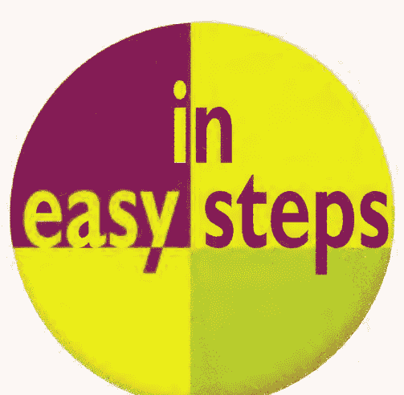

www.ineasysteps.com
www.bn.com

## 目录

| 主题 | 页码 |
| :--- | :--- |
| 在 HTML 中引入 JavaScript | 9 |
| 日期和时间 | |
| 获取日期和时间 | |
| 日期信息 | |
| 当前时间 | |
| 通用时间 | |
| 时区 | |
| 设置日期和时间 | |
| 使用系统时钟 | |
| 取消计时器 | |
| JavaScript 时钟 | |
| 数学运算 | |
| Math 常数 | |
| Math 方法 | |
| 浮点数 舍入 | |
| 强制浮点数 | |
| 数字比较 | |
| 随机数生成器 | |
| 随机图像 | |
| 字符串操作 | |
| 字符串长度 | |
| 字符串中的字符 | |
| 合并字符串 | |
| 分离单词 | |
| 子字符串 | |
| 转换为字符串 | |
| 更改大小写 | |
| 来自字符串的数字 | |
| 字符串中的变量 | |
| 对象构造函数 | |
| 属性继承 | |
| 显示页面 | |
| 浏览器 ID | |
| 跨浏览器兼容 | |
| Java 检测 | |
| Confirm | 98 |
| Prompt | 99 |
| Location | 100 |
| History | 101 |
| Onload | 102 |
| Status | 103 |
| 弹出窗口 | 104 |
| 弹出功能 | 105 |
| 关闭弹出 | 106 |
| 获取尺寸 | 107 |
| Frames | 108 |
| Frame 对象 | 109 |
| 错误处理 | 110 |
| 设置控件 | 112 |
| JavaScript 创建 | 113 |
| 设置 cookie | 114 |
| 获取 cookie | 115 |
| 图像数组 | 116 |
| 动态内容 | 118 |
| 最后修改 | 119 |
| XYZ 坐标 | 120 |
| 动态层 | 121 |
| 透明层 | 122 |
| 表单对象 | 124 |
| 表单元素 | 125 |
| 点击按钮 | 126 |
| 切换值 | 127 |
| 文本框 | 128 |
| 密码框 | 129 |
| 单选按钮 | 130 |
| 单选框检测 | 131 |
| 复选框 | 132 |
| 复选框检测 | 133 |
| 选项列表 | 134 |
| 选中索引 | 135 |
| 文本区域 | 136 |
| 清除表单 | 137 |
| 发送表单 | 138 |
| 修改表单 | 139 |
| 邮箱地址验证 | 140 |
| 鼠标点击 | 142 |
| 捕捉鼠标 | 143 |
| 鼠标悬停和移出 | 144 |
| 鼠标按下和移出 | 146 |
| 鼠标按钮 | 147 |
| 按键按下和抬起 | 148 |
| 键码 | 149 |
| 加载和卸载 | 150 |
| 聚焦和模糊 | 152 |
| 更改 | 154 |
| 重置 | 155 |
| 提交 | 156 |
| 中止 | 157 |
| 调整大小 | 158 |
| JavaScript: 协议 | 160 |
| 层属性 | 161 |
| 切换可见性 | 162 |
| 动态内容 | 164 |
| 幻灯显示 | 166 |
| 跟踪层 | 168 |
| 滚动层 | 170 |
| 弹出层 | 172 |
| 动态菜单 | 174 |
| 新鲜选项 | 176 |
| DOM 引用 | 178 |
| 产品页面 | 180 |
| 隐藏表单 | 181 |
| 获取客户详情 | 182 |
| 生成订单号 | 183 |
| 确认订单 | 184 |
| 提交订单 | 185 |
| 下一步是什么？ | 186 |

欢迎来到 JavaScript 世界。本章介绍了 JavaScript 语言并说明了如何向 HTML 文档添加 JavaScript。列出了所有的 JavaScript 语言关键字，并解释了函数和变量的基本要素。

- 导言 | 8
- 在 HTML 中引入 JavaScript | 9
- Hello World | 10
- 语法规则 | 11
- 关键字 | 12
- 变量 | 13
- 数据类型 | 14
- 转义序列 | 15
- 函数 | 16
- 函数参数 | 17
- 多个函数 | 18
- 变量作用域 | 19
- 多参数 | 20

JavaScript 是一种解释型编程语言，其解释器嵌入在 Web 浏览器软件中，例如 Microsoft Internet Explorer 和 Netscape Navigator。

这意味着 Web 文档中包含的脚本在加载到浏览器窗口时即可被浏览器的 JavaScript 引擎读取。

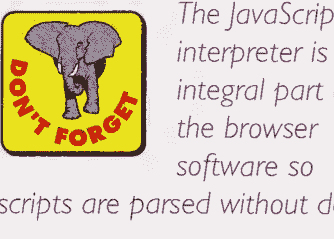

通过这种方式，可以使 Web 文档响应用户的操作，并执行动态视觉效果。

JavaScript 不应与 Sun Microsystems 的名为 Java 的编译型编程语言混淆，尽管两者某些相似之处，但它们是完全不同的语言。

为了在 Web 文档中引入 JavaScript，可以在 HTML 代码中定义一个脚本块（`script block`）。

脚本块可以定义在 HTML 代码的任何位置，尽管通常位于文档的 `head` 部分，即在 `<head>` 和 `</head>` 标签之间。

当浏览器加载文档时，它会按顺序读取（解析）代码。因此，将脚本块放在文档的 `head` 中可以确保 JavaScript 代码在其他 HTML 代码和文档 `body` 内容之前被解析。

脚本块的样式所示：

```html
<script type="text/javascript">
</script>
```

实际代码可以添加在 HTML `<script>` 和 `</script>` 标签之间。

或者，也可以将所有 JavaScript 代码写在一个 JavaScript 文件中，将 JavaScript 代码与 HTML 代码分离。这仅仅是一个文本文件，以 `.js` 扩展名保存，且不包含任何 HTML 标签。

脚本引用仍应放置在文档的 `head` 部分，并添加 `src` 属性以引导浏览器指向 JavaScript 文件的 URL，如例所示：

```html
<script type="text/javascript" src="mycode.js">
</script>
```

注意，仍然需要 `<script>` 闭合标签。


这种方法比在 HTML 文档的脚本块中编写代码更好，因为它使代码更容易维护，避免了 JavaScript 与 XML 之间的冲突，并允许 JavaScript 代码被多个 HTML 文档访问。

书中列出的所有 JavaScript 示例都是与其对应的 HTML 文件同命名的 JavaScript 文件。例如，`hello.html` 调用了 `hello.js` 中的 JavaScript 代码。

要显示 JavaScript alert 对话框只需调用内置的 JavaScript `alert()` 函数，如下所示：

```javascript
alert("Hello World");
```

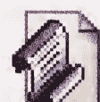

现在可以通过添加指定其类型和 URL 地址的 `<script>` 元素将此脚本包含在 HTML 文档中：

```html
<head>
  <title>Hello World</title>
  <script type="text/javascript" src="hello-alert.js"></script>
</head>
```

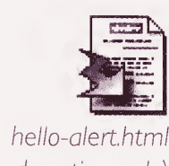

当此文档加载到 Web 浏览器引擎时，会执行 JavaScript 代码中包含的指令。

> 书中所有的示例都使用了这种在 HTML 文档中引入 JavaScript 文件的方法。

在这种情况下，JavaScript 代码会导致浏览器打开一个 `alert()` 对话框，带有括号内引号内包含的消息。

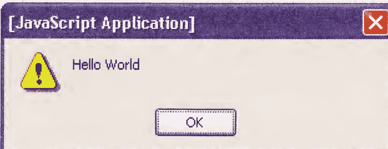

括号内的双引号实际上不会作为消息的一部分出现，因为它们仅被 JavaScript 用来表示字符字符串，该字符串即消息本身的文本内容。


JavaScript 中所有的文本字符串都是以此方式包含的。

注意，对应页 JavaScript 语句末尾有一个分号，以符合所需的 JavaScript 语言语法规则。

这必须添加到每个 JavaScript 语句的末尾——就像在英语语法规则中使用句号来结束句子一样。

最重要的是，JavaScript 是一种区分大小写的语言，其中 `ALERT`、`Alert` 和 `alert` 被视为三个不同的单词。

所有的 JavaScript 关键字均为小写，因此在之前的代码示例中使用 `ALERT("Hello World")` 或 `Alert("Hello World")` 将无法调用 JavaScript `alert()` 函数。

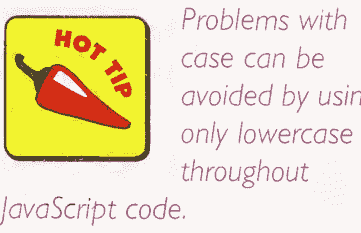

空格、制表符和换行统称为空白字符，JavaScript 会完全忽略它们，因此可以对代码进行格式化和缩进，使其更易于人类阅读。

在 JavaScript 代码中添加注释作为解释通常很有用。解析器会将 `//` 到该行末尾之间的任何文本视为单行注释，并会忽略它。同样，`/*` 和 `*/` 之间的任何文本（无论多少行）都会被忽略。

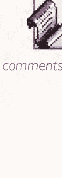

```javascript
/* 这里是关于
// 代码的介绍
// 使用了多行注释 */

// 这是一个单行注释

// 显示问候
alert("Hello World");
```

最好避免使用过多的注释——这会大幅增加 JavaScript 文件的大小。

下表包含了 JavaScript 语言的一部分的关键字。在为变量、函数或标签选择标识符名称时不能使用这些关键字：

| break | do | function | null | typeof |
|---|---|---|---|---|
| case | else | return | var | |
| continue | export | import | switch | void |
| default | false | in | this | while |
| delete | for | new | true | with |

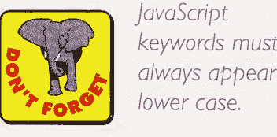

此外，JavaScript 保留了下表中列出的所有单词，以便可能包含在 JavaScript 语法中——因此这些不能作为标识符名称。虽然需要避免的单词看起来很多，但这是一个真实的问题——这只是需要记住的一点。

| abstract | debugger | goto | package | synchronized |
|---|---|---|---|---|
| boolean | double | implements | private | throw |
| byte | enum | instanceof | protected | throws |
| catch | extends | int | public | transient |
| char | final | interface | short | try |
| class | finally | long | static | |
| const | float | native | super | |

变量是 JavaScript 程序中存储数据以进行操作的地方。

可以使用字母、数字和下划线字符，但变量名不能以数字开头。为变量选择有意义的名称使脚本更易读。


`abc`
`my_variable`

使用 JavaScript 关键字创建一个新变量：

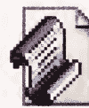

```javascript
// 创建变量并赋值
var message = "My First Variable";

// 显示变量中的值
alert(message);
```

字符串存储在名为 `message` 的变量中。调用 `alert()` 函数显示该变量。

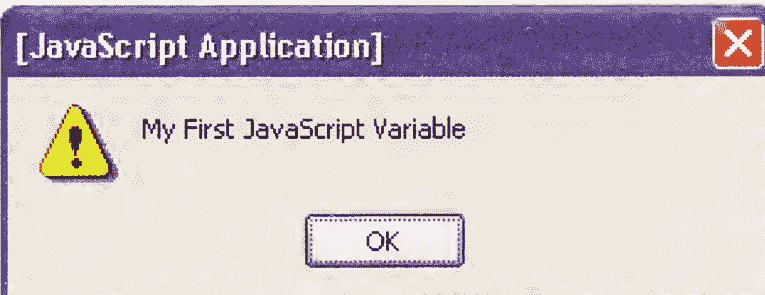

JavaScript 是一种弱类型语言，因此变量可以存储数字、字符串或布尔值（例如 `true` 或 `false`）。这不像 C++ 和 Java 等编程语言，它们需要声明特定类型的变量才能存储相应类型的数据。

```javascript
// 初始化数字变量
var a = 0.6;

// 初始化字符串
var b = "JavaScript in easy steps";

// 初始化布尔变量
var c = false;
```

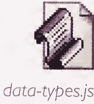

```javascript
// 显示每个变量的数据类型
alert(typeof a + "\n" + typeof b + "\n" + typeof c);
```

上面的示例创建了 JavaScript 支持的三种不同类型的变量。

这三个值首先传递给 `alert()` 函数，然后使用 JavaScript 关键字 `typeof` 返回它们的数据类型，显示在下面的 alert 对话框中。括号内的代码 `"\n"` 在 alert 对话框中换行显示每个值。

| JavaScript 应用 |
|---|
| number |
| string |
| boolean |

当字符串中的字符前面有一个斜杠字符时，紧随斜杠的字符产生特殊影响。这被称为转义序列，因为它允许该字符避免被识别为 JavaScript 语法的一部分。

下表列出了更多的转义序列：

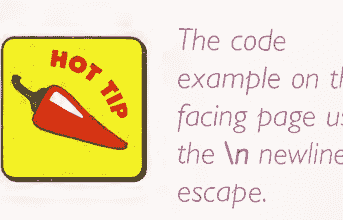

| 转义序列 | 说明 |
|---|---|
| `\b` | 退格 |
| `\f` | 分页符 |
| `\n` | 换行 |
| `\r` | 回车 |
| `\'` | 单引号 |
| `\"` | 双引号 |
| `\\` | 单斜杠字符 |

转义序列 `\"` 有助于在字符串内部包含双引号，而不会导致字符串本身终止，如例所示：

```javascript
// 显示带有转义引号的字符串
alert("We all say \"JavaScript is great!\"");
```

escapes.js

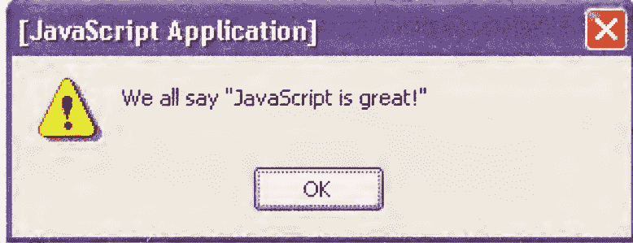

函数是一段 JavaScript 代码，可以被 JavaScript 应用执行一次或多次。函数和变量是所有 JavaScript 编程的基础。

函数的格式如下所示：

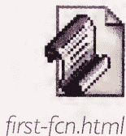

```javascript
// 一个用于在告警对话框中显示消息的函数
function call_alert() {
  alert("My First JavaScript Function");
}
```


始终尝试给函数和变量赋予有意义的名字。

使用 JavaScript 的 `function` 关键字后跟定的标识符名称来创建一个新函数。该名称在脚本中必须是唯一的，并遵循与变量命名相同的命名规范：

名称后面总是跟着一对圆括号，然后是一对包含要执行代码的大括号。

在示例中，函数被命名为 `call_alert()`，要执行的代码将调用 JavaScript 的 `alert()` 函数，以显示包含消息的 `alert()` 对话框。


在引用函数时，记得包含圆括号。

可以在 JavaScript 文件或 HTML 文档的任何地方调用函数，以执行它包含的语句。

例如，HTML `<body>` 标签的 `onload` 属性可以在文档加载到浏览器时调用该函数，如下：

```html
<body onload="call_alert()">
```

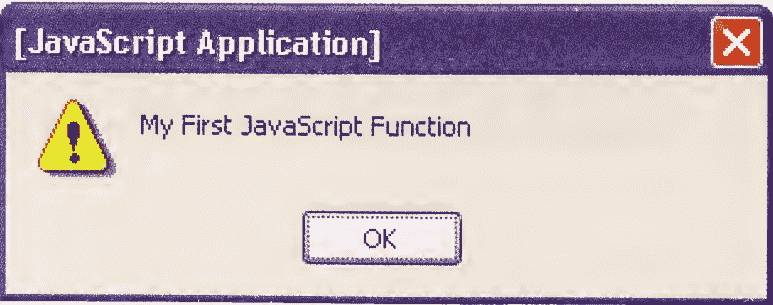

所有函数名称后的圆括号可用于包含供执行代码使用的数据。正如 JavaScript `alert()` 函数的括号包含了其所创建的 `alert()` 对话框中要显示的字符串。

括号内包含的数据被称为函数“参数”（`argument`）。

在下面的示例中，函数调用将一个字符串文本传递给 `call_alert()` 函数中名为 `str` 的参数，用于要执行的代码：

```javascript
// 一个用于显示传递的参数值的函数
function call_alert(str) {
    alert(str);
}
```

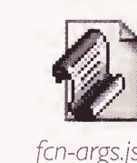

需要注意的是，在此调用中双引号内的字符串本用于包含整个调用：

```html
<body onload="call_alert('Passed Value')">
```

对两处都使用双引号将意味着 `onload` 属性的值将为 `"call_alert("`，因为字符串被双引号终止了。这将导致浏览器错误且函数将不会执行。

单引号和双引号的这种用法在 JavaScript 编程中以多种方式出现。

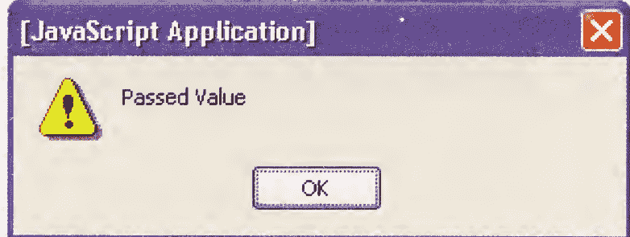
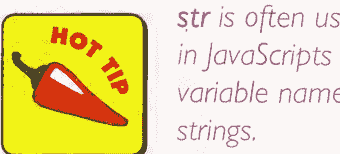

JavaScript 函数在执行代码期间可以调用其他函数，就就像之前的示例调用 JavaScript `alert()` 函数一样。

下面的示例演示了如何使用多个函数来处理和显示整数参数：


```javascript
// 一个调用第二个函数并显示返回结果函数
function call_alert(num) {
  var new_number = make_double(num);
  alert("Value Is " + new_number);
}

// 一个将值翻倍并将结果返回给调用者的函数
function make_double(num) {
  var double_num = num + num;
  return double_num;
}
```

参数通过 `call_alert()` 函数从调用者传递给 `make_double()` 函数：

```html
<body onload="call_alert(4)">
```

值在 `call_alert()` 函数中使用 `new_number` 进行处理。最后调用 `alert()` 函数来显示该值。

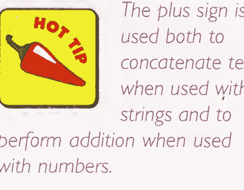
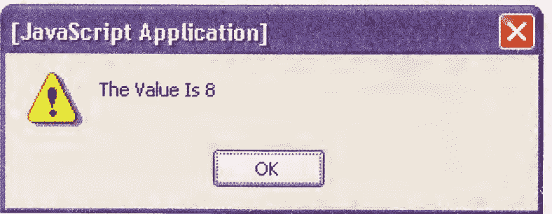

上一页示例中使用的变量函数内部声明，因此它们被称为局部变量。局部变量只能由定义的函数使用。

相反，全局变量在函数外部声明，可以被文档中的任何函数访问。

```javascript
// 创建全局变量
var stored_num;

// 一个调用第二个函数并显示返回结果函数
function call_alert(num) {
  stored_num = num;
  make_triple();
  alert("Value Is " + stored_num);
}

// 一个将值翻倍并将结果返回给调用者的函数
function make_triple() {
  stored_num = stored_num + stored_num;
}
```

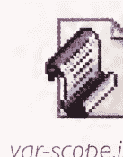

热提示：所有变量都可以简单地声明而不初始化值。此示例将参数值传递给全局变量：

```html
<body onload="call_alert(5)">
```

如果 JavaScript 函数用逗号分隔，则包含多个参数。声明函数时的参数数量必须与对该函数的任何调用中的参数数量完全匹配。

此示例声明了一个包含三个参数的函数——因此对它的调用必须包含三个参数值：

```javascript
// 创建三个变量
var a, b, c;

// 一个显示三个连接参数的函数
function call_alert(str1, str2, str3) {
  a = str1;
  b = str2;
  c = str3;
  alert(a + b + c);
}
```

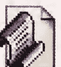


`var` 关键字可以通过逗号分隔变量名来声明多个变量。调用者向函数传递了三个字符串，尽管第二个字符串仅是一个空格：

```html
<body onload="call_alert('Great', '', 'JavaScript')">
```

函数将参数值分配给三个全局变量，然后调用 `alert()` 将值显示为单个连接字符串。

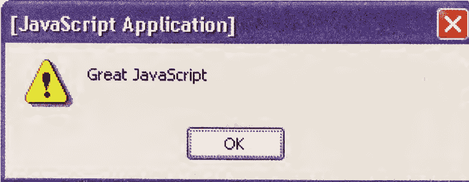

# 运算符

本章详细介绍了常用的 JavaScript 运算符，通过示例说明了如何进行算术运算、如何赋值以及如何进行比较。同时也解释并演示了条件运算符。


## 算术运算符

JavaScript 中常用的算术运算符列在下表中，并带有它们执行的操作：

| 运算符 | 操作 |
| :--- | :--- |
| `+` | 加法（并连接字符串） |
| `-` | 减法 |
| `*` | 乘法 |
| `/` | 除法 |
| `%` | 取模 |
| `++` | 递增 |
| `--` | 递减 |

注意 `+` 运算符根据给定的操作数有两种操作类型。它将两个数值值相加并给出加法结果。它还将合并两个字符串值并返回连接后的字符串，如上一页的示例所示。

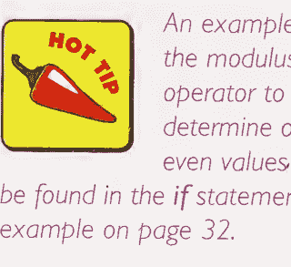

```javascript
var addnum = 20 + 30; // 加法
var addstr = "I love " + "JavaScript"; // 拼接
var sub = 35.75 - 28.25; // 减法
var mul = 8 * 50; // 乘法
var mod = 65 % 2; // 取模
var inc = 5; ++inc; // 递增
var dec = 5; dec = --dec; // 递减
var result = "Addnum is " + addnum + "\n";
result += "Addstr is " + addstr + "\n";
result += "Sub is " + sub + "\n";
result += "Mul is " + mul + "\n";
result += "Mod is " + mod + "\n";
result += "Inc is " + inc + "\n";
result += "Dec is " + dec + "\n";

alert(result);
```

自增和自减运算符也可以用操作数之后。注意，在这些情况下，它们会执行操作，但只返回未处理前的值。

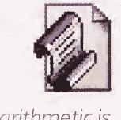
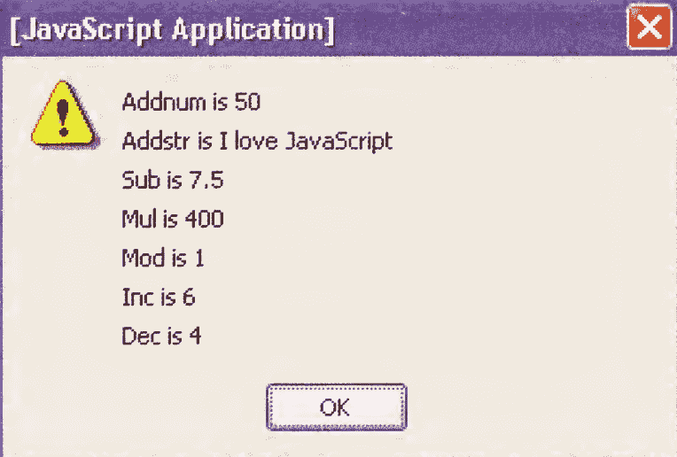


## 逻辑运算符

JavaScript 中可以使用的三个逻辑运算符如表所示：

| 运算符 | 操作 |
| --- | --- |
| `&&` | 逻辑与 |
| `||` | 逻辑或 |
| `!` | 逻辑非 |

逻辑运算符用于具有布尔值 `true` 或 `false` 的操作数——即可以转换为 `true` 或 `false` 的值。

逻辑 `&&` 运算符将评估两个操作数，并且只有当两个操作数本身都为 `true` 时，才会返回 `true`。否则，`&&` 运算符将返回 `false`。

这通常用于条件分支，其中 JavaScript 程序的方向通过测试两个条件来确定。如果两个条件都满足，脚本将进入某个方向，否则脚本将进入另一个方向。

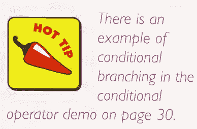

与需要两个操作数的 `&&` 运算符不同，`||` 运算符评估它的两个操作数，如果其中一个操作数本身返回 `true`，则返回 `true`。如果两个操作数都没有返回 `true`，则 `||` 将返回 `false`。这在 JavaScript 应用中很有用，可以在满足任一测试条件时执行特定操作。

第三个逻辑运算符 `!` 是一个一元运算符，用在单个操作数之前。它返回给定操作数的反值，因此，如果变量 `a` 的值为 `true`，那么 `!a` 的值将变为 `false`。在 JavaScript 应用中，它可以使用语句 `a = !a` 在连续的循环迭代中切换变量的值。这将确保在每次通过时值都会发生变化，就像闪烁灯开关一样。

## 逻辑示例

```javascript
var a = true, b = false;
var test1 = (a && a); // 测试两个操作数是否为 true
var test2 = (a && b);
var test3 = (b && b);
var test4 = (a || b); // 测试任一操作数是否为 true
var test5 = (a || b);
var test6 = (b || b);
var test7 = !a; var test8 = !b; // 反转值
var result = "AND \n";
result += "1: " + test1 + " 2: " + test2 + " 3: " + test3;
result += "\nOR\n";
result += "4: " + test4 + " 5: " + test5 + " 6: " + test6;
result += "\nNOT\n7: " + test7 + " 8: " + test8;
alert(result);
```


使用 `\n` 新行转义字符和空格来格式化显示的输出字符串


```
1: true 2: false 3: false
4: true 5: true 6: false
7: false 8: true
```

## 赋值运算符

JavaScript 中常用于赋值的运算符如表所示。除了简单的 `=` 赋值运算符外，所有运算符都是较长表达式的简写形式，因此为了清晰起见，也给出了等价形式。

| 运算符 | 示例 | 等价 |
| ---|---|---|
| `=` | `a = b` | `a = b` |
| `+=` | `a += b` | `a = (a + b)` |
| `-=` | `a -= b` | `a = (a - b)` |
| `*=` | `a *= b` | `a = (a * b)` |
| `/=` | `a /= b` | `a = (a / b)` |
| `%=` | `a %= b` | `a = (a % b)` |

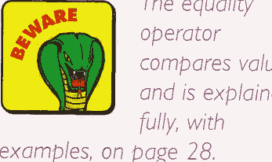

将 `=` 运算符理解为“赋值”而不是“等于”很重要，以避免与 `==` 相等运算符混淆。

在示例中，变量 `a` 被赋值为变量名 `b` 所包含的值，从而成为它的新值。

`+=` 运算符最有用，并在之前的示例中使用过来向现有字符串添加第二个字符串。在表格示例中，`+=` 运算符将变量 `a` 中包含的值加到变量名 `b` 的的值上，然后将结果赋值为变量 `a` 中包含的新值。

表中的所有其他运算符工作原理相同——先在两个值之间进行算术运算，然后将结果赋值给第一个变量作为它的新值。

```javascript
var a = "JavaScript", b = "Code"; // 赋值字符串值
a += b; // 拼接字符串并赋值给 a
var c = 8, d = 4; // 赋值整数值
c += d; // 数字相加并将结果赋值给 c
var e = 7.5, f = 2.5; // 赋值浮点值
e -= f; // 从 e 中减去 f
var g = 8, h = 4; // 赋值整数
g *= h; // g 乘以 h
var i = 8, j = 4; // 赋值整数
i /= j; // i 除以 j
var k = 8, l = 4; // 赋值整数
k %= l; // k 取模 l
```


## 比较运算符

JavaScript 中常用于比较两个值的运算符如下：

| 运算符 | 测试 |
| --- | --- |
| `==` | 等于 |
| `!=` | 不等于 |
| `>` | 大于 |
| `<` | 小于 |
| `>=` | 大于等于 |
| `<=` | 小于等于 |

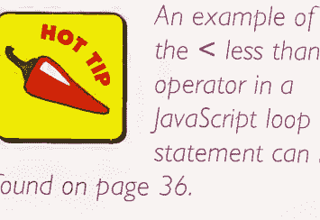

`==` 运算符比较两个操作数，如果它们相等则返回 `true`。相反，`!=` 运算符在操作数不相等时返回 `true`。

`>` 运算符比较两个操作数，如果第一个大于第二个则返回 `true`。

`<` 运算符比较两个操作数，如果第一个小于第二个则返回 `true`。

`>=` 运算符如果第一个大于或等于第二个则返回 `true`。

`<=` 运算符如果第一个小于或等于第二个则返回 `true`。

```javascript
// 比较字符串值
var teststrings1 = ("JavaScript" == "JavaScript");
var teststrings2 = ("JavaScript" == "javascript");

// 比较数值值
var testnumbers1 = (1.785 == 1.785);
var testnumbers2 = (5 != 5);

// 比较布尔值
var testbooleans1 = (true == true);
var testbooleans2 = (false != false);
var testleshan1 = (100 < 200);
var testleshan2 = (100 < 100);
var testleshan_equal = (100 <= 100);
var testgreaterthan = (-1 > 1);
var a = 8, b = 8.0, testvariables1 = (a == b);
var c = null, d = null, testvariables2 = (c == d);
```


注意大小写也必须匹配使字符串相等。


`null` 是 JavaScript 关键字，意味着没有值。


结果以前使用 `alert()` 函数显示，但现在那部分代码已省略以节省空间。

## 条件运算符

JavaScript 程序员最喜爱的比较运算符可能是条件运算符。它首先评估一个表达式以得到真或假值，然后根据评估结果执行两个给定语句中的其中一个。

条件运算符的语法如下：

```
(测试表达式) ? 如果为真则执行此操作 : 如果为假则执行此操作 ;
```

该运算符通常用于在执行完浏览器识别程序后，运行针对特定 Web 浏览器的脚本函数。下面的示例根据浏览器类型显示欢迎消息：

```javascript
// 判断是否为 Internet Explorer 浏览器
var is_ie = browser_id();

// 显示相应的问候
(is_ie) ? greet_ie() : greet_other();
```

更多关于浏览器识别请参阅第 92 页。

| Microsoft Internet Explorer |
| :--- |
| 欢迎使用 Internet Explorer 用户 |
| 好 |

| JavaScript 应用程序 |
| :--- |
| 欢迎访问我们的网站 |
| 好 |

conditional.js（部分）

# 语句

语句在 JavaScript 中用于推进 JavaScript 应用程序的执行。它们可以在代码中定义循环，也可以是待求值的简单术语。本章将检查条件测试和不同类型的循环，并附带用法示例。

## if 语句

`if` 关键字用于执行基础的 JavaScript 条件测试，以评估表达式以得到布尔值。评估后的语句仅在表达式返回真时才会执行。`if` 语句的语法如下：

```
if (测试表达式) 如果为真时执行的语句;
```

如果将语句包含在大括号内形成语句块，则要执行的代码可以包含多个语句。

在下面的示例中，待测试的表达式使用模运算运算符来确定名为 `num` 的变量的值是否能被 2 整除。该语句包含两个语句——一个给变量赋值字符串值，另一个调用一个 JavaScript 函数。

```javascript
// 创建变量
var msg, num;
num = 7;
// 测试数字是否不能被 2 整除
if (num % 2 != 0) {
  msg = num + " 是一个奇数。";
  alert(msg);
}
```

此示例调用了 JavaScript 的 `prompt()` 函数，该函数需要调用者提供两个参数。第一个参数是要显示的消息，第二个参数是输入框中的默认值——在本例中为空字符串。

用户输入被赋值给 `username` 变量，如果字符串仍然为空，则通过 `alert()` 函数显示。

```javascript
// 初始化一个值为 null 的变量
var username = null;

if (username == null) {
    // 询问用户其键名
    username = prompt("请输入您的姓名", "");
    // .. 或者通过姓名问候用户
    if (username != "") alert("欢迎 " + username);
}
```

> **注意** `prompt` 对话框打开时输入框为空，但此处显示是在用户输入后。

## if - else 语句

JavaScript 的 `else` 关键字可以与 `if` 语句配合使用，在测试表达式返回假时提供备用执行代码。

这被称为条件分支，其语法如下：

```
if (测试表达式) 执行此操作; 否则 执行此操作;
```

可以一直测试多个表达式，直到找到真值，此时紧接着真表达式后的代码将执行执行。需要注意的是，`if-else` 语句中包含的任何进一步后续代码都会被忽略。

因此，在接下来的示例代码中，在第三次测试调用 `alert()` 函数后将执行以下内容：

```javascript
var num = 2, bool = false;
// 如果数字为 1 且布尔值为真
if (num == 1 && bool) alert("TEST1 bool: " + bool);
else
// 如果数字为 2 且布尔值为真
if (num == 2 && bool) alert("TEST2 bool: " + bool);
else
// 如果数字为 2 且布尔值为假
if (num == 2 && !bool) alert("TEST3 bool: " + bool);
else
// 如果数字为 3 且布尔值为假
if (num == 3 && !bool) alert("TEST4 bool: " + bool);
```

| JavaScript 应用程序 | JavaScript 快速入门步骤 |
| :--- | :--- |
| TEST3 bool: false | 34 |

## switch 语句

当测试表达式评估一个变量的值时，使用 `switch` 语句可能比 `if-else` 语句执行条件分支更高效。`switch` 语句的工作方式很独特——它首先评估一个给定的表达式，然后寻找匹配结果结果的标签。与标签关联的代码将被执行，或者如果没有找到匹配项，`switch` 语句将执行任何默认操作。

`case` 关键字用于标记标签，`default` 关键字表示默认代码。所有标签代码必须由 `break` 语句终止。标签可以是数字、字符串或布尔值，但类型必须相同，就像本示例使用数字一样：

```javascript
var num = 2;

switch(num) {
  // 如果数字是 1
  case 1:
  // 如果数字是 2
  case 2: alert("case 2"); break;
  // 如果数字是 3
  case 3: alert("case 3"); break;
  // 默认情况
  default: alert("default");
}
```

省略 `break` 关键字将允许执行其他代码执行。

## for 循环

`for` 循环可能是 JavaScript 中最常用的循环类型，其语法如下：

```
for (初始化, 测试, 递增) 语句;
```

初始化用于设置计数器的起始值，通常在此声明一个变量并命名为 `i`。

在循环的每次迭代中都会测试布尔条件，只有当条件返回真时才会运行。如果测试返回假，循环结束。

在每次迭代中计数器都会增加，然后执行语句。如果语句包含在大括号内，可以执行多个语句。

下面的示例进行了五次迭代，并在每次迭代更改变量的值：

```javascript
var a = 0, b = 0;
// 初始化计数器为零，循环直到达到 5
for (var i = 0; i < 5; i++) {
  // 每次迭代增加变量值
  a += 10; b += 5;
}
// 循环结束后显示最终值
alert("FOR LOOP\nA is " + a + "... B is " + b);
```

循环也可以通过递减计数器向下计数。

## for-in 循环

`for-in` 循环有一个特殊用途，用于枚举对象包含的所有变量或属性。这种循环在常规 JavaScript 中很少使用，但包含在此是因为它可以揭示 Web 浏览器中可用的属性。

下面的示例展示了 Microsoft Internet Explorer 6.0 浏览器 `window` 对象中可用属性的预览：

```javascript
var i = 0, a = "";

// 在变量中列出所有属性
for (property in window) {
  a += property + "...";
}

// 显示窗口属性列表
alert(a);
```

显示的属性随每个浏览器和版本而异。通过此脚本显示的属性属于第 8 章描述的文档对象模型 (DOM)。

## while 循环

另一种循环使用了 JavaScript 的 `while` 关键字，后面跟着一个用于评估以获取布尔值的表达式。

如果评估结果为 `true`，则语句块中的代码将被执行。在代码执行后，测试表达式将再次被评估，循环将持续进行直到评估结果返回 `false`。


语句块必须包含能够影响表达式的代码，以便将评估结果改为返回 `false`——否则将导致无限循环。

需要注意的是，如果测试表达式返回 `false`，则它会先进行评估，然后语句块中的代码将永远不会执行。

此示例在循环的每次迭代中减少变量的值。计数器不断增加直到达到 10，此时评估返回 `false`，循环结束。

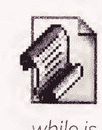

```javascript
var i = 0, num = 50;

// 循环直到计数器达到 10
while(i < 10) {
  num--;
  i++;
}

// 显示最终的计数器和数值
alert("Loop stopped at " + i + "\nnum is now " + num);
```

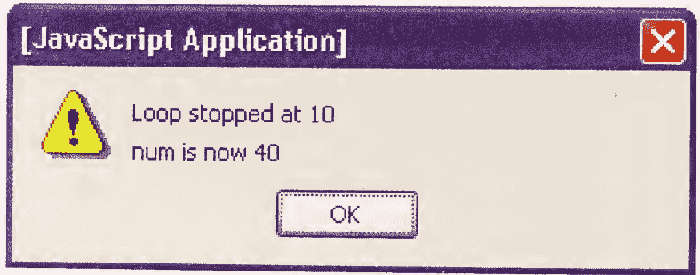

## do - while 循环

JavaScript 的 `do` 关键字用于表示 `do-while` 循环的开始，后面跟着一个包含循环要执行代码的语句块。

语句代码之后是 JavaScript 的 `while` 关键字和一个用于评估布尔值 `true` 或 `false` 的表达式。

如果评估结果返回 `true`，循环将在 `do` 关键字处重新开始，并持续到评估返回 `false` 为止。

需要注意的是，与简单的 `while` 循环不同，`do-while` 循环至少会执行一次语句代码，因为在循环结束之前不会遇到测试表达式。

以下示例将永远不会循环，因为计数器值在语句代码的第一次执行中增加到了 1，因此第一次评估将返回 `false`：

```javascript
var i = 0, num = 50;

// 循环直到计数器达到 1
do {
  num--;
  i++;
} while(i < 1);

// 显示最终的计数器和数值
alert("Loop stopped at " + i + "\nnum is now " + num);
```

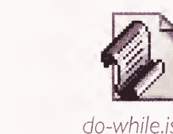

`while` 循环通常比 `do-while` 循环更合适。

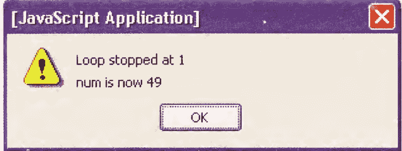

## break 语句

JavaScript 的 `break` 关键字用于提前终止循环的执行。

`break` 关键字位于包含循环应执行代码的语句块内部，并在前面有一个条件测试。

当满足测试条件时，`break` 语句立即终止循环，不再进行进一步的迭代。

注意下方的 `alert()` 输出，计数器值仍然是三，因为最后一次迭代中的增加没有被应用。

在以下示例中，当计数器值达到三时，条件测试将返回 `true`：

```javascript
var i = 0;
// 循环直到计数器达到 6
while(i < 6) {
  if(i == 3) break;
  i++;
}
// 显示最终的计数器值
alert("BREAK\n\nLoop stopped at " + i);
```


`break` 关键字也用作 `switch` 语句的终止符。

| JavaScript 应用 |
| :--- |
| BREAK |
| Loop stopped at 3 |
| [OK] |

## continue 语句

JavaScript 的 `continue` 关键字用于中断循环的当前迭代。

与 `break` 关键字一样，`continue` 关键字位于包含循环应执行代码的语句块内部，并在前面有一个条件测试。

当满足测试条件时，`continue` 会立即停止循环的当前迭代，但在循环结束之前还会进行后续迭代。

在下面的示例中，当计数器值达到 3 时满足测试条件，因此该迭代应用了字符串拼接，但循环将继续进行：

```javascript
var i = 0, str = "";
// 循环直到计数器达到 5
while(i < 5) {
  if(i == 3) continue;
  str += i;
}

// 显示最终的计数器和字符串
alert("Loop stopped at " + i + "\nstr is " + str);
```

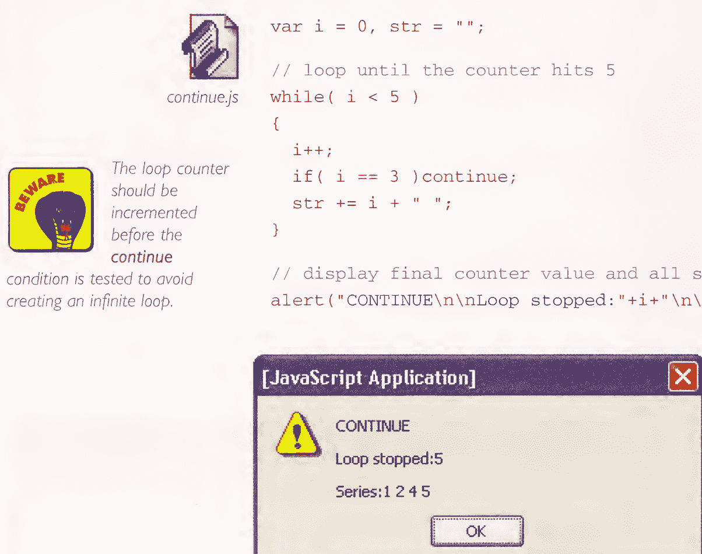

## with 语句

`with` 关键字用于在测试 `with` 之前引用对象。


`with` 语句通常用于在不需要指定对象名称的情况下访问其属性。


# 数组

数组允许你存储多个值并在一个变量中引用它们。

- 数组创建 | 44
- 数组的元素 | 45
- 数组的循环 | 46
- 数组数组 | 47
- 数组属性 | 48
- 数组方法 | 49
- 数组索引 | 50
- 数组长度 | 51
- 数组创建 | 52

## 创建数组

使用 `Array` 关键字可以创建一个包含多个值的数组。

```javascript
// 创建新数组
var a = new Array();

// 赋值
a[0] = "First";
a[1] = "JavaScript";
a[2] = "Array";
```

使用 `Array()` 构造函数可以一次性初始化数组元素。

```javascript
// 创建并初始化数组
var a = new Array("Jan", "Feb", "Mar");
var b = new Array("21", "22", "23");
var c = new Array("2003", "2004", "2005");

// 拼接并显示数组元素
alert(a[0] + b[1] + c[2]);
```

## 数组元素

数组中的每个值都称为数组元素。

当一个变量通过 `Array()` 构造函数赋予状态时，它也获得了用于操作元素的属性和方法。

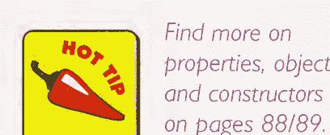

这些属性中最实用的是 `length`，它可以报告数组当前包含的元素数量。

使用属性或方法的语法只需要在对象名称后加上点和名称。因此，`array.length` 引用数组的长度。

注意，包含三个值的数组长度为 3，因为索引从 0 开始，数组中的最后一个元素的索引号仅为 2。

下面的示例演示了这一点：

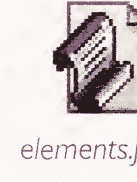

```javascript
// 创建新数组
var a = new Array();
a[0] = "JavaScript";
a[1] = "ARRAY";
a[2] = "LENGTH";

// 获取数组长度
var arraysize = a.length;

// 显示每个数组元素和数组长度
alert(a[0] + a[1] + "\n" + arraysize);
```

## 填充元素循环

所有类型的循环都可以用于轻松地向数组填充大量数据值。这是数组的主要吸引力之一，只需极少的代码即可实现。

下面的示例首先创建了一个数组，然后在每次迭代中，`for` 循环将每个数组元素填充为一个字符串值，该值是与当前计数器值相加得到的。

每个元素的值都会在名为 `str` 的变量中进行拼接，最后最后显示在 `alert()` 对话框中：

```javascript
var str = "FILL ELEMENTS LOOP\n\n";

// 创建新数组
var arr = new Array();

// 填充八个数组元素
for(var i = 0; i < 8; i++) {
  arr[i] = "Number is " + i + "\n";
  str += arr[i];
}

// 显示存储在每个数组元素中的值
alert(str);
```

## 添加更多元素

可以使用 `array.length` 属性找到下一个可空元素，从而向数组添加额外的元素，无需指定具体的索引数字。

由于 `array.length` 的值比最后一个索引大一，当它被用作索引数字（即方括号之间）时，它始终指向下一个空元素。

下面的示例说明了这一点：将整数 4 赋值给名为为 `a` 的数组中的下一个空元素。

初始化 `b` 数组元素，然后通过 `for` 循环逐个将 `b` 元素值赋值给 `a` 数组中的每个空元素。

最后，通过 `alert()` 函数和 `array.concat()` 方法以拼接格式显示所有数组元素。

```javascript
var a = new Array(1, 2, 3);

// 将整数插入到下一个空元素
a[a.length] = 4;                      // a.length 为 3

var b = new Array(5, 6, 7);

// 将每个 b 值复制到空元素中
for(var i = 0; i < b.length; i++) {
  a[a.length] = b[i];
}

// 显示所有元素值
alert(a.concat());
```

`array.concat()` 方法将显示数组中的所有元素，并用逗号分隔。

## 元素字符串

JavaScript `array.join()` 方法会将所有数组元素转换为字符串并将它们拼接。

在不带参数使用时，它将返回一个由逗号分隔的所有数组元素值的列表，类似于上一页的 `array.concat()` 方法。

但 `array.join()` 方法可以接受一个可选参数，用于指定除默认逗号分隔符外的替代分隔符。

最有用的是，这是一个空格，这样 `array.join()` 方法的结果将是一个带有空格分隔符的单个字符串，如下例所示：

```javascript
// 创建新数组
var a = new Array();

// 在七个数组元素中放入单词
a[0] = "It"; a[1] = "isn't"; a[2] = "rocket"; a[3] = "science -"; a[4] = "it's"; a[5] = "just"; a[6] = "JavaScript";

// 用空格分隔显示数组中的所有单词
alert(a.join(" "));
```

使用反斜杠 `\` 转义单引号以避免错误。

| JavaScript 应用程序 |
| :--- |
| 这并不是火箭科学 - 它只是 JavaScript |
| 确定 |

## 反转元素顺序

数组可以用于每个元素中包含文件名或完整的 URL 地址，或者用于 Web 页面的动态功能。

其中一种流行的用法是 JavaScript 幻灯片，它以每张图像之间指定的间隔旋转一系列图像。

使用数组来存储每个图像的 URL，以便脚本可以通过数组索引轻松引用它们。

如果要求幻灯片在显示最后一张图像后反转，而不是从第一张图像重新开始，可以通过反转数组内部的元素顺序来实现。

下面的示例创建了一个仅包含三个图像的初始数组，在显示最后图像且 `rev` 变量设置为 `true` 后，其顺序将发生反转：

```javascript
// 创建图像 URL 的新数组
var imgs = new Array("img1.gif", "img2.gif", "img3.gif");

// 创建控制变量
var rev = false;

// 当幻灯片显示最后一张图像时
// 反转顺序
rev = true;

if(rev == true) {
  imgs.reverse();
}

// 显示反转后的元素顺序
alert(imgs.join(" - "));
```

## 子数组

JavaScript `array.slice()` 方法非常用于使用某些元素值从现有数组创建一个新数组。

该方法接受两个参数，指定原始数组中新数组元素应该开始和结束的元素索引。

第二个参数可以是负值，用于表示从数组末尾的位置。

如果只指定一个参数，它将被用作第一个元素索引，该方法将返回一个从该索引开始的所有元素的新数组。

这些示例说明了 `array.slice()` 方法的不同用法：

```javascript
// 创建并初始化一个新数组
var nums = Array(1, 2, 3, 4, 5, 6, 7, 8);

// 获取元素 2 到 4
var str = "Slice A: " + nums.slice(2, 4) + "\n";

// 获取最后一个元素之前的1个元素
str += "Slice B: " + nums.slice(1, -1) + "\n";

// 获取元素 3 到结束
str += "Slice C: " + nums.slice(3) + "\n";

// 显示三个切片
alert(str);
```

`array.slice()` 方法获取的元素到但不包含第二个参数。

| JavaScript 应用程序 |
| :--- |
| Slice A: 3,4 |
| Slice B: 2,3,4,5,6,7 |
| Slice C: 4,5,6,7,8 |

## 排序元素

JavaScript `array.sort()` 方法允许字符串值按字母顺序排列。

有时这是必要的，以便按数值呈现输出。

整数和浮点数值将按升序排列——如下例所示：

```javascript
// 创建整数数组
var integers = new Array(3, 8, 1, 9, 7, 5, 4);

// 按数值排序整数数组
integers.sort();

// 创建浮点数数组
var floats = new Array(0.5, 0.125, 0.75, 0.25);

// 按数值排序浮点数组
floats.sort();

// 创建字符串数组
var strings = new Array("Michael", "Andrew", "David");

// 按字母排序字符串数组
strings.sort();

// 用连字符分隔元素
var str = "Integers array: " + integers.join(" - ");
str += "\nFloats array: " + floats.join(" - ");
str += "\nStrings array: " + strings.join(" - ");

// 显示所有三个排序后的数组
alert(str);
```

负数值排列为 -1, -2, -3 等。

| JavaScript 应用程序 |
| :--- |
| 整数数组: 1-2-3-4-5-6-7-8-9 |
| 浮点数数组: 0.125-0.25-0.5-0.75 |
| 字符串数组: Andrew - David - Michael |

## 预加载数组

Web 页中的翻滚图像使用 JavaScript 效果在用户将悬停在图像上时将原始图像替换为替换图像。为了让这种效果流畅，所需的替换图像必须加载到浏览器缓存中。

实现这一点的方法是使用 JavaScript 预加载程序，通过创建以替换图像为源的 `Image()` 对象来强制浏览器下载图像。

```javascript
// 创建所有将出现在幻灯片中的图像 URL 数组
var pics = new Array("pic1.gif", "pic2.gif", "pic3.gif");

// 创建新空数组
var preload = new Array();

// 在每个空位置中插入新的 Image 对象
// 然后将每个图像 URL 赋值给 Image 对象
for(var i = 0; i < pics.length; i++) {
  preload[i] = new Image();
  preload[i].src = pics[i];
}
```

# 日期和时间

本章描述了在 JavaScript 中使用日期和时间信息的示例。介绍了 Date 对象和世界标准时钟（UTC），以及 JavaScript 定时器。还包含一个完整的 JavaScript 钟脚本示例。

## 目录

| 主题 | 页码 |
| :--- | :--- |
| 获取日期和时间 | 54 |
| 日期信息 | 55 |
| 时间信息 | 56 |
| 当前时间 | 57 |
| 世界标准时钟 | 58 |
| 时区 | 59 |
| 设置日期和时间 | 60 |
| 日期字符串 | 61 |
| 使用系统时钟 | 62 |
| 取消定时器 | 63 |
| JavaScript 钟 | 64 |

## 获取日期和时间

日期和时间经常在 JavaScript 中用于自定义 Web 页面的性能。例如，脚本可以根据当前时间用合适的问候语欢迎用户：

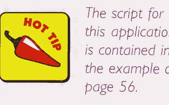

```
[JavaScript 应用]
下午好
欢迎来到 Acme 网站
确定
```

JavaScript 中使用的日期和时间取自运行加载脚本的宿主机系统的日历。

要访问系统时钟信息，脚本必须首先创建一个 Date 对象。

其实现方式与创建 Array 对象的方法相同，使用 JavaScript 的 `new` 关键字，但现在使用的是 JavaScript 的 `Date()` 构造函数。示例创建并显示了一个新的 Date 对象：

```javascript
// 创建一个新的 Date 对象
var now = new Date();

// 显示 Date 对象的日期和时间信息
alert(now);
```

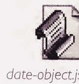

```
[JavaScript 应用]
Thu Mar 31 2005 16:31:06 GMT+0100 (GMT Daylight Time)
OK
```

## 日期信息

Date 对象具有特殊方法，可以用于获取日期信息的各个部分。

某些方法将日期信息作为索引数字返回，这需要脚本进行转换。

`Date.getDate()` 方法返回周几的索引值，范围从 0（星期日）到 6（星期六）。

此外，`Date.getMonth()` 方法返回月份的索引值，范围从 0（一月）到 11（十二月）。

下面的示例说明了 Date 对象的方法，并使用两个数组来显示星期和月份名称：

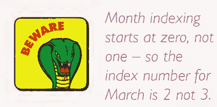

```javascript
// 创建星期名称数组
var days = new Array("Sun", "Mon", "Tue", "Wed", "Thur", "Fri", "Sat");
```

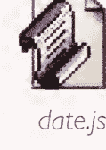

```javascript
// 创建月份名称数组
var months = new Array("Jan", "Feb", "Mar", "Apr", "May", "Jun", "Jul", "Aug", "Sep", "Oct", "Nov", "Dec");
```

```javascript
// 创建一个新的 Date 对象
var now = new Date();
var yy = now.getFullYear(); // yy += 2000; // 为 Netscape 调整年份
var mm = now.getMonth(); // 获取月份数字
// 将数字转换为名称
var dd = now.getDate(); // 获取月份中的几
var dy = now.getDay(); // 获取一周中的几
dy = days[dy]; // 将几几转换为名称
```

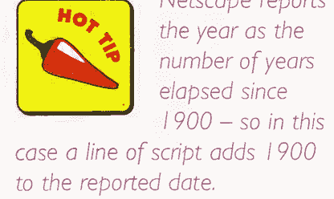

```javascript
// 显示提取的星期和日期信息
alert(dy + "/" + mm + "/" + dd + " " + yy);
```

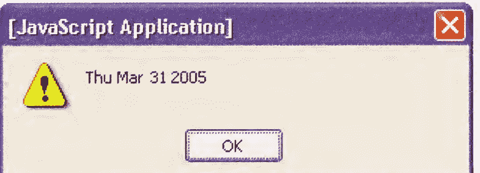

## 时间信息

Date 对象具有特殊方法来访问其包含的信息。下面的示例从宿主机时钟获取当前的小时、分钟、秒和毫秒，并根据一天中的时间显示合适的欢迎消息：

```javascript
// 创建一个新的 Date 对象
var now = new Date();

// 提取时间信息
var hh = now.getHours();
var mn = now.getMinutes();
var ss = now.getSeconds();
var ms = now.getMilliseconds();

// 默认欢迎消息
var hi = "Good Morning";

// 如果是午后的欢迎消息
if(hh > 11) hi = "Good Afternoon";

// 如果是下午 6 点后的欢迎消息
if(hh > 17) hi = "Good Evening";

// 显示欢迎消息和当前时间
var tim = hi + "\n";
tim += "Hours: " + hh + "\n";
tim += "Minutes: " + mn + "\n";
tim += "Seconds: " + ss + "." + ms;
alert(tim);
```


小时以 24 小时格式的数字 0~23 返回。


## 当前时间

JavaScript `Date.getTime()` 方法可以用于数值比较两个日期。

该方法返回一个数字，该数字是 Date 对象与 1970 年 1 月 1 日午夜之间的毫秒差（有时称为“纪元” epoch）。

下面的示例在循环之前和之后都创建了一个 Date 对象，然后比较 `Date.getTime()` 方法返回的值，以计算执行循环所需的实际时间：

```javascript
// 创建一个新 Date 然后获取当前时间
var start = new Date();
var msec1 = start.getTime();

// 运行循环直到 250,000 次
var num = 0;
for(var i = 0; i < 250000; i++) {
    num++;
}
```

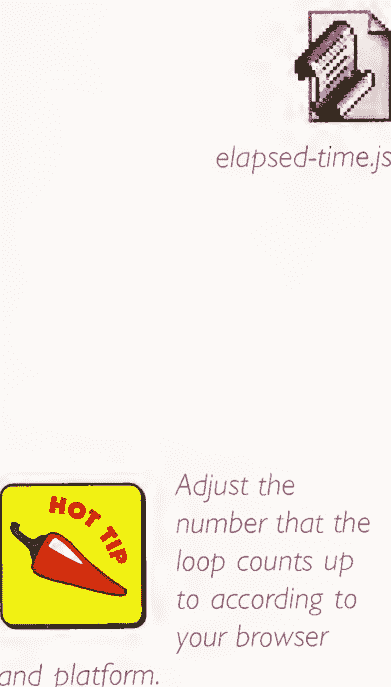

获取循环结束后的差值：

```javascript
// 获取另一个 Date 对象
var stop = new Date();
var msec2 = stop.getTime();

// 计算两个时间之间的秒数
var diff = (msec2 - msec1) / 1000;

// 显示经过的时间
alert("Time elapsed: " + diff + " seconds");
```

## 世界标准时钟

世界标准时（Universal Time）是格林威治标准时间。Date 对象方法返回本地时间，但有时倾向于使用世界标准时：

```javascript
// 创建一个新的 Date 对象
var now = new Date();

// 获取本地小时
var hh = now.getHours();

// 获取世界标准小时
var utc_hh = now.getUTCHours();

// 获取分钟
var mn = now.getMinutes();

// 获取秒
var ss = now.getSeconds();
```

如果分钟值小于 10，此脚本会补一个零：

```javascript
// 确保分钟是两位
if(mn <= 9) mn = "0" + mn;
```

```javascript
// 显示两种时间
var wert = "Athens time: " + hh + ": " + mn + ": " + ss + "\n";
var utc = "Universal time: " + utc_hh + ": " + mn + ": " + ss;
alert(wert + " " + utc);
```


```
[JavaScript 应用]
雅典时间 20:59
世界时间 17:59
确定
```

## 时区

JavaScript 使用 `Date.getTimezoneOffset()` 方法来确定用户所在的时区。该方法从 Date 对象获取本地时间，然后与 UTC 时间进行比较。返回值为分钟差值，因为某些国家的时区是以小时为间隔的。

在下面的示例中，`Date.getTimezoneOffset()` 判断用户位于哪个美国时区：

```javascript
// 创建一个新的 Date 对象
var now = new Date();

// 获取与 UTC 的分钟偏移
var offset = now.getTimezoneOffset();

// 创建一个空变量
var msg;

// 分配相应的消息
switch(offset) {
  case 240: msg = "East Coast"; break;
  case 300: msg = "Central"; break;
  case 360: msg = "Mountain"; break;
  case 420: msg = "Pacific"; break;
  default: msg = "all";
}

// 显示消息
alert("Welcome to " + msg + " visitors.");
```


这种方法也可以轻松用于将用户重定向到本地 Web 页面。


某些 Netscape 浏览器的 Bug 无法报告正确的偏移量。

## 设置日期和时间

JavaScript 代码可以使用多种 `Date.set()` 方法来操作日期信息。

这些方法与 `Date.get()` 方法相对应，后者用于提取 Date 对象的某些信息，而前者则被用于设置新值。

在下面的示例中，初始的 Date 对象值被存储在名为 `orig` 的变量中。然后，各种 `Date.set()` 方法会将新值应用到日期对象上：

```javascript
// 创建一个新的 Date 对象
var now = new Date();

// 存储原始日期和时间信息
var orig = "Original \n" + now.toString() + "\n\n";
// 设置新的日期和时间细节
now.setDate(21);
now.setMonth(1);
now.setHours(12);
now.setMinutes(30);
now.setSeconds(15);
now.setFullYear(2005);
```

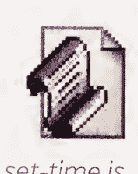

> 小贴士
>
> 此处使用的 `toString()` 方法返回 JavaScript 对象的字符串值并具有许多用途。

```javascript
// 存储修改后的日期和时间信息
var mod = "Modified :\n" + now;

// 显示原始和修改后的日期时间
alert(orig + mod);
```

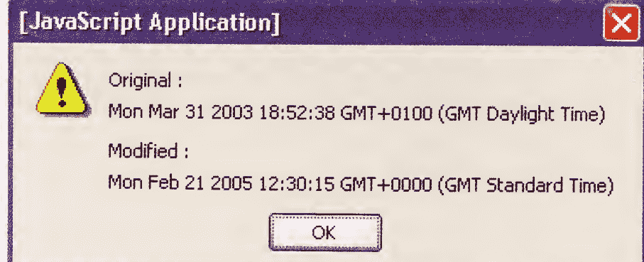

## 日期字符串

在许多情况下，必须将 Date 对象的信息转换为字符串以便存储或使用。

上一面的 `Date.toString()` 方法可以做到这一点，但最好将这些信息存储为标准的 UTC 时间。

JavaScript 提供了 `Date.toGMTString()` 方法，它既可以将信息转换为字符串，将其转换为 GMT 时区。

使用这种方法存储日期信息可以避免时间混乱，并且在设置 cookie 文件的有效期时通常被视为标准。

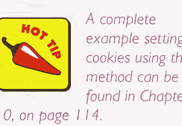

这个简单的示例说明了 `Date.toGMTString()` 方法在日本东京的浏览器中执行转换：

```javascript
// 创建一个新的 Date 对象
var now = new Date();

// 存储本地时间
var jpn = "Tokyo Time:\n" + now.toString() + "\n\n";

// 存储 GMT 时间
var gmt = "UTC Time:\n" + now.toGMTString();

// 显示本地时间和 GMT 时间
alert(jpn + gmt);
```


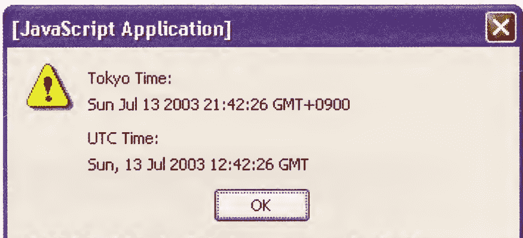

## 使用系统时钟

当需要 JavaScript 在 Web 浏览器中重复创建动作时，可以使用系统时钟配合 window 对象的 JavaScript `setTimeout()` 方法。

`window.setTimeout()` 方法可以在指定的间隔后运行函数。它需要两个参数：指定要调用的函数名称以及以毫秒为单位所需的间隔时间。该方法通常用于函数的末尾，在设置的延迟后递归地调用同一个函数。


该方法在创建动态效果方面有很多用途。例如，在幻灯片脚本中，函数按给定的间隔显示连续的图像。

此处的示例使用 `window.setTimeout()` 方法每隔 10 秒显示一次 `alert()` 框：

```javascript
// 创建并初始化计数变量
var num = 0;

// 用于显示消息的递归函数
function timeout() {
  // 递增计数
  num++;
  // 显示消息
  alert("This is 10-Second Message No: " + num);
  // 在再次调用此函数之前设置间隔
  window.setTimeout("timeout()", 10000);
}

// 调用函数启动程序
timeout();
```

[JavaScript 应用]

这是第 10 秒的消息编号：3

[确定]

## 取消计时器

上一页包含 JavaScript 的网站的不幸读者无疑会由于不断弹出的 alert 框消息感到恼恼。可能只显示几次消息然后调用 `timeout()` 函数会更好。

可以使用 `window.clearTimeout()` 方法轻松地取消 `window.setTimeout()` 方法。

为了正确清除计时器，有必要将原始的 `window.setTimeout()` 调用赋值给一个变量——这样该变量就可以作为 `window.clearTimeout()` 调用的参数传递。

下面的示例显示两次消息，然后在计时器清除时显示最后一条消息：

```javascript
// 创建计数变量和计时器变量
var num = 0, tim;

function timeout() {
  num++;
  if (num == 3) {
    alert("OK - I told you twice");
    window.clearTimeout(tim); // 取消计时器
  } else {
    alert("This is 10-Second Message No: " + num);
    tim = window.setTimeout("timeout()", 10000);
  }
}
timeout();
```

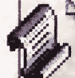 变量 `tim` 常用于命名计时器。


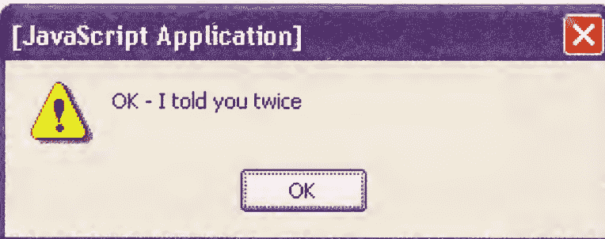

## JavaScript 钟

利用 Date 对象配合计时器创建一个每秒更新一次显示。下面的示例在 id 为 `f` 的 HTML 表单中动态显示本地时间：

```javascript
function tick() {
  // 创建一个新的 Date 对象
  var now = new Date();

  // 提取当前的时、分、秒
  var hh = now.getHours();
  var mn = now.getMinutes();
  var ss = now.getSeconds();

  // 确保每个组件都是两位数
  if(hh <= 9) hh = "0" + hh;
  if(mn <= 9) mn = "0" + mn;
  if(ss <= 9) ss = "0" + ss;

  // 将当前时间赋值给表单字段
  document.forms.f.value = hh + ":" + mn + ":" + ss;
}
```

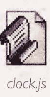


> 钟需要通过 HTML `<body>` 标签的 `onload` 属性调用 `tick()` 函数来启动——这确保了表单通过 JavaScript 将时间赋值给其字段。

```javascript
// 设置间隔为一秒
window.setTimeout("tick()", 1000);
```


# 数学运算

本章介绍 `Math` 对象，并描述了用于执行数学计算的常量值和方法。随机数生成主题通过实际示例进行了说明。

- Math 常量 | 66
- 使用 pi | 67
- Math 方法 | 68
- 浮点数舍入 | 69
- 强制浮点数 | 70
- 数字比较 | 71
- 随机生成器 | 72
- 彩票选择器 | 73
- 随机图像 | 74


## Math 常量

内置的 JavaScript `Math` 对象包含了标准常量值以便引用。

大写字母始终引用表中列出的常量值：

| 常量 | 说明 |
| :--- | :--- |
| `Math.E` | 自然对数 e，值约为 2.71828 |
| `Math.LN2` | 2 的自然对数，约为 0.6931471805599458263 |
| `Math.LN10` | 10 的自然对数，约为 2.3025850299405911 |
| `Math.LOG2E` | e 的底数为 2 的对数，约为 1.44269504088963387 |
| `Math.LOG10E` | e 的底数为 10 的对数，约为 0.4342944819032518677 |
| `Math.PI` | 常量 pi，约为 3.14159265358979 |
| `Math.SQRT1_2` | 2 的平方根的倒数，约为 0.707106781186542 |
| `Math.SQRT2` | 2 的平方根，值约为 1.41421356237095 |

`Math` 常量可以在脚本中的任何地方使用。

大部分常量用于具有特定数学目的的 JavaScript 应用，但为了完整性，上面提供了完整列表。

`Math.PI` 常量通过动态效果创造了有趣的可能性。下面的示例脚本动态地旋转名为 `div` 的层：

## 使用 pi

```javascript
// 存储位置的全局变量
var pos = 0;

// 旋转 id 为 "d1" 的 div 的函数
function spin() {
  // 获取 div 的样式对象
  var obj_style = document.getElementById("d1").style;

  // 存储半径和 x,y 偏移
  var radius = 40;
  var x_offset = 50;
  var y_offset = 50;

  // 增加新位置
  pos += 10;

  // 使用 Math 计算新的 x,y 坐标
```


```javascript
x = radius * Math.cos(pos * Math.PI / 180);

y = radius * Math.sin(pos * Math.PI / 180);

// 加上 x,y 偏移
x += x_offset;

// 将 div 移动到新坐标
obj_style.left = x + "px";
obj_style.top = y + "px";

// 设置调用此函数的间隔
setTimeout("spin()", 100);
}
```


## 数学方法

JavaScript `Math` 对象有许多方法 – 它们都列在下表中：

| 方法 | 描述 |
| :--- | :--- |
| `Math.abs()` | 返回绝对值 |
| `Math.acos()` | 返回反余弦 |
| `Math.asin()` | 返回反正弦 |
| `Math.atan()` | 返回反正切 |
| `Math.atan2()` | 返回从 X 轴到某点的角度 |
| `Math.ceil()` | 向上取整 |
| `Math.cos()` | 返回余弦值 |
| `Math.exp()` | 返回常数 e 的幂 |
| `Math.floor()` | 向下取整 |
| `Math.log()` | 返回自然对数 |
| `Math.max()` | 返回两个数中较大的一个 |
| `Math.min()` | 返回两个数中较小的一个 |
| `Math.pow()` | 返回幂的值 |
| `Math.random()` | 返回一个随机数 |
| `Math.round()` | 四舍五入到最近的整数 |
| `Math.sin()` | 返回正弦值 |
| `Math.sqrt()` | 返回平方根 |
| `Math.tan()` | 返回正切值 |

> **热点提示** `Math.random()` 在网页中有许多用途，用于提供多样化的页面内容。

上述列表中常用的 Math 方法将在接下来的页面中进行详细介绍。

## 浮点数舍入

JavaScript 中的 `Math.round()` 方法既可以将浮点数四舍五入到最近的整数，也可以将浮点数转换为更短的舍入版本。通常这会将一个长浮点数减少到两位小数。

如果作为方法参数的浮点值恰好位于两个整数的中间，该方法将向上舍入到最近的整数。

下面的示例说明了 `Math.round()` 方法如何处理正负半数值的舍入，并展示了如何使用它将长浮点数转换为仅两位小数：

```javascript
var a = 7.5;
a = Math.round(a);
a = "Rounded Positive : " + a + "\n";

var b = -7.5;
b = Math.round(b);
b = "Rounded Negative : " + b + "\n";

var c = 3.7646368467915;
c = c * 100; // 保留两位小数
c = Math.round(c); // 执行舍入
c /= 100; // 恢复到两位小数
c = "Commuted Long Float : " + c + ";";

alert(a + b + c);
```

## 强制处理浮点数

作为上一页详细的 `Math.round()` 方法的替代方案，脚本可能需要将浮点数选择性地强制转换为最近的整数（向上或向下）。

JavaScript 提供了 `Math.ceil()` 方法来强制向上取整到最近的整数，而 `Math.floor()` 方法则向下取整到最近的整数。

下面的示例展示了这两个方法在处理正负值时的用法：

```javascript
var a = 7.5;
var a1 = "a1 " + Math.ceil(a);
var a2 = "a2 " + Math.floor(a);

var b = -7.5;
var b1 = "b1 " + Math.ceil(b);
var b2 = "b2 " + Math.floor(b);

var rup = "ROUNDING UP\n" + a1 + "\n" + b1 + "\n";
var rdn = "ROUNDING DOWN\n" + a2 + "\n" + b2 + ";";

alert(rup + rdn);
```

负值的向上取整会返回向零方向靠近的最近整数。

## 比较数字

`Math` 对象有两个方法允许比较两个数字，并返回其中较大或较小的值。

`Math.max()` 接受两个待比较的值作为参数，并将返回这两个值中较大的一个。

`Math.min()` 方法的工作方式完全相同，返回两个值中较小的一个。

在下面的示例中，使用 `Math.pow()` 方法创建平方和立方值，然后与 `Math.max()` 和 `Math.min()` 进行比较。

`Math.pow()` 方法需要两个参数来指定该数字的幂次：

```javascript
var sq = Math.pow(5, 2);
var cb = Math.pow(3, 3);

var hi = "Round up : " + Math.max(sq, cb);
var lo = "Round Down : " + Math.min(sq, cb);
var ng = "Round Negative Up : " + Math.max(-5, -4);

alert("MAX\n" + hi + "\n" + lo + "\n" + ng);
```

## 随机生成器

可以使用 `Math.random()` 方法生成随机数，返回一个 0.0 到 1.0 之间的浮点值。该方法可以用于创建一系列随机选择（如抽票），并且在网页中产生随机效果非常流行。

通过乘以随机数可以指定更宽的范围，例如，乘以 10 将创建一个 0.0 到 10 之间的随机数。为了让生成的随机数更有用，最好是将浮点数向上取整，使范围变为整数值。使用 `Math.ceil()` 方法可以将随机数向上取整为 1 到 10 之间的整数。下面的代码演示了这一点：

```javascript
// 获取一个 0.0 到 1.0 之间的随机数
var rand1 = Math.random();

// 乘以 10 使其处于 0.0 到 10 之间
var rand2 = rand1 * 10;

// 向上取整使其变为 1 到 10 之间的整数
var rand3 = Math.ceil(rand2);

// 将结果添加到字符串
var str = "Random float [rand1]: " + rand1 + "\n";
str += "Specify range [rand2]: " + rand2 + "\n";
str += "Random integer [rand3]: " + rand3;

// 显示字符串
alert(str);
```

## 随机选择器

此示例使用 `Math.random()` 生成 1 到 49 之间的系列随机数字，可以用于彩票抽奖。以下是随机化 1 到 49 的数字：

```javascript
// 创建变量
var i, rand, temp, str;

// 创建一个包含 50 个元素的数组
var nums = new Array(50);

// 用 1 到 49 的数字填充 1 到 49 的元素
for (i = 1; i < 50; i++) {
  rand = Math.ceil(Math.random() * 49);
  temp = nums[i];
  nums[rand] = temp;
  nums[rand] = i;
}

// 将前六个数字添加到字符串
str = "Your lucky numbers are:\n\n";
for (i = 1; i < 7; i++) {
  str += nums[i];
  if (i != 6) str += " - ";
}

// 显示字符串
alert(str);
```

## 随机图片

下面的示例使用 `Math.random()` 方法选择六张图片之一显示在网页中。具有 id `pic` 的 HTML `` 标签会在每次页面加载时由代码决定图片并执行脚本。

请记住，包含此 JavaScript 的 `<script>` 元素必须出现在 HTML 文档中 `` 标签之后。否则代码将无法找到 id 为 `pic` 的元素——从而无法分配随机图片。

```javascript
// 创建新数组并为 6 个元素分配随机图片
var pix = new Array;
pix[0] = "pic0.gif";
pix[1] = "pic1.gif";
pix[2] = "pic2.gif";
pix[3] = "pic3.gif";
pix[4] = "pic4.gif";
pix[5] = "pic5.gif";
```

文档属性和方法将在第 10 章中详细解释。

```javascript
// 获取一个 0 到 5 之间的随机整数
var rand = Math.floor(Math.random() * 6);

// 将随机图片分配给 id 为 pic 的 HTML img 标签
document.getElementById("pic").src = pix[rand];
```

使用此脚本可以在网页上随机显示横幅。

## 处理字符串

本章解释了字符串特性，并通过示例演示了如何使用 JavaScript 代码处理文本字符串。

## 目录

- 字符串长度 | 76
- 字符串中的字符 | 77
- 连接字符串 | 78
- 搜索字符串 | 79
- 分割单词 | 80
- 子字符串 | 81
- 转换为字符串 | 82
- 更改大小写 | 83
- 从字符串提取数字 | 84
- 字符串中的变量 | 85
- 字符串编码 | 86

# 字符串长度

JavaScript 中的字符串简单来说是包含在引号内的零个或多个字符，因此这些全都是字符串：

```javascript
var str1 = "My First String";
var str2 = "";
var str3 = "2";
var str4 = "null";
```

`str2` 中的空引号将变量定义为字符串类型，无论空字符串的值为空。赋值给 `str3` 的数值在包含在引号中时会自动转换为字符串类型，而 JavaScript 的 `null` 关键字只是一个包含在引号中的字符串字面量。


本质上，字符串是字符的集合，每个字符包含自己的数据，就像定义数组中的元素一样。

将字符串视为字符数组并在使用字符串时应用数组特性是有逻辑的。

下面的示例将数组的 `.length` 属性与字符串的 `.length` 属性进行了对比：

```javascript
// 创建并初始化字符串变量
var a = "JavaScript Strings";
// 显示字符串的长度
alert("String length is " + a.length);
```


# 字符串中的字符

字符串就是数组，其中每个元素都是字符，可以像引用普通数组元素一样引用它们。

所以就像数组一样，第一个字符是元素 0（零）。

可以使用 `string.charAt()` 方法查找字符，该方法将元素索引作为其位置。

下面的示例读取字符串中的字符并根据找到的字符进行更改：

```javascript
// 创建并初始化两个字符串变量
var str = "linger in", newstr = "";
// 获取字符串变量的第一个和最后一个字母
var a = "First letter : " + str.charAt(0);
var z = "Final letter : " + str.charAt(str.length - 1);
```


```javascript
// 遍历每个字符并复制到 newstr
// 除非它是 i - 0；否则复制到 newstr
for (var i = 0; i < str.length; i++) {
    if (str.charAt(i) != "i") newstr += str.charAt(i);
    else newstr += "";
}
```

```javascript
// 显示 newstr 以及字符串的第一个和最后一个字母
var result = "STRING\n\n";
result += "New string : " + newstr + "\n";
alert(result + a + "\n" + z);
```


[JavaScript 应用]
STRINGS 
New string : longer on
First letter : l
Final letter : n

# 拼接字符串

`+` 运算符用于连接字符串，并在书中提供的示例代码中被广泛使用。

会创建一个新字符串，由第一个字符串紧随其第二个字符串组成。

下面的示例将多个变量值连接成单个字符串，无论原始数据类型如何——因为 JavaScript 会执行自动数据转换：

```javascript
// 创建并初始化一个整数变量
var num = 99;
// 创建并初始化一个浮点数变量
var flt = 98.6;
// 创建并初始化一个布尔变量
var bool = true;
// 创建并初始化几个字符串变量
var str1 = "Although ";
var str2 = " F is cited as \"body temperature\"";
var str3 = "nthe";
var str4 = " range is from about 97 to ";
var str5 = "F.";
// 显示拼接后的字符串
alert(str1 + flt + str3 + bool + str4 + num + str5);
```


| JavaScript 应用 |
| :--- |
| 虽然 98.6 F 被引用为“体温”，但范围大约是从 97 到 99 F。OK |

# 搜索字符串

JavaScript 可以通过将参数传递给字符串的 `indexOf()` 方法来搜索字符串查找字符或子字符串。

如果匹配成功，该方法将返回匹配的字符或子字符串在搜索字符串中首次出现的起始位置。

在未找到匹配的情况下，`string.indexOf()` 方法返回值 -1。

下面的示例使用 `string.indexOf()` 方法在电子邮件地址字符串中查找点和 @ 字符，以执行简单的格式验证：

```javascript
// 创建并初始化要搜索的字符串
var str = "mailme@domain.com";
// 在字符串中查找 @、点和 # 字符
var att = str.indexOf("@");
var dot = str.indexOf(".");
var hsh = str.indexOf("#");
```


可选的第二个参数可以指定搜索开始的位置。


```javascript
// 如果找到了 @ 和点，则为有效
var fmt = ((att != -1) && (dot != -1)) ? "valid" : "invalid";
// 显示结果
var res = "Format is " + fmt;
res += "\nat " + att;
res += "\nDot at " + dot;
res += "\nHash is " + hsh;
alert(res);
```


## 分隔单词

可以使用 `split()` 方法分离字符串的内容。单个参数应该指定分离字符串的常用字符。最常见的是空格字符，这样短语会被拆分成单词数组。每个单词都可以像其他数组一样使用索引进行引用。

下面的示例展示了 `split()` 方法的另一种用法，使用管道字符作为分隔符：

```javascript
// 创建并初始化字符串
var str = "JavaScript in easy steps";
// 用空格将字符串拆分为数组
var ss = str.split(" ");
// 创建并初始化另一个字符串
var bk = "JavaScript in easy steps|Mike";
// 用管道将单词拆分为数组
var bks = bk.split("|");
// 显示一些拆分元素
var res = "Topic : " + ss[0];
res += "\nTitle : " + bks[0];
res += "\nAuthor : " + bks[1];
alert(res);
```


数据通常以逗号分隔的字符串形式存储


## 子字符串

可以使用 `substring()` 方法从现有字符串中提取子字符串，该方法必须包含两个参数来指定主字符串中所需的起始和结束位置。

起始参数处的字符将是返回子字符串的第一个字符。子字符串中的最后一个字符将是结束参数位置之前的字符。

另一种方法是使用 `substr()` 方法从字符串提取子字符串，它也需要两个参数。第一个参数指定子字符串的起始位置，第二个指定要返回的子字符串长度。

下面的示例演示了两种 substring 方法：

```javascript
// 创建并初始化字符串变量
var str = "JavaScript in easy steps";
// 使用 substring 方法获取两个子字符串
var sub1 = str.substring(14, 19) + str.substring(0, 11);
// 使用 substr 方法获取两个子字符串
var sub2 = str.substr(14, 5) + str.substr(0, 10);
// 显示所有子字符串
var res = "Substring method : " + sub1;
res += "\nSubstr method : " + sub2;
alert(res);
```


> 提示提示 `substr()` 方法始终是最容易使用的。


7. 处理字符串 | 81

## 转换为字符串

可以通过调用 `object.toString()` 方法手动调用用于将其他数据类型转换为字符串的 JavaScript 函数。

这是一个重要的 JavaScript 函数，始终尝试返回所查询对象的字符串表示，即使它本身不是字符串。

在这个示例中，首先是两个整数的相加，然后是字符串与整数的拼接，其中整数被转换为字符串值。

最后通过不同的数据类型演示了 `object.toString()` 方法，以说明生成的输出将揭示对象的类型。

```javascript
// 创建一个整数变量并加上另一个整数
var num = 9;
var nostr = num + 9;
```


```javascript
// 创建 num 整数变量的版本
// 然后在其上拼接第二个值
var adstr = num.toString() + 9;
```

```javascript
// 创建一个新的 Image 对象
var img = new Image();
```

```javascript
// 显示变量的字符串值
var res = "No strings : " + nostr;
res += "\nAdded strings : " + adstr;
res += "\nImage : " + img.toString();
alert(res);
```


## 字符大小写转换

可以使用 `string.toUpperCase()` 或 `string.toLowerCase()` 方法更改字符串字符的大小写，以强制所有字符转换为统一的大小写。

这些方法在比较用户输入时非常有用，可以确保字符格式与比较格式保持一致。

在以下示例中，当用户点击按钮时，通过将函数名赋值给按钮 HTML 元素的 `onclick` 属性来调用该函数，如下所示：


```html
<input type="button" value="Check Input" onclick="check_input()">
```

`string.toLowerCase()` 方法将文本框中的大写输入转换为小写字符串值，以便与小写字符串进行比较。

```javascript
function check_input() {
  // 从 id 为 f 的表单获取用户输入
  var entry = document.forms.f.textfield.value;
  // 比较输入并显示适当的消息
  if (entry.toLowerCase() == "castle") alert("Accepted");
  else alert("Refused");
}
```


请参第 125 页有关引用表单元素的更多细节。


| 转换为小写 |
| :--- |
| 文件 编辑 视图 收藏 工具 帮助 |
| CASTLE | Check Input |
| Microsoft Internet Explorer | |
| Accepted | |
| OK | |
| Done 本地局域网 |

## 字符串中的数字

可以使用 `parseInt()` 和 `parseFloat()` 方法从字符串的开头提取数字。

`parseInt()` 方法解析字符串并返回找到的整数值。`parseFloat()` 方法的工作相同，但返回的是浮点数。

如果解析器在返回数字之前发现任何非数字字符，它将返回特殊的 `NaN` 值，用于表示“不是数字”（Not-a-Number）。

此示例演示了 `parseFloat()` 和 `parseInt()` 方法，并说明了 JavaScript `isNaN()` 函数如何测试 `NaN` 值：

```javascript
// 创建一个数字开头的字符串
var str = "66.6% PASS RATE";
// 提取初始整数值
var res = "Integer: " + parseInt(str);
// 提取初始浮点值
res += "\nFloat: " + parseFloat(str);
// 创建一个字母开头的字符串
var badstr = "PASS RATE 66.6%";
// 尝试提取初始整数值
res += "\nNon-numeric : " + parseInt(badstr);
res += "\nFound : ";
res += isNaN(badstr) ? "Character" : "Number";
alert(res);
```


`NaN` 值无法用 `==` 运算符进行测试。


## 字符串中的变量

JavaScript 的 `eval()` 函数接受一个包含 JavaScript 代码的字符串参数，并对其进行求值，然后返回结果。

如果代码字符串包含语句，它们将由 `eval()` 函数执行，然后返回最终值。

虽然该函数是 JavaScript 语言的一个强大特性，但它经常被用于将变量值引入字符串中。

在下面的示例中，脚本将一个字符串值赋值并显示在 id 为 `f` 的表单文本输入框中。HTML `<input>` 元素被命名为 `textField`。

包含此 JavaScript 的 `<script>` 元素必须出现在 HTML 文档中表单元素之后 - 这样文本字段在脚本对其进行赋值之前就会被创建。

文本框和显示字符串存储在由 `eval()` 函数求值的变量中。


```javascript
// 存储输入名称
var inputname = "textField";
// 存储要赋值的字符串
var inputtext = "JavaScript Text";
// 求值赋值表达式
eval("document.forms.f." + inputname + ".value=" + inputtext);
```


记得转义字符串内部的引号以避免错误消息。


现在字符串显示在文本框中，因为该表达式求值为：

```javascript
document.forms.f.textField.value = "JavaScript Text";
```


## 字符串编码

所有字符都有 Unicode 表示，可以通过 `string.charCodeAt()` 方法返回字符串中的每个单独字符。该方法需要字符在字符串中的索引作为其参数。

相反，可以使用 JavaScript `String.fromCharCode()` 函数提取字符，该函数接受 Unicode 数值作为参数。

下面的示例首先遍历字符串，并将其 Unicode 值创建一个用逗号分隔的字符串。会创建一个包含这些数值的数组，以便循环返回每个数字对应的字符：

```javascript
// 创建并初始化三个字符串
var str = "Code", enc = "", unc = "";
// 获取 Unicode 数字，逗号分隔
for (var i = 0; i < str.length; i++) {
  enc += str.charCodeAt(i) + ",";
}
```


```javascript
// 将数字列表分割为数组
var ss = enc.split(",");
```

```javascript
// 将 Unicode 值转换回字符
for (var i = 0; i < ss.length; i++) {
  unc += String.fromCharCode(ss[i]);
}
```


注意 `fromCharCode()` 是 `String` 的方法。

```javascript
alert("Encoded: " + enc + "\nDecoded: " + unc);
```

## 对象的地址

- 对象的地址
- 文档模型 (DOM) | 88
- 属性继承 | 89
- JavaScript | 90
- 揭示 | 91
- 页面 | 92
- 浏览器 | 93
- 兼容 | 94
- 检查 | 95
- 帮助 | 96
- 属性 | 97

## 对象的构造函数

对象的地址使用对象名后跟一个点来访问。之前的示例通过 `new` 使用了预定义的属性。


新的对象可以通过 `new` 关键字轻松创建，并通过属性名赋值值。

下面的示例创建一个名为 `car` 的新对象并赋予三个属性：


```javascript
// 创建一个新对象
var car = new Object();
// 创建并初始化品牌
car.maker = "Porsche";
// 创建并初始化模型
car.model = "Boxster";
// 创建并初始化颜色
car.color = "Red";
// 显示 car 的属性值
alert(car.color + " " + car.maker + " " + car.model);
```


## 属性继承

通过将新创建的对象赋值另一个对象的属性，可以增加示例的灵活性。在这种情况下，赋值对象的属性和值被第二个对象继承。

继承的属性通过在属性地址后添加点和继承属性名来访问。在处理 Web 页面中的对象和属性时，理解这种关系很有帮助。

以下示例演示了如何将新对象赋值给对象的属性，以及如何访问继承属性：

```javascript
// 创建具有赋值属性的新对象
var suv = new Object();
suv.badge = "Explorer";
suv.type = "4X4";
suv.doors = 4;
suv.color = "Red";
suv.engine = "4.0 liters";
```


对象必须先在脚本中创建，才能被赋值给另一个对象的属性。


```javascript
// 创建另一个继承第一个对象的对象
var car = new Object();
car.marker = "Ford";
car.model = suv;
```

```javascript
// 显示唯一值和继承属性值
alert(car.marker + " " + car.model.badge + " " + car.model.type);
```


# DOM 层级结构

浏览器的文档对象模型（DOM）是 Web 浏览器中的一组对象，可以通过 JavaScript 进行访问，以影响 HTML 文档的性能。


这些对象遵循严格的层级结构，其中 `window` 对象处于顶层。由于 `window` 是顶层“根”对象，在地址语法中可以省略它。例如，`window.document.bgColor` 属性（它存储窗口背景颜色的值）可以直接通过 `document.bgColor` 访问。

一些 DOM 对象具有包含该 Web 页面元素数组的属性。例如 `document.images[]`，`images[]` 数组是 `document` 对象的属性，将存储该 Web 页面包含的每个图像的 URL。HTML 代码中第一张图片的 URL 存储在数组 `document.images[0]` 中，后续图片的 URL 则存储在递增的数组索引中。

下方示例中的 `set_bg()` 函数是从 HTML `<body>` 标签的 `onload` 属性调用的，用于在文档加载后为 `document.bgColor` 赋值。这会将文档的背景颜色设置为指定的值。


```javascript
// function to set the document background color
function set_bg() {
  document.bgColor = "orange";
}
```


# 显示页面对象

下面的脚本示例显示了 Internet Explorer 6.0 和 Netscape 7.0 中的默认对象属性。

```javascript
// show all window properties
for (propertyName in window)
  document.write(propertyName + " ", " ");
```


此脚本可以显示更多的 DOM 对象属性 - 将 `window` 替换为查看所有 `document` 属性。


| Window 属性 - Internet Explorer | | | | | | |
| :--- | :--- | :--- | :--- | :--- | :--- | :--- |
| 文件 | 编辑 | 查看 | 收藏 | 工具 | 帮助 |
| onbeforeload, buffering, top, location, parent, offscreenBuffering, frameElement, onblur, screen, event, clipboardData, onclick, defaultStatus, scroll, scrollTop, focus, length, onbeforeprint, frames, self, clientInformation, external, left opener, onload, closed, history, Image, navigator, status, onhelp, name. | | | | | | |
| 完成 | 本地域网 | | | | | |

| Window 属性 - Netscape | | | | | | | | | |
| :--- | :--- | :--- | :--- | :--- | :--- | :--- | :--- | :--- | :--- |
| 文件 | 编辑 | 查看 | 查找 | 书签 | 工具 | 窗口 | 帮助 | |
| navigator, document, window, parent, top, scrollbars, name, scrollX, scrollTop, scrollBy, getSelection, scrollLines, scrollPages, sizeToContent, dump, setTimeout, setInterval, clearTimeout, setInterval, setResizable, captureEvents, releaseEvents, routeEvent, enableExternalCapture, disableEnableCapture, prompt, open, openDialog, frames, find, self, screen, history, content, sidebar, menu, toolbar, locationbar, personalbar, statusbar, directories, closed, crypto, pkcs11, counters, opener, status, defaultStatus, location, innerWidth, outerWidth, outerHeight, screenX, pageOffset, pageOffsetY, length, fullScreen, alert, confirm, focus, blur, forward, home, stop, print, moveTo, moveTo, resizeTo, resizeBy, scroll, updateCommands, escape, unescape, atob, btoa, addEventListener, removeEventListener, dispatchEvent, getComputedStyle | | | | | | | | |
| Document: 完成 (0.31 秒) | | | | | | | | |

## 浏览器 ID

`navigator` 对象具有一些属性，可以提供关于查看文档时使用的浏览器的信息。

浏览器名称通过 `navigator.appName` 属性显示，而特定版本的描述可以通过 `navigator.userAgent` 属性获取。

除了发行号外，`navigator.userAgent` 属性还包含其他细节，例如主机平台类型。

在下面的示例中，`navigator.userAgent` 属性显示浏览器为 Internet Explorer 6.0 (MSIE 6.0) 和 Netscape 7.0，运行在 Windows XP 平台 (NT5.1) 上：

```javascript
// get the browser name
var browser = navigator.appName;
// get the browser description
var description = navigator.userAgent;
// display the browser name and version
alert(browser + "\n\n" + description);
```


## 浏览器兼容性

为了让 Web 页面按预期显示，有时需要识别浏览器支持的文档对象模型（DOM）。Netscape 和 Internet Explorer 的 4.0 版本增加了对动态 HTML (DHTML) 的支持。为此，Netscape 引入了 `document.layers`，微软则引入了 `document.all`。

最近，Netscape 6.0 和 Internet Explorer 5.0 版本增加了对万维网联盟 (W3C) 设计的 DOM 支持。重要的是，这增加了一个名为 `document.getElementById()` 的方法，可以通过 id 引用 HTML 元素。例如，`document.all` 和 `document.getElementById("")` 可以引用 id 为 "pic" 的元素：``。由于大多数浏览器都支持 W3C DOM，


测试 `document.layers` 和 `document.getElementById()` 是否存在以发现浏览器支持的 DOM 是方便的：


```javascript
// cross-browser DOM test
if (document.getElementById) alert("W3C DOM");
else if (document.all) alert("MSIE 4 DOM");
else if (document.layers) alert("NN 4 DOM");
else alert("This is a really old browser");
```
dom-test.js


## 平台检查

由于缺少某些支持，操作系统影响 ActiveX 控制是创建功能的一种方式。例如，在 Linux 平台上运行的 Web 浏览器不支持 ActiveX 控制。

特定的脚本实现方式与浏览器特定的脚本类似，使用 `navigator.platform`。该属性包含一个表示用户操作系统的短字符串，可以读取以适应任何平台。下面的示例输出了 `navigator.platform` 的值：

```javascript
// get the operating system
var os = navigator.platform;
document.write("Operating system is " + os);
```


`document.write()` 方法有助于让 JavaScript 动态写入页面——它也可以写入 HTML 标签。


| 主机平台 - Mozilla | | | | | | |
| :--- | :--- | :--- | :--- | :--- | :--- | :--- |
| 文件 | 编辑 | 查看 | 搜索 | 任务 | 帮助 |
| 操作系统是 Linux i86 | | | | | |
| 文档: 完成 (0.632 秒) | | | | | |


| 主机平台 | | | | | | |
| :--- | :--- | :--- | :--- | :--- | :--- | :--- |
| 文件 | 编辑 | 查看 | 收藏 | 工具 | 帮助 |
| 操作系统是 Win32 | | | | | |
| 完成 | 本地域网 | | | | |

## 插件信息

在 Netscape/Mozilla 浏览器上，可以使用 `navigator.plugins` 数组发现浏览器安装的任何插件的信息。

安装在 Netscape/Mozilla 浏览器中的每个插件都作为一个元素添加到 `navigator.plugins` 数组。例如，如果安装了 Macromedia Shockwave 插件，则存在 `navigator.plugins["Shockwave"]` 元素。

插件元素有一个 `name` 属性（存储插件的名称和版本）以及一个包含插件信息的 `description` 属性。

在下面的示例中，JavaScript 代码首先检查 `navigator.appName` 是否为 Netscape，然后显示 `navigator.plugins` 数组中第一个插件的名称和描述：

```javascript
// for Netscape/Mozilla browsers only
if (navigator.appName == "Netscape") {
  // for the first plugin element
  with (navigator.plugins[0]) {
    // display its name and description
    document.write("<html>" + name + "</html>");
    document.write("<p>" + description + "</p>");
  }
}
```


`navigator.plugins` 在 Internet Explorer 中存在，但尚未实现。

plugins.js

Mozilla 浏览器以 Netscape 名称标识。

此脚本的输出将根据浏览器上安装的插件而异。


| 列出插件 - Mozilla | | | | | | | | |
| :--- | :--- | :--- | :--- | :--- | :--- | :--- | :--- | :--- |
| 文件 | 编辑 | 查看 | 查找 | 书签 | 工具 | 窗口 | 帮助 |
| **QuickTime Plug-in in 6.0.02** | | | | | | | |
| QuickTime 插件允许你在 Web 页面中查看多种多媒体内容。欲了解更多信息，请访问 QuickTime 网站。 | | | | | | | |

## Java 检测

可以使用 `navigator.javaEnabled()` 方法对浏览器进行评估，以发现是否已启用 Java。该方法返回一个 true 或 false 的布尔值，取决于检测结果。

`navigator.javaEnabled()` 方法用于用于是否应该加载包含 Java applet 的页面，或者应该加载替代的非 Java 页面——例如所示：

```javascript
// 测试浏览器中是否启用了 Java
if (navigator.javaEnabled()) {
    window.location = "javapage.html"; // 如果为真跳转此处
} else {
    window.location = "nojavapage.html"; // 否则跳转此处
}
```

`window.location` 存储当前页面的 URL —— 为其分配新 URL 将在浏览器中加载该页面。关于此属性的更多信息请参阅第 100 页。

## Window 属性

本章演示了 `window` 对象的属性和方法。文中介绍了如何创建弹出窗口，并讨论了框架页的使用，同时给出了如何访问其他框架中对象的示例。

## 目录

- Confirm（确认） | 98
- Prompt（提示） | 99
- Location（位置） | 100
- History（历史） | 101
- Onload（加载完成） | 102
- Status（状态） | 103
- Pop-up window（弹出窗口） | 104
- Pop-up features（弹出功能） | 105
- Close pop-up（关闭弹出） | 106
- Get size（获取大小） | 107
- Frames array（框架数组） | 108
- Frame objects（框架对象） | 109
- Error handling（错误处理） | 110

# 第九章

## Confirm

在书中示例中广泛使用的 `alert()` 函数实际上是顶层 `window` 对象的一个方法，因此可以正确地调用为 `window.alert()`。

`window.confirm()` 方法是另外两个窗口方法中的第一个，调用时会产生对话框。

它用于从对话框中获取用户确认，对话框中包含一个 OK 按钮（向脚本返回 true）和一个 Cancel 按钮（向脚本返回 false）。

应向该方法传递单个字符串参数作为参数，该字符串包含供用户确认的问题。

此示例演示了 `window.confirm()` 方法执行条件分支，以确定要写入哪个消息字符串——取决于用户在对话框中按了哪个按钮：

```javascript
// 创建一个变量来存储对话响应
var ask = confirm("您确定要继续吗？");
```

```javascript
// 创建一个变量来存储回复
var msg;
```

```javascript
// 分配相应的回复消息
if (ask) msg = "点击了 OK 按钮";
else msg = "点击了取消 按钮";
```

```javascript
// 显示回复消息
document.write(msg);
```

## Prompt

`window.prompt()` 方法通过包含文本字段以及 OK 和取消按钮的对话框，从用户处获取键盘输入。

`window.prompt()` 方法需要两个字符串参数来指定要显示的消息和默认文本值。如果脚本不需要默认文本字段值，则第二个参数应为空字符串。

当用户按下 OK 按钮时，对话框会返回文本字段的值。此示例获取用户输入以个性化页面：

```javascript
// 请求用户输入其姓名
var user = prompt("请输入您的姓名...", "");
// 如果字段留空，则提供默认名称
if (user == null || user == "") user = "visitor";
// 显示带有用户名的消息
document.write("你好 " + user + ",,欢迎来到本页面");
```

## Location

`window.location` 对象包含当前在浏览器中加载的文档的完整 URL 地址。

它在 `window.location.href` 属性中存储实际的完整 URL，为其分配新值或为 `window.location` 对象本身赋值会将指定的 URL 加载到浏览器中。

典型的 URL 地址可能包含这些部分：
protocol: // host / pathname hash

存储在 `window.location` 对象中的 URL 地址的每个部分可以使用相应的 location 单独访问——如此示例所示：

```javascript
// 分配当前位置的每个部分
var locn = "Href: " + location.href;
var prot = "Protocol: " + location.protocol;
var host = "Host: " + location.host;
var path = "Path: " + location.pathname;
var hash = "Hash: " + location.hash;
// 显示变量值
alert(locn + "\n" + prot + "\n" + host + "\n" + path + "\n" + hash);
```

> **提示**：为 `location.hash` 分配新值可以将浏览器移动到指定位置。

| JavaScript 应用 |
| :--- |
| Href: http://localhost/location.html#top |
| Protocol: http |
| Host: localhost |
| Path: /location.html |
| Hash: #top |

## History

`window.history` 属性包含一个会话期间访问过的 URL 地址数组。出于安全考虑，这些地址无法直接读取，但它们被用于导航回之前的页面。

`window.history` 对象的 `back()` 和 `forward()` 方法模拟了浏览器的后退和前进按钮。

`window.history.go()` 方法提供了更灵活的导航，它接受一个参数来通过相对位置指定位置。例如，参数为 -1 将重新访问上一个页面，值 -2 将打开它之前的页面。

同样，`window.history.go(1)` 会到访问 URL 历史数组中的下一页。调用 `window.history.go(0)` 会导致浏览器重新加载当前文档。示例中的函数将用户返回到之前的页面。

```javascript
// 返回上一页的函数
function go_back() {
  window.history.go(-1);
}
```

## Unload

`window.onload` 对象可能用于指定文档在浏览器中完全加载后调用的函数。通常此初始化函数命名为 `init()`，常用于设置脚本设置值。

当页面包含可能需要时间下载的图形时，它特别有用。如果脚本使用了这些图像，则必须确保在脚本运行之前完成下载。

包含在 HTML `<body>` 标签中的 `onload` 属性也可以设置 `window.onload` 对象——因此需要避免相互覆盖。

`window.onunload` 对象和 HTML `<body>` 标签的属性情况也是如此，它们都可以指定当用户导航到新位置时调用的函数。通常 `window.onunload` 在用户离开网站时调用创建一个弹出窗口的函数。

此示例在用户退出时显示简单的 `alert()` 对话消息：

```javascript
// 显示退出消息的函数
function goodbye() {
  alert("感谢-欢迎光临");
}
// 指定 onunload 事件处理器
window.onunload = goodbye;
```

| JavaScript 应用 |
| :--- |
| 感谢访问-欢迎光临 |

## Status

`window.status` 对象可用于在浏览器窗口的状态栏显示消息，直到显示文档中的其他功能设置了新的状态栏消息，或者状态栏恢复默认状态。

可以使用 `window.defaultStatus` 对象指定要显示的默认消息。

在第十二章中了解更多关于 [onmouseover](https://www.w3schools.com/dom/dom_onmouseover.asp) 的其他示例。

要在用户将鼠标悬停在超链接上时显示消息，HTML mouseover 属性应指定要显示的消息。它必须返回 true 以防止链接 URL 像通常那样出现在状态栏中。

此示例在 HTML 标签内使用 JavaScript 指定了默认消息，并为链接添加了 `onmouseover` 属性。当光标停留在链接上时显示另一个消息：

```html
<body onload="window.defaultStatus = 'Status Demo">
<p><a href="nextpage.html" onmouseover="window.status='点击此处';return true">
超文本链接</a></a></p>
```

# 弹出窗口

JavaScript 提供的实用浏览器功能之一是打开第二个浏览器窗口来显示另一个 URL 网页。

这可以通过使用 `window.open()` 方法实现，该方法接受三个参数，用于指定在弹出窗口中加载的 URL、弹出窗口的名称以及所需的尺寸特征。

这些弹出窗口通常比原始窗口小，并且有许多用途，包括显示缩略图大小的图像。

下面的示例在第一个窗口完全加载后打开一个二级弹出窗口：

```javascript
// 一个打开弹出窗口的函数
function popup() {
  window.open("popup-2.html", "",
  "top=40,left=40,width=250,height=100");
}
// 设置 onload 对象
window.onload = popup;
```


> 热门提示：如果不给弹出窗口指定名称，则第二个参数必须为空字符串。


# 弹出特征

`window.open()` 方法的第三个参数可以指定包含在新窗口中的许多特征，具体如下表所示：

| 特征 | 说明 |
| --- | --- |
| directories | 添加链接栏 |
| height | 设置文档区域的高度（像素） |
| left | 窗口在屏幕上的 X 坐标 |
| location | 添加地址栏 |
| menubar | 添加标准菜单栏 |
| resizable | 允许调整窗口大小 |
| scrollbars | 需要时启用滚动条 |
| status | 添加状态栏 |
| toolbar | 添加带有后退和前进按钮的工具栏 |
| top | 窗口在屏幕上的 Y 坐标 |
| width | 设置文档区域的宽度（像素） |


`top`、`left`、`width` 和 `height` 尺寸特征需要像对应页示例那样指定像素值。所有其他特征的值可以是 `yes` 或 `no`，但如果特征出现在参数中，则假设该值有效——因此需要对其指定。

例如，要在对应页的代码中添加状态栏，只需在特征列表中添加 `status` 即可：

```javascript
// 一个打开带状态栏弹出窗口的函数
function popup1() {
  window.open("popup-2.html", "",
  "top=40,left=40,width=250,height=100,status=");
}
```


# 关闭弹出窗口

窗口可以通过简单调用 `window.close()` 方法自关闭，但关闭弹出窗口需要多一点努力。

初始调用 `window.open()` 方法应赋值给一个变量以创建一个窗口对象。这个新对象继承了 `window.close()` 方法，从而可以关闭弹出窗口。

此示例在用户退出主窗口之前验证弹出窗口是否存在……

```javascript
// 创建一个变量来存储窗口对象
var popwindow;
// 一个打开弹出窗口的函数
function popup() {
  popwindow = window.open("popup-2.html", "", "top=40,left=40,width=250,height=100,menubar,status");
}
// 一个关闭弹出窗口的函数
function close_popup() {
  if (popwindow != null) popwindow.close();
}
// 设置 onload 和 unload 对象
window.onload = popup;
window.onunload = close_popup;
```


此弹出页面与第104页的示例相同——JavaScript 为此窗口添加了状态栏和菜单栏特征。


# 获取尺寸

有时让 JavaScript 通过 `window.screen` 对象的 `width` 和 `height` 属性获取用户的屏幕分辨率是有用的。因为窗口可能没有最大化化，所以确定窗口的实际宽度也有帮助。

`window.screen` 的 `availHeight` 和 `availWidth` 属性包含排除任务栏的大小。

Netscape 和 Internet Explorer 的文档对象模型存储内部窗口尺寸的方法不同，因此需要特定浏览器的脚本。


在下面的示例中，通过相应的对象获取窗口尺寸。该函数由 HTML `<body>` 标签的 `onload` 属性调用，以确保窗口已创建。

```javascript
function get_sizes() {
  var win_w, win_h, scr_w, scr_h, res, in;
  if (document.body.clientWidth) { // IE 和 Opera
    win_w = document.body.clientWidth;
    win_h = document.body.clientHeight;
  } else if (window.innerWidth) { // Netscape 和 Mozilla
    win_w = innerWidth; win_h = innerHeight;
  }
  scr_w = screen.width; scr_h = screen.height; // screen
  // 显示尺寸
  res = "Resolution: " + scr_w + "x" + scr_h;
  in = "Inner window: " + win_w + "x" + win_h;
  if (win_w == null) alert(res + "\n" + in);
}
```


你可以调用 `window.print()` 方法在浏览器中打印文档


9. 窗口属性

# Frames 数组

`window.frames` 对象包含了在 HTML `<frameset>` 标签中定义的所有帧的数组。JavaScript 可以 `parent.window.frames[]` 从任何帧访问这些帧。

单个帧可以使用数组中的索引或通过分配给 HTML `<frame>` 标签的名称来访问。因此，名为 "main" 的帧可以从另一个帧通过 `parent.window.frames["main"]` 访问。

包含在 HTML 文档中的脚本从父帧读取每个帧的名称：

```javascript
// 查找帧的总数
var framenums = "No. frames :"
    + parent.window.frames.length;
// 获取每个帧的名字
var framenames += "\nFrame 1 : "
    + parent.window.frames[0].name;
framenames += "\nFrame 2 : "
    + parent.window.frames[1].name;
framenames += "\nFrame 3 : "
    + parent.window.frames[2].name;
```


> 热门提示：始终使用 HTML 元素供 JavaScript 使用，以产生更易读的代码。

```javascript
alert(framenums + framenames);
```


# Frame 对象

对应页的示例允许访问带帧窗口内的不同帧，由于浏览器 DOM 是分层的，这意味着任何帧内的对象和属性也是可访问的。

脚本可以像处理框架对象一样为这些对象属性赋值并使用它们的方法。

通常，窗口左侧的导航帧会有导航按钮，点击后会将 URL 位置分配给屏幕右侧的主帧。

此示例在相反页的代码中增加了一个函数。通过按钮的 HTML `onclick` 属性调用，在 Banner 帧中写入文本并更改 Page 帧的位置：

```javascript
function next() {
  // 将另一个页面加载到 Page 帧
  parent.frames.Page.window.location = "nextpage.html";
  // 向 Banner 帧写入文本
  parent.frames.Banner.window.document.write("Frame 2 - Written by Frame 1");
}
```


# 错误处理

可以将自定义的错误处理函数分配给 `window.onerror` 对象以处理运行时错误。

当浏览器遇到错误时，它会在脚本中寻找错误处理器，但如果没有找到，它将通过打开浏览器错误对话框自行处理错误。

一旦检测到错误，就会向浏览器返回一个 `true` 值表示错误已处理。


为了避免错误对话框，自定义的错误处理器只需要在遇到错误时返回 `true`。

理想情况下，浏览器将向错误处理器传递三个参数，包含错误性质的信息、包含错误的文件 URL 以及错误所在文件的实际行号。

在下面的示例中，浏览器传递给错误处理函数的每个错误错误信息都会显示给用户：

```javascript
// 声明错误处理函数
window.onerror = errorhandler;
// 定义错误处理函数
function errorhandler(msg, url, ln) {
  alert("Error: " + msg + "\nIn File: " + url + "\nAt Line: " + ln);
  return true; // 告诉浏览器已处理
}
// 这是一个故意的错误
document.form[theMistake].value = "myButton";
```


# 文档属性

本章说明了 `window.document` 对象的属性和方法。文中演示了图像切换滚动效果（rollovers）并解释了 cookie。此外还概述了如何在 JavaScript 中使用图层。

## 目录

- 设置颜色 | 112
- JavaScript 创建 | 113
- 设置 cookie | 114
- 获取 cookie | 115
- 图像数组 | 116
- 滚动效果 | 117
- 动态内容 | 118
- 最后修改时间 | 119
- XYZ 坐标 | 120
- 动态图层 | 121
- 透明图层 | 122

## 设置颜色

`window.document` 对象的属性和方法允许在运行时更改 Web 页面文档。使用 JavaScript 为 `window.document` 对象的属性分配新值，会导致 Web 浏览器根据新值更新 Web 页面的外观。

地址中的 `window.part` 可以省略，因为 `window` 是顶层 DOM 对象。

这可以通过给 `document.bgColor` 和 `document.fgColor` 属性分配新值来简单演示，从而更改页面的背景和前景颜色：

在此示例中，当用户点击按钮时，会从 HTML 的 `onclick` 属性调用 `set_colors()` 函数：


```javascript
// 一个设置页面颜色的函数
function set_colors() {
  window.document.bgColor = "red";
  window.document.fgColor = "yellow";
}
```


| 设置颜色 | | | | | | |
| :--- | :--- | :--- | :--- | :--- | :--- | :--- |
| 文件 | 编辑 | 视图 | 收藏 | 工具 | 帮助 |
| JavaScript 快速入门 | | | | | | |
| 更改颜色 | | | | | | |
| 完成 | 本地局域网 | | | | | |

注意 `bgColor` 和 `fgColor` 的大小写。


| 设置颜色 | | | | | | | |
| :--- | :--- | :--- | :--- | :--- | :--- | :--- | :--- |
| 文件 | 编辑 | 视图 | 收藏 | 工具 | 帮助 |
| JavaScript 快速入门 | | | | | | |
| 更改颜色 | | | | | | |
| 完成 | 本地局域网 | | | | | |

12 | JavaScript 快速入门

## JavaScript 创建

`window.document` 对象的 `write()` 方法是一个极其强大的功能，允许 JavaScript 在加载 Web 页面时动态创建内容。

该方法接受一个字符串参数，包含要写入页的内容，并可以包含用于格式化内容的 HTML 标签。

通常，`document.write()` 方法出现在 HTML 文档 `<body>` 部分的脚本中，并在通过条件测试后写入选定的内容。


应该注意的是，在运行时调用此方法会导致指定的内容写入一个新的空白文档，从而替换当前页面。

变量值也可以与字符串参数拼接，以便将变量值引入 Web 页面的内容中。

此示例首先生成一个随机数测试，以确定该数字是奇数还是偶数。根据测试结果将选定的内容添加到页面：

```javascript
// 获取 1 - 100 之间的随机整数
var n = Math.ceil(Math.random() * 100);
// 判断数字是奇数还是偶数
var ntype = (n % 2 == 0) ? "Even" : "Odd";
// 写入数字的描述
document.write("<h1>Number " + n + " is " + ntype + "</h1>");
```


| 写入内容 |
| :--- |
| 文件 编辑 视图 收藏 工具 帮助 |
| 数字 87 是奇数 |

## 设置 cookie

Cookies 是微小文件，可以通过 JavaScript 写入，以便在本地硬盘上存储少量数据。Cookie 的使用具有限制，将其大小限制在 4 千字节，且 Web 浏览器不被要求为每个 Web 服务器保留超过 20 个 cookie。典型的 cookie 经常可以保留用户访问页面或后续访问网站时的用户数据。


对值进行转义以包含空格、逗号和分号。cookie 数据以 `name=value` 对的形式存储在 `window.document.cookie` 对象中——通过对 `document.cookie` 对象进行进一步赋值，可以存储多个 `name=value` 对。

cookie 的寿命受限于浏览器会话长度，除非在首次设置 cookie 时指定了过期日期。

通过修改 `Date` 对象到指定的未来日期，可以为名为 `expires` 的键分配过期时间。


可以通过设置早于过期日期来删除 cookie。过期日期应通过 `Date.toGMTString()` 以 GMT 格式表示。

下方示例中的计算通过将天、小时、分钟和毫秒乘以 `Date` 对象增加了一周。

此示例将用户的姓名和账号存储在有效期为 7 天的 cookie 中：


```javascript
// 存储在 cookie 中的数据
var user_account = "Mike McGrath, 00456";
// 创建日期
var expiry = new Date();
// 设置 7 天后过期
expiry.setTime(expiry.getTime() + (7 * 24 * 60 * 60 * 1000));
// 创建 cookie
document.cookie = "cookieata=" + escape(user_account) + "expires=" + expiry.toGMTString() + ";";
```
set-cookie.js

## 获取 cookie

如果设置了 cookie，`document.cookie` 对象将返回 true，因此 JavaScript 可以测试 cookie 是否存在。当找到 cookie 时，`document.cookie` 对象返回存储的字符串。可以使用字符串处理方法从字符串中获取数据。

当下面的脚本运行时，它寻找上一个示例设置的 cookie，然后提取数据写入自定义内容：


```javascript
// 查找任何 cookie
if (document.cookie) {
  // 转义 cookie 数据
  var cookieata = unescape(document.cookie);
  // 分割 name=value 对
  var userdata = cookieata.split("=");
  // 如果 cookie 是 cookieata
  if (userdata[0] == "cookieata") {
    // 按逗号分割值
    var data = userdata[1].split(",");
    var username = data[0];
    var useracct = data[1];
  }
  // 写入从 cookie 获取的数据
  document.write("Welcome " + username + "<br/>");
  document.write("Account number: " + useracct + ".");
}
```


| 获取 Cookie | | | | | |
| :--- | :--- | :--- | :--- | :--- | :--- |
| 文件 | 编辑 | 视图 | 收藏 | 工具 | 帮助 |
| 欢迎 Mike McGrath | | | | | |
| 账号: 00456. | | | | | |
| 完成 | 本地局域网 | | | | |

## 图像数组

`window.document.images[]` 对象是 Web 页内所有图像对象的数组——按照 HTML 代码将它们添加到页面的顺序。因此，列表出的图像分配给数组第一个元素，可以通过 `document.images[0]` 访问。


始终为图像提供一个 HTML id 名称。在此示例中，可以访问每个图像分配给 HTML id 属性的名称和 `src` URL，以及 `document.images` 的总长度：


图像数组元素仅在浏览器加载页面后可用。


```javascript
// 获取图像信息的函数
function image_info() {
  var msg = "Total Images : " + document.images.length;
  msg += "";
}
```


# 滚动效果

如果图像在 HTML 代码中已命名（通过给 `` 标签的 `id` 属性赋值），则在 JavaScript 中也可以通过此名称访问。语法为 `document.images.imgname` —— 因此图像点击被访问为 `document.images.click`。

为图像的 `src` 属性分配新值会导致浏览器替换图像。这通常出现在滚动效果中——当鼠标悬停在图像上时，它会被第二张图像替换；当移开时返回原始图像。`` 标签必须包含 `onmouseover` 属性和 `onmouseout` 属性来创建滚动效果，例如：

```html

```

这些属性每当 `onmouseover` 或 `onmouseout` 事件发生时调用 JavaScript 图像切换函数：

```javascript
function swap(n) {
  if (n == 0) document.images.click.src = "off.gif";
  if (n == 1) document.images.click.src = "over.gif";
}
```

# 动态内容

`window.document.open()` 方法打开一个新的 HTML 文档，可以使用熟悉的 `window.document.write()` 方法向其写入内容以创建动态内容。

将空字符串作为 URL 参数传递给 `open` 可以打开一个空窗口。

内容写入完成后，应该通过 `window.document.close()` 方法关闭文档流。

下面的示例在上一章弹出窗口的基础上，通过从 JavaScript 写入内容而不是简单地加载现有的 HTML 文档：

```javascript
// 用于创建一个动态弹出窗口的函数
function popup() {
  // 创建弹出窗口
  var popwindow = 
    window.open("", "*", "top=40,left=30,width=250,height=125");
  // 打开弹出窗口的 HTML 文档
  popwindow.document.open();
  // 在弹出窗口中写入内容
  popwindow.document.write("<title>Pop-up</title>");
  popwindow.document.write("<Dynamic Pop-up Page<br/>");
  popwindow.document.write("");
  // 记得最后关闭 HTML 文档
  popwindow.document.close();
}
```

记住在双引号内使用单引号。

## 最后修改

`window.lastModified` 对象可以提供 Web 页面最后更新的日期和时间。这些数据通常由 Web 服务器发送的 HTTP 文件头提供 `document.lastModified`。在某些情况下，Web 服务器可能会省略此信息，因此 `document.lastModified` 在这些情况下将返回零。

通常，此数据用于指示用户最近更新 Web 页面的时间，让用户知道页面上的信息有多新。通常这些信息显示在页面底部，字体比页面正文小。

接下来的示例首先测试 `document.lastModified` 是否提供了日期，然后将数据写入 HTML 文档：

```javascript
// 检查是否存在 lastModified
if (Date.parse(document.lastModified) != 0) {
  // 如果存在，则写入一条说明该日期的消息
  document.write(
    "Page last updated: " + document.lastModified
  );
}
```

包含此脚本代码的 `<script>` 块通常位于 HTML 文档 `<body>` 部分的最末尾。

## XYZ 坐标

显示窗口中内容的物理位置可以使用称为 X、Y 和 Z 的坐标来引用。

- X 坐标指定了距离窗口最左边缘的像素距离。
- Y 坐标指定了距离窗口最顶边缘的像素距离。
- Z 坐标通过索引号指定了底部窗口层级之上层的堆叠位置。

窗口左边缘的 X 坐标为零，窗口顶边缘的 Y 坐标也为零。

X=50, Y=30 的位置将指向距离左边缘 50 像素、距离顶边缘 30 像素的位置。

底部窗口层的 Z 坐标索引值为零。层可以放置在该层之上，就像透明胶片一样，并被赋予唯一的 Z-index 值。

一个窗口可能有许多层，但顶层始终具有最高的 Z-index 值。其下方的每个后续层将具有递减的较低 Z-index 值。

## 动态层

JavaScript 可以通过在 HTML 文档的 body 部分编写必要的 HTML 代码和样式表规则来动态创建层。这允许控制每一层的位置和外观。

最重要的是，如果层发生重叠，它们的堆叠顺序可以由分配给它们的 z-index 值来决定——数字越大，图层在堆栈中的位置越高。下面的示例通过动态创建两个重叠层来模拟相反页面的插图。第二个（黄色）层在堆栈中的位置高于第一个（紫色）层。如果它们的 z-index 值反过来，层 1 为 20 而层 2 为 10，则紫色层将覆盖黄色层。

```javascript
// 在 z-index 10 处写入层
document.write("<div id='layer1' style='position:absolute; top:20px; left:20px; width:80px; height:80px; background-color:purple; color:white; z-index:10; border:1px solid black'>Layer #1</div>");
```

```javascript
// 在 z-index 20 处写入层
document.write("<div id='layer2' style='position:absolute; top:40px; left:40px; width:80px; height:80px; background-color:yellow; z-index:20; border:1px solid black'>Layer #2</div>");
```

## 透明层

除非另有指定，否则层将具有与文档相同的背景。或者可以通过设置其背景为透明来显式设置。透明层在这些层重叠时尤为重要。

```javascript
// 写入一个透明层
document.write("<div id='transparent-layer' style='position:absolute; top:20px; left:20px; width:80px; height:80px; background-color:transparent; z-index:10; border:1px solid black'>Layer #1</div>");
```

## 表单元素

`window.document.forms[].elements` 对象包含表单内所有元素的数组，这些元素按照它们在 HTML 代码中出现的顺序进行索引。例如，通过名称 `f`，`document.forms.f.elements[0]` 指向该表单中出现的第一个元素。

如果元素的 `name` 属性已分配了值，则可以通过名称访问该元素。因此，此表单 `f` 中的元素 `btn1` 可以简单地通过 `document.forms.f.btn1...` 来访问……

```html
<form id="f" method="post" action="">
  <input type="button" name="btn1" value="Click Me"
  onclick="alert('Hi I am a button')"/>
</form>
```

其他属性可以作为元素的属性访问——如下例所示：

```javascript
function element_info() {
  // 获取元素类型
  var msg = "Element Type: " + document.forms.f.btn1.type;
  // 获取元素值
  msg += "\nElement Value: " + document.forms.f.btn1.value;
  // 获取元素的 onclick 事件
  msg += "\nElement Onclick: " + document.forms.f.btn1.onclick;
  alert(msg);
}
```

除非另有说明，本章中的所有函数都是从 HTML `<body>` 标签的 `onload` 属性调用的——表单字段在隐藏之前无法创建。

## 点击按钮

HTML 代码中分配的值可能被 JavaScript 重新分配，以便按钮能够执行不同的操作。

在下面的示例中，HTML 的 `onclick` 属性指定在按下按钮时调用 `first()` 函数：

```html
<form id="f" method="post" action="">
<input type="button" name="btn1" value="Click Me"
onclick="first()"></form>
```

`first()` 函数将一个字符串赋值给变量，然后为按钮的 `onclick` 属性指定一个名为 `second()` 的新事件处理函数。随后按下按钮将调用 `second()` 函数并执行其中包含的语句。

```javascript
// 创建一个全局变量
var msg;

// 用于存储初始消息的函数
function first() {
  msg = "This message was left by the first function";
  // 给按钮分配另一个函数
  document.forms.f.btn1.onclick = second;
}
```

在分配事件处理函数时，只分配名称，不要带任何括号。

```javascript
// 用于存储第二个消息并显示两者的函数
function second() {
  msg += "\nHi, I'm the second function";
  alert(msg);
}
```

## 切换值

如果一个按钮执行双重操作，通过其 `value` 属性更改按钮上显示的标签是非常有用的。

在接下来的示例中，按钮调用 `stopgo()` 函数来启动或停止计数器。计数器每隔 1 秒增加一次整数变量，并在窗口的状态栏中显示计数。

按钮标签通常显示为“Start”（开始），但如果计时器 `count()` 函数正在运行，它将变为“Stop”（停止）。

```javascript
var running = false, num = -1, tim; // 创建全局变量

function count() { // 计数器函数
  if (running) {
    num++;
    window.status = "Seconds elapsed: " + num;
    tim = setTimeout("count()", 1000);
  } else {
    num = -1;
    clearTimeout(tim);
  } // 或者停止
}

function stopgo() { // 控制函数
  running = !running; // 切换计数器
  document.forms.btn1.value = (running) ? "Stop" : "Start"; // 更改标签
}
```

`num` 变量初始化为 -1，这样在第一次增加时，计数器将从零开始。

这里使用 `!` 运算符将布尔变量更改为其当前值的反值。

## 文本框

HTML 文本 `<input>` 中显示的文本很容易通过 JavaScript 为该元素的 `value` 赋值一个新字符串来更改。

从历史上看，文本框被限制为只显示一种字体，但现代浏览器允许选择字体、大小和颜色。

下面的示例在文本框中显示一个字符串，并添加了字体、前景色颜色和背景色的特征：

```javascript
// 用于设置表单字段中文本的函数
function set_text() {
    // 针对表单 f 中的文本 txt1
    with (document.forms.f.txt1) {
    // 设置文本值
    value = "JavaScript easy";
    // 设置样式
    style.fontFamily = "comic sans";
    style.fontSize = "16pt";
    style.color = "yellow";
    style.backgroundColor = "red";
    }
}
```

## 密码框

HTML 文本 `<input>` 中显示的文本很容易通过 JavaScript 简单地为该元素的 `value` 赋值一个新字符串来更改。

密码框 `<input>` 是一个显示星号的文本框，通过 `name` 属性进行访问。

JavaScript 将用户的输入转换为字符串到名为 `pwd1` 的字段。

如果字符串匹配密码，浏览器将加载该页面，否则将显示一个 `alert()` 对话框。

```javascript
// 用于验证密码的函数
function validate() {
  // 将输入转换为小写
  var entry = document.forms.f.pwd1.value.toLowerCase();
  // 如果正确
  if (entry == "admin") window.location = "page1";
  else {
    // 如果错误，显示提示
    alert("Password incorrect...");
    document.forms.f.pwd1.value = "";
  }
}
```

脚本的最后一行在用户点击 **OK** 按钮后清除密码框。

## 单选按钮

单选按钮组允许任何时间只有一个按钮被选中，这些按钮具有相同的 `name` 属性。

在浏览器中，该单选按钮组按照它们在 HTML 中出现的顺序创建一个数组。

JavaScript 可以通过名称和索引访问每个单选按钮。下面的示例检查了第二个单选按钮并显示两个值：

```javascript
// 获取单选按钮信息的函数
function radio_info() {
  // 选择第二个单选按钮
  document.forms.f.radl[1].checked = true;
  // 获取两个按钮的值
  var msg = "1st Radio Value: "
    + document.forms.f.radl[0].value;
  msg += "2nd Radio Value: "
    + document.forms.f.radl[1].value;
}
```

只有选中的单选按钮在表单提交时才会发送其 `name=value` 对。

## 轮询

单选按钮重要的特性是它是否被选中。这可以通过单选按钮的 `checked` 属性确定，该属性在按钮被选中时返回布尔值 `true`，在未选中时返回布尔值 `false`。

JavaScript 可以遍历所有的单选按钮数组元素来测试 `true` 检查属性，然后使用被选中按钮的值。

在下面的示例中，该函数是从推送按钮 `<input>` 的 `onclick` 属性调用的。它遍历单选按钮数组的元素，以发现哪个按钮被选中。当按钮被选中后，脚本使用其关联的值为页面应用新的背景颜色。

```javascript
// 发现哪个单选按钮被选中的函数
function radio_poll() {
  // 遍历所有单选按钮
  for (var i = 0; i < document.forms.frad.length; i++) {
    // 如果单选按钮，使用其值
    if (document.forms.frad[i].checked) {
      document.bgColor = document.forms.frad[i].value;
    }
  }
}
```

> 在 JavaScript 中 `checked` 是 `checked == true` 的简写。

## 复选框

与单选按钮不同，复选框的操作与其他复选框独立，因此所有复选框都应该通过其 HTML 代码中的 `name` 属性进行唯一命名。

每个复选框都会创建一个带有给定名称的 `document.form` 对象，并且像单选按钮一样具有一个 `checked` 属性。

在下面的示例中，HTML 的 `onclick` 属性调用了 JavaScript 函数来设置三个复选框的 `checked` 属性：

```javascript
// 选中三个复选框的函数
function checkall() {
  // 在名称为 f 的表单中
  with (document.forms) {
    // 选中名为 chk1, chk2 和 chk3 的复选框
    chk1.checked = true;
    chk2.checked = true;
    chk3.checked = true;
  }
}
```

只有被选中的复选框，其 `name=value` 对才会在提交表单时发送到服务器。

## 复选框轮询

复选框对象的 `checked` 属性最重要，JavaScript 可能会测试被选中的复选框，然后使用它们关联的值。

下面的示例测试所有复选框的 `checked` 属性，并将选中的值赋值给字符串变量，以便在 `alert()` 对话框中显示：

```javascript
// 发现哪些复选框被选中的函数
function checkbox_poll() {
  // 创建用于结果的字符串
  var str = "颜色选择是 ";
  // 遍历所有复选框
  for (var i = 1; i < 4; i++) {
    // 如果复选框被选中，则添加它的值
    if (eval("document.forms.f.chk" + i + ".checked"))
      str += eval("document.forms.f.chk" + i + ".value");
  }
  // 显示结果
  alert(str);
}
```

## 选项列表

HTML `<select>` 列表中的 `<option>` 项目具有用于每个显示字符串标签的 `text` 属性，以及一个关联的 `value` 属性。这些等同于 `<select>` 列表中每个 `<option>` 元素的 HTML `name` 和 `value` 属性。

当提交表单时，这个 `name=value` 对会被发送到服务器。

所有的菜单项都存储在 `<select>` 对象的 `options[]` 数组中，文本名称标签及其关联的值都可以由 JavaScript 动态写入。

此示例动态设置了下拉列表中三个选项项目的标签名称和关联值。表单具有简单的 id `f`，`<select>` 元素具有 id `menu`。

```javascript
// 设置列表选项名称和值的函数
function set_options() {
  with (document.forms.f.menu) {
    options[0].text = "One"; options[0].value = "1";
    options[1].text = "Two"; options[1].value = "2";
    options[2].text = "Three"; options[2].value = "3";
  }
}
```

`options[]` 元素必须由 HTML 代码初始创建。

## 索引

`options[]` 数组具有一个名为 `selectedIndex` 的属性，它包含当前选中项目的索引数字。

JavaScript 经常获取当前选择的值以实现动态效果。

这提取当前选择的值并显示在文本框中。表单具有 id `f`，`<select>` 元素具有 id `city`。该函数在用户点击按钮时通过按钮的 `onclick` 属性被调用。

```javascript
// 获取列表中选中项目的函数
function get_selected() {
  // 用于存储选中索引数字的变量
  var pick = document.forms.f.city.selectedIndex;
  // 将选中元素的值赋值
  // 给 id 为 txt1 的文本字段
  document.forms.f.txt1.value =
    document.forms.f.city.options[pick].value;
}
```

## 文本区域

HTML `<textarea>` 元素类似于一个大型滚动文本框，其值可以通过 JavaScript 读取和写入。

下面的示例在文档加载时通过向其 `value` 属性赋值字符串向文本区域写入内容。

赋值字符串的函数被脚本指定为文档的 `onload` 事件处理器。

使用这种方法时需要小心——如果脚本包含在 HTML 文档的 `<head>` 部分，`<body>` 标签中的 `onload` 属性可能会覆盖它。

```javascript
// 在文本区域写入文本内容的函数
function write_text() {
    // 给文本区域字段赋值字符串
    document.forms.f.textarea.value = "This is some text content.";
}
```

## 电子邮件地址验证

在提交表单之前，可以对表单元素的值进行格式正确性验证。

在以下示例中，JavaScript 测试文本输入字符串的格式是否包含 `@` 和 `.` 字符，只有在电子邮件地址验证通过时才会提交表单：

```javascript
// 用于验证电子邮件地址的函数
function send_if_valid() {
  if (document.forms.f.email.value.indexOf("@") == -1)
    fail("No '@' in address");
  else {
    var adr = document.forms.f.email.value.split("@");
    if (adr[0].length < 1) fail("User address absent");
    else if (adr[1].indexOf(".") == -1) fail("No dot");
    else if (adr[1].length < 3) fail("Domain incorrect");
    else document.forms.f.submit();
  }
}

// 用于显示错误信息的函数
function fail(msg) {
  alert("Email Address Error:\n" + msg);
}
```

- **热提示**：函数 `send_if_valid()` 在此示例是从按钮的 HTML `onclick` 属性中调用的。

# 事件处理器

用户操作（如按下按键或点击鼠标）会创建 JavaScript 用于与用户交互的事件。本章描述了常见事件，并说明了如何通过 JavaScript 事件处理器使用它们。

## 目录

| 主题 | 页码 |
| :--- | :--- |
| 鼠标点击 | 142 |
| 捕获鼠标 | 143 |
| 鼠标悬入和鼠标移出 | 144 |
| 鼠标按下和鼠标释放 | 146 |
| 鼠标按钮 | 147 |
| 按键按下和按键释放 | 148 |
| 键码 | 149 |
| 加载和卸载 | 150 |
| 聚焦和模糊 | 152 |
| 改变 | 154 |
| 重置 | 155 |
| 提交 | 156 |
| 取消 | 157 |
| 调整大小 | 158 |

# 第十二章

## 鼠标点击

最常见的交互事件是用户在 Web 文档中鼠标悬停在表单按钮上时点击鼠标左键创建的 Click 事件。

`onclick` 事件处理器通常在按钮的 HTML `<input>` 标签中通过 HTML `onclick` 属性分配。

通常，分配给 `onclick` 属性的值将是调用一个执行语句的 JavaScript 函数。例如：

```html
<input type="button" value="Do Click" onclick="do_click('JavaScript in easy steps')"/>
```

这个简单的示例在用户点击按钮时调用 JavaScript 函数，并传递一个字符串参数供被调函数使用：

```javascript
// 用于响应 CLICK 事件的函数
function do_click(str) {
    // 显示传递的字符串参数
    alert(str);
}
```

## 捕获鼠标

在 DHTML 脚本中处理 JavaScript 时，知道光标的位置是非常有用的。

每当用户移动光标，就会发生 MouseMove 事件，该事件可以被 JavaScript 捕获并用于 `onmousemove` 事件处理器。

下面的示例提供了在开发 DHTML 脚本时确定 x,y 屏幕坐标的有用方法。

此示例中的第一个脚本语句是在 Netscape 中捕获鼠标移动——大小写必须完全正确。

MouseMove 事件被捕获后，`onmousemove` 事件处理器在名为 `txt` 的表单字段中动态显示光标的 x,y 坐标：

```javascript
// Netscape/Mozilla 捕获事件指令
if (navigator.appName == "Netscape")
  window.captureEvents(Event.MOUSEMOVE);
```

```javascript
// 用于响应 MOUSEMOVE 事件的函数
function track(e) {
  var x = (document.all) ? event.x : e.pageX;
  var y = (document.all) ? event.y : e.pageY;
  document.forms.f.txt.value = "X: " + x + " Y: " + y;
}
```

`document.all` 属性存在于 Internet Explorer 中，Netscape/Mozilla 浏览器中不存在——这对于应用特定浏览器代码可能有用。

```javascript
// 指定 onmousemove 事件
document.onmousemove = track;
```

Netscape 和 Internet Explorer 对光标的 x,y 位置使用不同的对象名称。

## 鼠标悬入

当用户将光标置于 Web 页面上的对象上时，会发生 MouseOver 事件。

锚元素可以通过将 JavaScript 函数调用分配给 HTML `onmouseover` 为 MouseOver 事件指定事件处理器，如下：

```html
<a href="target.html" onmouseover="do_mouseover()"></a>
```

通常，事件处理器会执行图像切换作为翻滚效果，但也可以执行任何语句。

下面的示例在光标悬停在输入文本框上时为其赋值：

```javascript
// 用于响应 MOUSEOVER 事件的函数
function do_mouseover() {
  document.forms.f.txt.value = "Mouse Over";
}
```

## 鼠标移出

当用户离开 Web 页面上的对象时，会发生 MouseOut 事件。

元素可以通过将 JavaScript 函数调用分配给 HTML `onmouseout` 为 MouseOut 事件指定事件处理器，如下：

```html
<a href="target.html" onmouseout="do_mouseout()">
```

通常，事件处理器会在光标离开图像时执行图像切换以恢复到初始状态。以下示例在光标移出图像时为 `onmouseout` 赋值：

```javascript
// 用于响应 MOUSEOUT 事件的函数
function do_mouseout() {
  document.forms.f.txt.value = "Mouse Out";
}
```

## 鼠标按下和鼠标释放

MouseDown 事件在用户按下鼠标键时发生，MouseUp 事件在释放时发生。

通常将它们结合使用，以便单个鼠标点击可以使用两个事件处理器，如下：

```html
<input type="button" value="Light Switch" onmousedown="light(1)" onmouseup="light(0)">
```

此示例在光标按下图像时切换图像并在释放按钮时恢复其状态：

```javascript
// 用于响应 MOUSEDOWN 和 MOUSEUP 事件的函数
function light(n) {
  if (n == 1) {
    document.images.bulb.src = "bulbon.gif";
    document.forms.f.txt.value = "Button is Down";
  }
  if (n == 0) {
    document.images.bulb.src = "bulboff.gif";
    document.forms.f.txt.value = "Button is Up";
  }
}
```

**热提示**：document、link、image 和 button HTML 元素支持 `mouseup` 和 `mousedown` 属性。

## 鼠标按钮

JavaScript 可以通过检查 MouseDown 事件的属性确定按了哪个鼠标按钮。

在 Internet Explorer 中，左鼠标键在 `event.button` 属性中存储值为 1，右鼠标键存储值为 2，中间键（如果存在）存储值为 3。

此处使用该属性来阻止用户按下右鼠标键时通常会出现的 Internet Explorer 菜单：

```javascript
// 存储默认消息
var msg = "Right-Click Context Menu Is Disabled";

// 用于停止 IE 菜单的函数
function stopmenu(e) {
  // 针对 Internet Explorer 浏览器
  if (navigator.appName == "Microsoft Internet Explorer"
    && (event.button == 2 || event.button == 3)) {
    alert(msg);
    return false;
  }
}

// 指定 onmousedown 事件处理器
document.onmousedown = stopmenu;
```

## 按键按下与释放

当用户按下键盘按键时，会触发 KeyDown 事件；当释放按键时会触发 KeyUp 事件。通常这些事件会配合使用，使得单次按键动作会触发两个事件处理器。

此示例在按下按键时切换图像并更改文本框的值，在释放按键时则将两者都恢复到初始状态：

```javascript
// Netscape/Mozilla 捕获事件指令
if (navigator.appName == "Netscape") {
    window.captureEvents(Event.KEYDOWN, Event.KEYUP);
}

// 响应 KEYDOWN 事件的函数
function isdown() {
    document.images.bulb.src = "bulbon.gif";
    document.forms.f.txt.value = "Key is Down";
}

// 响应 KEYUP 事件的函数
function isup() {
    document.images.bulb.src = "bulboff.gif";
    document.forms.f.txt.value = "Key is Up";
}

// 定义事件处理器
document.onkeydown = isdown;
document.onkeyup = isup;
```

注意此脚本的前几行如何为 Netscape/Mozilla 浏览器捕获了 KeyDown 和 KeyUp 事件。

## 键码

KeyDown 事件也可以用于获取按键按下时的 Unicode 字符编码。

此示例查找 Y 和 N 字符的大小写编码，然后根据值对脚本进行分支处理。

```javascript
// Netscape/Mozilla 捕获事件指令
if (navigator.appName == "Netscape")
  window.captureEvents(Event.KEYDOWN);
```

```javascript
function showkey(e) {
  var msg = "", fwd = "Y pressed", hlt = "N pressed";

  // 在 Netscape/Mozilla 浏览器中检查键码
  if (navigator.appName == "Netscape") {
    if (e.which == 89 || e.which == 121) msg = fwd;
    if (e.which == 78 || e.which == 110) msg = hlt;
  }
```

常用字符的 Unicode 值与 ASCII 码相同，因此 Y=89，N=78，y=121，n=110。

```javascript
  // 在 Internet Explorer 中检查键码
  if (navigator.appName == "Microsoft Internet Explorer") {
    if (event.keyCode == 89 || event.keyCode == 121) msg = fwd;
    if (event.keyCode == 78 || event.keyCode == 110) msg = hlt;
  }

  // 显示恰当的消息
  if (msg != "") alert(msg);
}

// 定义事件处理器
document.onkeydown = showkey;
```

## 加载

直到 Web 页面上的所有 HTML 元素完全加载后，Load 事件才会发生。这意味着 `onload` 事件处理器将在所有元素存在后才会运行。

如果用 JavaScript 修改文档 `<body>` 部分的元素，这些元素必须已经加载，以避免接收脚本错误。

通常，`onload` 事件处理器会调用一个 JavaScript 函数（通常命名为 `init()`），该函数会初始化多个值。

此示例设置了 HTML 页面颜色，然后给变量赋值一个值，随后将该值赋值给文本框：

```javascript
// 响应 LOAD 事件的函数
function init() {
  // 设置前景和背景颜色
  document.bgColor = "orange";
  document.fgColor = "blue";
  // 存储字符串并在表单字段中显示
  var str = "The Page is Loaded";
  document.forms.f.txt.value = str;
}

// 指定 onload 事件处理器
window.onload = init;
```

位于 `<body>` 标签 `onload` 属性的 HTML 事件处理器将替换脚本中已赋值的内容。

## 卸载

当浏览器从新窗口或框架中卸载文档时，Unload 事件就会发生，通常是在用户导航到新 URL 时。`unload` 事件处理器可以在文档卸载之前运行一个 JavaScript 函数。当框架被卸载时，`onload` 事件处理器可能会调用一个最终函数。`unload` 事件处理器用于将该页面数据的最终状态保存到 cookie 中或通过提交到服务器。它还用于打开包含用户可能感兴趣的进一步信息的弹出窗口。

下面的示例说明了如何使用 unload 处理器打开新的弹出窗口：

```javascript
// 响应 UNLOAD 的函数
function leaving() {
  // 在弹出窗口中打开 HTML 文档
  var win = window.open("finally.html", "",
  "top=50,left=50,width=300,height=100");
}

// 指定 unload 事件处理器
window.onunload = leaving;
```

## 焦点

当用户点击表单元素或窗口引导浏览器焦点时，会发生 Focus 事件。`onfocus` 事件处理器在接收焦点时可以调用 JavaScript 函数。可以在表单元素上添加 HTML `onfocus` 属性，以便在接收焦点时指定函数，例如：

```html
<input type="text" name="txt1" value="Enter quantity here" onfocus="wipe(this)">
<input type="text" name="txt2" value="Enter data here" onfocus="wipe(this)">
```

在下面的示例中，文本输入最初显示赋值给 `value` 属性的字符串。当用户点击每个输入框时，它获得焦点，`wipe(this)` 函数为其 `value` 属性分配一个空字符串。这清除了显示的文本并将光标置在适当的位置，准备供用户输入。

```javascript
// 清空文本输入的函数
function wipe(obj) {
  // 清空表单
  obj.value = "";
  // 重置焦点
  obj.focus();
}
```

## 失焦

当焦点离开表单元素或窗口时会发生 Blur 事件，`onblur` 事件处理器可以调用 JavaScript 函数。表单元素的 `blur()` 方法用于不允许用户输入的文本框。可以从 HTML `onfocus` 属性调用它，例如：

```html
<input type="text" size="30" value="This field is read-only" onfocus="blur(this)">
```

在以下示例中，用户被提醒他们离开的文本框应该接收输入：

```javascript
// 检查传递的字符串参数的函数
function is_entry(val) {
  // 如果字段为空
  if (val == "")
    // ...显示消息
    alert("Please enter data ");
}
```

使用 `window.blur()` 方法通常会最小化窗口。

## 更改

当文本输入的值发生变化或用户在选项列表中选择项目时，会发生 Change 事件。`onchange` 事件处理器可以在更改发生时调用 JavaScript 函数来执行某些代码。

下面的示例将初始选项设置为绿色，然后分配一个处理器，在选择更改时将关联的值显示在文本框中：

```javascript
// 设置列表中选中项目的函数
function init() {
  document.forms.f.s.options[1].selected = true;
  // 指定 onchange 事件处理器
  document.forms.f.s.onchange = show_selected;
}

// 显示选定列表项的函数
function show_selected() {
  document.forms.f.txt.value = document.forms.f.s.options[document.forms.f.s.selectedIndex].value;
}

// 指定 onload 事件处理器
window.onload = init;
```

## 重置

当用户点击表单的重置按钮或 JavaScript 执行 `form.reset()` 方法时，会触发 **Reset** 事件。

**onreset** 事件处理程序可以在 Reset 事件发生时调用 JavaScript 函数。

在这个示例中，有两个 HTML 表单，分别命名为 **f1** 和 **f2**。第一个表单包含三个单选按钮和一个重置按钮。在第一个 `<form>` 标签的 HTML **onreset** 属性中分配了一个事件处理程序。当按下重置按钮时，第二个单选按钮的值会被改变，其值将显示在第二个表单的文本框中。

```javascript
// 一个用于设置单选按钮值的函数
function show_value() {
  // 设置值
  document.forms.f1.r[0].value = "Salmon";
  // 显示设置的值
  document.forms.f2.txt.value = document.forms.f1.r[0].value;
}
```

可以通过给属性 `document.forms.f1.r[0].checked` 赋值用 JavaScript 选中第一个单选按钮。

## 提交

当用户点击表单中的提交按钮时，会触发 **Submit** 事件。`onsubmit` 事件处理可以在提交之前调用函数执行验证。

如果 `onsubmit` 事件处理程序返回 `false`（例如表单验证失败），表单数据将不会发送。

此示例执行基本的电子邮件地址验证，并在验证失败时为用户提供 `alert()` 消息。该函数是由 `<form>` 标签的 HTML **onsubmit** 属性调用的。

```javascript
// 一个验证基本电子邮件地址格式的函数
function validation() {
  // 在地址中查找 @ 字符
  if (document.forms.f.email.value.indexOf("@") == -1) {
    // 如果不存在则显示消息
    alert("电子邮件地址缺失或错误");
    // ...并且不提交表单
    return false;
  }
}
```

`onsubmit` 事件处理程序不会通过 JavaScript 中的 `form.submit()` 方法被触发。

## 中止

Internet Explorer 允许为 Abort 事件指定事件处理程序，该事件在用户取消下载图像时发生（通常通过点击浏览器工具栏上的停止按钮）。当图像下载被取消时，`onabort` 事件处理程序可以调用 JavaScript 函数。

为了识别图像，必须在 HTML `` 元素的 id 属性赋予一个名称，如下所示：

```html

```

然后可以给该 `onabort` 属性分配事件处理程序。在下面的示例中，事件处理程序直接创建了一个 `alert()` 消息，确认下载已取消：

```javascript
// 仅针对 Internet Explorer 设置事件处理程序
if (document.all) document.getElementById("big-pic").onabort = abort_msg;

// 一个显示确认消息的函数
function abort_msg() {
  alert("图像下载已中止 ");
}
```

包含此脚本的 `<script>` 元素必须出现在 HTML `` 元素之后——在图像对象存在之前无法设置事件处理程序。

此功能对于将图像源切换到低分辨率版本非常有用。

## 调整大小

当用户调整浏览器窗口大小时，会触发 **Resize** 事件，**onresize** 事件处理可以执行函数使页面适应新的窗口大小。

这对于重新定位 DHTML 页面组件最有用，如下例所示。它创建了一个 id 为 `lyr` 的居中 `<div>` 元素，当窗口重新调整大小时，它将重新居中：

```javascript
// 一个让 <div> 元素居中的函数
function set_pos() {
    var width;
    // 获取窗口宽度
    if (navigator.appName == "Netscape")
        width = innerWidth; // 针对 Netscape
    else
        width = document.body.clientWidth; // 针对 IE
    var left_pos = parseInt(width / 2) - 50;
    // 设置 <div> 的左侧位置
    document.getElementById('lyr').style.left = (left_pos + "px");
    // 指定 onresize 事件处理
    window.onresize = set_pos;
}
```

该 `<div>` 通过从 HTML `<body>` 元素调用 **set_pos()** 函数居中。

# DHTML 中的 JavaScript

本章描述了使用 JavaScript 控制和操作 HTML 文档。许多示例说明了如何动态更改位置、内容和可见性以创建一个交互式网页。

涵盖：
- JavaScript 协议 | 160
- 层属性 | 161
- 切换可见性 | 162
- 动态内容 | 164
- 跟踪层 | 166
- 滚动层 | 170
- 弹出层 | 172
- 动态菜单 | 174
- 选项 | 176
- DOM 引用 | 178

## JavaScript 协议

`javascript:` 协议可以分配给 HTML `<a>` 锚点元素的 `href` 属性，使 JavaScript 函数成为超链接的目标。函数名应跟随协议，以标识要执行的代码，或者可以在指定符后包含短代码，如下：

```html
<a href="javascript:alert('inline code')">链接 #1</a>
<a href="javascript:respond()">链接 #2</a>
```

此示例包含了内联代码和函数调用。当用户点击相应的超链接时，都会执行：

```javascript
// 一个显示简单消息的函数
function respond() {
  alert("JavaScript code");
}
```

让锚点没有 target `javascript://`，这样 `onmouseover` 等其他属性仍然可以使用。

## 层属性

在 DHTML 中使用的 `<div>` 元素最重要的样式属性可能是 `id`、`top`、`left`、`z-index`、`visibility`、`color` 和 `background-color`。

可以通过 JavaScript 给它们分配新值来动态更改这些样式。

此示例演示了通过列出名为 `lyr` 的 `<div>` 元素的值来访问这些属性。

```javascript
// 一个显示 <div> 样式属性的函数
function get_styles() {
  var obj = document.getElementById("lyr");
  var str = "ID: " + obj.id;
  str += "\nTop: " + obj.style.top;
  str += "\nLeft: " + obj.style.left;
  str += "\nZ-Index: " + obj.style.zIndex;
  str += "\nVisibility: " + obj.style.visibility;
  str += "\nBackground: " + obj.style.backgroundColor;
  str += "\nForeground: " + obj.style.color;
}
```

CSS `z-index` 样式在 JavaScript 中通过术语 `zIndex` 引用。同样，CSS `background-color` 样式在 JavaScript 中通过术语 `backgroundColor` 引用。

## 切换可见性

确定如何用 JavaScript 访问层样式后，让 JavaScript 代码动态更改它们的值就可以轻松地操作它们。

例如，将可见性样式值更改为 `hidden` 将导致层从视图中消失。

相反，初始创建时可见性样式值为 `hidden` 的层可以通过将该值改为 `visible` 来显示。

以下脚本使用 `onmouseover` 和 `onmouseout` 事件处理程序切换单个层的可见性，如下：

```html
<a href="javascript://" onmouseover="show_apple()"
onmouseout="hide_apple()">苹果链接</a>
```

```javascript
// 一个显示层的函数
function show_apple() {
  // 通过 id 引用层
  var obj = document.getElementById("lyr");
  // 显示层
  obj.style.visibility = "visible";
}

// 一个隐藏层的函数
function hide_apple() {
  // 通过 id 引用层
  var obj = document.getElementById("lyr");
  // 隐藏层
  obj.style.visibility = "hidden";
}
```


# 动态内容

JavaScript 可以在层上写入内容，而不影响页面其他地方的内容。

层的位置将保持不变，但如果内容无法适应现有的层尺寸，层的高度将自动增加。

此外，文本将在层边界处进行智能自动换行；单词不会被拆分。

此功能的 JavaScript 示例将创建一个层，然后当用户按下按钮时，动态地将用户输入的文本绘制到该层上。

```javascript
// 创建一个 <div> 层
document.write("<div id='lyr' style='position:absolute;top:90px;left:10px;width:200px;height:10px;z-index:10;background-color:orange'></div>");

// 一个在层上写入用户输入字符串的函数
function write_entry() {
  // 获取输入的字符串
  var str = document.forms.f.txt.value;
  // 通过 id 引用层
  var obj = document.getElementById("lyr");
  // 打开层文档
  obj.document.open();
  // 写入字符串
  obj.document.write(str);
  // 关闭层文档
  obj.document.close();
}
```

对面上的插图演示了用户在文本字段中输入字符串并点击按钮时，该脚本的效果。

# 幻灯片

JavaScript 可以旋转图像以创建自动幻灯片，它会在预定间隔后更新当前图像。

在此脚本中，一个预加载程序首先将所有图像下载到浏览器缓存中，以便随时显示。

以毫秒为单位的旋转速度通过赋值给变量 `pause` 来指定。

变量 `n` 是计数器，由 `rotate()` 定时函数递增，并用于显示 `imgs[]` 数组中该索引处的图像。

所有图像应该具有相同的尺寸且文件大小较小，这样可以避免下载延迟。

```javascript
// 在变量中存储间隔
var pause = 3000;
// 创建并初始化计数器
var n = 0;
// 创建图像文件名数组
var imgs = new Array("butterfly.gif", "globe.gif", "fish.gif", "clock.gif");
// 预加载所有图像
var preload = new Array();
for(var i = 1; i < imgs.length; i++) {
  preload[i] = new Image();
  preload[i].src = imgs[i];
}
// set间隔显示每张图像的函数
function rotate() {
  document.images.pic.src = imgs[n];
  ( n == (imgs.length - 1 )) ? n = 0 : n++;
  setTimeout("rotate()", pause);
}
// 指定 onload 事件处理器
window.onload = rotate;
```

slide-show.js

只需向 `imgs[]` 数组中添加更多文件名即可扩展幻灯片，无需进一步编码。

配合 JavaScript 幻灯片使用的 HTML 代码为原始图像分配名称 `pic`，以便脚本可以通过 `document.images.pic` 访问图像对象：

```html

```

确保所有图像均为显示所需的实际尺寸，这样浏览器就不需要对其调整大小。

# 调头层

层对象样式的左坐标可以通过 JavaScript 进行修改，以便沿 X 轴重新定位层。

以下示例移动了一个 id 为 `boat` 的 `<div>` 层。该层包含一艘帆船图像，正位于窗口的左边缘。一个定时函数让帆船横跨窗口。

当帆船从窗口右侧边缘消失时，JavaScript 将图像替换为预加载的、朝向相反的帆船图像。然后脚本让它从右向左再次穿过屏幕。

当帆船从窗口左侧边缘消失时，图像恢复为原始版本，并继续向右侧航行，帆船继续往回反复调头。

`go_right` 变量决定移动方向。它初始设置为 `true`，但在每个极端位置处都会反转。

`ext` 变量根据运行脚本的浏览器存储窗口宽度。

`set_sail()` 函数最初从脚本中调用以启动程序，然后在函数内部被递归调用。使用此脚本配合动画 GIF，可以创建出更令人兴奋的结果。

```javascript
// 预加载切换图像
var preload = new Image(); preload.src = "sail_1.gif";
// 设置初始方向为右
var go_right = true;
```

此脚本必须包含在 HTML 文档的 `<body>` 部分——在创建 `<div>` 元素之后。

```javascript
// 一个让 <div> 跨越页移动的函数
function set_sail() {
    // 获取 div 对象
    var obj = document.getElementById("boat");
    // 获取窗口宽度
    var ext;
    if(document.body.clientWidth) ext = document.body.clientWidth;
    if(window.innerWidth) ext = window.innerWidth;
    // 按设定方向移动 1 像素
    if(go_right ) {
        obj.style.left = (parseInt(obj.style.left)+1)+"px";
    } else {
        obj.style.left = (parseInt(obj.style.left)-1)+"px";
    }
    // 在右边界处改变方向
    if(parseInt(obj.style.left ) >= ( ext + 5 )) {
        go_right=false;
        document.images.boat_image.src = "sail_1.gif";
    }
    // 在左边界处改变方向
    if(parseInt(obj.style.left) <= -75) {
        go_right = true;
        document.boat_image.src = "sail_1.gif";
    }
    // 设置调用此函数的间隔
    window.setTimeout("set_sail()", 50);
}
// 启动程序
set_sail();
```

位置像素值末尾附加了 "px"（例如 left="70px"），因此需要使用 `parseInt()` 方法提取整数部分进行操作。

# 滚动层

上一个示例修改了层对象样式的 `left` 属性，而本示例则通过操纵层的 `top` 属性来使层在 Y 轴上向上或向下移动。

此示例移动了一个 id 为 `chopper` 的 `<div>`：该层包含一个简单的直升机图像。

HTML 代码添加了悬停超链接，这些链接调用 JavaScript 函数，但目标目标为空。

当用户将鼠标悬停在“Soar”（翱翔）链接上时，一个定时函数会增加 `top` 属性的值，使层在窗口中垂直向上移动。

将鼠标悬停在“Sink”（下沉）链接上产生相反的效果，使层在窗口中垂直向下移动。

在每种情况下，当鼠标离开链接时，定时函数会被取消，层的移动也会停止。

```javascript
// 用于存储计时器的变量
var timer;
// 一个让 <div> 图层向上页面移动的函数
function soar() {
  // 获取 div 对象
  var obj = document.getElementById('chopper');
  // 向上 1 像素
  obj.style.top = (parseInt(obj.style.top)-1)+"px";
  // 设置调用此函数的间隔
  timer = window.setTimeout("soar", 50);
}
// 一个让 <div> 图层向下页面移动的函数
function sink() {
  // 获取 div 对象
  var obj = document.getElementById('chopper');
  // 向下 1 像素
  obj.style.top = (parseInt(obj.style.top)+1)+"px";
  // 设置调用此函数的间隔
  timer = window.setTimeout("sink", 50);
}
// 取消计时器的函数
function stop() {
  clearTimeout(timer);
}
```


需要 `parseInt()` 方法来提取图层的顶部值。


通过调整 50 的计时器延迟来控制滚动速度。

悬停效果（rollovers）的 HTML 代码如下：

```html
<a href="javascript://" onmouseover="soar()" onmouseout="stop()">向上</a>
<a href="javascript://" onmouseover="sink()" onmouseout="stop()">向下</a>
```

# 弹出图层

此示例在早先的可见性切换的基础上，使用了多个通过图像映射（image map）来切换可见性的图层。

当光标悬停在图像映射链接上时，JavaScript 函数将显示相应的图层，当光标离开链接时将隐藏该图层。

两个图层都在 HTML 代码中创建，其可见性样式属性被设置为 `hidden`——因此它们初始是隐藏的。将光标置在图像的活动区域上会触发 `mouseover` 事件调用 `talk()` 函数。该函数传递一个字符串参数来识别哪个活动区域是调用者。这决定了要操作哪个图层对象。

`talk()` 函数将相应图层对象的可见性样式设置为 `visible`——使其变得可见。将光标移动到活动区域上会触发 `mouseout` 事件调用 `hush()` 函数，再次传递一个字符串参数标识符。这会将相应图层对象的可见性样式设置为 `hidden`——使其再次变为隐藏。

这种动态脚本可以用于在导航菜单项悬停时创建极佳的效果。


```javascript
// 开启可见性的函数
function talk(str)
{
  // 用于存储对象的变量
  var obj;
  // 获取相应的 div 图层
  if(str == "sal") obj = document.getElementById("sal")
  if(str == "har") obj = document.getElementById("har")
  // 显示图层
  obj.style.visibility = "visible";
}
// 关闭可见性的函数
function hash(str)
{
  // 用于存储对象的变量
  var obj;
  // 获取相应的 div 图层
  if(str == "sal") obj = document.getElementById("sal")
  if(str == "har") obj = document.getElementById("har")
  // 隐藏图层
  obj.style.visibility = "hidden"
}
```


如果图层重叠，请让图层的 `z-index` 值不同。


避免创建相邻区域——始终留出一个小间隙，以便 `mouseout` 事件在开始另一个 `mouseover` 之前触发。此示例中的事件覆盖了图像中人物的脸部。


图像映射的 HTML 代码如下：

```html

<map id="couple" name="couple">
<area shape="rect" href="javascript://" alt="" coords="41,26,108,143" onmouseout="talk('sal')" onmouseover="hash('sal')">
<area shape="poly" href="javascript://" alt="" coords="244,69,208,132,185,227,205,298,171,318,110,247,65" onmouseout="talk('har')" onmouseover="hash('har')">
```

# 动态菜单

此示例使用鼠标坐标来切换菜单图层的可见性，并使用样式表来指定主图层和菜单图层的特征：

```javascript
// Netscape/Mozilla 捕获事件指令
if (navigator.appName == "Netscape") window.captureEvents(Event.MOUSEMOVE);
// 指定 onmousemove 事件处理器...
document.onmousemove = track;
// 获取菜单图层对象
var m1 = document.getElementById("menu_1");
var m2 = document.getElementById("menu_2");
var m3 = document.getElementById("menu_3");
// 响应 MOUSEMOVE 事件的函数
// 并动态隐藏菜单图层
function track(e) {
  // 获取菜单图层对象
  var x = e.pageX;
  var y = e.pageY;
  // 隐藏图层 1
  if (x < 60 || y < 53) m1.style.visibility = "hidden";
  // 隐藏图层 2
  if (x < 70 || x < 130 || y < 53) m2.style.visibility = "hidden";
  // 隐藏图层 3
  if (x < 140 || x < 200 || y < 53) m3.style.visibility = "hidden";
}
// 显示菜单图层的函数
function reveal(menu) {
  if (menu == 1) m1.style.visibility = "visible";
  if (menu == 2) m2.style.visibility = "visible";
  if (menu == 3) m3.style.visibility = "visible";
}
```

# 动态列表

```javascript
// 一个用于分配日本城市选项的函数
function jap()
{
  // 设置选项 0
  with(document.forms.f.city.options[0]) {
    selected = true;
    text = "Select City...";
    value="";
  }
  // 设置选项 1
  with(document.forms.f.city.options[1]) {
    { text="Kyoto"; value="kyoto"; };
  }
  // 设置选项 2
  with(document.forms.f.city.options[2]) {
    { text="Osaka"; value="osaka"; };
  }
  // 设置选项 3
  with(document.forms.f.city.options[3]) {
    { text="Tokyo"; value="tokyo"; };
  }
}
```

dynamic-list.js (续)

JavaScript 只能操作 DOM 中存在的 `<option>` 元素。

HTML 代码 - 它无法创建新的选项。


| 动态列表 |
| 文件 | 编辑 | 查看 | 收藏 |
| :--- | :--- | :--- | :--- |
| 选中值: tokyo | | | |
| 日本 美国 | | | |
| 选 选择城市... 选 京都 大阪 东京 | | | |

| 动态列表 |
| 文件 | 编辑 | 查看 | 收藏 |
| :--- | :--- | :--- | :--- |
| 选中值: los angeles | | | |
| 日本 美国 | | | |
| 选择城市... 选择城市... 纽约 洛杉矶 华盛顿 完成 | | | |

# 13. HTML 中的 JavaScript

## DOM 引用

下表说明了文档对象模型 (DOM) 的重要部分，用以解释网页中对象之间的关系。带有 ** 标记标记的内容是 Microsoft Internet Explorer 特有的，在其他浏览器中找不到。


## 电子商务中的 JavaScript

最后一章展示了较早的一些示例如何应用于电子商务应用程序，并说明了框架（frames）如何存储数据以供以后在其他框架中使用。

## 目录内容

- 产品页面 | 180
- 一个隐藏表单 | 181
- 获取客户详情 | 182
- 生成订单号 | 183
- 确认订单 | 184
- 提交订单 | 185
- 接下来做什么？ | 186

## 产品页面

本章中的示例遵循了在线订单的开发，从一个页面开始，用户可以在该页面选择要订购商品数量。

页面由两个框架组成：左侧是名为 menu 的侧边栏，右侧是名为 main 的较大框架。


通常，menu 框架将保持持续显示，而 main 框架会在用户在网站中导航时显示不同的页面。

表单底部添加了一个按钮，将引导用户进入订单流程的下一个阶段。

在下所示的表单中，用户已为某些示例产品输入了数量需求：


此示例的框架容器文档名为 e-commerce.html。如上所示，它在 menu 框架中显示 menu.html，在 main 框架中（初始）显示 products.html。

## 一个隐藏表单

menu 框架页面包含一个名为 m（代表 memory）的隐藏表单，当 main 框架中的页面切换时，它将保留订单数据。


它由输入项组成，这些项与产品页面上名为 f 的表单镜像，并包含了客户姓名、账号和订单号的输入。


```html
<!-- 用于存储订单数据的表单 -->
<form id="m" action="" method="post">
<input type="hidden" name="customer" value=""/>
<input type="hidden" name="accountname" value=""/>
<input type="hidden" name="ordernum" value=""/>
<input type="hidden" name="ball" value=""/>
<input type="hidden" name="hoop" value=""/>
<input type="hidden" name="cone" value=""/>
</form>
```

产品页面上按钮的 onclick 属性调用一个 JavaScript 函数，将用户在产品页面 f 中输入的值填充到隐藏表单 m 中。然后它会在 main 框架中加载一个新页面。


```javascript
// 在另一个框架的表单中存储值的函数
function populate() {
  // 表单的变量
  var m = parent.frames.menu.document.forms.m;
  var f = document.forms.f;
  // 复制值
  m.ball.value = f.ball.value;
  m.hoop.value = f.hoop.value;
  m.cone.value = f.cone.value;
  // 在此框架加载新页面
  window.location = "customer.html";
}
```

## 获取客户详情

main 框架中的下一页 customer.html 请求姓名和账号。当用户点击页面上的按钮时，其 onclick 调用 JavaScript 函数存储输入。它将表单的值复制到 memory 框架中同名的隐藏输入中。


```javascript
// 在另一个框架的表单中存储值的函数
function populate() {
  // 表单的变量
  var m = parent.frames.menu.document.forms.m;
  var f = document.forms.f;
  // 复制值
  m.customer.value = f.customer.value;
  m.accountnumber.value = f.accountnumber.value;
  // 在此框架加载另一个页面
  window.location = "confirm.html";
}
```

添加验证程序以检查用户是否已输入。


| 电子商务示例 |
| :--- |
| 文件 编辑 查看 收藏 |
| 菜单 请输入您的详情... |
| 客户姓名: John Smith |
| 产品 |
| 账号: 12345 |
| 确认此订单 |
| 完成 |

## 生成订单号

出现在订单流程中的最后一个页面包含客户订单的所有详情，供用户在提交订单前确认。

这些详情通过 JavaScript 从 menu 框架中的隐藏表单 m 获取数据并动态写入。这为客户订单分配唯一编号是有用的。确认页面上的 JavaScript 生成此数字并将其存储在 menu 框架的隐藏表单 m 中。通常，Date 对象可以使用当前时间的组合作为单个数字来提供订单号。在本脚本中，订单号将由年份、月份、小时和秒组成：

```javascript
// 表单变量
var m = parent.frames.menu.document.forms.m;
var f = document.forms.f;
// 生成基于时间的订单号
var d = new Date();
var yr = (d.getFullYear()).toString();
yr = yr.charAt(3);
var mo = (d.getMonth()).toString();
var hr = (d.getHours()).toString();
var mn = (d.getMinutes()).toString();
var sc = (d.getSeconds()).toString();
var on = yr + mo + hr + sc;
```


confirm.js (部分)


**注意** 两个客户不太可能在同一时刻生成订单号。

```javascript
// 将订单号与其他数据一起存储
m.ordernumber.value = on;
```

脚本在下一页继续，使用隐藏表单 m 动态写入内容以说明订单号、客户姓名和账号。订单所需的物品及其数量仅在用户已输入的项目中列出。

## 确认订单

```javascript
// 输出生成的订单号
document.write("Order No. " + m.ordernum.value);
// 输出客户详情
document.write("<br/>For " + m.customer.value);
document.write("<br/>Account No. " + m.accountnum.value);
// 输出任何订购的产品
document.write("<br/>");
if (m.ball.value != "")
document.write("" + m.ball.value+" 球 @ $7.99 每个<br/>");
if (m.hop.value != "")
document.write("" + m.hop.value+" 筐 @ $3.99 每个<br/>");
if (m.cone.value != "")
document.write("" + m.cone.value+" 锥 @ $5.99 每个<br/>");
```

confirm.js (续)

将此脚本包含在 HTML 文档的 body 中，详情出现的位置。

添加一个返回订单页面的功能，以便用户在需要时修改订单。


confirm.html 文档包含另一个 id 为 f 的隐藏表单，它与 menu 框架中隐藏的 m 完全镜像。当用户点击其页面上的按钮时，其 onclick 属性调用一个 JavaScript 函数，将 m 中的所有值复制到表单 f，然后将 f 提交到服务器。

## 提交订单

```javascript
// 一个从另一个框架的隐藏表单复制值
// 到本地隐藏表单的函数
// 然后将本地表单提交到服务器
function send_order() {
  // 将值从 form m 复制到 form f
  f.customer.value = m.customer.value;
  f.accountnum.value = m.accountnum.value;
  f.ordernum.value = m.ordernum.value;
  f.ball.value = m.ball.value;
  f.hop.value = m.hop.value;
  f.cone.value = m.cone.value;
  // 将 form f 提交到服务器
  f.submit();
}
```


在此示例中，`<form>` 元素的 action 属性指定该数据应由名为 parser.cgi 的 CGI 脚本处理。该服务器端脚本仅向浏览器返回一个 HTML 网页，列出它所获取的所有表单数据键。


> 该例程可以简单地在菜单框架中使用隐藏表单 m - 服务器的响应将出现在该框架中。

# 接下来做什么？

随着用于显示可缩放矢量图形的 SVG 文件格式的引入，JavaScript 的前景。。这种文件格式在 XML 文档中以文本格式存储矢量图形信息。

与 GIF 和 JPG 相比，SVG 图像的文件非常小，且优点是图像可以放大而不会增加文件大小。

最重要的是，图像的元素可以通过 JavaScript 进行操作，以创建动画和交互效果。


Paint Shop Pro 的创建者 Jasc Software 有一个名为 WebDraw 的程序，可以从他们的网站 http://www.jasc.com 创建 SVG 图像的矢量图形。

现代版本的 Adobe Illustrator 支持 SVG 并包含一个交互调板，用于使用 JavaScript 创建动态 SVG。

Adobe 还创建了 PC 浏览器插件来支持 SVG 格式，该插件可以自动安装在没有 SVG 能力的浏览器上，并可以在 http://www.adobe.com/svg/viewer/install/ 免费获取。

浏览器 DOM 的进一步扩展结合 SVG 这些激动进展，将确保 JavaScript 继续为未来的网站增添魔法。

# 索引

- `+` 24
- `!=` 28
- `%` 22
- `()` 22
- `*` 22
- `+` 22, 24
- `++` 22
- `-` 22
- `--` 22
- `/` 22
- `<` 28
- `<=` 28
- `>=` 28
- `{}` 16

- `Atan2` 68
- 属性 (Attributes) 161


- `Back` 101
- 背景颜色 (Background Color) 90, 112
- 反斜杠 (Backslash) 15
- 横幅广告 (Banners) 74
- 模糊 (Blur) 153
- 布尔值 (Boolean) 14
- 浏览器 ID (Browser ID) 92


- `Abort` 157
- 绝对值 (Abs) 68
- Acos 68
- ActiveX 94
- 加法 (Addition) 22
- 寻 (Addressing) 87
- Adobe 186
- 警告 (Alert) 10
- 与 (And) 24
- 动画 GIF 168
- 算术运算符 (Arithmetical Operators) 22
- 数组 (Array) 44
- 数组连接 (Array Concat) 48
- 数组元素 (Array Elements) 45
- 数组连接 (Array Join) 48
- 数组长度 (Array Length) 45, 76
- 数组切片 (Array Slice) 50
- 数组排序 (Array Sort) 51
- Asin 68
- 赋值 (Assign) 26
- 赋值运算符 (Assignment Operators) 26
- Atan 68
- 捕获事件 (Capture Events) 143, 174
- 捕获鼠标 (Capture Mouse) 143
- 大写敏感 (Case-sensitive) 112
- 向上取整 (Ceil) 68
- 改变 (Change) 154
- 编码 (Character Code) 86
- 位置 (Character Position) 77
- 复选框 (Checkboxes) 132
- 已选中 (Checked) 131, 133
- 循环旋转 (Circular Rotation) 66
- 闹钟 (Clock) 64
- 关闭文档 (Close Document) 118
- 关闭窗口 (Close Window) 106
- 逗号 (Comma) 20
- 注释 (Comments) 11
- 比较运算符 (Comparison Operators) 28
- 拼接 (Concatenate) 20, 78
- 条件分支 (Conditional Branching) 33–35
- 条件运算符 (Conditional Operator) 30
- 确认 (Confirm) 98


索引 | 187

- 构造函数 (Constructor) 88
- 电子邮件验证 (Email Validation) 140
- Cookie (Cookie) 114
- 编码 (Encoding) 86
- Cos 68
- 等于 (Equality) 28
- 计数器 (Counter) 166
- 错误处理 (Error Handling) 110
- 客户 (Customer) 182
- 转义 (Escape) 15
- 求值 (Evals) 85
- 事件处理程序 (Event-handlers) 142–158
- 事件 (Events) 141
- Exp 68


- 数据类型 (Data Type) 78
- 日期 (Date) 54, 183
- 递减 (Decrement) 22
- 分隔符 (Delimiter) 80
- HTML 8, 93, 159
- 特性 (Features) 105
- 目录 (Directories) 105
- 填充 (Fill) 46
- 除法 (Division) 22
- 浮点数 (Float) 14
- 循环 (Do-While) 39
- 向下取整 (Floor) 68
- 文全部 (Document All) 93
- 焦点 (Focus) 152
- 文档背景 (Document BgColor) 90, 112
- 循环 (For) 36
- 关闭文档 (Document Close) 118
- 循环 (For-In) 37, 91
- 文档前景色 (Document FColor) 112
- 前景颜色 (Foreground Color) 112
- 文档表单数组 (Document Forms Array) 124
- 表单 (Form) 124
- 文档图像 (Document Images) 74
- 表单元素 (Form Elements) 125
- 文档图像数组 (Document Images Array) 90, 116
- 表单数组 (Forms Array) 126
- 文档层 (Document Layers) 93
- 进 (Forward) 101
- DOM (Document Object Model) 8, 36, 90
- 框架 (Frames) 108
- 打开文档 (Document Open) 118
- 框架数组 (Frames Array) 168
- 文档写入 (Document Write) 113, 118, 164
- 函数 (Function) 16
- DOM 8, 36, 90
- DOM 层次结构 (DOM Hierarchy) 173
- 双引号 (Double Quotes) 17
- 下拉菜单 (Drop-Down Menu) 134
- 动态内容 (Dynamic Content) 164
- 动态 HTML 8, 93, 159
- 动态菜单 (Dynamic Menu) 174


- 生成订单号 (Generate Order Number) 183
- 获取 Cookie (Get Cookie) 115
- 获取日期 (Get Date) 55
- 获取天 (Get Day) 55
- 获取小时 (Get Hours) 56
- 获取毫秒 (Get Milliseconds) 56
- 获取分钟 (Get Minutes) 56
- 获取月份 (Get Month) 55
- 获取秒 (Get Seconds) 56
- 获取时间 (Get Time) 57


- E 66
- 数组元素 (Elements Array) 125
- Else (Else) 34

188 | 易于上手 JavaScript

- 时区偏移 (Timezone Offset) 59
- JavaScript 文件 (JavaScript File) 9
- JavaScript 协议 (JavaScript: Protocol) 160
- 连接 (Join) 48
- JPG 186
- 获取 UTC 小时 (Get UTC Hours) 58
- 获取年份 (Get Year) 55
- GIF 186


- 头部 (Head) 9
- 高 (Height) 105, 107
- 隐藏 (Hidden) 181
- 层次结构 (Hierarchy) 90
- 历史 (History) 101
- HTML 9
- 键按下 (KeyDown) 148
- 按键松开 (KeyUp) 148
- 关键字 (Keywords) 12


- ID 161
- 如果 (If) 32
- 图像地图 (Image Map) 172
- 预加载 (Image Preload) 52
- 悬停 (Image Rollover) 217
- 递增 (Increment) 22
- 属于 (Of) 79
- 不等于 (Inequality) 28
- 无限 (Infinite) 38
- 继承 (Inheritance) 89
- 初始化 (Initializer) 36
- 整数 (Integer) 14
- 解释器 (Interpreter) 8
- NaN 84, 152
- 最后修改 (Last Modified) 119
- 层 (Layers) 121–122
- 左 (Left) 105, 161
- 长度 (Length) 45
- 脚本 (LiveScript) 8
- 局局部变量 (Local Variables) 19
- 位置 (Location) 100, 155
- 日志 (Log) 68
- Log10E (Log10E) 66
- Log2E (Log2E) 66
- 逻辑运算符 (Logical Operators) 24
- 循环 (Loop) 36, 39


- 数绝对值 (Math Abs) 68
- 数 Acos (Math Acos) 68
- 数 Asin (Math Asin) 68
- 数 Atan (Math Atan) 68
- 数 Atan2 (Math Atan2) 68
- 数向上取整 (Math Ceil) 68, 70, 113
- 数常数 (Math Constants) 66
- 数余弦 (Math Cos) 66, 68
- 数指数 (Math E) 66
- 数指数 (Math Exp) 68
- 数相等 (Math Equality) 28
- 数错误处理 (Math Error Handling) 110
- 数除法 (Math Division) 22
- 数浮点数 (Math Float) 14
- 数向下取整 (Math Floor) 68, 70
- 数无限 (Math Infinite) 38
- 数整数 (Math Integer) 14
- 数继承 (Math Inheritance) 89
- 数初始化 (Math Initializer) 36
- 数日志 (Math Log) 68
- 数 Log10E (Math LOG10E) 66
- 数 Log2E (Math LOG2E) 66
- 数最大 (Math Max) 68, 71
- 数最值 (Math Min) 68, 71
- 数圆周率 (Math Pi) 66
- 数幂 (Math Pow) 68, 71
- 数随机 (Math Random) 68, 72, 113
- 数舍入 (Math Round) 68, 69
- 数正弦 (Math Sins) 66, 68
- 数平方根 (Math Sqrt) 68
- 数平方根 (Math Sqrt 1/2) 66
- 数平方根 (Math Sqrt2) 66
- 数正切 (Math Tan) 68

- Java 8, 14, 96
- Java 启用 (Java Enabled) 96

索引 | 189

- 切换 127, 162, 172
- 切换可见性 162
- 工具栏 105
- 顶部 105, 161, 170
- 透明度 122
- 真 14
- 类型 14
- 窗口状态 105
- 窗口工具栏 105
- 窗口顶部 105
- 换行 164
- X 轴 168
- XML 186
- Unicode 86
- 通用时间 58
- 卸载 151
- Url 100
- Y 轴 170
- 传递的值 17
-  13
- 变量 13
- 可见性 161
- Z  161
- Z-index 属性 121
- 哪个事件 147, 149
- 宽度 105, 107
- 窗口捕获事件 149
- 窗口关闭 106
- 窗口特性 105
- 窗口高度 105
- 窗口左侧 105
- 窗口位置 105
- 窗口菜单栏 105
- 窗口打开 104
- 窗口可调整大小 105
- 窗口滚动条 105

| 标题 | ISBN |
| :--- | :--- |
| C++ 编程 | 0-7607-4773-3 |
| Photoshop Elements | 0-7607-4785-5 |
| 数字摄影 | 0-7607-4774-1 |
| PHP | 0-7607-4786-5 |
| Dreamweaver MX | 0-7607-4775-X |
| Project 2002 | 0-7607-4787-X |
| Excel 2002 | 0-7607-4776-8 |
| Visual Basic | 0-7607-4788-1 |
| Flash MX | 0-7607-4779-6 |
| Visual Basic .Net | 0-7607-4789-X |
| FrontPage 2002 | 0-7607-4778-4 |
| 网页图形 | 0-7607-4790-3 |
| HTML | 0-7607-4779-2 |
| 网页设计 | 0-7607-4791-1 |
|  | 0-7607-4780-6 |
| Windows XP | 0-7607-4792-X |
| 网络安全 | 0-7607-4781-4 |
| Windows XP 技巧与技巧 | 0-7607-4793-8 |
| JavaScript | 0-7607-4782-2 |
| Works 7 | 0-7607-4794-4 |
| Office XP 专业 | 0-7607-4783-0 |
| XHTML | 0-7607-4795-4 |
| Photoshop 7 | 0-7607-4784-9 |
| XML | 0-7607-4796-2 |

访问 www.bn.com 查看完整系列

# 全彩版 JAVASCRIPT

你是否：

- 追求快速的专业人士？
- 预算有限的学生？
- 需要简单学习辅助的家庭用户？
- 没有时间参加正式培训的自雇人士？
- 正在为员工寻找性价比高的培训？
- 渴望提高电脑工作效率？

如果你对上述任何一个问题的回答是“是”，那么这本书就是为你准备的。它可以让你快速轻松地掌握要点。

Easy Steps 是领先的计算机书籍系列。该系列用简洁的语言、易于遵循的布局以及“Easy步骤”模式，解释了日常生活中所有重要的内容——以及更多！

旨在为您节省时间，并保证为您提供最佳价值。

在全球范围内成功用于自学并作为极具价值的参考。

> 对 Easy Steps 系列书籍的评价：简单的解释和实用的用法值得掌声…… —— 《网络杂志》

> 它非常易读，布局充分利用了屏幕图表，并为许多主要功能提供了逐步的步进指南 —— Internet Works

> 这是一个卓越的参考工具，无论你对该软件有多精通…… —— What Computer

> 优秀、实用、表述清晰、物有所值。 —— 《星期日报》（英国）

> 这是最棒的之一…… —— PC Home

让这些图标让一切变得简单……

- 标记那些你应该尝试记住的事情
- 避开潜在的危险
- 用实用的小知识增加你的学习乐趣
