# JavaScript 语言入门指南：自学方法——JSON 与 AngularJS 准备


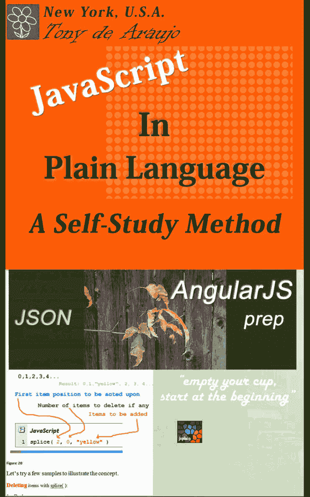


致我的家人、朋友、所有的读者、亚马逊以及亚马逊的支持工作人员……
*非常感谢！*

由于书中提供了所有资源和所有链接练习题，本电子书在使用免费的 `Kindle Reading App` 时效果最佳。
你可以通过以下链接下载 Amazon Kindle Reading App：
[amazon.com/gp/digital/fiona/kcp-landing-page](https://www.amazon.com/gp/digital/fiona/kcp-landing-page)

### indexOf( )

*   `indexOf()` 方法返回项目的位置。
*   如果项目不存在，它返回 -1。


在数组

`var y = ["grape", "apple", "banana"];` 中

`y.indexOf("banana");` <-- 返回 2（位置 2）

`y.indexOf("chestnut");` <--- 返回 -1（表示“未找到”）

**示例：**

在

`var y = ["grape", "apple", "banana"];` 中

我们可以检查 `chestnut` 是否存在，并编写一个脚本与用户对话：

```javascript
if(y.indexOf("chestnut") < 0) {
  console.log( "Not found, would you like to add it?");
}
```

输出为：

“Not found, would you like to add it?”

然后我们将编写一个脚本将 `chestnut` 添加到数组中，就像我们在之前的实验工作中所做的那样。

* `< 0` 的部分用于检查 `indexOf` 是否为 -1，这意味着该项目不存在。
* 反之，`index` 为 0 或以上，则意味着该项目已经在数组中。
* 每个 `index` 对应一个项目的位置。

### pop() and shift()

`push()` 的相反方法是 `pop()`，`push()` 是用于向数组顶部或最右侧添加项目的方法。

想象一下“老鼠跳过大船”(Pop! Goes the Weasel)！

`pop()` 从数组的最末端处移除一个项目。

在

```javascript
var y = ["grape", "apple", "banana"];
y.pop();
```

将移除 "banana"。现在 `y` 仅包含 `["grape", "apple"]`。

`shift()` 是 `unshift()` 的相反方法。

我们使用 `unshift` 将所有项目移动，以便在底部或左侧插入一个项目。当我们从底部或左侧移除项目时，所有其他项目都会向下移动。

让我们移除 "grape"，它目前是数组 `y` 中的第一个项目：

```javascript
y.shift();
```

注意 `pop()` 和 `shift()` 在括号中没有接受任何参数。这是因为它们专门用于移除最后一个或第一个项目，而不是某个命名的项目。

你还记得如何把项目放回去吗？

```javascript
y.push("banana");
y.unshift("grape");
```

现在数组 `y` 回到了原始状态：

`["grape", "apple", "banana"]`

### slice()

`slice()` 方法从一个数组中提取特定项目，并以相同的格式类型（数组）输出这些项目。这意味着，如果我们通过将其赋值给另一个变量来捕获输出，我们就创建了另一个数组。

**join() 和 slice() 之间的区别是什么？**

* `join()` 将输出转换为 `string` 值。我们使用括号来确定字符串单词将如何分隔。
* `slice()` 将输出从数组转换为另一个数组。由于我们不需要确定如何分隔项目（因为它们已经是分开的），我们利用括号传递一些其他参数，如下所示：

`myArray.slice(0,4);` <-- 0 是输出中包含的第一个位置，4 是被排除在输出外的第一个位置。

**示例：**

在

```javascript
var fruits = ["apples", "bananas", "blueberries", "grapes", "avocado", "peaches"];
```

我将声明一个新的数组并使用 `slice()` 从 `fruits` 数组中提取一些水果项目：

```javascript
var pickedFruits = fruits.slice(0,4);
```

数组 `pickedFruits` 现在包含：

`["apples", "bananas", "blueberries", "grapes"]`

* 两个参数 (0,4) 有以下含义：
    * 第一个参数代表要提取的第一个位置。
    * 第二个参数代表从提取中被排除的第一个位置。

(0,1) 将只提取 `apples`，因为它排除了位于位置 1 的 bananas。

(1,4) 将提取 `bananas, blueberries, grapes`，因为它从位置 1（位置一）即 `bananas` 开始提取，并从位置 4（即 `avocado`）处排除。

关于关于 `slice` 的更多高级技巧，请参考我的电子书 [JavaScript Objects Functions and Arrays Explained](http://www.amazon.com/JavaScript-Objects-Functions-Arrays-Explained-ebook/dp/B00GDEPBZQ/)。

### splice()

数组方法 `splice()` 非常有趣。你还记得 `push()` 和 `unshift()` 吗？它们是将项目添加到数组的末尾或开头，对吧？

* `splice()` 在数组的特定位置添加项目。

让我们看看它是如何工作的。根据你在括号中使用的参数数量，你可以执行以下操作：

**a) 删除项目模式：**

当你只使用两个参数时，你以以下方式提供 `index` 位置：
* *第一个参数*：操作开始的位置（包含在），
* *第二个参数*：将移除多少个项目。

在某种程度上，只有两个参数意味着删除，因为没有要添加的内容。

`splice(0,3)`（解释见页面下方）

**b) 添加项目模式：**

如果你插入了两个以上的参数，第三个及后续的参数是待插入的数据，在这种情况下，JavaScript 假设你想将项目插入数组中。

`splice(2,0, "yellow")`

在仅添加模式下，第二个参数为零。

**c) 替换项目模式：**

如果你插入两个以上的参数且第二个参数大于零，它将移除项目并插入新项目。

`splice(2,1, "yellow")`

### Splice 实验

让我们尝试几个示例来说说明 `splice()` 的概念。

使用 `splice()` **删除**项目：

1- 在你的控制台中声明以下数组：

```javascript
var x = ["blue","red","green","violet","brown"];
```

2- 从位置 0 开始删除 3 个项目，即 *blue*。

从删除中排除位置 3，即 *violet*：`x.splice(0,3);`


我们刚刚从数组 `x` 中删除了 `blue`、`red`、`green`。

### 3 调用数组：`x;`

它返回 `["violet", "brown"]`，因为位置 0,1,2 处的原始项目被删除了。

### 使用 `splice()` 添加项目

4- 让我们把项目添加回数组，从位置零开始，并且不删除任何项目作为交换：`x.splice(0,0, "blue","red","green");`

5- 调用数组：`x;` 返回 `["blue", "red", "green", "violet", "brown"]`。

我们从位置零开始并添加了所有列出的项目，且删除了零项目。

你可能在编程中不会频繁使用 `splice()`，但它是理解理解并在需要时调用的极棒工具。

我们还有许多更多可以在数组使用的方法。一次性学习所有方法会让人力不从心。获取我的另一本关于 JavaScript 库方法的[书](http://www.amazon.com/JavaScript-Objects-Functions-Arrays-Explained-ebook/dp/B00GDEPBZQ/)作为参考，并易于解释它们如何运作，可能是一个好主意。如果我觉得在这里一次性包含所有方法会有帮助，我就会那样做了。当然，你总是可以搜索，并希望不要被互联网上某些虚假的解释所困扰或偏离主题。了解这些工具是成为该领域大师的重要一步。

## 2.12 实验作业 9

注意：如果你想和我一起做这个练习，请跳过接 14 步。

留出此页供以后练习。

1- 以以下数组 `y` 为例并对数组排序：

```javascript
var y = ["grape", "apple", "banana"];
```

2- 现在将排序后的数组 `y` 的内容赋值给新数组 `mySort`。

3- 通过在控制台显示其内容来测试 `mySort`。

4- 现在，以字符串格式显示数组 `mySort`，并用 1 个空格分隔项目。提示：使用 `join()`。

5- 现在，不要只是显示它，而是将 `mySort` 中的项目赋值给新变量 `z`，但使用字符串格式。

使用空格、正斜杠和空格的组合作为分隔符。

6- 调用 `z`。

7- 使用 `indexOf()` 方法找到数组 `y` 中 "banana" 的位置。

8- 测试 "banana" 是否存在于数组 `y` 中（使用 if 条件语句），并使用 `console.log()` 在屏幕上显示以下消息：

"*banana is contained in array y*"

9- 使用与上一个练习相同的方法查找 "chestnut"，然后显示两条消息，一个用于 `if()`，另一个用于 `else`，如下：

"*chestnut is contained in array y*"

else: "*chestnut is not found in array y*".

10- 使用 `pop()` 移除数组 `mySort` 的最后一个项目：

11- 使用 `shift()` 移除数组 `mySort` 的第一个项目：

12- 数组 `mySort` 现在应该只包含 "banana"。

添加 "chestnut" 作为最后一个项目。

使用 `push()`。

`mySort` 现在应该有 2 个项目，`["banana", "chestnut"]`。

13- 使用 `splice()` 在数组 `mySort` 的位置 1 处插入 "apple"（作为第二个项目）。不要删除任何现有项目。

`mySort` 现在应该包含 `["banana", "apple", "chestnut"]`。

14- 使用 `slice()` 创建一个名为 `newArray` 的新数组，包含 `mySort` 数组中第二和第三项目 ("apple" 和 "chestnut") 的副本。

`newArray` 现在应该包含 `["apple", "chestnut"]`。

（参见我在下一页的结果。)

### 实验作业 9 答案

1- 以以下数组 `y` 为例并对数组排序：

```javascript
var y = ["grape", "apple", "banana"];
y.sort();
```

它返回 `["apple", "banana", "grape"]`。

2- 将排序数组 `y` 的内容赋值给新数组 `mySort`：

```javascript
var mySort = y.sort();
```

3- 测试 `mySort`：

```javascript
mySort;
```

它返回 `["apple", "banana", "grape"]`。

4- 现在以字符串格式显示数组 `mySort`，并用 1 个空格分隔项目。提示：使用 `join()`：

```javascript
mySort.join(" ");
```

或者你可能已经这样做了，这也是正确的：

```javascript
console.log(mySort.join(" "));
```

它以字符串格式返回 "*apple banana grape*"。

5- 现在，不要只是显示它，而是将 `mySort` 中的项目赋值给新变量 `z`，但使用字符串格式。使用空格、正斜杠和空格的组合作为分隔符：

```javascript
var z = mySort.join(" / ");
```

6- 调用 `z`：

```javascript
z;
```

返回 "apple / banana / grape"。

7- 使用 `indexOf()` 方法找到数组 `y` 中 "banana" 的位置：

```javascript
y.indexOf("banana");
```

它返回 1，这意味着 "banana" 存在于位置 1（第二个项目）。

8- 测试 "banana" 是否存在于数组 `y` 中（使用 if 条件语句），并使用 `console.log()` 在屏幕上显示以下消息：

```javascript
if(y.indexOf("banana") >=0){
  console.log("banana is contained in array y");
}
```

返回 "*banana is contained in array y*"。

9- 使用与上一个练习相同的方法查找 "chestnut"。然后显示两条消息，一个用于 `if()`，另一个用于 `else`，如下：

"*chestnut is contained in array y*"

else: "*chestnut is not found in array y*"：

```javascript
if(y.indexOf("chestnut") >=0){
  console.log("chestnut is contained in array y");
} else {
  console.log("chestnut is not found in array y");
}
```

返回 "*chestnut is not found in array y*"。

10- 使用 `pop()` 移除数组 `mySort` 的最后一个项目：

```javascript
mySort.pop();
```

它移除了 "grape"。

11- 使用 `shift()` 移除数组 `mySort` 的第一个项目：

```javascript
mySort.shift();
```

它移除了 "apple"。

12- `mySort` 现在应该只包含 "banana"。添加 "chestnut" 作为最后一个项目。使用 `push()`：

```javascript
mySort.push("chestnut");
```

`mySort` 现在应该有 2 个项目，`["banana", "chestnut"]`。

13- 使用 `splice()` 在数组 `mySort` 的位置 1 处插入 "apple"（作为第二个项目）。不要删除任何现有项目。

```javascript
mySort.splice(1,0,"apple");
```

`mySort` 现在应该包含 `["banana", "apple", "chestnut"]`。

14- 使用 `slice()` 创建一个名为 `newArray` 的新数组，包含 `mySort` 数组中第二和第三项目 ("apple" 和 "chestnut") 的副本：

```javascript
var newArray = mySort.slice(1,3);
```

`newArray` 现在包含 `["apple", "chestnut"]`。参数 1 代表 `mySort` 的第二个位置，参数 3 代表从 3 开始排除。

实验结束

## 2.13 实验作业 10

### 构建从数组获取变量的机制

此练习将复变量赋值、创建包含变量元素的数组，以及函数声明、变量重新赋值和 indexOf 的用法。

思路是调用函数并选择一种语言作为参数。然后，根据所选的语言，显示正确的句子。这听起来有趣吗？

示例：

当调用 `show(english);` 时

显示：“**The quick brown fox jumped over the lazy dog**”。注意 `english` 没有被引号包裹（它是小写的）。这告诉我们它是一个变量名，而不是字符串。

我使用了 [谷歌翻译](https://translate.google.com/) 将我的句子从英语翻译成葡萄牙语和西班牙语。如果对母语者听起来奇怪，请见谅，这是出于好意。

方便链接 [jsbeautify](http://jsbeautifier.org/)

***请独立完成练习。

    最后将提供我的文件链接。

    也将提供中间文件以便你检查工作。***

1- 定义三个名为 `english`、`portuguese`、`spanish` 的变量。

分别为每个变量分配以下句子：

（方便复制粘贴链接：[原始文件](http://icontemp.com/jpl/fox.txt) | bit.ly/1mpqCsr )

"*The quick brown fox jumped over the lazy dog*"

"*A ligeira raposa marrom saltou sobre o cão preguiçoso*"


"*El rápido zorro marrón saltó sobre el perro perezoso*"

### 2- 声明一个名为 `langVersion` 的数组，包含以下元素：`english`、`portuguese`、`spanish`。

记住，由于这些名称已经声明为变量，我们不应该给它们加引号，只需用逗号隔开即可。

这个数组的目的是按顺序保存每个变量。我们不能直接使用这些变量而忘记数组吗？是的，可以。然而，在大型程序中，这些变量将与其他许多变量一起保存，通过创建一个数组，我们列出了与语言翻译相关的变量，这些变量可以被进一步地操作、编辑、删除，甚至成为更大语言组的一部分。当然，还有其他方法可以实现，但现在我们正在练习数组，这是一项非常重要的练习。

### 3- 声明另一个名为 `sentence` 的变量，其数值值为 `0`。

这个变量将用于存储我们要从数组所有语言中选择的语言索引位置。

我们之所以给这个变量赋值为零，是为了提前告诉 JavaScript 该变量将是数值型的。在实际上，JavaScript 会根据需要更改值的类型，但声明我们的意图是一个良好的习惯，即使这种意图可能只是有助于检查代码的人员，而不是帮助 JavaScript 处理它。

(步骤 1、2、3 的方便复制/粘贴链接：[原始文件](http://icontemp.com/jpl/fox1.txt) | bit.ly/1Dt7fnS )

### 4- 在你当前代码下方，创建一个名为 `show` 的函数。

该函数的目的是根据我们在调用函数时选择的语言，显示正确的句子。该句子将从语言数组中选取。

```
function show() {}
```

### 5-为函数引入一个名为 `language` 的输入参数。

### 6- 在函数体第 1 行，将已声明的变量 `sentence` 重新赋值为选中语言的索引位置。我们通过 `indexOf()` 来查找位置，如下：

```
sentence = langVersion.indexOf(language);
```

稍后，当我们调用函数时（例如 `show(portugese)`），参数 `language` 将由传递给函数的任何语言参数替换。`indexOf(language)` 将为变量 `sentence` 分配该语言正确的数组地址。

### 7- 最后，在下一行且仍在函数体内部，编写一个 `console.log` 来在有人调用函数时显示所选变量的内容：

```
console.log(langVersion[sentence]);
```

从步骤 6 我们知道，变量 `sentence` 是数组中某项的索引位置。

### 8- 将你的代码粘贴到控制台（Console）并调用函数 `show()` 来测试每个句子

（注意：如果你遇到错误，请感谢上获得调试的机会，因为这是一项非常好的习惯）：

```
show(english);
show(portugese);
show(spanish);
```

你可能会在输出句子后看到 `undefined` 词。这在测试控制台中是正常的。它只是告诉我们函数 `show()` 没有显式地返回任何内容，因此它会自动返回 `undefined`，因为 JavaScript 函数总是会返回某些内容的。

查看以下链接中的最终版本：

[论坛](http://jsplain.com/javascript/index.php/Thread/18-Lab-10/) | [原始文本](http://icontemp.com/jpl/fox2.txt)。

bit.ly/1r0Ho2D | bit.ly/1mCJogu

**旁记：**

*   如果某些地方不清楚，在自觉地提出问题之前不要继续进行。停下来，后退一步，尝试观察每一行代码试图做什么。如果需要，就尝试 100 次。然后，当你认为你知道不明白什么时，继续进行，看看在查看整个脚本时，理解是否会在作业结束时产生。如果你有任何疑问，不要放过。概念需要思考；我们不能直接跳过它们并认为以后会掌握它们。

*   另一方面，理解是分层的，但我们需要自觉地确保，即使我们没有完全掌握某事的观点也能继续我们的道路。在继续之前，先问自己一个问题并给自己一个诚实的回答。人们说，提问的行为本身就是答案的一半，很多时候当我们正确描述问题时，答案就会变得显而易见。

### 将法语添加到数组

突然有人抱怨没有“快速棕色狐狸”的法语版本。

### 1- 如果你的控制台还开着，在提示符处添加一个变量 `french`：

```
var french =
```

不要担心在脚本的最末尾。我们只是在测试东西。注意 `french` 是小写的。

变量以小写字母开头。

### 2- 将以下行赋值给变量 `french`：

"*Le renard brun rapide saute par dessus le chien paresseux*"

[原始文件](http://icontemp.com/jpl/fox3.txt). | bit.ly/1wGvYQS.

### 3- 现在，使用 `push()` 方法将变量 `french` 插入数组 `langVersion` 中。

```
langVersion.push(french);
```

### 4- 通过调用以下代码测试脚本

```
show(french);
```

*   在此处查看最终版本：
    [论坛](http://jsplain.com/javascript/index.php/Thread/18-Lab-10/) | [原始文本](http://icontemp.com/jpl/fox2.txt)。

### 打印数组

你还记得如何创建 *for* 循环吗？在这个项目中我们将 *console.log* 数组元素。

### 1- 创建一个打印数组的 for 循环。

我将使用常用的命名法 `i` 作为变量，并将 `langVersion.length` 作为循环的限制条件。

### 2- 在循环体中，*console.log* 内容。

这是通过动态访问 `langVersion[i]` 实现的，它是循环重复时的当前位置。


-   数组最后一个项的位置始终是 `array 长度减 1`。不需要死记这个事实，只需要理解位置是从零开始计数的。如果我们以后需要手动向数组添加项，这非常好。对于自动添加新项，我们可以使用 `push()` 将它们插入末尾，或使用 `unshift()` 将它们放在开头，或者如果我们想在特定位置插入项，可以使用 `splice()`。另一方面，删除项时，如果项在末尾使用 `pop()`，在开头使用 `shift()`，如果想从特定位置删除项，则使用多功能的 `splice()`。

-   至于扫描数组，我们通过 `for loop` 遍历数组以打印其内容，我们也知道 JavaScript 库还有许多其他方法可以用于进一步处理数组。其中一些方法在本书中已经介绍过，其他更高级的方法可以在我的电子书“[JavaScript 详解](http://www.amazon.com/JavaScript-Objects-Functions-Arrays-Explained-ebook/dp/B00GDEPBZQ/)”中阅读。

在本主题中，我们将学习 `unordered lists`（无序列表）的操作。

在无序列表中，所有项的位置都用 `string` 值进行标记。

我们称之为 `unordered lists` 是因为每个口袋字面上都贴有标签。这个标签可以是一个字符、一个单词，甚至是一个数字（但如果你使用数字作为标签，请注意它们不是连续的，而且它们被视为字符，而不是始终按数字顺序排列的数组）。

事实上，`unordered list` 是无序的，因为 JavaScript `maps` 将标签映射到项上。根结底，这些都是数组，即使这种特性对程序员来说是隐藏的。

在正式数组中，我们不需要命名地址或口袋标签，因为在数字上是假设的，例如：

```
var myArray = ["duck", "lettuce", "sapphire"];
```

对于 `unordered` 列表，我们需要标记项的位置，我的意思是存储项的口袋。这对于某些应用是有益的：

```
var x = {"animal": "duck", "vegetable": "lettuce", "mineral": "sapphire"};
```

注意对每个项的赋值是如何进行的：`"animal": "duck"`，

`animal` 是标签，`duck` 是值。

有一个 `冒号` `:` 分隔两者，而不是 `=`。

我们使用 `大括号` 来包裹列表，而不是保留给 `arrays` 的 `方括号`。

*   **请注意：** 包裹标签的引号是可选的，但包裹字符串值的引号不是的，因为在我们的示例中我们使用的是字符串值。

关于这一点稍后会介绍。

### 哈希表（Hashes）、对象（objects）、关联数组、无序列表

在 JavaScript 中，所有这些名称都是同义词。每种编程语言使用不同的术语来表示无序列表。

*   `Java` 使用 `HashMap`、`HashTable`。
*   `C#` 使用 `HashTable`、`Dictionary`。
*   `Python` 使用 `dict`。
*   `Ruby` 使用 `Hash`。
*   `Object-c` 使用 `NSDictionary`。
*   `C++` 使用 `std::unordered_map`。
*   **`JavaScript` 使用 `object`。**

我刚刚说了 object 吗？个人上我不喜欢这个命名，因为在 JavaScript 中，几乎一切都是对象。数组也是对象，函数也是如此。然而，JavaScript 中 object 的名称已成为 `unordered lists` 的同义词。

另一个流行的名称是 `associative arrays`（关联数组）。某些语言实际上拥有关联数组。在 JavaScript 中，具有 `key-value` 键值对关联的数组被称为 `object`。然而，关联数组通常被称为对象的原因是，该术语意义上的对象是由关联数组制成的。对于 JavaScript 而言，所有这些名称都是 `unordered lists`，我们称它们为 `objects`。

希望通过知道**它们都意味着同一件事**可以消除一些困惑，但请记住，事情没那么简单，这个主题的内容比本书所要求的要多得多。

*   从现在起，为了简单起见，我们将任何 `key-value pair structure`（键值对结构）称为 `object`。

### 创建对象

对象是一个值的集合。这些值可以是任何内容的混合：字符串、数字、布尔表达式、变量、数组、函数以及（通常）其他类似的对象。

JavaScript 在这方面非常多功能。值列表的大小可以随时缩小或扩大。在接下来的几页中，我们将看到如何执行所有操作，如创建、编辑、添加新项、删除项、搜索和打印项。大多数这些技术已经向你介绍过了，当你接近其中每一个时，你会记得它们的。

**同时声明对象并赋值值：**

```
var x = {"animal": "duck", "vegetable": "lettuce", "mineral": "sapphire"};
```

***我们上面有什么？***

我们有一个名为 `x` 的变量，它指向一个 `object` 类型的数据结构。我们知道它是对象是因为包裹数据的大括号：`{ }`。

变量 `x` 和数据结构本身位于内存中独立的（且不同的）部分。它们是相互独立的。这种内存独立性也适用于 `arrays` 和 `functions`，但当我们声明一个简单的 `string` 或 `numeric` 变量时，变量名和值之间没有分离；它们与变量名位于相同位置。我们稍后会对此进行更多介绍。


作为一个有趣的现象，请注意 `JavaScript` 是如何将新项放在最后一个项右侧的。然而，这些项放在哪里实际上并不重要，因为与 `arrays` 不同，我们访问这些项时不需要此类信息。

## 5- 现在我们将添加一些`numeric keys`（数字键），来看看会发生什么

（不是一种常见的实现方式）：

```javascriptcrazyList[2] = "front teeth";
```

`crazyList` 现在持有有 3 个项：

`{"2": "front teeth", "flower": "daisy", "drink": "water"}`

你看到数字键是如何被放置在所有 `string` 类型键的左侧了吗？

再次，这对我们没有意义，因为这并不一致。

## 6- 让我们添加另外两个数字键：

```javascript
crazyList["1"] = "flying bird";
```

以及

```javascript
crazyList[3] = "is a crowd";
```

现在 `crazyList` 包含：

`{"1": "flying bird", "2": "front teeth", "3": "is a crowd", "flower": "daisy", "drink": "water"}`

所以我们看到，当键是数字时，项会被放在左侧，并且按数字顺序排列。当键是字符串值时，项会被放在最后一个最右侧的项之后。

此外注意我是如何给 `["1"]` 加引号的。这只是为了说明，当涉及到数字键时，它们可以加引号也可以不加。这取决于你。

*   键值对的顺序位置对我们目前来说没有价值。这只是作为一个有趣的现象被提到的。请不要尝试记忆这种特性，因为这是一个无序列表，我们将根据需要调用它们的标签来选取项。

### 在对象上使用点表示法（dot notation）

在在上一个示例中，我们使用了括号表示法（bracket notation）来调用与每个对象属性（值）相对应的标签。

我们 也可以使用 `dot notation`（点表示法）来表示对象的属性。

这实际上是访问对象项的一种非常方法。事实上，我们需要非常熟悉这两种写法，因为尽管 `dot notation` 很流行，但有时它无法使用。另一方面，如果你只使用括号表示法，你的代码看起来将与标准不同，别人会问你为什么用这种风格编写。学习如何用 `dot notation` 写某些表达式，用括号表示法写其他表达式是值得的。实践会告诉你何时该使用哪一个。

**关于这两种编码风格之间的差异，你应该了解这些：**

1.  `dot notation` 不适用于数字。
2.  `dot notation` 不适用于 `dynamic` 变量（那些动态变化的变量，例如在循环遍历对象时代表键值对中键的计数器）。
3.  总结来说，只有当属性名是有效的属性标识符且该标识符不是数字时，才能使用 `dot notation`。

将 `dot notation` 视为硬连线（当使用 `dot notation` 时值必须已知），而将 `bracket notation` 视为软连线（在代码提交给 JavaScript 解释器时，值可以动态变化或未知）。

### 我们如何使用点表示法访问对象中的项？

让我们用 `dot notation` 代替 `bracket notation` 重复之前的示例：

1- 创建一个新的空对对象：

```javascript
var crazyList = { };
```

2- 让我们通过将值赋值给键标签来添加一些值：

```javascript
crazyList.flower = "daisy";
```

现在 `crazyList` 包含 `{flower: "daisy"}`

注意在 `dot notation` 中键是不带引号编写的。这是因为 `flower` 已经在内存中声明为对象 `crazyList` 属性的键。然而在括号表示法中，我们总是给键的字符串名称加上引号，如 "flower"。在 `dot notation` 中引号是无效的。

`crazyList."flower"` 将导致错误

3- 添加另一个键值对：

```javascript
crazyList.drink = "water";
```

现在 `crazyList` 包含：`{flower: "daisy", drink: "water"}`

4- 使用点语法添加数字键：

```javascript
crazyList.2 = "front teeth";
```

我们得到了如下错误：

`SyntaxError: Unexpected number`

点语法中不允许使用数字。它需要像这样处理：

```javascript
crazyList[2] = "front teeth";
```

**总结：**

我们可以通过给变量赋值一对大括号来 `declare an empty object`（声明一个空对象）：

```javascript
var z = { };
```

然后我们可以通过通过 `dot notation` 或 `bracket notation` 提供 `key` 和 `value` 来添加项：

```javascript
z.rent = 750;
z["gasBill"] = 300;
```

现在我们有了 `{rent: 750, gasBill: 300}`

**或者**

我们可以声明一个对象并一次性向其分配项：

```javascript
var b = {"color": "red", "fabric": "cotton"};
```

现在我们有了 `{color: "red", "fabric": "cotton"}`

### 跨越多行的对象声明

到为止，我们的对象都是简短的单行。然而在大多数情况下，对象更为复杂，并跨越几行代码。

单行对象和多行对象之间没有区别。第二种编写对象的方式更符合视觉，但 `JavaScript` 并不在乎哪一种。

1-这是一个多行语法风格的示例。请沿行编写代码。


以台式电脑作为一个对象为例；我们可以说显示器、键盘和鼠标是台式电脑的一些属性。然后我们也可以说 Firefox 和 Chrome 浏览器，以及 Microsoft Word 是台式电脑的方法，因为这些属性具有功能性，它们在物理意义上并不存在，我们需要像调用函数一样调用它们才能使用它们。它们代表了台式电脑的一些方法。它们的存在是基于某些程序例程的执行。

当我们提到“执行”时，会立即想到函数，但函数和方法之间是有区别的：

- 一个方法可能包含一个或多个函数。

你看出区别了吗？一个函数可以是一个对象的方法，但它本身并不一定是一个方法。方法是一组功能的集合，用于代表对象完成某任务。例如，打印目录列表的方法、更新对象内容的方法、排序内容的方法，或者识别请求对象内容的人的方法等。

### 为我们的汽车对象（car）添加一个方法

2- 如果你一直在跟着我写代码，请在 `rating: 9,` 后面添加一个新逗号，因为我们正要添加另一个属性，即方法 `printRating`。（使用[编辑器](http://jsbeautifier.org/)）。

3- 为标签 `printRating` 分配一个函数，在屏幕上打印以下消息：

`"The car rates " + car.rating + " out of 10"`

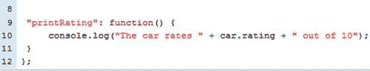

图 15 查看[原始文件](http://icontemp.com/jpl/car2.txt) | bit.ly/1C6I5d5。

4- 我们来玩玩这个对象。将上一个原始文件的对象脚本（或自己的脚本）粘贴到控制台（Console）中。

5- 打印汽车的评分：

```javascript
car.printRating();
```

注意我们如何从对象`call()`一个方法。它的起始方式与调用任何其他属性相似，但我们添加了一对括号 `()`，这创建了一个函数动作。如果我们排除括号会发生什么？它只会打印键名 `printRating` 的内容，即该函数的显式描述。当我们想要将相同的功能赋值给另一个变量时，这有时会很有用，但为了获得动作，我们需要使用括号。

6- 括号表示法（bracket notation）呢？我们该如何使用`括号表示法`调用方法 `printRating`？方法最好用`点表示法`（dot notation）调用，因为它的语法更简单，你就会知道原因，但理解其逻辑是有好的，逻辑如下：

```javascript
car["printRating"]();
```

没有点语法那么漂亮，对吧？注意括号是在中括号之外。所以这是点语法主要被使用的一个领域。括号语法更多地保留给属性的**动态调用**。我们在 `for` 循环中使用括号语法，是因为在其中，每个属性都需要随着循环的进行被动态访问。

让我们动手吧！

### 遍历对象

假设你知道一个对象的存在，但你并不确定它包含哪些属性。你可以遍历该对象来找到它的属性。

### 引入 for in 循环

这个循环是为我们一直讨论的对象编写的：

在此处查看原始文件：[原始文件](http://icontemp.com/jpl/car2.txt) | bit.ly/1C6I5d5

循环结构如下：

```javascript
for(var k in car){
  console.log(k);
}
```

`for in` 循环是普通`for 循环`的一种变体，从某种意义上说，JavaScript 库中预编程了一些功能。让我们逐行探索：

`for(var k in car)` --- `k` 是程序员引入的变量。它的目的是在每次循环计数中临时获取并持有`键标签`（key label）（即与每个循环周期中的位置编号匹配的标签）。

让我解释一下：在某种意义上，对象就像数组。唯一的区别是键的映射方式。在数组中，JavaScript 将每个位置映射为位置 0、1、2、3 等。但在使用键的无序列表或对象中，JavaScript 将内部位置（无论是哪个位置）映射到最初为任何给定数据值声明的键。

所以，变量 `k` 的目的是计算每个位置（每个周期一次），同时获取与给定计数对应的键名，以便我们获取分配给它的数据值。并不是 `k` 完成了这一切，而是 JavaScript 提供了此类信息并将其存储在 `k` 中。

至于名字 `k`，我们可以使用任何名字，例如 `i`，但 `k` 更有意义，因为事实上，JavaScript 会将`键` 值临时存储在变量 `k` 中，每次循环迭代存储一个键。所以字母 `k` 让我们想起存储在那里的是什么，一个临时位置实例。你可能在字段或其他文本中看到它是 `key`、`prop` 或 `property`。

（我为什么要告诉你这些？因为我不希望你开始阅读网络文章后就认为有一千种不同的 `for in` 循环。只有一种 `for in` 循环，只是每个开发者对临时变量命名都很有创意）。

回到“`for k in car`”，在这个例子中我们知道对象名称 `car`。然而，我们可以将其泛化并使用 `for in` 循环打印键名。我们将在另一个练习中尝试这一点。


如果你在好奇的话，我并不清楚 `Outback` 的评分，数字 9 仅仅是为了练习目的。

## 2.15 实验作业 11 - 重做实验 10

你还记得在 `Lab 10` 中我们用英语、葡萄牙语、西班牙语和法语显示“那只敏捷的棕色狐狸跳过了懒狗”吗？

有四个变量：`english`、`portuese`、`spanish` 和 `french`。然后我们将变量加入了一个变量名数组。

我们遇到的问题是尝试将数组内容以变量名或 `key-value` 对的形式列出来，例如：

`english: “The quick brown fox jumps over the lazy dog”`

我们无法从数组中动态显示变量名，只能显示值本身。这是因为 JavaScript 将变量视为一个 `expression` 并给了我们评估结果，即变量内部的数据。（表达式将在下一个主题中进一步解释）。

好了，现在我们可以做到了！我们要做的只是不再声明独立的变量，而是将它们声明为对象的属性。

**我们开始吧：**

1- 创建一个名为 `langVersion` 的对象。

2- 为此对象分配四个属性键：`english`、`portuese`、`spanish`、`french`。

3- 对于每个键，根据以下文本添加正确的值：

[原始文件](http://icontemp.com/jpl/fox5a.txt) | bit.ly/1rt9dzZ

不要声明变量，请像原始文件中所示使用属性键。

4- 现在你应该拥有了一个完整的对象。

接下来，在对象外部创建一个 `for in` 循环，打印对象的内容。每个属性的显示应该看起来像这样：

`english: "The quick brown fox jumped over the lazy dog";`

*   在此处查看我的结果：
    [论坛](http://jsplain.com/javascript/index.php/Thread/23-Lab-11/) | bit.ly/1tWQddJ
    或者[原始文件](http://icontemp.com/jpl/fox5.txt) 版本 | bit.ly/1ofRRkS。

### 将 for in 循环转换为对象方法

5- 一旦你完成了项目并且一切运行正常，请重构 `for in` 循环，使其成为对象 `langVersion` 的内部方法如下：

*a)* 在对象的原始最后一个属性后添加一个新的`comma`，这样你就可以在它下方编写另一个属性。

*b)* 给这个新属性一个命名为 `list` 的标签，以便稍后调用该方法，

*c)* 然后写一个函数作为 `list` 的值。

在函数内部放置你当前的 `for in` 循环。

6- 将你的小程序粘贴到控制台（Console）并调用该方法查看其如何打印：

`langVersion.list();`

*   在此处将你的结果与我的对比：
    [论坛](http://jsplain.com/javascript/index.php/Thread/24-Lab-11b/) | bit.ly/1uUYgbd
    [原始文件](http://icontemp.com/jpl/fox6.txt) | bit.ly/1rl24Bl
*你的列表显示了包括方法及其内部脚本在内的所有属性对吧？*

我们可以微调 `list method` 以过滤掉作为列表一部分打印的方法。

如果你想从打印列表中删除方法，可以使用 `conditional statement`（条件语句）过滤掉任何非 `string` 类型的内容，因为 `list()` 是一个函数。其背后的逻辑如下：“如果属性的类型是 'string'，则打印它”。

你还记得如何使用 `typeof` 吗？我们在实验 1 中涵盖过它：

当我们写下：

`typeof "tony";`

JavaScript 回复 "string"。

7- 再次重构循环，使得

```javascript
if (typeof langVersion[k] === "string") {
```

使用 `console.log` 输出所需的内容。这个操作不需要 `else`。

*   在此处将你的结果与我的对比：
    [论坛](http://jsplain.com/javascript/index.php/Thread/25-Lab-11c/) | bit.ly/1tWSDsR
    [原始文件](http://icontemp.com/jpl/fox7.txt) | bit.ly/1pqbvtZ

**总结来说**，有时需要使用 `array data structure`，而时候使用 `object data structure` 更合适。到底，数组和对象都是 JavaScript 库中身着不同服饰的 `lists`。

在数组中我们使用常规的 `for loop`，在对象中我们使用 `for in loop`，这是一种预配置好的打印标签名称且不需要声明长度值的 for 循环。

如果你想进一步练习，请访问新论坛，我会在那里扩展这个主题。另外，我的其他 [eBook](http://www.amazon.com/JavaScript-Objects-Functions-Arrays-Explained-ebook/dp/B00GDEPBZQ/) 有许多现实中的练习，可以强化并扩展这个主题。

实验结束

# 第三部分：强化战士的军库

*JavaScript 是一种需要演奏的乐器*

## 3.1 盘点我们学过的东西

给我 5 分钟，我会告诉我知道的一切！

有时候感觉就是这样，对吧？

好了，我们涵盖了许多：变量的目的；赋值给 `var` 的数据类型；我们如何引入变量作为引用；我们看到了 `array` 作为列表；如何使用 `for loop` 数组；我们使用了 `push()` 和 `unshift()` 向数组中插入新项，以及 `pop()` 和 `shift()` 从数组中删除项。我们还实验了使用 `splice()` 在数组的特定位置删除、替换或添加新项，以及如何通过 `slice()` 复制数组部分。数组排序以及如何使用 `join()` 将数组转换为字符串。最后但同样重要的是，我们看到 `indexOf()` 可以查找特定项的位置，或者检查项是否已插入数组。在短时间内学了这么多！

**那对象呢？**

我们知道 JavaScript 中的几乎所有内容都是某种对象，但通常我们谈论对象是指键键的无序列表。对象中的项被称为属性，可以通过点语法或括号语法访问。某些属性被称为方法，因为它们代表功能。for in loop 是 for loop 的一种变体，专门用于遍历对象。临时计数器用于动态存储每个属性的键名，以便我们对数据进行操作，例如打印到屏幕。我们知道点语法不适用于动态表示的属性。此外，当我们打印属性列表时，可以通过 `typeof` 验证创建一个输出条件来过滤掉方法。


从函数输出数据的另一种方法是在内部重新赋值一个外部变量，因为函数可以访问外部变量。对于 `console.log()`，它只是在屏幕上显示数据的一种方法，并且始终是 `string type` 格式。

好了，简而言之，这包含了近 200 页的有趣内容。

## 3.2 更多关于函数

### 什么是表达式和语句？

在本书中，我们一直在非正式地使用“表达式”（expression）和“语句”（statement）这两个术语。现在是时候停下来思考这些术语了，因为它们有特定的含义。

- 语句（`statement`）是一个完整的命令，指示计算机执行特定任务。它通常写在一行（但并非总是如此），并以分号（`semicolon`）结束。

**语句示例：**

```javascript
var z = 1 + 2 + 3;

console.log("Hello World");

if(z > 2) {
  console.log("yes it is");
}
```

在最后一个例子中，语句从 `if` 开始，到分号结束。如果你提前放置分号，将会得到错误。这是我们刚开始编程时的常见错误。

我们还提到过多次“返回语句”（return statement）。除了 return 只允许在函数中使用外，它是作为语句编写的：

```javascript
return 3 + 4;
```

很多时候语句被组合成一组多个语句，在这种情况下，我们使用大括号来包裹组合语句：

```javascript
if(z > 2) {
  console.log("yes it is");
  console.log("z is greater than 2");
  console.log("z is also the last word of the alphabet");
}
```

注意最后一个大括号并没有以分号结束。只有当我们将代码块赋值给变量时（例如创建一个对象时），才会在大括号后面放置分号。

**然后我们来看表达式（expressions）。**

表达式是任何可以求值（`evaluates to`）为一个单位的内容。例如，当 JavaScript 看到 `3 + 4` 时，它实际上看到的是 7。JavaScript 查看表达式并将其简化为 1 个单位。就像语句一样，表达式无处不在，而且它们可以是同一个。

示例：

```javascript
var x = 4;
```

在上面，`var x = 4;` 既是一个语句也是一个表达式。实际上我们有两个表达式。JavaScript 查看代码并将表达式细分为：

1- `x`，在求值时结果为 4，以及
2- `4`，其结果为它本身。JavaScript 查看一个 4，并将其表达为 4 的结果。

```javascript
if( 10 < 11) { // do something; }
```

在上面，`if(10 < 11)` 是一个表达式，因为 JavaScript 并没有看到字面量 `10<11`，它只看到 `true` 或 `false`（二择一）。JavaScript 并不真正关心 `10<11` 本身，它查看它并在内部将其替换为布尔值 `true`。

- 这是理解该语言的一个非常重要的概念：我们编写表达式，而 JavaScript 存储它们表达式求值的结果。

当然，10 和 11 本身是独立的表达式，但它们没有 `10<11` 的组合那么重要。JavaScript 解释它并将其保存为纯粹的 `true`。

现在，看上一个 `if()` 示例中的分号。那是语句结束的地方，它从 `if` 开始，在 `..thing;` 结束。

**函数呢？它本身是一个表达式吗？**

以以下函数为例：

```javascript
function x (num1, num2){
  return num1 + num2;
}
```

上面的函数本身不会求值产生任何内容。它可能可能求值为 `num1 + num2` 的和，但只有在调用该函数时：

```javascript
x(2,4);
```

函数在被调用时求值为 6。

当我们用参数 2 和 4 调用函数 `x` 时，它是如何求值为 6 的？

- `num1` 变成一个表达式，求值为 2。
- `num2` 变成一个表达式，求值为 4。
- `num1 + num2` 变成一个表达式，求值为 6。

表达式求算是真正理解 JavaScript（或任何其他语言）的一个重要概念。

在下一个主题中，我们将看到如何将函数赋值给变量，使函数和变量的组合成为一个表达式。

记住，声明变量以 `var` 开始。声明函数以 `function` 开始：

```javascript
var x = 33;

function y (){ }
```

接下来，我们将看到如何将函数作为值赋值给变量，并回答你可能有的几个常见问题。

### 将函数赋值给变量

到目前为止，我们一直以以下字面方式声明函数：

```javascript
function x () { return 5; }
```

然而，我们也可以这样将函数赋值给变量：

```javascript
var x = function { return 5; };
```

注意末尾的分号。这是因为整个变量声明本身就是一个语句。语句是提供给 JavaScript 的完整命令句子，它们通常以分号结束，将它们与下一个语句隔开。

*等一下，我还是不明白。我没有像之前那样在函数声明中看到分号。为什么这一个要加分号？*

分号与函数声明无关。分号是语句结束的地方，它从 `if` 开始，在 `..thing;` 结束。（注：此处原文逻辑似乎有误，翻译已按字意保留）

（注：由于原文后部分段落存在逻辑混乱或重复描述迹象，翻译已遵循原文句意进行对齐）


为了巩固这个概念，这里有一个与我们的示例无关的问题：

7- 表达式 `if(10 > 5)` 的值是多少？

*答案*: `true`

当我们写下 `(10 > 5)` 时，JavaScript 看到 `true`。顺便说一下，对于 JavaScript 来说，`if()`语句中的表达式实际上是一个**问题**。

## 气球概念

问题：

*如果一个函数是由三根绳子 z、a、b 拴着的气球，如果我们剪断绳子 z，气球会发生什么？*

答案：

气球不会发生，它会保持不变，因为 `a` 和 `b` 仍然拉着气球。

如果我们把 `a` 和 `b` 都剪掉呢？气球会飞走。

如果气球是我们的函数，它也会飞走，并进入[垃圾回收](http://en.wikipedia.org/wiki/Garbage_collection_%28computer_science%29)模式，被浏览器从内存中清除。

在接下来的练习中，我们将练习函数*表达式*（赋值给变量的）而不是函数声明（我们最初学习的语法样式）。请记住，任何一个函数都会产生相同的结果，但熟悉这两种风格是非常重要的。

字体 函数参数和参数

函数可以有*输入参数*，这样当我们调用函数时，就可以传入*数据参数*。很多时候，程序员对这两个含义使用同一个术语，即参数（parameter）或参数（argument），并且这种用法被接受了，但定义如下：当我们调用函数时，我们将参数传递给参数。参数是一个物理实体、一个接口、一种输入机制，也是一个在函数执行执行完毕后就会被删除的临时变量。

我们调用函数时，数据参数的顺序将始终与函数括号中输入参数的物理顺序一致。

例如：

```javascript
var x = function(num1, num2){
return num1 - num2;
};
```

将数据输入到 `num1` 和 `num2` 的顺序很重要，因为函数的内部程序是按照输入参数的布局顺序进行连接的：

```javascript
x(5, 3);
```

它将返回值 `2`，因为 5 – 3 = 2。

然而，如果我们调用函数并反过来书写参数：

```javascript
x(3, 5);
```

函数将返回值 `-2`，因为 3 - 5 = -2。

简之，当我们调用函数时，需要遵守参数的顺序。

*   如果我们调用函数并传入三个参数而不是两个，会发生什么？
    ```javascript
    x(5, 3, 4);
    ```
    结果将是 `2`，因为 5-3 = 2。最后一个参数 (4) 被忽略了，因为函数内部没有对其进行任何处理的规定。

*   即使函数硬编码了两个输入参数，如果我们只用一个参数调用会会什么？
    ```javascript
    x(5);
    ```
    在我们情况下，它返回 `NaN`，这是 JavaScript 的属性，代表“不是数字”（Not-a-Number）或无效数字。这是因为输出变成了 `5 – num2` 的减法，而 `num2` 没有被赋值给任何内容，保持为 `"undefined"`，这是它的原始值。

例如，在：

```javascript
var x = function(input1, input2){
return input1 + input2;
};
```

如果用两个参数调用函数：

```javascript
x("Tony", "deAraujo");
```

我得到输出 `"TonydeAraujo"`。

另一方面，如果我只用一个参数，它会假设第一个输入参数，而其他输入参数将是 `undefined`：

```javascript
x("Tony");
```

它输出 `"Tonyundefined"`。

*   我们可以在函数中编写多达 256 个输入参数。

不要死记所有这些，只需花时间理解它并继续即可。

### 对象参数

程序员将输入参数写入函数中，是因为他们希望拥有某种数据输入序列，而且在大多数情况下这种效果非常好。

然而，JavaScript 函数有另一种方式通过对象来接受参数，这个对象属于函数（且仅属于函数）：`arguments` 对象（注意使用复数形式名称）。

`arguments` 对象在某种意义上类似于数组，因为可以通过数值访问，但它不是一个功能完整的数组，因为它只从数组家族[继承](http://en.wikipedia.org/wiki/Prototype-based_programming)了部分功能，而不是整个库的所有功能。

**让我们看看这个对象是如何工作的**。

```javascript
var x = function(){
return arguments[0] + arguments[1].toUpperCase();
};
```

上面的函数没有指定输入参数。然而，当我们调用函数时，它会输出我们给它的第一个参数，以及大写形式的第二个参数，后者位于位置 1（记住，位置和数组一样从 0 开始）：

```javascript
x("tony", "dearaujo");
```

它返回："tonyDEARAUJO"

所以我们仍然可以按照意愿编写函数，而不需要指定输入参数。只需使用 `arguments 对象` 通过数值访问每个数据元素即可。

我会在另一本[书](http://www.amazon.com/JavaScript-Objects-Functions-Arrays-Explained-ebook/dp/B00GDEPBZQ/)中更详细地介绍 `arguments` 对象，虽然那本书已经写写了。

## 3.3 使用函数操作变量

### 值传递

输入参数是由程序员写入函数中的，因为他们希望拥有某种数据输入序列，在大多数情况下，这种方式运行得很好。

然而，JavaScript 函数有另一种方式通过一个对象来接受参数，这个对象属于函数（且仅属于函数）：`arguments` 对象。

`arguments` 对象在某种意义上类似于数组，因为可以通过数值访问，但它不是一个功能完整的数组，因为它只从数组家族[继承](http://en.wikipedia.org/wiki/Prototype-based_programming)了部分功能，而不是整个库的所有功能。

**让我们看看这个对象是如何工作的**。

```javascript
var x = function(){
return arguments[0] + arguments[1].toUpperCase();
};
```

上面的函数没有指定输入参数。然而，当我们调用函数时，它会输出我们给它的第一个参数，以及大写形式的第二个参数，后者位于位置 1（记住，位置和数组一样从 0 开始）：

```javascript
x("tony", "dearaujo");
```

它返回："tonyDEARAUJO"

所以我们仍然可以按照意愿编写函数，而不需要指定输入参数。只需使用 `arguments 对象` 通过数值访问每个数据元素即可。

我会在另一本[书](http://www.amazon.com/JavaScript-Objects-Functions-Arrays-Explained-ebook/dp/B00GDEPBZQ/)中更详细地介绍 `arguments` 对象，虽然那本书已经写写了。

## 3.3 使用函数操作变量

### 值传递

输入参数是由程序员写入函数中的，因为他们希望拥有某种数据输入序列，在大多数情况下，这种方式运行得很好。

然而，JavaScript 函数有另一种方式通过一个对象来接受参数，这个对象属于函数（且仅属于函数）：`arguments` 对象（注意使用复数形式名称）。

`arguments` 对象在某种意义上类似于数组，因为可以通过数值访问，但它不是一个功能完整的数组，因为它只从数组家族[继承](http://en.wikipedia.org/wiki/Prototype-based_programming)了部分功能，而不是整个库的所有功能。

**让我们看看这个对象是如何工作的**。

（注：此处由于文本出现了重复，我将根据要求跳过重复部分，直接逻辑翻译）

## 气球概念

问题：

*如果一个函数是由三根绳子 z、a、b 拴着的气球，如果我们剪断绳子 z，气球会发生什么？*

答案：

气球不会发生，它会保持不变，因为 `a` 和 `b` 仍然拉着气球。

如果我们把 `a` 和 `b` 都剪掉呢？气球会飞走。

如果气球是我们的函数，它也会飞走，并进入[垃圾回收](http://en.wikipedia.org/wiki/Garbage_collection_%28computer_science%29)模式，被浏览器从内存中清除。

在接下来的练习中，我们将练习函数*表达式*（赋值给变量的）而不是函数声明（我们最初学习的语法样式）。请记住，任何一个函数都会产生相同的结果，但熟悉这两种风格是非常重要的。

### 函数参数和参数

函数可以有*输入参数*，这样当我们调用函数时，就可以传入*数据参数*。很多时候，程序员对这两个含义使用同一个术语，即参数（parameter）或参数（argument），并且这种用法被接受了，但定义如下：当我们调用函数时，我们将参数传递给参数。参数是一个物理实体、一个接口、一种输入机制，也是一个在函数执行执行完毕后就会被删除的临时变量。

我们调用函数时，数据参数的顺序将始终与函数括号中输入参数的物理顺序一致。

例如：

```javascript
var x = function(num1, num2){
return num1 - num2;
};
```

将数据输入到输入 `num1` 和 `num2` 的顺序很重要，因为函数的内部程序是按照输入参数的布局顺序进行连接的：

```javascript
x(5, 3);
```

它将返回值 `2`，因为 5 – 3 = 2。

然而，如果我们调用函数并反过来书写参数：

```javascript
x(3, 5);
```

函数将返回值 `-2`，因为 3 - 5 = -2。

简之，当我们调用函数时，需要遵守参数的顺序。

*   如果我们调用函数并传入三个参数而不是两个，会发生什么？
    ```javascript
    x(5, 3, 4);
    ```
    结果将是 `2`，因为 5-3 = 2。最后一个参数 (4) 被忽略了，因为函数内部没有对其进行任何处理的规定。

*   即使函数硬编码了两个输入参数，如果我们只用一个参数调用会发生什么？
    ```javascript
    x(5);
    ```
    在我们情况下，它返回 `NaN`，这是 JavaScript 的属性，代表“不是数字”（Not-a-Number）或无效数字。这是因为输出变成了 `5 – num2` 的减法，而 `num2` 没有被赋值给任何内容，保持为 `"undefined"`，这是它的原始值。

例如，在：

```javascript
var x = function(input1, input2){
return input1 + input2;
};
```

如果用两个参数调用函数：

```javascript
x("Tony", "deAraujo");
```

我得到输出 `"TonydeAraujo"`。

另一方面，如果我只用一个参数，它会假设第一个输入参数，而其他输入参数将是 `undefined`：

```javascript
x("Tony");
```

它输出 `"Tonyundefined"`。

*   我们可以在函数中编写多达 256 个输入参数。

不要死记所有这些，只需花时间理解它并继续即可。

### 对象参数

输入参数是由程序员写入函数中的，是因为他们希望拥有某种数据输入序列，而且在大多数情况下这种效果非常好。

然而，JavaScript 函数有另一种方式通过一个对象来接受参数，这个对象属于函数（且仅属于函数）：`arguments` 对象（注意使用复数形式名称）。

`arguments` 对象在某种意义上类似于数组，因为可以通过数值访问，但它不是一个功能完整的数组，因为它只从数组家族[继承](http://en.wikipedia.org/wiki/Prototype-based_programming)了部分功能，而不是整个库的所有功能。

**让我们看看这个对象是如何工作的**。

```javascript
var x = function(){
return arguments[0] + arguments[1].toUpperCase();
};
```

上面的函数没有指定输入参数。然而，当我们调用函数时，它会输出我们给它的第一个参数，以及大写形式的第二个参数，后者位于位置 1（记住，位置和数组一样从 0 开始）：

```javascript
x("tony", "dearaujo");
```

它返回："tonyDEARAUJO"

所以我们仍然可以按照意愿编写函数，而不需要指定输入参数。只需使用 `arguments 对象` 通过数值访问每个数据元素即可。

我会在另一本[书](http://www.amazon.com/JavaScript-Objects-Functions-Arrays-Explained-ebook/dp/B00GDEPBZQ/)中更详细地介绍 `arguments` 对象，虽然那本书已经写写了。

## 3.3 使用函数操作变量

### 值传递

输入参数是由程序员写入函数中的，因为他们希望拥有某种数据输入序列，在大多数情况下，这种方式运行得很好。

然而，JavaScript 函数有另一种方式通过一个对象来接受参数，这个对象属于函数（且仅属于函数）：`arguments` 对象（注意使用复数形式名称）。

（注：原文在提供的部分存在大量重复，此处翻译已根据要求去重，并确保逻辑通。）


这被称为`引用传递数据`。这里没有复制；这些变量只是指向同一数据。如果我们删除了其中一个变量或将其赋值为其他内容，数据仍然保持不变，因为还有另一个变量在原地持有它，就像气球发生的情况一样。

### 函数是闭合的结构

在 JavaScript 中，函数是唯一的[数据结构](http://en.wikipedia.org/wiki/Data_structure)能够保护其数据免受外部世界的影响。

这意味着什么？

这意味着如果我们在函数内部声明一个变量，它无法从全局作用域（函数外部）可见。

如果我们把全局作用域与外部世界进行比较，全局作用域本身也是一个内部作用域，例如不同标签页上的另一个网页。我们在网页上进行的所有操作都是在封装整个页面的 `window` 对象下进行的。这与微软的 Windows 名称没有关系。这里的 `window` 指的是显示页面的浏览器外壳，在任何计算机系统中，它都被称为 `window`。

对于网页而言，`window` 对象就是页面的外部世界或`全局作用域`。在 `window` 对象下声明任何内容都是 `window` 对象的属性或方法。

我们实际上可以认为 `window` 对象是一个创建其内部所有其他内容的函数。

当我们声明一个变量时，例如：

```
var x = 33;
```

我们在全局作用域中创建了这个变量，这意味着变量 `x` 的父级是 `window` 对象。要调用这个变量，我们写道：

```
x;
```

它会显示 33。但我们也可以像下面的示例那样调用它，效果是一样的：

```
window.x;
```

通过使用点符号语法，我们确保调用的是正确的变量 `x`，而不是来自“遥远星系”的其他 `x`。在大多数情况下，`window` 是被理解的，我们不需要写出它，正如我们在整书中看到的那样。

那么，那些不同的星系又是什么？你可能会问。

还记得我说我们可以把 `window` 对象看作一个巨大的函数，它将所有的网页功能都包含在内部，并保护它们免受其他网页的影响吗？

嗯，我当时没有完全那样说的，但它的作用目的是每个函数都充当其自身数据的保护性父级。在 JavaScript 中，函数是闭合的数据结构。

我们实际上可以在函数内部声明另一个变量 `x`，因为 JavaScript 会接受它而不会产生冲突，即使知道已经有一个声明为全局变量的 `x`。这是因为全局作用域看不到函数内部的 `x`。

然而，函数可以看到外部变量 `x`。没错！函数可以访问全局变量，因为函数是它们的兄弟关系。函数可以看到外部变量世界，但外部世界看不到函数内部的内容。函数的兄弟姐妹可以看到该函数，但它们看不到函数内部的东西。好消息是，JavaScript 总是会选择被调用的最接近的标识符。我的意思是，如果我们在函数内部调用 `x`，JavaScript 将捕取第一个看到的 `x`，即函数内部的那个。所以，即使函数外部有另一个 `x`，并且知道函数有权访问它，但只要我们从函数内部引用 `x`，内部的 `x` 始终是 JavaScript 的首选。

例如：

```
var x = 33; var test = function(){
  var x = 5;
  return x;
};
```

调用函数 `test`：

```
test();
```

它返回 5。

那么，如果我们想在函数内部使用外部 `x` 的值，我们该如何引用外部的 `x` 呢？

会考虑到 `window.x`。

我们接下来将看到如何从函数内部访问全局的 `x`。

### “This” 作为对象占位符

如果我们想返回外部变量 `x`，而不是像上一个示例那样返回内部 `x` 呢？

在这种情况下，我们必须使用点符号语法来引用全局的 `x`：

```
var x = 33; var test = function(){
var x = 5;
return window.x;
};

test();
```

现在它返回 33，这是外部的 `x`，而不是内部值为 5 的变量。这是因为 `window.x` 指的是全局变量 `x`，它是 `window` 对象的子级。

由于 JavaScript 是动态的，而且由于我们应该编写尽可能可移植的代码（适用于任何对象，而不只是 `window` 对象），程序员们想出了一个通用占位符，用来正确引用当前调用变量的对象。

这个占位符就是单词 `this`。

如果我们把表达式 `window.x` 替换为 `this.x`，在执行时 JavaScript 将搜索拥有所调用属性的对象，并将占位符 `this` 替换为正确的名称，在我们的案例中就是 `window` 对象。

但你可能会问，函数 `test` 不也是一个对象吗？如果是，那么 `this.x` 的所有者不是函数本身，而是 `window` 对象吗？

并不是 true（但这是一个好问题）。调用函数 `test()` 这一行为的所有者是谁？

答：`window` 对象拥有 `test()` 命令。

现在如果函数 `test(){}` 是其他对象内部的方法，那么 `this` 就不再代表 `window` 了，它将代表另一个对象。

作为一个例子，请看这个示例：

```
var x = 33; var myObject = {
x: 7,
test: function () {
var x = 5;
return this.x;
}
};
```

在这里，我们有一个值为 33 的全局 `x`，一个属于 `myObject` 值为 7 的 `x`，以及函数内部一个值为 5 的 `x`。

当我们调用方法 `test()` 时：

```
myObject.test();
```

它打印出 7，这是第二个 `x`，它属于 `myObject`。`window` 不再是 `this.x` 的直接所有者，因为 `myObject` 是。我之前强调过 `this` 是“在执行时”赋值的，不仅是因为替换发生在执行时，还因为拥有属性的对象可能会从属性声明的时间到属性被调用的时间发生变化。JavaScript 是一种动态语言，我们需要对什么是动态的的假设保持谨慎。在我们编写更多脚本时，我们将看到所有权的发生以及如何处理每种情况（想了解更多内容，请阅读 [JavaScript Objects and Arrays Explained](http://www.amazon.com/JavaScript-Objects-Arrays-Explained/dp/B00GPBZQ/)）。

这里是用更可移植格式编写的原始函数，其中 `this` 替换了 `window`：

```
var x = 33;
var test = function(){
  var x = 5;
  return this.x;
};

test(); // 返回 33 而不是 5
```

## 3.4 实验 12

### A 部分：表达式、语句、参数

（我的答案链接将发布在页面末尾。你实际上可以导航到论坛来作答问题，因为在点击单个答案按钮之前答案是见的。）

让我们回顾一下在本节中涵盖的概念。请在查看我的答案之前尝试回答所有问题。

通常，*表达式*是 JavaScript 总结成一个单元的东西，而*语句*是一个表示命令并以分号终止的完整句子。

1- 在下面的示例中，哪些是表达式？哪些是语句？

```javascript
if(10 < 11) {
  console.log("I love JavaScript");
}
```

2- 在接接的函数赋值中，变量 `addTwo` 的值是什么？带后缀括号的 `addTwo()` 的值是多少？

```javascript
var addTwo = function (){
  return 3 + 2;
};
```

3- 在上述源码的声明中，`addTwo` 的哪个部分被称为***匿名***函数？


4- 关于问题 2 中的函数赋值，如果我将变量 `addTwo` 赋值给新变量 `x`，然后稍后我将 `addTwo` 重新赋值为数字 `33`，那么变量 `x` 和变量 `x()` 的值将变成什么？

5- 什么是函数输入参数？我们为什么到底需要参数？

6- `arguments` 对象是函数原生的。我们该如何编写两个 `console.log` 语句，一个显示 `arguments` 对象中的第一个值，另一个显示函数 `arguments` 对象中的第三个值？

*   答案和进一步的解释可以在这里找到：

    [论坛](http://jsplain.com/javascript/index.php/Thread/27-Lab-12a/) | bit.ly/1qqmwvg

### B：按值和按引用传递数据

(*我的答案链接将在本页末尾发布。你可以跳转到论坛在脑中回答问题，因为在点击单个答案按钮之前答案是不可见的*)

1- 在下方，我声明了两个变量。变量 `b` 的值为 33，变量 `a` 被赋值为变量 `b` 的值：

```
var b = 33;
var a = b;
```

a) 这是*按值*赋值还是*按引用*赋值？

b) 如果我给 `b` 加 1，变量 `a` 的值会发生什么变化？

2- 在下方，我声明并赋值了两个变量。第一个变量 `c` 被赋值为一个数组。第二个变量 `d` 被赋值为一个函数。

```javascript
var c = [1,2,3];
var d = function(){ return 9;};
```

a) 突然，我将 `c` 的赋值给 `d`，例如 `d = c;`。现在 `d` 的值是什么？重新赋值后，`d` 原来的值发生了什么？

b) 如果我将 `c` 重新赋值为 `null`，那么 `d` 的值是多少？

```javascript
c = null;
```

3- 在以下脚本中，当我们调用函数 `myCastle()` 时，输出是什么？

```javascript
var f = 33;
var myCastle = function() {
  var f = "Santarem";
  return f;
};
myCastle();
```

4- 你会如何重写脚本以输出外部变量 `f` 而不是内部变量 `f`？

5- 在普通网页中，哪个对象作为所有全局变量的父对象？

6- JavaScript 中的什么数据结构具有以私有方式封装元素的能力？

*   答案和进一步的解释可以在这里找到：

    [论坛](http://jsplain.com/javascript/index.php/Thread/28-Lab-12b/) | bit.ly/1rm2pUg

### C：在字符串中查找并替换单词

项目的目标是创建一个机制，在段落中找到一个单词并将其替换另一个单词。想法是将以下段落中的 *brown* 替换为 *red*：

"The quick **brown** fox jumps over the lazy dog."

要使用的工具如下：

*   几个用作辅助的变量名：

    `paragraph` – 赋值给原始段落。

    `tempArray` – 赋值为字符串转换为数组的结果。

    `oldWord` – 赋值为单词 "brown"，即我们为了替换而搜索的单词。

    `newWord` – 赋值为单词 "red"，即我们想要用作替换的单词。

*   `split()`，将字符串转换为独立单词的数组。

    分割字符串的结果将赋值给名为 `tempArray` 的数组。

    （将字符串句子转换为单词数组的原因是为了我们可以定位到想要替换的单词）。

*   一个 `for` 循环。循环将遍历数组以找到目标单词并替换它。

*   `join()`，它稍后将数组转换回字符串。

我们首先拆分为数组，然后搜索并替换，然后转换回字符串并将结果赋值回变量 `paragraph`。

最后，我们使用 `console.log` 打印变量 `paragraph` 以显示最终结果。

这听起来可能很复杂，但在完成后之后就会变得简单。

这里有一份指南：

1. 声明原始字符串变量。
2. 将变量转换为单个单词。
3. 引入需要查找的单词。
4. 引入用于替换现有单词的新单词。
5. 遍历数组以查找并替换该单词。
6. 通过将修改后的数组赋值给原始变量将其转换回字符串。
7. 显示你的结果。

花时间思考。如果你需要编辑器，使用 *jsbeautifier.org* 来编写你的脚本。然后将其粘贴到控制台进行测试。

*   若要快速查看或获取进一步解释以及我的项目最终版本，请参考：

    [论坛](http://jsplain.com/javascript/index.php/Thread/27-Lab-12a/) | bit.ly/1qqmwvg

### D：使用函数

关于问题 2 中的函数赋值，如果我将变量 `addTwo` 赋值给新变量 `x`，然后稍后我将 `addTwo` 重新赋值为数字 `33`，那么变量 `x` 和变量 `x()` 的值将变成什么？

5- 什么是函数输入参数？我们为什么到底需要参数？

6- `arguments` 对象是函数原生的。我们该如何编写两个 `console.log` 语句，一个显示 `arguments` 对象中的第一个值，另一个显示函数 `arguments` 对象中的第三个值？

*   答案和进一步的解释可以在这里找到：

    [论坛](http://jsplain.com/javascript/index.php/Thread/27-Lab-12a/) | bit.ly/1qqmwvg

### B：按值和按引用传递数据

(*我的答案链接将在本页末尾发布。你可以跳转到论坛在脑中回答问题，因为在点击单个答案按钮之前答案是不可见的*)

1- 在下方，我声明了两个变量。变量 `b` 的值为 33，变量 `a` 被赋值为变量 `b` 的值：

```
var b = 33;
var a = b;
```

a) 这是这是*按值*赋值还是*按引用*赋值？

b) 如果我给 `b` 加 1，变量 `a` 的值会发生什么变化？

2- 在下方，我声明并赋值了两个变量。第一个变量 `c` 被赋值为一个数组。第二个变量 `d` 被赋值为一个函数。

```javascript
var c = [1,2,3];
var d = function(){ return 9;};
```

a) 突然，我将 `c` 的赋值给 `d`，例如 `d = c;`。现在 `d` 的值是什么？重新赋值后，`d` 原来的值发生了什么？

b) 如果我将 `c` 重新赋值为 `null`，那么 `d` 的值是多少？

```javascript
c = null;
```

3- 在以下脚本中，当我们调用函数 `myCastle()` 时，输出是什么？

```javascript
var f = 33;
var myCastle = function() {
  var f = "Santarem";
  return f;
};
myCastle();
```

4- 你会如何重写脚本以输出外部变量 `f` 而不是内部变量 `f`？

5- 在普通网页中，哪个对象作为所有全局变量的父对象？

6- JavaScript 中的什么数据结构具有以私有方式封装元素的能力？

*   答案和进一步的解释可以在这里找到：

    [论坛](http://jsplain.com/javascript/index.php/Thread/28-Lab-12b/) | bit.ly/1rm2pUg

### C：在字符串中查找并替换单词

项目的目标是创建一个机制，在段落中找到一个单词并将其替换另一个单词。想法是将以下段落中的 *brown* 替换为 *red*：

"The quick **brown** fox jumps over the lazy dog."

要使用的工具如下：

*   几个用作辅助的变量名：

    `paragraph` – 赋值给原始段落。

    `tempArray` – 赋值为字符串转换为数组的结果。

    `oldWord` – 赋值为单词 "brown"，即我们为了替换而搜索的单词。

    `newWord` – 赋值为单词 "red"，即我们想要用作替换的单词。

*   `split()`，将字符串转换为独立单词的数组。

    分割字符串的结果将赋值给名为 `tempArray` 的数组。

    （将字符串句子转换为单词数组的原因是为了我们可以定位到想要替换的单词）。

*   一个 `for` 循环。循环将遍历数组以找到目标单词并替换它。

*   `join()`，它稍后将数组转换回字符串。

我们首先拆分为数组，然后搜索并替换，然后转换回字符串并将结果赋值回变量 `paragraph`。

最后，我们使用 `console.log` 打印变量 `paragraph` 以显示最终结果。

这听起来可能很复杂，但在完成后之后就会变得简单。

这里有一份指南：

1. 声明原始字符串变量。
2. 将变量转换为单个单词。
3. 引入需要查找的单词。
4. 引入用于替换现有单词的新单词。
5. 遍历数组以查找并替换该单词。
6. 通过将修改后的数组赋值给原始变量将其转换回字符串。
7. 显示你的结果。

花时间思考。如果你需要编辑器，使用 *jsbeautifier.org* 来编写你的脚本。然后将其粘贴到控制台进行测试。

*   若要快速查看或获取进一步解释以及我的项目最终版本，请参考：

    [论坛](http://jsplain.com/javascript/index.php/Thread/27-Lab-12a/) | bit.ly/1qqmwvg

### E：提高搜索和替换的可移植性

在之前的项目中我们创建了自动查找和替换，但它只适用于 `paragraph`。如果有一个可移植的函数，以便将其应用于其他变量甚至字符串就太好了。

此时，使用函数创建可以在多处重用的方法的重要性应该是显而易见的。

为了使项目具有移植性，我们需要添加第三个输入参数，一个代表目标变量或任何字符串的参数。

1- 我们需要做的只是添加第三个参数，并将函数内部所有的 `paragraph` 实例名称替换为这个新的输入参数的名称。

我将我的输入参数命名为 `data`。


你可以使用上述 `if`、`else` 的强大组合来实现任何可能的结果。

然而，有时另一种类型的分支结构更具意义。我说的是被称为 `Switch` 的分支，我只是想确保对它进行了解释，以防你可能需要使用它。

它之所以被称为 `switch`，是因为有几个可能的结果，JavaScript 根据这些结果做出可执行的决策。这些可能的结果都处于 `off` 状态，JavaScript 将根据一个匹配的布尔条件将其中一个设为 `on`，正如我们接下来将看到的。

这是布局图：

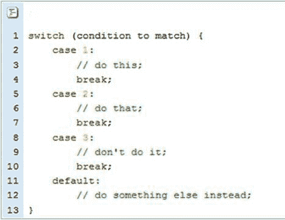

图 16

在第 1 行，我们声明了一个 `switch`。这个 switch 函数方法接收一个条件，JavaScript 将根据该条件比较所有结果，以选择其中一种可能的执行方式。

在我们的通用示例中（基于我们拥有的 cases），“匹配条件”应该替换为 `1`、`2` 或 `3`，这样它就能匹配呈现的 case 之一。如果任何一个 case 匹配条件，JavaScript 将执行 `case` 提供的代码。布尔值 `true` 是解锁 `case` 的钥匙。

示例：如果正确的 case 是 3，JavaScript 将询问：

“是 1 吗？答案：false”，

“是 2 吗？答案：false”，

“是 3 吗？答案：true”，运行代码，

BREAK 并结束。

在执行一个 `case` 之后，JavaScript 将由于其随后的 `break` 命令而退出 `switch`。如果不包含 `break` 命令，JavaScript 将继续寻找更多可能的结果，你可能会有多个正确答案而不仅仅是一个。即使没有其他正确答案，JavaScript 仍然读取所有其他条件，如果 switch 中编写了成千上万种可能性，这会导致延迟。因此，`break` 是一个非常重要的实现。

当没有匹配的条件时，可选的 `default` 将作为最终的 `true` 选项接管并执行其代码。注意，我没有在 `default` 之后包含 `break`。你可以加上，但没有必要，因为 JavaScript 此时就会退出 switch 了。

欲了解更多信息，请访问 `forum` 上的[这篇文章](http://jsplain.com/javascript/index.php/Thread/20-How-does-a-switch-statement-work-in-JavaScript/) | bit.ly/1r4XRCL。让我们用 switch 练习一下。

## 3.6 实验 13

### 13a: Switch - 使用布尔匹配

此脚本将使用一个具有 4 种可能结果的 `switch`。用户将尝试猜一个数字，程序将显示以下反馈消息之一：`too low`、`too high`、`right!` 或 `That’s not a number`：

1. 在名为 `guessNum` 的函数内部创建一个 `switch`。
2. 该函数接收一个输入参数 `num`。
3. `switch` 应该硬接连接到 `true`。

示例：`switch(true)`

4. `cases` 应该具有以下条件：
- `num <= 3` 显示 "too low"
- `num >= 5` 显示 "too high"
- `num === 4` 显示 "right, the number was 4"
- 对于 `default` 使用 "*That's not a number*"

5. 通过传递数字参数来调用函数，例如：
```
guessNum(2);
guessNum(7);
guessNum(4);
guessNum("a");
```

- 欲快速查看或进一步解释以及我该项目的最终版本，请参考[论坛板块](http://jsplain.com/javascript/index.php/Thread/32-Lab-13a/) | bit.ly/1qqwkWc 或直接查看[原始文件](http://icontemp.com/jpl/switch1.txt) | bit.ly/1r50ODq
- 表达式表达式`num <= 3` 将转换为 `true` 或 `false`。所有其他 `cases` 也是如此，因此 switch 要匹配的应该是布尔值 `true`。

### 13b: Switch - 使用字面量匹配

在下一个项目中，我们将使用以下内容：

- 一个名为 `myFavColor` 的函数，
- 使用 `prompt()` 获取用户输入，并将其转换为小写以匹配其中一个 `cases`。（JavaScript 是区分大小写敏感的）。
- 使用一些 `confirm()` 输出，这样我们就不总是使用 `console.log`，
- 以及关于 `color` 的一些有意义语句。

语句如下（你可以随时编写自己的，或从这个[原始文件](http://icontemp.com/jpl/colors1.txt) | bit.ly/1ypn1A2）复制）：

- 绿色是平衡与成长的颜色。
- 蓝色是信任与和平的颜色。
- 靛蓝色是直角的颜色。
- 紫色是想象的颜色。
- 橙色是社交沟通与乐观的颜色。
- 不起，系统中还没有这种颜色！

1. 请记住：创建函数的目的是再次调用程序而无需重新输入。它在测试目的和现实生活中都非常好。因此，整个 `switch` 应该封装在一个函数中。请自由选择你喜欢的函数样式：函数声明或赋值给变量的函数表达式。

我将使用第一种：
```javascript
function myFavColor() {}
```

2. 在函数内部，`prompt()` 将赋值给变量 `color`。
3. `switch` 表达式应该是 `color` 的值：
```javascript
switch (color) {
```
4. 每个 `case` 都应该是小写：
```javascript
case "green":
```
5. 每个 `case` 的输出应该是一个 `confirm()` 后面跟着一个 `break`：
```javascript
confirm("Green is the color of balance and growth.");
break;
```
6. 当没有颜色匹配时，`default` 执行接管（不需要 break）：
```javascript
default:
confirm("Sorry, that color is not in the system yet!");
```
7. 最后，不要忘记两个闭合括号：一个用于 `switch`，另一个用于函数（如代码所示所示）。

- 欲快速查看或进一步解释以及我该项目的最终版本，请参考[论坛板块](http://jsplain.com/javascript/index.php/Thread/33-Lab-13b/) | bit.ly/Zca 或直接查看[原始文件](http://icontemp.com/jpl/colors2.txt) | bit.ly/1DwVBsd

要测试你的脚本，只需调用函数：
```javascript
myFavColor();
```

### 13c: 一个循环执行的 switch 程序

有时我们希望脚本反复运行，例如在游戏中，直到我们特意决定退出。

为了让我们之前的脚本可以重复，我们所做的只是在关闭函数之前调用函数 `myFavColor()`，该函数将触发游戏的新实例。当我第一次引入 `confirm()` 机制时，我提到如果按下确定，`confirm()` 可以返回布尔值 `true`，如果按下取消则返回布尔值 `false`。我们可以捕获这个返回的数据来触发新的函数调用，一种方法是在关闭外部函数之前添加以下代码（变量 `replay` 是任意的）：

```javascript
var replay = confirm("点击确定再次玩游戏，或点击取消退出")

if (replay === true) {
myFavColor();
}

} <-- 这个大括号已经存在了，它是底部最后一个括号。
```

所以从意义上说，我们从 `confirm` 机制中获取布尔值 `true` 并重用它来调用 `myFavColor()`。

- 欲快速查看或进一步解释以及我该项目的最终版本，请参考[论坛板块](http://jsplain.com/javascript/index.php/Thread/34-Lab-13c/) | bit.ly/1ogVffh 或直接查看[原始文件](http://icontemp.com/jpl/colors3.txt) | bit.ly/1vdaYQT

### 13d: 使用 while 循环重复脚本

我们还没有涵盖过 `while` 循环。我们涵盖过的循环只有用于数组的 `for` 循环和用于对象的 `for in` 循环。

`while` 循环是一种无限运行的循环，直到某些触发条件使其退出。


`while` 循环的一个流行例子是扫描计算机键盘的机制。`while` 循环会持续从键盘读取输入，直到收到某个按键的信号，该信号反过来触发另一个机制。

`while` 循环的设计如下：

```
while(this Boolean expression is true){
  // do this stuff;
  // 某些操作，将条件改为 false 以结束循环;
}
```

只要该操作没有触发布尔值 `false`，`while loop` 就会一直运行。

我们可以将这个 `while` 循环应用到之前的颜色描述游戏中，让切换语句无限运行，直到用户点击 `confirm()` 的取消按钮。这样，我们就不需要再次调用该函数了，只需要不断要求用户输入他/她喜欢的颜色，直到用户按下取消按钮。

**那么，我们在哪里实现从布尔 `true` 到布尔 `false` 的改变呢？**

我们在每个 `case` 中实现它，因为只有一个 `case` 会生效。当用户确认该类的输出消息时，如果他们想退出游戏，也有机会按下取消。在用户按下 `cancel` 之前，游戏将一直进行下去。

请看下一张图片了解我的意思：

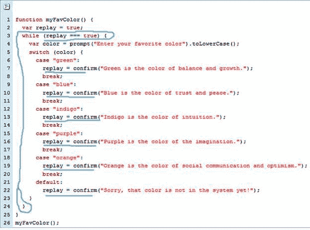

图 17

在第 3 行，我们将整个切换机制封装在一个 `while` 循环中。

只要 `replay` 为 `true`（这是它的初始状态），切换语句就会运行，循环会不断地重启切换语句，直到我们按下取消。按下 `ENTER` 等同于按下 `OK`，这意味着运行另一个周期。最终，我们玩腻了游戏，点击了确认框上的取消选项，这将触发 JavaScript 退出循环。

注意变量 `replay` 的值（它起初是一个布尔值 `true`）是如何在每次提示输出消息时被更新的。这为用户提供了退出游戏的机会。

它看起来比我们之前做的脚本更专业，如果你对创建游戏感兴趣，这会变得非常有用。

* 在你编写了你自己的版本后，可以与[论坛板块](http://jsplain.com/javascript/index.php/Thread/35-Lab-13d/) | bit.ly/1DwVNYo 上的代码进行对比。
* 或者直接查看[原始文件](http://icontemp.com/jpl/colors4.txt) | bit.ly/1sWgeWf

# 第四部分：进入第三境界

**请注意：**

这本书已经变得越来越长了！如果你想休息一下，现在是时候了，因为我们接下来要涵盖的内容是补充性的，不是 JavaScript 语法 `core` 的一部分。

另一方面，如果你急着学习 AngularJS，目前可以安全地跳过 JSON，直接进入第五部分：击败巨龙。

JSON 是一个必须了解的话题，因为你迟早会用到它，但我们在第五部分涵盖的内容并不需要它。

我希望你的这段时间过得很有成效，非常感谢你对这些材料的投入和信任。

[Tony de Araujo](http://www.amazon.com/Tony-de-Araujo/e/B00D7V08WY/)

## 4.1 关于本节

我们已经涵盖了 JavaScript 的很多领域，还有很多内容要写。然而，一次性写完并不是一个好主意，因为这会降低效率并违背初衷。这就是我将 JavaScript 分为几个不同的小手册的原因：为了让读者有时间消化每本出版物涵盖的所有数据。持续的练习、重复以及有意识的认知扩展似乎是更好的方法。

[JavaScript Objects Functions and Arrays Explained](http://www.amazon.com/JavaScript-Objects-Functions-Arrays-Explained-ebook/dp/B00GDEPBZQ/) 对每个 JavaScript 库方法进行了更详细的介绍，并提供了更高级的概念练习。如果你完成了到目前为止的所有练习，你已经完全准备好应对另一卷了。

另一个非常流行且廉价的练习用电子书是 [画出六个幸运数字](http://www.amazon.com/Small-Projects-Learn-JavaScript-Mastering-ebook/dp/B00H4P987A/)，它涵盖了循环、随机数，并回顾了函数和数组。这是一个周日下午的快速项目。

**现在我们来了一个十字路口。**

这本书的剩余部分将介绍两个每个 JavaScript 中级到高级程序员都应该知道的热门技术：

**JSON**（**J**avaScript **O**bject **N**otation）是一种数据格式化方法，使用人类可读的文本传输由键值对（JavaScript 对象）组成的对象。这种格式在许多方面正在取代 XML，并用于现代 Web 编程。从某种意义上说，我从书开始就开始介绍它，所以这些材料对你来说应该熟悉，因此这一部分相对短。

最后一个涵盖领域是关于基于 JavaScript 的框架库 `AngularJS`。

这个库正在彻底改变我们构建网站的方式，尽管仍处于婴儿阶段，但它已经产生了持久的影响，当你学习它时就会明白为什么。当你完成接下来的章节后，你就能以简单且全面的方式将动态数据实现到你的基础网页中。

请记住，我只是介绍了 AngularJS，这并不是一本关于它的完整书籍，因为这个主题跨越了几卷。我希望通过编写这些材料，赋予你进一步研究 AngularJS 的能力。这些信息将开启我认为的最难入门的部分。通过给出的练习和解释，你应该能够克服这第一个障碍。

## 4.2 JSON 简介

JavaScript Object Notation，`JSON`（读音为 J SON）是一种开放标准，使用人类可读的文本传输由键值对（JavaScript 对象）组成的对象。它在服务器和 Web 之间传输数据方面已成为 XML 的替代技术。“替代”一词可能过时了，因为现在 JSON 是 Web 服务的首选方法。

我之所以在此处介绍 JSON，是因为在写作期间，如果有人想构建网页和 Web 应用程序，JSON 已经成为 JavaScript 中必须掌握的子集。它应该是任何 Web 素养课程的内容。JSON 如此受欢迎，以其他语言现在也在实现它。好消息是，你在整本书中已经为这项技术做好了准备，这只是变得意识到它的存在的问题。

JSON 格式在语法上与我们创建列表相同，无论是作为数组的数值，还是作为对象中的键值对。我们还可以结合两种格式来创建更复杂的 JSON 数据结构。以下是使用 JSON 格式编写的数据集：

```json
{
  "firstName": "Tony",
  "lastName": "deAraujo",
  "age": 99
}
```

或者我们也可以有一个数组：

```json
[1, "hello", 33]
```

**请注意：** 如果你计划将数组转换为 JSON 格式，请避免使用混合数据类型，比如我刚刚向你展示的数组。这是因为 JSON 应该是一种**语言无关**的数据交换协议，许多编程语言不允许混合数组（包含混合值类型的数组），这会导致混淆。以下内容就可以，因为数字被视为字符串：

```json
["1", "hello", "33"]
```

回到我们顶部的第一个例子，注意 JSON 对象或数组没有进行变量赋值。对象的 JSON 部分是无缝导出到其他系统的部分。

在以 JSON 格式编写时，我们必须将键（key）封装在双引号中。由于我们从一开始就使用了双引号，所以在这方面应该没有问题。

如果键没有封装在双引号中，JSON 将报错。单引号是不起作用的。


### 简介

此外，这些数据结构都不以分号结尾。这并不是变量赋值。JSON 数据在目的地被赋值给一个变量，以便我们操作这些数据，但数据本身导出时是不带变量的。包裹整个数据结构的最外层标签必须是大括号，就像对象格式一样。

在更复杂的设计中，你可能会看到一个对象数组。数组非常适合收集符合特定标准的一组对象：

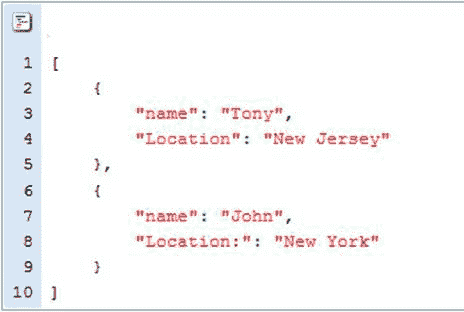

图 18（注意：缺少外层大括号和数组的键名。请见下文解释。）

这些数据可以在机器之间进行迁移。然而，`这还不是一个有效的 JSON 对象`，且像这样使用它可能会导致传输不安全。正如我们在下一张图片中看到的，它需要外层大括号和数组的键名，才能成为一个良好的 JSON 数据格式。

通过这种方式编写（加上外层大括号），我们可以将其输入到任何能够将 JSON 数据转换为其自身机器格式的机器中，与 XML 类似，但 JSON 更容易实现。

长期以来，网页一直通过交换 JSON 数据与服务器进行通信。我的意思是，页面在你的浏览器上加载，每当你点击一个动态字段时，页面保持不变，但数据通过 JSON 数据格式交换进行更新。这就是为什么必须意识到这项技术的原因之一。

*   **记住此点：** JSON 格式的文本在语法上也是合法的 JavaScript 代码。然而，反过来或者其他一种情况可能并不成立。这就是为什么当我们之前学习创建对象时，我选择将键包含在双引号中，使其同时成为 JavaScript 和 JSON 的合法语法。

下一张图片将展示一个更广泛的 JSON 对象示例。你会看到外层对象被分为两个键：`staff`（员工）和 `management`（管理层）。

每一个键（staff/management）将以 `array`（数组）作为值。数组将包含多个以对象形式存在的单独记录。每个对象代表 staff 或 management 中的一名员工。让我们看图片：

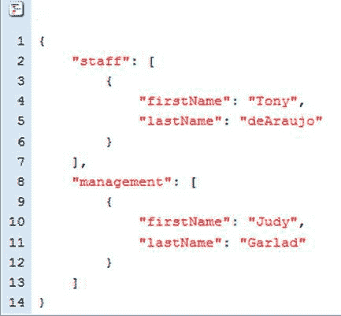

图 19 查看[原始文件](http://icontemp.com/jpl/json1b.txt) | bit.ly/1uF1qNH

你看到它是怎么做的了吗？有两个属性：`staff` 和 `management`。

在我们的示例中，属性 `staff` 包含一个分配给它的人员 `array`，并且每个人都是一个带有自身数据的对象。目前我们仅有 "Tony" 作为员工，只有 "Judy" 作为管理人员，但我们可以在 "Tony" 或 "Judy" 的右大括号后添加逗号，并在每个数组中添加另一个人，正如你在页面下方的图片中看到的那样。

不要在这里感到困惑。创建 JSON 数据结构并不非需要数组。我们可以在 JSON 结构中表示数组、字符串、数字和对象。每个标识符都需要包含在双引号中，数字的引号是可选的。（如之前提到的，如果数字包含在数组中，请务必加上双引号，以符合禁止混合数组的编程语言）。

## 使用 jsonlint，一个检查 JSON 校验的工具

为了检查代码块在 JSON 语法上是否编写正确，我们可以使用一个名为 [jsonlint](http://jsonlint.com/) (jsonlint.com) 的在线工具进行检查。该工具是一个重要的检查，可以避免错误或不安全的 JSON 数据脚本。

**练习题：**

1- 从之前的图片中复制代码并将其粘贴到 `jsonlint` 框中。然后点击 `validate`。如果编写正确，你应该能看到页面上出现一条绿条。

2- 尝试删除一个括号、或添加一个变量名或一个分号，看看它是否仍然通过验证。

## 将 JSON 对象赋值给变量

现在，如果我们想在目的地接收数据后对其进行操作，我们需要将其赋值给一个变量。该变量将指向内存中的数据，以便我们进行引用。这时 JavaScript 就介入了：我们以 JSON 格式移动数据，并在目的地，如果我们想进一步处理数据，就会将数据赋值给变量。

下一张扩展图片将展示我们如何为 JSON 对象分配一个 `variable`（变量）。

**记住**，在编写代码时，如果你想用 [jsonlint](http://jsonlint.com/) 验证你的 JSON 数据，必须在将 JSON 数据赋值给变量之前以及在末尾添加分号结束语句之前进行。

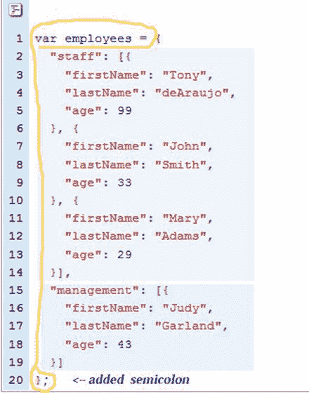

图 20 查看[原始文件](http://icontemp.com/jpl/json1.txt) | bit.ly/1DwXd57.

3- 在这一步，用更多数据扩展你自己的对象，或从图片 20 下方的原始文件中复制它。

如果你正在编写自己的脚本并想用 `jsonlint` 验证它，请在添加变量（例如：`var employees =`）和最后一个分号之前进行，然后将变量 `employees` 赋值给对象。

现在我们已经将 JSON 对象赋值给变量 `employees`，我们可以对数据或部分进行 `edit`（编辑）、`add`（添加）、`delete`（删除）和 `display`（显示），因为对象有一个我们可以引用的 `name`（名称）。

## 编辑 JSON 对象

属性键 `staff` 被分配了一个 `array`。决定使用数组是为了我们可以将多个对象作为 `staff` 的一部分。数组中的每个人都是一个对象。`management` 也是如此，它是 `employees` 的一个属性。

**练习题：**

4- 如果你还没有这样做，请复制原始文件并粘贴到 `employees` 上。

5- 我们如何引用 `staff` 来获取列表？

我们可以使用以下点符号语法：

```
employees.staff;
```

这将给我们一个员工列表。你的控制台（Console）可能会显示它的简短版本。

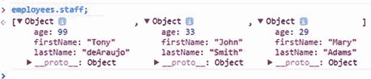

图 21

注意：proto 属性是适用于此对象的所有方法的列表。我在[第 2 卷](https://www.amazon.com/JavaScript-Objects-Functions-Explained/dp/B00GDEPB/) 书中讲解了这些方法。

- 我们如何引用数组中的第一个对象？

```
employees.staff[0];
```

解释：我们从外层对象 `employees` 开始，然后引用它的 `staff` 成员。由于，由于 `staff` 持有内部对象的数组，我们引用数组中位置为零的元素，结果如下：

*Object {"firstName": "Tony", "lastName": "deAraujo", "age": 99}*

- 现在尝试引用 `staff` 所持有的数组中包含 Mary 的位置的对象。她是数组中的第三个元素，对应位置 2。

在此处查看结果：[原始文件](http://icontemp.com/jpl/json2.txt) | bit.ly/1sWuXAy。

- 我们如何向 staff 类添加一个新员工？

由于 Loren 是一个需要添加到数组的对象，我们可以使用数组方法 `push()` 将其推入 staff：（查看 [原始文件](http://icontemp.com/jpl/json3.txt) | bit.ly/1wKTPPB ).

```
employees.staff.push({"firstName":"Loren", "lastName":"Santos", "age":29});
```

- 尝试向 employees `management` 添加一个新成员，例如："firstName":"Peter", "lastName":"Jones", "age":55

完成后，尝试引用（显示）该新成员在分配给 management 的数组中位置上的成员。

查看 [原始文件](http://icontemp.com/jpl/json4.txt) | bit.ly/1tXHoQM

- 调用 employees 属性 management 查看它包含什么：

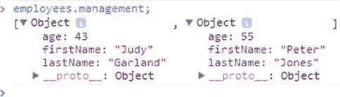


太棒了！现在让我们来看处理 JSON 数据结构的两种有用方法。

## JSON 库方法

JavaScript 有两个函数可以将普通的 JavaScript 解析为 JSON 格式，反之亦然。一旦数据被转换为 JSON 格式，我们就可以将数据发送到全球各地的其他机器。

让我们看看它们基本上是如何工作的。

### JSON.stringify

`stringify` 函数通过移除空白字符并将其转换为字符串来压缩对象，以便导出。

以我们之前的对象 `employees`（见图 20）为例，我们可以这样对其进行字符串化（stringify）：

```javascript
var myString = JSON.stringify(employees);
```

我将结果赋值给变量 `myString`（任何名称均可），它现在是一个字符串变量，包含以下数据：

"{"staff":[{"firstName":"Tony","lastName":"deAraujo","age":99},{"firstName":"John","lastName":"Smith","age":33},{"firstName":"Mary","lastName":"Adams","age":29}],"management":[{"firstName":"Judy","lastName":"Garland","age":43}]}"

现在，这段字符串数据已经准备好通过 `http` 或任何其他方法发送到不同的位置或机器。任何具有 JSON 解码（转换为或读取为 JSON）能力的编程语言都能够使用这些数据。

**注意(1):** 如果你想用 JSONLINT.com 验证这些数据，你需要排除变量名和外层引号。

**注意(2):** 使用 `stringify` 时，原始对象内部的函数（方法）不会被包含在内。这是故意为之。被字符串化的数据只有包裹在引号中的字符串键/值对（以及数字）。

**注意(3):** 有方法可以防止 JSON 压缩数据。该实现将在我们几页后介绍 `stringify` 的第三个参数时进行讨论。

### 使用第二个参数作为 stringify 的过滤器

注意：如果现在对你来说信息量太大，只需阅读、理解并记住它，并在等你想回顾该主题时再回来。

`stringify` 方法可以接受第二个参数，用于过滤掉除我们在 `stringify` 期间想要包含之外的所有内容。第二个参数可以是一个数组，也可以是一个函数，取决于我们尝试实现什么。

#### (a) 使用数组作为过滤器时

当我们使用数组作为第二个参数时，我们可以挑选我们想要字符串化的数据。

一如既往，第一个参数是正在使用的对象名称。当第二个参数是数组时，JavaScript 只会字符串化数组中提供的键/值。该数组充当了一个包含性过滤器。

例如，我想只字符串化 `staff` 数组，并且只取每个员工的 firstName：

```javascript
var someString = JSON.stringify(employees, ["staff", "firstName"]);
```

JavaScript 捕获了 `staff` 并获取它的 `firstName` 属性。此序列化的结果如下：

"{"staff":[{"firstName":"Tony"},{"firstName":"John"},{"firstName":"Mary"}]}"

这是另一个例子，其中也包含了 `age`（但不包含 `lastName`）：

```javascript
var someString = JSON.stringify(employees, ["staff", "firstName", "age"]);
```

如果我们想同时获取 `staff` 和 `management` 的 firstName 呢？

```javascript
var someString = JSON.stringify(employees, ["staff", "management", "firstName"]);
```

结果为：

"{"staff":[{"firstName":"Tony"},{"firstName":"John"},{"firstName":"Mary"}],"management":[{"firstName":"Judy"}]}"

注意：如果你尝试以原始格式在 [jsonlint](http://jsonlint.com/) 中验证此结果，它会失败。原因是我们需要移除外层引号（即使整个脚本成为字符串的引号）。一旦删除了外层引号，你将获得 jsonlint 的绿灯。有一种方法可以将此字符串转换回对象。该方法将在下一章讨论。

**尝试自己做这个：**

如果你想练习一下，尝试同时字符串化 `staff` 和 `management`，但只需每个员工的 lastName 和 age。使用你喜欢的变量名。

#### (b) 使用函数作为过滤器时

到目前，我们一直使用数组作为 `stringify` 的第二个参数。这允许我们挑选想要包含在字符串化中的哪些元素。

使用函数作为第二个参数时，我们可以执行相反的操作，排除元素，或修改某些元素的表示方式。

该函数在输入参数中接收两个参数。第一个参数是 `key`，第二个参数是 `value`。这两个参数将代表 JSON 对象的每个键和每个值。换句话说，因为我们在处理之前获取了每个键和每个值进行评估，我们可以在函数体内编写脚本来处理特定的键和值，因为函数会扫描每个键和每个值（见下图）。

至于参数名称，你如何称呼它们并不重要，重要的是它们位置，需要是 (key, value)。你可以称它们为 `(k,v)` 或 `(x,y)` 或其他任何名称。

例如，下面的图片使用函数 `filter` 从字符串化中排除 `age`：

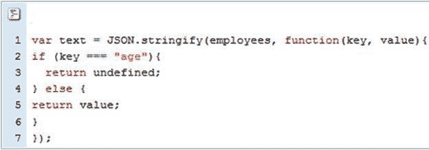

图 22 查看 [原始文件](http://icontemp.com/jpl/json4b.txt) | bit.ly/1v71zuT。

这里发生的情况是 `undefined` 值不会被包含在 JSON 文件中，因为在 JSON 中，undefined 代表空的键/值对，所以 `age` 将从输出中被移除。

另一个例子，假设你想显示标签 `age` 但值为 `n/a`。你可以将返回值从 `undefined`（这会删除键）更改为以下内容：

```javascript
return "n/a";
```

现在 "age" 将显示 "n/a" 作为值。

太棒了！

继续下去，反向的操作如何呢？例如当我们接收到 JSON 数据并想将其重新转换回对象时？

我们将在几分钟后查看重新转换，但让我们先讨论如何防止 `stringify()` 压缩数据（我的意思是如何保留原始空白），因为它完成了我们对 `stringify()` 函数的讨论。

### 在 stringify() 上使用第三个参数控制空白

即使我们不想使用第二个参数来过滤数据（例如如上一页提到的使用数组或函数），我们仍然可以使用第三个参数（或参数）来控制 `stringify` 时的空白。

以我们原始的 `employees` 对象为例（查看 [原始文件](http://icontemp.com/jpl/json1.txt) | bit.ly/1DwXd57），而不是像之前那样对其进行 `stringifying`：

```javascript
var myString = JSON.stringify(employees);
```

我们可以改为添加第三个参数，这将激活 `stringify` 函数的第三个输入参数：

```javascript
var myString = JSON.stringify(employees, null, 4);
```

输出看起来像这个 [原始文件](http://icontemp.com/jpl/json5.txt) | bit.ly/1oh4ts1。

首先，注意我们是如何在没有第二个参数的情况下让 JavaScript 读取第三个参数的：

*   我们将第二个参数设置为 `null`。这可以得通，因为现在我们可以有第三个参数。

其次，数字 4 是缩进空格数。没有提供添加行的规定，但当我们请求缩进时，JavaScript 会自动添加行。最大数量是 10。

你注意到原始文件中的第二个示例了吗？它显示的是*点* 而不是*空格*。

这是通过将第三个参数从数字改为字符串来实现的：

```javascript
var myString = JSON.stringify(employees, null, "...");
```

最后这个如果你在 *jsonlint* 上测试它将无法通过验证，但它的作用是说明 `stringify` 的第三个参数。

### JSON.parse

为了将字符串转换回我们以前的对象，我们使用 `JSON.parse` 方法。

查看原始文件：[myString](http://icontemp.com/jpl/json6.txt) | bit.ly/1rtZclU。

```javascript
var myEmployees = JSON.parse(myString);
```

变量 `myEmployees` 现在是一个对象，具有与我们原始 `employees` 对象相同的值。

注意：如果被解析的数据不是有效的 JSON，你将得到错误。


非数组对象的属性不保证以特定的顺序进行字符串化（这是很合理的，因为键值对并不真正需要数值顺序）。在字符串化时，请不要依赖同一个对象内属性的顺序。

### 总结

我希望这段对 JSON 的介绍能让你对其产生兴趣，并激励你开始自己的数据导入导出项目。

以下是一些实用的链接：

* [JSON.org](http://www.json.org/)，官方网站。
* [JSONLint](http://jsonlint.com/)，JSON 验证工具。
* [维基百科](https://en.wikipedia.org/wiki/JSON)，独立的资源参考资料。
* [莫智拉基金会](https://developer.mozilla.org/en-US/docs/Glossary/JSON)，一个很好的术语表和资源中心。
* [JSON vs XML](http://www.json.org/xml.html) —— 由 JSON.org 编写的这两种技术的对比。

在在我们继续之前，请让我简要介绍另一种让 JSON 真正大放异彩的技术：NoSQL。

### 面向 JSON 数据的文档型数据库

现代 Web 应用的数据需求是 MySQL 等关系型数据库可能难以提供的。一场巨大的变革正在发生，并正在颠覆我们所熟知的数据库世界。今天，三个相互相关的趋势是大数据、大用户和云计算——它们都在推动 NoSQL 技术的采用。

#### 什么是 NoSQL？

“NoSQL 或 Not Only SQL 数据库提供了一种数据存储和检索机制，其数据建模方式与关系型数据库中使用的表格关系不同。”

[维基百科](http://en.wikipedia.org/wiki/NoSQL)。

“Not only SQL”（不仅是 SQL）这一术语之所以是为了强调它们可能支持类似 SQL 的查询语言。

NoSQL 越来越多地用于[实时 Web](http://en.wikipedia.org/wiki/Real-time_web) 应用（例如：Facebook 的新闻动态和 Twitter）。

NoSQL 是面向文档的数据库。与关系型数据库相比，数据集（collection）可以类比表，文档（document）可以类比记录（文档可以封装并编码为 XML 或 JSON 等标准格式之一）。

可以在这里找到 NoSQL 数据库列表：[nosql-database.org](http://nosql-database.org/)。

如果你想立即接触这项技术，一个很好的起点是下载 [CouchDB](http://couchdb.apache.org/)，它以 JSON 存储数据并可以使用 JavaScript 进行查询。你可以在本地计算机上使用它并从那里学习其操作。CouchDB 是由 Apache 支持的开源项目。可以在这里找到基础课程：[指南](http://docs.couchdb.org/en/latest/intro/index.html)。

# 第五部分：击败巨龙

欢迎来到现代 DOM 脚本。

2015 年 10 月

## 5.3 迈向 AngularJS 的坚实一步

### 简介

AngularJS 是一个用于开发动态 Web 页面的框架。它由 Google 创建，旨在解决传统 Web 设计中的多个问题。与其他许多开发者一样，我认为 AngularJS 是目前可用的最热门技术以及 Web 设计的未来，而且因为有 Google 的支持，会有大量的资源让它扎根。

在某种程度上，AngularJS 扩展了 HTML 属性，得益于 AngularJS 提供的库，赋予了它们超能力。该库通过链接像你链接 CSS 或 JavaScript 一样连接到你的网页上。

HTML 是为静态页面设计的。AngularJS 就像如果 HTML 是为现代应用设计的它本该有的样子。

此时，你真的需要了解基础的 HTML，因为我们将处理一个标准的 HTML 页面。你不需要成为专家，掌握最基础的内容即可。如果你需要温习一下知识或从零开始学习，请访问 [Codecademy](https://www.codecademy.com/)。你可能偶尔在那里看到我担任版主，特别是在他们的 JavaScript 练习中，但他们的 HTML 教程非常酷而且免费！！

你感兴趣的链接（供未来参考）：

[AngularJS.org](https://angularjs.org/) | [维基百科](http://en.wikipedia.org/wiki/AngularJS) | [文档](https://docs.angularjs.org/api/ng/directive/ngCloak)。

在读阅读他们的材料而迷失之前，让我们先熟悉基础设置以及它能为试图设计更动态 Web 页面的 Web 开发者做什么。

欢迎来到现代 Web 设计！

### 指令（Directives）

AngularJS 如何扩展 HTML 能力的？

首先，我们在网页上提供一个 AngularJS 库的链接，就像我们链接 JavaScript 或 CSS 文件一样。

然后，页面就连接到了这些你可以使用的海量方法。

假设我们想要增强页面上的某个 DIV 而不是页面其他任何部分，例如，你想在网页上创建一个带有动态数据的框。

在链接到库之后，我们只需要对该 DIV 应用一个 `directive`（指令）。该指令是 `ng-app`，它使这个 DIV 变成一个由 AngularJS 控制的应用程序。`ng-app` 指令告诉 AngularJS 需要扫描此 DIV 以可能的 AngularJS 功能。我们稍后来看它是如何工作的。

如果我们希望对整个页面进行扫描和映射，我们将相同的指令应用到 HTML 标签上，而不是应用到 `DIV`。实际上，任何可以作为容器的 HTML 标签都可以变成一个 Angular 增强元素，而完全不会影响页面的其他部分。我们可以使用段落标签、表单标签或有序列表。但在大多数情况下，AngularJS 是如此友好的，我们我们并不介意将其关联。


指令（Directive）是为现有标准语法引入新功能的东西。它扩展了语法的能力，就像是“教老狗学新技巧”一样。通过在现有的 HTML 标签上挂载指令，该标签的行为会根据 Angular 库中以该指令命命的内容而发生改变。在某些情况下，指令指定了全局行为，而在另一些情况下，它们只影响局部区域，例如一段程序代码。

AngularJS 通过称为指令（directives）的构造结构向浏览器教授了新语法。

如果你以前构建过 Web 应用程序，Angular 将是一个完全全新的范式。如果你是 Web 设计的新手，AngularJS 将教你现代且最佳实践的方法，并且你会认为自己很幸运，因为你不需要为了学习新知识而忘记旧知识。

是的，起初是需要付出代价的，你失去了灵活性。但换来的是一致性、开发速度，以及在今天和明天都好用的东西。你不再需要知道如何制造发动机来开车，但你了解得越多，就越能充分利用汽车提供的功能。AngularJS 并不是一项容易学会的技术，但如果你已经读到了这本书的这里，说明你已经具备学习和掌握 AngularJS 的自律和技能。

### ng-app 是什么意思？

它只是告诉浏览器使用 AngularJS 作为页面的根，或者作为 DIV 的根，取决于我们在哪里插入 `ng-app` 标签。通过这种方式，一切都将相对于 AngularJS，而 AngularJS 为你的页面提供了核心功能。

在这个示例中，

```html
<html ng-app>
```

整个页面使用 AngularJS 作为它的根。

在这个示例中，

```html
<div ng-app>
```

只有这个 DIV 使用 AngularJS 作为它的根。网页的其他部分感知不到 AngularJS。

我们还可以通过在指令中添加*应用名称*来为我们正在构建的应用程序命名：

```html
<html ng-app="myApp">
```

正如你很快看到的，这变得非常有用。

因为在 `ng-app` 指令中包含应用名称非常常见，你会在许多文章中看到以下语法：

```html
<html ng-app="">
```

这是另一种编写无名称指令的方法，而不是直接写一个 `ng-app`。

*   **注意：** 除非该名称作为 `Module`（模块）存在，否则不要包含名称，因为 AngularJS 将无法工作。我们还没有介绍模块，所以目前我们只单独使用 `ng-app` 本身，即使在生产环境中这样做也是完全没问题的。
*   **注意：** 注意 `ng-app=""` 引号之间没有空格。空格会被视为一个名称（即使是空的），并且必须创建一个该名称下的模块。再次，我们现在只单独使用 `ng-app` 本身即可。

### 不再有 DOM 操作任务

文档对象模型（Document Object Module，或 `DOM`）是所有现有 HTML 标签或节点的映射布局。为了在 Web 页面中写入 JavaScript 程序的结果，我们需要定位到想要实现脚本结果的 DOM 位置。由于浏览器的不一致性和实现错误，这一直是一个问题。那时，`jQuery` 诞生了。`jQuery` 是一个用于处理 DOM 的方法库。当实现良好时，`jQuery` 效果非常好。遗憾，`jQuery` 的使用变成了一个问题，因为许多用户不学习 JavaScript，他们只是背诵 `jQuery` 解决方案，而 `jQuery` 是手动驱动的，导致了实现错误。

AngularJS 来救场了。底层实现将不再由程序员自己完成；将由 AngularJS 根据程序员对特定结果的表达性需求来完成。程序员变成了一个水工；他们为所需的结果插入正确的指令。这将确保了最佳实践和无错误的实现。有了 AngularJS，你从底级操作任务中解放出来，你可以利用额外的时间来思考解决方案，而不是考虑代码语法和安全实现。

当然，如果你知道 `jQuery`，你仍然可以在 AngularJS 中配合使用它，但我怀疑 AngularJS 将开发出越来越多的方法来规避某些 `jQuery` 的流行实现。

在 AngularJS 中，应用程序接触 DOM 的唯一地方是在 `directives` 内部。然而，如果你需要直接访问 DOM，仍然可以通过编写[自定义指令](https://docs.angularjs.org/guide/directive) | bit.ly/1tYW95Q 来。

好了，我们现在对 `directives` 有了点了解。让我们回顾一下 `expressions`（表达式）的含义，以便我们扩展 AngularJS 的主题。

### 什么是表达式？

你还记得在之前的章节中表达式是什么吗？

表达式是 JavaScript 求值得到单个值的东西。

```javascript
2 + 5;
// 结果为 7
```

```javascript
"tony"
// 结果为 tony
```

```javascript
"hello".toUpperCase();
// 结果为 "HELLO"
```

以此类推……

如果在我们的 Web 页面上有一个传递给 AngularJS 以供 JavaScript 解释器求值的表达式，我们通过将其封装在双括号中来实现：

```html
{{ this expression }}
```

AngularJS 将将 JavaScript 求值的结果精确地写在双括号在 Web 页面上的位置。这不是 AngularJS 的发明；它在 AngularJS 出现之前就被其他库实现了。只需看一眼 [Mustache](http://en.wikipedia.org/wiki/Mustache_%28template_system%29) | bit.ly/1DxihbF。

让我们玩几个例子。这可能不会有什么实际作用，但它的目的是让我们熟悉如何将表达式传递给 AngularJS。

注意：你仍然可以使用 jsbeautifier.org 作为编辑器，但遗憾的是，除非你将代码粘贴到另一个纯文本编辑器，否则你无法保存文件。想起了记事本（NOTEPAD）。如果你以前做过 HTML，你可能已经有一个喜欢的编辑器可以使用了。

1- 首先，我们获取示例 HTML 脚本：[原始文件](http://icontemp.com/jpl/ang14/ang1.txt)

2- 将其粘贴到本地编辑器，例如 Windows 记事本（我也使用来自 [pnotepad.org](http://www.pnotepad.org/) 的免费且彩色的程序员记事本）。将其保存为 HTML 文件。我将我的文件命名为 `ang2.htm`。确保你为我们的示例创建一个新文件夹。

3- 要进行测试，进入文件列表并双击该文件。由于它是 HTML 文件，它将在浏览器中打开，你应该看到 *hello* 这个词。

4- 现在我们已经知道文件可以工作了，回到编辑器并添加一个表达式。将单词 hello 替换为以下句子和表达式：

```text
Convert the expression tony to uppercase: {"tony".toUpperCase();}
```

5- 保存文件，刷新浏览器或重新打开文件，你应该能看到大写的 TONY。

查看下方的图片解释：

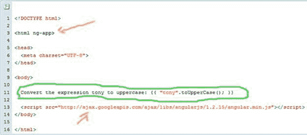

图 24 查看 [原始文件](http://icontemp.com/jpl/ang14/ang2.txt) | [html](http://icontemp.com/jpl/ang14/ang2.html)

HTML 脚本与之前相同。我们只是将单词 hello 替换成了第 11 行所示的句子，后面跟着 {"tony".toUpperCase()}}。

在双括号内的任何内容都将由 JavaScript 求值。


我没有写任何 JavaScript 代码。AngularJS 处理了内部过程。这是一种更高层次的抽象编程。我们仍然需要了解 JavaScript 吗？当然需要！当我们超出这个简单的测试时，你对 JavaScript 的知识将变得非常重要。

### 我必须始终在网页上包含我的表达式吗？

不，我们这样做只是在引入模块和控制器之前为了测试和理解。但是的，你完全可以在生产环境中这样做，它对于简单的内容是有效的。

### ng-init

让我们引入另一个指令，以便我们有更多的工具可以玩。

- `ng-app` 指令初始化 AngularJS 。
- `ng-init` 指令初始化一些用于应用程序的 `data`。

让我们看看 `ng-init` 在最简单的形式下工作：

1- 打开你的基础 HTML 脚本，并修改 HTML 标签以包含如下的第二个指令：

```html
<html ng-app ng-init="city='Harrisburg'; state='Pennsylvania'">
```

2- 然后在 body 中编写以下内容：

你知道 `{{city}}` 是 `{{state}}` 的首府吗？

3- 将其保存为 `ang5.html` 并测试它。

你应该在浏览器显示器看到以下句子：

*你知道 Harrisburg 是 Pennsylvania 的首府吗？*

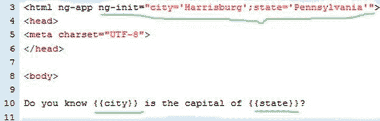

图 26 [raw file](http://icontemp.com/jpl/ang14/ang5.txt) | [html](http://icontemp.com/jpl/ang14/ang5.html)

### 你看到发生了什么吗？

我们通过 `ng-init` 初始化两个变量：`city` 和 `state`，然后我们可以通过 HTML 输出上的两个表达式标签来处理它们。不需要通过复杂的脚本来处理 DOM。有更好的方法可以做到，但现在的目标是熟悉 AngularJS 的基本工具。

通过在 HTML 标签上初始化参数 `city` 和 `state`，它们就可以在网页上被使用。然而，这些变量通常被放置在单独的表格中。

### ng-bind

为了说明双大括号的作用，让我们用另一种方式编写相同的脚本：通过使用一个名为 `ng-bind` 的指令。

6- 我只对变量 `city` 这样做而不对变量 `state` 这样做，是为了展示两者是如何工作的：

```html
Do you know <span ng-bind="city"></span> is the capital of {{state}}?
```

显示将是：

*你知道 Harrisburg 是 Pennsylvania 的首府吗？*

实际上，AngularJS 在其内部过程中始终会将大括号替换为 `ng-bind`。如果你不介意编写额外的 `SPAN` 标签，这实际上运行得快一点。当你刷新页面（Windows 上的 `CTRL f5`）并关注输出时，你会发现 Harrisburg 立即出现，而 Pennsylvania 会先显示大括号，然后转换成正确的单词。它发生得很快，但你可能会捕捉到它。

### ng-bind 起什么作用？

它将 `data source` 绑定到目标。不再需要玩 `getElementById` DOM 游戏了。

关于 AngularJS 绑定还有更多需要了解的，但我们需要缓慢进行，只需掌握足够理解后续的内容。这就像那句名言“[罗马不是一一日之成的](https://en.wikipedia.org/wiki/Rome_wasn%27t_built_in_a_day)”。

### ng-cloak: 避免显示闪烁

当使用大括号 `{{ }}` 而不是 `<span ng-bind="city">` 时，你可能会注意到显示上的快速闪烁，因为大括号尚未被 AngularJS 评估。

如果这对你来说变成了一个问题，请将库的链接包含在 HEAD 部分而不是 BODY 部分。这样大括号会在浏览器显示文档之前被评估。在头 中包含链接可能会有一些副作用，取决于你页面的复杂性，这就是为什么越来越多的开发者将库链接移动到页面底部。

如果你在页面上嵌入 AngularJS 但无法访问 HEAD 脚本，那么可以使用 `ng-bind` 代替大括号，或者使用 `ng-cloak`。

由于 `ng-cloak` 涉及 CSS，我在这里不再进行描述。请查看以下链接以获取此实现的完整说明：

[docs.angularjs.org/api/ng/directive/ngCloak](https://docs.angularjs.org/api/ng/directive/ngCloak)。 | bit.ly/1pcTqjF

## 5.4 实验 14

### A 部分：初始化对象并在段落中输出其内容

说到绑定，让我们通过几个练习来记忆到目前为止我们涵盖的所有内容。

这实际上是我们 JavaScript 实验课程中一个熟悉的练习。在这里，我们将初始化一个名为 `colors` 的对象。该对象包含以下属性：

a) `"green": "green is the color of balance and growth.",` `"blue": "blue is the color of trust and peace.",` `"indigo": "indigo is the color of intuition"`

然后我们将在浏览器上得到以下显示：

b) The color green is the color of balance and growth.
The color blue is the color of trust and peace.
The color indigo is the color of intuition.

我们将要使用的指令是：`ng-app`、`ng-init=' '` 以及用于输出显示评估的双大括号 `{{ }}` 表达式。

注意 `ng-ini` 是如何使用单引号的。这是因为我们要插入引号内部的对象 `colors` 内部包含了双引号。通过对 `init` 使用单引号，我们确保 JavaScript 不会产生混乱并过早终止表达式。

如果你想复制带有有 `ng-app` 和 `ng-init` 的起始 HTML 标签以及对象代码块，请参考以下链接：[this raw](http://icontemp.com/jpl/ang14/ang7b.txt)

在你尝试创建你自己的版本之前，尝试不要复制/粘贴它，或者只是快速看一眼刷新记忆，然后尝试自己做。

**让我们开始吧**。（请在下一页找到分步骤说明）。

1- 创建一个基础 HTML 页面（就像我们之前做的那样）。查看起始 [raw file](http://icontemp.com/jpl/ang14/1.txt)

如果你没有使用起始原始文件，请确保执行了以下操作：

a) 在 HTML 起始标签中插入一个指令，允许 AngularJS 管理你的网页。
b) 在 BODY 容器底部插入 AngularJS 库的 URL。

2- 在 `ng-app` 指令之后，但在 HTML 起始标签内部，添加 `ng-init=' '`，在 ' ' 内部插入一个名为 `colors` 的对象，其属性如上一页演示 `a` 下描述的。

为了方便起见，我包含了一个作为对象插入的原始文本文件，你可以从中复制/粘贴：[raw file](http://icontemp.com/jpl/ang14/ang7b.txt)

3- 在 BODY 部分添加三个段落，每个颜色一个。查看下方关于绿色的第一个示例：

```html
<p>The color {{colors.green}}</p>
```

4- 将其保存为 `ang7.html` 或你喜欢的任何名称。在浏览器中打开它。它看起来应该是这样的：[html](http://icontemp.com/jpl/ang14/ang7.html)

5- 完整的脚本和进一步解释可以在 [forum](http://jsplain.com/javascript/index.php/Thread/36-Lab-14a) 查看 | bit.ly/1rk2jLx

### B 部分：初始化变量并输出计算

在这个新的练习中，我们要初始化两个变量 `length=9` 和 `width=3`，然后输出以下段落：

**如果长度为 9 宽度为 3，周长为 24。**

请记住在写 9 和 3 的地方，动态标记应该写成 `{{length}}` 和 `{{width}}`，随后会被赋值给每个变量的值替换。

至于总数 24，它应该是矩形的周长。你可以使用自己的公式。我将使用 `length * 2 + width * 2` 作为我的表达式。

完成你的脚本后，请将其与我的进行对比：[forum](http://jsplain.com/javascript/index.php/Thread/37-Lab-14b) | bit.ly/1rkKW8 | [raw file](http://icontemp.com/jpl/ang14/ang8.txt) | [html](http://icontemp.com/jpl/ang14/ang8.html)


## 5.5 进一步深入模块化

### 为 ng-app 分配模块名称

模块化是一种设计技术，它强调*将程序的功能拆分为独立的模块*，并使得每个模块都包含执行目标结果某一方面所需的所有内容。

模块是 `app` 不同部分的容器，包括相关的控制器（controllers）、服务（services）、过滤器和指令（directives）。

**你的网页 `app` 是一个模块。**

在我们的网页中，当我们在 HTML 标签上声明 `ng-app` 时，我们实际上是在创建一个模块（我们使用的是一个`unnamed` 模块）。我们没有给测试网页（或模块）命名的原因是，一旦命名，在配置好 `module interface`（模块接口）之前，它将停止工作，这意味着我们需要通过在 `<script></script>` 块中编写声明来正式地向 AngularJS 注册此模块。

这就是为什么我们让 AngularJS 的声明保持尽可能简单，只声明了：

```html
<html ng-app>
```

然而，一种常见的最佳实践是通过给网页赋予一个模块名称来命名，例如：

```html
<html ng-app="nameOfTheModule">
```

`nameOfTheModule` 是该网页在 AngularJS 中的标识，你可以使用任何你喜欢的名称。

除了命名模块是一种最佳实践外，如果你让页面变得超过了我们目前所做的程度，这实际上是强制性的。当然，为了快速测试，我们可以只是像这样创建一个未命名的 `ng-app`：

```html
<html ng-app="">
```

这里要留心，如果你使用了引号但没有写名称，请确保引号之间没有空格，因为该空格会让 AngularJS 认为该模块已命名，导致你将因为文件中没有该名称而收到错误。

我最喜欢的测试语法仍然是 `ng-app`（为了兼容 HTML5 验证，可以使用 `data-ng-app`）。只有当我真的有一个需要包含的模块名称时，我才会使用扩展，这正是我们接下来要做的。

### 配置模块接口

一旦我们为 `ng-app` 分配了名称，我们就必须配置该模块。

以我们做的最后一个练习为例（**部分 B：初始化变量和输出计算结果**）。这个练习足够简单，可以帮助我们理解如何配置应用名称模块：

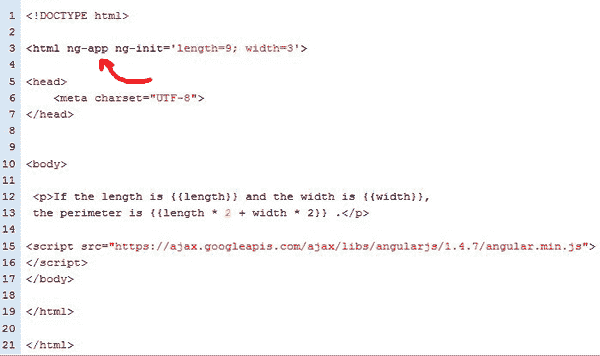

图 27（尚未应用模块名称）

在上面的图片，`ng-app` 没有名称，但它运行良好。

然而，如果我们在 `<html ng-app>` 中插入一个名称，例如：

```html
<html ng-app="myFirstAppModule">
```

页面将停止工作，直到我们配置了模块接口。

配置应用模块的一种方法是在 HTML 页面 `BODY` 底部、AngularJS 链接正下方打开一个新的 `<script></script>` 容器。

在脚本容器中，我们将一个 `function call` 赋值给某个变量（例如 `x`）。这个特定的函数或方法来自 Angular 库，它的名称是 `module`。示例：

```javascript
var x = angular.module();
```

下方可以看到此赋值的图像，但请先让我完成对该赋值的解释。

在我们把 `module()` 赋值给变量 `x` 后，我们将 `app` 的名称作为方法 `module()` 的第一个参数引入。第二个参数是一个空数组，它看起来应该是这样的：

```javascript
var x = angular.module("myFirstAppModule",[]);
```

按照传统，变量 `x` 是根据模块名称命名的，在这个声明中会有两个 `myFirstAppModule` 单词（这些术语的重复不会产生冲突，因为它们位于代码的不同区域，但了解变量 `x` 的用途会有帮助）。然而，由于名称匹配并非强制，我特意将其命名为 `x`，以清楚地说明模块名称所在的位置，以及它与变量没有任何关系。

这个声明目前足够让我们的 `ng-app` 恢复运行了。

请仔细学习以下图片。

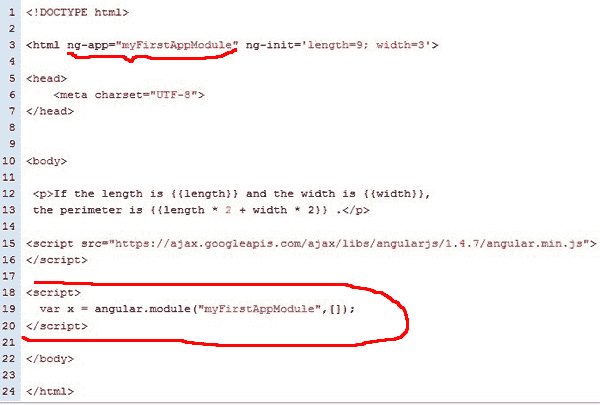

图 28（给 ng-app 赋予名称后，我们将该名称注册为模块）

自己尝试一下吧。获取你的原始文件（[原始原始文件](http://icontemp.com/jpl/ang14/ang8.txt)），为你的 `ng-app` 添加一个名称，并通过在 `BODY` 底部编写声明来向 Angular 注册模块。注意模块名称是如何在引号内引入函数 `module()` 的。它是作为字符串传递进去的。

如果你需要帮助，请查看我的这里文件：

[最终原始文件](http://icontemp.com/jpl/ang14/ang8b.txt)。

**进一步解释：**

查看变量 `x` 的声明。`x` 被赋值给属于对象 `angular` 的函数。这个名为 `module()` 的函数接受两个参数。第一个参数是一个包含我们要声明的模块名称的字符串。然后，用逗号隔开的是一个空数组。它们都需要被声明。

数组的目的是包含未来为该模块所需的依赖项。有时我们想要使用其他子模块来增强这个特定的模块。由于使用其他相关模块非常常见，第二个参数是硬编码的，在声明新模块时需要包含它。在我们的情况下，我们只需将数组写为空数组，这对我们就有效。然而，如果你跳过了 `[]`，模块将无法工作。我们必须在那里放置这两个括号。

## 5.6 准备分离数据与显示

### 创建控制器

恭喜，我们正在稳步地进入 AngularJS 的实际演示。请耐心等待，我们快完成了。

到此为止，我们一直在使用 `ng-init` 初始化动态数据。这有时可能有用，但它并不是理想的实现方式。

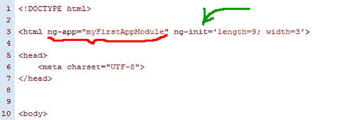

图 29（ng-init 将将被底部的控制器取代）

我们需要转向将位于正确标记文件夹中的文件进行分离，但我们还没有那一步。我的意思是，在开始将代码拆分为不同的文件之前，我们应该能够在一个页面上看到整个画面，这正是我们在本课程中所学习的：学习 Angular 应用的基础部分。如果我们在这个理解水平上将代码拆分为文件夹只会增加不必要的复杂性，我们现在不想去那里。

我们接下来要做的的是停止使用 `ng-init` 在页面顶部编写我们的数据，并将数据对象移动到 `BODY` 部分的底部（在我们插入模块声明的同一个脚本内部）。我们的 JavaScript 代码将写在**控制器**（controller）内部，控制器是一个特殊的 AngularJS 函数（我们刚刚创建的模块的方法或属性）。

所以，现在我们将把网页的体部拆分为以下概念区域：

a) **标准 HTML 标记**及其常规数据，即不需要任何 AngularJS 影响的数据。这些数据实际上可以位于页面的任何位置，因为正如你看到的，动态数据将被封装在代码块中。

b) **我们希望 AngularJS 显示某些动态数据的区域**。这个区域被称为 `view`（视图）。AngularJS 向页面注入了许多微动态 `views`，它们与其余的 HTML 展示混合。取决于你真正想做什么，它可以只是一个 `view`，也可以是 `views`。将其想象成我们*嵌入*页面中的脚本，就像我们处理图片或 YouTube 视频一样。

c) **我们创建 JavaScript 代码的区域**。我们将此区域称为 `controller`（控制器）。该区域被 `<script></script>` 标签包围，就像框架链接一样。此时控制器的思想是存储我们使用 `ng-init` 时存储的数据和功能。控制器是一个函数，在函数内部有我们的动态数据。记住，我们使用函数来存储可以在调用时运行的代码。


我们将从之前的练习中移除 `ng-init`，并将数据插入到控制器中，但首先，让我们先看看控制器的基本结构。从一个空控制器的图像开始：

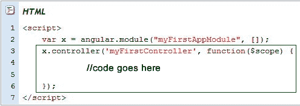

图 30 (控制器是模块 x 的子级。JavaScript 代码放在控制器中)

控制器函数是模块的子级，在我们的示例中，它被赋值给变量 `x` 以于实现（`x` 变成了整个模块声明的快捷方式）。因此，模块 `myFirstAppModule` 被赋值给 `x`，然后我们从变量 `x` 中提取 `controller` [第 3 行]。在控制器方法内部，我们有两个参数。第一个参数是我们给控制器的名称，格式为字符串类型（我将其命名为 'myFirstController'）；第二个参数是一个名为 `$scope` 的 AngularJS 对象。`$scope` 是一个 Angular 对象，用于跟踪我们即将发送到网页的所有数据和属性，正如我们很快看到的。注意所有这些代码都在 `SCRIPT` 标签内 [第 1 行和第 7 行]，其中声明了 `ng-app="myFirstAppModule"` 模块。

AngularJS 奇迹地将我们在控制器内部编写并分配给对象 `$scope` 的任何代码和数据提供给 HTML 视图（分配给控制器的视图）。

我们可以说 `$scope` 是控制器和页面视图之间的粘胶水。控制器与页面视图没有任何关系，因为它应该是通用化地编写的。我的意思是，我们可以有多个不同的视图使用来自控制器的相同数据：一个用于桌面屏幕的视图，另一个用于手机的视图，等。这取决于 `$scope` 如何与外部视图世界进行交互，而 AngularJS 在后台提供了此类功能。

在进行练习之前，让我总结一些概念，以帮助你进一步理解正在发生什么。

### $scope

`$scope` 是一个映射整个页面（DOM）的对象，并创建可以被访问的属性。在某种意义上，它就像并行的 DOM。稍后你将看到我们将 `$scope` 添加到控制器中，然后向 `$scope` 中添加变量和函数，反过来这些将对网页应用可用。（注意：`$` 看起来像字母“S”，对吧？这提醒我们 `$scope` 是一个 AngularJS 服务）。

### View（视图）

视图是应用程序中将显示在屏幕上的区域。就像图像、视频或其他嵌入文本一样，我们可以在页面上拥有多个视图，它们可能是硬编码的，也可以从不同的来源链接。与 HTML 标准呈现方式相反，视图数据不是持久的，这意味着它会根据 `$scope` 提供的逻辑（来自分配的控制器）或用户与页面交互的行为而变化。视图是由标准 HTML 元素结合 AngularJS 的数据绑定、指令（directives）增强功能以及花括号 `{{}}` 创建的。

*   任何复杂逻辑都应该放在控制器中，并让 `$scope` 管理这些逻辑向视图的数据。这并不意味着视图不能有任何逻辑；简单的表达式可以放在视图中，正如我们在之前的第一次练习中所做的那样。

### Controller（控制器）

控制器是编写用于在页面运行时执行的 JavaScript 代码的地方。

控制器的目的是提供 AngularJS 所需的逻辑以初始化对象 `$scope`，该对象是像 DOM 一样映射网页的对象。

在使用带有 `$scope` 的控制器之前，我们一直使用一个简单的 `ng-init` 来保存和初始化数据，但那是一个非常有限的实现。`$scope` 是更强大的对象，也是声明属性和方法最合适的方法。

接下来的图像显示了我们如何以及在哪里实现之前分配给 `ng-init` 的数据：

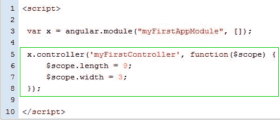

图 31

如你所示，所有的 JavaScript 代码都被视为 `$scope` 的属性子级。AngularJS 将获取 `length` 和 `width` 并将它们保存为 `$scope` 的一部分（记住，`$scope` 管理 DOM，这是事物显示的方式和位置）。

只剩一件事了。我们现在有一个应用名称，还有一个包含一些待处理的 JavaScript 变量的控制器。但 AngularJS 如何知道在我们打开页面时在段落的何处显示这些变量？

提醒一下，这是我们在旧练习的 HTML BODY 中拥有的：

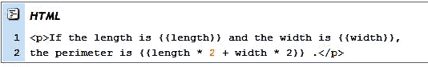

图 32

答案是，我们应该将整个段落封装在一个 DIV 中，并将该 DIV 分配给名为 `myFirstController` 的控制器：

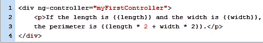

图 33 (我们将段落封装在分配给 myFirstController 的 div 中)

### 轮到你了：为你的练习添加控制器

现在，让我们修改之前的练习，为它添加一个控制器。

这是我们在添加模块 `myFirstAppModule` 之后留下的原始[原始文件](http://icontemp.com/jpl/ang14/ang8b.txt)。

1- 将控制器添加到脚本容器中，位于模块声明下方一行，如图 30 所示。
2- 将 `length` 和 `width` 分配给 `$scope`，如图 31 所示，然后从你的页面中移除 `ng-init`。
3- 将你的段落封装在 DIV 中，并将该 DIV 分配给控制器，如图 33 所示。
4- 测试你的 HTML Angular 应用。这里有我自己的版本：

[原始文件](http://icontemp.com/jpl/ang14/ang8c.txt) | [html](http://icontemp.com/jpl/ang14/ang8c.html)。

我们现在有一个完整的简单 Angular 应用。

#### 编写 length 和 width 的另一种方法

在练习中包含 `length` 和 `width` 的另一种方法是将它们制为某些对象的属性，例如 `myPerimeter`，然后在控制器内部如下编写它们：

```javascript
$scope.myPerimeter = {
  "length": 9,
  "width": 3
};
```

而不是使用 `$scope.length =9;` 和 `$scope.width = =3;`

在 HTML 视图中，我们将它们写为：

`{{myPerimeter .length}},{{ myPerimeter .width}}`

以及公式：`{{myPerimeter.length * 2 + myPerimeter.width * 2}}`

让我们通过创建几个酷的小项目来继续练习。

### 创建一个将华氏度转换为摄氏度的程序

我们*不会*从零开始创建这个程序，因为我们之前在**Lab work 6** 学习 JavaScript 时已经做过了。

查看 [论坛](http://jsplain.com/javascript/index.php/Thread/13-Lab-6/) | bit.ly/1Dp2SK

[原始文件](http://icontemp.com/jpl/f2c.txt) | bit.ly/1ruKrzi

我们要创建一个应用来显示结果。

主目的是在页面上设置 AngularJS，并练习在控制器中包含代码实现。

这里是我的示例食谱：

*   **模块名称**：`myAppModule`
*   **控制器名称**：`myController`
*   **显示结果的变量**：`result`（提示：它在控制器中是 `$scope.result`）。
*   **动态显示的句子**：*100 华氏度等于 37.778 摄氏度。*

注意：在调用函数时，确保将原始的 `f2c(212)` 改为 `f2c(100)`。

准备好接受挑战了吗？

请自己完成。这里是总结指南：

1- 创建你的 HTML 骨架。
这是我们的启动文件：[原始文件](http://icontemp.com/jpl/ang14/ang1.txt)。

2- 链接 AngularJS（如果你使用的是启动文件，这已经完成了）。

3- 添加 ng-app 指令（已完成）并命名为 myAppModule。

4- 在 AngularJS 链接下方添加一个新的 Script 容器并在其中声明模块。（我将其赋值给变量 `x`）。

5- 在模块声明下方添加你的控制器。控制器的名称为 `myController`，它属于变量 `x`。此外，在它的参数中显示了一个字符串作为控制器的名称，在逗号隔开后，第二个参数引入了一个传入 `$scope` 的函数。

6- 向控制器中添加华氏度到摄氏度的转换函数。

这里有几种替代方案。让我解释一下：


a) 首先在此处获取原始 JavaScript 脚本副本：[原始文件](http://icontemp.com/jpl/f2c.txt)。

b) 我们需要将 `console.log` 替换为 `return`，因为我们要捕获结果并发送到 `$scope`，以便显示。

c) 现在我们有两个选择（参见步骤 c 到 f）：

我们可以通过这种方式将函数 `f2c` 赋值为 `$scope` 的属性：

```javascript
$scope.f2c = function(f){return ((f-32) * 5 / 9);}
```

d) 那么，当我们进入 HTML 页面视图时，我们可以这样实现结果：

```html
{{f2c(100)}}
```

e) 或者（这是一种更好的方法，因为它避免了在 HTML 视图中使用 JavaScript），我们可以将原始函数插入到控制器中（`console.log` 除外），然后为 `$scope` 分配变量（例如 `result`），并将函数调的结果赋值给它。

```javascript
x.controller('myController', function($scope){

function f2c(f){

  return (f-32) * 5 / 9;

}

$scope.result = f2c(100);
```

f) 如果我们使用选项 (e)，我们就可以这样在视图中应用变量 `result`：

```html
{{result}}
```

7- 在 HTML 页面的 BODY 中，通过添加一个 DIV 容器创建一个视图。

将起始 DIV 标签链接到 `ng-controller="myController"`。

8- 在 DIV 容器内部添加带有以下消息的段落：

```html
<p>100 degrees Fahrenheit is {{YOUR CODE HERE}} Celsius.</p>
```

9- 在显示 `YOUR CODE HERE` 的地方，根据你在 (c) 或 (e) 中编写的控制器 JavaScript 方式，将其替换为选项 (d) 或选项 (f)。

10- 保存并测试你的应用。显示结果应该是：

100 degrees Fahrenheit is 37.77777777777778 Celsius

完成后，将其与我此处的结果进行对比：

[论坛](http://jsplain.com/javascript/index.php/Thread/42-Lab-15c/) | bit.ly/1ruKCKT

[原始文件](http://icontemp.com/jpl/ang14/angc3m.txt) |

[html](http://icontemp.com/jpl/ang14/angc3m.html) |

建议：尝试将其他一些 JavaScript 练习转换为 Angular。你可能得不到完美的解决方案，但将获得大量的练习。

### 将控制器放在单独的文件中

现在我们已经从逻辑上分离了控制器和视图单元（它们都是模块的一部分），我们可以安全地将 `controller` 和 `module configuration` 放在单独的文件中。这绝不是故事的结束，也许只是开始。

对于简单的应用程序，我们可以像之前那样将它们留在同一个页面上。然而，作为多能的开发者，我们需要练习关注点分离，以便为应对更大的项目做准备。

这非常简单。以我们刚刚完成的练习（华氏度转摄度）为例：

[原始文件](http://icontemp.com/jpl/ang14/angc3m.txt) |

1- 使用不同的名称保存它，例如 `f2cfinal.html`。

现在我们可以编辑该文件：

2- 复制并剪切（删除）`<script></script>` 内部所有控制器和模块配置的所有内容。只保留 `SCRIPT` 标签，以便我们可以添加指向单独文件的链接。

3- 将内容粘贴到新文件中并保存为 `mycontroller.js`（或任何其他名称）。

注意 `.js` 扩展名。确保该文件与 `f2cfinal.html` 在同一个文件夹中。

4- 回到 `f2cfinal.html`，在属于控制器的起始 `SCRIPT` 标签中，输入新文件的路径，应包含 script 标签在内的内容：

```html
<script src="mycontroller.js"></script>
```

5- 保存并测试。

与我此处的结果对比：

[原始文件](http://icontemp.com/jpl/ang14/f2cfinal.txt) |

[.js 文件](http://icontemp.com/jpl/ang14/mycontroller.js) |

[html](http://icontemp.com/jpl/ang14/angc3m.html) |

### 附加信息

有关控制器的更新和进一步探索（本电子书涵盖的内容之外），请访问 JSplain.com 上的文章：[控制器的笔记](http://jsplain.com/javascript/index.php/Thread/145-AngularJs-controllers-things-we-should-know/)。

### ng-model

AngularJS 有时可以非常简单。

请查看基于我们在 C 部分完成的 JavaScript 练习的以下脚本：

[华氏度 / 摄氏度转换](http://icontemp.com/jpl/conversions.html) | bit.ly/ZQgTRW

你还记得我们如何做这个算法的 JavaScript 原始版本吗？

为了刷新记忆，请查看论坛中显示的 `第三` 个示例：

[Lab 6](http://jsplain.com/javascript/index.php/Thread/13-Lab-6/) | bit.ly/1Dp2SKk

现在回到顶部的第一个链接，它看起来很酷，并且显示在网页上。当我们更改文本框中的值时，它会自动将值转换为摄氏度或华氏度。

让我们看看脚本看看它做了什么处理。它比我们实验室 6 中的原始 JavaScript 版本要简单得多。

在论坛中，你会找到一个在线演示以及其下方的脚本。请阅读每行代码的解释：

[论坛板块](http://jsplain.com/javascript/index.php/Thread/45-Fahrenheit-to-Celsius-ng-model) | bit.ly/ZQieYU. 

在阅读了论坛中的描述并玩玩演示后，请回到这里进行实验工作。我们将在不到 10 分钟内完成这个项目，保证！

### 实验工作，创建转换脚本

你注意到温度转换程序中没有声明 `controller` 或 `module` 吗？

AngularJS 很多时候可以节省我们数小时的工作，随着他们的不断改进，它变得越来越好。对于这项工作，我们只需要几个工具（以及对 `ng-model` 的介绍）：

a) 库链接
b) 一个 `ng-app` 指令
c) 一个 `ng-model` 指令
d) 几个大括号
e) 两个 HTML 输入框

准备好开始了吗？

1- 获取我们的基础 HTML：[原始文件](http://icontemp.com/jpl/ang14/ang1.txt)

2- 保存为 `conversions.html`。

3- 在 BODY 中，将 `hello` 替换为一个包含其他 DIV 的 DIV：

```html
<div>
  <div></div>
  <div>
</div>
``` (此处补充闭合标签)

4- 如果你没有使用我的启动文件，请确保在你的起始标签（或包裹视图的 DIV）上包含 `ng-app` 指令。

5- 在步骤 3 的顶层 DIV 上，声明 `ng-init` 来初始化变量，如下所示（`init` 是因为我们将不使用控制器）：

```html
<div ng-init="f=32;c=0">
```

6- 为了测试，我们在 DIV 容器内（任何 DIV 容器）写一些大括号：

```html
{{f -c + f}}
```

然后保存并在浏览器中打开。

* 如果显示 `{{f -c + f}}`，说明有问题。检查你的代码是否有缺失或拼写错误。
* 如果显示数字 `64`，说明你的脚本运行正常。

一旦脚本正常运行，删除大括号并继续项目。早期测试总是一个好主意，可以节省大量时间和头疼。在进入下一个实现阶段之前，我们应该分阶段测试。

7- 下一步是设计第一个输入框。

在第二对 DIV 创建的容器内部，编写一个类型为 `number` 的输入框。（关于输入框：[HTML input](https://en.wikipedia.org/wiki/Form_%28HTML%29) | bit.ly/1qy2lvA))

同时在左侧包含描述。这是我的示例：

`Fahrenheit to Celsius: <input type="number">`

注意：你可能习惯使用自合标签如 `/>`。两种方式都可以。随着 HTML5 的出现，我倾向于不使用自合标签。

8- 太极了，现在让我们为输入框添加 `ng-model` 并将其赋值给变量 `f`：

`Fahrenheit to Celsius: <input type="number" ng-model="f">`


如果你已经阅读了我在 `forum` `demo` 中关于 `ng-model` 的解释，你就会知道 `ng-model` 指令是一个保存用户输入数据的对象，并将其链接（或绑定）到分配给此 `ng-model` 的变量，即该声明中的 ` =”someName”` 部分（类似于 JavaScript 中将 `prompt()` 赋值给变量的操作）。在这种情况下，变量是 `f`，尽管它的默认值为 32，但得益于 `ng-model` 提供的绑定，可以通过用户在该文本框中输入的数据进行更改。

*   不要混淆这些术语：`model`（模型）与 `module`（模块）。
*   `Module` 是应用程序。`Model` 是保存数据并将其绑定到某些变量的小对象。一个 `Module` 中可能包含数百个这样的小模型。

### 9- 让我们在 HTML 输入框右侧添加`双大括号` 来完成这一行。

在大括号内包含从华氏度转换为摄氏度的公式：

```
{{(f-32) * 5 / 9}}c
```

注意：右侧的小 `c` 只是一个字符，告诉用户此结果是摄氏度。它与之前声明的变量 `c` 无关。

整行看起来应该是这样的：

```
Fahrenheit to Celsius: <input type="number" ng-model="f"> {{(f-32) * 5 / 9}}c
```

### 10- 保存并测试。

此时，所有的 DIV 应该看起来如下：

```html
<div ng-app ng-init="f=32;c=0">
  <div>
    Fahrenheit to Celsius: <input type="number" ng-model="f"> {{(f-32) * 5 / 9}}c
  </div>
  <div></div>
</div>
```

### 11- 现在，让我们为 `Celsius to Fahrenheit`（摄氏度转华氏度）的转换写一个输入框。

在下一个一个 DIV 容器中编写以下代码：

```html
<div>
  Celsius to Fahrenheit: <input type="number" ng-model="c"> {{c * 9 / 5 + 32}}f
</div>
```

### 12- 测试一下，测试两种转换。

最终结果可以在 [论坛公告板](http://jsplain.com/javascript/index.php/Thread/45-Fahrenheit-to-Celsius-ng-model) | bit.ly/ZQieYU 看到。

**想要进行额外的练习吗？**

你可以添加一个额外的框并初始化另一个变量，例如 `k`：

**这里是一些可能的转换公式：**

a) 开尔文度转华氏度：`(K - 273.15) * 9/5 + 32`
b) 开尔文度转摄氏度：`K - 273.15`

# 更多项目构 id

如需更多项目想法，请访问为本书创建的论坛公告板上的链接：

[Angular 项目想法](http://jsplain.com/javascript/index.php/Thread/144-Project-ideas-in-Angular/)

## 指令总结与资源

作为回顾，这里是我们涵盖的一些指令，以及其他有用指令及其相应的官方页面链接。

我将通过在 JSplain 论坛上发布示例来继续解释这些和其他指令，以便进行进一步练习：

[论坛帖子启动](http://jsplain.com/javascript/index.php/Thread/49-Directives-Summary-and-Resources/) | bit.ly/1roi5qc

**用于模块/控制器 (Modules/Controllers):**

*   [ng-app](https://docs.angularjs.org/api/ng/directive/ngApp), 或 `data-ng-app` 或 `ng-app="appName"`
*   [ng-controller](https://docs.angularjs.org/api/ng/directive/ngController)

**用于数据绑定 (Data Binding):**

*   [ng-init](https://docs.angularjs.org/api/ng/directive/ngInit)
*   [ng-model](https://docs.angularjs.org/api/ng/directive/ngModel)
*   [ng-bind](https://docs.angularjs.org/api/ng/directive/ngBind)

**用于 DOM 遍历 (DOM Traversing):**

*   [ng-hide](https://docs.angularjs.org/api/ng/directive/ngHide)
*   [ng-show](https://docs.angularjs.org/api/ng/directive/ngShow)
*   [ng-view](https://docs.angularjs.org/api/ngRoute/directive/ngView)
*   [ng-repeat](https://docs.angularjs.org/api/ng/directive/ngRepeat)

**用于事件 (Events):**

*   [ng-mouseenter](https://docs.angularjs.org/api/ng/directive/ngMouseenter)
*   [ng-click](https://docs.angularjs.org/api/ng/directive/ngClick)
*   [ng-keypress](https://docs.angularjs.org/api/ng/directive/ngKeypress)

如需模块和控制器配置的快速示例，请查看我们此处的一个练习：

[论坛](http://jsplain.com/javascript/index.php/Thread/43-Lab-15a2) | bit.ly/1ve4e66.

# 结论

感谢你一直陪伴我走到项目的最后。每当我走到这一部分时，总是会有些感触。

关于 JavaScript 和 AngularJS，我还有很多没写的内容，但我们需要休息一下，以消化我们在本书中涵盖的所有内容。

我相信我为你提供了必要的动力，让你感到充满力量并继续你自己的旅程。如果你有任何我能帮助的问题，只需点击为此项目专门创建的[新论坛平台](http://jsplain.com/javascript/index.php/Thread/49-Directives-Summary-and-Resources/)即可。

请花时间重读这本书并再次练习所有的练习。

如果你想扩展对 JavaScript 的理解，我的另一本[电子书](http://www.amazon.com/JavaScript-Objects-Functions-Arrays-Explained-ebook/dp/B00GDEPBZQ/) 全都是 JavaScript 库方法、对象、闭包和内存管理。

至于 AngularJS，这是一个全新的世界，有太多可以写的了。我们涵盖了学习使用 AngularJS 最困难的部分，即最初始的概念。

**更新：** 如果你想做更多 AngularJS 练习，有一本新的补充练习电子书。请查看：

[AngularJS 补充：过滤器的简单项目](http://www.amazon.com/JavaScript-Objects-Functions-Arrays-Explained-ebook/dp/B00GDEPBZQ/)

