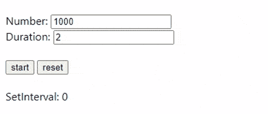
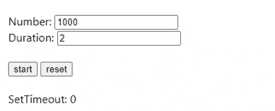

# JavaScript 面试指南

## 前言

我既不是专业的书籍作家，也不是顶尖的前端工程师，我只是一个充满好奇并试图填补某些空白的人。

市场上有很多优秀的书籍可以帮助你准备并通过通用软件工程或后端面试，但极少有专注于前端的。这正是我创作这本书的初衷。

2019 年，我决定运营一个博客（[learnersbucket.com](https://learnersbucket.com/)），其唯一目标是编写那些我在网上找不到的前端内容。我从 JavaScript 中的数据结构与算法开始，然后是 ES6 概念，后来解决了从网上长期收集的前端面试题的答案。

在 3 年的时间里，我成功让我的博客获得了不错的关注，并写了大约 400 篇文章。在积累了一些良好的写作经验后，我决定将这些内容整合成书籍格式，以便作为“JavaScript 面试指南”参考和使用。

本书包含：

- 100 道 JavaScript 问题
- 20 道 React 问题
- 2 道系统设计题

附带解决方案

除此之外，我还尝试解释了一些 JavaScript 的重要概念，在学习每个问题时也会学到许多内容。

我不拥有这些问题的版权，除了解决方案，书中的许多内容你会发现是参考自不同的来源。

- Prashant Yadav（高级软件工程师）

版权所有。

未经出版者和/或作者的书面许可，不得以任何形式或通过任何手段（电子或机械方式，包括复印、录制或任何信息检索系统）复制或传输本书的任何部分。

本电子书中包含的信息仅供参考。我不是一名认证的教师。我所提供的任何法律或教育建议都是基于我个人经验的观点。在对我已发布或推荐的内容采取行动之前，您应该始终寻求认证专业人士的建议。

## 第一版

本电子书中包含的信息仅供参考。我不是一名认证的教师。我所提供的任何法律或教育建议都是基于我个人经验的观点。在对我已发布或推荐的内容采取行动之前，您应该始终寻求认证专业人士的建议。

本指南中的材料可能包括第三方的信息、产品或服务。

第三方材料由其所有者表达的产品和观点组成。因此，我对任何第三方材料或观点不承担任何责任或义务。

此类第三方材料的出版并不构成我对第三方材料中包含的任何信息、指令、观点、产品或服务的保证。

书中解决的问题和提供的解决方案参考自网上的不同文章。我不拥有它们的所有权，您可以自由地使用这些代码示例进行练习，但不得以任何形式全部或部分地复制、传输或出售。

未经作者事先书面同意，本出版物的任何部分均不得以任何形式全部或部分地复制、传输或出售。本指南中出现的所有商标和注册商标均为其各自所有者的财产。

通过阅读本电子书，您同意我及/或我的公司对于您与本电子书呈现的任何信息相关的职业/业务决策的成功或失败不负责。

除代码外，除在书评中使用引用外，未经版权所有者的书面许可，本书的任何部分均不得以任何方式复制或使用。

欲了解更多信息，请联系：

books.learnersbucket@gmail.com

**第一版。**

## 目录

### JavaScript 问题

9. `Retry promises N times`
10. `Implement mapSeries`
11. `Implement mapLimit`
12. `Implement filter filter`
13. `Implement async reject`
14. `Execute async priority`
15. `Dependent async tasks`
16. `Create pausable auto`
17. `Implement queue stack`
18. `Implement stack queue`
19. `Implement stack with min and max`
20. `Implement two stacks with an array`
21. `Implement Priority Queue`
22. `Implement LRU`
23. `Implement debounce function`
24. `Implement debounce with immediate`
25. `Implement throttle function`
26. `Implement custom Instanceof`
27. `Check if function is called with new`
28. `Implement hashSet`
29. `Create toggle function`
30. `Create sampling function`
31. `Make function sleep`
32. `Remove cycle from the object`
33. `Filter multidimensional array`
34. `Count element in multidimensional array`
35. `Convert HEX to RGB`
36. `Convert RGB to HEX`
37. `In-memory filesystem library`
38. `Basic implementations of streams API`
39. `Create a memoizer function`
40. `Method chaining - part 1`
41. `Method chaining - part 2`
42. `Implement clearAllTimeout`
43. `Implement clearAllInterval`
44. `Create a fake setTimeout`
45. `Currying - problem 1`
46. `Currying - problem 2`
47. `Currying - problem 3`
48. `Convert time to 24 hours format`
49. `Convert time to 12 hours format`
50. `Create a digital clock`
58. [观察者设计模式]
59. [实现 `groupBy()` 方法]
60. [比较两个数组或对象]
61. [数组迭代]
62. [带有事件监听器的数组]
63. [根据值或索引过滤对象数组]
64. [根据给定键聚合对象数组]
65. [将实体关系数组转换为祖先树字符串]
66. [从字符串路径获取对象值]
67. [在字符串路径设置对象值]
69. [`JSON.parse()` 的 Polyfill]
70. [字符串的 HTML 编码]
71. [CSS 选择器生成]
72. [聚合输入值]
73. [Fetch 请求和响应拦截器]
74. [带有过期时间的 API 调用缓存]
75. [`getElementByClassName()` 的 Polyfill]
76. [`getElementByClassNameHierarchy()` 的 Polyfill]
77. [查找给定颜色属性的元素]
78. [节流任务数组]
79. [解码字符串]
80. [Trie 数据结构]
88. [顺序元素]
89. [带有过期的 Localstorage]
90. [自定义 Cookie]
91. [创建不可变辅助函数 - 部分 1]
92. [创建不可变辅助函数 - 部分 2]

### React 面题

1. `usePrevious()` hook
2. `useIdle()` hook
12. `useToggle()` hook
13. `useCopy()` hook
14. `useLockedBody()` hook
15. `数字计数器` hook
16. `捕视口内可见的产品` hook
17. `选择时高亮文本` hook
18. `顺序批量处理 API 调用` hook
19. `人类可读格式时间` hook
20. `检测重叠圆` hook

### 系统设计题

1. `复核流`
2. `在线代码判题`

## 概念

### 闭包 (Closure)

闭包是 JavaScript 的核心概念之一，它使语言变得非常灵活且强大，良好地理解它非常重要。简单来说，闭包是两个或多个函数的组合，在外部函数执行完毕后，内部函数仍然可以访问外部函数的属性和方法。

```javascript
function example() {
  let blog = "learnersbucket";
  function displayBlog() {
    console.log(blog);
  }
  displayBlog();
}
example();
// "learnersbucket"
```

如果你注意到变量 `blog` 声明在函数 `displayBlog()` 之上，但在内部可以被访问。这是因为 JavaScript 中的变量具有词法作用域，在它们被重写之前，可以在该作用域内的任何地方访问。在上面的示例中，变量是函数作用域的，可以在函数体内的任何地方访问（即使在内部函数中）。

```javascript
function example() {
  // 外部作用域
  let blog = "hello";
  function displayBlog() {
    console.log(blog);
  }
  displayBlog();
}
example();
```

```javascript
function sum() {
  let a = 10;
  function add(b) {
    return a + b;
  }
  return add;
}
const addTen = sum();
console.log(addTen(20)); // 30
```

不仅是变量，还可以访问外部函数的所有其他属性和方法，不仅是在父级，而且是在它声明的作用域的任何层级。

```javascript
function x() {
  let a = 10;
  function y() {
    let b = 20;
    function z() {
      let c = 30;
      return a + b + c;
    }
    return z;
  }
  return y;
}
const result = x()()();
console.log(result); // 60
```

### Array.reduce() 方法

```javascript
// 简化版
// 带有参数的回调函数
arr.reduce((accumulator, currentValue, index, array) => {
  // ...
}, initialValue);
```

`Array.reduce()` 接受一个回调函数和一个初始值作为输入（初始值可选）。该函数会在数组的每个元素上被调用，开始时使用初始值，随后使用上一次相同函数调用返回的值。

使用这种方法我们可以执行不同类型的操作。

## 聚合 (Aggregation)

```javascript
const arr = [1, 2, 3, 4, 5];
const sum = arr.reduce((previousValue, currentValue) => {
  const nextValue = previousValue + currentValue;
  return nextValue;
}, 0);
```

```javascript
const arr = [1, 2, 3, 4, 5];
const product = arr.reduce((previousValue, currentValue) => {
  const nextValue = previousValue * currentValue;
  return nextValue;
}, 1);
```

我们可以根据需求对一组值进行分组。

```javascript
const arr = [1.2, 2.5, 3.7, 4.1];
const grouped = arr.reduce((previousValue, currentValue) => {
  const floored = Math.floor(currentValue);
  // 将当前值分到对应的键中
  if (!previousValue[floored]) {
    previousValue[floored] = [];
  }
  previousValue[floored].push(currentValue);
  // 返回更新后的值
  return previousValue;
}, {});
```

```javascript
const upperCase = (str) => str.toUpperCase();
const reverse = (str) => str.split('').reverse().join('');
const append = (str) => str + '!';

const arr = [upperCase, reverse, append];
// 初始值
const initialValue = "learnersbucket";
const finalValue = arr.reduce((acc, fn) => fn(acc), initialValue);
console.log(finalValue); // "!TEKBSRAEL"
```

```javascript
const asyncTask = (time) => {
  return new Promise((resolve) => {
    setTimeout(() => {
      resolve(`Completing ${time}`);
    }, 100 * time);
  });
};

const promises = [
  asyncTask(3),
  asyncTask(1),
  asyncTask(2),
];

const asyncSeriesExecuter = async (promises) => {
  for (const promise of promises) {
    const result = await promise;
    console.log(result);
  }
};

asyncSeriesExecuter(promises);
// 输出:
// "Completing 3"
// "Completing 1"
// "Completing 2"
```

对于 JavaScript 是一种同步编程语言还是异步语言、是阻塞还是非阻塞代码，每个人都有自己的说法，但并不是所有人都能确定这一点（甚至我也不确定 🤭）。

让我们尝试弄清楚这一点，并理解 promise 及其工作原理。

JavaScript 是一种同步编程语言。然而，回调函数允许我们将其转换为异步编程语言。而 promise 的目的是帮助我们在处理异步代码时跳出“回调地狱”并实现更多功能。

## Promise 的剖析 (Anatomy of promise)

`Promise` 有三个可用方法：`then`、`catch` 和 `finally`。

- `then(onResolvedFn, onRejectedFn)` – 在 promise fulfilled 或 rejected 后可以使用，取决于状态。

```javascript
const promise = new Promise((resolve, reject) => {
  // 一个 5 秒后 resolve 的 promise
  setTimeout(() => {
    resolve("Hello World!");
  }, 5000);
});

// 最初，promise 处于 pending 状态。
console.log(promise);

// 5 秒后，promise 的状态将更新。
console.log(promise);
```

我们可以将 `.then(onResolvedFn, onRejectedFn)` 方法赋值给 promise，但 `onResolvedFn` 回调只有在 promise resolve 后才会被调用并获取值。

Thenable promises 可以进一步链式调用。

```javascript
promise
  .then((val) => {
    return "ABC " + val;
  })
  .then((val) => {
    console.log(val);
  }); // "ABC Hello World!"
```

```javascript
promise
  .finally(
    () => {
      console.log("task done");
    }
  );
// "ABC Hello World!"
// "task done"
```

此地，假设我们在 5 秒钟后拒绝了一个 promise，那么我们可以使用 `.then(null, onRejectedFn)` 或 `.catch(onRejectedFn)`。

```javascript
const promise = new Promise((resolve, reject) => {
  // 一个在 5 秒后 reject 的 promise
  setTimeout(() => {
    reject("Error 404");
  }, 5000);
});

promise.then(null, (error) => {
  console.error("Called from then method", error);
});
// "Called from then method" "Error 404"
```

如你所观察到的，可以在同一个 `promise` 上分配多个处理器，并且 `.then()` 将按照赋值的顺序执行。`catch` 块还可以使用 `.then()` 进一步扩展。

```javascript
promise.catch((error) => {
  return error;
}).then((val) => {
  console.log("I am chained from catch", val);
});
// "I am chained from catch" "Error 404"

promise.then(null, (error) => {
  return error;
}).then((val) => {
  console.log("I am chained from then", val);
}).finally(() => {
  console.log("Catch block finally done");
});
// "I am chained from then" "Error 404"
```

### 辅助方法

`promise` 对象有许多静态方法。其中一些是辅助方法，另一些则有助于更好地处理 promise。

`Promise.resolve(value)` 创建一个已解析的 promise。

```javascript
Promise.resolve("I am resolved").then((val) => {
  console.log(val);
});
// "I am resolved"
```

```javascript
Promise.reject("I am throwing error").catch((err) => {
  console.error(err);
});
// "I am throwing error"
```

### 处理方法

- `Promise.any()`
- `Promise.race()`

### Async…await

这是 ES6 中引入的一种新语法，有助于更好地处理 promise。

```javascript
const promise = Promise.resolve("I am resolved");

// 箭头函数
const example = async (promise) => {
  // promise 被封装在一个 try-catch 块中
  try {
    const resp = await promise;
    console.log(resp);
  } catch (error) {
    console.error(error);
  } finally {
    console.log("Task done");
  }
};

example(promise);
// "I am resolved"
// "Task done"
```

```javascript
const promise = Promise.resolve("I am resolved");

// 普通函数
function example(promise) {
  // promise 被封装在一个 try-catch 块中
  // 以更好地处理它
  try {
    const resp = await promise;
    return resp;
  } catch (error) {
    console.error(error);
  } finally {
    console.log("Task done");
  }
}
```

实际上，用 `async` 关键字声明的函数返回一个 promise。

### `this` 关键字

`this` 关键字取决于函数是如何被调用的。调用函数有四种方式：

1. **普通函数**：
   ```javascript
   function example() {
     console.log(this === window);
   }
   example(); // "Hello World!" (非严格模式下 this 指向 window)
   ```

2. **方法**：
   ```javascript
   const obj = {
     blog: "learnersbucket",
     displayBlog: function() {
       console.log(this.blog);
     }
   };
   obj.displayBlog(); // "learnersbucket"
   ```

3. **构造函数**：
   ```javascript
   function Number(value) {
     this.value = value;
   }
   const number = new Number("10");
   console.log(number); // 10
   ```

4. **间接调用 (`call`/`apply`/`bind`)**：
   ```javascript
   function example(arg1, arg2) {
     console.log(arg1 + arg2);
   }
   example.call(undefined, 10, 20); // 30
   ```

### 严格模式

```javascript
function example() {
  "use strict";
  console.log(this === undefined);
}
example(); // true
```

```javascript
function example() {
  "use strict";
  console.log(this === undefined);
  function inner() {
    console.log(this === undefined);
  }
  inner();
}
example(); // true, true
```

### IIFE（立即执行函数表达式）

当我们立即调用函数时，它就像普通函数一样被调用。

```javascript
(function example() {
  // 在非严格模式下 this 指向 window
  console.log(this === window);
})();
// true
```

```javascript
(function() {
  "use strict";
  // 在严格模式下 this 指向 undefined
  console.log(this === undefined);
})();
// true
```

```javascript
const example = {
  blog: 'learnersbucket',
  displayBlog: function() {
    // this 指向当前对象
    console.log(this === example);
    console.log(this.blog);
  }
};
example.displayBlog();
// true
// "learnersbucket"
```

如果对象作为引用传递，那么上下文将在两个变量之间共享，即原始变量和拥有引用的变量。

```javascript
const example = {
  blog: 'learnersbucket',
  displayBlog: function() {
    console.log(this === example);
    console.log(this.blog);
  }
};
const example2 = example;
example2.displayBlog();
// true
// "learnersbucket"
```

```javascript
const example = {
  blog: 'MDN',
  displayBlog: function() {
    console.log(this === example);
    console.log(this.blog);
  }
};
const display = example.displayBlog;
display();
// false
// undefined
```

这是因为当被提取到变量并调用时，它会被视为一个普通函数。

```javascript
const example = {
  blog: 'learnersbucket',
  displayBlog: function() {
    console.log(this === window);
    console.log(this.blog);
  }
};
const display = example.displayBlog;
display();
// true (非严格模式)
// undefined
```

当将方法传递给定时器（如 `setTimeout` 和 `setInterval`）时，情况也是如此。定时器像普通函数一样调用函数，或者在严格模式下抛出错误。

```javascript
const example = {
  blog: 'learnersbucket',
  displayBlog: function() {
    console.log(this === window);
    console.log(this.blog);
  }
};
setTimeout(example.displayBlog, 200);
// true (非严格模式)
// undefined
```

```javascript
const example = {
  blog: 'learnersbucket',
  displayBlog: function() {
    function inner() {
      // this 指向 window 对象
      console.log(this === window);
    }
    inner();
  }
};
example.displayBlog();
// true
// undefined
```

在下面的示例中，箭头函数的 `this` 指向 `displayBlog()` 的 `this`，而后者指向它所属的对象。

```javascript
const example = {
  blog: 'learnersbucket',
  displayBlog: function() {
    const inner = () => {
      // this 指向 example 对象
      console.log(this === example);
      console.log(this.blog);
    }
    inner();
  }
};
example.displayBlog();
// true
// "learnersbucket"
```

我们可以通过使用 `call` 方法间接调用函数来改变其内部的 `this` 值。

```javascript
const example = {
  blog: 'learnersbucket',
  displayBlog: function() {
    function inner() {
      // this 指向 example 对象
      console.log(this === example);
    }
    inner.call(example);
  }
};
example.displayBlog();
// true
// "learnersbucket"
```

### 作为构造函数调用时 `this` 的值

```javascript
const example = {
  blog: 'learnersbucket',
};

function Example(blog) {
  this.blog = blog;
  this.displayBlog = function() {
    console.log(this.blog);
  };
}

const example1 = new Example("learnersbucket");
example1.displayBlog();
// "learnersbucket"

const example2 = new Example("MDN");
example2.displayBlog();
// "MDN"
```

注意 – JavaScript 中的某些方法在普通调用时表现得像构造函数。

```javascript
const reg1 = RegExp('\w+');
const reg2 = RegExp('\w+');
console.log(reg1 === reg2);
// false
```

当函数被间接调用时，`this` 的值是传递给 `call`、`apply` 和 `bind` 方法的值。

#### 运行时绑定

使用 `call` 和 `apply` 方法我们可以带新的上下文调用函数。值将仅附加于该次执行。

```javascript
const exampleObj = {
  blog: 'learnersbucket',
};

function example(name) {
  console.log(`${name} runs ${this.blog}`);
}

example.call(exampleObj, 'Prashant');
// "Prashant runs learnersbucket"
```

`call` 和 `apply` 的区别在于 `apply` 接受数组形式的参数，而 `call` 正常接收。

#### 永久绑定

```javascript
const exampleObj = {
  name: 'prashant',
};

function example(blog) {
  console.log(`${this.name} runs ${blog}`);
}

const bounded = example.bind(exampleObj);
bounded('learnersbucket');
// "prashant runs learnersbucket"

bounded('MDN');
// "prashant runs MDN"
```

## JavaScript 问题

### Promise.all() Polyfill

#### 定义

根据 MDN –

`Promise.all()` 接收一个 Promise 数组并返回一个，当数组中所有的 Promise 都已完成（fulfilled）或可迭代对象不包含 Promise 时，该 Promise 将解析。它以第一个被拒绝（rejected）的 Promise 的原因被拒绝。

在阅读 `Promise.all()` 的定义后，我们可以将问题分解为子问题并逐一解决。

- 它将返回一个 promise。
- 该 promise 将通过所有传入 promise 的结果被解析（resolve），或者第一个失败 promise 的错误消息被拒绝（reject）。
- 结果的顺序与给定数组中 promise 的顺序一致。

#### 实现

```javascript
const myPromiseAll = (taskList) => {
  // 存储结果
  const results = [];
  // 跟踪有多少个 promise 完成
  let promisesCompleted = 0;
  // 返回一个新的 promise
  return new Promise((resolve, reject) => {
    taskList.forEach((promise, index) => {
      Promise.resolve(promise).then((val) => {
        results[index] = val;
        promisesCompleted += 1;
        // 如果所有 promise 都完成了，
        // 解析并返回结果
        if (promisesCompleted === taskList.length) {
          resolve(results);
        }
      }).catch((error) => {
        reject(error);
      });
    });
  });
};
```

```javascript
function task(time) {
  return new Promise(function(resolve, reject) {
    setTimeout(function() {
      resolve(time);
    }, time);
  });
}

const taskList = [task(1000), task(5000), task(3000)];

// 运行 promise.all
myPromiseAll(taskList)
  .then(results => {
    console.log("got results", results);
  })
  .catch(console.error);
```

输出：
`"got results" [1000, 5000, 3000]`

```javascript
function task(time) {
  return new Promise(function(resolve, reject) {
    setTimeout(function() {
      if (time < 3000) {
        reject("Rejected");
      } else {
        resolve(time);
      }
    }, time);
  });
}

const taskList = [task(1000), task(5000), task(3000)];

// 运行 promise.all
myPromiseAll(taskList)
  .then(results => {
    console.log("got results", results);
  })
  .catch(console.error);
```

输出：
`"Rejected"`

---

### Promise.any() Polyfill

`Promise.any()` 接收一个 Promise 对象的迭代器。它返回一个单一 promise，只要迭代器中的任何一个 promise 成功，该 promise 就会解析，并取值为该成功 promise 的值。如果迭代器中没有 promise 成功（即所有给定的 promise 都被拒绝），则返回的 promise 将被 `AggregateError` 拒绝，它是 `Error` 的新子类，用于将各个错误组合在一起。

简单来说，`Promise.any()` 就是 `Promise.all()` 的相反。

阅读定义，我们可以将问题陈述分解为多个子问题，然后逐一处理以实现 polyfill。

#### 实现

```javascript
const any = function(promisesArray) {
  return new Promise((resolve, reject) => {
    const promiseErrors = new Array(promisesArray.length);
    let counter = 0;

    promisesArray.forEach((promise, index) => {
      Promise.resolve(promise)
        .then(resolve) // 当任何输入 promise 解析时解析
        .catch(error => {
          promiseErrors[index] = error;
          counter = counter + 1;
          if (counter === promisesArray.length) {
            // 所有 promise 都被拒绝，拒绝外部 promise
            reject(new AggregateError(promiseErrors, "All promises were rejected"));
          }
        });
    });
  });
};
```

#### 测试用例 1

输入：
```javascript
const test1 = new Promise(function(resolve, reject) {
  setTimeout(resolve, 500, 'one');
});
const test2 = new Promise(function(resolve, reject) {
  setTimeout(resolve, 600, 'two');
});
const test3 = new Promise(function(resolve, reject) {
  setTimeout(reject, 200, 'three');
});

any([test1, test2, test3]).then(function(value) {
  console.log(value);
}).catch(function(err) {
  console.log(err);
});
```

输出：
`"one"`

#### 测试用例 2

输入：
```javascript
const test1 = new Promise(function(resolve, reject) {
  setTimeout(reject, 500, 'one');
});
const test2 = new Promise(function(resolve, reject) {
  setTimeout(reject, 600, 'two');
});
const test3 = new Promise(function(resolve, reject) {
  setTimeout(reject, 200, 'three');
});

any([test1, test2, test3]).then(function(value) {
  console.log(value);
}).catch(function(err) {
  console.log(err);
  // 但输出是一个数组。
  console.log(err.errors);
});
```

输出：
`AggregateError: All promises were rejected`
`["three", "one", "two"]`

---

### Promise.race() Polyfill

#### 定义
根据 MDN –

- 它返回一个 promise。
- 只要输入 promise 中的一个稳定，它就会解析或拒绝。
- 使用该 promise 的值或理由解析。

#### 实现

```javascript
const race = function(promisesArray) {
  return new Promise((resolve, reject) => {
    promisesArray.forEach((promise) => {
      Promise.resolve(promise)
        .then(resolve) // 当任何输入 promise 解析时解析
        .catch(reject); // 当任何输入 promise 拒绝时拒绝
    });
  });
};
```

#### 测试用例 1

输入：
```javascript
const test1 = new Promise(function(resolve, reject) {
  setTimeout(resolve, 500, 'one');
});
const test2 = new Promise(function(resolve, reject) {
  setTimeout(resolve, 100, 'two');
});
const test3 = new Promise(function(resolve, reject) {
  setTimeout(resolve, 300, 'three');
});

race([test1, test2, test3]).then(function(value) {
  // 第一个和第三个失败，第二个最快
  console.log(value);
}).catch(function(err) {
  console.log(err);
});
```

输出：
`"two"`

#### 测试用例 2

输入：
```javascript
const test1 = new Promise(function(resolve, reject) {
  setTimeout(resolve, 500, 'one');
});
const test2 = new Promise(function(resolve, reject) {
  setTimeout(reject, 40, 'three');
});
const test3 = new Promise(function(resolve, reject) {
  setTimeout(resolve, 300, 'three');
});

race([test1, test2, test3]).then(function(value) {
  console.log(value);
}).catch(function(err) {
  console.log(err);
});
```

输出：
`"three"`

---

### Promise.finally() Polyfill

#### 定义

这与 `try … catch … finally` 块相同，无论代码是在 `try` 块还是 `catch` 块中运行，`finally` 块都会在最后始终执行，可用于清理操作。

Promise 的情况也是如此，我们有 `.then()` 用于 promise 解决（resolve）的情况，有 `.catch()` 用于 promise 拒绝（reject）的情况，以及 `.finally()` 块会在上述任何一个操作后始终运行。

输入：
```javascript
function checkMail() {
  return new Promise((resolve, reject) => {
    if (Math.random() > 0.5) {
      resolve('Mail has arrived');
    } else {
      reject('No mail');
    }
  });
}

checkMail()
  .then((mail) => {
    console.log(mail);
  })
  .finally(() => {
    console.log('Experiment completed');
  });
```

输出：
`"Mail has arrived"` (或 `"No mail"`)
`"Experiment completed"`

从定义中，我们可以得出实现 `.finally()` 需要：

- 我们必须接受一个回调函数作为输入，并在 promise 状态稳定（settled）时调用该回调函数，这发生在 `resolve` 或 `reject` 之后。
- 由于没有可靠的方法来判断 promise 是被接受还是被拒绝，因此 finally 回调不会接收任何参数。
- 它将为你提供一个 promise，你可以用它在链式中组合对其他 promise 方法的方法。

```javascript
Promise.prototype.finally = function(callback) {
  if (typeof callback !== 'function') {
    return this.then(callback, callback);
  }

  // 获取当前的 promise 或一个新的 promise
  const P = this.constructor || Promise;

  // 返回 promise 并调用回调函数
  return this.then(
    value => P.resolve(callback()).then(() => value),
    err => P.resolve(callback()).then(() => {
      throw err;
    })
  );
};
```

#### 测试用例

```javascript
// 此测试用例来自 stack overflow.
const logger = (label, start = Date.now()) => (...values) => {
  console.log(label, ...values, `after ${Date.now() - start}ms`);
};

function delay(value, ms) {
  return new Promise(resolve => setTimeout(() => resolve(value), ms));
}

function test(impl) {
  const log = ordinal => state => logger(`${ordinal} ${impl} ${state}`);

  const first = log('first');
  // 测试已解决值的传递
  delay(2, 1000)
    .finally(first('settled'))
    .then(first('fulfilled'), first('rejected'));

  const second = log('second');
  // 测试被拒绝值的传递
  delay(Promise.reject(3), 2000)
    .finally(second('settled'))
    .then(second('fulfilled'), second('rejected'));

  const third = log('third');
  // 测试 finally 中的异步操作
  delay(4, 3000)
    .finally(() => delay(6, 500))
    .then(third('fulfilled'), third('rejected'));

  const fourth = log('fourth');
  // 测试被拒绝 promise 的采用
  delay(5, 4000)
    .finally(fourth('settled'))
    .then(fourth('fulfilled'), fourth('rejected'));
}

test('polyfill');
```

输出：
```text
"first polyfill settled" "after 1005ms"
"first polyfill fulfilled" 2 "after 1006ms"
"second polyfill settled" "after 2006ms"
"second polyfill rejected" 3 "after 2008ms"
"third polyfill settled" "after 3006ms"
"third polyfill fulfilled" 4 "after 3506ms"
"fourth polyfill settled" "after 4000ms"
"fourth polyfill rejected" 5 "after 4506ms"
```

```javascript
// 这将用 undefined 解决
Promise.resolve(2).then(() => {}, () => {}).then((val) => {
  console.log(val);
});
// undefined

// 这将用 2 解决
Promise.resolve(2).then(() => 2).then((val) => {
  console.log(val);
});
// 2

// 这将用 2 解决
Promise.resolve(2).then(() => {}, () => {}).then((val) => {
  console.log(val);
});
// undefined

// 一个数字!
// 这将用 2 解决
Promise.resolve(2).finally(() => {}).then((val) => {
  console.log(val);
});
// 2
```

### Promise.allSettled() Polyfill

#### 定义

根据 MDN – `allSettled()` 方法返回一个在所有给定的 promise 都解决或拒绝后变为已决（fulfilled）的 promise，结果是一个描述每个 promise 结果的对象数组。

- `Promise.allSettled()` 接收 promise 数组作为输入并返回一个 promise。

```javascript
const allSettled = (promises) => {
  // 映射 promises 以返回
  const mappedPromises = promises.map(p =>
    p.then(
      val => ({ status: 'fulfilled', value: val }),
      err => ({ status: 'rejected', reason: err })
    )
  );
  // 执行全部
  return Promise.all(mappedPromises);
};
```

#### 测试用例

```javascript
const a = new Promise((resolve) => setTimeout(() => resolve(3), 200));
const b = new Promise((resolve, reject) => reject(9));
const c = new Promise((resolve) => resolve(5));

allSettled([a, b, c]).then((val) => {
  console.log(val);
});
```

输出：
```json
[
  {
    "status": "fulfilled",
    "value": 3
  },
  {
    "status": "rejected",
    "reason": 9
  },
  {
    "status": "fulfilled",
    "value": 5
  }
]
```

---

### 实现自定义 Promise (MyPromise)

编写一个与原生 `promise` 类似的 JavaScript 函数。Promise 允许你执行非阻塞（异步）代码，并在成功时产生值，在失败时抛出错误。简而言之，异步操作的最终成功（或失败）及其关联的值由 Promise 对象表示。

#### Promise 的构造分析

```javascript
const promise = new Promise((resolve, reject) => {
  // 这将解决或完成 promise
  resolve(value);
  // 这将拒绝 promise
  reject(reason);
});

// 当 promise 解决时被调用
promise.then((value) => {
  // ...
});

// 当 promise 被拒绝时被调用
promise.catch((value) => {
  // ...
});

// 在上述任何操作后始终被调用
promise.finally((value) => {
  // ...
});
```

```javascript
const promise = new Promise((resolve, reject) => {
  setTimeout(() => {
    resolve("hello");
  }, 1000);
});

promise.then((value) => {
  console.log(value);
});
```

我们必须实现一个与原生 promise 类似的自定义函数 `MyPromise`。为了实现这一点我们将使用观察者模式。使用两个处理器 `onSuccess` 和 `onError`，并将它们分配给 `.then`, `.catch`, `.finally` 方法。

```javascript
// 状态枚举
const states = {
  PENDING: 0,
  FULFILLED: 1,
  REJECTED: 2
};

class MyPromise {
  constructor(callback) {
    this.state = states.PENDING;
    this.value = undefined;
    this.handlers = [];
    try {
      callback(this._resolve, this._reject);
    } catch (error) {
      this._reject(error);
    }
  }

  // 用于 resolve 的辅助函数
  _resolve = (value) => {
    this._handleUpdate(states.FULFILLED, value);
  }

  // 用于 reject 的辅助函数
  _reject = (value) => {
    this._handleUpdate(states.REJECTED, value);
  }

  // 处理状态变更
  _handleUpdate = (state, value) => {
    if (this.state !== states.PENDING) {
      return;
    }
    setTimeout(() => {
      this.state = state;
      this.value = value;
      this._executeHandlers();
    }, 0);
  }

  // 执行所有的处理器
  _executeHandlers = () => {
    if (this.state === states.PENDING) {
      return;
    }
    this.handlers.forEach((handler) => {
      if (this.state === states.FULFILLED) {
        handler.onSuccess(this.value);
      } else {
        handler.onFailure(this.value);
      }
    });
  }

  // 添加处理器
  // 如果添加了新处理器，则执行所有处理器
  _addHandler = (handler) => {
    this.handlers.push(handler);
    this._executeHandlers();
  }

  // 分配处理器
  then = (onSuccess, onFailure) => {
    // 调用构造函数
    // 和新处理器
    return new MyPromise((resolve, reject) => {
      this._addHandler({
        onSuccess: (value) => {
          try {
            if (typeof onSuccess !== 'function') {
              resolve(value);
            } else {
              resolve(onSuccess(value));
            }
          } catch (error) {
            reject(error);
          }
        },
        onFailure: (value) => {
          try {
            if (typeof onFailure !== 'function') {
              reject(value);
            } else {
              resolve(onFailure(value));
            }
          } catch (error) {
            reject(error);
          }
        }
      });
    });
  }

  // 添加 catch 处理器
  catch = (onFailure) => {
    return this.then(null, onFailure);
  };

  // 添加 finally 处理器
  finally = (callback) => {
    return new MyPromise((resolve, reject) => {
      let wasResolved = false;
      let value;
      this.then(
        (val) => {
          value = val;
          wasResolved = true;
          return callback();
        },
        (err) => {
          value = err;
          wasResolved = false;
          return callback();
        }
      ).then(() => {
        if (wasResolved) {
          resolve(value);
        } else {
          reject(value);
        }
      });
    });
  };
}
```

#### 测试用例

输入:
```javascript
const promise = new MyPromise((resolve, reject) => {
  setTimeout(() => {
    resolve("hello");
  }, 1000);
});

promise.then((value) => {
  console.log(value);
});
```

输出:
`"hello"`

---

### 串行执行异步函数

实现一个函数，接收异步函数列表作为输入，并以串行方式执行它们（一次执行一个）。只有在上一个任务完成后，才会执行下一个任务。

#### 示例

输入：
```javascript
const asyncTask = (i) => {
  return new Promise((resolve, reject) => {
    setTimeout(() => {
      resolve(`Completing ${i}`);
    }, 1000);
  });
};

const promises = [asyncTask(3), asyncTask(1), asyncTask(2)];
```

输出：
```
Completing 3
Completing 1
Completing 2
```

`async/await` 是 [ES6](https://learnersbucket.com/tutorials/es6/es6-intro) 引入的新关键字，它帮助我们通过避免回调链来处理 promise。

[for...of](https://learnersbucket.com/examples/javascript/different-for-loop-in-javascript) 循环允许使用 `await` 关键字，并且仅在上一次迭代完成后才执行下一次迭代。

为了处理拒绝情况，我们将 `async/await` 封装在 `try-catch` 块中。

#### 方法 1 - 使用 async/await

```javascript
const asyncSeriesExecuter = async function (promises) {
  for (let promise of promises) {
    try {
      const result = await promise;
      console.log(result);
    } catch (e) {
      console.log(e);
    }
  }
};
```

#### 方法 2 - 使用递归

```javascript
const asyncSeriesExecuter = function (promises) {
  // 获取任务
  let promise = promises.shift();
  // 执行任务
  promise.then((data) => {
    console.log(data);
    if (promises.length > 0) {
      asyncSeriesExecuter(promises);
    }
  }).catch((err) => {
    console.log(err);
    if (promises.length > 0) {
      asyncSeriesExecuter(promises);
    }
  });
};
```

#### 测试用例

```javascript
const asyncTask = (i) => {
  return new Promise((resolve, reject) => {
    setTimeout(() => {
      resolve(`Completing ${i}`);
    }, 1000);
  });
};

const promises = [asyncTask(3), asyncTask(1), asyncTask(2)];
asyncSeriesExecuter(promises);
```

输出：
```
Completing 3
Completing 1
Completing 2
```

#### 方法 3 - 使用 Array.reduce()

```javascript
const asyncSeriesExecuter = function (promises) {
  promises.reduce((acc, curr) => {
    return acc.then(() => {
      return curr.then((val) => {
        console.log(val);
      });
    });
  }, Promise.resolve());
};
```

#### 测试用例

输入：
```javascript
const asyncTask = (i) => {
  return new Promise((resolve, reject) => {
    setTimeout(() => {
      resolve(`Completing ${i}`);
    }, 1000);
  });
};

const promises = [asyncTask(3), asyncTask(1), asyncTask(2)];
asyncSeriesExecuter(promises);
```

输出：
```
Completing 3
Completing 1
Completing 2
```

---

# 并行执行异步函数

## 问题描述
实现一个函数，接收异步函数列表和一个回调函数作为输入，并行执行输入的任务（即同时执行），并在所有任务完成后调用回调函数。

### 实现

```javascript
function asyncParallel(tasks, callback) {
  // 存储结果
  const results = [];
  // 跟踪执行的任务
  let tasksCompleted = 0;
  // 运行每个任务
  tasks.forEach((asyncTask) => {
    asyncTask((value) => {
      // 存储任务的输出
      results.push(value);
      // 增加计数器
      tasksCompleted++;
      // 如果所有任务已执行
      if (tasksCompleted >= tasks.length) {
        callback(results);
      }
    });
  });
}
```

### 测试用例

为了创建一个异步任务，我们创建了一个接受 `callback` 的函数，它运行一个随机时间的 `setTimeout` 并在超时内部调用此 `callback`。

```javascript
function createAsyncTask() {
  const value = Math.floor(Math.random() * 10) + 1;
  return function(callback) {
    setTimeout(() => {
      callback(value);
    }, value * 1000);
  };
}

const taskList = [
  createAsyncTask(),
  createAsyncTask(),
  createAsyncTask(),
  createAsyncTask(),
  createAsyncTask(),
  createAsyncTask()
];

asyncParallel(taskList, (result) => {
  console.log('results', result);
});
```

### 输出：

```text
"results" [ ... ] // 6个随机数字的数组
```

---

# 重试 promise N 次

### 题目陈述
在 JavaScript 中实现一个函数，该函数可以在每次调用之间设置延迟，对 promise 重试 N 次。

## 示例

### 输出：

```text
... attempt 1 -> failed
... attempt 2 -> retry after 50ms -> failed
... attempt 3 -> retry after 50ms -> failed
```

简而言之，我们必须创建一个重试函数，在 promise 解析之前带有延迟和最大重试次数的限制，持续重试。

我们将看到两个代码示例，一个使用 [thenable](https://developer.mozilla.org/en-US/docs/Web/JavaScript/Reference/Global_Objects/Promise/then) promise，另一个使用 [async…await](https://developer.mozilla.org/en-US/docs/Web/JavaScript/Reference/Statements/async_function)。

让我们先创建一个延迟函数，以便我们可以暂停指定长度的时间。

### 延迟函数

```javascript
// 延迟函数
const wait = ms => new Promise((resolve) => {
  setTimeout(() => resolve(), ms);
});
```

### 方法 1 - 使用 then…catch

```javascript
const retryWithDelay = (operation, retries = 3, delay = 50, finalErr = 'Retry failed') =>
  new Promise((resolve, reject) => {
    return operation()
      .then(resolve)
      .catch((reason) => {
        // 如果还有重试次数
        if (retries > 0) {
          // 等待延迟
          return wait(delay)
            // 递归调用同一个函数
            // 以最大重试次数 - 1 进行重试
            .then(retryWithDelay.bind(null, operation, retries - 1, delay, finalErr))
            .then(resolve)
            .catch(reject);
        }
        // 抛出最终错误
        reject(finalErr);
      });
  });
```

### 测试用例

为了测试，我们可以创建一个测试函数，如果调用少于 5 次，就会一直抛出错误。因此，如果我们调用它 6 次或更多，它将通过。

### 输入：

```javascript
let callCounter = 0;
const getTestFunc = () => {
  return async () => {
    callCounter += 1;
    // 如果调用少于 5 次
    // 抛出错误
    if (callCounter < 5) {
      throw new Error('Not yet');
    }
    return 'success';
  };
};

// 测试代码
const test = async () => {
  await retryWithDelay(getTestFunc(), 10);
  console.log('success');
  callCounter = 0; // 重置计数器
  await retryWithDelay(getTestFunc(), 3);
  console.log('will fail before getting here');
};

test();
```

### 输出：

```text
"success"
// 第 1 次测试
"Retry failed"
```

### 方法 2 - 使用 async…await

我们可以使用 async-await 实现相同的函数。使用 async-await 时，我们需要将代码封装在 try..catch 块中以处理错误，因此在 catch 块中，我们可以检查是否仍剩余最大重试次数，如果是则递归调用同一个函数，否则抛出最终错误。

### 实现

```javascript
const retryWithDelay = async (fn, retries = 3, interval = 50, finalErr = 'Retry failed') => {
  try {
    // 如果没有重试次数
    if (retries <= 0) {
      return Promise.reject(finalErr);
    }
    // 执行操作
    return await fn();
  } catch (error) {
    // 延迟下次调用
    await wait(interval);
    // 递归调用同一个函数
    return retryWithDelay(fn, retries - 1, interval, finalErr);
  }
};
```

### 测试用例

### 输入：
```javascript
let callCounter = 0;
const getTestFunc = () => {
  return async () => {
    callCounter += 1;
    // 如果调用少于 5 次
    // 抛出错误
    if (callCounter < 5) {
      throw new Error('Not yet');
    }
    return 'success';
  };
};

const test = async () => {
  await retryWithDelay(getTestFunc(), 10);
  console.log('success');
  callCounter = 0; // 重置计数器
  await retryWithDelay(getTestFunc(), 3);
  console.log('will fail before getting here');
};

// 打印结果
test();
```

### 输出：

```text
"success"
// 1 次测试
"Retry failed"
```

---

# 实现 mapSeries 异步函数

### 题目陈述

实现一个异步 `mapSeries` 函数，它类似于 `Array.map()`，但返回一个在成功时解析或发生任何错误时拒绝的 promise。输入是顺序执行的。

## 示例

### 输入：

```javascript
let numPromise = mapSeries([1, 2, 3, 4, 5], function(num, callback) {
  setTimeout(function() {
    num = num * 2;
    console.log(num);
    // 抛出错误
    if (num === 12) {
      callback(true);
    } else {
      callback(null, num);
    }
  }, 1000);
});

numPromise
  .then((result) => console.log("success:" + result))
  .catch(() => console.log("no success"));
```

输出：
```text
2
4
6
8
10
"success:2,4,6,8,10"
```

将空数组 `Promise.resolve([])` 作为初始累加器传递给 `Array.reduce()`，并在 reduce 内部一旦上一个 promise 解析，监听它，创建一个新的 promise 并将输入值传递给异步迭代函数，根据此迭代函数的回调结果，解析或拒绝当前 promise。

这将一个接一个执行。

```javascript
const mapSeries = (arr, fn) => {
  // 对于输入中的所有值
  // 顺序执行
  // 那是一个接一个
  // 初始它将取一个空数组进行解析
  // 将当前输出与之前的输出合并
  // 并且将其传递给下一个
  const final = arr.reduce((acc, current) => {
    return acc.then((val) => {
      // 返回一个新的 promise
      return new Promise((resolve, reject) => {
        // 根据异步迭代函数
        // 执行回调
        fn(current, (error, result) => {
          if (error) {
            reject(error);
          } else {
            resolve([...val, result]);
          }
        });
      });
    });
  }, Promise.resolve([]));

  return new Promise((resolve, reject) => {
    final.then((result) => {
      resolve(result);
    }).catch((error) => {
      reject(error);
    });
  });
};
```

### 测试用例 1. 全部成功

**输入:**
```javascript
let numPromise = mapSeries([1, 2, 3, 4, 5], function(num, callback) {
  setTimeout(function () {
    num = num * 2;
    console.log(num);
    callback(null, num);
  }, 1000);
});

numPromise.then((result) => console.log("success:" + result))
  .catch(() => console.log("no success"));
```

**输出:**
```text
2
4
6
8
10
"success:2,4,6,8,10"
```

### 测试用例 2. 其中一个失败

**输入:**
```javascript
let numPromise = mapSeries([1, 2, 3, 4, 5], function(num, callback) {
  setTimeout(function () {
    num = num * 2;
    console.log(num);
    // 抛出错误
    if (num === 8) {
      callback(true);
    } else {
      callback(null, num);
    }
  }, 2000);
});

numPromise.then((result) => console.log("success:" + result))
  .catch(() => console.log("no success"));
```

**输出:**
```text
2
4
6
8
"no success"
```

---

# 实现 mapLimit 异步函数

## 题目描述
实现一个 `mapLimit` 函数，它类似于 `Array.map()`，但它返回的是一个 promise。该 promise 在通过异步迭代函数映射每个输入后根据输出列表而 resolve（解析），或者在发生任何错误时 reject（拒绝）。它还接受一个限制参数（limit），来决定同时可以进行多少次操作。

异步迭代函数将接受一个输入和一个 `callback`。当输入处理完成时，将调用回调函数，回调的第一个参数是错误标志，第二个参数是结果。

## 示例

**输入:**
```javascript
let numPromise = mapLimit([1, 2, 3, 4, 5], 3, function(num, callback) {
  // 我是一个异步迭代函数
  // 在这里执行异步操作
  setTimeout(function () {
    num = num * 2;
    console.log(num);
    callback(null, num);
  }, 1000);
});

numPromise.then((result) => console.log("success:" + result))
  .catch(() => console.log("no success"));
```

**输出:**
```text
/// 第一批
2
4
6
/// 第二批
8
10
/// 最终结果
"success:2,4,6,8,10"
```

为了实现这个函数，我们必须结合使用 `Async.parallel` 和 `Async.series`。

- 首先，将输入数组切分成给定限制大小的子数组。这将返回一个数组的数组，类似于 `[[1, 2, 3], [4, 5]]`。
- 父级数组将串行（series）运行，即只有在当前子数组完成后，下一个子数组才会执行。
- 每个子数组中的所有元素将并行（parallel）运行。
- 累积每个子数组元素的结果，并据此 resolve promise。
- 如果发生任何错误，则 reject。

```javascript
// 将数组按指定大小切成分块的辅助函数
Array.prototype.chop = function(size) {
  // 临时数组
  const temp = [...this];
  // 如果 size 未定义
  if (!size) {
    return temp;
  }
  // 输出
  const output = [];
  let i = 0;
  // 遍历数组
  while (i < temp.length) {
    // 切片出给定大小的子数组
    // 并将它们推入输出数组
    output.push(temp.slice(i, i + size));
    i = i + size;
  }
  return output;
};

const mapLimit = (arr, limit, fn) => {
  // 返回一个新的 promise
  return new Promise((resolve, reject) => {
    // 将输入数组切分为限制大小的子数组
    // [[1, 2, 3], [4, 5]]
    let chopped = arr.chop(limit);
    // 对于 chopped 的所有子数组
    // 串行运行它们
    // 即一个接一个
    // 初始它将取一个空数组来 resolve
    // 合并子数组的输出并将其传递
    // 给下一个
    const final = chopped.reduce((a, b) => {
      // 监听上一个值的响应
      return a.then((val) => {
        // 并行运行子数组的值
        // 将每个输入传递给迭代函数
        // 在所有任务执行后存储它们的输出
        return new Promise((resolve, reject) => {
          const results = [];
          let tasksCompleted = 0;
          b.forEach((e) => {
            // 根据异步迭代函数
            // 的输出
            fn(e, (error, value) => {
              if (error) {
                reject(error);
              } else {
                results.push(value);
                tasksCompleted++;
                if (tasksCompleted === b.length) {
                  resolve([...val, ...results]);
                }
              }
            });
          });
        });
      });
    }, Promise.resolve([]));

    // 根据最终 promise 的状态
    // 调用最终 promise。
    final.then((result) => {
      resolve(result);
    }).catch((error) => {
      reject(error);
    });
  });
};
```

### 测试用例 1. 全部成功

**输入:**
```javascript
let numPromise = mapLimit([1, 2, 3, 4, 5], 3, function(num, callback) {
  setTimeout(function () {
    num = num * 2;
    console.log(num);
    callback(null, num);
  }, 1000);
});

numPromise.then((result) => console.log("success:" + result))
  .catch(() => console.log("no success"));
```

**输出:**
```text
/// 第一批
2
4
6
/// 第二批
8
10
"success:2,4,6,8,10"
```

### 测试用例 2. 其中一个失败

**输入:**
```javascript
let numPromise = mapLimit([1, 2, 3, 4, 5], 3, function(num, callback) {
  setTimeout(function () {
    num = num * 2;
    console.log(num);
    // 抛出错误
    if (num === 6) {
      callback(true);
    } else {
      callback(null, num);
    }
  }, 2000);
});

numPromise.then((result) => console.log("success:" + result))
  .catch(() => console.log("no success"));
```

**输出:**
```text
// 第一批
2
4
6
"no success"
```

---

# 实现 async filter 函数

## 题目描述
实现一个函数，接受一个输入数组和一个异步迭代函数，并返回一个 promise。该 promise 将通过通过迭代函数测试的输入列表而 resolve。输入将并行运行，但输出将与原始顺序一致。

异步迭代函数将接受一个输入和一个 `callback`。当输入处理完成时，将调用回调函数，回调的第一个参数是错误标志，第二个参数是结果。

## 示例

**输入:**
```javascript
let numPromise = filter([1, 2, 3, 4, 5], function(num, callback) {
  setTimeout(function () {
    num = num * 2;
    console.log(num);
    // 抛出错误
    if (num === 7) {
      callback(true);
    } else {
      callback(null, num !== 4);
    }
  }, 2000);
});

numPromise.then((result) => console.log("success:" + result))
  .catch(() => console.log("no success"));
```

**输出:**
```text
2
4
6
8
10
"success:1,3,4,5"
```

此函数是 `Array.filter()` 的简单扩展，用于处理异步操作。

为了实现这一功能，我们将创建一个新的 `promise` 并返回它。在 `promise` 内部，使用 `Array.forEach()` 并行运行所有输入值，并在 `forEach` 内部将每个值传递给迭代函数。

在迭代函数的回调中，如果结果为 `true`（意味着输入通过了测试），则将该输入添加到当前索引的结果中。

最后，当我们处于输入数组的最后一个元素时，用结果解析该 `promise`。

对最终输出进行过滤以移除间隙，因为我们必须保持通过测试值的顺序。输出数组中，未通过值的索引处将没有值。

```javascript
const filter = (arr, fn) => {
  // 返回一个新的 promise
  return new Promise((resolve, reject) => {
    const output = [];
    let track = 0;
    arr.forEach((e, i) => {
      fn(e, (error, result) => {
        // 发生错误时 reject
        if (error) {
          reject(error);
        }
        // 已处理输入的数量
        track++;
        // 如果输入通过测试
        // 将其添加到当前索引
        if (result) {
          output[i] = e;
        }
        // 如果是输入数组的最后一个元素
        if (track >= arr.length) {
          // 使用真值过滤最终输出
          // 以按顺序返回值
          resolve(output.filter(Boolean));
        }
      });
    });
  });
};
```

### 测试用例

输入：
```javascript
let numPromise = filter([1, 2, 3, 4, 5], function (num, callback) {
  setTimeout(function () {
    num = num * 2;
    console.log(num);
    // 抛出错误
    if (num === 7) {
      callback(true);
    } else {
      callback(null, num !== 4);
    }
  }, 2000);
});

numPromise.then((result) => console.log("success:" + result))
  .catch(() => console.log("no success"));
```


# 实现异步 reject 函数

## 题目描述
实现一个函数，该函数接收一个输入数组和一个异步迭代函数，并返回一个 `promise`。该 promise 解析为通过迭代函数未通过测试的输入列表。此函数与 `Async Filter` 完全相反。

输入将并行运行，但输出顺序与原始顺序相同。

异步迭代函数将接受一个输入和一个 `callback`。当输入完成处理时，将调用回调函数，回调的第一个参数将是错误标记，第二个参数是结果。

## 示例
输入：
```javascript
let numPromise = reject([1, 2, 3, 4, 5], function (num, callback) {
  setTimeout(function () {
    num = num * 2;
    console.log(num);
    // 抛出错误
    if (num === 7) {
      callback(true);
    } else {
      callback(null, num !== 4);
    }
  }, 2000);
});

numPromise.then((result) => console.log("success:" + result))
  .catch(() => console.log("no success"));
```

输出：
```
2
4
6
8
10
"success:2"
```

我们可以使用与 Async filter 完全相同的实现，仅需修改逻辑在失败测试时将值添加到输出数组。

```javascript
const reject = (arr, fn) => {
  // 返回一个新的 promise
  return new Promise((resolve, reject) => {
    const output = [];
    let track = 0;
    arr.forEach((e, i) => {
      fn(e, (error, result) => {
        // 发生错误时 reject
        if (error) {
          reject(error);
        }
        // 已处理输入的数量
        track++;
        // 如果输入通过测试
        // 将其添加到当前索引
        if (!result) {
          output[i] = e;
        }
        // 如果是输入数组的最后一个元素
        if (track >= arr.length) {
          // 使用真值过滤最终输出
          // 以按顺序返回值
          resolve(output.filter(Boolean));
        }
      });
    });
  });
};
```

### 测试用例
```javascript
let numPromise = reject([1, 2, 3, 4, 5], function (num, callback) {
  setTimeout(function () {
    num = num * 2;
    console.log(num);
    // 抛出错误
    if (num === 7) {
      callback(true);
    } else {
      callback(null, num !== 4);
    }
  }, 2000);
});

numPromise.then((result) => console.log("success:" + result))
  .catch(() => console.log("no success"));
```

输出：
```
2
4
6
8
10
"success:2"
```

# 依赖异步任务

## 问题描述
假设我们有多个异步任务 `A`、`B`、`C`、`D` 和 `E`（不是 Promise）。`A`、`B` 和 `C` 是独立任务，而 `D` 依赖 `A` 和 `B` 来执行任务，`E` 依赖 `D` 和 `C` 来执行任务。编写一个任务函数/类来解决这个问题。

为了解决这个问题，我们创建一个类，接收依赖项列表和回调函数作为输入。

在 `dependencies` 列表中，我们将检查列表中的所有任务是否已完成，如果已完成，则将它们过滤掉，因为我们不再需要运行它们。

如果 `dependencies` 中没有项，则直接调用回调。

否则，如果有待处理的依赖项，将它们推入一个列表并逐个执行。一旦全部完成，则调用回调。

使用一个标记来判断任务的状态，即是否已 `completed`（完成）。

```javascript
class Task {
  // 接收依赖项列表
  // 和回调函数
  constructor(dependencies = [], job) {
    // 过滤尚未完成的依赖项
    this.dependencies = dependencies ? dependencies.filter(
      dependency => dependency instanceof Task && !dependency.isCompleted
    ) : [];
    this.currentDependencyCount = this.dependencies.length;
    // 回调
    this.job = job;
    // 如果当前任务已完成
    this.isCompleted = false;
    // 存储依赖列表回调
    // 按顺序执行
    this.subscribedList = [];
    // 开始任务
    this.processJob();
  }

  processJob() {
    // 如果存在依赖项
    // 订阅每一个依赖项
    if (this.dependencies && this.dependencies.length) {
      for (let dependency of this.dependencies) {
        dependency.subscribe(this.trackDependency.bind(this));
      }
    }
    // 否则直接调用回调
    else {
      this.job(this.done.bind(this));
    }
  }

  // 如果所有依赖项都已执行
  // 调用回调
  trackDependency() {
    this.currentDependencyCount--;
    if (this.currentDependencyCount === 0) {
      this.job(this.done.bind(this));
    }
  }

  // 将回调推入列表
  subscribe(cb) {
    this.subscribedList.push(cb);
  }

  // 如果当前任务已完成
  // 标记其为完成
  // 调用所有依赖项的回调
  // 按顺序打印
  done() {
    this.isCompleted = true;
    for (const callback of this.subscribedList) {
      callback();
    }
  }
}
```

### 测试用例
**输入：**
```javascript
const processA = new Task(null, (done) => {
  setTimeout(() => {
    console.log('Process A');
    done();
  }, 100);
});

const processB = new Task([processA], (done) => {
  setTimeout(() => {
    console.log('Process B');
    done();
  }, 1500);
});

const processC = new Task(null, (done) => {
  setTimeout(() => {
    console.log('Process C');
    done();
  }, 1000);
});

const processD = new Task([processA, processB], (done) => {
  setTimeout(() => {
    console.log('Process D');
    done();
  }, 1000);
});

const processE = new Task([processC, processD], (done) => {
  setTimeout(() => {
    console.log('Process E');
    done();
  }, 100);
});

const createAllDoneInstance = (allDoneCallback) =>
  new Task([processA, processB, processC, processD, processE], allDoneCallback);

createAllDoneInstance((done) => {
  console.log('All is done!');
  done();
});
```

**输出：**
```
"Process A"
"Process C"
"Process B"
"Process D"
"Process E"
"All is done!"
```

# 创建可暂停的自动递增器

## 问题描述
在 JavaScript 中创建一个可暂停的自动递增器，它接收初始值和步长作为输入，并每秒按给定步长增加初始值。该递增器可以暂停和恢复。

这是使用 JavaScript 中两个最难概念之一的经典之一：
1. `Timers`（定时器）。
2. `Closure`（闭包）。

使用 `setInterval` 方法每秒按给定步长增加初始值。该递增器可以暂停和恢复。

### 定义函数体
我们的递增器函数将接收初始值和步长。在函数内部，我们需要两个变量以便进行控制。

```javascript
const timer = (init = 0, step = 1) => {
  let intervalId;
  let count = init;

  const startTimer = () => {
    if (!intervalId) {
      intervalId = setInterval(() => {
        console.log(count);
        count += step;
      }, 1000);
    }
  };

  const stopTimer = () => {
    clearInterval(intervalId);
    intervalId = null;
  };

  return { startTimer, stopTimer };
};
```

### 测试用例
**输入：**
```javascript
const timerObj = timer(10, 10);

// 开始
timerObj.startTimer();

// 停止
setTimeout(() => {
  timerObj.stopTimer();
}, 5000);
```

**输出：**
```
10
20
30
40
```

# 使用两个栈实现队列

## 问题描述
使用两个不同的 `stacks` 来实现 `queue` 数据结构，而不是使用数组或对象作为链表。

**队列上执行的操作列表：**
- `enqueue(val)`：向队列添加元素。
- `dequeue()`：从队列中移除元素。
- `peek()`：返回顶部元素。

使用 `stack` 创建 `queue` 有两种不同方法：
1. 使 `enqueue` 操作代价较高。
2. 使 `dequeue` 操作代价较高。

通常队列的 `enqueue` 和 `dequeue` 操作在 `O(1)` 时间内完成。但由于我们使用了栈而不是数组或链表，其中任何一个操作的运行时间都是 `O(n)`。这取决于我们决定采用哪种方式。

### 使入队代价较高
每当向队列添加项时，首先将 `stack1` 中的所有项复制到 `stack2`，然后将新元素添加到 `stack2`。最后再次将所有项从 `stack2` 复制回 `stack1`。这样我们通过保持第一个元素在前端、最后一个元素在末尾，来维持 FIFO（先进先出）原则。

### 实现
```javascript
// 入队代价
class QueueUsingStack {
  constructor() {
    this.stack1 = new Stack();
    this.stack2 = new Stack();
  }

  enqueue = (x) => {
    while (!this.stack1.isEmpty()) {
      this.stack2.push(this.stack1.pop());
    }
    this.stack2.push(x);
    while (!this.stack2.isEmpty()) {
      this.stack1.push(this.stack2.pop());
    }
  }

  dequeue = () => {
    return this.stack1.pop();
  }

  peek = () => {
    return this.stack1.peek();
  }

  size = () => {
    return this.stack1.size();
  }

  isEmpty = () => {
    return this.stack1.isEmpty();
  }

  clear = () => {
    this.stack1 = new Stack();
    this.stack2 = new Stack();
  }
}
```

### 测试用例
**输入：**
```javascript
const queue = new QueueUsingStack();
queue.enqueue(10);
queue.enqueue(20);
queue.enqueue(30);
queue.enqueue(40);
queue.enqueue(50);
console.log(queue.peek());
console.log(queue.dequeue());
console.log(queue.peek());
console.log(queue.dequeue());
console.log(queue.peek());
```

**输出：**
```
10
10
20
20
30
```

这是最有效的方法，因为一旦我们以组织化的方式存储了数据，所有其他操作都将完美运行，我们不需要对它们进行更改。

### 使出队操作变得昂贵
在这种情况下，我们将使用栈按照 LIFO（后进先出）顺序存储元素，但在删除元素时，我们必须将所有元素复制到另一个栈中，这样第一个元素就会位于栈顶并可以被移除。

然后再将所有元素复制回第一个栈。

这种方法唯一的问题是，对于 `peek`（查看顶元素）操作，我们必须执行相同的流程，这使得两个操作的运行时间都变成了 `O(n)`，导致其效率非常低。

始终以组织化的方式存储数据是更好的，这样后续的所有都不会受到影响。

### 实现
```javascript
class QueueUsingStack {
  constructor() {
    this.stack1 = new Stack();
    this.stack2 = new Stack();
  }

  enqueue = (x) => {
    this.stack1.push(x);
  }

  dequeue = () => {
    while (!this.stack1.isEmpty()) {
      this.stack2.push(this.stack1.pop());
    }
    const item = this.stack2.pop();
    while (!this.stack2.isEmpty()) {
      this.stack1.push(this.stack2.pop());
    }
    return item;
  }

  peek = () => {
    while (!this.stack1.isEmpty()) {
      this.stack2.push(this.stack1.pop());
    }
    const item = this.stack2.peek();
    while (!this.stack2.isEmpty()) {
      this.stack1.push(this.stack2.pop());
    }
    return item;
  }

  size = () => {
    return this.stack1.size();
  }

  isEmpty = () => {
    return this.stack1.isEmpty();
  }

  clear = () => {
    this.stack1 = new Stack();
    this.stack2 = new Stack();
  }
}
```

### 测试用例
**输入：**
```javascript
const queue = new QueueUsingStack();
queue.enqueue(10);
queue.enqueue(20);
queue.enqueue(30);
queue.enqueue(40);
queue.enqueue(50);
console.log(queue.peek());
console.log(queue.dequeue());
console.log(queue.peek());
console.log(queue.dequeue());
console.log(queue.peek());
```

**输出：**
```
10
10
20
20
30
```

# 使用队列实现栈

### 问题描述
使用单个 [队列](https://learnersbucket.com/tutorials/data-structures/implement-queue-using-linked-list) 实现一个 [栈](https://learnersbucket.com/tutorials/data-structures/implement-stack-using-linked-list)。

### 方法
- 每当我们向队列中添加新数据时，我们都会通过反复移除第一个数据并将其推到队列末尾，将现有数据移动到新数据之后。
- 这样我们就能利用队列操作模拟栈的实现。

### 实现
```javascript
function Stack() {
  let queue = new Queue();

  // Push
  this.push = function(elm) {
    let size = queue.size();
    queue.enqueue(elm);
    // 将旧数据移动到新数据之后
    for (let i = 0; i < size; i++) {
      let x = queue.dequeue();
      queue.enqueue(x);
    }
  }

  // Pop
  this.pop = function() {
    if (queue.isEmpty()) {
      return null;
    }
    return queue.dequeue();
  }

  // Peek
  this.peek = function() {
    if (queue.isEmpty()) {
      return null;
    }
    return queue.front();
  }

  // Size
  this.size = function() {
    return queue.size();
  }

  // IsEmpty
  this.isEmpty = function() {
    return queue.isEmpty();
  }

  // Clear
  this.clear = function() {
    // 实现逻辑
  }
}
```

### 测试用例
**输入：**
```javascript
let stack = new Stack();
stack.push(1);
stack.push(2);
stack.push(3);
console.log(stack.peek());
console.log(stack.pop());
console.log(stack.peek());
console.log(stack.pop());
console.log(stack.peek());
```

**输出：**
```
3
3
2
2
1
```

# 使用数组实现两个栈

### 问题描述
创建一个名为 `twoStacks` 的数据结构，它将仅使用一个数组来存储数据，但作为两个不同的 [栈](https://learnersbucket.com/tutorials/algorithms/stack)。

`twoStacks` 数据结构将执行以下操作：
- `push1(elm)`: 这向第一个栈中添加数据。
- `push2(elm)`: 这向第二个栈中添加数据。
- `pop1()`: 这从第一个栈中移除数据。
- `pop2()`: 这从第二个栈中移除数据。

## 示例
输入：
```javascript
let stack = new twoStacks(10);
// 向第一个栈推入数据
stack.push1('stack1');
// 向第二个栈推入数据
stack.push2('stack2');
// 从第一个栈弹出数据
console.log(stack.pop1());
// 从第二个栈弹出数据
console.log(stack.pop2());
```

输出：
```text
"stack1"
"stack2"
```

我们有两种不同的方法来实现此种功能。

### 方法 1：通过将数组分为两个等份
在数组中实现两个栈的方法之一，是将数组平分为两个等份，并使用这两个部分作为两个不同的栈来存储数据。

这种方法可以正常工作，但它并不是空间高效的。假设我们有两个分别包含 `4` 和 `6` 个元素的栈，而我们的数组长度为 `10`。如果我们把数组平分为两个等份，它将得到两个长度为 `5` 的栈。如果我们只向第一个栈推入 `4` 个元素，它就有一个空闲空间；当我们尝试向第二个栈推入 `6` 个元素时，它会溢出，因为它的容量只有 `5`。我们本可以使用第一个栈的 `1` 个空闲空间来存储数据。

### 方法 2：一种空间高效的方法
这种方法非常节省空间，只要数组或任何一个栈中有可用空间，就不会溢出。

我们在这里使用的概念是将数据存储在数组的两个末端（从起始和末尾）。

第一个栈存储从前端开始的数据，位于索引 `0`；而第二个栈存储从末尾开始的数据，位于索引 `size-1`。

两个栈都从相反的端推入和弹出数据，为了防止溢出，我们只需要检查数组中是否有可用空间。

### 实现
```javascript
class twoStacks {
  // 初始化栈的大小
  constructor(n) {
    this.size = n;
    this.top1 = -1;
    this.top2 = n;
    this.arr = [];
  }

  // 向栈 1 推入数据
  push1 = (elm) => {
    // 检查数组中是否有空间
    // 在数组的开头推入
    if (this.top1 < this.top2 - 1) {
      this.arr[++this.top1] = elm;
    } else {
      console.log('栈溢出');
      return false;
    }
  }

  // 向栈 2 推入数据
  push2 = (elm) => {
    // 检查数组中是否有空间
    // 在数组的末尾推入
    if (this.top1 < this.top2 - 1) {
      this.arr[--this.top2] = elm;
    } else {
      console.log('栈溢出');
      return false;
    }
  }

  // 从栈 1 弹出数据
  pop1 = () => {
    // 检查栈 1 是否有数据
    // 从栈的前端移除
    if (this.top1 >= 0) {
      let elm = this.arr[this.top1];
      this.top1--;
      return elm;
    } else {
      console.log('栈下溢');
      return false;
    }
  }

  // 从栈 2 弹出数据
  pop2 = () => {
    // 检查栈 2 是否有数据
    // 从数组的末尾移除
    if (this.top2 < this.size) {
      let elm = this.arr[this.top2];
      this.top2++;
      return elm;
    } else {
      console.log('栈下溢');
      return false;
    }
  }
}
```

### 测试用例
输入：
```javascript
let stack = new twoStacks(10);
// 向第一个栈推入数据
stack.push1('stack1');
// 向第二个栈推入数据
stack.push2('stack2');
// 从第一个栈弹出
console.log(stack.pop1());
// 从第二个栈弹出
console.log(stack.pop2());
```

输出：
```text
"stack1"
"stack2"
```

# 实现优先级队列

#### 什么是优先级队列？
由于队列在计算机编程和现实生活中都被广泛使用，因此需要一些原始队列数据结构的不同模型来更高效地处理数据。

优先级队列是原始队列的变体之一。元素根据它们的优先级进行添加和移除。它是一种抽象数据类型，描述了一个元素带有优先级的容器。最高优先级的元素总是出现在队列的前端。如果该元素被移除，下一个高优先级元素就会出现。

优先级队列的现实生活例子包括：
- 医院的患者（最紧急的病例优先治疗）。
- 机场的旅客（商务舱优于经济舱）。
- 用于任务调度的操作系统。

#### 为什么我们需要优先级队列？
当我们需要根据重要性处理元素时，就会使用它，例如在 Dijkstra 算法或霍夫曼数据压缩中。

### 实现
```javascript
class PriorityQueue {
  constructor() {
    this.items = [];
  }

  // 容器
  QueueElement(element, priority) {
    this.element = element;
    this.priority = priority;
  }

  // 在队列中添加新元素
  enqueue(element, priority) {
    let queueElement = new QueueElement(element, priority);
    let added = false;
    for (let i = 0; i < this.items.length; i++) {
      // 如果新元素的优先级更高，则插入到该位置
      if (queueElement.priority > this.items[i].priority) {
        this.items.splice(i, 0, queueElement);
        added = true;
        break;
      }
    }
    // 如果元素没有被添加
    // 则将其添加到队列的末尾
    if (!added) {
      this.items.push(queueElement);
    }
  }

  // 从队列中移除元素
  dequeue() {
    return this.items.shift();
  }

  // 返回队列中的第一个元素
  front() {
    return this.items[0];
  }

  // 返回队列中的最后一个元素
  rear() {
    return this.items[this.items.length - 1];
  }

  // 检查队列是否为空
  isEmpty() {
    return this.items.length === 0;
  }

  // 返回队列的大小
  size() {
    return this.items.length;
  }

  // 打印队列
  print() {
    for (let i = 0; i < this.items.length; i++) {
      console.log(`${this.items[i].element} - ${this.items[i].priority}`);
    }
  }
}
```

# 实现 LRU 缓存

## 什么是 LRU 缓存？
LRU 缓存简称为 `Least Recently Used`（最久未使用）缓存，是一种在缓存满时用于从缓存中驱除元素为新元素腾空间的缓存策略。在添加新元素之前，它会先移除最久未使用的元素。

众所周知，缓存是计算机科学中的重要概念之一，因为它通过在内存中存储数据极大地提高了运行速度。因此，它可以存储单个元素或整个索引以优化。

## LRU 缓存是如何工作的？
让我们通过一个包含 4 个元素的缓存示例（例如 1, 2, 3, 4）来理解 LRU 缓存的工作原理。

为了向其中添加一个新元素（例如 5），我们必须首先移除最久未使用的元素，在这种情况下是 1。

现在，当你再次访问 2 时，它会再次移动到末尾，因为它现在是最近使用的元素，而 3 将变成最久未使用的元素。

## 在 Javascript 中实现 LRU 缓存？
我们结合使用两种数据结构来实现 LRU 缓存。
- `Queue`：使用 `doubly-linked list`（双向链表）实现。最近使用的项靠近头部，最久使用的页面靠近尾部。
- `HashMap`：以项目/页码为键（key），对应队列节点的地址为值（value）。

以下是在 LRU 缓存上形成的操作列表：
- `get(key)`：返回给定项目/页码的缓存值。
- `put(key, val)`：在缓存中添加一个新值。
- `use(key)`：使用现有值之一，并通过将被使用的项标记为最近使用来重新排列缓存。
- `evict()`：从缓存中移除一个值。
- `Insert(key, val)`：在执行 `put` 时向缓存中添加值的辅助函数。

### 基础函数
```javascript
class Node {
  constructor(key, val) {
    this.key = key;
    this.val = val;
    this.prev = null;
    this.next = null;
  }
}

const LRUCache = function(cap) {
  this.cap = cap;
  this.count = 0;
  this.head = null;
  this.tail = null;
  this.cache = new Map();
  // other methods will go here
}
```

### Use(Key)
- 首先从哈希表中获取键对应的队列节点。
- 然后重新排列双向链表，将当前节点推到末尾（或尾部），将其标记为最近使用。

```javascript
// 使用给定 key 的缓存并将其标记为最近使用
this.use = function(key) {
  const node = this.cache.get(key);
  if (node === this.head) {
    return;
  } else if (node === this.tail) {
    node.prev.next = null;
    this.tail = node.prev;
    node.prev = null;
    node.next = this.head;
    this.head.prev = node;
    this.head = node;
  } else {
    if (node.prev) {
      node.prev.next = node.next;
    }
    if (node.next) {
      node.next.prev = node.prev;
    }
    node.next = this.head;
    node.prev = null;
    this.head.prev = node;
    this.head = node;
  }
};
```

### Evict
- 首先从哈希表中获取队列节点，然后将其移除该节点并重新排列所有节点。
- 同时从哈希表中删除它。

```javascript
// 移除最久未使用的缓存
this.evict = function() {
  const keyToEvict = this.tail ? this.tail.key : null;
  if (!this.tail) {
    return;
  } else if (this.head === this.tail) {
    this.head = null;
    this.tail = null;
  } else {
    this.tail.prev.next = null;
    this.tail = this.tail.prev;
  }
  if (keyToEvict) {
    this.count--;
    this.cache.delete(keyToEvict);
  }
};
```

### Insert(key, val)
在队列的适当位置添加新元素，并将其插入到哈希表中。

```javascript
// 在队列中添加新缓存的辅助函数
this.insert = function(key, val) {
  const node = new Node(key, val);
  this.count++;
  this.cache.set(key, node);
  if (!this.head) {
    this.head = node;
    this.tail = node;
  } else {
    this.head.prev = node;
    node.next = this.head;
    this.head = node;
  }
};
```

### Put(key, val)
- 如果键已存在，则使用它并将其标记为最近使用。
- 如果超过容量，则移除最久使用的项，然后插入新键。

```javascript
// 在列表中添加新项
this.put = function(key, val) {
  if (this.cache.has(key)) {
    const node = this.cache.get(key);
    node.val = val;
    this.use(key);
  } else {
    if (this.count >= this.cap) {
      this.evict();
    }
    this.insert(key, val);
  }
};
```

### Get(key)
获取键对应的队列节点。

```javascript
this.get = function(key) {
  const node = this.cache.get(key);
  if (node) {
    this.use(key);
    return node.val;
  }
  return -1;
};
```

### Display()
按顺序打印所有项。

```javascript
this.display = function() {
  let current = this.head;
  while (current) {
    console.log(current.key, current.val);
    current = current.next;
  }
};
```

### 测试用例
输入:
```javascript
const lru = new LRUCache(4);
lru.put(1, 'a');
lru.put(2, 'b');
lru.put(3, 'c');
lru.put(4, 'd');
lru.display();
lru.use(2);
lru.display();
```
输出:
```text
// LRU
4
"d"
3
"c"
2
"b"
1
"a"
// 使用 2 后
2
"b"
4
"d"
3
"c"
1
"a"
```

# 实现防抖函数 (debounce)

#### 什么是函数防抖？
防抖（Debouncing）是一种在确保在给定时间内不会触发后续重复事件时，执行函数的方法或方式。

一个技术上的例子是，当我们在任何电子商务网站上搜索内容时，我们不希望在用户每输入一个字母时都触发搜索函数并向服务器发送请求。我们希望用户完成输入，然后等待一段指定的时间，看用户是否还会输入其他内容或是否已完成输入，然后再发送请求并返回结果。

过度调用函数会严重影响性能，并被认为是主要的障碍之一。

### 实现
```javascript
const debounce = (func, delay) => {
  // 用于存储实例的“私有”变量
  // 闭包中的每个计时将被分配给它
  let inDebounce;
  // debounce 返回一个新的匿名函数（闭包）
  return function() {
    // 为 setTimeout 引用上下文和参数
    const context = this;
    const args = arguments;
    // 基础情况
    // 清除超时以便为其分配新的超时
    // 当事件被重复触发时，这有助于重置
    clearTimeout(inDebounce);
    // 设置新的超时并使用 apply 调用原始函数
    inDebounce = setTimeout(() => func.apply(context, args), delay);
  };
};
```

#### 解释
我们创建了一个返回另一个函数的函数。外部函数使用一个变量来跟踪内部函数执行的 `timerId`。

内部函数只在指定的时间窗口后才被调用，为了实现这一点，我们使用了 `setTimeout` 函数。

我们存储了 `setTimeout` 函数的引用，以便在外部函数在指定时间之前再次调用时，我们可以清除它 `clearTimeout(inDebounce)` 并再次调用它。

如果是第一次调用，我们的函数将在延迟结束时执行。如果在延迟结束前再次调用并再次调用，延迟将重新开始。

### 测试用例
输入:
```javascript
// 打印鼠标位置
const onMouseMove = (e) => {
  console.clear();
  console.log(e.x, e.y);
}

// 定义防抖后的鼠标移动函数
const debouncedMouseMove = debounce(onMouseMove, 50);

// 在每次鼠标移动时调用防抖函数
window.addEventListener('mousemove', debouncedMouseMove);
```
输出:
```text
300 400
```

# 实现带即时执行标记 (Immediate Flag) 的防抖函数
防抖是一种在确保在给定时间内不会触发后续重复事件时，执行函数的方法或方式。

在上一个例子中，我们看到了如何实现带延迟的经典 `debounce 函数`。在这次实现中，我们将添加一个名为 `immediate` 的额外标记，以便立即执行函数而无需任何进一步延迟。在初始执行后，在延迟之前它不会再次运行。

此标记是可选的，这意味着如果将其设置为 false，则防抖函数将正常运行。

### 实现
```javascript
const debounce = (func, wait, immediate) => {
  // 用于存储实例的“私有”变量
  // 闭包中的每个计时将被分配给它
  let timeout;
  // debounce 返回一个新的匿名函数（闭包）
  return function() {
    // 为 setTimeout 引用上下文和参数
    let context = this;
    let args = arguments;
    // 现在是否应该调用函数？如果 immediate 为 true
    // 且已在超时中，那么答案是：是
    const callNow = immediate && !timeout;
    // 基础情况
    // 清除超时以便为其分配新的超时。
    // 当事件被重复触发时，这有助于重置
    clearTimeout(timeout);
    // 设置新的超时
    timeout = setTimeout(function() {
      // 在超时函数内部清除超时变量
      // 这将会在 'immediate' 模式下允许下一次执行
      timeout = null;
      // 检查函数是否已带 immediate 标记运行过
      if (!immediate) {
        // 使用 apply 调用原始函数
        func.apply(context, args);
      }
    }, wait);
    // 即时模式且没有等待计时器？立即执行函数
    if (callNow) func.apply(context, args);
  }
}
```

#### 解释
我们创建了一个返回函数的函数。外部函数使用一个变量来跟踪内部函数执行的 `timerId`。

内部函数只在指定的时间窗口后才被调用，为了实现这一点，我们使用了 `setTimeout` 函数。

我们存储了 `setTimeout` 函数的引用，以便在外部函数在指定时间之前再次调用时，我们可以清除它 `clearTimeout(inDebounce)` 并再次调用它。

如果是第一次调用，我们的函数将在延迟结束时执行。如果在延迟结束前再次调用并再次调用，延迟将重新开始。

### 测试用例
输入:
```javascript
// 打印鼠标位置
const onMouseMove = (e) => {
  console.clear();
  console.log(e.x, e.y);
}

// 定义防抖后的鼠标移动函数
const debouncedMouseMove = debounce(onMouseMove, 50);

// 在每次鼠标移动时调用防抖函数
window.addEventListener('mousemove', debouncedMouseMove);
```
输出:
```text
300 400
```

# 实现节流函数 (throttling function)

#### 什么是节流函数？
节流（Throttling）是一种在规定时间内限制函数执行/调用次数的方法/技术。

应用程序中过度的函数调用影响性能。为了优化应用，我们需要正确处理这种情况。

在某些场景下，我们可能会在不需要时调用函数。例如，考虑在点击按钮时向服务器发送 API 请求的场景。如果用户疯狂点击，这将每次点击都进行 API 调用。这不是我们想要的，我们希望限制可以进行的 API 调用次数。其他调用将在指定的时间间隔后才会进行。

节流帮助我们控制函数调用的频率。

### 实现
```javascript
const throttle = (func, limit) => {
  // 跟踪计时 ID 和时间
  let lastFunc;
  let lastRan;
  return function() {
    // 获取上下文和参数
    const context = this;
    const args = arguments;
    // 如果尚未运行，则运行一次
    if (!lastRan) {
      func.apply(context, args);
      lastRan = Date.now();
    } else {
      // 重置计时器
      clearTimeout(lastFunc);
      // 再次启动
      lastFunc = setTimeout(function() {
        if ((Date.now() - lastRan) >= limit) {
          func.apply(context, args);
          lastRan = Date.now();
        }
      }, limit - (Date.now() - lastRan));
    }
  }
}
```

### 测试用例
输入:
```javascript
const print = () => {
  console.log("hello");
}
const throttled = throttle(print, 2500);
window.addEventListener('mousemove', throttled, false);
```
输出:
```text
// 开始时 "hello"
// 2500 毫秒后 "hello"
// 2500 毫秒后 "hello"
```

# 防抖（Debouncing）和节流（Throttling）之间的区别是什么？
- **防抖 (Debouncing)** :- 它用于在特定时间内没有发生任何操作时，才调用/触发/执行函数。
  例如：当用户停止在搜索框中输入时，调用搜索函数来获取结果。如果用户继续输入，则重置该函数。
- **节流 (Throttling)** :- 它用于限制函数被调用/触发/执行的次数。
  例如：在用户点击时向服务器发送 API 请求。如果用户连续频繁点击，也只有特定次数的调用。例如，每 10 秒执行一次调用。

# 实现自定义的 instanceof 方法

### 定义
根据 MDN 的描述：
`instanceof` 运算符用于测试构造函数的 `prototype` 属性是否出现在对象的原型链的任何位置。返回值为布尔值。

从定义中可以推断出，要创建一个自定义的 `instanceof` 方法，我们需要检查构造函数的 `prototype` 属性是否出现在对象的原型链的任何位置。

因此，我们必须首先检查提供的输入是否为对象，然后继续检查 `prototype` 属性是否出现在原型链的任何位置。

要获取构造函数的原型，我们可以使用 `__proto__` 或 `getPrototypeOf(object)` 方法。

### 使用 `__proto__` 的迭代实现
```javascript
const instanceOf = (obj, target) => {
  // 如果提供的输入不是对象类型，返回 false
  if (obj === null || typeof obj !== 'object')
    return false;
  // 在原型链中持续检查
  while (obj) {
    if (obj.__proto__ === target.prototype)
      return true;
    obj = obj.__proto__;
  }
  return false;
}
```

### 测试用例
输入：
```javascript
class P {}
class Q extends P {}
const q = new Q()
console.log(instanceOf(q, Q)) // true
console.log(instanceOf(q, P)) // true
console.log(instanceOf(q, Object)) // true
function R() {}
console.log(instanceOf(q, R)) // false
R.prototype = Q.prototype
console.log(instanceOf(q, R)) // true
R.prototype = {}
console.log(instanceOf(q, R)) // false
```

### 使用 `getPrototypeOf(object)` 的递归实现
```javascript
const instanceOf = (obj, target) => {
  // 如果提供的输入不是对象类型，返回 false
  if (obj == null || typeof obj !== 'object')
    return false;
  // 获取原型
  const proto = Object.getPrototypeOf(obj);
  // 递归测试原型是否匹配目标类型
  return proto === target.prototype ? true : instanceOf(proto, target);
}
```

### 测试用例
输入：
```javascript
class P {}
class Q extends P {}
const q = new Q()
console.log(instanceOf(q, Q)) // true
console.log(instanceOf(q, P)) // true
console.log(instanceOf(q, Object)) // true
function R() {}
console.log(instanceOf(q, R)) // false
R.prototype = Q.prototype
console.log(instanceOf(q, R)) // true
R.prototype = {}
console.log(instanceOf(q, R)) // false
```

# 检查函数是否是用 new 关键字调用的

在 JavaScript 中有多种调用函数的方法，其中一种方法是使用 “new” 关键字将函数作为构造函数调用。

判断函数是否是使用 “new” 关键字调用的。

### 方法 1：使用 `instanceof`
简单的方法是使用 `instanceof` 方法，但它并不能涵盖所有的边缘情况。

```javascript
function A() {
  if ((this instanceof arguments.callee)) {
    console.log("OK, new");
  } else {
    console.log("OK, function");
  }
}
```

### 测试用例
输入：
```javascript
var Z = new A();
Z.lolol = A;
Z.lolol();
```
输出：
```javascript
// OK, new
```
尽管 `Z.lolol();` 是作为普通函数调用的，但它被当作构造函数执行了。如果将构造函数赋值给它创建的同一个对象，上面的代码将不起作用。

为了解决这个问题，我们需要在使用 `instanceOf` 方法的同时进行额外的检查。

使用一个额外的标记来判断函数是否被构造，这样可以解决问题。

```javascript
function A() {
  // 在这里可以使用 arguments.callee 代替 x，
  // 在 EcmaScript 5 严格模式下例外。
  if (this instanceof A && !this._constructed) {
    this._constructed = true;
    console.log('OK, new');
  } else {
    console.log('OK, function');
  }
}
```

### 测试用例
输入：
```javascript
A(); // OK, function
var Z = new A(); // OK, new
Z.lolol = A;
Z.lolol(); // OK, new (因为有 _constructed 标记)
```
输出：
```text
"OK, function"
"OK, new"
"OK, new"
```

### 方法 2：使用 `new.target`
从 ES6 开始，我们可以使用 `new.target`。`new.target` 属性允许你检测函数是否是使用 `new` 运算符调用的。在普通调用中，`new.target` 为 `undefined`。

```javascript
function A() {
  if (new.target) {
    console.log('OK, new');
  } else {
    console.log('OK, function');
  }
}
```

### 测试用例
输入：
```javascript
A(); // OK, function
var Z = new A(); // OK, new
Z.lolol = A;
Z.lolol(); // OK, function
```
输出：
```text
"OK, function"
"OK, new"
"OK, function"
```

# 在 JavaScript 中实现 store 类 (hashSet)

问题描述 -
创建一个具有 `set(key, value)`、`get(key)` 和 `has(key)` 方法的简单 store 类 (hashSet)。

示例：
```javascript
const store = new Store();
store.set('a', 10);
store.set('b', 20);
store.set('c', 30);
store.get('b'); // 20
store.has('c'); // true
```

阅读问题描述可以推断出，我们需要创建一个函数暴露两个方法：一个检查键是否存在于 store 中，另一个获取与键关联的值，此外还有一个用于存储键值对的方法。

我们可以通过创建一个创建一个存储键值对对象的函数来实现。

```javascript
const Store = function() {
  // 存储数据
  this.list = {};
  // 在列表中设置键值对
  this.set = function(key, value) {
    this.list[key] = value;
  }
  // 获取给定键的值
  this.get = function(key) {
    return this.list[key];
  }
  // 检查键是否存在
  this.has = function(key) {
    return !!this.list[key];
  }
}
```

### 测试用例
输入：
```javascript
const store = new Store();
store.set('a', 10);
store.set('b', 20);
store.set('c', 30);
console.log(store.get('b'));
console.log(store.has('c'));
console.log(store.get('d'));
console.log(store.has('e'));
```
输出：
```text
20
true
undefined
false
```

# 创建一个切换函数 (toggle)

问题描述 -
创建一个切换函数，它接收一个参数列表，并在循环调用时切换其中的每一个参数。

示例：
```javascript
let hello = toggle("hello");
hello() // "hello";
hello() // "hello";

let onOff = toggle("on", "off");
onOff() // "on"
onOff() // "off"
onOff() // "on"
```

`toggle` 函数在每次调用时都会按顺序返回每个值，也可以通过从 `toggle` 函数返回一个函数来实现，该函数对值形成闭包以跟踪循环。

### 实现
```javascript
const toggle = (...list) => {
  // 跟踪循环
  let current = -1;
  const length = list.length;
  return function() {
    // 移动到下一个元素，当 current > length 时重置为 0
    current = (current + 1) % length;
    return list[current];
  }
}
```

### 测试用例
```javascript
const hello = toggle("1", "2");
console.log(hello()); // "1"
console.log(hello()); // "2"
console.log(hello()); // "1"
```

# 采样函数 (Sampling function)

## 问题描述
创建一个函数，接受一个函数作为输入和一个计数，并在指定的调用次数后执行一次该输入函数。这被称为采样函数。

## 示例
```javascript
function message() {
  console.log("hello");
}
const sample = sampler(message, 4);
sample();
sample();
sample();
sample(); // “hello” 这将被执行
sample();
sample();
sample();
sample(); // “hello” 这将被执行
```

采样函数与 `throttling`（节流）不同，节流是限制函数在给定时间内只执行一次，而采样是通过在给定的调用次数内执行一次函数来限制其执行。

要创建一个采样函数，我们可以创建一个闭包来跟踪函数被调用的次数，当它达到指定计数时，执行输入函数并重置计数器。

### 实现
```javascript
function sampler(fn, count, context) {
  let counter = 0;
  return function(...args) {
    // 设置计数器
    let lastArgs = args;
    context = this ?? context;
    // 仅当调用次数等于计数时调用
    if (++counter !== count) return;
    fn.apply(context, args);
    counter = 0;
  };
}
```

### 测试用例
```javascript
function message() {
  console.log("hello");
}
const sample = sampler(message, 4);
sample();
sample();
sample();
sample(); // hello
sample();
sample();
sample();
sample(); // hello
```

# 让函数休眠 (Make function sleep)

许多编程语言都有内置函数，可以在指定时间内停止函数执行。
* **C 或 PHP**: `sleep(2)`
* **JAVA**: `Thread.sleep(2000)`
* **Python**: `time.sleep(2)`
* **Go**: `time.Sleep(2 * time.Second)`

Javascript 没有内置的此类函数，但得益于 ES2018 引入的 promises 和 `async-await`，我们现在可以轻松地实现此功能并无缝使用。

### 实现
```javascript
const sleep = (milliseconds) => {
  return new Promise(resolve => setTimeout(resolve, milliseconds))
};
```

这将创建一个包装函数，该函数将在指定的毫秒后解析 promise。我们可以使用它来防止函数在一定时间内执行。

### 测试用例 1: 使用 `.then()`
```javascript
sleep(500).then(() => {
  // 执行一些事情
  console.log('我在 500 毫秒后运行');
});
```


### 测试用例 2：使用 `async…await`

```javascript
const performAction = async () => {
  await sleep(2000);
  // 执行一些事情
}
performAction();
```

这种效果良好，但由于 JavaScript 的工作机制，它不会像其他编程语言那样停止整个程序的执行，而是只会让当前的函数休眠。

© JavaScript Interview Guide | learnersbucket.com | 152

# 从对象中移除循环

## 问题描述

给定一个带有循环的对象，将其中的循环或循环引用移除。

## 示例

**输入：**

```javascript
const List = function(val){
  this.next = null;
  this.val = val;
};
const item1 = new List(10);
const item2 = new List(20);
const item3 = new List(30);
item1.next = item2;
item2.next = item3;
item3.next = item1;
// 这形成了一个循环，如果你 console.log 它，你会看到一个循环对象，
// 例如，item1 -> item2 -> item3 -> item1 -> 以此类推。
```

**输出：**

```javascript
// 移除循环
// item1 -> item2 -> item3
```

如果你看到上面的示例，我们创建了一个接受值和指向下一个相同节点的列表（类似于链表），并使用它创建了循环对象。为了打破这个循环，我们必须删除 `next` 指针。

这种移除可以在两个地方发生：

1. 正常用途。
2. 创建 JSON 时。

### 实现

```javascript
const removeCycle = (obj) => {
  // 设置
  const set = new WeakSet();
  // 递归函数
  function iterateObj(obj) {
    for (let key in obj) {
      if (obj.hasOwnProperty(key)) {
        if (typeof obj[key] === 'object') {
          // 如果集合中包含对象
          if (set.has(obj[key])){
            delete obj[key];
          } else {
            // 存储对象引用
            set.add(obj[key]);
            // 递归迭代下一个
            iterateObj(obj[key]);
          }
        }
      }
    }
  }
  iterateObj(obj);
}
```

### 测试用例

**输入：**

```javascript
const List = function(val){
  this.next = null;
  this.val = val;
};
const item1 = new List(10);
const item2 = new List(20);
const item3 = new List(30);
item1.next = item2;
item2.next = item3;
item3.next = item1;

removeCycle(item1);
console.log(item1);
```

**输出：**

```javascript
{val: 10, next: {val: 20, next: {val: 30}}}
```

在创建 JSON 时 `JSON.stringify` 接受一个替换函数（replacer），可用于更改字符串化过程。我们可以使用同一个函数来检测并从对象移除循环。

```javascript
const getCircularReplacer = () => {
  // 创建闭包并使用这个 weakset 监控对象引用。
  const seen = new WeakSet();
  // 返回替换函数
  return (key, value) => {
    if (typeof value === 'object' && value !== null) {
      if (seen.has(value)) {
        return;
      }
      seen.add(value);
    }
    return value;
  };
};
```

### 测试用例

**输入：**

```javascript
const List = function(val){
  this.next = null;
  this.val = val;
};
const item1 = new List(10);
const item2 = new List(20);
const item3 = new List(30);
item1.next = item2;
item2.next = item3;
item3.next = item1;

console.log(JSON.stringify(item1, getCircularReplacer()));
```

**输出：**

```json
{"next":{"next":{"val":30},"val":20},"val":10}
```

© JavaScript Interview Guide | learnersbucket.com | 156

# 过滤多维数组

## 问题描述

给定多维数组，创建一个过滤函数，该函数接受回调函数作为输入，并返回一个所有通过回调函数实现的测试元素的新数组。

## 示例

**输入：**

```javascript
const arr = [[1, [2, [3, 'foo', {'a': 1, 'b': 2}]], 'bar']];
const filtered = filter(arr, (e) => typeof e === 'string');

console.log(JSON.stringify(filtered));
```

**输出：**

```json
[[[["foo"]],"bar"]]
```

要过滤多维数组，我们需要递归地过滤每个子数组并合并它们的结果。

```javascript
const filter = (arr, test) => {
  // 存储输出
  const result = [];
  // 遍历数组
  for (let a of arr) {
    // 如果是子数组
    if (Array.isArray(a)) {
      // 递归过滤子数组
      const output = filter(a, test);
      // 存储结果
      result.push(output);
    } else {
      // 如果不是数组
      // 测试元素
      // 如果通过测试，存储其结果
      if (test(a)) {
        result.push(a);
      }
    }
  }
  // 返回结果
  return result;
};
```

### 测试用例

**输入：**

```javascript
const arr = [[1, [2, [3, "foo", { a: 1, b: 2 }]], "bar"]];
const filtered = filter(arr, (e) => typeof e === "number");
console.log(JSON.stringify(filtered));
```

**输出：**

```json
[[1,[2,[3]]]]
```

我们可以扩展这种方法，在数组的原型本身实现一个 `multiFilter`，它将接收一个回调函数并根据回调的结果过滤数组。

```javascript
Array.prototype.multiFilter = function (test) {
  // 原始数组
  const originalArray = this;
  const filter = (arr, test) => {
    // 存储输出
    const result = [];
    // 遍历数组
    for (let a of arr) {
      // 如果是子数组
      if (Array.isArray(a)) {
        // 递归过滤子数组
        const output = filter(a, test);
        // 存储结果
        result.push(output);
      } else {
        // 如果不是数组
        // 测试元素
        // 如果通过测试，存储其结果
        if (test(a)) {
          result.push(a);
        }
      }
    }
    // 返回结果
    return result;
  };
  // 过滤并返回
  return filter(originalArray, test);
};
```

### 测试用例

**输入：**

```javascript
const arr = [[1, [2, [3, "foo", { a: 1, b: 2 }]], "bar"]];
const filtered = arr.multiFilter((e) => typeof e === "number");
console.log(JSON.stringify(filtered));
```

**输出：**

```json
[[1,[2,[3]]]]
```

# 嵌套数组中的元素计数

## 题目描述

给定一个嵌套数组和一个回调函数，统计所有通过回调测试的元素数量并返回计数。

这个问题与上面的 `多维数组过滤` 类似，唯一的区别在于，我们不需要过滤数组，只需要返回数组中通过测试的元素数量。

## 示例

**输入：**

```javascript
const arr = [[1, [2, [3, 4, "foo", { a: 1, b: 2 }]], "bar"]];
const count = countInArray(arr, (e) => typeof e === "number");
console.log(count);
```

**输出：**

`4`

我们只需要创建一个包含内部函数的闭包。父函数将持有一个变量，每当数组元素通过回调函数的测试时，该变量就会加增，而内部函数将递归搜索嵌套数组。

```javascript
let countInArray = function (inputArr, test) {
  // 跟踪计数
  let count = 0;
  const search = (arr, test) => {
    // 遍历数组
    for (let a of arr) {
      // 如果不是数组
      // 测试元素
      // 如果通过测试，存储其结果
      if (test(a)) {
        count += 1;
      }
      // 如果是子数组
      if (Array.isArray(a)) {
        // 递归过滤子数组
        search(a, test);
      }
    }
  };
  // 搜索
  search(inputArr, test);
  // 返回
  return count;
};
```

### 测试用例

**输入：**

```javascript
const arr = [[1, [2, [3, 4, "foo", { a: 1, b: 2 }]], "bar"]];
const count = countInArray(arr, (e) => typeof e === "number");
console.log(count);
```

**输出：**

`4`

# 将 HEX 颜色转换为 RGB

## 题目描述

实现一个将 HEXA 颜色代码转换为 RGB 数字的函数。

## 示例

**输入：**

`"#ff33ff"`

**输出：**

```json
{
  "r": 255,
  "g": 51,
  "b": 255
}
```

十六进制使用 16 个唯一符号，将 0 – 9 之间的值表示为“0 – 9”，将 10 – 15 之间的值表示为“A – F”或“a – f”。

RGB 格式是红、绿、蓝在 0 – 255 范围内的颜色组合。十六进制代码是 RGB 数字的十六进制表示。

有多种方法可以将 HEXA 颜色代码转换为 RGB 数字。

### 方法 1：使用 `slice()` 方法

HEXA 颜色代码 `'#ff33ff'` 以 `'#'` 开头，后面跟着六个字符，分别代表 R、G、B。我们可以使用 `slice()` 获取两个数字，然后使用 `parseInt()` 方法接收一个进制值并将字符串转换为数字。

```javascript
const hex2rgb = (hex) => {
  const r = parseInt(hex.slice(1, 3), 16);
  const g = parseInt(hex.slice(3, 5), 16);
  const b = parseInt(hex.slice(5, 7), 16);
  return { r, g, b };
}
console.log(hex2rgb("#ff33ff"));
/*
{
  "r": 255,
  "g": 51,
  "b": 255
}
*/
```

如果是类似 `#f3f` 这种短形式的 Hex 代码，我们需要将其转换为原始形式。

```javascript
// 创建完整的 hex
const fullHex = (hex) => {
  let r = hex.slice(1, 2);
  let g = hex.slice(2, 3);
  let b = hex.slice(3, 4);
  if (hex.length === 4) {
    r = r + r;
    g = g + g;
    b = b + b;
  }
  return {
    r: parseInt(r, 16),
    g: parseInt(g, 16),
    b: parseInt(b, 16)
  };
};

// 将 hex 转换为 rgb
const hex2rgb = (hex) => {
  if (hex.length === 4) {
    return fullHex(hex);
  }
  const r = parseInt(hex.slice(1, 3), 16);
  const g = parseInt(hex.slice(3, 5), 16);
  const b = parseInt(hex.slice(5, 7), 16);
  return { r, g, b };
}
console.log(hex2rgb("#f3f"));
/*
{
  "r": 255,
  "g": 51,
  "b": 255
}
*/
```

### 方法 2：使用正则

字符串的 `match()` 方法接收正则表达式并返回匹配数组。我们可以使用这个数组来解析 HEXA 值。

```javascript
const hex2rgb = (hex) => {
  const rgbChar = ['r', 'g', 'b'];
  const normal = hex.match(/^#([0-9a-f]{2})([0-9a-f]{2})([0-9a-f]{2})$/i);
  if (normal) {
    return normal.slice(1).reduce((a, e, i) => {
      a[rgbChar[i]] = parseInt(e, 16);
      return a;
    }, {});
  }
  const shorthand = hex.match(/^#([0-9a-f])([0-9a-f])([0-9a-f])$/i);
  if (shorthand) {
    return shorthand.slice(1).reduce((a, e, i) => {
      a[rgbChar[i]] = parseInt(e + e, 16);
      return a;
    }, {});
  }
  return null;
}
console.log(hex2rgb("#ff33ff"));
/*
{
  "r": 255,
  "g": 51,
  "b": 255
}
*/
console.log(hex2rgb("#f3f"));
/*
{
  "r": 255,
  "g": 51,
  "b": 255
}
*/
```

# 将 RGB 转换为 HEX 颜色

## 题目描述

实现一个将 RGB 数字转换为 HEXA 颜色代码的函数。

## 示例

**输入：**

`255, 51, 255`

**输出：**

`"#ff33ff"`

RGB 格式是红、绿、蓝在 0 – 255 范围内的颜色组合。十六进制颜色代码是 RGB 数字的十六进制表示。

十六进制使用 16 个唯一符号，将 0 – 9 之间的值表示为“0 – 9”，将 10 – 15 之间的值表示为“A – F”或“a – f”。

### 方法 1：使用 `toString()` 方法

`toString()` 方法接收一个进制值并将值转换为该进制。

```javascript
const componentToHex = (c) => {
  const hex = c.toString(16);
  return hex.length == 1 ? "0" + hex : hex;
};

const rgbToHex = (r, g, b) => {
  return "#" + componentToHex(r) + componentToHex(g) + componentToHex(b);
};

console.log(rgbToHex(255, 51, 255));
// Output: "#ff33ff"
```

### 方法 2：使用左移 (`<<`) 运算符

```javascript
const rgbToHex = (r, g, b) => {
  return "#" + ((1 << 24) + (r << 16) + (g << 8) + b).toString(16).slice(1);
}
console.log(rgbToHex(255, 51, 255));
//"#ff33ff"
```

### 方法 3：使用 `Array.map()`

```javascript
const rgbToHex = (r, g, b) =>
  '#' + [r, g, b].map(x => x.toString(16).padStart(2, '0')).join('');
console.log(rgbToHex(255, 51, 255));
//"#ff33ff"
```

© JavaScript Interview Guide | learnersbucket.com | 167

# 内存文件系统库

## 问题描述

实现一个简单的内存文件系统库，支持以下功能：

- `createDirectory(name)` – 在当前路径下创建一个目录。
- `changeDirectory(path)` – 更改目录路径。
- `addFile(name)` – 在当前路径下添加新文件。
- `deleteFile(name)` – 删除当前路径下指定名的文件。
- `deleteDirectory(name)` – 删除指定路径下指定名的目录。
- `getRootDirectory` – 返回根目录及其所有嵌套子目录。
- `getCurDirectory` – 返回当前目录的项。
- `getCurDirectoryPath` – 返回当前目录的路径。

为了实现这个函数，我们将大量使用对象，处理对象是一项复杂的任务，特别是如果你不彻底熟悉如何有效地使用引用类型的对象时。

## 模板代码

```javascript
const FileSystem = function() {
  this.directory = {
    "root": {}
  };
  this.currentDir = this.directory["root"];
  this.currentDirPath = "root";
};
```

在这里我们定义了 3 个变量：

- `directory` – 存储根目录。
- `currentDir` – 存储根目录的引用。
- `currentDirPath` – 存储当前目录的路径。

### 创建新目录

新目录只是在给定路径上添加一个新对象。

```javascript
this.createDirectory = function(name) {
  this.currentDir[name] = {};
}
```

### 更改目录路径

我们接受绝对路径值，并以连字符分隔的路径-子路径-子路径格式呈现。一旦目录更改，我们还会更新 `currentDir` 对象引用。这样当你创建一个新目录或添加新文件时，它只会被添加到 `currentDir` 中。

注意 – 我们没有检查目录是否存在。

```javascript
this.changeDirectory = function(path) {
  this.currentDir = this._changeDirectoryHelper(path);
  this.currentDirPath = path;
}
this._changeDirectoryHelper = function(path) {
  const paths = path.split("-");
  let current = this.directory;
  for (let key of paths) {
    current = current[key];
  }
  return current;
}
```

© JavaScript Interview Guide | learnersbucket.com | 169

### 获取当前目录路径

```javascript
this.getCurDirectoryPath = function() {
  return this.currentDirPath;
}
```

### 获取当前目录

```javascript
this.getCurDirectory = function() {
  return this.currentDir;
}
```

### 添加文件

在当前路径下，文件将以数组的形式添加到 `"files"` 键中，这便于添加和删除。

```javascript
this.addFile = function(fileName) {
  if (this.currentDir.files) {
    this.currentDir.files.push(fileName);
  } else {
    this.currentDir["files"] = [fileName];
  }
  return true;
}
```

### 删除文件

要删除文件只需过滤当前目录下的文件数组。

```javascript
this.deleteFile = function(fileName) {
  this.currentDir.files = this.currentDir.files.filter((e) => e !== fileName);
  return true;
}
```

### 删除目录

要删除目录，切换到当前路径并删除任何子目录。

```javascript
this.deleteDirectory = function(name) {
  // 实现逻辑
}
```

### 获取根目录

返回根对象。

```javascript
this.getRootDirectory = function() {
  return this.directory;
}
```

### 完整代码

```javascript
const FileSystem = function() {
  this.directory = {
    "root": {}
  };
  this.currentDir = this.directory["root"];
  this.currentDirPath = "root";

  this.createDirectory = function(name) {
    this.currentDir[name] = {};
  };

  this.changeDirectory = function(path) {
    this.currentDir = this._changeDirectoryHelper(path);
    this.currentDirPath = path;
  };

  this._changeDirectoryHelper = function(path) {
    const paths = path.split("-");
    let current = this.directory;
    for (let key of paths) {
      current = current[key];
    }
    return current;
  };

  this.getCurDirectoryPath = function() {
    return this.currentDirPath;
  };

  this.getCurDirectory = function() {
    return this.currentDir;
  };

  this.addFile = function(fileName) {
    if (this.currentDir.files) {
      this.currentDir.files.push(fileName);
    } else {
      this.currentDir["files"] = [fileName];
    }
    return true;
  };

  this.deleteFile = function(fileName) {
    this.currentDir.files = this.currentDir.files.filter((e) => e !== fileName);
    return true;
  };

  this.deleteDirectory = function(name) {
    // 实现逻辑
  };

  this.getRootDirectory = function() {
    return this.directory;
  };
};
```

### 测试用例

**输入：**

```javascript
const dir = new FileSystem();
dir.createDirectory("prashant");
dir.changeDirectory("root-prashant");
dir.addFile("index.html");
dir.addFile("app.js");
dir.changeDirectory("root");
dir.createDirectory("practice");
dir.changeDirectory("root-practice");
dir.addFile("a.png");
dir.addFile("b.jpg");
dir.deleteFile("a.png");
dir.changeDirectory("root");
dir.deleteDirectory("prashant");
console.log(dir.getRootDirectory());
```

**输出：**

```json
{
  "root": {
    "practice": {
      "files": ["b.jpg"]
    },
    "prashant": {
      "files": ["index.html", "app.js"]
    }
  }
}
```

© JavaScript Interview Guide | learnersbucket.com | 171

# 实现一个简单的流 API

## 问题描述

实现一个简单的流 API。用户应该能够创建多个订阅，并且当向流推入值时，所有的订阅都会运行。

## 示例

**输入：**

```javascript
const z = new Stream();
z.subscribe((value) => console.log(value));
z.subscribe((value) => console.log(value * 2));
z.subscribe((value) => console.log(value * 3));
z.push(2);
```

**输出：**

```
2
4
6
```

我们需要实现一个流 API 的基础版本。流 API 以块传递数据，这意味着当我们不断推入值时，它应该通过所有的订阅。

要实现这一点，我们需要做的是缓存订阅，每当推入值时，调用所有的订阅方法。

© JavaScript Interview Guide | learnersbucket.com | 172

## 基于类的实现

在构造函数中初始化缓存，然后在类内部创建两个方法：`subscribe` 和 `push`。`subscribe` 将缓存传递给它的方法，而在 `push` 方法中，我们将带值调用所有的订阅方法。

```javascript
class Stream {
  constructor() {
    this.subscriptions = [];
  }

  subscribe(method) {
    if (typeof method !== 'function') {
      throw new Error('Invalid method!.');
    }
    this.subscriptions.push(method);
  }

  push(val) {
    this.subscriptions.forEach((method) => {
      method.call(this, val);
    });
  }
}
```

### 测试用例

**输入：**

```javascript
const z = new Stream();
z.subscribe((value) => console.log(value));
z.subscribe((value) => console.log(value * 2));
z.subscribe((value) => console.log(value * 3));
z.push(2);
```

**输出：**

```
2
4
6
```

### 基于函数的实现

```javascript
function Stream() {
  let subscriptions = [];
  this.subscribe = (method) => {
    if (typeof method !== 'function') {
      throw new Error('Invalid method!.');
    }
    subscriptions.push(method);
  };
  this.push = (val) => {
    subscriptions.forEach((method) => {
      method.call(this, val);
    });
  };
}
```

### 测试用例

**输入：**

```javascript
const z = new Stream();
z.subscribe((value) => console.log(value));
z.subscribe((value) => console.log(value * 2));
z.subscribe((value) => console.log(value * 3));
z.push(2);
```

**输出：**

```
2
4
6
```

---

## 创建一个记忆化函数

## 问题描述

创建一个函数，对给定的输入进行记忆化或缓存结果，以便后续对相同输入的调用会更快。

## 示例

```javascript
slowFunc(params) // 普通调用，输出缓慢
const memoized = memoize(slowFunc);
memoized(params) // 第一次调用，极慢 -> 缓存结果
memoized(params) // 第二调用，非常快。
// 所有对相同输入的后续调用都将更快。
memoized(differentParams) // 第一次调用，极慢 -> 缓存结果
memoized(differentParams) // 第二调用，非常快。
```

记忆化 是一种在计算机科学中广泛使用的优化技术，用于避免密集计算中的重复计算。我们缓存给定输入的结果，并在后续对相同输入调用时返回它，而不是再次执行昂贵的计算。

我们将创建一个带有高阶函数的闭包，它将缓存给定的输入的结果。如果进行了调用且输入的结果已存储在缓存中，则我们将返回它；否则，执行函数并缓存其结果。

```javascript
const memoize = function(fn) {
  const cache = {};
  return function() {
    // 将参数作为键来存储结果
    const KEY = JSON.stringify(arguments);
    // 如果键存在结果，则返回它
    if (cache[KEY]) {
      return cache[KEY];
    }
    // 否则计算并存储结果，然后返回结果
    const evaluatedValue = fn(...arguments);
    cache[KEY] = evaluatedValue;
    return evaluatedValue;
  }
};
```

### 测试用例

**输入：**

```javascript
function factorial(n) {
  if (n === 0 || n === 1) {
    return 1;
  }
  return factorial(n - 1) * n;
};

const memoizedFactorial = memoize(factorial);
let a = memoizedFactorial(100) // 第一次调用，缓慢
console.log(a);
let b = memoizedFactorial(100) // 缓存调用，更快
console.log(b);
```

**输出：**

```
9.33262154439441e+157 // 慢
9.33262154439441e+157 // 快
```

---

## 方法链 - 第 1 部分

## 问题描述

通过实现一个执行加、减、除、乘基本操作的计算器，来解释 JavaScript 中的方法链调用。

## 示例

```javascript
calculator.add(10).subtract(2).divide(2).multiply(5);
console.log(calculator.total); // 20
```

方法链是一种面向对象的范式，其中方法通常共享同一个引用，在 JavaScript 中，这是通过从每个方法共享 `this`（当前上下文）来实现的。我们将看到方法链的两种不同实现。

1. 使用对象。
2. 使用函数。

### 方法 1：使用对象

对象内部的方法可以使用 `this` 关键字引用当前对象，因此我们可以使用 `this` 来执行我们的操作并返回它们，以便它们可以在链中被共享。

```javascript
const calculator = {
  total: 0,
  add: function(val) {
    this.total += val;
    return this;
  },
  subtract: function(val) {
    this.total -= val;
    return this;
  },
  divide: function(val) {
    this.total /= val;
    return this;
  },
  multiply: function(val) {
    this.total *= val;
    return this;
  }
};
```

### 测试用例

**输入：**

```javascript
calculator.add(10).subtract(2).divide(2).multiply(5);
console.log(calculator.total);
```

**输出：**

```
20
```

### 方法 2：使用函数

对象的问题是无法创建新实例。但可以使用函数来解决。我们只需要从每个方法返回 `this` 关键字，这样就可以进行链式调用。

```javascript
const CALC = function() {
  this.total = 0;
  this.add = (val) => {
    this.total += val;
    return this;
  };
  this.subtract = (val) => {
    this.total -= val;
    return this;
  };
  this.divide = (val) => {
    this.total /= val;
    return this;
  };
  this.multiply = (val) => {
    this.total *= val;
    return this;
  };
};
```

### 测试用例

**输入：**

```javascript
const calculator = new CALC();
calculator.add(10).subtract(2).divide(2).multiply(5);
console.log(calculator.total);
```

**输出：**

```
20
```

---

## 方法链 - 第 2 部分

## 问题描述

通过实现以下示例展示 JavaScript 中方法链的运行演示。

## 示例

**输入：**

```
computeAmount().lacs(15).crore(5).crore(2).lacs(20).thousand(45).crore(7).value();
```

**输出：** `14345000`

在上一个问题中，我们已经看到了方法链的基于对象和函数的实现。同样，我们将用不同的方法解决这个问题。

### 方法 1：使用构造函数

我们将创建一个构造函数，它可以帮助我们创建新实例并执行操作。

```javascript
const ComputeAmount = function() {
  this.store = 0;
  this.crore = function(val) {
    this.store += val * Math.pow(10, 7);
    return this;
  };
  this.lacs = function(val) {
    this.store += val * Math.pow(10, 5);
    return this;
  };
  this.thousand = function(val) {
    this.store += val * Math.pow(10, 3);
    return this;
  };
  this.hundred = function(val) {
    this.store += val * Math.pow(10, 2);
    return this;
  }
  this.ten = function(val) {
    this.store += val * 10;
    return this;
  }
  this.unit = function(val) {
    this.store += val;
    return this;
  }
  this.value = function() {
    return this.store;
  }
}
```

### 测试用例

**输入：**

```javascript
const computeAmount = new ComputeAmount();
const amount = computeAmount.lacs(15).crore(5).crore(2).lacs(20).thousand(45).crore(7).value();
console.log(amount === 14345000);
```

**输出：** `true`

### 方法 2：使用函数作为闭包

我们将形成闭包并从中返回一个新对象，该对象包含了所有逻辑。这样我们不需要每次都创建一个构造函数，数据也不会重复。

```javascript
const ComputeAmount = function() {
  return {
    store: 0,
    crore: function(val) {
      this.store += val * Math.pow(10, 7);
      return this;
    },
    lacs: function(val) {
      this.store += val * Math.pow(10, 5);
      return this;
    },
    thousand: function(val) {
      this.store += val * Math.pow(10, 3);
      return this;
    },
    hundred: function(val) {
      this.store += val * Math.pow(10, 2);
      return this;
    },
    ten: function(val) {
      this.store += val * 10;
      return this;
    },
    unit: function(val) {
      this.store += val;
      return this;
    },
    value: function() {
      return this.store;
    }
  }
};
```

### 测试用例

**输入：**

```javascript
const amount = ComputeAmount().lacs(9).lacs(1).thousand(10).ten(1).unit(1).value();
console.log(amount === 1010011);

const amount2 = ComputeAmount().lacs(15).crore(5).crore(2).lacs(20).thousand(45).crore(7).value();
console.log(amount2 === 143545000);
```

**输出：**

```
true
true
```

---

# 实现 `clearAllTimeout`

## 问题描述

实现一个 `clearAllTimeout` 函数，能够一次性停止所有正在运行中的 `setTimeout`。

## 示例

**输入：**

```javascript
setTimeout(() => {
  console.log("hello")
}, 2000);

setTimeout(() => {
  console.log("hello1")
}, 3000);

setTimeout(() => {
  console.log("hello2")
}, 4000);

setTimeout(() => {
  console.log("hello3")
}, 5000);

clearAllTimeout();

setTimeout(() => {
  console.log("hello4")
}, 5000);
```

**输出：**

```
"hello4"
```

`setTimeout` 是一个异步函数，会在指定的时间后执行一个函数或代码段。`setTimeout` 方法在调用时会返回一个唯一的 `Id`，该 ID 可以通过 BOM（浏览器对象模型）提供的 `clearTimeout` 方法随时取消定时器。

阅读问题描述后我们可以理解，我们需要做的就是清除所有激活的定时器，可以通过使用 `clearTimeout` 清除所有的 `timeoutIds` 来实现。

```javascript
window.clearAllTimeout = function() {
  // 清除所有的超时
  while (timeoutIds.length) {
    clearTimeout(timeoutIds.pop());
  }
}
```

但为了一次性清除所有的 `timeoutIds`，我们需要将它们存储在某个地方，例如一个数组中。为此，我们将重写现有的 `setTimeout` 方法并将所有的 `timeoutIds` 收集到数组中。

```javascript
window.timeoutIds = [];

// 存储原始方法
const originalTimeoutFn = window.setTimeout;

// 重写原始方法
window.setTimeout = function(fn, delay) {
  const id = originalTimeoutFn(fn, delay);
  timeoutIds.push(id);
  // 返回 id 以便可以被原始地清除
  return id;
}
```

### 完整代码

```javascript
window.timeoutIds = [];

// 存储原始方法
const originalTimeoutFn = window.setTimeout;

// 重写原始方法
window.setTimeout = function(fn, delay) {
  const id = originalTimeoutFn(fn, delay);
  timeoutIds.push(id);
  // 返回 id 以便可以被原始地清除
  return id;
}

window.clearAllTimeout = function() {
  // 清除所有的超时
  while (timeoutIds.length) {
    clearTimeout(timeoutIds.pop());
  }
}
```

### 测试用例

```javascript
setTimeout(() => {
  console.log("hello")
}, 2000);

setTimeout(() => {
  console.log("hello1")
}, 3000);

setTimeout(() => {
  console.log("hello2")
}, 4000);

setTimeout(() => {
  console.log("hello3")
}, 5000);

clearAllTimeout();
```

如果我们测试这个，它的运行符合预期。它会清除所有的超时任务，因为 `setTimeout` 是一个异步函数，这意味着定时器函数不会暂停函数栈中其他函数的执行，因此 `clearAllTimeout` 在这些函数执行之前运行并取消了它们。

如果你注意到，这里添加了一个全局变量 `timeoutIds`，我们用它来存储每个 `setTimeout` 的 ID 稍后取消所有它们。使用全局变量是一种坏习惯，因为它可以被重写。

我们在这里可以做的其中一件事是将这些封装在闭包、高阶函数或对象内部以限制其范围。这样我们就不会干扰现有的方法，并且仍然可以完成工作。

```javascript
const MY_TIMER = {
  timeoutIds: [],
  // 全局超时 ID 数组
  // 创建一个 MY_TIMER 的超时
  setTimeout: function(fn, delay) {
    let id = setTimeout(fn, delay);
    this.timeoutIds.push(id);
    return id;
  },
  // MY_TIMER 的 clearAllTimeout
  clearAllTimeout: function() {
    while (this.timeoutIds.length) {
      clearTimeout(this.timeoutIds.pop());
    }
  }
};
```

### 测试用例

**输入：**

```javascript
const id = MY_TIMER.setTimeout(() => {
  console.log("hello")
}, 1000);

console.log(id);

MY_TIMER.clearAllTimeout();
```

**输出：**

```
13 // timeoutId
```

---

# 实现 `clearAllInterval`

## 问题描述

实现一个 `clearAllInterval` 函数，能够一次性停止所有运行中的 `setInterval`。

## 示例

**输入：**

```javascript
setInterval(() => {
  console.log("hello")
}, 2000);

setInterval(() => {
  console.log("hello2")
}, 500);

clearAllInterval();

setInterval(() => {
  console.log("hello3")
}, 1000);
```

**输出：**

```
"hello3"
```

`setInterval` 在指定的时间后重复执行一个函数。`setInterval` 方法返回一个唯一的 `id`，可以使用 `clearInterval` 取消该间隔。

同样，由于我们已经实现了 `clearAllTimeout`，相同的逻辑也可以用于实现 `clearAllInterval`。

首先，为了一次性清除所有间隔，我们需要存储所有的 ID，以便可以使用 `clearInterval` 逐个清除。因此，我们可以定义一个全局变量 `intervalIds`。

```javascript
// 存储所有的间隔 ID
window.intervalIds = [];

// 原始间隔函数
const originalIntervalFn = window.setInterval;

// 重写原始方法
window.setInterval = function(fn, delay) {
  const id = originalIntervalFn(fn, delay);
  // 存储间隔的 ID
  intervalIds.push(id);
  return id;
}

// 清除所有间隔
window.clearAllInterval = function() {
  while (intervalIds.length) {
    clearInterval(intervalIds.pop());
  }
}
```

### 测试用例

```javascript
setInterval(() => {
  console.log("hello")
}, 2000);

setInterval(() => {
  console.log("hello2")
}, 500);

clearAllInterval();

setInterval(() => {
  console.log("hello3")
}, 1000);
```

如果你注意到，这里添加了一个全局变量 `intervalIds`，我们用它来存储每个 `setInterval` 的 ID 稍后取消所有它们。使用全局变量是一种坏习惯，因为它可以被重写。

我们在这里可以做的其中一件事是将这些封装在闭包、高阶函数或对象内部以限制其范围。这样我们就不会干扰现有的方法，并且仍然可以完成工作。

```javascript
const MY_TIMER = {
  intervalIds: [],
  // 全局间隔 ID 数组
  // 创建一个 MY_TIMER 的间隔
  setInterval: function(fn, delay) {
    let id = setInterval(fn, delay);
    this.intervalIds.push(id);
    return id;
  },
  // MY_TIMER 的 clearAllInterval
  clearAllInterval: function() {
    while (this.intervalIds.length) {
      clearInterval(this.intervalIds.pop());
    }
  }
};
```

### 测试用例

**输入：**

```javascript
MY_TIMER.setInterval(
  () => {
    console.log("Hello");
  },
  2000
);

MY_TIMER.setInterval(
  () => {
    console.log("Hello2");
  },
  500
);

MY_TIMER.clearAllInterval();

MY_TIMER.setInterval(
  () => {
    console.log("Hello3");
  },
  1000
);
```

**输出：**

```
"Hello3"
// 最后一个，在约 1 秒后执行
```

---

# 创建一个伪的 `setTimeout`

## 问题描述

创建一个伪的 `setTimeout`，其工作方式应与原始的 `setTimeout` 方法相似。

## 示例

```javascript
MY_TIMER.setTimeout(
  () => {
    console.log(1)
  },
  2500
);

MY_TIMER.setTimeout(
  () => {
    console.log(2)
  },
  2000
);

MY_TIMER.run();
```

### 输出

```
2
// 将在 2 秒后打印
1
// 将在第一个之后 500 毫秒后打印
```

嗯，没有实现自定义 `setTimeout` 的确定方法，但我们可以采用一种通变方案。

创建一个自定义对象，其中包含 `setTimeout`、`clearTimeout` 和 `run` 方法。

在 `setTimeout` 中，将每个条目存储在 `queue` 中，对于 `delay`，将输入值加上当前时间以确定何时应该被调用。此外，在每个条目之后，根据时间升序对 `queue` 进行排序。最后返回一个唯一的 `id`。通过计时器 `id`，我们可以在 `clearTimeout` 中从 `queue` 中移除该条目。

在 `run` 方法中，我们将运行一个无限 `while` 循环，在每次迭代中，从 `queue` 获取第一个元素（因为它的时间最早），检查它的时间是否已超过当前时间，如果是则调用它，否则将其推回 `queue`。对 `queue` 中的所有条目执行此操作。添加一个条件检查是否没有更多需要运行的计时器（`queue` 为空），如果是则跳出循环。

```javascript
const MY_TIMER = {
  timerId: 1,
  queue: [],
  // 创建一个新的计时器
  setTimeout: function (cb, time, ...args) {
    const id = this.timerId++;
    // 向队列中添加一个新条目
    // 它执行的时间
    // 将加上当前日期
    // 这样它将在下次执行
    this.queue.push({
      id,
      cb,
      time: Date.now() + time,
      args,
    });
    // 按时间升序排序队列
    this.queue.sort((a, b) => a.time - b.time);
    // 返回 id
    return id;
  },
  // 停止计时器
  clearTimeout: function (removeId) {
    // 移除给定 id 的条目
    this.queue = this.queue.filter(({ id }) => id !== removeId);
  },
  // 开始运行计时器
  run: function () {
    // 这将持续运行循环
    // 直到队列中的所有条目都被调用
    while (true) {
      const entry = this.queue.shift();
      const { cb, time, args } = entry;
      // 如果时间已过
      // 调用它
      if (Date.now() > time) {
        cb(...args);
      }
      // 否则将其推回队列
      else {
        this.queue.unshift(entry);
      }
      // 如果没有进一步的条目
      // 跳出循环
      if (this.queue.length === 0) {
        break;
      }
    }
  }
};
```

### 测试用例

**输入：**

```javascript
MY_TIMER.setTimeout(
  () => {
    console.log(1)
  },
  2500
);

MY_TIMER.setTimeout(
  () => {
    console.log(2)
  },
  2000
);

MY_TIMER.setTimeout(
  () => {
    console.log(3)
  },
  2500
);

MY_TIMER.setTimeout(
  () => {
    console.log(4)
  },
  3000
);

MY_TIMER.run();
```

**输出：**

```
2
1
3
4
```

---

# 柯里化 - 问题 1

### 什么是柯里化？

JavaScript 中的柯里化是函数式编程中的概念，我们可以将函数作为参数（回调），并返回没有任何副作用（对程序状态的更改）的函数。

简单来说，在柯里化中，我们为每次被调用的函数返回一个函数，该函数内联接受下一个参数。通过柯里化的帮助，我们可以将一个带有多个参数的函数转换为一系列嵌套函数。

## 示例

```javascript
// 普通函数
sum(1, 2, 3) // 应该返回 6

// 柯里化函数
sum(1)(2)(3) // 应该返回 6
```

如果你注意到柯里化函数中对于每次函数调用 `sum(1)`，我们返回一个接受下一个参数 `sum(1)(2)` 的函数，然后它返回一个函数 `sum(1)(2)(3)`，依此类推。传递参数的数量没有规定限制，柯里化的变体类似于第一个函数 `sum(1)`，我们返回一个接受下一个参数 `sum(1)(2)` 的函数，然后它返回一个函数 `sum(1)(2)(3)`，依此类推。

使用变量的目的是，当传递的参数少于限制时，我们将进一步使用它在闭包中存储下一个参数。

```javascript
const res = sum(1, 2, 3, 4);
const res2 = sum(1)(2)(3)(4);
const res3 = sum(1, 2)(3, 4);
const res4 = sum(1, 2, 3)(4);
const res5 = sum(1)(2, 3, 4);
console.log(res, res2, res3, res4, res5);
```

**输出：**

```
10
10
10
10
10
```

### 特殊情况：当带有空参数调用时返回数值

对于没有传递任何参数的最后输入，它应该返回 0。这个解决方案非常直接，我们所做的就是更新条件，不再检查存储中可用的参数的数量，而是检查是否传递了任何参数。如果没有传递，则返回存储中参数的之和。

```javascript
const sum = (...args) => {
  // 将参数展开到存储数组中
  const storage = [...args];
  // 基础情况
  // 如果在没有任何参数的情况下调用
  if (storage.length === 0) {
    return 0;
  }
  // 闭包
  else {
    // 创建一个内部函数
    const temp = function (...args2) {
      // 获取内部函数的参数
      // 将它们合并到现有的存储中
      storage.push(...args2);
      // 如果没有传递参数
      // 返回数值
      if (args2.length === 0) {
        return storage.reduce((a, b) => a + b, 0);
      }
      // 否则再次返回函数
      else {
        return temp;
      }
    }
    // 返回该函数
    return temp;
  }
}
```

### 测试用例

**输入：**

```javascript
const res = sum(1, 2, 3, 4)();
const res2 = sum(1)(2)(3)(4)();
const res3 = sum(1, 2)(3, 4)();
const res4 = sum(1, 2, 3)(4)();
const res5 = sum(1)(2, 3, 4)();
const res6 = sum();
console.log(res, res2, res3, res4, res5, res6);
```

**输出：**

```
10
10
10
10
10
0
```

---

# 柯里化 - 问题 2

## 题目描述

创建一个 javascript 函数，它能够记住之前传递的值，并返回当前值与之前值之和。

## 示例

```javascript
sum(5); // 5
sum(3); // 8
sum(4); // 12
sum(0); // 12
```

Javascript 函数在执行后仍然可以访问其父函数的状态（属性和方法）。因此，为了在 javascript 中创建一个返回之前值之和的函数，我们将使用闭包这种技术。

```javascript
const curry = () => {
  // 存储之前的值
  let sum = 0;
  // 返回一个内部函数
  // 该函数将访问其父函数的存储
  return function (num = 0) {
    sum += num;
    return sum;
  };
};
```

在这里，我们创建了一个名为 `curry` 的函数，它有一个存储来跟踪之前的值，并返回一个内部函数。Javascript 函数的强大之处在于，即使在内部函数被返回后，它仍然可以访问父函数的属性和方法。我们现在调用这个函数，它将返回内部函数，我们可以使用返回的内部函数来执行操作。

### 测试用例

```javascript
// 返回并存储内部函数。
let sum = curry();
console.log(sum(5)); // 5
console.log(sum(3)); // 8
console.log(sum(4)); // 12
console.log(sum(0)); // 12
console.log(sum()); // 12
```

---

# 柯里化 - 问题 3

## 题目描述

编写一个满足以下条件的函数：
`add(1)(2).value() = 3;`
`add(1, 2)(3).value() = 6;`
`add(1)(2)(3).value() = 6;`
`add(1)(2) + 3 = 6;`

这是一个有点棘手的问题，要求我们使用并修改 `valueOf()` 方法。当 JavaScript 将对象转换为原始值时，它会使用 `valueOf()` 方法。当 JavaScript 遇到预期原始值的对象时，它会自动调用 `valueOf()` 方法，因此你不需要手动去执行。

## 示例

```javascript
function MyNumberType(number) {
  this.number = number;
}

MyNumberType.prototype.valueOf = function() {
  return this.number + 1;
};

const myObj = new MyNumberType(4);
myObj + 3; // 8
```

因此，我们可以形成一个闭包并在数组中跟踪参数，并且每次接受新参数时返回一个新函数。我们还将重写 `valueOf()` 方法并返回每次操作所有参数之和，同时添加一个新方法 `value()`，该方法将引用 `valueOf()`，因此在调用时将返回参数之和。

```javascript
function add(...current) {
  // 存储当前参数
  let sum = current;
  function resultFn(...rest) {
    // 合并新参数
    sum = [...sum, ...rest];
    return resultFn;
  }
  // 重写 valueOf 以返回 sum
  resultFn.valueOf = function() {
    return sum.reduce((acc, current) => acc + current, 0);
  };
  // 扩展 valueOf
  resultFn.value = resultFn.valueOf;
  // 返回内部函数
  return resultFn;
}
```

### 测试用例

**输入：**

```javascript
console.log(add(1)(2).value() == 3);
console.log(add(1, 2)(3).value() == 6);
console.log(add(1)(2)(3).value() == 6);
console.log(add(1)(2) + 3 == 6);
```

**输出：**

```
true
true
true
true
```

---

## 24 小时制时间转换

## 题目描述

给定一个 12 小时格式的时间，将其转换为 24 小时格式。

## 示例

**输入：** `"12:10AM"`, `"12:33PM"`
**输出：** `"00:10"`, `"12:33"`

我们需要检查 12 小时格式的字符串是属于 “AM” 还是 “PM”，并对其进行格式化。JavaScript 字符串有 `endsWith` 方法可以检查是否以 “AM” 或 “PM” 结尾。

```javascript
const formatTime = (time) => {
  // 将输入转换为小写
  const timeLowerased = time.toLowerCase();
  // 将时间拆分为小时和分钟
  let [hours, mins] = time.split(":");
  // 12 需要特殊处理
  if (timeLowerased.endsWith("am")) {
    hours = hours == 12 ? "0" : hours;
  } else if (timeLowerased.endsWith("pm")) {
    hours = hours == 12 ? hours : String(+hours + 12);
  }
  return `${hours.padStart(2, "0")}:${mins.slice(0, -2).padStart(2, "0")}`;
}
```

### 测试用例

**输入：**

```javascript
console.log(formatTime("12:10AM"));
console.log(formatTime("12:33PM"));
```

**输出：**

```
00:10
12:33
```

---

## 12 小时制时间转换

## 题目描述

给定一个 24 小时格式的时间，将其转换为 12 小时格式。

## 示例

**输入：** `"00:00"`, `"12:33"`
**输出：** `"12:00 AM"`, `"12:33 PM"`

我们将通过 `":"` 拆分输入字符串获取小时和分钟。默认情况下将时间标识符保留为 “AM”。如果小时大于 12，则将小时减去 12 并将时间标识符设置为 “PM”。如果小时为 “00”，则简单将小时重置为 12。最后返回连同分钟的字符串。

```javascript
const formatTime = (time) => {
  // 分拆时间
  const time_splitted = time.split(":");
  // 默认是 AM
  let ampm = 'AM';
  // 小时大于 12 则是 PM
  if (time_splitted[0] >= 12) {
    ampm = 'PM';
  }
  // 如果时间大于 12，则重置小时
  if (time_splitted[0] > 12) {
    time_splitted[0] = time_splitted[0] - 12;
  }
  // 如果小时为 0，则将小时重置为 12
  if (time_splitted[0] == 0) {
    time_splitted[0] = 12;
  }
  // 返回转换后的时间
  return time_splitted[0] + ':' + time_splitted[1] + ' ' + ampm;
}
```

### 测试用例

**输入：**

```javascript
console.log(formatTime("12:33"));
console.log(formatTime("00:33"));
```

**输出：**

```
"12:33 PM"
"12:33 AM"
```

© JavaScript Interview Guide | learnersbucket.com | 211

# 创建数字钟

## 题目描述

创建一个以 `HH:MM:SS` 格式显示当前时间的数字钟。

## 示例

```
10:57:23
10:57:24
10:57:25
10:57:26
10:57:27
```

`Date` 函数以平台无关的格式返回单个时间点。`Date` 函数提供了不同的方法，我们将使用这些方法来创建我们的时钟。

- `getHours()` - 该方法返回 24 小时数字格式的小时（0 – 23）。
- `getMinutes()` - 这将返回数字格式的分钟（0 – 59）。
- `getSeconds()` - 该方法返回数字格式的秒数（0 – 59）。
- `getMilliseconds()` - 该方法返回数字格式的毫秒（0 – 999）。

我们将创建一个函数，该函数将使用这些方法来获取 `HH:MM:SS` 格式的当前时间。

```javascript
const clock = () => {
  const time = new Date(),
    hours = time.getHours(),
    minutes = time.getMinutes(),
    seconds = time.getSeconds();
  return pad(hours) + ':' + pad(minutes) + ':' + pad(seconds);
}
```

© JavaScript Interview Guide | learnersbucket.com | 212

我们正在使用这个 `pad()` 辅助函数，如果数字是单数字，它会在末尾添加 0 来格式化输入。

```javascript
const pad = (inp) => {
  return String(inp).length == 1 ? '0' + inp : inp;
};
```

现在当我们调用 `clock` 函数时，它将返回被调用瞬间的单个时间实例。

```javascript
console.log(clock());
// 10:59:23
```

但为了让它像时钟一样工作，我们需要每隔 1 秒重复调用此函数。为此，我们将使用 `setInterval` 函数，它会在给定的时间间隔后重复调用函数。

```javascript
setInterval(function() {
  console.log(clock());
}, 1000);
// 10:59:23
// 10:59:24
// 10:59:25
// 10:59:26
```

© JavaScript Interview Guide | learnersbucket.com | 213

# 将数组切分成指定长度的块

## 题目描述

编写一个函数，将数组切分成指定长度的块，并将每个块作为数组返回，且不修改输入数组。

## 示例

**输入：** `[1, 2, 3, 4, 5, 6, 7, 8, 9, 10]`, `3`
**输出：** `[[1, 2, 3], [4, 5, 6], [7, 8, 9], [10]]`

让我们看看这个问题的两种不同实现：
1. 一个接收输入并返回输出的普通函数。
2. 我们扩展 JavaScript 数组并添加一个新方法 `chop`，实现相同的功能。

### 普通函数

我们将遍历数组直到数组中没有元素，在每次迭代中切片出指定大小的子数组并将它们推入输出数组。

```javascript
const chop = (arr, size = arr.length) => {
  // 临时数组
  const temp = [...arr];
  // 输出
  const output = [];
  let i = 0;
  // 遍历数组
  while (i < temp.length) {
    // 切片指定大小的子数组
    // 并将它们推入输出数组
    output.push(temp.slice(i, i + size));
    i = i + size;
  }
  return output;
}
```

### 测试用例

**输入：**

```javascript
console.log(chop([1, 2, 3, 4, 5, 6, 7, 8, 9, 10], 3));
```

**输出：**

`[[1, 2, 3], [4, 5, 6], [7, 8, 9], [10]]`

### 通过扩展数组来添加新方法

我们可以使用相同的逻辑通过扩展其原型来为数组添加新方法。深拷贝数组的所有元素，以便我们不会修改原始数组；如果未定义大小，则返回此深拷贝，否则返回块数组。

```javascript
Array.prototype.chop = function(size) {
  // 临时数组
  const temp = [...this];
  // 如果未定义大小
  if (!size) {
    return temp;
  }
  // 输出
  const output = [];
  let i = 0;
  // 遍历数组
  while (i < temp.length) {
    // 切片指定大小的子数组
    output.push(temp.slice(i, i + size));
    i = i + size;
  }
  return output;
};
```


// 并将它们推入输出数组

`output.push(temp.slice(i, i + size));`

`i = i + size;`

}

`return output;`

};

// 测试用例

Input:

```javascript
const arr = [1, 2, 3, 4, 5, 6, 7, 8, 9, 10];
console.log(arr.chop(3));
```

Output:

`[[1, 2, 3], [4, 5, 6], [7, 8, 9], [10]]`

# 将字符串切分成指定长度的块

## 题目描述

编写一个函数，将字符串切分成指定长度的块并以数组形式返回。

## 示例

Input: `'javascript'`, `3`

Output: `['jav', 'asc', 'rip', 't']`

我们可以通过两种不同的方法解决这个问题：

1. 暴力破解法。

2. 正则表达式。

### 暴力破解法

这非常直观，遍历字符串并根据大小切片，将其推入数组。

```javascript
const chop = (str, size = str.length) => {
  const arr = [];
  let i = 0;
  while (i < str.length) {
    arr.push(str.slice(i, i + size));
    i = i + size;
  }
  return arr;
};

// 测试用例
```

```javascript
console.log(chop('javascript', 3));
```

Output:
`['jav', 'asc', 'rip', 't']`

### 使用正则表达式

我们倾向于忽略正则表达式方案因为它不容易记忆，但正则表达式方法接受大小并返回匹配字符串的数组。

```javascript
const chop = (str, size = str.length) => {
  return str.match(new RegExp('.{1,' + size + '}', 'g'));
}

// 测试用例
```

```javascript
console.log(chop('javascript', 3));
```

Output:
`['jav', 'asc', 'rip', 't']`

# 深度扁平对象

## 题目描述

给定一个包含任何类型对象的嵌套对象，将其深度扁平并返回新对象。

## 示例

Input:

```javascript
{
  A: "12",
  B: 23,
  C: {
    P: 23,
    O: {
      L: 56
    },
    Q: [1, 2]
  }
}
```

Output:

```json
{
  "A": "12",
  "B": 23,
  "C.O.L": 56,
  "C.P": 23,
  "C.Q.0": 1,
  "C.Q.1": 2
}
```

在输出中你会注意到，当有嵌套对象时，键会拼接直到遇到非对象；对于数组也是，键会在索引上拼接。

我们可以通过以下步骤解决此：

1. 检查给定值是否为对象。

2. 如果不是对象，则将该值添加到输出中。

3. 否则，检查该值是否为数组。

4. 如果是对象或数组，则递归调用相同函数处理值，并传递键作为前缀，并在现有结果返回输出。

5. 否则，遍历值并使用索引结合现有键作为新键，然后将其存储在输出中。

6. 另外，我们可以将数组转换为对象然后像我们在第 4 步中所做的那样递归地调用同一个函数。

```javascript
const flatten = (obj, prefix) => {
  // 存储结果
  let output = {};
  // 遍历对象
  for (let k in obj) {
    let val = obj[k];
    // 新键
    const newKey = prefix ? prefix + "." + k : k;
    // js 中数组和对象都是对象
    if (typeof val === "object") {
      // 如果是数组
      if (Array.isArray(val)) {
        // 使用剩余参数和扩展运算符进行转换
        // 将数组转换为对象
        const { ...arrToObj } = val;
        const newObj = flatten(arrToObj, newKey);
        output = { ...output, ...newObj };
      }
      // 如果是对象
      else {
        const newObj = flatten(val, newKey);
        output = { ...output, ...newObj };
      }
    }
    // 普通值
    else {
      output = { ...output, [newKey]: val };
    }
  }
  return output;
}
```

### 测试用例

输入:

```javascript
const nested = {
  A: "12",
  B: 23,
  C: {
    P: 23,
    O: {
      L: 56
    },
    Q: [1, 2]
  }
};
console.log(flatten(nested));
```

输出:

```json
{
  "A": "12",
  "B": 23,
  "C.O.L": 56,
  "C.P": 23,
  "C.Q.0": 1,
  "C.Q.1": 2
}
```

# 限制对象属性的修改

## 问题描述

限制添加、删除、更改或简单地修改对象的属性。

对象是 JavaScript 的骨干，因为它的大多数功能实际上都是对象，例如数组、函数等。为了让对象变得强大，显然应该允许它们被修改或扩展，以便以不同的形式使用。但在某些场景下，我们希望在一定程度上或完全限制这种修改。我们将看到实现这一目标的两种不同方法。

### 使用 `Object.seal()` 限制对象扩展

例如，我们应该能够修改对象现有的属性或方法，但不能添加新的。`Object.seal()` 可以实现这一目标，但它也会将所有现有属性标记为不可配置的，这意味着我们不能删除它们，但如果它们是可写的，就可以更新它们的值。

```javascript
const obj = { prop: 42 };
Object.seal(obj);
obj.prop = 33;
console.log(obj.prop); // 33
delete obj.prop; // 密封后无法删除
console.log(obj.prop); // 33
```

但我们无法通过 `Object.seal()` 限制嵌套对象的修改。

```javascript
const obj = {
  prop: 42,
  nested: {
    a: 1,
    b: 2
  }
};
// 密封对象
Object.seal(obj);
obj.nested.a = 2;
delete obj.nested.a;
console.log(obj.nested.a); // undefined
```

然而，我们可以创建另一个辅助函数，它可以深度密封或同样密封嵌套对象。

```javascript
function deepSeal(object) {
  // 获取对象上定义的属性名
  let propNames = Object.getOwnPropertyNames(object);
  // 在密封自身之前密封属性
  for (let name of propNames) {
    let value = object[name];
    object[name] = value && typeof value === "object" ? deepSeal(value) : value;
  }
  return Object.seal(object);
}
```

现在这也会密封嵌套对象。

```javascript
const obj = {
  prop: 42,
  nested: {
    a: 1,
    b: 2
  }
};
// 密封对象
deepSeal(obj);
obj.nested.a = 2;
delete obj.nested.a;
console.log(obj.nested.a); // undefined
```

我们可以使用 `Object.isSealed()` 来确认对象是否已密封。

```javascript
const obj = {
  prop: 42,
  nested: {
    a: 1,
    b: 2
  }
};
// 密封对象
deepSeal(obj);
console.log(Object.isSealed(obj)); // true
```

### 使用 `Object.freeze()` 限制属性修改

与 `Object.seal()` 不同，`Object.freeze()` 会冻结对象。它甚至不允许更改对象的属性。

```javascript
const obj = { prop: 42 };
Object.freeze(obj);
obj.prop = 33; // 严格模式下报错
console.log(obj.prop); // 42
```

但这也会冻结嵌套对象。

```javascript
const obj = {
  prop: 42,
  nested: {
    a: 1,
    b: 2
  }
};
Object.freeze(obj);
obj.nested.a = 33; // 更新了值
console.log(obj.nested.a); // 33
```

像 `deepSeal()` 一样，我们也可以 `deepFreeze()` 函数，它也会冻结嵌套对象。

```javascript
function deepFreeze(object) {
  // 获取对象上定义的属性名
  var propNames = Object.getOwnPropertyNames(object);
  // 在冻结自身之前冻结属性
  for (let name of propNames) {
    let value = object[name];
    object[name] = value && typeof value === "object" ? deepFreeze(value) : value;
  }
  return Object.freeze(object);
}
```

```javascript
const obj = {
  prop: 42,
  nested: {
    a: 1,
    b: 2
  }
};
deepFreeze(obj);
obj.nested.a = 33; // 
console.log(obj.nested.a); // 1
```

你可以使用 `Object.isFrozen()` 来检查对象是否已冻结。

```javascript
const obj = {
  prop: 42,
  nested: {
    a: 1,
    b: 2
  }
};
// 冻结对象
deepFreeze(obj);
console.log(Object.isFrozen(obj)); // true
```

# 合并对象

## 问题描述

编写一个程序合并两个或多个对象，不使用原生方法。对象上有两种类型的合并：

1. **浅合并**：在浅合并中只会合并对象拥有的属性，不会合并扩展属性或方法。

2. **深合并**：在深合并中，如果存在，对象的扩展属性也会合并。

### 浅合并

遍历源对象的所有键，检查属性是否属于源对象，将其复制到目标对象。

```javascript
let merge = (...arguments) => {
  // 创建新对象
  let target = {};
  // 将对象合并到目标对象
  let merger = (obj) => {
    for (let prop in obj) {
      if (obj.hasOwnProperty(prop)) {
        // 将每个值推入目标
        target[prop] = obj[prop];
      }
    }
  };
  // 遍历每个对象并合并
  for (let i = 0; i < arguments.length; i++) {
    merger(arguments[i]);
  }
  return target;
}
```

### 测试用例 1

输入:

```javascript
let obj1 = { name: "prashant", age: 23 };
let obj2 = { qualification: "BSC CS", loves: "Javascript" };
let merged = merge(obj1, obj2);
```

输出:

```json
{
  "age": 23,
  "loves": "Javascript",
  "name": "prashant",
  "qualification": "BSC CS"
}
```

### 测试用例 2

在此处你会注意到 `skills` 值被最后一个对象覆盖了。

输入:

```javascript
let obj1 = {
  name: "prashant",
  age: 23,
  skills: {programming: 'JavaScript'}
};
let obj2 = {
  qualification: "BSC CS",
  loves: "Javascript",
  skills: {sports: 'swimming'}
};
let merged = merge(obj1, obj2);
console.log(merged);
```

输出:

```json
{
  "age": 23,
  "loves": "Javascript",
  "name": "prashant",
  "qualification": "BSC CS",
  "skills": {"sports": "swimming"}
}
```

### 深合并

要深合并一个对象，我们必须复制其自身的属性和扩展属性。

```javascript
let merge = (...arguments) => {
  // 变量
  let target = {};
  // 将对象合并到目标对象
  let merger = (obj) => {
    for (let prop in obj) {
      if (obj.hasOwnProperty(prop)) {
        if (Object.prototype.toString.call(obj[prop]) === '[object Object]') {
          // 如果正在进行深合并且属性是对象
          target[prop] = merge(target[prop], obj[prop]);
        }
        else
          // 否则进行常规合并
          target[prop] = obj[prop];
      }
    }
  };
  // 遍历每个对象并合并
  for (let i = 0; i < arguments.length; i++) {
    merger(arguments[i]);
  }
  return target;
}
```

```javascript
return target;
};
```

### 测试用例

在此例中，你会发现具有不同值的嵌套对象被合并了。

```javascript
let obj1 = {
  name: 'prashant',
  age: 23,
  nature: {
    "helping": true,
    "shy": false
  }
}

let obj2 = {
  qualification: 'BSC CS',
  loves: 'Javascript',
  nature: {
    "angry": false,
    "shy": true
  }
}

console.log(merge(obj1, obj2));
```

/*

© JavaScript Interview Guide | learnersbucket.com

232

Object {

  age: 23,

  loves: "Javascript",

  name: "prashant",

  nature: Object {

    angry: false,

    helping: true,

    shy: true

  },

  qualification: "BSC CS"

}

*/

# 浅拷贝和深合并的通用函数

我们可以将浅拷贝和深拷贝函数结合在一起，创建一个函数，该函数将根据传递的参数执行合并。如果我们传递 `true` 作为第一个参数，则它将执行深合并，否则将执行浅合并。

```javascript
let merge = (...arguments) => {
  // 变量
  let target = {};
  let deep = false;
  let i = 0;

  // 检查是否为深合并
  if (typeof(arguments[0]) === 'boolean') {
    deep = arguments[0];
    i++;
  }

  // 将对象合并到目标对象
  let merger = (obj) => {
    for (let prop in obj) {
      if (obj.hasOwnProperty(prop)) {
        if (deep && Object.prototype.toString.call(obj[prop]) === '[object Object]') {
          // 如果正在进行深合并且属性为对象
          target[prop] = merge(target[prop], obj[prop]);
        } else {
          // 否则进行普通合并
          target[prop] = obj[prop];
        }
      }
    }
  };

  // 遍历每个对象并执行合并
  for (; i < arguments.length; i++) {
    merger(arguments[i]);
  }
  return target;
};
```

### 测试用例

```javascript
let obj1 = {
  name: 'prashant',
  age: 23,
  nature: {
    "helping": true,
    "shy": false
  }
}

let obj2 = {
  qualification: 'BSC CS',
  loves: 'Javascript',
  nature: {
    "angry": false,
    "shy": true
  }
}

// 浅合并
console.log(merge(obj1, obj2));
```

/*

© JavaScript Interview Guide | learnersbucket.com

234

Object {

  age: 23,

  loves: "Javascript",

  name: "prashant",

  nature: Object {

    angry: false,

    shy: true

  },

  qualification: "BSC CS"

}

*/

// 深合并

```javascript
console.log(merge(true, obj1, obj2));
```

/*
Object {
  age: 23,
  loves: "Javascript",
  name: "prashant",
  nature: Object {
    angry: false,
    helping: true,
    shy: true
  },
  qualification: "BSC CS"
}
*/

© JavaScript Interview Guide | learnersbucket.com
235

# 实现浏览器历史

## 题目描述

你必须熟悉浏览器历史及其功能，即你可以在浏览历史中进行导航。请实现相同的功能。

它将具有以下功能：
● `visit(url)` : 在历史记录中标记 URL 的条目。
● `current()` : 返回当前页面的 URL。
● `backward()` : 导航到上一个 url。
● `forward()` : 导航到下一个 url。

## 示例

输入：
```javascript
const bh = new BrowserHistory();

bh.visit('A');

console.log(bh.current());

bh.visit('B');

console.log(bh.current());

bh.visit('C');

console.log(bh.current());

bh.goBack();

console.log(bh.current());

bh.visit('D');

console.log(bh.current());
```

输出：
"A"
"B"
"C"
"B"
"D"

我们可以通过数组和索引跟踪器来实现此功能。对于每次访问，将 URL 添加到下一个索引。向后导航时返回上一个索引的 URL，向前导航时返回下一个索引的 URL。添加检查以防止索引越界。

```javascript
function BrowserHistory() {

  // 跟踪历史记录
  this.history = [];
  this.index = -1;

  // 在下一个索引处添加新 url
  this.visit = function(url) {
    this.history[++this.index] = url;
  }

  // 返回当前索引的 url
  this.current = function() {
    return this.history[this.index];
  }

  // 转到上一个条目
  this.backward = function() {
    this.index = Math.max(0, --this.index);
  }

  // 转到下一个条目
  this.forward = function() {
    this.index = Math.min(this.history.length - 1, ++this.index);
  }

}
```

### 测试用例
（注：提供的测试用例根据上述逻辑进行了重构）
```javascript
const bh = new BrowserHistory();

bh.visit('A');

console.log(bh.current());

bh.visit('B');

console.log(bh.current());

bh.visit('C');

console.log(bh.current());

bh.goBack();

console.log(bh.current());

bh.visit('D');

console.log(bh.current());
```
输出：
"A"
"B"
"C"
"B"
"D"

© JavaScript Interview Guide | learnersbucket.com
236

# 单例模式

## 题目描述

在 JavaScript 中实现单例模式。在单例模式中，调用时只会创建一个并返回对象。这在跨系统协调对象的场景中非常有用。

示例
```javascript
const object1 = Singleton.getInstance();

const object2 = Singleton.getInstance();

console.log(object1 === object2);

//true
```

```javascript
const Singleton = (function() {

  let instance;

  function createInstance() {

    const object = new Object("I am the instance");

    return object;

  }

  return {

    getInstance: function() {

      if (!instance) {

        instance = createInstance();

      }

      return instance;

    }

  };

})();
```

© JavaScript Interview Guide | learnersbucket.com
239

# 观察者模式

## 题目描述

在 JavaScript 中实现观察者模式。观察者设计也称为发布/订阅模式。从名称本身就可以看出，如果你订阅了发布，那么当发布中发布内容时，它会通知订阅者。换句话说，一种对象订阅主机，并在事件发生时由主机通知对象的模型被称为观察者模式。它是事件驱动编程的重要支柱之一，而 JavaScript 是流行的事件驱动编程语言之一。这种模式促进了松耦合，有利于良好的对象设计。

JavaScript 是观察者模式的最忠实粉丝，我们在构建 Web 应用时几乎经常使用它。我们通过创建监听事件的处理器来编写处理器，并在每次事件触发时向它们提供事件的额外详情。例如，当点击事件触发时，你可以访问事件对象以获取有关点击的所有事件详情，如在屏幕上的位置等。你也可以移除监听器（取消订阅）以停止监听。

## 在 JavaScript 中创建观察者模式

创建观察者模式，我们需要两种类型的参与者。

1. 主机 (Host)
● 它维护观察者列表。
● 提供订阅和取消订阅观察者的选项。
● 在状态更改时通知观察者。

```javascript
const Move = function(){
  this.handlers = [];

  this.subscribe = function(fn) {
    this.handlers.push(fn);
  }

  this.unsubscribe = function(fn) {
    this.handlers = this.handlers.filter((item) => item !== fn);
  };

  this.fire = function(o, thisObj) {
    const scope = thisObj || window;
    this.handlers.forEach((item) => {
      item.call(scope, o);
    });
  }
}
```

### 测试用例

**输入:**
```javascript
// 第 1 个观察者
const moveHandler = function(item) {
  console.log("fired: " + item);
};

// 第 2 个观察者
const moveHandler2 = function(item) {
  console.log("Moved: " + item);
};

const move = new Move();

// 订阅第 1 个观察者
move.subscribe(moveHandler);

move.fire('event #1');

// 取消第 1 个观察者
move.unsubscribe(moveHandler);

move.fire('event #2');

// 订阅第 1 个和第 2 个观察者
move.subscribe(moveHandler);

move.subscribe(moveHandler2);

move.fire('event #3');
```

**输出:**
```text
"fired: event #1"
"fired: event #3"
"Moved: event #3"
```

---

### 实现 `groupBy()` 方法

### 问题描述
为 `groupBy()` 方法编写填充函数（polyfill），该方法接受集合和迭代器（iteratee）作为参数，并返回一个对象，该对象使用迭代器的值作为键对集合的值进行分组。

#### **输入:**
```javascript
groupBy([6.1, 4.2, 6.3], Math.floor);

groupBy(["one", "two", "three"], "length");
```
**输出:**
```javascript
// { 6: [6.1, 6.3], 4: [4.2] }
// { 3: ['one', 'two'], 5: ['three'] }
```

整个逻辑可以抽象在 `Array.reduce()` 方法内部，我们可以轻松地聚合值。在这里，迭代器可以是一个函数或属性，因此我们必须检查迭代器的类型，并根据类型从中获取键。

```javascript
const groupBy = (values, keyFinder) => {
  // 使用 reduce 聚合值
  return values.reduce((a, b) => {
    // 根据 keyFinder 的类型
    // 如果是函数，则将值传递给它
    // 如果是属性，则访问该属性
    const key = typeof keyFinder === 'function' ? keyFinder(b) : b[keyFinder];
    // 根据键聚合值
    if (!a[key]) {
      a[key] = [b];
    } else {
      a[key] = [...a[key], b];
    }
    return a;
  }, {});
};
```

#### 测试用例
**输入:**
```javascript
console.log(groupBy([6.1, 4.2, 6.3], Math.floor));

console.log(groupBy(["one", "two", "three"], "length"));
```
**输出:**
```javascript
// { 6: [6.1, 6.3], 4: [4.2] }
// { 3: ['one', 'two'], 5: ['three'] }
```

---

### 比较两个数组或对象

### 问题描述
编写一个程序来深度比较两个数组或对象。在 JavaScript 中，没有提供特定的内置方法来比较两个不同的数组或对象。我们需要创建自己的自定义函数来比较两个不同的对象。

### 方法 1：使用 `JSON.stringify()`
最基础的方法是将整个数组或对象转换为字符串，然后比较这些字符串是否相等。我们将使用 `JSON.stringify()` 来转换数组或对象。

```javascript
let a = {a: 1, b: 2, c: 3};
let b = {a: 1, b: 2, c: 3};

// "{'a':1,'b':2,'c':3}" "{'a':1,'b':2,'c':3}"
console.log(JSON.stringify(a) === JSON.stringify(b));
// true
```

这看起来运行正常，但当我们更改元素的顺序时，这种方法就会失效。

```javascript
let a = {a: 1, b: 2, c: 3};
let b = {b: 2, a: 1, c: 3};

// "{'a':1,'b':2,'c':3}" "{'b':2,'a':1,'c':3}"
console.log(JSON.stringify(a) === JSON.stringify(b));
// false
```

#### 方法 2：递归检查数组或对象
由于数组在 JavaScript 中本质上是对象，我们可以对它们使用对象的方法。`Object.keys([1, 2])` 将返回索引作为键，因此我们可以用它从数组中获取值。

- 获取两个对象的键。
- 如果键的数量不同，返回 false。
- 遍历键，如果两个对象在给定键上的值都是对象，则对这些值递归调用相同的函数并进行深度检查，如果不相等则返回 false。
- 如果值是非可迭代的，进行等值性检查，如果不相等则返回 false。
- 如果所有情况都通过，返回 true。

```javascript
const deepEqual = (object1, object2) => {
  // (此处省略具体实现，遵循上述逻辑描述)
}
```
*(注：原文提供的代码块在方法 2 处不完整，此处根据翻译要求翻译描述部分)*

---

### 为数组添加事件监听器

### 问题描述
实现一个为数组添加事件监听器的功能。包含以下方法：

- `addListener(eventName, callback)` : 这将为事件添加一个回调函数。
- `pushWithEvent(eventName, items)` : 添加数组中的所有项并触发给定名称的事件。
- `popWithEvent(eventName)` : 从数组中移除最后一个项并触发给定名称的事件。
- `triggerEvent(eventName, args)` : 一个辅助函数，用于触发所有与给定事件名称关联的回调函数。
- `removeListener(eventName, callback)` : 移除附加到 `eventName` 的回调函数。注意：它对匿名函数无效。

```javascript
// 用于跟踪事件及其回调
Array.prototype.listeners = {};

// 用于添加/分配带有监听器的新事件
Array.prototype.addListener = function (name, callback) {
  // 如果不存在监听器
  // 创建一个新的
  // 我们将在事件触发时调用所有的回调函数
  if (!this.listeners[name]) {
    this.listeners[name] = [];
  }
  this.listeners[name].push(callback);
};

// 添加一个在 push 时触发事件的新方法
// 调用 trigger event
Array.prototype.pushWithEvent = function (event, args) {
  // 推入新值
  this.push(...args);
  // 触发添加事件
  this.triggerEvent(event, args);
};

// 添加一个在 pop 时触发事件的新方法
// 调用 trigger event
Array.prototype.popWithEvent = function (event, args) {
  // 弹出新值
  const element = this.pop();
  // 触发添加事件
  this.triggerEvent(event, element);
};

Array.prototype.triggerEvent = function (eventName, elements) {
  // 如果事件存在
  // 使用该值触发所有的回调
  if (this.listeners[eventName]) {
    this.listeners[eventName].forEach(callback =>
      callback(eventName, elements, this)
    );
  }
};

Array.prototype.removeListener = function (eventName, callback) {
  // 如果事件存在
  if (this.listeners[eventName]) {
    // 过滤掉监听器
    // 注意：这对匿名函数无效
    this.listeners[eventName] = this.listeners[eventName].filter((e) => e !== callback);
  }
};
```

### 测试用例
**输入:**
```javascript
const arr = [];

const onAdd = (eventName, items, array) => {
  console.log('items were added', items);
}

const onAddAgain = (eventName, items, array) => {
  console.log('items were added again', items);
}

arr.addListener('add', onAdd);

arr.addListener('add', onAddAgain);

arr.addListener('remove', (eventName, item, array) => {
  console.log(item, ' was removed');
});

arr.pushWithEvent('add', [1, 2, 3, 'a', 'b']);

arr.removeListener('add', onAddAgain); // 移除第二个监听器

arr.pushWithEvent('add', [4, 5]);

arr.popWithEvent('remove');

console.log(arr);
```

**输出:**
```text
"items were added" // [object Array] (5)
[1, 2, 3, "a", "b"]
"items were added again" // [object Array] (5)
[1, 2, 3, "a", "b"]
"items were added" // [object Array] (2)
[4, 5]
5 " was removed" // [object Array] (6)
[1, 2, 3, "a", "b", 4]
```

---

### 根据值或索引过滤对象数组
**问题描述** -
在 JavaScript 中实现一个函数，根据值或索引对对象数组进行过滤。

**示例**
```javascript
const arr = [
  { name: "Amir", id: "1" },
  { name: "Samlan", id: "2" },
  { name: "Shahrukh", id: "0" },
];

console.log(filterObject(arr, 0)); // { name: "Amir", id: "1" }
console.log(filterObject(arr, "Amir")); // { name: "Amir", id: "1" }
console.log(filterObject(arr, "0")); // { name: "Shahrukh", id: "0" }
```

一种解决方法是使用 `Proxy` 并重写 `get` 方法，但这种方法的问题是它会将输入值转换为字符串，因此很难判断我们应该根据索引还是值来过滤。我们可以使用另一种替代方法，创建一个接受对象数组和过滤条件作为输入的函数，并根据 `filter` 的类型在对象中进行检查，返回相应的值。如果没有找到，则返回 `undefined`。

```javascript
const filterObject = (arr, filter) => {
  // 如果 filter 的值是字符串，则在对象中查找
  if (typeof filter === "string") {
    for (const entry of arr) {
      // 遍历每个条目并检查值
      for (const [key, val] of Object.entries(entry)) {
        if (val === filter) {
          return entry;
        }
      }
    }
  }

  // 如果 filter 是数字且可以在 arr 中访问
  if (filter in arr) {
    return arr[filter];
  }

  // 如果未找到
  return undefined;
};
```

---

### 根据键聚合对象数组
**问题描述** -
给定一个对象数组和两个键 `on` 和 `who`，聚合 `who` 的值。

**示例输入**
```javascript
const endorsements = [
  { skill: "css", user: "Bill" },
  { skill: "javascript", user: "Chad" },
  { skill: "javascript", user: "Bill" },
  { skill: "css", user: "Sue" },
  { skill: "javascript", user: "Sue" },
  { skill: "html", user: "Sue" }
];
```

我们可以使用 `Array.reduce()` 来聚合对象数组的值。我们需要做的是：
- 获取 `on` 键的值并聚合 `who` 键的值。
- 按照我们预期的格式返回输出。

```javascript
const aggregate = (arr, on, who) => {
  // 使用 reduce 方法聚合
  const agg = arr.reduce((a, b) => {
    // 获取两个键的值
    const onValue = b[on];
    const whoValue = b[who];
    // 如果键已存在，则合并其值
    if (a[onValue]) {
      a[onValue] = {
        [on]: onValue,
        [who]: [...a[onValue][who], whoValue]
      };
    }
    // 在键上创建一个新条目
    else {
      a[onValue] = {
        [on]: onValue,
        [who]: [whoValue]
      };
    }
    // 返回聚合器
    return a;
  }, {});

  // 只返回聚合后的值
  return Object.values(agg);
};
```

**测试用例:**
```javascript
console.log(aggregate(endorsements, "skill", "user"));
```

**输出:**
```json
[
  { "skill": "css", "user": ["Bill", "Sue"] },
  { "skill": "javascript", "user": ["Chad", "Bill", "Sue"] },
  { "skill": "html", "user": ["Sue"] }
]
```

---

# 将实体关系数组转换为祖先树

## 问题描述
给定一个包含两个条目（父级和子关系）的数组，将数组转换为关系字符串（父级 -> 子 -> 孙子）。

输入数组包含许多祖先关系，顺序是随机的。我们必须返回一个表示不同关系的[字符串](https://learnersbucket.com/tutorials/data-structures/javascript-string)数组。

例如，在下面的用例中，最顶部的祖先是一个动物。

**输入：**
```javascript
[
  ["lion", "cat"],
  ["cat", "mammal"],
  ["dog", "mammal"],
  ["mammal", "animal"],
  ["fish", "animal"],
  ["shark", "fish"],
];
```

**输出：**
```javascript
[
  "animal -> mammal -> cat -> lion",
  "animal -> mammal -> cat",
  "animal -> mammal -> dog",
  "animal -> mammal",
  "animal -> fish",
  "animal -> fish -> shark"
]
```

为了解决这个问题，我们要做的第一件事是将数组转换为父子关系的对象，以便更好地处理。

```javascript
// 聚合父级 / 子关系
const aggregate = (arr) => {
  // 聚合值以便于处理
  return arr.reduce((a, b) => {
    const [child, parent] = b;
    // 针对子级进行聚合
    a[child] = parent;
    return a;
  }, {});
};

const arr = [
  ["lion", "cat"],
  ["cat", "mammal"],
  ["dog", "mammal"],
  ["mammal", "animal"],
  ["fish", "animal"],
  ["shark", "fish"],
];

console.log(aggregate(arr));

/*
{
  "lion": "cat",
  "cat": "mammal",
  "dog": "mammal",
  "mammal": "animal",
  "fish": "animal",
  "shark": "fish"
}
*/
```

我们已经对子级进行了聚合，因为一个子级只有一个父级，这样就形成了一个键值对，在处理和构建关系时会更快。

现在，我们需要做的就是不断遍历这个映射并形成关系字符串。为了实现，我们将获取当前键的值，并使用该值和映射递归调用相同的函数以获取它的祖先，依此类推。

```javascript
// 从聚合后的值获取关系
const convert = (obj) => {
  return Object.keys(obj).reduce((a, b) => {
    a.push(getKey(obj, b));
    return a;
  }, []);
};

// 构建字符串的辅助函数
// 直到最后一个层级
const getKey = (obj, key) => {
  // 访问
  const val = obj[key];
  // 通过改变键的顺序可以反转形成
  // 子级 -> 父级 | 父级 -> 子级
  if (val in obj) {
    return getKey(obj, val) + " -> " + key;
  } else {
    return val + " -> " + key;
  }
};

// 聚合后的映射
const map = {
  "lion": "cat",
  "cat": "mammal",
  "dog": "mammal",
  "mammal": "animal",
  "fish": "animal",
  "shark": "fish"
};

console.log(convert(map));

/*
[
  "animal -> mammal -> cat -> lion",
  "animal -> mammal -> cat",
  "animal -> mammal -> dog",
  "animal -> mammal",
  "animal -> fish",
  "animal -> fish -> shark"
]
*/
```

将它们结合在一起。

```javascript
const ancestry = (arr) => {
  // 聚合父级 / 子关系
  const aggregate = (arr) => {
    // 聚合值以便于处理
    return arr.reduce((a, b) => {
      const [child, parent] = b;
      // 针对子级进行聚合
      a[child] = parent;
      return a;
    }, {});
  };

  // 从聚合后的值获取关系
  const convert = (obj) => {
    return Object.keys(obj).reduce((a, b) => {
      a.push(getKey(obj, b));
      return a;
    }, []);
  };

  // 构建字符串的辅助函数
  // 直到最后一个层级
  const getKey = (obj, key) => {
    // 访问
    const val = obj[key];
    // 通过改变键的顺序可以反转形成
    // 子级 -> 父级 | 父级 -> 子级
    if (val in obj) {
      return getKey(obj, val) + " -> " + key;
    } else {
      return val + " -> " + key;
    }
  };

  // 获取聚合后的映射
  const aggregatedMap = aggregate(arr);
  // 返回祖先关系
  return convert(aggregatedMap);
};

// 测试用例
const arr = [
  ["lion", "cat"],
  ["cat", "mammal"],
  ["dog", "mammal"],
  ["mammal", "animal"],
  ["fish", "animal"],
  ["shark", "fish"],
];

console.log(ancestry(arr));
// 输出: [
  "animal -> mammal -> cat -> lion",
  "animal -> mammal -> cat",
  "animal -> mammal -> dog",
  "animal -> mammal",
  "animal -> fish",
  "animal -> fish -> shark"
]
```

# 从字符串路径获取对象值

## 问题描述
实现一个方法，它接收一个对象和字符串或字符串数组作为路径，并返回该路径对应的值。如果没有找到，则返回 `undefined`。这基本上是 `lodash._get()` 的填充。

**输入：**
```javascript
const obj = {
  a: {
    b: {
      c: [1, 2, 3]
    }
  }
};

console.log(get(obj, 'a.b.c'));
console.log(get(obj, 'a.b.c.0'));
console.log(get(obj, 'a.b.c[1]'));
console.log(get(obj, ['a', 'b', 'c', '2']));
console.log(get(obj, 'a.b.c[3]'));
console.log(get(obj, 'a.c'));
```
**输出：**
```text
// [1,2,3]
// undefined
// 2
// 3
// undefined
```

我们可以实现一个函数来处理以下情况：
- 检查路径类型，如果是数组，则将其合并为字符串。
- 忽略 `[` `]` 等特殊字符从字符串获取实际值。
- 一旦有了精确路径，深度遍历输入对象。

```javascript
const get = (obj, path) => {
  // 如果路径为空或长度为 0
  if (path === '' || path.length == 0)
    return undefined;
  // 如果路径是数组，将其合并
  if (Array.isArray(path))
    path = path.join('.');
  // 过滤括号和点
  let exactPath = [];
  for (let i = 0; i < path.length; i++) {
    if (path[i] !== '[' && path[i] !== ']' && path[i] !== '.') {
      exactPath.push(path[i]);
    }
  }
  // 获取序列中路径的值
  const value = exactPath.reduce((source, path) => source[path], obj);
  // 如果未找到则返回 undefined
  return value ? value : undefined;
};

// 测试用例
const obj = {
  a: {
    b: {
      c: [1, 2, 3]
    }
  }
};

console.log(get(obj, 'a.b.c'));
console.log(get(obj, 'a.b.c.0'));
console.log(get(obj, 'a.b.c[1]'));
console.log(get(obj, ['a', 'b', 'c', '2']));
console.log(get(obj, 'a.b.c[3]'));
console.log(get(obj, 'a.c'));
```

# 在字符串路径上设置对象值

## 问题描述
给定一个对象、字符串或字符串数组格式的路径以及一个值，更新对象中给定路径上的值。这是 `lodash._set()` 的填充，并且是 `lodash._get()` 的相反操作。

**示例：**
```javascript
const object = {
  'a': [{
    'b': {
      'c': 3
    }
  }]
};

set(object, 'a[0].b.c', 4);
console.log(object.a[0].b.c); // 4

set(object, ['x', '0', 'y', 'z'], 5);
console.log(object.x[0].y.z); // 5
```

所有© JavaScript 面试指南 | learnersbucket.com
269

- 否则，使用当前值作为下一个路径递归调用同一个函数。
- 在移动到下一个路径时，检查键的类型，如果是数字，则值应该是数组，因此传递数组；如果是字符串，传递对象。

**注意**:- 这将覆盖现有值并分配一个新值。

```javascript
const helper = (obj, path, value) => {
  // 从路径中获取当前键和剩余键
  let [current, ...rest] = path;
  // 如果还有更多键
  // 根据 key 的类型
  // 将值作为对象或数组添加
  if (rest.length > 0) {
    // 如果不存在该键
    // 创建一个新的键
    if (!obj[current]) {
      // 如果键是数字
      // 添加一个数组
      // 否则添加对象
      const isNumber = `${+rest[0]}` === rest[0];
      obj[current] = isNumber ? [] : {};
    }
    // 递归更新剩余路径
    // 如果最后一个路径不是对象类型
    // 但键是
    // 则根据键创建一个对象或数组
    // 并更新值
    if (typeof obj[current] !== 'object') {
      // 确定键是字符串还是数字
      const isNumber = `${+rest[0]}` === rest[0];
      obj[current] = helper(isNumber ? [] : {}, rest, value);
    }
    // 否则直接更新值
    else {
      obj[current] = helper(obj[current], rest, value);
    }
  }
  // 否则直接将值赋值给键
  else {
    obj[current] = value;
  }
  // 返回更新后的 obj
  return obj;
};

const set = (obj, path, value) => {
  let pathArr = path;
  // 如果路径是字符串类型
  // 替换特殊字符
  // 并根据 . 分割字符串获取路径键
  if (typeof path === 'string') {
    pathArr = path.replace('[', '.).replace(']', '').split(".");
  }
  // 使用辅助函数进行更新
  helper(obj, pathArr, value);
};
```

### 测试用例

**输入:**
```javascript
const abc = {
  a: {
    b: {
      c: [1, 2, 3]
    },
    d: {
      a: "hello"
    }
  }
};

const instance1 = JSON.parse(JSON.stringify(abc));
set(instance1, 'a.b.c', 'learnersbucket');
console.log(instance1.a.b.c);

const instance2 = JSON.parse(JSON.stringify(abc));
set(instance2, 'a.b.c.0', 'learnersbucket');
console.log(instance2.a.b.c[0]);

const instance3 = JSON.parse(JSON.stringify(abc));
set(instance3, 'a.b.c[1]', 'learnersbucket');
console.log(instance3.a.b.c[1]);

const instance4 = JSON.parse(JSON.stringify(abc));
set(instance4, ['a', 'b', 'c', '2'], 'learnersbucket');
console.log(instance4.a.b.c[2]);

const instance5 = JSON.parse(JSON.stringify(abc));
set(instance5, 'a.b.c[3]', 'learnersbucket');
console.log(instance5.a.b.c[3])

const instance6 = JSON.parse(JSON.stringify(abc));
set(instance6, 'a.c.d[0]', 'learnersbucket');
// 有效数字视为数组元素
console.log(instance6.a.c.d[0]);

const instance7 = JSON.parse(JSON.stringify(abc));
set(instance7, 'a.d.01', 'learnersbucket');
// 无效数字被视为属性字符串
console.log(instance7.a.d['01']);

const object = {
  'a': [{ 'b': { 'c': 3 } }]
};

set(object, 'a[0].b.c', 4);
console.log(object.a[0].b.c);

set(object, ['x', '0', 'y', 'z'], 5);
console.log(object.x[0].y.z);
```

**输出:**
```text
"learnersbucket"
"learnersbucket"
"learnersbucket"
"learnersbucket"
"learnersbucket"
"learnersbucket"
"learnersbucket"
4
5
```

© JavaScript 面试指南 | learnersbucket.com 272-273

# 实现 JSON.stringify 方法

## 题目描述
在 JavaScript 中为 `JSON.stringify()` 实现一个简单的填充（polyfill）。

## 示例
```javascript
console.log(JSON.stringify([{ x: 5, y: 6}]));
// 预期输出: "[{"x":5,"y":6}]"
```

`JSON.stringify()` 将几乎每个 JavaScript 值转换为字符串，除了少数例外。为了实现这一点，我们将处理这些值。

首先，根据 `typeof` 拆分问题。

- `function`、`symbol`、`undefined` 返回 `null`。
- `null` 返回 `null`。
- `Date` 返回 `toISOString` 字符串。
- `Boolean`、`number` 返回其值。
- `Array` 返回在 `[]` 内的值。
- `object` 递归调用。

其次，我们需要处理对象引用并将其转换为字符串。

```javascript
// 处理所有类型的辅助方法
static value(val) {
  switch (typeof val) {
    case 'boolean':
    case 'number':
      return isFinite(val) ? `${val}` : `null`;
    case 'string':
      return `"${val}"`;
    case 'function':
    case 'symbol':
    case 'undefined':
      return 'null';
    case 'object':
      if (val instanceof Date) {
        return `"${val.toISOString()}"`;
      }
      if (typeof val === 'string') { // 原始逻辑
        return `"${val}"`;
      }
      if (typeof val === 'Number' || typeof val === 'Boolean') {
        return `null`;
      }
      if (Array.isArray(val)) {
        return `[${val.map(value => this.value(value)).join(',')}]`;
      }
      return this.stringify(val);
  }
}

// 主方法
static stringify(obj) {
  // 如果不是实际对象，而是 undefined 或数组
  // 根据类型直接进行序列化
  if (typeof obj !== 'object' || obj === undefined || obj instanceof Array) {
    return this.value(obj);
  }
  // 如果值是 null，返回 null
  else if (obj === null) {
    return `null`;
  }
  // 如果存在，移除对象的循环
  this.removeCycle(obj);
  // 遍历对象并在每一层进行序列化
  let jsonObj = Object.keys(obj).map((k) => {
    return (typeof obj[k] === 'function') ? null : `"${k}": ${this.value(obj[k])}`;
  });
  // 返回序列化的输出
  return `{${objString}}`;
}
```

© JavaScript 面试指南 | learnersbucket.com 274-276

处理循环对象的最后情况，为此我们将使用 `removeCycle(obj)` 方法移除对象中的循环引用。

```javascript
// 移除循环的辅助方法
static removeCycle = (obj) => {
  // 使用 WeakSet 存储已访问过的对象
  const set = new WeakSet([obj]);
  // 递归检测并删除对象引用
  (function iterateObj(obj) {
    for (let key in obj) {
      // 如果键不在原型链中
      if (obj.hasOwnProperty(key)) {
        if (typeof obj[key] === 'object') {
          // 如果集合包含对象引用
          // 则删除它
          if (set.has(obj[key])) {
            delete obj[key];
          } else {
            // 存储对象引用
            set.add(obj[key]);
            // 递归遍历下一个对象
            iterateObj(obj[key]);
          }
        }
      }
    }
  })(obj);
};
```

### 完整代码

```javascript
class JSON {
  // 主方法
  static stringify(obj) {
    // 如果值不是实际对象，但它是
    // 或者是一个数组
    // 根据值的类型直接进行字符串化
    if (typeof obj !== 'object' || obj === undefined || obj instanceof Array) {
      return this.value(obj);
    }
    // 如果值为 null，则返回 null
    else if (obj === null) {
      return `null`;
    }
    // 如果存在循环引用，将其移除
    this.removeCycle(obj);
    // 遍历对象并在每一层上进行字符串化
    let objString = Object.keys(obj).map((k) => {
      return (typeof obj[k] === 'function') ? null : `"${k}": ${this.value(obj[k])}`;
    });
    // 返回字符串化的输出
    return `{${objString}}`;
  }

  // 辅助方法
  // 处理所有值类型并进行相应的字符串化
  static value(val) {
    switch (typeof val) {
      case 'boolean':
      case 'number':
        // 如果值是有限数字，则直接返回数字
        // 否则返回 null
        return isFinite(val) ? `${val}` : `null`;
      case 'string':
        return `"${val}"`;
      // 其他任何情况返回 null
      case 'function':
      case 'symbol':
      case 'undefined':
        return 'null';
      // 对于对象，再次检查以确定对象的实际类型
      case 'object':
        // 如果值是日期，将日期转换为字符串
        if (val instanceof Date) {
          return `"${val.toISOString()}"`;
        }
        // 如果值是通过构造函数生成的字符串，
        // new String(value)
        else if (val.constructor === String) {
          return `"${val}"`;
        }
        // 如果值是通过构造函数生成的数字或布尔，
        // new String(value), new Boolean(true)
        else if (val.constructor === Number || val.constructor === Boolean) {
          return isFinite(val) ? `${val}` : `null`;
        }
        // 如果值是数组，将键值对作为字符串返回 [] [] 中
        else if (Array.isArray(val)) {
          return `[${val.map(value => this.value(value)).join(',')}]`;
        }
        // 递归字符串化嵌套值
        return this.stringify(val);
    }
  }

  // 循环的辅助方法
  static removeCycle = (obj) => {
    // 集合存储
    const set = new WeakSet([obj]);
    // 递归检测并删除对象引用
    (function iterateObj(obj) {
      for (let key in obj) {
        // 如果键不在原型链中
        if (obj.hasOwnProperty(key)) {
          if (typeof obj[key] === 'object') {
            // 如果集合包含对象引用
            // 则删除它
            if (set.has(obj[key])) {
              delete obj[key];
            } else {
              // 存储对象引用
              set.add(obj[key]);
              // 递归遍历下一个对象
              iterateObj(obj[key]);
            }
          }
        }
      }
    })(obj);
  };
};
```

### 测试用例

输入：
```javascript
let obj1 = {
  a: 1,
  b: {
    c: 2,
    d: -3,
    e: {
      f: {
        g: -4,
      },
    },
    h: {
      i: 5,
      j: 6,
    },
  }
}

let obj2 = {
  a: 1,
  b: {
    c: 'Hello World',
    d: 2,
    e: {
      f: {
        g: -4,
      },
    },
    h: 'Good Night Moon',
  },
}

// 循环对象
const List = function(val) {
  this.next = null;
  this.val = val;
};

const item1 = new List(10);
const item2 = new List(20);
const item3 = new List(30);
item1.next = item2;
item2.next = item3;
item3.next = item1;

console.log(JSON.stringify(item1));
console.log(JSON.stringify(obj1));
console.log(JSON.stringify(obj2));
console.log(JSON.stringify([{ x: 5, y: 6 }])); // 预期输出: [{"x":5,"y":6}]
console.log(JSON.stringify([new Number(10), new String('false'), new Boolean(false), new Number(Infinity)])); // 预期输出: [10,"false",false,null]
console.log(JSON.stringify({ x: [10, undefined, function(){}] })); // 预期输出: {"x":[10,null,null]}
console.log(JSON.stringify({a: Infinity})); // 输出: {'next': {'next': 30},'val': 20}
console.log(JSON.stringify({a: {c: 2, d: -3, e: {f: {g: -4}}, h: {i: 5, j: 6}}})); // {'a': {'c':2,'d':-3,'e':{'f':{'g':-4}},'h':{'i':5,'j':6}}}
console.log(JSON.stringify({a: {c: 'Hello World', d: 2, e: {f: {g: -4}}, h: 'Good Night Moon'}})); // {'a': {'c':'Hello World','d':2,'e':{'f':{'g':-4}},'h':'Good Night Moon'}}
```

# 实现 parse 方法

## 问题描述
为 JavaScript 中的 `JSON.parse` 实现一个简单的补全实现。

## 示例
```javascript
const json = '{"result":true,"count":42}';
const obj = JSON.parse(json);
console.log(obj); // 预期输出: {result: true, count: 42}
```

`JSON.parse()` 方法与 `JSON.stringify()` 正好相反。它接收字符串作为输入，并尽可能将其解析为 JavaScript 值，否则将抛出错误。可以通过分步骤实现：

1. 移除字符串中的所有空格。
2. 如果字符串为空或包含无效字符（如以单引号开头），则抛出错误。
3. 如果字符串仅包含 `[]`、`{}`、`true`、`false` 或 `number`，则转换并返回相应的值。
4. 最后一部分是处理嵌套值，如数组、对象和对象数组。为此，我们首先通过移除括号（`[]` 和 `{}`）按逗号分隔来获取它们独立的值。
5. 然后，如果是数组，通过递归调用相同函数解析每个值并作为数组返回；如果是对象，则根据 `:` 分割键值并解析它们。

```javascript
static parse(string) {
  // 移除字符串中的空格
  string = string.replace(/ /g, '');
  // 相应转换每个值
  switch (string) {
    case '':
      throw new Error();
    case 'null':
      return null;
    case '{}':
      return {};
    case '[]':
      return [];
    case 'true':
      return true;
    case 'false':
      return false;
    default:
      // 如果是数字则返回数字
      if (+string === +string) {
        return Number(string);
      }
      // 如果转义了单引号，抛出错误
      else if (string[0] === '\'') {
```


# JSON 解析器实现

## 核心解析逻辑

```javascript
class JSON {
  static parse(string) {
    // 从字符串中移除空格
    string = string.replace(/ /g, '');
    // 相应转换每个值
    switch (string) {
      case '':
        throw new Error();
      case 'null':
        return null;
      case '{}':
        return {};
      case '[]':
        return [];
      case 'true':
        return true;
      case 'false':
        return false;
      default:
        // 如果是数字则返回数字
        if (+string === +string) {
          return Number(string);
        }
        // 如果是转义的单引号，抛出错误
        else if (string[0] === '\'') {
          throw new Error();
        }
        // 如果是转义的双引号，返回字符串内容
        else if (string[0] === '"') {
          // 等于 string.substr(1, string.length-2);
          return string.slice(1, -1);
        }
        else {
          // 如果是 [] || {}
          // 获取内部字符串
          const innerString = string.slice(1, -1);
          // 从字符串获取值
          // 如果是 {} 则是键值对数组
          // 如果是 [] 则是单值数组
          const subStrings = this.stringSplitByComma(innerString);
          // 如果是数组
          if (string[0] === '[') {
            // 解析每个值
            return subStrings.map(item => this.parse(item));
          } else if (string[0] === '{') {
            // 如果是对象
            // 通过分割 : 获取键和值
            // 单独解析键和值
            return subStrings.reduce((acc, item) => {
              if (item.indexOf(':') > -1) {
                const index = item.indexOf(':');
                const thisKey = item.substring(0, index);
                const thisValue = item.substring(index + 1);
                acc[this.parse(thisKey)] = this.parse(thisValue);
              }
              return acc;
            }, {});
          }
        }
    }
  }

  // helper function
  // 用于获取数组或对象的逗号分隔值
  static stringSplitByComma(string) {
    const allStrs = [];
    // lParen 跟踪括号 []
    // lCurly 跟踪大括号 {}
    let lParen = 0, lCurly = 0;
    let left = 0, right = 0;
    // 遍历字符串
    // 每当遇到逗号
    // 存储值
    while (right <= string.length) {
      const rChar = string[right];
      // 跟踪数组 [] 或对象 {} 内部内容的索引
      if (rChar === '[') lParen++;
      if (rChar === '{') lCurly++;
      if (rChar === ']') lParen--;
      if (rChar === '}') lCurly--;
      // 如果遇到逗号
      if ((rChar === ',' && lParen === 0 && lCurly === 0) || right === string.length) {
        // 获取中间的值并存储
        const thisStr = string.substring(left, right);
        allStrs.push(thisStr);
        left = right + 1;
      }
      right++;
    }
    return allStrs;
  }
}

// 测试用例
console.log(JSON.parse('[{"result":true,"count":42}]'));
console.log(JSON.parse('{"next": {"val":30},"val":20},"val":10}'));
console.log(JSON.parse('{"a":1,"b": {"c":2,"d":-3,"e": {"f":-4}},"h": {"i":5,"j":6}}'));
console.log(JSON.parse('{"a":1,"b": {"c":"HelloWorld","d":2,"e": {"f":-4}},"h": "Good Moon"}'));
console.log(JSON.parse('[{"x":5,"y":6}]'));
console.log(JSON.parse('[3,"false",null]'));
console.log(JSON.parse('{"x": [10,null,null]}'));
console.log(JSON.parse('[]'));
```

## 字符串的 HTML 编码

### 问题描述
给定一个字符串和一个表示该字符串从给定索引到给定标签的 HTML 编码的数组。返回 HTML 编码后的字符串。

### 示例
**输入：**
```javascript
const str = 'Hello, world';
const styleArr = [[0, 2, 'i'], [4, 9, 'b'], [7, 10, 'u']];
```
**输出：**
`'<i>Hel</i>l<b>o, w<u>orl</u></b><u>d</u>'`

**注意** – `<u>` 标签被放在 `<b>` 标签之前和之后，因为插入索引与其重叠。

这是 [WYSIWYG](https://en.wikipedia.org/wiki/WYSIWYG) 编辑器中最常见的功能之一，在编辑器中你编写普通文本并对其应用样式，最后它会被转换为 HTML 编码。

解决此问题有两种方法：
- 第一种极其简单，因为大部分工作由 JavaScript 的内置方法完成。
- 第二种方法中，我们编写编码的完整逻辑。

让我们先看第二种方法，因为在面试中你通常会被要求实现这种方式。

### 字符串 HTML 编码的自定义函数

样式可能会发生重叠，因此一个标签可能会覆盖另一个标签，在这种情况下，我们必须关闭重叠的标签并重新打开。

**输入：**
```javascript
const str = "Hello, World";
const style = [[0, 2, 'i'],[1, 3, 'b']];
```
**输出：**
`<i>H<b>el</b></i><b>l</b>, World` // b 从 1 开始到 3 ，i 在 b 之间。

如你所见，在上面的示例中 `b` 是重叠的，因此在字符串的第 2 个字符处关闭并在第 3 处重新打开。

我们可以借助优先级队列和栈来解决这个问题：
- 根据它们范围差异的优先级（`endIndex – startIndex`）对起始索引处的样式进行聚合。这样会创建最长的标签。
- 现在使用 `stack` 跟踪标签的开启和关闭。
- 如果当前样式的结束索引大于上一个，则由于存在重叠，创建一个新标签并将此新条目推回栈中，并在下一次迭代中创建此标签。
- 最后返回栈顶端条目的字符串。

#### 优先级队列

我们不会使用优先级队列的完整实现，而是使用辅助函数，它向数组中添加新项并根据顺序进行升序或降序排序。

```javascript
// 辅助函数充当优先级队列
// 添加标签并根据开始和结束之间的差异
// 将它们按降序排序
function addAndSort(track, index, data) {
  if (!track[index]) track[index] = [];
  track[index] = [...track[index], data];
  track[index].sort((a, b) => a.getRange() > b.getRange());
}
```

#### 栈 (Stack)

栈数据结构的简单实现，包含所需的方法。

```javascript
function Stack() {
  let items = [];
  let top = 0;
  // 将元素推入栈中
  this.push = function(element) {
    items[top++] = element;
  };
  // 从栈中弹出元素
  this.pop = function() {
    return items[--top];
  };
  // 查看栈顶元素但不将其弹出
  this.peek = function() {
    return items[top - 1];
  };
}
```

#### Tag 方法

一个为每个样式条目及其对应项创建新标签的辅助函数，也有助于获取范围以便在优先级队列中进行方便的处理。我们将其推入优先级队列并进行排序。

```javascript
// 用于形成标签的辅助函数
// 并追踪字符串
function Tag(start, end, tag) {
  this.start = start;
  this.end = end;
  this.tag = tag;
  this.text = "";
  this.getRange = () => {
    return this.end - this.start;
  };
}
```

#### 编码 (主) 方法

在此方法中，我们逐步执行所有的编码步骤。

- 创建一个与输入字符串长度相同的空数组 `trace`。
- 遍历样式并为每个条目创建一个新标签。
- 在样式聚合的起始索引处，根据范围的差异按降序排列，将公共标签汇总到优先级队列中。
- 将这些优先级队列添加到 `trace` 中样式的起始索引处。
- 创建一个新的栈并添加一个具有最大范围的初始 `Tag`，即 `Tag(start = 0, end = Number.MAX_VALUE, tag = "")`。
- 遍历到输入字符串长度，获取每个索引处从 `trace` 获取的标签，如果存在，则遍历这些优先级标签。
- 为队列中的每个标签创建起始 HTML 标签并将其推入栈。检查标签的当前结束索引是否大于栈中前一个索引，如果是，则创建一个新标签并将其推入优先级队列。
- 在循环结束时，关闭给定索引处的所有 HTML 标签。

```javascript
function parse(str, markups) {
  // 为字符串的所有索引
  // 创建一个空数组
  const track = new Array(str.length).fill(null);
  // 在 markups 中提到的每个文本的
  // 起始处添加标签
  for (let markup of markups) {
    const [start, end, tag] = markup;
    addAndSort(track, start, new Tag(start, end, tag));
  }
  // 创建一个新的栈
  const html = new Stack();
  // 初始化一个具有最大范围
  // 和空字符串的新标签
  html.push(new Tag(0, Number.MAX_VALUE, ""));
  // 遍历字符串的每个字符
  for (let i = 0; i < str.length; i++) {
    // 检查起始标签并添加它们
    while (track[i] && track[i].length > 0) {
      const cur = track[i].shift();
      cur.text = `<${cur.tag}>`;
      // 例如在 [0, 2, 'i'], [1, 3, 'b']
      // b 从 1 开始到 3 结束，i
      // 在 b 之间。
      // <i> <b> </b> </i> <b> </b>
      // 如果嵌套标签的结束位置比
      // 父级标签要大，
      // 则拆分标签
      // 并剩余的拆分部分插入到
      // 父标签之后的桶
      if (cur.end > html.peek().end) {
        const split = new Tag(html.peek().end + 1, cur.end, cur.tag);
        cur.end = html.peek().end;
        addAndSort(track, html.peek().end + 1, split);
      }
      // 推入新标签
      html.push(cur);
    }
    // 将当前字符添加到当前
    // 最顶部的标签中
    html.peek().text += str[i];
    // 检查结束标签并关闭它们。
    while (html.peek().end === i) {
      html.peek().text += `</${html.peek().tag}>`;
      const temp = html.pop().text;
      html.peek().text += temp;
    }
  }
  // 返回顶部的
  return html.pop().text;
}
```

### 测试用例

输入：
```javascript
const encoded = parse('Hello, World', [[0, 2, "i"], [7, 10, "u"], [4, 9, "b"], [2, 7, "i"], [7, 9, "u"]]);
console.log(encoded);
```
输出：
`"<i>He<i><b>llo, <b>World</b></b></b></b></i>"`

---

## DOMParser()

使用 [`DOMParser()`](https://developer.mozilla.org/en-US/docs/Web/API/DOMParser)，`DOMParser()` 解析 HTML 字符串并生成 DOM 树，从而允许我们使用 DOM API 来操作它，而不需要在文档中渲染它。这在处理动态生成的内容时非常有用。

---

## 聚合输入值

### 题目描述
在一个容器内有多个不同名称（name）和值（value）的输入元素。根据名称聚合这些输入元素的值。

### 示例
输入：
```html
<form id="parent">
  <input type="text" name="a.c" value="1"/>
  <input type="text" name="a.b.d" value="2"/>
  <input type="text" name="a.b.e" value="3"/>
</form>
```
输出：
```json
{
  "a": {
    "c": "1",
    "b": {
      "d": "2",
      "e": "3"
    }
  }
}
```

解决此问题的方法很简单：创建一个函数，接收父元素的 `id` 作为输入，并获取该父元素下的所有 input 元素。

现在使用 `Array.reduce()` 我们可以根据每个输入的键（key）聚合的值。我们需要做的是：
- 按点 `.` 拆分名称并将所有键获取为数组。
- 检查该键是否存在，如果不存在，则创建一个空对象并赋值给它。
- 如果该键是数组中的最后一个，则将值赋值给它。
- 最后将此新对象的引用更新到当前对象。

```javascript
const aggregateValues = (id) => {
  // 获取元素
  const element = document.querySelector(`#${id}`);
  // 获取其下方的所有 input 元素
  // 根据需求更改类型
  // 可以作为参数传递
  const inputs = element.querySelectorAll('input[type="text"]');
  // 聚合输入值
  return Array.from(inputs).reduce((prev, current) => {
    // 拆分名称并形成键的数组
    const names = current.name.split(".");
    // 存储上一个对象
    // 用于遍历对象
    // 父 -> 子 -> 孙子
    let temp = prev;
    // 遍历名称中的每个键
    names.forEach((name, index) => {
      // 如果键不存在，
      // 创建一个空对象
      if (!(name in temp)) {
        temp[name] = {};
      }
      // 如果当前键是最后一个
      // 将值赋值给它
      if (index == names.length - 1) {
        temp[name] = current.value;
      }
      // 将下一个值引用到当前
      temp = temp[name];
    });
    // 返回生成的对象
    return prev;
  }, {});
}
```

### 测试用例
输入：
```html
<form id="parent">
  <input type="text" name="a.c" value="1"/>
  <input type="text" name="a.b.d" value="2"/>
  <input type="text" name="a.b.e" value="3"/>
</form>
```
```javascript
console.log(aggregateValues('parent'));
```
输出：
```json
{
  "a": {
    "c": "1",
    "b": {
      "d": "2",
      "e": "3"
    }
  }
}
```

---

## Fetch 请求与响应拦截器

### 题目描述
为 `fetch` 添加请求和响应拦截器方法，用于监控每次请求和响应。

### 示例
```javascript
const requestInterceptor = (requestArguments) => {
  console.log("Before request");
}
const responseInterceptor = (response) => {
  console.log("After response");
}
fetch('https://jsonplaceholder.typicode.com/todos/1')
  .then(response => response.json())
  .then(json => console.log(json))
// "Before request"
// "After response"
/*
{
  "userId": 1,
  "id": 1,
  "title": "delectus aut autem",
  "completed": false
}
*/
```

Axios 是最流行的网络请求库之一，它自带了拦截器 `axios.interceptor.request` 和 `axios.interceptor.response`，可以用于在任何请求发送之前和每个响应接收之后进行监控并执行操作。

例如，你可以添加一个响应拦截器来监控服务器是否返回了 401 未授权，如果是，则从应用程序中注销用户并重置状态。

我们可以通过重写现有的 `fetch` 方法来实现相同的功能。我们需要做的只是将原始 `fetch` 方法存储在变量中并进行重写。

在 `window` 对象上创建两个方法（以便全局可用），`requestInterceptor` 和 `responseInterceptor`。在每次请求之前，将参数传递给 `requestInterceptor` 并获取其返回的更新值，将其进一步传递给原始 `fetch` 方法。同样，在每次响应之后，将响应传递给 `responseInterceptor` 并返回其更新后的值。

```javascript
// 存储原始 fetch
const originalFetch = window.fetch;
// 请求拦截器
// 执行所有请求前的操作
window.requestInterceptor = (args) => {
  // 你的操作在这里
  return args;
}
// 响应拦截器
// 执行所有响应后的操作
window.responseInterceptor = (response) => {
  // 你的操作在这里
  return response;
}
// 重写原始 fetch
window.fetch = async (...args) => {
  // 请求拦截器
  // 将 args 传递给请求拦截器
  args = requestInterceptor(args);
  // 将更新后的 args 传递给 fetch
  let response = await originalFetch(...args);
  // 响应拦截器
  // 将 response 传递给响应拦截器
  response = responseInterceptor(response);
  // 返回更新后的响应
  return response;
};
```

### 测试用例
如你所示，在 `requestInterceptor` 中我们手动设置了页码，在 `responseInterceptor` 中我们返回了解析后的 JSON 值。

输入：
```javascript
// 请求拦截器
// 执行所有请求前的操作
window.requestInterceptor = (args) => {
  //原始请求不包含分页信息
  // 在拦截器中分配分页
  args[0] = args[0] + "2";
  return args;
}
// 响应拦截器
// 执行所有响应后的操作
window.responseInterceptor = (response) => {
  // 将值转换为 json
  // 避免重复解析
  return response.json();
}
fetch('https://jsonplaceholder.typicode.com/todos/')
  .then(json => console.log(json));
```
输出：
```json
{
  "userId": 1,
  "id": 2,
  "title": "quis ut nam facilis et officia qui",
  "completed": false
}
```

---

## 带过期时间的缓存 API 调用

### 题目描述
在 JavaScript 中实现一个函数，用于在指定时间内缓存 API 响应。如果在此时间内进行了新的调用，则将返回缓存的响应，否则将发起新的 API 调用。

### 示例
```javascript
const call = cachedApiCall(1500);
// 第一次调用
// 将进行 API 调用并缓存其响应
call('https://jsonplaceholder.typicode.com/todos/1', {})
  .then(a => console.log(a));
// "making new api call"
/*
{
  "userId": 1,
  "id": 1,
  "title": "delectus aut autem",
  "completed": false
}
*/
// 将返回缓存响应
// 它将非常快
setTimeout(() => {
  call('https://jsonplaceholder.typicode.com/todos/1', {})
    .then(a => console.log(a));
}, 700);
/*
{
  "userId": 1,
  "id": 1,
  "title": "delectus aut autem",
  "completed": false
}
*/
// 发起新的 API 调用
// 因为缓存条目的已过期
setTimeout(() => {
  call('https://jsonplaceholder.typicode.com/todos/1', {})
    .then(a => console.log(a));
}, 2000);
// "making new api call"
/*
{
  "userId": 1,
  "id": 1,
  "title": "delectus aut autem",
  "completed": false
}
*/
```

我们可以通过构建闭包来实现此函数。外部函数接收时间并返回一个异步内部函数，该内部函数接收执行 API 调用的参数。在内部函数中，我们将根据参数创建一个新的唯一键来缓存值。使用该键从缓存中获取条目。如果不存在条目或条目时间过期，则发起新的 API 调用。否则，返回条目的值。为了生成键和发起 API 调用，我们将使用两个辅助函数。

### 生成唯一键
```javascript
// helper function to create a key from the input
const generateKey = (path, config) => {
  const key = Object.keys(config)
    .sort((a, b) => a.localeCompare(b))
    .map((k) => k + ":" + config[k].toString())
    .join("&");
  return path + key;
};
```

### 调用 API
```javascript
// helper function to make api call
const makeApiCall = async (path, config) => {
  try {
    let response = await fetch(path, config);
    response = await response.json();
    return response;
  } catch (e) {
    console.log("error " + e);
  }
  return null;
};
```

### 缓存 API 用的主函数
```javascript
const cachedApiCall = (time) => {
  // to cache data
  const cache = {};
  // return a new function
  return async function (path, config = {}) {
    // get the key
    const key = generateKey(path, config);
    // get the value of the key
    let entry = cache[key];
    // if there is no cached data or the value is expired make a new API call
    if (!entry || Date.now() > entry.expiryTime) {
      console.log("making new api call");
      // store the new value in the cache
      try {
        const value = await makeApiCall(path, config);
        cache[key] = { value, expiryTime: Date.now() + time };
      } catch (e) {
        console.log(error);
      }
    }
    //return the cache
    return cache[key].value;
  }
};
```

### 测试用例
```javascript
const call = cachedApiCall(1500);
// 第一次调用 - 将发起 API 调用并缓存其响应
call('https://jsonplaceholder.typicode.com/todos/1', {}).then((a) => console.log(a));
//"正在发起新的 API 调用" 
/*
{
  "userId": 1,
  "id": 1,
  "title": "delectus aut autem",
  "completed": false
}
*/
// 返回缓存的响应 - 速度会很快
setTimeout(() => {
  call('https://jsonplaceholder.typicode.com/todos/1', {}).then((a) => console.log(a));
}, 700);
/*
{
  "userId": 1,
  "id": 1,
  "title": "delectus aut autem",
  "completed": false
}
*/
// 因为缓存条目的已过期，将发起新的 API 调用
setTimeout(() => {
  call('https://jsonplaceholder.typicode.com/todos/1', {}).then((a) => console.log(a));
}, 2000);
//"正在发起新的 API 调用"
/*
{
  "userId": 1,
  "id": 1,
  "title": "delectus aut autem",
  "completed": false
}
*/
```

---

# `getElementByClassName()` 的 Polyfill

## 问题描述
编写一个自定义函数来在 DOM 中查找所有具有给定类名的元素。

## 示例
**输入：**
```html
<div class='a' id="root">
  <div class='b' id='b-1'>
    <div class='a' id='a-2'>
      <div class='d' id='d-1'></div>
    </div>
    <div class='c' id='c-1'>
      <div class='a' id='a-3'>
        <div class='d' id='d-2'></div>
      </div>
    </div>
  </div>
</div>
```
`findByClass('a')`

**输出：**
```html
[
  <div class="a" id="root">
    <div class="b" id="b-1">
      <div class="a" id="a-2">
        <div class="d" id="d-1"></div>
      </div>
      <div class="c" id="c-1">
        <div class="a" id="a-3">
          <div class="d" id="d-2"></div>
        </div>
      </div>
    </div>
  </div>,
  <div class="a" id="a-2">
    <div class="d" id="d-1"></div>
  </div>,
  <div class="a" id="a-3">
    <div class="d" id="d-2"></div>
  </div>
]
```

这是我们可以采用的方法之一，因为 DOM 元素可以有多个类，我们需要做的只是从 `body` 或根元素开始，检查当前节点的 `classList` 是否包含该类。

如果包含，则将节点推入结果中。之后遍历该节点的所有子元素，并检查每个子元素的 `classList` 中是否包含该类。

我们可以对每个子元素递归调用同一个函数，它将调用它们的子元素，以此类推，执行测试并返回结果。

这种遍历模式被称为 DFS ([深度优先搜索](https://learnersbucket.com/tutorials/data-structures/tree-data-structure-in-javascript))。

```javascript
function findByClass(class) {
  // 获取根元素，可以从 body 开始
  const root = document.body;
  // 使用 dfs 执行搜索的辅助函数
  function search(node) {
    // 存储结果
    let result = [];
    // 如果元素包含该类名
    if (node.classList.contains(class)) {
      result.push(node);
    }
    // 递归搜索元素的所有子元素
    for (const element of node.children) {
      // 将递归搜索的结果合并到实际结果中
      const res = search(element);
      result = result.concat(res);
    }
    // 返回结果
    return result;
  }
  // 初始化搜索并返回结果
  return search(root);
}
```

```javascript
// 获取当前的类名
const targetClass = classNames[index];
// 如果是 classNames 中的最后一个类
// 并且元素包含该类
// 则将元素添加到结果中
if (index === classNames.length - 1 && element.classList.contains(targetClass)) {
  result.push(element);
  return;
}
// 遍历元素的每个孩子
for (const child of element.children) {
  // 如果子元素包含该类
  // 递归遍历并在子元素中搜索
  // 下一个类
  // 从而将索引加一
  if (element.classList.contains(targetClass)) {
    traverseDOM(child, classNames, index + 1, result);
  }
  // 否则从子元素中重新开始搜索
  else {
    traverseDOM(child, classNames, 0, result);
  }
}
```

### 测试用例

输入:
```html
<div class="a" id="root">
  <div class="b" id="b-1">
    <div class="c" id="c-1"></div>
    <div class="c" id="c-2"></div>
  </div>
  <div class="b" id="b-2">
    <div class="c" id="c-3"></div>
  </div>
</div>
```
```javascript
console.log(getByClassNameHierarchy(document.getElementById('root'), 'a>b>c'));
```
输出:
```json
[
  <div class="c" id="c-1"></div>
  <div class="c" id="c-2"></div>
  <div class="c" id="c-3"></div>
]
```

---

### 查找具有给定颜色属性的元素

## 题目描述
编写一个函数来查找所有给定颜色的元素。这里的颜色可以任何格式提供，例如纯文本（`white`）、HEX 值（`#fff` 或 `#ffffff`）或 RGB 值（`RGB(255, 255, 255)`）。

## 示例
输入:
```html
<div id="root">
  <span style="color:#fff;">1</span>
  <span style="color:#eee;">2</span>
  <span style="color:white;">3</span>
  <span style="color:rgb(255, 255, 255);">4</span>
</div>
```
```javascript
findElementByColor(document.getElementById('root'), 'rgb(255, 255, 255)');
```
输出:
```json
[
  <span style="color:#fff;">1</span>
  <span style="color:white;">3</span>
  <span style="color:rgb(255, 255, 255);">4</span>
]
```

这个问题中最具挑战性的部分是将颜色值转换为可用于比较的单一格式。

为了实现这一点，我们可以创建一个函数，它临时创建一个新元素并将输入颜色作为其样式应用，然后使用 `getComputedStyle()` 方法获取颜色的 RGB 值并将其转换为 HEX 代码进行比较。

```javascript
function getHexColor(color) {
  // 创建一个新元素
  const div = document.createElement('div');
  // 将颜色应用到元素上
  div.style.color = color;
  // 获取 div 的计算样式
  let colors = window.getComputedStyle(document.body.appendChild(div));
  // 获取颜色的 RGB 值
  colors = colors.color.match(/\d+/g).map(function(a) {
    return parseInt(a, 10);
  });
  // 移除 div
  document.body.removeChild(div);
  // 将 RGB 值转换为 HEX 并返回。
  return (colors.length >= 3) ? '#' + (((1 << 24) + (colors[0] << 16) + (colors[1] << 8) + colors[2]).toString(16).substr(1)) : false;
}
```

为了查找给定颜色值的元素，我们首先使用 `getHexColor` 函数将输入颜色值转换为 HEX。然后递归遍历所有 DOM 元素，获取它们的颜色值并将其转换为 HEX，最后与输入颜色的 HEX 进行比较。如果匹配，则将元素推入结果数组并返回。

```javascript
function findElementByColor(element, colorValue) {
  // 将输入颜色转换为 HEX
  const inputColorHexa = getHexColor(colorValue);
  // 存储结果
  const result = [];
  // 遍历 DOM 的辅助函数
  const search = (element, attrValue) => {
    // 获取元素的颜色值
    let value = element.style['color'];
    // 将值转换为 HEX
    value = getHexColor(value);
    // 如果 HEX 值匹配
    // 存储结果
    if (value === inputColorHexa) {
      result.push(element);
    }
    // 递归搜索元素的每个孩子
    for (const child of element.children) {
      search(child, attrValue);
    }
  };
  // 开始搜索
  search(element, colorValue);
  // 返回结果
  return result;
}
```

```javascript
// to run it after the delay
lastRan = Date.now();
}
}, delay - (Date.now() - lastRan));
}
};
```

### 测试用例

**输入:**
```javascript
// this will add these tasks at each call
btn.addEventListener(
  'click',
  throttle([
    1, 2, 3, 4, 5, 6, 7, 8, 9, 10],
    2,
    (task) => {
      console.log(task);
    },
    2000
  )
);
```
**输出:**
```text
// [object Array] (2)
[1, 2]
// 1st call
// [object Array] (2)
[3, 4]
// 2nd call after 2 seconds
// [object Array] (2)
[5, 6]
// 3rd call after 2 seconds
// [object Array] (2)
[7, 8]
// 4th call after 2 seconds
// [object Array] (2)
[9, 10]
// 5th call after 2 seconds
// [object Array] (2)
[1, 2]
// 6th call after 2 seconds
```

---

# 解码字符串

## 题目描述
给定一个字符串，编写一个程序来解码该字符串。该字符串采用特定模式：子字符串包裹在方括号中，且前面有一个数字。

## 示例
**输入:**
- `"2[a2[b]]"`
- `"3[b2[ca]]"`

**输出:**
- `"abbabb"`
- `"bcacabcacabcaca"`

这个问题可以通过使用两个[栈](https://learnersbucket.com/tutorials/algorithms/stack) 来解决。

- 我们将使用两个不同的栈：一个存储数字计数 `numStack`，另一个存储子字符串 `charStack`。
- 我们遍历整个字符串的每个字符，并检查当前字符是否为数字，如果是，将其推入 `numStack`。
- 否则，如果字符是左括号 `[`，则检查是否为其分配了计数数字。如果是，它可能已经在第一个条件中被推入了，因此只需将字符添加到 `charStack`；否则，将当前字符添加到 `charStack` 并将 `1` 推入 `numStack`，因为它只会被调用一次。
- 如果字符是右括号 `]`，则从 `numStack` 获取（栈顶元素）计数，从 `charStack` 获取子字符串并进行解码，然后将解码后的字符串加回 `charStack`，这样在下一次迭代中，解码后的子字符串将与父字符串一起重复。
- 否则，字符是字母，因此将其添加到 `charStack`。
- 最后，从 `charStack` 创建一个字符串（包含解码后的子字符串）并返回它。

```javascript
let decodeString = (str) => {
  let numStack = new Stack();
  let charStack = new Stack();
  let decoded = "", temp = "";
  for (let i = 0; i < str.length; i++) {
    let count = 0;
    let val = str[i];
    // 如果字符是数字则推入 numStack
    if (/^\d+$/.test(val)) {
      numStack.push(val);
    } else if (val === '[') {
      // 否则如果左括号且上一个字符是数字
      // 那么它已经在上面的 (if 条件) 中被添加到 numStack
      // 只需将字符添加到 charStack
      if (/^\d+$/.test(str[i - 1])) {
        charStack.push(str[i]);
      } else {
        // 否则向 numstack 推入 1
        // 并向 charStack 推入字符
        charStack.push(str[i]);
        numStack.push(1);
      }
    } else if (val === ']') {
      // 如果是右括号则重置 temp 和 count
      temp = "";
      count = 0;
      // 从 numStack 获取计数
      count = !numStack.isEmpty() && numStack.pop();
      // 从 charStack 获取子 Str
      while (!charStack.isEmpty() && charStack.peek() !== '[') {
        temp = charStack.pop() + temp;
      }
      // 从 charStack 移除 '[' 字符
      if (!charStack.isEmpty() && charStack.peek() === '[') {
        charStack.pop();
      }
      // 创建重复的 subStr
      decoded = temp.repeat(count);
      // 将新创建的 subStr 推入 charStack
      for (let j = 0; j < decoded.length; j++) {
        charStack.push(decoded[j]);
      }
      // 重置字符串
    } else {
      // 字母则添加到 charStack
      charStack.push(val);
    }
  }
  // 从 charStack 构建字符串
  while (!charStack.isEmpty()) {
    decoded = charStack.pop() + decoded;
  }
  // 返回字符串
  return decoded;
}
```

### 测试用例
**输入:**
```javascript
console.log("2[a2[b]]");
console.log("3[b2[ca]]");
```
**输出:**
```text
abb
bcacabcacabcaca
```

---

# Trie 数据结构

Trie，也称为字典树或前缀树，是一种[树数据结构](https://learnersbucket.com/tutorials/data-structures/tree-data-structure)，用于存储字符串键的关联数组。

## 什么是 Trie 数据结构？
Trie 由 René de Briandais 在 1959 年提出，专门解决表示集合的问题。术语“Trie”源于检索，通常读作“try”。

### Trie 的操作
- `insert(word)`：添加新单词。
- `remove(word)`：删除单词。
- `contains(word)`：检查 Trie 是否包含该单词。
- `find(prefix)`：返回所有带前缀的单词。

## 实现 Trie 数据结构
每个 Trie 都有一个空根节点，并与其他节点有链接（或引用）。因此，Trie 的大小与其可能表示的所有值的大小直接相关。

### 基础结构
我们需要一个 `TrieNode` 对象来向 Trie 插入新单词，这将代表一个全新的 Trie。

```javascript
// 开始 TrieNode
const TrieNode = function (key) {
  // "key" 值将是序列中的字符
  this.key = key;
  // 我们保留指向父节点的引用
  this.parent = null;
  // 我们拥有子节点的哈希
  this.children = {};
  // 检查节点是否在末尾
  this.end = false;
  this.getWord = function() {
    let output = [];
    let node = this;
    while (node !== null) {
      output.unshift(node.key);
      node = node.parent;
    }
    return output.join('');
  };
}
const Trie = function () {
  this.root = new TrieNode(null);
  //其他方法将在此处
}
```

### 在 Trie 中插入单词
要在 Trie 中插入新单词，我们需要检查两点：
- 检查需要添加的单词是否已存在于此 Trie 中。
- 接下来，如果我们已经遍历了该单词所在的分支且单词尚不存在，我们将在单词应该所在的节点中插入一个值。

```javascript
// 将单词插入到 trie 中
this.insert = function (word) {
  let node = this.root;
  // 我们从根节点开始
  // 遍历单词中的每一个字符
  for (let i = 0; i < word.length; i++) {
    // 检查 children 中是否存在字符节点。
    if (!node.children[word[i]]) {
      // 如果不存在，则创建它。
      node.children[word[i]] = new TrieNode(word[i]);
      // 我们也将父节点赋值给子节点
      node.children[word[i]].parent = node;
    }
    // 继续进入 Trie 的下一深度。
    node = node.children[word[i]];
    // 最后，检查是否是单词的最后一个。
    if (i == word.length - 1) {
      // 如果是，将结束标记设置为 true。
      node.end = true;
    }
  }
};
```

### 在 Trie 中查找单词
要检查 Trie 是否包含给定单词：
- 遍历单词中的每一个字符。检查 `children` 中是否存在字符节点。
- 如果存在，继续进入 Trie 的下一深度。
- 否则返回 `false`，因为它不是一个有效的单词。
- 在最后返回该单词。

```javascript
// 检查是否包含一个完整的单词。
this.contains = function(word) {
  let node = this.root;
  // 遍历单词中的每一个字符
  for (let i = 0; i < word.length; i++) {
    // 检查 children 中是否存在字符节点。
    if (node.children[word[i]]) {
      // 如果存在，继续进入 Trie 的下一深度。
      node = node.children[word[i]];
    } else {
      // 不存在，返回 false，因为它不是一个有效的单词。
      return false;
    }
  }
  // 我们已经遍历完了所有的字符，但它是一个完整的单词吗？
  return node.end;
};
```

### 在 Trie 中查找以给定前缀的单词
要找到所有具有给定前缀的单词，我们需要执行两个操作：
- 首先，确保该前缀确实有单词。
- 第二，找到所有带有给定前缀的单词。

```javascript
// 返回所有带有给定前缀的单词
this.find = function(prefix) {
  let node = this.root;
  let output = [];
  // 遍历前缀中的每一个字符
  for (let i = 0; i < prefix.length; i++) {
    // 确保前缀确实有单词
    if (node.children[prefix[i]]) {
      node = node.children[prefix[i]];
    } else {
      // 没有了。直接返回。
      return output;
    }
  }
  // 递归地查找节点中的所有单词
  findAllWords(node, output);
  return output;
};
// 递归查找给定节点中所有单词的函数
const findAllWords = (node, arr) => {
  // 基础情况，如果节点是一个单词，则将其推入输出数组
  if (node.end) {
    arr.unshift(node.getWord());
  }
  // 遍历每个子节点，调用递归
  for (let child in node.children) {
    findAllWords(node.children[child], arr);
  }
};
```

### 从 Trie 中删除单词
要删除一个键，我们并不删除该键对应的节点，因为它可能包含某些仍然包含键的子节点。相反，我们只需要找到它并将其值设置为 `null`。

然而，为了提高效率，如果与键对应的节点没有子节点，或者其所有子节点的值均为 `null`，我们也可以删除整个节点。

```javascript
// 指定的单词
this.remove = function(word) {
  let root = this.root;
  if (!word) return;
  // 递归地查找并移除单词
  const removeWord = (node, word) => {
    // 检查当前节点是否包含该单词
    if (node.end && node.getWord() === word) {
      // 检查节点是否有子节点
      let hasChildren = Object.keys(node.children).length > 0;
      // 如果有子节点，我们只需要取消结束节点的标记
      // 它标记单词的结束。这样我们就不会删除包含
      // 传入单词的单词。
      if (hasChildren) {
        node.end = false;
      } else {
        // 通过获取父节点并将子字典置为空来移除单词
        node.parent.children = {};
      }
      return true;
    }
    // 从所有子节点递归移除单词
    for (let key in node.children) {
      removeWord(node.children[key], word)
    }
    return false;
  };
  // 对根节点调用移除单词
  removeWord(root, word);
};
```

### Trie 数据结构的完整代码
```javascript
// 从 TrieNode 开始
const TrieNode = function(key) {
  // "key" 值将是序列中的字符
  this.key = key;
  // 保留父节点的引用
  this.parent = null;
  // 拥有子节点的哈希表
  this.children = {};
  // 检查节点是否在结尾
  this.end = false;
  this.getWord = function() {
    let output = [];
    let node = this;
    while (node !== null) {
      output.unshift(node.key);
      node = node.parent;
    }
    return output.join('');
  };
};
const Trie = function() {
  this.root = new TrieNode(null);
  // 将单词插入 tri 中。
  this.insert = function(word) {
    let node = this.root;
    // 从根节点开始
    // 遍历单词中的每一个字符
    for (let i = 0; i < word.length; i++) {
      // 检查 children 中是否存在字符节点。
      if (!node.children[word[i]]) {
        // 如果不存在，则创建它。
        node.children[word[i]] = new TrieNode(word[i]);
        // 我们也将父节点赋值给子节点
        node.children[word[i]].parent = node;
      }
      // 继续进入 Trie 的下一深度。
      node = node.children[word[i]];
      // 最后，检查是否是单词的最后一个。
      if (i == word.length - 1) {
        // 如果是，将结束标记设置为 true。
        node.end = true;
      }
    }
  };
  // 检查是否包含一个完整的单词。
  this.contains = function(word) {
    let node = this.root;
    // 遍历单词中的每一个字符
    for (let i = 0; i < word.length; i++) {
      // 检查 children 中是否存在字符节点。
      if (node.children[word[i]]) {
        // 如果存在，继续进入 Trie 的下一深度。
        node = node.children[word[i]];
      } else {
        // 不存在，返回 false，因为它不是一个有效的单词。
        return false;
      }
    }
    // 我们已经遍历完了所有的字符，但它是一个完整的单词吗？
    return node.end;
  };
  // 返回所有带有给定前缀的单词
  this.find = function(prefix) {
    let node = this.root;
    let output = [];
    // 遍历前缀中的每一个字符
    for (let i = 0; i < prefix.length; i++) {
      // 确保前缀确实有单词
      if (node.children[prefix[i]]) {
        node = node.children[prefix[i]];
      } else {
        // 没有了。直接返回。
        return output;
      }
    }
    // 递归地查找节点中的所有单词
    findAllWords(node, output);
    return output;
  };
  // 递归查找给定节点中所有单词的函数
  const findAllWords = (node, arr) => {
    // 基础情况，如果节点是一个单词，则将其推入输出数组
    if (node.end) {
      arr.unshift(node.getWord());
    }
    // 遍历每个子节点，调用递归
    for (let child in node.children) {
      findAllWords(node.children[child], arr);
    }
  };
  // 从 Trie 中删除单词。
  this.remove = function(word) {
    let root = this.root;
    if (!word) return;
    // 递归地查找并移除单词
    const removeWord = (node, word) => {
      // 检查当前节点是否包含该单词
      if (node.end && node.getWord() === word) {
        // 检查节点是否有子节点
        let hasChildren = Object.keys(node.children).length > 0;
        // 如果有子节点，我们只需要取消结束节点的标记
        // 它标记单词的结束。这样我们就不会删除包含
        // 传入单词的单词。
        if (hasChildren) {
          node.end = false;
        } else {
          // 通过获取父节点并将子字典置为空来移除单词
          node.parent.children = {};
        }
        return true;
      }
      // 从所有子节点递归移除单词
      for (let key in node.children) {
        removeWord(node.children[key], word)
      }
      return false;
    };
    // 对根节点调用移除单词
    removeWord(root, word);
  };
};
```

```javascript
removeWord(root, word);
```

© JavaScript Interview Guide | learnersbucket.com

---

### 在排序数组中查找给定数字首次和最后一次出现的位置

## 题目描述
给定一个包含重复值的排序数组，我们需要创建两个不同的算法来找到给定元素第一次和最后一次出现的位置。

## 示例
输入:
```
[1, 2, 3, 4, 5, 5, 6, 7, 8, 9]
5
```
输出:
```
4 // 首次位置的索引
5 // 第二次位置的索引
```

在排序数组中查找任何内容的最佳方法是使用[二分查找](https://learnersbucket.com/examples/algorithms/binary-search-in-javascript)。

我们将使用二分查找的变体来找到数组中元素第一次或最后一次出现的位置。

### 首次出现
由于二分查找一旦找到元素后就会立即返回其索引，为了找到第一次出现的位置，即使在找到元素后，我们将继续在较低范围内查找，以检查该元素之前是否出现过；如果是，则返回最小的索引。

```javascript
const first = (arr, value) => {
  let low = 0;
  let high = arr.length - 1;
  let result = -1;
  // 继续查找数组中的所有元素
  while (low <= high){
    // 获取中间值
    const mid = Math.ceil((low + high) / 2);
    // 如果找到元素
    // 则存储索引并在较低范围内查找首次出现的位置
    if (arr[mid] === value){
      result = mid;
      high = mid - 1;
    } else if (value < arr[mid]){
      // 如果值小于中间元素，则在较低范围内查找
      high = mid - 1;
    } else {
      // 如果值大于中间元素，则在较高范围内查找
      low = mid + 1;
    }
  }
  // 返回索引
  return result;
}
```

### 测试用例
输入:
```javascript
const arr = [1, 2, 3, 4, 5, 5, 6, 6, 7, 8, 9, 10];
console.log(first(arr, 5));
console.log(first(arr, 6));
```
输出:
```
4
6
```

### 最后一次出现
与查找首次出现一样，为了找到最后一次出现的位置，我们必须在找到元素后继续在较高范围内查找，以确保获得元素的最后一个索引。

```javascript
const last = (arr, value) => {
  let low = 0;
  let high = arr.length - 1;
  let result = -1;
  // 搜索直到数组结束
  while (low <= high){
    // 获取中间值
    const mid = Math.ceil((low + high) / 2);
    // 如果找到元素
    // 则在较高范围内继续查找最后一个元素
    if (arr[mid] === value){
      result = mid;
      low = mid + 1;
    } else if (value < arr[mid]){
      // 如果值小于中间元素，则在较低范围内查找
      high = mid - 1;
    } else {
      // 如果值大于中间元素，则在较高范围内查找
      low = mid + 1;
    }
  }
  // 返回索引
  return result;
}
```

### 测试用例
输入:
```javascript
const arr = [1, 2, 3, 4, 5, 5, 6, 6, 7, 8, 9, 10];
console.log(last(arr, 5));
console.log(last(arr, 6));
```
输出:
```
5
6
```

© JavaScript Interview Guide | learnersbucket.com

---

# JavaScript 中的管道函数 – 部分 1

## 题目描述
给定一个可以函数作为值的对象，创建一个函数，该函数接受输入并通过所有函数并返回计算后的值。

## 示例
输入:
```javascript
{
  a: (b, c) => b + c,
  b: (a, b) => a + b,
  c: (a, b) => a - b
}(1, 2)
```
输出:
```
{a: 3, b: 2, c: 1}
```

我们可以通过形成闭包来解决：在第一个函数中接收所有参数，并在内部创建另一个函数并返回它。内部函数将接受该值，并通过外部函数接收到的函数进行传递。

```javascript
const pipe = (obj) => {
  return (...args) => {
    for (let key in obj) {
      let val = obj[key];
      if (typeof val === 'function') {
        obj[key] = val(...args);
      } else {
        obj[key] = val;
      }
    }
    return obj;
  };
};
```

### 测试用例
输入:
```javascript
let test = {
  a: (b, c) => b + c,
  b: (a, b) => a + b,
  c: (a, b) => a - b
};
console.log(pipe(test)(1, 2));
```
输出:
```
{a: 3, b: 5, c: 2}
```


© JavaScript Interview Guide | learnersbucket.com

350

# JavaScript 中的管道函数 – 部分 2

## 题目描述

创建一个接受多个函数作为参数以及一个值的函数，将该值通过每个函数运行并返回最终输出。

## 示例

输入:
```javascript
const val = { salary: 10000 };

const getSalary = (person) => person.salary;

const addBonus = (netSalary) => netSalary + 1000;

const deductTax = (grossSalary) => grossSalary - (grossSalary * 0.3);

const result = pipe(getSalary, addBonus, deductTax)(val);
```

输出:
```
7700
```

解决此问题之一是形成闭包：在第一个函数中接收所有函数作为参数，并在内部创建另一个函数并返回它。内部函数将接受该值，并按照顺序通过外部函数接收到的函数传递该值。最后从最后一个函数返回最终输出。

```javascript
const pipe = (...fns) => {
  return (val) => {
    // 将值通过所有函数运行
    for (let f of fns) {
      val = f(val);
    }
    // 返回处理后的值
    return val;
  };
};
```

### 测试用例

输入:
```javascript
const getSalary = (person) => person.salary;

const addBonus = (netSalary) => netSalary + 1000;

const deductTax = (grossSalary) => grossSalary - (grossSalary * 0.3);

const result = pipe(getSalary, addBonus, deductTax)({ salary: 10000 });

console.log(result);
```

输出:
```
7700
```

© JavaScript Interview Guide | learnersbucket.com

351

# 在 JavaScript 中创建分析 SDK

## 题目描述

实现一个暴露日志事件的分析 SDK，它接收事件并将其进行队，然后开始发送这些事件。

- 在延迟 1 秒后发送每个事件，并且此日志每 `n % 5` 次失败一次。
- 仅在上一个事件解析（resolve）后发送下一个事件。
- 当发生失败时，尝试重试。

## Example

### 输入:
```javascript
const sdk = new SDK();

sdk.logEvent("event 1");

sdk.logEvent("event 2");

sdk.logEvent("event 3");

sdk.logEvent("event 4");

sdk.logEvent("event 5");

sdk.logEvent("event 6");

sdk.logEvent("event 7");

sdk.logEvent("event 8");

sdk.logEvent("event 9");

sdk.logEvent("event 10");

sdk.send();
```

### 输出:
```
"Analytics sent event 1"
"Analytics sent event 2"
"Analytics sent event 3"
"Analytics sent event 4"
"-----------------------"
"Failed to send event 5"
"Retrying sending event 5"
"-----------------------"
"Analytics sent event 5"
"Analytics sent event 6"
"Analytics sent event 7"
"Analytics sent event 8"
"-----------------------"
"Failed to send event 9"
"Retrying sending event 9"
"-----------------------"
"Analytics sent event 9"
"Analytics sent event 10"
```

# 将问题陈述分解为子问题
我们可以分三个步骤创建这个 `SDK`。

### 延迟函数
该函数最重要的部分是事件将在延迟 1 秒后发送，并失败 `n%5` 次。我们可以通过扩展 `sleep` 函数来实现相同的操作。创建一个新的 `Promise`，并在其内部运行一个 `setTimeout`，它将在延迟后解析该 promise。同样地，添加一个额外的条件来检查当前执行次数是否为 `n%5`，如果是则拒绝（reject），否则解析（resolve）。

```javascript
// 延迟执行的函数
wait = () => new Promise((resolve, reject) => {
  setTimeout(() => {
    // 每 n % 5 次拒绝
    if (this.count % 5 === 0) {
      reject();
    } else {
      resolve();
    }
  }, 1000);
});
```

### 队列事件
我们需要存储事件以便逐个发送。我们还需要一个跟踪器，以便在每次第 `n%5` 次调用时进行拒绝。我们可以创建一个 `class` 并在 `constructor` 中初始化这些内容。

```javascript
class SDK {
  constructor() {
    // 存放事件
    this.queue = [];
    // 跟踪计数
    this.count = 1;
  }

  // 将事件推入队列
  logEvent(ev) {
    this.queue.push(ev);
  }
}
```

### 发送事件
最后部分是发送事件，为此，我们可以创建一个辅助函数，它将递归地调用自己并每次继续发送一个事件。这是一个 `async` 函数，在每次调用中，从队列中获取第一个元素并尝试 `wait()`，如果它解析，则打印日志或执行任何其他操作；如果失败，则将事件推回队列进行重试。最后，递归地调用相同函数进行下次操作。如果队列中没有更多事件，则添加一个基础情况来停止执行。同时，在每次调用中跟踪计数。

```javascript
// 发送分析
// 递归发送事件
sendAnalytics = async function() {
  // 如果队列中没有事件
  // 停止执行
  if (this.queue.length === 0) {
    return;
  }

  // 从队列中获取第一个元素
  const current = this.queue.shift();

  try {
    // 延迟
    await this.wait();
    // 打印事件
    // 也可以执行任何其他操作
    // 如调用 api
    console.log("Analytics sent " + current);
    // 增加计数
    this.count++;
  } catch (e) {
    // 如果执行失败
    console.log("-----------------------");
    console.log("Failed to send " + current);
    console.log("Retrying sending " + current);
    console.log("-----------------------");
    // 重置计数
    this.count = 1;
    // 将事件推回队列
    this.queue.unshift(current);
  } finally {
    // 递归调用相同函数
    // 发送剩余事件
    this.sendAnalytics();
  }
}

// 开始执行
send = async function() {
  this.sendAnalytics();
}
```

# 整合一切
```javascript
class SDK {
  constructor() {
    // 存放事件
    this.queue = [];
    // 跟踪计数
    this.count = 1;
  }

  // 将事件推入队列
  logEvent(ev) {
    this.queue.push(ev);
  }

  // 延迟执行的函数
  wait = () => new Promise((resolve, reject) => {
    setTimeout(() => {
      // 每 n % 5 次拒绝
      if (this.count % 5 === 0) {
        reject();
      } else {
        resolve();
      }
    }, 1000);
  });

  // 发送分析
  // 递归发送事件
  sendAnalytics = async function() {
    // 如果队列中没有事件
    // 停止执行
    if (this.queue.length === 0) {
      return;
    }

    // 从队列中获取第一个元素
    const current = this.queue.shift();

    try {
      // 延迟
      await this.wait();
      // 打印事件
      // 也可以执行任何其他操作
      // 如调用 api
      console.log("Analytics sent " + current);
      // 增加计数
      this.count++;
    } catch (e) {
      // 如果执行失败
      console.log("-----------------------");
      console.log("Failed to send " + current);
      console.log("Retrying sending " + current);
      console.log("-----------------------");
      // 重置计数
      this.count = 1;
      // 将事件推回队列
      this.queue.unshift(current);
    } finally {
      // 递归调用相同函数
      // 发送剩余事件
      this.sendAnalytics();
    }
  };

  // 开始执行
  send = async function() {
    this.sendAnalytics();
  }
}
```

### 测试用例
### 输入:
```javascript
const sdk = new SDK();

sdk.logEvent("event 1");
sdk.logEvent("event 2");
sdk.logEvent("event 3");
sdk.logEvent("event 4");
sdk.logEvent("event 5");
sdk.logEvent("event 6");
sdk.logEvent("event 7");
sdk.logEvent("event 8");
sdk.logEvent("event 9");
sdk.logEvent("event 10");

sdk.send();
```

### 输出:
```
"Analytics sent event 1"
"Analytics sent event 2"
"Analytics sent event 3"
"Analytics sent event 4"
"-----------------------"
"Failed to send event 5"
"Retrying sending event 5"
"-----------------------"
"Analytics sent event 5"
"Analytics sent event 6"
"Analytics sent event 7"
"Analytics sent event 8"
"-----------------------"
"Failed to send event 9"
"Retrying sending event 9"
"-----------------------"
"Analytics sent event 9"
"Analytics sent event 10"
```

## 检查给定的二叉树是否为完全二叉树
### 问题陈述
给定一个二叉树，检查它是否为完全二叉树。
完全二叉树定义为所有节点均具有零个或两个两个子节点的二叉树。或者我们可以说，完全二叉树中不存在只有一个子节点的节点。

## 示例
输入:
```
    1
   / \
  2   3
     / \
    4   5
```
输出: 是

输入:
```
    1
   / \
  2   3
 /
4
```
输出: 否

### 递归方法
- 创建一个递归调用自己的函数，用以检查每个节点是否具有 0 或 2 个子节点。
- 如果给定的节点为空，则它是一个满二叉树。
- 如果给定的节点没有子节点，那么它也是满的。
- 如果它既有左孩子又有右孩子，那么它就是满的。
- 否则，它不是满二叉树。

© JavaScript 面试指南 | learnersbucket.com | 360

### 递归方法

```javascript
const isFullTreeRecursive = (root) => {
  // 如果树为空
  if (root == null) {
    return true;
  }

  // 如果是叶子节点
  if (root.left === null && root.right === null) {
    return true;
  }

  // 如果左右子树都不为空
  // 它们是满的
  if ((root.left !== null) && (root.right !== null)) {
    return (isFullTreeRecursive(root.left) && isFullTreeRecursive(root.right));
  }

  // 如果以上都不满足
  return false;
}
```

### 测试用例
输入:
```javascript
function Node(val) {
  this.val = val;
  this.left = null;
  this.right = null;
}

let tree = new Node(10);
tree.left = new Node(20);
tree.right = new Node(30);
tree.left.right = new Node(40);
console.log(isFullTreeRecursive(tree));
```
输出: `false`

© JavaScript 面试指南 | learnersbucket.com | 361

### 迭代方法

我们可以使用 `queue`（队列）通过迭代来实现上述递归解决方案。
- 将根节点加入队列。
- 只要队列不为空就继续迭代。
- 在每次迭代中，从队列获取第一个值，并检查它是否有 0 个或 2 个子节点，如果是则继续；否则返回 false。
- 将这些子节点重新加入队列以检查它们的子节点，以此类推。

```javascript
const isFullTreeIterative = (root) => {
  if (root === null) {
    return true;
  }

  const q = [];
  // 初始将根节点加入队列
  q.unshift(root);

  // 遍历二叉树的所有节点
  // 逐层遍历直到队列为空
  while (q.length) {
    const node = q.pop();

    // 如果是叶子节点则继续
    if (node.left === null && node.right === null) {
      continue;
    }

    // 如果其中一个子节点为空而另一个不为空
    // 则二叉树不是
    // 满二叉树
    if (node.left === null || node.right === null) {
      return false;
    }

    // 将 'node' 的左右子节点
    // 放入队列 'q' 中
    q.unshift(node.left);
    q.unshift(node.right);
  }

  // 二叉树是满二叉树
  return true;
}
```

### 测试用例
输入:
```javascript
function Node(val) {
  this.val = val;
  this.left = null;
  this.right = null;
}

let tree = new Node(10);
tree.left = new Node(20);
tree.right = new Node(30);
tree.left.right = new Node(40);
tree.left.left = new Node(50);
console.log(isFullTreeIterative(tree));
```
输出: `true`

© JavaScript 面试指南 | learnersbucket.com | 363

# 查找二叉树的高度和宽度

## 题目描述 -
给定一个二叉树，编写两个程序来分别查找它的每个高度和宽度。

## 示例
输入:
```
    1
   / \
  2   3
 / \ / \
4  5 6  7
```
输出:
`Height = 3`, `Width = 4`

### 二叉树的高度
二叉树的高度是树的最大深度。为了找到树的深度，我们需要执行以下操作。我们将递归地找到左子树和右子树的深度。然后获取这两个深度的最大值并返回。

```javascript
const btHeight = (node) => {
  // 如果为空返回 0
  if (node === null) {
    return 0;
  }

  // 获取左子树高度
  const leftHeight = btHeight(node.left);
  // 获取右子树高度
  const rightHeight = btHeight(node.right);

  // 返回它们中的最大值
  return leftHeight > rightHeight ? leftHeight + 1 : rightHeight + 1;
}
```

### 测试用例
输入:
```javascript
function Node(val) {
  this.val = val;
  this.left = null;
  this.right = null;
}

let tree = new Node(10);
tree.left = new Node(20);
tree.right = new Node(30);
tree.left.right = new Node(40);
tree.left.left = new Node(50);
tree.right.right = new Node(70);
tree.right.left = new Node(60);
console.log(btHeight(tree));
```
输出: `3`

### 二叉树的宽度
二叉树的宽度是给定层上存在的节点数量。我们将首先找到树的高度，然后通过递归查找查找宽度。

```javascript
const helper = (node, level) => {
  // 如果为空返回 0
  if (node === null) {
    return 0;
  }

  // 如果是目标层，返回 1
  if (level === 0) {
    return 1;
  }

  // 递归查找左右子树的下一层
  return helper(node.left, level - 1) + helper(node.right, level - 1);
};

const btWidth = (root) => {
  let maxWidth = 0;
  let height = btHeight(root);

  // 遍历每一层
  for (let i = 0; i < height; i++) {
    // 计算当前层的宽度
    let width = helper(root, i);
    if (width > maxWidth) {
      maxWidth = width;
    }
  }

  return maxWidth;
};
```

### 测试用例
输入:
```javascript
function Node(val) {
  this.val = val;
  this.left = null;
  this.right = null;
}

let tree = new Node(10);
tree.left = new Node(20);
tree.right = new Node(30);
tree.left.right = new Node(40);
tree.left.left = new Node(50);
tree.right.right = new Node(70);
tree.right.left = new Node(60);
console.log(btWidth(tree));
```
输出: `4`

© JavaScript Interview Guide | learnersbucket.com | 364

# 实现继承工具函数

## 问题描述
实现一个 `myExtends` 函数，用于实现类似 ES6 `class extends` 的继承功能。

## 示例
```javascript
// 父类
function Person() {
  this.name = "abc";
}

Person.prototype.walk = function() {
  console.log(this.name + ", I am walking!");
}

Person.staticSuper = function() {
  console.log('static');
};

// 子类
function Student() {
  this.name = "pqr";
}

// sayHello
// 这在扩展后将替换父类方法
Student.prototype.sayHello = function() {
  console.log('hi, I am a student');
}

// 添加 sayGoodBye 方法
Student.prototype.sayGoodBye = function() {
  console.log('goodBye');
}

const Extend = myExtends(Person, Student);

const student1 = new Student();
student1.sayHello();
student1.walk();
student1.sayGoodBye();
Student.staticSuper();
console.log(student1.name);

// 检查继承
console.log(student1 instanceof Person);
console.log(student1 instanceof Student);
```

输出:
```
"hi, I am a student"
"pqr, I am walking!"
"goodBye"
"static"
"pqr"
true
true
```

© JavaScript Interview Guide | learnersbucket.com | 365

# 顺序动画元素

## 问题描述
- 实现一个在 3 秒内从 0% 动画到 100% 的进度条。
- 点击按钮时启动进度条动画。
- 如果多次点击按钮，则对进度条进行排序。当进度条 `N-1` 完成动画后，进度条 `N` 开始动画。
- 扩展：在 `N-1` 条完成一半（50%）后开始加载 `N` 条。

让我们开始吧，我们可以逐个解决子问题。

## 带有动画的进度条
通过 JavaScript 动态创建一个 div。

```javascript
const loadingBar = document.createElement("div");
```

为该元素应用动态动画关键帧。

```javascript
let styleSheet = null;

const dynamicAnimation = (name, styles) => {
  // 创建一个样式表
  if (!styleSheet) {
    styleSheet = document.createElement("style");
    styleSheet.type = "text/css";
    document.head.appendChild(styleSheet);
  }

  // 插入新的关键帧
  styleSheet.sheet.insertRule(`@keyframes ${name} {${styles}}`, styleSheet.length);
};
```

使用此函数我们可以动态添加动画的关键帧，然后将这些动画应用到任何元素。

```javascript
dynamicAnimation("loadingBar", `0%{width: 0%;} 100%{width: 100%;}` );

loadingBar.style.height = "10px";
loadingBar.style.backgroundColor = "Red";
loadingBar.style.width = "0";
loadingBar.style.animation = "loadingBar 3s forwards";
```

我们已经完成了进度条的创建，只需要将其添加到 DOM 中即可动画，我们将获取一个元素并将其追加其中。

```javascript
const entry = document.getElementById("entry");
entry.appendChild(loadingBar);
```

将所有内容封装在一个函数中并调用它来生成进度条。你还可以将持续时间（动画运行多久）以及关键帧本身传递给此函数。

```javascript
const generateLoadingBar = () => {
  // 创建一个 div
  const loadingBar = document.createElement("div");
  // 应用样式
  dynamicAnimation("loadingBar", `0%{width: 0%;} 100%{width: 100%;}` );
  loadingBar.style.height = "10px";
  loadingBar.style.backgroundColor = "Red";
  loadingBar.style.width = "0";
  loadingBar.style.marginBottom = "10px";
  loadingBar.style.animation = "loadingBar 3s forwards";
  // 追加 div
  const entry = document.getElementById("entry");
  entry.appendChild(loadingBar);
};
```

## 点击按钮时启动进度条动画
创建一个按钮，并在其点击时调用上面的函数，这样它就会生成进度条，并在添加到 DOM 后开始动画。

```javascript
// 按钮被点击时，生成进度条
document.getElementById("btn").addEventListener("click", (e) => {
  generateLoadingBar();
});
```

## 多次点击按钮时对进度条进行排序
该问题的最后一部分是在多次点击按钮时对进度条进行排序，并让它们一个接一个顺序执行动画。

创建一个全局变量 `count`，每次点击按钮时将其值加 1，反之，当进度条执行动画时将其值减 1。

```javascript
// 用于跟踪进度条数量的全局变量
let count = 0;

// 更新计数的函数
const updateCount = (val) => {
  count += val;
  document.getElementById("queueCount").innerText = count;
};
```

为了从队列中生成下一个进度条，我们需要在上一个进度条动画完成后递归地调用同一个函数（即生成进度条的函数）。坦率地说，我们有一个相应的事件：`animationend`，它会在元素上的动画结束时触发一次，这也是我选择 CSS 动画而不是 JavaScript 计时器来制作动画的原因。

当 `animationend` 触发时，递归调用相同函数来生成进度条并更新队列计数。

```javascript
// 动画结束时
loadingBar.addEventListener("animationend", () => {
  // 减少计数
  updateCount(-1);
  if (count > 0) {
    // 生成进度条
    generateLoadingBar();
  }
});
```

我们还需要更新按钮点击时的代码，只有当计数为零时才调用 `generateLoadingBar` 函数，因为所有其他后续调用将通过递归触发。此外，每次点击时更新计数。

```javascript
// 按钮被点击时，生成进度条
document.getElementById("btn").addEventListener("click", (e) => {
  // 触发动画
  if (count === 0) {
    generateLoadingBar();
  }
  // 更新计数
  updateCount(1);
});
```

## 整合在一起
```html
<!DOCTYPE html>
<html lang="en">
<head>
  <meta charset="UTF-8" />
  <meta name="viewport" content="width=device-width, initial-scale=1.0" />
  <title>顺序动画元素</title>
</head>
<body>
  <div id="entry"></div>
  <p><span>队列中：</span><span id="queueCount">0</span></p>
  <button id="btn">添加动画</button>
  <script>
    // 动态添加关键帧的函数
    let styleSheet = null;
    const dynamicAnimation = (name, styles) => {
      // 创建样式表
      if (!styleSheet) {
        styleSheet = document.createElement("style");
        styleSheet.type = "text/css";
        document.head.appendChild(styleSheet);
      }
      // 插入新的关键帧
      styleSheet.sheet.insertRule(`@keyframes ${name} {${styles}}`, styleSheet.length);
    };

    // 用于跟踪进度条数量的全局变量
    let count = 0;

    // 更新计数的函数
    const updateCount = (val) => {
      count += val;
      document.getElementById("queueCount").innerText = count;
    };

    // 生成进度条
    const generateLoadingBar = () => {
      // 创建 div 元素
      const loadingBar = document.createElement("div");
      // 应用样式
      // 动画关键帧
      dynamicAnimation("loadingBar", `0%{width: 0%;} 100%{width: 100%;}` );
      loadingBar.style.height = "10px";
      loadingBar.style.backgroundColor = "Red";
      loadingBar.style.width = "0";
      loadingBar.style.marginBottom = "10px";
      loadingBar.style.animation = "loadingBar 3s forwards";
      // 追加进度条
      const entry = document.getElementById("entry");
      entry.appendChild(loadingBar);
      // 动画结束时
      loadingBar.addEventListener("animationend", () => {
        // 减少计数
        updateCount(-1);
        if (count > 0) {
          // 生成进度条
          generateLoadingBar();
        }
      });
      // 移除监听器
      loadingBar.removeEventListener("animationend", () => {});
    };

    // 按钮被点击时，生成进度条
    document.getElementById("btn").addEventListener("click", (e) => {
      // 触发动画
      if (count === 0) {
        generateLoadingBar();
      }
      // 更新计数
      updateCount(1);
    });
  </script>
</body>
</html>
```

在后续步骤中，我们必须在 `N-1th` 个进度条完成一半时，开始启动 `Nth` 个进度条的动画。

遗憾的是，与动画相关的事件只有四个。

© JavaScript Interview Guide | learnersbucket.com
378

- `animationstart` :- 动画开始时。
- `animationend` :- 动画结束时。
- `animationcancel` :- 动画意外中止且未触发 `animationend` 事件。
- `animationiteration` :- 动画的一次迭代结束且下一次迭代开始时。此事件不会与 `animationend` 事件同时触发。

没有办法可以确定动画已经完成了多少。

为了解决这个问题，我们使用了一种黑科技（hack），一种变通方案：我们同时对两个元素进行动画，其中一个按正常持续时间运行，另一个则在必须触发下一个动画的持续时间内运行。

例如，当第一个加载条完成 `50%` 时，应该触发下一个动画。因此，假设我们的原始加载条将在 `3 seconds` 内完成 `100%` 的动画，这意味着当它在 `1.5 seconds`（一半时间）完成 `50%` 时，应该触发下一个动画。我们将在此持续时间内并行地动画另一个元素，并在它的 `animationend` 时触发下一次渲染。

```javascript
// generate loading bars
const generateLoadingBar = () => {
  // fragment
  const fragment = document.createDocumentFragment();

  // create a div elm
  const loadingBar = document.createElement("div");
  // apply styles
  // animation keyframes
  dynamicAnimation("loadingBar", `
0%{
width: 0%;
}
100%{
width: 100%;
}
`);

  loadingBar.style.height = "10px";
  loadingBar.style.backgroundColor = "Red";
  loadingBar.style.width = "0";
  loadingBar.style.marginBottom = "10px";
  loadingBar.style.animation = "loadingBar 3s forwards";

  // create shadow loading bar
  const shadowLoadingBar = document.createElement("div");
  // apply styles
  // animation keyframes
  dynamicAnimation("shadowLoadingBar", `
0%{
width: 0%;
}
100%{
width: 50%;
}
`);

  // it will be hidden
  shadowLoadingBar.style.height = "5px";
  shadowLoadingBar.style.backgroundColor = "green";
  shadowLoadingBar.style.width = "0";
  shadowLoadingBar.style.marginBottom = "10px";
  shadowLoadingBar.style.animation = "shadowLoadingBar 1.5s forwards";

  // add the both the bars to the fragment
  fragment.appendChild(loadingBar);
  fragment.appendChild(shadowLoadingBar);

  // append the loading bar
  const entry = document.getElementById("entry");
  entry.appendChild(fragment);

  // on animation end on shadow bar
  shadowLoadingBar.addEventListener("animationend", () => {
    // decrease the count
    updateCount(-1);
    if (count > 0) {
      // generate the loading bar
      generateLoadingBar();
    }
  });

  // remove listener
  shadowLoadingBar.removeEventListener("animationend", () => {});
};
```

你会发现，我们创建了两个加载条并将它们添加到文档碎片（fragments）中，并且硬编码了影子加载条的持续时间 `1.5` 和宽度为 `50%`。你可以通过简单的数学计算使其变为动态。此外，我们保持了影子加载条的背景为绿色，它目前是可见的（仅为了演示效果），但你可以隐藏它。其他部分保持不变。

© JavaScript Interview Guide | learnersbucket.com
379
380

### 带有过期时间的 Localstorage

## 问题描述
扩展本地存储以接受过期时间，并在该时间之后使条目过期。

## 示例
```javascript
// 在 'foo' 上设置 'bar'，它将在 1000 毫秒后过期
myLocalStorage.setItem('foo', 'bar', 1000);

// 2 秒后
console.log(myLocalStorage.getItem('foo'));
// null
```

实现这一点，我们将重写现有的本地存储方法。在添加条目时，我们将接受毫秒级的过期日期（默认为 30 天）。将过期日期设置为当前日期加上值，并与值一起存储在原始的本地存储中。

```javascript
// 添加一个条目
// 默认过期时间为 30 天毫秒
setItem(key, value, maxAge = 30 * 60 * 60 * 1000) {
  // 将值存储为对象
  // 包含过期日期
  let result = {
    data : value
  }
  if (maxAge) {
    // 设置过期时间
    // 从当前日期开始
    result.expireTime = Date.now() + maxAge;
  }
  // 将结果序列化
  // 并存储在原始存储中
  window.localStorage.setItem(key, JSON.stringify(result));
}
```

同样，在获取条目时，检查键是否有关联的值，如果存在且未过期，则返回该值，否则返回 null。

```javascript
getItem(key) {
  // 获取解析后的值
  let result = JSON.parse(window.localStorage.getItem(key));
  // 如果 key 有值
  if (result) {
    // 如果条目过期
    // 移除条目并返回 null
    if (result.expireTime <= Date.now()) {
      window.localStorage.removeItem(key);
      return null;
    }
    // 否则返回值
    return result.data;
  }
  // 如果 key 没有值
  return null;
}
```

### 测试用例
输入：
```javascript
myLocalStorage.setItem('foo', 'bar', 1000);
```
输出：
```javascript
null
```

© JavaScript Interview Guide | learnersbucket.com
381
382
383
384

### 带有过期时间的 Cookie

## 问题描述
实现一个自定义 Cookie 存储，支持 `max-age` 选项自动过期。

## 示例
```javascript
useCustomCookie();

document.myCookie = "blog=learnersbucket";
// 这将在 1 秒后过期
document.myCookie = "name=prashant;max-age=1";

console.log(document.myCookie);

setTimeout(() => {
  console.log(document.myCookie);
}, 1500);
```

输出：
```
"blog=learnersbucket; name=prashant"
"blog=learnersbucket"
```

在获取 cookie 时，获取 map 中的所有条目并检查每个条目是否已过期。如果过期，则删除该条目。将剩余的条目作为冒号分隔的字符串发送。

为了解析输入并分离数据和选项，我们将使用一个辅助函数。

```javascript
// 用于解析
// 键值对的辅助函数
function parseCookieString(str) {
  // 按 ; 分割字符串
  // 分离数据和选项
  const [nameValue, ...rest] = str.split(';');
  // 获取从数据中分离的键值
  const [key, value] = separateKeyValue(nameValue);
  // 解析所有选项并存储
  // 形如 max-age
  const options = {};
  for (const option of rest) {
    const [key, value] = separateKeyValue(option);
    options[key] = value;
  }
  return {
    key,
    value,
    options,
  };
}

// 用于分离
// 键和值的辅助函数
function separateKeyValue(str) {
  return str.split('=').map(s => s.trim());
}
```

对于主逻辑，我们可以使用 `Object.defineProperty()` 扩展 document 对象。

```javascript
// 启用 myCookie
function useCustomCookie() {
  // 存储每个 cookie
  // 的键值
  const store = new Map();

  Object.defineProperty(document, 'myCookie', {
    configurable: true,
    get() {
      const cookies = [];
      const time = Date.now();
      // 从 store 中获取所有条目
      for (const [name, { value, expires }] of store) {
        // 如果条目过期
        // 将其从 store 中删除
        if (expires <= time) {
          store.delete(name);
        }
        // 否则将键值对推入 cookies
        else {
          cookies.push(`${name}=${value}`);
        }
      }
      // 将所有键值对作为字符串返回
      return cookies.join('; ');
    },
    set(val) {
      // 从字符串中获取数据
      // 和选项的键值
      const { key, value, options } = parseCookieString(val);
      // 如果选项有 max-age
      // 设置过期日期
      let expires = Infinity;
      if (options["max-age"]) {
        expires = Date.now() + Number(options["max-age"]) * 1000;
      }
      // 将条目添加到 store 中
      store.set(key, { value, expires });
    }
  });
}
```

### 测试用例
输入：
```javascript
useCustomCookie();

document.myCookie = "blog=learnersbucket";
// 这将在 1 秒后过期
document.myCookie = "name=prashant;max-age=1";

console.log(document.myCookie);

setTimeout(() => {
  console.log(document.myCookie);
}, 1500);
```
输出：
```
"blog=learnersbucket; name=prashant"
"blog=learnersbucket"
```

---

# 创建一个不可变性辅助函数 - 部分 1

## 问题描述
实现一个简单的不可变性辅助函数，允许一组特定操作更新冻结的输入对象。输入对象只能通过此函数更新，且返回的值也是冻结的。
注意 - 为了简单起见，一次只允许一种操作。

## 动作

### `_push_`: 数组 – 将目标数组推入输入数组中。
```javascript
const inputArr = [1, 2, 3, 4];
const outputArr = update(inputArr, {_push_: [5, 6, 7]});
console.log(outputArr);
// [1,2,3,4,5,6,7]
```

### `_replace_`: 对象 | 数组 – 替换输入对象中的目标值。
```javascript
const state = {
  a: {
    b: {
      c: 1
    }
  },
  d: 2
};
const newState = update(state, {a: {b: {c: {_replace_: 3}}}});
console.log(newState);
/*
{
  "a": {
    "b": {
      "c": 3
    }
  },
  "d": 2
}
*/
```
```javascript
const inputArr = [1, 2, 3, 4];
const outputArr = update(inputArr, {1: {_replace_: 10}});
console.log(outputArr);
// [1,10,3,4]
```

### `_merge_`: 对象 – 合并输入对象中的目标值。
```javascript
const state = {
  a: {
    b: {
      c: 1
    }
  },
  d: 2
};
const newState = update(state, {a: {b: {_merge_: {e: 5}}}});
console.log(newState);
/*
{
  "a": {
    "b": {
      "c": 1,
      "e": 5
    }
  },
  "d": 2
}
*/
```

### `_transform_`: 对象 | 数组 – 通过将目标值传递此函数来转换目标值。
```javascript
const inputArr = {a: {b: 2}};
const outputArr = update(inputArr, {a: {b: {_transform_: (item) => item * 2}}});
console.log(outputArr);
/*
{
  "a": {
    "b": 4
  }
}
*/
```

我们可以创建一个接受两个参数（`data`, `action`）的辅助函数，`action` 始终是一个 `Object`。我们可以递归地遍历对象，并在每次调用中检查当前键是否为任何操作之一，然后相应执行操作。否则，根据输入是数组还是对象，递归地调用相同函数传入当前值进行更新。将此辅助函数封装在另一个父函数内部。由于输入对象是冻结的，我们无法直接更新它，因此我们将创建一个它的克隆。将克隆通过辅助函数进行更新，并在最后返回之前对其进行冻结。

```javascript
// 用于深度冻结的函数
function deepFreeze(object) {
  // 获取在对象上定义的属性名
  let propNames = Object.getOwnPropertyNames(object);
  // 递归冻结所有属性
  for (let name of propNames) {
    let value = object[name];
    object[name] = value && typeof value === "object" ? deepFreeze(value) : value;
  }
  return Object.freeze(object);
}

// 用于执行操作的函数
function update(inputObj, action) {
  const clone = JSON.parse(JSON.stringify(inputObj));
  function helper(target, action) {
    // 遍历 action 的条目
    for (const [key, value] of Object.entries(action)) {
      // 如果键是操作类型，则执行操作
      switch (key) {
        // 添加新值
        case '_push_':
          return [...target, ...value];
        // 替换条目
        case '_replace_':
          return value;
        // 合并值
        case '_merge_':
          if (!(target instanceof Object)) {
            throw Error("bad merge");
          }
          return {...target, ...value};
        // 添加转换后的值
        case '_transform_':
          return value(target);
        // 对于普通值
        default:
          // 如果是数组
          if (target instanceof Array) {
            // 创建副本
            const res = [...target];
            // 更新值
            res[key] = value;
            // 更新后返回
            return res;
          }
          // 如果是对象
          else {
            // 递归调用相同函数
            // 并更新值
            return {
              ...target,
              [key]: update(target[key], value)
            };
          }
      }
    }
  }
  // 执行操作
  const output = helper(clone, action);
  // 冻结输出
  deepFreeze(output);
  // 返回它
  return output;
};
```

### 测试用例 1 `_push_`
```javascript
const inputArr = [1, 2, 3, 4];
// 深度冻结对象
deepFreeze(inputArr);
const outputArr = update(inputArr, {_push_: [5, 6, 7]});
// 由于输出已深度冻结无法更新
outputArr[0] = 10;
```

### 测试用例 2 `_replace_`
```javascript
const state = {
  a: {
    b: {
      c: 1
    }
  },
  d: 2
};
// 冻结对象
deepFreeze(state);
const newState = update(state, {a: {b: {c: {_replace_: 3}}}});
// 由于输出已冻结无法更新
newState.a.b.c = 10;
```

### 测试用例 3 `_merge_`
```javascript
const state = {
  a: {
    b: {
      c: 1
    }
  },
  d: 2
};
// 冻结对象
deepFreeze(state);
const newState = update(state, {a: {b: {_merge_: {e: 5}}}});
// 由于输出已冻结无法更新
newState.a.b.e = 10;
console.log(newState);
```
```json
{
  "a": {
    "b": {
      "c": 1,
      "e": 5
    }
  },
  "d": 2
}
```

### 测试用例 4: `_transform_`
```javascript
const state = {a: { b: 2 }};
// 冻结对象
deepFreeze(state);
const newState = update(state, {a: { b: { _transform_: (item) => item * 2 } }});
// 没有更新
// 因为输出是冻结的
newState.a.b = 10;
console.log(newState);
```
```json
{
  "a": {
    "b": 4
  }
}
```

## 创建不可变辅助函数 – 部分 2

## 问题描述
创建一个类似于 `[Immer produce()](https://immerjs.github.io/immer/produce/)` 的不可变辅助函数，允许对受限制的对象进行修改。

## 示例
```javascript
const obj = {
  a: {
    b: {
      c: 2
    }
  }
};
// 对象是被冻结的
// 它的属性无法更新
deepFreeze(obj);
// obj 只能通过 produce 函数更新
const newState = produce(obj, draft => {
  draft.a.b.c = 3;
  draft.a.b.d = 4;
});
console.log(newState);
```
```json
{
  "a": {
    "b": {
      "c": 3,
      "d": 4
    }
  }
}
```
// newState 也会被冻结
// 它无法被更新
delete newState.a.b.c;
console.log(newState);
```
```json
{
  "a": {
    "b": {
      "c": 3,
      "d": 4
    }
  }
}
```

为了实现这一点，我们首先创建输入 `obj` 的克隆，然后将此输入对象传递给 `produce` 的回调函数进行处理。

处理完成后，执行 `深度比较` 来检查是否有变化。如果没有变化，则返回原始输入，否则返回更新后的新对象。

在返回之前对对象进行 `深度冻结`，以便它无法被直接更新。

```javascript
// 深度冻结对象的函数
function deepFreeze(object) {
  // 获取在对象上定义的属性名
  let propNames = Object.getOwnPropertyNames(object);
  // 递归冻结所有属性
  for (let name of propNames) {
    let value = object[name];
    object[name] = value && typeof value === "object" ? deepFreeze(value) : value;
  }
  return Object.freeze(object);
};

// 深度检查两个对象的函数
const deepEqual = (object1, object2) => {
  // 获取对象的键
  const keys1 = Object.keys(object1);
  const keys2 = Object.keys(object2);
  // 如果键不匹配
  if (keys1.length !== keys2.length) {
    return false;
  }
  for (const key of keys1) {
    // 获取值
    const val1 = object1[key];
    const val2 = object2[key];
    // 如果两个值都是对象
    const areObjects = val1 && typeof val1 === "object" && val2 && typeof val2 === "object";
    // 如果是对象
    if (areObjects) {
      // 再次深度检查
      if (!deepEqual(val1, val2)) {
        return false;
      }
    }
    // 如果不是对象
    // 比较值
    else if (!areObjects && val1 !== val2) {
      return false;
    }
  }
  return true;
};

// 更新值的主函数
function produce(base, recipe) {
  // 克隆冻结对象
  let clone = JSON.parse(JSON.stringify(base));
  // 将克隆传递给 recipe
  // 获取更新后的值
  recipe(clone);
  // 如果两者不同
  // 更新值
  if (deepEqual(base, clone)) {
    clone = base;
  }
  // 深度冻结
  deepFreeze(clone);
  // 返回克隆
  return clone;
};
```

### 测试用例
```javascript
const obj = {
  a: {
    b: {
      c: 2
    }
  }
};
// 对象是被冻结的
// 它的属性无法更新
deepFreeze(obj);
// obj 只能通过 produce 函数更新
const newState = produce(obj, draft => {
  draft.a.b.c = 3;
  draft.a.b.d = 4;
});
console.log(newState);
```
```json
{
  "a": {
    "b": {
      "c": 3,
      "d": 4
    }
  }
}
```
// newState 也会被冻结
// 它无法被更新
delete newState.a.b.c;
console.log(newState);
```
```json
{
  "a": {
    "b": {
      "c": 3,
      "d": 4
    }
  }
}
```

# 高优先级

## 问题描述
当你正在节流请求时，假设需要进行高优先级调用，你该如何管理？有两种方式可以优先级调用：

1. `low`:（默认）
2. `high`: 使用 `microtask`

根据 MDN – 微任务是在返回控制权给事件循环之后，但在浏览器将控制权交给其他事件之前执行的任务。微任务队列被 `microtask` 函数使用。

```javascript
// 低优先级
let callback = () => {
  console.log("low priority");
};
setTimeout(callback, 0);

// 高优先级
let callback2 = () => {
  console.log("high priority");
};
setTimeout(callback2, 10);

// 高优先级
let urgentCallback = () => {
  console.log("high priority");
};
queueMicrotask(urgentCallback);

console.log("Main program started");
```

**输出：**
```
Main program started
high priority
low priority
low priority
```
注意 – 调用是有优先级的，但它们解析的时间可能会变化，因此我们看到的输出是随机的。

# 将 JSON 转换为 HTML

## 问题描述
给定一个包含 DOM 元素类型、子元素和属性 JSON，编写一个函数将对象转换为实际的 DOM。

## 示例
**输入：**
```javascript
const json = {
  type: 'div',
  props: {
    id: 'hello',
    class: "foo"
  },
  children: [
    {
      type: 'h1',
      children: 'HELLO'
    },
    {
      type: 'p',
      children: [
        {
          type: 'span',
          props: { class: "bar" },
          children: 'World'
        }
      ]
    }
  ]
};
JSONtoHTML(json);
```

**输出：**
```html
<div id="hello" class="foo">
  <h1>HELLO</h1>
  <p>
    <span class="bar">World</span>
  </p>
</div>
```

输入的 JSON 可能是一个对象，也可能是对象数组，因此必须进行妥善处理。

实现此函数的逻辑非常直观：

- 创建一个片段来存储 DOM 元素数组。
- 如果 JSON 元素是元素数组，遍历数组，对于数组中的每个项，创建一个给定类型的新元素...
- 分配所有属性，如果子节点是元素数组，则递归调用相同函数来生成相同的 HTML，否则将子节点设置为 `innerText`。
- 如果 `JSON` 元素是一个对象，则将其转换为数组并递归调用相同函数，以便据此构建 DOM。

```javascript
const JSONtoHTML = (json) => {
  // create a fragment
  const fragment = document.createDocumentFragment();
  if (Array.isArray(json)) {
    // 将数组中的每个条目转换为 DOM 元素
    for (let entry of json) {
      // 创建元素
      const element = document.createElement(entry.type);
      // 如果属性可用
      // 设置它们
      if (entry.props) {
        for (let key in entry.props) {
          element.setAttribute(key, entry.props[key]);
        }
      }
      // 如果子节点是数组
      if (Array.isArray(entry.children)) {
        // 递归将子节点转换为 DOM
        // 并分配它们
        for (let child of entry.children) {
          element.appendChild(JSONtoHTML(child));
        }
      }
      // 如果子节点是字符串/文本
      else {
        element.innerText = entry.children;
      }
      // 将元素加回碎片
      fragment.appendChild(element);
    }
  }
  // 如果不是数组，递归调用相同函数
  // 将条目作为数组传递
  else {
    return JSONtoHTML([json]);
  }
  return fragment;
};
```

### 测试用例
Input:
```javascript
const JSON = [
  {
    type: 'div',
    props: { id: 'hello', class: "foo" },
    children: [
      { type: 'h1', children: 'HELLO' },
      { type: 'p', children: [{ type: 'span', props: { class: "bar" }, children: 'World' }] }
    ]
  },
  {
    type: 'section',
    props: { id: 'hello-2', class: "foo-2" },
    children: [
      { type: 'h1', children: 'HELLO-2' },
      { type: 'p', children: [{ type: 'span', props: { class: "bar-2" }, children: 'World' }] }
    ]
  }
];
console.log(JSONtoHTML(json));
```
Output:
```html
<div id="hello" class="foo">
  <h1>HELLO</h1>
  <p>
    <span class="bar">World</span>
  </p>
</div>
<section id="hello-2" class="foo-2">
  <h1>HELLO-2</h1>
  <p>
    <span class="bar-2">World</span>
  </p>
</section>
```

# 将 HTML 转换为 JSON

## 问题描述
编写一个函数，接收 DOM 节点作为输入并将其转换为 JavaScript 对象。该对象应该包含节点的类型、属性以及所有子节点。

## 示例
Input:
```html
<div id="foo">
  <h1>Hello</h1>
  <p class="bar">
    <span>World!</span>
  </p>
</div>
```
Output:
```json
{
  "props": {
    "id": "foo"
  },
  "children": [
    {
      "children": "Hello",
      "type": "h1"
    },
    {
      "props": {
        "class": "bar"
      },
      "children": [
        {
          "children": "World!",
          "type": "span"
        }
      ],
      "type": "p"
    }
  ],
  "type": "div"
}
```

为了创建此函数，我们通常需要处理三点：
- 获取节点的 HTML 元素名称。
- 获取节点的所有属性/特性。
- 如果节点没有任何子节点，则获取其内容；否则遍历每个子节点，并递归调用相同函数来为每个子节点生成对象。

我们将使用一个辅助函数来获取节点的所有属性。

```javascript
// 获取节点所有属性的辅助函数
const getAllAtrributes = (node) => {
  let obj = {};
  for (let att, i = 0, atts = node.attributes, n = atts.length; i < n; i++) {
    att = atts[i];
    obj[att.nodeName] = att.nodeValue;
  }
  return obj;
};

const HTMLtoJSON = (node) => {
  // 存储输出
  const output = {};
  // 获取节点名
  const type = node.localName;
  // 默认将子节点设置为 innerText
  let children = node.innerText;
  // 如果节点有子节点
  if (node.children.length > 0) {
    // 递归计算所有子节点
    children = [];
    for (let child of node.children) {
      children.push(HTMLtoJSON(child));
    }
  }
  // 获取节点的所有属性
  const props = getAllAtrributes(node);
  // 如果属性存在则存储它们
  if (Object.keys(props).length) {
    output['props'] = props;
  }
  // 存储类型和子节点
  output['children'] = children;
  output['type'] = type;
  return output;
};
```

### 测试用例
Input:
```html
<div id="foo">
  <h1>Hello</h1>
  <p class="bar">
    <span>World!</span>
  </p>
</div>
```
```javascript
const node = document.getElementById("foo");
console.log(HTMLtoJSON(node));
```
Output:
```json
{
  "props": {
    "id": "foo"
  },
  "children": [
    {
      "children": "Hello",
      "type": "h1"
    },
    {
      "props": {
        "class": "bar"
      },
      "children": [
        {
          "children": "World!",
          "type": "span"
        }
      ],
      "type": "p"
    }
  ],
  "type": "div"
}
```

# 并发历史系统

## 问题描述
设计一个并发历史系统，在该系统中可以注册实体及其服务，并跟踪它们所做的更改。

为了实现这个系统，我们将使用一个 `map` 来存储唯一的实体。每个实体内部可以包含多个服务（文档），该对象将作为值存储在实体旁边。

每当请求新的历史条目时，我们将其与上一次历史进行比较，如果数据发生了变化，将其推入历史记录。

## 示例
```javascript
const historyTracking = new HistoryTracking();
historyTracking.registerEntity("document");
historyTracking.registerService("document", "Ultimate Guide");
historyTracking.track("document", "Ultimate Guide", "Problem 1");
historyTracking.track("document", "Ultimate Guide", "Problem 2");
console.log(historyTracking.get("document"));
```

### 实现
我们将使用单例设计模式来确保跟踪时使用一个实例。

```javascript
class HistoryTracking {
  constructor() {
    // 跟踪唯一的条目
    this.entities = new Map();
  }

  // 注册新实体
  registerEntity(entity) {
    this.entities.set(entity, {});
  }

  // 为实体注册新服务
  registerService(entity, service) {
    const existingServices = this.entities.get(entity);
    // 如果实体不存在
    // 创建带有服务的实体
    if (!existingServices) {
      this.entities.set(entity, { [service]: [] });
    }
    // 将服务添加到现有实体
    else {
      const merged = { ...existingServices, [service]: [] };
      this.entities.set(entity, merged);
    }
  }

  // 实体及其服务的历史
  track(entity, service, newData) {
    // 获取服务的最后一个条目
    const services = this.entities.get(entity);
```


# 实现一个历史跟踪器

## 问题描述
实现一个历史跟踪器，用于跟踪实体及其服务的历史记录。

## 实现

```javascript
class HistoryTrackingHelper {
  constructor() {
    this.entities = new Map();
  }

  registerEntity(entity) {
    this.entities.set(entity, {});
  }

  registerService(entity, service) {
    const services = this.entities.get(entity);
    services[service] = [];
  }

  track(entity, service, newData) {
    const services = this.entities.get(entity);
    const history = services[service];
    const last = history[history.length - 1];

    // 没有之前的条目
    // 将当前的设置为最新
    if (!last) {
      const serviceWithNewHistory = { ...services, [service]: [newData] };
      this.entities.set(entity, serviceWithNewHistory);
    }
    // 否则比较新的和上一个的
    // 如果两者不同，则创建新条目
    else {
      const lastStr = JSON.stringify(last);
      const newDataStr = JSON.stringify(newData);
      if (lastStr !== newDataStr) {
        history.push(newData);
      }
    }
  }

  get(entity) {
    return this.entities.get(entity);
  }
}
```

```javascript
class HistoryTrackingHelper {
  constructor() {
    this.entities = new Map();
  }

  registerEntity(entity) {
    this.entities.set(entity, {});
  }

  registerService(entity, service) {
    const services = this.entities.get(entity);
    services[service] = [];
  }

  track(entity, service, newData) {
    const services = this.entities.get(entity);
    const history = services[service];
    const last = history[history.length - 1];
    const lastStr = JSON.stringify(last);
    const newDataStr = JSON.stringify(newData);

    if (lastStr !== newDataStr) {
      const serviceWithNewHistory = {
        ...services,
        [service]: [...history, newData]
      };
      this.entities.set(entity, serviceWithNewHistory);
    }
  }

  // 获取完整的历史
  getHistory(entity, service) {
    const services = this.entities.get(entity);
    return services[service];
  }
}

// 创建跟踪器的单例实例
// 使用单例设计模式
const HistoryTracking = (function() {
  let instance;
  return function() {
    if (!instance) {
      instance = new HistoryTrackingHelper();
    }
    return instance;
  };
})();
```

## 测试用例

**输入:**
```javascript
const historyTracking = HistoryTracking();

historyTracking.registerEntity("document");
historyTracking.registerService("document", 'JavaScript Ultimate Guide');
historyTracking.track("document", 'JavaScript Ultimate Guide', "Problem 1");
historyTracking.track("document", 'JavaScript Ultimate Guide', "Problem 1, Problem 2");
historyTracking.track("document", 'JavaScript Ultimate Guide', "Problem 3");

console.log(historyTracking.getHistory("document", 'JavaScript Ultimate Guide'));
```

**输出:**
```json
[
  "Problem 1",
  "Problem 1, Problem 2",
  "Problem 3"
]
```

---

# 实现一个内存搜索引擎

## 问题描述
实现一个内存搜索引擎，其中多个文档可以存储在特定的命名空间（namespace）下，并对其进行搜索，传递 `orderBy` 参数对搜索结果进行排序。

## 示例

```javascript
const searchEngine = new InMemorySearch();

searchEngine.addDocuments('Movies', 
  {name: 'Avenger', rating: 8.5, year: 2017},
  {name: 'Black Adam', rating: 8.7, year: 2022},
  {name: 'Jhon Wick 4', rating: 8.2, year: 2023},
  {name: 'Black Panther', rating: 9.0, year: 2022}
);

console.log(searchEngine.search('Movies', (e) => e.rating > 8.5, {key: 'rating', asc: false}));
```

**输出:**
```json
[
  {
    "name": "Black Panther",
    "rating": 9,
    "year": 2022
  },
  {
    "name": "Black Adam",
    "rating": 8.7,
    "year": 2022
  }
]
```

## 实现

为了实现这一点，我们可以使用 `Map` 来注册和跟踪不同的命名空间及其关联文档。对于搜索，我们将接收命名空间和一个回调函数，该回调函数将根据其输出过滤值。该函数还将接受一个 `orderBy` 参数，包含搜索结果排序的键名和顺序。

```javascript
class InMemorySearch {
  constructor() {
    // 跟踪命名空间及其文档
    this.entities = new Map();
  }

  // 注册新命名空间
  registerNameSpace(name) {
    this.entities.set(name, []);
  }

  // 向命名空间添加文档
  addDocuments(nameSpace, ...documents) {
    const existing = this.entities.get(nameSpace);
    // 如果命名空间不存在
    // 创建一个并添加文档
    if (!existing) {
      this.entities.set(nameSpace, [...documents]);
    }
    // 否则合并文档
    else {
      this.entities.set(nameSpace, [...existing, ...documents]);
    }
  }

  // 搜索给定命名空间的文档
  search(nameSpace, filterFN, orderByFN) {
    // 获取命名空间
    const docs = this.entities.get(nameSpace);
    // 获取过滤后的结果
    const filtered = docs.filter((e) => filterFN(e));
    // 如果请求了 orderby
    if (orderByFN) {
      const {key, asc} = orderByFN;
      // 根据请求的键和顺序
      // 对搜索结果进行排序
      return filtered.sort((a, b) => {
        if (asc) {
          return a[key] - b[key];
        } else {
          return b[key] - a[key];
        }
      });
    }
    return filtered;
  }
};
```

## 测试用例

**输入:**
```javascript
const searchEngine = new InMemorySearch();

searchEngine.addDocuments('Movies', 
  {name: 'Avenger', rating: 8.5, year: 2017},
  {name: 'Black Adam', rating: 8.7, year: 2022},
  {name: 'Jhon Wick 4', rating: 8.2, year: 2023},
  {name: 'Black Panther', rating: 9.0, year: 2022}
);

console.log(searchEngine.search('Movies', (e) => e.rating > 8.5, {key: 'rating', asc: false}));
```

**输出:**
```json
[
  {
    "name": "Black Panther",
    "rating": 9,
    "year": 2022
  },
  {
    "name": "Black Adam",
    "rating": 8.7,
    "year": 2022
  }
]
```

---

# 实现一个模糊搜索函数

## 问题描述
在 JavaScript 中实现一个执行模糊匹配的函数，它接受字符串数组和查询字符串作为输入，并返回匹配的字符串列表。

## 示例

```javascript
const strArr = [
  'Doomsayer', 'Doomguard', 'Doomhamer', 'Bane of Doom',
  'Fearsome Doomguard', 'Dr. Boom', 'Majordomo',
  'Shadowbomber', 'Shadowform', 'Goldshire footman'
];

const query = 'an';

fuzzySearch(strArr, query);
// ["Bane of Doom", "Goldshire footman"]
```

如果搜索字符串中的字符都按照相同的顺序出现在字符串中，则认为该字符串是匹配。该函数最复杂的部分是创建模糊搜索算法。从问题描述中，我们了解到字符的顺序在搜索中最重要的。因此，我们可以使用滑动窗口技术在每个字符串中搜索。

- 使用两个变量，一个用于跟踪查询字符串的字符，另一个用于跟踪字符串中上一次搜索的位置。
- 从字符串中选取第一个字符，并从上次搜索位置获取其在字符串中的索引，如果字符存在，则将上次搜索位置更新为当前位置并继续检查。
- 如果任何字符不存在，则返回 false，否则返回 true。

```javascript
const fuzzySearch = function(str, query) {
  // 转换查询和字符串
  // 以忽略大小写
  str = str.toLowerCase();
  query = query.toLowerCase();

  // 使用两个变量来跟踪
  // 当前
  // 和上一次搜索的位置
  let i = 0, lastSearched = -1, current = query[i];

  while (current) {
    // 如果字符不存在
    // 返回 false
    if (~lastSearched = str.indexOf(current, lastSearched + 1)) {
      return false;
    }
    current = query[++i];
  }

  // 如果搜索完成
  // 返回 true
  return true;
};

// 通过此函数过滤数组中的所有字符串并返回通过的项
const search = function(arr, query) {
  return arr.filter((e) => fuzzySearch(e, query));
};
```

## 测试用例

**输入:**
```javascript
const arr = [
  'Doomsayer', 'Doomguard', 'Doomhamer', 'Bane of Doom',
  'Fearsome Doomguard', 'Dr. Boom', 'Majordomo',
  'Shadowbomber', 'Shadowform', 'Goldshire footman'
];

console.log(search(arr, 'sh'));
```

**输出:**
```json
["Shadowbomber", "Shadowform", "Goldshire footman"]
```

---

# 取消 API 请求

## 问题描述
解释一种取消正在进行的 API 请求的方法。

## 解释
JavaScript web API 有一个名为 `AbortController` 的方法。这个 `AbortController` 有一个名为 `signal` 的属性，允许我们创建一个与 Fetch API 关联的 `AbortSignal`，从而提供取消 API 请求的选项。

该 `signal` 作为参数传递给 Fetch API。

为了实现这一功能，我们将创建一个 `AbortController()` 构造函数并获取它的 `signal` 属性。将此 `signal` 属性作为参数传递给 `fetch` API，并在我们想要取消 API 请求时调用该 `constructor` 的 `abort()` 方法。

当 `abort()` 被调用时，`fetch()` 承诺将以 `AbortError` 拒绝。在下面的示例中，我们创建了两个按钮：`download` 和 `abort`。点击 `download` 时，将发出一个 API 请求；点击 `abort` 时，请求将被中止。

### HTML:
```html
<div>
  <button class="download">Download</button>
  <button class="abort">Abort</button>
</div>
```

### JavaScript:
```javascript
// create abort controller
const controller = new AbortController();
const signal = controller.signal;

// get the buttons
const downloadBtn = document.querySelector(".download");
const abortBtn = document.querySelector(".abort");

// download event
downloadBtn.addEventListener("click", makeCall);

// abort event
abortBtn.addEventListener("click", () => {
  controller.abort();
  console.log("Download aborted");
});

// helper method to make api call
function makeCall() {
  fetch('https://jsonplaceholder.typicode.com/photos', { signal })
    .then((response) => {
      console.log("complete", response);
    })
    .catch((err) => {
      console.error(`error: ${err.message}`);
    });
}
```

在开发者工具中限制为慢速 2G 网速并点击下载按钮，稍后点击中止，API 调用将以 abort 错误终止。

---

# 高亮字符串中的单词

## 问题陈述
给定一个字符串和一个关键词数组，高亮字符串中属于关键词数组的单词。

## 示例

```javascript
const str = "Ultimate JavaScript / FrontEnd Guide";
const words = ['Front', 'End', 'JavaScript'];

highlight(str, words);
// "Ultimate <strong>JavaScript</strong> / <strong>FrontEnd</strong> Guide"
```

如果两个单词重叠或相邻，请将它们合并。正如你在上面的示例所示，有两个不同的单词 `Front` 和 `End`，但它们被在一起高亮。

为了实现此函数，我们需要处理两种不同的情况：
1. 检查字符串中的任何单词是否存在于 `keywords` 数组中，并对其高亮。
2. 否则，将每个单词拆分为两个子单词，并检查每个子单词是否存在。如果任何部分存在，则单独高亮；如果两个部分都存在，则将一起高亮。

```javascript
function highlight(str, keywords) {
  // 关键词的唯一集合
  const uniqueKeywords = new Set(keywords);

  // 将字符串拆分为单词
  let words = str.split(" ");

  // 遍历每个单词
  const result = words.map(word => {
    // 用于跟踪输出
    let output = '';

    // 如果在关键词集中找到了单词
    // 则进行高亮
    if (uniqueKeywords.has(word)) {
      output = `<strong>${word}</strong>`;
    }
    // 否则检查单词的子字符串是否在关键词集中
    else {
      for (let i = 0; i < word.length; i++) {
        // 将单词拆分为两部分
        const prefix = word.slice(0, i + 1);
        const suffix = word.slice(i + 1);

        // 如果两个部分都在关键词中
        // 将它们合并嵌入
        if (uniqueKeywords.has(prefix) && uniqueKeywords.has(suffix)) {
          output = `<strong>${prefix}${suffix}</strong>`;
          break;
        }
        // 否则如果只有前缀存在
        // 对其高亮
        else if (uniqueKeywords.has(prefix) && !uniqueKeywords.has(suffix)) {
          output = `<strong>${prefix}</strong>${suffix}`;
        }
        // 否则如果只有后缀存在
        // 对其高亮
        else if (!uniqueKeywords.has(prefix) && uniqueKeywords.has(suffix)) {
          output = `${prefix}<strong>${suffix}</strong>`;
        }
      }
    }

    // 如果没有发生嵌入
    // 返回原始单词
    return output !== '' ? output : word;
  });

  // 转回字符串
  return result.join(" ");
}
```

## 测试用例

**输入：**
```javascript
const str = "Ultimate JavaScript / FrontEnd Guide";
const words = ['Front', 'End', 'JavaScript'];

console.log(highlight(str, words));
```

**输出：**
```javascript
// "Ultimate <strong>JavaScript</strong> / <strong>FrontEnd</strong> Guide"
```

---

# Reactjs 问题

## usePrevious() hook
在 React 中创建一个可以记住上一个值的钩（hook）。

```javascript
import { useState, useEffect, useRef } from "react";

const usePrevious = (value) => {
  const ref = useRef();
  useEffect(() => {
    ref.current = value;
  }, [value]);
  return ref.current;
};

const Example = () => {
  const [count, setCount] = useState(0);
  // 获取传入上一次渲染的值
  const prevCount = usePrevious(count);
  // 显示当前和上一个值
  return (
    <div>
      <h1>Now: {count}, before: {prevCount}</h1>
      <button onClick={() => setCount(count - 1)}>Decrement</button>
    </div>
  );
};

export default Example;
```

## useIdle() hook
在 React 中创建一个 `useIdle()` 钩，它根据用户在定义时间后的活跃或非活跃状态返回布尔值。

我们将 `delay` 作为 `useIdle(delay)` 的输入，如果用户没有执行任何操作，则他被视为 `Idle`（空闲）。

实现逻辑非常直观，我们将使用 `useState()` 来监控用户的活跃状态，并使用 `useEffect()` 在窗口对象以及文档上分配事件监听器，并在清理期间移除这些监听器。

我们将使用 `useRef()` 来跟踪一个 `setTimeout`，如果用户在输入的持续时间内没有执行任何操作，该超时将改变状态；否则清除计时器并重新开始一个新的超时。

```javascript
import { useState, useEffect, useRef } from "react";

const useIdle = (delay) => {
  const [isIdle, setIsIdle] = useState(false);
  // 创建一个新的引用来跟踪计时器
  const timeoutId = useRef();

  // 绑定和移除监听器
  useEffect(() => {
    setup();
    return () => {
      cleanUp();
    };
  });

  const startTimer = () => {
    // 在调用 goInactive 前等待 delay 时间
    timeoutId.current = setTimeout(goInactive, delay);
  };

  const resetTimer = () => {
    // 重置计时器并让用户处于活跃状态
    clearTimeout(timeoutId.current);
    goActive();
  };

  const goInactive = () => {
    setIsIdle(true);
  };

  const goActive = () => {
    setIsIdle(false);
    // 计时器以跟踪空闲状态
    startTimer();
  };

  const setup = () => {
    document.addEventListener("mousemove", resetTimer, false);
    document.addEventListener("mousedown", resetTimer, false);
    document.addEventListener("keypress", resetTimer, false);
    document.addEventListener("DOMMouseScroll", resetTimer, false);
    document.addEventListener("mousewheel", resetTimer, false);
    document.addEventListener("touchmove", resetTimer, false);
    document.addEventListener("MSPointerMove", resetTimer, false);
    // 边缘情况
    // 如果标签页或失去焦点
    window.addEventListener("blur", startTimer, false);
    window.addEventListener("focus", resetTimer, false);
  };

  const cleanUp = () => {
    document.removeEventListener("mousemove", resetTimer);
    document.removeEventListener("mousedown", resetTimer);
    document.removeEventListener("keypress", resetTimer);
    document.removeEventListener("DOMMouseScroll", resetTimer);
    document.removeEventListener("mousewheel", resetTimer);
    document.removeEventListener("touchmove", resetTimer);
    document.removeEventListener("MSPointerMove", resetTimer);
    // 边缘情况
    // 如果标签页切换或失去焦点
    window.removeEventListener("blur", startTimer);
    window.removeEventListener("focus", resetTimer);
    // 内存泄漏
    clearTimeout(timeoutId.current);
  };

  // 返回上一个值（发生在上面 useEffect 的更新之前）
  return isIdle;
};
```

### 测试用例

输入：
```javascript
const Example = () => {
  const isIdle = useIdle(2000);
  return (
    <div>
      <h1>IsIdle: {isIdle ? "true" : "false"}</h1>
    </div>
  );
};
```

输出：
IsIdle: false
IsIdle: true
// 2 秒后

---

## useAsync() hook

`useAsync(asyncFn, immediate)` 接收一个异步函数和一个 `immediate` 标记作为输入，它将为 React 中的完整异步操作（API 调用）提供抽象，作为返回，它将提供状态、`value`、`error` 和 `refetch`。

- `state`: 它根据 `asyncFn` 的当前状态拥有 `["idle", "pending", "success", "error"]` 四个值之一。
- `value`: 如果状态成功，则它将包含 `asyncFn` 返回的值。
- `error`: 如果状态错误，则它将包含 `asyncFn` 返回的错误。
- `refetch()`：此函数可用于再次调用函数并重新获取数据。

根据输入和输出，让我们来实现 `useAsync()` hook。我们将使用 `useState()` 来监控状态、`value` 和 `error`，并使用 `useCallback()` 创建一个记忆化的 `refetch()` 函数。`useCallback()` 返回的是一个记忆化的回调版本，只有当其中一个依赖项发生变化时，它才会改变。为了避免不必要的渲染，这在将回调传递给依赖于引用等效性的优化子组件时非常有帮助。

最后，我们将输入的输入的 `immediate` 标记传递给 `useEffect()` hook，如果 `immediate` 标记的值改变且为 true，则它将触发重新获取。

```javascript
const useAsync = (asyncFn, immediate = false) => {
  // 四种状态选择 ["idle", "pending", "success", "error"]
  const [state, setState] = useState({
    status: "idle",
    value: null,
    error: null,
  });

  // 返回记忆化的函数
  // useCallback 确保下面的 useEffect 不会在每次渲染时被调用
  // 只有在 asyncFunction 变化时才调用
  const refetch = useCallback(() => {
    // 在调用前重置状态
    setState({
      status: "pending",
      value: null,
      error: null,
    });

    return asyncFn().then((response) => {
      setState({
        status: "success",
        value: response,
        error: null,
      });
    }).catch((error) => {
      setState({
        status: "error",
        value: null,
        error: error,
      });
    });
  }, [asyncFn]);

  // 执行函数
  // 如果要求立即执行
  useEffect(() => {
    if (immediate) {
      refetch();
    }
  }, [refetch, immediate]);

  // 状态值
  const { status, value, error } = state;
  return { refetch, status, value, error };
};
```

### 测试用例

输入：
```javascript
// 模拟 API 调用
const fakeApiCall = () => {
  return new Promise((resolve, reject) => {
    setTimeout(() => {
      const rnd = Math.random() * 10;
      rnd <= 5 ? resolve("Success") : reject("Error");
    }, 1000);
  });
};

const Example = () => {
  const { status, value, error } = useAsync(fakeApiCall, true);
  return (
    <div>
      <div>Status: {status}</div>
      <div>Value: {value}</div>
      <div>error: {error}</div>
    </div>
  );
};
```

输出：
Status: success
Value: Success

---

## useDebounce() hook

防抖（Debouncing）是一种方法或方式，用于在确保在给定时间内没有重复事件被触发时执行函数。我们已经看到过如何实现普通防抖和带有立即执行标记的防抖。

在 React 中创建一个带有 `immediate` 标记的 `useDebounce()` hook，它将根据标记表现得像正常一样。我们将使用 `useRef()` 来跟踪 `setTimeout` 的 `timerId`，以便在后续进行完整调用时可以重置它。此外，我们将逻辑封装在 `useCallback()` 中，以避免不必要的重新渲染，因为回调函数返回一个记忆化的函数，该函数仅在其中一个依赖项变化时才会改变。

```javascript
const useDebounce = (fn, delay, immediate = false) => {
  // 引用计时器
  const timerId = useRef();

  // 创建一个记忆化的防抖
  const debounce = useCallback(function() {
    // 为 setTimeout 上下文和参数
    let context = this, args = arguments;

    // 现在应该调用函数吗？如果 immediate 为 true
    // 且已不在超时中，那么答案是：是
    const callNow = immediate && !timerId.current;

    // 基础情况
    // 清除超时以分配新的超时。
    clearTimeout(timerId.current);

    // 设置新的超时
    timerId.current = setTimeout(function() {
      // 在超时函数内部，清除超时变量
      // 这将在在 'immediate' 模式下允许下次执行运行
      timerId.current = null;

      // 检查函数是否已带有 immediate 标记运行过
      if (!immediate) {
        fn.apply(context, args);
      }
    }, delay);

    if (callNow) {
      fn.apply(context, args);
    }
  }, [fn, delay, immediate]);

  return debounce;
};
```

### 测试用例 1：不带 immediate 标记

**输入：**
```javascript
const Example = () => {
  const print = () => {
    console.log("hello");
  };

  const debounced = useDebounce(print, 500);
  useEffect(() => {
    window.addEventListener("mousemove", debounced, false);
    return () => {
      window.removeEventListener("mousemove", debounced, false);
    };
  });

  return <></>;
};
```

**输出：**
`"hello"` // 当用户停止移动鼠标 500 毫秒后

### 测试用例 2：带有 immediate 标记

**输入：**
```javascript
const Example = () => {
  const print = () => {
    console.log("hello");
  };

  // immediate
  const debounced = useDebounce(print, 500, true);
  useEffect(() => {
    window.addEventListener("mousemove", debounced, false);
    return () => {
      window.removeEventListener("mousemove", debounced, false);
    };
  });

  return <></>;
};
```

**输出：**
`"hello"` // 在鼠标停止移动前立即执行一次
`"hello"` // 在鼠标停止移动后再次立即执行一次

---

## useThrottle() 钩子

节流（Throttling）是一种限制函数执行/调用次数的方法/技术。例如，考虑一个抽奖号码生成器，我们希望只在特定的时间间隔后获取一个数字。

JavaScript 应用中过度的函数调用会严重影响性能。为了优化应用程序，我们需要正确地处理这个问题。

在某些场景下，我们可能会在不需要的时候调用函数。例如，考虑一个在点击按钮时向服务器调用 API 的场景。如果用户疯狂点击，这将导致每次点击触发一次 API 调用。

这并不是我们想要的，我们希望限制可以进行的 API 调用次数。下一次调用只会在指定的时间间隔后发生。

我们已经看到过如何实现节流函数。

在 React 中创建一个带有领先（leading）和尾随（trailing）标记的 `useThrottle()` 钩子。当 `leading` 开启时，第一个函数将将立即执行，然后在指定的延迟后执行；而当 `trailing` 开启时，第一个函数将在延迟后执行，依此类推。

我们将使用 `useRef()` 来跟踪 `setTimeout` 的 `timerId`，以便我们可以根据需要重置它以及之前的参数。此外，我们将逻辑封装在 `useCallback()` 内部，以避免不必要的重新渲染，因为回调函数返回一个记忆化的函数，该函数只有在依赖项之一发生变化时才会改变。

```javascript
const useThrottle = (fn, wait, option = { leading: true, trailing: true }) => {
  const timerId = useRef();
  // 跟踪定时器
  const lastArgs = useRef();
  // 跟踪参数

  // 创建一个记忆化的节流
  const throttle = useCallback(
    function (...args) {
      const { trailing, leading } = option;

      // 延迟调用的函数
      const waitFunc = () => {
        // 如果开启 trailing，调用函数并重新启动定时器
        if (trailing && lastArgs.current) {
          fn.apply(this, lastArgs.current);
          lastArgs.current = null;
          timerId.current = setTimeout(waitFunc, wait);
        } else {
          // 否则重置定时器
          timerId.current = null;
        }
      };

      // 如果开启 leading，立即执行
      if (!timerId.current && leading) {
        fn.apply(this, args);
      }
      // 否则存储参数
      else {
        lastArgs.current = args;
      }

      // 执行延迟调用
      if (!timerId.current) {
        timerId.current = setTimeout(waitFunc, wait);
      }
    },
    [fn, wait, option]
  );

  return throttle;
};
```

### 测试用例 1：带有 leading 标记

**输入：**
```javascript
const Example = () => {
  const print = () => {
    console.log("hello");
  };

  const throttled = useThrottle(print, 2500, { leading: true, trailing: false });
  return <button onClick={throttled}>click me</button>;
};
```

**输出：**
`"hello"` // 立即执行
`"hello"` // 上一次调用 2500 毫秒后
`"hello"` // 上一次调用 2500 毫秒后

### 测试用例 2：带有 trailing 标记

**输入：**
```javascript
const Example = () => {
  const print = () => {
    console.log("hello");
  };

  const throttled = useThrottle(print, 2500, { leading: false, trailing: true });
  return <button onClick={throttled}>click me</button>;
};
```

**输出：**
`"hello"` // 2500 毫秒后
`"hello"` // 上一次调用 2500 毫秒后
`"hello"` // 上一次调用 2500 毫秒后

---

## useResponsive() 钩子

在 React 中创建 `useResponsive()` 钩子，它将根据窗口宽度返回设备类型（`isMobile`、`isTablet`、`isDesktop`）。很多时候我们需要根据设备条件渲染组件，而不是通过 CSS 隐藏和显示，可以使用此钩子。

为此，我们将为 `window` 对象分配一个事件监听器，并在 `onResizeHandler()` 函数上监听 resize 事件，每当用户调整屏幕大小时时，该函数就会更新状态。

分配和移除事件监听器被封装在两个函数 `Setup()` 和 `Cleanup()` 中，并在 `useEffect()` 钩子中调用，我们还调用了 `onResizeHandler()` 来初始化值。

```javascript
const useResponsive = () => {
  // 屏幕分辨率
  const [state, setState] = useState({
    isMobile: false,
    isTablet: false,
    isDesktop: false,
  });

  useEffect(() => {
    // 在初始加载时更新状态
    onResizeHandler();
    // 分配事件
    Setup();
    return () => {
      // 移除事件
      Cleanup();
    };
  }, []);

  // 在窗口调整大小时更新状态
  const onResizeHandler = () => {
    const isMobile = window.innerWidth <= 768;
    const isTablet = window.innerWidth >= 768 && window.innerWidth <= 990;
    const isDesktop = window.innerWidth > 990;
    setState({ isMobile, isTablet, isDesktop });
  };

  // 防抖处理调用
  const debouncedCall = useDebounce(onResizeHandler, 500);

  // 添加监听器
  const Setup = () => {
    window.addEventListener("resize", debouncedCall, false);
  };

  // 移除监听器
  const Cleanup = () => {
    window.removeEventListener("resize", debouncedCall, false);
  };

  return state;
};
```

`onResizeHandler()` 函数使用了 `useDebounce()` 钩子进行防抖处理，因为我们不想在用户持续调整大小时产生连续的状态更新，而是要在用户调整完成后更新一次。

### 测试用例

**输入：**
```javascript
const Example = () => {
  const { isMobile, isTablet, isDesktop } = useResponsive();
  console.log(isMobile, isTablet, isDesktop);
  return <></>;
};
```

**输出：**
`false, false, true`

---

## useWhyDidYouUpdate() 钩子

性能优化是使任何 Web 应用健壮的关键，尤其是在现在前端变得越来越复杂的。在 React 中实现这一点的一种方法是避免不必要的重新渲染，为了跟踪这一点，我们需要监控组件内部 props 或状态的变化。

通过 `useWhyDidYouUpdate()` 钩子，我们可以确定触发重新渲染的变化是什么。原理很简单：我们将扩展 `usePrevious()` 钩子，并将旧值与新值进行比较，查看它们是否发生了变化。

```javascript
function useWhyDidYouUpdate(name, props) {
  // 创建一个跟踪之前数据的引用
  const previousProps = useRef();

  useEffect(() => {
    if (previousProps.current) {
      // 合并之前的和当前数据的键
      const keys = Object.keys({ ...previousProps.current, ...props });
      // 存储发生的变化
      const changesObj = {};
      // 检查之前的和当前键之间哪些值发生了
      keys.forEach((key) => {
        // 如果两者都是对象
        if (typeof props[key] === "object" && typeof previousProps.current[key] === "object") {
          if (JSON.stringify(previousProps.current[key]) !== JSON.stringify(props[key])) {
            // 添加到 changesObj
            changesObj[key] = {
              from: previousProps.current[key],
              to: props[key],
            };
          }
        } else {
          // 如果两者都非对象
          if (previousProps.current[key] !== props[key]) {
            // 添加到 changesObj
            changesObj[key] = {
              from: previousProps.current[key],
              to: props[key],
            };
          }
        }
      });

      // 如果 changesObj 不空，打印原因
      if (Object.keys(changesObj).length) {
        console.log("This is causing re-renders", name, changesObj);
      }
    }

    // 用当前的更新之前的 props
    previousProps.current = props;
  });
}
```

### 测试用例

Input:
```javascript
import React, { useEffect, useRef, useState } from "react";

const Counter = React.memo((props) => {
  useWhyDidYouUpdate("Counter", props);
  return (
    <div style={props.style}>
      {props.count}
    </div>
  );
});

export default function App() {
  const [count, setCount] = useState(0);
  const [testCase, setTestCase] = useState(null);
  const counterStyle = {
    fontSize: "3rem",
    color: "red",
  };

  return (
    <div>
      <div className="counter">
        <Counter
          count={count}
          style={counterStyle}
          testCaseWithArray={testCase}
          function={() => console.log(count)}
        />
        <button onClick={() => {
          setCount(count + 1);
          setTestCase([count + 1]);
        }}>
          Increment
        </button>
      </div>
    </div>
  );
}
```

Output:
```text
This is causing re-renders Counter
{count: {...}, testCaseWithArray: {...}, function: {...}}
count:
from: 0
to: 1
function:
from: () => console.log(count) // 0
to: () => console.log(count) // 1
testCaseWithArray:
from: null
to: [1]
```

---

## useOnScreen() hook

跟踪组件的可见性在许多场景下都非常有用，特别是在性能优化方面，当你只想在组件进入视口或可见时才加载媒体文件（如图片、视频、音频等）。

另一种情况是你想要跟踪用户活动，例如当用户正在收藏某个产品时（此时产品在视口内），这样你可以将这些数据用于推荐。

为此，我们可以创建一个 `useOnScreen()` hook，如果组件在视口内，它将返回一个布尔值。

有两种实现方式：
1. 使用 `Intersection Observer`
2. 使用 `getBoundingClientRect()`

### 使用 Intersection Observer

通过 `useRef()` 我们将为想要跟踪的 DOM 元素创建一个引用，然后将其传递给 `useOnScreen()` hook。

`useOnScreen()` hook 会在组件挂载时为 `ref` 设置观察。这将在 `useEffect()` 中完成，创建一个 `IntersectionObserver` 实例，并且如果条目处于交互状态，则将状态更新为 `true`（表示可见），否则为 `false`。

在组件即将卸载时，在 `useEffect()` 中断开观察。

```javascript
function useOnScreen(ref) {
  const [isIntersecting, setIntersecting] = useState(false);

  // 监控交互
  const observer = new IntersectionObserver(([entry]) => {
    // 在交互变化时更新状态
    setIntersecting(entry.isIntersecting);
  });

  useEffect(() => {
    // 分配观察者
    observer.observe(ref.current);
    // 组件卸载时立即移除观察者
    return () => {
      observer.disconnect();
    };
  }, []);

  return isIntersecting;
}
```

### 测试用例

```javascript
const Element = ({ number }) => {
  const ref = useRef();
  const isVisible = useOnScreen(ref);
  return (
    <div ref={ref} className="box">
      {isVisible ? "on screen" : "invisible"}
    </div>
  );
};

const DummyComponent = () => {
  const arr = [];
  for (let i = 0; i < 20; i++) {
    arr.push(<Element key={i} number={i} />);
  }
  return arr;
};
```

### 使用 getBoundingClientRect()

与 Intersection Observer 不同，在这里我们必须执行一个简单的计算，以判断元素是否在视口内。即 `top` 大于零但小于 `window.innerHeight`。

```javascript
function useOnScreen2(ref) {
  const [isIntersecting, setIntersecting] = useState(false);

  // 确定元素是否可见
  const observer = () => {
    const top = ref.current.getBoundingClientRect().top;
    setIntersecting(top >= 0 && top <= window.innerHeight);
  };

  useEffect(() => {
    // 首次检查
    observer();
    // 分配监听器
    window.addEventListener("scroll", observer);
    // 移除监听器
    return () => {
      window.removeEventListener("scroll", observer);
    };
  }, []);

  return isIntersecting;
}
```

### 测试用例

```javascript
const Element = ({ number }) => {
  const ref = useRef();
  const isVisible = useOnScreen2(ref);
  return (
    <div ref={ref} className="box">
      {isVisible ? "on screen" : "invisible"}
    </div>
  );
};

const DummyComponent = () => {
  const arr = [];
  for (let i = 0; i < 20; i++) {
    arr.push(<Element key={i} number={i} />);
  }
  return arr;
};
```

---

## useScript() hook

有些脚本我们不需要在应用初始加载时加载，而是在某些组件或地方需要。例如，Google Adsense 脚本，我们可以在应用程序就绪且显示广告的组件挂载后加载它。

在这些情况下，我们可以使用 `useScript()` hook 来异步注入脚本。其非常简单：将脚本源传递给 `useScript()` hook，它将检查是否已经注入了具有该源的脚本；如果存在，则返回 'ready' 状态。否则创建一个带有该源的新脚本并将其注入到 `body` 的末尾。在该脚本标签上分配事件监听器，在成功加载时更新状态为 'ready'，出错时更新为 'error'。

```javascript
function useScript(src) {
  // 跟踪脚本状态 ("idle", "loading", "ready", "error")
  const [status, setStatus] = useState(src ? "loading" : "idle");

  useEffect(() => {
    // 如果未提供 url，将状态设置为 idle
    if (!src) {
      setStatus("idle");
      return;
    }

    // 获取脚本以检查其是否已经源源
    let script = document.querySelector(`script[src="${src}"]`);

    if (script) {
      // 如果脚本已经加载，获取其状态并更新
      setStatus(script.getAttribute("data-status"));
    } else {
      // 创建脚本
      script = document.createElement("script");
      script.src = src;
      script.async = true;
      script.setAttribute("data-status", "loading");
      // 将脚本注入到 body 的末尾
      document.body.appendChild(script);
    }

    script.onload = () => setStatus("ready");
    script.onerror = () => setStatus("error");
  }, [src]);

  return status;
}
```

```javascript
function useScript(src) {
  // 跟踪脚本状态 ("idle", "loading", "ready", "error")
  const [status, setStatus] = useState(src ? "loading" : "idle");

  useEffect(() => {
    // 如果未提供 url，将状态设置为 idle
    if (!src) {
      setStatus("idle");
      return;
    }

    // 获取脚本以检查其是否已经存在
    let script = document.querySelector(`script[src="${src}"]`);

    if (script) {
      // 如果脚本已经加载，获取其状态并更新
      setStatus(script.getAttribute("data-status"));
    } else {
      // 创建脚本
      script = document.createElement("script");
      script.src = src;
      script.async = true;
      script.setAttribute("data-status", "loading");
      // 将脚本注入到 body 的末尾
      document.body.appendChild(script);

      // 在自定义属性中设置脚本状态
      const setAttributeFromEvent = (event) => {
        script.setAttribute(
          "data-status",
          event.type === "load" ? "ready" : "error"
        );
      };

      // 绑定事件监听器以监控脚本是否正确加载
      script.addEventListener("load", setAttributeFromEvent);
      script.addEventListener("error", setAttributeFromEvent);
    }

    // 更新脚本状态的辅助函数
    const setStateFromEvent = (event) => {
      setStatus(event.type === "load" ? "ready" : "error");
    };

    // 初始化
    script.addEventListener("load", setStateFromEvent);
    script.addEventListener("error", setStateFromEvent);

    // 清理
    return () => {
      if (script) {
        script.removeEventListener("load", setStateFromEvent);
        script.removeEventListener("error", setStateFromEvent);
      }
    };
  }, [src]);

  return status;
}
```

### 测试用例

```javascript
const Dummy = () => {
  const status = useScript("https://cdn.jsdelivr.net/npm/bootstrap@5.2.2/dist/js/bootstrap.bundle.min.js");
  console.log(status);
  return <></>;
};

export default Dummy;
```

---

## useOnClickOutside() hook

检查用户是否点击了组件外部。在 React 中创建一个 `useOnClickOutside()` 的 hook，可以帮助我们检测这种行为。

`useOnClickOutside(ref, callback)` 将接受组件/元素引用和回调函数，并在点击引用外部时调用该回调函数。

我们需要做的只是监听如 `mousedown`、`touchstart` 等鼠标和触摸事件，并在事件触发时检查 `event.target` 是否不是引用的后代，如果是则调用回调。

将此逻辑封装在 `useEffect()` hook 内部，以便我们可以分配和移除监听器。

```javascript
function useOnClickOutside(ref, callback) {
  useEffect(() => {
    const listener = (event) => {
      // 如果引用不存在
      // 或者目标是引用的后代
      // 返回
      if (!ref.current || ref.current.contains(event.target)) {
        return;
      }
      // 调用回调
      callback(event);
    };

    document.addEventListener("mousedown", listener);
    document.addEventListener("touchstart", listener);

    return () => {
      document.removeEventListener("mousedown", listener);
      document.removeEventListener("touchstart", listener);
    };
  },
  // 将 ref 和 callback 添加到 effect 依赖项
  [ref, callback]
);
```

### 测试用例

**输入：**
```javascript
function Example() {
  const ref = useRef();
  useOnClickOutside(ref, () => {
    console.log("Clicked");
  });
  return (
    <div>
      <p>Outside Click me!</p>
      <p ref={ref}>Click me!</p>
    </div>
  );
}
```

**输出：**
```
"Clicked" // 当点击 Outside Click me! 时
```

---

## useHasFocus() hook

在 react 中实现一个 hook，帮助判断应用程序是否处于聚焦状态。这有助于在用户未聚焦或未在该标签页时停止后台处理。

要创建 `useHasFocus()`，我们需要在 `window` 上监听聚焦（focus）和失去焦点（blur）事件。

使用 `useState()` 持久状态并使用 `useEffect()` 分配和移除事件监听器。

当窗口失去焦点时，将焦点状态设置为 `false`；否则当窗口聚焦时，将状态更新为 `true`。

使用 `document.hasFocus()` 获取初始状态。

```javascript
import { useState, useEffect } from "react";

const useHasFocus = () => {
  // 获取初始状态
  const [focus, setFocus] = useState(document.hasFocus());

  useEffect(() => {
    // 更新状态的辅助函数
    const onFocus = () => setFocus(true);
    const onBlur = () => setFocus(false);

    // 分配监听器
    // 在事件发生时更新状态
    window.addEventListener("focus", onFocus);
    window.addEventListener("blur", onBlur);

    // 移除监听器
    return () => {
      window.removeEventListener("focus", onFocus);
      window.removeEventListener("blur", onBlur);
    };
  }, []);

  // 返回状态
  return focus;
};
```

### 测试用例

**输入：**
```javascript
const Example = () => {
  const focus = useHasFocus();
  console.log(focus);
  return <></>;
};
```

**输出：**
```
true
false // 切换标签
true // 回到标签
```

---

## useToggle() hook

在 React 中实现 `useToggle()` hook，它接受一个值数组和起始索引，并切换数组中的下一个值。如果索引达到了数组的最后一个索引，则重置索引。

该 hook 将返回当前值和一个 `toggle()` 方法，通过该方法我们可以切换值。

要创建这个 hook，我们只需要跟踪索引，并可以使用索引从数组中返回值；因此，使用 `useState()` hook 来持久化和跟踪索引，然后使用 `useCallback()` hook 创建切换函数。

通过使用 `useCallback()` hook，我们可以记忆切换方法，以便将其向下传递给组件。

```javascript
import { useCallback, useState } from "react";

const useToggle = (values, startIndex = 0) => {
  // 跟踪索引
  const [index, setIndex] = useState(startIndex);

  // 定义并记忆化切换函数，以防
  // 我们将其传递给组件，
  // 这会将索引移动到下一个级别
  // 如果如果超出限制则重置它。
  const toggle = useCallback(
    () => setIndex((prevIndex) => (prevIndex >= values.length - 1 ? 0 : prevIndex + 1)),
    [values]
  );

  // 返回值和切换函数
  return [values[index], toggle];
};
```

### 测试用例

**输入：**
```javascript
function Example() {
  // 调用 hook 获取当前值
  // 和切换函数
  const [currentValue, toggleValue] = useToggle(["a", "b", "c", "d"], 2);
  return (
    <button onClick={toggleValue}>
      "currentValue": {currentValue}
    </button>
  );
}

export default Example;
```

**输出：**
```
currentValue: c // 初始
currentValue: d // onClick
currentValue: a // onClick
currentValue: b // onClick
currentValue: c // onClick
```

---

## useCopy() hook

在 React 中实现一个 `useCopy()` hook，将给定文本复制到剪贴板。

`useCopy()` 方法返回一个 `copy(text)` 方法，该方法接受文本作为输入并复制该文本以及返回复制后的文本。

为了实现此函数，我们将使用浏览器内置的允许复制 `navigator.clipboard` 。

`navigator.clipboard` 有两个方法：
- `writeText(text)` – 用于复制任何给定的文本。
- `readText()` – 用于读取复制的文本。

这两个操作都是异步的并返回 promise。对于我们的用途，我们将使用 `writeText(text)` 并将其封装在 `try...catch` 块中。

我们还将使用 `useState()` hook 来持久化复制的文本。如果 promise 完成，则用文本更新状态，否则将状态设置为 `null`。

此操作将在 `copy()` 函数内部进行，该函数接受文本作为输入并尝试复制该文本。

```javascript
import { useState } from "react";

const useCopy = () => {
  const [copiedText, setCopiedText] = useState();

  const copy = async (text) => {
    if (!navigator?.clipboard) {
      console.warn("不支持剪贴板");
      return false;
    }

    // 尝试保存到剪贴板，如果成功则将其保存到
    // 状态中
    try {
      await navigator.clipboard.writeText(text);
      setCopiedText(text);
    } catch (error) {
      console.error(`复制文本 ${text} 失败`, error);
      setCopiedText(null);
    }
  };

  return [copiedText, copy];
};
```

### 测试用例

**输入:**
```javascript
function Example() {
  // call the hook which returns, copied text and
  // the copy function
  const [copiedText, copy] = useCopy();
  return (
    <button onClick={() => copy("Hello World!")}>
      "copiedText" : {copiedText}
    </button>
  );
}

export default Example;
```

**输出:**
```
copiedText: // initially
copiedText: Hello World! // after click
```

---

## useLockedBody() hook

在 React 中实现 `useLockedBody()` hook，该 hook 将锁定 body 防止进一步滚动。

`useLockedBody()` hook 将接收一个父元素的引用（ref），并返回锁定状态以及切换锁定状态的方法。

为了锁定 body，我们需要从 body 中移除 `overflow` 属性，以防止其内部的所有内容滚动，并隐藏滚动条。

为了隐藏滚动条，获取被引用元素的 `scrollWidth`，并在 body 上添加相同尺寸的右内边距（right padding）以覆盖间隙。

整个处理过程将在 `useLayoutEffect()` hook 完成，因为该副作用涉及 DOM。使用一个状态来监控切换，并根据切换状态来锁定或解锁 body。

```javascript
const useLockedBody = (ref, initiallyLocked = false) => {
  const [locked, setLocked] = useState(initiallyLocked);

  // 在渲染前处理副作用
  useLayoutEffect(() => {
    if (!ref.current) return;

    const originalStyle = window.getComputedStyle(document.body);
    const originalOverflow = originalStyle.overflow;
    const originalPaddingRight = originalStyle.paddingRight;

    if (locked) {
      document.body.style.overflow = 'hidden';
      const scrollBarWidth = ref.current.scrollWidth - ref.current.clientWidth;
      document.body.style.paddingRight = `${scrollBarWidth}px`;
    } else {
      document.body.style.overflow = originalOverflow;
      document.body.style.paddingRight = originalPaddingRight;
    }

    return () => {
      document.body.style.overflow = originalOverflow;
      document.body.style.paddingRight = originalPaddingRight;
    };
  }, [locked, ref]);

  return [locked, setLocked];
};
```


# 文档内容

## useLockedBody Hook 实现

```javascript
useLayoutEffect(() => {
  if (!locked) {
    return;
  }
  // 保存原始 body 样式
  const originalOverflow = document.body.style.overflow;
  const originalPaddingRight = document.body.style.paddingRight;
  // 锁定 body 滚动
  document.body.style.overflow = "hidden";
  // 获取滚动条宽度
  const root = ref.current;
  // 或者 root
  const scrollBarWidth = root ? root.offsetWidth - root.scrollWidth : 0;
  // 防止宽度重流
  if (scrollBarWidth) {
    document.body.style.paddingRight = `${scrollBarWidth}px`;
  }
  // 清理
  return () => {
    document.body.style.overflow = originalOverflow;
    if (scrollBarWidth) {
      document.body.style.paddingRight = originalPaddingRight;
    }
  };
}, [locked]);

// 当依赖项变化时更新状态
useEffect(() => {
  if (locked !== initiallyLocked) {
    setLocked(initiallyLocked);
  }
}, [initiallyLocked]);

return [locked, setLocked];
```

## Test Case

### 输入

```javascript
const Example = () => {
  const ref = useRef();
  // 调用 hook，返回当前值和切换函数
  const [locked, setLocked] = useLockedBody(ref);
  return (
    <div style={{ height: "200vh" }} id="abc" ref={ref}>
      <button onClick={() => setLocked(!locked)}>
        {locked ? "unlock scroll" : "lock scroll"}
      </button>
    </div>
  );
};
// 点击按钮锁定和解锁 body 锁定
```

---

## 数字递增计数器

### 问题描述
使用 JavaScript 或你选择的任何框架（React, Angular, Vue）创建一个 Web 应用，接收一个数字和时长作为输入，并在指定的持续时间内从 0 开始打印该数字，每次递增 1。编写一个接收输入的函数组件。

### App.js

```javascript
import React, { useState } from "react";

const App = () => {
  const [number, setNumber] = useState(0);
  const [duration, setDuration] = useState(0);
  const [start, setStart] = useState(false);
  // 如果任何输入变化则重置
  const basicReset = () => {
    setStart(false);
  };
  // 存储数字
  const numberChangeHandler = (e) => {
    const { value } = e.target;
    setNumber(value);
    basicReset();
  };
  // 存储时长
  const durationChangeHandler = (e) => {
    const { value } = e.target;
    setDuration(value);
    basicReset();
  };
  const startHandler = () => {
    // 触发动画
  };
  const resetHandler = () => {
    window.location.reload();
  };
  return (
    <main style={{ width: "500px", margin: "50px auto" }}>
      <section className="input-area">
        <div>
          <div>
            <label htmlFor="number">Number:</label>{" "}
            <input
              id="number"
              type="number"
              value={number}
              onChange={numberChangeHandler}
            />
          </div>
          <div>
            <label htmlFor="duration">Duration:</label>{" "}
            <input
              id="duration"
              type="number"
              value={duration}
              onChange={durationChangeHandler}
            />
          </div>
          <br />
          <div>
            <button onClick={startHandler}>start</button>{" "}
            <button onClick={resetHandler}>reset</button>
          </div>
      </section>
    </main>
  );
};

export default App;
```

---

### 方案 1：使用 setInterval

如果你像我一样是一个喜欢尝试常用开发者，你首先想到的方法就是使用 `setInterval`。使用 `setInterval` 来此非常简单，例如使用 `setInterval` 函数来递增计数器。

现在有两种方法可以在 React 中实现它：
1. 使用状态 (state)
2. 使用 Ref

### CountMethods.js

```javascript
import React, { useEffect, useState, useRef } from "react";

const CountSetInterval = (props) => {
  const intervalRef = useRef();
  const countRef = useRef();
  // 来自组件的数字
  const { number, duration } = props;
  // 组件展示的数字
  const [count, setCount] = useState("0");
  // 计算计算所需的时间
  const [timeTaken, setTimeTaken] = useState(Date.now());

  useEffect(() => {
    let start = 0;
    // 来自 props 的第一个数字
    const end = parseInt(number);
    // 如果为 0，则返回
    if (start === end) return;
    // 找到每次递增的时长
    const totalMilSecDur = parseInt(duration);
    let incrementTime = (totalMilSecDur / end) * 1000;
    // 定计时器增加计数器
    // 然后更新 count
    let timer = setInterval(() => {
      start += 1;
      // 使用状态更新
      setCount(String(start));
      // 使用 ref 更新
      // countRef.current = start;
      // 如果 start 达到 end 则结束
      if (start === end) {
        clearInterval(timer);
        const diff = Date.now() - timeTaken;
        setTimeTaken(diff / 1000);
        // 使用 ref 时取消此注释
        // setCount(String(start));
      }
    }, incrementTime);
    // 依赖数组
  }, [number, duration]);

  return (
    <>
      <span ref={countRef} className="Count">
        {count}
      </span>
      {" "}
      {" "}
      {number === count && (
        <span>
          | Took : <b>{timeTaken}</b> seconds to complete
        </span>
      )}
    </>
  );
};
```

```javascript
//If any input changes reset
const basicReset = () => {
  setStart(false);
};

//store number
const numberChangeHandler = (e) => {
  const { value } = e.target;
  setNumber(value);
  basicReset();
};

//store duration
const durationChangeHandler = (e) => {
  const { value } = e.target;
  setDuration(value);
  basicReset();
};

const startHandler = () => {
  // trigger the animation
  setStart(true);
};

const resetHandler = () => {
  window.location.reload();
};

return (
  <main style={{ width: "500px", margin: "50px auto" }}>
    <section className="input-area">
      <div>
        <div>
          <label>Number:</label>{" "}
          <input
            type="number"
            value={inputValue}
            onChange={inputChangeHandler}
          />
        </div>
        <div>
          <label>Duration:</label>{" "}
          <input
            type="number"
            value={duration}
            onChange={durationChangeHandler}
          />
        </div>
      </div>
      <br />
      <div>
        <button onClick={startHandler}>start</button>{" "}
        <button onClick={resetHandler}>reset</button>
      </div>
    </section>
    <br />
    <section className="result-area">
      <div>
        SetInterval:{" "}
        {(start && (
          <CountSetInterval
            label={"count"}
            number={inputValue}
            duration={parseInt(duration)}
          />
        )) || 0}
      </div>
    </section>
  </main>
);

export default App;
```



### 输出
很奇怪，吧？尽管我们所做的一切都是正确的，但增加计数的时间比我们预期的要长。
事实证明，`setInterval` 函数的行为并没有我们想象中的那样。

---

### 解决方案 2：使用 setTimeout

让我们改变方法，尝试使用 `setTimeout` 实现相同的逻辑。
我们可以通过递归调用同一个函数来使用 `setTimeout` 模拟 `setInterval` 函数。
使用相同的计算逻辑，来实现它。

```javascript
//setTimeout
const CountSetTimeout = (props) => {
  const intervalRef = useRef();
  const countRef = useRef();
  // 计数器的标签
  // 要递增到的数字
  // 计数的持续时间（秒）
  const { number, duration } = props;
  // 组件显示的数字
  const [count, setCount] = useState("0");
  // 计算计算所需的时间
  const [timeTaken, setTimeTaken] = useState(Date.now());

  useEffect(() => {
    let start = 0;
    // 来自 props 的前三个数字
    const end = parseInt(number);
    // 如果为零，返回
    if (start === end) return;
    // 找到每次递增的持续时间
    let totalMilSecDur = parseInt(duration);
    let incrementTime = (totalMilSecDur / end) * 1000;
    // 定时器增加计数器
    // 然后更新计数
    // 如果 start 达到 end 则结束
    let counter = () => {
      intervalRef.current = setTimeout(() => {
        start += 1;
        // 使用状态更新
        setCount(String(start));
        // 使用 ref 更新
        // countRef.current.innerHTML = start;
        counter();
        if (start === end) {
          clearTimeout(intervalRef.current);
          const diff = Date.now() - timeTaken;
          // 使用 ref 时取消注释
          // setCount(String(start));
          setTimeTaken(diff / 1000);
        }
      }, incrementTime);
    };
    // 调用
    counter();
    // 依赖项数组
  }, [number, duration]);

  return (
    <>
      <span ref={countRef} className="Count">{count}</span>
      {"{" "}
      {number === count && (
        <span>
          | 完成耗时：<b>{timeTaken}</b> 秒
        </span>
      )}
    </>
  );
};
```

让我们看看在点击开始按钮调用此函数时发生了什么。

```javascript
// app.js
import React, { useState } from "react";
import { CountSetTimeout } from "./CountMethods";

const App = () => {
  const [number, setNumber] = useState(0);
  const [duration, setDuration] = useState(0);
  const [start, setStart] = useState(false);
  // 如果任何输入变化重置
  const basicReset = () => {
    setStart(false);
  };
  //存储数字
  const numberChangeHandler = (e) => {
    const { value } = e.target;
    setNumber(value);
    basicReset();
  };
  //存储持续时间
  const durationChangeHandler = (e) => {
    const { value } = e.target;
    setDuration(value);
    basicReset();
  };
  const startHandler = () => {
    // 触发动画
    setStart(true);
  };
  const resetHandler = () => {
    window.location.reload();
  };
  return (
    <main style={{ width: "500px", margin: "50px auto" }}>
      <section className="input-area">
        <div>
          <div>
            <label>Number:</label>{" "}
            <input
              type="number"
              value={inputValue}
              onChange={inputChangeHandler}
            />
          </div>
          <div>
            <label>Duration:</label>{" "}
            <input
              type="number"
              value={duration}
              onChange={durationChangeHandler}
            />
          </div>
        </div>
        <br />
        <div>
          <button onClick={startHandler}>start</button>{" "}
          <button onClick={resetHandler}>reset</button>
        </div>
      </section>
      <br />
      <section className="result-area">
        <div>
          SetInterval:{" "}
          {(start && (
            <CountSetTimeout
              label={"count"}
              number={inputValue}
              duration={parseInt(duration)}
            />
          )) || 0}
        </div>
      </section>
    </main>
  );
};

export default App;
```



### 输出
这花费的时间比 `setInterval` 更多。为什么会发生这种情况？
如果你阅读了这些方法的定义，你就会意识到这一点。

- `setTimeout`: 此方法设置一个计时器，在计时器过期后执行一次函数或指定的代码段。
- `setInterval`: 此方法重复调用函数或执行代码段，每次调用之间有固定的时间延迟。

这意味着这两个函数中的任一个指定的时间都是最小时间，但实际花费的时间可能比这长。
在对 MDN 进行了一些研究后，我发现了导致延迟两个主要原因。

1. **限制（Clamping）**。在现代浏览器中，由于嵌套（嵌套层至少达到特定深度）触发连续调用，或在经过数量数量间隔后，`setTimeout()`/`setInterval()` 调用被限制为最小 4 毫秒。
2. **执行上下文** 当页面（或操作系统/浏览器）忙于其他任务时，计时器也可能会延迟触发。需要注意的重要一点是，调用 `setTimeout()` 的线程终止之前，函数代码段无法执行。

事实证明，在以下情况下 `setTimeout` 或 `setInterval` 函数无法正常工作：
1. 延迟小于 4 毫秒。
2. 定时器函数内部正在执行阻塞后续执行的操作。

如果我们能设法避免使用定时器函数，我们应该能够解决这个问题。但是有不使用它们的方法吗？

---

### 解决方案 3：使用 requestAnimationFrame 方法

使用此方法，我们可以出一个在指定的持续时间内从 0 递增计数的解决方案。
首先，让我们了解这个方法。

根据 MDN 定义：`window.requestAnimationFrame()` 方法告诉浏览器你想要执行动画，并请求浏览器在下一次重绘之前调用指定的函数来更新动画。该方法接受一个回调函数作为参数，并在重绘之前调用。简单来说，此方法的作用是请求浏览器执行动画，反过来非常快速地刷新屏幕。每秒至少 60 帧来执行动画。

现在，这在创建递增计数器时有什么用呢？
阅读来自 MDN 的文本以以便更好地理解。

每你每当准备好更新屏幕上的动画时，都应该调用此方法。这将请求浏览器在执行下一次重绘之前调用你的动画函数。回调次数通常为每秒 60 次，但根据 W3C 的建议，它通常会匹配大多数网络浏览器的显示刷新率。

此函数接收一个回调函数，并将当前的 `timestamp` 作为参数传递给该回调函数。

现在，通过使用存储在调用函数前时间的 `startTime` 变量，以及我们每次在回调中收到的这个当前 `timestamp`，我们可以在指定的持续时间内递归地调用此函数，并通过合理的计算来递增 `count`。

考虑到每秒至少刷新 60 帧，这意味着如果我们必须在 1 秒内从 0 计数到 1000，我们应该以 `60/1000 = ~16.667` 的步长增加数字，通过这种方式我们可以得出巧妙的计算方法，根据动画经过的时间长度来增加数字。

取决于此函数被调用的频率，我们将看到屏幕上发生递增动画。

对于较大的数字，计数器并不是每次加 1，但动画发生得非常快，肉眼将无法区分。

注意：在 gif 中你应该能看到这一点。

```javascript
//Animation
const countAnimate = (obj, initVal, lastVal, duration) => {
  let startTime = null;
  // 获取当前时间戳并将其赋值给 currentTime 变量
  let currentTime = Date.now();
  // 将当前时间戳传递给 step 函数
  const step = (currentTime) => {
    // 如果开始时间为空，则将当前时间赋值给 startTime
    if (!startTime) {
      startTime = currentTime;
    }
    // 计算用于显示数字所需的进度
    const progress = Math.min((currentTime - startTime) / duration, 1);
    // 使用上述得到的值计算要显示的内容
    obj.innerHTML = Math.floor(progress * (lastVal - initVal) + initVal);
    // 确保计数器不会超过最后一个值
    if (progress < 1) {
      window.requestAnimationFrame(step);
    } else {
      window.cancelAnimationFrame(window.requestAnimationFrame(step));
      // 添加时间差
      const diff = currentTime - startTime;
      const elm = document.createElement("SPAN");
      elm.innerHTML = ` | Took : <b>${diff / 1000}</b> seconds to complete;
      obj.appendChild(elm);
    }
  };
  // 开始动画
  window.requestAnimationFrame(step);
};
```

让我们来测试一下。

```javascript
// app.js
import React, { useState, useRef } from "react";
import { countAnimate } from "./CountMethods";

const App = () => {
  const [number, setNumber] = useState(0);
  const [duration, setDuration] = useState(0);
  const [start, setStart] = useState(false);
  const countRef = useRef();
  // 如果任何输入发生则重置
  const basicReset = () => {
    setStart(false);
    countRef.current.innerHTML = "0";
  };
  // 存储数字
  const numberChangeHandler = (e) => {
    const { value } = e.target;
    setNumber(value);
    basicReset();
  };
  // 存储持续时间
  const durationChangeHandler = (e) => {
    const { value } = e.target;
    setDuration(value);
    basicReset();
  };
  const startHandler = () => {
    // 触发动画
    setStart(true);
    countAnimate(countRef.current, 0, parseInt(inputValue), parseInt(duration) * 1000);
  };
  const resetHandler = () => {
    window.location.reload();
  };
  return (
    <main style={{ width: "500px", margin: "50px auto" }}>
      <section className="input-area">
        <div>
          <div>
            <label>Number:</label>{" "}
            <input type="number" value={inputValue} onChange={inputChangeHandler} />
          </div>
          <div>
            <label>Duration:</label>{" "}
            <input type="number" value={duration} onChange={durationChangeHandler} />
          </div>
        </div>
        <br />
        <div>
          <button onClick={startHandler}>start</button>{" "}
          <button onClick={resetHandler}>reset</button>
        </div>
      </section>
      <br />
      <section className="result-area">
        <div>
          Animate: <span ref={countRef}>0</span>
        </div>
      </section>
    </main>
  );
};

export default App;
```

输出

所有三种解决方案的对比
观看此视频以更深入地[理解浏览器中的动画](https://www.youtube.com/watch?v=MCi6AZMkxcU)。

请你自己尝试一下，代码可以在 [github 仓库](https://github.com/know-prashant/frontend-system-design) 中找到。

---

## 视口中可见的产品

### 问题描述
这个问题是我的朋友在一家房地产网站的面试中遇到的到的。

问题被引用为：“如果用户滚动页面并看到某个房产，并且停留那里超过 5 秒，则调用 API 并存储该房产”。

除了在线房地产平台外，这也可以应用于其他平台，例如 Facebook 等社交媒体，如果用户阅读某帖子几秒钟，则将其存储并使用以提供新帖的推荐。同样也适用于电子商务平台或其他列出产品的平台。

让我们看看我们应该如何处理此类问题，然后用示例解决它们。我创建了一个包含块的虚拟 HTML。

```javascript
const Elements = ({ index }) => {
  //元素样式
  const style = {
    flex: "300px",
    height: "300px",
    display: "inline-flex",
    alignItems: "center",
    justifyContent: "center",
    margin: "5px",
    background: "red",
    fontSize: "40px",
    color: "#fff",
  };
  return (
    <div style={style}>
      <div>{index}</div>
    </div>
  );
};
```

从这个元素创建一个块数组，并将其渲染在一个包装器内，使得屏幕变得可滚动，我们就能确定哪些元素在里面。

```javascript
const Example = () => {
  // 为块创建一个引用
  const ref = useRef([]);
  // 渲染 20 个元素块
  const elementsList = [];
  for (let i = 1; i <= 20; i++) {
    elementsList.push(<Elements index={i} />);
  }
  // 元素样式
  const wrapperStyle = {
    display: "flex",
    alignItems: "center",
    justifyContent: "center",
    flexWrap: "wrap",
  };
  return (
    <div style={wrapperStyle} ref={ref}>
      {elementsList}
    </div>
  );
};
```

使用 [`getBoundingClientRect()`](https://developer.mozilla.org/en-US/docs/Web/API/Element/getBoundingClientRect()) 而不是使用 [IntersectionObserver API](https://developer.mozilla.org/en-US/docs/Web/API/Intersection_Observer_API)，因为通过简单的计算确定元素在视口中的位置来检查其是否可见，而不是持续观察。

```javascript
// 检查元素是否在视口内的辅助函数
const isInViewport = (elem) => {
  const bounding = elem.getBoundingClientRect();
  return (
    bounding.top >= 0 &&
    bounding.left >= 0 &&
    bounding.bottom <= (window.innerHeight || document.documentElement.clientHeight) &&
    bounding.right <= (window.innerWidth || document.documentElement.clientWidth)
  );
};
```

最后，在延迟后监听 `debounced` 滚动事件，并在用户停止滚动时检查所有元素元素是可见的。

```javascript
// 发起 API 调用
const makeApiCall = async () => {
  // 子元素数组
  const htmlArray = [...ref.current.children];
  // 检查子元素是否在视口内
  // 执行后续操作
  htmlArray.forEach((e) => {
    console.log(e.innerText, isInViewport(e));
  });
};

// 5 秒后执行防抖 API 调用
const debouncedApiCall = useDebounce(makeApiCall, 5000);

useEffect(() => {
  window.addEventListener("scroll", debouncedApiCall);
  return () => {
    window.removeEventListener("scroll", debouncedApiCall);
  };
}, []);
```

将所有内容整合在一起。

```javascript
import { useState, useEffect, useRef, useCallback } from "react";

const useDebounce = (fn, delay, immediate = false) => {
  // 引用计时器
  const timerId = useRef();
  // 创建记忆化的防抖函数
  const debounce = useCallback(function () {
    // 为 setTimeout 获取上下文和参数
    let context = this, args = arguments;
    // 现在是否应该调用该函数？如果 immediate 为 true
    // 且不在计时器中，那么答案是：是
    const callNow = immediate && !timerId.current;
    // 基础情况
    // 清除超时以为其分配新的计时器
    // 当事件被反复触发时，这有助于重置
    clearTimeout(timerId.current);
    // 设置新的超时
    timerId.current = setTimeout(function () {
      // 在超时函数内部，清除计时器变量
      // 这使得在 'immediate' 模式下下一次执行可以运行
      timerId.current = null;
      // 检查函数是否已带有 immediate 标记运行过
      if (!immediate) {
        // 使用 apply 调用原始函数
        fn.apply(context, args);
      }
    }, delay);
    // 立即模式且没有等待计时器？立即执行函数
    if (callNow) fn.apply(context, args);
  }, [fn, delay, immediate]);
  return debounce;
};

function useOnScreen(ref) {
  const [isIntersecting, setIntersecting] = useState(false);
  // 监控交互
  const observer = new IntersectionObserver(([entry]) => {
    // 在交互变化时更新状态
    setIntersecting(entry.isIntersecting);
  });
  useEffect(() => {
    // 绑定观察者
    observer.observe(ref.current);
    // 在组件卸载时立即移除观察者
    return () => {
      observer.disconnect();
    };
  }, []);
  return isIntersecting;
}

const Elements = ({ index }) => {
  // 元素样式
  const style = {
    flex: "1 300px",
    height: "300px",
    display: "inline-flex",
    alignItems: "center",
    justifyContent: "center",
    margin: "5px",
    background: "red",
    fontSize: "40px",
    color: "#fff",
  };
  return (
    <div style={style}>
      <div>{index}</div>
    </div>
  );
};

const Example = () => {
  //为块级创建一个引用
  const ref = useRef([]);
  // 检查元素是否在视口内的辅助函数
  const isInViewport = function (elem) {
    const bounding = elem.getBoundingClientRect();
    return (
      bounding.top >= 0 &&
      bounding.left >= 0 &&
      bounding.bottom <= (window.innerHeight || document.documentElement.clientHeight) &&
      bounding.right <= (window.innerWidth || document.documentElement.clientWidth)
    );
  };
  // 发起 API 调用
  const makeApiCall = async () => {
    // 子元素数组
    const htmlArray = [...ref.current.children];
    // 检查子元素是否在视口内
    // 执行后续操作
    htmlArray.forEach((e) => {
      if (isInViewport(e)) {
        console.log(e.innerText);
      }
    });
  };
  // 5 秒后执行防抖 API 调用
  const debouncedApiCall = useDebounce(makeApiCall, 5000);
  useEffect(() => {
    window.addEventListener("scroll", debouncedApiCall);
    return () => {
      window.removeEventListener("scroll", debouncedApiCall);
    };
  }, []);
  // 渲染 20 个元素块
  const elementsList = [];
  for (let i = 1; i <= 20; i++) {
    elementsList.push(<Elements index={i} />);
  }
  // 元素样式
  const wrapperStyle = {
    display: "flex",
    alignItems: "center",
    justifyContent: "center",
    flexWrap: "wrap",
  };
  return (
    <div style={wrapperStyle} ref={ref}>
      {elementsList}
    </div>
  );
};

export default Example;
```

输出

---

## 在选择时高亮文本

在 React 中实现一个 hook，它将返回网页上选中的文本以及选择的坐标，以便可以像 Medium 一样显示弹出框来推文选中的文本。

要实现这一点，我们将监听 `mouseup` 事件，并在事件时获取 `window selection` 以获取高亮文本和文本的当前节点。文本可能会重叠，因此我们可以获取起始和结束节点。

我们可以将元素引用传递给 hook，以限制对特定元素的选择。检查选中文本的起始和结束节点是否属于该元素，如果是，则获取选择内容及其坐标。

将值存储在状态中并返回数据。

```javascript
const useSelectionText = (ref) => {
  // 存储选中的文本和工具
  const [data, setData] = useState({ showTools: false });
  // 处理 mouseup 事件
  const onMouseup = () => {
    // 获取窗口选择
    const selection = window.getSelection();
    // 获取父节点
    const startNode = selection.getRangeAt(0).startContainer.parentNode;
    // 获取结束节点
    const endNode = selection.getRangeAt(0).endContainer.parentNode;
    // 如果当前元素不是选择节点的一部分，则不显示工具
    if (!startNode.isSameNode(ref.current) || !startNode.isSameNode(endNode)) {
      setData({
        showTools: false,
      });
      return;
    }
    // 获取选择的坐标
    const { x, y, width } = selection.getRangeAt(0).getBoundingClientRect();
    // 如果未选中，则不显示工具
    if (!width) {
      setData({ showTools: false });
      return;
    }
    // 如果选中了文本，更新选择并调整 y 位置以显示
    if (selection) {
      setData({
        x,
        y: y + window.scrollY - 25,
        showTools: true,
        width,
      });
    }
  };
  // 处理 mouseup
  useEffect(() => {
    // 添加事件
    document.addEventListener("mouseup", onMouseup);
    return () => {
      document.removeEventListener("mouseup", onMouseup);
    };
  }, []);
  // 返回数据
  return data;
};
```

用法

```javascript
const Example = () => {
  const ref = useRef();
  const data = useSelectionText(ref);
  return (
    <div>
      {data.showTools && (
        // 根据需要定位弹出框
        <span
          style={{
            position: "absolute",
            left: `${data.x + data.width / 4}px`,
            top: `${data.y}px`,
            width: data.width / 2,
            display: "inline-block",
            height: "20px",
            textAlign: "center",
          }}
        >
          {/* twitter 图标 */}
          <svg style={{ width: "24px", height: "24px" }} viewBox="0 0 24 24">
            <path fill="#000000" d="M22.46,6C21.69,6.35 20.86,6.58 20,6.69C20.88,6.16 21.56,5.32 21.88,4.31C21.05,4.81 20.13,5.16 19.16,5.36C18.37,4.5 17.26,4 16,4C13.65,4 11.73,5.92 11.73,8.29C11.73,8.63 11.77,8.96 11.84,9.27C8.28,9.09 5.11,7.38 3,4.79C2.63,5.42 2.42,6.16 2.42,6.94" />
          </svg>
        </span>
      )}
    </div>
  );
};
```

---

# 顺序批量调用 API

## 问题描述
你将获得一个图组件，需要在其中按顺序批量调用 API。假设你有 20 个 API 需要调用，每 5 个进行一组批次调用，并且在上一组完成后再调用接的 5 个，依此类推。第一次调用将在延迟 5 秒后开始，当所有 API 执行完毕后，重置并从头开始。

## 示例

### 输入

```javascript
// API calls
[
  1, 2, 3, 4, 5, 6, 7, 8, 9, 10, 11, 12, 13, 14, 15, 16, 17, 18, 19, 20
]
// [1, 2, 3, 4, 5] // 5 秒后第一次调用
// [6, 7, 8, 9, 10] // 第二次调用
// [11, 12, 13, 14, 15] // 第三次调用
// [16, 17, 18, 19, 20] // 第四次调用
```

我们将使用一个 1 秒后 resolve 的虚假 promise 来模拟 API 调用。

- 然后将 promise 数组拆分为长度为 5 的 `[chunks]`。
- 使用一个状态来跟踪这些子数组的索引。在 `useEffect` 钩内部，检查当前索引是否为第一个，如果是，则在 5 秒后进行调用；一旦所有 API 执行完毕，更新状态并增加索引。如果索引大于子数组的大小，则将其重置。
- 索引更新后，`useEffect` 钩子将被触发并进行后续调用，从而使所有 API 将被递归执行。
- 为了执行 API 调用，我们将使用一个辅助函数，该函数将**并行执行所有 promises**并在操作后增加索引。

### 实现

```javascript
import { useState, useEffect } from "react";

// 辅助函数，创建一个在一段时间后随机 resolve 的 promise 任务
const asyncTask = function (i) {
  return new Promise((resolve, reject) => {
    setTimeout(() => resolve(`Completing ${i}`), 1000);
  });
};

// 辅助函数，创建指定大小的子数组
const chop = (arr, size = arr.length) => {
  const temp = [...arr];
  const output = [];
  let i = 0;
  while (i < temp.length) {
    output.push(temp.slice(i, i + size));
    i += size;
  }
  return output;
};

const Example = () => {
  // promise 数组
  const promises = [
    1, 2, 3, 4, 5, 6, 7, 8, 9, 10, 11, 12, 13, 14, 15, 16, 17, 18, 19, 20
  ];
  // 总大小为 5 的子数组
  const subArrays = chop(promises, 5);
  // 跟踪索引
  const [index, setIndex] = useState(0);
  // 执行异步操作的辅助函数
  const asyncOperations = async (promises) => {
    try {
      const resp = await Promise.all(promises);
      console.log(resp);
    } catch (e) {
      console.log(e);
    } finally {
      // 操作后更新索引
      setIndex(index < subArrays.length - 1 ? index + 1 : 0);
    }
  };
  useEffect(() => {
    // 在 5 秒后运行第一个 promise
    if (index === 0) {
      setTimeout(() => {
        asyncOperations(subArrays[index]);
      }, 5000);
    }
    // 并且在上一个完成后执行剩余的 promise
    else {
      asyncOperations(subArrays[index]);
    }
  }, [index]);
  return <></>;
};

export default Example;
```

---

# 人类可读格式的时间

## 问题描述
在 React 中创建一个组件，接收时间作为输入，并返回一个代表人类可读格式的字符串，例如“刚刚”、“几秒前”、“一分钟前”、“10 分钟前”等。

## 示例

### 输入

```jsx
<FormattedTime time={new Date("Sun Nov 20 2022 14:20:59")} />
```

### 输出
`3 hours ago`

该组件需要高效地计算两个时间之间的差，然后显示适当的消息。

获取时间作为输入，并获取它与当前时间之间的差（秒）。

```javascript
// 获取当前毫秒级的时间
const current = +Date.now();
// 获取毫秒级日期
const lastTime = +lastDate;
// 获取毫秒级差
let diff = Math.abs(current - lastTime);
// 将时间转换为秒
diff = diff / 1000;
```

创建一个以秒为单位的时间枚举以及对应的消息。

```javascript
// 消息
const messages = {
  NOW: "just now",
  LESS_THAN_A_MINUTE: "a few secs ago",
  LESS_THAN_5_MINUTES: "a minute ago",
  MINUTES: "mins ago",
  HOURS: "hours ago",
  DAYS: "days ago",
  MONTHS: "months ago",
  YEARS: "years ago",
};

// 秒级时间
const timeInSecond = {
  MINUTE: 60,
  HOUR: 60 * 60,
  DAY: 24 * 60 * 60,
  MONTH: 30 * 24 * 60 * 60,
  YEAR: 365 * 24 * 60 * 60,
};
```

检查时间处于哪个范围，并相应地返回消息。

```javascript
// 将时间转换为可读的格式
switch (true) {
  case diff < 10:
    return messages.NOW;
  case diff > 10 && diff < timeInSecond.MINUTE:
    return messages.LESS_THAN_A_MINUTE;
  case diff > timeInSecond.MINUTE && diff < timeInSecond.MINUTE * 5:
    return messages.LESS_THAN_5_MINUTES;
  default:
    if (diff < timeInSecond.HOUR) {
      return `${getFormatted(diff / timeInSecond.MINUTE)} ${messages.MINUTES}`;
    } else if (diff > timeInSecond.HOUR && diff < timeInSecond.DAY) {
      return `${getFormatted(diff / timeInSecond.HOUR)} ${messages.HOURS}`;
    } else if (diff > timeInSecond.DAY && diff < timeInSecond.MONTH) {
      return `${getFormatted(diff / timeInSecond.DAY)} ${messages.DAYS}`;
    } else if (diff > timeInSecond.MONTH && diff < timeInSecond.YEAR) {
      return `${getFormatted(diff / timeInSecond.MONTH)} ${messages.MONTHS}`;
    } else if (diff > timeInSecond.YEAR) {
      return `${getFormatted(diff / timeInSecond.YEAR)} ${messages.YEARS}`;
    }
}
```

将此逻辑封装在一个函数内，用于格式化并返回该值。

```javascript
// 消息
const messages = {
  NOW: "just now",
  LESS_THAN_A_MINUTE: "a few secs ago",
  LESS_THAN_5_MINUTES: "a minute ago",
  MINUTES: "mins ago",
  HOURS: "hours ago",
  DAYS: "days ago",
  MONTHS: "months ago",
  YEARS: "years ago",
};

// 秒级时间
const timeInSecond = {
  MINUTE: 60,
  HOUR: 60 * 60,
  DAY: 24 * 60 * 60,
  MONTH: 30 * 24 * 60 * 60,
  YEAR: 365 * 24 * 60 * 60,
};

// 获取取整值
const getFormatted = (time) => {
  return Math.floor(time);
};

// 计算的辅助函数
const calculate = (lastDate) => {
  // 获取当前毫秒级时间
  const current = +Date.now();
  // 获取毫秒级日期
  const lastTime = +lastDate;
  // 获取毫秒级差
  let diff = Math.abs(current - lastTime);
  // 将时间转换为秒
  diff = diff / 1000;
  // 将时间转换为可读的格式
  switch (true) {
    case diff < 10:
      return messages.NOW;
    case diff > 10 && diff < timeInSecond.MINUTE:
      return messages.LESS_THAN_A_MINUTE;
    case diff > timeInSecond.MINUTE && diff < timeInSecond.MINUTE * 5:
      return messages.LESS_THAN_5_MINUTES;
    default:
      if (diff < timeInSecond.HOUR) {
        return `${getFormatted(diff / timeInSecond.MINUTE)} ${messages.MINUTES}`;
      } else if (diff > timeInSecond.HOUR && diff < timeInSecond.DAY) {
        return `${getFormatted(diff / timeInSecond.HOUR)} ${messages.HOURS}`;
      } else if (diff > timeInSecond.DAY && diff < timeInSecond.MONTH) {
        return `${getFormatted(diff / timeInSecond.DAY)} ${messages.DAYS}`;
      } else if (diff > timeInSecond.MONTH && diff < timeInSecond.YEAR) {
        return `${getFormatted(diff / timeInSecond.MONTH)} ${messages.MONTHS}`;
      } else if (diff > timeInSecond.YEAR) {
        return `${getFormatted(diff / timeInSecond.YEAR)} ${messages.YEARS}`;
      }
  }
};

const FormattedTime = ({ time }) => {
  return calculate(time);
};

// 测试用例
// 输入: 
// 输出: 
```

---

## 重叠圆圈绘制

```javascript
import { useEffect, useState } from "react";

// helper function to generate a random color
const getRandomColor = () => {
  const letters = "0123456789ABCDEF";
  let color = "#";
  for (let i = 0; i < 6; i++) {
    color += letters[Math.floor(Math.random() * 16)];
  }
  return color;
};

// helper function to detect if two elements are overlapping
const elementsOverlap = (rect1, rect2) => {
  const collide = !(rect1.top > rect2.bottom || rect1.right < rect2.left || rect1.bottom < rect2.top || rect1.left > rect2.right);
  return collide;
};

const Example = () => {
  // store the configuration of each circle
  const [elementsCoordinates, setElementsCoordinates] = useState([]);
  // helper function to gather configuration when user clicks
  const draw = (e) => {
    // get the coordinates where user has clicked
    const { clientX, clientY } = e;
    // decide the position where circle will be created and placed
    // as the circle is of 100 radius (200 diameter), we are subtracting the values
    // so that circle is placed in the center
    // set the initial background color to red
    setElementsCoordinates((prevState) => {
      const current = {
        top: clientY - 100,
        left: clientX - 100,
        right: clientX - 100 + 200,
        bottom: clientY - 100 + 200,
        background: "red",
      };
      // before making the new entry
      // check with the existing circles
      for (let i = 0; i < prevState.length; i++) {
        // if the current circle is colliding with any existing update the background color of the current
        if (elementsOverlap(current, prevState[i])) {
          current.background = getRandomColor();
          break;
        }
      }
      return [...prevState, current];
    });
  };
  // assign the click event
  useEffect(() => {
    document.addEventListener("click", draw);
    return () => {
      document.removeEventListener("click", draw);
    };
  }, []);
  // circle element
  const Circle = ({ top, left, background }) => {
    return (
      <div style={{
        position: "absolute",
        width: "200px",
        height: "200px",
        borderRadius: "50%",
        opacity: "0.5",
        background,
        top,
        left,
      }}></div>
    );
  };
  return (
    <div>
      {/* render each circle */}
      {elementsCoordinates.map((e) => (
        <Circle {...e} key={e.top + e.left + e.right} />
      ))}
    </div>
  );
};

export default Example;
```

将所有内容整合在一起。

---

# 系统设计

## 概述

系统设计问题没有标准答案，每个答案都是主观的。最好的回答方式是分点讨论，对基础知识和概念有清晰的理解非常有帮助。

- 提出观点 -> 验证该观点 -> 并证明你所解释的方法适用于你正在处理的问题。
- 在开始时提问澄清性问题，不要假设任何事情，确保你列出了所有功能集，然后仅围绕这些点进行讨论。
- 只解释你彻底熟悉的内容，不必要的发言往往弊于利。如果你对某些事情不确定，请明确地告知面试官，他们可能会提供提示。

在下一部分，我们将看到两个系统设计问题。这本书原本并没有涵盖系统设计，我在这方面经验较少。也许未来我也会写一本关于它的书。这些是我在职业生涯中过的两个问题，也是我接下来要讨论的问题。

---

## 复审核流 (Maker checker flow)

### 问题描述

想象一个公司层级结构，权限较高的用户对权限较低的角色拥有优势。根据他们的权限和角色，应用程序的功能对用户可用。

考虑以下 4 个角色：

`高级经理 > 经理 > 软件工程师 > 实习生`。

在这个顺序中，实习生的权限最低，高级经理的权限最高。高权限可以将低权限的角色更新为任何低于其自身的层级，例如，高级经理可以将实习生直接晋为经理。如果低权限用户进行了任何需要批准的更改，该任务应处于待定状态，任何比其角色高的人都应该能够批准。

基于此，为基于角色的用户设计一个 Web 应用程序。

讨论以下功能：

- 如何根据用户的角色动态显示 Web 应用程序的功能？
- 如何处理权限和职权？
- 如何扩展应用程序以使角色名称可以是动态的？
- 你将在前端处理的内容以及你期望从后端获得的内容。

### 如何根据用户的角色动态显示 Web 应用程序的功能？

我们可以在两个级别添加限制：

- **路由级限制 (Route level restriction)** ——特定角色的用户可以访问某些路由。
- **功能级限制 (Feature level restriction)** ——具有特定角色和权限的用户可以执行操作。

例如，实习生可以在 Web 应用程序中查看员工层级，但不能执行任何操作，而高级经理可以查看并执行某些操作，如晋升或降职。

因此，在与产品经理讨论并明确角色及其权限后，我们可以设计一个包含所有功能集的完整层级图，并将其转换为配置以动态添加限制。根据配置在路由级别和功能级别添加限制。在登录前调用此配置 API 并将其缓存。用户登录后，根据其角色，使用配置详情并动态渲染视图。

对于路由级限制，`创建一个中间件，检查用户是否有权限访问该路由，然后允许访问`。

### 如何处理权限和职权？

这将是应用程序中最复杂的部分。它要求在组件级、模块级和子页面级进行仔细的实现。

例如，待处理请求模块对除实习生外的所有人可见。软件工程师只能查看实习生的请求，经理可以查看软件工程师和实习生的请求，以此此类推。

为了使其完全动态化，我们必须依赖配置，其中一种方法是为不同角色创建组件并抽象逻辑，这将最大限度地减少多个条件带来的错误概率，并且每个用户角色都将拥有自己的组件级实现。

*注意——“预期会有后续问题，你需要创建一个组件来展示工作原理（低级设计）。”*

### 如何扩展应用程序以使角色名称可以是动态的？

我们可以使用别名映射（alias mapping），并在同一级别使用别名标签。这样，角色和权限将保持不变，但标签可以不同。

### 你将在前端处理的内容以及你期望从后端获取的内容

用户的会话管理将依赖后端以及配置。配置将构建为 `JSON` 格式，并从后端返回，前端将据此动态渲染视图。

基于令牌（token）的授权机制是最合适的，因为每当用户的角色发生变化时，如果该用户当前登录系统中，其会话/令牌将失效。在下次调用 API 时，将返回 `401 unauthorized`，我们可以通过 API 拦截器让用户注销。

为了万无一失，在后端和前端都应该有权限的检查。

`JSON` 配置应该是两个部分的单一事实来源（single source of truth），以尽可能地减少错误概率。

---

## 设计一个在线判题系统

### 问题描述

设计一个类似于 Leetcode 的在线判题系统。Web 应用应包含以下部分：

- 带排序选项的问题列表。
- 带有解决方案的问题题。
- 讨论板块，用于讨论面试问题和经验、寻求职业指导等，并提供过滤选项。

考虑到这些因素，为已认证的用户设计一个编程挑战 Web 应用。请注意应用程序的性能。让我们逐个处理每个点，最后我们讨论整个应用程序的性能。

### 问题列表

问题列表页将包含所有与问题相关的元数据，例如有多少用户尝试过该问题、通过率是多少、难度以及点赞。

我们可以以表格形式列出问题，并显示难度等重要细节，同时为用户提供根据元数据过滤问题的选项。

他们还可以使用搜索栏对问题标题及其描述进行模糊搜索（fuzzy search）。所有其他选项都将可用于过滤，因此没有必要对这些选项进行搜索。

还有一个显示你已成功解决了哪些问题的选项，以便你将它们过滤出来。

由于用户不会一次性解决所有问题，我们可以添加分页功能，每次在页面上显示特定数量的问题，其余部分由用户进行导航，这将是一种良好的性能衡量措施。

**注意** – “可能会有一个跟进问题，要求你实现一个带有搜索和过滤选项的问题列表页。过滤器可以是动态的或静态的，即 [DATA-TABLE](https://mui.com/material-ui/react-table/#sorting-amp-selecting)”。

### 带有解决方案的问题题

没有必要重复造轮子，因此我们可以根据执行代码和提供结果的核心部分需求，使用[开源在线判题系统](https://github.com/DMOJ/online-judge) 或付费系统。

该页面将采用两部分布局，其中一部分描述问题以及示例测试用例，另一部分集成 IDE。

问题部分还可以包含解决方案和历史结果的标签页。

将有一个分页选项用于导航到下一个和上一个问题。

### 讨论板块

用于讨论面试问题和经验、寻求职业指导等，并提供过滤选项。

这可以是一个多标签公共论坛，注册用户可以提问并回答他们发布的查询。提问时会有一个问题的标记选项，然后根据这些标签或使用搜索进行过滤。

发布问题时我们可以使用像 [CKEditor](https://ckeditor.com/wysiwyg-editor-open-source/) 这样的 WYSIWYG 编辑器，因为用户可能想要发布代码示例。

为了简单，回答我们可以设置一级回复。即只对问题给出回复，而不是另一个用户的回复。

**注意** – “可能会有一个跟进问题，要求编写一个简单的问答 Web 应用”。

### 架构

[微前端架构](https://www.syncfusion.com/blogs/post/micro-frontend-why-and-how.aspx) 对于提升此应用程序的整体性能非常有帮助。

此应用程序的每个页面/模块都可以由不同的团队使用选择的任何框架独立开发，并可以单独通过 CDN 进行打包和托管。

然后我们可以在主应用程序中加载它们并发布。

每个包都将进行懒加载（lazy-loaded）。

这样代码将进行拆分，由于包较小，加载速度会更快。每个包之间的状态可以使用本地存储（local storage）共享。

由于 SEO 是一个重要因素，我们可以使用 SSR 框架，并采用[混合渲染技术](https://learnersbucket.com/examples/css/the-frontend-landscape-different-architectures/)，其中 SEO 相关的内容将在服务器端渲染，而部分内容留在客户端。

© JavaScript Interview Guide | learnersbucket.com
