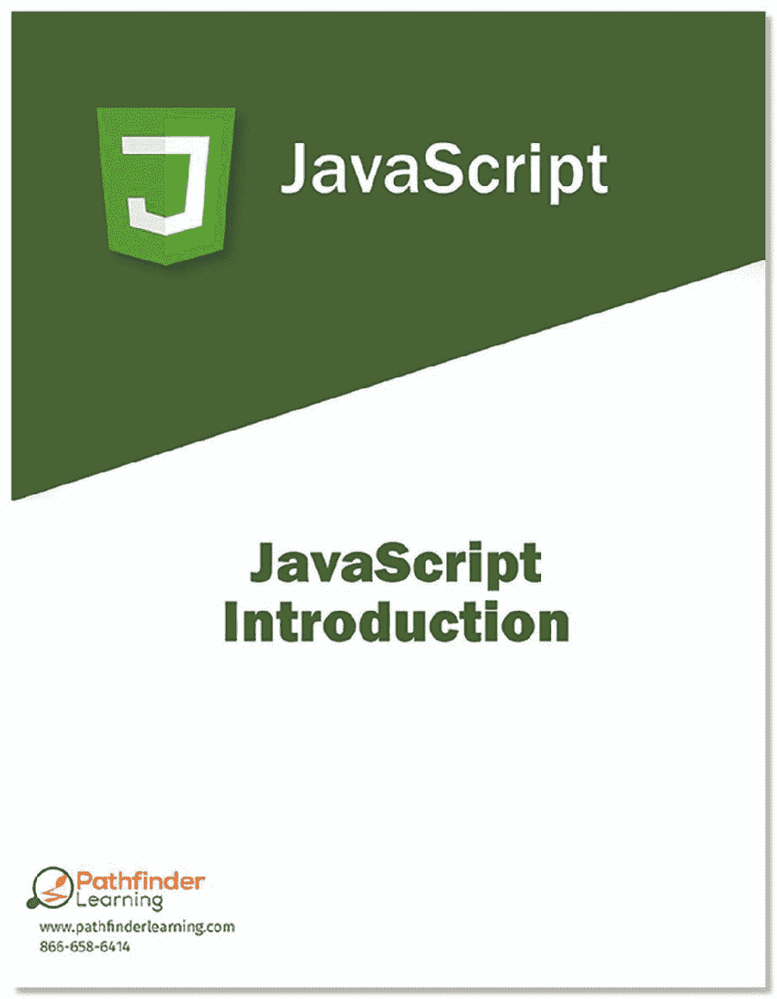

# JavaScript 入门指南：学生指南



## 简介

学生指南

术语表

### 关于课程

#### 目标学生与先决条件

本课程适用于具有良好 HTML 知识的学生。

#### 如何使用本书

本书的设计旨在配合指导师的课程使用。它包含了各种课程，引导你学习课程内容。书中对主题进行了解释，包括逻辑概念的说明和示例。此外还包含了练习以巩固材料。这些练习是环环相扣。

书中附带了完成练习所需的文件。十二节课中的每课都包含三个文件夹：演示（Demos）、练习（Exercises）和解决方案（Solutions）。将这些文件夹放在桌面上以便访问文件。在某些情况下，演示文件与书中的代码片段并不完全相同，因为代码片段旨在让你关注核心代码，而演示文件夹中的实际 HTML 文件是一个完整的可运行的 HTML 页面。

在书末，你将找到本课程所用术语的定义表。此外，还提供了一个索引，方便你快速找到所需的内容。

## 第 1 节：JavaScript 简介

课时：75 分钟

在本节中，你将学习到：

1. JavaScript 版本
2. 脚本术语
3. 语言基础
4. 内置对象
5. 用户输入方法

### JavaScript 版本

`JavaScript` 由 Brendan Eich 于 1995 年在 Netscape Navigator 中创建。它的开发是为了与 HTML 页面进行交互。它最初被称为 Mocha，随后在更名为 `JavaScript` 之前被称为 LiveScript。

`JavaScript` 是一种解释型脚本语言，而不是编译型编程语言。

`ECMAScript` 是几种类似的客户端脚本语言的标准化规范，包括 `JavaScript` 和微软的实现版本 `JScript`。1999 年，`ECMAScript` 的第 3 版增加了正则表达式和 `try/catch` 语句。2009 年，第 5 版增加了严格模式。`ECMAScript` 第 6 版引入了重大的新语法，包括类似 Python 的特性。`ECMAScript` 第 6 版于 2015 年 6 月发布，但浏览器尚未完全支持。本课程将重点关注第 5.1 版。

由于对富媒体网络应用和 AJAX 的贡献，`JavaScript` 近年来越来越流行。这导致了 `JavaScript` 库的增加，例如用于文档对象模型 (`DOM`) 脚本的 `jQuery`，以及 JavaScript 视图控制器 (`MVC`) 框架如 `AngularJS` 和 `Backbone.js`。`JavaScript` 的主要用途是通过用户事件操作 `DOM`，提供即时交互并减轻服务器的负担。`JavaScript` 也用于 HTML5 应用程序接口 (`APIs`)。

每个浏览器都有自己的解释 `JavaScript` 的引擎，这有时会导致浏览器在解释 `JavaScript` 的方式上存在差异。一些 `JavaScript` 库提供了抽象层，在后台处理浏览器差异。

`JavaScript` 不仅用于浏览器。`MongoDB` 和 `CouchDB` 是两个使用 `JavaScript` 作为查询语言的数据库。`Node.js` 是一个允许 `JavaScript` 越浏览器的平台，甚至被用于创建动态 HTTP 服务器。

#### 创建你的第一个 JavaScript 页面

`JavaScript` 可以以两种方式添加到 HTML 页面中。它可以添加到 HTML 页面内部的 `<script>` 标签之间，也可以放在一个只包含 `JavaScript` 的单独文件中。大多数应用程序将使用单独的 `JavaScript` 文件。使用单独的文件允许开发者高效地重复复用和更新脚本。它还允许浏览器缓存脚本。

##### 练习 1-1 为你的页面添加脚本

完成下面的练习，使用标签和单独的文件为你的页面添加一个脚本。

1. 在编辑器中，打开 `Lesson 1/Exercises/exercise1-1.html`。
2. 在 `<head>` 中添加一组 `<script>` 标签。
3. 在 `<script>` 标签内部，添加 `document.write("Hello!<br>");`。
4. 保存 `exercise1-1.html`。
5. 在浏览器中打开该文件。
6. 在编辑器中打开 `exercise1-1.html`。
7. 仅将 `<script>` 标签之间的 `JavaScript` 代码移动到单独的文件。
8. 将文件保存为 `exercise1-1.js` 并存放在 `Lesson 1/Exercises/js` 文件夹中。
9. 在 `exercise1-1.html` 文件中，为 `<script>` 标签添加 `src` 属性，使用相对路径引用外部的 `exercise1-1.js` 文件。
10. 保存 `exercise1-1.html`。
11. 在浏览器中打开。
12. 它看起来应该和第 5 步一样。

### 脚本术语

在我们开始之前，我们需要涵盖一些术语以辅助学习过程。

#### 表达式 (Expression)

在脚本或编程中，表达式产生一个值。任何以字面量编写的值（如数字或字符串）都是表达式。

表达式可以给变量赋值，或者仅仅拥有一个值。`JavaScript` 表达式可以求值为数字、字符字符串或真/假。

下面是一个算术表达式的示例。在没有赋值的情况下，它的求值是 3。

```javascript
1 + 2;
```

#### 变量 (Variable)

变量捕并持有值。它可以被更新。

#### 运算符 (Operators)

运算符分为一元、二元或三元，对应一个、两个或三个操作数。运算符可以是不同的类型，包括算术、字符串、逻辑、赋值和比较。大多数 `JavaScript` 运算符是二元的，要求在运算符的两侧都有一个操作数。

在这个示例中，赋值运算符 `=` 是二元运算符，加法运算符 `+` 也是。

```javascript
var x = 1 + 2;
```

操作数是表达式中被运算符处理的部分。上面，数字 1 和 2 以及变量 `x` 就是操作数。

还有一些一元运算符，操作数位于运算符的左侧或右侧。减号 `-` 可以在二元运算中从一个数字减去另一个数字，也可以在一元运算中对一个值取反。

```javascript
var x = -3; //x 是负 3
```

`JavaScript` 有一个三元运算符，在三个操作数之间有两个运算符。它是真/假测试的快捷方式，稍后将进行演示。

#### 语句 (Statement)

语句可以由表达式、变量和运算符组成。语句是一个包含表达式的完整指令，由网络浏览器执行。语句应该用分号分隔。

```javascript
var x = 1 + 2; // 语句
x = 3; // 语句（缺少分号）
1 + 2; // 不是语句
```

### 语言基础

本节将向你介绍 `JavaScript` 语法。

#### 声明变量

在 `JavaScript` 中，变量是局部或全局的。局部变量用 `var` 关键字声明。未声明的变量默认是全局的。在函数内部声明的变量是局部的。`JavaScript` 通常具有关联性。

下例示例声明了变量 `x`。

```javascript
var x;
```

声明的变量 `x` 稍后可以赋值。

```javascript
x = 1 + 2;
```

可以使用 `var` 关键字在一行内声明并赋值：

```javascript
var y = 10 * 2;
```

JavaScript 有 C 风格的快捷方式：`+=`、`-=`、`*=`、`/=` 和 `%=`。以下是赋值选项。

```javascript
// 将字符串 "hello" 赋值给变量
var str = "hello";

// 将 "world" 连接到变量
str += "world";

// += 是快捷方式
str = "hello";
str = str + "world";

var x = 5;

x *= 10;

// *= 是快捷方式
x = 5;
x = x * 10;
```

#### 大写敏感

`JavaScript` 是大小写敏感的。变量、内置对象、关键字、函数和方法必须使用正确的大小写。

`JavaScript` 的约定是使用驼峰法来命名标识符（变量和函数）。JavaScript 的驼峰法是将多个单词放在一起并将第一个单词以外的所有字母大写：

```javascript
var userName = "";
function calculateTotalProfits(){}
```

匈命名法也很流行，标识符的名称指示其类型和/或用途。

```javascript
var intAge = 100; // 整数
var strDept = "IT"; // 字符串
var boolFullTime = true; // 布尔值
var arrEmployeeList = []; // 数组
```

注意使用驼峰法不是强制的，匈命名法并没有设置数据类型，它指示预期的数据类型。在 `JavaScript` 中，数据类型会随上下文改变；没有办法强制标识符始终是某种数据类型。

#### 空格和结束语句

在 `JavaScript` 中，分号结束一个语句。`JavaScript` 非常灵活，因此缺少分号通常不会引起错误。

标记（运算符和操作数）之间的空格并不重要。如果语句在标记之间断开，可以延续到下一行，但字符串不能跨行。

JavaScript 使用两种 C 风格的注释：单行注释和多行块注释。注释可用于调试或编写代码文档。单行注释使用两个斜杠（`//`）并一直注释到行尾。多行注释位于 `/* */` 之间。最佳实践是仅将多行注释用于作者和许可信息。

### 数据类型

JavaScript 有基本/原始数据类型：`number`、`string` 和 `Boolean`。它有两个特殊类型：`null` 和 `undefined`。它还有两种复合类型：`array`（数组）和 `object`（对象），它们由原始值或其他复合值组成。还有一些特殊的对象类型，如 `functions`（函数）、`RegExp` 和 `Date()`。由于 JavaScript 具有动态类型，变量在脚本过程中可以是不同的类型。`typeof` 运算符可以帮助确定值的数据类型。

```javascript
var x = 10; //x 是一个数字
alert(typeof x);

var y = x + 20; //30，因为类型原因相加
alert(typeof y);

var x = "User"; //x 是一个字符串
alert(typeof x);

var y = x + 1; //User1，因为类型原因进行拼接
alert(typeof y);
```

### 数值变量

在 JavaScript 中，数值可以是整数（整数字）或浮点数。大数字可以使用 `"e"` 后跟数字的指数来创建。

```javascript
10e2 //10 乘以 10 的 2 次方是 1000
```

整数计算的精确度可以达到 900 万亿（9 quadrillion）。浮点数计算并不总是精确的，因此它们应该被视为一种近似值。

`toPrecision()` 方法将数字格式化为指定的长度。它接受一个有效数字位数作为参数，并用于获取更符合用户习惯的数字。参数是小数点前后数字的总数。

`toFixed()` 接收一个数字并将其转换为小数点后指定的数字位数。

### 算术运算符

算术运算符包括乘法（`*`）、除法（`/`）、加法（`+`）和减法（`-`）。还有一个模运算符（`%`），用于返回余数。乘法、除法和取模的优先级高于加法和减法。和数学一样，运算符优先级可以通过括号更改。

```javascript
x % y //返回 x 除以 y 的余数
```

加号（`+`）是重载的，因此它可以用于加法也可以用于字符串拼接。如果任何操作数是字符串，加号就会起起到拼接的作用。

### 函数

有三个函数可以将字符串转换为数字类型。它们可以用于确保执行加法而非拼接。以下是每个函数的简要说明。

`parseInt()` 会在字符串开头搜索整数。

```javascript
parseInt("2"); //返回 2
parseInt("2.5"); //返回 2
```

`parseFloat()` 会在字符串开头搜索浮点数。

```javascript
parseFloat("2.5"); //返回 2.5
parseFloat("4.5%"); //返回 4.5
```

`Number()` 尝试将值转换为数字。如果无法转换，它将返回 `NaN`（不是数字）。

```javascript
Number("2"); //返回 NaN
Number(""); //返回 0
```

当 `+`（加号）出现在值之前时，它会将字符串转换为等同于 `Number()` 函数的数字。

```javascript
+"100" //返回数字类型的 100
x = -20;
y = -x //y 是负 20
```

JavaScript 有三个属于数字类型但行为不像数字的特殊值：`Infinity`、`-Infinity`（负无穷）和 `NaN`（“不是数字”）。在许多语言中，除以零会导致错误，但在 JavaScript 中它返回 `Infinity`、`-Infinity` 或 `NaN`。

### 字符串变量

字符串是文本或字符串。人的电话号码或邮政编码可能包含数字，但数据类型将是字符串。字符串必须由引号括定，但单引号还是双引号并不重要。由于 JavaScript 的灵活性，可以通过包含在引号中将值转换为字符串。可以使用反斜杠（`\`）在字符串中直接添加换行符。换行或制表符等字符会在 `alert()`、`prompt()` 和 `confirm()` 中显示，但不会 `console` 中显示。

```javascript
alert("这是第一行。\n 这是另一行.");
alert("这些是用 \t 分隔的");
```

`+` 运算符拼接字符串，将两个或多个字符串合并为一个。字符串必须始终在引号内，但标识符（如变量、对象名和数组名）不能包含。字符串数据类型具有属性和若干方法，稍后将探讨。

### 练习 1-2 数字和字符串类型

此练习将允许你探索已回顾的数据类型。你可以使用 JavaScript 的 `console` 作为命令行完成这些练习。

- 实验加号 `"3" + 3`。返回了什么？为什么？
- 计算 `0.4 + 0.2`。答案如你预期的吗？
- 尝试使用 `toPrecision()` 方法计算 `0.4 + 0.2`。设置 `num = 0.4 + 0.2`，然后使用 `num.toPrecision(1)`。
- 将 `num` 设置为 `100`。`num.toFixed(2)` 做了什么？
- 使用模运算 `4 % 2`、`4 % 3` 和 `3 % 4`。结果如你预期的吗？你可以如何使用它？
- 查看 `Number()` 和 `parseInt()` 函数之间的区别，通过传递字符串 `"3"` 和空字符串 `""`。
- 设置 `var x = 12 / 0;` 查看 `x` 返回什么。是什么数据类型？提示：使用 `typeof x`。现在对 `0 / 0` 执行同样操作。
- 使用 `alert()` 打印带有换行符的 "hello world"。提示：从 `alert("hello world")`。

### 布尔变量

布尔类型的两个值为 `true` 和 `false`。注意引号中的 `"true"` 或 `"false"` 是字符串，不是布尔值。比较逻辑运算符的目的是返回布尔值。

比较运算符有大于（`>`）、小于（`<`）、大于等于（`>=`）、小于等于（`<=`）、相等（`==`）、不相等（`!=`）、严格相等（`===`）和严格不相等（`!==`）。

在相等（`==`）或不相等测试中，对值进行测试。在标识测试（`===` 或 `!==`）中，对值和类型进行测试。确保使用 `==` 或 `===` 进行比较，而不是用于赋值的等号。

```javascript
4 == "4"; //true，值相同
4 === "4"; //false，类型不同
```

JavaScript 有三个逻辑运算符：与（`&&`）、或（`||`）和非（`!`）。它们通常与比较运算符一起使用。所有侧都为真，`&&` 才返回真。只要有一侧为真，`||` 就返回真。使用逻辑非（`!`）运算符反转逻辑。

运算符优先级决定了运算符的顺序。比较运算符在逻辑运算符之前。逻辑与（`&&`）的优先级高于逻辑或（`||`），逻辑非（`!`）的优先级高于两者。括号不是必须的，但可以让代码更易读。比较和逻辑运算符通常用于 `if` 语句。

`&&` 和 `||` 可用于短路求值。

```javascript
//如果 fName 未定义则分配 "anonymous"
// fName 必须声明才能工作
var fName;
user = fName || "anonymous"
fName && alert("Hi " + fName);
```

`Math` 对象用于超出基础算术的计算。属性包括 `PI` (`3.141592653589793`), 方法包括 `round()`、`ceil()`、`floor()`、`random()`、`min()` 和 `max()`。

`round()` 将数值舍入到最近的整数。如果小数部分为 `.5` 或更大，它将进位到下一个整数。

`ceil()` 将数值向上取整到下一个整数。

`floor()` 始终向下取整。

`random()` 不接受任何参数，返回一个 0 到 1 之间的数字（不包含 1）。

`min()` 返回一组数字中的最小值。

`max()` 返回一组数字中的最大值。

```javascript
//demo1-1.html

//document.write 将内容写入网页

document.write(Math.ceil(4.2));//5
document.write(Math.floor(4.9));//4
document.write(Math.round(4.5));//5

// 0 – 1 之间的随机数（不包含 1）
//刷新页面获取新的随机数
document.write(Math.random());
```

### 日期 (Date)

JavaScript 的 `Date()` 对象基于 Unix 戳：1970 年 1 月 1 日。

`Date()` 是一个构造函数对象，必须使用 `new` 运算符创建日期。`Date()` 构造函数可以为空、接受一个字符串，或接受用逗号分隔的一到七个数字。空的 `Date()` 构造函数返回当前时间戳。要使用 `Date` 的方法之一，请先创建一个 `Date` 实例。

```javascript
//demo1-2.html

var today = new Date();

document.write(today);
```

如果你传递一个数字，`Date()` 构造函数将其读取为自 Unix 戳以来的毫秒数。传递二到七个参数将变为年、月、日、小时、分钟、秒、毫秒以创建一个日期。当传递两个或多个参数时，第一个参数将变为年份，而不是自戳以来的毫秒数。

实用的 `Date` 方法包括 `getFullYear()`、`getDate()`、`getMonth()`、`getDay()`、`getHours()`、`getTime()`、`getMinutes()` 和 `getSeconds()`。

`getFullYear()` 返回日期的 4 位年份部分。

`getDate()` 返回日期的日期部分——值从 1 到 31。

`getMonth()` 返回一个 0 – 11 的索引数字，代表月份，0 代表 1 月。

`getDay()` 返回一个 0 – 6 的索引数字，代表星期几，0 代表星期日。

`getTime()` 方法通过自戳以来的毫秒数显示日期。你可以使用此来计算两个或多个日期之间有多少天、几周或几个月。

```javascript
//demo1-3.html

var today = new Date();

document.write(today.getTime());
```

JavaScript 还有 `Date` 方法 `setFullYear()`、`setDate()`、`setMonth()`、`setHours()`、`setMinutes()` 和 `setSeconds()`。`setMonth()` 接受从 0 开始的索引数字。

```javascript
//demo1-4.html

var birthday = new Date();

birthday.setMonth(11);

document.write(birthday);
//12 月的时间戳，当前日期/年份
```

`setTime()` 方法接受自戳以来的毫秒数。对于标点时间之前的日期，它接受负数。

```javascript
//demo1-5.html

var prevDate = new Date();

prevDate.setTime(-1000000000000)

document.write(prevDate);
//Sun Apr 24 1938 17:13:20 GMT-0500 (CDT)
```

### 用户输入方法 (User input methods)

`window` 对象有三个方法：`alert()`、`confirm()` 和 `prompt()`。后两个可以获取用户输入。因为它们是 `window` 对象的方法，所以它们不能设置样式；由浏览器决定它们的外。

`alert()` 接受一个参数，因此如果有多个数据，必须在作为参数传递之前对其进行拼接。

`confirm()` 接受一个参数并返回 `Boolean` 布尔值数据类型。

`prompt()` 接受两个参数，一个问题和一个默认答案，并返回一个字符串数据类型。

用户还可以通过填写表单向网页输入数据，或通过点击等用户事件与网页交互。这两个概念将在稍后详细介绍。

```javascript
//demo1-6.html

alert("你好!");

prompt("你多大了？", "");

confirm("你确定吗?");
```

### 练习 1-3 内置的 Date() 对象

通过此练习，你将确定两个日期之间的天数。

使用你的编辑器，创建一个名为 `exercise1-3.js` 的文件。

将其保存到 `Lesson 1/Exercises/js` 中。

使用 `new Date()` 获取当前日期。

询问用户他们的下一个生日。

参考 `Lesson 1/Exercises/exercise1-3.js` 看看如何实现。

## 第 2 节：条件 (Conditions)

在本节中，你将学习：

1. `if` 结构
2. `else` 结构
3. `else if` 结构
4. `switch` 结构
5. 三元运算符 `?:`

### if 结构 (The if Construct)

`if` 接受一个参数，因此如果有多个数据，必须在作为参数传递之前对其进行拼接。

`if` 结构条件为真时执行。

```javascript
if (condition) {
  statement
}
```

### else 结构 (The else Construct)

当 `if` 条件为假时，执行 `else` 部分。

```javascript
if (condition) {
  statement
} else {
  statement
}
```

### else if 结构 (The else if Construct)

当之前的 `if` 条件为假时，执行 `else if`。

```javascript
if (condition) {
  statement
} else if (condition) {
  statement
}
```

### 测试多个条件 (Testing Multiple Conditions)

当需要更多选择时，可以添加任意数量的 `else if` 结构。`else if` 只有在之前的 `if` 或 `else if` 为假时才执行。`else` 在所有之前的条件都不为真时执行。

```javascript
if (condition) {
  statement;
} else if (condition) {
  statement;
} else {
  statement;
}
```

### 三元运算符 (The ternary operator)

三元运算符可以是 `if-else` 的简写形式。

```javascript
result = condition ? expression1 : expression2;
```

### switch 结构 (The switch Construct)

当有多个可能的值需要进行比较时，可以使用 `switch`。

```javascript
switch (expression) {
  case value1:
    statement;
    break;
  case value2:
    statement;
    break;
  default:
    statement;
}
```

### 练习 2-1 使用 if 结构 (Exercise 2-1 Using the if construct)

此练习将使用 `if` 结构对输入进行验证。

使用你的编辑器，创建一个名为 `exercise2-1.js` 的文件。

将其保存到 `Lesson 2/Exercises/js` 中。

询问用户工作时长和工资。提示：使用两次 `prompt()`。

假设员工工作 1-80 小时，工资在 1 到 100 美元之间，如果用户输入的数字超出范围，则说明输入误了。使用 `if` 测试用户是否输入了正确范围，如果不是则再次询问。

询问用户他们是否为全职员工。提示：使用 `confirm()`。它返回 `true` 或 `false`。

计算他们本周赚了多少。如果他们不是全职且工作超过了 40 小时，则加班部分支付一倍半工资。

使用 `document.write(variable);` 打印到页面。

将 JavaScript 文件引用到 `Lesson 2/Exercises/exercise2-1.html` 并测试。

`switch` 结构用于在多个要执行的代码块中进行选择。与 `if/else if` 结构不同，`switch` 表达式（可以变量）只求值一次。

`switch` 结构中表达式的值将与每个 `case` 的值进行比较。每个 `case` 值以冒号结尾。如果值匹配某个 `case`，则执行与该 `case` 关联的代码块。`default` 语句不是必须的，但它用于指定在没有匹配时运行的代码。它类似于 `else`。

关键字 `break;` 用于跳出 `switch` 块。当找到 `case` 匹配且不再需要继续测试时，使用它。在 `switch` 的最后一条语句中不需要 `break;`。

```javascript
switch (expression) {
  case value1:
    statement;
    break;
  case value2:
    statement if previous case false;
    break;
  default:
    statement if previous case false;
    //break; not necessary at the end
}
```

如果没有 `break`，不同的 `case` 将发生“贯穿”并执行相同的代码。有时这可以化为有利。

```javascript
switch (expression) {
  case value1:
  case value2:
    statement to run for both cases;
    break;
  default:
    statement to run if previous false;
}
```

```javascript
var day = "Monday";
switch (day) {
  case "Saturday":
  case "Sunday":
    msg = "It’s a weekend!";
    break;
  default:
    msg = "It’s a weekday.";
}
```

### 练习 2-2 使用 switch

在本次练习中，你将使用 `switch` 结构。

- 使用你的编辑器，创建一个名为 `exercise2-2.js` 的文件。
- 将文件保存到 `Lesson 2/Exercises/js` 中。
- 要求用户输入一个字母表中的字母。
- 使用 `switch` 判断该字母是辅音还是元音。
- 使用 `document.write()` 打印它是辅音还是元音。
- 在 `Lesson 2/Exercises/exercise2-2.html` 中添加 JavaScript 文件的引用并进行测试。

### 条件运算符（三元运算符）

条件运算符 `(?:?)` 是 JavaScript 中唯一接受三个操作数（三元）的运算符。它被用作 `if/else` 结构的快捷方式。第一个操作数必须求值为真或假。表达式的值可以是任何类型。

```javascript
condition ? expression1 : expression2;
```

如果 `condition` 为真，则三元运算符返回 `expression1`（即 `?` 之后的值）。否则，它返回 `expression2`（即 `:` 之后的值）。返回的结果可以输出、赋值给变量或打印。

```javascript
var result = condition ? expression1 : expression2;
document.write(condition ? expression1 : expression2);
```

要执行多个操作，请用逗号分隔。

```javascript
condition ? operation1, operation2 : operation3, operation4;
```

```javascript
var numOfApples = 4;
var apples = numOfApples == 1 ? //condition
  "There is " + numOfApples + " apple " : //op. if true
  "There are " + numOfApples + " apples "; //op. if false
document.write(apples);
```

### 练习 2-3 使用三元运算符

将三元运算符作为 `if/else` 的快捷方式。

- 使用你的编辑器，创建一个名为 `exercise2-3.js` 的文件。
- 将文件保存到 `Lesson 2/Exercises/js` 中。
- 要求用户输入一个不带美元符号的价格。
- 如果价格超过 100 美元，将应用 10% 的折扣。
- 使用三元运算符判断是否应用了折扣。
- 使用 `document.write()` 打印总价以及是否应用折扣。
- 在 `Lesson 2/Exercises/exercise2-3.html` 中添加 JavaScript 文件的引用并进行测试。

## 第 3 节：JavaScript 循环

**单元时间：** 75 分钟

在本节中，你将学习：

1. JavaScript 循环
2. JavaScript 标签和分支语句

### JavaScript 循环

JavaScript 有三种 C 风格的循环，而 `do…while` 和 `for`。此外，JavaScript 还有一个 `for…in` 循环，用于迭代遍历对象的可枚举属性。

循环用于根据需要多次测试特定条件，或者重复执行代码特定次数。它们经常被用于遍历数组或对象，或者验证表单元素。

#### while 循环

`while` 循环是一种预测试循环，在循环运行之前测试条件。`while` 循环中的代码块只要条件为真就会一直执行。当条件表达式返回假时，循环停止。

```javascript
while (condition) {
  statements to run if condition is true;
}
```

与 `if` 结构一样，如果只有一条语句，可以省略大括号，但最好使用它们。

如果条件表达式永远不会变为假，循环将永远不会结束，导致死循环。

```javascript
//demo3-1.html

var x = 0;
while (x < 10) {
  document.write(x);
  document.write("<br>");
  x++; //增加 1 以在 10 结束
}
```

当条件为假时，`while` 循环不执行。

```javascript
var x = 10;
while (condition) {
  document.write(x);
  x++;
}
```

### 练习 3-1 使用 while 循环

在本次练习中，你将使用 `while` 循环。

- 使用你的编辑器，创建一个名为 `exercise3-1.js` 的文件。
- 将文件保存到 `Lesson 2/Exercises/js` 中。
- 假设有一个变量 `x = 0`。
- 使用 `while` 循环，当 `x` 小于 10 时打印 `x` 并换行。
- 每次将 `x` 增加 1，以便在 10 时结束。
- 在 `Lesson 2/Exercises/exercise3-1.html` 中添加 JavaScript 文件的引用并进行测试。

### do…while 循环

`do…while` 循环是一种后测试循环，在循环运行之后测试条件。`do…while` 循环中的代码块至少执行一次。当条件返回假时，循环停止。

```javascript
do {
  statements to run if condition is true;
} while (condition);
```

与 `while` 结构一样，如果只有一条语句，可以省略大括号。

如果条件表达式永远不会变为假，循环将永远不会结束，导致死循环。

```javascript
//demo3-2.html

var x = 0;
do {
  document.write(x);
  document.write("<br>");
  x++; //增加 1 以在 10 结束
} while (x < 10);
```

即使条件一开始为假，`do…while` 循环也会执行一次。

```javascript
var x = 10;
do {
  // statements
} while (condition); 
```

### 练习 3-2 使用 do…while 循环

在本次练习中，你将使用 `do…while` 循环。

- 使用你的编辑器，创建一个名为 `exercise3-2.js` 的文件。
- 将文件保存到 `Lesson 2/Exercises/js` 中。
- 假设有一个变量 `x = 0`。
- 使用 `do…while` 循环，当 `x` 小于 10 时打印 `x` 并换行。
- 每次将 `x` 增加 1，以便在 10 时结束。
- 在 `Lesson 2/Exercises/exercise3-2.html` 中添加 JavaScript 文件的引用并进行测试。

### for 循环

`for` 循环与 `while` 循环最相似。如果条件初始为真，它将运行语句块，直到条件为假。`for` 循环在括号中有三个部分，用分号分隔。第一部分是计数变量的声明。第二部分是决定是否运行循环的条件表达式。最后一部分重置初始变量，通常是增加或减少计数器。`for` 循环的最后部分没有分号。

```javascript
for (initialize; condition; increment/decrement) {
  statements;
}
```

如果只有一条语句，`for` 循环也可以省略大括号。

与其他循环一样，忽略未修改初始变量会导致死循环。

```javascript
//demo3-4.html

for (var x = 0; x < 10; x++) {
  document.write(x)
}
```

### for…in 循环

`for…in` 循环用于遍历数组或对象，将在“复合数据类型”课程中进行详细介绍。关键字是 `for` 和 `in`。下面，`property` 是代表对象属性的变量，`object` 是对象或数组的名称。

`for…in` 循环不使用数字计数器。

```javascript
for (property in object) {
  document.write(property + object[property]);
}
```

与其他结构一样，如果只有一条语句，可以省略大括号。

## JavaScript 标签与分支语句

在 JavaScript 中，`break;` 和 `continue;` 可以作为分支语句。它们可以带标签使用也可以不带标签使用。它们决定了程序下一步应该执行哪些代码。标签（label）是任何后面带有冒号的标识符。分支语句 `break;` 和 `continue;` 可用于循环中转移程序控制流。

### 使用 `break;` 语句

`break;` 语句终止循环（或 switch），跳转到循环或 switch 之外的下一个语句。

```javascript
//demo3-5.html
for (var x = 1; x <= 10; x++) {
  if (x % 5 == 0) {
    break; //运行到能被 5 整除为止
  }
  document.write(x);
}
```

在嵌套循环中，`break;` 终止当前循环。

```javascript
//demo3-6.html
var i = 0;
//运行 3 次，在数字 4 处跳出
while (i < 3){
  for (x = 1; x <= 10; x++) {
    if (x % 5 == 0) {
      break;
    }
    document.write(x);
  }
  i++;
}
```

`break;` 可以将程序控制权传递给标签。在这个示例中，当 `for` 循环达到数字 4 时，由于开发者创建了 `outerLoop:` 标签，程序控制权传递到了外部的 `while` 循环。

```javascript
//demo3-7.html
var i = 0;
//运行一次，在数字 4 处跳出
outerLoop: while (i < 3){
  for (x = 1; x <= 10; x++) {
    if (x % 5 == 0) {
      break outerLoop; //标签
    }
    document.write(x);
  }
  i++;
}
```

### 使用 `continue` 语句

`continue;` 语句终止当前迭代的循环执行，并继续下次迭代。一旦执行了 `continue;` 语句，其下语句将被跳过。在下方，如果数字不能被 5 整除，则跳转到循环的下次迭代。只有被 5 整除的数字会被打印。

```javascript
//demo3-8.html
for (var x = 0; x <= 10; x++) {
  if (x % 5 != 0) {
    continue;
  }
  document.write(x); //如果被 5 整除
}
```

也可以用 `continue;` 语句将程序控制权传递给标签。

## 练习 3-3 使用分支语句

使用分支语句来操作程序控制流。

使用你的编辑器创建一个名为 `exercise3-3.js` 的文件。

将文件保存到 `Lesson 3/Exercises/js`。

生成一个 1 到 10 之间的随机数。提示：使用 `Math.random()`。

给用户三次机会猜数字。如果他们猜中了，给他们一条“恭喜”消息，并告诉他们花了多少次猜。

如果用户在三次机会用完之前猜中了，你应该对循环做什么？

给用户提供通过输入“Q”（不区分大小写）来退出猜游戏的机会。

如果他们三次尝试都没有猜中正确数字，打印该随机数。

在 `Lesson 3/Exercises/exercise3-3.html` 中添加对 JavaScript 文件的引用并进行测试。

## 第 4 节：基本数据类型

单元时间：75 分钟

在本节中，你将学习：

1. `String` 数据类型
2. `Number` 数据类型

### String 数据类型

字符串是由双引号或单引号界定的字符序列，用于文本的表示。字符串字面量是一种基本类型，类似于数值或布尔值。字符串上的一些常用操作包括检查其长度、连接（拼接）、搜索字符或提取子字符串。

```javascript
var str = "hello world";
```

在需要时，基本类型会被转换为字符串对象，因此包含字符串字面量的变量可以使用属性和方法。`String()` 有利于将另一种数据类型转换为字符串，以便你可以使用属性和方法。`String()` 构造函数创建一个字符串对象。

```javascript
var x = 100;
var str = String(x)
```

#### String 属性

字符串的 `length` 属性返回字符串的长度。

```javascript
//demo4-1.html
var email = "username@emaildomain.com";
var len = email.length;//返回 24
```

字符串可以是空的，在这种情况下它的长度为 0。

```javascript
var str = "";
var strlen = str.length; //返回 0
```

#### String 方法

下面是某些用于操作数据类型的字符串方法的解释。

`charAt()`

`charAt()` 方法接收一个索引数字并返回该索引处的字符。索引数字是介于 0 且小于字符串长度的整数。如果提供的索引大于字符串长度，则返回一个空字符串。

```javascript
//demo4-2.html
var email = "username@emaildomain.com";
var character = email.charAt(0); //返回 "u"
document.write(character)
```

`indexOf()`

`indexOf()` 方法接收要搜索的字符（字符）和一个可选的起始索引数字。它返回一个从 0 到字符串长度减 1 的索引数字。如果未找到，则返回 -1。该方法是**区分大小写**的。

```javascript
//demo4-3.html
var email = "username@emaildomain.com";
var index = email.indexOf("u"); //返回 0
document.write(index)
```

`lastIndexOf()`

`lastIndexOf()` 方法返回字符串中字符最后一次出现的索引数字。如果未找到，则返回 -1。该方法是**区分大小写**的。

```javascript
//demo4-4.html
var email = "username@emaildomain.com";
var index = email.lastIndexOf("e"); //返回 12
document.write(index)
```

`split()`

`split()` 方法根据分隔符将字符串拆分为子字符串数组。

```javascript
//demo4-5.html
var strDays = "Mon, Tues, Fri";
var arrDays = strDays.split(", "); //["Mon", "Tues", "Fri"]
document.write(arrDays);
```

`slice()` vs. `substring()` vs. `substr()`

`slice()` 方法提取字符串的一部分。它接收一个起始索引和一个可选的结束索引数字。如果第二个参数省略，则提取到字符串末尾。`substring()` 方法也接收起始索引和结束索引，如果起始索引大于结束索引，它会交换这两个参数。`substr()` 方法接收一个起始索引和一个可选的要提取字符个数。如果第二个参数省略，则提取到字符串末尾。

```javascript
//demo4-6.html
var email = "username@emaildomain.com";
var strSlice = email.slice(9, 15); //"domain"
var strSub = email.substring(9, 15); //"domain"
var strSubstr = email.substr(9, 6); //"domain"
```

`trim()`

`trim()` 方法返回删除两端空格后的字符串，而不影响原始字符串。

```javascript
//demo4-7.html
var user = "  UserName ";
var trimUser = user.trim(); //"UserName"
document.write(trimUser);
```

`toLowerCase()`

`toLowerCase()` 方法将字符串转换为小写并返回结果。

```javascript
//demo4-8.html
var user = "UserName";
var lcUser = user.toLowerCase(); //username
document.write(lcUser)
```

`toUpperCase()`

`toUpperCase()` 方法将字符串转换为大写并返回结果。

```javascript
//demo4-9.html
var user = "UserName";
var ucUser = user.toUpperCase(); //USERNAME
document.write(ucUser)
```

### 练习 4-1 使用字符串方法

使用字符串方法和逻辑来验证输入的数据。

使用你的编辑器创建一个名为 `exercise4-1.js` 的文件。

将文件保存到 `Lesson 4/Exercises/js`。

要求用户输入电子邮件地址，并使用 `if...else/if...else` 进行测试。

记住，如果你在搜索字母，它是区分大小写的，但电子邮件地址不区分大小写。如果你要将其与字符串进行测试，将其转换为小写是很有用的。

通过首先使用字符串的 `trim()` 方法去除空格，确保用户的输入不是空的。

对电子邮件地址进行一些数据验证。

如果小于 6 个字符，则不是有效的。测试它至少有 6 个字符。

电子邮件地址应该包含：

- 一个 `@` 符号
- 不一个 `@` 符号
- `@` 符号出现在第一个或最后一个字符以外的位置
- 不包含空格

为无效的电子邮件地址创建一个错误消息。

如果电子邮件地址有效，使用 `document.write()` 打印该消息。提取域名名并将其与消息一起打印。

在 `Lesson 4/Exercises/exercise4-1.html` 中添加对 JavaScript 文件的引用，并进行 `test`。对于电子邮件验证器，使用一个无效的电子邮件地址进行测试，以确保你能获取错误信息。

### 数字数据类型

我们在之前的课程中看到了数字数据类型的一些特性。`Number` 对象还具有更多属性和函数。

#### Number 属性

静态属性 `Number.MAX_VALUE` 代表 JavaScript 中最大的正数。任何大于此值的数字都表示为 `Infinity`。

- `-Number.MAX_VALUE`（前面带有负号）是离 0 最远的负数。任何小于此值的数字都是 `–Infinity`。

最接近 0 但不是 0 的最小正数是 `Number.MIN_VALUE`。任何比此小的正数都会转换为 0。`-Number.MIN_VALUE` 是最接近 0 的最小负数。任何比此大的负数都会转换为 0。

你必须在关键字 `Number` 上使用这些属性，而不是持有数字的变量。

```javascript
//demo4-10.html

document.write(Number.MAX_VALUE); // 正确用法

document.write(Number.MIN_VALUE); // 正确用法

x = 10;

x.MAX_VALUE; // 错误用法，返回 undefined
```

#### Number 方法

`toPrecision()` 和 `toFixed()` 是数字对象的方法。这些在第 1 中讨论过。

#### 与数字使用的全局函数

如第 1 节所示，`parseInt()` 和 `parseFloat()` 是解析字符串并返回数字的全局函数。JavaScript 拥有接受任何数据类型参数并测试其是否为数字的全局函数。

全局函数 `isNaN()` 测试参数是否不是数字。

```javascript
isNaN("abc"): //true
isNaN(7): //false
```

全局函数 `isFinite()` 测试参数是否为有限值，且它必须是数字才是有限的。

```javascript
isFinite("abc"): //false
isFinite(7): //true
```

但 `isFinite()` 并不是 `isNaN()` 的真正反面。

```javascript
isNaN(12/0): //false，它是一个数字
isFinite(12/0); //值为 Infinity，所以为 false
```

确定一个值是否为数字的唯一准确方法是反转 `isNaN()` 的逻辑。

```javascript
!isNaN(7); //true
```

## 第 5 节：复合数据类型

单元时间：75 分钟

在本节中，你将学习到：

1. 对象数组
2. 使用 JSON 语法存储数据

### 数组

数字、字符串和 `Booleans` 是原始数据类型——程序的基础构建块。数组和对象是复合或组合数据类型，由原始数据类型和/或其它复合数据类型组成。

数组是一个枚举列表或数据集合，可以在一个名称下保存多个值。在 JavaScript 中，数组是一种特殊的对象类型。在数组中，每条数据都有一个对应的数字索引，用于访问该值。数组有一个属性和几个操作方法。

### 在数组中存储数据

可以使用字面量语法使用方括号 (`[]`) 创建数组。

```javascript
var fruits = ["banana", "orange", "apple"];

typeof fruits; //object
```

数组是动态的，因此可以添加或删除元素。

```javascript
var fruits = []; // 声明数组 fruits
fruits[0] = "banana";
fruits[1] = "orange";
fruits[2] = "apple";
```

### 数组属性

数组的 `length` 属性计算该点的元素数量。

```javascript
document.write(fruits.length); //3
```

`length` 属性是通过最高索引加 1 得到的，而不是通过计算值的数量。

```javascript
var fruits = [];
// 具有 2 个元素的非连续数组
fruits[0] = "banana";
fruits[2] = "apple";
document.write(fruits.length); //3
```

可以使用索引数字访问特定元素。索引数字范围从 0 到 `array length - 1`。

```javascript
fruits[0]; // 第一个元素
fruits[fruits.length-1]; // 最后元素
```

### 遍历数组

使用索引数字可以使用 `while`、`do…while` 或 `for` 循环遍历数组。如果数组是连续的，这些循环运行良好。在下面的示例中，如果索引 0, 1 或 2 缺失，则会在相应位置打印 `undefined`。

```javascript
for (var x = 0; x < 3; x++) {
  document.write(fruits[x]);
}
```

如果你不知道数组元素的数量，可以使用 `length` 属性确定数量。

```javascript
for (var x = 0; x < fruits.length; x++) {
  document.write(fruits[x]);
}
```

`length` 属性在每次被调用时都会动态计算。如果你确定数组不会改变，那么使用一次 `length` 属性比每次循环运行时都使用一次更有效。

```javascript
var len = fruits.length;
for (var x = 0; x < len; x++) {
  document.write(fruits[x]);
}
```

`for...in` 遍历数组中的每一个元素。如果数组是非连续的，`splice` 方法可以修改数组。`x` 是索引。

```javascript
for (x in fruits) {
  // 是索引
  document.write(fruits[x]);
}
```

### 练习 5-1

使用数组持有数据。

使用 `array-1.js` 创建一个包含几的数组。可选：创建一个包含月份的数组。Lesson 5/Exercises/。

### 数组变异方法

JavaScript 有一些永久修改数组的方法。这些方法会添加、删除或更改数组的顺序。

#### `pop()`

`pop()` 从数组中移除最后一个元素并返回它。它不需要任何参数。

```javascript
//demo5-1.html
var fruits = ["banana", "orange", "apple"];
var lastItem = fruits.pop();
document.write(lastItem); //apple
document.write(fruits); //banana,orange
```

#### `push()`

`push()` 向数组末尾添加一个或多个元素并返回数组长度。它接受一个或多个参数。

```javascript
//demo5-2.html
fruits.push("blueberry");
fruits.push("cherry", "grape");
```

#### `reverse()`

`reverse()` 反转元素的顺序。它不需要任何参数。

#### `shift()`

`shift()` 从数组中移除第一个元素并返回它。它不需要任何参数。现有元素的索引值会改变。

```javascript
//demo5-4.html
var firstItem = fruits.shift();
document.write(firstItem); //grape (- 注意：逻辑取决于之前的 push/reverse)
```

#### `sort()`

`sort()` 不需要参数即可按字母顺序排序，但当我们想要按数值排序时就会出现问题。向 `sort()` 方法传递一个函数，比较作为对的每个元素，如果它们的顺序错误则交换它们。

```javascript
//demo5-5.html
var fruits = ["Banana", "Orange", "Apple"];
fruits.sort(); // Apple, Banana, Orange

var nums = [100, 1, 15, 20, 10, 200];
nums.sort(); //1, 10, 100, 15, 20, 200
nums.sort(function(a, b){return a - b});
```

#### `splice()`

`splice()` 可以在数组中添加和删除元素。两个参数是必须的。第一个参数是开始 splice 的索引，第二个参数是要删除的元素数量。

```javascript
//demo5-6.html
//从索引 1 开始，删除接下来 2 个
fruits = ["banana", "orange", "apple", "blueberry", "cherry"];
var rmItems = fruits.splice(1, 2);
document.write(rmItems); //orange,apple
document.write(fruits); //banana,blueberry,cherry
```

```javascript
//第二个参数大于剩余元素数量
//则移除剩余的所有元素

var fruits = ["banana", "orange", "blueberry", "cherry"];

fruits.sort();

document.write(fruits + "<br>");

fruits.splice(1, fruits.length);

document.write(fruits);//banana
```

第三个可选参数是一个列表，包含要插入到第一个参数索引处的数组中的一个或多个项。

```javascript
//demo5-8.html
//从索引 1 开始，添加 2 个元素，移除
//后续 2 个元素

var fruits = ["banana", "orange", "apple", "blueberry", "cherry"];

var rmItems = fruits.splice(1, 2);

fruits.splice(1, 0, "kiwi", "lemon"); // 移除 0 个，添加两个

document.write(fruits); //banana, kiwi, lemon, blueberry, cherry
```

#### `unshift()`

`unshift()` 将一个或多个元素添加到数组开头，并返回数组的新长度。与 `shift()` 一样，现有元素的索引会发生变化。

```javascript
//demo5-9.html

var fruits = ["banana", "orange", "apple"];

var addItems = fruits.unshift("plum", "pear");

document.write(addItems);//5

document.write(fruits); //plum, pear, banana, orange, apple
```

### 访问器方法 (Accessor Methods)

访问器方法不会修改数组。它们返回原始数组的表示。以下是用于数组的一些常用访问器方法。

#### `concat()`

`concat()` 返回一个新数组，该数组由调用它的数组以及作为参数提供的数组或值组成。

```javascript
//demo5-10.html

var fruits = ["plum", "pear", "banana", "kiwi", "lemon"];

var alpha = ["a", "b", "c"];

var nums = [2, 3];

var concatArr = alpha.concat(fruits, nums);

document.write(alpha);//["a", "b", "c"];

document.write(concatArr); //a,b,c,plum,pear, banana,kiwi,lemon,2,3
```

#### `join()`

`join()` 一个分隔符作为可选参数，并返回数组中所有元素连接成的字符串。与字符串方法 `split()` 形成对比，后者通过分隔符将字符串分割成数组。

```javascript
//demo5-11.html

fruits = ["plum", "pear", "banana", "kiwi", "lemon"];

var str1 = fruits.join("|"); //fruits 数组保持不变

document.write(str1)//plum|pear|banana|kiwi|lemon
```

分隔符可以多于一个字符。

```javascript
//demo5-12.html

var fruits = ["plum", "pear", "banana", "kiwi", "lemon"];

var str1 = fruits.join("|"); //fruits 数组保持不变

document.write(str1);

var str2 = fruits.join(" > ");

document.write(str2);//plum > pear > banana > kiwi > lemon
```

当省略参数时，数组用逗号连接。

```javascript
//demo5-13.html

var fruits = ["plum", "pear", "banana", "kiwi", "lemon"];

var str1 = fruits.join("|"); //fruits 数组保持不变

document.write(str1);

var str2 = fruits.join(" > ");

document.write(str2);

var str3 = fruits.join();//plum,banana,banana,lemon
```

如果参数为空（`""`），元素之间将没有字符连接。

```javascript
//demo5-14.html

var fruits = ["plum", "pear", "banana", "kiwi", "lemon"];

var str4 = fruits.join("");

document.write(str4);//pearbanana
```

#### `slice()`

`slice()` 正如在字符串部分所示，它返回数组的一部分作为新数组返回。不要将其与变器方法 `splice()` 混淆，后者会移除项、添加项并永久地更改原始数组。`slice()` 的第一个参数是开始的索引，提取的数组直到但不包含第二个参数。如果省略第二个参数，则提取到数组的末尾。作为字符串，`slice()` 可以接受负数。

```javascript
//demo5-15.html

var fruits = ["plum", "pear", "banana", "kiwi", "lemon"];

var someFruit = fruits.slice(1,2);

document.write(someFruit); //pear

document.write(fruits);//plum,pear,banana,kiwi,lemon
```

### 练习 5-2: 遍历数组

使用数组、循环、`break` 语句和字符串方法创建一个客户端搜索功能。

1. 使用你的编辑器，创建一个名为 `exercise5-2.js` 的文件。
2. 创建一个城市名称数组。确保其中一些城市是多个单词，例如 New York City。
3. 提示用户输入要在数组中搜索的城市名称。
4. 循环遍历城市数组，如果找到了用户输入的城市：
   - 将变量 `found` 设置为 `true`。
   - 使用 `break` 跳出循环。
5. 在循环外部，如果 `found` 变量为 `true`，使用 `document.write()` 打印该城市和全名。
6. 否则，使用 `document.write()` 打印你没有找到用户输入的城市。
7. 注意，到目前为止，搜索期望输入城市的全名。我们希望让它接受部分单词（只要城市名以这些字母开头），例如用 "Atl" 代表 "Atlanta"。
8. 在 `Exercises/js/exercise5-2.js` 中，使用 `substring()` 方法测试数组中的城市是否以搜索字符串的字母开头。
   - 提示：`if (cities[i].substring(0, searchstring.length) == searchstring)`
9. 在打印城市名时，你想要打印数组中的全名，因此将你要打印的搜索字符串赋值给数组中的全名。
   - 提示：`searchstring = cities[i]`
10. 你可能已经注意到搜索是区分大小写的。我们希望使其不区分大小写。
11. 我们可以使用 `toUpperCase()` 方法将整个单词转为大写，但如果城市是多个单词怎么办？我们可以通过空格 `split()` 城市，遍历它，对它使用 `toUpperCase()` 方法，并用空格分隔符 `join()` 重新连接为字符串。
    - 提示：在循环之前使用 `array = searchstring.split(" ");`，在循环之后使用 `searchstring = array.join(" ");`。
12. 我们不希望整个单词全大写，只需要每个单词的首字母。我们将使用字符串方法获取第一个字符并将其转换为大写，与单词的其余部分拼接，并重新赋值给 `array[i]`。单词的其余部分可以通过 `array[i].slice(1)` 获得。
    - 提示：`array[i].charAt(0).toUpperCase()`
13. 实际上，他们可能会输入全大写，所以我们应该将第一个字母以外的所有内容都转换为小写。
    - 提示：使用 `array[i].slice(1).toLowerCase()` 代替简单的 `array[i].slice(1)`。
14. 保存并在浏览器中测试。

#### 多维数组

多维数组是数组的数组。

```javascript
var people = [
["Bob", "Smith"],
["John", "Doe"]
]
```

二维数组的元素通过两组方括号访问，其中第一组括号是“行”号，第二组括号是“列”号。

```javascript
people[0][0];//"Bob"
people[1][1];//"Doe"
```

多维数组也可以部分创建。

```javascript
var people = [[]];
people[0][0] = "Bob";
```

### 对象 (Objects)

对象在了一个变量中存储多个值。数组和对象的区别在于，数组元素通过数字索引访问，而对象的元素通过字符串键访问。某些语言将此称为关联数组。

#### 在对象中存储数据

可以使用对象字面量语法创建单个对象。

```javascript
var person = {
firstName: "John",
lastName: "Doe",
eyeColor: "green"
}
```

`firstName`、`lastName` 和 `eyeColor` 是 `person` 对象的属性。对象的属性不需要引号，除非它们包含非字母数字字符。

#### 在对象中访问数据

访问对象的元素有两种方法：点表示法（dot notation）或括号表示法（bracket notation）。在点表示法中，属性名不需要引号，但在括号表示法中需要。

```javascript
person.firstName;//John
person["lastName"];//Doe
```

这两种表示法也可以用于设置对象元素。

```javascript
person.eyeColor = "blue";
person["age"] = 21;
```

#### 遍历对象数据

`for...in` 循环用于遍历对象。`while`、`do...while` 和 `for` 循环无法用于对象，因为它们没有数字索引。对象名放在关键字 `in` 的右侧，用于键的变量放在左侧。

```javascript
for (p in person) {
document.write(p + ": " + person[p])
}
```

#### 创建对象方法

可以使用函数创建一个自定义对象方法。`this` 关键字指向当前对象。

```javascript
//demo5-16.html
var person = {
  firstName: "John",
  lastName: "Doe",
  fullName: function(){
    return this.firstName + " " + this.lastName
  }
}
document.write(person.fullName());  //John Doe
```

#### 创建对象构造函数

上一个示例创建了一个单一对象。要创建一个可以用于创建许多同类型对象的蓝图，请使用对象构造函数。惯例是构造函数的第一个字母大大写。

```javascript
//demo5-17.html
function Person (fName, lName) {
  this.firstName = fName;
  this.lastName = lName;
}
var emp1 = new Person("John", "Doe");
var emp2 = new Person("Robert", "Smith");
//使用属性名
document.write(emp1.firstName);//John
document.write(emp2["firstName"]);//Robert
document.write(typeof emp1);//object
```

### 对象数组

除了数组数组外，你还可以创建对象数组。

```javascript
//demo5-18.html
//对象数组
var employees = [
  {firstName: "John", lastName: "Doe"},
  {firstName: "Robert", lastName: "Smith"}
]
document.write(employees[0]["firstName"]);//John
document.write(employees[0].firstName);//John
//对象包含数组作为一个属性的值
var employee1 = {
  firstName: "John",
  lastName: "Doe",
  skills: ["HTML", "CSS", "JavaScript"]
}
document.write(employee1["skills"][0]);//HTML
document.write(employee1.skills[0]);//HTML
```

### 练习 5-3 处理对象

创建一个对象数组并访问每个属性。

1. 使用你的编辑器创建一个名为 `exercise5-3.js` 的文件。
2. 将文件保存到 `Lesson 5/Exercises/js` 目录下。
3. 创建一个命名的对象数组。对象应该具有像 `firstName`、`lastName`、`email` 和 `phone` 等属性。
4. 遍历对象数组并访问所有值。
5. 将脚本引用添加到 `Lesson 5/Exercises/exercise5-3.html` 中。
6. 在浏览器中保存并测试。

### 使用 JSON 语法存储数据

JSON 代表 JavaScript 对象表示法（JavaScript Object Notation）。它由 Douglas Crockford 指定，作为 XML 存储和交换数据的替代方案。虽然 AJAX 中的 X 代表 XML，但由于其熟悉且轻量级的语法，它正越来越多被 JSON 所代。JSON 是语言无关的。

虽然 JSON 使用 JavaScript 语法，但它是纯文本的。不允许使用变量，属性必须加引号。这种纯文本数据格式可以被任何编程语言读取。

```json
{
  "employees" : [
    {"firstName": "John", "lastName": "Doe"},
    {"firstName": "Robert", "lastName": "Smith"}
  ]
}
```

下面我们将解释用于解析 JSON 的两种方法。

#### JSON.parse()

`JSON.parse()` 解析包含 JSON 语法的字符串，并将值作为 JavaScript 对象返回。

```javascript
//demo5-19.html
//通过拼接拆分字符串
var str = '{ "employees" : [' +
'{"firstName": "John", "lastName": "Doe"},' +
'{"firstName": "Robert", "lastName": "Smith"}' +
']}'
//将字符串转换为 JSON 对象
var jObj = JSON.parse(str);
document.write(jObj);//JSON 对象
//访问第二个员工的 own - Robert
document.write(jObj.employees[1].firstName);
```

#### JSON.stringify()

`JSON.stringify()` 接收一个 JavaScript 对象或数组并将其转换为 JSON 字符串。

```javascript
var obj = {
  employees: [
    {"firstName": "John", "lastName": "Doe"},
    {"firstName": "Robert", "lastName": "Smith"}
  ]
};
//将对象转换为字符串
var jString = JSON.stringify(obj);
document.write(jString);
```

## 第 6 节：函数

在本节中，你将学习：

1. 作用域
2. 函数参数

### 声明和调用函数

函数通过 `function` 关键字定义，参数位于圆括号内，函数体在大花括号内。

另一个示例：

```javascript
function sayHi() {
  document.write("Hi!");
}
sayHi();
```

如果函数没有参数，圆括号是空的。

```javascript
function sayHello() {
  document.write("Hello!");
}
sayHello();
```

函数可以接收一个或多个参数，并在调用时被传递。

```javascript
function square(n) {
  return n * n;
}
square(10);
```

#### 返回值

`return` 语句使函数停止执行。这意味着每个函数只能有一个 return 语句。`return` 语句之后的代码将不会执行。

如果你必须返回多个值，请返回数组或对象。

```javascript
function check(a, b) {
  if (a > b) {
    return "a is greater";
  }
  return "b is greater or equal";
}
```

返回一个值使函数更加灵活。结果可以被打印或赋值给变量。

```javascript
function square(n) {
  return n * n;
}
var result = square(5);
document.write(result);
```

### 练习 6-1 编写函数

创建一个可重用的代码并调用它。

1. 使用你的编辑器创建一个名为 `exercise6-1.js` 的文件。
2. 将文件保存到 `Lesson 6/Exercises/js` 目录下。
3. 你将做一个华氏到摄氏转换器。HTML 文件中已经有两个表单字段，并有一些代码可以在一个字段改变时改变另一个。代码中还有注释说明。
4. 华氏的公式为 `c = (f - 32) * 5 / 9`。
5. 摄氏转华氏的公式为 `f = c * 9 / 5 + 32`。
6. 使用 `Math.round()` 处理结果以得到整数。
7. 使用 `document.getElementById("celsius").value` 获取并设置摄氏表单字段的值（将在后续章节中解释）。
8. 使用 `document.getElementById("fahrenheit").value` 获取并设置华氏表单字段的值（将在后续章节中解释）。
9. 可选：传递的字符串参数对大小写敏感。考虑通过将其转换为 `LowerCase()` 或 `toUpperCase()` 来使其不区分大小写。
10. 在代码中注释指示的地方调用两次函数，传递 "Celsius" 或 "Fahrenheit"。

在 `Lesson6/Exercises/exercise6-1.html` 中已经有 HTML 代码和对脚本文件的引用。脚本在页面底部加载以便可以使用 DOM。我们将在后续章节学习更多关于 DOM 的知识。

### 创建匿名函数表达式

匿名函数或函数表达式的语法与具名函数语句相似。某些编程语言将其称为 lambda。它包含 `function` 关键字、一个参数列表和一个代码块，但没有函数名。该表达式可以存储在变量中。由于变量存储了函数表达式，因此可以通过该变量来调用函数。

```javascript
var square = function (n) {
  document.write(n * n);
}

square (10); //100
```

调用具名函数或匿名函数看起来可能相似，但浏览器将它们加载到执行上下文的方式存在差异。具名函数声明在任何代码执行之前加载，因此调用函数的代码行可以出现在函数声明行的上方。匿名函数表达式则在 JavaScript 执行到该行代码时加载。匿名函数必须在定义它的代码行之后被调用。

### 作用域 (Scope)

JavaScript 函数本身有作用域，它们的变量也有作用域。

#### 局部变量与全局变量

作用域指的是你可以访问的变量和函数。JavaScript 有变量作用域，分为局部和全局。

##### 局部变量

在函数内部声明的变量是该函数的局部变量。JavaScript 变量使用 `var` 关键字声明，因此使用 `var` 声明的变量局部于其作用域，而不使用 `var` 关键字创建的变量是全局的。函数内部声明的局部变量只能在函数内部访问。

```javascript
function square (n) {
  var total = n * n;
}

square(10);
document.write(total);//undefined
```

局部变量在函数开始时创建，函数结束时从内存中删除。由于作用域的存在，相同的变量可以在不同的作用域（例如不同的函数）中使用。这很重要，因为作用域通过确保变量不会与其他函数冲突，从而使函数可以复用。

```javascript
function square (n) {
  var total = n * n;
  //局部变量仅在
  //函数内部可用
  document.write(total);
}

square(10);//100
```

##### 全局变量


未使用 `var` 关键字设置的变量是全局变量，即使定义在函数内部也是如此。全局变量可以在函数中使用。在函数外部创建的变量是全局的，无论是否使用 `var` 声明。网页上的任何脚本或函数都可以访问全局变量。当网页关闭时，全局变量将从内存中删除。

```javascript
// 定义在函数外部时为全局
var x = 10;
function square(n) {
  // 全局变量与其他变量冲突
  total = n * n;
}

square(x);
document.write(total); // 100
```

### 函数作用域

JavaScript 还有函数作用域。函数可以嵌套，内部函数只能在其父函数内部调用。

```javascript
function outer() {
  document.write("outer function");
  function inner() {
    document.write("inner function");
  }
  // 父函数必须调用内部函数
  inner();
}

// 也必须调用外部函数
outer();
```

## 函数参数 (Function Arguments)

函数没有为参数指定数据类型，也不检查传递的参数数量。

### 设置默认参数

如果调用函数时缺少参数，它们将被设置为 `undefined`。可以对参数的存在性进行测试，并在缺失时将其设置为默认值。如果在调用函数时传递了这些参数，则默认值将被覆盖。能够将参数设置为默认值允许你创建可选参数。

通常，你必须将 `undefined` 作为可选参数传递设置默认值。

```javascript
// demo6-2.html
function fullName(fName, mName, lName) {
  if (!mName) {
    document.write(fName, " ", lName);
  } else {
    document.write(fName, " ", mName, " ", lName);
  }
}

fullName("John", undefined, "Public"); // John Public
```

如果可选参数是最后一个，则可以省略它。

```javascript
// demo6-3.html
function fullName(fName, lName, mName) {
  if (!mName) {
    document.write(fName, " ", lName);
  } else {
    document.write(fName, " ", mName, " ", lName);
  }
}

fullName("John", "Public"); // John Public
// 中间名是最后一个参数
fullName("John", "Public", "Q"); // John Q Public
```

#### 练习 6-2 创建一个带有可选参数的函数

为函数中的可选参数设置默认值。

使用你的编辑器，创建一个名为 `exercise6-2.js` 的文件。

将文件保存到 `/Lesson 6/Exercises/js`。

创建一个接受三个参数的函数：名字、中间名和姓氏。中间名是可选的，如果他们没有提供中间名，你将其显示为 "NMN"（意为没有中间名）。

使用硬编码参数测试该函数。

在 `/Lesson 6/Exercises/exercise6-2.html` 中引用该文件并测试。

### arguments 和 this 属性

当函数被调用时，它可以访问它自己的参数、它的 `arguments` 对象以及它的 `this` 属性。`arguments` 是一个类数组对象，包含了调用函数时传递的所有参数。`this` 是指向该函数所属方法的对象的引用。在创建对象或处理事件处理程序时，它非常有用。我们将在后面的课程中看到它的用法。

遍历 `arguments` 对象是使参数可选的另一种方法。事实上，留空参数列表即可使参数可选。

```javascript
// demo6-4.html
// 参数列表为空
function sum() {
  var x;
  var sum = 0;
  // arguments 是类数组
  var argLen = arguments.length;
  for (x = 0; x < argLen; x++) {
    sum += arguments[x];
  }
  return sum;
}

document.write(sum(23, 4, 100)); // 127
```

#### 练习 6-3 使用 arguments 对象

创建一个使用 `arguments` 对象计算参数平均值和最大值的函数。

使用你的编辑器，创建一个名为 `exercise6-3.js` 的文件。

将文件保存到 `/Lesson 6/Exercises/js`。

创建一个接受任意数量数字参数并计算平均值的函数。提示：使用 `arguments` 属性获取总和。

在 `/Lesson 6/Exercises/exercise6-3.html` 中添加引用并使用硬编码数字测试该函数。

创建另一个确定最大值的函数。提示：初始将最大值变量设置为 0，并与每个数字进行比较。如果参数中的数字大于该变量，它就是新的最大值。

由于 JavaScript 中的所有数字都大于 `-Infinity`，将最大值变量的初始值更改为该值。

使用硬编码数字测试该函数。

# 第 7 课：正则表达式 (Regular Expressions)

单元时间：75 分钟

在本节中，你将学习：

## 构建正则表达式

正则表达式是用于匹配字符串中字符组合的模式。多种编程、脚本和标记语言（包括 XML 和 HTML5）都可以实现正则表达式，且语法是相同的。JavaScript 正则表达式是一个对象。在 JavaScript 中，正则表达式对于验证表单数据非常有用。

可以通过两种方式构建正则表达式。正则表达式字面量是正则表达式之间的模式。字面量正则表达式在脚本加载时编译。如果正则表达式在整个脚本过程中不会更改，字面量正则表达式提供更好的性能。

```javascript
var re = /abc/;
```

另一种方法是使用 `RegExp` 对象的构造函数。构造函数提供了正则表达式的运行时编译。如果正则表达式将更改，或者模式来自其他来源（例如用户输入），请使用这种。

```javascript
var re = RegExp("abc");
```

### 创建模式

模式无论是常量还是 `RegExp` 对象都可以是简单的字面字符字符串。

```javascript
// 查找子字符串 the
// 匹配 the, theater, soothe
var re = /the/;
```

通过组合特殊的元字符，可以使正则表达式模式更加强大。元字符是具有特殊含义的字符。

```javascript
/.the/; // dot 是通配符，可以匹配任何单个字符
// 匹配 !the、sthe、或 %the 等
```

模式可以接受量词，从而进一步修饰元字符。

```javascript
/.+the/; // 在 the 之前至少有一个任意字符
```

反斜杠用于转义字符使其变为字面量，或者用于创建元字符。

```javascript
/\.html/; // 反斜杠使 dot 变为字面
```

## 特殊字符

特殊字符之前的反斜杠表示该字符被字面解释。在正则表达式中，通过在普通字符前加上反斜杠，还可以创建几个特殊字符。

`\d` 表示数字，`\D` 表示非数字。

```javascript
// 匹配 12345-1234
// 匹配 12345 1234
/\d\d\d\d\d\D\d\d\d\d/;
```

`\s` 表示空白字符，包括空格、制表符和换行符。`\S` 表示非空白字符。

`\w` 表示数字、字母和下划线。`\W` 表示非字母数字字符。

如前所示，`dot` 是任意字符的通配符，换行符除外。

## 量词

量词是位于特殊字符后面的字符，表示该类型字符出现的次数。量词可以指定最小和/或最大。

```javascript
/\d{5}/; // 5 位数字
/\d{5,9}/; // 5 到 9 位数字
/\d{5,}/; // 最少 5 位数字
/\d{,9}/; // 最多 9 位数字
```

某些量词有快捷写形式。

*   `+` 是“一个或多个”的缩写，可以写为 `{1,}`
*   `*` 是“零或多个”的缩写，可以写为 `{0,}`
*   `?` 是“零或一个”的缩写，可以写为 `{0,1}`

```javascript
var re = /\d{5}-?\d{4}/; // 有 0 个或 1 个连字符
```

## 锚点

锚点用于指示短语的开始和结束。

`^` 表示短语的开头。

```javascript
// 以 "the" 开头，匹配 "theater", "the"
/^the/;
```

`$` 用于短语的结尾。

```javascript
// 以 "the" 结尾，匹配 "soothe", "the"
/the$/;
```

`^` 和 `$` 用于匹配精确短语或限制短语字符数量。

```javascript
// 匹配 "the" 且仅 "the"
/^the$/
```

短语边界有助于量词。

```javascript
// 匹配连续的 5 位数字
// 可能超过 5 个字符
/\d{5}/;

// 恰好 5 位数字，不多也不少
/^\d{5}$/;
```

## 范围

方括号 `[]` 用于创建列表或范围。字符串中必须出现其中一个字符。

`[]` 用于字符集或字符类。匹配括号中的任意一个字符或字符类型。

```javascript
/[abc]/; // 匹配 a、b 或 c
/[abc]+/; // 匹配 1 个或多个 a、b 和/或 c
```

可以使用括号内的连字符来指定字符范围。

```javascript
/[0-9]/; // 数字，同于 \d
/[a-z]/; // 区分大小写的小写字母
```

范围也可以以任何顺序列出。

```javascript
/[a-zA-Z0-9]/; // 字母和数字
/[a-zA-Z0-9_]/; // 同于 \w
```

具有特殊含义的字符如果作为字面量，必须用反斜杠转义。

```javascript
// 字母、数字、标点符号
/[a-zA-Z0-9!\?\.]/;
```

括号可以接受特殊的转义字符。

```javascript
/[\w\s!\?\.]/;
```

字符集可以通过方括号内的 `^` 进行取反，这不要与方括号外的字符串起始字符混淆。字符串中必须出现一个不在列表中的字符。

```javascript
// 匹配任意单个字符，但不是小写的 a、b 或 c
/[^abc]/;

/[⁰-9]/; // 任意非数字，同于 \D

/[^a-zA-Z0-9]/; // 任意非字母数字

// 以非数字开头，同于 /^\D/
/^[⁰-9]/;
```

## 修饰符

修饰符位于正斜杠之外。`i` 标志使列表不区分大小写，`g` 标志创建全局搜索。

```javascript
/[a-z]/i; // 不区分大小写
/[a-zA-Z]/;
```

全局修饰符有助于搜索和替换，我们稍后会看到。

```javascript
/[a-zA-Z]/g; // 全局搜索
/[a-zA-Z]/; // 查找一次
```

修饰符可以嵌套。

```javascript
/[a-z]/ig; // 不区分大小写的全局搜索
```

管道符号 `|` 用于在整个匹配字符串之间表示“或”。

```javascript
// 匹配 bet、get、met 或 net
// 不匹配 let
/bet|get|met|net/;

/[bgmn]et/; // 匹配与上面相同
```

### 使用括号匹配子字符串

括号创建一个组。该组可以被量化或用于反向引用。反向引用匹配之前在捕获组中匹配的相同文本，稍后会详细解释。

```javascript
// s 是可选的，以 http 或 https 开始
// 正斜杠必须转义
/^https?:\/\//;

// 字符组是可选的
/^(https?:\/\/)?/;
```

## 应用正则表达式方法

有两种正则表达式方法接受字符串作为参数进行比较。

### 正则表达式方法 exec()

`exec()` 是正则表达式方法，用于搜索匹配项并返回数组或 null。

```javascript
// demo7-1
var phNum = "abc123";
var re = /\d{10}/; // 数字恰好为 10 位

if (!re.exec(phNum)) {
  document.write("bad number");
} else {
  document.write("good number");
}
```

### 正则表达式方法 test()

`test()` 是正则表达式方法，用于测试字符串中的匹配项并返回 true 或 false。它比 `exec()` 快。

```javascript
var phNum = "123-456-7890";
var re = /\d+/g; // 查找至少一个更多的数字

if (re.test(phNum)) {
  document.write("good number");
  // 它至少有一个数字，所以它会通过
} else {
  document.write("bad number");
}
```

## 在字符串方法中使用正则表达式

有四种字符串方法接受正则表达式作为参数进行比较。

### 字符串方法 match()

`match()` 是字符串方法，用于在字符串中搜索匹配。它返回数组或 null。

```javascript
// demo7-3
var phNum = "(123) 456 - 7890";
// 一个或多个数字，全局搜索（查找所有匹配项）
var re = /\d+/g;

if (arrMatch = phNum.match(re)) {
  // 每个匹配项都会被放入数组
  document.write("good phone number<br>");
  var phone = "area code " + arrMatch[0] +
    ", prefix " + arrMatch[1] +
    ", last four digits " + arrMatch[2];
  document.write(phone, "<br>");
} else {
  document.write("bad phone number<br>");
}
```

### 字符串方法 search()

`search()` 测试字符串中的匹配项并返回匹配项的零基索引，如果未找到匹配则返回 -1。

```javascript
// demo7-4
var phNum = "1234567890";
// 恰好为 10 位的数字
var re = /^\d{10}$/;

if (phNum.search(re) != -1) {
  document.write("good phone number");
} else {
  document.write("bad phone number");
}
```

### 字符串方法 replace()

`replace()` 返回一个新字符串，其中所有匹配模式的内容都被替换为替换字符串。模式可以是字符串或正则表达式。

```javascript
// demo7-5.html
// 查找所有非数字字符
var re = /\D/g;
var phNum = "(123) 456-7890";

// 将非数字替换为空格
cleanedPhone = phNum.replace(re, " ");
// 123 456 7890
document.write(cleanedPhone, "<br>");

// 原始格式
document.write(phNum, "<br>");

// 移除非数字
cleanedPhone = phNum.replace(re, "");
// 1234567890
document.write(cleanedPhone, "<br>");
```

### 字符串方法 split()

`split()` 是之前见过的字符串方法，它使用字符串字面量或正则表达式将字符串拆分为子字符串数组。

```javascript
// demo7-6.html
// 不需要全局修饰符 g
// 查找非数字字符
var re = /\D/;
var phNum = "(123) 456-7890";
var cleanedPhone = phNum.split(re);

for (i in cleanedPhone) {
    document.write(cleanedPhone[i], "<br>");
}
```

`split()` 接受一个分隔符字符作为参数，以及可选的第二个参数——要返回的拆分次数。默认行为是将字符串拆分为所有可能的子字符串。

```javascript
var cleanedPhone = phNum.split(re, 2);
```

### 练习 7-1 使用正则表达式

使用正则表达式通过量词对数据进行校验。

使用你的编辑器创建一个名为 `exercise7-1.js` 的文件。

将文件保存在 `Lesson 7/Exercises/js` 中。

要求用户输入美国邮政编码或加拿大邮政编码。

使用一个模式：

美国邮编可以是五个数字、九个数字，或者五个数字、一个连字符或空格以及额外的四个数字。它不能是带有连字符或空格但没有额外四位的位数。总长度不能超过十个字符，且不允许数字、连字符或空格以外的任何字符。

加拿大邮政编码的模式为字母数字字母空格数字字母数字。空格是可选的。字母不区分大小写。可选：邮编不能以大写或小写字母 `d, f, i, o, q, u, w` 或 `z` 开头。

使用正则表达式方法或字符串方法来验证邮编和邮编码。

在 `Lesson7/Exercises/exercise7-1.html` 中引用该文件并进行测试。

## 反向引用 (Backreferences)

反向引用可以用模式内部，也可以用于模式外部。在任何情况下，反向引用匹配正则表达式中由括号分隔的组中的子字符串。反向引用匹配找到的实际子字符串，而不是模式。

组通过括号创建，反向引用通过位置数字引用对应的组号。

在模式内部，`\1` 是第一个括号内组的反向引用，`\2` 是第二个括号内组的反向引用，依此类推。

```javascript
// 确保分隔符是重复的
// 匹配 123-45-6789
// 匹配 123456789
// 不匹配 12345-6789
// 不匹配 123-45 6789
/^\d{3}([\-\.\s])?\d{2}\1\d{4}$/;
```

模式外部的反向引用通过 `$1` 到 `$9` 创建，且只能包含九个组引用。如果需要更多引用，请使用数组索引。模式外部的反向引用通过 `RegExp.$1`, `RegExp.$2` 访问，但 `$1`, `$2` 可以在 `replace()` 方法中使用。

```javascript
// demo7-7.html
var reSSN = /^(\d{3})(\d{2})(\d{4})$/;
var strSSN = "123456789";
// 在组 1、2 和 3 之间硬编码连字符
var cleanSSN = strSSN.replace(reSSN, "$1-$2-$3");
document.write(cleanSSN); // 123-45-6789
```

### 练习 7-2 使用高级正则表达式

在正则表达式中使用反向引用。

使用你的编辑器创建一个名为 `exercise7-2.js` 的文件。

将文件保存在 `Lesson 7/Exercises/js` 中。

提示输入电话号码。

使用 `replace()` 移除非数字。

打印输出以查看结果。

使用模式外部的反向引用（`$1`, `$2` 等）和 `replace()` 格式化电话号码，使区号带有括号，区号和前三个数字之间有一个空格，并且在前三个数字和后四个数字之间有一个连字符：`(123) 123-1234`。

在 `Lesson7/Exercises/exercise7-2.html` 中引用该文件并进行测试。

可选：在同一文件中创建一个 HTML 标签验证器。要求输入 HTML 标签并进行验证。请注意，浏览器将根据某些规则将任何标签解释为有效；它不必是标准标签。标签应该以左尖括号（`<`）开头并至少包含一个字母。标签内部的其他字符可以是任何字符（提示）。

# 第 8 课：浏览器对象模型 (BOM)

浏览器对象模型 BOM 是由 `window` 暴露的所有对象。层级结构的顶端是 `window`。

有用的 `window` 属性包括 `history`、`location`、`navigator` 和 `screen`。

## history 对象

`window.history` 是只读的，包含了浏览器会话历史，当前加载的页面。它有自己的属性和方法可用于访问历史中的其他页面。要测试 `window.history`，你必须访问不同的 URL。

后退或前进，就像按下后退或前进按钮一样：

```javascript
history.back();
history.forward();
```

移动到历史中的特定点：

```javascript
history.go(-1); // 相当于后退按钮
history.go(-2); // 后退两步
history.go(0);  // 刷新当前页面
history.go(1);  // 相当于前进按钮
```

要查看会话历史中有多少页面，请使用只读属性 `history.length`。某些浏览器从 0 开始计算历史长度，另一些则从 1 开始。`history.length` 可以存储的最大值为 50。

```javascript
var x = history.length;
document.write(x);
```

## location 对象

`window.location` 是只读的，但可以向其分配字符串 URL，从而更改 URL。

```javascript
alert(location); // 显示当前 URL

// 使用属性重定向到新位置
location.href = "http://www.mysite.com";

// 使用方法重定向到新位置
location.assign("http://www.mysite.com");

// 快捷方式
location = "http://www.mysite.com";
```

`location` 对象拥有可以将用户重定向到新页的方法。如上，`location.href` 和 `location.assign()` 都可以重定向。`location.assign()` 与 `location.replace()` 的区别在于 `location.replace()` 会重定向并从浏览器历史中移除当前 URL，因此无法使用后退按钮返回首页。

```javascript
// 重定向并替换历史中的 URL
location.replace("http://www.othersite.com");
```

多种字符串可以赋值给 `location` 对象的 `href` 属性、`assign()` 方法或 `location` 快捷方式。

```javascript
// 绝对 URL
location.href = "http://www.othersite.com";

// 相对 URL
location.href = "about.html";

// 锚点 URL
location.href = "#top";
```

`location.reload()` 重新加载当前页面，就像用户点击了浏览器的“刷新”按钮。页面从缓存重新加载，但通过传递 `true` 可以设置为从服务器重新加载。

```javascript
// 从缓存重新加载页面
location.reload();

// 从服务器重新加载页面
location.reload(true);
```

`location.hash` 可以获取和设置 URL 的哈希部分。

```javascript
location = "http://www.mysite.com";

// 跳转到锚点 #top
location.hash = "top";

// 弹出 "#top"
alert(location.hash);
```

`location.host` 获取或设置 URL 的主机名和端口号部分。它可以是一个 IP 地址。如果作为设置器，它只设置 URL 的主机部分而不改变任何其他部分。

```javascript
location = "https://www.mysite.com/about.html#top";
alert(location.host); // www.mysite.com

// 设置 URL 为
// https://www.yoursite.com/about.html#top
location.host = "www.yoursite.com";
```

相比之下，`location.hostname` 仅获取或设置不带端口的主机名。

只读 `location.origin` 属性返回协议、域名或 IP 地址以及任何端口号。

```javascript
location = "https://www.mysite.com/about.html#top";

// 弹出 https://www.mysite.com
alert(location.origin);
```

`location.pathname` 获取或设置 URL 的路径部分。

```javascript
alert(location.pathname); // about.html
```

`location.port` 获取或设置 URL 的端口部分，而 `location.protocol` 获取或设置协议。

`location.search` 获取或设置 URL 的查询字符串部分，包括问号（`?`）。查询字符串用于向 URL 传递参数，JavaScript 可以获取这些参数。

## screen 对象

`window.screen` 具有几个只读属性。

```javascript
// demo8-1.html

// 用户屏幕的像素宽度
document.write(screen.width, "<br>");

// 用户屏幕的像素高度
document.write(screen.height, "<br>");

// 用户屏幕宽度减去任务栏的像素宽度
document.write(screen.availWidth, "<br>");

// 用户屏幕高度减去任务栏的像素高度
document.write(screen.availHeight, "<br>");

// 24 - 32 位颜色深度
document.write(screen.colorDepth, "<br>");

// 现代计算机上与 colorDepth 相同
document.write(screen.pixelDepth, "<br>");
```

## console 对象

`window.console` 提供了访问浏览器调试控制台的方法。它有几个方法。我们一直在使用 `document.write()` 方法。它接受一个由逗号分隔的参数列表，或者一个拼接后的参数。

`document.write()` 会自动在用逗号分隔的参数之间插入空格。如果值是拼接的，则必须在字符串中构建空格。`alert()` 也是如此，因为它只接受一个参数，因此多个值必须进行拼接。

```javascript
fname = "John";

// "Hello John"
// console log 在参数之间添加空格
console.log("Hello", fname);

// 必须在字符串中手动添加空格
alert("Hello" + " " + fname);
```

## window 对象的 open() 和 close() 方法

`window.open()` 打开一个弹出窗口——另一个浏览器窗口的实例。该方法接受四个可选参数。`close()` 关闭弹出窗口。

第一个参数是作为弹出窗口打开的 URL。如果你不指定 URL，则可以提供来自主页面的内容。

```javascript
// 在新标签页中打开 help.html
open("help.html");
```

第二个参数是弹出窗口的名称。该名称被用作目标，例如用于链接在新的弹出窗口中打开。

```javascript
// 如果链接中使用了 target = "popup"，
// 它将在此窗口中打开
open("help.html", "popup");
```

第三个参数是规格列表。`height` 和 `width` 指定弹出窗口的大小，`left` 和 `top` 指定位置。

```javascript
// 所有四个参数都是可选的
// 宽度 200px，位于右侧 300px 处
// 规格列表位于一组引号
open("help.html", "", "width=200, left=300");
```

第四个参数是 `true` 或 `false`（默认值），决定新窗口是否替换历史列表中的当前窗口。`open()` 方法的返回值是对新创建窗口的引用。

```javascript
// demo8-2.html
// 不打开特定的 URL
newWin = open("", "", "width = 200, height = 200, left = 300");

// 使用 newWin 组合一个页面
// 这将写入弹出窗口
newWin.document.write();
```

## 使用 BOM 方法执行代码

JavaScript 有两个 `window` 对象的方法可以在指定时间执行代码。

### setTimeout()/clearTimeout()

`window.setTimeout()` 在延迟后执行代码。它接受代码片段或函数引用作为第一个参数，以及毫秒为单位的延迟。

```javascript
// demo8-3.html
function showAlert() {
    alert("Surprise!");
}

// 在两秒后执行
var id = setTimeout(showAlert, 2000);
```

`setTimeout()` 返回超时器的数字。第一次执行时返回 1，第二次返回 2 等。该数字可以被捕获并传递给 `clearTimeout()`。

```javascript
clearTimeout(id);
```

### setInterval()/clearInterval()

`window.setInterval()` 重复执行代码。它接受代码片段或函数引用作为第一个参数，以及毫秒为单位的延迟作为第二个参数。

```javascript
// demo8-4.html
function showAlert() {
    alert("Surprise!");
}

// 每隔 50 毫秒执行一次
var id = setInterval(showAlert, 50);
```

`setInterval()` 返回间隔数字。第一次执行时返回 1，第二次返回 2 等。该数字可以被捕获并传递给 `clearInterval()`。

```javascript
clearInterval(id);
```

### 练习 8-1 使用 window 方法创建动画

使用 `setInterval()` 动态更新页面。

在编辑器中，导航到 `8/Exercises`。打开 `exercise-1.html`。你会注意到文本 `<p id="content"> The Quick Brown Fox Jumps Over the Lazy Dog.</p>`。当你的程序完成后，你不应该再看到这段文本。

在浏览器中，打开 `8/Solutions` 文件夹下的 `exercise-1.html`。这将让你了解练习完成后的样子。有一个打字机效果会打印字母。`setInterval()` 让字母一个一个打印。

在编辑器中，打开 `8/Exercises/js/exercise8-1.js` 文件。

创建包含以下变量：

1. 你想要打印的单词。
2. 计数器，设置为 0。
3. 代表要打印的 HTML 元素的变量。
4. `setInterval()` 函数，它接受你将创建的函数引用作为第一个参数，毫秒为单位的速度作为第二个参数。在解决方案文件中，函数名称是 `typewriter`，速度为 50。将 `setInterval()` 捕获为变量以便调用 `clearInterval()`。

```javascript
var intervalID = setInterval(functionReference, speedNum);
// 之后
clearInterval(intervalID);
```

创建你的函数。内部：

获取你想打印的单词变量，并对其使用字符串方法逐个获取字符。将其打印到应该显示单词的元素中。提示：`str.substr(0, counter)`，其中 `str` 是你要打印的单词变量，而 `counter` 将函数中递增。

计数器加 1。

如果 `counter` 大于单词字符串的长度，则调用 `clearInterval()` 函数。

将文件保存到 `8/Exercises/exercise8-1.html` 并进行测试。

# 第 9 课：文档对象模型 (DOM)

文档对象模型（DOM）是用于 HTML、XML 和 SVG 文档的应用程序编程接口（API）。DOM 将文档存储在内存中，并表示为反映节点关系的树结构。这定义了访问和遍历文档的方式，以便操作其内容、结构和样式。

在 DOM 中，网页上的所有内容都是一个 `node`（节点）。网页本身是一个 `document node`（文档节点）。每个 HTML 元素都是 `element node`（元素节点）。每个 HTML 属性都是 `attribute node`（属性节点）。HTML 内部的文本是 `text node`（文本节点）。

节点具有属性、方法和事件处理器。DOM 不是 JavaScript 语言的一部分，但可以使用 JavaScript 以及 Java 等语言进行访问。

在这种情况下，文档指的是网页。一个 HTML 文档可以在浏览器窗口中渲染，也可以作为 HTML 源码存在。DOM 提供了第三种面向对象的方式，使用 JavaScript 等编程或脚本语言来表示、存储和操作内容。

## document 对象 (Object)

HTML 页面以节点的形式存储在 DOM 中，而文档对象是根节点。它有几个经常使用的方法来访问网页上的元素。这是访问元素以操作结构、内容或样式的第一步。这些方法非常常用，以至于 jQuery 等 DOM 库已经为它们制作了快捷方式。此外还有重构元素的方法。

`document.write()` 向文档写入字符串文本。`document.write()` 可以接受多个参数。

```javascript
var fName = "John";

// 多个参数，包括空格
document.write("Hello", " ", fName);

// 将两个字符串和一个变量拼接成一个
document.write("Hello" + " " + fName);
```

## document 对象访问方法 (Access Methods)

`document.getElementById()` 接收唯一 ID 作为参数，并返回按 ID 标识元素的引用。ID 名称是区分大小写的字符串。与所有方法一样，`getElementById()` 方法必须使用正确的大小写。注意它不能写写为 `getByID()`。

```javascript
// 大小写敏感的方法和 id 名称
var div1 = document.getElementById("d1");

<div id="d1"></div>
```

`document.getElementsByName()` 返回匹配名称的节点动态集合。`name` 是一个 HTML 属性，与 `id` 不同，它不需要是唯一的。

```javascript
var checkboxes = document.getElementsByName("skills");

<input type="checkbox" name="skills" value="HTML">
<input type="checkbox" name="skills" value="DOM">
```

`document.getElementsByTagName()` 返回匹配标签的 HTML 元素动态集合。

```javascript
// demo9-1.html
// 返回一个集合
var allParas = document.getElementsByTagName("p");

var num = allParas.length;

alert(num + " paragraphs");
```

`document.getElementsByClassName()` 返回匹配类的 HTML 节点集合。

```javascript
// 同时具有 col 和 main 类的元素
document.getElementsByClassName("col main");
```

`getElementsByTagName()` 和 `getElementsByClassName()` 既可以在文档对象上调用以搜索整个文档，也可以在元素上调用以搜索该元素的后代。

```javascript
// 类名为 "content" 的元素
// id 为 "container" 的元素的后代
var el = document.getElementById("container");
el.getElementsByClassName("content");
```

## 使用选择器访问元素

JavaScript 有两个接收选择器的方法。选择器通过标签名、类名、id 名称或属性来选择 DOM 中的元素。与 `getElementsByTagName()` 和 `getElementsByClassName()` 类似，这些方法可以在文档对象或元素上使用。

`document.querySelector()` 接收一个 CSS 选择器并返回第一个匹配项。

```javascript
// 第一个段落
document.querySelector("p");

// p 的第一个后代 div
document.querySelector("p div");

// p 的直接子 div
document.querySelector("p > div");

// div 或段落，取决于先找到哪个
document.querySelector("p, div");

// 第一个类 "content"
document.querySelector(".content");

// id "container"
document.querySelector("#container");

// type 为 "text" 的第一个表单字段
document.querySelector("input[type = text]");
```

`document.querySelectorAll()` 接收一个 CSS 选择器并返回所有匹配项的 NodeList。

```javascript
// 段落列表
document.querySelectorAll("p");

// p 的后代 div
document.querySelectorAll("p div");

// p 的直接子 div
document.querySelectorAll("p > div");

// 所有 div 和段落
document.querySelectorAll("p, div");

// 类 "content"
document.querySelectorAll(".content");

// id "container" – 应该只有一个！
document.querySelectorAll("#container");

// type 属性为 "text" 的表单字段
document.querySelectorAll("input[type=text]");
```

### 练习 9-1 使用 DOM 和 window 方法创建动画

使用 DOM 方法和 `setInterval()` 让页面动态更新。

在浏览器中，打开位于 `Lesson 9/Solutions` 的 `exercise9-1.html` 文件。你会注意到它显示了距离未来某个日期还有多少天、小时、分钟和秒。文件内部有显示时钟的代码和 CSS。

在编辑器中，打开位于 `Lesson 9/Exercises/js` 下的 `exercise9-1.js`。你会看到一个 `getTimeRemaining()` 函数，它计算今天与另一个日期之间的差，并将自 Unix 纪元以来的毫秒数除天、小时、分钟和秒。

1. 添加一个名为 `setClock()` 的函数，接收一个参数（Solutions 后会调用它）。在内部，为 HTML 页面上持有天（`class="days"`）的元素、持有小时的元素、持有分钟的元素以及持有秒的元素设置变量。

2. 在 `setClock()` 函数内部，创建一个名为 `changeClock()` 的无参数函数。

3. 在 `changeClock()` 内部：

    - 对传递给外部函数 `setClock()` 的参数运行 `getTimeRemaining()` 函数，并用变量（如 `time`）捕捉。（记得 `changeClock()` 本身没有参数。）

    - 将天、小时、分钟和秒变量写入相应的 HTML 元素中。对于小时、分钟和秒，你可能希望使用字符串函数进行格式化，以便在个位数时补零。这会在开头添加一个零，但也要确保总共两位：`('0' + seconds).slice(-2);`

    - 一旦 `time` 变量（`getTimeRemaining()` 函数的结果）达到零——这意味着现在和另一个日期相同——停止计时倒计时。

    - 关闭 `changeClock()` 函数。

4. 在 `changeClock()` 函数外部但在 `setClock()` 函数内部：

    - 调用一次 `changeClock()` 函数，让时钟初始显示。你只能从父函数调用内部函数。

    - 在下方，使用 `setInterval()` 每秒调用一次 `changeClock()` 函数。创建一个 `intervalID` 变量，传递给 `changeClock()` 函数中的 `clearInterval()`。

5. 在两个函数外部：

    - 设置一个变量为未来的某个日期。

    - 在该变量上调用 `setClock()`。

    - 引用文件 `Lesson 9/Exercises/js/exercise9-1.js`。

    - 保存并使用过去的日期或不使用 `setInterval()` 的情况进行测试。

## 操作 DOM 节点

节点（Node）可以是元素、属性、注释或文本类型。它具有几个属性和方法。

### 使用 DOM 创建节点

文档对象有几个方法可以让它创建注释、元素或文本节点。新节点必须通过 `append` 和 `insert node` 方法进行定位。

`document.createComment()` 接收一个字符串并动态创建且返回一个新的注释节点。

```javascript
document.createComment("this is my comment");
```

`document.createElement()` 接收一个字符串并动态创建且返回一个新的元素节点。HTML5Shiv 和 Modernizr 等库利用此方法以便在旧浏览器中识别 HTML5 标签。

```javascript
document.createElement("section");
document.createElement("article");
document.createElement("div");
```

`document.createTextNode()` 接收字符串并动态创建并返回一个新的文本节点。

```javascript
document.createTextNode("Hello World!");
```

## 使用 DOM 操控 CSS

在 JavaScript 中，你可以为元素设置类（class）或样式属性。`class` 是 HTML 属性，而 `className` 是 JavaScript 中等效属性，用于设置或获取类。"class" 一词与用于操作 DOM 的编程语言冲突。`className` 引用 CSS 中的一个类。如果 HTML 元素中已经存在 `class` 属性，它会添加另一个。

```css
/* CSS */
.highlight {

}
```

```javascript
divMain.className = "highlight";
```

```html
<!-- 输出 -->
<div id="divMain" class="highlight"></div>
```

```javascript
var cName = divMain.className;
```

`window.getComputedStyle(element)` 是一个只读属性，用于从外部或嵌入的 CSS 表格获取 `element` 参数的计算样式。计算样式是应用到元素上的所有 CSS 属性值。

`element.style` 获取或设置 HTML 样式属性的等效项。在 CSS 级联中，它的优先级最高，高于嵌入样式表和外部样式表。设置样式属性不会覆盖分配给元素的其他样式。使用 `element.setAttribute("style", "properties")` 则会覆盖整个样式属性。

CSS 中带连字符的样式属性（如 `margin-top`）在 JavaScript 中以驼峰命名法（`camelCase`）编写（如 `marginTop`）。

```javascript
// demo9-5.html
divMain.style.backgroundColor = "gray";
divMain.style.color = "red";
var bg = divMain.style.backgroundColor;

// 覆盖颜色和背景颜色
divMain.setAttribute("style", "color: navy");
```

### 练习 9-2：使用 DOM 操控 CSS

使用 DOM 脚本动态设置 CSS 类并创建一个交互式菜单。

在浏览器中，打开位于 `Lesson 9/Solutions` 的 `exercise9-2.html` 文件。当你点击页面右侧的三条杠时，菜单栏会滑出，三条杠会变成一个 X。当你点击 X 时，菜单栏会消失。这种效果主要由 CSS 创建，因此我们将使用 JavaScript 动态设置 CSS 类。

在你的编辑器中，打开位于 `Lesson 9/Exercises/js` 的 `exercise9-2.js`。

获取具有 `class="effects"` 和 `class="bt-nav"` 的 DOM 元素作为变量。

将具有 `class="effects"` 的元素（你设置变量的元素）的 `className` 属性设置为样式表中名为 "open" 的类。

为你设置变量的 `class="bt-nav"` 元素附加事件处理器。代码如下：`btnNav.addEventListener("click", function() { })`。点击此元素时，菜单栏将改变。将在后续章节中介绍。

在 `addEventListener` 代码内部，测试当前节点的父元素的 `className` 是否为 "open"。如果是，设置为 "close"。编写一个 else if 判断如果当前节点的父元素的 `className` 为 "close"。如果是，设置为 "open"。菜单将在显示和不显示之间切换。提示：这获取当前元素的父元素的 className：`this.parentNode.className`。

在 `Lesson 9/Exercises/exercise9-2.html` 中添加文件引用并进行测试。

# 第 10 课：事件处理

单元时间：75 分钟

在本节中，你将学习：

## 事件对象

`event` 对象代表任何 DOM 事件。类别包括鼠标事件、键盘事件、剪贴板事件、窗口事件和表单事件。虽然事件在 HTML 中以 "on-" 开头，但在 JavaScript 中通常会去掉 "on-"。

注册事件处理器有几种方法。这是一种旧方法，不应该使用，因为它已经过时了。

```html
<form id="frm" onsubmit="validator()">
```

更好的方法是在 DOM 加载后在 JavaScript 中注册事件。这可以通过传统的事件注册实现（在所有浏览器中均有效），或者使用更灵活的 `addEventListener()`。我们将在接下来几页中详细探讨它们。

## 事件处理

交互式网页是通过让用户通过事件运行代码（通常是函数）来创建的。

### 传统事件注册

我们想将函数本身分配给 `onsubmit`。我们可以通过省略括号传递函数的引用：

```javascript
function validate() {
  // 代码
}

frm = document.getElementById("frm");
frm.onsubmit = validate;
```

或者我们可以将一个匿名函数表达式分配给事件处理器：

```javascript
frm.onsubmit = function() {
  // 代码
};
```

对 `onsubmit` 的额外分配将覆盖任何现有的事件处理器。

### 使用 addEventListener() 注册

`addEventListener()` 方法在被调用的目标上注册监听器。目标可以是元素、文档或窗口。

`addEventListener()` 将事件（去掉 "on-" 前缀）作为其第一个参数，并将回调函数作为第二个参数。回调函数是可以在事件发生时运行的函数引用。若要向回调函数传递参数，第二个参数应该是一个匿名函数表达式。

```html
<!-- demo10-1.html -->
<table id="tbl1">
  <tr>
    <td id="td1">表格列</td>
  </tr>
</table>
```

```javascript
var tbl1 = document.getElementById("tbl1");
var td1 = document.getElementById("td1");

function outerMsg() {
  alert("你点击了表格！");
}

function innerMsg() {
  alert("你点击了列！");
}

// 点击表格运行表格事件
tbl1.addEventListener("click", outerMsg);

// 点击 td 冒泡
// 运行 td 然后父元素表格事件
td1.addEventListener("click", innerMsg);
```

此方法允许为一个事件设置多个处理器。

```html
<!-- demo10-2.html -->
```

```javascript
td1.addEventListener("click", innerMsg);
td1.addEventListener("click", otherMsg);
```

`addEventListener()` 有第三个可选的布尔参数。`true` 表示用户希望事件在捕获阶段而非冒泡阶段发生。冒泡（默认值）表示如果父元素和子元素上都有事件，则先发生子事件，然后是父事件。捕获表示先发生父事件，然后是子事件。

```javascript
// 点击 td 捕获
// 运行表格然后子元素事件
tbl1.addEventListener("click", outerMsg, true);
td1.addEventListener("click", innerMsg);
```

第三个参数的默认值为 false，但有时为了兼容旧浏览器会显式传递它。

```javascript
tbl1.addEventListener("click", callback, false);
tbl1.addEventListener("click", function() {
  // 代码
}, false);
```

在处理器内部，`this` 引用触发事件的元素。

```javascript
// demo10-3.html
// this 是调用函数的对象
function changeColor() {
  this.style.backgroundColor = "navy";
}

td1.addEventListener("click", changeColor);

// 在匿名函数中使用 this
td1.addEventListener("click", function() {
  this.style.backgroundColor = "navy";
});
```

### 移除事件监听器

你可能希望在事件发生特定次数后停止。`removeEventListener()` 将移除通过 `addEventListener()` 附加的事件处理器。它具有相同的参数，但函数不能是匿名的。

## 事件类型

### 鼠标事件

鼠标事件包括 `click`、`dblclick`、`mousedown` 和 `mouseup`。`click` 事件是 `mousedown` 和 `mouseup` 事件的组合。其他鼠标事件是 `mousemove`（鼠标在元素上方移动时）和 `mouseover/mouseout`。`mouseenter/mouseleave` 与 `mouseover/mouseout` 相似，但不会冒泡。

```javascript
tbl1.addEventListener("mouseout", function() {
  alert("表格");
});
// 鼠标移出 td 时运行两者
td1.addEventListener("mouseout", function() {
  alert("列");
});

tbl1.addEventListener("mouseleave", function() {
  alert("表格");
});
// 鼠标移出 td 时仅运行 td
td1.addEventListener("mouseleave", function() {
  alert("列");
});
```

### 键盘事件

键盘事件包括 `keyup`、`keypress` 和 `keydown`。`keydown` 在用户首次按下按键时发生，`keyup` 在用户松开按键时发生。`keypress` 事件在按下产生字符值的按键时发生。

在这个示例中，我们想在字符输入后捕获它。为了测试目的，我们不希望表单自动补全：

```html
<!-- demo10-4.html -->
<form autocomplete="off">
  <input type="text" id="fName">
</form>
```

```html
Hello <span id="sp1"></span>Hello <span id="sp1"></span>
```

```javascript
sp1 = document.getElementById('sp1');
fName = document.getElementById('fName');

function showChar() {
  sp1.textContent = fName.value;
}

fName.addEventListener("keyup", showChar);
```

`keydown` 和 `keyup` 都代表按键，而 `keypress` 只代表输入的字符。键盘事件对象还会为 `altKey`、`ctrlKey` 和 `shiftKey` 返回 `Boolean` 类型值。

```javascript
// demo10-5.html
fld.addEventListener("keydown", function() {
  // 如果按下 shift 键为 true
  // 如果按下其他键为 false
  alert(event.shiftKey);
});
```

### 剪贴板事件 (Clipboard Events)

某些浏览器支持剪贴板事件 `cut`、`copy` 和 `paste`。这对于禁用某些字段的剪切、复制或粘贴非常有用，例如确认邮箱地址。

```html
<!-- demo10-6.html -->
<form id="frm">
  Confirm email: <input type="text" id="email">
</form>
```

```javascript
function disable() {
  alert("禁止剪切、复制或粘贴");
  event.preventDefault();
}

email = document.getElementById('email');
email.addEventListener("cut", disable);
email.addEventListener("copy", disable);
email.addEventListener("paste", disable);
```

### 窗口事件 (Window Events)

`window` 对象拥有 `load` 和 `unload` 事件。在处理 DOM 时，`load` 事件非常重要，因为我们希望在访问元素之前确保 DOM 已经加载。之前的示例通过将 `<script>` 标签置于我们正在访问的 HTML 内容下方解决了这个问题。

```javascript
// demo10-7.html
window.addEventListener("load", function() {
  // 一旦我们确定它已加载，就获取 div 元素
  divMain = document.getElementById("divMain");
});
```

### 表单事件 (Form Events)

表单事件是在表单字段上发生的事件，适用于调用表单验证方法。有几个特定的表单特定事件：

`focus` 和 `blur` 意味着用户进入或离开字段。当 `blur` 事件发生时，可以在该字段上运行验证代码。

```javascript
// 没有必要使用 preventDefault
fName.addEventListener("blur", function() {
  if (fName.value == "") {
    alert("姓名字段为空");
  }
});
```

`change` 事件在字段（如下拉菜单）的值发生变化时触发。`select` 事件在用户选择字段中的文本时发生。`reset` 在点击重置按钮时发生，而 `submit` 在表单提交时发生。当用户点击提交按钮时可以提交表单，但 `submit` 是 `form` 对象上的事件，而不是按钮上的事件。

```javascript
// preventDefault 阻止表单提交
function validate() {
  if (fName.value == "") {
    alert("姓名字段为空");
    event.preventDefault();
  }
}

// frm 是表单
frm.addEventListener("submit", validate);
```

表单经常使用其他事件，例如用于复选框、单选按钮或其他按钮的 `click`。

```javascript
// sbm 是提交按钮
sbm.addEventListener("click", validate);
```

由于表单会获取用户输入，`cut`、`copy` 和 `paste` 事件也可能被用于表单字段。

## 事件方法 (Event Methods)

`event` 对象具有用于停止冒泡或默认行为的方法，这在事件处理中非常有用。

### stopPropagation() (停止传播)

DOM 元素通常是嵌套的，因此当 `click` 等事件发生在子元素上时，它也会同时发生在其父元素上。事件会从子标签开始冒泡，按照嵌套顺序触发其父元素。

点击子元素 `tr` 或 `td` 会触发表格事件。正如你可能记得的，`td` 或 `tr` 也有一个事件处理器，它也会运行。

```html
<table id="tbl1">
  table
  <tr>
    <td id="td1">table column</td>
  </tr>
</table>
```

```javascript
var tbl1 = document.getElementById("tbl1");
var td1 = document.getElementById("td1");

// 当表格被点击时
tbl1.addEventListener("click", function() { alert("table"); });

// 当 td 被点击时，两个事件都会发生
td1.addEventListener("click", function() { alert("td"); });
```

`event` 对象有一个 `stopPropagation()` 方法，用于取消冒泡阶段，这样如果用户点击了 `td` 且 `td` 关联了事件，则只有该事件会执行。必须直接点击表格，其表格事件才会运行。如果 `td` 没有关联事件，则无论是否使用 `stopPropagation()`，表格事件都会运行。

```javascript
tbl1.addEventListener("click", function() {
  // 点击表格时触发事件
  alert("table");
});

td1.addEventListener("click", function() {
  alert("td");
  // 不冒泡到父元素
  // 只有在点击 td 时，才会发生 td 事件
  event.stopPropagation();
});
```

`event.stopImmediatePropagation()` 会停止在该元素上以及父元素上发生的其他事件执行。

### preventDefault() (阻止默认行为)

`event` 对象具有用于停止默认行为的方法，这在事件处理中非常有用。

```javascript
// 示例：阻止链接默认跳转
link.addEventListener("click", function(e) {
  e.preventDefault();
  // 自定义逻辑
});
```


# 第 11 节：调试与最佳实践

在本节中，你将学习到：

1. JavaScript 编码风格
2. JavaScript 最佳实践
3. 自定义错误处理

## JavaScript 编码风格

大多数 JavaScript 代码应该存放在扩展为 `.js` 的独立文件中，以便更容易进行重用、测试和开发。所有项目都应该使用相同的编码规范，以便于阅读和维护。

### 变量和语句编码风格

虽然 HTML 不区分大小写，但大多数 Web 服务器（如 Apache 和 Unix）将文件名视为大小写敏感。如果文件名为 `logo.png`，而我们的 DOM 脚本尝试以不同的大小写访问 `Logo.png`，它将失败。惯例是在 HTML 中使用小写，以保持一致性和可读性。

使用 `camelCase` 作为标识符名称（变量和函数）。

```javascript
var firstName = "John";
var lastName = "Doe";
function calcTotal(){}
```

虽然不是强制要求的，但在操作符周围和逗号后面加上空格会提高可读性。

```javascript
var z = x + y;
var cities = ["Atlanta", "Boston", "Chicago"];
```

虽然如果新语句在下一行开始，JavaScript 不会因为缺少分号报错，但你应该始终在每个语句末尾加上分号。

```javascript
var fullName = firstName + " " + lastName;
```

在赋值对象时，分号放在大括号的后面。这与块语句（block statement）中的大括号不同，块语句后面不应该有分号。

- 左大括号与对象名在同一行。
- 属性名和值之间使用冒号和空格。
- 字符串值（而非属性名）必须用引号括起来。
- 数值不应该加引号。
- 在 `JSON` 中，属性名也必须加引号。
- 用逗号分隔属性/值对，但最后一个对之后没有逗号。
- 右大括号单独占一行，前面没有领先空格。

```javascript
var person = {
  firstName: "Jane",
  lastName: "Doe"
};
```

如果为了可读性必须拆分 JavaScript 语句，应该在操作符之间拆分，尽可能在逗号处。

```javascript
var cities = ["Atlanta", "Boston",
"Chicago"];
```

### 块级编码风格

块语句可以将多个语句通过分号组合在一起，它有几种惯例。左大括号应该在第一行的末尾，前面有一个空格。右大括号应该单独占一行，前面没有空格。块内部的语句应该有分号，但块本身不应该有。

```javascript
// 括号前有空格
// 左大括号前有空格
if (hour < 12) {
  alert("Good Morning!");
}
else {
  alert("Good Afternoon!");
} // 这里不需要分号
```

使用四个空格缩进代码块是一种通用惯例。避免使用制表符（tabs），因为不同的编辑器对其的解释并不一致。通常情况下，括号前面不应该有空格，除非是匿名函数。

```javascript
function calcTotal(){
  // 使用四个空格缩进
  return (price * tax) + price;
}

// 在匿名函数的括号前加一个空格
function () {
  // 这样做
}
```

## JavaScript 最佳实践

虽然 JavaScript 没有强制，但请始终声明变量。在函数内部声明变量会使其局部于函数；这比全局变量更好。

```javascript
// 错误，未声明的变量
x = 1;
// 已声明的变量
var x = 1;
```

变量应该声明在页面顶部，以便于找到任何变量声明。

```javascript
// 在一条语句中声明多个变量
var firstName, lastName, intAge;
```

在声明变量时初始化它们更好，并且至少提示预期的数据类型。使用 `string`、`numeric`、`array` 和 `object` 字面量来提高代码效率。注意为了可读性进行的缩进。

```javascript
// 仍可以用逗号分隔
var firstName = "",
fullPrice = 0,
myArr = [],
myObj = {};
```

JavaScript 是弱类型的，所以如果你想同时进行类型比较和值比较，请使用恒等运算符 `===` 而不是比较运算符 `==`。比较运算符 `==` 会尝试将两端转换为匹配的类型。

```javascript
// 类型转换使得这些为真
0 == ""; //true
1 == true; //true
// 但它们并不等同
0 === ""; //false
1 === true; //false
```

赋值运算符是单等号。一个常见的错误是使用它代替比较运算符或恒等运算符。

```javascript
var x = 1;
// 假，符合预期
if (x == 2) {}
// 真，将 2 赋值给 x 并测试 x 是否为真
if (x=2) {}
```

### 优化代码性能

如果某些内容预计不会改变，避免让 JavaScript 重复选择或计算。

记住 `length` 属性会告诉你数组中有多少元素，并且 JavaScript 数组是动态的。元素的数量在代码可能会可能会或减少。在这个示例中，JavaScript 在每次循环运行时都会计算数组长度。

```javascript
var arr = [];
for (i = 0; i < arr.length; i++) {}
```

如果你知道数组中的元素数量将保持不变，那么获取一次长度并在循环中使用该数字要高效得多。在这种情况下，我们只计算一次数组的元素数量。

```javascript
var arr = [];
var len = arr.length;
for (i = 0; i < len; i++) {}
```

虽然 JavaScript 处理 HTML `DOM` 的能力使得网页非常有交互性，但访问 `DOM` 是一个相对缓慢且“昂贵”的操作。如果你预计在脚本中多次访问同一个 DOM 对象，请将其存储在变量中以便重用。

```javascript
// 获取一次
var div = document.getElementById("divMain");
// 使用多次
div.innerHTML = "Hi";
div.style.color = "blue";
```

过去，有一种习惯是将脚本放在 HTML 页面的 `head` 标签中，以避免它们阻塞渲染。浏览器代码是单线程的，因此在脚本加载之前，`body` 中的 HTML 不会加载。在那段时间内，用户在浏览器中看不到任何内容。随着脚本变得越来越长，且使用多个库变得流行，将脚本放在页面底部更好。这样浏览器会先加载 HTML，用户可以在脚本加载期间看到页面。你应该使用 `window.onload` 事件来确保在使用任何 DOM 脚本之前页面已加载完毕。

```html
// 代替
<head>
<script src="longScript.js"></script>
</head> 
<body>
  content, images
</body>

// 脚本加载时，用户可以看到页面
```

### "use strict" 指令

JavaScript 非常灵活，通常不会为错误的语法报错。`"use strict"` 是一个字面量表达式，旧版本的 JavaScript 会忽略它（例如 `< IE 10>`）。如果 `"use strict"` 声明位于 JavaScript 文件开头，它具有全局作用域，所有代码将以严格模式执行。虽然这通常是有效的，严格模式会导致错误，因为它要求所有变量必须声明。

```javascript
x = 10;
person = {
firstName: "John",
lastName: "Doe"
};
```

以下内容强制 JavaScript 对写错误的变量抛出错误，而不是将其变为新变量。由于全局 `"use strict"` 要求函数内部的变量必须声明，它实际上要求变量是局部的。

```javascript
//demo11-1.html
"use strict";
var x = 10;
var person = {
firstName: "John",
lastName: "Doe"
};
for (var i = 0; i < 10; i++) {
  document.write(i);
}
function calcTotal(){
  x = 20; // 因为 x 在上面已经声明了
  y = 10; // 全局 strict 导致错误
  var z = 20; // 有效
}
```

如果 `"use strict"` 声明在函数内部，它具有局部作用域，仅适用于内部的代码。

```javascript
//demo11-2.html
x = 10; // 不是严格模式，这是有效的
function calcTotal(){
  "use strict"; // 在函数作用域内
  y = 20; // 无效
  var z = 30; // 有效
}
```

### JavaScript debugger 语句

浏览器错误控制台会显示语法错误，但逻辑错误很难发现。一种方法是向 `document.write()` 写入。只有进入浏览器的 JavaScript 控制台时才能看到结果。

```javascript
var x = 10;
alert(x);
```

如果发生错误，JavaScript 将不会运行任何代码。你可能想设置断点并一次运行一部分代码。断点会强制 JavaScript 停止执行并允许检查 JavaScript 值。你可以在调试器内部重新启动脚本。

JavaScript 有一个 `debugger;` 语句，它可以在其所在的行设置断点。当在浏览器中查看代码时，`debugger;` 语句不起作用。当激活调试工具并运行代码时，它会设置断点并提供一个可以点击以重启代码的箭头。你可以根据需要多次在代码中使用 `debugger;` 语句来设置断点。

在未激活调试工具的情况下，它会提醒你。在调试模式下，它会在每个变量赋值下方停止，并等待按下箭头以重启代码。

```javascript
//demo11-3.html
var x = 10;
debugger;
var y = 20;
debugger;
alert(x + y);
```

## 自定义错误处理

JavaScript 有 `try`、`catch`、`throw` 和 `finally` 语句允许你自定义错误处理。`try` 接收一个测试的代码块，`catch` 允许你处理错误，`throw` 允许创建自定义错误，而 `finally` 无论 `try` 和 `catch` 的结果如何都会执行代码。这四条语句的流控制组合有：`try/catch`、`try/finally` 或 `try/catch/finally`。重写内置错误的 `throw` 语句放在 `try` 块中。

假设我们写错了一个方法名。JavaScript 会向控制台输出错误。我们可以捕获该错误将其重定向到页面而不是控制台。内置错误对 `catch` 语句可用。传递给 `catch` 的任何变量都代表错误，在此例中为 `error`。`error` 有一个 `message` 属性。

```javascript
//demo11-4.html
try {
  alerts("Welcome guest!");
}
catch(error) {
  document.getElementById("demo").innerHTML = error.message;
}
```

我们可以抛出错误或抛出异常，并创建自己的错误消息。

```javascript
//demo11-5.html
var x = prompt("Enter a number", "");
try {
  // 根据需要在这里进行大量的测试和抛出
  if (x == "") {
    throw "empty";
  }
}
catch(error) {
  alert(error); // 现在是自定义错误了
}
finally {
  // 无论如何都会执行清理代码
}
```

### 练习 11-1 抛出自定义错误

为表单字段抛出自定义错误。

在浏览器中，打开 `exercise11-1.html`。测试表单字段为空、不是数字以及数字小于 5 或大于 100 时的字段。

在你的编辑器中，打开 `Lesson 11/Exercises/js/exercise11-1.js`。我们将为该字段抛出一组自定义错误。

创建一个名为 `checkAge()` 的函数。在内部：

- 变量 `message` 和 `age`。
- 从页面上 `id="message"` 的区域设置 `message` 变量，以便我们可以输出它。
- 从年龄表单字段设置 `age` 变量。
- 使用 `try` 设置一系列 `if` 测试。
- 如果 `age` 字段为空，抛出一个指明其为空的错误。
- 如果 `age` 字段不是数字（提示：使用 `isNaN()`），抛出一个指明该数字的错误。
- 如果 `age` 字段小于 5，抛出一个指明数值太低的错误。
- 如果 `age` 字段大于 100，抛出一个指明数值太高的错误。
- 捕获错误（提示：使用 `catch(err)` 然后打印出 `err`）。将消息写入相应的字段，并且如果发生错误则阻止表单提交。
- 在页面加载时，获取表单元素，并在提交时调用 `checkAge()` 函数。
- 在 `Lesson 11/Exercises/exercise11-1.html` 中添加对该文件的引用，保存并测试。

# 第 12 节：处理表单

在本节中，你将学习到：

1. 使用 JavaScript 验证表单数据
2. 使用正则表达式进行数据验证

## 使用 JavaScript 验证表单数据

HTML `<form>` 是获取用户输入的最常用方式。数据通常被发送到数据库进行存储，这需要服务器端脚本。HTML `<form>` 标签引用服务器端脚本以及发送数据的方法。当用户点击“提交”按钮时，数据会被发送到该脚本。

```html
<form method="post" action="proc.php" id="frm">
```

虽然数据最终应该在服务器上进行验证，但客户端验证或数据筛选是有帮助的。它可以减轻服务器负担，并通过在出现问题时立即通知用户让页面更具响应性。

如果数据不符合我们的脚本要求，我们希望阻止表单提交并给用户修正的机会。表单验证通过 DOM 获取数据，使用事件调用函数，并使用字符串和正则表达式方法进行测试。

表单及其元素应该具有 ID，以便能够被唯一标识和访问。

```javascript
var frm = document.getElementById("frm");
```

有几种方法可以将表单元素作为集合获取以便你进行循环。表单有一个 `elements` 集合：

```javascript
var els = frm.elements;
// 也可以链式
document.getElementById("frm").elements;
```

你可以使用 DOM 方法：

```javascript
var els = document.getElementsByTagName("input");
```

或者使用 CSS 属性选择器：

```javascript
var els = document.querySelectorAll("input");
// 指定表单
var els = document.querySelectorAll("#frm input");
// 仅 type="text"
var els = document.querySelectorAll("[type=text]");
```

验证测试包括：

- 检查必填字段是否为空
- 确保单选按钮或下拉选项中有一个被选中
- 检查输入是否符合正确格式
- 比较两个字段以确保它们匹配
- 检查准确的数值范围

### 表单事件

表单对象具有 `onsubmit` 和 `onreset` 事件，可以处理返回值。如果它们设置为 false，则不会执行提交或重置。当然，应该动态获取 true 和 false 值！

`confirm()` 在用户点击“确定”按钮时返回 true，点击“取消”按钮时返回 false。`return` 捕获 true 或 false。如果是 false，这段代码等同于 `onreset = false`且不重置表单。如果不是 false，则自动返回 true。

```javascript
function check(){
  var yn = confirm("Do you want to clear?");
  if(yn == false){
    event.preventDefault();
  }
}
frm.addEventListener("reset", check);
```

`onsubmit` 事件将从判断表单数据是否有效的函数获取 true 或 false。如果 `onsubmit = false`，表单将不会提交。

```javascript
function validate(){
  fName = document.getElementById("fName");
  if(fName.value == ""){
    alert("The name field is empty");
    event.preventDefault();
  }
}
frm.addEventListener("submit", validate);
```

### 检查空字段

JavaScript 可以访问表单和元素的属性。表单属性包括 `method`、`action`、`name` 和 `id`。常用的元素属性包括 `name`、`type` 和 `value`。

下面，我们遍历文本元素。我们使用 `value` 访问字段内容并测试它们是否为空，使用 `id` 在错误消息中标识缺失的字段。这段代码应该放在表单提交时调用的函数中。获取值是非常重要的，因为你想测试的是字符串而不是对象。一旦我们有了字符串，就可以使用 `trim()` 等字符串方法。

如果用户在姓名字段中只输入了一个空格怎么办？从技术上讲，该字段并不为空，但也没有意义内容。我们的验证函数将去掉开头和结尾的空格并分析剩余部分。

```javascript
var els = document.querySelectorAll("[type=text]");
for (i = 0; i < els.length; i++){
  if(els[i].value.trim() == ""){
    alert(els[i].id + " is required!");
    event.preventDefault();
  }
}
```

在这个示例中，我们只测试一个字段，即用户离开字段时（当 `onblur` 事件发生时）。记住表单事件包括 `onfocus` 和 `onblur`。表单元素还有 `focus()` 方法可以将光标置入字段，`blur()` 方法可以将光标移出。我们使用关键字 `this` 来引用当前字段。如果用户在不输入任何内容的情况下离开必填字段，我们将向他们显示错误消息并将光标放回字段。

```javascript
function validateField(){
  if(this.value.trim() == ""){
    alert("this field is required");
    this.focus();
  }
} 
fName.addEventListener("blur", validateField);
```

### 测试字符串长度

字符串和数组都有 `length` 属性。

```javascript
var user = document.getElementById("user");

if (user.value.length < 5 || user.value.length > 8) {
  alert("Must be 5 to 8 characters.");
  user.focus();
}
```

使用字符串方法，我们可以限制注释字段的长度。我们使用 `substring()` 方法获取前 100 个字符并将它们放入文本区域中：

```html
//demo12-1.html
<form id="frm">
  <textarea id="txt" rows="7" cols="35"></textarea>
  <input type="submit">
</form>
```

```javascript
var txt = document.getElementById("txt");

function shortText(){
  var numChars = txt.value.length;
  if(numChars > 100){
    var short = txt.value.substring(0,100);
    alert("Character limit exceeded.");
    event.preventDefault();
    txt.value = short;
  }
}

frm.addEventListener("submit", shortText);
```

### 确保选择了选项

#### 单选按钮

单选按钮是组合在一起的，如果它们具有相同的 `name`，则只能选择一个。取消选择某一个的唯一方法是选择另一个。对于表单验证，我们可以遍历单选按钮组，直到找到被选中的那一个。

在这个示例中，`for` 循环一旦某个单选按钮被选中就会停止运行。如果一个都没有被选中，它将“穿透”到错误消息。这样做是为了避免在每个未选中的单选按钮上都显示错误消息。

```html
//demo12-2.html
<input type="radio" name="rdo" value="UPS">UPS
<input type="radio" name="rdo" value="FedEx">FedEx
```

```javascript
var rdo = document.querySelectorAll("[type=radio]");

function checkRdo(){
  for(i = 0; i < rdo.length; i++){
    //如果单选按钮被选中
    if(rdo[i].checked == true){
      return;//离开函数
    }
  }
  alert("Please choose one.");
  event.preventDefault();
}
```

#### 下拉菜单

在 HTML 中，`<select>` 元素拥有子 `<option>` 元素。在 JavaScript 中，`select` 有一个 `options` 集合和一个基于零的 `selectedIndex` 属性。具有五个选项的下拉菜单索引从 0 到 4。当做出新选择时，它会触发 `onchange` 事件。在这个示例中，我们提供了一个空选择，然后测试它是否为 `selectedIndex`。

```html
//demo12-3.html
<select id="ship">
  <option value="">Select One
  <option value="UPS">UPS
  <option value="FedEx">FedEx
</select>   
```

```javascript
var sel = document.getElementById("ship");

function checkSel(){
  if(sel.selectedIndex == 0){
    alert("Please choose one.");
    event.preventDefault();
  }
}

frm.addEventListener("submit", checkSel);
```

### 测试用户是否勾选了框框

复选框和单选按钮都有 `checked` 属性，其值为 true 或 false。我们可以使用它来查看用户是否勾选了复选框。复选框可以开启或关闭。

```html
//demo12-4.html
<input type="checkbox" id="chk">
```

```javascript
var chk = document.getElementById("chk");

function check(){
  if (chk.checked == false) {
    alert("please read our terms!");
    event.preventDefault();
  }
}

frm.addEventListener("submit", check);
```

## 使用正则表达式进行数据验证

联系表单上的许多字段使用常见的数据模式。一个美国电话号码应该有十个数字，并带有可选的括号、空格和连字符。

```html
//demo12-5.html
Phone: <input type="text" id="phone">
```

```javascript
var phone = document.getElementById("phone");

function check(){
  rePhone=/^\(?\d{3}\)?-?\s?\d{3}-?\s?\d{4}$/;
  if(!rePhone.test(phone.value)){
    alert("bad format");
    event.preventDefault();
  }
}

frm.addEventListener("submit", check);
```

美国邮政编码应该有 5 到 9 个数字，并带有可选的空格或连字符。使用正则表达式或字符串方法之一来实现它们。

```html
//demo12-6.html
Zip: <input type="text" id="zip">
```

```javascript
var zip = document.getElementById("zip");

function check(){
  reZip=/^\d{5}$|^\d{5}-\d{4}$/;
  if(!reZip.test(zip.value)){
    alert("bad format");
    event.preventDefault();
    zip.focus()
  }
}

frm.addEventListener("submit", check);
```

### 练习题 12-1 验证表单

使用 DOM、事件、函数、字符串测试和正则表达式来验证表单。

在浏览器中，打开位于 `Lesson 12/Solutions` 中的 `exercise12-1.html` 文件。测试在你不填写以及正确填写时会发生什么。在编辑器中查看它并查看 HTML 标签中的 ID。

在你的编辑器中，打开 `Lesson 12/Exercises/js/exercise12-1.js`。我们将编写一些函数来测试不同的内容，并在表单提交时调用它们。

1. 首先，在页面顶部创建两个变量，但不要给它们赋值。一个命名为 `msg`，另一个命名为 `name`。
2. 创建一个名为 `checkRequired()` 的函数，接收参数 `fld`。它将检查 `fld` 是否为空。如果是，它将创建一个显示 `name` 是必填的的消息。使用 `+=` 运算符以便我们可以构建错误消息。
3. 创建一个名为 `checkLength(fld, min, max)` 的函数，接收参数 `fld`、`min` 和 `max`。它将检查 `fld.value` 的长度。如果长度小于 `min` 或大于 `max`，它将创建一个显示 `name` 必须在 `min` 和 `max` 之间的消息。使用 `+=` 运算符来构建错误消息。
4. 创建一个名为 `checkRdo(fld)` 的函数，接收参数 `fld`。它将检查组中是否有任何单选按钮被选中。如果没有，它将弹出提示。
5. 创建一个名为 `checkLetters(fld)` 的函数，接收参数 `fld`。它将检查 `fld.value` 是否匹配字母正则表达式。如果不匹配，它将显示消息并阻止默认行为。
6. 创建一个名为 `checkZip(fld)` 的函数，接收参数 `fld`。它将检查 `fld.value` 是否匹配邮政编码正则表达式。如果不匹配，它将显示“bad format”、阻止默认行为并聚焦 `fld`。
7. 创建一个名为 `checkAlphaNumeric(fld)` 的函数，接收参数 `fld`。它将检查 `fld.value` 是否匹配数字正则表达式。如果不匹配，它将显示“bad format”并阻止默认行为。
8. 创建一个名为 `checkEmail(fld)` 的函数，接收参数 `fld`。它将检查 `fld.value` 是否匹配邮箱正则表达式。如果不匹配，它将显示“bad format”并阻止默认行为。
9. 创建一个名为 `checkSelection(fld)` 的函数，接收参数 `fld`。它将检查 `selectedIndex` 是否为 0。如果是，它将弹出“Please choose one.”并阻止默认行为。
10. 创建一个名为 `validateForm(frm)` 的函数，接收参数 `frm`。
    - 声明本地变量 `msg`。
    - 将 `msg` 设置为空空字符串。
    - 遍历表单元素 (`frm`)。在循环中：
      - 设置 `fld = frm.elements[i]`。
      - 设置 `name = fld.name.substring(3)` 以去掉 ID 中的 "txt" 或 "ddl" 前缀。
      - 如果 `fld.type == "text"`，调用 `checkRequired(fld)`。在此 if 语句内部：
        - 如果 `name` 是 `FirstName`，运行 `checkLetters(fld)`。
        - 如果 `name` 是 `UserName`，运行 `checkLength(fld, 5, 8)` 和 `checkAlphaNumeric(fld)`。
        - 如果 `name` 是 `Zip`，运行 `checkZip(fld)`。
        - 如果 `name` 是 `Email`，运行 `checkEmail(fld)`。
      - 否则如果 `fld.type == "select-one"`，运行 `checkSelection(fld)`。
      - 否则如果 `fld.type == "submit"`，跳过此字段。
    - 循环结束后，如果 `msg` 为空，返回 `true`；如果不是，则弹出 `msg` 并阻止默认行为。
11. 在页面加载时，通过 id 获取表单，并在表单提交时，对它运行 `validateForm(frm)`。

# 索引

- `addEventListener()`
- `匿名函数`
- `Function`
- 算术运算符
- `Array`
- 方法
- 多维
- 属性
- 存储数据
- 反向引用
- `最佳实践`
- `Break`
- 浏览器对象模型
- 注释
- 条件运算符
- `Continue`
- CSS
- `Array`
- `布尔值`
- `Number`
- `Objects`
- `String`
- 数据类型
- `Date()`
- 文档对象模型
- `节点`
- `DOM`
- 方法
- `剪贴板`
- 表单
- 处理
- 键盘
- 方法
- 鼠标
- 对象
- 窗口
- 表达式
- 全局函数
- `if/else`
- JSON
- `do...while`
- `for`
- `for…in`
- `while`
- `Math()`
- 方法
- 属性
- 运算符
- 正则表达式
- 方法
- 语句
- 见变量
- 函数
- 方法
- 属性
- 字符串
- 变量
- Switch
- 变量
- 赋值
- 布尔值
- 声明
- 全局
- 局部
- 数值

| 具有枚举索引的值的集合。 | 可重用的子程序。 |
| :--- | :--- |
| `DOM` 文档对象模型，在内存中对 HTML 或 XML 页面的表示。 | `Object` 键值对集合，键为字符串。 |
| `Event` 发生在 HTML 元素上的事情，特别是由用户触发，例如点击或鼠标悬停。 | `Regular Expression` 用于匹配数据创建的模式。 |
| `Flow Control` 使用逻辑生成脚本的控制。包括 `if/else`、`switch`、三元运算符、循环和分支语句。 | `Variable` 存储一个值并可以更改。 |
