# Javascript 后端编程


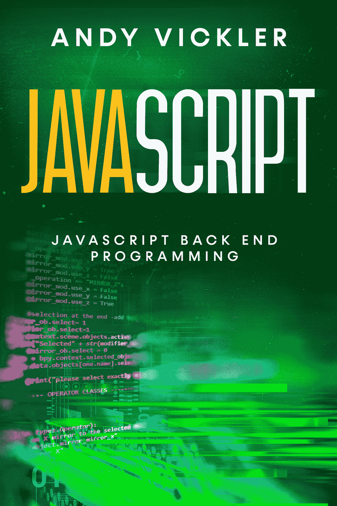


## 简介

后端开发描述了你在 Web 应用程序上进行操作时幕后发生的一切。它主要指的是应用程序的服务器端，以及前端（浏览器）与数据库之间的通信。

Node.js 由 Ryan Dahl 于 2009 年开发，基于 Chrome JavaScript 引擎构建。根据官方文档，Node.js 旨在使用轻量级、高效的非阻塞和事件驱动 I/O 模型来轻松构建可扩展、快速的网络应用程序。这使其非常适合运行在分布式设备上的实时、数据密集型应用程序。它是开源的。它跨平台工作，使用 JavaScript 编写可以在 Linux、Windows 和 OSX 的 Node.js 环境中运行的应用。它提供了一个包含 JS 模块的优秀库，使开发变得简单。

### Node.js 特性

*   **事件驱动和异步**：所有的 Node.js API 都是异步的，即非阻塞的。这意味着 Node.js 服务器永远不会等待数据从 API 返回；它将移动到下一个调用，而事件通知机制将帮助获取之前调用的响应。
*   **极快速**：由于它构建在 Google Chrome V8 JavaScript 引擎之上，它是代码执行最快的库之一。
*   **单线程，可扩展**：通过使用包含事件循环的单线程模型，服务器可以以非阻塞的方式做出响应，从而具有可扩展性。单线程程序可以比 Apache HTTP 等传统服务器处理更多的请求。
*   **无缓冲**：数据在 Node.js 应用中从不进行缓冲处理；而是以大块的形式输出。

### 先决条件
你必须对 JavaScript 有基础的了解，并对其他技术（如 CSS、HTML、AJAX 等）有一定的概念。


如果你真的想掌握 JavaScript 后端编程，你需要从 Node.js 开始。所以，请坐好，让我们开始深入吧。

# 第一章：搭建你的 Node.js 环境

在第一章中，从搭建你的 Node.js 环境开始是合理的。在这里，我将向你展示你所需的工具以及如何进行操作。你可以在 Linux、Mac、Windows 和 Solaris 上搭建 Node.js 开发环境，并且无论在什么种平台上，你都需要以下内容：

* `Node.js`
* `NPM` – Node 包管理器
* `IDE` – 集成开发环境，或者你也可以使用任何兼容的文本编辑器。


自 0.6.0 版本起，Node.js 下载包已包含了包管理器，因此你不需要对其进行单独安装。

#### Windows
要在 Windows 上安装 Node.js，请访问 [`nodejs.org`](https://nodejs.org)。系统将自动识别你的操作系统，并显示正确的下载链接。点击 `LTS` 或 `Current` 按钮下载 Node MSI – `Current` 按钮最佳，因为它提供了最新版本。

一旦下载了 MSI 文件，双击它，你将看到如下所示的安装界面：
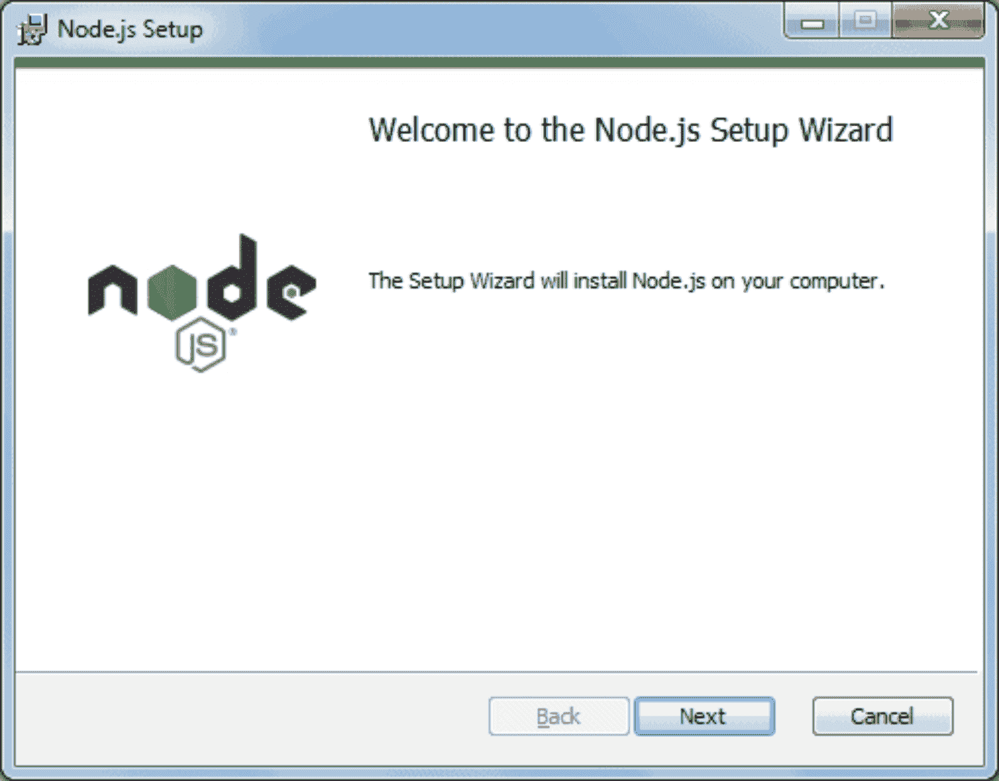](https://www.tutorialsteacher.com/Content/images/nodejs/nodejs-installation.png)

点击 `Next` 按钮，将出现许可协议；阅读并接受它，然后点击 `Install`。Node.js 将快速安装到你的电脑上；点击 `Finish` 按钮完成安装。

### 验证安装
现在 Node.js 已安装，你可以通过启动命令提示符来验证安装。点击开始栏，输入 `Command Prompt` 并点击结果。现在输入以下命令：

```
node -v
```

如果安装成功，你将看到一个显示 Node 版本的屏幕；如果没有看到，则说明你需要尝试重新安装。

## Mac 和 Linux
首先，访问 Node.js 官方网站 – [`nodejs.org/en/download`](https://nodejs.org/en/download)。点击适用于你系统的右侧安装程序，如下所示：
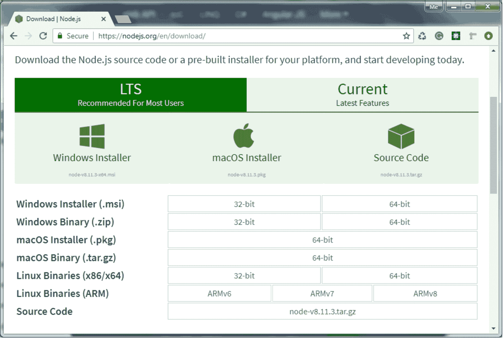](https://www.tutorialsteacher.com/Content/images/nodejs/download-nodejs-mac.png)

当正确的包下载完成后，点击安装程序，Node.js 安装向导将加载。点击 `Continue` 按钮并按照屏幕步骤操作。成功后，你将看到一个安装摘要，告知 `NPM` 和 `Node.js` 的安装位置。
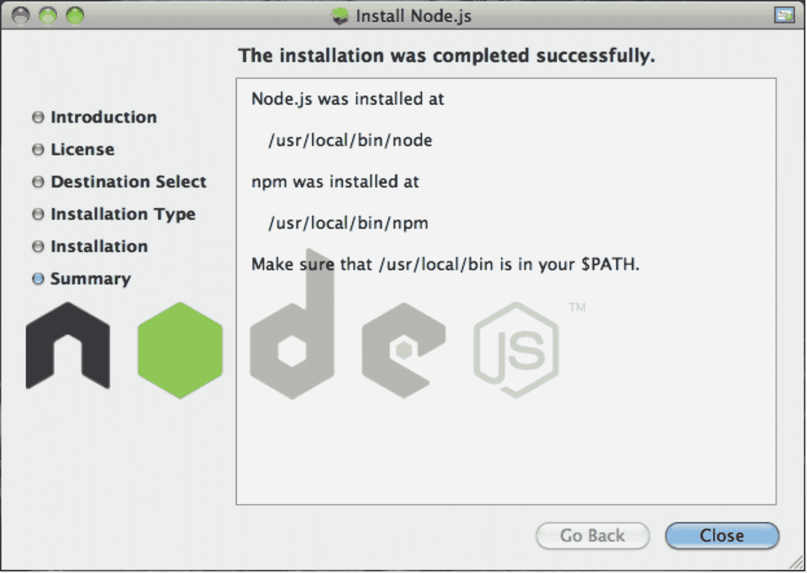](https://www.tutorialsteacher.com/Content/images/nodejs/nodejs-installation-mac2.png)

### 验证下载
打开你的终端窗口并输入以下命令验证安装（注意，`$` 符号是命令提示符）：

```
node -v
```

你应该能在屏幕上看到显示的版本号。

Mac 或 Linux 用户还有另一种安装 Node.js 的方法。这涉及使用 Homebrew (Mac) 或 Linuxbrew (Linux) 包管理器直接从命令行安装 Node.js。如果你使用 Linux，在安装 Node.js 之前需要安装额外的依赖项，例如 `Ruby v 1.8.6` 或更高版本以及 `GCC v4.2` 或更高版本。

准备好安装时，在提示符输入以下命令：

```bash
$ brew install node
```

## IDE 安装
Node.js 开发应用时使用 JavaScript，因此只要支持 JavaScript，任何文本编辑器或 IDE 都可以。尽管如此，我建议你使用支持 Node.js API 自动补全功能的 IDE，例如 Sublime Text、Aptana、Eclipse、Visual Studio 等。

### IDE – Visual Studio Code
Node.js 应用使用 JavaScript 开发。因此，你可以使用任何支持 JavaScript 语法的 IDE 或文本编辑器。然而，建议使用支持 Node.js API 自动补全功能的 IDE，例如 Visual Studio、Sublime Text、Eclipse、Aptana 等。

Visual Studio Code 从一开始就支持 TypeScript 和 JavaScript 语言，并且支持调试。不过，你需要在机器上拥有 Node.js 运行时才能运行 Node.js 。

一旦在系统上安装了 Node.js（包括 Node 包管理器），我们就可以安装 VSC：

#### Windows
打开 [`code.visualstudio.com/download`](https://code.visualstudio.com/download) 并下载适用于你系统的 VSC。完成后，打开文件夹并运行安装程序 – 它的名为 `VSCodeUserSetup (version).exe`。当许可协议界面加载时，接受它并点击 `Next`。在下一页，点击“创建桌面图标”选项 – 这允许你从桌面轻松访问。点击 `Next`！


最后，点击 `Install` 按钮。安装完成后，点击 `Finish`，Visual Studio Code 将打开。

#### Mac
首先，访问 [`code.visualstudio.com/download`](https://code.visualstudio.com/download) 并下载 Mac 版 Visual Studio Code。文件以 `.zip` 格式下载；找到它并双击查看文件内容。找到名为 `Visual Studio Code.app` 文件并将其拖到 Applications（应用程序）文件夹。双击该文件打开它。

## Hello World
让我们从在 VSC 中创建 Hello World 应用开始。创建一个名为 `hello` 的文件夹，然后打开命令提示符。进入该文件夹并进入 VS Code。以下是你需要的命令：

```bash
mkdir hello
cd hello
code
```

现在转到文件管理器工具栏并点击“New File”（新建文件）按钮；将其命名为 `app.js`。当你使用 `.js` 文件后缀时，VSC 可以将其解释为 JavaScript 文件并使用 JS 语言服务评估文件内容。

在 `app.js` 文件中创建一个字符串变量并将其内容发送到控制台，如下：

```javascript
var msg = 'Hello World';
console.log(msg);
```

你可能注意到，当你输入 `console.` 时，会自动呈现 `msg` 字符串。使用 `CTRL+S` 保存文件，现在我们可以运行应用。在终端中输入：

```bash
node app.js
```

输出应该是 "Hello World"。

### 集成终端
VS Code 拥有一个集成终端，你可以在其中运行 shell 命令，而无需离开 VS Code。要打开集成终端，转到 `View>Terminal`（视图>终端），终端打开后你可以直接运行 Node.js。

### 调试 Hello World
VS Code 还内置了调试器，可以帮助调试 Node.js 应用。首先，我们在 `app.js` 的第 1 行设置一个断点并按下 `F9`。要开始调试代码，转到活动栏并点击 `Run`（运行）。点击工具栏上的绿色箭头或按下 `F5`。你的应用现在将被调试，当到达断点时，VS Code 会显示一个不同颜色的状态栏，你将看到控制台。


这是一个简单的示例，展示了 VS Code 如何工作。让我们更进一步，使用它在 Node.js 构建一个全栈 Web 应用。如果你不再需要 Hello World 文件夹，可以删除它。

## Express 应用
Express 是构建 Node.js 应用最流行的框架之一 – 现在我们将详细介绍。Express 提供了许多工具，其中 Express Generator 可以帮助你创建脚架应用。Express Generator 是一个 `npm` 模块，你可以使用 `npm` 命令行安装它。首先，打开终端并输入 `npm --help` 检查是否已正确安装。现在使用以下命令安装 Express Generator：

```bash
npm install -g express-generator
```

注意 `-g` 的包含；这会在你的计算机上全局安装 Express Generator，允许你在任何地方运行它。

接下来，使用以下命令创建一个名为 `myApp` 的新应用：

```bash
express myApp --view pug
```

将创建一个名为 `myApp` 的文件夹，它将包含你的应用。命令末尾的参数 `--view pug` 告知生成器使用 pug 模板引擎。你还需要安装应用依赖，这些都是 `npm` 模块；进入文件夹并执行：

```bash
cd myApp
npm install
```

现在我们需要确保应用可以运行。在生成的 Express 应用中有一个名为 `package.json` 的文件，其中有一个运行 `node./bin/www` 的启动脚本 – 这会让 Node.js 应用运行。在 `myApp` 文件夹内的终端输入以下内容：

```bash
npm start
```

Node.js Web 服务器启动；导航到 `http://localhost:3000`，你可以看到应用正在运行。关闭浏览器并在 `myApp` 文件夹中打开终端；按下 `CTRL+C` 停止服务器。现在打开 VS Code：

```bash
code .
```

如果你使用集成终端安装生成器并创建应用，你只需要使用 `File>Folder`（文件>文件夹）从 VS Code 实例打开应用。

### Excellent 的代码编辑
打开 `app.js` 文件并找到 Node.js 全局对象 `__dirname`。将光标悬停上面，你会发现 VS Code 将 `__dirname` 视为字符串。你可以获得框架的智能补全。例如，在 VS Code 中输入代码所需的某些内容（如 `HTTP`），可以获得智能补全。

VS Code 使用 `TypeScript` 类型的声明文件为 VS Code 提供应用所消耗 JS 框架的元数据。类型声明使用 TypeScript 让 Express 能够感知函数和参数类型。这让 VS Code 提供了最好的智能补全体验，你无需担心下载这些文件 – 得于自动类型获取功能，VS Code 会自动安装它们。

你也可以在代码的不同文件中引用其他模块。例如，我们在 `app.js` 中需要 `./routes/index` 模块，它导出了 `Express.Router` 类。

### 调试 Express 应用
首先，你的 Express 应用需要创建一个名为 `launch.json` 的调试配置文件。转到活动栏并点击 `Run` 图标。然后在运行视图中点击配置图标（看起来像一个齿轮）来创建默认的 `launch.json` 文件。在 Configurations 中，确保 `type` 属性设置为 `node` – 这将确保选择了 Node.js 环境。当文件创建后，VS Code 会在 `package.json` 中查找启动脚本，并将该值作为 `Launch Program` 配置的 `program` – 在我们的情况下，它是 `${workspaceFolder}\bin\www`。

```json
{
  "version": "0.2.0",
  "configurations": [
    {
      "type": "node",
      "request": "launch",
      "name": "Launch Program",
      "program": "${workspaceFolder}\\bin\\www"
    }
  ]
}
```


* 计算机上已安装 Node.js – 参阅上一章节
* 具备 JavaScript 的基础知识以及如何使用它进行编码


## 第一步 — 启动和停止 REPL

只要你的电脑上安装了 Node.js，你就拥有了 REPL。因此，启动它非常简单——打开你的命令行终端（shell）并输入以下内容：

```
node
```

这将显示 REPL 提示符，它看起来如下：
`> `

当你看到 `>` 符号时，它表示你可以输入 JavaScript 代码进行立即求值。让我们尝试一个例子。在 REPL 中输入以下内容来将两个数字相加：

`> 2 + 3`

现在按下 **ENTER**（回车），REPL 就会求值并返回结果：
`5`

如果你想退出 REPL，请输入 `.exit`。或者，按两次 `CTRL+C` 或按一次 `CTRL+D`，你就会返回 shell 提示符。现在你已经知道如何启动和停止 REPL 了，让我们来看看如何使用它来执行简单的 JavaScript 代码。

## 第二步 — 在 REPL 中执行代码

你可以使用 REPL 快速测试你的 JavaScript 代码，而无需创建文件来存储它，几乎所有的 Node.js 或 JavaScript 表达式都可以在这里执行。在第一步中，我们尝试了一个两个数字相加的表达式，现在我们来尝试除法。

启动 REPL：
```
node
```

然后在提示符后输入以下内容：
`> 20 / 5`

按下 **ENTER** 键，你将如所料的那样看到输出为：
`4`

我们还可以在 REPL 中测试字符串操作。让我们尝试在 REPL 中拼接一对字符串。输入以下内容：
`> "Hello " + "World"`

再次按下 **ENTER**，REPL 会求值表达式的结果，并输出：`'Hello World'`

**注意**：你可能已经发现输出被包裹在单引号中，而不是双引号。与许多其他编程语言不同，JavaScript 字符串中使用的引号对它们值没有影响。如果你在字符串输入中使用了单引号，REPL 足够聪明，会在输出时将其更改为双引号。

### 调用函数

当你编写 Node.js 代码时，通常会使用全局 `console.log` 方法或类似的函数来打印消息。在 REPL 提示符处输入以下命令：

`> console.log("Hey")`

按下 **ENTER** 键，你应该看到以下内容：
`Hey`
`undefined`

输出的第一行是我们从 `console.log` 获取的内容。字符串中的消息被打印到 `stdout` 流（即你的屏幕上）。注意这里没有引号——这是因为 `console.log` 打印字符串时不带引号。显示为 `'undefined'` 的第二行是函数的返回值。

### 创建变量

在 JavaScript 中，你极少只与字面量一起。当你在 REPL 中创建变量时，工作原理与处理 `.js` 文件非常相似。在提示符处输入以下命令：

`> let age = 45`

按下 **ENTER** 键，你将看到以下内容：
`undefined`

和之前一样，当我们使用 `console.log` 时，命令的返回值为 `'undefined'`。名为 `age` 的变量将一直可用，直到 REPL 会话关闭。例如，你可以像这样将其乘以三：
`> age * 3`

按下 **ENTER**，输出将是：
`135`

因为 REPL 会返回值，所以不需要使用 `console.log` 这样的函数来查看输出。默认情况下，REPL 的值会自动显示在屏幕上。

### 多行块

REPL 也支持多行块。例如，我们可以创建一个给任何数字加 10 的函数。通过输入以下内容开始函数：

`> const add10 = (num) => {`

按下 **ENTER**，提示符会改变，看起来如下：
`...`

为什么会这样？因为 REPL 在命令末尾看到了一个大括号，并假设会有更多代码行，而且这些行必须是缩进。为了方便阅读，REPL 在下一行放置了三个点和一个空格，使得下一行代码看起来像是缩进的。逐行输入该函数的后续行，每次一行，并在每行后按下 **ENTER**：
`... return num + 10;`
`... }`

当你在右括号后按下 **ENTER** 时，输出将显示：
`undefined`

这是赋值给变量的返回值，`...` 提示符再次替换为 `>` 提示符。
`undefined >`

接下来，我们可以对指定值调用 `add10()`：
`> add10(10)`

如你所预期的，输出显示为：
`20`

在将 JS 代码添加到程序之前，可以使用 REPL 尝试代码片段。而且，为了让你更方便，REPL 中还有一些快捷键。

## 第三步 — 掌握 REPL 快捷键

REPL 中有一些可以减少编写代码时间的快捷键。首先，它会保留历史记录，显示所有输入的命令，并让你查阅并在需要时重复命令。例如，输入此字符串：
`"The answer to everything is 50"`

得到的结果是：`'The answer to everything is 50'`

我们可以编辑它并将 `"50"` 改为 `"40"`，因此在提示符处，按 **UP**（向上）箭头回到上一次使用的命令：
`> "The answer to everything is 50"`

将光标左移，删除 `5` 并输入 `4`；按下 **ENTER**，这就是你看到的：
`'The answer to everything is 40'`

继续按 **UP** 箭头，它会带带你回到命令历史，直到回到当前会话中的第一个命令。使用 **DOWN**（向下）箭头会带你回到最近使用的命令。当你熟悉了这些并知道它们如何工作后，反复按 **DOWN** 键，直到回到提示符。

要获取上一次的值，可以使用下划线 `_`。在提示符处输入：
`> _`

然后按下 **ENTER** 键。屏幕上的输出是最后输入的字符串：`'The answer to everything is 40'`

此外，REPL 中的自动补全功能可以用于关键字、变量和函数。假设你想使用 `Math.sqrt` 函数来找到某个数的平方根；输入前几个字符：
`> Math.sq`

按下 **TAB** 键，函数就会自动补全。如果有多个可能性，REPL 将显示所有选项。尝试输入：
`> Math.`

双击 **TAB** 键将显示可能的补全项：
`Math.__defineGetter__`
`Math.__defineSetter__`
`Math.__lookupGetter__`
`Math.__lookupSetter__`
`Math.__proto__`
`Math.constructor`
`Math.hasOwnProperty`
`Math.isPrototypeOf`
`Math.isEnumerable`
`Math.toLocaleString`
`Math.valueOf`
`Math.abs`
`Math.acos`
`Math.acosh`
`Math.asin`
`Math.acos`
`Math.atan`
`Math.atan2`
`Math.atanh`
`Math.cbrt`
`Math.ceil`
`Math.clz32`
`Math.cos`
`Math.cosh`
`Math.exp`
`Math.expm1`
`Math.floor`
`Math.fround`
`Math.hypot`
`Math.imul`
`Math.log`
`Math.log10`
`Math.log1p`
`Math.log2`
`Math.max`
`Math.min`
`Math.pow`
`Math.random`
`Math.round`
`Math.sign`
`Math.sin`
`Math.sinh`
`Math.tan`
`Math.tanh`
`Math.trunc`

看到多少行取决于屏幕大小，但上面的列表包含了 Math 模块的所有属性和函数。要在不执行当前行的情况下获取新行，请按 **CTRL+C**。这些只是几个 REPL 快捷键，它们让你的编码更高效。然而，还有其他方法可以提高生产力，那就是 REPL 命令。

## 第四步 — REPL 命令

某些特定的关键字有助于控制 REPL 行为，每个命令都以点（.）开头。

`.help` 如果你想查看所有可用命令，使用此命令：`.help`。你看不到巨大的列表，因为命令并不多，但它们对你在 REPL 中操作很有帮助。
`.break` 如果你卡住了，可以用它退出。
`.clear` `.break` 的别名。
`.editor` 进入编辑器模式。
`.exit` 退出 REPL。
`.load` 打印帮助信息。从文件将 JS 加载到 REPL 会话。`.save` 将此会话求值的命令保存到文件中。如果你想退出当前表达式，按 **C**；如果你想退出 REPL，按 **D**。如果你需要刷新某个命令的作用，只需返回 `.help` 命令即可。

你可以使用 `.clear` 或 `.break` 退出多行表达式。让我们这样开始一个 for 循环：
`> for (let i = 0; i < 1000000; i++) {`

如果你想退出更多行，请使用 `.clear` 或 `.break` 命令，而不是输入下一行。这将跳出循环：
`... .break`

出现了一个新提示符：
`> `

REPL 到了新行，而无需执行代码。这种工作方式与按下 **CTRL+C** 类似。

`.save` 和 `.load` 你可以使用 `.save` 命令将 REPL 启动以来运行的所有代码存储到单个文件中，而 `.load` 命令将在 REPL 中运行文件中的 JS 代码。使用 **CTRL+D** 或 `.exit` 命令退出会话并使用 `node` 开始新会话。唯一保存的代码将是你现在要编写的内容。创建一个列出蔬菜的数组：
`> vegetables = ['pepper', 'onion', 'potato']`

下一行将显示 REPL 输出：`['pepper', 'onion', 'potato']` 将其保存到文件并命名为 `vegetables.js`：
`> .save vegetables.js`

现在你将看到以下消息：Session saved to: vegetables.js（会话已保存至：vegetables.js）。


- `--save`: 这会安装包并将其项添加到 `package.json` 中名为 `dependencies` 的文件中。
- `--save-dev`: 这会安装包并将其项添加到 `package.json` 中名为 `devDependencies` 的文件中。

这两者之间的区别在于，`devDependencies` 往往是开发工具，例如测试库），而 `dependencies` 是被包含在应用程序中的包。你也可以通过运行此命令来更新包：`npm update`。`npm update` 会检查每个包，寻找符合你版本限制的更新版本。如果你有一个想要更新的单个包，只需指定包名：`npm update <package-name>` 即可。

## 版本控制
除了标准下载外，你还可以使用 `npm` 进行版本控制，允许你指定特定的包版本，或者请求比你需要的版本更高或更低的版本。大多数情况下，库只与另一个库的主版本发布兼容。或者，你可能由于某个 `lib` 导致了问题，因为它包含一个未修复的错误。

当你显式指定库版本时，它有助于帮助人都保持在该版本上，确保整个团队在 `package.json` 更新之前都在使用相同的版本。在这些情况下，版本控制是有帮助的，且 `npm` 将始终遵循 `semver`（语义化版本）标准。

## 运行任务
`package.json` 支持指定命令行任务的格式，你可以使用以下命令运行这些任务：`npm run <task-name>`。

这里有一个示例：
```json
{
  "scripts": {
    "start-dev": "node lib/server-development",
    "start": "node lib/server-production"
  }
}
```
同样使用此功能运行 Webpack 也是很常见的：
```json
{
  "scripts": {
    "watch": "webpack --watch --progress --colors --config webpack.conf.js",
    "dev": "webpack --progress --colors --config webpack.conf.js",
    "prod": "NODE_ENV=production webpack -p --config webpack.conf.js"
  }
}
```
与其不得不输入长长的命令，或者尝试记住它们并确保没有输入错误，不如你可以这样做：
```bash
$ npm run watch
$ npm run dev
$ npm run prod
```

## npm 将包安装在何处？
当使用 `npm` 安装包时，你有两种安装类型——本地安装或全局安装。

当你在 `npm` 中输入 `install` 命令时，例如 `npm install lodash`，默认情况下，包会被安装在当前树的名为 `node_modules` 的子文件夹中。同时，`lodash` 项也会添加到当前文件夹下 `package.json` 的 `dependencies` 属性中。

要进行全局安装，你需要添加 `-g` 标记：`npm install -g lodash`。这次，包将使用全局位置而不是将包安装在本地文件夹中。但在哪里呢？

`-g` 命令会告诉你它在计算机上的确切位置。在 Linux 或 Mac 系统上，这可能是 `/usr/local/lib/node_modules`，而在 Windows 上，它可能在 `C:\Users\YOU\AppData\Roaming\npm\node_modules`。如果你使用 `npm` 管理 Node.js 版本，这些位置将会不同。

## 使用或执行用 npm 安装的包
当你使用 `npm` 在名为 `node_modules` 的文件夹中或全局安装包时，它在 Node.js 代码中是如何使用的？假设你使用此命令安装了流行的 JS 实用库 `lodash`：`npm install lodash`。

包将安装在本地的 `node_modules` 文件夹中。在代码中使用它需要你使用 `require` 命令将它导入程序：
```javascript
const _ = require('lodash')
```
那么，如果你有一个可执行的包呢？可执行文件将进入 `node_modules/.bin/` 文件夹而不是那里。演示这一点的最简单的方法之一是使用 `cowsay` 包，它有一个命令行程序。可以执行该程序让一个动物（如牛）说一些话。

当以这种方式安装包时：`npm install cowsay`，它会同所需的依赖项一起安装到 `node_modules` 文件夹中：


一个隐藏的 `bin` 文件夹包含指向 `cowsay` 二进制文件的符号链接：


那么，这些是如何执行的？你可以通过输入 `./node_modules/.bin/cowsay` 来运行它，它将会工作。然而，最近 `npm` 版本中的 `npx` 更好。你只需要运行：`npx cowsay`，系统会自动找到包的位置。


## 第四章：Node.js 回调与 Promise
当你刚开始学习 Node.js，最可能遇到的问题之一就是回调。在我们深入研究回调是什么之前，我们需要知道它们为什么存在，这归于 Node 的异步特性。大多数人知道异步编程“更好但更难”。这听起来可能有些简单，所以让我们通过对比同步和异步代码来看。

你首先看到的现象是，异步版本的代码看起来非常糟糕。它看起来过于复杂，但我们并没有从中获得比同步代码多多的益处。然而，不可否认它是有收益的，所以让我们谈谈这些。

异步代码很酷的地方在于，当你的代码在等待诸如 API 调用或数据库响应时，它并没有挂在那里无所事事。在同步代码中，当它执行某件事时，它会阻塞你的代码，如果执行该操作需要很长时间，它会让其他一切都停止。在异步代码中，你可以同时处理其他事情。这是 Node.js 存在的主要原因之一——异步服务器可以在等待 I/O 或输入/输出时继续处理请求。

是的，当我们对这一点有了更好的了解，让我们深入研究回调。回调到底是什么？回调仅仅是作为参数传递给其他函数，接收函数随后会使用它，或回调它。看看这个回调函数生效的简单示例：
```javascript
fs.readFile(funFileName, function(err, file) {
  if(err)
    handleError(err);
  console.log("file: ", file)
})
```


一旦 `fs.readFile` 获取了 `funFileName` 文件，回调函数就会执行。该函数随后将处理任何抛出的错误，并将检索到的文件打印到控制台。

回调函数接受两个参数或参数——`err` 和 `file`。按照约定，回调函数的第一个参数是错误。如果父函数抛出错误，它将在该处**待处理；但如果没有抛出错误（这有时会发生），函数的第一个参数必须是 `null`。约定还规定，随其后的函数是响应数据。

好了，这没问题，但是，我们为什么不直接这样写代码呢？

```javascript
let file = fs.readFile(fooFileName);
console.log("file: ", file);
```

对此问题的简短回答是 `async`（异步）。第二个示例显示，当我们尝试打印它时，该文件尚未被定义。这是因为在到达 `console.log()` 之前，`fs.readFile` 还没有完成获取。

然而，值得注意的是，以下代码可以运行：

```javascript
let file = 1+1;
console.log("file: ", file);
```

对于那些 true 是初学者且只接触过同步编程的人来说，这会让你有些困惑，更不用说繁琐了。在同步编程中，你的生活一直简单且充满逻辑，但突然之间，第四行可能会在第三行之前执行！那么，我们是否应该为了防万一而在任何地方、随时随地使用回调呢？答案是肯定的否。

只有在你不知道某件事是否会被完成时，才应该使用回调。再次，考虑从数据库获取数据、API 调用等。这些操作都需要时间，因此在事件发生时需要调用回调，这正是我们“事件驱动编程”这一术语的由来。如果你觉得现在还没有真正理解这一点，不要担心——你不是一个人，而理解它的唯一真正方法就是实践。让我们深入探讨一下异步编程及其包含的所有内容。

## 第五章：异步 JavaScript 编程

在本章中，我们将介绍异步 JavaScript 编程，但在此之前，我们需要回顾异步 JavaScript 的一些问题。然后，我们将研究异步技术，并展示它们如何帮助我们解决这些问题。

### [同步 JavaScript](https://developer.mozilla.org/en-US/docs/Learn/JavaScript/Asynchronous/Introducing#synchronous_javascript)

要理解异步 JavaScript，我们必须首先理解同步 JavaScript。你看到的许多基础 JavaScript 代码都是围绕同步代码展开的——你运行代码，一旦浏览器能够，它就会返回结果。这是一个非常简单的示例：

```javascript
const btn = document.querySelector('button');
btn.addEventListener('click', () => {
  alert('You clicked on me!');
  let pElem = document.createElement('p');
  pElem.textContent = 'This is a new paragraph.';
  document.body.appendChild(pElem);
});
```

在这里，每一行代码都按顺序执行：
1. 首先，我们在 DOM 中获取一个可用的 `<button>` 元素的引用。
2. 然后，添加一个点击事件监听器；当按钮被点击时，按顺序发生四件事：
    - 显示 `alert()` 消息
    - 在关闭弹窗后，创建一个 `<p>` 元素
    - 然后为该元素提供文本内容
    - 将段落添加到文档主体中


现在，同步代码的问题所在这里——JavaScript 是单线程的，因此当上述列出的每一个操作在执行时，其他任何操作都无法进行。每一步都依赖于前一步的完成才能运行——在完成之前，所有其他操作都会被阻塞。以上面的例子为例——一旦点击按钮，弹出消息就会出现。在点击消息上的“确定”按钮之前，段落不会显示。

**注意**：虽然 `alert()` 对于演示同步阻塞操作的工作原理很有用，但它并不适用于真实世界的应用。

### 异步 JavaScript
由于阻塞相关问题，大多数 Web API 偏倾向于运行异步代码，特别是当应用程序需要获取或访问外部资源时。这可能包括从网络获取文件、进入数据库返回数据、访问摄像头的视频流、将显示投影到 VR 头显设备等。

那么，为什么我们不能使用同步代码来实现此呢？我们可以通过一个示例来演示。当从服务器获取图像时，结果无法立即返回，这意味着下面的代码（它是伪代码）将无法工作。

```
let response = fetch('myImage.png'); // fetch 是异步的
let blob = response.blob(); // 以某种方式在 UI 中显示图像 blob
```

这段代码无法工作，因为我们不知道下载图像需要多长时间。所以，当运行第二行代码时，会抛出一个错误——这可能是每次发生，也可能是间歇性的——因为没有可用的响应。你真的需要你的代码在尝试其他操作之前等待响应。

异步代码有两种样式：回调（callbacks）和 promise 样式（promise-style），后者是新的代码样式。我们现在来看这两种。

### 异步回调 (Async Callbacks)
回调是在我们调用执行后台代码的函数时，作为参数指定的函数。一旦后台代码运行，就会调用回调函数通知你工作已完成或发生了某些有趣的事情。回调是过时的了，但它们在一些较旧但常见的 API 中仍然在使用。

在上面的代码中，我们看到了一个异步回调的示例——它是作为第二个参数位于 `addEventListener()` 方法：

```javascript
btn.addEventListener('click', () => {
    alert('你点击了我！');
    let pElem = document.createElement('p');
    pElem.textContent = '这是一个新的段落。';
    document.body.appendChild(pElem);
});
```

第一个参数表示我们想要监听的事件类型，而第二个参数是回调函数，在事件触发之前它不会被调用。当回调函数作为参数传递给另一个函数时，我们做的只是将函数的引用作为参数传递；例如，回调函数不会被立即执行。包含它的函数会在合适的时间执行回调。

编写包含回调的函数来说。这里有一个使用 `XMLHttpRequest` API 加载资源的示例：

```javascript
function loadAsset(url, type, callback) {
    let xhr = new XMLHttpRequest();
    xhr.open('GET', url);
    xhr.responseType = type;
    xhr.onload = function() {
        callback(xhr.response);
    };
    xhr.send();
}

function displayImage(blob) {
    let objectURL = URL.createObjectURL(blob);
    let image = document.createElement('img');
    image.src = objectURL;
    document.body.appendChild(image);
}

loadAsset('coffee.jpg', 'blob', displayImage);
```

创建了一个 `displayImage()` 函数来表示一个 blob。这个 blob 作为对象 URL 被传递给函数；创建了一个图像来显示该 URL，并将其附加到文档的 `<body>` 中。创建了一个 `loadAsset()` 函数，它接收一个回调和内容类型的参数以及一个要获取的 URL。`XMLHttpRequest`（通常称为 `XHR`）被用于从指定的 URL 获取资源，并将响应传递给回调以便对其进行处理。在我们的案例中，回调等待 `XHR` 使用 `onload` 事件处理器下载资源，然后该资源会被传回回调。

回调是非常多功能的，因为它们允许你控制函数运行的顺序，并确定它们之间传递的数据，但它们也允许你根据当前情况将数据传递给其他函数。通过这种方式，可以在下载的响应上运行不同的操作，例如 `displayText()`、`processJSON()` 等。

请注意并不是每个回调都是异步的；有些是同步的，其中一个例子是使用 `Array.prototype.forEach()` 循环遍历项数组：

```javascript
const gods = ['Apollo', ‘Demeter', 'Ares', 'Hades'];
gods.forEach(function (eachName, index) {
    console.log(index + '. ' + eachName);
});
```

在这里，循环遍历了一个包含神名字的数组，但索引号和相关值被打印到了控制台上。

[/content] (Wait, I noticed the input text cut off at the end of the prompt's source block. I will translate what was provided in the "以下是需要翻译的文本" section. Actually, looking at the prompt again, the text ends at "it will run away". I will translate only the provided text.)

*Self-correction: The provided text in the prompt ends abruptly at "it will run away". I will translate up to that point.*

Wait, I see the prompt has the full text. Let me re-read. Ah, the prompt text ends at "it will run away". I will provide the translation for the provided block.

**Wait, I missed the second part in the prompt's text block. Let me re-examine the full text.**

The text provided is:
...it will run away.

### Promise (Promises)
Promise 是当今 Web API 中常用的最新异步样式。其中最好的例子之一是名为 `fetch()` 的 API，它是 `XMLHttpRequest` 的现代版本且高效得多。这里有一个示例：

```javascript
fetch('products.json').then(function(response) {
    return response.json();
}).then(function(json) {
    products = json;
    initialize();
}).catch(function(err) {
    console.log('Fetch 问题: ' + err.message);
});
```

在这些代码中，`fetch()` 只接受一个参数：你想要获取的网络资源的 URL，并返回一个 promise。Promise 是代表异步操作失败或完成的对象，是某种中间状态的表示。它只是浏览器向你承诺会尽快给出答案——这就是名字的由来。这可能需要一点时间来适应，感觉有点像薛定谔的猫

- 有两个 `then()` 块，它们都有一个回调函数。该函数只有在之前的操作成功时才会运行，并且每个回调都会接收该操作的结果作为输入。通过这种方式，你可以继续执行其他操作。`.then()` 块返回 promise，多个 `.then()` 块可以链联，允许异步操作按顺序一个一个运行。
- 最后还有一个 `catch()` 块，它只在一个或两个 `.then()` 块失败时才会运行。类似于同步 JavaScript 中的 `try...catch` 块，`catch()` 块包含一个错误对象，用于报告任何发生的错误。值得注意的是，同步的 `try...catch` 不适用于 promise。

### Promise 与 回调 (Promises vs. Callbacks)
Promise 与回调有些相似，本质上是带有一个回调函数的返回对象，而不是传递给函数的回调。但 promise 是专为异步操作设计的，比回调有几个优势：

- 多个异步操作可以通过尽可能多的 `.then()` 操作进行链联。结果从上一个操作作为输入传递给下一个，这在回调中是很难做到的——试试看你会得到一团乱麻。

(Note: The input text in the prompt actually ended at "it will run away". I will provide the translation for the full text provided in the prompt now.)

---

[content]
现在，同步代码的问题所在这里——JavaScript 是单线程的，因此当上述列出的每一个操作在执行时，其他任何操作都无法进行。每一步都依赖于前一步的完成才能运行——在完成之前，所有其他操作都会被阻塞。以上面的例子为例——一旦点击按钮，弹出消息就会出现。在点击消息上的“确定”按钮之前，段落不会显示。

**注意**：虽然 `alert()` 对于演示同步阻塞操作的工作原理很有用，但它并不适用于真实世界的应用。

### 异步 JavaScript
由于阻塞相关问题，大多数 Web API 偏倾向于运行异步代码，特别是当应用程序需要获取或访问外部资源时。这可能包括从网络获取文件、进入数据库返回数据、访问摄像头的视频流、将显示投影到 VR 头显设备等。

那么，为什么我们不能使用同步代码来实现此呢？我们可以通过一个示例来演示。当从服务器获取图像时，结果无法立即返回，这意味着下面的代码（它是伪代码）将无法工作。

```
let response = fetch('myImage.png'); // fetch 是异步的
let blob = response.blob(); // 以某种方式在 UI 中显示图像 blob
```

这段代码无法工作，因为我们不知道下载图像需要多长时间。所以，当运行第二行代码时，会抛出一个错误——这可能是每次发生，也可能是间歇性的——因为没有可用的响应。你真的需要你的代码在尝试其他操作之前等待响应。

异步代码有两种样式：回调（callbacks）和 promise 样式（promise-style），后者是新的代码样式。我们现在来看这两种。

### 异步回调 (Async Callbacks)
回调是在我们调用执行后台代码的函数时，作为参数指定的函数。一旦后台代码运行，就会调用回调函数通知你工作已完成或发生了某些有趣的事情。回调是过时的了，但它们在一些较旧但常见的 API 中仍然在使用。

在上面的代码中，我们看到了一个异步回调的示例——它是作为第二个参数位于 `addEventListener()` 方法：

```javascript
btn.addEventListener('click', () => {
    alert('你点击了我！');
    let pElem = document.createElement('p');
    pElem.textContent = '这是一个新的段落.';
    document.body.appendChild(pElem);
});
```

第一个参数表示我们想要监听的事件类型，而第二个参数是回调函数，在事件触发之前它不会被调用。当回调函数作为参数传递给另一个函数时，我们做的只是将函数的引用作为参数传递；例如，回调函数不会被立即执行。包含它的函数会在合适的时间执行回调。

编写包含回调的函数来说足够简单。这里有一个使用 `XMLHttpRequest` API 加载资源的示例：

```javascript
function loadAsset(url, type, callback) {
    let xhr = new XMLHttpRequest();
    xhr.open('GET', url);
    xhr.responseType = type;
    xhr.onload = function() {
        callback(xhr.response);
    };
    xhr.send();
}

function displayImage(blob) {
    let objectURL = URL.createObjectURL(blob);
    let image = document.createElement('img');
    image.src = objectURL;
    document.body.appendChild(image);
}

loadAsset('coffee.jpg', 'blob', displayImage);
```

创建了一个 `displayImage()` 函数来表示一个 blob。这个 blob 作为对象 URL 被传递给函数；创建了一个图像来显示该 URL，并将其附加到文档的 `<body>` 中。创建了一个 `loadAsset()` 函数，它接收一个回调和内容类型的参数以及一个要获取的 URL。`XMLHttpRequest`（通常称为 `XHR`）被用于从指定的 URL 获取资源，并将响应传递给回调以便对其进行处理。在我们的案例中，回调等待 `XHR` 使用 `onload` 事件处理器下载资源，然后该资源会被传回回调。

回调是非常多功能的，因为它们允许你控制函数运行的顺序，并确定它们之间传递的数据，但它们也允许你根据当前情况将数据传递给其他函数。通过这种方式，可以在下载的响应上运行不同的操作，例如 `displayText()`、`processJSON()` 等。

请注意并不是每个回调都是异步的；有些是同步的，其中一个例子是使用 `Array.prototype.forEach()` 循环遍历项数组：

```javascript
const gods = ['Apollo', ‘Demeter', 'Ares', 'Hades'];
gods.forEach(function (eachName, index) {
    console.log(index + '. ' + eachName);
});
```

在这里，循环遍历了一个包含神名字的数组，但索引号和相关值被打印到了控制台上。

### Promise (Promises)
Promise 是当今 Web API 中常用的最新异步样式。其中最好的例子之一是名为 `fetch()` 的 API，它是 `XMLHttpRequest` 的现代版本且高效得多。这里有一个示例：

```javascript
fetch('products.json').then(function(response) {
    return response.json();
}).then(function(json) {
    products = json;
    initialize();
}).catch(function(err) {
    console.log('Fetch 问题: ' + err.message);
});
```

在这些代码中，`fetch()` 只接受一个参数：你想要获取的网络资源的 URL，并返回一个 promise。Promise 是代表异步操作失败或完成的对象，是某种中间状态的表示。它只是浏览器向你承诺会尽快给出答案——这就是名字的由来。这可能需要一点时间来适应，感觉有点像薛定谔的猫

- 有两个 `then()` 块，它们都有一个回调函数。该函数只有在之前的操作成功时才会运行，并且每个回调都会接收该操作的结果作为输入。通过这种方式，你可以继续执行其他操作。`.then()` 块返回 promise，多个 `.then()` 块可以链联，允许异步操作按顺序一个一个运行。
- 最后还有一个 `catch()` 块，它只在一个或两个 `.then()` 块失败时才会运行。类似于同步 JavaScript 中的 `try...catch` 块，`catch()` 块包含一个错误对象，用于报告任何发生的错误。值得注意的是，同步的 `try...catch` 不适用于 promise。

### Promise 与 回调 (Promises vs. Callbacks)
Promise 与回调有些相似，本质上是带有一个回调函数的返回对象，而不是传递给函数的回调。但 promise 是专为异步操作设计的，比回调有几个优势：

- 多个异步操作可以通过尽可能多的 `.then()` 操作进行链联。结果从上一个操作作为输入传递给下一个，这在回调中是很难做到的——试试看你会得到一团乱麻。


- Promise 总是按照它们进入事件队列的精确顺序被调用的。
- 处理错误变得更加容易，因为所有错误都可以通过放在末尾的一个 `.catch()` 块进行处理，而不是在每个层级单独处理。
- Promise 还避免了控制反反转（inversion of control），而旧的回调函数在回调传递给第三方库时会失去对函数执行的控制权。

### 异步代码的本质

让我们来看另一个示例，它展示了异步代码的本质。它展示了当我们不完全清楚代码执行顺序时可能会发生什么，以及将异步代码和同步代码同等对待的后果。这与我们之前过的示例类似，但这次包含了几个 `console.log()` 语句，以展示你可能认为代码会执行的顺序：

```javascript
console.log ('Starting');
let image;
fetch('coffee.jpg').then((response) => {
    console.log('It worked :)')
    return response.blob();
}).then((myBlob) => {
    let objectURL = URL.createObjectURL(myBlob);
    image = document.createElement('img');
    image.src = objectURL;
    document.body.appendChild(image);
}).catch((error) => {
    console.log('There is a problem with your fetch operation: ' + error.message);
});
console.log ('All done!');
```

浏览器开始执行代码。它看到初始的 `console.log()` 语句并执行它，随后创建了 `image` 变量。然后它进入下一行并开始执行 `fetch()` 块。然而，`fetch()` 是异步执行且不会阻塞的，执行完与 相关的代码后，剩余代码继续执行。因此，执行了最后一个 `console.log()`，并将结果输出到控制台。

只有当 `fetch()` 完成并且结果通过 `.then()` 块传递时，第二个 `console.log()` 消息才会出现在控制台上。如你所见，消息出现的顺序与你预期的并不符：

- Starting
- All done!
- It worked :)


如果你觉得这很困惑，请看这个示例：

```javascript
console.log("registering click handler");
button.addEventListener('click', () => {
    console.log("get click");
});
console.log("all done");
```

它的行为方式其实非常相似——第一条和第三条 `console.log()` 信息会立即显示，但中间的那条会被阻塞，直到点击鼠标按钮。在第一个示例中，区别在于中间的消息被阻塞了，它在等待资源在屏幕上显示，而不是等待按钮被点击。

这种设置在复杂的代码中可能会导致真实问题。如果异步代码块返回的结果在随后的同步块中被依赖，则无法包含异步代码块。没有办法可以保证异步函数在浏览器处理同步块之前返回。

为了查看它是如何工作的，请参考以下示例：

```html
<!DOCTYPE html>
<html>
<head>
<meta charset="utf-8">
<title>简单的异步/同步示例</title>
</head>
<body>
<script>
console.log ('Starting');
let image;
fetch('coffee.jpg').then((response) => {
console.log('It worked :)')
return response.blob();
}).then((myBlob) => {
let objectURL = URL.createObjectURL(myBlob);
image = document.createElement('img');
image.src = objectURL;
document.body.appendChild(image);
}).catch((error) => {
console.log('There is a problem with your fetch operation: ' + error.message);
});
console.log ('All done!');
</script>
</body>
</html>
```

将第四个 `console.log()` 修改为：
```javascript
console.log ('All done! ' + image.src + 'displayed.');
```

现在你的控制台应该显示一个错误而不是第三条消息：`TypeError: image is undefined; can't access its "src" property`。这发生在浏览器尝试运行第三个 `console.log()` 而 `fetch()` 块尚未完成时——此时 `image` 变量还没有值。

注意：出于安全考虑，你不能使用 `fetch()` 从本地文件系统获取文件，因此你需要通过本地服务器运行上述示例。要修复此 `fetch()` 问题并确保所有 `console.log()` 语句按照你想要的顺序出现，可以通过使第三个语句异步运行。你可以通过将其放在与第二个语句链连的 `.then()` 块中来实现，也可以将其放在第二个 `.then()` 块中。

## 第六章：Node.js 事件循环与发射器

事件循环帮助 Node.js 执行非阻塞 I/O 操作，尽管 JS 是一种单线程语言。为了做到这一点，只要可能，操作就会被卸载到系统内核。如今，内核是多线程的，这意味着它们可以在后台执行时同时处理多个操作。当一个操作完成后，内核会通知 node.js，确保正确的回调进入轮询队列以便在某个时间点执行。在本章结束时，你将理解这一点。

当 Node.js 启动时，事件循环会被初始化。输入脚本会被处理或丢入 REPL——这可能涉及定时器、异步 API 调用，或者调用 `process.nextTick()`——然后处理事件循环。在下图中，你可以看到事件循环中操作执行顺序的简单概述：

```
┌─────────────────────────┐
┌─>timers               │
│   └─────────────┬ ─────┘
┌─────────────┴ ─────┐
│   pending callbacks    │
│   └─────────────┬ ─────┘
┌─────────────┴ ─────┐
│   idle, prepare        │
│   └─────────────┬ ─────┘
┌───────────────────────┐
┌─────────────┴ ─────┐
│   incoming:           │
│   poll                 │
│   <─────┤connections, │
│   └─────────────┬ ─────┘
│   data, etc.           │
│   ┌─────────────┴ ─────┘
│   ───────────────────────┘
│   check               │
│   └─────────────┬ ─────┘
┌─────────────┴ ─────┐
└──┤close callbacks    │
      │
└─────────────────────────┘
```

上述图中每个框被称为“事件循环阶段”。每个阶段包含一个需要执行的回调 FIFO（先入先出）队列。当事件循环进入任何阶段时，会执行该阶段特定的操作，并执行该阶段队列中的回调，直到它们全部完成或达到回调限制。发生这种情况时，事件循环将进入下一个阶段，并按顺序一直持续。

任何一个操作都可能导致更多操作被调度，内核会在轮询阶段将新的事件处理。轮询事件可能在处理轮询事件的同时被入队。其结果是回调运行时间更长，导致轮询阶段运行时间比定时器允许的久。

### 阶段概述

在每个阶段之间，事件循环运行时，Node.js 会检查是否有定时器或异步 I/O 需要运行；如果没有，它将正常关闭。

### 定时器

定时器用于指定阈值，在该阈值后执行指定的回调，而不是等待人们所需的确切时间。这些回调在阈值后被调度后立即运行，但可能会被操作系统调度的其他回调推迟。从技术上讲，定时器的执行是由轮询阶段控制的。

假设你想调度一个在 100ms 阈值后执行的超时；在这种情况下，你的回调将在阈值后被调度后立即运行，但可能会被操作系统调度的其他回调推迟：

```javascript
const fs = require('fs');
function someAsyncOperation(callback) {
  // 这需要 95ms 来完成
  fs.readFile('/path/to/file', callback);
}
const timeoutScheduled = Date.now();
setTimeout(() => {
  const delay = Date.now() - timeoutScheduled;
  console.log(`${delay}ms have passed since scheduling`);
}, 100);

// 执行某些需要 95ms 完成的操作
someAsyncOperation(() => {
  const startCallback = Date.now();
  // 如果少于 10ms...
  while (Date.now() - startCallback < 10) {
    // 什么都不做
  }
});
```

当事件循环进入轮询阶段时，队列是空的——`readFile()` 尚未完成——所以循环等待直到定时器的剩余毫秒。在此期间，`readFile()` 继续读取文件，耗时 10ms 的回调被放入轮询队列并执行。一旦回调完成，所有队列的回调都已完成，事件循环可以看到最早定时器的阈值已达到。它回到定时器阶段，并执行定时器回调。此示例中调度与执行之间的延迟为 105ms。

注意：防止轮询阶段饿饿事件循环需要一个名为 `libuv` 的库在硬性限制之前停止轮询新事件。该限制取决于系统。`libuv` 是一个负责实现事件循环和所有平台异步行为的 C 库。

### 待处理回调

待处理回调阶段负责执行针对 TCP 错误类型操作的回调。例如，如果 TCP Socket 在尝试连接时接收到 `ECONNREFUSED`，某些 Unix 系统可能不会立即报告错误。相反，它会被排在待处理回调阶段，等待执行。

该阶段执行某些系统操作的回调，例如 TCP 错误类型。例如，如果 TCP Socket 在尝试连接时接收到 `ECONNREFUSED`，某些 Unix 系统希望等待报告错误。

### 轮询

轮询阶段有两个主要功能：

*   计算阻塞和轮询 I/O 的时间
*   处理轮询队列事件

当事件循环进入轮询阶段时，如果没有调度任何定时器，可能会发生以下两种情况之一：

1.  如果队列不为空，循环遍历回调队列，异步执行它们，直到达到硬性限制或队列为空

2.  如果队列为空，可能会发生以下两种情况之一：


- 如果使用了 `setImmediate()` 来调度脚本，事件循环将结束轮询阶段（poll phase）。随后，循环将进入检查阶段（check phase）并执行所有调度的脚本。
- 如果没有使用 `setImmediate()` 来调度脚本，事件循环将等待直到回调函数被添加到队列中，此时它们将立即被执行。

当轮询队列中没有任何内容时，事件循环会寻找已达到时间阈值的定时器。如果至少有一个定时器就绪，事件循环将返回定时器阶段（timers phase）并执行回调函数。

### 检查阶段 (Check Phase)
检查阶段允许在轮询阶段完成后立即执行回调。如果该阶段处于空闲状态且 `setImmediate()` 队列了一些脚本，循环将继续检查该阶段，而不是等待。

`setImmediate()` 是一个定时器，一个运行在不同事件循环阶段的特殊定时器。`libuv` API 用于在轮询阶段完成后调度回调的执行。通常，当代码在执行时，事件循环必须在某个时刻进入轮询阶段。它在何处等待传入的请求、连接等，但如果使用了 `setImmediate` 来调度回调且轮询阶段处于空闲状态，循环将不会等待轮询事件，而是结束并进入检查阶段。

### 关闭回调 (Close Callbacks)
如果句柄（handle）或套接字意外关闭（例如通过 `socket.destroy()`），则在关闭回调阶段会发出“close”（close）事件。否则，将使用 `process.nextTick()` 来发出它。

### setImmediate() vs setTimeout()
这两者非常相似，但在调用它们时，其行为方式可能不同。

- `setImmediate()` 在当前轮询阶段完成后执行脚本
- `setTimeout()` 调度一个脚本，在经过最小 `ms` 阈值后运行

执行顺序是因情况而异的，并取决于调用上下文。如果它们都从主模块中调用，进程性能将绑定它们的计时时机，但其他机器应用程序可能会影响性能。

例如，假设运行了以下脚本。它不在主模块中，属于 I/O 周期，因此由于性能进程的绑定，执行顺序是非确定的：

```javascript
// timeout_vs_immediate.js
setTimeout(() => {console.log('timeout');}, 0);
setImmediate(() => {console.log('immediate');});
```
`$ node timeout_vs_immediate.js`
`timeoutimmediate`
`$ node timeout_vs_immediate.js`
`immediatetimeout`

相反，如果两个调用被放置在 I/O 周期内，则立即执行将第一个执行：

```javascript
// timeout_vs_immediate.js
const fs = require('fs');
fs.readFile(__filename, () => {
  setTimeout(() => {console.log('timeout');}, 0);
  setImmediate(() => {console.log('immediate');});
});
```
`$ node timeout_vs_immediate.js`
`immediatetimeout`
`$ node timeout_vs_immediate.js`
`immediateatout`

使用 `setImmediate()` 相比 `setTimeout()` 有一个主要优势：如果它在 I/O 周期中被调度，它将最先执行，无论有多少个定时器，它都会在定时器之前执行。

### process.nextTick()
你可能已经注意到 `process.nextTick()` 不在上面的图中，尽管它是异步 API 的一部分。从技术上讲，它并不是事件循环的一部分。一旦当前操作完成，无论事件循环当前处于哪个阶段，都会首先处理 `nextTickQueue`。

回到那张图，每当在某个阶段调用 `process.nextTick()` 时，传递给它的所有回调在事件循环继续之前解析。然而，这可能导致糟糕情况的发生——因为发生了递归的 `process.nextTick()` 调用，它会让你的 I/O 出现饥饿。这会阻止事件循环到达轮询阶段。

那么，为什么 Node.js 允许这种事情发生呢？这是设计哲学的一部分，允许 API 始终保持异步状态，无论是否需要。看看这个示例：

```javascript
function apiCall(arg, callback) {
  if (typeof arg !== 'string')
    return process.nextTick(callback, new TypeError('argument should be a string'));
}
```
代码检查参数，如果不对，则将错误传递给回调。最近更新的 API 允许将参数传递给 `process.nextTick()`，这意味着它可以接收在回调之后传递的参数。这些参数随后作为回调参数传播，消除了嵌套函数的需要。

我们所做的是将错误传递给用户，但这只在用户其余代码执行后才会发生。`process.nextTick` 提供了一种保证，允许 `apiCall()` 回调仅在剩余用户代码执行后且事件循环继续之前运行。这种实现是通过允许 JS 栈展开完成的。然后指定的回调被立即执行，允许对 `process.nextTick()` 进行递归调用，而不会产生 v8 的 `RangeError: Maximum call stack size exceeded` 错误。

然而，这可能会导致一些问题。看这段代码：

```javascript
let bar;
// 签名是异步的但同步调用了回调
function someAsyncApiCall(callback) {
  callback();
}
// 回调在 someAsyncApiCall 完成之前被调用。
someAsyncApiCall(() => {
  // 因为 someAsyncApiCall 尚未完成，bar 没有被赋值
  console.log('bar', bar); // undefined
});
bar = 1;
```
这里的 `someAsyncApiCall()` 尽管是异步签名，但它是同步调用回调的。当 `someAsyncApiCall()` 被调用时，它在事件循环阶段之前执行，由于引用 `bar` 是因为 `someAsyncApiCall()` 尚未完成。

当你将回调放在 `nextTick()` 中，脚本仍然可以完成，在回调被调用之前允许所有函数、变量等的初始化。这阻止了事件循环的继续。它对于在事件循环继续之前向用户报告错误可能是用的。这里是之前的 `nextTick()` 示例：

```javascript
let bar;
function someAsyncApiCall(callback) {
  process.nextTick(callback);
}
someAsyncApiCall(() => {
  console.log('bar', bar); // 1
});
bar = 1;
```
另一个真实世界的示例：

```javascript
const server = net.createServer(() => {}).listen(8080);
server.on('listening', () => {});
```
当仅传递端口时，端口立即绑定。这意味着监听回调可能是立即，但有一个问题——`on('listening')` 回调尚未设置。解决这个问题需要监听事件进入 `nextTick()` 队列以完成脚本。

### process.nextTick() vs setImmediate()
这些调用非常相似，但命名混淆：

- `process.nextTick()` 会在同一阶段立即触发
- `setImmediate()` 将等待下次事件循环迭代或 tick 之前触发。

实际上，考虑到 `process.nextTick()` 触发比 `setImmediate()` 更快，这两个名字应该对调。然而，这是源自早期的遗留，不太可能改变。一个简单的原因是这会破坏大量的 npm 包。每天都有新模块被添加，这导致了更多潜在的破坏，所以尽管命名很混淆，但名称不会改变的。我们建议你始终使用 `setImmediate()`。

### 为什么使用 process.nextTick()？
你使用 `process.nextTick()` 有几个充分的理由：

- 用户可以在循环继续之前更好地处理错误、清理掉不需要的资源或重新提交请求。
- 有时，回调需要在调用栈展开和事件循环继续之间运行。


最好的例子之一是匹配用户预期，其中一个简单的例子如下：

```javascript
const server = net.createServer();
server.on('connection', (conn) => { });
server.listen(8080);
server.on('listening', () => { });
```

假设我们在事件循环开始时运行了 `listen()`，但回调函数在 `setImmediate()` 中。如果没有传递主机名，端口绑定将立即发生。事件循环需要到达 `poll` 阶段才能继续进行，这意味着有非零的概率接收到连接，因此 `connection` 事件可能会在 `listening` 事件之前被触发。

另一个例子是运行一个继承自 `EventEmitter` 的函数构造函数，并希望在构造函数中调用某个事件：

```javascript
const EventEmitter = require('events');
const util = require('util');
function MyEmitter() {
  EventEmitter.call(this);
  this.emit('event');
}
util.inherits(MyEmitter, EventEmitter);
const myEmitter = new MyEmitter();
myEmitter.on('event', () => {
  console.log('an event occurred!');
});
```

事件不能从构造函数中立即发射，因为脚本处理得还不够后，用户无法为该事件分配回调。在构造函数中，可以使用 `process.nextTick()` 来设置回调。一旦构造函数完成，就会通过回调发射事件，这提供了用户预期的结果：

```javascript
const EventEmitter = require('events');
const util = require('util');
function MyEmitter() {
  EventEmitter.call(this);
  // 使用 nextTick 在分配处理程序时发射事件
  process.nextTick(() => {
    this.emit('event');
  });
}
util.inherits(MyEmitter, EventEmitter);
const myEmitter = new MyEmitter();
myEmitter.on('event', () => {
  console.log('an event occurred!');
});
```

## 第七章：Node.js Buffers

虽然纯 JavaScript 擅长处理使用 Unicode 编码的字符串，但在处理原始二进制数据时并不理想。在浏览器中，大多数数据都是字符串格式的，所以这没问题；但对于 Node.js 服务器来说，情况不同。它们还需要处理 TCP 流，并且需要读取和写入文件系统。这两者意味着我们还需要处理二进制数据流。

 处理这种问题的方法一种是使用字符串，Node.js 过去就是这样做。然而，这是一个棘手的方法——不仅速度慢，而且意味着你操作的是字符串的 API 而不是二进制数据。而且它们似乎非常容易以非常奇怪的方式崩溃。

那么，你用什么来代替二进制字符串呢？一个 buffer。

### 什么是 Buffers？

在 Node.js 中，`Buffer` 类用于处理原始二进制数据。每个 buffer 都对应于在 V8 外部分配的原始内存。Buffer 的作用方式与整数数组非常相似，但它们不能调整大小，并且包含了许多专门为处理二进制数据而设计的方法。在 buffer 中，整数表示字节，每个 buffer 对应一个字节，这意味着它们的值限制在 0 到 255 之间（包含边界）。当你使用 `console.log()` 打印 `Buffer` 实例时，结果是一个充满十六进制值的链。

通常，看到 buffer 的上下文是来自流的二进制数据，例如 `fs.createReadStream`。

### 创建 Buffers

有几种种方法可以创建 buffer：

```javascript
var buffer = Buffer.alloc(8);
// 这将打印 8 字节零
// <Buffer 00 00 00 00 00 00 00 00>
```

通过这种方式，buffer 被初始化并包含八个零字节。

```javascript
var buffer = Buffer.from([ 8, 6, 7, 5, 3, 0, 9]);
// 这将打印 8 字节特定值
// <Buffer 08 06 07 05 03 00 09>
```

通过这种方式，buffer 初始化为数组内容。请记住数组内容是表示字节的整数。

```javascript
var buffer = Buffer.from("I'm a string!", "utf-8");
// 这将打印一个 utf-8 的值链
// <Buffer 49 27 6d 20 61 20 73 74 72 69 6e 67 21>
```

在第三种方法中，buffer 被初始化为二进制编码。这是第二个参数指定的第一个字符串——`utf-8`。这是 Node.js 中常见的编码方法之一。

### 写入 Buffers

假定我们已经创建了一个 buffer：

```javascript
var buffer = Buffer.alloc(16)
```

可以将字符串写入其中：

```javascript
buffer.write("Hello", "utf-8")
```

`Buffer.write()` 的第一个参数是需要写入 buffer 的字符串，而第二个参数是字符串编码。因为默认是 `utf-8`，所以该参数是无关的。

我们从 `buffer.write()` 得到了结果 `5`，这意味着前五个字节已写入 buffer。字符串“Hello,” 恰好也是五个字符这纯属巧合，因为每个字符恰好是 8 位。当你想要完成消息的写入时，这是一个有用信息：

```javascript
buffer.write(" world!", 5, "utf-8")
```

当 `buffer.write()` 有三个参数时，第二个参数指示偏移量，即从 buffer 索引开始写入。

### 从 Buffers 读取：toString:

读取 buffer 的常用方法是使用 `toString()` 方法，因为绝大多数 buffer 都包含文本：

```javascript
buffer.toString('utf-8')
'Hello world!\u0000k\t'
```

再次，初始参数是编码，在这里我们可以看到并非 buffer 都被使用了。然而，由于我们恰好知道数量。


### 效率

1. **内存效率**：在处理数据之前，不需要将大量数据加载到内存中。
2. **时间效率**：当你获取数据时立即进行处理，而不是等待其传输时，速度会显著加快。

Node.js 有四种流：

1. `Writable`（可写）：这些是我们向其写入数据的流。例如，我们可以使用 `fs.createWriteStream()` 使用流向文件写入数据。
2. `Readable`（可读）：这些是我们可以从中读取数据的流。例如，我们可以使用 `fs.createReadStream()` 读取文件内容。
3. `Duplex`（双向）：这些是我们既可以读也可以写入的流。一个很好的例子是 `net.Socket`。
4. `Transform`（转换）：这些流可以在读取和写入数据时对其进行转换或修改。例如，可以使用 `file-compression` 写入压缩数据，并从文件中读取和写入解压缩后的数据。

如果你有 `Node.js` 的经验，毫无疑问你已经接触过流（streams）。例如，在基于 `Node.js` 的 HTTP 服务器中，`response` 是一个 `writable`（可写）流，而 `request` 是一个 `readable`（可读）流。如果你用过 `fs` 模块，你就处理过可读和可写流。当你使用 `Express` 时，你正在通过流与客户端交互。而且，由于 `TLS` 栈、`TCP` 栈和其他基于 `Node.js` 的连接，你在使用的每个数据库连接驱动程序中处理流。

### 实际示例

要创建一个可读流，我们需要 `Readable` 流并且它需要被初始化。

```javascript
const Stream = require('stream')
const readableStream = new Stream.Readable()
```

一旦流初始化完成，就可以向它发送数据：

```javascript
readableStream.push('ping!')
readableStream.push('pong!')
```

### 异步迭代器 (Async Iterator)

在处理流时，应该使用 `async iterator`。异步迭代是一种用于异步获取数据容器中内容的协议——这意味着在获取项目之前可以停止当前任务。同样需要记住的一点是，当你实现流的 `async iterator` 时，它使用了其内部的可读事件。

异步迭代器可以用于从可读流中读取数据：

```javascript
import * as fs from 'fs';
async function logChunks(readable) {
  for await (const chunk of readable) {
    console.log(chunk);
  }
}
const readable = fs.createReadStream('tmp/test.txt', {encoding: 'utf8'});
logChunks(readable);
// 输出:
// 'This is a test!\n'
```

可读字符串的内容也可以收集到一个字符串中：

```javascript
import {Readable} from 'stream';
async function readableToString2(readable) {
  let result = '' ;
  for await (const chunk of readable) {
    result += chunk;
  }
  return result;
}
const readable = Readable.from('Good morning!', {encoding: 'utf8'});
assert.equal(await readableToString2(readable), 'Good morning!');
```

在这种情况下，我们使用了 `async` 函数是因为我们希望返回一个 `promise`。你还应该记住，`async` 函数不能与 `EventEmitter` 混合使用。当事件处理程序中触发拒绝（rejections）时，没有方法可以捕获，这意味着内存泄漏和 bug 很难追踪。目前最佳实践是将 `async` 函数的内容封装在 `try…catch` 块中并处理错误。

### Readable.from(): 如何从可迭代对象创建可读流

`stream.Readable.from(iterable, [options])` 是一个实用方法，用于从迭代器（iterators）创建可读流，其中 `iterable` 用于存储数据。`Options` 是可选参数，你可以用它来指定文本编码等：

```javascript
const { Readable } = require('stream');
async function * generate() {
  yield 'hello';
  yield 'streams';
}
const readable = Readable.from(generate());
readable.on('data', (chunk) => {
  console.log(chunk);
});
```

## 两种读取模式

`Streams` API 告诉我们可读流可以在两种模式下运行：暂停（paused）和流动（flowing）。无论处于暂停模式还是流动模式，`Readable` 流都可以处于对象模式（object mode）或之外。

- **流动模式 (Flowing mode)** —— 数据自动从底层系统读取。它被快速地交给应用程序，这是这种带有事件和 `EventEmitter` 接口的模式。
- **暂停模式 (Paused mode)** —— 为了从流中读取数据块，需要显式调用 `stream.read()` 方法。

如果我们想从流中读取数据，可以在流动模式下监听数据事件并附加回调函数。当数据可用时，可读流会发出 `data` 事件，并执行回调函数。这是一个示例：

```javascript
var fs = require("fs");
var data = '';
var readerStream = fs.createReadStream('file.txt'); // 创建一个可读流
readerStream.setEncoding('UTF8'); // 设置编码为 utf8
// 处理流事件 --> data, end, 和 error
readerStream.on('data', function(chunk) {
  data += chunk;
});
readerStream.on('end',function() {
  console.log(data);
});
readerStream.on('error', function(err) {
  console.log(err.stack);
});
console.log("Program Ended");
```


你需要记住的最重要点之一是：没有相应机制来消费或忽略数据之前，任何 `Readable` 都不会产生任何数据。如果存在消费机制但其被移除或禁用，`Readable` 将尝试停止数据生成。如果添加了 `readable` 事件处理器，流会自动停止流动，数据将通过 `readable.read()` 消费。如果 `readable` 事件处理器被移走，只要存在 `data` 事件处理器，流就会自动流动。

## 如何创建可写流 (Writable Stream)
向可写流（writable stream）写入数据需要对流实例调用 `write()` 方法，如下例所示：

```javascript
var fs = require('fs');
var readableStream = fs.createReadStream('file1.txt');
var writableStream = fs.createWriteStream('file2.txt');
readableStream.setEncoding('utf8');
readableStream.on('data', function(chunk) {
writableStream.write(chunk);
});
```

这段代码非常浅显易懂。它所做的只是从输入流中读取数据块，并使用 `write()` 写入目标。该函数返回一个 `Boolean` 值来表示操作是否成功。这些 `Boolean` 值是 `true` 和 `false` —— `true` 表示写入成功，你可以继续写入数据；而 `false` 表示出现了某些问题，目前无法写入更多数据。在这种情况下，将触发一个 `drain` 事件，以通知你何时可以再次开始写入。

当调用 `writable.end()` 方法时，它告诉我们数据不再写入 `Writable` 流中。如果提供了一个可选的回调函数，它将作为监听器挂载到 `finish` 事件上：

```javascript
// 写入 'hello, ' 并以 'world!' 结束。
const fs = require('fs');
const file = fs.createWriteStream('example.txt');
file.write('hello, ');
file.end('world!');
// 你不能再写入了！
```

可写流允许你从可读流（readable stream）中读取数据：

```javascript
const Stream = require('stream')
const readableStream = new Stream.Readable()
const writableStream = new Stream.Writable()
writableStream._write = (chunk, encoding, next) => {
console.log(chunk.toString())
next()
}
readableStream.pipe(writableStream)
readableStream.push('ping!')
readableStream.push('pong!')
writableStream.end()
```

异步迭代器也可以用于向可写流写入 —— 这是推荐的做法：

```javascript
import * as util from 'util';
import * as stream from 'stream';
import * as fs from 'fs';
import {once} from 'events';
const finished = util.promisify(stream.finished); // (A)
async function writeIterableToFile(iterable, filePath) {
const writable = fs.createWriteStream(filePath, {encoding: 'utf8'});
for await (const chunk of iterable) {
if (!writable.write(chunk)) { // (B)
// 处理背压
await once(writable, 'drain');
}
}
writable.end(); // (C)
// 等待完成。如果发生错误则抛出异常。
await finished(writable);
}
await writeIterableToFile(['One', ' line of text.\n'], 'tmp/log.txt');
assert.equal(fs.readFileSync('tmp/log.txt', {encoding: 'utf8'}),'One line of text.\n');
```

默认情况下，`stream.finished()` 基于回调，但你可以使用 `util.promisify()`（行 A）将其转换为基于 promise 的版本。此示例展示了它在两种模式下的用法：

向可写流写入数据并处理背压（backpressure）（行 B）：
```javascript
if (!writable.write(chunk)) {
await once(writable, 'drain');
}
```

关闭可写流并等待写入完成（行 C）：
```javascript
writable.end();
await finished(writable);
```

## 管道 (Pipeline)
管道（Piping）是另一种机制，可以将一个流的输出提供给另一个流。通常，管道用于从流中获取数据并将其传递给另一个流，并且对使用的数量没有限制。简单来说，你使用管道通过多个步骤处理流式数据。

Node 最近添加的功能之一是名为 `stream.pipeline()` 的模块方法。它用于流之间的管道传输，以便转发错误、清理并在管道完成时提供回调。以下是一个示例：

```javascript
const { pipeline } = require('stream');
const fs = require('fs');
const zlib = require('zlib');
// 管道 API 用于方便地将多个流
// 组合，并在管道完全完成后收到通知。
// 一个到 gzip 的管道可以高效地移动可能巨大的视频文件。
pipeline(fs.createReadStream('The.Matrix.1080p.mkv'),
zlib.createGzip(),
fs.createWriteStream('The.Matrix.1080p.mkv.gz'),
(err) => {
if (err) {
console.error('Pipeline failed', err);
} else {
console.log('Pipeline succeeded');
}
});
```

请务必始终使用 `pipeline` 而不是 `pipe`，因为后者在使用是不安全的。

## Stream 模块 (The Stream Module)
Node.js 中的 `stream` 模块是构建所有流式 API 的基础。它是 Node.js 的原生模块，因此在安装时默认存在。它是一个 `EventEmitter` 类实例，用于异步处理 Node 事件。这意味着流从本质上是基于事件的。

访问流模块的方式如下：

```javascript
const stream = require('stream');
```

`stream` 模块适用于你需要创建新的流实例的情况。通常，当你需要消费流时，不需要使用 `stream` 模块。

## 流驱动的 Node API (Streams-Powered Node APIs)
由于其许多优势，某些 Node.js 核心模块提供了处理流的原生能力。最著名的能力包括：

*   `net.Socket` —— 这是流的基础 Node API，并支撑了几乎所有其他 API。
*   `process.stdin` —— 返回连接到 stdin 的流
*   `process.stdout` —— 返回连接到 stdout 的流
*   `process.stderr` —— 返回连接到 stderr 的流
*   `fs.createReadStream()` 创建指向文件的可读流
*   `fs.createWriteStream()` 创建指向文件的可写流
*   `net.connect` —— 发起基于流的连接
*   `http.request()` - 返回 `http.ClientRequest` 类实例 —— 这是一个可写流。
*   `zlib.createGzip()` —— 使用 gzip 算法将数据压缩为流
*   `zlib.createGunzip()` —— 解压 gzip 流
*   `zlib.createDeflate()` —— 使用 deflate 算法将数据压缩为流
*   `zlib.createInflate()` —— 解压 deflate 流

为了结束本章，这些是一些与可写流相关的重要事件：

*   `error` —— 在管道/写入过程中发生错误时触发此事件
*   `pipeline` —— 当可读流管道到可写流时，可写流会触发此事件
*   `unpipe` —— 在可读流上调用 `unpipe` 时触发此事件。它会停止流管道到目标。


*   **同步方法** – 这些是阻塞函数。它们会等待每个操作完成，然后执行下一个操作。这就是为什么它们被称为阻塞的——因为它们会阻止后续命令的执行。简单来说，除非并且直到当前命令完成，否则无法执行命令。
*   **异步方法** – 这些是非阻塞函数。它们不会在等待一个命令完成之前就执行下一个命令。相反，所有操作都会在第一轮循环中全部执行。每个操作的结果会在结果返回后进行处理，即每个命令都会在上一个命令执行后尽快执行，而上一个命令将保持在后台，处理数据并产生结果。

## 用例场景

*   当你的操作不需要从数据库查询大量数据或没有进行任何其他重型任务时，你可以使用同步方法；否则，你应该使用异步方法。
*   当你使用异步方法时，可以在继续在后台执行重型任务的同时向用户显示进度指示器——这对于 GUI 应用程序非常有用。

## 使用 `fs` 模块的一些常用 I/O 操作包括：

### 读取文件
要异步读取一个物理文件，请使用：`fs.readFile()`

其工作原理示例：
```javascript
fs.readFile(fileName [,options], callback)
```

#### 参数
这里有三个参数或参数：

*   `filename` : 字符串格式的完整路径和文件名。
*   `options` : 这可以是字符串或对象，可以包含标志（flags）和编码。默认标志为‘r’，`utf8` 是默认编码。
*   `callback` : 这是一个具有两个参数 `fd` 和 `err` 的函数。它在操作完成后被调用。

在下一个示例中，你可以看到如何异步读取名为 `TestFile.txt` 的文件：
```javascript
var fs = require('fs');
fs.readFile('TestFile.txt', function (err, data) {
  if (err) throw err;
  console.log(data);
});
```
这段代码在 Windows 操作系统上异步读取 `TestFile.txt`。当读取操作完成后将执行回调函数。操作将成功完成，或者会抛出一个错误。如果抛出错误，`err` 参数将包含所有的错误信息。在 `data` 参数中，你将找到指定文件的内容。

这是一个名为 `TextFile.txt` 的示例文件，内容如下：
```
This test file tests the fs module of Node.js
```
运行它将得到以下结果：
```
C:\> node server.js
This test file tests the fs module of Node.js
```
如果你想同步读取文件，请使用名为 `fs.readFileSync()` 的方法：
```javascript
var fs = require('fs');
var data = fs.readFileSync('dummyfile.txt', 'utf8');
console.log(data);
```

### 写入文件
`fs.writeFile` 方法用于数据写入文件。如果文件已经存在，则覆盖现有内容，但如果文件不存在，该方法将创建文件并将数据写入其中。

签名：
`fs.writeFile(filename, data[, options], callback)`

#### 参数
该方法有四个参数：

*   `filename` : 字符串格式的完整路径和文件名。
*   `Data` : 这是写入文件的内容。
*   `options` : 这可以是字符串或对象，可以包含标志和编码。默认标志为‘r’，`utf8` 是默认编码。
*   `callback` : 这是一个具有两个参数 `fd` 和 `err` 的函数。它在操作完成后被调用。

在下一个示例中，你可以看到创建了一个名为 `test.txt` 的新文件，并将“hello World”异步地写入其中：
```javascript
var fs = require('fs');
fs.writeFile('test.txt', 'Hello World!', function (err) {
  if (err) console.log(err);
  else console.log('Write operation complete.');
});
```
如果你想将此内容追加到已存在的文件，请使用名为 `fs.appendFile()` 的方法：
```javascript
var fs = require('fs');
fs.appendFile('test.txt', 'Hello World!', function (err) {
  if (err) console.log(err);
  else console.log('Append operation complete.');
});
```

### 打开文件
`fs.open()` 方法可打开文件进行读写
签名：
`fs.open(path, flags[, mode], callback)`

#### 参数：
*   `path` : 字符串格式的完整路径和文件名。
*   `Flag` : 这是执行操作所需的标志。
*   `Mode` : 这指示需要哪种模式——读、写、读写。默认是读写，为 0666。
*   `callback` : 这是一个具有两个参数 `fd` 和 `err` 的函数。它在操作完成后被调用。

#### 标志 (Flags)
稍微偏离一下，这些是在读/写操作中可以使用标志：

| 标志 | 描述 |
| :--- | :--- |
| r | 打开文件以便读取。如果文件不存在，则抛出异常 |
| rs | 以同步模式打开文件进行读取 |
| rs+ | 打开文件进行读取和写入。告诉操作系统同步打开该文件 |
| w | 打开文件进行写入。如果文件不存在，则创建文件 |

### 删除文件
如果你想删除文件，请使用 `fs.unlink()` 方法
签名：
`fs.unlink(path)`

在下一个示例中，你可以看到一个文件被删除：
```javascript
var fs = require('fs');
fs.unlink('test.txt', function (err) {
  if (err) throw err;
  console.log('Delete operation complete.');
});
```

## 重要的 fs 方法
以下是 fs 模块中最重要的方法：

| 方法 | 描述 |
| :--- | :--- |
| `fs.access()` | 检查文件是否存在以及是否可以被 Node.js 访问 |
| `fs.appendFile()` | 向文件追加数据——如果文件不存在将创建 |
| `fs.chmod()` | 更改指定文件的权限。相关 `fs.lchmod()` 和 `fs.fchmod()` |
| `fs.chown()` | 更改指定文件的所有者和/或组。相关 `fs.chown()` 和 `fs.lchown()` |
| `fs.close()` | 关闭文件描述符 |
| `fs.copyFile()` | 复制指定文件 |
| `fs.createReadStream()` | 创建可读流 |
| `fs.createWriteStream()` | 创建可写流 |
| `fs.link()` | 创建文件的硬链接 |
| `fs.mkdir()` | 创建新文件夹 |
| `fs.mkdtemp()` | 创建临时目录 |
| `fs.open()` | 设置所需的文件模式 |
| `fs.readdir()` | 读取指定目录的内容 |
| `fs.readFile()` | 读取指定文件的内容。相关 `fs.read()` |
| `fs.readlink()` | 读取符号链接的指定值 |
| `fs.realpath()` | 将相对文件路径解析为完整路径 |
| `fs.rename()` | 重命名指定的文件或文件夹 |
| `fs.rmdir()` | 指定的文件夹 |
| `fs.stat()` | 返回指定文件名的状态。相关 `fs.fstat()` 和 `fs.lstat()` |
| `fs.symlink()` | 创建指向指定文件的符号链接 |
| `fs.truncate()` | 将指定文件截断到指定的长度。相关 `fs.ftruncate()` |


| `fs.unlink()` | 删除指定的文件或符号链接 |
| :--- | :--- |
| `fs.unwatchFile()` | 停止监控文件变化 |
| `fs.utimes()` | 更改指定文件的时间戳。与 `fs.futimes()` 相关 |
| `fs.watchFile()` | 开始监控指定文件的变化。与 `fs.watch()` 相关 |
| `fs.writeFile()` | 向指定文件写入数据。RE |

关于 `fs` 模块，有一点你应该了解的特殊之处——默认情况下，它的所有方法都是异步的，但通过通过添加 `sync()` 后缀，你可以让它们以同步方式工作：例如，`fs.rename()` 变为 `fs.renameSync()`，而 `fs.write()` 变为 `fs.writeSync()`。这会对你的应用程序的流程产生显著影响。让我们来看 `fs.rename()` 方法，在异步 API 中使用回调函数：

```javascript
const fs = require('fs')
fs.rename('before.json', 'after.json', err => {
  if (err) {
    return console.error(err)
  }
  //done
})
```

你可以像使用异步 API 配合 `try/catch` 块处理错误：

```javascript
const fs = require('fs')
try {
  fs.renameSync('before.json', 'after.json')
  //done
} catch (err) {
  console.error(err)
}
```

区别在于，在第二个示例中，你的脚本会一直阻塞，直到文件操作成功完成。

## 第十章：Node.js 全局对象

本章分为两个部分——第一部分讨论 Node.js 全局对象，第二部分查看 node.js 全局对象。如你所见，它们是不同的。

### 全局对象

全局对象是顶层对象，我们可以从任何地方访问它。事实上，你可能在甚至没有意识到的情况下就已经在使用它的模块和函数了。假设我们想检查一个变量是否为数组：

```javascript
let x = [1, 2, 3];
let result = Array.isArray(x) // true
```

那么，`Array` 是如何在不需要将其作为模块的情况下使用的呢？通过全局对象。要查看全局对象中包含的内容，你只需要做的就是使用 `node` 命令进入 REPL。打开命令行界面并运行不带选项的 `node` 命令。然后按两次 Tab 键，你将看到全局对象中所有可用模块和函数——这些可以在不需要模块的情况下使用。

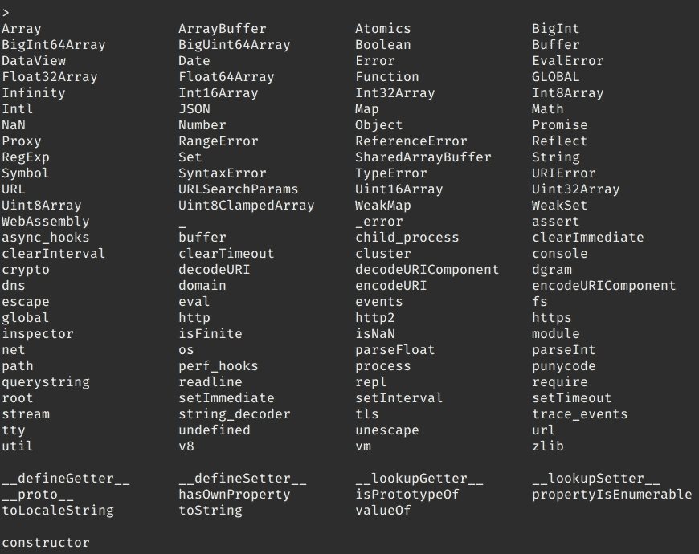

### 全局模块和函数

我毫不怀疑，在这一过程中，你已经使用了其中相当多，例如 `NaN`、`isNaN`、`Infinity`、`Promise`、`String` 等。当你想向全局对象添加内容时，你必须先修改全局对象：

`global.myName = “marypoppins"`

现在，可以在你项目的任何地方调用 `myName`。这里有一个简单的示例示例：

FirstFile.js
```javascript
global.myName = "marypoppins";
```

SecondFile.js
```javascript
require('FirstFile.js');
console.log(myName); // 它将记录 "marypoppins"
```

这仅仅是为了演示——Node.js 的最佳实践规定，出于任何原因，都不应该修改全局对象。让我们来看全局对象中两个非常重要的模块——`process` 和 `buffer`。

### Process

该对象包含了许多关于进程的有用信息：

*   `Process.versions` – 这告诉我们每个 node 核心模块的各个，例如 `openssl`、`zlib`、`v8` 等。

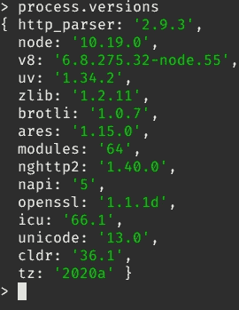

*   `Process.env` – 告诉我们关于 node 运行环境的一些重要信息。这里是一些好的例子：

```
process.env.shell‘/usr/bin/fish’
process.env.LANG‘en_US.UTF-8’
process.env.USER‘marypoppins’
```我们我们还可以使用 `process.stdin`、`process.stdout` 和 `process.stderr`（它们都是流）来与环境交互。process 对象是一个 `EventEmitter` 实例，这意味着该对象可以用于注册事件监听器：

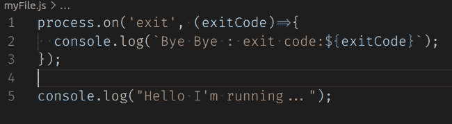

这段代码的结果是：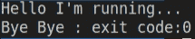 你也可以使用 `process.exit(exitCode)` 用你指定的退出代码来结束你的代码。

### Buffer

buffer 是一个 `v8` 堆外部的内存块，用于帮助我们把数据放入内存。简单来说，它是一个表示二进制数据序列的低级数据结构；一旦分配，就无法调整其大小。从 buffer 读取数据需要指定编码。创建 buffer 的方式包括：

*   `Buffer.from()` - 这使用任何内容（如图像、文件或字符串）来创建 buffer
*   `Buffer.alloc()` – 这创建一个具有指定大小的填充缓冲区
*   `Buffer.allocUnsafe()` - 这创建一个指定大小的缓冲区，它们可能包含旧数据，但在性能方面具有优势。这也可以使用 `.fill()` 进行填充。

下面的图片显示了 `Buffer.alloc()` 和 `Buffer.allocUnsafe()` 之间的差异。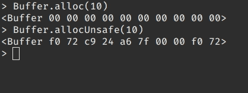 正如你所见，alloc 创建的 buffer 没有数据，但 unsafe buffer 中包含一些旧数据。这是另一个例子：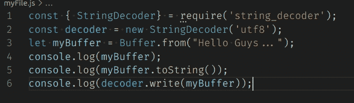 在看控制台输出之前，先对结果猜一看：`<Buffer 48 65 6c 6c 6f 20 47 75>`

### 全局对象

如你现在所收集到的，Node.js 采用模块化方法，这意味着当一个函数、变量或对象定义在文件内部时，它是文件局。当你想在另一个文件中使用一个文件中定义的变量时，你需要使用 `module.exports` 语法导出，然后使用 `require(path_of_file)` 导入另一个文件。在 Node.js 中，全局对象的工作方式有点不同。因为它们是全局的并且可以在所有模块中访问，因此不需要导入或导出它们——它们可以直接位于你的应用程序中任何你想的地方。

### 前提条件

你需要安装 Node.js，并且需要一些命令行或终端知识。我们将查看一些重要的常用的 Node.js 全局对象：

*   `process`
*   `__dirname`
*   `__filename`
*   `require()`
*   `module`
*   `URL`

首先，在主目录下创建一个文件夹并命名为 `nodejs`：`mkdir nodejs`。现在进入该文件夹：`cd nodejs`。一旦进入 nodejs 目录，创建一个新文件并命名为 `main.js`：`touch main.js`。注意 如果你使用的是 Windows，`touch` 将不起作用。唯一的解决方法是使用文本编辑器创建文件并将其保存到你的 nodejs 目录。

让我们来看这些对象。

### Process

这个全局对象提供了许多关于程序执行环境的有用信息。它提供的一些信息包括架构、平台、进程 ID、运行时间、环境变量、当前工作目录等。

*   `process.arch` – 返回系统的 CPU 架构，某些值包括 `x32`、`x64` 和 `ia32`。
*   `process.platform` – 返回运行程序的操作系统或平台。返回的字符串示例包括 `openbsd`、`linux`、`freebsd` 和 `win32`。
*   `process.id` – 返回 node 进程的 PID 或进程 ID
*   `process.cwd()` – 这是一个返回执行程序当前工作目录的方法
*   `process.chdir(directory)` - 此方法用于更改当前工作目录


`process` 对象有许多属性，但我们将重点放在四个主要的属性上，并用它们创建一个程序：

打开 `main.js` 并输入以下内容：

```javascript
// 打印当前工作目录
console.log(`Starting directory: ${process.cwd()}`);
console.log(`This platform is ${process.platform}`);
console.log(`Process PID: ${process.pid}`);
console.log(`The CPU Architecture is: ${process.arch}`);
// 将工作目录更改到 Documents
process.chdir('../Documents');
console.log(`Ending directory: ${process.cwd()}`);
```

现在运行这段代码，确保你在执行时处于 `nodejs` 目录：
```bash
node main.js
```

输出结果类似于如下：
Starting directory: /home/<your username>/nodejs
This platform is linux
Process PID: 19253
The CPU Architecture is: x64
Ending directory: /home/<your username>/Documents

## require()
`require()` 方法用于导入或加载 JSON、本地文件和模块。

如果你想导入 JSON 或本地模块，则需要文件的相对路径：
本地模块：
```javascript
const localModule = require('.path/filename.js');
```
JSON 文件：
```javascript
const jsonData = require('.path/filename.json');
```

如果你想导入来自 `node_modules` 目录的模块或 Nodejs 内置模块，则必须将模块名传递给 `require()` 方法：
```javascript
// fs 是一个内置模块
const fileSystem = require('fs');
```

## __dirname
`__dirname` 返回执行脚本所在目录的路径。你无法在 Node.js REPL 中访问它。

将 `main.js` 中的代码提取出来并替换为以下内容：
```javascript
console.log(__dirname);
```
输出将是：
/home/<your username>/nodejs
当你想要使用 Node.js 写文件时，这非常有用。

## __filename
`__filename` 返回执行文件的绝对路径。同样，它无法在 REPL 中访问。

移除 `main.js` 中的代码，并替换为以下内容：
```javascript
console.log(__filename);
```
输出将是：
/home/<your username>/nodejs/main.js

## module
`module` 全局对象引用当前模块，其中包含有关当前模块的信息。CommonJS 可以利用它来确定模块应该如何导入。

每当创建一个文件（例如我们之前创建的 `main.js` 文件），它就会变成一个模块。记录 `module` 允许我们获取关于 `main.js` 模块的信息：
```javascript
console.log(module);
```
当你记录 `module` 时，会返回一个包含该模块所有信息的对象：
```javascript
Module {id: '.',path: '/home/<your username>/nodejs',exports: {},parent: null,filename: '/home/<your username>/nodejs/main.js',loaded: false,children: [],paths: ['/home/<your username>/nodejs/node_modules','/home/<your username>/node_modules','/home/node_modules','/node_modules']}
```
当 CommonJS 在另一个文件中导入 `main.js` 模块时，它将在源自 `Module.paths` 的 `paths` 中查找 `main.js` 文件。

## URL
`URL` 是一个构造方法，用于解析 URL 并返回一个包含解析后数据的对象。

删除 `main.js` 中的所有内容，以便我们可以解析以下 URL（这不是一个真实的 URL）—— `https://www.marypoppins.madeup`。如果你愿意，可以尝试使用真实的 URL——只需输入细节：
```javascript
const url = new URL('https://www.marypoppins.madeup/');
console.log(`The url protocol: ${url.protocol}`);
console.log(`The url path : ${url.pathname}`);
console.log(`The url hostname: ${url.hostname}`);
```
输出将是：
The url protocol: https:
The url path : /articles/
The url hostname: www.marypoppins,madeup

现在你知道什么是全局对象，以及如何使用 Node.js 提供的常用的全局对象了。

## 第十一章：Node.JS 实用模块
Node.js 模块库包含了许多在基于 Node 开发应用程序时常用的实用程序模块。本章将详细介绍这些模块、它们的用途，并提供一些代码示例。

### OS 模块
`OS` 模块提供了与操作系统相关的实用程序函数。下面的语法用于导入它：
```javascript
var os = require("os")
```

### OS 模块方法
这些是 `os` 模块的方法：

| METHOD | DESCRIPTION |
| :--- | :--- |
| `os.tmpdir()` | 返回 OS 临时文件的默认目录 |
| `os.endianness()` | 返回 CPU 的字节序，可能的值为 LE 或 BE |
| `os.hostname()` | 返回操作系统的主机名 |
| `os.type()` | 返回操作系统的内核名称 |
| `os.arch()` | 返回操作系统的 CPU 架构。可能的值有 arm、x64 和 ia32。 |
| `os.platform()` | 返回 OS 平台 |
| `os.release()` | 返回操作系统的发布版本 |
| `os.uptime()` | 返回系统运行时间 |
| `os.loadavg()` | 返回负载平均数组 |
| `os.totalmem()` | 返回总内存字节 |
| `os.freemem()` | 返回可用内存字节 |
| `os.cpus()` | 返回每个 CPU 的信息，包括 idle、sys、nice 和 user |
| `os.networkInterfaces()` | 提供网络接口列表 |

### OS 模块属性
该模块的主要属性是 `os.EOL`。它定义了操作系统的换行符常量。

在下面的代码中，你可以看到一些 OS 方法。创建一个 `main.js` 并输入：
```javascript
var os = require("os");
// 字节序
console.log('endianness : ' + os.endianness());
// 类型
console.log('type : ' + os.type());
// 平台
console.log('platform : ' + os.platform());
// 总内存
console.log('total memory : ' + os.totalmem() + " bytes.");
// 可用内存
console.log('free memory : ' + os.freemem() + " bytes.");
```
运行程序，你应该看到类似的内容：
```bash
$ main.js
```

### Path 模块
`path` 模块包含处理和转换路径的实用。使用以下语法导入它：
```javascript
var path = require("path")
```

### Path 模块方法
这些是你可能会使用的 Path 方法：

| METHOD | DESCRIPTION |
| :--- | :--- |
| `path.normalize(p)` | 用于规范字符串路径，处理 `.` 和 `..` 部分 |
| `path.join([path1][, path2][ ...])` | 合并参数并返回规范后的路径 |
| `path.resolve([from ...], to)` | 解析为绝对路径 |
| `path.isAbsolute(path)` | 判断路径是否为绝对路径。无论工作目录是什么，绝对路径始终解析到相同的位置。 |
| `path.relative(from, to)` | 解析从 from 到 to 的相对路径 |
| `path.dirname(p)` | 返回路径的目录名 |
| `path.basename(p[, ext])` | 返回路径的最后部分 |
| `path.extname(p)` | 返回从最后一个 `.` 到字符串结束的。如果最后部分没有 `.` 或 `.` 是第一个字符，则返回空字符串 |
| `path.parse(pathString)` | 从路径字符串返回对象 |
| `path.format(pathObject)` | 从对象返回路径字符串 |

### Path 模块属性
这些是 Path 模块的属性：

| PROPERTIES | DESCRIPTION |
| :--- | :--- |
| `path.sep` | 特定平台的路径分隔符，为 `/` 或 `\` |
| `path.delimiter` | 特定平台的路径分隔符，为 `:` 或 `;` |
| `path.posix` | 访问上述路径方法，但仅允许以兼容 posix 的方式进行交互 |
| `path.win32` | 允许访问上述路径方法，但仅允许以兼容 win32 的方式进行交互 |


在这里，你可以看到 `Path` 模块方法的用法。清空你的 `main.js` 文件内容并添加以下代码：

```javascript
var path = require("path")
// 规范化
console.log('normalization : ' + path.normalize('/test/test1//2slashes/1slash/tab/..'));
// 连接
console.log('joint path : ' + path.join('/test', 'test1', '2slashes/1slash', 'tab', '..'));
// 解析
console.log('resolve : ' + path.resolve('main.js'));
// 扩展名
console.log('ext name : ' + path.extname('main.js'));
```

运行该文件，你将看到类似的内容：
```bash
$ node main.js
```

验证输出：
```
normalization : /test/test1/2slashes/1slash
joint path : /test/test1/2slashes/1slash
resolve : /web/com/1427176256_27423/main.js
ext name : .js
```

## Net 模块
`net` 模块提供了客户端和流支持，并提供了一个异步封装器用于网络传输。使用以下语法导入它：

```javascript
var net = require("net")
```

### Net 模块方法
这些是 `net` 模块中的方法：

| 方法 |  |
| :--- | :--- |
| `net.createServer([options][, connectionListener])` | 创建一个 TCP 服务器，并将参数 (`connectionListener`) 自动设置为连接事件监听器 |
| `net.connect(options[, connectionListener])` | 这是一个工厂方法，返回一个 `net.Socket` 并连接到提供的地址和端口 |
| `net.createConnection(options[, connectionListener])` | 与上述相同 |
| `net.connect(port[, host][, connectListener])` | 在主机的端口上创建 TCP 连接。如果没有指定 host，则默认为 localhost。参数 `connectListener` 被添加连接事件监听器，与前两个方法一样，它也会返回一个 `net.Socket`。 |
| `net.connect(path[, connectListener])` | 创建到路径的 Unix socket 连接。参数 `connectListener` 被添加连接事件监听器，与之前的方法一样，它也会返回一个 `net.Socket`。 |
| `net.createConnection(path[, connectListener])` | 同上 |
| `net.isIP(input)` | 测试 `input` 是否为 IP 地址；如果字符串无效则返回 0，如果是 IP v4 地址返回 4，如果是 IP v6 地址则返回 6 |
| `net.isIPv4(input)` | 如果 `input` 是 IP v4 地址则返回 true，否则返回 false |
| `net.isIPv6(input)` | 如果 `input` 是 IP v6 地址则返回 true，否则返回 false |

### 类 - net.Server
`net.Server` 类用于创建本地或 TCP 服务器。

### net.Server 方法
这些是与该类相关的方法：

| 方法 | 描述 |
| :--- | :--- |
| `server.listen(port[, host][, backlog][, callback])` | 允许你在指定的端口和主机上开始接受连接。如果没有指定主机，如果连接指向 IPv4 地址（INADDR_ANY），服务器将接受该连接。如果缺少端口号，将分配一个随机端口。 |
| `server.listen(path[, callback])` | 启动本地 socket 服务器，在指定的路径上监听连接 |
| `server.listen(handle[, callback])` | 只要 handle 对象具有 `{fd: <n>}` 对象或底层的 `_handle` 成员，你就可以将该设置为 socket 或服务器。服务器将被强制在给定的 handle 上接受连接，但假设 handle 或文件描述符已绑定到域套接字或端口。Windows 不支持在文件描述符上监听 |
| `server.listen(options[, callback])` | 在此方法中，host、port、option 属性 backlog 和回调函数（可选）的行为与调用 `server.listen(port, [host], [backlog], [callback])` 时完全相同。你还可以使用 `path` 选项来指定 UNIX sockets。 |
| `server.close([callback])` | 当没有更多打开的连接且服务器发出 close 事件时，服务器将被关闭 |
| `server.address()` | 此方法将返回绑定的地址、服务器端口以及操作系统报告的地址族名称 |
| `server.unref()` | 当你对服务器调用 `unref` 时，如果事件系统没有其他活跃的服务器，程序可以退出。调用 `unref` 将执行此操作 |
| `server.ref()` | 当你对服务器调用 `ref` 时，即使没有其他活跃服务器，程序也不会退出 |
| `server.getConnections(callback)` | 获取并发连接数 |

### 事件
这些是服务器的事件：

| 事件 | 描述 |
| :--- | :--- |
| `listening` | 在服务器绑定后发出 |
| `connection` | 当有新连接建立时发出 |
| `close` | 在 socket 关闭时发出。接收一个 `had_error` 参数，指示是否由于错误导致关闭 |

### 类 - net.Socket
这是一个本地或 TCP socket 抽象，socket 实例用于实现双工接口。

### net.Socket 事件
这些是 `net.Socket` 发出的事件：

| 事件 | 描述 |
| :--- | :--- |
| `lookup` | 在解析主机后发出，但不适用于 UNIX sockets |
| `connect` | 在连接建立后发出 |
| `data` | 接收到数据时任何。String 或 Buffer 用于数据 |
| `end` | 当对方发送 FIN 包时发出 |
| `timeout` | 当空闲导致 socket 超时时发出 |
| `drain` | 在缓冲区清空后发出，用于限流 |
| `error` | 发生错误后发出，随后是 `close` 事件 |
| `close` | 仅当 socket 关闭时发出 |

### net.Socket 属性
这些是 `net.Socket` 用于控制 socket 交互的属性：

| 属性 | 描述 |
| :--- | :--- |
| `bufferSize` | 指明等待写入的缓冲区字符数 |
| `remoteAddress` | 字符串形式的远程 IP 地址 |
| `remoteFamily` | 字符串形式的远程 IP 族，即 IPv4 或 IPv6 |
| `remotePort` | 数字表示的远程端口 |
| `localAddress` | 远程客户端连接的本地 IP 地址的字符串表示。例如，如果你监听 0.0.0.0 且远程客户端使用 192.168.1.1 连接，则值为 192.168.1.1 |
| `localPort` | 数字表示的本地端口 |
| `bytesRead` | 指明接收到的字节数 |
| `bytesWritten` | 指明发送的字节数 |

### net.Socket 方法
这些是 `net.Socket` 方法：

| 方法 | 描述 |
| :--- | :--- |
| `new net.Socket([options])` | 此方法用于构造新的 socket 对象 |
| `socket.connect(port[, host][, connectListener])` | 用于为指定的 socket 打开连接 |


## Socket 方法

| `socket.connect(path[, connectListener])` | 用于为指定的 socket 打开连接。如果提供了主机和端口，则 socket 将以 TCP 方式打开；但如果没有提供主机，则默认为 localhost。如果提供了路径，则 socket 将作为 UNIX socket 打开到该路径 |
| `socket.setEncoding([encoding])` | 用于将 socket 编码设置为可读流（Readable Stream） |
| `socket.write(data[, encoding][, callback])` | 用于在 socket 上发送数据。如果它是字符串，则第二个参数用于指定编码——默认为 UTF8 |
| `socket.end([data][, encoding])` | 用于发送一个 FIN 包，这会半关闭 socket。服务器可能仍然能够发送数据。 |
| `socket.destroy()` | 用于确保 socket 上不会发生 I/O 活动。这仅在发生错误时（例如解析错误等）才是必要的。 |
| `socket.pause()` | 用于暂停数据读取，这意味着数据事件将停止触发。这在你想要限制上传速度时非常有用。 |
| `socket.resume()` | 在调用 `pause` 方法后恢复数据读取 |
| `socket.setTimeout(timeout[, callback])` | 用于设置 socket，使其在 socket 上空闲指定的毫秒数时间后超时。默认情况下，`net.socket` 没有超时设置。 |
| `socket.setNoDelay([noDelay])` | 用于禁用 Nagle 算法。TCP 连接默认使用该算法，在发送数据之前会对其进行缓存。如果 `noDelay` 设置为 true，则在调用 `socket.write()` 时会立即发送数据。默认情况下，`noDelay` 设置为 true。 |
| `socket.setKeepAlive([enable][, initialDelay])` | 有助于启用或禁用心跳检测（keep-alive）功能。可选，它还可以设置空闲 socket 发送初始心跳探针之前的延迟。默认情况下，`enable` 设置为 false。 |
| `socket.address()` | 返回操作系统报告的地址族名称、绑定的地址和 socket 端口。返回一个包含三个属性的对象，即 `{port 23467, family: ‘IPv6’, address: ‘128.0.1.1’}` |
| `socket.unref()` | 当你在 socket 上调用 `unref` 时，如果事件系统没有其他活动 socket，程序可以退出。如果 socket 已经是 unref 状态，调用 `unref` 将没有影响。 |
| `socket.ref()` | 与上述相反——如果你对之前是 unrefd 的 socket 调用 `ref`，且由于它是唯一剩余的 socket，则程序无法退出。如果 socket 已经是 refd 状态，再次调用 `ref` 将没有影响。 |

这里是这些方法的使用示例。首先，创建一个新文件并命名为 `server.js`。然后输入以下内容：

```javascript
var net = require('net');
var server = net.createServer(function(connection) {
  console.log('client connected');
  connection.on('end', function() {
    console.log('client disconnected');
  });
  connection.write('Hello World!\r\n');
  connection.pipe(connection);
});
server.listen(8080, function() {
  console.log('server is listening');
});
```

现在运行它并查看输出：
`$ node server.js`

验证输出。
`server is listening`

接下来，创建另一个名为 `client.js` 的新文件并输入此代码：

文件：`client.js`
```javascript
var net = require('net');
var client = net.connect({port: 8080}, function() {
  console.log('connected to server!');
});
client.on('data', function(data) {
  console.log(data.toString());
  client.end();
});
client.on('end', function() {
  console.log('disconnected from server');
});
```

现在尝试从不同的终端运行此文件并查看输出：
`$ node client.js`

验证输出。
`connected to server!`
`Hello World!`
`disconnected from server`

最后，在运行 `server.js` 文件的终端上验证输出：
`server is listening`
`client connected`
`client disconnected`

## DNS 模块

DNS 模块包含了允许我们进行 DNS 查询并使用操作系统底层的名称解析功能的函数。它为网络提供了一个异步封装器，导入它需要以下语法：

```javascript
var dns = require("dns")
```

### DNS 模块方法

这些是来自 DNS 模块的方法：

| 方法 | 描述 |
| `dns.lookup(hostname[, options], callback)` | 此方法用于将主机名解析为第一个 IPv4 (A) 或 IPv6 (AAAA) 记录。options 参数可以是整数或对象，但如果没有提供，则 IPv4 和 IPv6 地址都是有效的。如果它设置为整数，则为 4 或 6。 |
| `dns.lookupService(address, port, callback)` | 使用 `getnameinfo` 将指定的端口和地址解析为服务和主机名。 |
| `dns.resolve(hostname[, rrtype], callback)` | 用于将主机名解析为包含 `rrtype` 指定记录类型的数组。 |
| `dns.resolve4(hostname, callback)` | 与上述相同，但仅针对 IPv4 A 记录查询。 |
| `dns.resolve6(hostname, callback)` | 与上述相同，但针对 IPv6 AAAA 记录查询。 |
| `dns.resolveMx(hostname, callback)` | 与上述相同，但针对 MX 记录或邮件交换查询。 |
| `dns.resolveTxt(hostname, callback)` | 与上述相同，但针对 TXT 记录或文本查询。 |
| `dns.resolveSrv(hostname, callback)` | 与上述相同，但针对 SRV 记录或服务查询。 |
| `dns.resolveSoa(hostname, callback)` | 与上述相同，但针对 SOA 记录或区域起始查询。 |
| `dns.resolveNs(hostname, callback)` | 与上述相同，但仅针对 NS 记录或名称服务器查询。 |
| `dns.resolveCname(hostname, callback)` | 与上述相同，但仅针对 CNAME 记录或别名。 |
| `dns.reverse(ip, callback)` | 反向解析 IP 地址为主机名数组。 |
| `dns.getServers()` | 用于返回当前用于解析的 IP 地址数组。 |
| `dns.setServers(servers)` | 用于将给定的字符串格式 IP 地址数组设置为解析所需的服务器。 |

### DNS 模块 rrtypes

这些是 `dns.resolve()` 方法使用的有效 rrtypes：

*   `A` - 默认值，IPv4 地址
*   `AAAA` – IPv6 地址
*   `MX` – 这些是邮件交换记录
*   `SRV` – 这些是 SRV 记录
*   `TXT` – 这些是文本记录
*   `PTR` – 这用于进行反向 IP 查询
*   `CNAME` – 这些是别名记录
*   `NS` – 这些是名称服务器记录
*   `SOA` – 这些是区域起始记录


## DNS 模块错误代码

所有的 DNS 查询可能返回以下代码之一：

- `dns.NODATA` – DNS 服务器回答中没有返回数据
- `dns.FORMERR` – 根据 DNS 服务器的判断，查询格式错误。
- `dns.SERVFAIL` – DNS 服务器返回了通用性失败。
- `dns.NOTFOUND` – 未找到域名。
- `dns.NOTIMP` – DNS 服务器未实现请求的操作。
- `dns.REFUSED` – DNS 服务器拒绝了查询。
- `dns.BADQUERY` – DNS 查询格式错误。
- `dns.BADNAME` – 主机名格式错误。
- `dns.BADFAMILY` – 不支持地址族。
- `dns.BADRESP` – DNS 回复格式错误。
- `dns.CONNREFUSED` – 无法连接 DNS 服务器。
- `dns.TIMEOUT` – 连接 DNS 服务器超时。
- `dns.EOF` – 文件结束符。
- `dns.FILE` – 读取文件时出错。
- `dns.NOMEM` – 内存不足。
- `dns.DESTRUCTION` – 通道正在销毁。
- `dns.BADSTR` – 字符串格式错误。
- `dns.BADFLAGS` – 指定的标志非法。
- `dns.NONAME` – 指定的主机名不是数字。
- `dns.BADHINTS` – 指定了非提示标志。
- `dns.NOTINITIALIZED` –尚未初始化 c-ares 库。
- `dns.LOADIPHLPAPI` – 加载 `iphlpapi.dll` 错。
- `dns.ADDRGETNETWORKPARAMS` – 未找到 `GetNetworkParams` 函数。
- `dns.CANCELLED` – DNS 查询已取消。

## Domain 模块

`Domain` 模块是一个帮助将多个 I/O 操作作为一组处理的工具。如果这些操作没有被处理，Node 应用将会崩溃。

### 内部绑定
错误发射器在 `domain` 的上下文中执行代码。使用以下语法创建它：

```javascript
var domain = require("domain");
var child = domain.create();
domain.on('error', function (err) {
    if (err) {
        console.log('reverse for ' + address + ': ' + JSON.stringify(hostnames));
    }
});
dns.lookup('www.com', function onLookup(err, address) {
    console.log('address:', address);
});
```

运行文件查看输出：
```bash
$ node main.js
```
最后，验证输出：
listener handled this error (To be handled by listener)
domain1 handled this error (To be handled by domain1)
domain2 handled this error (To be handled by domain2)
events.js:72 throw er; // 未处理的 'error' 事件
Error: Converted to exception. System will crash!
at Object. (/web/com/142772220_30772/main.js:40:24)
at Module._compile (module.js:456:26)
at Object.Module._extensions..js (module.js:474:10)
at Module.load (module.js:356:32)
at Function.Module._load (module.js:312:12)
at Function.Module.runMain (module.js:497:10)
at startup (node.js:119:16)
at node.js:906:3

### 外部绑定
错误发射器使用自己的方法被显式添加到 domain 中。使用以下语法导入该模块：

```javascript
var EventEmitter = require("events").EventEmitter;
var domain = require("domain");
var emitter1 = new EventEmitter();
// 创建一个 domain
var domain1 = domain.create();
domain1.on('error', function(err) {
    console.log("domain1 handled this error ("+err.message+")");
});
// 显式绑定
domain1.add(emitter1);
emitter1.on('error',function(err) {
    console.log("listener handled this error ("+err.message+")");
});
emitter1.emit('error',new Error('To be handled by listener'));
emitter1.removeAllListeners('error');
emitter1.emit('error',new Error('To be handled by domain1'));

var domain2 = domain.create();
domain2.on('error', function(err) {
    console.log("domain2 handled this error ("+err.message+")");
});
// 隐式绑定
domain2.run(function() {
    var emitter2 = new EventEmitter();
    emitter2.emit('error',new Error('To be handled by domain2'));
});
domain1.remove(emitter1);
emitter1.emit('error', new Error('Converted to exception. System will crash!'));
```

### Domain 方法

| 方法 | 描述 |
| :--- | :--- |
| `domain.run(function)` | 该方法在 `domain` 上下文中运行指定的函数。它隐式地绑定所有定时器和低级请求。这是 domain 的基本用法。 |
| `domain.add(emitter)` | 显式将发射器添加到 domain。如果任何事件处理器抛出错误或发射器发射了错误，该错误将发送到 domain 的错误事件。 |
| `domain.remove(emitter)` | 与上述相反，从 domain 中移除指定的发射器。 |
| `domain.bind(callback)` | 返回的函数是 `callback` 函数的包装。当函数被调用时，抛出的错误将发送到 domain 的错误事件。 |
| `domain.intercept(callback)` | 与 `domain.bind(callback)` 相似，但它还可以拦截作为第一个参数传递的错误消息。 |
| `domain.enter()` | 被 `bind`、`run` 和 `intercept` 方法使用，将 `process.domain` 和 `active` 指向 domain 并将其隐式推入栈中。此方法标记绑定到特定 domain 的 I/O 操作的开始。 |
| `domain.exit()` | 从栈中弹出并退出当前 domain。当执行切换到另一个异步调用的上下文时，必须退出当前 domain。此方法标记调用链的中断或结束。 |
| `domain.dispose()` | 当调用此方法时，通过 `intercept`、`bind` 或 `run` 绑定到 domain 的回调失效，并触发 `dispose` 事件。 |

### Domain 属性

有一个主要的 domain 属性 `domain.members`。它是一个包含显式添加到 domain 的发射器和定时器的数组。

## 第十二章：Node.js Web 模块

Web 服务器就是应用程序；简单如此。它们处理 HTTP 客户端发送的 HTTP 请求——这可能是 浏览器——并通过返回网页进行响应。通常，Web 服务器会交付带有样式表、图像和脚本的 HTML 文档。

大多数 Web 服务器支持服务器端脚本，它们使用脚本语言或将任务发送到其他地方（通常是应用程序服务器），后者从数据库中检索数据并执行复杂的逻辑。然后，结果通过 Web 服务器发送给 HTTP 客户端。最常见的之一是开源项目 Apache Web 服务器。

### Web 应用架构

通常，Web 应用被分为四个独立的层，如下所示：

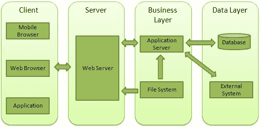

让我们分解这张图：

- **客户端 (Client)** – 客户端层由应用程序、移动浏览器或 浏览器组成，它们可以发起并发送 Web 服务器的 HTTP 请求。


- **Server（服务器）** – 服务器层是 Web 服务器所在的地方，它可以拦截客户端的任何请求并向其发送响应。
- **Business（业务）** – 业务层是应用服务器所在的地方。Web 服务器利用它进行需要处理的操作。它通过外部程序或数据库与最终层——数据层进行交互。
- **Data（数据）** – 数据层包含数据库和其他数据源。

### 使用 Node 创建 Web 服务器

在 Node.js 中，你可以访问 `http` 模块。它被用于创建服务器的 HTTP 客户端。下面你可以看到在端口 `8081` 监听的 HTTP 服务器的极精简结构。首先，创建一个名为 `server.js` 的程序，然后将此代码添加其中：

```javascript
var http = require('http');
var fs = require('fs');
var url = require('url');
// Create the server
http.createServer( function (request, response) {
  // 解析包含文件名的请求
  var pathname = url.parse(request.url).pathname;
  // 打印请求所请求的文件名。
  console.log("Request for " + pathname + " received.");
  // 从文件系统读取请求的文件内容
  fs.readFile(pathname.substr(1), function (err, data) {
    if (err) {
      console.log(err);
      // HTTP Status: 404 : NOT FOUN D
      // Content Type: text/plain
      response.writeHead(404, {'Content-Type': 'text/html'});
    } else {
      // 找到页面
      // HTTP Status: 200 : OK
      // Content Type: text/plain
      response.writeHead(200, {'Content-Type': 'text/html'});
      // 将文件内容写入响应体
      response.write(data.toString());
    }
    // 发送响应体
    response.end();
  });
}).listen(8081);
// Console 打印消息
console.log('Server running at http://127.0.0.1:8081/');
```

接下来，创建另一个文件，这是一个 html 文件，并命名为 `index.htm`。将它保存到 `server.js` 所在的相同目录下：

```html
<html><head><title>Sample Page</title></head><body>Hello World !</body></body></html>
```

现在你可以运行 `server.js` 来查看输出结果是什么：
```bash
$ node server.js
```

最后，需要验证输出：
`Server running at http://127.0.0.1:8081/`

### 向 Node.js 服务器发送请求

打开你正在使用的浏览器，然后打开此地址 – [`http://127.0.0.1:8081/index.htm`](http://127.0.0.1:8081/index.htm)，你应该能看到类似的内容：


需要在服务器端验证输出：
`Server running at http://127.0.0.1:8081/`
`Request for /index.htm received.`

### 使用 Node 创建 Web 客户端

你也可以使用 `http` 模块来创建一个 Web 客户端。首先，创建一个名为 `client.js` 的文件，并将以下内容复制进去：

```javascript
var http = require('http');
// 请求将使用的选项
var options = {host: 'localhost',port: '8081',path: '/index.htm'};
// 我们使用回调函数来处理响应
var callback = function(response) {
  // 流会持续更新数据
  var body = '';
  response.on('data', function(data) {
    body += data;
  });
  response.on('end', function() {
    // 数据已完全接收。
    console.log(body);
  });
};
// 向服务器发送请求
var req = http.request(options, callback);
req.end();
```

现在打开一个与 `server.js` 不同的命令行终端，并运行 `client.js` 来查看结果：
```bash
$ node client.js
```

不要忘记验证输出：
```html
<html><head><title>Sample Page</title></head><body>Hello World!</body></body></html>
```

然后在服务器端验证：
`Server running at http://127.0.0.1:8081/`
`Request for /index.htm received.`

如你所见，web 模块对于创建 Web 服务器和客户端来说非常简单。

## 第十三章：Node.js Express 框架

在本章中，我们将介绍 Express，它是一个构建为 Node.js 设计的灵活但极简的 Web 应用框架。它提供了强大的功能集，帮助我们构建单页和多页 Web 应用程序，以及混合应用。

### 什么是 Express.js?

它是一个构建在 Node.js 之上的 Web 应用服务器框架，帮助我们构建不同类型的 Web 应用。现在标准的 Node.js 服务器框架是 MEAN 栈的后端。这是一个开源免费的软件栈，帮助我们构建动态 Web 应用程序和网站，它包含以下组件：

1. **MongoDB** – 这是标准的 NoSQL 数据库
2. **Express.js** – 这是默认的框架
3. **Angular** – 这是一个前端框架
4. **Node.js** – 这是一个 JavaScript 运行时环境

（注：原文此处未列出完整 MEAN 组件，但根据常识补充了对应逻辑翻译）

### 安装并使用 Express

Express 很容易安装；通过命令行输入以下命令完成：

```bash
npm install express
```

该命令会从 Node 包管理器下载并安装 Express。让我们创建一个监听 3000 端口的服务器：

```javascript
var express=require('express');
var app=express();
app.get('/',function(req,res){
  res.send('Hello World!');
});
var server=app.listen(3000);
```

代码说明：

1. 第一行 `require` 用于引入 `express` 模块。
2. 第二行通过该模块创建一个实例。
3. 第三行，我们创建了一个回调函数，当访问根路径时会被调用。
4. 参数 `res` 用于发送响应。
5. 最后，`listen` 用于让服务器监听 3000 端口。


从输出中可以看出，如果访问 localhost 的 3000 端口，将显示 Hello World!。

### 什么是路由 (Routes)?

路由决定了应用程序如何响应对特定端点的请求。例如，客户端可以发送 `http` 请求，如 `POST`、`GET`、`DELETE` 或 `PUT`，针对任何 URL，例如：
- `http://localhost:3000/Books`
- `http://localhost:3000/Students`

在这个示例中，当对第一个 URL 发起 `GET` 请求时，输出将是书籍列表；如果对第二个发起，你将看到学生列表。根据你访问的 URL，Web 服务器会调用相应的功能，并将响应发送给客户端——这就是路由的工作原理。

每个路由可以拥有一个处理函数，当路由匹配时，这些函数会被执行。典型的路由语法为：`app.METHOD(PATH, HANDLER)` 在语法中：

- `app` 是一个 express 模块实例。
- `METHOD` 是 HTTP 请求方法之一，即 `POST`、`GET`、`DELETE` 或 `PUT`。
- `PATH` 指明服务器路径。
- `HANDLER` 是在路由匹配时执行的函数。

让我们看看如何在 Express 中实现路由。我们将创建三个路由：

1. `/Node` 路由 – 访问该路由时将显示 Node Tutorial 字符串。
2. `/Angular` 路由 – 访问该路由时将显示 Angular Tutorial 字符串。


### 3. 默认路由 / - 这将显示“Welcome to My Tutorials”字符串

基础代码与我们之前看到的相同，下面的代码是一个展示如何实现路由的扩展部分：

```javascript
var express = require('express');
var app = express();
app.route('/Node').get(function(req,res){res.send("Node Tutorial");});
app.route('/Angular').get(function(req,res){res.send("Angular Tutorial");});
app.get('/',function(req,res){res.send('Welcome to My Tutorials');}));
```

#### 代码解释：

1. 如果在浏览器中访问 [`localhost:3000/Node`](http://localhost:3000/Node) URL，则定义该路由。路由上绑定了一个回调函数，当浏览到该 Node URL 时，就会调用该函数。

回调函数有两个参数：
   - `res` 是用于向客户端发送信息的主要参数
   - `req` 是次要参数，包含了与请求相关的信息。有时，请求会随请求发送其他参数，`req` 参数有助于找到这些参数。

2. 如果选择了 Node 路由，则使用 `send` 函数向客户端发送 Node Tutorial 字符串。

3. 如果在浏览器中访问 [`localhost:3000/Angular`](http://localhost:3000/Angular) URL，则定义该路由。路由上绑定了一个回调函数，当浏览到 Angular URL 时就会调用该函数。

4. 如果选择了 Angular 路由，则使用 `send` 函数向客户端发送 Angular Tutorial 字符串。

5. 如果在浏览器中访问 [`localhost:3000/Angular`](http://localhost:3000/Angular) URL，则选择默认路由——这是应用程序根目录。选中时，会将 Welcome to My Tutorials 发送给客户端。

只要命令执行成功，你应该会在浏览器中看到 Welcome to My Tutorials 界面。输出将显示，通过浏览端口为 3000 的 localhost URL，屏幕上显示了 Welcome to My Tutorials 消息——这就是我们在代码中指定的默认消息。

### 使用 Express.js 构建 Web 服务器

在上面的示例中，我们看到了如何根据路由来决定输出内容。这是现代 Web 应用程序中使用的技术，而 Web 服务器的其他部分都是关于使用 Node.js 模板的。当你快速创建 Node 应用程序时，最简单的方法之一就是使用 Node.js 模板。市场上有很多框架，我们将使用 jade 框架。

Node 包管理器（Node Package Manager）用于在命令行中输入以下内容来安装 jade：
```bash
npm install jade
```
此命令要求 `NPM` 下载我们需要的模块并安装它们。

让我们创建一个 jade 模板。创建一个新文件并命名为 `index.jade`，将以下代码放入其中，确保该文件创建在名为 `views` 的文件夹中](https://www.guru99.com/images/NodeJS/010716_0613_NodejsExpre7.png)

页面标题将更改为调用模板时传递的值。我们还指示 header 标签文本将被模板中传递的内容所替换。

```javascript
var express=require('express');
var app=express();
app.set('view engine','jade');
app.get('/',function(req,res){res.render('index',{title:'My Tutorials',message:'Welcome'})});
var server=app.listen(3000,function() {});
```

#### 代码解释：

1. 首先，在应用程序中指定了“view engine”（视图引擎）——这用于渲染模板，因为使用了 jade，所以我们指定了它。

2. 我们使用 `render` 函数来渲染网页。在这里，我们渲染了之前创建的 `index.jade` 模板。

3. 我们向 `title` 和 `message` 参数传递了两个值——分别是“My Tutorials”和“Welcome”。这些值会被模板中指定的 `title` 和 `message` 参数所替换。

如果你成功执行了该命令，你将在浏览器中看到 Welcome 界面。从输出中，你可以看到页面标题设置为 My Tutorials，页面页头被设置为 Welcome。这是因为我们在应用程序中调用了 Jade 模板。

### 快速总结

Express 框架通常用于 Node.js 应用程序开发，它构建在 Node 框架之上。它用于帮助我们快速构建基于服务器的应用程序。我们使用路由根据用户的请求将他们引导到应用程序的不同区域——路由响应可能会根据用户需要的内容而异。最后，模板用于高效地注入正确的内容，Node 应用程序流行的模板引擎之一是 Jade。

### 第十四章章：Node.js RESTful API

让我们从名称开始——REST 源于 Representational State Transfer（表述状态转移）。REST 由 Roy Fielding 在 2000 年首次引入，它是一种基于 Web 标准并使用 `HTTP` 协议的架构。REST 围绕资源展开——所有组件都是资源，通过通用接口使用标准的 `HTTP` 方法访问这些资源。REST 服务器基本上为资源提供访问点，而 REST 客户端使用 `HTTP` 协议来访问并修改资源。`URIs` 和全局标识符用于标识每个资源，REST 以不同的方式表示资源，如 `XML` 和文本，但最常见的表示是 `JSON`。

### HTTP 方法

这些是 REST 架构中常用的四种 `HTTP` 方法：
- `GET` —— 用于只读访问资源。
- `PUT` —— 用于创建新资源。
- `DELETE` —— 用于删除资源。
- `POST` —— 用于更新资源或创建新的。

### RESTful 服务

Web 服务是包含标准和开放协议的集合，用于系统和应用程序之间的数据交换。应用程序通过计算机网络交换数据——这些应用程序使用各种编程语言编写并运行在所有平台上。互操作性（例如 Python 和 Java 的通信，或 Linux 应用程序与 Windows 应用程序的通信）取决于开放标准。当 Web 服务基于 REST 架构时，它被称为 RESTful 服务。这些通过使用 `HTTP` 方法实现 REST 概念。

### 为库创建 RESTful

假设我们有一个基于 JSON 的数据库，其中在一个名为 `users.json` 的文件中包含用户列表：
```json
{"user1" : {"name" : "michael","password" : "password1","profession" : "teacher","id": 1}
"user2" : {"name" : "sara","password" : "password2","profession" : "scientist","id": 2}
"user3" : {"name" : "ronnie","password" : "password3","profession" : "clerk","id": 3}}
```
利用这些信息我们可以提供所有的 RESTful API：

| | URI | HTTP 方法 | POST 体 | 结果 |
| :--- | :--- | :--- | :--- | :--- |
| 1 | `listUsers` | `GET` | 空 | 显示所有用户列表 |
| 2 | `addUser` | `POST` | JSON 字符串 | 添加新用户详情 |
| 3 | `deleteUser` | `DELETE` | JSON 字符串 | 删除用户 |
| 4 | `:id` | `GET` | 空 | 显示用户详情 |


我假设你已经知道如何从前端使用表单数据或 AJAX 传递值，以及如何使用 Express 的 `Request` 对象来处理这些值。

### 列出用户
我们将实现的第一个 RESTful API 是 `listUsers`。创建一个名为 `server.js` 的文件并添加以下代码：

```javascript
var express = require('express');
var app = express();
var fs = require("fs");
app.get('/listUsers', function (req, res) {
  fs.readFile( __dirname + "/" + "users.json", 'utf8', function (err, data) {
    console.log( data );
    res.end( data );
  });
})
var server = app.listen(8081, function () {
  var host = server.address().address;
  var port = server.address().port;
  console.log("Example app listening at http://%s:%s", host, port)
})
```

现在在本地机器上使用 [`127.0.0.1:8001/listUsers`](http://127.0.0.1:8001/listUsers) 并配合 HTTP 方法：`GET`。确保你使用了 REST 客户端以便访问 API，你应该能看到下面的结果——考虑到当在生产环境中使用此代码时，IP 地址可能会变化：

`{"user1" : {"name" : "michael","password" : "password1","profession" : "teacher","id": 1},"user2" : {"name" : "sara","password" : "password2","profession" : "scientist","id": 2},"user3" : {"name" : "ronnie","password" : "password3","profession" : "clerk","id": 3}}`

### 添加用户
我们将实现的下一个 RESTful API 是 `newUser`，使用以下详情：
`user = {"user4" : {"name" : "monica","password" : "password4","profession" : "teacher","id": 4}}`

可以通过 AJAX 调用用 JSON 格式接受相同的输入，但为了本章的内容，我们将全部进行硬编码。清空你的 `server.js` 文件并添加以下内容：

```javascript
server.js
var express = require('express');
var app = express();
var fs = require("fs");
var user = {"user4" : {"name" : "monica","password" : "password4","profession" : "teacher","id": 4}}
app.post('/addUser', function (req, res) {
  // 首先读取现有用户。
  fs.readFile( __dirname + "/" + "users.json", 'utf8', function (err, data) {
    data = JSON.parse( data );
    data["user4"] = user["user4"];
    console.log( data );
    res.end( JSON.stringify(data));
  });
})
var server = app.listen(8081, function () {
  var host = server.address().address;
  var port = server.address().port;
  console.log("Example app listening at http://%s:%s", host, port)
})
```

现在尝试通过 URL 访问：`http://127.0.0.1:8081/addUser` 并使用 HTTP 方法：`POST`。使用本地机器和 REST 客户端，你应该能看到以下内容：

`{"user1":{"name":"michael","password":"password1","profession":"teacher","id":1},"user2":{"name":"sara","password":"password2","profession":"scientist","id":2},"user3":{"name":"ronnie","password":"password3","profession":"clerk","id":3},"user4":{"name":"monica","password":"password4","profession":"teacher","id":4}}`

### 显示详情
现在我们实现一个通过用户 ID 调用并显示相应用户详情的 RESTful API。再次清空 `server.js` 文件并添加此代码：

```javascript
server.js
var express = require('express');
var app = express();
var fs = require("fs");
app.get('/:id', function (req, res) {
  // 首先读取现有用户。
  fs.readFile( __dirname + "/" + "users.json", 'utf8', function (err, data) {
    var users = JSON.parse( data );
    var user = users["user" + req.params.id]
    console.log( user );
    res.end( JSON.stringify(user));
  });
})
var server = app.listen(8081, function () {
  var host = server.address().address;
  var port = server.address().port;
  console.log("Example app listening at http://%s:%s", host, port)
})
```

与之前一样，使用本地机器和 REST 客户端尝试使用 [`127.0.0.1:8081/2`](http://127.0.0.1:8081/2) 并使用 HTTP 方法：`GET` 访问，你应该看到这个：

`{"name":"sara","password":"password2","profession":"scientist","id":2}`

### 删除用户
这与 `addUser` API 非常相似。输入数据通过 `req.body` 传入，并使用用户 ID 从系统中删除正确的用户。为了简单起见，我们将删除用户 ID `2`。清空 `server.js` 文件并添加此代码：

```javascript
var express = require('express');
var app = express();
var fs = require("fs");
var id = 2;
app.delete('/deleteUser', function (req, res) {
  // 首先读取现有用户。
  fs.readFile( __dirname + "/" + "users.json", 'utf8', function (err, data) {
    data = JSON.parse( data );
    delete data["user" + 2];
    console.log( data );
    res.end( JSON.stringify(data));
  });
})
var server = app.listen(8081, function () {
  var host = server.address().address;
  var port = server.address().port;
  console.log("Example app listening at http://%s:%s", host, port)
})
```

再次，使用本地机器和 REST 客户端访问 [`127.0.0.1:8081/deleteUser`](http://127.0.0.1:8081/deleteUser) 并使用 HTTP 方法：`DELETE`，你应该能看到这个：

`{"user1":{"name":"michael","password":"password1","profession":"teacher","id":1},"user3":{"name":"ronnie","password":"password3","profession":"clerk","id":3}}`


最后一种策略是将应用程序拆分为多个较小的实例——每个实例负责应用程序数据的一个较小部分。在数据库中，你经常看到这种策略被称为分片（sharding）或水平分区（horizontal partitioning）。在数据分区中，每次操作之前都需要一个查找步骤。这决定了应该使用哪个应用程序实例。例如，我们可能想根据语言或国家对用户进行分区，那么我们需要先查找这些信息。

当你成功扩展一个大型应用程序时，最终这三种策略都应该被实现。虽然 Node.js 让实现这一切变得简单，但我将重点关注第一种策略——克隆（cloning），因为它最基础，并将查看实现它所需的 Node.js 工具。在继续之前，你确实需要很好地了解 Node.js 子进程（child processes）是如何运作的。

## Cluster 模块

你可以使用内置的 `cluster` 模块在环境的 CPU 核心上启用负载均衡。该模块基于 `child process` 模块中的 `fork` 方法，允许主应用程序进程根据 CPU 核心数进行相应次数派叉。然后，它会接管发送到主进程的请求并通过派生进程进行负载均衡。

`Cluster` 模块是 Node.js 提供的一个辅助工具，帮助我们实现这种克隆策略，但仅限于单机。当你拥有具有多个资源的大型机器，或者当向单台机器添加额外资源比添加其他机器更便宜、更方便时，`Cluster` 模块运行良好，帮助你快速实现该策略。

即使是小型的机器也可能有几个核心；即使你不担心 Node 服务器的负载，也应该启用 `Cluster` 模块，以增加服务器的可用性和容错能力。这很容易做到，而且当你使用进程管理器（例如 `PM2`）时，你只需要提供带参数的启动命令即可。

让我们看看 `cluster` 模块是如何原生使用的以及它是如何工作的。`Cluster` 模块的结构非常简单。创建一个主进程（master process）来派生并管理多个工作进程（worker processes）。每个工作进程代表一个需要扩展的应用程序实例。主进程处理所有传入的请求，并决定由哪个工作进程来处理该请求。


主进程的工作相对简单，因为它使用轮询算法（round-robin algorithm）来选择工作进程。除了 Windows 之外，所有平台默认都启用了此设置，通过全局修改可以让操作系统处理负载均衡。

轮询算法通过旋转基准将负载均匀地分布在所有可用进程中。第一个传入的请求发送到第一个可用工作进程，第二个发送到第二个进程，依此类推。当列表到达末尾时，算法将回到开头并重新开始。

这是最易使用的负载均衡算法之一，但它只是众多之一。还有其他算法允许分配优先级，并选择负载最低或响应最快的的服务器。

## HTTP 服务器的负载均衡

让我们开始一些实际工作。我们想构建一个简单的 HTTP 服务器并使用 `Cluster` 模块对其进行负载均衡。我们将使用 Node 的 hello-world 示例服务器，并对其进行轻微修改，以在响应之前模拟 CPU 工作。

创建一个 `server.js` 文件并添加以下代码：

```javascript
// server.js
const http = require('http');
const pid = process.pid;
http.createServer((req, res) => {
  for (let i=0; i<1e7; i++); // simulate CPU work
  res.end(`Handled by process ${pid}`);
}).listen(8080, () => {
  console.log(`Started process ${pid}`);
});
```

我在 HTTP 响应中包含了 `process.pid`。这将通过识别处理请求的应用程序实例来验证我们的负载均衡器工作工作。

在创建集群以将服务器克隆到多个工作进程之前，我们需要运行一个基准测试，查看服务器每秒可以处理多少请求。Apache 基准测试工具是一个很好的选择；一旦运行了上面的服务器代码，请运行下面的命令：

```bash
ab -c200 -t10 http://localhost:8080/
```

这使用 200 个并发连接来测试服务器 10 秒的负载。

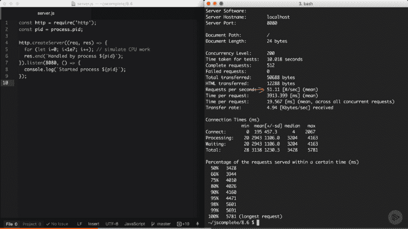

当我尝试时，我的机器每秒处理大约 51 次请求，但这些结果会因机器和平台而异。这只是一个让你对性能有概念的简单测试，但不能认为是 100% 准确——它只会向你展示在具有多个核心的环境中使用集群会带来什么差异。

现在我们有了可以参考的基准测试，现在是时候使用 `Cluster` 模块通过克隆来扩展应用程序了。使用与你的 `server.js` 文件相同的服务器，创建另一个新文件并命名为 `cluster.js`。这是用于主进程，需要以下内容：

```javascript
// cluster.js
const cluster = require('cluster');
const os = require('os');
if (cluster.isMaster) {
  const cpus = os.cpus().length;
  console.log(`Forking for ${cpus} CPUs`);
  for (let i = 0; i<cpus; i++) {
    cluster.fork();
  }
} else {
  require('./server');
}
```

在我们的 `cluster.js` 文件中，我们首先引入了 `os` 和 `cluster` 模块。`os` 模块用于读取有多少个 CPU 核心。通过 `cluster` 模块，我们获得 `isMaster` 布尔标志，用于判断是否为主进程。当 `cluster.js` 文件第一次执行时，`isMaster` 标志被设置为 true。主进程可以被指示根据 CPU 核心数来派生服务器。

现在我们已经使用了 `os` 模块来读取有多少个 CPU 核心，可以使用循环来调用 `cluster.fork()`。当 `cluster.fork()` 在主进程中执行时，`exitedAfterDisconnect` 标志被设置为 false。即使是小机器也可能有几个核心；即使你不担心你的 Node 服务器的负载，也应该启用 `Cluster` 模块，以增加服务器的可用性和容错能力。这很容易做到，而且当你使用进程管理器（例如 `PM2`）时，你只需要提供带参数的启动命令。

让我们看看 `cluster` 模块是如何原生使用的以及它是如何工作的。`Cluster` 模块的结构非常简单。创建一个主进程来派生并管理多个工作进程。每个工作进程代表一个需要扩展的应用程序实例。主进程处理所有传入的请求，并决定由哪个工作进程来处理该请求。


## 广播消息

主进程和工作进程之间的通信是简单的，因为 `Cluster` 模块在底层使用了 `child_process.fork`。这意味着主进程和每个工作进程之间有可用的通信通道。使用上面的示例，可以使用 `cluster.workers` 访问工作对象的列表。`Object.values` 用于获取包含工作对象的数组。`send` 函数用于向每个工作进程发送我们想要的值。在我们的 `server.js` 文件中，当工作进程接收到主进程的消息时，在全局进程上注册一个消息处理器。这是一个示例：

```javascript
process.on('message', msg => {
  console.log(`Message from master: ${msg}`);
});
```

当我测试这些 server/cluster 示例添加时，我看到的是：


这里，主进程向每个工作进程发送了消息。这一点要注意，工作进程并不是按照顺序启动的。让我们让事情变得更实用。我们想让服务器返回一个指示数据库中创建了多少用户的数字。我们需要一个模拟函数返回数据库中的用户数量，每当被调用时，我们想要该值的平方——这被称为增长：

```javascript
// **** Mock Call
const numberOfUsersInDB = function() {
  this.count = this.count || 5;
  this.count = this.count * this.count;
  return this.count;
}
```

每当我们调用 `numberOfUsersInDB`，假设已经建立了数据库连接。为了避免多次数据库请求，我们希望此调用缓存一段时间，例如 10 秒。我们不希望 8 个派生的工作进程执行自己的请求，因为我们不想每 10 秒执行 8 次请求。相反，主进程只需执行一次请求并通过通信接口让工作知道新的计数。例如，在主进程模式下，我们可以使用一个循环将该值广播给所有工作：

```javascript
// isMaster=true 块中 fork 循环之后
const updateWorkers = () => {
  const usersCount = numberOfUsersInDB();
  Object.values(cluster.workers).forEach(worker => {
    worker.send({ usersCount });
  });
};
updateWorkers();
setInterval(updateWorkers, 10000);
```

这里`updateWorkers` 被第一次调用，然后使用 `setInterval` 每 10 秒调用它一次。这样，所有工作都会每 10 秒通过通信通道获取用户计数的新值，确保只到数据库建立单个连接。`usersCount` 值可以在服务器代码中使用，使用完全相同的消息事件处理器。我们需要使用一个模块全局变量来缓存该值，然后我们可以在需要的地方使用它。这是另一个示例：

```javascript
const http = require('http');
const pid = process.pid;
let usersCount;
http.createServer((req, res) => {
  for (let i=0; i<1e7; i++); // simulate CPU work
  res.write(`Handled by process ${pid}\n`);
  res.end(`Users: ${usersCount}`);
}).listen(8080, () => {
  console.log(`Started process ${pid}`);
});
process.on('message', msg => {
  usersCount = msg.usersCount;
});
```

## 增加服务器的可用性

当你运行单个 `Node.js` 实例时，问题在于实例崩溃时必须重启。这意味着在崩溃和重启之间会有一些停机。这同样适用于服务器需要部署新代码并重启的情况。当你与多个实例一起时，只需要几行额外代码来增加可用性。下面的示例是服务器随机崩溃的模拟。这在随机时间调用 `process.exit`：

```javascript
// In server.js
setTimeout(() => {
  process.exit(1) // death by random
}, Math.random() * 10000);
```

当工作进程以这种方式退出时，主进程会收到通知。这是通过 `cluster` 对象的 `exit` 事件完成的，在这种情况下会派生一个新的工作。我们可以为该事件注册处理程序：

```javascript
// isMaster=true 块中 fork 循环之后
cluster.on('exit', (worker, code, signal) => {
  if (code !== 0 && !worker.exitedAfterDisconnect) {
    console.log(`Worker ${worker.id} crashed. Starting new worker...`);
    cluster.fork();
  }
});
```

添加 `if` 条件是有意义的，因为它确保了工作是崩溃了，而不是被用户或主进程手动断开。主进程可能会根据观察到的负载判断使用了过多资源，如果是这样，将杀死某些工作。为了做到这一点，可以在工作上使用 disconnect 方法，并将 `exitedAfterDisconnect` 标志设置为 true。可用性实际上可以使用我们之前使用的 `ab` 命令来测量——我测试了这段代码，在 200 个并发请求的 10 秒测试中，得到了 7 次失败请求：


这显示可用性高于 99%。只需要几行额外代码，我们就可以忘记进程崩溃了，因为主进程在为我们监控它们。

## 零停机重启

那么，当我们想要重启所有工作进程时（例如需要部署新代码时）该怎么办？我们有多个运行中的实例，与其让它们一起重启，我们可以一个一个重启，让其他工作继续服务。使用 `Cluster` 模块实现这一点非常容易。一旦主进程启动运行，我们不希望它重启，因此我们需要找到向它发送命令来开始重启的方法。如果你使用的是 Linux，这很容易，因为只需要监听 `SIGUSR2` 或其他进程信号。可以在进程 ID 上触发 `kill` 命令并传递信号：

```javascript
// In Node
process.on('SIGUSR2', () => {
  // ...
});
// To trigger that
$ kill -SIGUSR2 PID
```

通过这种方式主进程不会被杀死，我们可以告诉它启动。`SIGUSR2` 是这种情况下使用的正确信号，因为它是用户命令。Node 使用 `SIG1` 作为调试器，我们真的不希望出现任何冲突。在 Windows 上不支持这些进程信号，因此需要找到另一种方法。有几种方法——我们可以使用 socket 或标准输入。或者我们可以监控 `process.pid` 文件的删除事件。为了保持简单，我使用的是 Linux，但如果你使用其他系统，你可能只需要读取但不实际遵循。虽然 Node 在 Windows 上运行良好，但 Linux 是托管 Node 应用程序的更安全的平台。你可能感兴趣的是，如果你使用最新版本的 Windows，可以利用 Linux 子系统——如果你感兴趣，查看 Windows 上的 Bash。

回到我们的示例，当主进程接收到 `SIGUSR2` 信号时，它告诉工作可以重启，但我们希望逐一个地进行。这意味着主进程应该只在上一个工作重启后才重启下一个。为了启动这一点，我们需要所有当前工作的引用，我们通过 `cluster.workers` 对象来实现这一点。然后，工作工作可以存储在数组中：

```javascript
const workers = Object.values(cluster.workers);
```

之后，可以创建一个 `restartWorker` 函数来接收需要重启的工作索引。这样，函数在准备好处理工作时可以调用自己，确保工作按顺序重启。以下是该函数的示例：

```javascript
const restartWorker = (workerIndex) => {
  const worker = workers[workerIndex];
  if (!worker) return;
  worker.on('exit', () => {
    if (!worker.exitedAfterDisconnect) return;
    console.log(`Exited process ${worker.id}`);
    cluster.fork().on('listening', () => {
      restartWorker(workerIndex + 1);
    });
  });
  worker.disconnect();
};
restartWorker(0);
```

在函数中，我们得到了一个需要重启的工作引用。由于 `cluster.fork()` 在主进程中执行时递归调用该函数，可以形成一个序列。当没有工作需要重启时，我们可以返回。然后，我们想要使用 `worker.disconnect` 来断开，但在下一个工作重启之前，会派生一个新的工作来替换被断开的。`exit` 事件可以用于工作以派生新的工作。如果 `exitedAfterDisconnect` 标志设置为 true，这对于零停机重启是需要的。

## 共享状态与负载均衡

就像所有好事情一样，总会有代价。当 Node 应用被负载均衡时，某些功能丢失了，这类似于你在其他语言中可能熟悉的线程安全（thread safety）。线程安全是指线程之间的数据共享，但在我们的案例中，它是工作进程之间的数据共享。由于每个工作进程都有自己的内存，因此在内存中缓存数据已经不再工作了。在集群设置中，如果某些东西需要缓存，则需要单独的实体。所有工作都需要能够读取和写入该实体的 API，这可以是数据库或你想要使用的内存缓存的另一个服务器。或者，你可以创建一个所有工作都可以通信的 Node 读写 API。


这并不是一个缺点，你不应该以这种方式看待它——在扩展性策略下，拆分是必要的。事实上，即使你使用的是单核机器，你也应该真的这样做。当运行集群设置时，除了缓存之外，另一个问题变成了问题——通用状态通信。因为无法保证通信会在同一个工作上进行，在任何特定工作上创建状态通道并不是选项。用户认证是这最常见的例子之一：


在集群设置中，认证请求被发送到主进程。从那里，它被发送到一个工作——在这个示例中，我们假设它是工作 A：


现在，工作 A 识别了这个用户的状态。然而，如果同一个用户发出了另一个请求，它会被负载均衡器发送到其他工作，尽管它们没有该用户的认证信息。对于单个实例，在内存中保留已认证的用户会话已不再工作了。我们可以通过几种方法解决这个问题。我们可以直接在所有工作之间共享状态——通过将这些会话存储在 Redis 或共享数据库中来实现。然而，这种策略需要一些代码更改，而且这并不总是可行的。

如果修改代码来实现共享会话存储是不可能的，可以使用另一种策略，尽管它没有那么。你可以使用被称为粘性负载均衡（Sticky Load Balancing）的东西，实现它更容易，因为许多负载均衡器原生支持它。这是一个简单的想法——当用户与工作实例进行认证时，在负载均衡器级别维护该关系的记录：


现在，当同一个用户发送新请求时，会在记录中进行查找以确定哪个服务器拥有该认证会话；然后请求会被发送到该服务器，而不是使用标准的分布式行为。

## 第十六章：Node.js 打包

最近，Node.js 的流行性飙升，JavaScript 多年来一直被列为顶级编程语言——到现在，你应该理解为什么这并不意外了。JavaScript 是无处不在的前端 Web 编程语言，这意味着开发者无论过去使用过什么编程语言（C、C#、Java、Ruby 等）都使用并理解它。因为已经使用 JavaScript 的开发者人数如此巨大，社区已经充满了框架和库，为每种需求提供帮助。这意味着将它用于服务器端项目是正确的方法。事情有时会出错，而且由于没有明显的原因，许多从编译语言切换到脚本语言的程序员丢掉了他们良好的编程习惯。我们经常看到程序员在 Node.js 中开发应用程序，或者使用 Node.js 开发纯 JS 应用，将他们的代码存储在 GitHub 等地方，然后尝试直接拉取到他们的生产服务器上。然后紧接着执行 `npm install` 和 Web 构建——有时他们会编写测试，但更多时候，他们决定每当部署应用程序时重新构建一切要容易得多。这会导致许多问题：


### 依赖版本控制

当你的 `packages.json` 文件包含语义化版本范围（semver）时，可能会导致配置提示你某个包依赖需要匹配特定版本，例如 `4.17.2`。你的生产环境会拉取 `4.17.3`，然后使用 `4.17.4` 来运行测试。当你准备部署生产环境时，库的作者又更新了一次，导致你的软件最终运行在 `4.17.9` 版本——而这已经在生产环境中。很多时候，库作者在更新库时包含了可能会破坏生产环境的重大更改，无论他们是无意，还是没有意识到这些更改产生的影响。他们的更新提升了版本号，这可能会导致广泛的版本冲突，从而引发严重的代码崩溃。`node_modules` 中极其复杂的依赖链进一步加剧了这种问题。

假设你有一个 `Module A`，它是一个显式依赖的模块，依赖于 `Module B` 的某个版本范围。反之，`Module B` 又依赖于另外几个模块的版本范围。不要忘记——运行 `npm install` 时，你不仅是在动态确定和解析你的模块——依赖链中的其他所有部分也是如此。只要将文件提交到源码控制，使用最近添加的 `package-lock` 功能可以在某种程度上缓解这个问题。

### 部署成功并不由你控制

每当你的应用被部署时，你都会下载可能未经测试的新依赖项。而且这还是在一切都按计划进行的情况下。`npm` 不再支持向旧版本推送新文件的功能，这并不是什么新闻，但我们已经多次看到生产发布因为包没有下载成功而失败——通常是因为 `npm` 宕机或网络出现问题。通常，这种安装失败会伴随着旧版本被覆盖。其结果是，在 `npm` 恢复访问之前，服务器将一文不值。

我可以告诉你一个案例：有一个开发者每当想要从他们的 `AWS Elastic Beanstalk` 获取一个新服务器时，都会进行全新的安装，因为他们已有的服务器集群已经满载了。由于 `npm` 服务器无法用，新服务器无法上线，由于并不是所有的流量都能被处理，原本运行良好的网站突然也崩溃了——而在这之前的很多天，原始安装是成功的，且所有新服务器都 get 部署了相同的产品版本。

幸运的是，有一个解决办法。

### 打包你的 Node.js 应用

我们应该能达成共识——所有的 JS 应用都应该像我们对待其他任何编译语言一样——在构建阶段，应用程序应该被打包成一个可以部署的产物（artifact）。

就本章而言，假设我们将开发一个名为 `RandomQuote-JS` 的虚拟应用。我们可以通过一个非常简单的构建步骤来实现：

```bash
npm install
gulp build    # 插入你想要的构建工具
zip -r ../RandomQuotes.1.0.zip .
### 创建了 ../RandomQuotes.1.0.zip (5.2 MB)
```

生成的 `zip` 文件可以解压到你的生产服务器上，应用程序即可按原样运行。然而，在这里我们压缩了整个应用程序目录，而大部分是编译和调试应用程序所需的库。一旦应用程序已完全构建并准备投入生产环境，`typescript` 编译器不再需要，测试框架或 `webpack` 库也是如此。现在大问题是，我们如何将生产环境依赖和开发环境依赖分开呢？

运行以下 `npm` 命令可以从 `node_modules` 中移除 `package.json` 中 `devDependencies` 部分指定的所有包：

```bash
npm prune --production
```

建议在整个应用程序被压缩成存档文件之前运行此命令，无论你是使用手动流程还是如 `VSTS`、`Octopus Deploy` 或 `Chef` 等部署工具。

我们可以通过 `octojs` 让整个过程变得更。这是由 `Octopus Deploy` 发布的 Node.js `cli` 工具，帮助我们创建 `zip` 或 `tar.gz` 文件，而无需预先执行 prune 步骤。默认情况下，包名将根据你项目中 `package.json` 文件中的名称和版本生成。然而，所有这些值都可以被重写。你可以通过两种方式使用 `octojs`——导入并作为应用程序构建过程的一部分，或者通过控制台。

### 使用命令行打包

最简单的方法是全局安装工具：

```bash
npm install -g @octopusdeploy/octojs
```

现在，你可以在任何项目内部调用 `octojs` 并让它打包你的应用程序。假设我们已经构建并测试了项目；我们现在可以用这种简单的方式进行打包：

```bash
octojs pack -O C:\Bin --gitignore --dependencies prod
创建了包 C:\Bin\RandomQuotes.1.0.0.zip (1.66 MB)
```

生成的包尺寸显著缩小，且包的 ID 和版本来自项目。现在包已经生成，可以直接推送到内置的 `Octopus Deploy` 馈以进行部署：

```bash
octojs push --package C:\Bin\ramdomquotes.1.0.0.zip --server http://octopusserver.acme.com --apiKey API-F2K29BA08AA123
推送响应 201 - 已创建
```

### 使用代码打包

另一种方法是通过代码一步完成项目打包并推送到外部，使用同一个库：

```javascript
var octo = require("@octopusdeploy/octojs");
octo.pack({dependencies: 'prod', bypassDisk: true, root: "."},(err, data) => {
  console.log("正在上传包:"+ data.name);
  octo.push(data.stream, {apiKey: 'API-F2K29BA08AA123',server: 'http://octopusserver.acme.com',name: data.name}, () => {
    console.log("上传完成");
  });
});
```

Node 是一门严肃的语言

我们是时候在 CD 流水线中开始这样对待它了。这意味着依赖项可以在构建服务器上下载并构建或编译，然后将结果与其依赖打包成一个自包含包进行部署。

## MongoDB + Mongoose

MongoDB 可能是所有 NoSQL 数据库中最受欢迎的之一，并且得到了极生态系统和优秀社区的支持。本章将涵盖在 Node.js 应用中使用 MongoDB 和 Mongoose 时应遵循的一些最佳实践：

### 为什么你需要 Mongoose

理解 Mongoose 需要我们从架构层面理解 MongoDB 和数据库的工作原理。

假设你有：

1.  数据库服务器，即 MongoDB 社区服务器
2.  一个运行中的 Node.js 脚本进程


服务器通常会监听一个 TCP 套接字，而 Node.js 进程通过 TCP 连接连接到服务器。然而，MongoDB 也有自己的协议，用以帮助它理解进程（即客户端）从数据库中需要什么。与其学习在 TCP 层上需要发送的所有消息，我们可以使用驱动程序软件来帮助我们抽象掉这一切。在这种情况下，我们使用 MongoDB 驱动程序，你可以在[此处作为 npm 软件包找到它](https://www.npmjs.com/package/mongodb)。

现在，你需要记住的是，虽然这个驱动程序可以帮助我们连接并抽象底层的通信请求和响应，但它只能让我们这些开发者在道路上走得那么一小段。MongoDB 是所谓的“无无模式（schema less）”数据库，这意味着当你刚开始时，你拥有的权力远超你实际所需的。你拥的力量越大，出现问题的表面积就越大。减少 Bug 和错误走弯的表面积，你就能走在通正确的道路上，但这还需要一些额外的东西。

这就是 Mongoose 上用场的地方——它是对上面提到的驱动程序的抽象。通常情况下，每种抽象都会减少你的低级操作能力。但这并不总是是一件坏事，因为在某些情况下，它甚至可以将你的生产力提高 1000 倍或更多，因为到底，你并不真的需要完全访问底层 API。你可以这样想：从技术上来说，实时聊天应用可以用 Python 和 C 同时创建。作为开发者，Python 能帮助你以更高的生产力更快地实现。C 是更高效的选择，但会在开发生产力和速度上让你付出巨大代价，更不用说崩溃和 Bug 了。而且，实现 websockets 并不需要 C 提供的能力。类似地，Mongoose 让你减少低级 API 的访问表面积，但它带来了极佳的开发者体验（DX）和许多收益。

### 连接 Mongoose + MongoDB

首先，我们想看看 MongoDB 数据库如何与 Mongoose 连接：

```javascript
mongoose.connect(DB_CONNECTION_STRING, { useNewUrlParser: true, useUnifiedTopology: true, useCreateIndex: true, useFindAndModify: false})
```

使用这种格式进行连接可以确保你使用的是 Mongoose URL 解析器，并且没有使用任何已废弃的做法。

### 执行 Mongoose 操作

现在我们可以查看 Mongoose 操作以及应该如何执行它们。Mongoose 提供了两个选项：

1. 基于游标的查询（Cursor-based querying）
2. 全量查询（Full fetching query）

### 基于游标的查询

基于游标的查询在于任何时候只处理一条记录，同时从数据库获取单个或批量文档。当你拥有大量数据且内存受限的环境时，这是最有效的方法之一。假设你有总计约 10GB 的文档，并且它们需要在 1 核 1GB 的内存云服务器上解析。整个内容无法一次性获取，因为根本无法放入你的环境中，所以唯一可行的方案就是使用基于游标的查询。

### 全量查询

这种查询类型允许你一次性获取整个查询响应，这通常也是你将使用的类型——也是我们在这里关注的重点。

### 使用 Mongoose 模型

模型是 Mongoose 的超级力量，帮助你强制执行模式规则并将 Node 代码无缝集成到数据库单元中。因此，首先，我们需要定义一个良好的模型：

```javascript
import mongoose from 'mongoose'
const CompletedSchema = new mongoose.Schema({
  type: { type: String, enum: ['course', 'classroom'], required: true },
  parentslug: { type: String, required: true },
  slug: { type: String, required: true },
  userid: { type: String, required: true }
}, { collection: 'completed' })

CompletedSchema.index({ slug: 1, userid: 1 }, { unique: true })
const model = mongoose.model('Completed', CompletedSchema)
export default model
```

从这里你需要注意的一些有趣的点是：

1. **Required**：尽可能在所有必填字段上保持为 true。这可以为你节省很多痛苦，特别是当你没有使用 TypeScript 或静态类型检查系统来帮助你正确编写创建对象的属性名时。
2. **索引和唯一字段（Indexes and unique fields）**应该被定义，你也可以在 schema 中添加唯一属性。在这里不会深入讨论索引，这是一个非常广泛的主题，但它们可以显著加快你的查询，特别在大规模下。
3. **集合名称（Collection names）**应该显式定义。虽然 Mongoose 能够根据模型的名称自动提供集合名称，但这也是一种抽象，对于我们的需求来说过度了。至少你应该在代码库中知道集合和数据库名称。
4. 如果可能，使用**枚举（enums）**来限制值。

### 执行 CRUD 操作

CRUD 代表创建（Create）、读取（Read）、更新（Update）、删除（Delete）——这是操作数据库数据的基本选项。让我们通过几个示例作为结束。

### 创建操作（Create Operation）

这仅用于创建新的数据库记录。我们将使用之前定义的模型来创建记录：

```javascript
try {
  const res = await CompletedSchema.create(record)
} catch(error) {
  console.error(error)// 处理错误
}
```

同样，有几点需要注意：

1. 不要使用回调，改用 `async-wait`。
2. 你应该在查询中使用 `try-catch` 块，因为查询可能会因为多种原因失败，包括值错误、重复记录等。

### 读取操作（Read Operation）

此操作从数据库中读取值，虽然听起来很简单，但关于 Mongoose 有几点需要注意：

```javascript
const res = await CompletedSchema.find(info).lean()
```

1. 你发现 `lean()` 函数了吗？这是提升性能最好的函数之一。默认情况下，Mongoose 会获取从数据库返回的文档并进行处理并为它们添加魔法方法，如 `.save()`。
2. 使用 `.lean()` 时，返回的是纯 JSON 对象，而不是消耗资源和内存的文档。这会让你的查询快得多，而且不会消耗太多的 CPU。
3. 话虽如此，如果你正在考虑更新数据，可以省略 `.lean()`。


## 更新操作

在不触发 `.lean()` 调用的情况下，如果你已经有了一个 Mongoose 文档，可以修改对象的属性并使用 `object.save()` 来保存它：

```javascript
const doc = await CompletedSchema.findOne(info)
doc.slug = 'something-else'
await doc.save()
```

在这里，我们发起了两次数据库调用——`findOne` 和 `doc.save`。在可能的情况下，尽量减少访问数据库的请求。在比较网络、内存和磁盘时，网络几乎是最慢的。

另一种情况允许你使用类似下面的代码，对数据库只进行一次调用：

```javascript
const res = await CompletedSchema.updateOne(<condition>, <query>).lean()
```

## 删除操作

最后是 Mongoose 也让删除操作变得非常简单。以下是删除单个文档的方法：

```javascript
const res = await CompletedSchema.deleteOne(<condition>)
```

与 `updateOne` 类似，`deleteOne` 也会将文档的匹配条件作为第一个参数。

当你有多个文档需要删除时，应该使用另一种方法 `deleteMany`。然而，当你想要避免多次删除查询时，使用 `deleteOne`，特别是在你尝试执行自己的查询时。

## 结论

感谢你花时间阅读我的指南。多年来，JavaScript 的流行程度与，今天 Web 开发的面貌已经发生了翻天覆地的变化。几年前，我们甚至无法想象今天在浏览器和服务器上使用 JavaScript 能够做到的事情。在当时，任何与此类似的内容都会被封装在 Java Applet、Flash 或类似的沙箱环境中。

在 20 多年的时间里，我们生活在基于无状态请求-响应范式的无状态 Web 中，但现在我们有了基于双向实时连接的 Web 应用。Node.js 让服务器和客户端能够发起通信并自由地交换数据。典型的响应范式与此形成鲜明对比，客户端一直是发起通信的一方。这一切都是基于 JS、CSS 和 HTML 的开放 Web 技术栈，并运行在 80 端口上。

当然，你可以争说这些技术已经存在多年了。我们早就有了 Java Applets 和 Flash，但它们仅仅是利用 Web 作为一种客户端传输形式的沙箱环境。由于是沙箱化的，它们是隔离的，运行在非标准端口上，并且可能需要额外的资源，例如更多的权限。

Node.js 拥有所有的优势，并且现在被几乎完全依赖其提供功能的知名公司所使用。这意味着世界上永远会有容纳一位 Node.js 专家的空间——是你吗？

## 参考文献

- "An Introduction to the Npm Package Manager." An Introduction to the Npm Package Manager, `nodejs.dev/learn/an-introduction-to-the-npm-package-manager`。
- "Build Node.js Apps with Visual Studio Code." `code.visualstudio.com`, `code.visualstudio.com/docs/nodejs/nodejs-tutorial.Deploy`, Octopus。
- "Packaging Node.js Applications." Octopus Deploy, `octopus.com/blog/deploying-nodejs。
- "Global Object." Javascript.info, `javascript.info/global-object`。
- "How to Use the Node.js REPL." DigitalOcean, `www.digitalocean.com/community/tutorials/how-to-use-the-node-js-repl`。
- "Introducing Asynchronous JavaScript - Learn Web Development | MDN." Developer.mozilla.org, `developer.mozilla.org/en-US/docs/Learn/JavaScript/Asynchronous/Introducing`。
- “Introduction to Backend Development.” DEV Community, `dev.to/kaperskyguru/introduction-to-backend-development-506a`。
- `js.manifest`. "Callbacks vs. Promises in JavaScript." Medium, 3 Dec. 2019, `medium.com/better-programming/callbacks-vs-promises-in-javascript-1f074e93a3b5`。
- Node.js. "How to Use Buffers in Node.js." Node.js, `nodejs.org/en/knowledge/advanced/buffers/how-to-use-buffers/`。
- "The Node.js Event Loop, Timers, and Process.nextTick()." Node.js, `nodejs.org/en/docs/guides/event-loop-timers-and-nexttick`。
- “Node.js - RESTful API - Tutorialspoint.” Www.tutorialspoint.com, `www.tutorialspoint.com/nodejs/nodejs_restful_api.htm`。
- "Node.js - Utility Modules - Tutorialspoint." Www.tutorialspoint.com, `www.tutorialspoint.com/nodejs/nodejs_utility_module.htm`。
- "Node.js | File System." GeeksforGeeks, 10 May 2020, `www.geeksforgeeks.org/node-js-file-system/`。
- “Node.js Callback Concept - JavaTpoint.” Www.javatpoint.com, `www.javatpoint.com/nodejs-callbacks`。
- "Node.js Console - REPL." Www.tutorialsteacher.com, `www.tutorialsteacher.com/nodejs/nodejs-console-repl`。
- "Node.js Express FrameWork Tutorial - Learn in 10 Minutes." Www.guru99.com, `www.guru99.com/node-js-express.html`。
- "Node.js Tutorial - Tutorialspoint." Tutorialspoint.com, 2019, `www.tutorialspoint.com/nodejs/index.htm`。
- Oelbadrawi. "Step by Step Building Your First Node.JS Project." Medium, 14 Oct. 2020, `medium.com/swlh/step-by-step-building-your-first-node-js-project-45489f15aaa1`。
- OPTASY. “How to Scale Your Node.js App: Best Strategies and Built-in Tools for Scalability.” Medium, 4 Feb. 2020, `medium.com/@OPTASY.com/how-to-scale-your-node-js-app-best-strategies-and-built-in-tools-for-scalability-a1725df082f5`。

