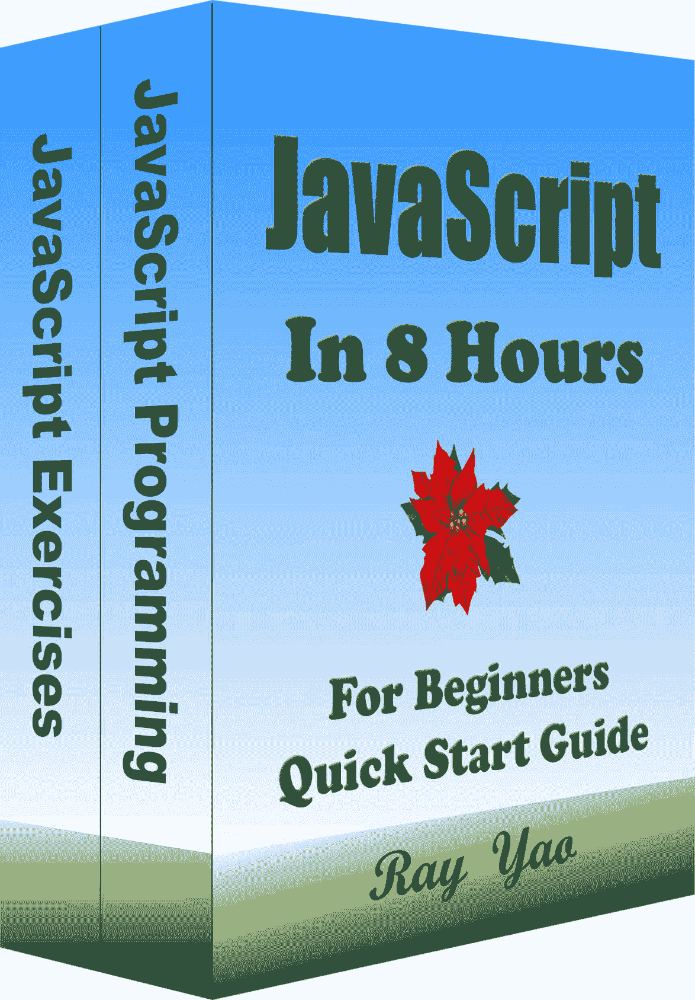
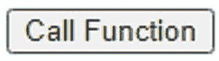
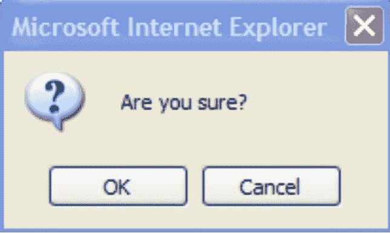
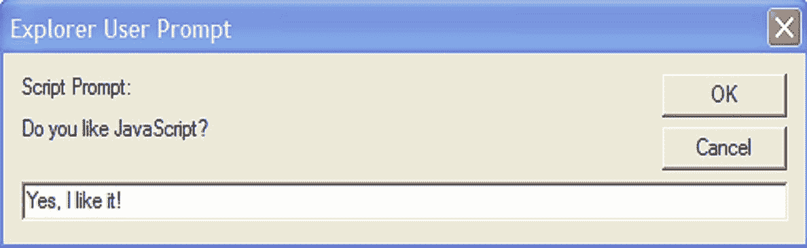
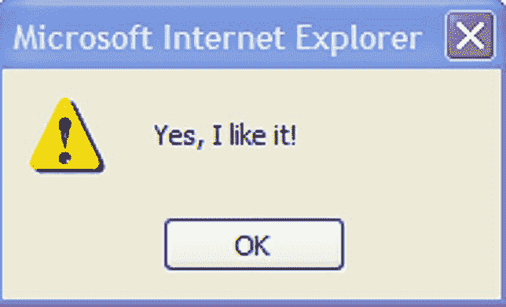
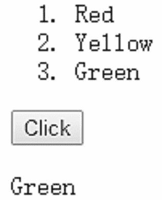

# JavaScript 编程：8 小时快速学会，初学者快速学习编码



## 关于作者：Ray Yao 团队

- 美国 `Zend` 认证 PHP 工程师
- 美国 `Sun` 认证 JAVA 程序员
- 美国 `Oracle` 认证 SCWCD 开发者
- 美国 `CompTIA` 认证 A+ 专业人士
- 美国 `Microsoft` 认证 ASP.NET 专家
- 美国 `Microsoft` 认证 MCP 专业人士
- 美国 `Microsoft` 认证 技术专家
- 美国 `CompTIA` 认证 NETWORK+ 专业人士
- [www.amazon.com/author/ray-yao](http://mybook.to/yaowining)
- [Ray Yao 推荐的 Kindle 书籍](http://mybook.to/yaowining)

## 关于此书

《JavaScript 编程与练习》是一本为高中、学院和大学生编写的教材；它涵盖了所有核心 JavaScript 语言知识。你可以快速轻松地学习 JavaScript 编程的完整技能。

## 免责声明

本教材仅适用于 JavaScript 编程初学者、高中、学院和大学生；不适用于经验丰富的 JavaScript 程序员。

# 第 2 章

## 算术运算符

## 逻辑运算符

## 赋值运算符

## 比较运算符

## 条件运算符

## if 语句

## if-else 语句

## switch 语句

## for 循环

## while 循环

## do-while 循环

## break 语句

## continue 语句

## 动手项目：数字一号

# 第 3 章

## 创建数组

## 显示数组元素值

## 获取数组大小

## 合并数组元素

## 反转元素顺序

## 切片元素

## 排序元素

## 将元素转换为字符串

## 搜索特定元素 (1)

## 搜索特定元素 (2)

## 在开头添加元素

## 删除第一个元素

## 在末尾添加元素

## 删除最后一个元素

## 动手项目：反转排序

# 第 4 章

## 数学方法

## 大于与小于

## 最大值与最小值

## 幂值

## 平根

## PI 与随机数

## 日期与时间

## 年、月、日

## 小、分、秒

## 不同的时间

## 设置日期与时间

## 定时函数

## 动手项目：本月

# 第 5 章

## 字符串长度

## 连接字符串

## 搜索字符

## 转换大小

## 分割字符串

## 提取子字符串

## 将数字转换为字符串

## 将字符串转换为数字

## 搜索特定单词 (1)

## 搜索特定单词 (2)

## Unicode

## 为文本添加链接

## 动手项目：大写

# 第 6 章

## 对象声明

## 网页导航

## 跳转指定页面

## 打开自定义窗口

## 关闭当前窗口

## 确认

## 输入

## 通过 ID 元素

## 通过标签名获取元素

## 连接两个字符串

## 将数字转换为字符串

## 自 1970 年 1 月 1 日

## 绝对值

## 打印当前窗口

## 检查 Java 是否启用

## 屏幕宽度与高度

## 动手项目：最大与最小

# 第 7 章

## HTML 基础

## 点击事件

## 加载事件

## 按键事件

## 鼠标移入事件

## 鼠标移出事件

## 按键事件

## Focus 事件

## 模糊事件

## 重置事件

## 动手项目：鼠标移出

# 第 8 章

## 表单基础

## 表单类型

## 表单名称

## 设置/获取元素

## 显示元素值

## 向表单输入数据

## 显示输入内容

## 提交方法

## 选择

## 单选框

## 复选框选择

## 提交表单

## 创建元素

## 创建文本节点

## 设置/获取属性

## 是否有节点

## 动手项目：清除所有内容

# Hello World!

## 解释

`<!DOCTYPE html>` 是一个 HTML 5 标签，意味着当前文件是一个 HTML 5 文件。

`<script type = "text/javascript">` 是 JavaScript 标签。JavaScript 代码包含在其中。

`document.write ("Hello World!")` 显示或打印 `"Hello World!"`。

每个 JavaScript 命令都以分号（`;`）结束。

JavaScript 代码块可以嵌入到 HTML 文件的任何位置，并由浏览器运行。

`<!-- -->` 是 HTML 注释符号。

## 注释

注释用于解释代码。

### `//` 这是一个单行注释

### `/*` 这是一个多行注释；JavaScript 解释器将忽略单行注释和多行注释。 `*/`

### 示例 1.2

```html
<script type = "text/javascript">document.write ("Hello World"); // show "Hello World"./* "document.write()" shows the content "Hello World". "document.write ( )" is usually used to display the specified contents to users */</script>
```

## 解释

`// "document.write () "` 显示一条消息是一个单行注释。

`/* "document.write () " shows a message "Hello World". …… */` 是多行注释。

## 运行第一个程序

### 示例 1.3

打开记事本，输入如下 JavaScript 代码：（图 1.1）

JavaScript 代码被嵌入在 HTML 文件中。

```html
<!DOCTYPE html><html><head><title>第一个 JavaScript 程序</title></head><body><script language="javascript"> // start javascriptdocument.write ("<h2>Hello World! </h2>") // output</script></body></html>
```

（图 1.1 在记事本中输入 JavaScript 代码）

请将文件保存为 `"FirstJavaScript.html"`。

**注意：** 确保使用 `.html` 扩展名。

双击 `"FirstJavaScript.html"` 文件，该文件将在浏览器中运行并看到输出。（图 1.2）

### 输出

Hello World!（图 1.2）

## 解释

`document.write ("<h2>Hello World! </h2>")` 输出 `"Hello World!"`。

如果你想编辑代码，右键点击 `"FirstJavaScript.html"` > 打开方式 > 记事本。

## 关键字

关键字属于 JavaScript 语言。在为变量、函数、数组、属性选择标识符名称时不能使用这些关键字。以下是 JavaScript 关键字：

| `break` | `case` | `continue` | `default` | `delete` | `do` | `else` | `export` | `false` | `for` | `function` | `if` | `import` | `in` | `new` | `null` | `return` | `switch` | `this` | `true` | `typeof` | `var` | `void` | `while` | `with` | `Array` | `Date` | `Math` | `Object` | `window` | `location` | `history` | `navigator` | `document` | `images` | `links` | `forms` | `elements` | `getElementById` | `innerHTML` |

### 示例 1.4

```javascript
break // 这是一个 JavaScript 关键字
return // 这是一个 JavaScript 关键字
```

## 变量

变量是与值关联的符号名称。使用 `var` 定义变量。定义变量的语法为：

`var variable_name = value;`

### 示例 1.5

```javascript
<script type = "text/javascript">var abcde=100; // 定义一个变量 "abcde"var abc888="Hello World"; // 定义一个变量 "abc888"var my_variable=true; // 定义一个变量 "my_variable"</script>
```

## 解释

`var variable_name = value;` 可以定义变量。

**注意：**

变量命名不能以数字开头，不能包含空格。例如 `"23var"`、`"abc de"` 是无效的变量名。

但 `"var23"`、`"abc_de"` 是有效的变量名。

## 数据类型

- `string` – 字符或字符字符串
- `number` – 整数或浮点数
- `boolean` – 布尔真或布尔假的值
- `function` – 用户定义的方法
- `object` – 内置或用户定义的对象

### 示例 1.6

```javascript
var mystring = "I am a string";
var myinteger = 168;
var myfloat = 12.88;
var mybool = true;
```

## 解释

`var mystring="I am a string";` // `mystring` 数据类型是 `string`。

`var myinteger=168;` // `myinteger` 数据类型是 `number`。

`var myfloat=12.88;` // `myfloat` 数据类型是 `number`。

`var mybool=true;` // `mybool` 数据类型是 `boolean`。

**注意：** 字符串总是被引号括起来的。

## 转义序列

反斜杠字符可以用于转义。

- `\n` 换行。
- `\r` 回车。
- `\t` 制表。
- `\'` 单引号。
- `\"` 双引号。

### 示例 1.7

```html
<html><body><script language="javascript">document.write ("Hello World");</script></body></html>
```

## 函数

函数是可以多次重复的代码块。

定义函数使用 `function-name() { ... }`。

调用函数使用 `function-name()`。

### 示例 1.8

```html
<html><body><script language="javascript">function test(){document.write ("function!");}</script></body></html>
```

## 解释

`function test(){ }` 是 `test` 的声明。

`onload="test()"` 在网页加载后调用 `test()`。

`test()` 是调用 `test(){ }` 的命令。

运行 `test()` 时，`test(){ }` 将输出 `"function!"`。

## 带参数的函数

函数括号内可以有一个或多个参数。参数用于将数据传递给函数。

`function function_name(arg) { ... }`

### 示例 1.9

```html
<html><head><title>JavaScript 测试</title></head><body><script type="text/javascript">function test(msg){document.write (msg); // 输出 msg}</script><body onload="test('带参数')"></body></html>
```

## 解释

`onload="test('带参数')"` 在网页加载后调用 `test(msg)`。

当 `test("带参数")` 调用 `test(msg){}` 时，它将 `"带参数"` 传递给 `var msg`。

`document.write ( msg )` 将使用数据，然后输出 `"带参数"`。

## 返回值

`return` 可以将值返回给函数调用者。

`function function_name(arg) { return value; }`

### 示例 1.10

```html
<html><head><title>JavaScript 测试</title></head><body><script language="javascript">function add(num1,num2){return num1+num2; // 将结果传递给函数调用者}document.write ("3 + 5 = " + add( 3, 5 )); // 函数调用者</script></body></html>
```

## 解释

`add( 3, 5 )` 意味着它调用函数 `add (num1,num2){ }`，并将参数 `"3,5"` 传递给 `var num1` 和 `num2`。

`return num1+num2` 将结果返回给 `add(3,5)`，你可以认为 `add(3,5) = return num1+num2`，将值赋值给 `add(3,5)`。即 `add (3,5) = 8`。

`document.write ("3 + 5 = " + add( 3, 5 ))` 将显示结果。

## 变量作用域

全局变量定义在函数外部，可以在任何地方使用；局部变量定义在函数内部，它只在当前函数内部使用。

在下面的示例中，我们定义两个同名的变量，其中一个是全局变量，另一个是局部变量。

### 示例 1.11

```html
<html><head><title>变量范围</title><script type="text/JavaScript">var  msg=200; // 这个数字是一个全局变量 function test(){ // 定义一个函数 var  msg=100; // 这个数字是一个局部变量} document.write (msg);</script></head><body onLoad ="test()"></body></html>
```

输出：

200

解释：

`onload="test("…")"` 在网页加载后调用函数 `test()`。

`document.write (msg)` 输出 `200`，这意味着变量 `msg` 存储的是全局变量的值。

局部变量仅在声明它们所在的函数块内可见。

## 弹窗消息

### `alert( )`

`alert( )` 弹出一个消息并显示指定的内容。

### 示例 1.12

```html
<html><body><script language="javascript">alert("Hello World Again!"); // 弹出一个消息</script></body></html>
```

输出：

Hello World Again!

解释：

`alert ( )` 弹出一个显示消息的对话框。

## 未定义的变量

当使用未定义的变量时，JavaScript 将返回一个 "undefined" 值。

### 示例 1.13

```html
<html><head><script>var abcd; // 未初始化 document.write ( abcd ); // abcd 是未定义的变量</script></head></html>
```

输出：

undefined

解释：

`document.write ( abcd );` 使用了一个未定义的变量 `"abcd"`。因此，输出是 `"undefined"`。

## 变量命名规则

- 第一个字母必须是 ASCII 字母或下划线。
- 首字母不能是数字。
- 后续的字母可以是字母、数字或下划线。
- 变量名不能使用 JavaScript 关键字。
- 变量不能包含空格或特殊符号。

### 示例 1.14

以下是有效的变量：

| `_goodExcellent100Five_Star` |

### 示例 1.15

以下是无效的变量名：

| `200Guys` // 不能以数字开头 |
| `Andy&Bob` // 不能在变量名中使用 "&" 符号 |
| `case` // 不能使用 JavaScript 关键字作为变量 |

## 动手项目：一个简单的调用

### 调用函数

打开记事本，输入 JavaScript 代码：

```html
<html>  <head>     <title>调用函数</title>  </head>  <body>    <script  language="javascript"> function  myFunction( ) { // 声明一个函数      document.write ("Hello! A function has been called!")    }    </script>    <form>      <br>      <input name="button" type="button" onclick="myFunction( )" value="Call Function">          </form>          <!-- 调用函数 --></body></html>
```

请将文件另存为 `"CallFunction.html"`。

注意：请确保使用 `".html"` 扩展名。

双击 `"CallFunction.html"` 文件，将在浏览器中运行 `"CallFunction.html"`，请点击 `"Call Function"` 按钮并查看输出。

输出：



Hello! A function has been called!

解释：

`function  myFunction( ){ }` 定义了一个名为 `"myfunction"` 的函数。

`onclick="myFunction( )"` 在点击按钮时调用 `myFunction( )`。

# 第 2 章

## 算术运算符

| 运算符 | 说明 |
| :--- | :--- |
| `+` | 加法或连接字符串 |
| `-` | 减法 |
| `*` | 乘法 |
| `/` | 除法 |
| `%` | 取模 |
| `++` 或 `--` | 加 1 或 减 1 |

`%` `modulus` 运算符将第一个操作数除以第二个操作数，返回余数。例如 `4%2`，余数为 `0`。

### 示例 2.1

```javascript
var add =  100 + 200;  document.write (add); // 输出 300
var div = 800 / 2;  document.write ( div ); // 输出 400
var mod = 10% 3;  document.write ( mod ); // 输出 1
var inc = 10;  document.write ( ++inc ); // 输出 11
var str= "abc" + "de";  document.write ( str ); // 输出 abcde
```

## 逻辑运算符

| 运算符 | 等于 |
| :--- | :--- |
| `&&` | 与 |
| `||` | 或 |
| `!` | 非 |

在使用逻辑运算符后，结果将为 true 或 false。

### 示例 2.2

```javascript
var x=true; var y=false;
var a=x && y;  document.write ( a ); // 输出: false
var b=x || y;  document.write ( b ); // 输出: true
var c=!x;  document.write ( c ); // 输出: false
```

解释：

`true && true` 返回 true;

`true && false` 返回 false;

`false && false` 返回 false;

`true || true` 返回 true;

`true || false` 返回 true;

`false || false` 返回 false;

`! true` 返回 false;

## 赋值运算符

| 运算符 | 示例 |
| :--- | :--- |
| `+=` | `x+=y` |
| `-=` | `x-=y` |
| `*=` | `x*=y` |
| `/=` | `x/=y` |
| `%=` | `x%=y` |

### 示例 2.3

```javascript
var x=200; y=100;
x+=y;  document.write ( x );
x-=y;  document.write ( x );
x*=y;  document.write ( x );
x/=y;  document.write ( x );
x%=y;  document.write ( x );
```

## 比较运算符

| 运算符 | 说明 |
| :--- | :--- |
| `>` | 大于 |
| `<` | 小于 |
| `>=` | 大于等于 |
| `<=` | 小于等于 |
| `==` | 等于 |
| `!=` | 不等于 |

使用比较运算符后，结果将为 true 或 false。

### 示例 2.4

```javascript
var a=100; var b=200;
var result = (a>b); document.write ( result );
result = (a==b); document.write ( result );
result = (a!=b); document.write ( result );
```

解释：

`100>200` 返回 false;

`100==200` 返回 false;

`100!=200` 返回 true;

## 条件运算符

`(test-expression) ? (if-true-do-this) : (if-false-do-this);`

`(test-expression)` 类似于 `a<b`, `x!=y` 等。

### 示例 2.5

```html
<html><body><script>var x=100; var y=200;var result = (x < y) ? "apple" : "banana"; document.write ( result );</script></body></html>
```

输出：apple

解释：条件运算符使用 `(x<y)` 来测试 `"x"` 和 `"y"`，因为 `"x"` 小于 `"y"`，它是 true。因此，输出是 `"apple"`。

## If 语句

`if ( test-expression ) { ... }`

只有当指定的条件为真时执行 `{ ... }` 中的代码，如果条件为假，则不执行 `{…}` 中的任何代码。

### 示例 2.6

```javascript
var x=200;var y=100;
if ( x > y ) { // 如果真，执行此操作 document.write ( "x is greater than y" );}
```

输出：x is greater than y

解释：

`(x>y)` 是测试表达式，即 `(200>100)`，返回 true，则将执行 `{ }` 中的代码；返回 false，则不执行 `{ }` 中的代码。

## If-else 语句

`if ( test-expression) { ... } else { ... }`

`"if...else 语句"` 在条件为真时运行某些代码，在条件为假时运行其他代码。

### 示例 2.7

```html
<html><script>var x=100; var y=200;if (x>y) {document.write ("x is greater than y.")} // 如果真，执行此操作 else {document.write ( "x is less than y" );} // 如果假，执行此操作</script></html>
```

输出：x is less than y

解释：`(x>y)` 是测试表达式，即 `(100>200)`，返回 true，则将输出 `"x is greater than y."`；返回 false，则将输出 `"x is less than y"`。

## Switch 语句

```javascript
switch ( var variable ) {
case 1: 如果等于此情况，执行此操作； break;
case 2: 如果等于此情况，执行此操作； break;
case 3: 如果等于此情况，执行此操作； break;
default : 如果不等于任何情况，运行默认代码； break;
}
```

变量的值将首先与每个 case 进行比较，如果等于其中一个 `case` 值，它将执行该 `case` 代码。

`break;` 结束当前语句。

### 示例 2.8

```html
<html><head><title>JavaScript Test</title></head><body><script>
var number=20;
switch ( number ) { // number value compares each case
case 10 : document.write ( "Running case 10" ); break ;
case 20 : document.write ( "Running case 20" ); break;
case 30 : document.write ( "Running case 30" ); break;
default : document.write ( "Running default code" ); break; }}
</script></body></html>
```

**输出：**

Running case 20

**解释：**

`number` 的值为 20；它匹配 `case 20`，因此它运行 `case 20` 中的代码。

`break;` 结束了该语句，不能省略。

## For 循环

```javascript
for( 初始化, 测试-表达式, 增量) { //某些代码; }
```

`for loop` 通过指定的次数重复运行一个代码块。

### 示例 2.9

```html
<html><script>
for (var x = 0; x <= 5; x++) { // 循环 5 次
document.write ( x );}</script></html>
```

**输出：**

012345

**解释：**

`var x = 0` 是初始化器，将变量 `x` 初始化为 0。

`x <= 5` 是 `test-expression`，代码最多运行 5 次。

`x++` 意味着 `x` 在每次循环中增加 1。

循环 5 次后，代码将输出 012345。

## While 循环

```javascript
while ( 测试-表达式 ) { // 在此处某些 js 代码; }
```

`while loop` 如果指定的条件为真，则循环遍历一个代码块。

### 示例 2.10

```javascript
<script>
var counter=0;
while (counter < 8){ // 循环 8 次
document.write ( "&" );
counter++; // 每次循环增加 1}</script>
```

**输出：**

&&&&&&&&

**解释：**

`"counter< 8"` 是一个 `test expression`，如果条件为真，代码将循环少于 8 次，直到 `counter` 达到 8 为止，此时条件为假，代码将停止运行。

## Do-While 循环

```javascript
do{ // 在此处某些 js 代码 } while ( 测试-表达式);
```

`do...while` 先循环一次代码块，然后如果指定的条件为真，则重复循环。

### 示例 2.11

```javascript
<script>
var counter=0;
do {
  document.write ( "@" );
  counter++; // 每次循环增加 1
} while (counter<8); // 循环 8 次</script>
```

**输出：**

@@@@@@@@

**解释：**

`"counter< 8"` 是一个 `test expression`，如果条件为真，代码将循环少于 8 次，直到 `counter` 达到 8 为止，此时条件为假，代码将停止运行。

## Break 语句

`break` 关键字用于根据条件停止运行循环。

```javascript
break;
```

### 示例 2.12

```javascript
<script>
var num=0;
while (num<10){
  if (num==5) break; // 如果 num 为 5，则退出"while loop"
  num++;
}
document.write ( num );</script>
```

**输出：** 5

**解释：**

`"if (num==5) break;"` 是一个 `break statement`。如果 `num` 为 5，程序将运行 `break` 命令，`break statement` 将退出循环，然后运行 `document.write (num)`。

## Continue 语句

`continue` 关键字用于停止当前迭代，忽略后续代码，然后继续下一次循环。

```javascript
continue;
```

### 示例 2.13

```html
<html><body><script>
var num=0;
while (num<10){
  num++;
  if (num==5) continue; // 进入下一次"while loop"
  document.write ( num ); // 如果 num 为 5 则跳过此
}</script></body></html>
```

**输出：**

1234678910

**解释：**

注意输出中没有 5。

`"if (num==5) continue;"` 意味着：当 `num` 为 5 时，程序将运行 `continue` 命令，跳过下一个命令 `document.write ( num )`，然后继续下一次 while 循环。所以看不到 5。

## 动手项目：数字一

### For 循环示例

打开记事本，输入 JavaScript 代码：

```html
<html><head><title>Number One</title></head><body><script language="javascript">
for ( n = 1; n <= 6; n++ ){ // 循环 6 次
  document.write ( "<h"+n+">Number "+n+"</h"+n+">");
} // 输出
</script></body>
</html>
```

**解释：**

`for( init, test-expression, increment) { //某些代码; }` 通过指定的次数重复运行一个代码块。

`var x = 0` 是初始化器，将变量 `x` 初始化为 0。

`x <= 5` 是 `test-expression`，代码最多运行 5 次。

`x++` 意味着 `x` 在每次循环中增加 1。

循环 5 次后，代码将输出 012345。

# 第 3 章

## 创建数组

### `new Array()`

`new Array()` 创建一个新数组。

### 示例 3.1

```javascript
var arr = new Array( "a", "b", "c", "d", "e", "f" ); // 创建数组
document.write ( arr );
```

输出: a,b,c,d,e,f

解释:

`new Array( "a", "b", "c", "d", "e", "f" )` 创建一个包含这些元素的数组。

## 显示数组元素值

### `document.write( array )`

`document.write( array )` 显示数组的所有元素。

### 示例 3.2

```javascript
var arr = new Array( "a", "b", "c", "d", "e", "f" );
document.write ( arr ); // 显示所有元素
```

输出: a,b,c,d,e,f

解释:

`document.write ( arr )` 显示数组的所有元素。

## 获取数组大小

### `array.length`

`array.length` 返回数组的长度（元素个数）。

### 示例 3.3

```javascript
var arr = new Array( "a", "b", "c", "d", "e", "f" );
var len = arr.length; // 获取数组长度
document.write ( len );
```

输出: 6

解释:

`arr.length` 返回数组 `arr` 的长度。

## 合并数组元素

### `array.join( )`

`array.join( )` 可以用指定的分隔符将数组元素连接为字符串。

### 示例 3.4

```javascript
var arr = new Array( "a", "b", "c", "d", "e", "f" );
var str = arr.join( "-" ); // 用 "-" 连接所有元素
document.write ( str );
```

输出: a-b-c-d-e-f

解释:

`arr.join( "-" )` 用 "-" 连接 `arr` 的所有元素。

## 反转元素顺序

### `array.reverse( )`

`array.reverse( )` 可以反转数组元素的顺序。

### 示例 3.5

```javascript
var arr = new Array( 1, 2, 3, 4, 5, 6 );
arr.reverse ( ); // 反转所有元素
var sor = arr.join(","); // 用 "," 连接所有元素
document.write ( sor );
```

输出: 6,5,4,3,2,1

解释:

`arr.reverse ( )` 反转 `arr` 的元素顺序。

`var sor = arr.join(",")` 用逗号连接 `arr` 的元素；并将值赋值给 `sor`。

## 切片元素

### `array.slice( )`

`array.slice( start, end )` 从数组中提取一部分元素，返回新数组。

### 示例 3.6

```javascript
var arr = new Array( "a", "b", "c", "d", "e", "f" );
var sli = arr.slice( 2, 5 ); /*  从索引 2 到索引 5-1 提取某些元素  */
document.write ( sli );
```

输出: c, d, e

解释:

`arr.slice ( 2, 5 )` 从 `arr` 数组索引 2 到 5-1 提取元素。注意 5-1 索引表示的是 `"e"`，而不是 `"f"`。

## 对元素排序

### `array.sort( )`

`array.sort( )` 可以按顺序对数组元素排序。

### 示例 3.7

```javascript
var arr = new Array( 2, 5, 3, 1, 4, 6 );
arr.sort ( ); // 按顺序排序所有元素
var sor = arr.join(","); // 用 "," 连接所有元素
document.write ( sor );
```

输出: 1,2,3,4,5,6

解释:

`arr.sort ( )` 按顺序对 `arr` 的元素进行排序。

`var sor = arr.join(",")` 用逗号连接 `arr` 的元素；并将值赋值给 `sor`。

## 将元素转换为字符串

### `array.toString();`

`array.toString()` 将 JavaScript 数组转换为字符串。

### 示例 3.8

```javascript
var myarray = new Array( );
myarray[0] ="Mon";
myarray[1] ="Tue";
myarray[2] ="Wed";
var days = myarray.toString( ); // 转换为字符串
document.write ( days );
```

输出:

Mon, Tue, Wed

解释:

`myarray.toString( )` 将 JavaScript 数组转换为字符串。`"Mon, Tue, Wed"` 的值是字符串类型。

## 查找特定元素 (1)

### `indexOf( )`

`indexOf( )` 可以找到指定元素在数组中首次的位置。

### 示例 3.9

```javascript
var myarray = new Array( );
myarray[0] ="Mon";
myarray[1] ="Tue";
myarray[2] ="Wed";
myarray[3] ="Tue";
var index = myarray.indexOf ("Tue"); // 获取 "Tue" 的索引
document.write (index);
```

输出: 1

解释:

`myarray.indexOf ( "Tue" )` 返回 `"Tue"` 在 `myarray` 中首次出现的位置。`"Tue"` 的索引为 1。

如果在数组中未找到元素，`indexOf( )` 返回 -1。

## 查找特定元素 (2)

### `lastIndexOf( )`

`lastIndexOf( )` 可以找到指定元素在数组中最后一次的位置。

### 示例 3.10

```javascript
var myarray = new Array( );
myarray[0] ="Mon";
myarray[1] ="Tue";
myarray[2] ="Wed";
myarray[3] ="Tue";
var index=myarray.lastIndexOf ( "Tue" ); // 获取 "Tue" 的索引
document.write (index);
```

输出: 3

解释:

`myarray.lastIndexOf ( "Tue" )` 返回 `"Tue"` 在 `myarray` 中最后一次出现的位置。`"Tue"` 的索引为 3。

如果在数组中未找到元素，`lastIndexOf( )` 返回 -1。

## 在开头添加元素

### `unshift( )`

在数组的开头添加一个或多个元素。

### 示例 3.11

```javascript
var arr = [4,5,6];
arr.unshift(1,2,3);  // 将 1,2,3 添加到 "arr" 的开头
document.write (arr);
```

输出: 1,2,3,4,5,6

解释:

`unshift()` 在数组的开头添加一个或多个元素。

`arr.unshift(1,2,3);` 将元素 1,2,3 添加到 `arr` 的开头。

## 移除第一个元素

### `shift( )`

移除数组的第一个元素。

### 示例 3.12

```javascript
var arr = [4,5,6];
arr.shift( ); // 移除数组的第一个元素
document.write (arr);
```

输出:

5, 6

解释:

`shift()` 移除数组的第一个元素。

`arr.shift( );` 移除数组 `arr` 的第一个元素。

## 在末尾添加元素

### `push( )`

在数组的末尾添加一个或多个元素。

### 示例 3.13

```javascript
var arr = [1,2,3];
arr.push( 4, 5, 6 ); // 将 4,5,6 添加到 "arr" 的末尾
document.write (arr);
```

输出: 1,2,3,4,5,6

解释:

`push()` 在数组的末尾添加一个或多个元素。

`arr.push(4,5,6);` 将 4,5,6 添加到 `arr` 的末尾。

## 移除最后一个元素

### `pop( )`

移除数组的最后一个元素。

### 示例 3.14

```javascript
var arr = [1,2,3,4,5,6];
arr.pop( ); // 移除 arr 的最后一个元素
document.write (arr);
```

输出: 1,2,3,4,5

解释:

`pop()` 移除数组的最后一个元素。

`arr.pop( );` 移除 `arr` 的最后一个元素。

## 数组反转

### `array.reverse( )`

`array.reverse( )` 可以反转数组元素的顺序。

### 示例 3.15

```javascript
var arr = new Array( 1, 2, 3, 4, 5, 6 );
arr.reverse ( ); // 反转所有元素
var sor = arr.join(","); // 用 "," 连接所有元素
document.write ( sor );
```

输出: 6,5,4,3,2,1

解释:

`arr.reverse ( )` 反转 `arr` 的元素顺序。

`var sor = arr.join(",")` 用逗号连接 `arr` 的元素；并将值赋值给 `sor`。

## 合并数组

### `array.concat( )`

`array.concat( )` 可以合并两个或多个数组。

### 示例 3.16

```javascript
var arr1 = new Array( 1, 2, 3 );
var arr2 = new Array( 4, 5, 6 );
var arr = arr1.concat( arr2 ); // 合并 arr1 和 arr2
document.write ( arr );
```

输出: 1,2,3,4,5,6

解释:

`arr1.concat( arr2 )` 合并 `arr1` 和 `arr2` 并返回新数组。

## 复制数组

### `array.slice( )`

`array.slice( )` 可以用来创建一个数组的浅拷贝。

### 示例 3.17

```javascript
var arr = new Array( 1, 2, 3 );
var copy = arr.slice( ); // 复制数组
document.write ( copy );
```

输出: 1,2,3

解释:

`arr.slice( )` 创建了 `arr` 的一个浅拷贝。

## 填充数组

### `array.fill( )`

`array.fill( )` 可以填充数组中的所有元素为指定的值。

### 示例 3.18

```javascript
var arr = new Array( 5 );
arr.fill( 0 ); // 将所有元素填充为 0
document.write ( arr );
```

输出: 0,0,0,0,0

解释:

`arr.fill( 0 )` 将数组中的所有元素填充为 0。

## 查找数组中的最大值

### `Math.max( )`

`Math.max( )` 可以找到数组中的最大值。

### 示例 3.19

```javascript
var arr = new Array( 1, 6, 2, 8, 5, 7 );
var max = Math.max(...arr); // 获取数组中的最大值
document.write (max);
```

输出: 8

解释:

`Math.max( ...arr )` 使用扩展运算符获取 `arr` 元素中的最大值。

## 查找数组中的最小值

### `Math.min( )`

`Math.min( )` 可以找到数组中的最小值。

### 示例 3.20

```javascript
var arr = new Array( 1, 6, 2, 8, 5, 7 );
var min = Math.min(...arr); // 获取数组中的最小值
document.write (min);
```

输出: 1

解释:

`Math.min( ...arr )` 使用扩展运算符获取 `arr` 元素中的最小值。

## 随机数

### `Math.random( )`

`Math.random()` 返回一个 0（包含）到 1（不包含）之间的随机数。

### 示例 3.21

```javascript
var rand = Math.random(); // 生成随机数
document.write (rand);
```

输出: 0.123456...

解释:

`Math.random()` 生成一个 0 到 1 之间的随机浮点数。

## 舍入

### `Math.floor( )`

`Math.floor( )` 将数字向下取整到最近的整数。

### 示例 3.22

```javascript
var num = Math.floor( 4.7 ); // 向下取整
document.write (num);
```

输出: 4

解释:

`Math.floor( 4.7 )` 将 4.7 向下取整为 4。

## 向上

### `Math.ceil( )`

`Math.ceil( )` 将数字向上取整到最近的整数。

### 示例 3.23

```javascript
var num = Math.ceil( 4.2 ); // 向上取整
document.write (num);
```

输出: 5

解释:

`Math.ceil( 4.2 )` 将 4.2 向上取整为 5。

## 四舍入

### `Math.round( )`

`Math.round( )` 将数字四舍五入到最近的整数。

### 示例 3.24

```javascript
var num = Math.round( 4.6 ); // 四舍五入
document.write (num);
```

输出: 5

解释:

`Math.round( 4.6 )` 将 4.6 四舍五入为 5。

## 绝对值

### `Math.abs( )`

`Math.abs( )` 返回数字的绝对值。

### 示例 3.25

```javascript
var num = Math.abs( -10 ); // 获取绝对值
document.write (num);
```

输出: 10

解释:

`Math.abs( -10 )` 返回 -10 的绝对值 10。

## 幂

### `Math.pow( )`

`Math.pow( x, y )` 返回 `x` 的 `y` 次幂。

### 示例 3.26

```javascript
var num = Math.pow( 2, 3 ); // 2 的 3 次幂
document.write (num);
```

输出: 8

解释:

`Math.pow( 2, 3 )` 计算 $2^3$ 的结果为 8。

## 平方根

### `Math.sqrt( )`

`Math.sqrt( )` 返回数字的平方根。

### 示例 3.27

```javascript
var num = Math.sqrt( 16 ); // 获取平方根
document.write (num);
```

输出: 4

解释:

`Math.sqrt( 16 )` 返回 16 的平方根 4。

# 第 4 章

## PI 与 随机值

### `Math.PI`

`Math.PI` 是一个存储圆周率 值的常量。

### `Math.random()`

`Math.random()` 生成一个 0.0 到 1.0 之间的随机数。

### 示例 4.6

```html
<script>
var pi = Math.PI;
var ran = Math.random();
document.write ("The PI value is " + pi + "<br>");
document.write ("The random number is " + ran);
</script>
```

**输出：**

The PI value is 3.141592653589793

The random number is 0.6315033452119678

**解释：**

`Math.PI` 的值为 3.141592653589793。

`Math.random()` 生成一个 0.0 到 1.0 之间的随机数，在这里的结果是 0.6315033452119678。

## 日期与 时间

JavaScript 经常使用日期和时间来设计网页。在使用日期时间之前，必须先创建一个日期对象。

### `var DateObject = new Date()` // 创建日期对象

### 示例 4.7

```html
<script>
var DateObject = new Date(); // create a date object
document.write ( DateObject );
</script>
```

**输出：**

Thu Nov 05 2015 21:39:28 GMT-0500 (Eastern Standard Time)

**解释：**

`var DateObject = new Date()` 创建了一个日期对象。

`document.write ( DateObject )` 显示当前的日期和时间。

## 日期、月、年、日

Date 对象具有以下方法：

- `getDate()`：获取日期
- `getMonth()`：获取月份（需要加 1）
- `getYear()`：获取年份（需要加 1900）
- `getDay()`：获取星期
- `getFullYear()`：获取完整的年份

**注意：**

- `getDay()` 返回从 0（星期日）到 6（星期六）。
- `getMonth()` 返回从 0（一月）到 11（十二月）。
- `getYear()` 返回年份，但需要加 1900。
- `getFullYear()` 返回格式正确的年份。

### 示例 4.8

```html
<html><body><script>
var now = new Date (); // create a date object
var m = now.getMonth() + 1; // 注意这里需要加 1
var d = now.getDate();
var y = now.getYear() + 1900; // 注意这里需要加 1900
var fy = now.getFullYear();
document.write ( m + " - " + d + " - " + y + "<br>" + "This year is " + fy);
</script></body></html>
```

**输出：**

11- 6 - 2015

This year is 2015

**解释：**

`now.getMonth()` 返回月份索引，但需要加 1。

`now.getDate()` 返回当前日期。

`now.getYear()` 返回年份，但需要加 1900。

`getFullYear()` 返回格式正确的年份。

## 小时、分、秒

Date 对象具有以下方法：

- `getHours()`：获取小时
- `getMinutes()`：获取分钟
- `getSeconds()`：获取秒
- `getTime()`：获取时间

注意 `getTime()` 返回的是从 1970 年 1 月 1 日到当前时间的数字。

### 示例 4.9

```html
<html><head><title>JavaScript Codes</title></head><body><script>
var now = new Date(); // create a date object
var h = now.getHours();
var m = now.getMinutes();
var s = now.getSeconds();
document.write ( "The current time is: <br>");
document.write ( h + ":" + m + ":" + s );
</script></body></html>
```

**输出：**

The current time is:

19:30:28

**解释：**

`getHours` 返回当前小时。

`getMinutes` 返回当前分钟。

`getSeconds` 返回当前秒。

## 不同的时间

- `getUTCHours()`：返回格林威治标准时间 (UTC)。
- `getTimezoneOffset()`：返回 UTC 时间与本地时间之间的差。例如，如果你的时区是 GMT+2，则将返回 -120。

### 示例 4.10

```html
<html><head><title>JavaScript Codes</title></head><body><script>
var now = new Date(); // create a date object
var utc = now.getUTCHours(); // 获取格林威治标准时间
var timezone = now.getTimezoneOffset(); // 获取时区
document.write ( utc + "<br>" )
document.write ( timezone + "<br>" );
</script></body></html>
```

**输出：**

13

300

**解释：**

`getUTCHours()` 返回 UTC 小时。“13”意味着当前的格林威治时间。

`getTimezoneOffset()` 返回一个数字。例如，“300”表示东部时间，“360”表示中部时间，“420”表示太平洋时间。

## 设置日期与时间

Date 对象具有以下设置方法：

- `setDate()`：设置日期
- `setMonth()`：设置月份
- `setFullYear()`：设置年份
- `setHours()`：设置小时
- `setMinutes()`：设置分钟
- `setSeconds()`：设置秒
- `setTime()`：设置时间

**注意：**

- `setDate()` 接受的值是 1 到 31。
- `setMonth()` 接受的值是 0 到 11。
- `setFullYear()` 接受四位年份。

### 示例 4.11

```javascript
var now = new Date(); // 创建日期对象
now.setDate(15); // 设置日期为 15 号
now.setMonth(5); // 设置月份为 6 月
now.setFullYear(2025); // 设置年份为 2025 年
document.write(now);
```

**输出：**

Sun Jun 15 2025 ...

### 示例 4.12

```html
<html><head><title>JavaScript Codes</title></head><body><script>
var now = new Date(); // 创建一个日期对象
now.setHours(10, 30, 0); // 设置小时、分、秒
document.write(now);
</script></body></html>
```

**输出：**

... 10:30:00 ...

## 计时器

JavaScript 使用 `setTimeout` 和 `setInterval` 来执行定时任务。

- `setTimeout(function, milliseconds)`：在指定的毫秒数后执行一次函数。
- `setInterval(function, milliseconds)`：每隔指定的毫秒数执行一次函数。

### 示例 4.13

```javascript
var count = 0;
function timer() {
    count++;
    console.log("Count is: " + count);
}
setInterval(timer, 1000); // 每 1 秒执行一次 timer
```

### 示例 4.14

```javascript
var count = 0;
var timer = setInterval(function() {
    count++;
    console.log("Count is: " + count);
    if (count == 5) {
        clearInterval(timer); // 5 次后停止计时器
    }
}, 1000);
```

# 第 5 章

## 字符串长度

### `string.length`

`string.length` 返回字符串的长度。

### 示例 5.1

```html
<script>
var mystring = "JavaScript is easy";
var len = mystring.length; // 获取字符串长度
document.write ( len );
</script>
```

输出: 18

解释:

`mystring.length` 返回 `mystring` 的长度。

## 搜索字符

### `string.charAt( index )`

`string.charAt( index )` 返回指定索引处的字符。

### 示例 5.2

```html
<script>
var mystring = "JavaScript is easy";
var charac = mystring.charAt( 0 ); // 搜索索引 0 处的字符
document.write ( charac );
</script>
```

输出: `J`

解释:

`mystring.charAt( 0 )` 找到 `mystring` 中索引为 0 的字符，并返回结果 `"J"`。

注意字符串的索引从 0 开始。

### 示例 5.3

```html
<html><script>
var mystring = "JavaScript is easy";
var charac = mystring.charAt( 2 ); // search a character at index 2
document.write ( charac );
</script></html>
```

输出: `v`

解释:

`mystring.charAt( 2 )` 找到 `mystring` 中索引为 2 的字符，并返回结果 `"v"`。

注意字符串的索引从 0 开始。

## 转换字符大小写

### `string.toUpperCase( )`

### `string.toLowerCase( )`

`toUpperCase( )` 和 `toLowerCase( )` 可以进行大小写转换。

### 示例 5.4

```html
<script>
var mystring = "Hello World!";
var big = mystring.toUpperCase( );
var small = mystring.toLowerCase( );
document.write ( "Uppercase is " + big + "<br>" );
document.write ( "Lowercase is " + small);
</script>
```

输出:

Uppercase is HELLO WORLD!

Lowercase is hello world!

解释:

`mystring.toUpperCase( )` 和 `str.toLowerCase( )` 转换了 `mystring` 的大小写。

## 分割字符串

### `string.split( " " );`

`split( " " )` 可以根据字符串中的空格将其拆分为多个子字符串。

`split()` 也用于将字符串转换为数组。

### 示例 5.5

```html
<html><head><title>JavaScript 代码</title></head><body><script>
var mystring = "JavaScript for Beginners";
var substr = mystring.split( " " ); /* 根据 mystring 的空格将 mystring 分分为子字符串 */
document.write ( substr ); // 显示子字符串
document.write ( "<br>" + substr[0]);
document.write ( "<br>" + substr[1]);
document.write ( "<br>" + substr[2]);
</script></body></html>
```

输出:

JavaScript, for, Beginners

JavaScript

for

Beginners

解释:

`mystring.split( " " )` 根据 `mystring` 的空格将字符串分离为多个子字符串，使用逗号分割 `mystring`。

`document.write ( substr );` 显示了多个子字符串。

`substr[0]` 显示第一个子字符串。

`substr[1]` 显示第二个子字符串。

`substr[2]` 显示第三个子字符串。

## 提取子字符串

### `string.substr( start, length );`

`substr( start, length )` 可以从字符串中提取子字符串。

`start` 参数指定提取的起始位置。

`length` 参数指定子字符串的长度。

### 示例 5.6

```html
<script>
var mystring = "JavaScript is easy.";
var sub = mystring.substr( 4, 6 ); /* 从索引 4 开始提取长度为 6 的子字符串 */
document.write ( sub );
</script>
```

输出: 

Script

解释:

`mystring.substr( 4, 6 )` 从 `mystring` 中提取一个子字符串。

`( 4, 6 )` 指定子字符串的起始位置为 4，长度为 6。

注意字符串索引从 0 开始。

## 将数字转换为字符串

### `number.toString( );`

为了满足 JS 编程的需求，有时需要将数字转换为字符串数据类型。

`number.toString( )` 可以将数字转换为字符串。

### 示例 5.7

```html
<script>
var num1 = 12; var num2 = 68;
var str1 = num1.toString( ); // 转换为字符串
var str2 = num2.toString( ); // 转换为字符串
var sum = str1 + str2; // 是连接而非相加
document.write ( sum );
</script>
```

输出: 1268

解释:

`num1.toString( )` 和 `num2.toString( )` 将两个数字转换为字符串类型。因此，`str1` 加上 `str2` 的结果是 1268，而不是 80。

## 将字符串转换为数字

### `parseInt(string);`

### `parseFloat( string);`

`parseInt(string)` 和 `parseFloat(string)` 可以将字符串转换为整数或浮点数。

### 示例 5.8

```html
<script>
var str1 = "12"; var str2 = "68";
var num1 = parseInt( str1 ); // 转换为 Int
var num2 = parseFloat( str2 ); // 转换为 Int
var addition = num1 + num2; // 是相加而非连接
document.write ( addition );
</script>
```

输出: 80

解释:

`parseInt( str1)` 和 `parseFloat( str2 )` 将两个字符串转换为数字类型。因此，`num1` 加上 `num2` 的结果是 80，而不是 1268。

## 搜索特定单词 (1)

### `indexOf( )`

`indexOf( )` 可以找到指定单词在字符串中第一次出现的位置。

### 示例 5.9

```html
<script>
var mystring = "Please do what you decide to do!";
var index = mystring.indexOf("do"); // 返回索引
document.write ( index );
</script>
```

输出:

7

解释:

`mystring.indexOf("do")` 返回 `"do"` 第一次出现的位置。

## 搜索特定单词 (2)

### `lastIndexOf( )`

`lastIndexOf( )` 可以找到指定单词在字符串中最后一次出现的位置。

### 示例 5.10

```html
<script>
var mystring = "Please do what you decide to do!";
var index = mystring.lastIndexOf("do");
document.write ( index );
</script>
```

输出:

27

解释:

`mystring.lastIndexOf("do")` 返回 `"do"` 最后一次出现的位置。

## Unicode

### `strObject.charCodeAt(index)`

`strObject.charCodeAt(index)` 返回指定位置的 Unicode。

### 示例 5.11

```html
<script>
var myString = "Hello world!";
var u = myString.charCodeAt(4);
document.write ( u );
</script>
```

输出: 111

解释:

`myString.charCodeAt(4)` 返回索引 4 的 Unicode。

## 给文本添加链接

### `string.link( String )`

`string.link( String )` 为字符串添加超链接。

### 示例 5.12

```html
<script>
var str = "Please me!";
var L = str.link("https://www.com/author/yao");
document.write ("Welcome to our website: " + L);
</script>
```

输出:

Welcome to our website: https://www.com/author/yao

解释:

`str.link("https://www.com/author/yao")` 为字符串添加链接。

## 动手项目：大小写

字符串操作：打开记事本，输入 JavaScript 代码：

```html
<html><script>
var oldText="Java in 8 Hours";
var newText= oldText.toUpperCase();
document.write ("Original: "+oldText+"<br>");
document.write ("Uppercase: "+newText);
</script></html>
```

请将文件保存为 "ToUppercase.html"。

注意：使用 ".html" 扩展名并运行。

输出:

Original: Java in 8 Hours

Uppercase: JAVA 8 HOURS

解释:

`.toUpperCase()` 将字符串转换为大写。

# 第 6 章 对象

## 对象声明

JavaScript 对象是一个拥有属性和方法的实体。对象指的是具体的某个。例如：汽车、书、狗、房屋等。

### `obj = new Object( ); // 创建对象`

### `obj.property;`

### `obj.method()`

`obj = new Object( )` 创建名为 `obj` 的新对象。

`obj.property` 意味着对象的属性。

`obj.method()` 意味着对象的方法。

### 示例 6.1

```html
<html><head><title>JavaScript 代码</title></head><body><script>
house = new Object ( ); // 创建对象 "house"
house.color = "white"; // 对象引用变量
house.size = "big"; // 对象引用变量
document.write ( "House color: " + house.color + "<br>");
document.write ( "House size: " + house.size + "<br>" );
</script></body></html>
```

输出:

House color: white

House size: big

解释:

`house=new Object( )` 创建了名为 `house` 的对象。

`house.color` 意味着房屋的颜色。

`house.size` 意味着房屋的尺寸。

## 页面导航

### `windows.history.back( );`

### `windows.history.forward( );`

`history.back( )` 返回到上一个页面。

`history.forward( )` 前进到下一个页面。

### 示例 6.2


| <html><body><button onclick="history.back()">后退</button><button onclick="history.forward()">前进</button></body></html> |

## 解释：

`<button onclick="history.back()">` 点击此按钮时返回上一个页面。

`<button onclick="history.forward()">` 点击此按钮时跳转到下一个页面。

## 跳转到指定页面

##### `window.history.go(number)`

`window.history.go(number)` 可以跳转到指定的网页。

### 示例 6.3

| <html><body><button onclick="history.go(-1)">后退</button><button onclick="history.go(1)">前进</button><button onclick="history.go(0)">刷新</button></body></html> |

**解释：**

`<button onclick="history.go(-1)">` 点击此按钮时返回上一个页面。

`<button onclick="history.go(1)">` 点击此按钮时跳转到下一个页面。

`<button onclick="history.go(0)">` 点击此按钮时刷新当前页面。

## 打开自定义窗口

打开自定义窗口的语法为：

##### `window.open(url, name, width, height, status, menubar)`

`window.open` 可以打开一个新的自定义窗口。

`url` 参数意味着新窗口的 url。

`name` 参数意味着新窗口的名称。

`width` 参数意味着新窗口的宽度。

`height` 参数意味着新窗口的高度。

`status` 参数定义窗口的状态栏。

`menubar` 参数定义窗口的菜单栏。

`toolbar` 参数定义窗口的工具栏。

### 示例 6.4

```html
<html>
<script>
function openWindow() {
  windowObj = window.open(" ", "MyWindow", "height=200, width=350, toolbar=yes, menubar=yes, status=no, top=200, left=200");
  // 打开一个自定义窗口并创建一个对象
  windowObj.document.write("This is a new window.");
}
</script>
<form>
<center><input type="button" onClick="openWindow()" value="打开窗口"></center>
</form>
</html>
```

**输出：**

This is a new window.

**解释：**

`window.open(...)` 打开一个自定义窗口。

`MyWindow` 是新窗口的名称。

`height=200,width=350` 指定了新窗口的大小。

`toolbar=yes` 意味着有一个工具栏。

`menubar=yes` 意味着有一个菜单栏。

`status=no` 意味着没有状态栏。

`top=200,left=200` 指定了新窗口的位置。

`onClick="openWindow()"` 在点击按钮时打开自定义窗口。

## 关闭当前窗口

##### `window.close()`

`window.close()` 可以关闭当前窗口。

### 示例 6.5

```html
<script>
function shut() {
  alert("The window will be closed!");
  window.close(); // 关闭当前窗口
}
</script>
<form>
<p><input type="button" onclick="shut()" value="关闭"></p>
</form>
```

**输出：** The window will be closed!

**解释：**

`window.close()` 用于关闭当前窗口。

## 确认

确认对话框的语法为：

##### `window.confirm()`

`window.confirm()` 需要用户确认。确认对话框看起来如下：



当点击“OK”时，它在脚本中返回 `true`。

当点击“Cancel”时，它在脚本中返回 `false`。

### 示例 6.6

```html
<html>
<head><title>JavaScript 代码</title></head>
<body>
<script>
var ask = window.confirm("Are you sure?"); // confirm() 将返回 true 或 false
if (ask == true) {
  document.write("All Right!");
} else {
  document.write("Cancel!");
}
</script>
</body>
</html>
```

**输出：**

All Right!

Cancel!

**解释：**

点击“OK”按钮时，输出 "All Right!"。

点击“Cancel”按钮时，输出 "Cancel!"。

## 输入提示

##### `window.prompt()`

`window.prompt()` 弹出一个提示对话框让用户输入内容，对话框看起来如下：



用户应该在提示对话框中输入一些文字，例如输入“Yes, I like it.”，然后点击“OK”或“Cancel”按钮。

### 示例 6.7

```html
<html>
<head><title>JavaScript 代码</title></head>
<body>
<script>
var data = window.prompt("Do you like JavaScript?"); // prompt() 将输入的内容存储在 "data" 变量中
document.write(data);
</script>
</body>
</html>
```

**输出：**



**解释：**

用户输入了一个句子“Yes, I like it!”，然后点击“OK”按钮，该值被赋值给 `data`。

`document.write(data)` 显示用户输入的内容。

## 通过 ID 获取元素

我们可以根据 id 访问元素。

##### `document.getElementById().innerHTML`

`getElementById` 通过其 id 访问元素。

`innerHTML` 显示内容。

### 示例 6.8

```html
<html>
<div id="position"></div>
<script>
document.getElementById("position").innerHTML = "OK"; // 显示 id
</script>
</html>
```

**输出：** OK

**解释：**

`id="position"` 指定了 id。

`getElementById("position")` 显示了值。

## 通过标签名获取元素

我们可以根据标签名访问元素。

##### `document.getElementsByTagName().innerHTML`

`getElementsByTagName` 通过标签名访问元素。

`innerHTML` 显示值。

### 示例 6.9

```html
<html>
<ol>
<li>Red</li>
<li>Yellow</li>
<li>Green</li>
</ol>
<button onclick="myFunction()">Click</button>
<p id="S"></p>
<script>
function myFunction() {
  var col = document.getElementsByTagName("li");
  document.getElementById("S").innerHTML = col[2];
}
</script>
</html>
```

**输出：** 

**解释：**

`getElementsByTagName("li")` 访问标签。

`document.getElementById("S")` 显示值。

`window.print()` 打印当前窗口的内容。

`onclick="printWindow()"` 在点击按钮时调用函数 `printWin()`。

## 检查 Java 是否启用

`navigator.javaEnabled()`

检查浏览器是否支持 Java。

### 示例 6.15

```html
<script>
if (navigator.javaEnabled() == true) // 浏览器是否支持 Java
  document.write("The browser supports the Java.");
else
  document.write("The browser doesn't support the Java.");
</script>
```

**输出：**

浏览器支持 Java。或者：

浏览器不支持 Java。

**解释说明：**

`navigator.javaEnabled()` 检查浏览器是否支持 Java。

## 屏幕宽度与高度

`screen.width` // 返回屏幕宽度。

`screen.height` // 返回屏幕高度。

### 示例 6.16

```html
<script>
var w = screen.width;
document.write(w + "<br>");
var h = screen.height;
document.write(h + "<br>");
</script>
```

**输出：**

1024

768

**解释说明：**

`screen.width` 返回屏幕的宽度。

`screen.height` 返回屏幕的高度。

### 动手项目：最大值与最小值

### Math 对象

打开记事本，输入 JavaScript 代码：

```html
<html>
<head>
<script>
var number1 = 20;
var number2 = 50;
var number3 = 80;
document.write("The maximum number among 20, 50, 80 is:  " + Math.max(number1, number2, number3) + "<br><br>");
// 返回三个数字中的最大值
document.write("The minimum number among 20, 50, 80 is:  " + Math.min(number1, number2, number3) + "<br><br>");
// 返回三个数字中的最小值
</script>
</head>
</html>
```

请将文件保存为 `MathObject.html`。

注意：请确保使用 `.html` 扩展名。

双击 `MathObject.html` 文件，`MathObject.html` 将在浏览器中运行并查看输出。

**输出：**

20, 50, 80 中的最大值是：80

20, 50, 80 中的最小值是：20

**解释说明：**

`Math.max()` 获取最大值。

`Math.min()` 获取最小值。

# 第 7 章

## HTML 基础

当我们检查网页的源代码时，会发现一些 HTML 元素或标签，它们看起来像这样：

### 示例 7.1

```html
<html>
<head>
<title>...</title>
</head>
<body>
<form>...</form>
...
</body>
</html>
```

**解释说明：**

`<html>...</html>` 定义网页的文档。

`<head>...</head>` 定义网页的头部。

`<title>...</title>` 定义网页的标题。

`<body>...</body>` 定义网页的正文内容。

`<form>...</form>` 定义一个表单，用于接收来自用户的请求或输入。

## 点击事件

`onClick = function()`

`onClick = function()` 意味着当元素被点击时，函数会立即运行。触发点击事件。

### 示例 7.2

```html
<form>
<input type="button" value="Previous" onClick="history.back()"> <!-- 点击事件 -->
</form>
```

**返回：**

上一个页面

**解释说明：**

`<form>` 和 `</form>` 是 HTML 标签，用于定义网页。

`form` 用于接收用户的请求。

`<input type="button" value="Previous"...>` 定义了表单中的一个按钮，按钮上有“Previous”文字。

`onClick="history.back()"` 意味着当点击按钮时，`history.back()` 立即运行，然后返回上一个网页。

## 加载事件

`onLoad = "function()"`

`onLoad="function()"` 在网页加载完成后执行该函数。

### 示例 7.3

```html
<html>
<body onLoad="test()"> <!-- 加载事件 -->
<script>
function test() {
  document.write("Welcome to my website!");
}
</script>
</body>
</html>
```

**输出：**

欢迎来到我的网站！

**解释说明：**

`<html>` 和 `</html>` 是 HTML 标签，用于定义网页。

`<body>` 和 `</body>` 定义网页的正文。

`onLoad="test()"` 在网页加载后立即执行 `test()`。

## 键按下事件

`onKeyPress = function()`

`onKeyPress=function()` 在按下按键时执行该函数。

### 示例 7.4

```html
<html>
<script>
function myFunction(msg) {
  document.write(msg);
}
</script>
<body onKeyPress="myFunction('Hello! My Friend.')">请按一个键。 <!-- 键按下事件 -->
</body>
</html>
```

**输出：**

Hello! My Friend.

**解释说明：**

`onKeyPress=function()` 执行了该函数。

## 鼠标悬停事件

`onMouseOver = function()`

`onMouseOver = function()` 在鼠标悬停在元素上时执行该函数。

### 示例 7.5

```html
<html>
<head>
<script>
function myFunction() {
  document.write("Mouseover!");
}
</script>
</head>
<body onmouseover="myfunction()">悬在这里</body>
</html>
```

**输出：**

Mouseover!

**解释说明：**

`onmouseover="myfunction()"` 在鼠标悬停时执行函数。

## 鼠标移出事件

`onMouseOut = function()`

`onMouseOut = function()` 在鼠标指针移出元素时执行该函数。

### 示例 7.6

```html
<html>
<head>
<script>
function myFunction() {
  document.write("Mouseout!");
}
</script>
</head>
<body onmouseout="myfunction()">移这里</body>
</html>
```

**输出：**

Mouseout!

**解释说明：**

`onmouseout="myfunction()"` 在鼠标移出时执行函数。

## 键释放事件

`onKeyUp = function()`

`onKeyUp=function()` 在释放按键时执行该函数。

### 示例 7.7

```html
<html>
<script>
function myFunction(msg) {
  document.write(msg);
}
</script>
<body onkeyup="myFunction('KeyUp event!')">请释放一个键。 <!-- 键释放事件 -->
</body>
</html>
```

**输出：**

KeyUp event!

**解释说明：**

`onkeyup=function()` 在释放按键时执行函数。

## 聚焦事件

`onFocus = function()`

`onFocus = function()` 在用户点击输入框时执行该函数。

### 示例 7.8

```html
<html>
<head>
<script>
function myFunction() {
  document.write("Focus event!");
}
</script>
</head>
<body>
<input type="text" onfocus="myfunction()">
</body>
</html>
```

**输出：**

Focus event!

**解释说明：**

`onfocus="myfunction()"` 在点击字段时执行函数。

## 失去焦点事件

`onBlur = function()`

`onBlur = function()` 在用户点击离开输入框时执行该函数。

### 示例 7.9

```html
<html>
<head>
<script>
function myFunction() {
  document.write("Blur event!");
}
</script>
</head>
<body>
<input type="text" onblur="myfunction()">
</body>
</html>
```

**输出：**

Blur event!

**解释说明：**

`onblur="myfunction()"` 在点击离开字段时执行函数。

## 重置事件

`onReset = "function()"`

`onReset="function()"` 在表单重置时执行该函数。

### 示例 7.10

```html
<html>
<form onreset="alert('The form has been reset!')">
<input type="text" id="txt">
<input type="reset" value="Reset">
<!-- 重置事件 -->
</form>
</html>
```

**输出：**

表单已重置。

**解释说明：**

`onreset="alert()"` 在点击重置按钮时运行 `alert()`。

## 提交事件

`onSubmit = "function()"`

`onSubmit="function()"` 在表单提交时执行该函数。

### 示例 7.11

```html
<html>
<form onSubmit="alert('The form has been submitted!')">
<input type="text" id="txt">
<input type="submit" value="Submit">
<!-- 提交事件 -->
</form>
</html>
```

**输出：**

表单已提交！

**解析：**

`onSubmit="alert()"` 在点击提交按钮时运行 `alert()`。

## 动手实践项目：鼠标移出（Mouse Out）

### 事件示例

打开记事本，输入 JavaScript 代码：

```html
<html>
<head>
<script>
function show1() {
  alert("Welcome!");
}
function show2() {
  alert("Good Bye!");
}
</script>
</head>
<body>
<br><br>
<center>
<!-- mouseover & mouseout event -->
<input type="text" value="Put the mouse on me!" onMouseOver="show1()" onMouseOut="show2()"/>
</center>
</body>
</html>
```

请将文件保存为 "EventDemo.html"。

注意：确保使用 ".html" 扩展名。

双击 "EventDemo.html" 文件，将鼠标移入或移出文本框，查看输出结果。

### 输出：

Welcome!

Good Bye!

### 解析：

`onMouseOver="show1()"` 当鼠标移动到文本框上时，执行函数 `show1()`。

`onMouseOut="show2()"` 当鼠标移出文本框时，执行函数 `show2()`。

# 第 8 章

## 表单基础

HTML 中的 "form"（表单）是一个非常重要的元素，用于接收用户的请求或输入。

### 示例 8.1

```html
<form name="myForm" method="get" action="f.php">
<input name="txt" type="text">
<input name="pwd" type="password">
<input name="rd" type="radio" value="val2">
<input name="chkb" type="checkbox" value="val3">
<input name="sbmt" type="submit" value="Submit">
<input name="rst" type="reset" value="Cancel">
</form>
```

### 解析：

`name` 表示元素的名称。

`method="get/post"` 表示通过 `get` 或 `post` 发送数据。

`get` 方法公开发送数据，量较小。

`post` 方法秘密发送数据，数据量较大。

`action=f.php` 意味着数据将由 `f.php` 处理。

`type` 指定元素的类型。

## 表单元素类型

```javascript
document.formName.elementName.type // 返回元素类型，例如 text, radio, checkbox…
```

### 示例 8.2（检查表单元素类型）

```html
<html>
<body>
<form name="myForm">
1.<input type="text" name="txt" /><br>
2.<input type="radio" name="rd" /><br>
3.<input type="checkbox" name="chkb" /><br>
4.<input type="password" name="pwd" /><br>
5.<select name="select"></select><br>
6.<textarea name="area"></textarea><br>
7.<input type="submit" name="submit" /><br>
</form>
<script type="text/javascript">
document.write("The 1st element is:  " + document.myForm.txt.type + "<br>");
document.write("The 2nd element is:  " + document.myForm.rd.type + "<br>");
document.write("The 3rd element is:  " + document.myForm.chkb.type + "<br>");
document.write("The 4th element is:  " + document.myForm.pwd.type + "<br>");
document.write("The 5th element is:  " + document.myForm.elements["select"].type + "<br>");
document.write("The 6th element is:  " + document.myForm.elements["area"].type + "<br>");
document.write("The 7th element is:  " + document.myForm.elements["submit"].type + "<br>");
</script>
</body>
</html>
```

### 输出：

The 1st element is: text.

The 2nd element is: radio.

The 3rd element is: checkbox.

The 4th element is: password.

The 5th element is: select-one.

The 6th element is: textarea.

The 7th element is: submit.

### 解析：

`document.myForm.txt.type` 返回表单元素的类型。

## 表单名称

### `document.formName.name`

### `document.forms[Index].name`

`document.formName.name` 可以获取表单名称。

`document.forms[Index].name` 返回表单名称。

### 示例 8.3

```html
<html>
<head>
<title>JavaScript Code</title>
<script type="text/javascript"></script>
</head>
<body>
<form name="form0"></form>
<form name="form1"></form>
<script type="text/javascript">
document.write(document.form0.name + "<br>");
document.write(document.form1.name + "<br>");
document.write(document.forms[0].name + "<br>"); // forms[0] means the form0
document.write(document.forms[1].name + "<br>"); // forms[1] means the form1
</script>
</body>
</html>
```

### 输出：

form0

form1

form0

form1

### 解析：

`document.form0.name` 返回 `form0` 的名称。

`document.forms[0].name` 返回 `forms[0]` 的名称。

`document.form1.name` 返回 `form1` 的名称。

`document.forms[1].name` 返回 `forms[1]` 的名称。

## 获取表单 ID

`document.formName.name` 获取表单的 ID。设置表单 ID 的语法是：

```html
<input type="text" id="xxx">
```

### 示例 8.4

```html
<form name="myForm">
<input type="text" name="txt" />
<input type="password" name="pwd" />
</form>
```

### 输出：

（无直接输出）

### 解析：

`document.formName.name` 获取表单的 ID。

## 显示元素的值

显示元素值的语法是：

```javascript
document.getElementById("id").value
```

`document.getElementById("id").value` 获取元素的值。

### 示例 8.5

```html
<button id="myButton"> value="
```

### 输出：

（无直接输出）

### 解析：

`document.getElementById("id").value` 获取元素的值。

## 表单输入数据

向表单输入数据的语法是：

```html
<input type="text" name="myText" id="myText" />
```

`<input type="text">` 接收用户输入的数据。

### 示例 8.6

```html
<html>
<body>
<center>
<br><br>
Please input data, Enter.<br><br>
<form>
<input type="text" name="myText" id="myText" />
<!-- the inputted value will be stored to myText? -->
</form>
</center>
<script type="text/javascript">
document.getElementById("myText").onchange = function() {
  alert("You inputted: " + this.value); // "this.value" represents "myText.value"
}
</script>
</body>
</html>
```

### 输出：

You have inputted: Hello, friends!

### 解析：

`<input type="text">` 接收用户输入的数据。

## 显示用户输入的内容

显示用户输入内容的语法是：

```javascript
document.formName.elementName.value
```

`document.formName.elementName.value` 可以获取或设置指定元素的值。

### 示例 8.7

```html
<html>
<body>
<form name="myForm">
<input type="text" name="myText" value="" />
<input type="submit" onClick="show()"> <!-- onClick event -->
</form>
<script type="text/javascript">
function show() {
  alert(document.myForm.myText.value); // gets the value of data which the user has inputted
}
</script>
</body>
</html>
```

### 输出：

Hello, friends!

### 解析：

`document.myForm.myText.value` 获取用户输入的数据的值。

## 重置方法

重置输入数据的语法是：

```javascript
reset()
```

`reset()` 用于清除表单数据。

### 示例 8.8

```html
<html>
<body>
<br><br>
<center>
<form id="myform">
<textarea></textarea>
<br><br>
<input type="button" onClick="myfunction()" value="Clear">
</form>
</center>
<script type="text/javascript">
function myfunction() {
  document.getElementById("myform").reset(); // "reset()" clears "myform" data
}
</script>
</body>
</html>
```

### 输出：

（表单数据已完全清除。）

`onClick="myfunction()"` 在点击按钮时立即执行 `myfunction()`。

`getElementById("myform")` 通过其 id 访问 `myform`。

`reset()` 清空 `myform` 数据。

## 提交方法

提交表单数据的语法为：

### `submit()`

`submit()` 用于将表单数据提交到服务器。

### 示例 8.9

```html
<html>
<body>
<form id="myform">
<textarea></textarea>
<br><br>
<input type="button" onClick="myfun()" value="submit">
</form>
<script type="text/javascript">
function myfun() {
  document.getElementById("myform").submit(); // "submit()" submits "myform" data to the server
  alert("All data have been submitted successfully!");
}
</script>
</body>
</html>
```

**输出：**

所有数据已提交！

**解释：**

`onClick="myfun()"` 在点击提交按钮时立即执行 `myfun()`。

`getElementById("myform")` 通过其 id 访问 `myform`。

`submit()` 将 `myform` 数据提交到服务器。

## “选择”选择

“Select”菜单的语法为：

### `<select id="myID" onchange="function()">`

当表单中的“select”值发生变化时，会触发 `onChange` 事件并立即运行 `function()`。

### 示例 8.10

```html
<html>
<head>
<script language="javascript">
function myfun(color) {
  alert("The flower is  " + color);
}
</script>
</head>
<body>
<form id="myForm">
<select name="flower" onChange="myfun(this.value)">
<!-- 选择一个选项时运行函数 "myfun()" -->
<option value="Red">Red</option>
<option value="Yellow">Yellow</option>
<option value="Green">Green</option>
</select>
</body>
</html>
```

**输出：** 花朵是绿色的。

**解释：**

`this.value` 代表选项的值。

`<select name="flower" onChange="myfun(this.value)">` 在选择一个选项时运行函数 `myfun()` 并将 `this.value` 传递给 `alert()`。

## “单选框”选择

“Radio”的语法为：

### `<input type="radio" name="same" value="myValue">`

一组单选框按钮允许在任何时间选中一个圆圈并将选中的值提交进行处理。

### 示例 8.11（单选框：○ 红 ○ 黄 ○ 绿）

```html
<html>
<body>
<form name="myform">
<input type="radio" name="color" value="Red" onClick="myfun(this.value)"/> Red
<input type="radio" name="color" value="Yellow" onClick="myfun(this.value)"/> Yellow
<input type="radio" name="color" value="Green" onClick="myfun(this.value)"/> Green
<!-- 选择单选时运行函数 "myfun()" -->
</form>
<script>
function myfun(v) {
  alert("You select:  " + v);
}
</script>
</body>
</html>
```

**输出：** 你选择了：红

**解释：**

`<input type="radio" name="color" value="Red" />` 定义单选框的值为红。三个单选框使用相同的 name。

`onClick="myfun(this.value)"` 在点击按钮时运行 `myfun()`。

`this.value` 代表一个单选框的值。

## “复选框”选择

“Checkbox”的语法为：

### `<input type="checkbox" id="ID" value="myValue">`

一组复选框允许在任何时间勾选多个框并将选中的值提交进行处理。

### 示例 8.12（复选框：□ 红 □ 蓝 □ 粉）

```html
<html>
<body>
<form name="myform">
<input type="checkbox" id="color" value="Red" onClick="myfun(this.value)"/> Red
<input type="checkbox" id="color" value="Yellow" onClick="myfun(this.value)"/> Yellow
<input type="checkbox" id="color" value="Green" onClick="myfun(this.value)"/> Green
<!-- 勾选复选框时运行函数 "myfun()" -->
</form>
<script>
function myfun(v) {
  alert("You select:  " + v);
}
</script>
</body>
</html>
```

**输出：** 你选择了：红

**解释：**

`<input type="checkbox" id="color" value="Red">` 定义复选框的值为红。

`onClick="myfun(this.value)"` 在点击复选框时运行 `myfun()`。

`this.value` 代表一个复选框的值。

## 提交表单

“Submit”的语法为：

`<input type="submit">` 提交到服务器

### 示例 8.13

```html
<html>
<script language="javascript">
function myfun(answer) {
  alert("Are you sure to submit?")
}
</script>
<body>
<form name="myForm">
<textarea name="message" rows="30"></textarea>
<input type="submit">
<!-- 点击按钮时发送 send() -->
</form>
</body>
</html>
```

**输出：**

提交：

**解释：**

`<input type="submit">` 将表单数据发送到服务器。

## 创建元素

### 示例 8.14

```html
<html>
<body>
<script>
var myLine = document.createElement("hr");
document.body.appendChild(myLine);
</script>
</body>
</html>
```

**输出：**

（一条水平线）

**解释：**

`document.createElement("hr")` 创建一个元素。

`document.body.appendChild(myLine)` 添加元素。

## 创建文本节点

### 示例 8.15

```html
<html>
<body>
<center>
<script>
var myText = document.createTextNode("Hello Dom!");
document.body.appendChild(myText);
</script>
</center>
</body>
</html>
```

**输出：**

Hello Dom!

**解释：**

`document.createTextNode("Hello Dom!")` 创建一个节点。

`document.body.appendChild(myText)` 添加节点。

## 设置/获取属性

### 示例 8.16

```html
<html>
<body>
<p>Hello Dom!</p>
<br>
<script>
var text = document.getElementsByTagName("p")[0];
text.setAttribute("align", "center"); // 设置属性和值
var value = text.getAttribute("align"); // 获取属性
document.write("The 'Hello Dom!' is in the " + value);
</script>
</body>
</html>
```

**输出：**

Hello Dom!

'Hello Dom!' 位于中心

**解释：**

`getElementsByTagName("p")[0]` 代表第一个 `p` 标签。

`text.setAttribute("align", "center")` 设置 `text` 的属性和值。`text` 指向 "Hello Dom!"。

`align` 是属性名，`center` 是属性值。

`text.getAttribute("align")` 返回属性 `align` 的值 `center`。

## 子节点

检查子节点的语法为：

### `hasChildNodes()`

`hasChildNodes()` 如果指定的节点有任何子节点则返回 true，否则返回 false。

### 示例 8.17

```html
<html>
<head><title>Dom</title></head>
<body>
<br><br>
There are three colors:
<ul id="color">
<li>Green</li>
<li>Yellow</li>
<li>Red</li>
</ul>
<script>
var sub;
sub = document.getElementById("color").hasChildNodes(); // 检查 id "color" 是否有任何子节点
document.write("Color has some child nodes?  " + sub);
</script>
</body>
</html>
```

**输出：**

颜色是否有子节点？ true

**解释：**

`hasChildNodes()` 检查 id 为 `color` 是否包含任何子节点。因为 `color` 包含三个子节点 "Green"、"Yellow" 和 "Red"，因此它返回 `true`。

## 动手项目：清空任何内容

### 表单重置

打开记事本，输入 JavaScript 代码：

```html
<html>
<body>
<center>
<form id="myForm" method="get" action="xxx.php">
<br><br>
Username: <input type="text" id="txt1" /><br><br>
Password: <input type="text" id="txt2" /><br><br>
<input type="button" value="Reset" onClick="doReset()"/>
<script>
function doReset() {
  var myForm = document.getElementById("myForm");
  myForm.reset(); // clear any inputted data
}
</script>
</center>
</body>
</html>
```

请将文件保存为 `FormReset.html`。

注意：确保使用 `.html` 扩展名。

双击 `FormReset.html` 文件，在文本框中输入用户名和密码，点击“Reset”按钮，查看输出结果。

**输出：**


**解释：**

`onClick="doReset()"` 在点击按钮时执行函数 `doReset()`。

`myForm.reset();` 清空 `myForm` 中的所有数据，并恢复到原始值。

# JavaScript

## 问答

### 题目

请选择正确答案。

(1)

```html
<html>
<body>
<script language="javascript">
function myFunction() // 一个函数
{
  document.write("Hello! A function has been called!")
}
</script>
<form>
<center><input name="button" type="button" onclick="myFunction()" value="Call Function"></center>
</form>
</body>
</html>
```

A. `var` B. `void` C. `declare` D. `function`

(2)

```html
<html>
<body>
<script language="javascript">
for (a=1; a<=6; a++) // 循环语句
  document.write("<h" + a + ">For Loop Example!<br></h" + a + ">");
</script>
</body>
</html>
```

A. `while` B. `do` C. `for` D. `switch`

(3)

```html
<html>
<body>
<script language="javascript">
function add(num1, num2) {
  return num1 + num2; // 将结果传给调用者
}
document.write("3 + 5 = " + add(3, 5));
</script>
</body>
</html>
```

A. `return` B. `submit` C. `send` D. `back`

(4)

```html
<html>
<body>
<script>
var number = 20;
switch (number) { // 评估变量
case 10: document.write("Running case 10"); break;
case 20: document.write("Running case 20"); break;
case 30: document.write("Running case 30"); break;
default: document.write("Running default code"); break;
}
</script>
</body>
</html>
```

A. `for` B. `while` C. `switch` D. `evaluate`

(5)

```html
<html>
<body>
<script>
var a = 100; var b = 200;
var result = (a < b) ? "apple" : "banana"; // 条件运算符
document.write(result);
</script>
</body>
</html>
```

A. `==` B. `?` C. `!=` D. `&&`

(6)

```html
<html>
<head>
<script>
var oldArray = new Array(0, 1, 2, 3, 4, 5); // 创建一个数组
document.write("Original array is: " + oldArray.join() + "<br>");
var newArray = oldArray.reverse();
document.write("Reversed array is: " + newArray.join() + "<br>");
</script>
</head>
</html>
```

A. `array` B. `set` C. `create` D. `new`

(7)

```html
<html>
<head>
<script>
var dateObj = new Date(); // 创建 Date 对象
document.write("The current month is: " + (dateObj.getMonth() + 1));
</script>
</head>
</html>
```

A. `object` B. `Date()` C. `dateObj` D. `Day()`

(8)

```html
<html>
<head>
<script>
var oldText = "Java in 8 Hours";
var newText = oldText.toUpperCase(); // 转换为大写
document.write("Original: Java in 8 Hours<br>");
document.write("Uppercase is: " + newText);
</script>
</head>
</html>
```

A. `UpperCase()` B. `upper` C. `toUpperCase()` D. `capital`

(9)

```html
<html>
<head>
<script>
var number1 = 20;
var number2 = 50;
var number3 = 80;
document.write("The maximum number among 20, 50, 80 is: " + Math.max(number1, number2, number3) + "<br>"); // Math 方法
document.write("The minimum number among 20, 50, 80 is: " + Math.min(number1, number2, number3) + "<br>"); // Math 方法
</script>
</head>
</html>
```

A. `Obj` B. `Mathematics` C. `Set` D. `Math`

(10)

```html
<html>
<head>
<script>
function show1() {
  var y = document.getElementById("textID"); // DOM
  y.value = "Welcome!";
}
function show2() {
  var y = document.getElementById("textID"); // DOM
  y.value = "Good Bye!";
}
</script>
</head>
<body>
<br><br>
<input type="text" id="textID" onMouseOver="show1()" onMouseOut="show2()"/>
</body>
</html>
```

A. `document` B. `dom` C. `object` D. `window`

(11)

```html
<html>
<body>
<form id="myForm" method="get" action="xxx.php">
<!-- 向服务器发送数据的方法 -->
Username: <input type="text" id="txt1" /><br><br>
Password: <input type="text" id="txt2" /><br><br>
<input type="button" value="Reset" onClick="doReset()"/>
<script>
function doReset() {
  var myForm = document.getElementById("myForm");
  myForm.reset();
}
</script>
</body>
</html>
```

A. `param` B. `method` C. `send` D. `data`

(12)

```html
<html>
<body>
<script>
var arr = new Array(2, 5, 3, 1, 4, 6);
arr.sort(); // 排序元素
var sor = arr.join(",");
document.write(sor);
</script>
</body>
</html>
```

A. `classify()` B. `arrange()` C. `set()` D. `sort()`

(13)

```html
<html>
<body onload="autoTimer()">
<script>
var count = 0;
function autoTimer() { // 用户定义的函数
  count++;
  document.write(count);
  window.setTimeout("autoTimer()", 5000); /* 设置间隔重复执行动作 */
}
</script>
</body>
</html>
```

A. `set()` B. `setTime()` C. `setTimeout()` D. `timer()`

(14)

```html
<html>
<body>
<script>
var ask = window.prompt("Do you like JavaScript?"); // 使用 prompt 输入数据
document.write(ask);
</script>
</body>
</html>
```

A. `prompt` B. `data` C. `input` D. `document.write`

(15)

```html
<html>
<body onload="test()"> <!-- 加载事件 -->
<script>
function test() {
  document.write("Welcome to my website!");
}
</script>
</body>
</html>
```

A. `load` B. `onload` C. `event` D. `method`

(16)

```html
<html>
<form id="myForm" action=""> <!-- 为表单设置 id-->
Username: <input type="text" />
Password: <input type="password">
</form>
<script>
document.write("Note: ID of Form is: " + document.getElementById("myForm").id);
</script>
</html>
```

A. `setId` B. `set` C. `name` D. `id`

(17)

```html
<html>
<body>
<script>
var mystring = "JavaScript for Beginners";
var myarray = mystring.split(); // 将字符串分割为子字符串
document.write("<br>" + myarray[0]);
document.write("<br>" + myarray[1]);
document.write("<br>" + myarray[2]);
</script>
</body>
</html>
```

A. `convert` B. `split` C. `toArray` D. `change`

(18)

```html
<html>
<body>
<script>
var ask = window.confirm("Are you sure?"); // 确认你的输入
if (ask == true) {
  document.write("All Right!");
} else {
  document.write("Cancel!");
}
</script>
</body>
</html>
```

A. `confirm` B. `validate` C. `verify` D. `proof`

(19)

```html
<html>
<form>
<input type="button" value="Previous" onClick="history.back()"> // 点击按钮，网页将返回上一页
</form>
</html>
```

A. `click` B. `link` C. `onClick` D. `url`

(20)

```html
<html>
<body>
<ol>
<li>Red</li>
<li>Yellow</li>
<li>Green</li>
</ol>
<button onclick="myFunction()">Click</button>
<p id="show"></p>
<script>
function myFunction() {
  var col = document.getElementsByTagName("li"); // 根据标签名获取元素
  document.getElementById("show").innerHTML = col[2].innerHTML;
}
</script>
</body>
</html>
```

A. `get` B. `tag` C. `name` D. `getElementsByTagName`

(21)

哪行是不正确的？

```html
<html>
<head> // line1
<script>
var abcd;
document.write(abcd); // line2
</script> // line3
</head> // line4
</html>
```

A. `line1` B. `line2` C. `line3` D. `line4`

(22)

```html
<html>
<body>
<script>
var num = 0;
while (num < 10) {
  num++;
  if (num == 5) continue; // 跳到下次 while 循环
  document.write(num);
}
</script>
</body>
</html>
```

A. `break` B. `exit` C. `continue` D. `next`

(23)

```html
<html>
<body>
<script>
var myarray = new Array();
myarray[0] = "Mon";
myarray[1] = "Tue";
myarray[2] = "Wed";
myarray[3] = "Tue";
var num = myarray.indexOf("Tue"); // 获取 "Tue" 的索引
document.write(num);
</script>
</body>
</html>
```

A. `indexOf` B. `getIndex` C. `index` D. `key`

(24)

```html
<html>
<script>
var now = new Date(); // 创建日期对象
var utc = now.toUTCString(); // 获取格林尼治时间
var timezone = now.getTimezoneOffset(); // 获取时区
document.write(utc);
document.write(timezone);
</script>
</html>
```

A. `UTC` B. `getUTC` C. `getHours` D. `toUTCString`

(25)

```html
<html>
<body>
<script>
var myString = "Please click me!";
var result = myString.link("http://www.xxxxxx.xxx"); // 为字符串添加超链接
document.write("Welcome to our website: " + result);
</script>
</body>
</html>
```

A. `hyperlink` B. `link` C. `href` D. `url`

(26)

```html
<html>
<body>
<script>
var txt1 = "Hello! ";
var txt2 = "My friend.";
var result = txt1.concat(txt2); // 连接两个字符串
document.write(result);
</script>
</body>
</html>
```

A. `connect` B. `join` C. `concat` D. `&`

(27)

```html
<html>
<head>
<script type="text/JavaScript">
function myFunction(msg) {
  document.write(msg);
}
</script>
</head>
<!-- 按键事件 -->
<body onkeypress="myFunction('Hello! My Friend.')">
请按下任意键。
</body>
</html>
```

A. `keypress` B. `onkeypress` C. `keyEvent` D. `pressKey`

(28)

```html
<html>
<body>
<form>
<input type="text" name="myText" id="myText" />
<!-- "<input type="text">" 接受数据输入 -->
</form>
<script type="text/javascript">
document.getElementById("myText").onchange = function() {
// 改变事件
document.write("You have entered: " + this.value); // 一个对象代表 myText
}
</script>
</body>
</html>
```

A. `this` B. `object` C. `input` D. `text`

(29)

```html
<html>
<body>
<script>
var myString = "Hello world!";
var result = myString.charCodeAt(4); // 返回 unicode
document.write("The Unicode of the 5th character is " + result);
</script>
</body>
</html>
```

A. `getUnicode` B. `Unicode` C. `charCode` D. `charCodeAt`

(30)

```html
<html>
<body>
<script>
var num = 10.28;
var str = num.toFixed(1); /* 将数字转换为保留 1 位小数的字符串 */
document.write(str);
</script>
</body>
</html>
```

A. `toString` B. `toFixed` C. `toStr` D. `toCharacter`

(31)

```html
<html>
<body>
<!-- 提交事件 -->
<form onsubmit="document.write('The form has been submitted!')">
<input type="text" id="txt">
<input type="submit" value="submit">
</form>
</body>
</html>
```

A. `submit` B. `submitEvent` C. `onsubmit` D. `clicksubmit`

(32)

```html
<html>
<body>
<script>
var myLine = document.createElement("hr"); // 创建一个元素 "hr", 一水平线
document.body.appendChild(myLine); // 将 "myLine" 元素追加到 HTML body 中
</script>
</body>
</html>
```

A. `node` B. `element` C. `createNote` D. `createElement`

### 答案

| 题号 | 答案 | 题号 | 答案 |
|---|---|---|---|
| 01 | D | 17 | B |
| 02 | C | 18 | A |
| 03 | A | 19 | C |
| 04 | C | 20 | D |
| 05 | B | 21 | B |
| 06 | D | 22 | C |
| 07 | B | 23 | A |
| 08 | C | 24 | D |
| 09 | D | 25 | B |
| 10 | A | 26 | C |
| 11 | B | 27 | B |
| 12 | D | 28 | A |
| 13 | C | 29 | D |
| 14 | A | 30 | B |
| 15 | B | 31 | C |
| 16 | D | 32 | D |

[姚岩推荐的书籍](http://mybook.to/yaowining)

# 编程语言与技术资源

- [8 小时高级 C++](http://mybook.to/Advanced_C_Plus)
- [8 小时精通 Java](http://mybook.to/Advanced_Java)
- [8 小时学会 AngularJs](http://mybook.to/AngularJs_in_8_Hours)
- [C# 考试](http://mybook.to/C_Sharp_Examination)
- [C# 示例](http://mybook.to/C_Sharp_Examples)
- [8 小时学会 C#](http://mybook.to/C_Sharp_in_8_Hours)
- [C# 备忘清单](http://author.to/C_Sharp_Cheat_Sheet)
- [C++ 考试](http://mybook.to/C_Plus_Examination)
- [C++ 示例](http://mybook.to/C_Plus_Examples)
- [8 小时学会 C++](http://mybook.to/C_Plus_in_8_Hours)
- [8 小时学会 Dart](http://mybook.to/Dart_in_8_Hours)
- [8 小时学会 Django](http://mybook.to/Django_in_8_Hours)
- [8 小时学会 Erlang](http://author.to/Erlang_in_8_Hours)
- [8 小时学会 Git Github](http://mybook.to/Git_Github_in_8_Hours)
- [8 小时学会 Golang](http://mybook.to/Go_in_8_Hours)
- [8 小时学会 Google Sheet](http://mybook.to/aj_in_8_hours)
- [8 小时学会 Haskell](http://author.to/Haskell_in_8_Hours)
- [Html Css 考试](http://mybook.to/Html_Css_Examination)
- [Html Css 示例](http://mybook.to/Html_Css_Examples)
- [8 小时学会 Html Css](http://mybook.to/Html_Css_in_8_Hours)
- [Java 考试](http://mybook.to/Java_Examination)
- [Java 示例](http://mybook.to/Java_Examples)
- [8 小时学会 Java](http://mybook.to/Java_in_8_Hours)
- [Java 备忘清单](http://author.to/Java_Cheat_Sheet)
- [JavaScript 考试](http://mybook.to/JavaScript_Examination)
- [JavaScript 示例](http://mybook.to/JavaScript_Examples)
- [8 小时学会 JavaScript](http://mybook.to/JavaScript_in_8_Hours)
- [JQuery 考试](http://mybook.to/JQuery_Examination)
- [8 小时学会 JQuery](http://mybook.to/JQuery_in_8_Hours)
- [8 小时学会 Kotlin](http://mybook.to/Kotlin_in_8_Hours)
- [Linux 命令行](http://mybook.to/Linux_Command_Line)
- [Linux 考试](http://mybook.to/Linux_Examination)
- [8 小时学会 Lua](http://mybook.to/Lua_in_8_Hours)
- [8 小时学会 Matlab](http://mybook.to/Matlab_in_8_Hours)
- [8 小时学会 Matplotlib](http://mybook.to/Matplotlib_in_8_Hours)
- [MySql 数据库](http://mybook.to/MySQL_in_8_Hours)
- [8 小时学会 Node.Js](http://mybook.to/Node_in_8_Hours)
- [8 小时学会 NumPy](http://mybook.to/NumPy_in_8_Hours)
- [8 小时学会 Pandas](http://mybook.to/Pandas_in_8_Hours)
- [8 小时学会 Perl](http://mybook.to/Perl_in_8_Hours)
- [Php MySql 考试](http://mybook.to/PHP_MySQL_Examination)
- [Php MySql 示例](http://mybook.to/PHP_MySQL_Examples)
- [8 小时学会 Php MySql](http://mybook.to/PHP_MySQL_in_8_Hours)
- [8 小时学会 PowerShell](http://mybook.to/PowerShell_in_8_Hours)
- [Python 考试](http://mybook.to/Python_Examination)
- [Python 示例](http://mybook.to/Python_Examples)
- [8 小时学会 Python](http://mybook.to/Python_in_8_Hours)
- [Python 备忘清单](http://author.to/Python_Cheat_Sheet)
- [8 小时学会 R](http://mybook.to/R_in_8_Hours)
- [8 小时学会 React.Js](http://mybook.to/React_in_8_Hours)
- [8 小时学会 Ruby](http://mybook.to/Ruby_in_8_Hours)
- [8 小时学会 Rust](http://mybook.to/Rust_in_8_Hours)
- [8 小时学会 Scala](http://mybook.to/Scala_in_8_Hours)
- [8 小时学会 Shell 脚本](http://mybook.to/ShellScripting)
- [8 小时学会 Swift](http://mybook.to/Swift_in_8_Hours)
- [8 小时学会 TypeScript](http://mybook.to/TypyScript_in_8_Hours)
- [Visual Basic 考试](http://mybook.to/VB_Examination)
- [8 小时学会 Visual Basic](http://mybook.to/VB_in_8_Hours)
- [8 小时学会 Vue.Js](http://mybook.to/VueJs_in_8_Hours)
- [8 小时学会 Xml Json](http://mybook.to/Xml_Json_in_8_Hours)
