# JavaScript 编程：零基础学者分步指南


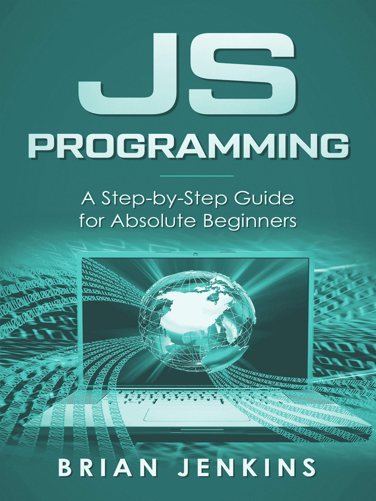


## 图书目标
本书的目标如下：

* 帮助你了解如何开始 `JavaScript` 编程。
* 帮助你理解构成 `JavaScript` 脚本语言的语法和结构。
* 帮助你从 `JavaScript` 初学者转变为专业人士。
* 帮助你理解如何使用 `JavaScript` 来提高网站应用程序的交互性。

## 本书适合的人群？
作者针对以下群体：

* 任何对 `JavaScript` 编程或通用计算机编程完全初学者。
* 任何需要提升 `JavaScript` 编程技能的人。
* 寻找以最简单容易的方法向学生解释 `JavaScript` 的教授、讲师或导师。
* 学生和学者，特别是关注计算机编程和 Web 开发的人员。

## 读本书需要什么？
请确保你拥有以下物品：

* 一个文本编辑器，如 `notepad`。
* 一个现代网页浏览器。


# 书中包含什么？

本书被分为多个章节，每一章都探索了 JavaScript 脚本语言的不同特性。作者提供了 JavaScript 代码，每段代码都执行不同的任务。每段代码旁边都提供了相应的解释，以帮助读者理解代码中各行的含义。此外，作者还提供了展示每段代码应返回输出结果的截图。作者使用了通俗易懂的语言，即使是初学者也能轻松理解。

# 关于作者
Brian Jenkins 拥有计算机科学博士学位。他曾从事磁记录系统和远距离光纤通信系统的编码研究。他拥有二十年教授新手编程的经验，是他那个代人中最天赋的 IT 专家之一。Brian 博士担任研究软件专家，偶尔兼任生物信息学家。自 2015 年以来，Brian 与妻子和女儿住在日内瓦。他目前正在编写一系列关于计算机编程和数据科学的书籍。

“JavaScript 是一种糟糕部分多得过分的语言。” —— Douglas Crockford

# 引言
JavaScript 是一种强大的脚本语言，每位 Web 开发者都应该熟悉它。JavaScript 为 Web 开发领域带来了许多变化。它为 Web 开发者提供了一种让网页更具交互性的方法。这正是大多数 Web 访问者所寻找的。如果你了解验证（例如检查用户在填写表单时是否输入了正确的信息），JavaScript 是实现此类功能的最佳语言。它是 WWW（世界维网）的技术之一。JavaScript 的优点在于它被所有现代 Web 浏览器的支持。这意味着你不需要安装任何特殊插件即可运行它的脚本。

你可以轻松地开始编写和运行 JavaScript 脚本，因为你只需要文本编辑器和浏览器等基础元素。现代浏览器内置了 JavaScript 引擎；因此，你不需要其他插件即可运行你的脚本。该语言还带有许多特性和范式，你在编写脚本时可以依赖这些特性。本书是你学习 JavaScript 编程的极佳指南。作者详细讨论了关于 JavaScript 的一切。祝你阅读愉快！

送给我的妻子和女儿，你们是我生活中的幸福，是我最真挚的爱！


# 第 1 章- JavaScript 基础
## 什么是 JavaScript?
HTML 是为了内容的，CSS 用于演示，而 JavaScript 是为了交互而开发的。最初，JavaScript 是为了为小型网页添加交互性（如动画和鼠标悬停），但现在它可以用于几乎所有领域，包括大型应用程序、游戏和服务器。

## 环境搭建
为了编写、测试和运行你的 JavaScript 代码，你需要以下工具：


* 编辑器
* 浏览器


你可以使用最基本的文本编辑器（如记事本）来编写 JavaScript 代码。然而，获取一个高级的文本编辑器对你有利，它将为你提供语法错误高亮、自动补全等功能。此类编辑器的示例包括 Visual Studio、Eclipse、Aptana 等。这些可以帮助你快速开发。

还有一些在线 JavaScript 编辑器可以供你编写脚本使用。其中一个很好的例子是 `jsfiddle.net`。对于浏览器，你可以根据喜好安装任何类型的浏览器。此类浏览器的示例包括 Chrome、Internet Explorer、Safari、Firefox、Opera 等。JavaScript 可以在运行任何操作系统上的任何浏览器上工作。

# JavaScript 示例

有三个地方可以放置 JavaScript 代码。我们可以将代码放置在 `body` 内部、`head` 标签内或在外部 JavaScript 文件中。这里是我们的第一个 JavaScript 示例：

```html
<script type="text/javascript">
  document.write("JavaScript makes web pages interactive!");
</script>
```

代码将打印以下内容：
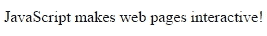

`script` 标签指定了我们正在使用 JavaScript。这将帮助浏览器识别它被提供的数据类型。代码简单地调用了 JavaScript 的 `document.write()` 方法，打印我们传递给它的文本。该方法用于使用 JavaScript 显示动态内容。

正如我们上面提到的，有三个地方可以添加我们的 JavaScript 代码。以下代码演示了如何在 `<body>` 和 `</body>` 标签之间添加代码：

```html
<html>
<body>
  <script type="text/javascript">
    document.write("JavaScript makes web pages interactive!");
  </script>
</body>
</html>
```

这里是另一个示例，展示了我们如何显示一个警报框（alert box）：

```html
<html>
<body>
  <script type="text/javascript">
    alert("Hello World");
  </script>
</body>
</html>
```

我们调用了 `alert()` 方法，该方法会显示一个带有指定消息的警报框。在此时种情况下，消息将是 `Hello World`。

JavaScript 代码也可以添加在 `<head>` 和 `</head>` 标签内。这里有一个示例：

```html
<html>
<head>
  <script type="text/javascript">
    function hello(){
      alert("Hello World");
    }
  </script>
</head>
<body>
  <p>JavaScript</p>
  <form>
    <input type="button" value="Click Me" onclick="hello()" />
  </form>
</body>
</html>
```

我们在 `script` 标签内创建了一个名为 `hello()` 的方法。当该方法被调用时，应该返回一个带有 `Hello World` 消息的警报框。我们在 `<body> </body>` 标签内创建了一个带有按钮的表单。`onclick` 属性指定了点击按钮时要调用的方法。运行代码后，你应该得到以下结果：
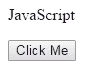

点击“Click Me”按钮。你会看到带有 `Hello World` 消息的警报框。这就是将 JavaScript 代码添加到 `<head> </head>` 标签内的方法。

我们还可以创建一个外部 JavaScript 文件，然后将其嵌入到多个网页中。由于可以在许多 HTML 页面上使用此类页面，我们可以实现代码复用。任何外部 JavaScript 文件必须赋予以 `.js` 扩展结尾的名字，以将其标记为 JavaScript 文件。所有的 JavaScript 代码都应该嵌入到单个文件中，以使网页响应更快。

让我们创建一个外部 JavaScript 文件，在警报框中返回 `Hello World` 消息。该文件将被命名为 `hello.js`。

**hello.js:**
```javascript
function hello(){
  alert("Hello World");
}
```

我们现在可以创建 HTML 文件并将 JavaScript 文件的名称添加其中。这里是 html 文件的代码：
**index.html:**
```html
<html>
<head>
  <script type="text/javascript" src="hello.js"></script>
</head>
<body>
  <p>JavaScript</p>
  <form>
    <input type="button" value="Click Me" onclick="hello()" />
  </form>
</body>
</html>
```

JavaScript 文件的文件名是在 `script` 标签中使用 `src` 参数指定的。

# JavaScript 注释

注释为我们提供了一种传递消息的方式。注释有助于引导用户、添加描述代码的信息、建议或警告，让读者更容易解释代码。JavaScript 引擎会忽略注释，这意味着它会直接跳过它们。

JavaScript 注释可以跨单行或多行。要写单行注释，请在其前面加一个双斜杠（`//`）。例如：

```html
<script>
  // A single line comment in JavaScript
  document.write("Hello World");
</script>
```

这里是另一个示例：
```javascript
var x = 5;
var y = 15;
var z = x + y; //To add values of x and y
document.write(z); //to print sum of x and 15
```

多行注释被包含在 `/*` 和 `*/`（一个斜杠和一个星号）之间。这也可以用于单行注释。例如：

```html
<script>
/* A multi-line comment in JavaScript
JavaScript engine will skip it */
document.write("Hello World");
</script>
```

# 大写敏感性

JavaScript 是一种大小写敏感的脚本语言。

### 消息 (Message)

为我们提供了一种传递消息的方式。注释有助于引导用户、添加描述代码的信息、建议或警告，让读者更容易解释代码。JavaScript 引擎忽略注释，意味着它会直接跳过它们。

### Alert 框 (Alert Box)

我们调用了 `alert()` 方法，显示一个带有指定消息的警报框。在此种情况下，消息将是 `Hello World`。

### 输入框 (Input Box)

JavaScript 代码也可以添加在 `<head>` 和 `</head>` 标签内。这里有一个示例：

```html
<html>
<head>
  <script type="text/javascript">
    function hello(){
      alert("Hello World");
    }
  </script>
</head>
<body>
  <p>JavaScript</p>
  <form>
    <input type="button" value="Click Me" onclick="hello()" />
  </form>
</body>
</html>
```

我们在 `script` 标签内创建了一个名为 `hello()` 的方法。该方法在被调用时应该返回一个带有 `Hello World` 消息的警报框。我们在 `<body> </body>` 标签内创建了一个带有按钮的表单。`onclick` 属性指定了点击按钮时要调用的方法。

### 确认框 (Confirm Box)

JavaScript 代码也可以添加在 `<head>` 和 `</head>` 标签内。这里是另一个示例：

```html
<html>
<head>
  <script type="text/javascript">
    function hello(){
      alert("Hello World");
    }
  </script>
</head>
<body>
  <p>JavaScript</p>
  <form>
    <input type="button" value="Click Me" onclick="hello()" />
  </form>
</body>
</html>
```

### 提示框 (Prompt Box)

JavaScript 是一种大小写敏感的脚本语言。

### 变量 (Variables)

JavaScript 是一种大小写敏感的脚本语言。


1. 变量名应以下划线 `_`、字母（`A` 到 `Z` 或 `a` 到 `z`）或美元符号 `$` 开头。
2. 在第一个字母之后，变量名可以使用数字。
3. JavaScript 变量区分大小写，例如，`p` 与 `P` 不同。

下面的示例演示了如何在 JavaScript 中使用变量：
```javascript
<script>
var a = 12 ; var b = 11 ; var c= a + b; document .write( c);
</script>
```
该代码将返回两个变量值的和，结果为 `23`。

### 局部变量
这些是定义在块或函数内部的变量。只能在定义它的块或函数内部进行访问。

这是一个示例：
```javascript
<script>
function xyz(){
var a= 12 ; //一个局部变量
}
</script>
```
变量 `a` 只能在函数 `xyz()` 内部访问。

这是另一个局部变量声明的示例：
```javascript
<script>
If( 5 < 10 ){
var a = 12 ; //一个 JavaScript 局部变量
}
</script>
```
上述示例中的变量 `a` 只能在其声明的块内部访问。

### 全局变量
这些是通从任何函数访问的变量。全局变量通常在函数外部声明，或者通过 JavaScript 的 `window` 对象声明。

例如：
```javascript
<script>
var val= 12 ; //一个全局变量
function x(){
document .writeln( val);}
}
function y(){
document .writeln( val);
}
x(); //调用一个 JavaScript 函数
y(); //调用一个 JavaScript 函数
</script>
```
代码将返回以下内容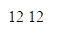
该代码演示了可以在不同的函数中引用函数，且其值将保持不变。

如果你需要在函数内部声明全局变量，必须使用 `window` 对象。例如：`window . val= 12 ;`。这样的变量可以在任何函数中声明并从任何函数访问。

例如：
```javascript
<script>
function xy(){
window . val= 12 ; //使用 window 对象声明全局变量
}
function xz(){
alert ( window . val); //从另一个函数访问全局变量
}
xy();
xz();
</script>
```
我们已经在函数 `xy()` 中声明了变量 `val` 并赋值赋值为 `12`。然后我们从函数 `xz()` 中访问了同一个变量。这返回值为 `12`。

在函数外部声明变量后，它会被内部添加到 `window` 对象中。该对象可以同时通过 `window` 对象访问。

这是一个示例：
```javascript
<script>
var val = 12 ;
function xy(){
alert ( window . val); //访问全局变量
}
</script>
```

每种编程语言都支持多种数据类型。它们代表可以在编程语言中表示并操作的值类型。JavaScript 支持 3 种原始数据类型，包括：

1. 数字，如 `1`、`8`、`90`、`345` 等。
2. 字符串，即文本，例如“My name”等。
3. 布尔值，可以是 `true` 或 `false`？

JavaScript 还能支持 2 种简单数据类型，即 `null` 和 `undefined`。它还有一种名为 `object` 的复合数据类型。注意，在 JavaScript 中，整数和浮点数没有区别。在 JavaScript 中，所有数字都以浮点数值的形式表示。

### 比较变量
在 JavaScript 中，可以用不同的方式对变量进行比较。我们可以使用双等号来比较两个变量是否相等。

示例：
```javascript
<script>
x= 30 ;y= 30 ;
if ( x== y) {alert ( "x equals y" )};
</script>
```
执行时，脚本将显示一个带有文本“x equals y”的弹出窗口，如下所示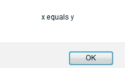
这表示两个值相等，即 `10`。如果不相等，脚本执行后将不会发生任何事情。

除了数字外，我们还可以像下面所示比较字符串：
```javascript
<script>
firstname= "Nicholas" ;lastname= "Samuel" ;
if ( lastname== "Samuel" ) { alert ( "Correct name!" )};
</script>
```
比较结果将为 `true`，因此你将得到一个带有文本“Correct name!”的弹出窗口，如下所示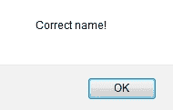

注意，在进行比较时，我们使用双等号（`==`）。如果你使用单等号，等号右侧的值将变为左侧值（变量）的值。下面是一个示例：
```javascript
if ( lastname= "Samuel" ) { alert ( "Correct name!" )};
```

## 第 4 章 - JavaScript 运算符
JavaScript 支持使用运算符。运算符对一个或多个操作数执行操作以产生结果。例如：`2 + 3`
在上面的示例中，`2` 和 `3` 是操作数，而 `+` 是运算符。`2` 是左操作数，`3` 是右操作数。

### 逻辑运算符
这些运算符帮助我们连接一个或多个条件。以下在 JavaScript 中支持：

* `&&` - 与运算符。检查操作数是否都非零。如果是，返回 `1`，否则返回 `0`。
* `||` - 或运算符。检查操作数中是否有一个非零。如果是，返回 `1`，否则返回 `0`。
* `!` - 非运算符。用于反转布尔结果。

例如：
```html
<html><body>
<p id="pg1"></p>
<p id="pg2"></p>
<p id="pg3"></p>
<p id="pg4"></p>
<p id="pg5"></p>
<script>
var x = 12 ; y = 5 ;
document . getById( "pg1" ).innerHTML = ( x != y) && ( x < y);
document . getById( "pg2" ).innerHTML = ( x > y) || ( x == y);
document . getById( "pg3" ).innerHTML = ( x < y) || ( x == y);
document . getById( "pg4" ).innerHTML = !( x < y);
document . getById( "pg5" ).innerHTML = !( x > y);
</script>
</body></html>
```
代码打印以下结果

### 算术运算符
在 JavaScript 中，你可以对变量进行算术操作。这些操作包括加法（`+`）、减法（`-`）、乘法（`*`）、取模（`%`）、递增（`++`）、递减（`--`）等。

示例：
```javascript
<script type="text/javascript" >
a= 1 ;a= 1 ; a++; //a=2
a= 1 ; a--; //a=0
a= 1 ; b= 2 ; c= a+ b; //c=3
a= 1 ; d= a+ 4 ; //d=5
First= "Edwin" ;Last= "Peter" ;Name= First+ " " + Last; //Name=Edwin Peter
a= 3 * 7 ; //a=21
b= 10 / 2 ; //b=5
c=( 10 / 2 )* 2 ; //c=10
d= 10 /(1 * 2 ); //d=5
</script>
```
各行的结果已在注释部分显示，即 `//` 之后。

### 赋值运算符
这些运算符帮助我们为变量赋值。包括：

* `=` - 将右值赋值给左操作数。
* `+=` - 将左、右操作数的值相加，然后将得到的结果赋值给左操作数。
* `-=` - 从左操作数的值中减去右操作数的值，然后将得到的结果赋值给左操作数。
* `*=` - 将左、右操作数的值相乘，然后将得到的结果赋值给左操作数。
* `/=` - 将左操作数的值除以右操作数的值，然后将得到的结果赋值给左操作数。
* `%=` - 获取左操作数除以右操作数的模，然后将得到的模赋值给左操作数。


### 赋值运算符

这里有一个示例：

```html
<html><body>
  <h1>Assignment Operators</h1>
  <p id="pg1"></p>
  <p id="pg2"></p>
  <p id="pg3"></p>
  <p id="pg4"></p>
  <p id="pg5"></p>
  <p id="pg6"></p>
  <script>
    var a = 10 , b = 20 ;
    a = b;
    document.getElementById("pg1").innerHTML = a;
    a += 1;
    document.getElementById("pg2").innerHTML = a;
    a -= 1;
    document.getElementById("pg3").innerHTML = a;
    a *= 5;
    document.getElementById("pg4").innerHTML = a;
    a /= 5;
    document.getElementById("pg5").innerHTML = a;
    a %= 2;
    document.getElementById("pg6").innerHTML = a;
  </script>
</body>
</html>
```

该代码将返回以下结果：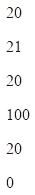

表达式 `a = b` 将变量 `a` 的值从 `10` 改为 `20`。这就是为什么第一个语句打印了 `20`。然后我们从 `a` 的值为 `20` 开始操作。表达式 `a += 1` 将 `a` 的值增加了 `1`，因此它变为 `21`。这成为了变量 `a` 的新值。表达式 `a -= 1` 从变量 `a` 的当前值（即 `21`）减去 `1`，返回 `20`。这成为了变量 `a` 的新值。表达式 `a *= 5` 将变量 `a` 的值（即 `20`）乘以 `5`，返回 `100`。这成为了变量 `a` 的新值。表达式 `a /= 5` 将变量 `a` 的值除以 `5`，返回 `20`。这成为了变量 `a` 的新值。表达式 `a %= 2` 返回变量 `a` 的值除以 `2` 后的余数，返回 `0`。

## 第 5 章 - JavaScript 决策

JavaScript 带有决策语句，有助于控制程序的执行流。通过这些语句，所执行的操作将取决于所满足的条件。JavaScript 支持以下三种决策语句：

- If 语句
- if else 语句
- if else if 语句


### If 语句 (If Statement)

该语句仅在需要根据特定条件采取操作时使用。只有当条件为真，内容才会被评估。该语句采用以下语法：

```javascript
if ( expression){
  //要评估的内容
}
```

例如：
```html
<script>
    if ( 10 < 5 )
    {
      alert ( "10 is less than 5" );
    }
    if ( 10 > 5 )
    {
      alert ( "10 is greater than 5" );
    }
</script>
```

执行代码将返回以下结果：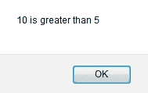
第一个 if 条件评估的结果为假，因此其代码块被跳过。第二个 if 条件的结果为真，因此其代码块被执行，并产生上述输出。

### If…else 语句 (If…else Statement)

该语句将评估条件是否为真。
该语句具有以下语法：

```javascript
if ( condition){
    // 代码…
}else {
    // 代码…
}
```

例如：
```html
<script>
  var x= 100 ;
  if ( x% 2 == 0 ){
  document . write( "x is an even number" );
  }
  else {
  document . write( "x is an odd number" );
  }
</script>
```

在上面的代码中，我们正在检查变量 `x` 的值是否为偶数。代码返回以下内容：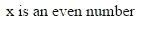
表达式 `x%2==0` 检查 `x` 除以 `2` 后的余数。如果余数为 `0`，则 `x` 是偶数，否则它是奇数。

### If…else if 语句 (If…else if Statement)

有时，你可能有多个选项需要做出决策。该语句帮助我们在 JavaScript 中实现这一目标。该语句的语法如下：

```javascript
if ( expression_1){
    Statement( s)}
}else if ( expression_2){
    Statement( s)}
}else if ( expression_3){
    Statement( s)}
else {
    Statement( s)}
}
```

我们有一系列与 `else` 语句结合的 `if` 语句。执行的语句是条件评估为真的语句。

例如：
```html
<script>
  var grade= "B" ;
  if ( grade== "A" ){
  document . write( "Excellent!" );
  }
  else if ( grade== "B" ){
  document . write( "Good!" );
  }
  else if ( grade== "C" ){
  document . write( "Fair" );
  }
  else {
  document . write( "Poor!" );
  }
</script>
```

`grade` 的值是 `B`。所有条件都将被匹配，`grade ==="B"` 条件将评估为真。代码将返回“ Good!”。

### Switch 语句 (Switch Statement)

该语句帮助我们根据各种条件执行不同的操作。当你拥有许多取决于单个变量值的分支时，它是适用的。通过 `switch` 语句，表达式会根据其值评估多个多个待执行的语句。

JavaScript 解释器必须检查每个 `case` 与表达式的值，直到找到匹配项。如果没有找到匹配项，则选择默认项。其语法如下：

```javascript
switch ( expression) {
    case i:code
        break ;
    case i:code
        break ;
    default :
        code
}
```

例如：
```html
<script>
  var name = 'Nicholas' ;
  var output;
  switch ( name){
  case 'Samuel' :
  output = "Your name is Samuel" ;
  break ;
  case 'Michelle' :
  output= "Your name is Michelle" ;
  break ;
  case 'Nicholas' :
  output = "Your name is Nicholas" ;
  break ;
  default :
  output = "No Name" ;
  }
  document . write( output);
</script>
```

执行代码将返回以下结果：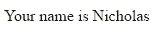

# 第 6 章 - JavaScript 循环 (JavaScript Loops)

当你需要重复执行代码（无论次数是已还是未知的）时，循环非常有用。通过循环，你可以自动化处理手动操作可能繁琐的任务。一个很好的例子是需要向表格填充值。你可以使用循环来遍历单元格，而不是手动填充。让我们讨论 JavaScript 支持的循环语句：

## For 循环 (For Loop)

此循环用于固定次数地遍历代码块。当人们知道要迭代某个代码块的次数时，它是适用的。循环采用以下语法：

```javascript
for ( initializer; condition; increment)
{
    // 代码
}
```

`initializer` 设置了我们应该开始的计数器变量。`condition` 指定了执行下一次迭代必须满足的标准。`increment` 既可以增加也可以减少计数器。

这里是 `for` 循环的示例：
```html
<script>
  for ( x= 0 ; x< 5 ; x++)
  {
  document . write( x + "<br/> )
  }
</script>
```
循环中的变量 `x` 首先被初始化为值 `0`。条件规定 `x` 的值应该小于 `5`。在递增部分，变量 `x` 的值应该增加 `1`。这意味着循环应该从 `0` 运行到 `4`，产生如下结果：

这是另一个例子：
```html
<head>
<title> 长度转换器</title>
</head>
<body>
<table border=4 >
<tr>
  <td>以米为单位的长度</td>
  <td>以厘米为单位的长度</td>
</tr>
<script language="javascript">
for ( length= 0 ; length<= 20 ; length= length+2 ){
document . write( "<tr><td>" + length+"</td><td>"+( length * 100 )+"</td></tr>" );
}
</script>
</body></html>
```
我们使用 `for` 循环来遍历一组值，同时将其转换为米（此处逻辑为厘米）。这一次，我们在每次迭代后将值增加 `2`。代码返回一个如下所示的填充好的表格：

## While 循环 (While Loop)

此循环可用于无限次数地遍历代码。当人们不知道执行循环的确切次数时，它是适用的。只要指定的条件为真，循环就会执行。一旦条件变为假，循环的执行将停止。它采用以下语法：

```javascript
while ( variable<= final_value){
  // 代码
}
```

例如：
```html
<script>
  var x= 0 ;
  while ( x<= 5 )
  {
  document . write( x + "<br/> );
  x++;
  }
</script>
```
`while` 循环只要变量 `x` 的值不大于 `5` 就会运行。代码返回：

这是另一个例子：
```html
<head>
<title> 长度转换器 </title>
</head>
<body>
<table border=3 >
<tr>
  <td>以米为单位的长度</td>
  <td>以厘米为单位的长度</td>
</tr>
<script language="javascript">
length= 0 ;
while ( length<= 20 ){
document . write( "<tr><td>" + length+"</td><td>" +( length * 100 )+"</td></tr>" );
length = length+2 ;
}
</script>
</body></html>
```
只要 `length` 小于或等于 `20`，上述循环就会一直运行。一旦循环发现违反此条件，就会停止执行。代码返回：

## Do while 循环 (Do while Loop)

这是一个用于无限次数遍历代码块的好循环。但是，无论条件真假，代码都必须执行一次。其语法如下：

```javascript
do {
    statement ( s)
} while ( condition);
```

`while` 可能永远不运行，但 `do while` 循环至少运行一次。这里有一个示例：
```html
<script>
  var x= 0 ;
  do {
  document . write( x + "<br/>" );
  x++;
  } while ( x<= 5 );
</script>
```
代码将打印结果：

## 循环语句 (Loop Statements)

我们可以通过 `break` 和 `continue` 语句来控制循环的执行。有时，你需要在到达结束之前退出循环。还需要跳过循环的一部分并执行后续部分。这两个语句可以帮助我们实现这一点。

### Break 语句 (Break Statement)

通过此语句可以提前退出循环并离开大括号。执行到循环之后。示例：
```html
<script type="text/javascript">
    var p = 1 ;
    document . write( "Starting the loop<br />" );
    while ( p < 20 )
    {
      if ( p == 5 ){
      break ; // 退出循环
      }
      p = p + 1 ;
      document . write( p + "<br />" );
    }
    document . write( "Leaving the loop<br />" );
</script>
```
这就是在 `while` 循环中使用 `break` 语句的方法。当 `p` 的值为 `5` 时，JavaScript 解释器指示停止循环。输出如下所示：

### Continue 语句 (Continue Statement)

通过 `continue` 语句，我们可以中断当前循环并继续下一个值。假设你需要将 `-5` 到 `+5` 之间的某个数字除以 `0`。由于这是非法的，可以使用 `continue` 跳过它。其实现方式如下：
```html
<script type="text/javascript">
for ( p=- 5 ; p<= 5 ; p= p+1 ){
if ( p== 0 ) { continue };document . write(10 / p);
</script>
```
这种实现方式使得整数 `10` 不会被除以 `0`。代码返回：
我们从 `1` 开始，跳过了除以 `0`。

## 第 7 章 - JavaScript 函数 (JavaScript Functions)

函数用于执行操作。函数是将代码组合在一起的好方法。此类代码在它们执行的任务方面应该是相关的。你只需要将代码分组并分配一个唯一的名称。从那时起，你可以多次调用代码，方便代码重用。通过函数，你可以享受只需编写代码或完全无需编写的好处。

### 函数定义 (Function Definition)

JavaScript 的定义和调用采用以下语法：

```javascript
// 函数定义
function function_name(){
    // 执行代码
}
// 调用函数
function_name();
```

如上面的语法所示，函数被赋予名称，在调用函数执行其预期任务时使用。函数体放在大括号 {} 内。以下是一个示例：
```html
<body>
<script>
    function HelloFunction() {
    document . write( "Hello World" );
    }
    HelloFunction();
</script>
</body>
```
我们定义了一个名为 `HelloWorld()` 的函数。在函数体内部，我们规定函数应该打印文本 Hello World。在函数体之后，我们通过名称调用了它。代码返回以下内容：
注意我们用来调用上述函数的方法。函数会在网页加载时立即被调用。然而，很多时候我们需要通过点击按钮调用函数。在 JavaScript 中这是可能的，如下所示：
```html
<body>
<script>
function HelloFunction() {
alert ( "Hello World");}</script>
<input type="button" onclick = "HelloFunction()" value="Hello" />
</body>
```
我们使用了之前的函数。但是，我们创建了一个带有文本 Hello 的按钮。`onclick` 属性规定了点击按钮后会发生什么。它规定点击按钮后应该调用 `HelloFunction()` 函数。运行代码并点击 Hello 按钮。你将获得带有消息的警告框：

### 函数参数 (Function Arguments)

函数可以接受一个或多个参数，也称为参数。参数应该通过调用代码提供，并可以在函数内部使用。JavaScript 以其动态语言而闻名，因此函数参数可以接受任何数据类型的参数。考虑以下示例：
```html
<script>
    function MyFunction( arg1, arg2) {
      alert ( "You passed " + arg1 + " and " + arg2);
    }
    MyFunction( 10 , 12 );
    MyFunction( "Nicholas" , "Samuel" );
    MyFunction( 2" );
</script>
```
我们创建了一个名为 `MyFunction` 的函数，它接收两个参数 `arg1` 和 `arg2`。我们通过调用代码提供了这两个参数的值，并在警告框中显示它们。我们随后多次调用了同一个函数，每次传递不同的参数。代码如下：
参数将按照指定的顺序传递给函数。这里是另一个例子：
```html
<<body>
<script>
function calculateCube( x){
alert ( x * x);
}
</script>
<form>
<input type="button" value="Calculate Cube" onclick="calculateCube(3)" />
</form>
</body>
```
我们创建了一个带有文本 Calculate 的按钮。点击时，该按钮应该调用 `calculateCube()` 函数。在 `onclick` 参数中，我们传递了参数 `3` 给它。这意味着它应该返回 `3` 的立方，即 `27`。注意，调用函数时可以传递更多或更少的参数。如果传递的少于函数预期的，剩余的是 `undefined`。如果传递的多将被忽略。

### Arguments 对象 (Arguments Object)

任何 JavaScript 函数都可以使用 `arguments` 对象。该对象为每个参数都有一个值。可以通过类似于数组的方式访问值。然而，该对象不支持数组方法。考虑以下示例：
```html
<script>
    function MyFunction( arg1, arg2) {
      alert ( "You passed " + arguments[0] + " and " + arguments[1]);
    }
    MyFunction( 10 , 12 );
</script>
```
代码将像常一样运行。调用函数时，`arguments[0]` 表示调用函数时的第一个参数，`arguments[1]` 表示调用函数时的第二个参数。

### 返回值 (Return Value)

在 JavaScript 中，函数可以使用 `return` 关键字返回零或一个值。考虑给下面的示例：
```html
<script>
  function MyFunction(){
  return "Hello sir/madam" ;
  }
</script>
<script>
  document . write( MyFunction());
</script>
```
函数将返回 `return` 语句中指定的内容。这里是另一个例子：
```html
<body>
<p id="pg1"></p>
<p id="pg2"></p>
<script>
    function Addition( x, y) {
      return x + y;
    }
    document . getById("pg1").innerHTML = Addition(10 , 12 );
    function Product( x, y) {
      console.log( x * y);
    };
    document. getById("pg2").innerHTML = Product(10 , 12 );
</script>
</body>
```
代码将打印以下内容：
我们创建了一个名为 `Addition()` 的函数，它返回变量 `x` 和 `y` 的和。调用代码能够获取返回值并赋值给变量。我们还定义了第二个名为 `Product()` 的函数，它没有返回，因此其结果为 `undefined`。在 JavaScript 中，我们可以让一个函数返回另一个函数。这里是这样的示例：
```html
<body>
<p id="pg1"></p>
<p id="pg2"></p>
<script>
    function myfunction( a) {
      function product( b)
      {
        return a * b;
      }
      return product;
    }
    var db = myfunction(2 );
    document . getById("pg1").innerHTML = db(2 );
    document . getById("pg2").innerHTML = db(3 );
</script>
</body>
```
名为 `myfunction()` 的函数正在返回函数 `product()`。

### 函数表达式 (Function Expression)

在 JavaScript 中，我们可以为函数分配一个变量，然后使用该变量作为函数。这被称为函数表达式。例如：
```html
<body>
<p id="pg1"></p>
<p id="pg2"></p>
<script>
    var sum = function Addition( x, y) {
      return x + y;
    };
    document . getById("pg1").innerHTML = sum(10 , 12 );
    document . getById("pg2").innerHTML = Addition(10 , 12 ); // 无效
</script>
</body>
```
代码应该返回 `10` 和 `12` 的和，即 `22`。此输出将来自 `sum(10, 12)` 表达式，其中我们通过分配给它的变量来调用函数。表达式 `Addition(10, 12)` 是无效的。


* 数组字面量
* 数组实例
* 数组构造函数


## 数组字面量创建

使用数组字面量（Array Literal）创建数组采用以下语法：`var name_of_array=[ val1, val2..... valN];`。这些值被添加在方括号 `[]` 中，并用逗号分隔。

示例：
```html
<script type="text/javascript">
  var array1=[ "Nicholas" , "Samuel" , "Vickie" ];
  for ( j= 0 ; j< array1. length; j++){
    document . write( array1[ j] + "<br/" );
  }
</script>
```
我们创建了一个包含三个值的数组 `array1`，这些值是个人的姓名。使用了一个 `for` 循环来遍历数组的值，然后将它们打印出来。`.length` 属性通常返回数组的长度。执行后，数组中的值将按所示所示打印：
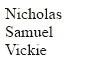

### 直接创建数组

可以通过下面的语法直接创建数组：`var name_of_array= new Array ();`。通过 `new` 关键字，会创建一个数组的实例。

示例：
```html
<script type="text/javascript">
  var x;
  var array2 = new Array ();
  array2[ 0 ] = "Nicholas" ;
  array2[ 1 ] = "Samuel" ;
  array2[ 2 ] = "Vickie" ;
  for ( x= 0 ; x< array2. length; x++){
    document . write( array2[ x ] + "<br>" );
  }
</script>
```
在示例中，我们使用 `new` 关键字创建了名为 `array2` 的数组。下一步是向数组填充元素。注意，数组元素的位置是通过索引表示的。数组中的第一个元素位于索引 `0`，第二个元素位于索引 `1`，以此类推。

考虑以下行行：`array2[ 1 ] = "Samuel" ;`。该行表示我们现在名为 `array2` 的数组的索引 `1` 处存储元素“Samuel”。随后，我们使用了变量 `x` 来遍历数组的这些元素并打印它们。

### 数组构造函数

我们通过直接在构造函数中传递参数，而不是显式地提供值，来创建一个数组的实例。下面的脚本演示了这一点：
```html
<script type="text/javascript">
  var array3= new Array ( "Nicholas" , "Samuel" , "Vickie" );
  for ( x= 0 ; x< array3. length; x++){
    document . write( array3[ x ] + "<br>" );
  }
</script>
```
在上面的示例中，我们创建了一个名为 `array3` 的数组。数组的创建和元素的添加是在同一行中通过构造函数完成的。`for` 循环帮助我们遍历数组元素并将它们打印到屏幕上。

### 数组方法

JavaScript 内置了许多数组方法，我们可以用它们来操纵数组元素。让我们讨论这些方法：

### concat()
`concat()` 方法合并数组以返回单个字符串。数组可以是两个或多个。注意，初始数组的元素不会改变。该方法采用以下语法：`array. concat( array1, array2,...., array_n)`，方法的参数是您需要合并的数组。该方法返回一个由所有数组组合的新对象。

考虑以下示例：
```html
<script>
var array1=[ "Nicholas" , "James" , "Jane" ];
var array2=[ "Alex" , "Fidel" , "Alice" ];
var output= array1. concat( array2);
document . writeln( output);
</script>
```
我们创建了两个数组 `array1` 和 `array2`。每个数组都有一个姓名列表。我们将这两个数组合并成一个名为 `output` 的对象。代码将打印以下输出：
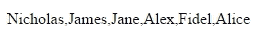

在上面的示例中，我们合并了两个数组。三个数组的合并可以如下所示：
```html
<script>
var array1=[ "Nicholas" , "James" , "Jane" ];
var array2=[ "Alex" , "Fidel" , "Alice" ];
var array3=[ "Joel" , "Mercy" , "George" ];
var output= array1. concat( array2, array3);
document . writeln( output);
</script>
```
代码将返回以下结果：
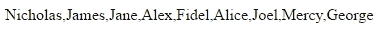

除了创建不同的数组并尝试合并对象外，我们也可以直接合并对象。下面的示例演示了这一点：
```html
<script>
var array1=[ "Nicholas" , "James" , "Jane" ];
var output= array1. concat( "Alex" , "Fidel" , "Alice" );
document . writeln( output);
</script>
```
代码将返回以下示例：
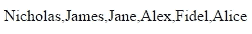

### copyWithin()
当使用此方法时，它会复制给定数组的一部分到自身的元素位置并返回修改后的数组。注意，修改后的数组长度不会改变。该方法采用下面的语法：`array. copyWithin( target, start, end)`。`target` 是复制元素所在的位置。`start` 参数是可选的。它表示方法从哪个索引开始复制元素。它的默认值为 `0`，意味着从数组的第一个元素处开始复制。`end` 参数也是可选的。它表示方法停止复制的索引。它的默认值为 `array.length-1`，即数组的最后一个元素。

考虑下面的代码：
```html
<script>
var array1=[ "Nicholas" , "James" , "Jane" ];
// 在索引 0 处放置第 1 到第 3 个元素
var output= array1. copyWithin( 0 , 1 , 2 );
document . writeln( output);
</script>
```
代码返回：

发生的情况是第 1 到第 3 个元素复制到了索引 `0`。因此元素 `Nicholas` 被元素 `James` 替换。数组的其余元素不受影响。

让我们看看如何只提供目标和起始索引：
```html
<script>
var array1=[ "Nicholas" , "James" , "Jane" ];
var output= array1. copyWithin( 1 , 2 );
document . writeln( output);
</script>
```
代码应该返回：


我们还可以只提供目标索引：
```html
<script>
var array1=[ "Nicholas" , "James" , "Jane" ];
var output= array1. copyWithin( 2 );
document . writeln( output);
</script>
```
代码将返回：
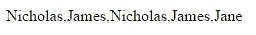

### fill()
此方法用于用静态值填充数组元素。使用时，原始数组会被修改。如果没有任何元素符合条件，此方法将返回 `undefined`。它采用以下语法：`array. fill( value[, start[, end]])`。`value` 是要填充的值。`start` 参数是可选的。它是填充开始的索引。它的默认值为 `0`，即数组的第一个元素。`end` 参数也是可选的。它是填充停止的索引。

考虑下面的示例：
```html
<script>
var array1=[ "Nicholas" , "James" , "Jane" , "Alice" ];
var output= array1. fill( "Joel" );
document . writeln( array1);
</script>
```
代码将返回：
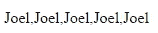
所有数组都被都被 `Joel`。让我们看看如何提供起始索引：
```html
<script>
var array1=[ "Nicholas" , "James" , "Jane" , "Alice" ];
var output= array1. fill( "Joel" , 2 );
document . writeln( array1);
</script>
```
在上面的示例中，填充将从索引 `2` 之后的元素开始。代码应该返回以下结果：
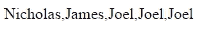

下面的示例演示了如何指定起始和停止索引：
```html
<script>
var array1=[ "Nicholas" , "James" , "Jane" , "Alice" ];
var output= array1. fill( "Joel" , 1 , 3 );
document . writeln( array1);
</script>
```
代码应该返回：
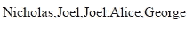

### every()
此方法的目的是检查是否所有数组元素满足给定条件。如果所有数组元素都符合条件，方法将返回 `true`，否则返回 `false`。该方法采用下面的语法：`array. every( callback( current-value, index, arr), thisArg)`。`callback` 是测试条件的函数。`current-value` 表示数组的当前元素。`index` 参数是可选的，表示当前元素的索引。`arr` 参数表示应用 `every()` 函数的数组。`thisArg` 是可选参数。它是执行回调期间作为 `this` 使用的值。该方法返回一个布尔值。

考虑下面的示例：
```html
<script>
var marks=[ 20 , 25 , 15 , 37 , 27 ];
function confirm ( x){
  return x> 10 ;
  // 因为所有 marks 都大于 10 所以返回 true
}
document . writeln( marks. every( confirm ));
</script>
```
代码返回 `true`。我们定义了一个包含一组整数值的数组，即 `marks`。所有的 marks 都大于 10。`confirm()` 的目的是检查是否所有 marks 都大于 10。由于这是真的，`every()` 函数返回了 `true`。让我们把其中一个值改为小于 10 的值，看看会发生什么：
```html
<script>
var marks= [ 20 , 5 , 15 , 37 , 27 ];
function confirm ( x){
  return x> 10 ;
  // 因为所有 marks 都大于 10 所以返回 true
}
document . writeln( marks. every( confirm ));
</script>
```
代码将返回 `false`，因为索引 `1` 处的 marks 小于 10，即 `5`。

下面的示例演示了如何检查数组中元素的数量：
```html
<script>
var array1=[ "Nicholas" , "James" , "Jane" , "Alice" ];
function confirm ( item, index, array) {
  return index < 3 ;
}
document . writeln( array1. every( confirm ));
</script>
```
代码返回：

发生的情况是第 1 到第 3 个元素复制到了索引 `0`。因此元素 `Nicholas` 被元素 `James` 替换。数组的其余元素不受影响。让我们看看如何只提供目标和起始索引：
```html
<script>
var array1=[ "Nicholas" , "James" , "Jane" , "Alice" ];
var output= array1. copyWithin( 1 , 2 );
document . writeln( output);
</script>
```
代码应该返回：


我们还可以只提供目标索引：
```html
<script>
var array1=[ "Nicholas" , "James" , "Jane" , "Alice" ];
var output= array1. copyWithin( 2 );
document . writeln( output);
</script>
```
代码将返回：


### find()
此方法将返回数组中符合指定条件的第一个元素。它采用下面的语法：`array. find( callback( value, index, arr), thisArg)`。`callback` 是执行的函数。`value` 是数组的当前元素。`index` 参数是可选的，表示当前元素的索引。`arr` 参数表示应用 `find()` 函数的数组。`thisArg` 是可选参数。它是执行回调期间作为 `this` 使用的值。该方法返回 `undefined`。

下面的示例演示了如何使用 `find()` 方法：
```html
<script>
var array1=[ 20 , 45 , 14 , 33 ];
var output= array1. find( x=> x>20 );
document . writeln( output)
</script>
```
在上面的代码中，我们正在检查大于 `20` 的元素。方法将找到 `45`，因此应该是输出。下面的示例演示了如何使用相同方法来查找质数：
```html
<script>
function checkPrime( item, index, arr) {
  var start = 2 ;
  while ( start <= Math.sqrt(item)) {
    if ( item % start++ < 1 ) {
      return false ;
    }
  }
  return item > 1 ;
}
document . writeln([ 4 , 6 , 11 , 26 ].find(checkPrime));
</script>
```
函数将找到 `11` 作为质数。

### forEach()
此方法帮助我们为数组的每个元素调用一次函数。它采用下面的语法：`array. forEach( callback( current-value, index, arr), thisArg)`。`callback` 是测试条件的函数。`current-value` 表示数组的当前元素。`index` 参数是可选的，表示当前元素的索引。`arr` 参数表示应用 `forEach()` 函数的数组。`thisArg` 是可选参数。它是执行回调期间作为 `this` 使用的值。该方法返回 `undefined`。

例如：
```html
<script>
var array1 = ['Java' , 'C#' , 'Python' ];
array1. forEach( function ( values) {
  document . writeln( values);
});
</script>
```
我们使用了 `forEach()` 方法来访问并打印数组元素。代码打印如下：

我们也可以使用相同的函数创建一个斐波那契序列：
```html
<script>
var addition = 0 ;
var array1 = [ 2 , 8 , 14 , 24 ];
array1. forEach( function fib( item) {
  addition = addition + item;
  document . writeln( addition);
});
</script>
```
代码返回元素的斐波那契序列。注意斐波那契是元素的顺序相加。这是输出：

### pop()
此方法从数组中删除最后一个元素并返回该元素。它具有改变长度的作用。它有下面的语法：`array. pop()`。它返回指定数组的最后一个元素。

考虑下面的示例：
```html
<script>
var array1=[ "Java" , "C#" , "Python" ];
document . writeln( "Initial array: " + array1+ "<br>" );
document . writeln( "Popped out item: " + array1.pop()+"<br>" );
document . writeln( "Final array: " + array1);
</script>
```
代码将返回以下：
我们可以使用 `for` 循环弹出所有数组元素：
```html
<script>
var array1=[ "Java" , "C#" , "Python" ];
var len= array1. length;
for ( var i= 1 ; i<= len; i++)
{
  document . writeln( "Popped out element: " + array1.pop()+"<br>" );
}
</script>
```
代码将打印如下：

### reverse()
此方法的影响改变数组元素排序的方式，并按反序返回元素。数组的第一个元素将变成最后一个，而最后一个元素将变成第一个元素。它采用下面的语法：`array. reverse()`。它返回按反序排列的数组原始元素。

例如：
```html
<script>
var array1=[ "Java" , "C#" , "Python" ];
var rv= array1.reverse();
document . writeln( rv);
</script>
```
代码将返回以下：
数组元素按反序返回。

### String

在 JavaScript 中，字符串是字符的序列。在 JavaScript 中，可以通过两种方式创建字符串：使用字符串字面量和使用字符串对象。字符串字面量是通过双引号创建的。使用字符串字面量创建字符串，使用下面的语法：`var string_name= "string"`。例如：
```html
<script>
var st = "A string" ;
document . write( st);
</script>
```
代码打印如下：
使用字符串对象创建字符串，使用 `new` 关键字。语法应该如下：`var string_name= new ( "a" )`。例如：
```html
<script>
var st = new String("Hello, this is a string");
document . write( st);
</script>
```
代码应该返回如下。考虑下面的示例：
```html
<script>
var st = new String( "Hello, this is a string" );
document . write( st);
</script>
```
代码返回：

### charAt()
此方法帮助查找位于特定索引的字符。索引从 `0` 开始到 `n-1`，其中 `n` 是字符串中的字符总数。索引不能为负值或大于字符串长度。该方法采用下面的语法：`String . charAt( index)`。索引表示字符的位置。方法返回该字符。示例：
```html
<script>
var st="JavaScript";
document . write( st.charAt( 5 ));
</script>
```
代码返回 `a`。这是因为在索引 `5` 处找到了字符 `a`。我们也可以向它传递一个索引。如下：
```html
<script>
var st="JavaScript";
document . write( st.charAt() );
</script>
```
代码返回 `J`。这是因为在索引 `0` 处找到了字符 `J`。如下：
```html
<script>
var st="JavaScript";
document . write( st.charAt( 0 ));
</script>
```
代码返回 `J`。如下：
```html
<script>
var st="JavaScript";
document . write( st.charAt( 10 ));
</script>
```
代码返回 `t`。

### indexOf()
此方法可以用于搜索并返回字符串中某个字符的位置。始终记住字符串字符从索引 `0` 开始。如果未找到字符，方法将返回 `-1`。

示例：
```html
<script>
var st="JavaScript is a scripting language";
document . write( st.indexOf( 'a' ));
</script>
```
代码返回 `1`。这是因为第一个字符“a”在索引 `1` 处找到。我们可以提供搜索应该开始的索引。如下：
```html
<script>
var st="JavaScript is a scripting language";
document . write( st.indexOf( 'a' , 8 ));
</script>
```
代码返回 `14`。这是因为我们规定搜索应该从索引 `8` 开始而不是从索引 `0` 开始。除了单个字符，我们还可以打印某个字符串第一个字符的位置：
```html
<script>
var st="JavaScript is a scripting language";
document . write( st.indexOf( "script" ));
</script>
```
代码返回 `16`。这是 `script` 中字符 `s` 的位置。注意搜索是区分大小写的；因此 `JavaScript` 中的 `Script` 将被跳过。你可以使用 `Script` 而不是 `script`，将得到不同的结果。为了避免这种混淆，我们可以为 JavaScript 提供搜索应该开始的索引：
```html
<script>
var st="JavaScript is a scripting language";
document . write( st.indexOf( "script" , 6 ));
</script>
```
代码返回 `6`。因为搜索现在将从索引 `6` 开始而不是从索引 `0`。我们可以尝试搜索一个不存在的元素看看会发生什么：
```html
<script>
var st="JavaScript is a scripting language";
document . write( st.indexOf( "programming" ));
</script>
```
代码返回 `-1`。因为没有 `programming`。

### search()
此方法用于在字符串中搜索正则表达式。如下所示：
```html
<script>
var st="JavaScript is a scripting language";
document . write( st.search( /script/ ));
</script>
```
代码返回 `10`。这是因为 `script` 位于索引 `10`。我们也可以传递一个索引。如下：
```html
<script>
var st="JavaScript is a scripting language";
document . write( st.search( /script/ , 20 ));
</script>
```
代码返回 `24`。这是因为我们规定搜索应该从索引 `20` 开始。

### substring()
此方法用于提取字符串的一部分。如下所示：
```html
<script>
var st="JavaScript is a scripting language";
document . write( st.substring( 0, 10 ));
</script>
```
代码返回 `JavaScript`。

### slice()
此方法用于提取字符串的一部分。如下所示：
```html
<script>
var st="JavaScript is a scripting language";
document . write( st.slice( 0, 10 ));
</script>
```
代码返回 `JavaScript`。

### repeat()
此方法用于将字符串重复指定次数。如下所示：
```html
<script>
var st="JavaScript";
document . write( st.repeat( 3 ));
</script>
```
代码返回 `JavaScriptJavaScriptJavaScript`。

### replace()
此方法用于替换字符串中的匹配项。如下所示：
```html
<script>
var st="JavaScript is a scripting language";
document . write( st.replace( "Script", "Java" ));
</script>
```
代码返回 `Java is a scripting language`。

### replaceAll()
此方法用于替换字符串中的所有匹配项。如下所示：
```html
<script>
var st="JavaScript is a scripting language";
document . write( st.replaceAll( "a", "o" ));
</script>
```
代码返回 `JavaScript is o scriptingongo language`。

### split()
此方法将字符串拆分为数组。如下所示：
```html
<script>
var st="JavaScript is a scripting language";
console.log( st.split(" ") );
</script>
```
代码返回一个数组。

### reverse()
此方法按反序返回字符串。如下所示：
```html
<script>
var st="JavaScript";
document . write( st.split("").reverse().join(""));
</script>
```
代码返回 `tpircavaJ`。

### toString()
此方法返回字符串表示。如下所示：
```html
<script>
var st="JavaScript";
document . write( st.toString() );
</script>
```
代码返回 `JavaScript`。

### toUpperCase()
此方法将字符串转换为大写。如下所示：
```html
<script>
var st="JavaScript";
document . write( st.toUpperCase() );
</script>
```
代码返回 `JAVASCRIPT`。

### toLowerCase()
此方法将字符串转换为小写。如下所示：
```html
<script>
var st="JavaScript";
document . write( st.toLowerCase() );
</script>
```
代码返回 `javascript`。

## 第 9 章 - JavaScript 事件

事件是 JavaScript 可以检测的动作。一个很好的例子是 `onmouseover` 事件，JavaScript 在鼠标移动到某些对象上时检测到。`onload` 事件在网页加载后被触发。在 JavaScript 中，事件和函数一起使用。一旦发生事件，就会触发一个函数。其他事件示例包括关闭窗口、按下键、调整窗口大小等。

### onclick 事件
这是 JavaScript 中的一种常见事件。它在用户点击鼠标左键时发生。可以对事件添加警告、验证等。示例：
```html
<html>
<head>
  <script type="text/javascript">
    function helloFunc() {
      alert ( "Hello World!" )
    }
  </script>
</head>
<body>
  <p> Click the button below</p>
  <form><input type="button" onclick = "helloFunc()"value="Click Here" />
  </form>
</body>
</html>
```
在示例中，创建简单的表单。它应该如下：
点击“Click Here”按钮将调用函数 `helloFunc`。点击后，你将看到如下所示的弹出窗口：

### onsubmit 事件
当提交表单时调用此事件。可以向事件添加表单验证。这将帮助你在将数据发送到 Web 服务器之前进行验证。示例：
```html
<html>
<head>
  <script type="text/javascript">
    function formValidation() {
      // 验证代码应该添加在这里
      return true or false
    }
  </script>
</head>
<body>
  <form method="POST" onsubmit = "return formValidation()"
    <input type="submit" value="Submit" />
  </form>
</body>
</html>
```
一旦点击 Submit 按钮，将调用 `formValidation` 方法。

### mouseout 和 onmouseover
这些事件帮助你为文本和图像添加吸引人的特征。`onmouseover` 事件在鼠标移动到对象上时触发。`onmouseout` 事件在鼠标移出元素时触发。示例：
```html
<html>
<head>
  <script type="text/javascript">
    function overObject() {
      document . write( "Mouse is Over" );
    }
    function outOfObject() {
      document . write( "Mouse is Out" );
    }
  </script>
</head>
<body>
  <p> Bring your mouse in the division and observe:</p>
  <div onmouseover="overObject()" onmouseout="outOfObject()">
    <h2>Division</h2>
  </div>
</body>
</html>
```
代码执行时给出：
按照指示移动鼠标，看看会发生什么。它将变为：
我们定义了两个函数：`overObject` 和 `outOfObject`。这两个函数在以下行被调用：`<div onmouseover="overObject()" onmouseout="outOfObject()">`。

### onload 和 onun
这两个事件在用户进入或离开页面时触发。我们可以使用 `onload` 事件来检查访问器的类型和版本。都是处理 cookie 的良好函数：
```html
<html>
<body onload="inspectCookies()"><p id="example"></p>
<script>
function inspectCookies() {
  var txt = "" ;
  if ( navigator.cookieEnabled == true ) {
    txt = "Your browser has cookies enabled." ;
  } else {
    txt = "your browser has cookies disabled." ;
  }
  document . getElementById( "example" ). innerHTML = txt;
}
</script>
</body>
</html>
```
取决于是否开启了 cookie。

### onchange 事件
此方法主要用于表单字段的验证。下面的示例演示了如何使用此方法：
```html
<html>
<head>
<script>
function testFunc() {
  var a = document . getElementById( "name" );
  a. value = a.value.toUpperCase();
}
</script>
</head>
<body>
Name: < input type="text" id="name" onchange="testFunc()"
<p> Leave the input field and see your name to uppercase</p>
</body>
</html>
```
运行代码后，你将得到下面的简单表单：
只需用小写输入你的姓名，并在输入字段外点击移动鼠标。你会注意到你的姓名将转换为大写：
`toUpperCase()` 方法在用户更改输入字段的内容后被调用。

### onload
使用时，会在页面加载后显示提示框。示例：
```html
<html>
<head>
  <script>
function displayMessage() {
  alert ( "A message by onload" );
}
</script>
</head>
<body onload="displayMessage()"></</body>
</html>
```
一旦页面加载，你将得到下面的提示框：

### onfocus
此方法使输入字段在获得焦点后改变颜色。示例：
```html
<html>
<head>
  <script>
function myFunc( col) {
  col. style = "green" ;
}
  </script>
</head>
<body>
Name: < input type="text" onfocus="myFunc(this)"
<p> Click inside the input field and see it color.</p>
</body>
</html>
```
代码将给出下面的：
然后你可以按照指示点击输入字段内部并看看会发生什么。它将按所示变：
输入字段的颜色将变为绿色。

## 第 10 章 - JavaScript 验证

通过 JavaScript，人们可以在提交之前验证表单。最初，表单验证是在服务器端完成的。用户可以填写表单然后将其发送到服务器。如果发现详情错误，服务器必须将它们返回给用户进行更正。这个过程太长了。然而，JavaScript 改变并改进了这种方法。在表单提交到服务器之前，可以在客户端进行表单验证。在表单验证中，我们应该确保必填字段已填写。对于接收电子邮件、手机号码等特定数据的字段，应该进行检查以确保符合格式。表单的验证通常在 `submit` 上完成：
```html
<html>
<head>
<script type="text/javascript">
function formValidation(){
  var name= document . detailsForm.username;
  var password = document . detailsForm.password;
  if ( name== null || name=""/>
    alert ( "You MUST enter name!" );
  } else if password .length< 8 ){
    alert ( "YouSt enter a password with 8 characters and above" );
  }
}
</script>
<body>
<form name="detailsForm" method="post" onsubmit="formValidation()">
  Name: < input type="text" name="username" /><br/>
  Password: < input type="password" name="password" /><br/>
  <input type="submit" value="Login" >
</form>
</body>
</html>
```
执行后，你将如下所示：
在输入字段中没有输入任何值，代码将返回如下：
这意味着你必须输入姓名。

### match()
此方法用于在字符串中搜索正则表达式。如果没有找到匹配项，方法将返回 `-1`。如下所示：
```html
<html>
<head>
  <script>
function displayMessage() {
  var st = "JavaScript is a scripting language";
  console.log( st.match( /programming/ ) );
  }
  </script>
</head>
<body></body>
</html>
```
代码返回 `-1`，因为没有 `programming`。


- 必须包含 `@` 和 `.`（点）符号。
- `@` 之前和之后都应该有一个字符。
- `.`（点）之后不能少于两个字符。

示例：
```javascript
<script type="text/javascript">
  function emailValidation() {
    var i= document.form1.emailAddress.value;
    var atposition= i.indexOf("@");
    var dotposition= i.lastIndexOf(".");
    if (atposition< 1 || dotposition< atposition+ 2 || dotposition+ 2 >= i.length){
      alert ("Please provide valid e-mail address \n atpostion:" + atposition+ "\n dotposition:" + dotposition);
      return false ;
    }
  }
</script>
<body
  <form name="form1" method="post" action="#" onsubmit="return emailValidation();">
    Email: <input type="text" name="emailAddress"><br/>
    <input type="submit" value="Submit Mail">
  </form>
</body>
```

该代码执行后返回如下内容：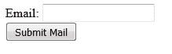
尝试输入一个无效的邮箱地址并点击 Submit Mail 按钮。观察发生了什么。你会得到以下警告框：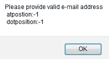

### 结合图片的验证
你可能需要根据输入的正确否显示不同的图片。这可以通过 JavaScript 如下实现：

```javascript
<script type="text/javascript">
  function formValidation(){
    var name= document.form1.name.value;
    var password = document.form1.password.value;
    var status = false ;
    if (name.length< 1 ){
      document.getElementById("namespan").innerHTML= "  Please provide your name";
      status = false ;
    } else {
      document.getElementById("namespan").innerHTML= " ";
      status = true ;
    }
    if (password.length< 6){
      document.getElementById("passwordspan").innerHTML= "  Password should be at least 8 char long";
      status = false ;
    } else {
      document.getElementById("passwordspan").innerHTML= " ";
    }
    return status ;
  }
</script>
<form name="form1" action="#" onsubmit="return formValidation()">
  <table>
    <tr>
      <td>Enter Name:</td>
      <td><input type="text" name="name" /><span id="namespan"></span></td>
    </tr>
    <tr>
      <td>Enter Password:</td>
      <td><input type="password" name="password" /><span id="passwordspan"></span></td>
    </tr>
    <tr>
      <td colspan="2"><input type="submit" value="Login" /></</td>
    </tr>
  </table>
</form>
```

该脚本执行后会返回如下的简单表单：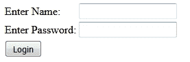
在不输入用户名或密码的情况下点击 Login 按钮。你将在相关消息旁边看到图片。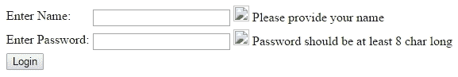

## 第 11 章 - 文档对象模型 (DOM)

`document` 对象指的是你的整个 HTML 页面。当你将一个对象加载到网页浏览器后，它会立即成为一个文档对象，即代表 html 文档的根元素。它包含了属性和方法。`document` 对象帮助我们向网页中添加内容。它是 `window` 的对象，这意味着拥有 `window.document` 等同于拥有 `document`。

### DOM 方法

DOM 方法是你可以在 html 元素上执行的操作。DOM 属性是 HTML 元素的值，人们对其进行设置或更改。以下是文档对象的方法：

1. `write("string")` - 向文档写入一个字符串。
2. `writeln("string")` - 向文档写入一个带有换行符的字符串。
3. `getElementById()` - 获取具有指定 `id` 的元素。
4. `getElementsByName()` - 获取所有具有指定 `name` 的元素。
5. `getElementsByTagName()` - 获取所有具有指定标签名的元素。
6. `getElementsByClassName()` - 获取所有具有指定类名的元素。

### 获取字段值
DOM 是获取输入字段值的一种好方法。很多时候你需要从用户那里获取输入。可以使用以下属性完成：`document.formname.name.value`

其中：
- `document` - 代表我们根元素的 html 文档。
- `form_name` - 带有字段的表单名称。
- `field_name` - 输入文本的名称。
- `value` - 返回输入文本值的的属性。


考虑以下示例：
```html
<html>
<body>
  <script type="text/javascript">
      function readValue(){
        var name= document.memberform.memberName.value;
        alert ("Hi: " + name);
      }
  </script>
  <form name="memberform">
    Enter Name: <input type="text" name="memberName" />
    <input type="button" onclick="readValue()" value="Click Here" />
  </form>
</body>
</html>
```

当运行运行代码时，它将为你提供如下所示的简单表单：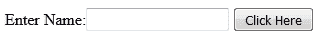

只需在输入框中输入你的名字并点击 `Click Here` 按钮。看看会发生什么。

你将得到一个提示框，其中有你的名字并追加了一些文本：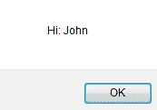

我们只是创建了一个带有输入字段的简单表单。`readValue()` 方法帮助我们获取输入到字段中的值。考虑以下行：`var name= document.memberform.memberName.value;`

`memberName` 是赋予表单中文本字段的名称，这些名称必须匹配，否则你将无法获得正确的结果。

### `getElementById()`

除了名称之外，我们还可以通过其 id 获取元素。这可以使用 `document.getElementById()` 方法来实现。然而，文本字段应该赋予一个 `id`。

例如：
```html
<html>
<body>
  <script type="text/javascript">
      function computeSquare(){
        var x= document.getElementById("integer").value;
        alert ( x * x);
      }
  </script>
  <form>
    Enter an Integer: <input type="text" id="integer" name="myNumber /><br/>
    <input type="button" value="Compute Square" onclick="computeSquare()" />
  </form>
</body>
</html>
```

代码在执行后将为你提供如下所示的简单表单：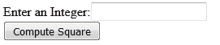

在输入框中输入数字并点击 `Compute Square` 按钮。

这应该会在弹出框中返回数字的平方，如下：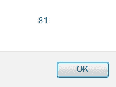

在示例中，我们定义了 `computeSquare()` 方法，它帮助我们获取输入到文本字段中的数字的平方。考虑以下行：`var x= document.getElementById("integer").value;`

在该行中，我们使用了 `getElementById()` 方法，它将输入字段的 `id` 作为参数。该方法帮助我们通过其 id 获取在文本字段中输入的值。

### `getElementsByName()`

`document.getElementsByName()` 方法可以帮助我们通过名称获取元素。该方法的语法如下：`document.getElementsByName("name")`

示例：
```html
<html>
<body>
  <script type="text/javascript">
      function getNumber() {
        var options= document.getElementsByName("option");
        alert ("Total Options:"+ options.length);
      }
  </script>
  <form>
    Yes: <input type="radio" name="option" value="yes">
    No: <input type="radio" name="option" value="no">
    <input type="button" onclick="getNumber()" value="Available Options" >
  </form>
</body>
</html>
```

执行后，代码返回如下：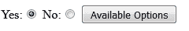

点击 `Available Options` 按钮看看会发生什么。将显示如下所示的弹出窗口：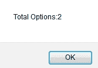

我们创建了带有 `Yes` 和 `No` 两个单选按钮。注意，这两个输入类型被赋予了相同的名称，即 `option`。

考虑以下行：`var options= document.getElementsByName("option");`

该行帮助我们统计名称为 `option` 的元素数量。如输出所示，这应该是 2。

### `getElementsByTagName()`

`document.getElementsByTagName()` 属性返回指定标签名称的元素。它采用如下语法：`document.getElementsByTagName("name")`

例如：
```html
<html>
<body>
  <script type="text/javascript">
  function allparagraphs(){
    var pgs= document.getElementsByTagName("p");
    alert ("Total paragraphs are: " + pgs.length);
  }
  </script>
  <p> This is a paragraph</p>
  <p> This is a paragraph</p>
  <p> This is a paragraph</p>
  <p> This is a paragraph</p>
  <button onclick="allparagraphs()" > Total Paragraphs</button>
</body>
</html>
```

代码在执行后返回如下：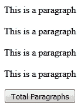

点击 `Total Paragraphs` 按钮看看会发生什么。

你将看到以下弹出框：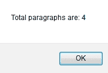

这意味着代码能够统计我们拥有的段落数量。主要逻辑位于以下行：`var pgs= document.getElementsByTagName("p");`

我们将标签 `p` 作为参数传递给我们的方法，输出应该是 4。


1. `setTimeout(method, time)` - 该方法将在若干毫秒后调用指定方法。
2. `setInterval(method, time)` - 该方法将在 `time` 毫秒后调用指定方法。

通过 JavaScript，可以设置 DOM 对象的某些属性，例如它在屏幕上的位置。可以使用 `top` 和 `left` 属性设置对象的位置。下文所示：

```javascript
// 设置距离屏幕左边缘的距离。
object.style.left = distance; // 单位为磅或像素；
// 设置距离屏幕顶部的距离。
object.style.top = distance; // 单位为磅或像素；
```

### 手动动画
在接下来的示例中，我们将制作图像向右移动的动画：

```html
<html
<head>
    <script type="text/javascript">
        var image = null;
        function init() {
            image = document.getElementById('myImage');
            image.style.position = 'relative';
            image.style.left = '0px';
        }
        function moveImage() {
            image.style.left = parseInt(image.style.left) + 10 + 'px';
        }
        window.onload = init;
    </script>
</head>
<body>
    <form>
        
        <p>点击按钮移动图像</p>
        <input type="button" value="Move Image" onclick="moveImage();"/>
    </form>
</body>
</html>
```

你应该在以下行中使用图像的正确名称：``。在我的情况下，我有一个名为 `house` 的 `.jpg` 图像。当我运行代码时，它返回如下结果：

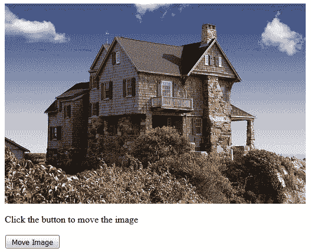

点击“Move Image”按钮。每次点击图像应向右移动。显示所示：


考虑脚本中的以下行：`image = document.getElementById('myImage');`。我们通过其 ID 获取图像，然后将其赋值给变量 `image`。`init()` 方法帮助我们在窗口上设置图像的初始位置。当窗口加载时将调用该方法。`moveImage()` 函数每次点击会将图像向右移动 10 像素。要让图像向左移动，值应设置为负数。在这种情况下，动画是手动点击的。

### 自动动画
为了实现元素动画自动化，可以使用 JavaScript 提供的 `setTimeout()` 函数。示例：

```html
<script type="text/javascript">
    var image = null;
    var animate;
    function init() {
        image = document.getElementById('myImage');
        image.style.position = 'relative';
        image.style.left = '0px';
    }
    function animateImage() {
        image.style.left = parseInt(image.style.left) + 10 + 'px';
        animate = setTimeout(animateImage, 20);
    }
    function stopAnimation() {
        clearTimeout(animate);
        image.style.left = '0px';
    }
    window.onload = init;
</script>
</head>
<body>
    <form>
        
        <p>点击 Animate 按钮启动动画</p>
        <input type="button" value="Animate" onclick="animateImage();"/>
        <input type="button" value="Stop" onclick="stopAnimation();"/>
    </form>

执行返回如下：

点击“Animate”按钮。动画应该开始。当你点击 Stop 按钮时，动画将停止。`animateImage()` 方法调用 `setTimeout` 方法在 20 毫秒后设置图像的位置。这将导致图像的动画。`stopAnimation()` 方法有助于清除由 `setTimeout()` 方法的计时器。对象设置为初始位置。

### 悬停切换 (Rollover)
我们可以使用 JavaScript 鼠标来实现图像切换。当鼠标悬停在图像上时，它将变为另一张图像。示例：

```html
<html>
<head>
    <script type="text/javascript">
        if (document.images) {
            var img1 = new Image();
            img1.src = "ps.jpg";
            var img2 = new Image();
            img2.src = "house.jpg";
        }
    </script>
</head>
<body>
    <p>鼠标悬停切换</p>
    <a href="#" onmouseover="document.img.src=img2.src;" onmouseout="document.img.src=img1.src;">
        
    </a>
</body>
</html>
```

我们使用了 `if` 语句来检查图像是否存在。使用了 `Image()` 构造函数来预加载名为 `img1` 的新对象。同样也预加载了第二张图像 `img2`。`src` 给出了外部存储的图像名称。`#` 有助于禁用点击时打开 URL。当鼠标移动到图像上时将调用 `mouseover` 方法。当鼠标离开图像时将调用 `mouseout` 方法。

## 第 12 章- 浏览器模型
BOM（浏览器模型）用于与浏览器交互。默认浏览器对象是 `window`，这意味着你可以直接调用所有窗口函数或通过指定 `window`。我们已经讨论过这一点，因此不再重复。除了 `window` 对象外，还有其他 BOM 对象。让我们讨论它们：

### History 对象 (History Object)
该对象存储用户访问过的所有 URL 数组。你可以使用此对象加载网页、上一页、下一页和任何特定的网页。可以通过如下方式访问此对象：`window.history`。也可以以此方式访问：`history`。此对象只有一个属性，即 `length`，它返回历史 URL 的长度。history 对象有 3 个方法，包括：

* `forward()` - 加载下一页
* `back()` - 加载上一页
* `go()` - 加载指定的页码

history 对象可以用以下多种方式使用：

1. `history.back();` // 用于上一页
2. `history.forward();` // 用于下一页
3. `history.go(2);` // 用于后两页
4. `history.go(-2);` // 用于上两页

### Navigator 对象 (Navigator Object)
该对象用于检测浏览器。它可以帮助获取 `appName`、`userAgent`、`appCodeName` 等浏览器信息。navigator 对象是 `window` 的属性，我们可以按如下方式访问：`window.navigator`。也可以通过以下方式访问：`navigator`。该对象带有多种属性，包括：

* `appName` - 返回名称
* `appCodeName` - 返回代码名称
* `appVersion` - 返回版本
* `cookieEnabled` - 如果浏览器启用 cookie 则返回 true，否则返回 false
* `language` - 返回语言。仅限 Firefox 和 Netscape。
* `userAgent` - 返回用户代理
* `userLanguage` - 返回用户的语言。仅限 IE 支持。
* `systemLanguage` - 返回系统语言。仅限 IE 支持。
* `Plugins` - 返回插件。仅限 Firefox 和 Netscape。
* `mimeTypes[]` - 返回 MIME 类型数组。仅限 Firefox 和 Netscape。
* `online` - 如果浏览器在线则返回 true，否则返回 false。
* `platform` - 返回平台，如 Win32。

navigator 对象拥有以下方法：

* `javaEnabled()` - 检查是否启用了 java。 `taintEnabled()` - 检查是否启用了 taint。自 JavaScript 1.2 起已弃用。


考虑下面提供的 `navigator` 对象示例：

```javascript
document.writeln("<br/>navigator.appName: " + navigator.appName);document.writeln("<br/>navigator.appCodeName: " + navigator.appCodeName);document.writeln("<br/>navigator.appVersion: " + navigator.appVersion);document.writeln("<br/>navigator.language: " + navigator.language);document.writeln("<br/>navigator.cookieEnabled: " + navigator.cookieEnabled);document.writeln("<br/>navigator.userAgent: " + navigator.userAgent);document.writeln("<br/>navigator.onLine: " + navigator.onLine);document.writeln("<br/>navigator.platform: " + navigator.platform);
```

该代码返回以下细节：
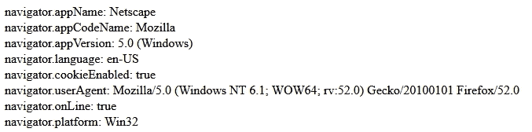

请注意，输出将取决于所使用的操作系统、浏览器以及其他细节。

### Screen（屏幕）对象

这个 JavaScript 对象存储有关浏览器屏幕的信息。你可以使用它来显示屏幕细节，例如 `height`、`width`、`pixelDepth`、`colorDepth` 等。它是 `window` 对象的属性，因此我们通过如下方式访问：`window.screen`

我们也可以通过如下方式访问：`screen`

该对象具有许多属性，包括以下：

- `width` - 返回浏览器屏幕的宽度
- `height` - 返回浏览器屏幕的高度
- `availWidth` - 打印可用宽度
- `availHeight` - 打印可用高度
- `colorDepth` - 返回颜色深度
- `pixelDepth` - 返回像素深度


以下示例展示了如何使用此对象：

```html
<script>
  document.writeln("<br/>screen.height: " + screen.height);
  document.writeln("<br/>screen.width: " + screen.width);
  document.writeln("<br/>screen.availHeight: " + screen.availHeight);
  document.writeln("<br/>screen.availWidth: " + screen.availWidth);
  document.writeln("<br/>screen.pixelDepth: " + screen.pixelDepth);
  document.writeln("<br/>screen.colorDepth: " + screen.colorDepth);
</script>
```
代码执行后返回以下内容：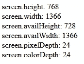

### 页面打印

有时，你可能需要将特定网页的内容发送到打印机进行打印。可以通过添加一个按钮来实现，用户必须点击该按钮才能打印。这可以使用 `window` 对象的 `print` 方法。当调用 `window.print()` 函数时，当前页面将被打印。可以使用 `onClick()` 事件调用该函数。

示例：
```html
<html>
  <body>
    <form>
      <input type="button" value="Print Page" onclick="window.print()" />
    </form>
  </body>
</html>
```
执行脚本后，你将看到以下按钮：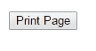点击“Print Page”按钮。页面将发送到打印机打印。系统会要求你指定各种打印选项。

## 第 13 章- JavaScript Cookies

Cookies 指存储在计算机文本文件中的数据。在浏览过程中，网页会被发送到用户的浏览器，而 Web 服务器会遗忘此操作。Cookies 有助于于记住有关用户的信息。一旦用户访问了网页，cookie 就可以帮助存储其姓名。当用户下下次访问该页面时，系统将记住他。它们以如下所示的键值对形式保存：

`username = John Joel`

一旦用户的浏览器向服务器请求页面，页面的 cookies 就会被添加到请求中。然后，服务器将获得记住用户所需的所有信息。

### 创建 Cookies

JavaScript 的 `document.cookie` 可用于创建、删除和读取 cookie。

示例：
```javascript
document.cookie = "username=John joel";
```
还可以以 UTC 格式为 cookie 添加过期日期。关闭浏览器后，cookie 将被删除。

示例：
```javascript
document.cookie = "username=John Joel; expires=Fri, 22 Feb 2019 12:00:00 UTC";
```
这就是你如何指定 cookie 的过期日期。还可以指定 cookie 的路径。

示例：
```javascript
document.cookie = "username=John Joel; expires=Fri, 22 Feb 2019 12:00:00 UTC; path=/";
```
以下脚本演示了这一点：

```html
<<html>
  <head>
    <script type="text/javascript">
      function CreateCookie() {
        if (document.form1.field.value == "") {
          alert("Type a value");
          return;
        }
        value = escape(document.form1.field.value) + ";";
        document.cookie = "name=" + value;
        document.write("Creating Cookies: " + "name=" + value);
      }
    </script>
  </head>
  <body>
    <form name="form1" action="">
      Name: <input type="text" name="field" />
      <input type="button" value="Create Cookie" onclick="CreateCookie();" />
    </form>
  </body>
</html>
```
代码执行后将返回以下表单：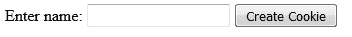在字段中输入名称，然后点击“Create Cookie”按钮。你应该看到以下内容：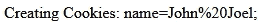cookie 将被创建。随后你将在计算机上拥有一个你输入的名称的 cookie。如果你需要一次创建许多 cookie，请使用逗号将它们分隔。

### 读取 Cookies

可以使用 `document.cookie` 对象读取 cookies。cookie 的名称会被传递给该对象。当你需要访问 cookie 时，可以随时使用该字符串。`document.cookie` 字符串以 `name=value` 键值对的形式存储 cookies，并用分号分隔。name 代表 cookie 的名称，而 value 表示字符串值。通过 `split()` 函数，人们可以拆分字符串以获取键和值。

示例：
```javascript
<script type="text/javascript">
  function ReadCookies() {
    var cookies = document.cookie;
    document.write("Cookies include: " + cookies);
    myArray = cookies.split(';');
    for (var x=0; x< myArray.length; x++) {
      name = myArray[x].split('=')[0];
      value = myArray[x].split('=')[1];
      document.write("The Key is : " + name + " and Value is : " + value);
    }
  }
</script>
</head>
<body>
  <form name="form1" action="">
    <p>点击按钮查看结果：</p>
    <input type="button" value="Read Cookie" onclick="ReadCookies()" />
  </form>
</body>
```
执行脚本后，你将看到以下界面：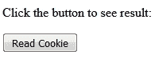点击“Read Cookie”按钮。所有的 cookies 将显示在输出中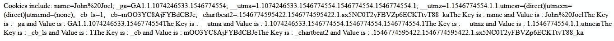在这种情况下长度提供了数组长度。

### 删除 Cookies

有时，你可能不需要读取 cookie。这需要你删除它。删除数组涉及为其分配一个过去的当前日期的过期日期。

示例：
```javascript
<script type="text/javascript">
  function CreateCookie() {
    var time = new Date();
    time.setMonth(time.getMonth() - 1);
    value = escape(document.form1.field.value) + ";";
    document.cookie = "name=" + value;
    document.cookie = "expires=" + time.toUTCString() + ";";
    document.write("Set the Cookies : " + "name=" + value);
  }
</script>
</head>
<body>
  <form name="form1" action="">
    Enter name: <input type="text" name="field" />
    <input type="button" value="Create Cookie" onclick="CreateCookie()" />
  </form>
</body>
```
在示例中，我们通过将过期日期设置为一个月之前来删除了 cookie。该逻辑通过代码中的以下行实现：
`time.setMonth(time.getMonth() - 1);`

## 第 14 章 面 面对象编程

JavaScript 支持面向对象的概念。让我们讨论一下它们：

### 类

JavaScript 类是特殊的 JavaScript 函数。类可以像函数和函数表达式一样被定义。JavaScript 类有许多成员，包括方法或构造函数。JavaScript 类在严格模式下执行。因此，任何带有静默错误或的代码都会抛出错误。类语法由两个部分组成：

*   类声明

*   类表达式


### 类声明

要声明一个类，我们使用类声明。这是通过使用 `class` 关键字后跟类名来实现的。JavaScript 的命名规范要求类名必须大写字母开头。以下是 JavaScript 类声明的一个示例：

```javascript
// Declare a class
class Student {
  // Initialize an object
  constructor (admission, name) {
    this.admission = admission;
    this.name = name;
  }
  // Declare a method
  detail() {
    document.writeln(this.admission + " " + this.name + "<br>")
  }
}
// pass an object to the variable
var student1 = new Student(3380, "John Joel");
var student2 = new Student(102, "Mercy George");
student1.detail(); //call a method
student2.detail();
```

代码执行后返回如下：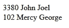

我们创建了一个名为 `Student` 的类。然后我们初始化了一个带有两个参数 `admission` 和 `name` 的构造函数。接着，我们创建了一个名为 `detail()` 的方法，该方法应该返回学生的详情，包括录取号和姓名。

考虑代码中提取的以下两行：
```javascript
var student1 = new Student(3380, "John Joel");
var student2 = new Student(102, "Mercy George");
```

我们正在做的被称为**实例化**。我们简单地创建了一个 `Student` 类型的实例/对象。这意味着 `student1` 是 `Student` 的实例，因此它可以访问在 `Student` 类中定义的所有属性。这同样适用于 `student2`。每个学生的详情都作为参数传递了。最后，我们调用了 `detail()` 方法来返回每个学生的详情。

与声明不同，类的声明不是 JavaScript 提升（hoisting）的一部分。这意味着你必须在调用类之前先对其进行声明。下面的示例演示了这一点：

```javascript
// Here, we invoke the class before we declare it.
var student1 = new Student(3380, "John Joel");
var student2 = new Student(102, "Mercy George");
student1.detail(); //call a method
student2.detail();
// Declare the class
class Student {
  // Initialize an object
  constructor (admission, name) {
    this.admission = admission;
    this.name = name;
  }
  // Declare a method
  detail() {
    document.writeln(this.admission + " " + this.name + "<br>")
  }
}
```

上面的代码无法工作，因为我们尝试在声明类之前就访问它。一个类只能声明一次。如果你尝试声明多次，它将返回错误。以下是一个示例：

```html
<html>
<body>
  <script>
// Declare a class
class Student {
  // Initialize an object
  constructor (admission, name) {
    this.admission = admission;
    this.name = name;
  }
  // Declare a method
  detail() {
    document.writeln(this.admission + " " + this.name + "<br>")
  }
}
// pass an object to the variable
var student1 = new Student(3380, "John Joel");
var student2 = new Student(102, "Mercy George");
student1.detail(); //call a method
student2.detail();
// Re-declaring class
class Student {
}
  </script>
</body>
</html>
```

上面的代码也不会运行，因为我们声明了两次 `Student` 类。

### 类表达式

类也可以使用类表达式来定义。在这种情况下，类名不是强制性的。这意味着你可以有一个命名的或未命名的类表达式。类表达式允许你获取类的名。然而，类声明不允许这样做。以下是匿名类表达式的示例：

```javascript
var stud = class {
  constructor (admission, name) {
    this.admission = admission;
    this.name = name;
  }
};
document.writeln(stud.name);
```

执行后，代码将返回：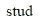

类被赋值给了一个变量，而不是被命名。通过类表达式，我们可以重新声明一个类。

```javascript
// Declare a class
var stud = class {
  // Initialize an object
  constructor (admission, name) {
    this.admission = admission;
    this.name = name;
  }
  // Declare a method
  detail() {
    document.writeln(this.admission + " " + this.name + "<br>")
  }
}
// pass an object to the variable
var student1 = new stud(3380, "John Joel");
var student2 = new stud(102, "Mercy George");
student1.detail(); //call a method
student2.detail(); //Re-declare class
```

代码将成功返回如下：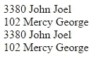

类表达式是可以命名的。在这种情况下，类名的作用域取决于类体。要获取类名，我们使用属性 `class.name`。考虑以下示例：

```javascript
var stud = class Student {
  constructor (admission, name) {
    this.admission = admission;
    this.name = name;
  }
};
document.writeln(stud.name);
```

代码成功运行并返回：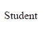

现在让我们尝试编写如下代码：

```javascript
var stud = class Student {
  constructor (admission, name) {
    this.admission = admission;
    this.name = name;
  }
};
document.writeln(Student.name);
```

代码将产生错误。

### 对象

JavaScript 中的对象是一个既有状态又有行为的实体，即属性和方法。对象的示例可以是椅子、鼠标、键盘、笔等。JavaScript 是基于对象的运行。它将一切视为对象。它是基于模板的，而不是基于类的。JavaScript 为我们提供了三种创建对象的方法。这些包括：

1.  使用对象字面量

2.  直接创建 `Object` 实例（通过 `new` 关键字）

3.  使用对象构造函数（通过 `new` 关键字）


### 使用对象字面量

要使用对象字面量创建对象，我们使用下面的语法：

```javascript
object={ property1: value1, property2: value2..... propertyN: valueN}
```

我们使用冒号（`:`）来分隔属性和值。下面的示例演示了如何使用这种方法创建对象：

```javascript
student={ admission: 3380 , name: "John Joel" , age: 28 }
document . write( student.admission+ " " + student. name+ " " + student. age);
```

代码返回以下结果：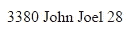 输出清晰地显示 JavaScript 解释器能够理解该语法的含义，即属性在先，值在其后。这就是为什么它能够获取我们需要访问的属性值。

### 通过创建对象实例

这通过以下语法完成：
```javascript
var object_name= new Object ();
```

注意，我们使用了 `new` 关键字来创建对象。下面的示例演示了我们如何直接创建一个对象：

```javascript
var stud= new Object ();
stud. admission= 3380 ;
stud. name= "John Joel" ;
stud. age= 28 ;
document . write( stud.admission+ " " + stud. name+ " " + stud. age);
```

代码将打印以下结果：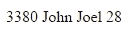

### 使用对象构造函数

这涉及创建一个带有参数的函数。每个参数值都可以通过 `this` 关键字赋值给当前对象，`this` 表示当前对象。考虑以下示例：

```javascript
function stud( admission, name, age){
  this . admission= admission;
  this . name= name;
  this . age= age;
  }
s= new stud( 3380 , "John Joel" , 28 );
document . write( s.admission+ " " + s. name+ " " + s. age);
```

代码执行后返回以下内容：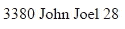 JavaScript 允许我们在对象中定义方法。但在定义方法之前，我们应该先定义一个与方法同名的属性。下面的示例展示了我们如何在对象中定义一个方法：

```javascript
function stud( admission, name, age){
  this . admission= admission;
  this . name= name;
  this . age= age;
  this . updateAge= updateAge;
  function updateAge( newAge){
    this . age= newAge;
  }
  }
s= new stud( 3380 , "John Joel" , 28 );
document . write( s.admission+ " " + s. name+ " " + s. age +"<br>" );s. updateAge( 29 );
document . write( s.admission+ " " + s. name+ " " + s. age);
```

代码执行后将返回以下结果：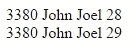 我们定义了 `updateAge()` 方法，帮助我们更改学生的年龄。在示例中，学生的年龄已从 28 更新为 29。

### 原型

JavaScript 语言基于原型工作，允许对象从相互之间获取特征和属性。在这里，每个对象都有一个原型对象。在 JavaScript 中创建一个函数后，`prototype` 属性会自动添加到该函数中。该属性是一个持有 `constructor` 属性的原型对象。以下是 JavaScript 中创建原型对象的语法：

```javascript
ClassName. prototype . methodName
```

在创建对象后，与之对应的函数会被加载到内存中。这意味着每个对象都有函数的新副本。因此，所有函数都会一次性加载到内存中。

### 原型链

每个 JavaScript 对象都有一个原型对象，并从那里获取方法和属性。一个对象的原型可能拥有一个原型对象，该原型对象可以获取方法和属性，依此类推。我们可以此视为原型链。下面的示例演示了我们如何向构造函数添加一个新方法：

```javascript
function Student( firstName, lastName){
  this . firstName= firstName;
  this . lastName= lastName;}
Student. prototype . fullName= function ()
  {
    return this . firstName+ " " + this . lastName;
  }
var student1= new Student( "John" , "Joel" );
var student2= new Student( "Mercy" , "George" );
document . writeln( student1.fullName()+ "<br>" );
document . writeln( student2.fullName());
```

代码返回以下结果：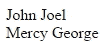 `fullName()` 函数结合了 `firstName` 和 `lastName` 以返回学生的全名。让我们再创建另一个示例，演示如何向构造函数添加一个新属性：

```javascript
function Student( firstName, lastName){
  this . firstName= firstName;
  this . lastName= lastName;}
Student. prototype . school= "ABC"
var student1= new Student( "John" , "Joel" );
var student2= new Student( "Mercy" , "George" );
document . writeln( student1.firstName+ " " + student1.lastName+ " " + student1.school+ "<br>" );
document . writeln( student2.firstName+ " " + student2.lastName+ " " + student2.school+ "<br>" );
```

代码应返回以下结果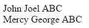 我们为 `school` 创建了原型，所有学生都继承它。

### 构造方法

构造方法是 JavaScript 中用于初始化和创建对象的特殊方法。它在对象分配内存后调用。构造方法由 `{}` 表示。构造方法使用 `constructor` 关键字声明。下面的示例展示了如何声明构造方法：

```javascript
class Student {
  constructor () {
    this . admission= 3380 ;
    this . name = "John" ;
  }
}
var stud = new Student();
document . writeln( stud.admission+ " " + stud.name);
```

代码将遵循 注意构造方法内部创建了各种属性。

### 静态方法

JavaScript 提供了属于类而非实例的静态方法。这意味着不需要实例来调用静态方法。我们直接在类上调用这些方法。静态方法使用 `static` 关键字声明。类允许有多个静态方法。任何数据类型的成员都可以与方法传递。考虑下面的静态方法示例：

```javascript
class StaticTest{
  static show() {
    return "Static method has been invoked"
  }
}
document . writeln( StaticTest.show());
```

代码执行后将打印以下内容 `show()` 方法使用 `static` 关键字声明，使其成为静态方法。让我们看看如何调用多个方法：

```javascript
class StaticTest{
  static show1() {
    return "Static method has been invoked"
  }
  static show2() {
    return "Static method invoked"
  }
}
document . writeln( StaticTest.show1()+ "<br>" );
document . writeln( StaticTest.show2());
```

代码执行后将返回以下 我们创建了两个静态方法，`show1()` 和 `show2()`。我们随后调用它们来获取结果。

```javascript
class StaticTest{
  static show() {
    return "Static method has been invoked"
  }
  static show() {
    return "Static method invoked again"
  }
}
document . writeln( StaticTest.show());
```

静态方法也可以从构造函数内部被调用。下面的示例展示了静态方法可以在构造函数内部调用：

```javascript
class StaticTest {
  constructor () {
    document . writeln( StaticTest.show()+ "<br>" );
    document . writeln( this.constructor.show());
  }
  static show() {
    return "Static method has been invoked"
  }
}
var st= new StaticTest();
```

代码返回以下结果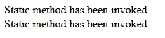 静态方法也可以从非静态方法内部被调用。例如：

```javascript
class StaticTest {
  static show() {
    return "static method has been invoked"
  }
  show() {
    document . writeln( StaticTest.show()+ "<br>" );
  }
}
var st= new StaticTest();
st. show();
```

代码返回以下结果

### 封装

封装是将数据与作用于数据的功能结合的过程。它是控制和验证数据的一种良好方法。在 JavaScript 中，你应该使用 `var` 关键字将数据成员设为私有。Setter 方法用于设置数据，而 getter 方法用于获取数据。考虑下面的示例：

```javascript
class Student {
  constructor () {
    var name;
    var score;
  }
  getStudentName() {
    return name;
  }
  setStudentName( name) {
    this. name= name;
  }
  getScore() {
    return score;
  }
  setScore( score) {
    this. score= score;
  }
}
var st= new Student();
st. setStudentName( "John" );
st. setScore( 78 );
document . writeln( st.getStudentName()+ " " + st.getScore());
```

代码执行后将返回以下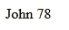 让我们看看如何验证学生的成绩：

```javascript
class Student {
  constructor () {
    var name;
    var score;
  }
  getStudentName() {
    return name;
  }
  setStudentName( name) {
    this. name= name;
  }
  getScore() {
    return score;
  }
  setScore( score) {
    if ( score< 0 || score> 100 ) {
      alert ( "Invalid Score" );
    }
    else {
      this. score= score;
    }
  }
}
var st= new Student();
st. setStudentName( "John" );
st. setScore( 105 ); //alert() invokes
document . writeln( st.getStudentName()+ " " + st.getScore());
```

在 `setScore()` 方法中，成绩已被验证。如果它不在 0 到 100 之间，则会弹出“无效成绩”。我们已经将成绩设置为 105。让我们修改成绩并将其设置为 78：

```javascript
class Student {
  constructor () {
    var name;
    var score;
  }
  getStudentName() {
    return name;
  }
  setStudentName( name) {
    this. name= name;
  }
  getScore() {
    return score;
  }
  setScore( score) {
    if ( score< 0 || score> 100 ) {
      alert ( "Invalid Score" );
    }
    else {
      this. score= score;
    }
  }
}
var st= new Student();
st. setStudentName( "John" );
st. setScore( 78 );
document . writeln( st.getStudentName()+ " " + st.getScore());
```

代码返回以下结果 我们也可以通过基于原型的方法来实现封装：

```javascript
class Student {
  constructor () {
    var name;
    var score;
  }
  getStudentName() {
    return name;
  }
  setStudentName( name) {
    this. name= name;
  }
  getScore() {
    return score;
  }
  setScore( score) {
    if ( score< 0 || score> 100 ) {
      alert ( "Invalid Score" );
    }
    else {
      this. score= score;
    }
  }
}
function Student( name, score) {
  var sname= name;
  var s_score= score;
  Object . defineProperty(this, "name", {
    get: function () {
      return sname;
    },
    set: function (sname) {
      sname= sname;
    }
  });
  Object . defineProperty(this, "score", {
    get: function () {
      return s_score;
    },
    set: function (s_score) {
      s_score= s_score;
    }
  });
}
var st= new Student( "John", 78 );
document . writeln( st.name+ " " + st.score);
```

### 继承

通过这一 JavaScript 特性，我们可以创建基于现有类的新类。它为子类提供了使用父类方法和属性的方法。在 JavaScript 中，继承是通过使用 `extends` 关键字完成的。通过这个关键字，我们创建一个基于父类的子类。之后，子类将能够父类的行为和属性。继承维持了 IS-A 关系。继承也可以通过基于原型的方法实现。考虑下面的示例，`Current` 继承自 `Date`：

```javascript
class Current extends Date {
  constructor () {
    super ();
  }
}
var c= new Current();
document . writeln( "Today is:" )
document . writeln( c.getDate()+" c.getFullYear());
```

代码将返回以下输出 代码返回今天的日期。这是另一个示例：

```javascript
class Current extends Date {
  constructor ( year) {
    super ( year);
  }
}
var c= new Current( "April 20, 1958 17:32" );
document . writeln( "The year:" )
document . writeln( c.getFullYear());
```

在上面的示例中，我们创建了一个日期值，并使用了 `getFullYear()` 方法获取年份。代码执行后返回以下 这表明该方法能够成功提取提供日期的年份部分。这是另一个示例，我们创建一个子类来继承父类：

```javascript
class Car{
  constructor () {
    this . manufacturer= "Toyota" ;
  }
}
class Model extends Car {
  constructor ( name, year) {
    super ();
    this . name= name;
    this . year= year;
  }}
var m = new Model( "Harrier" , "2012" );
document . writeln( m.manufacturer+ " " + m.name+ " " + m.year);
```

代码返回以下结果 让我们演示如何进行基于原型的继承，我们不需要使用 `extends` 和 `class` 关键字：

```javascript
//A Constructor function
function Car( manufacturer) {
  this . manufacturer= manufacturer;
}
Car. prototype . getManufacturer= function ()
  {
    return this . manufacturer;
  }
//Another constructor function//Second constructor function
function Model( name, year) {
  this . name= name;
  this . year= year;
}
var car = new Car( "Toyota" );
model. prototype = car; //Now Bike 被视为 Vehicle 的父类.
var model= new Model( "Harrier" , 2012 );
document . writeln( model.getManufacturer()+ " " + model.name+ " " + model.year);
```

### 多态

多态是面向对象编程范式的一项关键特性，它允许人们以不同的方式执行单项操作。通过多态，我们可以在各种 JavaScript 对象上调用同一种方法。JavaScript 不是一种类型安全的语言；因此，任何数据类型的成员都可以与方法传递。考虑下面的示例：

```javascript
class Parent {
  show() {
    document . writeln( "Parent class" );
  }
}
class Child extends Parent {
  show() {
    document . writeln( "Child class" );
  }
}
var p = new Parent();
p.show();
var c = new Child();
c.show();
```

代码将返回以下 这里是另一个示例：

```javascript
class Parent {
  show() {
    document . writeln( "Parent class" );
  }
}
class Child extends Parent {
  show() {
    document . writeln( "Child class" );
  }
}
var p=[ new Parent(), new Child()]
p. forEach( function ( message){message. show();});
```

`show()` 方法根据用的对象不同表现不同。代码打印以下输出： 我们可以通过原型方法实现相同的示例，但这次是如下面所示：

```javascript
function Parent(){}
Parent. prototype . show= function (){
  return "Parent class" ;
}
function Child(){}
Child. prototype = Object . create( Parent. prototype );
var p=[ new Parent(), new Child()]
p. forEach( function ( message){
  document . writeln( message. show()+ "<br>" );
});
```

第 15 章 多媒体

JavaScript 拥有 `plugins` 对象，它是 `navigator` 对象的子类。它是一个数组，包含了每个浏览器插件的单个条目。Firefox 和 Netscape 等浏览器支持使用 `navigator.plugins` 对象。考虑下面的脚本：

```html
<table border="1" >
  <tr>
    <th>Name of PLugin</th>
    <th>Filename</th>
    <th>Description</th>
  </tr>
  <script language="JavaScript" type="text/javascript">
    for ( x= 0 ; x< navigator .plugins. length; x++) {
      document . write( "<tr><td>" );
      document . write( navigator .plugins[ x].name);
      document . write( "</td><td>" );
      document . write( navigator .plugins[ x].filename);
      document . write( "</td><td>" );
      document . write( navigator .plugins[ x].description);
      document . write( "</td></tr>" );
    }
  </script>
</table>
```

一旦执行，该脚本将向你显示浏览器上安装的所有插件列表。每个插件由数组中的一个条目表示。每个条目具有以下属性：


1. `name` - 这指定插件的名称。
2. `filename` - 这是一个可执行文件，用于加载以安装插件。
3. `description` - 这对插件进行了描述。


在我的情况下，我在 `Chrome` 上运行了代码，它返回了以下内容：

通过上述属性，可以确定已安装了哪些插件，然后使用 JavaScript 来播放必要的多媒体文件。

示例：
```html
<script language= "JavaScript" type= "text/javascript">
vid = navigator . mimeTypes [ "video/quicktime" ];
if ( vid){
    document . write( "<embed src='movie1.mov' height= 110 width= 110 > ");
}
else
{
    document . write( " ");
}
</script>
```

`<embed>` 标签帮助我们嵌入多媒体文件。通过 JavaScript，我们能够控制多媒体。

示例：
```html
<script type= "text/javascript">
function playMedia() {
    if (! document . game. IsPlaying()){
        document . game. Play();
    }
}
function stopMedia() {
    if ( document . game. IsPlaying()){
        document . game. StopPlay();
    }
}
function rewindMedia() {
    if ( document . game. IsPlaying()){
        document . game. StopPlay();
    }
    document . game. Rewind();
}
</script>
</head>
<body>
    <embed id= "game" name= "game" src= "your_game_url" width= "320" height= "302" play= "false" loop= "false" pluginspage= " http://www.macromedia.com/go/getflashplayer " swliveconnect= "true" >
    </embed>
    <form name= "form1" id= "form1" action= "#" method= "get" >
        <input type= "button" value= "Play" onclick = "playMedia();" />
        <input type= "button" value= "Stop" onclick = "stopMedia();" />
        <input type= "button" value= "Rewind" onclick = "rewindMedia();" />
    </form>
```

确保你已将 URL 添加到你的游戏位置。执行脚本，你将看到播放、停止和重退按钮。该示例可以在任何浏览器上运行。

## 第 16 章-错误处理

JavaScript 是我们拥有的弱类型语言之一。它没有编译阶段。错误在编程过程中发生。你可以尝试访问一个未定义的变量或函数。错误分为语法错误、运行时错误和逻辑错误。

### 语法错误

在 JavaScript 中，语法错误在解释期间发生。它们也被称为解析错误（parsing errors）。考虑下面的示例脚本：
```javascript
<script type= "text/javascript">
window . print()
```
JavaScript 语句应该以分号结束。`print()` 语句没有以分号结束，因此导致语法错误。如果一个语句存在语法错误，同一线程中的所有语句都将受到影响。其他线程将继续执行。

### 运行时错误

这些是在运行期间抛出的异常。执行发生在解释之后。

示例：
```javascript
<script type= "text/javascript">
window . printFile();
```
在解释期间，不会产生错误，因为脚本语法是正确的。但在运行时会抛出异常，因为脚本将调用一个未知的方法，即 `printFile()` 方法。

### 逻辑错误

这类错误发生在你在脚本中未能实现正确的逻辑时，这意味着你无法得到预期的结果。它们对人来说很难追踪。它们不是由运行时错误或语法错误引起的。人们无法捕获这些类型的错误，因为它们取决于要实现的业务逻辑。

### try...catch...finally

在 JavaScript 中，你可以处理错误和异常。当此语句与 `throw` 结合时，可以更有效地处理错误和异常。该语句的语法如下：
```javascript
<script type= "text/javascript">
try {
    // 你的代码
}
catch ( ex ) {
    // 异常时执行的代码
}
finally {
    // 无论是否发生异常都会执行的代码
}
```
`try` 块后面应该紧跟 `catch` 块或 `finally` 块。当 `try` 块发生异常时，异常将添加到 `ex` 中，然后执行 `catch` 块。`finally` 块是可选的，它在 `try/catch` 之后无条件地执行。示例：
```javascript
function checkFunction() {
    var check, val;
    check = document . getById( "check" );
    check. innerHTML = "" ;
    val = document . getById( "field" ). value;
    try {
        if ( val == "" )
        throw "empty" ;
        if ( isNaN ( val)) throw "Enter a number" ;
        val = Number ( val);
        if ( val < 10 )
        throw "too low" ;
        if ( val > 20 )
        throw "too high" ;
    }
    catch ( ex) {
        check . innerHTML = "Your input is " + ex;
    }
}
```
在我们的案例中，我们使用 `try` 和 `catch` 来验证我们的输入字段。输入应该是 10 到 20 之间的数字。如果不遵守这一点，将抛出异常，然后由 `try` 块处理。

### finally 语句

该语句指定在 `try` 和 `catch` 之后无论结果如何都执行的代码。其语法如下：
```javascript
try {
    // 用于 try 代码
}
catch ( err) {
    // 用于处理错误的代码
}
finally {
    // 用于 finally 代码
}
```
示例：
```javascript
function checkFunction() {
    var check, val;
    check = document . getById( "check" );
    check. innerHTML = "" ;
    val = document . getById( "field" ). value;
    try {
        if ( val == "" )
        throw "It is empty" ;
        if ( isNaN ( val)) throw "Enter a number" ;
        val = Number ( val);
        if ( val < 10 )
        throw "number low" ;
        if ( val > 20 )
        throw "number high" ;
    }
    catch ( ex ) {
        check . innerHTML = "Input " + ex;
    }
    finally {
        document . getById( "field" ). value = "" ;
    }
}
```
`field` 值将在 `finally` 块中清除。

## 第 17 章- 正则表达式

正则表达式指的是由字符创建的模式。JavaScript 有一个名为 `RegExp` 的类可以帮助程序员使用正则表达式。通过这个类，人们可以执行模式匹配、替换和搜索函数。

要定义正则表达式，我们使用 `RegExp()` 构造函数。下面演示：
```javascript
expression = new RegExp( "the_pattern", "flags" );
```
`the_pattern` 参数是指定正则表达式或其他其他正则表达式的字符串。`flags` 参数是可选字符串，分别指定不区分大小写（i）、多行（m）和全局（g）。让我们讨论正则表达式各种方法。

### exec()

该方法搜索匹配 `regexp` 的字符串。如果找到匹配项，将以数组的形式返回，否则将返回 `null`。该方法的语法如下：
```javascript
RegExpObject. exec( search_string );
```
`search_string` 参数表示要搜索的字符串。考虑下面的示例：
```javascript
<script type= "text/javascript">
var text = "JavaScript 有一个名为 RegExp 的类可以帮助程序员使用正则表达式";
var reg = new RegExp( "express", "g" );
var output = reg. exec( text );
document . write( "第一次测试，返回的值是: " + output);
reg = new RegExp( "language", "g" );
var output = reg. exec( text );
document . write( "第二次测试，返回的值是: " + output);
</script>
```
代码执行后返回以下输出：(image5787.jpg)我们首先搜索字符串 `express` 在表达式中找到了。其次，我们搜索字符串 `language` 在句子中没有找到。

### test()

该方法搜索匹配 `regexp` 的字符串。如果找到匹配项，它将返回 `true`，否则将返回 `false`。该方法的语法如下：
```javascript
RegExpObject. test( search_string );
```
`search_string` 是要搜索的字符串。考虑下面的示例：
```javascript
<script type= "text/javascript">
var text = "JavaScript 有一个名为 RegExp 的类可以帮助程序员使用正则表达式";
var reg = new RegExp( "express", "g" );
var output = reg. test( text );
document . write( "第一次测试返回了: " + output);
reg = new RegExp( "language", "g" );
var output = reg. test( text );
document . write( "第二次测试返回了: " + output);
</script>
```
代码返回以下结果：(image5816.jpg)在第一次测试中找到了匹配项，因此输出为 `true`。在第二次测试中，没有找到匹配项，因此返回了 `false`。

### search()

该方法搜索字符串，类似于 `indexOf()` 函数，它接受正则表达式而不是字符串。返回一个整数，表示字符串的位置。注意，0 表示字符串的开头，7 将匹配第 `7` 个字符，依此类推。如果没有找到匹配项，则返回 -1：
```javascript
<script type= "text/javascript">
var myString = "best";
m= myString. search( /Best[0-9]+/ );
document . writeln( m)
</script>
```
脚本执行后返回。

### toString()

使用时，该方法将返回字面量形式的表达式字符串表示。该方法的语法如下：
```javascript
RegExpObject. toString ();
```
该方法随后返回正则表达式的字符串表示。例如：
```javascript
<script type= "text/javascript">
var text = "JavaScript 有一个名为 RegExp 的类可以帮助程序员使用正则表达式";
var reg = new RegExp( "express", "g" );
var output = reg. toString( text );
document . write( "第一次测试返回了: " + output);
reg = new RegExp( "/", "g" );
var output = reg. toString( text );
document . write( "第二次测试返回了: " + output);
</script>
```
该方法返回以下输出：(image5859.jpg)

# 第 18 章-图像地图 (Image Map)

JavaScript 可以用于图像地图。为了创建图像地图，我们使用 `usemap` 属性。`img` 标签的 `usemap` 属性指向一个 `<map>` 标签。`<map>` 标签包含多个 `<area>` 标签，每个 `<area>` 标签定义图像的一个点击区域。`area` 标签有 `shape`、`coords`、`href` 和 `alt` 属性。`shape` 属性可以是 `rect`、`circle`、`poly` 或 `default`。`coords` 属性是坐标。`href` 属性是链接的 URL。`alt` 属性是备用文本。

示例：
```html

<map name="map1">
  <area shape="rect" coords="0,0,100,100" href="page1.html" alt="矩">
  <area shape="circle" coords="150,150,20" href="page2.html" alt="圆形">
  <area shape="poly" coords="0,0,50,100,100,0" href="page3.html" alt="多边形">
</map>
```

通过 JavaScript，我们可以处理图像地图的点击事件。

例如：
```javascript
var myMap = document.getElementById("map1");
var areas = myMap.getElementsByTagName("area");
for (var i = 0; i < areas.length; i++) {
    areas[i].onclick = function() {
        alert("你点击了" + this.alt);
    };
}
```
