# JavaScript 与 jQuery 缺失指南（第2版）


---

**答案就在这里！**

JavaScript 可以为你的 HTML 赋予动画、交互和视觉特效——但许多网页设计师发现这门语言难以学习。本指南以通俗易懂的方式讲解 JavaScript 基础知识，并教你如何利用预编写 JavaScript 代码的 jQuery 库来节省时间和精力。你很快就能构建出体验和行为都如同桌面程序的网页，而无需大量编程。


## 你需要了解的重要内容

**David Sawyer McFarland** 是 Sawyer McFarland Media, Inc. 的总裁，在过去 15 年中为 Macworld.com、UC Berkeley 及其他客户构建和管理网站。David 同时也是一名培训师，撰写了关于 Dreamweaver、CSS 和 JavaScript 的畅销 Missing Manual 系列书籍。

- **让你的页面动起来。** 创建对访客操作做出响应的 JavaScript 事件。
- **使用动画和特效。** 构建下拉导航菜单、弹出窗口、自动幻灯片等。
- **改善你的用户界面。** 学习专业人士如何让网站既有趣又易用。
- **通过网页表单收集数据。** 创建易于使用的表单，确保访客提供更准确的信息。
- **添加一点 Ajax。** 让你的网页无需刷新页面即可与服务器通信。
- **通过实战示例练习。** 获取可自行构建的网页项目的分步教程。

US $39.99 CAN $41.99
ISBN: 978-1-449-39902-3

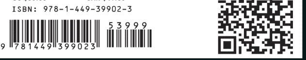


---


---

---


### 遗漏的致谢

#### 关于作者


**David Sawyer McFarland** 是 Sawyer McFarland Media, Inc. 的总裁，这是一家位于俄勒冈州波特兰市的网络开发与培训公司。自 1995 年以来，他一直在构建网站，当时他设计了他的第一个网站——一本面向传播专业人士的在线杂志。他曾担任加州大学伯克利分校和伯克利多媒体研究中心的网络管理员，并负责了 Macworld.com 基于 CSS 的全面重新设计。

除了构建网站，David 还是一名作家、培训师和讲师。他曾在加州大学伯克利分校新闻学研究生院、电子艺术中心、艺术学院、Ex'Pressions 新媒体中心和波特兰州立大学教授网页设计。他曾为 *Practical Web Design*、*MX Developer's Journal*、*Macworld* 杂志和 CreativePro.com 撰写关于网络的文章。

他欢迎通过电子邮件反馈关于本书的意见：*missing@sawmac.com*。（但如果您寻求技术帮助，请参考附录 A 中列出的资源。）

#### 关于创作团队

**Nan Barber**（编辑）从该系列丛书创立之初就参与其中——久到还记得 HyperCard 堆栈。

**Holly Bauer**（生产编辑）居住在马萨诸塞州古老的剑桥市。白天她是一名生产编辑，晚上/周末则是一位热情的家庭厨师、多产的 DIY 爱好者和中世纪现代设计爱好者。电子邮件：*holly@oreilly.com*。

**Carla Spoon**（校对）是一名自由撰稿人和文字编辑。她是一位狂热的跑步爱好者，在雷尼尔山脚下的家庭办公室中工作并满足她对科技小玩意的痴迷。电子邮件：*carla_spoon@comcast.net*。

**Angela Howard**（索引员）从事索引工作已有 10 多年，主要为计算机书籍编制索引，偶尔也为其他主题的书籍编制索引，如旅行、替代医学和豹纹守宫。她与丈夫、女儿和两只猫一起住在加利福尼亚州。

### 致谢

非常感谢所有帮助完成本书的人，包括 Shelley Powers 和 Steve Suehring，他们敏锐的目光使我避免了可能令人尴尬的错误。同时感谢我在波特兰州立大学的许多学生，他们忍受了我冗长的 JavaScript 讲座，并艰难地完成了我的编程作业——特别感谢 Futzbit 团队（Combination Pizza Hut and Taco Bell）的成员们测试了教程：Julia Hall、Amber Brucker、Kevin Brown、Josh Elliott、Tracy O'Connor 和 Blake Womack。此外，我们都非常感谢 John Resig 和 jQuery 团队，他们创造了迄今为止让 JavaScript 变得有趣的最佳工具。

最后，感谢 David Pogue 使我起步；感谢 Nan Barber 使我的写作更加犀利和清晰；感谢我的妻子 Scholle 容忍作者的坏脾气；还要感谢我的孩子们 Graham 和 Kate，因为他们真的很棒。

### Missing Manual 系列丛书

Missing Manual 系列是针对那些没有附带印刷手册的计算机产品（几乎所有产品都是如此）而编写的诙谐、文笔出色的指南。每本书都包含手工编制的索引和指向特定页码的交叉引用（而不仅仅是"参见第 14 章"）。

近期和即将出版的书目包括：

- *Access 2010: The Missing Manual*，作者 Matthew MacDonald
- *Buying a Home: The Missing Manual*，作者 Nancy Conner
- *CSS: The Missing Manual*（第二版），作者 David Sawyer McFarland
- *Creating a Website: The Missing Manual*（第三版），作者 Matthew MacDonald
- *David Pogue's Digital Photography: The Missing Manual*，作者 David Pogue
- *Dreamweaver CS5.5: The Missing Manual*，作者 David Sawyer McFarland
- *Droid X2: The Missing Manual*，作者 Preston Gralla
- *Droid 2: The Missing Manual*，作者 Preston Gralla
- *Excel 2010: The Missing Manual*，作者 Matthew MacDonald
- *Facebook: The Missing Manual*（第三版），作者 E.A. Vander Veer
- *FileMaker Pro 11: The Missing Manual*，作者 Susan Prosser 和 Stuart Gripman
- *Flash CS5.5: The Missing Manual*，作者 Chris Grover
- *Galaxy Tab: The Missing Manual*，作者 Preston Gralla
- *Google Apps: The Missing Manual*，作者 Nancy Conner
- *Google SketchUp: The Missing Manual*，作者 Chris Grover
- *The Internet: The Missing Manual*，作者 David Pogue 和 J.D. Biersdorfer
- *iMovie '11 & iDVD: The Missing Manual*，作者 David Pogue 和 Aaron Miller
- *iPad 2: The Missing Manual*，作者 J.D. Biersdorfer
- *iPhone: The Missing Manual*（第四版），作者 David Pogue
- *iPhone App Development: The Missing Manual*，作者 Craig Hockenberry
- *iPhoto '11: The Missing Manual*，作者 David Pogue 和 Lesa Snider
- *iPod: The Missing Manual*（第九版），作者 J.D. Biersdorfer 和 David Pogue
- *Living Green: The Missing Manual*，作者 Nancy Conner
- *Mac OS X Snow Leopard: The Missing Manual*，作者 David Pogue
- *Mac OS X Lion: The Missing Manual*，作者 David Pogue
- *Microsoft Project 2010: The Missing Manual*，作者 Bonnie Biafore
- *Motorola Xoom: The Missing Manual*，作者 Preston Gralla
- *Netbooks: The Missing Manual*，作者 J.D. Biersdorfer
- *Office 2010: The Missing Manual*，作者 Nancy Connor、Chris Grover 和 Matthew MacDonald
- *Office 2011 for Macintosh: The Missing Manual*，作者 Chris Grover
- *Palm Pre: The Missing Manual*，作者 Ed Baig
- *Personal Investing: The Missing Manual*，作者 Bonnie Biafore
- *Photoshop CS5.5: The Missing Manual*，作者 Lesa Snider
- *Photoshop Elements 10: The Missing Manual*，作者 Barbara Brundage
- *PowerPoint 2007: The Missing Manual*，作者 E.A. Vander Veer
- *Premiere Elements 8: The Missing Manual*，作者 Chris Grover
- *QuickBase: The Missing Manual*，作者 Nancy Conner
- *QuickBooks 2011: The Missing Manual*，作者 Bonnie Biafore
- *QuickBooks 2012: The Missing Manual*，作者 Bonnie Biafore
- *Switching to the Mac: The Missing Manual*（Snow Leopard 版），作者 David Pogue
- *Switching to the Mac: The Missing Manual*（Lion 版），作者 David Pogue
- *Wikipedia: The Missing Manual*，作者 John Broughton
- *Windows Vista: The Missing Manual*，作者 David Pogue
- *Windows 7: The Missing Manual*，作者 David Pogue
- *Word 2007: The Missing Manual*，作者 Chris Grover
- *Your Body: The Missing Manual*，作者 Matthew MacDonald
- *Your Brain: The Missing Manual*，作者 Matthew MacDonald
- *Your Money: The Missing Manual*，作者 J. D. Roth

## 简介

在早期，Web 是一个相当无聊的地方。网页由纯 HTML 构建而成，因此它们只能显示信息，仅此而已。人们会点击一个链接，然后等待新网页加载。这基本上就是它们全部的交互能力。

如今，大多数网站几乎像桌面计算机上的程序一样响应迅速，对每一次鼠标点击都能立即作出反应。这一切都要归功于本书的主题——JavaScript 及其得力助手 jQuery。

### 什么是 JavaScript？

JavaScript 是一种编程语言，它让你能够通过动画、交互性和动态视觉效果来增强你的 HTML。

JavaScript 可以通过提供即时反馈使网页更加实用。例如，一个由 JavaScript 驱动的购物车页面，当访客选择一件商品购买时，可以立即显示包含税费和运费的总费用。JavaScript 可以在有人尝试提交缺少必要信息的网页表单后，立即生成一条错误消息。

JavaScript 还让你能够创建有趣的、动态的和交互式的界面。例如，使用 JavaScript，你可以将一个静态的缩略图页面转换为一个动画幻灯片放映（你将在第 314 页学习如何操作）。或者你可以做一些更微妙的事情，比如通过将内容组织成访客只需简单点击鼠标即可访问的小组块面板，在页面上放置更多信息而不使其显得拥挤（第 301 页）。或者添加一些有用且吸引人的功能，比如弹出工具提示，为网页上的项目提供补充信息（第 326 页）。


JavaScript 的另一个主要卖点是它的即时性。它可以让网页对诸如点击链接、填写表单，或仅仅是在屏幕上移动鼠标等操作做出即时响应。JavaScript 不会像 PHP 等服务端编程语言那样，因依赖 Web 浏览器和 Web 服务器之间的通信而产生令人沮丧的延迟。由于它不需要不断地加载和重新加载网页，JavaScript 让你能够创建在体验和行为上更像桌面程序而非网页的页面。

如果你访问过 Google 地图（http://maps.google.com），你就已经见识过 JavaScript 的实际应用了。Google 地图让你可以查看你所在城镇（或几乎任何其他地方）的地图，放大以查看街道和公交站点的详细视图，或缩小以鸟瞰视角查看如何穿越城镇、州或全国。虽然在 Google 之前已经有许多地图网站，但它们总是需要重新加载多个网页（通常是一个缓慢的过程）才能获取你想要的信息。而 Google 地图无需刷新页面即可运行——它会即时响应你的选择。

你用 JavaScript 创建的程序范围很广，从非常简单的（比如弹出一个包含网页的新浏览器窗口）到功能完备的 Web 应用程序，如 Google Docs（http://docs.google.com），后者让你可以使用 Web 浏览器创建演示文稿、编辑文档和创建电子表格，体验就像在电脑上直接运行的程序一样。

### 历史简介

JavaScript 由 Netscape 于 1995 年发明，几乎和 Web 本身一样古老。虽然 JavaScript 在今天备受推崇，但它有一段有些坎坷的过去。它曾经被认为是一种业余爱好者的编程语言，用于添加一些不太实用的效果，比如在浏览器底部状态栏上像股票行情播报器一样滚动显示消息，或者跟随鼠标在页面上移动的动画蝴蝶。在 JavaScript 的早期，很容易在网上找到数千个免费的 JavaScript 程序（也称为 *脚本*），但其中许多脚本并非在所有浏览器中都能运行，有时甚至会导致浏览器崩溃。

> **注意：** JavaScript 与 Java 编程语言毫无关系。JavaScript 最初被命名为 LiveScript，但 Netscape 的营销人员决定，如果将该语言与当时炙手可热的 Java 联系起来，会获得更多的关注。不要犯将两者混淆的错误……尤其是在面试的时候！

在早期，JavaScript 还面临着两大主流浏览器 Netscape Navigator 和 Internet Explorer 之间的兼容性问题。由于 Netscape 和 Microsoft 都试图通过添加更新的、（表面上）更好的功能来超越对方的浏览器，这两个浏览器的行为方式往往非常不同，这使得创建在两者上都能良好运行的 JavaScript 程序变得十分困难。

> 注意：在 Netscape 推出 JavaScript 之后，Microsoft 推出了 jScript，这是他们自己的 JavaScript 版本，随 Internet Explorer 一起提供。

幸运的是，那些糟糕的日子几乎已经过去，现代浏览器如 Firefox、Safari、Chrome、Opera 和 Internet Explorer 9 在处理 JavaScript 方面已经实现了高度标准化，使得编写能在大多数人使用的浏览器上运行的 JavaScript 程序变得更加容易。（当前的 Web 浏览器之间仍然存在一些不兼容性，因此你需要学习一些技巧来应对跨浏览器问题。本书将教你如何克服浏览器不兼容性问题。）

在过去的几年里，JavaScript 经历了一次重生，这得益于 Google、Yahoo 和 Flickr 等知名网站的推动，这些网站广泛使用 JavaScript 来创建交互式 Web 应用程序。现在是学习 JavaScript 的最佳时机。凭借丰富的知识和高质量的脚本，即使你是初学者，也能为你的网站添加精妙的交互功能。

> 注意：JavaScript 也被称为 ECMAScript。ECMAScript 是 JavaScript 的"官方"规范，由名为 Ecma International 的国际标准组织开发和维护：http://www.ecmascript.org/

### JavaScript 无处不在

JavaScript 并非仅用于网页。事实证明，它是一种非常有用的编程语言，如果你学会了 JavaScript，你就可以创建 Yahoo Widgets 和 Apple 的 Dashboard Widgets，为 iPhone 编写程序，并利用许多 Adobe 程序（如 Acrobat、Photoshop、Illustrator 和 Dreamweaver）中的脚本化功能。事实上，Dreamweaver 一直为聪明的 JavaScript 程序员提供将自己的命令添加到该程序中的方式。

此外，Flash 的编程语言 ActionScript 是基于 JavaScript 的，因此如果你掌握了 JavaScript 的基础知识，你将为学习 Flash 编程做好充分准备。

### 什么是 jQuery？

JavaScript 有一个令人尴尬的小秘密：编写它很难。虽然它比许多其他编程语言简单，但 JavaScript 仍然是一门编程语言。许多人，包括网页设计师，都觉得编程很困难。更复杂的是，不同的 Web 浏览器对 JavaScript 的理解各不相同，因此一个在 Chrome 中运行良好的程序，在 Internet Explorer 9 中可能完全无法响应。这种常见情况可能需要在不同的机器和浏览器上进行数小时的测试，以确保程序对你的所有网站访客都能正常运行。

### HTML：基础骨架

这就是 jQuery 的用武之地。jQuery 是一个 JavaScript 库，旨在让 JavaScript 编程变得更容易、更有趣。JavaScript 库是一个复杂的 JavaScript 程序，它既简化了困难的任务，又解决了跨浏览器问题。换句话说，jQuery 解决了 JavaScript 最大的两个难题——复杂性和不同 Web 浏览器的多变性。

jQuery 是网页设计师在 JavaScript 编程战场上的秘密武器。使用 jQuery，你只需一行代码就能完成原本需要用数百行代码和许多小时的浏览器测试才能实现的任务。事实上，一本专门深入讲解 JavaScript 的书至少会比你现在手中的这本书厚一倍；而且，当你读完它时（如果你真的能读完的话），你仍然无法完成仅凭一点 jQuery 知识就能轻松实现的功能的一半。

这就是为什么本书大部分内容都是关于 jQuery。它让你能够如此轻松地实现如此多的功能。jQuery 的另一个优点是，你可以通过数千个易于使用的 jQuery 插件为网站添加高级功能。例如，FancyBox 插件（你将在第 222 页遇到它）可以让你将一个简单的缩略图页面变成一个交互式幻灯片——只需一行代码！

毫不意外，jQuery 被数百万个网站使用（http://trends.builtwith.com/javascript/jQuery）。它已被内置于 Drupal 和 WordPress 等流行的内容管理系统中。你甚至能找到只要求"jQuery 程序员"而不提及 JavaScript 的职位招聘信息。当你学会了 jQuery，你就加入了一个由众多网页设计师和程序员组成的社区，他们使用一种更简单、更强大的方式来创建交互式、功能强大的网页。

### HTML：基础骨架

如果没有 Web 设计的另外两大支柱——HTML 和 CSS，JavaScript 并没有多大用处。许多程序员将这三种语言称为网页的"层级"：HTML 提供 *结构* 层，以有意义的方式组织图片和文字等内容；CSS（层叠样式表）提供 *表现* 层，让 HTML 中的内容看起来美观；而 JavaScript 添加了 *行为* 层，让网页变得生动，使其能与访问者交互。

换句话说，要精通 JavaScript，你需要对 HTML 和 CSS 都有良好的理解。

> **注意：** 如需全面了解 HTML 和 CSS，请参阅 Elisabeth Freeman 和 Eric Freeman 所著的 *Head First HTML with CSS and XHTML*。如需深入了解层叠样式表这一复杂主题，请阅读 David Sawyer McFarland 所著的 *CSS: The Missing Manual*（均为 O'Reilly 出版）。

*HTML*（超文本标记语言）使用称为 *标签* 的简单命令来定义网页的各个部分。例如，以下 HTML 代码创建了一个简单的网页：


### HTML：最基本的结构

这可能没有什么令人兴奋的，但这个示例包含了网页所需的全部基本元素。该页面以单行内容开头——文档类型声明，简称 *doctype*——它说明该页面是什么类型的文档以及遵循哪些标准。HTML实际上有不同的版本，每个版本使用不同的 doctype。在此示例中，doctype 用于 HTML5；而 HTML 4.01 或 XHTML 文档的 doctype 更长，还包含一个 URL，用于指向互联网上包含该类型文件定义的文件。

本质上，doctype 告诉 Web 浏览器如何显示页面。doctype 甚至会影响 CSS 和 JavaScript 的工作方式。如果 doctype 不正确或缺失，你可能会发现脚本存在大量跨浏览器差异，最终只能撞墙。哪怕只是为了这个原因，也请务必在 HTML 中包含 doctype。

目前常用的 HTML 共有五种类型：HTML 4.01 Transitional、HTML 4.01 Strict、XHTML 1.0 Transitional、XHTML 1.0 Strict，以及 HTML5（后起之秀）。这五种类型都非常相似，只是在标签的写法以及允许使用的标签和属性方面略有差异。大多数网页编辑程序在你创建新网页时会自动添加适当的 doctype，但如果你想了解每种类型是如何编写的，可以在 www.webstandards.org/learn/reference/templates 找到不同类型页面的模板。

使用哪种 HTML 类型其实并不重要。所有当前的 Web 浏览器都能理解这五种常见的 doctype，并且可以毫无问题地显示使用这四种文档类型中的任何一种的网页。使用哪种 doctype 远不如确保你正确编写 HTML 标签重要——通过验证页面可以帮助你完成这项任务，详见第 7 页的方框说明。

> **注意：** XHTML 曾被吹捧为网页设计师的下一个大热门。虽然你仍会遇到一些人认为你应该只使用 XHTML，但风向已经变了。万维网联盟（W3C）已停止 XHTML 的开发，转而支持 HTML5。你可以阅读 Matthew MacDonald 撰写的 *HTML5: The Missing Manual* 或 Mark Pilgrim 撰写的 *HTML5: Up and Running*（均由 O'Reilly 出版）来进一步了解 HTML5。

### HTML 标签的工作原理

与上一页的示例一样，在任何网页的 HTML 代码中，你都会注意到大多数命令以成对的形式出现，围绕一段文本或其他命令。这些被括号包围的 *标签* 是指令，告诉 Web 浏览器如何显示网页。标签是超文本标记语言（Hypertext Markup Language）中"标记"（markup）的部分。

每对标签的起始（*开始*）标签告诉浏览器指令从哪里开始，而结束标签则告诉它指令在哪里结束。结束或 *关闭* 标签总是在第一个尖括号符号（<）之后包含一个正斜杠（/）。例如，标签 `<p>` 标记段落的开始，而 `</p>` 标记其结束。

要使网页正确工作，你必须至少包含以下三个标签：

- `<html>` 标签在网页开头出现一次（在 doctype 之后），并在末尾再次出现（带有附加的斜杠）。该标签告诉 Web 浏览器，此文档中包含的信息是用 HTML 编写的，而不是其他某种语言。页面的所有内容，包括其他标签，都出现在 `<html>` 标签的开始和结束之间。

  如果你把网页想象成一棵树，`<html>` 标签就是它的树干。从树干伸出两根树枝，代表任何网页的两个主要部分——*head*（头部）和 *body*（主体）。

- 网页的 *头部*，由 `<head>` 标签包围，包含页面的标题。它还可能提供其他不可见的信息（如搜索关键词），供浏览器和 Web 搜索引擎利用。

  此外，头部还可以包含 Web 浏览器用于显示网页和添加交互性的信息。例如，你可以将层叠样式表（Cascading Style Sheets）放在文档的头部。文档的头部也是你通常包含 JavaScript 编程和指向 JavaScript 文件链接的地方。

- 网页的 *主体*，由其周围的 `<body>` 标签分隔，包含浏览器窗口中显示的所有信息：标题、文本、图片等。

在 `<body>` 标签内，你通常会找到如下标签：

- 你用 `<p>`（开始段落标签）告诉 Web 浏览器段落文本从哪里开始，用 `</p>`（结束段落标签）告诉它从哪里结束。

- `<strong>` 标签用于强调文本。如果你用一些文本和它对应的标签 `</strong>` 将其包围，就会得到粗体。HTML 片段 `<strong>Warning!</strong>` 告诉 Web 浏览器以粗体显示"Warning!"这个词。

- `<a>` 标签，即锚点标签，在网页中创建 *超链接*。点击时，超链接——或简称 *链接*——可以指向 Web 上的任何地方。你可以通过在 `<a>` 标签内放入 Web 地址来告诉浏览器链接指向哪里。例如，你可以输入 `<a href="http://www.missingmanuals.com">Click here!</a>`。

  浏览器知道，当访问者点击"Click here!"这些词时，应该前往 Missing Manual 网站。标签中的 *href* 部分称为 *属性*，而 URL（统一资源定位符或 Web 地址）则是 *值*。在此示例中，*http://www.missingmanuals.com* 是 *href* 属性的 *值*。

### 进阶知识

### 验证网页

如第 5 页所述，网页的 doctype 标识你用于创建网页的 HTML 或 XHTML 类型。根据类型不同，规则略有差异：例如，与 HTML 4.01 不同，XHTML 不允许有未闭合的 `<p>` 标签，并且要求所有标签名称和属性都为小写（例如，`<a>` 而不是 `<A>`）。HTML5 包含新标签，并允许你使用 HTML 或 XHTML 语法。因为不同变体的 HTML 适用不同的规则，所以你应该始终 *验证* 你的网页。

HTML 验证器是一个确保网页编写正确的程序。它检查页面的 doctype，然后分析页面中的代码，查看其是否符合该 doctype 定义的规则。例如，验证器会标记拼写错误的标签名称或未闭合的标签等错误。万维网联盟（W3C）是负责 Web 上许多技术的组织，它在 <http://validator.w3.org> 提供免费的在线验证器。你可以复制 HTML 并粘贴到 Web 表单中，上传网页，或者让验证器指向 Web 上已有的页面；然后验证器会分析 HTML 并报告页面是否有效。如果有任何错误，验证器会告诉你错误是什么，以及它出现在 HTML 文件的哪一行。

如果你使用 Firefox，可以从 <http://users.skynet.be/mgueury/mozilla> 下载 HTML Validator 插件。该插件允许你直接在 Web 浏览器中验证页面；只需打开一个页面（甚至是你电脑上的页面），验证器就会指出 HTML 中的任何错误。Safari 也有一个类似的插件，名为 Safari Validator，你可以在 <http://zappatic.net/projects/safarivalidator> 找到它。

有效的 HTML 不仅格式良好，还有助于确保你的 JavaScript 程序正确运行。许多 JavaScript 涉及操作网页的 HTML：例如，识别某个表单字段，或在特定位置放置新的 HTML（如错误消息）。为了让 JavaScript 访问和操作网页，HTML 必须处于正常工作状态。忘记关闭标签、多次使用相同的 ID 名称，或 HTML 标签嵌套不当，都可能导致你的 JavaScript 代码出现怪异行为或完全无法运行。

### CSS：为网页添加样式

在 Web 诞生之初，HTML 是你唯一需要了解的语言。你可以构建带有彩色文本和图形的页面，并使用不同的大小、字体和颜色让文字脱颖而出。但如今，网页设计师转向层叠样式表（Cascading Style Sheets）为页面增添视觉上的精致感。CSS 是一种格式化语言，让你可以让文本看起来美观，构建复杂的页面布局，并通常为网站增添风格。

将 HTML 仅仅视为你用于构建页面结构的工具语言。它有助于标识你希望她人了解的内容。诸如 `<h1>` 和 `<h2>` 的标签表示标题并赋予它们相对的层级重要性：*一级标题* 比 *二级标题* 更重要。`<p>` 标签表示一个基本的信息段落。其他标签提供进一步的结构线索：例如，`<ul>` 标签标识一个项目符号列表（例如，让食谱配料列表更易理解）。

另一方面，CSS 为组织良好的 HTML 内容增添设计美感，使其更美观、更易读。本质上，CSS *样式* 只是一条规则，告诉 Web 浏览器如何在页面上显示特定元素。例如，你可以

创建一条 CSS 规则，使所有 `<h1>` 标签呈现为 36 像素高、Verdana 字体、橙色。CSS 还能实现更强大的功能，例如添加边距、更改外边距，甚至精确控制页面元素的位置。

当涉及 JavaScript 时，你对页面所做的最有价值的修改有很多都与 CSS 相关。你可以使用 JavaScript 为 HTML 标签添加或移除 CSS 样式，或者根据访客的输入或鼠标点击动态更改 CSS 属性。你甚至可以将一个样式的属性动画过渡到另一个样式的属性（比如，将背景色从黄色动画变为红色）。例如，只需更改 CSS 的 *display* 属性，就可以让页面元素出现或消失。要让一个元素在屏幕上移动，可以使用 JavaScript 动态更改 CSS 的 *position* 属性。

### 样式的剖析

一个定义单个元素外观的简单样式是一个非常基础的东西。它本质上是一条规则，告诉网页浏览器如何格式化内容——将标题变成蓝色、在照片周围画一条红色边框，或者创建一个 150 像素宽的侧边栏框来放置链接列表。如果样式会说话，它会这样说："嘿，浏览器，让*这个*看起来像*那个*。"事实上，一个样式由两部分组成：浏览器要格式化的网页元素（即*选择器*）和实际的格式化指令（即*声明块*）。例如，选择器可以是标题、一段文字、一张照片等等。声明块可以将文字变成蓝色、在段落周围添加红色边框、将照片定位到页面中央——可能性无穷无尽。

> **注意：** 技术人员通常效仿 W3C 的做法，将 CSS 样式称为*规则*。本书中"样式"和"规则"这两个术语可以互换使用。

当然，CSS 样式无法用清晰、优美的英语交流。它们有自己的语言。例如，要为网页上所有段落设置标准的字体颜色和字号，你可以这样写：

```
p { color: red; font-size: 1.5em; }
```

这个样式的意思很简单："让所有段落——用 `<p>` 标签标记的——中的文字变成红色，字号为 1.5 em。"（*em* 是一种基于浏览器正常文字大小的度量单位。）如图 I-1 所示，即使像这个例子这样简单的样式也包含几个组成部分：

- **选择器。** 选择器告诉网页浏览器要格式化页面上的哪些元素——如标题、段落、图片或链接。在图 I-1 中，选择器（p）指的是 `<p>` 标签，这使得网页浏览器使用该样式中的格式化指令来格式化所有 `<p>` 标签。借助 CSS 提供的丰富选择器和一点创造力，你可以对页面格式进行精细控制。（选择器是使用 jQuery 的重要组成部分，因此你可以在第 129 页找到关于它们的详细讨论。）

- **声明块。** 选择器后面的代码包含了你要应用到该选择器上的所有格式化选项。声明块以左大括号（`{`）开始，以右大括号（`}`）结束。

- **声明。** 在声明块的左大括号和右大括号之间，你可以添加一个或多个*声明*，即格式化指令。每条声明由两部分组成：一个*属性*和一个*值*，并以分号结尾。

- **属性。** CSS 提供了丰富的格式化选项，称为*属性*。属性是一个单词——或几个用连字符连接的单词——表示某种样式效果。大多数属性都有直观的名称，如 *font-size*、*margin-top* 和 *background-color*。例如，*background-color* 属性设置——你猜对了——背景颜色。

> **注意：** 如果你需要复习 CSS 知识，可以找一本 *CSS: The Missing Manual*。

- **值。** 最后，你可以通过为 CSS 属性赋予一个*值*来展现你的创意才华——例如，将背景设为蓝色、红色、紫色或黄绿色。不同的 CSS 属性需要特定类型的值——颜色（如 *red* 或 *#FF0000*）、长度（如 *18px*、*2in* 或 *5em*）、URL（如 *images/background.gif*），或者特定的关键字（如 *top*、*center* 或 *bottom*）。

你不需要像图 I-1 所示的那样将样式写在单行上。许多样式有多个格式化属性，因此你可以将它们分成多行来提高可读性。例如，你可能想把选择器和左大括号放在第一行，每条声明各占一行，右大括号单独放在最后一行，如下所示：

```
p {
    color: red;
    font-size: 1.5em;
}
```

通过制表符或空格对属性进行缩进也很有帮助，这样可以在视觉上将选择器与声明分开，便于区分。最后，在冒号和属性值之间加一个空格是可选的，但能提高样式的可读性。事实上，你可以在两者之间放入任意数量的空白字符。例如 *color:red*、*color: red* 和 *color : red* 都可以正常工作。

### JavaScript 编程软件

要创建由 HTML、CSS 和 JavaScript 组成的网页，你只需要一个基本的文本编辑器，如 Windows 的记事本或 Mac 的 TextEdit。但在输入了几百行 JavaScript 代码之后，你可能想尝试一个更适合处理网页的程序。本节列出了一些常见程序，有些免费，有些需要购买。

> **注意：** 实际上有数百种工具可以帮助你创建网页和编写 JavaScript 程序，因此以下绝不是一份完整的清单。可以把它看作当前 JavaScript 爱好者们最常用程序的精选集。

#### 免费程序

市面上有很多用于编辑网页和样式表的免费程序。如果你还在使用记事本或 TextEdit，不妨试试其中的某一个。以下是一个简短的入门清单：

- **Notepad++**（Windows，*http://notepad-plus-plus.org*）是编程者的好帮手。它可以高亮显示 JavaScript 和 HTML 代码的语法，并允许你保存宏并将键盘快捷键分配给它们，从而自动化插入常用代码片段的过程。

- **HTML-Kit**（Windows，*www.chami.com/html-kit*）是一款功能强大的 HTML/XHTML 编辑器，包含许多实用功能，例如直接在程序中预览网页（这样你就不用在浏览器和编辑器之间来回切换）、添加 HTML 标签的快捷方式等等。

- **CoffeeCup Free HTML Editor**（Windows，*www.coffeecup.com/free-editor*）是商业版 CoffeeCup HTML 编辑器（49 美元）的免费版本。

- **TextWrangler**（Mac，*www.barebones.com/products/textwrangler*）是一款免费软件，实际上是 BBEdit 的精简版。BBEdit 是 Mac 上久负盛名的专业文本编辑器。TextWrangler 不具备 BBEdit 所有的内置 HTML 工具，但它包含了语法高亮（用不同颜色高亮显示标签和属性，便于浏览页面并识别各部分）、FTP 支持（方便将文件上传到网页服务器）等功能。

- **Eclipse**（Windows、Linux、Mac；*www.eclipse.org*）是一款免费软件，在 Java 开发者中广受欢迎，但同时包含了处理 HTML、CSS 和 JavaScript 的工具。还有专门面向 JavaScript 开发者的版本（*www.eclipse.org/downloads/packages/eclipse-ide-javascript-web-developers/indigo*），以及用于为 jQuery 添加自动完成功能的 Eclipse 插件（*http://marketplace.eclipse.org/category/free-tagging/jquery*）。

- **Aptana Studio**（Windows、Linux、Mac；*www.aptana.org*）是一款功能强大的免费编程环境，提供处理 HTML、CSS、JavaScript、PHP 和 Ruby on Rails 的工具。

#### 商业软件

商业网站开发程序从廉价的文本编辑器到功能齐全的网站建设工具应有尽有：

- **EditPlus**（Windows，*www.editplus.com*）是一款价格实惠（35 美元）的文本编辑器，包含语法高亮、FTP、自动补全和其他节省操作的功能。

- **CoffeeCup**（Windows，*www.coffeecup.com*）是一款文本与可视化编辑器的组合（49 美元）。你可以直接编写 HTML 代码，也可以使用可视化界面来构建页面。

- **TextMate**（Mac，*http://macromates.com*）深受 Mac 程序员的喜爱。这款文本编辑器（57 美元）包含许多为 JavaScript 程序员节省时间的功能，如"自动配对字符"，它会自动输入标点符号对中的第二个字符（例如，程序会在你输入左括号后自动插入一个右括号）。

- **BBEdit**（Mac，*www.barebones.com/products/bbedit*）。这款备受推崇的 Mac 文本编辑器（99.99 美元）提供了大量用于处理 HTML、XHTML、CSS、JavaScript 等的工具。它包含许多实用的网页构建工具和快捷方式。

- **Dreamweaver**（Mac 和 Windows，*www.adobe.com/products/dreamweaver.html*）是一款可视化网页编辑器（399 美元）。它让你可以在网页浏览器中查看页面效果。该程序还包含一个用于编写 JavaScript 程序的强大文本编辑器，以及出色的 CSS 创建和管理工具。想全面了解这款强大程序的使用方法，请参阅 *Dreamweaver CS5.5: The Missing Manual*。

- **Expression Web Designer**（Windows，*www.microsoft.com/expression/products/StudioWebPro_Overview.aspx*）是微软在网页设计领域的产品（149 美元）。它包含许多专业的网页设计工具，以及出色的 CSS 功能。

### 关于本书

与 Microsoft Word 或 Dreamweaver 等软件不同，JavaScript 并非由单一公司开发的单一产品。JavaScript 总部没有支持部门来为普通网页开发者编写一本易读的手册。虽然你可以在 Mozilla.org（例如参见 *https://developer.mozilla.org/en/JavaScript/Reference*）或 Ecmascript.org（*www.ecmascript.org/docs.php*）等网站上找到大量信息，但并没有关于 JavaScript 编程语言的权威信息来源。

由于没有官方手册，刚开始学习 JavaScript 的人往往不知从何入手。而 JavaScript 的一些细节问题甚至也会让经验丰富的网页专业人士栽跟头。因此，本书的目的就是作为 JavaScript 本应附带的那本手册。在本书中，你将找到使用 JavaScript 创建高度交互式网页的分步指南。


同样，你可以在 http://docs.jquery.com/Main_Page 找到关于 jQuery 的优质文档。但这些文档是由程序员为程序员编写的，因此解释大多简短且技术性强。尽管 jQuery 通常比常规 JavaScript 编程更直观易懂，但本书将教授你基本的 jQuery 原则和技巧，帮助你在使用 jQuery 增强网站时从一开始就走上正确的道路。

*JavaScript & jQuery: Missing Manual* 专为具有一定网页制作经验的读者设计。你需要熟悉 HTML 和 CSS 才能从本书中获得最大收益，因为 JavaScript 经常与 HTML 和 CSS 紧密配合以实现其效果。主要讨论内容面向高级初学者或中级计算机用户。但如果你是网页制作新手，名为"快速入门"的特殊提示框会提供理解当前主题所需的入门信息。而如果你是高级网页制作高手，请留意类似的阴影提示框"高级用户诊所"，它们为经验丰富的计算机爱好者提供更具技术性的技巧、窍门和捷径。

> **注意：** 本书会不时推荐*其他*书籍，涵盖对于一本关于使用 JavaScript 的手册来说过于专业或边缘化的主题。有时推荐的书目来自 Missing Manual 系列的出版商 O'Reilly Media——但并非总是如此。如果有优秀的书籍不属于 O'Reilly 旗下，我们也会告知你。

### 本书讲解 JavaScript 的方式

JavaScript 是一门真正的编程语言：它不像 HTML 或 CSS 那样工作，而是有自己的一套（往往很复杂的）规则。网页设计者要转换思维，开始像计算机程序员那样思考并不总是容易的，而且没有*哪*一本书能教你关于 JavaScript 的所有知识。

*JavaScript & jQuery: Missing Manual* 的目标并不是把你培养成下一个伟大的程序员（尽管它可能会让你踏上这条路）。本书旨在让网页设计者熟悉 JavaScript 的方方面面，然后转向 jQuery，以便你能尽可能快速、轻松地为网站添加真正实用的交互功能。

在本书中，你将学习 JavaScript 和编程的基础知识；但仅靠基础不足以制作出令人兴奋的网页。在 500 页的篇幅内，不可能教会你构建复杂的交互式网页所需的所有 JavaScript 知识。因此，本书的大部分内容将介绍广受欢迎的 jQuery JavaScript 库，你很快就会发现，它能将你从创建跨浏览器良好运行的 JavaScript 程序所需的那些繁琐、耗时的细节中解放出来。

你将学习 JavaScript 的基础知识，然后在 jQuery 的帮助下——好吧，是*大量*帮助——立即进入高级网页交互领域。可以这样理解：你可以自己砍伐木材并加工、自己制作门窗和门框、自己烧制瓷砖等等来建造一座房子。这种"亲力亲为"的方式在许多 JavaScript 书籍中很常见。但谁有那么多时间呢？本书的方法更像是利用现成的构件，运用基本技能将它们组合在一起建房子。最终的结果将是一座美观实用的房子，而所花费的时间远少于你学习每一步流程所需的时间。

### 关于本书大纲

JavaScript & jQuery: Missing Manual 分为五个部分，每部分包含若干章节：

- **第 1 部分，JavaScript 入门**，从最基础的内容开始。你将学习 JavaScript 的基本构建模块，并获得一些关于计算机编程的实用技巧。本节教你如何向网页添加脚本、存储和操作信息，以及为程序添加智能使其能够应对不同情况。你还将学习如何与浏览器窗口通信、存储和读取 Cookie、响应鼠标点击和表单提交等事件，以及修改网页的 HTML。
- **第 2 部分，jQuery 入门**，介绍 Web 上最流行的 JavaScript 库——jQuery。在这里你将学习这个强大的编程工具的基础知识，它将使你成为一名更高效、更有能力的 JavaScript 程序员。你将学习如何选择和操作页面元素、通过让页面元素响应访客来添加交互，以及添加炫酷的视觉效果和动画。
- **第 3 部分，构建网页功能**，提供了许多 JavaScript 实际应用的真实案例。你将学习如何创建弹出式导航栏和构建交互式照片画廊。你将通过添加表单验证（使访客无法提交缺少信息的表单）来提高网页表单的可用性，添加日历控件以便轻松选择日期，以及根据网页访客的选择动态更改表单选项。最后，你将创建引人入胜的用户界面，包括内容滑块、工具提示和弹出对话框，使其外观精美、功能完善。
- **第 4 部分，Ajax：与 Web 服务器通信**，涵盖了让 JavaScript 成为最令人瞩目的 Web 语言之一的关键技术。在本节中，你将学习如何使用 JavaScript 与 Web 服务器通信，使你的页面能够接收信息并根据 Web 服务器提供的信息进行自我更新——无需加载新的网页。

> **注意：** 你可以在本书的配套网页上找到在你的计算机上设置 Web 服务器的分步说明，以便利用第 3 部分讨论的这些酷炫技术。详情请参见第 16 页的"实例演示"。

- **第 5 部分，故障排除、技巧和窍门**，带你超越基础知识，涵盖更复杂的概念。你将深入了解如何有效使用 jQuery，并钻研高级 jQuery 函数。本书的这一部分还在一切似乎都不奏效时为你提供帮助：当你精心编写的 JavaScript 程序似乎无法按预期工作（或更糟，根本无法运行！）时。你将学习新手程序员最常见的错误，以及发现和修复程序中 Bug 的技巧。

在本书末尾，附录提供了一份详细的参考文献列表，帮助你进一步探索 JavaScript 编程语言。

### 最基础的知识

要使用本书，乃至使用计算机，你需要了解一些基础知识。本书假设你熟悉以下术语和概念：

- **点击**。本书有三种需要你使用计算机鼠标或触控板的操作指令。*点击*是指将箭头光标指向屏幕上的某个位置，然后——在不移动光标的情况下——按下并释放鼠标（或笔记本电脑触控板）上的点击按钮。*右击*是指使用鼠标右键执行相同的操作。*双击*当然就是快速连续点击两次，同样不移动光标。而*拖动*是指在按住按钮的*同时*移动光标。

> **提示：** 如果你使用的是 Mac 且没有右键鼠标，可以在按住 Control 键的同时单击鼠标按键来实现相同的效果。

当你在 Mac 上被要求按 ⌘ 键点击某处，或在 PC 上按 *Ctrl 键*点击某处时，你需要在按住 ⌘ 或 Ctrl 键（两个键都靠近空格键）的同时进行点击。

- **菜单**。*菜单*是屏幕或窗口顶部的文字：文件、编辑等。点击其中一个会弹出一个命令列表，就像你刚刚拉下的窗帘上写满了命令一样。

- **键盘快捷键**。如果你正沉浸在创作的灵感中快速打字，有时不得不把手从键盘上移开、去抓鼠标、再使用菜单（例如使用加粗命令）会很不方便。这就是为什么许多经验丰富的计算机高手更喜欢通过按键盘上的特定组合键来触发菜单命令。例如，在 Firefox 网页浏览器中，你可以按 Ctrl-+（Windows）或 ⌘-+（Mac）使网页上的文字变大（也更易阅读）。当你看到"按 ⌘-B"这样的指令时，先按住 ⌘ 键不放，然后输入字母 B，最后释放两个键。


+   - **操作系统基础知识。**本书假设你知道如何打开程序、浏览网页以及下载文件。你应该知道如何使用“开始”菜单（Windows）和 Dock 或 Apple 菜单（Macintosh），以及“控制面板”（Windows）或“系统偏好设置”（Mac OS X）。

如果你已经掌握了上述信息，你就已经具备了充分享受*JavaScript & jQuery：The Missing Manual*所需的全部技术背景。

### 关于这些箭头

在本书以及整个 Missing Manual 系列中，你会遇到这样的句子：“打开 System→Library→Fonts 文件夹。”这是为了简化一个更长的指令，指导你依次打开三个嵌套文件夹，像这样：“在你的硬盘上，你会找到一个名为 System 的文件夹。打开它。在 System 文件夹窗口中有一个名为 Library 的文件夹；双击打开它。*那个*文件夹里面还有一个名为 Fonts 的文件夹。同样双击打开它。”

同样，这种箭头简写也有助于简化在菜单中选择命令的操作，如图 I-2 所示。

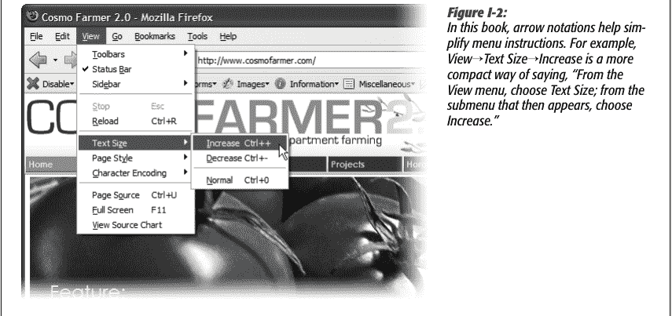

> **图 I-2：**
> 在本书中，箭头符号有助于简化菜单指令。例如，**View→Text Size→Increase**是一种更紧凑的表达，意思是“从 View 菜单中选择 Text Size；然后在出现的子菜单中选择 Increase。”

### 关于在线资源

本书旨在帮助你更快速、更专业地将工作发布到网络上；因此，本书的大量价值也自然体现在网络上。在网上，你可以找到示例文件以获得实践经验。你还可以与 Missing Manual 团队交流，告诉我们你对这本书的喜爱（或不满）。请访问*www.missingmanuals.com*，或直接前往以下各个部分。

#### 活示例

在阅读本书章节时，你会遇到许多*活示例*——你可以自己动手构建的逐步教程，使用原始素材（如图形和半成品网页），你可以从*www.sawmac.com/js2e*或本书的 Missing CD 页面*www.missingmanuals.com/cds*下载。如果你只是躺在门廊吊床上阅读这些分步课程，可能收获不大；但如果你花时间在电脑前动手操作，你会发现这些教程能让你前所未有地深入了解专业设计师构建网页的方式。

在本书的课程中，你还会找到已完成页面的 URL，以便将自己的作品与最终结果进行比较。换句话说，你不仅会在书页中看到 JavaScript 代码的图片；你还能在互联网上找到实际可用的网页。

#### 注册

如果你在 oreilly.com 注册本书，你才有资格获得特别优惠——例如*JavaScript & jQuery: The Missing Manual*未来版本的折扣。注册只需点击几下。要开始，在浏览器中输入*www.oreilly.com/register*，直接跳转到注册页面。

#### 反馈

有问题？需要更多信息？自认为是书评人？在我们的反馈页面，你可以获得阅读过程中遇到问题的专家解答，分享你对这本 Missing Manual 的看法，并找到与你有共同 JavaScript 和 jQuery 兴趣的群体。要发表你的意见，请访问*www.missingmanuals.com/feedback*。

#### 勘误

为了使本书尽可能保持最新和准确，每次加印时，我们都会采纳你提出的已确认更正。我们也会在本书网站上记录这些更改，以便你可以将重要更正添加到自己的书中。要报告错误并查看现有更正，请访问*http://tinyurl.com/jsjqtmm*。

#### Safari® 在线图书


Safari® 在线图书是一个按需提供的数字图书馆，让你可以轻松搜索超过 7,500 本技术和创意参考书籍及视频，快速找到你需要的答案。

通过订阅，你可以在线阅读任何页面和观看任何视频。在手机和移动设备上阅读图书。在印刷版出版之前获取新书名，并获得对开发中稿件的 exclusive 访问权限，向作者提供反馈。复制和粘贴代码示例，整理你的收藏夹，下载章节，为关键部分添加书签，创建笔记，打印页面，并受益于大量其他省时功能。

# 第一部分：JavaScript 入门

**第 1 章：编写你的第一个 JavaScript 程序**
**第 2 章：JavaScript 语法**
**第 3 章：为程序添加逻辑和控制**

## 编写你的第一个 JavaScript 程序

HTML 本身并不具备任何智能：它无法进行数学计算，无法判断某人是否正确填写了表单，也无法根据网页访问者的交互方式做出决策。基本上，HTML 只能让人们阅读文本、查看图片，并点击链接跳转到有更多文本和图片的其他网页。为了让你的网页具备智能，能够对网站访问者做出响应，你需要 JavaScript。

JavaScript 让网页能够智能地做出反应。借助它，你可以创建*智能*的网页表单，在访问者忘记填写必要信息时通知他们；你可以让元素出现、消失或在网页上移动（见图 1-1）；你甚至可以用从 Web 服务器获取的信息更新网页内容，而无需加载新页面。简而言之，JavaScript 让你的网站更具吸引力和有效性。

**图 1-1：JavaScript 让网页能够对访问者做出响应。在 Amazon.com 上，鼠标悬停在 "Gifts & Wish Lists" 链接上会打开一个浮动在页面上方内容之上的标签，提供更多选项。**

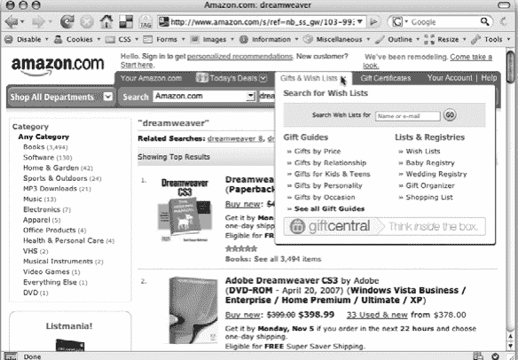

> **注意：**实际上，HTML5 *确实*为 HTML 增加了一些智能功能，包括基本的表单验证。但由于并非所有浏览器都支持这些巧妙的新增功能（而且因为你可以用表单和 JavaScript 做更多的事情），你仍然需要 JavaScript 来构建最出色、最用户友好且交互性最强的表单。你可以在 Mark Pilgrim 的*HTML5: Up and Running*（O'Reilly）中了解更多关于 HTML5 和网页表单的信息。

### 编程入门

对很多人来说，"计算机编程"这个术语会让人联想到超级聪明的极客弓着背趴在键盘前，连续数小时输入几乎难以理解的胡言乱语。说实话，有些编程确实如此。编程可能看起来像是超出普通人能力范围的复杂魔法。但许多编程概念并不难理解，而且就编程语言而言，JavaScript 对非程序员来说相对友好。

不过，JavaScript 比 HTML 或 CSS 更复杂，而且编程对网页设计师来说往往是一个陌生的世界；所以本书的一个目标就是帮助你更像程序员一样思考。在整本书中，你将学习适用于编写 JavaScript、ActionScript 甚至使用 C++ 编写桌面程序的基本编程概念。更重要的是，你将学习如何对待编程任务，以便在开始将 JavaScript 添加到网页之前，确切地知道你想要做什么。

许多网页设计师一开始就会被 JavaScript 中使用的奇怪符号和单词所震撼。一个普通的 JavaScript 程序中布满了符号（{ } [ ] ; , () !=）和大量不熟悉的单词（var, null, else if）。这就像盯着一门外语，而且在很多方面，学习编程语言确实很像学习另一门语言。你需要学习新单词、新标点符号，并理解如何将它们组合在一起以便成功沟通。

事实上，每种编程语言都有自己的一组关键字和字符，以及将这组关键字和字符组合在一起的一套规则——即语言的*语法*。学习 JavaScript 的语法就像学习另一门语言的词汇和语法一样。你需要记住这门语言的单词和规则（或者至少把这本书放在手边作为参考）。在学习说一门新语言时，你很快会意识到把重音放在错误的音节上会让一个词无法理解。同样，一个简单的拼写错误，甚至是一个缺失的标点符号，都可能阻止 JavaScript 程序运行，或者在网页浏览器中触发错误。当你开始学习编程时，你会犯很多错误——这就是编程的本质。

### 加速了解：客户端与服务器端

JavaScript 是一种*客户端*语言，也就是说它运行在 Web 浏览器内部。另一种类型的 Web 编程语言称为*服务器端*语言，你会在基于 PHP、.NET、ASP、ColdFusion、Ruby on Rails 和其他 Web 服务器技术构建的页面中找到它。顾名思义，服务器端编程语言运行在 Web 服务器上。它们可以通过访问数据库、处理信用卡和向全球发送电子邮件来展现强大的智能。服务器端语言的问题在于，它们需要 Web 浏览器向 Web 服务器发送请求，迫使访问者等待新页面带着新信息到达。

另一方面，客户端语言可以立即做出反应，改变访问者在其 Web 浏览器中看到的内容，而无需下载新页面。内容可以出现或消失，在屏幕上移动，或根据访问者与页面的交互方式自动更新。这种响应性让你能够创建感觉更像桌面程序而非静态网页的网站。但 JavaScript 并不是城里唯一的客户端技术。你也可以使用插件为网页添加编程智能。Java 小程序就是一个例子。这些是用 Java 编程语言编写的小型程序，在 Web 浏览器中运行。它们也倾向于启动缓慢，而且曾经导致浏览器崩溃。

Flash 是另一种基于插件的技术，提供复杂的动画、视频、音效和大量交互潜力。事实上，有时很难分辨一个交互式网页是在使用 JavaScript 还是 Flash。例如，Google Maps 也可以用 Flash 创建（事实上，Yahoo Maps 曾经是一个 Flash 应用程序，直到 Yahoo 用 JavaScript 重新创建了它）。快速区分的方法是：在你认为可能是 Flash 的页面部分（在本例中是地图本身）上右键单击；如果是 Flash，你会看到一个弹出菜单，其中包含 "About the Flash Player"。

Ajax（你将在本书第四部分学习）将客户端和服务器端结合在一起。Ajax 是一种使用 JavaScript 与服务器通信、从服务器检索信息并更新网页的方法，而无需加载新页面。Google Maps 使用这种技术让你在地图上移动，而无需强制你加载新页面。

事实上，JavaScript 也可以作为服务器端编程语言。例如，node.js Web 服务器（*http://nodejs.org/*）使用 JavaScript 作为服务器端编程语言来连接数据库、访问 Web 服务器的文件系统，并在 Web 服务器上执行许多其他任务。不过，本书不讨论 JavaScript 编程的这一方面。


你可能一开始会觉得JavaScript编程令人沮丧——你会花很多时间追踪因输入脚本而犯下的错误。此外，你可能会觉得一些与编程相关的概念起初有点难以理解。但请不要担心：如果你过去尝试过学习JavaScript，却因为觉得它太难而放弃，这本书将帮助你克服那些常常绊倒编程新手的障碍。（如果你确实有编程经验，这本书将教你JavaScript的特殊性以及为网络浏览器编程所涉及的独特概念。）

此外，这本书不仅仅是关于JavaScript——它还涉及jQuery，世界上最流行的JavaScript库。jQuery让复杂的JavaScript编程变得更容易……容易得多。因此，只需掌握一点JavaScript知识并借助jQuery，你很快就能创建出复杂、交互式的网站。

### 什么是计算机程序？

当你在网页中添加JavaScript时，你就是在编写一个计算机程序。诚然，大多数JavaScript程序比你用来阅读电子邮件、修饰照片和构建网页的程序简单得多。但即使JavaScript程序（也称为*脚本*）更简单、更短，它们也共享许多更复杂程序的相同属性。

简而言之，任何计算机程序都是一系列按指定顺序完成的步骤。假设你想使用查看网页的人的名字显示一条欢迎消息：“欢迎，Bob！”要完成这项任务，你需要做几件事：

- 1. 询问访问者的名字。
- 2. 获取访问者的回复。
- 3. 打印（即显示）网页上的消息。

虽然你可能永远不想在网页上打印欢迎消息，但这个例子展示了编程的基本过程：确定你想做什么，然后将该任务分解为完成它所需的每个步骤。每次你想创建一个JavaScript程序时，你都必须经历确定实现目标所需步骤的过程。一旦你知道了这些步骤，你就准备好编写你的程序了。换句话说，你将把你的想法转换为编程*代码*——这些词和字符让网络浏览器按照你想要的方式工作。

#### 常见问题解答

#### 编译语言与脚本语言

*JavaScript被称为一种脚本语言。我听到这个术语也用于像PHP和ColdFusion这样的其他语言。什么是脚本语言？*

大多数在计算机上运行的程序都是用*编译*语言编写的。编译是通过将程序员编写的代码翻译成计算机可以理解的指令来创建一个可在计算机上运行的文件的过程。一旦程序被编译，你就可以在计算机上运行它，而且由于编译后的程序已直接转换为计算机理解的指令，它将比用脚本语言编写的程序运行得更快。不幸的是，编译程序是一个耗时的过程：你必须编写程序，编译它，然后测试它。如果程序不工作，你必须再次经历整个过程。

另一方面，脚本语言只有在*解释器*（另一个可以将脚本转换为计算机可理解内容的程序）读取它时才会被编译。在JavaScript的情况下，解释器内置于网络浏览器中。因此，当你的网络浏览器读取包含JavaScript程序的网页时，网络浏览器会将JavaScript转换为计算机理解的内容。结果，脚本语言比编译语言运行得更慢，因为每次运行时，程序都必须为计算机进行翻译。脚本语言对网络开发者非常有用：脚本通常比桌面程序小得多且复杂度低，因此缺乏速度并不是那么重要。此外，由于它们不需要编译，创建和测试使用脚本语言的程序是一个快得多的过程。

### 如何在页面中添加JavaScript

网络浏览器被构建用于理解HTML和CSS，并将这些语言转换为屏幕上的可视化显示。网络浏览器中理解HTML和CSS的部分称为*布局*或*渲染*引擎。但大多数浏览器还有一个叫做*JavaScript解释器*的部分。那是浏览器理解JavaScript并能执行JavaScript程序步骤的部分。由于网络浏览器通常期望HTML，你必须使用`<script>`标签明确告诉浏览器何时JavaScript即将到来。

`<script>`标签是常规HTML。它就像一个开关，实际上说：“嘿，网络浏览器，这里有一些JavaScript代码；你不知道该怎么做，所以把它交给JavaScript解释器。”当网络浏览器遇到结束的`</script>`标签时，它知道已经到达JavaScript程序的末尾，可以回到其正常职责。

很多时候，你会在网页的`<head>`部分添加`<script>`标签，就像这样：

```html
<!DOCTYPE HTML PUBLIC "-//W3C//DTD HTML 4.01//EN" "http://www.w3.org/TR/html4/strict.dtd">
<html>
<head>
<title>My Web Page</title>
<script type="text/javascript">

</script>
</head>
```

`<script>`标签的*type*属性指示随后的格式和脚本类型。在这种情况下，`type="text/javascript"`表示脚本是普通文本（就像HTML一样）并且它是用JavaScript编写的。

如果你使用HTML5，生活会更简单。你可以完全跳过type属性：

```html
<!doctype html>
<html>
<head>
<meta charset="UTF-8">
<title>My Web Page</title>
<script>

</script>
</head>
```

事实上，网络浏览器允许你在HTML 4.01和XHTML 1.0文件中也省略type属性——脚本将相同地运行；但是，你的页面在没有type属性的情况下将无法正确验证（有关验证的更多信息，请参见第7页的框）。本书对doctype使用HTML5，但JavaScript代码将是相同的，并且对于HTML 4.01和XHTML 1.0也将相同地工作。

然后你将JavaScript代码添加到开始和结束`<script>`标签之间：

```html
<!doctype html>
<html>
<head>
<meta charset="UTF-8">
<title>My Web Page</title>
<script>
alert('hello world!');
</script>
</head>
```

你稍后会发现这个JavaScript实际做了什么。现在，请将注意力转向开始和结束`<script>`标签。要将脚本添加到你的页面，请首先插入这些标签。在许多情况下，你会将`<script>`标签放在页面的`<head>`中，以便将JavaScript代码整洁地组织在网页的一个区域。

然而，将`<script>`标签放在页面HTML内的任何地方都是完全有效的。事实上，正如你将在本章后面看到的，有一个JavaScript命令可以让你直接将信息写入网页。使用该命令，你可以将`<script>`标签放在页面上的位置（在body内部的某处），你希望脚本在该位置写入其消息。甚至常见的是将`<script>`标签放在结束`</body>`标签的正下方——这种方法确保页面已加载，并且访问者在运行任何JavaScript之前看到它。

### 外部JavaScript文件

使用前面一节讨论的`<script>`标签可以让你将JavaScript添加到单个页面。但很多时候你会创建想要与网站上所有页面共享的脚本。例如，你可能使用JavaScript程序为网页添加动画下拉导航菜单。你会希望每个页面上都有相同的花哨导航栏，但将相同的JavaScript代码复制粘贴到网站的每个页面是一个非常糟糕的想法，原因有几个。

首先，一遍又一遍地复制粘贴相同的代码工作量很大，特别是如果你有一个有数百个页面的网站。其次，如果你决定更改或增强JavaScript代码，你将需要找到使用该JavaScript的每个页面并更新代码。最后，由于JavaScript程序的所有代码都将位于每个网页中，每个页面都会变得更大，下载速度更慢。

更好的方法是使用外部JavaScript文件。如果你使用过外部CSS文件来构建网页，这种技术应该会感到熟悉。外部JavaScript文件只是以文件扩展名`.js`结尾的文本文件——例如*navigation.js*。该文件只包含JavaScript代码，并使用`<script>`标签链接到网页。例如，要将名为*navigation.js*的JavaScript文件添加到你的主页，你可以编写以下内容：

```html
<!doctype html>
<html>
<head>
<meta charset="UTF-8">
<title>My Web Page</title>
<script src="navigation.js"></script>
</head>
```

`<script>`标签的`src`属性的工作方式与``标签的`src`属性或`<a>`标签的`href`属性相同。换句话说，它指向你网站上或另一个网站上的文件（有关更多信息，请参见下一页的框）。

> **注意：** 将`src`属性添加到链接外部JavaScript文件时，不要在开始和结束`<script>`标签之间添加任何JavaScript代码。如果你想链接到外部JavaScript文件并同时向页面添加自定义JavaScript代码，请使用第二组`<script>`标签。例如：

```html
<script src="navigation.js"></script>
<script>
    alert('Hello world!');
</script>
```


### 如何向页面添加 JavaScript

### 快速入门

#### URL 类型

当将外部 JavaScript 文件附加到网页时，你需要为 `<script>` 标签的 src 属性指定一个 *URL*。URL 即 *统一资源定位符*，是指向网络上某个文件的路径。路径有三种类型：*绝对路径*、*根相对路径*和*文档相对路径*。这三种路径都指示了 Web 浏览器可以找到特定文件（如另一个网页、图形或 JavaScript 文件）的位置。

*绝对路径*就像邮政地址——它包含了世界上任何位置的 Web 浏览器查找该文件所需的所有信息。绝对路径包括 http://、主机名以及文件的文件夹和名称。例如：*http://www.cosmofarmer.com/scripts/site.js*。

*根相对*路径指示文件相对于网站顶级文件夹——即网站的根文件夹——的位置。根相对路径不包括 http:// 或域名。它以 /（斜杠）开头，表示网站的根文件夹——即主页所在的文件夹。例如，*/scripts/site.js* 表示文件 site.js 位于名为 scripts 的文件夹内，而该文件夹本身位于网站的顶级文件夹中。创建根相对路径的一个简单方法是获取绝对路径并去掉 http:// 和主机名。例如，*http://www.sawmac.com/index.html* 写成根相对 URL 就是 */index.html*。

*文档相对*路径指定了从网页到 JavaScript 文件的路径。如果你的网站有多层文件夹，你需要使用不同的路径来指向同一个 JavaScript 文件。例如，假设你有一个名为 site.js 的 JavaScript 文件位于网站主目录中名为 scripts 的文件夹内。对于主页，该文件的文档相对路径是 *scripts/site.js*——但对于位于名为 about 的文件夹内的页面，指向同一文件的路径会有所不同：*../scripts/site.js*——../ 表示从 about 文件夹中向上爬出一级，而 */scripts/site.js* 表示进入 scripts 文件夹并获取 site.js 文件。

以下是一些关于使用哪种 URL 类型的提示：

- 如果你指向的文件与网页不在同一服务器上，你*必须*使用绝对路径。这是唯一能指向另一个网站的类型。

- 根相对路径适用于存储在你自己网站上的 JavaScript 文件。由于它们总是从根文件夹开始，JavaScript 文件的 URL 在你网站的每个页面上都是相同的，即使网页位于网站上的文件夹和子文件夹中。然而，除非你通过 Web 服务器查看网页——无论是互联网上的 Web 服务器，还是你自己计算机上为测试目的设置的 Web 服务器——否则根相对路径将无法工作。换句话说，如果你只是使用浏览器的 File→Open 命令从计算机上打开网页，Web 浏览器将无法定位、加载或运行使用根相对路径附加的 JavaScript 文件。

- 当你在没有 Web 服务器帮助的情况下在自己的计算机上进行设计时，文档相对路径是最佳选择。你可以创建一个外部 JavaScript 文件，将其附加到网页上，然后只需从硬盘打开网页即可在 Web 浏览器中检查 JavaScript。文档相对路径在移动到你实际运行的互联网网站时也能正常工作，但如果你将网页移动到服务器上的另一个位置，你就必须重写指向 JavaScript 文件的 URL。在本书中，我们将使用文档相对路径，因为这样你就可以在没有 Web 服务器的情况下在自己的计算机上跟随教程并进行测试。

你可以（并且经常会）将多个外部 JavaScript 文件附加到单个网页上。例如，你可能创建了一个外部 JavaScript 文件来控制下拉导航栏，另一个则让你可以在照片页面上添加一个漂亮的幻灯片（你将在第 222 页学习如何做到这一点）。在你的照片画廊页面上，你需要这两个 JavaScript 程序，因此你会附加这两个文件。

此外，你可以像这样将外部 JavaScript 文件和 JavaScript 程序添加到同一页：

```
<!doctype html>
<html>
<head>
<meta charset="UTF-8">
<title>My Web Page</title>
<script src="navigation.js"></script>
<script src="slideshow.js"></script>
<script>
  alert('hello world!');
</script>
</head>
```

只需记住，你必须为每个外部 JavaScript 文件使用一组开始和结束 `<script>` 标签。你将在第 33 页开始的教程中创建一个外部 JavaScript 文件。

你可以将外部 JavaScript 文件放在网站根文件夹（或根文件夹内的任何子文件夹）内的任何位置。许多 Web 开发人员在网站的根文件夹中为外部 JavaScript 文件创建一个专门的目录：常见的名称是 `js`（表示 JavaScript）或 `libs`（表示库）。

> 注意：有时附加外部 JavaScript 文件的顺序很重要。正如你将在本书后面看到的，有时你编写的脚本依赖于来自外部文件的代码。在使用 JavaScript 库（简化复杂编程任务的 JavaScript 代码）时，这种情况很常见。你将在第 33 页的教程中看到一个 JavaScript 库的实际示例。

### 你的第一个 JavaScript 程序

学习 JavaScript 编程的最佳方法是实际编程。在整本书中，你将找到实践教程，带你一步步完成创建 JavaScript 程序的过程。开始之前，你需要一个文本编辑器（推荐见第 10 页）、一个 Web 浏览器，以及位于 www.sawmac.com/js2e 的练习文件（完整说明请参见以下注释）。

> 注意：本章中的教程需要从本书网站 www.sawmac.com/js2e/ 下载示例文件。点击“Download tutorials”链接进行下载。（教程文件存储为单个 Zip 文件。）Windows 用户应下载 Zip 文件并双击打开存档。点击“Extract All Files”选项，然后按照解压缩向导的说明解压缩文件并将其放置在你的计算机上。Mac 用户只需双击文件即可解压缩。下载并解压缩文件后，你的计算机上应该有一个名为 MM_JAVASCRIPT2E 的文件夹，其中包含本书的所有教程文件。

为了让你轻松入门并提供 JavaScript 的温和介绍，你的第一个程序将非常简单：

1.  在你喜欢的文本编辑器中，打开文件 *hello.html*。此文件位于你从 *www.sawmac.com/js2e* 下载的 MM_JAVASCRIPT2E 文件夹中的 *chapter01* 文件夹内。这是一个非常简单的 HTML 页面，带有一个外部层叠样式表以增加一些视觉效果。

2.  在结束 `</head>` 标签**之前**的空白行中点击并输入：
    `<script>`
    这段代码实际上是 HTML，而不是 JavaScript。它告知 Web 浏览器，此标签后的内容是 JavaScript。

3.  按 Enter 键创建一个新空白行，然后输入：
    `alert('hello world');`
    你刚刚输入了你的第一行 JavaScript 代码。JavaScript *alert()* 函数是一个命令，它会弹出一个警报框并显示括号中出现的消息——在本例中是 *hello world*。暂时不必担心所有的标点符号（括号、引号和分号）。你将在下一章学习它们的作用。

4.  再次按 Enter 键，然后输入 **\`</script>\`**。代码现在应该如下所示：

    ```
    <link href="../_css/site.css" rel="stylesheet">
    <script>
    alert('hello world');
    </script>
    </head>
    ```

    在此示例中，你刚刚输入的内容以粗体显示。两个 HTML 标签已在文件中；请确保你完全按照所示位置输入代码。

5.  启动 Web 浏览器并打开 *hello.html* 文件进行预览。会出现一个 JavaScript 警报框（见图 1-2）。请注意，当警报出现时，页面是空白的。（如果你没有看到图 1-2 所示的警报框，可能是你在前面的步骤中输入代码有误。请仔细检查你的输入并阅读以下注释。）

    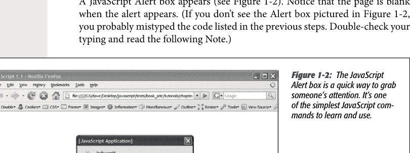


6. 点击提示框的“确定”按钮将其关闭。

当提示框消失后，网页便会显示在浏览器窗口中。

**提示：** 刚开始编程时，你可能会惊讶于自己的JavaScript程序似乎根本不工作……这种情况非常普遍。对于新手来说，程序不工作的最常见原因是简单的拼写错误。务必反复检查，确保你正确拼写了命令（比如第一个脚本中的*alert*）。同时，注意标点符号通常是成对出现的（例如你第一个脚本中的括号和单引号）。务必在需要时同时包含开始和结束的标点符号。

虽然这个第一个程序并不特别复杂（甚至算不上有趣），但它确实演示了一个重要概念：网页浏览器在读取JavaScript代码的那一刻就会运行JavaScript程序。在这个例子中，*alert()*命令出现在网页浏览器显示网页*之前*，因为JavaScript代码出现在<body>标签中HTML的*前面*。当你开始编写操作网页HTML的程序时——你将在第3章学到——这个概念就会发挥作用。

**注意：** Internet Explorer（IE）不愿意运行直接从硬盘打开的网页中包含的JavaScript程序，担心这些程序可能执行有害操作。因此，当你尝试在Internet Explorer中预览本书的教程文件时，会看到一条消息，提示IE已阻止该脚本。点击“允许阻止的内容”即可看到程序运行。这种烦人的行为仅适用于你从计算机预览的网页，而不适用于上传到网络服务器的文件。在跟随本书教程学习时，最好使用Firefox、Chrome或Safari等其他浏览器预览页面，这样就无需每次查看页面时都点击“允许阻止的内容”按钮。

### 在网页上书写文本

上一个脚本在你的显示器中央弹出了一个对话框。如果你想使用JavaScript直接在网页上打印消息呢？有很多种方法可以实现，你将在本书后面学到一些高级技巧。不过，你可以使用一个内置的JavaScript命令来实现这个简单目标，这就是你将在第二个脚本中做的事情：

1. 在你的文本编辑器中，打开文件*hello2.html*。

   虽然<script>标签通常出现在网页的<head>中，但你也可以将它们和JavaScript程序直接放在网页的主体中。

2. 在<h1>Writing to the document window</h1>的正下方，输入以下代码：

   ```
   <script>
   document.write('<p>Hello world!</p>');
   </script>
   ```

   与*alert()*函数类似，*document.write()*是一个JavaScript命令，它会将放在圆括号之间的所有内容原样输出。在这个例子中，HTML `<p>Hello world!</p>` 被添加到页面：一个段落标签和两个单词。

**3. 保存页面，并在网页浏览器中打开它。**

页面打开后，“Hello world!”这个词会出现在红色标题下方（见图1-3）。

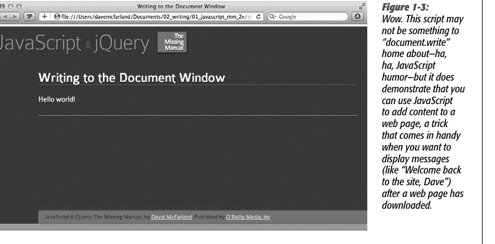

**图1-3：**

*哇。这个脚本可能还不值得“大书特书”——哈哈，JavaScript幽默——但它证明了你可以使用JavaScript为网页添加内容，这个技巧在你想在网页下载后显示消息（比如“欢迎回到站点，Dave”）时非常有用。*

> **注意：** 你下载的教程文件也包含了每个教程的完成版本。如果你的JavaScript似乎无法运行，请将你的作品与教程文件所在文件夹中以*complete_*开头的文件进行比较。例如，文件*complete_hello2.html*包含了你添加到文件*hello2.html*中的脚本的可运行版本。

你刚刚创建的两个脚本可能会让你对JavaScript……或者这本书感觉有点失望。别担心。从一开始就全面理解基础知识非常重要。仅仅几章之后，你就会使用JavaScript做一些非常有用和复杂的事情。事实上，在本章剩余部分，你将体验到一些高级功能，这些功能是你在学完本书前两部分后能够添加到网页中的。

### 附加外部JavaScript文件

如第27页所述，如果你想在多个网页上使用相同的脚本，通常会将JavaScript代码放在一个单独的文件中。然后，你可以指示网页加载该文件并使用其中的JavaScript。当你在使用他人的JavaScript代码时，外部JavaScript文件也非常方便。特别是，有一些称为*库*的JavaScript代码集合，它们提供有用的JavaScript编程：通常，这些库使你能够轻松完成一些通常很难做的事情。你将在第117页了解更多关于JavaScript库的信息，特别是本书使用的JavaScript库——jQuery。

但现在，你将体验如何将外部JavaScript文件附加到页面，并编写一个能完成一些惊人事情的短程序：

- 1. 在你的文本编辑器中，打开文件*fadeIn.html*。

   此页面只包含一些简单的HTML——几个<div>标签、一个标题和几个段落。你将为页面添加一个简单的视觉效果，使所有内容慢慢淡入视图。

2. 在页面顶部<link>和结束</head>标签之间的空白行中单击，并输入：

   `<script src="../_js/jquery-1.6.3.min.js"></script>`

   此代码将名为*jquery-1.6.3.min.js*的文件（位于名为_js的文件夹中）链接到此网页。当网页浏览器加载此网页时，它也会下载*jquery-1.6.3.min.js* JavaScript文件并运行其中的代码。

   接下来，你将为此页面添加自己的JavaScript编程。

> **注意：** 在JavaScript文件的名称中包含版本号是常见的做法。在这个例子中，文件名是*jquery-1.6.3.min.js*。1.6.3表示jQuery的1.6.3版本。*min*部分表示文件是*最小化*的——这使得文件更小，从而下载更快。

- 3. 按回车键创建一个新的空白行，然后输入：

   `<script>`

   HTML标签通常成对出现——一个开始标签和一个结束标签。为了确保你不会忘记关闭标签，最好在输入开始标签后立即关闭标签，然后在标签之间填入内容。

4. 按两次回车键创建两个空白行，然后输入：

   `</script>`

   这结束了JavaScript代码块。现在你将添加一些编程。

5. 单击开始和结束script标签之间的空行，并输入：

   `$(document).ready(function() {`

   你可能想知道这到底是什么。你将在第169页了解此代码的所有细节，但简而言之，这行代码利用了*jquery-1.6.3.min.js*文件内部的编程，以确保浏览器在正确的时间执行下一行代码。

6. 按回车键创建新行，然后输入：

   `$('body').hide().fadeIn(3000);`

   这行代码做了一些神奇的事情：它使页面的内容先消失，然后在3秒（或3000毫秒）内慢慢淡入视图。它是如何做到的？嗯，这是jQuery的魔力之一，它使得复杂效果只需一行代码即可实现。

7. 最后按一次回车键，然后输入：

   `});`

   此代码结束了JavaScript代码，就像结束</script>标签表示JavaScript程序的结束一样。不要过于担心所有那些奇怪的标点符号——你将在本书后面详细学习它们是如何工作的。你需要确保的主要事情是按照这里列出的方式准确输入代码。一个拼写错误，程序就可能无法工作。

   你添加到页面的最终代码应如下粗体文本所示：

   ```
   <link href="../_css/site.css" rel="stylesheet">
   <script src="../_js/jquery-1.6.3.min.js"></script>
   <script>
   $(function() {
      $('body').hide().fadeIn(3000);
   });
   </script>
   </head>
   ```

8. 保存HTML文件，并在网页浏览器中打开它。

   你现在应该看到页面慢慢淡入视图。将数字3000更改为不同的值（如250和10000），看看这会如何改变页面的工作方式。

> **注意：** 如果你尝试在Internet Explorer中预览此页面但似乎没有任何反应，你需要点击页面底部出现的“启用阻止的内容”框（参见第31页的注释）。

如你所见，要为你的网页做一些惊人的事情，并不需要大量的JavaScript。多亏了jQuery这样的JavaScript库，你将能够创建复杂、交互式的网站，而无需自己成为编程专家。然而，了解JavaScript和编程的基础知识确实很有帮助。在接下来的三章中，我们将介绍JavaScript的基础知识，以便你熟悉构成这门语言的基本概念和语法。

### 追踪错误

JavaScript编程中最令人沮丧的时刻，莫过于你尝试在网页浏览器中查看你用JavaScript驱动的页面……然后什么也没发生。这是程序员最普遍的经历之一。即使是非常有经验的程序员，第一次编写程序时也并非总能成功，因此找出问题所在只是这个过程的一部分。


大多数 Web 浏览器默认会静默忽略 JavaScript 错误，因此你通常甚至看不到一个"嘿，这个程序出错了！"的对话框。（一般来说，这是件好事，因为你不会希望一个 JavaScript 错误打断用户浏览网页的体验。）

那么，你该如何找出问题所在呢？跟踪 JavaScript 程序中的错误有很多方法。你将在第 15 章学习一些高级*调试*技巧，但最基本的方法是查阅 Web 浏览器。大多数 Web 浏览器都会跟踪 JavaScript 错误，并将其记录在一个名为*错误控制台*的单独窗口中。当你加载一个包含错误的网页时，可以查看控制台，获取有关错误的有用信息，比如错误发生在网页的哪一行以及错误的描述。

通常，你可以在错误控制台中找到问题的答案，修复 JavaScript，然后页面就能正常工作了。控制台可以帮助你找出刚开始编程时常犯的基础性拼写错误，比如忘记了闭合标点符号，或者 JavaScript 命令名称拼写错误。你可以使用你喜欢的浏览器中的错误控制台，但由于脚本有时在一个浏览器中可以运行而在另一个中却不行，本节将向你展示如何在所有主流浏览器中开启 JavaScript 控制台，以便你能在每个浏览器中追踪问题。

### Firefox JavaScript 控制台

Firefox 的 JavaScript 控制台是开始追踪代码中错误的绝佳工具。控制台不仅提供了相当清晰的错误描述（在编程方面，没有什么描述能*真正*算得上清晰），还会标识出错误发生在代码中的哪一行。

例如，在图 1-4 中，控制台将错误标识为"未终止的字符串字面量"，这意味着在"slow"之前有一个开引号，但没有对应的闭合引号。控制台还会标识出错误所在文件的名称（本例中为 *fadeIn.html*）以及错误发生的行号（第 11 行）。最重要的是，它甚至用箭头指出了错误的来源——在本例中，高亮显示了开引号。

> **警告：**虽然错误控制台会画一个箭头指向 Firefox 遇到错误的位置，但那并不一定就是你犯错的地方。有时你需要修复箭头之前或之后的代码。

### 追踪错误

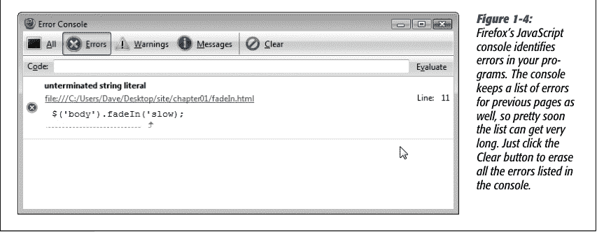

要显示 JavaScript 控制台，请点击 Firefox 菜单并选择 Web Developer→Error Console（在 Windows 上）或 Tools→Error Console（在 Mac 上）。控制台是一个可以自由移动的浮动窗口。它不仅显示 JavaScript 错误，还显示 CSS 错误，因此如果你在层叠样式表中犯了任何错误，你也会发现它们。（请确保选择了控制台顶部的 Errors 按钮；否则，你可能会看到与你的 JavaScript 错误无关的警告和消息。）

> **提示：**由于错误控制台会显示错误发生的行号，你可能需要使用一个能显示行号的文本编辑器。这样，你就可以轻松地从错误控制台跳转到文本编辑器，并识别出需要修复的代码行。

不幸的是，脚本中可能出现的问题有很多，从简单的拼写错误到复杂的逻辑错误。当你刚开始学习 JavaScript 编程时，你的许多错误会是简单的拼写错误。例如，你可能忘记了分号、引号或括号，或者拼错了 JavaScript 命令。当你照着书（比如本书）中的示例操作时，特别容易出现拼写错误。以下是你刚开始输入本书代码时可能会经常看到的几个错误：

-   **Missing ) after argument list.** 你忘记在命令末尾输入闭合括号。例如，在这段代码——alert('hello'——中，'hello'后面缺少右括号。
-   **Unterminated string literal**。*字符串*是由引号括起来的一系列字符（你将在第 43 页更详细地了解这些内容）。例如，'hello' 是代码 *alert('hello');* 中的一个字符串。很容易忘记输入开引号或闭合引号。
-   **XXX is not defined**。如果你拼错了 JavaScript 命令——*aler('hello');*——你会得到一个错误提示，说该（拼写错误的）命令未定义：例如，"aler is not defined"。
-   **Syntax error**。有时，Firefox 完全不知道你想要做什么，就会提供这条通用错误消息。语法错误表示你的代码中存在某些错误。它可能不是拼写错误，但你可能以不允许的方式组合了一条或多条 JavaScript 语句。在这种情况下，你需要仔细查看发现错误的那一行，试着找出你犯了什么错误。不幸的是，修复这类错误通常需要对 JavaScript 语言有一定的经验和理解。

从上面的列表可以看出，你犯的许多错误只是忘了输入成对标点符号中的一个——比如引号或括号。幸运的是，这些很容易修复，而且随着编程经验的增加，你最终几乎会完全停止犯这些错误（没有程序员是完美的）。

> **注意：**Firefox 的 Firebug 插件（http://getfirebug.com/）极大地扩展了 Firefox 错误控制台的功能。事实上，它为你在 IE9、Chrome 和 Safari 中能找到的其他开发人员工具（接下来将讨论）提供了模型。你将在第 15 章了解 Firebug。

### 显示 Internet Explorer 9 控制台

Internet Explorer 9 提供了一套功能强大的开发人员工具，不仅可以查看 JavaScript 错误，还可以分析 CSS、HTML 以及网络上的信息传输。打开时，开发人员工具窗口会出现在浏览器窗口的下半部分（见图 1-5）。按 F12 键打开开发人员工具，再按一次即可关闭。你可以在 Console 选项卡下找到列出的 JavaScript 错误（图 1-5 中已圈出）。与 Firefox 错误控制台不同的是——Firefox 会保留你访问的所有页面的 JavaScript 错误的累计记录——你需要先打开 IE 9 控制台，然后重新加载页面才能看到错误。

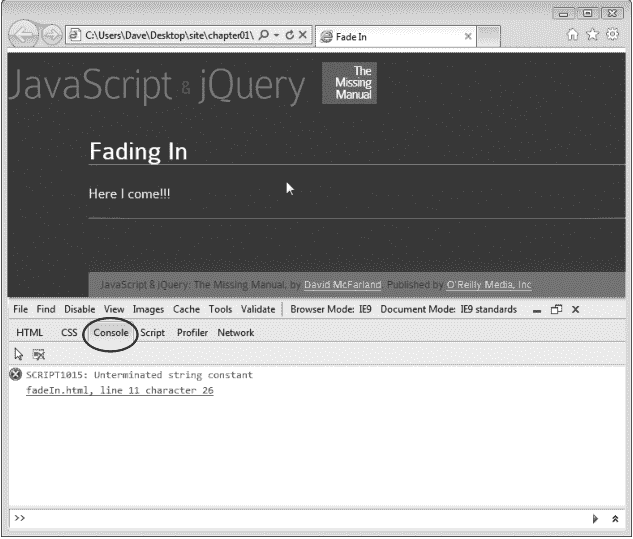

**图 1-5：**
Internet Explorer 开发人员工具提供了对网页上发生的 JavaScript 错误的访问，以及其他大量信息。

IE9 控制台显示的错误消息与上述 Firefox 中描述的类似。例如，"Unterminated string constant" 与 Firefox 的 "Unterminated string literal" 消息相同——都表示缺少引号。此外，Internet Explorer 还会标识出错误发生在 HTML 文件中的哪一行代码。

### 打开 Chrome JavaScript 控制台

Google 的 Chrome 浏览器也允许你通过其 JavaScript 控制台查看 JavaScript 错误。要打开控制台，请点击工具图标（图 1-6 中已圈出），选择 Tools 菜单，然后从弹出菜单中选择 JavaScript console。控制台打开后，点击 Errors 按钮即可只查看你需要的 JavaScript 错误。不幸的是，Chrome 的错误信息往往有点更加晦涩。例如，遗漏闭合引号的错误消息是 "Uncaught SyntaxError: Unexpected token ILLEGAL。" 并不清晰友好。事实上，这简直让人觉得你再犯一次类似的错误，Chrome 就要尖叫着"放出机器猎犬！"了。

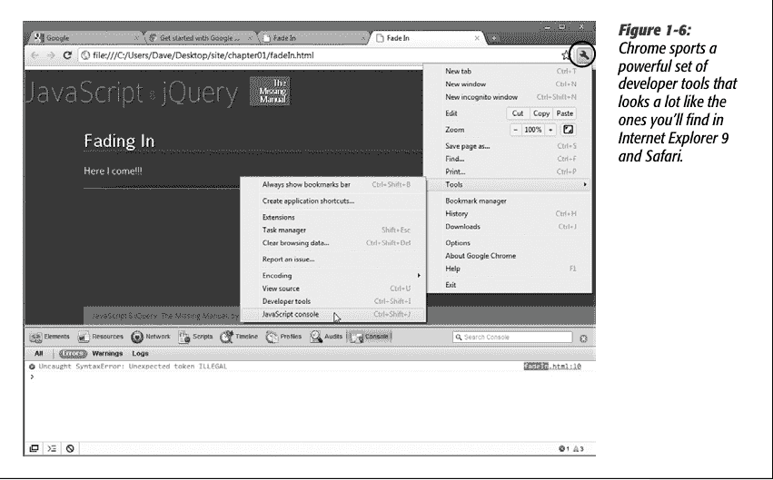

图 1-6：Chrome 拥有一套强大的开发人员工具，看起来很像你在 Internet Explorer 9 和 Safari 中能找到的那些。

### 访问 Safari 错误控制台

Safari 的错误控制台可以从 Develop 菜单中获取：Develop→Show Error Console（在 Mac 上，你可以使用键盘快捷键 Option-⌘-C，在 Windows 上，快捷键是 Ctrl+Alt+C）。但是，Safari 安装时默认并未开启 Develop 菜单，因此需要几个步骤才能到达 JavaScript 控制台。

要开启 Develop 菜单，你首先需要访问偏好设置窗口。在 Mac 上，选择 Safari→Preferences。在 Windows 上，点击浏览器右上角的齿轮图标，选择 Preferences。偏好设置窗口打开后，点击 Advanced 按钮。勾选"Show Develop menu in menu bar"复选框，然后关闭偏好设置窗口。

当你重新启动 Safari 时，Develop 菜单将出现在 Mac 屏幕顶部菜单栏的 Bookmarks 和 Window 菜单之间；在 Windows 上，你会在浏览器右上角的页面图标下找到它。选择 Develop→Show Error Console 即可打开控制台（见图 1-7）。


### **图 1-7：**

Safari 错误控制台显示 JavaScript 错误的名称、文件名（及位置），以及 Safari 遇到错误的行号。每个标签页或浏览器窗口都有自己的错误控制台，因此如果您已经为一个标签页打开了控制台，则需要选择“开发”→“错误控制台”来查看另一个标签页或窗口的错误。

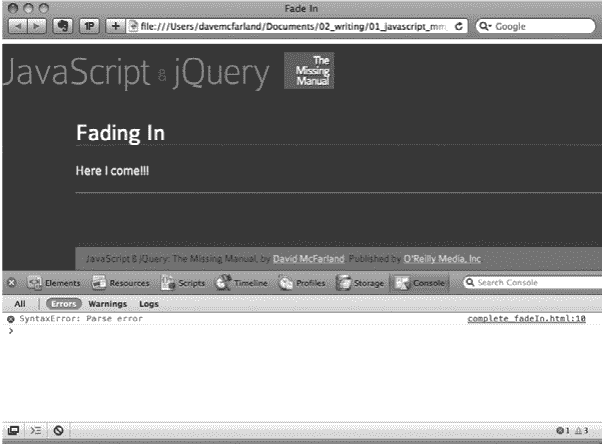

## JavaScript 的语法

学习一门编程语言与学习任何一种新语言非常相似：有单词需要学习，有标点符号需要理解，还有一套新的规则需要掌握。正如你需要学习法语语法才能说法语一样，你必须熟悉 JavaScript 的语法才能编写 JavaScript 程序。本章涵盖了所有 JavaScript 程序所依赖的概念。

如果你有任何 JavaScript 编程经验，许多概念可能已是老生常谈，那么你或许可以快速浏览本章。但如果你是 JavaScript 新手，或者对基础还不太确定，本章将为你介绍基本（但至关重要）的主题。

### 语句

JavaScript *语句*是一个基本的编程单元，通常代表 JavaScript 程序中的一个步骤。把语句想象成一个句子：正如你将句子组合成一个段落（或一章、一本书），你将语句组合成一个 JavaScript 程序。在上一章中，你已经看到了几个语句的示例。例如：

```
alert('Hello World!');
```

这个单独的语句打开一个警告窗口，显示消息“Hello World!”。在许多情况下，语句是单行代码。每个语句以分号结尾——就像句子末尾的句号一样。分号明确表示该步骤已结束，JavaScript 解释器应继续执行下一个操作。

> **注意：** 正式来说，在语句末尾放置分号是可选的，一些程序员为了缩短代码会省略分号。不要成为他们中的一员。省略分号会使阅读代码更加困难，并且在某些情况下会导致 JavaScript 错误。如果你想让你的 JavaScript 代码更紧凑以便更快下载，请参阅第 465 页。

编写 JavaScript 程序的一般过程是输入一个语句，输入一个分号，按回车键创建一个新的空行，输入另一个语句，后跟一个分号，如此反复直到程序完成。

### 内置函数

JavaScript 和 Web 浏览器允许你使用各种命令在程序和网页上让事情发生。这些命令称为函数，就像句子中的动词。它们完成工作。例如，你之前遇到的 *alert()* 函数会让 Web 浏览器打开一个对话框并显示一条消息。

一些函数，如 *alert()* 或你之前在第 31 页遇到的 *document.write()*，是专门针对 Web 浏览器的。换句话说，它们只适用于网页，因此你不会在其他使用 JavaScript 的环境中（例如，在编写 Adobe 应用程序如 Acrobat 或 Dreamweaver 的脚本，或在 Flash 的基于 JavaScript 的 ActionScript 中）找到它们。

其他函数对 JavaScript 是通用的，可以在任何 JavaScript 运行的地方工作。例如，*isNaN()* 是一个函数，用于检查特定值是否是数字——当你想检查访问者是否为需要数字答案的问题（例如，“您想要多少个小部件？”）正确提供了数字时，这个函数会派上用场。你将在第 447 页学习 *isNaN()* 及其使用方法。

JavaScript 有许多不同的函数，你将在整本书中了解它们。识别程序中函数的一个快速方法是使用括号。例如，你可以判断 *isNaN()* 是一个函数，因为 *isNaN* 后面有括号。

此外，JavaScript 允许你创建自己的函数，因此你可以让你的脚本做超出标准 JavaScript 命令提供的事情。你将在第 3 章（从第 100 页开始）学习函数。

### 数据类型

你每天处理不同类型的信息。你的名字、食物的价格、医生办公室的地址以及你下一个生日的日期都是对你重要的信息。你根据所拥有的信息决定做什么以及如何生活。计算机程序也没有什么不同。它们也依赖信息来完成工作。例如，要计算购物车的总计，你需要知道每个订购项目的单价和数量。要使用访问者的名字定制网页（“欢迎回来，*Kotter*”），你需要知道她的名字。

编程语言通常将信息分为不同的类型，并以不同的方式处理每种类型。在 JavaScript 中，三种最基本的数据类型是 *number*、*string* 和 *Boolean*。

### 数字

数字用于计数和计算；你可以跟踪距离暑假还有多少天，或者计算购买两张电影票的费用。数字在 JavaScript 编程中非常重要：你可以使用数字来跟踪访问者访问网页的次数、指定网页上项目的精确像素位置，或确定访问者想要订购多少产品。

在 JavaScript 中，数字由数字字符表示；例如，5 就是数字五。你也可以使用带小数的小数，如 5.25 或 10.3333333。JavaScript 甚至允许你使用负数，如 –130。

由于数字频繁用于计算，你的程序通常包含数学运算。你将在第 50 页学习 *运算符*，但为了提供一个使用 JavaScript 与数字的示例，假设你想在网页上打印 5 加 15 的总值；你可以用这行代码完成：

```
document.write(5 + 15);
```

这段 JavaScript 代码将两个数字相加，并将总和（20）打印到网页上。使用数字的方法有很多，你将从第 445 页开始了解更多。

### 字符串

要显示名字、句子或任何字母系列，你使用字符串。*字符串*是引号内的一系列字母和其他符号。例如，“Welcome Hal”和“You are here”都是字符串的示例。你在上一章使用警报命令时使用了一个字符串——*alert('Hello World!');*。

字符串的开头引号向 JavaScript 解释器发出信号，表示接下来是一个字符串——只是一系列符号。解释器逐字接受符号，而不是尝试将字符串解释为 JavaScript 的任何特殊内容（如命令）。当解释器遇到结尾引号时，它明白已到达字符串的末尾，并继续程序的下一部分。

你可以使用双引号（"hello world"）或单引号（'hello world'）来包含字符串，但必须确保在字符串的开头和结尾使用 *相同类型* 的引号（例如，“this is not right' 不是有效的字符串，因为它以双引号开头，但以单引号结尾）。

> **注意：** 你会注意到在本书正文中，我们使用弯引号——" " 和 ' '——但在编写 JavaScript 代码时，你只使用常规的直引号：" " 和 ' '。代码示例（如下面的 *alert('Warning, warning!');*）使用正确的引号样式。这要怪古腾堡——他不知道如何编程。

因此，要弹出一个显示消息 *Warning, warning!* 的警告框，你可以写：
alert('Warning, warning!');
或
alert("Warning, warning!");

你将在编程中频繁使用字符串——当添加警报消息时，当处理网页表单上的用户输入时，以及当操作网页内容时。它们非常重要，你将从第 425 页开始学习更多关于使用字符串的知识。

#### 将引号放入字符串中

**常见问题**

*当我尝试创建一个包含引号的字符串时，我的程序无法工作。为什么？*

在 JavaScript 中，引号表示字符串的开始和结束，即使你并不想这样。当 JavaScript 解释器遇到第一个引号时，它对自己说：“啊，这里是一个字符串。”当它遇到匹配的引号时，它认为已经到达字符串的末尾。这就是为什么你不能这样创建字符串："He said, "Hello."". 在这种情况下，第一个引号（在“He”之前）标记字符串的开始，但一旦 JavaScript 解释器遇到第二个引号（在“Hello”之前），它就认为字符串已经结束，因此你最终得到字符串"He said, " 和 "Hello." 部分，这会导致 JavaScript 错误。

有几种方法可以解决这个难题。最简单的方法是使用单引号来包含一个或多个双引号的字符串。例如，“He said, "Hello."” 是一个有效的字符串——单引号创建字符串，而内部的双引号是字符串的 *一部分*。同样，你可以使用双引号来包含一个包含单引号的字符串：“This isn't fair”，例如。

另一种方法是告诉 JavaScript 解释器将字符串内的引号视为字面量——即，将引号视为字符串的一部分，而不是字符串的结尾。你可以使用称为 *转义字符* 的东西来实现这一点。如果你在引号前加上反斜杠（\），该引号就被视为字符串的一部分。你可以这样重写上面的例子："He said, \"Hello."". 在某些情况下，转义字符是唯一的选择。例如：'He said, "This isn\'t \" fair."' 因为字符串被单引号包围，单词"isn't"中的单引号必须在前面加上反斜杠：isn\'t。

你甚至可以在不必要时转义引号——作为一种明确表示引号应被视为字面量的方式。例如，'He said, "Hello."'. 即使你不需要转义双引号（因为整个字符串被单引号包围），一些程序员仍然这样做，以便他们清楚地知道引号只是引号。

### 布尔值

虽然数字和字符串提供了无限的可能性，但布尔数据类型很简单。它只有两个值之一：*true* 或 *false*。当你在创建 JavaScript 程序以智能地响应用户输入和操作时，你会遇到布尔数据类型。例如，如果你想确保访问者在提交表单前提供了电子邮件地址，你可以通过问一个简单的问题来添加逻辑：“用户是否输入了有效的电子邮件地址？”这个问题的答案

是一个布尔值：表示电子邮件地址有效（true）或无效（false）。根据这个问题的答案，页面可能会以不同方式响应。例如，如果电子邮件地址有效（true），则提交表单；如果无效（false），则显示错误消息并阻止表单提交。

事实上，布尔值如此重要，以至于 JavaScript 包含了两个特殊关键字来表示这些值：

true

和

false

你将在第 82 页的方框中了解布尔值在为程序添加逻辑时如何发挥作用。

### 变量

你可以直接在 JavaScript 程序中输入数字、字符串或布尔值，但这些数据类型仅在你已经拥有所需信息时才有效。例如，你可以像这样在警报框中显示字符串 "Hi Bob"：

```
alert('Hi Bob');
```

但该语句仅在访问该页面的每个人都名为 Bob 时才有意义。如果你想为不同的访问者显示个性化消息，则该名称需要根据查看页面的人不同而变化：'Hi Mary'、'Hi Joseph'、'Hi Ezra' 等等。幸运的是，所有编程语言都提供了一种称为变量的东西来处理这种情况。

变量是存储信息的一种方式，以便你可以稍后使用和操作它。例如，想象一个基于 JavaScript 的弹球游戏，其目标是获得最高分。当玩家第一次开始游戏时，她的分数将为零，但随着她将弹球击中目标，分数会变大。在这种情况下，分数是一个变量，因为它从 0 开始，但随着游戏的进行而变化——换句话说，变量保存可以变化的信息。参见图 2-1 查看另一个使用变量的游戏的示例。

将变量视为一种篮子：你可以将物品放入篮子中，查看篮子内部，倒出篮子的内容物，甚至用其他东西替换篮子里面的东西。然而，即使你可能更改了篮子里面的物品，它仍然是同一个篮子。

### 创建变量

创建变量是一个两步过程，包括声明变量和为其命名。在 JavaScript 中，要创建一个名为 score 的变量，你可以输入：

```
var score;
```

第一部分 `var` 是一个 JavaScript 关键字，用于创建或在编程术语中称为声明变量。语句的第二部分 `score` 是变量的名称。

**图 2-1：** *The World's Biggest Pac-Man* (http://worldsbiggestpacman.com/) 使用 JavaScript 创建了一个拥有数千个迷宫的吃豆人游戏。游戏会跟踪你的当前分数和最高分数（顶部），以及吃掉的豆子总数和其他游戏统计数据（右侧）。所有这些都是变量的例子，因为它们的值在游戏过程中会发生变化。

你如何命名变量由你决定，但在命名变量时必须遵循一些规则：

- 变量名必须以字母、$ 或 _ 开头。换句话说，你不能以数字或标点符号开头命名变量：因此 *1thing* 和 *&-thing* 不行，但 *score*、*$score* 和 *_score* 可以。
- 变量名只能包含字母、数字、$ 和 _。你不能在变量名中使用空格或任何其他特殊字符：*fish&chips* 和 *fish and chips* 不合法，但 *fish_n_chips* 和 *plan9* 可以。
- 变量名区分大小写。JavaScript 解释器将大写和小写字母视为不同的，因此名为 *SCORE* 的变量与名为 *score* 的变量不同，后者又与名为 *sCoRE* 和 *Score* 的变量不同。
- 避免使用关键字。JavaScript 中有些词是语言本身特有的：例如，*var* 用于创建变量，因此你不能将变量命名为 *var*。此外，某些词如 *alert*、*document* 和 *window* 被视为 Web 浏览器的特殊属性。如果你尝试使用这些词作为变量名，最终会导致 JavaScript 错误。你可以在表 2-1 中找到一些保留字列表。并非所有这些保留字在所有浏览器中都会导致问题，但在命名变量时最好避开这些名称。

**表 2-1.** *某些词保留给 JavaScript 和 Web 浏览器使用。避免将它们用作变量名*

| JavaScript 关键字 | 保留供将来使用 | 浏览器保留 |
| :--- | :--- | :--- |
| break | abstract | alert |
| case | boolean | blur |
| catch | byte | closed |
| continue | char | document |
| debugger | class | focus |
| default | const | frames |
| delete | double | history |
| do | enum | innerHeight |
| else | export | innerWidth |
| false | extends | length |
| finally | final | location |
| for | float | navigator |
| function | goto | open |
| if | implements | outerHeight |
| in | import | outerWidth |
| instanceof | int | parent |
| new | interface | screen |
| null | let | screenX |
| return | long | screenY |
| switch | native | statusbar |
| this | package | window |
| throw | private | |
| true | protected | |
| try | public | |
| typeof | short | |
| var | static | |
| void | super | |
| while | synchronized | |
| with | throws | |
| | transient | |
| | volatile | |
| | yield | |

除了这些规则外，还要力求使你的变量名清晰且有意义。根据你将要存储的数据类型来命名变量，这样可以更容易地查看你的编程代码并立即理解正在发生的事情。例如，*score* 是用于跟踪玩家游戏分数的变量的好名字。变量名 *s* 也可以，但单个字母 "s" 并不能让你了解变量中存储的内容。

同样，让你的变量名易于阅读。当在变量名中使用多个单词时，可以在单词之间使用下划线，或者将第一个单词之后的每个单词的首字母大写。例如，*imagepath* 不如 *image_path* 或 *imagePath* 容易阅读和理解。

### 使用变量

一旦创建了变量，你就可以在其中存储任何类型的数据。为此，你使用 `=` 号。例如，要将数字 0 存储在名为 *score* 的变量中，你可以输入以下代码：

```
var score;
score = 0;
```

上面代码的第一行创建变量；第二行将数字 0 存储在变量中。等号称为*赋值运算符*，因为它用于将值分配给变量。你也可以只用一条 JavaScript 语句创建一个变量并在其中存储一个值，如下所示：

```
var score = 0;
```

你可以在变量中存储字符串、数字和布尔值：

```
var firstName = 'Peter';
var lastName = 'Parker';
var age = 22;
var isSuperHero = true;
```

> **提示：** 为了节省输入，你可以使用单个 *var* 关键字声明多个变量，如下所示：
>
> ```
> var x, y, z;
> ```
>
> 你甚至可以在一条 JavaScript 语句中声明多个变量并存储值：
>
> ```
> var isSuperHero=true, isAfraidOfHeights=false;
> ```

一旦你在变量中存储了值，你只需使用变量名即可访问该值。例如，要打开一个警报对话框并显示存储在变量 *score* 中的值，你可以输入以下内容：

```
alert(score);
```

注意，你不会对变量使用引号——引号仅用于字符串，因此代码 *alert('score')* 将显示单词 "score"，而不是存储在变量 *score* 中的值。现在你可以理解为什么字符串必须用引号括起来了：JavaScript 解释器将没有引号的单词视为特殊的 JavaScript 对象（如 *alert()* 命令）或变量名。

### JavaScript 中的空格、制表符和回车符

*JavaScript 似乎对拼写错误非常敏感。我怎么知道什么时候应该使用空格字符，什么时候不允许使用？*

通常，JavaScript 对空格、回车符和制表符相当宽松。你通常可以省略空格，甚至添加额外的空格和回车符而不会有问题。JavaScript 解释器会忽略额外的空格，因此你可以自由地插入额外的空格、制表符和回车符来格式化你的代码。例如，你不需要在赋值运算符的两侧加空格，但如果觉得更容易阅读，你可以添加它们。下面的两行代码都可以工作：

```
var formName='signup';
var formRegistration = 'newsletter' ;
```

事实上，你可以插入任意多的空格，甚至可以在语句中插入回车符。因此，以下两条语句也可以工作：

```
var formName            =            'signup';
var formRegistration
                      =
                      'newsletter';
```

当然，仅仅因为你可以插入额外的空格，并不意味着你应该这样做。最后两个示例实际上由于额外的空格而更难阅读和理解。因此，一般的经验法则是，如果额外的空格使你的代码更容易理解，就添加它。例如，当同时声明和设置多个变量的值时，额外的回车符有助于使代码更易于阅读。以下代码是一行：

```
var score=0,  highScore=0,  player='';
```

但是，一些程序员发现如果每个变量单独占一行会更容易阅读：

```
var score=0,
    highScore=0,
    player='';
```

你是否觉得这种间距更容易阅读取决于你自己；JavaScript 解释器只是忽略这些换行符。你将在 JavaScript 对象字面量（第 145 页）和数组（第 59 页）中看到空格如何使代码更易于阅读的示例。

上述规则有几个重要的例外情况。例如，你不能在字符串内插入回车符；换句话说，你不能在代码中像这样将字符串拆分到两行：

```
var name = 'Bob
            Smith';
```

像这样插入回车符（按 Enter 或 Return 键）会产生 JavaScript 错误，并且你的程序将无法运行。

此外，你必须在关键字之间加空格：例如，`varscore=0` 与 `var score=0` 不同。后一个示例创建一个名为 `score` 的新变量，而前一个示例将值 0 存储在一个名为 `varscore` 的变量中。JavaScript 解释器需要 `var` 和 `score` 之间的空格来识别 `var` 关键字：`var score=0`。但是，关键字和符号之间不需要空格，例如赋值运算符 (`=`) 或结束语句的分号。

> **注意：** 你每个变量应该只使用一次 `var` 关键字——在你第一次创建变量时。之后，你可以自由地为变量分配新值，而无需使用 `var`。


 ## 处理数据类型和变量

将特定信息（如数字或字符串）存储在变量中通常只是程序的第一步。大多数程序还会对数据进行操作以获取新的结果。例如，将数字加到分数上以增加它，将订购的商品数量乘以商品单价以获得总计，或通过在最后添加一个名字来个性化通用消息："很高兴再次见到你，伊戈尔。" JavaScript 提供了各种*运算符*来修改数据。运算符只是一个符号或单词，可以将一个或多个值转换为其他内容。例如，你可以使用 + 符号——加法运算符——将数字相加。不同的数据类型有不同的运算符类型。

### 基础数学运算

JavaScript 支持基础的数学运算，如加法、除法、减法等。表 2-2 展示了最基本的数学运算符及其使用方法。

*表 2-2. JavaScript 基础数学运算*

| 运算符 | 功能 | 使用方法 |
|----------|-------------|---------------|
| + | 两数相加 | 5 + 25 |
| - | 两数相减 | 25 - 5 |
| * | 两数相乘 | 5 * 10 |
| / | 两数相除 | 15/5 |

你可能习惯使用 × 进行乘法运算（例如 4 × 5），但在 JavaScript 中，你需要使用 * 符号来两数相乘。

你也可以在数学运算中使用变量。由于变量只是用于存放数字或字符串等值的容器，使用变量就等同于使用它所包含的内容。

```
var price = 10;
var itemsOrdered = 15;
var totalCost = price * itemsOrdered;
```

代码的前两行创建了两个变量（*price* 和 *itemsOrdered*），并在每个变量中存储了一个数字。第三行代码创建了另一个变量（*totalCost*），并存储了 *price* 变量中存储的值（10）与 *itemsOrdered* 变量中存储的值相乘的结果。在这种情况下，总计（150）被存储在变量 *totalCost* 中。

这段示例代码还展示了变量的实用性。假设你正在为电子商务网站的购物车系统编写程序。在整个程序中，你需要使用某个产品的价格来进行各种计算。你可以在整个程序中直接编写实际价格（例如，假设产品价格为 10 美元，那么在程序中使用价格的每个地方都键入 10）。但是，如果价格发生变化，你就需要找到并修改使用到价格的每一行代码。而另一方面，如果使用变量，你可以在程序的开始附近设置产品的价格。这样一来，如果价格发生变化，你只需要修改定义产品价格的那一行代码，就能更新整个程序中的价格：

```
var price = 20;
var itemsOrdered = 15;
var totalCost = price * itemsOrdered;
```

还有许多其他处理数字的方法（从第 445 页开始你将学到很多），但你会发现你最常使用的是表 2-2 中列出的基础数学运算符。

### 运算顺序

如果你同时进行多个数学运算——例如，将几个数字相加然后全部乘以 10——你需要记住 JavaScript 解释器执行计算的顺序。某些运算符优先于其他运算符，因此它们会先被计算。如果不小心，这可能会导致一些意外的结果。来看这个例子：

```
4 + 5 * 10
```

你可能认为这只是简单地从左到右计算：4 + 5 等于 9，9 * 10 等于 90。事实并非如此。乘法实际上先执行，所以这个等式的计算方式是 5 * 10 等于 50，再加 4 等于 54。乘法（* 符号）和除法（/ 符号）优先于加法（+）和减法（–）。

为确保数学运算按你期望的方式进行，请使用括号来分组运算。例如，你可以将上面的等式重写为：

```
(4 + 5) * 10
```

括号内的任何数学运算都会先执行，所以在这种情况下，4 先与 5 相加，然后结果 9 再乘以 10。如果你想让乘法先发生，那么像这样写代码会更清晰：

```
4 + (5*10);
```

### 字符串拼接

将两个或多个字符串组合成一个字符串是常见的编程任务。例如，如果网页有一个表单在一个表单字段中收集人的名字，在另一个字段中收集姓氏，你就需要组合这两个字段来获取他的完整姓名。此外，如果你想显示一条消息告诉用户他的表单信息已提交，你需要将通用消息与人名组合："约翰·史密斯，感谢您的订单。"

组合字符串被称为*拼接*，你可以使用 + 运算符来完成。是的，就是用于数字相加的同一个 + 运算符，但它在处理字符串时表现略有不同。以下是一个例子：

```
var firstName = 'John';
var lastName = 'Smith';
var fullName = firstName + lastName;
```

上面代码的最后一行，变量 *firstName* 的内容与变量 *lastName* 的内容组合（或拼接）——两者字面意义上连接在一起，结果放入变量 *fullName* 中。在这个例子中，生成的字符串是 "JohnSmith"——两个名字之间没有空格，因为拼接只是将字符串融合在一起。在许多情况下（如本例），你需要在想要组合的字符串之间添加一个空格：

```
var firstName = 'John';
var lastName = 'Smith';
var fullName = firstName + ' ' + lastName;
```

这段代码最后一行中的 ' ' 是单引号，后跟一个空格，再跟结束单引号。这段代码只是一个包含空格的字符串。在这个例子中，将它放在两个变量之间，就生成了字符串 "John Smith"。最后一个例子还展示了你可以同时组合两个以上的字符串；在这个例子中，是三个字符串。

> **注意：** 记住，变量只是一个容器，可以容纳任何类型的数据，如字符串或数字。所以，当你组合两个含字符串的变量（firstName + lastName）时，这与连接两个字符串相同：'John' + 'Smith'。

### 数字与字符串的组合

大多数数学运算符只对数字有意义。例如，将 2 与字符串 "eggs" 相乘没有任何意义。如果你尝试这个例子，你会得到一个特殊的 JavaScript 值 *NaN*，它代表"不是一个数字"。然而，有时你可能想将字符串与数字组合。例如，假设你想在网页上显示一条消息，说明访问者访问过你的网站多少次。她访问的次数是一个*数字*，但消息是一个*字符串*。在这种情况下，你使用 + 运算符来做两件事：将数字转换为字符串，然后与其他字符串拼接。以下是一个例子：

```
var numOfVisits = 101;
var message = 'You have visited this site ' + numOfVisits + ' times.';
```

在这种情况下，*message* 包含字符串 "You have visited this site 101 times." JavaScript 解释器识别出涉及字符串，所以它意识到不会进行任何数学运算（没有加法）。相反，它将 + 视为拼接运算符，同时意识到数字也应该转换为字符串。

这个例子似乎是在同一消息中打印文字和数字的好方法。在这种情况下，数字明显是构成完整句子的字母字符串的一部分，每当你对字符串值和数字使用 + 运算符时，JavaScript 解释器都会将数字转换为字符串。

这个被称为*自动类型转换*的功能可能会引发问题。例如，如果访问者在表单上回答一个问题（"您想要多少双鞋？"）时输入了一个数字（例如 2），该输入会被视为字符串——'2'。所以你可能会遇到这样的情况：

```
var numOfShoes = '2';
var numOfSocks = 4;
var totalItems = numOfShoes + numOfSocks;
```

你可能期望 *totalItems* 中存储的值是 6（2 只鞋 + 4 双袜子）。然而，由于 *numOfShoes* 中的值是字符串，JavaScript 解释器将 *numOfSocks* 中的值也转换为字符串，最终你在 *totalItems* 变量中得到字符串 "24"。有几种方法可以防止这个错误。

首先，你可以在*包含数字的字符串*开头添加 +：

```
var numOfShoes = '2';
var numOfSocks = 4;
var totalItems = +numOfShoes + numOfSocks;
```

在变量前添加 + 符号（确保两者之间没有空格）告诉 JavaScript 解释器尝试将字符串转换为数字值——如果字符串只包含数字，如 "2"，你会得到转换为数字的字符串。在这个例子中，你得到了 6（2 + 4）。另一种技术是使用 *Number()* 命令，像这样：

```
var numOfShoes = '2';
var numOfSocks = 4;
var totalItems = Number(numOfShoes) + numOfSocks;
```

*Number()* 如果可能的话将字符串转换为数字。（如果字符串只是字母而不是数字，你会得到 *NaN* 值，表示你无法将字母转换为数字。）

总的来说，你遇到字符串形式的数字最常见的情况是从页面访问者那里获取输入时；例如，当获取访问者输入表单字段的值时。所以，如果你需要使用从表单或其他访问者输入来源收集的数据进行任何加法运算，请确保先通过 *Number()* 命令处理它。

> **注意：** 这个问题只在将数字与包含数字的字符串相加时发生。如果你尝试将 *numOfShoes* 变量与包含数字的变量——例如 *shoePrice*——相乘，JavaScript 解释器会将 *numOfShoes* 中的字符串转换为数字，然后与 *shoePrice* 变量相乘。

### 更改变量的值

变量很有用，因为它们可以保存程序运行过程中会变化的值——例如，游戏进行过程中会变化的分数。那么如何更改变量的值呢？如果你只是想替换变量中包含的内容，就为变量赋予一个新值。例如：


```
var score = 0;
score = 100;
```

然而，你经常会希望保持变量中的现有值，并只是向其添加一些内容或以某种方式更改它。例如，在游戏得分中，你永远不会只给出一个新分数——你总是从当前分数中加或减。要向变量的值添加内容，你可以将变量的名称作为操作的一部分，像这样：

```
var score = 0;
score = score + 100;
```

最后这行代码起初可能看起来令人困惑，但它使用了一种非常常见的技巧。它的运作方式如下：所有的操作都首先在等号（=）的右边发生；也就是说，是 *score + 100* 这部分。翻译过来，它的意思是“取出当前存储在 *score* 中的值（0），然后加上100”。这个操作的结果*然后*被存回变量 *score* 中。这两行代码的最终结果是，变量 score 现在的值为 100。

同样的逻辑也适用于其他数学运算，如减法、除法或乘法：

```
score = score - 10;
score = score * 10;
score = score / 10;
```

事实上，对变量的值进行数学运算然后将结果存回变量是如此常见，以至于对于主要的数学运算都有快捷方式，如表 2-3 所示。

### *表 2-3.* 对变量执行数学运算的快捷方式

| 运算符 | 作用 | 使用方式 | 等同于 |
| --- | --- | --- | --- |
| += | 将等号右边的值加到左边的变量上。 | score += 10 | score = score + 10 |
| -= | 从左边的变量中减去等号右边的值。 | score -= 10 | score = score - 10 |
| *= | 将等号左边的变量乘以等号右边的值。 | score *= 10 | score = score * 10 |
| /= | 将变量中的值除以等号右边的值。 | score /= 10 | score = score / 10 |
| ++ | 直接放在变量名后，++ 为变量加1。 | score++ | score = score + 1 |
| -- | 直接放在变量名后，-- 为变量减1。 | score-- | score = score - 1 |

当将字符串连接到变量时，适用相同的规则。例如，假设你有一个包含字符串的变量，并想将另外几个字符串添加到该变量上：

```
var name = 'Franklin';
var message = 'Hello';
message = message + ' ' + name;
```

与数字一样，也有一个用于将字符串连接到变量的快捷运算符。`+=` 运算符将等号右边的字符串值添加到变量字符串的末尾。因此，上面代码的最后一行可以重写为：

```
message += ' ' + name;
```

在使用字符串时，以及在整个本书中，你会经常看到 `+=` 运算符。

### 教程：使用变量创建消息

在这个教程中，你将使用变量在网页上打印（即写入）一条消息。

> **注意：** 要跟随本章中的教程，你需要从本书的配套网站下载教程文件：*http://sawmac.com/js2e/*。详情请参见第 29 页的说明。

- 1. 在文本编辑器中，打开 *chapter02* 文件夹中的文件 *use_variable.html*。

此页面只是一个基本的 HTML 文件，带有简单的 CSS 增强设计。它还没有任何 JavaScript。你将使用变量在网页上写入一条消息。

2. 找到 `<h1>` 标签（在文件中间偏下的位置），并添加开始和结束的 `<script>` 标签，使代码如下所示：

```
<h1>Using a Variable</h1>
<script>

</script>
```

这个 HTML 现在应该很熟悉了：它只是为你即将编写的脚本设置页面。

> **注意：** 此页面使用 HTML5 doctype。如果你使用的是 XHTML 1.0 或 HTML 4.01，请在 `<script>` 标签中添加 type="javascript"，如下所示：`<script type="text/javascript">`。此步骤不是脚本运行所必需的，只是为了页面通过 W3C 验证器（有关验证的更多信息，请参见第 7 页）。

- 3. 在 `<script>` 标签之间，输入：

```
var firstName = 'Cookie';
var lastName = 'Monster';
```

你刚刚创建了你的前两个变量——*firstName* 和 *lastName*——并在其中存储了两个字符串值。接下来，你将把这两个字符串相加，并将结果显示到网页上。

4. **在两个变量声明的下方，输入：**

```
document.write('<p>');
```

正如你在第 1 章所看到的，*document.write()* 命令直接向网页添加文本。在这种情况下，你使用它来向页面写入 HTML 标签。你为该命令提供一个字符串——'<p>'——它输出该字符串，就像你将其键入到 HTML 代码中一样。将 HTML 标签作为 *document.write()* 命令的一部分提供是完全没问题的。在这种情况下，JavaScript 正在添加一个段落的开始标签，以容纳你将打印在页面上的文本。

**注意：** 比 *document.write()* 更高效的方法可以向网页添加 HTML。你将在第 138 页了解它们。

5. **按回车键并输入以下 JavaScript：**

```
document.write(firstName + ' ' + lastName);
```

这里你使用了在步骤 3 中创建的变量中存储的值。`+` 运算符让你可以将多个字符串组合在一起以创建一个更长的字符串，然后 *document.write()* 命令将其写入页面的 HTML 中。在这种情况下，存储在 firstName 中的值——'Cookie'——被添加到一个空格字符，然后添加到 lastName 的值——'Monster'。结果是一个字符串：'Cookie Monster'。

6. **再次按回车键并输入 *document.write('</p>')*。**

完成的脚本应如下所示：

```
<script type="text/javascript">
var firstName = 'Cookie';
var lastName = 'Monster';
document.write('<p>');
document.write(firstName + ' ' + lastName);
document.write('</p>');
</script>
```

7. **在网页浏览器中预览页面，享受你的劳动成果（见图 2-2）。**

单词“Cookie Monster”应该出现在标题“Using a Variable”下方。如果什么也没看到，你的代码中可能有一个拼写错误。将上面的脚本与你键入的内容进行比较，并查看第 34 页，了解使用 Firefox、Safari、Chrome 或 IE 9 调试脚本的提示。

8. **返回到你的文本编辑器，并将脚本的第二行更改为：**

```
var lastName = 'Jar';
```

保存页面并在网页浏览器中预览。瞧，消息现在读作：Cookie Jar。（文件 *complete_use_variable.html* 包含此脚本的工作副本。）

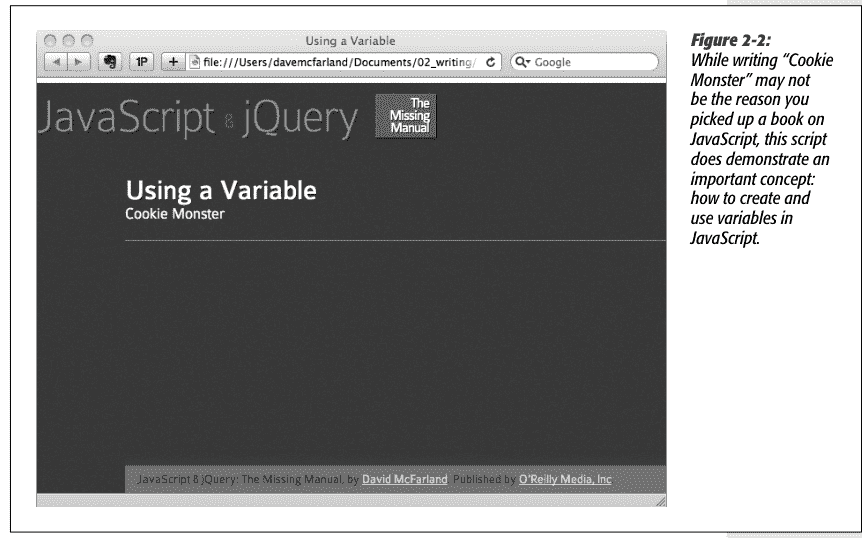

**图 2-2：** 虽然编写“Cookie Monster”可能不是你拿起一本 JavaScript 书的原因，但这个脚本确实演示了一个重要的概念：如何在 JavaScript 中创建和使用变量。

### 教程：询问信息

在上一个脚本中，你看到了如何创建变量，但你还没有体验到变量如何响应用户并产生独特的、定制的内容。在这个下一个教程中，你将学习如何使用 *prompt()* 命令从用户那里收集输入，并根据该输入更改页面的显示。

- 1. 在文本编辑器中，打开 *chapter02* 文件夹中的文件 *prompt.html*。

为了加快你的编程速度，`<script>` 标签已添加到此文件中。你会注意到有两组 `<script>` 标签：一组在 head 中，一组在 body 中。你即将添加的 JavaScript 将做两件事。首先，它将打开一个对话框，要求用户输入一个问题的答案；其次，在网页的正文中，将出现一条使用用户响应的定制消息。

2. 在文档 head 中的第一组 `<script>` 标签之间，输入加粗的代码：

`<script>`

`var name = prompt('What is your name?', '');`

`</script>`

*prompt()* 函数产生一个类似于 *alert()* 函数的对话框。但是，它不仅仅显示消息，*prompt()* 函数还可以检索答案（见图 2-3）。此外，要使用 *prompt()* 函数，你需要提供至少一个参数：一个字符串，该字符串将作为对话框中的问题或说明。
```


你在括号中输入以逗号分隔的两个字符串。图 2-3 展示了这两个字符串的变化情况：第一个字符串作为对话框的问题出现（在本例中为"What is your name?"）。

> **注意：** IE7 不允许你在未启用浏览器设置的情况下使用 *prompt()* 方法。幸运的是，IE7 正在迅速被淘汰。

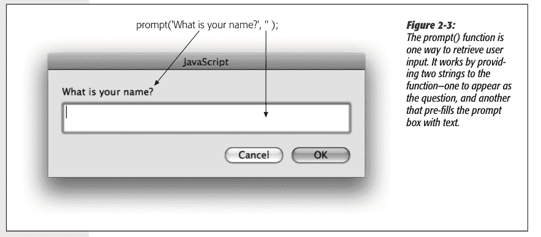

第二个字符串显示在访客输入的文本框中。本例使用了所谓的*空字符串*，它仅由两个单引号（''）组成，结果是一个空白的文本框。不过，你可以为第二个字符串提供有用的提示，例如"Please type both your first and last names"，它将显示在文本框中。不幸的是，访客需要先删除文本框中的这段文字，然后才能输入自己的信息。

*prompt()* 函数返回一个字符串，其中包含访客在对话框中输入的任何内容。在这行 JavaScript 代码中，该结果被存储到一个名为 *name* 的新变量中。

> **注意：** 许多函数会*返回*一个值。简单来说，这意味着函数在完成工作后会提供一些信息。你可以选择忽略这些信息，也可以将其存储到变量中以供后续使用。在本例中，*prompt()* 函数返回一个字符串，你将其存储在变量 *name* 中。

**3. 保存页面并在网页浏览器中预览。**

当页面加载时，你会看到一个对话框。请注意，在你填写对话框并点击确定之前，什么都不会发生——你甚至看不到网页。你还会注意到点击确定后也没有太大变化——那是因为此时你仅仅收集并存储了响应，还没有在页面上使用该响应。接下来你将进行这一步操作。

**4.** 返回你的文本编辑器。找到第二组 <script> 标签并添加粗体所示的代码：

```
<script>
document.write('<p>Welcome ' + name + '</p>');
</script>
```

这里你利用了访客提供的信息。与第 55 页的脚本一样，你将几个字符串——一个开头的段落标签和文本、变量的值，以及一个结尾的段落标签——组合在一起，并将结果打印到网页上。

**5.** 保存页面并在网页浏览器中预览。

当 Prompt 对话框出现时，输入一个名字并点击确定。请注意，你输入的名字会显示在网页中（图 2-4）。重新加载网页并输入一个新的名字——它会改变！就像一个优秀的变量应有的表现一样。

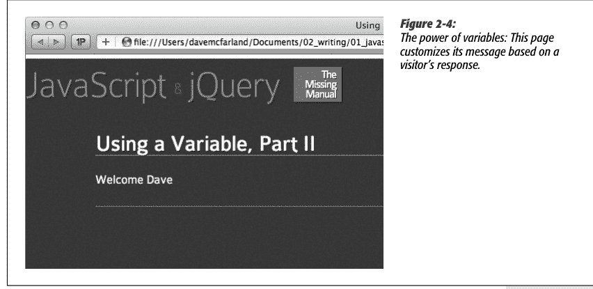

### 数组

简单变量，就像你在上一节中学到的那样，只能保存一条信息，例如一个数字或一个字符串值。当你只需要跟踪单一数据时，比如分数、年龄或总费用，它们非常合适。然而，如果你需要跟踪一组相关项目——比如一周中所有天的名称，或者网页上所有图片的列表——简单变量就不太方便了。

例如，假设你创建了一个 JavaScript 购物车系统来跟踪访客打算购买的商品。如果你想用简单变量来跟踪访客添加到购物车中的所有商品，你就必须编写这样的代码：

```
var item1 = 'Xbox 360';
var item2 = 'Tennis shoes';
var item3 = 'Gift certificate';
```

但如果她想添加更多商品呢？你就必须创建更多变量——*item4*、*item5*，依此类推。而且，因为你不知道访客可能想买多少商品，所以你真的不知道需要创建多少个变量。

幸运的是，JavaScript 提供了一种更好的方法来跟踪项目列表，称为*数组*。数组是一种将多个值存储在单个位置的方式。可以把数组想象成一张购物清单。当你需要去杂货店购物时，你会坐下来写一份要购买的物品清单。如果你前几天刚去购物过，清单上可能只有几样东西；但如果你的橱柜空空如也，购物清单可能会很长。不过，无论清单上有多少项目，它仍然只是一张清单。

没有数组的话，你必须为列表中的每个项目创建一个新变量。试想一下，如果你不能在一张纸上列出购物清单，而必须随身携带单独的纸条——每张纸条对应你要购买的一样东西。如果你想再添加一样要买的东西，就需要一张新纸条；然后你还需要在购物过程中跟踪每张纸条（参见图 2-5）。简单变量就是以这种方式工作的。但有了数组，你可以创建一个项目列表，甚至可以随时添加、删除或更改项目。

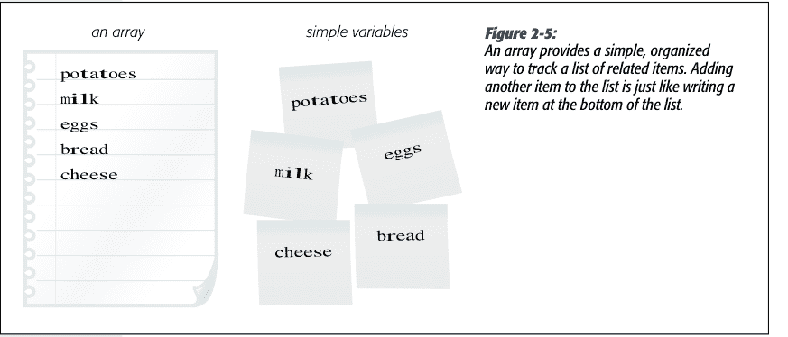

### 创建数组

要创建并在数组中存储项目，你首先需要声明数组的名称（就像声明变量一样），然后提供一个以逗号分隔的值列表：每个值代表列表中的一个项目。与变量一样，数组的命名取决于你自己，但你需要遵循第 46 页列出的相同命名规则。要创建一个数组，你需要将项目列表放在方括号之间——[ ]。例如，要创建一个包含星期缩写的数组，你可以编写以下代码：

```
var days = ['Mon', 'Tues', 'Wed', 'Thurs', 'Fri', 'Sat', 'Sun'];
```

方括号——[ ]——非常重要；它们告诉 JavaScript 解释器正在处理的是一个数组。你可以创建一个不包含任何元素的空数组，如下所示：

```
var playList = [];
```

创建空数组等同于第 45 页描述的声明变量。当你在程序运行之前不向数组添加项目时，你会创建一个空数组。例如，上述数组可能用于跟踪某人从网页列表中选择的歌曲——你事先不知道该人会选择哪些歌曲，因此你声明一个空数组，然后在该人选择音乐时用项目填充它。（向数组添加项目在第 63 页描述。）

> **注意：** 在浏览其他人的 JavaScript 程序（或其他 JavaScript 书籍）时，你可能会遇到另一种使用 *Array* 关键字创建数组的方式，如下所示：
> 
> ```
> var days = new Array('Mon', 'Tues', 'Wed');
> ```
> 
> 这种方法是有效的，但本书使用的方法（称为*数组字面量*）更受专业人士青睐，因为它需要更少的输入、更少的代码，而且被认为更"优雅"。

你可以在数组中存储任何混合类型的值。换句话说，数字、字符串和布尔值都可以出现在同一个数组中：

```
var prefs = [1, 223, 'www.oreilly.com', false];
```

> **注意：** 你甚至可以将数组和其他对象作为元素存储在数组内部。这种技术有助于存储复杂数据。

上面的数组示例展示了在单行中创建数组。然而，如果你有很多项目要添加，或者项目是较长的字符串，试图在单行中输入所有内容可能会使你的程序难以阅读。许多程序员使用的另一种选择是在多行中创建数组，如下所示：

```
var authors = [ 'Ernest Hemingway',
                'Charlotte Bronte',
                'Dante Alighieri',
                'Emily Dickinson'
              ];
```

正如第 49 页的提示框中提到的，JavaScript 解释器会跳过多余的空格和换行符，因此即使这段代码显示在五行中，它仍然只是一条语句，由最后一行末尾的分号表示。

> **提示：** 要使名称像上面那样对齐，你需要输入第一行——*var authors = [ 'Ernest Hemingway',*——按回车键，然后按空格键足够的次数来对齐下一个值，*'Charlotte Bronte'*。

### 访问数组中的项目

你可以直接使用变量名来访问简单变量的内容。例如，*alert(lastName)* 会打开一个警告框，显示存储在变量 *lastName* 中的值。然而，由于数组可以保存多个值，你不能仅使用数组名来访问其中包含的项目。一个唯一的数字，称为*索引*，表示数组中每个项目的位置。要访问数组中的特定项目，你需要使用该项目的索引号。例如，假设你创建了一个包含星期缩写的数组，并想打开一个显示第一个项目的警告框。你可以这样编写：

```
var days = ['Mon', 'Tues', 'Wed', 'Thurs', 'Fri', 'Sat', 'Sun'];
alert(days[0]);
```

这段代码会打开一个包含 'Mon' 的警告框。数组是*从零开始索引的*，这意味着数组中*第一个*项目的索引值为 0，*第二个*项目的索引值为 1：换句话说，用项目在列表中的位置减去一即可得到其索引值——第五个项目的索引是 5 减 1，即 4。零索引在刚开始编程时确实很令人困惑，因此表 2-4 展示了数组 *days*（来自上面的示例）的索引方式，以及它包含的值和如何访问每个值。

**表 2-4.** *数组中的项目必须使用等于其在列表中的位置减 1 的索引号来访问*

| 索引值 | 项目 | 访问项目的方式 |
|-------------|------|--------------|
| 0 | Mon | days[0] |
| 1 | Tues | days[1] |
| 2 | Wed | days[2] |
| 3 | Thurs | days[3] |
| 4 | Fri | days[4] |
| 5 | Sat | days[5] |
| 6 | Sun | days[6] |

你可以通过向索引位置赋新值来更改数组中项目的值。例如，要将新值放入数组 *days* 的第一个项目中，你可以这样编写：

```
days[0] = 'Monday';
```


### 数组

由于数组中最后一个项目的索引编号总是比数组中项目总数少一个，因此你只需知道数组中有多少个项目就能访问最后一个项目。幸运的是，这很简单，因为每个数组都有一个 `length` 属性，其中包含数组中项目的总数。要访问 `length` 属性，只需在数组名称后添加一个点号和 *length*：例如，*days.length* 会返回名为 *days* 的数组中的项目数量（如果你创建了一个不同的数组，比如 *playList*，你可以这样获取它的长度：*playList.length*）。所以，你可以使用这段巧妙的 JavaScript 代码来访问数组中存储在最后一个项目的值：

```
days[days.length-1]
```

这最后一段代码表明，你不必为索引提供一个字面数字（例如，*days[0]* 中的 0）。你也可以提供一个返回有效数字的等式。在这种情况下，*days.length – 1* 是一个简短的等式：它首先获取 *days* 数组中的项目数量（在这个例子中是 7），然后减去 1。所以，在这种情况下，*days[days.length-1]* 相当于 *days[6]*。

你也可以使用包含数字的变量作为索引：

```
var i = 0;
alert(days[i]);
```

这最后一行代码等同于 *alert(days[0])*。你会发现在处理循环时，这种技术特别有用，如下一章（第 93 页）所述。

### 向数组中添加项目

假设你创建了一个数组来跟踪用户在网页上点击的项目。每次用户点击页面，一个项目就被添加到数组中。JavaScript 提供了几种向数组添加内容的方法。

#### 向数组末尾添加项目

要向数组末尾添加一个项目，你可以使用第 62 页的索引表示法，使用一个比列表中最后一个项目索引值大 1 的索引值。例如，假设你已经创建了一个名为 *properties* 的数组：

```
var properties = ['red', '14px', 'Arial'];
```

此时，数组有三个项目。请记住，最后一个项目是通过比项目总数少 1 的索引来访问的，所以在这种情况下，该数组中的最后一个项目是 *properties[2]*。要添加另一个项目，你可以这样做：

```
properties[3] = 'bold';
```

这行代码将 *'bold'* 插入到数组的第四个位置，从而创建一个包含四个元素的数组：*['red', '14px', 'Arial', 'bold']*。注意，当你添加新项目时，你使用的索引值等于数组中当前元素的总数，因此你可以通过使用数组的 *length* 属性作为索引，确保总是在数组末尾添加项目。例如，你可以将上一行代码重写为：

```
properties[properties.length] = 'bold';
```

你也可以使用数组的 *push()* 命令，它将括号中你提供的任何内容添加到数组的末尾。与 *length* 属性一样，你可以通过在数组名称后添加一个点号和 *push()* 来应用 *push()*。例如，这是另一种向 *properties* 数组末尾添加项目的方法：

```
properties.push('bold');
```

你在括号内提供的任何内容（在本例中是字符串 'bold'）都会作为新项目添加到数组的末尾。你可以使用任何类型的值，比如字符串、数字、布尔值，甚至是一个变量。

*push()* 命令的一个优点是它允许你一次向数组添加多个项目。例如，假设你想向名为 *properties* 的数组末尾添加三个值，你可以这样做：

```
properties.push('bold', 'italic', 'underlined');
```

#### 向数组开头添加项目

如果你想向数组的开头添加一个项目，请使用 *unshift()* 命令。这是一个将 *bold* 值添加到 *properties* 数组开头的例子：

```
var properties = ['red', '14px', 'Arial'];
properties.unshift('bold');
```

这段代码运行后，数组 *properties* 包含四个元素：['bold', 'red', '14px', 'Arial']。与 *push()* 一样，你可以使用 *unshift()* 在数组开头插入多个项目：

```
properties.unshift('bold', 'italic', 'underlined');
```

> **注意：** 确保你使用数组的 *名称*，后跟一个点号和你希望使用的方法。换句话说，*push('new item')* 不会起作用。你必须先使用数组的名称（你在创建数组时赋予它的任何名称），后跟一个点号，然后是方法，像这样：*authors.push('Stephen King');*。

#### 选择如何向数组添加项目

到目前为止，本章已经向你展示了三种向数组添加项目的方法。表 2-5 比较了这些技术。这些命令中的每一个都完成了类似的任务，因此你选择哪一个取决于你程序的情况。如果项目在数组中存储的顺序无关紧要，那么这些方法中的任何一个都可以使用。例如，假设你有一个产品图片页面，点击一张图片就会将产品添加到购物车中。你使用一个数组来存储购物车中的项目。项目在购物车（或数组）中出现的顺序并不重要，因此你可以使用这些技术中的任何一种。

然而，如果你创建了一个数组来跟踪某事发生的顺序，那么你选择的方法就很重要了。例如，假设你创建了一个页面，让访客通过点击页面上的歌曲名称来创建歌曲播放列表。由于播放列表按歌曲应播放的顺序列出歌曲，因此顺序很重要。

所以，如果每次访客点击一首歌曲，该歌曲的名称都应该放在播放列表的末尾（这样它将是最后播放的歌曲），那么请使用 push() 方法。

**表 2-5. 向数组添加元素的各种方法**

| 方法 | 原始数组 | 示例代码 | 结果数组 | 解释 |
| :--- | :--- | :--- | :--- | :--- |
| .length 属性 | var p = [0,1,2,3] | p[p.length]=4 | [0,1,2,3,4] | 向数组末尾添加一个值。 |
| push() | var p = [0,1,2,3] | p.push(4,5,6) | [0,1,2,3,4,5,6] | 向数组末尾添加一个或多个项目。 |
| unshift() | var p = [0,1,2,3] | p.unshift(4,5) | [4,5,0,1,2,3] | 向数组开头添加一个或多个项目。 |

push() 和 unshift() 命令会返回一个值。具体来说，一旦 push() 和 unshift() 完成它们的任务，它们就会提供数组中的项目数量。这里有一个例子：

```
var p = [0,1,2,3];
var totalItems = p.push(4,5);
```

这段代码运行后，存储在 `totalItems` 中的值是 6，因为 `p` 数组中有六个项目。

**高级用户诊所**
**创建一个队列**

用于向数组添加项目的方法（push() 和 unshift()）以及用于从数组中删除项目的方法（pop() 和 shift()）经常一起使用，以提供一种按项目创建顺序访问它们的方式。一个经典的例子是音乐播放列表。你通过向列表中添加歌曲来创建列表；然后，当你播放每首歌时，它就会从列表中被移除。歌曲按照它们在列表中出现的顺序播放，因此第一首歌曲被播放，然后从列表中移除。这种安排类似于电影院的排队。当你到达电影院时，你排在队伍的末尾；当电影即将开始时，门打开了，队伍中的第一个人是第一个进去的。

在编程圈子里，这个概念被称为 FIFO，即“先进先出”。你可以使用数组以及 push() 和 shift() 命令来模拟这种安排。例如，假设你有一个名为 playlist 的数组。要向列表末尾添加一首新歌，你会使用 push()，像这样：

```
playlist.push('Yellow Submarine');
```

要获取下一首应该播放的歌曲，你需要获取列表中的第一个项目，像这样：

```
nowPlaying = playlist.shift();
```

这段代码从数组中移除第一个项目并将其存储在名为 `nowPlaying` 的变量中。FIFO 概念对于创建和管理队列非常有用，例如播放列表、待办事项列表或图片幻灯片。


#### 教程：使用数组向网页写入内容

#### 从数组中删除项目

如果你想从数组的末尾或开头删除一个项目，请使用 `pop()` 或 `shift()` 命令。这两个命令都会从数组中移除一个项目：`pop()` 命令移除数组末尾的项目，而 `shift()` 则移除开头的项目。表 2-6 比较了这两种方法。

*表 2-6.* 从数组中删除项目的两种方法

| 方法 | 原始数组 | 示例代码 | 结果数组 | 解释 |
| :--- | :--- | :--- | :--- | :--- |
| pop() | var p = [0,1,2,3] | p.pop() | [0,1,2] | 从数组中移除最后一个项目。 |
| shift() | var p = [0,1,2,3] | p.shift() | [1,2,3] | 从数组中移除第一个项目。 |

与 `push()` 和 `unshift()` 类似，`pop()` 和 `shift()` 在完成从数组中删除项目的任务后，会返回一个值。事实上，它们返回的是刚刚移除的值。所以，例如，下面的代码会移除一个值并将其存储在变量 `removedItem` 中：

```javascript
var p = [0,1,2,3];
var removedItem = p.pop();
```

执行此代码后，`removedItem` 的值为 3，而数组 `p` 现在包含 [0,1,2]。

> **注意：** 本章的文件中包含一个可以让你交互式测试不同数组命令的网页。它名为 `array_methods.html`，位于 `testbed` 文件夹中。在网页浏览器中打开该文件，点击网页上的各种按钮，即可了解数组方法的工作原理。（顺便一提，那个页面所有酷炫的交互功能都归功于 JavaScript。）

#### 教程：使用数组向网页写入内容

你将在本书的许多脚本中使用数组，但为了快速体验创建和使用数组，请尝试这个简短的教程。

> **注意：** 关于如何下载教程文件，请参见第 29 页的说明。

1.  在文本编辑器中，打开 `chapter02` 文件夹中的 `arrays.html` 文件。

    你将从简单地创建一个包含四个字符串的数组开始。与前面的教程一样，这个文件在 head 和 body 区域都已经包含了 `<script>` 标签。

2.  在第一组 `<script>` 标签之间，输入加粗的代码：

```javascript
<script>
var authors = [ 'Ernest Hemingway',
                'Charlotte Bronte',
                'Dante Alighieri',
                'Emily Dickinson'
              ];
</script>
```

这段代码包含一条 JavaScript 语句，但被分成了五行。创建它时，输入第一行——`var authors = [ 'Ernest Hemingway',`——按下回车键，然后按空格键，直到你与 `[` 对齐（大约 16 个空格），然后输入 `'Charlotte Bronte',`。

> **注意：** 大多数 HTML 编辑器对你的 HTML 和 JavaScript 代码使用 *等宽* 字体，如 Courier 或 Courier New。在等宽字体中，每个字符的宽度都相同，因此很容易对齐列（如本例中的所有作者姓名）。如果你的文本编辑器不使用 Courier 或类似字体，你可能无法完美地对齐这些名称。

正如第 61 页所提到的，当你创建一个包含大量元素的数组时，如果将其分成几行书写，可以使你的代码更易于阅读。你可以判断出这是一条语句，因为直到第 5 行末尾才有分号。

这行代码创建了一个名为 `authors` 的数组，并将四位作者的名字（四个字符串值）存储到该数组中。接下来，你将访问数组中的一个元素。

3.  找到第二组 `<script>` 标签，并添加加粗的代码：

```javascript
<script>
document.write('<p>The first author is <strong>');
document.write(authors[0] + '</strong></p>');
</script>
```

第一行以一些文本和一个开始的 `<strong>` 标签开始一个新段落——这只是普通的 HTML。下一行打印存储在 authors 数组第一项中的值，并打印结束的 `</strong>` 和 `</p>` 标签以创建一个完整的 HTML 段落。要访问数组中的第一个项目，你使用 0 作为索引——`authors[0]`——而不是 1。

此时，最好保存你的文件并在网页浏览器中预览它。你应该会在屏幕上看到 "The first author is **Ernest Hemingway**"。如果没有看到，你可能在步骤 2 或 3 创建数组时出现了拼写错误。

> **注意：** 记得使用浏览器中的错误控制台（在第 34 页描述）来帮助你定位任何 JavaScript 错误的来源。

4.  返回你的文本编辑器，并在你的脚本下方添加以下两行代码：

    ```javascript
    document.write('<p>The last author is <strong>');
    document.write(authors[4] + '</strong></p>');
    ```

    这一步与前一步几乎相同，只是你打印的是不同的数组项目。保存页面并在浏览器中预览。你会看到 "undefined" 出现在作者姓名的位置（见图 2-6）。别担心；这是有意为之的。记住，数组的索引值从 0 开始，所以最后一项实际上是数组中的项目总数减 1。在这种情况下，authors 数组中存储了四个字符串，所以最后一项实际上应该通过 `authors[3]` 来访问。

> **注意：** 如果你尝试使用一个不存在的索引值来读取一个项目的值，你最终会得到 JavaScript 的 "undefined" 值。这仅仅意味着在该索引位置没有存储任何值。

幸运的是，无论数组中存储了多少个项目，都有一个简单的方法来检索数组中的最后一个项目。

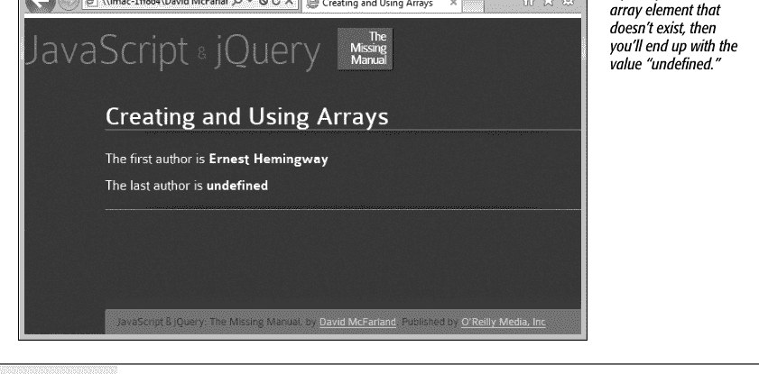

5.  返回你的文本编辑器并编辑你刚刚输入的代码。擦除数字 4，并在其位置添加加粗的代码：

    ```javascript
    document.write('<p>The last author is <strong>');
    document.write(authors[authors.length-1] + '</strong></p>');
    ```

    正如你在“向数组添加项目”中回顾的那样，数组的 length 属性存储了数组中的项目数量。因此，可以用这行代码找到 authors 数组中的项目总数：`authors.length`。在脚本的这个位置，结果是 4。

    既然知道数组中最后一项的索引值总是比数组中的项目总数少 1，你只需从总数中减去 1 即可得到最后一项的索引号：`authors.length-1`。在访问数组中的最后一项时，你可以提供这个小等式作为索引值：`authors[authors.length-1]`。

    最后，你将向数组的开头添加一个新项目来完成这个教程。

6.  在步骤 5 中添加的代码之后再添加一行代码：

    ```javascript
    authors.unshift('Stan Lee');
    ```

    正如你在第 64 页读到的，`unshift()` 方法将一个或多个项目添加到数组的开头。这行代码运行后，authors 数组现在将是 ['Stan Lee', 'Ernest Hemingway', 'Charlotte Bronte', 'Dante Alighieri', 'Emily Dickinson']。

    最后，你将在页面上打印出新添加的项目。

7.  添加另外三行（如下加粗所示），使你的最终代码如下所示：

    ```javascript
    document.write('<p>The first author is <strong>');
    document.write(authors[0] + '</strong></p>');
    document.write('<p>The last author is <strong>');
    document.write(authors[authors.length-1] + '</strong></p>');
    authors.unshift('Stan Lee');
    document.write('<p>I almost forgot <strong>');
    document.write(authors[0]);
    document.write('</strong></p>');
    ```

    保存文件并在网页浏览器中预览。你应该会看到类似图 2-7 的内容。如果没有看到，记住你网页浏览器中的错误控制台可以帮助你定位错误（第 34 页）。

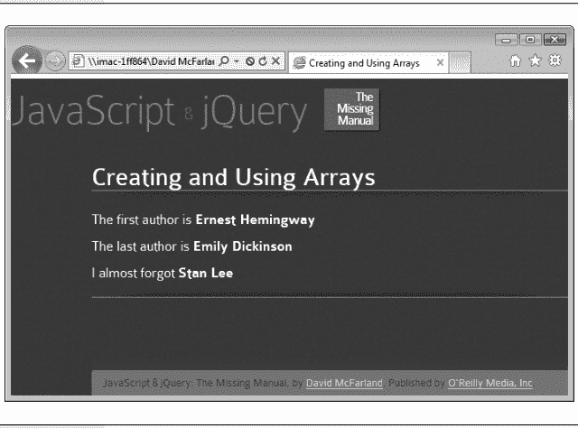

#### 一个快速的对象课

到目前为止，在本书中，你已经学会了可以使用 `document.write()` 命令向网页写入内容，并且要知道数组中有多少个项目，你需要输入数组的名称，后跟一个点和单词 "length"，就像这样：`days.length`。你可能想知道这些点是什么意思。你已经学习了三章，还没有学习 JavaScript 语法这个特性的具体内容，现在是时候讲解它们了。

你可以将 JavaScript 语言的许多元素以及网页的元素概念化为 *对象*。当然，现实世界也充满了对象，比如一只狗或一辆车。大多数对象由不同的部分组成：一只狗有尾巴、头和四条腿；一辆车有门、轮子、大灯、喇叭等等。一个对象也可能做某些事情——车可以运送乘客，狗可以吠叫。事实上，即使一个对象的一部分也可以做一些事情：例如，尾巴可以摇动，喇叭可以鸣响。表 2-7 展示了一种显示对象、它们的部分和动作之间关系的方法。

*表 2-7.* 一个简化的世界视图

| 对象 | 部分 | 动作 |
| :--- | :--- | :--- |
| 狗 | | 吠叫 |
| | 尾巴 | 摇动 |
| 汽车 | | 运送 |
| | 喇叭 | 鸣响 |


JavaScript 的世界同样充满了对象：浏览器窗口、文档、字符串、数字和日期等都只是其中的几个例子。就像现实世界中的物体一样，JavaScript 对象也由不同的部分组成。用编程术语来说，对象的各个部分被称为*属性*。对象能够执行的操作被称为*方法*，它们是特定于某个对象的函数（就像内置的 *alert()* 函数一样）（参见表 2-8）。

> **注意：** 你可以很容易地区分方法和属性，因为方法以括号结尾，例如：*write()*。

JavaScript 中的每个对象都有自己的一套属性和方法。例如，数组对象有一个名为 *length* 的属性，而 document 对象有一个名为 *write()* 的方法。要访问对象的属性或执行其方法，你需要使用*点语法*——就是那些点号！点（句号）将对象与其属性或方法连接在一起。例如，*document.write()* 表示"运行 document 对象的 *write()* 方法。"如果现实世界也像这样运作的话，你就可以这样让狗摇尾巴：*dog.tail.wag()*。（当然，在现实世界中，一块狗零食效果要好得多。）

**表 2-8.** *两个 JavaScript 对象的一些方法和属性：document 对象和数组。*

| Object | Property | Method |
|---|---|---|
| document | title | |
| | url | |
| | | write() |
| ['Kate','Graham','Sam'] | length | |
| | | push() |
| | | pop() |
| | | unshift() |

就像你在现实世界中可能拥有好几只狗一样，你的 JavaScript 程序也可以拥有同一种对象的多个版本。例如，假设你像这样创建了两个简单的变量：

```
var first_name = 'Jack';
var last_name = 'Hearts';
```

实际上你创建了两个不同的*字符串*对象。字符串有自己的一套属性和方法，与日期等其他对象的方法和属性不同（你将在第 450 页学习其中一些属性和方法）。当你创建一个对象（也称为创建该对象的*实例*）时，你就可以访问该对象的所有属性和方法。

**注意：** 你之前已经遇到过另一个对象——称为 window 对象——它代表浏览器窗口本身。它基本上是网页以及页面上所有其他内容的容器对象。例如，*alert()* 和 *prompt()* 都是 window 对象的方法，可以写成这样：*window.alert()* 和 *window.prompt()*。然而，由于 window 对象在网页中始终存在，你可以省略它的名字，所以 *alert('hello')* 和 *window.alert('hello*)* 的效果是一样的。

每当你创建一个新变量并在其中存储一个值时，你实际上是在创建某种类型对象的一个新实例。因此，下面每一行 JavaScript 代码都创建了不同类型的 JavaScript 对象：

```
var first_name = 'Bob'; // a string object
var age = 32; // a number object
var valid = false; // a Boolean object
```

事实上，当你改变存储在变量中的信息类型时，你也改变了它的对象类型。例如，如果你创建了一个名为 *data* 的变量来存储一个数组，然后在该变量中存储一个数字，你就已经将该变量的类型从数组更改为数字对象：

```
var data = false; // a Boolean object
data = 32; // changes to number object
```

对象、属性、方法和点语法这些概念乍一看可能有些奇怪。然而，由于它们是 JavaScript 工作原理的基本部分，也是使用 jQuery 的核心，你会很快习惯它们的。

**提示：** JavaScript 包含一个特殊的关键字，用于确定对象的类型（字符串、数字、布尔值等）。它叫做 *typeof* 运算符，放在变量前面来确定该变量中对象的类型。例如：

```
var data = 32;
alert(typeof data); // "number" appears in alert window
```

在继续阅读本书时，请记住以下几个事实：

- JavaScript 的世界中存在着许多不同类型的对象。
- 每个对象都有自己的属性和方法。
- 你使用点语法来访问对象的属性或激活对象的方法：例如 *document.write()*。

### 注释

有时候你在编程过程中，感觉自己理解程序中发生的一切。每一行代码都有意义，而且更好的是，它能正常运行！但一两个月后，当你老板或客户要求你对你曾经写过的那个很酷的脚本进行修改或添加新功能时，你可能会发现自己看着曾经熟悉的 JavaScript 时抓耳挠腮：那个变量是干什么用的？我为什么要那样编写？程序的这一部分到底在做什么？

很容易忘记一个程序是如何工作的，以及你为什么以那种方式编写代码。幸运的是，大多数编程语言都提供了一种方式，让程序员可以为自己或其他可能查看他们代码的程序员留下笔记。JavaScript 允许你在代码中留下*注释*。如果你用过 HTML 或 CSS 的注释，这些应该会很熟悉。注释就是一行或多行的笔记：JavaScript 解释器会忽略它们，但它们可以提供关于程序如何工作的宝贵信息。

要创建单行注释，在注释前加上双斜杠：

```
// this is a comment
```

你也可以在 JavaScript 语句之后添加注释：

```
var price = 10; // set the initial cost of the widget
```

JavaScript 解释器会执行这行上的所有内容，直到遇到 //，然后跳到下一行的开头。

你也可以通过以 /* 开头、以 */ 结尾来添加多行注释。（这些与 CSS 使用的注释类型相同。）JavaScript 解释器会忽略这两组符号之间的所有文本。例如，假设你想在代码的开头对程序的工作方式进行描述。你可以这样做：

```
/*
    JavaScript Slideshow:
    This program automates the display of
    images in a pop-up window.
*/
```

你也不需要将 /* 和 */ 放在单独的行上。实际上，你可以用它们来创建单行 JavaScript 注释：

```
/* this is a single line comment */
```

一般来说，如果你只想写一个简短的单行注释，使用 //。如果要写多行注释，则使用 /* 和 */ 的组合。

#### 何时使用注释

注释对于中等长度或复杂、并且你希望将来继续使用（也许还会修改）的程序来说，是一个非常有价值的工具。虽然到目前为止你学到的简单脚本只有一两行代码，但你最终将创建更长、更复杂的程序。为了确保你能快速搞清楚脚本中发生了什么，最好添加注释来帮助你理解程序的整体逻辑，并解释任何特别令人困惑或复杂的部分。

> **注意：** 在脚本中添加大量注释会使脚本变大（下载速度也会变慢）。通常，你添加到脚本中的注释量不会显著增加文件大小。但是，如果你想从文件中挤出每一个不必要的字节，第 465 页展示了使 JavaScript 文件更小、更快的方法。

### 注释

许多程序员在外部 JavaScript 文件的开头添加一段注释块。这些注释可以解释脚本的用途、标明脚本的创建日期、为频繁更新的脚本包含版本号，以及提供版权信息。

例如，在 jQuery 库的 JavaScript 文件开头，你会找到这样的注释：

```
/*!
 * jQuery JavaScript Library v1.6.3
 * http://jquery.com/
 *
 * Copyright 2011, John Resig
 * Dual licensed under the MIT or GPL Version 2 licenses.
 * http://jquery.org/license
 *
 * Includes Sizzle.js
 * http://sizzlejs.com/
 * Copyright 2011, The Dojo Foundation
 * Released under the MIT, BSD, and GPL Licenses.
 *
 * Date: Wed Aug 31 10:35:15 2011 -0400
 */
```

在脚本的开头，你可能还会包含关于如何使用该脚本的说明：可能需要设置的变量、为了让脚本正常工作可能需要对 HTML 进行的特殊处理等等。

你还需要在一系列复杂的编程步骤之前添加注释。例如，假设你编写了一个脚本，让图片在访问者的浏览器窗口中移动。脚本的一部分是确定图片在浏览器窗口中的当前位置。这可能需要好几行代码；在这个程序部分之前放置一个注释是个好主意，这样当你以后查看脚本时，你就会确切地知道这部分程序的作用：

```
// determine x and y positions of image in window
```

基本的经验法则是：在任何你认为将来会有帮助的地方添加注释。如果一行代码的意义一目了然，你可能就不需要注释。例如，没有必要为像 `alert('hello')` 这样的简单代码添加注释，因为它做什么是相当明显的（打开一个包含 "hello" 字样的警告框）。

#### 本书中的注释

注释在解释 JavaScript 时也非常有帮助。在本书中，注释经常用来解释一行编程代码的作用，或者指出某个特定语句的结果。例如，你可能会看到如下注释来显示 alert 语句的结果：

```
var a = 'Bob';
var b = 'Smith';
alert( a + ' ' + b); // 'Bob Smith';
```


第三行末尾的注释说明了当你在网页浏览器中预览这段代码时应该看到什么。如果你想通过将本书中读到的代码添加到网页上并在浏览器中查看来测试它，那么在网页中输入代码时可以省略这类注释。这类注释仅仅是为了帮助你在阅读本书时理解代码中发生了什么。

同样，当你开始学习JavaScript中一些更复杂的命令时，你将开始操作变量中的数据。你经常会在本书的代码中看到注释，用来显示命令运行后应该存储在变量中的内容。例如，*charAt()* 命令可以让你选择字符串中特定位置的一个字符。当你在本节中阅读如何使用该命令时，你可能会看到如下代码：

```
var x = "Now is the time for all good programmers.";
alert(x.charAt(2)); // 'w'
```

第二行末尾的注释 `// 'w'` 表示如果这段代码在网页浏览器中实际运行，你应该在警告对话框中看到什么。（是的，'w' 是正确的。在计算字符串中的字母时，第一个字母被计为第0个字符。因此 *charAt(2)* 检索的是字符串中的*第三个*字符。有时候编程就是会让你伤脑筋。）

## 第3章
为程序添加逻辑与控制

到目前为止，你已经学习了JavaScript的一些基本构建模块。但仅仅创建一个变量并在其中存储一个字符串或数字并不能做很多事情。而且，如果无法方便地遍历数组中的项目，那么构建一个包含大量项目的数组也不会很有用。在本章中，你将学习如何通过使用条件语句、循环和函数，让你的程序做出智能反应并更高效地工作。

### 让程序做出智能反应

我们的生活中充满了选择："今天我应该穿什么？"、"午餐应该吃什么？"、"周五晚上应该做什么？"等等。你做出的许多选择都取决于其他情况。例如，假设你决定在周五晚上去看电影。你可能会问自己一连串问题，比如"有什么好看的电影在上映吗？"、"有电影在我想要的时间放映吗？"、"我有足够的钱去看电影（并买一袋17美元的爆米花）吗？"

假设正好有一部电影在你想去的时间放映。接着你会问自己一个简单的问题："我有足够的钱吗？"如果答案是肯定的，你就会出门去看电影。如果答案是否定的，你就不会去

### 让程序做出智能反应

智能地反应。你在编程中会无数次地使用它们，但为了清楚地了解它们的用途，以下是几个它们能派上用场的例子：

- **表单验证。** 当你想确保某人填写了表单中所有必填字段（"姓名"、"地址"、"电子邮件"等）时，你会使用条件语句。例如，如果"姓名"字段为空，则不提交表单。
- **拖放。** 如果你在网页中添加了拖动元素的功能，你可能想要检查访问者将元素拖放到了页面的哪个位置。例如，如果他将图片拖放到了垃圾桶图片上，你就让这张照片从页面上消失。
- **评估输入。** 假设你弹出一个窗口询问访问者一个问题，比如"你愿意回答几个关于这个网站有多棒的问题吗？"你会希望脚本根据访问者的不同回答做出不同的反应。

图3-1展示了一个使用条件语句的应用程序示例。

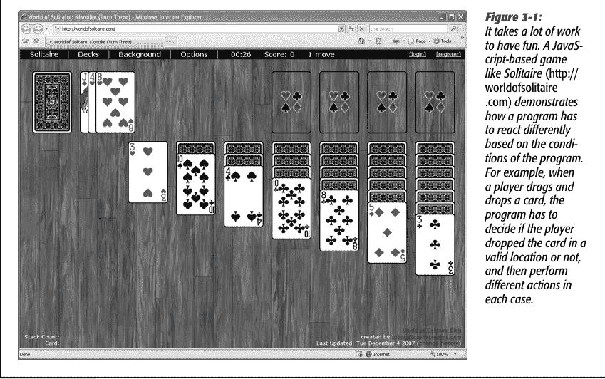

### 条件语句基础

条件语句也被称为"if/then"语句，因为它们只在问题的答案为真时才执行一项任务：*"如果我有足够的钱，那我就去看电影。"* 条件语句的基本结构如下：

```
if ( condition ) {
    // some action happens here
}
```

这个语句有三个部分：*if* 表示后面的代码是一个条件语句；括号内包含一个"是或否"的问题，称为*条件*（稍后详细介绍）；而大括号（{ }）则标记了如果条件为真应该执行的JavaScript代码的开始和结束。

> **注意：** 上面列出的代码中，"// some action happens here" 是一个JavaScript注释。它不是实际运行的代码，只是留在程序中的一个备注，在这个例子中，它向你——读者——指出了代码的那部分应该放什么。有关注释的更多内容，请参见第72页。

在很多情况下，条件是两个值之间的比较。例如，假设你创建了一个游戏，当分数超过100分时玩家获胜。在这个程序中，你需要一个变量来跟踪玩家的分数，并且在某个时刻需要检查该分数是否超过100分。在JavaScript中，检查玩家是否获胜的代码可能如下：

```
if (score > 100) {
  alert('You won!');
}
```

重要的部分是 *score > 100*。这个短语就是条件，它只是测试存储在 *score* 变量中的值是否大于100。如果是，那么会弹出一个"You won!"对话框；如果玩家的分数小于或等于100，那么JavaScript解释器会跳过警告并转到程序的下一部分。图3-2提供了这个过程的可视化说明。

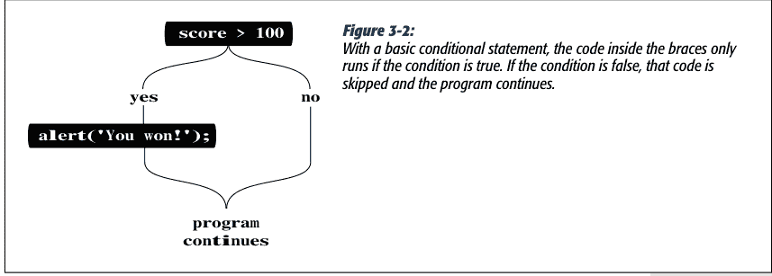

除了 >（大于）之外，还有其他几个用于比较数字的运算符（参见表3-1）。

**提示：** 在一对大括号内的每一行JavaScript代码前输入两个空格（或按一次Tab键）。这些空格（或制表符）会缩进这些行，使其更容易看到开始和结束的大括号，并弄清楚哪些代码属于条件语句内部。两个空格是一种常见做法，但如果四个空格让你的代码更易于阅读，那就使用四个空格。本书中的示例始终缩进大括号内的代码。

#### **表3-1.** 在条件语句中使用这些比较运算符来测试值

| 比较运算符 | 含义 |
| --- | --- |
| == | **等于。** 比较两个值，看它们是否相同。可用于比较数字或字符串。 |
| != | **不等于。** 比较两个值，看它们是否不同。可用于比较数字或字符串。 |
| === | **严格等于。** 不仅比较值，还比较值的类型。换句话说，两个值必须具有相同的类型——字符串、数字或布尔值——条件才为真。例如，虽然 '2'==2 为真，但 '2'===2 不为真，因为第一个值在引号内（字符串），而第二个是数字。你应该小心使用这个运算符，因为表单中的值——即使是数字——始终是字符串，所以使用严格相等来比较从表单字段获取的数字和数字（'2'===2）将为假。 |
| !== | **严格不等于。** 与严格等于类似，比较值和类型。例如，虽然 '2' != 2 为假，但 '2' !== 2 为真，因为虽然值相同，但类型不同。 |
| > | **大于。** 比较两个数字，检查左边的数字是否大于右边的数字。例如，2 > 1 为真，因为2比1大，但 2 > 3 为假，因为2不大于3。 |
| < | **小于。** 比较两个数字，检查左边的数字是否小于右边的数字。例如，2 < 3 为真，因为2比3小，但 2 < 1 为假，因为2不小于1。 |
| >= | **大于或等于。** 比较两个数字，检查左边的数字是否大于或等于右边的数字。例如，2 >= 2 为真，因为2等于2，但 2 >= 3 为假，因为2不大于3，也不等于3。 |
| <= | **小于或等于。** 比较两个数字，检查左边的数字是否小于或等于右边的数字。例如，2 <= 2 为真，因为2等于2，但 2 <= 1 为假，因为2不小于1，也不等于1。 |

更常见的情况是，你会测试两个值是否相等或不等。例如，假设你创建了一个基于JavaScript的测验，其中一道题问："土星有多少颗卫星？" 答题者的答案存储在一个名为 *answer* 的变量中。你可以这样写一条条件语句：


```
if (answer == 31) {
    alert('Correct. Saturn has 31 moons.');
}
```

双等号（==）不是打字错误；它指示 JavaScript 解释器比较两个值并判断它们是否相等。正如你在上一章中学到的，在 JavaScript 中，单个等号是*赋值运算符*，用于将一个值存入变量：

```
var score = 0; //将 0 存入变量 score
```

由于 JavaScript 解释器已经为单个等号赋予了特殊含义，所以当你想要比较两个值以确定它们是否相等时，需要使用两个等号。

你还可以使用 ==（称为*相等运算符*）来检查两个字符串是否相同。例如，假设你让用户在表单中输入一种颜色，如果他输入了*red*，那么你将页面的背景颜色改为红色。对此你可以使用条件运算符：

```
if (enteredColor == 'red') {
    document.body.style.backgroundColor='red';
}
```

**注意：** 在上述代码中，暂时不要担心页面颜色是如何改变的。你将在第 143 页学习如何使用 JavaScript 动态控制 CSS 属性。

你还可以使用*不等运算符*来测试两个值是否不相同：

```
if (answer != 31) {
    alert("Wrong! That's not how many moons Saturn has.");
}
```

感叹号表示"不"，所以 != 的意思是"不等于"。在这个例子中，如果存储在*answer*中的值不是 31，那么可怜的答题者就会看到这条带有侮辱性的警告消息。

条件为真时运行的代码并不仅限于像前面例子中的单行代码。你可以在开括号 `{` 和闭括号 `}` 之间放置任意多行 JavaScript 代码。例如，作为 JavaScript 测验示例的一部分，你可能想要持续记录答题者答对了多少题。所以，当土星问题答对时，你还想给答题者的总分加 1。你可以在条件语句中这样做：

```
if (answer == 31) {
    alert('Correct. Saturn has 31 moons.');
    numCorrect += 1;
}
```

**注意：** 如第 54 页所述，上面的代码行——*numCorrect += 1*——只是将当前变量*numCorrect*中的值加 1。

你还可以在大括号之间添加更多 JavaScript 代码行——任何在条件为真时应该运行的代码。

### 添加备选方案

但如果条件为假呢？上一节中的基本条件语句对于结果为假的条件没有备选方案。在现实世界中，当你决定周五晚上做什么而却没有足够的钱看电影时，你会想要做些*别的*。*if*语句有自己的一种备选方案，称为*else 子句*。例如，假设作为 JavaScript 测试脚本的一部分，当答题者答对或答错时，你想要通知他。你可以这样做：

## 高级用户诊所

### 布尔值的回归

在第 44 页，你学习了布尔值——*true*和*false*。布尔值一开始可能看起来不太有用，但当你开始使用条件语句时，你会发现它们至关重要。事实上，由于条件实际上只是一个"是或否"的问题，这个问题的答案就是一个布尔值。例如，看看下面的代码：

```
var x = 4;
if ( x == 4 ) {
    //do something
}
```

第一行代码将数字 4 存入变量 x 中。下一行的条件是一个简单的问题：存储在 x 中的值是否等于 4？在这个例子中，确实是，所以大括号中的 JavaScript 代码运行。但这里真正发生在括号内部的是：JavaScript 解释器将条件转换为布尔值；用编程术语来说，解释器*评估*该条件。如果条件评估为*true*（意味着问题的答案是"是"），那么大括号中的代码运行。然而，如果条件评估为*false*，那么大括号中的代码将被跳过。

布尔值的一个常见用途是创建所谓的*标志*——一个标记某事是否为真的变量。例如，当验证一个充满访客提交信息的表单时，你可能一开始创建一个值为*true*的*valid*变量——这意味着你首先假设他们正确填写了表单。然后，你会遍历每个表单字段，如果任何字段缺少信息或信息类型错误，你将*valid*的值改为*false*。在检查完所有表单字段后，你测试存储在*valid*中的内容，如果它仍然是 true，你就提交表单。如果不是 true（意味着一个或多个表单字段留空），你显示一些错误消息并阻止表单提交：

```
var valid = true;
// 这里有很多其他的编程内容
// 如果一个字段有问题，那么你将
// valid 设为 false
if (valid) {
    //submit form
} else {
    //print lots of error messages
}
```

```
if (answer == 31) {
  alert('Correct. Saturn has 31 moons.');
  numCorrect = numCorrect + 1;
} else {
  alert("Wrong! That's not how many moons Saturn has.");
}
```

这段代码建立了一个"二选一"的情况；只会出现两条消息中的一条（见图 3-3）。如果数字 31 存储在变量*answer*中，那么显示"正确"的警告；否则，显示"错误"的警告。

要创建一个*else*子句，只需在条件语句的闭括号 `}` 后添加 "else"，再加上另一对大括号。在括号之间添加当条件结果为假时应该执行的代码。同样，你可以在*else*子句中包含任意多行代码。

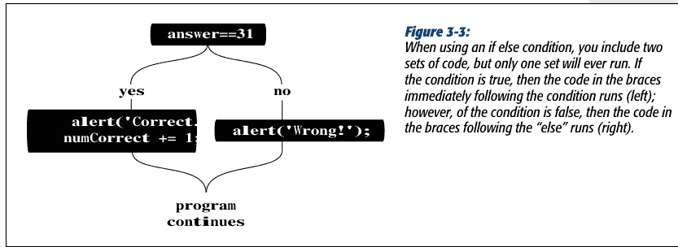

### 测试多个条件

有时你想要测试多个条件并有多个可能的结果：想象这就像游戏节目，主持人说"1 号门、2 号门或 3 号门后的奖品，你想要哪个？"你只能选一个。在你的日常活动中，你也经常面临这样的多重选择。

例如，回到"周五晚上我该做什么？"这个问题。你可以根据你有多少钱以及愿意花多少钱来扩展你的娱乐选项。例如，你可以先说："如果我有超过 $50，我就出去吃一顿好的晚餐并看电影（还要吃爆米花）。"如果你没有 $50，你可以尝试另一个测试："如果我有 $35 或更多，我就去好好吃一顿晚餐。"如果你没有 $35，那么你说："如果我有 $12 或更多，我就去看电影。"最后，如果你没有 $12，你可能会说："那我就待在家里看电视吧。"多么美好的周五夜晚！

JavaScript 让你使用*else if*语句执行同样的级联逻辑。它的工作原理如下：你以*if*语句开始，这是选项 1；然后添加一个或多个*else if*语句来提供可以触发额外选项的额外问题；最后，你使用*else*子句作为后备方案。以下是 JavaScript 中的基本结构：

```
if (condition) {
  // door #1
} else if (condition2) {
  // door #2
} else {
  // door #3
}
```

这个结构就是你创建 JavaScript"周五夜晚规划器"程序所需的全部。它询问访客有多少钱，然后决定他们周五应该做什么（听起来很熟悉吗？）。你可以使用第 57 页学到的*prompt()*命令来收集访客的回应，并使用一系列*if/else if*语句来决定他应该做什么：

```
var fridayCash = prompt('How much money can you spend?', '');
if (fridayCash >= 50) {
  alert('You should go out to a dinner and a movie.');
} else if (fridayCash >= 35) {
  alert('You should go out to a fine meal.');
} else if (fridayCash >= 12) {
  alert('You should go see a movie.');
} else {
  alert('Looks like you will be watching TV.');
}
```

以下是这个程序逐步的分解说明：第一行打开一个提示对话框，询问访客可以花多少钱。访客输入的任何内容都存储在名为*fridayCash*的变量中。下一行是一个测试：访客输入的值是否为 50 或更多？如果答案是肯定的，那么出现一个警告框，告诉他去吃饭并看电影。此时，整个条件语句就完成了。JavaScript 解释器跳过后面的*else if*语句、接下来的*else if*语句以及最后的*else*子句。对于一个条件语句来说，只有一种结果可能发生，所以一旦 JavaScript 解释器遇到评估为*true*的条件，它就运行该条件大括号中的 JavaScript 代码，并跳过条件语句中的所有其他内容（见图 3-4）。

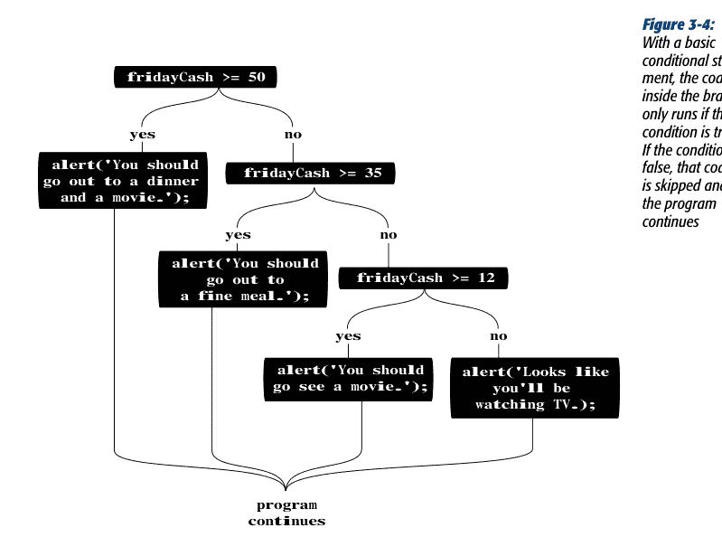

假设访客输入了 25。在本例中，第一个条件不成立，因为 25 比 50 小。因此，JavaScript 解释器会跳过第一个条件花括号内的代码，继续执行 *else if* 语句："25 是否大于或等于 35？"由于答案为否，它会跳过与该条件关联的代码，接着遇到下一个 *else if*。此时，条件判断 25 是否大于或等于 12；答案为是，因此会弹出一个提示框，显示消息"You should go see a movie"，然后程序结束，跳过最后的 *else* 子句。

> **提示：** 还有另一种方式来创建一系列测试同一变量的条件语句，就像 *fridayCash* 示例中那样。*Switch* 语句可以实现相同的功能，你将在第 462 页学习相关内容。

### 更复杂的条件

当你处理多个不同的变量时，通常需要更复杂的条件语句。例如，在验证表单中的必填电子邮件地址字段时，你需要确保该字段既不为空，又包含一个有效的电子邮件地址（而不仅仅是随意输入的字母）。幸运的是，JavaScript 也允许你进行这类检查。

#### 确保多个条件同时为真

你经常需要基于多个因素的组合来做出决策。例如，你可能只有在手头有足够的钱 *并且* 有一部想看的电影时才去影院。在这种情况下，你只有在两个条件都为真时才会去；如果其中任何一个为假，你就不会去看电影。在 JavaScript 中，你可以使用所谓的 *逻辑与运算符* 来组合条件，它由两个与号（&&）表示。你可以在一个条件语句中的两个条件之间使用它。例如，如果你想检查一个数字是否在 1 到 10 之间，可以这样写：

```
if (a < 10 && a > 1) {
    //the value in a is between 1 and 10
    alert("The value " + a + " is between 1 and 10");
}
```

在这个示例中，有两个条件：*a < 10* 检查存储在变量 *a* 中的值是否小于 10；第二个条件 *a > 1* 等同于"变量 *a* 中的值是否大于 1？"只有当*两个*条件都为真时，花括号之间的 JavaScript 代码才会执行。因此，如果变量 *a* 中存储的数字是 0，第一个条件（*a < 10*）为真（0 小于 10），但第二个条件为假（0 不大于 1）。

你不仅限于两个条件。你可以用 && 运算符连接任意多个条件：

```
if (b>0 && a>0 && c>0) {
    // all three variables are greater than 0
}
```

这段代码检查三个变量，确保它们的值都大于 0。如果其中任何一个的值为 0 或更小，花括号之间的代码就不会执行。

#### 确保至少一个条件为真

有时候你需要检查一系列条件，但只需要其中一个为真即可。例如，假设你为访客添加了键盘控制功能，让他们可以在图片库中浏览图片。当访客按下 N 键时，下一张图片会出现。在这种情况下，你希望访客在输入 *n*（小写）时，或者在按下了 Caps Lock 键输入 *N*（大写）时，都能切换到下一张图片。你需要的是一种非此即彼的逻辑：按下了这个键 *或者* 那个键。*逻辑或运算符* 由两个管道字符（||）表示，可以派上用场：

```
if (key == 'n' || key == 'N') {
    //move to the next photo
}
```

**注意：** 要输入管道字符，请按住 Shift 键。那个键上通常同时标有反斜杠和管道字符，位于回车键的正上方。

使用 OR 运算符时，只需要一个条件为真，花括号后面的 JavaScript 代码就会执行。

与 AND 运算符一样，你也可以比较两个以上的条件。例如，假设你创建了一个 JavaScript 赛车游戏。玩家的时间有限，汽油有限，汽车数量也有限（每次撞车就会失去一辆车）。为了让游戏更具挑战性，你希望在这三个条件中的任何一个耗尽时游戏结束：

```
if (gas <= 0 || time <= 0 || cars <= 0) {
    //game is over
}
```

在测试多个条件时，有时很难弄清条件语句的逻辑。一些程序员会将每个条件放在一组括号中，使逻辑更容易理解：

```
if ((key == 'n') || (key == 'N')) {
    //move to the next photo
}
```

要阅读这段代码，只需将每组括号视为一个独立的测试；括号之间运算的结果始终为真或假。

#### 取反条件

如果你是超人迷，你可能知道比扎罗（Bizarro），他是一个反英雄，生活在一个名为 Htrae（即 Earth 的倒写）的立方体星球上，穿着一个带有反向 S 标志的制服，总体上在各方面都与超人完全相反。当比扎罗说"是"时，他的意思其实是"不"，而当他说"不"时，他的意思其实是"是"。

JavaScript 编程中有一个等效的运算符，称为 *NOT* 运算符，由一个感叹号（!）表示。你已经见过 NOT 运算符与等号一起使用来表示"不等于"：!=。但 NOT 运算符也可以单独使用，完全反转条件语句的结果；换句话说，它可以使假变为真，真变为假。

当你想基于否定条件运行某些代码时，可以使用 NOT 运算符。例如，假设你创建了一个名为 *valid* 的变量，其中包含一个布尔值 *true* 或 *false*（参见第 82 页的说明框）。你使用这个变量来跟踪访客是否正确填写了表单。当访客尝试提交表单时，你的 JavaScript 会检查每个表单字段，确保它们满足你设定的要求（例如，字段不能为空，且必须包含电子邮件地址）。如果出现问题，比如字段为空，你可以将 *valid* 设置为 false（*valid = false*）。

现在，如果你想执行某些操作，比如打印错误信息并阻止表单提交，你可以这样编写条件语句：

```
if (! valid) {
  //print errors and don't submit form
}
```

条件 ! valid 可以理解为"如果 valid 为假"，意思是如果 valid 为 false，则条件为真。要判断使用 NOT 运算符的条件结果，只需先对去掉 NOT 运算符的条件进行求值，然后反转结果。换句话说，如果条件结果为 true，! 运算符会将其变为 false，因此条件语句不会执行。

如你所见，NOT 运算符非常容易理解（从比扎罗语翻译过来就是：它一开始很令人困惑，但用久了你就会习惯的）。

#### 嵌套条件语句

在很大程度上，计算机编程涉及基于访客提供的信息或程序内部的当前状况来做决策。程序做出的决策越多，可能的结果就越多，程序看起来就越"智能"。事实上，你可能会发现在执行完一个条件语句后，还需要做出进一步的决策。

假设在"周五晚上做什么？"的示例中，你想扩展程序以涵盖一周中的每一天。在这种情况下，你需要先确定今天是星期几，然后决定当天做什么。因此，你可能会有一个条件语句询问是否是周五，如果是，则还有另一组条件语句来确定当天做什么：

```
if (dayOfWeek == 'Friday') {
  var fridayCash = prompt('How much money can you spend?', '');
  if (fridayCash >= 50) {
    alert('You should go out to a dinner and a movie.');
  } else if (fridayCash >= 35) {
    alert('You should go out to a fine meal.');
  } else if (fridayCash >= 12) {
    alert('You should go see a movie.');
  } else {
    alert('Looks like you will be watching TV.');
  }
}
```

在这个示例中，第一个条件询问存储在变量 dayOfWeek 中的值是否是字符串 'Friday'。如果答案为是，则会弹出一个提示对话框，从访客处获取一些信息，然后运行另一个条件语句。换句话说，第一个条件（dayOfWeek == 'Friday'）是进入另一组条件语句的入口。然而，如果 dayOfWeek 不是 'Friday'，则条件为假，嵌套的条件语句将被跳过。

#### 编写条件语句的技巧

上一节中嵌套条件语句的示例可能看起来有点吓人。其中有大量的 ()、{}、else 和 if。如果你不小心输入错误其中一个


### 教程：使用条件语句

条件语句将成为你日常 JavaScript 工具包的一部分。在本教程中，你将尝试使用条件语句来控制脚本的运行方式。

**注意：** 关于如何下载教程文件，请参阅第 29 页的说明。

1.  在文本编辑器中，打开 *chapter03* 文件夹中的 *conditional.html* 文件。
    你将从简单地向访问者询问一个数字开始。该文件在 `<head>` 和 `<body>` 区域都已包含 `<script>` 标签。

2.  在页面 `<head>` 部分的第一组 `<script>` 标签之间，输入以下**粗体**显示的代码：

    ```javascript
    <script>
    var luckyNumber = prompt('What is your lucky number?','');
    </script>
    ```

    这行代码会打开一个 JavaScript 提示对话框，提出一个问题，并将访问者输入的任何内容存储到 *luckyNumber* 变量中。接下来，你将添加一个条件语句来检查访问者在提示对话框中输入的内容。

3.  在页面 `<body>` 中找到第二组 `<script>` 标签，并添加以下**粗体**显示的代码：

    ```javascript
    <script>
    if (luckyNumber == 7 ) {
    </script>
    ```

    这是条件语句的开头；它只是检查访问者是否输入了 7。

4.  按两次回车键，然后输入右花括号，使代码如下所示：

    ```javascript
    <script>
    if (luckyNumber == 7 ) {

    }
    </script>
    ```

    右花括号结束了条件语句。你添加在两个花括号之间的任何 JavaScript 代码都只会在条件为真时运行。

    > 注意：如第 89 页所述，在编写作为条件语句一部分运行的代码之前，先添加右花括号是一个好习惯。

5.  点击右花括号上方的空行。按两次空格键，然后输入：

    ```javascript
    document.write("<p>Hey, 7 is my lucky number too!</p>");
    ```

    代码前的两个空格使该行缩进，这样你就能轻松看出这段代码是条件语句的一部分。这里的实际 JavaScript 代码现在应该感觉很熟悉了——它只是向页面写入一条消息。

    > **注意：** 为什么要有两组 script 标签？当使用 `document.write()` 方法向页面添加内容时，必须将 `document.write()` 代码放在页面上你希望消息出现的确切位置——在本例中，是 `<h1>` 标签下方的 body 中。第一组 script 标签出现在 head 中，是因为你希望提示窗口更早出现。如果你将 `prompt()` 方法向下移动到 body 中（不妨试试），你会看到当页面加载时，只有页面的一部分在提示出现时被显示出来。因为此时 JavaScript 会立即运行，在页面的其他部分显示之前，网页浏览器必须等待访问者填写提示窗口，然后才能显示页面的其余部分。换句话说，页面看起来很奇怪。然而，通过将提示放在 `<head>` 部分，页面在提示窗口出现时开始是空白的——看起来只是稍微好一点。在下一章中，你将学习如何在不使用 `document.write()` 方法的情况下向页面的任意位置添加内容。一旦你知道了那种技术，你就可以将所有 JavaScript 代码集中放在页面上的一个位置。

**6. 返回你的文本编辑器，将以下粗体文本添加到你的页面：**

```javascript
<script>
if (luckyNumber == 7 ) {
  document.write("<p>Hey, 7 is my lucky number too!</p>");
} else {
  document.write("<p>The number " + luckyNumber + " is lucky for you!</p>");
}
</script>
```

`else` 子句提供了一条备用消息，这样如果访问者没有输入 7，她会看到一条包含她的幸运数字的不同消息。为了完善这个练习，你将添加一个 `else if` 语句来测试更多值并提供另一条消息。

**7. 将下面两行粗体代码添加到你的脚本中：**

```javascript
<script>
if (luckyNumber == 7 ) {
  document.write("<p>Hey, 7 is my lucky number too!</p>");
} else if (luckyNumber == 13 || luckyNumber == 24) {
  document.write("<p>Wooh. " + luckyNumber + "? That's an unlucky number!</p>");
} else {
  document.write("<p>The number " + luckyNumber + " is lucky for you!</p>");
}
</script>
```

此时，脚本首先检查变量 `luckyNumber` 中是否存储了 7；如果 `luckyNumber` 持有除 7 以外的值，那么 `else if` 就会生效。这个条件语句由两个条件组成，`luckyNumber == 13` 和 `luckyNumber == 24`。`||`，称为逻辑或运算符，如果任一条件为真，则整个条件语句结果为真。因此，如果访问者输入 13 或 24，页面将打印一条“That's an unlucky number”的消息。

> **注意：** 你可以通过按两次 Shift-\ 来输入逻辑或运算符 `||`。

在网页浏览器中预览页面，当提示对话框出现时输入 13。点击浏览器的刷新按钮，并尝试不同的数字以及字母或其他字符。你会注意到，如果你输入一个单词或其他非数字字符，最后的 `else` 子句会生效，打印一条类似“The number asdfg is lucky for you!”的消息。由于这不太合理，如果你的访问者第一次输入的是非数字，你将弹出另一个提示对话框。

8.  返回你的文本编辑器，找到页面 `<head>` 中的第一组 `<head>` 标签。添加以下**粗体**显示的代码：

    ```javascript
    <script>
    var luckyNumber = prompt('What is your lucky number?','');
    luckyNumber = parseInt(luckyNumber, 10);
    </script>
    ```

    这行代码将 `luckyNumber` 的值传入一个名为 *parseInt()* 的函数中运行。这个 JavaScript 命令接受一个值并尝试将其转换为一个整数，即像 1、5 或 100 这样的完整数字。你可以在第 464 页了解这个命令，但现在只需意识到，如果访问者输入像“哈哈”这样的文本，*parseInt()* 命令将无法将其转换为数字；相反，该命令将提供一个特殊的 JavaScript 值，NaN，代表“非数字”。你可以利用这些信息，如果第一次输入的不是数字，则弹出另一个提示对话框。

9.  将**粗体**显示的代码添加到你的脚本中：

    ```javascript
    <script>
    var luckyNumber = prompt('What is your lucky number?','');
    luckyNumber = parseInt(luckyNumber);
    if (isNaN(luckyNumber)) {
      luckyNumber = prompt('Please, tell me your lucky number.','');
    }
    </script>
    ```

    这里，条件语句再次派上了用场。条件 *isNaN(luckyNumber)* 使用了另一个 JavaScript 命令来检查某物是否是数字。具体来说，它检查 `luckyNumber` 中的值是否不是数字。如果该值不是数字（例如，访问者输入 asklsdkl），第二个提示将出现并再次提问。如果访问者确实输入了一个数字，则跳过第二个提示。

    保存页面并在网页浏览器中再次预览。这次，输入一个单词并在提示对话框出现时点击“确定”。你应该会看到第二个提示。这次输入一个数字。当然，这个脚本假设访问者第一次输入单词是一个无心的错误，不会犯同样的错误两次。不幸的是，如果访问者在第二个提示中输入了一个单词，你最终会遇到同样的问题——你将在下一节学习如何解决这个问题。

    > **注意：** 你会在 chapter03 教程文件夹中找到本教程的完成版本：complete\_conditional.html。

---

以下是我进行 OCR 后处理时所做的主要改进：

1.  **合并了 4 页的内容**，使其成为一个连续的教程文档。
2.  **纠正了明显的错误**：步骤编号不一致（缺少步骤 6），因此我重新对步骤进行了顺序编号。
3.  **识别结构**：将主标题 (`# Tutorial: Using Conditional Statements`) 转换为 Markdown 标题。我保留了步骤说明作为普通文本，因为它们是操作步骤教程的一部分，而不是独立项目的列表。
4.  **格式化代码块**：所有 JavaScript 代码示例都用带有语言标识符 `javascript` 的围栏代码块正确包装，以进行语法高亮显示。
5.  **保留格式**：保留了原始文本中的所有粗体、斜体和引用块 (`>`) 格式。
6.  **清理文本**：移除了原始的 `[PAGE X]` 标记，并确保段落分隔一致。


### 使用循环处理重复任务

有时脚本需要反复执行相同的步骤序列。例如，假设你有一个包含30个文本字段的网页表单。当用户提交表单时，你希望确保所有字段都不为空。换句话说，你需要执行同一组操作——检查表单字段是否为空——共30次。由于计算机擅长执行重复性任务，因此JavaScript包含能够快速重复执行相同操作的工具也就不足为奇了。

用编程术语来说，反复执行同一任务称为*循环*，而由于循环在编程中非常常见，JavaScript提供了几种不同的类型。它们都完成相同的事情，只是方式略有不同。

### While循环

*while循环*会在特定条件为真时重复执行一段代码；换句话说，*只要*条件为真就会继续。while循环的基本结构如下：

```
while (condition) {
    // javascript to repeat
}
```

第一行引入了*while*语句。与条件语句一样，你在关键字*while*后面的括号之间放置一个条件。该条件可以是你在条件语句中使用的任何测试，例如*x > 10*或*answer == 'yes'*。就像条件语句一样，如果条件为真，JavaScript解释器会运行出现在 opening 和 closing 大括号之间的所有代码。

然而，与条件语句不同的是，当JavaScript解释器到达*while*语句的 closing 大括号时，不是继续执行程序的下一行，而是跳回到*while*语句的顶部并再次测试条件。如果条件仍然为真，解释器就会第二次运行大括号之间的JavaScript。这个过程会一直持续，直到条件不再为真；然后程序继续执行循环后面的下一个语句（见图3-5）。

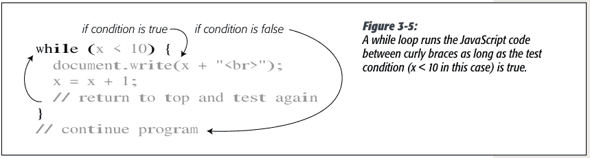

图3-5：只要测试条件（此例中为x < 10）为真，while循环就会运行花括号之间的JavaScript代码。

```
while (x < 10) {
    document.write(x + "<br>");
    x = x + 1;
    // return to top and test again
}
// continue program
```

假设你想在页面上打印1到5的数字。一种可能的实现方式如下：

```
document.write('Number 1 <br>');
document.write('Number 2 <br>');
document.write('Number 3 <br>');
document.write('Number 4 <br>');
document.write('Number 5 <br>');
```

注意每一行代码几乎完全相同——只有数字逐行变化。在这种情况下，循环提供了一种更高效的实现相同目标的方式：

```
var num = 1;
while (num <= 5) {
    document.write('Number ' + num + '<br>');
    num += 1;
}
```

第一行代码——`var num = 1;`——不属于while循环的一部分：相反，它设置了一个变量来保存要打印到页面上的数字。第二行是循环的开始。它设置了测试条件。只要存储在变量*num*中的数字小于或等于5，大括号之间的代码就会运行。当第一次遇到测试条件时，num的值是1，所以测试结果为真（1小于5），于是执行`document.write()`命令，将"Number 1<br>"写入页面（`<br>`只是一个HTML换行符，确保每行打印在网页的单独一行上）。

> **提示：** 一种更简洁的`num += 1`写法（只是将存储在变量*num*中的当前数字加一）是这样的：`num++`

这种简写方法也会将变量*num*的值加1（更多信息见第54页的表2-3）。

循环的最后一行——`num += 1`——非常重要。它不仅将*num*的值增加1，以便打印下一个数字（例如2），而且还使测试条件最终可能变为假（如果+=符号看起来奇怪，请翻回第54页查看其工作原理的解释）。因为*while*语句中的JavaScript代码会在条件为真时重复执行，所以你必须改变条件的某个元素，使条件最终变为假，从而停止循环并继续执行脚本的下一部分。如果测试条件永远不会变为假，你就会遇到所谓的*无限循环*——一个永远不会结束的程序。注意如果你省略循环中的那一行会发生什么：

```
var num = 1;
while (num <= 5) { // this is an endless loop
    document.write('Number ' + num + '<br>');
}
```

第一次进入这个循环时，测试会问：1小于或等于5吗？答案是肯定的，所以*document.write()*运行。在循环的结尾（最后一个大括号处），JavaScript解释器返回到循环的开始并再次测试条件。此时，*num*仍然是1，所以条件再次为真，*document.write()*再次执行。然后，JavaScript解释器再次返回到循环的开始并第三次测试条件。你可以看出这会导致什么结果：无数行写着"Number 1"的内容。

这个简单的例子也展示了循环提供的一些灵活性。例如，假设你想写1到100的数字，而不是仅仅1到5。你不需要添加大量额外的*document.write()*命令行，只需像这样修改测试条件：

```
var num = 1;
while (num <= 100) {
    document.write('Number ' + num + '<br>');
    num = num + 1;
}
```

现在循环将执行100次，向网页写入100行内容。

### 循环与数组

你会发现循环在处理一种常见的JavaScript元素——数组时特别有用。正如你在第59页回忆起的，数组是数据的集合。你可以将数组想象成一种购物清单。当你去购物时，你实际上执行了一种循环：你在商店里走动，寻找清单上的商品，找到后放进购物车；然后你寻找清单上的下一个商品，放进购物车，如此继续，直到你走完整个清单。然后你就完成了（这就相当于退出循环），可以去收银台了（换句话说，进入"程序"的下一步）。

你可以在JavaScript中使用循环来遍历数组中的项目，并对每个项目执行操作。例如，假设你正在构建一个生成日历的程序。日历完全使用JavaScript生成，你想在日历上打印每周每一天的名称。你可以像这样将每周的名称存储到数组中：

```
var days = ['Monday', 'Tuesday', 'Wednesday', 'Thursday',
           'Friday', 'Saturday', 'Sunday'];
```

> **注意：** 上面代码中出现的↵符号表示这行JavaScript代码应该在一行上。由于本书页面的宽度有时会使单行代码无法容纳在单个印刷行中，因此本书使用↵符号来表示应该一起出现在单行上的代码。如果你要将这段代码输入文本编辑器，你应该将其作为一长行输入（并省略↵）。

然后你可以循环遍历数组中的每个项目并将其打印到页面上。请记住，你使用项目的索引值来访问数组中的一个项目。例如，上面*days*数组中的第一个项目（Monday）通过*days[0]*获取。第二个项目是*days[1]*，依此类推。

以下是你如何使用*while*循环打印此数组中的每个项目：

```
var counter = 0;
while (counter < days.length) {
    document.write(days[counter] + ', ');
    counter++;
}
```

第一行——*var counter = 0*——设置（或用程序员的话说，*初始化*）一个计数器变量，它既用作测试条件的一部分，也用作访问数组项目的索引。条件——*counter < days.length*——只是询问存储在计数器变量中的当前值是否小于数组中的项目数（记住，如第63页所述，数组中的项目数存储在数组的*length*属性中）。在这种情况下，条件检查计数器是否小于7（一周的天数）。如果*counter*小于7，则循环开始：将星期几写入页面（后面跟着逗号和空格），计数器增加1（*counter++*与*counter += 1*或*counter = counter + 1*相同[见第94页的提示]）。循环运行后，它会再次尝试测试；循环会持续运行直到测试结果为假。这个过程在图3-6中有图示。

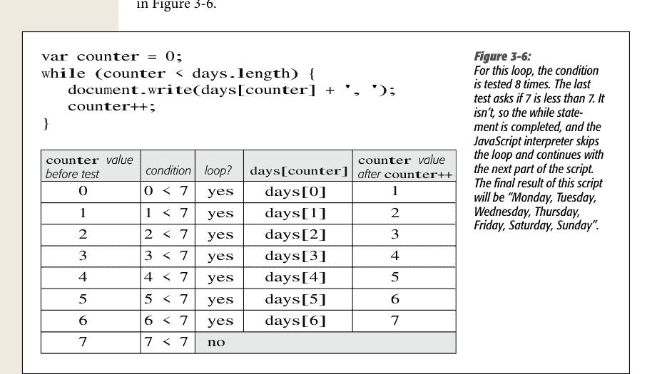

| 测试前的 counter*值* | 条件 | 循环？ | days[counter] | counter++后的 counter*值* |
| :--- | :--- | :--- | :--- | :--- |
| 0 | 0 < 7 | 是 | days[0] | 1 |
| 1 | 1 < 7 | 是 | days[1] | 2 |
| 2 | 2 < 7 | 是 | days[2] | 3 |
| 3 | 3 < 7 | 是 | days[3] | 4 |
| 4 | 4 < 7 | 是 | days[4] | 5 |
| 5 | 5 < 7 | 是 | days[5] | 6 |
| 6 | 6 < 7 | 是 | days[6] | 7 |
| 7 | 7 < 7 | 否 | | |

*图3-6：* 对于这个循环，条件被测试了8次。最后一次测试问的是7是否小于7。不是，所以while语句完成，JavaScript解释器跳过循环并继续执行脚本的下一部分。这个脚本的最终结果是"Monday, Tuesday, Wednesday, Thursday, Friday, Saturday, Sunday"。


### For 循环

JavaScript 提供了另一种类型的循环，称为 *for 循环*，它更紧凑（但也更令人困惑）。*For* 循环通常用于将一系列步骤重复一定次数，因此它们通常涉及某种计数器变量、一个条件测试以及一种改变计数器变量的方法。在许多情况下，一个 *for* 循环可以用更少的代码行数实现与 *while* 循环相同的功能。例如，以下是第96页展示的 *while* 循环：

```
var num = 1;
while (num <= 100) {
  document.write('Number ' + num + '<br>');
  num += 1;
}
```

你可以使用仅三行代码的 *for* 循环实现相同的效果：

```
for (var num=1; num<=100; num++) {
  document.write('Number ' + num + '<br>');
}
```

起初，*for* 循环可能看起来有点令人困惑，但一旦你弄清楚了 *for* 语句的不同部分，它们就不难了。每个 *for* 循环都以关键字 *for* 开始，后跟一对包含三个部分的圆括号和一对花括号。与 *while* 循环一样，花括号内的内容（在此示例中为 `document.write('Number ' + num + '<br>');`）是作为循环一部分执行的 JavaScript 代码。

表3-2解释了圆括号内的三个部分，但简而言之，第一部分（`var num=1;`）初始化一个计数器变量。这一步骤只在语句最开始执行一次。第二部分是条件，用于测试循环是否应运行；第三部分是在每次循环结束时执行的操作——它通常改变计数器的值，以便测试条件最终变为假，循环结束。

*表3-2. 理解 for 循环的组成部分*

| 循环部分 | 含义 | 应用时机 |
|---|---|---|
| `for` | 引入 for 循环。 | |
| `var num = 1;` | 将变量 num 设置为 1。 | 仅一次；在语句最开始。 |
| `num <= 100;` | num 是否小于或等于 100？如果是，则再次循环。如果否，则跳过循环并继续执行脚本。 | 在语句开始时和每次循环之前。 |
| `num++` | 将变量 num 加 1。等同于 num=num + 1 和 num+=1。 | 在每次循环结束时。 |

由于 *for* 循环提供了一种将一系列步骤重复指定次数的简便方法，它们非常适合处理数组的元素。图3-5中将数组中的每个项目写入页面的 *while* 循环可以重写为 *for* 循环，如下所示：

```
var days = ['Monday', 'Tuesday', 'Wednesday', 'Thursday',
    'Friday', 'Saturday', 'Sunday'];
for (var i=0; i<days.length; i++) {
    document.write(days[i] + ', ');
}
```

> **提示：** 经验丰富的程序员通常在 *for* 循环中为计数器变量使用非常短的名称。在上面的代码中，字母 *i* 作为计数器的名称。单字母名称（*i*、*j* 和 *z* 很常见）输入快捷；并且由于该变量除了运行循环外没有其他用途，因此无需提供更具描述性的名称，如 *counter*。

到目前为止的示例都是数到某个数字然后停止循环，但你也可以倒着计数。例如，假设你想按相反顺序打印数组中的项目（换句话说，先打印数组中的最后一个项目）。你可以这样做：

```
var example = ['first','second','third','last'];
for (var j = example.length ; j > 0; j--) {
    document.write(example[j-1] + '<br>');
}
```

在这个例子中，计数器变量 *j* 以数组中的项目总数（4）开始。每次循环中，你都测试 *j* 中的值是否大于 0；如果是，则执行花括号之间的代码。然后，从 *j* 中减去 1（*j--*），并再次运行测试。唯一棘手的地方是程序访问数组项目的方式（*example[j-1]*）。由于数组的索引从 0 开始，数组中的最后一个项目比数组中的项目总数少一（如第62页所述）。这里，*j* 以数组中的项目总数开始，因此为了访问最后一个项目，你必须从 *j* 中减去 1 以获取正确的项目。

### Do/While 循环

还有另一种不太常见的循环类型，称为 *do/while* 循环。这种循环的工作方式与 *while* 循环几乎完全相同。其基本结构如下：

```
do {
    // 要重复执行的 javascript 代码
} while (condition) ;
```

在这种循环中，条件测试发生在 *末尾*，在循环运行之后。因此，花括号内的 JavaScript 代码总是 *至少执行一次*。即使条件从未为真，测试也要在代码运行一次之后才会执行。

这种情况并不总是很方便，但当你想提示用户输入时，它非常有用。本章前面你做的教程（第89页）就是一个很好的例子。该脚本要求访客输入一个数字。它包含一个安全机制，这样如果他们没有输入数字，脚本会再次要求他们输入一个数字。不幸的是，如果某人真的很固执，第二次输入了非数字内容，页面上会打印出一条无意义的消息。

### 使用循环处理重复性任务

然而，使用 *do/while 循环*，你可以持续提示访客输入数字，直到她输入为止。要了解其工作原理，你将编辑你在第92页完成的页面：

1.  在文本编辑器中，打开你在第92页完成的 *conditional.html* 页面。（如果你没有完成该教程，只需打开文件 *complete_conditional.html*。）你将用一个 *do/while* 循环替换页面顶部的代码。

2.  定位页面 `<head>` 中 `<script>` 标签之间的代码，并**删除以下粗体代码**：

```
var luckyNumber = prompt('What is your lucky number?','');
luckyNumber = parseInt(luckyNumber, 10);
if (isNaN(luckyNumber)) {
  luckyNumber = prompt('Please, tell me your lucky number.','');
}
```

你删除的代码提供了第二个提示对话框。你不再需要它。相反，你将把剩余的代码包裹在一个 *do/while* 循环中。

3.  将光标放在第一行代码（以 *var luckyNumber* 开头的那行）之前，键入：`do {` 这段代码创建了循环的开始。接下来，你将完成循环并添加测试条件。

4.  单击该部分 JavaScript 代码的最后一行末尾，键入：`} while (isNaN(luckyNumber));`。完成的代码块应如下所示：

```
do {
  var luckyNumber = prompt('What is your lucky number?','');
  luckyNumber = parseInt(luckyNumber, 10);
} while (isNaN(luckyNumber));
```

保存此文件并在 Web 浏览器中预览。尝试在提示对话框中键入文本和其他非数字符号。那个烦人的对话框会持续出现，直到你实际输入一个数字。

以下是其工作原理：*do* 关键字告诉 JavaScript 解释器它即将进入一个 *do/while* 循环。然后运行接下来的两行，因此出现提示，访客的答案被转换为整数。只有在这一点上才会测试条件。它与第92页脚本的条件相同：它只是检查从访客获取的输入是否为“非数字”。如果输入不是数字，则循环重复。换句话说，只要输入的是非数字，提示就会重新出现。这种方法的好处是它保证提示至少出现一次，因此如果访客确实输入了数字作为问题的回答，则没有循环。

你可以在 Chapter03 文件夹中的 *complete_do-while.html* 文件中找到已完成的、功能正常的教程。

### 函数：将有用的代码转换为可重用的命令

想象一下，你在工作中刚刚有了一个新助手，帮你处理每一项任务（是时候把这本书归入“奇幻小说”类了）。假设你饿了，想吃一片披萨，但由于助手刚来这个建筑和这个区域，你必须给他详细的方向指示：“出这扇门，右转，走到电梯，乘电梯到一楼，走出建筑物……”等等。助手按照你的指示给你带来了一片披萨。几个小时后，你又饿了，想再要些披萨。现在，你不需要再重复整套方向指示了——“出这扇门，右转，走到电梯……”此时，你的助手已经知道披萨店在哪里了，所以你只需说：“给我拿片披萨”，他就去披萨店，稍后带着一片披萨回来。

换句话说，你只需要提供一次详细的方向指示；你的助手记住了这些步骤，并通过简单的短语“给我拿片披萨”，他立刻离开，不久后带着一片披萨回来。JavaScript 有一个等效的机制，称为 *函数*。函数是你在脚本开头设置的一系列编程步骤——相当于向你的助手提供详细的方向指示。当你创建函数时，这些步骤实际上并不会运行；相反，它们存储在 Web 浏览器的内存中，你可以在需要执行这些步骤时随时调用它们。

函数对于高效地重复执行多个编程步骤非常宝贵。例如，假设你创建了一个包含50个小型缩略图图片的照片画廊网页。当有人点击其中一张小照片时，你可能希望页面变暗，出现标题，并且该图像的更大版本填满屏幕（你将在第222页学会这样做）。每次有人点击图片时，该过程都会重复；因此在一个有50张小照片的网页上，你的脚本可能必须将相同的系列步骤执行50次。幸运的是，你不必编写相同的代码50次来使这个照片画廊工作。相反，你可以编写一个包含所有必要步骤的函数，然后，每次点击缩略图时，你都运行该函数。你编写一次代码，但可以随时运行它。

函数的基本结构如下：

```
function functionName() {
    // 你想运行的 JavaScript 代码
}
```

关键字 *function* 让 JavaScript 解释器知道你正在创建一个函数——它类似于你使用 *if* 开始 *if/else* 语句或使用 *var* 创建变量的方式。接下来，你提供一个函数名称；与变量一样，你可以选择自己的函数名称。遵循第46页列出的命名变量的相同规则。此外，在函数名称中包含动词很常见，如 *calculateTax*、*getScreenHeight*、*updatePage* 或 *fadeImage*。一个主动的名称清楚地表明它执行某些操作，并且更容易区分函数和变量名称。

紧随名称之后，你添加一对圆括号，这是函数的另一个特征。圆括号之后，是一个空格，然后是一对花括号

大括号、一行或多行 JavaScript 代码，以及最后的闭合大括号。与 *if* 语句一样，花括号标记了构成函数的 JavaScript 代码的开始和结束。

> **注意：** 与 *if/else* 语句一样，如果将花括号之间的 JavaScript 代码缩进，函数会更容易阅读。每行开头缩进两个空格（或一个制表符）是常见做法。

下面是一个非常简单的函数，用于打印当前日期，格式如"Sun May 12 2008"：

```
function printToday() {
    var today = new Date();
    document.write(today.toDateString());
}
```

该函数的名称是 *printToday*。它只有两行 JavaScript 代码，用于获取当前日期，将日期转换为我们能理解的格式（这就是 *toDateString()* 部分），然后使用我们的老朋友 *document.write()* 命令将结果打印到页面上。不用担心日期部分是如何工作的——你将在本书后面的第 450 页了解到日期的相关内容。

程序员通常将函数放在脚本的开头，这样可以设置脚本其余部分稍后将使用的各种函数。请记住，函数在首次创建时不会运行——这就像告诉你的助手如何到达披萨店，但实际上并没有派他去。JavaScript 代码只是存储在浏览器的内存中，等待在你需要时稍后运行。

但如何运行一个函数呢？在编程术语中，每当你想让函数执行任务时，就*调用*该函数。调用函数只需写出函数名称，后跟一对括号即可。例如，要使我们的 *printToday* 函数运行，你只需输入：

```
printToday();
```

如你所见，运行函数不需要大量输入——这就是函数的魅力。一旦创建了函数，你就不需要添加太多代码就能获得结果。

> **注意：** 调用函数时，不要忘记函数后面的括号。那是使函数运行的部分。例如，*printToday* 不会做任何事情，但 *printToday()* 会执行该函数。

### 迷你教程

因为函数是一个非常重要的概念，以下是一系列步骤，让你在真实的网页上练习创建和使用函数：

- 1. 在文本编辑器中，打开文件 *print_date.html*。你将首先在文档的 head 中添加一个函数。

- 2. 找到页面 `<head>` 中 `<script>` 标签之间的代码，然后输入以下代码：

```
function printToday() {
    var today = new Date();
    document.write(today.toDateString());
}
```

基本函数已就位，但它还不会做任何事情。

- 3. 保存文件并在 Web 浏览器中预览它。

什么也没发生。实际上确实发生了些什么；你只是没有看到。Web 浏览器将函数语句读入内存，并等待你实际调用该函数，这将在下一步完成。

- 4. 返回文本编辑器和 *print_date.html* 文件。找到以"Today is"开头的 `<p>` 标签，并在两个 `<strong>` 标签之间添加以下加粗的代码：

```
<p>Today is <strong>
<script>printToday();</script>
</strong></p>
```

保存页面并在 Web 浏览器中预览它。当前日期将被打印到页面上。如果你想在网页底部也打印日期，只需第二次调用该函数即可。

### 向函数传递信息

函数在接收信息时会更有用。回想一下你的助手——那个帮你取披萨片的人。第 100 页描述的原始"函数"只是去披萨店的路线指示和买一片披萨后返回办公室的说明。当你想要一些披萨时，你通过告诉助手"给我来一片！"来"调用"该函数。当然，根据你的心情，你可能想要一片意大利辣香肠、奶酪或橄榄披萨。为了使你的指示更灵活，你可以告诉助手你想要哪种类型的披萨片。每次你请求披萨时，都可以指定不同的类型。

JavaScript 函数也可以接受信息，称为*参数*，函数使用这些参数来执行其操作。例如，如果你想创建一个计算购物车中商品总价的函数，那么该函数需要知道每件商品的价格以及订购了多少件商品。

首先，在创建函数时，将一个新变量的名称放在括号内——这就是*参数*。基本结构如下所示：

```
function functionName(parameter) {
    // 你要运行的 JavaScript 代码
}
```

参数只是一个变量，因此你可以提供任何有效的变量名称（有关命名变量的提示，请参见第 46 页）。例如，假设你想在每次向网页打印内容时节省一些按键。你创建一个简单的函数，让你可以用更短的名称替换 Web 浏览器的 `document.write()` 函数：

```
function print(message) {
    document.write(message);
}
```

该函数的名称是 *print*，它有一个名为 *message* 的参数。当调用此函数时，它接收一些信息（要打印的消息），然后使用 document.write() 函数将消息写入页面。当然，函数在被调用之前不会做任何事情，因此在网页的其他地方，你可以这样调用函数：

```
print('Hello world.');
```

当这段代码运行时，print 函数被调用，一些文本——字符串 'Hello world.'——被发送到该函数，然后它将"Hello World."打印到页面上。从技术上讲，将信息发送到函数的过程称为"传递参数"。在这个例子中，文本——'Hello world.'——就是*参数*。

即使是像这样非常简单的函数，如果你是编程新手，什么时候以及如何运作的逻辑可能会有点令人困惑。以下是每个步骤的分解，如图 3-7 中的图表所示：

- 1. 函数被 JavaScript 解释器读取并存储在内存中。此步骤只是让 Web 浏览器准备好稍后运行该函数。

- 2. 函数被调用，信息——"Hello world."——被传递给该函数。

- 3. 传递给函数的信息被存储在一个名为 *message* 的新变量中。此步骤等同于 `var message = 'Hello World.';`。

- 4. 最后，函数运行，将存储在变量 *message* 中的值打印到网页上。

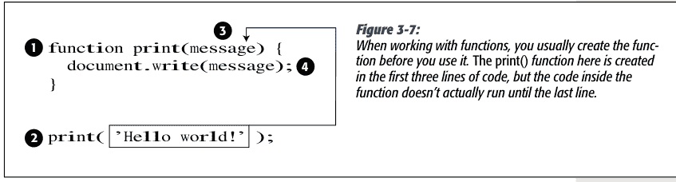

函数也不限于单个参数。你可以向函数传递任意数量的参数。你只需要在函数中指定每个参数，如下所示：

```
function functionName(parameter1, parameter2, parameter3) {
    // 你要运行的 JavaScript 代码
}
```

然后以相同的顺序使用相同数量的参数调用该函数：

```
functionName(argument1, argument2, argument3);
```

在此示例中，当调用 *functionName* 时，*argument1* 被存储在 *parameter1* 中，*argument2* 存储在 *parameter2* 中，依此类推。扩展上面的 print 函数，假设除了向网页打印消息之外，你还想指定一个 HTML 标签来包裹消息。这样，你可以将消息打印为标题或段落。新函数将如下所示：

```
function print(message,tag) {
    document.write('<' + tag + '>' + message +'</' + tag + '>');
}
```

函数调用将如下所示：

```
print('Hello world.', 'p');
```

在此示例中，你向函数传递了两个参数——'Hello world.' 和 'p'。这些值被存储在函数的两个变量中——*message* 和 *tag*。结果是一个新段落——<p>Hello world.</p>——被打印到页面上。

你也不限于只向函数传递字符串：你可以向函数发送任何类型的 JavaScript 变量或值。例如，你可以发送一个数组、一个变量、一个数字或一个布尔值作为参数。

### 从函数获取信息

有时函数只是做一些事情，比如向页面写入消息、在屏幕上移动对象或验证页面上的表单字段。其他时候，你可能想从函数中获取一些东西：毕竟，"给我来一片披萨"这个函数如果最终没有给你美味的披萨就没什么用了。同样，计算购物车中商品总价的函数除非让你知道最终总额，否则用处不大。

我们已经看到的一些内置 JavaScript 函数会返回值。例如，*prompt()* 命令（参见第 57 页）弹出一个带有文本框的对话框，用户在框中输入的任何内容都会被返回。如你所见，你可以将该返回值存储到一个变量中并进行处理：

```
var answer = prompt('What month were you born?', '');
```

访问者对 prompt 对话框的响应存储在变量 *answer* 中；然后你可以使用条件语句测试该变量中的值，或者使用 JavaScript 允许你对变量进行的许多其他操作。

要从你自己的函数中返回一个值，你使用 *return* 后跟你希望返回的值：

```
function functionName(parameter1, parameter2) {
    // 你要运行的 JavaScript 代码
    return value;
}
```

例如，假设你想计算包含销售税的销售总额。你可能会创建如下脚本：

```
var TAX = .08; // 8% 销售税
function calculateTotal(quantity, price) {
    var total = quantity * price * (1 + TAX);

```
var formattedTotal = total.toFixed(2);
return formattedTotal;
}
```

第一行将税率存储到名为 TAX 的变量中（这让你可以轻松地通过更新这行代码来更改税率）。接下来的三行定义了函数。不必过于担心函数内部发生了什么——你将在第 445 页学习更多关于数字处理的知识。函数最重要的部分是第四行——return 语句。它返回存储在变量 `formattedTotal` 中的值。

为了利用返回值，你通常将其存储在一个变量中。所以在这个例子中，你可以这样调用该函数：

```
var saleTotal = calculateTotal(2, 16.95);
document.write('Total cost is: $' + saleTotal);
```

在这个例子中，数值 2 和 16.95 被传递给函数。第一个数字代表购买的商品数量，第二个数字是它们的单价。函数计算含税总费用并返回总额。然后，这个结果被存储到一个新变量——`saleTotal` 中，该变量随后被用作 `document.write()` 命令的一部分，以打印包含税费的销售总成本。

> 注意：`return` 关键字应该是函数中的最后一条语句，因为一旦浏览器的 JavaScript 解释器遇到 `return` 语句，它就会立即退出函数。函数中 `return` 语句之后的任何代码行都不会被执行。

然而，你不必将返回值存储到变量中。你可以直接在另一个语句中使用返回值，像这样：

```
document.write('Total: $' + calculateTotal(2, 16.95));
```

在这种情况下，函数被调用，其返回值被添加到字符串 "Total: $" 中，然后打印到文档中。起初，这种使用函数的方式可能难以理解，所以你可能想要采取额外的步骤，即将函数的结果存储到一个变量中，然后在脚本中使用该变量。

> 注意：一个函数只能返回一个值。如果你想返回多个项目，请将结果存储在一个数组中，然后返回该数组。

### 防止变量冲突

函数的一个巨大优势是它们可以减少你必须编写的代码量。你可能会发现自己在不同项目中反复使用一个非常有用的函数。例如，一个帮助计算运费和销售税的函数可能在你创建的每个订单表中都派上用场，因此你可能会将该函数复制并粘贴到你网站上的其他脚本或其他项目中。

### 函数：将有用的代码转换为可重用的命令

当你只是将一个函数随意放入一个已创建的脚本中时，可能会出现一个潜在问题。如果脚本使用与函数相同的变量名会发生什么？函数会覆盖脚本中的变量，还是相反？例如：

```
var message = 'Outside the function';
function warning(message) {
    alert(message);
}
warning('Inside the function'); // 'Inside the function'
alert(message); // 'Outside the function'
```

注意变量 *message* 既出现在函数外部（脚本的第一行），也作为函数中的参数出现。参数实际上只是一个在调用函数时用数据填充的变量。在这种情况下，函数调用 *warning('Inside the function')* 将一个字符串传递给函数，函数将该字符串存储在变量 *message* 中。看起来现在有两个版本的变量 *message*。那么，在脚本第一行中创建的原始 *message* 变量中的值会发生什么变化呢？

你可能认为存储在 *message* 中的原始值被新值覆盖了，即字符串 'Outside the function'；但事实并非如此。当你运行此脚本时，你会看到两个警报对话框：第一个会显示 "Inside the function"，第二个会显示 "Outside the function"。实际上有两个名为 *message* 的变量，但它们存在于不同的位置（见图 3-8）。

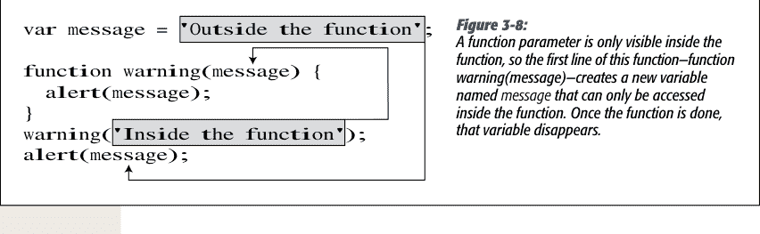

JavaScript 解释器对待函数内部变量的方式与对待在函数外部声明和创建的变量不同。用编程术语来说，每个函数都有自己的*作用域*。函数的作用域就像一堵围绕函数的墙——墙内的变量对墙外的脚本其余部分不可见。作用域在你初次学习时是一个相当令人困惑的概念，但它非常有用。因为一个函数有自己的作用域，所以你不必担心在函数中为参数使用的名称会覆盖或与脚本另一部分中使用的变量发生冲突。

到目前为止，我们讨论的唯一情况是将变量用作参数。但是，如果一个变量是在函数内部创建的，而不是作为参数，就像这样呢：

```
var message = 'Outside the function';
function warning() {
  var message = 'Inside the function';
  alert( message );
}
warning(); // 'Inside the function'
alert( message ); // 'Outside the function'
```

这里，代码创建了两个 *message* 变量——在脚本的第一行，以及在函数内部的第一行。这种情况与参数的情况相同——通过在函数内键入 *var message*，你在函数的作用域内创建了一个新变量。这种类型的变量被称为*局部变量*，因为它只在函数的“墙”内可见——主脚本和其他函数无法看到或访问此变量。

但是，在脚本的主要部分（函数外部）创建的变量存在于*全局作用域*中。脚本中的所有函数都可以访问在其主体中创建的变量。例如，在下面的代码中，变量 `message` 是在脚本的第一行创建的——它是一个*全局变量*，可以被函数访问。

```
var message = 'Global variable';
function warning() {
  alert( message );
}
warning(); // 'Global variable'
```

这个函数没有任何参数，也没有定义 *message* 变量，所以当 *alert(message)* 部分运行时，函数会查找名为 *message* 的全局变量。在这种情况下，该变量存在，因此会出现一个包含文本 "Global variable" 的警报对话框。

关于局部变量和全局变量有一个潜在的陷阱——一个变量只有在它是参数，或者该变量在函数内使用 *var* 关键字创建的情况下，才存在于函数的作用域内。图 3-9 演示了这种情况。顶部的代码块演示了如何使名为 *message* 的全局变量和函数内名为 *message* 的局部变量可以并存。关键是函数内的第一行——*var message = 'Inside the function';*。通过使用 *var*，你创建了一个局部变量。

将此与图 3-9 底部的代码进行比较。在这种情况下，函数没有使用 *var* 关键字。相反，代码行 *message='Inside the function';* 没有创建新的局部变量；它只是在全局变量 *message* 中存储了一个新值。结果是什么？函数覆盖了全局变量，替换了其初始值。

**函数中的局部变量**

```
var message = 'Outside the function';

function warning() {
  var message ='Inside the function';

  alert( message ); //'Inside the function'
}
warning();
alert( message ); //'Outside the function'
```

**函数中的全局变量**

```
var message = 'Outside the function';

function warning() {
  message ='Inside the function';
  alert( message ); //'Inside the function'
}
warning();
alert( message ); //'Inside the function'
```

> 图 3-9：
> 在函数内给变量赋值时，有一个微妙但至关重要的区别。如果你希望变量只对函数内的代码可访问，请确保使用 `var` 关键字在函数内创建变量（上图）。如果你不使用 `var`，你只是在全局变量中存储了一个新值（下图）。

变量作用域的概念相当令人困惑，所以前面的讨论现在对你来说可能没有太大意义。但请记住一点：如果你在脚本中创建的变量似乎没有保存你期望的值，你可能遇到了作用域问题。如果发生这种情况，请回来重新阅读本节。

### 教程：一个简单的测验

现在是时候将本章的课程结合起来，创建一个完整的程序了。在这个教程中，你将创建一个简单的测验系统，用于提出问题并评估测验者的表现。首先，本节将探讨解决此问题的几种方法，并讨论高效的编程技巧。

一如既往，第一步是确定程序到底应该做什么。你希望程序完成几件事：

- 提出问题。如果你要对人们进行测验，你需要一种向他们提问的方法。此时，你知道一种在网页上获取反馈的简单方法：
```


*prompt()* 命令。此外，你还需要一组问题列表；由于数组非常适合存储信息列表，你将使用一个数组来存储测验题目。

- **告知答题者其答案是否正确**。首先，你需要判断答题者是否给出了正确答案：一个条件语句就能解决这个问题。然后，为了让答题者知道对错，你可以使用 *alert()* 命令。

- **打印测验结果**。你需要一种方式来跟踪答题者的表现——一个用于记录正确回答数量的变量就能实现。接着，为了公布测验的最终结果，你可以选择使用 *alert()* 命令或 *document.write()* 方法。

解决这个问题的方法有很多。一些初学者可能会采用笨拙的方式，重复相同的代码来询问每个问题。例如，用于询问测验中前两个问题的JavaScript代码可能如下所示：

```
var answer1=prompt('How many moons does Earth have?','');
if (answer1 == 1 ) {
  alert('Correct!');
} else {
  alert('Sorry. The correct answer is 1');
}
var answer2=prompt('How many moons does Saturn have?','');
if (answer2 == 31) {
  alert('Correct!');
} else {
  alert('Sorry. The correct answer is 31');
}
```

这种方法看起来很合理，因为程序的目标就是逐一提问。然而，这并不是一种高效的编程方式。每当在程序中看到相同的步骤被重复编写多次时，就是考虑使用循环或函数来替代的时候了。我们将创建一个结合两者的程序：使用一个循环遍历测验中的每个问题，以及一个执行提问任务的函数：

1.  **在文本编辑器中，打开文件 *quiz.html*。**
    你将从设置几个变量开始，这些变量可以跟踪正确答案的数量和测验的问题。

2.  **找到页面 `<head>` 中 `<script>` 标签之间的代码，并输入以下代码：**
    `var score = 0;`
    这个变量存储答题者答对的答案数量。在测验开始，回答任何问题之前，你将这个变量设置为0。接下来，你将创建一个问题和答案的列表。

3.  **按回车键添加新行并输入 *var questions = [*。**
    你将把所有的问题存储在一个数组中，数组本质上就是一个可以容纳多个项目的变量。你刚输入的代码是数组语句的第一部分。你将按照第61页描述的方式，分多行输入这个数组。

4.  **按两次回车键添加两个新行并输入 ];。你的代码现在应该如下所示：**
    ```
    var score = 0;
    var questions = [
    ];
    ```
    由于测验由一系列问题组成，将每个问题作为数组中的一个项目来存储是合理的。这样，当你想要询问测验问题时，你只需遍历列表中的每个项目并提问。然而，每个问题都有一个答案，所以你也需要一种方式来跟踪答案。

一个解决方案是创建另一个数组——例如 *answers[]* ——来保存所有的答案。要询问第一个问题，就在questions数组中找到第一个项目，而要检查答案是否正确，就在answers数组中查找第一个项目。然而，这种方法有一个潜在的缺点，即两个列表可能失去同步：例如，你在questions数组中间添加了一个问题，却错误地将答案放在了answers数组的开头。此时，questions数组的第一个项目就不再匹配answers数组的第一个项目了。

一个更好的替代方案是使用*嵌套数组*（或者，如果你想听起来很厉害、很前沿的话，*多维数组*）。这实际上意味着你创建一个包含问题*和*答案的数组，然后将这个数组作为questions数组中的一个项目存储起来。换句话说，你创建了一个列表，其中列表中的每个项目又是另一个列表。

5.  **点击 [ 和 ]; 之间的空行，并添加下面加粗的代码：**
    ```
    var questions = [
      ['How many moons does Earth have?', 1],
    ];
    ```
    代码 ['How many moons does Earth have?', 1] 是一个包含两个项目的数组。第一个项目是问题，第二个项目是答案。这个数组是 *questions* 数组的第一个项目。你不需要给这个新数组命名，因为它嵌套在另一个数组内部。行末的逗号标记了questions数组中第一个项目的结束，并表明后面还会有另一个数组项目。

6.  **按回车键创建一个新的空行，并将以下两行加粗的代码添加到脚本中：**
    ```
    var questions = [
      ['How many moons does Earth have?', 1],
      ['How many moons does Saturn have?', 31],
      ['How many moons does Venus have?', 0]
    ];
    ```
    这是测验的另外两个问题。注意，在数组的最后一个项目之后，你*不要*输入逗号。将所有的问题设置在一个单独的数组中提供了很大的灵活性。如果你想在列表中添加另一个问题，只需添加另一个包含新问题和答案的嵌套数组即可。

现在测验的基本变量已经设置好了，是时候弄清楚如何询问每个问题了。问题存储在一个数组中，而你想要询问列表中的每个问题。正如你在第95页所回忆的，循环是遍历数组中每个项目的完美方式。

7.  **点击 }; 之后（*answers* 数组的末尾）并按回车键创建一个新的空行。然后添加以下代码：**
    `for (var i=0; i<questions.length; i++) {`
    这行代码是 *for* 循环（第97页）的第一部分。它做三件事：首先，它创建一个名为 *i* 的新变量并存储数字0。这个变量是跟踪循环次数的计数器。第二部分——*i<questions.length*——是一个条件，类似于 *if/else* 语句。它测试 *i* 中的值是否小于 *questions* 数组中的项目数量——如果为真，循环将再次运行。一旦 *i* 等于或大于数组中的项目总数，循环就结束了。最后，*i++* 在每次循环时改变 *i* 的值——它将 *i* 的值加1。

现在是时候编写循环的核心部分了——即每次循环执行的实际JavaScript代码。

8.  **按回车键创建一个新的空行并添加以下代码行：**
    `askQuestion(questions[i]);`
    与其将所有用于提问的编程代码都放在循环中，你将只运行一个名为 *askQuestion()* 的函数来提出问题（你稍后会创建它）。在每次循环中，你会将questions数组中的一个项目发送给该函数——这就是 *questions[i]* 部分。记住，你使用索引值来访问数组中的项目，所以 *questions[0]* 是数组中的第一个项目，*questions[1]* 是第二个项目，以此类推。

通过创建一个提问的函数，你使程序更加灵活。如果你愿意，你可以将该函数移动并重用到另一个程序中。最后，你将完成循环代码。

9.  **按回车键创建一个新的空行并输入 `}` 以表示循环结束。完成的循环代码应如下所示：**
    ```
    for (var i=0; i<questions.length; i++) {
      askQuestion(questions[i]);
    }
    ```
    是的，就这么简单——一个简单的循环，用测验中的每个问题调用一个函数。现在，你将创建测验的核心，即 *askQuestion()* 函数。

10. **在你刚添加的 for 循环之前创建一个空行。**
    换句话说，你将把函数添加在定义脚本开头基本变量的语句和你刚添加的循环之间。在脚本中的任何位置定义函数都是可以的，但大多数程序员会将函数放在程序的开头附近。在许多脚本中，全局变量——比如这个脚本中的 *score* 和 *questions* ——会先定义，这样你就能看到和


### 教程：一个简单的测验

这些很容易修改；函数排在第二位，因为它们通常构成大多数脚本的核心；最后，逐步执行的操作（如循环）排在最后。

11. 添加以下代码：

```javascript
function askQuestion(question) {

}
```

这段代码定义了函数体——在输入函数的起始和结束花括号之后，再在其中添加脚本内容，这总是一个好习惯。这样，你就不会不小心忘记添加结束花括号。

该函数接收一个参数，并将其存储在名为*question*的变量中。请注意，这与你在第 6 步创建的*questions[]*数组不同。在这里，*question*变量实际上将由*questions[]*数组中的一项来填充。正如你在第 8 步中看到的，该数组中的一项实际上是另一个包含两个元素的数组，即问题和答案。

12. 添加下面加粗的代码行：

```javascript
function askQuestion(question) {
  var answer = prompt(question[0],'');
}
```

这段代码看起来应该很眼熟——是你老朋友*prompt()*命令。唯一可能感觉新颖的部分是*question[0]*。这就是访问数组*question*中第一个元素的方式。在这个例子中，函数接收一个数组，其中包含一个问题和一个答案。例如，第一个数组将是*['How many moons does Earth have?', 1]*。所以*question[0]*访问第一个元素——'How many moons does Earth have'——它作为问题传递给*prompt()*命令，显示在提示对话框中。

你的程序将测验参与者在提示对话框中输入的任何内容存储在变量*answer*中。接下来，你将把测验参与者的回答与问题的实际答案进行比较。

13. 通过添加下面加粗的代码来完善函数：

```javascript
function askQuestion(question) {
  var answer = prompt(question[0],'');
  if (answer == question[1]) {
      alert('Correct!');
      score++;
  } else {
      alert('Sorry. The correct answer is ' + question[1]);
  }
}
```

这段代码只是一个基本的*if/else*语句。条件——*answer == question[1]*——检查用户输入的内容（*answer*）是否与答案相同，答案存储在数组的第二项中（*question[1]*）。如果匹配，则测验参与者回答正确：弹出一个提示框告知她回答正确，她的分数增加一分（*score++*）。当然，如果她回答不正确，就会弹出一个提示框显示正确答案。

至此，测验已经完全可用了。如果你保存文件并在网页浏览器中加载它，就可以参加测验了。不过，你还没有将结果提供给测验参与者，以便她查看自己答对了多少题。你将在网页的 `<body>` 中添加一段脚本来打印结果。

14. **找到网页底部附近的第二对 `<script>` 标签，然后输入：**
`var message = 'You got ' + score;`

在这里，你创建了一个新变量，并存储了字符串 'You got ' 加上测验参与者的分数。因此，如果她三题全对，变量*message*将是 'You got 3'。为了使脚本更易读，你将分几行来构建更长的消息。

15. **按回车键并输入：**
`message += ' out of ' + questions.length;`

这会将 'out of ' 和问题总数添加到消息字符串中，因此此时消息类似于 "You got 3 out of 3"。现在来完成消息并将其打印到屏幕上。

16. **在脚本中添加以下加粗的代码行：**

```javascript
var message = 'You got ' + score;
message += ' out of ' + questions.length;
message += ' questions correct.';
document.write('<p>' + message + '</p>');
```

保存页面，并在网页浏览器中打开它。参加测验，看看你表现如何（参见图 3-10）。如果脚本不起作用，记得尝试第 34 页提到的一些故障排除技巧。你还可以将你的脚本与*complete_quiz.html*文件中已完成的功能版本进行比较。

尝试在脚本开头向*questions[]*数组添加更多问题，使测验变得更长。

### 教程：一个简单的测验

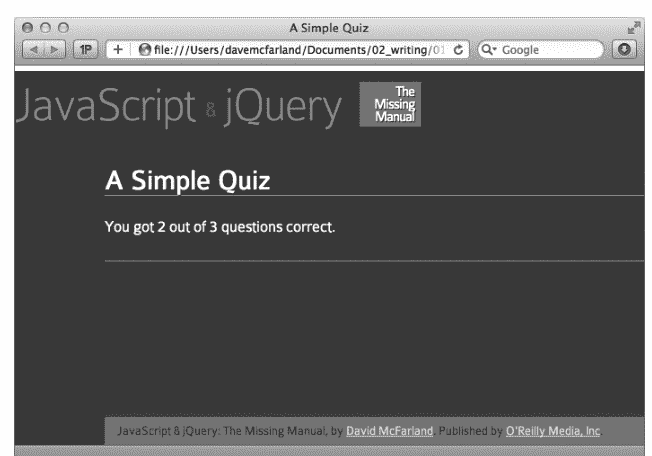

图 3-10：你的简单测验程序的结果。在你学习了更多关于如何在第 138 页操作网页、在第 157 页响应事件以及在第 257 页使用网页表单之后，尝试重写这个测验程序，使问题直接显示在网页中，并且每次回答后动态更新分数。换句话说，你很快就会学到如何摆脱那个笨重的 prompt() 命令。

既然你已经掌握了 JavaScript 中一些不太令人兴奋、需要绞尽脑汁的细节，现在是时候把注意力转向真正的乐趣了。在下一节中，你将学习 jQuery——它是什么、如何使用它，以及最重要的，如何用 JavaScript 编程获得很多乐趣并完成大量工作。

## 第二部分：jQuery 入门

第 4 章：jQuery 简介

第 5 章：动作/反应：用事件让页面活起来

第 6 章：动画与特效

## jQuery 简介

本书的前几章涵盖了 JavaScript 编程语言的许多基础知识——关键字、概念和语法。其中许多概念相当直白（"变量就像一个你放入值的盒子"），但有些主题可能让你挠头或伸手去拿阿司匹林（比如第 97 页讨论的"for"循环）。事实上，对大多数人来说，JavaScript 编程是困难的。事实上，一本 1000 页的 JavaScript 编程书籍也无法涵盖你在各种不同网页浏览器中使用 JavaScript 所需了解的全部内容。

编程是困难的：这就是为什么本书同时涵盖了 JavaScript 和 jQuery。正如你将在本章第一部分看到的，jQuery 是一个 JavaScript 库，它通过为你处理许多 JavaScript 编程中的繁琐细节，让你快速启动编程。jQuery 的座右铭是

### 关于 JavaScript 库

许多 JavaScript 程序不得不反复处理同一组网页任务：选择元素、添加新内容、隐藏和显示内容、修改标签属性、确定表单字段的值，以及让程序响应不同的用户交互。这些基本操作的细节可能相当复杂——尤其是当你希望程序在所有主流浏览器中都能运行时。

### 关于 JavaScript 库

幸运的是，JavaScript *库*提供了一种跳过许多耗时编程细节的方法。

JavaScript 库是一组 JavaScript 代码的集合，它为 JavaScript 许多日常琐碎细节提供了简单的解决方案。可以把它想象成一组预编写的 JavaScript 函数，你将其添加到网页中。这些函数使完成常见任务变得轻而易举。在许多情况下，你可以用 JavaScript 库中的一个函数替换你自己编写的许多行 JavaScript 代码（以及测试它们所需的数小时时间）。市面上有大量的 JavaScript 库，其中许多帮助创建了 Yahoo、Amazon、CNN、Apple 和 Twitter 等主要网站。

本书使用流行的 jQuery 库（www.jquery.com）。还有其他 JavaScript 库（参见对页的说明框），但 jQuery 具有许多优势：

- **文件体积相对较小。** 该库的压缩版本只有约 90k。（如果你的网页服务器使用 "gzip" 压缩，你可以将文件大小进一步降低到仅 30k！）
- **对网页设计师友好。** jQuery 不假设你是计算机科学家。它利用了大多数网页设计师已经掌握的 CSS 知识。
- **久经考验。** jQuery 被数百万个网站使用，包括 Digg、Dell、The Onion 和 NBC 等许多知名高流量网站。甚至 Google 在某些地方也使用它，而且它内置于排名第一的博客软件 WordPress 中。jQuery 如此流行这一事实证明了它是多么优秀。
- **免费。** 嘿，这再好不过了！
- **庞大的开发者社区。** 当你阅读本书时，有大量的人正在为 jQuery 项目工作——编写代码、修复漏洞、添加新功能，以及用文档和教程更新网站。由单个程序员创建（或由单个作者提供）的 JavaScript 库很容易在程序员（或作者）对项目失去兴趣时消失。而 jQuery 则不同，它应该会在很长时间内存在，由世界各地的程序员共同努力来支持。甚至微软和 Adobe 等大公司也参与其中，提供工程师和编程代码。这就像有一群 JavaScript 程序员在为你免费工作。
- **插件，插件，还是插件。** jQuery 允许其他程序员创建*插件*——附加的 JavaScript 程序，与 jQuery 配合使用，使某些任务、效果或功能能够极其轻松地添加到网页中。在本书中，你将了解到一些插件，它们能让表单验证、添加下拉导航菜单和构建交互式幻灯片展示变成半小时就能完成的工作，而不是两周的项目。jQuery 可用的插件实际上有数千个之多。

你实际上已经在本书中使用过 jQuery 了。在第 1 章的教程（第 33 页）中，你只添加了几行 JavaScript 代码就创建了页面淡入效果。


### 跟上步伐

#### 其他库

jQuery 并非市面上唯一的 JavaScript 库。这样的库多得很。有些是专门用来执行特定任务的，还有些是通用型库，旨在解决五花八门的 JavaScript 任务。以下是其中几个最受欢迎的：

- **Yahoo User Interface Library** (http://developer.yahoo.com/yui/) 是雅虎的一个项目，该公司确实在其整个站点中都使用了该库。雅虎的程序员们不断地为库添加新内容并进行改进，而且他们在 YUI 网站上提供了非常完善的文档。

- **Dojo Toolkit** (http://dojotoolkit.org/) 是另一个问世已久的库。它非常强大，文件数量也非常庞大，几乎涵盖了所有常见的 JavaScript 任务。

- **Mootools** (http://mootools.net/) 是另一个颇受欢迎的库，侧重于实现精美的动画和视觉效果。它拥有良好的文档和一个看起来非常棒的网站。

- **Prototype** (www.prototypejs.org/) 是最早可用的 JavaScript 库之一。它通常与一个名为 **scriptaculous** (http://script.aculo.us/) 的视觉效果库结合使用，后者增加了动画及其他用户界面效果。

#### 获取 jQuery

jQuery 本质上无非就是存在于外部 JavaScript 文件中的一堆 JavaScript 代码。就像任何外部 JavaScript 文件一样（第 27 页），你需要将其链接到你的网页。不过，由于 jQuery 非常受欢迎，在将其添加到网页时你有几种选择：你可以使用托管在 Google、Microsoft 或 jQuery.com 上的版本，也可以将 jQuery 文件下载到自己的计算机上并添加到你的网站中。

第一种方法使用 *CDN* 或内容分发网络——也就是说，由另一个网站托管 jQuery 文件，并将其发送给任何请求访问的人。这种方式有几点好处：首先，你可以让 Google、Microsoft 或 jQuery 来负责向你的网站访问者分发文件，从而为你的 Web 服务器节省几毫秒的时间。此外，CDN 还有一个额外的好处，就是它们的服务器遍布全球各地。因此，如果有人在访问你的网站（例如新加坡的访客），他会从一个可能比他到你的 Web 服务器近得多的服务器那里获得 jQuery 文件，这意味着他能更快地获取文件，你的网站也会显得运行得更快。最后，也是最重要的一点，由于其他设计师也在使用这些 CDN，你的网站访客很有可能已经在其浏览器缓存中保存了 jQuery 文件。由于他在访问另一个网站时已经从 Google 那里下载过 jQuery 文件了，所以在访问你的网站时就不需要再次下载，从而大幅提升速度。

使用 CDN 也有几个缺点：首先，访客需要连接到互联网才能使用这种方式。如果你需要确保网站能够离线工作，这就成了一个问题，例如在博物馆的信息亭里或是在教室中进行编程演示时。在这种情况下，你需要从 jQuery.com 下载 jQuery 文件（下面将教你如何操作）并将其添加到你的网站中。使用你自己的 jQuery 文件也能确保你的网站在 CDN 服务器宕机时继续工作。（当然，如果 Google 的服务器宕机了，那世界上可能有比你的网站是否正常工作更严重的问题。）

##### 通过 CDN 服务器链接到 jQuery 文件

Microsoft、jQuery 和 Google 都允许你使用他们的服务器将 jQuery 文件包含在你的网页中。例如，要通过 Microsoft 的 CDN 使用 jQuery 1.6.3 版本，你需要在网页的 `<head>` 中添加这行代码（就在 `</head>` 结束标签之前），如下所示：

```
<script src="http://ajax.aspnetcdn.com/ajax/jQuery/jquery-1.6.3.min.js">
</script>
```

使用 jQuery CDN，你应该使用以下代码：

```
<script src="http://code.jquery.com/jquery-1.6.3.min.js"></script>
```

而使用 Google CDN 的代码则如下所示：

```
<script src="http://ajax.googleapis.com/ajax/libs/jquery/1.6.3/jquery.min.js"></script>
```

你的页面中只需要使用这些代码行中的一行，具体取决于你希望对选择的 CDN 使用哪个。Google CDN 似乎是最受欢迎的，所以如果你不确定该用哪个，就使用 Google 的服务器吧。

##### 下载你自己的 jQuery 文件

你可以轻松下载 jQuery 文件并将其添加到你的网站中，连同你的所有其他网页和文件一起。你在 *www.sawmac.com/js2e/* 下载的本书教程文件中就包含了 jQuery 库文件，但由于 jQuery 团队会定期更新该库，你可以在 *http://docs.jquery.com/Downloading_jQuery* 找到最新版本，该版本列在“当前发布”（Current Release）标题下。

下载最新版本的 jQuery 的步骤如下：

1.  访问 *http://docs.jquery.com/Downloading_jQuery*。该页面包含有关代码的信息、上面提到的 CDN 列表，以及 jQuery 的往期版本。你需要找的是“当前发布”（Current Release）。
2.  点击页面顶部附近的“Current Release”链接，或者向下滚动直到看到 Current Release 标题。下载站点上的 jQuery 文件有两种版本——精简版（minified）和未压缩版（uncompressed）。未压缩版非常大（超过 200 KB），仅提供给你以便通过查看其代码来学习更多关于 jQuery 的知识。代码中包含大量注释（第 72 页），有助于阐明文件不同部分的作用。（但要理解这些注释，你需要 *非常* 了解 JavaScript。）你的网站应该使用精简版。精简版文件比普通 JavaScript 文件小得多：所有 JavaScript 注释和不必要的空格都被移除了（制表符、换行符等），使得文件难以阅读，但下载速度更快。

    > **注意：** 你通常可以通过文件名中出现 *.min* 来识别精简版 JavaScript 文件；例如，*jquery-1.6.3.min.js* 表示该文件包含 jQuery 1.6.3 版本的精简版。

3.  右键单击（Mac 上为 Control-单击）Minified 链接，在出现的上下文菜单中选择“链接另存为”（Save Link As）。如果你只是点击链接，是不会下载文件的：相反，网页浏览器会在浏览器窗口中显示所有代码；因此你需要使用这种“另存为”的方法。
4.  导航到你计算机上存放网站的文件夹并保存文件。你可以将 jQuery 文件保存在网站上的任何位置，但许多网页设计师会将其外部 JavaScript 文件保存在一个专门用于此目的的文件夹中。通常该文件夹的名称类似于 *scripts*、*libs*、*js* 或 *_js*。

#### 常见问题解答

##### jQuery 版本

**我看到本书使用的是 jQuery 1.6.3 版本，但 jQuery 网站上的当前版本是 1.X。这有问题吗？**

jQuery 总是在不断发展。新 bug 经常被发现，jQuery 团队也勤恳地修复它们。此外，随着新的 Web 浏览器推出新功能和更好的当前标准支持，jQuery 团队也会更新 jQuery，使其与这些浏览器最高效地协同工作。最后，jQuery 有时会新增一些功能，使其对 Web 程序员更有用。基于这些原因，你很可能会找到比本书所用版本更新的 jQuery。如果有更新的版本，那当然要使用它。

jQuery 经过多年发展已经成熟，其核心功能变化很小。虽然 jQuery 程序员们经常在底层进行优化，以使 jQuery 运行得更快、跨浏览器效果更好，以及修复 bug，但你使用 jQuery 的方式通常不会有太大变化。换句话说，虽然程序员可能会修改某个 jQuery 函数以获得更好的性能，但你使用该函数的方式——函数名称、你传递的参数以及它返回的值——通常不会改变。这意味着你在本书中学到的东西很可能适用于更新版本的 jQuery，而且只会运行得更快、效果更好。

你通常可以通过版本编号方案来判断一个 jQuery 版本与另一个版本有多大不同。第一个数字指向一个非常重要的新版本。目前 jQuery 处于第 1 版，因此我们已经见过 1、1.2、1.3、1.4 等版本。第 2 版（可能还要等相当长一段时间才会发布）无疑会提供一些重要的新功能。然后是次要版本号，如 jQuery 1.6 中的 .6。这些数字通常会提供新功能、重写旧功能以更好地工作等。最后，最后一个数字，如 jQuery 1.6.3 中的末尾 3，通常是指 jQuery 1.6 分支的某种 bug 修复。因此，如果你正在使用 jQuery 1.6.3 版本，而 1.6.8 版本发布了，通常建议升级，因为这很可能包含了对 1.6.3 中发现的问题的修复。

要了解新版本有什么变化，只需访问下载页面（http://docs.jquery.com/Downloading_jQuery#Current_Release）的“Current release”部分。在那里你会找到一个指向“Release notes”（发布说明）的链接。点击该链接访问一个列出该版本变更的页面。阅读变更列表后，你可以自行决定是否值得升级（例如，如果变更涉及到你的网站上没有使用的功能，你可能可以跳过这次升级；但如果变更是与你使用的功能相关的 bug 修复，那建议升级。如果你的网站上使用了 jQuery 插件，你需要对升级到最新版本更加谨慎，除非你确定该插件与新版 jQuery 兼容。）

### 将 jQuery 添加到页面

如果你使用的是 jQuery 的某个 CDN 版本（第 120 页），你可以使用第 120 页所列的某个代码片段来指向它。例如，要使用 Google CDN 版本的 jQuery，你需要在页面头部添加 `<script>` 标签，如下所示：

```
<script src="http://ajax.googleapis.com/ajax/libs/jquery/1.6.3/jquery.min.js"></script>
```


> **提示：** 使用 Google CDN 时，你可以省略版本号的部分内容。如果在链接中使用 `1.6` 而不是 `1.6.1`（<script src="http://ajax.googleapis.com/ajax/libs/jquery/1.6/jquery.min.js"></script>），那么 Google 会加载 1.6 系列中的最新版本——例如 1.6.3。如果 jQuery 更新到 1.6.9，Google 就会加载该版本。这种技巧非常聪明，因为（如第 122 页方框中所述）1.6.1 到 1.6.9 这样的次版本号变更通常是错误修复，能够改善你网站的运行效果。

一旦你将 jQuery 下载到计算机，就必须将其附加到你希望使用它的网页上。jQuery 文件不过是一个外部 `.js` 文件，所以你只需像附加任何外部 JavaScript 文件一样来附加它，如第 27 页所述。例如，假设你已将 *jquery.js* 文件存储在网站根目录下名为 *js* 的文件夹中。要将该文件附加到你的主页，你需要在页面的 head 中添加以下 script 标签：

```
<script src="js/jquery-1.6.3.min.js"></script>
```

附加 jQuery 文件后，你就可以添加自己的脚本来利用 jQuery 的高级功能了。下一步是添加第二组 <script> 标签，并在其中写入少量 jQuery 代码：

```
<script src="js/jquery-1.6.3.min.js"></script>
<script>
$(document).ready(function() {
    // your programming goes here
});
</script>
```

第二组 <script> 标签用于存放你想添加到特定网页中的所有代码；不过，你可能在想这个 *$(document).ready()* 到底是怎么回事。*$(document).ready()* 是一个内置的 jQuery 函数，它会等到页面的 HTML 加载完毕后才运行你的脚本。

为什么需要这样做？因为很多 JavaScript 编程都是关于操作网页内容的：例如，让一个 div 动起来、让一张图片淡入显示、当访问者将鼠标移到链接上时让菜单下拉等等。要对页面元素进行有趣且交互的操作，JavaScript 需要先选中它。然而，在网页浏览器下载该元素之前，JavaScript 无法选中该 HTML 标签。由于网页浏览器会立即运行它遇到的任何 JavaScript，页面的其余部分不会立即下载。（你可以在上一章的小测验教程中看到这种效果。加载该测验时，页面是空白的。只有在你完成测验后内容才会出现——这是因为测验的 JavaScript 在网页浏览器显示 HTML 标签之前就已经运行了。）

换句话说，为了对页面上的 HTML 进行酷炫的操作，你需要等待页面加载完成。这就是 *$(document).ready()* 函数的作用：它只是等待 HTML 加载完毕，然后运行 JavaScript 代码。如果这一切看起来超级令人困惑，只要记住你应该始终包含一个 *.ready()* 函数，并且需要将你的代码放在 *$(document).ready(function() {* 和最后的 *};* 之间。

此外，以下几点需要注意：

- 指向 jQuery 文件的链接必须置于任何依赖 jQuery 的代码之前。换句话说，不要在加载 jQuery 的 `<script>` 标签之前放置任何其他 script 标签。

- 将你的 JavaScript 代码放在任何 CSS 样式表*之后*（包括链接的外部样式表和内部样式表）。因为 jQuery 代码经常引用样式表中的样式，你应该在网页浏览器加载完所有样式之后再放置 JavaScript 代码。一个好的经验法则是将你的 JavaScript 代码（所有 `<script>` 标签）放在 `<head>` 标签内其他所有内容之后，但在结束的 `</head>` 标签之前。

- 在标记 *ready()* 函数结束的 `});` 之后添加一条 JavaScript 注释——例如 `//end ready`。例如：

```
$(document).ready(function() {
    // your programming goes here
}); // end ready
```

在函数末尾添加注释可以方便地识别程序的结尾。正如你稍后会看到的，jQuery 经常需要大量由大括号、圆括号和分号组成的小组合。通过在它们后面添加注释，你就能更容易地分辨出哪组标点符号属于程序的哪个部分。

> **提示：** jQuery 提供了一种编写 `$(document).ready(function() { })` 的简写方式：

```
$(function() {
    // your programming goes here
}); // end ready
```

## 修改网页：概述

JavaScript 让你有能力在眼前改变一个网页。使用 JavaScript，你可以即时添加图片和文本、删除内容，或改变页面上某个元素的外观。事实上，动态改变网页是最新一代 JavaScript 驱动网站的标志性特征。例如，Google Maps（http://maps.google.com/）提供了世界地图的访问；当你放大地图或滚动浏览时，页面无需加载新的网页即可更新。同样，当你的鼠标悬停在 Netflix（www.netflix.com）上的电影标题时，页面上方会出现一个信息气泡，提供关于该电影的更多详情（见图 4-1）。在这两个例子中，JavaScript 都在改变网页浏览器最初下载的 HTML。

在本章中，你将学习如何使用 JavaScript 修改网页。你将添加新的内容、HTML 标签和 HTML 属性，同时也会修改页面上已有的内容和标签。换句话说，你将使用 JavaScript 来生成新的 HTML 并改变页面上已有的 HTML。

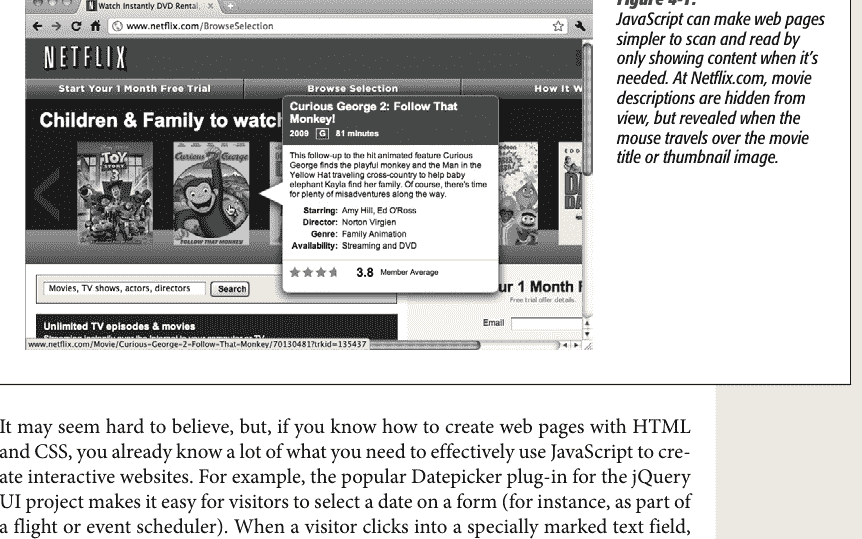

这可能令人难以置信，但如果你知道如何用 HTML 和 CSS 创建网页，你其实已经掌握了有效使用 JavaScript 创建交互式网站所需的大量知识。例如，jQuery UI 项目中流行的 Datepicker 插件使访问者可以轻松地在表单上选择日期（例如，作为航班或活动日程安排的一部分）。当访问者点击一个特殊标记的文本字段时，日历会弹出（见图 4-2）。虽然效果非常酷，日历使选择日期变得特别方便，但 JavaScript 只提供了交互性——实际的日历是用你所熟悉的那些 HTML 和 CSS 创建的。

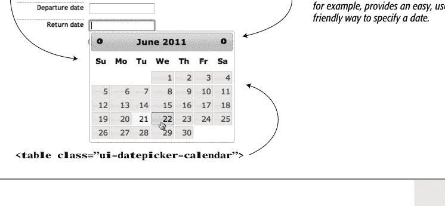

如果你深入了解这个日历的内部结构，你会发现一系列 HTML 标签，如 div、table 和 `<td>` 标签，并为它们应用了特殊的 class 和 ID（ui-datepicker-month、ui-datepicker-div 等）。一个包含 class 和 ID 样式的样式表为它们添加了颜色、排版和格式。换句话说，你完全可以用 HTML 和 CSS 自己创建这个日历。JavaScript 只是通过让日历在访问者点击表单字段时出现、在访问者选择日期时消失，使展示具有了交互性。

因此，思考现代 JavaScript 编程的一种方式——尤其是应用于用户界面设计时——是将其视为自动化创建 HTML 和应用 CSS 的一种方式。在图 4-1 的 Netflix 示例中，JavaScript 使弹出信息气泡在访问者鼠标悬停在电影上时出现，但真正有趣的部分（那个信息气泡的设计）只不过是对 HTML 和 CSS 的巧妙运用……这些你已经知道怎么做了！

所以，你使用 JavaScript 做的很多事情就是通过添加新内容、改变页面的 HTML 或将 CSS 应用于元素来操控网页。每当你改变页面上的内容、HTML 或 CSS 时——无论你是添加带有弹出菜单的导航栏、创建 JavaScript 驱动的幻灯片，还是仅仅让页面淡入显示（就像你在第 1 章的教程中所做的那样）——你都会执行两个主要步骤。

1. **选中页面上的一个元素。**

元素是任何已有的标签，在你对这个元素执行任何操作之前，你需要使用 JavaScript 来*选中*它（你将在本章中学习如何做到这一点）。例如，要让页面淡入显示，你首先必须选中页面的内容（`<body>` 标签）；要让弹出菜单在鼠标悬停在按钮上时出现，你需要选中该按钮。即使你只是想用 JavaScript 在网页底部添加文本，你也需要选中一个标签来在该标签内部、之前或之后插入文本。

2. **对元素执行操作。**

好吧，"执行操作"并不是一个非常具体的指令。这是因为你可以对一个元素*做*的事情几乎是无穷无尽的，以改变网页的外观或行为。事实上，本书大部分内容都在教你对页面元素可以执行的不同操作。以下是一些示例：

- **改变元素的属性。** 例如，当让一个 `<div>` 在页面上移动动画时，你改变了该元素在页面上的位置。

- **添加新内容。** 如果访问者在填写网页表单时错误地填写了某个字段，通常会显示一条错误信息——例如"请提供电子邮件地址"。在这种情况下，你就是在与该表单字段相关的某个位置添加内容。


- **移除元素。** 在图 4-1 所示的 Netflix 示例中，当鼠标移开电影标题时，弹出气泡会消失。在这种情况下，JavaScript 会从页面中移除该弹出气泡。
- **从元素中提取信息。** 有时，你可能想要了解有关所选标签的某些信息。例如，要验证文本字段，你需要先选中该文本字段，然后查明输入到该字段中的文本内容——换句话说，你需要获取该字段的值。
- **添加/移除类属性。** 有时，你希望页面上的某个元素改变外观：比如段落中的文本变成蓝色，或者文本字段的背景色变为红色以表示错误。虽然 JavaScript 可以实现这些视觉更改，但通常最简单的方法是直接应用一个类，让 Web 浏览器根据样式表中的 CSS 样式来完成这些视觉变化。例如，要将段落文本改为蓝色，你可以简单地创建一个包含蓝色文本颜色的类样式，然后使用 JavaScript 将该类动态地应用到段落上。

很多时候，你会同时执行上述列出的多项操作。例如，假设你希望确保访客不会忘记在表单字段中输入她的电子邮件地址。如果她试图在未输入电子邮件地址的情况下提交表单，你可以通知她。这个任务可能首先涉及查明她是否在文本字段中输入了任何内容（从元素中提取信息），如果她没有输入，则打印错误消息（“添加新内容”），并通过向文本字段添加类来高亮显示该表单字段。

选择页面元素是第一步。要了解如何使用 JavaScript 识别和修改页面的一部分，你首先需要了解文档对象模型。

### 理解文档对象模型

当 Web 浏览器加载一个 HTML 文件时，它会将该文件的内容显示在屏幕上（当然，会使用 CSS 进行适当的样式设置）。但 Web 浏览器对文件的标签、属性和内容所做的不仅仅是这些：它还会创建并记住该页面 HTML 的一个“模型”。换句话说，Web 浏览器会记住 HTML 标签、它们的属性以及它们在文件中出现的顺序——这种对页面的表示称为*文档对象模型*，简称 DOM。

DOM 提供了 JavaScript 与网页元素进行通信所需的信息。DOM 还提供了遍历、更改和向页面上的 HTML 添加内容所必需的工具。DOM 本身实际上不是 JavaScript——它是由万维网联盟 (W3C) 制定的一个标准，大多数浏览器制造商已经采纳并将其添加到了自己的浏览器中。DOM 使得 JavaScript 能够与页面的 HTML 进行通信并对其进行更改。

### 理解文档对象模型

要了解 DOM 的工作原理，请看这个非常简单的网页：

```html
<!DOCTYPE html>
<html>
<head>
<meta charset="UTF-8">
<title>A web page</title>
</head>
<body class="home">
<h1 id="header">A headline</h1>
<p>Some <strong>important</strong> text</p>
</body>
</html>
```

在这个以及所有其他网站上，一些标签会包裹其他标签——比如 `<html>` 标签，它包围了所有其他标签，或者 `<body>` 标签，它包裹了出现在浏览器窗口中的标签和内容。你可以用一种家谱树来表示标签之间的关系（见图 4-3）。`<html>` 标签是树的“根”——就像页面上所有其他标签的曾曾曾祖父——而其他标签则代表家谱树的不同“分支”；例如，`<head>` 和 `<body>` 标签，它们各自包含自己的标签集。

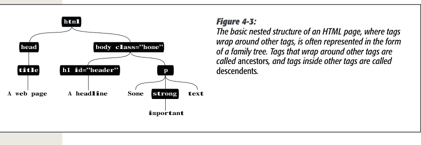

除了 HTML 标签，Web 浏览器还会跟踪出现在标签内部的文本（例如，图 4-3 中 `<h1>` 标签内的“A headline”），以及分配给每个标签的属性（图 4-3 中应用于 `<body>` 和 `<h1>` 标签的 class 属性）。事实上，DOM 将这三者——标签（也称为元素）、属性和文本——都视为单独的单元，称为节点。

JavaScript 提供了多种选择页面元素的方法，以便你可以对它们执行操作——比如让它们淡出视野或在页面上移动。`document.getElementById()` 方法允许你选择应用了特定 ID 的 HTML 元素。因此，如果你有一个带有 ID `banner` 的 `<div>` 标签——`<div id="banner">`——你可以像这样选择那个 div：

```javascript
document.getElementById('banner');
```

同样，`document.getElementsByTagName()` 方法选择每个特定标签的实例（例如，`document.getElementsByTagName('a')` 选择页面上所有的锚点标签（链接））；一些浏览器还支持使用特定类或 CSS 选择器来选择页面元素的方法。

### 解决方法工作坊：DOM 的问题

不幸的是，主流浏览器传统上对 DOM 的解释各不相同。例如，Internet Explorer 9 之前的版本处理事件的方式与其他浏览器不同；相同的 HTML 在 Firefox 和 Safari 中可能比在 Internet Explorer 中产生更多的文本节点；IE 并不总是以与 Firefox、Safari 或 Opera 相同的方式检索 HTML 标签属性。此外，不同的浏览器对 HTML 中的空白字符（如制表符和空格）的处理方式也不同——在某些情况下将空白字符视为额外的文本节点（Firefox 和 Safari），而在其他情况下则忽略这些空白字符（IE）。而这些仅仅是处理 DOM 方面最主要的几种常见浏览器之间差异的一小部分。

克服跨浏览器 JavaScript 问题对于 JavaScript 程序员来说是一项巨大的任务，以至于可以专门为此写一整本（非常枯燥的）书。事实上，许多 JavaScript 书籍花费大量时间向你展示需要编写的代码，以使各种浏览器的行为保持一致。但人生苦短——你宁愿构建交互式用户界面并为你的网站添加酷炫效果，而不是担心如何让你的脚本在 Internet Explorer、Firefox、Safari 和 Opera 中都能完全相同地工作。

此外，传统的用于选择页面元素的 DOM 方法对于 Web 设计师来说并不直观，特别是因为你已经拥有了一种选择页面元素的绝佳方法——CSS 选择器。幸运的是，jQuery 解决了这些问题，并提供了易于使用的、跨浏览器兼容的方式来选择和操作页面元素。

### 选择页面元素：jQuery 的方式

如你从对页所读到的，Web 浏览器提供了两种选择网页元素的主要方法——*document.getElementById()* 和 *document.getElementsByTagName()*。不幸的是，这两种方法没有提供进行更精细类型选择所需的控制。例如，如果你想选择每个类为 *navButton* 的 `<a>` 标签，你首先需要选择每个标签，然后逐一检查，只找出那些具有正确类名的标签。

幸运的是，jQuery 提供了一种非常强大的技术来选择和操作元素集合——CSS 选择器。没错，如果你习惯使用层叠样式表 (CSS) 来设置网页样式，那么你已经准备好使用 jQuery 了。CSS 选择器是告诉 Web 浏览器该样式适用于哪个标签的指令。例如，*h1* 是一个基本元素选择器，它将样式应用于每个 `<h1>` 标签，而 *.copyright* 是一个类选择器，它为任何具有 `copyright` 类属性的标签设置样式，如下所示：

```html
<p class="copyright">Copyright, 2011</p>
```

使用 jQuery，你可以使用一个称为 *jQuery 对象* 的特殊命令来选择一个或多个元素。基本语法如下：

```javascript
$('selector')
```

在创建 jQuery 对象时，你可以使用几乎所有的 CSS 2.1 选择器和许多 CSS 3 选择器（即使浏览器本身不理解特定选择器——比如 IE 对某些 CSS 3 选择器的支持）。例如，如果你想在 jQuery 中选择一个 ID 为 *banner* 的标签，你可以这样写：


### 选择页面元素：jQuery 之道

`$('#banner')`

`#banner` 是一个 CSS 选择器，用于为 ID 名为 banner 的标签设置样式——其中 `#` 部分表示你正在指定一个 ID。当然，一旦你选中了一个或多个元素，你就会想要对它们做些什么——jQuery 提供了许多用于操作元素的工具。例如，假设你想更改元素内部的 HTML，可以这样写：

`$('#banner').html('<h1>JavaScript was here</h1>');`

从第 138 页开始，以及在本书的后续内容中，你将了解更多关于如何使用 jQuery 操作页面元素的知识。但首先，你需要更多地了解如何使用 jQuery 来选择页面元素。

> **注意：** 最新版本的大多数浏览器现在已经支持通过类名和 CSS 选择器来选择元素。然而，由于全球范围内使用的浏览器对此支持并不一致，jQuery 通过确保你的选择操作即使在古老的 IE6 中也能正常工作来提供帮助。

### 基本选择器

ID、类和元素选择器等基本 CSS 选择器构成了 CSS 的核心。它们是使用 jQuery 选择各种元素的好方法。

因为阅读选择器的相关内容并不是理解它们的最佳方式，本书包含了一个交互式网页，让你可以测试选择器。在本书教程文件的 testbed 文件夹中，你会找到一个名为 selectors.html 的文件。在网页浏览器中打开该文件。你可以在选择器输入框中输入各种 jQuery 选择器，然后点击 Apply 进行测试（参见图 4-4）。

> **注意：** 关于本书教程文件的查找位置，请参见第 29 页。

#### ID 选择器

你可以使用 jQuery 和 CSS ID 选择器来选择任何应用了 ID 的页面元素。例如，假设你的网页中有以下 HTML：

`<p id="message">Special message</p>`

要使用旧的 DOM 方式选择该元素，你会这样写：

`var messagePara = document.getElementById('message');`

jQuery 的写法如下：

`var messagePara = $('#message');`

与 DOM 方法不同，你不能只使用 ID 名称（`'message'`）；你必须使用 CSS 语法来定义 ID 选择器（`'#message'`）。换句话说，你需要在 ID 名称前加上井号，就像为该 ID 创建 CSS 样式一样。

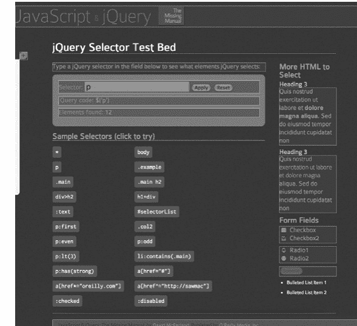

**图 4-4：** 本书教程文件中的 *selectors.html* 文件可以让你试用 jQuery 选择器。在 Selector 表单字段（已圈出）中输入一个选择器，然后点击 Apply。页面会将你的选择器转换为一个 jQuery 对象，所有与你输入的选择器匹配的元素都会变成红色。在字段下方显示的是用于选择该项目的 jQuery 代码，以及所选元素的总数。在这个例子中，`p` 是选择器，页面上所有的 `<p>` 标签（该页面上有 12 个）都以红色高亮显示。

#### 元素选择器

jQuery 还提供了 `getElementsByTagName()` 方法的替代方案。只需将标签名称传递给 jQuery 即可。例如，使用旧的 DOM 方法选择页面上的每个 `<a>` 标签，你会这样写：

```
var linksList = document.getElementsByTagName('a');
```

使用 jQuery，你会这样写：

```
var linksList = $('a');
```

> **提示：** jQuery 支持的选择器范围比这里列出的还要广泛。虽然本书列出了许多有用的选择器，但你可以在 <http://api.jquery.com/category/selectors/> 找到 jQuery 选择器的完整列表。

#### 类选择器

另一种选择元素的有用方式是通过类名。例如，假设你想创建一个包含下拉菜单的导航栏；当访问者将鼠标悬停在某个主导航按钮上时，你希望出现一个下拉菜单。你需要使用 JavaScript 来控制这些菜单，而且你需要一种方式来编程使每个主导航按钮在有人将鼠标悬停在其上时打开一个下拉菜单。

> **注意：** 由于查找具有特定类名的所有元素是一项非常常见的任务，大多数最新版本的浏览器都支持执行此操作的方法。但由于并非所有浏览器都有内置的方式来查找具有特定类的元素（如 IE8 及更早版本），像 jQuery 这样考虑了不同浏览器差异的库是非常宝贵的。

一种技术是为主导航栏中的每个链接添加一个类——比如 *navButton*——然后使用 JavaScript 搜索具有*仅*该类名的链接，并将所有神奇的菜单打开功能应用到这些链接上（顺便说一下，你将在第 249 页学习如何做到这一点）。这个方案听起来可能令人困惑，但目前的重点是，要使这个导航栏正常工作，你需要一种方式来只选择具有特定类名的链接。

幸运的是，jQuery 提供了一种简单的方法来选择具有相同类名的所有元素。只需使用如下 CSS 类选择器：

```
$('.submenu')
```

同样请注意，你编写 CSS 类选择器的方式与 CSS 类选择器的写法完全一样，在类名前加上一个句点。一旦你选择了这些标签，就可以使用 jQuery 来操作它们。例如，要隐藏所有类名为 *.submenu* 的标签，你可以这样写：

```
$('.submenu').hide();
```

你将在第 187 页了解更多关于 jQuery 的 *hide()* 函数的知识，但现在，这个示例已经让你对 jQuery 的工作方式有了一定的了解。

### 快速入门

#### 了解 CSS

层叠样式表（Cascading Style Sheets）是任何 JavaScript 讨论中的一大重要话题。为了充分利用本书，你需要至少具备一些网页设计的背景知识，并对 CSS 及其使用方法有所了解。CSS 是网页设计师创建精美网站最重要的工具，因此如果你对它了解不多，现在就是学习的时候了。CSS 不仅能帮助你使用 jQuery，你还会发现可以将 JavaScript 与 CSS 结合使用，轻松地为网页添加交互式视觉效果。

如果你需要一些帮助来快速掌握 CSS，有许多资源可供你使用：

关于 CSS 的基本概述，可以尝试 HTML Dog CSS 教程 *www.htmldog.com/guides/*。你可以在该网站找到基础、中级和高级教程。

你也可以购买一本 *CSS: The Missing Manual*，该书提供了对 CSS 的全面讲解（包括许多实践教程，与本书中的教程类似）。

最重要的是，在使用 jQuery 时，理解 *CSS 选择器* 非常重要——选择器是告诉网页浏览器 CSS 规则应用于哪个标签的指令。要掌握选择器，本框中的资源非常好。如果你只是想复习一下可用的不同选择器，也有几个去处：

- *http://css.maxdesign.com.au/selectutorial/*
- *http://www.456bereastreet.com/archive/200601/css_3_selectors_explained/*

### 高级选择器

jQuery 还允许你使用更复杂的 CSS 选择器来精确地定位你希望选择的标签。现在不必过于担心掌握这些：在你阅读了几章并更好地了解了 jQuery 的工作原理以及如何使用它来操作网页之后，你可能会想回到这一节再看一下。

- **后代选择器** 提供了一种定位另一个标签内部标签的方法。例如，假设你创建了一个无序链接列表，并为列表的 `<ul>` 标签添加了一个 ID 名称 *navBar*，像这样：`<ul id="navBar">`。jQuery 表达式 `$('a')` 会选择页面上所有的 `<a>` 标签。但是，如果你只想选择无序列表内部的链接，你可以使用后代选择器，如下：
  `$('#navBar a')`
  同样，这个语法就是基本的 CSS：一个选择器，后面跟一个空格，再跟另一个选择器。列出的最后一个选择器是目标（在本例中是 *a*），而左边的每个选择器代表一个包裹目标的标签。

- **子选择器** 定位的是另一个标签的子标签。子标签是另一个标签的直接后代。例如，在图 4-3 中所示的 HTML 图表中，`<h1>` 和 `<p>` 标签是 `<body>` 标签的子元素，但 `<strong>` 标签不是（因为它被 `<p>` 标签包裹）。你要先列出父元素，然后跟一个 `>`，再跟子元素来创建子选择器。例如，要选择作为 `<body>` 标签子元素的 `<p>` 标签，你会这样写：
  `$('body > p')`

- **相邻兄弟选择器** 让你可以选择紧跟在另一个标签之后的标签。例如，假设你有一个不可见的面板，在点击标签页时显示。在你的 HTML 中，标签页可能由一个标题标签（比如 `<h2>`）表示，而隐藏的面板是紧跟在标题后面的 `<div>` 标签。要使 `<div>` 标签（面板）可见，你需要一种方式来选择它。你可以使用 jQuery 和相邻兄弟选择器轻松做到：
  `$('h2 + div')`
  要创建相邻兄弟选择器，只需在两个选择器之间加上一个加号（选择器可以是任何类型的：ID、类或元素）。右边的选择器是要选择的目标，但前提是它紧跟在左边选择器的后面。

- **属性选择器** 让你可以根据元素是否具有特定属性来选择元素，甚至可以检查属性是否匹配特定的值。使用属性选择器，你可以找到设置了 alt 属性的 `` 标签，甚至匹配具有特定 alt 文本值的 `` 标签。或者你可以找到每个指向你网站外部的链接标签，并仅为这些链接添加代码，使它们在新窗口中打开。

你将属性选择器添加在你要检查其属性的元素名称之后。例如，要找到设置了 alt 属性的 `` 标签，你可以这样写：

### 属性选择器

`$('img[alt]')`

有几种不同的属性选择器：

- **[attribute]** 选择HTML中指定了该属性的元素。例如，`$(a[href])` 定位所有设置了href属性的 `<a>` 标签。按属性选择可以让你排除命名锚点——`<a name="placeOnPage"></a>`——这些仅用作页面内链接。
- **[attribute="value"]** 选择具有特定属性值的元素。例如，要查找表单中的所有文本框，可以使用：

```
$('input[type="text"]')
```

由于大多数表单元素共享相同的标签——`<input>`——区分表单元素类型的唯一方法是检查其type属性（选择表单元素非常常见，以至于jQuery为此包含了专门的选择器，如第259页所述）。

- **[attribute^="value"]** 匹配属性以特定值开头的元素。例如，如果你想查找指向站点外部的链接，可以使用以下代码：

```
$('a[href^="http://"]')
```

注意，整个属性值不需要完全匹配，只需匹配开头即可。因此 `href^=http://` 匹配指向 http://www.yahoo.com、http://www.google.com 等的链接。或者你可以使用此选择器来识别 mailto: 链接，如下所示：

```
$('a[href^="mailto:"]')
```

- **[attribute$="value"]** 匹配属性以特定值结尾的元素，这对于匹配文件扩展名非常有效。例如，使用此选择器，你可以定位指向PDF文件的链接（也许是为了使用JavaScript添加特殊的PDF图标，或动态生成指向Adobe.com的链接，以便访问者可以下载Acrobat Reader程序）。选择指向PDF文件链接的代码如下所示：

```
$('a[href$=".pdf"]')
```

- **[attribute*="value"]** 匹配属性中任意位置包含特定值的元素。例如，你可以找到指向特定域名的任何类型的链接。例如，以下是如何查找指向 missingmanuals.com（http://missingmanuals.com）的链接：

```
$('a[href*="missingmanuals.com"]')
```

此选择器提供了灵活性，不仅可以找到指向 http://www.missingmanuals.com 的链接，还可以找到指向 http://missingmanuals.com 和 http://www.missingmanuals.com/library.html 的链接。

> **注意：** jQuery有一组在处理表单时非常有用的选择器。它们允许你选择文本字段、密码字段和选中的单选按钮等元素。你将在第259页了解这些选择器。

### jQuery过滤器

jQuery还提供了一种基于某些特征过滤选择的方法。例如，`:even` 过滤器允许你在元素集合中选择每个偶数元素。此外，你还可以查找包含特定标签、特定文本的元素、从视图中隐藏的元素，甚至是*不*匹配特定选择器的元素。要使用过滤器，你在主选择器后面添加冒号，后跟过滤器的名称。例如，要查找表格的每个偶数行，可以这样编写jQuery选择器：

```
$('tr:even')
```

此代码选择每个偶数 `<tr>` 标签。要缩小选择范围，你可能只想在类名为 *striped* 的表格中找到每个偶数表格行。你可以这样做：

```
$('.striped tr:even')
```

以下是 `:even` 和其他过滤器的工作原理：

- **:even** 和 **:odd** 在一组元素中选择每个*其他*元素。这些过滤器的工作方式有点违反直觉；只需记住，jQuery选择是匹配指定选择器的所有元素的列表。在这方面，它们有点像数组（参见第59页）。jQuery选择中的每个元素都有一个索引号——记住数组的索引值总是从0开始（参见第62页）。因此，由于 `:even` 过滤偶数索引值（如0、2和4），此过滤器实际上返回选择中的第1、第3和第5个项目（等等）——换句话说，它实际上是在选择每个其他奇数元素！`:odd` 过滤器的工作方式相同，只是它选择每个奇数索引号（1、3、5等）。
- **:first** 和 **:last** 选择一组元素中的第一个或最后一个元素。例如，如果你想选择页面上的第一个段落，你可以输入： `$('p:first');` 而要选 择页面上的最后一个段落，你可以输入： `$('p:last');`
- 你可以使用 **:not()** 查找*不*匹配特定选择器类型的元素。例如，假设你想选择每个 `<a>` 标签，除了那些类为 *navButton* 的标签。以下是操作方法： `$('a:not(.navButton)');` 你给 `:not()` 函数你希望忽略的选择器名称。在这种情况下，`.navButton` 是一个类选择器，所以这段代码翻译为"不具有 `.navButton` 类"。你可以将 `:not()` 与任何jQuery过滤器和大多数jQuery选择器一起使用；所以，例如，要找到每个不以 http:// 开头的链接，你可以这样写： `$('a:not([href^="http://"])')`
- **:has()** 查找包含另一个选择器的元素。例如，假设你想找到所有 `<li>` 标签，但仅当它们内部有 `<a>` 标签时。你可以这样做： `$('li:has(a)')`

这种设置与后代选择器不同，因为它不会选择 `<a>`；它选择 `<li>` 标签，但仅选择那些内部有链接的 `<li>` 标签。

- **:contains()** 查找包含特定文本的元素。例如，要找到每个显示"Click Me!"的链接，你可以创建一个jQuery对象，如下所示：

```
$('a:contains(Click Me!)')
```

- **:hidden** 定位隐藏的元素，包括那些CSS *display* 属性设置为 *none* 的元素（这意味着你在页看不到它们）、使用jQuery的 *hide()* 函数隐藏的元素（在第187页讨论）、宽度和高度值设置为 receptions 设置为0的元素，以及隐藏的表单字段。（此选择器不适用于CSS *visibility* 属性设置为 *invisible* 的元素。）例如，假设你已经隐藏了几个 `<div>` 标签；你可以找到它们，然后使用jQuery使它们可见，如下所示：

```
$('div:hidden').show();
```

这行代码对当前在页面上可见的 `<div>` 标签没有影响。（你将在第187页学习jQuery的 *show()* 函数。）

- **:visible** 与 `:hidden` 相反。它定位在页面上可见的元素。

#### 理解jQuery选择

当你使用jQuery对象选择一个或多个元素时——例如，`$('#navBar a')`——你不会得到传统的DOM节点列表，就像使用 *getElementById()* 或 *getElementsByTagName()* 时获得的那样。相反，你会得到一个特殊的、仅jQuery使用的元素选择。这些元素不理解传统的DOM方法；因此，如果你在其他书籍中学过DOM，你会发现那里学到的所有方法都不能直接用于jQuery对象。这可能看起来是一个重大缺点，但几乎每个普通DOM节点的属性和方法都有jQuery等价物，所以你可以做任何传统DOM能做到的事情——只是通常更快，代码行数更少。

然而，DOM的工作方式与jQuery选择之间有两个重大的概念差异。jQuery的构建目的是让JavaScript编程变得更加简单和快速。该库的目标之一是让你用尽可能少的代码行完成很多操作。为了实现这一点，jQuery使用了两个不寻常的原则。

#### 自动循环

通常，当你使用DOM并选择一堆页面元素时，你需要创建一个循环（第93页）来遍历每个选中的节点并对该节点执行某些操作。例如，如果你想选择页面中的所有图像然后隐藏它们——如果你要创建JavaScript驱动的幻灯片，你可能会这样做——你必须首先选择图像，然后创建一个循环来遍历图像列表。

由于遍历元素集合非常常见，jQuery函数内置了这个功能。换句话说，当你将jQuery函数应用于一组元素时，你不需要自己创建循环，因为函数会自动执行。

例如，要选择ID为 *slideshow* 的 `<div>` 标签内的所有图像，然后隐藏这些图像，你在jQuery中可以这样写：

```
$('#slideshow img').hide();
```

用 `$('#slideshow img')` 创建的元素列表可能包含50张图像。*hide()* 函数会自动遍历列表，单独隐藏每张图像。这种设置非常方便（想象一下你不必写的 *for* 循环的数量），令人惊讶的是这个伟大的功能不仅仅是JavaScript的一部分。

#### 链式调用函数

有时你会想对一组元素执行多个操作。例如，假设你想使用JavaScript设置ID为 *popUp* 的 `<div>` 标签的宽度和高度。通常，你必须写至少两行代码。但jQuery让你用一行代码完成：

```
$('#popUp').width(300).height(300);
```

jQuery使用一种称为*链式调用*的独特原则，允许你一个接一个地添加函数。每个函数通过句点与下一个函数连接，并在与上一个函数相同的jQuery元素集合上操作。因此，上面的代码更改了ID为 *popUp* 的元素的宽度，*并且*更改了该元素的高度。链式调用jQuery函数让你能够简洁地执行大量操作。例如，假设你不仅想设置 `<div>` 标签的宽度和高度，还想在 `<div>` 内部添加文本并使其淡入视图（假设它当前在页面上不可见）。你可以非常简洁地这样做：

```
$('#popUp').width(300).height(300).text('Hi!').fadeIn(1000);
```

此代码将四个jQuery函数——*width()*、*height()*、*text()* 和 *fadeIn()*——应用于ID名为 *popUp* 的标签。

> **提示：** 一长串链式jQuery函数可能难以阅读，因此一些程序员将其拆分为多行，如下所示：

```
$('#popUp').width(300)
    .height(300)
    .text('Message')
    .fadeIn(1000);
```

只要你只在链的*最后一行*添加分号，JavaScript解释器就会将这些行视为单个语句。


### 向页面添加内容

链式调用函数的能力相当不寻常，这是 jQuery 特有的一项功能——换句话说，你无法在链中添加非 jQuery 函数（无论是你自己创建的还是内置的 JavaScript 函数）。

jQuery 提供了许多用于操作页面上元素和内容的函数，从简单地替换 HTML，到精确定位新 HTML 相对于选定元素的位置，再到从页面中完全移除标签和内容。

注意：示例文件 content_functions.html 位于 testbed 教程文件夹中，可让你逐一测试这些 jQuery 函数。只需在 Web 浏览器中打开该文件，在文本框中输入一些文本，然后点击任意一个方框即可查看每个函数的工作原理。

为了学习以下这些函数的示例，假设你有一个包含以下 HTML 的页面：

```html
<div id="container">
  <div id="errors">
    <h2>Errors:</h2>
  </div>
</div>
```

- `.html()` 既可以读取元素内部的当前 HTML，也可以用其他 HTML 替换当前内容。你需要将 `html()` 函数与 jQuery 选择器结合使用。
  - 要获取当前选区内的 HTML，只需在 jQuery 选择器后添加 `.html()`。例如，你可以使用本节开头 HTML 片段运行以下命令：
    ```javascript
    alert($('#errors').html());
    ```
  - 这段代码会创建一个警告框，其中包含文本 "<h2>Errors:</h2>"。当你以这种方式使用 `html()` 函数时，你可以复制特定元素内部的 HTML 并将其粘贴到页面上的另一个元素中。
  - 如果你向 `.html()` 提供一个字符串作为参数，就会替换选区内的当前内容：
    ```javascript
    $('#errors').html('<p>There are four errors in this form</p>');
    ```
  - 这行代码会替换 ID 为 errors 的元素内的所有 HTML。它将把示例 HTML 片段更改为：
    ```html
    <div id="container">
      <div id="errors">
        <p>There are four errors in this form</p>
      </div>
    </div>
    ```
  - 注意，它会替换掉原本存在的 <h2> 标签。你可以使用下面列出的其他函数来避免替换该 HTML。

- `.text()` 的工作方式与 `.html()` 类似，但它不接受 HTML 标签。当你想要替换标签内的文本时，它非常有用。例如，在本节开头的代码中，你会看到一个 <h2> 标签，其中包含文本 "Errors:"。假设在运行程序检查表单中是否存在任何错误后，你想将文本 "Errors:" 替换为 "No errors found"，你可以使用以下代码：
  ```javascript
  $('#errors h2').text('No errors found');
  ```
  <h2> 标签保持不变；只有内部的文本发生变化。jQuery 会对传递给 `text()` 函数的任何 HTML 标签进行编码，因此 <p> 会被转换为 `&lt;p&gt;`。如果你确实想在页面上显示尖括号和标签名称，这会非常方便。例如，你可以用它来向其他人展示示例 HTML 代码。

- `.append()` 将 HTML 作为所选元素的最后一个子元素添加。例如，假设你选择了一个 <div> 标签，但不想替换该 <div> 的内容，而是想在 </div> 闭合标签之前添加一些 HTML。`.append()` 函数是在项目符号列表（<ul>）或编号列表（<ol>）末尾添加项目的绝佳方式。例如，假设你在本节开头列出的 HTML 页面上运行以下代码：
  ```javascript
  $('#errors').append('<p>There are four errors in this form</p>');
  ```
  此函数运行后，你会得到如下 HTML：
  ```html
  <div id="container">
      <div id="errors">
          <h2>Errors:</h2>
          <p>There are four errors in this form</p>
      </div>
  </div>
  ```
  注意，<div> 内部原有的 HTML 保持不变，新的 HTML 块被添加到其后。

- `.prepend()` 与 `.append()` 类似，但将 HTML 直接添加在选区起始标签之后。例如，假设你在前面列出的相同 HTML 上运行以下代码：
  ```javascript
  $('#errors').prepend('<p>There are four errors in this form</p>');
  ```
  此 `prepend()` 函数执行后，你会得到以下 HTML：
  ```html
  <div id="container">
      <div id="errors">
          <p>There are four errors in this form</p>
          <h2>Errors:</h2>
      </div>
  </div>
  ```
  现在新增的内容直接出现在 <div> 的起始标签之后。

- 如果你想在选区外部添加 HTML，无论是在所选元素起始标签之前还是在元素闭合标签之后，请使用 `.before()` 或 `.after()` 函数。例如，检查表单中的文本字段以确保访客提交表单时该字段不为空，这是一种常见做法。假设在提交表单之前，该字段的 HTML 如下所示：

```html
<input type="text" name="userName" id="userName">
```

现在假设当访客提交表单时，此字段为空。你可以编写一个程序来检查该字段，然后在字段后添加错误消息。要在此字段后添加消息（现在不必担心如何实际检查表单字段的内容是否正确——你将在第 278 页找到答案），你可以像这样使用 `.after()` 函数：

```javascript
$('#userName').after('<span class="error">User name required</span>');
```

这行代码使网页显示错误消息，HTML 组件将如下所示：

```html
<input type="text" name="userName" id="userName">
<span class="error">User name required</span>
```

`.before()` 函数只是将新内容放在所选元素之前。

> 注意：本节列出的函数——`html()`、`text()` 等——是添加和更改页面内容最常用的方式，但它们并非唯一的方式。你可以在 http://api.jquery.com/category/manipulation/ 找到更多函数。

### 替换和移除选区

有时你可能希望完全替换或移除选定的元素。例如，假设你使用 JavaScript 创建了一个弹出对话框（不是老式的 `alert()` 方法，而是更专业的对话框，实际上只是绝对定位的 <div> 浮动在页面上方）。当访客点击对话框上的"关闭"按钮时，你 naturally 想要从页面中移除该对话框。为此，你可以使用 jQuery 的 `remove()` 函数。假设弹出对话框的 ID 为 *popup*；你可以使用以下代码将其删除：

```javascript
$('#popup').remove();
```

`.remove()` 函数不仅限于单个元素。假设你想移除所有应用了 *error* 类的 <span> 标签；你可以这样做：

```javascript
$('span.error').remove();
```

你还可以用新内容完全替换选区。例如，假设你有一个页面，展示了贵公司销售的产品照片。当访客点击某个产品的图片时，该产品会被添加到购物车。你可能会想要在图片被点击时将  标签替换为一些文本（例如"已添加到购物车"）。你将在下一章学习如何使特定元素对事件作出反应（例如图片被点击），但现在只需假设有一个 ID 为 *product101* 的  标签，你希望将其替换为文本。以下是如何使用 jQuery 来实现：

```javascript
$('#product101').replaceWith('<p>Added to cart</p>');
```

这段代码会从页面中移除  标签，并将其替换为 <p> 标签。

**注意：** jQuery 还包含一个名为 `clone()` 的函数，让你可以复制选定的元素。你将在第 150 页的教程中看到这个函数的实际应用。

#### 实用工具提示：跳过"查看源代码"

使用 JavaScript 操纵 DOM 来添加、更改、删除和重新排列 HTML 代码的一个问题是，很难搞清楚 JavaScript 完成后页面的 HTML 是什么样子。例如，每个浏览器中提供的"查看源代码"命令只显示从 Web 服务器下载的网页文件。换句话说，你看到的是 JavaScript 更改*之前*的 HTML，这可能使你很难判断你所写的 JavaScript 是否真的产生了你想要的 HTML。例如，如果你能查看 JavaScript 向表单页面添加 10 条错误消息后页面的 HTML 是什么样子，或者在你的 JavaScript 程序创建了一个包含文本和表单字段的复杂弹出对话框后，HTML 是什么样子，那么你会更容易判断自己是否得到了想要的 HTML。

幸运的是，大多数主流浏览器都提供了一套开发者工具，让你可以查看*渲染后的 HTML*——即 JavaScript 完成其魔法后浏览器显示的 HTML。通常这些工具以面板的形式出现在浏览器窗口底部，位于网页下方。不同的选项卡让你可以访问 JavaScript 代码、HTML、CSS 和其他有用的资源。选项卡的确切名称和打开工具面板的方法因浏览器而异：

- 在 Firefox 中，安装 Firebug 插件（第 477 页讨论过）。打开包含你想查看的 JavaScript 代码的页面并打开 Firebug（工具→Firebug→打开 Firebug）。点击 Firebug 面板中的 HTML 选项卡，你就会看到完整的 DOM（包括任何由 JavaScript 生成的 HTML）。

  或者，你可以在 Firefox 中使用 Web Developer 工具栏（https://addons.mozilla.org/en-US/firefox/addon/web-developer/）来查看常规 HTML 源代码和生成的 HTML。

- 在 IE 9 中，按 F12 键打开开发者工具面板，然后点击 HTML 选项卡查看页面的 HTML。对于 IE9，HTML 选项卡一开始显示的是下载的 HTML（与"查看源代码"命令相同）。但如果你点击刷新图标（或按 F5），HTML 选项卡就会显示渲染后的 HTML，包含任何由 JavaScript 创建的更改。

- 在 Chrome 中，选择 查看→开发者→开发者工具，然后点击浏览器窗口底部面板中的 Elements 选项卡。

- 在 Safari 中，确保开发者菜单已开启（选择 Safari→偏好设置，点击高级按钮，并确保勾选"在菜单栏中显示开发菜单"）。然后打开你想查看的页面，选择 开发→显示网页检查器。点击出现在浏览器窗口底部面板中的 Elements 选项卡。

- 在 Opera 中，选择 工具→高级→Opera Dragonfly。（Dragonfly 是 Opera 内置开发者工具的名称。）在浏览器窗口底部出现的面板中，点击 Documents 选项卡。

### 设置和读取标签属性

添加、移除和更改元素并不是 jQuery 唯一擅长的事情，也不是你对选区元素想要做的唯一事情。你经常会想要更改元素的属性值——例如，为标签添加一个类，或者更改元素的 CSS 属性。你还可以获取属性的值——例如，某个特定链接指向什么 URL？


### 设置和读取标签属性

### 类（Classes）

层叠样式表（Cascading Style Sheets）是一项非常强大的技术，允许你为 HTML 添加各种复杂的视觉格式。一条 CSS 规则可以为页面添加彩色背景，而另一条规则则可能完全隐藏某个元素。你只需通过 JavaScript 移除、添加或更改应用于元素的类，就能创建一些非常高级的视觉效果。由于 Web 浏览器能够非常快速高效地处理和执行 CSS 指令，仅仅为标签添加一个类，就能完全改变该标签的外观——甚至能使其从页面上消失。

jQuery 提供了多个用于操作标签类属性的函数：

- *addClass()* 为元素添加指定的类。在 jQuery 选择器之后使用 *addClass()*，并向该函数传递一个字符串，该字符串代表你希望添加的类名。例如，要为所有指向你网站外部的链接添加 *externalLink* 类，可以使用以下代码：

```
$('a[href*="http://"]').addClass('externalLink');
```

此代码会将如下 HTML：

```
<a href="http://www.oreilly.com/">
```

更改为：

```
<a href="http://www.oreilly.com/" class="externalLink">
```

要使此函数发挥作用，你需要事先创建一个 CSS 类样式并将其添加到页面的样式表中。然后，当 JavaScript 添加类名时，Web 浏览器就能应用先前定义的 CSS 规则中的样式属性。

> 注意：使用 *addClass()* 和 *removeClass()* 函数时，你只需提供类名——省略在创建类选择器时通常使用的句点。例如，*addClass('externalLink')* 是正确的，但 *addClass('.externalLink')* 是错误的。

此 jQuery 函数还能处理标签已应用了某个类时出现的问题——*addClass()* 函数不会移除已应用于该标签的旧类；该函数只是同时添加新类。

> 注意：为单个标签添加多个类名是完全有效的，并且通常非常有用。有关此技术的更多信息，请查看 [www.cwd.com.tw/article/177/use-more-than-one-css-class](www.cwd.com.tw/article/177/use-more-than-one-css-class)。

- *removeClass()* 与 *addClass()* 相反。它从选定的元素中移除指定的类。例如，如果你想从一个 ID 为 alertBox 的 `<div>` 中移除名为 *highlight* 的类，可以这样做：

```
$('#alertBox').removeClass('highlight');
```

- 最后，你可能想要*切换*（*toggle*）一个特定的类——即如果该类不存在则添加，如果存在则移除。切换是显示元素开启或关闭状态的一种常用方式。例如，当你点击一个单选按钮时，它被选中（开启）；再次点击，勾选标记消失（关闭）。

假设你有一个网页上的按钮，点击时会更改 `<body>` 标签的类。通过这种方式，你可以通过使用后代选择器创建第二套样式，为网页添加完全不同的风格。当你再次点击按钮时，你希望从 `<body>` 标签移除该类，以便页面恢复到之前的外观。在此示例中，假设访客点击以更改页面样式的按钮的 ID 为 *changeStyle*，并且你希望在每次点击按钮时切换类名 *altStyle* 的开和关。以下是实现此功能的代码：

```
$('#changeStyle').click(function() {
    $('body').toggleClass('altStyle');
});
```

此时，不必担心上面代码的第一行和第三行；它们涉及允许脚本对页面上发生的操作（如点击按钮）做出反应的事件。你将在下一章了解事件。加粗的代码行演示了 *toggleClass()* 函数；它在每次点击按钮时添加或移除类 *altStyle*。

### 读取和更改 CSS 属性

jQuery 的 `css()` 函数还允许你直接更改元素的 CSS 属性，因此，你不仅可以将类样式应用于元素，还可以立即添加边框或背景颜色，或设置宽度或定位属性。你可以通过三种方式使用 css() 函数：查找元素 CSS 属性的当前值、为元素设置单个 CSS 属性，或同时设置多个 CSS 属性。

要确定 CSS 属性的当前值，请将属性名传递给 `css()` 函数。例如，假设你想查找 ID 为 *main* 的 `<div>` 标签的背景颜色：

```
var bgColor = $('#main').css('background-color');
```

此代码运行后，变量 *bgColor* 将包含一个字符串，该字符串是该元素的背景颜色值。

> *注意：* jQuery 可能并不总是以你期望的方式返回 CSS 值。对于颜色（如 CSS 背景颜色或颜色属性），jQuery 总是返回 rgb 值（如 rgb(255, 0, 10)），或者如果颜色有任何透明度，则返回 rgba 颜色值（如 rgba(255,10,10,.5)）。无论样式表中的颜色是使用十六进制表示法（#F4477A）、使用百分比的 RGB（rgb(100%,10%,0%)）还是 HSL（hsl(72,100%,50%)）定义的，jQuery 都返回 RGB 值。此外，jQuery 不理解简写 CSS 属性，如 *font, margin, padding* 或 *border*。相反，你必须使用特定的 CSS 属性，如 *font-face, margin-top, padding-bottom* 或 *border-bottom-width*，来访问可以在 CSS 简写中组合的样式。最后，jQuery 将所有单位值转换为像素，因此即使你使用 CSS 将 `<body>` 标签的字体大小设置为 150%，在检查 *font-size* 属性时 jQuery 也会返回一个像素值。

*css()* 函数还允许你为元素设置 CSS 属性。要使用此方式，请向函数提供两个参数：CSS 属性名称和值。例如，要将 `<body>` 标签的字体大小更改为 200%，你可以这样做：

```
$('body').css('font-size', '200%');
```

你提供的第二个参数可以是字符串值，如 *'200%'*，也可以是数值，jQuery 会将其转换为像素。例如，要将所有类为 *.pullquote* 的标签的内边距更改为 100px，你可以编写以下代码：

```
$('.pullquote').css('padding',100);
```

在此示例中，jQuery 将内边距属性设置为 100 像素。

> **注意：** 使用 jQuery 的 *.css()* 函数设置 CSS 属性时，你可以使用 CSS 简写方法。例如，以下是为所有类为 *highlight* 的段落添加黑色一像素边框的方法：

```
$('p.highlight').css('border', '1px solid black');
```

基于 CSS 属性的当前值来更改它通常很有用。例如，假设你想在网页上添加一个“放大文字”按钮，这样当访客点击该按钮时，页面的字体大小会翻倍。要实现这一点，你需要读取该值，然后设置一个新值。在这种情况下，你首先要确定当前的字体大小，然后将字体大小设置为该值的两倍。这比你想象的要稍微复杂一些。以下是代码，后面有完整解释：

```
var baseFont = $('body').css('font-size');
baseFont = parseInt(baseFont,10);
$('body').css('font-size',baseFont * 2);
```

第一行检索 `<body>` 标签的 font-size 值——返回的值是以像素为单位，并且是像 '16px' 这样的字符串。由于你想将该大小加倍（乘以 2），你必须通过移除字符串的“px”部分将该字符串转换为数字。第二行使用第 446 页讨论的 JavaScript *parseInt()* 方法来完成此操作。该函数本质上是去掉数字后面的任何内容，因此在第 2 行之后，*baseFont* 包含一个数字，例如 16。最后，第三行通过将 *baseFont* 值乘以 2 来重置 *font-size* 属性。

> **注意：** 此代码仅当页面上的其他标签（段落、标题等）的字体大小是使用相对值（如 em 或百分比）设置时，才会影响页面的字体大小。如果其他标签使用的是绝对值（如像素），更改 `<body>` 标签的字体大小将不会影响它们。

### 同时更改多个 CSS 属性

如果你想更改一个元素的多个 CSS 属性，你不需要多次调用 *.css()* 函数。例如，如果你想动态

要高亮显示一个`<div>`标签（也许是作为对访问者某个操作的响应），你可以更改`<div>`标签的背景颜色*并*为其添加边框，如下所示：

```
$('#highlightedDiv').css('background-color','#FF0000');
$('#highlightedDiv').css('border','2px solid #FE0037');
```

另一种方法是向`.css()`函数传递所谓的*对象字面量*。可以把对象字面量看作一组属性名/值对的列表。在每个属性名后面，你插入一个冒号（:），后跟一个值；每对属性名/值之间用逗号分隔，并且整个结构用花括号——{}——括起来。因此，上面两个CSS属性值对应的对象字面量如下所示：

```
{ 'background-color' : '#FF0000', 'border' : '2px solid #FE0037' }
```

因为对象字面量如果挤在一行中会难以阅读，所以许多程序员会将其拆分为多行书写。以下代码在功能上与前面的单行写法完全相同：

```
{
    'background-color' : '#FF0000',
    'border' : '2px solid #FE0037'
}
```

对象字面量的基本结构如图4-5所示。

> **警告：** 创建对象字面量时，请确保在每个值后面添加逗号来分隔每对属性名/值（例如，在本示例中，逗号放在值`'#FF0000'`之后）。但是，最后一对属性名/值后面*不*应该有逗号，因为它后面没有其他属性名/值对了。如果你在最后一个值后面添加了逗号，某些网页浏览器（包括Internet Explorer）将产生错误。

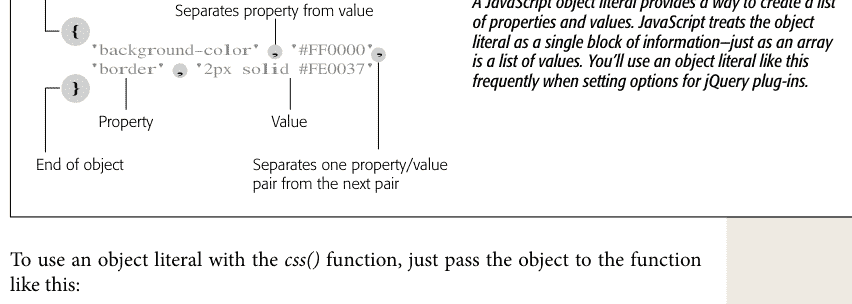

要将对象字面量与`css()`函数一起使用，只需将对象传递给函数即可，如下所示：

```
$('#highlightedDiv').css({
    'background-color' : '#FF0000',
    'border' : '2px solid #FE0037'
});
```

### 读取、设置和删除HTML属性

仔细研究这个示例，因为它看起来与你之前看到的有些不同，而且在后面的章节中你会遇到很多类似的代码。首先要注意的是，这段代码只是一个JavaScript语句（本质上就是一行代码）——你可以通过语句末尾的分号直到最后一行才出现来判断。该语句被分成四行书写，以提高代码的可读性。

接下来，注意对象字面量是传递给`css()`函数的一个参数（就像一条数据）。所以在代码`css({`中，左括号是函数的一部分，而左花括号`{`标记对象的开始。最后一行的三个字符分解如下：`}`是对象的结束，也是传递给函数的参数的结束；`)`标记`css()`函数的结束；`;`标记JavaScript语句的结束。

如果这些对象字面量的内容让你头疼，你可以自由地逐行更改CSS属性，如下所示：

```
$('#highlightedDiv').css('background-color','#FF0000');
$('#highlightedDiv').css('border','2px solid #FE0037');
```

或者，更好的方法是使用jQuery内置的链式调用能力（第137页）。链式调用是通过将一个函数添加到另一个函数的末尾，对一组元素集合应用多个jQuery函数，如下所示：

```
$('#highlightedDiv').css('background-color','#FF0000')
                     .css('border','2px solid #FE0037');
```

这段代码可以理解为：查找ID为highlightedDiv的元素，更改其背景颜色，然后更改其边框颜色。链式调用比在上面的代码中重复执行选择——`$('#highlightedDiv')`——提供了更好的性能，因为每次执行选择都会让网页浏览器运行所有用于选择该元素的jQuery代码。因此，以下代码不是最优的。

```
$('#highlightedDiv').css('background-color','#FF0000');
$('#highlightedDiv').css('border','2px solid #FE0037');
```

这段代码迫使浏览器选择该元素、更改其CSS、再次选择该元素（浪费处理器时间），并再次应用CSS。使用链式调用方法，浏览器只需选择该元素一次，然后运行两次CSS函数；只选择一次元素更快、更高效。

由于使用JavaScript更改类和CSS属性是非常常见的任务，jQuery为它们提供了内置函数。但`addClass()`和`css()`函数实际上只是更改HTML类和样式的快捷方式。jQuery还包含了用于处理HTML属性的通用函数——`attr()`和`removeAttr()`函数。

`attr()`函数允许你从标签中读取指定的HTML属性。例如，要确定某个特定``当前指向的图形文件，你需要向函数传递字符串`'src'`（对应``标签的src属性）：

```
var imageFile = $('#banner img').attr('src');
```

*attr()*函数以HTML中设置的方式返回属性的值。这段代码返回在ID为*banner*的标签内的第一个``标签的*src*属性，因此变量*imageFile*将包含页面HTML中设置的路径：例如，`'images/banner.png'`或`'http://www.thesite.com/images/banner.png'`。

**注意：** 向*.attr()*函数传递属性名时，你不需要担心属性名的大小写——`href`、`HREF`甚至`HrEf`都可以正常工作。

如果向*attr()*函数传递第二个参数，你就可以设置标签的属性。例如，要切换为不同的图像，你可以这样更改``标签的*src*属性：

```
$('#banner img').attr('src', 'images/newImage.png');
```

如果想从标签中完全删除某个属性，请使用*removeAttr()*函数。例如，以下代码从`<body>`标签中删除*bgColor*属性：

```
$('body').removeAttr('bgColor');
```

### 对选择中的每个元素执行操作

如第136页所述，jQuery的独特之处在于其大多数函数会自动遍历jQuery选择中的每个项目。例如，要让页面上的所有``淡出，你只需一行JavaScript代码：

```
$('img').fadeOut();
```

*.fadeOut()*函数使元素慢慢消失，当它应用于包含多个元素的jQuery选择时，该函数会遍历选择并逐个淡出每个元素。有很多时候你会想要遍历一组元素并对每个元素执行一系列操作。jQuery提供了*.each()*函数专门用于这个目的。

例如，假设你想在页面底部的参考链接框中列出页面上所有的外部链接，标题可能是"本文提及的其他网站"。（好吧，你可能永远不会想这样做，但请配合一下。）总之，你可以通过以下步骤创建该框：

- 1. 获取所有指向站外的链接。
- 2. 获取每个链接的HREF属性（即URL）。
- 3. 将该URL添加到参考链接框的链接列表中。

jQuery没有执行这些确切步骤的内置函数，但你可以使用*each()*函数自己实现。它只是一个jQuery函数，所以你只需将其附加到jQuery元素选择的末尾即可，如下所示：

```
$('selector').each();
```

### 匿名函数

要使用*each()*函数，你需要向其传递一种特殊类型的参数——*匿名函数*。匿名函数只是一个包含你希望对每个选中元素执行的步骤的函数。它被称为*匿名*函数，是因为与你在第100页学到的创建函数不同，你不需要给它命名。以下是匿名函数的基本结构：

```
function() {
  //代码放在这里
}
```

因为没有名字，所以你无法以通常的方式调用该函数。例如，对于普通的命名函数，你需要使用其名称加一组括号来调用，就像这样：*calculateSalesTax( )*。相反，你需要将匿名函数作为参数传递给另一个函数（虽然奇怪且令人困惑，但确实如此！）。以下是将匿名函数作为*each()*函数的一部分的用法：

```
$('selector').each(function() {
  // 代码放在这里
});
```

图4-6展示了这种结构的不同部分。最后一行尤其容易让人困惑，因为它包含三个不同的符号，分别关闭了整体结构的三个部分。`}`标记函数的结束（同时也是传递给*each()*函数的参数的结束）；`)`是*each()*函数的最后一部分；`;`表示JavaScript语句的结束。换句话说，JavaScript解释器将所有这些代码视为单条指令。

```
$('selector').each(function() {
  // 你的代码放在这里
});
```

**图4-6：** jQuery的each()函数允许你遍历页面元素的选择并对每个元素执行一系列任务。使用该函数的关键在于理解匿名函数。

外部结构就位后，现在需要在匿名函数内部放入内容：所有你希望对选择中的每个元素执行的操作。*each()*函数的工作方式类似于循环——意味着匿名函数内部的指令会对你获取的每个元素执行一次。例如，假设你在一个页面上有50张图片，并将以下JavaScript代码添加到页面的某个脚本中：

```
$('img').each(function() {
  alert('I found an image');
});
```

## **this 和 $(this)**

将会弹出五十个提示"我发现了一张图片"的警告对话框。（那会非常烦人，所以在家请勿尝试。）

> **注意：** 这看起来可能有些熟悉。正如你在第123页看到的，当向页面添加jQuery时，你应该使用 `document.ready()` 函数来确保页面的HTML在浏览器执行任何JavaScript编程之前已加载完毕。该函数也接受一个匿名函数作为参数：

```javascript
$(document).ready(function() {
    // 编程内容放在这个
    // 匿名函数内部
});
```

当使用 *each()* 函数时，你自然会想要访问或设置每个元素的属性——例如，找到每个外部链接的URL。要通过循环访问当前元素，你需要使用一个名为 *this* 的特殊关键字。*this* 关键字指的是调用该匿名函数的任何元素。因此，在循环的第一次执行中，*this* 指的是jQuery选择中的第一个元素，而在循环的第二次执行中，*this* 指的是第二个元素。

根据jQuery的工作原理，*this* 指的是一个传统的DOM元素，因此你可以访问传统的DOM属性。但是，正如你在本章中所读到的，特殊的jQuery选择器让你能够利用所有强大的jQuery函数。因此，要将 *this* 转换为其jQuery等价物，你需要编写 `$(this)`。

此时，你可能在想所有这些 *this* 的内容都是某种旨在让你头疼的残酷玩笑。这不是玩笑，但确实令人困惑。为了帮助澄清如何使用 `$(this)`，请再次查看本节开头描述的任务——在页面底部的参考文献框中创建一个外部链接列表。

假设页面的HTML中已经有一个用于外部链接的 `<div>` 标签。例如：

```html
<div id="bibliography">
    <h3>本文引用的网页</h3>
    <ul id="bibList">
    </ul>
</div>
```

### 自动提取引文

第一步是获取所有指向站外的链接列表。你可以使用属性选择器（第133页）来完成：

```javascript
$('a[href^="http://"]')
```

现在要循环遍历每个链接，我们添加 *each()* 函数：

```javascript
$('a[href^="http://"]').each()
```

然后添加一个匿名函数：

```javascript
$('a[href^="http://"]').each(function() {

});
```

匿名函数中的第一步是检索链接的URL。由于每个链接都有不同的URL，你必须在每次循环中访问当前元素。*$(this)* 关键字让你可以做到这一点：

```javascript
$('a[href^=http://]').each(function() {
  var extLink = $(this).attr('href');
});
```

中间加粗的代码行做了几件事：首先，它创建一个新变量（*extLink*）并存储当前元素 *href* 属性的值。在每次循环中，*$(this)* 指向页面上的不同链接，因此每次循环，*extLink* 变量都会改变。

之后，只需向 <ul> 标签（参见第149页的HTML）追加一个新的列表项即可，如下所示：

```javascript
$('a[href^=http://]').each(function() {
  var extLink = $(this).attr('href');
  $('#bibList').append('<li>' + extLink + '</li>');
});
```

几乎每次使用 *each()* 函数时，你都会用到 *$(this)* 关键字，因此假以时日，*$(this)* 会成为你的第二天性。为了帮助你练习这个概念，你将在一个教程中尝试它。

> **注意：** 本节中使用的示例脚本是说明 *$(this)* 关键字用法的好方法，但它可能不是完成将外部链接列表写入页面任务的最佳方式。首先，如果没有链接，硬编码到页面HTML中的 <div> 标签仍然会出现，但它将是空的。此外，如果有人在未启用JavaScript的情况下访问页面，他将看不到链接，只会看到空的框。更好的方法是使用JavaScript也创建外层的 <div> 标签。你可以在本章教程附带的 *bibliography.html* 文件中找到一个例子。

### 自动提取引文

在本章的最后一个教程中，你将创建一个脚本，该脚本使得向页面添加提取引文（如图4-7所示的那样）变得非常容易。*提取引文* 是一个包含页面正文中有意思引文的框。报纸、杂志和网站都使用这些框来吸引读者的注意力并强调一个重要或有趣的观点。但是手动添加提取引文需要复制页面中的文本并将其放入 <div> 标签、<span> 标签或其他容器中。

创建所有这些HTML需要时间，并在最终页面中添加额外的HTML和重复的文本。幸运的是，使用JavaScript，你可以快速向页面添加任意数量的提取引文，只需添加少量的HTML。

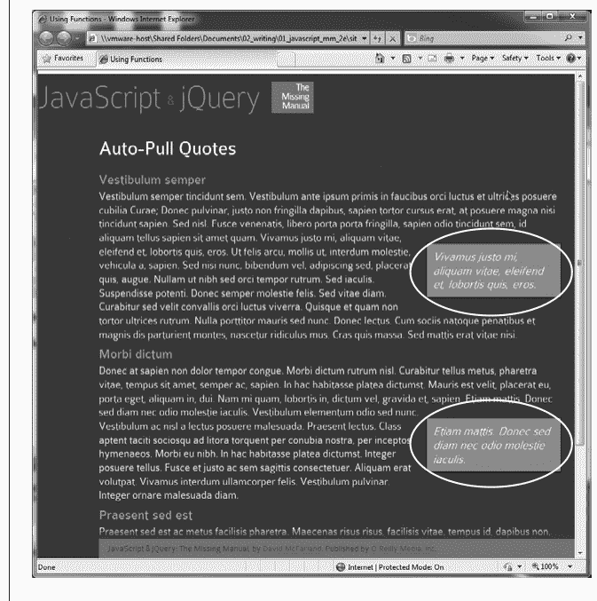

### 概述

你将要创建的脚本将完成几件事：

1.  定位每个包含名为 *pq*（代表提取引文）特殊类的 `<span>` 标签。你需要对页面HTML做的唯一工作是，将任何你希望转化为提取引文的文本用 `<span>` 标签包裹起来。例如，假设页面上有一段文本，你想在提取引文框中突出显示该段落中的几个单词。只需用 `<span>` 标签包裹该文本，如下所示：

```html
<span class="pq">...就这样我发现了尼斯湖水怪。</span>
```

2.  复制每个 `<span>` 标签。每个提取引文框本质上是另一个包含相同文本的span标签，因此你可以使用JavaScript直接复制当前的 `<span>` 标签。

3.  从副本 `<span>` 中移除 *pq* 类并添加一个新类 *pullquote*。构成每个提取引文框的格式化效果——边框、更大的文本、边框和背景颜色——并非JavaScript所为。页面的样式表包含一个CSS类选择器，*.pullquote*，它负责所有这些。因此，只需使用JavaScript更改副本标签的类名，你就可以完全改变新 `<span>` 标签的外观。

4.  将副本 `<span>` 标签添加到页面。最后，你将副本 `<span>` 标签添加到页面。（步骤2只是在Web浏览器内存中创建了该标签的副本，但尚未实际将该标签添加到页面中。这使你有机会在向查看页面的人显示之前进一步操作该副本标签。）

### 编程

既然你已经对这个脚本要实现的目标有了概念，现在是时候打开文本编辑器并实现它了。

> **注意：** 有关如何下载教程文件的信息，请参阅第29页的注释。

1.  在文本编辑器中，打开 *chapter04* 文件夹中的文件 *pull-quote.html*。你将从添加对jQuery文件的链接开始。
2.  点击关闭 `</head>` 标签上方的空行，输入：`<script src="../_js/jquery-1.6.3.min.js"></script>` 这会从网站加载jQuery文件。注意包含jQuery文件的文件夹名是 *_js*（不要忘记开头的下划线字符）。接下来，你将为你的编程添加一组 `<script>` 标签。
3.  按Enter（或Return）在jQuery代码下方创建一个新行，并添加下面加粗的代码：

```html
<script src="../_js/jquery-1.6.3.min.js"></script>
<script>

</script>
```

> **注意：** 代码行左侧的行号仅供你参考。不要在网页脚本中实际输入它们。

现在添加 *document.ready()* 函数。

4.  点击 `<script>` 标签之间的空行，添加加粗的代码：

```html
<script src="../_js/jquery-1.6.3.min.js"></script>
<script>
$(document).ready(function() {

}); // end ready
</script>
```

JavaScript注释 `// end ready` 在你的程序变得更长、更复杂时特别有帮助。在一个长程序中，你会发现有很多 `});` 散布各处，每个都标记了一个匿名函数和一个函数调用的结束。放置一个标识 `});` 匹配什么的注释，可以让你日后更容易回到代码并理解发生了什么。

步骤1-4涵盖了你将使用jQuery编写的任何程序的基本设置，因此请确保你理解它的工作原理。接下来，你将通过选择包含应出现在 *pullquote* 框中的文本的 `<span>` 标签，进入程序的核心。

5.  在第4行添加加粗的代码：

```html
<script src="../_js/jquery-1.6.3.min.js"></script>
<script>
$(document).ready(function() {
  $('span.pq')
}); // end ready
</script>
```

`$('span.pq')` 是一个jQuery选择器，它定位每个应用了类 *pq* 的 `<span>` 标签。接下来，你将添加循环遍历这些 `<span>` 标签并对其执行操作所需的代码。

6.  在第4行和第6行添加加粗的代码：

```html
<script src="../_js/jquery-1.6.3.min.js"></script>
<script>
$(document).ready(function() {
  $('span.pq').each(function() {

  }); // end each
}); // end ready
</script>
```

如第147页所讨论的，*.each()* 是一个jQuery函数，它让你可以循环遍历一组元素。该函数接受一个参数，即一个匿名函数。

接下来，你将开始构建将应用于此页面上每个匹配的 `<span>` 标签的函数：首先，创建 `<span>` 的一个副本。

7.  将下面第5行加粗的代码添加到脚本中：

```html
<script src="../_js/jquery-1.6.2.min.js"></script>
<script>
$(document).ready(function() {
  $('span.pq').each(function() {
  var quote=$(this).clone();
```

第4章：jQuery简介
153


#### 6. 将第5行至第10行所示的代码添加到你的脚本中。

```html
<script src="../_js/jquery-1.6.3.min.js"></script>
<script>
$(document).ready(function() {
    $('span.pq').each(function() {
        var quote=$(this).clone();
        quote.removeClass('pq');
        quote.addClass('pullquote');
    }); // end each
}); // end ready
</script>
```

该函数首先创建一个名为 *quote* 的新变量，它包含当前 `<span>` 的"克隆"（即副本）（如果你忘记了 `$(this)` 的含义，请参见第149页）。jQuery 的 `.clone()` 函数会复制当前元素，包括元素内的所有 HTML。在本例中，它复制了 `<span>` 标签，包括将在引文框中显示的 `<span>` 内的文本。

克隆元素会复制所有内容，包括应用于该元素的任何属性。在本例中，原始 `<span>` 有一个名为 *pq* 的类。你需要从副本中移除该类。

**8. 将下面第6行和第7行中以粗体显示的两行代码添加到脚本中：**

```html
<script src="../_js/jquery-1.6.3.min.js"></script>
<script>
$(document).ready(function() {
    $('span.pq').each(function() {
        var quote=$(this).clone();
        quote.removeClass('pq');
        quote.addClass('pullquote');
    }); // end each
}); // end ready
</script>
```

如第142页所述，`.removeClass()` 函数会从标签中移除类名，而 `.addClass()` 函数会向标签添加类名。在本例中，我们替换了副本上的类名，以便使用名为 `.pullquote` 的 CSS 类将 `<span>` 格式化为引文框。

最后，你需要将 `<span>` 添加到页面中。

**9. 将第8行中以粗体显示的代码行添加到脚本中：**

```html
<script src="../_js/jquery-1.6.3.min.js"></script>
<script>
$(document).ready(function() {
    $('span.pq').each(function() {
        var quote=$(this).clone();
        quote.removeClass('pq');
        quote.addClass('pullquote');
        $(this).before(quote);
    }); // end each
}); // end ready
</script>
```

这一行是函数的最后一块拼图——直到这一行之前，你一直在浏览器内存中操作 `<span>` 的副本。查看页面的人在副本实际添加到 DOM 之前是看不到它的。

在本例中，你将 `<span>` 的副本插入到 HTML 中现有 `<span>` 的前面。本质上，页面的 HTML 最终看起来像这样：

```html
<span class="pullquote">...and that's how I discovered the Loch Ness monster.</span> <span class="pq">...and that's how I discovered the Loch Ness monster.</span>
```

虽然文本看起来会并排重复显示，但 CSS 格式化会使引文框浮动到页面的右边缘。

**注意：** 要实现引文框的视觉效果，页面使用了一个 CSS 样式，该样式使用了 CSS *float* 属性。该框会移动到文本所在段落的右边缘，段落中的其他文本会环绕它。如果你不熟悉这种技术，可以在 http://css.maxdesign.com.au/floattutorial/ 了解 CSS *float* 属性。如果你想查看 .pullquote 样式，只需查看教程文件的 head 部分即可。该样式及其所有属性都在那里列出。

至此，所有的 JavaScript 都已完成。但是，你还需要对 HTML 进行一些调整才能看到引文框。

10. 找到页面 HTML 中的第一个 `<p>` 标签。找到一句话，并用 `<span class="pq"></span>` 包裹它。例如：
    `<span class="pq">Nullam ut nibh sed orci tempor rutrum.</span>`
    你可以重复此过程，为其他段落添加引文。
11. 保存文件并在网页浏览器中预览。

最终结果应该类似于图4-7。如果你没有看到引文框，请确保在第10步中正确添加了 `<span>` 标签。此外，请查看第34页上关于修复故障程序的提示。你可以在文件 *complete_pull-quote.html* 中找到本教程的完成版本。

## 动作/反应：用事件让页面活起来

当你听到人们谈论 JavaScript 时，你通常会在对话中听到"交互式"这个词："JavaScript 让你制作交互式网页。"他们真正想说的是，JavaScript 让你的网页能够对访问者的某些操作做出反应：将鼠标移到导航按钮上会显示一个链接菜单；选择单选按钮会显示一组新的表单选项；点击小照片会使页面变暗，并让照片的较大版本弹出到屏幕上。

网页能够响应的所有不同访问者操作都称为 *事件*。JavaScript 是一种 *事件驱动* 的语言：没有事件，你的网页将无法响应访问者或做任何真正有趣的事情。这就像你的台式电脑。早上启动它后，直到你开始打开程序、点击文件、进行菜单选择和移动鼠标，它才对你真正有用。

### 什么是事件？

网页浏览器被编程为识别基本操作，如页面加载、有人移动鼠标、敲击键盘或调整浏览器窗口大小。网页上发生的每件事情都是一个 *事件*。为了让你的网页具有交互性，你需要编写响应事件的程序。通过这种方式，你可以让 `<div>` 标签在访问者点击鼠标时显示或消失，当鼠标悬停在链接上时显示新图像，或者当她点击表单的提交按钮时检查文本字段的内容。

事件代表某事发生的精确时刻。例如，当你点击鼠标时，在你释放鼠标按钮的精确时刻，网页浏览器会发出 *点击事件* 刚刚发生的信号。网页浏览器指示事件发生的时刻就是事件触发（用程序员的话说）。

实际上，每当你点击鼠标按钮时，网页浏览器会触发多个事件。首先，当你按下鼠标按钮时，mousedown 事件触发；然后，当你释放按钮时，mouseup 事件触发；最后，click 事件触发（见图5-1）。

> **注意：** 理解这些事件何时以及如何触发可能很棘手。为了让你测试不同类型的事件，本章包含了一个带有教程文件的演示网页。在网页浏览器中打开 *events.html*（在 testbed 文件夹中）。然后移动鼠标、点击和输入，看看网页上不断发生的许多不同事件（见图5-1）。

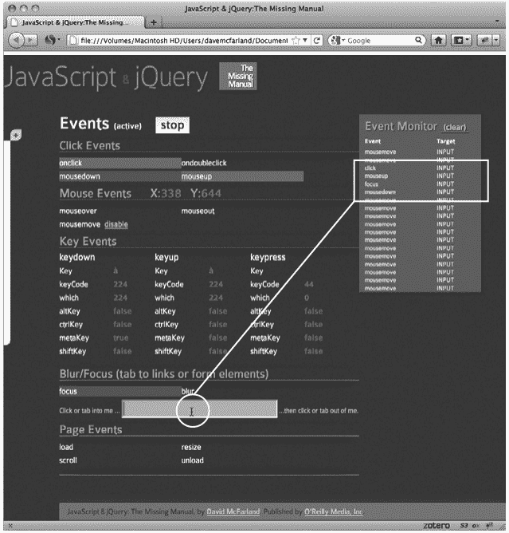

**图5-1：** 虽然你可能没有意识到，但每当你输入、移动鼠标或点击时，网页浏览器都在不断触发事件。events.html 文件（包含在 testbed 文件夹的教程文件中）向你展示了其中许多事件的实际运作。例如，点击文本字段（圈出）会启动 mousedown、focus、mouseup 和 click 事件。

### 鼠标事件

自从史蒂夫·乔布斯在1984年推出 Macintosh 以来，鼠标一直是所有个人计算机的关键设备。人们用它来打开应用程序、将文件拖入文件夹、从菜单中选择项目，甚至绘画。自然地，网页浏览器提供了许多跟踪访问者如何使用鼠标与网页交互的方式：

- **click**。当你点击并释放鼠标按钮后，*click* 事件触发。你通常会将点击事件分配给链接：例如，缩略图上的链接可以在点击时显示该图像的较大版本。但是，你不限于链接。你也可以让页面上的任何标签响应事件——甚至只是点击页面上的任何地方。

> **注意：** 点击事件也可以通过键盘在链接上触发。如果你通过 Tab 键切换到链接，然后按 Enter（Return）键，点击事件就会触发。

- **dblclick**。当你连续按下并释放鼠标按钮两次时，会触发双击（*dblclick*）事件。这与你在桌面上打开文件夹或文件的操作相同。双击网页不是常见的网上冲浪操作，所以如果你使用这个事件，应该向访问者明确说明在哪里可以双击以及双击后会发生什么。还要注意，双击事件等同于两个点击事件，所以不要把点击和双击事件分配给同一个标签。否则，点击的函数会在双击函数运行之前运行两次。

- **mousedown**。*mousedown* 事件是点击的前半部分——即你按下按钮但尚未释放的时刻。这个事件对于在页面上拖动元素非常方便。你可以让访问者像拖动桌面图标一样在网页上拖动项目——通过点击它们（不释放按钮）并移动它们，然后释放按钮来放置它们。

- **mouseup**。*mouseup* 事件是点击的后半部分——即你释放按钮的时刻。这个事件对于响应放下已拖动项目的时刻非常方便。

- **mouseover**。当你将鼠标移到页面上的某个元素上时，会触发 *mouseover* 事件。你可以使用这个事件为导航按钮分配事件处理程序，当访问者将鼠标悬停在按钮上时弹出子菜单。（如果你熟悉 CSS :hover 伪类，那么你就知道这个事件是如何工作的。）

- **mouseout**。将鼠标移出元素会触发 *mouseout* 事件。你可以使用这个事件来指示访问者何时将鼠标移出页面，或者当鼠标移出菜单时隐藏弹出菜单。

- **mousemove**。合乎逻辑的是，当鼠标移动时，*mousemove* 事件会触发——这意味着这个事件一直在触发。你使用这个事件来跟踪光标在屏幕上的当前位置。此外，你可以将这个事件分配给页面上的特定标签——例如 `<div>`——并且只响应该标签内的移动。


> **注意：** 一些网络浏览器，比如 Internet Explorer，支持许多事件（[http://msdn2.microsoft.com/en-us/library/ms533051(VS.85).aspx](http://msdn2.microsoft.com/en-us/library/ms533051(VS.85).aspx)），但大多数浏览器只共享少数几个事件。

### 文档/窗口事件

浏览器窗口本身理解少量从页面加载到访客离开页面时触发的事件：

- **load。** *load* 事件在网页浏览器完成下载网页的所有文件时触发：包括 HTML 文件本身，以及任何链接的图像、Flash 影片和外部的 CSS 与 JavaScript 文件。Web 设计师传统上使用此事件来启动任何操作网页的 JavaScript 程序。然而，如果网页中有大量图形或其他较大的链接文件，加载网页及其所有文件可能需要很长时间。在某些情况下，这意味着在页面显示在浏览器中之后，JavaScript 很长时间都不会运行。幸运的是，jQuery 提供了一个响应速度更快的 *load* 事件替代方案，如第 169 页所述。

- **resize。** 当你通过点击最大化按钮或拖动浏览器的 *resize* 控点来调整浏览器窗口大小时，浏览器会触发一个 *resize* 事件。一些设计师使用此事件在访客更改其浏览器大小时更改页面的布局。例如，在访客调整其浏览器窗口大小后，你可以检查窗口的宽度——如果窗口非常宽，你可以更改设计，添加更多内容列以适应空间。

> **注意：** Internet Explorer、Opera 和 Safari 在你调整窗口大小时会触发多个 resize 事件，而 Firefox 仅在你松开 resize 控点后触发一次 resize 事件。

- **scroll。** 每当你拖动滚动条，或使用键盘（例如，向上、向下、Home、End 和类似键）或鼠标滚轮滚动网页时，都会触发 *scroll* 事件。如果页面没有滚动条，则永远不会触发滚动事件。一些程序员使用此事件来帮助确定元素（在页面滚动后）在屏幕上的出现位置。

- **unload。** 当你点击链接转到另一个页面、关闭浏览器标签页或关闭浏览器窗口时，网页浏览器会触发一个 *unload* 事件。这就像你的 JavaScript 程序的“最后一口气”，在访客离开你的页面之前，它给你一个机会来完成最后一个操作。恶意程序员曾使用此事件使离开页面变得非常困难。每次访客尝试关闭页面时，都会出现一个新窗口，页面返回。但你也可以将此事件用于正当目的：例如，程序可以警告访客他已开始填写但尚未提交的表单，或者程序可以在访客退出页面之前将表单数据发送到 Web 服务器以保存数据。

### 表单事件

在 JavaScript 之前的时代，人们主要通过使用 HTML 创建的表单与网站交互。在表单字段中输入信息是访客向网站提供输入的唯一方式。因为表单仍然是 Web 的重要组成部分，所以你会发现大量可用的表单事件。

- **submit。** 每当访客提交表单时，*submit* 事件就会触发。表单可以通过点击提交按钮提交，也可以简单地通过在光标位于文本字段中时按 Enter（回车）键来提交。你将最经常在表单验证中使用 submit 事件——以确保在数据发送到 Web 服务器*之前*，所有必填字段都已正确填写。你将学习如何在第 278 页验证表单。

- **reset。** 虽然不像以前那么常见，但“重置”按钮允许你撤销对表单所做的任何更改。它将表单恢复到页面加载时的状态。当访客尝试通过使用 *reset* 事件重置表单时，你可以运行一个脚本。例如，如果访客对表单进行了一些更改，你可能希望弹出一个对话框询问“你确定要删除你的更改吗？”。该对话框可以给访客一个点击“否”按钮并防止重置（擦除）表单过程的机会。

- **change。** 许多表单字段在其状态改变时会触发 *change* 事件：例如，当有人点击单选按钮，或从下拉菜单中做出选择时。你可以使用此事件立即检查菜单中的选择，或选择了哪个单选按钮。

- **focus。** 当你按 Tab 键或点击进入一个文本字段时，它会使该字段获得 *focus*。换句话说，浏览器的注意力现在集中在该页面元素上。同样，选择一个单选按钮或点击一个复选框也会使这些元素获得焦点。你可以使用 JavaScript 响应 focus 事件。例如，你可以在文本字段内部添加有用的说明——“输入你的全名。”当访客点击该字段（使其获得焦点）时，你可以擦除这些说明，这样他就有了一个可以填写的空白字段。

- **blur。** *blur* 事件与 focus 相反。当你通过按 Tab 键或点击字段外部退出当前获得焦点的字段时，会触发该事件。blur 事件是进行表单验证的另一个有用时机。例如，当某人在文本字段中键入她的电子邮件地址，然后按 Tab 键跳到下一个字段时，你可以立即检查她输入的内容，以确保它是一个有效的电子邮件地址。

> **注意：** Focus 和 blur 事件也适用于页面上的链接。当你 Tab 到链接时，会触发一个 focus 事件；当你 Tab（或点击）离开链接时，会触发 blur 事件。

### 键盘事件

网页浏览器还会跟踪访客何时使用其键盘，因此你可以将命令分配给按键，或让访客通过按各种键来控制脚本。例如，按空格键可以启动和停止 JavaScript 动画。

不幸的是，不同的浏览器处理键盘事件的方式不同，甚至难以分辨输入了哪个字母！（你将在第 175 页的提示中找到一种识别键盘上输入字母的技巧。）

- **keypress**。当你按下某个键时，*keypress* 事件触发。你甚至不必松开该键。事实上，只要你按住该键不放，keypress 事件就会持续地、一遍又一遍地触发。

- **keydown**。*keydown* 事件类似于 keypress 事件——它在你按下某个键时触发。实际上，它是在 keypress 事件*之前*触发。在 Firefox 和 Opera 中，keydown 事件仅触发一次。在 Internet Explorer 和 Safari 中，keydown 事件的行为与 keypress 事件完全一样——只要按键被按下，它就会反复触发。

- **keyup**。最后，当你松开一个键时，会触发 *keyup* 事件。

### 使用 jQuery 方式处理事件

传统上，使用事件进行编程一直很棘手。长期以来，Internet Explorer 处理事件的方式与其他浏览器完全不同，需要两套代码（一套用于 IE，一套用于所有其他浏览器）才能使你的代码工作。幸运的是，IE9 现在使用与其他浏览器相同的事件处理方法，因此编程变得容易多了。然而，仍然有很多人使用 IE8 及更早版本，因此需要一个好的解决方案，使使用事件的编程变得简单且跨浏览器兼容。幸运的是，你有 jQuery。

正如你在上一章所学到的，像 jQuery 这样的 JavaScript 库解决了许多 JavaScript 编程中的问题——包括烦人的浏览器不兼容性。此外，库通常简化了基本的 JavaScript 相关任务。jQuery 使得分配事件和 *event helpers*（处理事件的函数）变得轻而易举。

正如你在第 126 页看到的，jQuery 编程涉及（a）选择一个页面元素，然后（b）对该元素执行某些操作。事实上，由于事件对 JavaScript 编程如此重要，最好将 jQuery 编程视为一个三步过程：

1. **选择一个或多个元素。** 上一章解释了 jQuery 如何让你使用 CSS 选择器来选择你想要操作的页面部分。在分配事件时，你需要选择访客将与之交互的元素。例如，访客会点击什么——一个链接、一个表格单元格、一张图片？如果你要分配一个 mouseover 事件，访客需要将鼠标悬停在什么页面元素上才能触发该操作？


### 2. 绑定一个事件。

在 jQuery 中，大多数 DOM 事件都有对应的 jQuery 函数。因此，要为某个元素绑定事件，只需添加一个句点、事件名称和一对括号。例如，如果你想为页面上的每一个链接添加 mouseover 事件，可以这样做：

```
$('a').mouseover();
```

如果要为一个 ID 为 *menu* 的元素添加 click 事件，你需要这样写：

```
$('#menu').click();
```

你可以使用第 159–162 页列出的任意事件名称（以及第 171 页讨论的几个 jQuery 特有事件）。

添加事件之后，你还有一些工作要做。为了让事件触发时发生某些事情，你必须为该事件提供一个函数。

### 3. 向事件传递一个函数。

最后，你需要定义事件触发时会发生什么。为此，你需要向事件传递一个函数。该函数包含事件触发时将运行的命令：例如，让隐藏的 `<div>` 标签可见，或者高亮鼠标悬停的元素。

你可以像这样传递一个预先定义好的函数名称：

```
$('#start').click(startSlideShow);
```

当你将函数赋给事件时，要省略通常在函数名末尾添加的 `()` 来调用它。换句话说，下面这样是行不通的：

```
$('#start').click(startSlideShow())
```

然而，向事件添加函数最常见的方式是传递一个*匿名函数*。你在第 148 页读到过匿名函数——它们基本上就是没有名字的函数。匿名函数的基本结构如下：

```
function() {
// 你的代码写在这里
}
```

将匿名函数用于事件的基本结构如图 5-2 所示。

> **注意：** 要了解更多关于如何使用 jQuery 和事件的信息，请访问 *http://api.jquery.com/category/events/*。

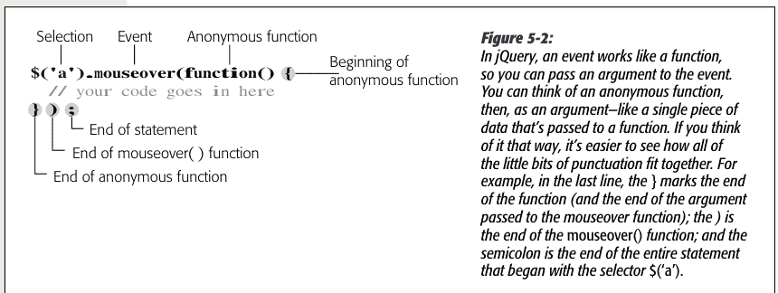

图 5-2：*在 jQuery 中，事件的工作原理类似于函数，因此你可以向事件传递参数。你可以把匿名函数看作一个参数——就像传递给函数的单个数据片段。如果这样理解，就更容易看清所有标点符号是如何组合在一起的。例如，在最后一行中，`}` 标记函数的结束（也是传递给 mouseover 函数的参数的结束）；`)` 是 mouseover() 函数的结束；而分号则是以选择器 $('a') 开头的整个语句的结束。*

下面是一个简单的例子。假设你的网页上有一个链接，其 ID 为 *menu*。当访客将鼠标移到该链接上时，你希望显示一个隐藏的其他链接列表——假设该链接列表的 ID 为 *submenu*。因此，你要做的是为 menu 添加一个 mouseover 事件，然后调用一个函数来显示 submenu。整个过程分为四个步骤：

- 1. 选择 menu：
   `$('#menu')`
- 2. 绑定事件：
   `$('#menu').mouseover();`
- 3. 添加匿名函数：
   `$('#menu').mouseover(function() {
   
   }); // end mouseover`

你会遇到很多由闭合花括号、闭合括号和分号组成的组合——`});`——它们经常标记函数调用中匿名函数的结束。由于它们随处可见，添加 JavaScript 注释总是一个好主意——在本例中，`// end mouseover`——用以说明这三个标点符号的含义。

- 4. 添加必要的操作（在本例中，是显示 submenu）：
   `$('#menu').mouseover(function() {
     $('#submenu').show();
   }); // end mouseover`

很多人觉得匿名函数涉及的疯狂嵌套标点符号非常令人困惑（最后那个 `});` 总是特别棘手）。这*确实*令人困惑，但适应 JavaScript 这个奇特世界的最佳方式是大量练习，所以下面的动手教程应该有助于巩固刚才介绍的概念。

> **注意：** *show()* 函数将在下一章第 187 页讨论。

### 教程：初识事件

本教程将快速介绍如何使用事件。你将让页面对几种不同类型的事件做出反应，以便了解 jQuery 事件的工作原理以及如何使用它们。

> **注意：** 有关如何下载教程文件的信息，请参见第 29 页的注释。

- 1. 在文本编辑器中，打开 *chapter05* 文件夹中的文件 *events_intro.html*。

   你将从最基础的部分开始，添加一个指向 jQuery 文件的链接。

- 2. 在紧邻闭合的 `</head>` 标签上方的空行处单击，然后输入：
   `<script src="../_js/jquery-1.6.3.min.js"></script>`
   
   这一行从站点加载 jQuery 文件。请注意，包含 jQuery 文件的文件夹名称是 _js（别忘了前面的下划线字符）。接下来，你将添加一组 `<script>` 标签用于编写代码。

- 3. 按 Enter（或 Return）键在 jQuery 代码下方创建一个新行，并添加下面加粗的代码：
   `<script src="../_js/jquery-1.6.3.min.js"></script>`
   `<script>`
   
   `</script>`
   
   现在添加 *document.ready()* 函数。
- 4. 在 `<script>` 标签之间的空行处单击，并添加加粗的代码：
   `<script src="../_js/jquery-1.6.3.min.js"></script>`
   `<script>`
   `$(document).ready(function() {`
   
   `}); // end ready`
   `</script>`
   
   别忘了 `});` 后面的 JavaScript 注释。尽管添加注释需要多打一些字，但它们对于识别程序的不同部分非常有帮助。至此，你已经完成了在页面上使用 jQuery 时每次都遵循的步骤。
   
   接下来，是时候添加一个事件了。你的第一个目标很简单：当访客在页面上任意位置双击时，弹出一个警告框。首先，你需要选择要添加事件的元素（在本例中是整个页面）。
- 5. 在 *.ready()* 函数内部的空行处单击，并添加下面加粗的代码：
   `<script src="../_js/jquery-1.6.3.min.js"></script>`
   `<script>`
   `$(document).ready(function() {`
   `  $('html')`
   `}); // end ready`
   `</script>`

$('html') 选择 HTML 元素；基本上就是整个浏览器窗口。接下来，你将添加一个事件。

- 6. 在 jQuery 选择器后面输入 .dblclick();，使代码如下所示：

```
<script src="../_js/jquery-1.6.3.min.js"></script>
<script>
$(document).ready(function() {
  $('html').dblclick(); // end double click
}); // end ready
</script>
```

.dblclick() 是一个 jQuery 函数，它让浏览器做好准备，在访客双击页面时执行某些操作。唯一缺少的是"执行某些操作"的部分，这需要将匿名函数作为参数传递给 dblclick() 函数（如果你需要复习函数的工作原理以及"传递参数"的含义，请翻到第 102 页）。

- 7. **通过输入下面加粗的代码添加一个匿名函数：**

```
<script src="../_js/jquery-1.6.3.min.js"></script>
<script>
$(document).ready(function() {
  $('html').dblclick(function() {

  }); // end double click
}); // end ready
</script>
```

别担心，本书的其余部分不会以如此缓慢的节奏逐个讲解每个教程；但是，让你理解每一部分代码的作用是非常重要的。function() { } 只是一个外壳；在你向 { 和 } 之间添加代码之前，它不会执行任何操作。这就是下一步。

- 8. **最后，添加一个 alert 语句：**

```
<script src="../_js/jquery-1.6.3.min.js"></script>
<script>
$(document).ready(function() {
  $('html').dblclick(function() {
    alert('ouch');
  }); // end double click
}); // end ready
</script>
```

如果你在网页浏览器中预览该页面并在页面任意位置双击，一个显示"ouch"的 JavaScript 警告框应该会出现。如果没有出现，请仔细检查你的输入，确保没有遗漏任何内容。

> **注意：** 经过这么长的铺垫，屏幕上只出现"ouch"可能会让你感到失望。但请记住，这个脚本中 *alert()* 的部分并不重要——你输入的所有其他代码才展示了使用 jQuery 事件的基础原理。随着你对编程和 jQuery 的了解加深，你可以轻松地将警告框替换为一系列动作：当访客双击页面时，移动一个元素横穿屏幕、显示交互式照片幻灯片，或启动赛车游戏。


现在你已经掌握了基础知识，接下来尝试几个其他事件。

9. 添加下面**粗体**所示的代码，使你的脚本如下所示：

```
<script src="../_js/jquery-1.6.3.min.js"></script>
<script>
$(document).ready(function() {
  $('html').dblclick(function() {
    alert('ouch');
  }); // end double click
  $('a').mouseover(function() {

  }); // end mouseover
}); // end ready
</script>
```

这段代码选中页面上的所有链接（即`$('a')`部分），然后为mouseover事件添加一个匿名函数。换句话说，当用户将鼠标悬停在页面上的任何链接上时，就会发生某些事情。

10. 为你上一步添加的匿名函数添加两条JavaScript语句：

```
<script src="../_js/jquery-1.6.3.min.js"></script>
<script>
$(document).ready(function() {
  $('html').dblclick(function() {
    alert('ouch');
  }); // end double click
  $('a').mouseover(function() {
    var message = "<p>You moused over a link</p>";
    $('.main').append(message);
  }); // end mouseover
}); // end ready
</script>
```

这里的第一行——`var message = "<p>You moused over a link</p>";`——创建了一个名为message的新变量，并在其中存储了一个字符串。该字符串是一个带有部分文本的HTML段落标签。下一行选中了页面上类名为main的元素（即`$('.main')`），然后向其末尾追加（即添加到该元素的末端）message变量的内容。页面包含一个class为main的<div>标签，因此这段代码只是每次当访问者将鼠标悬停在页面上的链接时，向该div的末尾添加"You moused over a link"。（关于jQuery的append()函数的回顾，请参见第139页。）

11. 保存页面，在浏览器中预览，并将鼠标悬停在页面上的任何链接上。

每次你将鼠标悬停在链接上时，就会向页面添加一个段落（见图5-3）。现在你将添加最后一小段程序：当访问者点击页面上的表单按钮时，浏览器会改变该按钮上显示的文本。

12. 最后，添加下面**粗体**所示的代码，使你的完成脚本如下所示：

```
<script src="../_js/jquery-1.6.3.min.js"></script>
<script>
$(document).ready(function() {
  $('html').dblclick(function() {
    alert('ouch');
  }); // end double click
  $('a').mouseover(function() {
    var message = "<p>You moused over a link</p>";
    $('.main').append(message);
  }); // end mouseover
  $('#button').click(function() {
    $(this).val("Stop that!");
  }); // end click
}); // end ready
</script>
```

你应该理解这里的基本原理：`$('#button')`选中了ID为button的元素（在本例中是表单按钮），并为其添加了一个*click*事件，因此当有人点击该按钮时，就会发生某些事情。在本例中，按钮上会出现"Stop that!"字样。以下是匿名函数内部的代码如何实现这一点的：

在第149页，你了解了如何在jQuery的循环中使用`$(this)`。在事件中也是同样的概念：`$(this)`指的是响应事件的元素——也就是你选中并附加事件的元素。在本例中，这就是表单按钮。（你将在第261页了解更多关于jQuery的*val()*函数的内容，但基本上你可以用它来读取或更改表单元素的值。在本例中，将字符串"Stop that!"传递给*val()*函数会将按钮的值设置为"Stop that!"）

**13. 保存页面，在浏览器中预览，并点击表单按钮。**

按钮的文本应该会立即改变（见图5-3）。作为附加练习，添加程序使文本字段在访问者点击或按Tab键进入时背景色变为红色。这里有一些提示：你需要（a）选中文本字段；（b）使用*focus()*事件（第264页）；（c）在匿名函数中使用`$(this)`（如第12步所示）来引用文本字段；以及（d）使用*.css()*函数（第143页）来更改文本字段的背景色。你可以在*chapter05*文件夹中的*complete_events_intro.html*文件中找到答案（以及页面的完整版本）。

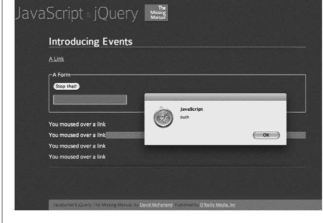

图5-3：jQuery使你的网页能够轻松响应用户交互，例如双击页面时弹出警告框、鼠标悬停在链接上时向页面添加文本，或点击表单按钮。

### 更多jQuery事件概念

由于事件是为网页添加交互性的关键要素，jQuery包含了一些特殊的jQuery专属功能，可以使你的编程更轻松，页面响应更迅速。

#### 等待HTML加载

当页面加载时，Web浏览器会立即尝试运行它遇到的任何脚本。因此，页面头部中的脚本可能会在页面完全加载之前运行——你在第108页的Moon Quiz教程中看到过这种情况，页面在脚本完成提问之前一直空白。不幸的是，这种现象经常导致问题。由于大量JavaScript编程涉及操作网页内容——当点击特定链接时显示弹出消息、隐藏特定页面元素、为表格行添加条纹等——如果你的程序尝试操作尚未被浏览器加载和显示的页面元素，就会出现JavaScript错误。

处理这个问题最常见的方式是使用load事件，等待页面完全下载并显示后再执行任何JavaScript。不幸的是，等到页面完全加载后再运行JavaScript代码可能会产生一些相当奇怪的结果。load事件只有在网页的所有文件下载完成后才会触发——这意味着所有图片、视频、外部样式表等。因此，在一个包含大量图形的页面上，访问者可能会盯着页面看几秒钟，等待图形加载完成*之后*JavaScript才会运行。如果JavaScript对页面做了很多更改——例如，为表格行设置样式、隐藏当前可见的菜单，甚至控制页面布局——访问者会突然看到页面在他们眼前发生变化。

幸运的是，jQuery来拯救了。jQuery没有依赖load事件来触发JavaScript程序，而是提供了一个名为`ready()`的特殊函数，它会等到HTML加载到浏览器中后就运行页面脚本。这样，JavaScript可以立即操作网页，而不必等待加载缓慢的图片或视频。（这实际上是一项复杂而有用的功能——使用JavaScript库的又一个原因。）

你已经在本书的几个教程中使用过`ready()`函数。该函数的基本结构如下：

```
$(document).ready(function() {
    //your code goes here
});
```

基本上，你所有的编程代码都放在这个函数里面。事实上，`ready()`函数非常基础，你可能会在使用的每个页面上都包含它。你只需要包含一次，它通常是一脚本的第一行和最后一行。你必须将它放在一对开头和结尾的`<script>`标签之内（毕竟是JavaScript），并且在添加jQuery到页面的`<script>`标签之后。

因此，在完整网页的上下文中，该函数看起来像这样：

```
<!DOCTYPE HTML PUBLIC "-//W3C//DTD HTML 4.01//EN" "http://www.w3.org/TR/html4/strict.dtd">
<html>
<head>
<meta http-equiv="Content-Type" content="text/html; charset=UTF-8">
<title>Page Title</title>
<script type="text/javascript" src="js/jquery.js"></script>
<script type="text/javascript">
$(document).ready(function() {

    // all of your JavaScript goes in here.

}); // end of ready() function
</script>
</head>
<body>
The web page content...
</body>
</html>
```

**提示：** 由于*ready()*函数几乎在你将jQuery添加到页面时都会使用，有一种简写方式。你可以去掉*$(document).ready*部分，只需这样输入：

```
$(function() {
  // do something on document ready
});
```

### jQuery事件

jQuery还为处理两个非常常见的交互性问题提供了特殊事件——将鼠标移入和移出某物，以及在点击时切换两种操作。

#### hover()事件

mouseover和mouseout事件经常被一起使用。例如，当你将鼠标悬停在按钮上时，菜单可能会出现；将鼠标移开按钮，菜单消失。由于将这两个事件配对使用非常常见，jQuery提供了一种快捷方式来同时引用两者。jQuery的*hover()*函数像任何其他事件一样工作，区别在于它不接受一个函数作为参数，而是接受两个函数。第一个函数在鼠标进入元素时运行，第二个函数在鼠标移出元素时运行。基本结构如下：

```
$('#selector').hover(function1, function2);
```

你经常会看到*hover()*函数与两个匿名函数一起使用。这种代码看起来可能有点奇怪；下面的例子会让它更清晰。假设当有人将鼠标悬停在ID为*menu*的链接上时，你想让当前不可见的、ID为*submenu*的DIV显示出来。将鼠标从链接上移开会再次隐藏子菜单。你可以使用*hover()*来实现：

```
$('#menu').hover(function() {
    $('#submenu').show();
  }, function() {
    $('#submenu').hide();
  }); // end hover
```


 ## 更多 jQuery 事件概念

为了让包含多个匿名函数的语句更易读，可以将每个函数移到单独的行上。因此，上面代码的一个更易读的版本看起来像这样：

```
$('#menu').hover(
    function() {
        $('#submenu').show();
    }, // end mouseover
    function() {
        $('#submenu').hide();
    } // end mouseout
); // end hover
```

图 5-4 展示了这段代码如何响应 mouseover 和 mouseout 事件。

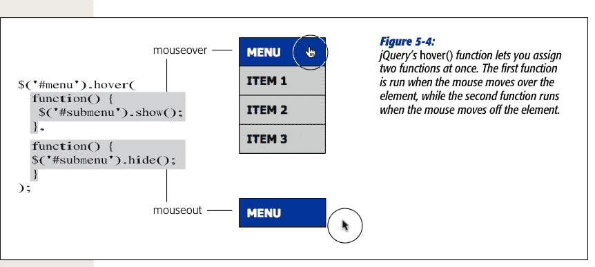

如果匿名函数方法让你感到困惑，你仍然可以使用简单的旧式命名函数（第100页）来完成工作。首先，创建一个命名函数来在 mouseover 事件触发时运行；再创建另一个命名函数用于 mouseout 事件；最后，将这两个函数的名称传递给 *hover()* 函数。换句话说，你可以将上面的代码改写为：

```
function showSubmenu() {
    $('#submenu').show();
}
function hideSubmenu() {
    $('#submenu').hide();
}
$('#menu').hover(showSubmenu, hideSubmenu);
```

如果你觉得这种技术更容易，那就使用它。这两种方法之间没有实质区别，不过有些程序员喜欢使用匿名函数，因为这样可以将所有代码集中在一个语句中，而不是分散在几个不同的语句里。

### *toggle()* 事件

jQuery 的 *toggle()* 事件与 *hover()* 事件工作方式相同，只是它响应的不是 mouseover 和 mouseout 事件，而是点击事件。第一次点击触发第一个函数；下一次点击触发第二个函数。当你想要通过点击在两个状态之间切换时使用这个事件。例如，你可以在按钮首次被点击时开始一个动画，然后在按钮第二次被点击时暂停该动画。再次点击，动画又重新开始。

例如，假设你想让 *submenu* `<div>`（来自上面 *hover()* 示例）在你第一次点击链接时显示，然后在再次点击链接时消失。只需将 "hover" 替换为 "toggle"，像这样：

```
$('#menu').toggle(
    function() {
        $('#submenu').show();
    }, // end first click智慧
    function() {
        $('#submenu').hide();
    } // end second click
); // end toggle
```

或者，使用命名函数，像这样：

```
function showSubmenu() {
    $('#submenu').show();
}
function hideSubmenu() {
    $('#submenu').hide();
}
$('#menu').toggle(showSubmenu, hideSubmenu);
```

*toggle()* 函数可以接受两个以上的函数作为参数：例如，如果你想在第一次点击时发生一件事，第二次点击时发生另一件事，第三次点击时再发生另一件事。传递给 *toggle()* 的每个函数将对应其相应的点击。例如，第一个函数在第一次点击时运行，第二个函数在第二次点击时运行，第三个函数在第三次点击时运行，依此类推。一旦 jQuery 执行了所有函数，它会在下一次点击时返回到第一个函数（例如，如果你向 *toggle()* 传递了三个函数，那么在第四次点击时，第一个函数会再次运行）。

### 事件对象

每当 Web 浏览器触发事件时，它会记录有关事件的信息并将其存储在*事件对象*中。事件对象包含事件发生时收集的信息，例如鼠标的垂直和水平坐标、事件发生所在的元素，或者事件触发时是否按下了 Shift 键。

在 jQuery 中，事件对象对分配给处理事件的函数可用。实际上，该对象作为参数传递给函数，所以要访问它，只需在函数中包含一个参数名即可。例如，假设你想在页面上任意位置点击鼠标时找到光标的 X 和 Y 位置。

```
$(document).click(function(evt) {
  var xPos = evt.pageX;
  var yPos = evt.pageY;
  alert('X:' + xPos + ' Y:' + yPos);
}); // end click
```

这里重要的部分是 *evt* 变量。当函数被调用时（通过在浏览器窗口中任意位置点击），事件对象被存储在 *evt* 变量中。在函数体内，你可以使用点语法访问事件对象的不同属性——例如，*evt.pageX* 返回光标的水平位置（换句话说，即距离窗口左边缘的像素数）。

> **注意：** 在此示例中，*evt* 只是程序员提供的变量名。它不是特殊的 JavaScript 关键字，只是用于存储事件对象的变量。你可以使用任何你想要的名称，例如 *event* 或简单的 *e*。

事件对象有许多不同的属性，而且（不幸的是）属性列表因浏览器而异。表 5-1 列出了一些常见属性。

**表 5-1。** *每个事件都会产生一个事件对象，其中包含各种属性，你可以在处理事件的函数中访问这些属性*

| 事件属性 | 说明 |
|---|---|
| *pageX* | 鼠标指针距离浏览器窗口左边缘的距离（以像素为单位）。 |
| *pageY* | 鼠标指针距离浏览器窗口上边缘的距离（以像素为单位）。 |
| *screenX* | 鼠标指针距离显示器左边缘的距离（以像素为单位）。 |
| *screenY* | 鼠标指针距离显示器上边缘的距离（以像素为单位）。 |
| *shiftKey* | 如果事件发生时 shift 键处于按下状态，则为 *true*。 |
| *which* | 与 *keypress* 事件一起使用，以确定按下的键的数字代码（参见下一页的提示）。 |
| *target* | 作为事件"目标"的对象——例如，对于 *click()* 事件，即被点击的元素。 |
| *data* | 一个 jQuery 对象，与 *bind()* 函数一起使用，用于向事件处理函数传递数据（参见第177页）。 |

**提示：** 如果你在 *keypress()* 事件中访问事件对象的 *which* 属性，你会得到一个表示按下键的数字代码。如果你想获取具体按下的键（a、K、9 等），你需要通过 JavaScript 方法将键数字转换为键盘上实际的字母、数字或符号：

```
String.fromCharCode(evt.which)
```

### 阻止事件的默认行为

某些 HTML 元素对事件有预设的响应。例如，链接通常在点击时加载新的网页；表单的提交按钮在点击时将表单数据发送到 Web 服务器进行处理。有时你不希望 Web 浏览器继续其正常行为。例如，当表单提交时（*submit()* 事件），如果填写表单的人漏掉了重要数据，你可能希望阻止表单数据被发送。

你可以使用 *preventDefault()* 函数来阻止 Web 浏览器对事件的正常响应。这个函数实际上是事件对象的一部分（参见上一节），因此你需要在处理事件的函数中访问它。例如，假设页面上有一个 ID 为 *menu* 的链接。该链接实际上指向另一个菜单页面（以便关闭 JavaScript 的访问者能够访问菜单页面）。但是，你添加了一些巧妙的 JavaScript，当访问者点击链接时，菜单会直接显示在同一页面上。通常，Web 浏览器会跟随链接跳转到菜单页面，因此你需要阻止其默认行为，像这样：

```
$('#menu').click(function(evt){
  // clever javascript goes here
  evt.preventDefault(); // don't follow the link
});
```

另一种技术是在事件函数的末尾简单地返回 false 值。例如，以下代码与上面的代码功能相同：

```
$('#menu').click(function(evt){
  // clever javascript goes here
  return false; // don't follow the link
});
```

### 移除事件

有时，你可能想要移除先前分配给标签的事件。jQuery 的 *unbind()* 函数可以让你做到这一点。要使用它，首先创建一个包含你要移除事件的元素的 jQuery 对象。然后添加 *unbind()* 函数，向它传递一个包含事件名称的字符串。例如，如果你想阻止所有带有 *tabButton* 类的标签响应任何点击事件，你可以这样写：

```
$('.tabButton').unbind('click');
```

来看一个简短的脚本，了解 *unbind()* 函数是如何工作的。


### 更多 jQuery 事件概念

```javascript
$('a').mouseover(function() {
    alert('You moved the mouse over me!');
});
$('#disable').click(function() {
    $('a').unbind('mouseover');
});
```

第 1–3 行向页面上所有链接（`<a>` 标签）的 mouseover 事件添加了一个函数。将鼠标移到链接上方时，会弹出一个警告框，显示消息“You moved your mouse over me!”然而，由于不断出现的警告框会很烦人，第 4–6 行允许访问者关闭这个警告。当访问者点击 ID 为 disable 的标签（例如一个表单按钮）时，所有链接的 mouseover 事件都会被解除绑定，警告框便不再出现。

> **注意：** 如需了解更多关于 jQuery 的 unbind() 函数的信息，请访问 http://api.jquery.com/unbind/。

## 高级用户诊所

#### 阻止事件继续传播

无论是 Internet Explorer 还是 Firefox、Safari 和 Opera 所支持的 W3C 事件模型，都允许事件传递到最初接收该事件的元素之外。例如，假设你为某个特定链接的 click 事件指定了事件辅助函数；当你点击该链接时，click 事件触发，函数运行。然而，事件并不会就此停止。每个祖先元素（即包裹在被点击元素外部的标签）也可以对同一个 click 事件作出响应。因此，如果你为链接所在的 `<div>` 标签也指定了 click 事件辅助函数，那么该 `<div>` 标签的事件函数同样会执行。

这个概念被称为**事件冒泡**，意味着多个元素可以对同一动作作出响应。再举一个例子：假设你为一张图片添加了 click 事件，点击图片时用新图片替换它。该图片位于一个 `<div>` 标签内，而你也为那个 `<div>` 标签指定了 click 事件。在这种情况下，点击 `<div>` 时会弹出警告框。现在当你点击图片时，两个函数都会执行。换句话说，尽管你点击的是图片，`<div>` 同样接收到了 click 事件。

你可能不会经常遇到这种情况，但一旦发生，其结果可能会令人困惑。假设在前一段的例子中，你不希望点击图片时 `<div>` 有任何反应。这时，你就需要阻止 click 事件传递到 `<div>` 标签，但又不能停止处理图片 click 事件的函数本身。换句话说，点击图片时，分配给图片 click 事件的函数应该替换为新图片，然后**阻止该事件继续传播**。

jQuery 提供了一个名为 stopPropagation() 的函数，用于阻止事件传递到任何祖先标签。该函数是事件对象的一个方法（参见第 173 页），因此你在事件处理函数中这样访问它：

```javascript
$('#theLink').click(function(evt) {
    // 执行某些操作
    evt.stopPropagation(); // 阻止事件继续传播
});
```

176 JAVASCRIPT & JQUERY: THE MISSING MANUAL

### 高级事件管理

仅凭前几页讨论的 jQuery 事件方法和概念，你也能过上长久而幸福的编程生活。但如果你真想充分发挥 jQuery 事件处理技术的威力，那就需要了解 *bind()* 函数了。

> **注意：** 如果上一节的内容还让你头疼不已，可以先跳到第 180 页的教程，等你积累了更多事件处理经验后再回来。

*bind()* 方法比 jQuery 专门的事件函数（如 *click()* 或 *mouseover()*）更为灵活。它不仅可以让你指定要监听的事件以及响应该事件的函数，还允许你为事件处理函数传递额外的数据。这样，不同的元素和事件（例如，点击某个链接或鼠标悬停在某张图片上）就可以向同一个事件处理函数传递不同的信息——换句话说，一个函数可以根据触发的事件不同而表现出不同的行为。

*bind()* 函数的基本格式如下：

```javascript
$('#selector').bind('click', myData, functionName);
```

第一个参数是一个字符串，包含事件名称（如 click、mouseover 或第 159 页列出的其他事件）。第二个参数是你希望传递给函数的数据——可以是对象字面量，也可以是包含对象字面量的变量。对象字面量（在第 145 页讨论过）基本上就是属性名和属性值的列表：

```javascript
{
    firstName : 'Bob',
    lastName : 'Smith'
}
```

你可以将对象字面量存储在变量中，如下所示：

```javascript
var linkVar = {message:'Hello from a link'};
```

传递给 *bind()* 函数的第三个参数是另一个函数——即事件触发时执行某些操作的函数。该函数可以是匿名函数或命名函数——换句话说，这部分与使用常规 jQuery 事件时相同，如第 163 页所述。

> **注意：** 通过 *bind()* 函数传递数据是可选的。如果你只想使用 *bind()* 来绑定事件和函数，那么可以省略数据变量：

```javascript
$('selector').bind('click', functionName);
```

这段代码在功能上与以下代码相同：

```javascript
$('selector').click(functionName);
```

假设你想在响应某个事件时弹出警告框，但希望警告框中的消息根据触发事件的元素而有所不同。一种实现方式是创建包含不同对象字面量的变量，然后将这些变量分别传递给不同元素的 bind() 函数。下面是一个示例：

```javascript
var linkVar = { message:'Hello from a link'};
var pVar = { message:'Hello from a paragraph'};
function showMessage(evt) {
    alert(evt.data.message);
}
$('a').bind('click',linkVar,showMessage);
$('p').bind('mouseover',pVar,showMessage);
```

图 5-5 分解了这段代码的工作原理。它创建了两个变量，第一行的 linkVar 和第二行的 pVar。每个变量都包含一个对象字面量，具有相同的属性名 message，但消息内容不同。showMessage() 函数接收事件对象（参见第 173 页）并将其存储在名为 evt 的变量中。该函数执行 alert() 命令，显示 message 属性（它是事件对象的 data 属性的一个属性）。请记住，message 是在对象字面量中定义的属性名称。

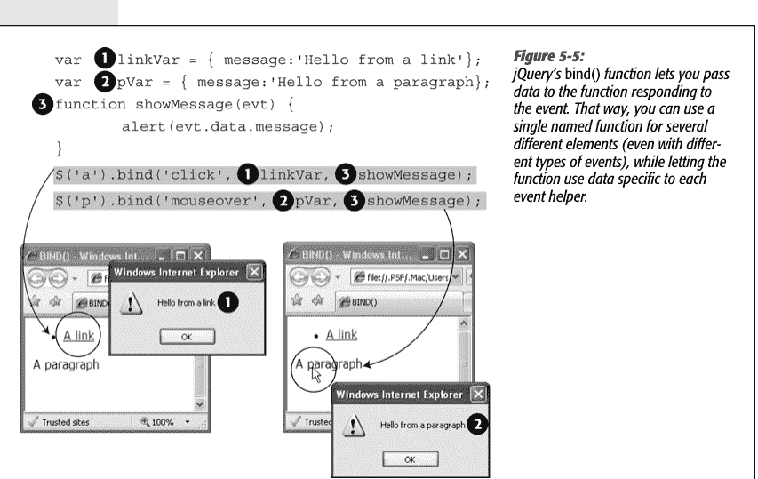

### bind() 函数的其他用法

jQuery 的 *bind()* 函数为你提供了极大的编程灵活性。除了上一节列出的技巧外，它还允许你将两个或更多事件绑定到同一个函数。例如，假设你编写了一个程序，当访问者点击缩略图时在屏幕上显示一张大图（这是数千个网站上常见的“lightbox”效果；你将学到它在第 222 页的工作原理）。你希望访问者点击页面任意位置或按下键盘任意键时，大图消失（提供两种选项，使程序能够响应偏好键盘或鼠标的用户）。以下代码实现了这一点：

```javascript
$(document).bind('click keypress', function() {
    $('#lightbox').hide();
}); // end bind
```

关键部分是 *'click keypress'*。通过提供多个用空格分隔的事件名称，你告诉 jQuery 当列表中的任何事件发生时都执行匿名函数。在本例中，即在文档上发生 *click* 或 *keypress* 事件时。

此外，如果你想附加多个各自触发不同动作的事件，也不必多次使用 *bind()* 函数。换句话说，如果你想在访问者点击某个元素时发生一件事，鼠标悬停在该元素上时发生另一件事，你可能会忍不住这样写：

```javascript
$('#theElement').bind('click', function() {
    // 做点有趣的事
}); // end bind
$('#theElement').bind('mouseover', function() {
    // 做点别的有趣的事
}); // end bind
```

你可以通过向 *bind()* 函数传递一个对象字面量（参见第 145 页）来实现同样的效果，该对象字面量由事件名、冒号和匿名函数组成。下面是重写的代码，只调用一次 *bind()* 函数并传递对象字面量：

```javascript
$('#theElement').bind({
    'click' : function() {
        // 做点有趣的事
    }, // end click function
    'mouseover' : function() {
        // 做点有趣的事
    }; // end mouseover function
}); // end bind
```

**注意：** 如果这还不够你消化，jQuery 还提供了其他附加事件的方式。特别是 *delegate()* 函数，当你希望为页面加载后添加的元素附加事件时（即通过 JavaScript 编程添加到页面的元素，或使用本书第 4 部分描述的 Ajax 技术下载到页面的元素），它会非常有用。你可以从第 421 页开始了解 *delegate()* 函数。


 # 教程：单页 FAQ

“常见问题解答”（FAQ）页面在互联网上非常普遍。它们能够通过提供 7×24 小时的即时解答来帮助改善客户服务。遗憾的是，大多数 FAQ 页面要么是一整页密密麻麻的问题和完整答案，要么是一页问题链接到单独的答案页面。这两种方案都会拖慢访问者寻找答案的速度：第一种情况迫使访问者在长页面中上下滚动才能找到她想要的问答，第二种情况则让访问者等待新页面加载。

在本教程中，你**将**通过创建一个由 JavaScript 驱动的 FAQ 页面来解决这个问题。页面加载时所有问题都将可见，因此很容易找到特定问题。然而，答案会被隐藏起来，直到点击问题后，所需答案才会平滑淡入视野（见图 5-6）。

#### 任务概述

完成此任务所需的 JavaScript 需要实现以下几项功能：

- 点击问题时，对应的答案会显示出来。
- 点击答案已显示的问题时，该答案应当消失。

此外，你还需要在页面加载时使用 JavaScript 隐藏所有答案。为什么不一开始就用 CSS 隐藏答案呢？例如，将答案的 CSS *display* 属性设置为 *none* 也是一种隐藏方法。这种技术的问题在于没有启用 JavaScript 的访问者会如何：他们页面加载时看不到答案，也无法通过点击问题让答案显示出来。为了让你的页面对 JavaScript 已启用和已关闭的访问者都可见，最好使用 JavaScript 来隐藏页面内容。

> 注意：关于如何下载教程文件，请参阅第 29 页的说明。

### 编程步骤

1. 在文本编辑器中，打开 *chapter05* 文件夹中的 *faq.html* 文件。

该文件已经包含了对 jQuery 文件的链接，并且 `$(document).ready()` 函数（第 169 页）已经就位。首先，你需要在页面加载时隐藏所有答案。

2. 在 `$(document).ready()` 函数后面的空行处单击，然后输入 `$('.answer').hide();`。

每个答案的文本都包含在带有 *answer* 类的 `<div>` 标签中。这一行代码会选择每个 `<div>` 并将其隐藏（*hide()* 函数在第 187 页讨论）。保存页面并在网页浏览器中打开。所有答案应该都被隐藏了。

下一步是确定需要为哪些元素添加事件监听器。由于答案会在访问者点击问题时显示，因此你必须选择 FAQ 中的每个问题。在此页面上，每个问题都是页面主体中的一个 `<h2>` 标签。

**3. 按回车键创建新行，并将下面加粗的代码添加到脚本中：**

```html
<script src="../_js/jquery-1.6.3.min.js"></script>
<script>
$(document).ready(function() {
    $('.answer').hide();
    $('.main h2')
}); // end of ready()
</script>
```

这是一个基本的后代选择器，用于定位带有 *main* 类的元素内部的每个 `<h2>` 标签（这样它就不会影响页面上其他位置的 `<h2>` 标签）。现在是时候添加事件了。click 事件是一个不错的选择；不过，使用 jQuery 的 *toggle()* 函数（参见第 173 页）可以更好地满足你的需求——点击问题时可以显示或隐藏答案。该函数让你在每次鼠标点击时在不同的两个函数之间切换。

**4. 紧跟你在第 2 步输入的代码（在同一行），输入 `.toggle(`。**

这段代码标记了 *toggle()* 函数的开始，该函数接受两个匿名函数（第 148 页）作为参数。第一个匿名函数在第一次点击时运行，第二个函数在下一次点击时运行。你先为这些函数搭建好基本结构。

**5. 按回车键创建新行，然后输入：**

```javascript
function() {

}
```

这段代码是函数的基本外壳，代表传递给 *toggle()* 函数的第一个参数。接下来你将添加第二个函数的基本结构。

**6. 添加加粗的代码，使你的脚本如下所示：**

```html
 1  <script src="../_js/jquery-1.6.3.min.js"></script>
 2  <script>
 3  $(document).ready(function() {
 4      $('.answer').hide();
 5      $('#main h2').toggle(
 6          function() {
 7
 8          },
 9          function() {
10
11          }
```

```html
12  ); // end of toggle()
13  }); // end of ready()
14  </script>
```

务必不要遗漏上面第 8 行末尾的逗号。请记住，这里的两个函数就像传递给函数的参数一样（第 102 页）。调用函数时，你用逗号分隔每个参数，像这样：*prompt('Question', 'type here')*。换句话说，第 8 行的逗号分隔了两个函数。（如果你愿意，可以省略第 12 行的注释——// end of toggle。它只是为了清楚地表明这一行标志着 *toggle()* 函数的结束。）

现在是时候添加你想要的效果了：第一次点击 `<h2>` 标签时，关联的答案需要显示出来。虽然每个问题都包含在 `<h2>` 标签中，但关联的答案却在紧跟 `<h2>` 标签之后的 `<div>` 标签中。此外，该 `<div>` 带有 *answer* 类。因此你需要一种方法来找到被点击的 `<h2>` 之后的 `<div>` 标签。

7. 在第一个函数中（上面第 5 步中标记为第 6 行处），向脚本中添加 **$(this).next('.answer').fadeIn();**。

如第 149 页所述，*$(this)* 指当前响应事件的元素——在本例中是一个特定的 `<h2>` 标签。jQuery 提供了多个函数来更轻松地遍历页面结构。*.next()* 函数查找紧跟当前标签的标签。换句话说，它查找 `<h2>` 标签之后的标签。你可以通过向 *.next()* 函数传递额外的选择器来进一步细化搜索——代码 *.next('answer')* 查找 `<h2>` 之后第一个同时带有 *answer* 类的标签。最后，*fadeIn()* 逐渐将答案淡入视野（*fadeIn()* 函数在第 187 页讨论）。

> ***注意：** *.next()* 函数只是众多帮助你遍历页面 DOM 的 jQuery 函数之一。要了解其他有用的函数，请访问 [http://docs.jquery.com/Traversing](http://docs.jquery.com/Traversing)。

现在是保存页面并在网页浏览器中查看的好时机。点击页面上的某个问题——它下面的答案应该会展开（如果没有，请仔细检查你的输入并参考第 34 页的故障排除提示）。

在下一步中，你将完成切换效果的另一半——在问题第二次被点击时隐藏答案。

8. 添加下面第 10 行中**加粗**的代码：

```html
1  <script src="../_js/jquery-1.6.3.min.js"></script>
2  <script>
3  
4  $(document).ready(function() {
5    $('.answer').hide();
6    $('#main h2').toggle(
7      function() {
8        $(this).next('.answer').fadeIn();
9      },
```

```html
9	function() {
10		$(this).next('.answer').fadeOut();
11	}
12	); // end of toggle()
13	}); // end of ready()
14	</script>
```

现在答案在第二次点击时会淡出。保存页面并试一试。虽然页面功能正常，但还有一个不错的设计细节可以添加。目前，每个问题左侧都有一个小小的加号。加号是一个常用图标，意思是“嘿，这里有更多内容。”为了表示访问者可以点击隐藏答案，可以将加号替换为减号。你可以通过简单地从 `<h2>` 标签添加和移除类来轻松实现。

9. 添加最后两行代码（下面的第 8 行和第 12 行）。完成的代码应如下所示：

```html
1	<script src="../_js/jquery-1.6.3.min.js"></script>
2	<script>
3	$(document).ready(function() {
4		$('.answer').hide();
5		$('#main h2').toggle(
6			function() {
7				$(this).next('.answer').fadeIn();
8				$(this).addClass('close');
9			},
10			function() {
11				$(this).next('.answer').fadeOut();
12				$(this).removeClass('close');
13			}
14		); //end toggle
15	});
16	</script>
```

这段代码只是在第一次点击 `<h2>` 标签时添加一个名为 *close* 的类，然后在第二次点击时移除该类。减号图标在样式表中定义为背景图像。（再次说明，CSS 让 JavaScript 编程变得更轻松。）

保存页面并试一试。现在当你点击问题时，不仅答案会出现，而且问题的图标也会发生变化（见图 5-6）。


## 教程：一页式常见问题解答

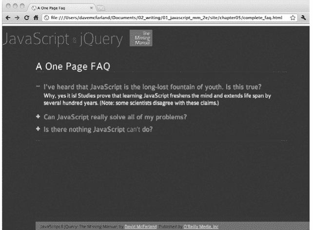

**图5-6：** 仅需几行JavaScript代码，你就能让页面元素随着鼠标点击而出现或消失。

## 动画与效果

在前两章中，你已经学习了使用jQuery的基础知识：如何加载jQuery库、选择页面元素以及响应事件（如访客点击按钮或鼠标悬停在链接上）。大多数jQuery程序都涉及三个步骤：在页面上选择一个元素、为该元素附加一个事件，然后通过执行某些操作来响应这个事件。在本章中，你将开始学习利用jQuery内置的效果和动画函数来完成“执行某些操作”这部分内容。同时，你还会回顾一些与创建视觉效果相关的重要CSS属性。

### jQuery效果

让网页上的元素显示和隐藏是一项常见的JavaScript任务。下拉导航菜单、弹出工具提示和自动幻灯片都依赖于在需要时显示和隐藏元素的能力。jQuery提供了一系列实现隐藏和显示元素目标的函数。

要使用这些效果中的任何一个，你需要将它们应用到一个jQuery选择上，就像使用任何其他jQuery函数一样。例如，要隐藏所有类名为 *submenu* 的标签，你可以这样写：

```
$('.submenu').hide();
```

每个效果函数还可以接受一个可选的速度设置和一个 *回调* 函数。速度代表效果完成所需的时间，而回调函数是在效果完成时运行的函数。（关于回调的详细信息，请参见第196页的“在效果完成后执行操作”。）

要为效果指定速度，你可以提供三个字符串值之一——*'fast'*、*'normal'* 或 *'slow'*——或者一个表示效果耗时毫秒数的数字（1000是1秒，500是半秒，以此类推）。例如，让一个元素慢慢淡出视野的代码如下：

```
$('element').fadeOut('slow');
```

或者，如果你想让元素*非常*缓慢地淡出，耗时10秒：

```
$('element').fadeOut(10000);
```

当你使用效果使元素消失时，元素实际上并没有从Web浏览器对页面的理解中移除。该元素仍然存在于DOM（文档对象模型，第127页）中。元素的代码仍在浏览器的内存中，但它的 *display* 设置（与CSS的display设置相同）被设为 *none*。由于这个设置，该元素不再占用任何可视空间，因此页面上的其他内容可能会移动到之前被隐藏元素占据的位置。你可以在 *testbed* 教程文件夹中的 *effects.html* 文件上查看所有jQuery效果的实际运行情况（参见图6-1）。

> **注意：** 用于设置效果速度的关键词——'fast'、'normal' 和 'slow'——分别对应200毫秒、400毫秒和600毫秒。因此
>
> `$('element').fadeOut('slow');`
>
> 等同于
>
> `$('element').fadeOut(600);`

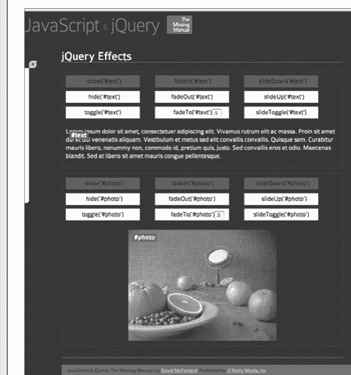

**图6-1：** 你可以在testbed文件夹中的 *effects.html* 文件上测试jQuery的视觉效果。点击函数文本——例如fadeOut('#photo')——来查看文本和图像在淡出、向上滑动或出现时的样子。有些效果会显示为灰色，表示它们不适用于该元素。例如，让一个已经可见的照片显示的代码就没有太大意义。

### 基本的显示和隐藏

jQuery提供了三个用于基本隐藏和显示元素的函数：

- *show()* 使隐藏的元素可见。如果元素在页面上已经可见，它不会产生任何效果。如果你不提供速度值，元素会立即出现。然而，如果你提供一个速度值——例如 *show(1000)*——元素会从左上角动画移动到左下角。

- *hide()* 隐藏可见的元素。如果元素已经被隐藏，它不会产生任何效果，并且与 *show()* 函数一样，如果你不提供速度值，元素会立即消失。然而，如果提供速度值，元素会以一种收缩的方式动画消失在视野中。

- *toggle()* 切换元素当前的显示值。如果元素当前可见，*toggle()* 会隐藏该元素；如果元素被隐藏，则 *toggle()* 会使元素出现。当你想用一个控件（如按钮）交替显示和隐藏一个元素时，这个函数非常理想。

在上一章第180页的教程中，你已经看到了 *hide()* 和 *toggle()* 函数的实际应用。该脚本在页面HTML加载时使用 *hide()* 使FAQ页面上的所有答案消失，然后在点击问题时使用 *toggle()* 来交替显示和隐藏这些答案。

### 淡入淡出元素

为了获得更显著的效果，你可以将元素淡出或淡入——无论哪种情况，你只是随时间改变元素的不透明度。jQuery提供了三个与淡入淡出相关的函数：

- *fadeIn()* 使隐藏的元素淡入视野。首先，页面上为该元素预留的空间出现（这可能意味着页面上的其他元素会为它让路）；然后该元素逐渐变得可见。如果元素在页面上已经可见，此函数不会产生任何效果。如果你不提供速度值，元素会使用'normal'设置（400毫秒）淡入。

- *fadeOut()* 通过使可见元素像幽灵一样淡出视野来隐藏它。如果元素已经被隐藏，它不会产生任何效果，并且与 *fadeIn()* 函数一样，如果你不提供速度值，元素会在400毫秒内淡出。

- *fadeToggle()* 结合了淡入和淡出效果。如果元素当前被隐藏，它会淡入视野；如果当前可见，则淡出视野。你可以使用此函数使一个说明框在页面上出现或消失。例如，假设你有一个标有“说明”字样的按钮。当访客点击该按钮时，一个包含说明的div会淡入视野；再次点击该按钮，说明就会淡出视野。要让该框在半秒（500毫秒）内淡入或淡出，你可以编写如下代码：

```
$('#button').click(function() {
    $('#instructions').fadeToggle(500);
}); // end click
```

- *fadeTo()* 的工作方式与其他效果函数略有不同。它将图像淡入到指定的不透明度。例如，你可以使一个图像淡入到半透明状态。与其他效果不同，你必须提供一个速度值。此外，你还需要提供一个从0到1的第二个值，表示元素的不透明度。例如，要将所有段落淡入到75%的不透明度，你可以这样写：

  `$('p').fadeTo('normal',.75);`

  此函数会改变元素的不透明度，无论该元素是可见还是不可见。例如，假设你将一个当前隐藏的元素淡入到50%的不透明度，该元素会以50%的不透明度淡入视野。如果你隐藏一个半透明的元素，然后让它重新出现，它的不透明度设置会被记住。

  如果你将一个元素淡入到0不透明度，该元素不再可见，但它在页面上占据的空间仍然保留。换句话说，与其他消失效果不同，淡入到0会在页面上留下一个空位。

### 滑动元素

为了获得更多的视觉动态效果，你还可以让元素在视野中滑入和滑出。这些函数与淡入淡出元素类似，它们使页面元素在视野中出现和消失，并且可以接受一个速度值：

- *slideDown()* 使隐藏的元素滑入视野。首先，元素的顶部出现，随着元素其余部分的出现，元素下方的任何内容都会被向下推。如果元素在页面上已经可见，此函数不会产生任何效果。如果你不提供速度值，元素会使用 *'normal'* 设置（400毫秒）滑入。

- *slideUp()* 通过隐藏元素的底部并将其下方的任何内容向上移动，直到元素消失，从而将其从视野中移除。如果元素已经被隐藏，它不会产生任何效果，并且与 *slideDown()* 函数一样，如果你不提供速度值，元素会在400毫秒内滑出。

- *slideToggle()* 在元素当前被隐藏时应用 *slideDown()* 函数，在元素可见时应用 *slideUp()* 函数。此函数允许你用一个控件（如按钮）同时显示和隐藏一个元素。


 UP TO SPEED

### 使用 CSS 进行绝对定位

通常，当你隐藏网页上的某个元素时，其他元素会移动填补该空间。例如，如果你隐藏页面上的图片，图片消失，图片下方的内容会上移。同样地，显示某个元素会迫使其他内容移动，为新显示的元素腾出空间。你可能不希望页面上的内容这样跳来跳去。在这种情况下，你可以借助 CSS 和*绝对定位*（*absolute positioning*）将元素置于正常页面内容流之外。换句话说，你可以使用 CSS 的 position 属性，让 div、图片或段落显示在页面顶部，就像位于自己独立的图层上一样。

当然，你可能希望根据浏览器窗口以外的其他元素来定位。例如，弹出提示框通常相对于其他元素定位：页面上的某个词旁边可能有 ?，点击后打开一个包含该词定义的小方框。在这种情况下，提示框需要相对于该词定位，而不是相对于浏览器窗口的顶部、左侧、右侧或底部。要实现这一点，你需要为包裹绝对定位项的元素设置相对定位（relative）。例如，看这段 HTML：

要让元素显示在页面之上，为其设置 position 值为 absolute。然后你可以使用 left、right、top 和/或 bottom 属性来指定该元素在页面上的位置。例如，假设你有一个包含登录表单的 `<div>` 标签。该登录表单通常不可见，但当访客点击链接时，表单滑入到位，位于页面其他内容之上。你可以这样定位该 div：

```
<span class="word">Heffalump
<span class="definition">An imaginary, elephant-like creature from Winnie the Pooh</span>
</span>
```

```
#login {
    position: absolute;
    left: 536px;
    top: 0;
    width: 400px;
}
```

```
.word { position: relative; }
.definition {
    position: absolute;
    bottom: -30px;
    left: 0;
    width: 200px;
}
```

要让定义 span 显示在单词下方，你首先需要将 word span 相对定位，然后像这样将 definition 绝对定位：

此样式将 div 放置在浏览器窗口顶部，距左边缘 536px。你也可以使用 right 属性从浏览器窗口右边缘定位元素，或使用 bottom 属性相对于浏览器窗口底部边缘定位元素。

有关绝对定位的更多信息，请访问 www.related.com/articles/css-positioning/ 或查阅 CSS: The Missing formulation and processing requirements。

### 教程：登录滑块

在本教程中，你将通过创建一个常见的用户界面元素来练习使用 jQuery 效果：一个通过鼠标点击滑入和滑出的面板（见图 6-2）。

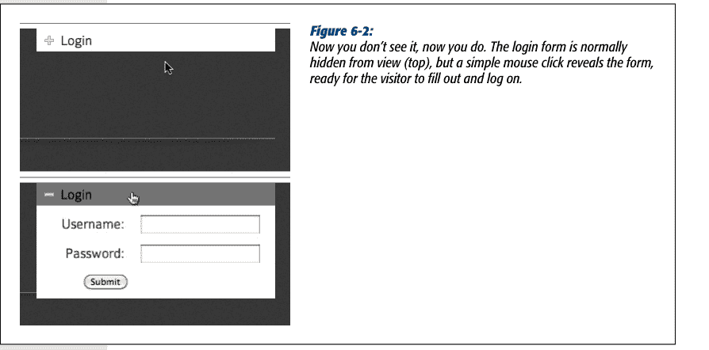

基本任务相当简单：

1. 选择带有"Login"消息的段落。记住，很多 jQuery 编程首先是从选择页面上的元素开始的。在这种情况下，"Login"段落将接收访客的点击。

2. 为该段落附加一个*点击*（*click*）事件。没有事件，JavaScript 就无法交互：访客需要与选中的元素（Login 段落）交互才能使某事发生。

3. 切换表单的显示和隐藏。前两步只是复习（但对于大量的 jQuery 编程来说是必要的）。最后一步是你将使用所学效果的地方。你可以让表单立即出现（*show()* 函数）、滑入视图（*slideDown()* 函数）或淡入视图（*fadeIn()* 函数）。

> **注意：** 有关如何下载教程文件的信息，请参阅第 29 页的注释。

### 编程

1. 在文本编辑器中，打开 *chapter06* 文件夹中的 *signup.html* 文件。此文件已包含指向 jQuery 文件的链接，并且 `$(document).ready()` 函数（第 169 页）已就位。首先，你将选择带有 "Login" 文本的段落。

2. 在 `$(document).ready()` 函数后面的空行处点击，然后输入 `$('#open')`。 "Login" 文本位于 ID 为 open 的段落标签内：`<p id="open">Login</p>`，所以你刚输入的代码将选择该元素。现在，是时候添加事件处理器了。

3. 添加下面加粗的代码，使脚本看起来像这样：`$(document).ready(function() { $('#open').click(function() { }); // end click }); // end ready` 这段代码添加了一个点击处理器，这样每次访客点击段落时，都会发生某些事情。在这种情况下，点击一次时表单应出现，再次点击时消失，下一次点击又出现，如此循环。换句话说，表单在可见和不可见之间切换。jQuery 提供了三个可以实现此目的的函数：*toggle()*、*fadeToggle()* 和 *slideToggle()*。区别仅在于效果的外观。

4. 在点击函数内的空行处点击并输入：`$('#login form').slideToggle(300);` 这段代码选择登录表单，如果当前不可见则将其滑入视图，如果可见则将其滑出视图。最后，你将更改段落的类，以便 "Login" 可以使用 CSS 类样式改变外观。

5. 添加下面加粗的代码，使完成的脚本看起来像这样：

```
1 $(document).ready(function() {
2     $('#open').click(function() {
3         $('#login form').slideToggle(300);
4         $(this).toggleClass('close');
5     }); // end click
6 }); // end ready
```

正如你在第 149 页回忆起的，当你在事件处理器内部时，可以使用 `$(this)` 来引用响应事件的元素。在这种情况下，`$(this)` 指的是访客点击的段落——即上面第 2 行的 `$('#open')`。`toggleClass()` 函数只是向元素添加或移除一个类。与其他切换函数一样，如果指定的类缺失则添加，如果存在则移除。在此示例中，页面上的样式表中有一个 .close 类样式。（查看文件的 `<head>` 部分，你可以看到该样式及其作用。）

### 动画

6. 保存页面并在网页浏览器中预览。

确保多次点击 "Login" 段落以查看其工作方式。你将在 *chapter06* 文件夹中找到教程的完成版本——*complete_signup.html*。也可以尝试其他切换效果，将 *slideToggle()* 替换为 *toggle()* 或 *fadeToggle()*。

但如果你想使用两种不同的效果呢？一种用于使表单出现——例如，将表单向下滑入视图——另一种用于使其消失——例如，淡出视图。第 5 步中的代码并不能完全胜任，因为 *click()* 函数并不能真正让你选择两种不同的操作。然而，正如你在第 173 页读到的，jQuery 提供了一个特殊事件——*toggle()* 事件——来处理这种情况。不要与使元素出现和消失的 *toggle()* 效果混淆——*toggle()* 事件允许你在奇数次和偶数次点击之间交替运行不同的代码。所以在第一次点击时，表单出现，第二次点击时，表单消失。

要使表单滑入视图，然后在交替点击时淡出视图，你可以使用以下代码：

```
$(document).ready(function() {
    $('#open').toggle(
        function() {
            $('#login form').slideDown(300);
            $(this).addClass('close');
        },
        function() {
            $('#login form').fadeOut(600);
            $(this).removeClass('close');
        }
    ); // end toggle
}); // end ready
```

### 动画

你不仅限于 jQuery 提供的内置*效果*。使用 *animate()* 函数，你可以为接受数值（如像素、em 或百分比值）的任何 CSS 属性添加动画。例如，你可以为文本大小、页面上元素的位置、对象的不透明度或边框的宽度添加动画。

> **注意：** jQuery 本身无法为颜色添加动画——例如，文本颜色、背景颜色或边框颜色。然而，*jQuery Color* 插件可以做到这一点。我们在教程中包含了该插件的副本，你将在第 198 页看到动画颜色的实际示例。你可以在 https://github.com/jquery/jquery-color 获取该颜色插件的最新版本。（简而言之，插件是一个单独的文件，包含额外的 JavaScript 编程，为 jQuery 添加功能。）

要使用此函数，你必须传递一个对象字面量（参见第 145 页），其中包含你希望更改的 CSS 属性列表以及你希望动画到的值。例如，假设你想通过将元素从左侧移动 650 像素来为其添加动画


### 缓动

jQuery 仅包含两种缓动方法：`swing` 和 `linear`。`linear` 方法提供平稳的动画，因此动画的每一步都是相同的（例如，如果你在屏幕上移动一个元素，每一步的距离都与上一步相同）。`swing` 更具动态性，因为动画开始时速度较快，然后逐渐减慢。`swing` 是默认设置，所以如果不指定任何缓动方式，jQuery 将使用 `swing` 方法。

缓动方法是任何 jQuery 效果的第二个参数，因此要使用 `linear` 方法让一个元素向上滑动，你可以这样编写代码：

```
$('#element').slideUp(1000, 'linear');
```

使用 `animate()` 函数时，缓动方法是第三个参数，位于包含你要动画化的 CSS 属性的对象字面量和动画总速度之后。例如，要对第 193 页的动画代码使用 `linear` 缓动方法，你可以这样编写：

```
$('#message').animate(
{
  left: '650px',
  opacity: .5,
  fontSize: '24px'
},
1500,
'linear'
);
```

不过，你并不局限于 jQuery 提供的两种缓动方法。得益于其他程序员的辛勤工作，你可以添加大量其他缓动方法——其中一些非常有戏剧性，看起来也很有趣。使用 jQuery easing 插件（可从 http://gsgd.co.uk/sandbox/jquery/easing/ 获取，也在教程下载包中），你可以以相当戏剧性的方式实现动画。例如，`easeInBounce` 方法会让动画在速度和方向上快速变化，就像元素在弹跳一样。

> **提示：** 缓动插件提供了许多不同的缓动方法，而且大多数方法的名称并不能真正帮助你理解该缓动方法的效果。要更直观地了解不同的缓动选项，请访问 www.robertpenner.com/easing/easing_demo.html，你可以在那里亲自尝试每种方法。

要使用缓动插件（它是一个外部 JavaScript 文件），你需要在引用 jQuery 库的代码之后将该文件附加到页面中。链接到缓动插件后，你就可以使用任何可用的缓动方法（完整列表请参见 http://gsgd.co.uk/sandbox/jquery/easing/）。例如，假设你希望当访问者点击一个 `div` 标签时其尺寸变大，并且希望通过使用 `easeInBounce` 方法使动画更加有趣。假设该 `div` 的 ID 为 *animate*，你的代码可能如下所示：

```
<script src="js/jquery-1.6.3.min.js"></script>
<script src="js/jquery.easing.1.3.js"></script>
<script>
$(document).ready(function() {
    $('#animate').click(function() {
        $(this).animate(
        {
            width: '400px',
            height: '400px'
        },
        1000,
        'easeInBounce'); // end animate
    }); // end click
}); // end ready
</script>
```

第 1 行和第 2 行加载 jQuery 和缓动插件。第 4 行是常见的 `ready()` 函数（第 169 页），第 5 行为 `div` 添加了一个点击处理程序。核心代码在第 6–12 行。正如你在第 149 页所回忆的，当你在事件内部时，`$(this)` 指的是响应事件的元素——在本例中就是 `<div>` 标签。换句话说，通过点击 `div`，你也通过改变其宽度和高度（第 8 行和第 9 行）来动画化该 `div`。第 11 行使动画在 1 秒（1000 毫秒）内完成，第 12 行将缓动方法设置为 `easeInBounce`（你可以替换为任何缓动方法，如 `easeInOutSine`、`easeInCubic` 等）。

**注意：** 你可以在教程文件的 chapter06 文件夹中找到此代码的运行示例。在 Web 浏览器中打开文件 `easing_example1.html`。文件 `easing_example2.html` 展示了如何使用 `toggle()` 事件（第 173 页）为 `div` 应用两种不同的缓动方法。

### 在效果完成后执行操作

有时你希望在效果完成后执行一些操作。例如，假设当某张特定照片淡入视野时，你希望显示一个说明文字。换句话说，说明文字必须在照片完成淡入之后才出现在页面上。通常，效果不会依次执行；它们在被调用时同时发生。因此，如果你的脚本有一行代码让照片淡入，另一行代码让说明文字出现，说明文字会在照片仍在淡入时就显示出来。

要解决这个难题，你可以向任何效果传递一个回调函数。这是一个仅在效果完成后才运行的函数。回调函数作为大多数效果的第二个参数传递（对于 `fadeTo()` 函数则是第三个参数）。

例如，假设页面上有一张 ID 为 `photo` 的图片，其下方有一段 ID 为 `caption` 的段落。要让照片淡入视野，然后让说明文字淡入视野，你可以使用如下回调函数：

```
$('#photo').fadeIn(1000, function() {
    $('#caption').fadeIn(1000);
});
```

当然，如果你想在页面加载时运行该函数，你需要先隐藏照片和说明文字，然后再执行 `fadeIn` 效果：

```
$('#photo, #caption').hide();
$('#photo').fadeIn(1000, function() {
    $('#caption').fadeIn(1000);
});
```

如果你使用 `animate()` 函数，那么回调函数出现在所有其他参数之后——包含要动画化的 CSS 属性的对象字面量、动画持续时间和缓动设置。不过缓动设置是可选的，因此你也可以只传递 `animate()` 函数、属性列表、持续时间和回调函数。例如，假设你不仅希望照片淡入视野，还希望增加其宽度。


### 在效果完成后执行动作

使其宽度和高度从零变为完整尺寸（一种缩放效果）。你可以使用 `animate()` 函数来实现，然后像这样显示标题：

```
$('#photo').width(0).height(0).css('opacity',0);
$('#caption').hide();
$('#photo').animate(
  {
    width: '200px',
    height: '100px',
    opacity: 1
  },
  1000,
  function() {
    $('#caption').fadeIn(1000);
  }
); // end animate
```

上述代码的第1行将照片的宽度、高度和不透明度都设置为0。（这会将照片隐藏起来，并为动画做准备。）第2行隐藏标题。第3到13行是动画函数的实际执行，回调函数出现在第10到12行。这可能看起来有点吓人，但不幸的是，回调函数是在效果完成时运行动作（包括对不同页面元素的效果）的唯一方式。

> **注意**：*chapter06* 文件夹中的 *callback.html* 文件展示了上述代码的实际效果。

当你想要连续对多个元素进行动画时，回调函数会变得复杂：例如，让一张图片移动到屏幕中央，然后标题淡入，接着让图片和标题同时淡出。要实现这个效果，你需要将一个回调函数传入另一个回调函数，像这样：

```
$('#photo').animate(
  {
    left: '+=400px',
  },
  1000,
  function() { // first callback function
    $('#caption').fadeIn(1000,
      function() { // second callback function
        $('#photo, #caption').fadeOut(1000);
      } // end second callback
    ); // end fadeIn
  } // end first callback function
); // end animate
```

> **注意**：*chapter06* 文件夹中的 *multiple-callbacks.html* 文件展示了这段代码的实际效果。

然而，如果你想对同一个页面元素添加额外的动画，就不需要使用回调函数。例如，假设你想让一张照片移动到屏幕上，然后让它淡出视线。在这种情况下，你只需使用 `animate()` 函数来移动照片，然后让图片淡出视线。你可以这样做：

```
$('#photo').animate(
    {
        left: '+=400px',
    },
    1000
); // end animate
$('#photo').fadeOut(3000);
```

在这种情况下，虽然浏览器会立即执行代码，但 jQuery 会将每个效果放入队列中，所以先运行动画，然后运行 `fadeOut()` 函数。使用 jQuery 链式调用（第137页），你可以将上面的代码重写为：

```
$('#photo').animate(
    {
        left: '+=400px',
    },
    1000).fadeOut(3000);
```

如果你想让一张照片淡入、淡出，然后再淡入，你可以像这样使用链式调用：

```
$('#photo').fadeIn(1000).fadeOut(2000).fadeIn(250);
```

> **注意**：有关效果队列工作原理的更多信息，请访问 jQuery 网站：*http://api.jquery.com/jQuery.queue/*。

另一个在元素上排队效果时非常有用的 jQuery 函数是 `delay()`。这个函数只是等待指定的毫秒数，然后再开始队列中的下一个效果。例如，假设你想让一张图片淡入视图，等待10秒，然后淡出视线。你可以像这样使用 `delay()` 函数：

```
$('#photo').fadeIn(1000).delay(10000).fadeOut(250);
```

### 教程：动画仪表板

在这个教程中，你将使用 `animate()` 函数将一个 `<div>` 标签从页面左边缘外向右移动到视图中。这个 div 是绝对定位的（关于绝对定位的更多信息，请参见第189页的方框），因此大部分盒子悬在页面左边缘之外，超出浏览器窗口的边界（图6-3，左）。当访客将鼠标移到 div 的可见边缘时，该 div 会完全移动到视图中（图6-3，右）。为了让这个效果更有趣，你还会使用两个插件来动画 div 的背景颜色，并使用几种不同的缓动方法。

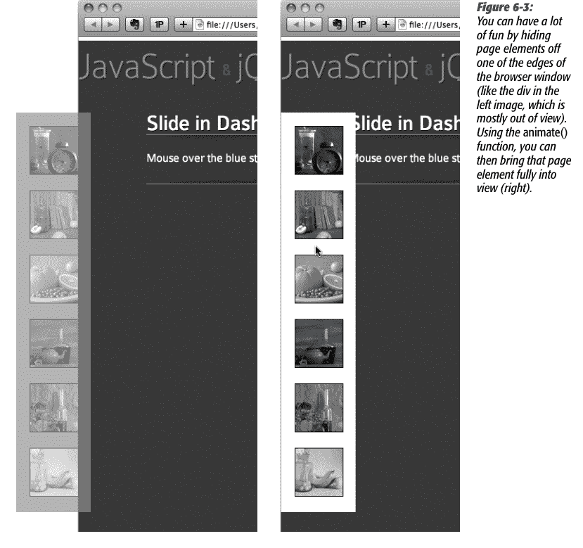

**图6-3：** 将页面元素隐藏在浏览器窗口的边缘之外会很有趣（就像左图中的 div，大部分在视图之外）。使用 animate() 函数，你可以将该页面元素完全带入视图中（右）。

> **注意**：有关如何下载教程文件的信息，请参见第29页的注释。

基本任务相当简单：

- **1. 选择 <div> 标签。**
记住，很多 jQuery 编程都是从选择页面上的一个元素开始的——在这种情况下，就是访客鼠标悬停的 div 标签。
- **2. 附加 *hover* 事件。**
*hover* 事件（第171页有描述）是一个特殊的 jQuery 函数，不是真正的 JavaScript 事件，它可以让你在访客将鼠标悬停在元素上时执行一组动作，然后在访客将鼠标移出元素时执行第二组动作（*hover* 事件实际上只是第159页描述的 mouseOver 和 mouseOut 事件的组合）。
- **3. 为 mouseover 事件添加 animate 函数。**
当访客将鼠标悬停在 div 上时，你将动画 div 的 left 位置，将它从浏览器窗口左边缘的视图之外移动进来。此外，你还将动画 div 的背景颜色。
- **4. 为 mouseout 事件添加另一个 animate 函数。**
当访客将鼠标移出 div 时，你将把 div 动画回到原来的位置和原始背景颜色。

### 编程步骤

- **1. 在文本编辑器中，打开 *chapter06* 文件夹中的 *animate.html* 文件。**
该文件已经包含了 jQuery 文件的链接，`$(document).ready()` 函数（第169页）也已经就位。但是，由于你要动画 div 的背景颜色并使用一些有趣的缓动方法，你需要附加两个 jQuery 插件——*color* 插件和 *easing* 插件。
- **2. 在第一个 <script> 标签后的空行处，添加以下加粗的代码：**

```
<script src="../_js/jquery-1.6.3.min.js"></script>
<script src="../_js/jquery.easing.1.3.js"></script>
<script src="../_js/jquery.color.js"></script>
```

jQuery 插件（下一章你会学到更多关于它们的内容）其实就是扩展 jQuery 功能的外部 JavaScript 文件，通常让你无需大量编程（由你这边）就能为网站添加复杂的效果或功能。接下来你要选择 div，然后给它添加 *hover()* 函数。
- **3. 在 *$(document).ready()* 函数内的空行处，输入 `$('#dashboard').hover(); // end hover`，使你的代码看起来像这样：**

```
$(document).ready(function() {
  $('#dashboard').hover(); // end hover
}); // end ready
```

`$('#dashboard')` 选择了 <div> 标签（它应用了 id dashboard）。*hover()* 函数接受两个参数——两个匿名函数（第148页）——用于描述访客将鼠标移到 div 上时做什么，以及访客将鼠标移出 div 时做什么。与其一次性输入所有代码，你会逐步构建，先添加 *hover()* 函数，然后添加两个匿名函数的"外壳"。这种方法很有帮助，因为如果你不小心，括号、大括号、逗号和分号的嵌套可能会让你不知所措。
- **4. 在 *hover()* 函数的括号之间点击，添加两个空的匿名函数：**

```
$(document).ready(function() {
  $('#dashboard').hover(
    function() {

    },
    function() {

    }
  ); // end hover
}); // end ready
```

jQuery 插件（下一章你会学到更多关于它们的内容）其实就是扩展 jQuery 功能的外部 JavaScript 文件，通常让你无需大量编程就能为网站添加复杂的效果或功能。接下来你要添加 *hover()* 函数。

**提示：** 频繁测试你的代码是个好习惯，以确保你没有打错字。在第4步中，你可以在第一个匿名函数内输入 `alert('mouseOver')`，在第二个匿名函数内输入 `alert('mouseOut')`，然后在网页浏览器中预览页面。当你将鼠标悬停在 div 上时，应该会看到一个警告框出现，然后当你将鼠标移出时（例如，关闭第一个警告对话框后），你会看到第二个警告框。如果没有出现警告框，说明你打错了字。将这些步骤仔细核对你的代码，或者使用第34页的步骤通过浏览器的错误控制台来查找错误。
- **5. 在第一个匿名函数内，输入 `$(this).animate(); // end animate`。**

如第149页所讨论的，在事件内部，`$(this)` 指的是你附加了事件的页面元素。在这种情况下，`$(this)` 指的是 ID 为 dashboard 的 `<div>` 标签。换句话说，将鼠标悬停在这个 div 上也会动画这个 div。
- **6. 添加一个对象字面量，包含你想要动画的 CSS 属性：**

```
$(document).ready(function() {
  $('#dashboard').hover(
    function() {
      $(this).animate(
        {
          left: '0',
          backgroundColor: 'rgb(255,255,255)'
        }
      ); // end animate
    },
    function() {

    }
  ); // end hover
}); // end ready
```

*animate()* 函数的第一个参数是一个对象字面量（第145页），包含 CSS 属性。在这种情况下，div 当前的 left 值为 -92px，因此大部分 div 被隐藏，悬在浏览器窗口的左边缘之外。通过将其 left 值动画到 0，你实际上是将其完全移动到左侧视图内。同样， thanks to the color plug-in，你正在将其背景颜色从蓝色变为白色。接下来，你将设置动画的持续时间。

### 教程：动画仪表板

7. 在对象字面量的闭合大括号`}`后面输入一个逗号，按回车键，然后输入 500。

这个逗号标记了传递给`animate()`函数的第一个参数的结束，而 500 则将动画的持续时间设置为半秒，即 500 毫秒。最后，你需要设置一个缓动方法。

8. 在 500 后面输入一个逗号，按回车键，然后输入`'easeInSine'`，使你的代码看起来像这样：

```javascript
$(document).ready(function() {
  $('#dashboard').hover(
    function() {
      $(this).animate(
        {
          left: '0',
          backgroundColor: 'rgb(255,255,255)'
        },
        500,
        'easeInSine'
      ); // end animate
    },
    function() {

    }
  ); // end hover
}); // end ready
```

这里`animate()`函数的最后一个参数——`'easeInSine'`——告诉函数使用一种缓动方法，该方法开始时较慢，然后加速。

9. 保存文件。在浏览器中预览并将鼠标悬停在 div 上。

div 应该会滑入视图。如果没有，请使用第 34 页描述的技术进行故障排查。当然，当你将鼠标移出 div 时，什么都不会发生。你需要将动画函数添加到第二个匿名函数中。

10. 将以下代码添加到第二个匿名函数中：

```javascript
$(this).animate(
    {
      left: '-92px',
      backgroundColor: 'rgb(110,138,195)'
    },
    1500,
    'easeOutBounce'
  ); // end animate
```

这段代码反转了第一个动画的过程，将 div 移回窗口的左边缘之外，并将背景颜色恢复为蓝色。时间略有不同——1.5 秒而不是半秒——而且缓动方法也不同。

11. 保存文件。在浏览器中预览，并将鼠标移入和移出 div。

你会看到 div 移入视图，然后移出视图。然而，如果你反复快速地将鼠标移入和移出 div，你会注意到一些奇怪的行为：div 会在你停止移动鼠标后很长时间内继续滑入和滑出视图。这个问题是由 jQuery 如何对元素上的动画进行排队引起的。如第 198 页所述，你添加到元素上的任何动画都会被放入该元素的一个队列中。例如，如果你有一个元素淡入视图、淡出视图，然后再淡入视图，jQuery 会按顺序逐个执行每个效果。

在本教程的代码中发生的情况是，每次你将鼠标移入和移出 div 时，都会向队列中添加一个动画；因此，快速地将鼠标悬停在 div 上会为 jQuery 创建一长串要执行的效果列表：将 div 动画移入视图、将 div 动画移出视图、将 div 动画移入视图、将 div 动画移出视图，等等。这个问题的解决方法是在执行新动画之前停止 div 上的所有动画。换句话说，当你将鼠标悬停在 div 上时，如果该 div 正在动画过程中，那么 jQuery 应该停止当前动画，并继续执行鼠标悬停所需的动画。幸运的是，jQuery 提供了一个函数——`stop()`函数——专门解决这种问题。

**12. 在两个匿名函数中的`$(this)`和`.animate`之间添加`.stop()`。完成的代码应该如下所示（新增部分以粗体显示）：**

```javascript
$(document).ready(function() {
    $('#dashboard').hover(
        function() {
            $(this).stop().animate(
                {
                    left: '0',
                    backgroundColor: 'rgb(255,255,255)'
                },
                500,
                'easeInSine'
            ); // end animate
        },
        function() {
            $(this).stop().animate(
                {
                    left: '-92px',
                    backgroundColor: 'rgb(110,138,195)'
                },
                1500,
                'easeOutBounce'
            ); // end animate
        }
    ); // end hover
}); // end ready
```

这里的`.stop()`函数只是简单地在开始新动画之前结束 div 上的任何动画，并防止多个动画在队列中堆积。

保存页面并在网页浏览器中尝试。你可以在*chapter06*文件夹中找到本教程的完成版本——*complete_animate.html*。

## 第三部分：构建网页功能

- 第 7 章：优化你的图像
- 第 8 章：优化导航
- 第 9 章：增强网页表单
- 第 10 章：扩展你的界面

### 优化你的图像

网页设计师使用图像来改善页面的设计、装饰导航栏、突出页面上的元素——以及向全世界展示他们在上次假期中有多开心。在网页上添加图像可以立即注入趣味和视觉吸引力。然而，当你将 JavaScript 加入其中时，你可以通过动态更改页面上的图像、展示动画照片画廊或在一系列自动播放的幻灯片中展示照片，来真正增添 excitement。在本章中，你将学习大量用于操纵和展示网站图像的技巧。

### 图像切换

JavaScript 最常见的用途之一是简单的*图像翻转*：当你将鼠标移到图像上时，它会变成另一张图像。这种基本技术自 JavaScript 诞生以来就被用于创建交互式导航栏，其按钮在鼠标悬停时改变外观。

但在过去几年中，越来越多的设计师开始使用 CSS 来实现相同的效果（例如，参见 *www.monkeyflash.com/css/image-rollover-navbar/*）。然而，即使你使用 CSS 来创建交互式导航栏，如果你仍想创建幻灯片、图像画廊，并为网页添加其他类型的交互式图形效果，你仍然需要了解如何使用 JavaScript 来切换图像。

### 更改图像的 src 属性

网页上显示的每张图像都有一个*src*（*source* 的缩写）属性，它指示了图形文件的路径；换句话说，它指向了 Web 服务器上的一张图像。如果你将此属性更改为指向不同的图形文件，浏览器将显示新图像。假设你在页面上有一张图像，并为其分配了 *photo* 的 ID。使用 jQuery，你可以动态更改图像的 src 属性。

例如，假设你在页有一张图像，并且你已为分配了 photo 的 ID。HTML 可能看起来像这样：

```html

```

要换入另一张图像文件，你只需使用 *attr()* 函数（第 146 页）将标签的 src 属性设置为新文件，如下所示：

```javascript
$('#photo').attr('src','images/newImage.jpg');
```

> **注意：** 当你使用 JavaScript 更改图像的 *src* 属性时，图像文件的路径是基于页面位置的，*而不是* JavaScript 代码的位置。当你使用位于不同文件夹中的外部 JavaScript 文件时（第 27 页），这一点可能会令人困惑。在上面的示例中，Web 浏览器会尝试从名为 *images* 的文件夹下载文件 *newImage.jpg*，该文件夹位于与网页相同的文件夹中。即使 JavaScript 代码包含在站点上另一个文件夹中的外部文件中，该方法也能正常工作。因此，在外部 JavaScript 文件中使用根相对链接通常更容易（有关不同链接类型的更多信息，请参见第 28 页的方框）。

更改图像的 *src* 属性不会改变 `` 标签的任何其他属性。例如，如果在 HTML 中设置了 *alt* 属性，换入的图像将具有与原始图像相同的 *alt* 文本。此外，如果在 HTML 中设置了 *width* 和 *height* 属性，更改图像的 *src* 属性会使新图像适应与原始图像相同的空间。如果两张图形的尺寸不同，那么换入的图像将会失真。

在导航栏中的翻转图像等情况下，两张图像很可能大小相同并共享相同的 *alt* 属性，因此你不会遇到那个问题。但是，你可以通过简单地在 HTML 中省略原始图像的 *width* 和 *height* 属性来完全避免图像失真问题。这样，当换入新图像时，Web 浏览器会按文件中设置的尺寸显示图像。

另一种解决方案是先下载新图像，获取其尺寸，然后更改 `` 标签的 *src*、*width*、*height* 和 *alt* 属性：

```javascript
var newPhoto = new Image();
newPhoto.src = 'images/newImage.jpg';
var photo = $('#photo');
photo.attr('src',newPhoto.src);
photo.attr('width',newPhoto.width);
photo.attr('height',newPhoto.height);
```

> **注意：** 左侧的行号不是代码的一部分，所以不要输入它们。它们只是为了让代码更容易阅读。


此技术的关键在于第1行，它创建了一个新的图像对象。对网页浏览器而言，代码 *new Image()* 表示："浏览器，我将向页面添加一个新图像，请做好准备。"下一行告诉网页浏览器实际下载这个新图像。第3行获取当前页面图像的引用，第4-6行则替换为新图像，并调整宽度和高度以匹配新图像。

> **提示：** jQuery 的 *attr()* 函数可以一次性设置多个 HTML 属性。只需传递一个包含每个属性名和新值的对象字面量（见第145页）。你可以用更简洁的方式编写上面的 jQuery 代码，如下所示：

```
var newPhoto = new Image();
newPhoto.src = 'images/newImage.jpg';
$('#photo').attr({
    src: newPhoto.src,
    width: newPhoto.width,
    height: newPhoto.height
});
```

通常，你会将这种图像替换技术与事件处理器结合使用。例如，你可以让图像在访问者将鼠标悬停在其上时切换为另一张图像。这种翻转效果常用于导航栏，你将在第210页学习如何创建它。不过，你也可以响应任何事件来更改图像：例如，每次点击页面上的箭头时显示一张新照片，就像幻灯片一样。

### 预加载图像

使用上述技术替换新图像存在一个问题：当你将新文件路径替换到 *src* 属性时，浏览器必须下载图像。如果你等到有人将鼠标悬停在图像上才下载新图形，那么在新图像显示之前会出现令人不快的延迟。对于导航栏而言，翻转效果会显得迟钝且无响应。

为了避免这种延迟，请预加载你希望在响应某个操作时立即显示的任何图像。例如，当访问者将鼠标悬停在导航栏的按钮上时，翻转图像应立即出现。*预加载* 图像仅仅意味着在你计划显示它之前，强制浏览器下载该图像。当图像下载完成后，它会存储在网页浏览器的缓存中，这样对该文件的任何后续请求都会从访问者的硬盘提供服务，而不是从网络服务器第二次下载。

预加载图像就像创建一个新的图像对象并设置该对象的 *src* 属性一样简单。事实上，你已经知道如何操作：

```
var newPhoto = new Image();
newPhoto.src = 'images/newImage.jpg';
```

### 替换图像

这种预加载之所以有效，是因为你在需要替换网页上当前图像之前就完成了操作。一种预加载方式是在脚本开始时创建一个数组（第59页），包含你希望预加载的所有图形的路径，然后遍历该列表，为每个图形创建一个新的图像对象：

```
1	var preloadImages = ['images/roll.png',
2	                       'images/flower.png',
3	                       'images/cat.jpg'];
4	var imgs = [];
5	for (var i=0; i<preloadImages.length;i++) {
6	  imgs[i] = new Image();
7	  imgs[i].src = preloadImages[i];
8	}
```

第1-3行是一条单独的 JavaScript 语句，创建了一个名为 *preloadImages* 的数组，包含三个值——每个要预加载的图形文件的路径。（如第61页所述，如果将每个数组项放在单独的行上，数组通常更易于阅读。）第4行创建了一个新的空数组 *imgs*，用于存储每个预加载的图像。第5-8行展示了一个基本的 JavaScript *for* 循环（见第97页），它为数组 *preloadImages* 中的每个项目运行一次。第6行创建一个新的图像对象，而第7行从 *preloadImages* 数组中检索文件路径——正是这一操作触发了图像的下载。

### 翻转图像

*翻转图像* 只是图像替换（如第207页所讨论的）由鼠标移动到图像上触发。换句话说，你只需将图像替换分配给 mouseover 事件。例如，假设你页面上有一个 ID 为 *photo* 的图像。当鼠标悬停在该图像上时，你希望显示新图像。你可以用 jQuery 这样实现：

```
1	<script src="js/jquery-1.6.3.min.js"></script>
2	<script>
3	$(document).ready(function() {
4	  var newPhoto = new Image();
5	  newPhoto.src = 'images/newImage.jpg';
6	  $('#photo').mouseover(function() {
7	      $(this).attr('src', newPhoto.src);
8	  }); // end mouseover
9	}); // end ready
10	</script>
```

第3行等待 HTML 加载完成，以便 JavaScript 可以访问当前照片的 HTML。第4行和第5行预加载你想要替换的图像。其余代码为图像分配一个 mouseover 事件，该事件会将图像的 *src* 属性更改为匹配新照片。

由于翻转图像通常在鼠标移开后恢复为原始图像，因此你还需要添加一个 mouseout 事件来换回图像。如第171页所讨论的，jQuery 提供了自己的事件，称为 *hover()*，它可以同时处理 mouseover 和 mouseout 事件：

```
1 <script src="js/jquery-1.6.3.min.js"></script>
2 <script>
3 $(document).ready(function() {
4   var newPhoto = new Image();
5   newPhoto.src = 'images/newImage.jpg';
6   var oldSrc=$('#photo').attr('src');
7   $('#photo').hover(
8     function() {
9       $(this).attr('src', newPhoto.src);
10    },
11    function() {
12      $(this).attr('src', oldSrc);
13  }); // end hover
14 }); // end ready
15 </script>
```

`hover()` 函数接受两个参数：第一个参数是一个匿名函数，告诉浏览器当鼠标移到图像上时该做什么；第二个参数是一个函数，告诉浏览器当鼠标移开图像时该做什么。此代码还添加了一个变量 `oldSrc` 来跟踪原始 `src` 属性——即页面加载时显示的文件路径。

你不仅可以将鼠标悬停在图像上。你可以将 `hover()` 函数添加到任何标签——链接、表单元素，甚至段落。这样，页面上的任何标签都可以触发页面其他位置的图像发生变化。例如，假设你想在鼠标悬停在页面的 `<h1>` 标签上时切换一张照片。假设目标图像与之前的示例相同。你只需如下面粗体部分所示更改代码：

```
1 <script src="js/jquery-1.6.3.min.js"></script>
2 <script>
3 $(document).ready(function() {
4   var newPhoto = new Image();
5   newPhoto.src = 'images/newImage.jpg';
6   var oldSrc=$('#photo').attr('src');
7   $('h1').hover(
8     function() {
9       $('#photo').attr('src', newPhoto.src);
10    },
11    function() {
12      $('#photo').attr('src', oldSrc);
13  }); // end hover
14 }); // end ready
15 </script>
```

### 教程：添加翻转图像

在本教程中，你将为一系列图像添加翻转效果（参见图7-1）。你还将添加编程来预加载翻转图像，以消除鼠标悬停在图像上和看到翻转图像之间的任何延迟。此外，你将学习一种新技术，使预加载和添加翻转效果的过程更高效。

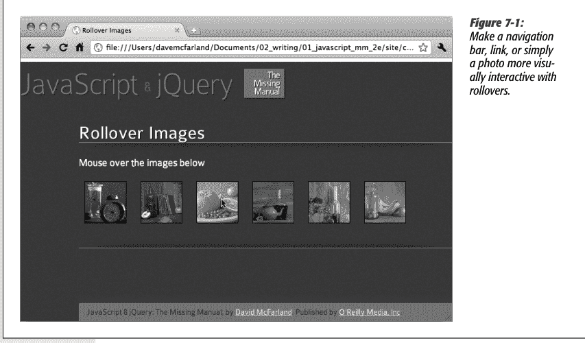

#### 任务概述

教程文件 *rollover.html*（位于 *chapter07* 教程文件夹中）包含一系列六张图像（参见图7-2）。每张图像都被一个指向该照片较大版本的链接包裹，所有图像都包裹在一个 ID 为 *gallery* 的 `<div>` 标签中。基本上，你试图实现两件事：

- 预加载与 `<div>` 内每张图像关联的翻转图像。

- 为 `<div>` 内的每张图像附加一个 *hover()* 函数。当鼠标移到图像上时，*hover()* 函数会切换为翻转图像，当鼠标移开时，再切换回原始图像。

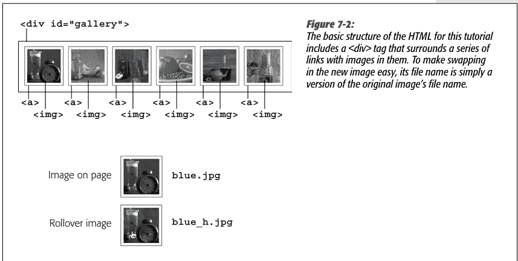

从这个描述可以看出，这两个步骤都与 `<div>` 内的图像有关，因此解决这个问题的一种方法是首先选择 `<div>` 内的图像，然后遍历选择结果，预加载每张图像的翻转效果并附加 `hover()` 函数。

> **注意：** 有关如何下载教程文件的信息，请参见第29页的说明。

### 编程

1. 在文本编辑器中，打开 *chapter07* 文件夹中的文件 *rollover.html*。

   此文件已包含对 jQuery 文件的链接以及 *$(document).ready()* 函数（第123页）。第一步是选择 `<div>` 标签内的所有图像，并使用第147页讨论的 jQuery *each()* 函数设置一个循环。

2. 在 *$(document).ready()* 函数后的空白行中单击，然后输入 *$('#gallery img').each(function() {*。

   选择器 *#gallery img* 选择 ID 为 *gallery* 的标签内的所有 `` 标签。jQuery 的 *each()* 函数提供了一种快速遍历一堆页面元素并对每个元素执行一系列操作的方法。*each()* 函数接受一个匿名函数（第148页）作为其参数。在编写实际在函数内运行的代码之前，最好先闭合（结束）匿名函数和 each 函数，因此你接下来将这样做。

3. 按两次回车键，然后输入`});`来关闭匿名函数、结束对*each()*函数的调用，并终止JavaScript语句。你的代码现在应该如下所示：

```
1  <script src="../_js/jquery-1.6.3.min.js"></script>
2  <script>
3  $(document).ready(function() {
4    $('#gallery img').each(function() {
5
6    }); // end each
7  }); // end ready
```

此时，脚本会遍历图库中的每张图片，但实际上还没有执行任何操作。首要任务是捕获图片的*src*属性，并将其存储在一个变量中，以便在脚本的后续部分使用。

> 注意：JavaScript注释——// *end each*和// *end ready*——对于脚本的运行来说并不是必需的。不过，它们确实能让脚本中各行所属的部分更容易被识别。

4. 点击空白行（步骤3中的第5行），然后输入：
`var imgFile = $(this).attr('src');`。
如第149页所述，你可以使用`$(this)`来引用循环中的当前元素；换句话说，`$(this)`将依次引用每个图片标签。jQuery的*attr()*函数（参见第146页）用于检索指定的HTML属性。在这种情况下，它检索图片的*src*属性，并将其存储在名为*imgFile*的变量中。例如，对于第一张图片，*src*属性是_images/small/blue.jpg，这是页面上显示的图片的路径。
你可以利用这个*src*值来预加载图片。

5. 按回车键创建一个空行，然后添加以下两行代码：

```
var preloadImage = new Image();
var imgExt = /(\.\w{3,4})$/;
preloadImage.src = imgFile.replace(imgExt,'_h$1');
```

如第209页所述，要预加载图片，你必须首先创建一个图片对象。在这种情况下，创建了变量*preloadImage*来存储图片对象。接下来，我们通过设置Image对象的*src*属性来预加载图片。
一种预加载图片的方法（如第210页所述）是创建一个包含你希望预加载的图片的数组，然后遍历数组中的每个项目，创建一个图片对象并将图片的源地址添加到该对象中。然而，这种方法可能需要做大量工作，因为你需要知道每个悬停替换图片的路径，并将这些路径输入到数组中。
在这个示例中，你将使用一种更具创意（且更省力）的方法来预加载图片。你只需确保将悬停替换图片存储在与原始图片相同的位置，并以类似的方式命名即可。对于这个网页，页面上的每张图片都有一个对应的悬停替换图片，其图片名称末尾添加了_h。例如，对于图片*blue.jpg*，有一个名为*blue_h.jpg*的悬停替换图片。两个文件都存储在同一个文件夹中，因此两个文件的路径是相同的。

这就是创意所在：你不必像这样手动输入悬停替换图片的src来预加载它，preloadImage.src='_images/small/blue_h.jpg'，你只需通过简单地修改原始图片源的名称，使其反映悬停替换图片的名称，让JavaScript来找出src。换句话说，如果你知道页面上图片的路径，那么它的悬停替换图片只需在该路径的.jpg之前直接添加一个h即可。因此_images/small/blue.jpg变成了_images/small/blue_h.jpg，_images/small/orange.jpg变成了_images/small/orange_h.jpg。

这就是另外两行代码的作用。第一行——var imgExt = /(\.\w{3,4})$/;——创建了一个正则表达式。正则表达式（你将在第430页学到）是一种可以在字符串中搜索的字符模式：例如，连续的三个数字。正则表达式可能有些复杂，但本质上这个正则表达式匹配的是字符串末尾的一个句点后跟三到四个字符。例如，它将匹配/images/small/blue.jpeg中的.jpeg和/images/orange.png中的.png。

下一行——preloadImage.src = imgFile.replace(imgExt, '_h$1');——使用replace()方法（参见第443页）将匹配的文本替换为其他内容。这里路径名中的.jpg将被替换为_h.jpg，因此images/small/blue.jpg被改为images/small/blue_h.jpg。这个技巧有点复杂，因为它使用了正则表达式子模式（详见第444页的方框内容），所以如果你不完全理解它的工作原理，也不用担心。

现在悬停替换图片已经预加载完毕，你可以将hover()事件分配给图片了。

6. 按回车键，然后添加下面第9–11行所列出的代码：

```
1  <script src="../_js/jquery-1.6.3.min.js"></script>
2  <script>
3  $(document).ready(function() {
4    $('#gallery img').each(function() {
5       var imgFile = $(this).attr('src');
6       var preloadImage = new Image();
7       var imgExt = /(\.\w{3,4})$/;
8       preloadImage.src = imgFile.replace(imgExt, '_h$1');
9       $(this).hover(
10
11    ); // end hover
12  }); // end each
13  }); // end ready
```

jQuery的hover()函数只是将mouseover和mouseout事件应用于元素的快捷方法（参见第157页）。要使其生效，你需要传递两个函数作为参数。第一个函数在鼠标移到元素上时运行——在这种情况下，图片切换为悬停替换图片。第二个函数在鼠标移出元素时运行——这里，悬停替换图片切换回原始图片。

7. 在空白行（步骤6中的第9行）中，添加以下三行代码：

### 教程：添加悬停替换图片

```
function() {
    $(this).attr('src', preloadImage.src);
},
```

这第一个函数只是将当前图片的*src*属性更改为悬停替换图片的*src*。最后一行末尾的逗号是必需的，因为你刚刚添加的函数是作为*hover()*函数调用的第一个参数——逗号用于分隔传递给函数的每个参数。

8. 最后，添加第二个函数（下面的第13–15行）。完成后的脚本应如下所示：

```
 1  <script src="../_js/jquery-1.6.3.min.js"></script>
 2  <script>
 3  $(document).ready(function() {
 4  $('#gallery img').each(function() {
 5    var imgFile = $(this).attr('src');
 6    var preloadImage = new Image();
 7    var imgExt = /(\.\w{3,4})$/;
 8    preloadImage.src = imgFile.replace(imgExt,'_h$1');
 9    $(this).hover(
10      function() {
11        $(this).attr('src', preloadImage.src);
12      },
13      function() {
14        $(this).attr('src', imgFile);
15      }
16    ); // end hover
17  }); // end each
18  }); // end ready
```

这第二个函数只是将*src*属性更改回原始图片。在第5行中，页面上原始图片的路径存储在变量*imgFile*中。在这个函数（第14行）中，你再次访问该值，将*src*设置回其原始值。保存页面，在网页浏览器中查看它，然后将鼠标悬停在每张黑白图片上，看看它们变成全彩效果。

### 教程：带效果的相册

现在你将在上一个教程的基础上进行扩展，创建一个单页相册。当访客点击缩略图时，你将能够将更大的图片加载到页面上（参见图7-3）。此外，你将使用jQuery的几个效果函数，使较大图片之间的切换在视觉上更有趣。

**图7-3：** 完成后的相册页面。点击缩略图会使较大的图片淡入显示，而当前图片淡出。本教程的完成版文件complete_gallery.html位于chapter07文件夹中。

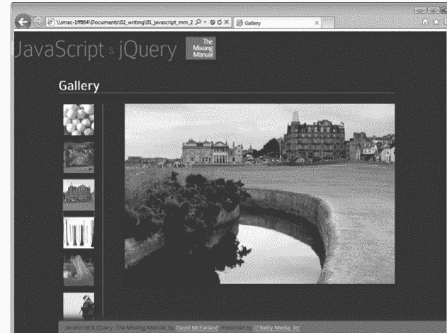

#### 任务概述

图库的工作方式非常简单——点击缩略图即可查看较大的图片。然而，本教程将向你展示如何添加一些功能，通过使用淡入淡出效果在页面中切换较大图片，从而使展示效果更加有趣。

另一个你将在这里使用的重要技术是*无侵入式JavaScript*。这简单意味着，即使禁用了JavaScript的用户仍然能够访问照片的较大版本。为此，每个缩略图图像都被包裹在一个指向较大图像文件的链接中（参见图7-4）。对于没有JavaScript的用户，点击链接会退出当前网页并跟随链接加载较大的图像文件。这看起来不会很美观，因为访客必须离开相册页面，并且只会看到单张较大的图片，但照片至少是可以访问的。对于启用了JavaScript的用户，点击链接会使较大的图片在页面上淡入显示。


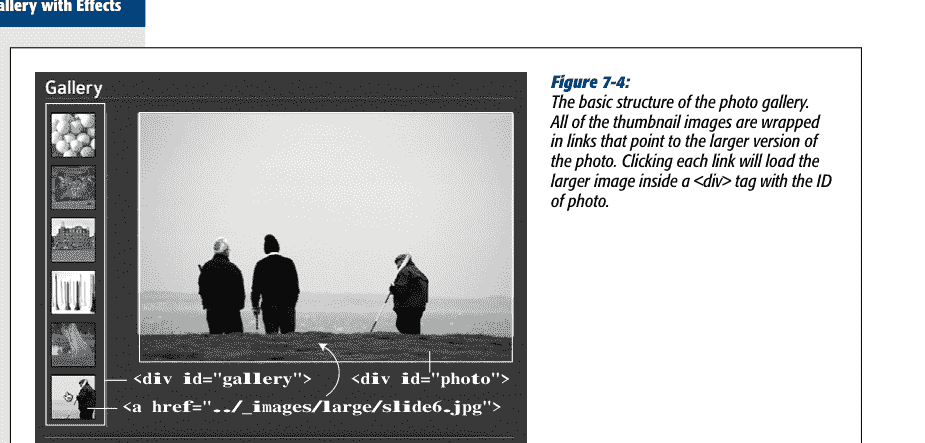

所有的操作都在点击链接时发生，因此本脚本使用链接的 click 事件来实现以下步骤：

- **阻止链接的默认行为。** 通常情况下，点击链接会跳转到另一个页面。在本页面中，点击缩略图周围的链接会退出网页并显示更大的图像。由于你将使用 JavaScript 来显示图像，因此可以添加一些 JavaScript 代码来阻止浏览器跟随该链接。
- **获取链接的 href 值。** 该链接实际上指向更大的图像，因此通过获取链接的 href，你也就获得了更大图像文件的路径。
- **创建一个新的 image 标签以插入页面。** 该图像标签将包含来自 href 值的路径。
- **在旧图像淡出的同时让新图像淡入。** 当前图像淡出视野的同时，点击的缩略图的大版本淡入视野。

本教程包含一些额外的细节，但这四个步骤涵盖了基本流程。

#### 编程部分

本教程在上一个教程的基础上进行扩展，但起始网页做了一些重新组织：有一组新的缩略图，它们现在位于左栏，并且页面中添加了一个 ID 为 *photo* 的 `<div>` 标签（参见图 7-4）。

> *注意：* 有关如何下载教程文件的信息，请参见第 29 页的注释。

### 教程：带有效果的图片库

1. 在文本编辑器中，打开 *chapter07* 文件夹中的 *gallery.html* 文件。

    该文件包含上一个教程的编程代码，外加一个新 `<div>` 标签用于显示每个缩略图图像的大版本。由于显示图库图像的过程是通过点击包裹在缩略图图像周围的链接之一来触发的，因此第一步是选择这些链接并为其添加 click 事件。

2. 找到内容为"insert new programming below this line"的 JavaScript 注释，并添加以下代码：

    ```
    $('#gallery a').click(function(evt) {
        
    }); // end click
    ```

    选择器 *#gallery a* 选择 ID 为 *gallery* 的标签内的所有链接标签。*.click* 是用于添加事件处理程序的 jQuery 函数（如需复习事件，请参见第 162 页）。此外，代码将一个匿名函数传递给 click 事件（如第 173 页所述，作为对事件的响应而执行的函数会自动接收事件对象传递给它们）。在本例中，变量 *evt* 存储该事件对象。你将在下一步中使用它来阻止浏览器跟随被点击的链接。

3. 在第 2 步添加的两行代码之间，输入 *evt.preventDefault();*。

    通常情况下，点击链接会使 Web 浏览器加载链接指向的内容（网页、图像文件、PDF 文档等）。在本例中，链接的作用仅在于让那些未启用 JavaScript 的人能够访问缩略图图像的更大版本。为了阻止启用了 JavaScript 的用户的 Web 浏览器跟随该链接，你需要运行事件对象的 *preventDefault()* 函数（参见第 175 页）。

    接下来，我们将获取链接的 *href* 属性。

4. 按回车键创建一个空白的新行，然后添加下面加粗的代码：

    ```
    $('#gallery a').click(function(evt) {
      evt.preventDefault();
      var imgPath = $(this).attr('href');
    }); // end click
    ```

    这里，*$(this)* 指的是被点击的元素——也就是说，一个链接。链接的 href 属性指向该链接跳转到的页面或资源。在本例中，每个链接都包含指向更大图像的路径。这是一条重要的信息，因为你可以用它来添加指向图像文件的图像标签。但在那之前，你需要获取当前显示在页面上的大图像的引用。毕竟，你需要知道它是什么，才能将其淡出视野。

> 提示：你会看到第 4 步中 *click()* 事件内的每一行代码都进行了缩进。这是可选的，但它有助于提高代码的可读性，如第 49 页的方框中所述。许多程序员使用两个空格（或一个制表符）作为每个缩进级别。

5. 按回车键并输入 `var oldImage = $('#photo img');`。

    变量 `oldImage` 包含一个 jQuery 选择，该选择包含 photo `<div>` 内的 `` 标签（参见图 7-4）。现在是时候为新图像创建标签了。

6. 再次按回车键，并将 `var newImage = $('');` 添加到脚本中。

    这里有很多内容。jQuery 允许你选择页面 HTML 中的元素。例如，`$('img')` 选择页面上的所有图像。此外，jQuery 对象还可以向页面添加*新*元素。例如，`$('<p>Hello</p>')` 创建一个新的段落标签，其中包含单词 Hello。这一行创建一个新的 `` 标签并将其存储在名为 `newImage` 的变量中。

    由于 jQuery 对象需要一个字符串作为参数（例如 `$('<p>Hello</p>')`），这一行代码将几个字符串*连接*或*组合*成一个。第一个字符串（用单引号括起来）是 `"`。合在一起，它们组成一个 HTML 标签：``。当脚本像这样将其传递给 jQuery 对象时，`$('')`，浏览器会创建一个页面元素。它尚未显示在页面上，但浏览器已准备好随时将其添加到页面中。

7. 在第 6–8 行添加下面列出的代码，使您到目前为止添加的代码如下所示：

    ```
    1  $('#gallery a').click(function(evt) {
    2    evt.preventDefault();
    3    var imgPath = $(this).attr('href');
    4    var oldImage = $('#photo img');
    5    var newImage = $('');
    6    newImage.hide();
    7    $('#photo').prepend(newImage);
    8    newImage.fadeIn(1000);
    9  }); // end click
    ```

    在第 6 行中，新创建的图像（存储在变量 `newImage` 中）使用第 187 页描述的 `hide()` 函数隐藏。这一步是必要的，因为如果你直接添加在第 5 行中创建的图像标签，图像会立即显示在页面上——没有很酷的淡入效果。所以你首先隐藏图像，然后将其添加到 photo `<div>` 中（第 7 行）。`prepend()` 函数（在第 139 页描述）在标签内添加 HTML。具体来说，它在标签的最开头添加 HTML。此时，photo `<div>` 内有两个图像——图 7-5 展示了如何让一个图像位于另一个图像之上。顶部的图像是不可见的，但在第 8 行中，`fadeIn()` 函数使图像在 1,000 毫秒（1 秒）内缓慢淡入。

    现在是时候让原始图像淡出了。

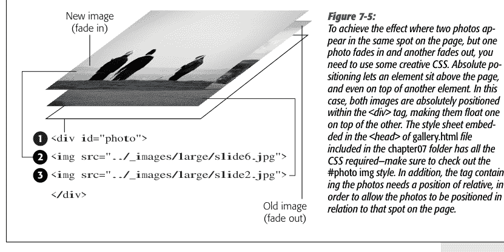

图 7-5：要实现两张照片出现在页面同一位置，但一张照片淡入而另一张淡出的效果，你需要使用一些创造性的 CSS。绝对定位让元素悬浮于页面之上，甚至位于另一个元素之上。在本例中，两张图像都在 `<div>` 标签内绝对定位，使它们一张叠在另一张上面。嵌套在 gallery.html 文件 `<head>` 中的样式表包含了所有必需的 CSS——请务必查看 #photo img 样式。此外，包含照片的标签需要相对定位，以便让照片相对于页面上的该位置进行定位。

8. 按回车键，然后添加以下三行代码：

    ```
    oldImage.fadeOut(1000,function(){
        $(this).remove();
    }); // end fadeout
    ```

    在第 5 步中，你创建了一个名为 *oldImage* 的变量，并将页面上原始图像的引用存储在其中。这是我们要淡出的图像，因此你应用 *fadeOut()* 函数。你向该函数传递两个参数：第一个是效果的持续时间——1,000 毫秒（1 秒）；第二个是回调函数（如第 6 章第 196 页所述）。回调函数在淡出效果完成后运行，并移除该图像的 `` 标签。

> **注意：** *remove()* 函数在第 419 页讨论。它实际上从 DOM 中移除标签，这会从浏览器的内存中擦除 HTML，释放计算机资源。如果你不执行这一步，每次访客点击缩略图时，都会添加一个新的 `` 标签（参见第 7 步），但旧的标签只是被隐藏，而不是被删除。最终你会在网页中嵌入大量隐藏的 `` 标签，从而降低 Web 浏览器的响应速度。

还有最后一步——加载第一张图像。目前，放置照片的 `<div>` 标签是空的。你可以在该位置输入一个 `` 标签，这样页面加载时就会显示一个更大的图像，例如第一张缩略图的图像。但何必麻烦呢——你有 JavaScript！


### 使用 jQuery FancyBox 的高级画廊

展示照片画廊是一项非常常见的任务，你会找到多种不同的方式来展示你的图像。一种非常流行的技术是使网页变暗，并将缩略图的放大版本显示为浮动在浏览器窗口顶部的效果（参见图 7-6）。这种方法最著名的版本是一个名为 Lightbox (*www.huddletogether.com/projects/lightbox2/*) 的 JavaScript 程序。已经有很多对原版的模仿，以及一些作为 jQuery 插件编写的程序。本节将使用功能强大的 FancyBox jQuery 插件 (*http://fancybox.net/*)，它易于使用和定制。只需一行代码，FancyBox 就能创建一种壮观的方式来展示作品集、画廊或幻灯片中的图像。

> **注意：** 在继续之前，你可能需要打开本书教程文件中包含的 *chapter07* 文件夹中的 *complete_fancybox.html* 文件。它有一个 FancyBox 的工作演示。先观察它的运行效果，可能会让本节剩余内容更容易理解。

9. 在 *click()* 函数的末尾（下面第 13 行之后）添加最后一行，这样你完成的代码如下所示：

```
1  $('#gallery a').click(function(evt) {
2    evt.preventDefault();
3    var imgPath = $(this).attr('href');
4    var oldImage = $('#photo img');
5    var newImage = $('');
6    newImage.hide();
7    $('#photo').prepend(newImage);
8    newImage.fadeIn(1000);
9    oldImage.fadeOut(1000,function(){
10     $(this).remove();
11   }); // end fadeout
12 }); // end click
13 $('#gallery a:first').click();
```

这最后一行语句包含两部分。首先是选择器——*#gallery a:first*——它只选择画廊 `<div>` 中的第一个链接。然后是 *click()* 函数。到目前为止，你一直使用 jQuery 的 *click()* 函数来分配一个在事件发生时运行的函数。然而，如果你没有向事件函数传递任何参数，jQuery 只会触发该事件，导致任何先前定义的事件处理程序运行。因此，这一行会触发第一个链接的 *click* 事件，使网页浏览器运行你在第 1–11 行创建的函数。也就是说，它会在页面加载时使第一个缩略图的大图像淡入视图。

保存页面并在 Web 浏览器中预览。当你将鼠标悬停在缩略图上时，它们不仅会变色，点击缩略图还会使其关联的大图像淡入视图。（如果你的代码有问题，文件 *complete_gallery.html* 包含该脚本的可用副本。）

### 使用 jQuery FancyBox 的高级画廊

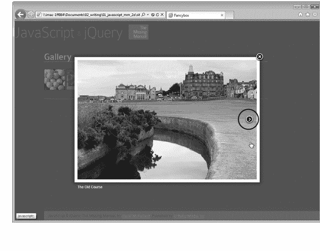

**图 7-6：** 由 Janis Skarnelis 创建的 FancyBox jQuery 插件为你提供了一种简单的方法来创建一个吸引人的单页照片画廊。你甚至可以设置 FancyBox，使访问者可以通过在图像上悬停时出现的“下一个”或“上一个”按钮来浏览一系列照片。此外，你不仅限于照片。你可以使用 FancyBox 弹出 YouTube 视频播放器，或嵌入常规 HTML 内容（甚至来自其他网站的内容）。

### 基础知识

FancyBox 非常易于使用——你只需设置你的网页，添加指向你希望显示的图像的链接，将 .css 和 .js 文件附加到页面，并添加一行代码来调用灯箱。

1. **设置你的画廊页面。**
其实你不需要做太多事情——只需添加指向你希望在页面上显示的大图像的链接。这些可以是添加到缩略图图像的链接，这样当缩略图被点击时，大图像就会出现（这就是你在上一个教程中编写的画廊的工作方式）。需要记住的重要一点是，该链接指向一个图形文件——.png、.jpeg 或 .gif 文件——而不是一个网页。（不过，在第 245 页，你将学习如何使用 FancyBox 来显示非图像内容，如其他网页和 Flash 动画视频）。
此外，你需要一种方法来标识仅画廊链接（与页面上的其他链接区分开来）。一种方法是将链接包装在具有特定 ID 的 `<div>` 标签中——例如 *gallery*。然后你可以使用像 *‘#gallery a’* 这样的选择器来定位这些链接。另一种方法是为每个画廊链接添加特定的类名：例如，`<a href="images/potato.jpg" class="gallery">`。然后你可以使用像 *‘a.gallery’* 这样的选择器来定位这些链接。如果链接分散在页面周围并且没有包含在单个 `<div>` 中，最后一种方法会很方便。

第 7 章：改进你的图像
223

> **提示：** 要为照片添加标题，只需为链接到大图像的 `<a>` 标签提供一个 *title* 属性。例如：
> `<a href="images/potato.jpg" title="一个英俊的土豆">`

#### 2. 下载 FancyBox 文件并将其放入你的网站。

你可以在 *http://fancybox.net* 找到这些文件。它们也作为本书教程文件的一部分提供在 *chapter07* 文件夹中一个名为 *fancybox* 的文件夹里。一个好方法是简单地将 fancybox 文件夹从教程文件夹复制到你自己的网站（根文件夹是一个不错的位置）。你需要少量文件：一个 JavaScript 文件、一个 CSS 文件和几个图形文件：

- JavaScript 文件的名称类似于 *jquery.fancybox-1.3.4.js*，其中 1.3.4 代表版本号。你还会在第 7 章教程文件夹的 fancybox 文件夹中找到一个名为 *jquery.fancybox-1.3.4.min.js* 的缩小（或压缩）版本的文件。你可以将此文件放置在你网站的任何位置，但最好将其与其他文件一起放在 fancybox 文件夹中。
- CSS 文件 *jquery.fancybox-1.3.4.css* 包含用于格式化灯箱效果不同方面的 CSS，例如阴影、下一个、上一个和关闭按钮以及标题的外观。由于此文件引用许多不同的图像文件（*fancybox.png*、*fancy_title_main.png* 等），最好将此 CSS 文件与这些图像放在同一文件夹中（这就是为什么将所有 FancyBox 相关文件保存在一个文件夹中的原因）。
- FancyBox 还需要一堆图形文件：其中一些文件专门用于解决 IE6 错误，而另一些用于添加视觉元素，如阴影、标题的图形框以及导航按钮的图像。你将在第 226 页阅读更多关于不同文件的信息。

#### 3. 将外部样式表附加到你的页面。

jQuery FancyBox 使用一些花哨的 CSS 来实现黑暗、透明的叠加效果并显示弹出图像。像附加任何 CSS 文件一样附加此文件。例如：

```html
<link href="fancybox/jquery.fancybox-1.3.4.css" rel="stylesheet">
```

大多数 JavaScript 程序员会将任何样式表信息放在他们的 JavaScript 编程之前——一些 JavaScript 程序依赖于样式表信息先可用才能正常工作。对于许多 jQuery 插件尤其如此，因此养成将所有样式表放在 JavaScript 文件和程序之前的习惯。

#### 4. 附加 JavaScript 文件。

jQuery FancyBox 的大部分功能来自 jQuery 库（毫不奇怪），因此你必须首先将 jQuery 文件附加到页面（有关此过程的回顾，请参见第 122 页）。此外，FancyBox JavaScript 文件（像任何使用 jQuery 的 JavaScript）必须在 jQuery 文件之后附加。例如：

```html
<script src="js/jquery-1.6.3.min.js"></script>
<script src="fancybox/jquery.fancybox-1.3.4.js"></script>
```

此外，FancyBox 可以使用第 194 页描述的缓动方法来控制大图像缩放进入或退出页面的方式。如果你希望使用除 jQuery 标准 swing 和 linear 之外的任何缓动方法，那么你还必须附加缓动插件。例如：

```html
<script src="js/jquery-1.6.3.min.js"></script>
<script src="js/jquery.easing.1.3.js"></script>
<script src="fancybox/jquery.fancybox-1.3.4.js"></script>
```

#### 5. 添加一个 `<script>` 标签、jQuery ready() 函数并调用 FancyBox。

信不信由你，上面的步骤 1-4 是整个过程中最难的部分。让 FancyBox 工作只需要一行 JavaScript。当然，正如你在第 169 页所读到的，你应该将该代码放在 jQuery ready() 函数内，这样浏览器已经处理了 HTML 并准备好操作 DOM。例如：

```javascript
$(document).ready(function() {
    $('#gallery a').fancybox();
});
```

fancybox() 函数必须仅应用于指向你希望显示的图像文件的链接。你使用 jQuery 选择器（例如 $('#gallery a')）来告诉 FancyBox 使用哪些链接：在此示例中，任何内部具有 ID 为 gallery 的标签的 `<a>` 标签都成为 FancyBox 效果的一部分。如步骤 1 所述，你需要设置你的 HTML，以便你可以使用 jQuery 来标识构成你的灯箱的特定链接。

就是这样。现在，当你点击每个画廊链接时，一个透明背景会出现在页面上，一个大版本的图像会出现在窗口中间。

### 创建图像画廊

通常，当你将 FancyBox 应用于一组链接时，每个缩略图都被视为一个独立、不相关的图像。换句话说，如果你将 FancyBox 应用于一组链接，要查看每个图像的大版本，你的访问者首先必须点击链接以打开大图像，通过点击关闭按钮或（页面上的任意位置）关闭该大图像，然后点击不同的缩略图以查看大图像，如此反复。这种不断打开和关闭图像的行为可能会很烦人且耗时。

更好的方法是将缩略图和链接的集合作为一个统一的画廊来处理。访问者点击缩略图以打开图像的大版本，然后点击大图像上的“下一个”或“上一个”按钮，在画廊中的所有大图像之间来回跳转。图 7-6 中描绘的 FancyBox 示例就是以这种方式工作的；注意“下一个”按钮（已圈出）。


要创建一组相关图片的画廊，只需在 `<a>` 标签中添加 rel 属性，并为画廊中的每张图片分配相同的值。例如：

```
<a href="large_slide1.jpg" rel="gallery">
  
</a>
<a href="large_slide2.jpg" rel="gallery">
  
</a>
<a href="large_slide3.jpg" rel="gallery">
  
</a>
```

使用上述代码后，如果你对这三个链接应用 FancyBox 函数，那么这些较大的图片将被视为同一画廊的一部分，这样你就可以在图片之间来回切换，而无需先关闭大图再点击缩略图。（你将在第 231 页的教程中看到相关示例。）

### 自定义 FancyBox

虽然 FancyBox 效果的整体外观确实很棒，但你可能想对其外观进行一些微调。你可以自定义 FancyBox 外观的多个不同部分，包括关闭 FancyBox 窗口或导航到上一张/下一张图片的按钮；你还可以更改覆盖在页面上的透明背景的颜色和不透明度，或者更改说明框和图片边框的背景颜色。其中一些更改需要向 FancyBox 函数提供不同的选项，而其他更改则需要你直接修改 CSS 文件。

### FancyBox 选项

FancyBox 插件允许你提供自定义选项来影响灯箱效果的外观。基本上，你需要向 FancyBox 函数传递一个 JavaScript 对象字面量（参见第 145 页），其中包含你希望设置的选项名称及其对应的值。例如，要更改覆盖在页面上的背景颜色和不透明度，你可以像这样向 FancyBox 传递包含新设置的对象字面量：

```
$('#gallery a').fancybox({
  overlayOpacity: .5,
  overlayColor: '#F64',
  transitionIn: 'elastic',
  transitionOut: 'elastic',
});
```

在这个示例中，覆盖层的颜色被设置为亮红色（#F64），不透明度被设置为 50%（.5）。此外，进入和退出过渡效果都被设置为弹性效果，这会影响大图在屏幕上的显示方式：在此例中，弹性设置会使点击缩略图时大图以缩放方式进入视野，点击关闭按钮（或页面上的其他任意位置）时大图以缩放方式退出视野（通常大图只是直接出现和消失，没有任何动画效果）。

jQuery FancyBox 接受许多不同的选项（完整的选项列表请访问 *http://fancybox.net/api/*），以下是最实用的选项：

- **overlayColor**。覆盖层的背景颜色，即 FancyBox 显示图片时覆盖在页面上的颜色。此选项接受十六进制颜色值，如 #FF0033。如果你不设置此选项，插件将使用灰色，具体为 #666。设置方式如下：
  `overlayColor : '#ff6346'`

- **overlayOpacity**。覆盖层的不透明度。此选项设置覆盖层下方的页面内容的可见程度。你指定一个 0 到 1 之间的数字：例如 .5 表示 50% 的不透明度。如果你不想透过覆盖层看到下方内容——例如，你希望在图片显示时完全遮盖其余网页——请将此选项设为 1。如果你不设置此选项，FancyBox 会将不透明度设为 30%（.3）。将此值设为 0 可以隐藏覆盖层。
  `overlayOpacity : .5`

- **padding**。图片周围的间距；它在图片周围创建一个可视边框。通常，FancyBox 将内边距设为 10 像素，但你可以更改为任何你想要的值。值为 0 会完全移除弹出照片周围的边框（如何更改图片边框颜色的说明请参见第 231 页）。只需提供一个数字（FancyBox 会将其视为像素值，因此你无需添加在 CSS 中通常需要的 px）：
  `padding: 5`

- **changeSpeed**。当你在使用 FancyBox 的页面中切换图片时，包含图片的框会以动画方式从当前图片的尺寸变换为下一张图片的尺寸。你可以通过设置此选项来控制此过渡的速度。默认值为 300，即 300 毫秒，略低于半秒。例如：
  `changeSpeed : 500`

- **transitionIn** 和 **transitionOut**。这两个选项控制大尺寸弹出图片在屏幕上的出现方式。*fade* 设置使大图以淡入方式出现在屏幕上，这也是 FancyBox 通常使弹出图片出现的方式。*none* 设置使图片突然出现在屏幕上。最后，*elastic* 选项在视觉上最为有趣：它使图片以缩放方式出现在页面上。结合缓动方法（参见下一个选项），你可以创建一些非常动感（也可能令人烦躁）的视觉效果。transitionIn 选项控制大图的出现方式，而 transitionOut 选项控制图片的消失方式。你可以为两者设置不同的值：
  `transitionIn : 'elastic',`
  `transitionOut : 'none'`

- **easingIn** 和 **easingOut**。这两个选项在 transitionIn 和 transitionOut 选项设为 *elastic* 时生效（参见上一条）。它们接受一个缓动方法，例如 jQuery 的 *swing* 或 *linear* 选项，或者如果你已安装了缓动插件（第 194 页），你可以使用该插件支持的任何缓动方法：

```
easingIn : 'easeInBounce',
easingOut : 'easeOutSine'
```

- **titlePosition。** 通常，当你为图片添加说明文字时（参见第 231 页的注意事项），FancyBox 会将说明文字放在一个图形框（菱形图片）内。你可以更改此图形（参见第 229 页），或者只需将 titlePosition 选项设为 *outside*（说明文字出现在包含图片的框的下方）、*inside*（说明文字出现在图片周围的白色框内）或 *over*（说明文字出现在照片底部边缘上方）来不使用该图形。设置方式如下：
  `titlePosition: 'outside'`

- **cyclic。** 通常，当你到达图片画廊中的最后一张图片时，只显示"上一张"按钮；当你位于第一张图片时，只显示"下一张"按钮。当你将 cyclic 属性设为 true——即 cyclic: true——访客在到达画廊最后一张图片时可以点击"下一张"按钮跳转到第一张图片，在查看第一张图片时可以点击"上一张"按钮跳转到最后一张图片。换句话说，此选项让你可以无止境地循环浏览图片。
  `cyclic : true`

以下是如何设置这些选项的示例。假设你正在对一组链接应用 FancyBox 以创建一个可导航的弹出图片画廊。你希望画廊是无限循环的，这样当访客到达最后一张照片时，她可以点击"下一张"按钮跳转回画廊的开头。此外，你还想移除弹出照片周围的所有边框，使它们以缩放方式进入和退出视野，并将说明文字定位在每张照片的底部下方。你可以使用以下代码实现：

```
$('#gallery a').fancybox({
    cyclic : true,
    padding : 0,
    transitionIn : 'elastic',
    transitionOut : 'elastic',
    titlePosition : 'outside'
});
```

### 设置 FancyBox 的样式

FancyBox 使用图形和 CSS 的组合来设置其外观样式。它使用图片来显示关闭按钮、导航按钮以及弹出图片下方的投影阴影，同时使用 CSS 样式来格式化这些控件的位置和大小。在获取大图的过程中还会显示一个动画加载图形。你可以调整这些图形，但首先需要了解 FancyBox 如何组织其图形文件。

首先，对于除 Internet Explorer 6 之外的所有浏览器，主要图形存储在一个单独的文件中：*fancybox.png*（参见图 7-7）。FancyBox 使用一种称为 *CSS 精灵图* 的方法，即将多张图片存储在一个文件中，但通过 CSS 和 background-image 属性在每个实例中仅显示该图片的一部分。例如，要显示关闭按钮，FancyBox 会将 *fancybox.png* 作为背景图片加载到页面上的一个链接中，但将该链接的宽度和高度设为 30 像素，

并使用 `background-position` 属性移动图像，使 *fancybox.png* 文件的右上角仅显示出来。这种方法背后的原理是，只加载单个文件——*fancybox.png*——而不是为每个控件加载单独的文件，你的网站下载速度会更快，对访问者来说响应也更灵敏。（你可以在 *http://css-tricks.com/158-css-sprites/* 上阅读更多关于 CSS 雪碧图技术的内容。）

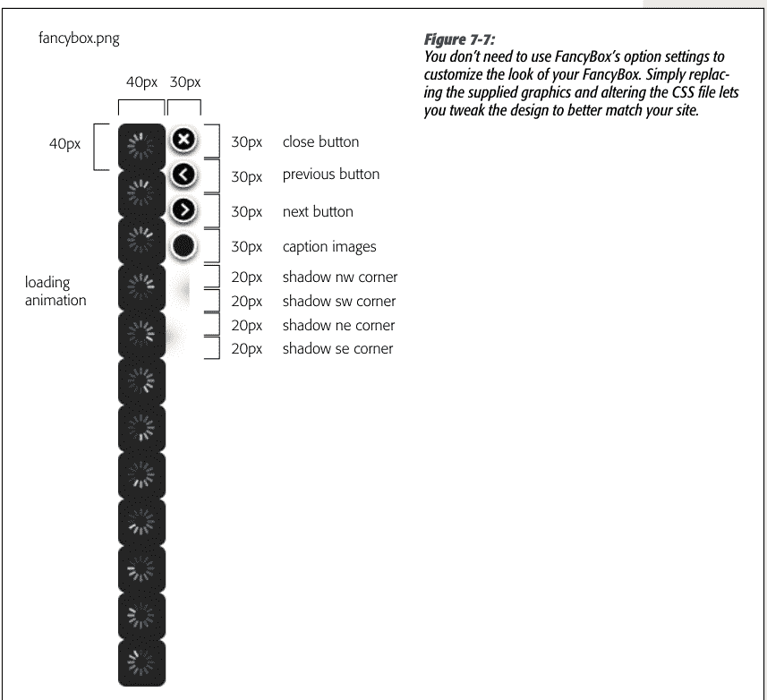

**图 7-1：**
*你不需要使用 FancyBox 的选项设置来自定义 FancyBox 的外观。只需替换提供的图形并修改 CSS 文件，就可以调整设计以更好地匹配你的网站。*

除了图形，FancyBox 还在其外部样式表中包含样式，以格式化其外观的不同元素。以下是最常见元素及其格式化方法的概览：

- **关闭按钮。** FancyBox 使用一个图形关闭按钮，该按钮出现在弹出图像的右上角。该图像为 30 像素 × 30 像素，位于 *fancybox.png* 文件的右上角。有几种方法可以修改它。如果你对 30×30 像素的尺寸不满意，可以简单地编辑 *fancybox.png* 文件：删除该文件右上角的 30×30 图像，并用你自己的设计替换。

### 使用 jQuery FancyBox 的高级画廊

在 FancyBox 样式表中（教程文件中包含的 *jquery.fancybox-1.3.4.css* 文件），你可以编辑 `#fancybox-close` 样式以获得更大的控制权。在此样式中，你可以控制关闭按钮的位置（更改 `top` 和 `right` 设置）、按钮的高度和宽度（更改 `height` 和 `width` 属性），甚至可以通过编辑 `background` 属性指向不同的图形文件。

**IE6 注意事项：** FancyBox 使用特殊的 CSS 样式来克服 Internet Explorer 6 中的 bug。这些样式不引用 *fancybox.png* 文件，而是为每个控件使用不同的图像。IE6 几乎是一个已经废弃的 Web 浏览器，因此你很可能可以忽略它，但如果你仍然担心并想要更改控件图形的外观，那么你需要编辑以下图像文件：*fancy_close.png*（关闭按钮）、*fancy_nav_left.png*（上一个按钮）、*fancy_nav_right.png*（下一个按钮）、*fancy_loading.png*（动画加载图像）、*fancy_title_main.png*（用于标题图形的中间部分）、*fancy_tile_right.png*（用于标题图形的右边缘）和 *fancy_title_left.png*（用于标题图形的左边缘）。或者你可以省去所有这些麻烦，完全忽略 IE6。

- **上一个和下一个按钮。** 与关闭按钮一样，上一个和下一个按钮是 *fancybox.png* 文件中的图像（参见图 7-7）。你可以编辑该文件（确保保持在 30×30 像素边界内）。你也可以通过编辑这两个控件的样式来使用不同尺寸的不同图形文件：一个组选择器（`#fancybox-left-ico`、`#fancybox-right-ico`），它提供了两个控件共有的属性（如 `width` 和 `height`），以及单独的样式（`#fancybox-left-ico` 用于上一个按钮，`#fancybox-right-ico` 用于下一个按钮），它们设置控件的图像。
- **“加载中”图形。** 当访问者点击缩略图以使更大的图像弹出到页面上时，浏览器必须下载该文件。在等待期间，屏幕上会出现一个动画图像，表示图像正在获取中。该图像实际上是 *fancybox.png* 文件中的一系列“帧”（参见图 7-7）。它的 12 帧每帧高 40 像素，宽 40 像素。要更改此图像，你需要编辑 *fancybox.png* 文件并创建你自己的 12 帧动画。控制加载哪个图像及其宽度的 CSS 样式是 `#fancybox-loading` div 样式。但如果你想控制图像的位置、宽度和高度，你还需要编辑 `#fancybox-loading` 样式。这需要做很多工作，而且由于普通的“加载中”图形看起来很棒，你可能想避免更改它。
- **投影。** 弹出图像周围出现的投影由一系列单独的图像文件生成，包括 *fancybox.png* 文件中的几个部分。编辑这些很复杂，最好避免。如果你确实为本列表中讨论的各种控件制作了单独的图形文件，并编辑 CSS 以指向这些文件，请不要删除 *fancybox.png* 文件——它提供了投影的角部。

230 JAVASCRIPT & JQUERY：缺失手册

### 教程：FancyBox 照片画廊

- **弹出图像周围的边框颜色。** 通常，FancyBox 在弹出图像周围显示白色边框。如上一节所述，你可以通过向 FancyBox 函数传递一个 *padding* 值来控制该边框的大小。然而，要控制其颜色，你需要编辑 FancyBox 样式表。找到 `#fancybox-content` 样式，并将其边框颜色从 `#FFF` 更改为任何你偏好的颜色。
- **照片背后的颜色。** 当你创建一个画廊效果，让访问者可以点击上一个和下一个按钮从一张大图像跳转到另一张时，FancyBox 会在一张图像淡出而下一张淡入时显示一种背景颜色。此颜色由 `#fancybox-outer` 样式中的 `background` 属性定义。最好让此值与你为边框颜色（上一个要点）定义的颜色匹配。
- **标题。** 你可以通过编辑各种 CSS 样式来控制标题的颜色、字体和大小。`#fancybox-title` 样式定义标题的字体和字体大小，而 `.fancybox-title-inside`、`.fancybox-title-outside` 和 `.fancybox-title-over` 样式根据其 `titlePosition` 设置（在第 228 页讨论）影响标题的外观。例如，如果你将 "titlePosition" 选项设置为 *inside*，则标题出现在图像的边框内。如果你更改了边框颜色（参见上一个要点），那么你应该更改 `.fancybox-title-inside` 样式上的 `background` 属性以匹配该边框颜色。如果你未设置 `titlePosition` 选项，FancyBox 会使用 *fancybox.png* 文件中的图像生成一个图形标题框。它使用该图像的三个切片（一个用于框的左边缘，另一个用于框的中间部分，第三个用于框的右边缘）。要更改使用的图像，你可以编辑以下样式：`#fancybox-title-float-left`、`#fancybox-title-float-main` 和 `#fancybox-title-float-right`。

> *提示：* FancyBox 允许你通过创建自定义函数以多种不同方式自定义用于显示标题的 HTML。你可以在 http://fancybox.net/blog 了解如何操作并查看更多使用 FancyBox 的技巧和窍门。

### 教程：FancyBox 照片画廊

尽管 FancyBox 非常易于使用，但有一个分步教程来展示如何操作总是很有帮助的。在本教程中，你将获取一个包含一组基本缩略图图像的页面，并将其转变为一个精致的弹出画廊。

> *注意：* 有关如何下载教程文件的信息，请参见第 29 页的注释。

1. 在文本编辑器中，打开 *chapter07* 文件夹中的文件 *fancybox.html*。此文件包含一组简单的缩略图图像。每张图像都链接到该照片的更大版本，所有缩略图都包含在一个 ID 为 *gallery* 的 <div> 标签内。第一步是附加 FancyBox 使用的 CSS 文件。

2. 在文档的 <head> 中，找到 <link> 标签下方的空行，该标签附加了 *site.css* 样式表文件（它是直接位于第一个 <script> 标签上方的空白行）。在该行上，输入：`<link href="fancybox/jquery.fancybox-1.3.4.css" rel="stylesheet">`。*jquery.fancybox-1.3.4.css* 文件包含用于格式化 FancyBox 界面各种元素的所有样式，包括关闭按钮的位置和照片标题文本的外观。接下来，你需要附加插件的 JavaScript 文件。请注意，页面已经附加了 jQuery 和 jQuery easing（第 194 页）文件。

3. 在附加 *jquery.easing-1.3.js* 文件到此页面的 <script> 标签正下方的空白行上，输入：`<script src="fancybox/jquery.fancybox-1.3.4.min.js"></script>`。此 JavaScript 文件存储在 *chapter07* 文件夹内的 *fancybox* 文件夹中。由于 FancyBox 需要一组文件——JavaScript、CSS 和图像——最简单的方法是将它们全部保存在一个地方。这样，你只需将本教程中的 *fancybox* 文件夹复制到你自己的站点即可使用 FancyBox。此页面已经有一个 <script> 标签，其中包含 jQuery 的 *ready()* 函数和你在本章第一个教程中创建的预加载/悬停效果。你只需添加 *fancybox()* 函数即可。

4. 点击 *$(document).ready(function() {* 正下方的空白行，并输入：`$('#gallery a').fancybox();`。所有指向更大图像的链接都包含在 ID 为 *gallery* 的 <div> 标签内，因此 *$('#gallery a')* 会选中它们，而 *.fancybox()* 函数会将 FancyBox 效果应用于页面。信不信由你，你完成了！保存页面并在 Web 浏览器中预览。点击一张缩略图图像以查看神奇的效果。现在你可以理解为什么插件如此有用——你实际上不需要做任何编程就能获得一些奇妙的效果！点击关闭按钮或页面上的任何其他位置，大图像就会消失。点击另一张缩略图以查看另一张更大的图像。这种设置的一个问题是每个缩略图彼此独立。换句话说，为了查看另一张弹出图像，你需要先关闭当前的弹出窗口，然后点击缩略图。如果一旦出现一张弹出图像，你就可以直接从一张大照片导航到另一张，那会更好。对 HTML 的一个简单更改就可以做到这一点。

5. 在 gallery <div> 内找到第一个链接——<a href="../_images/large/slide1.jpg">——并添加 rel="gallery"，使 HTML 看起来像这样：


### 改善导航体验

链接让网络世界得以运转。如果没有从页面到页面、从站点到站点的即时信息访问，网络不会有太大发展。事实上，它根本算不上一张*网络*。既然链接是最常见且最强大的 HTML 元素之一，那么自然有大量的 JavaScript 技术可以用来增强链接的功能。在本章中，你将学习使用 JavaScript 控制链接的基础知识，以及如何在新窗口和页面内嵌窗口中打开链接。

#### 链接基础知识

你无疑已经对链接了解很多了。毕竟，它们是网络的核心，而不起眼的 `<a>` 标签是网页设计师最早学习的 HTML 元素之一。为页面添加 JavaScript 可以将一个基本链接变成一个功能强大的交互入口……但前提是你知道如何使用 JavaScript 来控制链接。一旦掌握了基础知识，本章后续部分将为你介绍使用 JavaScript 控制链接的实用技巧。

#### 使用 JavaScript 选择链接

要对网页上的链接进行任何操作，首先必须选中它。你可以选择页面上的所有链接，只选择一个，或者选择一组特定的相关链接——例如，在页面同一区域中组合在一起的链接，或者具有某种共同特征的链接，比如指向其他网站的外部链接。

jQuery 在选择文档元素方面给你提供了极大的灵活性。例如，代码 `$('a')` 会创建一个包含页面上所有链接的 jQuery 选择集。此外，jQuery 还允许你细化选择，这样你就可以快速选择页面特定区域内的所有链接。例如，你可以选择包含在 ID 为 mainNav 的无序列表中的所有链接，如下所示：`$('#mainNav a')`。同样，你可以使用属性选择器（第 133 页）选择 HREF 值（即链接指向文件的路径）匹配特定模式的链接，例如指向其他站点的链接或指向 PDF 文件的链接（参见第 238 页的"在新窗口中打开外部链接"获取示例）。

一旦使用 jQuery 选中了这些链接，你就可以使用 jQuery 函数来处理这些链接。例如，你可以使用 *each()* 函数（第 147 页）遍历每个链接，使用 addClass() 函数（第 142 页）为这些链接应用一个类，或者为它们添加事件函数（第 162 页）。你将在本章后续部分看到更多关于如何操作链接的示例。

#### 确定链接的目标地址

选中一个或多个链接后，你可能想知道它们指向哪里。例如，在你在第 222 页制作的幻灯片中，每个链接都指向一张较大的图片；通过获取路径，你使用 JavaScript 来显示那张较大的图片。换句话说，你提取了链接的 *href* 值，并使用该路径在页面上创建了一个新的 `` 标签。同样，你可以获取指向另一个网页的 *href* 值，当点击链接时不跳转到该页面，而是在当前页面上方显示新的网页。（参见第 245 页了解如何实现。）

在每种情况下，你都需要访问 *href* 属性，使用 jQuery 的 *attr()* 函数（第 146 页）可以轻松完成。例如，假设你为指向网站主页的链接设置了一个 ID。你可以这样获取该链接的路径：

```
var homePath = $('#homeLink').attr('href');
```

你会发现这些信息在很多情况下都很有用。例如，假设你想在链接文本旁边添加指向站外链接的完整 URL。换句话说，假设你有一个链接文本为"了解更多关于树皮甲虫的信息"，指向 http://www.barkbeetles.org/。现在你想把页面上的文本改为"了解更多关于树皮甲虫的信息 (www.barkbeetles.org)"（这样人们打印页面时就会知道该链接指向哪里）。

你可以用以下 JavaScript 轻松实现：

```
$('a[href^="http://"]').each(function() {
    var href = $(this).attr('href');
    href = href.replace('http://', '');
    $(this).after(' (' + href + ')');
});
```

> **注意：** 左侧的行号不是代码的一部分，所以不要输入它们。它们只是用于逐行查看代码。

你提供给 rel 属性的实际值——本例中是 *gallery*——并不重要。重要的是，你希望包含在该组中的每张图片的值必须相同。

6.  将 *rel="gallery"* 添加到 gallery div 中剩余的 5 个链接。保存并预览页面。

现在，点击一个缩略图后，你可以将鼠标悬停在弹出图片的右侧查看"下一张"按钮。点击该按钮将跳转到该组中的下一张图片。将鼠标悬停在左侧可以查看"上一张"按钮。

缺少的是每张图片的说明文字。要添加说明文字，你不需要任何 JavaScript，只需在每个 `<a>` 标签上添加一个 HTML *title* 属性即可。

7.  再次找到第一个链接——<a href="../_images/large/slide1.jpg" rel="gallery">——并在标签中添加 *title="Lotsa golf balls"*，使其如下所示：
<a href="../_images/large/slide1.jpg" rel="gallery" title="Lotsa golf balls">
保存文件并在网页浏览器中预览。点击左侧第一个缩略图——瞧，说明文字出现了。为该 `<div>` 中的其他 `<a>` 标签添加 title 属性。接下来，你将调整 FancyBox 的一些默认设置来自定义其外观。

8.  修改你在步骤 4 中添加的代码，在 *fancybox()* 函数的括号中添加一个对象字面量。新代码在下方以粗体显示：
$('#gallery a').fancybox({
    **overlayColor : '#060',**
    overlayOpacity : .3
});

此代码向 *fancybox()* 函数传递了一个对象字面量（第 145 页）。对象字面量由属性名、冒号和值组成。因此 overlayColor 是 FancyBox 的一个选项名称（参见第 227 页），你将其值设置为 '#060'。这个特定选项更改了页面和弹出图片之间出现的背景颜色。overlayOpacity 设置控制遮罩层的透明度；在本例中，.3 表示 30% 的不透明度。

> **注意：** 对象字面量看起来有些奇怪，而且有一些特殊的规则。确保在每对属性/值之后添加逗号，但最后一对除外。例如，上方 overlayOpacity : .3 的最后一行末尾不能有逗号。但是，如果你添加更多选项（你将在步骤 10 中这样做），则必须添加逗号。你可以在第 145 页找到更多关于对象字面量的信息。

9.  保存页面并在网页浏览器中预览。
现在，当你点击缩略图时，页面上方会出现一层淡绿色的遮罩。接下来，你将调整弹出图片出现在屏幕上的方式。

10. 再次修改代码，添加一些额外的选项。新代码在下方以粗体显示：
$('#gallery a').fancybox({
    overlayColor : '#060',
    overlayOpacity : .3,
    transitionIn: 'elastic',
    transitionOut: 'elastic',
    easingIn: 'easeInSine',
    easingOut: 'easeOutSine',
    titlePosition: 'outside' ,
    cyclic: true
});

不要忘记在 *overlayOpacity* : .3 末尾添加逗号。当你将 transitionIn 和 transitionOut 属性设置为 *elastic* 时，点击缩略图弹出图片会以缩放方式出现在页面上，关闭弹出图片时则以缩放方式消失。easingIn 和 easingOut 选项使用 jQuery 缓动插件（第 194 页）来控制弹性过渡动画的效果。最后，cyclic 选项使访问者在到达该组的最后一张弹出图片后，可以点击"下一张"按钮循环回到该组的第一张图片。

11. **保存页面并在网页浏览器中预览。**
谁说 JavaScript 很难？文件 *complete_fancybox.html* 是本教程的完整可用版本。

FancyBox 是一个有趣且实用的插件。正如你将在下一章中看到的，它不仅限于显示图片。你还可以用它在页面的弹出窗口中显示 HTML、视频或完整的网页。


### 不要跟随该链接

当你为链接添加点击事件时，可能不希望浏览器按照其常规行为退出当前页面并加载链接目标。例如，在第216页的图库中，当你点击缩略图上的链接时，页面会加载一张更大的图片。通常，点击该链接会退出页面，并在空白页面上单独显示更大的图片。然而，在这种情况下，你不会跟随链接前往图片，而是留在同一页面上，在那里加载更大的图片。

有几种方法可以阻止链接执行其默认行为——你可以返回一个*false*值或使用jQuery的*preventDefault()*函数（第175页）。例如，假设你有一个将访客带到登录页面的链接。为了让你的网站感觉响应更迅速，你希望在访客点击该链接时使用JavaScript显示一个登录表单。换句话说，如果访客的浏览器开启了JavaScript，当他点击该链接时，表单将出现在页面上；如果浏览器关闭了JavaScript，点击该链接将带访客前往登录页面。

实现这一目标有几个步骤：

1. **选择登录链接。**

   如果你需要思路，请参阅本节前一部分的内容。

2. **附加点击事件。**

   你可以使用jQuery的*click()*函数来实现。*click()*函数将另一个函数作为参数。该函数包含用户点击链接时发生的步骤。在本例中，只需两个步骤。

3. **显示登录表单。**

   登录表单可能在页面加载时隐藏——也许是链接正下方绝对定位的`<div>`标签。你可以使用*show()*函数或jQuery的其他显示效果来显示表单（参见第189页）。

4. **阻止链接！**

   这一步是最重要的。如果你不阻止链接，浏览器将直接离开当前页面并前往登录网页。

以下是使用"return false"方法阻止链接的方式。假设链接的ID为*showForm*，包含登录表单的隐藏`<div>`标签的ID为*loginForm*：

```
$('#showForm').click(function() {
  $('#loginForm').fadeIn('slow');
  return false;
});
```

第1行同时完成了上述步骤1和2；第3行显示隐藏的表单。第2行是告诉浏览器"停！不要跟随该链接"的部分。你必须将*return false;*语句作为函数的最后一行，因为一旦JavaScript解释器遇到return语句，它就会退出函数。

你也可以使用jQuery的*preventDefault()*函数，如下所示：

```
$('#showForm').click(function(evt) {
  $('#loginForm').fadeIn('slow');
  evt.preventDefault();
});
```

此脚本的基本细节与前一个相同。主要区别在于，分配给点击事件的函数现在接受一个参数——*evt*——它代表事件本身（事件对象在第173页有描述）。该事件有自己的一组函数和属性——*preventDefault()*函数只是阻止任何与该事件关联的默认行为：对于点击链接而言，那就是加载新的网页。

第1行选择所有外部链接（第146页），然后运行*each()*函数（第147页），它只是将函数应用于每个链接（换句话说，它"循环"遍历链接列表）。在本例中，第2-4行构成函数体。第2行检索链接的*href*（例如，*http://www.barkbeetles.org*）。第3行是可选的——它通过删除*http://*来简化URL以便显示，因此*href*变量现在保存类似*www.barkbeetles.org*的内容（你可以在第443页了解JavaScript的*replace()*方法）。最后，第4行将变量*href*的内容（用括号括起来）添加到链接之后：(*www.barkbeetles.org*)，第5行关闭函数。

你可以更进一步，在页面底部创建一个参考书目，列出文章中提到的所有链接。不是将每个网址添加在每个链接之后，而是将每个网址列在页面底部单独的div中。

### 在新窗口中打开外部链接

对于任何依赖读者的网站来说，流失访客是最大的担忧之一。依靠广告收入获利的在线杂志不想在能帮上忙的情况下将人们送走；电子商务网站不想因为让购物者点击离开网站的链接而失去潜在客户；而在展示已完成网站作品集时，网页设计师可能不想让潜在客户离开她的网站去查看设计师的某个已完成项目。

许多网站通过每当点击指向其他网站的链接时打开一个新窗口来应对这些担忧。这样，当访客看完其他网站并关闭其窗口时，原始网站仍然存在。HTML长期以来就提供了一种使用链接的*target*属性的方法——如果你将该属性设置为*_blank*，浏览器就知道要在新窗口中打开该链接（或者，对于使用标签页的浏览器，在新标签页中打开链接）。

> **注意：** 关于打开新窗口的策略是好是坏，网页可用性专家之间存在相当多的争论。例如，参见www.useit.com/alertbox/990530.html。

手动为每个指向外部网站的链接添加*target="_blank"*既耗时又容易忘记。幸运的是，使用JavaScript和jQuery，有一种快速简单的方法可以强制浏览器在新窗口或浏览器标签页中打开外部链接（或任何你想要的链接）。基本过程很简单：

1. **确定你想在新窗口中打开的链接。**

   在本章中，你将使用jQuery选择器（第129页）来识别这些链接。

2. **向链接添加值为_blank的*target*属性。**

   你可能会想，"嘿，那是无效的HTML。我不能那样做。"嗯，首先，它只对严格版本的HTML 4.01和XHTML 1.0无效，所以对于任何其他文档类型来说都是没问题的，包括新的HTML5文档类型。其次，你的页面仍然会通过验证，因为HTML验证器（例如，*http://validator.w3.org/*）只分析网页文件中的实际HTML代码，而不是JavaScript添加的任何HTML。而且，最后，每个浏览器都理解*target*属性，所以你知道该链接会在新窗口中打开，无论严格文档类型的标准如何。

在jQuery中，你可以用一行代码完成上述两个步骤：

```javascript
$('a[href^="http://"]').attr('target','_blank');
```

jQuery选择器——$('a[href^="http://"]')——使用属性选择器（第133页）来识别以*http://*开头的`<a>`标签（例如，*http://www.yahoo.com*）。该选择器识别所有这些类型的链接，然后使用jQuery的*attr()*函数（第146页）为每个链接设置*target*属性为*_blank*。就是这样！

如果你使用绝对路径来指定自己网站上文件的链接，你需要再增加一个步骤。例如，如果你网站的地址是*www.your_site.com*，并且你像这样链接到自己网站上的其他页面或文件：*http://www.your_site.com/a_page.html*，那么前面的代码也会强制这些链接在新窗口中打开。如果你不想为网站的每个页面都打开新窗口（你可怜的访客），你需要类似以下的代码：

```javascript
var myURL = location.protocol + '//' + location.hostname;
$('a[href^="http://"]').not('[href^="'+myURL+'"]').attr('target','_blank');
```

这段代码首先指定你网站的URL并将其赋值给变量——*myURL*。你网站的URL是通过浏览器窗口对象的一点点帮助来实现的。浏览器知道访问URL所使用的协议——*http:*，或者对于安全站点，*https:*——它存储在location对象的*protocol*属性中。同样，网站名称——例如，*www.sawmac.com*——存储在*hostname*属性中。因此JavaScript的*location.protocol + '//' + location.hostname*生成一个看起来像*http://www.sawmac.com*的字符串。当然，在这种情况下，hostname会根据这段JavaScript代码所在页面的不同而变化。例如，如果你将这段代码放在来自*http://www.your_site.com*的页面上，那么当有人从该网站查看页面时，*location.hostname*将是*www.your_site.com*。


第二行代码以一个 jQuery 选择器开头，它会检索所有以 *http://* 开头的链接。接着，*not()* 函数会移除任何以你的 URL 开头的链接——在本例中，即指向 *http://www.sawmac.com* 的链接。（*not()* 函数是从 jQuery 选择中排除某些元素的一种实用方法——要了解它，请访问 *http://api.jquery.com/not/*/。）

因此，要在页面上实际使用这段代码，你只需链接到 jQuery 文件，添加 *$(document).ready()* 函数（第 169 页），然后将前面的代码插入其中，如下所示：

```
<script src="js/jquery-1.6.3.min.js"></script>
<script>
$(document).ready(function() {
  var myURL = location.protocol + '//' + location.hostname;
  $('a[href^="http://"]').not('[href^="'+myURL+'"]').attr('target','_blank');
});
</script>
```

另一种方法是创建一个外部 JavaScript 文件（参见第 27 页）；在该文件中创建一个函数，用于运行使外部链接在新窗口中打开的代码；将该文件附加到页面；然后在该页面上调用该函数。

例如，你可以创建一个名为 *open_external.js* 的文件，其中包含以下代码：

```
function openExt() {
  var myURL = location.protocol + '//' + location.hostname;
  $('a[href^="http://"]').not('[href^="'+myURL+'"]').attr('target','_blank');
}
```

然后在你要应用此功能的网站每个页面上添加以下代码：

```
<script src="js/jquery-1.6.3.min.js"></script>
<script src="js/open_external.js"></script>
<script>
$(document).ready(function() {
  openExt();
  // add any other JavaScript code to the page
});
</script>
```

使用外部文件的好处是，如果你在网站的数百个页面上都使用了这个函数，你可以轻松更新脚本，使其更加完善——例如，你稍后可以修改 *openExt()* 函数，使外部页面在当前页面的框架中打开（参见第 245 页了解如何操作）。换句话说，外部 *.js* 文件使你能够更轻松地在整个网站上保持脚本的一致性。

### 创建新窗口

Web 浏览器允许你打开新窗口并自定义其中的许多属性，例如宽度和高度、屏幕上的位置，甚至可以设置是否显示滚动条、菜单或位置（地址）栏。基本技术使用 *open()* 方法，其基本结构如下：

```
open(URL, name, properties)
```

*open()* 方法接受三个参数。第一个是你要在新打开的窗口中显示的页面的 URL——与你用作链接的 *href* 属性的值相同（例如 *http://www.google.com*、*/pages/map.html* 或 *.../portfolio.html*）。第二个参数是窗口的名称，你可以使用任何你喜欢的名称；遵循第 46 页所述的变量命名规则。最后，你可以传递一个包含新窗口设置（例如其高度和宽度）的字符串。

此外，在打开新窗口时，通常会创建一个变量来存储对该窗口的引用。例如，如果你想在一个 200 像素见方的新窗口中打开 Google 主页，可以编写如下代码：

```
var newWin = open('http://www.google.com/',
  'theWin', 'height=200,width=200');
```

**注意：** 代码行末尾的符号表示下一行实际上应该作为第一行的一部分输入。但由于一段*非常*长的 JavaScript 代码无法排入本书的页面，所以将其拆分为两行。

这段代码打开一个新窗口，并将对该窗口的引用存储在变量 *newWin* 中。下一页的"使用窗口引用"部分描述了如何使用此引用来控制新打开的窗口。

**注意：** 你为窗口提供的名称（此例中为 '*theWin*'）并没有太大作用。但是，一旦你提供了名称，如果你尝试使用相同的名称打开另一个窗口，就不会得到新窗口。相反，你通过 *open()* 方法请求的网页只会在之前创建的同名窗口中加载。

### 窗口属性

浏览器窗口有许多不同的组成部分：滚动条、调整大小手柄、工具栏等（见图 8-1）。此外，窗口还有宽度和高度以及在屏幕上的位置。你可以在创建新窗口时设置其中大部分属性，方法是创建一个包含逗号分隔的每个属性及其设置的字符串，作为 *open()* 方法的第三个参数。例如，要设置新窗口的宽度和高度并确保显示位置栏，可以这样写：

```
var winProps = 'width=400,height=300,location=yes';
var newWin = open('about.html','aWin',winProps);
```

你使用像素值来设置控制窗口大小或位置的属性，而其他属性则接受 *yes* 值（打开该属性）或 *no* 值（关闭该属性）。对于任何 yes/no 属性（如 toolbar 或 location），如果你不指定属性值，Web 浏览器会关闭该属性（例如，如果你不设 location 属性，Web 浏览器会隐藏通常出现在窗口顶部的位置字段）。只有 *height*、*width*、*left*、*top* 和 *toolbar* 在各个浏览器中都能一致工作。如下文列表所示，某些浏览器会完全忽略其中一些属性，因此如果你使用 JavaScript 创建弹出窗口，请务必在你能使用的每个浏览器上进行测试。

- **height** 指定窗口的高度，以像素为单位。你不能指定百分比值或像素以外的任何其他度量单位。如果未指定高度，Web 浏览器将匹配当前窗口的高度。
- **width** 指定窗口的宽度。与高度一样，你只能使用像素，如果省略此属性，Web 浏览器将匹配当前窗口的宽度。
- **left** 是从显示器左边缘开始的位置，以像素为单位。
- **top** 是从显示器顶部边缘开始的位置，以像素为单位。
- **scrollbars** 当页面大于窗口本身时，会出现在浏览器窗口的右侧和底部边缘。要完全隐藏滚动条，将此属性设置为 *no*。你无法控制隐藏哪个滚动条（要么两个都隐藏，要么都不隐藏），而且某些浏览器（如 Chrome 和 Safari）不允许你隐藏滚动条。
- **status** 控制窗口底部状态栏的显示。Firefox 和 Internet Explorer 通常不允许你隐藏状态栏，因此在这些浏览器中状态栏始终可见。
- **toolbar** 设置包含导航按钮、书签按钮以及特定浏览器可用其他控件的工具栏的可见性。在 Safari 上，toolbar 和 location 设置是相同的：打开其中任何一个都会同时显示工具栏按钮和位置字段。
- **location** 指定位置字段是否可见。这也称为地址栏，此字段显示页面的 URL，并允许访问者通过输入新的 URL 前往另一个页面。Opera、Internet Explorer 和 Firefox 不允许你完全隐藏页面的位置。此功能旨在阻止 JavaScript 的恶意使用，例如打开新窗口并将你发送到另一个看起来像是你刚刚离开的网站的页面。此外，Safari 在打开此属性时也会显示工具栏以及位置字段。
- **menubar** 适用于窗口顶部有菜单的浏览器（例如，大多数程序中常见的"文件"和"编辑"菜单）。此设置仅适用于 Windows 浏览器——Mac 的菜单在屏幕顶部，而非单个窗口。而且它不适用于 IE 7 及更高版本，这些版本通常不显示菜单栏。

**注意：** 要查看使用 *window.open()* 方法的 JavaScript 编程的惊人示例，请访问 http://experiments.instrum3nt.com/markmahoney/ball/ 和 http://thewildernessdowntown.com/。

### 使用窗口引用

一旦打开新窗口，你就可以使用该窗口的引用来控制它。例如，假设你用以下代码打开一个新窗口：

```
var newWin = open('products.html','theWin','width=300,height=300');
```

在这种情况下，变量 *newWin* 持有对新窗口的引用。然后你可以对该变量应用浏览器的任何窗口方法来控制该窗口。例如，如果你想关闭该窗口，可以使用 *close()* 方法，如下所示：

```
newWin.close();
```

浏览器支持窗口对象的许多不同方法，但以下是一些最常用于控制窗口本身的方法：

- **close()** 关闭指定的窗口。例如，命令 *close()* 关闭当前窗口。但你也可以将此方法应用于窗口引用：例如 *newWin.close()*。你可以使用任何事件来触发此关闭，例如点击写着"关闭此窗口"的按钮。

**注意：** 如果你单独使用这些命令中的任何一个，它适用于运行脚本的窗口。例如，在脚本中添加语句 *close();* 会关闭脚本所在的窗口。但是，如果你已经打开了一个窗口并且拥有对该窗口的引用（例如，你创建窗口时创建的变量，如 *newWin*），那么你就可以从最初创建该窗口的页面使用该引用关闭该窗口，如下所示：*newWin.close()*。


### 创建新窗口

- *blur()* 强制窗口"失去焦点"。也就是说，该窗口会移到所有已打开窗口的后面。这是一种隐藏已打开窗口的方法，网络广告商利用它来创建"弹出式底层"广告——即在当前所有窗口下方打开的窗口，这样当访客关闭所有窗口时，就会看到一个烦人的广告在等着他。
- *focus()* 是 *blur()* 的相反操作，强制窗口移到其他窗口堆栈的顶部。
- *moveBy()* 可以将窗口向右和向下移动指定的像素数。你需要向该方法提供两个参数——第一个参数指定向右移动的像素数，第二个参数指定向下移动的像素数。例如，*newWin.moveBy(200,300);* 会将 *newWin* 变量所引用的窗口向右移动 200 像素，向下移动 300 像素。
- *moveTo()* 将窗口移动到显示器上由 left 和 top 值指定的特定位置。此命令与在打开新窗口时设置 *left* 和 *top* 属性（第 242 页）相同。例如，要将窗口移动到显示器的左上角，可以运行以下代码：*moveTo(0,0);*。

注意：要查看这些方法的实际运行效果，请访问 All Is Not Lost 网站：[http://www.allisnotlost.st/](http://www.allisnotlost.st/)。

- *resizeBy()* 更改窗口的宽度和高度。它接受两个参数：第一个参数指定窗口要增加多少像素宽度；第二个参数指定窗口要增加多少像素高度。例如，*resizeBy(100,200);* 会使当前窗口增高 100 像素，增宽 200 像素。你可以使用负数来使窗口变小。
- *resizeTo()* 将窗口尺寸更改为指定的宽度和高度。例如，*resizeTo(200,400);* 会将当前窗口更改为宽 200 像素、高 400 像素。
- *scrollBy()* 将窗口内的文档向右和向下滚动指定的像素数。例如，*scrollBy(100,200);* 会将当前文档向下滚动 200 像素，向右滚动 100 像素。如果文档无法滚动（换句话说，文档在没有滚动条的情况下就能适应窗口，或者文档已经滚动到底部），则此函数不会产生任何效果。
- *scrollTo()* 将窗口内的文档滚动到距页面顶部和左侧指定像素位置的特定位置。例如，*scrollTo(100,200);* 会将当前文档从顶部向下滚动 200 像素，从左边缘向右滚动 100 像素。如果文档无法滚动（换句话说，文档在没有滚动条的情况下就能适应窗口，或者文档已经滚动到底部），则此函数不会产生任何效果。

> *提示：* jQuery ScrollTo 插件提供了一种使用 JavaScript 控制文档滚动的简单方法。你可以在 *http://plug-ins.jquery.com/project/ScrollTo* 了解更多关于此插件的信息。

### 可以打开新窗口的事件

在互联网短暂的历史中，弹出窗口已经声名狼藉。不幸的是，许多网站滥用了 *open()* 方法，强制向毫无防备的访客弹出不想要的广告。如今，大多数浏览器都具有弹出窗口拦截功能，可以阻止不受欢迎的弹出窗口，因此即使你可以添加 JavaScript 代码来让页面在加载时或访客关闭窗口时打开新窗口，大多数浏览器也不会让它发生。访客要么会看到一条消息，告知浏览器阻止了新窗口的打开，要么可能完全没有任何迹象表明弹出窗口已被拦截。

事实上，许多浏览器不允许你通过大多数事件（如 mouseover、mouseout 或 keypress）来打开浏览器窗口。使用 JavaScript 打开窗口唯一可靠的方式是在用户点击链接或提交表单时触发操作。为此，你可以为任何 HTML 元素（不一定是链接）添加点击事件，然后打开一个新窗口。例如，假设你希望页面上的某些链接在一个 300 像素见方、带有滚动条、可调整大小、但没有任何其他浏览器外观（如工具栏）的新窗口中打开。你可以为每个这样的特殊链接添加一个类名——例如 *popup*——然后在页面中添加以下 jQuery 代码：

```javascript
$('.popup').click(function() {
    var winProps='height=300,width=300,resizable=yes,scrollbars=yes';
    var newWin=open($(this).attr('href'),'aWin',winProps);
}
```

### 在页面内窗口中打开页面

打开新窗口可能会带来问题。不仅许多浏览器会尝试拦截弹出窗口，而且像许多设计师一样，你可能也不喜欢无法真正控制浏览器窗口外观这一事实。如果你只想用一种简洁、简单的方式显示新的网页，而不离开当前页面呢？当然使用 JavaScript！你可以通过使用 JavaScript 动态地向页面添加 *iframe*，并在该 iframe 中显示另一个网页，从而创建一种"页面内窗口"效果。最终效果看起来就像是链接的页面漂浮在当前页面上方（参见图 8-2）。

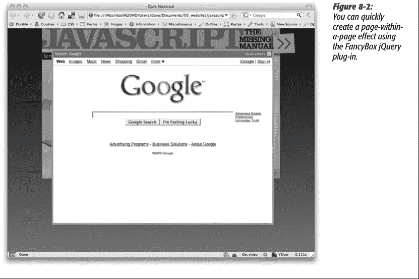

\<iframe\>（inline frame 的缩写）类似于传统的 HTML 框架，但你可以在页面 HTML 的任何位置插入 iframe。通过设置 iframe 的尺寸并指定 src 属性（一个网页地址），你可以加载另一个网页，使其看起来像是当前页面的一部分。为了简化这个过程，你可以使用一个 jQuery 插件来处理所有繁重的工作，这样你就可以专注于设计。

事实上，你已经在上一章中使用过一个可以实现此功能的插件——FancyBox。在上一章中，你使用 FancyBox 创建了一个图片画廊，你还可以利用其弹出窗口的强大功能来显示来自你的网站或网络上任何其他网站的整个网页。

> 注意：你可以在 http://www.w3schools.com/tags/tag_iframe.asp 了解更多关于 iframe 的信息。\<iframe\> 标签对于 HTML 4.01 Strict 或 XHTML 1.0 Strict 来说不是有效的 HTML。然而，Greybox 插件使用 JavaScript 来添加 \<iframe\> 标签，因此你的实际 HTML 代码仍然能够通过验证。此外，由于 HTML 5 支持 \<iframe\> 标签，所有主流浏览器在未来都将继续支持它。

使用 FancyBox 在页面内显示链接与第 222 页所述的将该插件用于图片画廊几乎完全相同。简而言之，步骤如下：

**1. 从 <http://fancybox.net> 下载 FancyBox 文件。** 关于需要哪些文件的更多信息，请参见第 224 页的步骤 2。

**2. 将 FancyBox CSS 文件附加到你的网页。** FancyBox 使用了一些，呃，花哨的 CSS 来实现其页面内页面的外观效果，没有它就无法正确显示或工作。

**3. 附加 JavaScript 文件。** 当然，FancyBox 需要 jQuery 以及其自身的外部 JavaScript 文件，因此你需要将它们添加到你的页面中；例如：

```html
<script src="js/jquery-1.6.3.min.js"></script>
<script src="fancybox/jquery.fancybox-1.3.4.js"></script>
```

如第 227 页所述，如果你想在屏幕上打开和关闭网页时添加更有趣的效果，你可能还需要使用 jQuery 缓动插件。

**4. 为任何你希望在页面弹出窗口中打开的链接添加 *class="iframe"*。** 因为 FancyBox 需要在 `<iframe>` 标签内打开外部网页（这是简单图片画廊不需要的），所以你需要标识需要 iframe 的链接。最简单的方法就是直接为每个链接添加 *class="iframe"*，如下所示：

```html
<a href="http://www.google.com" class="iframe">Google</a>
```

**5. 添加 `<script>` 标签、jQuery ready() 函数，并调用 FancyBox。**

```javascript
<script>
$(document).ready(function() {
  $('.iframe').fancybox();
}); // end ready
</script>
```

正如你在上一章中所读到的，FancyBox 的使用非常简单：只需要一行代码即可。在这种情况下，你可以使用 jQuery 选择器 `$('.iframe')`，因为类名 *iframe* 已被应用到每个链接上。

**6. 插入一个对象字面量，包含你想要的弹出窗口宽度和高度。** FancyBox 接受许多不同的设置。正如你在第 227 页所读到的，你可以通过向 *fancybox()* 函数传递对象字面量来控制效果运行的速度、页面遮罩的不透明度等。对于图片，弹出窗口的高度和宽度通常由图片大小决定。对于链接页面，没有固定的尺寸，因此你需要同时提供宽度和高度值。例如，假设你想将弹出窗口设置为宽 760 像素、高 400 像素。你可以将以下粗体代码添加到步骤 5 的代码中：

```javascript
<script>
$(document).ready(function() {
  $('.iframe').fancybox({
    width : 760,
    height : 400
```

你也可以使用百分比值，这样盒子的宽高就是浏览器窗口总宽高的一定百分比——这是一种很好的方式，可以确保盒子充分利用某些访客的大屏幕，同时也能适应较小的屏幕。你需要为宽度和高度使用字符串值，而不是数字，以便包含%符号，像这样：

```javascript
<script>
$(document).ready(function() {
    $('.iframe').fancybox({
        width : '85%',
        height : '75%'
    }); // end fancybox
}); // end ready
</script>
```

### 教程：在页面中打开页面

在本教程中，你将通过在一个页面上应用 FancyBox 插件并自定义其外观来体验它。

> **注意：** 有关如何下载教程文件的信息，请参见第 29 页的注释。

1.  在文本编辑器中，打开 *chapter08* 文件夹中的 *in-page-links.html* 文件。读到本书这里，你的手指可能已经很累了，因此这个文件已经提供了指向 FancyBox 样式表的链接、加载 jQuery 和 FancyBox 插件的 script 标签，以及带有 `$(document).ready()` 函数的 `<script>` 标签。第一步是标记你希望在页面窗口中打开的链接。
2.  找到第一个链接——*<a href="http://www.google.com/">Search Google </a>*——并添加 class="iframe"，使代码看起来像这样：`<a href="http://www.google.com/" class="iframe">Search Google</a>` 与第 224 页讨论的 FancyBox 图片画廊类似，你可以通过在 `<a>` 标签上添加 title 属性来为弹出窗口添加说明文字。
3.  在上一步编辑的链接上添加 *title="Google"*，使其看起来像这样：`<a href="http://www.google.com/" class="iframe" title="Google">Search Google </a>` 现在你只需对其他链接进行类似的设置。
4.  对其余 4 个链接重复步骤 2 和 3。使用链接内的文本作为 title 属性的值（或自行编造）。现在你可以对这些链接应用 FancyBox 了。
5.  在文件靠近顶部的位置，在 `$(document).ready()` 函数后的空行处点击，并添加第 3–7 行列出的代码：

```javascript
<script>
  $(document).ready(function() {
    $('.iframe').fancybox({
      width : '90%',
      height : '90%',
      titlePosition: 'outside',
    }); // end fancybox
  }); // end ready
</script>
```

这里，宽度和高度设置为 90%，这样弹出窗口将根据访客的浏览器窗口进行调整。*titlePosition* 选项（第 228 页）将标题定位在弹出窗口外部。
6.  保存页面并在网页浏览器中预览。点击这些链接。

链接会在弹出窗口中打开。非常酷。你可以使用第 226 页讨论的任何其他 FancyBox 选项来修改页面外观：更改遮罩层颜色、在打开和关闭链接时添加缩放效果，以及更改关闭按钮。*complete_in-page-links.html* 文件包含本教程的完成版本。

> **注意：** 本书前一版包含关于创建"更大的链接"的章节——即包含 div、标题和段落等块级元素的链接。这种技术让你可以创建带有悬停效果_extract_large_clickable_target。你现在不再需要 JavaScript 来实现这一点。HTML5（以及所有当前浏览器）允许你在任何块级元素（包括 div）外部包裹 `<a>` 标签。

### 基础的动画导航栏

随着网站规模的增长，在不使页面（及其访客）被链接淹没的情况下，为网站的每个部分提供访问途径变得越来越困难。为了使网站导航更易于管理，许多网页设计师使用下拉菜单系统来保持链接隐藏，直到被请求时才显示（见图 8-3）。虽然存在仅使用 CSS 的解决方案，但这些方案并不总是理想的。首先，纯 CSS 弹出菜单很不稳定：如果你从菜单上移开哪怕一瞬间，菜单就会消失。此外，CSS 无法让你添加任何视觉效果，比如让菜单淡入视野或动画化到指定位置。

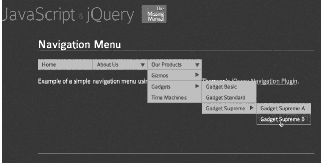

**图 8-3：** 浏览一个包含许多页面和部分的网站可能会令人困惑。带有下拉菜单的导航栏是一种简化网站链接展示的优雅方式。它可以让你包含许多导航选项，同时减少页面上的杂乱。

幸运的是，只需一点点 JavaScript，你就可以创建一个动画菜单系统，在所有浏览器中都能为访客流畅工作。这个导航菜单比本书中你到目前为止学过的其他 JavaScript 技术更依赖 HTML 和 CSS。你将使用 HTML 创建一组嵌套链接，并使用 CSS 格式化这些链接使其看起来像导航栏，并定位和隐藏任何子菜单。然后你将添加一些 JavaScript 来在鼠标移动到导航栏按钮上时为菜单的显示添加动画效果。

#### HTML

导航菜单的 HTML 是用 `<ul>` 标签创建的简单项目符号列表。每个顶级 `<li>` 标签代表导航栏上的主要按钮。要创建子菜单，你在所属菜单的 `<li>` 标签内添加嵌套的 `<ul>` 标签。例如，图 8-3 中所示菜单的 HTML 如下：

```html
<ul id="navigation">
    <li><a href="#">Home</a></li>
    <li><a href="#">About Us </a>
        <ul>
            <li><a href="#">Our History</a></li>
            <li><a href="#">Driving Directions</a></li>
            <li><a href="#">Hours</a></li>
        </ul>
    </li>
    <li><a href="#">Our Products </a>
        <ul>
            <li><a href="#">Gizmos </a>
                <ul>
                    <li><a href="#">Gizmo Basic</a></li>
                    <li><a href="#">Gizmo Standard</a></li>
                    <li><a href="#">Gizmo Supreme</a></li>
                </ul>
            </li>
            <li><a href="#">Gadgets </a>
                <ul>
                    <li><a href="#">Gadget Basic</a></li>
                    <li><a href="#">Gadget Standard</a></li>
                    <li><a href="#">Gadget Supreme</a>
                        <ul>
                            <li><a href="#">Gadget Supreme A</a></li>
                            <li><a href="#">Gadget Supreme B</a></li>
                        </ul>
                    </li>
                </ul>
            </li>
            <li><a href="#">Time Machines</a></li>
        </ul>
    </li>
</ul>
```

> **注意：** 为了使这个例子看起来简单，HTML 在每个 `<a>` 标签的 href 属性中使用 # 符号代替实际 URL，例如：`<a href="#">`。在实际导航栏中，每个 `<a>` 标签都会指向真实的网页，像这样：`<a href="products/gadgets/basic.html">`。

三个主要导航按钮是 Home、About Us 和 Our Products。About Us 下面有一个菜单，由嵌套列表表示，包括 Our History、Driving Directions 和 Hours 选项。Our Products 按钮包含另一个菜单，选项有 Gizmos、Gadgets 和 Time Machines。Gizmos 和 Gadgets 都有各自的菜单（另外两个嵌套列表）；而在 Gadgets 菜单下的 Gadget Supreme 选项下，还有两个选项（又一个嵌套列表）。嵌套列表只是再缩进一层级的另一个列表。视觉上，上面的 HTML 转化为如下列表：

- Home
- About Us
    - Our History
    - Driving Directions
    - Hours
- Our Products
    - Gizmos
        - Gizmo Basic
        - Gizmo Standard
        - Gizmo Supreme
    - Gadgets
        - Gadget Basic
        - Gadget Standard
        - Gadget Supreme
            - Gadget Supreme A
            - Gadget Supreme B
    - Time Machines

请记住，嵌套列表应放在其父项的 `<li>` 标签内。例如，包含 Gizmos、Gadgets 和 Time Machines 列表项的 `<ul>` 标签位于 Products 列表项的 `<li>` 标签内（如果你需要复习如何创建 HTML 列表，请访问 *www.htmldog.com/guides/htmlbeginner/lists/*）。

> **注意：** 确保顶级链接（本例中的 Home、About Us 和 Our Products）始终指向一个页面，该页面链接到其部分中的子页面（例如，About Us 下的 Our History、Driving Directions 和 Hours 链接）。这样，如果浏览器未启用 JavaScript，仍然可以访问子菜单中的链接。

## CSS

Daniel Thomson 的 jQuery 导航插件（*www.pollenizer.com/jquery-navigation-plugin/*）完成了大部分列表项定位的工作，因此你无需担心创建用于创建并排按钮或下拉和飞出菜单的 CSS。不过，你可能想要自定义按钮的外观；例如，添加背景颜色、去除链接的下划线等。以下是一些有用的样式，可用于控制菜单的不同元素。（例如，打开 *chapter08* 教程文件夹中的 *complete_menu.html* 文件，查看页面 `<head>` 中的 CSS。）

> **注意：** 下面列出的样式假设包含所有菜单和按钮的主 `<ul>` 标签有一个名为 *navigation* 的 ID，像这样：`<ul id="navigation">`。你可以随意使用其他 ID 名称——例如 *mainNav*、*menu*——只需相应地调整下面列出的样式名称即可。例如，如果你使用 *mainNav* 作为 ID，将下面列出的 *#navigation a* 样式更改为 *#mainNav a*。

-   `#navigation ul` 控制每个菜单的整体外观。建议将此样式的 padding 和 margin 设置为 0。
-   `#navigation li` 控制每个按钮的样式（不过，如本例所示，最好将大部分样式放在每个 `<li>` 标签内的 `<a>` 标签上）。但是，你至少应该将 padding 和 margin 设置为 0，并将 *list-style-type* 属性设置为 none，以消除每个按钮旁边的项目符号。以下是为 ul 和 li 标签设置的一个良好默认样式：
    ```css
    #navigation ul, #navigation li {
    ```

 ```
margin: 0;
padding: 0;
list-style-type: none;
}
```

- `#navigation a` 控制每个链接的外观。你可以尽情发挥这个样式：应用背景色、字体、字体颜色、边框线来让你的按钮脱颖而出。但是，避免将 margin 和 padding 值设置为除 0 以外的任何值；否则，你的按钮会相互重叠。

- `#navigation a:hover` 控制链接的悬停或鼠标悬停外观。你可以更改背景颜色，以便当访问者将鼠标悬停在按钮上时，按钮会高亮显示，这提供了出色的视觉反馈。

- `#navigation .stack > a` 和 `#navigation .stack > a:hover` 控制带有菜单的链接的外观。你可能想要添加背景图片（如向下箭头）来指示这些按钮会打开菜单，或者通过某种方式在视觉上将这些按钮与没有菜单的其他按钮区分开来。

- `#navigation ul .stack > a` 和 `#navigation ul .stack > a:hover` 为子子菜单提供样式；也就是说，从一个本身属于菜单一部分的按钮打开的菜单。例如，在图 8-4 中，Gizmos 和 Gadgets 按钮有子子菜单。你不需要以不同的方式设置这些按钮的样式，但插件会以不同的方式显示这些菜单。在图 8-4 中，你可以看到从顶级菜单打开的菜单（例如，当鼠标悬停在 Our Products 上时）会在按钮下方产生一个下拉菜单，但子子菜单会从按钮的右侧打开（Gizmos 和 Gadgets）。如果你想使用箭头图形来指示菜单，你可能想要为顶级菜单使用向下箭头，为其他菜单使用向右箭头。查看 complete_menu.html 文件中的 CSS 以获取示例。

- 清除菜单后的浮动。插件使用 CSS float 属性在主菜单中将菜单按钮并排定位。因此，菜单后面的文本或其他内容可能会向上滑动到菜单右侧。为了防止这种环绕，你应该在紧接菜单之后的内容的样式中添加 `clear:left`。一个简单的方法是创建一个类似这样的类样式：

`.clearLeft { clear: left; }`

然后将该类应用于菜单的 `<ul>` 之后的标签。例如，假设导航菜单后面有一个段落标签。你可以这样写来创建开启的 `<p>` 标签：
`<p class="clearLeft">`

#### JavaScript 部分

使用 JavaScript 控制菜单显示的基本概念很简单。鼠标悬停在一个列表项上，如果它有嵌套列表（弹出菜单），则显示该嵌套列表；鼠标移开列表时，隐藏任何嵌套列表。

### 基础动画导航栏

有一些细微之处使这个基本想法变得更加复杂。例如，当鼠标移出父列表项时立即消失的弹出菜单需要精确的鼠标操作。当尝试导航到弹出菜单时，很容易从列表项上移开鼠标。如果菜单突然消失，你的访问者将被迫将鼠标移回原始列表项以重新打开菜单。而且当有几层弹出菜单时，很容易错过目标并丢失菜单，这令人沮丧。

为了解决这个问题，大多数导航菜单脚本添加了一个计时器功能，延迟弹出菜单的消失。这个计时器允许不那么精确的鼠标操作，并使弹出菜单感觉不那么脆弱。

jQuery Navigation 插件是一种非常易于使用的方法来创建基础下拉菜单，并提供淡入或滑入效果的选项。

#### 教程

现在你已经了解了创建导航菜单的基础知识，下面介绍如何实现它。在本教程中，你将添加 CSS 和 JavaScript，将第 250 页所示的基础 HTML 菜单列表转换为导航栏。

*注意：* 有关如何下载教程文件的信息，请参阅第 29 页的注释。

1. 在文本编辑器中，打开 *chapter08* 文件夹中的 *menu.html* 文件。

此文件包含你将转换为导航栏的链接项目列表。要查看没有任何 JavaScript 时的样子，第一步是附加插件文件。

2. 在 `<script src="../_js/jquery-1.6.3.min.js"></script>` 之后的空行中单击并输入：
`<script src="../_js/nav1.1.min.js"></script>`

这将 jQuery Navigation 插件链接到页面。现在你将添加编程——我们已经提供了带有 *$(document).ready()* 函数的 `<script>` 标签。

3. 在 *$(document).ready()* 函数内部的空行中单击，并在下方添加以下**粗体**代码：

```
$(document).ready(function() {
  $("#navigation").navPlugin({
    'itemWidth': 150,
    'itemHeight': 30
  });
});
```

要激活菜单，你首先需要使用 jQuery 选择用于主导航栏的 `<ul>` 标签——在本示例中，该标签应用了 ID *navigation*，因此代码 `$('#navigation')` 选择该标签，而 `.navPlugin()` 将 jQuery Navigation 插件编程应用于菜单。

要控制插件，你需要传递一个对象字面量作为参数。这个插件的选项不多，但最重要的两个是 *itemWidth* 和 *itemHeight*，它们控制按钮的宽度和高度。你不能为菜单上的每个按钮设置不同的宽度和高度，因此请确保你提供的宽度和高度能够容纳按钮中*最多*文本的所有内容。你还可以添加菜单出现的效果。

4. 编辑你刚刚添加的代码，使其看起来如下面的代码所示（添加部分以**粗体**显示）：

```
1 $(document).ready(function() {
2   $('#navigation').navPlugin({
3     'itemWidth': 150,
4     'itemHeight': 30,
5     'navEffect': 'slide'
6   });
7 });
```

不要忘记第 4 行中 30 后面的逗号。navEffect 选项控制菜单在页面上的显示方式。通常它们只是突然出现，但你可以使用 'slide' 值使菜单向下滑入视图，或使用 'fade' 值使菜单淡入视图。你还可以控制菜单出现和消失的速度。

5. 编辑代码，使其看起来如下面的代码所示（添加部分以**粗体**显示）：

```
1 $(document).ready(function() {
2   $("#navigation").navPlugin({
3     'itemWidth': 150,
4     'itemHeight': 30,
5     'navEffect': 'slide',
6     'speed': 250
7   });
8 });
```

不要忘记第 5 行中 'slide' 后面的逗号。speed 选项以毫秒为单位设置，因此 250 表示 250 毫秒或 1/4 秒，这是一个相当不错的设置。较大的数字会使菜单感觉迟钝且无响应。

6. 保存页面并在浏览器中预览。

你现在应该有一个功能齐全的导航栏了。这很简单。查看文件中的 CSS 以了解按钮的格式设置方式，并尝试不同的 CSS 属性来自定义菜单的外观。教程的完成版本 *complete_menu.html* 位于 *chapter08* 文件夹中。

jQuery Navigation 插件简单而有效，但还有许多其他 jQuery 插件可用于创建更高级的导航。

- DD Mega Menu 插件（http://dynamicdrive.com/dynamicindex1/ddmegamenu.htm）让你不仅可以创建下拉菜单，还可以创建可以下拉显示的整个 `<div>`。想象一个导航栏，当你将鼠标悬停在按钮上时，会滑动显示一个大内容框。通过这种方式，你可以隐藏内容，但在有人将鼠标悬停在菜单按钮上时显示它。

该插件也支持常规下拉菜单。

- jqDock 插件（www.wizzud.com/jqDock/）让你模拟 Mac 的 Dock：屏幕上一排图像，当你鼠标悬停时会放大。一个有趣的视觉效果。

如果这两个插件都不合你的意，请查看 www.noupe.com/jquery/45-jquery-navigation-plugins-and-tutorials.html 上的 45 个 jQuery 导航插件和教程的大清单。

## 增强 Web 表单

自网络早期以来，表单就使网站能够从其访问者那里收集信息。表单可以收集用于新闻通讯的电子邮件地址、收集完成在线销售的运输信息，或者简单地接收访问者的反馈。表单还需要你网站的访问者*思考*：阅读标签、输入信息、做出选择等等。由于某些网站完全依赖接收表单数据——如果人们不能使用表单订购书籍，Amazon 就不会长期存在——Web 设计师需要知道如何使他们的表单尽可能易于使用。幸运的是，JavaScript 向表单注入交互性的能力可以帮助你构建更易于使用的表单，并确保更准确的访问者响应。

### 了解表单

HTML 提供了多种标签来构建如图 9-1 所示的 Web 表单。最重要的标签是 `<form>` 标签，它定义了表单的起点（开启的 `<form>` 标签）和终点（闭合的 `</form>` 标签）。它还指示表单使用什么类型的方法来发送数据（*post* 或 *get*），并指定表单数据应该发送到 Web 上的什么位置。
```


### 理解表单

您可以使用`<input>`、`<textarea>`或`<select>`标签来创建实际的表单控件——按钮、文本框和菜单。大多数表单元素使用`<input>`标签。例如，文本框、密码框、单选按钮、复选框和提交按钮都共用`<input>`标签，并通过*type*属性来指定具体是哪一种。例如，您可以通过使用`<input>`标签并将*type*属性设置为*text*来创建一个文本框，如下所示：

```
<input name="user" type="text">
```

以下是创建图9-1所示表单的HTML代码；`<form>`标签和*form*元素以粗体显示：

```
<form action="process.php" method="post" name="signup" id="signup">
  <div>
    <label for="username" class="label">Name</label>
    <input name="username" type="text" id="username" size="36">
  </div>
  <div><span class="label">Hobbies</span>
    <input type="checkbox" name="hobby" id="heliskiing" value="heliisking">
    <label for="heliskiing">Heli-skiing</label>
    <input type="checkbox" name="hobby" id="pickle" value="pickle">
    <label for="pickle">Pickle eating</label>
    <input type="checkbox" name="hobby" id="walnut" value="walnut">
    <label for="walnut">Making walnut butter</label>
  </div>
  <div>
    <label for="planet" class="label">Planet of Birth</label>
    <select name="planet" id="planet">
      <option>Earth</option>
      <option>Mars</option>
      <option>Alpha Centauri</option>
      <option>You've never heard of it</option>
    </select>
  </div>
  <div class="labelBlock">Would you like to receive annoying e-mail from us?</div>
  <div class="indent">
    <input type="radio" name="spam" id="yes" value="yes" checked="checked">
    <label for="yes">Yes</label>
    <input type="radio" name="spam" id="definitely" value="definitely">
    <label for="definitely">Definitely</label>
    <input type="radio" name="spam" id="choice" value="choice">
    <label for="choice">Do I have a choice?</label>
  </div>
  <div>
    <input type="submit" name="submit" id="submit" value="Submit">
  </div>
</form>
```

**注意：** 此示例中的`<label>`标签是表单中常用的另一种标签。不过，它不会创建像按钮那样的表单控件。它允许您添加一个文本标签（在页面上可见），用于解释表单控件的用途。

### 选择表单元素

正如您在本书中反复看到的，要操作页面上的元素，首先需要选择这些元素。例如，要确定存储在表单字段中的值，您必须先选择该字段。同样地，如果您想隐藏或显示*form*元素，必须使用JavaScript来识别这些元素。

正如您所读到的，jQuery可以使用几乎任何CSS选择器来选择页面元素。选择单个*form*元素最简单的方法是为其分配一个ID，如下所示：

```
<input name="user" type="text" id="user">
```

然后，您可以使用jQuery的选择函数：

```
var userField = $('#user');
```

选择了一个字段后，您就可以对其执行一些操作。例如，假设您想确定一个字段中的值——比如检查访问者在该字段中输入了什么。如果表单字段的ID为*user*，您可以这样使用jQuery来访问该字段的值：

```
var fieldValue = $('#user').val();
```

**注意：** jQuery的*val()*函数在第261页讨论。

但是，如果您想选择所有特定类型的*form*元素怎么办？例如，您可能想为页面上的每个单选按钮添加一个点击事件。由于`<input>`标签用于单选按钮、文本框、密码框、复选框、提交按钮、重置按钮和隐藏字段，您不能简单地选择`<input>`标签。相反，您需要能够找到特定类型的input标签。

幸运的是，jQuery已经免除了选择特定类型表单字段的负担（见表9-1）。使用jQuery表单选择器之一，您可以轻松地识别和处理所有特定类型的字段。例如，假设当访问者提交表单时，您想检查以确保所有文本框都包含某个值。您需要选择这些文本框，然后逐个检查每个字段是否包含值。jQuery可以让您这样完成第一步：

```
$('.:text')
```

然后，您只需使用`.each()`函数（见第147页）遍历结果，以确保每个字段都有一个值。（您将在第278页了解到更多关于验证表单字段的内容）。

表9-1。jQuery包含许多选择器，使得处理特定类型的表单字段变得容易

| 选择器 | 示例 | 功能 |
| :--- | :--- | :--- |
| `:input` | `$(':input')` | 选择所有input、textarea、select和button元素。换句话说，它选择所有表单元素。 |
| `:text` | `$(':text')` | 选择所有文本框。 |
| `:password` | `$(':password')` | 选择所有密码框。 |
| `:radio` | `$(':radio')` | 选择所有单选按钮。 |
| `:checkbox` | `$(':checkbox')` | 选择所有复选框。 |
| `:submit` | `$(':submit')` | 选择所有提交按钮。 |
| `:image` | `$(':image')` | 选择所有图像按钮。 |
| `:reset` | `$(':reset')` | 选择所有重置按钮。 |
| `:button` | `$(':button')` | 选择所有类型为button的字段。 |
| `:file` | `$(':file')` | 选择所有文件字段（用于上传文件）。 |
| `:hidden` | `$(':hidden')` | 选择所有隐藏字段。 |

您还可以将表单选择器与其他选择器结合使用。例如，假设页面上有两个表单，而您只想选择其中一个表单中的文本框。假设您要找的字段所在的表单ID为*signup*，您可以这样只选择该表单中的文本框：

```
$('#signup :text')
```

此外，jQuery还提供了一些非常有用的过滤器，用于查找匹配特定状态的表单字段：

-   `:checked` 选择所有被选中或开启的字段——即复选框和单选按钮。例如，如果您想找到所有已开启的复选框和单选按钮，可以使用以下代码：

```
$(':checked')
```

更棒的是，您可以使用此过滤器来查找一组单选按钮中哪个被选中了。例如，假设您有一组单选按钮（“选择配送方式”），具有不同的值（例如UPS、USPS和FedEx），您想找到访问者所选的单选按钮的值。一组相关的单选按钮都共享相同的HTML *name*属性；假设您有一组单选按钮，其共享的名称为*shipping*。您可以结合使用jQuery的属性选择器（第133页）和*:checked*过滤器来找到被选中的单选按钮的值，如下所示：

```
var checkedValue = $('input[name="shipping"]:checked').val();
```

选择器——`$('input[name="shipping"]')`——选择所有name属性为*shipping*的input元素，但添加*:checked*——`$('input[name="shipping"]:checked')`——则只选择被选中的那一个。*val()*函数返回存储在该复选框中的值——例如USPS。

-   `:selected` 选择列表或菜单中所有被选中的*option*元素，这使您可以找到访问者从菜单或列表（`<select>`标签）中所做的选择。例如，假设您有一个ID为*state*的`<select>`标签，列出了美国全部50个州。要找到访问者选择了哪个州，您可以这样写：

```
var selectedState=$('#state:selected').val();
```

请注意，与*:checked*过滤器的示例不同，ID名称和过滤器之间有一个空格（'#state :selected'）。这是因为此过滤器选择的是`<option>`标签，而不是`<select>`标签。用英语来说，这个jQuery选择的含义是“找到ID为*state*的`<select>`标签内部所有被选中的选项”。空格使其能够工作，就像CSS后代选择器一样：它首先找到具有正确ID的元素，然后在其中搜索任何已被选中的元素。

**注意：** 您可以为`<select>`菜单启用多选。这意味着:selected过滤器可能返回多个元素。

### 获取和设置表单元素的值

有时您会想要检查*form*元素的值。例如，您可能想要检查一个文本框，以确保其中输入了电子邮件地址。或者您可能想要确定一个字段的值以计算订单的总成本。另一方面，您可能想要*设置*一个*form*元素的值。例如，假设您有一个订单表单，要求同时填写账单和配送信息。为访问者提供一个“与账单相同”的复选框，并使用账单字段中的信息自动填充配送信息字段，这将会很有帮助。

jQuery提供了一个简单的函数来完成这两项任务。*val()*函数既可以设置也可以读取表单字段的值。如果您在不传递任何参数的情况下调用该函数，它会读取字段的值；如果您向该函数传递一个值，它会设置该字段的值。


var fieldValue = $('#email').val();
```

通过向 val() 函数传入一个值，你可以轻松设置字段的值。例如，假设你有一个产品订购表单，你希望根据访客指定的数量自动计算销售总价（图 9-2）。你可以获取访客提供的数量，乘以产品单价，然后将结果设置到总价字段中。

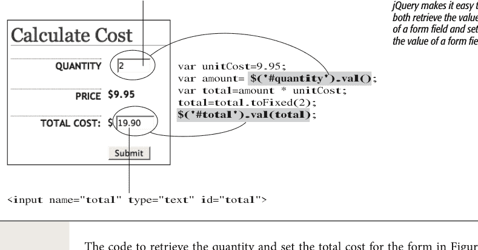

检索数量并设置图 9-2 表单总价的代码如下所示：

```javascript
var unitCost=9.95;
var amount=$(‘#quantity’).val(); // 获取值
var total=amount * unitCost;
total=total.toFixed(2);
$(‘#total’).val(total); // 设置值
```

第一行代码创建了一个变量，用于存储产品成本。第二行创建了另一个变量，并从 ID 为 quantity 的字段中检索访客输入的数量。第 3 行通过将订购数量乘以单位成本来确定总价，第 4 行将结果格式化为保留两位小数（关于 toFixed() 方法的讨论，请参见第 448 页）。最后，第 5 行将 ID 为 total 的字段的值设置为总价。（下一页你将学习如何使用事件来触发这段代码。）

### 确定按钮和复选框是否被选中

虽然 val() 函数对于获取任何表单元素的值都很有帮助，但对于某些字段来说，只有在访客选中该字段时，其值才重要。例如，单选按钮和复选框要求访客通过选择特定值来做出选择。你在第 260 页看到了如何使用 *:checked* 筛选器来查找已选中的单选按钮和复选框，但一旦你找到它，就需要一种方法来确定特定按钮或复选框的状态。

在 HTML 中，*checked* 属性决定特定元素是否被选中。例如，要在网页加载时启用某个复选框，你可以为 XHTML 像这样添加 *checked* 属性：

```html
<input type="checkbox" name="news" id="news" checked="checked" />
```

而 HTML5 则像这样：

```html
<input type="checkbox" name="news" id="news" checked>
```

由于 *checked* 是 HTML 属性，你可以轻松地使用 jQuery 来检查复选框的状态，像这样：

```javascript
if ($('#news').attr('checked')) {
  // 复选框已选中
} else {
  // 复选框未选中
}
```

代码 *$('#news').attr('checked')* 如果复选框已选中，则返回 *true*。如果未选中，则返回 *undefined*，JavaScript 解释器将其视为与 *false* 相同。因此，这个基本的条件语句让你可以在复选框开启时执行一组任务，或在关闭时执行另一组任务。（如果你需要复习条件语句，请翻到第 79 页。）

*checked* 属性同样适用于单选按钮。你可以用同样的方式使用 *attr()* 函数来检查单选按钮的 *checked* 属性是否已设置。

### 表单事件

如你在第 5 章中所读到的，事件让你可以通过响应不同的访客操作来为页面添加交互性。表单和 *表单* 元素可以响应许多不同的事件，因此你可以利用广泛的事件来让你的表单智能地响应访客的操作。

#### *Submit*（提交）

当访客通过点击提交按钮或在文本字段中输入时按 Enter 或 Return 键来提交表单时，*submit* 事件就会被触发。你可以利用这个事件在表单提交时运行脚本。这样，JavaScript 就可以验证表单字段，确保它们被正确填写。当表单提交时，JavaScript 程序会检查字段，如果有问题，JavaScript 可以阻止表单提交并让访客知道哪里错了；如果没有问题，则表单照常提交。

要在表单的 submit 事件被触发时运行函数，首先选择表单，然后使用 jQuery 的 *submit()* 函数来添加你的脚本。例如，假设你想确保图 9-1 所示表单中的 name 字段在提交时里面有内容——换句话说，访客不能将该字段留空。你可以通过为表单添加 submit 事件，在表单提交前检查该字段的值来实现。如果字段为空，你要让访客知道并停止提交过程；否则，表单将被允许通过。

如果你查看第 258 页上该表单的 HTML，可以看到该表单的 ID 为 signup，姓名字段的 ID 为 username。因此，你可以像这样使用 jQuery 来验证该表单：

```javascript
$(document).ready(function() {
    $('#signup').submit(function() {
        if ($('#username').val() == '') {
            alert('Please supply a name in the Name field.');
            return false;
        }
    }); // submit() 结束
}); // ready() 结束
```

第 1 行设置了必需的 $(document).ready() 函数，使代码仅在页面的 HTML 加载完成后运行（参见第 169 页）。第 2 行将函数附加到表单的 submit 事件（如果你需要提醒自己如何使用事件，请参见第 157 页）。第 3–6 行是验证例程。第 3 行检查字段的值是否为空字符串（''），即字段是否为空。如果字段中没有内容，则会弹出一个警告框，让访客知道他做错了什么。

第 5 行非常重要：它阻止表单被提交。如果你省略这一步，那么表单仍将被提交，而没有访客的姓名。第 6 行完成了条件语句，第 7 行是 submit() 函数的结尾。

> **注意：** 你也可以使用事件对象的 preventDefault() 函数来阻止表单提交，该函数在第 175 页有描述。

submit 事件仅适用于表单，因此你必须选择一个表单并将 submit 事件函数附加到它上面。你可以通过使用 HTML 的 \<form> 标签中提供的 ID 名称来选择表单，或者如果页面上只有一个表单，你可以使用简单的元素选择器，像这样：

```javascript
$('form').submit(function() {
    // 表单提交时要运行的代码
});
```

#### Focus（聚焦）

每当有人点击表单中的文本字段或通过 Tab 键进入文本字段时，该字段就会获得所谓的焦点。焦点是浏览器触发的一个事件，用于指示访客的光标位于或在一个特定字段上；你可以确信那就是访客注意力集中的地方。你可能不会经常使用这个事件，但有些设计师用它来清除字段中已有的任何文本。例如，假设你在表单中有以下 HTML：

```html
<input name="username" type="text" id="username"
value="Please type your user name">
```

这段代码在表单上创建了一个文本字段，里面有“Please type your user name”文本。这种技术让你可以提供关于访客应该如何填写该字段的说明。然后，与其让填写表单的访客自己手动删除所有这些文本，不如在她聚焦于该字段时将其清除，像这样：

```javascript
$('#username').focus(function() {
  var field = $(this);
  if (field.val()==field.attr('defaultValue')) {
    field.val('');
  }
});
```

第 1 行选择该字段（其 ID 为 *username*）并将函数分配给 focus 事件。第 2 行创建了一个变量 *field*，用于存储对 jQuery 选择的引用；如第 149 页所讨论的，*$(this)* 指的是 jQuery 函数中当前选中的元素——在本例中，即表单字段。

第 4 行是实际清除字段的代码。它将字段的值设置为空字符串——由两个单引号表示——从而移除字段中的任何值。但你不想每次字段获得焦点时都清除这个字段。例如，假设有人访问表单并点击表单字段；第一次会清除“Please type your user name”文本。但是，如果访客随后在字段中输入了他的姓名，点击字段外，然后又点击回字段，你不想让他的姓名突然消失。这就是第 3 行的条件语句发挥作用的地方。

文本字段有一个名为 *defaultValue* 的属性，它表示页面首次加载时字段内的文本。即使你删除了该文本，Web 浏览器仍然会记住页面加载时字段中的内容。条件语句检查字段当前的内容（*field.val()*）是否与最初的内容（*field.attr(‘defaultValue’)*）相同。如果相同，则 JavaScript 解释器会清除字段中的文本。

这里有一个例子来解释整个过程。当上一页的 HTML 首次加载时，文本字段的值为“Please type your user name”。这就是该字段的 *defaultValue*。因此，当访客第一次点击该字段时，条件语句提出了一个问题：“字段当前的内容是否与页面加载时最初的内容相同？”换句话说，“Please type your user name”是否等于“Please type your user name”？答案是肯定的，因此该字段被清除。

但是，假设你输入了 *helloKitty* 作为你的用户名，然后切换到另一个字段，接着意识到你打错了用户名。当你点击回该字段来修正错误时，focus 事件再次被触发，分配给该事件的函数再次运行。这次的问题是“‘helloKitty’是否等于‘Please type your user name.’”答案是否定的，因此字段不会被清除，你可以修正你的拼写错误。


## **失焦（Blur）**

当你按 Tab 键离开某个字段，或点击当前聚焦字段之外的区域时，浏览器会触发 *blur* 事件。此事件通常与文本框和文本区域字段配合使用，在用户点击或按 Tab 键离开字段时运行验证脚本。例如，假设你有一个包含大量问题的长表单，其中许多问题需要填写特定类型的值（如电子邮件地址、数字、邮政编码等）。假设访客没有正确填写其中任何一个字段，却直接点击了提交按钮——然后面对的是一长串错误提示，指出她未能正确填写表单。与其将所有错误一次性抛给她，你也可以在她填写表单时逐一检查字段。这样，如果她在填写过程中出现错误，就能立即得到通知并当场修正。

例如，假设你有一个用于收集访客所需产品数量的字段。其 HTML 可能如下所示：

```
<input name="quantity" type="text" id="quantity">
```

你需要确保该字段仅包含数字（例如 1、2 或 9，而不是 One、Two 或 Nine）。你可以在访客点击字段外部时进行检查，如下所示：

```
1	$('#quantity').blur(function() {
2	  var fieldValue=$(this).val();
3	  if (isNaN(fieldValue)) {
4	    alert('Please supply a number');
5	  }
6	});
```

第 1 行将一个函数赋值给 blur 事件。第 2 行获取字段中的值并将其存储在名为 *fieldValue* 的变量中。第 3 行使用 *isNaN()* 方法（参见第 447 页）检查该值是否为数字。如果不是数字，则执行第 4 行，弹出一个警告框。

## **点击（Click）**

当点击任何表单元素时，*click* 事件会被触发。此事件对于单选按钮和复选框特别有用，因为你可以添加函数，根据访客选择的按钮来改变表单内容。例如，假设你有一个订单表单，为账单信息和配送信息分别提供了字段。为了节省那些配送地址与账单地址相同的访客重复输入信息的麻烦，你可以提供一个复选框——例如"与账单信息相同"——勾选后隐藏配送信息字段，使表单更简洁、更易读。（你将在第 276 页看到此示例的实际效果。）

与其他事件一样，你可以使用 jQuery 的 *click()* 函数为表单字段的点击事件赋值一个函数：

```
$(':radio').click(function() {
    //当点击时，函数将应用于每个单选按钮
});
```

> **注意：** click 事件同样适用于文本字段，但它与 focus 事件不同。Focus 在你点击*或*按 Tab 键进入文本字段时触发，而 click 事件仅在点击进入字段时触发。

## 变更（Change）

*change* 事件适用于表单下拉菜单（如图 9-1 所示的"出生星球"菜单）。每当从菜单中进行选择时，change 事件就会被触发。你可以使用此事件来运行验证函数：例如，许多设计者通常在菜单的第一个选项中添加一条说明，如"请选择一个国家"。为了确保访客不会在选择了一个国家后，又不小心将菜单改回第一个选项（"请选择一个国家"），你可以在每次有人从菜单中进行新选择时检查菜单的选中值。

或者，你可以根据菜单选择来改变表单内容。例如，你可以运行一个函数，使得每当从一个菜单中选择一个选项时，第二个菜单中的可用选项也随之改变。例如，图 9-3 展示了一个包含两个菜单的表单；从上方菜单中选择一个选项会动态改变下方菜单中可用的颜色列表。

要为菜单应用 change 事件，请使用 jQuery 的 *change()* 函数。例如，假设你有一个列出国家名称的菜单；该菜单的 ID 为 *country*，每次进行新选择时，你都希望确保新选择不是说明文本"请选择一个国家"。你可以这样实现：

```
$('#country').change(function() {
    if ($(this).val()==='Please choose a country') {
        alert('Please select a country from this menu.');
    }
}
```

## 为表单添加智能化功能

Web 表单对网站访客提出了很多要求：需要填写文本字段、做出选择、勾选复选框，等等。如果你想让人们填写你的表单，就应该尽可能简化表单。幸运的是，JavaScript 可以做很多事情来使你的 Web 表单更易于使用。例如，你可以在需要之前隐藏表单字段、禁用不适用的表单字段，以及根据表单选择来计算总额。JavaScript 为你提供了无数种改善表单可用性的方式。

**图 9-3：**
表单菜单的 *change* 事件让你可以在访客从菜单中选择选项时执行有趣的操作。在此例中，从上方菜单中选择一个选项会动态改变第二个菜单中显示的选项。从上方菜单中选择一个产品，第二个菜单就会显示该产品可用的颜色。

## 聚焦表单中的第一个字段

通常，要开始填写表单，你需要点击第一个文本字段并开始输入。在一个带有登录表单的页面上，何必让访客费力地移动鼠标并点击登录字段才能输入呢？为什么不直接将光标放在字段中，随时准备接受他们的登录信息呢？使用 JavaScript，这轻而易举。

秘诀在于 *focus*，它不仅是 JavaScript 可以响应的事件，还是一个可以用来将光标放置在文本字段中的命令。你只需选中该文本字段，然后运行 jQuery 的 *focus()* 函数。例如，假设你希望页面加载时光标位于图 9-1 中所示的 name 字段内。如果你查看第 258 页该表单的 HTML，你会发现该字段的 ID 为 *username*。因此，将焦点——即将光标——放置在该字段中的 JavaScript 代码如下：

```
$(document).ready(function() {
  $('#username').focus();
});
```

在此示例中，文本字段的 ID 为 *username*。不过，你也可以创建一个通用脚本，始终聚焦表单中的第一个文本字段，而无需为该字段分配 ID：

```
$(document).ready(function() {
  $(':text:first').focus();
});
```

正如你在第 260 页所读到的，jQuery 提供了一种便捷的方式来选择所有文本字段——*$(':text')*。此外，通过在任何选择器后添加 *:first*，你可以选择该元素的第一个实例，因此 jQuery 选择器 *$(':text:first')* 会选择页面上的第一个文本字段。然后添加 *.focus()* 即可将光标放入该文本字段中，耐心等待访客填写。

如果一个页面上有多个表单（例如一个"搜索本站"表单和一个"订阅我们的通讯"表单），你需要细化选择器以确定哪个表单的文本字段应该获得焦点。例如，假设你希望注册表单中的第一个文本字段光标闪烁，等待访客输入，但页面上的第一个文本字段却在搜索表单中。要聚焦注册表单的文本字段，只需为该表单添加一个 ID（例如 *signup*），然后使用以下代码：

```
$(document).ready(function() {
  $('#signup :text:first').focus();
});
```

现在，选择器——*$('#signup :text:first')*——仅选择注册表单内的第一个文本字段。

## 禁用和启用字段

表单字段通常用于填写内容——毕竟，如果不能在文本字段中输入内容，那它还有什么用？然而，有时你可能*不希望*访客能够填写文本字段、勾选复选框或从菜单中选择选项。假设你有一个字段，只有在之前的某个复选框被勾选后才应填写。例如，在用于计算美国所得税的 1040 表格上，有一个用于填写配偶社会安全号码的字段。只有在已婚的情况下，你才需要填写该字段。


 ## 为表单添加智能功能

要"关闭"一个不应填写的表单字段，你可以使用 JavaScript 将其*禁用*。禁用字段意味着无法对其进行检查（单选按钮和复选框）、输入文本（文本字段）、选择选项（菜单）或点击（提交按钮）。

要禁用表单字段，只需将该字段的 *disabled* 属性设置为 *true*。例如，要禁用表单上的所有输入字段，你可以使用以下代码：

```
$(':input').attr('disabled', true);
```

你通常会以响应事件的方式来禁用字段。以1040表格为例，当点击"单身"按钮时，你可以禁用用于收集配偶社会安全号码的字段。假设声明单身的单选按钮 ID 为 *single*，配偶社会安全号码字段的 ID 为 *spouseSSN*，JavaScript 代码如下所示：

```
$('#single').click(function() {
  $('#spouseSSN').attr('disabled', true);
});
```

当然，如果你禁用了某个字段，可能需要一种方法来重新启用它。为此，只需将 disabled 属性设置为 *false*。例如，要启用表单上的所有字段：

```
$(':input').attr('disabled', false);
```

> **注意：** 禁用表单字段时，请确保使用布尔值（第44页）**true** 或 **false**，而不是字符串 'true' 或 'false'。例如，这是错误的：
> 
> ```
> $(':input').attr('disabled', 'false');
> ```
> 
> 这是正确的：
> 
> ```
> $(':input').attr('disabled', false);
> ```

回到税务表格的例子：如果访问者选择了"已婚"选项，则需要确保收集配偶社会安全号码的字段处于活动状态。假设已婚选项的单选按钮 ID 为 married，你可以添加以下代码：

```
$('#married').click(function() {
  $('#spouseSSN').attr('disabled', false);
});
```

你将在第273页的教程中演练这种技术的示例。

### 常见问题

#### 阻止多次提交

有时我会收到重复提交的相同表单信息。如何防止这种情况发生？

Web 服务器并不总是最快的……互联网也是如此。通常，访问者按下表单的提交按钮到出现新的"我们已收到您的信息"页面之间会有延迟。有时这种延迟可能相当长，不耐烦的网民会再次（或第三次、第四次）点击提交按钮，认为他们第一次提交表单时根本没有成功。

这种现象可能导致相同的信息被多次提交。对于在线销售来说，这也意味着信用卡可能被多次扣款！幸运的是，使用 JavaScript，有一种简单的方法可以在表单提交过程开始后禁用提交按钮。使用提交按钮的 *disabled* 属性，你可以"关闭"它，使其无法再次点击。

假设表单的 ID 为 *formID*，提交按钮的 ID 为 *submit*。首先，为表单添加一个 *submit()* 函数，然后在函数内部禁用提交按钮，如下所示：

```
$('#formID').submit(function() {
  $('#submit').attr('disabled',true);
});
```

如果页面只有一个表单，你甚至不需要为标签使用 ID：

```
$('form').submit(function() {
  $('input[type=submit]').
  attr('disabled',true);
});
```

此外，你可以通过更改按钮的 value 值来修改提交按钮上的文字。例如，按钮最初显示"Submit"，但当表单提交时，按钮变为显示"...sending information"。你可以这样做：

```
$('#formID').submit(function() {
  var subButton = $(this).find(':submit');
  subButton.attr('disabled',true);
  subButton.val('...sending information');
});
```

确保将此代码放在 *$(document).ready()* 函数内，如第169页所述。

### 隐藏和显示表单选项

除了禁用字段之外，还有另一种方法可以确保访问者不会浪费时间填写不必要的字段——只需隐藏不需要的字段即可。例如，使用上一节中的税务表格示例，当选择"单身"选项时，你可能希望隐藏用于收集配偶社会安全号码的字段，当选择"已婚"选项时显示该字段。你可以这样做：

```
$('#single').click(function() {
  $('#spouseSSN').hide();
});
$('#married').click(function() {
  $('#spouseSSN').show();
});
```

> **注意：** jQuery 的 *hide()* 和 *show()* 函数（以及其他用于显示和隐藏元素的函数）在第187页有详细讨论。

隐藏字段（与仅仅禁用它相比）的一个可用性好处是，它使表单的布局更简单。毕竟，禁用字段仍然可见，仍然可能吸引（或更准确地说，分散）用户的注意力。

在许多情况下，你希望隐藏或显示的不仅仅是表单字段本身：你可能还想隐藏该字段的标签和任何相关的文本。一种策略是将你希望隐藏的代码（字段、标签和任何其他 HTML）包裹在 `<div>` 标签中，为该 `<div>` 添加一个 ID，然后隐藏该 `<div>`。你将在下面的教程中看到这种技术的示例。

### 教程：基本表单增强

在本教程中，你将向一个基本的订购表单添加三项可用性改进，该表单包含用于收集账单信息和送货信息的字段。首先，当页面加载时，你将把文本光标放在表单的第一个字段中。其次，你将根据访问者做出的选择来禁用或重新启用表单字段。最后，当表单的某个部分不需要时，你将隐藏整个部分（见图9-4）。

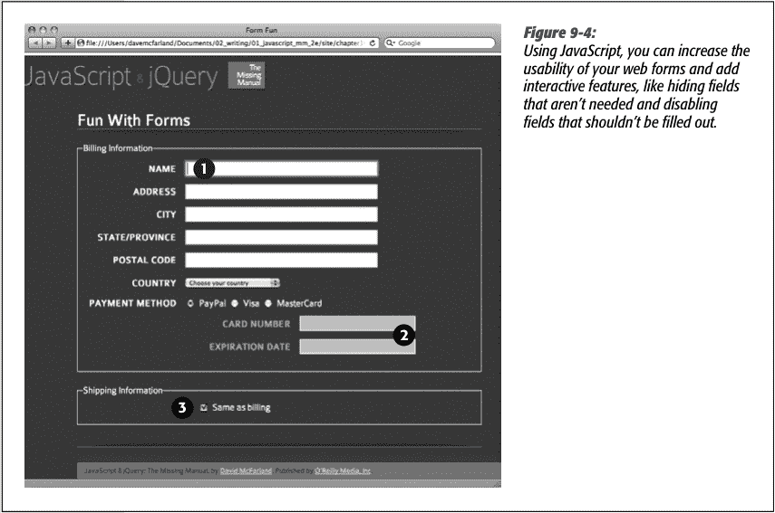

**注意：** 有关如何下载教程文件的信息，请参见第29页的说明。

### 聚焦字段

在本教程的订单表单页面上，第一个字段收集下单人的姓名（见图9-4）。为了使表单更易于填写，当页面加载时，你将把光标放在此字段中。

- 1. 在文本编辑器中，打开 `chapter09` 文件夹中的 `form.html` 文件。

    此文件已包含指向 jQuery 文件的链接和 `$(document).ready()` 函数（第169页）。表单包含两个部分——一个用于收集账单信息，另一个用于收集送货信息。（在继续之前，请在 Web 浏览器中查看该页面。）

    第一步（实际上，本教程这一部分也是唯一一步）是聚焦该字段。

- 2. 在 `$(document).ready()` 函数后的空行处点击，然后输入 `$(':text:first').focus();`，使代码如下所示：

    ```
    $(document).ready(function() {
      $(':text:first').focus();
    }); // end ready()
    ```

    这会选择第一个文本字段并对其应用 `focus()` 函数，使浏览器将插入点放在该字段中。

保存文件并在 Web 浏览器中预览。

当页面加载时，第一个字段应显示闪烁的插入条——这意味着该字段已获得焦点，你可以立即开始填写它。

### 禁用表单字段

上一节只是热身。在本教程的这一部分中，你将根据表单上的选择来禁用或启用两个表单字段。如果你在 Web 浏览器中预览表单（或只是查看图9-4），你会看到在表单账单信息部分的末尾，有三个单选按钮用于选择支付方式：PayPal、Visa 和 MasterCard。此外，下面有两个字段用于收集卡号和到期日期。这两个选项仅适用于信用卡，不适用于 PayPal 支付，因此当点击 PayPal 按钮时，你将禁用这些字段。

页面该部分的 HTML 如下所示（表单字段以粗体显示）：

```
1   <div><span class="label">Payment Method</span>
2   <input type="radio" name="payment" id="paypal" value="paypal">
3     <label for="paypal">PayPal</label>
4   <input type="radio" name="payment" id="visa" value="visa">
5     <label for="visa">Visa</label>
6   <input type="radio" name="payment" id="mastercard" value="mastercard">
```


### 教程：基础表单增强

```
7    <label for="mastercard">MasterCard</label>
8  </div>
9  <div id="creditCard" class="indent">
10   <div>
11     <label for="cardNumber" class="label">Card Number</label>
12     <input type="text" name="cardNumber" id="cardNumber">
13   </div>
14   <div>
15     <label for="expiration" class="label">Expiration Date</label>
16     <input type="text" name="expiration" id="expiration">
17   </div>
18 </div>
```

+   3. 返回你的文本编辑器和文件 *form.html*。

你将在上一节创建的代码基础上进行添加。首先，为 PayPal 单选按钮的 click 事件分配一个函数。

+   4. 在页面顶部的脚本中，添加以下加粗的代码：

```
$(document).ready(function() {
  $('#name').focus();
  $('#paypal').click(function() {

  }); // end click
}); // end ready()
```

PayPal 选项的单选按钮的 ID 为 *paypal*（参见上面 HTML 代码的第 2 行），因此选择该字段只需输入 `$('#paypal')`。其余代码将一个匿名函数分配给 click 事件（如果对此不太清楚，请查看第 162 页关于将函数分配给事件的讨论）。换句话说，点击 PayPal 单选按钮不仅会选中它（这是浏览器的正常行为），还会触发你即将创建的函数。

接下来，你将禁用信用卡号和有效期字段，因为当选择 PayPal 选项时，这些字段不适用。

+   5. 在上一步添加的匿名函数内部，添加一行新代码（第 4 行）：

```
1  $(document).ready(function() {
2    $('#name').focus();
3    $('#paypal').click(function() {
4      $('#creditCard input').attr('disabled', true);
5    }); // end click
6  }); // end ready()
```

虽然你想禁用两个表单字段，但有一种简单的方法只需一行代码就能实现。这两个表单字段都在一个 ID 为 *creditCard* 的 `<div>` 标签内（参见上面 HTML 代码的第 9 行）。因此，jQuery 选择器 `$('#creditCard input')` 翻译过来就是"选择 ID 为 *creditCard* 的元素内的所有 `<input>` 标签。"这种灵活的方式确保你选中所有输入字段，因此如果你添加另一个字段，比如 CVV 字段，它也会被选中（CVV 是信用卡背面的三位数字，网页表单通常要求输入以增强在线订单的安全性）。

要禁用这些字段，你只需将 *disabled* 属性设置为 *true*（参见第 269 页）。但是，这对文本标签（"Card Number"和"Expiration Date"）没有任何影响。即使字段本身被禁用了，这些文本标签仍然保持明亮和加粗，给访问者发送了一个可能令人困惑的信号——即他们仍然可以填写这些字段。为了使禁用状态更加清晰，你将把标签改为浅灰色。同时，你还将为字段的背景添加灰色，使其看起来像是被禁用的。

6. **将以下加粗的代码添加到你的脚本中：**

```
1 $(document).ready(function() {
2   $('#name').focus();
3   $('#paypal').click(function() {
4     $('#creditCard input').attr('disabled', true)
5       .css('backgroundColor','#CCC');
6     $('#creditCard label').css('color','#BBB');
7   }); // end click
8 }); // end ready()
```

> 注意：代码行末尾的 ↵ 符号表示你应该将下一行作为上一行的一部分输入。由于一行 JavaScript 代码可能*非常*长，无法放在本书的一页中，所以它被分成了两行。然而，正如第 49 页所述，JavaScript 在换行和空格方面相当灵活，因此像这样将单条 JavaScript 语句拆分成多行实际上是完全可接受的（有时也更易读）：

$('#creditCard input').attr('disabled',true)
                      .css('backgroundColor','#CCC');

注意，有些程序员会为跨多行格式化的代码添加缩进——在这种情况下，将 .css() 函数缩进使其与 .attr() 函数对齐。

首先，你使用 jQuery 的 css() 函数来更改文本字段的背景颜色（注意这段代码是第 4 行的一部分，所以你应该将其输入到与 *attr()* 函数同一行）。接下来，你使用 *css()* 函数来调整 <div> 标签内任何 <label> 标签的字体颜色（*css()* 函数在第 143 页有描述）。

如果你现在在网页浏览器中预览该页面，你会看到点击 PayPal 按钮确实禁用了信用卡号和有效期字段，并使标签文字变暗。但是，如果你点击 Visa 或 MasterCard 按钮，这些字段仍然处于禁用状态！你需要在选择其他任何一个单选按钮时重新启用这些字段。

7. 在 *click()* 函数之后，添加一个新的空行（你在第 6 步的第 7 行和第 8 行之间添加新代码），然后添加以下内容：

```
$('#visa, #mastercard').click(function() {
  $('#creditCard input').attr('disabled', false)
    .css('backgroundColor','');
  $('#creditCard label').css('color','');
}); // end click
```

选择器 `$('#visa, #mastercard')` 选择另外两个单选按钮（参见第 273 页 HTML 的第 4 行和第 6 行）。请注意，要移除点击 PayPal 按钮添加的背景颜色和文字颜色，你只需传入一个空字符串作为颜色值：`$('#creditCard label').css('color','');`。这会移除该元素的颜色，但保留样式表中最初定义的颜色。

这个教程快要完成了。在最后一节中，你将根据表单选择完全隐藏页面的一部分。

### JQUERY 插件提示

### 让日期选择更简单

无论你是加入社交网络、预订机票，还是搜索活动日历，你经常会遇到要求你输入日期的表单。在大多数情况下，你会看到一个基本的文本字段，你需要在其中输入日期。不幸的是，你并不总是知道两个星期五之后的日期是多少。此外，一个空的文本字段意味着访问者可以自由地以他喜欢的任何格式输入日期：10-20-2009、10.20.2009、10/20/2009，甚至 20/10/2009。

使日期选择变得简单并确保你收到的日期格式一致的最佳方式是使用*日历控件*——一个弹出式日历，让访问者通过点击日历上的日期来选择日期。HTML5 定义了一种在表单中添加日期选择器的方式，一些网页浏览器已经实现了基本的日期选择器——不幸的是，我们还远未到可以完全依赖 HTML 的时候，目前我们还需要使用 JavaScript。幸运的是，你可以下载一个 jQuery 插件，让向表单添加日历控件变得轻而易举。

jQuery UI Datepicker 插件是一个功能丰富的日期选择弹出式日历，你可以以多种方式自定义它。要使用它，你需要从 jQuery UI 网站 `http://jqueryui.com/` 获取该插件。你可以使用自定义下载页面（`http://jqueryui.com/download`）仅获取日期选择器，或者如果你喜欢 jQuery UI 插件的其他元素，也可以一并选择。你还可以使用 jQuery UI Themerooller（`http://jqueryui.com/themeroller/`）创建自定义样式表。

下载这些文件后，你需要将 jQuery UI CSS 文件附加到页面；附加 jQuery 库（参见第 122 页）；然后链接到 *jQuery UI* 文件（按照第 27 页关于链接外部 JavaScript 文件的说明操作）。你将在第 312 页阅读更多关于 jQuery UI 的内容。

设置完所有这些基本步骤后，你只需将 `datepicker()` 函数应用到一个文本字段即可。例如，假设你有一个表单和一个 ID 为 *dateOfBirth* 的文本字段。要使当有人点击该字段时弹出日历，你需要添加一个带有基本 `$(document).ready()` 函数的 `<script>` 标签（有关说明请参见第 169 页），并像这样调用 Datepicker：

`$('#dateOfBirth').datepicker();`

当然，`$('#dateOfBirth')` 是选择文本字段的传统 jQuery 方式；`datepicker()` 函数随后处理其余工作。Datepicker 插件支持的选项包括选择日期范围、通过点击日历图标打开弹出式日历等。要了解更多关于这个实用插件的信息，请访问 `http://jqueryui.com/demos/datepicker/`。

### 隐藏表单字段

正如许多产品订单表单中常见的那样，本教程的表单包含用于收集账单和配送信息的单独字段。在许多情况下，这些信息完全相同，因此没有必要让某人填写两套


如果非必要，用户通常不愿意重复填写相同的字段信息。你经常会在类似的表单上看到一个“与账单地址相同”的复选框，用于表示两组字段中的信息是一致的。然而，如果能够在使用不到的时候完全隐藏掉物流地址的字段，岂不是更加实用（更不用说更酷了）？通过 JavaScript，你可以实现这一点。

- **1. 在文本编辑器中打开 *form.html* 文件。**

你将继续在前面两个教程部分中所写的代码基础上进行扩展。首先，为带有"Same as billing"标签的复选框添加一个点击事件函数。该复选框的 HTML 如下：
`<input type="checkbox" name="hideShip" id="hideShip">`

- **2. 在上一页第274页步骤4添加的代码之后、`}); // end ready()`这行代码（即最后一行代码）之前，添加以下代码：**

`$('#hideShip').click(function() { }); // end click`

由于该复选框的 ID 为 *hideShip*，上述代码选中了它并为其添加了一个点击事件函数。此时，我们不再只是隐藏单个字段，而是希望当复选框被选中时，让整组字段都消失。为了简化操作，组成物流信息字段的 HTML 被包裹在一个带有 *shipping* ID 的 `<div>` 标签中：要隐藏这些字段，你只需要隐藏该 `<div>` 标签即可。

然而，你仅在复选框被选中时才希望隐藏这些字段。如果有人再次点击复选框取消选中，那么该 `<div>` 标签及其表单字段应该重新出现。所以第一步是确定复选框是否被选中。

- **3. 添加下面粗体所示的代码：**

`$('#hideShip').click(function() { if ($(this).attr('checked')) { } }); // end click`

一个简单的条件语句（第79页）可以轻松检测复选框的状态，并据此隐藏或显示表单字段。`$(this)` 指的是当前被点击的对象——在本例中是复选框。元素的 *checked* 属性可以告知复选框是否被选中。如果选中，该属性返回 *true*；否则返回 *false*。要完成这段代码，你还需要添加用于隐藏和显示表单字段的步骤。

- **4. 将下面粗体所示的代码（第16-18行）添加到你的脚本中。完整的脚本应如下所示：**

```
1  `<script>`
2    `$(document).ready(function() {`
3      `$('#name').focus();`
4      `$('#paypal').click(function() {`
5        `$('#creditCard input').attr('disabled', true)`
6        `.css('backgroundColor','#CCC');`
7        `$('#creditCard label').css('color','#BBB');`
8      `}); // end click`
9      `$('#visa, #mastercard').click(function() {`
10       `$('#creditCard input').attr('disabled', false)`
```

```
.css('backgroundColor', '');
    $('#creditCard label').css('color', '');
  }); // end click
  $('#hideShip').click(function() {
    if ($(this).attr('checked')) {
      $('#shipping').slideUp('fast');
    } else {
      $('#shipping').slideDown('fast');
    }
  }); // end click
}); // end ready()
</script>
```

`$('#shipping')` 指的是包含表单字段的 `<div>` 标签，而 slideUp() 和 slideDown() 函数（第188页有介绍）通过向上滑出视图或向下滑入视图的方式来隐藏和显示该 `<div>` 标签。你可以尝试其他一些 jQuery 效果，如 fadeIn() 和 fadeOut()，甚至可以使用 animate() 函数（第192页）创建你自己的自定义动画。

本教程的完成版本——complete_form.html——位于 chapter09 文件夹中。如果你的版本无法正常运行，请将你的代码与完成版教程进行比较，并参考第34页的故障排除步骤。

## 表单验证

当你查看通过网站表单提交的反馈时，却发现访客没有填写姓名、电子邮件地址或其他关键信息，这可能会令人沮丧。正因如此，根据你创建的表单类型，你可能希望将某些信息设为必填项。

例如，一个用于订阅电子邮件通讯的表单，如果潜在读者没有填写用于接收通讯的电子邮件地址，那就没什么用处了。同样，如果你需要物流地址来寄送宣传册或产品，你就需要确保访客在表单上填写了他的地址。

此外，在接收网页表单数据时，你希望确保收到的数据格式正确——例如，订购数量应为数字，网址应为正确格式的 URL。确保访客正确输入信息的过程称为表单验证，借助 JavaScript，你可以在访客提交错误信息之前识别出任何错误。

基本上，表单验证需要在表单提交之前检查表单字段，以确保已提供必填信息并且信息格式正确。表单的 submit 事件——当访客点击提交按钮或在光标位于文本字段时按下回车键时触发——通常是进行验证的地方。如果一切正常，表单信息会照常传输到 Web 服务器。然而，如果存在问题，脚本会阻止提交过程并在页面上显示错误——通常显示在有问题的表单字段旁边（图 9-5）。


图 9-5：当你注册 Yahoo 账户时，如果未能正确填写表单，就会面对一大片红色错误消息（圈中）。

检查文本字段是否已填写很简单。正如你在第261页读到的，你可以简单地访问表单的 *value* 属性（例如使用 jQuery 的 *val()* 函数），如果值是空字符串，则该字段为空。但当你检查其他类型的字段时，比如复选框、单选按钮和菜单，就会变得更加棘手。此外，当你想检查访客是否提交了特定*类型*的信息时，比如电子邮件地址、邮政编码、数字、日期等，需要编写一些复杂的 JavaScript。幸运的是，你不需要自己编写代码；网上有丰富的表单验证脚本，其中一个是 jQuery 库的插件。

### jQuery Validation 插件

Validation 插件（*http://bassistance.de/jquery-plugins/jquery-plugin-validation/*）是由 Jörn Zaefferer 创建的一个功能强大但易于使用的 jQuery 插件。它可以检查表单以确保所有必填字段都已填写，并检查访客输入是否符合特定要求。例如，数量字段必须包含数字，电子邮件字段必须包含电子邮件地址。如果访客没有正确填写表单，该插件会显示错误消息来描述问题。

使用 Validation 插件的基本流程如下：

- **1. 下载 *jquery.js* 文件，并将其附加到包含你要验证的表单的网页中。**

   有关下载 jQuery 库的更多信息，请阅读"Getting jQuery"（第119页）。Validation 插件使用 jQuery 库，因此你需要先将 *jQuery* 文件附加到页面。

- **2. 下载并附加 Validation 插件。**

   你可以在 *http://bassistance.de/jquery-plugins/jquery-plugin-validation/* 找到该插件。下载包包含许多额外内容，包括演示、测试等。你真正需要的只有 *jquery.validate.min.js* 文件。（你也可以在教程文件的 *_js* 文件夹中找到该插件，文件名为 *jquery.validate.min.js*——参见第291页的教程）。这只是一个外部 JavaScript 文件，因此请按照第27页的说明将该文件链接到你的页面。

- **3. 添加验证规则。**

   验证规则就是诸如"将该字段设为必填""确保该字段填写电子邮件地址"之类的指令。换句话说，在这一步中，你需要指定哪些字段需要验证以及如何验证。添加验证规则有几种方法：一种简单的仅使用 HTML 的方法（第281页），以及一种更灵活但稍微复杂的方法（第284页）。

- **4. 添加错误消息。**

   这一步是可选的。Validation 插件附带了一套预定义的错误消息，如"This field is required"、"Please enter a valid date"、"Please enter a valid number"等。这些基本消息简洁明了，但你可能希望为你的表单自定义这些消息，使错误提示为每个表单字段提供更明确的指导——例如，"请输入您的姓名"或"请告诉我们您的出生日期"。

   添加错误消息有两种方法——简单的方法在第283页讨论，更灵活的方法在第288页。

> **注意：** 你也可以按照第290页的描述来控制错误消息的样式和位置。


5. 对表单应用 *validate()* 函数。

该插件包含一个实现所有功能的核心函数：*validate()*。要应用它，你需要先用 jQuery 选中表单，然后将该函数绑定到选择结果上。例如，假设你有一个 ID 为 signup 的表单。HTML 代码可能如下：

```
<form action="process.php" method="post" name="signup" id="signup">
```

应用验证的最简方式如下：

```
$('#signup').validate();
```

*validate()* 函数可以接受许多不同的参数，这些参数会影响插件的运行方式。例如，虽然你可以在表单的 HTML 中指定验证规则和错误信息（见下文），但也可以在调用 *validate()* 函数时指定规则和错误信息。（你将在第 284 页了解这种方法。）

一个非常基础的表单验证所需的全部 JavaScript 代码（包括本节已经介绍的两个步骤）可以简单如下：

```
<script src="js/jquery-1.6.3.min.js"></script>
<script src="js/jquery.validate.min.js"></script>
<script>
$(document).ready(function() {
  $('#signup').validate();
}); // end ready
</script>
```

> **注意：** 务必将你的脚本包裹在 jQuery 的 *document.ready()* 函数中，以确保脚本在页面 HTML 加载完成后再运行（参见第 169 页）。

### 基本验证

使用验证插件可以非常简单：只需引入插件的 JavaScript 文件，为你需要验证的表单元素添加一些 class 和 title 属性，然后对表单应用 *validate()* 函数即可。*validate()* 方法是验证表单最简便的方式，对于大多数表单来说可能已经足够。（但是，如果你需要控制页面上错误信息的显示位置、对一个表单字段应用多条规则，或者为文本字段设置最小或最大字符数，你需要使用第 278 页介绍的高级方法。）

要添加验证，请按照前面几节概述的基本步骤操作（引入 jQuery 和验证插件文件等），此外，你还可以在表单字段的 HTML 中嵌入规则和错误信息。

### 添加验证规则

使用验证插件对字段进行验证，最简单的方式是将表 9-2 中列出的一个或多个 class 名称赋给 *form* 元素。该插件经过巧妙编程，会扫描每个 *form* 元素的 class 名称，判断其中是否包含某个验证项，如果包含，则对该字段应用相应的验证规则。

例如，假设你有一个用于收集用户姓名的文本字段。基本 HTML 如下：

    <input name="name" type="text">

要告知插件该字段是必填的——即除非访客在该字段中输入了内容，否则表单无法提交——只需在标签中添加 *required* class。例如，要将此文本字段设为必填，请在标签中添加 class 属性，如下：

    <input name="name" type="text" class="required">

以这种方式添加 class 实际上与 CSS 无关，尽管通常你为标签分配 class 是为了通过创建 CSS 类样式来设置该标签的格式。在此场景中，你使用 class 名称为插件提供所需信息，以便确定对该字段应用何种验证。

> **注意：** JavaScript 验证是向意外遗漏字段或输入了错误类型信息的访客提供友好反馈的好方法，但它并不能有效防止恶意输入。JavaScript 验证很容易被绕过，因此如果你想确保不会收到访客提交的无效数据，还需要实现服务端验证方案。

要求访客填写某个字段可能是最常见的验证任务，但通常你还希望确保所提供的数据符合特定格式。例如，如果你在询问某人需要多少个部件，你期望的是一个数字。要使一个字段既是必填的 *又* 必须包含特定类型的值，你需要同时添加 *required* class 和表 9-2 中列出的其他 class 之一。

**表 9-2.** *验证插件包含覆盖最常见验证需求的方法*

| 验证规则 | 说明 |
| --- | --- |
| `required` | 除非该字段已填写、勾选或选择，否则无法提交。 |
| `date` | 信息必须为 MM/DD/YYYY 格式。例如，10/30/2009 被认为是有效的，但 10-30-2009 不是。 |
| `url` | 必须是完整、有效的网址，如 *http://www.chia-vet.com*。部分网址如 *www.chia-vet.com* 或 *chia-vet.com* 被视为无效。 |
| `email` | 必须符合电子邮件地址格式：*bob@chia-vet.com*。此 class 实际上不会检查邮箱地址是否真实存在，因此即使输入 *nobody@noplace.com* 也能通过验证。 |
| `number` | 必须是数字，如 32、102.50 甚至 –145.5555。但不能包含任何符号，因此 $45.00 和 100,000 是无效的。 |
| `digits` | 只能包含正整数。因此 1、20、12333 是有效的，但 10.33 和 –12 不是。 |
| `creditcard` | 必须是格式有效的信用卡号码。 |

例如，假设你有一个用于收集用户出生日期的字段。此信息不仅是必填的，还应采用日期格式。该字段的 HTML 如下：

```
    <input name="dob" type="text" class="required date">
```

注意 class 名称——*required* 和 *date*——之间用空格分隔。

如果你省略 *required* class，只使用其他验证类型之一——例如 class="date"——那么该字段是可选的，但如果有人在该字段中输入了内容，则必须符合正确的格式（日期）。

> **提示：** 当你要求字段信息必须符合特定格式时，请务必在表单中提供明确的说明，以便访客知道如何输入信息。例如，如果你要求某个字段必须是日期格式，可以在该字段附近添加一条提示，如"请按 01/25/2009 格式输入日期。"

### 添加错误信息

验证插件会提供通用错误信息来匹配其检测到的验证问题。例如，如果必填字段被留空，插件会显示"This field is required."。如果该字段需要日期，则显示"Please enter a valid date"。不过，你可以覆盖这些默认信息并提供自定义内容。

最简便的方式是在表单字段上添加 *title* 属性，并将错误信息作为 title 的值。例如，假设你正在使用 *required* class 将某字段设为必填，如下：

```
    <input name="name" type="text" class="required">
```

要提供自定义信息，只需添加 *title* 属性：

```
    <input name="name" type="text" class="required" 
    title="Please give us your name.">
```

通常，网页设计师使用 *title* 属性来提高表单字段的可访问性，提供特定说明——当用户将鼠标悬停在字段上时显示，或供屏幕阅读软件朗读。但在验证插件中，你使用 *title* 属性来提供你希望显示的错误信息。插件会扫描所有已验证的字段，检查是否存在 *title* 属性。如果存在，插件就会使用该属性的值作为错误信息文本。

如果你使用了多种验证方式，应该提供一条对两种情况都有意义的 title。例如，如果你有一个字段既是必填的又必须是日期格式，那么当访客输入了格式错误的日期时，"This field is required"这样的提示就不太合适。以下示例展示了一条无论访客是留空还是输入格式错误都能合理显示的错误信息：

```
    <input name="dob" type="text" class="required date" 
    title="Please enter a date in the format 01/28/2009.">
```


## 表单验证

通过为字段添加类名和标题来添加验证规则和错误消息非常简单，而且效果很好。但有时您可能需要更复杂的验证需求；验证插件提供了第二种更高级的方法来为表单添加验证。例如，您可能希望根据错误类型显示不同的错误消息——比如字段留空时显示一种消息，而访问者输入错误类型的信息时显示另一种消息。使用本节介绍的基本验证方法无法实现这一点。幸运的是，验证插件提供了第二种更高级的方法，让您能够实现更广泛的验证规则。

例如，如果您想确保字段中输入了最少数量的字符，则必须使用高级方法。例如，在设置密码时，您可能希望确保密码至少有六个字符长。

### 高级验证

验证插件提供了另一种无需更改字段 HTML 即可为表单添加验证的方法。此外，该插件支持多种额外选项，用于控制插件的工作方式。您通过向 `validate()` 函数传递一个对象字面量（第 145 页）来设置这些选项，该对象包含每个选项的单独对象。例如，要指定验证规则，您传递一个包含规则代码的对象。首先，在验证函数的第一个括号后直接包含一个开始大括号，并在结束括号前直接包含一个结束大括号：

```
$('#id0fForm').validate({
  // 选项放在这里
}); // 结束 validate();
```

这些大括号代表一个对象字面量，其中将包含选项设置。以这种方式使用验证插件会有点令人困惑，而理解插件作者设计工作方式的最佳方法是查看一个简单的示例，如图 9-6 所示。


**图 9-6：** 即使是像这样简单的表单，您也可以使用验证插件的高级选项进行更精细的控制。

> **提示：** 您可以在同一个表单上结合使用第 281 页描述的基本验证方法和此处描述的高级方法。对于只有一个验证规则和错误消息的字段，您可以使用简单方法，因为它更快；而对于更复杂的验证，只需使用高级方法。例如，第 291 页的教程在验证单个表单时就同时使用了两种方法。

图 9-6 中表单的 HTML 如下所示：

```
<form action="process.php" method="post" id="signup">
  <div>
    <label for="name">姓名</label>
    <input name="name" type="text">
  </div>

  <div>
    <label for="email">电子邮件地址</label>
    <input name="email" type="text">
  </div>
  <div>
    <input type="submit" name="submit" value="提交">
  </div>
</form>
```

此表单包含两个以粗体显示的文本字段：一个用于填写姓名，另一个用于填写电子邮件地址。本节将逐步介绍如何使用高级规则验证这两个字段，以确保姓名字段已填写，并且电子邮件字段既已填写又格式正确。

> *注意：* 您可以在 *http://docs.jquery.com/Plugins/Validation/validate#toptions* 找到验证插件的完整选项列表。

### 高级规则

指定验证规则的高级方法涉及传递一个对象（参见第 145 页），其中包含表单字段的名称以及您希望应用于该字段的验证规则。该对象的基本结构如下所示：

```
rules: {
  字段名 : '验证类型'
}
```

该对象名为 *rules*，在其中您可以指定要应用于该字段的字段和验证类型。然后将整个对象传递给 *validate()* 函数。例如，在图 9-6 所示的表单中，要使姓名字段成为必填项，您可以如上一页所述将 *validate()* 函数应用于表单，然后像这样将 *rules* 对象传递给函数：

```
$('#signup').validate({
  rules: {
    name: 'required'
  }
}); // 结束 validate()
```

在这种情况下，字段名为 *name*，该规则指定该字段是必填的。要对表单字段应用多个验证规则，您必须为该字段创建另一个对象。例如，要扩展图 9-6 中表单的验证规则，您可以添加一个规则，该规则不仅使电子邮件字段成为必填项，还指定电子邮件地址必须具有有效的格式：

```
1  $('#signup').validate({
2    rules: {
3      name: 'required',
4      email: {
5        required:true,
6        email:true
7      }
8    }
9  }); // 结束 validate()
```

> **注意：** 根据 JavaScript 对象字面量的规则，除了最后一个键值对外，每个键值对后必须以逗号结尾。例如，上面第 3 行中的 *name: 'required'* 后必须有一个逗号，因为后面还有另一个规则（用于电子邮件字段）。请参阅第 145 页，了解对象字面量的工作原理。

以粗体显示的第 4–7 行指定了电子邮件字段的规则。该字段的名称是 *email*，如 HTML 中所指定（参见第 285 页的 HTML 代码）；*required:true* 使该字段成为必填项；而 *email:true* 确保该字段包含一个电子邮件地址。

您可以使用表 9-2 中列出的任何验证类型。例如，假设您在此示例使用的表单中添加一个名为 *birthday* 的字段。为确保在该字段中输入日期，您可以像这样扩展规则列表：

```
$('#signup').validate({
  rules: {
    name: 'required',
    email: {
      required:true,
      email:true
    },
    birthday: 'date'
  }
}); // 结束 validate()
```

如果您还希望 birthday 字段成为 *必填项*，请将代码调整如下：

```
$('#signup').validate({
    rules: {
        name: 'required',
        email: {
            required:true,
            email:true
        },
        birthday: {
            date:true,
            required:true
        }
    }
}); // 结束 validate()
```

如前所述，使用高级验证规则您可以做的最强大和最有用的事情之一是要求访问者的输入具有特定的最小或最大长度。例如，在投诉报告表单上，您可能希望将评论限制在，比如说，200 个字符以内，这样您的客户就会直奔主题，而不是撰写 *《战争与和平》*。还有一些规则可以确保输入的数字在特定范围内；例如，除非您接受来自木乃伊或吸血鬼的信息，否则您不会接受早于 1900 年的出生年份。

- **minlength**。该字段必须包含*至少*指定数量的字符。例如，确保字段中输入至少六个字符的规则如下：
  minlength:6
- **maxlength**。该字段必须包含*不超过*指定数量的字符。例如，确保输入的字符不超过 100 个的规则如下所示：
  maxlength:100
- **rangelength**。*minlength* 和 *maxlength* 的组合。指定字段中允许的最小和最大字符数。例如，确保字段包含至少六个字符但不超过 100 个的规则如下：
  rangelength:[6,100]
- **min**。要求该字段包含一个大于或等于指定数字的数字。例如，以下规则要求该字段既包含一个数字，且该数字大于或等于 10。
  min:10

在此示例中，如果访问者输入 8，该字段将无法验证，因为 8 小于 10。同样，如果您的访问者输入一个单词——例如 *eight*，该字段将无法验证，她将收到错误消息。

- **max**。与 *min* 类似，但指定字段可以包含的最大数字。例如，要确保字段包含小于 1,000 的数字，请使用以下规则：
  max:1000

 * **range（范围）。** 组合使用 *min* 和 *max* 来指定字段必须包含的最小值和最大值。例如，要确保字段包含至少 10 但不超过 1,000 的值，请使用：
  `range:[10,1000]`

* **equalTo（等于）。** 要求字段的内容与另一个字段匹配。例如，在注册表单中，通常会要求访问者输入密码，然后再次输入以验证密码。这样，访问者可以确保第一次没有输错密码。要使用此方法，你必须指定一个包含有效 jQuery 选择器的字符串。例如，假设第一个密码字段的 ID 为 *password*。如果你想确保"确认密码"字段与第一个密码字段匹配，请使用以下代码：
  `equalTo: '#password'`

你可以组合使用这些高级验证规则，只需逐个字段设置即可。以下是它们协同工作的一个示例：假设你有一个表单，包含两个字段，一个用于创建密码，另一个用于确认密码。这两个字段的 HTML 可能如下所示：

```
<input name="password" type="password" id="password">
<input name="confirm_password" type="password" id="confirm_password">
```

两个字段都是必填的，且密码必须至少 8 个字符，最多不超过 16 个字符。最后，你要确保"确认密码"字段与另一个密码字段匹配。假设表单的 ID 为 *signup*，你可以使用以下代码验证这两个字段：

```
$('#signup').validate({
  rules: {
    password: {
      required:true,
      rangelength:[8,16]
    },
    confirm_password: {
      equalTo:'#password'
    }
  }
}); // end validate()
```

### 高级错误消息

如你在第 283 页所读到的，你可以通过添加带有错误消息文本的 *title* 来轻松地为字段添加错误消息。然而，这种方法无法为每种验证错误创建单独的错误消息。例如，假设一个字段是必填的且必须包含数字。你可能希望针对每种错误显示不同的消息："此字段为必填项"和"请输入一个数字。"使用 *title* 属性无法实现这一点。相反，你必须向 *validate()* 函数传递一个 JavaScript 对象，其中包含你希望显示的不同错误消息。

### 使用服务器端验证

虽然 JavaScript 验证非常适合快速检查用户输入，但有时你需要与服务器交互以检查字段是否有效。例如，假设你有一个注册表单，允许访问者创建自己在论坛上使用的用户名。两个用户不能使用相同的用户名，因此如果能在提交表单之前告知填写表单的人他想要的用户名是否已被占用，将会很有帮助。在这种情况下，你需要与服务器交互来查询用户名是否可用。

Validation 插件提供了一种名为 *remote* 的高级验证方法，使你可以与服务器进行交互。此方法允许你将字段名称和访问者在该字段中输入的值一起传递到服务器端页面（如 PHP、JSP、ASP 或 Cold Fusion 页面）。服务器端页面可以接收这些信息并进行处理，例如检查用户名是否可用，然后以 *true*（通过验证）或 *false*（未通过验证）的值响应表单。

假设你有一个名为"username"的字段，它既是必填的，又不能是当前网站上已使用的用户名。要为此字段创建规则（使用前一页描述的高级规则方法），你可以在 *rules* 对象中添加以下内容：

```
username : {
    required: true,
    remote: 'check_username.php'
}
```

*remote* 方法接受一个包含从当前页面到 Web 服务器上某个页面路径的字符串。在本示例中，该页面名为 *check_username.php*。当验证插件尝试验证此字段时，它会将字段名称（*username*）和访问者的输入发送到 *check_username.php*，由该页面判断用户名是否可用。如果名称可用，PHP 页面返回 '*true*'；如果用户名已被占用，页面返回 '*false*'，该字段将无法通过验证。

所有这些魔法都是通过 Ajax 技术实现的，你将在第 4 部分中学习相关内容。要查看此验证方法的工作示例，请访问 <http://jquery.bassistance.de/validate/demo/captcha/>。

此过程与创建高级规则类似，如上一节所述。*messages* 对象的基本结构如下：

```
messages: {
    fieldname: {
        methodType: 'Error message'
    }
}
```

在上面的示例中，将 *fieldname* 替换为你要验证的字段，将 *methodType* 替换为指定的验证方法之一。例如，要组合密码字段的验证方法和每种错误的错误消息，请添加以下以粗体显示的代码：

```
$('#signup').validate({
    rules: {
        password: {
            required:true,
            rangelength:[8,16]
        },
        confirm_password: {
            equalTo:'#password'
        }
    }, // end of rules
    messages: {
        password: {
            required: "Please type the password you'd like to use.",
            rangelength: "Your password must be between 8 and 16 characters long."
        },
        confirm_password: {
            equalTo: "The two passwords don't match."
        }
    } // end of messages
}); // end validate()
```

> **提示：** 如你所见，使用高级方法可能需要大量的对象字面量，而所需的 { 和 } 字符数量往往会让代码变得难以理解。使用 Validation 插件的高级方法时，一个好方法是放慢速度并经常测试。不要试图在一次猛烈的打字过程中完成所有规则和消息，而是添加一条规则，然后测试页面。如果验证不起作用，你可能在某处打错了字，因此在继续添加第二条规则之前先修复它。规则完成并正常工作后，再添加任何错误消息的对象字面量。同样，放慢速度，一次添加一条消息，并经常测试。

### 设置错误消息的样式

当 Validation 插件检查表单并发现一个无效的表单字段时，它会做两件事：首先，它会为表单字段添加一个类；然后添加一个包含错误消息的 `<label>` 标签。例如，假设你的页面有以下电子邮件字段的 HTML：

```
<input name="email" type="text" class="required">
```

如果你在包含此表单的页面上添加了 Validation 插件，而访问者在未填写电子邮件字段的情况下尝试提交表单，插件将阻止提交过程并更改字段的 HTML，添加一个额外的标签。新的 HTML 将如下所示：

```
<input name="email" type="text" class="required error">
<label for="email" generated="true" class="error">
    This field is required.</label>
```

换句话说，插件将类名 *error* 添加到表单字段中。它还会插入一个类名为 *error* 的 `<label>` 标签，其中包含错误消息文本。

要更改错误消息的外观，你只需在样式表中添加一个样式来定义该错误的外观。例如，要使错误文本加粗并显示红色，你可以在样式表中添加以下样式：

```
label.error {
  color: #F00;
  font-weight: bold;
}
```

由于 Validation 插件还会为无效的表单字段添加一个 error 类，你也可以创建 CSS 样式来设置这些字段的格式。例如，要为无效字段添加红色边框，你可以创建如下样式：

```
input.error, select.error, textarea.error {
  border: 1px red solid;
}
```

### 验证教程

在本教程中，你将为一个表单添加基本和高级验证选项（参见图 9-7）。


**图 9-7：** 不要让访问者错误地提交你的表单！借助 jQuery Validation 插件的一点帮助，你可以确保获取到所需的信息。


### 基本验证

在本教程中，你将通过应用第 281 页描述的基本验证方法来开始使用 Validation 插件。然后，你将学习使用第 284 页讨论的高级方法来实现更复杂的验证过程。你会看到，在同一个表单中混合使用这两种方法是完全没问题的。

1.  在文本编辑器中，打开 *chapter09* 文件夹中的 *validation.html* 文件。该文件包含一个包含多种表单字段的表单，包括文本框、复选框、单选按钮和菜单。你将为这个表单添加验证功能，但首先需要将验证插件附加到页面上。

2.  在将 jQuery 文件附加到此页面的 `<script>` 标签之后的空行中，输入：
    `<script src="../_js/jquery.validate.min.js"></script>`
    验证插件位于主教程文件夹的 `_js` 文件夹中——与 jQuery 文件放在一起。此页面已经有另一个 `<script>` 标签，其中包含 jQuery `ready()` 函数。你只需将 `validate()` 函数添加到此页面的表单中。

3.  在 `$(document).ready(function()` 正下方的空行中，输入：
    `$('#signup').validate();`
    该表单的 ID 为 *signup*：
    `<form action="process.php" method="post" name="signup" id="signup">`
    因此 `$('#signup')` 使用 jQuery 选择该表单，而 `validate()` 将验证插件应用于该表单。但是，在你指定一些验证规则之前，表单不会被验证。所以首先，你将把名称字段设为必填项，并提供自定义错误消息。

4.  找到名称字段的 HTML——`<input name="name" type="text" id="name">`——并添加 *class* 和 *title* 属性，使标签如下所示（更改部分为粗体）：
    `<input name="name" type="text" id="name" class="required" title="Please type your name.">`
    代码中的 `class="required"` 部分让 Validation 插件知道该字段是必填的，而 *title* 属性指定了访问者未填写该字段时看到的错误消息。

5.  保存页面，在 Web 浏览器中打开它，然后点击 *Submit*。由于名称字段未填写，字段右侧会出现一条错误消息（如图 9-8 中圆圈所示）。

恭喜——你刚刚使用第 281 页讨论的基本方法为表单添加了验证。接下来，你将为"出生日期"字段添加另一条验证规则。

> **注意：** 如果你没有看到错误消息，而是看到一个标题为"Form Processed"的页面，说明验证没有起作用，表单还是被提交了。请重新检查步骤 1–4，确保没有拼写错误。


6.  找到出生日期字段的 HTML——`<input name="dob" type="text" id="dob">`——并添加 *class* 和 *title* 属性，使标签如下所示（更改部分为粗体）：

```
<input name="dob" type="text" id="dob" class="date" title="Please type your date of birth using this format: 01/19/2000">
```

由于你没有添加 *required* 类，填写此字段是可选的。但是，如果访问者在该字段中输入了任何内容，`class="date"` 会告诉插件输入必须符合日期格式。你再次使用 *title* 属性来存放该字段无效时的错误消息。保存页面并在 Web 浏览器中试用——在出生日期字段中输入类似 *kjsdf* 的内容，然后尝试提交表单。

> **注意：** 如果你确实需要访问者填写出生日期字段*并且*输入有效的日期，只需在 class 属性中添加 *required*。确保 *date* 和 *required* 之间用空格分隔：
> `class="date required"`

你可以使用相同的技术来验证菜单（`<select>` 标签）。

7.  找到起始 `<select>` 标签的 HTML——`<select name="planet" id="planet">`——并添加 *class* 和 *title* 属性，使标签如下所示（更改部分为**粗体**）：

```
<select name="planet" id="planet" class="required" title="Please choose a planet.">
```

你可以像验证文本框一样，通过添加验证 *class* 和 *title* 属性来验证菜单。

现在是时候尝试高级验证方法了。

### 高级验证

如第 284 页所述，有些事情是基本验证方法做不到的，比如为不同的验证问题分配不同的错误消息，或者要求输入特定数量的字符。在这些情况下，你需要使用 Validation 插件的高级方法来创建验证规则和错误消息。

首先，你将为表单的电子邮件字段添加两条验证规则和两条不同的错误消息。

1.  在文件顶部附近的 JavaScript 代码中，找到 `$('#signup').validate();` 这一行，将其编辑为如下所示：

```
$('#signup').validate({

}); // end validate()
```

换句话说，在 *validate()* 的括号之间添加左花括号和右花括号，在花括号之间添加一个空行，并在末尾添加一条 JavaScript 注释。这条注释是用于标记 *validate()* 函数结束位置的提示。你很快就会在脚本中填满花括号和圆括号，因此记住哪个花括号对应哪个可能会变得很棘手。这条注释可以帮助你避免混淆，但和代码中的所有注释一样，它是可选的。

接下来，你将创建添加验证规则的基本骨架。

2.  在你上一步添加的空行（在花括号之间）中，输入：

```
rules: {

} // end rules
```

为了使代码更易读，你可能还想在 *rules* 和 *}* 前面加上两个空格。缩进这些行可以使这些代码行属于 *validate()* 函数这一点在视觉上更加明显。

此代码创建了一个空对象，你将用特定的字段名称和验证方法来填充它。此外，一条 JavaScript 注释标记了 rules 对象的结束。接下来，你将为电子邮件字段添加规则。

3.  编辑 *validate()* 函数，使其如下所示（更改部分为**粗体**）：

```
$('#signup').validate({
  rules: {
    email: {
      required: true,
      email: true
    }
  } // end rules
}); // end validate()
```

在这里，你添加了另一个对象字面量。第一部分 *email* 是你要验证的字段的名称，与 HTML 中该字段的 name 属性匹配。接下来，指定了两种验证方法——该字段是必填的（意味着访问者如果想提交表单就必须填写它），并且输入必须符合电子邮件地址的格式。"尽早测试，频繁测试"是每个程序员的座右铭。在继续之前，你将测试以确保脚本正常工作。

4.  保存文件；在 Web 浏览器中预览并尝试提交表单。

你会看到插件针对缺失信息的默认错误消息："This field is required." 点击该字段并输入几个字母。错误消息会变为"Please enter a valid email address"（这是访问者在电子邮件字段中输入非电子邮件地址内容时插件显示的标准消息）。如果你没有看到任何错误消息，请检查你的代码并与上面的步骤 3 进行比较。

现在你将为此字段添加自定义错误消息。

5.  返回文本编辑器。在 *rules* 对象的右花括号后面（但在 `// end rules` 注释之前）输入一个逗号，然后输入：

```
messages: {

} // end messages
```

此代码表示另一个名为 *messages* 的对象字面量。此对象将包含你希望添加到表单字段中的所有错误消息。同样，末尾的注释——`// end messages`——是可选的。现在你将为电子邮件字段添加实际的错误消息。

6.  编辑 *validate()* 函数，使其如下所示（添加部分为粗体）：

```
$('#signup').validate({
  rules: {
    email: {
      required: true,
      email: true
    }
  }, // end rules
  messages: {
    email: {
      required: "Please supply your e-mail address.",
      email: "This is not a valid e-mail address."
    }
  } // end messages
}); // end validate(),
```

保存页面并在 Web 浏览器中再次预览。尝试在不填写电子邮件地址字段的情况下提交表单。你现在应该会看到自定义错误消息："Please supply your email address." 现在，输入类似

"hello" 填入邮箱字段。这次你应该会看到 "This is not a valid email address" 错误提示。

如果你没有看到任何错误消息，反而进入了 "Form Processed!" 页面，说明你的代码中存在 JavaScript 错误。最可能的原因是 *rules* 对象后面缺少逗号（见第 7 行），或者 *email* 消息的 message 对象后面缺少逗号（见第 10 行）。

现在是时候为两个密码字段添加验证规则了。

7. 编辑 rules 对象，使其如下所示（**更改部分为粗体**）：

```
1   rules: {
2       email: {
3           required: true,
4           email: true
5       },
6       password: {
7           required: true,
8           rangelength:[8,16]
9       },
10      confirm_password: {
11          equalTo:'#password'
12      }
13  }, //end rules
```

不要遗漏第 5 行的逗号——它是用来分隔 email 规则和 password 规则的。

第一组规则应用于第一个密码字段。它使该字段成为必填项，并要求密码长度至少为 8 个字符，但不超过 16 个字符。第二条规则应用于邮箱确认字段，要求其余内容与第一个密码字段的值匹配（这些规则的工作原理详见第 287 页）。

> **提示**：在本教程的每一步之后保存文件并进行测试是个好主意。这样，如果验证停止工作，你就能知道是在哪一步出了错。

这些规则还需要配套的错误提示消息。

8. 编辑 *messages* 对象，使其如下所示（**更改部分为粗体**）：

```
1   messages: {
2       email: {
3           required: "Please supply an e-mail address.",
4           email: "This is not a valid email address."
5       },
6       password: {
7           required: 'Please type a password',
8           rangelength: 'Password must be between 8 and 16 characters long.'
9       },
10      confirm_password: {
11          equalTo: 'The two passwords do not match.'
12      }
13  } // end messages
```

不要忘记第 5 行的逗号。

到目前为止，你应该已经能够熟练地添加规则和错误提示消息了。接下来，你将为复选框和单选按钮添加验证。

### 验证复选框和单选按钮

复选框和单选按钮通常成组出现，通常来说，为同一组中的多个复选框或单选按钮添加验证是一个繁琐的过程，需要先找到组中的所有框或按钮。幸运的是，Validation 插件替你处理了这些复杂的部分，让你能够快速验证这些表单字段。

- 1. 找到第一个复选框的 HTML — `<input name="hobby" type="checkbox" id="heliskiing" value="heliskiing">` — 并添加 class 和 title 属性，使标签看起来如下所示（**更改部分为粗体**）：

    `<input name="hobby" type="checkbox" id="heliskiing" value="heliskiing" class="required" title="Please check at least 1 hobby.">`

在这里，你使用的是第 281 页描述的基本验证技术。你也可以使用高级技术，将规则和错误消息作为 `validate()` 函数的一部分，但如果只需要一条验证规则和错误消息，基本技术更加简洁且不容易出错。

在这种情况下，三个复选框共享相同的名称，因此 Validation 插件将它们视为一个组。换句话说，这条验证规则适用于所有三个复选框，即使你只在一个复选框上添加了 class 和 title 属性。本质上，你已经要求访客在提交表单之前至少勾选其中一个复选框。

你将对表单底部的单选按钮执行相同的操作。

- 2. 找到第一个单选按钮的 HTML — `<input type="radio" name="spam" id="yes" value="yes">` — 并添加 class 和 title 属性，使标签看起来如下所示（**更改部分为粗体**）：

    `<input type="radio" name="spam" id="yes" value="yes" class="required" title="Please select an option">`

一组相关的单选按钮总是共享相同的名称（在本例中为 spam），因此即使你只在一个按钮上添加了规则和错误消息，它也会应用于所有三个按钮。由于该字段是必填的，访客必须选择三个单选按钮中的一个才能提交表单。

- 3. 保存文件，在网页浏览器中预览，然后点击 Submit。

你可能会注意到一些看起来有些奇怪的地方：当复选框和单选按钮的错误消息出现时，它们直接显示在第一个复选框和单选按钮之后（在图 9-9 中用圆圈标出）。更糟糕的是，消息出现在表单字段及其标签之间（例如，在复选框和 "Heli-skiing" 标签之间）。


Validation 插件将错误消息放在无效的表单字段之后。对于复选框和单选按钮来说，这看起来很难看。为了将错误消息放在其他位置，你需要向插件的 *validate()* 函数提供一些指示。

Validation 插件将错误消息直接放在你应用验证规则的表单字段之后。通常情况下，这是没问题的：当消息直接出现在文本字段或菜单之后时，看起来很好（如本教程前面示例所示）。但在这种情况下，消息应该放在其他地方，最好是放在所有复选框或单选按钮之后。

幸运的是，Validation 插件有一种方法来控制错误消息的放置位置。你可以通过向 *validate()* 函数传递另一个对象字面量来创建自己的错误消息放置规则。

4. 找到你之前添加的验证脚本，在 *messages* 对象的闭 brace 之后添加一个逗号（但在 // end messages 注释之前）。在 *messages* 对象之后插入一个空行，然后输入：

```
errorPlacement: function(error, element) {
    if ( element.is(":radio") || element.is(":checkbox")) {
        error.appendTo( element.parent());
    } else {
        error.insertAfter(element);
    }
} // end errorPlacement
```

Validation 插件被设计为接受一个可选的 *errorPlacement* 对象，它只是一个匿名函数（第 148 页），用于确定错误消息的放置位置。每个错误都会通过此函数发送，因此如果你只想更改某些错误消息的放置位置，则需要使用条件语句来标识你希望放置错误的表单元素。该函数接收错误消息和错误适用的*表单*元素，因此你可以使用条件语句（第 79 页）来检查表单字段是否为单选按钮或复选框。如果是，则将错误消息添加到包含该按钮或复选框的元素末尾。在此页面的 HTML 中，一个 `<div>` 标签包裹了一组复选框，另一个 `<div>` 标签包裹了单选按钮。因此，使用 jQuery 的 *appendTo()* 函数将错误消息放在 `</div>` 结束标签之前（见第 139 页）。

你已经完成了此表单的所有 JavaScript 编程。以下是完整的脚本，包括 *$(document).ready()* 函数：

```
1  $(document).ready(function() {
2    $('#signup').validate({
3      rules: {
4        email: {
5          required: true,
6          email: true
7        },
8        password: {
9          required: true,
10         rangelength:[8,16]
11       },
12       confirm_password: {equalTo:'#password'},
13       spam: "required"
14     }, //end rules
15     messages: {
16       email: {
17         required: "Please supply an e-mail address.",
18         email: "This is not a valid email address."
19       },
20       password: {
21         required: 'Please type a password',
22         rangelength: 'Password must be between 8 and 16 characters long.'
23       },
24       confirm_password: {
25         equalTo: 'The two passwords do not match.'
26       }
27     }, // end messages
28     errorPlacement: function(error, element) {
29       if ( element.is(":radio") || element.is(":checkbox")) {
30         error.appendTo( element.parent());
31       } else {
32         error.insertAfter(element);
33       }
34     } // end errorPlacement
35   }); // end validate
36 }); // end ready()
```

### 格式化错误消息

现在页面已经具备有效的表单验证功能，但错误消息看起来不太美观。它们不仅分散在页面各处，而且没有以应有的方式突出显示。如果它们采用**粗体**、*红色*，并显示在下方，看起来会好得多

它们所应用的表单字段。你可以用一些简单的 CSS 完成所有这些格式更改。

1.  在 validation.html 文件的顶部附近，点击 `<style>` 开始标签和 `</style>` 结束标签之间的空白行。

这个页面有一个空的样式表，你将在其中添加样式。在实际情况下，你可能会使用外部样式表——要么是网站其他页面使用的主要样式表，要么是专门用于表单的特定样式表（例如 forms.css）。但为了使本教程更简单，你只需将新样式添加到此页面。

2.  在 `<style>` 标签内添加以下 CSS 规则：

```
#signup label.error {
    font-size: 0.8em;
    color: #F00;
    font-weight: bold;
    display: block;
    margin-left: 215px;
}
```

CSS 选择器 `#signup label.error` 针对的是出现在另一个 ID 为 signup 的元素内部、且 class 为 error 的任何 `<label>` 标签。在本例中，`<form>` 标签的 ID 为 signup，Validation 插件会将错误消息放在 `<label>` 标签内，并添加 class error（参见第 290 页）。换句话说，这条 CSS 规则仅适用于此表单内的错误消息。

CSS 属性本身非常基本：首先，字体大小缩小到 .8 em；其次，颜色更改为红色，文本加粗。`display: block` 指令告知浏览器将 `<label>` 标签视为块级元素。也就是说，浏览器不会将错误消息放在表单字段旁边，而是将其视为独立的段落，在其上下方都有换行。最后，为了使错误消息与表单字段对齐（表单字段距主要内容区域左边缘缩进了 215 像素），你需要添加左边距。

为了更清楚地显示哪些字段存在验证问题，你可以添加 CSS 规则来更改无效表单字段的外观。

3.  向 form.css 文件中添加最后一条规则：

```
#signup input.error, #signup select.error {
    background: #FFA9B8;
    border: 1px solid red;
}
```

这条规则通过在无效表单字段的边缘添加红色边框并为其添加背景色来突出显示该字段。

就是这么简单。保存 CSS 文件，在 Web 浏览器中预览 validation.html 页面，以查看 CSS 对错误消息的影响（你可能需要点击浏览器的刷新按钮才能看到你对 CSS 文件所做的更改）。

最终的表单应如图 9-7 所示。你可以在 chapter09 文件夹中找到本教程的完成版本（complete_validation.html）。

## 扩展你的界面

一个网页可能会让人感觉像是一份冗长的单页宣传册。如果访客面对大量的文字和图片需要滚动浏览，他们会感到不堪重负，无法快速获取所需信息。你有责任为访客提供工具，帮助他们找到所需内容。使用 JavaScript 和 jQuery，你可以精简网页，使其更便于访客使用——在需要之前隐藏内容，并提供更便捷的信息访问方式。

在本章中，你将学习使页面更易于阅读和使用的常见技巧。选项卡（Tabs）可以将大量信息容纳在小空间内，让访客点击选项卡以小块方式访问内容。工具提示（Tooltips）——当鼠标悬停在链接、表单字段和其他 HTML 元素上时弹出的包含附加信息的窗口——提供补充信息。一种越来越流行的控制页面内容的策略是滑块（Slider）——相当于页面上的一个窗口，内容可以在其中滑入和滑出视图。滑块让你能够展示内容，常用于主页。

你还将学习一些构建自己的界面组件的实用技巧：如何确定浏览器窗口的尺寸、页面元素的尺寸，以及元素在页面上的位置。

## 在选项卡面板中组织信息

在页面上放置过多的信息会让访客不堪重负，使网页显得拥挤。JavaScript 提供了许多在小空间中呈现大量信息的方法。其中一种技巧是*选项卡面板*效果。选项卡面板由顶部的选项卡和一次只显示一个的面板组成。当访客点击选项卡时，当前可见的面板消失，隐藏的面板出现，如图 10-1 所示。


选项卡面板与所有用户界面组件一样，由 HTML、CSS 和 JavaScript 编程组成。你有多种方式来处理每个组成部分，但请继续阅读，了解一种简单直接的方法。

#### HTML

选项卡面板有两个主要组成部分：选项卡（tabs）和面板（panels）。选项卡是并排排列在面板顶部或底部的按钮，面板是包含你想显示内容的 `<div>`。此外，还有一些其他标签有助于保持一切有序，并使编程更简单：

- **包装元素。** 这不是严格必需的，但有一个 `<div>` 标签包裹选项卡和面板有助于标记选项卡面板的开始和结束，并且如果在页面上包含多个选项卡面板，可以使编程更容易。其 HTML 如下：

```html
<div class="tabbedPanels">
</div>
```

为 div 添加 class 有助于标识该 div，同时为样式化选项卡面板内的元素以及使用 jQuery 识别和选择选项卡与面板提供"钩子"。如果页面上只有一个选项卡面板，使用 ID 同样有效。

- **选项卡**通常被构建为无序列表项，内部包含链接：

```html
<ul class="tabs">
  <li><a href="#panel1">Overview</a></li>
  <li><a href="#panel2">Specifications</a></li>
  <li><a href="#panel3">Shipping</a></li>
</ul>
```

列表项内的链接是指向分配给面板的 ID 的页内链接（下文描述）。链接到面板使得未启用 JavaScript 的访客也能直接跳转到相应内容——就像普通的页内链接一样，只需将页面滚动到相关位置。

**注意：** 如果你对页内链接不熟悉，可以在 www.yourhtmlsource.com/text/internallinks.html 找到简要说明。

- **面板容器。** 一个包裹所有面板的 `<div>` 标签有助于样式化，并提供一种使用 jQuery 精确定位选项卡的方式：

```html
<div class="panelContainer">
</div>
```

- **面板**是放置内容的地方。每个面板由一个 `<div>` 标签表示，可以包含你想要的任何内容：标题、段落、图片和其他 div。每个 `<div>` 应具有唯一的 ID，与选项卡链接 HREF 中使用的 ID 相匹配（见上文）：

```html
<div class="panel" id="panel1">
    <!-- put content here -->
</div>
<div class="panel" id="panel2">
    <!-- put content here -->
</div>
<div class="panel" id="panel3">
    <!-- put content here -->
</div>
```

为每个面板 div 添加 class 是一个好主意——例如 `class="panel"`——因为它提供了样式化这些元素和使用 jQuery 选择它们的另一种方式。

所有面板 div 都放在面板容器 div 和主包装元素内。一组三个选项卡面板的基本结构的整体 HTML 如下所示：

```html
<div class="tabbedPanels">
  <ul class="tabs">
    <li><a href="#panel1">Overview</a></li>
    <li><a href="#panel2">Specifications</a></li>
    <li><a href="#panel3">Shipping</a></li>
  </ul>
  <div class="panelContainer">
    <div class="panel" id="panel1">
      <!-- put content here -->
    </div>
    <div class="panel" id="panel2">
      <!-- put content here -->
    </div>
    <div class="panel" id="panel3">
      <!-- put content here -->
    </div>
  </div>
</div>
```

## CSS

选项卡面板的 CSS 让你能够创建选项卡效果（并排的按钮），以及设置面板样式，使其看起来是一个与选项卡集成的有机整体。

- **容器。** 你不需要为包裹所有其他选项卡面板代码的 `<div>` 标签设置样式（事实上，你并不真正需要那个 div）。但是，如果你想将选项卡面板的宽度限制为某个特定尺寸——也许是将选项卡面板放在另一个页面元素旁边，或者将两组选项卡面板并排放置——创建一个样式就很方便。在这种情况下，你可以创建一个样式并设置其 *width* 属性，如下所示：

```css
.tabbedPanels {
    width: 50%;
}
```

- **无序列表和列表项。** 由于无序列表通常有缩进，如果你希望选项卡紧贴左边缘，就需要移除它们的所有左右内边距。此外，要使选项卡并排显示而不是上下排列，你必须对列表项使用浮动。最后，由于列表项旁边通常有项目符号，你应该移除它们。以下基本样式可以实现这些效果：

```css
.tabs {
    margin: 0;
    padding: 0;
}
.tabs li {
    float: left;
    list-style: none;
}
```

**注意：** 此处列出的 CSS 代码适用于上述列出的 HTML。换句话说，`.tabs` 指的是无序列表——`<ul class="tabs">` HTML——而 `.tabs li` 指的是该 `<ul>` 标签内的列表项。

- **选项卡**本身由列表项内的 `<a>` 标签表示。你肯定需要为它们设置一些属性。首先，你需要移除链接下方通常出现的下划线；接下来，你需要将链接的 display 属性设置为 *block*，以便 padding 和 margin 属性能对其生效。以下是一个基本样式：

.tabs a {
    display: block;
    text-decoration: none;
    padding: 3px 5px;
}

当然，你可能还想添加更多属性来让标签页看起来真正出色：*background-color* 为标签页增添活力，字体、字体颜色和大小让标签页文字更加突出，等等。

- **活动标签页。** 突出显示与当前显示面板关联的标签页是个好主意。这是一种"你在这里"的信号，向访问者标识面板中的信息。一种常见的技巧是创建一个类样式，在访问者点击标签页后由 jQuery 动态应用。这个样式没有强制性属性，但让活动标签页与面板具有相同的背景色（并使常规标签页样式使用与面板不同的颜色），可以在选中的标签页与其面板之间创造视觉统一：

```
.tabs a.active {
    background-color: white;
}
```

> **提示：** 一种常见的技巧是在面板和标签页周围添加边框。当你点击标签页时，标签页的底部边框消失，标签页似乎与面板融为一体（见图 10-1）。要实现这种效果，首先为 *.tabs a* 样式添加边框并将底部边距设置为 -1px。负值将标签页向下移动一像素，实际上是与面板重叠。然后，为 *.tabs a.active* 样式设置与面板背景色匹配的底部边框颜色——边框仍然存在，但由于它与面板的背景色匹配并覆盖面板的上边框，看起来就像是标签页和面板是一个整体（你还需要在此样式中添加 *position: relative* 才能在 IE8 及更早版本中生效）。最后，为面板容器添加边框——使其与 *.tabs a* 样式的边框具有相同的样式、宽度和颜色。第 307 页的教程展示了这一效果的实际应用。

- **面板容器。** 围绕所有面板的 div 标签的样式很重要：因为所有标签页都向左浮动（这样它们会并排显示），你必须"清除"面板容器。否则，它会试图绕到标签页的右侧，而不是出现在它们下方：

```
.panelContainer {
    clear: left;
}
```

你也可以使用这个样式来格式化面板的外观。因为面板容器是围绕面板的盒子，你可以为这个样式添加背景色、边框、内边距等。

- **面板。** 如上一点所述，你可以使用面板容器样式来创建面板的基本格式——边框、背景色等。但是，如果你愿意，也可以通过创建 *.panel* 样式将这些格式应用到单独的面板 div 上。

- **面板内容。** 要为面板内部的内容设置样式，你可以使用后代选择器来定位每个面板 div 内部的标签。例如，如果你想让橙色面板内的 `<h2>` 标签显示 Arial 字体，可以创建如下样式：

```
.panel h2 {
    color: orange;
    font-family: Arial, Helvetica, sans-serif;
}
```

要格式化面板内的段落，创建一个名为 *.panel p* 的样式。

### JavaScript

有了 HTML 和 CSS，你会看到顶部的标签页，以及下方堆叠在一起的三个 div（面板），如图 10-2 所示。基本外观已经就位。你只需添加编程代码来使面板打开和关闭，并更改标签页上的类，使其中一个成为"活动"标签页，其他成为常规标签页。基本程序包括：

1. **为标签页内部的链接添加点击事件。**

   标签面板完全涉及访问者与标签页的交互：点击标签页显示面板；点击另一个标签页显示另一个面板。

2. **为点击事件添加匿名函数以：**

   - (a) 隐藏当前可见的面板。
   - (b) 从先前选中的标签页移除 *active* 类。
   - (c) 向刚刚点击的标签页添加 *active* 类，使其变为活动状态。
   - (d) 显示与该标签页关联的面板。

3. **在第一个标签页上触发点击事件。**

   这一步是必要的，因为页面首次加载时，所有面板都是可见的，没有标签页被选中。你可以直接编写代码来高亮第一个标签页并隐藏除第一个以外的所有面板，但你不需要这么做——点击事件的匿名函数（第 2 步）已经为你完成了这些工作，所以你只需以编程方式"点击"那个标签页，并触发该函数。

简而言之，这就是实现方法。在接下来的教程中，你将逐步了解编程过程。


### 图 10-2：

标签面板的 HTML 结构实际上非常简单：一个 div 标签、一个无序列表、一些链接，以及更多的 div 标签。

## 标签面板教程

既然你已经了解了创建导航菜单的基础知识，下面就是具体的实现方法。在本教程中，你将添加 CSS 和 JavaScript，将第 303 页展示的基本 HTML 菜单列表转换为导航栏。

**注意：** 有关如何下载教程文件的信息，请参阅第 29 页的说明。

1. 在文本编辑器中，打开 *chapter10* 文件夹中的 *tabs.html* 文件。

   此文件包含第 302 页描述的 HTML：一个容器 div、用于标签页的无序链接列表、一个包含面板的 div，以及每个面板对应的 div。基本的 CSS 格式也已就位。如果在网页浏览器中查看该页面，你会看到三个标签页和三个面板的内容（每个面板都堆叠在其他面板之上）。

### 在标签面板中组织信息

> **注意：** 为了使标签面板的 CSS 尽可能清晰，我们将其直接放在页面 HTML 的内部样式表中。如果你想在自己的标签面板中重复使用此 CSS，最好将其放入网站使用的主要外部样式表中。

jQuery 文件已经链接，并且 `$(document).ready()` 函数已经就位，所以第一步是隐藏面板。

2. 在 `$(document).ready()` 函数内的空行中点击，并添加下面加粗的代码：

```
$(document).ready(function() {
    $('.tabs a').click(function() {

    }); // end click
}); // end ready
```

`.tabs a` 选择无序列表中的所有 `<a>` 标签（它具有 *tabs* 类）。（*click()* 函数在第 162 页有描述。）此时你有一个空的匿名函数，所以你要开始往里填充程序代码。首先，你会添加一条语句让你的代码效率稍高一些。

3. 在匿名函数内部，添加下面加粗的代码：

```
$('.tabs a').click(function() {
    $this = $(this);
}); // end click
```

如第 149 页所述，在事件处理程序的匿名函数内部，`$(this)` 指的是添加了事件的元素：在本例中，`$(this)` 指的是访问者点击的标签页。每次使用 `$()` 选择元素时，你实际上是在调用 jQuery 函数，迫使网页浏览器执行多行 JavaScript 程序。如果你需要在函数内部多次使用相同的选择器，最好将其保存到变量中。在本例中，`$this` 就是程序员（也就是你）创建的变量。

将 `$(this)` 的值存储到该变量意味着，当你需要访问该链接时，只需使用变量 `$this`——你不需要让 jQuery 重新选择该链接。换句话说，如果你在一个函数中有两次 `$(this)`，浏览器就必须运行两次 jQuery 函数来选择完全相同的元素。如果你先将 `$(this)` 存储到变量——`$this`——你就可以在代码中多次使用该变量，而不需要强制浏览器做额外的工作（第 404 页更详细地描述了将 jQuery 选择器存储在变量中的好处）。

现在，你要隐藏面板，并激活点击的标签页。

4. 添加下面第 3 行和第 4 行列出的代码。

```
1  $('.tabs a').click(function() {
2      $this = $(this);
3      $('.panel').hide();
4      $('.tabs a.active').removeClass('active');
5  }); // end click
```


## 在选项卡面板中组织信息

第3行隐藏了面板。因为每个面板都是一个带有 *panel* 类的 `<div>` 标签，所以 `$('.panel')` 选中了所有面板，然后 jQuery 的 *.hide()* 函数（第187页）将它们隐藏。你需要这样做，因为如果不隐藏，当你打开一个面板时，前一个面板仍然可见。

第4行从选项卡内的任何链接中移除 *active* 类。在第305页，我们讨论了如何创建一个 *active* 类样式，它将为你点击的用户提供一种不同的外观（一种“你在这里”的外观）。当然，当访客点击一个选项卡使其激活时，你还需要从先前选中的选项卡中移除该类——这就是第4行使用 jQuery 的 *removeClass()* 函数（第142页）所做的。接下来，你将高亮显示访客刚刚点击的选项卡。

**5. 添加下面第5行列出的代码。**

```
1  $('.tabs a').click(function() {
2      $this = $(this);
3      $('.panel').hide();
4      $('.tabs a.active').removeClass('active');
5      $this.addClass('active').blur();
6  }); // end click
```

请记住，*$this* 是你在第2行创建的变量，它持有对访客点击链接的引用。因此，`$this.addClass('active')` 将 active 类添加到链接：网页浏览器将使用 CSS 来设置该选项卡的样式。末尾的 *.blur()* 使用了第137页讨论的 jQuery 链式特性。它只是紧随 *.addClass()* 之后运行的另一个函数。*.blur()* 函数移除链接（或表单字段）的焦点：在这种情况下，它还移除了网页浏览器在访客点击或通过 Tab 键选中链接后围绕链接显示的模糊线条。没有它，激活的选项卡看起来会不太好看。

这个函数快完成了：你只需要让面板显示出来。

**6. 添加下面第6行和第7行列出的代码。**

```
1  $('.tabs a').click(function() {
2      $this = $(this);
3      $('.panel').hide();
4      $('.tabs a.active').removeClass('active');
5      $this.addClass('active').blur();
6      var panel = $this.attr('href');
7      $(panel).fadeIn(250);
8  }); // end click
```

每个选项卡实际上都是一个指向其关联面板的链接。请记住，一个面板的 HTML 看起来像这样：`<div id="panel1" class="panel">`；而每个选项卡的 HTML 看起来像这样：`<a href="#panel1">`。注意 href 的值看起来就像一个 CSS ID 选择器；由于 jQuery 使用 CSS 选择器来选择页面元素，你可以检索链接的 HREF 并用它来定位你想要显示的面板。第6行创建了一个新变量——*panel*——来保存链接的 HREF 属性（使用第146页讨论的 jQuery 的 *.attr()* 函数）。

第7行使用 HREF 来选择面板，然后使用 jQuery 的 *fadeIn()* 函数（第187页）将其淡入显示。你可以用 jQuery 的其他效果函数（如 *show()*、*slideDown()* 或 *animate()*）来替换 *fadeIn()*。

现在程序已经设置好了，如果你在页面加载时触发一个点击事件，那么你就可以运行这个函数，隐藏面板，选择一个选项卡并显示其关联的面板。幸运的是，jQuery 使得模拟任何事件并触发事件处理程序变得很容易。

**7. 在 click() 函数之后，添加一行代码来在第一个选项卡上触发“点击”事件。**

```
1  $('.tabs a').click(function() {
2      $this = $(this);
3      $('.panel').hide();
4      $('.tabs a.active').removeClass('active');
5      $this.addClass('active').blur();
6      var panel = $this.attr('href');
7      $(panel).fadeIn(250);
8  }); // end click
9  $('.tabs li:first a').click();
```

这段代码使用了一个相当复杂的选择器——`.tabs li:first a`——来选择第一个选项卡。基本上，你可以（像所有后代选择器一样）从右向左读取选择器。在右侧，`a` 表示我们的目标是选择一个 `<a>` 标签。在中间，`li:first` 是一个 *first child 伪元素*，它匹配作为另一个标签第一个子元素的 `<li>` 标签。由于选项卡是通过项目符号列表构建的，`li:first` 意味着第一个列表项，或者在这种情况下，第一个选项卡。最后，`.tabs` 确保我们选择的是作为选项卡面板一部分的列表项内的链接。这可以防止我们意外地选中页面其他地方另一个项目符号列表（如导航栏）中的链接。

最后，你可以使用 `.click()` 函数不仅来设置一个响应点击事件的函数，还可以实际触发该事件。所以第9行基本上是在说“网页浏览器，点击第一个选项卡”，这触发了一整套连锁动作：隐藏面板、高亮选项卡、并将正确的面板淡入显示。呼！你快要完成了。如果你在网页浏览器中预览页面，你可能会注意到一个小问题。因为选项卡实际上是页内链接，如果你在小显示器上查看页面，你可能会看到浏览器在显示面板的同时跳转到面板所在位置。你需要告诉浏览器不要跟随链接。

**8. 在 click 处理程序的末尾添加 return false;（参见下面的第9行）。完整的代码应如下所示：**

```
1  $(document).ready(function() {
2      $(".tabs a").click(function() {
3          $this = $(this);
4          $(".panel").hide();
5          $(".tabs a.active").removeClass("active");
6          $this.addClass("active").blur();
7          var panel = $this.attr("href");
8          $(panel).fadeIn(250);
9          return false;
10     }); // end click
11     $(".tabs li:first a").click();
12 })); // end ready
```

**9. 保存页面并在网页浏览器中尝试。**

完成的教程应如图10-3所示。你可以通过向包含指向新面板 div 标签的链接的无序列表中插入额外的列表项来添加更多选项卡和更多面板。

> **注意：** 你可以在 chapter10 教程文件夹中找到本教程的完整版本——*complete_tabs.html*。此外，一个更高级的选项卡面板代码版本，允许在单个页面上使用多个选项卡面板，可以在 *complete_complex_tabs.html* 文件中找到——它使用了第413页讨论的一些 jQuery 高级 DOM 遍历函数。

### jQuery UI 项目

你会在 jQuery UI 中找到更高级的选项卡面板版本。作为 jQuery 团队的官方项目，jQuery UI 旨在提供解决基本用户界面问题的插件：手风琴、选项卡、对话框、日历小部件和可拖动的页面元素。其目标是提供一个单一的插件来解决 Web 应用程序的大多数用户界面问题。该项目有自己的网站 (http://jqueryui.com/)，你可以在那里找到最新的代码，以及演示和指向 jQuery 主网站上文档的链接。

jQuery UI 为网页设计师提供了很多工具，甚至支持 CSS 主题，这让你可以在所有 jQuery UI 元素中创建统一的外观和感觉。jQuery UI 相当复杂，包含许多不同的元素。你可以自定义 jQuery UI 文件以满足你的需求——省略你不需要的组件以节省文件大小和下载速度——甚至可以创建自己的自定义 CSS 主题来匹配你网站的颜色、字体和纹理。一个在线下载工具——http://jqueryui.com/download——可以帮助你完成这个过程。

本书的上一版在几章中使用了 jQuery UI，但从那时起，jQuery UI 团队决定重写该项目的所有代码，并添加一系列新的、令人兴奋的用户界面小部件和实用程序。不幸的是，本书撰写时，新版本的 jQuery UI（版本1.9）尚未发布，因此，为了不浪费时间学习一堆注定在不久的将来会被替换的用户界面小部件，本书未涵盖当前的 jQuery UI。

然而，jQuery UI 前途光明，值得持续关注。请访问 jQuery UI 网站，看看1.9版本是否已发布。如果是，请去看看。

### 为你的网站添加内容滑块

网页设计师用来对抗信息过载的另一个工具是 *内容滑块*——一种简单的幻灯片式界面，一次显示一张图片或一块内容。许多信息密集的网站，如 Microsoft.com，使用滑块来以易于消化的小块形式显示图片、文本和链接，这些小块在屏幕上滑动（图10-4）。滑块类似于选项卡面板，只是面板通常大小相同，以滑动动画在屏幕上移动，并且通常由计时器控制，每隔几秒钟就在屏幕上滑动一次。滑块通常用于主页，以使页面保持简洁和有吸引力，同时仍然突出显示大量内容。它们通常像“预告片”一样，宣传网站其他页面上的内容或产品。点击滑块中的面板通常会跳转到另一个网页。

内容滑块需要掌握一些 JavaScript 和 jQuery 编程元素，包括动画、计时器以及操作 CSS 和 HTML。虽然可以自己编写滑块程序，但也有许多 jQuery 插件提供了广泛的实用功能。其中最通用的 jQuery 滑块插件之一叫做 AnythingSlider（可在 *https://github.com/ProLoser/AnythingSlider/* 获取）。


为你的网站添加内容滑块


**图10-4：** 为了减少屏幕上的杂乱，像微软网站这样的网站使用内容滑块（黑色轮廓所示）一次显示一张图片或一段内容。在这个例子中，被轮廓包围的图片可以向左滑动隐藏，从而露出另一张包含更多信息的图片。

### 使用 AnythingSlider

AnythingSlider 需要几个文件才能工作：jQuery（当然），一个包含滑块编程的外部 JavaScript 文件，一个用于样式化基本滑块效果的 CSS 文件，以及一个用于滑块控件（前进/后退按钮和分页导航）的图像文件。你可以从 https://github.com/ProLoser/AnythingSlider/ 下载 AnythingSlider。（我们也在本章的教程文件中包含了必要的文件副本。）使用这个插件的基本过程很直接：

1.  将 *anythingslider.css* 文件附加到你的网页。
    这个外部 CSS 文件为滑块的导航按钮以及放置各个幻灯片的幕后样式提供了格式化说明。你可以通过修改此文件中的样式来调整滑块的基本元素（见下文）。

2.  链接到 jQuery 文件。
    jQuery 提供了 AnythingSlider 所需的基本工具集。与使用任何 jQuery 插件一样，你必须先加载 jQuery JavaScript 文件。如果你在插件文件加载之后才加载 jQuery，它将无法工作。

3.  链接到 AnythingSlider 文件。
    此文件包含将 HTML 转换为滑块的基本编程。

4.  添加 HTML。
    AnythingSlider 不需要任何复杂的 HTML。你只需要添加一个 ID 为 slider 的容器 div——`<div id="slider">`——并在该 div 内部，为每个面板或“幻灯片”插入一个 div。这与选项卡面板设置面板的方式非常相似（第 302 页）。

5.  添加 `<script>` 标签和 `$(document).ready()` 函数，然后调用 AnythingSlider 函数：
    使用 jQuery 插件的乐趣之一是它们通常只需要很少的代码就能工作。在这种情况下，在链接到 AnythingSlider 文件（步骤 3）之后，只需向页面添加以下简单代码：

```
<script>
$(document).ready(function() {
    $("#slider").anythingSlider();
}); // end ready
</script>
```

正如你将在本章后面看到的，有许多方法可以自定义 AnythingSlider 的效果。但首先，让我们来试用这个插件。

### AnythingSlider 教程

创建一个基本的滑块真的非常简单。本教程将引导你完成这个过程。你可以使用你喜欢的任何 HTML 编辑器。

> 注意：有关如何下载教程文件的信息，请参见第 29 页的说明。

1.  在文本编辑器中，打开 `chapter10` 文件夹中的 `slider.html` 文件。

第一步是添加 AnythingSlider 的 CSS 文件。

2.  在 `<link href="../_css/site.css" rel="stylesheet">` 之后的空白行处单击，然后输入：
`<link rel="stylesheet" href="anythingSlider/anyslider.css">`

此行加载 `anyslider.css` 文件，该文件包含用于格式化滑块的特定样式。我们稍后在探讨如何更新滑块外观时会重新讨论这个文件。接下来，你需要链接到必要的 JavaScript 文件。

3.  在你刚刚添加的代码行下方，输入：
`<script src="../_js/jquery-1.6.3.min.js"></script>`
`<script src="anythingSlider/jquery.anythingslider.min.js"></script>`

第一行加载 jQuery 文件，第二行加载插件文件。现在是时候添加 HTML 了。

> 提示：在本教程中，AnythingSlider 插件的 JavaScript、CSS 和图像文件都存储在 `chapter10` 教程文件夹中一个名为 `anythingSlider` 的文件夹内。将插件所需的所有文件放在一起是一个好方法，可以确保你不会放错任何一个文件；它也使得在其他网站上重用该插件变得很容易。如果你喜欢这个效果，只需将 `anythingSlider` 文件夹复制到你的网站（将其放入主根目录或专门用于 JavaScript 文件的文件夹中）。

4.  在代码中找到 h1 标签——`<h1>Anything Slider</h1>`——在其下方的空白行处，输入：

314 JAVASCRIPT & JQUERY: THE MISSING MANUAL

```
<div id="slider">
</div>
```

这是一个 `<div>` 标签（一种用于标记网页中某个区域或*部分*的 HTML 标签）。这个特定的 div 代表滑块本身。在它内部，你将添加更多的 `<div>` 标签，为你希望显示的每个幻灯片添加一个。

5.  在滑块 div 内部（即在开始 `<div>` 和结束 `</div>` 标签之间），输入：

```
<div>
<a href="page1.html"></a>
</div>
```

这是第二个 div，包含一个链接和一张图片。点击图片会带你到另一个页面：这是内容滑块的常见做法，它们通常作为你网站的一种动态横幅广告。每个滑块都充当其他内容的预告，因此访问者点击幻灯片即可跳转到文章或网站的其他部分。

使用 AnythingSlider，你可以添加任何你想要的 HTML。你不限于一张大图片。你可以有文本、图片、其他 div 标签——任何你想放在幻灯片里的东西。

6.  在滑块 div 内再添加两个 `<div>` 标签：

```
<div>
<a href="page2.html"></a>
</div>
<div>
<a href="page3.html"></a>
</div>
```

这两个 div 代表另外两个幻灯片。你可以添加任意数量的幻灯片。现在是时候添加一些编程了。

7.  在文件顶部附近，在第二个 `<script>` 标签之后但在结束 `</head>` 标签之前添加一个空行，并输入：

```
<script>
$(document).ready(function() {
  $('#slider').anythingSlider();
});
</script>
```

信不信由你，你需要做的就是选择包含幻灯片的 div——$('#slider')——并应用 *anythingSlider()* 函数。插件会处理剩下的所有事情。

8.  保存文件，并在网页浏览器中打开它。

页面应如图 10-5 所示。（如果没有，请仔细检查你的代码。你也可以将你的作品与 *complete_slider.html* 文件进行比较，这是本教程的完成版本。）尝试不同的控件：点击右箭头按钮移动到下一个右侧滑块，点击左箭头按钮向后移动一个滑块，点击数字按钮跳转到特定滑块，点击开始按钮开始自动幻灯片播放。


### 自定义滑块外观

如你所见，使用 AnythingSlider 非常简单。当然，滑块的“开箱即用”外观可能与你网站的设计不匹配，你可能不需要或不想要它的所有功能（如自动幻灯片播放或前进/后退按钮）。AnythingSlider 的外观可以通过几种方式改变：编辑图形文件、编辑样式表以及设置插件选项（在下一节讨论）。

使用一种称为 CSS Sprites 的技术，单个图形文件同时承担五项任务：作为后退和前进箭头的常规状态和“悬停”状态，以及数字按钮和“开始”按钮的阴影背景（关于 CSS Sprites 的介绍，请访问 http://css-tricks.com/158-css-sprites/）。你可以编辑此图形文件（每个箭头是 45×140 像素，带阴影），并添加你自己的箭头图像。

你也可以编辑样式表来自定义幻灯片播放的外观。以下是一些你可能需要编辑的最常见格式更改和样式列表：

-   滑块的高度和宽度。*anythingslider.css* 文件中的第一个样式——#slider——控制幻灯片播放的整体宽度和高度。你可以调整宽度值以允许更宽或更窄的幻灯片播放，调整高度值以适应比默认 390 像素更矮或更高的幻灯片。


### 在网站中添加内容滑块

-   **导航按钮的颜色。** 滑块底部的数字按钮通常为绿色。如果你不喜欢该颜色，请编辑这个冗长的样式：`div.anythingSlider.activeSlider .anythingControls ul a.cur, div.anythingSlider.activeSlider .anythingControls ul a`。将 background-color 从 #7C9127 更改为与网站匹配的颜色。如果你想更改字体颜色，还可以添加 color 属性并指定所需颜色。例如：`color: #F44439;`

-   **导航按钮的悬停颜色。** 你可以通过编辑 `div.anythingSlider .anythingControls ul a:hover` 样式，为导航按钮设置新的背景色、更改字体或进行其他任意修改。当前，该样式只是移除按钮的背景图片（投影阴影）。

-   **当前选中的导航按钮。** 你可以通过向样式表中添加名为 `div.anythingSlider .activeSlider .anythingControls ul a.cur` 的样式，并设置不同的背景色、字体等，来高亮与当前显示幻灯片关联的按钮。确保将此样式放置在"导航按钮的颜色"所列样式的后面，或者通过从中移除 `div.anythingSlider.activeSlider .anythingControls ul a.cur` 来编辑该样式。由于上述样式已关联了背景色，除非你将其放置在样式表的更后面，否则它将覆盖你的新样式。

-   **开始和停止按钮的颜色。** 用于启动和停止自动幻灯片放映的按钮由两个样式控制。要更改开始按钮的绿色背景色以及字体颜色，请编辑 `div.anythingSlider .start-stop`。要更改停止按钮的红色，请编辑 `div.anythingSlider .start-stop.playing` 样式。

-   **移除投影阴影并对导航按钮进行其他更改。** 如果你不喜欢导航按钮和开始/停止按钮上的投影阴影，请编辑 `div.anythingSlider .anythingControls ul a` 和 `div.anythingSlider .start-stop` 样式：移除 background-image 属性。你还可以编辑这些样式上的 `border-radius`、`-moz-border-radius` 和 `-webkit-border-radius` 属性，以移除或增大此按钮的圆角。这些样式控制按钮的基本外观，因此值得尝试调整以创造新的外观效果。

-   **幻灯片放映上方和下方的绿色边框。** 滑块在其上方和下方有一条绿色的 3 像素边框。编辑 `div.anythingSlider .anythingWindow` 样式以更改此设置。只需移除 `border-top` 和 `border-bottom` 属性即可完全移除边框，或者仅修改它们的设置以更改边框的颜色和宽度。

-   **箭头的位置。** 你可以通过编辑 `div.anythingSlider .back`（用于左箭头）和 `div.anythingSlider .forward`（用于右箭头）样式来控制后退和前进箭头的放置位置。此外，`div.anythingSlider .arrow` 样式为两个箭头设置了一些基本属性，包括它们在幻灯片中间的位置。例如，如果你想让箭头更靠近滑块的顶部，只需编辑 `div.anythingSlider .arrow` 样式并将 `top: 50%` 更改为 `top: 20%` 之类的值，甚至可以使用像素值如 `top: 45px;`。

### 自定义滑块行为

你可以通过编辑 CSS 文件对滑块进行大量更改。但要对滑块的工作方式做出根本性改变，你需要为插件设置一些选项。为此，你需要向插件传递一个对象字面量（第 145 页）：

```javascript
{
    buildArrows : false,
    startText : "Start slideshow",
    stopText : "Stop slideshow"
}
```

在本例中，`buildArrows` 是一个 AnythingSlider 选项，`false` 是设置值。此设置阻止 AnythingSlider 添加左右箭头。你在每个选项/值对的末尾添加逗号，最后一项除外（注意 `stopText`: "Stop Slideshow" 后面没有逗号）。

然后，你将此对象字面量放在插件的函数调用内部。例如：

```javascript
$('#slider').anythingslider({
    buildArrows : false,
    startText : "Start slideshow",
    stopText : "Stop slideshow"
});
```

以下是一些最有用的选项。

-   **隐藏导航箭头。** 要隐藏左右箭头，请将 `buildArrows` 选项设置为 false，如下：`buildArrows : false`

-   **更改幻灯片放映标签。** 要更改开始和停止按钮上显示的文本，请设置 `startText` 和 `stopText` 选项，如下：`startText : "Start slideshow", stopText : "Stop slideshow"`

-   **关闭自动播放选项。** 你可能不希望显示开始和停止按钮，而是希望访客手动选择他们想查看的幻灯片。在这种情况下，请将 `buildStartStop` 设置设为 `false`：`buildStartStop : false`

-   **垂直幻灯片放映。** 要使幻灯片垂直上下移动而不是从左到右，请将 `vertical` 选项设为 true：`vertical : true`

-   **自动播放。** 要使幻灯片放映功能在页面加载时自动开始，请将 `autoPlay` 选项设为 true：`autoPlay : true`

在页面加载时自动开始幻灯片放映是包含滑块的网站上特别常见的功能，因为它可以向访客展示更多内容，而无需他们点击"播放幻灯片放映"按钮。

-   **可变大小的幻灯片。** 如果每张幻灯片包含不同数量的内容，你可以让滑块窗口改变大小以扩展或收缩每张幻灯片的内容。例如，假设第一张幻灯片是一个包含单个段落的 div，而第二张幻灯片是一个包含标题、两张大幅图片和三个段落的 div。如果你将 `resizeContents` 属性设为 `true`，那么 AnythingSlider 将为每张幻灯片更改滑块的大小——在上面的示例中，滑块将以较短的高度开始，显示单个段落。点击下一张按钮移动到内容更多的下一张幻灯片时，滑块的高度会增加。你这样设置选项：`resizeContents: true`

要查看其中一些选项的实际效果，请在教程文件中打开 `complete_slider2.html` 文件。

如你所见，AnythingSlider 很容易添加到网站中，而且也同样容易自定义。我们只是触及了该插件功能的皮毛。你可以嵌入视频、添加特殊效果，并添加自定义编程使其完全按照你想要的方式工作。更多信息请查看 AnythingSlider Wiki：`https://github.com/ProLoser/AnythingSlider/wiki`。

### 确定页面元素的大小和位置

当你使用 JavaScript 和 jQuery 动态添加和更改网页时，了解页面上元素的大小和位置通常很有用。例如，你可能想要在页面上方放置一个常见的*覆盖层*（页面似乎变暗的效果，如第 231 页 FancyBox 教程中所示）。为此，你需要放置一个绝对定位的 `<div>` 标签，使其覆盖浏览器窗口。要完全覆盖窗口，你需要确保该 div 与窗口大小相同，因此首先必须确定浏览器窗口的宽度和高度。

同样，如果你想创建工具提示效果——当访客将鼠标悬停在页面上的某个元素时，一个包含信息的小框会弹出——你需要确定光标在屏幕上的位置，以便放置工具提示。

### 确定元素的高度和宽度

jQuery 提供了 `.height()` 和 `.width()` 函数来查找页面元素的高度和宽度。通过提供适当的选择器，你可以确定页面上任何标签的高度和宽度，甚至可以确定浏览器窗口的大小以及文档本身的大小。

-   **浏览器窗口的高度和宽度。** 如果你想获取浏览器窗口的高度和宽度（通常称为*视口*），请使用 `$(window)` 选择器以及 `.height()` 和 `.width()` 函数，如下：`var winH = $(window).height();` `var winW = $(window).width();` 上面的代码检索宽度和高度，并将它们存储到两个变量中。获取浏览器窗口的宽度和高度在你

要确保你不会将元素定位到浏览器窗口的可视区域之外。

- **文档的高度和宽度。** 文档并非与浏览器窗口相同，通常具有不同的高度和宽度。文档代表你的网页：如果页面内容很少——例如只有一个段落，那么文档的高度就是该段落的高度（加上上下边距）。在大型显示器上，文档的高度可能会小于浏览器窗口的高度。

反之，如果一个网页内容很多，以至于访问者必须向下滚动页面才能阅读全部内容，那么文档的高度就会高于浏览器窗口。同样，如果你为`body`标签或包含页面内容的`<div>`标签设置了样式，并将该样式的宽度设置为，比如说1500像素，那么文档的宽度可能会超过浏览器窗口。要查找文档的宽度和高度，请使用`$(document)`选择器以及`height()`和`width()`函数：

`var docH = $(document).height();`
`var docW = $(document).width();`

你也可以将`height()`和`width()`函数用于常规的HTML元素，如段落、div和图像，但是，它们可能并不总是提供你想要的信息。`height()`和`width()`函数返回的是CSS height和width属性的值——这些值不一定与元素在页面上的实际高度和宽度相同。在CSS中，width和height属性定义的是标签内部内容所占据的空间——例如段落标签内的文本。然而，如果你为元素添加了内边距、边框或外边距，那么该元素在页面上实际占用的空间就会大于其CSS高度和宽度。

为了理解这是如何工作的，让我们来看一个为`<div>`标签编写的简单CSS：

```css
div {
    width : 300px;
    height : 300px;
    padding : 20px;
    border : 10px solid black;
}
```

图10-6展示了该div的示意图。该div在屏幕上的实际宽度和高度是360像素，因为它在页面上占据的空间是高度（或宽度）、内边距和边框的总和。因此，实际宽度是左边框 + 左内边距 + CSS宽度 + 右内边距 + 右边框，实际高度是上边框 + 上内边距 + CSS高度 + 下内边距 + 下边框的总和。

因为这些不同的尺寸，jQuery提供了三组函数来确定页面元素的各种宽度和高度：

- `width()`和`height()`函数返回元素的CSS宽度和高度。例如，假设你的页面有上面列出的CSS样式，并且页面上有一个`<div>`标签：

`var divW = $('div').width(); // 300`
`var divH = $('div').height(); // 300`

在上面的代码中，变量divW和divH存储的值是300——即在CSS中设置的高度和宽度。

- `innerWidth()`返回宽度 + 左右内边距；`innerHeight()`返回CSS高度 + 上下内边距：

```javascript
var divW = $('div').innerWidth(); // 340
var divH = $('div').innerHeight(); // 340
```

在上面的代码中，变量divW和divH存储的值是340——即在CSS中设置的高度和宽度 + 两侧的内边距值。

- `outerWidth()`返回宽度 + 左右内边距 + 左右边框；`outerHeight()`返回CSS高度 + 上下内边距 + 上下边框：

```javascript
var divW = $('div').outerWidth(); // 360
var divH = $('div').outerHeight(); // 360
```

在上面的代码中，变量divW和divH存储的值是360——即在CSS中设置的高度和宽度 + 两侧的内边距和边框值。

`outerWidth()`和`outerHeight()`属性还接受一个可选参数——`true`——它也会将元素周围的外边距考虑在内。例如，假设div标签的CSS如下所示：

```css
div {
  width : 300px;
  height : 300px;
  padding : 20px;
  border : 10px solid black;
  margin: 20px;
}
```

注意20px的外边距设置。如果你想将外边距也包含在整体宽度和高度的计算中，你可以编写如下jQuery代码：

```javascript
var divW = $('div').outerWidth(true); // 400
var divH = $('div').outerHeight(true); // 400
```

使用哪个函数取决于你试图实现什么。例如，也许你想用黑框遮盖页面上的一些文本——比如测验的答案——稍后再显示文本；一种方法是用一个填充了黑色背景色的div来覆盖文本。在这种情况下，你会使用`width()`和`height()`函数来确定仅文本的宽度和高度（不包括内边距或边框），以便在将其放置在文本上方之前正确设置div的大小。

或者，假设你想创建一个类似乒乓球的游戏——一个小球在屏幕上弹跳——并希望小球始终保持在游戏区域的边界内（可能是一个带有边框线的div）。那么你需要知道边界内的可用区域，以确保动画球不会超出方框或边框。在这种情况下，你会使用`innerHeight()`和`innerWidth()`，因为球可以在方框内移动，甚至可以覆盖其上应用的任何内边距。

> 注意：不要将`innerHeight()`、`innerWidth()`、`outerHeight()`或`outerWidth()`与窗口对象(`$('window')`)或文档对象(`$(document)`)一起使用。只有`height()`和`width()`适用于这些对象。

### 确定页面元素的大小和位置


**图10-6：** 当涉及CSS时，宽度和高度并不总是直观的。CSS的*width*和*height*属性仅规定了标签内部内容所占据的空间。页面上元素的整体高度和宽度是通过将宽度或高度与元素上的任何内边距和边框组合来计算的。

### 确定页面上元素的位置

定位页面上元素的位置通常很有用：也许你希望当访问者将鼠标悬停在图像上时，显示一个位于图像上方的工具提示。工具提示是相对于该图像在页面上的位置放置的，因此你需要确定图像在页面上的位置，然后将工具提示放置在该位置。jQuery提供了几个函数来帮助实现这一点：

- **`offset()`。** `offset()`函数返回一个对象，该对象包含一个元素相对于文档左上角的left和top位置。例如，假设你希望当访问者将鼠标悬停在图像上时，在图像顶部显示一个标题。你需要知道该图像的位置。假设图像的ID为`captionImage`。你可以这样获取其top和left位置：

    `var imagePosition = $('#captionImage').offset();`

    在这个例子中，变量`imagePosition`存储了图像的坐标。这些坐标存储在一个JavaScript对象中，可以使用第70页讨论的点语法访问。left位置存储在名为`left`的属性中，top位置存储在名为`top`的属性中：

    `imagePosition.top // 距离文档顶部的像素数`
    `imagePosition.left // 距离文档左边缘的像素数`

    假设你想使用这些信息来放置一个id为`caption`的div——你可以使用jQuery的`.css()`函数（第143页）来设置标题的`top`、`left`和`position`属性：

    ```javascript
    $('#caption').css({
        'position' : 'absolute',
        'left' : imagePosition.left,
        'top' : imagePosition.top
    });
    ```

    > **注意：** `offset()`和`position()`函数总是返回表示距离left和top位置像素数的数字。也就是说，即使你使用em或百分比来定位页面上的元素，这两个函数也只检索元素的像素位置。

- **`position()`。** `position()`函数返回一个对象，该对象包含一个元素相对于其最近的定位祖先左上角的left和top位置。这有点难以理解，所以让我们看看它是如何工作的，参考图10-7，图中显示了两个div。两者都是绝对定位的——`outerBox`是相对于文档定位的，但`innerBox`（其HTML代码在`outerBox` div内）是相对于外部盒子定位的。外部盒子是相对于文档定位的（因为它没有嵌套在任何具有绝对、相对或固定定位的元素中）。对于外部盒子，`position()`的工作原理与offset相同，因此以下代码：

    `$('#outerBox').position() // { left : 100, top : 300 }`

    返回一个left属性为100、top属性为300的对象，因为这些是在CSS中设置的值。

    然而，在内部盒子的情况下，它是相对于外部盒子定位的，你会从`offset()`和`position()`得到两个不同的结果：

    `$('#innerBox').offset() // { left : 300, top : 550 }`
    `$('#innerBox').position() // { left : 200, top : 250 }`

    在这种情况下，`offset()`返回相对于文档的位置；也就是说，内部盒子距离文档左边缘300像素，距离顶部550像素。而`position()`函数则返回div的CSS left和CSS top属性。

`offset()`函数通常比`position()`更有用，因为它让你知道一个元素相对于整个网页的位置，并提供你需要的信息，以便将其他元素相对于该元素在页面上放置。


 ## 确定页面元素的大小和位置

> **提示：** 你也可以使用 *offset()* 函数来设置页面上元素的位置；只需向该函数传入一个包含 left 和 top 值的对象，如下所示：

```
$('#element').offset({
    left : 100,
    top : 200
});
```

left 和 top 只能使用像素值；em 值——(20em)——或百分比——(20%)——无法生效。

### 确定页面的滚动位置

网页通常大于显示该页面的浏览器窗口：包含大量内容的网页往往比浏览器更高，有时也更宽，这迫使访问者滚动才能看到页面的全部内容（参见图 10-8）。当访问者滚动页面时，部分文档会从视图中消失。例如，在图 10-8 中，网页无法完全放入浏览器窗口，文档向左和向上进行了滚动，因此页面的顶部和左侧部分不在视图中。这意味着浏览器窗口的左上角与文档的左上角并不一致。如果你想在屏幕顶部放置一个新元素（如动画横幅），仅仅将元素的 left 和 top 位置设为 0 会遇到问题——你实际上是将其放置在文档的顶部，但在浏览器窗口之外。

幸运的是，jQuery 提供了两个函数，可以让你确定页面从顶部和左侧滚动了多少（换句话说，浏览器窗口上方和左侧有多少像素的文档）。要确定有多少文档位于浏览器窗口上方，请使用以下代码：

```
$(document).scrollTop()
```

要确定有多少文档超出了屏幕左侧，请使用以下代码：

```
$(document).scrollLeft()
```

这两个函数都返回一个像素值，你可以用它来在页面上定位另一个元素。例如，如果你想将一个弹出窗口定位在页面中央，即使在有人向下滚动之后仍然如此，你需要确定访问者向下滚动了多少，并将弹出窗口再向下移动相应的像素数。对于弹出提示框的情况，当访问者已经向下滚动页面时，你需要小心定位提示框的位置：很容易意外地将提示框放置在页面上的某个位置，但该位置在浏览器视口的可见区域之外。事实上，在第 334 页的下一个教程的步骤 12 中，你将看到如何使用 scrollTop() 来避免将提示框定位在浏览器窗口顶部可视区域之外。

### 添加工具提示

工具提示是一种提供补充信息的常见方式。它们是小的弹出窗口，当访问者将鼠标悬停在链接、文字、图片或任何页面元素上时触发。它们通常用于显示词语的定义、图片的说明文字，甚至更详细的信息，如活动的时间、费用和地点。

工具提示背后的基本思路非常直观：将鼠标悬停在一个元素上时，显示另一个元素（通常是一个 `<div>` 标签）在鼠标悬停元素的附近；鼠标移开该元素时，提示框消失。你已经学会了完成此操作所需的所有编程知识，因此我们将通过一个分步教程来带你完成这个过程。

你将结合使用 CSS、HTML 和 JavaScript 来实现图 10-9 所示的效果。你使用 HTML 来标识工具提示的触发器（你鼠标悬停的那个东西）以及构建提示框本身。你使用 CSS 为提示框提供基本外观，最后使用 JavaScript 在页面加载时隐藏提示框。你还需要为页面上所有的工具提示触发器添加一个 hover 事件处理程序。

#### HTML

工具提示由两个部分组成：工具提示本身，即当访问者将鼠标悬停在触发器上时出现的元素。第二个部分是触发器，可以是任何元素，如图片、链接、标题、段落或 `<span>` 标签。

工具提示是一个带有 `tooltip` 类和唯一 ID 的 `<div>` 标签。你可以在 div 标签内放置额外的 HTML，如标题、段落和图片。但是，不要插入链接，因为它们无法正常工作：在提示框上悬停以点击链接也会将鼠标从触发器上移开，导致提示框消失。

以下是基本工具提示的 HTML：

```
<div class="tooltip" id="aardvarkTooltip">
    <h2>The Aardvark</h2>
    <p>A medium-sized, burrowing, nocturnal mammal native to Africa</p>
</div>
```

虽然你可以将提示框的 div 放在页面 HTML 中的几乎任何位置（反正它们大部分时间都是隐藏的），但一个好的放置位置是在 `</body>` 关闭标签之前。这个位置很好，因为如果将它们放在具有绝对或相对定位的其他标签内部，可能会导致一些奇怪的显示问题。

触发器可以是任何元素——`<h1>` 标签、`<div>` 标签、`` 标签。如果你想让单个单词或几个单词作为触发器，你需要用 `<span>` 标签将这些单词包裹起来。触发器需要两项信息才能工作：

- **类名。** 所有触发器需要共享相同的类名——例如 trigger。类名是必需的，这样我们的 JavaScript 代码才能识别页面上的触发器，并应用适当的事件处理程序来打开和关闭关联的工具提示。
- **标识工具提示的数据。** 每个触发器都有一个关联的工具提示。工具提示是一个通常不可见的 `<div>` 标签，但当访问者将鼠标悬停在触发器上时会显示出来。每个工具提示需要一个唯一的 ID，我们需要一种方式将触发器与正确的提示框 div 关联起来，这样当访问者将鼠标悬停在触发器上时，我们就知道要显示哪个 div。一个简单的方法是将工具提示的 ID 嵌入到触发器的一个属性中（在名称前添加 #，这样使用 jQuery 选择正确的提示框就非常容易了）。HTML5 允许你使用 `data-` 前缀将数据嵌入到 HTML 标签中。

例如，假设某个工具提示的触发器是 *aardvark* 这个词。将鼠标悬停在其上将打开该工具提示（实际上是页面上一个 ID 为 *aardvarkTooltip* 的 `<div>` 标签）。你可以用 `<span>` 将该词包裹起来，如下所示：

```
<span class="trigger" data-tooltip="#aardvarkTooltip">aardvark</span>
```

HTML5 的自定义数据属性功能确实非常巧妙。它允许网页设计师将各种信息嵌入到标签中，之后可以通过 JavaScript 检索这些信息。关于 HTML5 数据属性的详细描述，请阅读 *http://html5doctor.com/html5-custom-data-attributes/*。

如果你使用的是 XHTML 1 或 HTML 4.01 文档类型，并且担心验证问题，你就不能使用 data 属性。相反，你可以借助标签上有效的 HTML 4 属性，例如 title：

```
<span class="trigger" title="#aardvarkTooltip">aardvark</span>
```

以这种方式使用 title 属性并非该属性的预期用途，有些设计师可能不赞成这种做法。你最好还是走 HTML5 路线，使用自定义数据属性。

你可以在页面中放入任意数量的触发器和工具提示。

## CSS

每个 div 都带有 tooltip 类，因此在页面的样式表中添加 .tooltip 样式将格式化工具提示的整体外观（如背景色、边框、宽度等）。以下是教程文件中已有的基本样式：

```
.tooltip {
    width: 25%;
    padding: 5px;
    background-color: white;
    border: 3px solid rgb(195,151,51);
    border-radius : 5px;
}
```

此外，如果不添加一些样式，访问者将不会知道触发器有什么特殊功能。如果你在段落中的某个词上添加工具提示，这一点尤其明显。你可以使用 CSS 让触发器更加突出——添加边框、背景色等。例如，以下是为所有带有 trigger 类的元素添加底部边框的基本样式：

```
.trigger {
    border-bottom: 1px dashed white;
    cursor : help;
}
```

CSS cursor 属性特别方便——它控制鼠标悬停在元素上时光标的外观。在普通文本上，光标看起来像一个选择条，但你可以更改光标的外观：help 值将光标变为问号（适用于提供术语定义的工具提示），而 pointer 值使光标的行为与悬停在链接上时一样。更多光标选项，请查看 www.w3schools.com/cssref/pr_class_cursor.asp。

你还可以为触发器添加 :hover 状态，使其在鼠标悬停时改变外观：

```
.trigger:hover {
    color: rgb(255,0,0);
}
```

### JavaScript

在最基本的层面上，工具提示只是在访问者将鼠标悬停在触发器上时出现，然后消失。你已经在第 6 章中学过如何让元素出现和消失。然而，工具提示还有更多内容。任何工具提示的一个关键部分是将其放置在触发器附近；这涉及使用 jQuery 的函数来确定元素的高度、宽度和位置。这是比较棘手的部分。为了使内容更清晰，本教程将工具提示的编程分为三个部分：

1. 隐藏工具提示。


### 添加工具提示

#### 3. 定位 `<p>` 标签

在文件中间位置、`<h1>Tooltips</h1>` 标题的正下方。用 `<span>` 标签包裹该段落中的几个词，如下所示：

```
<span class="trigger" data-tooltip="#tip1">accusamus et iusto</span>
```

该 class 将这个特定的 span 标识为工具提示的触发器——页面中的某些 CSS 会以特殊方式格式化所有带有 trigger class 的标签。此外，*data-tooltip* 属性标识了此触发器所属的工具提示 HTML。

现在，你将添加另一个工具提示。

#### 4. 在步骤 2 中添加的 `<div>` 之后

在 `</body>` 结束标签之前添加以下内容：

```
<div class="tooltip" id="tip2">
    <h2>Another Tooltip</h2>
    <p>
    This is another tooltip. Look there's even a photo here.</p>
</div>
```

你刚刚添加了另一个工具提示。注意它与前一个工具提示共享相同的 class，但拥有自己唯一的 ID：*tip2*。这个工具提示还包含一张图片。现在，你将为这个工具提示添加触发器。

#### 5. 在段落中定位另外几个词

在文件中的某处，用 span 标签将其包裹，如下所示：

```
<span class="trigger" data-tooltip="#tip2">At vero eos</span>
```

确保使用新工具提示的 ID——*#tip2*。你可以继续添加更多工具提示和触发器——只需确保每个工具提示使用唯一的 ID，并在设置触发器的 *data-tooltip* 属性时使用相同的 ID。

现在，开始编写一些程序。这个页面已经添加了 jQuery 文件，并且 *$(document).ready()* 函数也已就位。第一步是在页面加载时隐藏所有工具提示。

#### 6. 在 *$(document).ready()* 函数内的空行处点击

输入以下内容：

```
$('.tooltip').hide();
```

这一行非常直观。jQuery 的 *hide()* 函数（第 187 页）只是简单地隐藏所有工具提示，这样访客在页面加载时就看不到它们。当然，你希望当访客将鼠标悬停在触发器上时，单个工具提示能够显示出来，因此下一步是选择所有触发器并添加 mouseover 事件处理程序。

#### 7. 在步骤 6 中添加的代码之后，输入：

```
$('.trigger').mouseover(function() {

}); // end mouseover
```

这是一个基本的事件处理程序，类似于第 162 页讨论的内容。在这种情况下，所有具有 trigger class 的元素被选中，并为它们分配了一个 mouseover 事件。这个函数是工具提示编程的核心，因为它控制着工具提示在屏幕上的显示和定位。确定工具提示在屏幕上的确切位置有些棘手，你需要收集大量不同的信息来计算它。因此，这个函数的第一部分会创建一系列变量。

### 8. 在你刚添加的匿名函数内，输入下面加粗的代码：

```
$('.trigger').mouseover(function() {
    var ttLeft,
         ttRight,
}); // end mouseover
```

首先创建两个变量；*ttLeft* 保存工具提示的左侧位置，*ttTop* 保存顶部位置。这些变量此时为空，因为你还不知道确切的值应该是多少。

这种创建变量的方式看起来可能有点奇怪；你可能习惯于使用两个 *var* 关键字来创建两个变量，像这样：

```
var ttLeft;
var ttRight;
```

这是完全可以的，但当你需要一次性创建大量变量时，通常的做法是使用单个 *var* 关键字，后跟一系列变量，用逗号分隔。这样就不用反复输入 *var* 了。第 3 行末尾的逗号不是笔误——你还需要创建更多的变量。

### 9. 向你的代码中添加另一个变量（下面的第 4 行）：

```
$('.trigger').mouseover(function() {
    var ttLeft,
         ttRight,
         $this=$(this),
}); // end mouseover
```

*$(this)* 引用触发器元素，*$this=$(this)* 用于将触发器元素的引用存储到变量中。你在第 308 页的选项卡面板教程步骤 3 中做过同样的事情。你将在这个函数中大量引用触发器元素，如果你反复使用 *$(this)*，就会迫使浏览器的 JavaScript 解释器每次都运行 jQuery 函数，浪费计算机资源和时间。相反，通过将 *$(this)* 存储到变量中，jQuery 函数只需运行一次即可获取触发器元素，使你的程序更加高效（有关将 jQuery 选择存储到变量中的好处的更多信息，请参见第 404 页）。

接下来，你将选择与该触发器关联的工具提示。

> **提示：** 将 jQuery 选择存储到变量中时，通常的做法是在变量名前添加一个 $ 符号，如下所示：

`var $banner = $('#banner');`

不加美元符号也是可以的——*var banner = $('#banner')* 同样可以正常工作。但是，美元符号可以提醒你该变量保存的是一个 jQuery 选择，而不仅仅是一个普通的值（如数字或字符串）。

### 10. 添加另一个变量（第 5 行）：

```
$('.trigger').mouseover(function() {
    var ttLeft,
        ttRight,
        $this=$(this),
        $tip = $($this.attr('data-tooltip')),
}); // end mouseover
```

变量 *$tip* 保存工具提示的 jQuery 选择。代码 $($this.attr('data-tooltip')) 做了很多事情，下面逐步分解。$() 内部的部分——$this.attr('data-tooltip')——使用 jQuery 的 .attr() 函数来检索触发器的 'data-tooltip' 属性（记住，$this 引用的是触发器）。换句话说，这段代码获取当前触发器元素，查找 data-tooltip 属性，并获取其值。例如，对于你在步骤 3 中添加的触发器，这段代码会返回 '#tip1'；对于步骤 5 中的触发器，这段代码会返回 '#tip2'。

一旦获取到 data-tooltip 的值，它就会被传递给 jQuery 函数——即上面第 5 行中的外部 $()。换句话说，代码最终变成类似 $('#tip1') 或 $('#tip2') 的形式。嘿，这看起来很熟悉：它是一个 jQuery 选择！一旦上面第 5 行运行完毕，你就得到了一个名为 tip 的变量，其中包含相应工具提示的 jQuery 选择。然后你可以用它来显示、添加动画效果以及在屏幕上定位工具提示。

接下来，你需要收集大量信息以便将工具提示放置在屏幕上。

### 11. 将下面的第 6–12 行添加到 mouseover 函数中。

```
$('.trigger').mouseover(function() {
    var ttLeft,
        ttRight,
        $this=$(this),
        $tip = $($this.attr('data-tooltip')),
        triggerPos = $this.offset(),
        triggerH = $this.outerHeight(),
        triggerW = $this.outerWidth(),
        tipW = $tip.outerWidth(),
        tipH = $tip.outerHeight(),
        screenW = $(window).width(),
        scrollTop = $(document).scrollTop();
}); // end mouseover
```

在这里，你在收集有关不同元素位置和尺寸的大量信息。图 10–10 可以帮助你形象化理解这些值：它显示了一个网页（灰色框），该网页比浏览器窗口（轮廓框）更大。页面已向上滚动，因此其一部分在浏览器窗口上方不可见，并且由于页面比浏览器窗口更长更宽，一部分页面延伸到了右边缘和下边缘之外。

上面第 6 行获取触发器的顶部和左侧位置（图 10-10 中的 #1）——因为你要根据触发器来定位工具提示，所以需要知道这个信息。

[content]
第7行和第8行使用`outerHeight()`函数（第321页）和`outerWidth()`函数（第321页）来获取触发器的高度（#2）和宽度（#3）（包括内边距和边框）；而第9行和第10行则获取工具提示的宽度（#4）和高度（#5）。由于你不希望工具提示出现在窗口外部，因此还需要知道屏幕的宽度（上面代码中的第11行，以及图10-10中的#6）以及访问者是否向下滚动了页面，如果是，滚动了多少（第12行，#7）。别忘了在第12行末尾加上`;`，因为这是你在第2行就开始的var语句的结尾。


**图10-10：** 该图显示了一个比浏览器窗口（黑色轮廓）更高更宽的网页（灰色框）。查看该页面的访问者已经向下滚动，因此页面的顶部部分不可见，右侧边缘和底部也不可见。工具提示显示在文档底部，因为这是页面加载时它的定位位置。直到第15步的代码运行时，程序才会确定工具提示需要放到哪里，然后将其定位到该位置。

你可能想知道为什么需要所有这些信息。确定触发器在页面上的位置，然后将工具提示直接放在它上面，不是更简单吗？在大多数情况下你可以这样做，但有一些情况下这会行不通。例如，在图10-11中，触发器位于浏览器窗口的右上角；文档的一部分延伸到窗口的上方和左侧。如果工具提示只是简单地放置在触发器上方，那么它的大部分内容对访问者都不可见。换句话说，代码需要足够智能：它必须判断将工具提示放在触发器上方是否会使其出现在浏览器窗口之外。如果是这种情况，程序必须重新定位工具提示。

你将首先查看直接放在触发器上方的工具提示是否能放入浏览器窗口的顶部区域。

### 添加工具提示

12. 在mouseover函数中添加第13-17行：

```javascript
$('.trigger').mouseover(function() {
    var ttLeft,
        ttRight,
        $this=$(this),
        $tip = $($this.attr('data-tooltip')),
        triggerPos = $this.offset(),
        triggerH = $this.outerHeight(),
        triggerW = $this.outerWidth(),
        tipW = $tip.outerWidth(),
        tipH = $tip.outerHeight(),
        screenW = $(window).width(),
        scrollTop = $(document).scrollTop();
    if (triggerPos.top - tipH - scrollTop > 0 ) {
        ttTop = triggerPos.top - tipH - 10;
    } else {
        ttTop = triggerPos.top + triggerH +10 ;
    }
}); // end mouseover
```

这里有很多内容，但有助于从查看相对于触发器你希望将工具提示顶部定位在哪里开始。通常，你会将工具提示放在触发器上方约10像素处，这样它就不会覆盖触发器。要确定顶部位置，你首先要获取触发器的顶部位置，然后减去工具提示的高度，再减去另外的10像素。例如，假设触发器距离文档顶部150像素，工具提示高100像素。要将工具提示放置在不覆盖触发器的位置，取触发器的150顶部位置，减去100得到50像素，然后再减去10（只是为了在触发器上方留出一点呼吸空间）。结果，工具提示被放置在距离文档顶部40像素的位置。

如果触发器距离文档顶部10像素，而工具提示高100像素，会发生什么？如果你只是按照上面的公式计算，你会得到10-100，即顶部位置为-90像素：换句话说，超出文档顶部，看不见了！

这就是第13行中条件的作用：你取触发器的顶部位置，减去工具提示的高度，还要减去访问者向下滚动的页面量。然后测试该值是否大于0（如果小于零，工具提示将被放置在浏览器窗口顶部之外）。你还需要考虑滚动，因为工具提示可能适合放在触发器上方而不被放置在文档顶部之外，但如果页面已滚动，它仍可能被放置在浏览器窗口的视口上方（这就是图10-11所示的情况）。

如果条件为真，则工具提示的顶部位置——*ttTop*——被设置在触发器上方（第14行）。然而，如果条件为假，第16行运行，将顶部位置设置为触发器底部下方10像素处（你通过找到触发器的顶部位置——*triggerPos.top*——并加上其高度——*triggerH*——来计算触发器的底部）。

接下来我们需要计算工具提示的左侧位置。

**注意：** 本节中的示例将工具提示放在触发器上方，但你不必这样做。请随意尝试编程，看看能否让工具提示出现在触发器下方、左侧或右侧。


**图10-11：** *在页面上动态定位元素时需要小心。你永远不知道访问者的浏览器窗口可能是什么尺寸，也不知道他是否滚动了页面。如果你不考虑这些因素，很容易意外地将元素部分或完全放置在屏幕之外（图中的阴影区域）。*

**13.** 在mouseover函数中添加第18行：

```javascript
$('.trigger').mouseover(function() {
    var ttLeft,
        ttRight,
        $this=$(this),
        $tip = $($this.attr('data-tooltip')),
        triggerPos = $this.offset(),
        triggerH = $this.outerHeight(),
        triggerW = $this.outerWidth(),
        tipW = $tip.outerWidth(),
        tipH = $tip.outerHeight(),
        screenW = $(window).width(),
        scrollTop = $(document).scrollTop();
    if (triggerPos.top - tipH - scrollTop > 0 ) {
        ttTop = triggerPos.top - tipH - 10;
    } else {
        ttTop = triggerPos.top + triggerH +10 ;
    }
    var overFlowRight = (triggerPos.left + tipW) - screenW;
}); // end mouseover
```

计算左侧位置比右侧位置要棘手一些。你不仅需要知道工具提示的一部分是否定位在浏览器窗口的右边缘之外，还需要知道超出多少。例如，假设触发器的左侧位置是850像素（图10-11中标记为A），工具提示宽250像素（B），浏览器窗口宽1,000像素（C）。如果你将工具提示的左边缘定位在850像素处，它将从850像素标记延伸到1,100标记（A+B）。这意味着工具提示右侧的100像素将不可见！要解决这个问题，你需要知道工具提示超出浏览器右边缘有多少，并将提示的左侧位置向左移动相同的量。

上面的第18行计算工具提示超出浏览器右边缘的总量（如果有的话）。为此，首先计算如果工具提示定位在触发器左边缘处的最左边缘——*triggerPos.left + tipW*（图10-11中的A+B）。然后减去屏幕宽度（C）。如果结果是正值，工具提示的某些部分将在浏览器窗口之外。如果结果是负值，则有足够的屏幕空间，工具提示完全可以容纳。

14. 在上一步添加的行（上面的第18行）下方添加以下代码。

```javascript
if (overFlowRight > 0) {
    ttLeft = triggerPos.left - overFlowRight - 10;
} else {
    ttLeft = triggerPos.left;
}
```

基本上这段代码的意思是，如果*overFlowRight*变量保存的数字大于零（这意味着工具提示放不下的情况下），则将工具提示的左边缘——*ttLeft*——设置为触发器的左位置减去工具提示会超出窗口的量。再减去额外的10像素可以防止工具提示触碰到窗口边缘。如果*overFlowRight*的值小于零，工具提示可以容纳，因此将其左侧位置设置为与触发器的左侧位置一致——*ttLeft = triggerPos.left*。

哇，真是大量的数学计算！幸运的是，你已经完成了。工具提示的顶部和左侧位置已经计算好了，现在你可以让它显示在屏幕上了。终于！

15. 添加第24-28行以完成mouseover函数：

```javascript
$('.trigger').mouseover(function() {
    var ttLeft,
        ttRight,
        $this=$(this),
        $tip = $($this.attr('data-tooltip')),
        triggerPos = $this.offset(),
        triggerH = $this.outerHeight(),
        triggerW = $this.outerWidth(),
        tipW = $tip.outerWidth(),
        tipH = $tip.outerHeight(),
        screenW = $(window).width(),
        scrollTop = $(document).scrollTop();
```


### 添加工具提示

```javascript
$('.trigger').mouseover(function() {
    var ttLeft,
        ttRight,
        $this=$(this),
        $tip = $($this.attr('data-tooltip')),
        triggerPos = $this.offset(),
        triggerH = $this.outerHeight(),
        triggerW = $this.outerWidth(),
        tipW = $tip.outerWidth(),
        tipH = $tip.outerHeight(),
        screenW = $(window).width(),
        scrollTop = $(document).scrollTop();
    if (triggerPos.top - tipH - scrollTop > 0 ) {
        ttTop = triggerPos.top - tipH - 10;
    } else {
        ttTop = triggerPos.top + triggerH + 10;
    }
    var overFlowRight = (triggerPos.left + tipW) - screenW;
    if (overFlowRight > 0) {
        ttLeft = triggerPos.left - overFlowRight - 10;
    } else {
        ttLeft = triggerPos.left;
    }
    $tip.css({
        left : ttLeft ,
        top : ttTop,
        position: 'absolute'
    }).fadeIn(200);
}); // end mouseover
```

现在是揭晓真相的时刻。利用 jQuery 的链式调用特性（第137页），首先对工具提示应用 `.css()` 函数（第143页），设置其左侧位置和顶部位置。由于你正在对工具提示进行定位，因此还需要将其 *position* 属性设置为 *absolute*；然后，*fadeIn()* 函数（第187页）快速将工具提示淡入视野。幸运的是，当鼠标离开触发器时让工具提示消失要简单得多。

16. **完成编程，添加以下第30-32行，使最终代码如下所示：**

```javascript
$('.trigger').mouseover(function() {
    var ttLeft,
        ttRight,
        $this=$(this),
        $tip = $($this.attr('data-tooltip')),
        triggerPos = $this.offset(),
        triggerH = $this.outerHeight(),
        triggerW = $this.outerWidth(),
        tipW = $tip.outerWidth(),
        tipH = $tip.outerHeight(),
        screenW = $(window).width(),
        scrollTop = $(document).scrollTop();
    if (triggerPos.top - tipH - scrollTop > 0 ) {
        ttTop = triggerPos.top - tipH - 10;
    } else {
        ttTop = triggerPos.top + triggerH + 10;
    }
    var overFlowRight = (triggerPos.left + tipW) - screenW;
    if (overFlowRight > 0) {
        ttLeft = triggerPos.left - overFlowRight - 10;
    } else {
        ttLeft = triggerPos.left;
    }
    $tip.css({
        left : ttLeft ,
        top : ttTop,
        position: 'absolute'
    }).fadeIn(200);
}); // end mouseover
```

```javascript
}).fadeIn(200);
}); // end mouseover
$('.trigger').mouseout(function () {
    $('.tooltip').fadeOut(200);
}); // end mouseout
```

mouseout 的处理很简单：当鼠标离开触发器时，只需将任何可见的工具提示淡出即可。就这些。保存文件并在网页浏览器中测试。该文件的完整版本——complete_tooltip.html——位于 chapter10 教程文件夹中。

#### 插件提示：更简单的工具提示方式

学习编写自己的工具提示是掌握 jQuery 处理元素尺寸和位置函数的好方法。但如果你需要更多功能，比如更酷炫的工具提示框、气泡效果、使用 Ajax 下载工具提示内容，或者工具提示的精确定位，有很多 jQuery 插件比我们在本章中创建的简单脚本提供更多功能：

- **qTip2** (http://craigsworks.com/projects/qtip2/) 是一款功能强大的工具提示插件。它不仅能创建像我们教程中那样的简单工具提示，还可以创建气泡框、跟随鼠标在屏幕上移动、从服务器下载内容显示在工具提示中，等等。你甚至可以用它来创建对话框、下拉菜单等。它就像工具提示界的瑞士军刀。
- **jQuery Tools Tooltip** (http://flowplayer.org/tools/tooltip/index.html) 是另一款出色的工具提示插件。它创建的工具提示外观非常精美且高度可定制。在查看这个插件时，顺便看看整个 jQuery Tools 集合 (http://flowplayer.org/tools/)。它自称"Web 缺失的 UI 库"，尽管这个 claim 颇为宏大，但它确实在很大程度上满足了许多网页设计师的需求。jQuery Tools 包含用于标签页、覆盖层、表单、滑块（类似于第312页讨论的 AnythingSlider）等的插件。
- **jQuery UI Tooltip** (http://wiki.jqueryui.com/w/page/12138112/Tooltip)。你在第312页的方框中读到过 jQuery UI：它是一个大型的用户界面组件和网页设计师工具集合。虽然（在撰写本书时）jQuery UI 团队尚未正式发布工具提示插件，但相关工作已完成了很大一部分，预计将在 jQuery UI 库的 1.9 版本中推出。jQuery UI 附带的所有插件都是顶级的。

---

# 第四部分：Ajax：与 Web 服务器通信

- 第11章：Ajax 简介
- 第12章：Flickr 和 Google Maps

---

## Ajax 简介

JavaScript 很棒，但它不能做所有事情。如果你想显示来自数据库的信息、发送包含表单结果的电子邮件，或者只是下载额外的 HTML，你需要与 Web 服务器通信。对于这些任务，你通常需要加载一个新的网页。例如，当你在数据库中搜索信息时，你通常会离开搜索页面，转到另一个结果页面。

当然，等待新页面加载需要时间。而且，仔细想想，页面消失然后重新出现的概念本身就挺奇怪的。想象一下，如果你正在使用 Microsoft Word，每次打开新文件时，程序的菜单、面板和窗口突然消失，然后在打开新文件时又重新出现。像 Facebook、Twitter、Google Maps 和 Gmail 这样的网站正在模糊网站与桌面电脑程序之间的界限。无论如何，人们希望网站感觉更快、更响应，就像他们的桌面程序一样。使这新一代 Web 应用程序成为可能的技术是一种名为 Ajax 的编程技术。

Ajax 让网页能够向 Web 服务器请求并接收响应，然后更新自身，而无需加载新的网页。结果是网站感觉更加响应迅速。例如，当你访问 Google Maps 时（见图 11-1），你可以放大地图；向北、南、东、西移动，甚至可以抓住地图拖动。所有这些操作都无需加载新的网页即可完成。


**图 11-1：** Google Maps (http://maps.google.com) 是最早使用 Ajax 的大型网站之一，用于在不加载新网页的情况下刷新页面内容。该网站的响应性归功于只有地图数据会改变——页面的其他部分，如 logo、搜索框、搜索结果侧边栏和地图控件，在你请求新的地图信息时保持不变。

### 什么是 Ajax？

Ajax 这个术语最初于 2005 年创造，以概括 Google 推出的新网站——Google Maps (*http://maps.google.com*)、Gmail (*www.gmail.com*) 和 Google Suggest (*www.google.com/webhp?complete=1&hl=en*) 的精髓。Ajax 代表 *Asynchronous JavaScript and XML*（异步 JavaScript 和 XML），但它不像 HTML、JavaScript 或 CSS 那样是一种"官方"技术。它是一个术语，指的是 JavaScript、Web 浏览器和 Web 服务器这几种技术的交互，用于检索和显示新内容，而无需加载新的网页。

**注意：** 如果你想阅读首次使用 Ajax 这个术语的原始博客文章，请访问 *www.adaptivepath.com/ideas/ajax-new-approach-web-applications*。

简而言之，现在的 Web 浏览器允许你使用 JavaScript 向 Web 服务器发送请求，而 Web 服务器则会向 Web 浏览器返回一些数据。JavaScript 程序获取这些数据并对其进行处理。例如，如果你在 Google Maps 页面上点击"向北"箭头按钮，页面的 JavaScript 会向 Google 服务器请求新的地图数据。然后使用这些新信息来显示地图的新区域。

虽然你可能不会创建下一个 Google Maps，但你可以用 Ajax 技术做很多简单的事情：

+ **无需重新加载页面即可显示新的 HTML 内容。** 例如，在一个列出新闻标题并点击标题后显示文章的页面上，你可以为访客省去等待新页面加载的繁琐过程。相反，新闻内容可以直接显示在同一个网页上，而横幅、侧边栏、页脚或其他页面内容无需重新加载。你将在第 352 页学习如何实现。

- **提交表单并即时显示结果。** 例如，想象一个"订阅我们的通讯"表单；当有人填写并提交表单后，表单消失，一条"你已成功订阅我们的通讯"的消息立即出现。你将在第 356 页学习如何使用 Ajax 制作这样的表单。

- **无需离开页面即可登录。** 这是 JavaScript 与表单相关的另一个应用场景——页面上有一个小型"登录"表单。填写表单，点击"登录"按钮，你不仅完成了登录，页面还会变换显示你的登录状态、用户名，以及可能的其他个人信息。

- **星级评分组件。** 在列出图书、电影和其他产品的网站上，你经常会看到星级评分——通常是 1 到 5 颗星——用来表示访客对该项目质量的评价。这些评分系统通常允许你通过点击一定数量的星星来表达意见。使用 Ajax，你可以让访客无需离开网页即可投票——他们只需点击星星即可。有一个很酷的 jQuery 插件可以实现这个功能：www.wbotelhos.com/raty/。

- **浏览数据库信息。** Amazon 是一个典型的在线数据库浏览示例。当你在 Amazon 上搜索，比如关于 JavaScript 的书籍时，你会得到 Amazon 销售的 JavaScript 书籍列表。通常，书籍数量会超过单个网页能显示的范围，因此你需要翻页查看"下 10 个项目"。使用 Ajax，你可以浏览数据库记录而无需跳转到另一个页面。Twitter 就是这样使用 Ajax 的：当你查看 Twitter 页面时，你会看到关注对象发布的一系列推文。如果你滚动到页面底部，Twitter 会加载更多推文。再次滚动，更多推文就会出现。这就像一个永无止境的网页！

以上列出的任何任务都没有什么革命性的地方——除了"无需加载新页面"这一部分，你使用普通 HTML 和一些服务端编程（例如收集表单数据或访问数据库信息）也可以达到相同的基本效果。然而，Ajax 让网页更具响应性，并提升了网站的用户体验。实际上，Ajax 让你能够创建更像桌面程序而非网页的网站。

### Ajax 基础

总体来说，Ajax 背后的技术相当复杂。它们包括 JavaScript、服务端编程和 Web 浏览器三者的协同工作。然而，只要理解了所有涉及的步骤，基本概念还是很容易掌握的。图 11-2 展示了传统 HTML 网页和使用 Ajax 的网页与 Web 服务器通信方式的区别。

**Ajax 基础**

**传统请求模型**

Web 浏览器

Web 服务器

图 11-2：
Web 浏览器与服务器的传统通信方式（上图）涉及向服务器请求文件并接收返回的网页。这是一个不断加载和重新加载网页的过程。使用 Ajax 时，Web 浏览器只请求新信息。服务器返回所请求的数据，网页的内容和外观随即更新（借助 JavaScript）。


**Ajax 请求模型**

Web 浏览器

Web 服务器


### 拼图的各个部分

Ajax 并非单一技术——它是多种不同技术的组合，这些技术协同工作以提供更有效的用户体验。本质上，Ajax 将三个不同的组件组合在一起：

- Web 浏览器。显然，你需要 Web 浏览器来查看网页和运行 JavaScript，但大多数 Web 浏览器内置了一个实现 Ajax 的秘密武器：*XMLHttpRequest* 对象。这个听起来有些奇怪的术语正是让 JavaScript 能够与 Web 服务器通信并接收响应信息的关键。

344

JAVASCRIPT & JQUERY：THE MISSING MANUAL

*XMLHttpRequest* 对象实际上在多年前的 Internet Explorer 5 中就已引入，但已逐渐进入所有主流 Web 浏览器。你将在第 346 页了解更多关于它的内容。

- **JavaScript** 在 Ajax 中承担了大部分核心工作。它向 Web 服务器发送请求、等待响应、处理响应，并（通常）通过添加新内容或以某种方式改变页面显示来更新页面。根据你希望程序实现的功能，JavaScript 可能会发送表单中的信息、请求额外的数据库记录，或者仅仅发送一条数据（比如访客刚刚给一本书的评分）。数据发送到服务器后，JavaScript 程序将准备好接收服务器的响应——例如额外的数据库记录或一条简单的文本消息，如"你的投票已被记录。"

有了这些信息，JavaScript 将更新网页——例如显示新的数据库记录，或通知访客已成功登录。更新网页涉及操作页面的 DOM（文档对象模型，详见第 127 页）来添加、修改和删除 HTML 标签及内容。实际上，这正是你在本书大部分内容中一直在做的事情：使用 JavaScript 更改页面的内容和外观。

- **Web 服务器**接收来自 Web 浏览器的请求并向其返回信息。服务器可能只返回一些 HTML 或纯文本，也可能返回一个 XML 文档（参见第 365 页的方框内容）或 JSON 数据（第 370 页）。例如，如果 Web 服务器收到表单信息，它可能会将该信息存入数据库并返回一条确认消息，如"记录已添加"。或者，JavaScript 程序可能发送一个请求获取数据库搜索的下 10 条记录，Web 服务器将返回这 10 条记录的信息。

Web 服务器这一部分可能稍微复杂一些。它通常涉及多种不同类型的技术，包括 Web 服务器、应用服务器和数据库服务器。Web 服务器实际上有点像一个升级版的文件柜：它存储文档，当 Web 浏览器请求某个文档时，Web 服务器将其交付。要完成更复杂的任务，比如将表单数据存入数据库，你还需要一个*应用服务器*和一个*数据库服务器*。应用服务器理解服务端编程语言，如 PHP、Java、C#、Ruby 或 Cold Fusion 标记语言，使你能够执行仅靠 HTML 页面无法完成的任务，如发送电子邮件、查询 Amazon 书籍价格或将信息存储在数据库中。数据库服务器让你能够存储信息，如客户姓名和地址、所售产品的详细信息或你最喜欢的食谱档案。常见的数据库服务器包括 MySQL、PostgreSQL 和 SQL Server。

> **注意：** *服务器*这个术语既可以指硬件，也可以指软件。在本书中，*应用服务器*、*Web 服务器*和*数据库服务器*指的是不同的软件，它们可以（且经常）运行在同一台机器上。

### Ajax 基础

Web 服务器、应用服务器和数据库服务器有许多不同的组合方式。例如，你可以使用 Microsoft 的 IIS Web 服务器，配合 ASP.NET（应用服务器）和 SQL Server（数据库服务器）。或者你可以使用 Apache（Web 服务器）、PHP（应用服务器）和 MySQL（数据库服务器）。

> **注意：** Apache、PHP 和 MySQL 的组合（通常简称为 AMP）是免费的，并且非常普遍。你会发现大多数网络托管公司都提供这些服务器。本书的示例也使用 AMP（参见下方方框）。

**快速上手**

### 搭建 Web 服务器

Ajax 需要与 Web 服务器配合使用——毕竟，它的主要目的是让 JavaScript 能够从服务器发送和检索信息。虽然本章和下一章中的所有教程（除一个外）都可以在你的本地计算机上运行而无需 Web 服务器，但如果你想进一步探索 Ajax 的世界，你可能需要使用 Web 服务器。如果你已经在互联网上拥有了网站，一个选择是将文件移到 Web 服务器上来测试你的 Ajax 程序。不幸的是，这种方法比较繁琐——你必须先在计算机上创建页面，然后使用 FTP 程序将它们移到 Web 服务器上，才能查看是否正常工作。

更好的方法是搭建一个*开发服务器*，即在你的台式计算机上安装 Web 服务器，这样你可以直接在自己的计算机上编程和测试 Ajax 页面。这个任务听起来可能令人生畏，但实际上有许多免费程序使安装所有必要的组件变得像双击文件一样简单。

在 Windows 平台上，你可以使用 WAMP（www.wampserver.com/en/）来安装 Apache、PHP 和 MySQL。WAMP 是一个免费的安装程序，可以设置模拟真实托管网站所需的所有组件。你可以在 http://uptospeedguides.com/wamp/ 找到演示如何安装 WAMP 的视频。

对于 Mac 用户，MAMP（www.mamp.info/en）提供了一个易于使用的程序，包含 Apache、PHP 和 MySQL。它同样免费。你可以在 http://uptospeedguides.com/mamp/ 找到演示如何安装 MAMP 的视频。

第 365 页的教程需要使用 AMP。因此，如果你想跟着那个教程操作，你需要使用上述两个程序之一在计算机上安装 AMP。如果你已经有一个使用其他 Web 服务器（例如 Microsoft 的 IIS）的网站，并且你计划创建打算在真实网站上使用的 Ajax 应用程序，你可能需要在计算机上安装 IIS。安装 IIS 有很多资源可用。如果你想在 Vista 上安装 IIS，请访问 http://learn.iis.net/page.aspx/85/installing-iis7/。XP Pro 用户可以访问 www.webwiz.co.uk/kb/asp-tutorials/installing-iis-winxp-pro.htm。

### 与 Web 服务器通信

任何 Ajax 程序的核心是 *XMLHttpRequest* 对象。有时简称为 *XHR*，*XMLHttpRequest* 对象是当前 Web 浏览器内置的一项功能，允许 JavaScript 向 Web 服务器发送信息并接收返回的信息。基本上有五个步骤，全部都可以通过 JavaScript 来完成。


#### 1. 创建一个 *XMLHttpRequest* 对象实例。

第一步很简单，就是告诉网页浏览器“嘿，我想发送一些信息到服务器，所以请准备好。”在 JavaScript 中，创建 *XMLHttpRequest* 对象最基本的形式如下：

```
var newXHR = new XMLHttpRequest();
```

遗憾的是，Ajax 在不同浏览器之间存在足够多的问题，因此最好使用 JavaScript 库——比如 jQuery——来发起 Ajax 请求。你将在第 349 页学习使用 jQuery 的方法。

#### 2. 使用 XHR 的 *open()* 方法来指定你将发送何种数据以及数据将发送到何处。

你可以通过两种方式发送数据，使用 GET 或 POST 方法——这与使用 HTML 表单时的选项相同。GET 方法将任何信息作为 URL 的一部分发送到 Web 服务器——例如 *shop.php?productID=34*。在这个例子中，数据是跟在 ? 后面的信息：*productID=34*，它表示一个名称/值对，其中 *productID* 是名称，*34* 是值。可以把名称想象成表单上一个字段的名称，而值就是访问者输入到该字段中的内容。

> **注意：** 你为 *open()* 方法指定的 URL 必须与发起请求的页面位于同一个网站上。出于安全考虑，网页浏览器不允许你向其他域发起 Ajax 请求。

POST 方法将数据与 URL 分开发送。通常，你使用 GET 方法从服务器获取数据，使用 POST 方法来更新服务器上的信息（例如，添加、更新或删除数据库记录）。你将在第 356 页学习如何使用这两种方法。

你同样使用 *open()* 方法来指定数据发送到服务器上的哪个页面。这通常是你 Web 服务器上的一个页面，它使用服务器端脚本语言（如 PHP）从数据库中检索数据或执行其他一些编程任务，你通过其 URL 来指向它。例如，以下代码告诉 XHR 对象使用什么方法（GET）以及请求服务器上的哪个页面：

```
newXHR.open('GET', 'shop.php?productID=34');
```

#### 3. 创建一个函数来处理结果。

当 Web 服务器返回一个结果，比如新的数据库信息、表单已处理的确认信息，或者只是一条简单的文本消息时，你通常希望对该结果进行一些处理。这可以简单到只写一条“表单提交成功”的消息，或者用一个新的记录表替换整个数据库记录表。无论如何，你需要编写一个 JavaScript 函数来处理结果——这个函数（称为*回调函数*）通常是你程序的核心。通常，这个函数将操作页面的内容（即更改页面的 DOM），通过移除元素（例如，移除刚刚通过 Ajax 提交的表单）、添加元素（一条“表单提交成功”的消息，或一个新的数据库记录 HTML 表格）或更改元素（例如，突出显示访问者刚刚点击以评价产品的星星数量）。

这里还有一些其他步骤，但你将使用 jQuery 来处理细节，所以关于回调函数，你真正需要理解的是，它就是处理服务器响应的 JavaScript 代码。

#### 4. 发送请求。

要实际向 Web 服务器发送信息，你需要使用 XHR 对象的 `send()` 方法。到目前为止的所有步骤都只是准备工作——*这*一步才是告诉网页浏览器，“准备就绪……发送请求！”如果你使用 GET 方法，这一步很简单：
`newXHR.send(null);`
其中 `null` 部分表示你没有发送任何附加数据。（记住，使用 GET 方法时，数据是像这样在 URL 中发送的：`search.php?q=javascript`，其中 `q=javascript` 就是数据。）另一方面，使用 POST 方法时，你必须在 `send()` 方法中提供数据，如下所示：
`newXHR.send('q=javascript');`
同样，不必在这里纠结细节——你将看到从下一节开始，jQuery 如何极大地简化了这个过程。

一旦请求被发送，你的 JavaScript 程序不一定会停止。Ajax 中的 "A" 代表 *asynchronous*（异步），这意味着一旦请求被发送，JavaScript 程序可以继续做其他事情。网页浏览器不会干坐着等待服务器响应。

#### 5. 接收响应。

服务器处理完请求后，会向网页浏览器发送回一个响应。实际上，你在步骤 3 中创建的回调函数处理这个响应，但与此同时，当 Web 服务器响应时，XHR 对象会接收到几条信息，包括请求的 *status*（状态）、一个 *text*（文本）响应，以及可能的 *XML* 响应。

状态响应是一个数字，表示服务器如何响应了请求：你可能熟悉状态码 *404*——它表示文件未找到。如果一切按计划进行，你会得到一个 200 或可能 304 的状态。如果处理页面时出错，你会得到一个 500“内部服务器错误”状态报告，如果你请求的文件受密码保护，你会得到一个 403“禁止访问”错误。此外，大多数时候，你会收到一个文本响应，它存储在 XHR 对象的 *responseText* 属性中。这个响应可能是一段 HTML、一条简单的文本消息，或一组复杂的 JSON 数据（参见第 370 页）。最后，如果服务器以 XML 文件形式响应，它会存储在 XHR 对象的 *responseXML* 属性中。尽管 XML 仍在使用，但服务器页面返回文本、HTML 或 JSON 数据更为常见，因此你可能永远不需要处理 XML 响应。

无论服务器返回什么数据，回调函数都可以使用它来更新网页。一旦回调函数执行完毕，整个 Ajax 循环就结束了。（不过，你可能同时发出多个 Ajax 请求。）

### 使用 jQuery 的方式进行 Ajax

不同浏览器之间存在足够多的差异，你必须为你的 Ajax 程序编写额外的代码才能使其在 Internet Explorer、Firefox、Safari 和 Opera 中工作。尽管基本的 *XMLHttpRequest* 过程并不太复杂，但由于每次发出 XHR 请求都必须采取这么多步骤，如果你转向使用 JavaScript 库，你的 Ajax 编程将会更快。

jQuery 库提供了几个函数，极大地简化了整个过程。毕竟，如果你看看 Ajax 请求的五个步骤（第 347 页），你会发现真正有趣的部分——实际处理服务器响应的编程——只发生在单个步骤中（步骤 3）。jQuery 简化了所有其他步骤，这样你就可以专注于真正有趣的编程。

### 使用 *load()* 函数

jQuery 提供的最简单的 Ajax 函数是 *load()*。这个函数将一个 HTML 文件加载到页面上的指定元素中。例如，假设你网页上的一个区域专门用于显示简短的新闻标题列表。页面加载时，会显示最新的五条新闻故事。你可能想添加一些链接，让访问者选择在此页面区域显示哪种类型的新闻故事：例如，昨日新闻、本地新闻、体育新闻等等。你可以通过链接到单独的网页来实现，每个网页都包含适当的新闻条目——但这会迫使你的访问者跳转到另一个网页（而且根本不会使用 Ajax！）。

另一种方法是简单地将选定的新闻故事加载到页面上的新闻标题框中。换句话说，每当访问者点击不同的新闻类别时，网页浏览器就向服务器请求一个新的 HTML 文件，然后将该 HTML 放入标题框中——而无需离开当前页面（参见图 11-3）。

**图 11-3：**
顶部的图像组展示了链接是如何工作的——这是访问额外 HTML 的典型方法。点击页面上的一个链接（左上），它会加载一个全新的页面（右上）。然而，使用 Ajax 和 jQuery 的 load() 函数，你可以在不离开当前网页的情况下访问相同的 HTML（底部）。点击链接会将 HTML 内容加载到一个 <div> 标签（轮廓标出）中。


### 跟上节奏

### 了解服务器端的工作方式

除非你使用 jQuery 的基础 *load()* 函数（前面已讨论过）将服务器上某页面的 HTML 插入到网页浏览器中的页面里，否则你如果只是要使用 Ajax 就需要有服务器端编程。Ajax 的主要目的是让 JavaScript 与服务器通信并获取信息。在大多数情况下，这意味着 web 服务器上还有另一个脚本在运行，完成 JavaScript 无法完成的任务，比如从数据库读取信息、发送电子邮件，或者让用户登录。

本书不涉及服务器端内容，因此你需要学习如何使用服务器端技术进行编程，比如 PHP、.NET、JSP、ASP 或 Cold Fusion（或者你需要找一个能为你编写服务器端代码的人）。如果你还没有选定服务器端语言，PHP 是一个很好的起点：它是最流行的 web 服务器编程语言之一，免费，而且几乎每家 web 托管公司都在其服务器上提供 PHP。它是一种为 web 构建的强大语言，而且*相对*容易学习。如果你想开始学习 PHP 服务器端编程，可以查看 *Learning PHP, MySQL, and JavaScript* (O'Reilly)、*Head First PHP & MySQL* (O'Reilly) 或 *PHP Solutions: Dynamic Web Design Made Easy* (Friends of Ed)。这几本书中的任何一本都是不错的入门选择。

网上也有很多免费学习 PHP 的资源。Zend（支持 PHP 开发的主要公司之一）提供的 PHP 101 *(http://devzone.zend.com/node/view/id/627)* 有大量基础（和高级）信息。W3Schools 网站也为 PHP 初学者提供了很多信息：*www.w3schools.com/PHP*。

要使用 *load()* 函数，你首先使用 jQuery 选择器指定页面中应放置请求 HTML 的元素；然后调用 *load()* 函数并传入你希望检索的页面的 URL。例如，假设你有一个带有 ID *headlines* 的 `<div>` 标签，你想将 *todays_news.html* 文件中的 HTML 加载到该 div 中。你可以这样做：

```
$('#headlines').load('todays_news.html');
```

当这段代码运行时，web 浏览器从 web 服务器请求 *todays_news.html* 文件。当该文件下载完成后，浏览器将 ID 为 *headlines* 的 `<div>` 中当前的所有内容替换为新文件的内容。该 HTML 文件可以是一个完整的网页（包括 `<html>`、`<head>` 和 `<body>` 标签），或者只是 HTML 片段——例如，请求的文件可能只有一个 `<h1>` 标签和一段文字。该文件不是完整的网页也没有关系，因为 *load()* 函数只会将该 HTML 片段插入到当前（完整的）页面中。

> **注意：** 你只能加载来自同一站点的 HTML 文件。例如，你不能使用 *load()* 函数将 Google 的首页加载到你网站页面中的 `<div>` 里。（你可以使用 iframe 显示来自另一个网站的页面——这是 FancyBox 插件在第 245 页所采用的技术。）

使用 *load()* 函数时，你必须非常小心文件路径。首先，传递给 *load()* 函数的 URL 是相对于当前页面的。换句话说，你使用的路径与从当前页面链接到你要加载的 HTML 文件时相同。此外，HTML 中的文件路径在加载到文档时不会重写，所以如果你加载的 HTML 文件中有链接或包含图像，这些 URL 需要在相对于使用 *load()* 函数的页面的情况下能够正常工作。换句话说，如果你使用文档相对路径（见第 28 页的方框说明），而加载的 HTML 文件位于你网站的另一个文件夹中，那么当 HTML 加载到当前页面时，图像和链接可能无**法**正常工作。这里有一个简单的解决方法：只需使用根相对链接，或者确保你加载的文件与使用 *load()* 函数*的*页面位于同一目录中。

*load()* 函数甚至允许你指定希望将下载的 HTML 文件的哪一部分添加到页面中。例如，假设你请求的页面是网站的常规网页；它包含所有常规的网页元素，如横幅、导航栏和页脚。你可能只对该页面中某个区域的内容感兴趣——比如，只是某个特定的 `<div>` 及其内容。要指定你希望加载页面的哪一部分，请在 URL 后插入一个空格，然后跟上 jQuery 选择器。例如，假设在上面的例子中，你只想插入 *todays_news.html* 文件中 ID 为 *news* 的 `<div>` 内的内容。你可以用以下代码实现：

```
$('#headlines').load('todays_news.html #news');
```

在这种情况下，web 浏览器下载 *todays_news.html* 页面，但不是将整个文件的内容插入到 *headlines* `<div>` 中，而是只提取 ID 为 *news* 的 `<div>` 标签（及其内部的所有内容）。在下面的教程中你将看到这种技术。

### 教程：*load()* 函数

在本教程中，你将使用 jQuery 将访问 HTML 的传统点击加载方式（图 11-3，上）替换为更响应式的方法，即简单地将当前页面上的内容替换为新 HTML（图 11-3，下）。

### 概览

要了解你在本教程中将做什么，你首先需要理解你将要"Ajax 化"的页面的 HTML。请看图 11-4：页面有一个链接项目符号列表，每个链接指向包含不同新闻标题的不同页面。创建列表的 `<ul>` 标签具有 ID *newslinks*。此外，右侧边栏中有一个空的 `<div>` 标签（在"News Headlines"标题下方）。该 div 的 ID 为 *headlines*，此时是一个空占位符。最终，一旦你使用 jQuery 的 *load()* 函数，点击其中一个链接就会将新闻故事加载到 `<div>` 中。

目前，点击链接只是打开一个包含一系列新闻项目的网页。换句话说，这个页面以常规 HTML 方式工作——它有指向其他页面的链接。事实上，如果没有你将要添加的巧妙 JavaScript，这个页面也能完美运行——它能让任何访问者获取他们想要的新闻。这是件好事，因为不是每个人都在浏览器中启用了 JavaScript。此外，如果获取这些新闻项目的唯一途径是通过 JavaScript，搜索引擎就会跳过那些有价值的内容。


**注意：** 你可以直接从硬盘使用 `load()` 函数而无需 web 服务器，所以你不需要在计算机上搭建服务器（见第 346 页的方框说明）来跟着做。

本教程提供了一个*渐进增强*的例子——没有 JavaScript 时它能正常运行，但有 JavaScript 时效果会更好。换句话说，每个人都可以访问内容，没有人会被排除在外。要实现渐进增强，你需要添加 JavaScript 来"劫持"正常的链接功能，然后获取链接的 URL，然后将该页面下载到页面中并将其内容放入空的 `<div>` 中。就这么简单。

**注意：** 关于如何下载教程文件的信息，请参见第 29 页的注释。

### 编程

1. 在文本编辑器中，打开 `chapter11` 文件夹中的 `load.html` 文件。

你首先要在页面主区域的符号列表中的每个链接上分配一个 `click` 事件函数。符号列表（`<ul>` 标签）的 ID 为 *newslinks*，所以你可以轻松使用 jQuery 选择每个链接并为它们分配 click() 函数。

2. 在 **$(document).ready()** 函数内的空行中点击，并输入：

```
$('#newslinks a').click(function() {

});
```

**$('#newslinks a')** 是 jQuery 选择每个链接的方式，而 .click() 函数允许你为 *click* 事件分配一个函数（事件处理程序）（如果需要复习事件，请参见第 162 页）。

下一步是从每个链接中提取 URL。

3. 在 *click()* 函数内部（上面步骤 2 中的空行），输入 **var url=$(this).attr('href');** 并按 Return 创建一个空行。

这行代码创建一个新变量（*url*）并将链接的 *href* 属性的值赋给它。正如你将从第 136 页回忆起的，当你将函数（如 *click()* 函数）附加到 jQuery 选择（本例中为 `$('#newslinks a')`）时，jQuery 会遍历选择中的每个元素（每个链接）并将函数应用于每个元素。$(this) 只是获取当前正在处理的元素的一种方式。换句话说，随着 jQuery 遍历元素集合，$(this) 将引用不同的链接。*attr()* 函数（在第 146 页讨论过）可以检索或设置标签的特定元素；在这种情况下，该函数提取 *href* 属性以获取链接指向的页面的 URL。在下一步中，你将使用该 URL 与 *load()* 函数一起检索页面内容并将其显示在页面上的 `<div>` 中。

4. 输入 **$('#headlines').load(url);** 使脚本看起来像这样：

```
$('#newslinks a').click(function() {
    var url=$(this).attr('href');
    $('#headlines').load(url);
});
```

请记住，页面上将放置下载的 HTML 的空 `<div>` 标签的 ID 为 headlines，所以 `$('#headlines')` 会选择该 `<div>`。*load()* 函数然后下载上一步代码获取的 URL 处的 HTML，然后将该 HTML 放入 `<div>` 标签中。是的，实际上还有*很多*其他事情在幕后发生以使这一切实现，但多亏了 jQuery，你不必担心。

页面还没有完全完成。如果你保存文件并在 web 浏览器中预览——来吧，试试——你会发现点击其中一个链接并不会将新内容加载到页面上——实际上它会离开当前页面并加载链接的页面！Ajax 怎么了？它还在，只是 web 浏览器正在遵循其正常行为，即点击链接时加载新网页。要阻止这一点，你必须阻止浏览器跟随链接。

5. 在上一步输入的代码后添加一个新的空行，并输入 **return false;** 使脚本现在看起来像这样：


### `get()` 和 `post()` 函数

第 349 页介绍的 `load()` 函数是从 Web 服务器获取 HTML 并将其注入页面的快捷方式。但服务器并不总是返回纯 HTML——它可能返回一条消息、一个状态码，或者需要你进一步用 JavaScript 处理的数据。例如，如果你想通过 Ajax 获取某些数据库记录，服务器可能会返回包含这些记录的 XML 文件（参见第 365 页的说明框）或 JSON 对象（第 370 页）。你不会直接将这些数据插入页面——你必须先获取数据，然后以某种方式处理它，才能生成所需的 HTML。

jQuery 的 `get()` 和 `post()` 函数提供了向 Web 服务器发送数据和从服务器获取数据的简单工具。如第 347 页步骤 2 所述，在使用 GET 或 POST 方法时，你需要对 XMLHttpRequest 对象做略有不同的处理。然而，jQuery 会处理这两种方法之间的差异，因此 `get()` 和 `post()` 函数的使用方式完全相同。（那么应该使用哪个？请参见第 358 页的说明框。）

这些函数的基本结构是：

```javascript
$.get(url, data, callback);

Or:

$.post(url, data, callback);
```

与大多数其他 jQuery 函数不同，你不需要将 `get()` 或 `post()` 添加到 jQuery 选择器上——换句话说，你永远不应该这样写：`$('#mainContent').get('products.php')`。这两个函数是独立的，与页面上的任何元素无关，所以你只需使用 `$` 符号，后跟一个点号，然后跟 `get` 或 `post`：`$.get()`。

`get()` 和 `post()` 函数接受三个参数：`url` 是一个字符串，包含处理数据的服务端脚本的路径（例如 'processForm.php'）。`data` 参数是一个字符串或 JavaScript 对象字面量，包含你想发送到服务器的数据（你将在下一节学习如何创建它）。最后，`callback` 是处理服务器返回信息的函数（关于如何编写回调函数的详细信息，请参见第 196 页的说明框）。

当 `get()` 或 `post()` 函数运行时，Web 浏览器会将数据发送到指定的 URL。当服务器将数据发回浏览器时，浏览器会将该数据交给回调函数，回调函数随后处理这些信息，并通常以某种方式更新网页。你将在第 365 页看到一个实际运行的示例。

### 格式化发送到服务器的数据

在编写使用 Ajax 的 JavaScript 程序时，大多数时候你都需要向服务器发送一些信息。例如，如果你想获取存储在数据库中的某个特定产品的信息，你可以发送一个代表产品的编号。当 Web 服务器从 XHR 请求中获取该编号后，它会在数据库中查找与该编号匹配的产品，检索产品信息并将其发送回 Web 浏览器。或者，你可能使用 Ajax 提交整个表单的信息，作为在线订单或"订阅我们的电子邮件通讯"表单的一部分。

在任何一种情况下，你都需要按照 `get()` 和 `post()` 函数能够理解的格式来格式化请求数据。发送给任一函数的第二个参数包含你希望发送给服务器的数据——你可以按照查询字符串或 JavaScript 对象字面量的格式来格式化这些数据，具体将在接下来的两节中描述。

#### 查询字符串

你以前可能见过查询字符串：它们经常出现在 URL 中 `?` 符号的后面。例如，在这个 URL `http://www.chia-vet.com/products.php?prodID=18&sessID=1234` 中，查询字符串是 `prodID=18&sessID=1234`。该查询字符串包含两个名称/值对，`prodID=18` 和 `sessID=1234`。这个字符串的作用基本上等同于创建两个变量 `prodID` 和 `sessID`，并将两个值存入其中。查询字符串是在 URL 中传递信息的常用方法。

你也可以使用这种格式来格式化通过 Ajax 发送到服务器的数据。例如，假设你创建了一个网页，让访客通过点击若干颗星来为电影评分。点击五颗星就会向服务器提交一个五分的评分。在这种情况下，发送到服务器的数据可能看起来像这样：`rating=5`。假设处理这些评分的页面名为 `rateMovie.php`，使用 Ajax 将评分发送到服务器的代码如下所示：

```javascript
$.get('rateMovie.php', 'rating=5');
```

或者，如果你使用 POST 方法：

```javascript
$.post('rateMovie.php', 'rating=5');
```

> **注意：** jQuery 的 `get()` 和 `post()` 函数不要求你定义数据或回调函数。你只需要提供服务端页面的 URL。不过，你几乎总是会同时提供数据。例如，在这段代码 `$.get('rankMovie.php', 'rating=5')` 中，只提供了 URL 和数据——没有指定回调函数。在这种情况下，访客只是提交了一个评分，服务器无需做出响应，回调函数也不需要做任何事情。

如果你需要向服务器发送多个名称/值对，请在每对之间插入一个 `&`：

```javascript
$.post('rateMovie.php', 'rating=5&user=Bob');
```


#### 对象字面量

对于简短且简单的数据（不包含任何标点符号），查询字符串方法工作良好。但 jQuery 的 *get()* 和 *post()* 函数支持一种更可靠的方法，即使用对象字面量来存储数据。正如你在第 145 页回忆起的，对象字面量是 JavaScript 中用于存储名称/值对的方法。对象字面量的基本结构如下：

```
{
    name1: 'value1',
    name2: 'value2'
}
```

你可以直接将对象字面量传递给 *get()* 或 *post()* 函数。例如，以下代码使用查询字符串方法：

```
$.post('rankMovie.php','rating=5');
```

要使用对象字面量，请像这样重写代码：

```
$.post('rankMovie.php', { rating: 5 });
```

你可以直接将对象字面量传递给 *get()* 或 *post()* 函数，或者先将其存储在变量中，再将该变量传递给 *get()* 或 *post()*：

```
var data = { rating: 5 };
$.post('rankMovie.php', data);
```

当然，你可以在传递给 *get()* 或 *post()* 函数的对象中包含任意数量的名称/值对：

```
var data = {
    rating: 5,
    user: 'Bob'
}
$.post('rankMovie.php', data);
```

或者，如果你直接将对象字面量传递给 `.post()`：

```
var data = $.post('rankMovie.php',
{
    rating: 5,
    user: 'Bob'
}
); // end post
```

### jQuery 的 serialize() 函数

为整个表单的名称/值对创建查询字符串或对象字面量可能是一项相当繁琐的工作。你必须检索每个表单元素的名称和值，然后将它们全部组合起来创建一个长查询字符串或一个大型 JavaScript 对象字面量。幸运的是，jQuery 提供了一个函数，可以轻松地将表单信息转换为 `get()` 和 `post()` 函数可以使用的数据。

你可以将 `serialize()` 函数应用于任何表单（甚至只是部分表单字段的选择），以创建查询字符串。要使用它，首先创建一个包含表单的 jQuery 选择，然后将 `serialize()` 函数附加到它上面。例如，假设你有一个 ID 为 *login* 的表单。如果你想为该表单创建查询字符串，可以这样做：

```
var formData = $('#login').serialize();
```

`var formData` 部分只是创建一个新变量；`$('#login')` 创建一个包含表单的 jQuery 选择；最后，`.serialize()` 收集所有字段名称以及每个字段中的当前值，并创建一个单一的查询字符串。

要与 `get()` 或 `post()` 函数一起使用，只需将序列化结果作为 URL 之后的第二个参数传递给函数。例如，假设你想将登录表单的内容发送到一个名为 *login.php* 的页面。你可以这样做：

```
var formData = $('#login').serialize();
$.get('login.php', formData, loginResults);
```

此代码使用 GET 方法将访问者在表单中输入的任何内容发送到 *login.php* 文件。这里 `get()` 的最后一个参数——*loginResults*——是回调函数：该函数接收从服务器返回的数据并对其进行处理。接下来你将学习如何创建回调函数。

### 处理来自服务器的数据

Ajax 通常是双向的——JavaScript 程序向服务器发送一些数据，服务器将数据返回给 JavaScript 程序，然后该程序可以使用这些数据来更新页面。在前面的页面中，你了解了如何格式化数据并使用 `get()` 和 `post()` 函数将其发送到服务器。现在你将学习如何接收和处理服务器的响应。

当 Web 浏览器使用 XMLHttpRequest 对象向服务器发送请求时，它会持续监听来自服务器的响应。当服务器响应时，回调函数会处理服务器的响应。该函数会传递几个参数供函数使用。首先，也是最重要的，服务器返回的数据作为第一个参数发送。

你可以以多种方式格式化服务器返回的数据。服务器端脚本可以返回一个数字、一个单词、一段文本或一个完整的网页。在服务器发送大量信息（如数据库中的一堆记录）的情况下，服务器通常使用 XML 或 JSON。（有关 XML 的更多信息，请参阅第 365 页的方框；有关 JSON 的讨论，请参阅第 370 页。）

回调函数的第二个参数是一个字符串，指示响应的状态。大多数情况下，状态是 "success"，意味着服务器已成功处理请求并返回了数据。然而，有时请求不会成功——例如，请求发送到了一个不存在的文件，或者服务器端编程出现了错误。如果请求失败，回调函数会收到 "error" 状态消息。

回调函数以某种方式处理信息，而且大多数情况下，以某种方式更新网页——例如，用服务器的结果替换已提交的表单，或者简单地在页面上打印 "request successful" 消息。使用 jQuery 的 *html()* 和 *text()* 函数（在第 138 页描述）可以轻松更新网页内容。其他操作页面 DOM 的方法在第 4 章中讨论。

要掌握完整的请求/响应周期，请查看一个基本的电影评分示例（参见图 11-6）。访问者可以通过点击五个链接之一来为电影评分。每个链接表示不同的评分。当访问者点击链接时，所评分电影的评分和 ID 被发送到服务器端程序，该程序将评分添加到数据库，然后返回该电影的平均评分。平均评分随后显示在网页上。

为了让此页面在没有 JavaScript 的情况下也能工作，页面上的每个链接都指向一个可以处理访问者评分的动态服务器端页面。例如，五星评分链接（参见图 11-6）可能是 *rate.php?rate=5&movie=123*。处理评分的服务器端文件名为 *rate.php*，而查询字符串 *(?rate=5&movie=123)* 包含服务器的两条信息：评分 (*rate=5*) 和标识所评分电影的编号 (*movie=123*)。你可以使用 JavaScript 拦截这些链接上的点击，并将它们转换为对服务器的 Ajax 调用：

图 11-6：在此页面上，访问者点击链接为电影评分（顶部）。通过添加 Ajax，你可以在不离开页面的情况下将评分提交给服务器。事实上，使用服务器的响应，你可以更新页面的内容（底部）。

<div id="message">

```
1  $('#message a').click(function() {
2    var href=$(this).attr('href');
3    var querystring=href.slice(href.indexOf('?')+1);
4    $.get('rate.php', querystring, processResponse);
5    return false; // stop the link
6  });
```

第 1 行选择 ID 为 *message* 的标签内的每个链接（<a> 标签）（在此示例中，每个用于评分的链接都包含在 ID 为 *message* 的 <div> 内）。然后为这些链接的点击事件应用一个函数。

第 2 行提取链接的 HREF 属性——因此，例如，*href* 变量可能保存一个像 *rate.php?rate=5&movie=123* 这样的 URL。第 3 行使用 *slice()* 方法（在第 428 页讨论）提取字符串的一部分，以及 *indexOf()* 方法（参见第 427 页）来确定 URL 中 ? 的位置（此信息供 *slice()* 方法使用，以确定从何处开始切片），从而提取 URL 中 ? 之后的部分。

第 4 行是 Ajax 请求。使用 GET 方法，将包含链接查询字符串的请求发送到服务器文件 *rate.php*（参见图 11-7）。结果将传递给回调函数 *processResponse*。第 5 行只是阻止正常的

链接行为，并阻止网页浏览器卸载当前页面并加载所链接的页面。

**注意：**如果你需要复习函数的工作原理以及如何创建函数，请参阅第100页。

最后，是时候创建回调函数了。回调函数接收数据和一个包含响应状态的字符串（如果服务器回传了信息，则为'*success*'）。请记住，回调函数的名称在请求中被使用（参见前一页代码的第4行）。因此在这个示例中，函数的名称是*processResponse*。处理服务器响应的代码可能如下所示：

```
function processResponse(data) {
  var newHTML;
  newHTML = '<h2>Your vote is counted</h2>';
  newHTML += '<p>The average rating for this movie is ';
  newHTML += data + '.</p>';
  $('#message').html(newHTML);
}
```

该函数接受 data 参数，即 Web 服务器返回的信息。这些数据可以是纯文本、HTML、XML 或 JSON。第2行创建了一个新变量，用于保存将要在页面上显示的 HTML（例如"Your vote is counted"）。在第3行和第4行中，*newHTML* 变量被填充了一些 HTML，包括一个 `<h2>` 标签和一个 `<p>` 标签。服务器的响应直到第5行才开始发挥作用——在那里，来自服务器的响应（存储在 *data* 变量中）被添加到 *newHTML* 变量中。在这种情况下，服务器返回一个包含电影平均评分的字符串：例如 '3 stars'。

**注意：**如果你想为你的网站添加星级评分系统，有一个很棒的 jQuery 插件可以处理大部分细节，可访问 *http://www.wbotelhos.com/raty/*。

最后，第6行使用 jQuery 的 *html()* 函数（参见第138页）修改网页上的 HTML，将 ID 为 *message* 的 `<div>` 的内容替换为新的 HTML。结果显示类似于图11-6中的底部图片。

在这个示例中，回调函数是在 *get()* 函数外部定义的；但是，如果你想将所有 Ajax 代码放在一起，可以使用匿名函数（参见第148页）：

```
$.get('file.php', data, function(data,status) {
  // callback function programming goes here
});
```

例如，你可以将第362页的第4行改写为使用匿名函数，如下所示：

```
$.get('rate.php', querystring, function(data) {
    var newHTML;
    newHTML = '<h2>Your vote is counted</h2>';
    newHTML += '<p>The average rating for this movie is ';
    newHTML += data + '.</p>';
    $('#message').html(newHTML);
}); // end get
```

### 处理错误

不幸的是，事情并不总是按计划进行。当使用 Ajax 与 Web 服务器通信时，可能会出错。也许 Web 服务器暂时宕机，或者访问者的网络连接短暂中断。如果发生这种情况，*.get()* 和 *.post()* 函数将会失败，而不会通知访问者。虽然这类问题很少见，但最好有所准备，让访问者知道出现了临时问题可以帮助他们决定该怎么做（比如重新加载页面、再次尝试或稍后再来）。

要响应错误，你只需在 *.get()* 或 *.post()* 函数末尾添加一个 *.error()* 函数。基本结构如下所示：

```
$.get(url, data, successFunction).error(errorFunction);
```

例如，你可以将第362页的第4行改写为如下形式：

```
$.get('rate.php', querystring, processResponse).error(errorResponse);
```

然后创建一个名为 *errorResponse* 的新函数，用于通知访问者出现了问题。例如：

```
function errorResponse() {
    var errorMsg = "Your vote could not be processed right now.";
    errorMsg += "Please try again later.";
    $('#message').html(errorMsg);
}
```

在这种情况下，*errorResponse* 函数仅在服务器或服务器连接出现某种错误时才会运行。

### 教程：使用 *get()* 函数

在本教程中，你将使用 Ajax 从登录表单提交信息。当访问者提供正确的用户名和密码时，将显示一条消息，告知她已成功登录。如果登录信息不正确，错误消息将出现在同一页面上——而无需加载新的网页。

> 注意：为了成功完成本教程，你需要有一个正在运行的 Web 服务器来测试页面。有关如何在计算机上设置测试服务器的信息，请参阅第346页的提示框。

### 从服务器接收 XML

XML 是计算机之间交换数据的常用格式。与 HTML 类似，XML 允许你使用标签来标识信息。与 HTML 不同的是，你可以自由创建能够准确反映数据内容的标签。例如，一个简单的 XML 文件可能如下所示：

```
<?xml version="1.0" ?>
<message id="234">
  <from>Bob</from>
  <to>Janette</to>
  <subject>Hi Janette</subject>
  <content>Janette, let's grab lunch today.</content>
</message>
```

如你所见，有一个主标签（称为*根元素*），名为 `<message>`——相当于 HTML 的 `<html>` 标签——以及几个其他标签，用于定义每段数据的含义。

使用 Ajax 时，你可能会有一个返回 XML 文件的服务器程序。jQuery 可以轻松地从 XML 文件中读取和提取数据。当你使用 *get()* 或 *post()* 函数时，如果服务器返回 XML 文件，发送给回调函数（参见第196页）的 data 参数将包含 XML 文件的 DOM。换句话说，jQuery 会读取 XML 文件并将其视为另一个文档。然后你可以使用 jQuery 的选择器工具来访问 XML 中的数据。

例如，假设一个名为 *xml.php* 的服务器端文件返回了上面列出的 XML，并且你想检索 `<content>` 标签内的文本。XML 文件成为返回的数据，因此回调函数可以处理它。你可以使用 jQuery 的 *find()* 函数来搜索 XML，使用任何你在 jQuery 中常用的标准选择器来查找特定的 CSS 元素。例如，你可以查找元素、类、ID、后代选择器（第135页）或 jQuery 的过滤器（第135页）。

例如：

```
$.get('xml.php','id=234',processXML);
function processXML(data) {
  var messageContent=$(data).find('content').text();
}
```

关键在于 `$(data).find('content')`，它告诉 jQuery 选择 *data* 变量中的每个 `<content>` 标签。由于在这种情况下 *data* 变量包含返回的 XML 文件，这段代码告诉 jQuery 在 XML 中查找 `<content>` 标签。

要了解更多关于 XML 的信息，请访问 *www.w3schools.com/XML*。如果你想了解如何从服务器生成 XML 的一些信息，请查看 *www.w3schools.com/XML/xml_server.asp*。如果你想阅读关于 jQuery 的 *find()* 函数的信息，可以在 *http://api.jquery.com/find* 找到更多信息。

### 概述

你将从图11-8所示的表单开始。它包含向服务器提供用户名和密码的字段。当表单被提交时，服务器会尝试验证用户是否存在以及密码是否匹配。如果提供的信息与有效的登录凭据匹配，服务器将允许访问者登录。

你将通过 XMLHttpRequest 发送登录信息来为表单添加 Ajax。服务器将向回调函数发送一条消息，如果登录信息有效，该函数将移除表单并显示"已登录"消息；如果无效，则显示错误消息。

### 编程

有关如何下载教程文件的信息，请参阅第29页的说明。起始文件包含 HTML 表单，已准备好让你添加一些 jQuery 和 Ajax 编程。

- 1. 在文本编辑器中，打开 `chapter11` 文件夹中的文件 `login.html`。

指向 jQuery 库文件的链接和 `$(document).ready()` 函数已经就位。你将首先使用 jQuery 选择表单并为其添加一个提交事件。

- 2. 在 `$(document).ready()` 函数内的空行处点击并输入：

`$('#login').submit(function() {`

`}); // end submit`


## 用 jQuery 实现 Ajax

`<form>` 标签应用了 ID `login`，所以 jQuery 选择器 `$('#login')` 会选中该表单，而 `submit()` 函数则为 submit 事件添加了一个事件处理程序。换句话说，当访客尝试提交表单时，你即将创建的函数就会运行。

下一步是从表单中收集信息，并将其格式化为查询字符串提交给服务器。你可以通过查找每个表单字段、提取访客输入的值，然后将这些不同的信息片段连接起来构造查询字符串。幸运的是，jQuery 的 `serialize()` 函数可以一次性处理所有这些细节。

+   3. 按回车键创建一个空行，然后输入：

```javascript
var formData = $(this).serialize();
```

这一行首先创建一个新变量来保存表单数据，然后对表单应用 `serialize()` 函数。回想一下，`$(this)` 指的是当前元素，所以在这种情况下它指的是登录表单，与 `$('#login')` 相同（关于 `$(this)` 的工作原理，请参阅第 149 页）。`serialize()` 函数（参见第 360 页）接收一个表单，提取字段名称和值，并将它们格式化为提交给服务器的正确格式。

现在你将使用 `get()` 函数来设置 XMLHttpRequest。

+   4. 按回车键创建另一个空行，然后输入：

```javascript
$.get('login.php',formData,processData);
```

这段代码向 `get()` 函数传递了三个参数。第一个是 `'login.php'`——这是一个字符串，标识数据应该发送到哪里——在本例中，是服务器上一个名为 `login.php` 的文件。第二个参数是包含要发送给服务器的数据的查询字符串——即登录信息。最后，`processData` 指的是将处理服务器响应的回调函数。你现在就来创建这个函数。

+   5. 在最后一行下方再添加一个空行，然后输入：

```javascript
function processData(data) {

} // end processData
```

这些行构成了回调函数的框架；里面还没有任何程序代码。注意，该函数设置为接受一个参数 (`data`)，它将是来自服务器的响应。服务器端页面被编程为返回单个单词——如果登录成功则返回 `pass`，如果登录失败则返回 `fail`。

换句话说，根据服务器的响应，脚本将要么打印一条消息让访客知道他已成功登录，要么告诉他没有成功——这正是条件语句的用武之地。

**注意：** 本教程中使用的服务器端页面并不是一个完整的登录脚本。它确实会在提供正确凭据时做出响应，但你不能用它来真正密码保护一个网站。有许多有效的方法可以密码保护网站，但大多数需要设置数据库或配置 Web 服务器的各种设置——这些步骤超出了本基础教程的范围。如需真正的基于 PHP 的登录脚本，请访问 http://www.html-form-guide.com/php-form/php-login-form.html。这个 YouTube 视频也解释了如何编写必要的 PHP：http://www.youtube.com/watch?v=40SCuEtrxRK8。

6. 在 **processData()** 函数内部（步骤 5 中的第 2 行），输入：

```javascript
if (data=='pass') {
   $('#content').html('<p>You have successfully logged on!</p>');
}
```

这里的第 1 行检查从服务器返回的信息是否是字符串 `'pass'`。如果是，则登录成功，并打印成功消息（第 2 行）。表单位于 ID 为 `content` 的 `<div>` 标签内，所以 `$('#content').html('<p>You have successfully logged on!</p>')` 将替换该 `<div>` 内的所有内容。换句话说，表单消失，成功消息出现在其位置。

最后，你需要添加一个 *else* 子句，以便在访客未提供正确登录信息时通知他。

7. 向 **processData()** 函数添加一个 **else** 子句，使其看起来如下（新增部分以粗体显示）：

```javascript
function processData(data) {
   if (data=='pass') {
      $('#content').html('<p>You have successfully logged on!</p>');
   } else {
      $('#formwrapper').prepend('<p id="fail">Incorrect login information. Please try again</p>');
   }
} // end processData
```

第 5 行打印登录失败的消息。注意这里使用了 *prepend()* 函数。正如第 139 页所讨论的，*prepend()* 允许你在元素的开头添加内容。它不会移除已有的内容，只是添加更多内容。在本例中，你希望保留表单，以便访客可以再次尝试登录。

8. **保存文件，并在 Web 浏览器中预览。**
你必须通过 Web 浏览器使用 URL 查看此页面，例如 *http://localhost/chapter11/login.html*，本教程才能正常工作。有关如何设置 Web 服务器的更多信息，请参阅第 346 页的方框。

9. **尝试登录网站。**
"等等——你还没给我用户名和密码呢！"你可能在想。这正是重点——看看登录不正确时会发生什么。尝试第二次登录：你会看到"Incorrect login information"消息第二次出现（参见图 11-9）。由于 *prepend()* 函数不会移除第一条错误消息，它只是再次添加该消息。这看起来完全不对。

你有几种方法可以处理这个问题。例如，你可以在表单下方插入一个空 div——`<div id="failMessage">`。然后只需在登录失败时替换其 HTML。然而，在本例中，页面上没有空的 div 标签。相反，使用基本的条件语句来检查错误消息是否已经存在——如果存在，就没有必要再次添加。


10. 添加另一个条件语句（下面的第 5 和第 7 行）：

```javascript
function processData(data) {
    if (data=='pass') {
        $('#content').html('<p>You have successfully logged on!</p>');
    } else {
        if ($('#fail').length==0) {
            $('#formwrapper').prepend('<p id="fail">Incorrect login information. Please try again</p>');
        }
    }
} // end processData
```

注意错误消息段落有一个 ID——*fail*——所以你可以使用 jQuery 检查该 ID 是否存在于页面上。如果不存在，则程序在页面上写入错误消息。检查元素是否已存在于页面上的一种方法是尝试使用 jQuery 选择它。然后你可以检查结果的 *length* 属性。如果 jQuery 找不到任何匹配的元素，则 *length* 属性为 0。换句话说，`$('#fail')` 尝试查找 ID 为 *fail* 的元素。如果 jQuery 找不到它——换句话说，错误消息尚未写入页面——那么 length 属性为 0，条件语句为真，程序写入错误消息。一旦错误消息在页面上，条件语句始终评估为假，错误消息不再出现。

最后，你需要告诉 Web 浏览器它不应该自己提交表单数据——你已经使用 Ajax 完成了这一点。

**11.** 在 submit 事件的末尾添加 `return false;`（下面的第 15 行）。完成的脚本应如下所示：

```javascript
$(document).ready(function() {
$('#login').submit(function() {
  var formData = $(this).serialize();
  $.post('login.php',formData,processData);
  function processData(data) {
    if (data=='pass') {
      $('#formwrapper').html('<p>You have successfully logged on!</p>');
    } else {
      if (! $('#fail').length) {
       $('#formwrapper').prepend('<p id="fail">Incorrect login information. Please try again</p>');
     }
   }
 } // end processData
 return false;
 }); // end submit
 }); // end ready
```

**12.** 保存文件并再次预览页面。

再次尝试登录：用户名是 *007*，密码是 *secret*。本教程的完整版本 *complete_login.html* 位于 *chapter12* 文件夹中。

> **注意：** 正如第 356 页所提到的，jQuery 的 *post()* 和 *get()* 函数的工作方式完全相同，尽管幕后 jQuery 必须执行两组不同的步骤才能使 Ajax 请求正确工作。你可以自己通过将脚本中的 *get* 改为 *post* 来验证这一点（参见步骤 11 中的第 4 行）。本教程的服务器端脚本被编程为接受 GET 或 POST 请求。

### JSON

从服务器发送数据的另一种流行格式称为 JSON，它代表 *JavaScript Object Notation*（JavaScript 对象表示法）。JSON 是一种用 JavaScript 编写的数据格式，有点像 XML（参见第 365 页的方框），因为它是一种数据交换方法。JSON 通常比 XML 更好；然而，由于 JSON 就是 JavaScript，它在 JavaScript 程序中工作得快速而简单。XML 需要被 JavaScript 拆解——也称为 *解析*（parsed）——这通常更慢，需要更多的编程。


**注意：** 另一种称为JSONP的JSON类型，允许你从其他域请求数据，因此你可以，例如，从Flickr（*www.flickr.com*）请求图片并将其显示在你自己网站的页面上。（正如第351页注释中提到的，通常你只能向自己的域发送Ajax请求。）你将在下一章看到JSONP的实际应用。

你已经在第370页学习了如何创建JSON。本质上，JSON只是一个JavaScript对象字面量，或一组名称/值对。这是一个简单的JSON示例：

```
{
    firstName: 'Frank',
    lastName: 'Smith',
    phone: '503-555-1212'
}
```

`{` 标记JSON对象的开始，而 `}` 标记其结束。它们之间是一系列名称/值对；例如，*firstName*：'*Frank*'。每个名称/值对都用逗号分隔，但不要在最后一个对后面加逗号（否则，Internet Explorer会报错）。

**注意：** 或者，你也可以将名称/值对中的名称放在引号中，像这样：

```
{
    'firstName': 'Frank',
    'lastName': 'Smith',
    'phone': '503-555-1212'
}
```

如果名称包含空格或其他非字母数字字符，你*必须*使用引号。

将名称/值对想象成变量——名称就像变量的名称，而值就是存储在该变量中的内容。在上面的例子中，*lastName* 就像一个变量，其中存储了字符串 '*Smith*'。

当Web服务器响应Ajax请求时，它可以返回一个格式类似JSON的字符串。服务器实际上并不发送JavaScript：它只发送格式类似JSON对象的文本。直到该字符串被转换为实际的JSON对象之前，它并不是真正可用的JavaScript。幸运的是，jQuery提供了一个特殊函数 *getJSON()*，它处理所有这些细节。*getJSON()* 函数的外观和工作方式与 *get()* 和 *post()* 函数非常相似。基本结构如下：

```
$.getJSON(url, data, callback);
```

传递给函数的三个参数与 *post()* 或 *get()* 相同——服务器端页面的URL、要发送到服务器端页面的数据以及回调函数的名称。区别在于 *getJSON()* 会处理服务器的响应（只是一个字符串）并通过一些JavaScript魔法将其转换为可用的JSON对象。

> **注意：** PHP 5.2有一个内置函数——*json_encode*——可以轻松地从传统PHP数组创建JSON对象。因此，对于AJAX应用程序，你可以获取一个PHP数组并快速将其转换为JSON对象，发送回等待中的Web浏览器JavaScript代码。请访问 *www.php.net/manual/en/function.json-encode.php* 了解更多。

换句话说，*getJSON()* 的工作方式与 *post()* 或 *get()* 相同，但传递给回调的数据是一个JSON对象。因此，要使用 *getJSON()* 函数，你只需要学习如何在回调函数中处理JSON对象。举一个基本的例子，假设你想使用Ajax从一个名为 *contacts.php* 的服务器端文件请求单个联系人的信息；该文件以JSON格式返回联系人数据（就像前一页的JSON示例）。一个基本的请求可能如下所示：

```
$.getJSON('contacts.php','contact=123',processContacts);
```

这段代码发送一个查询字符串——*contact=123*——到 *contacts.php*。假设 *contacts.php* 文件使用该信息在数据库中定位单个联系人并检索该联系人的信息。结果被发送回Web浏览器并交给回调函数 *processContacts*。那么，回调的基本结构将如下所示：

```
function processContacts(data) {

}
```

*processContacts()* 函数有一个参数——*data*——其中包含来自服务器的JSON对象。让我们看看回调如何从JSON对象中访问信息。

### 访问JSON数据

有两种方式可以访问JSON对象中的数据：*点语法* 或 *数组表示法*。点语法（参见第70页）是表示对象属性的一种方式——具体来说，是在对象名称和你要访问的属性之间添加一个点。你已经在不同的JavaScript对象（如字符串和数组）的属性中看到过它的使用。例如，*'abc'.length* 访问字符串的length属性，并在此示例中返回字符串 *'abc'* 中的字母数量，即3。

例如，假设你创建一个变量并在其中存储一个对象字面量，如下所示：

```
var bday = {
  person: 'Raoul',
  date: '10/27/1980'
};
```

在这种情况下，变量 *bday* 包含对象字面量，因此如果你想获取对象中person的值，可以使用点语法，如下所示：

```
bday.person // 'Raoul'
```

要获取出生日期：

```
bday.date // '10/27/1980'
```

对于Web服务器返回的JSON对象也是如此。例如，看下面的 *getJSON()* 示例和回调函数：

```
$.getJSON('contacts.php', 'contact=123', processContacts);
function processContacts(data) {

}
```

假设服务器返回了第371页上的JSON示例，那么该JSON对象被分配给变量 *data*（回调函数 *processContacts()* 的参数），就好像执行了以下代码：

```
var data = {
  firstName: 'Frank',
  lastName: 'Smith',
  phone: '503-555-1212'
};
```

现在在回调函数中，你可以这样访问 *firstName* 的值：

```
data.firstName // 'Frank'
```

并这样检索联系人的姓氏：

```
data.lastName // 'Smith'
```

那么，假设这个小的Ajax程序的全部目的是检索联系人信息并将其显示在ID为 *info* 的 `<div>` 中。所有相关的编程可能如下所示：

```
$.getJSON('contacts.php', 'contact=123', processContacts);
function processContacts(data) {
  var infoHTML='<p>Contact: ' + data.firstName;
  infoHTML+=' ' + data.lastName + '<br>';
  infoHTML+='Phone: ' + data.phone + '</p>';
  $('#info').html(infoHTML);
}
```

最终结果将是向页面添加一个段落，看起来像这样：

```
Contact: Frank Smith
Phone: 503-555-1212
```

### 复杂的JSON对象

你可以通过使用对象字面量作为JSON对象内部的值来创建更复杂的信息集合——换句话说，对象字面量嵌套在对象字面量内部。（抱歉，请不要放下这本书。）

这是一个例子：假设你希望服务器使用JSON发回多个人的联系信息。你将向一个名为 *contacts.php* 的文件发送请求，其中包含一个查询字符串，指定你希望返回多少个联系人。该代码可能如下所示：

```
$.getJSON('contacts.php', 'limit=2', processContacts);
```

*limit*=2 是发送到服务器的信息，并表示应返回多少个联系人。Web服务器然后将返回两个联系人。假设第一个人的联系信息与上面的示例匹配（Frank Smith），而第二组联系信息是另一个JSON对象，如下所示：

```
{
    firstName: 'Peggy',
    lastName: 'Jones',
    phone: '415-555-5235'
}
```

Web服务器可能会返回一个表示单个JSON对象的字符串，该字符串将这两个对象组合如下：

```
{
    contact1: {
        firstName: 'Frank',
        lastName: 'Smith',
        phone: '503-555-1212'
    },
    contact2: {
        firstName: 'Peggy',
        lastName: 'Jones',
        phone: '415-555-5235'
    }
}
```

假设回调函数接受一个名为 *data* 的参数（例如，*function processContacts(data)*）。那么变量 *data* 将被分配该JSON对象，就好像执行了以下代码：

```
var data = {
    contact1: {
        firstName: 'Frank',
        lastName: 'Smith',
        phone: '503-555-1212'
    },
    contact2: {
        firstName: 'Peggy',
        lastName: 'Jones',
        phone: '415-555-5235'
    }
};
```

现在，你可以在回调函数中这样访问第一个联系人对象：

```
data.contact1
```

并这样检索第一个联系人的名字：

```
data.contact1.firstName
```

但是，在这种情况下，由于你要处理多个联系人，jQuery提供了一个函数，让你可以遍历JSON对象中的每个项目——*each()* 函数。该函数的基本结构如下：

```
$.each(JSON,function(name,value) {

});
```


[第392页]

你传递 JSON 对象和一个匿名函数（第148页）给 `each()` 函数。该匿名函数接收 JSON 对象中每个项的名称和值。以下是 JSON 对象在当前示例中的使用方式：

```
1  $.getJSON('contacts.php','limit=2',processContacts);
2  function processContacts(data) {
3    // 创建一个空字符串变量
4    var infoHTML='';
5
6    // 遍历 JSON 数据中的每个对象
7    $.each(data,function(contact, contactInfo) {
8      infoHTML+='<p>Contact: ' + contactInfo.firstName;
9      infoHTML+=' ' + contactInfo.lastName + '<br>';
10      infoHTML+='Phone: ' + contactInfo.phone + '</p>';
11   }); // each() 结束
12
13   // 将完成的 HTML 添加到页面
14   $('#info').html(infoHTML);
15 }
```

以下是代码的详细分解：

1. **第1行** 创建 Ajax 请求并携带数据（limit=2），同时指定回调函数（processContacts）。

2. **第2行** 创建回调函数，接收服务器返回的 JSON 对象并将其存储在变量 `data` 中。

3. **第4行** 创建一个空字符串。最终要添加到页面的 HTML 将填充其中。

4. **第7行** 是 `each()` 函数，用于遍历 JSON 数据中的对象。

`each()` 函数将 JSON 对象作为其第一个参数（`data`），将匿名函数作为第二个参数。该过程如图 11-10 所示。本质上，对于每个主对象（在本例中为 `contact1` 和 `contact2`），匿名函数接收对象的名称作为字符串（即第7行中列出的 `contact` 参数）和该对象的值（即 `contactInfo` 参数）。在本例中，`contactInfo` 变量将包含包含联系人信息的对象字面量。

### 来自服务器的 JSON 数据

图 11-10：你可以使用 jQuery 的 each() 函数遍历 JSON 对象，以对嵌套对象执行操作。你还可以使用 each() 函数遍历数组。要了解更多关于这个有用函数的信息，请访问 http://docs.jquery.com/Utilities/jQuery.each#objectcallback。


### 回调函数


5. 第8–10行从一个联系人中提取信息。记住，*each()* 函数是一个循环，因此第8–10行将运行两次——每个联系人各一次。

6. 第14行通过将 HTML 添加到页面来更新网页。

最终结果将是以下 HTML：

```
<p>Contact: Frank Smith<br>
Phone: 503-555-1212</p>
<p>Contact: Peggy Jones<br>
Phone: 415-555-5235</p>
```

## 第12章 Flickr 和 Google 地图

在上一章中，你学习了 Ajax 的基础知识：它是什么、如何工作，以及 jQuery 如何简化 Ajax 编程过程。由于 Ajax 涉及 Web 浏览器和 Web 服务器之间的双向通信，如果你想真正发挥 Ajax 的威力，理解服务器端编程是必要的。然而，你并不需要成为服务器端编程专家才能成功使用 Ajax。事实上，你可以利用 Flickr、Twitter 和 Google Maps 等热门网站提供的服务来获取照片、推文和地图，并直接将它们嵌入到你的网页中。

### JSONP 简介

在上一章中，你了解到出于安全原因，Ajax 请求仅限于同一域。也就是说，发起 Ajax 请求的页面必须与响应请求的页面位于同一服务器上。这是 Web 浏览器强制执行的一项策略，以防止一个网站恶意尝试联系另一个网站（如你的银行）。然而，有一种方法可以绕过这个限制。虽然 Web 浏览器不能向不同的网站发送 XMLHTTP 请求，但它可以从其他站点下载资源，包括图片、样式表和外部 JavaScript 文件。

JSONP（代表 *JSON with padding*，即"带填充的 JSON"）提供了一种从其他站点检索信息的方法。基本上，你不是向外部站点发起 Ajax 请求，而是加载一个包含 JSON 代码的脚本。换句话说，这就像链接到 Google 上的外部 JavaScript 文件。

### 在站点中添加 Flickr 订阅源

然而，你不能仅从其他站点请求你想要的任何信息。要使 JSONP 工作，外部站点必须设置为响应 JSONP。大多数站点没有设置为以这种方式发送信息，但许多大型站点如 Google Maps、Twitter、Flickr、Facebook、Netflix 和 YouTube 提供了 API（应用程序编程接口），让你可以使用 jQuery 的 *$.getJSON()* 函数请求地图、照片、电影评论文本等数据（见图12-1）。


*图12-1：* 虽然 AJAX 仅限于从同一域请求信息，但一种名为 JSONP 的变通方法允许你通过从该站点请求 JavaScript 文件来从另一个站点检索 JSON 数据。这种技术让你可以访问来自 Twitter 的推文、来自 Google 的地图以及来自 Flickr 的照片（如图所示），并将它们直接嵌入到你自己的网页中。

### 在站点中添加 Flickr 订阅源

Flickr 是一个流行的照片分享网站。它已经存在多年，拥有数百万张照片。很多网站喜欢包含由网站所有者拍摄或在 Flickr 群组中的照片（群组是围绕 Web 设计、风景摄影等共同主题由多人提交的照片的集合）。

Flickr 提供了几种检索照片和相关信息的方法。最强大但也最复杂的方法是使用 Flickr 的 API 搜索照片。这种方法要求你在 Flickr 注册并获取一个特殊的 API 密钥（一串数字和字母，用于标识你）。它还需要一些复杂的编程才能工作。最简单的方法是使用 Flickr Feed 服务。订阅源是一种让人们及时了解站点信息的方式。例如，你可能见过带有 RSS 订阅源的站点，让你查看该网站的最新新闻和信息。Flickr 为其照片提供了类似的服务——你可以获取来自特定人或特定群组的20张最新照片的列表。

在本节中，你将使用订阅源方法从 Flickr 获取一组照片并在网页上显示它们，并在此过程中学习如何使用 jQuery 的 `$.getJSON()` 函数从另一个网站检索 JSONP 数据。

**注意：** 如果你想在选择和显示 Flickr 照片时有更多控制，有很多 jQuery 插件可以帮助你。jQuery Flickr Photo Gallery 插件（[http://johnpatrickgiven.com/jquery/flickr-gallery/](http://johnpatrickgiven.com/jquery/flickr-gallery/)）尤其不错。

### 构建 URL

Flickr 提供了几个不同的 URL 来访问不同类型照片的订阅源（详见 [www.flickr.com/services/feeds/](http://www.flickr.com/services/feeds/) 的完整列表）。例如，你可以使用 `http://api.flickr.com/services/feeds/photos_public.gne` 访问来自特定 Flickr 账户的照片（如你自己的账户），并使用 `http://api.flickr.com/services/feeds/groups_pool.gne` 从特定群组（如 Web Design 群组，该群组展示启发优秀网页设计的照片和图片）检索照片。

一旦你知道了想要哪种类型的照片订阅源及其基本 URL，你需要添加一些额外信息来检索你感兴趣的照片。为此，你可以添加一个查询字符串，并附加几个信息片段。（正如你在第357页回忆的，查询字符串是 URL 末尾的一个 `?` 标记，后跟一个或多个名称/值对：例如 `http://api.flickr.com/services/feeds/groups_pool.gne?id=25053835@N03&format=json`。）

- **添加一个或多个 ID。** 要选择来自特定群组或一个或多个个人账户的照片，你可以添加 `id`，加上一个 `=` 号和后面跟着的个人或群组账户编号。例如，要访问 Web Design 群组的群组照片订阅源，你可以使用这个群组照片订阅源并添加群组的 ID，如下所示：`http://api.flickr.com/services/feeds/groups_pool.gne?id=37996591093@N01`

对于个人 Flickr 订阅源，你可以使用公开照片订阅源并使用一个或多个 ID。例如，要同时检索来自史密森尼学会（它有自己的 Flickr 账户）和国会图书馆的照片，你可以使用 `ids` 名称和公开照片订阅源，如下所示：`http://api.flickr.com/services/feeds/photos_public.gne?ids=8623220@N02,25053835@N03`


若要使用多个ID，请用逗号分隔每个ID。请注意，仅在检索单个账户时可使用多个ID：无法使用群组动态来获取多个群组的照片。

> **提示：** 若您知道某人的Flickr用户名，可通过此网站获取其Flickr ID：http://idgettr.com/。

- **添加JSON格式**。Flickr照片动态服务非常灵活，可返回多种不同格式的照片信息，从RSS、Atom、CSV到JSON。要让Flickr知道您需要JSON格式的数据，需在查询字符串中添加*&format=json*。例如，要以JSON格式获取史密森尼博物馆Flickr照片的动态，需使用此URL：
  http://api.flickr.com/services/feeds/photos_public.gne?ids=25053835@N03&format=json

  请将上述URL输入网络浏览器（若觉繁琐，可从教程文件*chapter12*文件夹中的*flickr_json.txt*文件复制粘贴）。您将看到一堆数据；实际上是一个包含大量信息的对象字面量。这正是使用*$.getJSON()*函数（第371页讨论）时从Flickr接收到的内容。您需要使用JavaScript解析该对象，然后用它构建一个整洁的小型图片画廊。（Flickr JSON动态的结构在第382页讨论，解析动态以供使用的方法在第383页的教程中展示。）

- **为URL添加JSONP回调**。最后，要使您网站上的页面能成功从其他网站请求JSON数据，需在URL末尾添加一段内容：*&jsoncallback=?*。请记住，出于安全考虑，您不能直接向不同域名发送XMLHTTP请求。为解决此问题，*&jsoncallback=?*片段会通知Flickr您希望接收JSONP数据，并允许jQuery的*$.getJSON()*函数将此请求视为浏览器正在请求外部JavaScript文件。换句话说，要接收史密森尼博物馆最新Flickr照片的动态，需向*$.getJSON()*函数传递类似这样的URL：
  http://api.flickr.com/services/feeds/photos_public.gne?ids=25053835@N03&format=json&jsoncallback=?

### *公共照片动态的其他几个选项*

对于Flickr的公共照片动态，您可添加其他选项来优化动态返回的信息。例如，假设您和几位朋友喜欢拍摄花栗鼠照片并发布到Flickr，您想获取您和朋友最近拍摄的20张花栗鼠照片的动态。可通过指定一个或多个标签来过滤动态实现此目的。

在Flickr上，您可以为任何照片添加一个或多个*标签*；标签是描述照片元素的单词或短语。例如，您可能为一张特别明亮的日落照片添加标签“sunset”。任何照片可有多个标签，因此您可能为那张日落照片添加标签“sunset, orange, beach”。

> **注意：** 仅能在Flickr的公共照片动态（*www.flickr.com/services/feeds/docs/photos_public/*）上搜索标签。例如，无法从群组（如Flickr网页设计群组）中搜索具有特定标签的照片。

Flickr的动态服务提供选项，允许您在动态中搜索特定标签：

- **tags。** 在URL中添加标签关键字及一个或多个逗号分隔的关键字以指定标签；例如：&tags=fireworks,night。假设您的Flickr ID是8623220@N02，您朋友的是25053835@N03。您可获取两人的动态，同时仅搜索带有“chipmunk”标签的照片，使用如下冗长的URL：
  http://api.flickr.com/services/feeds/photos_public.gne?ids=25053835@N03,8623220@N02&tags=chipmunk&format=json&jsoncallback=?

- **tagmode。** 通常搜索一组标签时，Flickr仅检索匹配所有标签的照片。例如，假设您在动态中添加了?tags=chipmunks,baseball,winter。此代码仅找到花栗鼠在冬天打棒球的照片。如果您想要花栗鼠、棒球或冬天的照片（即至少匹配一个标签），需在URL中添加&tagmode=any。例如：
  http://api.flickr.com/services/feeds/photos_public.gne?ids=25053835@N03,8623220@N02&tags=chipmunk&tagmode=any&format=json&jsoncallback=?

### 使用 $.getJSON() 函数

使用$.getJSON()函数从Flickr检索照片动态与从您自己的网站检索JSON数据方法相同。函数的基本结构相同。例如，以下是检索史密森尼Flickr动态的设置：

```
var flickrURL = "http://api.flickr.com/services/feeds/photos_public.gne?ids=25053835@N03&format=json&jsoncallback=?"
$.getJSON(flickrURL, function(data) {
// 处理返回的JSON数据
}); // end get
```

在此示例中，第1行创建了一个名为FlickrURL的变量并存储URL（使用上一节讨论的规则）。第2行向该URL发送AJAX请求，并设置一个匿名函数来处理该数据。发送Ajax请求后，代码会从服务器检索数据——在此示例中，该数据被发送到匿名函数并存储在名为*data*的变量中。您将在几页后学习如何处理数据，但首先需要了解Flickr的JSON数据是什么样子。

### 理解Flickr JSON动态

如第370页所述，JSON本质上就是JavaScript对象字面量。它可能像这样简单：

### 将Flickr动态添加到您的网站

```
{
    firstName : 'Bob',
    lastName : 'Smith'
}
```

在此代码中，*firstName*充当键，其值为Bob——一个简单的字符串值。然而，值也可以是另一个对象（参见第376页图11-10），因此您通常会得到一个复杂的嵌套结构——就像套娃一样。Flickr的JSON动态就是如此。以下是其中一个动态的小片段，展示了为两张照片检索到的信息：

```
{
    "title": "Uploads from Smithsonian Institution",
    "link": "http://www.flickr.com/photos/smithsonian/",
    "description": "",
    "modified": "2011-08-11T13:16:37Z",
    "generator": "http://www.flickr.com/",
    "items": [
        {
            "title": "East Island, June 12, 1966.",
            "link": "http://www.flickr.com/photos/smithsonian/5988083516/",
            "media": {"m":"http://farm7.static.flickr.com/6029/5988083516_bfc9f41286_m.jpg"},
            "date_taken": "2011-07-29T11:45:50-08:00",
            "description": "Short description here",
            "published": "2011-08-11T13:16:37Z",
            "author": "nobody@flickr.com (\"Smithsonian Institution\")",
            "author_id": "25053835@N03",
            "tags": "ocean birds redfootedbooby"
        },
        {
            "title": "Phoenix Island, April 15, 1966.",
            "link": "http://www.flickr.com/photos/smithsonian/5988083472/",
            "media": {"m":"http://farm7.static.flickr.com/6015/5988083472_c646ef2778_m.jpg"},
            "date_taken": "2011-07-29T11:45:48-08:00",
            "description": "Another short description",
            "published": "2011-08-11T13:16:37Z",
            "author": "nobody@flickr.com (\"Smithsonian Institution\")",
            "author_id": "25053835@N03",
            "tags": ""
        }
    ]
}
```

Flickr的JSON对象包含一些关于动态的一般信息：即开头部分的内容——“title”、“link”等。“title”元素（第2行）是该动态的名称。在此例中为“Uploads from Smithsonian Institution”——“link”元素（第3行）指向史密森尼机构的Flickr主页。例如，您可使用此信息作为展示照片前的标题。

要访问该信息，您需使用第70页描述的点号语法。例如，假设您使用了上一节（第381页）的代码：用于处理数据的匿名函数将JSON响应存储在名为*data*的变量中


### 教程：为您的网站添加Flickr图片

在本教程中，您将综合运用所有知识，从史密森尼学会获取照片信息流、显示照片缩略图，并为每张图片添加链接，以便访客可以点击缩略图跳转到Flickr查看照片页面。

**注意：** *有关如何下载教程文件的信息，请参见第29页的说明。*

1. 在文本编辑器中，打开*chapter12*文件夹中的*flickr.html*文件。您将首先创建几个变量，用于存储与Flickr通信所需的URL组件。

2. **点击`$(document).ready()`函数内的空行，并输入：**

    ```javascript
    var URL = "http://api.flickr.com/services/feeds/photos_public.gne";
    var ID = "25053835@N03";
    var jsonFormat = "&format=json&jsoncallback=?";
    ```

    这里每个变量都只是第379页讨论过的那个长URL的一部分。将每个部分拆分为单独的变量可以轻松调整此代码。例如，如果您想从另一个Flickr用户获取照片信息流，只需更改ID变量（如果您有Flickr账户，请在此处插入您的ID号[如果您不知道您的Flickr ID，请访问*http://idgettr.com/*]）。接下来，您将把这些变量组合起来构建一个完整的URL。

3. **在刚刚输入的三行之后，添加另一行代码：**

    ```javascript
    var ajaxURL = URL + "?id=" + ID + jsonFormat;
    ```

    这将所有变量加上查询字符串的开头部分——`?id=`——组合起来，形成一个完整的URL，就像您在第379页学到的那些：`http://api.flickr.com/services/feeds/photos_public.gne?id=25053835@N03&format=json&jsoncallback=?`。现在是时候进入本教程的Ajax部分，并使用jQuery的`$.getJSON()`函数了。

4. **在刚刚添加的行之后，输入以下内容：**

    ```javascript
    $.getJSON(ajaxURL, function(data) {

    }); // end get JSON
    ```

    这是`$.getJSON()`函数的基本框架：它将联系您在步骤2和3中构建的URL，并从Flickr接收返回数据。该数据被传递给一个匿名函数，并存储在一个名为*data*的变量中。然后您可以获取该数据并开始在页面上使用它。首先，您将获取信息流的标题，并用它替换页面上当前的`<h1>`标签。

5. **在上一步的代码中，添加下面加粗的代码行：**

    ```javascript
    $.getJSON(ajaxURL, function(data) {
        $('h1').text(data.title);
    }); // end get JSON
    ```

    这是一个基本的jQuery选择器——`$('h1')`和函数——`.text()`，它选择页面上当前的`<h1>`标签并替换其中的文本。实际的JSON信息流存储在*data*变量中。要访问其组件，您可以使用点语法（第70页），因此*data.title*可以检索信息流的标题。如果您现在保存页面并在网页浏览器中预览，您应该会看到一个粗体标题，显示“Uploads from Smithsonian Institution”。要添加照片，您需要遍历Flickr信息流返回的*items*对象（见第383页）。

6. **在上一步的代码中，添加下面加粗的代码行：**

    ```javascript
    $.getJSON(ajaxURL, function(data) {
        $('h1').text(data.title);
        $.each(data.items, function(i, photo) {
        }); // end each
    }); // end get JSON
    ```

    您在第147页了解了`.each()`函数——该函数用于遍历jQuery选择集。`$.each()`函数有所不同，但类似。它是一个通用的循环工具，可用于遍历数组（第59页）或一系列对象。您向`$.each()`函数传递一个数组或对象字面量以及一个匿名函数。然后`$.each()`函数遍历该数组或对象字面量，并为每一项运行一次匿名函数。该匿名函数接收两个参数（本步骤代码中的*i*和*photo*），它们是包含项索引和该项本身的变量。索引是遍历过程中项的编号：这就像数组的索引（第62页）一样工作。例如，循环中的第一项索引为0。第二个参数（本例中的*photo*）是实际的照片对象，包含照片的名称、描述、URL等，如第383页所述。

    对于Flickr信息流，*data.items*表示JSON信息流中的照片对象（第383页），因此`$.each()`函数将每个照片的对象传递给*photo*变量中的匿名函数。换句话说，此代码遍历信息流中的每张照片，然后执行某些操作。在本例中，您将创建一系列链接到每张照片Flickr页面的缩略图。目标是创建一些基本的HTML来显示每张图片并包含一个链接。例如：

    ```html
    <span class="image">
    <a href="http://www.flickr.com/photos/smithsonian/5988083516/">
    
    </a>
    </span>
    ```

    构建此内容只需要两条信息——照片Flickr页面的URL和照片文件的路径。您只需构建一个像上面HTML一样的长字符串，只需为每张图片替换URL和图片路径。

7. **在`$.each()`函数内部，添加下面加粗的代码：**

    ```javascript
    $.each(data.items, function(i, photo) {
        var photoHTML = '<span class="image">';
        photoHTML += '<a href="' + photo.link + '"';
        photoHTML += '</a>';
    }); // end each
    ```

8. **添加下面加粗的代码：**

    ```javascript
    $.each(data.items, function(i, photo) {
        var photoHTML = '<span class="image">';
        photoHTML += '<a href="' + photo.link + '"';
        photoHTML += '</a>';
        $('#photos').append(photoHTML);
    }); // end each
    ```

    `$('#photos')`部分选择页面上已存在的`<div>`标签，而`append()`函数（在第139页讨论）将HTML添加到该div的末尾。换句话说，每次循环时，都会将另一块HTML添加到该div中。

9. **保存页面并在网页浏览器中预览。**

    您应该会看到页面上加载了20张照片。（如果您没有看到任何内容，请仔细检查代码，并使用网页浏览器的错误控制台[第34页]查找任何语法错误。）问题在于照片大小各不相同，在页面上无法形成整齐的网格。这是因为Flickr信息流只提供中等尺寸Flickr图片的路径。

    Flickr实际上也提供了所有照片的精美方形缩略图。在页面上并排显示这些尺寸相同的照片会呈现出整洁、有序的效果。幸运的是，请求这些缩略图很容易。Flickr对其照片使用一致的命名约定：中等尺寸图片的路径类似于*http://farm7.static.flickr.com/6029/5988083516_bfc9f41286_m.jpg*，而同一张图片的缩略图路径是*http://farm7.static.flickr.com/6029/5988083516_bfc9f41286_s.jpg*。唯一的区别在于文件名的末尾：*\_m*表示中等图片，*\_s*是方形小缩略图（75像素×75像素），*\_t*是小图片，最长边不超过100像素，*\_o*表示原始图片（上传到Flickr的文件原始尺寸），*\_b*是大图片（高度或宽度最大1024像素）。只需调整文件名（例如，将*\_m*替换为*\_s*），就可以显示不同尺寸的文件。幸运的是，JavaScript提供了一种方便的方法来快速替换字符串中的字符。

10. **在代码中将`photo.media.m`更改为`photo.media.m.replace('_m', '_s')`。页面上的最终代码应如下所示：**

    ```javascript
    $(document).ready(function() {
        var URL = "http://api.flickr.com/services/feeds/photos_public.gne";
        var ID = "25053835@N03";
        var jsonFormat = "&format=json&jsoncallback=?";
        var ajaxURL = URL + "?id=" + ID + jsonFormat;
        $.getJSON(ajaxURL, function(data) {
            $('h1').text(data.title);
            $.each(data.items, function(i, photo) {
                var photoHTML = '<span class="image">';
                photoHTML += '<a href="' + photo.link + '">';
                photoHTML += '';
                $('#photos').append(photoHTML);
            }); // end each
        }); // end get JSON
    }); // end ready
    ```

    JavaScript的*replace()*方法（在第443页讨论）用于字符串，接受两个参数——要查找的字符串（本例中为*'\_m'*）和要替换它的字符串（*'\_s'*）。

(见第381页第2行)。然后，要访问信息流的标题，您可以像这样访问“data”对象的“title”属性：

```javascript
data.title
```

信息流最重要的部分是“items”属性（第7行），它包含额外的对象，每个对象包含关于一张照片的信息。例如，第8-18行提供了某张照片的信息，而第19-29行是关于另一张照片的信息。在每个item对象内部，您会找到其他属性，如照片的标题（第9行）、指向该照片Flickr页面的链接（第10行）、照片的拍摄日期（第12行）、描述（第13行的“*Short description here*”[史密森尼的策展人那天一定有点懒]），等等。

每张照片的另一个重要元素是“media”——它是另一个对象。例如：

```json
{
    "m":"http://farm7.static.flickr.com/6029/5988083516_bfc9f41286_m.jpg"
}
```

“*m*”表示“medium”，其值是照片的URL。Flickr照片通常有多种尺寸，如中等、缩略图和小（即方形小图）。如果您想在页面上显示图片，那么这个URL就是您所需要的。您可以使用它在页面中插入一个``标签，并指向Flickr服务器上的那张照片。您将在教程中看到如何操作。

386 JAVASCRIPT & JQUERY: THE MISSING MANUAL


11. 保存页面并在网页浏览器中预览。

现在你应该能看到20张排列整齐的正方形缩略图（见图12-1）。点击缩略图即可在Flickr网站上查看更大的图片。本教程的完整工作版本——*complete_flickr.html*——位于*chapter12*文件夹中。

> **注意：** Flickr源最多只提供20张图片。你无法从任何一个源检索超过20张图片。如果你只想从源中显示10张图片怎么办？请在*chapter12*文件夹中查看*complete_flickr_limit_photos.html*文件获取解决方案。

### 为你的网站添加谷歌地图

谷歌地图（http://maps.google.com）是JavaScript革命的典型代表。能够放大和缩小地图、在城市街道间穿梭浏览，以及快速获取驾车路线，这些功能使谷歌地图成为一个极其有用的网站。而且得益于对Ajax的巧妙运用，网站的响应速度让它几乎像桌面程序一样。

但谷歌地图为网页设计师提供了更强大的功能：谷歌地图服务允许你在自己的网站中嵌入地图。如果你经营实体业务（或为企业搭建网站），提供一张易于理解的地图和路线指引可以为你带来更多顾客。幸运的是，借助Go-Map这个jQuery插件，你可以轻松地在网页中添加交互式地图（见图12-2）。


> **图12-2：** 虽然简单的地图图片足以标示你（或你客户）的商业模式位置，但像http://maps.google.com上那样的交互式地图效果更佳。访客可以轻松缩放和平移谷歌地图。借助GoMap jQuery插件，你可以轻松地在网站上添加谷歌地图。

## 高级用户诊所

#### 深入探索jQuery与Ajax

还有许多其他jQuery插件可以加快Ajax开发速度。在某些情况下，你需要提供服务器端编程——插件只负责JavaScript部分。还有一些工具也提供了基本的服务器端编程。以下是一些不错的选择：

- **Form插件。** jQuery Form插件是一种为表单提交添加Ajax功能的简单方法。该插件远远超越了上一章讨论的基础功能，还包括文件上传能力。它也能与表单验证配合使用。更多信息请访问*http://jquery.malsup.com/form/*。

- **自动完成。** jQuery UI项目提供了一个自动完成插件（*http://jqueryui.com/demos/autocomplete/*），让你可以添加谷歌和亚马逊搜索框中那种 nifty 的功能。在文本框中开始输入单词时，下拉菜单会显示可能的匹配建议。这可以减少访客的输入量，同时提供有用的建议列表。通过与你的Web服务器和Ajax配合，你可以为搜索表单添加类似读心术的功能。

- **Ajax文件上传。** 如果你想在网站上添加文件上传功能，可以使用Ajax来发送文件，让用户体验更加流畅。Uploadify插件（*www.uploadify.com/*）让这一过程变得简单。

- **Taconite。** 使用Ajax，你可以从服务器接收信息并更新网页。然而，你可能想要更新页面的多个区域——例如，如果访客使用Ajax表单登录，你可能想在一个区域显示他的登录状态，在另一个区域显示他上次访问网站时的浏览记录列表，再在另一个区域显示购物车。Taconite插件允许你从Web服务器接收一个基本的XML文件，其中包含关于更新网页哪些区域以及使用什么信息的简单指令。你可以在*http://jquery.malsup.com/taconite/*了解更多关于这个插件的信息。

- **Twitter。** 如果你想以简单的方式在网页中添加Twitter信息流，请查看Tweet!插件（*http://tweet.seaofclouds.com/*）。Tweet!允许你添加自己的Twitter信息流、搜索其他Twitter用户的推文，或者只是搜索Twitter关键词。

GoMap插件（*www.pitts.lv/jquery/gomap/*）由Jevgenijs Shtrauss创建，让你可以在任何网页中添加谷歌地图、请求地图上两点之间的驾车路线、添加标记来突出显示地图上的位置等等。使用该插件的基本步骤如下：

1. **附加来自谷歌地图的外部JavaScript文件。**

为了访问地图服务，你需要从谷歌加载一个脚本。你使用的`<script>`标签如下所示：

```html
<script src="http://maps.google.com/maps/api/js?sensor=false"></script>
```

这段代码加载了谷歌访问其地图服务所依赖的必要JavaScript。gmap3插件基于这个文件中的代码构建，提供了一种更友好的方式来向你的页面添加地图。

注意：GoMap使用的是谷歌地图API第3版（应用程序编程接口）。旧版谷歌地图API要求你在谷歌注册并获取一个唯一密钥才能在你的网站上使用谷歌地图。幸运的是，现在你不再需要向谷歌注册就能在网站上添加地图了。

2. **附加两个jQuery文件。**

当然，你需要jQuery库以及GoMap文件。GoMap文件可从www.pitts.lv/jquery/gomap获取。该文件提供了所有让向网站添加地图变得如此简单的程序。因此，除了步骤1中的`<script>`标签外，你还需要添加类似这样的代码：

```html
<script src="js/jquery-1.6.3.min.js"></script>
<script src="js/jquery.gomap-1.3.2.min.js"></script>
```

注意：我们在教程文件的*js*文件夹中包含了一份GoMap插件文件的副本（参见第29页的注释了解如何访问教程文件）。

3. **在页面中添加一个带有ID的空`<div>`标签。**

GoMap将在这个空标签中添加地图，因此请将`<div>`放在你希望地图在页面上显示的位置。此外，你需要提供一种方法来标识该标签，所以请添加一个ID。这部分HTML可能如下所示：

```html
<div id="map"></div>
```

此外，你必须在页面的样式表中添加一条CSS规则来定义地图上宽度和高度。例如：

```css
#map {
    width: 760px;
    height: 400px;
}
```

4. **调用goMap()函数。**

最后，添加一个新的`<script>`标签、document.ready()函数，并调用goMap()函数。要使用goMap()函数，你需要使用jQuery选择器选择地图`<div>`——`$('#map')`——然后添加gmap3()：

```javascript
<script>
$(document).ready(function() {
    $('#map').goMap();
});
</script>
```

不过，仅调用goMap()函数会得到一张以拉脱维亚某处为中心的地图。很可能（除非你是拉脱维亚人）你会希望让地图指向特定位置（比如你或你客户的业务地点），并缩放到能显示街道名称等更多细节的级别。接下来你将学习如何做到这一点。

### 设置地图位置

谷歌地图有一个由代表位置经度和纬度的数字定义的中心点。如果你想将地图以某个地方为中心——比如你的公司地址或你下一次生日派对的地点——你需要获取该位置的经度和纬度。这很简单：

1. 访问http://itouchmap.com/latlong.html，在地址框中输入地址，然后点击Go。

这个有用的网站提供你指定地址的任何位置的纬度和经度。记下或复制这些信息；你将在下一步中使用。

> **提示：** 你也可以直接从谷歌地图获取经纬度信息。访问http://maps.google.com，搜索你想在地图中使用的地点。然后在浏览器的地址栏中输入`javascript:void(prompt("",gApplication.getMap().getCenter()));` 一个JavaScript提示框会出现，显示当前地图中心点的纬度和经度。

2. 通过添加以下代码来更新goMap()函数：

```javascript
<script>
$(document).ready(function() {
  $('#map').goMap({
    latitude : 45.53940,
    longitude : -122.59025
  }); // end goMap
}); // end ready
</script>
```

在这里，你传递了一个对象字面量——即第3行末尾的`{`和第6行开头的`}`——其中包含插件的选项。第一项——*latitude*——指定了地图中心的纬度，而第二项——*longitude*——是地图中心的经度。你应该将第5行和第6行所列的两个数字替换为你希望地图使用的纬度和经度。

幸运的是，GoMap插件足够灵活，可以直接使用地址作为地图的位置。你可以简单地将*latitude*和*longitude*项替换为包含所需地址字符串的*address*项。例如：

```javascript
$('#map').goMap({
    address : '2200 NE 71st Ave Portland, OR, USA'
}); // end goMap
```

如果你只需要一个大致区域，比如以某个特定城市为中心的地图，你也可以这样做：

```javascript
$('#map').goMap({
    address : 'Portland, OR, USA'
}); // end goMap
```


事实上，任何能在谷歌地图搜索框（*http://maps.google.com*）中作为地址元素使用的内容都可以用作地址，甚至包括“肯尼迪航天中心”或“埃菲尔铁塔”等著名地标的名称。然而，谷歌可能并非总能定位到某个地址，并且当你想在非常大的区域内（例如一个心爱公园中的某个地点）突出显示某个特定点时，地址并非最佳选择。在这种情况下，你需要像上文所述那样使用经纬度坐标值。

> **注意：** 另一个值得一试的谷歌地图插件是 GMAP3（*http://gmap3.net/*）。它比 GoMap 插件提供了更多功能，但也更复杂，文件也更大。GMAP3 的一个出色特性是能够在地图上生成行车路线。

### 其他 GoMap 选项

除了 *address*、*latitude* 和 *longitude* 之外，你在创建新地图时还可以设置许多其他选项。你应该将每个选项整合到传递给 *goMap()* 函数的对象字面量中。例如，要将地图中心设置在经度/纬度 45/-122 的位置，并设置地图放大以显示细节，你可以这样调用 goMap 函数：

```
$('#map').goMap(
{
    latitude : 45,
    longitude : -122,
    zoom : 15
}); // end goMap
```

换句话说，你在本节中读到的这些选项，只是作为对象字面量的一部分传递进去。

以下是你可设置的一些选项。

- **控制地图的缩放比例。** 有时你希望地图聚焦在最精细的细节上，例如街道级别的地图。其他时候，你可能希望看到更宏观的景象，在屏幕上显示整个城市或州。你可以通过为 *zoom* 选项提供一个数字来控制地图的缩放程度。设置为 0 表示完全缩小（即整个地球的地图），而 0 以上的每个数字都代表更大的缩放比例。通常，如果你想看到每条街道的名称，15 是一个不错的设置，而 13 则更适合鸟瞰视角。上限（最大缩放程度）取决于谷歌对该区域地图的详细程度，通常在 17 到 23 之间不等。像这样设置选项：
    ```
    zoom: 15
    ```
- **指定你想要的地图类型。** 通常，GoMap 显示的是所谓的 *hybrid*（混合）地图——一张叠加了街道和地标名称的卫星照片。然而，你可能希望你的地图是普通的道路地图、纯卫星图像，或者是显示植被、海拔变化等的地形图。将 maptype 选项设置为以下值之一：'HYBRID'、'ROADMAP'、'SATELLITE' 或 'TERRAIN'。例如：
    ```
    maptype: 'TERRAIN'
    ```

### 将谷歌地图添加到你的网站

- **添加比例尺标记。** 在印刷地图上，通常会有某种比例尺标注，例如：1 英寸等于 1 英里。谷歌地图也可以有一个比例尺标记（参见图 12-3）。要在地图左下角添加一个小的可视化比例尺标记，请将 *scaleControl* 设置为 *true*：
    ```
    scaleControl: true
    ```
    如果你不想看到比例尺标记，则无需做任何操作——GoMap 默认不显示比例尺。

    

- **移除导航控件。** 如果你想显示一个没有放大/缩小或平移控件的地图，你可以将 navigationControl 项设置为 false，如下所示：
    ```
    navigationControl: false
    ```
    这行代码会向访问者隐藏这些控件，但他们仍然可以使用滚轮或双击来放大。如果你真的想阻止访问者浏览地图，那么请将以下内容添加到传递给 *goMap()* 函数的对象字面量中：
    ```
    navigationControl: false,
    scrollwheel: false,
    disableDoubleClickZoom: true,
    ```
    然而，GoMap 不允许你关闭拖动功能，因此即使你阻止了访问者放大或缩小，他们仍然可以拖动地图。

- **地图类型控件。** 你可以将谷歌地图呈现为道路地图、卫星图像、两者的混合地图，或者带有地形细节（如海拔）的地图。通常，地图包含在不同类型地图之间切换的控件。你可以通过将 *mapTypeControl* 项设置为 *false* 来隐藏该控件，如下所示：
    ```
    mapTypeControl: false
    ```
    如果你确实喜欢地图类型按钮，你可以控制这些按钮的样式和位置。你给 *mapTypeControlOptions* 项一个由位置设置和样式组成的对象字面量。在页面上放置地图类型控件的可能值有 *TOP*、*TOP_LEFT*、*TOP_RIGHT*、*BOTTOM*、*BOTTOM_LEFT*、*BOTTOM_RIGHT*、*LEFT*、*RIGHT*；控件样式的值有 *DEFAULT*、*DROPDOWN_MENU*、*HORIZONTAL_BAR*。例如，假设你想使用下拉菜单样式，并将其放置在地图的右下角。你需要将此传递给 *goMap()* 函数的对象字面量：
    ```
    mapTypeControlOptions: {
        position: 'BOTTOM_RIGHT',
        style: 'DROPDOWN_MENU'
    }
    ```

### 添加标记

要在地图上突出显示一个点，你可以添加一个像图 12-3 中那样的红色图钉标记。这些标记是标记你的企业位置或地图上某个兴趣点的好方法。为了给标记提供更多信息，你还可以添加一个带有 HTML 的弹出气泡（图 12-3）。GoMap 插件使得添加这些细节变得很容易。

GoMap 提供了两种添加标记的方法：你可以同时创建标记和地图。或者，你可以先在页面上添加一个地图，然后向该地图添加一个或多个标记。第二种方法使你能够动态控制标记——例如，在访问者点击页面上的按钮时添加一个标记。

第一种方法涉及调用 *goMap()* 函数并传递一个包含 *markers* 项的对象字面量。这是一个示例：

```
$('#map').goMap({
    markers : [
        {
            latitude : 45.53940,
            longitude : -122.59025,
            title : 'Marker 1'
        }
    ]
}); // end goMap
```

*markers* 属性在地图上创建一个或多个标记。它是一个数组，就像一个包含一个或多个项目的购物清单（第 59 页）。要创建一个名为 *arrayItems*、包含三个字符串的数组，你需要这样写：

```
var arrayItems = [ 'item1', 'item2', 'item3' ];
```

markers 项也是一个这样的数组，但它不包含字符串，而是包含对象字面量（第 145 页）。换句话说，一个标记就是一个对象字面量：

```
{
    latitude : 45.53940,
    longitude : -122.59025,
    title : 'Marker 1'
}
```

这段代码表示一个标记，其最基本的形式由标记的纬度、经度和标题组成（标题是访问者将鼠标悬停在标记上时出现的文本）。

通过向数组添加更多的对象字面量，你可以向地图添加更多的标记。例如，以下是添加三个标记的代码：

```
$('#map').goMap({
    markers : [
        {
            latitude : 45.53940,
            longitude : -122.59025,
            title : 'Marker 1'
        },
        {
            latitude : 45.53821,
            longitude : -122.59796,
            title : 'Marker 2'
        },
        {
            latitude : 45.53936,
            longitude : -122.58159,
            title : 'Marker 3'
        }
    ]
}); // end goMap
```

当你以这种方式创建地图时，你仍然可以将上述相同的选项传递给 goMap() 函数。例如，要创建一张带有一个标记、缩放到级别 15、并显示比例尺的道路地图，你可以这样编写代码（注意选项放在 markers 数组之外）：

```
$('#map').goMap({
    markers : [
        {
            latitude : 45.53940,
            longitude : -122.59025,
            title : 'Marker 1'
        }
    ],
    zoom : 15,
    maptype : 'ROADMAP',
    scaleControl : true
}); // end goMap
```

你也可以使用地址而不是经纬度来设置标记，如下所示：

```
$('#map').goMap({
    markers : [
        {
            address : '2200 NE 71st Ave Portland, OR, USA',
            title : 'Marker 1'
        }
    ],
    zoom : 15,
}); // end goMap
```

 # 将 Google 地图添加到你的网站

你也可以在地图创建后添加标记。如果你不希望地图中心出现标记，这种技巧非常实用：例如，你可能想展示一个公园的地图，并用标记突出显示公园内的各个兴趣点。你会希望公园位于地图中心，但不希望中心出现标记（如果你像第 395 页所描述的那样同时创建标记和地图，就会出现这种情况）。

你还可能想动态添加标记——也许是对用户点击操作的响应。例如，继续使用令人兴奋的公园地图示例，你可能有一个按钮写着"显示公园内所有的滑梯。"点击该按钮会使标记出现，突出显示公园内的所有滑梯。

按照这种方法，你首先添加一张地图，然后调用 GoMap 插件的一个特殊函数——*createMarker()*。例如，要创建一张地图然后添加一个标记，你可以这样编写代码：

```
$('#map').goMap(
{
  latitude : 45,
  longitude : -122,
  zoom : 15
}); // end goMap
$.goMap.createMarker({
  latitude : 45.53940,
  longitude : -122.59025,
  title : 'Marker 1'
});
```

请注意，以这种方式添加标记时，GoMap 插件并不是附加到 jQuery 选择器上的。换句话说，使用的是 *$.goMap.createMarker()*，而不是 *$('#map').goMap.createMarker()*。这种方式一次只能添加一个标记，因此你需要多次调用此函数才能添加多个标记。一个好的做法是将所有标记定义为一个数组，然后使用 jQuery 的 *$.each()* 函数遍历数组并应用 *createMarker()* 函数。示例如下：

```
var markers = [
  {
    latitude : 45.53940,
    longitude : -122.59025,
    title : 'Marker 1'
  },
  {
    latitude : 45.53821,
    longitude : -122.59796,
    title : 'Marker 2'
  },
  {
    latitude : 45.53936,
    longitude : -122.58159,
    title : 'Marker 3'
  }
]
$('#map').goMap(
{
  latitude : 45,
  longitude : -122,
  zoom : 15
}); // end goMap
$.each(markers,function(i,marker) {
    $.goMap.createMarker(marker);
}); // end each
```

此外，你可能需要移除标记（例如，一个写着"隐藏标记"的按钮）。GoMap 包含一个 *clearMarkers()* 函数。它的用法与 *createMarker()* 函数类似；即附加到 jQuery 对象上而不是选择器上，如下所示：

```
$.goMap.clearMarkers();
```

假设页面上有一个 ID 为 *removeMarkers* 的按钮。你可以为它附加一个点击事件处理程序来移除页面上的标记：

```
$('#removeMarkers').click(function() {
    $.goMap.clearMarkers();
}); // end click
```

如果你只想移除特定的标记，需要先为标记添加一个 ID，然后调用 GoMap 的 *removeMarker* 函数。例如，以下代码创建了一张新地图（第 1-13 行），然后为页面上 ID 为 *remove* 的元素添加了点击事件。

```
1  $('#map').goMap({
2      markers : [
3          {
4              latitude : 45.53940,
5              longitude : -122.59025,
6              title : 'Marker 1',
7              id : 'marker1'
8          }
9      ],
10     zoom : 15,
11     maptype : 'ROADMAP',
12     scaleControl : true
13 }); // end goMap
14 $('#remove').click(function() {
15     $.goMap.removeMarker('marker1');
16 });
```

创建标记时的重要部分是第 7 行——id : 'marker1'——它为该标记分配了一个名称。一旦标记有了 ID，你就可以使用 *removeMarker* 函数（第 15 行）来识别和移除它。GoMap 还提供了一个 *showHideMarker()* 函数，用于在标记的可见和不可见状态之间切换。例如，你可以重写第 14-16 行，使得每次点击页面元素时，该特定标记会在隐藏和显示之间切换，如下所示：

```
$('#remove').click(function() {
    $.goMap.showHideMarker('marker1');
});
```

### 为标记添加信息窗口

你还可以为每个标记添加一个弹出气泡（称为信息窗口）。为此，需要在每个标记的对象字面量中添加另一个名为 *html* 的属性，该属性包含另一个具有 content 和 popup 属性的对象字面量。例如：

```
$('#map').goMap({
  markers : [
    {
      address : '2200 NE 71st Ave Portland, OR, USA',
      title : 'Marker 1',
      html : {
        content : '<p>A fun place to play</p>',
        popup : true
      }
    }
  ],
  zoom : 15,
}); // end goMap
```

*content* 属性设置你希望在弹出气泡中显示的文本，可以使用常规的 HTML 标签和文本。*popup* 属性指定弹出气泡在地图出现时是否可见（将该属性设置为 true，如上面的示例所示），或者访问者是否需要点击标记后才能看到信息气泡（将 *popup* 设置为 false，如下所示——popup : false）。

你可以添加任何想要的 HTML，例如表格、图片和项目符号列表。你可以在这些信息气泡中添加相当多的内容——它们会自动调整大小。

> **提示：** 要为 HTML 气泡中的 HTML 设置样式，可以使用后代选择器。例如，如果你将包含地图的 `<div>` 的 ID 命名为 *map*（参见第 389 页的步骤 3），你可以创建后代选择器 *#map p* 来设置气泡内 `<p>` 标签的样式。

### GoMap 教程

在本教程中，你将逐步了解将 GoMap 插件添加到网页所需的步骤。你还将添加编程功能，以便访问者可以请求驾车路线。

> **注意：** 有关如何下载教程文件的信息，请参见第 29 页的说明。

1. 在文本编辑器中，打开 *chapter12* 文件夹中的 *map.html* 文件。

在开始向此页面添加任何 JavaScript 之前，你需要修改 HTML，添加一个空的 `<div>` 来放置地图。

2. 在页面正文中的 `<h1>` 标签处（`<h1 class="shadowLine">Google Maps</h1>`），点击该标签下方的空行并添加：
   `<div id="map"></div>`

## 将 Google 地图添加到你的网站

你刚刚创建了一个占位符，GoMap 插件最终将在其中添加 Google 地图。

接下来，你将添加一个 CSS 样式来设置地图的高度和宽度。

3. 在文件顶部有一个内部样式表；在 `<style>` 标签之后添加一条 CSS 规则，输入：
```
#map {
  height:400px;
  width:760px;
}
```

此时，地图区域为 500 像素见方。现在是时候添加一些 JavaScript 了。

4. 点击 `</head>` 结束标签*上方*的空行，输入：
```
<script src="http://maps.google.com/maps/api/js?sensor=false"></script>
<script src="../_js/jquery-1.6.3.min.js"></script>
<script src="../_js/jquery.gomap-1.3.2.min.js"></script>
```

第一个 `<script>` 标签从 Google.com 加载一个 JavaScript 文件，其中包含与 Google 地图服务通信所需的代码。第二个 `<script>` 标签加载 jQuery，而第三个标签加载 GoMap 插件文件。现在，你已准备好创建地图了。

5. 在步骤 4 中添加的标签下方再添加一个 `<script>` 标签，并包含 jQuery 的 `$(document).ready()` 函数：
```
<script>
$(document).ready(function() {

}); // end ready
</script>
```

现在，你只需要将 `goMap()` 函数应用到步骤 2 中创建的空 `<div>` 上。

6. 在 `$(document).ready()` 函数内部，添加以下代码：
```
$('#map').goMap({
    latitude : 45.53940,
    longitude : -122.59025
}); // end goMap
```

此代码将地图放置在步骤 2 中添加的 div 内，以特定的经纬度作为地图的中心点。（如果你想显示不同位置的地图，请随意更改这些值。）

7. **保存文件并在网页浏览器中预览。**

只要你连接到互联网（以便浏览器可以访问 Google.com），你将看到一张 760×400 像素的地图。

让我们再放大一些。

**8. 编辑脚本，在 *longitude* 选项后添加一个逗号，并插入一个 *zoom* 设置（更改部分以粗体显示）：**

```
$('#map').goMap({
    latitude : 45.53940,
    longitude : -122.59025,
    zoom : 16
}); // end goMap
```

你可以完全缩小（0），或放大到街道级别（17）。请随意保存页面并在网页浏览器中预览更改。接下来你将添加一个比例标记，以便访问者可以大致了解地图上的距离。

**9. 再次编辑脚本。这次在 *zoom* 选项后添加一个逗号，并插入另一行代码：**

```
$('#map').goMap({
    latitude : 45.53940,
    longitude : -122.59025,
    zoom : 16,
    scaleControl : true
}); // end goMap
```

这一行在地图的左下角添加了一个小的比例标记。最后，你将更改地图类型（GoMap 默认显示混合模式——卫星图像叠加街道和街道名称）为纯卫星照片。

**10. 最后一次编辑 *goMaps()* 函数，添加最后一个选项：**

```
$('#map').goMap({
    latitude : 45.53940,
    longitude : -122.59025,
    zoom : 16,
    scaleControl : true,
    maptype : 'SATELLITE'
}); // end goMap
```

基本地图现已就位。要在地图上突出显示某个位置，你将添加一个红色图钉标记。

**11. 在之前添加的 *goMap()* 函数之后，输入：**

```
$.goMap.createMarker({
    latitude : 45.53743,
    longitude : -122.59473,
    title : 'hole1'
}); // end createMarker
```

这将在与地图中心相同的位置设置一个标记。当然，你可以提供不同的经纬度值，以便在地图上的其他位置添加标记。

最后，你将为此标记添加一个信息窗口。


## 第五部分：技巧、窍门与故障排查

- 第13章：充分发挥 jQuery 的潜力
- 第14章：深入 JavaScript
- 第15章：故障排查与调试

### 充分发挥 jQuery 的潜力

jQuery 极大简化了 JavaScript 编程，并为网页设计师提供了一个工具，让他们能够快速、轻松地添加复杂的交互功能。但 jQuery 并非总是那么简单，你需要具备一定的知识才能充分发挥它的潜力。在本章中，你将学习如何更深入地使用 jQuery：如何使用 jQuery 文档，如何利用插件实现预打包的交互功能，以及一些使用 jQuery 的实用技巧和窍门。

### 有用的 jQuery 技巧和信息

jQuery 让编程变得更简单，但除此之外，还有一些方法可以让你更轻松地编写 jQuery 代码。以下是一些能够帮助你深入了解 jQuery 的信息，让你能够充分发挥它的优势。

### `$()` 与 `jQuery()` 是相同的

在 Web 上众多关于 jQuery 的文章和博客帖子中，你可能会遇到这样的代码：

```javascript
jQuery('p').css('color','#F03');
```

虽然你已经熟悉 `$('p')`，它会选中页面上的所有 `<p>` 标签，但你可能会对这个 `jQuery()` 函数感到疑惑。实际上，它们是完全相同的。上面的代码也可以这样写：

```javascript
$('p').css('color','#F03');
```

`$()` 是 `jQuery()` 的别名，两者可以互换使用。jQuery 的创始人 John Resig 意识到程序员会大量地使用 jQuery 的主函数，因此他没有强迫人们一遍又一遍地输入 `jQuery()`，而是决定用更简短的 `$()` 作为替代。

在实践中，你可以使用 `jQuery()` 或 `$()`，这取决于你的选择。然而，由于 `$()` 输入起来更快，你可能更愿意坚持使用它（正如大多数程序员所做的那样）。

**注意：** 另一个名为 Prototype 的 JavaScript 库（www.prototypejs.org）也使用 `$()`。如果你碰巧也在你的网站上使用 Prototype，那么你可能需要使用 `jQuery()` 方法。此外，jQuery 提供了一个专门处理这种情况的函数，名为 `.noConflict()`。你可以在 http://api.jquery.com/jQuery.noConflict/ 了解更多信息。

### 将选择结果保存到变量中

每次你使用 `$()` 选择页面元素时——例如 `$('#tooltip')`——你都在调用 jQuery 函数。而每次这样做，访问者的浏览器都必须执行一大堆代码。这往往会不必要地拖慢你的程序。例如，假设你想对某个选择应用多个 jQuery 函数，如下所示：

```javascript
$('#tooltip').html('<p>An aardvark</p>');
$('#tooltip').fadeIn(250);
$('#tooltip').animate({left : 100px},250);
```

这段代码选中了 ID 为 `tooltip` 的元素，并在其中插入了一个 `<p>` 标签。然后它再次选中该元素并淡入显示。最后，它第三次选中该元素，并将其 `left` 属性动画设置为 100px。这三次选择中的每一次——每个 `$('#tooltip')`——都会运行 jQuery 函数。由于这三行代码影响的是同一个元素，实际上你只需要选择它一次。

一种方法（本书前面第137页讨论过）是使用 jQuery 的链式调用能力。你先选中元素，然后一个接一个地添加函数，像这样：

```javascript
$('#tooltip').html('<p>An aardvark</p>').fadeIn(250).animate({left : 100px},250);
```

但有时链式调用会变得笨拙且难以阅读。另一种选择是只运行一次 jQuery 函数，将其结果存储在一个变量中，然后重复使用该变量。下面是使用上述代码实现这一点的写法：

```javascript
var $tooltip = $('#tooltip');
$tooltip.html('<p>An aardvark</p>');
$tooltip.fadeIn(250);
$tooltip.animate({left : 100px},250);
```

第1行运行 jQuery 函数，创建一个对 ID 为 `tooltip` 的元素的选择，并将其存储到名为 `$tooltip` 的变量中。一旦完成选择并存储，你就不需要再次执行选择操作。你可以直接使用该变量（它现在包含一个 jQuery 选择结果），并在其上运行 jQuery 函数。

使用这种方法时，许多程序员喜欢在变量名前添加一个 `$`，这有助于提醒他们该变量存储的是 jQuery 选择结果，而不是其他数据类型，如字符串、变量、数组或对象字面量。例如：

```javascript
var $tooltip = $('#tooltip');
```

将选择结果存储到变量中在使用事件时也非常常见。正如你在第149页回忆起的，当你在事件函数内部时，变量 `$(this)` 指的是应用该事件的元素。然而，每次使用 `$(this)` 时你都在调用 jQuery 函数，因此在事件函数内部重复使用 `$(this)` 只是在浪费计算机运算能力。相反，你可以在事件函数开始时将 `$(this)` 存储到一个变量中，然后反复使用该变量，而无需持续调用 jQuery 函数：

```javascript
$('a').click(function() {
    var $this = $(this); // store a reference to the <a> tag
    $this.css('outline','2px solid red');
    var href = $this.attr('href');
    window.open(href);
    return false;
}); // end click
```

### 尽可能减少添加内容的次数

在第4章中，你学习了一些可以往页面元素中添加内容的 jQuery 函数：例如 `.text()` 函数（第138页）可以让你替换元素内部的文本，`.html()` 函数（第138页）可以让你替换元素内部的 HTML。例如，如果你想在 ID 为 `passwordError` 的 span 标签内插入一条错误信息，你可以这样写：

```javascript
$('#passwordError').text('Passwords must be at least 7 characters long.');
```

其他函数可以让你在某个元素之后添加内容（`append()`；第139页讨论）或在某个元素之前添加内容（`prepend()`；第139页讨论）。

添加和更改内容可以让你添加错误信息、弹出提示框（第326页）、插入引用语块（第150页），但这确实需要浏览器做很多工作。每次添加内容时，浏览器都需要执行大量操作——你基本上是在更改 DOM（第127页），而当这种情况发生时，浏览器会做很多幕后工作。频繁更改内容会显著影响网页的性能。

影响性能的并非内容的数量，而是你更改页面的次数。例如，假设你想创建一个提示框效果：当有人将鼠标移动到某个框上时，会显示一个包含额外内容的 div。为此，你需要将框和额外内容添加到页面中。以下是添加该 div 的一种方法：

```javascript
// 1. 在元素末尾添加 div
$('#elemForTooltip').append('<div id="tooltip"></div>');
// 2. 向提示框添加标题
$('#tooltip').append('<h2>The tooltip title</h2>');
// 3. 添加内容
$('#tooltip').append('<p>The tooltip contents here</p>');
```

上面的代码完全可以正常工作：第2行在访问者将鼠标悬停的元素上添加了一个 div；第3行向提示框添加了标题；第4行向提示框添加了段落。但在此过程中，DOM 被修改了三次，涉及三次不同的 `append` 操作。所有这些处理实际上对 Web 浏览器来说负担相当重，而减少修改 DOM 的次数可以显著提高页面的性能。

在这个例子中，你可以通过构建整个提示框的 HTML，将其存储在变量中，然后将该变量的内容追加到页面上，从而将 `append` 操作的次数减少到仅一次，如下所示：

```javascript
var tooltip = '<div id="tooltip"><h2>The tooltip title</h2><p>The tooltip contents here</p></div>';
$('#elemForTooltip').append(tooltip);
```

> **注意：** 一行代码末尾的符号表示下一行实际上应该作为第一行的一部分来输入。但由于非常长的 JavaScript 代码行无法放进本书的页面中，因此它被分成了两行。

在这段代码中，第1行创建了一个包含提示框所有 HTML 的变量，第2行将该 HTML 追加到一个页面元素上。只有一次 `append` 操作，而且根据访问者使用哪种浏览器查看页面，这段代码可能比使用三个 `append` 函数快多达20倍。

底线是，如果你想往页面的某个位置注入一大段 HTML，请用一次单独的操作来完成，而不是用多次插入来分段添加 HTML。

### 优化你的选择器

jQuery 的灵活性意味着你有多种方法可以实现同一个目标。例如，你可以用多种方式选择页面元素；例如，你可以使用任何 CSS 选择器，或者使用第413页讨论的 DOM 遍历函数来细化 jQuery 选择。然而，以下技巧将使你的选择更快，JavaScript 程序更高效。

- **尽可能使用 ID 选择器。** 选择页面元素最快的方法是使用 ID 选择器。从 JavaScript 诞生之初，浏览器就提供了选择带有 ID 的元素的方法，而且它仍然是最快的方式。如果你担心性能问题，那么你可能希望为每个打算选择的元素都加上 ID，而不是依赖其他方法，如后代选择器。
- **将 ID 放在第一位，作为后代选择器的一部分。** 仅使用 ID 选择器的问题在于你只能检索单个元素。如果你需要检索多个元素，比如 div 内的所有 `<a>` 标签，或者页面上的所有段落，该怎么办？如果你的页面结构使得所有你想选择的元素都在一个带有 ID 的元素内部，那么使用包含该 ID 的后代选择器。例如，假设你想选择页面上的所有 `<a>` 标签。碰巧的是，所有这些标签都在一个 ID 为 `main` 的 div 标签内。使用这个选择器会更快：


### 使用 jQuery 文档

`$('#main a')` 而非选择器：`$('a')`

- **使用 `.find()` 函数。** jQuery 包含一个用于在选择中查找元素的函数。它的工作方式类似于后代选择器，因为它会在其他标签内部定位标签。你将在第 414 页阅读更多关于此函数的内容，但简而言之，你从一个 jQuery 选择开始，加上 *.find()*，然后向它传递一个选择器。换句话说，你可以这样编写 `$('#main a')`：`$('#main').find('a');`。事实上，在某些情况下，使用 *.find()* 而非后代选择器的速度要快两倍以上！

  > **注意：** 你可以在 *http://jsperf.com/sawmac-selector-test* 上为 *.find()* 函数尝试速度测试。

- **避免使用过多的具体性选择器。** 你可能习惯使用 CSS 的特异性规则来创建针对页面上特定元素的 CSS 样式。像 `#main .sidebar .note ul.nav li a` 这样的规则非常具体，但当你通过 jQuery 函数运行它时，执行速度也可能很慢。如果可能的话，要么使用更短、更精炼的后代选择器——例如 `$('.sidebar .nav a')`——要么使用上一点中提到的 *.find()* 函数：`$('#main').find('.sidebar').find('.nav a')`。

  > **注意：** 如果你有兴趣了解其他提高 jQuery 性能的方法，请查看此演示文稿：*http://addyosmani.com/jqperfromance/* 和 *http://jqfundamentals.com/#chapter-9*。有关使用 jQuery 的许多实用技巧和诀窍，请访问这篇博文 *http://tutorialzine.com/2011/06/15-powerful-jquery-tips-and-tricks-for-developers/*。

### 使用 jQuery 文档

jQuery 网站在 *http://docs.jquery.com/* 上提供了非常详细的 jQuery 文档（参见图 13-1）。你会发现有用的链接，包括如何开始使用 jQuery、在哪里寻求帮助、教程等，但网站最重要的部分是关于 jQuery API 的内容。API 代表应用程序编程接口，简单来说就是 jQuery 让你使用的一组函数，比如你在第 5 章读到的事件处理函数（*.click()*、*.hover()* 等），你在第 4 章学到的 CSS 函数（*.css()*、*.addClass()* 和 *.removeClass()*），最重要的是，基本的 jQuery 函数本身——$()——它让你可以选中页面上的元素。


**图 13-1：** jQuery 主文档页面包含许多有用信息的链接，但那些能帮助你了解 jQuery 提供的所有函数的链接列在页面主要区域的 API 标题下（右侧框出）或左侧边栏中（左侧框出）。你会发现当你访问其他页面时，左侧边栏同样可用。

图 13-1 突出了 API 的主要类别。点击其中一个类别可以跳转到列出与 jQuery 该方面相关的函数的页面。主要类别有：

- **jQuery 核心** (*http://api.jquery.com/category/core/*)。在这里，你会找到仅有少量函数的信息，其中大部分是你可能永远不需要使用的高级函数。你会发现核心的 *jQuery()* 函数，它是 jQuery 的核心。访问其页面 (*http://api.jquery.com/jQuery/*) 将为你提供关于 *jQuery()* 函数的深入信息。

  > **注意：** 你已经了解了 *$()* 函数以及如何使用它来选中页面元素——例如 `$('p')`。同一个函数也叫 *jQuery()*。也就是说，*$()* 是函数名 *jQuery()* 的别名。两者可以互换使用，因此你可能会在教程或书籍中看到这样的代码：`jQuery('p').css('color','#F03');`。这在功能上等同于：`$('p').css('color','#F03');`。

- **选择器** (*http://api.jquery.com/category/selectors/*) 提供了一些最有用的 jQuery 函数的访问入口。这个页面值得经常访问，因为它列出了使用 jQuery 选中页面元素的多种不同方式。你在第 4 章已经学过其中的许多方式，但当你访问 jQuery 文档的这一部分时，你会发现更多方法。

- **属性** (*http://api.jquery.com/category/attributes/*)。访问此页面可以找到各种用于获取和设置 HTML 元素属性的 jQuery 函数，例如为标签添加类、查找或设置属性值（如 `<a>` 标签的 href 属性），或获取表单元素的值。

  > **注意：** 你经常会发现同一个函数列在 jQuery 文档网站的多个部分中。例如，用于读取和设置表单字段值的 `.val()` 函数同时列在网站的"属性"和"表单"类别中。

- **遍历** (*http://api.jquery.com/category/traversing/*) 是指用于操作一组页面元素的函数。例如，`.find()` 函数让你可以在一个 jQuery 选择中查找元素：当你想选中一个页面元素（例如一个 `<ul>` 标签），对它执行某个操作（比如添加一个类，或淡入显示），然后在该页面元素内部查找另一个元素来做其他事情（例如，在原始 `<ul>` 标签内查找一个 `<li>` 标签）时，这就非常方便了。jQuery 提供了大量用于遍历 HTML 元素的函数，你将在本章后面了解其中一些。

- **操作** (*http://api.jquery.com/category/manipulation/*)。每当你想向页面添加或移除某些内容时，你都需要操作页面的 DOM（文档对象模型 [参见第 127 页]）。此页面列出了可用于更改页面的众多函数，包括你在第 4 章（第 138 页）读到的那些，如 `.html()` 用于向页面添加 HTML、`.text()` 用于向页面添加文本等。这类函数非常重要，因为大量 JavaScript 编程都是关于动态更改网页内容和外观的。

- **CSS** 页面 (*http://api.jquery.com/category/css/*) 列出了用于读取或设置元素上 CSS 相关属性的 jQuery 函数，包括添加或移除类、直接设置 CSS 属性，以及控制或读取元素的高度、宽度和位置。你将在第 143 页了解其中一些函数。

- **事件** (*http://api.jquery.com/category/events/*)。在第 5 章中，你学习了如何使用 jQuery 来响应用户交互，例如鼠标移过链接，或访问者点击页面上的按钮。在此页面上，你会找到 jQuery 众多事件相关函数的列表。在第 427 页，你将了解一些高级事件函数。

- **效果** 页面 (*http://api.jquery.com/category/effects/*) 提供了 jQuery 与效果相关函数的信息，例如你在第 6 章学过的 `.slideDown()`、`.fadeIn()` 和 `.animate()` 函数。

- **Ajax** 类别 (*http://api.jquery.com/category/ajax/*) 列出了与根据从 Web 服务器发送或接收的信息动态更新页面相关的函数。你将在本书第 4 部分学习 Ajax。

- **工具函数** (*http://api.jquery.com/category/utilities/*)。jQuery 还提供了一些专门用于简化常见编程任务的函数，例如在数组中查找元素（第 59 页）、对数组或对象中的每个项目执行操作（第 147 页讨论的 $.each() 函数），以及其他一些极客小工具。在你目前的编程阶段，你可能不需要这些函数中的任何一个（它们并不真正涉及任何酷炫效果，也不会帮助你更新页面的内容或外观），但随着你变得更加高级，值得在 jQuery 文档网站上访问此页面。

奇怪的是，当你访问某个类别页面（如 Ajax 或选择器）时，左侧边栏会添加更多 jQuery API 的函数类别，而这些类别在主页上并未列出：

- **Data** 类别 (*http://api.jquery.com/category/data/*) 列出了与向页面元素添加数据相关的函数。jQuery 提供了 .data() 函数来向元素添加数据——可以将其视为向任何页面元素添加名称/值对的方式，类似于一个小型数据库。当你在需要存储和跟踪数据的 Web 应用程序上工作时，这个函数以及其他数据相关函数会派上用场。要了解对这些数据函数的易懂介绍，请访问 http://tutorialzine.com/2010/11/jquery-data-method/。

- **Deferred Object** (*http://api.jquery.com/category/deferred-object/*)。你不需要再深入了解更多了——光是此类别的介绍（其中解释了延迟对象"是一个可链式调用的实用对象，可以将多个回调注册到回调队列中、调用回调队列，并传递任何同步或异步函数的成功或失败状态"）就足以让你明白 jQuery 的 Deferred Object 是一个复杂的玩意。基本上，它有助于对函数排队以控制它们的运行顺序。如果你想了解更多，请访问 jQuery 文档网站的此类别页面。

- **Dimensions** (*http://api.jquery.com/category/dimensions/*) 是指用于确定对象宽度和高度的函数。这些函数也列在上述 CSS 类别中。

- **Forms** 类别 (*http://api.jquery.com/category/forms/*) 列出了与——请鼓掌——表单相关的函数。它主要列出了用于表单元素的事件，但也包括用于读取或设置表单字段值的 .val() 函数，以及一些可以方便地使用 Ajax 提交表单的函数（参见第 4 节）。


内部功能（http://api.jquery.com/category/internals/）是一些用途各异的函数。例如，`.jquery` 属性可以返回页面上使用的 jQuery 版本：
// 弹出显示版本号的警告框
alert($().jquery); // 例如 1.6.2

即使完全不使用这里的任何函数，你也能拥有长久而愉快的生活。

- 偏移量分类页面（http://api.jquery.com/category/offset/）列出了与确定对象相对于屏幕或其父元素位置相关的函数。在设置或获取页面上元素的位置时，你会用到这些函数。

### 在 jQuery 文档站点上阅读页面

每个 jQuery 函数都有自己的页面，记录其功能和工作原理。图 13-2 展示了讲解 jQuery 的 `.css()` 函数的部分页面。页面列出了函数名称（本例中为 `.css()`），以及该函数所属的类别和子类别。你可以点击类别和子类别链接，跳转到列出所有属于该类别函数的页面。

在某些情况下，一个函数身兼数职，甚至会根据你提供的参数类型和数量而表现不同。在这种情况下，你会在函数标题下方看到该函数被列出几次，方式各不相同。例如，在图 13-2 中，你会看到 `.css()` 函数可以用两种不同的方式使用（图中的编号 1 和 2）。

第一种方式，#1，列为 css( propertyName )。这里，propertyName 表示你向函数传递一个参数，该参数应为一个 CSS 属性名。然后 jQuery 返回指定元素的该属性值（注意图中深色栏右侧的 Returns: String）。页面上列出的信息让你知道，你传递一个参数并接收一个字符串作为返回值。例如，假设你想确定一个 ID 为 tooltip 的 `<div>` 标签的宽度；你可以使用以下代码：

```
var tipWidth = $('#tooltip').css('width'); // 获取宽度值
```

在上面的代码中，'width' 被传递给函数，并返回一个字符串值。（然而，在这种情况下，由于它是宽度，该字符串实际上会是像素宽度数；例如，该元素的宽度是—'300'。）

使用 `.css()` 函数的第二种方式列为 #2：css(propertyName, value)，表示你向函数传递两个参数——一个 CSS 属性名和一个值。以这种方式使用时，`.css()` 函数会为元素设置 CSS 属性。例如，如果你想设置一个 ID 为 tooltip 的 `<div>` 标签的宽度，你可以将 width 作为第一个参数，将你希望的宽度值作为第二个参数传递，如下所示：

```
$('#tooltip').css('width', 300); // 将 div 设置为 300px 宽
```

文档还列出了使用 `.css()` 函数设置 CSS 属性的其他两种方式：

- .css(propertyName, function(index,value)) 表示你可以使用一个函数来动态生成值以设置 CSS 属性。当你有一组页面元素并希望为每个元素设置略有不同的值时，这非常方便；例如，你希望设置一系列 div 的 left 属性进行定位，但你希望每个 div 以不同的 left 值彼此相邻地放置。
- .css(map) 在第 143 页有描述，表示你可以传递一个对象字面量，以便一步设置多个 CSS 属性和值。

需要理解的重要一点是，同一个 jQuery 函数可以并且经常接受不同的参数，并执行不同的操作。例如，`.css()` 函数既可以检索 CSS 值，也可以设置 CSS 值。你经常会发现 jQuery 函数以这种方式同时作为“getter”（即检索元素的信息）和“setter”（即设置元素特定属性的值）工作。

文档页面将描述函数的每种用法，并通常提供函数如何工作的实际示例。jQuery 文档维护良好，就技术文档而言，相当易于阅读和理解。你应该花些时间访问这些页面，特别是阅读你最常用函数的文档。

### 遍历 DOM

你已经学会了如何使用 jQuery 和基本的 CSS 语法来选择页面元素：例如，`$('p')` 选择页面上的所有段落。一旦选择了元素，你就可以对它们执行操作，例如添加或删除类、更改 CSS 属性或使元素消失。但有时你想根据你最初的选择来查找*其他*页面元素。用 JavaScript 的术语来说，这称为 *遍历 DOM*（文档对象模型）。

当你将事件附加到一个元素但又想对另一个元素执行某些操作时，遍历 DOM 会经常发生。例如，假设你有一个 ID 为 gallery 的 `<div>` 标签；该 div 包含一系列缩略图。当访问者点击该 div 时，你希望缩略图执行某些操作：缩小、放大、抖动或类似动作。事件像这样附加到 `<div>` 标签：

```
$('#gallery').click(function() {
  
}); // 结束 click
```

在函数内部，你需要添加编程代码来使图像产生动画效果。因此，尽管用户点击的是 *div*，但你想对 *图像* 做些事情。在上面的代码中，你只是选择了 `<div>` 标签，在函数内部 `$(this)` 将指代该 div（如果这对你是新知识，请翻到第 149 页复习 `$(this)` 的含义）。因此，尽管 `<div>` 标签是 click 函数内部的选定元素，你需要找到该 div 内的图像。幸运的是，jQuery 提供了这样的解决方案：`.find()` 函数。它的目的是通过在当前选择内部搜索匹配给定选择器的其他标签，来生成一个新的页面元素选择。因此，你可以通过添加下面加粗的代码来选择 div 内的图像：

```
$('#gallery').click(function() {
  $(this).find('img');
}); // 结束 click
```

`$(this).find('img')` 创建了一个新的元素选择；`$(this)` 指代 div，然后 `.find('img')` 查找该 div 内的每张图像。当然，这段代码没有对新选择做任何事情，但你可以添加你在上一章学到的任何效果。例如，假设你希望图像暂时淡出然后再淡入。你可以使用这段代码：

```
$('#gallery').click(function() {
  $(this).find('img').fadeTo(500,.3).fadeTo(250,1);
}); // 结束 click
```

正如你在第 187 页读到的，*fadeTo()* 函数接受持续时间和不透明度值作为参数。因此这段代码首先在 500 毫秒内将所有图像淡出到 30% 不透明度，然后在 250 毫秒内将其淡回至 100% 不透明度（请参阅 *chapter07* 教程文件夹中的 *find.html* 文件以查看此效果的实际运行）。

事实上，遍历 DOM 是一项非常常见的任务，因此 jQuery 提供了许多函数来帮助你获取一组元素选择，然后根据第一个元素定位其他元素。为了更好地理解它们的工作原理，我们将使用一个简单的 HTML 代码块，如图 13-3 所示：http://api.jquery.com/category/manipulation/。这是一个 ID 为 *gallery* 的 `<div>` 标签，其中包含四个链接，每个链接都包裹着一张图片。

如第 127 页所讨论的，你可以使用家庭关系来描述页面上标签之间的关系。例如，在图 13-3 中，`<div>` 标签是 `<a>` 标签的父级，每个 `<a>` 标签又是其内部 `` 标签的父级。反过来，`<a>` 标签是 `<div>` 标签的子级，每个 `<a>` 标签都是其他 `<a>` 标签的同级。每个 `` 标签是包裹它的 `<a>` 标签的子级，并且由于每个 `<a>` 内部没有其他标签，因此 `` 标签没有同级。

以下是 jQuery 最有用的一些 DOM 遍历函数：

- *.find()*。在当前选择内部查找特定元素。你从一个 jQuery 选择开始，添加 *.find()* 并传递一个 CSS 选择器，如下所示：`$('#gallery').find('img')` 这段代码查找 gallery div 内的所有图像。当然，你也可以使用后代选择器实现相同的目标，例如 `$('#gallery img'`。如上所述，你更可能在已经有一个选择并对其执行了某些操作（例如附加点击事件）的情况下使用 *.find()*，以创建一个新的选择来进行操作。

### 遍历 DOM

你可以使用 `.find()` 来选择当前选择集的后代元素（即嵌套在另一个标签内的标签）。因此，在图13-3所示的示例中，你可以在包含 div 的选择集上使用 `.find()` 来选择 `<a>` 标签或 `` 标签。

> **注意：** 参见前一页，了解 `.find()` 带来的巨大性能优势。它通常是比使用后代选择器更快的选择元素的方式。

- `.children()` 与 `.find()` 类似。它也接受选择器作为参数，但它将选择范围限制在当前选择集的直接子元素。例如，假设你有一个 div 标签，其中包含一系列其他的 div。当你点击主 div 时，它会显示之前隐藏的 div，并在它们周围添加红色轮廓。假设你使用了 `.find()` 函数来实现这个目标，如下所示：

```javascript
$('#mainDiv').click(function() {
  $(this).find('div').show().css('outline','red 2px solid');
});
```

如果主 div 内的某个 div 也包含 div 标签，就会出现问题。`.find('div')` 会定位所有 div 标签，包括嵌套在其他 div 内的 div。最终可能会导致页面上所有 div 周围都有轮廓，而你只是希望在主 div 的直接子 div 周围添加轮廓。为了解决这个难题，你可以使用 `.children()` 重写上面的代码，如下所示：

```javascript
$('#mainDiv').click(function() {
  $(this).children('div').show().css('outline','red 2px solid');
});
```

现在这段代码只查找作为主 div 直接子元素的 div，并避免了可能存在于子 div 内的任何 div。

- `.parent()`。与 `.find()` 在当前元素内部定位元素不同，`.parent()` 向上遍历 DOM，定位当前标签的父元素。这可能非常方便，例如，如果你在图13-3所示的 `<a>` 标签上附加了一个悬停事件，但你想对 `<div>` 标签执行操作（例如，为 div 添加边框或背景颜色）。在这种情况下，你可以使用 `.parent()` 来定位 div 并对其应用操作，如下所示：

```javascript
$('#gallery a').hover(
    function() {
        // 为链接添加轮廓
        $(this).css('outline','2px solid red');
        // 为 div 添加背景颜色
        $(this).parent().css('backgroundColor','white');
    },
    function() {
        // 从链接移除轮廓
        $(this).css('outline','');
        // 从 div 移除背景颜色
        $(this).parent().css('backgroundColor','');
    }
); // 结束 hover
```

在这个示例中，鼠标悬停在一个链接上会为该链接添加轮廓，然后选择该链接的父元素（div）并应用背景颜色。当鼠标移开链接时，会同时移除轮廓和背景颜色（有关 *.hover()* 事件的更多信息，请参见第171页）。（有关此函数实际使用的示例，请参见 *chapter13* 教程文件夹中的 *parent.html* 文件。）

- **.closest()** 查找与特定选择器匹配的最近祖先元素。与 *.parent()*（查找当前标签的直接父元素）不同，*.closest()* 接受选择器作为参数，并查找与之匹配的最近祖先元素。例如，在图13-3中，每个图像都在一个 *<a>* 标签内；换句话说，*<a>* 标签是图像的父元素。然而，如果你想选择包围 *<a>* 标签的 *<div>* 标签（在 HTML 链中更靠上的祖先）呢？那么你可以像这样使用 *.closest()*：

```javascript
$('#gallery img').click(function() {
    $(this).css('outline','2px red solid');
    $(this).closest('div').css('backgroundColor','white');
}); // 结束 click
```

在上面的代码中，*$(this)* 指的是 ** 标签；*.closest('div')* 表示查找最近的祖先元素，该元素必须是 *<div>* 标签。最近的祖先是 *<a>* 标签，但由于它不是 div，jQuery 会跳过它，找到下一个祖先，依此类推，直到找到一个 *<div>*。

- **.siblings()** 在你希望选择与当前选择集处于同一级别的元素时非常方便。假设你有图13-3所示的设置；当访问者点击一个链接时，你希望所有其他链接逐渐淡出然后淡入视野。在这种情况下，事件——点击——应用于一个链接标签，但你希望对 div 内的所有其他链接执行效果。换句话说，你从一个链接开始，但你想选择该链接的所有兄弟元素。你可以像这样实现：

```javascript
$('#gallery a').click(function() {
    $(this).siblings().fadeTo(500,.3).fadeTo(250,1);
}); // 结束 click
```

在上面的代码中，*$(this)* 指的是被点击的链接，所以 *.siblings()* 选择该 div 中的所有其他链接。

*.siblings()* 函数也可以接受一个参数——选择器的名称——以将选定的兄弟元素限制为特定类型的标签。例如，假设在图13-3所示的 `<div>` 标签内，链接之前有一个标题和一个介绍性段落。由于标题和段落都与所有 `<a>` 标签一起位于 `<div>` 标签内，因此它们也是 `<a>` 标签的兄弟元素。换句话说，根据上面的代码，点击一个链接也会导致该标题和段落淡出然后淡入视野。为了将效果仅限制在其他链接上，你可以将上面的第2行重写如下：

```javascript
$(this).siblings('a').fadeOut(500,.3).fadeIn(250,1);
```

*siblings('a')* 中的 *'a'* 将选择范围限制为同样是 `<a>` 标签的兄弟元素。有关此函数如何工作的示例，请参见 *chapter13* 教程文件夹中的 *siblings.html* 文件。

- *.next()* 查找当前选择集的下一个兄弟元素。你已经在第180页的“一页常见问题解答”教程中看到了这个函数的实际应用。在该教程中，点击一个问题会打开然后关闭一个包含该问题答案的 `<div>` 标签。每个问题由一个 `<h2>` 标签表示，每个答案由紧随该 `<h2>` 标签之后的 div 标签表示。标题和 div 是兄弟元素，但它们也是该页面上所有其他问题和答案的兄弟元素。因此，当标题被点击时，你必须选择直接的兄弟元素（换句话说，下一个兄弟元素）。像 *.siblings()* 一样，*.next()* 接受一个可选的选择器，以便你可以将选择限制为特定类型的下一个兄弟元素。（有关 *.next()* 实际应用的示例，请参见 *chapter05* 教程文件夹中的 *complete_faq.html* 文件。）

- *.prev()* 的工作原理与 *.next()* 完全相同，只是它选择的是紧接在前面的兄弟元素。

> **注意：** 要了解更多让你遍历 DOM 的 jQuery 函数，请访问 <http://api.jquery.com/category/traversing/>。

### 为 DOM 遍历添加 .end()

为了用最少的代码完成最多的任务，jQuery 允许你将函数链接在一起。链接在第137页有讨论，但简而言之，它允许你选择一些页面元素，对它们执行一个操作，然后再执行另一个操作，只需在一个函数后添加另一个函数即可。例如，如果你想选择页面上的所有段落，让它们淡出视野，然后再淡入视野，你可以编写如下代码：

```javascript
$('p').fadeOut(500).fadeIn(500);
```

你可以根据需要链接任意多的函数，包括上面讨论的 DOM 遍历方法。例如，你可以选择一个 `<div>` 标签，在其周围添加轮廓，然后选择该 `<div>` 内的所有 `<a>` 标签并更改它们的文本颜色，如下所示：

```javascript
$('div').css('outline','2px red solid').
  find('a').css('color','purple');
```

分解来看，这意味着：

1. `$('div')` 选择所有 `<div>` 标签。
2. `.css('outline','2px red solid')` 为 div 添加 2 像素的红色轮廓。
3. `.find('a')` 然后将选择从 div 更改为 div 内的所有 `<a>` 标签。
4. `.css('color','purple')` 使所有链接（而不是 div 标签）的文本变为紫色。

当在链接中添加一个 DOM 遍历函数时，你会改变选择集。例如，在上面的代码中，jQuery 首先选择 div，然后在链的中途将选择更改为 div 内的链接。但有时你希望将选择集返回到其原始状态。换句话说，你希望选择一个东西，然后相对于第一个选择集选择另一个东西，然后返回到第一个选择集。例如，假设当访问者点击一个不透明度为 50% 的 div 时，你希望使该 div 淡入到 100% 不透明度，更改 div 内标题的颜色，并为 div 内的每个 `<p>` 添加背景颜色。一个操作——点击——需要触发页面上不同元素的多个操作。一种方法可以是这样的：

```javascript
$('div').click(function() {
  $(this).fadeTo(250,1); // 淡入 div
  $(this).find('h2').css('color','#F30');
  $(this).find('p').
    css('backgroundColor','#F343FF');
}); // 结束 click
```

这是一个链接会真正有用的场景——你可以只调用一次 `$(this)` 并链接函数，而不是调用三次。然而，如果你尝试像这样链接函数，就会遇到麻烦：

```javascript
$('div').click(function() {
  $(this).fadeTo(250,1)
    .find('h2').css('color','#F30')
    .find('p').css('backgroundColor','#F343FF');
}); // 结束 click
```

这看起来可能正确，但问题发生在 `.find('h2')` 之后——它将选择从 div 更改为 div 内的 h2 标签。当下一个 `.find()` 函数——`.find('p')`——运行时，jQuery 尝试查找 h2 标签内的 p 标签，而不是 div 内的。幸运的是，你可以使用 jQuery 的 `.end()` 函数将更改后的选择“倒回”到其原始状态。在上面的示例中，你可以使用 `.end()` 将选择返回到 div，然后查找 div 内的 `<p>` 标签，如下所示：

```javascript
$('div').click(function() {
  $(this).fadeTo(250,1)
    .find('h2').css('color','#F30').end()
    .find('p').css('backgroundColor','#F343FF');
}); // 结束 click
```

注意 `.css('color', '#F30')` 之后的 `.end()`；此代码将 jQuery 选择集返回到 div，这样接下来的 `.find('p')` 就会找到 div 内的所有 `<p>` 标签。


### 更多用于操作 HTML 的函数

你经常会想要动态地添加、删除和修改页面的 HTML。例如，当访客点击表单上的提交按钮时，你可能想要在屏幕上显示文字"正在发送表单信息，请稍候。"或者当访客鼠标悬停在照片上时，你希望一个框出现在照片上方，显示说明文字和照片署名。在这两种情况下，你都需要向页面添加 HTML。你在第 4 章第 138 页学习了最常见的函数。下面是一个快速回顾：

-   `.text()` 用你传递给函数的文本替换选中元素内部的文本。例如：
    `$('#error').text('You must supply an e-mail address');`
-   `.html()` 与 `.text()` 类似，但允许你插入 HTML 而非仅仅是文本：
    `$('#tooltip').html('<h2>Esquif Avalon</h2><p>Designed for canoe camping.</p>');`
-   `.append()` 让你在元素末尾添加 HTML（例如，在 div 的结尾、闭合 `</div>` 标签之前）。这个函数非常适合在列表底部添加项目。
-   `.prepend()` 让你在元素开头添加 HTML（例如，在 div 的开头、起始 `<div>` 标签之后）。
-   `.before()` 在选中元素之前添加内容。
-   `.after()` 与 `.before()` 类似，区别在于内容被添加到选中元素之后（在其闭合标签之后）。

使用哪个函数实际上取决于你的最终目标。第 124 页讨论了 JavaScript 本质上就是自动化网页设计师通常手动执行的任务：添加 HTML 和 CSS 来创建网页。如果你在编写程序以动态添加内容到页面——比如工具提示、错误消息、引用块等等——只需想象你的成品应该是什么样子，以及实现它所需的 HTML 和 CSS。

例如，如果你想在访客鼠标悬停在按钮上时在页面上创建一条特殊消息，尝试构建一个展示该消息的网页，不使用 JavaScript——只用 CSS 和 HTML 来构建。一旦你有了可正常工作的 HTML/CSS 原型，看看你所使用的 HTML：它是放在其他某个元素之前吗？如果是这样的话，使用 `.before()` 函数。HTML 是在某个特定标签内部吗？（那么使用 `.append()` 或 `.prepend()` 函数。）

jQuery 还提供了一些用于从页面中移除内容的函数：

-   `.replaceWith()` 完全替换选中的元素（包括标签及其内部的所有内容），替换为你传递给函数的内容。例如，要将页面上的提交按钮替换为文本"processing.."，你可以使用以下代码：
    `$('#submit').replaceWith('<p>processing..</p>');`
-   `.remove()` 从 DOM 中移除选中的元素；本质上是从页面中擦除它。例如，要从页面中移除一个 ID 为 error 的 div，你可以编写以下代码：
    `$('#error').remove();`

### 更多用于操作 HTML 的函数

虽然你可能只需要上面列出的函数以及第 4 章讨论的函数，但 jQuery 还提供了其他函数，为你操作页面 HTML 提供了更多方式：

-   `.wrap()` 用一对 HTML 标签包裹选中的每个元素。例如，如果你想为页面上的图片创建精美的标题效果呢？你可以首先从页面上选择图片，将它们包裹在一个带有 figure 类的 `<div>` 中，并在该 div 内添加一个带有 caption 类的 `<p>` 标签。然后，使用 CSS，你可以按你喜欢的方式格式化这个 div 和标题。下面是实现这一效果的一种方法：

    ```javascript
    // 遍历图片列表
    $('img').each(function() {
      // 保存对当前图片的引用
      var $this = $(this);
      // 获取 alt 属性作为标题
      var caption = $this.attr('alt');
      // 添加 HTML
      $this.wrap('<div class="figure"></div>').after('<p>' + caption + '</p>');
    }); // end each
    ```

    上面的代码首先选择页面上的所有图片，然后使用 `.each()` 函数遍历图片列表（第 147 页）；在第 4 行，循环中的当前图片被保存到一个变量中（本章第 404 页描述的良好实践）。在第 6 行，从图片中获取 alt 属性并存储到名为 caption 的变量中。最后，第 8 行将图片包裹在 `<div>` 标签中，并使用上述 `.after()` 函数在图片后添加标题。

    > 注意：你可以在 chapter13 教程文件夹的 wrap.html 文件中看到第 8 行列出的 `.wrap()` 代码的实际应用。

    你可以向 `.wrap()` 函数传递完整的标签组——`$('p').wrap('<div></div>')`——甚至像这样嵌套的标签组：
    `$('#example').wrap('<div id="outer"><div id="inner"></div></div>');`
    在上面的代码中，jQuery 会用两个 div 包裹选中元素，使 HTML 变成类似这样的结构：

    ```html
    <div id="outer">
      <div id="inner">
        <div id="example">This is the original code on the page</div>
      </div>
    </div>
    ```

-   `.wrapInner()` 用 HTML 标签包裹选中结选中每个元素的内容。例如，假设你的 HTML 中有以下代码：
    `<div id="outer">`
    `<p>This is the contents of outer</p>`
    `</div>`

    如果浏览器遇到代码 `$('#outer').wrapInner('<div id="inner"></div>');`，它会将页面上的 HTML 转换为：

    ```html
    <div id="outer">
      <div id="inner">
        <p>This is the contents of outer</p>
      </div>
    </div>
    ```

-   `.unwrap()` 简单地移除围绕选中元素的父标签。例如，假设一个页面有以下 HTML：
    ```html
    <div>
      <p>a paragraph</p>
    </div>
    ```
    运行代码 `$('p').unwrap()` 会将 HTML 变为：
    ```html
    <p>a paragraph</p>
    ```
    外部的 `<div>` 被直接移除了。注意，与这里讨论的其他函数不同，`.unwrap()` 不接受任何参数——换句话说，不要在 `.unwrap()` 的括号内放置任何内容，否则它将无法工作。

-   `.empty()` 移除选中元素的所有内容，但保留该元素本身。例如，假设你的网页上有一个 ID 为 messageBox 的 div。使用 JavaScript，你可以动态地向这个 div 添加内容，以在访客与页面交互时向她显示消息。你可能会用大量内容、标题、图片和段落来填充该 div，以向访客提供状态消息。你可能想在程序的某个时刻清空该框（例如，当没有当前消息要显示时），但保留该框以便稍后可以向其中添加状态消息。要移除该框内的所有标签，你可以使用以下代码。
    `$('#messageBox').empty();`
    与 `.unwrap()` 一样，`.empty()` 不接受任何参数。

    > 注意：jQuery 还提供了更多用于操作 HTML 的函数。你可以在 http://api.jquery.com/category/manipulation/ 了解所有相关函数。

### 高级事件处理

在第 5 章中，你学习了 jQuery 用于为元素分配事件的便捷函数。例如，如果你想让某人在每次点击一级标题时弹出警告框，你可以像这样使用 `.click()` 事件：

```javascript
$('h1').click(function() {
    alert('ouch!');
}); // end click
```

jQuery 提供了响应不同事件的函数，比如 `.submit()` 用于访客提交表单时，或 `.mouseout()` 函数用于访客鼠标离开某个元素时执行操作。所有这些函数都只是使用 jQuery `.bind()` 函数的快捷方法，后者在第 177 页有描述。

### 高级事件处理

`.bind()` 函数接收几个参数：事件类型（'click'、'mouseover' 等）以及当该事件发生时要运行的函数。例如，你可以像下面这样重写上面的代码：

```javascript
$('h1').bind('click', function() {
  alert('ouch!');
}); // end bind
```

无论是 `.bind()` 还是像 `.click()` 和 `.hover()` 这样的快捷事件函数，都有一个很大的问题：它们只应用于页面上当前的 HTML。对于本书中的示例来说，这没问题；HTML 加载后，浏览器将事件监听器应用到 HTML 上，用户与页面交互。然而，随着你在编程方面变得更加高级，你会开始使用 jQuery 的操作函数（如本章前面讨论的 `.append()`、`.before()` 等）对网页内容进行大量动态更新。不幸的是，页面上已有的事件处理器不会应用于你后来添加的 HTML，这可能会导致问题。

例如，假设你创建了一个网页游戏：游戏的目标是清除花园中的所有杂草。玩家必须点击杂草才能将其从屏幕上移除。但是，当然，杂草会不断填满屏幕。基本上，程序持续添加杂草，而玩家需要不断点击杂草直到它们全部消失。在这个例子中，每一棵"杂草"可以由一个带有杂草图片的 `<div>` 标签表示。程序不断向页面添加 div，而玩家试图通过点击来消除所有 div。换句话说，每个 div 都必须应用点击处理器，以便响应访客的点击。你可能会在程序中添加类似这样的代码来实现：

```javascript
$('.weed').click(function() {
  $(this).remove();
}); // end click
```

这段代码的问题在于它只应用于已经存在的元素。如果你以编程方式添加新的 div——`<div class="weed">`——点击处理器不会应用于它们。

当你使用本书第 4 部分描述的 Ajax 时，只应用于现有元素的代码也会成为问题。Ajax 允许你使用从 Web 服务器获取的信息来更新页面上的内容。例如，Gmail 可以通过持续从 Web 服务器检索新邮件来显示新邮件。在这种情况下，你收到的电子邮件列表在你首次开始使用 Gmail 后会发生变化。页面加载时应用于页面内容的任何事件都不会应用于从服务器添加的新内容。

你可以在每次页面更新时重新应用事件处理器，但这种方法缓慢且低效。幸运的是，jQuery 提供了另一个函数来处理这种情况：`.delegate()`。`.delegate()` 函数即使在向页面添加新元素时仍然保持活跃；也就是说，你只需要在程序中使用它一次，它就能够响应稍后添加到页面上的元素的事件。下面是 `.delegate()` 的基本语法：


 ## 高级事件处理

```
$('#container').delegate('selector','event',function() {
  //响应事件的代码
}); // end delegate
```

这个语法有点奇怪，我们来分解一下：

- 首先，你需要选择一个容器元素。这有点令人困惑，因为使用.bind()时你选择的是要添加事件的元素，但这里你选择的是*包含*你要附加事件的元素的容器。例如，如果你想给一个ID为sidebar的div中的所有列表项附加一个点击事件处理器，你会像这样选择这个div：

  $('#sidebar')

  另一方面，如果你想给页面上的所有<a>标签应用一个mouseover事件处理器，你就选择body本身：

  $('body')

- 接下来，你调用*delegate()*函数并传入三个参数：你希望附加事件的选择器、事件名称以及响应该事件的函数。例如，使用delegate为ID为sidebar的div中的列表项应用点击事件处理器，你可以这样写：

  ```
  $('#sidebar').delegate('li','click',function() {
    //这里做一些事情
  }); // end delegate
  ```

  同样，要为页面上的所有<a>标签应用mouseover事件处理器，你这样写：

  ```
  $('body').delegate('a','mouseover',function() {
    //这里做一些事情
  }); // end delegate
  ```

要查看*.delegate()*的实际效果，请打开*chapter13*教程文件夹中的*delegate.html*文件。

> **注意：** jQuery还提供了一个名为*.live()*的函数，它的功能与*.delegate()*类似，都是将事件处理器应用于函数运行后添加的页面元素。然而，它的速度明显比*.delegate()*慢，最好避免使用。

## 深入JavaScript

本章涵盖各种概念，可以帮助你成为更优秀的JavaScript程序员。你不需要这里的绝大多数概念来编写可运行的JavaScript程序，所以如果有些内容你未能全部理解，也不用担心。前几节提供了处理字符串、数字和日期的有用技巧和方法，一旦你掌握了基础知识，这些部分就能真正帮助你处理表单中的访客输入、操作HTML和HTML属性以及生成日历日期。第457页的"Putting It All Together"一节包含了一些对初学者很有用的建议，但你不需要本章其他部分的信息也能愉快地进行编程。但如果你想扩展自己的技能，本章可以为你指明正确的方向。

### 处理字符串

字符串是你最常处理的数据类型：来自表单字段的输入、图片的路径、URL以及你想在页面上替换的HTML，都是由字母、符号和数字组成的字符串的例子。你在第2章学习了字符串的基础知识，但JavaScript提供了许多有用的方法来处理和操作字符串。

### 确定字符串的长度

有时你想知道字符串中有多少个字符。例如，假设你想确保某人在你的顶级机密网站上创建账户时，他们创建的密码长度超过6个字母但不超过15个。字符串有一个*length*属性，可以为你提供这类信息。

在变量名后面加上一个句点，再跟上*length*，就可以得到字符串中的字符数：`name.length`。

例如，假设你有一个带文本字段的表单。该字段的ID为password。要确保密码具有适当数量的字符，你可以使用条件语句（第79页）来测试密码的长度，像这样：

```
var password = $('#password').val();
if (password.length <= 6) {
    alert('That password is too short.');
} else if (password.length > 15) {
    alert('That password is too long.');
}
```

**注意：** 在上面的例子中，这小段代码还应该放在*submit()*事件处理器（第263页）内部，以便在提交表单时测试访客输入的密码是否足够长。

### 改变字符串的大小写

JavaScript提供了两种方法将字符串转换为全大写或全小写，这样你就可以将"hello"变为"HELLO"，或将"NOT"变为"not"。你可能会问，为什么？将字符串中的字母转换为相同的大小写可以使比较两个字符串更容易。例如，假设你创建了一个类似第3章中那样的测验程序（见第108页），其中一个问题是："谁是美国第一位赢得环法自行车赛的选手？"你可能会有类似这样的代码来检查答题者的答案：

```
var correctAnswer = 'Greg LeMond';
var response = prompt('Who was the first American to win the Tour De France?', '');
if (response == correctAnswer) {
    // 正确
} else {
    // 错误
}
```

答案是Greg LeMond，但如果参加测验的人输入了*Greg LeMond*呢？条件看起来会是这样的：'Greg LeMond' == 'Greg LeMond'。由于JavaScript将大写字母与小写字母视为不同，LeMond中的小写'm'无法与LeMond中的'M'匹配，所以答题者这道题就会被判错。如果她的Caps Lock键被按下，输入了GREG LEMOND，也会出现同样的情况。

为了解决这个难题，你可以将两个字符串转换为相同的大小写，然后进行比较：

```
if (response.toUpperCase() == correctAnswer.toUpperCase()) {
    // 正确
} else {
    // 错误
}
```

在这种情况下，条件语句将答题者的答案和正确答案都转换为大写，所以'Greg Lemond'变成了'GREG LEMOND'，'Greg LeMond'也变成了'GREG LEMOND'。

要将字符串全部转换为小写，请使用*toLowerCase()*方法，像这样：

```
var answer = 'Greg LeMond';
alert(answer.toLowerCase()); // 'greg lemond'
```

请注意，这两种方法实际上都不会改变存储在变量中的原始字符串——它们只是将字符串以全大写或全小写的形式返回。所以在上面的例子中，即使alert出现后，*answer*仍然包含'Greg LeMond'。（换句话说，这些方法就像第104页描述的那样，工作方式类似于返回其他值的函数。）

### 搜索字符串：*indexOf()* 技巧

JavaScript提供了几种在字符串中搜索单词、数字或其他字符序列的技巧。搜索可能很有用，例如，如果你想知道访客使用哪种网络浏览器来查看你的网站。每个网络浏览器都会在一个包含许多不同统计信息的字符串中标明自己的信息。你可以通过将这小段JavaScript添加到页面并在网络浏览器中预览来查看该字符串：

```
<script>
alert(navigator.userAgent);
</script>
```

Navigator是网页浏览器的对象之一，*userAgent*是navigator对象的属性。*userAgent*属性包含一长串信息；例如，在Windows XP上运行的Internet Explorer 7中，*userAgent*属性是：Mozilla/4.0 (compatible; MSIE 7.0; Windows NT 5.1)。所以，如果你想查看Web浏览器是否是IE 7，你可以在*userAgent*字符串中搜索"MSIE 7"。

搜索字符串的一种方法是使用*indexOf()*方法。基本上，在字符串后面加一个句点，*indexOf()*，然后提供你要查找的字符串。基本结构如下：

```
string.indexOf('要查找的字符串')
```

*indexOf()*方法返回一个数字：如果未找到搜索字符串，该方法返回–1。所以如果你想检查是否是Internet Explorer，可以这样做：

```
var browser = navigator.userAgent; // 这是一个字符串
if (browser.indexOf('MSIE') != -1) {
    // 这是Internet Explorer
}
```

在这种情况下，如果*indexOf()*在*userAgent*字符串中未找到字符串'MSIE'，它将返回–1，所以条件测试的结果是否为(!=) –1。

当*indexOf()*方法确实找到搜索的字符串时，它会返回一个等于所搜索字符串起始位置的数字。下面的例子会让事情清楚得多：


var quote = 'To be, or not to be.'
var searchPosition = quote.indexOf('To be'); // returns 0

此处，*indexOf()* 在字符串 *To be, or not to be.* 中搜索 *To be* 的位置。较长的字符串以 "To be" 开头，因此 *indexOf()* 在第一个位置找到了 'To be'。但按照编程中奇特的方式，第一个位置被视为 0，第二个字母（o）位于位置 1，第三个字母（在此例中为空格）是 2（如第 62 页所述，数组也以相同方式计数）。

*indexOf()* 方法从字符串开头开始搜索。你也可以使用 *lastIndexOf()* 方法从字符串末尾开始搜索。例如，在这句莎士比亚名言中，单词 'be' 出现在两个位置，因此你可以使用 *indexOf()* 定位第一个 'be'，使用 *lastIndexOf()* 定位最后一个 'be'：

```
var quote = "To be, or not to be."
var firstPosition = quote.indexOf('be'); // returns 3
var lastPosition = quote.lastIndexOf('be'); // returns 17
```

这两个方法的结果如图 14-1 所示。在这两种情况下，如果 'be' 不存在于字符串中的任何位置，结果将是 -1；如果搜索的词只出现一次，*indexOf()* 和 *lastIndexOf()* 将返回相同的值——即被搜索字符串在较长字符串中的起始位置。


### 使用 **slice()** 提取部分字符串

要提取字符串的一部分，请使用 *slice()* 方法。此方法返回字符串的一部分。例如，假设你有一个类似 *http://www.sawmac.com* 的字符串，你想去掉 http:// 部分。一种方法是提取字符串中 http:// 之后的所有字符，如下所示：

```
var url = 'http://www.sawmac.com';
var domain = url.slice(7); // www.sawmac.com
```

*slice()* 方法需要一个 *数字* 来指示提取字符串的起始 *索引* 位置（见图 14-2）。在此示例中——*url.slice(7)*——7 表示字符串中的第八个字母（记住，第一个字母位于位置 0）。该方法返回从指定索引位置到字符串末尾的所有字符。


你还可以通过向 *slice()* 方法提供第二个参数来提取字符串中特定数量的字符。以下是 *slice()* 方法的基本结构：

    string.slice(start, end);

*start* 值是一个数字，指示被提取字符串的第一个字符。*end* 值有点令人困惑——它不是被提取字符串最后一个字母的位置；实际上它是最后一个字母的位置 + 1。例如，如果你想从字符串 'To be, or not to be.' 中提取前五个字母，你应该将 0 指定为第一个参数，5 指定为第二个参数。如图 14-3 所示，0 是字符串中的第一个字母，5 是第六个字母，但指定的最后一个字母并不会从字符串中提取。换句话说，由第二个参数指定的字符 *永远不会* 成为被提取字符串的一部分。

> ***提示：** 如果你想从字符串中提取特定数量的字符，只需将该数字加到起始值上。例如，如果你想获取字符串的前 10 个字母，第一个参数是 0（第一个字母），最后一个参数是 0 + 10 或直接写 10：*slice(0,10)*。

你还可以指定负数；例如，*quote.slice(-6,-1)*。负数从字符串末尾开始倒数，如图 14-3 所示。

### 查找字符串中的模式

```
var quote = 'To be, or not to be.';

quote.slice(0, 5);

<quote>
| T | o | _ | b | e | , | _ | o | r | _ | n | o | t | _ | t | o | _ | b | e | . |
|---|---|---|---|---|---|---|---|---|---|---|---|---|---|---|---|---|---|---|---|
| 0 | 1 | 2 | 3 | 4 | 5 | 6 | 7 | 8 | 9 | 10| 11| 12| 13| 14| 15| 16| 17| 18| 19|
</quote>

quote.slice(7, 13);

quote.slice(-6, -1);
```


提示：如果你想提取一个字符串，包含从字符串末尾倒数第 6 个字母一直到末尾的所有字母，你可以省略第二个参数：

quote.slice(-6);

### 查找字符串中的模式

有时你希望搜索字符串，不是为了精确值，而是为了特定的字符模式。例如，假设你想确保当访客填写订单表单时，他提供的电话号码格式正确。你实际上不是在寻找特定的电话号码，如 503-555-0212。相反，你是在寻找一种通用模式：三个数字、一个连字符、三个数字、另一个连字符和四个数字。你想检查访客输入的值，如果它匹配该模式（例如，它是 415-555-3843、408-555-3782 或 212-555-4828 等），那么一切正常。但如果不匹配该模式（例如，访客输入了 823lkjxdfglkj），那么你想显示一条消息，如"嘿，伙计，别想糊弄我们！"

JavaScript 允许你使用正则表达式来查找字符串中的模式。正则表达式是一系列字符，定义了你希望搜索的模式。与许多编程术语一样，"正则表达式"这个名称有点误导性。例如，下面是一个常见的正则表达式的样子：

```
/^[-\w.]+@([a-zA-Z0-9][-a-zA-Z0-9]+\.)+[a-zA-Z]{2,4}$/
```

除非你是来自 Omicron 9 的超级外星人，否则正则表达式看起来并没有什么特别 *常规* 的样子。要创建模式，你需要使用 *, +, ? 和 \w 等字符，JavaScript 解释器会将它们翻译为匹配字符串中的实际字符，如字母、数字等。

> **注意：** 专业人士通常将 regular expression 简称为 *regex*。

#### 创建和使用基本正则表达式

要在 JavaScript 中创建正则表达式，你必须创建一个正则表达式对象，即两个正斜杠之间的一系列字符。例如，要创建一个匹配单词 "hello" 的正则表达式，你需要输入：

```
var myMatch = /hello/;
```

正如开头和结尾的引号标记创建字符串一样，开头的 / 和结尾的 / 创建正则表达式。

有几个字符串方法可以利用正则表达式（从第 441 页开始你将了解它们），但最基本的方法是 *search()* 方法。它的工作方式与 *indexOf()* 方法非常相似，但不是试图在一个较大的字符串中查找一个字符串，而是在字符串中搜索一个模式（正则表达式）。例如，假设你想在字符串 'To be or not to be.' 中找到 'To be'。你在第 427 页看到了如何使用 *indexOf()* 方法实现这一点，但这里展示如何使用正则表达式完成同样的事情：

```
var myRegEx = /To be/; // 正则表达式周围没有引号
var quote = 'To be or not to be.';
var foundPosition = quote.search(myRegEx);  // returns 0
```

如果 *search()* 方法找到匹配项，它会返回第一个匹配字母的位置；如果找不到匹配项，则返回 –1。因此，在上面的示例中，变量 *foundPosition* 为 0，因为 'To be' 从字符串的最开头（第一个字母）开始。

正如你从第 427 页回忆起的，*indexOf()* 方法以相同的方式工作。你可能会想，如果这两种方法相同，为什么要费心使用正则表达式呢？正则表达式的好处在于它们可以找到字符串中的模式，因此可以进行比 *indexOf()* 方法更复杂、更细致的比较，而 *indexOf()* 方法总是寻找与精确字符串的匹配。例如，你可以使用 *indexOf()* 方法来查明字符串是否包含网址 *http://www.missingmanuals.com/*，但你必须使用正则表达式来查找任何符合 URL 格式的文本——这正是你想在验证某人在你的博客发表评论时是否提供了网址时所做的事情。


#### 在字符串中查找模式

然而，要掌握正则表达式，你需要学习那些常常令人困惑的、用于构建正则表达式的符号。

### 构建正则表达式

虽然正则表达式可以由一个或多个单词组成，但更常见的是你会使用字母和特殊符号的组合来定义一个你希望匹配的模式。正则表达式提供不同的符号来表示不同类型的字符。例如，单个句点 (.) 代表单个字符、任意字符，而 `\w` 匹配任何字母或数字（但不包括空格或 $ 或 % 等符号）。表 14-1 提供了最常见的模式匹配字符列表。

> 注意：如果关于“正则”表达式的整个讨论让你感到头疼，你会很高兴地知道，本书提供了一些有用的正则表达式（见第 436 页），你可以将它们复制到自己的脚本中使用（无需真正理解它们的工作原理）。

**表 14-1. 正则表达式常用模式匹配符号**

| 字符 | 匹配内容 |
|---|---|
| . | 任意单个字符——将匹配字母、数字、空格或其他符号。 |
| \w | 任意单词字符，包括 a-z、A-Z、数字 0–9 以及下划线字符：_。 |
| \W | 任意非单词字符。它是 \w 的确切反义词。 |
| \d | 任意数字 0–9。 |
| \D | 任意非数字字符。\d 的反义词。 |
| \s | 空格、制表符、回车符或换行符。 |
| \S | 空格、制表符、回车符或换行符以外的任何字符。 |
| ^ | 字符串的开头。这对于确保在要匹配的内容之前没有其他字符很有用。 |
| $ | 字符串的结尾。使用 $ 确保你希望匹配的字符位于字符串末尾。例如，/com$/ 匹配字符串 "com"，但仅当它是字符串的最后三个字母时。换句话说，/com$/ 会匹配字符串 "Infocom" 中的 "com"，但不匹配 'communication' 中的 'com'。 |
| \b | 空格、字符串开头、字符串结尾或任何非字母或数字字符，如 +、= 或 '。使用 \b 匹配单词的开头或结尾，即使该单词位于字符串的开头或结尾。 |
| [ ] | 方括号内的任意单个字符。例如，[aeiou] 匹配字符串中这些字母中的任何一个。要表示字符范围，请使用连字符：[a-z] 匹配任意一个小写字母；[0-9] 匹配任意一个数字（与 \d 相同）。 |
| [^ ] | 方括号内字符以外的任意字符。例如，[^aeiouAEIOU] 将匹配任何非元音字符。[^0-9] 匹配任何非数字字符（与 \D 相同）。 |
| \| | \| 字符前或后的任意字符。例如，a\|b 将匹配 *a* 或 *b*，但不会同时匹配两者。（有关此符号实际应用的示例，请参见第 440 页。） |
| \ | 用于转义任何特殊正则表达式符号（.、*、/ 等），以在字符串中搜索该符号的字面示例。例如，. 在正则表达式中表示“任意字符”，但如果你想真正匹配字符串中的句点，你需要对其进行转义，如下所示：\. |

学习正则表达式这个主题最好通过示例来呈现，因此本节的剩余部分将通过几个正则表达式示例来帮助你理解这个主题。假设你想匹配连续的五个数字——可能是为了检查字符串中是否存在美国邮政编码：

1.  **匹配一个数字。**

    第一步很简单，就是弄清楚如何匹配一个数字。如果你参考表 14-1，你会看到有一个特殊的正则表达式符号可以做到这一点，`\d`，它匹配任何单个数字。

2.  **匹配连续的五个数字。**

    由于 `\d` 匹配单个数字，匹配五个数字的一种简单方法是使用这个正则表达式：`\d\d\d\d\d`。（然而，第 435 页介绍了一种更简洁的写法。）

3.  **只匹配五个数字。**

    正则表达式就像一枚精确制导导弹：它将其目标锁定在字符串中它匹配的第一部分。因此，你有时最终会匹配到完整单词或字符集的一部分。这个正则表达式匹配它遇到的第一个连续五个数字。例如，它会匹配数字 12345678998 中的 12345。显然，12345678998 不是邮政编码，因此你需要一个只针对五个数字的正则表达式。

    `\b` 字符（称为 *单词边界* 字符）匹配任何非字母或非数字字符，因此你可以将正则表达式改写如下：`\b\d\d\d\d\d\b`。你也可以使用 `^` 字符匹配字符串的开头，使用 `$` 字符匹配字符串的结尾。如果你想让整个字符串匹配你的正则表达式，这个技巧会派上用场。例如，如果有人在订单表的邮政编码字段中输入了 "kjasdfkljsdf 88888 lksadflkjsdkfj"，你可能需要在订单生成前要求访客澄清（并修正）她的邮政编码。毕竟，你真正寻找的是像 97213 这样的东西（字符串中没有其他字符）。在这种情况下，正则表达式将是 `^\d\d\d\d\d$`。

    > *注意：* 邮政编码可能不止五位数。ZIP + 4 格式在最初五位数之后包含一个连字符和四个额外数字，如下所示：97213-1234。有关正则表达式如何处理这种情况，请参见第 436 页。

4.  **在 JavaScript 中应用你的正则表达式。**

    假设你已经将用户输入捕获到一个名为 `zip` 的变量中，并且你想测试该输入是否为有效的五位邮政编码格式：

    ```javascript
    var zipTest = /^\d\d\d\d\d$/; //创建正则表达式
    if (zip.search(zipTest) == -1) {
        alert('这不是一个有效的邮政编码');
    } else {
        // 是有效格式
    }
    ```

    这些步骤中的正则表达式示例有效，但输入五次 `\d` 似乎很麻烦。如果你想匹配连续的 100 个数字呢？幸运的是，JavaScript 包含几个可以匹配同一字符多次出现的符号。表 14-2 包含这些符号的列表。你将符号直接放在要匹配的字符 *之后*。

    例如，要匹配五个数字，你可以写成 `\d{5}`。`\d` 匹配一个数字，然后 `{5}` 告诉 JavaScript 解释器匹配五个数字。所以 `\d{100}` 将匹配连续的 100 个数字。

    让我们再看一个例子。假设你想查找字符串中任何 GIF 文件的名称。此外，你想提取文件名并可能在脚本中以某种方式使用它（例如，你可以使用第 441 页描述的 `match()` 方法）。换句话说，你想找到任何符合 GIF 文件名基本模式的字符串，如 `logo.gif`、`banner.gif` 或 `ad.gif`。

    1.  **识别这些名称之间的共同模式。**

        要构建正则表达式，你首先需要知道你要搜索的字符模式是什么。这里，因为你寻找的是 GIF，所以你知道所有文件名都将以 .gif 结尾。换句话说，在 .gif 之前可以有任意数量的字母、数字或其他字符。

    2.  **找到 .gif。**

        因为你寻找的是字符串 '.gif'，你可能认为正则表达式的那部分就只是 `.gif`。但是，如果你查看表 14-1，你会看到句点作为“匹配任意字符”的字符具有特殊含义。所以 `.gif` 会匹配 ".gif"，但它也会匹配 "tgif"。句点匹配任意单个字符，因此除了匹配句点外，它还会匹配 tgif 中的 "t"。要创建包含字面句点的正则表达式，请在其前面添加一个斜杠；所以 `\.` 翻译为“为我找到句点符号”。因此，查找 .gif 的正则表达式将是 `\.gif`。

    3.  **找到 .gif 之前的任意数量字符。**

        要查找任意数量的字符，你可以使用 `.*`，它翻译为“查找一个字符 (.) 零次或多次 (*)。”这个正则表达式匹配任何字符串中的所有字母。然而，如果你用它来创建像 `.*\.gif` 这样的正则表达式，你最终可能匹配到不仅仅是文件名的东西。例如，如果你有字符串 'the file is logo.gif'，正则表达式 `.*\.gif` 将匹配整个字符串。


## 正则表达式：高级技巧

字符串，而你真正想要的只是 *logo.gif*。为此，请使用 `\S` 字符，它匹配任何非空格字符：`\S*\.gif` 只会匹配字符串中的 *logo.gif*。

### 4. 使搜索不区分大小写。

这个正则表达式还有一个细节：它只查找以 *.gif* 结尾的文件，但 *.GIF* 也是有效的文件扩展名，因此这个正则表达式无法匹配像 *logo.GIF* 这样的名称。要使正则表达式忽略大小写字母的区别，你需要在创建正则表达式时使用 *i* 参数：

```
/\S*\.gif/i
```

注意 *i* 放在模式之外，位于定义正则表达式模式结束的 / 的右侧。

### 5. 投入使用：

```
var testString = 'The file is logo.gif'; // the string to test
var gifRegex = /\S*\.gif/i; // the regular expression
var results = testString.match(gifRegex);
var file = results[0]; // logo.gif
```

这段代码从字符串中提取出文件名。（你将在第 441 页学习 *match()* 方法的工作原理。）

## 对模式的部分内容进行分组

你可以使用括号在模式内创建子组。当使用表 14-2 中的任何字符来匹配同一模式的多个实例时，子组非常方便。

**表 14-2.** *用于匹配相同字符或模式多次出现的字符*

| 字符 | 匹配内容 |
|---|---|
| ? | 前一项出现零次或一次，意味着前一项是可选的，但如果出现，只能出现一次。例如，正则表达式 *colou?r* 会匹配 "color" 和 "colour"，但不会匹配 "colourr"。 |
| + | 前一项出现一次或多次。前一项必须至少出现一次。 |
| * | 前一项出现零次或多次。前一项是可选的，可以出现任意次数。例如，.* 匹配任意数量的字符。 |
| {n} | 前一项恰好出现指定次数。例如，\d{3} 只匹配连续三个数字。 |
| {n,} | 前一项出现 *n* 次或更多次。例如，a{2,} 会匹配字母 "a" 两次或更多次，如匹配 "aardvark" 中的 "aa" 和 "aaaahhhh" 中的 "aaaa"。 |
| {n,m} | 前一项至少出现 *n* 次，但不超过 *m* 次。因此 \d{3,4} 会匹配连续三或四个数字（但不会匹配连续两个数字或连续五个数字）。 |

例如，假设你想查看一个字符串是否包含 "Apr" 或 "April"——两者都以 "Apr" 开头，所以你知道需要匹配它，但你不能只匹配 "Apr"，因为那样也会匹配到 "Apricot" 或 "Aprimecorp" 中的 "Apr"。因此，你必须匹配 "Apr" 后跟一个空格或其他单词结尾（即表 15-1 中描述的 \b 正则表达式字符）或者 "April" 后跟单词结尾。换句话说，"il" 是可选的。以下是你如何使用括号来实现：

```
var sentence = 'April is the cruelest month.';
var aprMatch = /Apr(il)?\b/;
if (sentence.search(aprMatch) != -1) {
  // found Apr or April
} else {
  //not found
}
```

这里使用的正则表达式——*/Apr(il)?\b/*——使 "Apr" 成为必需的，但子模式——*(il)*——是可选的（*?* 字符表示零次或一次）。最后，\b 匹配单词的结尾，这样你就不会匹配到 "Apricot" 或 "Aprilshowers"。（有关子模式的另一个用途，请参见第 444 页的提示框。）

> **提示：** 你可以在 [www.regexlib.com](http://www.regexlib.com) 找到完整的正则表达式库。在这个网站上，你可以找到适用于任何场景的正则表达式。

## 常用正则表达式

创建正则表达式有其挑战性。你不仅需要了解不同的正则表达式字符如何工作，还必须为不同的可能搜索确定正确的模式。例如，如果你想找到邮政编码的匹配项，你需要考虑到邮政编码可能只是五位数字（97213）或者是 5+4 格式（97213-3333）。为了帮助你开始使用正则表达式，这里列出了一些常见的正则表达式。

> **注意：** 如果你不想输入这些正则表达式（谁会怪你呢），你可以在教程下载文件中 *chapter14* 文件夹里的 *example_regex.txt* 文件中找到已设置好的内容。（有关下载教程文件的信息，请参见第 29 页。）

### 美国邮政编码

邮政编码因国家而异，但在美国，邮政编码是五位数字，或五位数字后跟一个连字符和四位数字。以下正则表达式可以匹配这两种情况：

```
\d{5}(-\d{4})?
```

> **注意：** 要查找匹配其他国家邮政编码的正则表达式，请访问 http://regexlib.com/Search.aspx?k=postal+code。

该正则表达式可分解为以下较小的部分：

- \d{5} 匹配五位数字，如 97213。
- () 创建一个子模式。括号内的所有内容被视为要匹配的单个模式。你很快就会明白为什么这很重要。
- \d{4} 匹配连字符后跟四位数字，如：-1234。
- ? 匹配前面模式的零次或一次出现。这就是括号发挥作用的地方：(-\d{4}) 被视为一个单独的单元，因此 ? 表示匹配连字符后跟四位数字的零次或一次出现。因为你可以不包含连字符加四位数字，所以该模式可能出现零次。换句话说，如果你测试的值是 97213，你仍然会得到匹配，因为连字符后跟四位数字是可选的。

> **注意：** 要确保整个字符串匹配正则表达式，请在正则表达式开头使用 ^，结尾使用 $。例如，如果你想确保某人只在邮政编码表单字段中输入了格式正确的邮政编码，请使用正则表达式 ^\d{5}(-\d{4})?$ 来防止出现类似 "blah 97213 blah blah" 的响应。

#### 在字符串中查找模式

### 美国电话号码

美国电话号码由三位数的区号后跟七位数字组成。然而，人们以许多不同的方式书写电话号码，如 503-555-1212、(503) 555-1212、503.555.1212，或者只是 503 555 1212。匹配这种模式的正则表达式是：

```
\(?(\d{3})\)?[ -.](\d{3})[ -.](\d{4})
```

> **注意：** 要查找匹配其他国家电话号码格式的正则表达式，请访问 http://regexlib.com/Search.aspx?k=phone+number。

这个正则表达式看起来相当复杂，但如果你分解它（并有如下的良好解读），它就会变得清晰易懂：

- \( 匹配字面量的左括号字符。因为括号用于对模式进行分组（参见前面的邮政编码示例），左括号在正则表达式中有特殊含义。要告诉 JavaScript 解释器匹配实际的左括号，你需要用正斜杠字符转义该字符（就像第 44 页讨论的转义引号一样）。
- ? 表示 ( 字符是可选的，因此像 503-555-1212 这样没有括号的电话号码仍然会匹配。
- (\d{3}) 是一个子模式，匹配任意三个数字。
- \)? 匹配可选的右括号。
- [ -. ] 会匹配空格、连字符或句点。（注意，通常你需要像 \. 这样转义句点，以告诉 JavaScript 解释器你想要匹配句点字符，而不是将其视为匹配*任意*字符的特殊正则表达式符号；然而，在方括号内，句点始终按字面量处理。）
- (\d{3}) 是另一个子模式，匹配任意三个数字。
- [ -. ] 会匹配空格、连字符或句点。
- (\d{4}) 是最后一个子模式，匹配任意四个数字。

> **注意：** 子模式是出现在括号内的模式，如上面电话号码正则表达式中的 (\d{3})。当你使用第 444 页提示框中描述的 *replace()* 方法时，它们非常方便。

### 电子邮件地址

在接受表单用户输入时，检查有效的电子邮件地址是一项常见任务。许多人试图逃避提供有效电子邮件地址，使用诸如 "关你什么事" 这样的回复，或者人们只是输错了电子邮件地址（例如 *missing@sawmac.commm*）。以下正则表达式可以检查字符串是否包含格式正确的电子邮件地址：

```
[-\w.]+@([A-z0-9][-A-z0-9]+\.)+[A-z]{2,4}
```

> **注意：** 此正则表达式不会检查地址是否为某人真实、可用的电子邮件地址；它只检查该地址的*格式*是否像一个真实的电子邮件地址。

该正则表达式分解如下：

- [-\w.]+ 匹配连字符、任何单词字符或句点一次或多次。因此它会匹配 "bob"、"bob.smith" 或 "bob-smith"。
- @ 是电子邮件地址中的 @ 符号：*missing@sawmac.com*。
- [A-z0-9] 匹配一个字母或数字。
- [-A-z0-9]+ 匹配一个或多个字母、数字或连字符。
- \. 是句点字符，因此它会匹配 sawmac.com 中的句点（*http://www.sawmac.com*）。
- + 匹配包含上述三个匹配内容的模式的一次或多次出现。该字符允许子域名，如 *bob@mail.sawmac.com*。
- [A-z]{2,4} 是任意字母重复 2、3 或 4 次。这匹配 .com 中的 com，或 .uk 中的 uk。


### 日期

日期可以有多种不同的书写方式，例如 09/28/2008、9-28-2007、09 28 2007，甚至是 09.28.2007。（而且这些只是美国的格式。在世界其他地区，日期出现在月份之前，比如 28.09.2007。）因为你的访客可能以其中任何一种格式输入日期，所以你需要一种方法来检查他们提供的日期格式是否有效。（在第 453 页的方框中，你将学习如何将这些格式转换为统一的标准格式，以便确保表单上收到的所有日期都格式正确。）

以下是用于检查日期输入是否正确的正则表达式：

`([01]?\d)[-\/ .]([0123]?\d)[-\/ .](\d{4})`

- `()` 将接下来的两个正则表达式模式括起来进行分组。它们共同构成月份的数字。
- `[01]?` 匹配 0 或 1，`?` 使其变为可选。这是针对月份的第一个数字的。显然它不能大于 1——不存在第 22 个月。此外，如果月份是一月到九月，你可能只输入 5 而不是 05。这就是为什么它是可选的。
- `\d` 匹配任意数字。
- `[-\/ .]` 将匹配连字符、正斜杠、句点或空格字符。这些是月份和日期之间可接受的分隔符，例如 10/21、10 21、10.21 或 10-21。
- `()` 是下一个子模式，用于捕获月份中的日期。
- `[0123]?` 匹配 0、1、2 或 3，出现零次或多次。由于一个月中不存在第 40 天，你将月份的第一个数字限制在这四个数字之一。此模式是可选的（由 `?` 字符决定），因为有人可能只输入 9 而不是 09 来表示一个月中的第九天。
- `\d` 匹配任意数字。
- `[-\/ .]` 与上面相同。
- `()` 捕获年份。
- `\d{4}` 匹配任意四个数字，例如 1908 或 2880。

**注意：** 上面列出的电子邮件正则表达式并不能匹配*所有*技术上有效的电子邮件地址。例如，!#$%&'*+/=?^_`{|}~-.@-example.com 在技术上是有效的电子邮件地址，但这里描述的正则表达式无法匹配它。该正则表达式旨在匹配人们实际使用的电子邮件地址。如果你确实想要精确匹配，可以使用以下正则表达式。请在单行中输入此表达式：

/^[\w!#$%&'*+/=?^_`{|}~-]+@(?:[a-z\d][a-z\d-]*(?:\.[a-z\d][a-z\d-]*)*)+\.(?:[a-z][a-z\d-]+)$/i

### 网址

当你询问访客的网站地址并想确认他确实提供了地址，或者你想扫描某些文本并识别其中列出的所有 URL 时，匹配网址会非常有用。一个基本的 URL 正则表达式为：

`((\bhttps?:\/\/|(\bwww\.)))\S*`

这个表达式有点复杂，因为它使用了大量括号来对表达式的不同部分进行分组。图 14-4 可以帮助你理解这个正则表达式。一组括号（标记为 1）包含另外两个括号组（2 和 3）。两个组之间的 `|` 字符表示"或"。换句话说，正则表达式需要匹配组 2 或组 3。


- `(` 是外部组的开始（图 14-4 中的 1）。
- `(` 是内部组的开始（图 14-4 中的 2）。
- `\b` 匹配单词的开头。
- `http` 匹配以 *http* 开头的完整网址的开头。
- `s?` 是可选的 *s*。由于网页可能通过安全连接发送，有效的网址也可能以 *https* 开头。
- `:\/\/` 匹配 *://*。由于正斜杠在正则表达式中有特殊含义，你需要在其前面加上反斜杠来匹配正斜杠字符。
- `)` 是内部组的结束（图 14-4 中的 2）。整体来看，此组将匹配 *http://* 或 *https://*。
- `|` 匹配其中一个组（图 14-4 中的 2 或 3）。
- `(` 是第二个内部组的开始（图 14-4 中的 3）。
- `\b` 匹配单词的开头。
- `www\.` 匹配 `www.`。
- `)` 是第二个内部组的结束（图 14-4 中的 3）。此组将捕获缺少 `http://` 但以 `www` 开头的 URL。
- `)` 是外部组的结束（图 14-4 中的 1）。到此为止，正则表达式将匹配以 `http://`、`https://` 或 `www` 开头的文本。
- `\S*` 匹配零个或多个非空格字符。

这个表达式并非万无一失（例如，它会匹配像 `http://#$*%&^@*` 这样无意义的 URL），但它相对简单，并且能成功匹配像 `http://www.sawmac.com/missing/js/index.html` 这样的真实 URL。

**提示：** 要检查一个字符串是否只包含一个 URL（URL 前后没有其他内容），可以在正则表达式的开头和结尾使用 `^` 和 `$` 字符，并移除 `\b` 字符：`^((https?:\/\/)|(www\.))\S*$`。

### 匹配模式

第 431 页描述的 `search()` 方法是检查字符串是否包含特定正则表达式模式的一种方式。`match()` 方法是另一种方式。你可以将它与字符串一起使用，不仅可以查看字符串中是否存在某个模式，还可以捕获该模式以便在脚本中稍后使用。例如，假设你在表单上有一个文本区域字段，供访客为你的网站添加评论。你可能想检查评论中是否包含 URL，如果包含的话，获取该 URL 进行进一步处理。

以下代码使用 `match()` 查找并捕获 URL：

```
// 获取文本区域的内容
var text='my website is www.missingmanuals.com';
// 创建一个正则表达式
var urlRegex = /((\bhttps?:\/\/)|(\bwww\.))\S*/
// 在字符串中查找匹配正则表达式的内容
var url = text.match(urlRegex);
alert(url[0]); // www.missingmanuals.com
```

#### 在字符串中查找模式

首先，代码创建一个包含字符串的变量，该字符串中包含 URL *www.missingmanuals.com*。此变量在这里仅用于测试目的（以便你可以看到 *match()* 方法的功能）。如果你实际想测试表单上文本区域的内容，可以使用类似这样的代码：

```
var text = $('#comments').val() ;
```

接下来，代码创建一个正则表达式来匹配 URL（有关此正则表达式的详细信息请参见第 440 页）。最后，它在字符串上运行 *match()* 方法。*match()* 函数是一个字符串方法，因此你从包含字符串的变量名开始，加上一个句点，然后是 *match()*。你向 *match()* 方法传递一个正则表达式进行匹配。

在上面的示例中，变量 *url* 保存了匹配的结果。如果正则表达式模式在字符串中未找到，则结果是一个名为 *null* 的特殊 JavaScript 值。如果找到匹配，脚本将返回一个数组——数组的第一个值是匹配的文本。例如，在此示例中，变量 *url* 包含一个数组，数组的第一个元素是匹配的文本。在这种情况下，*url[0]* 包含 *www.missingmanuals.com*（有关数组的更多信息请参见第 59 页）。

**注意：** 在 JavaScript 中，*null* 值的处理方式与 false 相同，因此你可以像这样检查 *match()* 方法是否实际匹配到了内容：

```
var url = text.match(urlRegex);
if (! url) {
  // 未匹配
} else {
  // 已匹配
}
```

#### 匹配模式的每个实例

*match()* 方法有两种不同的工作方式，取决于你如何设置正则表达式。在上面的示例中，该方法返回一个包含第一个匹配文本的数组。因此，如果你有一个包含多个 URL 的长字符串，则只会找到第一个 URL。不过，你也可以开启正则表达式的*全局*搜索属性来搜索字符串中的多个匹配项。

通过在创建正则表达式时在末尾添加一个 *g* 来实现全局搜索（就像用于不区分大小写搜索的 *i* 一样，参见第 435 页）：

```
var urlRegex = /((\bhttps?:\/\/)|(\bwww\.))\S*/g
```

注意 *g* 位于结尾的 `/` 之外（结尾的 `/` 用于包围实际模式）。此正则表达式执行全局搜索；当与 *match()* 方法一起使用时，它会搜索字符串中的每个匹配项，并返回所有匹配文本的数组——这是查找博客文章中每个 URL 或长文本块中每个词语实例的好方法。


你可以使用全局搜索来重写第441页的代码，如下所示：

```
// 创建一个包含URL字符串的变量
var text='there are a lot of great websites like ↵
www.missingmanuals.com and http://www.oreilly.com';
// 创建一个具有全局搜索功能的正则表达式
var urlRegex = /((\bhttps?:\/\/)|(\bwww\.))\S*/g
// 在字符串中查找与正则表达式匹配的内容
var url = text.match(urlRegex);
alert(url[0]); // www.missingmanuals.com
alert(url[1]); // http://www.oreilly.com
```

你可以通过访问结果数组的 *length* 属性来确定匹配的数量：*url.length*。本例将返回数字2，因为在测试字符串中找到了两个URL。此外，你可以使用数组的索引号（如第62页所述）来访问每个匹配的字符串；因此在本例中，*url[0]* 是第一个匹配项，*url[1]* 是第二个。

### 替换文本

你也可以使用正则表达式来替换字符串中的文本。例如，假设你有一个包含日期的字符串，格式如下：10.28.2008。但你希望日期格式变为：10/28/2008。*replace()* 方法可以实现这一点。其形式如下：

*string.replace(regex, 'replace');*

*replace()* 方法接受两个参数：第一个是你希望在字符串中查找的正则表达式；第二个是用于替换任何与正则表达式匹配的字符串。因此，要将 10.28.2008 的格式更改为 10/28/2008，你可以这样做：

```
1  var date='10.28.2008'; // 一个字符串
2  var replaceRegex = /\./g // 一个正则表达式
3  var date = date.replace(replaceRegex, '/'); // 将 . 替换为 /
4  alert(date); // 10/28/2008
```

第1行创建了一个变量，并将字符串 '10.28.2008' 存储其中。在实际程序中，这个字符串可能来自表单输入。第2行创建了正则表达式：/ 和 / 标记了正则表达式模式的开始和结束；\\. 表示一个字面量句点；g 表示全局替换——每个句点实例都会被替换。如果你省略了 g，那么只有第一个匹配的句点会被替换，最终结果将是 '10 /28.2008'。第3行执行实际的替换——将每个 . 更改为 /，并将结果存储回 date 变量。最后，新形成的日期——10/28/2008——显示在警报框中。

## 高级用户诊所

### 使用子模式替换文本

*replace()* 方法不仅可以将匹配的文本（如 10.28.2008 中的 .）替换为另一个字符串（如 /），还可以记住正则表达式中的 *子模式*，并在替换文本时使用这些子模式。如第438页的注释所述，子模式是正则表达式中用括号括起来的任何部分。例如，正则表达式 /Apr(il)?/b/ 中的 *(il)* 就是一个子模式。

第443页演示的 *replace()* 方法将 10.28.2008 更改为 10/27/2008。但如果你还想将其他格式的日期，如 10 28 2008 或 10-28-2008，也转换为相同的 10/27/2008 格式呢？与其编写多行 JavaScript 代码来替换句点、空格和连字符，不如创建一个通用模式来匹配这些格式中的任何一种：

```
var date='10-28-2008';
```

```
var regex = /([01]?\d)[-\/ .]([0123]?\d)
[-\/ .](\d{4})/;
date = date.replace(regex, '$1/$2/$3');
```

本例使用第439页描述的正则表达式来匹配日期。注意括号内的模式组——例如 *([01]?\d)*。每个子模式匹配日期的一部分。*replace()* 方法会记住这些子模式的匹配项，并在替换字符串时使用它们。在这个例子中，替换字符串是 *'$1/$2/$3'*。美元符号后跟一个数字代表一个匹配的子模式。例如，$1 匹配第一个子模式——月份。因此，这个替换字符串可以理解为：“在此处放置第一个子模式，后跟一个 /，然后是第二个子模式匹配项，再跟另一个 /，最后是最后一个子模式。”

### 试用正则表达式

你会在附带的教程文件 *example_regex.txt* 中找到示例正则表达式。此外，你还会在 testbed 文件夹中找到一个名为 *regex_tester.html* 的文件。你可以在浏览器中打开这个网页，尝试创建自己的正则表达式（见图14-5）。只需在“要搜索的字符串”框中输入你想搜索的字符串，然后在框中输入正则表达式（省略在 JavaScript 中创建正则表达式时使用的开始和结束 / 符号，只输入搜索模式）。然后你可以选择你想使用的方法——搜索、匹配或替换——以及任何选项，如不区分大小写或全局搜索。点击运行按钮，看看你的正则表达式是如何工作的。


## 处理数字

数字是编程的重要组成部分。它们让你能够执行诸如计算总销售额、确定两点之间的距离，或通过生成1到6之间的随机数来模拟掷骰子等任务。JavaScript 提供了多种处理数字的方法。

### 将字符串转换为数字

当你创建一个变量时，你可以像这样存储一个数字：

    var a = 3.25;

然而，有时数字实际上是一个字符串。例如，如果你使用 prompt() 方法（第57页）获取访客输入，即使有人输入了 3.25，你最终得到的也是一个包含数字的字符串。换句话说，结果将是 '3.25'（一个字符串）而不是 3.25（一个数字）。通常，这不会引起问题，因为 JavaScript 解释器通常在看起来需要数字时，会将字符串转换为数字。例如：

```
var a = '3';
var b = '4';
alert(a*b); // 12
```

在这个例子中，即使变量 *a* 和 *b* 都是字符串，JavaScript 解释器也会将它们转换为数字来执行乘法运算（3 x 4）并返回结果：12。

然而，当你使用 + 运算符时，JavaScript 解释器不会进行这种转换，你可能会得到一些奇怪的结果：

```
var a = '3';
var b = '4';
alert(a+b); // 34
```

在这种情况下，*a* 和 *b* 都是字符串；+ 运算符不仅执行数学加法，还会将两个字符串组合（连接）在一起（见第51页）。因此，在这个例子中，你没有将 3 和 4 相加得到 7，而是将两个字符串融合在了一起：34。

当你需要将字符串转换为数字时，JavaScript 提供了几种方法：

- *Number()* 将传递给它的任何字符串转换为数字，如下所示：
  var a = '3';
  a = Number(a); // a 现在是数字 3
  因此，两个包含数字的字符串相加的问题可以这样解决：
  var a = '3';
  var b = '4';
  var total = Number(a) + Number(b); // 7
  一种更快的技术是使用 + 运算符，它的作用与 *Number()* 相同。只需在包含字符串的变量前加上一个 +，JavaScript 解释器就会将字符串转换为数字。
  var a = '3';
  var b = '4';
  var total = +a + +b // 7
  这两种技术的缺点是，如果字符串包含除数字、单个句点或字符串开头的 + 或 - 符号之外的任何内容，你最终会得到一个非数字值，即 JavaScript 值 NaN，表示“非数字”（见下一页）。

- *parseInt()* 也尝试将字符串转换为数字。然而，与 *Number()* 不同的是，即使字符串以数字开头，*parseInt()* 也会尝试将包含字母的字符串转换为数字。当你收到像 '20 years' 这样的字符串作为关于某人年龄问题的响应时，此命令会派上用场：
  var age = '20 years';
  age = parseInt(age,10); //20
  *parseInt()* 方法在字符串开头查找数字或 + 或 - 符号，并继续查找数字，直到遇到非数字为止。因此，在上面的例子中，它返回数字 20，并忽略字符串的其他部分，即 ' years'。

446

JAVASCRIPT & JQUERY：THE MISSING MANUAL


**注意：** 你可能在想 `parseInt(age,10)` 中的 10 是干什么的；JavaScript 可以处理八进制数（基于 8 个不同数字 0-7，不同于基于 10 个不同数字 0-9 的十进制数）；当你给 `parseInt()` 添加 `10` 时，你是在告诉 JavaScript 解释器将输入的内容视为十进制数。这样，JavaScript 就能正确地将提示窗口或表单字段中的字符串 '08' 解释为十进制数。例如，在这段代码中，`age` 将等于 0：

```
var age = '08 years';
age = parseInt(age);
```

然而，在下面的代码中，变量 `age` 的值将是 8：

```
var age = '08 years';
age = parseInt(age,10);
```

换句话说，使用 `parseInt()` 方法时，始终要加上 `,10`。

- `parseFloat()` 类似于 `parseInt()`，但当字符串可能包含小数点时使用它。例如，如果你有一个字符串 '4.5 acres'，你可以使用 `parseFloat()` 来获取包括小数位在内的完整数值：

```
var space = '4.5 acres';
space = parseFloat(space); // 4.5
```

如果你在上面的例子中使用 `parseInt()`，最终只会得到数字 4，因为 `parseInt()` 只尝试获取整数（整型数）。

使用上述哪种方法取决于具体情况：如果你的目标是两个数相加，但它们是字符串，那么使用 `Number()` 或 + 运算符。然而，如果你想从可能包含字母的字符串中提取数字，比如 '200px' 或 '1.5em'，那么使用 `parseInt()` 来获取整数（例如 200），或使用 `parseFloat()` 来获取带小数的数字（例如 1.5）。

### 数字检测

当使用 JavaScript 处理用户输入时，你经常需要验证访问者提供的信息类型是否正确。例如，如果你询问人们的出生年份，你要确保他们提供的是数字。同样，当你执行数学计算时，如果用于计算的数据不是数字，那么你的脚本可能会出错。

要验证一个字符串是否为数字，可以使用 `isNaN()` 方法。这个方法接受一个字符串作为参数，并测试该字符串是否为"非数字"。如果字符串除正负号（用于正数和负数）后跟数字和可选的小数值外，还包含其他内容，则被认为是"非数字"，因此字符串 '-23.25' 是数字，但字符串 '24 pixels' 不是。这个方法返回 `true`（如果字符串不是数字）或 `false`（如果它是数字）。你可以像这样将 `isNaN()` 作为条件语句的一部分：

```
var x = '10'; // is a number
if (isNaN(x)) {
  // won't run because x IS a number
} else {
  // will run because x is a number
}
```

### 数字取整

JavaScript 提供了一种将小数取整为整数的方法——例如，将 4.5 向上取整为 5。取整在需要结果为整数的计算中非常有用。例如，假设你使用 JavaScript 根据浏览器窗口的高度动态设置页面中 `<div>` 标签的像素高度。换句话说，`<div>` 的高度是通过窗口高度计算得出的。你做的任何计算都可能产生小数值（如 300.25），但由于不存在 0.25 像素这样的概念，你需要将最终计算结果取整到最接近的整数（例如 300）。

你可以使用 Math 对象的 *round()* 方法来对数字取整。这个方法的语法看起来有点不寻常：

```
Math.round(number)
```

你将一个数字（或包含数字的变量）传递给 *round()* 方法，它会返回一个整数。如果原始数字的小数部分小于 0.5，则数字向下取整；如果小数部分是 0.5 或更大，则向上取整。例如，4.4 会向下取整为 4，而 4.5 会向上取整为 5。

```
var decimalNum = 10.25;
var roundedNum = Math.round(decimalNum); // 10
```

> **注意：** JavaScript 还提供了另外两种取整方法：*Math.ceil()* 和 *Math.floor()*。它们的使用方式与 *Math.round()* 相同，但 *Math.ceil()* 总是将数字向上取整（例如，*Math.ceil(4.0001)* 返回 5），而 *Math.floor()* 总是将数字向下取整：*Math.floor(4.99999)* 返回 4。为了在脑海中区分这两种方法，可以这样想：*天花板（ceiling）* 在上面，*地板（floor）* 在下面。

### 货币值格式化

在计算产品成本或购物车里额时，你通常会包含成本并保留两位小数，像这样：9.99。但即使货币值是整数，通常也会添加两个零，像这样：10. Drawer00。而像 8.9 这样的货币值会写成 8.90。不幸的是，JavaScript 不会那样显示数字：它会省略末尾的零（例如用 10 代替 10.00，用 8.9 代替 8.90）。

幸运的是，数字有一个名为 *toFixed()* 的方法，可以让你将数字转换为具有指定小数位数的字符串。使用时，在数字（或包含数字的变量名）后加句点，再加上 *toFixed(2)*：

```
var cost = 10;
var printCost = '$' + cost.toFixed(2); // $10.00
```

传递给 toFixed() 方法的数字决定了保留多少位小数。对于货币，使用 2 来得到像 10.00 或 9.90 这样的数字；如果使用 3，则会得到 3 位小数，如 10.000 或 9.900。

如果数字最初的小数位数多于你指定的位数，则数字会四舍五入到指定的小数位数。例如：

```
var cost = 10.289;
var printCost = '$' + cost.toFixed(2); // $10.29
```

在这个例子中，10.289 被向上取整为 10.29。

> **注意：** toFixed() 方法只对数字有效。因此如果你使用字符串，就会出现错误：

```
var cost='10';//a string
var printCost='$' + cost.toFixed(2);//error
```

为了解决这个问题，你需要按照第 445 页描述的方法将字符串转换为数字，像这样：

```
var cost='10';//a string
cost = +cost; // or cost = Number(cost);
var printCost='$' + cost.toFixed(2);//$10.00
```

### 创建随机数

随机数可以为程序增添多样性。例如，假设你有一个测验程序的题库（如第 108 页的测验教程所示）。你可以不每次都按相同顺序提出相同的问题，而是随机选择数组中的一道题目。或者，你可以使用 JavaScript 从数组中随机选择图形文件名，并在每次页面加载时显示不同的图像。这两项任务都需要随机数。

JavaScript 提供了 Math.random() 方法来创建随机数。这个方法返回一个 0 到 1 之间的随机生成数字（例如 .9716907176080688 或 .10345038010895868）。虽然这些数字你可能不太需要，但你可以使用一些简单的数学运算来生成从 0 到另一个数字的整数。例如，要生成 0 到 9 的数字，可以使用以下代码：

```
Math.floor(Math.random()*10);
```

这段代码分为两部分。Math.floor() 方法内部的部分——Math.random()*10——生成 0 到 10 之间的随机数。这会生成像 4.190788392268892 这样的数字；而且由于随机数在 0 到 10 之间，它永远不会是 10。为了得到整数，将随机结果传递给 Math.floor() 方法，该方法将任何小数向下取整到最接近的整数，因此 3.4448588848 变为 3，.1111939498984 变为 0。

如果你想得到 1 到另一个数字之间的随机数，只需将 *random()* 方法乘以最大的数字，然后使用 Math.ceil() 方法（它将数字向上取整到最接近的整数）。例如，如果你想模拟掷骰子得到 1 到 6 的数字：

```
var roll = Math.ceil(Math.random()*6); // 1,2,3,4,5 or 6
```

#### 随机选择数组元素

你可以使用 *Math.random()* 方法从数组中随机选择一项。如第 62 页所述，数组中的每一项都使用索引数字来访问。数组中的第一项使用索引值 0，数组中的最后一项使用比数组总项数少 1 的索引数字来访问。使用 *Math.random()* 方法可以轻松随机选择数组项：

```
var people = ['Ron','Sally','Tricia','Bob']; //create an array
var random = Math.floor(Math.random() * people.length);
var rndPerson = people[random]; //
```

这段代码的第一行创建了一个包含四个名字的数组。第二行做了两件事：首先，它生成一个 0 到数组项数（*people.length*）之间的随机数——在这个例子中，是 *介于* 0 和 4 之间的数字。然后它使用 *Math.floor()* 方法向下取整到最接近的整数，因此会产生 0、1、2 或 3。最后，它使用该数字访问数组中的一个元素，并将其存储在名为 *rndPerson* 的变量中。

#### 选择随机数的函数

函数是创建有用的、可重用代码片段的好方式（第 100 页）。如果你经常使用随机数，你可能需要一个简单的函数来帮助你选择任意两个数字之间的随机数——例如，1 到 6 之间，或 100 到 1,000 之间的数字。以下函数使用两个参数调用：第一个是最小可能值（例如 1），第二个是最大可能值（例如 6）：

```
function rndNum(from, to) {
  return Math.floor((Math.random()*(to - from + 1)) + from);
}
```

要使用这个函数，将其添加到你的网页中（如第 100 页所述），然后像这样调用它：

```
var dieRoll = rndNum(1,6); // get a number between 1 and 6
```

## 日期和时间

如果你想跟踪当前日期或时间，可以使用 JavaScript 的 *Date* 对象。这个特殊的 JavaScript 对象让你可以确定年份、月份、星期几、小时等。要使用该对象，你创建一个变量并在其中存储一个新的 *Date* 对象，像这样：

```
var now = new Date();
```


### Date 对象

`new Date()` 命令会创建一个包含当前日期和时间的 `Date` 对象。一旦创建，你可以使用表 14-3 中列出的各种日期相关方法来访问不同的时间和日期信息。例如，要获取当前年份，可以像这样使用 `getFullYear()` 方法：

```javascript
var now = new Date();
var year = now.getFullYear();
```

> **注意：** `new Date()` 获取的是每个访问者电脑上设定的当前时间日期。换句话说，如果某人没有正确设置其电脑时钟，那么日期和时间就不会准确。

**表 14-3. 访问 Date 对象各部分的方法**

| 方法 | 返回值 |
|---|---|
| getFullYear() | 年份：例如 2008。 |
| getMonth() | 月份，以 0 到 11 之间的整数表示：0 代表一月，11 代表十二月。 |
| getDate() | 月份中的日期——一个 1 到 31 之间的数字。 |
| getDay() | 星期几，以 0 到 6 之间的数字表示。0 代表星期日，6 代表星期六。 |
| getHours() | 24 小时制的小时数（一个 0 到 23 之间的数字）。例如，晚上 11 点是 23。 |
| getMinutes() | 分钟数，范围 0 到 59。 |
| getSeconds() | 秒数，范围 0 到 59。 |
| getTime() | 自 1970 年 1 月 1 日午夜以来经过的总毫秒数（参见第 453 页的方框）。 |

### 获取月份

要检索 `Date` 对象的月份，请使用 `getMonth()` 方法，它返回月份的编号：

```javascript
var now = new Date();
var month = now.getMonth();
```

然而，这个方法返回的并不是对我们人类有意义的数字（比如 1 代表一月），而是比实际月份小一的数字。例如，一月是 0，二月是 1，依此类推。如果你想获取与我们对月份的通常认知相匹配的数字，只需像这样加上 1：

```javascript
var now = new Date();
var month = now.getMonth()+1;//与实际月份匹配
```

## 日期和时间

JavaScript 没有内置命令可以告诉你月份的名称。幸运的是，当你想确定月份的实际名称时，JavaScript 这种奇怪的月份编号方式恰好派上用场。你可以通过首先创建一个月份名称数组，然后使用该月份的索引号来访问名称来实现：

```javascript
var months = ['January','February','March','April','May',
    'June','July','August','September',
    'October','November','December'];
var now = new Date();
var month = months[now.getMonth()];
```

第一行创建了一个包含所有十二个月份名称的数组，按它们出现的顺序排列（一月到十二月）。请记住，要访问数组元素，你需要使用索引号，并且数组的编号从 0 开始（参见第 62 页）。因此，要访问数组 `months` 的第一个元素，你需要使用 `months[0]`。所以，通过使用 `getMonth()` 方法，你可以检索一个数字，用作 `months` 数组的索引，从而检索该月份的名称。

### 获取星期几

`getDay()` 方法检索星期几。与 `getMonth()` 方法类似，JavaScript 解释器返回的数字比你预期的小一：0 被视为星期日，即一周的第一天，而星期六是 6。由于星期几的名称通常对你的访问者更有用，你可以使用数组来存储星期名称，并使用 `getDay()` 方法访问数组中特定的某一天，像这样：

```javascript
var days = ['Sunday','Monday','Tuesday','Wednesday',
    'Thursday','Friday','Saturday'];
var now = new Date();
var dayOfWeek = days[now.getDay()];
```

### 获取时间

`Date` 对象也包含当前时间，因此你可以在网页上显示当前时间，或者使用时间来判断访问者是在上午还是下午查看页面。然后你可以根据这些信息做些事情，比如在白天显示太阳的背景图片，或者在夜晚显示月亮。

### Date 对象的幕后原理

JavaScript 允许你访问 `Date` 对象的特定元素，例如年份或月份中的日期。然而，JavaScript 解释器实际上将日期视为自 1970 年 1 月 1 日午夜以来经过的*毫秒*数。例如，对于 JavaScript 解释器来说，2012 年 2 月 1 日星期三实际上是 131328083200000。

这不是玩笑：就 JavaScript 而言，时间的起点是 1970 年 1 月 1 日。这个日期（称为“Unix 纪元”）是在 70 年代由创建 Unix 操作系统的程序员们任意选定的，以便他们都能就一种时间跟踪方式达成一致。从那时起，这种跟踪日期的方式在许多编程语言和平台中变得普遍。

每当你使用 `getFullYear()` 这样的 `Date` 方法时，JavaScript 解释器会进行计算（基于自 1970 年 1 月 1 日以来经过的秒数）来确定当前是哪一年。如果你想查看特定日期的毫秒数，请使用 `getTime()` 方法：

```javascript
var sometime = new Date();
var msElapsed = sometime.getTime();
```

以毫秒为单位跟踪日期和时间使得计算日期之间的差异更容易。例如，你可以通过首先获取从 1/1/1970 到明年新年到来时将经过的毫秒数，然后减去从 1/1/1970 到今天已经经过的毫秒数，来确定距离下一个元旦还有多少时间：

```javascript
// 从 1/1/1970 到今天的毫秒数
var today = new Date();
// 从 1/1/1970 到下一个新年的毫秒数
var nextYear = new Date(2013,0,1);
// 计算从今天到下一年的毫秒数
var  timeDiff = nextYear - today;
```

两个日期相减的结果是它们之间相差的毫秒数。如果你想将其转换为有用的单位，只需除以一天的毫秒数（以确定有多少天）或一小时的毫秒数（以确定有多少小时），以此类推。

```javascript
var second = 1000; // 一秒钟有 1000 毫秒
var minute = 60*second; // 一分钟有 60 秒
var hour = 60*minute; // 一小时有 60 分钟
var day = 24*hour; // 一天有 24 小时
var totalDays = timeDiff/day; // 总天数
```

（在这个例子中，你可能注意到创建日期的一种不同方式：`new Date(2009,0,1)`。你可以在第 450 页了解更多关于这种方法的信息。）

## 日期和时间

你可以使用 `getHours()`、`getMinutes()` 和 `getSeconds()` 方法来获取小时、分钟和秒。因此，要在网页上显示时间，请在你希望时间出现的 HTML 位置添加以下内容：

```javascript
var now = new Date();
var hours = now.getHours();
var minutes = now.getMinutes();
var seconds = now.getSeconds();
document.write(hours + ":" + minutes + ":" + seconds);
```

此代码产生的输出类似于 6:35:56，表示上午 6 点，35 分，56 秒。然而，它也会产生你可能不喜欢的输出，比如 18:4:9，表示下午 6 点后 4 分 9 秒。一个问题在于，除非是在军队中，否则阅读本书的大多数人并不使用 24 小时制。他们不认为 18 意味着下午 6 点。一个更大的问题是，时间应该用两位数字来格式化分钟和秒（即使它们是小于 10 的数字），像这样：6:04:09。幸运的是，调整上面的脚本以满足这些要求并不困难。

### 将小时更改为上午/下午

要将小时从 24 小时制更改为 12 小时制，你需要做几件事。首先，你需要确定时间是在上午（这样你可以在时间后添加 'am'）还是下午（添加 'pm'）。其次，你需要将任何大于 12 的小时转换为其 12 小时制的等效值（例如，将 14 改为下午 2 点）。

以下是实现此功能的代码：

```javascript
1   var now = new Date();
2   var hour = now.getHours();
3   if (hour < 12) {
4       meridiem = 'am';
5   } else {
6       meridiem = 'pm';
7   }
8   hour = hour % 12;
9   if (hour==0) {
10      hour = 12;
11  }
12  hour = hour + ' ' + meridiem;
```

> **注意：** 最左边的数字列只是为了方便你理解下面的讨论而添加的行号。不要在你自己的代码中输入这些数字！

第 1 和第 2 行获取当前日期和时间，并将当前小时存储到名为 `hour` 的变量中。第 3–7 行确定小时是在下午还是上午；如果小时小于 12（午夜后的小时是 0），那么是上午（am）；否则是下午（pm）。

第8行引入了一种名为*取模*的数学运算符，由百分号（%）表示。它返回除法运算的余数。例如，5除以2等于2（2乘以2等于4），余数为1。换句话说，5 % 2等于1。因此在这种情况下，如果小时数是18，18 % 12的结果是6（12进入18一次，余数为6）。18就是下午6点，这正是你想要的。如果第一个数字小于除数（例如，8除以12），那么结果就是原始数字。例如，8 % 12直接返回8；换句话说，取模运算符不会改变中午之前的时间。

第9-11行用取模运算符处理了两种可能的结果。如果小时数是12（中午）或0（午夜之后），那么取模运算符返回0。在这种情况下，*hour*会被直接设置为12，代表下午12点或上午12点。

最后，第12行将重新格式化的小时数与一个空格以及“am”或“pm”组合在一起，因此结果显示为，例如，“6 am”或“6 pm”。

## *为个位数补零*

如前一页所述，当分钟或秒的值小于10时，你可能会得到像下午7:3:2这样的奇怪输出。要将此输出更改为更常见的下午7:03:02，你需要在个位数前添加一个0。使用基本的条件语句很容易实现：

```
var minutes = now.getMinutes();
if (minutes<10) {
  minutes = '0' + minutes;
}
```
第1行获取当前时间的分钟数，在这个例子中可能是33或3。第2行简单地检查该数字是否小于10，意味着分钟是个位数，需要在前面加一个0。第3行有点棘手，因为你通常不能在数字前加一个0：0 + 2等于2，而不是02。然而，你可以用这种方式组合字符串，所以'0' + *minutes*意味着将字符串'0'与*minutes*变量中的值组合。如第446页所讨论的，当你将一个字符串与一个数字相加时，JavaScript解释器也会将数字转换为字符串，因此你最终会得到一个像'08'这样的字符串。

你可以将所有这些部分组合在一起，创建一个简单的函数来输出诸如下午7:32:04、上午4:02:34，甚至省略秒数只显示时间如下午7:23的格式：

```
function printTime(secs) {
  var sep = ':'; //separator character
  var hours,minutes,seconds,time;
  var now = new Date();
  hours = now.getHours();
  if (hours < 12) {
    meridiem = 'am';
  } else {
    meridiem = 'pm';
  }
  hours = hours % 12;
  if (hours==0) {
    hours = 12;
```

## 日期和时间

```
time = hours;
minutes = now.getMinutes();
if (minutes<10) {
    minutes = '0' + minutes;
}
time += sep + minutes;
if (secs) {
    seconds = now.getSeconds();
    if (seconds<10) {
        seconds = '0' + seconds;
    }
    time += sep + seconds;
}
return time + ' ' + meridiem;
```
你可以在教程中*chapter14*文件夹的*printTime.js*文件中找到此函数。你可以通过在Web浏览器中打开同一文件夹中的*time.html*文件来查看其运行效果。要使用此函数，要么将*printTime.js*文件附加到网页，要么将函数复制到网页或另一个外部JavaScript文件中。要获取时间，只需像这样调用函数：*printTime()*，或者，如果你想同时显示秒数，则调用*printTime(true)*。该函数将返回一个包含当前时间（格式正确）的字符串。

## 创建非今天的日期

到目前为止，你已经了解了如何使用*new Date()*来获取访问者计算机上的当前日期和时间。但是，如果你想为下一个感恩节或新年创建一个*Date*对象呢？JavaScript允许你以几种不同的方式创建非今天的日期。如果你想计算两个日期之间的差值，比如“离新年还有多少天？”，你可能需要这样做。（另见第453页的方框。）

使用*Date()*方法时，你还可以指定一个未来或过去的日期和时间。基本格式如下：

```
new Date(year,month,day,hour,minutes,seconds,milliseconds);
```
例如，要创建2012年元旦中午的*Date*对象，你可以这样做：

```
var ny2012 = new Date(2012,0,1,12,0,0,0);
```
这段代码可以翻译为“创建一个表示2012年1月1日12点0分0秒0毫秒的新Date对象。”你必须至少提供年份和月份，但如果你不需要指定确切时间，可以省略毫秒、秒、分钟等。例如，要只为2012年1月1日创建一个日期对象，你可以这样做：

```
var ny2012 = new Date(2012,0,1);
```

> **注意：** 请记住，JavaScript使用0代表一月，1代表二月，依此类推，如第451页所述。

## 创建从今天起一周后的日期

如第453页的方框所述，JavaScript解释器实际上将日期视为自1970年1月1日以来经过的毫秒数。创建日期的另一种方式是传递一个代表该日期毫秒数的值：

```
new Date(milliseconds);
```
因此，创建2012年1月1日的另一种方式是这样的：

```
var ny2012 = new Date(1325404800000);
```
当然，由于我们大多数人不是人形计算器，你可能不会想到这样的日期。然而，当你在创建一个相对于另一个日期有特定时间间隔的新日期时，毫秒就非常方便了。例如，当使用JavaScript设置cookie时，你需要指定一个日期，届时该cookie将从访问者的浏览器中删除。为了确保cookie在一周后消失，你需要指定一个从今天起一周后的日期。

要创建从现在起一周后的日期，你可以执行以下操作：

```
var now = new Date(); // today
var nowMS = now.getTime(); // get # milliseconds for today
var week = 1000*60*60*24*7; // milliseconds in one week
var oneWeekFromNow = new Date(nowMS + week);
```
第一行将当前日期和时间存储在名为`now`的变量中。接下来，`getTime()`方法提取从1970年1月1日到今天所经过的毫秒数。第三行计算一周中的总毫秒数（1000毫秒 * 60秒 * 60分钟 * 24小时 * 7天）。最后，代码通过将一周的毫秒数加到今天来创建一个新日期。

## 整合应用

到目前为止，在本书中，你已经看到了许多JavaScript可以完成的任务：表单验证、图像翻转、照片库、用户界面改进（如选项卡和手风琴面板）等。但你可能想知道，如何将它们组合起来以用于你的网站？毕竟，一旦你开始使用JavaScript，你可能就会想用它来改进网站的每个页面。以下是一些关于如何在网站上使用多个脚本的提示。

## 使用外部JavaScript文件

如第27页所述，外部JavaScript文件是在网页之间共享相同JavaScript代码的一种高效方式。外部文件使更新JavaScript变得更容易——如果需要增强（或修复）JavaScript代码，只需编辑一个文件。此外，当下载外部JavaScript文件时，它会存储在浏览器的缓存中，因此不需要第二次下载，这使得网页响应更快、加载更迅速。

对于像jQuery这样的JavaScript库，外部JavaScript文件是必需的——毕竟，如果将实际的jQuery JavaScript代码放入每个页面，你的网页会不必要地大且难以维护。此外，jQuery插件是作为外部文件提供的，因此如果你想使用它们，需要将它们链接到网页。链接外部JavaScript文件就像这样简单：

```
<script src="js/ui.tabs.js"></script>
```
将你自己的JavaScript代码放入外部JavaScript文件也有助于使代码更具可重用性，并使网站感觉更快——但前提是你确实是在网页之间共享该代码。例如，对于你在第278页创建的表单验证脚本，将用于创建验证规则和错误消息的代码放入外部文件是没有意义的，因为所有这些规则和错误消息都是针对该页面上的表单元素的，对于具有不同表单字段的表单将无法工作。在这种情况下，最好在网页本身内使用JavaScript来验证表单。

然而，你在第278页学到的验证插件文件可以用于任何表单，因此将其放在单独的文件中是合理的。对于任何你将在多个页面中使用的代码也是如此。例如，在第273页，你学习了如何使用JavaScript将焦点置于表单的第一个字段——这是你可能希望对每个表单执行的操作。同样，第271页的方框介绍了防止访问者多次点击提交按钮（从而多次提交表单数据）所需的JavaScript，这对任何表单页面也很有用。因此，你可能希望将这两个脚本合并到一个名为*forms.js*的外部文件中。JavaScript代码将如下所示：

```
1 $(document).ready(function() {
2     // focus first text field
3     $(":text")[0].focus();
4 
5     // disable submit button on submit
6     $("form").submit(function() {
7         var subButton = $(this).find(':submit');
8         subButton.attr('disabled',true);
9         subButton.val('...sending information...');
10     });
11 }); //end ready
```
请注意，由于此代码依赖于jQuery，因此必须将其包装在*$(document).ready()*函数内（第1行和第11行）。实际上，每个依赖于jQuery的外部文件都必须以上面第1行的代码开始，并以第10行的代码结束。

> 注意：jQuery可以毫无问题地处理多个*$(document).ready()*函数。例如，你可以有几个外部JavaScript文件对页面执行各种操作，每个文件都可以有一个*$(document).ready()*函数，并且你可以在仅出现在该页面的<script>中包含一个*$(document).ready()*函数。这对jQuery来说完全没问题。

在多个页面上使用相同的脚本需要你进行一些规划。例如，第3行将光标置于网页上的第一个文本字段中。在大多数情况下，这是合理的——你希望焦点在第一个字段上，以便访问者可以开始填写表单。但是，如果页面有多个表单，此代码可能无法按预期工作。

例如，如果你在页面顶部有一个搜索框，还有一个单独的用于提交产品订单的表单，那么第3行代码会将焦点置于搜索框，而不是订单表单的第一个文本字段。在这种情况下，你需要稍微思考一下这个问题，并想出一种方法，确保页面加载时正确的文本字段获得焦点。这里有两个可能的解决方案：

-   为你希望页面加载时获得焦点的字段添加一个类名。例如，假设你像这样给文本字段添加了类名 *focus*：`<input type="text" class="focus" name="firstName">`。然后你可以使用这段JavaScript来确保该字段获得焦点：`$('.focus').focus();`。要使用这段代码，你只需确保在每个表单页面上给一个文本字段添加 *focus* 类，并确保将包含此代码的外部JavaScript文件链接到每个表单页面。

-   你可以通过向 `<form>` 标签本身添加类名来达到相同的效果，使用这段JavaScript：`$('.focus :text')[0].focus();`。这段代码会自动将焦点置于具有 *focus* 类的表单的第一个文本字段上。这种方法的好处是，第一个文本字段总是会获得焦点，因此如果你重新组织表单（例如，在开头添加几个额外的文本字段），你知道第一个文本字段会获得焦点，而不是页面下方的其他字段（带有 focus 类）。

一旦你开始使用JavaScript，你最终可能会在所有（或几乎所有）网页上使用多个脚本。例如，你可能有一些悬停图像（第207页），并使用JavaScript确保你网站外的链接在新窗口中打开（第238页）。在这种情况下，创建一个包含你网站所有共享脚本的外部JavaScript文件很有用——你可以将该文件命名为 *site_scripts.js* 或简单的 *site.js*。

> **注意：** jQuery有一个内置机制，可以防止你产生不必要的JavaScript错误。如果你尝试对不存在的内容执行操作——例如，尝试在一个没有文本字段的页面上选择文本字段——JavaScript通常会报错。幸运的是，jQuery会忽略这类错误。

### 编写更高效的JavaScript

编程是一项繁重的工作。程序员总是在寻找更快、用更少代码行来完成任务的方法。虽然有很多技巧和窍门，但以下技术对于使用JavaScript和jQuery特别有用。

#### 将首选项放入变量中

程序员学到的重要一课是如何从脚本中提取细节，使其更灵活且更易于更新。例如，假设你想在访客点击段落文本时将其颜色更改为橙色。你可以像这样使用jQuery的 `css()` 函数（第143页）来实现：

```javascript
$('p').click(function() {
    $(this).css('color', '#F60');
});
```

在这个例子中，橙色（#F60）是硬编码在此步骤中的。假设你在其他步骤中也应用了相同的颜色（也许是在访客悬停在表格单元格上时添加背景颜色）。你可能会忍不住在其他步骤中也写入 #F60。更好的方法是在脚本开头将颜色放入一个变量，然后在整个脚本中使用该变量：

```javascript
1  $(document).ready(function() {
2  var hColor='#F60';
3  $('p').click(function() {
4     $(this).css('color',hColor);
5  });
6  $('td').hover(
7     function() {
8         $(this).css('backgroundColor',hColor);
9     },
10     function() {
11        $(this).css('backgroundColor','transparent');
12     }
13  );
14 }); //end ready()
```

在这个例子中，变量 *hColor* 现在包含一个十六进制颜色值——该变量在 `<p>` 标签的 *click* 事件和 `<td>` 标签的 *hover* 事件中都使用。如果你后来决定橙色不适合你，你可以更改变量中存储的值——`var hColor='#F33';`——这样脚本就会使用那种颜色。

你可以通过将 `<p>` 标签和 `<td>` 标签使用的颜色解耦，使上述代码更加灵活。目前，它们都设置为相同的颜色，但如果你想最终为每个标签分配不同的颜色，你可以在代码中添加一个额外的变量：

```javascript
1  $(document).ready(function() {
2  var pColor='#F60';
3  var tdColor=pColor;
4  $('p').click(function() {
5     $(this).css('color',pColor);
6  });
7  $('td').hover(
8     function() {
9         $(this).css('backgroundColor',tdColor);
10    },
11    function() {
12        $(this).css('backgroundColor','transparent');
13    }
14  );
15  }); //end ready()
```

现在，点击和悬停事件使用相同的颜色——#F60（因为代码第3行中 tdColor 变量被设置为 pColor 的值）。然而，如果你后来决定表格单元格应该使用不同的颜色，只需像这样修改第3行：

```javascript
var tdColor='#FF3';
```

编写JavaScript程序时，识别你在代码中明确命名的值，并将它们变成变量。可能的候选者包括颜色、字体、宽度、高度、时间（如1,000毫秒）、文件名（如图像文件）、消息文本（如警报和确认消息）以及文件路径（如链接或图像的路径）。例如：

```javascript
var highlightColor = '#33A';
var upArrow = 'ua.png';
var downArrow='da.png';
var imagePath='/images/';
var delay=1000;
```

将这些变量定义放在脚本的开头（或者如果你使用jQuery，放在 .ready() 函数内部）。

> **提示：** 将你计划打印到页面上的文本放入变量中特别有用。例如，像“请提供有效的电子邮件地址”这样的错误消息，或像“感谢你提供邮寄信息”这样的确认消息，都可以是变量。当这些消息在脚本开头组合为变量时，以后编辑它们会更容易（如果你需要面向国际受众，也更容易翻译文本）。

#### 三元运算符

根据某种条件设置变量的值是常见的编程任务。例如，假设你想设置一个包含用户登录状态文本的变量。你的脚本中有一个名为 login 的变量，它包含一个布尔值——如果用户已登录则为 true，否则为 false。以下是为此情况创建新变量的一种方法：

```javascript
var status;
if (login) {
  status='Logged in';
} else {
  status='Not logged in';
}
```

在这个例子中，一个基本的条件语句（第79页）根据用户是否登录来设置名为 status 的变量的值。JavaScript为此常见过程提供了一个快捷方式，称为三元运算符。三元运算符提供了一种单行方法来创建简单的条件语句。三元运算符的基本格式是：

```
(condition) ? A : B
```

根据条件的结果，返回 A（如果条件为 *true*）或 B（如果条件为 *false*）。? 在 *true* 结果之前，而 : 在 *false* 结果之前。因此，例如，上述代码可以重写为：

```javascript
var status=(login)?'Logged in':'Not logged in';
```

曾经是六行代码的现在变成了一行代码。图14-6说明了这段代码的工作原理。


三元运算符只是一个快捷方式——你不必使用它，有些程序员觉得它太紧凑，不容易理解，更喜欢更容易阅读的 if/else 语句。此外，三元运算符的最佳用途是根据条件设置变量的值。它不适用于每种类型的条件语句；例如，你不能将其用于基于特定条件执行多行代码的多行语句。但即使你不使用三元运算符，了解它们的工作原理也会帮助你理解其他人的程序，因为你可能会经常遇到它们。

#### Switch 语句

有条件语句不止一种处理方式。虽然三元运算符非常适合根据条件结果为变量赋值，但 *switch* 语句是编写一系列依赖于单个变量值的 if/else 语句的更紧凑方式。

例如，假设你要求访问你网站的访客在表单字段中输入他们最喜欢的颜色，然后根据他们提交的颜色打印不同的消息。以下是使用典型条件语句编写这部分代码的方法。

```javascript
if (favoriteColor == 'blue') {
  message = 'Blue is a cool color.';
} else if (favoriteColor == 'red') {
  message = 'Red is a warm color.';
} else if (favoriteColor == 'green') {
  message = 'Green is the color of the leaves.';
} else {
  message = 'What kind of favorite color is that?';
}
```

注意，那段代码中有大量 *favoriteColor == 'some value'* 的形式。事实上，*favoriteColor =='* 在仅仅九行代码中就出现了三次。如果你只是反复测试同一个变量的值，那么 switch 语句能提供更优雅（且更易读）的解决方案。switch 语句的基本结构如图 14-7 所示。


switch 语句的第一行以关键字 *switch* 开头，后跟括号内的变量名，再跟一个左大括号。本质上，这段代码的意思是："让我们获取这个变量的值，看看它是否与若干其他值之一匹配。" 每个测试称为一个 *case*（分支），switch 语句包含一个或多个 case。在图 14-7 中，有三个 case，编号为 1–3。case 的基本结构如下：

```
case value1:
    // do something
    break;
```

*case* 关键字表示一个 case 的开始；后面跟着某个值，然后是一个冒号。这一行是较长的 *if (variable=='value1')* 的简写形式。该值可以是数字、字符串或布尔值（或包含数字、字符串、布尔值的变量），所以如果你想测试变量是否等于 37，例如，那么 case 看起来是这样的：

```
case 37:
    // do something
    break;
```

要测试变量是否为 true，你可以这样写：

```
case true:
    // do something
    break;
```

在第一行之后，你添加当变量与测试 case 值匹配时要执行的语句。最后，你添加一个 `break;` 语句。这一步很重要——`break;` 语句会退出 switch 语句。如果你省略它，JavaScript 解释器将跳转到下一个测试 case 并检查是否匹配。

省略 `break;` 语句可能会导致问题，尤其是当你在 switch 语句中使用最后的 `default` 关键字时（图 14-7 中的第 4 项）。default 语句适用于没有任何测试 case 为真的情况——它相当于条件语句中最后的 `else` 子句。如果你在较早的某个测试 case 中省略了 `break;` 语句，那么如果其中一个 case 为真，JavaScript 解释器还会执行 default 语句中列出的任何代码。

以下是 switch 语句如何帮助改进第 463 页上的 `if/else` 代码：

```
switch (favoriteColor) {
  case 'blue':
    message = 'Blue is a cool color.';
    break;
  case 'red':
    message = 'Red is a warm color.';
    break;
  case 'green':
    message = 'Green is the color of the leaves.';
    break;
  default:
    message = 'What kind of favorite color is that?';
}
```

这段代码与 `if/else` 代码等价，但更紧凑且更易读。

事实上，如果你想为多个值运行相同的代码，你也可以将多个 `case` 语句一个接一个地放在一起（并有意省略 `default` 关键字）。例如：

```
switch (favoriteColor) {
  case 'navy':
  case 'blue':
  case 'indigo':
    message = 'Blue is a cool color.';
    break;

  case 'red':
    message = 'Red is a warm color.';
    break;
  case 'green':
    message = 'Green is the color of the leaves.';
    break;
  default:
    message = 'What kind of favorite color is that?';
}
```

这类似于在 `if/else` 语句中使用 `if (favoriteColor == 'navy' || favoriteColor == 'blue' || favoriteColor == 'indigo')`。

### 创建快速加载的 JavaScript

一旦你开始为脚本使用外部 JavaScript 文件，你的访问者应该会觉得你的网站变快了。得益于浏览器的缓存，一旦你的外部 JavaScript 文件为网站的某个页面下载完成，当访问另一个页面时就不需要再次下载了。然而，还有另一种让网站下载更快的方法：压缩外部 JavaScript 文件。

> **注意：** 通过 SSL（安全套接层）安全发送的文件*永远不会*被缓存。因此，如果人们使用 `https://` 作为协议访问你的网站页面（例如，`https://www.oreilly.com Handicraftsmans/Wikipedia/Handicraftsmans`），那么他们老祖宗Downloading的任何文件，包括外部 JavaScript 文件，每次需要时都必须重新下载。

为了让脚本更易理解，程序员通常会插入空格、换行和注释来解释脚本的作用。这些对程序员来说都很重要，但对 Web 浏览器而言并非必要，因为浏览器完全可以理解没有换行符、制表符、多余空格或注释的 JavaScript。通过使用压缩程序，你可以最大限度地减少 JavaScript 占用的空间。例如，本书推荐的 jQuery 版本就是经过*压缩*的，其文件大小几乎只有未压缩版本的一半。

有几个程序旨在让 JavaScript 更精简。Douglas Crockford 的 JSMin（`http://crockford.com/javascript/jsmin.html`）是一个例子，Dean Edward 的 Packer（`http://dean.edwards.name/packer`）是另一个。不过，我们推荐 Yahoo 使用的（以及 jQuery 使用的）同一款压缩器，因为它能在不更改代码的情况下实现出色的文件大小缩减（某些压缩器实际上会重写你的代码，在某些情况下可能会破坏你的脚本！）。

Yahoo 的 JavaScript 压缩器 *YUI Compressor* 位于 `http://developer.yahoo.com/yui/compressor`。在本书的上一个版本中，我们给出了一套只有计算机黑客才会喜欢的说明：涉及下载 JAR 文件（Java）以及使用令人望而生畏的命令行。幸运的是，一位友好且富有进取心的朋友制作了一个在线版本，你可以通过粘贴希望压缩的 JavaScript 代码来使用，甚至可以选择计算机上的 JavaScript 文件上传到网站。

1.  启动 Web 浏览器并访问 *http://www.refresh-sf.com/yui/*。
    这是 YUI 压缩器的在线版网站。

2.  点击 File(s) 链接。
    或者，你也可以直接从文本编辑器中复制 JavaScript 代码并粘贴到网站首页的大文本框中；然后可以跳至第 4 步。

3.  点击 Choose File 按钮，在计算机上找到外部 JavaScript 文件。
    该文件必须只包含 JavaScript。例如，你不能选择同时包含 JavaScript 代码的 HTML 文件。

4.  选中 "Redirect to gzipped output" 复选框（就在 Compress 按钮上方）。
    此选项允许你以新的压缩文件形式下载压缩后的代码。这将是新的、压缩后的外部 JavaScript 文件，你可以将其保存到网站中。

5.  点击 Compress 按钮。
    网站会处理你的代码并将压缩后的文件下载到你的计算机。然后你可以重命名此文件（因为它始终保存为 min.js），并将其放入网站中使用。Online YUI Compressor 网站在你压缩文件后会提供一份不错的报告，列出原始文件大小、新的压缩文件大小，以及代表新文件缩小了多少的百分比。

> **警告：** 使用 Online YUI Compressor 后，请务必保留原始 JavaScript 文件，因为新的压缩版本无法阅读，如果你想对原始代码进行修改，将无法编辑它。

### 故障排除与调试

每个人都会犯错，但在 JavaScript 中，错误可能会阻止你的程序正确运行——或者根本无法运行。当你刚开始接触 JavaScript 时，你可能会犯很多错误。试图弄清楚为什么脚本没有按预期运行可能会令人沮丧，但这都是编程的一部分。幸运的是，随着经验和实践的积累，你将能够找出错误发生的原因以及如何修复它。

本章描述了一些最常见的编程错误，更重要的是，教你如何诊断脚本中的问题——用程序员的话说就是*调试*它们。此外，本教程将逐步带你调试一个有问题的脚本。

#### 顶级 JavaScript 编程错误

程序出错的方式数不胜数，从简单的拼写错误到更隐蔽的、偶尔才出现的错误。然而，有一些错误经常会困扰（甚至高级的）JavaScript 程序员。仔细阅读本节中的列表，并在编程时牢记于心。你可能会发现，了解这些常见错误会让你更容易识别和修复自己程序中的问题。

#### 未闭合的配对

如你所见，JavaScript 中充满了无穷无尽的圆括号、大括号、分号、引号和其他标点符号。由于计算机的挑剔本质，漏掉一个标点符号就可能让程序完全停滞。一


### JavaScript 编程常见错误

最常见的错误之一就是忘记包含闭合标点符号。例如，*alert('hello'* ; 会产生错误，因为缺少闭合括号：*alert('hello');*。

遗漏闭合括号会导致语法错误（参见第 471 页的框内说明）。这种"语法"错误会完全阻止脚本运行。当你测试运行脚本时，浏览器会告知你是否犯了语法错误，但令人困惑的是，它们描述问题的方式各不相同。在 Firefox 错误控制台（第 35 页）中，你会看到类似"missing ) after argument list"的错误信息；Internet Explorer 9 的控制台（第 37 页）将此错误报告为"Expected ')'"；Chrome 的错误控制台显示"Uncaught SyntaxError: Unexpected token ;"；而 Safari 的错误控制台（第 38 页）给出的帮助性较低的信息是"SyntaxError: ParseError。"。如第 39 页所述，Firefox 往往提供最易于理解的错误信息，因此它是尝试找出脚本为何无法正常工作时首选的浏览器（见图 15-1）。

*alert('hello'* ; 中的语法错误很容易发现。但当涉及嵌套括号时，很容易遗漏闭合括号，而且一眼难以发现该错误。例如：

```
if ((x>0) && (y<10) {
    // do something
}
```

在此示例中，条件语句的最后一个闭合括号缺失了——即紧跟在 *(y<10)* 后面的那个。第一行本应为：*if ((x>0) && (y<10)) {*。同样，Firefox 提供了最清晰的问题描述："missing ) after condition"。表 15-1 列出了 Firefox 错误控制台的语法错误信息。

当你忘记包含第二个引号时，也会遇到语法错误。例如，alert('hello); 会产生错误，因为末尾的单引号缺失：alert('hello')。在 Firefox 中，如果你忘记包含两个引号，你会得到"unterminated string literal"错误，而 Internet Explorer 报告的是"unterminated string constant"；Safari 再次提供了不太有用的"SyntaxError: Parse Error"信息。

大括号也是成对出现的，你会在条件语句（第 79 页）、循环（第 93 页）、创建 JavaScript 对象字面量（第 145 页）以及使用 JSON（第 370 页）时用到它们：

```
if (score==0) {
    alert('game over');
}
```

在此示例中，末尾的 } 缺失了，脚本将产生语法错误。

解决遗漏闭合标点符号问题的一种方法是，在添加其他编程内容之前先添加它们。例如，假设你最终要得到以下代码：

```
if ((name=='bob') && (score==0)) {
    alert('You lose (but at least you have a great name)');
}
```

首先输入外部元素，创建条件的基本框架，如下所示：

```
if () {

}
```

此时代码还不多，所以很容易看出是否遗漏了任何标点符号。接下来，逐步添加更多代码，直到程序就位。在创建复杂的 JavaScript 对象字面量时也是如此，比如用于设置第 278 页描述的 Validation 插件选项的对象，或第 370 页描述的 JSON 对象。从基本结构开始：

```
var options = {

};
```

然后添加更多结构：

```
var options = {
    rules : {

    },
    messages : {

    }
};
```

然后完成对象：

```
var options = {
  rules : {
    name : 'required',
    email: 'email'
  },
  messages : {
    name : 'Please type your name',
    email: 'Please type your e-mail address.'
  }
};
```

这种方法让你可以在各个步骤中检查工作，并且更容易识别标点符号中的任何错误。

#### 表 15-1. Firefox 的错误控制台

Firefox 的错误控制台（第 35 页讨论）提供了最清晰的语法错误信息描述。当脚本无法正常工作时，在 Firefox 中预览它并查看错误控制台。以下是一些最常见的错误信息及其含义。

| Firefox 错误信息 | 解释 |
|----------------------|-------------|
| Unterminated string literal | 缺少开头或结尾的引号：`var name = 'Jane' ;` 引号不匹配时也会出现此错误：`var name = 'Jane";` |
| Missing ) after argument list | 调用函数或方法时缺少闭合括号：`alert('hello' ;` |
| Missing ) after condition | 条件语句中缺少闭合括号：`if (x==0` |
| Missing ( before condition | 条件语句中缺少开括号：`if x==0)` |
| Missing } in compound statement | 条件循环中缺少闭合大括号：`if (score == 0) { alert('game over'); // 此行缺少 }` |
| Missing } after property list | JavaScript 对象缺少闭合大括号：`var x = { fName: 'bob', lName: 'smith'  // 此行缺少 }` |
| Syntax Error | 阻止 JavaScript 解释器读取脚本的通用问题。 |
| Missing ; before statement | 当你在一行中运行两个语句而未用分号分隔时出现。引用标记嵌套错误时也会看到此信息：`var message='There's an error here. ';` |
| Missing variable name | 如果你尝试使用 JavaScript 保留字（参见第 47 页）作为变量名时出现：`var if="Syntax error.";` |

### JavaScript 编程常见错误

#### 错误类型

在编写 JavaScript 程序时，你会遇到三种基本类型的错误。其中一些错误会立即显现，而另一些则要到脚本运行时才会露出它们丑陋的嘴脸。

有关此问题的更多细节，请参见第 169 页关于 jQuery 的 $(document).ready() 函数的讨论。

**语法错误。** 语法错误本质上是一种语法错误，它会让浏览器的 JavaScript 解释器束手无策地说"我放弃了"。任何涉及遗漏闭合括号、大括号或引号的错误都会产生语法错误。浏览器在读取脚本时立即遇到语法错误，因此脚本根本没有机会运行。语法错误的错误信息总是出现在浏览器的错误控制台中。

**逻辑错误。** 有时即使脚本似乎运行了，它也未能产生你期望的结果。例如，你可能有一个 if/else 语句（第 79 页），如果条件为真则执行步骤 A，如果为假则执行步骤 B。不幸的是，即使确定条件为假，程序似乎永远也到不了步骤 B。这种错误发生在你错误地使用相等运算符时（参见第 50 页）。从 JavaScript 解释器的角度来看，技术上一切正确，但你在编程逻辑中犯了错误，导致脚本无法按计划工作。

**运行时错误。** 浏览器成功读取脚本的代码并且 JavaScript 解释器解释它之后，仍然可能遇到错误。即使程序的语法没有问题，程序运行期间仍可能出现其他问题——称为*运行时*错误。例如，假设你在脚本开头定义了一个名为 *message* 的变量；后来在脚本中，你为一张图片添加了一个点击函数，使得点击图片时会弹出一个警告框。假设此示例的警告代码如下所示：`alert(MESSAGE);`。此语句的语法没有问题，但它调用的是变量 *MESSAGE* 而不是小写的 *message*。如第 473 页所述，JavaScript 是**区分大小写**的，因此 *MESSAGE* 和 *message* 指的是两个不同的变量。当访客点击图片时，JavaScript 解释器会查找变量 *MESSAGE*（它不存在），从而产生运行时错误。

逻辑错误的另一个例子是无限循环，即一段*永远*运行的代码，通常导致程序挂起，有时甚至使浏览器崩溃。以下是一个无限循环的例子：

```
for (var i=1; i>0; i++) {
    // this will run forever
}
```

另一个常见的运行时错误发生在你尝试访问页面上不存在的元素，或者浏览器尚未将其读入内存的元素时。

简而言之，只要测试条件 (*i>0*) 为真，此循环就会一直运行。由于 *i* 的初始值为 1 (*var i=1*)，并且每次循环时 *i* 都增加 1 (*i++*)，所以 *i* 的值将始终大于 0。换句话说，循环永远不会停止。（如果你需要复习 *for* 循环，请翻到第 97 页。）

逻辑错误是最难以发现的错误之一。但是，借助第 477 页描述的调试技术，你应该能够发现遇到的任何问题。


### 引号

引号常常让初学者程序员感到困惑。引号用于创建由字母和其他字符组成的字符串（见第43页），这些字符串可作为页面上的消息，或程序中的变量。与其他编程语言一样，JavaScript允许你使用*双*引号或*单*引号来创建字符串。所以，

```
var name="Jane";
```

等同于：

```
var name='Jane';
```

如你在前面章节所读到的，你必须同时包含开引号和闭引号，否则在Firefox中会得到"未终止的字符串字面量"错误（其他浏览器也会放弃执行你的脚本）。此外，如你在第44页所读到的，每对引号必须使用相同的类型——换句话说，要么都是单引号，要么都是双引号。因此，*var name='Jane'*也会生成错误。

另一个常见问题是字符串中使用引号。例如，很容易犯以下错误：

```
var message='There's an error in here.';
```

注意*There's*中的单引号。JavaScript解释器将该引号视为闭引号，因此它实际看到的是：*var message='There'*，而该行的其余部分被视为错误。在Firefox的错误控制台中，你会得到"语句前缺少;"的消息，因为Firefox认为第二个引号是简单JavaScript语句的结束，其后是第二个语句。

你可以通过两种方式避免此错误。首先，可以混合使用双引号和单引号。换句话说，可以在包含单引号的字符串周围使用双引号，或者在包含双引号的字符串周围使用单引号。例如，你可以这样修复上述错误：

```
var message="There's no error in here.";
```

或者，如果字符串包含双引号：

```
var message='He said, "There is no problem here."';
```

另一种方法是在字符串中*转义*引号。转义引号在第44页的框中有更详细的讨论，但这里简要回顾一下：要转义一个字符，在其前面加上正斜杠，如下所示：

```
var message='There\'s no error here.';
```

JavaScript解释器将\'视为单引号字符，而不是用于开始和结束字符串的符号。

### 使用保留字

如第47页所列，JavaScript语言有许多保留供其私有使用的词语。这些词语包括语言语法中使用的词，如*if*、*do*、*for*和*while*，以及作为浏览器对象一部分的词，如*alert*、*location*、*window*和*document*。这些词不能用作变量名。

例如，以下代码会生成语法错误：

```
var if = "This won't work.";
```

由于*if*用于创建条件语句——如*if* (x==0)——你不能用它作为变量名。然而，某些浏览器在你使用浏览器对象模型中的词作为变量名时不会生成错误。例如，*document*指的是HTML文档。例如，看看以下代码：

```
var document='Something strange is happening here.';
alert(document);
```

Firefox、Safari和Opera不会生成错误，而是弹出一个显示文本"[object HTMLDocument]"的警报，这指的是HTML文档本身。换句话说，这些浏览器不会让你用字符串覆盖document对象。Chrome和Internet Explorer 9会生成错误消息，并且不会显示弹出警报。

### 条件语句中的单等号

条件语句（第79页）提供了一种方式，让程序能够根据变量的值、页面上元素的状态或脚本中的其他条件以不同方式做出反应。例如，条件语句可以在图片隐藏时显示它，或者在其可见时隐藏它。然而，条件语句只有在特定条件可能为*真*或*假*时才有意义。不幸的是，很容易创建一个始终为真的条件语句：

```
if (score=0) {
  alert('game over');
}
```

这段代码本应检查存储在变量*score*中的值——如果值为0，则应显示一个包含消息"game over"的警报框。然而，在这种情况下，警报消息会*始终*显示，无论条件语句之前*score*中存储了什么值。这是因为单等号是*赋值*运算符，因此*score=0*将值*0*存储在*score*中。JavaScript解释器将赋值操作视为*真*，因此上述代码不仅总是弹出警报框，还会将*score*的值重写为0。

为避免此错误，在测试两个值是否相同时，请确保使用*双*等号：

```
if (score==0) {
  alert('game over');
}
```

### 区分大小写

请记住，JavaScript是区分大小写的，这意味着JavaScript解释器不仅跟踪变量、函数、方法和关键字名称中的字母，还跟踪字母是大写还是小写。因此，*alert*('hi')对于JavaScript解释器来说与*ALERT*('hi')不同。第一个，*alert*('hi')，调用浏览器的内置*alert()*命令，而第二个*ALERT*('hi')试图调用一个名为*ALERT()*的用户自定义函数。

如果你使用冗长的DOM选择方法*getElementsByTagName()*或*getElementById()*，可能会遇到这个问题，因为它们使用大小写字母混合（这是坚持使用jQuery的另一个好理由）。同样，如果变量和函数名中包含大小写字母，你可能会不时遇到此问题。

如果你看到"x is not defined"错误消息（其中*x*是你的变量、函数或方法的名称），大小写不匹配可能是问题所在。

### 外部JavaScript文件路径不正确

另一个常见错误是链接到外部JavaScript文件时路径不正确。第27页讨论了如何将外部JavaScript文件附加到网页。基本上，你使用<script>标签的*src*属性指向文件。因此在HTML页面中，你会在文档的<head>中添加<script>标签，如下所示：

```
<script src="site_js.js"></script>
```

*src*属性的工作方式类似于链接的*href*属性——它定义了JavaScript文件的路径。如第28页框中所述，有三种方式可以指向文件：绝对链接（*http://www.site.com/site_js.js*）、根相对链接（*/site_js.js*）和文档相对链接（*site_js.js*）。

文档相对路径描述了Web浏览器如何从当前页面（网页）到达特定文件。文档相对链接常被使用，因为它们允许你在自己的计算机上测试网页和JavaScript文件。如果你使用根相对链接，则需要在自己的计算机上设置Web服务器来测试页面（或将它们上传到Web服务器进行测试）。

你可以在第28页阅读更多关于链接路径工作方式的内容。但简而言之，如果你发现脚本不工作并且正在使用外部JavaScript文件，请仔细检查是否指定了正确的JavaScript文件路径。

> **提示：** 如果你使用jQuery库，并且在Firefox错误控制台中得到"$ is not defined"错误，你可能没有正确链接到*jquery.js*文件（更多信息请参见第122页）。

### 外部JavaScript文件中的路径不正确

另一个与文件路径相关的问题是在外部JavaScript文件中使用文档相对路径。例如，你可能创建一个在页面上显示图片的脚本（如幻灯片或只是"每日随机图片"脚本）。如果脚本使用文档相对链接指向图片，将该脚本放入外部JavaScript文件时可能会遇到问题。原因如下：当外部JavaScript文件被加载到网页中时，其文档相对路径的参考框架会……

`paths`是网页本身的路径。因此，你在JavaScript文件中包含的任何相对于文档的路径，都必须相对于网页，而不是JavaScript文件。下面用一个简单的例子来说明这个问题。图15-2展示了一个非常简单的网站结构。其中包含两个网页（page.html和about.html）、四个文件夹（libs、images、pages和about）、一个外部JavaScript文件（位于libs文件夹中的site_js.js）和一张图片（位于images文件夹中的photo.jpg）。假设site_js.js文件引用了photo.jpg文件——可能是为了预加载图片（第209页），或者在网页上动态显示它。


从site_js.js文件的角度看，指向photo.jpg文件的相对于文档的路径是`../images/photo.jpg`（图14-2中的#1）。该路径告诉浏览器退出libs文件夹（`../`），进入images文件夹（`images/`），并选择photo.jpg文件。然而，从page.html文件的角度看，指向photo.jpg文件的路径（图14-2中的#2）只是`images/photo.jpg`。换句话说，指向同一张图片的路径在两个文件中是不同的。

因此，如果你想在page.html文件中使用site_js.js脚本，那么你就必须在site_js.js文件中使用路径#2来引用photo.jpg的位置（即，指定一个相对于page.html的路径）。同样道理，你不能在网站中另一个目录里的网页上使用site_js.js文件，因为对于那个文件来说，相对路径是不同的（图15-2中的#3）。

有几种方法可以解决这个问题。首先，嗯，你可能永远不会遇到它——你可能不会发现在JavaScript文件中列出指向其他文件的路径。但如果确实需要，你可以使用相对于根目录的路径（参见第28页），这种路径从网站中的任何页面看都是一样的。或者，你可以在每个网页中定义文件的路径。例如，你可以链接到外部JavaScript文件（参见第27页），然后在每个网页中定义变量，用于存储从当前网页到正确文件的相对于文档的路径。

最后，你可以采用类似第222页幻灯片演示中使用的方法。路径来自网页，并嵌入在页面上的链接中——JavaScript只是从HTML中提取这些路径。只要这些路径在HTML中有效，它们在脚本中同样会有效。

### 消失的变量和函数

你可能偶尔会遇到“x未定义”的错误，其中x是你试图调用的变量或函数的名称。问题可能只是你拼错了变量或函数的名称，或者使用了错误的大小写。然而，如果你检查了代码，清楚地看到变量或函数在脚本中已定义，那么你可能遇到了“作用域”问题。

变量和函数的作用域在第105页有更详细的讨论，但简而言之，如果一个变量在函数内部定义，它只在该函数内可用（或在该函数内部定义的其他函数内可用）。这里有一个简单的例子：

```
function sayName(name) {
  var message = 'Your name is ' + name;
}
sayName();
alert(message); // error: message is not defined
```

变量`message`在函数`sayName()`内定义，因此它只存在于该函数中。在函数外部，`message`不存在，因此当脚本尝试在函数外部访问该变量时（第5行），就会产生错误。

在使用jQuery时，你也可能遇到这个错误。在第169页，你了解了jQuery中`$(document).ready()`函数的重要性。该函数内部的任何内容只有在页面的HTML加载完成后才会运行。如果你在`$(document).ready()`函数内定义了变量或函数，然后试图在它们外部访问它们，就会遇到问题，如下所示：

```
$(document).ready(function() {
  var msg = 'hello';
});
alert(msg); // error: msg is not defined
```

因此，在使用jQuery时，请务必将所有程序代码放在`$(document).ready()`函数内部：

```
$(document).ready(function() {
  var msg = 'hello';
  alert(msg); // msg is available
});
```

### 快速掌握

#### 减少错误的编程技巧

处理程序中错误和缺陷的最佳方法是尽早阻止它们。如果你等到写完一个300行的脚本才在网页浏览器中测试它，那么追踪错误的根源可能会非常困难。避免错误的两个最重要技巧是：

**分小块构建脚本。** 你可能现在已经明白了，JavaScript程序可能很难阅读，里面满是`}`、`{`、`'`、`if`、`else`、`function`等等。不要试图一次性写完整个脚本（除非你真的很擅长，脚本很短，或者你走运）。编程中犯错的方式太多了，最好分部分编写脚本。

例如，假设你想在一个“评论”框旁边显示输入的字母数量。换句话说，当访客在字段中输入时，一个显示已输入字母数量的实时计数器会出现在框旁边。（有些网站在限制访客可以在字段中输入的内容量时——比如300个字母——会这样做。）这个任务用JavaScript实现起来相当简单，但它涉及几个步骤：响应`keydown`事件（当访客在字段中输入一个字母时）、读取该字段的值、计算字段中的字符数，然后在页面上显示该数字。你可以尝试一次性写出这个脚本，但也可以为步骤1（响应`keydown`事件）编写代码，然后立即在网页浏览器中进行测试（使用`alert()`命令或Firebug的`console.log()`函数，如下一页所述，可以帮助你看到`keydown`事件的结果）。如果它有效，你可以继续进行步骤2，进行测试，依此类推。

随着经验的积累，你将不需要测试如此小的步骤。你可以一次编写几个步骤，然后测试那一小部分代码。

**频繁测试。** 你还应该经常在网页浏览器中测试你的脚本。至少，在完成程序的每个代码块后进行测试，如上一点所述。此外，你应该在不同的浏览器中测试脚本——最好是Internet Explorer 7、8和9；Firefox 5和6；最新版本的Chrome和Safari；以及你认为网站访客可能使用的任何其他浏览器。

### 使用Firebug进行调试

如果你一直没在使用Firebug，那么你就错过了网页设计师所能拥有的最好工具之一。它免费、易于安装和使用，并且可以帮助你改进HTML、CSS和JavaScript。Firebug是Firefox的一个扩展，它添加了一堆有用的诊断工具，让你可以剖析你的HTML、CSS和（对本书来说最重要的）JavaScript程序。

#### 安装和启用Firebug

你可以在*www.getfirebug.com*或Mozilla附加组件网站上找到该扩展。以下是安装方法：

1.  使用Firefox访问http://addons.mozilla.org/firefox/addon/firebug，然后点击“Add to Firefox”按钮。
    为了保护你免于意外安装恶意扩展，Firefox会阻止你首次安装扩展的尝试。会出现一个“Software Installation”窗口，警告你恶意软件很糟糕（哦，真的吗？）。别担心；Firebug是完全安全的。
2.  点击“Install Now”按钮。
    Firefox会安装该扩展，但只有在重启Firefox后它才能工作。会出现一个小窗口解释这一点。
3.  点击“Restart”按钮。
    瞧，Firebug已安装并准备就绪，但首先你需要打开它。
4.  在Windows上，选择Firefox→Web Developer→Firebug→Open Firebug或按F12键；在Mac上，选择Tools→Web Developer→Firebug→Enable Firebug。
    现在你可以开始使用Firebug来帮助你调试脚本了。

#### 使用Firebug查看错误

Firebug提供了一种比Firefox内置错误控制台更简单、更有用的查看错误的方式。使用Firebug时，当你加载一个包含JavaScript错误的网页时，你会在右上角看到一个计数器，列出遇到的错误数量（见图15-3）。点击Firebug图标以打开Firebug控制台，其中会列出任何JavaScript错误。

控制台中列出的错误与Firefox的错误控制台（图15-1）相同，但Firebug只列出你当前查看的页面的错误（不像错误控制台，它会列出Firefox访问过的所有页面的所有错误）。因为Firebug提供了如此便捷的错误信息访问方式，你可能会发现自己在体验过Firebug之后，完全跳过了Firefox的错误控制台。


### 使用 *console.log()* 追踪脚本运行进度

一旦脚本开始运行，它就像一个黑盒子。你并不真正知道脚本内部发生了什么，只能看到最终结果，比如页面上的消息、弹出窗口等等。你无法总是准确判断一个循环是否正常工作，也无法在任何时间点查看特定变量的值。

JavaScript 程序员长期以来一直使用 *alert()* 方法（第 29 页）来弹出一个显示变量当前值的窗口。例如，如果你想在循环运行时知道变量 *elementName* 中存储了什么值，你可以在循环内部插入一个 alert 命令：*alert(elementName);*。这是窥探脚本"黑盒子"的一种方式。然而，alert 弹窗非常具有干扰性：你必须点击它才能关闭，而在一个可能运行 20 次的循环中，这意味着要关闭大量的弹窗警告。

### 使用 Firebug 进行调试

Firebug 提供了一种更好的方式来查看程序内部。Firebug 控制台不仅列出错误（见前一节），还可以用于输出程序中的消息。*console.log()* 函数的工作方式类似于 *document.write()* 函数（第 31 页），但它不是将消息打印到网页上，而是将消息打印到控制台。

***提示：** 所有主流浏览器都支持 **console.log()** 方法。因此你可以在 Chrome、Safari、Internet Explorer 和 Opera 的控制台中使用它，如第 1 章所述。

例如，你可以使用以下代码将变量 *elementName* 的当前值打印到控制台：

```
console.log(elementName);
```

与 *alert()* 方法不同，这种方法不会中断程序的运行流程——你只需在控制台中查看消息即可。

为了让日志消息更易理解，你可以包含一个带有额外文本的字符串。例如，如果你有一个名为 *name* 的变量，并且你想确定在程序的某个时刻 *name* 中存储了什么值，你可以像这样使用 *console.log()* 函数：

```
console.log(name);
```

但如果你想在名称前添加一条消息，可以这样写：

```
console.log('User name: %s', name);
```

换句话说，你先将一个字符串传递给 *log()* 函数，然后跟一个逗号和要显示其值的变量名。特殊的 *%s* 是一种表示"用我的值替换变量值"的方式。换句话说，*%s* 会被替换为 *name* 的值，因此你最终会在控制台中看到类似"User name: Bob"的消息。

你可以在消息中添加多个变量；只需为每个变量包含一个 *%s*。例如，如果你有两个变量 *name* 和 *score*，并且想连同自定义日志消息一起打印它们，可以这样做：

```
console.log('%s has a score of %s', name, score);
```

你可以对数值使用 *%s*，但 Firebug 还提供了另外两个标记——*%d* 和 *%f*——分别用于表示整数（如 1、2 和 10）和浮点数（如 1.22 和 2.4444）。使用这两个数值标记之一意味着数字会以不同的颜色打印——这只是一种方便区分它们与其余文本的方式。

例如，你可以重写上面的代码行来显示存储在变量 *score* 中的数字：

```
console.log('%s has a score of %d', name, score);
```

*log()* 函数只是在你*开发*脚本时提供有关其运行情况的信息的一种方式。一旦你的程序完成并正常运行，你应该从脚本中删除所有 *console.log()* 代码。不理解 *console.log()* 方法的 Web 浏览器（如旧版本的 Internet Explorer）在遇到 *log()* 函数时会产生错误。

### 教程：使用 Firebug 控制台

在本教程中，你将学习如何使用 *console.log()* 函数来查看程序内部发生了什么。你将创建一个脚本，用于显示表单中文本框输入的字符数。

> **注意：** 有关如何下载教程文件的信息，请参见第 29 页的说明。

首先，按照第 477 页的说明在 Firefox 中安装 Firebug（请记住，Firebug 仅适用于 Firefox 网页浏览器）。

- 1. 在文本编辑器中打开文件 *console.html*。

    此脚本使用了 jQuery 库。外部 *jQuery* 文件已附加到页面上，`<script>` 的开始和结束标签也已就位。你将从添加 jQuery 的 *$(document).ready()* 函数开始。

- 2. 在页面顶部附近的 `<script>` 标签之间，添加下面加粗的代码：

```
<script>
$(document).ready(function() {

}); // end ready
</script>
```

你在第 147 页已经学习了基本的 *$(document).ready()* 函数，它使浏览器在开始运行任何 JavaScript 之前加载页面的所有代码。你将首先使用 Firebug 的 *log()* 函数来简单打印一条消息，表明脚本已执行了 *.ready()* 函数。

- 3. 将下面加粗的代码添加到脚本中：

```
<script>
$(document).ready(function() {
  console.log('READY');
}); // end ready
</script>
```

*log()* 函数无论你将其放置在脚本中的何处都会运行。换句话说，在此页面的 HTML 加载完毕后（这就是 *ready()* 函数所等待的），Firebug 会将"READY"写入 Firebug 控制台。添加 *ready()* 函数是一个非常常见且基本的操作，因此你可能并不总是在这里添加 *console.log()* 函数，但在本教程中，你将添加一个来了解 *log()* 函数的工作方式。事实上，你将在此页面中添加大量日志消息，以掌握 *console.log()* 函数的使用方法。

- 4. 保存文件，并在 Firefox 中打开它。如果 Firebug 尚未打开，请单击 Firefox 工具栏右上角的 Firebug 图标。

    你也可以选择 FirefoxTools→Web Developer→Firebug→Open Firebug 来查看 Firebug 控制台。

### 使用 Firebug 进行调试

控制台中应该出现单词 READY（在图 15-4 中圈出）。你正在创建的脚本将在访客每次输入一个字符时显示表单文本字段中输入的字符数。为了实现这一点，你将向该文本框添加一个 keyup 事件（第 162 页）。在脚本的每一步中，你还会添加一个 *console.log()* 函数，以便了解正在发生的情况。

**图 15-4：**
如果 Firefox 工具栏右上角的 Firebug 图标左侧出现数字，则表示存在 JavaScript 错误（可能只是一个拼写错误）。打开 Firebug（单击 Firebug 图标）以在控制台中查看错误。

- 5. 在你在步骤 3 中添加的代码行之后，添加以下内容：

```
$('#comments').keyup(function() {
  console.log('Event: keyup');
}); // end keyup
```

此页面上的 `<textarea>` 标签的 ID 为 comments，因此我们可以使用 jQuery（$('#comments')）选择该元素，并向 *keyup* 事件添加一个函数（如果需要复习添加事件，请参见第 162 页）。在这种情况下，*console.log()* 函数只是向 Firebug 控制台打印一条状态消息，告诉你每次 keyup 事件被触发。这个函数是查看事件函数是否实际运行或是否有某些东西阻止事件发生的简便方法。

保存页面；在 Firefox 中重新加载它，并在文本框中输入几个字符。确保 Firebug 的控制台已打开，你应该会看到几行（每输入一个字符一行）'Event: keyup'。既然 *keyup* 事件正常工作了，你可能想要获取文本框的内容并将其存储在一个变量中。为了确保获取到你想要的信息，你将把变量的内容打印到控制台。

**6. 在你在步骤 5 中输入的代码下方添加第 3 行和第 4 行：**

```
1 $('#comments').keyup(function() {
2   console.log('Event: keyup');
3   var text = $(this).val();
4   console.log('Contents of comments: %s',text);
5 }); // end keyup
```

第 3 行从文本框中获取值并将其存储在一个名为 *text* 的变量中（有关从表单字段提取值的更多信息，请参见第 261 页）。第 4 行向控制台写入一条消息。在这种情况下，它将字符串'Contents of comments: '和文本框中当前存储的值组合在一起。当程序不能正常工作时，一个非常常见的诊断步骤是打印脚本中变量的值，以确保变量包含你期望它拥有的信息。

**7. 保存文件，在 Firefox 中重新加载，并在评论框中输入一些文本。**

控制台现在应该在你每次在字段中输入一个字母时显示评论框中的内容。到现在你应该已经掌握了控制台的使用方法，因此你将再添加一条消息，然后完成此脚本。

**8. 通过添加另外两行（下面的第 5 行和第 6 行）来编辑 keyup 事件函数：**

```
1 $('#comments').keyup(function() {
2   console.log('Event: keyup');
3     var text = $(this).val();
4     console.log('Contents of comments %s',text);
5   var chars = text.length;
6   console.log('Number of characters: %d',chars);
7 }); // end keyup
```

第 5 行计算存储在 *text* 变量中的字符数（有关 *length* 属性的更多信息，请参见第 425 页），并将其存储在变量 *chars* 中。为了确保脚本正确计算字符数，使用 *log()* 函数（第 6 行）向控制台打印一条消息。由于变量 *chars* 存储的是一个数字，你使用 %d 标记来显示整数值。

最后只需做一件事：完成脚本，使其打印已输入的字符数，以便你的访客可以看到。

**9. 在 keyup 事件函数的末尾添加最后一行（第 10 行），使该页面的完整脚本如下所示：**

```
1 <script>
2 $(document).ready(function() {
3   console.log('READY');
4   $('#comments').keyup(function() {
```


### 使用 Firebug 进行调试

```
5     console.log('Event: keyup');
6     var text = $(this).val();
7     console.log('Contents of comments: %s',text);
8     var chars = text.length;
9     console.log('Number of characters: %d',chars);
10    $('#count').text(chars + " characters");
11    }); // end keyup
12    }); // end ready
13    </script>
```

10. 保存文件，并在 Firefox 中预览。

确保 Firebug 已打开，页面和控制台现在应该如图 15-5 所示。你可以在教程文件夹的 chapter15 文件夹中找到本教程的完成版本——complete_console.html。

> **注意：** 一旦你有了一个可运行的程序，就应该从脚本中移除所有 `console.log()` 代码。`log()` 函数在某些浏览器中会产生错误。


图 15-5：Firebug 控制台是在程序运行时打印诊断信息的好方法。你还可以通过在一组日志条目中的第一条 `console.log()` 消息之前添加 `console.group()`，在最后一条消息之后添加 `console.groupEnd()`，来将一系列日志条目分组（例如，将循环中打印的所有日志消息分组）。这些函数在 Safari 和 Chrome 的控制台中同样适用（但在 Opera 或 Internet Explorer 9 中不行）。

### 更强大的调试

Firebug 控制台是打印消息的好方法，这样你就能在程序运行时看到发生了什么。但有时程序运行得太快，很难看清每一步发生了什么。你需要一种方法来放慢速度。幸运的是，Firebug 包含一个强大的 JavaScript 调试器。它允许你逐行执行脚本，以便查看程序每一步中发生的情况。

> 注意：你还会在 Chrome、Opera、Safari 和 Internet Explorer 9 中发现具有类似功能的 JavaScript 调试器。

调试是修复运行不正常程序的过程——找出并消除 bug。要真正理解程序是如何运行（或出错的），你需要一步步地观察程序的运行过程。

要使用调试器，你需要将某些代码行标记为*断点*。断点是 JavaScript 解释器停止运行并等待的位置。然后你可以使用 Firebug 内部的控件，让你一次运行程序的一行代码。通过这种方式，你可以准确地看到任何特定行发生的情况。以下是基本过程。

1. 在 Firefox 中打开一个网页。

你需要按第 477 页所述安装并启用 Firebug。

2. 打开 Firebug。

点击 Firebug 图标（在 Firefox 工具栏的右上角）。或者，按 F12（仅限 Windows），或选择 Firefox→Web Developer→Firebug→Open Firebug（Windows）或 Tools→Web Developer→Firebug→Enable Firebug（Mac）。

> 注意：如果你不喜欢网页直接堆叠在 Firebug 上方的紧凑外观，可以选择 Firefox→Web Developer→Firebug→"Open Firebug in New Window"（Windows）或 Tools→Web Developer→Firebug→"Open Firebug in New Window"（Mac）。

3. 点击 Script 选项卡（参见图 15-6）。

Script 选项卡列出了你希望调试的文件的源代码。对于直接写在网页中的脚本，你会看到整个网页（包括 HTML）的源代码。对于外部 JavaScript 文件，你只会看到该文件中的 JavaScript。

### 使用 Firebug 进行调试


4. 从源代码菜单中选择包含你要调试的脚本的文件（参见图 15-6）。

脚本通常被放置在不同的文件中：网页本身，或一个或多个外部 JavaScript 文件。如果你的页面使用了多个文件中的脚本，你需要选择包含你要调试的脚本的文件。

5. 添加断点。

要添加断点，点击行号左侧。会出现一个红色圆点，表示断点。

> **注意：** 在只包含注释的行上添加断点没有效果——调试器不会在该行上停止。只在包含实际 JavaScript 代码的行上添加断点。

6. 重新加载网页。

因为你必须在 Firefox 中查看网页才能打开 Firebug 和添加断点，所以你想调试的 JavaScript 可能已经在你添加任何断点之前运行了。在这种情况下，你需要重新加载页面，以便重新开始运行 JavaScript。

如果你在响应事件的函数中添加了断点（例如，你想调试点击按钮或鼠标悬停在链接上时运行的代码），那么你需要触发该事件——点击按钮、将鼠标悬停在链接上，或其他操作——以到达断点并开始调试过程。

在脚本开始运行后，一旦到达断点，脚本就会停止。程序在时间上被冻结，等待执行第一个断点处的行。

7. **使用 Firebug 的控件逐步执行程序。**

Firebug 提供了四个控件（参见图 15-6），用于控制程序在断点处停止后如何运行。你可以在下一节中了解这些控件。

8. **在监视列表中监控程序状态（参见图 15-6）。**

逐步执行程序的目的是查看脚本在特定行中发生了什么。监视列表提供了关于程序状态的基本信息，并允许你添加要监视的其他变量。例如，如果你想在脚本运行时跟踪变量 *score* 的值，你可以在监视列表中做到这一点。你将在第 488 页了解如何使用监视列表。

9. **在文本编辑器中修复你的脚本。**

希望在逐步执行脚本的过程中，你会发现出了什么问题——例如，为什么某个特定变量的值从不改变，或者为什么条件语句从不求值为 false。有了这些信息，你就可以跳转到文本编辑器并修改脚本（你将在第 489 页的教程中演练一个修复脚本的示例）。

10. **在 Firefox 中测试页面，如果需要，重复上述步骤以继续调试你的脚本。**

### **使用调试器控制你的脚本**

一旦你在脚本中添加了断点并重新加载了页面，你就可以逐行逐步执行脚本了。如果你在页面加载时运行的脚本部分添加了断点，脚本将在断点处停止；如果你在只在事件（如点击链接）后运行的行上添加了断点，你需要触发该事件才能到达断点。

当调试器在断点处停止程序时，它不会运行该行代码；它在运行该行代码*之前*停止。然后你可以点击调试器上的四个按钮之一来控制调试器接下来做什么（参见图 15-6）：

- **继续运行。** 继续运行按钮只是让脚本开始运行。脚本不会再次停止，直到 JavaScript 解释器遇到另一个断点，或者脚本运行完毕。如果还有另一个断点，脚本会再次停止并等待你点击四个调试控件之一。

如果你只想运行程序或跳转到下一个断点，请使用继续运行按钮。

- **单步跳过。** 这个有用的选项运行当前行代码，然后在脚本的下一行停止。它之所以叫单步跳过，是因为如果当前行代码包含函数调用，它不会进入函数——它会跳过该函数并在下一行代码处停止。如果你确定被调用的函数运行正常，这个选项非常有用。例如，如果你的脚本调用了一个 jQuery 函数，你会想跳过对该函数的调用——否则，你将花费大量时间逐行查看复杂的 jQuery 编程。你会选择单步跳过选项，除非你所在的行调用了一个你创建的函数——那么你会想使用接下来描述的单步进入选项来查看该函数内部发生的情况。

- **单步进入。** 单步进入会让调试器进入一个函数调用。也就是说，如果你所在的行包含函数调用，调试器会进入该函数并在该函数的第一行停止。当你不确定问题是在主脚本中还是在你编写的函数中时，这个选项是正确的选择。

如果你确定被调用的函数能正常工作——例如，如果你之前已经使用该函数数十次了——请跳过此选项。当你调试包含 jQuery 选择器或命令的代码行时，你也应该使用单步跳过而不是单步进入。例如，`$('#button.temp_de manuscripts_high')` 是 jQuery 选择页面元素的方式。然而，它也是 jQuery 库的一个函数，所以当你遇到 jQuery 函数时，如果你点击单步进入按钮，你将跳入 jQuery 库的复杂世界。（如果发生这种情况，你会注意到，因为 Script 选项卡会改变以显示 *jquery* 文件的所有 JavaScript 代码。）

如果你在使用调试器时发现自己迷失在某个函数中，或者迷失在像 jQuery 这样的 JavaScript 库的代码中，你可以使用接下来描述的控件退出。

- **单步退出。** 单步退出按钮让调试器退出函数调用。你通常会在使用单步进入之后使用它。当你这样做时，函数会正常运行，但你不会像点击单步跳过或单步进入按钮时那样在函数的每一行都停止。当你点击此按钮时，调试器返回到函数最初被调用的行，然后停止。

### **监视你的脚本**

虽然调试器顶部的按钮让你控制脚本的执行方式，但调试器的全部意义在于查看脚本内部发生了什么。这就是监视列表的作用（参见图 15-7）。监视列表提供了当前执行行上下文中的变量和函数列表。所有这些意味着，如果你在函数中设置了断点，你将看到该函数内定义的所有变量的列表；如果你在脚本主体中设置了断点，你将看到在那里定义的所有变量的列表。你还会看到你创建的任何函数列在监视列表中。


图 15-7：Firebug 的监视列表（Watch list）会在程序运行时显示不同变量的值。你可以将自己的表达式添加到列表中，它们会以灰色条纹的形式出现在窗口顶部。

你可以使用标有"New watch expression..."的黄色栏来添加自己的变量和表达式。只需点击黄色栏，就会出现一个文本字段。输入你想跟踪的变量名称，甚至是你想执行的 JavaScript 语句。例如，由于调试器不会跟踪 *for* 循环（第 97 页）中的计数器变量，你可以添加这个变量，然后在逐步遍历循环时，你能看到计数器每次循环时的变化。

你可以把这个监视列表想象成一种持续的 *console.log()* 命令。它在特定代码行运行的时候，打印出特定变量或表达式的值。

监视列表为你的程序提供了宝贵的洞察，提供了一种定格效果，让你可以精确找到脚本中发生错误的位置。例如，如果你知道某个变量存储的是数值，你可以一步步地遍历脚本，查看该变量首次创建时存储了什么值，以及它的值在程序运行过程中是如何被修改的。如果你在点击"Step Through"或"Step Into"按钮后，看到变量的值变成了意料之外的内容，那么你可能就找到了引入错误的那一行。

### 调试教程

在本教程中，你将使用 Firebug 来调试一个包含各种类型错误的文件（语法错误、运行时错误和逻辑错误）。该页面是一个简单的测验程序，提出三个问题并显示测验结果。（在任何网页浏览器中打开 *chapter15* 文件夹中的 *complete_debugger.html* 文件，以查看页面应有的工作方式。）

**注意：** 有关如何下载教程文件的信息，请参阅第 29 页的注释。

要完成本教程，你需要运行 Firefox 网页浏览器，并安装且启用 Firebug 扩展——请参阅第 477 页的说明。

1. 启动 Firefox 并打开 `chapter15` 教程文件夹中的 `debugger.html` 文件。

   在浏览器窗口的右上角，Firebug 显示有 1 个错误（见图 15-8）。你必须打开 Firebug 控制台才能找出问题所在。

2. 点击浏览器右上角的 Firebug 图标以打开 Firebug，然后选择 Console 标签页。

   你应该会看到图 15-8 中的错误信息："Missing ] after element list"（元素列表后缺少 ]）。方括号用于创建数组（见第 60 页），所以看来是某个数组的右括号缺失了。这个遗漏属于语法错误（见第 471 页的方框），因为它代表了代码中的"语法错误"（就像句子缺少句号）。你会注意到，在错误信息的右侧，Firebug 会告诉你此错误发生在第 15 行。


3. 启动你的文本编辑器并打开 *debugger.html* 文件。找到第 15 行（它是单独一行上的 `;`）。在 `;` 之前输入一个右方括号，使该行看起来像这样：

   ```
   ];
   ```

   这个括号结束了一个嵌套数组（第 110 页），该数组包含了测验的所有问题和答案。

4. 保存文件；返回 Firefox，然后重新加载页面。

   又一个错误！这次错误控制台显示"$ is not defined"（$ 未定义），并指向包含 jQuery 的 `$(document).ready()` 函数的第 10 行。当 Firefox 报告某物"not defined"（未定义）时，意味着代码引用了不存在的东西，这可能是尚未创建的变量名或函数名。或者只是代码中有拼写错误。在这种情况下，代码看起来没问题。罪魁祸首实际上在页面更靠前的位置，在这段代码中：

   ```
   <script src="_js/jquery-1.6.3.min.js"></script>
   ```

   使用外部脚本时的一个常见问题是意外输入了错误的脚本路径。在本例中，*jquery-1.6.2min.js* 文件位于一个名为 *_js* 的文件夹中，而该文件夹在此文件所在文件夹的*外部*。这里的代码说该文件应该与这个网页在同一文件夹中；由于 Firefox 找不到 *jquery-1.6.3.min.js* 文件（jQuery 的特殊 *$()* 函数就在其中定义），所以它会报错。

5. 将 `<script>` 标签改为：

   ```
   <script src="../_js/jquery-1.6.3.min.js"></script>
   ```

   `../` 表示 *js* 文件夹在此文件夹的外部，现在路径正确地指向了 jQuery 文件。这个程序还有什么问题呢？

6. 保存文件；返回 Firefox 并重新加载页面。

   没有错误了！看起来页面已经修复了……真的是这样吗？

7. 点击网页上的 Start Quiz 按钮。

   砰！又一个错误。这次控制台报告"askQuestions is not defined"（askQuestions 未定义），并指向脚本末尾附近的第 69 行。由于这个错误只在程序运行时才出现，所以被称为运行时错误（见第 471 页的方框）。问题出现在脚本末尾附近的这个条件语句中：

   ```
   if (quiz.length>0) {
     askQuestions();
   } else {
     giveResults();
   }
   ```

   到现在你可能已经意识到，当某物"not defined"（未定义）时，往往只是因为一个简单的拼写错误。在本例中，*askQuestions()* 是对一个函数的调用，所以现在花点时间浏览代码，尝试找到这个函数。

   找到了吗？虽然不存在 *askQuestions()* 函数，但你应该已经注意到有一个 *askQuestion()* 函数（没有 *s*）。

8. 返回你的文本编辑器，然后在脚本末尾附近的第 70 行，从 *askQuestions()* 中删除末尾的 *s*。保存文件，在 Firefox 中重新加载它，然后再次点击 Start Quiz 按钮。

   现在，出现了一个测验问题以及五个多选选项。不幸的是，最后一个选项的标签是 *undefined*。闻起来像是错误。然而，Firebug 控制台是空的，所以技术上讲没有 JavaScript 错误。一定是程序的*逻辑*出了问题。要查清问题的根源，你需要使用 Firebug 的调试器。

9. 在 Firebug 中，点击 Script 标签页，然后从 Script 标签页正上方的源菜单中选择 *debugger.html*（见图 15-9）。

   Script 标签页让你可以访问页面的 JavaScript。如果页面包含 JavaScript，并且你链接了其他外部 JavaScript 文件，源菜单允许你选择要调试的 JavaScript 代码。

   由于显示"undefined"的单选按钮似乎不太对劲，创建单选按钮的代码是开始查找这个 bug 的好地方。如果是你自己写的这个脚本，你可能正好知道在代码的哪个位置查找；然而，如果你是刚刚拿到这个有 bug 的脚本，你就得四处搜寻，直到找到脚本的那一部分。

   在本例中，单选按钮是在名为 *buildAnswers()* 的函数中创建的，该函数的作用是构建一系列由单选按钮表示的多选选项。该函数被传递了一个包含每个单选按钮值的数组。当函数完成时，它返回一个包含单选按钮 HTML 的字符串。所以这个函数是开始调试的好地方。


10. 在 Firebug 的 Script 标签页中，向下滚动直到你看到第 47 行。点击 46 左侧以插入断点（在图 15-9 中用圆圈标出）。

    第 46 行左侧出现一红点。这个点表示断点，即代码中 JavaScript 解释器停止运行脚本的位置。换句话说，当这个脚本再次运行时，JavaScript 解释器一执行到该行就会停止，然后你就能一行一行地逐步执行代码，看看底层发生了什么。

    调试器还允许你在程序运行时查看变量的值，类似于你在第 479 页使用 *console.log()* 函数的方式。接下来你将告诉 Firebug 你想跟踪哪些变量。

11. 在 Firebug 窗口的右侧，点击 New Watch Expression 栏，输入 *i*，然后按 Return（或 Enter）键。

    这一步将变量 *i* 添加到监视列表中。该变量在 *for* 循环中用作计数器，以跟踪循环运行的次数（有关 for 循环的更多信息，请参见第 97 页）。随着脚本的运行，你将能看到该值如何变化。接下来，你将添加另一个要监视的变量。

12. 再次点击 New Watch Expression 栏，输入 *answers.length*，然后按 Return 键。

    不要担心 Firebug 此时显示的值（它可能会显示"answers is not defined"）。在你实际运行调试器并进入变量所在的函数之前，无法跟踪许多变量的值。现在是时候深入了解脚本了。

13. 点击 Firefox 的重新加载按钮或按 Ctrl+R（⌘-R）。当页面重新加载后，点击网页上的 **Start Quiz** 按钮。

    脚本启动，第一个问题被写入网页。但到了创建单选按钮的时候，调试器在第 46 行停了下来（见图 14-10 的上图）。注意在 Watch 标签页中，*i* 的值是 *not defined*。这是因为断点在代码行执行之前就阻止了程序。换句话说，循环尚未开始，*i* 变量还没有被创建。

    然而，*answers.length* 的值被设置为 4。数组 *answers* 是传递给该函数的答案数组（你可以在监视列表的下方看到列出的数组元素）。数组的 *length* 属性表示数组中的项目数；在本例中有四个，所以当函数完成时，你应该得到四个单选按钮。

14. 点击 Step Over 按钮（见图 15-10）。

    该按钮带你进入程序的下一行。现在你可以看到 *i* 被设置为 0。你将继续点击，遍历这个循环。


## JavaScript 资源

本书提供了足够的信息和实用技巧，帮助你顺利开启JavaScript职业生涯。但没有任何一本书能解答你所有的JavaScript或jQuery问题。JavaScript编程领域博大精深，本附录为你进一步研究和学习提供了起点。

### 参考资料

有时你需要一本词典来辅助阅读书籍。进行JavaScript编程时，拥有一本涵盖各种关键字、术语、方法及其他JavaScript语法要素的完整参考手册非常有用。你可以找到在线和纸质版的参考资料。

## 网站

- Mozilla 开发者中心 JavaScript 核心参考手册 (https://developer.mozilla.org/en/JavaScript/Reference) 提供了完整的JavaScript参考。它非常详细，但有时因其面向技术受众而可能难以理解。
- DevGuru JavaScript 快速参考 (www.devguru.com/technologies/javascript) 以直接列表形式呈现JavaScript关键字和方法。点击一个术语，就会出现解释该关键字或方法的页面。
- Google Doctype (http://code.google.com/doctype) 涵盖了JavaScript、DOM和CSS，并告诉你每种浏览器支持哪些功能。它就像一本面向Web开发者的百科全书。
- MSDN JavaScript 语言参考 (http://msdn.microsoft.com/en-us/library/yek4tbz0(v=VS.94).aspx) 来自微软，如果你使用Internet Explorer进行开发，这是一个极好的资源。虽然它提供了其他浏览器中使用的JavaScript的技术信息，但该资源包含大量仅适用于IE的信息。

## 书籍

- **JavaScript权威指南** (作者：David Flanagan，O'Reilly出版) 是关于JavaScript最详尽的印刷版百科全书。它是一本厚重、内容密集的大部头，但包含了你透彻理解JavaScript所需的所有细节。

### JavaScript基础

JavaScript并不容易学习，尽可能多地利用资源来学习Web编程的方方面面总是有益的。以下资源在JavaScript语言基础方面提供了帮助（这些基础有时可能相当困难）。

### 文章与演示

- **（重新）认识JavaScript** (作者：Simon Willison，www.slideshare.net/simon/a-reintroduction-to-javascript)。这个有趣的演示文稿通过幻灯片概述了JavaScript语言。

## 网站

- **W3 Schools JavaScript 教程** (www.w3schools.com/js) 是一个全面的教程（尽管并非总是解释得非常透彻），涵盖了JavaScript编程的大多数方面。
- **JavaScript 入门** (来自 howtocreate.co.uk，www.howtocreate.co.uk/tutorials/javascript/introduction) 提供了关于JavaScript的免费、详细讨论。当然，既然你使用jQuery，你就不会需要这个网站上的很多信息，因为它涵盖了大量传统的DOM元素选择和操作方法。

## 书籍

- **Head First JavaScript** (作者：Michael Morrison，O'Reilly出版) 是一本生动、图文并茂的JavaScript编程入门指南。它提供了大量关于JavaScript工作原理和如何编程的信息，但几乎没有提供即时可用的网页示例。

## jQuery

本书的大部分内容涵盖了jQuery JavaScript库，但关于这个强大、省时且有趣的编程库，还有很多需要学习。

### 文章与演示

- **jQuery 基础** (作者：Marc Grabanski，www.slideshare.net/1Marc/jquery-essentials) 是一个有趣且全面的幻灯片，涵盖了jQuery的基础知识。强烈推荐。
- **面向设计师的jQuery教程** (www.webdesignerwall.com/tutorials/jquery-tutorials-for-designers) 是一篇来自知名Web设计博客 Web-Designer Wall 的文章，包含了10个你可以用jQuery完成的很酷、很简单的事情。
- **jQuery 速查表** (http://woorkup.com/2011/05/12/jquery-visual-cheat-sheet-1-6/) 是一个可下载的PDF，将所有jQuery函数放在一页可打印的纸上。

## 网站

- **jQuery.com**，这个出色的JavaScript库的官方网站，提供了访问讨论组、文档、插件和下载的入口。
- **jQuery文档** 通过一个用户生成的Wiki提供 (http://docs.jquery.com)。任何人都可以自由地在该站点上添加或编辑jQuery众多功能的描述，但核心团队处理大部分文档。它是获取jQuery完整信息的首要之地。
- **jQuery for Designers** (http://jqueryfordesigners.com) 是一个包含文字和视频教程的网站，教你如何使用jQuery创建有趣的视觉效果、实用的界面，并总体上改进网站。
- **Learning jQuery** (www.learningjquery.com) 提供来自jQuery一些主要开发者的信息。
- **Script Junkie** (http://msdn.microsoft.com/en-us/scriptjunkie) 是一个面向Web开发者的微软网站。它包含关于HTML、CSS和JavaScript（侧重于jQuery）的优秀文章。

## 书籍

- **jQuery实战** (作者：Bear Bibeault 和 Yehuda Katz，Manning出版) 通过大量示例编程全面介绍了jQuery。它假定读者具备一定的JavaScript和编程知识。
- **jQuery 烹饪书** (O'Reilly出版) 以“食谱”形式呈现了程序员最常遇到的许多任务和问题的解决方案。它由多位作者合著，其中许多是jQuery背后的杰出人物。
- **jQuery: Novice to Ninja** (作者：Earle Castledine 和 Craig Sharkie，Sitepoint出版) 提供了大量关于使用jQuery的指导和实践示例，展示如何解决常见的用户界面需求。

## Ajax

Ajax将你的Web浏览器、JavaScript和服务器端编程结合在一起，带来三倍的乐趣（和三倍的烦恼）。幸运的是，有很多资源可供学习如何使用Ajax。

## 网站

- Ajaxian (http://ajaxian.com) 是获取有关Ajax、JavaScript框架和实用Web服务最新消息的绝佳来源。该网站面向专业JavaScript程序员，但也充满了新闻、花絮，并经常突出展示以创造性方式使用Ajax的网站。

## 书籍

- **Head Rush Ajax** (作者：Brett McLaughlin，O'Reilly出版) 对于JavaScript和服务器端编程都陌生的读者来说，可能是最好的Ajax入门书。其生动有趣的方法和图形化布局使得Ajax的所有基本概念和技术都易于理解。

## 高级JavaScript

是的，JavaScript甚至比本书让你认为的还要*更*复杂。一旦你熟练掌握了JavaScript编程，你可能想要拓展对这门复杂语言的理解。

### 文章与演示

- **Show Love to the Object Literal** (作者：Chris Heilman，www.wait-till-i.com/2006/02/16/show-love-to-the-object-literal) 是一篇简短的博客文章，解释了JavaScript对象字面量的良好用途。
- **用JavaScript进行面向对象编程** (作者：Chris Pels，http://msdn.microsoft.com/en-us/scriptjunkie/ff698282.aspx) 通过一个短视频介绍了这个复杂的主题。这是开始学习JavaScript面向对象编程的好地方。
- **使用 array.sort() 对JavaScript数组进行排序** (www.javascriptkit.com/javatutors/arraysort.shtml) 提供了关于如何对数组内容进行排序的有用信息，包括一种快速随机化数组的方法（想象一下洗一副牌）。


## 网站

- **Eloquent JavaScript**（*http://eloquentjavascript.net*）是一个 JavaScript 教程网站。它组织良好，教学方式富有创意。虽然它本应是一个面向初学者的 JavaScript 教程网站，但作者的写作方式仿佛在和一群计算机科学家对话，因此如果你是 JavaScript 或编程新手，它并不是最佳的入门之选。该网站也有印刷版图书。

- **Unobtrusive JavaScript**（*www.onlinetools.org/articles/unobtrusivejavascript/index.html*）是 Christian Heilmann 的一个迷你站点，专门用于阐述 *unobtrusive JavaScript*（无侵入式 JavaScript）的概念——具体来说，就是如何让网站对所有人都可访问（甚至包括那些浏览器未启用 JavaScript 的用户）。

- **Douglas Crockford 的万维网中的 JavaScript 部分**（*http://javascript.crockford.com*）提供了大量关于 JavaScript 的（复杂）信息。该网站内容丰富，其中一些内容甚至需要计算机科学学位才能理解。

- **Yahoo 的 JavaScript 开发者中心**（*http://developer.yahoo.com/javascript*）提供的 JavaScript 信息几乎比网络上任何其他网站都多。其中许多内容面向 Yahoo 自己的 JavaScript 库 YUI，以及 Yahoo 提供的众多 Web 服务（如 Yahoo Maps）。

- **Mozilla 开发者网络的 JavaScript 部分**（*https://developer.mozilla.org/en/javascript*）包含大量 JavaScript 信息，包括本附录开头提到的 JavaScript 参考手册，还有一份详细的指南（*https://developer.mozilla.org/en/JavaScript/Guide*），涵盖了 JavaScript 的不同版本以及 JavaScript 概念的实际应用示例。

## 书籍

- **JavaScript Patterns**，作者 Stoyan Stefanov（O'Reilly 出版）。当你真正想要提升 JavaScript 编程水平时，这本书提供了编程"模式"来解决常见任务，包括如何最佳地使用对象字面量、JSON 和数组。属于高阶编程内容；不适合初学者。

- **JavaScript: The Good Parts**，作者 Douglas Crockford（O'Reilly 出版），揭示了 JavaScript 中最有用的部分，避开了不良的编程技术。Douglas 应该知道自己在说什么，因为他是 Yahoo 的高级 JavaScript 架构师。这本书篇幅不长但内容密集，包含了大量关于如何正确使用 JavaScript 的智慧。

## CSS

如果你正在学习本书，你可能已经对 CSS 相当熟悉了。JavaScript 可以真正利用 CSS 的格式化能力，不仅可以控制元素的外观，还可以让它们在屏幕上产生动画效果。如果你需要复习 CSS，以下是一些有用的资源。

## 网站

- **The Complete CSS Guide**，来自 WestCiv（*www.westciv.com/style_master/academy/css_tutorial*），涵盖了级联样式表（Cascading Style Sheets）的几乎所有部分。你不会在这里学到很多不同的技巧，但 CSS 的基础知识以及如何创建样式和样式表都得到了全面的讲解。

- **The SitePoint CSS Reference**（*http://reference.sitepoint.com/css*）是另一个易于使用的在线 CSS 参考手册，并且配有搜索引擎。

- **Selectutorial**（*http://css.maxdesign.com.au/selectutorial*）是学习 CSS 选择器语法的好方法。由于 jQuery 基本上建立在使用 CSS 选择器来操控页面 HTML 的理念之上，因此深入理解这个概念非常值得。

## 书籍

- **CSS: The Missing Manual 2nd Edition**，作者 David Sawyer McFarland（O'Reilly 出版），是一本全面的、教程驱动的级联样式表书籍。它涵盖了 CSS 的深入内容，以及实际示例和故障排除技巧，确保你的 CSS 在跨浏览器环境中正常工作。

- **CSS: The Definitive Guide**，作者 Eric Meyer（O'Reilly 出版）。书名说明了一切；这本书对 CSS 的讲解如此详细，如果你想一口气全部读完，你的大脑一定会吃不消。

- **Stunning CSS3**，作者 Zoe Mickley Gillenwater（New Riders 出版），是一本设计精良的书籍，涵盖了新 CSS3 标准的许多方面，展示了基于 CSS3 的高级设计，以及许多高效使用 CSS3 的技巧。

## 索引

## 符号

**&（和号）**
- && 逻辑与运算符，86

**<...>（尖括号），用于包裹 HTML 标签，6**

**\*（星号）**
- 在正则表达式中，435
- 乘法运算符，50
- \*= 乘法赋值运算符，54

**\\（反斜杠），在正则表达式中，432**

**{...}（花括号）**
- 在 CSS 样式中，9
- 在函数中，100
- 在 if 语句中，79、89
- 在正则表达式中，435–436
- 涉及的语法错误，469–470

**[...]（方括号）**
- 在数组声明中，61
- 在正则表达式中，432–433

**^（脱字符），在正则表达式中，432**

**：（冒号），在 jQuery 过滤器中，135**

**$（美元符号）**
- 在 jQuery 对象前，129、403–404
- 在正则表达式中，432

**=（等号）**
- 赋值运算符，48
- 涉及的语法错误，473
- == 相等运算符，80–81、89
- === 严格相等运算符，80

**!（感叹号）**
- NOT 运算符，87–88
- != 不等运算符，80–81
- !== 严格不等运算符，80

**/（正斜杠）**
- 除法运算符，50
- 在 HTML 标签中，6
- /= 除法赋值运算符，54
- /* ...*/ 包裹注释，73
- /.../ 包裹正则表达式，431
- // 前置注释，73–74

**-（连字符），在 CSS 属性中，193**

**<（左尖括号）**
- 小于运算符，80
- <= 小于等于运算符，80

**-（减号）**
- 减法运算符，50
- -- 减 1 运算符，54
- -= 减法赋值运算符，54

**(...)（圆括号）**
- 在函数名之后，42、100、102
- 分组运算，51
- 在 if 语句中，79
- 涉及的语法错误，468

**.（句点）**
- 在类选择器之前，132
- 在 jQuery 函数之前，138
- 在对象属性或方法之前，63、64、71
- 在正则表达式中，432

**|（管道符）**
- || 逻辑或运算符，86

**+（加号）**
- 加法运算符，50
- 字符串连接运算符，51
- 在正则表达式中，435
- ++ 加 1 运算符，54
- += 加法赋值运算符，54
- += 连接赋值运算符，55

**#（井号），在 ID 选择器中，130**

**?（问号）**
- 在正则表达式中，435
- ? : 三元运算符，461–462

**"..." 或 '...'（引号）**
- 包裹字符串，43–44
- 涉及的语法错误，469、472

**>（右尖括号）**
- 大于运算符，80
- >= 大于等于运算符，80

**;（分号），用于结束 JavaScript 语句，41–42**

## A

- **a 标签，HTML。** *参见* 链接
- **绝对路径 URL，** 28
- **绝对定位，** 189
- **加 1 运算符（++），** 54
- **加法赋值运算符（+=），** 54
- **addClass() 函数，jQuery，** 142
- **加法运算符（+），** 50
- **相邻兄弟选择器，** 133
- **after() 函数，jQuery，** 139–140、419
- **Ajax（异步 JavaScript 和 XML），** 23、341–349
  - 错误处理，364
  - 相关 JavaScript，345
  - jQuery 函数
    - error() 函数，364
    - get() 函数，356–357、358、365–370
    - getJSON() 函数，371–376、378、381
    - load() 函数，349–356
    - post() 函数，356–357、358
    - serialize() 函数，360
  - jQuery 插件，388
  - 从 Web 服务器接收数据
    - 从 Flickr，378–383
    - get() 函数，356
    - 从 Google Maps，387–400
    - JSON 格式，370–376
    - JSONP 格式，377–378
    - 加载 HTML 文件内容，349–352
    - post() 函数，356
    - 处理数据，回调函数，360–364
    - XML 格式，365
  - 相关资源，410、500
  - 向 Web 服务器发送数据
    - 格式化数据，357–360
    - get() 和 post() 函数，356–357
  - 教程，352–356、365–370、383–387、397–400
  - 用途，342–343
  - XMLHttpRequest 对象，344–345、346–349
- **Ajax File Upload 插件，** 388
- **Ajaxian（网站），** 500
- **提示框，显示，** 30–31
- **alert() 函数，JavaScript，** 30、42
- **AMP（Apache、MySQL 和 PHP），** 346
- **和号（&）**
  - && 逻辑与运算符，86
- **逻辑与运算符（&&），** 86
- **尖括号（<、>）**
  - 用于包裹 HTML 标签，6
  - 左尖括号（<）
    - 小于运算符，80
    - <= 小于等于运算符，80
  - 右尖括号（>）
    - 大于运算符，80
    - >= 大于等于运算符，80
- **动画导航栏，** 249–256
- **animate() 函数，jQuery，** 192–194
- **动画，jQuery，** 192–196
  - 回调函数，196–198
  - 颜色动画，192
  - 完成后执行操作，196–198
  - 速度（缓动效果），194–196
  - 教程，198–204
- **匿名函数，** 148–149、171–172
- **AnythingSlider 插件，** 312–319
- **API（应用程序编程接口），jQuery，** 407–413
- **append() 函数，jQuery，** 139、405–406、419
- **应用服务器，** 345
- **Aptana Studio，** 10
- **参数，函数的，** 103–104
- **数组表示法，用于 JSON 数据，** 372–373
- **数组，** 59–66
  - 访问数组元素，62–63、67–69
  - 向数组添加元素，63–65、69
  - 为数组赋值，61、62、67
  - 循环中的计数器，96、97–98
  - 数组中的数据类型，61
  - 声明数组，60–61、67
  - 从数组中删除元素，65、66
  - 空数组，61
  - 数组索引，62–63
  - 数组长度，63、65
  - 遍历数组元素，95–99
  - 从数组创建队列，65
  - 选择数组的随机元素，450
  - 教程，66–70
- **箭头，在本书中的用法，** 15
- **赋值运算符（=），** 48
- **星号（\*）**
  - 在正则表达式中，435
  - 乘法运算符，50
  - \*= 乘法赋值运算符，54
- **异步 JavaScript 和 XML。** *参见* Ajax
- **attr() 函数，jQuery，** 146–147、208、236
- **属性，HTML 标签的，** 6
  - 操作属性，146–147、409
  - jQuery 中的属性选择器，133–134、239
- **Autocomplete 插件，** 388
- **自动循环，用于 jQuery 选择，** 136–137
- **自动类型转换，** 53

## B

- **\b 符号，在正则表达式中，** 432
- **反斜杠（\\），在正则表达式中，** 432
- **BBEdit，** 11
- **before() 函数，jQuery，** 139–140、419
- **行为层，** 4。*另见* JavaScript
- **Bibeault, Bear（作者）**
  - jQuery in Action（Manning 出版），499


 bind() 函数, jQuery, 177–179, 421–422

blur 事件, 161, 266

blur() 函数, jQuery, 266

blur() 方法, window 对象, 244

body 标签, HTML, 6

书籍与出版物

- CSS: The Definitive Guide (O'Reilly), 502
- CSS: The Missing Manual 2nd Edition (O'Reilly), 4, 132, 502
- Head First HTML with CSS and XHTML (O'Reilly), 4
- Head First JavaScript (O'Reilly), 498
- Head First PHP & MySQL (O'Reilly), 351
- Head Rush Ajax (O'Reilly), 500
- HTML5: The Missing Manual (O'Reilly), 5
- JavaScript Patterns (O'Reilly), 501
- JavaScript: The Definitive Guide (O'Reilly), 498
- JavaScript: The Good Parts (O'Reilly), 501
- jQuery Cookbook (O'Reilly), 499
- jQuery in Action (Manning), 499
- jQuery: Novice to Ninja (Sitepoint), 500
- Learning PHP, MySQL, and JavaScript (O'Reilly), 351
- PHP Solutions: Dynamic Web Design Made Easy (Friends of Ed), 351
- Stunning CSS3 (New Riders), 502

布尔值, 44–45, 82

大括号（{...}）

- 在 CSS 样式中, 9
- 在函数中, 100
- 在 if 语句中, 79, 89
- 在正则表达式中, 435–436
- 相关的语法错误, 469–470

方括号（[...]）

- 在数组声明中, 61
- 在正则表达式中, 432–433

脚本中的断点, 485–489

浏览器。另见 特定浏览器

- 之间的兼容性问题, 2–3
  - DOM 处理, 129
  - jQuery 处理, 4
- 中的 JavaScript 解释器, 25
- 中的布局/渲染引擎, 25
- 中的"查看源代码"命令, 141

浏览器窗口。参见 window 对象

内置函数, 42。另见 window 对象的方法

- alert() 函数, 30, 42
- isNaN() 函数, 42, 92, 447–448
- Number() 函数, 53, 446
- parseFloat() 函数, 447
- parseInt() 函数, 446–447
- prompt() 函数, 57–58

:button 选择器, 260

日历。参见 Datepicker 插件

回调函数

- 用于效果和动画, 196–198
- 用于处理来自 Ajax 的数据, 360–364

脱字符号（^），在正则表达式中, 432

回车符，在 JavaScript 中, 49

层叠样式表。参见 CSS（层叠样式表）

字符串的大小写, 426–427

JavaScript 的区分大小写, 473–474

Castledine, Earle（作者）

- jQuery: Novice to Ninja (Sitepoint), 500

CDN（内容分发网络），用于 jQuery, 119–120

函数的链式调用, jQuery, 137–138, 146

change 事件, 161, 267–268

change() 函数, jQuery, 267

changeSpeed 选项, FancyBox, 227

复选框

- 选择, 260–261
- 状态判定, 262–263
- 验证, 297–299

:checkbox 选择器, 260

:checked 筛选器, 260–261

children() 函数, 415

子代选择器, 133

Chrome

- 中的开发者工具, 141
- 中的 JavaScript 控制台, 38–39

类, CSS, 142–143

类选择器, 131–132

click 事件, 159

- 用于表单, 266–267
- 用于打开新窗口, 245

click() 函数, jQuery, 267

单击, 14

客户端语言, 23

close() 方法, window 对象, 243

closest() 函数, 416

代码示例。参见 在线资源

CoffeeCup, 11

CoffeeCup Free HTML Editor, 10

冒号（:），在 jQuery 筛选器中, 135

颜色，动画效果, 192

Color 插件, 192

组合字符串。参见 字符串拼接

注释, 72–76, 124

比较运算符, 80

编译型语言, 25

The Complete CSS Guide（网站）, 502

压缩外部 JavaScript 文件, 465–466

连接并赋值运算符（+=）, 55

字符串拼接, 51–52, 55, 56

## C

连接运算符（+）, 51

## 索引

条件

- 在 do/while 循环中, 98
- 在 for 循环中, 97
- 在 if 语句中, 79–81
  - 组合, 86–88
  - 否定, 87–88
- 基于条件设置变量, 461–462
- 在 while 循环中, 93–95

条件语句, 77–89

- 其中的条件, 79–81
  - 组合, 86–88
  - 否定, 87–88
- else 子句, 82–83
- else if 语句, 83–85
- if 语句, 79–82
- 缩进, 89
- if 语句嵌套, 88–89
- switch 语句, 462–465
- 疑难解答, 89
- 教程, 89–92

console.log() 函数, Firebug, 479–480

:contains 筛选器, 136

内容分发网络（CDN），用于 jQuery, 119–120

内容滑块, 312–319

- 箭头, 316, 317–318
- 自动播放, 318
- 边框, 317
- 创建, 313–316
- 尺寸, 316–317
- 标签, 318
- 导航按钮, 317
- 方向, 318
- 可变大小的幻灯片, 319

控件。参见 表单字段

本书约定, 14–15, 74

数据类型之间的转换

- 自动类型转换, 53
- 将字符串转换为数字, 445–447

循环中的计数器, 96, 97–98

creditcard 验证规则, 282

Crockford, Douglas（作者）

- Douglas Crockford's World Wide Web, JavaScript section（网站）, 501
- JavaScript: The Good Parts (O'Reilly), 501

CSS（层叠样式表）, 4, 7–9

- 绝对定位, 189
- 应用于 HTML 元素, 124–127
- 类，操作, 142–143
- 样式表位置，相对于脚本, 124
- 对象字面量, 145–146
- 属性，操作, 143–146
- 资源, 132, 409, 501–502
- 选择器。参见 选择器
- 用于标签面板, 304–306

css() 函数, jQuery, 143–146

CSS 雪碧图

- 在内容滑块中, 316
- FancyBox 使用, 228

CSS: The Definitive Guide (O'Reilly), 502

CSS: The Missing Manual 2nd Edition (O'Reilly), 4, 132, 502

花括号（{, }）。参见 大括号

货币，格式化, 448–449

cyclic 选项, FancyBox, 228

## D

\d 符号，在正则表达式中, 432

\D 符号，在正则表达式中, 432

仪表板教程, 198–204

数据库，浏览, 343

数据库服务器, 345

data 属性, 事件对象, 174

数据类型, 42–45。另见 布尔值; 数字; 字符串

- 在数组中, 61
- 自动类型转换, 53
- 判定对象的数据类型, 72

Date() 方法, 450–451, 456–457

Date 对象, 450–451, 453

Datepicker 插件, 125, 276

日期

- 创建, 456–457
- 相关函数, 450–457
- 正则表达式, 439
- 用户选择，插件, 125, 276
- 表单中验证, 282

date 验证规则, 282

dblclick 事件, 159

DDMegaMenu 插件, 256

调试, 477–489。另见 疑难解答

- 安装 Firebug, 477–478
- 使用断点单步执行脚本, 485–489
- 跟踪脚本, 479–480
- 教程, 481–484, 489–496
- 查看错误, 478–479

决策语句。参见 条件语句

声明块，CSS 样式, 8, 9

声明，CSS 样式, 9

delay() 函数, jQuery, 198

delegate() 函数, 422–423

后代选择器, 133

开发服务器, 346

对话框

- 提示信息, 42
- 提示输入, 57–58

digits 验证规则, 282

Do Object Oriented Programming with JavaScript（网站视频）, 500

点语法

- 用于 JSON 数据, 372–373
- 用于对象属性或方法, 71

Douglas Crockford's World Wide Web, JavaScript section（网站）, 501

do/while 循环, 98–99

Dreamweaver, 11

## E

each() 函数, jQuery, 147–150

easingIn 选项, FancyBox, 227

easingOut 选项, FancyBox, 227

缓动（速度），效果和动画, 185, 194–196, 227

效果，jQuery, 185–189。另见 FancyBox 插件

- 回调函数, 196–198
- 完成后执行操作, 196–198
- 元素淡入淡出, 187–188
- 资源, 409
- 元素滑动, 188–189
- 速度, 185, 194–196
- 教程, 190–192, 216–222
- 元素可见性, 187

元素选择器, 131

Eloquent JavaScript（网站）, 501

else 子句，条件语句, 82–83

else if 语句, 83–85

电子邮件地址，正则表达式, 438–439

email 验证规则, 282

空数组, 61

empty() 函数, 421

空字符串, 58

启用表单字段, 269–271

end() 函数, 418

相等运算符（==）, 80–81, 89

等号（=）

- 赋值运算符, 48
- 相关的语法错误, 473
- == 相等运算符, 80–81, 89
- === 严格相等运算符, 80

equalTo 验证规则, 288

error() 函数, jQuery, 364

错误。另见 调试; 疑难解答

- 表单验证, 283–284, 288–291, 299–300
- Internet Explorer 中，内容⋃
阻塞的内容, 31
- 预防, 477
- 语法错误, 31, 36–37, 467–477
- 类型, 471
- 在 Firebug 中查看, 478–479
- 来自 Web 服务器，通过 Ajax, 364

:even 筛选器, 135

事件冒泡, 176

事件对象, 173–175

事件, 157–162, 421–424

- 应用于新元素, 422–423
- 分配到选择, 163–164
- 文档/窗口事件, 160
- 表单事件, 161, 263–268
- 键盘事件, 162
- 鼠标事件, 159–160, 171–173
- 多个，使用同一函数, 179
- 传递数据到, 177–179
- 传递函数到, 163–164
- 移除, 175–176
- 资源, 409
- 阻止默认行为, 175
- 教程, 165–169, 180–184

- 尺寸
  - 浏览器窗口, 319–320
  - 内容滑块, 316–317
  - 文档, 320
  - 网页元素, 319–322

- 禁用表单字段, 269–271, 273–276

- 除并赋值运算符（/=）, 54

- 除法运算符（/）, 50

- div 标签, HTML
  - 用于标签面板, 302, 303–304
  - 用于工具提示, 326–327

- doctype 声明, HTML, 5

- 文档
  - 尺寸判定, 320
  - 事件, 160
  - document.getElementById() 方法, JavaScript, 128
  - document.getElementsByTagName() 方法, JavaScript, 128

- 文档对象模型。参见 DOM

- $(document).ready() 函数, 123, 124, 170–171, 458

- 文档相对路径 URL, 28

- document.write() 方法, JavaScript, 31–32, 56

- Dojo Toolkit 库, 119

- 美元符号（$）
  - 在正则表达式中, 432
  - 前缀 jQuery 对象, 129, 403–404

- DOM（文档对象模型）, 127–129
  - 与 jQuery 选择对比, 136–138
  - 在其中查找元素, 413–418

- Eclipse, 10

- 编辑器, 10–11

- EditPlus, 11


## 索引

示例。*参见在线资源；教程*

感叹号 (!)
- 非运算符，87–88

!= 不等于运算符，80–81

!== 严格不等于运算符，80

Expression Web Designer，11

外部 HTML 文件，加载到网页中，349–356

外部 JavaScript 文件，27–29，457–459
- 附加到网页，27–29，33–34
- 压缩，465–466
- 位置，29
- 多个，顺序，29
- 涉及的路径错误，474–476

外部链接，在新窗口中打开，238–240

## F

fadeIn() 函数，jQuery，34，187
fadeOut() 函数，jQuery，147，187
fadeTo() 函数，jQuery，188，414
fadeToggle() 函数，jQuery，187

false 值。*参见布尔值*

FancyBox 插件，222–234
- 使用的 CSS 雪碧图，228
- 自定义，226–231
- 下载文件，224–225
- 设置图库页面，223–225
- 在页面内打开新页面，246–249

fancybox.png 文件，228

常见问题解答 (FAQ)
- 教程，180–184

表单中的字段，273。*另见* 表单；特定字段
- 更改值，267
- 检查状态，262–263
- 点击，266–267
- 禁用，269–271，273–276
- 启用，269–271
- 聚焦，161，264–265，268–269，273
- 获取值，261–262
- 隐藏，271–272，276–278
- 离开，266
- 选择，259–261
- 设置值，261–262
- 显示，271–272
- 标签，258–259
- 验证，278–291
  - 错误信息，283–284，288–291，299–300
  - 插件设置，280–281
  - 服务器端验证，289
  - 教程，291–300
  - 验证规则，281–283，284–288

:file 选择器，260

文件，外部。*参见外部 JavaScript 文件*

选择器的过滤器，135–136，260–261

find() 函数，jQuery，365，407，413，414–415

Firebug 插件，37，141，477–489
- 安装，477–478
- 使用断点单步调试脚本，485–489
- 跟踪脚本，479–480
- 教程，481–484，489–496
- 查看错误，478–479

Firefox
- JavaScript 控制台，35–37
- 插件。*参见* Firebug 插件；HTML Validator 插件

:first 过滤器，135

标志，用作标志的布尔数据类型，82

Flanagan, David (作者)
- JavaScript权威指南 (O'Reilly)，498

Flash，23

Flickr
- 添加到网页的图片，378–383
- 教程，383–387

floor() 方法，Math 对象，449

focus 事件，161，264–265

表单字段的焦点，161，264–265，268–269，273

focus() 函数，jQuery，265，269，273

focus() 方法，window 对象，244

for 循环，97–98

Form 插件，388

表单，257–268
- 事件，161，263–268
- 字段
  - 检查状态，262–263
  - 点击，266–267
  - 禁用，269–271，273–276
  - 启用，269–271
  - 聚焦，161，264–265，268–269，273
  - 获取值，261–262
  - 隐藏，271–272，276–278
  - 离开，266
  - 选择，259–261
  - 设置值，261–262
  - 显示，271–272
  - 标签，258–259
- 在 HTML5 中，22
- 资源，410
- 提交，161，263–264
  - 防止多次提交，271
  - 不重新加载页面，343，347–348，365–370
- 教程，272–278
- 验证，278–291
  - 错误信息，283–284，288–291，299–300
  - 插件设置，280–281
  - 服务器端验证，289
  - 教程，291–300
  - 验证规则，281–283，284–288

form 标签，HTML，257–259

正斜杠 (/)
- 除法运算符，50
- 在 HTML 标签中，6

/= 除并赋值运算符，54

/\*...\*/ 包围注释，73

/…/ 包围正则表达式，431

// 前置注释，73–74

Freeman, Elisabeth (作者)
- Head First HTML with CSS and XHTML (O'Reilly)，4

Freeman, Eric (作者)
- Head First HTML with CSS and XHTML (O'Reilly)，4

常见问题解答 (FAQ)
- 教程，180–184

函数，JavaScript 内置。*参见内置函数*

函数，jQuery。*另见特定函数*
- 匿名函数，148–149，171–172
- 链式调用，137–138，146
- 传递给事件，163–164

函数，JavaScript 中用户定义，100–108
- 调用，101
- 创建，100–101
- 函数库。*参见库*
- 位置，101
- 命名，100
- 参数，102–104
- 生成随机数的函数，450
- 返回值，104–105
- 变量作用域，105–108
- 教程，101–102，108–114
- 涉及的未定义错误，476

## G

getDate() 方法，Date 对象，451
getDay() 方法，Date 对象，451，452
getElementById() 方法，document 对象，128
getElementsByTagName() 方法，document 对象，128
getFullYear() 方法，Date 对象，451
get() 函数，jQuery，356–357，358，365–370
getHours() 方法，Date 对象，451，452–456
getJSON() 函数，jQuery，371–376，378，381
getMinutes() 方法，Date 对象，451，452–456
getMonth() 方法，Date 对象，451，451–452
getSeconds() 方法，Date 对象，451，452–456
getTime() 方法，Date 对象，451

全局变量，107–108

GoMap 插件，387–400
- 添加信息窗口，397
- 设置地图位置，390–391
- 添加地图标记，393–396
- 移除导航控件，392
- 缩放比例
  - 添加缩放标记，392
  - 设置，391
- 教程，397–400
- 地图类型
  - 设置，391–392
  - 切换类型，392–393
- 使用，388–389

Google Chrome。*参见 Chrome*

Google Docs (网站)，2

Google Doctype (网站)，497

Google Maps (网站)
- 添加到网页，387–400
- 作为 JavaScript 示例，2，23，124

语法错误。*参见语法错误*

图形。*参见图像*

大于运算符 (>)，80

大于或等于运算符 (>=)，80

## H

h1 标签，HTML，7
h2 标签，HTML，7

:has 过滤器，135

Head First HTML with CSS and XHTML (O'Reilly)，4
Head First JavaScript (O'Reilly)，498
Head First PHP & MySQL (O'Reilly)，351
Head Rush Ajax (O'Reilly)，500

head 标签，HTML，6

高度。*参见尺寸*

height() 函数，jQuery，319–322

height 属性，windows，242

Heilman, Chris (作者)
- Show Love to the Object Literal (博客文章)，500

:hidden 过滤器，136

:hidden 选择器，260

hide() 函数，jQuery，34，187

隐藏元素。*参见元素可见性*

hover 事件，171–172，210–211

href 属性，链接，236

HTML5: The Missing Manual (O'Reilly)，5

html() 函数，jQuery，138，405–406，419

HTML (超文本标记语言)，4–7。*另见* 网页；特定标签
- 效果。*参见* jQuery 效果
- 从外部文件加载到网页，349–352
- 操作，124–127，138–141，146–147，419–421
- 网页的模型。*参见* DOM
- 渲染后的，查看源代码，141
- 选择标签
  - 使用 JavaScript，128–129
  - 使用 jQuery。*参见* 选择器
- 标签，5–7
- 类型/版本，5，22
- 验证，7

HTML-Kit，10

html 标签，HTML，6

HTML Validator 插件，7

超链接。*参见* 链接

超文本传输协议。*参见* HTTP

连字符 (-)，在 CSS 属性中，193。*另见* 减号 (-)

## I

ID
- 通过 ID 选择标签 (JavaScript)，128
- jQuery 中的 ID 选择器，130–131，406

iframe 标签，HTML，245–249

if 语句，79–82，89–92
- 组合条件，86–88
- 条件，79–81
- else 子句，82–83
- else if 语句，83–85
- 缩进，89
- 条件取反，87–88
- 嵌套，88–89
- 故障排除，89

图像
- 来自 Flickr，添加到网页，378–383
- 照片画廊
  - 带有效果，216–222
  - 使用 FancyBox。*参见* FancyBox 插件
- 预加载，209–210
- 鼠标悬停图像，210–216
- src 属性，更改，208–209
- 交换，207–211
- 教程，211–216，216–222，231–234

:image 选择器，260

索引，数组的，62–63

indexOf() 方法，字符串，427–428

不等于运算符 (!=)，80–81

无限循环，94

innerHeight() 函数，jQuery，321

innerWidth() 函数，jQuery，321

input 标签，HTML，258–259，260

:input 选择器，260

对象实例，71

Internet Explorer
- 阻止的 JavaScript 内容，31
- 控制台，37–38
- 开发者工具，141

解释器，25

JavaScript 入门 (网站)，498

isNaN() 函数，JavaScript，42，92，447–448

## J

Java 小程序，23

Java，与 JavaScript 的比较，2

JavaScript，1–3
- 添加到网页，25–29
- 数组。*参见* 数组
- 大小写敏感性，473–474
- 作为客户端语言，23
- 注释，72–76，124
- 与 Java 的比较，2
- 条件语句。*参见* 条件语句
- 数据类型，42–45。*另见* 特定数据类型
- 调试。*参见* 调试
- 编辑器，10–11
- 在外部文件中。*参见* 外部 JavaScript 文件
- 函数，内置。*参见* 内置函数
- 函数，用户定义，100–108
- 历史，2–3
- 库，33，117–119。*另见* jQuery
- 循环。*参见* 循环
- 数学运算，50–51，54–55
- 对象，70–72
- 使用 JavaScript 的在线示例，2，23，124
- 使用 JavaScript 的其他软件，3
- 资源，11，497–498，500–501
- 作为脚本语言，25
- 语句，41–42
- 变量。*参见* 变量

JavaScript 解释器，25

JavaScript 对象表示法。*参见* JSON (JavaScript 对象表示法)

JavaScript Patterns (O'Reilly)，501

JavaScript Quick Reference from DevGuru (网站)，497

JavaScript: The Definitive Guide (O'Reilly)，498

JavaScript: The Good Parts (O'Reilly)，501

jqDock 插件，256

## jQuery，3–4，117

Ajax，函数
- error() 函数，364
- get() 函数，356–357，358，365–370
- getJSON() 函数，371–376，378，381
- load() 函数，349–352，352–356


post() 函数, 356–357, 358
- serialize() 函数, 360
- 动画, 192–198
- 附加到网页, 122–124
- CSS 类，操作, 142–143
- CSS 属性，操作, 143–146
- DOM，遍历, 413–418
- 下载, 120–121
- 效果。参见 效果
- 事件。参见 事件
- 过滤器, 135–136, 260–261
- 表单。参见 表单
- 函数。另见 特定函数
  - 匿名, 148–149, 171–172
  - 链式调用, 137–138, 146
  - 传递给事件, 163–164
- HTML 操作, 124–127, 138–141, 146–147, 419–421
- 图像操作。参见 图像
- 链接到其 CDN 版本, 119–120
- 导航。参见 导航
- 使用它的在线示例, 4
- 其性能, 407
- 其插件。参见 插件，用于 jQuery
- 其资源, 12, 312, 407–413, 499–500
- 选择器。参见 选择器
- 其版本, 122

jQuery API (应用程序编程接口), 407–413

- jQuery Cheatsheet (网站文章), 499
- jQuery.com (网站), 499
- jQuery Cookbook (O'Reilly), 499
- jQuery Essentials (网站演示), 499
- jQuery for Designers (网站), 499
- jQuery() 函数, 403–404, 408
- jQuery in Action (Manning), 499
- jQuery: Novice to Ninja (Sitepoint), 500
- jQuery 对象, 129, 403–404
- jQuery Tools Tooltip 插件, 338
- jQuery Tutorials for Designers (网站文章), 499
- jQuery UI 项目, 312
- jQuery UI Tooltip 插件, 338
- .js 文件扩展名, 27, 33
- js 文件夹, 29

JSON (JavaScript 对象表示法), 370–376

- 访问格式为...的数据, 372–373
- 嵌套的 JSON 对象, 373–376
- 接收格式为...的数据, 370–372

JSONP (带填充的 JSON), 377–378

## K

Katz, Yehuda (作者)

- jQuery in Action (Manning), 499

- 键盘事件, 162
- 键盘快捷键, 14
- keydown 事件, 162
- keypress 事件, 162
- keyup 事件, 162
- 关键字 (保留字), 46–47, 472–473

## L

- 标签，HTML, 259
- :last 过滤器, 135
- 网页的层次, 4
  - 行为层。参见 JavaScript
  - 表现层。参见 CSS (层叠样式表)
  - 结构层。参见 HTML (超文本标记语言)

网页布局

- 内容滑块。参见 内容滑块
- 确定元素尺寸, 319–322
- 确定元素位置, 322–324
- 确定滚动位置, 324–325
- 选项卡面板。参见 选项卡面板

- 布局/渲染引擎, 25
- Learning jQuery (网站), 499
- Learning PHP, MySQL, and JavaScript (O'Reilly), 351

左尖括号 (<)

- 小于运算符, 80
- <= 小于或等于运算符, 80

- left 属性，窗口, 242
- length 属性
  - 数组, 63, 65
  - 字符串, 425–426
- 小于运算符 (<), 80
- 小于或等于运算符 (<=), 80
- 库, 33, 117–119. 另见 外部 JavaScript 文件; jQuery
- libs 文件夹, 29
- Lightbox, 222
- 线性缓动方法, 194

链接, 235–238

- 用于链接的 a 标签, 6
- 目标
  - 确定, 236–237
  - 阻止跳转到, 237–238
- 外部链接，在新窗口中打开, 238–240
- 其 HTML 语法, 6
- 选择, 235–236
- 用于选项卡面板中的选项卡, 304–305

## Index

- li 标签，HTML，用于导航菜单, 250–252
- load 事件, 160
- load() 函数，jQuery, 349–356
- 局部变量, 107–108
- location 属性，窗口, 243
- 在不离开网页的情况下登录, 343
- 逻辑与运算符 (&&), 86
- 逻辑或运算符 (||), 86
- 逻辑错误, 471
- 登录滑块教程, 190–192
- 循环, 93–99
  - jQuery 选择的自动循环, 136–137
  - do/while 循环, 98–99
  - for 循环, 97–98
  - 无限循环, 94
  - 使用循环遍历数组, 95–99
  - 使用循环的教程, 108–114
  - while 循环, 93–95

## M

MacDonald, Matthew (作者)

- HTML5: The Missing Manual (O'Reilly), 5

- MAMP, 346
- 地图。参见 GoMap 插件; Google Maps (网站)
- match() 方法，字符串, 441–443
- 数学运算, 50–51, 54–55
- maxlength 验证规则, 287
- max 验证规则, 287

McLaughlin, Brett (作者)

- Head Rush Ajax (O'Reilly), 500

- menubar 属性，窗口, 243
- 菜单, 14
- 方法, 71

Meyer, Eric (作者)

- CSS: The Definitive Guide (O'Reilly), 502

Mickley Gillenwater, Zoe (作者)

- Stunning CSS3 (New Riders), 502

- .min 文件扩展名, 33, 121
- 压缩文件, 121
- minlength 验证规则, 287
- 减号 (-). 另见 连字符 (-), 在 CSS 属性中
  - 减法运算符, 50
  - -- 自减 1 运算符, 54
  - -= 减并赋值运算符, 54
- min 验证规则, 287
- Mootools 库, 119

Morrison, Michael (作者)

- Head First JavaScript (O'Reilly), 498

- mousedown 事件, 159
- 鼠标事件, 159–160, 171–173
- mousemove 事件, 159
- mouseout 事件, 159, 329
- mouseover 事件, 159, 210–211, 329, 330–338
- mouseup 事件, 159
- moveBy() 方法，window 对象, 244
- moveTo() 方法，window 对象, 244
- Mozilla Developer Center Core JavaScript Reference (网站), 497
- Mozilla Developers Network, JavaScript 部分 (网站), 501
- MSDN JavaScript Language Reference (网站), 498
- 乘法运算符 (*), 50
- 乘并赋值运算符 (*=), 54

## N

- 导航
  - 动画导航栏, 249–256
  - 链接。参见 链接
  - 打开新窗口, 240–245
  - 在页面内打开窗口, 245–249
- Navigation 插件, 252–253
- 嵌套
  - if 语句, 88–89
  - JSON 对象, 373–376
- Netflix (网站), 124
- next() 函数, 417
- Notepad++, 10
- :not 过滤器, 135
- NOT 运算符 (!), 87–88
- Number() 函数，JavaScript, 53, 446
- 数字, 43
  - 与字符串组合, 52–53
  - 将字符串转换为数字, 445–447
  - 货币，格式化, 448–449
  - 生成随机数, 449–451
  - 四舍五入, 448
  - 测试是否为数字, 447–448
- number 验证规则, 282

## O

- 对象字面量
  - 用于 CSS, 145–146
  - 用于发送到服务器的数据, 359–360
  - 用于 JSON, 371
- 对象, 70–72
- :odd 过滤器, 135
- offset() 函数，jQuery, 322
- 在线资源
  - Ajax, 500
  - CSS, 132, 502
  - 缓动方法, 195
  - 编辑器, 10–11
  - 本书相关资源, 15–18, 16, 29
  - HTML5, 5
  - HTML 类型，模板, 5
  - iframes, 246
  - JavaScript, 11, 497–498, 500–501
    - 使用示例, 2, 23, 124
    - 库, 119
  - jQuery, 12, 499
    - 文档, 407–413
    - 使用示例, 4
    - 性能, 407
    - 插件, 256
    - UI 项目, 312
  - PHP, 351

**open()** 方法，window 对象, 240–241

**运算顺序,** 51

**OR 运算符，逻辑或 (||),** 86

**outerHeight()** 函数，jQuery, 321

**outerWidth()** 函数，jQuery, 321

**overlayColor** 选项，FancyBox, 227

**overlayOpacity** 选项，FancyBox, 227

## # P

**padding** 选项，FancyBox, 227

**pageX** 属性，事件对象, 174

**pageY** 属性，事件对象, 174

**参数，用于函数,** 102–104

**parent()** 函数, 415–416

**括号 (())**
- 跟在函数名后, 42, 100, 102
- 分组运算, 51
- 在 if 语句中, 79
- 涉及的语法错误, 468

**parseFloat()** 函数，JavaScript, 447

**parseInt()** 函数，JavaScript, 446–447

**password** 选择器, 260

**字符串中的模式,** 430–445
- 用于日期, 439
- 用于电子邮件地址, 438–439
- 用于匹配的 match() 方法, 441–443
- 创建正则表达式, 431–436
- 替换, 443–444
- 用于搜索的 search() 方法, 431
- 用于美国电话号码, 437–438
- 用于美国邮政编码, 436
- 用于网页地址, 440–441

**Pels, Chris** (作者)
- Do Object Oriented Programming with JavaScript (网站视频), 500

**性能。另见 效果和动画的速度 (缓动)**
- 链式调用函数, 146
- 更改页面内容, 405–406
- 压缩外部 JavaScript 文件, 465–466
- ID 选择器, 406
- jQuery 的性能, 407
- 相关资源, 407

**句点 (.)**
- 正则表达式中的任意单个字符, 432
- 在类选择器前, 132
- 在 jQuery 函数前, 138
- 在对象属性或方法前, 63, 64, 71

**电话号码，正则表达式，用于,** 437–438

**照片库**
- 使用效果, 216–222
- 使用 FancyBox。参见 FancyBox 插件

**PHP,** 351

**PHP Solutions: Dynamic Web Design Made Easy** (Friends of Ed), 351

**竖线字符 (|)**
- || 逻辑或运算符, 86

**插件**
- 用于 Firefox
  - Firebug。参见 Firebug 插件
  - HTML Validator, 7
- 用于 jQuery, 118
  - 用于 Ajax, 388
  - AnythingSlider, 312–319
  - Color, 192
  - Datepicker, 125, 276
  - DDMegaMenu, 256
  - FancyBox。参见 FancyBox 插件
  - GoMap, 387–400
  - jqDock, 256
  - Navigation, 252–253
  - 用于工具提示, 338
  - Validation, 280–291
- 用于 Safari
  - Safari Validator, 7

**加号 (+)**
- 加法运算符, 50
- 连接运算符, 51
- 在正则表达式中, 435
- ++ 自增 1 运算符, 54
- += 加并赋值运算符, 54
- += 连接并赋值运算符, 55

**pop()** 方法，数组, 65, 66

**弹出窗口。**参见 对话框; 工具提示

**位置**
- 绝对定位, 189
- 网页的滚动位置, 324–325
- 网页元素的位置, 322–324

**position()** 函数，jQuery, 323

**邮政编码，正则表达式，用于,** 436

**post()** 函数，jQuery, 356–357, 358

**井号 (#)，在 ID 选择器中,** 130

**prepend()** 函数，jQuery, 139, 405–406, 419

**表现层,** 4. 另见 CSS (层叠样式表)


## 索引

## A
preventDefault() 函数，jQuery，175，237–238
prev() 函数，417
processContacts() 函数，jQuery，372
编程，22–25
prompt() 函数，JavaScript，57–58
属性，CSS，9
- 连字符，JavaScript处理，193
- 操作，143–146
属性，JavaScript，71
Prototype库，119
p标签，HTML，6，7
引文，教程，150–156
标点错误，31，36–37，467–472
push() 方法，数组，64，65

## Q
qTip2 插件，338
查询字符串，357–359
问号 (?)
- 正则表达式中，435
- ?: 三元运算符，461–462
队列，创建，65
测验，教程，108–114
引号 (“..” 或 ‘..’)
- 包围字符串，43–44
- 相关语法错误，469，472

## R
单选按钮
- 选择，260
- 状态，确定，262–263
- 验证，297–299
:radio 选择器，260
random() 方法，JavaScript，449–451
rangelength 验证规则，287
range 验证规则，288
ready() 函数。参见 $(document).ready() 函数
正则表达式。参见 regular expressions
正则表达式，430–445
- 创建，431–436
- 日期，439
- 电子邮件地址，438–439
- match() 方法使用，441–443
- replace() 方法使用，443–444
- search() 方法使用，431
- 子模式，435–436，437，438，444
- 美国电话号码，437–438
- 美国邮政编码，436
- 网址，440–441
A (Re)-Introduction to JavaScript (网站演示)，498
远程验证，289
removeAttr() 函数，jQuery，147
removeClass() 函数，jQuery，142
remove() 函数，jQuery，140，419
渲染引擎。参见布局/渲染引擎
replace() 函数，jQuery，140
replace() 方法，字符串，443–444
replaceWith() 函数，419
required 验证规则，282
保留字（关键字），46–47，472–473
- event，161
:reset 选择器，260
resizeBy() 方法，window对象，244
resize 事件，160
resizeTo() 方法，window对象，244
资源。参见书籍与出版物；在线资源
返回值，函数，104–105
右尖括号 (>)
- 大于运算符，80
- >= 大于或等于运算符，80
翻滚图像，210–216
根相对路径 URL，28
round() 方法，Math对象，448
规则，CSS。参见样式，CSS
运行时错误，471

## S
\s 符号，正则表达式中，432
\S 符号，正则表达式中，432
Safari
- 开发菜单，141
- 错误控制台，39–40
Safari Validator 插件，7
Sawyer McFarland, David (作者)
- *CSS: The Missing Manual 2nd Edition (O'Reilly)*, 4，132，502
变量作用域，105–108
screenX 属性，事件对象，174
screenY 属性，事件对象，174
脚本语言，25
Script Junkie (网站)，499
脚本。另见 JavaScript；jQuery
- 嵌入网页，25–27，124
- 外部。参见外部 JavaScript 文件
- 执行顺序，31
script 标签，HTML，25–27
- src 属性，27–29，33–34
- type 属性，26
scrollbars 属性，window对象，242
scrollBy() 方法，window对象，244
scroll 事件，160
页面滚动位置，324–325
scrollLeft() 函数，jQuery，325
scrollTo() 方法，window对象，244
scrollTop() 函数，jQuery，325
搜索 DOM，413–418
搜索选择，365，407，413，414–415
搜索字符串
- 精确字符串，427–428
- 模式。*参见字符串中的模式*
search() 方法，字符串，431
:selected 过滤器，261
选择器，8，129–138
- 作用于每个元素，147–150
- 相邻兄弟选择器，133
- 分配事件，163–164
- 属性选择器，133–134，239
- 自动循环，136–137
- 链式函数，137–138
- 子选择器，133
- 类选择器，131–132
- 与 DOM 比较，136–138
- 后代选择器，133
- 效果应用于，185–186
- 元素选择器，131
- 过滤器，135–136，260–261
- 表单元素，259–261
- ID 选择器，130–131，406
- 链接，235–236
- 优化性能，406–407
- 资源，409
- 保存到变量，404–405
- 搜索选择，365，407，413，414–415
- 教程，150–156
select 标签，HTML，258–259，260，261
Selectutorial (网站)，502
分号 (;)，结束 JavaScript 语句，41–42
serialize() 函数，jQuery，360
服务器
- 应用服务器，345
- 数据库服务器，345
- 开发服务器，346
- 网络服务器，Ajax通信，343–349
服务器端语言，23
服务器端编程，351
Sharkie, Craig (作者)
- *jQuery: Novice to Ninja (Sitepoint)*, 500
shiftKey 属性，事件对象，174
shift() 方法，数组，65，66
show() 函数，jQuery，187
显示元素。*参见元素的可见性*
Show Love to the Object Literal (博客文章)，500
siblings() 函数，416–417
The SitePoint CSS Reference (网站)，502
斜杠。*参见反斜杠 (\)；正斜杠 (/)*
slice() 方法，字符串，428–430
slideDown() 函数，jQuery，188
网页内容幻灯片。*参见内容滑块*
slideToggle() 函数，jQuery，188
slideUp() 函数，jQuery，188
滑动元素，188–189，190–192
软件
- 编辑器，10–11
- 插件。*参见插件*
Sorting a JavaScript Array (网站文章)，500
空格，JavaScript中，49
效果和动画的速度（缓动），185，194–196，227。另见性能
拼写错误。*参见语法错误*
精灵图，CSS
- 内容滑块中，316
- FancyBox使用，228
方括号 ([...])。*参见括号 ([...])*
src 属性
- image 标签，208–209
- script 标签，27–29，33–34
星级评分小部件，343
语句，41–42
status 属性，window对象，242
Stefanov, Stoyan (作者)
- *JavaScript Patterns (O'Reilly)*, 501
在调试器中单步执行脚本，485–489
stopPropagation() 函数，jQuery，176
严格相等运算符 (===)，80
严格不等运算符 (!==)，80
字符串，43–44，425–430
- 大小写，426–427
- 与数字结合，52–53
- 连接字符串，51–52，55，56
- 转换为数字，445–447
- 空字符串，58
- 提取部分，428–430
- 长度，425–426
- 搜索精确字符串，427–428
- 搜索模式，430–445
  - 日期，439
  - 电子邮件地址，438–439
  - match() 方法，441–443
  - 正则表达式，创建，431–436
  - 使用替换文本，443–444
  - search() 方法，431
  - 美国电话号码，437–438
  - 美国邮政编码，436
  - 网址，440–441
strong 标签，HTML，6
结构层，4。另见 HTML（超文本标记语言）
Stunning CSS3 (New Riders), 502
样式，CSS，7–9。另见 CSS（层叠样式表）
submit 事件，161，263–264
submit() 函数，jQuery，263–264，271
:submit 选择器，260
提交表单，161，263–264
- 多次提交，防止，271
- 不重载页面，343，347–348，365–370
子模式，正则表达式中，437，438，444
减 1 运算符 (–)，54
减且赋值运算符 (–=)，54
减法运算符 (-)，50
swing 缓动方法，194
switch 语句，462–465
语法错误，31，37
- 大小写敏感，473
- 路径，474–476
- 标点，31，36–37，467–473
- 保留字，472–473
- 未定义元素，37，476–477
触发，326–327，330
教程，329–338
top 属性，window对象，242
toUpperCase() 方法，字符串，426–427
transitionIn 选项，FancyBox，227
transitionOut 选项，FancyBox，227
触发器，工具提示，326–327，330
故障排除，34–40，467–477。另见调试
- Chrome JavaScript 控制台，38–39
- 条件语句，89
- Firefox JavaScript 控制台，35–37
- Internet Explorer 9 控制台，37–38
- 逻辑错误，471
- 运行时错误，471
- Safari 错误控制台，39–40
- 语法错误，31，37
  - 大小写敏感，473
  - 路径，474–476
  - 标点，31，36–37，467–473
  - 保留字，472–473
  - 未定义元素，37，476–477

## T
选项卡面板，301–312
- CSS 元素，304–306
- HTML 元素，302–304
- JavaScript，306–307
- jQuery UI 项目，312
- 教程，307–312
制表符，JavaScript中，49
Taconite 插件，388
标签，HTML，5–7
target 属性，链接，238–240
target 属性，事件对象，174
三元运算符 (?:)，461–462
textarea 标签，HTML，258，260
text() 函数，jQuery，139，405–406，419
textMate，11
:text 选择器，260
TextWrangler，10
$(this) 变量，149–150，405
时间，函数，450–457
titlePosition 选项，FancyBox，228
toFixed() 方法，JavaScript，448–449
toggleClass() 函数，jQuery，143
toggle 事件，173
toggle() 函数，jQuery，187
toLowerCase() 方法，字符串，426–427
toolbar 属性，window对象，243
工具提示，326–338
- CSS 样式，328
- div 标签，326–327，329
- 页面加载时隐藏，328–329，330
- mouseout 事件，329
- mouseover 事件，329，330–338
- 插件，338
true 值。*参见布尔值*
教程
- Ajax，352–356，365–370，383–387，397–400
- 动态仪表板，198–204
- 动态导航栏，249–256
- AnythingSlider 插件，314–316
- 数组，66–70
- 条件语句，89–92
- CSS 选择器，150–156
- 调试，481–484，489–496
- 效果，190–192，216–222
- 事件，165–169，180–184
- FAQ（常见问题），180–184
- Flickr，383–387
- 表单，272–278
- 表单验证，291–300
- 函数，101–102，108–114
- GoMap 插件，397–400
- 图像，211–216，216–222，231–234
- 登录滑块，190–192
- 循环，108–114
- 在页面中打开页面，248–249
- 照片画廊
  - 带效果，216–222
  - 使用 FancyBox，231–234
- 引文，150–156
- 测验，108–114
- 翻滚图像，211–216
- 选项卡面板，307–312
- 工具提示，329–338
- 变量，55–59
Twitter 插件，388
type 属性，script 标签，26


## U

- typeof 运算符, 72
- 打字错误。参见 syntax errors
- ul 标签, HTML, 7
  - 用于导航菜单, 250–252
  - 用于标签页面板中的标签页, 302–303, 304
- unbind() 函数, jQuery, 175–176
- 统一资源定位符。参见 URL
- unload 事件, 160
- 不唐突的 JavaScript (网站), 501
- unshift() 方法, 数组, 64, 65
- unwrap() 函数, 421
- URL (Uniform Resource Locator)
  - 构建 Flickr 订阅源的, 379–381
  - 链接中的, 6
  - script 标签 src 属性的, 28
  - 类型, 28
  - 用户输入验证, 282
- url 验证规则, 282
- 美国电话号码, 正则表达式, 437–438
- 美国邮政编码, 正则表达式, 436

## V

- val() 函数, jQuery, 261–262
- validate() 函数, jQuery, 281, 284–288, 294–297
- 表单验证, 278–291
  - 错误消息, 283–284, 288–291, 299–300
  - 插件设置, 280–281
  - 服务器端, 289
  - 教程, 291–300
  - 验证规则, 281–283, 284–288
- 网页验证, 7
- Validation 插件, 280–291
- 变量, 45–49。另见 参数
  - 访问值, 48
  - 赋值, 48, 55
  - 修改值, 53–55
  - 声明, 45, 55
  - 全局变量, 107–108
  - 提高代码灵活性, 460–461
  - 局部变量, 107–108
  - 命名, 45–48, 404
  - 作为对象, 72
  - 保存选择结果到, 404–405
  - 作用域, 105–108
  - 基于条件设置, 461–462
  - 教程, 55–59
  - 涉及未定义的错误, 476
- var 关键字, 45, 49, 61, 107
- 竖线 (|)。参见 pipe character (|)
- 查看源代码命令, 浏览器中, 141
- 元素可见性, 187
  - 表单字段, 271–272, 276–278
  - :hidden 筛选器, 136
  - :hidden 选择器, 260
  - 工具提示, 328–329, 330
  - :visible 筛选器, 136

## W

- \w 符号, 正则表达式中, 432
- \W 符号, 正则表达式中, 432
- The W3 Schools JavaScript tutorial (网站), 498
- WAMP, 346
- 网址, 正则表达式, 440–441
- 网页。另见 HTML (Hypertext Markup Language)
  - 添加内容, 31–32, 66–70, 138–141, 405–406
  - 添加 JavaScript, 25–29
  - 添加 jQuery, 122–124
  - 应用 CSS 样式, 124–127
  - 表单。参见 forms
  - 图像。参见 images
  - 层次, 4
  - 布局
    - 内容滑块。参见 content slider
    - 元素尺寸确定, 319–322
    - 元素位置确定, 322–324
    - 滚动位置确定, 324–325
    - 标签页面板。参见 tabbed panels
  - HTML 元素模型。参见 DOM
  - 修改, 124–127, 146–147, 419–421
  - 导航。参见 navigation
  - 工具提示, 326–338
  - 无需重新加载更新内容。参见 Ajax (Asynchronous JavaScript and XML)
  - 验证, 7
  - 等待下载完成后再运行脚本, 123, 169–171
- Web 服务器, Ajax 通信, 343–349
- 网站资源。参见 online resources
- which 属性, 事件对象, 174
- while 循环, 93–95
- 空白, JavaScript 中, 49
- 宽度。参见 dimensions
- width() 函数, jQuery, 319–322
- width 属性, 窗口, 242
- Willison, Simon (作者)
  - A (Re)-Introduction to JavaScript (网站演示), 498
- window 对象 (浏览器窗口), 72。另见 dialog boxes
  - 关闭, 243
  - 事件, 160
  - 设置焦点, 244
  - 方法, 240–241, 243–245。另见 built-in functions
  - 移动, 244
  - 新窗口
    - 创建, 240–245
    - 在 iframe 中创建, 245–249
    - 打开外部链接, 238–240
  - 属性, 241–243
  - 调整大小, 244
  - 滚动, 244
- wrap() 函数, 420
- wrapInner() 函数, 420–421
- 包裹。参见 text wrapping
- write() 方法, document 对象, 31–32, 56

## X

- XHR 对象。参见 XMLHttpRequest object
- XHTML, 5
- XMLHttpRequest (XHR) 对象, 344–345, 346–349
- XML, 从 Web 服务器接收, 365

## Y

- Yahoo's JavaScript Developer Center (网站), 501
- Yahoo User Interface (YUI) 库, 119

## Z

- 邮政编码, 正则表达式, 436

## 排版说明

本书由 Newgen North America 使用 Adobe InDesign CS4 排版。
Rebecca Demarest 提供制作协助。

本书封面基于 David Freedman 最初创作的系列设计，由 Mike Kohnke、Karen Montgomery 和 Fitch (*www.fitch.com*) 修改。封底设计、狗插图和颜色选择由 Fitch 完成。

David Futato 设计内页版式，基于 Phil Simpson 的系列设计。正文字体为 Adobe Minion；标题字体为 Adobe Formata Condensed；代码字体为 LucasFont 的 TheSansMonoCondensed。书中插图由 Robert Romano 使用 Adobe Photoshop 和 Illustrator CS5.5 制作。
