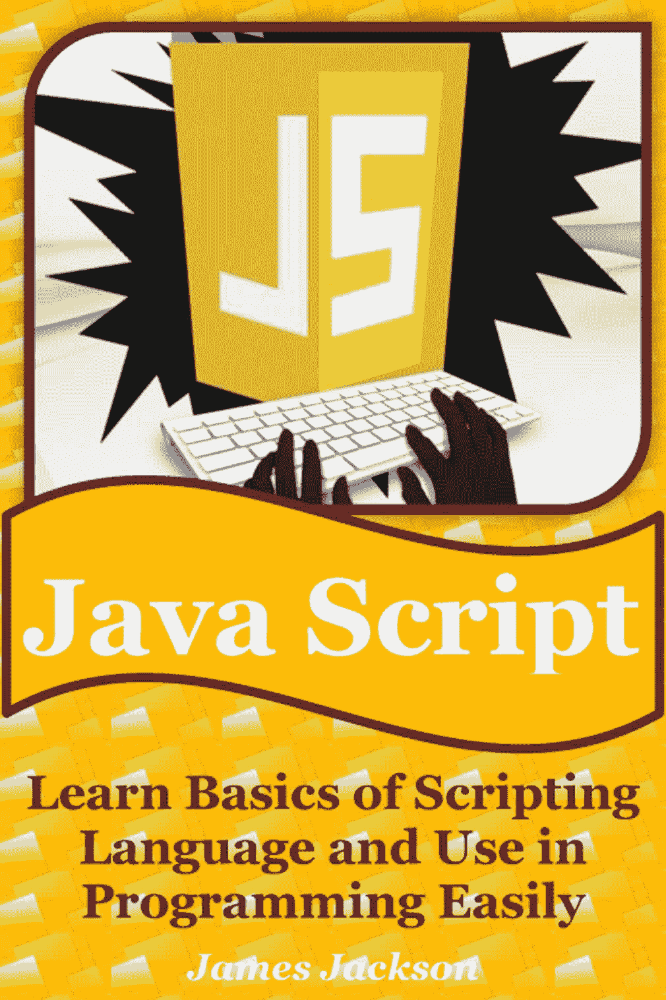
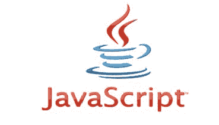
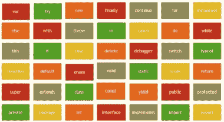
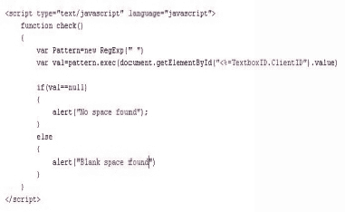
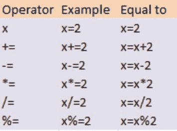
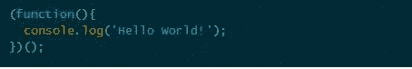
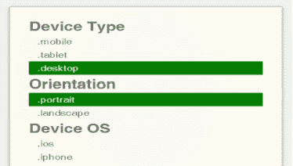

# JavaScript：轻松学习脚本语言基础并易编程编程（javascript 高级指南、javascript 算法、javascript 和 jquery、javascript 初学者指南、javascript 面试）



## 目录

- 引言

# 引言



JavaScript 是已知最古老且今天仍被程序员们广泛使用的编程语言之一。这门语言最迷妙的地方在于，与其他编程语言相比，它相对简单。`JavaScript` 是你作为程序员在早期学习的一门非常基础的语言。它具有创建复杂项目所需的灵活性。这种语言易于操作且功能丰富，使其成为目前市场上最简单且功能最强大的编程语言之一。

与其他编程语言一样，你首先应该关注的是这种语言的基本元素。精通 `JavaScript` 的构建模块从长远来看将大有裨益，并帮助你编写复杂的代码。

`JavaScript` 经常与另一种编程语言 `Java` 混淆，但两者是两种完全不同的面向对象的编程语言。`JavaScript` 由在 Netscape 工作的程序员 Brendan Eich 在 10 天内编写的。该原型是为了补充当时包含在 Netscape 网页浏览器 `Navigator` 中的 `Java`。该语言最初命名为 `Mocha`，但在 1995 年 9 月更名为 `LiveScript`。12 月，在与 `Java` 语言的所有 Sun Microsystems 公司达成协议后，`LiveScript` 被重命名为 `JavaScript`。

直到目前为止，已经出现了数十万 `JavaScript` 程序员，而且每一位 `JavaScript` 程序员在早期阶段都会犯一些错误。学习如何避免这些错误并学习以正确的方式编写代码至关重要。你可以将 `JavaScript` 视为学习其他不同编程语言的第一步。一旦你清晰掌握了 `JavaScript`，你会发现掌握其他语言将变得简单得多，这会让你感到惊喜。

那么，让我们开始吧好吗？

# 第一章

## 语法

在 `JavaScript` 中你首先需要知道的是 `Syntax`（语法）。`Syntax` 是一套规则，规定了任何用 `JavaScript` 编写程序的编写和解释方式。

### 语法基础



如果你对编程世界完全是新手，那么你应该知道，每种编程语言都由一组特定的规则组成。这些规则按照顺序执行，以创建一个结构化的蓝图，计算机能够识别并执行它。当我们谈论计算机程序时，从简单来说，我们指的是一组指令，告诉计算机要做什么以及执行什么。

这些指令通过各种规则给出，这些规则被称为 `Syntax`。简而言之，`Syntax` 是定义 `Fixed Values`（固定值）和 `Variable Values`（变量值）的规则集。

想象你正在大学的一门新课上课，老师进来并在黑板上写下以下信息：“21 read 14 6 to problems to 35 do pages and.”你会感到非常困惑。尽管你认识这些单词，但你不知道该对它们做什么，因为它们不是你所认识的顺序或格式。这是因为这位假设的教授没有遵循英语的 `Syntax` 规则。如果教授写道：“阅读第 21 到 35 页，并完成第 6 到 14 题，”你就确切知道该做什么了。

你的计算机也是如此。如果你不使用正确的顺序和格式，计算机将不知道如何继续运行你的程序并停止，通过产生错误来告诉它不理解你想让它做什么。

最基本的元素包括但不限于 `Statements`（语句）、`Variable Naming`（变量命名）和 `White Space Syntaxes`（空白语法）。

在处理编程语言时，所有的指令都称为 `Statements`。

在继续学习语句之前，有一些你需要知道的事情。

### JavaScript 是区分大小写的

`JavaScript` 实际上是一种对区分大小写的语言。对于那些已经学习过多种编程语言的人来说，这可能会引起一些困惑。我们知道有很多语言是不区分大小写的。在 `JavaScript` 中编写代码时，你始终必须以大写字母开头构造函数的名称，后面跟着函数名。

### 空格



如果你浏览过一些示例代码，可能已经注意到空白区域的存在。这些空格、制表符和换行被称为 `Whitespace`（空白字符）。与其他语言与 `JavaScript` 之间的核心区别之一是，在其他语言中，留出多少空白空间并不重要，但在 `JavaScript` 中，`whitespace` 直接影响程序的语义。

### 分号的重要性

`JavaScript` 中编写的语句大多由分号隔开。在 `JavaScript` 中编写代码时起作用的一个关键因素是一个名为 `Automatic Semicolon`（自动分号）的特性。该特性存在于语言中是为了让用户更方便一点。它的工作原理是，每当在解析新行之前写了一条语句时，第一条语句将被视为完整且正确的，就像那里放置了分号一样。你始终拥有调整设置的选项以防止自动插入。如果你喜欢在代码中手动插入分号；这将消除不必要的分号插入。

### 深入探析语句

`JavaScript` 中的语句由各种组件组成。它们创建了语言本身的命令和指令。上面的图表显示了 `JavaScript` 中最常见的语句类型。

- `Values`（值）
- `Operators`（运算符）
- `Expression`（表达式）
- `Keywords`（关键字）
- `Comments`（注释）

上述组件是 `JavaScript` 的一些最基础元素。我们现在将简要介绍每一个。

### Values

在 `JavaScript` 语法中进行编程时，你会面对两种类型的值。即：

- `Fixed Values`（固定值），也称为字面量。
- `Variable Values`（变量值），具有可变化的变量。

### Fixed Values Rules

在处理固定值时，有两个规则你应该记住：

- 数字可以带小数点写，也可以不带。例如：`10`，`10.10`。
- 字符串（文本）可以用双引号或单引号写。例如：`"I am Jim"`，`'You are Henry'`

### Variables Rule

编写 JavaScript 变量时遵循略有不同的规则（变量是存储数据值的容器）。`var` 关键字用于声明变量。此外，等号（`=`）用于向声明的变量赋值。

例如：

```javascript
var a;
a = 9;
```

（将 a 定义为一个变量，并给 a 赋值为 9）

同样，你也可以将字符串放入变量中。

```javascript
var food = "I Love Food";
```

正如我们之前提到的，空白在 JavaScript 编程中起着重要作用，在这种情况下，引号内的空白将作为空格起作用。

```javascript
var food = " I Love Food" ;
```

在命名变量时，请使用具有意义的单词，而不是片段或缩写。考虑一下你是否想创建一个变量来处理你想要入读的大学的名称。你可以这样定义你的变量：

```javascript
var schlnam;
```

这是一个有效的命名方案。但是，当需要调试你的代码以使其运行得更好时，你可能不记得那个变量的含义了。相反，将其定义为：

```javascript
var schoolNames;
```

就能清楚地表示该变量的作用和它所包含的内容。

请记住，在 JavaScript 中创建变量时，变量名通常不大写。这是因为 JavaScript 是一种大小写敏感的语言，大写字母被留给对象类型，例如 `Strings`。这并不是说变量名中不使用大写字母。在创建包含多个单词的变量时，使用大写字母可以使其更易读。请考虑以下情况：

```javascript
var schoolnames
```

或者

```javascript
var schoolNames
```

通过将第二个单词大写化，可以让变量名更容易被识别。

# JS 运算符

JS 中有七种不同的算术运算符用于计算值。这些运算符包括加法（`+`）、减法（`-`）、乘法（`*`）、除法（`/`）、取模（余数）（`%`）、自增（`++`）和自减（`--`）。

你可能已经对加、减、乘、除这些普通的数学运算符很熟悉了，所以我们将只介绍你可能不知道的三个。

取模用于返回一个数字除以另一个数字后的余数。自增用于给数字加 1，自减用于从一个数字中减去 1。

考虑以下 `y = 5` 的情况。

对于 `x = y % 2`，`x` 的值为 `1`。这是因为 `5/2 = 2`，余数为 `1`。对于 `x = y % 3`，`x` 的值为 `2`。

在使用自增和自减时，`++` 或 `--` 的放置位置会影响最终的值。

`x = ++y` 和 `x = y++` 的这两种计算对 `x` 将产生不同的结果，因为 JavaScript 会按照顺序执行操作。

在 `x = ++y` 的情况下，JavaScript 说：好的，首先我必须自增 `y`，然后我将该值赋值给 `x`。所以最终的值是 `x = 6`，同时 `y = 6`。

在 `x = y++` 的情况下，JavaScript 会先将 `y` 的值赋值给 `x`，然后自增 `y`。使得返回值为 `x = 5` 和 `y = 6`。

自减运算符 `--` 也类似。如果你说 `x = --y`，那么 `y = 4` 且 `x = 4`。如果你说 `x = y--`，那么 `y = 4` 但 `x = 5`。

在使用内置数学运算符进行简单计算时，括号起着重要作用，因为它们决定了计算的顺序。

例如：

- `3 * 2 + 6`

此计算将打印值 `12`，因为乘法的优先级更高。

- `3 * ( 5 + 3)`

此计算将给你一个值 `24`，因为括号的存在将强制程序计算括号内的值，然后将其与外部的值相乘。

编写较长的代码时，你有时想确保你的代码更具可读性，这是通过使用 Tab（制表符）实现的。当你在编码时使用 tab，它不会阻碍或改变代码的读取或执行方式，但它会让你和你的团队其他成员更轻松地阅读它。

例如：

```javascript
var food = " I Love Food()

{
console.log( 'hello');
};
```

# JavaScript 表达式简述

当我们谈论 JavaScript 中的表达式时，我们不是在讨论程序在难过或开心时如何反应！在 JavaScript 中，我们通常将表达式指的是运算符、变量和值的组合，计算机在处理程序时会读取所有内容。计算过程被称为求值（evaluation）。

例如：

`2 * 10` 求值为 `20`

JavaScript 非常灵活。在进行计算时，你不局限于仅使用固定数字。你甚至可以使用变量来计算某些内容。

例如：

`X * 24`

另一个示例：

```javascript
var food = 14;
2 * food
```

这将返回一个值 `28`，因为在计算过程中，`food` 的值被读取为 `14`，因为它的值在上一行已经声明过了。

在表达式中可以使用的值不限于数字，你也可以使用字符串。

`"Alpha" + "Delta"`

这将求值为 `"Alpha Delta"`

# 什么是 JavaScript 关键字？

关键字（Keywords）是预装在 JavaScript 数据库中的命令标识符。关键字告诉浏览器执行特定操作。例如，我们用来创建新变量的 `var` 命令实际上就是一个关键字。它告诉浏览器需要创建一个新变量。

例如：

```javascript
var a = 8 + 9
```

创建了一个新变量。它具有 `8 + 9` 的计算值，即 `17`。

```javascript
var b = a * 10
```

在这里，变量 `b` 赋予了值。结果是 `170`。

# 注释

注释（Comments）是用于在代码中说明说明的文本。它们不会被执行。

在 JavaScript 中，你可以使用 `//` 进行单行注释，或者使用 `/* ... */` 进行多行注释。

# 标识符

标识符（Identifiers）用于命名变量、关键字和函数。标识符可以是字母、数字、下划线（`_`）或美元符号（`$`）。使用这种命名方式的标识是合法的名称。

例如：

```javascript
var a;
```

# 第二章

## 基础运算符介绍

JavaScript 中的基础运算符由符号和标记创建。我们已经熟悉了一些运算符，例如用于给变量赋值的等号。

例如：

```javascript
var a = 8;
var b = 9;
```

上述两行的含义是变量 `a` 和 `b` 被声明，并向它们分配了值。在这种情况下，`a` 的值为 `8`，`b` 的值为 `9`。

同样，JavaScript 在脚本内部内置了一些其他基础数学运算符。让我们看看以下四个：

- 加法运算符（`+`）
- 乘法运算符（`*`）
- 除法运算符（`/`）
- 减法运算符（`-`）

每个运算符的工作方式与它们在计算器中的方式相同。

例如：

```javascript
var a = 10;
var b = 5 ;
```

`a / b`

这是一个简单的除法，将 10 除以 5 得到 2。

`a + b`

此操作执行加法，10 + 5 得到 15。

`a - b`

此操作执行减法，10-5 得到 5。

`a * b`

这是一个基础乘法，10 * 5 = 50。

除了基础运算符，这里还有：

不同类型的赋值运算符（用途：为变量赋值）



图中的示例都是数字，但运算符不仅局限于数字。

拼接（Concatenation）允许你将两个独立的字符串组合在一起，并使用 `+` 运算符或 `+=` 赋值运算符转换为字符串。

### 示例

```javascript
var Spray = "Hello" ;
var Body = "World" ;
console.log(Spray + " " + Body);
```

这将输出“Hello World”

### 示例 2

```javascript
var a = "I am "
var b += "Legend"
```

结果将是：`I am Legend`

此外，你也可以将一个字符串和一个数字相加：

`X = "3" + 1`（结果将为 `31`，而不是 `4`）

`X = "Jessica" + 1`（结果为 `Jessica1`）

结果将是一个 `String`。

与其他编程语言不同，处理 `Strings` 的运算符与处理数字的运算符的行为差异很大。深入理解两者之间的核心区别对于确保它们被正确使用至关重要。

例如，在使用这两种类型的运算符时，你会注意到的主要区别之一可以在使用加法运算符时发现。

查看以下示例：

考虑我们正尝试将一个数字和一个字符串相加。

#### 示例 1

```javascript
var Bar = 5;
var Legal = "6"
console.log (Bar + Legal)
```

这里的输出将是 `56`。

如果你想强制字符串作为简单的数字处理，可以在字符串变量前面添加 `Number` 关键字。

#### 示例 2

```javascript
X = 1 + Number("6")
```

在这种情况下，结果将为 `7`。

#### 示例 3

```javascript
var Bar = 5;
var Legal = "6";
console.log (Bar + Number(Legal))
```

该语句的输出是 `11`。

这些示例展示了 JavaScript 如何允许你手动完成数字到 `Strings`、`Strings` 到数字或 `Boolean` 值到数字或 `Strings` 的类型转换。

我们已经向你展示了如何使用全局 `Number()` 方法将 `Strings` 转换为数字。类似的方法可以将数字转换为 `Strings`。这使用了全局 `String()` 方法。查看以下示例。

#### 示例 4

`String(3.14)` 将数字 `3.14` 转换为 `String`。

`String(x + y)` 将表达式 `x + y` 转换为 `String`。

你可能会奇怪为什么要把数字转换为 `String`。在某些情况下，你可能希望保留数字到特定小数位的精度。由于计算机通过将数字转换为二进制再转换回来的方式处理数字，当你仅使用数字类型时可能会丢失精度。在这种情况下，将值保留为字符串可以确保你的值不会丢失任何准确性。

你也可以将 `Boolean` 值转换为数字或 `Strings`。

`Number(TRUE)` 将返回值 `1`

`Number(FALSE)` 将返回值 `0`

`String(TRUE)` 返回一个 `String`，`"true"`

`String(FALSE)` 返回一个 `String`，`"false"`

### 逻辑运算符

当你面临需要编写仅根据两个或多个条件的结果才能运行的代码场景时，你需要利用 JavaScript 框架中内置的逻辑运算符。逻辑运算符是 `AND`（`&&`）、`OR`（`||`）运算符和 `NOT`（`!`）运算符。它们通过比较每次比较得到的 `Boolean` 值来工作。只有两个 `Boolean` 值：`TRUE` 和 `FALSE`。

例如：

`X && Y`

如果 `X` 和 `Y` 都为真，则 `AND` 运算符的结果为真。

如果（`X` 或 `Y`）或两者都为真，则 `OR` 运算符的结果为真。

### 运算符示例

```javascript
!X
```

如果 `X` 不为真，则 `NOT` 运算符的结果为真。

为了更详细，这里有更多 `AND`、`OR`、`NOT` 运算符的示例。

### 示例

```javascript
x = 5
Y = 0
(x>3 && y<3) // 返回 true，因为 5 大于 3 且 0 小于 3。

X=3
Y=2
(X==3 || y==3) // 返回 true，因为 3 = 3。比较中的 y 部分为假没有关系，因为 OR 只关心其中一个或另一个为真。

X=1
Y=5
!(x==y) // 返回 true，因为括号内的条件为假。假的对面是真。
```

`AND` 运算符的功能是允许代码仅在发现给定的两个条件均有效时运行。

另一方面，`OR` 运算符仅在发现给定的条件中有一个有效时才允许代码运行。

最后，`NOT` 运算符在发现给定条件为假时允许代码运行。

从上一个示例中，你看到了 `==` 符号。这是比较运算符之一。

比较运算符用于比较操作数。如果比较结果为真，将返回一个逻辑数字。或者，如果结果为真，则将执行某操作。

例如：

```javascript
if (gender == "Female") Text = "抱歉，我们的内容仅供男士"
```

在我们用于逻辑的示例中，我们使用了比较运算符。如果比较结果为真，将返回一个逻辑数字。

### 条件语句

如果你想在特定条件下赋值，可以使用 `if` 和 `else` 块。

另一种方法是使用三元运算符。它的语法是：

`filename = (condition) ? value1 : value2`

### 总结

`AND` 运算符的功能是允许代码仅在发现给定的两个条件均有效时运行。另一方面，`OR` 运算符仅在发现给定的条件中有一个有效时才允许代码运行。最后，`NOT` 运算符允许代码在发现给定条件为假时运行。

从上一个示例中，你看到了 `==` 符号。这是比较运算符之一。

比较运算符用于比较操作数。如果比较结果为真，将返回一个逻辑数字。或者，如果结果为真，则将执行某操作。

例如：

```javascript
if (gender == "Female") Text = "抱歉，我们的内容仅供男士"
```

在我们用于逻辑的示例中，我们使用了比较运算符。

# 第三章

## 循环

在下面的示例中，我构思了一个场景：我想向东边走 8 步。代码看起来如下所示：

```javascript
for ( step = 0 ; step < 8 ; step++){'walk east one step'}
```

上面的代码是一个简单的程序，它从 `step` 0 开始运行，在每走一步后，它都会给 `step` 变量增加一个值，使其增加 `+1`。循环会一直运行，直到 `step` 变量的值达到 7，此时程序停止。

使用循环是有趣的，而且你应该很高兴地知道，这并不是你所可以使用的唯一循环类型。事实上，根据任务的不同，你可以使用多种不同的循环语句。

所有的循环都分为两类：前置条件（pre-condition）和后置条件（post-condition）。在前置条件循环中，在处理循环内部的代码之前会先进行条件的检查。这意味着如果条件不满足，循环可能完全不会运行。在后置条件循环中，条件会在循环运行后才进行检查。这意味着循环至少会运行一次。在考虑你想使用哪种循环时，记住这一区别非常重要。

现在让我们来看 JS 中不同类型的循环。

### For 循环

`For` 循环是前置条件循环的主要示例。该循环非常简单，会不断重复，直到指定的条件成立，换句话说，直到指定的条件被判定为假。

`For` 循环的结构如下：

```javascript
for( [initialExpression] ; [condition] ; [incrementExpression])
{
    Statement
}
```

例如，假设我们想打印五次字符串 `Hello World!`。我们可以通过重复五次命令 `console.log("Hello World!");` 来实现，也可以创建一个如下 `for` 循环：

```javascript
for (var i = 0; i < 5; i++) {
    console.log("Hello World!");
}
```

每当 `For` 循环的条件满足时，内部会发生以下过程：

- 如果满足条件，则将执行初始化表达式（如果有）。在上面的示例中，初始化表达式将变量 `i`（作为计数器）设置为 0。
- 之后，将评估给定的条件。如果发现条件为真，则循环将继续执行，直到达到给定条件看起来为假的状态，在这种情况下循环将停止。但是，如果条件表达式被完全移除，则循环将无限执行下去。条件是 `i` 应该小于 `5`。
- 一旦循环执行完毕，它将会在内部查找需要运行的语句。如果你想在循环中有多个语句，可以使用块语句 `{…}` 将这些语句特别地分组成。
- 一旦语句运行完成，循环将查看 `incrementExpression`，在其中它将更新 `Initial Expression` 并不断地重复该循环。在第一次循环中，`i = 0`。在第二次循环中，`i = 1`。因此，你可以看到需要五次循环条件 `i < 5` 返回布尔值假（0, 1, 2, 3, 4）。在第六次循环中，`i` 将等于 5，导致条件为假。需要注意的是，你也可以对条件使用任何比较运算符。通过这种方式，`for(var i = 0; i < 5; i++)` 和 `for (var i = 0; i <= 4; i++)` 运行循环次数将相同。

使用 `For` 循环的正确方法是：

```javascript
for (statement a; statement b; statement c) {
    code block to be executed
}
```

`statement a` 在代码块开始之前执行。`statement b` 是运行循环的条件，`statement c` 在每次代码块执行后执行。（JavaScript For Loop，来自 W3school.com）

需要记住的一点是，你不一定需要使用增运算符来更改条件变量。你也可以使用递减运算符，这允许你执行倒计时。考虑以下代码：

```javascript
for(var i = 30; i >= 0; i--)
{
    await sleep(1000);
    console.log(i);
}
```

这段代码将从 30 倒计时到 0，每秒打印一个数字。你也可以在没有 `console.log` 命令的程序中使用此代码设置内部计时器，使其成为延迟另一个函数的方便方法。

你还可以使用 `for` 循环遍历 `Array` 来寻找某个值。假设你有一个 `Array`。你创建一个 `for` 循环来遍历 `Array` 并寻找某个值。

```javascript
for (i = 0; i < a.length; i++) {
    if(a[i] == theValue) {
        console.log("true");
    }
}
```

### Do/While 循环

`Do/While` 循环是后置条件循环。循环会不断重复，直到条件为假。

```javascript
do {
    code block
}
while (condition)
```

示例：

```javascript
do {
    i += 1;
    console.log(i);
} while (i < 5);
```

### While 语句

与 `do while` 循环不同，`while` 语句只有满足条件时才会执行。这使其成为前置条件循环。

```javascript
while (condition) {
    code block
}
```

示例：

```javascript
n = 0;
x = 0;
while (n < 3) {
    n++;
    x += n;
}
```

### Label 语句

`label statement` 可以描述为特定循环的看板。一旦你使用标签语句命名了循环，你就可以在程序中使用名称引用它，之后你可以使用 `break` 或 `continue` 语句来运行或中断执行。

其结构为：

```javascript
Label :
    Statement
```

或者

```javascript
markLoop:
while (theMark == true) {
    doSomething();
}
```

### Break 语句

`break statement` 用于终止循环的执行。它可以单独使用，也可以与标签循环配合使用。当它与标签语句配合使用时，它会终止指定标签的操作。另一方面，当它单独使用时，它会立即终止最近的 `while`、`do/while`、`for` 或 `switch` 语句。

其结构为：

```javascript
break;
break label;
```

示例：

```javascript
for( i = 0; i < a.length ; i++ ) {
    if(a[i] == theValue) {
        break;
    }
}
```

### Continue 语句

该语句可以描述为 `break` 语句的相反兄弟语句。它拥有 `Break` 语句的所有特征。该语句也可以与标签（label）语句结合使用，也可以单独使用。唯一的区别在于：它不是终止执行，而是实际上继续执行过程。当与标签配合使用时，它将继续执行被标记的语句。当单独使用时，它将继续最近的闭包语句，然后执行紧后的下一条语句。

以下是语法：

```javascript
continue;
continue label;
```

或者

```javascript
i = 0;
n = 0;
while (i < 5)
{
  i++;
  if (i == 3)
  {
    continue;
  }
  n += i;
}
```

上面的示例是一个包含带有 `continue` 语句的 `while` 循环的代码。这里的代码只在 `i` 的值为 3 时才会执行。

### For…in 语句

该语句遍历特定变量在对象的所有可枚举属性。这种循环允许你访问对象的键（keys），但没有提供对键的引用。这种区别非常重要，因为这意味着当值存在时你可以执行操作，但它不允许你操作该值。

语法为：

```javascript
for (variable in object)
{
  Statement
}
```

### For…of 语句

如果你想浏览其他对象的索引，例如 `Array`、`Map`、`Set`、`Arguments` 等，则可以使用这种循环。该语句允许你调用自定义迭代钩子，这些语句对于对象的每个独特属性都是独立的。创建 `for...of` 的原因是，当对 `Arrays` 使用 `for...in` 时，可能会得到意料之外的额外属性。这使得 `for...in` 在 `Arrays` 上的使用是不安全的，因为当你遍历它们时，可能会获得导致抛错误的返回值。

基本语法为：

```javascript
for (variable of object)
{
  statement
}
```

### 一些需要避免的常见错误

- 在设置循环条件时，请记住运算符（`<`）（`>`）和（`==`）的正确用法。任何一个运算符的简单误用都会破坏整个程序。
- 当使用标签语句时，确保使用易于记忆的名字，以便将来能够方便地访问它们。
- 仔细观察你使用 `break` 和 `continue` 语句的情况。请注意，这两个语句只会影响该特定括号内的代码。

### 练习

- 编写一个使用 `For` 循环的简单程序。
- 描述 `For` 循环的工作机制。
- 编写一个使用 `break` 和 `continue` 语句的简单程序。
- 编写一个使用 `label` 语句的简单程序，并在程序的后续调用被标记的语句。

# 第四章

## JavaScript 函数与作用域基础

现在让我们来看看，通常当我们谈论一个“函数”时，你脑海中浮出的第一个词是什么？显然是一个活动对吧？

JavaScript 中的函数也以类似的方式工作。函数是程序需要重复执行的代码块。函数被用于执行特定的任务。函数可以包含任意数量的参数和语句；它们甚至可以为空。取决于代码结构的如何编写，它可能会向用户返回任何值，也可能不。

函数以如下方式声明：

```javascript
function name() { /*要执行的代码块*/}
```

要启动函数，我们从 `function` 关键字开始，然后添加名称和括号。要完成函数，我们将要执行的代码块放在大括号中。

你也可以将函数放在一个具命名的变量中：

```javascript
var jam = function() {/*要执行的代码块*/}
```

下面是你可以执行函数的几个示例：

i) 这是一个最基础函数的示例：

```javascript
var sayHello = function(person, greeting) {
  var text = greeting + ' , '+ person;
  console.log(text);
};

sayHello (' Jessica', ' Hello');
```

ii) 这是一个返回值的函数示例：

```javascript
var greet = function (person, greeting)
{
  var writing = greeting + ' , ' + person ;
  return function () {console.log(text); };
}

console.log(greet('Richard',' Hello'));
```

iii) 有时，你可能想使用嵌套函数。（注意：嵌套函数是函数内部的函数。）

```javascript
var sayHi = function( person, greeting) {
  var text = greeting + ',' + person;
  return function() {console.log (text);}
};

var greeting = greet( ' Richard', 'Hello');
greeting();
```

### 自执行匿名函数

程序员们一直在寻找最先进、最巧妙的方法来改进他们的编程体验，并让编程更易上手、更容易。这导致了自执行匿名函数（Self-Executing Anonymous function）的诞生。

自执行匿名函数的核心目的是创建一个 JavaScript 函数并在创建时立即执行它。

这对于处理大型程序的程序员来说变得容易得多。同样，它将帮助你在不创建混乱的全局命名空间的情况下编写代码。

一个基本的自执行匿名函数如下：



如果你计划编写复杂的代码，理解如何使用这种函数是非常重要的。使用自执行匿名函数可以产生一些易用的优秀代码。例如，jQuery 库的设计是为了让 JavaScript 变得更加简单。它通过将整个库封装在一个大的自执行函数中来实现这一点。

### Typeof 运算符

你可能会遇到需要确定正在处理的变量类型的情况。你不需要找夏尔克·福尔摩来寻找答案！相反，你只需使用 `typeof` 运算符来确定任何值的类型。

例如：

`myvar = 0; alert(typeof myvar)` // `"number"`

Number 不是唯一可以检测的操作数类型。它也可以是：string、Boolean、object、null 和 not defined（未定义）。

### 作用域 (Scope)

作用域是变量的可访问性。

在调试时，良好理解作用域是必要的，因为它让你知道是哪个代码块中的哪个变量导致了问题。

这里的简单规则是，每当你在作用域内部声明变量时，它只会被作用域内部的语句识别；作用域外的语句不会承认它的存在，因此该变量将无法工作。

另一种看待方法是将你的代码想象成一个酒店，特定的函数和代码段是酒店房间。酒店房间代表代码的私有作用域，而公共区域代表全局作用域。一个房间里的人看不到也无法访问另一个房间里的东西。在酒店工作的员工（以及全局作用域）也无法访问私人酒店房间。

因此，你可以看到作用域如何影响代码的运行。如果你需要两个不同的函数访问同一个变量，你需要确保它们都能访问该变量。确保必要的变量具有访问权限的一种方法是将你的变量变为全局可用。

如果你想让你的变量变为全局可用，有两种可能的替代方案。

你可以做的第一件事是在给定的代码作用域之外声明变量，这将允许程序中的任何函数能够调用并识别它。

你可以做的另一件事是在作用域内声明变量，而不使用 `var` 关键字。如果该变量在相关代码块作用域外部的代码开头没有定义，那么该变量的行为将类似于全局变量。

示例：

```javascript
var foo = 'hello';

var talkHello = function() {
console.log(foo);
};

talkHello(); // 打印 'hello'
console.log(foo); // 也打印 'hello'
```

如你所见，变量 `foo` 在函数 `talkHello` 外部声明。这意味着 `foo` 是一个全局变量，任何函数都能访问它，因此当函数 `talkHello` 调用它时，它是可以访问的。

接下来的示例与第一个示例相反。这说明写在作用域之外的代码块无法识别该变量。

```javascript
var talkHello = function() {
var doo = 'hello';
console.log(doo);
};

talkHello(); // 打印 'hello'
console.log(doo); // 输出空日志。
```

在这个示例中，变量 `doo` 在函数 `talkHello` 内部被调用。这创建了一个仅该函数可以访问的私有变量，因此当命令 `console.log(doo)` 尝试访问它时，它返回一个空值。

### 需要避免的常见错误

- 始终记住，变量只能被特定作用域内的函数访问，在该作用域之外，变量是无效的。

### 练习

- 解释什么是作用域以及变量是如何受其影响的。
- 编写一个简单的程序来演示以下功能：
  a) 简单函数
  b) 有返回值的函数
  c) 作为参数（参数）传递的函数
- 解释自执行匿名函数（Self-Executing Anonymous Function）的概念并给出示例。

# 第五章

## JavaScript 的一些显著特性

许多新手在听到人们称 JavaScript 是一门给孩子的语言时，往往会感到有些失望。好吧，让我为你消除这个疑惑。首先，JavaScript 无疑是目前最强大的编程语言之一。它是 Web 开发所需的一项流行技能。

JavaScript 的美之处在于其简单而又复杂的呈现。多年来，它一直被许多开发者使用。它可以为他们的网页增添新鲜活力，范围从非常细微但重要的功能（如自动图片切换器），到增强美感的更复杂的设计。

以下是帮助 JavaScript 在人群中脱颖而出的几个特性。

### 集成浏览器支持

从一开始，JavaScript 的用户友好型本质就非常吸引人，它吸引了许多新程序员和专家。许多 Web 开发语言需要安装辅助的 Flash 插件才能访问 Flash 内容并在浏览器中运行。JavaScript 的用户大多可以免受这种烦恼，因为几乎所有浏览器都无一例外地接受 JavaScript 作为其核心脚本语言。这使得他们对该语言提供集成支持。在最关键的情况下，用户只需要小心地处理某些依赖 `DOM` 的特定任务，但除此之外，JavaScript 是完全可访问且免费使用的。

### 一种功能性且灵活的编程语言

对于喜欢在程序中使用大量函数的程序员来说，JavaScript 是一种享受。这是因为该语言中包含了多功能的处理技术，允许程序员决定函数的执行。JavaScript 使其处于函数式编程前沿地位的两个显著特性是：它赋予了程序员将函数赋值给任何变量的自由，并可以使用参数让一个函数接受另一个函数。这种深度的定制能力让喜欢在编程中拥有更多自由的程序员觉得更有趣。

### 在客户端和服务器端同时使用 JavaScript 的能力


由于 JavaScript 已经被 Web 浏览器正式认可为它们主要的开发语言，JavaScript 被赋予了管理权限以访问任何浏览器的文档模型对象（DOM）。这样做为程序员提供了另一个层面的自由。它允许程序员动态更改网页的结构。不仅如此，该语言还可以用于为网页添加各种有趣的特效。如果你正在使用 Alfresco，那么你太幸运了！因为 JavaScript 还允许在 Alfresco 中创建 Web 脚本。这让程序员能够轻松地向任何 Alfresco 服务器添加自定义任务。

当你将所有这些结合在一起时，JavaScript 确实是一门奇大的编程语言，既强大又易用。

### 自主检测浏览器和系统的能力



有时在编程时，你可能会遇到一些问题，并需要编写依赖于你正在使用的操作系统和网络浏览器的代码。

JavaScript 的设计非常智能，使其能够感知你正在使用的浏览器和操作系统。这允许你根据自己的需求轻松调整语言，从而轻松地执行所有依赖操作系统的操作。

### 对面向对象编程的多样支持

面向对象编程可能是如今编程语言的基石。程序员通常根据对对象处理机制的可访问性来选择语言。相比之下，JavaScript 有一套非常不同且独特的结构系统，决定了如何处理对象。它提供了海量的支持，同时保持了相对易于学习和使用。这鼓励用户以顺畅高效的方式编写更复杂的面向对象代码，而复杂性极小。

这是 JavaScript 始终处于程序员和行业名单首列的众多原因之一。

如果你对面向对象编程感兴趣，那么选择 JavaScript 绝不会出错。

# 结论

许多人认为，学习编程的唯一方法是回到学校或其他教育中心。但我并不认为这是事实。得益于在线通信的巨大进步，你可以通过网络教程和视频轻松学习并掌握任何新技能。那里供你掌握的信息是无尽的。

JavaScript 并不是只为天才和极客设计的程序。这是一门非常标准化的语言，任何人都可以学会。就像现实中的语言一样，这门语言也将帮助你开启无限的可能性和机会。

感谢购买本书并给我宝贵的时间。我希望这本书对你有所帮助，并希望通过这本书，你已经获得了 JavaScript 编程的所有基础知识，这将帮助你开启程序员的职业。

我鼓励你尽可能地练习 JS 编程。只要你投入，很快你就会成为你想成为的程序员。让抱负的火焰在你心中燃烧。记住，如果你真的想做这件事，在掌握这门语言之前，不要跳到另一种编程语言上。
