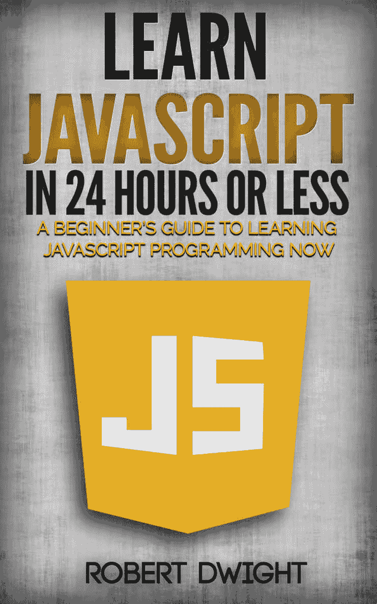

# JavaScript：在 24 小时内掌握 JavaScript - 学习 JavaScript 编程初学者指南





## 目录
- [引言](#
- [第 1 章：HTML 概述](#
- [选择文本编辑器](#
- [选择网页浏览器](#
- [什么是 HTML？](#
- [第 2 章：JavaScript 简介](#
- [将 HTML 和 JavaScript 结合起来](#
- [a. 内部 JavaScript](#
- [b. 外部 JavaScript](#
- [c. 即时 JavaScript](#
- [认识 JavaScript](#
- [存储信息](#
- [第 3 章：JavaScript 基础](#
- [数据类型](#
- [了解解释器在想什么](#
- [流程控制](#
- [If 语句](#
- [调试](#
- [调试时需要注意什么：](#
- [总结](#
- [第 4 章：函数与数据处理](#
- [数学优先级](#
- [新竞争者：取模运算](#
- [操作字符串](#
- [函数](#
- [返回值](#
- [优化：在可读性和简洁性之间找到完美平衡](#
- [全局与局部变量](#
- [第 5 章：循环与数组](#
- [For 循环](#
- [数组](#
- [一个小型项目：文本搜索](#
- [仍然困惑？](#
- [第 6 章：掌握流程控制](#
- [While 循环](#
- [Do-While 循环](#
- [If-Else If-Else](#
- [Switch 语句](#
- [复](#
- [第 7 章：更高效地管理数据](#
- [数组 - 快速回顾](#
- [二维数组](#
- [对象简介](#
- [自定义构造函数](#
- [第 8 章：探索对象](#
- [识别数据类型](#
- [区分对象](#
- [数据验证](#
- [在循环中遍历属性](#
- [结论](#
- [奖励：“Ruby：24 小时或更短学会 Ruby – 现在就开始学习编程初指南”预览](#
- [面向对象编程](#
- [基础知识](#
- [哈希表与数组](#
- [符号](#

# 引言
自 90 年代初以来，互联网已经取得了巨大的进步。随着成千上万的计算机连接到网络，如何有组织地将数据分配给不同的计算机成了一个难题。带着这一想法，蒂姆·伯纳斯-李（Tim Berners-Lee）创建了一个名为超文本传输协议（`HTTP`）的链接框架。除了 `HTTP`，他还创建了一种名为超文本标记语言（`HTML`）。

在现代浏览器中，大多数时候你不再需要输入 `HTTP` 或 `HTTPS` 来访问网站。你在浏览网页时也不会经常看到 `.html` 扩展名。这样做是为了简化普通用户的网页浏览体验。

正如你可能注意到的，网页开发者之间有一种趋势，即让网页浏览者尽可能简单。虽然 2000 年初对许多人来说已经足够，但随着闪眼、光亮的文本、按钮以及“点击此处进入”的 Flash 动画的出现，这些元素并没有准确代表当前极简主义、动态内容的趋势。旧网站要求你在每次点击按钮时加载并重新加载不同的网页，这阻碍了浏览体验，因为你必须不断刷新网页来检查更新的内容，导致很多数据在字段中丢失。简而言之，随着信息变得越来越密集和复杂，我们需要简化访问这些碎片化信息的方式，否则我们最终将淹没在数据的海洋中。

这本书不是参考指南，也不是一套枯燥的学术讲座；它是一本`JavaScript 编程`的实战教程，建立在当前网络技术构建的核心理念——简化的需要之上。

在继续之前，请问问自己这些问题：
- 你是否拥有一台具有功能浏览器和互联网连接的计算机？
- 你是否想学习如何创建能够智能与用户对话并实时添加新信息的网页？
- 你是否更倾向于友好的教程，而不是枯燥乏味的参考手册？

如果你对第 2 和第 3 个问题回答了“是”，那么这本书就适合你。如果你对第 1 个问题回答了“否”，你可能需要考虑下载 `Google Chrome` 或 `Mozilla Firefox`（两者都是优秀的浏览器）作为开始，否则示例代码可能无法按预期运行。

**注意：**
如果你真的希望通过这本书尽可能快地学习，我建议完成章节中所有的练习和活动。抵制那种不亲自尝试就略读示例代码的冲动——运行代码帮助你理解并应用所学知识。快速读完章节只会带给你浅层的知识——足以在晚餐会上让编程新手们印象深刻。

让我们开始旅程。

# 第 1 章：HTML 概述
`HTML`、`CSS` 和 `Javascript` 协同工作，为用户提供无缝的网页体验。许多初级开发者会将这三者搞混。如果你是网页开发领域的完全的新手，本章将带你快速了解 `HTML`。另一方面，如果你已经了解 `HTML`，可以随时跳过或略读本章。

## 选择文本编辑器
在开始创建交互式网页之前，你需要下载一个好的文本编辑器。虽然 Mac 和 PC 通常内置了可以以 `html` 格式保存文件的文本编辑器，但它们缺乏许多让网页开发变得更简单的实用工具，例如语法高亮和自动补全。尽管如此，以下是一些用于网页开发的最佳文本编辑器：


### 编辑器

1. **Atom** – `Atom` 是 Github 推出的一款较新的文本编辑器。它是免费、开源的，并且有许多自定义选项。基本上，`Atom` 就像一个可编程的文本编辑器；只要有合适的插件，它可以实现你几乎想要的任何功能。它的许多功能中，包括模糊查找（Fuzzy finder），它允许你通过简单的 `cmd+t` 命令跳转到不同的文件，以及丰富的主题选择。它支持 Mac OS X、Windows 和 Linux，且完全免费，所以请试用一下看它是否适合你。

2. **Sublime Text** – `Sublime Text` 的命名非常恰当，由于其直观的命令和美美的界面，它提供了极佳的写作体验。和 `Atom` 一样，`Sublime Text` 也具有高度可性，并支持 Mac OSX、Windows 和 Linux。它的试用版免费免费，但完整版费用约为 70 美元。

3. **Notepad++** – 因为其无与伦比的简单和快速，`Notepad++` 一直非常受欢迎。如果你只需要一个简单实用的文本编辑器，让你在不需要复杂的文件结构的情况下就能编辑几个 `html` 文件，你可以考虑尝试这款编辑器。但请记住，此编辑器仅适用于 Windows 系统。

4. **Brackets** – `Brackets` 是 Adobe 出品的一款非常独特的文本编辑器，因为它设计用于与 Adobe 的其他产品（特别是 Photoshop）协同工作。如果你在使用在使用 Photoshop 创建精美的用户界面，`Brackets` 允许你从创建的 `PSDs` 文件中无缝提取信息并将其转换为 `CSS` 代码。此编辑器支持 Windows、Linux 和 Mac OSX，所以如果你对网页设计感兴趣，你可能想在你的系统中安装它。

如果你并不打算为系统节省空间，我建议下载这四款文本编辑器并亲自尝试一下，前提是你运行的是兼容的操作系统。书中的练习和代码片段不需要特定的文本编辑器，所以你可以自由地在不同的编辑器之间切换，直到找到适合你需求的某一个。

### 选择网页浏览器

文本编辑器允许你创建和保存 `html` 文件，而网页浏览器允许你查看这些文件。遗憾的是，有时你创建的网页在不同浏览器上查看时显示和行为可能有所不同，因此以下是你需要在系统中安装的浏览器：

* **Google Chrome** – 因为速度快且简单，`Google Chrome` 是最受欢迎的浏览器之一。通过其内置的开发者工具，你可以对构建的网站进行调试，并动态更改代码片段，这样你就能立即看到想要更改的行代码。
* **Firefox** – `Firefox` 自带一个名为 Firebug 的插件，其功能某种类似于 `Google Chrome` 的开发者工具。它还带有移动预览模式，基本上允许你看到你的网站在移动设备上查看时的样子。
* **Internet explorer** – 这不是一个可以在 Linux 或 Mac OSX 上安装的东西，在 Windows 中它是预装的。然而，如果你运行 Windows，你可能还需要用这个浏览器测试你的 `html` 代码，仅仅因为经常经常搞乱在 `Google Chrome` 或 `Firefox` 中运行正常的配置。
* **Vivaldi** - 这是一个较新的竞争者，第一个测试版仅于 2015 年发布，第一个稳定版发布于 2016 年。该浏览器之所以出现在这个列表中，是因为它是基于 `HTML5` 和 `Node.js` 等现代网络技术开发的。它也运行在 Mac、Windows 和 Linux 上，所以如果你正在寻找一个新的、前端的浏览器，可以尝试一下这个。

### 什么是 HTML？

`HTML` 基本上允许你以结构化的方式展示网站的内容。把它想象成一个建筑房屋的蓝图；它告诉你在客厅、浴室、厨房和其他房间将放在何处，以及它们如何和谐地相互连接。

学习一个 `HTML` 文件的结构非常简单；它的结构几乎像文章一样——你提供一个标题、骨骨结构以及在结构内连贯流动的内容。每当你阅读一篇文章时，标题会告诉你文章在论述什么，而内容是以特定的方式组织的，通常用一句引起你兴趣的话作为开头，随后是轶事、事实和数据、论点以及结论。当你开始编写 `HTML` 代码时，你会发现它的结构与你阅读或编写的文章是多么相似。

因此，创建一个 HTML 文件只需将文件保存为 `.html` 后缀名，非常简单。当你使用像 Microsoft Word 这样的文字处理器创建文档时，你会发现当保存文件时，文件名结尾会有 `.odt`、`.doc`、`.docx` 或类似的后缀。这告诉计算机以非常特定的方式读取和格式化文件内容。这是因为每当你使用文字处理器保存你创建的内容时，你不仅保存了你输入的字，还保存了你使用的字体大小、字体样式和其他格式样式，这样当你打开文件时，计算机就会检查文件扩展名，根据指定的扩展名读取内容，然后向你展示你创建的文件，确保它在保存后看起来完全一样。

`HTML` 的工作原理基本上相同，但这次你使用标签来告诉计算机如何处理标签包围的数据；这允许你轻松更改字体样式和其他方面。把 `HTML` 看作 Word 文档的更精确的版本。例如，看下面的文本：

| 这是一个句子。 |

如果你将它保存为 Word 文档，它不仅保存了文本，还保存了字体样式、大小和结构。你刚刚保存的文档属性被整齐地存储在文件中，并且仅通过文字处理器菜单访问。然而，如果你想以 HTML 形式显示同样的句子，该 `HTML` 文件看起来会像这样：

```html
<html><head></head><body><p>这是一个句子。</p></body></html>
```

通过以 `.html` 扩展保存此文件，你得到了一个显示“这是一个句子”的基础网页。注意，它与之前的文本框中的字符串相同，但包含了你可能熟悉或不熟悉的标签。当你的浏览器打开此文件时，它会理解标签并仅显示之前文本框中的内容；它不会向用户显示标签。最基本的标签如代码示例所示：

* `<html>` 标签 - 包含你网页中的所有内容。它是字面上的开头和结尾；永远不要忘记 `<html>` 标签，否则你的网站将无法正常！
* `<head>` 标签 - 保留标题以及主体可能使用的其他脚本。例如，如果你想使用一组规定使用字体类型、颜色等的设计协议（通常以 `CSS` 的形式存在），你可以将代码或其引用放在这里。
* `<body>` 标签 - 这是你的内容所在的地方。从文本、声音、图像到视频，一切都发生在这里。

### HTML 基础知识

现在你已经对 HTML 如何工作有了概览，我们将快速回顾一下基础知识，足以帮助你学习如何将 JavaScript 无缝集成到其中。

我们已经讨论了 HTML 文件就像带有额外标签的 Word 文档，所以让我们从一行简单的文本开始。在你的文本编辑器中输入以下内容：

| 你好！ |


现在在你的电脑上创建一个文件夹，用于存储所有创建的 HTML 文件，并将你刚刚输入的内容保存为 `.html` 扩展名（例如，“My First Website.html”）。程序员的一个标准做法是创建一个名为“Developer”的文件夹——这是你存储所有与编程相关文件的地方。你可以将其放在用户文件夹中。在 Developer 文件夹内部，创建一个名为“Web Development”的文件夹，目前将你所有的 HTML 文件都放在这里。如果你使用的是 TextEdit 或其他并非专门为 HTML 文件设计的文本编辑器，请务必检查设置并确保选中了“纯文本（Plain text）”格式。

现在，你已经创建了第一个 HTML 文件，使用你拥有的任何网络浏览器打开它，并亲眼看到一个简单的文本字符串出现在你眼前吧！但是，请注意，你在文本编辑器中输入的内容（称为“源代码”）看起来和浏览器显示的内容一模一样；它并没有包含 `<html>` 标签和其他内容。这是为什么呢？

现在，尝试通过添加几个标签来修改你的 HTML 文件。它看起来应该像这样：

```
| <!DOCTYPE html><<html>   <<body>      Hi Here!   </</body>></html> |
```

现在刷新你的浏览器看看发生了什么。

你的浏览器并没有故障；尽管源代码中添加了标签，但网页看起来几乎一模一样。此时，你可能还没有完全理解为什么要使用标签，但别担心；当你开始更多地学习 HTML 编程时，你就会知道它们的用途了。

## 结论

你刚刚完成了对 HTML 的首次尝试——虽然并不深入，但足够的基础知识可以帮助你正确地将 JavaScript 用于 HTML。如果你对学习更多 HTML 感感兴趣，你可能想查看在线教程和参考资料，并看看其他网页开发者是如何编写自己的网站代码的。你可以通过右键点击网站并点击“查看网页源代码”或类似的选项来实现。如果你已经准备好投入 JavaScript 的怀抱，请前往第 2 章。

# 第 2 章：JavaScript 简介

既然我们已经涵盖了 HTML 的基本要素，现在我们可以介绍以 JavaScript 为媒介的编程基础。在继续之前，请确保你至少理解 HTML 的骨架，否则请随时返回第 1 章再次快速浏览一遍材料。

## 组合 HTML 和 JavaScript

JavaScript 可以通过 `script` 标签方便地整合到 HTML 中。`script` 标签既可以包含 JavaScript 代码，也可以引用包含 JavaScript 代码的 `.js` 文件。在创建长 JavaScript 代码时，建议使用后者，以避免在一个文件中混用不同的编程语言——这就像在写文章时，有些段落用英语，另一些段落用拉丁语！然而，当你测试小的 JavaScript 代码段时，使用内部 JavaScript 是很有用的。

### a. 内部 JavaScript

如果你想在不创建 `.js` 文件的情况下使用 JavaScript，可以直接将 JavaScript 放在 `script` 标签内部，如下所示：

```
| <script>    alert("Hi There!");</script> |
```

将此内容按所示放入你的 HTML 文件中，查看你的第一个 JavaScript 代码弹出并向你问候吧！

```
| <!DOCTYPE html><<html>   <body>      <script>          alert("Hi There!");      </script>   </body></html> |
```

很酷，对吧？虽然这段代码简单易懂，但当你开始编写具有更复杂代码网站时，将不同的编程/脚本语言放在同一个文件中会变得非常难以管理。将 JavaScript 代码放在单独的文件是有意义的，这样 HTML 代码就能整洁且更容易维护。这正是外部 JavaScript 大显身手的地方。

### b. 外部 JavaScript

正如你可以从 HTML 文件中引用 CSS 文件以保持代码分离一样，你也可以将 JavaScript 保存在单独的文件中，并从 HTML 中引用该文件。为了使用保存在另一个文件中 JavaScript 代码，你只需要使用包含 `src` 属性的 `script` 标签，该属性引用你想使用的文件，如下：

```
| <script src="hello.js"></script> |
```

这段代码段将找到名为 `hello.js` 的文件并执行其中包含任何 JavaScript 代码。但是，请确保 JavaScript 文件与 HTML 文件位于相同的文件夹中。

### c. 即时 JavaScript 

如果你想在不修改原始源代码的情况下测试简短的 JavaScript 语句，可以通过右键点击网页并点击“检查（inspect element）”使用 Google Chrome 和 Firefox 提供的控制台。在控制台窗口/标签页中，你可以输入任何想要的 JavaScript 语句，按回车即可立即执行。你可以选择这种方法来测试书中的代码段，或者如果你喜欢更传统的方法，可以使用 `script` 标签编写你的 JavaScript 代码并刷新网页来更新输出。然而，在后续提供的示例和练习中，将使用使用控制台的现代方法。

## 认识 JavaScript

为了让你快速上手 JavaScript，你将尝试几行 JavaScript 代码。目前，我们将使用控制台来尝试命令（右键点击任何网页，点击检查，并找到控制台标签页）。在你测试后续代码时，请确保不要被动地将它们复制并粘贴到控制台中。观察这种语言的结构，并在检查之前对输出结果做几个猜测。这将有助于你更容易记住你所学的内容。

```

你刚刚创建了一个字符串，它基本上是字母、数字和其他符号的集合。即使只用一个字符串，我们也可以做很多事情，但现在，让 JavaScript 计算你的名字有多少个字母：

```
"Chris".length
```

你应该得到 5。虽如此，除了处理字符串外，JavaScript 还懂得数学运算。尝试将你的姓名的长度相加，例如：

```
"Chris".length + "Nicholas".length
```

这将给你 13。现在去使用实际数字进行尝试，并尝试乘法（`*`）、除法（`/`）和减法（`-`）。注意，虽然你目前为止输入的命令非常直观且容易理解，但与人类语言相比，编程语言需要更高的精度。例如，如果你尝试阅读以下内容：“Tihs is a Complx Stenence”，你能破解它的含义，但在编程语言中，即使你只是错放了一个点，最好也会收到一个错误——最坏会产生 bug。例如，尝试输入以下代码：

```
"Chris"l.ength
```

除了拼写错误和符号位置错误，另一种混淆解释器的方法是使用它不知道的命令，例如，如果你输入：

```
bacon
```

解释器会报错并说 `bacon` 未定义。因为你在没有加引号的情况下输入了 `bacon`，解释器认为你试图让它执行 `bacon` 命令，而这在目前的 JavaScript 库中并不存在。

如果你只想在代码中输入提示和描述怎么办？你可以通过在行开头输入 `//` 来告诉解释器忽略这些代码。例如：

```
//这是一条注释。解释器不在乎我在这里写了什么，即使是有效命令如//2+3//通过移除 '//'，2+3//你应该得到 5。
```


现在，你可能在疑惑，为什么在你只想让网站活跃起来时，我们却在用 JavaScript 处理字符串、数学运算和注释。但在你制作出惊人的动画、智能用户交互和其他动态功能之前，我们必须先打基础。现在，让我们通过创建你的第一个弹窗对话框来点趣吧：

```javascript
confirm('Hi! You’ve just made your first pop-up dialogue. Congratulations! Click OK to go further!');
```

在你点击 `OK` 后，你应该会在控制台中看到打印 `'true'`。这是因为 JavaScript 也可以记录用户输入，就像 `HTML` 一样。然而，JavaScript 的有趣之处在于，它不需要刷新页面就可以请求用户输入；它简单地弹出一个小的独立窗口向你提问，然后回到你正在操作的网页。这在用户填写完表单或决定删除某些内容后请求其确认时特别有用——因为不需要刷新网页，用户在点击 `OK` 或 `取消` 后可以回到之前的工作界面。

好了，到为止，你已经学会了编写第一个字符串、让 JavaScript 计算长度、执行数学运算、编写注释以及创建弹窗对话框。为了让网站实现真正酷炫的功能，它需要能够获取不仅仅是 `'true'` 或 `'false'` 的用户输入。考虑到这一点，让我们尝试让 JavaScript 询问你的名字：

```javascript
prompt('Hello! What’s your name?');
```

在输入名字后，你应该会在控制台中看到你输入的内容。做得好！

## 存储信息

每种编程语言都需要能够存储信息；否则它就无法进行计算和其他重要的操作，这也是计算机设计的初衷。到为止，我们只能够询问用户的名字，而没有对其进行任何操作。这是因为你的名字没有被存储，只是打印在了控制台中。让我们利用变量的力量，让它在询问名字后问候你：

```javascript
var name = prompt('What’s your name?');alert('Hi, ' + name + '! It’s nice to meet you.');
```

现在通过响应用户，你的程序变得更加人性化。如果语法让你感到压力，在我们深入学习 JavaScript 时，你会学更多关于 `alert()` 和 `prompt()` 函数的内容，以及如何编写你自己的函数。

## 结

恭喜你！你刚刚尝到了 JavaScript 的滋味！在下一章节中，我们将讨论你可以使用的信息类型以及如何对它们进行操作，这会变得更有趣。你还将窥见如何帮助程序做出决策，以及当程序没有按照预期方式运行时该怎么办。一次性吸收这么多量很大，所以休息一下，当你准备好深入学习 JavaScript 基础时回来。

# 第 3 章：JavaScript 基础

由于本章内容很多，以下是你可以学习内容的概述：

1. **数据类型**——JavaScript 如何分类信息。这很重要，因为知道你拥有什么类型的信息将告诉你可以对该信息做什么（例如，你不能用 5 去乘以苹果）。
2. **比较运算符**——让你比较某些类型的信息（例如，5 小于 10 吗？）。当你想要给计算机依赖某些条件的指令时非常有用（例如，如果年龄大于 18）。
3. `console.log()`——让你显示单行代码的输出——当你想要信息在程序中如何流动时有用。
4. **流程控制**——`if-else` 语句根据满足的条件给计算机不同的指令（例如，如果年龄大于 18 允许用户进入站点，否则显示错误消息）。
5. **调试**——当你的程序运行异常时（例如，拼写错了用户名或完全忘记了它），你需要找到代码的哪部分搞乱了程序的行为——这个过程被称为调试。当代码跨越数行时，这可能会变得令人生畏——知道从哪里查看会有帮助。

到为止，你已经使用 JavaScript 操作了字符串和数字。在编程世界中，这些信息类别被称为数据类型。

## 数据类型

数据类型简单地告诉计算机应该如何读取你的信息。例如，如果你在控制台中输入以下内容：

```javascript
"5" + "5"
```

你会得到 `"55"`。这是因为通过引号包裹 5，你是在告诉解释器你希望将 5 视为字符串而不是数字。那么，加法运算符不是相加两个数字，而是合并两个字符串。现在尝试删除引号，注意输出是如何变为 10 的。不同的数据类型可以做不同的事情，所以知道使用哪一个至关重要：

1. **字符串**——任何封装在引号中的内容最终都会成为字符串。这可以是字母、空格、数字、标点符号和其他符号的组合。
2. **数字**——自言明明；数字是你可以执行加法、减法、乘法和除法等的操作。记住不要加引号，否则你会把它们变成字符串！
3. **布尔值**——布尔值只有真（true）或假（false）的数据类型。这与字符串或数字不同，因为它帮助计算机根据是否满足某些条件做出决策。例如，如果你想防止未成年人注册你的站点，你需要某种代码来将未成年人和成人分开，如：

```javascript
var age = 17
```

## 比较运算符

到为止，我们讨论了三种数据类型（数字、字符串和布尔值），以及一些基础数学运算符（`+`、`,``*`、`/`）。然而，你刚刚测试布尔值使用的是比较运算符（`<` `>`, `=`），它们在管理程序流程中极其重要。以下是完整列表及其功能：

- `>` 大于
- `<` 小于
- `>=` 大于等于
- `<=` 小于等于
- `==` 等
- `!=` 不等于

要测试这些运算符，请将以下语句中的 `@` 符号替换为正确的运算符，使控制台输出为 true：

```javascript
console.log(5 @ 1);console.log(1 @ 5);console.log(5 @ 2);console.log(1 @ 6);console.log(5 @ 5);console.log(10 @ 5);
```

## 了解解释器在想什么

注意 JavaScript 解释器只会给你输入的命令的最新输出，所以如果你输入了三行应该有不同输出的代码：

```javascript
5 > 106 < 127 > 14
```

在控制台中同时执行这些内容，你只会得到最后一行的结果（false）。


相反，你可以逐行输入代码，这样你就可以看到每个命令的输出，但在处理较大的代码段时这会变得格外繁琐。当你处理更复杂的内容时，最终会遇到更多的错误和 Bug。当这种情况发生时，你会希望知道你输入的特定命令发生了什么，以便准确确定位问题所在的地方。

`console.log()` 会接收你放在内部的任何代码将其执行结果打印到控制台。如此，让我们来看看 `console.log()` 的实际运行：

```
console.log(5 > 10)
console.log(6 < 12)
console.log(7 > 14)
```

现在你可以看到每行代码的输出了！

## Flow 控制

你现在已经知道了最基础的数据类型、数学运算符、比较运算符以及一些有趣的控制台技巧。然而，为了让它们发挥作用，我们需要能够控制命令的流。例如，如果你想创建一个询问用户姓名、电子邮件、年龄和密码的用户注册表单，你首先需要声明变量：

```
var name;
var email;
var age;
var password;
```

现在我们需要存储用户的输入。目前我们使用 `prompt` 函数：

```
name = prompt('What’s your name?');
email = prompt('What’s your email?');
age = prompt('What’s your age?');
password = prompt('Please enter your desired password: ');
```

假设你已经在数据字段中输入了正确的信息，`name`、`email`、`age` 和 `password` 变量现在有了处理和存储所需的正确数据类型。但是，如果用户留为空，或者在年龄字段输入了字母怎么办？如果某些关键信息字段没有正确类型的数据，我们就不能让程序继续，因此我们使用控制语句。我们将讨论的第一个是 `if` 语句。

## If Statement

如果你以前写过程序，JavaScript 中 `if` 语句的结构和你熟悉的几乎相同：

```javascript
if (<condition>){    <action>}
```

如果你以前没有写过程序，`if`-语句基本上告诉计算机，如果 `if` 条件为真，则执行大括号 (`{}`) 内的任何操作。例如，如果我们想防止用户输入空字段，可以采取以下措施：

```javascript
name = prompt('What’s your name?');
if (name.length == 0){    name = prompt('You cannot leave this empty. What’s your name?');}
email = prompt('What’s your email?');
if (email.length == 0){    email = prompt('You cannot leave this empty. What’s your email address?');}
age = prompt('What’s your age?');
if (age.length == 0){    age = prompt('You cannot leave this empty. What’s your age?');}
password = prompt('Please enter your desired password: ');
if (password.length == 0){    password = prompt('You cannot leave this empty. Please enter your desired password:');}
```

对于初学者来说，这些代码看起来很复杂，但当你仔细阅读每一行时，你会发现它们遵循着非常清晰且逻辑结构：

1) 首先，由于 `prompt()` 函数返回用户输入的任何内容，你将字符串存储在变量中，以便稍后在程序中使用。
2) `if` 语句通过检查长度是否等于零来检查变量是否为空。
    a) 如果长度等于零，它会再次请求输入。
    b) 如果长度不等于零，它将不再请求输入。

注意，此示例代码仅用于说明 `if` 语句的工作原理。在任何情况下，都不应该一直使用 `prompt()` 函数向用户询问信息。

现在，如果你在第一个条件不满足时想做其他事情怎么办？例如，如果你想在用户输入有效姓名后说“你的名字是 <name>。收到了！”，那么我们就添加一个 `else` 条件，后面跟着第二对大括号，用于包裹第二组命令：

```javascript
name = prompt('What’s your name?');
if (name.length == 0){    name = prompt('You cannot leave this empty. What’s your name?');}else{    alert('Your name is ' + name + '. Got it!');}
email = prompt('What’s your email?');
if (email.length == 0){    email = prompt('You cannot leave this empty. What’s your email address?');}else{    alert('Your email is ' + email + '. Got it!');}
age = prompt('What’s your age?');
if (age.length == 0){    age = prompt('You cannot leave this empty. What’s your age?');}else{    alert('Your age is ' + age + '. Got it!');}
password = prompt('Please enter your desired password: ');
if (password.length == 0){    password = prompt('You cannot leave this empty. Please enter your desired password:');}else{    alert('Your password is ' + password + '. Got it!');}
```

现在你的代码听起来更具人性化了，因为它对用户输入的响应更好。尝试修改代码，看看解释器如何根据 `if-else` 条件改变输出。

## Debugging

到目前为止，你已经尝试了变量、数据类型、数学运算符、比较运算符、用户提示、对话框，最后是 `if-else` 语句。如果你犯了几个错误，不要担心；计算机本质上是字面意思，不会容忍语法错误。如此，这里有一些没有按预期运行的代码。修改以下代码片段，使其产生正确的输出！

```javascript
var name = "Chris";
alert('Hi ' + 'name' + '! It’s nice to you.');
```

在这个代码片段中，输出应该是“Hi name! It’s nice to you.” 现在的输出是什么？你认为代码哪里有问题？注意，当你执行这段代码时，控制台并不会报错抛出错误信息。这种问题被称为“Bug”，因为虽然 JavaScript 解释器认为代码没有问题，但它并没有按预期工作。

现在尝试修正这个包含 Bug 和错误的代码代码段：

```javascript
var name;
var age;
name = prompt('What’s your name?');
if (name.length = 0);{    name = prompt('You cannot leave this empty. What’s your name?');}else (name.length != 0){    alert('Your name is ' + name + '. Got it!');}
age = prompt('What’s your age?');
if (age.length = 0){    age = prompt('You cannot leave this empty. What’s your age?');}else (name.length != 0){    alert('Your age is Got it!');}
```

这段代码是之前示例代码的扭曲版本，你可以尝试对比代码并看看为什么它不起。如果你卡住了，可以查看一个名为“linter”的程序，这是一个非常实用的工具，它可以检查代码中的错误并告诉你是哪几行。现在练习调试技巧是很好的锻炼，因为当你创建更复杂的程序时，调试几乎是家常便饭。

### 调试时寻找什么

如果你不知道从哪里寻找，寻找 Bug 和错误可能会让你无所措。以下是程序员在编写代码时常见的几种常见的错误：

1. 使用 `=` 而不是 `==` 来比较两个值 - 编程中的 `=` 符号用赋值运算符，这意味着如果你用它代替 `==` 符号，你会将等式左侧变量的值替换为等式右侧的值。
2. 分号位置错误 - 就像句号在英语语言中结束句子一样，分号在 JavaScript 以及 C、Java 等其他编程语言中结束语句。例如，如果你不小心在语句中间放了一个分号，JavaScript 就会认为该语句是不完整的并对其产生错误。


### 3. 误用引号
引号告诉解释器你正在使用一个字符串，因此如果你将变量或数字括在引号中，你实际上是将它们转换成了字符串。当你尝试对这些被不小心括在引号中的数字进行数值运算时，这会导致异常情况。 

### 4. 函数拼写错误
正如我之前提到的，计算机是非常精确的，有时精确到近乎死板；它无法理解你任何拼错的内容。幸运的是，如果你拼写错了函数或语句，解释器会向你抛出一个错误，告诉你正在使用的表达式是未定义的（undefined）。

到目前为止，这些只是新手容易犯的最常见错误，但随着你练习编写复杂代码的增加，你应该能够很容易地发现 bug 和错误。 

## 总结

到为止，我们已经涵盖了很多概念，让我们回顾一下学到的内容：

### 1. 变量和数据类型 
- **数字 (numbers)** - 可以是整数或包含小数的数字（例如，`3.14`、`5`、`100`）
- **字符串 (strings)** - 任何你括在引号中的内容（例如，`"5"`、`"I am a JavaScript master"`、`"I love the number 7"`）
- **布尔值 (booleans)** - 真或假 

为了声明一个变量，只需输入：

```
| var <variable name> = <value>; |
```

如果你还没有值，也可以只声明变量名而不赋值：

```
| var <variable name>; |
```

JavaScript 并不在乎你放入什么类型的数据。如果你用过 C 或 Java，你可能习惯了声明变量的数据类型（`int`、`float`、`char` 等），但在 JavaScript 中，你可以毫无问题地向变量放入任何内容。 

### 2. 弹出框
- `alert("Hi There!")` - 你可以向用户弹出警报。
- `confirm("Are you sure?")` - 你可以向用户请求确认。
- `prompt("Type anything here.")` - 你可以向用户请求输入

### 3. Flow 控制 
- **if-else 语句** - 简单来说，如果满足第一个条件，则执行第一个括号范围内的所有操作并跳过 'else' 部分。否则，进入 'else' 条件的括号范围并执行其中的所有操作。 

恭喜！你通过 JavaScript 学习了大量的编程基础知识！如果你已经走了这一步，那么你应该能够轻松从容地完成接下来的几个章节。在下一章中，我们将深入探讨数学运算和子字符串的细节。休息一下，如果你准备好进一步深造，请继续进入第 4 章。

# 第 4 章：函数与数据操作

作为另一个内容密集的章节，这里是你可以预期学习的内容的快速概览：

1. **数学优先级 (Mathematical Precedence)** - 学习数学优先级可以帮助你确保数学运算（无论多复杂）都按照正确的顺序执行（例如，`5*(5+2)` 的输出结果与 `5*5+2` 不同）。
2. **取模运算符 (Modulo Operator)** - 该运算符给你一个数字除以另一个数字的余数。这种操作非常频繁，足以让它拥有自己的运算符符号（`%`）。
3. **字符串操作 (String Manipulation)** - 有时你不需要在代码中使用整个字符串，例如当你想要显示跨越数百行的文本预览时（如果完全显示的话）。
4. ****函数 (Functions)** - 函数允许你通过简单调用函数名来重复大量可能跨越数百或数千行的指令！
5. **优化 (Optimization)** - 每个人都倾向于更短的代码；它占用的空间更小，也更容易调试。然而，技巧在于通过详尽阐述保持代码的可读性，与通过几个语法“捷径”保持代码的短小简洁之间找到平衡。
6. **全局和局部变量 (Global and Local Variables)** - 某些变量只存在于函数内部，而在外部不存在——这些是局部变量。贯穿整个代码的变量被称为全局变量。

## 数学优先级

到为止，你处理了基本的数学运算符并只执行了单一操作。但在编程中，很少有人编写每行只有一个数学运算的程序。例如，如果你的网站想计算以分钟为单位的用户的年龄，你需要执行这样的操作：

```
| var age = prompt('How old are you?');alert('You are ' + age*365*24*60 + ' minutes old'); |
```

考虑到这一点，你必须确保操作按照正确的顺序执行。为了做到，你必须记住以下优先级规则：

1. `( )` - 任何括在括号中的内容都会先执行
2. `*` 和 `/` - 乘法和除法在加法和减法之前执行
3. `+` 和 `-` - 加法和减法最后执行

这里有几个练习可以帮助你直观理解数学优先级：

```
| 5 * 10 + 3 - 5 / 20 |
```

这将产生 52.75，因为乘法和除法符号的优先级高于减法符号。当你过程中添加括号时，情况发生了变化：

```
| 5 * 10 + (3 - 5) / 20 |
```

注意结果现在变成了 49.9，因为括号内的操作先执行。这是另一个例子：

```
| 5 * 10 + 3 - 5 |
```

现在答案变成了 2.4，因为括号内的内容在除以 20 之前已经完成了。括号内部遵循通常优先级规则，如果你想让低优先级的操作先发生，你需要将其括在括号中。

## 新成员：取模

在基础数学课上，有四个数学运算符。但在编程中，有一个第五个运算符叫做 `%`。当它放在数字之间时，它给你余数。编程需要简洁和精确，没有冗余符号和特征的空间，这意味着取模运算符存在很有理由。取模运算符的一个有趣应用是测试数字的奇偶：

```
| var num = prompt('Give me a number: ');if (num % 2 != 0){  alert('The number is odd.');}
```
``` |
```

### 陷阱警告：

新手程序员在尝试测试数字奇偶时的一个常见错误是检查两个数字的余数是否等于 1。乍一看这似乎合理，因为对于每个除以二的正数，余数只能是 1 或 0（例如，`13 % 2 = 1`，`12 % 2 = 0`）。然而，当你输入负数时，问题出现了；由于余数不再等于 1，程序开始异常运行。这类错误很容易犯，所以当你测试解决方案时，请确保使用各种输入彻底测试代码（在这个例子中，如果用户测试负数，他很容易发现这个陷阱）。

现在，尝试修改以下代码以显示“Greetings from planet JavaScript!”：

```
| if (14 % 2 != 0){  console.log("Greetings");}if (15 % 2 != 0){  console.log("to");}if (10 % 2 != 0){  console.log("from");}if (9 % 2 != 0){  console.log("atmosphere");}if (5 % 3 != 0){  console.log("planet");}if (20 % 2 != 0){  console.log("JavaScript");} |
```

## 玩转字符串

到为止，我们已经处理了数字，从执行常规数学运算到比较值，再到查看取模运算符的功能。现在，我们将玩转字符串并看看你可以对它们做些什么。


我们要做的第一件事是探索子字符串（substrings），它们基本上只是整个字符串的一部分。之所以子字符串之所以存在，是因为有时候人们只需要对整个文本进行简短的预览。例如，当你在线搜索任何内容时，结果页只会向你提供所列网站内容中的前几个单词，这让你能够快速、高效地浏览多个网站。这里的关键词是“预览”——你并不希望用过量的信息来淹没用户，所以如果你有大量信息，你很可能会需要子字符串。

以下是该代码的运行方式：

```
"I am a sentence".substring(2, 7)
```

输出应该是 "am a "。作为一个练习，尝试更改括号内的数字，看看你得到的是哪些字母。

`substring()` 函数需要两个数字：一个告诉解释器从哪里开始切分字符串，另一个告诉解释器在何处停止。然而，在编程中，我们总是从数字 `0` 开始计数的，这就是为什么如果你只想切掉字符串的最后几部分，你需要执行类似下这样的操作：

```
"I am a sentence".substring(0, 7)
```

现在的输出应该是 "I am a "。

相反，如果你只想切掉字符串的前几部分，可以尝试类似这样的代码：

```
var sentence = "I am a sentence";sentence.substring(4, sentence.length)
```

我们之所以使用 `sentence.length` 而不是手动输入 `15`（`sentence` 变量的长度），是因为在编程中，我们希望确保代码的细微变化不会破坏程序。设想一下，如果我们使用固定长度来获取一个经常更新的变量的最后几个字符，例如：

```
sentence = "I am now a longer sentence and I can stretch as far as I can";sentence.substring(4, 15)
```

这将给你一个不同的输出，并且取决于你的网页的工作方式，这可能会对你的数据造成破坏性影响。尽管如此，务必小心 `substring` 函数的参数！

现在，你在处理字符串和数字时拥有了更多工具，我们现在可以进入被认为是编程世界中模块化巅峰的内容：函数。

## Functions

函数允许你像构建机器人一样构建程序——每个部分都有特定的用途，比如用于抓取物体的手和用于行走或跑步的脚。除了之外，函数的概念还建立在每个程序员最终都会学习并遵循的哲学之上：编码中冷酷的简单和极简主义。

在编程中，人们总是想找到方法在输入更少代码的情况下让计算机执行更多工作。函数允许程序员重复一组指令，而无需重新输入相同的行。它在现实生活中的类比就像教别人如何烤蛋糕——起初，你给他们精确的指令，比如如何预热烤箱、如何混合原料等。然而，在将来，你不再需要提供一组新的指令；虽然不同的蛋糕可能需要不同的原料，但通用指令几乎总是相同的。没有哪个烘焙师想被一遍一遍地告诉如何烤蛋糕；一旦他们学会了如何烤蛋糕，你只需要给他们一份原料清单和你想要的蛋糕，厨师就知道该怎么做了。函数就是这样；你只需要创建它们一次，在需要执行同一组指令时，可以在代码中再次调用它们，但可以使用不同的输入和输出。

函数看起来如下：

```
var computeSum = function (firstNumber, secondNumber){    var result = firstNumber + secondNumber;    console.log(result);};
```

在第一行中，你声明了函数的名称（在本例中为 `computeSum`）以及你想要传递到内部的数据（在本例中，我们有 `firstNumber` 和 `secondNumber`）。

在函数内部，由括号（`{ }`）包裹，看到两行代码：首先加上第一行指定的两个变量，然后将结果打印到控制台。

回到我们烤蛋糕的例子，括号内部的代码就是你只需提供一次的精确指令，而函数名就是每当你需要告诉烘焙师配合原料烤一个新蛋糕时所调用的名称。将其放入代码中，看起来大致如下：

```
var bakeCake = function (ingredient1, ingredient2, ingredient3){   var ovenTemperature = 300;  var mixedIngredients = ingredient1 + ingredient2 + ingredient3;   var finishedCake = mixedIngredients * ovenTemperature;   alert('Finished making a delicious cake with ' + ingredient1 + ', ' + ingredient2 + ', ' + ingredient3 + '!');   console.log(finishedCake);};
```

那么，每当你烤蛋糕时，只需要输入这些：

```
bakeCake('eggs', 'chocolate', 'flour')
```

如果你发现自己必须输入相同的代码块，这将变得非常方便。这不仅让你的代码看起来整洁得多，还让调试变得容易得多；当网站的某部分无法工作时，你只需要找到负责该 Bug 的函数，而不需要逐行检查整个代码。

简而言之，函数接收一组信息，对这些信息进行处理，然后给你一个结果。以下是关于创建函数的逐步指南：

1.  使用 `var` 声明函数，并像声明任何数据类型一样给它一个名称。程序员们约定了一种命名规范，名称应以小写字母开始，随后的每个单词大写开头。这被称为驼峰命名法（`exampleCamelCase`）。
2.  在给出函数名称后，使用 `function` 关键字告诉解释器你正在创建一个函数，而不是字符串、数字或布尔值。
3.  `function` 后括号内是你的函数参数。正如你从我们的 `bakeCake` 函数中看到的，`ingredient1`、`ingredient2` 和 `ingredient3` 被 `eggs`、`chocolate` 和 `flour` 替换。你可以将前者视为变量名，后者视为变量内部的值，这样通过调用 `bakeCake('eggs', 'chocolate', 'flour')`，你是将 `eggs` 赋值给 `ingredient1`；将 `chocolate` 赋值给 `ingredient2`；将 `flour` 赋值给 `ingredient3`。
4.  括号内部将是你的函数体。这是对请求的参数（`ingredient1`、`ingredient2` 和 `ingredient3`）进行操作的地方。注意括号内的每行代码都应该以分号结尾。在函数的结尾括号之后，你也需要一个分号来告诉计算机你已完成函数的创建。

## Return Values

到目前为止，函数在某种意义几乎是独立的，因为它们所做的只是执行一组语句。然而，它们的有趣之处在于，当我们添加返回值时，也可以像使用数字、字符串和布尔值一样使用函数。返回值是函数返回的任何类型的数据。当 `return` 语句被调用时，计算机通常认为函数已经完成了需要的工作，因此会将 `return` 语句中的内容返回给调用函数的代码。例如，回到我们的 `computeSum()` 函数：

```
var computeSum = function (firstNumber, secondNumber){    var result = firstNumber + secondNumber;    console.log(result);};
```

尝试通过将 `console.log(result)` 命令移动到 `computeSum()` 函数调用的外部来访问 `result` 变量。你应该会遇到一个说变量 `result` 未定义的错误。在编程中，当在函数内部声明变量时，它们只存在于该函数内部。如果你想获取结果，必须将其设置为返回值。


```javascript
var computeSum = function (firstNumber, secondNumber){
    var result = firstNumber + secondNumber;
    return result;
};
```

通过这种方式，你现在可以像对待数字一样对待 `computeSum()` 函数了！尝试运行这些代码：

```javascript
console.log(computeSum(5, 5) + 10)
console.log(computeSum(7, 8) / 10)
console.log(computeSum(9, 10) - 10)
console.log(computeSum(4, 4) * 10)
console.log(computeSum(42, 34) % 2)
```

## 优化：在可读性与简洁性之间寻找完美平衡

既然你正在学习越来越多复杂的编程方法，现在是讨论代码可读性的绝佳时机。识别一个新手程序员的一种简单方法是看代码的长短和可读性。例如，我们的 `computeSum()` 函数虽然完全易于读，但仍然可以缩短为：

```javascript
var computeSum = function (firstNumber, secondNumber){
    return firstNumber + secondNumber;
};
```

这让代码少了一行，而且看起来并不凌乱。然而，在某些情况下，你必须仔细考虑选择简洁是否会让你的代码变得太难以理解，例如，看看这个简单的 if-else 语句：

```javascript
if (5 > 7){
    console.log('5 is greater than 7');
}else{
    console.log('7 is greater than 5');
}
```

它非常易于阅读，但你实际上可以使用所谓的“三元表达式”将其简化为单行：

```javascript
5 > 7 ? console.log('5 is greater than 7') : console.log('7 is greater than 5');
```

现在语句变得紧凑得多，但同时也降低了可读性。三元表达式真的只应该在你根据条件进行赋值时使用，例如：

```javascript
var greaterNum = 5 > 7 ? 5 : 7;
```

这一行如果 `greaterNum` 大于 7，则将 5 赋值给它，否则将 7 赋值给它。

尽管如此，请记住有许多方法可以让你的代码更简洁且易读。为了简洁性，你需要确保你的优化是有理依据且被正确使用的（如三元运算符所示）。至于易读性，这很大程度上取决于你是否为变量和函数使用了正确的名称，以及编写代码的方式是否保持一致。

## 全局变量与局部变量

我们已经讨论过变量在创建它们的函数内部之外无法在代码的任何地方访问。这些被称为局部变量。全局变量是在函数外部声明的，可以在代码的任何地方访问。例如：

```javascript
var x = 10; // 这是一个全局变量，因为不是在函数内部声明的
turnToZero = function(number) {
    number = 0;
    console.log("The value of x is now: " + x);
};
turnToZero(x);
console.log("Outside the function the value of x is: " + x);
```

注意变量 `x` 在 `turnToZero()` 函数内部仍然被访问。这就是很多初学者困惑的地方：当你将一个变量传递给函数时，就像我们刚才调用的那样：

```javascript
turnToZero(x);
```

你只是将 `x` 的值复制到函数中，并将其放入名为 `number` 的临时变量里。这意味着当你对变量 `number` 进行操作时，你并没有对 `x` 执行任何操作。这就是为什么 `turnToZero` 函数是没用的；当你将一个变量传递给它时，改变的是临时变量的值，而不是实际变量。

尽管如此，你并不非要把全局变量传递给函数来修改它的值。我们可以简单这样做：

```javascript
var x = 10; // 这是一个全局变量，因为不是在函数内部声明的
turnToZero = function() {
    x = 0;
    console.log("The value of x is now: " + x);
};
console.log("Before calling the function, the value of x is: " + x);
turnToZero();
console.log("After calling the function, the value of x is now: " + x);
```

简而言之，`var` 关键字除了告诉计算机你在声明一个变量外，还告诉解释器在当前作用域中创建一个变量，这就是为什么如果它在函数内部创建，它将只存在于函数内部；如果在函数外部创建，它将存在于整个代码中。考虑到此，你可能会奇怪，既然全局变量更容易使用，为什么还需要局部变量？这是因为全局变量会让程序更难阅读和调试。当你开始编写更复杂的 JavaScript 代码时，你会注意到这一点，但目前，最好不要在函数内部尝试修改全局变量，除非你确切知道为什么。

## 结论

通过对函数、变量和数据处理有更好的了解，你现在可以创建更整洁、更高效的代码！在下一章中，你将学习如何在一个变量名下存储不同类型的信息（数组），以及如何重复执行代码。

# 第 5 章：循环与数组

我们已经讨论了函数以及它们是如何构造的。现在，如果你想打印一百行内容该呢？由于函数可以让我们的代码更整洁，我们可以这样做：

```javascript
var consoleMessage = function(){
    console.log("I will not waste space");
    // ... 很多行 ...
    console.log("I will not waste space");
    // ... 假设这里还有 96 行
    console.log("I will not waste space");
};
```

这样你只需要调用 `consoleMessage()` 就能执行百行命令。遗憾的是，手动输入百次 `console.log` 语句仍然非常冗余。由于我们总是想要缩短代码，我们选择了一种更高效的方法来重复代码——使用循环！

## For 循环 (For-Loops)

循环告诉计算机在指定的次数内执行一组操作。循环的格式为：

```javascript
for (var <变量名> = <初始值>; <条件>; <迭代>){
    <需要重复的操作>
}
```

如果我们把之前的示例改为循环，它看起来是这样的：

```javascript
for (var counter = 1; counter <= 100; counter++){
    console.log("I will not waste space");
}
```

与其手动输入百次 `console.log` 语句，我们可以使用循环来完成任务。现在，让我们仔细观察循环的各个部分：

`var counter = 1`

这是循环的第一部分。我们创建这个变量是为了跟踪循环内部代码块执行的次数。当循环结束，这个变量就会消失。

`counter <= 100`

这是执行循环内部代码前需要满足的条件。只要这个语句为真，循环内部的代码就会反复执行。请注意不要创建一个永远为真的条件（例如 `100 == 100`），否则你将陷入所谓的死循环！

`counter++`


这是一个迭代语句，它将变量 `counter` 加 1。这确保了 `counter` 最终会达到 100，从而导致 `counter <= 100` 语句返回 `false`。如果没有这个语句，`counter` 将停留在 1，且 `counter <= 100` 语句将始终返回 `true`！

这三条语句帮助 `for` 循环精确地运行一段代码块。这里有一些额外的技巧，可以帮助你更好地创建 `for` 循环：

1.  如果你愿意，也可以倒序计数，将条件从 `(<)` 或 `(<=)` 改为 `(>)` 或 `>=`，然后递减 `counter--`。

2.  你还可以编写类似 `counter+=n` 或 `counter-=n` 的代码来对任何数字进行加减，其中 `n` 是你想要对 `counter` 加或减去的数字。

3.  小心你设置的条件！如果你创建了一个导致死循环的 `for` 循环，你的浏览器将会崩溃！

尽管如此，这里有一个会导致死循环并导致浏览器崩溃的代码：

```
for (var counter = 1; counter <= 10; counter--){
    console.log(counter);
}
```

作为一个练习，修改这个 `for` 循环，使其最终在控制台中显示数字 1-10。

## 数组 (Arrays)

如果你想记录十个名字，但不使用数组，你将不得不执行类似下面的操作：

```javascript
var name1, name2, name3, name4, name5, name6, name7, name8, name9, name10;
```

这仅仅是声明变量！如果你真的需要用这种方法存储用户输入，看看会变得有多乱：

```javascript
for (var counter = 1; counter <= 10; counter++){
    if(counter == 1)
    {
        name1 = prompt('Please enter name 1: ');
    }
    if(counter == 2)
    {
      name2 = prompt('Please enter name 2: ');
    }
    if(counter == 3)
    {
        name3 = prompt('Please enter name 3: ');
    }
    if(counter == 4)
    {
        name4 = prompt('Please enter name 4: ');
    }
    if(counter == 5)
    {
        name5 = prompt('Please enter name 5: ');
    }
    if(counter == 6)
    {
        name6 = prompt('Please enter name 6: ');
    }
    if(counter == 7)
    {
        name7 = prompt('Please enter name 7: ');
    }
    if(counter == 8)
    {
        name8 = prompt('Please enter name 8: ');
    }
    if(counter == 9)
    {
        name9 = prompt('Please enter name 9: ');
    }
    if(counter == 10)
    {
        name10 = prompt('Please enter name 10: ');
    }
}
```

现在想象一下如果社交媒体网站使用这种方法来注册用户；程序员将不断重新编写网站以适应更多的用户！幸运的是，我们有数组来帮助。

简而言之，数组可以存储甚至不同数据类型的数据列表。存储的数据具有固定的位置，因此你可以确定每个数据的放置位置，并能可靠地检索它们。以下是数组声明的示例：

```javascript
var strings = ["apple","grapes","tomatoes"];
var numbers = [1, 2, 3, 4, 5];
var stringsAndNumbers = ["Oceans", 11];
```

你可能已经注意到，数组的声明语句与变量的声明语句非常相似；区别在于数据在大括号内并用逗号分隔。如果你想创建一个空数组，可以留空括号，稍后使用 `push()` 函数添加项，例如：

```javascript
var numbers = [];
for (var counter = 1; counter <= 10; counter++){
    numbers.push(counter);
}
```

现在我们可以回到之前获取十个名字的尝试。让我们看看数组如何大幅改进我们的代码：

```javascript
var names = [];
for (var counter = 1; counter <= 10; counter++){
    names.push(prompt('Please enter name ' + counter + ':'));
    console.log('Obtained name ' + counter);
}
```


- 你可以通过比较字母来查看它们是否相等，例如，`'E'=='B'` 返回 `false`，而 `'A'=='A'` 返回 `true`。

这里的诀在于是将该过程进一步拆分为更简单的步骤。例如，这里有一段文本块：

```javascript
var numberSet = "One two three four five";var queryString = "two";
```

对于人类来说，寻找字符串非常容易，但对于计算机来说，这要复杂一些。在这个例子中，我们要定位 `'two'`，人类一眼就能看到，但计算机不能，因此我们必须从字符串的开始一直查找到结束。括号括的字母是我们当前正在比较的那个：

`"[O]ne two three four five"` vs. `"[t]wo"`

在代码中，它应该是：

```javascript
numberSet[0] == queryString[0];
```

正如你所注意到的，我们并没有立即比较这两个单词；而是获取它们的第一个字母并检查它们是否相等。在第一的情况下，"O" 不等于 "t"，所以我们移动到下一个字母：

`"O[n]e two three four five"` vs. `"[t]wo"`

这在代码中将翻译为：

```javascript
numberSet[1] == queryString[0];
```

再次，这返回 `false`，所以我们继续移动，直到找到匹配项：

`"One [t]wo three four five"` vs. `"[t]wo"`

这翻译为：

```javascript
numberSet[4] == queryString[0];
```

现在，我们还不能假设我们已经在 `numberSet` 中找到了 "two"；我们只得到了第一个字母的匹配。我们可能只是碰到了另一个也以 ’t’ 开头的数字，例如三 (three)、thirty 等。尽管如此，我们还必须将 "two" 的第二个字母与 `numberSet` 中的下一个字母进行比较：

`"One t[w]o three four five"` vs. `"t[w]o"`

这翻译为：

```javascript
numberSet[5] == queryString[1];
```

该语句仍然成立，如果你尝试检查下一个字母，它也会返回 `true`。由于该语句在 "two" 的最后一个字母之前一直成立，那么我们现在可以说在 `numberSet` 中找到了 1 处 "two"。

然而，搜索仍然必须持续到 `numberSet` 的最后三个字母：

`"One two three four f[i]ve"` vs. `"[t]wo"`

这翻译为：

```javascript
numberSet[20] == queryString[0];
```

由于此语句将返回 `false`，因此没有必要继续查看 'v' 或 'e'，因为剩余的字母太少，无法为 "two" 提供匹配。

## 仍然困惑吗？

如果你发现自己对将问题从英语转换为 JavaScript 的感到困惑且无所适从，最好的办法是列出一个你希望程序如何处理该问题的列表。例如，这是我们字符串搜索程序的步骤列表：

3) 遍历文本块中的字母 

a) 当前字母是否与我们查询字符串的第一个字母匹配？

   i) 如果是，遍历文本块中的字母。
   ii. 如果否，继续到下一个。

b) 是否存在匹配项？

   i) 如果是，记录它
   ii) 如果否，继续

当然，你将来可能会发现许多优化方法，让这个过程变得更简单，但现在你已经学会了。

## 结论

恭喜！你刚刚学会了如何使用 `while` 循环、`if-statements` 和 `for-loops`。你学会了如何将人类的问题转换为 JavaScript。

# 第 6 章：掌握流程控制

到为止，你已经学习了 `while` 循环、`if-statements` 和 `for-loops`。在本章中，我们将学习如何有效地使用 `while` 循环。

- 如何使用 `while` 循环。

## While 循环

到为止，你已经学习了 `while` 循环、`if-statements` 和 `for-loops`。在本章中，我们将学习如何有效地使用 `while` 循环。

`while` 循环用于：
1. 初始值
2. 条件
3. 迭代

但是，如果你需要使用 `while` 循环来重复某些操作直到满足某个条件怎么办？

```javascript
while(<condition>){
  <action>
}
```

基本上，`while` 循环只是一个没有计数器的 `for-loop`。你可以放置任何返回 `true` 或 `false` 的条件。

```javascript
var keepLooping = true;
while (keepLooping){
  console.log("Just looping!");
  keepLooping = false;
}
```

`counter` 只存在于循环内部。对于 `while` 循环，只要程序保持运行，计数器就会保持其值。

现在让我们用 `while` 循环优化我们在第 3 章中的代码：

```javascript
var name = prompt('What’s your name?');
while (name.length == 0){
  name = prompt('You cannot leave this empty. What’s your name?');
}
alert('Your name is ' + name + '. Got it!');
var email = prompt('What’s your email?');
while (email.length == 0){
  email = prompt('You cannot leave this empty. What’s your email address?');
}
alert('Your email is ' + email + '. Got it!');
var age = prompt('What’s your age?');
while (age.length == 0){
  age = prompt('You cannot leave this empty. What’s your age?');
}
alert('Your age is ' + age + '. Got it!');
```


注意程序现在如何一次又请求输入，直到从用户处获得有效输入为止。但请注意，重复弹出仅作为说明 `while-loops`（while 循环）能力的示例，不应在实际程序中使用，尤其是在网站中；没有人喜欢收到太多侵入性的弹出窗口。

## Do-While 循环

某些情况下，你希望确保无论发生什么，一组指令在可能重复之前至少执行**一次**（ONCE）。例如：

```javascript
var bool = false;while (bool){    console.log("I wanna be seen!");}
```

由于条件已经返回 `false`，`while` 循环内部的任何内容都不会被执行。相比之下，`Do-while` 循环具有以下语法：

```javascript
do{    <something>} while (<condition>);
```

注意 `while` 语句位于代码块的末尾，并跟着一个分号，因为计算机只有在执行完 `do-while` 循环内部的代码块后，才会检查条件。修改我们之前的示例，我们现在有了：

```javascript
var bool = false;do{console.log("I wanna be seen!");} while (bool);
```

作为一个练习，请重写那个请求用户姓名、电子邮件、年龄和密码的示例，以使用 `do-while` 循环。与其说“你不能留这里为空……”，你不如再次询问用户“你的……是什么”。

## If-Else If-Else

到目前，我们只制作了 `if-else` 语句，它只给了我们两个选项可选——在 `if` 语句或 `else` 语句中执行代码块。幸运的是，如果我们需要更多选项，只需在 `if` 和 `else` 块之间添加一个 `else if` 块。如此，`if-else if-else` 语句看起来如下：

```javascript
if ( <condition> ){    <action>}else if ( <condition> ){    <action>}else{    <action>}
```

这是一个关于我们如何应用 `if-else if-else` 语句的示例：

```javascript
var input = prompt("Please enter a number: ");if(input.length == 0){    alert("You haven’t entered anything!");}else if(isNaN(input)) //isNaN 是一个检查数据是否为数字的函数。它的实际含义是“不是数字”（is-Not-a-Number）。{    alert(input+" isn’t a number!");}else{    alert("You’ve typed: " + input);}
```

作为一个练习，创建一个循环，不断询问用户数字，直到用户提供有效输入（字符串和空输入都是无效）。提示：`do-while` 和 `if-else if-else` 代码的组合将会有用。

## Switch 语句

`If-else if-else` 语句允许你向计算机提供条件指令，但有时，你只需要计算机根据特定的用户输入执行特定的指令。这在现实生活中的类比就像从自动售卖机中选择饮料。对于固定的、硬性的选择，让用户输入自己的选择是没有意义的。设置与首选饮料对应的按钮会更有意义。考虑到这一点，`switch` 语句看起来如下：

```javascript
var drinks = ["[a] Soda", "[b] Juice", "[c] Water", "[d] Milk"];var choice = prompt("Hi there! What are you in the mood for? We have: " + drinks + ". Please key in the letter of your choice.");switch(choice){    case 'a':        alert("Dispensing one soda. Have a nice day!");        break;    case 'b':        alert("Dispensing one juice. Have a nice day!");        break;    case 'c':        alert("Dispensing one water. Have a nice day!");        break;    case 'd':        alert("Dispensing one milk. Have a nice day!");        break;    case null:        alert("You don’t want anything? Alright, have a nice day!");        break;    case '':        alert("You don’t want anything? Alright, have a nice day!");        break;    default:        alert("I’ve never heard of this " + choice + ". Here, take this water instead.");}
```

注意它与 `if-else if-else` 语句非常相似，不同之处你不能在 `cases` 中放入数学表达式；你只能根据用户给出的输入让计算机选择要执行的代码块。`default` 块非常类似于 `else` 块，告诉计算机当用户没有选择 `switch` 语句中具有对应 `cases` 的任何选项时该做什么。

注意：`break` 关键字告诉计算机特定 `case` 的代码已执行完毕，因此可以退出。如果你删掉它，代码将继续执行其他 `cases`；始终记住在每个 `case` 之后放置 `break`！

## 复习

干得好！你刚刚完成了你的流程控制工具库：

1. `if-else` 和 `if-else if-else` 语句
2. `for`、`while` 和 `do-while` 循环
3. `switch` 语句

通过掌握这些流程控制工具，你可以编写出更高效的程序，因此继续练习并寻找优化代码的新方法非常重要。例如，让我们看看文本搜索应用程序（注意红色的添加行）：

```javascript
var textBlock = "And so we’re back to this program.";var queryWord = "so";var matchCount = 0;for (var counter = 0; counter < textBlock.length; counter++){console.log("Outer for loop processing letter: " + textBlock[counter]);    if((textBlock[counter] == queryWord[0]) && (textBlock.length-counter >= queryWord.length))    {    console.log("Code inside 'if-else' statement now processing letter: " + textBlock[counter]);      var match = true;      for(var counter1 = 0; counter1 < queryWord.length; counter1++)    {        if(!(textBlock[counter+counter1] == queryWord[counter1]))    {            match = false;            break;        }      if(match==true)    {            matchCount++;        }    else    {console.log("Code inside 'if-else' statement now processing letter: " + textBlock[counter]);  }}console.log('Done! Total matches: ' + matchCount);
```

虽然程序目前运行良好，但问题是，即使剩余文本不足以匹配我们的查询，外层循环仍在运行。你可以看到这一点，因为 `for-loop` 和 `if-else` 代码仍然显示了我们添加的消息。在编程中，我们确保程序尽可能高效地运行，所以让我们添加一些代码来优化程序：

```javascript
var textBlock = "And so we’re back to this program.";var queryWord = "back";var matchCount = 0;for (var counter = 0; counter < textBlock.length; counter++){console.log("Outer for loop processing letter: " + textBlock[counter]);

if((textBlock[counter] == queryWord[0]) && (textBlock.length-counter >= queryWord.length))    {    console.log("Code inside 'if-else' statement now processing letter: " + textBlock[counter]);      var match = true;      for(var counter1 = 0; counter1 < queryWord.length; counter1++)    {        if(!(textBlock[counter+counter1] == queryWord[counter1]))    {            match = false;            break;        }      if(match==true)    {            matchCount++;        }    else if(!(textBlock.length-counter >= queryWord.length))    {        console.log("’" +textBlock.substring(counter, textBlock.length) + "’" + " is too small to match " + "’" + queryWord + "’");        break;    }else    {console.log("Code inside 'if-else' statement now processing letter: " + textBlock[counter]);  }}console.log('Done! Total matches: ' + matchCount);
```


到目前为止，我们一直在摆弄我们的微文本搜索应用程序，但实际上有一个非常有用的函数可以帮助我们缩短代码——`search()` 函数。让我们来试一下：

```javascript
var text = "I’ve gone through all this trouble and it turns out there’s an easy way out.";var positionOfText = text.search("easy way out");console.log(positionOfText);
```

但请注意，`search()` 函数只查找查询字符串在文本中第一次出现的位置。不过，你可以修改原始程序，并在 `for` 循环中使用 `search()` 函数来使代码更简洁。这是编程中的另一个重要教训——学习如何为特定任务找到合适的函数，这样你就不必自己亲手写一个了。尽管如此，这里使用另一个名为 `match()` 的函数来实现我们微文本搜索应用程序的另一种方法：

```javascript
var text = "This is getting ridiculous.";var results = text.match("ridiculous");console.log("Matches: " + results.length);
```

我们之前所做的——只用基础的 `if-else if-else` 和 `for` 循环创建文本搜索应用——帮助我们理解了那些我们经常理所当然的函数内部发生了什么。通过理解这一点，当可用函数不符合我们的需求时，我们可以轻松地创建自己的函数。

## 结论

到目前，你基本上已经掌握了 JavaScript 的基础过程处理部分。在下一章中，你将学习更多关于数据结构的知识，这是组织信息（记得我们关于数组的课程吗？）的一种，以便计算机更高效地管理。过去的几章中，我们使用 JavaScript 讨论了通用的编程概念（`if-else` 语句、函数等），那么下一章将帮助你开启面向对象编程之旅。

# 第 7 章：更有效地管理数据

在这一章中，你将通过学习数据结构来更有效地管理数据。实际上，你已经在第 5 章学习过一种数据结构——数组。在这一章中，我们将更深入探索数组，并向你介绍对象，对象基本上是区分面向对象编程与过程编程的关键。话如此，让我们先快速回顾一下数组：

## 数组 - 快速回顾

这里有一组数组：

```javascript
var fruits = ["Banana", "Apple", "Orange"];var numbers = [1, 2, 3];var fruitSalad = ["Banana", "Apple", "Orange",1, 2, 3];
```

包含两种或更多类型数据的数组被称为异构数组。在上面的示例中，`fruitSalad` 就是那个异构数组。你可以在数组中存储任何类型的数据，并使用对应数据的索引访问它：

```javascript
console.log(fruits[0]); // 应该给你 Banaconsole.log(fruitSalad[5]); // 应该给你 3
```

你可以像检查字符串一样方法检查数组的长度：

```javascript
console.log(fruits.length); // 应该给你 3console.log(numbers.length); // 应该给你 3console.log(fruitSalad.length); // 应该给你 6
```

数组上有很多可以使用可以使用的方法，例如 `push()` 方法：

```javascript
fruits.push("Tomato");
```

你可以通过快速在线搜索来获取数组方法的完整列表，因为把它们全部列在这里会让书籍内容太太密了。

现在你已经对数组有了快速回顾，让我们通过讨论二维数组来让事情变得更有趣一点。

## 二维数组

当我们讨论数组可以存储任何类型的数据时，我们不仅仅是在说字符串、数字和布尔值；我们还可以在数组中存储数组！这有什么用呢？假设你你想在数组中存储个人信息：

```javascript
var personalInfo = ["John", 23, "johnSnow@myCorporation.net"];
```

但当你想要添加更多的人时会发生什么？就像我们要创建一个信息列表时一样，我们也创建一个数组列表：

```javascript
var group = [personalInfo, ["Jen", 21, "jenRose@myCorporation.net"], ["Jake", 25, "jakeSullivan@myCorporation.net"]];
```

回想我们的 `for` 循环课程，让我们遍历每个条目的个人信息：

```javascript
for(var counter = 0; counter < group.length; counter++){
    for(var counter1 = 0; counter1 < group[counter].length; counter1++)
    {
        console.log(group[counter][counter1]);
    }
}
```

尝试玩一下这段代码，并尝试反序显示数据：

1. 先显示 Jake 的信息，最后显示 John 的信息
2. 先显示电子邮件地址，后显示名称

现在你已经掌握了二维数组的精髓，是时候进入更高的平面了——对象的平面！ 

## 对象介绍

过程化编程要求程序员向计算机写出几乎每一条命令。这可能迅速导致代码变得混乱，因此人们考虑将某些命令和信息保留在一个被称为“对象”的内容内部。例如，如果你想创建一个宠物数据库，你必须执行如下操作：

```javascript
//首先，我们创建包含我们想要保存的宠物信息的数组 petName = ["Cat", "Fluffy"];var petSpecies = ["Dog", "Fish", "Parrot"];var petAge = [5, 6];var petGender = ["Male", "Female", "Male"];创建一个信息列表 create a functionInformation = function(details){ console.log("Name: " + details[0]); console.log("Species: " + details[1]); console.log("Age: " + details[2]); console.log("Gender: " + details[3]); }};
```

虽然这段代码可以工作并为我们提供了整洁的信息列表，但在添加新函数时代码会变得相当乱且难以调试。话如此，这里是将第一个项目转换为对象的代码：

```javascript
var pet = {};pet.name = "Cat";pet.species = "Dog";pet.age = 5;pet.gender = "Male";pet.showDetails = function(){ console.log("Name: " + this.name); console.log("Species: " + this.species); console.log("Age: " + this.age); console.log("Gender: " + this.gender); };pet.showDetails();
```

这一行：

```javascript
var pet = {};
```

创建一个名为 `pet` 的对象。实际上有两种创建对象的方法，第一种被称为字面量表示法。我们从空对象开始并在声明后添加属性，但我们也可以从一个填充好的对象开始：

```javascript
var pet = { name: "Cat", species: "Dog", age: 5, gender: "Male", };pet.showDetails = function(){ console.log("Name: " + this.name); console.log("Species: " + this.species); console.log("Age: " + this.age); console.log("Gender: " + this.gender); };pet.showDetails();
```

注意这些差异，尽管它们微乎其微！（例如，使用冒号 (:) 而不是等号 (`=`))

你也可以使用构造函数，将代码段转换为：

```javascript
var pet = new Object();pet.name = "Cat";pet.species = "Dog";pet.age = 5;pet.gender = "Male";pet.showDetails = function(){ console.log("Name: " + this.name); console.log("Species: " + this.species); console.log("Age: " + this.age); console.log("Gender: " + this.gender); };pet.showDetails();
```

两种创建对象的方法都是正确的，所以完全取决于个人喜好。

现在观察对象与我们目前使用的其他数据类型有何不同。这是因为对象是现代概念，通过将所有相关的细节和信息放在一起来表示现实世界的物品。例如，如果创建一个“手机”对象，那么它很可能包含屏幕尺寸、像素密度、处理器数量和速度、内存等属性。如果我们想创建不同的手机，我们只需要执行如下操作：


```javascript
var smartPhone1 = {
    screenSize: 5,
    pixelDensity: 200,
    processorNumber: 2,
    processorSpeed: 500,
};
var smartPhone2 = {
    screenSize: 6,
    pixelDensity: 400,
    processorNumber: 8,
    processorSpeed: 2000,
};
```

这使得数据组织变得更加高效和简单。

作为一个练习，请使用点符号表示（dot notation）访问属性，并将每部手机的详情打印到控制台。为了帮助你开始，这里是将 `smartPhone1` 的 `screenSize` 打印到控制台的代码：

```javascript
console.log(smartPhone1.screenSize);
```

到为止，我们可以使用点符号表示访问对象的任何信息或函数。我们使用点符号表示访问的变量被称为 `properties`（属性），而我们使用点符号表示访问的函数被称为 `methods`（方法）。

方法和属性的概念源于将现实世界概念转换为代码的需求。回到我们的手机示例，例如，如果没有对象，就没有简单的方法告诉我们哪个屏幕尺寸属于哪个特定的手机，除非将手机名称和屏幕尺寸存储在两个不同的数组中。当添加更多属性时，情况会迅速变得复杂。

回到我们对函数的解释，函数能够通过函数名调用来保留大量的指令，而不会搞乱整个源代码。回到我们的手机示例，手机在可用功能以及功能的内部实现上是存在差异的。例如，让我们为之前示例中的那两部手机添加一个短信功能，以及更换 SIM 卡的能力：

```javascript
var smartPhone1 = {
    screenSize: 5,
    pixelDensity: 200,
    processorNumber: 2,
    processorSpeed: 500,
    simCardNumber: 123456,
    textNumber: function(number, text) {
        console.log("Message, '" + text + "' has been sent to " + number);
        console.log("Processing time: " + text.length/this.processorNumber);
    },
    setSimCardNumber: function(newSimCardNumber) {
        this.simCardNumber = newSimCardNumber;
    },
};
var smartPhone2 = {
    screenSize: 6,
    pixelDensity: 400,
    processorNumber: 8,
    processorSpeed: 2000,
    simCardNumber: 654321,
    textNumber: function(number, text) {
        console.log("'" + text + "' sent to " + number);
        console.log("Processing time: " + text.length/this.processorNumber);
    },
    setSimCardNumber: function(newSimCardNumber) {
        this.simCardNumber = newSimCardNumber;
    },
};
```

注意这两部手机都具有相同的函数集，但实现略有不同，这就像现实生活中一样，当你告诉某人发送短信时，无论使用什么类型的手机，你只需要指定信息内容和要发送号码。至于 `setSimCardNumber` 函数，这实际上是面向对象编程中的常见做法；而不是手动设置对象的属性，例如：

```javascript
smartPhone1.simCardNumber = 55555;
```

因为设置器（setter）至少可以拥有一额外的指令，例如检查过程中的任何可能错误。

你可能注意到的另一点是，当我们为对象创建方法时使用了关键字 `this`。关键字 `this` 充当占位符，并将指向调用方法的对象。例如，如果你输入：

```javascript
smartPhone2.textNumber(0000, "Hi!");
```

那么我们就调用了函数：

```javascript
textNumber: function(number, text) {
    console.log("'" + text + "' sent to " + number);
    console.log("Processing time: " + text.length/this.processorNumber);
},
```

这产生了对 `processorNumber` 变量的引用。由于 `this` 关键字，函数会在调用它的对象中找到名为 `processorNumber` 的变量，即 `smartPhone2`。

## 自定义构造函数

正如你可能注意到的，每次都为相似对象创建并分配属性是非常麻烦的。由于 `smartPhone1` 和 `smartPhone2` 都被归类为手机，它们必然具有相似的方法和属性。考虑到这一点，我们可以这样做来让代码更整洁：

```javascript
function Phone(screenSize, pixelDensity, processorNumber, processorSpeed, simCardNumber) {
    this.screenSize = screenSize;
    this.pixelDensity = pixelDensity;
    this.processorNumber = processorNumber;
    this.processorSpeed = processorSpeed;
    this.simCardNumber = simCardNumber;
    this.textNumber = function(number, text) {
        console.log("Message, '" + text + "' has been sent to " + number);
        console.log("Processing time: " + text.length/this.processorNumber);
    };
    this.setSimCardNumber = function(newSimCardNumber) {
        this.simCardNumber = newSimCardNumber;
    };
}
var smartPhone1 = new Phone(5, 200, 2, 500, 123456);
var smartPhone2 = new Phone(6, 400, 8, 2000, 654321);
```

看到代码是如何变得更短了吗？在现实生活中，这相当于创建了一个工厂。

## 结

恭喜！你刚刚接触了面向对象编程！由于属性和方法的概念，面向对象编程使得代码更易理解。知道如何创建和操作对象是第一步，正如学习过程化编程语法也是第一步一样。第二步是学习如何分解复杂问题，而在面向对象编程中，这意味着学习如何表示数据。

# 第 8 章：探索对象

到为止，我们讨论了如何创建对象来更方便地分解复杂问题，以及如何表示现实世界的概念。在本章中，你将学习更多关于如何识别对象，以及如何遍历它们的属性。在最后，我们将讨论一些重要的面向对象概念，以帮助你开启更复杂的面向对象编程之旅，其范围超出了本书。

## 识别数据类型

随着代码变大，出错或忘记正在处理的数据类型也会随之增加。此外，某些黑客可能会利用未检查的数据类型来利用 JavaScript 应用程序中的安全漏洞。尽管如此，为了确定你正在处理的信息的数据类型，只需使用 `typeof` 关键字。例如：

```javascript
var numberSample = 12;
var stringSample = "AAA";
var objectSample = { property1: "Sample string" };
console.log("Type of numberSample is: "+ typeof numberSample);
console.log("Type of stringSample is: "+ typeof stringSample);
console.log("Type of objectSample is: "+ typeof objectSample);
```

## 区分不同对象

我们现在知道如何识别字符串、数字和对象，但由于对象有内部分类（例如，手机类型的对象与汽车类型的对象不同），能够区分不同的对象也是个好主意。遗憾的是，JavaScript 没有提供内置方法来提供你正在处理的对象类型。不过，你可以确认你正在处理的是特定类型的对象。参考以下示例代码：


```javascript
function Vehicle(transmission, color, type){
    this.transmission = transmission;
    this.color = color;
    this.type = type;
}
function Boat(type, color){
    this.type = type;
    this.color = color;
}
var blueTruck = new Vehicle("automatic", "blue", "truck");
var greenBoat = new Boat("sailboat", "green");
```

我们可以使用以下代码检查 `blueTruck` 和 `greenBoat` 是车辆还是船：

```javascript
console.log("Is blueTruck a vehicle? " + (blueTruck instanceof Vehicle));
console.log("Is greenBoat a vehicle? " + (greenBoat instanceof Vehicle));
console.log("Is blueTruck a boat? " + (blueTruck instanceof Boat));
console.log("Is greenBoat a boat? " + (greenBoat instanceof Boat));
```

## 数据验证

在编程中，验证你正在处理的数据始终是非常重要的，尤其是当计算机接收到它没有预料的信息时，它很容易出故障。尽管如此，正如在某些情况下验证你正在处理的对象同样重要，验证你正在使用的方法的存在性也同样重要。

在较小的代码中，这可能不重要，因为在代码中跟踪方法和对象相对容易，但在被要求构建和维护复杂的程序时，某些方法可能会在程序的后续版本中被更新或删除。因此，检查你怀疑未来可能会变化的方法和属性的可用性好主意。这里有一个示例代码可以帮助你判断对象是否存在某个方法或属性：

```javascript
//示例函数
function Sample(aNumber, aString){
    this.aNumber = aNumber;
    this.aString = aString;
    this.aFunction = function() {
        console.log("This is a function");
    };
}
// 方法和属性检查
var newObject = new Sample(0, "Hello");
console.log("Testing if aFunction exists: " + (typeof newObject.aFunction == 'function'));
console.log("Testing if anotherFunction exists: " + (typeof newObject.anotherFunction == 'function'));
console.log("Testing if aNumber exists: " + newObject.hasOwnProperty("aNumber"));
console.log("Testing if anotherNumber exists: " + newObject.hasOwnProperty("anotherNumber"));
```

在这段代码中，我们使用了 `typeof` 关键字来检查方法内部是否存在某个特定的函数。如果该方法不存在，语句将返回 `false`，否则返回 `true`。然后我们引入了一个名为 `hasOwnProperty()` 的新方法来检查对象中是否存在某个属性。作为练习，请对 `aString` 变量进行相同类型的测试。

## 在循环中遍历属性

惊讶的是，JavaScript 中有一种 `for`-循环的变体，你可以用它来遍历方法的所有属性。这种修改过的 `for` 循环被称为 `for-in` 循环，它看起来如下：

```javascript
var sampleObject = {
    name: "John Smith",
    age: 22,
    job: "Software Engineer",
};
for(var property in sampleObject){
    console.log(property);
}
```

这种类型的 `for` 循环通常只在面向对象的编程语言中可用，因为它隐藏了代码中的方法和对象。这种类型的 `for` 循环通常只在面向对象的编程语言中可用，因为它隐藏了代码中的方法和对象。面向对象的编程概念包括：

-   **继承 (Inheritance)**：从父类获取多个属性。
-   **多态 (Polymorphism)**：在不同的情况下使用相同的方法，例如：
    ```javascript
    function Sample(aNumber, aString){
        this.aNumber = aNumber;
        this.aString = aString;
        this.aFunction = function() {
            console.log("This is a function");
        };
    }
    var functionA = new Sample(5, 10);
    var functionB = new Sample(5, 10);
    // 在这里，我们使用原型修改函数 B
    functionB.sampleFunction = function(){
        console.log(this.firstNumber + this.secondNumber);
    };
    ```
-   **原型链 (Prototype Changes)**：修改原型以便所有类都可以使用，例如：
    ```javascript
    function Sample(aNumber, aString){
        this.aNumber = aNumber;
    }
    var objectFromSample = new Sample(15);
    // 在这里，我们原型添加了属性
    Sample.prototype.aString = "Hi there!";
    console.log(objectFromSample.aString);
    var anotherObjectFromSample = new Sample(25);
    console.log(anotherObjectFromSample.aString);
    ```

通过创建多个实例，你可以创建各种应用程序，从依赖多个敌人、武器的游戏到依赖多个数据的 Web 应用程序。通过实践，你会学会如何有效地使用它们。希望本章已经介绍了足够的面向对象概念来让你开始。

## 总结

恭喜你！你现在准备好独立探索 JavaScript 了，你可以查看别人的代码并观察它们是如何工作的，或者搜索更多的 JavaScript 方法和其他信息。虽然 JavaScript 被认为是 Web 的交互语言，但越来越多的开发者发现它可以用于其他平台，如 Android 和 iOS。有很多在线资源可以帮助你进行移动开发和 Web 开发，但希望这本书已经让你在编程概念上领先一步。

记住，你的学习在翻到最后一页时并没有停止；事实上，正当你翻完最后一页后，你才能测试自己的书籍知识并获得经验知识。

祝你好运！

Robert Dwight

# Ruby 语言基础

本章将教你 Ruby 的基础元素。请仔细阅读这些材料——它们包含的内容是其他章节的基础。

## 面向对象编程

Ruby 被认为是一种面向对象的计算机语言，就像 C#、PHP5 和 Python 一样。你所做的更改应用于对象。此外，这些更改会产生新对象。


通常情况下，你需要为每个类创建一个实例。需要指出，“对象（object）”和“类实例（class instance）”被视为同义词。在 Ruby 中，你应该使用构造函数（即与类关联的方法）来创建对象。该语言使用 `new` 作为其默认构造函数。分析下方的示例：

```
music1 = Music.new(“Hotel California”)
music2 = Music.new(“Sweet Child of Mine”)
```

这两个实例都源自一个名为 `Music` 的类。然而，每个实例都有不同的属性。例如，每个对象都有一个标识符（也称为“对象 ID”）。此外，每个对象都可以持有一个或多个实例变量（即包含该实例特有数据的变量）。实例变量持有对象的“状态”（state）。在上面的示例中，每首歌都有一个唯一的变量来存储歌曲的标题。

你可以在每个类内部指定实例方法（instance methods）。方法是一系列功能集合，你可以在类的 `context` 上下文中调用这些功能。反过来，这些方法可以访问对象的状态和实例变量。例如，`Music` 类可能有一个名为 `play` 的方法。如果一个变量指向一个对象，你可以调用该对象的 `play` 方法并听一首歌。

你可以通过向对象发送消息来调用方法。这些消息包含了方法名以及它所需的参数。在接收消息后，对象将检查其所属类并搜索正确的方法。如果成功，该方法将运行。

这些消息和方法听起来可能很。但在实践中，它们极其简单。现在是时候分析一些方法调用了。对于这个示例，你将使用 `puts`（即一个打印其参数的方法）并在下一个表达式之前添加一个换行符：

```
puts “Sample”.index(“a”)
puts “test box.”.length
puts sam.play(music)
```

这段代码产生：

```
2
3
boom, boom, boom ...
```

这些行显示了方法是如何作为 `puts` 的参数被调用的。每个参数包含两个部分：“接收者（receiver）”（即点号左侧的单词）和方法（即点号后的单词）。

## 基础知识

语法规则可能非常枯燥无味，特别是对于没有经验的程序员来说。正如此，你将在以后学习语法规则。这本书的这部分将重点关注你创建 Ruby 应用时将用到的内容。

现在，让我们创建一个基础的 Ruby 应用。你在这里使用的方法将在终端上打印问候语。在这个示例中，让我们多次调用该方法：

```
rubydef say_hi(user_name)
  result = “Hi, ” + user_name
  return result
end

## 个性化问候
puts say_hi(“Mark”)
puts say_hi(“Mary”)
```

如你所见，Ruby 的语法是清晰且简单的。如果你在不同的行上编写这些语句，就不需要使用分号来终止语句。要添加注释，你只需要使用 `#` 符号即可。此外，该语言在代码布局方面并不严格。即使你没有在代码中放置任何缩进，你的程序也不会产生错误。然而，建议使用缩进，因为它们可以确保代码的可读性。

你需要使用 `def` 关键字来定义方法。在这个关键字之后，你需要指定方法的标识符以及它的参数。你可以使用括号将参数括起来以提高代码的可读性。该语言在划分复合定义和语句时不需要大括号。相反，你只需要使用 `end` 关键字来终止你的定义或语句。

在这个示例中，你定义了一个方法并调用了两次。在在这些情况下，你都将输出传递给了 `puts` 方法。记住，`puts` 只是在终端上打印其参数并添加一个换行符（即该字符）。


Ruby 语言的哈希（Hash）和数组（Array）都是对象的集合。它们都包含一组可以通过“键”（key）来访问的对象。哈希允许你使用任何类型的对象作为键。而数组则要求你使用整数作为键。哈希和数组都可以扩展包含更多元素。在访问对象方面，数组提供了极高的效率。然而哈希提供了巨大的灵活性。哈希和数组可以包含不同数据类型的对象。因此，你可以创建一个哈希来存储一个字符串和一个整数。

你应该使用数组字面量（即写在方括号之间的元素集合）来生成数组对象。一旦你有了数组，就可以通过在方括号中输入索引来访问其元素。如下例所示，Ruby 的索引从零开始。

```ruby
x = [ 5, 'alligator', 9.99 ]    # 包含三个元素的基础数组

puts = “The third element of the array is #{x[2]}”

## 修改第一个元素

x[0] = 6

puts “The elements of the array are #{x.inspect}”
```

output:
The third element of the array is 9.99
The elements of the array are [6, “alligator”, 9.99]

当前的示例涉及一个名为“nil”的特殊值。在大多数计算机语言中，`nil` 指的是任何对象的缺失。但在 Ruby 语言中，`nil` 有不同的含义：它是一个不代表任何内容的对象。

创建基于单词的数组可能是困难的，特别是因为逗号和引号。幸运的是，Ruby 语言提供了一个快捷方式：“%w”。分析下面的示例：

```ruby
x = [ 'knight', 'bishop', 'king', 'queen', 'pawn' ]

x[2]      # “king”

x[4]      # “pawn”

## 下面提供的代码产生相同的结果：

x = %w{ knight bishop king queen pawn }

x[2]      # “king”

x[4]      # “pawn”
```

哈希类似于数组。哈希字面量需要大括号而不是方括号。它的字面量应该为每个项目提供两个对象：值和键。你必须使用“=>”来分隔这些对象。

例如，你可以将歌曲映射到演唱它们的艺术家。下面的哈希将向你展示如何做到：

```ruby
songs_artists = {
'If You Could See Me Now' => 'The Script'
'Night Changes'      => 'One Direction'
'Love Yourself'      => 'Justin Bieber'
}
```

代码左侧的单词作为键。同时，右侧的是值。在 Ruby 中，每个键应该是唯一的——如果你输入两次 'Love Yourself' 将得到错误。

与数组类似，你需要使用方括号对哈希进行索引。对于当前的示例，你应该使用一个名为 `p` 的方法在终端上打印值。该方法类似于 `puts`。唯一的区别是 `p` 会显式地打印值。

```ruby
p songs_artists[ 'Night Changes' ]

p songs_artists[ 'If You Could See Me Now' ]

p songs_artists[ 'Love Yourself' ]

p songs_artists[ 'Like a Virgin' ]
```

output:
“One Direction”
“The Script”
“Justin Bieber”
nil

如你所见，当你输入无效索引时，哈希会返回 `nil`。这在大多数情况下是一个方便的功能，因为如果将在条件表达式中使用，`nil` 等同于 `false`。然而，Ruby 允许你更改此功能。例如，如果你想知道每个单词在文件中出现了多少次，你可以设置零（即“o”）作为你的默认值。在这里，你可以将单词设置为键并只需增加对应的值。

### 符号（Symbols）

在编程时，你通常需要为每个重要的对象命名。例如，你可以为每个指南方向设置一个名称。这里有一个例子：

```ruby
EAST        =  1
WEST       =  2
NORTH  =  3
SOUTH  =  4
```

你可以在代码的剩余部分使用这些名称。这是一个示例：

```ruby
walk(SOUTH)
look(WEST)
```

**注意：** 在大多数情况下，常量的数值值并不重要（它只需要是唯一的）。

Ruby 语言提供了一个更简单的替代方案。符号是不需要预先定义的常量名。此外，符号在 100% 的情况下都是唯一的。符号字面量以“:”开头。检查下面的示例：

```ruby
walk( :SOUTH )
look( :WEST )
```

你不需要为你的符号设置任何值——Ruby 会替你完成。此外，Ruby 确保符号无论在应用程序中的什么位置都会保留其值。下面的代码将说明这一观点：

```ruby
def walk(compass_point)
  if compass_point == :SOUTH
  # …
  end
end
```

Ruby 程序员经常在哈希中使用符号。你可以使用符号来重写上面的“songs_artists”示例：

```ruby
songs_artists {
'If You Could See Me Now' => 'The Script'
'Night Changes'      => 'One Direction'
'Love Yourself'      => 'Justin Bieber'
}
```
