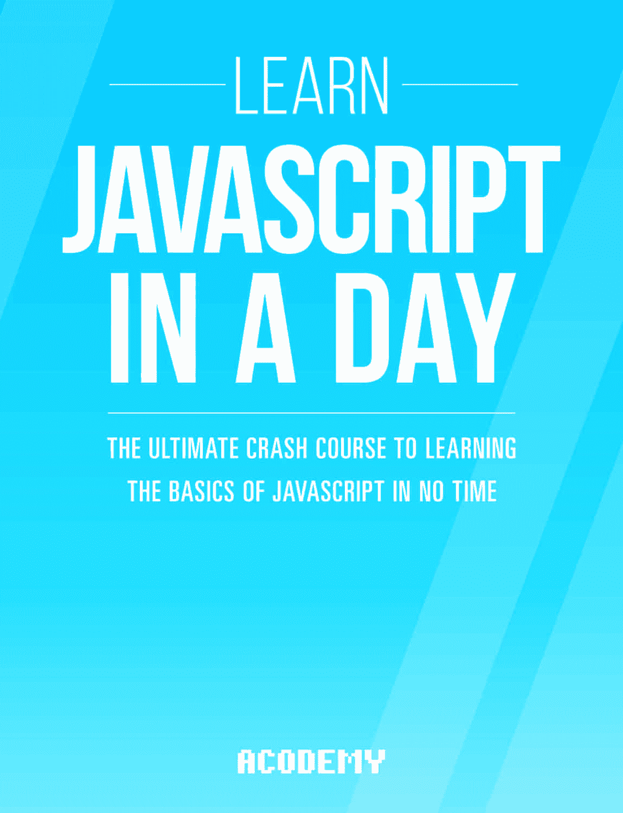

# Javascript：一天学会 Javascript！快速掌握 Javascript 编程语言基础的终极速成课程（Javascript, ... JSON, Javascript 开发书籍第 1 ）





# © Copyright 2015

保留所有权利。未经出版者许可，不得以机械、电子或任何其他方式（包括复印）复制本书任何部分。


## 免责声明

本书提供的信息旨在为所讨论的主提供有用信息。作者的书仅旨在为读者提供特定主题的基础知识，对于学生是否能够吸收并应用所提供的所有信息不做任何保证。尽管作者将尽力分享其见解，但学习是一项艰巨的任务，每个人都需要不同的时间来充分吸收新主题。本书及作者的任何书籍都不构成读者将在特定时间内学会特定主题的承诺。

## 目录

- 前言：什么是 JavaScript？以及为什么要学它？
- 这是写给谁的？
- 什么是 JavaScript？
- JavaScript 能做什么？
- 我为什么应该学习 JavaScript？
- 易于学习和工作用性
- JavaScript 可以做到 HTML 做不到的任何事情
- 用户体验取决于它
- 高需求
- 无论如何你都需要它
- 人们使用 JavaScript 多久了？
- 它是魔法吗？危险吗？
- 入门需要什么？
- 快速浏览
- 第 1 章：你好 JavaScript
    - 设置你的工作空间
    - 部分代码
    - `<script>` 标签](#11)
    - 发生了什么？
    - Document.writing 相关
    - 内联 JavaScript 与外部 JavaScript
    - 总结
- 第 2 章：基础知识
    - 目标
    - JavaScript 核心语法
    - JavaScript 中的变量
    - 变量命名
    - 变量类型
    - 运算符 operator!
    - 比较运算符
    - JavaScript 内置函数 - 常用知识
    - 总结
- 第 3 章：条件与更多条件
    - 目标
    - - IF - 条件
    - 还有一个 - else -
    - 嵌套条件
    - switch 语句
    - 当你必须做决定时
    - 让我们来点披萨
    - 总结
    - 作业
- 第 4 章：执行一次并重复 -循环
    - 概述
    - 没有循环语句的世界
    - for 循环
    - While - 当你正在循环时
     do -- while - 为你多循环一次
    - 嵌套循环
    - 总结
    - 作业
- 第 5 章：函数 - 不要把所有东西放在一个地方！
    - 概述
    - 为什么用函数？
    - 基础函数
    - 几个原生函数
    - 将函数赋值给变量
    - 参数传递
    - 函数
    - 作用域？
    - 总结
    - 作业
- 第 6 章：数组 - 整理！
    - 概述
    - 数组的概念
    - 创建数组
    - Array 对象
    - 数组的长度
    - 向数组添加/追加/前置内容
    - 它像胶水一样好用！
    - 合并数组
    - 遍历数组
    - 数组排序


# 搜索
## 总结
## 作业
# 第 7 章：对象 - 一切皆对象！
## 概述
## 什么是对象？
## 类和对象 - 它们有什么区别？
## 简单的对象
### 对象可以做这些 - 添加方法
## 一切皆对象
## JavaScript 原生对象
## 总结
## 作业
# 第 8 章：字符串对象
## 概述
## 所有字符串都是对象
## 我的字符串有多长以及其他事实
### 搜索/切片 - 你能对字符串做什么什么
### 分割中的字符串
## 搜索 - 正则表达式哦
### 对字符串进行切片和细分如何？
## 总结
## 作业
# 第 9 章：日期对象
## 概述
## 日期 - 我们在这里讨论日历
## 日期由什么组成？
## 深入了解个人日期
## 总结
## 作业
# 第 10 章：文档是一个对象
## 概述
## 一切都是对象
## 控制台 console？
## 重复一遍，一切都是对象
## 我们来操作吧
## 遍历 遍历 / 添加和删除！
## 总结
## 作业
# 第 11 章：事件 - 发生了什么？
## 概述
## JavaScript 中的事件
## 事件 - 别到处乱动鼠标！
## 每个按钮都会触发！
## 如果表单合适
## 总结
## 作业
# 第 12 章：超越 HTML - 访问浏览器？
## 概述
## Window 对象 - 是的，你的浏览器在我们的控制之下！
## 我可以给我的窗口买窗帘吗？
## 使用 JavaScript 打开/引用浏览器窗口
## 浏览器特定函数 - 让我们导航
### 你在哪儿伙！地理定位
## 随心所欲地重定向用户
回到到过去 - 或者历史
想要 cookie 吗？
## 总结
## 作业
# 第 13 章：JS 实战 - 表单验证
## 概述
## 我们的基础表单
## 复杂日期
## 移除用户。
## 验证验证再验证
# 前言：谁、什么以及为什么是 JavaScript？

如果你正在阅读这本书，你可能刚刚开始学习前端开发。自网络早期以来，前端开发已经取得了巨大的进步，现在不再局限于基础的 HTML。在如今，无法想象没有 `JavaScript` 的前端编码，`JavaScript` 无处不在，并且几乎是所有 Web 应用程序的基石。

简单的 HTML 就能开始构建引人入胜网站的时代已经过去了。静态 HTML 已淡出舞台，当务之急是功能丰富的 Web 内容，而如果没有结合有效的 `JavaScript`，这是无法实现的。

## 这本书是给谁看的？

这本书假设假设假设你对 HTML 以及静态 HTML 网页的编码有基本的了解。我们还假设你了解一些 `css`，并且对 `JavaScript` 来说比较新。即使你已经有一些 `JavaScript` 编程的基础知识，这本书也将作为一份欢迎的复习，帮助强化核心概念，并介绍你可能不太熟悉的概念，这无疑会提高你的编程技能。


这本书并不会让你一夜之间成为 JavaScript 忍者，即使你把整本书读了十遍并完成了其中所有的练习，而且我们甚至并不打算这样做。定义大师、忍者与新手之间区别的编程边界每天都在被重新定义。这本书绝对能让你掌握使用 JavaScript 所需的核心概念，在此之后，学习高级概念将成为你的事性本能。你将学习 JavaScript 编码的最佳实践，以及成为更优秀程序员的必经的核心编程概念。

读完此书后，你将对如何使用 JavaScript 编程有深入的理解，并完成一系列练习，这些练习将引导你从基础的介绍概念走向完整的实世界场景。在书的最后，你将着手开发一个实际应用，利用你在整个课程过程中所学到的所有技能。

## 什么是 JavaScript？

让我们从顶端开始，JavaScript 到底是什么。JavaScript 是一种客户端脚本语言。在 Web 开发领域，你会有客户端语言和服务器端语言。服务器端语言是用于编写在服务器上解析和执行的页面的语言，包括 `Php`、`ASP`、`ASP.NET` 和 `Ruby` 等语言。

客户端语言在浏览器中执行或运行——因此得名“客户端”。在这种情况下，“客户端”即浏览器向服务器发送请求，服务器反过来“提供”显示给你的 HTML。每当你向浏览器的 URL 框输入一个 Web URL 时，你都在向服务器发送请求，服务器随后回传一个 HTML 网格并显示在你的浏览器中。你的浏览器解析这些 HTML 并将其展示给你。

## JavaScript 能做什么？

正如所述，JavaScript 的代码被设计为在客户端运行，因此它运行在你的浏览器中。正是因为有了 JavaScript，网页才不再仅仅是静态的。JavaScript 让网页能够展现出比仅仅点击链接打开新页面多得多的交互。这显然在你访问过的几乎每个网站上都注意到了。例如：

*   那些要求你提供手机号码和邮箱的烦人弹窗
*   页面上的时间似乎与你的时钟同步跳动
*   当你输入错误内容时，那些会亮起红色的表单字段
*   那些酷炫的淡入和滑动动画
*   那些似乎记得你上次访问时的偏好的网站
*   当你点击提交按钮时，那些似乎无需刷新页面就能自动更新的列表

所有这些以及更多都归功于 JavaScript。JavaScript 客户端脚本的另一个关键方面也是减少向服务器发送的请求数量或容量。例如，考虑以下情况：

你需要在网站的访客簿表单中输入访问者的姓名、邮箱和留言。为了确保用户输入正确的详细信息，你在服务器端脚本（让我们假设它是 `php`）中编写了一个基础验证模块，以检查提交的每个访客簿条目是否填写正确，即邮箱是有效的邮箱，姓名是真实的姓名。如果有人输入了错误内容，你的服务器必须运行验证，然后返回相同的页面并附带错误消息，要求他重新输入。如果你在服务器端代码的同时，也在页面本身使用 JavaScript 编写了一个类似的验证脚本，在表单提交 **之前** 检查条目——你不仅减少了向服务器发出的 `HTTP` 请求次数，还让终端用户无需等到在填写并提交表单后才发现自己犯了错。

这是一个非常简单的例子——想象一下，如果表单异常巨大，而用户正处于慢速连接，这会让终端用户有多抓狂。

# 我为什么应该学习 JavaScript？

直率地说，JavaScript 可能是任何开发者必须学习的第一种编程语言。更直白地说，对于任何对 Web 开发有一点点认真的人来说，在考虑任何其他脚本语言（无论是客户端脚本还是后端服务器脚本）之前，了解 JavaScript 是至关重要的。以下是几个原因：

### 易于学习和使用

说认真的，JavaScript 学习起来非常简单，而且用起来很愉快。你不需要很多东西就可以开始学习 JavaScript，随着代码的编写，你可以即时看到工作的成果。这与使用如 `Php` 和 `ASP` 等服务器端脚本进行编码完全不同，在后者中你绝对需要一个服务器来执行你的脚本。有了 JavaScript，你只需要一个浏览器就可以大显身手。

## JavaScript 可以做到 HTML 做不到的任何事情

JavaScript 赋予你权力和灵活性，允许终端用户操纵你网页上的内容。通过 JavaScript，你可以验证表单中输入的内容，允许终端用户更改页面内容，甚至与页面上的元素本身进行交互。你还可以设置代码在不同事件上执行，例如有人点击按钮、鼠标悬停在图片上、离开页面甚至尝试关闭页面时会发生什么。简而言之，你对用户如何以及与什么拥有大量的控制权，为你的网页赋予了全新的维度。

### 用户体验取决于它

回到我们那个巨大表单的例子，想象一个处于非常慢的连接上的、心情非常沮丧的用户。他发现了这个咨询师网站，必须输入一条留言和一个有效的电话号码。这个可怜的人写下了所有的生活烦恼：他的女友如何离开他去找了他的好朋友，他如何欠了车贷贷款，他收到的止收通知，以及那个导致他彻夜难眠的漏水龙头——但在这一切中，他忘记了输入有效的电话号码，并提交了表单等待回复。由于某种原因，有人忘记添加服务器端验证，因此现在没有办法与他取得联系了。你的用户坐回那里等了几天，疑惑为什么没有人打电话，最终半死不活地认定世界根本不在乎他。

好了，刚才那有点戏剧化了，但你可以理解这是何故。网站不应该是笨肿的，而且静态 HTML 无法实现多少交互。

### 高需求量

JavaScript 的需求很大，几乎每个 Web 开发者都被要求掌握某种程度的 JavaScript。Web 开发需要熟悉你最终会被要求使用的所有工具和技术。你只需要看看招聘公告板上的职位要求，就能看到针对熟悉 JavaScript 或熟悉许多 JavaScript 库之一的人员——例如 `jQuery` 和 `BackboneJS`（关于这些厉害家伙的内容将在书后部分介绍）——的空缺职位。

## 人们使用 JavaScript 多久了？

JavaScript 已经存在很久了。它最初由 Brendan Eich 在 90 年代初在 Netscape 开发，旨在用于 Netscape Communicator 浏览器。他开发这种语言的目标是让网页更动态、更有交互性。有趣的是，JavaScript 和 Java 编程语言之间除了共享 "java" 这个词外，没有任何关联。


在此期间，微软为 Internet Explorer 浏览器推出了了他们自己的客户端语言，称为 JScript。JScript 基于 Netscape 的 JavaScript，为了避免版权问题，它被命名为 JScript。

这导致了所谓的“浏览器大战”，领先的浏览器都提供了它们对客户端语言的自己的实现。这产生了严重的影响，导致你现在拥有了高度依赖于浏览器的专有代码，因此有时为 Netscape 浏览器编写的脚本会在 Internet Explorer 中运行失败。

简而言之，在跨越近二十年的历史进程中，JavaScript 经历了重大的演变，并在很大程度上实现了标准化。在早些时候，用户基本上将客户端脚本视为一种干扰，当时的浏览器甚至有“关闭客户端脚本”的选项。但情况已经发生了巨大的变化，Web 应用程序完全依赖客户端脚本的成功执行。随着 AJAX 的引入和 Web 2.0 革命的复兴，JavaScript 实现了巨大的回归，并一直留了了下来。

## 它是魔法吗？危险吗？

这取决于你如何使用它。诚然 JavaScript 允许你对 HTML 页面以及用户的浏览器拥有极大的控制权，但它不会导致电脑 崩溃，所以使用它非常安全。

然而，自 JavaScript 诞生以来，一直存在许多安全漏洞，例如跨站脚本（Cross site Scripting），它允许黑客向用户返回恶意脚本，这些脚本会在用户的浏览器中执行。就像你曾被多次警告不要点击的那些横幅广告一样，此类脚本能做的最坏就是访问存储在你浏览器中的信息，包括存储在 cookie 中的身份验证详细以及其他类型你不希望别人窥探的数据。

在这方面，保护的责任在于用户，我们作为体面的人，所能做的最大事情就是永远不要利用 JavaScript 的力量去作邪恶之事——就像任何超级能力一样，在错误的人的手中，它可能会导致灾难！

<背景播放着戏剧性的音乐>

## 我需要什么来开始？

这就是使用 JavaScript 的魅力所在，你可以立即开始。你只需要你最喜欢的文本编辑器和一个浏览器。强烈推荐使用 SublimeText、Textmate 和 Notepad++ 等文本编辑器。你也可以使用像 Dreamweaver 这样的 IDE，尽管那有点大材小用了。如果你真的很冒险，你一直可以使用老旧的记事本。

对于浏览器，我们强烈建议使用 Firefox 或 Chrome，因为这两个浏览器都提供了调试和检查你代码的功能。对于本书来说，练习是在 firefox 浏览器上运行的，但任何浏览器都可以用来测试你的代码。

虽然在系统上安装如 apache 或 IIS 等 Web 服务器非常有益，但并不是必要的，因为我们不会进行任何服务器端编码，而是主要关注使用 JavaScript 进行前端脚本编写。

## 快速回顾

到目前，我们已经涵盖了关于 JavaScript 的很多，例如：

* JavaScript 是一种客户端语言，因此它在浏览器中运行
* JavaScript 是前端开发的必备技能
* 它可以让静态网页更具交互性和动态性
* Web 相关职业中对 JavaScript 有巨大的需求。
* 客户端脚本可以减少服务器的负载
* JavaScript 简直太棒且易于学习

在下一章中，我们将开始编写 JavaScript 代码，并向你介绍该语言的基础构建模块，同时让你开始编写传统的 JavaScript Hello World 应用程序。

# 第 1 章：Hello JavaScript

为了开始学习 JavaScript，我们将使用 JavaScript 构建一个传统的 Hello world 应用程序。在本书过程中，我们将专注于通过实时编码来学习 JavaScript，并带你阅读代码，解释它的作用以及它是如何工作的。让我们先设置你的工作区。

## 设置你的工作区

正如我们所说，开始学习 JavaScript 并不需要很多要求。首先，启动你首选的文本编辑器并打开你的浏览器。

此时，如果你想做一些服务器端编程，可能想要考虑安装一个 Web 服务器。但是，为了学习 JavaScript 本身，这并不是必要的。本书的范围不包括安装 Web 服务器的过程，因为网上有大量的资源可以用来设置 Web 服务器。

你可能希望安装一个 apache 或 IIS 服务器。对于运行 windows 的用户，可以获取基于 apache 的安装包，如 WAMP 和 XAMP，它们会为你安装并配置 apache 加上 php 和 mysql。或者，如果你的 windows 机器上安装了 IIS，那就足够了。

你系统上的 Web 服务器作用就像在线上的任何普通服务器一样，只是规模较小一些。

在你的 Web 服务器上，你有一个文件夹来存储你的网站。在 Apache 上，这个文件夹通常是：

`/path/to/apache/www`

或 `/path/to/apache/htdocs`

在 IIS 上，该文件夹的路径将是

`C:/InetPub/wwwroot`

..假设你在 C 盘设置了 IIS。

这被称为你 Web 服务器的根目录，在本书过程中，对根目录的任何引用都指向这个特定文件夹，无论你运行的是 IIS 还是 Apache。

## 代码

在根目录中，创建一个新目录，我们称之为 lessons。我们将把所有的课程都存储在该目录下的独立文件夹中。在该文件夹中创建一个新目录并给它命名——我们叫它 `lesson-1`。完成后，启动你最喜欢的浏览器并导航到该目录。确保你的服务器正在运行，并在浏览器的地址栏中输入（假设你已经）：

`http://localhost/lessons/lesson-1`

然后什么都没有显示。这是显而易见的，因为我们还没有创建一个默认的索引页。在你的 lesson-1 文件夹中创建一个新文件并将其命名为 `index.html`。

添加一些基础 HTML：

```html
<html>
<head>
<title>Learning JavaScript</title>
</head>
<body>

</body>
</html>
```

这是一个只有 body 标签闭合标签的空白 HTML 页面。现在让我们开始编写基础脚本。

## script 标签

由于我们熟悉 HTML，现在是时候看看 `script` 标签了。让我们写一段基础的：

```html
<html>
<head>
<title>Learning JavaScript</title>
</head>
<body>

<script language="JavaScript">
// 代码写在这里
</script>

</body>
</html>
```

刷新浏览器中的页面，你应该看到 Hello World。

## 发生了什么？

让我们先看看我们的代码。所有的 JavaScript 代码都封装在 `script` 标签中。

```javascript
document.write('Hello World');
```

`document.write` 是一个简单输出传递给它的内容的函数。现在只需要理解函数是一段接受参数并执行操作的代码。稍后我们将详细介绍函数。但目前我们应该明确传递给 `document.write` 的任何内容都会输出到浏览器。

另外注意行尾有一个分号 `;`。在 JavaScript 中编写代码时，所有代码行都必须以分号结束。这是一个语法要求，如果你用过 C 或 C++，你可能已经觉得这非常熟悉。

所以发生的情况是，当页面加载时，脚本被浏览器解释。让我们尝试几种变体。

## 写入内容

正如所述，传递给 `document.write` 函数的任何内容都会输出到浏览器。让我们输出几行文本看看会发生什么。输入以下代码：

```html
<script language="JavaScript">
```


```javascript
document.write('Hello there.');
document.write('I am coding.');
document.write('Hear me debug.');
</script>
```

刷新你的浏览器——这并不是我们预期的。你会发现尽管你在三个不同的行上调用了三次 `document.write`，但这三个字符串都显示在同一行。事实是，浏览器只输出 HTML，为了让 JavaScript 输出的任何文本具有格式，它必须使用 HTML 进行格式化。让我们通过将传递的字符串封装在 `<p>` 标签中重写一下：

```html
<script language="JavaScript">
  document.write('<p>Hello there.</p>');
  document.write('<p>I am coding.</p>');
  document.write('<p>Hear me debug.</p>');
</script>
```刷新刷新，现在你看到所有的字符串都在不同的行了。

静态 HTML 无法完成这些似乎没什么大不了。所以让我们尝试一个更有趣的例子。

```html
<script language="JavaScript">
  document.write('You are accessing this page from ' + location.hostname);
</script>
```

运行此脚本，你应该能看到它显示 `You are accessing this page from localhost`。`location.hostname` 也是一个内置函数，返回当前 URL 的主机名。我们在上面使用了加号来将其附加到文本之后。

你已经可以看到，JavaScript 不仅仅是输出 HTML。

## 内联 JavaScript 与 外部 JavaScript

上面是一个内联编写的 JavaScript 示例。这是你在同一个 HTML 页面中通过 `<script>` 标签封装 JavaScript 代码。虽然这对于尝试简单代码很方便——但并不是一个非常好的做法，扩展性也不好，特别是当你的页面和代码变得越来越复杂时。

出于这个原因，最好的通过外部运行 JavaScript，将你所有的 JavaScript 放在单独的文件或一组文件中，并使用相同的 `<script>` 标签将其包含进来。首先，在你的 `index.html` 所在的文件夹中创建一个文件，并将其命名为 `main.js`。

保存文件并在文本编辑器中打开它，将 `script` 标签之间的代码（不包含 `script` 标签）复制并粘贴到 `main.js` 文件中保存。

从你的 HTML 文档中移除脚本标签和代码，并在 `<head>` 标签内添加以下版本的 `<script>` 标签：

```html
<script language="JavaScript" src="main.js" ></script>
```

保存并刷新浏览器——你应该能看到与代码内联时完全相同的输出。我们将所有的 JavaScript 都移动到了一个专门的 JavaScript 文件（JavaScript 文件以 `.js` 结尾），并通过在上面的 `<script>` 标签中引用它来包含该文件。`<script>` 标签的 `src` 属性指向要加载的文件的位置。

一个更好的做法是将所有 JavaScript 代码放在它自己的 `js` 文件夹中。随着你的项目变得越来越复杂，你会发现将 JavaScript 分类到不同的文件中是有意义的。

注意：你也可以在 `body` 标签内包含 JavaScript 文件，尽管按照习惯，它们通常加载在 `<head>` 标签中。

## 总结

我们在这里涵盖了一些基础知识，并运行了一个非常简单的 JavaScript 应用程序。

我们理解了如何使用 `<script>` 标签，以及内联和外部 JavaScript 文件之间的区别。

在接下来的章节中，我们将涉及 JavaScript 的基本语法以及构成该语言的各个构建部分。你将学习 JavaScript 变量和运算符，以及关于如何使用它们的实际课程。此外，在此过程中你还将获得一次算术复习 :)

# 第 2 章：基础知识

现在你已经准备就绪，并首次尝试了真正的 JavaScript 应用程序，我们开始理解 JavaScript 的基本语法。

JavaScript 的独特之处在于它是一种解释型语言，而不是编译型语言。在编程中，你有解释型语言和编译型语言。在解释型语言中，程序逐语句执行，而在编译型语言中——整个程序首先编译成可以执行的格式，然后运行。解释型语言的一个主要特征是，如果程序中有错误语句，错误语句之前的语句仍然会被运行和执行，但程序在遇到错误代码时会停止。

你将在书的后部分理解为什么知道这一点很重要。

## 目标

在本章中，你将学习 JavaScript 变量以及 JavaScript 代码中使用的不同变量类型。你还将理解使用的不同运算符，例如用于执行算术和逻辑函数的运算符。在章节结束时，你将精通使用变量和运算符构造基础表达式。

## JavaScript 核心语法

将语法考虑为计算机的语法和词汇。如果你没有足够的词汇，你就无法进行交流；如果你没有语法感，你绝对无法让人听懂。计算机编程也是如此。与所有计算机编程语言一样，JavaScript 有它自己的语法，即你在编写有效代码时必须遵守的一套规则。

JavaScript 语法由以下组成：

* 变量
* 运算符
* 操作数
* 注释
* 表达式
* 关键字
* 规则

在我们之前的代码中，我们接触了 JavaScript 的一条基本规则，那就是：

每条语句必须以分号结尾

注意，当我们说语句时，并不一定意味着语句是单行上的所有代码。每当你在 JavaScript 中编写语句时，它都必须以分号结尾。即使你在同一行上写了多个语句，每条语句也以分号结尾。例如：

```javascript
var t = 1; var x = 1;
```

JavaScript 代码中的另一个有用功能是可以向代码添加注释。注释用于对代码的作用进行简单的说明。它们仅供程序员参考，不作为 JavaScript 代码运行。在 JavaScript 中通过在注释前添加双斜杠来添加注释。这将该行上的所有内容标记为注释。例如：

```javascript
// 这是一个注释
```

或者，注释可以被包含在 `/*` 和 `*/` 字符之间。这种注释方式会将字符之间的内容排除在外。例如：

```javascript
// 这一行都是注释
/* 这一部分文本都是注释 */
var t = 1; var x = 2;
```

注释代码是非常好的习惯，有助于理解复杂代码，特别是当你回来查看它或其他人需要处理代码时。保持注释简短但足以让人理解代码的作用。

## JavaScript 中的变量

变量是任何程序的构建块。变量用于存储程序运行期间的数据。在 JavaScript 中，使用 `var` 关键字定义变量。所以要在 JavaScript 中声明变量，你会写道：

```javascript
var i;
```

在上面的代码中，`i` 被声明为一个变量。现在它并没有做什么，你可以使用 `=` 符号为变量赋值以便供。`=` 被称为赋值运算符：

```javascript
var i = 10;
```

上面的代码声明了一个名为 `i` 的变量，并将数字 10 赋值给它。上面的这段代码也可以重写为：

```javascript
var i;
i = 10;
```

现在这个值可以用于任何 JavaScript 代码中。让我们回到第一个示例来查看这种效果。在你的 JavaScript 文件中输入：

```javascript
var i = 10;
document.write(i);
```

页面现在应该显示 `i` 的内容，即数字 `10`。

你也可以在 JavaScript 的同一行中声明多个变量，例如：

```javascript
var i, j;
```

此外你也可以在同一行内为它们赋值，所以以下也是完全有效的 JavaScript：

```javascript
var i = 10, j = 12;
```


## 变量命名

在声明变量时，你对如何声明变量有一些限制。变量名可以由字母、下划线和数字组成，但不能与数字开头，且不能包含空格或特殊字符。例如，以下变量声明是有效的：

```javascript
var i;
var Image;
var module_01;
var M1;
var iM1;
```

然而，以下变量声明是无效的，并且会导致程序错误：

```javascript
var 1a;
var module 01;
var module-01;
var i@m1;
```

JavaScript 变量名可以根据需要任意长度，也可以小到单个字符，例如：

```javascript
var this_is_a_very_long_and_humongous_variable_name = 1;
var t = 1;
```

尽管在编码时，最好确保你的变量名本身具有意义且不要过长。

## 变量类型

JavaScript 支持多种类型的变量。到为止，我们只看到了向 JavaScript 赋值数字的示例。JavaScript 提供了以下变量的支持：

## 数字 (Numbers)

变量可以被赋值一个数值。JavaScript 支持整数和浮点数。例如，以下是给变量赋值数字的示例：

```javascript
var num1 = 100; // 这是一个有效的整数
var num2 = 100.00 // 这是一个小数
```

## 字符串 (Strings)

字符串是文本块。它们可以根据需要任意长度，甚至可以小到单个字符。你也可以拥有一个空字符串值。在进行赋值时，字符串总是用单引号或双引号括起来。因此，以下是有效的：

```javascript
var s1 = "This is some text!"; // 赋值了一个字符串
var s2 = 'This is also some text'; // 单引号同样有效
var n = ''; // 这是一个有效的空字符串
```

而以下是无效的且无法运行：

```javascript
var t = This is text; // 这将无法运行 - JavaScript 无法判断字符串的开始和结束
```

在赋值包含引号的文本时，请使用反斜杠运算符，确保字符串中的引号不会引起赋值中的任何问题，例如：

```javascript
var t = 'This work\''s well.';
```

反斜杠会转义那些会被 JavaScript 以方式解释的字符。

## 布尔值 (Booleans)

布尔变量包含 `true` 或 `false` 值。布尔值在使用中最基本的变量类型。在处理条件语句时，布尔值非常有用，我们将在书中后面介绍这些内容。

布尔变量可以如下所示赋值：

```javascript
var x = true; // 输出 x 将得到 true
var y = false; // 输出 y 将得到 false
```

## 数组 (Arrays)

数组是将多个值存储在单个变量中的方法。将它们想象成一个可以通过索引访问的变量列表。JavaScript 中使用方括号声明数组，各个值之间用逗号分隔。例如：

```javascript
var a = ['oranges', 123, false, 'lemons'];
```

在上面的示例中，`a[0]` 将返回 `oranges`，`a[1]` 将返回 `123`。

我们将在书后的章节讨论数组，现在你只需要知道数组也可以赋值给变量。

## 对象 (Objects)

对象是不同值和函数的组合。将对象想象成数组，唯一的区别是数组是通过数字索引的，而对象可以有自定义索引。

请注意，这是对对象非常基础且有些粗浅的定义，但目前足够理解将对象赋值给变量的示例了。对象将在书中后面介绍。

```javascript
var o = {name:'Bob Jones', age:87, active:true};
```

## 运算符 (Operators)

运算符是变量之间执行操作的工具。JavaScript 提供了许多运算符。我们将涵盖最常用的运算符，你在日常开发活动中需要了解它们。JavaScript 中的运算符分类如下：

## 赋值运算符 (Assignment Operators)

我们已经使用了最常用的赋值运算符，即 `=` 符号。它只是将值赋值给变量。然而，有许多不同的赋值运算符，每个种都有自己的特性。

- `=` `=` 运算符直接将值赋值给变量，而不对值本身进行任何更改。

```javascript
i = 10;
document.write(i); // 输出 10
```

- `+=` `+=` 运算符在用于字符串和数字时功能不同。与字符串一起时，它只是将值连接到字符串上。与数字一起时，它将该值加到数字上：

```javascript
var i = 'Hello ';
i+='Bob'; // i 现在等于 'Hello Bob'
var t = 10;
t+=5; // t 现在是 15 - 这就像写 t = t + 5
```

- `-=` `--=` 运算符从变量中减去该值，并将结果存储在变量中。这是编写减法等式的简写方法。它仅用于数值：

```javascript
var t = 10;
t-=2; // t 现在是 8
```

- `*=` `*=` 运算符将值乘以变量，并将结果存储在变量中。这是编写乘法等式的简写方法。

```javascript
var t = 10;
t*=2; // t 现在是 20
```

- `/=` `/=` 运算符将变量除以该值，并将结果存储在变量中。这是编写除法等式的简写方法。

```javascript
var t = 10;
t/=2; // t 现在是 5
```

## 算术运算符 (Arithmetic Operators)

算术运算符用于变量之间执行操作。JavaScript 提供了许多运算符。我们将涵盖你在日常开发中需要知道的最常用运算符。JavaScript 中的运算符分类如下：

| 运算符 | 功能 |
| --- | --- |
| + | 加法 |
| - | 减法 |
| * | 乘法 |
| / | 除法 |
| % | 取模 |
| ++ | 递增 |
| -- | 递减 |

### 加法 (+)

加法将值加到变量。

```javascript
var a = 10;
var b = 20;
var c = a + b; // c 为 30
```

### 减法 (-)

正如名称所示，从变量中减去值。注意从较大的值减去较小值会得到负值。

```javascript
var a = 10;
var b = 20;
var c = b - a; // c 为 10
var a = 10;
var b = 20;
var c = a - b; // c 为 -10
```

### 乘法 (*)

乘法运算符将值乘以变量。

```javascript
var a = 10;
var b = 2;
var c = a * b; // c 为 20
```

### 除法 (/)

此运算符将变量除以该值。结果也可以产生小数。

```javascript
var a = 10;
var b = 2;
var c = a / b; // c 为 5
var a = 5;
var b = 10;
var c = a / b; // c 为 0.5
```

### 取模 (%)

取模返回变量除以该值后的余数。因此 `10%3` 将返回数字 1。当你对偶数和二取模时，总是得到 0。

### 递增 (++) & 递减 (--)

递增运算符直接将变量加 1。同样，递减运算符相反，将变量减 1。

```javascript
var a = 10;
a++; // a 现在是 11
a--; // a 现在是 10
```

这分别是是赋值运算符 `+=1` 和 `-=1` 的简写。

## 比较运算符 (Comparison Operators)

可能你最常用的运算符是比较运算符。每当你需要根据特定变量的值做出决定时，你就会使用比较运算符。

JavaScript 目前提供了以下比较运算符：

| 运算符 | 说明 |
| --- | --- |
| == | 等于 |
| === | 值和类型相等 |
| != | 不相等 |
| !== | 值不相等或类型不相等 |
| > | 大于 |
| < | 小于 |
| >= | 大于等于 |
| <= | 小于等于 |

## 它们是如何工作的？

#### ==== == 等于

等于运算符正如其名。它比较两个变量，如果两个变量具有相等的值，则返回布尔值 `true`，否则返回 `false`。请记住 `==` 不等同于 `=`，其中 `=` 是赋值运算符。


```javascript
var a = 10; // a is now assigned the value 10
var b = 15; // b is now assigned the value 15
a == b;    // returns false
b == a;    // 无论你如何排列，都返回 false
a == 10;    // returns true
a = 15;    // a is now assigned the value 15
a == b;    // returns true
```

### (===) 数值和类型的相等

这看起来像是某人写了一个等号，但 `===` 运算符会检查两个变量，如果两个变量的数值和类型都相同，则返回 true。例如，在 JavaScript 中，值 `10` 和值 `'10'` 的数值可能相似，但它们绝对不是同一类型，因为后者被包含在引号内是字符串类型，而前者是整数。

```javascript
var a = 10; // a is now assigned the numerical value 10
var b = '10'; // b is now assigned the a string value '10'
a == b;    // returns true
a === b;    // returns false
var a = '10'; // a is now assigned the a string value '10'
b === c; // returns true
```

### (!=) 不等, (!==) 类型和数值上的不相等

在比较运算符中，当第一个 `=` 符号替换为感叹号 `!` 符号时，它表示与原始运算符意图相反。所以，当 `==` 变成 `!=` 时，现在比较变量是否不相等；而 `!==` 则检查变量在数值和类型上是否都不相等，因为有时候相等并不是你想要的。

```javascript
var a = 10; // a is now assigned the numerical value 10
var b = '10'; // b is now assigned the a string value '10'
a != 10;    // returns false
a != 15;    // returns true
a === b;    // returns false
a !== b;    // returns true
```

### (>/<) 大于和小于运算符

在基础数学中，你可能熟悉 `>` 大于和 `<` 小于符号，它们用于检查符号两侧的变量是否大于或小于某个值。它们在 JavaScript 中的工作方式几乎相同。注意，在 JavaScript 中，使用上述运算符将字符串值 `'10'` 与数字进行比较是完全允许的。

```javascript
var a = 10, b = '10';
a > 5;    // returns true
a < 5;    // returns false
a > '5';    // returns true
a < b;    // returns false
```

### (>=/<=) 大于等于 / 小于等于

接初级算术，的大` 大于等于运算符以及 `<=` 小于运算符的作用完全正如其名。

```javascript
var a = 10, b = '10';
a >= 5;    // returns true
a >= 10;    // returns true
a <= 10;    // returns true
a <= 11;    // returns true
a >= b;    // returns true
a <= b;    // returns true
```

## 逻辑运算符

逻辑运算符总是返回布尔 `true` 或 `false` 值。它们被用于检查两个或多个语句之间的逻辑连接性。这些运算符与之前显示的其他运算符配合使用。JavaScript 中使用的逻辑运算符有：

| 运算符 | 描述 |
| --- | --- |
| `&&` | 逻辑“与”(AND) |
| `||` | 逻辑“或”(OR) |
| `!` | 逻辑“非”(NOT) |

### (&&) - 与

逻辑与运算符检查两个变量或语句，以确保它们共同返回布尔值 true。语句在用与运算符进行求值时，必须求值为布尔 true 值。例如：

```javascript
var a = 10, b = '10';
(a == 10) && (b=='10');    // returns true
(a > 10) && (b=='10');    // returns false
(a >= 10) && (true);    // returns true
(a >= 10) && (b=='10') && (true);    // returns true
```

如果你想检查是否有多个语句被求为 true，那么这很有用。特别是在我们处理条件语句时。

### (||) - 或

有时候，你需要评估一组语句中是否只有其中一个被求为 true。由两个管道符号表示的逻辑或运算符正是此行的。逻辑与运算符在所有语句求值结果都为 true 时返回 true，而或运算符仅当单个语句的求值为 true 时才返回 true。

```javascript
var a = 10, b = 12;
(a == 10) || (b==10);    // returns true
(a > 10) || (b==10);    // returns false
(a >= 10) && (true);    // returns true
```

### (!) - 逻辑非符号

如前所述，`!` 符号与其他符号和表达式配合工作，并返回这些语句求值的反面。例如：

```javascript
var a = 10;
!(a == 10); // returns false because a is equal to 10
!(a == 5); // returns true because a is not equal to 5
!(a === 10); // returns false because a is equal to 10
!(true); // returns true negating that a is not equal to 11
```

## 条件运算符

JavaScript 提供了一种条件运算符，根据决策进行赋值。这就是 `?:`：

```javascript
var a = 10;
(a == 10) ? 12 : 0;
```

上面的语句表示如果 `a` 是 10 则为 12，否则为 0。这是一个根据单个语句进行赋值的快捷方法。

```javascript
var a = 10;
(a == 10) ? 12 : 0
```

## JavaScript 内置函数 - 很有用

在我们继续之前，熟悉 JavaScript 提供的一些方便函数是非常重要的。这些函数是 JavaScript 原生的，取决于你如何使用，它们非常有用或非常烦人。

### Alert - 每个人都讨厌

这是一个非常简单的函数，会弹出一个你可以传递消息的警告框。语法非常简单：

```javascript
alert('Hello there!');
```

这应该弹出一个带有 'Hello there!' 消息的警告框和一个关闭按钮。虽然这是一个 JavaScript 原生函数，但我们将在后续示例中多次使用。但在实际环境中，你最好避免过多使用它，因为它对用户来说是一种困扰。

### Confirm - 今天你想做什么？

更有用的函数之一——`confirm` 命令实际上会弹出一个确认框，让用户选择点击是或 否。这对于快速获取用户的确认很有用。这里有一个简单的示例：

```javascript
if(confirm('我可以说是吗?')== true){
  document.write('Yes');
}else{
  document.write('No');
}
```

运行此将弹出一个带有传递消息的确认框。点击 `OK` 将运行 If 语句中的代码块并输出 Yes，而点击 `cancel` 则相反。确认函数在用户确认时返回 true，否则返回 false。


此命令用于实际从用户处获取某些输入。运行此命令会打开一个提示框，用户会被“提示”输入某些信息。例如：

```javascript
var name = prompt('What is your name?');

if(name != ''){
  document.write('Hello ' + name);
}else{
  document.write('You didn\'t enter your name!');
}
```

上面的代码提示用户输入姓名，用户输入的内容存储在 `name` 变量中。这是用户交互以及应用程序响应客户端交互的一个非常简单的示例。

## 总结

我们在这里涵盖了大量内容，并回顾了：

*   变量，JavaScript 支持的不同类型的变量
*   赋值运算符
*   算术运算符
*   逻辑运算符
*   条件运算符

# 第 3 章：条件、条件以及更多条件

在上一章中，我们接触了不同的变量类型，以及在 JavaScript 中构建表达式的核心语法。我们应该能够利用基本运算符进行数学和逻辑评估。但编码不仅仅是华丽的算术和逻辑堆砌。就像生活一样，一切并非都沿着直线运行，编码也是如此——你几乎需要为绕道或异常留出空间。

## 目标

在本章中，你将学习 JavaScript 中用于根据特定条件执行代码的各种条件语句。这些条件将使用在上一章中学习的运算符。我们将接触不同的条件语句，并结合实际生活应用来理解它们的用法。

## - IF - 条件

这是你在 JavaScript 中可以使用的最基础、最基本的条件语句。世界上没有任何代码会在某处不涉及 IF 语句。If 语句的构造如下：

```javascript
if(expression){ // 如果表达式求值为真，则运行括号中的代码
  //code here
}
```

if 语句检查表达式是否为真，然后执行闭括号中的代码。这与我们在上一章使用的条件运算符类似，但它的可读性更高。这里是一个 if 语句的示例：

```javascript
var a = 10;

if(a == 10){
    document.write('Booyah');
}
```

上面的代码检查语句 `a==10` 是否为真（它确实为真），然后打印出单词 `Booyah`。If 语句可以同时检查多个表达式。

```javascript
var a = 10, b = 12;

if((a == 10)&&(b==12)){      // 求值为真，因此执行代码
    document.write('Booyah');
}

if((a > 1)&&(b<12)){  // 求值为假
    document.write('Booyah Again'); // 这永远不会打印
}
```

正如我们之前学习的逻辑运算符用法，我们现在可以看到它们在条件语句中的实际应用。就像这里的逻辑运算符一样，这是一个 IF 语句中使用 NOT 运算符的示例

```javascript
var a = 10, b = 12;

if(!(a == 10)){        // 返回假
    document.write('Booyah');  // 这永远不会运行
}

if(!(a < 10)){        // 返回真
    document.write('Booyah');  // 运行
}
```

IF 语句中的代码块是普通的 JavaScript 代码。这里是一个模仿条件运算符的 IF 语句示例：

```javascript
var a = 10, b = 12;
var c = 0;

c = a == 10 ? 11 : 0;

if(a == 10){  // 这等同于上面的写法
    c = 11;
}
```

条件 IF 语句比条件运算符更具可读性，尽管使用条件运算符可以在一行内执行条件语句。你也可以对 IF 运算符执行同样的操作，只要你理解 JavaScript 中所有的单独语句和表达式都以分号结尾。因此，以下内容是完全有效的 JavaScript：

```javascript
var a = 10;
var c = 0;

if(a == 10){c = 11;} // 这可以工作 - 但可读性不太好
```

## 还有一个 - else -

If 语句可以单独编写，但如果你希望在 IF 语句没有成功评估时执行代码，那么 JavaScript 允许你在其后添加一个 `else` 语句。

```javascript
var a = 10;
var c = 0;

c = a == 10 ? 11 : 0;

if(a == 10){  // 现在这与上面的完全相同
    c = 11;
}else{
    c = 0;
}
```

else 语句扩展了条件语句，使得只有在 If 语句失败时才执行以下代码块。因此，下面的这段代码与上面的代码不同。

```javascript
var a = 10;
var c = 0;

c = a == 10 ? 11 : 0;

if(a == 10){
    c = 11;
}
```

## 嵌套条件

想象一种情况，现在我们要考虑更多实际情况。你需要检查你是否有十个蛋，以及它们是否新鲜。你可以像这样操作：

```javascript
var number_of_eggs = 10;
var eggs_are = 'fresh';

if((number_of_eggs == 10)&&(eggs_are == 'fresh')):
  // 执行某些操作
}

if((number_of_eggs == 10)&&(eggs_are != 'fresh')):
  // 执行某些操作
}

if((number_of_eggs != 10)&&(eggs_are == 'fresh')):
  // 执行某些操作
}

if((number_of_eggs != 10)&&(eggs_are != 'fresh')):
  // 执行某些操作
}
```


这种方法可行，但非要编写四个不同的条件语句来检查每一种可能性似乎有点疯狂。实现这一点的更简单的方法是将你的 `if - else` 语句嵌套彼此内部。就像任何代码一样，你也可以嵌套 `if - else` 语句。例如，上面的代码可以重写为：

```javascript
var number_of_eggs = 10;
var eggs_are = 'fresh';

if(number_of_eggs == 10){
  if(eggs_are == 'fresh'){
    // do something
  }else{
    // do something
  }
}else{
  if(eggs_are == 'fresh'){
    // do something
  }else{
    // do something
  }
}
```

还不错，我们有一个语句检查一个条件，进一步的条件在语句内部进行检查。虽然在上面的示例中，你可能会注意到嵌套的 `if` 语句出现了重复。当我们稍后的章节中学习函数时，这个问题将会得到解决。但目前，你只需要理解嵌套条件语句是如何工作的。

此时此时，你可能会好奇，既然可以在不使用 `else` 语句的情况下完成上述操作，为什么我们还需要使用 `else` 语句呢？上面的代码完全可以写如下：

```javascript
var number_of_eggs = 10;
var eggs_are = 'fresh';

if(number_of_eggs == 10){
  if(eggs_are == 'fresh'){
    // do something
  }
  if(eggs_are != 'fresh'){
    // do something
  }
}

if(number_of_eggs != 10){
  if(eggs_are == 'fresh'){
    // do something
  }
  if(eggs_are != 'fresh'){
    // do something
  }
}
```

表面上上面的方法运行完美良好，但这种方法存在一个问题。当一个 `If` 语句评估为真时，只有该 `IF` 语句中的代码会被执行，而后续 `else` 块中的相应代码将不会执行。这样一来，你只需要检查一次 `IF` 语句中的表达式是否有效，而不需要再次检查它以确保它为假。在上面的示例中，你将至少运行 4 个比较表达式，而与前一个带有 `else` 语句的只有 2 个相比。随着你的应用程序增长，这在性能方面会产生巨大的差异。

记住 - `else` 是你的朋友！

## 条件 switch 语句

随着你的条件语句变得越来越复杂，你将想要不仅仅是 `if else` 语句。当你需要检查变量的几个可能值或几个表达式时，`if` 和 `else` 语句运行良好。但当你需要检查一个变量的许多可能值时该怎么办？我们讨论的不是检查变量是否为真、假或为空。如果你要检查变量是否为 1 到 10 之间的任何数字呢？假设你有一组错误代码，并希望为每个代码显示不同的消息。使用 `If` 语句，你可能需要编写如下内容：

```javascript
var code = 101;

if(code == 100){
    // do something
}else if(code == 101){
    // do something
}else if(code == 102){
    // do something
}else if(code == 103){
    // do something
}else if(code == 104){
    // do something
}else if(code == 105){
    // do something
}else if(code == 105){
    // do something
}else if(code == 106){
    // do something
}else{
    // do something
}
```

这是检查多一个可能值的一种相当有效的方法，但 JavaScript 允许使用更简单的语法来实现相同的需求，尽管这种方式没那么痛苦。

向 `switch` 语句打个招呼吧。

`switch` 语句的作用与上述 `if` 语句完全相同，只是代码开销更小，即：不需要写那么多的代码和括号。典型的 `switch` 语句的语法如下：

```javascript
switch(variable){
  case value:
  break
  default:
  break;
}
```

上面的代码可以重写为 `switch` 语句，如下：

```javascript
var code = 101;
switch(code){
    case 100:
        // do something
    break;
    case 101:
        // do something
    break;
    case 102:
        // do something
    break;
    case 103:
        // do something
    break;
    case 104:
        // do something
    break;
    case 105:
        // do something
    break;
    case 106:
        // do something
    break;
    default:
        // do something
    break;
}
```

这绝对更清晰、更易读。对于你想要检查的每个值，你都用 `case` 语句进行检查。最后的 `default` 语句类似于上一个示例中最后的 `else` 语句，当变量没有匹配所有 `case` 时，就会运行该代码。JavaScript 中的 `break` 语句（特别是当用于 `switch` 语句时）可以跳出代码块。`switch` 语句比之前的 `if` 语句高效的地方在于，在 `switch` 语句中表达式只评估一次，而在 `if` 语句中它在任何情况下都会评估。

这里是 `switch` 语句的一种变体，假设当 `code` 值为 101、102 和 105 时，你想执行相同的代码。`switch` 语句可以重写为：

```javascript
var code = 101;
switch(code){
  case 100:
      // do something
  break;
  case 101:
  case 102:
  case 105:
      // do something
  break;
  case 103:
      // do something
  break;
  case 104:
      // do something
  break;
  case 106:
      // do something
  break;
  default:
      // do something
  break;
}
```

在上面的示例中，我们从 101、102 和 105 语句中排除了 `break` 语句，这确保了当变量匹配其中任何一个值时都会运行代码块。当你需要在多种情况下运行相同的代码时，你就不需要在不同的 `case` 语句中重复。

## 当你必须做出复杂的决策时

条件语句对于根据条件运行代码非常有帮助。在编程中，你经常遇到某些条件比其他条件更复杂的情况。此类情况可能需要大量使用条件语句，甚至结合 `switch` 和 `if else` 语句。例如，想象一种你需要检查不同的错误代码，并根据用户是管理员还是访问者来决定是否向用户发送电子邮件或输出警告。你可以在 switch case 块中使用 `if-else` 语句。看看下面的示例。

```javascript
var code = 101;
var user_role = 'admin';
switch(code){
    case 100:
        // do something
        if(user_role == 'admin'){
          // do something
        }else{
          // do something
        }
    break;
    case 101:
    case 102:
    case 105:
        // do something
        switch(user_role){
            case 'admin':
              // do something
            break;
            case 'visitor':
              // do something else
            break;
        }
    break;
    default:
        // do something
    break;
}
```

## 让我们来点披萨

谁想吃披萨？开开玩笑的——让我们写一个简单的脚本，来模拟点披萨的过程。我们都熟悉最喜欢的快餐外卖，所以过程非常直接。


首先，让我们决定想要什么种饼萨底。我们将询问用户他想要的饼底种类。

```javascript
var crust = prompt('What kind of crust do you want - thin or regular?');
```

用户可以输入他想要的饼底种类——等一下，如果他输入了我们没有的内容怎么办？我们需要检查输入的饼底类型。

```javascript
var crust = prompt('What kind of crust do you want - thin or regular?');

if((crust == 'thin') || (crust=='regular')){
    var cheese = prompt('Choose your cheese?');
    switch(cheese){
        case 'mozarella':
        case 'feta':
        case 'parmesan':
        case 'cheddar':
        break;
        default:
            alert('Sorry we do not have that kind of cheese.');
        break;
    }
}else{
    alert('Sorry we do not serve that kind of crust here.');
}
```

很棒，现在让我们假设如果他想要切达奶酪，他就可以获得番茄酱底披萨，否则如果选择了其他任何奶酪，他将获得白色帕玛森酱底披萨。

```javascript
var crust = prompt('What kind of crust do you want - thin or regular?');
var sauce; // 我们初始化了一个酱变量

if((crust == 'thin') || (crust=='regular')){
    var cheese = prompt('Choose your cheese?');
    switch(cheese){
        case 'mozarella':
        case 'feta':
        case 'parmesan':
            sauce = 'tomato';
        break;
        case 'cheddar':
            sauce = 'white';
        break;
        default:
            alert('Sorry we do not have that kind of cheese.');
        break;
    }
}else{
    alert('Sorry we do not serve that kind of crust here.');
}
```

现在已经完成了——让我们输出他订单的披萨详情。

```javascript
var crust = prompt('What kind of crust do you want - thin or regular?');
var sauce; // 我们初始化了一个酱变量

if((crust == 'thin') || (crust=='regular')){
    var cheese = prompt('Choose your cheese?');
    switch(cheese){
        case 'mozarella':
        case 'feta':
        case 'parmesan':
            sauce = 'tomato';
        break;
        case 'cheddar':
            sauce = 'white';
        break;
        default:
            alert('Sorry we do not have that kind of cheese.');
        break;
    }
    alert('You ordered a Pizza with '+crust+' crust, '+ cheese + ' cheese and '+sauce+' sauce');
}else{
    alert('Sorry we do not serve that kind of crust here.');
}
```

运行代码，看起来没问题，但等一下，有些不对。如果你输入了错误的奶酪种类，你仍然收到一个提示告诉你你订了什么种披萨，但没有酱。我们需要在这里进行一个检查，确保只有在输入了有效的酱料时，才输出订单披萨的详情。为了这一点，让我们稍微修改代码，在输入错误的酱时给酱变量赋值一个值，并在输出正确条目之前进行检查。

```javascript
var crust = prompt('What kind of crust do you want - thin or regular?');
var sauce = -1; // 我们初始化了一个带有默认值的酱变量用于检查
if((crust == 'thin') || (crust=='regular')){
    var cheese = prompt('Choose your cheese?');
    switch(cheese){
        case 'mozarella':
        case 'feta':
        case 'parmesan':
            sauce = 'tomato';
        break;
        case 'cheddar':
            sauce = 'white';
        break;
        default:
            alert('Sorry we do not have that kind of cheese.');
        break;
    }
    if(sauce!=-1){只要酱的变量不是 -1，我们就可以假设所有正确的值都已输入
        alert('You ordered a Pizza with '+crust+' crust, '+ cheese + ' cheese and '+sauce+' sauce');
    }
}else{
    alert('Sorry we do not serve that kind of crust here.');
}
```

现在好多了，你现在可以看到在一个真实的示例中，通过几个简单的条件语句，我们如何根据输入控制脚本的流程。随着我们的进行，我们将处理更复杂的问题并解决它们。

## 总结

- 我们学习了条件语句的概念以及 JavaScript 是如何评估它们的。
- 我们理解了表达式必须求值为真，条件语句才能被求值。
- 我们学习了 `if` 和 `else` 语句，以及条件语句如何嵌套。
- 复杂的 `if` 语句的替代方案是 `switch` 和 `case` 语句，它允许对单个变量进行多个值的检查。

## 作业

### 练习 1
编写一个脚本检查一个整数变量大于还是小于 100。它应该输出结果。所以，如果检查的是数字 60，输出应该是“60 is less than 100”。使用 `prompt` 命令从用户获取变量。

### 练习 2
扩展上面的披萨示例。让用户也使用 `prompt` 命令输入他们对酱料的选择。用户首先选择饼底，然后选择奶酪，然后他应该输入他的酱料选择。检查酱料 'white pesto' 'Signature tomato' 'cheesy garlic' 'caesar dressing' 和 'pasta sauce'。使用 `switch` 语句。

# 第 4 章：重复 - 循环

在开发过程中，你经常会遇到需要重复某些代码块，或者至少需要多次引用同一段代码。例如，你可能需要初始化 10 个相同的变量或按顺序操作，然而手动写出 10 次是重复的，这违背了使用编程语言的初衷。

所有编程语言都有重复代码块的固有功能，JavaScript 例外，它也有自己的一套“循环”语句，用于实现你所需的重复出现。

## 概述

在本章中，我们将介绍 JavaScript 中循环的概念。你将熟悉不同的循环语句，例如 `for` 循环、`while` 循环以及 `do...while` 循环。你将理解这些循环之间的区别以及它们的实际影响，并接触一些示例。

## 没有循环的世界

想象一个没有复印机或蛋糕盒的世界——没有两个蛋糕看起来看起来是一样的。这在某种程度上是灾难性的。在编程方面，想象一种你需要输出某些文本 100 次的情况。假设你因为在禁区行驶（无论那是什么）而受到惩罚，并且必须写 1000 次“I will not drive in a no zone”。你被允许在惩罚期间使用 JavaScript（别问为什么），而且你不能复制粘贴。你可以采用那种疯狂且无脑的方法，手动编写 1000 次 `document.write` 语句，如下：

```javascript
document.write('I will not drive in a no driving zone.<br/>');
document.write('I will not drive in a no driving zone.<br/>');
document.write('I will not drive in a no driving zone.<br/>');
document.write('I will not drive in a no driving zone.<br/>');
document.write('I will not drive in a no driving zone.<br/>');
document.write('I will not drive in a no driving zone.<br/>');
document.write('I will not drive in a no driving zone.<br/>');

// 这将花费永远
```

或者更好，你可以让编程语言为你执行。循环是所有编程语言不可或缺的一部分，它们允许你根据指定的次数重复执行代码块，或者直到满足特定条件。


循环非常有用，特别是在比上述引用示例更具实际意义的情况下。我们将介绍 JavaScript 中的基础循环语句，并应用一些现实中的例子以及一些不现实的例子（例如上面的例子），并看看循环是如何工作的。

## for 循环

JavaScript 中最基础且多功能的循环语句是 `for` 循环。`for` 循环的语法如下：

```
for (statement 1; statement 2; statement 3) {
    // 要运行的代码
}
```

`Statement 1` 是一个在循环实际开始之前执行的表达式。这通常是一个初始化表达式，用于初始化一个变量作为计数器。

`Statement 2` 是一个定义代码运行条件的表达式，即只要 `statement 2` 中的表达式求值为真（true），该代码就会持续运行。

`Statement 3` 是一个在循环的每次迭代中运行的表达式。

`for` 循环中的这三个语句定义了将进行多少次迭代，这意味着 `for` 循环块中的代码将运行多少次。所以，如果我们想输出上面的示例 10 次，我们可以这样写我们的 `for` 循环：

```
for( i = 0 ; i < 10; i++){
  document.write('I will not drive in a no driving zone.<br/>');
}
```

结果是语句“I will not drive in a no driving zone”被打印了 10 次。让我们拆解一下 `for` 循环。我们可以看到 `statement 1` 是 `i = 0`，我们将变量 `i` 初始化为零。变量 `i` 在循环期间将充当计数器。`Statement 2` 定义了一个条件 `i < 10`，这意味着只要变量 `i` 小于 10 就继续迭代。因此我们知道变量 `i` 已初始化为起始值零，循环将一直运行到变量 `i` 不再小于 10 为止（即等于或大于 10）。第三个语句 `i++` 在每次循环迭代时都会运行，在循环的每次迭代中，我们都将变量 `i` 加 1。

你可能会奇怪为什么我们把 `i` 初始化为 0 而不是 1。我们可以这样做，但那时必须将 `statement 2` 调整为 `i<=10`，否则语句将只执行 9 次。这是因为 `i++` 语句在迭代后增加了 `i` 的值。

所以，如果我们想在 `for` 语句中重复代码块 20 次，只需将 `statement 2` 改为 `i < 20`。由于 `for` 循环非常通用，只要这些语句能有效地作为循环工作，你几乎可以使用任何组合。例如，下面的 `for` 循环将完全不会运行：

```
for( i=0 ; i==0; i++){
    // 执行一些事情
}
```

这是因为在循环开始之前，第二个语句的条件已经满足了。而下面的循环将永远不会结束：

```
for( i=0 ; i<0; i++){
    // 永不结束循环
}
```

因为在上面的循环中，迭代语句 `i++` 永远在任何时候都不会给 `i` 分配一个小于零的值，因为 `i++` 在每次迭代中都会将 `i` 的值增加 1。因此在处理循环时需要非常小心。在 JavaScript 中工作的一个大忌讳是在有限或无限循环中放置 `alert` 命令，后者仍然会让你赢得全球 Web 用户的蔑视，所以请永远不要使用任何会导致循环中弹出窗口的命令。

让我们来看 `for` 循环的几种变体。

此时值得注意的是，JavaScript `for` 循环中的所有三个语句都是完全可选的。

如果你已经在 `for` 循环本身之前初始化了 `for` 循环使用的变量，你可以轻松地省略第一个语句。因此下面的代码是完全有效的：

```
var i = 0;
for( ; i < 10; i++){
  document.write('I will not drive in a no driving zone.<br/>');
}
```

只需记住，即使你在 `for` 循环中省略了一个语句，也要确保保留了对应的分号。这告诉 JavaScript 省略了哪一个语句。

同样，第二个语句（即循环运行的条件）也可以省略。然而，如果你省略了第二个语句，你必须在循环内部提供一种跳出循环的方法。可以通过 `break` 语句来实现（正如上一章中 `switch` case 语句中使用的那样），并结合条件 `if` 语句。因此，上面的代码可以重写如下：

```
for( i = 0 ; ; i++){
  if(i < 10){
    break;
  }
  document.write('I will not drive in a no driving zone.<br/>');
}
```

如果你在省略第二个语句后的代码某处没有添加 `break`，你将得到一个永远不会结束的循环。这是你绝对想要避免的情况之一。

同样，第三个语句（即在每次迭代中运行的语句）也可以省略——前提是你代码中提供了某种机制来迭代 `for` 循环中用作计数器的变量。因此，相同的代码可以重写为：

``````
for( i = 0 ; i < 10 ;){
  i = i + 1;
  document.write('I will not drive in a no driving zone.<br/>');
}
``````

### 继续 - 不仅仅是 break！

虽然我们知道 `break` 语句顾其实名，即完全跳出它所在的循环或代码块，但有时你可能想跳过某次迭代而不必停止循环或跳出代码块。例如，假设你想运行上面的代码，但当变量 `i` 等于 5 时，由于某种原因你不想打印。一种方法是使用大的 `if` 语句：

```
for( i = 0 ; i < 10 ;i++){
    if(i != 5){
      document.write('I will not drive in a no driving zone.<br/>');
    }
}
```

这是其中一种方法，但有一种更好的方法，不需要你将大块的代码封装在括号中。引入 `continue` 语句。`continue` 语句会跳过当前迭代，使得 `continue` 语句之后的任何代码都不会执行。所以上面的代码很容易重写为：

```
for( i = 0 ; i < 10 ;i++){
    if(i == 5){
      continue;
    }
    document.write('I will not drive in a no driving zone.<br/>');
}
```

## While - 你正在循环

`while` 循环另一种循环。与 `for` 循环不同，`while` 循环接受一个语句，即循环运行的条件。典型的 `while` 语句语法如下：

```
while(expression){
}
```

`while` 循环没有初始化语句，也没有递增语句。所有这些都必须在代码块内部处理。如果我们根据 `i` 小于 10 时持续迭代的条件编写 `while` 循环，如下：

```
while(i < 10 ){
  document.write('I will not drive in a no driving zone.<br/>');
}
```

你会注意到得到了错误——似乎变量 `i` 还没有初始化。在 JavaScript 中，你需要在使用变量之前初始化它。所以让我们进行以下修改：

```
var i = 0;
while(i < 10 ){
  document.write('I will not drive in a no driving zone.<br/>');
}
```

运行代码我们看到它一直在运行，停不下来！为什么？你可能会想。事实是我们定义了一个条件，但没有提供让该条件成立的方法。`i` 的值在整个代码过程中保持不变，即为零。所以我们把迭代器放在哪里？放在要迭代的代码块中。

```
var i = 0;
while(i < 10 ){
  document.write('I will not drive in a no driving zone.<br/>');
  i++;
}
```

上面的代码工作原理与早期的 `for` 循环完全一致。关于在这两个循环中使用哪一个，这取决于个人偏好。很明显，对于 `for` 循环，初始化、运行条件和迭代代码鼓励作为 `for` 循环本身的一部分，而在 `while` 循环中，它们可以分散，并不一定是 `while` 循环声明固有的。

## do -- while - 给你的最后一个循环


`do while` 循环是 `while` 循环的一种变体。在 `while` 循环甚至 `for` 循环中，条件是在循环运行之前测试的；而在 `do while` 循环中，执行循环的条件是在迭代之后测试的。这意味着即使循环条件被求值为假，`do while` 循环也会至少运行一次。

`do while` 循环的基本语法如下：

```javascript
do{
// code to be executed
}while(expression)
```

就像 `while` 循环一样，你需要在循环本身之前初始化条件中使用的变量，并在代码块中放入迭代变量的代码。否则，你最终将导致：在变量未初始化的情况下代码无法运行，或者在没有定义迭代器的情况下代码永远不会停止，直到崩溃你的浏览器。上面的示例可以重写为 `do while` 循环，如下：

```javascript
var i = 0;

do{
  document.write('I will not drive in a no driving zone.<br/>');
  i++;
}while(i < 10 )
```

`do while` 语句与 `while` 语句之间的区别可以通过以下示例看到。

```javascript
var i = 0;

while(i != 0 ){
  document.write('While loop runs.<br/>');
  i++;
}

var i = 0;

do{
  document.write('Do while runs.<br/>');
  i++;
}while(i !=0 )
```

我们为两个循环设置的条件都是当变量 `i` 等于零时停止递增——在这种情况下，变量已经初始化为零，因此在循环运行之前条件已经满足了。然而，对于 `while` 循环来说确实如此，但在 `do while` 循环的情况下——显而易见，代码块在测试条件之前就已经执行了。因此，结果是 `while` 循环完全不会运行，但 `do while` 循环在测试条件之前至少运行一次。

## 嵌套循环

就像嵌套条件语句一样，我们也可以在 JavaScript 中嵌套循环。嵌套循环是指在一个循环内部包含另一个循环。为了演示这一点，我们将使用 JavaScript 通过两个循环语句创建一个具有特定数量行和单元格的表格。为了让它更有趣，我们顺便打印出一个乘法计算表。让我们来看以下代码：

```javascript
var tbl = '';

tbl = '<table>';

tbl = tbl + '</</table>>';

document.write(tbl);
```

这并没有做什么，但让我们看看上面的代码，我们引入了一种更简单的方法来输出大量文本。与其一直使用 `document.write` 语句来处理我们需要写入屏幕的所有内容，我们不如将字符串数据赋值给变量。请注意，对于字符串，`+` 运算符起着连接符的作用，因此会拼接字符串以形成新字符串。在上面的代码中，我们只是创建了一个没有行和单元格的简单 `<table>` 元素。让我们用循环为我们的表格添加 10 行。

```javascript
var tbl = '';

tbl = '<table>';

for( i = 1; i <= 10; i++ ){
  tbl = tbl + '<tr>';
  tbl = tbl + '</tr>';
}

tbl = tbl + '</</table>>';

document.write(tbl);
```

还不错，现在让我们创建一些单元格。记得我们需要为每一行创建十单元格。这可以通过在创建行的循环内部嵌套另一个循环来实现。

```javascript
var tbl = '';

tbl = '<table>';

for( i = 1; i <= 10; i++ ){
  tbl = tbl + '<tr>';
  for( j = 1; j <= 10; j++ ){
    tbl = tbl + '<td>';
    tbl = tbl + ( i * j );
    tbl = tbl + '</td>';
  }
  tbl = tbl + '</tr>';
}

tbl = tbl + '</</table>>';

document.write(tbl);
```

注意，在嵌套循环中，我们使用了不同的变量 `j` 进行迭代，这样就不会混淆两个循环之间的迭代变量了。让我们分析一下代码，看看它是如何工作的。

我们有第一个 `for` 循环，我们称之为外层循环，因为它包含了另一个循环。当外层循环运行时，它会在内部运行内循环十次，外层循环每运行一次就会创建一个行，所以我们得到了十行。同时，每当外层循环运行时，每次迭代都会运行内循环。内循环在外层循环的每次迭代中运行十次，也就是说内循环有它自己的迭代，这就是我们每行都有十个单元格的原因。乘法简单地通过外层循环的迭代变量乘以内层循环的迭代变量来完成。

相同的循环可以使用 `while` 循环重新创建。

```javascript
var tbl = '';

tbl = '<table>';
var i = 1;

while(i <= 10){
  tbl = tbl + '<tr>';
  var j = 1;
  for( j <= 10){
    tbl = tbl + '<td>';
    tbl = tbl + ( i * j );
    tbl = tbl + '</td>';
    j++ ;
  }
  tbl = tbl + '</tr>';
  i++ ;
}

tbl = tbl + '</</table>>';

document.write(tbl);
```


函数通过使用 `function` 关键字后跟函数名、圆括号以及在大括号内包围的代码来声明。函数的命名方式与变量的命名方式几乎相同，即它们仅由字母、数字和下划线组成，且不能以数字开头。下面的示例是一个返回消息的函数示例。

```javascript
function greet(name){
    return 'Hello ' + name;
}
```

函数可以接受参数并返回结果。在上面的示例中，名为 `greet` 的函数接受一个名为 `name` 的参数。`return` 关键字起着两个作用：首先它会跳出函数，其次每当函数被调用时返回一个值。上面的函数可以像下面这样调用：

```javascript
greet('Bob');
```

运行这段代码似乎没有产生任何结果，因为函数返回了一个值而我们没有对其进行任何处理。让我们用一个变量来捕捉函数返回的值。

```javascript
var greeting = greet('Bob');
document.write(greeting);
```

在上面的示例中，变量 `greeting` 被赋值为 `greet()` 函数返回的值，在这种情况下，我们将字符串 'bob' 传递给了函数。函数返回了 'Hello Bob'，由于我们使用 `document.write` 将其打印到屏幕上——你会在页面上看到它。这就是函数大致的工作原理。在此之前，我们实际上使用了一些原生 JavaScript 函数，它们的工作方式与上面定义的函数相同。

## 一些原生 JavaScript 函数

在之前的章节中，我们介绍了一些核心原生 JavaScript 函数，例如 `alert`、`confirm` 和 `prompt` 函数。所有这些函数都接收参数并返回结果，与我们的简单示例相似。例如，在调用 `confirm` 时：

```javascript
var a = confirm('Are you sure?');
```

我们传入一个参数，即要在 `confirm` 弹出框中显示的消息，而函数作为回报将显示框，捕捉用户的选择，并根据用户的选择返回 true 或 false 值。`prompt` 函数也是如此。

## 将函数赋值给变量

在 JavaScript 中，声明函数的方法不止一种。函数也可以被赋值给变量——从技术上讲说，它仍然是一个函数声明。例如，上面的函数可以完全重写为如下：

```javascript
var greet = function(name){ return 'Hello '+name;};
```

请记住，在调用函数时，后面总是要跟上 `()`。如果你尝试在不带后续括号的情况下调用函数——它会返回整个函数的定义。在上面的示例中：

```javascript
var greet = function(name){ return 'Hello '+name;};
document.write(greet('Bob')); // 打印 'Hello Bob';
document.write(greet); // 打印 function(name){ return 'Hello '+name;};
```

一旦声明了函数，就可以进一步赋值给另一个变量。例如：

```javascript
var greet = function(name){ return 'Hello '+name;};
var g = greet;
g('Bob'); // 等于 greet('Bob');
```

这是在处理函数时 `()` 括号可以产生的一个细微但巨大的区别。函数允许你使用不同的变量重用相同的代码。如果你有一段代码显然会被再次使用或能够独立完成一组功能——那么将其放入函数并进行函数调用是一个好主意。

## 向函数传递参数

如果不能从函数中获取自定义结果，那么函数将没有太大用处。传递给函数的参数可以通过声明参数时给定的参数名称在函数内部访问。在 JavaScript 中，你可以选择声明要传递的参数，也可以不声明。在上面的示例中，我们明确提到了在函数作用范围内使用的第一个参数的名称，即在此情况下为 `name`。所以你可以向函数传递任何变量，但在函数内部，它将通过函数声明时的名称进行引用。

你可以向函数传递尽可能数量的声明参数。例如：

```javascript
function add(num1, num2){
    return num1 + num2;
}
add(2,3); // 返回 5
```

你在函数声明中声明的任何参数都可以通过其被声明时的名称进行引用，如上面的示例所示，传递给函数的两个参数分别是 `num1` 和 `num2`。如果由于某些原因没有所有的函数参数都已传递：

```javascript
function add(num1, num2){
    return num1 + num2;
}
add(10) //
```

上述代码将产生错误，因为 `num2` 没有传递值，因此是 `undefined`。或者，你也可以传递比声明数量数量的参数，例如：

```javascript
function add(num1, num2){
    return num1 + num2;
}
add(10, 12, 34, 5, 33) //
```

在上面的示例中，我们传递了比声明更多的参数，但在函数内部无法引用它们，因为我们没有在函数定义中为它们声明任何名称。然而，这不会导致错误。要访问此类参数，我们将使用一个所有函数均可访问的内置 JavaScript 对象，称为 `arguments` 对象。我们将在后面的章节中详细讨论对象，但现在只需要理解对象是一段包含变量和定义函数的特殊代码即可。`arguments` 对象实际上是一个数组，对应于所有传递给函数的参数。

```javascript
function add() {
    var total = 0;
    for (var i = 0; i < arguments.length; i++) {
        total+= arguments[i];
    }
    return total;
}
add(2, 55, 90, 17);
```

在上面的示例中，我们遍历了参数数组——要知道数组是通过数字索引访问的顺序列表。`arguments.length` 告诉我们传递了多少参数，因此我们可以遍历整个数组。数组中的每个元素通过索引访问，所以 `[0]` 返回第一个元素，依此类推。我们将在下一章节中详细讨论数组，但现在你可以看到函数是多多功能的。

## 递归函数

递归是编程中的一个重要概念，这是函数调用自身的情况。许多数学表达式会导致无法简单通过循环调用函数的情况。例如，如果你创建一个计算数字阶乘的函数，数字的阶乘是通过乘以从 1 到该数字的所有数来计算的。你可以使用循环计算阶乘：

```javascript
function factorial(num){
    var result = num;
    while (num-- > 2) {
        result *= num;
    }
    return result;
}
factorial(10);
```

上面的函数完美地计算了大于 2 数字的阶乘。如果我们放弃 while 循环并编写递归函数，我们将得到如下代码：

```javascript
function factorial(num){
    if (num == 0) { // 0 的阶乘总是 1
        return 1;
    }else {
        return (num * factorial(num - 1));
    }
}
factorial(10);
```

递归函数需要一个条件语句来打破递归循环——在这种情况下，一旦传递给 `factorial` 的 `num` 值变为 0，factorial 函数就不再被调用，从而函数返回最终结果。递归起初可能有点令人畏畏，很容易不小心地编写一个不知道何时停止调用自身的递归函数，从而导致无限循环。递归通常优于循环语句，因为它倾向于简化代码。


在处理函数时，我们确切知道可以访问传递给函数的变量。我们也可以访问函数内部显式声明的变量。因此，在接下来的示例中：

```javascript
function foo(name){
    var i = 0;
    // do something
}
```

变量 `name` 和变量 `i` 可以被函数内部的代码访问。这被定义为**局部作用域**（Local scope）我们说在函数内部定义的变量具有局部作用域，因为它们只能被函数内部的代码访问。在下面的示例中：

```javascript
function foo(name){
    var i = 12;
    // do something
    document.write(i); // 打印 i 的值
}

document.write(i); // 什么都不打印
```

局部变量只能在函数内部访问，不能被函数外部的代码访问。局部变量在函数调用时存在，在函数执行时销毁。

然而，让我们考虑以下示例：

```javascript
var stuff = 12;

function foo(name){
    var i = 0;
    // do something
    document.write(stuff); // 打印 stuff 的值
}
```

函数是如何访问在函数外部声明的变量 `stuff` 的呢？页面函数外部声明的变量具有**全局作用域**（Global scope）。此类变量可以在任何函数中访问。变量不仅可以被函数访问，还可以被函数修改，而无需显式传递。

```javascript
var stuff = 12;

function foo(){
    // do something
    stuff = 15;
}

foo();

document.write(stuff); // 打印 15
```

同时，你也可以从函数内部声明全局变量。你只需要给变量赋值而无需使用 `var` 命令显式地声明它即可例如：

```javascript
function foo(){
    // do something
    stuff = 15;
}

foo();

document.write(stuff); // 打印 15
```

在上面的示例中，没有使用 `var` 命令声明 `stuff` 变量会自动使其变成全局变量，可以在脚本的任何地方访问。这的一个缺点是，你可能会在不知情的情况下修改了变量。因此，请尽量确保你使用的任何变量都已初始化，并且你的变量具有描述性的名称。

## 总结

- 函数是可重用的代码块，可以随意调用，而无需反复编写相同的代码。
- 函数可以接受参数。
- 默认情况下，函数的所有参数都可以通过 `arguments` 数组接收，该数组会自动传递给每个函数。
- 函数还可以根据执行的代码返回结果。
- 递归函数是调用它自身的函数，对于递归函数，函数会不断调用自己直到评估到某个条件。

## 作业

### 练习 1

如果你每天工作 8 小时，你每天赚多少钱？创建一个函数，接收时薪并输出如果你每天工作 8 小时一个月的收入金额。

### 练习 2

在上一节中，你运行了一个条件语句来检查输入的数字是否大于或等于 100。请用函数重新实现该功能。

# 第 6 章：数组 - 排列得整整齐！

有时你需要处理的不仅仅是单个变量。单个变量持有单个值的想法在许多现实生活例子中是不成立的。一盒鸡蛋可能被视为一个单元，但从另一方面来说——盒里的每一个鸡蛋都是一个单元。一栋楼看起来像是一个单元，但该楼块的每一栋房子也是一个可以独立访问的单元。很快你就会理解，必须有一种更好的方法来汇集值，而不是将它们赋值给单个变量。

## 概述

在本章中，我们将触及数组（Arrays）的概念以及数组在 JavaScript 中是如何实现的。我们将查看数组声明、使用数组的好处，以及用于遍历数组的各种技术。在本章期间，你将熟悉 `Array` 对象。通过使用 `Array` 对象，你还将接触到 JavaScript 中使用对象（Objects）的概念。

## 数组的概念

到为止，我们使用的变量都持有单个值。这对于我们遇到的所有例子和情况可能效果良好，但在实践中，会有很多情况你需要通过一个声明的变量来访问多个值。就像房子的概念一样——你可以认为街道上的每栋房子都可以通过该街道上的个人地址来访问。然而，你不能忽略街道本身提供了对上面每栋房屋的访问。所以你的房子可能有一个特定的地址，但当你提到它所在的街道时，你会说它是街道上的“第 n 栋房子”。

这就是数组在编程语言中的工作方式。数组简单来说就是一个包含多个值的变量。当你需要收集以某种方式关联的多个值，并将它们存储在单个变量中以便访问时，数组在编程中很有帮助。

## 创建数组

数组的声明方式与变量很多，并且声明数组的限制与变量的限制相同。

```javascript
var gender = ['male', 'female'];
```

在上面的示例中，我们使用方括号声明了一个名为 `gender` 的数组，并在数组内部存储了两个值，即 `'male'` 和 `'female'`。如果我们没有数组，就必须像这样使用变量：

```javascript
var male_gender = 'male';
var female_gender = 'female';
```

如果我们必须列出不同的宠物，情况就会变得复杂：

```javascript
var pet1 = 'dog';
var pet2 = 'cat';
var pet3 = 'rabbit';
var pet4 = 'hamster';
var pet5 = 'bird';
```

这非常混乱，在代码中使用那样会是一场噩梦。如果你必须存储的不是四五个，而是成百上千的值呢？数组万岁！它们允许你在单个变量名下存储你想要的任何值。

```javascript
var pets = ['dog', 'cat', 'rabbit', 'hamster', 'bird'];
```

在声明数组时，不需要全部写在一行，换行是完全允许的，所以以下代码也可以的：

```javascript
var pets = ['dog',
    'cat',
    'rabbit',
    'hamster',
    'bird']; // 现在这样很容易读
```

这太棒了，但我们如何访问数组中的值呢？在数组中，你可以通过引用索引访问访问值。数组的索引从 0 开始，这意味着 JavaScript 中任何数组的元素始终位于索引 0。记住上面的示例。

```javascript
pets[0]; // 等于 'dog'
pets[1]; // 等于 'cat'
```

这意味着在数组中最后一个索引等于元素总数减一——在上面的示例中，拥有共五个元素的数组最后一个元素是。

```javascript
pets[4]; //等于 'bird'
```

## Array 对象

我们可以像上面一样使用方括号声明数组并列出所有的单个元素。或者，我们也可以使用 `new Array()` 语法来声明数组。

```javascript
var pets = new Array();
```

上面的代码创建数组的方式与之前的示例相同。唯一的区别是我们使用了 `new` 关键字从 JavaScript 的 `Array` 类创建一个新的 `Array` 对象。我们将在下一章中更多地讨论类和对象。为了稍微理解这一点，我们必须知道编程中的类是定义对象的代码。对象是定义类的代码实例。对象拥有函数和变量，分别称为方法和属性。


你在 JavaScript 中创建的任何数组都会获得一组属性和函数，这些工具对于处理数组非常有帮助。

### 数组的长度
数组的 `length` 属性返回数组中元素的数量。这是一个非常有用的属性，当你想要遍历数组时可以很有帮助。
```javascript
var pets = ['dog', 'cat', 'hamster', 'bird'];
pets.length; // equals 5
```

### 向数组中添加/追加/在开头插入内容
一旦你创建了数组，在代码运行期间你并并不局限于同一个数组。向数组中添加元素有多种方法。记住，你始终可以通过索引访问数组——就像使用数组自身的 `length` 属性向数组添加更多元素一样，因此在上面的示例中：
```javascript
var pets = ['dog', 'cat', 'hamster', 'bird'];
// pets.length 原为 5，之前的最后一个索引是 4，因此我们只是在数组末尾添加了一个新元素
pets[pets.length] = 'turtle';
```
但这并不是全部，你还可以通过索引访问元素来修改数组内部的元素。它们就像普通变量，只是这次使用了索引。
```javascript
pets[0]; // equals dog
pets[0] = 'Iguana';
pets[0]; // equals Iguana
pets[3]; // equals hamster
pets[3] = 'Goldfish';
pets[3]; // equals Goldfish
```
或者，数组对象提供了几个方法，允许我们向数组中添加元素。

#### Push（推入）/ Pop（弹出）
在处理数组时，我们知道数组是按顺序方式存储值的变量。从数组中添加元素和移除元素分别被称为 Pushing 和 popping。数组对象分别给了我们恰当的方法 `push` 和 `pop` 来执行这些功能。`push` 方法将新元素推入或添加到数组的末尾。因此在上面向数组末尾添加元素的示例中，我们可以将其重写为：
```javascript
var pets = ['dog', 'cat', 'hamster', 'bird'];
pets.push('turtle'); // returns 5
pets[5]; // equals 'turtle'
```
同样，如果我们需要从数组中移除最后一个元素，就会使用 `pop` 方法。
```javascript
var pets = ['dog', 'cat', 'hamster', 'bird'];
pets.pop(); // returns 'bird'
pets; // equals ['dog', 'cat', 'hamster']
```
与函数一样，`push` 方法返回数组的新长度，而 `pop` 方法返回被“弹出”的数组元素。

#### Shift（移位)/Unshift（领先）——这些不是齿轮
与 `push` 和 `pop` 方法类似，我们还有 `shift` 和 `unshift` 方法，它们在 JavaScript 中的作用几乎完全相同，所以上面的两个示例可以使用 `shift` 和 `unshift` 重写为：
```javascript
var pets = ['dog', 'cat', 'hamster', 'bird'];
pets.unshift('turtle'); // returns 5
pets[5]; // equals 'turtle' // (等待，原文说 `pets[5]` 等于 `turtle`，但 `unshift` 是添加到索引 0。我必须在格式化时保留文本逻辑）。
```
*根据文本逻辑修正：*原文说 `pets.unshift('turtle')` 返回 5 且 `pets[5]` 等于 `turtle`。
```javascript
var pets = ['dog', 'cat', 'hamster', 'bird'];
pets.shift(); // 删除第一个元素 'dog' 并返回它
pets; // equals ['cat', 'hamster', 'bird']
```

#### 从数组中移除元素
当涉及到从数组中移除元素时，我们已经熟悉 `shift` 和 `pop` 函数，但这些函数只通过移除数组末尾的元素起作用。你需要移除那些显然并不位于你所处理数组末尾的元素。从数组中移除元素与修改和读取元素非常相似，即通过元素所在的索引来引用它们。要从数组中删除一个元素，我们使用 `delete` 命令：
```javascript
var pets = ['dog', 'cat', 'hamster', 'bird'];
delete(pets[1]);
pets; // equals ['dog', undefined, 'hamster', 'bird']
```
虽然 `delete` 确实删除了数组中的值，但你会在同一个数组中留下一个 `undefined` 值。使用 `delete` 会在你的数组中留下空洞，这与你想要从数组中移除元素并缩短长度并不相同。为了这样做，我们有一个名为 `splice` 的多功能函数。`splice` 是所有数组都拥有的功能方法，可用于删除以及向数组中添加元素。让我们来看看它移除元素：
```javascript
var pets = ['dog', 'cat', 'hamster', 'bird'];
pets.splice(1,1);
pets; // equals ['dog', 'hamster', 'bird']
```
这里发生了什么？你可能在奇怪。在上面的示例中，`splice` 接收两个参数。第一个参数是你想在数组中添加或删除元素的位置。第二个参数是要删除的元素数量。在上面的示例中，我们从数组索引为 1 的位置移除了一个元素，从而使数组缩短了一个元素。`splice` 函数也可以使用相同的参数删除多个元素。
```javascript
var pets = ['dog', 'cat', 'hamster', 'bird'];
pets.splice(2,2);
pets; // equals ['dog', 'cat']
```
这些都非常方便，但 `splice` 是如何在在删除元素的同时向数组中添加元素的呢？要在删除元素的同时向数组中添加元素，我们可以传递任何参数。
```
var pets = ['dog', 'cat', 'hamster', 'bird'];
pets.splice(2,0, 'turtle'); // 逻辑推断
```


```javascript
document.write(pets[i] + '<br/>'); // 在新行打印元素

}

// while 循环

var i = 0;

while( i < pets.length ){
  document.write(pets[i] + '<br/>'); // 在新行打印元素
  i++;
}

// do while 同样好用

var i = 0;

do{
  document.write(pets[i] + '<br/>'); // 在新行打印元素
  i++;
}while( i < pets.length )
```

在上面的示例中，我们使用三种不同的循环执行了相同的操作。然而，JavaScript 还提供了另一种用于遍历数组和对象（objects）的特殊循环，称为 `for..in` 循环。它的工作方式与其他循环非常相似，不同之处你并不真的需要使用变量来迭代循环，而是完全依赖于它正在遍历的 `Array` 或 `Object` 来决定何时停止循环。

```javascript
var pets = ['dog', 'cat', 'hamster', 'bird', 'rabbit', 'turtle', 'goldfish'];

// for in 循环

for(i in pets){ // i 是每次迭代时数组的索引
  document.write(pets[i] + '<br/>'); // 在新行打印元素
}
```

上面的循环功能与其他循环完全相同，只是这次迭代器 `i` 在迭代迭代时获取的是数组的索引。当我们在下一节处理 `Objects` 时，就会体会此函数的实际意义。

## 数组排序 (Sorting arrays)

你经常会希望能够对数组中的元素进行排序。这就像在学校游行中让孩子们按从矮到高排队一样自然。对于数组排序，JavaScript 提供了 `sort` 函数，它对带有文本数据的数组效果良好。

```javascript
var pets = ['dog', 'cat', 'hamster', 'bird', 'rabbit', 'turtle', 'goldfish'];

pets.sort() // 现在等于 ['bird', 'cat', 'dog', 'goldfish','hamster', 'rabbit', 'turtle' ];
```

除了 `sort` 命令外，JavaScript 还提供了 `reverse` 函数来完全反转数组中元素的顺序。

```javascript
var pets = ['dog', 'cat', 'hamster', 'bird', 'rabbit', 'turtle', 'goldfish'];

pets.sort() // 现在等于 ['bird', 'cat', 'dog', 'goldfish','hamster', 'rabbit', 'turtle' ];

pets.reverse() // 现在等于 [ 'turtle','rabbit','hamster','goldfish','dog', 'cat', 'bird'];
```

这运行起来非常棒，让我们尝试用一个带有数值的数组：

```javascript
var a = [10, 3, 2];

a.sort() // 现在等于 [10, 2, 3]; 咦？
```

这是怎么发生的？`sort` 函数不知道怎么计数吗？`sort` 函数实际上是按字母顺序排序的，它将数组中的所有元素视为字符串而不是数字。因此，作为字符串，'10' 在 '2' 之前，因为数字 '1' 被认为在 '2' 之前——在这种语境下，'10' 的数值被忽略了。为了解决这个问题，`sort` 函数接受一个整个函数作为参数进行比较（是的，你也可以将函数作为参数传递 - JavaScript 不是很奇妙吗）。这个比较函数将接受两个参数，这两个参数符合要与其他值进行比较的值。只需声明 `sort` 函数就会在每次比较数组中的两个值时调用此函数。通过此函数，你可以定义如何实际排序数组，只要该函数返回负值、正值或零即可。让我们来看一个数值比较的示例：

```javascript
var a = [10, 3, 2];

a.sort(function(x, y){return x-y});
```

在上面的示例中，我们传递了一个从第二个元素减去第一个元素的函数。如果第一个元素大于第二个元素，如下所示——返回的值将是正数，因此该元素的位置会被较低的元素替换。这会将元素按数值从低到高进行排序。相同的函数可以稍微修改以实现从高到低的排序：

```javascript
var a = [10, 1, 2];

a.sort(function(x, y){return y-x});
```

## 搜索 (Search search)

数组有多个元素，我们需要一种找到特定元素的方法。我们可以始终遍历数组并检查特定元素是否存在。这是一个使用函数说明此点的示例。

```javascript
function findInArray(needle, haystack){
  for(var i = 0; i < haystack.length; i++){
    if(haystack[i]==needle){
      return i;
    }
  }
  return -1;
}
```

```javascript
var a = [10, 3, 2];

findInArray(a, 3); // 等于 1
findInArray(a, 1); // 等于 -1
```

上面的示例只是遍历数组，如果找到了元素则返回数组索引。数组永远没有负索引，这就是为什么上面的函数在循环完成且未返回（即未找到元素）时返回负值。然而，你真的不需要在 JavaScript 中自己编写搜索函数，因为 JavaScript 已经提供了数组方法来查找元素的索引，它的工作方式与上面的函数非常相似。这就是 `indexOf` 函数。

```javascript
var pets = ['dog', 'cat', 'hamster', 'bird', 'dog', 'goldfish'];

pets.indexOf('cat'); // 返回 1
pets.indexOf('dog'); // 返回 0
pets.indexOf('snail'); // 返回 -1
```

在上面的示例中，我们看到 `indexOf` 返回目标元素第一次出现的索引。这就是为什么它不返回 'dog' 最后一次出现的索引的原因。要从末尾搜索数组——我们使用 `lastIndexOf` 函数，它是 `indexOf` 函数的反向变体。

```javascript
var pets = ['dog', 'cat', 'hamster', 'bird', 'dog', 'goldfish'];

pets.indexOf('dog'); // 返回 0
pets.lastIndexOf('dog'); // 返回 4
```

`indexOf` 函数还接受第二个参数，即开始搜索的索引。默认情况下是零，因为函数从数组中的第一个元素开始搜索。让我们看看它是如何工作的：

```javascript
var pets = ['dog', 'cat', 'hamster', 'bird', 'dog', 'goldfish'];

pets.indexOf('dog'); // 返回 0
pets.indexOf('dog', 2); // 返回 4
```

在上面的示例中，我们告诉 `indexOf` 函数从索引 '2' 开始搜索 'dog'。

## 总结 (Summary)

*   我们接触了 JavaScript 数组以及允许我们处理数组的许多不同函数。
*   我们使用了 `sort` 函数对数组排序。
*   我们理解了可以使用概念和 join 函数来连接和合并数组。
*   我们学习了可以使用方括号创建数组，或者使用 `new` 关键字创建一个 `Array` 对象。
*   我们学习了如何从数组中添加和删除元素。
*   我们还学习了如何在循环中使用数组以及如何遍历数组。

## 作业 (Assignment)

### 练习 1

考虑以下数组 `[12, 67,22,12,10,6,8]`。使用自定义函数对数组进行排序——不要使用 `sort` 函数。

### 练习 2

在以下数组 `pets = ['dog', 'cat', 'hamster', 'bird', 'dog', 'goldfish'];` 中

从用户获取输入并在数组中搜索用户的输入。找到后，从数组中删除该元素并提示用户输入另一个值——继续此操作，直到用户输入一个不在数组中的值，或者所有数组元素都被删除完毕。

### 练习 2

在以下数组 `pets = ['dog', 'cat', 'hamster', 'bird', 'dog', 'goldfish', 'dog', 'bird'];` 中

编写一个函数移除上述数组中的所有重复元素，并创建一个包含重复元素的新数组。

# 第 7 章：对象 - 一切都是对象！


我们将涉及面向对象编程（Object Oriented Programming）的基本概念、对象的构成以及面向对象方法的好处。我们还将理解 JavaScript 如何处理对象（Objects），并意识到我们在此之前一直在使用的对象。在本章中，我们将构建一个简单的对象来阐明面向对象编程的概念。请注意，本章并不旨在成为一门完整的面向对象开发课程，因为面向对象开发的范围非常广泛，本书无法进行全面涵盖。因此，我们将局限于基础的用法和对核心概念的理解。

## 什么是对象？

从字面上说，存在的所有几乎一切都是对象。让我们先不要考虑编程，而是从周围的一切来思考。汽车是一个对象，它有特定的属性和某些功能。同样，你的计算机是一个对象，它具有某些属性并可以执行特定的功能。同样的你的手机、烤面包机、三明治机、电视等等。通俗地说，这些都是对象（Objects）。

这如何转化为编程逻辑呢？到目前为止，我们一直使用函数和变量进行开发。然而，正如现实生活中一样，所有对象执行的功能都与其直接相关。汽车有发动机并能移动，它不是用来烤三明治的。同样，你不会通过和烤面包机聊天来预测天气。在编程术语中，将对象看作一个特殊的代码块，它具有属性和方法，或者在这种情况下，是变量和函数。

在使用对象之前，你需要先创建一个。要创建一个对象，我们需要定义所谓的“类”（class）。

# 类和对象。它们有什么区别？

简单直白地说，对象是类的实例（instance）。类可以被看作制造对象的蓝图。它是一个带有函数和属性的代码块。当你定义一个类，然后从该类创建一个对象时，该对象就获得了它自己的一套属性和方法。把它想象成一个生产汽车的工厂。制造汽车的蓝图可以认为是类，而生产出来的每一辆汽车都是该类的实例。不要担心，创建对象不需要你去建造一个工厂，但你需要一个蓝图，即类。

有趣的是，我们一直以来使用了许多对象和类，甚至完全不知道。回想上一章关于数组的章节，我们使用以下语句创建了一个数组：

```
var a = new Array();
```

在上面的示例中，`Array` 是一个定义了数组对象的 JavaScript 类。`new` 关键字创建了 `Array` 类的实例。因此，在上面的示例中，变量 `a` 是类 `Array` 的对象，因此它拥有 `Array` 类的所有方法和属性。就像按照蓝图建造的每辆汽车都有自己的一套四个轮子和引擎一样。

我们在上一章中也使用了数组对象的方法。我们使用的一些方法包括：

```javascript
var a = new Array();
a.sort();
a.join(',');
a.shift();
```

不仅如此，我们还利用了数组对象的属性，即：

```javascript
var a = new Array();
a.length // length 属性
```

方法和属性定义在类内部，并可以从类的对象进行访问。这正是我们在前面的章节中所做的。甚至在此之前，我们已经使用了一个从第一章起就可用的对象。`document` 对象：

```javascript
document.write('hi');
```

注意，`document` 对象是 JavaScript 中提供的一个对象，它不是一个类而是一个对象，它指的是浏览器中的页面。我们使用的 `write` 方法是 `document` 对象的方法。事情开始变得清晰了。我们已经略微体验了如何使用对象，以及我们已经使用对象很长时间了。让我们开始理解它们是如何工作的，以及我们如何创建自己的对象。

# 一个简单的对象

让我们创建我们的第一个对象。在 JavaScript 中创建对象非常简单。

```javascript
var dog = { name:'Fido', breed:'Bulldog', age:2};
```

这看起来有点像声明数组。主要的区别在于，在最简单的形式，对象技术上是一个非数字索引的数组。数组只有数字索引，而对象不是数字索引的。看起来像索引的东西实际上被称为“属性”（properties）？上面的示例也可以分成几行——换行不会影响对象。

```javascript
var dog = {
    name:'Fido',
    breed:'Bulldog',
    age:2
};
dog.name; // 等于 Fido
dog.breed; // 等于 Bulldog
```

创建对象的另一种方法是使用 JavaScript 的 `new` 关键字创建一个新的 `Object`。

```javascript
var dog = new Object();
dog.name ='Fido';
dog.breed ='Bulldog';
dog.age = 2;
```

上面的代码与之前的示例相同。尽管对于简单的对象，之前的示例更容易读，并且是声明简单对象的首选方法。

声明对象的另一种方法是使用 JavaScript 中称为“对象构造函数”（Object constructor）或在面向对象术语中等类的类。这是一种特殊的声明，允许你定义一个蓝图，用于定义从它创建的所有对象。例如，在上面的示例中，我们为单只狗声明了一个对象。如果我们想为多只狗声明相同的内容呢？我们可以显式地为每一个狗对象使用相同的声明。

```javascript
var dog1 = { name:'Fido', breed:'Bulldog', age:2};
var dog2 = { name:'Rover', breed:'Wolfhound', age:2};
var dog3 = { name:'Butch', breed:'Dash', age:2};
var dog4 = { name:'Mitch', breed:'Sheepdog', age:2};
var dog5 = { name:'Bowser', breed:'Alsatian', age:2};
```

那样是非常冗余且容易出错的。我们在这里创建相同类型的对象——因此使用对象构造函数或定义对象蓝图的类是有意义的。在这种情况下，类构造函数会定义好 name、breed 和 age 属性，这样我们每次创建狗对象时不需要显式地定义它们。让我们看一个演示。

```javascript
function dog(name, breed, age) {
    this.name = name;
    this.breed = breed;
    this.age = age;
}

var fido = new dog("Fido", "Bulldog", 3);
var rover = new dog("Rover", "Wolfhound", 2);
```

那里发生了很多，但我们可以清楚地看到使用我们的对象构造函数 `dog` 创建新对象要容易得多。这种函数被称为构造函数，因为它在对象的“构造”时创建并初始化了属性。你还注意到名为 `this` 的关键字。`this` 关键字在对象的上下文中使用。它只在类定义内部使用，并引用对象本身。

它在对象创建时产生。因此，`this.name` 是使用上述类构造函数创建对象的 name 变量。在上面的示例中，你可以看到 `this.name` 和传递给构造函数的 `name` 之间的区别，`this.name` 指向对象的 name 实例。以这种方式创建对象时，我们可以像访问之前创建的对象属性的方式一样访问属性。

```javascript
var fido = new dog("Fido", "Bulldog", 3);
fido.name; // 等于 'Fido'
```

使用对象构造函数，你可以根据对象构造函数定义的类型创建任意数量的对象。

你也可以在创建对象后创建对象属性。这是通过简单地为对象本身分配新值来实现：

```javascript
var fido = new dog("Fido", "Bulldog", 3);
fido.gender = 'male';
```

这对 JavaScript 既是幸运也是不幸，因为你有随心所欲编辑对象的权力，但如果你的对象可以被轻易操控，确实会变得复杂。


使用上述对象（Objects），你也可以像之前在数组中讨论过的那样，使用 `for..in` 循环来遍历属性。注意，对象非常像复杂的数组，区别在于它们不是通过数值值进行索引的：

```javascript
for(i in fido){
    document.write(i + ':' + fido[i] + '<br />');
}
```

上面的示例遍历了对象的所有属性，并打印属性名和属性值。

就像数组一样，你也可以使用 `delete` 函数从对象中删除属性。然而，与数组使用 `delete` 函数会在数组中留下一个空隙不同，在对象中，`delete` 函数会从对象本身完全移除该属性——这里没有空隙。在删除属性后，除非重新创建它，否则你无法引用它。

```javascript
var fido = new dog("Fido", "Bulldog", 3);

delete(fido.name); // 现在 fido 没有 name 了

fido.name = 'Butch'; // Fido 现在的名字是 butch
```

### 对象可以这些这些 - 添加方法

不仅是属性，你还可以给对象分配名为方法（methods）的函数。对象中方法的声明方式与属性相同。让我们来看下面这个简单的示例：

```javascript
function dog(name, breed, age) {
    this.name = name;
    this.breed = breed;
    this.age = age;
    this.feed = function(food){
        document.write(this.name + ' likes ' + food);
    }
}

var fido = new dog("Fido", "Bulldog", 3);

fido.feed('kibbles'); // 打印 'Fido likes kibbles'
```

在上面的示例中，我们声明了一个方法 `feed`，向它传递了一个变量，甚至从创建的对象中调用了它。上面的示例还展示了如何在函数内部如何使用 `this` 关键字引用对象的属性。同时，我们还可以在函数内部引用外部对象，就像我们调用 `document` 对象的 `document.write` 方法一样。通过方法，我们还可以编辑对象的底层属性。这是一个示例：

```javascript
function dog(name, breed, age) {
    this.name = name;
    this.breed = breed;
    this.age = age;
    this.addAge = function(years){
        this.age+=years;
    }
}

var fido = new dog("Fido", "Bulldog", 3);
var rover = new dog("Rover", "Sheepdog", 4);

fido.addAge(3);
rover.addAge(5);

fido.age; // 等于 6
rover.age; // 等于 9
```

我们创建了两个对象，并创建了一个增加各个对象 `age` 属性的方法。你可以看到两个对象都有自己独特的属性和方法。属性和方法对于从同一个构造类创建的每个对象都是唯一的。你已经可以看到使用对象的灵活性以及面向对象的开发实际上是如何运作的。所有相关的代码和属性都汇总在同一个对象中。如果没有对象，你的代码将是变量和函数的混乱堆，你将苦于将相互关联的值或以某种方式关联在一起。考虑一下如果没有对象要完成上述操作，将会是怎样的噩梦：

```javascript
var fido_name    = 'Fido';
var fido_breed   = 'Bulldog';
var fido_age     = 3;
var rover_name   = 'Rover';
var rover_breed = 'Sheepdog';
var rover_age   = 5;
// 请不要再了
```

对象让编程再次变得意义

## 一切皆是对象

在 JavaScript 中，几乎一切都是一个 `Object`。JavaScript 提供了一系列默认的 `Object` 类型，我们在日常编程中使用它们。当我们说“一切”时，我们指的是实际上的所有内容。你一直在创建的变量、函数和数组——一切都是一个 `Object` 并且被像对象一样对待。当我们说被像对象一样对待时，我们的意思是所有此类对象都有自己的属性和方法。我们没有定义它们——因为 JavaScript 已经为我们预定义了它们大部分（JavaScript 这样做真是太好了，不是吗）。

## JavaScript 原生对象

就像 `Array` 对象以及 `Object` 对象一样，JavaScript 为许多对象定义了构造函数。我们一直以来都在使用其中大部分，例如：

*   Numbers（数字）
*   Strings（字符串）
*   Dates（日期）
*   Objects（对象）
*   Arrays（数组）
*   Functions（函数）
*   Dates（日期）

其中一些对象映射到我们这段时间一直在使用的原始数据类型。例如，让我们看看数字。下面的代码做什么的：

```javascript
var a = 10;
```

如果你说它为变量 `a` 分配了数字 `10`，你是完全正确的。然而，你也可以使用 JavaScript 的 `Number` 构造函数将其声明为数字对象：

```javascript
var a = new Number(10);
```

这与声明原始变量的区别在于，当你声明一个变量时，你只是声明了一个变量，但当你将其声明为 `Number` 构造函数的对象时——这与声明原始变量不同——因为（等等，我还是遵循文本流程）。


JavaScript 字符串不仅仅是文本数据。当你在 JavaScript 中创建一个字符串时，你会获得一系列属性和方法，通过它们你可以与字符串交互并对其进行处理。深入了解 JavaScript 中字符串对象包含的内容，将帮助你完成最基础的编程任务，并节省编写函数的时间，而这些任务可以通过 JavaScript 字符串对象提供的可用方法直接处理。

## 概述

我们将讨论 JavaScript 字符串对象，并介绍字符串对象可用的各种属性和方法。我们还将理解字符串对象方法的影响，并通过几个真实世界的示例来展示它们的用法。

## 所有字符串都是对象

如你所知的，字符串是文本数据。它们可以包含字母、数字、运算符、重音字符等。字符串始终由双引号或单引号包围。当字符串包含单引号或双引号时，通常使用反斜杠 `\` 进行转义，以防止 JavaScript 认为字符串内的引号是结束引号。在 JavaScript 中创建字符串就像创建任何其他对象一样。

```
var str = 'This is a String';

var str = new String('This is also a string');
```

在上面的示例中，我们通过两种方式之一创建了字符串：隐式声明一个带有字符串值的变量，以及创建一个 `String` 对象的实例。这两种方式都会得到一个具有许多方法和属性的字符串对象。让我们来看字符串对象的一些属性和方法。

## 我的字符串有多长，以及其他事实

字符串对象提供了几个属性供我们使用。最常用的属性是 `length` 属性。正如其名称所示，它返回字符串的长度。`length` 属性的工作方式与数组的 `length` 属性相同，即在数组中，它指的是数组中元素的数量。

```
var str = 'This is a String';

str.length; // 等于 16 - 注意空格也被视为字符串

var str = ' ';

str.length; // 等于 1 - 空格也被计入

var str = '';

str.length; // 等于 0 - 空字符串确实是空的..
```

`length` 属性本身可以判断字符串是否为空，但它最常用的是与 `for` 循环或其他用于搜索或提取字符串内容的方法配合使用。字符串在某些方面与数组具有相似的特征。例如，字符串中的单个字符可以通过索引引用，就像引用数组中的单个元素一样。

```
var str = 'This is a String';

str[0]; // 等于 'T'

str[1]; // 等于 'h'
```

如上面的示例所示，字符串可以几乎像数组一样被拆分。让我们在简单的循环中使用 `length` 属性：

```
var str = 'This is a String';

for(var i = 0; i< str.length; i++){
    document.write(str[i] + '<br/>');
}
```

我们刚刚在不同的行上打印了字符串中所有的字母。和数组一样，字符串的起始索引也是零，这就是为什么对字符串进行循环与对数组进行循环是一样的。

## 搜索/切片 - 你能对字符串做什么

与其他对象一样，字符串也拥有许多方法，允许你根据需要对字符串进行处理和操作。如果你需要验证任何类型的字符串输入、检查特定关键词的出现情况等，这特别有用。虽然以后你会接触到一些让这一过程变得更简单的库，但熟悉 JavaScript 提供的基础原生函数是非常重要的。这是因为通过使用原生的 JavaScript 函数，你的代码将高效得多，从而提供更好的用户体验。

### 只要是 JavaScript 原生的，就是你的最佳选择

字符串与数组共享许多相似的功能。例如，我们在数组章节中查看过 `indexOf` 函数。对于数组，该函数会返回传递给它的元素在数组中首次出现的位置索引。对于字符串，我们有相同的函数，其执行的操作几乎完全相同。

```
var s = "Macaroni and Cheese";

s.indexOf('Cheese');//返回 13
```

你可以搜索一个字符串内是否存在另一个字符串的出现情况，它将返回被搜索字符串首次出现的数字索引。将此视为一种基础的搜索功能。如果没有找到该字符串，它将返回一个负值。

注意：此函数是区分大小写的。

```
var s = "Macaroni and Cheese";

s.indexOf('Cheese');//返回 13

s.indexOf('CHEESE');//返回 -1
```

它的对应函数是 `lastIndexOf` 函数，其功能与 `indexOf` 几乎相反，返回传递给它的搜索字符串的最后出现的位置。这与搜索数组时使用的函数完全相同，就像 `indexOf` 方法一样。此函数也是区分大小写的。

```
var s = "Cheddar Cheese and Gouda Cheese";

s.indexOf('Cheese');//返回 8

s.indexOf('CHEESE');//返回 -1

s.lastIndexOf('Cheese');//返回 24

s.lastIndexOf('CHEESE');//返回 -1
```

另一个常用的功能是组合字符串。我们在较早的示例中已经使用了加号 `+` 来连接字符串。

```
var s = "Cheddar Cheese";

var b = "Fried Onions";

var d = s + ' and ' + b;

d; // 现在等于 'Cheddar Cheese and Fried Onions'
```

或者，你也可以使用字符串的 `concat` 方法来追加多个字符串。这与数组的 `concat` 方法完全一样。所以上面的代码可以重写为：

```
var s = "Cheddar Cheese";

var b = "Fried Onions";

var d = '';

d.concat(s, ' and ' + b);

d; // 现在等于 'Cheddar Cheese and Fried Onions'
```

注意，即使是数组，也需要声明变量为字符串才能使用其方法。字符串还允许你操作其内容。你可以使用两个手手的函数 `toLowerCase` 和 `toUpperCase` 来更改字符串中所有字母的大小。

```javascript
var s = "Cheddar Cheese";

s.toUpperCase(); // s 现在是 'CHEDDAR CHEESE'

s.toLowerCase(); // s 现在是 'cheddar cheese'
```

在某些情况下，特别是从用户那里获取输入时，你可能希望确保输入没有结尾空格。这很难看，并且在你提取字符串数据时可能会导致问题。此外，假设你正在接收密码，如果有人意外多输入几个空格（这确实会发生！），可能会导致用户沮丧，因为他不记得自己输入过空格。（反正空格并不是好密码）。JavaScript 提供了 `trim` 函数，它可以去除开头或结尾的空格。

```
var name = " George Glass ";

name.trim(); // name 现在是 'George Glass'
```

## 字符串拆分

记得在数组中有一个 `join` 函数，它技术上通过分隔符将数组中的所有元素连接起来形成一个字符串。字符串则提供了该函数的对立面，即 `split` 函数。`split` 函数不是连接，而是根据分隔符将字符串拆分为子字符串数组，从而拆分字符串。这与数组的 `join` 函数完全相反。

```
var s = "Cheese,Onions,Pickles,Tomatos";

s.split(',');

s;//等于 ['Cheese','Onions','Pickles','Tomatos']

var s = "Dogs and Cats and Mice";

s.split(' and ');

s;//等于 ['Dogs','Cats','Mice']
```

请注意，即使在使用 `split` 函数时，搜索的分隔符也是区分大小写的。默认情况下，所有的字符串函数都是区分大小写的。

```
var s = "Cheese and Onions and Tomatos";

s.split(' And ');
```


```javascript
s;// equals ["Cheese and Onions and Tomatos"]
```

## 搜索 - 正则表达式，我的老天

在这里，我们想介绍 JavaScript 在字符串搜索方面的一项非常强大的功能。当你需要进行搜索时，你的查询可能比仅仅在字符串中查找区分大小的子字符串要复杂得多。你想要确保一个电子邮件地址是有效的吗？你可以搜索 `@` 符号的出现 - 但你如何确保没有其他错误符号呢？又如何检查确保它是正确的格式？你可能需要使用大量的嵌套 `if` 语句来实现这一目标。如果你需要检查输入的电话号码是否有效，或者社会安全号呢？显然，在这里查找第一次和最后一次出现是行不通的。

引入正则表达式。正则表达式是一组特殊的字符序列，用于形成搜索模式。它们起初可能非常困惑，但如果使用得当，就会非常强大。通过正则表达式，你可以使用字符的组合来定义要搜索的模式。在正则表达式中，不同的字符和运算符在形成模式时具有不同的含义。

正则表达式通过在 JavaScript 中创建一个显式的 `RegExp` 对象，或者通过在两个斜杠 `/ /` 之间声明模式本身来定义。

这是一个执行非常简单搜索的正则表达式示例。

```javascript
var s = 'Cheese and Onions';
var r = /cheese/i;   // 我们的正则表达式
```

我们声明了一个简单的正则表达式。它本身没做什么，但当我们把它与一个接受正则表达式的方法配合使用时，例如字符串的 `search` 方法。

```javascript
var s = 'Some Cheese and Onions';
var r = /cheese/i;   // 我们的正则表达式
s.search(r); // 返回 5
```

上面的正则表达式由两个元素组成 - 斜杠之间是待搜索的字符串。结尾的字母 `i` 用作“修饰符”（modifier）。字母 `i` 用在斜杠后表示不区分大小写的搜索，因此正则表达式在用于搜索时将返回不分大小大小的出现情况。这比使用一堆 `if` 语句要有效得多！

此外，我们用于在斜杠之间搜索的不仅仅是文本。记住，我们还可以使用特殊字符编写模式来创建搜索模式。让我们看看用正则表达式可以创建的一些简单模式。

方括号 `[]` 在斜杠内部使用时，意味着搜索括号内的任何字符。

```javascript
var r = /[ce]/i;   // 我们的正则表达式
```

上面的正则表达式在搜索操作中将匹配 `c` 和 `e` 的所有出现情况（不区分大小写）。让我们在另一个你将经常使用的有用函数中使用正则表达式，即 `replace` 函数。`replace` 函数接受两个参数，第一个参数是用于搜索的字符串或正则表达式，第二个参数是用于替换匹配值的字符串。

```javascript
var s = 'Cheese and Onions';
var r = /cheese/i;   // 我们的正则表达式
s.replace(r, 'Thyme'); // r 现在是 'Thyme and Onions'

var s = 'Cheese and Onions';
var r = /[ce]/i;   // 我们的正则表达式
s.replace(r, 'x'); // s 现在是 `xheese and Onions`
```

这应该是容易理解的，但在上述带有方括号的示例中，只有 `c` 的第一次出现被替换了。这是因为默认情况下，正则表达式只匹配第一次出现。如果我们想匹配所有出现的情况，我们必须使用一个新的修饰符，即 `g` 修饰符。`g` 是全局修饰符，并将模式应用于字符串中所有可能的出现情况。

注意修饰符可以共同工作

```javascript
var s = 'Cheese and Onions';
var r = /[ce]/g;   // 我们的正则表达式
s.replace(r, 'x'); // s 现在是 `Chxxsx and Onions`

var s = 'Cheese and Onions';
var r = /[ce]/ig;   // 我们的正则表达式
s.replace(r, 'x'); // s 现在是 `Xhxxsx and Onions`

var s = 'Cheese and Onions';
var r = /[ce]/gi;   // 我们的正则表达式
s.replace(r, 'x'); // s 现在是 `Xhxxsx and Onions`
```

正则表达式本身是一个非常复杂的话题，即使涵盖基础知识也至少值得用一整本书来描述。我们对正则表达式只是略微提及，但你已经看到了它的可能性，以及在正则表达式的帮助下搜索可以变得多么多样。

另一个可以考虑用于搜索的有趣函数是 `match` 函数。该函数正如其名所示，搜索字符串并在如果有匹配项时返回可能的匹配项。该函数与 `search` 的区别在于，`search` 函数只返回第一次出现的索引。

```javascript
var s = 'Some Cheese, cheeses and Onions';
var r = /cheese/i;   // 我们的正则表达式
s.match(r); // 返回 ["Cheese"]

var s = 'Some Cheese, cheeses and Onions';
var r = /cheese/gi;   // 我们的正则表达式
s.match(r); // 返回 ["Cheese", "cheese"]
```

## 切割和处理字符串又如何？

我们已经使用了字符串的一些原生函数来搜索它们，也使用了正则表达式。JavaScript 提供了 `substring` 和 `substr` 函数。它们的功能相似，但有许多不同。它们接受两个参数，第一个是字符串开始位置的索引，第二个参数是可选的。`substr` 接收要提取的字符串长度。`substring` 接收要提取到的下一个索引。如果省略第二个参数，则提取从索引开始的整个长度字符串。

```javascript
var s = "Cheese and onions pizza";
s.substring(0, 1); // 返回 C
s.substr(0, 1); // 返回 C
s.substring(2, 4); // 返回 ees
s.substr(2, 4); // 返回 eese
```

在 `substring` 函数中，如果传入的第二个值小于第一个值，值会交换，因为你不能让提取结束索引小于提取索引。

```javascript
var s = "Cheese and onions pizza";
s.substring(7, 5) == s.substring(5, 7);
```

这些函数结合搜索函数以及正则表达式使用，有助于开发复杂的字符串应用程序。

## 总结

*   我们知道字符串可以显式创建，也可以通过将字符串值赋值给变量
*   字符串与数组相似，它们有索引并共享许多函数
*   字符串也可以使用正则表达式进行搜索
*   `substring` 和 `substr` 函数用于根据起始和结束索引提取字符串的一部分

## 作业

### 练习 1

创建一个函数来搜索并过滤字符串中的一组难听词，即：stup, mean, revolting。将这些词替换为星号，只保留第一个字母。

### 练习 2

创建一个函数来验证电子邮件地址，并且不接受任何来自 'gmail.com' 和 'yahoo.com' 的地址。


JavaScript 提供了一个内置的 `Date` 类构造函数来创建日期对象，当然，这些不是可食用的类型，也不涉及浪漫的约会。日期对象用于处理日期和时间。它还允许你处理和操作日期的组成部分，即年、月、日、秒、分、小时和毫秒。日期对象带有大量的方法和属性。在编程中，日期是一种特殊的数据类型，它们在所有数据库中都被专门表示为一种数据类型，几乎每种编程语言都有处理日期的规定。

## 创建日期对象

创建一个 `Date` 对象非常简单，你只需要对日期对象进行显式声明：

```
var dt = new Date();
```

上面的 `dt` 变量是一个日期对象。如果你使用 `document.write` 输出它，你将得到精确到毫秒的当前日期-时间，甚至是你所在的时区。类似于：

Wed Dec 31 2014 11:49:31 GMT+0400 (Arabian Standard Time)

`Date` 对象根据你运行网站的机器上设置的日期获取当前日期。记住 JavaScript 是一种客户端语言，意味着它在浏览器中运行，因此获取的日期将是你计算机上设置的日期。要尝试一下，只需更改计算机中的日期和时间并重新运行代码——你会看到它反映了你计算机上的日期。

这是获取当前日期的简单方法，你始终可以通过这几行 JavaScript 代码在你的网站上这样输出当前日期。或者，你也可以使用自定义的日期来初始化 `Date` 对象。初始化日期对象你可以通过三种不同的方式之一来实现。

```
var dt = new Date(milliseconds);
var dt = new Date(date_as_a_string);
var dt = new Date(year, month, day, hours, minutes, seconds, milliseconds);
```

让我们逐一查看。第一种实例化方法接收一个数字参数，代表自“零时间”以来经过的毫秒数。

零时间指的是 1970 年 1 月 1 日 00:00:00 (UTC)，所有程序都使用此日期作为焦点，所有日期都以毫秒为单位从这里开始计算。一天等于 86,400,000 毫秒。

在实例化日期对象时，会将从零时间开始经过的毫秒数相加以得到新日期。如果使用负值，我们得到零时间之前的日期。

```
var dt = new Date(86400000); // dt 现在等于 1970 年 1 月 2 日 00:00:00 UTC，假设你的 PC 时区设置为 UTC
var dt = new Date(-86400000); // dt 现在等于 1969 年 12 月 31 日 00:00:00 UTC，假设你的 PC 时区设置为 UTC
```

计算从 1970 年第一刻开始的毫秒数并不是人类考虑日期时的确切思维方式。或者，你也可以将日期作为字符串传递给 `Date` 对象以实例化它。但请注意，传递的字符串必须是有效日期并符合特定格式。

```
var dt = new Date('Wed Dec 31 2014 11:49:31 GMT+0400 (Arabian Standard Time)'); // dt 现在等于 Wed Dec 31 2014 11:49:31 GMT+0400
var dt = new Date('December 31 2014 10:30'); // 这也有效，dt 现在等于 Wed Dec 31 2014 10:30
var dt = new Date('December-31-2014 10:30'); // 这也有效，dt 现在等于 Wed Dec 31 2014 10:30
var dt = new Date('December 31 2014'); // 这也有效，dt 现在等于 Wed Dec 31 2014 00:00
var dt = new Date('31 Dec 2014'); // 这也有效，dt 现在等于 Wed Dec 31 2014 00:00
var dt = new Date('31st Dec 2014'); // 这无效
var dt = new Date('31/12/2014'); // 甚至无效
```

如你所见，JavaScript 足够聪明，能够根据你传递的任何方式识别日期。然而，JavaScript 从字符串中解析日期的能力存在限制。日期格式必须是 JavaScript 可以理解的，虽然这在大多数情况下都能良好工作——但在开发过程中，你可能希望对设置日期更有控制。为了这一点，你可以通过显式传递年、月、日、小时、分和秒来声明日期对象。

```
var dt = new Date(2012,11,31,10,30,30,0); // dt 现在等于 Wed Dec 31 2012 10:30:30 GMT+0400
```

在上面的示例中，我们分别传入了年、月、日、小时、分和秒来构建日期。注意，第一个月份由 0 表示。


在上述所有方法中，检索到的详情是相对于你计算机的时区的。除了上述方法外，JavaScript 还提供了类似的方法，这些方法仅相对于 UTC 获取相同的详情，并考虑了你 PC 的时区。它们的命名如下：

```
var dt = new Date(2012,11,31, 10, 30, 20); // 几分钟到几小时就可以完全改变日期

dt.getUTCFullYear(); // 返回经过 UTC 调整的年份

dt.getUTCMonth(); // 返回经过 UTC 调整的月份

dt.getUTCDate(); // 返回经过 UTC 调整的日期

dt.getUTCDay(); // 返回经过 UTC 调整的星期几

dt.getUTCHours(); // 返回经过 UTC 调整的小时

dt.getUTCMinutes(); // 返回经过 UTC 调整的分钟

dt.getUTCSeconds(); // 再次不言自明

dt.getUTCMilliseconds(); // 不言自明

dt.getUTCDate(); // 返回经过 UTC 调整的完整日期 - getDate() 的 UTC 调整等效值
```

在处理日期时，考虑时区差异是非常重要的。你必须意识到用户的时区以及他们可能进行交易的时间。通常，日期是根据世界标准时间（UTC）存储的，然后转换为匹配用户的时区以便在网页上显示。

你可能已经上述所有方法中的一个共同模式，即它们都以前缀 `get` 开始。对象拥有属性，与其直接访问属性，面向对象编程的常用做法是编写简单的函数来获取这些单独属性的值。它们被称为获取函数（getter functions），通常以 `get` 前缀加上它们返回的属性名来命名。就像你有获取函数一样，你也有设置函数（setter functions），用于设置对象的单个属性。它们遵循类似的命名约定，因此以单词 `set` 为前缀。所以上述所有函数都有其对应的设置替代方案，它们接收一个变量并调整相应的属性。

```
dt.setFullYear(2013); // 接收年份并设置它

dt.setMonth(2); // 接收一个 0 到 11 之间的数字，对应月份

dt.setDate(23); // 接收一个 1 到 31 之间的数字并设置月的日期

dt.setHours(12); // 接收一个 0 到 23 之间的数字并设置小时 

dt.setMinutes(54); // 0 到 59 之间的任何数字

dt.setSeconds(45); // 再次不言自明

dt.setMilliseconds(); // 不言自明
```

此外，完全相同的函数还提供了对应的 UTC 版本，这些版本会设置经过 UTC 调整的相应日期部分。

```
dt.setUTCFullYear(2013); // 接收年份并进行 UTC 调整后设置

dt.setUTCMonth(2); // 接收一个 0 到 11 之间的数字对应月份并进行 UTC 调整

dt.setUTCDate(23); // 接收一个 1 到 31 之间的数字并设置月的日期并进行 UTC 调整

dt.setUTCHours(12); // 接收一个 0 到 23 之间的数字并设置小时并进行 UTC 调整

dt.setUTCMinutes(54); // 0 到 59 之间的任何数字并进行 UTC 调整

dt.setUTCSeconds(45); // 再次不言自明

dt.setUTCMilliseconds(); // 不言自明
```

就像我们有一个日期函数 `getTime` 可以返回从当前时间和日期到零时间的毫秒数，我们也有相应的 `setTime` 函数，它接受一个对应于自零时间以来毫秒数的数值参数，并据此设置日期。这就像在创建日期对象时传递毫秒数来对其初始化一样。

```
dt.setTime(86400000); // dt 现在等于 1970 年 1 月 02 日 00:00:00 UTC（假设你的 PC 时区已设置为 UTC）

dt.setTime(-86400000); // dt 现在等于 1969 年 12 月 31 日 00:00:00 UTC（假设你的 PC 时区已设置为 UTC）
```

虽然这些看起来似乎有很多函数需要记忆，但它们非常容易记忆，而且每个函数只作用于日期元素的一个组成部分。

## 深入了解日期

除了上述函数外，JavaScript 还提供了一组处理 `Date` 对象单一单一组件的函数。

我们已经看到了用于获取当前系统时间以及相对于当前系统时间的 UTC 时间日期和时间组成部分的不同函数。此外，你还可以通过使用 `getTimezoneOffset` 函数获取当前系统时间的 UTC 偏移量。这将返回本地时间与 UTC 时间之间的差，以分钟为单位的正整数或负整数，取决于你所在的时区。

```
var dt = new Date(); // 初始化日期对象

dt.getTimezoneOffset(); // 返回 240，因为本地时间是 UTC +4 小时，所以 4 乘以 60 是 240
```

这在尝试用 JavaScript 构建时区转换器时非常有用。

提到转换时，我们必须知道 JavaScript 高度依赖“零时间”作为时间比较的占位符。JavaScript 中的 `parse` 函数接收字符串日期，并返回解析日期与零时间之间的差（单位为毫秒）。这个函数与使用字符串实例化日期对象然后调用 `getTime` 函数几乎相同。

```
var dt = new Date('31 March, 2014');

dt.getTime() == Date.parse('31 March, 2014');
```


HTML DOM 或文档对象模型（Document Object Model）是一种 W3 标准，用于定义和访问网页内容，即 `document`。HTML DOM 是一个标准的约定接口，它将所有元素定义为对象，并定义了每个元素的固有属性以及每个元素可用的方法和事件。

网页中的每个元素（包括网页本身）都被称为 `node`（节点）。这些节点以树形结构排列，以 `document` 节点为根节点，其他节点随其后，例如：

```html
<html>
  <head></head>
  <body></body>
</html>
```

`document` 节点中的第一个节点是 `html` 节点，它分别分支为 `head` 元素节点和 `body` 元素节点，以此此类推。

当网页被渲染时，会创建一个该页面的文档对象模型，每一个元素都加载为树上的一个节点。这是理解 DOM 的非常重要的一种，以便能够对其进行交互和操作，而我们可以通过 DOM 提供的许多方法来实现。

页面上的每个元素（包括页面本身）都是 `node` 类的对象。`node` 是基类，定义了页面中的每个元素以及页面本身。正因如此，几乎所有的对象都具有相似的方法和属性，以及它们特有的属性。

让我们从创建一个基础 HTML 页面开始，我们将在接下来的练习中使用它。你可以将所有 JavaScript 代码放在页面表头中的 `script` 标签中，或者放在外部的 `.js` 文件中并将该文件作为外部脚本链接。。

```html
<html>
  <head>
    <title>Hello World</title>
  </head>
  <body>
    <h1 id="heading">The Page</h1>
    <p id="sub" class="base">This is some text on the page</p>
    <table class="base">
      <tr>
        <td>Item</td>
        <td>A</td>
      </tr>
      <tr>
        <td>Item</td>
        <td>B</td>
      </tr>
    </table>
    <ul name="list">
      <li>Element 1</li>
      <li>Element 2</li>
      <li>Element 3</li>
    </ul>
  </body>
</html>
```

我们将在本章剩余部分中使用这个 HTML 页面，并进行小的变化。为了理解 DOM 提供的不同函数，我们将利用它们。

## 控制台（Console）？

在继续之前，我们需要熟悉 `console`。我们将在本章剩余部分中使用这个 HTML 页面，并进行小的变化。为了理解 DOM 提供的不同函数，我们将利用它们。

我们将使用 `console` 输出信息用于调试目的。

当网页被渲染时，会创建一个该页面的文档对象模型，每一个元素都加载为树上的一个节点。这是理解 DOM 的非常重要的一种，以便能够对其进行交互和操作，而我们可以通过 DOM 提供的许多方法来实现。

页面上的每个元素（包括页面本身）都是 `node` 类的对象。`node` 是基类，定义了页面中的每个元素以及页面本身。正因如此，几乎所有的对象都具有相似的方法和属性，以及它们特有的属性。

让我们从创建一个基础 HTML 页面开始，我们将在接下来的练习中使用它。你可以将所有 JavaScript 代码放在页面表头中的 `script` 标签中，或者放在外部的 `.js` 文件中并将该文件作为外部脚本。

我们将在本章剩余部分中使用这个 HTML 页面，并进行小的变化。为了理解 DOM 提供的不同函数，我们将利用它们。

（注：提示提供的源文本包含大量重复和碎片化的句子。我将在严格遵守提供的变量和格式规则的同时，清理结构。）

HTML DOM 或文档对象模型（Document Object Model）是一种 W3 标准，用于定义和访问网页内容，即 `document`。HTML DOM 是一个标准的约定接口，它将所有元素定义为对象，并定义了每个元素的固有属性以及每个元素可用的方法和事件。

网页中的每个元素（包括网页本身）都被称为 `node`（节点）。这些节点以树形结构排列，以 `document` 节点为根节点，其他节点随其后，例如：

```html
<html>
  <head></head>
  <body></body>
</html>
```

`document` 节点中的第一个节点是 `html` 节点，它分别分支为 `head` 元素节点和 `body` 元素节点，以此此类推。

当网页被渲染时，会创建一个该页面的文档对象模型，每一个元素都加载为树上的一个节点。这是理解 DOM 的非常重要的一种，以便能够对其进行交互和操作，而我们可以通过 DOM 提供的许多方法来实现。

页面上的每个元素（包括页面本身）都是 `node` 类的对象。`node` 是基类，定义了页面中的每个元素以及页面本身。正因如此，几乎所有的对象都具有相似的方法和属性，以及它们特有的属性。

[等待，用户输入的文本高度损坏/错乱。我将处理“以下是需要翻译的文本”部分提供的特定文本。）

让我们从创建一个基础 HTML 页面开始，我们将在接下来的练习中使用它。你可以将所有 JavaScript 代码放在页面表头中的 `script` 标签中，或者放在外部的 `.js` 文件中并将该文件作为外部脚本。

我们将在本章剩余部分中使用这个 HTML 页面，并进行小的变化。为了理解 DOM 提供的不同函数，我们将利用它们。

（提示提示中提供的文本实际上是许多重复句子的混合。我将格式化提供的特定代码块。）

HTML DOM 或文档对象模型（Document Object Model）是一种 W3 标准，用于定义和访问网页内容，即 `document`。HTML DOM 是一个标准的约定接口，它将所有元素定义为对象，并定义了每个元素的固有属性以及每个元素可用的方法和事件。

网页中的每个元素（包括网页本身）都被称为 `node`（节点）。这些节点以树形结构排列，以 `document` 节点为根节点，其他节点随其后，例如：

```html
<html>
  <head></head>
  <body></body>
</html>
```

`document` 节点中的第一个节点是 `html` 节点，它分别分支为 `head` 元素节点和 `body` 元素节点，以此此类推。

当网页被渲染时，会创建一个该页面的文档对象模型，每一个元素都加载为树上的一个节点。这是理解 DOM 的非常重要的一种，以便能够对其进行交互和操作，而我们可以通过 DOM 提供的许多方法来实现。

页面上的每个元素（包括页面本身）都是 `node` 类的对象。`node` 是基类，定义了页面中的每个元素以及页面本身。正因如此，几乎所有的对象都具有相似的方法和属性，以及它们特有的属性。

[等待，用户输入的文本高度损坏/错乱。我将处理“以下是需要排版的文本”部分提供的特定文本。）

让我们从创建一个基础 HTML 页面开始，我们将在接下来的练习中使用它。你可以将所有 JavaScript 代码放在页面表头中的 `script` 标签中，或者放在外部的 `.js` 文件中并将该文件作为外部脚本。

我们将在本章剩余部分中使用这个 HTML 页面，并进行小的变化。为了理解 DOM 提供的不同函数，我们将利用它们。

（提示中提供的文本实际上是许多重复句子的混合。我将格式化提供的特定代码块。）

HTML DOM 或文档对象模型（Document Object Model）是一种 W3 标准，用于定义和访问网页内容，即 `document`。HTML DOM 是标准约定接口，将所有元素定义为对象，并定义了每个元素的固有属性以及每个元素可用的方法和事件。

网页中的每个元素（包括网页本身）都被称为 `node`（节点）。这些节点以树形结构排列，以 `document` 节点为根节点，其他节点随其后，例如：

```html
<html>
  <head></head>
  <body></body>
</html>
```

`document` 节点中的第一个节点是 `html` 节点，它分别分支为 `head` 元素节点和 `body` 元素节点，以此此类推。

当网页被渲染时，会创建一个该页面的文档对象模型，每一个元素都加载为树上的一个节点。这是理解 DOM 的非常重要的一种，以便能够对其进行交互和操作，而我们可以通过 DOM 提供的许多方法来实现。

页面上的每个元素（包括页面本身）都是 `node` 类的对象。`node` 是基类，定义了页面中的每个元素以及页面本身。正因如此，几乎所有的对象都具有相似的方法和属性，以及它们特有的属性。

```html
<html>
  <head>
    <title>Hello World</title>
  </head>
  <body>
    <h1 id="heading">The Page</h1>
    <p id="sub" class="base">This is some text on the page</p>
    <table class="base">
      <tr>
        <td>Item</td>
        <td>A</td>
      </tr>
      <tr>
        <td>Item</td>
        <td>B</td>
      </tr>
    </table>
    <ul name="list">
      <li>Element 1</li>
      <li>Element 2</li>
      <li>Element 3</li>
    </ul>
  </body>
</html>
```

我们将在本章剩余部分中使用这个 HTML 页面，并进行小的变化。为了理解 DOM 提供的不同函数，我们将利用它们。

（文本随后重复并碎片化。我将格式化提供的独特句子。）

## 控制台（Console）？

在继续之前，我们需要熟悉 `console`。我们将在本章剩余部分中使用这个 HTML 页面，并进行小的变化。为了理解 DOM 提供的不同函数，我们将利用它们。

（实际上，输入文本是循环的。我将提供请求内容的干净版本。）

我们将在本章剩余部分中使用这个 HTML 页面，并进行小的变化。为了理解 DOM 提供的不同函数，我们将利用它们。

（自纠：提示要求重新格式化给定的文本。我将格式化文本，即使它重复。）

HTML DOM 或文档对象模型（Document Object Model）是一种 W3 标准，用于定义和访问网页内容，即 `document`。HTML DOM 是标准约定接口，将所有元素定义为对象，并定义了每个元素的固有属性以及每个元素可用的方法和事件。

网页中的每个元素（包括网页本身）都被称为 `node`（节点）。这些节点以树形结构排列，以 `document` 节点为根节点，其他节点随其后，例如：

```html
<html>
  <head></head>
  <body></body>
</html>
```

`document` 节点中的第一个节点是 `html` 节点，它分别分支为 `head` 元素节点和 `body` 元素节点，以此此类推。

当网页被渲染时，会创建一个该页面的文档对象模型，每一个元素都加载为树上的一个节点。这是理解 DOM 的非常重要的一种，以便能够对其进行交互和操作，而我们可以通过 DOM 提供的许多方法来实现。


正如 `document` 对象拥有方法和属性一样，所有的节点也拥有自己的属性。我们已经检查了上述示例中元素的 `innerHTML` 属性。

注意——`getElementById` 只返回单个元素，而不是数组。如果你在页面上有多个相同 ID 的元素，那将很糟糕！

## 重复一切

另一个有趣的是，正如 `document` 对象拥有方法和属性，页面上的元素也是如此。由于所有元素都继承自 `Node` 对象，它们在同一时间共享许多方法和属性。

例如，一个 `a` 元素会有 `href` 属性，而 `p` 元素则不会。同样，有些元素显示为 `block`，而有些默认是 `inline` 的。这在学习 HTML 和 CSS 时，了解这些可用方法和属性会更好。

让我们向页面中添加以下 HTML：

```html
<div id="parent1" class="one">
  <p class="pink"></p>
  <p class="pink" name="para"></p>
  <div id="red"></div>
<p class="pink"></p>
```

在上面的 HTML 中，你有一些 `p` 元素，我们可以通过 `div` 元素来获取带有类 `one` 的 `div` 元素。嵌套元素是父元素的子元素。使用下方的 `document` 函数：

```javascript
var pink_els = document.getElementsByClassName('pink');
```

顺便，我们也可以通过父元素检索它们：

```javascript
var p = document.getElementById('parent1');
p.getElementsByClassName('pink');
```

上面的示例返回一个元素数组，但如果你在控制台中输出它，你会发现之前的示例返回了三个元素，而这个示例只返回了两个。这是因为这些检索元素是在调用它们时工作的。`document` 对象包含了每一个 HTML 元素，因此 `getElementsByClassName` 或 `getElementsByTagName` 在与单个元素配合使用时，会搜索所有的子节点或元素。

你可以像在循环中使用一样使用这个元素数组：

```javascript
var p = document.getElementById('parent1');
var a = p.getElementsByClassName('pink');

for(var i = 0; i< a.length; i++){
  console.log(a[i]); // 一次输出一个元素
  a[i].innerHTML = i; // 用相应的索引替换 `pink` 类元素的内容
}
```

## 让我们操作

现在你已经知道了 DOM 实际上是如何工作的，以及如何从 `document` 或元素内部检索单个或一组元素，让我们继续学习允许我们进行一些操作的方法和属性。

在在此之前，让我们为我们的 HTML 添加一些 CSS。你可以通过创建一个外部 CSS 文件、在 `link` 标签中链接它，或者在文档的 style 标签块中添加。让我们在这里制作几个样式：

```css
.pink{ color:DeepPink; }
.red{ color:Red; }
.blue{ color:Blue; }
.one{ padding:10px; }
```

我们将从更改一些基本属性开始。最初我们使用 `innerHTML` 属性完全更改被选中节点的 HTML。所有元素都有一个 `getAttribute` 方法，返回传递给它的属性。因此，如果我有一个元素，可以使用它来查找它的单个属性：

```javascript
var el = document.getElementById('parent1');
el.getAttribute('class'); // 返回 one
```

还不错，但如果我们不知道元素是什么，并且需要检查一个不存在的属性怎么办？例如只有链接有 `href` 属性。我们有另一个恰当命名为 `hasAttribute` 的方法允许我们检查元素是否具有某个属性：

```javascript
var el = document.getElementById('parent1');
el.hasAttribute('href'); // 返回 false
```

话虽说完，让我们结合这两个函数在这里进行一些操作。让我们在这里更改 `parent1` 元素的类，为此请向 `setAttribute` 问好：

```javascript
var el = document.getElementById('parent1');
if(el.hasAttribute('class')){
  el.setAttribute('class', 'blue');
}
```

哇，那确实改变了颜色。但等等——我们似乎丢失了原始类的内边距（padding）。这是因为我们覆盖了属性。如果我们只想追加类名，就会在做出更改之前使用 `getAttribute` 函数来检索现有的类。

```javascript
var el = document.getElementById('parent1');
if(el.hasAttribute('class')){
  cls = el.getAttribute('class'); // 现在 cls 是 one
  el.setAttribute('class', 'blue ' + cls);
}
```

我们将类设置为包含 `blue` 和 `one` 类的追加字符串。这是一个非常多功能的函数集，允许我们对任何元素执行任何操作。

## 遍历 遍历 / 添加和删除！

我们可以选择元素，现在可以操作它们——我们基本上获得了对页面的控制权。然而，到为止我们一直在相对于类名、ID 和标签名进行操作。经常你需要根据元素相对于页面与其他元素的位置来访问元素。例如，你无法为页面上的每个元素都设置 ID，这在页面复杂且充满了大量 HTML 时是非常不实际的。如果你想选择并更改特定 ID 元素相邻元素的颜色，或者你想更改无序列表中第 n 个列表项的类名呢？通过循环可以做的事情有限，遍历页面上的每一个元素是非常不实际的，并且会减慢并崩溃你的页面。


我们本应该得到一个包含三个元素的数组，但等一下，在这里我们得到了一个比这更多的数组？你可能会纳闷是怎么回事。`childNodes` 属性返回所有的 `childNodes`，甚至会将空白文本和空格视为节点 - 所以缩进的空格也会被视为独立的节点。你可以重写不带空格的 HTML，但那样的话读起来会变得非常糟糕。

```html
<ul name="list"><li>Element 1</li><li>Element2</li><li>Element 3</li></ul>
```

这是合法的 HTML，但对于我们这些原始人类来说并不易读。坦率，我们还有另一个属性的功能完全相同，但它非常完美地忽略了空元素和空格。让我们听听 `children` 元素吧。

```javascript
var el = document.getElementsByName('list')[0];
var ch = el.children;
console.log(ch); // 以数组形式获取所有子元素
```

这太棒了，但我们仍然想访问第二个元素。我们可以通过引用元素数组的第二个索引来实现。

```javascript
var el = document.getElementsByName('list')[0];
var ch = el.children;
ch[1];
```

然而，有一种更简单的方法可以做到，我们在这里使用 `firstChild` 属性。它返回第一个子元素。

```javascript
var ch = document.getElementsByName('list')[0].firstChild;
console.log(ch); // ????
```

等一下，第一个子元素竟然是一个空字符串？因为和 `childNodes` 属性一样，这个属性也将空格视为独立的元素。从技术上讲，清除所有空格可以使页面加载更快。所以在一个不带空格的 HTML 上运行相同的代码，你应该就能得到第一个元素。

或者，我们在这里可以使用 `firstElementChild` 属性，因为它方便地忽略了空格和注释。所以保留你易于阅读的 HTML 代码，并使用以下 JavaScript：

```javascript
var ch = document.getElementsByName('list')[0].firstElementChild;
console.log(ch); // ????
```

但等等，我们如何获取第二个元素呢？在这种情况下，我们想要获取在当前选中的 `firstChild` 之后的元素。请注意，同一层级的所有元素被称为兄弟元素（siblings），包含其他元素的元素被称为包含元素的父元素，而被包含的元素被称为父元素的子元素（child elements）。JavaScript 提供了两个有趣的函数，可以在兄弟元素之间移动，就像我们使用 `firstChild` 属性移动到子元素一样。

```javascript
// 注意：在无空格的 HTML 中使用
var ch = document.getElementsByName('list')[0].firstChild;
ch2 = ch.nextSibling
ch == ch2.previousSibling

// 注意：在普通 HTML 中使用
var ch = document.getElementsByName('list')[0].firstElementChild;
ch2 = ch.nextElementSibling
ch == ch2.previousElementSibling
```

这两个函数及其变体 `previousSibling`、`nextSibling` 通过访问同一层级上的相邻元素在 DOM 中进行移动。我们首先获取了第一个元素，然后遍历并移动到与第一个元素相邻的第二个元素。

让我们把这些事情推得进一步 - 如果我们想删除第二个元素怎么办？或者在这里再添加另一个元素。我们可以用 JavaScript 实现这一点。

```javascript
// 注意：在无空格的 HTML 中使用
var list = document.getElementsByName('list')[0];
var ch = list.firstChild;
list.removeChild(ch); // 我们移除了第一个子元素
```

`removeChild` 方法接收要从父元素中移除的实际节点。是由父元素执行移除操作。同样，我们可以类似地使用 `appendChild` 和 `insertBefore` 函数来添加子元素。

在插入元素之前，你需要先创建它或使用现有的元素。让我们创建一个新的列表元素并将其添加到我们的列表中。

```javascript
// 注意：在无空格的 HTML 中使用
var list = document.getElementsByName('list')[0];
var li = document.createElement("li");
li.innerHTML = 'This was added';
list.appendChild(li);
list.lastChild; // 返回 li
```

document 模型的 `createElement` 函数根据传递的标签创建元素。一旦你创建了元素，你就会获得所有元素都拥有的属性和方法。在上面，我们设置了新新创建的列表项的 `innerHTML` 属性，并使用列表元素的 `appendChild` 方法将其添加到列表中。该方法由所有元素拥有。`appendChild` 方法将传递的元素作为父元素的最后一个子元素，正如我们在 `lastChild` 属性看到的那样。你也可以使用 `insertBefore` 方法将元素插入到你喜欢的任何地方。它接收要插入的节点以及它应该被添加之前的节点。因此，你可以在文档的任何位置添加节点。

```javascript
// 注意：在无空格的 HTML 中使用
var list = document.getElementsByName('list')[0];
var li = document.createElement("li");
li.innerHTML = 'This was added';
list.insertBefore(li, list.lastChild); // 添加在最后一个子元素之前
list.insertBefore(li, list.firstChild); // 添加在第一个子元素之前
```

就像 `firstChild`、`nextSibling`、`previousSibling`、`lastChild` 一样，它们也有相应的包含文本节点的版本，以及忽略文本作为节点的版本，分别为 `nextElementSibling`、`previousElementSibling` 和 `lastElementChild`。

使用这些方法和属性，你可以真正地操纵 DOM 并大肆破坏（开玩笑的，千万别真的这样做）。这让你了解到在使用 JavaScript 语言时拥有多大的威力。

## 总结

- DOM 模型是 HTML 元素的规范。
- DOM 将所有 HTML 元素建模为具有父节点和子节点的树。
- 对象可以通过 ID、标签、名称和类名等属性获取。
- 元素可以通过相应的方法进行遍历。
- 父元素包含子元素，而兄弟元素是同一层级的元素

# 第 11 章：事件 - 发生了什么？

操纵 DOM、遍历和玩 HTML 页面看起来很有趣。但如果终端用户无法进行大量交互，那就毫无乐趣。到目前为止，我们尝试的示例都是通过代码完成的，没有任何来自外部世界（即用户）的输入。这在很大程度上违背了使用 JavaScript 的目的。

## 概述

在本章中，我们将查看 JavaScript 事件模型、事件是什么以及我们如何编写它们的代码。我们将理解事件处理器的概念以及 DOM 提供的各种事件。


事件发生在元素上，并由用户以无数种方式执行。

在继续进行之前，我们需要查看 JavaScript 中拥有的各种不同事件以及它们是如何分组的。

### 事件 - 不要到处乱点鼠标！

HTML 中最基本的交互形式是 `a` 标签。它是指向不同页面或资源的简单链接。然而，所有的 DOM 元素都能响应几乎类型的事件。预期的事件大多数肯定通过鼠标或光标。因此，所有与 DOM 元素相关的事件都是基于用户的鼠标操作。

让我们在 HTML 内部创建一个简单的事件处理程序示例：

```html
<a href="http://www.yahoo.com" onclick="return false;">Click</a>
```

将该内容放入你的 HTML 文件中并尝试点击链接。出于某种原因，它不起作用。如果你查看代码，你会发现我们给元素添加了 `onclick` 属性。`onclick` 实际上对应于用户的点击动作，而该属性的内容是纯 JavaScript。这段代码仅仅返回布尔值 `false`。向点击处理程序返回 `false` 基本上意味着什么都不做。这正是我们所做的。让我们稍微修改一下：

```html
<a href="http://www.yahoo.com" onclick="return confirm('Are you sure?');">Click</a>
```

运行它并现在点击，你会得到一个确认框，如果你回答肯定，它会重定向，因为你传递了一个 `true` 值；如果你选择否定，它就不会重定向，因为你传递了 `false`。这是在事件处理程序中编写代码的一种简单方法。但如果我们我们需要对多个链接执行此操作呢？

```html
<a href="http://www.yahoo.com" onclick="return confirm('Are you sure?');">Click</a>
<a href="http://www.google.com" onclick="return confirm('Are you sure?');">Click</a>
<a href="http://www.bing.com" onclick="return confirm('Are you sure?');">Click</a>
```

这非常单调。我们可以做的是将 JavaScript 放入一个函数并调用该函数。

```javascript
function doConfirm(){
  return confirm('Are you sure?');
}
```

```html
<a href="http://www.yahoo.com" onclick="doConfirm()">Click</a>
<a href="http://www.google.com" onclick="doConfirm()">Click</a>
<a href="http://www.bing.com" onclick="doConfirm()">Click</a>
```

好多了，但我们仍然需要对每个函数进行调用——让我们在 JavaScript 中处理处理事件的所有代码。

```javascript
var a = document.getElementsByTagName('a');

for(var i = 0; i< a.length; i++){
  a[i].onclick = function(){
    return confirm('Are you sure?');
  }
}
```

```html
<a href="http://www.yahoo.com">Click</a>
<a href="http://www.google.com">Click</a>
<a href="http://www.bing.com">Click</a>
```

显然要好得多，正如你看到的，我们选择了所有的 `a` 元素并为单独的 `onclick` 事件分配了一个函数。HTML 是整洁的，我们没有任何 JavaScript 和 HTML 的混杂。

**注意：** 保持你的 HTML 和 JavaScript 分离

这是一个使用 `onclick` 事件的示例。还要理解，不仅仅是 `a` 链接标签响应 `onclick` 事件。你拥有的任何元素都可以响应 `onclick` 事件。让我们用段落尝试一下，并使用一些 CSS 给段落一个背景颜色，以便我们知道在点击什么。

```html
<p id="clickable" style="background-color:yellow">
  You can click on me
</p>
```

```javascript
document.getElementById('clickable').onclick = function(){
  return alert('Hi!');
}
```

只需点击段落，哇，你就得到了一个弹窗警告。这很好且有趣，然而请考虑以下具有相同 HTML 的 JavaScript 示例：

```javascript
document.getElementById('clickable').onclick = function(){
  this.style.backgroundColor = 'red';
}
```

点击段落，你会看到颜色发生了变化。发生了什么？是如何实现的？在上面的 JavaScript 中，我们引入了 `this` 关键字。我们在处理类时使用它来声明类属性和方法，它指的是对象本身。在这种情况下，它是对 `clickable` 段落对象的引用，并引用了它的样式。事件处理程序只是在点击时更改了对象的背景颜色。你已经可以看到 JavaScript 事件的可能性了。

让我们看看另一个事件，即 `dblclick` 事件。它捕获鼠标的双击。让我们修改上面的 JavaScript，以便在点击时背景颜色变为红色，在双击时颜色变为黄色。

```javascript
var el = document.getElementById('clickable');

el.onclick = function(){
  this.style.backgroundColor = 'red';
}

el.ondblclick = function(){
  this.style.backgroundColor = 'yellow';
}
```

你现在可以疯狂点击并看到颜色变化。正如我们有点击和双击事件一样，我们还有许多其他鼠标事件可以使用，例如：

| 事件 | 描述 |
| --- | --- |
| `onmousedown` | 当你按下鼠标键时 |
| `onmouseenter` | 当鼠标指针进入元素时 |
| `onmouseleave` | 当鼠标指针离开元素时 |
| `onmousemove` | 当鼠标指针在元素上移动时 |
| `onmouseup` | 当你释放鼠标键时 |
| `onmouseout` | 当鼠标移出元素时 |

```html
<div id="counter">0</div>
<div id="moveover" style="background-color:yellow">
  MOVE OVER
  <p style="background-color:black">A paragraph</p>
</div>
<div id="moveenter" style="background-color:yellow">
  MOVE ENTER
  <p style="background-color:black">A paragraph</p>
</div>
```

```javascript
var el = document.getElementById('moveover');
var a = 0;
var b = 0;
var counter = document.getElementById('counter');

el.onmouseover = function(){
  counter.innerHTML = a+1;
}

var el1 = document.getElementById('moveenter');

el1.onmouseenter = function(){
  counter.innerHTML+=a+1;
}
```

在上面的示例中，你会注意到，如果你移动到 MOVE ENTER div，它只在你移动时增加一次计数器；然而，如果你进入 MOVE OVER div，每次移动过元素时都会增加计数器。这是这两个事件之间的细微差别，你需要小心处理正确的事件以避免错误。

与这些相似的是 `onmouseleave` 和 `onmouseout` 事件，`onmouseleave` 在鼠标离开元素本身时触发，而 `onmouseout` 事件在鼠标移出元素或子元素时触发。我们可以重写上面的 JavaScript 来演示这一点：

```javascript
var el = document.getElementById('moveover');
var a = 0;
var b = 0;
var counter = document.getElementById('counter');

el.onmouseover = function(){
  counter.innerHTML = a+1;
}

el.onmouseleave = function(){
  counter.innerHTML = a-1;
}

var el1 = document.getElementById('moveenter');

el1.onmouseenter = function(){
  counter.innerHTML+=a+1;
}

el1.onmouseout = function(){
  counter.innerHTML = a-1;
}
```

运行代码你可以看到，如果你离开 MOVE OVER div，它只在你移动时减少一次计数器；然而，如果你移出 MOVE ENTER div，它会减少你进入该 div 及其子元素段落的次数。

### 每个按键都会触发！

不仅仅是鼠标的事件被捕获，键盘也是一样。你在键盘上按的任何键都可以注册特定的事件处理程序。与键盘相关的三个事件分别是是：

1.  `onkeydown`
2.  `onkeypress`
3.  `onkeyup`


每当你按下键盘上的任意键时，这三个事件就会发生，且发生的顺序与上述完全相同。当你按下按键时，首先触发的是 `keydown` 事件；按键按下后，会触发 `keypress` 事件；当你松开按键时，会触发 `keyup` 事件。

按照惯例，请使用 `keydown` 事件，因为它在所有浏览器中对所有键都有效。

显然，为了方便使用，键盘的功能不像鼠标事件那样可以与任何元素交互，因为除了表单元素外，你无法仅通过键盘进行页面操作。因此，我们将通过一个示例表单元素来实现。请分别设置以下 HTML 和 JavaScript。

```html
<input id="foo" />
<div id="counter"></</div>
```

```javascript
var el = document.getElementById('foo');

el.onkeydown = function(){
  counter = document.getElementById('counter');
  counter.innerHTML = this.value.length
}
```

运行这段代码，你会得到一个文本框。在其中输入内容，你应该看到计数器随着你的输入增加或减少。所有表单元素都有一个名为 `value` 的属性，它返回输入到元素中的值。每当你按下按键时，事件就会触发并调用处理程序，进而将计数器填充为文本框中输入内容的字符串长度。

如果你需要对输入的按键进行特定处理怎么办？假设你只想在按下空格键时才触发计数器，必须有一种方法来追踪按下的是哪个键。幸运的是，在 JavaScript 中使用事件处理器，这只需向你的处理程序传递一个参数即可。到目前为止，我们还没有显式地传递任何参数，但对于每个事件处理器，所有事件都会传递一个事件对象。让我们为传递给事件处理器的第一个参数声明变量。

```javascript
var el = document.getElementById('foo');

el.onkeydown = function(e){
  counter = document.getElementById('counter');
  if(e.keyCode==32){
    counter.innerHTML = this.value.length
  }
}
```

运行该代码并输入，我们发现只有当按下空格键时，事件处理器才会采取行动。上面的代码似乎有很多操作。我们使用变量 `e` 来引用自动传递给事件处理器的事件对象。这个事件对象包含了刚刚发生的事件的信息，而事件的属性之一就是 `keyCode` 属性。它包含了被按下按键的键码值。这些是代表键盘上每个键的 Unicode 值。你可以使用简单的 JavaScript 写一个简单的脚本来查看每个键的 Unicode 值。让我们修改上面的示例：

```javascript
var el = document.getElementById('foo');

el.onkeydown = function(e){
  counter = document.getElementById('counter');
  counter.innerHTML = e.keyCode;
}
```

现在在输入框中输入，会显示你点击的每个按键的代码。这太棒了，但如果我们想知道该代码代表哪个键该呢？幸运的是，`String` 对象带有一个名为 `String.fromCharCode` 的方法，它可以将 Unicode 值转换为对应的键。让我们再次修改上面的示例：

```javascript
var el = document.getElementById('foo');

el.onkeydown = function(e){
  counter = document.getElementById('counter');
  code = e.keyCode;
  counter.innerHTML = String.fromCharCode(code);
}
```

尽管尝试一下吧——计数器现在显示了你一定按下的键。你可能会发现，它对于基础字母数字运行良好，但对于其他键（如回车键、退出键和某些特殊字符）则无效。

这是因为 Unicode 规范并不是仅仅为了键盘设计的。如果你想对比已输入的字符，最好的办法是在代码中使用原始字符编码。

## 如果表单符合要求

在 JavaScript 中，你最沉浸于事件处理的常见领域之一可能是在表单上。我们在书的开头提到过，没有使用客户端脚本来检查表单验证是一个陷阱。在这里，我们来看一下表单元素特有的的事件，以及如何使用它们来创建引人入胜的事件处理器。

表单是用户与网站之间交互最基本、最重要的形式之一。它是从用户处接收数据并在服务器使用的主要方法。

我们将首先熟悉表单的四个基本事件，即 `onblur`、`onfocus`、`onchange` 和 `onsubmit`。

`onfocus` 事件实际上在你聚焦某个表单元素时触发。聚焦意味着你选择了该元素，或者你的键盘/鼠标“聚焦”在该元素上。`onblur` 事件在焦点转移时触发，例如如果你使用 Tab 键从一个元素移动到另一个元素，当你“离开”元素时，该元素的 `onblur` 事件会被触发，而你“落到”的下一个元素的 `onfocus` 事件也会触发。

让我们在这里创建一个简单的表单来操作：

```html
<form id="theForm" method="post">
  <p>
    <label>Name</label><br/>
    <input type="text" id="name" name="name" />
  </p>
  <p>
    <label>Age</label><br/>
    <input type="text" id="age" name="age" />
  </p>
  <p>
    <label>Gender</label><br/>
    <select id="gender" name="gender">
      <option>Please choose</option>
      <option value="male">Male</option>
      <option value="female">Female</option>
    </select>
  </p>
  <p>
    <label>About</label><br/>
    <textarea id="about" name="about"></textarea>
  </p>
  <p>
    <input type="submit" value="Save"/>
  </p>
</form>
```

```css
.error{
  border:1px solid red;
}
.busy{
  border:1px solid green;
}
```

表单接收了一些基础信息。我们需要为此表单添加一些验证。让我们从确保用户不留空姓名字段开始。这可以通过许多方式实现，但为了演示 `onblur` 字段，当焦点离开姓名字段时如果为空，姓名字段将获得红色边框。

```javascript
var el = document.getElementById('name');

el.onblur = function(){
  if(this.value == ''){
    this.className = 'error';
  }else{
    this.className = '';
  }
}
```

在浏览器中运行该代码，只需聚焦姓名字段，不输入任何内容就点击其他地方或使用 Tab 键切换焦点。你会发现文本框现在应用了边框。这是给用户的一个错误的视觉提示。回到文本框并输入一个值，然后离开字段，你会发现边框消失了。这本身就很棒。上面的代码非常简单，每当焦点离开 `name` 字段元素时它就会运行。

让我们稍微整理一下，你会看到当你离开字段且其为空时，字段周围会应用红色边框。当你切回时，边框仍然在那里，除非你输入文本并再次离开。让我们添加另一个事件处理器，以便当你聚焦姓名字段时，它移除任何多余的边框。

```javascript
var el = document.getElementById('name');

el.onblur = function(){
  if(this.value == ''){
    this.className = 'error';
  }else{
    this.className = '';
  }
}

el.onfocus = function(){
  this.className = '';
}
```

运行代码，你可以看到细微的差异。在离开空字段后重新聚焦姓名字段，error 类会被移除。这演示了 `onfocus` 和 `onblur` 是如何工作的。

`onchange` 事件主要用于 select 元素，并在元素值更改时触发。它也可以用于其他表单元素，但用于 select 元素时最有效。让我们在性别字段发生变化时弹出一个烦人的弹窗并输出一条愚蠢的消息。

注意 - 请避免使用过多的弹窗，否则你的用户会讨厌你的。

在上方代码添加以下 JavaScript：


```javascript
var gender = document.getElementById('gender');

gender.onchange = function(){
  alert('You are '+this.value);
}
```
运行这段代码并尝试更改选择框中的值，你将看到一个傻傻的弹出窗口，告诉你输出了什么。`onchange` 事件仅在元素的值发生改变时才会触发。

现在我们已经理解了这些是如何工作的，关于表单，我们还有一个尚未涵盖的主要的事件。那就是 `onsubmit` 事件。表单像所有元素一样也是一个节点，同样，它们有自己特定的方法和属性，以及各自的事件。当表单被提交时，`onsubmit` 事件会被触发。通常情况下，你会在这里添加一个事件处理器，用来检查表单提交的详细信息是否有效。使用上面的代码，你确实给用户提供了视觉提示，但表单仍然会提交。让我们对表单进行一些处理，确保在至少输入了名称的情况下表单不会提交。为此，我们将处理 `onsubmit` 处理程序。

```javascript
var frm = document.getElementById('theForm');

frm.onsubmit = function(){
  if(document.getElementById('name').value == ''){
    alert('The form is not valid, name cannot be empty!');
  }
}
```
在不输入名称的情况下运行这段代码，搞定！你在弹出窗口中收到了一条错误消息。但等一下，你点击弹出窗口上的确定，表单仍然提交了——你可能在想这是为什么呢？那是因为为了停止默认操作，你需要在事件处理器中返回一个布尔值 `false`。这确保了表单不会被提交。因此请进行以下调整：

```javascript
var frm = document.getElementById('theForm');

frm.onsubmit = function(){
  if(document.getElementById('name').value == ''){
    alert('The form is not valid, name cannot be empty!');
    return false;
  }else{
    return true;
  }
}
```
现在你就可以正常使用了，如果名称字段为空，表单就不会提交。注意，上面示例中的 `else` 语句并不是真的需要的，没有它也可以同样正常工作。

## 总结

- 我们学习了 JavaScript 事件是如何工作的。
- 事件可以被捕获，代码可以分配到所谓的事件处理程序中。
- 事件处理器默认会接收一个事件对象，该对象代表发生的事件并包含有关该事件的数据。
- 键盘事件在事件 `Object` 中注册了相应的 keycode 值，每个 keycode 都是所按按键的 Unicode 值表示。
- 表单有它们自己的一套事件。
- `OnBlur` 和 `OnFocus` 分别指的是失去/获得焦点的事件。
- 表单的 `onsubmit` 事件允许我们在提交表单之前运行代码，例如：验证代码。

## 作业

### 练习 1
在上面的表单示例中，为年龄字段编写一组 `onblur` 和 `onfocus` 事件处理器，检查输入的年龄是否为正整数。

### 练习 2
重构上面的函数，将它们全部放在一个专门用于验证的 `Object`（对象）中以便复用。使用该对象来验证 `on blur`/`onfocus` 处理程序以及在 `onsubmit` 处理程序中使用。这样你就不需要在提交处理程序中重复你在其他单个字段事件处理器中所编写的相同代码了。

# 第 12 章：超越 HTML - 访问浏览器？

到目前为止，我们已经理解了关于节点的许多核心概念。我们已经了详细的示例，解释了所有节点都是具有自己的方法和属性的对象。我们还理解了 DOM 结构，即构建网页的基础的树形结构。每个节点都会分支出进一步的节点，类似于 HTML 标签嵌套其他 HTML 标签，以此此类推。除此之外，我们还理解文档模型虽然位于页面的根部，但也由 `window` `Object`（对象）包含，即在本例中为浏览器。浏览器本身也可以像 DOM 一样被引用，让我们对用户体验拥有前所未有的控制，这种控制超越了页面上的 HTML。

## 概述

我们将学习 BOM，即浏览器对象模型（Browser Object Model），重点将放在 `window` 对象以及其方法的实际影响上。我们将学习如何重定向用户，并理解如何设置 cookie 来存储用户特定信息以便以后访问。此外，我们将介绍几个示例，说明 `window` 对象的许多不同方法和功能。

## Window 对象 - 是的，你的浏览器在我们的控制之下！

BOM，浏览器对象模型基本上就像是浏览器版本的 DOM。然而，与由万维网联盟（W3C）定义的 DOM 不同，不同的浏览器在定义“BOM”时会有一些差异。因此，到目前为止还没有标准的 BOM。然而，我们将涵盖通过 `window` `Object` 可用的所有常用方法，这允许我们访问、控制、操纵并在技术上对浏览器进行“勒索”（删掉关于勒索浏览器的那部分）。

`Window` 对象像所有其他对象一样作为一个节点运行，尽管它在这里实际上是真正的根，但它包含了代表页面的 `document`。由于我们非常清楚文档模型能提供什么，让我们来看看浏览器通过 `Window` `object` 为我们提供的基本方法。

首先，文档本身就是 `window` `Object` 的一个属性。如果我们看这段代码：

```javascript
document.write('Hello there!'); // 这是一样的
window.document.write('Hello there!'); // 这
```
我们可以看到 `window.document` 和 `document` 是一样的。由于 `document` 是全局变量，可以假设所有的全局变量都可以通过 `window` 访问。

```javascript
g = 10; // 这是全局声明的
window.g == g; // g 可以从 window 访问
```
很显然，`window` 可以访问全局作用域内的变量和函数。这允许我们完全根据代码来控制浏览器。

## 我可以获取窗口尺寸吗？

`window` 对象可以用于获取浏览器的实际像素大小。

`window.innerHeight;` // 返回窗口的高度
`window.innerWidth;` // 返回窗口的宽度

正如我们提到的，由于 BOM 没有标准，早期版本的 Internet Explorer 有它们自己的不同方法来实现相同的结果。尝试这个小练习，写下以下代码：

```javascript
document.write('Height is ' + window.innerHeight + 'px<br/>');
document.write('Width is ' + window.innerWidth + 'px<br/>');
```
运行代码，它应该返回一组值，现在调整你的浏览器并刷新，你应该看到对应于浏览器屏幕新大小的不同数值值。这对于可能需要根据浏览器屏幕的大小隐藏或显示某些元素的情况特别有用。早期的网站使用 JavaScript 调整移动屏幕的内容，但这种做法随着 HTML5 和 CSS3 的出现而被取代。

## 使用 JavaScript 打开/引用浏览器窗口

这可能是 `window` 对象最烦人但也常用的用途之一。你可能在很多网站上看到打开弹出窗口的功能。这是通过 `window` 对象的 `window.open` 方法实现的。

虽然弹出窗口不受欢迎，大多数用户倾向于阻止弹出窗口，但在某些情况下你可能需要弹出窗口。银行直到今天仍使用基于 JavaScript 的弹出窗口来显示在线虚拟键盘，你不需要使用键盘输入，而是点击屏幕上的虚拟键盘来输入凭据。此外，窗口使用 JavaScript 打开，也可以在之后的代码中被引用。


让我们在这里做一个简单的例子。输入以下 HTML 和 JavaScript 代码。按照良好的习惯，我们将像一直以来所样，将 JavaScript 和 HTML 保持分离。

```html
<a href="#" id="open-window">Open a Window</a><br/>
<a href="#" id="close-window">Close the Window</a>
```

我们将把“打开窗口”的链接设置为在弹出窗口中打开 yahoo 网站。

```javascript
var op = document.getElementById('open-window');

op.onclick = function(){
  window.open('http://www.yahoo.com');
}
```

运行代码并点击“打开窗口”链接。它应该会在弹窗中打开 yahoo 站点。这些是非常基础的内容，你可能会奇怪，如果通过链接中添加一个简单的 `target` 属性就能实现这个功能，为什么要大费周呢？`window.open` 方法接受多个参数，允许你实际操作打开的窗口。`window.open` 方法接受以下参数：

```
window.open(url, name, option, replace);
```

让我们来看这些参数，`url` 被理解为要在窗口中打开的 URL。然而，如果传递了 `name` 属性，它指向以下值之一：

- `'_blank'`：如果传递此值，URL 将在一个新窗口中加载，这是默认操作
- `'_parent'`：如果你以前接触过框架（frames），你就会理解这里的父框架指的是包含当前页面的所有框架；在我们的示例中没有框架，所以这实际上并不适用。
- `'_self'`：这意味着将 URL 加载到当前页面，在这种情况下它不是弹出窗口。URL 将在当前窗口中加载
- `any name`：这是一个我们可以在稍后的任何代码中使用它来引用该窗口的名称

让我们在这里再添加另一个链接，它将在打开的同一个窗口中打开 google 页面。

```html
<a href="#" id="open-window">Open a Window</a><br/>
<a href="#" id="open-google">Open Google</a><br/>
<a href="#" id="close-window">Close the Window</a>
```

### 让我们对 JavaScript 进行一些修改


```JavaScript
var op = document.getElementById('open-window');

op.onclick = function(){
  window.open('http://www.yahoo.com', 'basic');
}

var op = document.getElementById('open-google');

op.onclick = function(){
  window.open('http://www.google.com', 'basic');
}
```

运行这段代码并点击第一个链接，它会像以前一样打开一个窗口，现在点击“打开谷歌”的链接。惊讶的是，我们并没有得到另一个窗口，而是谷歌网站在原来的原始窗口中打开了。如果你查看上面的代码，你会发现我们在打开窗口时为它分配了一个名称 `''basic'`。你可以将其设置为你想要的任何名称，但通过这种方式，我们现在可以在代码中引用同一个窗口对象。这允许我们从另一个页面操作窗口对象，前提是这些对象是由同一个页面的代码创建的。

另一种，`window.open()` 方法也会返回一个窗口对象，我们可以像使用另一个对象一样使用它，并将其赋值给变量。让我们修改一下上面的代码，稍微改变链接的名称。

```javascript
var op = document.getElementById('open-window');

op.onclick = function(){
  wn = window.open('', 'basic');
}

var opg = document.getElementById('open-google');

opg.onclick = function(){
  wn.open('http://www.google.com', 'basic');
}
```

在上面的代码中，我们让第一个链接打开了一个空白窗口，并将返回的窗口对象赋值给变量 `wn`。然后我们使用该对象的 `open` 属性在同一个窗口中打开了谷歌站点。有了对新创建窗口的引用，我们可以做的不仅仅是在它中打开一个网站，让我们在页面上添加另一个链接和一些 JavaScript：

```html
<a href="#" id="open-window">打开一个窗口</a><br/>
<a href="#" id="open-google">打开谷歌</a><br/>
<a href="#" id="write-stuff">写入内容</a><br/>
<a href="#" id="close-window">关闭窗口</a>
```

```javascript
var op = document.getElementById('open-window');

op.onclick = function(){
  wn = window.open('', 'basic');
}

var opw = document.getElementById('write-stuff');

opw.onclick = function(){
  wn.document.write('Hello there', 'basic');
}

var opg = document.getElementById('open-google');

opg.onclick = function(){
  wn.open('http://www.google.com', 'basic');
}
```

运行代码，打开空白窗口，然后点击“写入”链接，惊讶的是，你可以从原始窗口中的代码在新创建的窗口中写入文本。

注意，这个示例还说明了 `document` 对象是 `window` 对象的一个节点。

关闭已打开的窗口同样简单。只需调用 `window.close()` 即可。

```javascript
var opc = document.getElementById('close-window');

opg.onclick = function(){
  wn.close();
}
```

添加上面的代码，关闭按钮链接将关闭新创建的窗口。`window.open()` 函数还提供了多种修改已打开窗口的方法。你可以设置它的 own、显示和隐藏浏览器的工具栏和按钮等。对于这些修改，我们将查看传递给 `window.open()` 函数的第三个参数。该参数接收一个由逗号分隔的设置字符串，定义了对新打开窗口所需的修改。

以下是列出不同设置的示例列表：

`window.open('', '', 'height=300');` // 空白窗口以 300 像素的高度打开
`window.open('', '', 'left=100');` // 空白窗口在屏幕左侧 100 像素处打开
`window.open('', '', 'location=no');` // 隐藏地址栏，设置为 yes 显示 - 并非所有浏览器支持
`window.open('', '', 'menubar=no');` // 隐藏菜单栏，设置为 yes 显示 - 并非所有浏览器支持
`window.open('', '', 'resizable=no');` // 允许/禁止窗口调整大小 - 并非所有浏览器支持
`window.open('', '', 'scrollbars=no');` // 隐藏滚动条，设置为 yes 显示 - 并非所有浏览器支持
`window.open('', '', 'status=no');` // 隐藏状态栏，设置为 yes 显示
`window.open('', '', 'width=300');` // 空白窗口以 300 像素的宽度打开
`window.open('', '', 'width=300, height:400, left=150, location=no');` // 空白窗口以 300 像素宽、400 像素高、左侧 150 像素且无地址栏打开

如你所见，使用 `window.open()` 函数，你可以做的不仅仅是在不同的窗口中打开 URL，甚至可以自定义窗口的性质甚至位置。

**注意：** 尽管这些都很酷且有趣，但在现实设置中，弹出窗口是不受欢迎的，应该只谨慎使用。

## 浏览器特定函数 - 让我们来导航

所有现代浏览器都提供了另一个对象，即 `navigator` 对象。这是一个基础对象，技术上直接指代浏览器。虽然 `window` 对象指的是打开的浏览器窗口的实际实例，而 `navigator` 对象则指代浏览器本身。`window` 对象和 `navigator` 对象配合使用，为用户创建一个丰富的交互体验。

这里是 `navigator` 对象的一个基本示例：

`navigator.language` // 返回浏览器的语言
`document.write('This speaks ' + navigator.language);`

假设你的浏览器设置了 `English`，你应该得到类似 `This speaks en`。此外，`navigator` 对象还允许你获取有关浏览器的信息，例如浏览器类型 `userAgent` 以及运行的操作系统：

`document.write('User agent is ' + navigator.userAgent);`
`document.write('<br/>This browser is ' + navigator.appName);`

运行上面的代码，你应该看到两行独特的信息——类似于 `user agent is Mozilla/5.0 (Ubuntu; Linux x86_64; rv:34.0) Netscape`。这是 `.userAgent` 和 `.appName` 的值。

## 你在哪里！Geolocation

这可能是 `navigator` 对象常用且有趣的用途之一。`geolocation` 属性提供了返回用户实际位置的功能。这实际上需要用户先给予许可。这些信息可以用于填充地图或存储。让我们在这里尝试一个简单的例子：

```javascript
function writePos(position){
  document.write("Latitude: " + position.coords.latitude + '<br/>');
  document.write("Longitude: " + position.coords.longitude);
}
navigator.geolocation.getCurrentPosition(writePos);
```

运行上面的代码，浏览器应该询问你是否想共享位置。允许后，你应该会在 `writePos` 函数中看到写入的内容。现在这里是 `navigator.geolocation` 属性，它提供了一个 `getCurrentPosition` 函数，该函数接收一个 `position` 对象作为参数，该对象包含一组属性，其中我们使用了 `coords`。利用这些信息，你可以定制应用程序来获取特定的细节。让我们使用 Maps API 在地图上显示位置——这真的非常快速。

```javascript
function writePos(position){
  var map_url = "http://maps.googleapis.com/maps/staticmap?center="+position.coords.latitude + "," + position.coords.longitude+"&zoom=12&size=550x400&sensor=false";
  document.write("Latitude: " + position.coords.latitude + '<br/>');
  document.write("Longitude: " + position.coords.longitude);
  document.write('<br/>');
}
navigator.geolocation.getCurrentPosition(writePos);
```

你应该看到一个显示你位置的地图，至少足够让你感到惊讶！

## 随意跳转用户

`window` 对象提供的另一个常用属性是 `location`。这不是 geolocation，只是指代浏览器中的 web url。`location` 对象本身提供了一系列可以设置或检索的属性。我们将回顾其中几个：

// 假设我们处于 `http://www.somesite.com/page/1?v=12`

`window.location.hostname;` // 返回主机名 - 根据上面的示例 `www.somesite.com`
`window.location.href` // 返回或设置整个 url
`window.location.pathname;` // 返回或设置路径，如上面的 `/page/1`
`window.location.search;` // 返回或设置查询字符串，例如 `?v=12`

location 对象允许你解析并访问/修改浏览器中 url 的许多部分。让我们用 `href` 属性做一个简单的例子，它是最常用于从网页跳转用户的。

编写以下代码：

```html
<a href="#" id="link-to-yahoo">前往 Yahoo</a>
```

```javascript
var a = document.getElementById('link-to-yahoo');

a.onclick = function(){
  window.location.href = 'http://www.yahoo.com';
}
```

运行代码并点击链接，你会发现现在可以跳转到雅虎了。想一种情况，例如你想跳转到用户输入的地址，或者跳转到一个实时构建的链接。此外，有时你可能想根据用户的输入跳转，例如跳转到错误页面，或者假设用户不允许你跳转到你网站上的错误页面。

## 回到过去 - 或历史

浏览器的另一个有用功能是返回历史的能力。当然，你始终可以使用浏览器上的后退按钮。但这违背了让你的网页用户友好的初衷。有时你可能需要用户最后所在页面的引用，或者你可能想检查用户从哪里来。我们将利用 `window.history` 对象。让我们创建一个发送我们回到历史中页面的链接：

```html
<a href="#" id="link-to-back">返回</a>
```

```javascript
var a = document.getElementById('link-to-back');

a.onclick = function(){
  window.history.back();
}
```

打开几个页面，然后导航到这段代码。运行它并点击链接，你会发现自己被送回到了之前的页面。或者，`history` 对象还提供了一个 `forward()` 方法，可以让你前进一页。有时你可能想在你的网页上有一个返回链接。

## 你想要 cookie 吗？

我们不是在讨论牛奶和奶油，cookie 是网站在浏览器上创建的文件，它持有数据。每当你使用网站时，你都在向服务器发送请求，它会返回 html。网站没有方法可以实际识别你。Cookies 通过存储关于用户的信息来帮助识别用户。例如，如果不使用 cookies，你每次访问网站都必须输入你的名字。然而，当名字存储在 cookie 时，它会识别你并知道你的名字。Cookies 以值对的形式存储，例如：`'name=Bob; Age=32;'`。Cookies 还可以附带日期，这允许浏览器在日期之前清理旧 cookies。默认情况下，浏览器关闭时 cookies 会被删除。使用 `document.cookie` 创建 cookie 是简单的：

```javascript
document.cookie = 'name=Bob; Age=32; expires=Thu, 1 Feb 2015 12:00:00 UTC';
```

cookie 也可以被更改，只需要更改传递的属性：

```javascript
document.cookie = 'name=Jimmy; Age=16; expires=Fri, 2 Feb 2015 12:00:00 UTC';
```

删除 cookies 是简单的，只需传递过期日期即可：

```javascript
document.cookie = 'name=; expires=Thu, 01 Jan 1970 00:00:00 UTC';
```

要访问 cookie，你可以使用 `document.cookie` 属性来检索所有存储的 cookies。注意，检索 cookie 会返回上面的字符串，你需要使用一些字符串操作来从 cookie 中检索单个值。注意，如果你在网站使用 cookies，让用户知道你的网站使用了 cookies 是重要的。

# 第十三章：JS 实战 - 表单验证

自本章开始以来我们已经走了很远了，现在是时候将我们的技能投入实际应用了。我们将尝试将学到的所有内容实现在完整的基础表单中，这将展示我们在本书过程中学到的所有内容。这个应用程序旨在作为一个起点，让你对在真实情况下如何编程有一个概念。

## 概述

我们将构建一个基础前端应用程序，接收用户信息并将其存储在对象数组中。我们将制定存储对象和数组的方案。通过此应用程序，我们还将允许用户添加和删除元素。为此我们还将使用验证技术来测试并确保输入使用 JavaScript 验证。错误将显示在表单上。

## 我们的基础表单

我们将制作一个简单的表单，接收关于用户的基本输入，如姓名、出生日期、地址和电子邮件。我们想要确保用户正确输入所有内容。对于出生日期，我们将使用 `select` 输入而不是让用户在文本框中手动输入日期，以便使用。让我们创建目前为止的表单：

```html
<form id="theForm">
  <p>
    <label for="name">全名</label><br/>
    <input id="name" name="name" />
  </p>
  <p>
    <label for="dob">出生日期</label><br/>
    <select id="dob_day" name="dob[day]"></select>
    <select id="dob_month" name="dob[month]"></select>
    <select id="dob_year" name="dob[year]"></select>
  </p>
  <p>
    <label for="address">地址</label><br/>
    <input id="address" name="address" />
  </p>
  <p>
    <label for="city">城市</label><br/>
    <input id="city" name="city" />
  </p>
  <p>
    <input type="submit" />
  </p>
</form>
```

这目前还非常简单，现在我们需要创建多个用户并将它们存储为数组。首先，让我们创建一个代表一个用户的对象：

```javascript
function user(name) {
  this.name = name;
  this.dob = '';
  this.address = '';
  this.city = '';
}
```

上面的代码是 user 对象的声明。它只是接收一个名字。现在这是标准做法。让我们在表单提交时创建一个 user 对象：

```javascript
var frm = document.getElementById('theForm');

frm.onsubmit = function(){
  user1 = new user(document.getElementById('name').value);
  return false;
}
```

这不错，但似乎没有发生什么。我们需要创建一个用户数组。你可以直接在全局作用域声明变量，但最佳实践是使用对象而不是操作变量：

```javascript
function list(){
  this.list = [];
}
var theList = new list();
```

这很棒，但我们如何向列表中添加用户呢？让我们创建一组函数来帮助我们。这些函数应该根据索引向列表添加用户、从列表中删除用户并获取用户：

```javascript
function list(){
  this.list = [];
  this.add = function(elem){
    this.list.push(elem);
  }
  this.remove = function(index){
    this.list.splice(index, 1);
  }
  this.get = function(index){
    return this.list[index];
  }
}
```

现在我们有一个可以添加、删除和从数组获取元素的列表。`add` 函数使用了我们之前学过的 `push` 方法，而 `remove` 方法使用了 `splice` 方法来删除元素。这更全面了，现在我们有一个可以添加、删除和获取元素的列表对象：

```javascript
function list(){
  this.list = [];
  this.html = '';
  this.add = function(elem, ul){
    this.list.push(elem);
    ul.appendChild(this.getHTML(elem));
  }
  this.buildHTML = function(elem){
  }
  this.getHTML = function(elem){
    var usr = elem.getHTML();
    var li = document.createElement('li');
    li.appendChild(usr);
    var rm = document.createElement('a');
    rm.innerHTML = '(remove)';
    rm.setAttribute('href', '#');
    rm.onclick = function(){
      alert('delete me');
    }
    li.appendChild(rm);
    return li;
  }
  this.remove = function(index){
    this.list.splice(index, 1);
  }
  this.get = function(index){
    return this.list[index];
  }
}
```

等等，提供的文本有点碎片化。让我们根据描述的逻辑重建干净的版本：

```javascript
function user(name) {
  this.name = name;
  this.dob = '';
  this.address = '';
  this.city = '';
  this.getHTML = function(){
    return this.name;
  }
}

function list(){
  this.list = [];
  this.html = '';
  this.add = function(elem, ul){
    this.list.push(elem);
    ul.appendChild(this.getHTML(elem));
  }
}
```

等等，这里是 ` ` 。。。


，代码代码单表表添加添加我们的用户：

```javascript
var frm = document.getElementById('theForm');
var theList = new list();

frm.onsubmit = function(){
  theList.add(new user(document.getElementById('name').value));
  return false;
}
```

运行你的代码，你应该有一个表单，继续输入名字并提交表单。这似乎没有发生什么。我们需要显示在列表中创建的所有用户。让我们调整一下 HTML，让我们有一个已经输入的用户的无序列表。在你的表单下添加以下：

```html
<ul id="ourList">
</ul>
```

现在我们需要为每个添加的用户添加一个 `li` 元素。我们可以在提交表单时这样做，但让逻辑来处理如何显示列表元素更合理。为此，我们将添加几个函数：

```javascript
function user(name) {
  this.name = name;
  this.dob = '';
  this.address = '';
  this.city = '';
  this.getHTML = function(){
    return this.name;
  }
}

function list(){
  this.list = [];
  this.html = '';
  this.add = function(elem){
    this.list.push(elem);
    this.buildHTML(elem);
  }
  this.buildHTML = function(elem){
  }
  this.getHTML = function(elem){
    var usr = elem.getHTML();
    var li = document.createElement('li');
    li.appendChild(usr);
    var rm = document.createElement('a');
    rm.innerHTML = '(remove)';
    rm.setAttribute('href', '#');
    rm.onclick = function(){
      alert('delete me');
    }
    li.appendChild(rm);
    return li;
  }
  this.remove = function(index){
    this.list.splice(index, 1);
  }
  this.get = function(index){
    return this.list[index];
  }
}
```

## 复杂的日期

到目前为止我们的表单只是获取姓名，但我们有了其他字段。日期字段有点棘手。我们将循环填充天：

```javascript
day = document.getElementById('dob_day');
for(i=1; i<=31; i++){
  op = document.createElement('option');
  op.value = i;
  op.innerHTML = i;
  day.appendChild(op);
}
```

接下来，按照循环填充月份：

```javascript
month = document.getElementById('dob_month');
for(i=0; i<=11; i++){
  op = document.createElement('option');
  op.value = i;
  op.innerHTML = i;
  month.appendChild(op);
}
```

最后，循环填充年份：

```javascript
var d = new Date();
var current_year = d.getFullYear();
year = document.getElementById('dob_year');
for(i=current_year; i>=(current_year - 100); i--){
  op = document.createElement('option');
  op.value = i;
  op.innerHTML = i;
  year.appendChild(op);
}
```

运行良好，对于年份我们想要列出当前年份之前的 100 年。我们将使用 `Date` 对象。

太棒了，现在你填充了所需的字段，让我们重写一下 `user` 对象，以便有几个设置属性的方法：

```javascript
function user(name) {
  this.name = name;
  this.dob = '';
  this.address = '';
  this.city = '';
  this.getName = function(){
    return this.name;
  }
  this.getCity = function(){
    return this.city;
  }
  this.getAddress = function(){
    return this.address;
  }
  this.getDob = function(){
    return this.dob;
  }
  this.setName = function(name){
    this.name = name;
  }
  this.setCity = function(city){
    this.city = city;
  }
  this.setAddress = function(address){
    this.address = address;
  }
  this.setDob = function(day, month, year){
    this.dob = new Date(day, month, year);
  }
  this.getHTML = function(){
    var node = document.createElement('p');
    node.setAttribute('style', 'padding:5px; border:1px solid #ccc;');
    var span = document.createElement('span');
    span.innerHTML = 'Name : ' + this.getName() + '<br/>';
    span.innerHTML += 'Date of Birth : ' + this.getDob().toString() + '<br/>';
    span.innerHTML += 'Address : ' + this.getAddress() + '<br/>';
    span.innerHTML += 'City : ' + this.getCity();
    node.appendChild(span);
    return node;
  }
}
```

上面是 `user` 声明的重写，现在我们有一组 getter 和 setter 方法。它看起来像很多代码，但仔细看，它只是每个属性对应的一个 getter 和 setter 方法。注意 `setDob` 方法创建了一个日期对象并将其赋值给 `dob` 属性。

```javascript
var frm = document.getElementById('theForm');
var theList = new list();
var ul = document.getElementById('ourList');

frm.onsubmit = function(){
  var usr = new user(document.getElementById('name').value);
  // ... (从选项获取值的逻辑)
  theList.add(usr, ul);
  return false;
}
```

## 验证并再次验证

你刚刚构建了一个非常有实用的应用程序。但它很容易出错，我们需要确保输入的信息是有效的。首先，我们需要确保姓名、城市和地址字段不是空的。我们可以把所有的验证逻辑放在表单的处理器函数中，但这违背了面向对象编程的思想。难道不应该 `user` 对象来告诉我们提供它的信息是否有效吗？现在想起来很有道理，让我们在 `user` 声明中添加一个简单的函数，检查上述三个字段是否都不为空。它返回一个布尔值，表示创建的用户对象是否有效。如果对象是有效的，我们就将其添加到列表中；如果不是，我们将弹出错误消息。

在你的 `user` 对象中添加以下：

```javascript
this.isValid = function(){
  var errors = [];
  if(this.name.trim() == ''){
    errors.push('Name is required');
  }
  if(this.city.trim() == ''){
    errors.push('City is required');
  }
  if(this.address.trim() == ''){
    errors.push('Address is required');
  }
  if(errors.length > 0){
    alert(errors.join(','));
    return false;
  }else{
    return true;
  }
}
```

这是一个简单的函数，检查列出的属性是否为空。无效的元素将导致布尔值 false 和一个糟糕的警告消息。对你的表单处理器进行以下调整：

```javascript
frm.onsubmit = function(){
  var usr = new user(document.getElementById('name').value);
  ul = document.getElementById('ourList');
  // ... (设置其他字段)
  if(usr.isValid()){
    theList.add(usr, ul);
  }
  return false;
}
```

## 移除用户

我们有一个可以添加和显示用户的完全功能表单。然而，我们需要移除现有用户的能力。考虑为每个添加的元素添加一个显示“移除”的链接。点击此链接将从列表中删除元素。这意味着我们需要创建一个元素并附加一个 `onclick` 处理器，以便从列表中删除元素。让我们重做一下 `getHTML` 函数：

```javascript
this.getHTML = function(elem, index){
  var node = document.createElement('p');
  node.setAttribute('style', 'padding:5px; border:1px solid #ccc;');
  var span = document.createElement('span');
  span.innerHTML = 'Name : ' + this.getName() + '<br/>';
  span.innerHTML += 'Date of Birth : ' + this.getDob().toString() + '<br/>';
  span.innerHTML += 'Address : ' + this.getAddress() + '<br/>';
  span.innerHTML += 'City : ' + this.getCity();
  node.appendChild(span);
  var rm = document.createElement('a');
  rm.innerHTML = '(remove)';
  rm.setAttribute('href', '#');
  rm.onclick = function(){
    node.parentNode.removeChild(node);
    this.remove(index);
  };
  node.appendChild(rm);
  return node;
}
```

等等，提供的文本有点碎片化了。让我们根据描述的逻辑重建最后的版本：

```javascript
function list(){
  this.list = [];
  this.html = '';
  this.add = function(elem, ul){
    this.list.push(elem);
    ul.appendChild(this.getHTML(elem, this.list.length-1));
  }
  this.buildHTML = function(elem){
  }
  this.getHTML = function(elem, index){
    var usr = elem.getHTML();
    var li = document.createElement('li');
    li.appendChild(usr);
    var rm = document.createElement('a');
    rm.innerHTML = '(remove)';
    rm.setAttribute('href', '#');
    rm.onclick = function(){
      li.parentNode.removeChild(li);
      this.remove(index);
    };
    li.appendChild(rm);
    return li;
  }
  this.remove = function(index){
    this.list.splice(index, 1);
  }
  this.get = function(index){
    return this.list[index];
  }
}
```

## 总结

*   我们学会了 `navigator` 对象用于返回浏览器特定信息。
*   我们理解了 `geolocation` 如何工作以及如何显示当前用户的坐标。
*   我们还理解了 `location` 对象以及如何跳转用户以及如何解析浏览器中的 URL。
*   我们接触了 cookies 并理解了它们如何工作，以及如何设置、检索和销毁。

## 作业

### 练习 1
创建一个使用 `prompt` 询问用户姓名的脚本。脚本应该设置 cookie 并存储它。当用户返回同一页面时，脚本必须检查 cookie 是否存在，如果存在，输出友好的 `Hello` 并称呼用户。

### 练习 2
在上面的脚本中创建一个点击时会删除 cookie 的链接。

### 练习 3
创建一个脚本获取用户的位置并将其存储在 cookie 中。编写代码，当用户再次访问页面时，不允许泄露其位置，让脚本检查 cookie 中的位置并输出。同时，当用户允许脚本访问其位置时覆盖 cookie。

