# 100 天精通 JavaScript


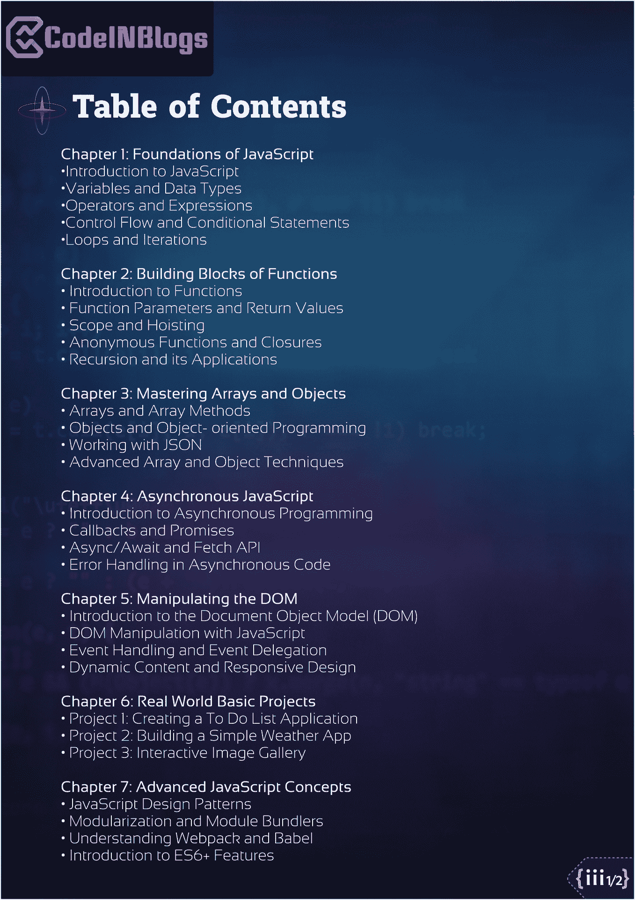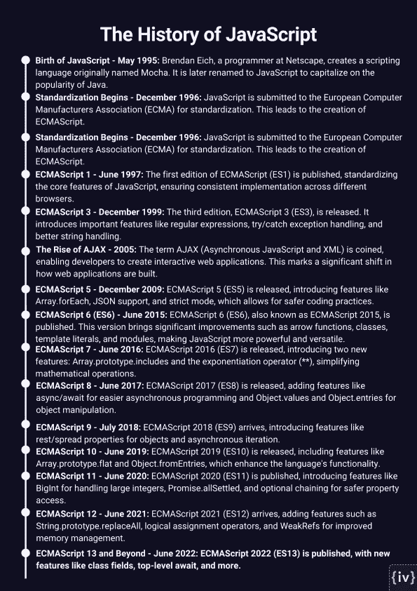

# 第一章：JavaScript 基础

让我们学习！

## JavaScript 基础

JavaScript 是一种非常著名的编程语言，它可以增强网站的交互性，影响游戏、按钮响应、表单数据输入、动态样式、动画等。本书将作为你学习 JavaScript 的起点，扩展你对其可能性的理解。让我们深入了解它吧。

### JavaScript 简介

让我们从基础知识开始。JavaScript 诞生于 20 世纪 90 年代中期，是一种用于制作交互网页简单脚本语言。这种编程语言由 Brendan Eich 在 Netscape Communications 工作期间仅用短短十天时间创造。他万没想到，他的创造将彻底改变互联网，并成为全球最广泛使用的编程语言之一。

通过动态 Web 应用程序，异步操作网页元素。现在，JavaScript 无处不在，从服务器后端到动态单页应用，这证明了它在技术行业中的适应性和无不在。

## 变量与数据类型

在 JavaScript 中，`Variables` 用于存储数据值。它可以包含不同类型的信息，如数字、字符串、布尔值、数组、对象等。与其他编程语言不同，JavaScript 是动态类型的，不需要显式声明变量类型。这背后的原因是它使得代码编写更加灵活且富有表现力。

### 运算符与表达式

在 JavaScript 中，运算符是在操作数上执行某些操作的符号。例如，数学符号看起来很基础，但在这种语言中，它们可以用于执行广泛的计算，而逻辑符号则组合了做出决策的条件。编写健壮且高效的 JavaScript 代码需要理解运算符的功能。

JavaScript 之所以流行是因为它可以管理用户交互并与服务器通信。

### 控制流与条件语句

控制流语句用于通过某些条件确定代码的执行方式。例如 `if...else` 语句、`switch` 语句和三元运算符； JavaScript 提供了实现这些目标的方法。这些功能让开发者能够创建适应不同情况的代码，使他们的应用程序更加灵活强大。

### 循环与迭代

在更高效地执行重复任务时，循环非常重要。JavaScript 提供了许多循环结构，包括 `while`、`for` 和 `do…while` 循环，每个循环都有特定的角色和用途。无论是涉及遍历数组、处理用户输入还是计算顺序，它都能让编码变得更容易并提高生产力效率。

这些主题是掌握 JavaScript 的关键，也是通向掌握高级概念的基石。通过牢固掌握这些基础，你将建立克服 JavaScript 学习路径中复杂挑战所需的信心和能力。继续探索、实验和创造，迈向精通 JavaScript。

## 变量与数据类型

### 理解 JavaScript 变量

在 JavaScript 中，`Variables` 被数据存储容器。与其他某些编程语言不同，JavaScript 是动态类型的，这意味着你不需要显式声明变量的数据类型。这提供了灵活性，允许你在整个代码中为同一个变量分配不同类型。

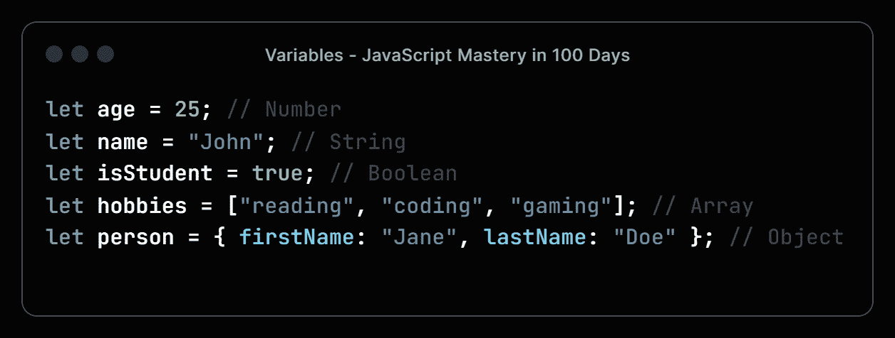

### JavaScript 中的 3 种运算符

JavaScript 中的运算符在操作数上执行操作，允许你处理代码中的数据。JavaScript 支持多种类型的运算符，包括：

- **算术运算符**：用于比较数学计算。

- **比较运算符**：用于比较值并返回真或假。

- **逻辑运算符**：用于组合多个条件。

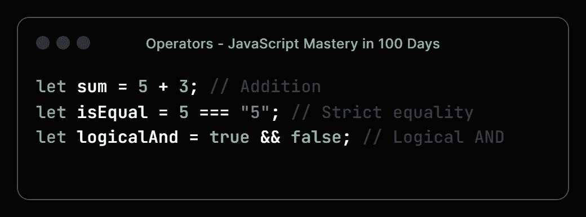

JavaScript `Expressions` 是值、变量和运算符的组合，会产生结果。无论是执行简单计算还是复杂逻辑，表达式在 JavaScript 编程中起着至关重要的作用。

学习如何使用运算符和表达式使你能够编写高效准确执行所需任务的代码。一旦你理解了这些基础，你就能 JavaScript 中创建更高级的程序。

 你知道吗？

你可以在 HTML 中编写 JavaScript 代码。HTML 的 `<script>` 标签对 JavaScript 的支持自 HTML 2.0 就有了。因此，如果你在进行个人项目，可以在 HTML 中包含 JS。然而，在生产级项目中不建议使用这种方法。相反，建议链接单独的 JavaScript 文件。此外，如果你在做个人项目并在 HTML 中编写脚本，非常建议将 `<script>` 标签保留在 `body` 中。

### 运算符与表达式

JavaScript 中用于对操作数执行操作的符号被称为运算符，它们允许你处理代码中的数据。JavaScript 中有几种类型的运算符，每种类型都有其不同的用途。

- **算术运算符**：用于执行数学计算，如加法、减法、乘法和除法。

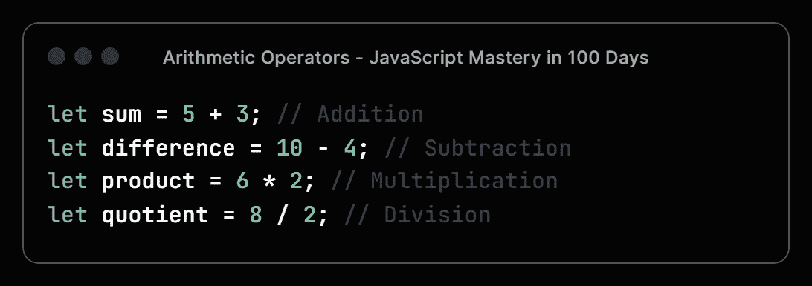

- **比较运算符**：用于比较值并根据比较结果返回真或假。

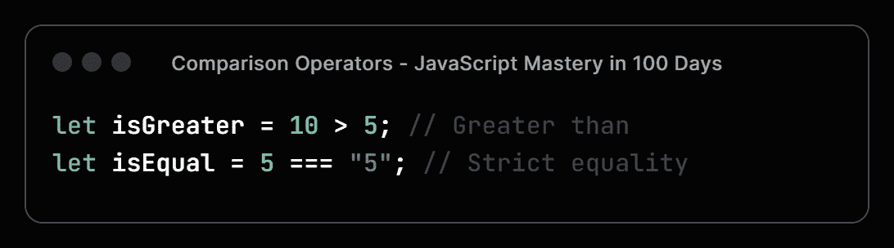

- **逻辑运算符**：用于组合多个条件并返回真或假。

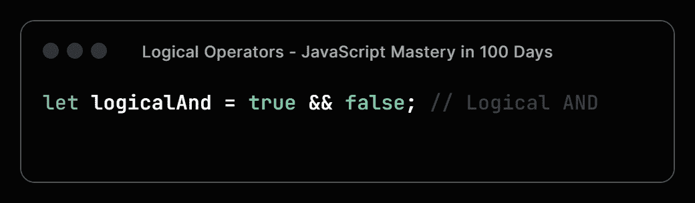

JavaScript 中的 `Expressions` 是值、变量和运算符的组合，产生结果。无论你是执行简单计算还是实现复杂逻辑，表达式都能让你有效地表达你的意图。

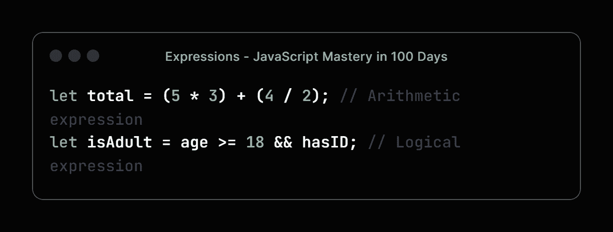

为了编写高效简洁的 JavaScript 代码，了解运算符和表达式非常重要。它允许程序员更精确地处理数据并更清晰地控制程序流。

### 控制流与条件语句

JavaScript 中有控制流语句，允许根据某些条件操控程序的执行。在 JavaScript 中，有用于不同用途的条件语句：

- **if...else 语句**：如果指定条件为真，则执行代码块；否则执行另一个代码块。

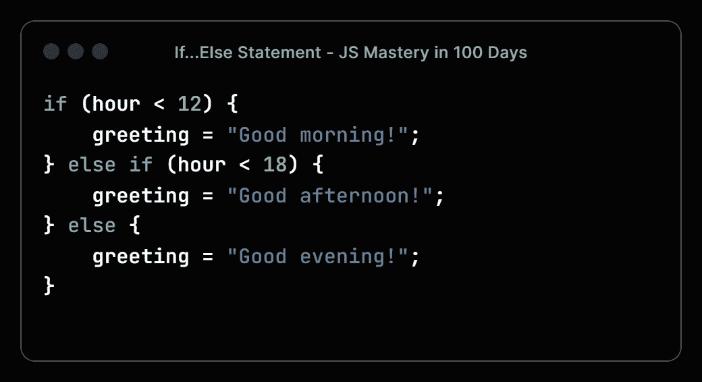

- **switch 语句**：评估表达式并根据匹配的 case 标签执行代码块。

理解如何有效使用条件语句允许你创建动态且响应的 JavaScript 应用程序，以适应不同的场景和用户交互。6

### 循环与迭代

JavaScript 中的循环让你反复运行某段代码，只要特定条件保持为真。JavaScript 提供了许多不同的循环，根据它们使用的条件而异。

- **For 循环**：执行指定次数的代码块。

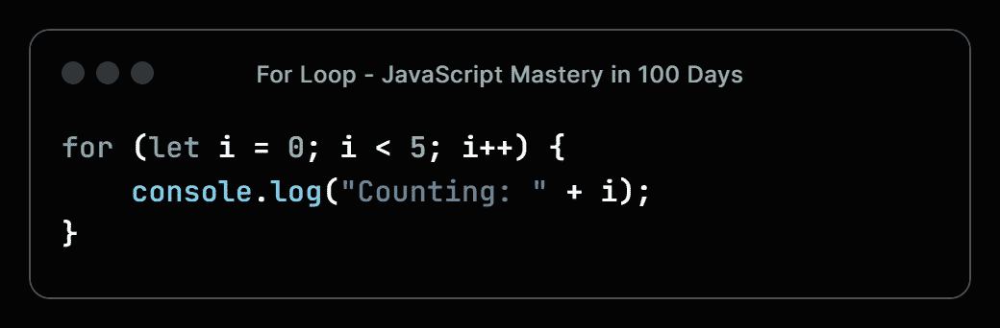

- **while 循环**：只要条件为真就执行的循环。

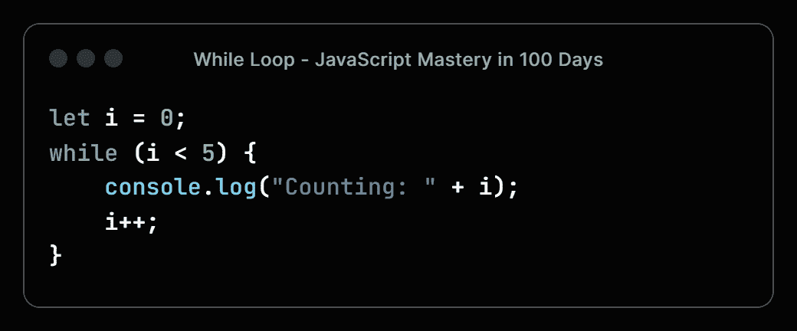

- **do…while 循环**：类似于 while 循环，但即使条件为假，代码块也会至少运行一次。

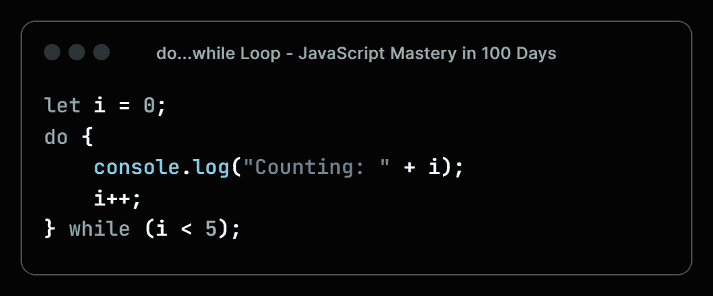

### 7

在 JavaScript 应用程序中，循环是自动化重复任务、遍历数组和高效处理数据的强大工具。

### 使用 for...of 循环增强迭代

JavaScript 中的 `for...of` 循环为遍历可迭代对象（如数组、字符串和集合）提供了一种方便的方法：

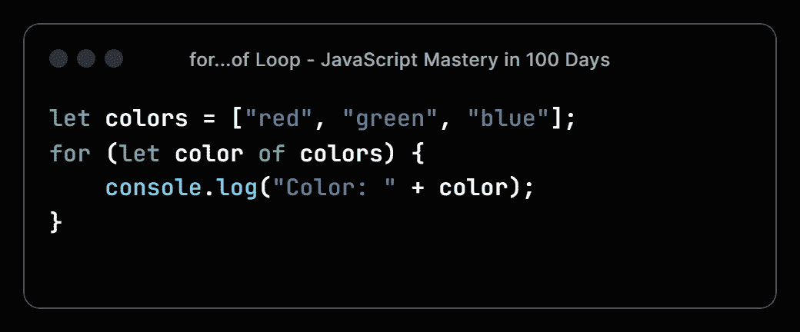与传统的 `for` 循环不同，`for...of` 循环简化了遍历元素的语法，使你的代码更加易读且简洁。

理解不同的循环结构并知道何时使用每种结构，将让你编写出高效且优雅的 JavaScript 代码，轻松处理重复性任务。

# 总结

在本章中，我们学习了 JavaScript 的核心概念，从变量和数据类型到运算符、流程控制语句和循环。你现在准备准备开始学习更多 JavaScript 编程，并在对这些基础知识充分理解的基础上开发交互式 Web 应用了。

是时候通过一些项目来测试你的技能了。我在第二章所有章节的末尾列出了一些项目。

## 函数的构建模块

让我们开始学习吧！

### 函数简介

JavaScript 函数在编程中至关重要，因为它们允许你封装可重用的代码块，将代码组织成逻辑单元，从而使其更加模块化和易于管理。在本章中，我们将讨论函数的基础及其在 JavaScript 编程中的重要性。

#### 函数参数和返回值

函数参数是每次调用函数时传递给函数的值的占位符。它允许函数接收输入数据，这些数据可以在函数体内部用于计算、做出选择或执行其他操作。函数参数具有多功能性，它们可以处理各种类型的数据和数量，使函数在不同情况下更具响应性。

在定义函数时，参数在函数名后的括号内声明。这些参数充当函数内部局部变量，允许你在函数实现中引用它们。例如：

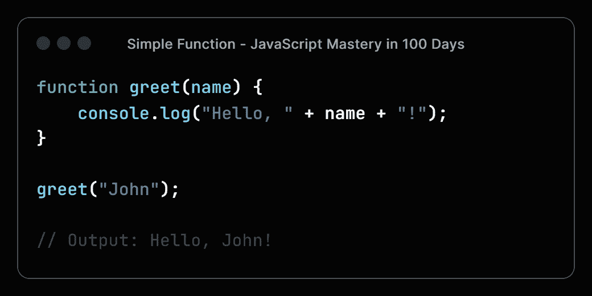在此示例中，`name` 是 `greet` 函数的参数，允许函数根据传递给它的值进行个性化问候。

JavaScript 函数可以接受多个参数，并用逗号隔开，允许你传递多条数据进行处理：

在这里，`add` 函数接收两个参数 `a` 和 `b`，并返回它们的和。通过在调用函数时为两个参数提供值，你可以对不同的输入值执行加法。

#### 利用返回值

在 JS 中，函数的返回值被认为是最基础的概念之一，它允许函数产生输出或结果。函数在返回结果之前可以计算一个值或执行某些操作。这使得函数能够将复杂的逻辑组合在一起，并为程序中的其他部分提供合理的输出。

要在函数中指定返回值，你使用 `return` 关键字，后紧跟你想返回的值或表达式。例如：

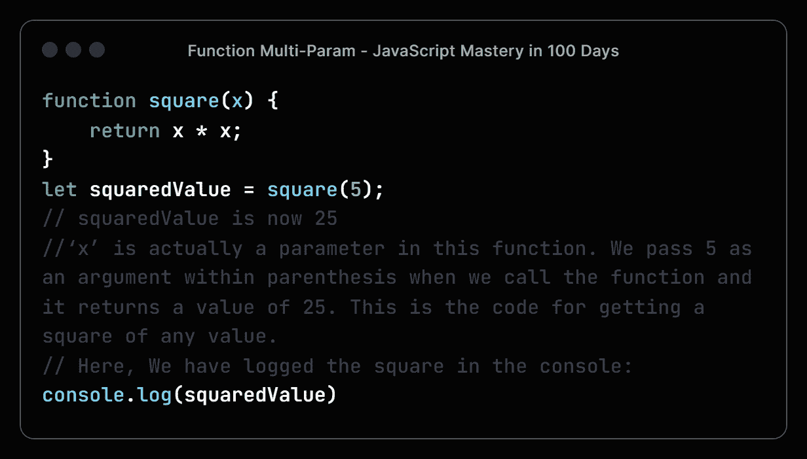

### 11

在此示例中，`square` 函数接收一个参数 `x`，然后返回该值的平方。返回的结果可以存储在变量中或用于进一步计算。

返回值不仅限于简单的数据类型；函数可以返回更复杂的数据结构，例如数组或对象，让你的代码具有更强的灵活性和多功能性。此外，函数可以使用 `return` 语句提前返回，允许在满足某些条件时提前终止执行。

理解如何有效利用函数参数和返回值，能够让你使函数具有适应性、可重用性，并能够产生有意义的结果。通过掌握这些概念，你可以增强 JavaScript 代码的功能和灵活性，从而构建更高效、更易维护的应用。

t

 你知道吗？JavaScript 中的变量：`var` vs. `const` vs. `let`

JavaScript 的 `var` 缺乏块级作用域，往往会导致不可预测的行为。`const` 声明不可重新赋值的常量，促进了不可变性。`let` 具有块级作用域，允许变量重新赋值，使其非常多功能。

专业提示：对于不可变变量优先使用 `const`，对于可变变量使用 `let`。这种做法可以提高代码清晰度并防止意外的变量修改，促进健壮且易于维护的 JavaScript 代码。

### 作用域与提升

变量作用域——指的是变量在代码中可以访问的上下文。在 JavaScript 中，变量可以具有全局作用域或局部作用域，取决于它们声明的位置。

全局作用域：在任何函数之外声明的变量具有全局作用域，意味着可以从代码的任何地方访问。

局部作用域：在函数内部声明的变量具有局部作用域，意味着它们只能在该函数内部访问。

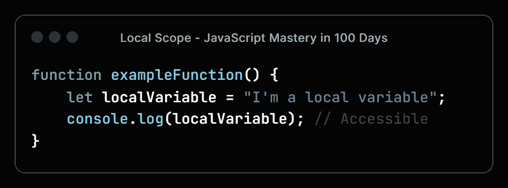

理解变量作用域对于编写整洁、模块化的代码非常重要。它有助于防止命名冲突，并确保变量只在需要的地方访问。

#### 提升（Hoisting）的概念

在 JavaScript 中，提升是指语言的一种内置行为，通过这种行为，函数、变量和类的声明会被移动到它们作用域的顶部——全在代码执行之前。反之，这允许我们在声明之前使用函数、变量和类。

使用 `var` 声明的变量会被提升，但它们的赋值不会。如果不正确理解，这可能会导致意想不到的行为。

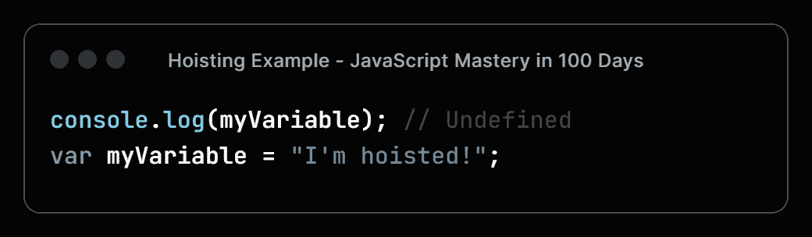

在此示例中，`myVariable` 被提升到其所在作用域的顶部，导致在赋值之前访问时结果为 `undefined`。

然而，使用 `let` 或 `const` 声明的变量以相同的方式提升。它们被提升到块作用域的顶部，但在代码到达声明处之前一直处于“暂时性死区”中。在声明之前访问它们会导致引用错误（reference error）。

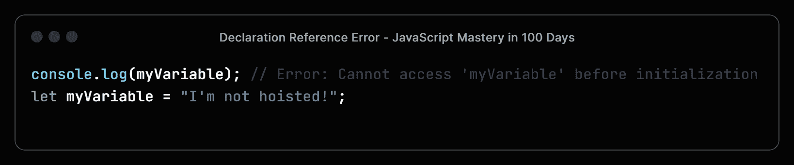

了解提升的工作原理可以让你编写出更具可预测性的代码，减少产生意外后果的可能性。一旦完全理解了作用域和提升的概念，开发者就可以更好地判断在 JavaScript 程序中何时何地声明变量或使变量可见。

### 匿名函数与闭包

理解匿名函数——匿名函数也称为函数表达式，是指没有名称的函数。它们通常作为其他函数的参数或赋值给变量。

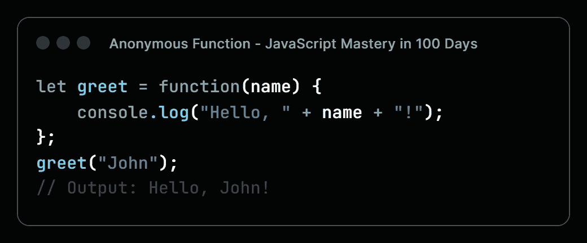

### 14

匿名函数提供了灵活性，通常用于需要临时函数或函数标识并不重要的场合。

#### 探索闭包

闭包是函数与其周围环境状态（词法环境）引用的结合。换句话说，闭包就像小内存胶囊：它让你从内部函数访问外部函数的作用域。在 JavaScript 中，每次创建函数时都会创建闭包。

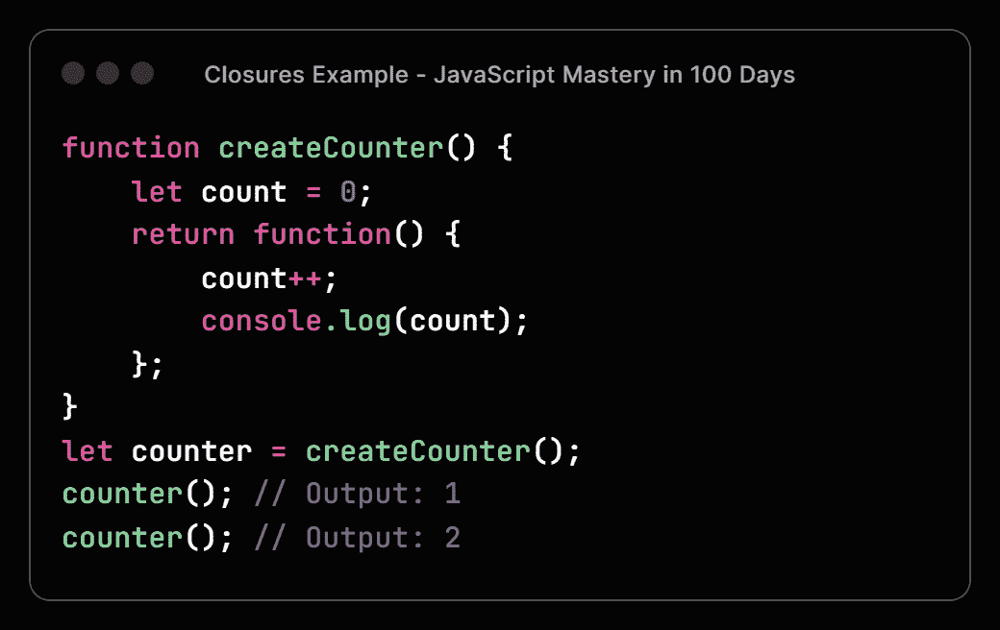

在此示例中，内部函数对 `count` 变量形成了一个闭包，允许它在 `createCounter` 执行完毕后仍访问并修改 `count` 变量。

### 递归及其应用

递归是嵌入在许多编程语言中的编程模式或概念，JavaScript 也不例外。它是一种用于创建函数的特性，该函数会不断调用自己，但每次连续的输入都更小，直到实现从开始预期的代码结果为止。

这倾向于保持代码非常整洁，同时为多个结构相似的任务提供解决方案。基于递归概念运行的函数被称为递归函数。

### 递归函数的语法示例：

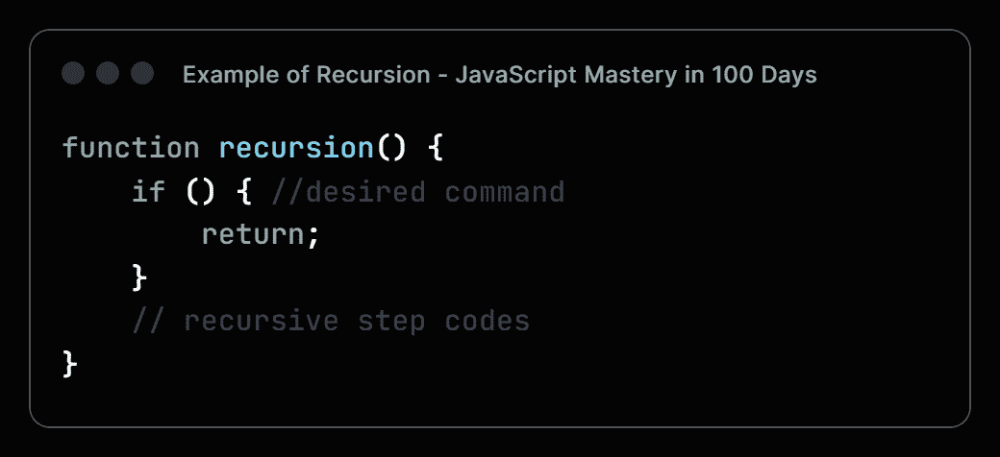

在上面的示例中，我们假设递归函数为 `recursion()`。这是任何递归函数可能采用的最简单格式。此外，函数块外的第二个 `recursion()` 调用了整个函数进行执行。

## 为什么使用递归？

让递归脱颖出的一个主要因素是，与不使用递归相比，它只需要几行代码就能完成复杂的任务。这使得代码库看起来简单优雅，节省了时间并允许快速完成工作，同时还消除了臃肿的代码库。

例如，我们可以编写一个递归函数来计算阶乘数，如下例所示：

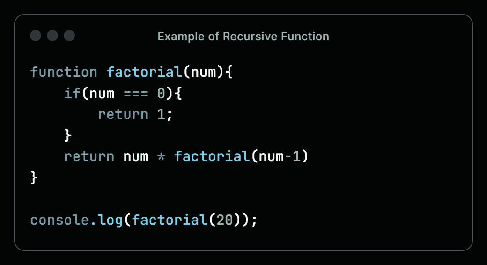

尽管此示例可以用循环来复制实现，但在涉及大量数据时，它可能会变得具有挑战性。这是因为递归使用栈来存储变量，而循环则不然。

## JavaScript 递归是如何工作的？

JavaScript 中的递归工作方式与其他语言完全相同。为了很好地理解递归的工作原理，让我们来看一下上面递归函数语法的组成。任何编写递归函数的人必须提供该语法的三个基本部分。它们如下：

1. 函数声明 (Function Declaration)

2. 基准情况 (Base Case)

3. 递归调用命令 (Recursive Call command)

### 函数声明

这是声明目标递归函数的部分。它的实现方式与 JavaScript 中普通新声明的方式相同。声明的函数可以接收参数。

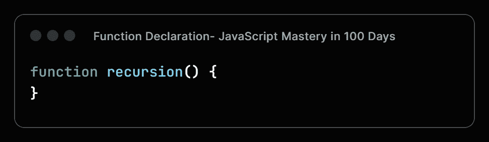

### 基准情况

这是每个递归函数的基础。当问题被分解为更小的任务时，它是要解决的初始问题的基本单元。

它也可以被视为一种在集合条件为真时具有终止递归过程潜力的命令。某些基准情况可以封装在 `if….else statement` 中。

以下是基准情况的示例：

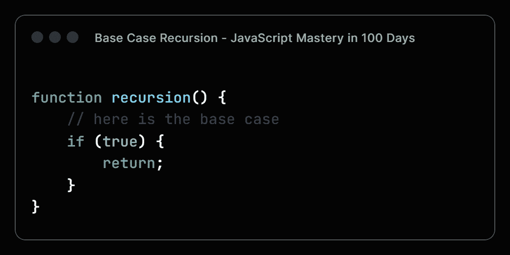一旦满足指定的基准条件，就会执行带有 `return` 语句的命令。

### 递归调用命令

此命令或参数负责触发递归调用。此外，这是处理你正试图解决的问题核心精髓的命令。它是任何通用的 JavaScript 代码，取决于开发者想要实现的目标。

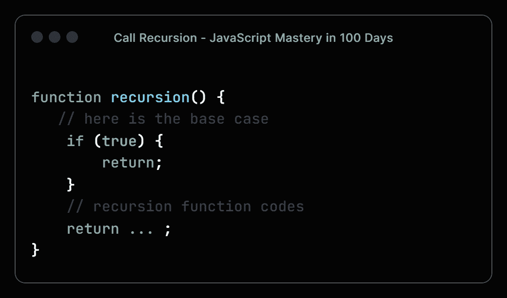

当所有这些都就绪后，你现在可以使用 `recursion()` 函数来调用并执行该函数。完整的递归函数现在像这样：

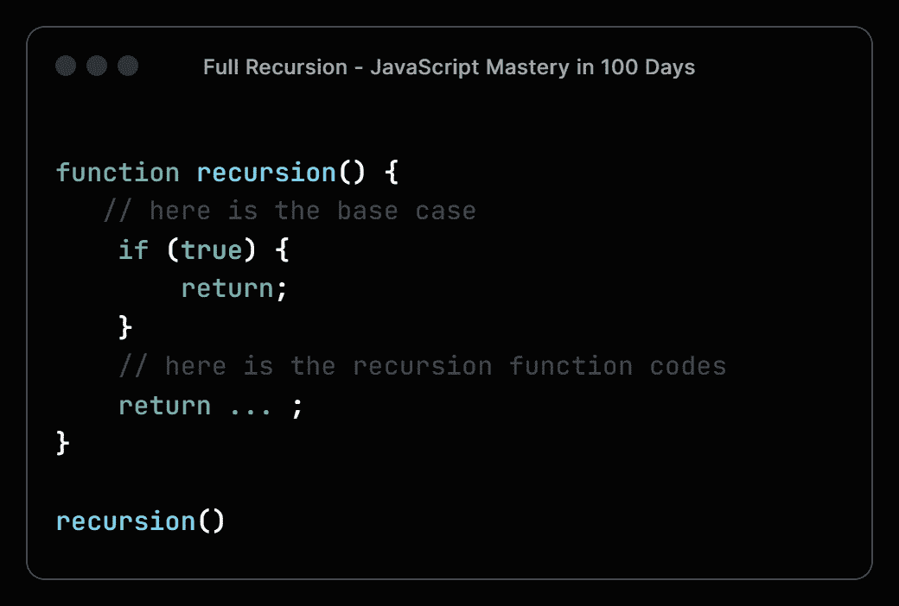

## 递归用例示例

在上一节中理解了 JavaScript 递归的工作原理后，我们现在来看递归的一些用例。这将使我们能够更深入地理解递归的可用性。

### 示例：数字倒计时

假设你想编写一个程序，按降序给出数字倒计时，例如从 10 到 1。预期的输出应该是 10,9,8,7,6,5,4,3,2,1。

编写一个在每一步每个时间手动减小值的程序看起来会很臃肿，但递归倾向于用更少的代码来实现。

让我们来看下面的代码：

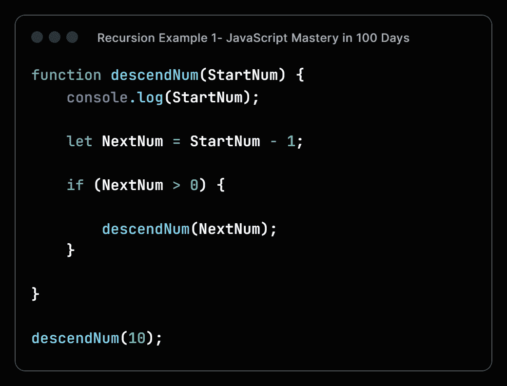

现在让我们根据递归函数语法的部分来剖析上面的代码。

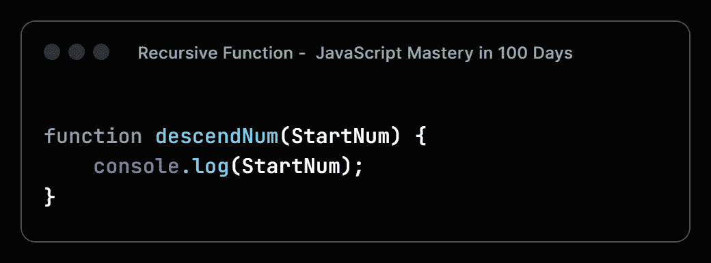

上面的代码声明了函数 `descendNum`，它接收参数 `StartNum`，描述倒计时开始的数字。这行代码还打印了起始数字。

```
let NextNum = StartNum — 1;
```

这行代码是递归调用命令。它声明了一个变量 `NextNum`，其值为起始数字减去 1，从而创建了预期的减少。这段代码块恰好是基准情况。只有在满足 `NextNum > 0` 条件时，起始数字值的减少才能通过。

## 递归的实际应用

递归常用于解决各个领域的问题，包括科学和算法。一些实际应用包括：

- **树和图遍历**：递归经常用于通过递归方式访问每个节点或顶点来遍历分级数据结构，如树和图。

- **排序算法**：某些排序算法，如 `quicksort`（快速排序）和 `mergesort`（归并排序），利用递归将排序过程分解为更小的子问题。

- **搜索算法**：递归搜索算法，如 `binary search`（二分查找），将搜索空间分解为更小的子问题，从而缩短搜索时间。

- **回溯算法**：回溯算法，如数独求解器和 `NQueens`（皇后问题）求解器，使用递归探索所有可能的解决方案。

JavaScript 递归的核心在于编写更整洁、不臃肿的代码库，同时为多线程任务提供解决方案。在 JavaScript 中，通过带有适当基准情况和递归步骤命令的声明，你的递归函数就准备好执行了。虽然递归是编写清洁代码的推荐模式，因为它帮助我们用几行代码解决复杂问题，但使用递归存在潜在成本——它可能会导致性能问题。

# 数组与对象

### 数组与数组方法

#### 数组简介

数组是值的有序集合。每个值被称为元素，每个元素在数组中都有一个数字位置，称为索引。

数组是 JavaScript 中的基础数据结构，可以使用不同的技术在单个变量中存储许多值。数组的主要用途是处理多种类型的数据，特别是当处理像本例中这样的列表时。它们具有许多属性，用于添加、删除或对已添加的元素执行任何其他操作。

方括号 `[ ]` 用于定义数组，其中的元素用逗号分隔。分配给数组元素的数据类型可能不同；它们可能包括字符串、数字、对象和数组本身。

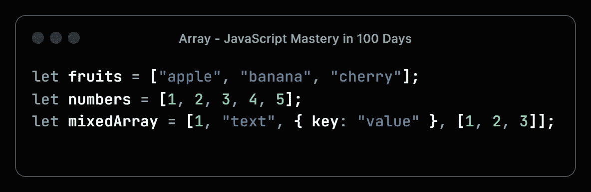

#### 基础数组方法

JavaScript 提供了多种处理数组的方法。以下是一些最常用的方法：

- `push()` 和 `pop()`：这些方法分别从数组的末尾添加和删除元素。

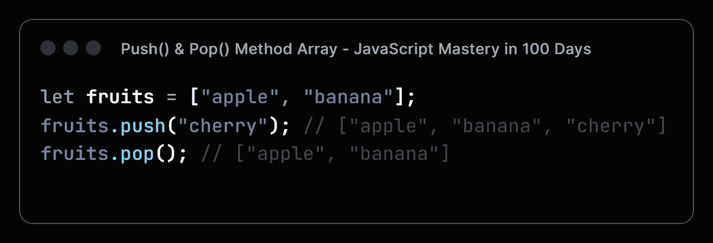

- `shift()` 和 `unshift()`：这些方法分别从数组的开头添加和删除元素。

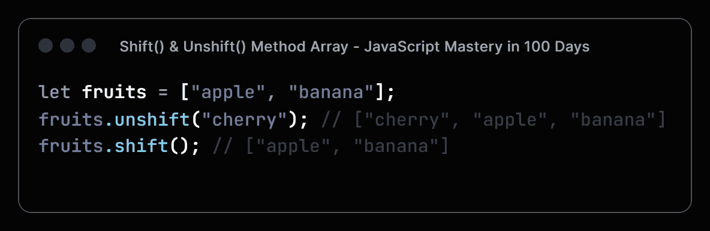

- `concat()`：此方法合并两个或多个数组。

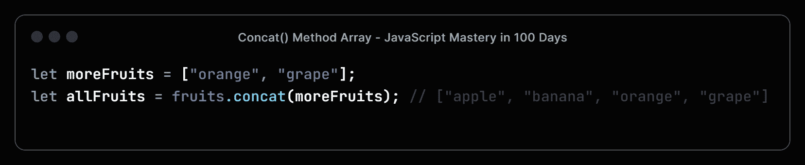

- `slice()`：此方法将数组的一部分浅拷贝并返回到新数组中，而不修改原始数组。

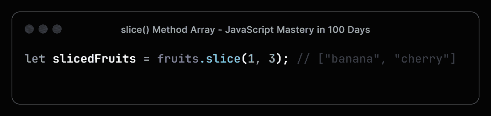

- `splice()`：此方法通过删除或替换现有元素以及/或添加新元素来更改数组的内容。

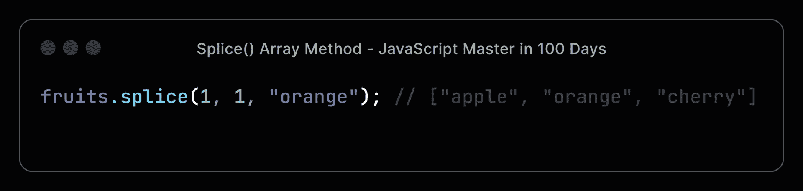

#### 遍历数组

有一些方法可以遍历数组的元素：

- `for` 循环：传统的 `for` 循环允许你使用索引遍历数组元素。

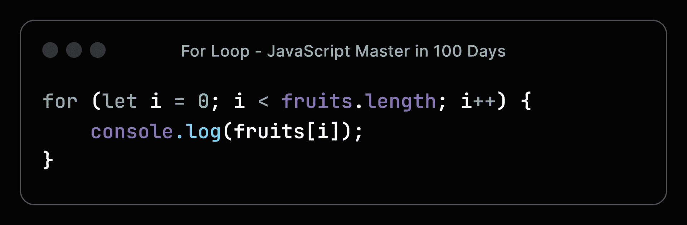

- `for...of` 循环：这种循环提供了一种更简洁的方式来遍历数组元素。

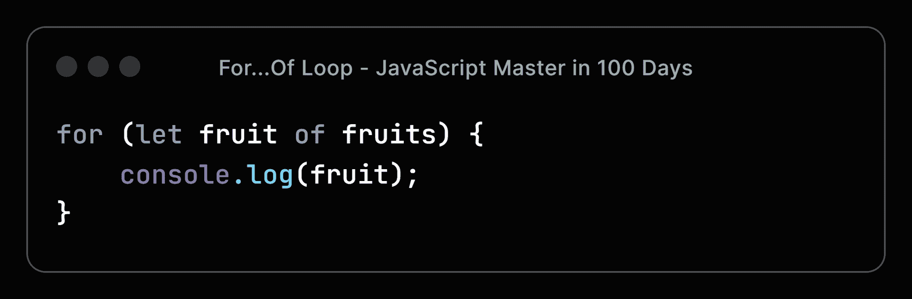

- `forEach()`：此方法为每个数组元素执行一次提供的函数。

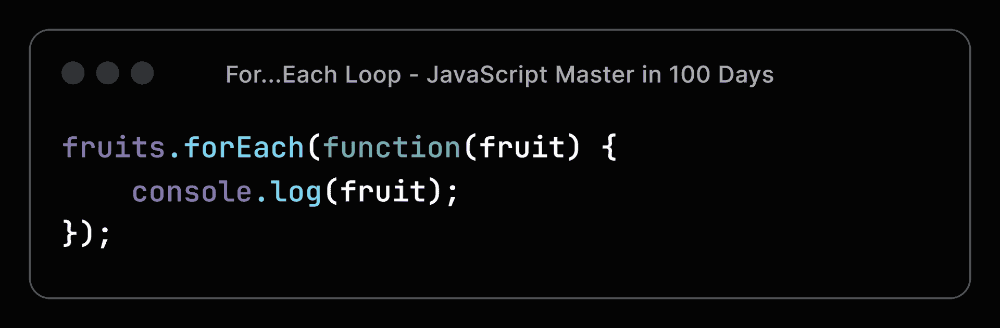

#### 高级数组方法

JavaScript 还有一些用于处理和交互数组的有效技术：

- `map()` 该方法创建一个新数组，其结果是通过在调用数组的每个元素上调用提供的函数而得到的。

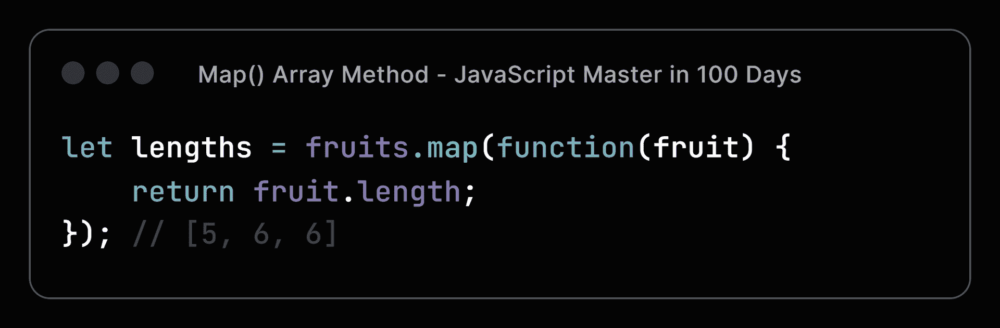

- `filter()` 该方法创建一个新数组，其中包含所有通过提供的函数所实现的测试的元素。

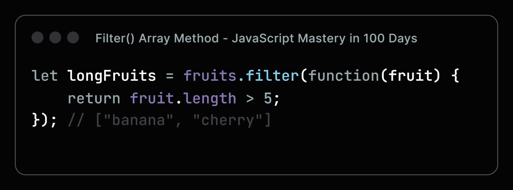

- `reduce()` 该方法对累加器和数组中的每个元素应用函数，以将其还原为单个值。

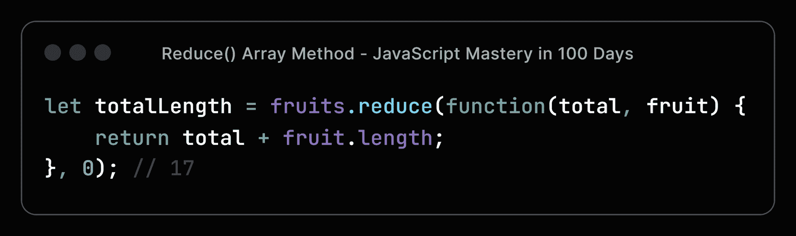

- `find()` 和 `findIndex` 这方法分别返回第一个匹配所提供的测试函数的元素及其索引。

通过学习这些数组方法，你可以快速地处理 JavaScript 应用程序中的数据。数组在 JavaScript 中是关键且实用的。知道如何良好使用它们是精通该语言的关键。

## 对象与面向对象编程

### 理解对象

对象是属性的集合，而属性是名称（或键）与值之间的关联。属性的值可以是一个函数，在这种情况下，该属性被称为方法。JavaScript 中的对象就像许多其他编程语言中的一样，可以与现实生活中的对象进行比较。

### 创建对象的某些方法

**对象字面量** 创建对象简单的方法是使用对象字面量，它是封装在花括号 `{ }` 中的逗号分隔的键值对列表。

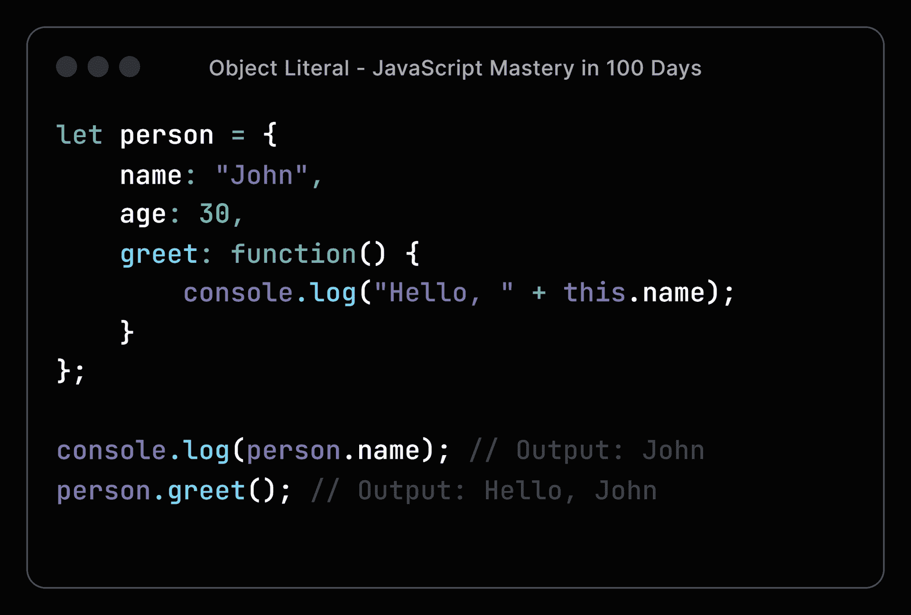

**构造函数** 创建对象的另一种方法是使用构造函数，它定义了创建对象的模板。

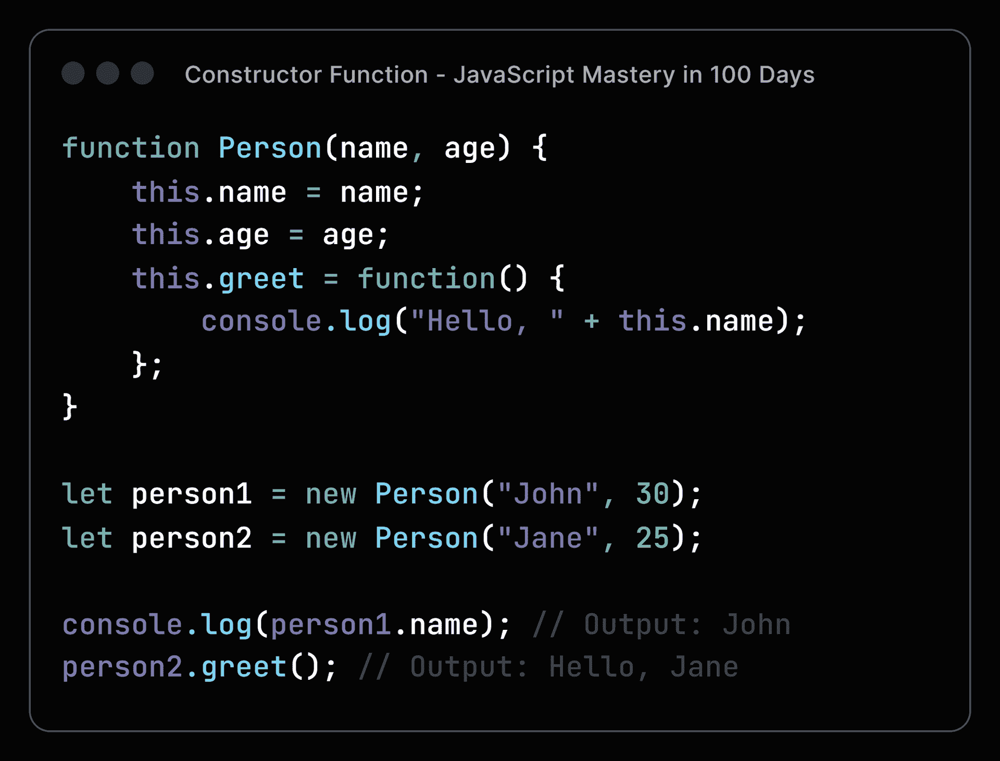

**`Object.create` 方法** 该方法创建一个具有指定原型对象和属性的新对象。

## JavaScript 中的面向对象编程 (OOP)

面向对象编程 (OOP) 是一种编程范式，使用对象将软件应用程序结构为可重用的代码段和蓝图。OOP 日用于大型、复杂且活跃维护的项目。

OOP 使得能够隔离创建和管理应用程序的许多部分，并在连接它们时而不会让它们相互依赖。JavaScript 是一种基于原型的语言，支持抽象、封装、多态和继承等 OOP 原则。

### 抽象

抽象是面向对象编程 (OOP) 中的一个基本概念，指的是隐藏对象的实现细节并仅向用户暴露基本特征的做法。在 JavaScript 中，抽象通过使用抽象类和接口来实现。

抽象类是一种无法实例化的类，旨在作为其他类的基类。抽象类通常包含一个或多个抽象方法，这些方法具有签名但没有实现。这些方法必须由派生类实现。

JavaScript 原生并不支持抽象类，但你可以通过结合函数构造函数和原型来实现类似的功能。

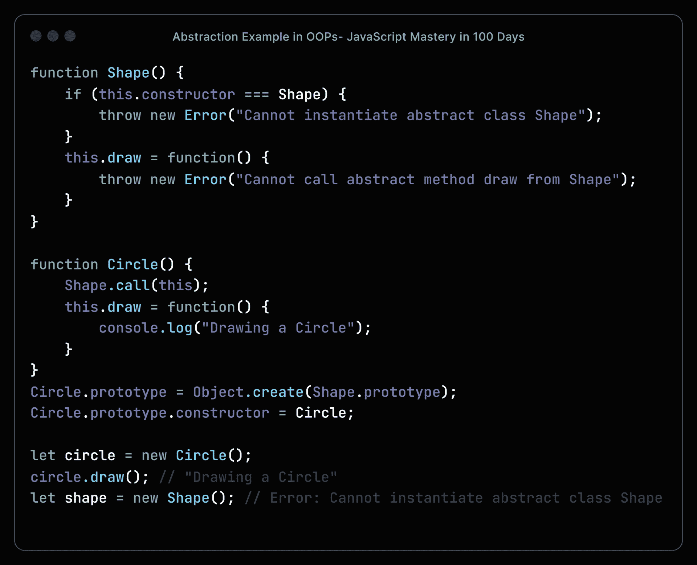

在这个示例中，`Shape` 类是一个抽象类，它无法实例化，并包含一个抽象方法 `draw()`，该方法在调用时会抛出错误。`Circle` 类继承自 `Shape` 类并实现了 `draw()` 方法，提供了特定的实现。

接口是在 JavaScript 中实现抽象的另一种方式，尽管它不是 JavaScript 的原生功能。像 `TypeScript` 这样的库提供了接口。接口定义了类必须实现的方法集，但没有为这些方法提供实现。这允许开发者确保一个类具有所需的方法，而无需指定这些方法应如何实现。

### 封装

封装是面向对象编程 (OOP) 中的一个基本概念，指的是向其他对象和代码隐藏对象内部细节的做法。在 JavaScript 中，封装通过使用闭包和访问修饰符（例如 `private` 和 `public` 关键字）来实现。

JavaScript 使用闭包来实现封装，这允许开发者创建从对象外部访问的私有变量和方法。例如，考虑以下代码：

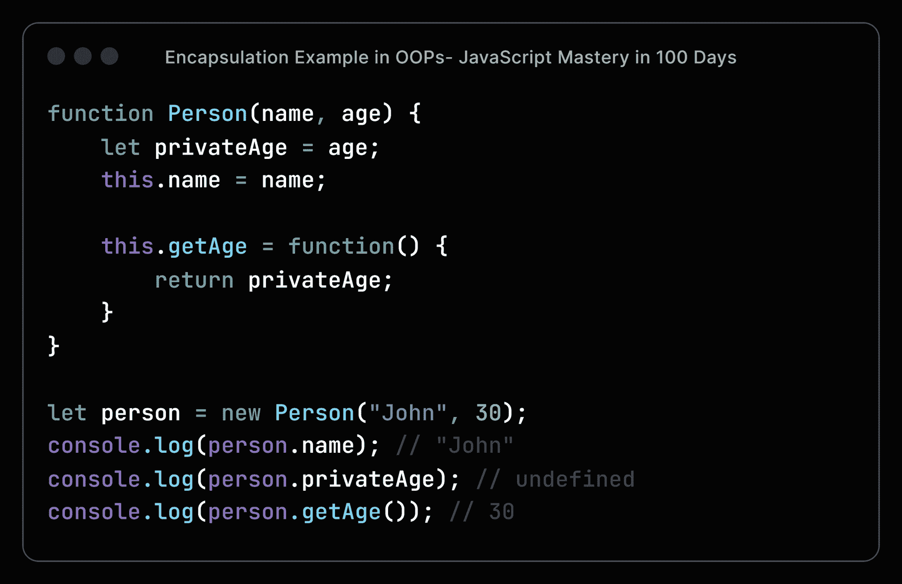

在这个示例中，`privateAge` 变量定义在构造函数内部，只能通过 `getAge` 方法访问。这意味着对象的内部状态对其他对象和代码隐藏了，提供了某种保护和安全性。

`private`、`public` 和 `protected` 等访问修饰符在 JavaScript 中并不原生支持，但也可以闭包来实现。此外，像 `TypeScript` 等其他库和框架提供了使用访问修饰符的方法。

总之，封装是 OOP 中的一个基本概念，允许开发者向其他对象和代码隐藏对象的内部细节。在 JavaScript 中，封装通过使用闭包和访问修饰符（如 `private` 和 `public` 关键字）来实现。这允许开发者保护对象的内部状态并创建更健壮、更易维护的代码。JavaScript 原生不支持，但可以使用闭包和像 `TypeScript` 这样的库来实现。

### 多态

多态是面向对象编程 (OOP) 中的一个基本概念，指的是不同对象以不同方式响应相同方法调的能力。在 JavaScript 中，多态通过使用函数重载和函数重写来实现。

函数重载是指函数根据传递给它的参数的数量和/或类型具有多个实现的能力。JavaScript 原生并不支持函数重载，但你可以通过使用 `arguments` 对象并检查传递给函数的参数数量和/或类型来实现类似的功能。

函数重写是指子类对其超父类已提供的方法提供不同实现的能力。在 JavaScript 中，这可以通过重新分配子类的原型来实现。例如，考虑以下代码：

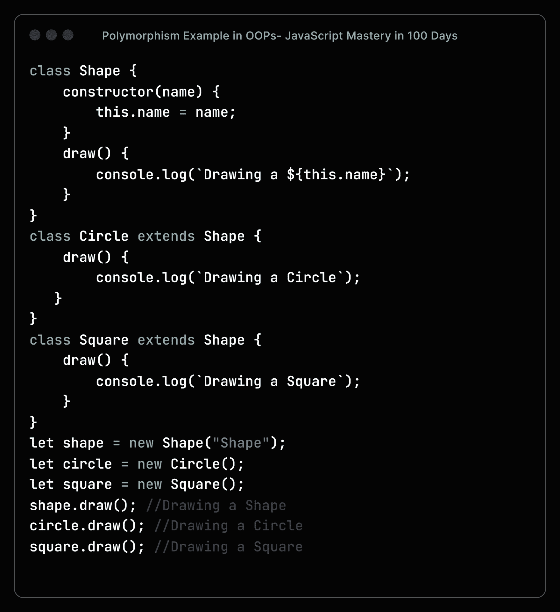

在这个示例中，`draw()` 方法在子类 `Circle` 和 `Square` 中被重写了，为由超父类 `Shape` 提供的方法提供了不同的实现。

总之，多态是 OOP 中的一个基本概念，指的是不同对象以不同方式响应相同方法调的能力。

### 继承

继承是面向对象编程 (OOP) 中的一个基本概念，允许开发者创建一个继承自现有类属性和方法的新类。在 JavaScript 中，继承通过使用 `prototype` 属性和 `Object.create()` 方法来实现。

JavaScript 使用基于原型的继承模型，这意味着对象可以从其他对象继承属性和方法。每个对象都有一个指向另一个对象的原型属性，属性和方法通过遍历原型链来继承。例如，考虑以下代码：

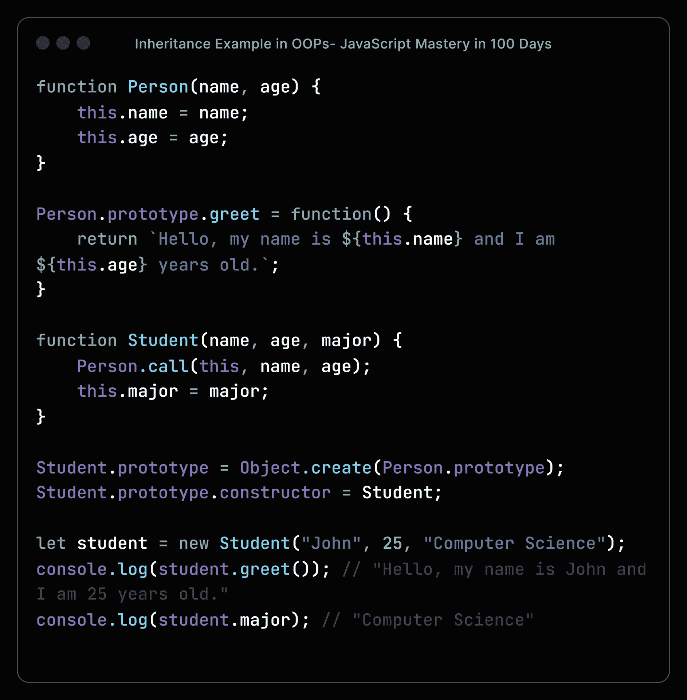

在这个示例中，`Student` 类继承了 `Person` 类的属性和方法。`Object.create()` 方法用于创建一个继承自 `Person.prototype` 对象的新对象，并将 `constructor` 属性重置为 `Student` 类。在 JavaScript 中，继承模型与 `Java` 或 `C#` 等其他语言略有不同，在这些语言中，类继承其他类，子类可以访问父类的方法和属性。而在 JavaScript 中，它是基于原型链的，每个对象都有一个指向另一个对象的 `prototype`（原型）属性，并通过遍历原型链来继承属性和方法。

总之，继承是面向对象编程（OOP）中的一个基本概念，它允许开发者创建一个继承现有类属性和方法的新类。在 JavaScript 中，继承是通过使用 `prototype` 属性和 `Object.create()` 方法实现的。这允许开发者创建可复用的代码，并构建更有组织、更易于维护的代码库。理解 JavaScript 中基于原型的继承模型对于能够在使用 JavaScript 中有效使用继承至关重要。

对象和面向对象编程是 JavaScript 中非常重要的概念，允许你创建可复用、模块化且易于维护的代码。通过在对象内部封装并利用继承将数据和行为绑定在一起，并通过多态来扩展对象，你可以创建更复杂、更易理解且更容易修改的复杂系统。

# 33

## JSON 的操作

### JSON 简介

`JSON`（JavaScript 对象表示）是一种基于文本的格式，用于以既人类可读又机器可解析的方式存储和交换数据。因此，`JSON` 相对容易学习和排错。尽管 `JSON` 植根于 JavaScript，但它已经发展成为一种非常强大的数据格式，简化了跨平台和跨编程语言的数据交换。如果你涉及 Web 开发、数据分析或软件工程，`JSON` 是一个需要理解的重要数据格式。

`JSON` 数据以键值对的形式表示，类似于 JavaScript 对象。键是字符串，值可以是字符串、数字、数组、对象、布尔值或 `null`。

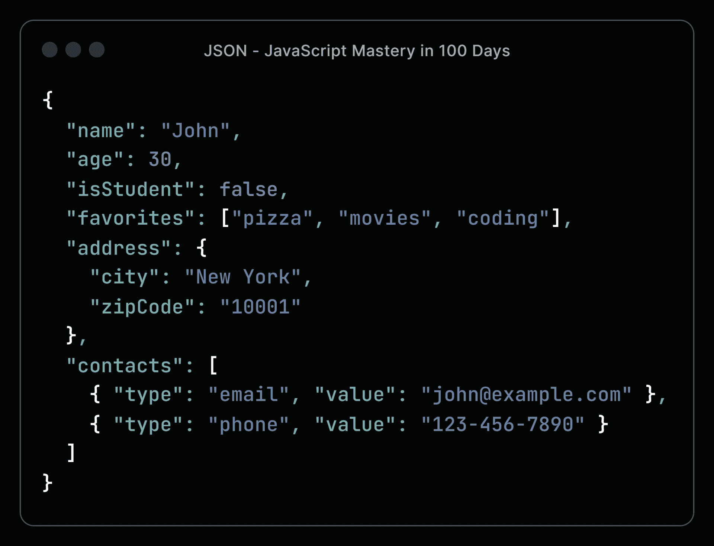

### 解析 JSON

在 JavaScript 中，我们可以使用 `JSON.parse()` 方法将 JSON 字符串解析为 JavaScript 对象。该方法允许你像处理普通 JavaScript 对象一样处理数据。

# 34

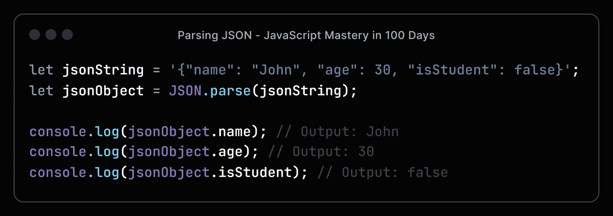

### 序列化 JavaScript 对象

`JSON.stringify()` 静态方法将 JavaScript 值转换为 JSON 字符串，如果指定了替换函数（replacer function），可以选择替换值；或者如果指定了替换数组（replacer array），则可以选择仅包含指定的属性。

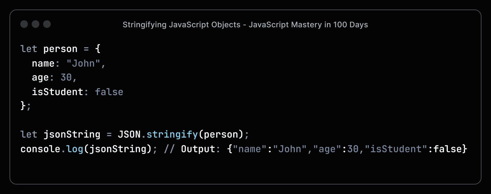

### 操作 JSON 数据

为了在 JavaScript 中操作 JSON 数据，我们可以使用 `JSON.parse()` 方法将 JSON 字符串解析为 JavaScript 对象。一旦解析，我们可以根据需要访问并修改 JavaScript 对象的属性。

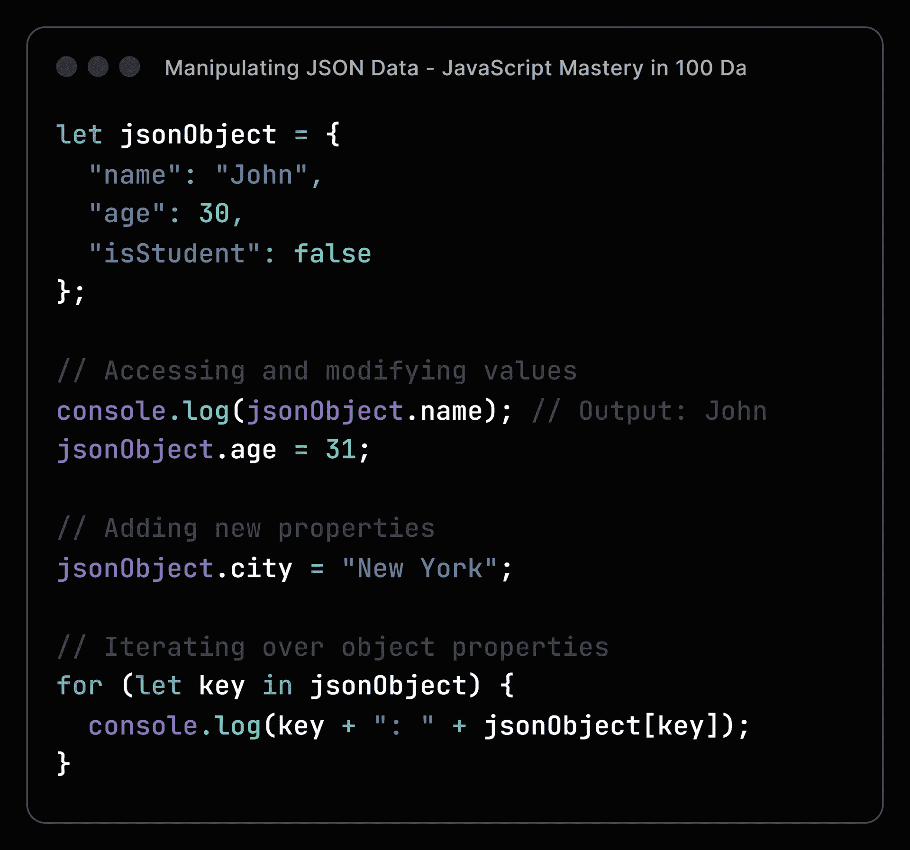

# 35

## JSON 的实际应用

开发者在 Web 开发中使用 `JSON` 有于不同的目的，包括：

- **API 数据交换**：许多 Web API（应用程序编程接口）使用 `JSON` 作为服务器与客户端应用程序之间发送和接收的数据交换格式。使用 `JSON` 的 API 称为 `JSON API`。

- **配置文件**：`JSON` 通常用于在文件中存储设置和数据，例如 `Node.js` 项目中的 `package.json` 或 `ASP.NET Core` 中的 `appsettings.json`。示例——每当我们创建一个 react 应用时，你都会看到 `package.json`，它会配置你的应用程序，每当你安装新包时，它都会以 `JSON` 的形式更新在 `package.json` 中。

- **数据存储与交换**：`JSON` 常用于数据库、Web 服务和其他系统中存储和传输结构化数据。

理解 `JSON` 的工作原理以及如何与 JSON 数据交互对 Web 开发者非常有用，因为它是现代 Web 开发的基础部分，并广泛用于构建 Web 应用程序和服务。通过掌握 `JSON`，你可以有效地在 Web 项目中交换、存储和操作数据。

# 36

## 高级数组和对象技术

### 简介

随着你对 JavaScript 越来越精通，你会发现基础的数组和对象操作并不总是满足你的需求，因为你将处理生产级项目，这时你需要使用高级技术。高级技术允许你更高效、更有效地操作和利用数组及对象，这将帮助你解决更复杂的问题。

### 高级数组技术

1. **数组解构**：数组解构允许你将数组中的值解包到不同的变量中。这可以使你的代码更易读、更简洁。


你还可以使用解构来交换变量：

2. **扩展运算符**：扩展运算符（`...`）允许你将数组元素扩展到另一个数组或函数参数中。


3. **数组方法：`reduce()`**：`reduce()` 方法在数组的每个元素上执行还原器函数，产生一个单一的输出值。它在将数组数据聚合为单个结果方面非常强大。

 你也可以使用 `reduce()` 进行更复杂的操作，例如从数组创建对象。


# 38

## 高级对象技术

1. **对象解构**：与数组解构类似，对象解构允许你从对象中解包属性到不同的变量。


2. **计算属性名**：计算属性名允许使用括号 `[ ]` 内的表达式动态创建属性名。


3. **对象的 `Object.assign()` 和扩展运算符**：`Object.assign()` 和扩展运算符可用于合并或克隆对象。

4. **`Object.entries()` 和 `Object.values()`**：`Object.entries()` 将对象转换为键值对数组，而 `Object.values()` 返回对象值的数组。


### 结合数组和对象

大多数情况下，你需要结合数组和对象来进行复杂的数据操作。例如，你可能需要根据某些标准转换对象数组或合并来自不同来源的数据。


通过掌握这些数组和对象的高级技术，你可以在 JavaScript 应用程序中处理复杂的数据结构并执行复杂的操作。这些知识对于构建高效、可扩展且易于维护的代码至关重要。40


# 第 4 章

## 异步 JavaScript

让我们学习吧！

# 41

## 异步编程简介

### 理解异步编程

异步编程是一种技术，允许你的程序启动一个可能耗时较长的任务，并在任务运行期间能够响应其他事件，而不是必须等待该任务完成。一旦任务完成，你的程序将获得结果。

JavaScript 默认是同步的：每行代码都按顺序执行，每个任务都必须等待上一个任务完成后才能开始下一个。

### 同步与异步

在同步编程中，任务按顺序一个一个执行。每个任务在开始下一个任务之前都必须完成。如果某个任务执行需要很长时间，就会导致问题，因为它会阻塞后续任务。


# 42


事件循环

异步编程是一种技术，它允许你的程序启动一个可能耗时很的任务，并在任务运行期间仍然能够对其他事件做出响应，而无需等待该任务完成。一旦该任务完成，你的程序就会获得结果。

JavaScript 默认是同步的：每行代码都按顺序执行，每个任务都必须等待上一个任务完成后才能移动到下一个任务。

JavaScript 使用事件循环来处理异步操作。事件循环持续检查调用栈（call stack）和消息队列（message queue）。当调用栈为空时，它会从消息队列取出第一个任务并将其推入调用栈中执行。

## 事件循环

以下是事件循环工作原理的简化：

1. **调用栈 (Call Stack)**：JavaScript 跟踪函数调用的地方。

2. **Web APIs**：浏览器提供的处理异步任务的 API（例如：`setTimeout`、`fetch`）。

3. **回调队列 (Callback Queue) (Message Queue)**：异步操作的回调函数存放的地方。

4. **事件循环 (Event Loop)**：监控调用栈和回调队列，当堆栈为空时执行队列中的任务。

## JavaScript 中的异步函数

在 JavaScript 中有多种方法处理异步操作：

### 1. 回调 (Callbacks)

回调是作为参数传递给其他函数，并在异步操作完成后执行的函数。


### 2. Promise

Promise 提供了一种更强大的处理异步操作的方法。一个 promise 代表一个现在可能可用、未来可能才用、或永远不存在的值。Promise 有三种状态：等待（pending）、已完成（fulfilled）和拒绝（rejected）。


### 3. Async/Await

`async` 和 `await` 是构建在 promise 之上的语法糖，允许你编写看起来像同步代码的异步代码。`async` 函数返回一个 promise，而 `await` 会暂停函数执行，直到 promise 解决（resolved）。


## 异步编程的重要性

异步编程对于构建高性能且响应良好的 Web 应用程序至关重要。它允许你处理网络请求、文件读取和定时器等任务，而不阻塞主线程，确保你的应用程序保持流畅且友好。通过掌握这些异步编程技术，你可以创建更高效、更健壮的 JavaScript 应用程序，为用户提供更好的体验。

## 回调与 Promise

### 回调

#### 什么是回调？

任何作为参数传递给另一个函数以便其在该另一个函数中执行的函数都称为回调函数。回调是 JavaScript 中处理异步操作的最老且最常见的方式之一。

#### 它是如何工作的？

当你将回调传递给函数时，它会在主函数完成任务后执行。它允许你处理如获取数据或执行 I/O 操作等任务，而不阻塞其他代码的执行。


#### 回调地狱 (Callback Hell)

回调的主要问题之一是它们会导致深度嵌套的代码，通常被称为“回调地狱”，使得代码难以阅读和维护 

# Promise

#### 什么是 Promise？

Promise 是 JavaScript 中处理异步操作的改进方法。一个 promise 代表一个现在可能可用、未来可能才用、或永远不存在的值。Promise 有三种状态：等待（pending）、已完成（fulfilled）和拒绝（rejected）。

#### 创建 Promise

要创建一个 promise，你使用 `Promise` 构造函数，并传递一个带有两个参数的函数：`resolve` 和 `reject`。当操作成功完成时调用 `resolve` 函数，当操作失败时调用 `reject` 函数。


#### Promise 链式

Promise 可以链式调用以顺序处理多个异步操作。每个 `then` 调用都会返回一个新的 promise，允许你链式额外的 `then` 调用

#### 使用 Promise 进行错误处理

Promise 的每个开发者都喜欢的优点之一是其内置的错误处理。如果链中的任何 promise 执行不当，它将被拒绝，控制权跳转到最近的 `catch` 块。


#### 结论

回调和 promise 是处理 JavaScript 异步操作的重要工具。虽然回调简单且有效，但它们可能会导致深度嵌套代码的“回调地狱”。Promise 提供了一种更强大、更灵活的方法来管理异步任务，并内置支持链式调用和错误处理。通过掌握这些技术，你可以写出更整洁、更易维护的代码，并有效地管理 JavaScript 应用程序中的异步操作。

## Async/Await 和 Fetch API

### 理解 Async/Await

Async/await 是处理 JavaScript 异步操作的现代方式。它引入于 ES2017，且 async/await 构建在 promise 之上，允许你编写看起来和行为更像同步代码的异步代码，并且更容易阅读和维护。

#### Async 函数

`async` 函数是一个返回 promise 的函数。你可以在函数声明之前使用 `async` 关键字定义一个 async 函数。


#### Await 关键字

`await` 关键字只能在 `async` 函数内部使用。它会暂停函数的执行，直到 promise 被解决或拒绝。它让你的代码看起来是同步的。


#### 使用 Fetch API 使用 Async/Await

Fetch API 提供了一个现代且易用的接口，用于发送 HTTP 请求从网络获取资源。它返回一个解析为请求响应的 promise。

#### API 应用程序接口

##### 基础 Fetch 请求

这是一个使用 Fetch API 发送 GET 请求的简单示例：我们出于学习目的使用了免费、可靠的虚拟 API - 在互联网上搜索 JSONPlaceholder，点击第一个链接，你就会看到此 API 的完整文档。


使用 `async/await`，相同的代码变得更具可读性：


##### 使用 Async/Await 处理错误

我们可以使用 `try` 或 `catch` 块在 async/await 中处理错误，这允许你以更简洁、更易读的方式管理异常。


##### 使用 Fetch API 的 POST 请求

我们也可以使用 Fetch API 发送 POST 请求。POST 请求用于向服务器发送数据。


### Async/Await 的优势

- **简单性**：async/await 语法更直观、更容易理解，特别是对于那些熟悉同步代码的人来说。

- **可读性**：代码读起来更像同步代码，使其更具可读性和维护性。

- **错误处理**：与 promise 链相比，在 async/await 中使用 `try` 和 `catch` 提供了一种更直观的错误处理方式。

Async/await 结合 `Fetch API`，为 JavaScript 提供了一种非常强大且现代的异步操作方式。它简化了代码，使其更具可读性和维护性，并提供了健壮的错误处理机制。通过掌握 `async/await` 和 `Fetch API`，我们可以在 JavaScript 应用中高效地执行网络请求并管理异步任务。

# 异步代码中的错误处理

### 错误处理的重要性

错误处理在每种编程语言中都是至关重要的，在像 JavaScript 这样的异步编程中尤为重要。如果没有适当的错误处理，你的应用程序可能会因为难以诊断和修复的问题而变得变得不可靠。

### 使用回调函数的错误处理

当使用回调函数时，错误通常通过将错误对象作为回调函数的第一个参数传递来处理。


### 使用 Promise 的错误处理

Promises 提供了一种更清晰的错误处理方式，使用 `.catch` 方法。该方法可以捕获 promise 执行期间发生的任何错误。


### 使用 Async/Await 的错误处理

Async/await 允许你使用 `try/catch` 块来处理错误，使代码更具可读性，并且类似于同步错误处理。


### 错误处理的模式

1. **返回错误对象**

与其抛出错误，不如返回错误对象或消息。这样，你可以以更受控的方式处理错误。


2. **使用全局错误处理器**

全局错误处理器可以捕获所有未处理的 promise 拒绝和错误，为意外问题提供备选方案。


### 错误处理的最佳实践

- **始终处理错误** - 确保每个异步操作都有适当的错误处理，以避免出现未处理的异常。

- **使用有意义的消息** - 提供清晰且信息丰富的错误消息，使调试更简单。

- **优雅地失败** - 设计你的应用程序以优雅的方式处理错误，在适当的情况下提供回退机制或重试。

- **记录错误** - 实现日志记录以捕获并记录错误，以便进一步分析。

#### 结论

有效的错误处理对于构建健壮且可靠的异步 JavaScript 应用至关重要。通过使用回调函数、Promise 以及配合适当错误处理技术的 async/await，你可以确保代码具有韧性，并在未来更易维护。记住始终处理错误，使用有意义的消息，并实施最佳实践，以创建流畅且用户友好的体验。59


# 第 5 章：DOM 操作

让我们开始学习吧！

### 文档对象模型 (DOM) 简介

当你思考网页时，你通常会想象那里会有文本、图像和你可以与之交互的按钮。但在背后，有更复杂的东西在运行，组织页面上的所有内容正是 `文档对象模型 (DOM)` 发挥作用的地方。DOM 充当了网页内容与可以修改它的内容的编程语言（如 `JavaScript`）之间的连接器。

### 什么是 DOM？

`文档对象模型 (DOM)` 是 Web 文档的编程接口。它表示页面，以便程序更改文档的结构、样式和内容。`DOM` 将文档表示为节点和对象；这样，编程语言就可以与页面进行交互。

例如，当网页加载时，浏览器会自动将 `HTML` 转换为 `DOM`，然后 `JavaScript` 就可以访问它。将 `DOM` 视为 `HTML` 结构的实时版本，其中 `JavaScript` 登场表演并进行更改，这些更改将立即显示在页面上，而无需重新加载。

### DOM 树结构

为了更好地理解 `DOM`，让我们将其拆解。`HTML` 文件：


61

浏览器将其转换为树形结构：


在这里，`<html>`、`<head>` 和 `<body>` 标签是树枝，而里面的内容是树叶。由于 `DOM` 是网页的树结构，我们可以操作它。

### 使用 JavaScript 访问 DOM

好了，现在你知道 `DOM` 是网页的树结构，那么如何使用 `JavaScript` 来操作它呢？很简单，`JavaScript` 可以通过内置方法进入树。

#### 选择元素

想要获取页面上的特定元素？你可以使用这些方法：

- `document.getElementById()` - 通过其唯一 ID 获取元素。


- `document.getElementsByClassName()` - 通过类名选择所有元素。


- `document.querySelector()` - 想要更具体的选择，比如选择第一个段落或标题？可以使用这种方法。


- `document.querySelectorAll()` - 如果你想选择多个匹配 CSS 选择器的元素，这是你的方法。


#### 修改元素

现在你获取了元素，你还可以更改它的内容或样式。

更改元素的内容：


更改元素的属性（例如链接的 URL）：

63


更改元素的样式：


#### 实时交互

`DOM` 的强大功能之一是它允许你创建实时交互。`JavaScript` 可以随时修改 `DOM`，这意味着你可以根据用户操作、API 响应或时间事件更改内容和样式。

例如，你可以动态添加新元素、删除现有元素，或者在点击按钮时更新内容：


在示例中，每当点击按钮，页面上就会添加一个新的段落。

### 为什么 DOM 重要？

`DOM` 是制作网页动态化和交互的基础。没有它，网页将是静态的，在页面最初加载后没有方法更改或更新内容。通过理解和使用 `DOM`，你可以通过创建 Web 应用内容和布局的响应式实时变化来增强用户体验。

掌握 `DOM` 操作对于成为一名有效的 JavaScript 开发者至关重要，因为它开启了创建丰富交互式体验的大门。

简而言之，`DOM` 赋予你控制网站的行为，使其不仅仅是信息的简单展示，而且为你的用户提供了动态、交互的体验。

# 修改内容

操作 DOM 的简单方法之一是更改 HTML 元素的内容。使用 JavaScript，你可以更改标题、段落或任何元素内部的文本。


在这里，ID 为 `main-heading` 的 `h1` 标签的内容被更改为“欢迎来到我的网站！”

## 添加和移除元素

你还可以动态添加或移除元素。当你想要显示新信息（例如添加新帖子或产品）或移除内容（例如清除旧消息）时，这种方法非常有用。

### 创建新元素：


这段代码创建了一个新的段落并将其添加到 body 节点的末尾。

### 移除元素：


这会从 DOM 中移除 ID 为 `old-element` 的元素。

## 修改属性

像图片的 `src`、链接的 `href` 或元素的 `class` 等属性都可以使用 JavaScript 进行修改。


这会将链接的目标更改为新的 URL。

## 修改样式

通过 JavaScript，你还可以直接更改元素的样式，使页面更具交互性。这允许你执行诸如鼠标悬停时高亮区域或根据用户操作更改颜色的操作。


这会将按钮的背景颜色更改为蓝色并增加字体大小。

## 事件驱动的 DOM 操作

当 DOM 操作与事件结合时，它变得更加强大。例如，当用户点击按钮或悬停在某个区域时，JavaScript 可以通过实时更改 DOM 来做出响应。


在那个示例中，当点击按钮时，`ul` 元素中添加了一个新的列表项。这种动态行为让 Web 应用用起来更像原生应用。

## 实践中的 DOM 操作

让我们考虑一个真实世界的例子：假设你正在开发一个 Web 应用的购物车功能。每当用户向购物车添加商品时，你都可以实时更新商品列表。购物车可以动态显示商品数量、总费用以及每个产品的详细信息，而无需刷新页面。

DOM 操作允许你：

- 向购物车添加商品。

- 从购物车中移除商品。

- 瞬时更新购物车总额。

这只是 DOM 操作在创建流畅、动态用户体验方面强大之处的一个例子。

#### 结论

DOM 操作是 JavaScript 中必须掌握的最重要技能之一。通过学习如何与 DOM 交互，你解锁了构建动态和交互式网站的能力。无论是更新内容、创建新元素还是响应用户事件，DOM 操作对于现代 Web 开发都是至关重要的。

## 事件处理与事件委托

在任何交互式网页中，响应用户操作的能力都是至关重要的。这就是事件处理发挥作用。无论是按钮点击、按键按下还是悬停在元素上，JavaScript 都会监听这些交互并允许你决定接下来发生什么。

### 基础事件处理

假设你想在有人点击按钮时显示消息。你可以通过添加事件监听器轻松地实现这一点，这仅仅是告诉 JavaScript：“嘿，当发生这种情况时，运行这个函数。”

在这里，每当点击按钮时，都会弹出一个警框。这很简单，但你可以利用这个概念做很多——比如加载新内容、提交表单，甚至即时更新 UI。

### 事件委托

现在，想象一种情况：你有很多按钮，可能是动态生成的。与其在每个按钮上添加事件监听器，不如使用事件委托。这种技术允许你在父元素上附加单个事件监听器，它会将任务“委托”给实际上触发事件的目标元素。


在这个示例中，你监听父元素上的点击，并检查被点击的目标是否为按钮。在处理大量元素或动态添加新元素时，这超级超级有用且非常方便。

#### 结论

事件处理和委托就像给你的网页装上了耳朵，并像监听器一样工作。它们让网页实时对用户做出反应，使体验更加吸引人和流畅。通过使用事件委托，你可以保持代码的高效和可扩展性，特别是当你处理 Web 应用中的大量元素时。

## 动态内容与响应式设计

在 Web 开发领域，创建动态内容非常重要。今天的网站不仅仅是静态页面。用户期望页面在不完全刷新的情况下进行更新，并希望布局适应他们使用的任何设备，无论是手机、平板电脑还是桌面电脑。这就是动态内容与响应式设计结合的地方。

### 动态内容

动态内容是指无需重新加载整个页面即可更改的内容。通过 JavaScript，你可以根据用户交互（如提交表单或点击按钮）更新页面的部分。

假设你正在构建一个评论区。不需要用户在每次添加新评论后都重新加载，你可以直接动态地将新评论插入 DOM，而无需刷新页面，就像 YouTube、Instagram 等应用的操作方式一样。


在这里，你动态地向页面添加评论，而无需加载任何内容。它更流畅并能留住用户。

### 响应式设计

现在，让我们谈谈响应式设计。网站必须在不同设备上看起来良好，从大桌面屏幕到手机手机。通过响应式设计，你确保了布局适应不同的屏幕大小。

第一步通常是使用 CSS 中的媒体查询。这允许你定义元素在不同屏幕宽度下的行为。

在这里，你正在为 768 像素或更小的屏幕调整字体大小，这通常适用于平板和平手机。但响应式设计不仅仅是调整字体。你可能会根据屏幕大小隐藏或显示元素，或者将项目垂直堆叠而不是水平堆叠。

### 结合

现代 Web 开发强大之处在于动态内容与响应式设计的结合。你可以拥有不仅能实时更新，而且在任何设备上看起来都很美观的元素。这创建了一种感觉自然的流畅用户体验。

例如，购物车可以在用户添加商品时实时更新，同时，如果他们从桌面切换到手机，布局将无缝调整。

#### 结论

通过掌握动态内容和响应式设计，你创建了具有交互性和适应性的网站。用户可以实时与你的页面交互，无论他们使用什么设备，都将获得极佳体验。

# 第 6 章：真实世界基础项目

## 让我们学习吧！

### 项目 1：创建一个待办事项应用

构建待办事项应用是练习 JavaScript 及其与 HTML 和 CSS 交互的一个很好的入门项目。它简单，但可以教你许多重要概念，如 DOM 操作、事件处理以及数据存储。让我们逐步介绍如何创建这个应用。

#### 第一步：基础 HTML 结构

我们首先为待办事项列表创建 HTML 结构。这包括一个标题、一个用户输入任务的输入字段、一个添加任务的按钮以及一个将显示任务的空列表。


在这里，有一个输入字段、一个按钮和一个列表。我们将使用 JavaScript 添加功能使其能够工作。

#### 第二步：使用 JavaScript 添加任务

接下来，我们将编写一些 JavaScript，在用户点击“添加任务”按钮时将任务添加到列表中。这涉及从输入字段获取值、创建一个新的列表项并将其附加到任务列表中。

这段代码监听对“添加任务”按钮的点击。点击时，它会创建一个带有输入任务的新列表项并将其添加到列表中。

### 第 3 步：删除任务

为了让应用程序功能更全，让我们添加在任务完成后删除任务的功能。我们可以修改代码，在每个任务旁边添加一个“删除”按钮，允许用户从列表中移除它。


这段代码监听“添加任务”按钮的点击事件。当点击时，它会创建一个包含输入任务的新列表项，并将其添加到列表中。

### 第 4 步：待办列表样式化

你可以添加一些基础 CSS 来为待办列表设置样式，使其看起来更整洁。


这将让你的待办列表看起来更加精致。

#### 结论

在这个项目中，你学习了如何使用 `JavaScript` 构建一个简单的待办事项应用程序。你现在对 DOM 操作、事件处理以及为网页添加交互性有了了良好的理解。这一基础将帮助你在未来处理更复杂的项目。

### 项目 2：构建简单的气象应用应用

在这个项目中，你学习了如何使用 `JavaScript` 构建一个简单的待办事项应用程序。你现在对 DOM 操作、事件处理以及为网页添加交互性有了了良好的理解。这一基础将帮助你在未来处理更复杂的项目。

#### 第 1 步：基础 HTML 结构

我们将从为气象应用设置 HTML 结构开始。它包括一个用户可以输入城市名称的输入字段、一个获取天气的按钮以及一个显示天气数据的区域。


这提供了一个简单的布局，包含一个城市名称输入字段和一个用于显示天气信息的空 `div`。

#### 第 2 步：获取天气数据

现在，我们将编写 `JavaScript` 从 API 获取天气数据。我们将在此项目中使用 `OpenWeatherMap` API，它可以让你访问全球范围内各个城市的气象信息。你需要一个 API 密钥来使用它。


该脚本监听“获取天气”按钮的点击事件，然后使用 `OpenWeatherMap` API 获取输入城市的数据。温度以摄氏度显示，并显示天气描述。

#### 第 3 步：显示天气数据

一旦获取到数据，我们就使用 `JavaScript` 将其动态显示在页面上。天气信息将出现在 `#weatherData` 的 `div` 中，包括城市名称、温度和天气描述。

#### 第 4 步：添加一些基础样式

为了让应用看起来体面，让我们添加一些简单的 CSS 样式/


### 77


即使只对输入字段、按钮和显示的天气数据进行基础样式处理，也能让应用看起来更整洁。

#### 结论

在这个项目中，你学习了如何构建一个使用 API 获取实时数据的天气应用。这有助于加强你对 `JavaScript` 处理异步操作和与外部数据源交互能力的理解，这种技能在 Web 开发中非常有价值。

### 项目 3：交互式图库

交互式图库是一个有趣的项目，它展示了 `JavaScript` 如何通过让网页更具动态感和吸引力来增强用户体验。在这个项目中，我们将创建一个简单的图库，用户可以点击缩略图查看图像更大的版本。让我们分步进行。

#### 第 1 步：基础 HTML 结构

我们将从创建图库的基础 HTML 结构开始。这包括一个用于缩略图的区域和一个用于显示更大版本图像的主区域。

### 当点击缩略图时。78


在这里，顶部有一个主图，下方有三个缩略图。当点击缩略图时，主图将更新为显示对应的大图。

#### 第 2 步：使用 JavaScript 添加交互性

现在，让我们编写 `JavaScript` 让图库具有交互性。当用户点击缩略图时，主图将变为被点击的图像。


### 79

此脚本选择所有的缩略图并监听它们的每一个点击事件。当点击缩略图时，它会更新主图的源 (`src`) 以匹配被点击的缩略图。

#### 第 3 步：添加一些基础样式

让我们添加一些 CSS 让图库更好看。


这种样式确保了图库在页面上居中，主图有边框，缩略图之间有一定的间距。

#### 第 4 步：增强用户体验

为了让图库更加友好，你可以为选中的缩略图添加高亮效果，或为每张图像显示说明。你还可以预加载图像，以便在点击时更快加载。

为活动缩略图添加边框高亮的示例：


#### 结论

在这个项目中，你学习了如何使用基础的 HTML、CSS 和 `JavaScript` 创建交互式图库。这个项目展示了如何使用 `JavaScript` 根据用户交互动态更改内容来增强用户体验。这是一个有趣的项目，展示了 `JavaScript` 在让网页更具吸引力方面的力量。


## 第 7 章

## 高级 JavaScript 概念

让我们开始学习吧！

### JavaScript 设计模式

`JavaScript` 设计模式是解决软件设计中常见问题的重用方案。这些模式为以可维护、高效且可扩展的方式结构化代码提供了最佳实践。在构建复杂应用程序时，理解设计模式至关重要，因为它们帮助你编写更整洁、更健壮的代码

让我们深入每个每个都应该熟悉的常用 `JavaScript` 设计模式：

1. **单例模式 (The Singleton Pattern)**

 `Singleton` 模式确保一个类只有一个实例，并提供对该实例的全局访问点。当你需要管理共享资源（如数据库连接或配置文件）时，这特别有用。


在上面的示例中，尽管我们创建了两个 `Singleton` 类的实例，但它们都引用同一个对象，确保只有一个实例存在。83

2. **观察者模式 (The Observer Pattern)**

 `Observer` 模式允许一个对象（主体）维护一个依赖列表（观察者），当主体状态发生任何变化时，观察者都会收到通知。它被广泛应用于事件处理系统中。


在此示例，当主体状态更改时，两个观察者都将收到通知。

3. **工厂模式 (The Factory Pattern)**

 `Factory` 模式用于创建对象，而不指定将创建的对象的具体类。它提供了一个在父类中创建对象的接口，允许子类更改将创建的对象的类型。84


在这里，工厂模式用于创建不同类型的车辆，而不需要在创建对象时指定具体类型。85

#### 结论

设计模式帮助你避免常见的陷阱，并为编写可维护、可扩展的 `JavaScript` 代码提供了坚实的基础。随着你构建更大的应用程序，利用这些模式将改进你的代码结构并使与他人协作变得容易。

### 模块化与模块打包器

模块化是软件开发中的实践，涉及将程序分解为更小的、可重用的且独立的部分，称为模块。这种方法有助于管理复杂性、促进代码重用并提高可维护性。在 `JavaScript` 中，随着大规模应用程序的兴起，模块化变得越来越重要，`JavaScript` 提供了定义和使用模块的多种方法。

让我们探索模块化的概念以及模块打包器在其中的作用。

#### 什么是模块化？

在 JavaScript 中，模块仅仅是一个包含相关代码的文件，例如函数、变量或类。通过将代码划分为不同的模块，你可以轻松地组织和维护项目。这种方法还防止了代码重复，并使调试和测试变得更容易。

例如，假设我们有一个处理用户和订单的项目。与其将所有内容都写在一个大文件中，我们可以创建两个模块。

现在，我们可以这样在主文件中导入并使用这些模块：


通过代码模块化，看到每个模块负责特定的任务，而主文件只负责导入并使用它们。这提高了你代码的可读性和可维护性。

# 模块打包器简介

在现代 JavaScript 开发中，你主要使用模块打包器将多个 JavaScript 文件（模块）合并成单个文件（或几个文件），以便浏览器轻松加载。浏览器原生不支持在包含多个模块的复杂项目中导入文件，这就是为什么模块打包器至关重要。

一些流行的模块打包器包括：

- Webpack

- Parcel

- Rollup

这些工具允许开发者在开发过程中使用模块化代码，并将其编译为用于生产环境的优化包。让我们简单看看模块打包器是如何工作的。

## 模块打包器如何工作

模块打包器处理代码中的 `import` 和 `export` 语句，并将 JavaScript 文件合并为一个或多个包文件。这些包经过了优化，并包含各种性能改进，如压缩（移除空格和注释等不必要的字符）和树摇优化（移除未使用的代码）。

这是一个使用 Webpack 打包模块的示例：安装 Webpack：

创建一个 `webpack.config.js` 文件来配置打包器：

```bash
npx webpack
```

Webpack 将所有的 JavaScript 文件合并为一个 `bundle.js` 文件，该文件可以被你的 HTML 加载。

## 为什么要使用模块打包器？

- **提高性能**：打包器通过压缩和移除不必要的代码（树摇优化）来优化你的代码，减少 JavaScript 文件的总体体积。

- **代码分割**：打包器允许你将代码分成较小的包，仅在需要时才加载（例如懒加载），从而提高性能。

- **兼容性**：打包器通过使用 `Babel` 等工具转换新的 JavaScript 特性，确保与旧版浏览器的兼容性。

#### 结论

模块化有助于更有效地构建 JavaScript 应用程序，使代码更容易维护和扩展。像 Webpack 这样的模块打包器通过将模块合并为优化包，简化了管理和加载多个模块的过程。随着项目复杂性的增加，理解并使用这些工具对于构建高效且可扩展的应用将变得至关重要。

# 理解 Webpack 和 Babel

在构建现代 JavaScript 应用程序时，Webpack 和 `Babel` 等工具已成为开发者必不可少的工具，以确保代码结构良好、经过优化并跨环境兼容。这些工具简化了 JavaScript 代码的、调试和部署流程，特别是对于大型项目。

让我们拆解 Webpack 和 Babel 的作用，以及为什么它们在 JavaScript 生态系统中如此重要。

### 什么是 Webpack？

Webpack 是一个用于 JavaScript 应用程序的模块打包器。它的主要目的是将 JavaScript 文件（以及可选的其他类型文件，如 CSS、图像等）打包在一起，并输出单个（或几个）优化文件。这使得浏览器更容易高效地加载和执行你的应用程序。

以下是 Webpack 提供的帮助：

- **模块打包**：Webpack 获取你项目所有的文件和依赖（包括导入到项目中的模块），并将它们合并为一个或多个输出文件，通常称为包（bundles）。这减少了浏览器加载应用程序所需的 HTTP 请求次数。

- **资源管理**：除了 JavaScript 文件，Webpack 还可以管理 CSS、图像和字体等其他资源，并将它们打包到你的最终输出中。

- **优化**：Webpack 提供了如压缩（减少文件大小）和树摇（移除未使用代码）等优化方案，以增强生产环境的性能。

### Webpack 是如何工作的？

- **入口**：Webpack 从入口开始，通常是你的主 JavaScript 文件（例如 `index.js`），并从那里构建整个应用程序的依赖图。

- **加载器 (Loaders)**：Webpack 使用加载器处理不同类型的文件。例如，你可以使用 `babel-loader` 将现代 JavaScript (ES6+) 转换为旧版 JavaScript 以实现兼容性。

- **插件 (Plugins)**：Webpack 插件可以扩展它的功能。流行的插件包括用于自动生成 HTML 文件的 `html-webpack-plugin`，或者将 CSS 提取到独立文件的 `mini-css-extract-plugin`。

### 什么是 Babel？

Babel 是一个 JavaScript 编译器，允许你在代码中使用下一代 JavaScript 语法（如 ES6+ 及以后），并确保它们在可能不支持这些特性的旧版浏览器中运行。Babel 将这些现代代码转换为旧版浏览器可以理解的格式。

例如，现代 JavaScript 特性如箭头函数或类可能在旧版浏览器中不被支持。Babel 会介入并将这些特性转换为传统的 JavaScript 语法。


Babel 将其转换为：

这确保了你的代码可以在任何浏览器上运行，无论其是否支持新的 JavaScript 特性。

## 为什么要一起使用 Babel 和 Webpack？

在现代 JavaScript 开发中，Webpack 和 `Babel` 通常协同工作。虽然 Webpack 专注于打包你的文件和优化资源，但 `Babel` 确保你的代码与所有浏览器兼容。以下是一个典型的工作流：

1. 你使用最新的语法和特性编写现代 JavaScript。

2. `Babel` 将你的代码转换为旧版浏览器可以理解的格式。

3. Webpack 将所有的代码和资源打包成优化后的文件，准备部署。

### 使用 Babel 配置 Webpack：

1. 安装 Webpack 和 Babel


2. 在 Webpack 中配置 Babel

1.


3.  Webpack 打包你的项目：

Webpack 将使用 `Babel` 转换你的现代 JavaScript 代码，然后将所有内容打包成单个优化文件。

## 使用 Babel 和 Webpack 的优势

- **跨浏览器兼容性**：通过使用 `Babel`，你的现代 JavaScript 将在所有浏览器中运行，即使是那些不支持最新性的浏览器。

- **代码优化**：Webpack 提供了性能改进，如代码分割、压缩和树摇，这些有助于提高应用程序的加载速度。

- **组织良好的代码库**：通过 Webpack 将代码模块化，允许你保持项目整洁有序。

- **资源管理**：Webpack 不仅可以打包 JavaScript，还可以打包样式表、图像、字体和其他资源，使其成为处理整个项目的一站式解决方案。

# ES6+ 特性简介

ES6（称为 ECMAScript 2015）及随后的 JavaScript 版本引入了多项强大的新特性，使得编码更简单、更高效且富有表现力。这些更新通过添加语法糖、新功能和改进对常见编程任务的处理方式，使 JavaScript 与现代编程语言保持一致。

### Let 和 Const

在 ES6 之前，JavaScript 只有一种声明变量的方法：`var`。但 `var` 存在一些问题，例如函数作用域变量和提升问题。ES6 引入了两种声明变量的新方法：`let` 和 `const`。

`let`: 使用 `let` 声明的变量具有块作用域，这意味着它们只能在声明它们的块内被访问。这防止了像在变量初始化之前就访问它等问题。


`const`: 使用 `const` 声明的变量也是块作用域，但在初始赋值后不能重新赋值。这对于在程序运行过程中应该保持不变的值非常有用。


# 箭头函数

箭头函数为编写函数提供了更简洁的语法，并且没有自己的 `this` 绑定，这可以简化回调函数中 `this` 的处理。

传统函数：


箭头函数：


# 模板字符串

模板字符串让处理字符串变得变得更加容易，特别是当你需要拼接变量时。模板字符串不再使用 `+` 组合组合字符串和变量，而是使用反引号（`` ` ``）和占位符 `${}` 来处理动态内容。

# 解构

解构允许你将数组中的值或对象中的属性解包到不同的变量中。这提供了一种更简洁、更易读的数据提取方式。

数组解构：


对象解构：


# 默认参数

默认参数允许为函数参数设置默认值，通过在未传递参数时提供备选方案，使你的代码更加健壮。


# 展开和剩余运算符

### 展开运算符 (`...`)

展开运算符用于将数组或对象的元素展开到独立的变量或函数参数中。它对于复制数组或对象并合并它们有用。


### 剩余运算符 (`...`)

剩余运算符允许你将多个函数参数收集到一个数组中。它用于函数参数中捕获任意数量的参数。


# Promise

Promise 是 JavaScript 中处理异步操作的新方式。它们通过提供更结构化的异步代码处理方法，帮助避免“回调地狱”问题。

`Promise` 代表一个现在可用、未来可用或永远不可用的值。你可以使用 `.then()` 和 `.catch()` 方法为 promise 附加处理程序。

#### 结论

ES6+ 特性的引入彻底改变了 JavaScript 开发，使语言更加现代、简洁和强大。从使用 `let` 和 `const` 更容易地声明变量到使用 `Promises` 进行更的异步编程，这些特性允许开发者编写更清洁、更高效且更易维护的代码。

# 第 8 章

## 探索前端框架

让我们开始并学习吧！

### 前端框架简介

在现代 Web 开发领域，前端框架已成为构建动态、交互和响应式用户界面的基本工具。前端框架提供了预写的、可重用的代码组件，帮助开发者简化 Web 应用程程序的创建。框架允许开发者不再从零开始编写一切，专注于逻辑和功能，而由框架处理模板代码、性能优化和跨浏览器兼容性。

一些流行的 JavaScript 前端框架包括 `React`、`Vue.js` 和 `Angular`。这些框架每一个都为 Web 开发带来了独特的方法，并满足不同的项目需求和偏好。

**使用前端框架的主要优势：**

1. **组件化架构**：许多现代框架（如 `React`）遵循基于组件的架构，其中 UI 组件是可重用且自包含的。这使得构建大型应用程序变得更容易管理。

2. **速度和效率**：像 `Vue.js` 和 `Angular` 这样的框架提供了工具和优化，帮助你更快、更高效地构建应用程序，并内置了性能改进。

3. **更容易维护**：框架的结构化特性简化了代码组织，使项目更容易维护和扩展。

4. **跨浏览器兼容性**：前端框架处理浏览器的差异，允许开发者专注于功能，而不必担心不同浏览器之间行为不一致的问题。

5. **社区支持**：流行的框架拥有庞大的社区，这意味着有大量的文档、教程和第三方库可用于常用任务。

通过利用前端框架，开发者可以显著减少在重复性任务上花费的时间，专注于构建更具创新性、更易用户的应用程序。

### 构建单页应用 (SPA)

单页应用（SPA）是一种 Web 应用程序，它加载单个 HTML 页面，并在用户与应用交互时动态更新内容。SPA 并不是每次点击都从服务器加载新页面，而是重写当前页面上的内容，给用户提供平滑无缝的体验。

SPA 之所以流行是因为它们提供了类似于桌面应用程序的快速、动态交互。通过仅在需要时请求数据而不是重新加载整个页面，SPA 提高了性能并创建了更流畅的用户体验。

**单页应用的关键特征：**

- **高效加载**：SPA 仅在开始时加载必要的资源，之后根据需要获取数据。这缩短了用户的加载时间并提升了性能。

- **平滑导航**：由于不需要重新加载整个页面，导航感觉快速且响应迅速，使应用程序感觉更像原生移动或桌面应用。

- **状态管理**：SPA 通常使用状态管理库（如 `React` 的 `Redux`）来跟踪应用程序数据和用户交互。

- **客户端路由**：SPA 使用客户端路由来管理导航而无需刷新页面。像 `React Router` 这样的库允许开发者定义不同的路由，在单页框架内动态加载不同的组件。

- **SEO 挑战**：SPA 的一个缺点是它们开箱即用的对 SEO 不够友好，因为搜索引擎可能无法完全渲染动态内容。然而，通过服务端渲染 (SSR) 或静态站点生成 (SSG)，诸如 `Next.js` 等框架可以缓解这些问题。

**构建 SPA 的流行工具：**

- `React`：以灵活性著称，`React` 是构建用户界面的库，广泛用于 SPA。

- `Vue.js`：一种渐进式框架，便于集成和根据需要扩展。

- `Angular`：一个全框架，提供了构建 SPA 需要的所有，，路由、状态管理和表单处理。

SPA 是需要快速交互应用的极佳选择，例如仪表板、社交媒体平台以及需要高度交互的复杂 Web 应用。

### 流行 JavaScript 框架概述

在本节中，我们将仔细查看一些正在塑造 Web 开发格局的流行 JavaScript 框架。每个框架都有其独特的优势并适用于不同类型的项目。让我们探索这些框架并理解它们为何脱颖而出。

#### 1. React

**描述**：由 Facebook 开发的 `React` 是一个构建用户界面的库，专注于组件化架构。它允许开发者创建管理自身状态的可用 UI 组件。

**关键特征：**

- **虚拟 DOM**：`React` 使用虚拟 DOM 来优化渲染，确保只有更改的组件会在真实的 DOM 中更新。

- **单向数据流**：这种架构增强了应用程序的可预测性并使调试更简单。

- **生态系统**：`React` 拥有丰富的库和工具生态系统，包括用于路由的 `React Router` 和用于状态管理的 `Redux`。

- **使用场景**：`React` 非常适用于构建复杂的、高性能的 Web 应用程序，例如社交媒体平台、电子商务网站和仪表板。

#### 2. Vue.js

# Vue.js

描述：`Vue.js` 是一个可以渐进式采用的框架。它专注于视图层，并且轻松与其他项目集成。

### 核心特性

- **响应式**：`Vue` 的响应式系统确保状态的变化会自动反映在视图中。

- **单文件组件**：`Vue` 允许开发者将 HTML、CSS 和 JavaScript 封装在单个文件中，简化了组件管理。

- **灵活性**：`Vue` 既可以用于小型项目，也可以扩展到处理较大的应用程序。

### 使用场景

`Vue` 非常适合开发用户界面和单页应用，特别是在需要易于集成的场景下。

# Angular

描述：`Angular` 由 Google 开发，是一个用于构建构建动态 Web 应用程序的全面性框架。它基于 `TypeScript` 构建，为开发企业级应用程序提供了稳健的结构。

### 核心特性

- **双向数据绑定**：`Angular` 的双向数据绑定允许模型和视图之间的自动同步。

- **依赖注入**：此功能有助于开发模块化且可测试的代码。

- **丰富的工具链**：`Angular` 带有强大的工具，如用于项目脚手架和测试的 `Angular CLI`。

### 使用场景

`Angular` 非常适用于对维护性和性能要求极高的大型应用程序，例如企业资源计划（ERP）系统和复杂的客户端应用程序。

#### 结论

`React`、`Vue.js` 和 `Angular` 这每一个框架都提供了独特的优势，并适应不同的开发需求。选择正确的框架通常取决于项目的特定需求、团队对技术的熟悉程度以及预期的用户体验。通过理解这些框架，开发者可以做出明智的选择，增强他们的 Web 开发项目。

第 9 章

## 增强性能与安全

让我们开始学习吧！

## 优化 JavaScript 代码

为了实现快速、响应的应用程序，让我们专注于减少加载时间、最小化延迟并创建更流畅用户体验的技术。


### 优化 JavaScript 代码的关键技术

1. **高效加载 JavaScript**：为了防止页面在脚本加载时冻结，请考虑使用异步脚本加载。这确保了页面内容继续流畅加载，提升了初始用户体验：


这种方法可以防止脚本阻塞页面渲染，实现更快的视觉加载并提高页面速度。

2. **优化循环性能**：在较大的循环中，重复性操作（如重新检查 `.length`）会累积。在循环外部缓存 `length` 等值可以减少这些额外工作，精简你的代码。


这种优化虽然很小，但在密集或频繁执行的循环中会产生显著影响。

3. **优化 DOM 操作**：避免频繁的 DOM 更改，因为每次更新都会触发重流（reflow）。相反，使用 `document fragment`（文档片段）对更改进行批量处理，以减少重流并提高效率：


通过使用片段，我们减少了重绘，使应用程序的交互更加流畅。

4. **图片懒加载**：对于图像密集型应用程序，仅在需要时加载图片。


然后，当图片进入视口时可以将 `data-src` 交换为 `src`。这确保了初始只加载必要的资源，从而加快页面加载速度。

5. **代码压缩与摇树优化（Tree Shaking）**：移除未使用的代码（摇树优化）可以保持应用程序轻量。`Webpack` 等工具可以自动化此过程，删掉代码中未显式调用的任何内容：


结果是什么？更小的包、更少的网络请求和更快的加载速度。

#### 结论

这些技术——如懒加载和循环缓存——都为创建精细、响应的体验发挥作用。这些调整不仅改进了加载时间，还赋予了代码专业感，使其更具维护性且高效。

## 安全最佳实践

JavaScript 安全是开发中的一个重要考虑因素。随着网络威胁的增加，采取保护应用程序和用户数据的策略至关重要。以下是让安全处于代码核心的方法。

### JavaScript 关键安全实践

1. **转义用户输入以防止跨站脚本（XSS）**：当攻击者向你的网站注入恶意脚本时，就会发生 `XSS` 攻击。为了防止这种情况，请务必转义或清理用户输入。永远不要在验证的情况下信任来自外部源或用户生成的内容。


此函数转义了 `<` 和 `>` 等字符，防止潜在的有害代码被执行。

2. **实施内容安全策略（CSP）**：`CSPs` 通过控制网站允许加载的资源来帮助防止某些类型的攻击（如 `XSS`）。`CSP` 头部限制了可以在应用内执行的内容，例如内联脚本或外部源，帮助你规避意外的访问。


此设置仅允许来自同一域名和受信任 URL 的脚本，降低了外部篡改的风险。

3. **使用 HTTPS 和安全 Cookie**：`HTTPS` 加密服务器与用户之间交换的数据，保护敏感信息。此外，设置带有 `Secure` 和 `HttpOnly` 标志的 Cookie 可以确保它们仅通过安全连接访问，且无法被客户端脚本操控。


通过部署 `HTTPS` 和安全 Cookie，你为用户会话和数据添加了必要的保护层。

4. **定期更新依赖**：许多漏洞源于过时的库。保持依赖为最新以减少安全风险。`npm audit` 等工具有助于快速识别并解决漏洞。

5. **限制数据暴露**：避免在 URL 或本地存储中共享敏感数据，因为它们很容易被访问。相反，请使用令牌进行身份验证，并将敏感操作放在服务器端。

实施这些安全实践可以增强你的 JavaScript 应用程序防御常见威胁的能力。通过转义用户输入、使用 `CSP`、加密连接以及保持更新，你对应用程序的整体安全性产生强大影响。

## 浏览器开发者工具与调试技术

现代 JavaScript 开发不仅仅是编写代码——还需要为了最佳用户体验进行维护、优化和调试。浏览器开发者工具（DevTools）对于这些任务非常有价值，它们提供了性能洞察，帮助捕捉错误并允许实时探索代码行为。

### 使用 DevTools 的关键调试技术

- **控制台快速诊断**：DevTools 中的控制台标签页是最直观的调试工具之一。使用 `console.log()`、`console.warn()` 和 `console.error()` 来跟踪数据流并发现问题：


这些有助于你在视觉上区分不同类型的消息，更容易定位问题。

- **断点暂停代码执行**：断点允许你暂停 JavaScript 执行，让你能够在精确时刻检查变量和应用状态。只需在 `Sources` 标签中点击行号即可设置断点。

通过这种方法，你可以观察变量和 DOM 元素的实时变化，从而有机会发现仅通过日志无法发现的异常情况。

- **网络面板分析 API 调用**：网络面板非常适合监控 API 请求、响应时间、标头和负载。它可以帮助你验证请求是否返回正确的数据，并在出现延迟或错误时发出警报。

例如，检查请求的时间可以让你诊断性能瓶颈或服务器响应缓慢，这些都会影响用户体验。

- **性能标签用于性能分析与优化**

性能（Performance）选项卡允许你捕获并分析代码不同部分的运行情况。它显示了每个函数或组件消耗的时间，突出了可以通过优化来提高速度的区域。

通过运行性能分析，你可以直观地跟踪渲染、脚本执行和布局时间，从而轻松发现并减少卡顿操作。

## 使用 Lighthouse 审计性能和最佳实践

Lighthouse 集成在开发者工具（DevTools）中，是一个强大的工具，用于审计你的应用的性能、可访问性、SEO 等。运行 Lighthouse 报告可以获得可操作的建议，帮助你符合行业标准。

#### 结论

浏览器开发者工具是调试和性能调优的“瑞士军刀”。从 `Console` 日志到 `Performance` 选项卡，每项功能都赋予了你诊断、修复和优化代码的能力。通过经常使用，DevTools 将调试从一项苦差的任务转变为构建响应式、用户友好应用程序的重要部分。


第 10 章

## 增强性能与安全

让我们开始并学习吧！

### 在 JavaScript 世界中保持更新

JavaScript 正在不断进化，保持与时同步是在该领域脱颖出的关键。从新的语言特性到新兴的库和工具，总有新东西需要学习。以下是如何跟上 JavaScript 最新动态的方法。

#### 如何保持在圈内？

1. 关注信赖的博客和网站：像 `MDN Web Docs`、`JavaScript Weekly` 和 `Smashing Magazine` 这样可靠的来源提供了新进展的及时更新。你也可以订阅 `JavaScript Weekly` 等邮件，直接在收件箱中接收精选新闻和文章。

2. 参与开发者社区：像 `Stack Overflow`、`Dev.to` 甚至 Reddit 的 `r/javascript` 等平台可以让你与全球的开发者联系起来。此外，通过关注开发者和技术影响人物，你可以获得实用的技巧和见解。（欢迎在 `X` 上关注我 `@anshulsoni2010` 以保持更新并参与对话！）

3. 尝试新功能：在新功能或 `APIs` 发布后立即对其进行测试。侧边项目或代码片段是探索和亲手实践使用最新更新的绝佳方式。

4. 参加在线课程并加入研讨会网站：`Coursera`、`Udemy` 和 `freeCodeCamp` 等网站提供最新的 JavaScript 课程。参加研讨会或会议也能让你接触到最新的趋势和最佳实践。

#### 结论

通过这些策略，你将保持领先并充分利用 JavaScript 的增长。跟上这种语言，尝试它的新功能，你的技能将始终保持敏锐。拥抱这段旅程，继续探索，并记住 JavaScript 有无限的可能！

### 探索新兴趋势

随着 JavaScript 的增长，新的趋势和技术正在塑造我们构建 Web 应用的方式。关注这些趋势有助于你预测变化，使技能面向未来，并构建更强大、更用户友好的应用程序。让我们深入探讨几个正在引起浪潮的关键趋势。

#### 值得关注的关键 JavaScript 趋势

1. 服务端渲染 (SSR) 和静态站点生成 (SSG)：随着 `Next.js` 和 `Nuxt.js` 等框架的兴起，服务端渲染和静态站点生成正成为快速且符合 SEO 的网站至关重要。`SSR` 通过在内容到达客户端之前在服务器上进行渲染，可以显著提高加载时间和用户体验。

2. JAMstack 架构：`JAMstack`（JavaScript、`APIs` 和标记）因创建快速、可扩展的 Web 应用程序而迅速流行。通过将前端与后端解耦，`JAMstack` 提供了灵活性和性能优势，是现代 Web 应用的理想选择。

3. 渐进式 Web 应用 (PWAs)：`PWAs` 让 Web 应用能够像原生移动应用一样运行，具备离线访问、推送通知和设备集成。使用 `Service Workers` 和 `Cache API`，`PWAs` 允许开发者创建更有吸引力、更可靠的用户体验。

4. 用于机器学习的 JavaScript：`TensorFlow.js` 和 `Brain.js` 等库使得在 JavaScript 中直接实现机器学习成为可能。这一趋势将 JavaScript 的角色扩展到 Web 开发之外，为实时数据处理、用户个性化和预测功能打开了大门。

5. WebAssembly (Wasm)：`WebAssembly` 允许开发者在浏览器中运行用 `C`、`C++` 和 `Rust` 等语言编写的代码。通过 `Wasm`，你可以优化性能密集型任务，让复杂的应用程序运行更快更流畅。

#### 拥抱未来

通过关注这些趋势，你可以处于 Web 开发的前沿并不断改进应用程序。技术发展很快，但关注这些进步让你为 JavaScript 的未来做好准备。

### 探索新兴趋势（社交）

精通 JavaScript 不仅仅关于代码；还关乎连接、分享见解以及与志同道合的开发者共同成长。代码社区不仅提供知识，还提供了引导你并提供持续灵感的支持系统。

#### 加入这些网络如何提升你的旅程

#### 值得关注的关键 JavaScript 趋势

1. 寻找导师和同伴：社区聚集了各个阶段的开发者，让你有机会从导师那里学习，并与同伴联系获取指导和反馈。

2. 保持更新和动力：通过加入 `GitHub`、`Stack Overflow` 和实时社区，你可以获得持续不断的技巧、更新和鼓励。其中一个不断增长的社区是 `CodeINBlogs`，这是一个基于 `WhatsApp` 的拥有超过 2000 名开发者的网络，由我 `Anshul Soni` 创建并运行。它专为快速方便的访问而设计，成员可以在此学习、讨论并与志同道合的开发者建立联系。

3. 扩展你的网络：论坛、在线聚会和 `X` 等社交媒体可以让你与全球行业人士联系起来。（你也可以在 `X` 上关注我 `@anshulsoni2010` 获取定期的 JavaScript 技巧和更新。）

4. 为开源做贡献：在 `GitHub` 上贡献可以让你参与真实项目，提高技能并向潜在雇主展示你的工作。

加入社区可以提供作为 JavaScript 开发者所需的支持、共享知识和灵感。拥抱这些网络，建立连接并与充满热情的人一起学习。

### 精通 JavaScript 并构建作品集的 10 个项目！

1. 个人预算追踪

主题：`Arrays`、`Objects`、`Functions`、`Local Storage`、`DOM Manipulation`
复杂度：中等

描述：创建一个可以添加、分类和追踪开支。该项目是练习使用数组和对象处理数据、操作 DOM 以及使用本地存储持久化的绝佳方式。

2. 天气仪表板

主题：`Fetch API`、`Async/Await`、`Error Handling`、`DOM Manipulation`
复杂度：中等

描述：使用外部 API 获取实时数据构建天气应用。用户可以通过城市或位置查看天气，错误处理对于无效输入或 API 问题至关重要。

3. 实时聊天应用

主题：`Functions`、`Event Handling`、`Async Programming (WebSocket or Fetch)`、`DOM Manipulation`
复杂度：高级

描述：开发一个用户可以即时交换信息的实时聊天应用。涉及事件处理、异步编程以及集成 WebSocket 或 Fetch API 实现实时通信。

4. Markdown 编辑器

主题：`DOM Manipulation`、`Event Handling`、`Functions`、`Arrays`
复杂度：中等

描述：创建一个 Markdown 编辑器，用户使用 markdown 语法编写文本，实时转换为 HTML。练习 DOM 操作、函数和事件处理以实现预览。

5. 带有任务过滤和本地存储的待事项列表

主题：`Arrays`、`Local Storage`、`Functions`、`DOM Manipulation`、`Event Handling`
复杂度：入门

# 描述

构建一个待办事项应用，带有额外的过滤选项（例如按日期或状态过滤），并将任务存储在本地存储（local storage）中。练习数组、DOM 操作以及使用函数处理任务操作。

## 6. 分页电影搜索应用

**主题**：`Fetch API`、`Async/Await`、`Error Handling`、`DOM Manipulation`

**复杂度**：中

**描述**：使用公共 API 创建电影搜索应用。用户可以搜索电影、查看海报，并通过分页功能查看信息以方便浏览。处理多个 API 调用是这里的关键方面。

## 7. 带有购物车的电子商务产品页

**主题**：`Functions`、`Objects`、`DOM Manipulation`、`Event Handling`、`Local Storage`

**复杂度**：高级

**描述**：构建带有购物车功能的商品页，用户可以添加商品、调整数量并查看总价。集成本地存储以跨会话维护购物车，并练习 DOM 操作。

## 8. 集成 API 的菜谱书籍

**主题**：`Fetch API`、`Async/Await`、`DOM Manipulation`、`Event Handling`

**复杂度**：中

**描述**：创建一个菜谱书籍，用户可以从外部 API 搜索菜谱并查看详情。引入异步编程处理请求，并重点通过 DOM 操作来有效地显示结果。

## 9. 带有计分板的问答游戏

**主题**：`Functions`、`Conditional Statements`、`Arrays`、`Event Handling`

**复杂度**：初级

**描述**：构建一个带有多选题和计分板的简单问答游戏。该项目提供了数组处理问题、事件处理以及使用条件语句进行评分的练习。

## 10. 带有播放列表管理的音乐播放器

**主题**：`Arrays`、`Functions`、`DOM Manipulation`、`Event Handling`、`Local Storage`

**复杂度**：高级

**描述**：创建一个音乐播放器，用户可以播放、暂停和跳过歌曲并具备播放列表功能。将播放列表存储在本地存储中，使用数组管理歌曲数据，并利用 DOM 操作进行控制。

当你完成任何一个项目后，请与其他分享！将你的代码推送到 `GitHub` 并将其托管在 `Vercel` 上使其上线。分享你的作品是展示技能并激励他人的绝佳方式。当你在社交媒体上发布时，请在 X 上标记我 `@anshulsoni2010`，以便我可以查看并为你宣传。继续构建和编码，因为你作为开发者的旅程才刚刚开始，我迫不及待看到你的作品！

# v a s c r i p t

a v a s c r i p t

J a v a s c r i j a v s c r i p tJ a v s c r i s c r
