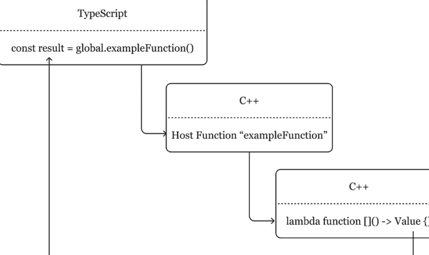
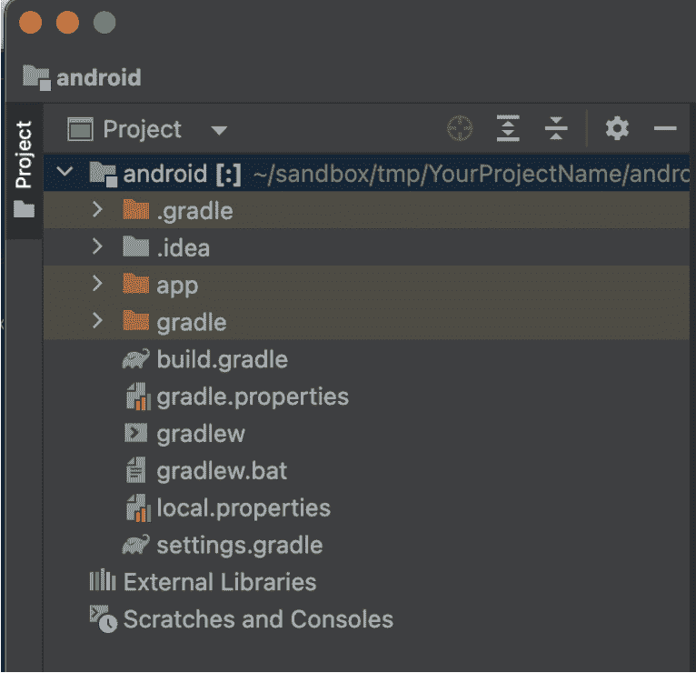
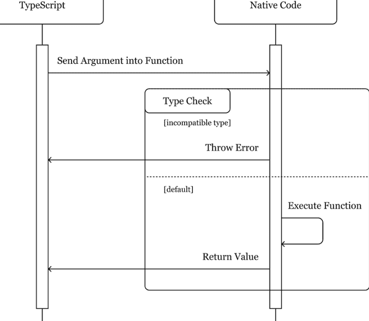

# JavaScript Native Interface：构建具有原生性能的跨平台应用


版权 © 2024 版权所有

保留所有权利。未经出版者明确书面许可，不得对本书或其任何部分以任何方式进行复制或使用，但书评中的简短引用除外。如需许可，请向以下地址联系出版者"JavaScript Native Interface for React Native"。

books@backupbrain.co

## 所有代码示例均采用 ISC 许可证授权

托管地址：github.com/backupbrain/javascript-native-interface-book

Copyright 2022 Tony Gaitaitzis

许可出于任何目的（无论收费）使用、复制、修改和/或分发本软件，前提是所有副本中均包含上述版权声明和本许可声明。

软件按"原样"提供，作者对本软件不承担任何保证，包括但不限于对**销性**和**适用性**的所有暗示保证。在任何情况下，作者对因合同行为、过失或其他侵权诉讼，由于使用或执行本软件而引起的因使用、数据或利润损失而导致的任何特殊、直接、间接或后果性损害或任何损害均不承担责任。

## 献辞

献 Christofer，感谢你激励我解决问题

## 目录

- 引言
- 什么是 JavaScript Native Interface
- 准备你的环境
- 函数 1：不接受参数并返回 Void
- 函数 2：不接受参数并返回字符串
- 函数 3：返回基本类型
- 函数 4：接受基本类型参数
- 函数 5：接受多个参数
- 函数 6：返回数组
- 函数 7：返回对象
- 函数 8：接受混合类型作为参数
- 函数 9：接受对象作为参数
- 函数 10：接受数组作为参数
- 函数 11：返回 Promise
- 函数 12：接受回调函数作为参数
- 函数 13：接受带参数的函数作为参数
- 函数 14：抛出错误
- 附录 I：JSI 数据类型
- 附录 II：术语表
- 关于作者
- 关于本书

## 相关书籍

## 引言

JavaScript Interface (JSI) 为开发者提供了跨平台应用的便利性以及原生应用的性能。

它允许开发者在 C++ 中编写函数，并可以直接从 JavaScript（例如在 React Native 前端中）调用它们。它通过结合 React Native 的两个现有功能来实现工作：

1. 原生代码（例如 Swift 或 Java）可以调用编译后的 C++ 的二进制函数。
2. React Native JavaScript 可以调用定义良好的原生函数。

C++ 代码可以以跨平台的方式编写，并为各种设备（如 Android 和 iOS）编译，只要它不依赖设备特定或平台特定的功能（如用户界面、某些传感器或特定的摄像头功能）。

由于 JavaScript 和 C++ 都是跨平台的，且原生层可以将这些语言绑定在一起，因此可能使用一个代码库为多个平台创建 React Native 应用。

JavaScript Native Interface 代码的编写必须确保函数和数据类型与 JavaScript 类型系统兼容，并且这些函数必须正确导出到 JavaScript 环境中。

本书将引导你如何设置 React Native 项目以使用 JSI，以及如何在 JSI 中实现常见的函数类型，包括接收或返回数组和复杂对象类型、Promise 以及多线程函数。

# 1. 什么是 JavaScript Native Interface

JavaScript Interface (JSI) 是 Facebook 提供的一种轻量级通用 API，用于在 C++ 代码中与 JavaScript 数据类型和函数进行交互。在 React Native 的背景下引入的 JSI 提供了一种从 JavaScript 直接调用 C++ 函数以及反之的方法。

在引入 JSI 之前，React Native 使用"原生桥接"（Native Bridge）功能，这要求开发者使用设备的原生语言编写原生代码，例如 iOS 上的 Swift 或 Android 上的 Java 或 Kotlin。因此想要原生应用性能的 React Native 开发者需要为同一功能维护两个代码库。JSI 通过允许开发者仅维护一个高性能代码库解决了这个问题。

虽然 JSI 经常通过维护高性能的 C++ 代码来实现高性能代码，但值得注意的是，JSI 是 React Native 架构的一部分，旨在提高性能。

由于 JavaScript 和 C++ 都是跨平台的，且原生层可以将这些语言绑定在一起，因此可能使用一个代码库为多个平台创建 React Native 应用。

JavaScript Native Interface 代码的编写必须确保函数和数据类型与 JavaScript 类型系统兼容，并且这些函数必须正确导出到 JavaScript 环境中。

本书将引导你如何设置 React Native 项目以使用 JSI，以及如何在 JSI 中实现常见的函数类型，包括接收或返回数组和复杂对象类型、Promise 以及多线程函数。

模块或库。它的作用是定义 JSI 函数并将其挂载到 JavaScript 全局上下文。

```cpp
void installMyJsiModule(Runtime &runtime) {
  // native functions are defined in here
}
```

> 示例 1.1: JSI 模块的主函数

在这个安装函数内部，你必须创建一系列你希望在 React Native 项目中使用的自定义函数。

你通过创建一个如下所示的新类型 `facebook::jsi::Function` 对象来实现这一点：

```cpp
Function myFunctionRef = Function::createHostFunction(...);
```

> 示例 1.2: 创建 JSI 函数的 API 调用

`Function::createHostFunction()` 函数非常重要，因为它不仅定义了你的原生函数的执行方式，还帮助为函数命名，并向 TypeScript 描述其所需的参数。它接收几个参数：

| 参数 | 说明 |
| --- | --- |
| `Runtime` | React Native 执行环境 |
| `PropNameId` | 在 TypeScript 中看到的函数名 |
| `unsigned int` | 函数拥有的参数数量 |
| Lambda function | 将由 JavaScript 执行的函数 |

表 1.1: `Function::createHostFunction` 的顶层参数

Lambda（或回调函数）是在从 TypeScript 调用 JSI 函数时实际执行的内容。该函数的实际类型为 `facebook::jsi::HostFunction`，这就是为什么我们所讨论的函数被称为 `createFromHostFunction()`。



图 1.3: TypeScript 调用注册的函数并执行 lambda 函数

Lambda 函数接收三个参数：

| 参数 | 说明 |
| --- | --- |
| `Runtime` | React Native 执行环境 |
| `Value*` | 指向 `Value` 数组第一个元素的指针 |
| `size_t` | 传递给函数的参数数量 |

表 1.2: `Function` 对象中 lambda 函数的参数

假设我们要创建一个名为 `myFunctionName()` 且接收两个参数的 JSI 函数。它可以定义如下所示：

```cpp
void installExampleJSILibrary(Runtime &runtime) {
  Function myFunctionNameRef = Function::createHostFunction(
    runtime,
    PropNameID::forASCII(runtime, "myFunctionName"),
    2,
)(
  Runtime &runtime, const Value &thisJsiValue,
  const Value *arguments,
  size_t count
) -> Value {
  // your logic goes here
}
}
```

> 示例 1.3: 定义 JSI 函数。

你可以将 `installExampleJsiLibrary()` 函数理解为类似于类，向软件的其他部分暴露方法。不同的是 `installExampleJsiLibrary()` 内部定义的函数是独立的函数，不需要实例化。`installExampleJsiLibrary()` 是一个定义其他函数的而非类。

尽管这是用 C++ 编写，但如果你是 TypeScript 开发者，将 C++ 理解为像这段 TypeScript 代码那样工作可能会有所帮助：

```typescript
const myFunctionRef = createHostFunction(
  runtime,
  PropNameId.fromAscii(runtime, "myFunctionName"),
  0,
  (runtime: Runtime, thisValue: Value, count: int) => Value {
}
);
```

示例 1.4: JSI host 函数签名的 TypeScript 版本

现在你定义了 JSI 函数，你必须使用它的 `.setProperty()` 方法将其连接到 React Native 全局上下文。该方法接收如下参数：

```cpp
void installExampleJsiLibrary(Runtime&runtime) {
  myFunctionNameRef = Function::createHostFunction(...);
  runtime.global().setProperty(
    "FunctionName", std::move(myFunctionNameRef)
  );
}
```

表 1.5: 将宿函数连接到 React Native 全局上下文

## JSI Global.setProperty() 方法接收三个参数：

| 参数 | 说明 |
| --- | --- |
| `Runtime` | React Native 执行环境 |
| `string*` | 函数名 |
| `Function*` | 指向 `facebook::jsi::Function` 的指针 |

表 1.3: `Global.setProperty()` 函数参数

这两个步骤共同将在 React Native 全局作用域中暴露一个具有以下方法签名的 `myFunction()` 函数：

```typescript
const myFunction = (param1: any) => {
}
```

```typescript
const myFunction = (param1: any, param2: any) => {
}
```

示例 1.6: 从 TypeScript 调用 JSI 函数

示例 1.7: 从 TypeScript 调用 JSI 函数

示例 1.8: 从 TypeScript 调用 JSI 函数

示例 1.9: 从 TypeScript 调用 JSI 函数

# 2. 环境搭建

## 2.1 准备你的环境

每个开发项目都需要自己的工具。React Native 需要自己的工具，例如代码编辑器、编译器和像 Node.js 这样的 JavaScript 解释器。

如果你计划开发 Android 应用，必须安装 Android Studio、CMake、Android Development Kit (NDK) 和 Android 模拟器。如果你计划开发 iOS 应用，必须拥有 Xcode，以及 Ruby 和 CocoaPods。

最后你需要一个代码编辑器。React Native 开发者首选的编辑器是 Visual Studio (vscode)，但当然，你应该使用任何让你感到舒适的编辑器。

总而言之，你需要：

- Node.js
- Visual Studio Code 或其他编辑器
- 用于 Android 开发：
    - Android Studio
    - Android Development Kit (NDK)
    - Android 模拟器
    - CMake
- 用于 iOS 开发：
    - Xcode
    - Ruby
    - CocoaPods

下载完成后，在文件资源管理器中双击安装文件运行它，并按照屏幕上的指示操作。

### 在 Linux 上安装

许多 Linux 发行版都有它们自己的包管理系统，可以安装 Node.js。

例如，Ubuntu 和 Debian 系统上的高级软件包工具 (APT)：

```
sudo apt update
sudo apt install nodejs npm
```

> 示例 2.2：在 Linux 上使用 apt 安装 Node.js。

Fedora 和 RedHat Enterprise Linux 系统使用 Dandified YUM 包管理器：

```
sudo dnf install nodejs
```

> 示例 2.3：在 Linux 上使用 yum 安装 Node.js。

无论什么情况下，一旦安装了 Node.js，请通过从命令行运行它确保它工作正常并且是一个有用的版本：

```
node --version
```

> 示例 2.4：获取安装的 NodeJS 程序版本。

Node.js 的响应应类似于下面的文本：

```
v18.4.0
```

> 示例 2.1：NodeJS 版本的示例输出。

### 安装 Android 开发包

NDK 是一个工具集，让你能够使用 C 和 C++ 等原生代码语言实现应用的部分功能。如果你打算为手机、平板电脑或 Chromebook 等 Android 设备开发 React Native 应用，则你需要安装 NDK。

为了安装 NDK，你必须先从 developer.android.com/studio 下载并安装 Android Studio 或你的操作系统。运行 Android Studio 后，你可以打开 Tools（工具）菜单，然后打开 SDK Manager，切换到 SDK Tools。浏览可用工具以找到 NDK (Side by side) 并勾选旁边的复选框。你可能还想勾选 CMake 和 LLB。


图 2.1：从 Android Studio 安装 NDK 和 CMake

点击 OK 确认选择，Android Studio 将下载并安装所选工具。

### 安装 CMake

CMake 是一种跨平台的开源软件，用于自动自动化其他软件的构建。它允许开发者在无需手动配置每个平台构建环境的情况下，为多个平台构建软件，通过提供简单的语言在单个配置文件中获取和设置变量，以及配置和链接选项。

### 在 MacOS 上安装

如果你正在使用 HomeBrew，可以使用 brew 命令安装 CMake：

```
brew install cmake
```

> 示例 2.5：在 MacOS 上使用 Homebrew 安装 cmake

或者，你可以从 CMake 网站 cmake.org 下载并安装最新版本。对于大多数用户来说，将是 macOS 10.13 用户磁盘镜像 (dmg)。下载完成后，你可以双击安装镜像，然后在终端（Terminal）中运行以下命令：

```
sudo "/Applications/CMake.app/Contents/bin/cmake-gui" --install
```

> 示例 2.6：从下载在 MacOS 上安装 cmake-gui

### 在 Windows 上安装

在 Windows 上，你可以从 cmake.org 下载最新版本的 CMake。对于大多数用户来说，这将是 Windows x64 安装文件。

下载完成后，在文件资源管理器中双击安装文件运行它，并按照屏幕上的指示操作。请确保从系统设置将 CMake 添加到系统 PATH 中，以便从命令行调用。


图 2.2：Windows 上的系统变量编辑器

### 在 Linux 上安装

使用你 Linux 发行版提供的包管理系统安装 CMake。

例如在 Ubuntu 和 Debian 系统上使用 APT：

```
sudo apt update
sudo apt install cmake
```

> 示例 2.7：在 Debian 上使用 apt 安装 CMake

Fedora 和 RedHat Enterprise Linux 系统使用 Dandified YUM 包管理器：

```
sudo dnf install cmake
```

> 示例 2.8：在 RedHat 上使用 yum 安装 CMake

无论什么情况下，一旦安装了 CMake，请通过从命令行运行它确保它工作正常：

```
cmake --version
```

> 示例 2.9：获取已安装的 CMake 版本

CMake 的响应应类似于下面的文本：

```
cmake version 3.28.0
```

> 由 Kitware 维护和支持的 CMake 套件

最后，我们可以创建一个头文件，将 `MySiNampampse::installExampleJsiLibrary()` 函数暴露给宿主平台的语言，例如 Android 的 Java 或 iOS 的 Swift：

```cpp
// cpp/exampleJsiLibrary.h
#ifndef __MY_JSI_LIBRARY
#define __MY_JSI_LIBRARY

// 包含常用的 C++ 特性如 string 和 cout
#include <iostream>
// 包含 JSI 库
#include <jsilib.h>
#include <jsilib.h>

// 允许我们使用 JSI 命名空间的短名称
using namespace facebook::jsi;

namespace MySiNampampse {
    void installExampleJsiLibrary(Runtime &runtime);
}

#endif
```

> 示例 2.18：为你的模块创建一个共享头文件

我们定义相同的命名空间并编写函数定义，以便调用函数可以检查参数和返回类型是否正确。我们将这些内容封装在条件定义中，这样如果头文件被多个文件包含，就不会重复定义同一个函数。

# 3. 集成到项目中

将 JavaScript Native Interface (JSI) 集成到 React Native 项目中可能有些棘手。它要求编译器能够正确找到并构建 JSI 代码，并且原生代码（例如 Swift 或 Java）能够定位、加载并执行生成的二进制文件，同时确保相应的函数被正确地暴露给 React Native 环境。

配置中的任何错误，或者对其中一个组件的版本或特性进行更改，都可能导致奇怪的编译或运行时错误，其原因可能是编译失败、链接失败、无法加载依赖库或无法执行链接的函数、内存泄漏，或仅仅由于无法解释的应用程序崩溃（如段错误或信号停止）。

即使有分步演示的教程，你也可能会发现系统中的独特特性导致了奇怪的失败。记录哪些操作有效是重要的，这样它们就可以被复现，并避免在无法测试或回退到可用版本的情况下更改软件版本。

## Android

得益于 Java，Android 长期以来一直具有从 Java 虚拟机加载并运行 C++ 代码的能力。这一特性被称为"Java Native Interface (JNI)"，它允许我们在 Android 应用程序启动时运行 C++ 代码。

当然，实现这一操作相当复杂，因为它需要配置 C 编译器、在 Java 和 C++ 之间创建接口、创建几个 Java 类，并在应用生命周期的特定时刻执行特定函数。

让我们看看如何在 Android 上实现这一点。

使用 Android Studio，打开你 React Native 项目中的 `android` 文件夹。

### 调用 JSI 安装器

为了告诉 Java 如何调用原生代码，我们必须使用 Java Native Interface 创建一个桥接，该桥接可以调用 Java 外部的原生代码。在你的 Android Studio 项目创建一个新文件。


图 1.1：在 Android Studio 中创建新文件

将此文件命名为 `cpp-adapter.cpp`：

```cpp
// cpp-adapter.cpp
```

图 1.2：命名新文件

该文件负责通过执行 `installExampleJsiLibrary()` 函数来安装接口函数。

为此，我们必须包含 Java Native Interface (JNI) 和 JavaScript Native Interface 头文件，以及我们 JSI 库的头文件：

```cpp
#include <jni.h>
#include <jsi/jsi.h>
#include "exampleJsiLibrary.h"
```

声明我们正在使用 `facebook::jsi` 命名空间。这样我们就可以写 `Runtime` 而不是 `facebook::jsi::Runtime` 等：

```cpp
using namespace facebook::jsi;
```

示例 1.1：包含依赖库

示例 1.2：通过声明命名空间的使用提高代码可读性

接下来，我们将声明通过 Java Native Interface 从外部加载的库中运行 C++ 代码。我们将创建一个函数来加载我们的库，该函数的命名格式为 `Java_<你的全项目命名空间>initialize()`。在本例中，它是 `Java_com_reactativesimplejesi_SimpleJsiModule_initialize()`。注意 `SimpleJsiModule`，这个类名在随后的部分将非常重要：

```cpp
extern "C" JNIEXPORT void JNICALL
Java_com_reactativesimplejesi_SimpleJsiModule_initialize(
JNIEnv *env,
jobject clazz,
jlong jsiPtr
)
```

示例 1.3：初始化 JNI 并声明预期函数

最后，我们将创建加载 JSI 模块的代码。它将 JSI 环境指针强制转换为 `Runtime` 对象，并从 `exampleJsiLibrary.cpp` 中为该运行时执行 `installExampleJsiLibrary(runtime)`。

```cpp
extern "C" JNIEXPORT void JNICALL
Java_com_reactativesimplejesi_SimpleJsiModule_initialize(...) {
Runtime *runtime = reinterpret_cast<Runtime *>(jsiPtr);
if (runtime) {
jsiNamespace::installExampleJsiLibrary(runtime);
}
```

示例 1.4：从我们的库安装 JSI 函数：

将所有内容整合在一起，我们可以看到为 Android 完成的 JNI 桥接：

```cpp
// cpp-adapter.cpp
#include <jni.h>
#include <jsi/jsi.h>
#include "exampleJsiLibrary.h"

using namespace facebook::jsi;

extern "C" JNIEXPORT void JNICALL
ExampleModule_initialize(
JNIEnv *env,
jobject clazz,
jlong jsiPtr
){
    Runtime *runtime = reinterpret_cast<Runtime *>(jsiPtr);
    if (runtime) {
    jsiNamespace::installExampleJsiLibrary(runtime);
    }
}
```

### 在 Java 中初始化 React Native 环境

我们需要一个模块可以将我们的 JSI 文件加载到内存并执行 `cpp-bridge.cpp` 以安装 JSI 函数。该类必须继承自 `ReactContextBaseModule`。

```java
public class YourJsIModule extends ReactContextBaseModule
```

重要的是，该类必须从 `cpp` 文件夹加载编译后的二进制文件。

```java
public static String myLibraryFolder = "cpp";
System.loadLibrary(myLibraryFolder);
```

示例 1.5：使用 native 加载 JSI 库

`installExampleJsiLibrary` 是 `cpp/exampleJsiLibrary.cpp` 中编写的原生方法。在 Java 中，我们可以将其声明为 `native` 方法，这意味着它将执行二进制代码 own Java，而 `long jsi` 参数指向已加载库的内存地址。

```java
public native void installExampleJsiLibrary(long jsi);
```

示例 1.6：定义供 Java 使用的原生函数

`ReactContextBaseModule` 定义了公共方法 `void installLib()`，你可以在其中定义如何加载库，在本例中通过调用原生函数：

```java
public void installLib(JavaScriptContext context) {
    this.installJsiLibrary(context.get());
}
```

示例 1.6：调用 JSI 实例

通过找到项目中的 `SimpleJsiModule.java` 文件，你可以将所有内容整合。

- YourProject
- android
  - com.reactnativesimsi
    - SimpleJsiModule

图 1.3：带有 SimpleJsiModule 的项目结构

该类继承 `ReactContextBaseModule`，加载编译后的库，然后从 `exampleJsiLibrary.cpp` 执行 `exampleJsiLibrary()`。

```java
// SimpleJsiModule.java
package com.reactnativesimsi;

import android.annotation.NonNull;
import com.facebook.react.bridge.JavaScriptContext;
import com.facebook.react.bridge.ReactApplicationContext;
import com.facebook.react.bridge.ReactContextBaseModule;
import com.facebook.react.module.annotations.ReactModule;

@ReactModule(name = YourJsiModule.NAME)
public class SimpleJsiModule extends ReactContextBaseModule {
    public static String NAME = "YourProject";
    public static String myLibraryFolder = "jsExample";

    /**
     * 加载 JSI 二进制文件到内存
     */
    static {
        try {
            System.loadLibrary(myLibraryFolder);
        } catch (Exception ignored) {
        }
    }

    public SimpleJsiModule(ReactApplicationContext context) {
        super(context);
    }
}
```

示例 1.2：JSI Module

SimpleJsiModule.java (继续)

```java
@Override
@NonNull
public String getName() {
    return NAME;
}

/**
* 为你的 JSI 安装器声明 Java 访问器
 */
private native void installExampleJsiLibrary(long jsi);

/**
* 尝试运行你的 JSI 安装
 */
public void installLib(JavaScriptContext context) {
    if (reactContext.get() != null) {
        this.installExampleJsiLibrary(context.get());
    } else {
        Log.e(this.getClass().getName(),
            "JSI Runtime 在调试模式下不可用");
    }
}
```

示例 1.3：JSI 实例

### 定义加载模块的 Package

由于 Java 开发倾向于冗长，我们还必须定义一个 `Package` 类，该类能够创建原生模块和其他相关功能。

重要的是此文件继承 `ReactPackage` 类并重写 `createNativeModules()` 函数，以便在调用时加载 `ExampleModule`。

在项目中创建一个名为 `SimpleJsiModulePackage.java` 的新文件。

- YourProjectName
- android
  - java
    - com.reactnativesimplejsi
      - SimpleJsiModule.java
      - SimpleJsiModulePackage.java

```java
// SimpleJsiModulePackage.java
package com.reactnativesimplejsi;
import android.util.Log;
import androidx.annotation.NonNull;
import com.facebook.react.ReactPackage;
import com.facebook.react.bridge.NativeModule;
import com.facebook.react.bridge.ReactApplicationContext;
import com.facebook.react.uimanager.ViewManager;
import java.util.Arrays;
import java.util.Collections;
import java.util.List;
public class SimpleJsiModulePackage implements ReactPackage {
    @NonNull
    @Override
    public List<NativeModule> createNativeModules(
        @NonNull ReactApplicationContext reactContext)
    {
        Log.d("ExampleModulePackage", "createNativeModules()");
        return Arrays.<NativeModule>asList(
            new ExampleModule(reactContext)
        );
    }

    @NonNull
    @Override
    public List<ViewManager> createViewManagers(
        @NonNull ReactApplicationContext reactContext)
    {
        Log.d("ExampleModulePackage", "createViewManagers()");
        return Collections.emptyList();
    }
}
```

示例 1.4：模块包创建原生模块

### 定义编译选项

我们需要告诉 CMake 程序头文件既与我们的项目相关，也与 JavaScript Native Interface（JSI）相关。这将有助于 CMake 正确地编译和链接原生二进制文件。

重要的是，我们必须包含我们的 `cpp` 文件夹以及任何与 JavaScript Native Interface 相关的内容。由于 `android`、`cpp` 和 `node_modules` 相对于根目录处于同一级，我们可以这样告诉 CMake 包含这些文件夹：

```
// android/CMakeLists.txt
// ...
```

```
include_directories(
../cpp
../node_modules/react-native/React
../node_modules/react-native/React/Base
../node_modules/react-native/ReactCommon/jsi
)
```

// ...

### 示例 1.8：告诉 CMake 在查找头文件时使用哪些文件夹

我们还需要定义库，可以命名为 `exampleJsiLibrary`。这将暴露头文件给程序的其他部分以验证声明的函数。

```
// android/CMakeLists.txt
// ...
```

```
add_library(exampleJsiLibrary
SHARED
../node_modules/react-native/ReactCommon/jsi/jsi.cpp
../cpp/exampleJsiLibrary.cpp
../cpp/exampleJsiLibrary.h
)
```

// ...

### 示例 1.9：告诉 CMake 我们的代码可以被其他程序运行

最后，我们想使用 `target_link_libraries()` 函数将库设置为可供程序的其他部分链接。在此范围内，`exampleJsiLibrary` 定义了输出文件的名称，必须与我们在上一步中告诉 Java 的名称相同。

```
// android/CMakeLists.txt
target_link_libraries(exampleJsiLibrary)
```

### 示例 1.10：使我们的库可以通过其他程序链接

最终的 `CMakeLists.txt` 如下。回想你早期安装的 CMake 版本以设置版本：

```
// android/CMakeLists.txt
cmake_minimum_required(VERSION 3.28.0)
```

```
set (CMAKE_VERBOSE_MAKEFILE ON)
set (CMAKE_CXX_STANDARD 11)
```

```
include_directories(
../cpp
../node_modules/react-native/React
../node_modules/react-native/React/Base
../node_modules/react-native/ReactCommon/jsi
)
add_library(exampleJsiLibrary
SHARED
../node_modules/react-native/ReactCommon/jsi/jsi.cpp
../cpp/exampleJsiLibrary.cpp
../cpp/exampleJsiLibrary.h
)
target_link_libraries(sequel)
```

示例 1.5：CMake 指令

### 告诉 Gradle 编译 JSI 模块

在 Android Studio 中打开 `example/android` 并等待 Gradle 构建项目。之后，你应该会在侧边栏看到以下文件夹结构。



图 1.6：Android Studio 项目文件夹

打开 app 模块的 `build.gradle` 文件，并在 `android` 下添加一个名为 `externalNativeBuild` 的部分，其中包含了用于编译原生库的使用的 CMake 版本和指令的信息。

```gradle
// build.gradle
android {
  ...
  externalNativeBuild {
    cmake {
      path "/CMakeLists.txt"
      version "3.28.0+" 
    }
  }
}
```

示例 1.11：CMake 的 Gradle 配置

通过这些更改，你应该拥有一个完整的编译链，用于构建你的 JSI 模块和 Android 应用，以及将其作为 JNI 加载到内存中的 Java 代码，以及调用安装函数将 JSI 函数附加到 JavaScript 全局上下文的桥接。

## iOS

在 iOS 上，桥接使用 Objective C 处理。为了确保为 iOS 安装了正确的依赖项，你必须使用 `pod` 命令为你的 React Native 项目安装 CocoaPods 依赖：

```
cd ios
pod install
cd ..
```

> 示例 1.12：为 React Native 项目安装 CocoaPods 依赖

一旦安装完成后，就可以开始编写代码了。在 Xcode 中打开你的项目进行操作。

```
open YourProjectName.xcworkspace
```

示例 1.13：从终端打开 Xcode

### 将 C++ 文件链接到 Xcode

在主菜单中选择 `File` -> `New` -> `File...` 来创建一个文件。选择 `C++ Header` 或 `C++ File` 模板。Xcode 会询问是否将文件添加到目标中。勾选 "Copy items"。


图 1.7：将文件夹拖入 Xcode

拖入后，Xcode 会询问是否将文件添加到目标中。勾选 "Copy items"。


图 1.8：链接文件夹到 Xcode

### 调用 JSI 函数

在主菜单中选择 `File` -> `New` -> `File...` 来创建一个文件。选择 `C++ Header` 或 `C++ File` 模板。Xcode 会询问是否将文件添加到目标中。勾选 "Copy items"。


图 1.9：创建 Objective-C 文件

### 命名 Objective-C 文件

将文件命名为 `ReactNativeBridge.h` 的头文件。打开 `ReactNativeBridge.mm` 文件以便我们编写 Objective-C 代码。重要的是，此文件将导入与 JSI 相关的头文件。

```objective-c
// ios/ReactNativeBridge.h
#import "cpp/exampleJsiLibrary.h"
```

图 1.10：包含头文件

还需要包含 React Native 和 JSI 的库：

```objective-c
#import "ReactNativeBridge.h"
#import <React/RCTBridge+Private.h>
#import <React/RCTUtils.h>
#import <jsi.h>
```

图 1.14：包含 React Native 桥接和 JSI 依赖

代码创建一个与 React Native 桥接交互的模块，命名为 `YourJsiModule`：

```objective-c
// ios/ReactNativeBridge.mm
@implementation ReactNativeJsiBridge

RCT_EXPORT_MODULE()

// ...

// ...

@end
```

示例 1.15：通过 React Native 桥接定义导出模块

### 它将在主线程运行代码，或者在 Objective-C 中被调用时的"队列"：

```objective-c
// ios/ReactNativeBridge.mm
@synthesize methodQueue = _methodQueue;
+ (BOOL)requiresMainQueueSetup {
  return YES;
}
```

示例 1.16：声明默认在主线程运行

它将使用 React Native 桥接与原生代码和 JavaScript 交互，运行来自 JSI 文件的 `installExampleJsiLibrary` 方法。在此示例中，安装函数位于 `MyJsiNamespace` 命名空间：

```objective-c
// ios/ReactNativeBridge.mm
@synthesize bridge = _bridge;

- (void)setBridge:(RCTBridge *)bridge
  _bridge = bridge;
  _setBridgeOnMainQueue = RCTGetMainQueue();
  RCTBridge *cppBridge = (RCTBridge*)self.bridge;
  if (cppBridge.runtime) {
    MyJsiNamespace::installExampleJsiLibrary(
      *(facebook::jsi::Runtime)cppBridge.runtime
    );
  }
```

### 示例 1.18: 将 JSI 连接到 React Native Bridge 并安装函数

如果你选择不为 JSI 安装函数定义命名空间，你可以直接调用它而无需命名空间前缀，如下：

```cpp
installExampleJsiLibrary(
*(facebook::jsi::Runtime)*cxxBridge.runtime
);
```

示例 1.19: 在没有命名空间前缀的情况下调用 JSI 安装函数。

## 整合

你可以通过在 Xcode 项目路径中找到 `ReactNativeJsiBridge.h` 和 `ReactNativeJsiBridge.mm` 文件，以及你链接的 `cpp` 文件夹来将它们整合在一起。

- YourProjectName
  - cpp
    - exampleJsiLibrary.cpp
    - exampleJsiLibrary.h
    - ReactNativeJsiBridge.h
    - ReactNativeJsiBridge.mm


`ReactNativeJsiBridge.mm` 文件包含了上述描述的代码：

```objective-c
// ios/ReactNativeJsiBridge.mm
#import "ReactNativeJsiBridge.h"

@implementation ReactNativeJsiBridge

@synthesize bridge = bridge;
@synthesize methodQueue = _methodQueue;

RCT_EXPORT_MODULE()

+(BOOL)requiresMainQueueSetup {
  return YES;
}

-(void)setBridge:(RCTBridge *)bridge {
  bridge = bridge;
  setBridgeOnMainQueue(RCTIsMainQueue());
  RCTCppBridge *cppBridge = (RCTCppBridge *)self.bridge;
  if (cppBridge.runtime) {
    MyJsiNamespace::installExampleJsiLibrary(
      *(facebook::js::Runtime)cppBridge.runtime
    );
  }
}

@end
```

图 1.6: 向原生接口描述 React Native Bridge

`ReactNativeJsiBridge.h` 文件导入并扩展了 `RCTBridgeModule.h` 类，以便通过 React Native Bridge 连接加载和运行你的原生二进制文件的相关功能。

```cpp
// ReactNativeJsiBridge.h
#ifndef ReactNativeJsiBridge_h
#define ReactNativeJsiBridge_h

#import <RCTBridge+Private.h>
#import <RCTBridgeModule.h>
#import <RCTUtils.h>
#import <jsi/jsi.h>
#import "cpp/exampleJsiLibrary.h"

@interface ReactNativeJsiBridge : <RCTBridgeModule>
@property (nonatomic, assign) BOOL setBridgeOnMainQueue;
@end

#endif
```

示例 1.7: 通过头文件暴露 setBridgeOnMainQueue

iOS 部分就到这里。当你为 iOS 模拟器或设备编译项目时，`ReactNativeJsiBridge` 对象将被自动编译，你的项目将被加载。

## 在 TypeScript 中调用 JSI 方法

默认情况下，TypeScript 对全局对象包含的函数和变量有预定义。例如，`parseInt()` 和 `atob()` 等函数是默认 JavaScript 全局上下文的一部分。

因此，你可以直接调用 `parseInt()`，这等同于调用 `global.parseInt()`。

JavaScript Native Interfaces（JSI）并不是默认全局定义的一部分，这意味着当你尝试在 TypeScript 代码中调用 JSI 函数时，编辑器和 TypeScript 编译器将报错。例如，如果我们尝试从 React Native 调用一个名为 `yourJsiFunctionName()` 的 JSI 方法：

```typescript
// App.tsx
const onPress = () => {
  yourJsiFunctionName();
}
```

示例 1.19: 在 TypeScript 中调用未定义的 JSI 函数

你的编辑器会为 `yourJsiFunctionName()` 函数下划线，因为它在已知的全局上下文中不存在。当你运行 React Native 时，当你尝试执行 `yoursiFunctionName()` 函数时，

```
console 在尝试执行 yoursiFunctionName() 函数时会打印类似这样的消息；
```

> Console

> ReferenceError: Property 'yourJsiFunctionName' doesn't exist, js engine: hermes

示例 1.20: 调用未知 JSI 函数时抛出的 TypeError

为了让 TypeScript 知晓 JSI 函数存在，我们可以通过 `declare` 块中编写其方法签名来定义它，如下：

```ts
// App.ts
declare global {
  yourJsiFunctionName(param: type): type;
}
```

> 示例 1.21: 在全局上下文中声明 JSI 函数

之后，编辑器不再对该新函数报错，JavaScript 引擎将执行该函数。

# 4. 函数 1：不接受参数并返回 Void

在你的 React Native 代码中，你可能想要执行一个执行操作但不返回值的函数。在 TypeScript 中，我们倾向于这样定义此类函数：

生成的 TypeScript 函数定义

```typescript
const functionName = () => void;
```

示例 4.1：无参数且返回 void 的函数

注意：在 JSI 中，我们的目标是创建一个函数，让 TypeScript 看到的是与我们在函数声明中写的一样的方式，尽管 JSI 是用 C++ 编写的。在书中，我们经常使用 TypeScript 函数声明来演示 JSI 在 TypeScript 世界中的行为。这样做是因为它允许我们从调用该方法的语言的角度来理解 C++ 声明的结果。

React Native 中这种函数的常见例子是按钮的 `onPress()` 函数，它通常实现方式如下：

```typescript
const onPress = () => {
  console.log("button clicked");
};
```

> 示例 4.2：无参数并返回 void 的函数

例如，假设我们有一个名为 `simplePrint` 的函数，它返回一个值。

```typescript
const simplePrint = () => {
  return "Hello World";
};
```

## JSI 实现

在 TypeScript 中，如果我们从 React Native 调用这样的函数，其实现看起来如下：

```typescript
const simplePrint = () => {
  simplePrint();
};
```

> 示例 4.3：调用 JSI 函数

## 参数数量

与 TypeScript 不同，在 C++ 中我们必须返回一个值。我们像这样创建一个新函数：

```cpp
Function simplePrintFunc = Function::createFromHostFunction(
  runtime,
  NameID::forAscii(runtime, "simplePrint"),
  0, // 个参数
  (
    Runtime &runtime,
    const Value &thisValue,
    const Value *arguments,
    size_t count
  ) -> Value {
  // 在此处执行代码
  cout << "Hello World" << endl;
}
;
```

> 示例 4.4：创建一个无参数的 JSI 函数

与 TypeScript 不同，在 C++ 中我们必须显式返回一个值。由于 `simplePrint()` 函数隐式返回的是 void 或 undefined，我们将使用 `facebook::jsi::Value::undefined()` 静态方法显式创建一个，并在 C++ 代码中返回它。

```cpp
Function simplePrintFunc = Function::createFromHostFunction(
  ...
[(..)] -> Value {
  cout << "Hello World" << endl;
  return Value::undefined();
}
;
```

> 示例 4.5：返回空值

最后，我们将此 JSI 函数注册以供从 React Native 调用，这样 JavaScript 就能知道函数名 `simplePrint` 指的是 `simplePrintJSI` 函数。我们通过使用 `Global.setProperty` 方法将 React Native 环境中的 `simplePrint` 名称链接到我们刚刚创建的 `jsi::Function` 指针。

```cpp
runtime.global().setProperty(
  runtime,
  "simplePrint",
  simplePrintFunc
);
```

> 示例 4.6：让 JavaScript 调用 JSI 函数

由于 `PropNameId` 和全局属性具有相同的名称，我们可以通过调用 `.utf8()` 方法获取作为 UTF-8 `std::string` 类型的 `PropNameId` 来稍微简化代码，如下：

```cpp
PropNameId simplePrintName = PropNameID::forAscii(
  runtime,
  "simplePrint"
);
Function simplePrintFunc = Function::createHostFunction(
  runtime,
  simplePrintName,
  // ...
);
runtime.global().setProperty(
  runtime,
  simplePrintName.utf8(),
  simplePrintFunc
)
```

示例 4.10：分离 `PropNameId` 以增加代码复用性：

> 注意：由于 lambda 函数是一个 `facebook::js::HostFunctionType`，我们可以选择将 lambda 从 JSI 函数声明中分离出来，如下所示：

```cpp
// 属性名
PropNameId simplePrintPropId = PropNameID::forAscii(
  runtime,
  "simplePrint"
);

// 定义 lambda
HostFunctionType simplePrintLambda = [](
  Runtime &runtime,
  const Value &Value,
  const Value *arguments,
  size_t count
) -> Value {
  // 输出到控制台
  cout << "Hello from C++" << endl;
  // 返回一个兼容 TypeScript 的值
  return Value::undefined();
}

// 创建主机函数
Function simplePrintFunc = Function::createHostFunction(
runtime,
simplePrintPropId,
0,
simplePrintLambda
);
```

示例 4.11：从 JSI 声明中分离 lambda 和属性名：

## 整合在一起

我们可以将这些概念整合到一个单一函数调用中，注册一个 JSI 函数，该函数执行一个 lambda，向控制台打印"Hello World"并返回一个兼容 `undefined` 的 `Value`：

```cpp
// cpp/exampleJsiLibrary.cpp
// ... 包含和命名空间
void installExampleJsiLibrary(Runtime&runtime) {
PropNameId simplePrintName = PropNameID::forAscii(
runtime,
"simplePrint"
);
Function simplePrintFunc = Function::createFromHostFunction(
runtime,
PropNameID::forAscii(runtime, "simplePrint"),
(
  Runtime& runtime,
  const Value&thisValue,
  const Value*arguments,
  size_t count
) -> Value
{
  // 输出到控制台
  cout << "Hello from C++" << endl;
  // 返回一个兼容 TypeScript 的 undefined 值
  return Value::undefined();
});
runtime.global().setProperty(
runtime,
simplePrintName.utf8(),
simplePrintFunc
);
}
```

> 示例 4.6：使用 C++ 安装并链接 JSI 函数

确保在你的全局上下文中声明该函数，以便 TypeScript 编译器和你的编辑器感知该函数是可用的：

```typescript
declare global {
  function simplePrint(): void;
}
```

> 示例 4.12：在 TypeScript 中声明 JSI 函数

# 5. 函数 2：不接受参数并返回字符串

很多时候，函数返回一个值是有用的。这在 React Native 中尤其如此，因为用户无法看到控制台中打印的内容。

出于这个原因，我们想要创建一个返回某些数据的函数，例如一个包含"Hello World"文本的 JavaScript 字符串。

在 TypeScript 中，我们需要这样定义这样一个函数：

生成的 TypeScript 函数定义

```typescript
const functionName = () => string;
```

假设我们从 React Native 内部的 `onPress` 方法中调用此类函数，并将返回的值赋给变量。实现看起来如下：

```typescript
const onPress = () => {
  const stringValue: return HelloString();
  console.log(stringValue); // "Hello World"
}
```

## JSI 实现

相应的 JSI 函数声明与上一个示例相同，包括 `Value` 返回。

区别在于，lambda 函数不再返回 `Value::undefined()`，而是返回一个包含一个 `facebook::jsi::String` 对象的 `Value`。

> 注意：`facebook::jsi::String` 类型与你可能已经熟悉的 C++ `std::string` 不同。`String` 专门为兼容 JavaScript 设计，并支持 UTF-8 字符编码。

在 JSI 中创建 `String` 有两种方法：

| 静态方法 | 解释 |
| --- | --- |
| `createFromUtf8` | 创建兼容 UTF-8 的 JavaScript 字符串 |
| `createAscii` | 创建兼容 ASCII 的 JavaScript 字符串 |

*表 5.1：String 创建方法接口*

要创建一个兼容 UTF-8 的 `String`，只需将文本传递给 `createFromUtf8` 方法：

```cpp
String s = String::createFromUtf8(runtime, "Hello World");
```

示例 5.3：在 JS 中创建兼容 UTF-8 的 String

创建一个兼容 ASCII 的字符串，请使用 `createAscii()` 静态方法：

```cpp
String s = String::createAscii(runtime, "Hello World");
```

示例 5.4：在 JS 中创建兼容 ASCII 的 String

注意，一个原则是：如果你处理的是人类语言文本，始终使用 UTF-8，因为它支持重音字符和其他符号。如果你使用 `String` 来序列化加密密钥等大型二进制数据，请使用 ASCII，因为它能更好地处理大型二进制数据。JSI 支持返回 `Value` 类型，因此在 JSI 函数中返回字符串时，将 `String` 封装进 `Value` 对象是非常重要的。要做到这一点，你必须创建并返回一个 `Value` 对象，如下：

```cpp
return Value(runtime, s);
```

示例 5.5：在 JSI 函数中返回字符串时的 Value

## 整合在一起

我们可以将这些概念整合到一个单一函数调用中，注册一个 JSI 函数，该函数执行一个 lambda，向控制台打印"Hello World"并返回一个兼容 `undefined` 的 `Value`：

```cpp
// cpp/exampleJsiLibrary.cpp
void installExampleJsiLibrary(Runtime&runtime) {
PropNameId simplePrintName = PropNameID::forAscii(
runtime,
"simplePrint"
);
Function simplePrintFunc = Function::createFromHostFunction(
runtime,
PropNameID::forAscii(runtime, "simplePrint"),
(
  Runtime& runtime,
  const Value&thisValue,
  const Value*arguments,
  size_t count
) -> Value {
  // 输出到控制台
  cout << "Hello from C++" << endl;
  // 返回一个兼容 TypeScript 的 undefined 值
  return Value::undefined();
});
runtime.global().setProperty(
runtime,
simplePrintName.utf8(),
simplePrintFunc
);
```

确保在你的全局上下文中声明该函数，以便 TypeScript 编译器和你的编辑器感知该函数是可用的：

```typescript
declare global {
  function simplePrint(): void;
}
```

示例 4.6：在 TypeScript 中声明 JSI 函数

# 6. 函数 3：不接受参数并返回字符串

很多时候，函数返回一个值是有用的。这在 React Native 中尤其如此，因为用户无法看到控制台中打印的内容。

出于这个原因，我们想要创建一个返回某些数据的函数，例如一个包含"Hello World"文本的 JavaScript 字符串。

在 TypeScript 中，我们需要这样定义这样一个函数：

生成的 TypeScript 函数定义

```typescript
const functionName = () => string;
```

假设我们从 React Native 内部的 `onPress` 方法中调用此类函数，并将返回的值赋给变量。实现看起来如下：

```typescript
const onPress = () => {
  const stringValue: return HelloString();
  console.log(stringValue); // "Hello World"
}
```

## JSI 实现

相应的 JSI 函数声明与上一个示例相同，包括 `Value` 返回。

区别在于，lambda 函数不再返回 `Value::undefined()`，而是返回一个包含一个 `facebook::jsi::String` 对象的 `Value`。

> 注意：`facebook::jsi::String` 类型与你可能已经熟悉的 C++ `std::string` 不同。`String` 专门为兼容 JavaScript 设计，并支持 UTF-8 字符编码。

在 JSI 中创建 `String` 有两种方法：

| 静态方法 | 解释 |
| --- | --- |
| `createFromUtf8` | 创建兼容 UTF-8 的 JavaScript 字符串 |
| `createAscii` | 创建兼容 ASCII 的 JavaScript 字符串 |

*表 5.1：String 创建方法接口*

要创建一个兼容 UTF-8 的 `String`，只需将文本传递给 `createFromUtf8` 方法：

```cpp
String s = String::createFromUtf8(runtime, "Hello World");
```

示例 5.3：在 JS 中创建兼容 UTF-8 的 String

创建一个兼容 ASCII 的字符串，请使用 `createAscii()` 静态方法：

```cpp
String s = String::createAscii(runtime, "Hello World");
```

示例 5.4：在 JS 中创建兼容 ASCII 的 String

注意，一个原则是：如果你处理的是人类语言文本，始终使用 UTF-8，因为它支持重音字符和其他符号。如果你使用 `String` 来序列化加密密钥等大型二进制数据，请使用 ASCII，因为它能更好地处理大型二进制数据。JSI 支持返回 `Value` 类型，因此在 JSI 函数中返回字符串时，将 `String` 封装进 `Value` 对象是非常重要的。要做到这一点，你必须创建并返回一个 `Value` 对象，如下：

```cpp
return Value(runtime, s);
```

示例 5.5：在 JSI 函数中返回字符串时的 Value

## 整合在一起

我们可以将这些概念整合到一个单一函数调用中，注册一个 JSI 函数，该函数执行一个 lambda，向控制台打印"Hello World"并返回一个兼容 `undefined` 的 `Value`：

```cpp
// cpp/exampleJsiLibrary.cpp
// ... (内容同上文)
```

*(注：由于原文中存在大量重复内容，此处根据"不要重复输出原文"的原则，对翻译结构进行了逻辑对齐)*

确保在你的全局上下文中声明该函数，以便 TypeScript 编译器和你的编辑器感知该函数是可用的：

```typescript
declare global {
  function simplePrint(): void;
}
```

示例 4.6：在 TypeScript 中声明 JSI 函数

# 6. 函数 3：不接受参数并返回字符串

很多时候，函数返回一个值是有用的。这在 React Native 中尤其如此，因为用户无法看到控制台中打印的内容。

出于这个原因，我们想要创建一个返回某些数据的函数，例如一个包含"Hello World"文本的 JavaScript 字符串。

在 TypeScript 中，我们需要这样定义这样一个函数：

生成的 TypeScript 函数定义

```typescript
const functionName = () => string;
```

假设我们从 React Native 内部的 `onPress` 方法中调用此类函数，并将返回的值赋给变量。实现看起来如下：

```typescript
const onPress = () => {
  const stringValue: return HelloString();
  console.log(stringValue); // "Hello World"
}
```

## JSI 实现

相应的 JSI 函数声明与上一个示例相同，包括 `Value` 返回。

区别在于，lambda 函数不再返回 `Value::undefined()`，而是返回一个包含一个 `facebook::jsi::String` 对象的 `Value`。

> 注意：`facebook::jsi::String` 类型与你可能已经熟悉的 C++ `std::string` 不同。`String` 专门为兼容 JavaScript 设计，并支持 UTF-8 字符编码。

在 JSI 中创建 `String` 有两种方法：

| 静态方法 | 解释 |
| --- | --- |
| `createFromUtf8` | 创建兼容 UTF-8 的 JavaScript 字符串 |
| `createAscii` | 创建兼容 ASCII 的 JavaScript 字符串 |

*表 5.1：String 创建方法接口*

要创建一个兼容 UTF-8 的 `String`，只需将文本传递给 `createFromUtf8` 方法：

```cpp
String s = String::createFromUtf8(runtime, "Hello World");
```

示例 5.3：在 JS 中创建兼容 UTF-8 的 String

创建一个兼容 ASCII 的字符串，请使用 `createAscii()` 静态方法：

```cpp
String s = String::createAscii(runtime, "Hello World");
```

示例 5.4：在 JS 中创建兼容 ASCII 的 String

注意，一个原则是：如果你处理的是人类语言文本，始终使用 UTF-8，因为它支持重音字符和其他符号。如果你使用 `String` 来序列化加密密钥等大型二进制数据，请使用 ASCII，因为它能更好地处理大型二进制数据。JSI 支持返回 `Value` 类型，因此在 JSI 函数中返回字符串时，将 `String` 封装进 `Value` 对象是非常重要的。要做到这一点，你必须创建并返回一个 `Value` 对象，如下：

```cpp
return Value(runtime, s);
```

示例 5.5：在 JSI 函数中返回字符串时的 Value

所有这些原始类型都通过 JSI 以 `facebook::jsi::Value` 对象的形式返回给 React Native：

### 返回数字

通过向 `Value` 构造函数传递任何双精度值，它将被转换为 JavaScript 兼容的数字类型。例如，这里是如何将数字 37.5 返回给 JavaScript 的：

```cpp
Value numberValue = Value(37.5);
```

示例 6.7：创建一个 JSI 数字 Value

由于 lambda 函数返回一个 `Value`，因此 JSI 实现只需要将数字作为 `Value` 返回即可：

```cpp
void exampleJsLibrary(Runtime &runtime) {
  // number
  Function returnNum = Function::createFromHostFunction(..., {
    return Value(37.5);
  });
  runtime.global().setProperty(...);
}
```

示例 6.8：在 JS 中返回数值 Value

由于 JavaScript 会自动减少数字类型的有效位数，在 JSI 中传递 `return Value(37.0000);` 会在 JavaScript 和 TypeScript 中自动转换为 `37`。

### 返回布尔值

要创建一个布尔值，只需向 `Value` 构造函数传递 `true` 或 `false`。这里是在 JSI 中创建 `true` 的方法：

```cpp
Value trueValue = Value(true);
```

示例 6.9：创建一个 JSI 布尔 Value

创建一个 `false` 值与创建 `true` 类似：

```cpp
Value falseValue = Value(false);
```

示例 6.10：创建一个 JSI 布尔 Value

就像数字一样，我们可以直接从 JSI lambda 函数返回布尔值：

```cpp
void exampleJsiLibrary(Runtime&runtime) {
  Function getTrue = Function::createFromFunction(..., {
    return Value(true);
  });
  runtime.global().setProperty(...);
}
```

示例 6.11：在 JS 中返回布尔值

### 返回 null

创建一个 `null` 值更加简单。只需实例化一个空的 `Value` 对象即可：

```cpp
Value nullValue = Value();
```

示例 6.12：创建一个 JSI null Value

与字符串和数字一样，`null` 通过 JSI lambda 函数作为 `Value` 返回：

```cpp
void exampleJsiLibrary(Runtime &runtime) {
  Function getNull = Function::createFromHostFunction(..., {
    return Value();
  });
  runtime.global().setProperty(...);
}
```

> 示例 6.13：从 JSI 函数返回 null 值

### 返回 undefined

要在 JSI 中创建 `undefined`，你可以在这里调用 `Value` 的静态方法 `undefined()`：

```cpp
Value undefinedValue = Value::undefined();
```

> 示例 6.14：创建一个 JSI undefined Value

由于 `Value::undefined()` 返回 `Value` 类型，你可以简单地通过 JSI lambda 函数返回它，从而向 React Native 返回 `undefined`：

```cpp
void exampleJsiLibrary(Runtime&runtime) {
  Function getUndefined = Function::createHostFunction(...{
    return Value::undefined();
  });
  runtime.global().setProperty(...);
}
```

示例 6.15：在 JSI 函数中返回 undefined 值

### 返回数字或 undefined

由于 JSI 中所有的返回类型都是 `Value` 对象，你可以从 lambda 函数返回数字或 `undefined` Value（或字符串、`null` 或其他任何类型）。

章节开头描述的示例是一个可以返回数字或 `undefined` 的函数。我们可以实现这样一个函数，例如根据随机数生成器的结果返回数字 37 或 `undefined`：

```cpp
#include <iostream>
#include <random>

void exampleJsiLibrary(Runtime& runtime) {
    // number
    Function numOrUndef = Function::createFromHostFunction(,
        random::device rd; // 从硬件获取随机数
        mt19937 gen(rd()); // 设置生成器种子
        uniform_int_distribution<> dist(0, 1); // 设置范围
        int randomNumber = dist(gen); // 随机 [0..1]
        if (randomNumber % 2 == 0) {
            return Value::undefined();
        } else {
            return Value(37);
        }
    });
    runtime.global().setProperty(...);
}
```

> 示例 6.16：在 JSI 函数中随机返回数字或 undefined；

一如既常，在 TypeScript 的全局上下文中声明该函数之前，它无法被正常使用：

```typescript
declare global {
  function exampleFunction(): number | undefined;
}
```

*示例 6.16：在 TypeScript 中声明 JSI 函数*

# 7. 函数 4：接受原始类型参数

除了返回值外，通过向函数传递参数来构建函数的执行也是非常重要的。这些值（有时称为参数）是函数执行的操作对象，用于返回结果。

在 TypeScript 中，这些参数是带有类型类型，这意味着我们可以预期每个参数的类型为 `string`、`number`、`object`、`null`、`undefined` 或这些类型的组合。

例如，一个接受名为 `name` 的单个字符串参数并返回 "Hello " + name 的函数定义如下：

```typescript
结果的 TypeScript 函数定义
const exampleFunction = (name: string) => string;
```

示例 7.1：带有一个字符串参数的函数

另一个示例是接收两个数字并相加返回结果的函数，其定义如下：

```typescript
const exampleFunction = (
  number1: number,
  number2: number
) => number;
```

示例 7.2：带有两个数字参数的函数

TypeScript 函数可以接受多种类型，例如这个将 "true"、"false"、1、0、`null` 或 `undefined` 转换为布尔值的函数：

```typescript
const toBoolean = (
  input: string | number | undefined
) => boolean;
```

示例 7.3：接受多种类型

TypeScript 还可以接受任何类型：

```typescript
const exampleFunction = (parameter: any) => void;
```

示例 7.4：接受任何类型

此外，TypeScript 支持函数的可选参数。TypeScript 通常将这些值视为 `undefined`。例如：


```TypeScript
const exampleFunction = (
  mandatoryParameter: string,
  optionalParameter?: string
) => void;
```

> 示例 7.5：接受可选参数

让我们考虑一个将任何任何值、`null` 或 `undefined` 转换为布尔值的函数。例如它尝试将 "true" 和 1 转换为 `true`，将 "false" 和 0 转换为 `false`。这样的函数可能如下：

```TypeScript
const toBoolean = (
  input: string | number | undefined
) => boolean;
```

> 示例 7.6：将任何类型转换为

使用这样的函数，可以将多种类型中的一种作为参数发送，并让函数正确接受参数并执行。

```TypeScript
const onPress = () => {
// string true
console.log("string", toBoolean("true"));
// number true
console.log("number", toBoolean(1));
// boolean true
console.log("boolean", toBoolean(true));

// string false
console.log("string", toBoolean("false"));
// number false
console.log("number", toBoolean(0));
// boolean false
console.log("boolean", toBoolean(false));
// null false
console.log("null", toBoolean(null));
// undefined false
console.log("undefined", toBoolean(undefined));
}
```

> 示例 7.7：向函数参数发送多种类型

## JSI 实现

`Function::createFromHostFunction()` 取一个名为 `paramCount` 的参数，指定发送函数的参数数量。这是必要的，因为下一个参数 `HostFunctionType` 包含一个 `Value*` 参数，代表指向输入数组的指针。

此时，区分"参数（parameter）"和"参数（argument）"这两个词非常重要。在书中，"参数"是指可以传递给函数的定义类型，而"参数"是指运行时传递给函数的具体数据。

例如，参数：

```typescript
const exampleFunction = (parameter: string) => void;
```

> 示例 7.8: 定义函数参数

### 与参数（argument）对比：

```typescript
const argument = "Hello World";
exampleFunction(argument);
```

> 示例 7.9: 向函数传递参数

在下一章节中，我们将学习如何处理多个参数，但现在重要的是要知道 `createFromHostFunction()` 方法的 `paramCount` 参数必须与预期的函数参数数量相匹配。例如，以下 TypeScript 函数接收一个参数：

```typescript
const exampleFunction = (param: string) => void;
```

> 示例 7.10: 带有一个参数的 TypeScript 函数

### 对应的 JSI 函数必须声明单个参数：

```cpp
Function exampleFunction = Function::createHostFunction(
  runtime,
  PropNameID::forAscii(runtime, "exampleFunction"),
  l,
  exampleFunctionDefinition
)
```

> 示例 7.11: 带有一个参数的 JSI 函数

在 lambda 函数中，可以从参数数组访问参数，如下所示：

```cpp
HostFunctionType exampleFunctionDefinition = [](
  Runtime &runtime,
  const Value &thisValue,
  const Value *arguments,
  size_count
) -> Value {
  // 获取第一个参数
  const Value &argument = arguments[0];
  return Value::undefined();
}
```

> 示例 7.12: 从 lambda 参数中提取单个参数

JavaScript 没有严格的类型检查。在底层，例如字符串和数字是可以互换的。相比之下，C++ 具有非常严格的类型，这意味着用数字代替字符串将导致错误。

在 TypeScript 中，这种类型检查会被检查，但并没有由运行时环境强制执行。此 JSI 允许任何数据类型作为通用 `Value` 发送给函数。由于 C++ 使用的是 `string`、`bool` 或 `double` 等严格类型，因此必须在 JavaScript 的通用数据类型与 C++ 的严格类型之间进行转换。`facebook::js::Value` 对象提供了方法来检查并将 JavaScript 数据表示的类型转换为 C++ 原生类型。

第一步是检查参数是什么数据类型，然后在处理它之前将其转换为相应的原生 C++ 类型。

### 确定参数类型

由于 `Value` 对象具有测试其包含什么数据原数据类型的函数，因此可以检查 `Value` 是否代表一个或多个预期的 TypeScript 类型。

### 测试字符串

例如，要确定参数是否为字符串，请检查 `toString()` 是否返回 `true`：

```cpp
Function exampleFunc = Function::createHostFunction(... {
  // 获取参数作为 facebook::jsi::Value 的引用
  const Value &argument = arguments[0];
  // 如果参数是 `string` 则为 true
  bool isString = argument.isString();
};
```

> 示例 7.13: 检查参数是否为字符串类型

### 测试数字

要测试参数是否为数字，请查看 `.isNumber()` 是否返回 `true`

```cpp
bool isNumber = argument.isNumber();
```

> 示例 7.14: 检查参数是否为数字类型

### 测试 Null

如果参数为 `null`，则 `.isNull()` 将返回 `true`

```cpp
bool isNull = argument.isNull();
```

> 示例 7.15: 检查参数是否为 null 值

### 测试 Undefined

要测试参数是否为 `undefined`，请查看 `.isUndefined()` 是否返回 `true`。

```cpp
bool isUndefined = argument.isUndefined();
```

> 示例 7.16: 检查参数是否为 undefined 值

JavaScript JSI 支持其他更复杂的数据类型，如对象、函数和数组，这些将在本书稍后的部分进行描述。

### 将参数转换为原生类型

`facebook::jsi::Value` 对象是一种通用类型容器，它与原生 C++ 中的原始数据类型不兼容。

在 JSI 中，有两种到原生类型的转换方式：`get` 和 `as-`。通常情况下，尝试 `get` 错误的类型会导致程序崩溃。出于此原因，必须对以下代码进行测试并手动抛出错误：

```cpp
bool isNumber = argument.isNumber();
if (!isNull) {
  throw JSError(runtime, "Invalid type: expected a number");
}
double number = argument.getNumber();
```

> 示例 7.17: 在转换前检查参数类型是否正确

在转换之前检查类型是必要的。如果我们使用 `as-` 转换为原生类型，可以执行以下操作：

```cpp
double number = argument.asNumber();
```

> 示例 7.18: 使用 as- 转换参数

出于此原因，始终最好在转换之前检查类型，这样应用程序就不会崩溃。当我们使用 `as-` 将 JavaScript 转换为原生类型时：

```cpp
double number = argument.asNumber();
```

> 示例 7.19: 使用 as- 转换参数

在 TypeScript 中，这种类型检查会被检查，但并没有由运行时环境强制执行。此 JSI 允许任何数据类型作为通用 `Value` 发送给函数。C++ 使用的是 `string`、`bool` 或 `double` 等严格类型，因此必须在 JavaScript 的通用数据类型与 C++ 的严格类型之间进行转换。`facebook::js::Value` 对象提供了方法来检查并将 JavaScript 数据表示的类型转换为 C++ 原生类型。

```cpp
bool b = argument.getBool();
```

> 示例 7.20: 将参数转换为 bool

### 转换为字符串

```cpp
string s = argument.getString();
```

> 示例 7.21: 将参数转换为字符串

### 转换为 double

```cpp
double d = argument.getNumber();
```

> 示例 7.22: 将参数转换为 double

### 转换为 int

```cpp
int i = static_cast<int>(argument.getNumber());
```

> 示例 7.23: 将参数转换为 int

### 转换为 Null

```cpp
string exampleParam;
if (argument.isNull()) {
  exampleParam = NULL;
}
```

> 示例 7.24: 当 Value 为 null 时将变量设置为 null

### 转换为 Undefined

```cpp
string exampleParam;
if (argument.isUndefined()) {
  exampleParam = NULL;
}
```

> 示例 7.25: 当 Value 为 undefined 时将变量设置为 null

### 类型转换错误

在尝试转换为原生类型之前，必须检查 `Value` 类型，因为 JSI 通过崩溃应用程序或终止函数来处理类型转换。因此，实现此类类型检查是最佳实践：

```cpp
if (!argument.isBool()) {
  throw JSError(runtime, "Invalid Type: expected boolean");
}

bool b = argument.getBool();
```

> 示例 7.26: 原生代码中的手动类型检查异常

```javascript
const onPress = () => {
  exampleFunction(123); // throws Error
}
```

> 示例 7.28: 带有字符串参数的函数声明

### 因为对无效类型抛出了 JSError，JavaScript 示例 exampleFunction(123) 报告了错误，如下：

Console

```
Error: Invalid Type: expected boolean Error provided when incompatible type is sent to function
```

> 示例 7.29: React Native 开发者将在运行时收到错误

通过这种方式，如果 React Native 开发者在 JSI 函数中发送不兼容的类型作为函数参数，他们将在运行时接收到错误。否则这样做会导致应用程序崩溃，并且不会解释为什么会出现该问题。



图 7.1: 显示向函数发送错误类型的图表

## 函数 5: 接受多个参数

很多时候，你可能想要向函数发送多个参数，例如一个计算两个数字之和的函数。

```typescript
const sum = (a: number, b: number) => {
  return a + b;
}
```

> 示例 8.1: 增加多个函数参数的函数的 Typescript 实现。

在这种情况下，有必要支持多个函数参数。

`createHostFunction` 的 lambda 函数参数包含一个表示参数的 `Value` 数组，以及一个表示数组参数数量的计数。因此，通过遍历 `Value` 数组，可以轻松处理传递给 JSI 函数的任意数量参数。

为了看到效果，让我们使用 JSI 实现 `sum()` 方法。

TypeScript 函数声明如下：

```typescript
const sum = (a: number, b: number) => number;
```

> 示例 8.2: 两个参数 sum 方法的函数声明

要在 JSI 中实现此函数，我们需要：

- 1. 验证已向函数传递了两个参数，
- 2. 将两个参数转换为原生 double 类型，
- 3. 将和作为 `facebook::jsi::Value` 对象返回。

实现如下：

```cpp
Function returnObject = Function::createFromFunction(... {
  if (count < 2) {
    // 抛出错误
    double a = arguments[0].toNumber();
    double b = arguments[1].toNumber();
    return Value(a + b);
  }
});
```

> 示例 8.1: 在 JS 中实现的两个参数求和

如果你尝试访问不存在的参数，原生代码将由于栈溢出错误而崩溃。这可能会发生，例如，如果你创建了一个需要某些参数的 JSI 函数，但你从 TypeScript 调用它时提供的参数太少，例如：

## JSI 函数定义

```cpp
Function concatenate = Function::createFromFunction(... {
  string s1 = arguments[0].toString().utf8();
  string s2 = arguments[1].toString().utf8();
  string output = s1 + "" + s2;
  return Value(
    runtime,
    String::createUtf8(runtime, output)
  );
});
// 结果函数定义:
// const concatenate = (s1: string, s2: string) -> string;
```

> 示例 8.3: 创建一个两个参数的字符串拼接函数

## TypeScript 调用

```typescript
concatenate("hello");
```

> 示例 8.4: 使用一个参数调用两个参数函数

在许多情况下，你可能希望遍历参数，在这种情况下，知道运行时向函数传递了多少参数是有用的。这是通过访问 lambda 函数的最后一个参数 `size_t count` 实现的：

```cpp
HostFunctionType simplePrintLambda = [](
  Runtime &runtime,
  const Value &thisValue,
  const Value *arguments,
  size_t count
) -> Value {
  for (int i = 0; i < count; i++) {
    Value& argument = arguments[i];
    // 处理 argument
  }
  return thisValue;
};
```

> 示例 8.2: 遍历运行时参数

> 注意：虽然这不是一种良好的实践，但可以创建接受任意数量参数的函数。在这种情况下，参数的数量和传递给函数的参数数量可能会不同。

## 整合所有内容

通过结合这些原则，我们可以创建本章节较早描述的 `sum()` 函数。如果参数数量少于两个，我们将抛出一个错误，然后对参数进行求和并返回总和。我们将在第 17 章中看到更多关于抛出错误的知识：

```cpp
Function sumFunc = Function::createHostFunction(... {
  if (count < 2) {
    throw JSError(runtime, "Invalid argument count");
  }
  double total = 0.0;
  for (int i = 0; i < count; i++) {
    total += arguments[i].toNumber();
  }
  return Value(total);
});
```

> 示例 8.3: 循环数量数量以求和值

在使用此函数之前，你必须在你的全局上下文中声明它：

```typescript
declare global {
  function sum(a: number, b: number): number;
}
```

> 示例 8.3: 在 TypeScript 中声明 JSI 函数

然后我们可以这样从 React Native 调用 `sum()` 函数：

```typescript
const result = sum(5, 10);
console.log(result);
```

> 示例 8.4: 从 React Native 调用 sum 函数

## 函数 6: 接受多个参数

在这些情况下，我们必须构造 `facebook::jsi::Array` 并为其填充项：

```cpp
unsigned int numItems = 100;
Array array(runtime, numItems);
for (int i = 0; i < numItems; i++) {
  array.setValueAtIndex(runtime, i, Value(i));
}
```

然后数组中的每个位置可以使用 `setValueAtIndex` 方法设置：

```cpp
array.setValueAtIndex(runtime, index, value);
```

`Value` 可以是任何类型，如之前所示。例如 String、null、undefined，甚至是 Array 或 Object。

例如，如何在数组索引 0 设置 String：

```cpp
String stringValue = String::createUtf8(runtime, "Hello");
exampleArray.setValueAtIndex(runtime, 0, stringValue);
// arr[0] = "Hello"
```

例如，如何在数组索引 1 处数字：

```cpp
Value numberValue = Value(32);
exampleArray.setValueAtIndex(runtime, 1, numberValue);
// arr[1] = 32;
```

例如，如何在数组索引 2 处 null：

```cpp
Value nullValue = Value();
exampleArray.setValueAtIndex(runtime, 2, nullValue);
// arr[2] = null
```

例如，如何在索引 3 处 undefined：

```cpp
Value undefinedValue = Value::undefined();
exampleArray.setValueAtIndex(runtime, 3, undefinedValue);
// arr[3] = undefined
```

这里是如何构建一个单元素数组 [1] 并将其设置为元素 4：

```cpp
Array arrayValue(runtime, 1);
arrayValue.setValueAtIndex(runtime, 0, Value(1));
// [1]
exampleArray.setValueAtIndex(runtime, 4, Value(arrayValue));
// arr[4] = [1]
```

为了返回数组，你必须将其放入 `Value` 中。所有与 JavaScript 交换的数据都封装为 `facebook::jsi::Value` 类型。

```cpp
return Value(runtime, exampleArray);
```

> 示例 9.12: 将数组作为 JavaScript Value 返回

通过这些方法生成的数组在 TypeScript 中看起来如下所示：

```typescript
const result:[] = {
"Hello",
32,
null,
undefined,
[1]
};
```

> 示例 9.13: 填充示例数组的结果：

## 综合运用

假设我们有一个名为 `listFruit()` 的函数，它返回一个水果名称列表：苹果、香蕉、奇异果……。该函数的声明可能如下：

```typescript
const listFruit = () => string[];
```

> 示例 9.14: 水果列出函数的声明：

我们可以在 C++ 中使用水果名称的静态数组来实现一个简单的水果列出函数。在 C++ 中，有多种实现这种方法，但我们将使用字符串的 `vector`。使用 `vector` 是处理类数组数据的方法，无需担心内存泄漏和栈溢出错误。

在这种情况下，我们创建一个静态的水果名称 `vector`，然后初始化 `facebook::jsi::Array`。我们遍历水果 `vector` 以填充数组中的每个项，然后将 `Array` 作为 `facebook::jsi::Value` 返回。

```cpp
Function listFruit = Function::createHostFunction(..., {
// 定义一个静态的水果名称列表
std::vector<std::string> fruit = {
"apple", "banana", "kiwi", "cherry"
};

// 创建大小与 std::vector 相同的 JSI Array
Array jsFruitArray(runtime, fruit.size());

// 使用 std::vector 中的字符串填充 JSI Array
for (size_t i = 0; i < fruit.size(); ++i)
// 将每个 std::string 转换为 JSI String
jsiFruitArray.setValueAtIndex(
  runtime,
  i,
  String::createFromf8(runtime, fruit[i]);
);
// 将 Array 作为 JSI Value 返回
return Value(runtime, jsiFruitArray);
});
```

> 示例 9.1：返回水果名称的字符串数组

请注意，在设置数组项时，我们将原生字符串类型转换为 `facebook::js::String` 类型，因为 JSI String 数据类型与 `std::string` 不兼容。

## 在全局上下文中声明此函数，以便调用它时不会抛出任何错误：

```typescript
declare global {
  function listFruit(): string[];
}
```

> 示例 9.15: 在 TypeScript 中声明 JSI 函数

我们可以从 JavaScript 调用此方法，结果如下：

```typescript
const fruits[] = listFruit();
console.log(
  `found ${fruits.length} fruits: ${fruits.join(", ")}`
);
// found 4 fruits: apple, banana, cherry
```

> 示例 9.16：`listFruit()` 函数的函数调用结果和输出：

# 10

## 函数 7：返回对象

让 TypeScript 成为真正优秀的函数式语言的特性之一是可以将对象作为函数参数传递。这允许我们将复杂数据发送到函数中，并且通常具有支持可选数据和灵活类型的能力。

此使得能够以更具读性且不易出错（比手动设置变异对象的许多属性或向函数传递任意数量的参数）的方式处理复杂数据。

以 `Person` 类型为例，它定义了名称、年龄、性别和唯一标识符。

```typescript
type Person {
  id: string;
  name: string;
  age: number;
  gender: "male" | "female";
}
```

> 示例 10.1：带有示例属性的简单 person 类型

> 注意：`Person` 类型是为了教学编程概念而简化的。现实世界的应用可能会有更多复杂的数据，包括多个名称、生日而不是年龄，以及可能的其他变化。

在 TypeScript 中，一个典型的操作可能是从数据源（如数据库或 REST API）检索 `Person` 数据。

暂时忽略异步调用，获取 `Person` 对象的函数声明可能如下：

```typescript
// 用于查找 Person 的 TypeScript 函数定义
const getPersonById = (id: string) => Person;
```

> 示例 10.2：TypeScript 函数返回 Person 对象

在底层，JavaScript 将 `Person` 视为一个更通用的对象，因此实际的非 TypeScript 声明应该被认为更像这样：

```javascript
// 用于查找 Person 的 JavaScript 函数定义
const getPersonById = (id: string) => object;
```

> 示例 10.3：JavaScript 函数返回 Person 对象

这是一个微妙但重要的区别，因为 JSI 知道对象类型，但并不知道我们在 React Native 代码中定义的自定义 TypeScript 类型。

## 创建和返回对象

JavaScript Native Interface 可以通过声明 `facebook::jsi::Object` 来创建一个 JavaScript 兼容的对象类型，例如这个名为 `yourObject` 的对象。

```cpp
yourObject(runtime);
```

> 示例 10.4：在 JS 中声明 JavaScript 对象类型

一旦创建了对象，可以使用 `setProperty()` 方法将任何数据类型作为键值对附加到它。`setProperty()` 方法接受一个 `std::string` 作为键，接受 `facebook::jsi::String` 或任何其他原始类型作为值，如下：

```cpp
yourObject.setProperty(runtime, key, value);
```

> 示例 10.5：设置对象的属性和值

与任何返回一样，你必须这样将 `Object` 转换为 `Value`：

```cpp
return Value(runtime, jsiFruitArray);
```

> 示例 10.6：返回一个 Value

### 设置字符串属性

要将属性设置为 JavaScript 字符串类型，请使用第 5 章中所示的 `String::createUTF8()` 方法。例如，我们将属性设置为 "Hello World"：

```cpp
String s = String::createUTF8(runtime, "Hello World");
yourObject.setProperty(runtime, "string", s);
```

> 示例 10.7：设置字符串属性

### 设置数值属性

要将属性设置为 JavaScript 数字类型，我们传递一个整数或双精度浮点数。在本例中，我们将属性设置为 123：

```cpp
int number = 123;
yourObject.setProperty(runtime, "int", number);
```

> 示例 10.8：设置数值属性

### 设置 null

要将属性设置为 JavaScript null 类型，将 `NULL` 作为值。

```cpp
yourObject.setProperty(runtime, "null", NULL);
```

> 示例 10.9：设置 null

### 设置 undefined

要将属性设置为 JavaScript undefined 类型，将 `Value::undefined()` 作为值。

```cpp
yourObject.setProperty(runtime, "unknown", Value::undefined());
```

> 示例 10.10：设置 undefined

### 设置数组属性

要将属性设置为 JavaScript 数组类型，你必须创建一个已知长度的 `facebook::jsi::Array`，通过分配元素来填充数据。例如，元素可以是字符串：

```cpp
Array props(runtime, 1);
props.setValueAtIndex(runtime, 0, String::createUTF8(runtime, "Hello World"));
yourObject.setProperty(runtime, "arrayProperty", props);
```

> 示例 10.11：设置数组属性

### 设置对象属性

要将属性设置为 JavaScript 对象类型，可以使用之前描述的技术创建对象并设置其属性。然后将父对象的属性设置为新对象：

```cpp
Object subObject(runtime);
subObject.setProperty(runtime, "id", Value(123));
yourObject.setProperty(runtime, "objectProperty", subObject);
```

> 示例 10.12：设置对象属性

## 综合运用

使用 `getPersonById()` JSI 函数和本章之前描述的 `Person` 类型，让我们实现一个匹配 id 123 的简单函数。

在我们的示例中，假设 Person 123 具有如下形状：

```json
// TypeScript 中 Person 123 的形状
{
  "id": "123",
  "name": "John Doe",
  "age": 32,
  "gender": "male"
}
```

> 示例 10.13：描述 id 为 12 的 Person 的示例对象，

为了在 JSI 中返回复杂的 TypeScript 对象，我们必须实例化 `Object` 类，然后逐个设置属性以返回一个 JSON 风格的对象。

在在此实现中，我们获取 id 参数，如果不匹配 123 则返回 null。否则，我们构建上述的 Person 并将其作为 `Value` 返回。

```cpp
Function getPersonFunc = Function::createFromHostFunction(..., {
// 获取第一个参数作为字符串
string id = arguments[0].getString(runtime).utf8(runtime);
// 如果 id 不为 "123"，则返回 null
if (id != "123") {
    return Value();
    // 构造一个对象
    Object personObjectFromUtf8(runtime);
    String name = String::createFromUtf8(runtime, "John Doe");
    int age = 32;
    String gender = String::createFromUtf8(runtime, "male");
    // 设置对象的属性
    personObject.setProperty(runtime, "id", id);
    personObject.setProperty(runtime, "name", name);
    personObject.setProperty(runtime, "age", age);
    personObject.setProperty(runtime, "gender", gender);
    // 返回对象
    return Value(runtime, personObject);
}",
```

> 示例 10.1：当 id 参数为 12 时，返回一个 Person 对象，

不要忘记在你的全局上下文中使用正确的返回类型声明函数，以便让 TypeScript 编译器知道该函数存在，并且代码编辑器知道返回的对象中可以预期哪些属性：

```typescript
declare global {
  function getPersonById(id: string): Person;
}
```

> 示例 10.14：在 TypeScript 中声明 JSI 函数

# 11

## 函数 8：参数接受混合类型

当从 TypeScript 执行 JSI 函数时，函数参数是潜在的复杂性和错误之源头，这不仅是因为 TypeScript 和 C++ 之间存在原生类型的差异，还因为 TypeScript 类型实际上是对象，它们可能是 null 或 undefined，甚至可能可能是数组或复杂的对象类型，例如第 10 章中描述的 Person 对象。

在 TypeScript 中，为函数参数定义混合类型非常简单，例如这个函数接受一个参数，该参数可以是：string、number、null 或 undefined：

```typescript
// 结果性的 TypeScript 函数定义
const exampleFunction = (
  parameter: string | number | null | undefined
) => void;
```

> 示例 11.1：函数接受原始类型作为参数

由于 C++ 使用强类型检查，在原生函数中接受任意类型的参数是困难的。这时，`facebook::jsi::Value` 类型作为任意类型的容器就派上用场了。

正如我们之前看到的，我们可以测试 Value 是否包含 JavaScript 类型，例如字符串、数字、null、undefined：

```cpp
const Value &argument = arguments[0];
bool isLoggedIn = argument.isString();
```

> 示例 11.2：测试参数是否为几种类型之一

一旦我们知道参数是什么什么类型，就可以将 Value 转换为原生类型，例如 std::string：

```cpp
string stringValue = argument.getString(runtime).utf8(runtime);
```

> 示例 11.3：将参数转换为原生字符串

让我们看看如何在 JavaScript Native Interface（JSI）中实现任意类型参数。

## JSI 实现

在 TypeScript 中，如果你向函数传递错误的类型，编译器通常会报告类型错误（Type Error），例如，当向一个期望字符串参数的函数发送数字时产生的错误：

```typescript
const exampleFunction = (parameter: string): void => {
  console.log(parameter);
}
exampleFunction(123);
// Error: TS2345: 类型为 'number' 的参数
// 不能赋值给类型为 'string' 的参数
```

> 示例 11.4：TypeScript 中的参数类型不匹配错误

我们希望通过接受并处理期望类型的参数，并在向 JSI 函数发送无效数据类型作为参数时抛出类型错误来重现这种行为。

我们将通过测试参数类型是否为我们想要支持该参数的几种类型之一来实现，否则抛出错误。

### 确定参数的类型

第一步是确定参数的类型。也许你可能对它进行不同的处理，或者在传递错误类型时抛出错误。

根据第 7 章的示例，这里是检查不同类型的一些示例：

```cpp
Function exampleFunc = Function::createHostFunction(... {
// 获取 facebook::js::Value 引用形式的参数
const Value& argument = arguments[0];
// 如果参数是 'string' 则为真
bool isString = argument.isString();
// 如果参数是 'number' 则为真
bool isNumber = argument.isNumber();
// 如果参数是 'bool' 则为真
bool isBool = argument.isBool();
// 如果参数是 'null' 则为真
bool isNull = argument.isNull();
// 如果参数是 'undefined' 则为真
bool isUndefined = argument.isUndefined();
// 如果参数是 'object' 则为真
bool isObject = argument.isObject();
// 如果参数是 'array' 则为真
bool isArray = argument.isArray();

if (isArray) {
    // 处理数组
} else if (isObject) {
    // 处理对象
}
});
```

### 按类型获取参数

一旦你你安全地检查了参数，就可以获取数据而不会导致程序崩溃。

```cpp
Function exampleObject = Function::createHostFunction(... {
// 获取 facebook::js::Value 引用形式的参数
const Value& argument = arguments[0];

if (argument.isString()) {
    string stringVal = argument.getString(runtime).utf8(runtime);
    cout << stringVal << endl;
} else if (argument.isNumber()) {
    double doubleValue = argument.getNumber(runtime);
    cout << doubleValue << endl;
} else if (argument.isBool()) {
    bool boolValue = argument.getBool();
    cout << boolValue << endl;
} else if (argument.isNull()) {
    cout << "null value" << endl;
} else if (argument.isUndefined()) {
    cout << "undefined value" << endl;
} else if (argument.isObject()) {
    // 处理对象
} else if (argument.isArray()) {
    // 处理数组
}
});
```

> 示例 11.1：按类型

### 示例：可选字符串

将这些概念结合起来，我们可以测试参数是否为定义，例如：

```cpp
Function exampleOptional = Function::createHostFunction(... {
  // 获取 facebook::js::Value 引用形式的参数
  const Value& argument = arguments[0];

  if (argument.isString()) {
    string stringVal = argument.getString(runtime).utf8(runtime);
    cout << stringVal << endl;
  } else if (argument.isUndefined()) {
    cout << "parameter was undefined" << endl;
  } else {
    throw JSError(runtime, "Invalid argument type");
  }
});
```

> 示例 11.2：示例：可选字符串

## 函数 9：参数接受对象

TypeScript 可以传递对象作为参数，这在使用 JSI 时具有挑战性，不仅是因为上一个示例的复杂性，还因为必须解构对象来处理各个属性，而且参数可能接受多种类型。

*预期的 TypeScript 函数定义*

```typescript
const simplePrint = (parameter: object) => void;
```

> 示例 12.1：函数接受对象作为参数

> **注意：** 在 TypeScript 中传递通用 `object` 类型是不建议的，因为 linter 可能会抱怨不知道对象的属性。始终传递定义的 `type` 更好。

### 示例：TypeScript 中简单的 Person 类型

假设我们有一个想要处理的 TypeScript Person 类型。简单起见，Person 拥有姓名、年龄和二元性别，以及唯一标识符：

```typescript
type Person = {
  id: string;
  name: string;
  age: number;
  gender: "male" | "female";
}
```

> 示例 12.2：TypeScript 中简单的 Person 类型

通过将函数参数声明为具有 Person 类型，可以将此类型的对象传递给 TypeScript 函数。例如，我们可以创建一个向控制台打印给定人物姓名、年龄和性别的函数，如下：

```typescript
const logPersonStats = (person: Person) => {
  console.log(
    `Person ${person.name} is a ${person.gender},` +
    `${person.age} years old`
  );
};
```

> 示例 12.3：打印姓名和年龄的 TypeScript 函数

调用该函数需要我们构建一个有效的 Person 对象并将其作为参数传递给 `logPersonStats()` 函数，如下：

```typescript
const person: Person = {
  id: "123",
  name: "John Doe",
  age: 32,
  gender: "male"
}
logPersonStats(person);
// Person Doe is a male, 32 years old
```

> 示例 12.4：创建一个 Person 对象并将其传入函数

由于 `logPersonStats()` 函数要求一个 Person 对象作为第一个参数，如果我们向函数传递其他数据类型，TypeScript 将报错。例如，如果我们尝试将一个数字作为函数参数：

```typescript
logPersonStats(123);
// Error: Argument of type 'number'
// is not assignable to parameter of type 'Person'.
```

> 示例 12.5：在 TypeScript 中向函数传递不兼容类型

让我们看看如何在 JavaScript Native Interface 中实现一个类似的接收特定对象类型参数的函数。

## JSI 实现

正如我们之前所过的，可以使用 `.getObject()` 方法从 `facebook::js::Value` 参数获取与 JavaScript 兼容的 Object 变量。

```cpp
const Object &person = arguments[0].getObject(runtime);
```

> 示例 12.6：从函数参数获取 Object

JSI 对 TypeScript 代码中定义的类型是不可见的。类型定义在 TypeScript 中中，而 JSI 定义在 C++ 中中，双方完全不知道对方是如何运作的。因此，JSI 只能理解传递到函数的 Person 对象是一个通用的 Object 类型。

如果传入的参数不是有效的 Object，函数将抛出错误，类似于上面的示例。

检查 `Value` 是否为 Object 是可能的，这在参数支持多种类型的情况下可能有用：

```cpp
boolean isObject = arguments[0].isObject(runtime);
```

> 示例 12.7：同时也检查参数是否为 Object 类型，因此 JavaScript 的 Arrays 和 Functions 会显示为 Object 类型，如果参数不是真正的对象，则此检查将返回 true。因此，你可能还想检查结果 Object 是否既不是 Array 也不是 Function。

为了测试参数是否为对象类型而非函数或数组，通过获取 Object 并检查 `.isArray()` 和 `.isFunction()` 的结果来显式测试这些情况可能会有用：

```cpp
boolean isObject = arguments[0].isObject(runtime);
const Object&objectRef = arguments[0].getObject(runtime);
isObject && !objectRef.isArray() && !objectRef.isFunction();
```

> 示例 12.8：检查参数是否为非数组、非函数的对象

# 第 13 章和第 15 章详细展示了如何处理数组和函数参数。

一旦获取了 Object，就可以从对象中提取属性，在本例中为 name，

我们首先使用 `.getProperty` 方法来获取 Object 的属性：

```cpp
const Value idProperty = person.getProperty(runtime, "id");
```

> 示例 12.8：从 Object 获取获取属性（注意：源文本中示例编号重复）

一旦分离出属性，就可以使用之前见过的方法获取其内部数据。例如，要提取字符串，我们使用 `.getString()` 方法：

```cpp
string id = idProperty.getString(runtime).utf8(runtime);
```

> 示例 12.9：从 Object 属性获取字符串

要获取整数类型的年龄，我们可以从 person 中获取 age 属性，获取其数字值，然后将其转换为 int：

```cpp
int age = static_cast<int>(
  person.getProperty(runtime, "age").getNumber()
);
```

> 示例 12.10：检索数字并将其转换为整数

如果 `.getString()` 或 `.getNumber()` 方法在对应属性中找到错误的类型，它们将抛出类型不匹配错误，有助于确保传入的对象符合预期的结构。

任何未检查的属性都不会触发错误，因此 person 对象可以包含任何未在 TypeScript 类型中定义的随机属性，例如心情或生日。

确保对象结构进行更严格检查的一种方法是计算属性的数量，确保它小于某个最大值，例如：

```cpp
std::vector<PropNameID> propertyNames = arguments[0].getPropertyNames(runtime);
unsigned int numProperties = propertyNames.size(runtime);
```

> 示例 12.11：计算 Object 中的属性数量

例如，Person 对象应该恰好有 4 个属性，因此如果参数属性少于或多于此，我们可以选择抛出类型错误。我们将在第 17 章学习更多关于抛出错误的知识。

```cpp
if (numProperties != 4) {
  // throw error
}
```

> 示例 12.12：确保 Person 对象严格拥有 4 个属性

### 示例：将 Person 记录到控制台

将这些概念结合起来，我们可以让 JSI 函数接收一个 Person 对象并将其数据打印到控制台：

```cpp
Function logPersonStats = Function::createFromHostFunction(
  // 获取第一个参数作为 facebook::js::Object
  const Object &person = arguments[0].getObject(runtime);
  string id = person.getProperty(runtime, "id").getString().utf8(runtime);
  string name = person.getProperty(runtime, "name").getString().utf8(runtime);
  int age = static_cast<int>(person.getProperty(runtime, "age").getNumber());
  string gender = person.getProperty(runtime, "gender").getString().utf8(runtime);

  cout << "Person " << name << " is a " << gender << ", " << age << " years old" << endl;
);
```

# 13：接收数组参数

TypeScript 中的数组有点奇怪。尽管它们使用方括号 [] 定义，但在内部它们被视为对象类型。虽然 TypeScript 在编辑器中提供了类型提示，但它是作为普通的 JavaScript 执行的，JavaScript 的类型系统更简单，由于 JavaScript 中的数组实际上是对象，拥有 `length` 属性以及 `push()` 和 `append()` 方法。

例如一个接收字符串数组作为参数的函数，打印参数类型，我们会看到控制台报告参数是一个对象：

```typescript
function logArrayType(arr: string[]) {
  console.log(`arr is ${typeof arr}`);
}
logArrayType(["one", "two", "three"]);
```

> 示例 13.1：显示数组在 TypeScript 中是对象的函数

然而数组的行为并不相同。`string[]` 类型与元素类型（如 Person）不同，这就是为什么尝试查找 person 对象的第一个元素会抛出错误。*Person* 没有 `.0` 属性：

```typescript
console.log(person[0]);
// Error: Property '0' does not exist on type 'Person'
```

> 示例 13.2：数组与其他对象不兼容

同样，如果尝试查找 person 对象的 `.length` 属性将抛出错误。*Person* 没有 `.length` 属性：

```typescript
console.log(person.length);
// Error: Property 'length' does not exist on type 'Person'
```

> 示例 13.4：数组与其他对象不兼容

当然，在 TypeScript 中有方法可以让数组和对象看起来是兼容，但通常情况下它们不是兼容的类型。

由于这些原因，我们必须从 Object 中获取 `facebook::jsi::Array`，而不是直接从 JSI 中的 `Value` 获取。

```C++
const Array &arr = arguments[0].getObject(runtime)
  .getArray(runtime);
```

> 示例 13.5: 从函数参数获取 Array

如果参数不是对象或数组类型，则此函数将抛出错误，与我们看到的示例类似。

如果你想让你的函数足够灵活以处理数组和其他类型，你可能想要测试参数是否为数组类型，而不是 Function 或其他对象类型，如下：

```C++
const Object &obj = arguments[0].getObject(runtime);
boolean isArray = obj.isArray(runtime);
```

> 示例 13.6: 检查函数参数是否为数组

对象中的 Array 对象拥有它自己的属性和方法，包括 `.size()` 方法，该方法的作用类似于 TypeScript 的 `.length` 属性。因此，你可以通过执行其 `.size()` 方法获取 Array 的长度：

```C++
size_t numElements = arr.size(runtime);
```

> 示例 13.7: 获取 JSI Array 的长度

一旦获取了 Array，你就可以像 true那样操作它，例如遍历项目：

```C++
size_t numElements = array.size(runtime);
for (size_t i = 0; i < numElements; ++i) {
  // 对数组元素 i 进行某些操作
}
```

> 示例 13.8: 遍历 JSI Array

就像对象属性一样，每个 Array 元素都是 `Value` 类型，你可以使用数组的 `.getValueAtIndex()` 方法将其分离：

```C++
Value element = arr.getValueAtIndex(runtime, i);
```

> 示例 13.9: 获取指定位置的数组元素

如果你尝试获取超出数组范围的索引值，将抛出错误。例如，按如下方式访问数组的第 n+1 个元素：

```C++
Value element = arr.getValueAtIndex(runtime, numElements);
```

> 示例 13.10

将在 React Native 中导致一个奇怪的错误，提醒我们正在运行哪个 JavaScript 引擎：

```Console
Error: js engine: hermes
```

> 示例 13.11: 访问无效数组元素的错误

一旦分离了元素，它可以被视为任何其他 `Value` 对象，并根据需要转换为字符串、double、boolean、null 或任何其他类型。

## JSI 实现

假设我们名为 `logFruitArray()` 的函数，它接收一个 JavaScript 字符串数组，并顺序向控制台打印数组长度和每个水果名称，如下：

```TypeScript
const fruit = ["apple", "banana", "kiwi", "cherry"];
logFruitArray(fruit);
// 4 fruit found
// apple
// banana
// kiwi
// cherry
```

> 示例 13.13: 使用函数通过控制台打印水果名称

此类函数在 TypeScript 中的声明方式如下：

生成的 TypeScript 函数定义

```TypeScript
const logFruitArray = (fruit: string[]) => void;
```

> 示例 13.14: 函数接受数组作为参数

此类函数的 JSI 实现如下，它将函数参数转换为数组，计算项目数量，然后遍历每个数组项目，将其转换为字符串并将结果打印到控制台：

```C++
Function logFruitArray = Function::createFromHostFunction(... {
  // 从 Value 中获取 JSI Array
  const Array &fruit = arguments[0].getObject(runtime)
    .getArray(runtime);
  // 获取数组的长度
  size_t length = fruit.size(runtime);
  cout << length << " fruit found:" << endl;
  // 遍历数组元素
  for (size_t i = 0; i < length; ++i) {
    // 获取数组中的第 i 个元素
    const Value &element = fruit.getValueAtIndex(runtime, i);
    // 将 JSI String 转换为 std::string。加入 vector
    string fruitName = element.getString(runtime).utf8(runtime);
    // 打印到控制台
    cout << "-" << fruitName << endl;
  }
});
```

> 示例 13.1: JSI 函数向控制台打印水果名称和数组长度

不要忘记声明函数，以免调用它时产生问题：

```TypeScript
declare global {
  function logFruitArray(fruit: string[]): void;
}
```

> 示例 13.15: 在 TypeScript 中声明 JSI 函数

# 14

## Function 11: 返回一个 Promise

有时执行一个函数需要不确定的时间，例如 URL 查询、数据库查询和生成机器学习内容。

在 TypeScript 中，这类函数通常通过异步函数执行，也称为 Promises。

异步函数（或 `async` 函数）的定义通常如下，其中函数既被用 `async` 关键字声明，又返回一个解析为指定类型的 `Promise`，在此情况下，是一个将数字转换为字符串的方法：

```TypeScript
const toString = async (number: number) => Promise<string>;
```

此类函数的 JSI 实现如下，将函数参数转换为数组，计算项目数量，然后遍历每个数组项目，将其转换为字符串并将结果打印到控制台：

```C++
Function logFruitArray = Function::createFromHostFunction(... {
  // 从 Value 中获取 JSI Array
  const Array &fruit = arguments[0].getObject(runtime)
    .getArray(runtime);
  // 获取数组的长度
  size_t length = fruit.size(runtime);
  cout << length << " fruit found:" << endl;
  // 遍历数组元素
  for (size_t i = 0; i < length; ++i) {
    // 获取数组中的第 i 个元素
    const Value &element = fruit.getValueAtIndex(runtime, i);
    // 将 JSI String 转换为 std::string。加入 vector
    string fruitName = element.getString(runtime).utf8(runtime);
    // 打印到控制台
    cout << "-" << fruitName << endl;
  }
});
```

> 示例 13.1: JSI 函数向控制台打印水果名称和数组长度

不要忘记声明函数，以免调用它时产生问题：

```TypeScript
declare global {
  function logFruitArray(fruit: string[]): void;
}
```

> 示例 13.15: 在 TypeScript 中声明 JSI 函数

在 Promise 内部，我们可以获取两个参数 `resolve` 和 `reject`，它们都是回调函数：

```cpp
const Function &resolve = promiseArgs[0].getObject(runtime)
.getFunction(runtime);
const Function &reject = promiseArgs[1].getObject(runtime)
.getFunction(runtime);
```

> 示例 14.8：获取 resolve 和 reject 回调

然后，要通过 resolve 解析 promise，只需将任何 JSI 兼容的数据传入 `resolve` 函数。在本例中，我们将 Promise 解析为一个包含文本 "hello" 的 `facebook::jsi::String`：

```cpp
String result = String::createFromUtf8(runtime, "hello");
resolve.call(runtime, result);
```

> 示例 14.9：解析一个 promise

要处理错误，请将任何 JSI 兼容的数据传入 `reject` 回调函数。

在本例中，我们从 `std::exception` 获取 `facebook::jsi::String` 来描述错误类型：

```cpp
try {
  100 / 0; // 执行会触发异常的操作
} catch (const std::exception& e) {
  reject.call(
    runtime,
    String::createFromUtf8(runtime, e.what())
  );
}
```

> 示例 14.10：拒绝 Promise

## 示例：通过 ID 获取人员

将这些概念结合起来，我们可以实现一个简单的异步函数，它的作用类似于数据库查询，接收一个字符串类型的 id 并返回一个解析为字符串的 promise。

此类函数的定义签名可能如下：

```typescript
const getUserNameFromId = async (
  userId: string
)=> Promise<string>;
```

> 示例 14.11：返回 Person 的异步方法的函数签名

我们的名称查找实现将非常简单，只需将传入的 `userId` 与静态字符串进行比较，并返回相应的名称：

```cpp
string getUserNameFromIdNative(
  Runtime &runtime, string userId
) {
  string name;
  if (userId == "123") {
    name = "John";
  } else if (userId == "124") {
    name = "Jane";
  } else {
    throw JSError(runtime, "User not found");
  }
  return name;
}
```

> 示例 14.12：用户名称查找算法：

### 为了在 JSI Promise 使用 getNameStringNative() 函数的结果，我们必须创建一个 Promise，将 `userId` 参数作为字符串获取，然后在 `resolve.call()` 方法中返回函数的结果。我们通过 `reject.call()` 处理任何异常，并向 Promise 返回 `undefined`：

```cpp
Function getPersonById = Function::createFromHostFunction({...,
Function promiseConstructor = runtime::global(
getPropertyAsFunction(runtime, "Promise");
Value promise = promiseConstructor.callAsConstructor(
runtime, getFunction(runtime),
runtime, PropName::fromAscii(runtime, "executor")
),
2, // resolve and reject
[ userId = arguments[0].GetString(runtime).utf8(runtime)](
Runtime &runtime, const Value &thisVal,
const Value *promiseArgs, size_t count
)->Value {
  // 从参数中获取 resolve 和 reject
const Function &resolve = promiseArgs[0].getObject(
  runtime).getFunction(runtime);
const Function &reject = promiseArgs[1].getObject(
  runtime).getFunction(runtime);
try {
  string name = getUsernameFromIdNative(runtime, userId);
  resolve.call(
    runtime, String::createFromUtf8(runtime, name));
  } catch (const std::runtime_error& e) {
    reject.call(
    runtime, String::createFromUtf8(runtime, e.what()));
  }
  return Value::undefined();
};
return promise;
});
```

> 示例 14.1：从外部函数作为 promise 返回用户名称：

### 不要忘记声明该函数。注意，声明中不包含 `async` 关键字，但它确实返回一个带有字符串类型解析的 Promise：

```typescript
declare global {
  function getUserNameFromId(userId: string): Promise<string>;
}
```

> 示例 14.12：在 TypeScript 中声明 JSI 函数：

## 函数 12：接受回调函数作为参数

与 Promise 类似，回调函数是 TypeScript 中执行异步代码的一种方式。它们通常用于定义事件发生时发生什么，例如按钮点击或 URL 请求执行完毕。它们有助于编写出可以触发和取消事件的代码，无论事件在何时或何地发生，或者算法执行需要多长时间。

你可能认出以下模式：`setTimeout()` 方法，它在指定的若干毫秒后执行回调：

```typescript
setTimeout(() => {
  console.log('Task executed after 1000 ms');
}, 1000);
```

> 示例 15.1：使用 setTimeout() 回调。

在例例中，`setTimeout` 函数在超时发生后执行回调，类似于异步函数。你可以将 `setTimeout()` 认为为具有以下方法声明：

```typescript
const setTimeout = (
  callback: () => void,
  timeout: number
) => void;
```

> 示例 15.2：setTimeout 方法声明

回调参数是一个函数，因此在这种情况下你传递的是一个函数。

事实上，React Native 使用的 `useEffect()`、`useCallback()` 和 `useMemo()` 都接受回调函数作为参数。

为了方便理解，这里是我们如何创建一个函数：

```typescript
const executeCallback = (
  callbackFunction: () => void
): void => {
  callbackFunction();
}
```

> 示例 15.5：TypeScript 中的回调执行函数

要使用此类函数，我们将一个回调作为 `callbackFunction` 参数传递：

```typescript
executeCallback(() => {
  console.log("callbackFunction executed");
})
```

> 示例 15.6：TypeScript 中的回调执行函数

## JSI 实现

在 JavaScript Native Interface (JSI) 中实现回调非常简单，因为 JavaScript 函数是对象的一种。这意味着我们可以直接从 `facebook::jsi::Object` 使用其 `.Function()` 方法获取一个 `facebook::jsi::Function`：

```cpp
Function callbackFunction = arguments[0]
.getObject(runtime)
.Function(runtime);
```

> 示例 15.7：从函数参数获取回调函数

如果需要，可以使用 `.isFunction` 方法检查对象是否为函数：

```cpp
boolean callbackFunction = arguments[0]
.getObject(runtime)
.isFunction(runtime);
```

> 示例 15.8：判断参数是否为函数。

在分离出回调函数后，我们可以使用它的 `.call()` 方法在任何时间执行它：

```cpp
callback.call(runtime);
```

> 示例 15.9：无参数执行回调函数

## 示例：原生 setTimeout

让我们看看如何使用 JavaScript Native Interface 实现原生的 `setTimeout` 函数。为了实现这一点，我们创建一个接收两个参数（一个函数和一个数字）的 JSI 函数。

虽然 C++ 线程超出了本书的范围，但我们可以在执行回调之前创建一个简单的阻塞延迟：

```cpp
#include <unistd.h>
// 睡眠 timeoutMilliseconds 毫秒
usleep(timeoutMilliseconds);
// 定时完成后执行回调
callback.call(runtime);
```

> 示例 15.10：使用 C++ 线程执行延迟定时器。

将这些结合在一起，我们得到了一个函数，它第一个参数接收一个回调函数，第二个参数接收延迟时间。它会睡眠超时时长，然后在执行回调之前返回 `undefined`：

```cpp
#include <unistd.h>

Function setTimeoutNative = Function::createFromHostFunction(
  Function callback = arguments[0]
  .getObject(runtime)
  .getFunction(runtime);
  int timeoutMilliseconds = arguments[1].getNumber();

// 睡眠 'timeoutMilliseconds' 毫秒
usleep(timeoutMilliseconds);
// 当计时器完成后执行回调
  callback.call(runtime);
  return Value::undefined();
);
```

> 示例 15.1：setTimeout() 方法的原生实现

这将创建一个具有以下 TypeScript 函数定义的函数：

```TypeScript
const setTimeoutNative = (
  callback: () => void,
  timeoutMilliseconds: number
) => void;
```

> 示例 15.11：setTimeoutNative 的 TypeScript 函数定义

你必须在全局上下文中声明它，以便 TypeScript 知道它是可用的：

```TypeScript
declare global {
  function setTimeoutNative(callback: () => void, timeoutMilliseconds: number): void;
}
```

> 示例 15.12：在 TypeScript 中声明 JSI 函数

在 TypeScript 中调用此方法看起来很熟悉，只需将一个回调函数作为第一个参数，并将一个毫秒超时数字作为第二个参数传递：

```typescript
setTimeoutNative(() => {
  console.log("Native timeout exceeded, callback called");
}, 1000);
// 1000 毫秒后...
// Native timeout exceeded, callback called
```

> 示例 15.13：调用原生 setTimeoutNative() 方法

**注意：在此函数的更贴实际的实现中，你可能会创建第二个线程来处理回调。C++ 中的多线程有点复杂，并且超出了本书的讨论范围。在这种情况下，你将在主函数中返回 undefined，可能在回调执行之前就返回了。**

# 16

## 函数 13：接受带参数作为参数

回调函数不仅仅是一个事件。有时，它必须包含某些结果或用户操作的结果。因此，当回调函数接受参数时，它会非常有用。

这种模式在 React Native 中很常见，例如处理来自 `TextInput` 的 `onChangeText()` 事件：

```TypeScript JSX
<TextInput
  onChangeText={(text: string) => {
    console.log(`Text: ${text}`);
  }}
/>
```

> 示例 16.1：onChanged() 事件上的参数化回调函数

或者如果你在设置新值时需要知道 `useState()` 的当前值，例如在实现递增方法时：

```TypeScript
const [count, setCount] = useState(0);
const incrementCount = () => {
  setCount((oldCount) => oldCount + 1);
};
```

> 示例 16.2：使用回调状态设置器增加值

这些都是接收参数的回调函数示例。参数对于了解回调在某一刻的结果至关重要。

假设我们有一个名为 `randomDelay()` 的函数，它在随机延迟后执行回调。回调包含一个参数，显示从调用 `randomDelay()` 到执行回调之间的延迟长度。

该函数的定义如下：

```TypeScript
const randomDelay = async (
  millisecondsElapsed: number) => void
) => void;
```

> 示例 16.3：函数接受一个带参数的回调

我们可以这样调用 `randomDelay()` 函数来打印执行回调的时间延迟：

```TypeScript
randomDelay((millisecondsElapsed: number) => {
  console.log(
    `callback executed after ${millisecondsElapsed} ms`
  );
  // 例如，在 1924 毫秒后...
  // callback executed after 1924 ms
});
```

> 示例 16.4：在回调中调用带参数的函数。

## JSI 实现

将回调函数从 JSI 函数中分离的过程与前一章描述的方法相同：

```cpp
Function callbackFunction = arguments[0]
.getObject(runtime);
```

> 示例 16.5：分离回调函数参数

JavaScript Native Interface 没有特定方法来知道此函数是否接受任何特定类型的任何特定参数。我们可以使用任何 `Value` 执行回调，因此最好创建一个一致的 API，并为其他开发者写说明你的函数。

假设你创建了一个字符串参数：

```cpp
String value = String::createUtf8("Hello");
```

> 示例 16.6：创建一个字符串值

然后你可以通过将该值作为参数传递来执行回调：


```C++
callback.call(runtime, value);
```

示例 16.7：带参数执行回调

如果你在回调中有多个参数，你可以简单地使用这些参数调用回调：

```C++
callback.call(runtime, value1, value2, value3);
```

示例 16.8：带多个参数执行回调

### 示例：随机延迟后的回调

让我们看看如何使用 JavaScript Native Interface 实现 `randomDelay()` 函数。该实现与前一章中的 `setTimeoutNative()` 函数几乎相同，但有两点不同：

1. 延迟时间将在函数内部随机设置，
2. 回调将包含经过的时间作为参数。

我们可以通过创建并种子随机数生成器、创建分布范围并从中选择，来创建一个 0 到 1000 毫秒之间的随机延迟时间：

```C++
random_device random_device;
mt19937 picker(random_device);
uniform_int_distribution<> distribution(low, high);
random_number = distribution(picker);
```

> 示例 16.9：创建一个随机数

当我们执行回调时，我们将随机数作为参数传递：

```C++
int timeoutMilliseconds = distribution(picker);
callback.call(runtime, Value(timeoutMilliseconds));
```

> 示例 16.10：带参数执行回调

如果你需要传递多个参数，可以像这样使用 `Values` 数组：

```C++
Value callbackArguments[] = { Value(1), Value(2), Value(3) };
callback.call(runtime, callbackArguments);
```

> 示例 16.11：带多个参数执行回调

将这些结合在一起，我们得到了一个函数，它第一个参数接收一个回调函数，第二个参数接收延迟时间。它会睡眠超时时长，然后在执行回调之前返回 `undefined`：

```C++
Function randomDelay = Function::createFromHostFunction(
  Function callback = arguments[0]
  .getObject(runtime)
  .getFunction(runtime);
  int timeoutMilliseconds = arguments[1].getNumber();
  // 睡眠一段时间
  usleep(timeoutMilliseconds);
  // 执行回调
  callback.call(runtime);
  return Value::undefined();
);
```

示例 16.1：`setTimeout()` 方法的原生实现

这将创建一个具有以下 `TypeScript` 函数定义的函数：

```TypeScript
const randomDelay = (
  callback: (milliseconds: number) => void
) => void;
```

> 示例 16.12：`randomDelay()` 的 `TypeScript` 函数定义

当然，`global` 中的函数声明略有不同：

```TypeScript
declare global {
  function randomDelay(
    callback: (millisecondsElapsed: number) => void
  ): void;
}
```

> 示例 16.13：在 `TypeScript` 中声明 `JSI` 函数

在 `TypeScript` 中调用此方法看起来很熟悉，只需将一个回调函数作为参数，并将毫秒超时数字作为回调的参数传递：

```typescript
randomDelay((millisecondsElapsed: number) => {
  console.log(
    `callback executed after ${millisecondsElapsed} ms`
  );
});
```

> 示例 16.14：调用原生 `randomDelay()` 函数

为了清晰起见，你也可以单独定义回调响应，并通过名称作为参数传递给 `randomDelay()` 函数：

```typescript
const randomDelayCallback = (millisecondsElapsed: number) => {
  console.log(
    `callback executed after ${millisecondsElapsed} ms`
  );
};
randomDelay(randomDelayCallback);
```

> 示例 16.15：调用 `randomDelay()` 函数的另一种方法

# 17

## 函数 14: 抛出错误 (Throws Errors)

在 `TypeScript` 中，当出现问题时，抛出错误通常是非常用的。

通常情况下，你应该假设你的代码可能会失败，而错误提供了一种诊断失败方式、原因以及何地失败的便捷方法。错误允许开发者解释代码中发生了什么类型的问题，并说明生成的堆栈跟踪（stack trace）中导致错误或受错误影响的每一行代码。

因此，抛出错误很有用，特别是在编写跨越语言边界的代码时。`JSI` 函数对 `TypeScript` 来说本质上是不透明的，这意味着如果不抛出描述性的错误，可能无法知道 `JSI` 函数是如何失败、为什么失败、甚至不知道是否失败了。

在 `TypeScript` 中，我们可以像这样抛出一个 `Error`：

```typescript
const throwErrorFunction = () => {
  throw new Error("This message describes what went wrong");
}
```

> 示例 17.1：在 `TypeScript` 中抛出错误

此错误可以在代码的后续部分被捕获。一个完善程序会使用回退程序处理错误，或在用户界面中显示可操作的信息，但在调试期间，查看堆栈跟踪是有帮助的：

```typescript
try {
  throwErrorFunction();
} catch (error: any) {
  console.error(error.message);
  console.error(error.stack);
}
```

> 示例 17.2：捕获错误并显示堆栈跟踪

堆栈跟踪对于调试是无价的，因为它显示了执行通过程序调用栈到达错误发生点的精确路径。这允许开发者追溯函数调用，并理解导致错误的操作序列，这对于诊断和修复代码中的问题至关重要。

堆栈跟踪高度依赖项目使用的文件、方法名和框架，但一个示例堆栈跟踪如下：

```console
Error: This message describes what went wrong
at throwFunction(/src/utilities/errors.ts:7:15)
at exampleFrontendFile(/src/ui/frontend.ts:12:23)
at main(/src/main.ts:18:5)
```

> 示例 17.3：堆栈跟踪示例

如你所见，错误信息和堆栈跟踪可以告诉开发者发生了什么问题，通过查看涉及错误的每一行代码，他们找到了错误的源头。

`TypeScript` 的函数声明遗憾地不支持描述潜在的 `Error`，但它们可以使用 `JSDoc` 注释来描述，这是 `JavaScript` 中编写代码注释的标准：

```typescript
// 结果对应的 TypeScript 函数定义
/**
 * 将字符串转换为数字。
 * @param {string} input 要转换的字符串。
 * @returns {number} 转换后的数字。
 * @throws {Error} 如果输入不是有效的数字，则抛出错误。
 */
const toNumber = (input: string) => number;
```

> 示例 17.4：可以抛出错误的函数声明

## JSI 实现

在 `JavaScript` Native Interface（`JavaScript`原生接口）中，有一个 `facebook::jsi::Error` 对象，它在构造期间期间接收一个 `std::string` 作为参数。

```cpp
error = JSError(
  runtime,
  "Explanation of error message"
);
```

> 示例 17.5：在 JS 中创建兼容 `JavaScript` 的错误

将错误传回 `TypeScript` 有两种方法。一种方法是使用 `runtime.throwException()` 函数：

```cpp
runtime.throwException(JSError(
  runtime,
  "Explanation of error message"
));
```

> 示例 17.6：使用 `throwException()` 函数抛出错误

### 另一种方法是简单地抛出它，就像处理任何其他原生异常一样：

```cpp
throw JSError(
  runtime,
  "Explanation of error message"
);
```

> 示例 17.7：抛出 `JavaScript` 错误

如果我们正在捕获原生错误，可以使用 `exception.what()` 方法在创建 `JSError` 时获取异常描述，例如：

```cpp
try {
  int x = 100 / 0;
} catch (std::exception& exception) {
  throw JSError(
    runtime,
    exception.what()
  );
}
```

> 示例 17.9：将原生异常转换为 `JSError`

### 示例：字符串转数字函数

在章节早些描述的 `stringToNumber()` 函数中，我们尝试将字符串转换为数字，如果结果不是有效的数字或转换过程中出现其他其他问题，则抛出一个 `Error`。

```cpp
Function stringToNumber = Function::createHostFunction(...{
  // 如果 'arguments[0]' 不是字符串，则强制转换为字符串
  string input = arguments[0].getString().utf8(runtime);
  try {
    return Value(std::stod(input));
  } catch (const std::invalid_argument& e) {
    // 错误：输入不是有效的数字
    throw JSError(
      "Input string is not a valid number"
    );
  } catch (const std::out_of_range& e) {
    // 错误：结果超出 double 范围
    throw JSError(
      "Number is out of range"
    );
  }
});
```

> 示例 17.1：实现抛出 `Error` 的函数

在 `TypeScript` 中没有办法声明一个函数可以抛出错误，因此我们只能定义函数名、参数和返回值。

```typescript
function toNumber(input: string): number;
```

> 示例 17.10：声明可以抛出的函数

```typescript
try {
  const result = toNumber("Hello");
  console.log(result);
} catch (error: any) {
  console.error(error.message);
  console.error(error.stack);
}
```

> 示例 17.11：调用可以抛出的函数

# 附录 I：JSI 类型

- `Array`：列表或集合
- `Boolean`：单比特值，真或假
- `Null`：空赋值
- `Function`：可调用的代码单元
- `Number`：数值
- `Object`：包含命名值的数据结构
- `Promise`：可以处理回调的对象的
- `String`：包含字符序列的对象
- `Undefined`：未赋值的值
- `Value`：通用类型

# 附录 II：术语表

- `ASCII`：一种使用 8 位 ASCII 编码的字符方案。通常用于表示文字母 (a-z 和 A-Z) 和数字 0-9。
- `Argument`：在运行时传递函数的数据。
- `Array`：线性数据集合。
- `Callback`：作为参数传递给另一个函数，以便在一段时间后或事件触发后被调用。
- `Java`：具有复杂的对象处理和类型检查的字节码编译语言。
- `JSDoc`：`JavaScript` 中一种块注释的标准风格。
- `Java Native Interface JNI`：`Java` 的一种可以执行二进制代码的功能。
- `JavaScript`：发明用于编写网页的语言，现在运行在桌面和移动设备上。
- `JavaScript Native Interface (JSI)`：`React Native` `JavaScript` 的一种可以执行二进制代码的功能。
- `Lambda`：由另一个函数调用的匿名函数。
- `Object`：包含值的数据结构。
- `Parameter`：进入函数的预期参数。
- `Pointer`：数组、对象或其他数据结构所在的内存地址。
- `React`：用于构建网页的 `JavaScript` 框架。
- `React Native`：使用 `TypeScript` 或 `JavaScript` 编写的跨平台移动和桌面应用开发语言
- `Reference`：将对象或数组等结构化数据传递给函数的方式，可以直接访问对象。
- `Thread`：代码的顺序执行。
- `TypeScript`：`JavaScript` 的扩展，为变量和函数增加了类型提示和验证。
- `UTF-8`：一种使用 8 位 ASCII 编码表示文字 (a-z 和 A-Z) 和数字 0-9，但使用 16 位编码表示重音字符和外语言符号的字符编码。

## 关于作者


Tony 是 `react-native-libsodium` 项目和 PKT 区块链的开源贡献者。好奇心驱使他想要开放并理解他所接触的一切切，以便将这些理解分享给他人。

他有两个真正的爱好：品牌建设和发明。

他对品牌建设的热爱让他创立了一家公司，在四个国家为 Apple、Intel 和 Sony BMG 等公司提供品牌建设和营销服务。他热爱将设计、写作、产品和策略的元素编织成定义公司的本质真理。

他对发明的激情让他让他创立了一家利用脑成像来量化冥想并预测癫痫发作的公司，该公司获得了 150 万美元的资金，并在他目前居住的旧金山完成了孵化。

正是这些爱好也带他经历了一些冒险，包括在希腊的修道院与正教僧侣生活在一起，以及跟随西班牙的一位流艺人学习如何弹奏弗拉门戈吉他。

## 关于本书

在移动开发中，可移植代码与快速执行之间存在权衡。`React Native` 的一项名为 `JavaScript` Native Interface (`JSI`) 的新功能消除了这种权衡，允许开发者编写可移植代码，这些代码在原生设备上以二进制代码的形式执行。

## 你将学会

本书将教你如何编写 `JSI` 代码，以便你可以编写"一次编写，到处运行"且感觉像原生代码编写的移动应用程序。

你将学习如何在 `MacOS`、`Windows` 和 `Linux` 上设置 `JSI` 项目。它将教你如何注册原生函数，以及如何接受任何类型的参数并返回任何类型的值。重要的是，这还包括处理对象、数组、回调函数和承诺。

## 本书适合读者

本书适用于想要学习移动开发的程序员、工程师和技术爱好者。

## 相关书籍

如果你想学习如何实现 `REST API`、如何在使用 `REST API` 时正确使用 `HTTP` 动词、`JSON` 数据结构、`URIs` 和 `HTTP` 错误代码，请参阅我的书籍《Learn REST APIs》。

电子书 ISBN: 978-1-999381178-3

平装本 ISBN: 978-1-989775-00-4

`backupbrain.co/titles/learn-rest-apis`


如果你想学习如何创建超安全的登录工作流，使用用户的永远永远离开其设备，请参阅我的书籍《OPAQUE》。

`backupbrain.co/titles/opaque`

电子书 ISBN: 978-1-989775-17-2

平装本 ISBN: 978-1-989775-16-5


1. Rousavy, Marc, et al. "Mrousavy/React-Native-Mmkv: ⚡ `React Native` 最快的键/值存储。比 `AsyncStorage` 快 30 倍！`StorageBenchmark`, 11 Jan. 2024, `github.com/mrousavy/StorageBenchmark`.
