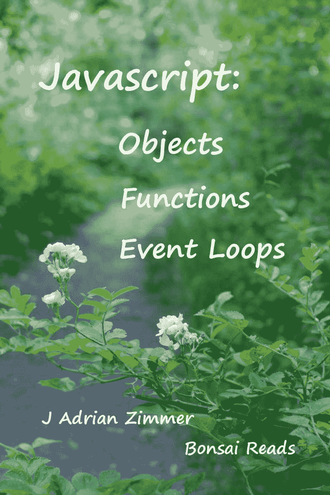

# Javascript：对象、函数与事件循环





版权所有 2017 J Adrian Zimmer

保留所有权利。允许购买者出于个人目的进行复制，前提是购买者采取合理措施防止他人进一步复制。

版本：1.0

本书有两个目录。一个是章节的注释列表；另一个列出了每个主要代码段的列表。


## 前言

《Javascript：对象、函数与事件循环》并不是一本入门书籍，也没有涉及过多的细节。相反，它深入探讨了几个其 Javascript 变让许多程序员感到困惑的概念，即对象、函数、承诺、事件循环编程以及 Javascript 伪造类的方式。其目的是为继续构建对 Javascript 的理解提供一个坚实的基础。为此，每个章节都包含一个练习题，你应该在翻页查看答案之前尝试完成。即使你没有完成练习题，尝试的过程也会让答案更有意义，并让后续章节更易理解。

本书假设你已经了解了一些 Javascript，并熟悉如 Java 和 Python 等语言中基于类的面向对象。

本电子书有一个 [Github 仓库](https://github.com/J-Adrian-Zimmer/JavascriptObjectsFunctionsAndEventLoops/)，可以在那里找到练习答案的可下载副本。它还包含了两个实用的工厂方法。

请注意，本电子书中脚本和交互会话的格式并不是为了作为范。相反，它的目的是产生短行，以便在小屏幕上更容易阅读脚本。

你可以通过开头为 `>` 的代码行来识别交互会话。它们转录自 [Node.js](https://nodejs.org/) 解释器，但转录中删除了许多 `undefined`。例如

```
> var x = 'hi'
> undefined
> > console.log(x)
> hi
> undefined
```

仅转录为：

```
> var x = 'hi'
> > console.log(x)
> hi
```

`var` 和 `console.log` 实际上都会返回 `undefined`，但在转录中看到这一点很困惑，因为我们并不认为它们会返回任何内容。

## I. 对象继承

Javascript 中的一个计数对象可以这样定义：

```javascript
var counter = {
  val: 0,
  incr: function() {
    this.val += 1;
  }
}
```

不要将其与类混淆。它是一个对象。正如你将看到的，`prototype` 成为其他对象的 [[Prototype]]。许多对象都有一个名为 `prototype` 的属性。正如你将看到的，`prototype` 成为其他对象的 [[Prototype]]。它们并不是它们所所属对象的 [[Prototype]]。

例如，`Object.prototype` 成为大多数其他对象继承链中的最后一个对象。因此，大多数对象都可以访问 `toString` 方法，因为 `toString` 存在于 `Object.prototype` 中。

`getPrototypeOf` 方法返回其参数在继承链中的直接前驱。你可以将其构想为“父类”（super）对象。它通常被称为对象的 [[Prototype]]。

获取“自身”（own）属性名称意味着获取对象本身所拥有的属性，而不是从其他对象继承而来的属性。

Javascript 有一个内置对象 `Object`，其方法帮助操作对象。两个示例方法是 `getOwnPropertyNames` 和 `getPrototypeOf`。当应用于 `counter` 时，它们产生结果：

```
> Object.getOwnPropertyNames(counter)
['val', 'incr']
```

以及

```
> var getP = Object.getPrototypeOf;
> getP(counter) === Object.prototype
true
```

`Object` 中还有其他实用的函数。其中一个我将使用 `Object.create`，它可以创建一个具有指定 [[Prototype]] 的空对象。特别是这个表达式

```
Object.create(obj)
```

会创建一个 [[Prototype]] 为 `obj` 的新空对象。

### 问题

按上述实现 `counter`，然后

1. 创建 `counter2`，它继承自 `counter` 并添加一个 `decr` 方法，使 `val` 减 1。
2. 检查以下每个操作
   `Object.getOwnPropertyNames(counter2)`
   `Object.getOwnPropertyNames(counter)`
   返回什么。从目前的内容来看答案并不显而易见，所以请尝试一下。

### 答案

通过这种方式创建 `counter2`：

```javascript
var counter2 = Object.create(counter);
counter2.decr = function() { this.val -= 1 }
```

`counter` 的自身属性显然是

```
> Object.getOwnPropertyNames(counter)
['val', 'incr']
```

然而，你看到的顺序将取决于 Javascript 引擎的实现。

如果你对 `counter2` 的自身属性没有两个不同的答案，那么你漏掉了什么。当你执行 `incr` 或 `decr` 时，情况会发生变化。


### 创建时

```
Object.getOwnPropertyNames(counter2)
['decr']
```

但在执行了 `counter2.incr` 或 `counter2.decr` 之一后，你将得到

```javascript
Object.getOwnPropertyNames(counter2)
['decr', 'val']
```

原因是因为 `counter2` 可以通过继承从 `counter` 获取数据值，但它无法修改它们。当需要修改时，会在 `counter2` 中创建一个新属性。此后，从 `counter2` 获取的属性将是 `counter2` 自身的属性，而不是它在 `counter` 中原始的属性。

这意味着 `counter` 可以用于为任何作为其 `[[Prototype]]` 的对象提供初始值。

## II. 函数

函数是可调用的对象，这意味着：

- 它们是包含函数主体（很可能是编译后的形式）的对象。
- 它们的继承链可以访问到执行该函数主体的方法。

函数对象之所以可以访问执行其代码的方法，是因为它们的继承链中被插入了 `Function.prototype`。在 `Function.prototype` 中有两个可以执行函数的方法，即 `apply` 和 `call`。

下面的简短交互过程展示了函数的继承链。

### 澄清 `Function.prototype`

```javascript
var getP = Object.getPrototypeOf;
function f() {}
getP(f)===Function.prototype
true
getP(Function.prototype)===Object.prototype
true
```

`apply` 和 `call` 都需要一个参数，用于指定在函数执行时 `this` 指向哪个对象。此外，这两个函数都接受普通参数列表。它们唯一的区别在于参数列表的指定方式。你可以在下面的示例中看到这种区别。

### `call` 和 `apply` 的区别

假设有如下定义

```javascript
function f(x,y) { return x+y }
```

那么这个

```javascript
f.call({},2,3)
```

以及这个

```javascript
f.apply({},[2,3])
```

都将返回 5。在两种情况下，`this` 都指向一个空对象。

一个更具信息量的示例涉及这个函数

```javascript
function f(x) { return x+this.y }
```

它期望在一个包含 `y` 的 `this` 对象上下文中执行。以这种方式执行它

```javascript
f(2)
```

此时 `this` 将指向全局对象。除非全局已赋值了 `y`，否则执行将失败。

另一种执行 `f` 的方法是

```javascript
var obj = {f:f, y:3}
obj.f(2)
5
```

这之所以有效是因为 `obj` 同时包含了 `y` 和 `f`。如果对象中缺少 `f`，则无法工作。

```javascript
var obj = {y:3}
obj.f(2) // 不行
```

`call` 和 `apply` 的作用是允许 `this` 指向与执行 `f` 时不同的对象。例如，我们可以从全局对象执行 `f`，并通过这种方式从另一个对象获取 `this.y`

```javascript
Object.apply({y:3},f)
5
```

总结：函数是可调用的对象，方法是函数，而 `this` 由函数执行时的上下文决定。你可以通过使用 `call` 或 `apply` 来处理该上下文。

你可以在下一节中阅读更多关于 `this` 的内容。

### 问题

当函数 `f` 执行时，`this` 指向的对象由其执行时的上下文决定。但如果我不希望这样呢？假设我想让函数定义中的 `this` 无论上下文如何都指向相同的内容。这可以通过 `call` 或 `apply` 实现，但这些函数用起来并不好用。

这是一个你可以解决的问题。创建一个工厂方法 `fixThis`，使得

```javascript
f.fixThis(obj);
```

它会返回一个与 `f` 相似的函数，不同之处在于它的 `this` 指针将始终引用 `obj`。例如

```javascript
function f(z) { return z + this.x }
var x = '?'
f('hi')
'hi?'
var obj = {x: '!'}
var g = f.fixThis(obj)
g('hi')
'hi!'
```

你可能知道 `Function.prototype` 已经包含一个行为与 `fixThis` 相似的函数 `bind`。使用该函数将就忽略了本次练习的意图。

### 答案

你可能已经发现定义需要这样开头

```javascript
Function.prototype.fixThis = function(obj) {
    ...
}
```

并且你需要定义一个供 `fixThis` 返回的函数。该函数必须使用 `apply` 或 `call` 执行 `f`。在这一点上，你可能会卡住，因为你不确定如何引用 `f`。要正确实现，你需要记住两件事：`f` 是 `fixThis` 内部 `this` 指向的对象，但 `f` 并不是 `fixThis` 返回的函数中 `this` 指向的对象。如果需要，请带着这个见解再次尝试。

`fixThis` 的实现

```javascript
Function.prototype.fixThis = function(obj) {
    var that = this;
    return function() {
        return that.apply(obj,arguments);
    }
}
```

正如大家所知的，`arguments` 是一个伪数组，包含了传递给其所属函数的任何参数。

### III. 两行文本居中

```
Object.getOwnPropertyNames(counter2)
['decr']
```

但在执行了 `counter2.incr` 或 `counter2.decr` 之一后，你将得到

```javascript
Object.getOwnPropertyNames(counter2)
['decr', 'val']
```

原因是因为 `counter2` 可以通过继承从 `counter` 获取数据值，但它无法修改它们。当需要修改时，会在 `counter2` 中创建一个新属性。此后，从 `counter2` 获取的属性将是 `counter2` 自身的属性，而不是它在 `counter` 中原始的属性。

这意味着 `counter` 可以用于为任何作为其 `[[Prototype]]` 的对象提供初始值。

## II. 函数

函数是可调用的对象，这意味着：

- 它们是包含函数主体（很可能是编译后的形式）的对象。
- 它们的继承链可以访问到执行该函数主体的方法。

函数对象之所以可以访问执行其代码的方法，是因为它们的继承链中被插入了 `Function.prototype`。在 `Function.prototype` 中有两个可以执行函数的方法，即 `apply` 和 `call`。

下面的简短交互过程展示了函数的继承链。

### 澄清 `Function.prototype`

```javascript
var getP = Object.getPrototypeOf;
function f() {}
getP(f)===Function.prototype
true
getP(Function.prototype)===Object.prototype
true
```

`apply` 和 `call` 都需要一个参数，用于指定在函数执行时 `this` 指向哪个对象。此外，这两个函数都接受普通参数列表。它们唯一的区别在于参数列表的指定方式。你可以在下面的示例中看到这种区别。

### `call` 和 `apply` 的区别

假设有如下定义

```javascript
function f(x,y) { return x+y }
```

那么这个

```javascript
f.call({},2,3)
```

以及这个

```javascript
f.apply({},[2,3])
```

都将返回 5。在两种情况下，`this` 都指向一个空对象。

一个更具信息量的示例涉及这个函数

```javascript
function f(x) { return x+this.y }
```

它期望在一个包含 `y` 的 `this` 对象上下文中执行。以这种方式执行它

```javascript
f(2)
```

此时 `this` 将指向全局对象。除非全局已赋值了 `y`，否则执行将失败。

另一种执行 `f` 的方法是

```javascript
var obj = {f:f, y:3}
obj.f(2)
5
```

这之所以有效是因为 `obj` 同时包含了 `y` 和 `f`。如果对象中缺少 `f`，则无法工作。

```javascript
var obj = {y:3}
obj.f(2) // 不行
```

`call` 和 `apply` 的作用是允许 `this` 指向与执行 `f` 时不同的对象。例如，我们可以从全局对象执行 `f`，并通过这种方式从另一个对象获取 `this.y`

```javascript
Object.apply({y:3},f)
5
```

总结：函数是可调用的对象，方法是函数，而 `this` 由函数执行时的上下文决定。你可以通过使用 `call` 或 `apply` 来处理该上下文。

你可以在下一节中阅读更多关于 `this` 的内容。

### 问题

当函数 `f` 执行时，`this` 指向的对象由其执行时的上下文决定。但如果我不希望这样呢？假设我想让函数定义中的 `this` 无论上下文如何都指向相同的内容。这可以通过 `call` 或 `apply` 实现，但这些函数用起来并不好用。

这是一个你可以解决的问题。创建一个工厂方法 `fixThis`，使得

```javascript
f.fixThis(obj);
```

它会返回一个与 `f` 相似的函数，不同之处在于它的 `this` 指针将始终引用 `obj`。例如

```javascript
function f(z) { return z + this.x }
var x = '?'
f('hi')
'hi?'
var obj = {x: '!'}
var g = f.fixThis(obj)
g('hi')
'hi!'
```

你可能知道 `Function.prototype` 已经包含一个行为与 `fixThis` 相似的函数 `bind`。使用该函数将就忽略了本次练习的意图。

#### 答案 

你可能已经发现定义需要这样开头

```javascript
Function.prototype.fixThis = function(obj) {
    ...
}
```

并且你需要定义一个供 `fixThis` 返回的函数。该函数必须使用 `apply` 或 `call` 执行 `f`。在这一点上，你可能会卡住，因为你不确定如何引用 `f`。要正确实现，你需要记住两件事：`f` 是 `fixThis` 内部 `this` 指向的对象，但 `f` 并不是 `fixThis` 返回的函数中 `this` 指向的对象。如果需要，请带着这个见解再次尝试。

`fixThis` 的实现

```javascript
Function.prototype.fixThis = function(obj) {
    var that = this;
    return function() {
        return that.apply(obj,arguments);
    }
}
```

正如大家所知的，`arguments` 是一个伪数组，包含了传递给其所属函数的任何参数。

### III. 两行文本居中

```
Object.getOwnPropertyNames(counter2)
['decr']
```

但在执行了 `counter2.incr` 或 `counter2.decr` 之一后，你将得到

```javascript
Object.getOwnPropertyNames(counter2)
['decr', 'val']
```

原因是因为 `counter2` 可以通过继承从 `counter` 获取数据值，但它无法修改它们。当需要修改时，会在 `counter2` 中创建一个新属性。此后，从 `counter2` 获取的属性将是 `counter2` 自身的属性，而不是它在 `counter` 中原始的属性。

这意味着 `counter` 可以用于为任何作为其 `[[Prototype]]` 的对象提供初始值。

## II. 函数

函数是可调用的对象，这意味着：

- 它们是包含函数主体（很可能是编译后的形式）的对象。
- 它们的继承链可以访问到执行该函数主体的方法。

函数对象之所以可以访问执行其代码的方法，是因为它们的继承链中被插入了 `Function.prototype`。在 `Function.prototype` 中有两个可以执行函数的方法，即 `apply` 和 `call`。

下面的简短交互过程展示了函数的继承链。

### 澄清 `Function.prototype`

```javascript
var getP = Object.getPrototypeOf;
function f() {}
getP(f)===Function.prototype
true
getP(Function.prototype)===Object.prototype
true
```

`apply` 和 `call` 都需要一个参数，用于指定在函数执行时 `this` 指向哪个对象。此外，这两个函数都接受普通参数列表。它们唯一的区别在于参数列表的指定方式。你可以在下面的示例中看到这种区别。

### `call` 和 `apply` 的区别

假设有如下定义

```javascript
function f(x,y) { return x+y }
```

那么这个

```javascript
f.call({},2,3)
```

以及这个

```javascript
f.apply({},[2,3])
```

都将返回 5。在两种情况下，`this` 都指向一个空对象。

一个更具信息量的示例涉及这个函数

```javascript
function f(x) { return x+this.y }
```

它期望在一个包含 `y` 的 `this` 对象上下文中执行。以这种方式执行它

```javascript
f(2)
```

此时 `this` 将指向全局对象。除非全局已赋值了 `y`，否则执行将失败。

另一种执行 `f` 的方法是

```javascript
var obj = {f:f, y:3}
obj.f(2)
5
```

这之所以有效是因为 `obj` 同时包含了 `y` 和 `f`。如果对象中缺少 `f`，则无法工作。

```javascript
var obj = {y:3}
obj.f(2) // 不行
```

`call` 和 `apply` 的作用是允许 `this` 指向与执行 `f` 时不同的对象。例如，我们可以从全局对象执行 `f`，并通过这种方式从另一个对象获取 `this.y`

```javascript
Object.apply({y:3},f)
5
```

总结：函数是可调用的对象，方法是函数，而 `this` 由函数执行时的上下文决定。你可以通过使用 `call` 或 `apply` 来处理该上下文。

你可以在下一节中阅读更多关于 `this` 的内容。

### 问题

当函数 `f` 执行时，`this` 指向的对象由其执行时的上下文决定。但如果我不希望这样呢？假设我想让函数定义中的 `this` 无论上下文如何都指向相同的内容。这可以通过 `call` 或 `apply` 实现，但这些函数用起来并不好用。

这是一个你可以解决的问题。创建一个工厂方法 `fixThis`，使得

```javascript
f.fixThis(obj);
```

它会返回一个与 `f` 相似的函数，不同之处在于它的 `this` 指针将始终引用 `obj`。例如

```javascript
function f(z) { return z + this.x }
var x = '?'
f('hi')
'hi?'
var obj = {x: '!'}
var g = f.fixThis(obj)
g('hi')
'hi!'
```

你可能知道 `Function.prototype` 已经包含一个行为与 `fixThis` 相似的函数 `bind`。使用该函数将就忽略了本次练习的意图。

#### 答案 

你可能已经发现定义需要这样开头

```javascript
Function.prototype.fixThis = function(obj) {
    ...
}
```

并且你需要定义一个供 `fixThis` 返回的函数。该函数必须使用 `apply` 或 `call` 执行 `f`。在这一点上，你可能会卡住，因为你不确定如何引用 `f`。要正确实现，你需要记住两件事：`f` 是 `fixThis` 内部 `this` 指向的对象，但 `f` 并不是 `fixThis` 返回的函数中 `this` 指向的对象。如果需要，请带着这个见解再次尝试。

`fixThis` 的实现

```javascript
Function.prototype.fixThis = function(obj) {
    var that = this;
    return function() {
        return that.apply(obj,arguments);
    }
}
```

正如大家所知的，`arguments` 是一个伪数组，包含了传递给其所属函数的任何参数。

### III. 两行文本居中

```
Object.getOwnPropertyNames(counter2)
['decr']
```

但在执行了 `counter2.incr` 或 `counter2.decr` 之一后，你将得到

```javascript
Object.getOwnPropertyNames(counter2)
['decr', 'val']
```

原因是因为 `counter2` 可以通过继承从 `counter` 获取数据值，但它无法修改它们。当需要修改时，会在 `counter2` 中创建一个新属性。此后，从 `counter2` 获取的属性将是 `counter2` 自身的属性，而不是它在 `counter` 中原始的属性。

这意味着 `counter` 可以用于为任何作为其 `[[Prototype]]` 的对象提供初始值。

## II. 函数

函数是可调用的对象，这意味着：

- 它们是包含函数主体（很可能是编译后的形式）的对象。
- 它们的继承链可以访问到执行该函数主体的方法。

函数对象之所以可以访问执行其代码的方法，是因为它们的继承链中被插入了 `Function.prototype`。在 `Function.prototype` 中有两个可以执行函数的方法，即 `apply` 和 `call`。

下面的简短交互过程展示了函数的继承链。

### 澄清 `Function.prototype`

```javascript
var getP = Object.getPrototypeOf;
function f() {}
getP(f)===Function.prototype
true
getP(Function.prototype)===Object.prototype
true
```

`apply` 和 `call` 都需要一个参数，用于指定在函数执行时 `this` 指向哪个对象。此外，这两个函数都接受普通参数列表。它们唯一的区别在于参数列表的指定方式。你可以在下面的示例中看到这种区别。

### `call` 和 `apply` 的区别

假设有如下定义

```javascript
function f(x,y) { return x+y }
```

那么这个

```javascript
f.call({},2,3)
```

以及这个

```javascript
f.apply({},[2,3])
```

都将返回 5。在两种情况下，`this` 都指向一个空对象。

一个更具信息量的示例涉及这个函数

```javascript
function f(x) { return x+this.y }
```

它期望在一个包含 `y` 的 `this` 对象上下文中执行。以这种方式执行它

```javascript
f(2)
```

此时 `this` 将指向全局对象。除非全局已赋值了 `y`，否则执行将失败。

另一种执行 `f` 的方法是

```javascript
var obj = {f:f, y:3}
obj.f(2)
5
```

这之所以有效是因为 `obj` 同时包含了 `y` 和 `f`。如果对象中缺少 `f`，则无法工作。

```javascript
var obj = {y:3}
obj.f(2) // 不行
```

`call` 和 `apply` 的作用是允许 `this` 指向与执行 `f` 时不同的对象。例如，我们可以从全局对象执行 `f`，并通过这种方式从另一个对象获取 `this.y`

```javascript
Object.apply({y:3},f)
5
```

总结：函数是可调用的对象，方法是函数，而 `this` 由函数执行时的上下文决定。你可以通过使用 `call` 或 `apply` 来处理该上下文。

你可以在下一节中阅读更多关于 `this` 的内容。

### 问题

当函数 `f` 执行时，`this` 指向的对象由其执行时的上下文决定。但如果我不希望这样呢？假设我想让函数定义中的 `this` 无论上下文如何都指向相同的内容。这可以通过 `call` 或 `apply` 实现，但这些函数用起来并不好用。

这是一个你可以解决的问题。创建一个工厂方法 `fixThis`，使得

```javascript
f.fixThis(obj);
```

它会返回一个与 `f` 相似的函数，不同之处在于它的 `this` 指针将始终引用 `obj`。例如

```javascript
function f(z) { return z + this.x }
var x = '?'
f('hi')
'hi?'
var obj = {x: '!'}
var g = f.fixThis(obj)
g('hi')
'hi!'
```

你可能知道 `Function.prototype` 已经包含一个行为与 `fixThis` 相似的函数 `bind`。使用该函数将就忽略了本次练习的意图。

#### 答案 

你可能已经发现定义需要这样开头

```javascript
Function.prototype.fixThis = function(obj) {
    ...
}
```

并且你需要定义一个供 `fixThis` 返回的函数。该函数必须使用 `apply` 或 `call` 执行 `f`。在这一点上，你可能会卡住，因为你不确定如何引用 `f`。要正确实现，你需要记住两件事：`f` 是 `fixThis` 内部 `this` 指向的对象，但 `f` 并不是 `fixThis` 返回的函数中 `this` 指向的对象。如果需要，请带着这个见解再次尝试。

`fixThis` 的实现

```javascript
Function.prototype.fixThis = function(obj) {
    var that = this;
    return function() {
        return that.apply(obj,arguments);
    }
}
```

正如大家所知的，`arguments` 是一个伪数组，包含了传递给其所属函数的任何参数。

### III. 两行文本居中

```
Object.getOwnPropertyNames(counter2)
['decr']
```

但在执行了 `counter2.incr` 或 `counter2.decr` 之一后，你将得到

```javascript
Object.getOwnPropertyNames(counter2)
['decr', 'val']
```

原因是因为 `counter2` 可以通过继承从 `counter` 获取数据值，但它无法修改它们。当需要修改时，会在 `counter2` 中创建一个新属性。此后，从 `counter2` 获取的属性将是 `counter2` 自身的属性，而不是它在 `counter` 中原始的属性。

这意味着 `counter` 可以用于为任何作为其 `[[Prototype]]` 的对象提供初始值。

## II. 函数

函数是可调用的对象，这意味着：

- 它们是包含函数主体（很可能是编译后的形式）的对象。
- 它们的继承链可以访问到执行该函数主体的方法。

函数对象之所以可以访问执行其代码的方法，是因为它们的继承链中被插入了 `Function.prototype`。在 `Function.prototype` 中有两个可以执行函数的方法，即 `apply` 和 `call`。

下面的简短交互过程展示了函数的继承链。

### 澄清 `Function.prototype`

```javascript
var getP = Object.getPrototypeOf;
function f() {}
getP(f)===Function.prototype
true
getP(Function.prototype)===Object.prototype
true
```

`apply` 和 `call` 都需要一个参数，用于指定在函数执行时 `this` 指向哪个对象。此外，这两个函数都接受普通参数列表。它们唯一的区别在于参数列表的指定方式。你可以在下面的示例中看到这种区别。

### `call` 和 `apply` 的区别

假设有如下定义

```javascript
function f(x,y) { return x+y }
```

那么这个

```javascript
f.call({},2,3)
```

以及这个

```javascript
f.apply({},[2,3])
```

都将返回 5。在两种情况下，`this` 都指向一个空对象。

一个更具信息量的示例涉及这个函数

```javascript
function f(x) { return x+this.y }
```

它期望在一个包含 `y` 的 `this` 对象上下文中执行。以这种方式执行它

```javascript
f(2)
```

此时 `this` 将指向全局对象。除非全局已赋值了 `y`，否则执行将失败。

另一种执行 `f` 的方法是

```javascript
var obj = {f:f, y:3}
obj.f(2)
5
```

这之所以有效是因为 `obj` 同时包含了 `y` 和 `f`。如果对象中缺少 `f`，则无法工作。

```javascript
var obj = {y:3}
obj.f(2) // 不行
```

`call` 和 `apply` 的作用是允许 `this` 指向与执行 `f` 时不同的对象。例如，我们可以从全局对象执行 `f`，并通过这种方式从另一个对象获取 `this.y`

```javascript
Object.apply({y:3},f)
5
```

总结：函数是可调用的对象，方法是函数，而 `this` 由函数执行时的上下文决定。你可以通过使用 `call` 或 `apply` 来处理该上下文。

你可以在下一节中阅读更多关于 `this` 的内容。

### 问题

当函数 `f` 执行时，`this` 指向的对象由其执行时的上下文决定。但如果我不希望这样呢？假设我想让函数定义中的 `this` 无论上下文如何都指向相同的内容。这可以通过 `call` 或 `apply` 实现，但这些函数用起来并不好用。

这是一个你可以解决的问题。创建一个工厂方法 `fixThis`，使得

```javascript
f.fixThis(obj);
```

它会返回一个与 `f` 相似的函数，不同之处在于它的 `this` 指针将始终引用 `obj`。例如

```javascript
function f(z) { return z + this.x }
var x = '?'
f('hi')
'hi?'
var obj = {x: '!'}
var g = f.fixThis(obj)
g('hi')
'hi!'
```

你可能知道 `Function.prototype` 已经包含一个行为与 `fixThis` 相似的函数 `bind`。使用该函数将就忽略了本次练习的意图。

#### 答案 

你可能已经发现定义需要这样开头

```javascript
Function.prototype.fixThis = function(obj) {
    ...
}
```

并且你需要定义一个供 `fixThis` 返回的函数。该函数必须使用 `apply` 或 `call` 执行 `f`。在这一点上，你可能会卡住，因为你不确定如何引用 `f`。要正确实现，你需要记住两件事：`f` 是 `fixThis` 内部 `this` 指向的对象，但 `f` 并不是 `fixThis` 返回的函数中 `this` 指向的对象。如果需要，请带着这个见解再次尝试。

`fixThis` 的实现

```javascript
Function.prototype.fixThis = function(obj) {
    var that = this;
    return function() {
        return that.apply(obj,arguments);
    }
}
```

正如大家所知的，`arguments` 是一个伪数组，包含了传递给其所属函数的任何参数。

### III. 两行文本居中

```
Object.getOwnPropertyNames(counter2)
['decr']
```

但在执行了 `counter2.incr` 或 `counter2.decr` 之一后，你将得到

```javascript
Object.getOwnPropertyNames(counter2)
['decr', 'val']
```

原因是因为 `counter2` 可以通过继承从 `counter` 获取数据值，但它无法修改它们。当需要修改时，会在 `counter2` 中创建一个新属性。此后，从 `counter2` 获取的属性将是 `counter2` 自身的属性，而不是它在 `counter` 中原始的属性。

这意味着 `counter` 可以用于为任何作为其 `[[Prototype]]` 的对象提供初始值。

## II. 函数

函数是可调用的对象，这意味着：

- 它们是包含函数主体（很可能是编译后的形式）的对象。
- 它们的继承链可以访问到执行该函数主体的方法。

函数对象之所以可以访问执行其代码的方法，是因为它们的继承链中被插入了 `Function.prototype`。在 `Function.prototype` 中有两个可以执行函数的方法，即 `apply` 和 `call`。

下面的简短交互过程展示了函数的继承链。

### 澄清 `Function.prototype`

```javascript
var getP = Object.getPrototypeOf;
function f() {}
getP(f)===Function.prototype
true
getP(Function.prototype)===Object.prototype
true
```

`apply` 和 `call` 都需要一个参数，用于指定在函数执行时 `this` 指向哪个对象。此外，这两个函数都接受普通参数列表。它们唯一的区别在于参数列表的指定方式。你可以在下面的示例中看到这种区别。

### `call` 和 `apply` 的区别

假设有如下定义

```javascript
function f(x,y) { return x+y }
```

那么这个

```javascript
f.call({},2,3)
```

以及这个

```javascript
f.apply({},[2,3])
```

都将返回 5。在两种情况下，`this` 都指向一个空对象。

一个更具信息量的示例涉及这个函数

```javascript
function f(x) { return x+this.y }
```

它期望在一个包含 `y` 的 `this` 对象上下文中执行。以这种方式执行它

```javascript
f(2)
```

``` `this` 将指向全局对象。除非全局已赋值了 `y`，否则执行将失败。

另一种执行 `f` 的方法是

```javascript
var obj = {f:f, y:3}
obj.f(2)
5
```

这之所以有效是因为 `obj` 同时包含了 `y` 和 `f`。如果对象中缺少 `f`，则无法工作。

```javascript
var obj = {y:3}
obj.f(2) // 不行
```

`call` 和 `apply` 的作用是允许 `this` 指向与执行 `f` 时不同的对象。例如，我们可以从全局对象执行 `f`，并通过这种方式从另一个对象获取 `this.y`

```javascript
Object.apply({y:3},f)
5
```

总结：函数是可调用的对象，方法是函数，而 `this` 由函数执行时的上下文决定。你可以通过使用 `call` 或 `apply` 来处理该上下文。

你可以在下一节中阅读更多关于 `this` 的内容。

### 问题

当函数 `f` 执行时，`this` 指向的对象由其执行时的上下文决定。但如果我不希望这样呢？假设我想让函数定义中的 `this` 无论上下文如何都指向相同的内容。这可以通过 `call` 或 `apply` 实现，但这些函数用起来并不好用。

这是一个你可以解决的问题。创建一个工厂方法 `fixThis`，使得

```javascript
f.fixThis(obj);
```

它会返回一个与 `f` 相似的函数，不同之处在于它的 `this` 指针将始终引用 `obj`。例如

```javascript
function f(z) { return z + this.x }
var x = '?'
f('hi')
'hi?'
var obj = {x: '!'}
var g = f.fixThis(obj)
g('hi')
'hi!'
```

你可能知道 `Function.prototype` 已经包含一个行为与 `fixThis` 相似的函数 `bind`。使用该函数将就忽略了本次练习的意图。

#### 答案 

你可能已经发现定义需要这样开头

```javascript
Function.prototype.fixThis = function(obj) {
    ...
}
```

并且你需要定义一个供 `fixThis` 返回的函数。该函数必须使用 `apply` 或 `call` 执行 `f`。在这一点上，你可能会卡住，因为你不确定如何引用 `f`。要正确实现，你需要记住两件事：`f` 是 `fixThis` 内部 `this` 指向的对象，但 `f` 并不是 `fixThis` 返回的函数中 `this` 指向的对象。如果需要，请带着这个见解再次尝试。

`fixThis` 的实现

```javascript
Function.prototype.fixThis = function(obj) {
    var that = this;
    return function() {
        return that.apply(obj,arguments);
    }
}
```

正如大家所知的，`arguments` 是一个伪数组，包含了传递给其所属函数的任何参数。

### III. 两行文本居中

```
Object.getOwnPropertyNames(counter2)
['decr']
```

但在执行了 `counter2.incr` 或 `counter2.decr` 之一后，你将得到

```javascript
Object.getOwnPropertyNames(counter2)
['decr', 'val']
```

原因是因为 `counter2` 可以通过继承从 `counter` 获取数据值，但它无法修改它们。当需要修改时，会在 `counter2` 中创建一个新属性。此后，从 `counter2` 获取的属性将是 `counter2` 自身的属性，而不是它在 `counter` 中原始的属性。

这意味着 `counter` 可以用于为任何作为其 `[[Prototype]]` 的对象提供初始值。

## II. 函数

函数是可调用的对象，这意味着：

- 它们是包含函数主体（很可能是编译后的形式）的对象。
- 它们的继承链可以访问到执行该函数主体的方法。

函数对象之所以可以访问执行其代码的方法，是因为它们的继承链中被插入了 `Function.prototype`。在 `Function.prototype` 中有两个可以执行函数的方法，即 `apply` 和 `call`。

下面的简短交互过程展示了函数的继承链。

### 澄清 `Function.prototype`

```javascript
var getP = Object.getPrototypeOf;
function f() {}
getP(f)===Function.prototype
true
getP(Function.prototype)===Object.prototype
true
```

`apply` 和 `call` 都需要一个参数，用于指定在函数执行时 `this` 指向哪个对象。此外，这两个函数都接受普通参数列表。它们唯一的区别在于参数列表的指定方式。你可以在下面的示例中看到这种区别。

### `call` 和 `apply` 的区别

假设有如下定义

```javascript
function f(x,y) { return x+y }
```

那么这个

```javascript
f.call({},2,3)
```

以及这个

```javascript
f.apply({},[2,3])
```

都将返回 5。在两种情况下，`this` 都指向一个空对象。

一个更具信息量的示例涉及这个函数

```javascript
function f(x) { return x+this.y }
```

它期望在一个包含 `y` 的 `this` 对象上下文中执行。以这种方式执行它

```javascript
f(2)
```

此时 `this` 将指向全局对象。除非全局已赋值了 `y`，否则执行将失败。

另一种执行 `f` 的方法是

```javascript
var obj = {f:f, y:3}
obj.f(2)
5
```

这之所以有效是因为 `obj` 同时包含了 `y` 和 `f`。如果对象中缺少 `f`，则无法工作。

```javascript
var obj = {y:3}
obj.f(2) // 不行
```

`call` 和 `apply` 的作用是允许 `this` 指向与执行 `f` 时不同的对象。例如，我们可以从全局对象执行 `f`，并通过这种方式从另一个对象获取 `this.y`

```javascript
Object.apply({y:3},f)
5
```

总结：函数是可调用的对象，方法是函数，而 `this` 由函数执行时的上下文决定。你可以通过使用 `call` 或 `apply` 来处理该上下文。

你可以在下一节中阅读更多关于 `this` 的内容。

### 问题

当函数 `f` 执行时，`this` 指向的对象由其执行时的上下文决定。但如果我不希望这样呢？假设我想让函数定义中的 `this` 无论上下文如何都指向相同的内容。这可以通过 `call` 或 `apply` 实现，但这些函数用起来并不好用。

这是一个你可以解决的问题。创建一个工厂方法 `fixThis`，使得

```javascript
f.fixThis(obj);
```

它会返回一个与 `f` 相似的函数，不同之处在于它的 `this` 指针将始终引用 `obj`。例如

```javascript
function f(z) { return z + this.x }
var x = '?'
f('hi')
'hi?'
var obj = {x: '!'}
var g = f.fixThis(obj)
g('hi')
'hi!'
```

你可能知道 `Function.prototype` 已经包含一个行为与 `fixThis` 相似的函数 `bind`。使用该函数将就忽略了本次练习的意图。

#### 答案 

你可能已经发现定义需要这样开头

```javascript
Function.prototype.fixThis = function(obj) {
    ...
}
```

并且你需要定义一个供 `fixThis` 返回的函数。该函数必须使用 `apply` 或 `call` 执行 `f`。在这一点上，你可能会卡住，因为你不确定如何引用 `f`。要正确实现，你需要记住两件事：`f` 是 `fixThis` 内部 `this` 指向的对象，但 `f` 并不是 `fixThis` 返回的函数中 `this` 指向的对象。如果需要，请带着这个见解再次尝试。

`fixThis` 的实现

```javascript
Function.prototype.fixThis = function(obj) {
    var that = this;
    return function() {
        return that.apply(obj,arguments);
    }
}
```

正如大家所知的，`arguments` 是一个伪数组，包含了传递给其所属函数的任何参数。

### III. 两行文本居中

```
Object.getOwnPropertyNames(counter2)
['decr']
```

但在执行了 `counter2.incr` 或 `counter2.decr` 之一后，你将得到

```javascript
Object.getOwnPropertyNames(counter2)
['decr', 'val']
```

原因是因为 `counter2` 可以通过继承从 `counter` 获取数据值，但它无法修改它们。当需要修改时，会在 `counter2` 中创建一个新属性。此后，从 `counter2` 获取的属性将是 `counter2` 自身的属性，而不是它在 `counter` 中原始的属性。

这意味着 `counter` 可以用于为任何作为其 `[[Prototype]]` 的对象提供初始值。

## II. 函数

函数是可调用的对象，这意味着：

- 它们是包含函数主体（很可能是编译后的形式）的对象。
- 它们的继承链可以访问到执行该函数主体的方法。

函数对象之所以可以访问执行其代码的方法，是因为它们的继承链中被插入了 `Function.prototype`。在 `Function.prototype` 中有两个可以执行函数的方法，即 `apply` 和 `call`。

下面的简短交互过程展示了函数的继承链。

### 澄清 `Function.prototype`

```javascript
var getP = Object.getPrototypeOf;
function f() {}
getP(f)===Function.prototype
true
getP(Function.prototype)===Object.prototype
true
```

`apply` 和 `call` 都需要一个参数，用于指定在函数执行时 `this` 指向哪个对象。此外，这两个函数都接受普通参数列表。它们唯一的区别在于参数列表的指定方式。你可以在下面的示例中看到这种区别。

### `call` 和 `apply` 的区别

假设有如下定义

```javascript
function f(x,y) { return x+y }
```

那么这个

```javascript
f.call({},2,3)
```

以及这个

```javascript
f.apply({},[2,3])
```

都将返回 5。在两种情况下，`this` 都指向一个空对象。

一个更具信息量的示例涉及这个函数

```javascript
function f(x) { return x+this.y }
```

它期望在一个包含 `y` 的 `this` 对象上下文中执行。以这种方式执行它

```javascript
f(2)
```

此时 `this` 将指向全局对象。除非全局已赋值了 `y`，否则执行将失败。

另一种执行 `f` 的方法是

```javascript
var obj = {f:f, y:3}
obj.f(2)
5
```

这之所以有效是因为 `obj` 同时包含了 `y` 和 `f`。如果对象中缺少 `f`，则无法工作。

```javascript
var obj = {y:3}
obj.f(2) // 不行
```

`call` 和 `apply` 的作用是允许 `this` 指向与执行 `f` 时不同的对象。例如，我们可以从全局对象执行 `f`，并通过这种方式从另一个对象获取 `this.y`

```javascript
Object.apply({y:3},f)
5
```

总结：函数是可调用的对象，方法是函数，而 `this` 由函数执行时的上下文决定。你可以通过使用 `call` 或 `apply` 来处理该上下文。

你可以在下一节中阅读更多关于 `this` 的内容。

### 问题

当函数 `f` 执行时，`this` 指向的对象由其执行时的上下文决定。但如果我不希望这样呢？假设我想让函数定义中的 `this` 无论上下文如何都指向相同的内容。这可以通过 `call` 或 `apply` 实现，但这些函数用起来并不好用。

这是一个你可以解决的问题。创建一个工厂方法 `fixThis`，使得

```javascript
f.fixThis(obj);
```

它会返回一个与 `f` 相似的函数，不同之处在于它的 `this` 指针将始终引用 `obj`。例如

```javascript
function f(z) { return z + this.x }
var x = '?'
f('hi')
'hi?'
var obj = {x: '!'}
var g = f.fixThis(obj)
g('hi')
'hi!'
```

你可能知道 `Function.prototype` 已经包含一个行为与 `fixThis` 相似的函数 `bind`。使用该函数将就忽略了本次练习的意图。

#### 答案 

你可能已经发现定义需要这样开头

```javascript
Function.prototype.fixThis = function(obj) {
    ...
}
```

并且你需要定义一个供 `fixThis` 返回的函数。该函数必须使用 `apply` 或 `call` 执行 `f`。在这一点上，你可能会卡住，因为你不确定如何引用 `f`。要正确实现，你需要记住两件事：`f` 是 `fixThis` 内部 `this` 指向的对象，但 `f` 并不是 `fixThis` 返回的函数中 `this` 指向的对象。如果需要，请带着这个见解再次尝试。

`fixThis` 的实现

```javascript
Function.prototype.fixThis = function(obj) {
    var that = this;
    return function() {
        return that.apply(obj,arguments);
    }
}
```

正如大家所知的，`arguments` 是一个伪数组，包含了传递给其所属函数的任何参数。

### III. 两行文本居中

```
Object.getOwnPropertyNames(counter2)
['decr']
```

但在执行了 `counter2.incr` 或 `counter2.decr` 之一后，你将得到

```javascript
Object.getOwnPropertyNames(counter2)
['decr', 'val']
```

原因是因为 `counter2` 可以通过继承从 `counter` 获取数据值，但它无法修改它们。当需要修改时，会在 `counter2` 中创建一个新属性。此后，从 `counter2` 获取的属性将是 `counter2` 自身的属性，而不是它在 `counter` 中原始的属性。

这意味着 `counter` 可以用于为任何作为其 `[[Prototype]]` 的对象提供初始值。

## II. 函数

函数是可调用的对象，这意味着：

- 它们是包含函数主体（很可能是编译后的形式）的对象。
- 它们的继承链可以访问到执行该函数主体的方法。

函数对象之所以可以访问执行其代码的方法，是因为它们的继承链中被插入了 `Function.prototype`。在 `Function.prototype` 中有两个可以执行函数的方法，即 `apply` 和 `call`。

下面的简短交互过程展示了函数的继承链。

### 澄清 `Function.prototype`

```javascript
var getP = Object.getPrototypeOf;
function f() {}
getP(f)===Function.prototype
true
getP(Function.prototype)===Object.prototype
true
```

`apply` 和 `call` 都需要一个参数，用于指定在函数执行时 `this` 指向哪个对象。此外，这两个函数都接受普通参数列表。它们唯一的区别在于参数列表的指定方式。你可以在下面的示例中看到这种区别。

### `call` 和 `apply` 的区别

假设有如下定义

```javascript
function f(x,y) { return x+y }
```

那么这个

```javascript
f.call({},2,3)
```

以及这个

```javascript
f.apply({},[2,3])
```

都将返回 5。在两种情况下，`this` 都指向一个空对象。

一个更具信息量的示例涉及这个函数

```javascript
function f(x) { return x+this.y }
```

它期望在一个包含 `y` 的 `this` 对象上下文中执行。以这种方式执行它

```javascript
f(2)
```

此时 `this` 将指向全局对象。除非全局已赋值了 `y`，否则执行将失败。

另一种执行 `f` 的方法是

```javascript
var obj = {f:f, y:3}
obj.f(2)
5
```

这之所以有效是因为 `obj` 同时包含了 `y` 和 `f`。如果对象中缺少 `f`，则无法工作。

```javascript
var obj = {y:3}
obj.f(2) // 不行
```

`call` 和 `apply` 的作用是允许 `this` 指向与执行 `f` 时不同的对象。例如，我们可以从全局对象执行 `f`，并通过这种方式从另一个对象获取 `this.y`

```javascript
Object.apply({y:3},f)
5
```

总结：函数是可调用的对象，方法是函数，而 `this` 由函数执行时的上下文决定。你可以通过使用 `call` 或 `apply` 来处理该上下文。

你可以在下一节中阅读更多关于 `this` 的内容。

### 问题

当函数 `f` 执行时，`this` 指向的对象由其执行时的上下文决定。但如果我不希望这样呢？假设我想让函数定义中的 `this` 无论上下文如何都指向相同的内容。这可以通过 `call` 或 `apply` 实现，但这些函数用起来并不好用。

这是一个你可以解决的问题。创建一个工厂方法 `fixThis`，使得

```javascript
f.fixThis(obj);
```

它会返回一个与 `f` 相似的函数，不同之处在于它的 `this` 指针将始终引用 `obj`。例如

```javascript
function f(z) { return z + this.x }
var x = '?'
f('hi')
'hi?'
var obj = {x: '!'}
var g = f.fixThis(obj)
g('hi')
'hi!'
```

你可能知道 `Function.prototype` 已经包含一个行为与 `fixThis` 相似的函数 `bind`。使用该函数将就忽略了本次练习的意图。

#### 答案 

你可能已经发现定义需要这样开头

```javascript
Function.prototype.fixThis = function(obj) {
    ...
}
```

并且你需要定义一个供 `fixThis` 返回的函数。该函数必须使用 `apply` 或 `call` 执行 `f`。在这一点上，你可能会卡住，因为你不确定如何引用 `f`。要正确实现，你需要记住两件事：`f` 是 `fixThis` 内部 `this` 指向的对象，但 `f` 并不是 `fixThis` 返回的函数中 `this` 指向的对象。如果需要，请带着这个见解再次尝试。

`fixThis` 的实现

```javascript
Function.prototype.fixThis = function(obj) {
    var that = this;
    return function() {
        return that.apply(obj,arguments);
    }
}
```

正如大家所知的，`arguments` 是一个伪数组，包含了传递给其所属函数的任何参数。

### III. 两行文本居中

```
Object.getOwnPropertyNames(counter2)
['decr']
```

但在执行了 `counter2.incr` 或 `counter2.decr` 之一后，你将得到

```javascript
Object.getOwnPropertyNames(counter2)
['decr', 'val']
```

原因是因为 `counter2` 可以通过继承从 `counter` 获取数据值，但它无法修改它们。当需要修改时，会在 `counter2` 中创建一个新属性。此后，从 `counter2` 获取的属性将是 `counter2` 自身的属性，而不是它在 `counter` 中原始的属性。

这意味着 `counter` 可以用于为任何作为其 `[[Prototype]]` 的对象提供初始值。

## II. 函数

函数是可调用的对象，这意味着：

- 它们是包含函数主体（很可能是编译后的形式）的对象。
- 它们的继承链可以访问到执行该函数主体的方法。

函数对象之所以可以访问执行其代码的方法，是因为它们的继承链中被插入了 `Function.prototype`。在 `Function.prototype` 中有两个可以执行函数的方法，即 `apply` 和 `call`。

下面的简短交互过程展示了函数的继承链。

### 澄清 `Function.prototype`

```javascript
var getP = Object.getPrototypeOf;
function f() {}
getP(f)===Function.prototype
true
getP(Function.prototype)===Object.prototype
true
```

`apply` 和 `call` 都需要一个参数，用于指定在函数执行时 `this` 指向哪个对象。此外，这两个函数都接受普通参数列表。它们唯一的区别在于参数列表的指定方式。你可以在下面的示例中看到这种区别。

### `call` 和 `apply` 的区别

假设有如下定义

```javascript
function f(x,y) { return x+y }
```

那么这个

```javascript
f.call({},2,3)
```

以及这个

```javascript
f.apply({},[2,3])
```

都将返回 5。在两种情况下，`this` 都指向一个空对象。

一个更具信息量的示例涉及这个函数

```javascript
function f(x) { return x+this.y }
```

它期望在一个包含 `y` 的 `this` 对象上下文中执行。以这种方式执行它

```javascript
f(2)
```

此时 `this` 将指向全局对象。除非全局已赋值了 `y`，否则执行将失败。

另一种执行 `f` 的方法是

```javascript
var obj = {f:f, y:3}
obj.f(2)
5
```

这之所以有效是因为 `obj` 同时包含了 `y` 和 `f`。如果对象中缺少 `f`，则无法工作。

```javascript
var obj = {y:3}
obj.f(2) // 不行
```

`call` 和 `apply` 的作用是允许 `this` 指向与执行 `f` 时不同的对象。例如，我们可以从全局对象执行 `f`，并通过这种方式从另一个对象获取 `this.y`

```javascript
Object.apply({y:3},f)
5
```

总结：函数是可调用的对象，方法是函数，而 `this` 由函数执行时的上下文决定。你可以通过使用 `call` 或 `apply` 来处理该上下文。

你可以在下一节中阅读更多关于 `this` 的内容。

### 问题

当函数 `f` 执行时，`this` 指向的对象由其执行时的上下文决定。但如果我不希望这样呢？假设我想让函数定义中的 `this` 无论上下文如何都指向相同的内容。这可以通过 `call` 或 `apply` 实现，但这些函数用起来并不好用。

这是一个你可以解决的问题。创建一个工厂方法 `fixThis`，使得

```javascript
f.fixThis(obj);
```

它会返回一个与 `f` 相似的函数，不同之处在于它的 `this` 指针将始终引用 `obj`。例如

```javascript
function f(z) { return z + this.x }
var x = '?'
f('hi')
'hi?'
var obj = {x: '!'}
var g = f.fixThis(obj)
g('hi')
'hi!'
```

你可能知道 `Function.prototype` 已经包含一个行为与 `fixThis` 相似的函数 `bind`。使用该函数将就忽略了本次练习的意图。

#### 答案 

你可能已经发现定义需要这样开头

```javascript
Function.prototype.fixThis = function(obj) {
    ...
}
```

并且你需要定义一个供 `fixThis` 返回的函数。该函数必须使用 `apply` 或 `call` 执行 `f`。在这一点上，你可能会卡住，因为你不确定如何引用 `f`。要正确实现，你需要记住两件事：`f` 是 `fixThis` 内部 `this` 指向的对象，但 `f` 并不是 `fixThis` 返回的函数中 `this` 指向的对象。如果需要，请带着这个见解再次尝试。

`fixThis` 的实现

```javascript
Function.prototype.fixThis = function(obj) {
    var that = this;
    return function() {
        return that.apply(obj,arguments);
    }
}
```

正如大家所知的，`arguments` 是一个伪数组，包含了传递给其所属函数的任何参数。

### III. 两行文本居中

```
Object.getOwnPropertyNames(counter2)
['decr']
```

但在执行了 `counter2.incr` 或 `counter2.decr` 之一后，你将得到

```javascript
Object.getOwnPropertyNames(counter2)
['decr', 'val']
```

原因是因为 `counter2` 可以通过继承从 `counter` 获取数据值，但它无法修改它们。当需要修改时，会在 `counter2` 中创建一个新属性。此后，从 `counter2` 获取的属性将是 `counter2` 自身的属性，而不是它在 `counter` 中原始的属性。

这意味着 `counter` 可以用于为任何作为其 `[[Prototype]]` 的对象提供初始值。

## II. 函数

函数是可调用的对象，这意味着：

- 它们是包含函数主体（很可能是编译后的形式）的对象。
- 它们的继承链可以访问到执行该函数主体的方法。

函数对象之所以可以访问执行其代码的方法，是因为它们的继承链中被插入了 `Function.prototype`。在 `Function.prototype` 中有两个可以执行函数的方法，即 `apply` 和 `call`。

下面的简短交互过程展示了函数的继承链。

### 澄清 `Function.prototype`

```javascript
var getP = Object.getPrototypeOf;
function f() {}
getP(f)===Function.prototype
true
getP(Function.prototype)===Object.prototype
true
```

`apply` 和 `call` 都需要一个参数，用于指定在函数执行时 `this` 指向哪个对象。此外，这两个函数都接受普通参数列表。它们唯一的区别在于参数列表的指定方式。你可以在下面的示例中看到这种区别。

### `call` 和 `apply` 的区别

假设有如下定义

```javascript
function f(x,y) { return x+y }
```

那么这个

```javascript
f.call({},2,3)
```

以及这个

```javascript
f.apply({},[2,3])
```

都将返回 5。在两种情况下，`this` 都指向一个空对象。

一个更具信息量的示例涉及这个函数

```javascript
function f(x) { return x+this.y }
```

它期望在一个包含 `y` 的 `this` 对象上下文中执行。以这种方式执行它

```javascript
f(2)
```

此时 `this` 将指向全局对象。除非全局已赋值了 `y`，否则执行将失败。

另一种执行 `f` 的方法是

```javascript
var obj = {f:f, y:3}
obj.f(2)
5
```

这之所以有效是因为 `obj` 同时包含了 `y` 和 `f`。如果对象中缺少 `f`，则无法工作。

```javascript
var obj = {y:3}
obj.f(2) // 不行
```

`call` 和 `apply` 的作用是允许 `this` 指向与执行 `f` 时不同的对象。例如，我们可以从全局对象执行 `f`，并通过这种方式从另一个对象获取 `this.y`

```javascript
Object.apply({y:3},f)
5
```

总结：函数是可调用的对象，方法是函数，而 `this` 由函数执行时的上下文决定。你可以通过使用 `call` 或 `apply` 来处理该上下文。

你可以在下一节中阅读更多关于 `this` 的内容。

### 问题

当函数 `f` 执行时，`this` 指向的对象由其执行时的上下文决定。但如果我不希望这样呢？假设我想让函数定义中的 `this` 无论上下文如何都指向相同的内容。这可以通过 `call` 或 `apply` 实现，但这些函数用起来并不好用。

这是一个你可以解决的问题。创建一个工厂方法 `fixThis`，使得

```javascript
f.fixThis(obj);
```

它会返回一个与 `f` 相似的函数，不同之处在于它的 `this` 指针将始终引用 `obj`。例如

```javascript
function f(z) { return z + this.x }
var x = '?'
f('hi')
'hi?'
var obj = {x: '!'}
var g = f.fixThis(obj)
g('hi')
'hi!'
```

你可能知道 `Function.prototype` 已经包含一个行为与 `fixThis` 相似的函数 `bind`。使用该函数将就忽略了本次练习的意图。

#### 答案 

你可能已经发现定义需要这样开头

```javascript
Function.prototype.fixThis = function(obj) {
    ...
}
```

并且你需要定义一个供 `fixThis` 返回的函数。该函数必须使用 `apply` 或 `call` 执行 `f`。在这一点上，你可能会卡住，因为你不确定如何引用 `f`。要正确实现，你需要记住两件事：`f` 是 `fixThis` 内部 `this` 指向的对象，但 `f` 并不是 `fixThis` 返回的函数中 `this` 指向的对象。如果需要，请带着这个见解再次尝试。

`fixThis` 的实现

```javascript
Function.prototype.fixThis = function(obj) {
    var that = this;
    return function() {
        return that.apply(obj,arguments);
    }
}
```

正如大家所知的，`arguments` 是一个伪数组，包含了传递给其所属函数的任何参数。

### III. 两行文本居中

```
Object.getOwnPropertyNames(counter2)
['decr']
```

但在执行了 `counter2.incr` 或 `counter2.decr` 之一后，你将得到

```javascript
Object.getOwnPropertyNames(counter2)
['decr', 'val']
```

原因是因为 `counter2` 可以通过继承从 `counter` 获取数据值，但它无法修改它们。当需要修改时，会在 `counter2` 中创建一个新属性。此后，从 `counter2` 获取的属性将是 `counter2` 自身的属性，而不是它在 `counter` 中原始的属性。

这意味着 `counter` 可以用于为任何作为其 `[[Prototype]]` 的对象提供初始值。

## II. 函数

函数是可调用的对象，这意味着：

- 它们是包含函数主体（很可能是编译后的形式）的对象。
- 它们的继承链可以访问到执行该函数主体的方法。

函数对象之所以可以访问执行其代码的方法，是因为它们的继承链中被插入了 `Function.prototype`。在 `Function.prototype` 中有两个可以执行函数的方法，即 `apply` 和 `call`。

下面的简短交互过程展示了函数的继承链。

### 澄清 `Function.prototype`

```javascript
var getP = Object.getPrototypeOf;
function f() {}
getP(f)===Function.prototype
true
getP(Function.prototype)===Object.prototype
true
```

`apply` 和 `call` 都需要一个参数，用于指定在函数执行时 `this` 指向哪个对象。此外，这两个函数都接受普通参数列表。它们唯一的区别在于参数列表的指定方式。你可以在下面的示例中看到这种区别。

### `call` 和 `apply` 的区别

假设有如下定义

```javascript
function f(x,y) { return x+y }
```

那么这个

```javascript
f.call({},2,3)
```

以及这个

```javascript
f.apply({},[2,3])
```

都将返回 5。在两种情况下，`this` 都指向一个空对象。

一个更具信息量的示例涉及这个函数

```javascript
function f(x) { return x+this.y }
```

它期望在一个包含 `y` 的 `this` 对象上下文中执行。以这种方式执行它

```javascript
f(2)
```

此时 `this` 将指向全局对象。除非全局已赋值了 `y`，否则执行将失败。

另一种执行 `f` 的方法是

```javascript
var obj = {f:f, y:3}
obj.f(2)
5
```

这之所以有效是因为 `obj` 同时包含了 `y` 和 `f`。如果对象中缺少 `f`，则无法工作。

```javascript
var obj = {y:3}
obj.f(2) // 不行
```

`call` 和 `apply` 的作用是允许 `this` 指向与执行 `f` 时不同的对象。例如，我们可以从全局对象执行 `f`，并通过这种方式从另一个对象获取 `this.y`

```javascript
Object.apply({y:3},f)
5
```

总结：函数是可调用的对象，方法是函数，而 `this` 由函数执行时的上下文决定。你可以通过使用 `call` 或 `apply` 来处理该上下文。

你可以在下一节中阅读更多关于 `this` 的内容。

### 问题

当函数 `f` 执行时，`this` 指向的对象由其执行时的上下文决定。但如果我不希望这样呢？假设我想让函数定义中的 `this` 无论上下文如何都指向相同的内容。这可以通过 `call` 或 `apply` 实现，但这些函数用起来并不好用。

这是一个你可以解决的问题。创建一个工厂方法 `fixThis`，使得

```javascript
f.fixThis(obj);
```

它会返回一个与 `f` 相似的函数，不同之处在于它的 `this` 指针将始终引用 `obj`。例如

```javascript
function f(z) { return z + this.x }
var x = '?'
f('hi')
'hi?'
var obj = {x: '!'}
var g = f.fixThis(obj)
g('hi')
'hi!'
```

你可能知道 `Function.prototype` 已经包含一个行为与 `fixThis` 相似的函数 `bind`。使用该函数将就忽略了本次练习的意图。

#### 答案 

你可能已经发现定义需要这样开头

```javascript
Function.prototype.fixThis = function(obj) {
    ...
}
```

并且你需要定义一个供 `fixThis` 返回的函数。该函数必须使用 `apply` 或 `call` 执行 `f`。在这一点上，你可能会卡住，因为你不确定如何引用 `f`。要正确实现，你需要记住两件事：`f` 是 `fixThis` 内部 `this` 指向的对象，但 `f` 并不是 `fixThis` 返回的函数中 `this` 指向的对象。如果需要，请带着这个见解再次尝试。

`fixThis` 的实现

```javascript
Function.prototype.fixThis = function(obj) {
    var that = this;
    return function() {
        return that.apply(obj,arguments);
    }
}
```

正如大家所知的，`arguments` 是一个伪数组，包含了传递给其所属函数的任何参数。

### III. 两行文本居中

```
Object.getOwnPropertyNames(counter2)
['decr']
```

但在执行了 `counter2.incr` 或 `counter2.decr` 之一后，你将得到

```javascript
Object.getOwnPropertyNames(counter2)
['decr', 'val']
```

原因是因为 `counter2` 可以通过继承从 `counter` 获取数据值，但它无法修改它们。当需要修改时，会在 `counter2` 中创建一个新属性。此后，从 `counter2` 获取的属性将是 `counter2` 自身的属性，而不是它在 `counter` 中原始的属性。

这意味着 `counter` 可以用于为任何作为其 `[[Prototype]]` 的对象提供初始值。

## II. 函数

函数是可调用的对象，这意味着：

- 它们是包含函数主体（很可能是编译后的形式）的对象。
- 它们的继承链可以访问到执行该函数主体的方法。

函数对象之所以可以访问执行其代码的方法，是因为它们的继承链中被插入了 `Function.prototype`。在 `Function.prototype` 中有两个可以执行函数的方法，即 `apply` 和 `call`。

下面的简短交互过程展示了函数的继承链。

### 澄清 `Function.prototype`

```javascript
var getP = Object.getPrototypeOf;
function f() {}
getP(f)===Function.prototype
true
getP(Function.prototype)===Object.prototype
true
```

`apply` 和 `call` 都需要一个参数，用于指定在函数执行时 `this` 指向哪个对象。此外，这两个函数都接受普通参数列表。它们唯一的区别在于参数列表的指定方式。你可以在下面的示例中看到这种区别。

### `call` 和 `apply` 的区别

假设有如下定义

```javascript
function f(x,y) { return x+y }
```

那么这个

```javascript
f.call({},2,3)
```

以及这个

```javascript
f.apply({},[2,3])
```

都将返回 5。在两种情况下，`this` 都指向一个空对象。

一个更具信息量的示例涉及这个函数

```javascript
function f(x) { return x+this.y }
```

它期望在一个包含 `y` 的 `this` 对象上下文中执行。以这种方式执行它

```javascript
f(2)
```

此时 `this` 将指向全局对象。除非全局已赋值了 `y`，否则执行将失败。

另一种执行 `f` 的方法是

```javascript
var obj = {f:f, y:3}
obj.f(2)
5
```

这之所以有效是因为 `obj` 同时包含了 `y` 和 `f`。如果对象中缺少 `f`，则无法工作。

```javascript
var obj = {y:3}
obj.f(2) // 不行
```

`call` 和 `apply` 的作用是允许 `this` 指向与执行 `f` 时不同的对象。例如，我们可以从全局对象执行 `f`，并通过这种方式从另一个对象获取 `this.y`

```javascript
Object.apply({y:3},f)
5
```

总结：函数是可调用的对象，方法是函数，而 `this` 由函数执行时的上下文决定。你可以通过使用 `call` 或 `apply` 来处理该上下文。

你可以在下一节中阅读更多关于 `this` 的内容。

### 问题

当函数 `f` 执行时，`this` 指向的对象由其执行时的上下文决定。但如果我不希望这样呢？假设我想让函数定义中的 `this` 无论上下文如何都指向相同的内容。这可以通过 `call` 或 `apply` 实现，但这些函数用起来并不好用。

这是一个你可以解决的问题。创建一个工厂方法 `fixThis`，使得

```javascript
f.fixThis(obj);
```

它会返回一个与 `f` 相似的函数，不同之处在于它的 `this` 指针将始终引用 `obj`。例如

```javascript
function f(z) { return z + this.x }
var x = '?'
f('hi')
'hi?'
var obj = {x: '!'}
var g = f.fixThis(obj)
g('hi')
'hi!'
```

你可能知道 `Function.prototype` 已经包含一个行为与 `fixThis` 相似的函数 `bind`。使用该函数将就忽略了本次练习的意图。

#### 答案 

你可能已经发现定义需要这样开头

```javascript
Function.prototype.fixThis = function(obj) {
    ...
}
```

并且你需要定义一个供 `fixThis` 返回的函数。该函数必须使用 `apply` 或 `call` 执行 `f`。在这一点上，你可能会卡住，因为你不确定如何引用 `f`。要正确实现，你需要记住两件事：`f` 是 `fixThis` 内部 `this` 指向的对象，但 `f` 并不是 `fixThis` 返回的函数中 `this` 指向的对象。如果需要，请带着这个见解再次尝试。

`fixThis` 的实现

```javascript
Function.prototype.fixThis = function(obj) {
    var that = this;
    return function() {
        return that.apply(obj,arguments);
    }
}
```

正如大家所知的，`arguments` 是一个伪数组，包含了传递给其所属函数的任何参数。

### III. 两行文本居中

```
Object.getOwnPropertyNames(counter2)
['decr']
```

但在执行了 `counter2.incr` 或 `counter2.decr` 之一后，你将得到

```javascript
Object.getOwnPropertyNames(counter2)
['decr', 'val']
```

原因是因为 `counter2` 可以通过继承从 `counter` 获取数据值，但它无法修改它们。当需要修改时，会在 `counter2` 中创建一个新属性。此后，从 `counter2` 获取的属性将是 `counter2` 自身的属性，而不是它在 `counter` 中原始的属性。

这意味着 `counter` 可以用于为任何作为其 `[[Prototype]]` 的对象提供初始值。

## II. 函数

函数是可调用的对象，这意味着：

- 它们是包含函数主体（很可能是编译后的形式）的对象。
- 它们的继承链可以访问到执行该函数主体的方法。

函数对象之所以可以访问执行其代码的方法，是因为它们的继承链中被插入了 `Function.prototype`。在 `Function.prototype` 中有两个可以执行函数的方法，即 `apply` 和 `call`。

下面的简短交互过程展示了函数的继承链。

### 澄清 `Function.prototype`

```javascript
var getP = Object.getPrototypeOf;
function f() {}
getP(f)===Function.prototype
true
getP(Function.prototype)===Object.prototype
true
```

`apply` 和 `call` 都需要一个参数，用于指定在函数执行时 `this` 指向哪个对象。此外，这两个函数都接受普通参数列表。它们唯一的区别在于参数列表的指定方式。你可以在下面的示例中看到这种区别。

### `call` 和 `apply` 的区别

假设有如下定义

```javascript
function f(x,y) { return x+y }
```

那么这个

```javascript
f.call({},2,3)
```

以及这个

```javascript
f.apply({},[2,3])
```

都将返回 5。在两种情况下，`this` 都指向一个空对象。

一个更具信息量的示例涉及这个函数

```javascript
function f(x) { return x+this.y }
```

它期望在一个包含 `y` 的 `this` 对象上下文中执行。以这种方式执行它

```javascript
f(2)
```

此时 `this` 将指向全局对象。除非全局已赋值了 `y`，否则执行将失败。

另一种执行 `f` 的方法是

```javascript
var obj = {f:f, y:3}
obj.f(2)
5
```

这之所以有效是因为 `obj` 同时包含了 `y` 和 `f`。如果对象中缺少 `f`，则无法工作。

```javascript
var obj = {y:3}
obj.f(2) // 不行
```

`call` 和 `apply` 的作用是允许 `this` 指向与执行 `f` 时不同的对象。例如，我们可以从全局对象执行 `f`，并通过这种方式从另一个对象获取 `this.y`

```javascript
Object.apply({y:3},f)
5
```

总结：函数是可调用的对象，方法是函数，而 `this` 由函数执行时的上下文决定。你可以通过使用 `call` 或 `apply` 来处理该上下文。

你可以在下一节中阅读更多关于 `this` 的内容。

### 问题

当函数 `f` 执行时，`this` 指向的对象由其执行时的上下文决定。但如果我不希望这样呢？假设我想让函数定义中的 `this` 无论上下文如何都指向相同的内容。这可以通过 `call` 或 `apply` 实现，但这些函数用起来并不好用。

这是一个你可以解决的问题。创建一个工厂方法 `fixThis`，使得

```javascript
f.fixThis(obj);
```

它会返回一个与 `f` 相似的函数，不同之处在于它的 `this` 指针将始终引用 `obj`。例如

```javascript
function f(z) { return z + this.x }
var x = '?'
f('hi')
'hi?'
var obj = {x: '!'}
var g = f.fixThis(obj)
g('hi')
'hi!'
```

你可能知道 `Function.prototype` 已经包含一个行为与 `fixThis` 相似的函数 `bind`。使用该函数将就忽略了本次练习的意图。

#### 答案 

你可能已经发现定义需要这样开头

```javascript
Function.prototype.fixThis = function(obj) {
    ...
}
```

并且你需要定义一个供 `fixThis` 返回的函数。该函数必须使用 `apply` 或 `call` 执行 `f`。在这一点上，你可能会卡住，因为你不确定如何引用 `f`。要正确实现，你需要记住两件事：`f` 是 `fixThis` 内部 `this` 指向的对象，但 `f` 并不是 `fixThis` 返回的函数中 `this` 指向的对象。如果需要，请带着这个见解再次尝试。

`fixThis` 的实现

```javascript
Function.prototype.fixThis = function(obj) {
    var that = this;
    return function() {
        return that.apply(obj,arguments);
    }
}
```

正如大家所知的，`arguments` 是一个伪数组，包含了传递给其所属函数的任何参数。

### III. 两行文本居中

```
Object.getOwnPropertyNames(counter2)
['decr']
```

但在执行了 `counter2.incr` 或 `counter2.decr` 之一后，你将得到

```javascript
Object.getOwnPropertyNames(counter2)
['decr', 'val']
```

原因是因为 `counter2` 可以通过继承从 `counter` 获取数据值，但它无法修改它们。当需要修改时，会在 `counter2` 中创建一个新属性。此后，从 `counter2` 获取的属性将是 `counter2` 自身的属性，而不是它在 `counter` 中原始的属性。

这意味着 `counter` 可以用于为任何作为其 `[[Prototype]]` 的对象提供初始值。

## II. 函数

函数是可调用的对象，这意味着：

- 它们是包含函数主体（很可能是编译后的形式）的对象。
- 它们的继承链可以访问到执行该函数主体的方法。

函数对象之所以可以访问执行其代码的方法，是因为它们的继承链中被插入了 `Function.prototype`。在 `Function.prototype` 中有两个可以执行函数的方法，即 `apply` 和 `call`。

下面的简短交互过程展示了函数的继承链。

### 澄清 `Function.prototype`

```javascript
var getP = Object.getPrototypeOf;
function f() {}
getP(f)===Function.prototype
true
getP(Function.prototype)===Object.prototype
true
```

`apply` 和 `call` 都需要一个参数，用于指定在函数执行时 `this` 指向哪个对象。此外，这两个函数都接受普通参数列表。它们唯一的区别在于参数列表的指定方式。你可以在下面的示例中看到这种区别。

### `call` 和 `apply` 的区别

假设有如下定义

```javascript
function f(x,y) { return x+y }
```

那么这个

```javascript
f.call({},2,3)
```

以及这个

```javascript
f.apply({},[2,3])
```

都将返回 5。在两种情况下，`this` 都指向一个空对象。

一个更具信息量的示例涉及这个函数

```javascript
function f(x) { return x+this.y }
```

它期望在一个包含 `y` 的 `this` 对象上下文中执行。以这种方式执行它

```javascript
f(2)
```

此时 `this` 将指向全局对象。除非全局已赋值了 `y`，否则执行将失败。

另一种执行 `f` 的方法是

```javascript
var obj = {f:f, y:3}
obj.f(2)
5
```

这之所以有效是因为 `obj` 同时包含了 `y` 和 `f`。如果对象中缺少 `f`，则无法工作。

```javascript
var obj = {y:3}
obj.f(2) // 不行
```

`call` 和 `apply` 的作用是允许 `this` 指向与执行 `f` 时不同的对象。例如，我们可以从全局对象执行 `f`，并通过这种方式从另一个对象获取 `this.y`

```javascript
Object.apply({y:3},f)
5
```

总结：函数是可调用的对象，方法是函数，而 `this` 由函数执行时的上下文决定。你可以通过使用 `call` 或 `apply` 来处理该上下文。

你可以在下一节中阅读更多关于 `this` 的内容。

### 问题

当函数 `f` 执行时，`this` 指向的对象由其执行时的上下文决定。但如果我不希望这样呢？假设我想让函数定义中的 `this` 无论上下文如何都指向相同的内容。这可以通过 `call` 或 `apply` 实现，但这些函数用起来并不好用。

这是一个你可以解决的问题。创建一个工厂方法 `fixThis`，使得

```javascript
f.fixThis(obj);
```

它会返回一个与 `f` 相似的函数，不同之处在于它的 `this` 指针将始终引用 `obj`。例如

```javascript
function f(z) { return z + this.x }
var x = '?'
f('hi')
'hi?'
var obj = {x: '!'}
var g = f.fixThis(obj)
g('hi')
'hi!'
```

你可能知道 `Function.prototype` 已经包含一个行为与 `fixThis` 相似的函数 `bind`。使用该函数将就忽略了本次练习的意图。

#### 答案 

你可能已经发现定义需要这样开头

```javascript
Function.prototype.fixThis = function(obj) {
    ...
}
```

并且你需要定义一个供 `fixThis` 返回的函数。该函数必须使用 `apply` 或 `call` 执行 `f`。在这一点上，你可能会卡住，因为你不确定如何引用 `f`。要正确实现，你需要记住两件事：`f` 是 `fixThis` 内部 `this` 指向的对象，但 `f` 并不是 `fixThis` 返回的函数中 `this` 指向的对象。如果需要，请带着这个见解再次尝试。

`fixThis` 的实现

```javascript
Function.prototype.fixThis = function(obj) {
    var that = this;
    return function() {
        return that.apply(obj,arguments);
    }
}
```

正如大家所知的，`arguments` 是一个伪数组，包含了传递给其所属函数的任何参数。

### III. 两行文本居中

```
Object.getOwnPropertyNames(counter2)
['decr']
```

但在执行了 `counter2.incr` 或 `counter2.decr` 之一后，你将得到

```javascript
Object.getOwnPropertyNames(counter2)
['decr', 'val']
```

原因是因为 `counter2` 可以通过继承从 `counter` 获取数据值，但它无法修改它们。当需要修改时，会在 `counter2` 中创建一个新属性。此后，从 `counter2` 获取的属性将是 `counter2` 自身的属性，而不是它在 `counter` 中原始的属性。

这意味着 `counter` 可以用于为任何作为其 `[[Prototype]]` 的对象提供初始值。

## II. 函数

函数是可调用的对象，这意味着：

- 它们是包含函数主体（很可能是编译后的形式）的对象。
- 它们的继承链可以访问到执行该函数主体的方法。

函数对象之所以可以访问执行其代码的方法，是因为它们的继承链中被插入了 `Function.prototype`。在 `Function.prototype` 中有两个可以执行函数的方法，即 `apply` 和 `call`。

下面的简短交互过程展示了函数的继承链。

### 澄清 `Function.prototype`

```javascript
var getP = Object.getPrototypeOf;
function f() {}
getP(f)===Function.prototype
true
getP(Function.prototype)===Object.prototype
true
```

`apply` 和 `call` 都需要一个参数，用于指定在函数执行时 `this` 指向哪个对象。此外，这两个函数都接受普通参数列表。它们唯一的区别在于参数列表的指定方式。你可以在下面的示例中看到这种区别。

### `call` 和 `apply` 的区别

假设有如下定义

```javascript
function f(x,y) { return x+y }
```

那么这个

```javascript
f.call({},2,3)
```

以及这个

```javascript
f.apply({},[2,3])
```

都将返回 5。在两种情况下，`this` 都指向一个空对象。

一个更具信息量的示例涉及这个函数

```javascript
function f(x) { return x+this.y }
```

它期望在一个包含 `y` 的 `this` 对象上下文中执行。以这种方式执行它

```javascript
f(2)
```

此时 `this` 将指向全局对象。除非全局已赋值了 `y`，否则执行将失败。

另一种执行 `f` 的方法是

```javascript
var obj = {f:f, y:3}
obj.f(2)
5
```

这之所以有效是因为 `obj` 同时包含了 `y` 和 `f`。如果对象中缺少 `f`，则无法工作。

```javascript
var obj = {y:3}
obj.f(2) // 不行
```

`call` 和 `apply` 的作用是允许 `this` 指向与执行 `f` 时不同的对象。例如，我们可以从全局对象执行 `f`，并通过这种方式从另一个对象获取 `this.y`

```javascript
Object.apply({y:3},f)
5
```

总结：函数是可调用的对象，方法是函数，而 `this` 由函数执行时的上下文决定。你可以通过使用 `call` 或 `apply` 来处理该上下文。

你可以在下一节中阅读更多关于 `this` 的内容。

### 问题

当函数 `f` 执行时，`this` 指向的对象由其执行时的上下文决定。但如果我不希望这样呢？假设我想让函数定义中的 `this` 无论上下文如何都指向相同的内容。这可以通过 `call` 或 `apply` 实现，但这些函数用起来并不好用。

这是一个你可以解决的问题。创建一个工厂方法 `fixThis`，使得

```javascript
f.fixThis(obj);
```

它会返回一个与 `f` 相似的函数，不同之处在于它的 `this` 指针将始终引用 `obj`。例如

```javascript
function f(z) { return z + this.x }
var x = '?'
f('hi')
'hi?'
var obj = {x: '!'}
var g = f.fixThis(obj)
g('hi')
'hi!'
```

你可能知道 `Function.prototype` 已经包含一个行为与 `fixThis` 相似的函数 `bind`。使用该函数将就忽略了本次练习的意图。

#### 答案 

你可能已经发现定义需要这样开头

```javascript
Function.prototype.fixThis = function(obj) {
    ...
}
```

并且你需要定义一个供 `fixThis` 返回的函数。该函数必须使用 `apply` 或 `call` 执行 `f`。在这一点上，你可能会卡住，因为你不确定如何引用 `f`。要正确实现，你需要记住两件事：`f` 是 `fixThis` 内部 `this` 指向的对象，但 `f` 并不是 `fixThis` 返回的函数中 `this` 指向的对象。如果需要，请带着这个见解再次尝试。

`fixThis` 的实现

```javascript
Function.prototype.fixThis = function(obj) {
    var that = this;
    return function() {
        return that.apply(obj,arguments);
    }
}
```

正如大家所知的，`arguments` 是一个伪数组，包含了传递给其所属函数的任何参数。

### III. 两行文本居中

```
Object.getOwnPropertyNames(counter2)
['decr']
```

但在执行了 `counter2.incr` 或 `counter2.decr` 之一后，你将得到

```javascript
Object.getOwnPropertyNames(counter2)
['decr', 'val']
```

原因是因为 `counter2` 可以通过继承从 `counter` 获取数据值，但它无法修改它们。当需要修改时，会在 `counter2` 中创建一个新属性。此后，从 `counter2` 获取的属性将是 `counter2` 自身的属性，而不是它在 `counter` 中原始的属性。

这意味着 `counter` 可以用于为任何作为其 `[[Prototype]]` 的对象提供初始值。

## II. 函数

函数是可调用的对象，这意味着：

- 它们是包含函数主体（很可能是编译后的形式）的对象。
- 它们的继承链可以访问到执行该函数主体的方法。

函数对象之所以可以访问执行其代码的方法，是因为它们的继承链中被插入了 `Function.prototype`。在 `Function.prototype` 中有两个可以执行函数的方法，即 `apply` 和 `call`。

下面的简短交互过程展示了函数的继承链。

### 澄清 `Function.prototype`

```javascript
var getP = Object.getPrototypeOf;
function f() {}
getP(f)===Function.prototype
true
getP(Function.prototype)===Object.prototype
true
```

`apply` 和 `call` 都需要一个参数，用于指定在函数执行时 `this` 指向哪个对象。此外，这两个函数都接受普通参数列表。它们唯一的区别在于参数列表的指定方式。你可以在下面的示例中看到这种区别。

### `call` 和 `apply` 的区别

假设有如下定义

```javascript
function f(x,y) { return x+y }
```

那么这个

```javascript
f.call({},2,3)
```

以及这个

```javascript
f.apply({},[2,3])
```

都将返回 5。在两种情况下，`this` 都指向一个空对象。

一个更具信息量的示例涉及这个函数

```javascript
function f(x) { return x+this.y }
```

它期望在一个包含 `y` 的 `this` 对象上下文中执行。以这种方式执行它

```javascript
f(2)
```

此时 `this` 将指向全局对象。除非全局已赋值了 `y`，否则执行将失败。

另一种执行 `f` 的方法是

```javascript
var obj = {f:f, y:3}
obj.f(2)
5
```

这之所以有效是因为 `obj` 同时包含了 `y` 和 `f`。如果对象中缺少 `f`，则无法工作。

```javascript
var obj = {y:3}
obj.f(2) // 不行
```

`call` 和 `apply` 的作用是允许 `this` 指向与执行 `f` 时不同的对象。例如，我们可以从全局对象执行 `f`，并通过这种方式从另一个对象获取 `this.y`

```javascript
Object.apply({y:3},f)
5
```

总结：函数是可调用的对象，方法是函数，而 `this` 由函数执行时的上下文决定。你可以通过使用 `call` 或 `apply` 来处理该上下文。

你可以在下一节中阅读更多关于 `this` 的内容。

### 问题

当函数 `f` 执行时，`this` 指向的对象由其执行时的上下文决定。但如果我不希望这样呢？假设我想让函数定义中的 `this` 无论上下文如何都指向相同的内容。这可以通过 `call` 或 `apply` 实现，但这些函数用起来并不好用。

这是一个你可以解决的问题。创建一个工厂方法 `fixThis`，使得

```javascript
f.fixThis(obj);
```

它会返回一个与 `f` 相似的函数，不同之处在于它的 `this` 指针将始终引用 `obj`。例如

```javascript
function f(z) { return z + this.x }
var x = '?'
f('hi')
'hi?'
var obj = {x: '!'}
var g = f.fixThis(obj)
g('hi')
'hi!'
```

你可能知道 `Function.prototype` 已经包含一个行为与 `fixThis` 相似的函数 `bind`。使用该函数将就忽略了本次练习的意图。

#### 答案 

你可能已经发现定义需要这样开头

```javascript
Function.prototype.fixThis = function(obj) {
    ...
}
```

并且你需要定义一个供 `fixThis` 返回的函数。该函数必须使用 `apply` 或 `call` 执行 `f`。在这一点上，你可能会卡住，因为你不确定如何引用 `f`。要正确实现，你需要记住两件事：`f` 是 `fixThis` 内部 `this` 指向的对象，但 `f` 并不是 `fixThis` 返回的函数中 `this` 指向的对象。如果需要，请带着这个见解再次尝试。

`fixThis` 的实现

```javascript
Function.prototype.fixThis = function(obj) {
    var that = this;
    return function() {
        return that.apply(obj,arguments);
    }
}
```

正如大家所知的，`arguments` 是一个伪数组，包含了传递给其所属函数的任何参数。

### III. 两行文本居中

```
Object.getOwnPropertyNames(counter2)
['decr']
```

但在执行了 `counter2.incr` 或 `counter2.decr` 之一后，你将得到

```javascript
Object.getOwnPropertyNames(counter2)
['decr', 'val']
```

原因是因为 `counter2` 可以通过继承从 `counter` 获取数据值，但它无法修改它们。当需要修改时，会在 `counter2` 中创建一个新属性。此后，从 `counter2` 获取的属性将是 `counter2` 自身的属性，而不是它在 `counter` 中原始的属性。

这意味着 `counter` 可以用于为任何作为其 `[[Prototype]]` 的对象提供初始值。

## II. 函数

函数是可调用的对象，这意味着：

- 它们是包含函数主体（很可能是编译后的形式）的对象。
- 它们的继承链可以访问到执行该函数主体的方法。

函数对象之所以可以访问执行其代码的方法，是因为它们的继承链中被插入了 `Function.prototype`。在 `Function.prototype` 中有两个可以执行函数的方法，即 `apply` 和 `call`。

下面的简短交互过程展示了函数的继承链。

### 澄清 `Function.prototype`

```javascript
var getP = Object.getPrototypeOf;
function f() {}
getP(f)===Function.prototype
true
getP(Function.prototype)===Object.prototype
true
```

`apply` 和 `call` 都需要一个参数，用于指定在函数执行时 `this` 指向哪个对象。此外，这两个函数都接受普通参数列表。它们唯一的区别在于参数列表的指定方式。你可以在下面的示例中看到这种区别。

### `call` 和 `apply` 的区别

假设有如下定义

```javascript
function f(x,y) { return x+y }
```

那么这个

```javascript
f.call({},2,3)
```

以及这个

```javascript
f.apply({},[2,3])
```

都将返回 5。在两种情况下，`this` 都指向一个空对象。

一个更具信息量的示例涉及这个函数

```javascript
function f(x) { return x+this.y }
```

它期望在一个包含 `y` 的 `this` 对象上下文中执行。以这种方式执行它

```javascript
f(2)
```

此时 `this` 将指向全局对象。除非全局已赋值了 `y`，否则执行将失败。

另一种执行 `f` 的方法是

```javascript
var obj = {f:f, y:3}
obj.f(2)
5
```

这之所以有效是因为 `obj` 同时包含了 `y` 和 `f`。如果对象中缺少 `f`，则无法工作。

```javascript
var obj = {y:3}
obj.f(2) // 不行
```

`call` 和 `apply` 的作用是允许 `this` 指向与执行 `f` 时不同的对象。例如，我们可以从全局对象执行 `f`，并通过这种方式从另一个对象获取 `this.y`

```javascript
Object.apply({y:3},f)
5
```

总结：函数是可调用的对象，方法是函数，而 `this` 由函数执行时的上下文决定。你可以通过使用 `call` 或 `apply` 来处理该上下文。

你可以在下一节中阅读更多关于 `this` 的内容。

### 问题

当函数 `f` 执行时，`this` 指向的对象由其执行时的上下文决定。但如果我不希望这样呢？假设我想让函数定义中的 `this` 无论上下文如何都指向相同的内容。这可以通过 `call` 或 `apply` 实现，但这些函数用起来并不好用。

这是一个你可以解决的问题。创建一个工厂方法 `fixThis`，使得

```javascript
f.fixThis(obj);
```

它会返回一个与 `f` 相似的函数，不同之处在于它的 `this` 指针将始终引用 `obj`。例如

```javascript
function f(z) { return z + this.x }
var x = '?'
f('hi')
'hi?'
var obj = {x: '!'}
var g = f.fixThis(obj)
g('hi')
'hi!'
```

你可能知道 `Function.prototype` 已经包含一个行为与 `fixThis` 相似的函数 `bind`。使用该函数将就忽略了本次练习的意图。

#### 答案 

你可能已经发现定义需要这样开头

```javascript
Function.prototype.fixThis = function(obj) {
    ...
}
```

并且你需要定义一个供 `fixThis` 返回的函数。该函数必须使用 `apply` 或 `call` 执行 `f`。在这一点上，你可能会卡住，因为你不确定如何引用 `f`。要正确实现，你需要记住两件事：`f` 是 `fixThis` 内部 `this` 指向的对象，但 `f` 并不是 `fixThis` 返回的函数中 `this` 指向的对象。如果需要，请带着这个见解再次尝试。

`fixThis` 的实现

```javascript
Function.prototype.fixThis = function(obj) {
    var that = this;
    return function() {
        return that.apply(obj,arguments);
    }
}
```

正如大家所知的，`arguments` 是一个伪数组，包含了传递给其所属函数的任何参数。

### III. 两行文本居中

```
Object.getOwnPropertyNames(counter2)
['decr']
```

但在执行了 `counter2.incr` 或 `counter2.decr` 之一后，你将得到

```javascript
Object.getOwnPropertyNames(counter2)
['decr', 'val']
```

原因是因为 `counter2` 可以通过继承从 `counter` 获取数据值，但它无法修改它们。当需要修改时，会在 `counter2` 中创建一个新属性。此后，从 `counter2` 获取的属性将是 `counter2` 自身的属性，而不是它在 `counter` 中原始的属性。

这意味着 `counter` 可以用于为任何作为其 `[[Prototype]]` 的对象提供初始值。

## II. 函数

函数是可调用的对象，这意味着：

- 它们是包含函数主体（很可能是编译后的形式）的对象。
- 它们的继承链可以访问到执行该函数主体的方法。

函数对象之所以可以访问执行其代码的方法，是因为它们的继承链中被插入了 `Function.prototype`。在 `Function.prototype` 中有两个可以执行函数的方法，即 `apply` 和 `call`。

下面的简短交互过程展示了函数的继承链。

### 澄清 `Function.prototype`

```javascript
var getP = Object.getPrototypeOf;
function f() {}
getP(f)===Function.prototype
true
getP(Function.prototype)===Object.prototype
true
```

`apply` 和 `call` 都需要一个参数，用于指定在函数执行时 `this` 指向哪个对象。此外，这两个函数都接受普通参数列表。它们唯一的区别在于参数列表的指定方式。你可以在下面的示例中看到这种区别。

### `call` 和 `apply` 的区别

假设有如下定义

```javascript
function f(x,y) { return x+y }
```

那么这个

```javascript
f.call({},2,3)
```

以及这个

```javascript
f.apply({},[2,3])
```

都将返回 5。在两种情况下，`this` 都指向一个空对象。

一个更具信息量的示例涉及这个函数

```javascript
function f(x) { return x+this.y }
```

它期望在一个包含 `y` 的 `this` 对象上下文中执行。以这种方式执行它

```javascript
f(2)
```

此时 `this` 将指向全局对象。除非全局已赋值了 `y`，否则执行将失败。

另一种执行 `f` 的方法是

```javascript
var obj = {f:f, y:3}
obj.f(2)
5
```

这之所以有效是因为 `obj` 同时包含了 `y` 和 `f`。如果对象中缺少 `f`，则无法工作。

```javascript
var obj = {y:3}
obj.f(2) // 不行
```

`call` 和 `apply` 的作用是允许 `this` 指向与执行 `f` 时不同的对象。例如，我们可以从全局对象执行 `f`，并通过这种方式从另一个对象获取 `this.y`

```javascript
Object.apply({y:3},f)
5
```

总结：函数是可调用的对象，方法是函数，而 `this` 由函数执行时的上下文决定。你可以通过使用 `call` 或 `apply` 来处理该上下文。

你可以在下一节中阅读更多关于 `this` 的内容。

### 问题

当函数 `f` 执行时，`this` 指向的对象由其执行时的上下文决定。但如果我不希望这样呢？假设我想让函数定义中的 `this` 无论上下文如何都指向相同的内容。这可以通过 `call` 或 `apply` 实现，但这些函数用起来并不好用。

这是一个你可以解决的问题。创建一个工厂方法 `fixThis`，使得

```javascript
f.fixThis(obj);
```

它会返回一个与 `f` 相似的函数，不同之处在于它的 `this` 指针将始终引用 `obj`。例如

```javascript
function f(z) { return z + this.x }
var x = '?'
f('hi')
'hi?'
var obj = {x: '!'}
var g = f.fixThis(obj)
g('hi')
'hi!'
```

你可能知道 `Function.prototype` 已经包含一个行为与 `fixThis` 相似的函数 `bind`。使用该函数将就忽略了本次练习的意图。

#### 答案 

你可能已经发现定义需要这样开头

```javascript
Function.prototype.fixThis = function(obj) {
    ...
}
```

并且你需要定义一个供 `fixThis` 返回的函数。该函数必须使用 `apply` 或 `call` 执行 `f`。在这一点上，你可能会卡住，因为你不确定如何引用 `f`。要正确实现，你需要记住两件事：`f` 是 `fixThis` 内部 `this` 指向的对象，但 `f` 并不是 `fixThis` 返回的函数中 `this` 指向的对象。如果需要，请带着这个见解再次尝试。

`fixThis` 的实现

```javascript
Function.prototype.fixThis = function(obj) {
    var that = this;
    return function() {
        return that.apply(obj,arguments);
    }
}
```

正如大家所知的，`arguments` 是一个伪数组，包含了传递给其所属函数的任何参数。

### III. 两行文本居中

```
Object.getOwnPropertyNames(counter2)
['decr']
```

但在执行了 `counter2.incr` 或 `counter2.decr` 之一后，你将得到

```javascript
Object.getOwnPropertyNames(counter2)
['decr', 'val']
```

原因是因为 `counter2` 可以通过继承从 `counter` 获取数据值，但它无法修改它们。当需要修改时，会在 `counter2` 中创建一个新属性。此后，从 `counter2` 获取的属性将是 `counter2` 自身的属性，而不是它在 `counter` 中原始的属性。

这意味着 `counter` 可以用于为任何作为其 `[[Prototype]]` 的对象提供初始值。

## II. 函数

函数是可调用的对象，这意味着：

- 它们是包含函数主体（很可能是编译后的形式）的对象。
- 它们的继承链可以访问到执行该函数主体的方法。

函数对象之所以可以访问执行其代码的方法，是因为它们的继承链中被插入了 `Function.prototype`。在 `Function.prototype` 中有两个可以执行函数的方法，即 `apply` 和 `call`。

下面的简短交互过程展示了函数的继承链。

### 澄清 `Function.prototype`

```javascript
var getP = Object.getPrototypeOf;
function f() {}
getP(f)===Function.prototype
true
getP(Function.prototype)===Object.prototype
true
```

`apply` 和 `call` 都需要一个参数，用于指定在函数执行时 `this` 指向哪个对象。此外，这两个函数都接受普通参数列表。它们唯一的区别在于参数列表的指定方式。你可以在下面的示例中看到这种区别。

### `call` 和 `apply` 的区别

假设有如下定义

```javascript
function f(x,y) { return x+y }
```

那么这个

```javascript
f.call({},2,3)
```

以及这个

```javascript
f.apply({},[2,3])
```

都将返回 5。在两种情况下，`this` 都指向一个空对象。

一个更具信息量的示例涉及这个函数

```javascript
function f(x) { return x+this.y }
```

它期望在一个包含 `y` 的 `this` 对象上下文中执行。以这种方式执行它

```javascript
f(2)
```

此时 `this` 将指向全局对象。除非全局已赋值了 `y`，否则执行将失败。

另一种执行 `f` 的方法是

```javascript
var obj = {f:f, y:3}
obj.f(2)
5
```

这之所以有效是因为 `obj` 同时包含了 `y` 和 `f`。如果对象中缺少 `f`，则无法工作。

```javascript
var obj = {y:3}
obj.f(2) // 不行
```

`call` 和 `apply` 的作用是允许 `this` 指向与执行 `f` 时不同的对象。例如，我们可以从全局对象执行 `f`，并通过这种方式从另一个对象获取 `this.y`

```javascript
Object.apply({y:3},f)
5
```

总结：函数是可调用的对象，方法是函数，而 `this` 由函数执行时的上下文决定。你可以通过使用 `call` 或 `apply` 来处理该上下文。

你可以在下一节中阅读更多关于 `this` 的内容。

### 问题

当函数 `f` 执行时，`this` 指向的对象由其执行时的上下文决定。但如果我不希望这样呢？假设我想让函数定义中的 `this` 无论上下文如何都指向相同的内容。这可以通过 `call` 或 `apply` 实现，但这些函数用起来并不好用。

这是一个你可以解决的问题。创建一个工厂方法 `fixThis`，使得

```javascript
f.fixThis(obj);
```

它会返回一个与 `f` 相似的函数，不同之处在于它的 `this` 指针将始终引用 `obj`。例如

```javascript
function f(z) { return z + this.x }
var x = '?'
f('hi')
'hi?'
var obj = {x: '!'}
var g = f.fixThis(obj)
g('hi')
'hi!'
```

你可能知道 `Function.prototype` 已经包含一个行为与 `fixThis` 相似的函数 `bind`。使用该函数将就忽略了本次练习的意图。

#### 答案 

你可能已经发现定义需要这样开头

```javascript
Function.prototype.fixThis = function(obj) {
    ...
}
```

并且你需要定义一个供 `fixThis` 返回的函数。该函数必须使用 `apply` 或 `call` 执行 `f`。在这一点上，你可能会卡住，因为你不确定如何引用 `f`。要正确实现，你需要记住两件事：`f` 是 `fixThis` 内部 `this` 指向的对象，但 `f` 并不是 `fixThis` 返回的函数中 `this` 指向的对象。如果需要，请带着这个见解再次尝试。

`fixThis` 的实现

```javascript
Function.prototype.fixThis = function(obj) {
    var that = this;
    return function() {
        return that.apply(obj,arguments);
    }
}
```

正如大家所知的，`arguments` 是一个伪数组，包含了传递给其所属函数的任何参数。

### III. 两行文本居中

```
Object.getOwnPropertyNames(counter2)
['decr']
```

但在执行了 `counter2.incr` 或 `counter2.decr` 之一后，你将得到

```javascript
Object.getOwnPropertyNames(counter2)
['decr', 'val']
```

原因是因为 `counter2` 可以通过继承从 `counter` 获取数据值，但它无法修改它们。当需要修改时，会在 `counter2` 中创建一个新属性。此后，从 `counter2` 获取的属性将是 `counter2` 自身的属性，而不是它在 `counter` 中原始的属性。

这意味着 `counter` 可以用于为任何作为其 `[[Prototype]]` 的对象提供初始值。

## II. 函数

函数是可调用的对象，这意味着：

- 它们是包含函数主体（很可能是编译后的形式）的对象。
- 它们的继承链可以访问到执行该函数主体的方法。

函数对象之所以可以访问执行其代码的方法，是因为它们的继承链中被插入了 `Function.prototype`。在 `Function.prototype` 中有两个可以执行函数的方法，即 `apply` 和 `call`。

下面的简短交互过程展示了函数的继承链。

### 澄清 `Function.prototype`

```javascript
var getP = Object.getPrototypeOf;
function f() {}
getP(f)===Function.prototype
true
getP(Function.prototype)===Object.prototype
true
```

`apply` 和 `call` 都需要一个参数，用于指定在函数执行时 `this` 指向哪个对象。此外，这两个函数都接受普通参数列表。它们唯一的区别在于参数列表的指定方式。你可以在下面的示例中看到这种区别。

### `call` 和 `apply` 的区别

假设有如下定义

```javascript
function f(x,y) { return x+y }
```

那么这个

```javascript
f.call({},2,3)
```

以及这个

```javascript
f.apply({},[2,3])
```

都将返回 5。在两种情况下，`this` 都指向一个空对象。

一个更具信息量的示例涉及这个函数

```javascript
function f(x) { return x+this.y }
```

它期望在一个包含 `y` 的 `this` 对象上下文中执行。以这种方式执行它

```javascript
f(2)
```

此时 `this` 将指向全局对象。除非全局已赋值了 `y`，否则执行将失败。

另一种执行 `f` 的方法是

```javascript
var obj = {f:f, y:3}
obj.f(2)
5
```

这之所以有效是因为 `obj` 同时包含了 `y` 和 `f`。如果对象中缺少 `f`，则无法工作。

```javascript
var obj = {y:3}
obj.f(2) // 不行
```

`call` 和 `apply` 的作用是允许 `this` 指向与执行 `f` 时不同的对象。例如，我们可以从全局对象执行 `f`，并通过这种方式从另一个对象获取 `this.y`

```javascript
Object.apply({y:3},f)
5
```

总结：函数是可调用的对象，方法是函数，而 `this` 由函数执行时的上下文决定。你可以通过使用 `call` 或 `apply` 来处理该上下文。

你可以在下一节中阅读更多关于 `this` 的内容。

### 问题

当函数 `f` 执行时，`this` 指向的对象由其执行时的上下文决定。但如果我不希望这样呢？假设我想让函数定义中的 `this` 无论上下文如何都指向相同的内容。这可以通过 `call` 或 `apply` 实现，但这些函数用起来并不好用。

这是一个你可以解决的问题。创建一个工厂方法 `fixThis`，使得

```javascript
f.fixThis(obj);
```

它会返回一个与 `f` 相似的函数，不同之处在于它的 `this` 指针将始终引用 `obj`。例如

```javascript
function f(z) { return z + this.x }
var x = '?'
f('hi')
'hi?'
var obj = {x: '!'}
var g = f.fixThis(obj)
g('hi')
'hi!'
```

你可能知道 `Function.prototype` 已经包含一个行为与 `fixThis` 相似的函数 `bind`。使用该函数将就忽略了本次练习的意图。

#### 答案 

你可能已经发现定义需要这样开头

```javascript
Function.prototype.fixThis = function(obj) {
    ...
}
```

并且你需要定义一个供 `fixThis` 返回的函数。该函数必须使用 `apply` 或 `call` 执行 `f`。在这一点上，你可能会卡住，因为你不确定如何引用 `f`。要正确实现，你需要记住两件事：`f` 是 `fixThis` 内部 `this` 指向的对象，但 `f` 并不是 `fixThis` 返回的函数中 `this` 指向的对象。如果需要，请带着这个见解再次尝试。

`fixThis` 的实现

```javascript
Function.prototype.fixThis = function(obj) {
    var that = this;
    return function() {
        return that.apply(obj,arguments);
    }
}
```

正如大家所知的，`arguments` 是一个伪数组，包含了传递给其所属函数的任何参数。

### III. 两行文本居中

```
Object.getOwnPropertyNames(counter2)
['decr']
```

但在执行了 `counter2.incr` 或 `counter2.decr` 之一后，你将得到

```javascript
Object.getOwnPropertyNames(counter2)
['decr', 'val']
```

原因是因为 `counter2` 可以通过继承从 `counter` 获取数据值，但它无法修改它们。当需要修改时，会在 `counter2` 中创建一个新属性。此后，从 `counter2` 获取的属性将是 `counter2` 自身的属性，而不是它在 `counter` 中原始的属性。

这意味着 `counter` 可以用于为任何作为其 `[[Prototype]]` 的对象提供初始值。

## II. 函数

函数是可调用的对象，这意味着：

- 它们是包含函数主体（很可能是编译后的形式）的对象。
- 它们的继承链可以访问到执行该函数主体的方法。

函数对象之所以可以访问执行其代码的方法，是因为它们的继承链中被插入了 `Function.prototype`。在 `Function.prototype` 中有两个可以执行函数的方法，即 `apply` 和 `call`。

下面的简短交互过程展示了函数的继承链。

### 澄清 `Function.prototype`

```javascript
var getP = Object.getPrototypeOf;
function f() {}
getP(f)===Function.prototype
true
getP(Function.prototype)===Object.prototype
true
```

`apply` 和 `call` 都需要一个参数，用于指定在函数执行时 `this` 指向哪个对象。此外，这两个函数都接受普通参数列表。它们唯一的区别在于参数列表的指定方式。你可以在下面的示例中看到这种区别。

### `call` 和 `apply` 的区别

假设有如下定义

```javascript
function f(x,y) { return x+y }
```

那么这个

```javascript
f.call({},2,3)
```

以及这个

```javascript
f.apply({},[2,3])
```

都将返回 5。在两种情况下，`this` 都指向一个空对象。

一个更具信息量的示例涉及这个函数

```javascript
function f(x) { return x+this.y }
```

它期望在一个包含 `y` 的 `this` 对象上下文中执行。以这种方式执行它

```javascript
f(2)
```

此时 `this` 将指向全局对象。除非全局已赋值了 `y`，否则执行将失败。

另一种执行 `f` 的方法是

```javascript
var obj = {f:f, y:3}
obj.f(2)
5
```

这之所以有效是因为 `obj` 同时包含了 `y` 和 `f`。如果对象中缺少 `f`，则无法工作。

```javascript
var obj = {y:3}
obj.f(2) // 不行
```

`call` 和 `apply` 的作用是允许 `this` 指向与执行 `f` 时不同的对象。例如，我们可以从全局对象执行 `f`，并通过这种方式从另一个对象获取 `this.y`

```javascript
Object.apply({y:3},f)
5
```

总结：函数是可调用的对象，方法是函数，而 `this` 由函数执行时的上下文决定。你可以通过使用 `call` 或 `apply` 来处理该上下文。

你可以在下一节中阅读更多关于 `this` 的内容。

### 问题

当函数 `f` 执行时，`this` 指向的对象由其执行时的上下文决定。但如果我不希望这样呢？假设我想让函数定义中的 `this` 无论上下文如何都指向相同的内容。这可以通过 `call` 或 `apply` 实现，但这些函数用起来并不好用。

这是一个你可以解决的问题。创建一个工厂方法 `fixThis`，使得

```javascript
f.fixThis(obj);
```

它会返回一个与 `f` 相似的函数，不同之处在于它的 `this` 指针将始终引用 `obj`。例如

```javascript
function f(z) { return z + this.x }
var x = '?'
f('hi')
'hi?'
var obj = {x: '!'}
var g = f.fixThis(obj)
g('hi')
'hi!'
```

你可能知道 `Function.prototype` 已经包含一个行为与 `fixThis` 相似的函数 `bind`。使用该函数将就忽略了本次练习的意图。

#### 答案 

你可能已经发现定义需要这样开头

```javascript
Function.prototype.fixThis = function(obj) {
    ...
}
```

并且你需要定义一个供 `fixThis` 返回的函数。该函数必须使用 `apply` 或 `call` 执行 `f`。在这一点上，你可能会卡住，因为你不确定如何引用 `f`。要正确实现，你需要记住两件事：`f` 是 `fixThis` 内部 `this` 指向的对象，但 `f` 并不是 `fixThis` 返回的函数中 `this` 指向的对象。如果需要，请带着这个见解再次尝试。

`fixThis` 的实现

```javascript
Function.prototype.fixThis = function(obj) {
    var that = this;
    return function() {
        return that.apply(obj,arguments);
    }
}
```

正如大家所知的，`arguments` 是一个伪数组，包含了传递给其所属函数的任何参数。

### III. 两行文本居中

```
Object.getOwnPropertyNames(counter2)
['decr']
```

但在执行了 `counter2.incr` 或 `counter2.decr` 之一后，你将得到

```javascript
Object.getOwnPropertyNames(counter2)
['decr', 'val']
```

原因是因为 `counter2` 可以通过继承从 `counter` 获取数据值，但它无法修改它们。当需要修改时，会在 `counter2` 中创建一个新属性。此后，从 `counter2` 获取的属性将是 `counter2` 自身的属性，而不是它在 `counter` 中原始的属性。

这意味着 `counter` 可以用于为任何作为其 `[[Prototype]]` 的对象提供初始值。

## II. 函数

函数是可调用的对象，这意味着：

- 它们是包含函数主体（很可能是编译后的形式）的对象。
- 它们的继承链可以访问到执行该函数主体的方法。

函数对象之所以可以访问执行其代码的方法，是因为它们的继承链中被插入了 `Function.prototype`。在 `Function.prototype` 中有两个可以执行函数的方法，即 `apply` 和 `call`。

下面的简短交互过程展示了函数的继承链。

### 澄清 `Function.prototype`

```javascript
var getP = Object.getPrototypeOf;
function f() {}
getP(f)===Function.prototype
true
getP(Function.prototype)===Object.prototype
true
```

`apply` 和 `call` 都需要一个参数，用于指定在函数执行时 `this` 指向哪个对象。此外，这两个函数都接受普通参数列表。它们唯一的区别在于参数列表的指定方式。你可以在下面的示例中看到这种区别。

### `call` 和 `apply` 的区别

假设有如下定义

```javascript
function f(x,y) { return x+y }
```

那么这个

```javascript
f.call({},2,3)
```

以及这个

```javascript
f.apply({},[2,3])
```

都将返回 5。在两种情况下，`this` 都指向一个空对象。

一个更具信息量的示例涉及这个函数

```javascript
function f(x) { return x+this.y }
```

它期望在一个包含 `y` 的 `this` 对象上下文中执行。以这种方式执行它

```javascript
f(2)
```

此时 `this` 将指向全局对象。除非全局已赋值了 `y`，否则执行将失败。

另一种执行 `f` 的方法是

```javascript
var obj = {f:f, y:3}
obj.f(2)
5
```

这之所以有效是因为 `obj` 同时包含了 `y` 和 `f`。如果对象中缺少 `f`，则无法工作。

```javascript
var obj = {y:3}
obj.f(2) // 不行
```

`call` 和 `apply` 的作用是允许 `this` 指向与执行 `f` 时不同的对象。例如，我们可以从全局对象执行 `f`，并通过这种方式从另一个对象获取 `this.y`

```javascript
Object.apply({y:3},f)
5
```

总结：函数是可调用的对象，方法是函数，而 `this` 由函数执行时的上下文决定。你可以通过使用 `call` 或 `apply` 来处理该上下文。

你可以在下一节中阅读更多关于 `this` 的内容。

### 问题

当函数 `f` 执行时，`this` 指向的对象由其执行时的上下文决定。但如果我不希望这样呢？假设我想让函数定义中的 `this` 无论上下文如何都指向相同的内容。这可以通过 `call` 或 `apply` 实现，但这些函数用起来并不好用。

这是一个你可以解决的问题。创建一个工厂方法 `fixThis`，使得

```javascript
f.fixThis(obj);
```

它会返回一个与 `f` 相似的函数，不同之处在于它的 `this` 指针将始终引用 `obj`。例如

```javascript
function f(z) { return z + this.x }
var x = '?'
f('hi')
'hi?'
var obj = {x: '!'}
var g = f.fixThis(obj)
g('hi')
'hi!'
```

你可能知道 `Function.prototype` 已经包含一个行为与 `fixThis` 相似的函数 `bind`。使用该函数将就忽略了本次练习的意图。

#### 答案 

你可能已经发现定义需要这样开头

```javascript
Function.prototype.fixThis = function(obj) {
    ...
}
```

并且你需要定义一个供 `fixThis` 返回的函数。该函数必须使用 `apply` 或 `call` 执行 `f`。在这一点上，你可能会卡住，因为你不确定如何引用 `f`。要正确实现，你需要记住两件事：`f` 是 `fixThis` 内部 `this` 指向的对象，但 `f` 并不是 `fixThis` 返回的函数中 `this` 指向的对象。如果需要，请带着这个见解再次尝试。

`fixThis` 的实现

```javascript
Function.prototype.fixThis = function(obj) {
    var that = this;
    return function() {
        return that.apply(obj,arguments);
    }
}
```

正如大家所知的，`arguments` 是一个伪数组，包含了传递给其所属函数的任何参数。

### III. 两行文本居中

```
Object.getOwnPropertyNames(counter2)
['decr']
```

但在执行了 `counter2.incr` 或 `counter2.decr` 之一后，你将得到

```javascript
Object.getOwnPropertyNames(counter2)
['decr', 'val']
```

原因是因为 `counter2` 可以通过继承从 `counter` 获取数据值，但它无法修改它们。当需要修改时，会在 `counter2` 中创建一个新属性。此后，从 `counter2` 获取的属性将是 `counter2` 自身的属性，而不是它在 `counter` 中原始的属性。

这意味着 `counter` 可以用于为任何作为其 `[[Prototype]]` 的对象提供初始值。

## II. 函数

函数是可调用的对象，这意味着：

- 它们是包含函数主体（很可能是编译后的形式）的对象。
- 它们的继承链可以访问到执行该函数主体的方法。

函数对象之所以可以访问执行其代码的方法，是因为它们的继承链中被插入了 `Function.prototype`。在 `Function.prototype` 中有两个可以执行函数的方法，即 `apply` 和 `call`。

下面的简短交互过程展示了函数的继承链。

### 澄清 `Function.prototype`

```javascript
var getP = Object.getPrototypeOf;
function f() {}
getP(f)===Function.prototype
true
getP(Function.prototype)===Object.prototype
true
```

`apply` 和 `call` 都需要一个参数，用于指定在函数执行时 `this` 指向哪个对象。此外，这两个函数都接受普通参数列表。它们唯一的区别在于参数列表的指定方式。你可以在下面的示例中看到这种区别。

### `call` 和 `apply` 的区别

假设有如下定义

```javascript
function f(x,y) { return x+y }
```

那么这个

```javascript
f.call({},2,3)
```

以及这个

```javascript
f.apply({},[2,3])
```

都将返回 5。在两种情况下，`this` 都指向一个空对象。

一个更具信息量的示例涉及这个函数

```javascript
function f(x) { return x+this.y }
```

它期望在一个包含 `y` 的 `this` 对象上下文中执行。以这种方式执行它

```javascript
f(2)
```

此时 `this` 将指向全局对象。除非全局已赋值了 `y`，否则执行将失败。

另一种执行 `f` 的方法是

```javascript
var obj = {f:f, y:3}
obj.f(2)
5
```

这之所以有效是因为 `obj` 同时包含了 `y` 和 `f`。如果对象中缺少 `f`，则无法工作。

```javascript
var obj = {y:3}
obj.f(2) // 不行
```

`call` 和 `apply` 的作用是允许 `this` 指向与执行 `f` 时不同的对象。例如，我们可以从全局对象执行 `f`，并通过这种方式从另一个对象获取 `this.y`

```javascript
Object.apply({y:3},f)
5
```

总结：函数是可调用的对象，方法是函数，而 `this` 由函数执行时的上下文决定。你可以通过使用 `call` 或 `apply` 来处理该上下文。

你可以在下一节中阅读更多关于 `this` 的内容。

### 问题

当函数 `f` 执行时，`this` 指向的对象由其执行时的上下文决定。但如果我不希望这样呢？假设我想让函数定义中的 `this` 无论上下文如何都指向相同的内容。这可以通过 `call` 或 `apply` 实现，但这些函数用起来并不好用。

这是一个你可以解决的问题。创建一个工厂方法 `fixThis`，使得

```javascript
f.fixThis(obj);
```

它会返回一个与 `f` 相似的函数，不同之处在于它的 `this` 指针将始终引用 `obj`。例如

```javascript
function f(z) { return z + this.x }
var x = '?'
f('hi')
'hi?'
var obj = {x: '!'}
var g = f.fixThis(obj)
g('hi')
'hi!'
```

你可能知道 `Function.prototype` 已经包含一个行为与 `fixThis` 相似的函数 `bind`。使用该函数将就忽略了本次练习的意图。

#### 答案 

你可能已经发现定义需要这样开头

```javascript
Function.prototype.fixThis = function(obj) {
    ...
}
```

并且你需要定义一个供 `fixThis` 返回的函数。该函数必须使用 `apply` 或 `call` 执行 `f`。在这一点上，你可能会卡住，因为你不确定如何引用 `f`。要正确实现，你需要记住两件事：`f` 是 `fixThis` 内部 `this` 指向的对象，但 `f` 并不是 `fixThis` 返回的函数中 `this` 指向的对象。如果需要，请带着这个见解再次尝试。

`fixThis` 的实现

```javascript
Function.prototype.fixThis = function(obj) {
    var that = this;
    return function() {
        return that.apply(obj,arguments);
    }
}
```

正如大家所知的，`arguments` 是一个伪数组，包含了传递给其所属函数的任何参数。

### III. 两行文本居中

```
Object.getOwnPropertyNames(counter2)
['decr']
```

[/content]不起，对不起，我刚才翻译了 `text-input`。请重新查看如下。

但在执行了 `counter2.incr` 或 `counter2.decr` 之一后，你将得到

```javascript
Object.getOwnPropertyNames(counter2)
['decr', 'val']
```

原因是因为 `counter2` 可以通过继承从 `counter` 获取数据值，但它无法修改它们。当需要修改时，会在 `counter2` 中创建一个新属性。此后，从 `counter2` 获取的属性将是 `counter2` 自身的属性，而不是它在 `counter` 中原始的属性。

这意味着 `counter` 可以用于为任何作为其 `[[Prototype]]` 的对象提供初始值。

## II. 函数

函数是可调用的对象，这意味着：

- 它们是包含函数主体（很可能是编译后的形式）的对象。
- 它们的继承链可以访问到执行该函数主体的方法。

函数对象之所以可以访问执行其代码的方法，是因为它们的继承链中被插入了 `Function.prototype`。在 `Function.prototype` 中有两个可以执行函数的方法，即 `apply` 和 `call`。

下面的简短交互过程展示了函数的继承链。

### 澄清 `Function.prototype`

```javascript
var getP = Object.getPrototypeOf;
function f() {}
getP(f)===Function.prototype
true
getP(Function.prototype)===Object.prototype
true
```

`apply` 和 `call` 都需要一个参数，用于指定在函数执行时 `this` 指向哪个对象。此外，这两个函数都接受普通参数列表。它们唯一的区别在于参数列表的指定方式。你可以在下面的示例中看到这种区别。

### `call` 和 `apply` 的区别

假设有如下定义

```javascript
function f(x,y) { return x+y }
```

那么这个

```javascript
f.call({},2,3)
```

以及这个

```javascript
f.apply({},[2,3])
```

都将返回 5。在两种情况下，`this` 都指向一个空对象。

一个更具信息量的示例涉及这个函数

```javascript
function f(x) { return x+this.y }
```

它期望在一个包含 `y` 的 `this` 对象上下文中执行。以这种方式执行它

```javascript
f(2)
```

此时 `this` 将指向全局对象。除非全局已赋值了 `y`，否则执行将失败。

另一种执行 `f` 的方法是

```javascript
var obj = {f:f, y:3}
obj.f(2)
5
```

这之所以有效是因为 `obj` 同时包含了 `y` 和 `f`。如果对象中缺少 `f`，则无法工作。

```javascript
var obj = {y:3}
obj.f(2) // 不行
```

`call` 和 `apply` 的作用是允许 `this` 指向与执行 `f` 时不同的对象。例如，我们可以从全局对象执行 `f`，并通过这种方式从另一个对象获取 `this.y`

```javascript
Object.apply({y:3},f)
5
```

总结：函数是可调用的对象，方法是函数，而 `this` 由函数执行时的上下文决定。你可以通过使用 `call` 或 `apply` 来处理该上下文。

你可以在下一节中阅读更多关于 `this` 的内容。

### 问题

当函数 `f` 执行时，`this` 指向的对象由其执行时的上下文决定。但如果我不希望这样呢？假设我想让函数定义中的 `this` 无论上下文如何都指向相同的内容。这可以通过 `call` 或 `apply` 实现，但这些函数用起来并不好用。

这是一个你可以解决的问题。创建一个工厂方法 `fixThis`，使得

```javascript
f.fixThis(obj);
```

它会返回一个与 `f` 相似的函数，不同之处在于它的 `this` 指针将始终引用 `obj`。例如

```javascript
function f(z) { return z + this.x }
var x = '?'
f('hi')
'hi?'
var obj = {x: '!'}
var g = f.fixThis(obj)
g('hi')
'hi!'
```

你可能知道 `Function.prototype` 已经包含一个行为与 `fixThis` 相似的函数 `bind`。使用该函数将就忽略了本次练习的意图。

#### 答案 

你可能已经发现定义需要这样开头

```javascript
Function.prototype.fixThis = function(obj) {
    ...
}
```

并且你需要定义一个供 `fixThis` 返回的函数。该函数必须使用 `apply` 或 `call` 执行 `f`。在这一点上，你可能会卡住，因为你不确定如何引用 `f`。要正确实现，你需要记住两件事：`f` 是 `fixThis` 内部 `this` 指向的对象，但 `f` 并不是 `fixThis` 返回的函数中 `this` 指向的对象。如果需要，请带着这个见解再次尝试。

`fixThis` 的实现

```javascript
Function.prototype.fixThis = function(obj) {
    var that = this;
    return function() {
        return that.apply(obj,arguments);
    }
}
```

正如大家所知的，`arguments` 是一个伪数组，包含了传递给其所属函数的任何参数。

### III. 两行文本居中

```
Object.getOwnPropertyNames(counter2)
['decr']
```

[/content]不起，对不起，我刚才在输出中出现了重复和错误。请忽略之前的错误，以下是针对给定文本的正确译文：

[content]

### 创建时

```
Object.getOwnPropertyNames(counter2)
['decr']
```

但在执行了 `counter2.incr` 或 `counter2.decr` 之一后，你将得到

```javascript
Object.getOwnPropertyNames(counter2)
['decr', 'val']
```

原因是因为 `counter2` 可以通过继承从 `counter` 获取数据值，但它无法修改它们。当需要修改时，会在 `counter2` 中创建一个新属性。此后，从 `counter2` 获取的属性将是 `counter2` 自身的属性，而不是它在 `counter` 中原始的属性。

这意味着 `counter` 可以用于为任何作为其 `[[Prototype]]` 的对象提供初始值。

## II. 函数

函数是可调用的对象，这意味着：

- 它们是包含函数主体（很可能是编译后的形式）的对象。
- 它们的继承链可以访问到执行该函数主体的方法。

函数对象之所以可以访问执行其代码的方法，是因为它们的继承链中被插入了 `Function.prototype`。在 `Function.prototype` 中有两个可以执行函数的方法，即 `apply` 和 `call`。

下面的简短交互过程展示了函数的继承链。

### 澄清 `Function.prototype`

```javascript
var getP = Object.getPrototypeOf;
function f() {}
getP(f)===Function.prototype
true
getP(Function.prototype)===Object.prototype
true
```

`apply` 和 `call` 都需要一个参数，用于指定在函数执行时 `this` 指向哪个对象。此外，这两个函数都接受普通参数列表。它们唯一的区别在于参数列表的指定方式。你可以在下面的示例中看到这种区别。

### `call` 和 `apply` 的区别

假设有如下定义

```javascript
function f(x,y) { return x+y }
```

那么这个

```javascript
f.call({},2,3)
```

以及这个

```javascript
f.apply({},[2,3])
```

都将返回 5。在两种情况下，`this` 都指向一个空对象。

一个更具信息量的示例涉及这个函数

```javascript
function f(x) { return x+this.y }
```

它期望在一个包含 `y` 的 `this` 对象上下文中执行。以这种方式执行它

```javascript
f(2)
```

此时 `this` 将指向全局对象。除非全局已赋值了 `y`，否则执行将失败。

另一种执行 `f` 的方法是

```javascript
var obj = {f:f, y:3}
obj.f(2)
5
```

这之所以有效是因为 `obj` 同时包含了 `y` 和 `f`。如果对象中缺少 `f`，则无法工作。

```javascript
var obj = {y:3}
obj.f(2) // 不行
```

`call` 和 `apply` 的作用是允许 `this` 指向与执行 `f` 时不同的对象。例如，我们可以从全局对象执行 `f`，并通过这种方式从另一个对象获取 `this.y`

```javascript
Object.apply({y:3},f)
5
```

总结：函数是可调用的对象，方法是函数，而 `this` 由函数执行时的上下文决定。你可以通过使用 `call` 或 `apply` 来处理该上下文。

你可以在下一节中阅读更多关于 `this` 的内容。

### 问题

当函数 `f` 执行时，`this` 指向的对象由其执行时的上下文决定。但如果我不希望这样呢？假设我想让函数定义中的 `this` 无论上下文如何都指向相同的内容。这可以通过 `call` 或 `apply` 实现，但这些函数用起来并不好用。

这是一个你可以解决的问题。创建一个工厂方法 `fixThis`，使得

```javascript
f.fixThis(obj);
```

它会返回一个与 `f` 相似的函数，不同之处在于它的 `this` 指针将始终引用 `obj`。例如

```javascript
function f(z) { return z + this.x }
var x = '?'
f('hi')
'hi?'
var obj = {x: '!'}
var g = f.fixThis(obj)
g('hi')
'hi!'
```

你可能知道 `Function.prototype` 已经包含一个行为与 `fixThis` 相似的函数 `bind`。使用该函数将就忽略了本次练习的意图。

#### 答案 

你可能已经发现定义需要这样开头

```javascript
Function.prototype.fixThis = function(obj) {
    ...
}
```

并且你需要定义一个供 `fixThis` 返回的函数。该函数必须使用 `apply` 或 `call` 执行 `f`。在这一点上，你可能会卡住，因为你不确定如何引用 `f`。要正确实现，你需要记住两件事：`f` 是 `fixThis` 内部 `this` 指向的对象，但 `f` 并不是 `fixThis` 返回的函数中 `this` 指向的对象。如果需要，请带着这个见解再次尝试。

`fixThis` 的实现

```javascript
Function.prototype.fixThis = function(obj) {
    var that = this;
    return function() {
        return that.apply(obj,arguments);
    }
}
```

正如大家所知的，`arguments` 是一个伪数组，包含了传递给其所属函数的任何参数。

### III. 两行文本居中

```
Object.getOwnPropertyNames(counter2)
['decr']
```


我会描述另一个类似于这样的函数

```
function t() { f(2,2) }
```

将其称为一个任务（task）。任务不接受参数也不返回返回值。它们可以被存储起来供以后执行。事实上，它们通常存在仅仅是为了设置另一个函数的延迟执行。一系列任务可以被队列，然后一个接一个地执行，而不一定相互影响。

在刚刚给出的示例中，函数 `f` 被认为封装在任务 `t` 中。

事件循环（event loop）是一个从队列中获取任务并执行它们的运行时系统。每个任务在下一个任务执行之前都会执行完成。

当然，当任务正在执行时，世界其他部分并没有停下来。传入的数据到达了。鼠标点击发生了。这些事情是外部力量的结果。它们是事件。事件循环系统有一种处理事件的机制，而对当前执行的任务产生任何影响。当事件循环系统感知到事件时，它会将带有描述事件参数的事件处理器封装成一个任务，并将该任务放入队列。为了做到这一点，系统会中断正在执行的任务。任务可以被中断并重启，而无需感知到中断的发生。事件的实际处理留给随后的任务。

## Note
> 当然，在多处理器系统上可能不需要中断，但大多数软件系统在这一方面似乎还没有跟上硬件。

我将使用 `addEventListener` 为正在运行的 Javascript 会话添加监听器。下一页显示了一个示例。监听器通常是匿名定义的，但在接下来的示例中，我使用了名称 `aHandler`，这样我可以讨论被添加的监听器。

### 添加监听器的示例

```javascript
document
.addEventListener(
    "click",
    function aHandler (event) {
      console.log(
          event.pageX,
          event.pageY
      )
    }
  )
```

在此之后，每当点击事件发生时，运行时系统都会创建一个事件对象 `E` 并以这种方式将其封装进 `aHandler`

```javascript
function() { aHandler(E) }
```

然后该任务被放入队列。

对于鼠标点击，`E` 的内容将包括点击发生时鼠标所在屏幕坐标 `pageX` 和 `pageY`。

此类任务等待执行的队列通常被称为事件队列（event queue）。但事件队列可能包含不处理实际事件的任务。为了承认这一点，Javascript 文档写作“宏任务队列”（macrotask queue）而不是“事件队列”。

## Note
> 那些想要查找此内容的人知道，由于幼稚的商标原因，官方 Javascript 文档描述的是“ECMAScript”而不是“Javascript”。

### Question
从 Section III 填入

LOAD SCRIPTS HERE

和

INCLUDE SCRIPT HERE

使得当屏幕上发生鼠标点击时，显示行将显示为：

`X 坐标: "鼠标点击时的 X 坐标"`
`Y 坐标: "鼠标点击时的 Y 坐标"`

使用 Section III 中的 `writeMessage` 创建启动页（即初始屏幕），内容为：

`writeMessage('Click','someplace');`

### Answer
LOAD SCRIPTS HERE

remove

INCLUDE SCRIPT HERE

```javascript
function writeMessage(line1,line2) {
    document.getElementById('upper').innerText = line1;
    document.getElementById('lower').innerText = line2;
}

document
.addEventListener(
    "click",
    function aHandler (event) {
      writeMessage(
          'X coord: ' + event.pageX,
          'Y coord: ' + event.pageY
      )
    }
  )

writeMessage('Click','someplace');
```

完整的 HTML 可以在 [Display2.html](https://github.com/J-Adrian-Zimmer/JavascriptObjectsFunctionsAndEventLoops/blob/master/Display2.html) 获取

## V. 使用事件循环多任务

在 Javascript 中，当你想要将自己的任务放入事件队列时，你使用 `setTimeout` 函数。基本上，你所做的是为一个定时事件入队一个处理器。例如，为了在 5 秒后让函数 `f` 应用于参数 `"one"` 和 `"two"`，你会写：

```javascript
setTimeout(
    function() { f("one","two") },
  5000
)
```

这创建了一个匿名任务，该任务将在 5000 毫秒后进入事件队列。

## Note
如果你想任务立即进入队列，请将 5000 替换为 0，但记住，立即进入事件队列并不同于执行。

下一页显示了你可以写什么来使用事件队列进行每半秒重复一次任务 `t`。

```javascript
function t() {
  …
  setTimeout(
    function() { t() },
    0
  )
}
```

这看起来是递归的，但其实不是。递归函数像调用其他任何函数一样调用自己，并在被调用函数返回时准备好继续。`t` 显示的这种重复是不同的。`t` 并没有调用自己，而是在执行完毕后安排了 Javascript 引擎来完成调用。`t()` 的每次执行都会返回事件循环中的同一个位置，那里将选择另一个任务进行执行。

在询问本节的问题之前，我想为你提供一些数据。下一页显示了三条归属于马克·吐温（Mark Twain）的消息和一个颜色数组。你将在答案中使用它们。

### 消息与颜色
```javascript
var messages = [
    "Politicians and diapers" + "be changed frequently",
    "and for the same reason.",
    "Actions speak louder than words",
    "but not as often.",
    "Don't let schooling interfere",
    "with your education"
],
  colors = ["BBFFFF", "FFBBFF", "FFFFBB"];
```

### Question
填入

LOAD SCRIPTS HERE

和

INCLUDE SCRIPT HERE

使得显示切换 `messages` 中的三条消息，背景颜色切换 `colors` 中的三个选项。这些切换应该是相互独立的，消息变化大约 1500 毫秒，背景颜色变化大约 850 毫秒。

### Answer
LOAD SCRIPTS HERE

remove

INCLUDE SCRIPT HERE

```javascript
var messages = [
    "Politicians and diapers should be changed frequently",
    "and for the same reason.",
    "Actions speak louder than words",
    "but not as often.",
    "Don't let schooling interfere",
    "with your education"
];
var colors = [ "BBFFFF", "FFBBFF", "FFFFBB" ];

function writeMessage(which) {
  document.getElementById('upper').innerText = messages[2*which];
  document.getElementById('lower').innerText = messages[2*which+1];
  setTimeout(
    function () { 
      writeMessage( (which+1)%3 )
    },
    1500
  )
}

function setColor(which) {
  document.bgColor = colors[which];
  setTimeout(
    function () {
      setColor( (which+1)%3 )
    },
    850
  )
}

writeMessage(0);
setColor(0);
```

完整的 HTML 可以在 [Display3.html](https://github.com/J-Adrian-Zimmer/JavascriptObjectsFunctionsAndEventLoops/blob/master/Display3.html) 获取

## VI. 使用事件队列多任务

事件队列是我给的一种技术命名，用于简化你在上一节练习中编写的类型脚本。事件队列用单一目的函数替换了 `setTimeout`，该函数可以封装并队列其他函数。假设这个

```javascript
function f(x,y) { return x+y }
```

是需要封装的函数。与其这样这样做：

```javascript
setTimeout(
    function() { f(2,2) },
  0
);
```

事件队列这样做这样做：

```javascript
f.que(2,2)
```

这种语法与 `f(2,2)` 令人愉快地相似，但效果与 `setTimeout` 相同。


可以使用你已经见过的技术来实现 `que`：`setTimeout` 将安排实际的入队，而 `apply` 将执行实际的调用。这样 `que` 将对任何 `f` 可用，它将存在 `Function.prototype` 中。

下一页展示了我实现 `que` 的首次（不完善的）尝试。

### 不完善的 `que` 函数

```javascript
function.prototype.que = function() {
  var that = this;
  setTimeout(
    function() {
        that.apply({},arguments)
    },
    0
  );
}
```

这个对 `que` 的定义可以工作，但我对其有三个原因感到不满意：

1. `que` 这个名字可能并不总是合适的。
2. 在不提供对已执行操作通知的情况下，不应该修改 `Function.prototype`。
3. 需要一种方法来选择 0 毫秒以外的延迟。

如果我不是直接定义 `que`，而是定义一个创建 `que` 的工厂函数，那么这三个更改都是可能的。我可以将所需的名称和微秒延迟传递给工厂函数。这些选择将被构建到 `que` 中，其名称可以是任何值。这是一个示例：

```javascript
installQer('queue',3000)
'queue' has been added to Function.prototype.
```

这在 `Function.prototype` 中安装了一个方法 `queue` 并向控制台发送了一条关于安装的消息。对于任何 `f`，该安装允许此语句

```javascript
f.queue(2,2)
```

导致此任务

```javascript
function() { f(2,2) }
```

在经过 3 秒后入队。

在我实现 `installQer` 之前，我有一个需要考虑的问题。它关乎被安装方法的可见性。例如，这个循环 

```javascript
for(o in Function.prototype) console.log(o)
```

应该显示什么？Javascript 的设计者选择不显示像 `apply` 和 `call` 这样的内置函数。你可以随意意意，但我认为通过 `installQer` 安装的方法是类似的，因此也应该是类似的不可见。

这种可见性是由被称为“属性描述符”（property descriptor）的东西决定的。Javascript 并不总是描述符，并不是所有属性都有，但许多属性是有的。描述符类似于对象，因为它们有自己的属性，但这些描述符属性仅用于提供有关它们所描述的属性的信息。当然，一条信息是赋值给描述属性的值。该值被放在 `value` 描述符属性中。另一个描述符属性是 `enumerable`，它决定了被描述属性的可见性。

`Object.defineProperty` 用于创建一个带有描述符的属性。如果 `installQer` 的安装要具有与内置函数相同的限制性可见性，我必须使用它。这里是通用的模式：

```javascript
Object.defineProperty(
object,
property name,
complete or partial descriptor object
);
```

当使用部分描述符对象时，Javascript 会填充默认值。

下一页展示了我对 `installQer` 的实现。

### `installQer`

```javascript
function installQer(desired_name,delay) {
  delay = delay || 0;
  Object.defineProperty(
    Function.prototype,
    desired_name,
    { enumerable: false,
      value: function() {
        var that = this;
        setTimeout(
          ()=>that.apply({},arguments),
          delay
        )
      }
  );
  console.log(
    desired_name +
    'has been added to Function.prototype'
  )
}
```

这个脚本包含了你可能没有注意到的 Javascript 特性，即 `=>` 的使用。知道 `()=>that.apply({},args)` 代表

```javascript
function(){return that.apply({},args)}
```

一个更多的用法可能是 `(x)=>x+1`。因为事件队列非常有用，我将 `installQer` 放在一个名为 [JavascriptLoopTools.js](https://github.com/J-Adrian-Zimmer/JavascriptObjectsFunctionsAndLoops/master/JavascriptLoopTools.js) 的脚本中。如果你将 `JavascriptLoopTools.js` 放在包含 HTML 页面的文件夹中，可以通过添加以下代码来让其函数可用

```html
<script type="text/javascript" src="JavascriptLoopTools.js"></script>
```

到你的头部文件中。注意：如果这是一场讲座，教室后面会有人告诉我：“你并没有真正移除 `setTimeout`。” 这些围绕着“真正”等词汇语义的反对意见似乎是来自教室后方的。我确实从我们写的脚本中移除了 `setTimeout`。通过这样做，我让那些脚本变得易读且美观。当然，`setTimeout` 隐藏在 `installQer` 中，所以从某种意义上说，它并没有被移除。

### 问题

填写并使得显示效果与上一节的练习相同，但可以通过按下 ESC 键停止消息和颜色的循环。实现应该扩展此处理器

```javascript
document
.addEventListener(
  'keydown',
  function (e) {
    if(e.code=='Escape') {
      …
    }
  }
)
```

并使用 `installQer` 代替 `setTimeout`。

### 答案

```html
<script type="text/javascript" src="JavascriptLoopTools.js"></script>
var messages = [
  "Politicians and diapers should be changed frequently",
  "and for the same reason.",
  "Actions speak louder than words",
  "but not nearly as often.",
  "Don't let schooling interfere",
  "with your education"
];
var colors = ["BBFFFF", "FFBBFF", "FFFFBB"];
var running = true;

installQer('q1500',1500);
installQer('q850',850);

function writeMessage(which) {
  if (!running) return;
  document.getElementById('upper').innerText = messages[2*which];
  document.getElementById('lower').innerText = messages[2*which+1];
  writeMessage.q1500((which+1)%3)
}

function setColor(which) {
  if (!running) return;
  document.bgColor = colors[which];
  setColor.q850((which+1)%3)
}

document
.addEventListener(
  'keydown',
  function (e) {
    if(e.code=='Escape') running = false;
  }
)

writeMessage(0);
setColor(0);
```

完整的 HTML 可在 [Display4.html](https://github.com/J-Adrian-Zimmer/JavascriptObjectsFunctionsAndLoops/master/Display4.html) 获取。

### 七. 对象函数

由于函数是对象，我们可以赋予它们状态记住从一次执行到下一次所做的事情。以下展示了如何为 `writeMessage` 添加状态。

#### 带有状态的 `writeMessage`

```javascript
function writeMessage() {
  if (!running) return;
  var ms = writeMessage.messages,
  i = 2*writeMessage.which;
  writeMessage.which = (writeMessage.which+1)%3;
  document.getElementById('upper').innerText = ms[i];
  document.getElementById('lower').innerText = ms[i+1];
  writeMessage.q1500()
}

writeMessage.messages = [
  "Politics and diapers should be changed frequently",
  "and for the same reason.",
  "Actions speak louder than words",
  "but not nearly as often.",
  "Don't let schooling interfere",
  "with your education"
];
writeMessage.which = 0;
```

你可以看到这个状态不仅跟踪了下一个要写的消息，而且遵循了通用规则：“不要在全局命名空间中填充不需要的名称。”


```html
<script src="JavascriptEventLoopTools.js"></script>
```

在此处插入脚本

```javascript
var running = true;

installQer('q1500',1500);
installQer('q850',850);

// Stateful writeMessage
function writeMessage() {
  if(!running) return;
  var ms = writeMessage.messages,
      i = 2*writeMessage.which;
  writeMessage.which = (writeMessage.which+1)%3;
  document.getElementById('upper').innerText = ms[i];
  document.getElementById('lower').innerText = ms[i+1];
  writeMessage.q1500()   // repeating
}
writeMessage.messages = [
    "Politicians and diapers should be changed frequently",
    "and for the same reason.",
    "Actions speak louder than words",
    "but not nearly as often.",
    "Don't let schooling interfere",
    "with your education"
];
writeMessage.which = 0;

// Stateful setColor
function setColor() {
  if(!running) return;
  var cs = setColor.colors,
      i = setColor.which;
  setColor.which = (setColor.which+1)%3;
  document.bgColor = cs[i];
  setColor.q850()   // repeating
}
setColor.colors = [ "BBFFFF", "FFBBFF", "FFFFBB" ];
setColor.which=0;

// Keystroke Event Handler
document
  .addEventListener(
    'keydown',
    function (e) {
      if(e.code=='Escape') running = false;
    } 
  );

// Start
writeMessage();
setColor();
```

完整的 HTML 可以在 [Display5.html](https://github.com/J-Adrian-Zimmer/JavascriptObjectsFunctionsAndEventLoops/blob/master/Display5.html) 获取。

## VIII. Promises（承诺）

假设你有三个函数 `f1`、`f2` 和 `f3`。进一步假设，你希望 `f2` 在 `f1` 完成后执行，但并不一定紧接着执行。相反，你希望让已经队列的任务获得执行的机会。进一步假设，你希望 `f3` 以同样的方式在 `f2` 之后执行。使用事件队列技术，你可以进行如下操作。

顺序使用 `f1.que`、`f2.que` 和 `f3.que`

```javascript
function f1(`<f1 arg>`) {
  ...
  f2.que(...)
}
function f2(`<f2 arg>`) {
  ...
  f3.que(...)
}
function f3(`<f3 arg>`) {
  ...
}

f1.que(`<f1 arg>`)
```

`que` 方法将每个 `f[i]` 封装在一个带有你选择的参数的任务中，并将该任务放入事件队列。

注意，函数 `f1`、`f2` 和 `f3` 之间并不是相互独立的：`f2` 在 `f1` 中被提到，`f3` 在 `f2` 中被提到。这可能使得为了其他用途复用这些函数变得困难。例如，在任何不以 `f2` 为后续的环境中使用 `f1` 将变得很困难。

Promises 允许 `f1`、`f2` 和 `f3` 相互解耦。下一页将展示这种解耦是如何工作的。带有 promise 的 `f1`、`f2` 和 `f3`

```javascript
function f1(`f1 arg`) {
  ...
  return `<f1 val>`;
}
function f2(`f2 arg`) {
  ...
  return `<f2 val>`;
}
function f3(`f3 arg`) {
  ...
  return `<f3 val>`;
}
p.then(f1)
  .then(f2)
  .then(f3)
```

这里 `p` 是一个启动任务的 promise。所有的 promise 都有一个 `then` 方法，它可以创建另一个 promise。关于 `p` 以及 `<f1 arg>` 如何进入场景还有很多话要说，但目前我将关注 `f[i]` 的顺序执行。promise 如何创建的将在 第 X 节 和 第 XI 节 中出现。

尽管指定方式不同，但顺序执行与事件队列相似，底层机制会导致每个 `f[i]` 在 `f[i-1]` 完成后被封装并入队。与事件队列不同，每个 `f[i]` 通过简单返回该值向下一个传递值。

另一个区别是，队列不是在事件队列上完成的。存在额外的队列供 promise 使用。由于这个额外队列上的任务优先级高于事件队列，所以我称它为“优先队列”（me-first queue）。然而，它的真实名称是微任务队列（microtask queue）。

这里有一个重新排序 `f[i]` 的示例：

```javascript
p.then(f1)
  .then(f3)
```

这里是另一个

```javascript
p.then(f1)
  .then(f2)
  .then(f2a)
  .then(f3)
```

当然，并不是所有函数都能以这些方式重新排序。可以重新排序的包括相互独立作用的函数以及作为彼此过滤函数。

与事件队列的最后一个显著区别是，promise 对错误处理提供了更好的控制。promise 通过 `catch` 方法支持错误处理。`then/catch` 链

```javascript
p
  .then(f1) // p1
  .catch(f2) // p2
  .then(f3) // p3
  .catch(f4) // p4
```

所有的 `f[i]` 都引用由此创建的 promise。你可以看到第一个 `catch` 属于 `p1` 并产生 `p2`，第二个 `then` 属于 `p2` 并产生 `p3`，依此类推。

这种方式生成的 promise 都处于 `pending`（等待中）状态。通常 promise 有三种状态：`pending`（等待事情发生）、`fulfilled`（已完成）和 `rejected`（已拒绝）。已完成和拒绝的 promise 被称为已结算。

`p` 如何完成将在 第 X 节 中讨论。当 `p` 完成时，一个处理 `p1` 的任务将进入队列；当 `p1` 完成时，一个处理 `p2` 的任务将进入队列，依此类推。

与事件队列不同，promise 拥有一种从上一步传递数据到下一步的机制。这种机制将已结算 promise 的值传递给下一个 `f[i]`。

`p[i]` 如何结算取决于它是通过 `then` 还是 `catch` 生成的，以及前一个 promise 是已完成还是被拒绝。

通过 `then` 生成的 `p[i]`：

在这种情况下，`f[i]` 被封装并执行，其参数是之前的 promise 值；`p[i]` 根据 `f[i]` 的执行结果被完成或拒绝。其 promise 值源于 `f[i]` 的返回值。

通过 `catch` 生成的已完成 `p[i]`：

在这种情况下，`f[i]` 不会被执行，`p[i]` 将完成，其 promise 值与前一个值相同。

通过 `then` 生成的已拒绝 `p[i]`：

在这种情况下，`f[i]` 不会被执行，`p[i]` 将被拒绝，其 promise 值与前一个值相同。

通过 `catch` 生成的 `p[i]`：

在这种情况下，`f[i]` 被封装并执行，其参数是之前的 promise 值；`p[i]` 根据 `f[i]` 的执行结果被完成或拒绝。其 promise 值源于 `f[i]` 的返回值。

注意：

当 `f[i]` 执行时，结果可能是抛出错误、非 promise 返回值或返回的 promise。如果是抛出错误，`p[i]` 将以错误对象为值拒绝。如果是非 promise 返回值 `rv`，`p[i]` 将 promise 值 `rv` 完成。如果返回值 `rp` 是一个 promise，`p[i]` 将获得与 `rp` 相同的状态。


如果 `p1` 或 `p2` 都没有被拒绝，则 `f3` 将跳过，`f4` 将接收 `f2` 返回的值。

只有当被拒绝的 promise 传播到它时，最后的 `catch` 才会执行 `f5`。

## Note

1.  你可能会好奇事件队列相比 Promise 有什么优势。最显而易见的优势是事件队列更容易理解。
2.  不那么明显但很重要的是，事件队列与事件处理器配合得很好。由于 Promise 的状态改变（settling）是通过放在微任务队列（me-first queue）上的任务完成的，Promise 程序员必须小心不要创建一个会导致事件队列任务饥饿的 `then/catch` 链。那会导致脚本对用户输入无响应。
3.  我相信 Promise 响应器的执行顺序灵活性会促进工具函数的开发，就像 Unix 管道的灵活性一样。

### Question

假设有两个已就绪的 promise `p` 和 `q`，其中 `p` 被以值为 `'good'` 解决，而 `q` 被以值为 `'bad'` 拒绝。同样假设我们有这样一个函数

```javascript
function s(x) {
    console.log(x); return x+x;
}
```

这个问题包含两个部分，a 和 b。

### Question: Part a

如果执行以下代码，控制台会打印什么，`p1`、`p2` 和 `p3` 会发生什么变化？

```javascript
p                  // p1
  .catch(s)          // p2
  .then(s);          // p3
console.log("That's All Folks!")
```

### Answer: Part a

在 `p1`、`p2` 和 `p3` 创建期间，控制台上没有任何显示。第一个出现的将“That's All Folks!!”

稍后，promise `p2` 将以值为 `'good'` 解决。`.catch(s)` 中的 `s` 不执行。

但稍后，`.then(s)` 中的 `s` 将执行，导致打印出“good”。promise `p3` 将以值为 `'goodgood'` 解决。

所以你在屏幕上看到的是：

```text
That's All Folks!
good
```

### Question: Part b

如果执行以下代码，控制台会打印什么，`p1`、`p2` 和 `p3` 会发生什么变化？

```javascript
q                  // p1
  .catch(s)          // p2
  .catch(s)          // p3
  .then( () => q )   // p4
  .catch(s)          // p5
console.log("That's All Folks!")
```

### Answer: Part b

同样，“That's All Folks!”将第一个出现在控制台上。

第一个 `.catch(s)` 中的 `s` 将执行，导致控制台上打印出“bad”。promise `p2` 将以值为“badbad” 解决。

第二个 `.catch(s)` 中的 `s` 不执行。promise `p3` 将以值为“badbad” 解决。

`()=>q` 将执行。promise `p4` 将以值为“bad”被拒绝（与 `q` 的 promise 值相同）。

第三个 `.catch(s)` 中的 `s` 将执行，导致屏幕上打印出 `bad`。promise `p5` 将以值为 `badbad` 解决。

```text
That's All Folks!
bad
bad
```

## IX. 使用 Promises 的多任务示例

这一部分主要是一个练习，要求你用 promises 重写 第 VII 节 中的多任务练习。然而，在你完成之前，你需要一种生成初始 promise 的方法。`hesitating` 工厂方法可以做到这一点。它可以在 [JavascriptEventLoopTools.js](https://github.com/J-Adrian-Zimmer/JavascriptObjectsFunctionsAndEventLoops/blob/master/JavascriptEventLoopTools.js) 中找到。你之前在 第 VI 节 中用过这个文件。

这条语句

```javascript
var p = hesitating(`<microseconds>`)
```

将创建一个 promise，它将等待指定的微秒数，然后以 `undefined` 作为 promise 值解决。在等待期间，事件队列上的任务可以执行。使用 `hesitating` 是进行下一个练习最简单的方法。

### Question

重做 第 VII 节 中的多任务练习。填充

```text
LOAD SCRIPTS HERE
```

以及

```text
INCLUDE SCRIPT HERE
```

使得事件队列方法论被 promises 替代。

### Answer

这里不需要在 `Function.prototype` 中安装任何东西。相反，`hesitating` 在 `writeMessage` 和 `setColor` 中都被使用了。

```html
<script type="text/javascript" src="JavascriptEventLoopTools.js"></script>
```

```javascript
var running = true;

// 有状态的 writeMessage

function writeMessage() {
    if( !running ) return;
    var ms = writeMessage.messages,
    i = writeMessage.which;
    writeMessage.which = (i+1)%3;
    document.getElementById('upper').innerText = ms[i];
    document.getElementById('lower').innerText = ms[i+1];
    hesitating(1500).then(writeMessage);
}

writeMessage.messages = [
"Politicians should be changed frequently",
"and not as often",
"Actions speak louder than words",
"for the reason",
"Don't let interfere with your education"
];
writeMessage.which = 0;

// 有状态的 setColor

function setColor() {
    if( !running ) return;
    var cs = setColor.messages,
    i = setColor.which;
    setColor.which = (i+1)%3;
    document.getElementById('upper').innerText = cs[i];
    document.getElementById('lower').innerText = cs[i+1];
    hesitating(850).then(setColor);
}

setColor.messages = [
"FFFF",
"BB",
"FFFF"
];
setColor.which = 0;

// 按键事件

document.addEventListener('keydown', function (e) {
    if(e.code=='Escape') {
        running = false;
    }
});

// 开始

writeMessage();
setColor();
```


第二个示例也要求你拥有一个可以提供 `Sample.txt` 的运行 Web 服务器。从理论上讲，你可以直接从 Github 获取 `Sample.txt`，但跨源安全限制阻止了这种操作。执行 `$.ajax` 练习最简单的方法是将 `Sample.txt` 和你的 HTML 页面放在电脑的同一个文件夹中，并建立你自己的 Web 服务器。你可以通过 Node.js 的 `http-server` 模块轻松实现这一点。使用 Node.js 的 `npm` 安装 `http-server`，然后在包含 `Sample.txt` 的文件夹中运行它。请确保你任何想要私密的内容都不会通过该文件夹访问。

注意：
> 如果你不想安装这些东西，你始终可以使用纸和笔来回答本节的问题。这是唯一一个你需要安装这些工具的章节。

## 读取文件

在 Node.js 中，你可以通过这种方式异步读取文件：

```javascript
var fs = require('fs');
fs.readFile('Sample.txt','utf8',callback)
```

其中 `callback` 已定义用于处理读取失败和成功的情况，如下：

```javascript
function callback(err,data) {
  if(err)    "handle error with" err
  then        "handle success with" data
}
```

你的操作系统是一个外部力量，使用 `readFile` 的脚本必须等待它。脚本可以阻塞直到读取操作完成（如果是 `readFileSync` 则会如此），或者可以像上面使用 `readFile` 那样利用回调函数。使用 `readFile` 正好符合 promise 执行器（executor）的场景。下一页将展示如何为此操作。

### 使用 promise 读取。

```javascript
var p = new Promise(
    function (resolve,reject) {
      function callback(err,txt) {
        if(err)    reject(err)
        then        resolve(txt)
      }
      fs.readFile(
        'Sample.txt',
        'utf8',
        callback
      )
    }
)
```

注意，我没有尝试在回调中处理文本或错误消息。我正让 promise 将该处理过程与此请求解耦。给定这些显示错误和文件内容的函数：

```javascript
function showError(e) {
  console.log(
      "ERROR:\n" + e
  )
}

function showText(t) {
  console.log(t)
}
```

这里是处理处理的一种方式：

```javascript
p.then(showText).catch(showError);
```

这是另一种方式：

```javascript
p.catch(showError).then(showText);
```

区别在于，使用第二种方法时，在将文本写入控制台时抛出的任何错误都不会被处理。

注意：
> 你可能认为 `showText` 不是需要的，因为它可以被 `console.log` 替换。但 Node.js 的怪癖之一就是这种做法并不总是有效。

## Ajax

可以使用 JQuery 的 `ajax` 方法在万维网上进行简单的信息请求，如下所示。

### 一个 ajax 请求

```javascript
$.ajax({
  url: "Sample.txt", 
  success: "function to process text"
  error: "function to process error object"
});
```

我将把此放入一个网页中，当用户点击按钮时请求文件 `Sample.txt`。对于在第三节中显示的模板，需要进行两个微调：

1. 需要一个按钮。将此 `<button id='aButton'>Explain Things</button>` 插入到 `upper` `div` 中。
2. 获取的文本可能需要比页面的一半更多的空间。通过将 `upper` 的下边距改为 80%，并将 `lower` 的上外边距改为 22%，来将内容向上移动。

2% 的间隙为按钮在文本开始前留出了空间。

### 问题

填入

```html
LOAD SCRIPTS HERE
```

以及

```html
INCLUDE SCRIPT HERE
```

使得网页在用户点击按钮时，会（通过 `$.ajax`）获取并显示 `Sample.txt`。

请注意，你想让 `aButton` 监听器响应的是 `'click'` 事件。你的响应应该创建一个带有 `then/catch` 链的适当 promise。如果报告了错误，你可以从错误事件的 `statusText` 属性中提取错误消息。

在用户点击按钮之前，你可以在页面上写任何内容。这是一个练习，而不是试图定义生产代码。我忽略了一些重要的事情，例如如何让用户指定文件名以及如果网络请求超时该怎么办，我将 `Sample.txt` 硬编码在脚本中。如果你想测试错误，请重命名文件。

### 答案

假设第三节中的 HTML 显示已按上述方式进行了微调，答案是：

```html
LOAD SCRIPTS
<script type="text/javascript" src="JavascriptLoopTools.js"></script>
INCLUDE SCRIPT HERE
```

```javascript
function writeMessage(txt) {
  document.getElementById('lower').innerText = txt;
}

document.getElementById('aButton').addEventListener('click', function() {
  var p = new Promise(
    function(resolve,reject) {
      $.ajax({
        url: "Sample.txt", 
        success: resolve,
        error: reject 
      })
    }
  );
  p.then(writeMessage).catch(err => writeMessage(err.statusText))
})
```

完整的答案位于 [Display7.html](https://github.com/Adrian-Zimmer/JavascriptObjectsAndEventLoops/master/Display7.html)。

## XI. 实现 hesitating

在本节描述的 `hesitating` 工厂方法用于第九节中的练习以实现 promise。那里只使用了一个参数，但 `hesitating` 可以接受两个参数：第一个是创建 promise 完成之前等待的微秒数，第二个可选参数是要传递给完成 promise 的值。特别是，这个参数我在第八节](#index_split_06.html_filepos6678)中忽略的 `arg1`。

如果你读到了这里，你应该能够自己实现 `hesitating` 工厂方法。

### 问题

这是 `hesitating` 脚本的开始部分：

```javascript
function hesitating(
  micros,    // 微秒数，
  // 返回的 promise 在完成前等待
  // 如果未省略则为 0
  promise_val  // 返回 promise 的值
  // 如果未省略
) {
  // 返回一个 promise，它在等待指定的微秒数后
  // 使用给定的 promise 值进行解析——允许任务
  // 在事件队列中执行，以便在 settle 影响发生之前
  micros = micros || 0;
  … 
);
}
```

完成该实现。你可以通过将 Display6.html 中的内容来测试你的答案：

```html
<script type="text/javascript" src="JavascriptLoopTools.js"></script>
```

替换为：

```html
<script type="text/javascript">你的 hesitating 定义
</script>
```

### 答案

此答案也出现在 `JavascriptLoopTools.js` 文件中。

```javascript
function hesitating(
  micros,    // 微秒数
  // 返回的 promise 在完成前等待
  // 如果未省略则为 0
  promise_val  // 返回 promise 的值
  // 如果未省略
) {
  // 返回一个 promise，它在等待指定的微秒数后
  // 使用给定的 promise 值进行解析——允许任务
  // 在事件队列中执行，以便在 settle 影响发生之前
  micros = micros || 0;
  return new Promise(
    function(resolve) {
      setTimeout( 
        resolve(promise_val)
      , micros)
    }
  );
}
```


# XII. 深入理解 Javascript 面对象

面向对象涉及定义各种类型的对象，然后创建匹配这些定义的运行对象。这些运行对象通常被称为实例。面向对象还涉及某种形式的继承，即对现有的对象类型进行改进。

`Java` 和 `Python` 等传统语言具有“类”（class）的概念，用于定义对象的类型。实例由类构造并与该类关联。Javascript 则不同：对象的类型是通过示例来定义的。也就是说，你定义了一个原型对象（prototype object），而实例只是继承自该原型的新对象。

在基于类的方法中，是由类进行继承。在基于对象的方法中，是由对象进行继承。无论是基于对象还是基于类，继承遵循的规则基本相同。

在第一节和第二节中，你看到了两个内置的 `prototype` 对象：`Object.prototype` 和 `Function.prototype`。这些原型为所有对象和/或函数提供服务。我使用“原型”（archetype）一词来指代程序员为自己的使用而定义的某种对象的原型。下一页显示了一个带有两个实例变量和两个方法的原型示例。

## 原型

```javascript
var archetype = { 
    x : 1,
    y : 1,
    add: function() {
      return this.x+this.y;
    },
    double: function() { 
      this.x = 2*this.x;
      this.y = 2*this.y
    }
};
```

好了，这是一个愚蠢的例子，但请忘掉它，意识到这是一个对象而不是一个类。原型并不是为了直接使用的。相反，构造的是继承自它们的实例。继承让原型成为所有同类实例的不可改变的模板，也就是说，即所有直接继承自该原型的对象。这种不变性使得原型成为对对象类型的可靠描述。

在 `Java` 和 `Python` 中，当一个类被认为只有一个实例时，它被称为“单例”（singleton）。这有点奇怪，因为就像是为了描述你的你的狗“Rover”而定义了一个整个亚种。Rover 将是该亚种或该类的唯一实例。在 Javascript 中，你只需要描述 Rover 并省去亚种的概念。换句话说：在 Javascript 中，你描述单个对象并抛弃原型的概念。Javascript 中不需要单例的概念。这些东西仅仅是对象。

当使用原型来描述对象类型时，是由第一节中讨论的 `create` 方法创建实例的。例如，可以这样方式创建 `archetype` 的新实例 `obj1` 和 `obj2`：

```javascript
var obj1 = Object.create(archetype),
    obj2 = Object.create(archetype);
```

由于继承的工作方式，`obj1` 和 `obj2` 彼此是独立的。对其中一个的修改不会影响另一个。当第一次执行 `obj1.double()` 或 `obj2.double()` 时，对 `x` 和 `y` 值的继承搜索将从 `archetype.x` 和 `archetype.y` 取值 1。然而，翻倍后的值不会被赋值给同一个 `x` 和 `y`，因为在赋值值时不会进行继承搜索。相反，将在 `obj1` 或 `obj2` 中创建新的 `x` 和 `y` 属性，并赋予翻倍后的值。从那时起，每个实例都是自独立的。

在这个示例中，`obj1` 和 `obj2` 用相同的初始值初始化。如果需要用不同的初始值初始化，那么构造函数将很有用。构造函数是一个执行以下操作的函数：

1. 创建新对象。
2. 初始化新创建对象的实例变量。

当然，`Object.create` 可以执行第一步，但为了完成这两个步骤，我们需要编写自己的构造函数。下一页显示了实现此目标的方法。

## 原型构造

```javascript
function Calc(x,y) {
    var obj = Object.create(archetype);
    obj.x = x;
    obj.y = y
    return obj;
}
```

这是一个完整的构造函数。可以这样创建实例 `var obj = Calc(2,-3)`。这个函数对你来说可能更像是一个工厂方法而不是构造函数，因为它没有使用 `this`。我将其视为构造函数，因为它旨在创建一个专门的实例。如果编写不带 `this` 或 `self` 的构造函数让你感到不安，你可以利用 Javascript 的 `new` 运算符，其目的是为了伪造基于类的面向对象。通过 `new`，你可以这样定义你的构造函数以及如下所示的方法。

### 伪类构造

```javascript
function Calc(x,y) {
    this.x = x;
    this.y = y;
}
Calc.prototype = {
    add: function() {
      return this.x + this.y
    },
    double: function() { 
      this.x = 2*this.x;
      this.y = 2*this.y
    }
};
```

当我第一次看到这种定义方法时，我觉得它很奇怪。但实际上并非如此。事实是 `Calc.prototype` 是一个伪装的原型。也就是说，每个用 `new Calc(args)` 创建的实例都具有相同的 `Calc.prototype`。

这就是 `new`的工作方式：它创建的所有实例都继承自预先存在的原型。一旦创建实例，`new` 会运行你的构造函数。它的执行方式使得 `this` 指向新创建的实例。你在第二节中看到了 `new` 以这种方式这样做。所以 `new` 正在发生的情况实际上是基于对象的面向对象。在上面的定义中，我重新赋值了 `Calc.prototype` 为一个包含所需方法的原型。我必须承认，这不是定义方法的正常方式。你更有可能在下一页看到。

### 伪类构造的常见变体

```javascript
function Calc(x,y) {
    this.x = x;
    this.y = y;
}
Calc.prototype.add = function() {
    return this.x+this.y;
};
Calc.prototype.double = function () {
    this.x = 2*this.x;
    this.y = 2*this.y
}
```

这种定义对象类型的风格向 `Calc.prototype` 添加属性。每次添加都会保留已有的内容。尽管这种风格常见，但我认为它没有优点，因为我倾向于在一个地方编写完整的定义。

定义对象类型的第三种风格在某些情况下很有用，并且强调了使用 `new` 或不使用 `new` 的相似性。这种风格涉及为每个实例变量编写一个设置器（setter）。这些设置器的编写方式使得它们在创建实例时可以链式调用。这种技术的显而名称是链式设置器技术。我将在原型和伪类风格中向你展示链式设置器技术。下一页显示了以链式原型风格定义的 `Calc`。

### 原型、链式设置器风格

```javascript
function Calc() {
    return Object.create(
        Calc.prototype
    )
}
Calc.prototype = {
    x : 1,
    y : 1,
    setX:  function(x) { 
      this.x = x;
    }
};
```


```javascript
  return this;
  },
  setY: function(y) { 
    this.y = y;
    return this;
  },
  add: function() {
    return this.x+this.y;
  },
  double: function() { 
    this.x = 2*this.x;
    this.y = 2*this.y
  }
};
var add1 = Calc().setX(2).setY(-3);
add1.add()
-1
var add2 = Calc().setX(2);
add2.add()
2
```

通过这两个实例变量可以推断，当存在大量实例变量且这些变量具有很少需要覆盖的默认值时，链式赋值风格（chaining setter style）是有优势的。在这种情况下，创建一个新实例变得非常简单。

### 注意事项

在 `Calc` 的定义中使用 `Calc.prototype` 会感到困扰吗？它之所以能工作，是因为当 `Calc` 执行时，这些操作已经完成：

1) 可调用对象 `Calc` 已创建。
2) 一个原型对象（archetypal object）已赋值给 `Calc.prototype`。

正如下一页所示，相同的定义同样适用于伪类（pseudo-classes）。

### 伪类，链式赋值风格

```javascript
function Calc() { }
Calc.prototype = {
  x : 1,
  y : 1,
  setX: function(x) { 
    this.x = x;
    return this;
  },
  setY: function(y) { 
    this.y = y;
    return this;
  },
  add: function() {
    return this.x+this.y;
  },
  double: function() { 
    this.x = 2*this.x;
    this.y = 2*this.y
  }
};
var add1 = (new Calc()).setX(2).setY(-3)
add1.add()
-1
var add2 = (new Calc()).setX(2)
add2.add()
2
```

链式赋值风格的两种变体都会创建一个具有如下继承链的对象：

1. 实例
2. 原型 (`Calc.prototype`)
3. Object.prototype

### 问题

实现一个函数 `Construct`，使其可以像这样使用：

```javascript
var obj = Construct(Calc,2,-3);
```

用于替换：

```javascript
var obj = new Calc(2,-3);
```

要回答这个问题，你需要了解的一点是如何从伪数组 `arguments` 中移除第一个参数。按照以下方式操作：

```javascript
var args = Array.from(arguments),
    F = args.shift();
```

现在 `F` 是第一个参数，而 `args` 是剩余参数的数组。

### 答案

```javascript
function Construct() {
  var args = Array.from(arguments),
      F = args.shift(),
      obj = Object.create(F.prototype);
  F.apply(obj,args);
  return obj;
}
```

### 关于作者

Adrian Zimmer (images/00001.jpg) 是一位博士数学家，他对计算机科学的研究投入多于数学。他曾教过从高中到研究生阶段的所有水平。与任何特定专长相比，他的专长更多在于解释事物。他的爱好包括骑自行车、美国英语以及观看那些让人思考人类各种存在方式的电影。另见 [jazimmer.net](http://jazimmer.net)。

标题页
版权页
关键词注释列表
章节注释列表
序言
I. 对象继承
Ia 问题
Ib 答案
II. 函数
IIa Function.prototype
IIb call 和 apply 的区别
IIc 问题
IId 答案
IIe 实现
III. 文本居中
IIIa 模板
IIIb 问题
IIIc 答案
IV. 事件循环
IVa 添加监听器的示例
IVb 问题
IVc 答案
V. 使用事件循环多任务
Va 使用事件队列重复
Vb 消息
Vc 问题
Vd 答案
VI. 使用事件队列多任务
VIa 不足的函数
VIb 安装
VIc 问题
VId 答案
VII. 函数作为对象
VIIa 状态写入消息
VIIb 问题
VIIc 答案
VIII. Promises
VIIIa 顺序使用 f1.que, f2.que 和 f3.que
VIIIb 带有 promise 的 f1, f2 和 f3
VIIIc then/catch 链
VIIId then/catch 链
VIIIe 问题
VIIIf 问题
VIIIg 答案
VIIIh 问题
VIIIj 答案
IX. 多任务示例
Xa 问题
Xb 答案
X. 创建 Promises
Xa 读取文件
Xb 使用 promise en
Xc Ajax
Xd Ajax 请求
Xe 问题
Xf 答案
XI. 实现延迟执行
XIa 问题
XIb 答案
XII. JavaScript 中更多关于面向对象的说明
XIIa 一个原型
XIIb 原型构造
XIIc 伪类构造
XIId 伪类构造，常见变体
XIIe 原型，链式赋值风格
XIIf 伪类，链式赋值风格
XIIg 问题
XIIh 答案

