# AWS Lambda JavaScript：在无服务器架构中使用 Node.js


# 引言

AWS Lambda 支持 Node.js 运行时，这使得在云端运行 JavaScript 代码成为可能。本书旨在教你如何正确操作，从基础开始，介绍`如何在 AWS 上使用 Lambda`、`配置选项`以及`无服务器编程`的不同之处和特定的工具。**本书的结构遵循自底而上的方法。**你将首先学习 Lambda 环境，然后是函数的配置。之后，我们将转向编程。

在“Lambda 执行模型”章节中，你将学习执行环境。这是无服务器堆栈的基础，因为 Lambda 在几个重要方面与服务器应用不同。你将在本章学习这些差异，例如实例如何启动、对延迟的影响以及资源分配。

随后，“设置”章节将介绍如何配置 JavaScript 函数，例如如何定义代码以及向其传递参数。你将学习 Lambda 权限模型的工作原理以及对每个 Node.js 版本的支持。

接着，我们将在“编程模型”章节进入 Lambda 函数的核心。你将学习如何编写 Lambda 代码、如何处理输出、与其他 AWS 资源交互以及其他主题。

然后我们将在“调试”章节涵盖如何修复错误。你将学习 Lambda 独特的日志模型，以及如何获取函数内部的情况。你还将学习 X-Ray，这是 AWS 的跨服务调试解决方案。

最后，在“其他主题”章节中，你将学习一些常见问题及其解决方法。这些问题出现的频率足够高，值得专门设立一个章节。

代码示例使用 Terraform 编写，并提供了代码库链接以便于实验。

# Lambda 执行模型

## 无服务器函数

Lambda 函数是短运行、一次性的执行环境。这使得它们非常适合在云端运行。当请求数量增加时，Lambda 运行时会部署更多的函数环境（称为实例），当它们不再需要时，系统将其终止。只要函数不保留本地状态，这种动态行为就不会破坏功能。

由于这种执行环境，Lambda 函数与部署在少量服务器上的 JavaScript 代码相比有本质区别。

首先，无法保证哪个实例将处理特定的请求。这里没有“会话保持”的概念，即可以将后续请求预测路由到固定服务器的机制。在 Lambda 中，可能有 1000 个实例在等待下一次调用，每一个实例都有机会处理它。

其次，给定的实例在未来可能不会处理任何请求。可能是负载降低了，Lambda 服务开始终止实例。没有办法可以检测到这种行为。

第三，函数只运行到产生响应为止。在发送响应后，没有办法在后台运行任务，唯一的方法是延迟它。一个典型的基于服务器的应用程序持续运行，并可以在没有请求的情况下处理任务。但对于无服务器应用并非如此。

最后，一个实例一次只处理一个请求。这对等待产生了深远影响，因为即使函数没有在执行任何操作，它仍在运行，而其成本是相同的。同样，基于服务器的应用程序可以同时处理多个请求，当其中一个在等待（例如等待网络请求）时，其他请求可以运行。无服务器模型将请求隔离开了。

## 限制

函数必须遵守一些限制。一个作为“良好的无服务器公民”的函数通常不会触及任何一个限制，但这些是开发者反复遇到的硬性限制。

内存的范围从 `128 MB` 到 `3008 MB` 不等。下限更为重要，正如你将在下一节看到的，它定义了最低成本。

`/tmp` 最多可以存储 `512 MB`。请记住，下一个请求可能会发送另一个实例，因此它仅对缓存有用。

超时时间可以长达 `15 分钟`，但上游服务——调用 Lambda 的服务——可能会有更低的限制。例如，位于 API Gateway 后的 Lambda 函数必须在 `29 秒` 内响应。

部署大小限制为压缩后 `50 MB`，解压后 `250 MB`。你不太可能通过向 `package.json` 中添加库来达到这一限制。

## 成本模型

请求的成本由两个因素决定：分配的内存和运行时间。前者定义了函数可以消耗的资源，后者定义了这些资源被分配了多久。

注意，函数处理该调用时使用了多少内存/CPU 并不重要。如果它一直处于等待，成本是相同的。在实践中，大多数 Lambda 函数做的其他事情只是验证/转换请求以及与其他服务进行通信。例如，这段代码移动了一个 S3 对象：

```javascript
await s3.copyObject({
  Bucket: process.env.BUCKET,
  Key: key,
  CopySource: encodeURI(`${process.env.BUCKET}/${key}`),
}).promise();

await s3.deleteObject({
  Bucket: process.env.BUCKET,
  Key: `pending/${key}`
}).promise();
```

它向 S3 发送一个请求，等待结果，然后发送另一个请求并等待结果。

这是无服务器计算中的一种常见模式。但与服务器可以自由处理其他请求的传统环境不同，这些等待时间显著增加了成本。这使得在可能的情况下，并行化网络调用变得更加重要。

这种行为更加明显的地方被称为 **Lambda 链式**，即一个函数同步调用另一个函数。由于两个函数都在运行，两者都会产生费用，实际上你支付了双倍的费用（取决于内存设置）。

## 最少一次执行

一种更极端的情况是 **Lambda 叉子弹**，即函数调用自身（可能调用多次），导致级联反应，在短时间内启动大量实例并消耗大量资金。

> **注意**
>
> 当 Lambda 函数调用自身（即使是间接调用）时，要格外小心防止创建无限循环。使用预留并发（`reserved concurrency`）来对扩展性设置限制。

因为 Lambda 实例的数量越多，问题就越可能发生。例如，假设服务器故障的概率每年为 1%。如果你有 10 个具有相同可靠性的 Lambda 函数，那么一年内其中一个发生故障的概率为 9.6%。应用程序使用的执行单元越多，它可能看到的故障就越多。无服务器架构的核心在于使用许多小单元，而不是少数大单元。

Lambda 服务在检测到失败时会自动重试函数调用。但失败的本质是，它可能发生在执行的任何部分，甚至在函数完成后也是如此。

Lambda 的执行遵循保守方法，在这种情况下函数会再次运行，导致多次调用。作为应用程序开发者，你需要通过使函数具有**幂等性**来做好准备。幂等性意味着无论被调用多少次，函数的结果都是相同的。

作为说明，考虑以下两个函数的区别。第一个函数根据请求中的 `name` 参数更新 DynamoDB 表中的用户对象。它是幂等的，因为无论函数运行多少次，结果都是相同的：

```javascript
// PUT /user/{userid}
const userId = event.pathParameters.userid;
const user = JSON.parse(body);

await docClient.put({
  TableName: process.env.TABLE,
  Item: {
    name: user.name,
    userid,
  },
}).promise();
// PUT /user {name: "bob"}
```

第二个函数每次被调用时都会创建一个带有唯一 ID 的新对象。这是非幂等的：

```javascript
// POST /user
const user = JSON.parse(body);
const userId = crypto.randomBytes(16).toString("hex");

await docClient.put({
  TableName: process.env.TABLE,
  Item: {
    name: user.name,
    userid,
  },
}).promise();
```

作为一个应用程序开发者，你应该努力使函数具有幂等性。

## /tmp 缓存

正如我们在“限制”一节中看到的，可以使用 `/tmp` 存储数据。请记住，下一个请求可能会发送另一个实例，因此它仅对缓存有用。

## 冷启动

冷启动是无服务器计算中的一个问题。它指的是 Lambda 在启动新实例时产生的延迟。这种延迟发生在实例空闲时，它包括下载代码和启动环境的时间。

When Lambda starts a new instance, it has to download your code and start the runtime environment. This process can take some time, which is what we call a cold start. When your Lambda is invoked again shortly after, the instance is likely to be reused, and there will be no cold start.

To minimize cold starts, you can use **provisioned concurrency**, which keeps a specified number of instances initialized and ready to respond immediately.

它也会记录到 X-Ray：

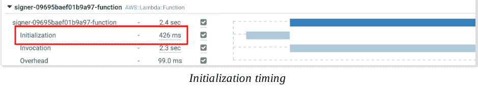

对于后续请求，缺少了初始化：

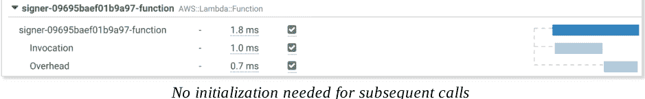

在代码方面，Lambda 运行环境的操作方式如下：

```javascript
// 1st request
const fn = require("./index");
await fn.handler(event, context);

// subsequent requests
await fn.handler(event, context);
```

Node.js 在通过 `require` 调用加载文件时运行该文件。在实践中，这意味着函数 handler `outside` 的代码会被执行。然后，Lambda 也会调用 handler 函数。

```javascript
// 这部分只运行一次
module.exports.handler = async () => {
  // 这部分每次请求都会运行
}
```

正因如此，你可以将任何初始化代码移动到 handler 之外，它只会在第一次请求时运行。例如，将可重用的部分放在 handler 之外，这样它们就只会执行一次：

### 冷启动优化示例

```javascript
const Ajv = require("ajv");
const ajv = new Ajv();
const validate = ajv.compile(schema);
module.exports.handler = async () => {
  // ...
  const valid = validate(data);
}
```

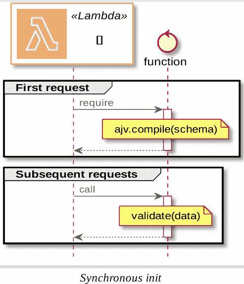

要初始化异步内容，请使用 Promise 并在 handler 中 `await` 它。这与同步初始化的效果相同，因为只有第一次请求会等待它：

```javascript
const fs = require("fs/promises");
const htmlPromise = fs.readFile(
  __dirname + "//index.html",
  "utf8"
);
module.exports.handler = async () => {
  const html = await htmlPromise;
}
```

### 异步初始化流程图

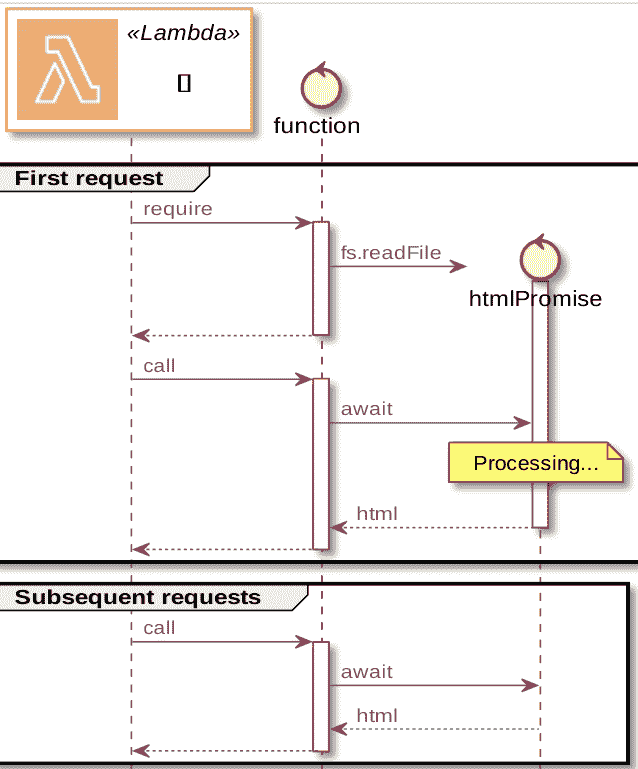

```mermaid
sequenceDiagram
    participant request
    participant fs.readFile
    participant htmlPromise
    note over htmlPromise
        Processing...
    end note
    request->>fs.readFile: require
    fs.readFile->>htmlPromise: call
    htmlPromise-->request: await
    request->>htmlPromise: html

    Note over request, htmlPromise: Subsequent requests
    request->>htmlPromise: call
```

除了初始化，在 handler 之外定义的变量在同一实例的调用之间共享。你可以以此方式实现内存缓存。这在“存储密钥”章节中将非常重要，我们将使用这种技术来缓存对 SSM 调用。

```javascript
// shared object
const cache = {};
module.exports.handler = async () => {
  if (cache[key]) {
    //
  } else {
    //
    cache[key] = result;
  }
}
```

## 内存

内存直接影响函数执行的成本。它可以从 `128 MB` 到 `3 GB` 不等。

Lambda 运行环境日志显示了每次调用使用的内存：

| 2020-10-27T10:44:47.506+01:00 | START Request: 25423a9d-7af7-4ccd-92e1-8f4a0d0772b |
| 2020-10-27T10:44:47.625+01:00 | END Request: 25423a9d-7af7-4ccd-92e1-8f4a0d0772b |
| 2020-10-27T10:44:47.625+01:00 | REPORT Request: 25423a9d-7af7-4ccd-92e1-8f4a0d0772b |
| REPORT Request: 25423a9d-7af7-4ccd-92e1-8f4a0d0772b Duration: 39.00 ms Init |
| Billed Duration: 100 ms Memory Size: 128 MB Max Memory Used: 83 MB |
| Duration: 411.72 ms |
| XRay TraceId: 1f5f7ec0f-135c33ca5215da2f0b9c0 SegmentId: 66b15943ac8cf8s8 |
| 2020-10-27T10:44:48.047+01:00 | START Request: 211d23b9-92bd-406e-93ce-d0a836c0b97 |
| 2020-10-27T10:44:48.024+01:00 | END Request: 211d23b9-92bd-406e-93ce-d0a836c0b97 |
| 2020-10-27T10:44:48.024+01:00 | START Request: 211d23b9-92bd-406e-93ce-d0a836c0b97 |
| 2020-10-27T10:44:48.024+01:00 | END Request: 211d23b9-92bd-406e-93ce-d0a836c0b97 |
| 2020-10-27T10:44:48.024+01:00 | REPORT Request: 211d23b9-92bd-406e-93ce-d0a836c0b97 || Billed Duration: 1100 ms Memory Size: 128 MB Max Memory Used: 90 MB |
| Duration: 1076.00 ms |
| XRay TraceId: 1f5f7ec0f-135c33ca5215da2f0b9c0 SegmentId: 66b15943ac8cf8s8 |

CloudWatch Logs 中的内存使用支持表达式和最大值，你可以使用此查看一段时间内的值。

```text
filter @type = "REPORT"
| stats max(@memoryUsed) / 1024, min(@memoryUsed) / 1024 by bin(1m)
```

上面的表达式生成了一个每10分钟间隔一次的内存使用图：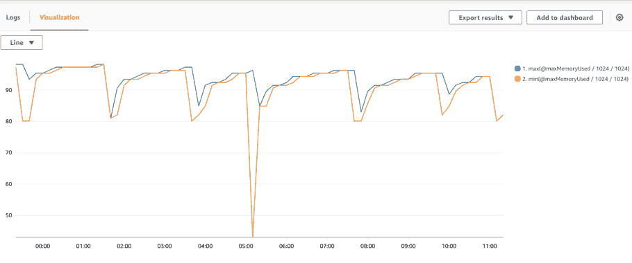

### 内存使用图

这些工具有助于确定内存使用情况，但它们并没有提供清晰的视图。Javascript是一种垃圾回收语言，这意味着当内存耗尽时，它会运行垃圾器来释放空间。当分配内存较低时，它更频繁地运行此垃圾器。这是一种 CPU-内存权衡，因此“最大内存使用”并不是硬性要求。

但内存也控制函数的分配 CPU。将其视为“机器的一部分”，而不仅仅是内存分配。对于 CPU 密集型任务，更多的 CPU 意味着更短运行时间。但大多数函数并不是 CPU 密集型的。Lambda 函数通常验证请求和响应并调用其他服务。这些调用大部分是在等待，增加 CPU 并没有帮助。例如，此函数调用大部分是在等待：

| Name | Res. | Duration | Status | 0.0ms | 100ms | 200ms | 300ms | 400ms | 500ms | 600ms | 700ms | 800ms | 900ms | 1.2s | 1.3s |
|---|---|---|---|---|---|---|---|---|---|---|---|---|---|
| signer-3bddd79e51d45f-function | AWS Lambda | | 1.0 sec | | | | | | | | | | |
| signer-3bddd79e51d45f-function | 200 | 1.0 sec | ✓ | | | | | | | | | | |
| signer-3bddd79e51d45f-function | AWS Lambda | | 1.0 sec | ✓ | | | | | | | | | |
| Invocation | | 200 | 620 ms | ✓ | | | | | | | | | |
| S3 | | 200 | 398 ms | ✓ | | | | | | | | | ListObjectsV2 |
| DynamoDB | | 200 | 398 ms | ✓ | | | | | | | | | |
| S3 | | 200 | 398 ms | ✓ | | | | | | | | | HeadObject |
| S3 | | 200 | 222 ms | ✓ | | | | | | | | | HeadObject: |
| S3 | | 200 | 279 ms | ✓ | | | | | | | | | HeadObject |
| Overhead | | 37.4 ms | | | | | | | | | | | |

### 函数执行

内存分配的另一个方面在 `2 GB` 左右起作用。此时，函数获得的 CPU 额度超过了 1 个核心能消耗的。正如此，如果函数不使用第二个核心，增加分配也不会转化为更短运行时间。

由于 Javascript 是单线程的，它通常完全不使用第二个核心。跨越 `2 GB` 内存屏障时，请记住这种行为。

> **提示**
>
> 除非你确定你的代码可以使用多个核心，否则不要为了 CPU 目的将内存分配增加到 `2 GB` 以上。

# 设置

## Node 版本

Node.js 遵循可预测的版本调度。偶数版本是 LTS 版本，发布后获得支持 30 个月。在编写时，Node.js 12 是活跃的 LTS，版本 14 即将取代它。

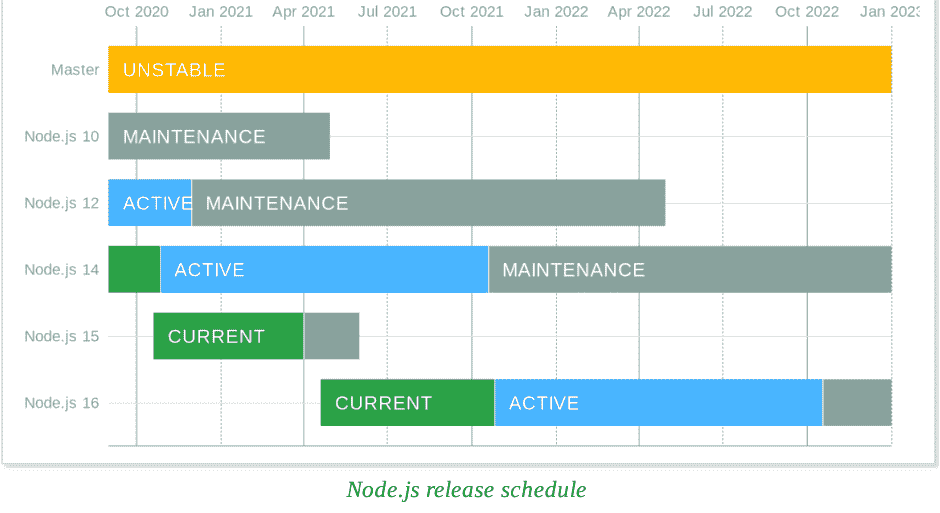

这种可预测的调度也反映在支持的运行时中。支持 LTS 版本，并且当 Node 版本达到活动状态时，新的运行时将会出现。

| 名称 | 标识符 | AWS SDK for JavaScript | 操作系统 |
|---|---|---|---|
| Node.js 12 | `nodejs12.x` | 2.712.0 | Amazon Linux 2 |
| Node.js 10 | `nodejs10.x` | 2.712.0 | Amazon Linux 2 |

## Lambda 权限模型

由于 Lambda 功能性地使用 AWS 账户内的其他资源，权限如何工作是一个核心话题。AWS 使用 IAM 策略控制对账户内部资源的访问。资源可以是账户中的任何内容，例如 S3 桶、DynamoDB 表、Lambda 函数、甚至可以是子资源，例如 S3 存储桶内部的对象。每当 Lambda 函数需要使用资源时，它就需要访问权限。访问权限由 IAM 策略形式的权限来决定。

Lambda 使用基于角色的模型，由 IAM 角色提供必要的凭据。该角色具有访问资源的权限，并且 Lambda 服务会将凭据暴露给函数。

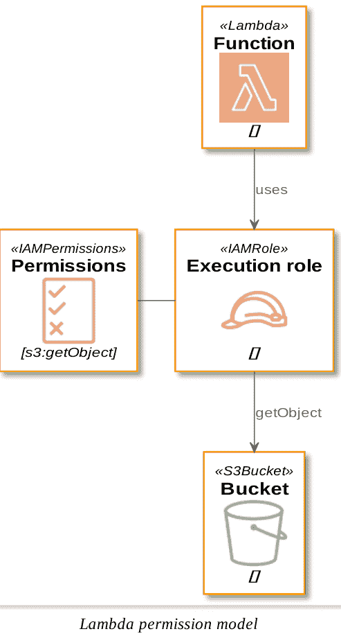

在控制台上，该角色在“权限”选项卡下进行配置：

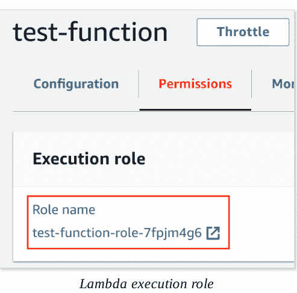

使用 Terraform，通过 `role` 参数定义此内容：

```clcl
resource "aws_iam_role" "function_role" {
  assume_role_policy = <<EOF
    "Version": "2012-10-17",
    "Statement": [
      {
        "Action": "sts:AssumeRole",
        "Principal": {
          "Service": "lambda.amazonaws.com"
        },
        "Effect": "Allow"
      }
    ]
EOF
}
```

```clcl
resource "aws_lambda_function" "function" {
  #...
  role = aws_iam_role.function_role.arn
}
```

使此角色能够被 Lambda 使用的是将 `lambda.amazonaws.com` 作为信任策略的 `Principal`。这允许 Lambda 服务获取此角色。

要为此角色添加 `permissions`，请使用 IAM 策略。在控制台上，有一个可视化构建器可以帮助了解哪些服务、操作和资源是可用的：

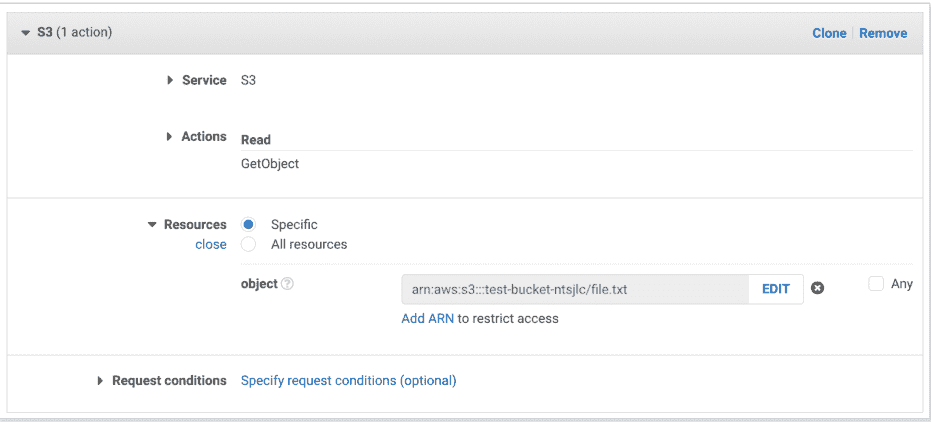

或者你可以使用 JSON 格式编写，这也是最终存储的方式：

```json
{
  "Version": "2012-10-17",
  "Statement": [
    {
      "Effect": "Allow",
      "Action": "s3:GetObject",
      "Resource": "arn:aws:s3:::test-bucket/file.txt"
    }
  ]
}
```

在 Terraform 中，将策略定义为数据源并将其附加到角色：

```clcl
data "aws_iam_policy_document" "lambda_exec_role_policy" {
  statement {
    actions = [
      "s3:GetObject",
    ]
    resources = [
      "arn:aws:s3:::test-bucket/file.txt",
    ]
  }
}

resource "aws_iam_role_policy" "lambda_exec_role" {
  role = aws_iam_role.function_role.id
  policy = data.aws_iam_policy_document
    .lambda_exec_role_policy
    .json
}
```

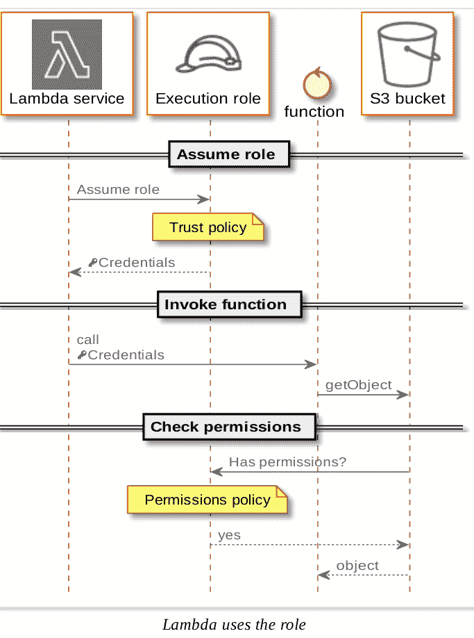

将策略附加到 IAM 角色，并将角色附加到 Lambda 函数后，代码就可以访问 S3 存储桶：

```javascript
const AWS = require("aws-sdk");
const s3 = new AWS.S3();

exports.handler = async (event) => {
  const response = await s3.getObject({
    Bucket: "test-bucket",
    Key: "file.txt"
  }).promise();

  return response.Body.toString("utf-8");
};
```

通过基于角色的设置，代码中不包含凭据等机密信息。这构建了一个健壮且安全的权限模型。

> **注意**
>
> 不要硬编码凭据。
>
> 在代码中放置 Access Key ID 和 Secret Access Key 是一种不安全的做法。请改用 IAM 角色。

## 如何定义代码

有多种方法可以定义 JavaScript 函数代码。最简单的方法是使用控制台编辑器：

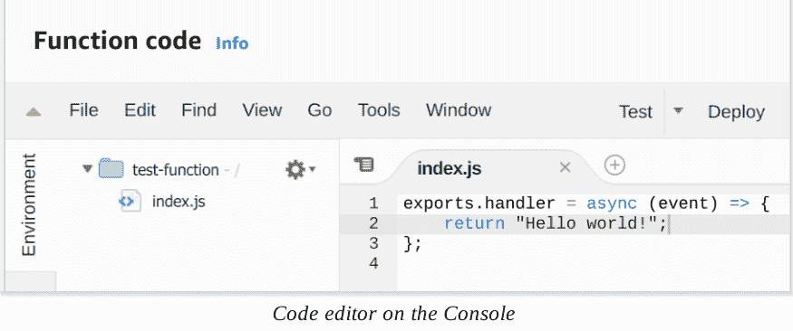

缺点是不可复现，因为此代码没有经过版本控制，并且无法多次部署到不同的环境。让我们看看如何使用 Terraform 定义函数代码！

### 代码示例

关于下方方法的代码示例，请查看此仓库：

https://github.com/sashee/terraform-lambda-code

### 内联代码

最简单的方法是使用 `archive_file` 数据源和 HEREDOC 语法在 .tf 文件中定义内容：

```clcl
data "archive_file" "lambda_zip_inline" {
  type = "zip"
  output_path = "/tmp/lambda_zip_inline.zip"
  source = {
    # 这里是函数代码
    content = <<EOF
    exports.handler = async (event, context) => {
      const response = "Hello world!";
      return response;
    }
EOF
    filename = "main.js"
  }
}

resource "aws_lambda_function" "lambda_zip_inline" {
  filename = data.archive_file.lambda_zip_inline.output_path
}
```

`lambda_zip_inline` 能够被 Lambda 使用是因为 `archive_file` 数据源中的 `lambda_zip_inline.output_path`。注意，`archive_file` 的 `source` 包含了函数代码。

### 目录打包

当代码 `src/main.js` 被打包成一个文件夹时，它是该目录中的文件名：

```javascript
// src/main.js
module.exports.handler = async (event, context) => {
  const response = 'Hello world!';
  return response;
};
```

```terraform
data "archive_file" "lambda_zip_dir" {
  type = "zip"
  output_path = "/tmp/lambda_zip_dir.zip"
  source_dir = "src"
}

resource "aws_lambda_function" "lambda_zip_dir" {
  # handler = "main.handler"
}
```

第二部分标识导出的函数。由于一个 js 文件可以有多个导出项，Lambda 服务需要知道调用哪一个。

例如，这段代码导出了两个函数：

```javascript
module.exports.handler = async (event, context) => {
  const response = `Hello world!`;
  return response;
};

module.exports.other = async (event, context) => {
  const response = `Hello world from another handler!`;
  return response;
};
```

由于两者都是有效的 Lambda 处理器，因此指定 `main.handler` 而不是 `main.other` 是关键的。在文件或部署包中定义多个处理器为在 Lambda 函数之间复用代码提供了一种方便的方法。

# 编程模型

## 异步处理器

处理器应该是一个 `async` 函数。在最初，Lambda 需要一个回调函数来判断函数何时完成，但那是在 async/await 成为标准之前。你可能会看到这个回调以及一些围绕它的黑科技，例如 `context.callbackWaitsForEmptyLoop`，但这些都是遗留产物。

结构非常直观：导出一个 `async` 函数，Lambda 的结果将是函数的返回值：

```javascript
module.exports.handler = async (event, context) => {
  return "Hello world"
}
```

调用此函数返回该值：

```bash
$ aws lambda invoke --function-name $FUNCTION >(cat
"Hello world!":{
  "StatusCode": 200,
  "ExecutedVersion": "$LATEST"
}
```

所有逻辑都在一个 `async` 函数内部，你可以使用 `await` 来编写异步代码。由于 AWS SDK 支持 Promises，且要求使用 `await` 关键字，你只需要几行代码就能编写复杂的逻辑：

```javascript
module.exports.index = async (event, context) => {
  const queryRes = await ddb.query(...).promise();
  const putRes = await s3.putObject(...).promise();
  return ddb.getItem(...).promise();
}
```

上面的代码查询了 DynamoDB 表，将一个对象放入 S3 桶中，然后向 DynamoDB 插入一行数据。这些都是异步操作，但它们被隐藏在 `await` 之间。

## 异步编程模式

使用异步处理器，你可以使用 Javascript 中常见的异步模式。例如，通过使用 `Promise.all` 函数和数组扩展运算符可以轻松实现并行化：

```javascript
const [query1Res, query2Res] = await Promise.all([
  ddb.query(...).promise(),
  ddb.query(...).promise(),
]);
```

上面的代码同时向 DynamoDB 发送了两个查询，然后在继续执行之前等待两个结果。由于函数运行时间越长成本越高，像异步这样的并行化处理可以节省费用。

使用异步函数，错误处理也变得更容易。每当异步操作失败时，它都会抛出一个 Error。这可以通过 `try..catch` 块来处理：

```javascript
try {
  const queryRes = await ddb.query(...).promise();
  const putRes = await s3.putObject(...).promise();
  return ddb.putItem(...).promise();
} catch(e) {
  // 处理错误
}
```

## 后台任务

Lambda 执行方式与传统的服务器端处理 `async` 函数的方式之间存在重要区别。如果处理器返回时仍有异步任务在运行，Lambda **冻结函数实例**。

例如，这个处理器启动了一个 `putObject` 操作，但它在没有等待完成的情况下就返回了：

```javascript
module.exports.index = async (event, context) => {
  s3.putObject(...).promise();
  return result;
}
```

对象会在桶中还是不在？

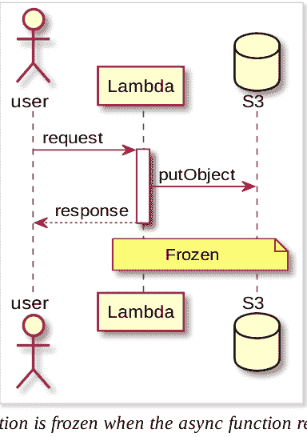

**没有任何保证。** 可能调用成功了，也可能没有。而且也许后续对该实例的调用会继续这个任务，但这种情况也可能发生。

```javascript
module.exports.index = async (event, context) => {
  await s3.putObject(...).promise(); // 为了正确性添加了 await
  return result;
}
```

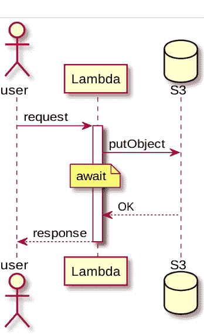

## 输入与输出

### 事件对象

`event` 对象包含了所有输入。例如，API Gateway 发送事件：

```json
{
  "version": "2.0",
  "cookies": [],
  "headers": {},
  "httpMethod": "GET",
  "path": "/",
  "requestContext": {
    "accountId": "1234578800"
  }
}
```

### context 对象

第二个参数是 context 对象。它包含了关于调用本身的信息，例如函数名称、日志位置以及内存限制。所有属性都列在文档中。

这里是属性的示例：

```json
{
  "callbackWaitsForEmptyLoop": "[Getter/Setter]",
  "success": "[Function]",
  "fail": "[Function]",
  "done": "[Function]",
  "functionVersion": "$LATEST",
  "functionName": "signer-0969b5baef01b9a7-function",
  "memoryLimitMB": "128",
  "logGroupName": "/aws/lambda/<function name>",
  "logStream": "<log stream>",
  "contentText": "undefined",
  "identity": "undefined",
  "invokedFunctionArn": "<arn>",
  "awsRequestId": "a2d8a8-629e-4448-8108-b36200816550",
  "getRemainingTimeInMillis": "[Function]"
}
```

通常你不需要 context 对象的任何属性。唯一的用途是 `getRemainingTimeInMillis()` 函数，它返回函数超时前的剩余时间。我们将在超时章节详细介绍如何使用它。

### 输出

函数的输出是处理器的返回值。例如，一个简单的 "Hello world" 函数：

```javascript
module.exports.handler = async (event, context) => {
  return "Hello world!";
};
```

被调用时的固定文本：

```bash
$ aws lambda invoke --function-name $FUNCTION >(cat)
"Hello world!{
  "StatusCode": 200,
  "ExecutedVersion": "$LATEST"
}
```

与输入值一样，函数的输出取决于调用者。例如，API Gateway 期望一个包含状态码、标头、Cookie 和响应体的结构，或者如果使用新的 Lambda 格式版本，则一个 JSON 可序列化的对象。如果函数返回其他情况，API Gateway 会向客户端返回错误。同样，你需要查阅调用该函数的文档，以查看响应所需的结构。

## AWS SDK

AWS SDK 是访问 AWS 账户中其他资源的主要方式。这些资源可以是任何内容，从 S3 桶、DynamoDB 表格到 IAM 用户对象以及其他 Lambda 函数。在 AWS 中，在控制台上可以执行的所有操作都可以通过 API 和 SDK 完成。例如，你不仅可以调用另一个 Lambda 函数，还可以更改其配置或创建一个新的。通常，Lambda 函数使用 AWS SDK 来管理 S3 中的对象、从 DynamoDB 读取数据、通过 SES 发送电子邮件以及类似的操作。

AWS SDK 是 Node.js 运行时的一部分，你不需要手动安装。这使得编写内联函数变得简单，你不需要为 SDK 使用包管理器。另一方面，一旦你开始使用包管理器，安装一次它是最佳实践。

要获取 SDK 对象，请引入 `aws-sdk` 包：

```javascript
const AWS = require("aws-sdk");
```

要通过此对象访问服务，你需要创建一个服务对象：

```javascript
const s3 = new AWS.S3();
```

在服务对象内部，你需要找到你需要的操作。例如，要从 S3 桶中获取对象，操作名称为 `getObject`：

```javascript
s3.getObject({
  Bucket: "test-bucket",
  Key: "file.txt"
});
```

通用结构是操作需要一个包含必需参数的 `Params` 对象作为参数。要知道哪些是必需以及可能的参数，你需要查找相关文档中的该操作。在上面的示例中，`Bucket` 和 `Key` 都是必需参数，前者定义了要读取的桶，后者则通过其键标识对象。即使对于这个简单的操作，也有许多可选参数。

如果你浏览文档，你会发现大多数操作都需要一个 `callback` 参数：

```javascript
getObject(params = {}, callback) => AWS.Request
```

幸运的是，`AWS.Request` 支持 `.promise()` 函数，它可以将此调用转换为 Promise。不要使用 `callback`，而是使用此方法将 SDK 集成到异步工作流中。例如，`response` 变量将在 `s3.getObject` 完成后包含结果：

```javascript
const response = await s3.getObject({
  Bucket: "test-bucket",
  Key: "file.txt"
}).promise();
```

> **提示**
>
> 为 SDK 调用使用 `.promise()` 函数，而不是 `callback` 参数。

## 分页

每当 SDK 返回对象列表时，它并不一定会在一次调用中返回所有结果。当要返回的项目过多时，它需要多次调用来获取所有项目。这可能是一个问题，因为通常在开发期间的对象比生产环境要少。当在小数据集上一切正常运行时，在真实数据上可能会崩溃。

```javascript
// 代码示例
// 要查看实际运行情况，请检查此脚本：
// https://github.com/sashee/unused_lambda_logs/master/script.js.
```

让我们看看分页是如何运作的！

`lambda.listFunctions()` 返回该区域内的所有函数：

```javascript
const functions = await lambda.listFunctions().promise();
```

它返回一个带有 `Functions` 属性的 JSON，对象数组：

```json
{
  "Functions": [...]
}
```

默认情况下，此调用最多返回 50 个项目。当有更多项目要返回时，它会随结果一起返回一个 `NextMarker` 属性：

```json
{
  "Functions": [...],
  "NextMarker": ...
}
```

要获取下一批结果，请将此标记值传递给 `listFunctions` 调用：

```javascript
const moreFunctions = await lambda.listFunctions({
  Marker: functions.NextMarker,
}).promise();
```

重复此操作，直到响应对象中不再有 `NextMarker` 属性。

这导致了未知数量的网络调用，更难整合到异步流中。非分页的操作是简单的 `await s3.getObject({...}).promise()`，但这不足以可靠地获取完整列表。

更糟糕的是，AWS SDK 中不同服务之间的命名不一致。例如，`describeLogGroups` 操作在有更多项目时会返回 `nextMarker`。

解决方案是使用 `async generator` 函数，它可以进行多次调用并仍然返回一个包含所有结果的 Promise。

### 通用分页解决方案

```javascript
const getPaginatedResults = async (fn) => {
  const EMPTY = Symbol("empty");
  const res = [];
  for await (const lf of async function*() {
    let NextMarker = EMPTY;
    while (NextMarker || NextMarker === EMPTY) {
      const {marker, results} = await fn(
        NextMarker != EMPTY ? NextMarker : undefined
      );
      yield* results;
      NextMarker = marker;
    }
  }()) { res.push(lf); }
  return res;
};
```

要使用此函数，你需要定义如何调用服务对象以及如何解析结果：

```javascript
const lambdas = await getPaginatedResults(
  async (NextMarker) => {
    // 使用 NextMarker 调用操作
    const functions = await lambda.listFunctions({
      Marker: NextMarker
    }).promise();
    return {
      // 提取标记
      marker: functions.NextMarker,
      // 提取结果
      results: functions.Functions
    };
  }
);
```

## 环境变量

环境变量是配置 Lambda 函数的一种简单方法。除了配置选项外，环境还描述了如何访问另一个资源。你应该能够将同一个栈部署到同一个账户两次且都能正常工作。

有一些 Lambda 运行时设置的变量。这些是时区、函数运行和凭据等。你可能不需要直接使用它们，唯一需要注意的是不要覆盖重要的变量。例如，不要使用 `PATH` 名称作为你自己的。

```hcl
resource "aws_lambda_function" "lambda" {
  # ...
  environment {
    variables = {
      TABLE = aws_dynamodb_table.users.id
    }
  }
}
```

要使用它，使用 `process.env.<name>` 进行访问：

```javascript
const items = await docClient.scan({
  TableName: process.env.TABLE,
}).promise();
```

## 超时

Lambda 服务会在配置的时间后终止函数。你可以在 `timeout` 参数中为每个函数定义超时值：

```hcl
resource "aws_lambda_function" "test_lambda" {
  # timeout = 10 # 单位为秒
}
```

在这里设置的值是一个硬性限制，如果函数在规定时间内未完成将被终止。

> **注意**
>
> 当你决定函数的超时时间时，请务必考虑调用该函数的上游服务并考虑其超时设置。

设置超时时间的方法是检查典型执行所需的时间，并增加一些余量。这确保函数在正常运行期间不会被终止，但会在异常尽快失败，从而为调用者及时重试操作的机会。

Lambda 服务会将每次调用的运行时间记录到 CloudWatch Logs 中：

```
START RequestId: abc91d35-966e-48fa-b33d-f3f8d2b7b222 Version: LATEST
2020-10-28T10:03:26.428Z abc91d35-966e-48fa-b33d-f3f8d2b7b222 INFO []
END RequestId: abc91d35-966e-48fa-b33d-f3f8d2b7b222
REPORT RequestId: abc91d35-966e-48fa-b33d-f3f8d2b7b222 Duration: 2876.0 ms Billed Duration
START RequestId: 4ae9c5a3-ded61-46f4-e60be6a5dcaf47 Version: LATEST
2020-10-28T10:03:28.85624 4ae9c5a3-ded61-46f4-e60be6a5dcaf47 INFO []
END RequestId: 4ae9c5a3-ded61-46f4-e60be6a5dcaf47
REPORT RequestId: 4ae9c5a3-ded61-46f4-e60be6a5dcaf47 Duration: 106.80 ms Billed Dur
No newer events at this moment. Auto retry paused. Resume
```

检查典型持续时间有助于决定函数超时时间的基准。

### 超时原因

函数运行时间比通常情况长可能有几个原因。首先，它可能在等待响应较慢的下游服务。例如，此函数从 S3 存储桶读取一个对象：

```javascript
exports.handler = async (event) => {
  const response = await s3.getObject({
    Bucket: "test-bucket",
    Key: "file.txt"
  }).promise();
  return response.Body.toString("utf-8");
};
```

如果 S3 服务出现**性能降级**，它的响应可能需要更多时间，从而触发 Lambda 超时。这种情况可能发生在所有依赖项上，且在这种情况下你无能为力。

其次，可能有**更多数据需要处理**。例如，如果函数遍历 S3 存储桶中的所有对象，对象的数量将直接影响运行时间。数据越多，处理时间越长。

最后，运行时间变长可能是**恶意违规**的结果。例如，一个特殊构造的正则表达式可能会阻塞函数的执行。在这种情况下，超时机制是限制损害的保护措施。

### 缓解超时

`context` 对象（处理程序函数的第二个参数）有一个名为 `getRemainingTimeInMillis()` 的函数，该函数返回函数完成所需的剩余时间。使用此值，你可以中断函数的主代码，在 Lambda 服务终止函数之前，利用剩余时间运行一些缓解逻辑。

例如，如果函数的超时时间为 10 秒，则函数在中断之前最多可以运行 9 秒的主逻辑，并留有 1 秒时间。

让我们看看如何实现这种中断机制！

#### AWS SDK 超时

AWS SDK 支持服务的超时设置，但这是一种原始的方法。这些超时是在服务层级设置的，这意味着你需要为每次调用构建一个新对象：

```javascript
const s3WithLimit = new AWS.S3({
  httpOptions: {
    timeout: context.getRemainingTimeInMillis() - 1000,
    maxRetries: 1,
  },
});

// 带有超时时间的复制
await s3WithLimit.copyObject({
  Bucket: process.env.BUCKET,
  Key: key,
  CopySource: encodeURI(`${process.env.BUCKET}/${key}`),
}).promise();
```

上述代码在复制操作完成前最多等待 `<剩余时间> - 1000` 毫秒，如果未完成则抛出错误。

具体的工作原理并没有详尽的文档说明。一个 GitHub Issue 和一个支持工单提供了一些关于如何使用它的见解，但基本上就是这样。

#### 基于 Promise 的超时处理

幸运的是，标准的基于 Promise 的超时处理仍然可用。通过带有延迟拒绝的 `Promise.race` 可以为任何返回 Promise 的函数添加超时功能。由于异步函数在定义上返回 Promise，因此任何异步操作都可以被使用。

某些库提供了此功能，例如 `promise-timeout`。它负责清理内部的 `setTimeout` 注册，这是一种良好的实践。

但你不需要为了一个几行长的函数就引入额外的依赖。使用此函数为任何 Promise 添加超时时间：

```javascript
const timeout = (promise, time) => {
  let timer;
  const timeoutPromise = new Promise((_, reject) => {
    timer = setTimeout(() => {
      reject(new Error("Timeout error"));
    }, time);
  });
  return Promise.race([promise, timeoutPromise]).finally(() => {
    clearTimeout(timer);
  });
};

// 使用示例：
await timeout(someAsyncFunction(), 5000);
```

# 调试

## 日志

Lambda 将日志发送到 CloudWatch Logs。每个函数都有一个日志组，名称为 `/aws/lambda/<function name>`。每个实例都有一个日志流。

日志包含三种类型的行：`START`、`END` 和 `REPORT`。`START` 和 `END` 标记调用的开始和结束。`REPORT` 包含计费持续时间、内存使用情况和 X-Ray 追踪 ID。

```text
START RequestId: abc91d35-966e-48fa-b33d-f3f8d2b7b222 Version: $LATEST
2020-10-28T10:03:26.428Z abc91d35-966e-48fa-b33d-f3f8d2b7b222 INFO  []
END RequestId: abc91d35-966e-48fa-b33d-f3f8d2b7b222
REPORT RequestId: abc91d35-966e-48fa-b33d-f3f8d2b7b222 Duration: 2876.0 ms Billed Duration: 2900 ms Memory Size: 128 MB Max Memory Used: 83 MB
```

你可以使用 `console.log`、`console.error` 等标准方法写入日志。这些行会出现在 `START` 和 `END` 之间。

```javascript
module.exports.handler = async (event, context) => {
  console.log("Processing event", event);
  // ...
};
```

### 结构化日志

结构化日志使得查询更容易。不要记录字符串，而是记录对象：

```javascript
console.log({event, message: "Processing event"});
```

这允许你在 CloudWatch Logs Insights 中按字段过滤。

### 观察日志

在控制台上查看日志很麻烦，特别是当你使用基于终端的部署方法（如 Terraform）时，因为你可能根本没有登录控制台。

由于这个问题出现得非常频繁，而且让 Lambda 开发变得比实际上要令人沮丧得多，我制作了一个工具来自动查询函数的最新日志。它支持通过名称或 Arn 监控函数，还能自动提取由 Terraform 管理的函数。

要使用它，请运行：

```bash
npx watch-lambda-logs [name|arn]
```

你可以在 https://github.com/sashee/watch-lambda-logs 找到它的源代码和文档。

## X-Ray

添加日志语句对于发现函数实现在何处出错很有用，但要对执行期间发生的情况提供有意义的可见性，需要大量的日志，特别是在检查计时。这正是 AWS X-Ray 可以派上用场的地方，它是一个提供更详细洞察的服务。

X-Ray 的主要用例是查看函数发出了哪些调用（特别是对其他 AWS 服务的调用）以及这些调用持续多久。此功能基于 X-Ray SDK 的自动实例化能力。

要开始使用 X-Ray，你需要首先用 npm 或 yarn 安装它，因为它没有包含在 Node.js 运行时中。你需要部署包中的 `node_modules` 目录，正如我们在“使用 npm 添加包”章节中涵盖的那样。

```bash
npm install aws-xray-sdk
```

然后加载 X-Ray 并封装 AWS SDK：

```javascript
const AWSSXRay = require("aws-xray-sdk");
const AWS = AWSSXRay.captureAWS(require("aws-sdk"));
```

除了代码更改外，你还需要开启活动追踪以便函数发送数据到 X-Ray。要执行此操作，请在 Lambda 控制台的“监控工具”下选择“活动追踪”：

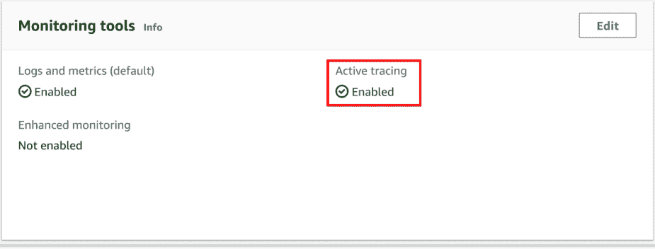

为 Lambda 函数启用活动追踪

然后，你需要赋予 Lambda 函数写入跟踪数据的权限。要做到这一点，请为你的函数执行角色附加 `AWSSXRayDaemonWriteAccess` AWS 托管策略。

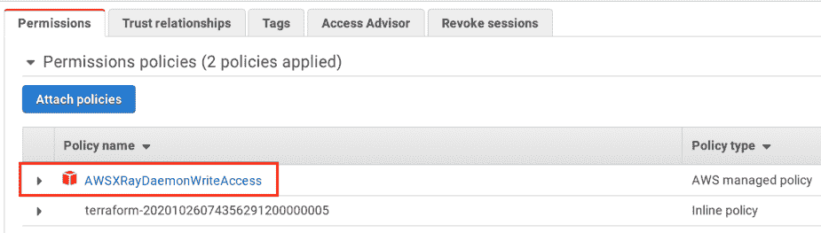

X-Ray 托管策略

Terraform 中的两个更改：

```terraform
# ..
resource "aws_lambda_function" "function" {
  role = aws_iam_role.function.arn
  # 启用追踪
  tracing_config {
    mode = "Active"
  }
}

## 将 X-Ray 策略附加到函数的执行角色
resource "aws_iam_role_policy_attachment" "x_ray_policy" {
  # ...
}
```


# AWS X-Ray 与 Lambda 追踪

## IAM 角色与策略配置

```hcl
role = aws_iam_role.function.name
policy_arn = "arn:aws:iam::policy/AWSXRayDaemonWriteAccess"
```

通过这些调用，函数随后将进入 X-Ray 控制台。找到与调用对应的跟踪记录并检查时间轴：

| | Res. | Duration | Status | 0.0ms | 10ms | 200ms | 300ms | 400ms | 500ms | 600ms | 700ms | 800ms | 900ms | 1s | 1.1s | 1.2s |
|---|---|---|---|---|---|---|---|---|---|---|---|---|---|---|---|---|---|---|
| 🔽 signer-3bd37e911d64d5f-9 | AWS Lambda | | 1.0 sec | | | | | | | | | | | | | | | | |
| 🔽 signer-3bd37e911d64d5f-9 | AWS Lambda | | 1.0 sec | | | | | | | | | | | | | | | | |
| signer-3bd37e911d64d5f-9 | AWS Lambda | | | | | | | | | | | | | | | | | | |
| Invocation | | | | | | | | | | | | | | | | | | |
| S3 | | 200 | 620 ms | | | | | | | | | | | | | | | | |
| DynamoDB | | 200 | 398 ms | | | | | | | | | | | | | | | | |
| S3 | | 200 | 358 ms | | | | | | | | | | | | | | | | |
| S3 | | 200 | 222 ms | | | | | | | | | | | | | | | | |
| S3 | | 200 | 277 ms | | | | | | | | | | | | | | | | | |
| Overhead | | | 37.4 ms | | | | | | | | | | | | | | | | | |

X-Ray 跟踪

它还会生成所涉及服务的视觉化表示：

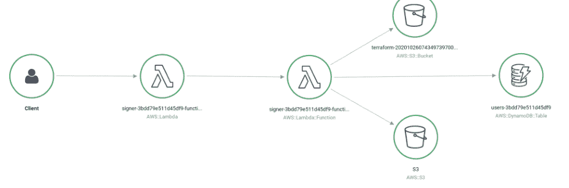

X-Ray 服务地图

X-Ray 对函数发出的调用以及每个调用的持续时间提供了很好的洞察。这有助于识别耗时部分。

## 自定义分段

除了对 AWS SDK 进行实例化外，X-Ray 还支持向跟踪中添加分段（segments）。要**打开**一个分段，请使用 `AWSXRay.getSegment().addNewSegment(name)` 调用。它会返回一个分段。要**关闭**之前打开的分段，调用其 `.close()` 方法。分段打开的时间会记录在 X-Ray 控制台上。

要向分段中**添加任意信息**以便稍后查询进行调试，请使用 `segment.addAnnotation(name, value)`。通过这些额外的日志，你可以更仔细地检查函数。例如，让我们在 AWS 调用周围添加一些分段，并添加一些注解来查看这些值：

```javascript
// 打开一个新分段
const segment = AWSXRay.getSegment()
  .addNewSegment("update");

// 添加注解
segment.addAnnotation("key", key);
segment.addAnnotation("username", username);

const oldAvatar = await dynamodb.getItem({
  /* ... */
}).promise();

segment.addAnnotation("oldAvatar", oldAvatar);

await dynamodb.updateItem({
  /* ... */
}).promise();

await dynamodb.updateItem({
  /* ... */
}).promise();

// 关闭分段
segment.close();
```

通过这些调用，函数随后将进入 X-Ray 控制台。找到与调用对应的跟踪记录并检查时间轴：


启用 Lambda 函数活动追踪


X-Ray 托管策略

X-Ray 对函数发出的调用以及每个调用的持续时间提供了很好的洞察。这有助于识别耗时部分。

# 存储秘密

## IAM 策略与环境变量

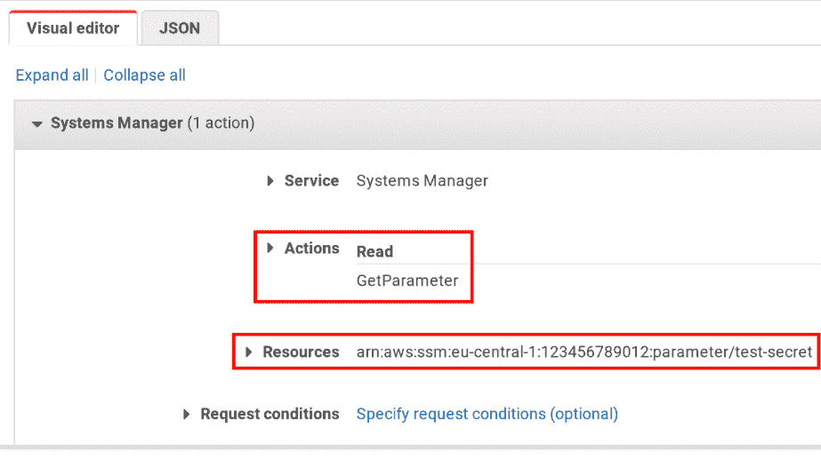

读取 SSM 参数的 IAM 策略

然后函数需要知道**参数的名称**。这是一个环境变量：

```hcl
resource "aws_lambda_function" "lambda" {
  environment {
    PARAMETER = data.aws_ssm_parameter.secret.name
  }
}
```

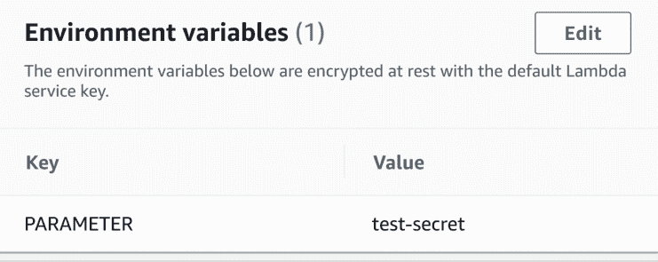

用于 SSM 参数的 Lambda 环境变量

通过这种设置，Lambda 函数知道参数的名称，并且拥有访问它的权限。在函数代码中，使用 SSM 服务来读取值：

```javascript
const AWS = require("aws-sdk");
const SSM = new AWS.SSM();

module.exports.handler = async (event) => {
  const param = await ssm.getParameter({
    Name: process.env.PARAMETER,
    WithDecryption: true,
  }).promise();
  // param.Parameter.Value
};
```

如果你使用 `SecureString` 类型，请不要忘记指定 `WithDecryption: true`。如果不指定，`Value` 将包含密文，它是没用的。

## 缓存策略

与所有的无服务器栈一样，我们需要评估该服务是否能够承受 Lambda 服务施加的负载。一个栈每秒可能会接收数千次请求（或更多），如果每个请求都调用 SSM，可能会导致过载。Parameter Store 特别容易发生过载，因为它是随 Lambda 变化的环境变量的替代方案。将秘密从环境变量移动到参数可能会超过限制。

默认限制是每秒 40 次 `getParameter`（每个区域）。你可以激活更高的吞吐量，增加到每秒 1000 次，但这会显著增加费用。

为了减轻 SSM 的负载并可能留在标准吞吐量的范围内，你可以对 `getParameter` 进行一段时间缓存并重用结果，而不再发送请求。正如我们在 Lambda 执行模型中所看到的，Lambda 服务会重用函数实例，因此随后的请求可能会到达已经缓存了参数的实例。这显著减少了发往 SSM 服务的请求数量。

### 缓存实现

为了实现 SSM 缓存，你可以使用一个包装函数：

```javascript
const cacheSsmGetParameter = (params, cacheTime) => {
  let lastRefreshed = undefined;
  let lastResult = undefined;
  let queue = Promise.resolve();

  // 序列化异步调用
  const res = queue.then(async () => {
    const currentTime = new Date().getTime();

    // 检查缓存是否足够新
    if (lastRefreshed === undefined || lastRefreshed + cacheTime < currentTime) {
      // 刷新值
      lastResult = await ssm.getParameter(params).promise();
    }

    lastRefreshed = currentTime;
    return lastResult;
  });

  queue = res.catch(() => {});
  return res;
};
```

该函数实现了异步序列化模式，逐个解析结果 Promise（即 `queue.then(async () => {...})` 部分）。然后它通过跟踪上一次的结果 (`lastResult`) 和上次刷新的时间 (`lastRefreshed`) 来决定是否需要请求。它返回一个异步函数，在调用时会解析参数值并返回。

在处理函数外部调用包装函数，以便它在多次调用之间共享。然后在当需要参数值时调用该结果函数：

```javascript
// 定义缓存函数（同上）
const cacheSsmGetParameter = (params, cacheTime) => {
  let lastRefreshed = undefined;
  let lastResult = undefined;
  let queue = Promise.resolve();

  const res = queue.then(async () => {
    const currentTime = new Date().getTime();
    if (lastRefreshed === undefined || lastRefreshed + cacheTime < currentTime) {
      lastResult = await ssm.getParameter(params).promise();
    }
    lastRefreshed = currentTime;
    return lastResult;
  });

  queue = res.catch(() => {});
  return res;
};

// 使用缓存
const getParam = cacheSsmGetParameter({
  Name: process.env.PARAMETER,
  WithDecryption: true,
}, 30 * 1000); // 30 秒

module.exports.handler = async (event) => {
  const param = await getParam();
  return param;
};
```

## 执行日志分析

关于实现细节，很容易看到只有部分对 SSM 的调用是记录的：

```
REPORT RequestId: e61e1bdf-6e06-478a-a940-bd66baff [Duration: 99.00 ms] Billed Duration: 100 ms Mem...
START RequestId: 44fe9637-d13d-463e-a7d9-99158f8c5ce0 $ATEST
END RequestId: 44fe9637-d13d-463e-a7d9-99158f8c5ce0 Duration: 1.27 ms Billed Duration: 100 ms Memo...
REPORT RequestId: 2d68e226-e0c7-43d3-a7c5-7d88168b0c62 $ATEST
START RequestId: 2d68e226-e0c7-43d3-a7c5-7d88168b0c62 Duration: 1.8 ms Billed Duration: 100 ms Memo...
START Request: cc25f5c7-f547-4c7a-a9f5-03f83810951 $ATEST
END RequestId: cc25f5c7-f547-4c7a-a9f5-03f83810951 Duration: 1.27 ms Billed Duration: 100 ms Memo...
```

# API Gateway 与 Lambda 集成

## 基础响应格式

```javascript
module.exports.handler = async (event) => {
  return {
    statusCode: 200,
    headers: {
      "Content-Type": "text/html",
    },
    body: "<html><body>Hello world!</body></html>"
  };
};
```

API Gateway 与 Lambda 函数之间这个简单的接口就足够实现各种类型的 API。你可以实现路由、校验和转换。

## 基础路由

在**基础路由**中，你可以使用正则表达式来匹配并提取请求路径的部分。通过命名捕获组，你可以使用描述性名称来完成操作。例如，此表达式匹配 `/user/:userid` 路径并导出 `userid` 组：

```javascript
const userPath = /\/user\/(?<userid>[^/]*)$/;

if (path.match(userPath)) {
  const {userid} = path.match(userPath).groups;
  // handle /user/:userid calls
}
```

## 请求校验

要实现**校验**，请使用 `joi`：

```javascript
const Joi = require("joi");
const body = JSON.parse(event.body);

// {name: "string"}
const schema = Joi.object({
  name: Joi.string().required()
});

// validate
schema.validate(body);
```

# OpenAPI 后端

## HTTP API 实现

OpenAPI 定义了描述 API 的标准格式，它还记录了校验、路由和参数处理。例如，此路径定义了 `POST /user` 操作，它期望请求体包含 `name` 属性的 JSON：

```yaml
paths:
  /user:
    post:
      operationId: createUser
      summary: Create user
      requestBody:
        content:
          'application/json':
            schema:
              type: object
              properties:
                name:
                  type: string
              required:
                - name
              additionalProperties: false
      responses:
        default:
          description: Success
```

由于 OpenAPI 文档是标准格式，工具可以消费它并根据 API 文档提供某些功能。openapi-backend 是一个方便基于 OpenAPI 构建后端的项目。它读取 YAML 文件，运行校验器，并提取参数和进行路由。最后部分通过读取 OpenAPI 文档中的 `operationId` 参数并运行相应的处理器函数来实现。

这提供了一种强大且基于标准的实现 API 的方法。

初始化需要 YAML 文件和处理器对象。这些处理器是处理请求并返回响应的函数。

```javascript
const {OpenAPIBackend} = require("openapi-backend");

const api = new OpenAPIBackend({
  definition: "api.yml",
  handlers: {
    // operationId: createUser
    createUser: async (c) => {
      const user = c.request.body;
      // ... return the response
    }
  }
});
```

当请求来临时，提取不同的部分并将它们传递给 api：

```javascript
module.exports.handler = async (event) => {
  return api.handleRequest({
    method: event.requestContext.http.method,
    path: event.requestContext.http.path,
    query: event.requestContext.queryStringParameters,
    body: event.body,
    headers: event.headers
  });
};
```

例如，OpenAPI 文档定义了 `createUser` 操作，其体对象有一个单一属性：

```yaml
paths:
  /user:
    post:
      operationId: createUser
      summary: Create user
      requestBody:
        content:
          'application/json':
            schema:
              type: object
              properties:
                name:
                  type: string
              required:
                - name
              additionalProperties: false
      required: true
      responses:
        default:
          description: Success
```

上述代码提取请求路径和正体，然后 openapi-backend 选择操作、校验对象，然后调用 `createUser` 处理器。

> **代码示例**
> 有关如何使用 openapi-backend 的代码示例，请参阅 https://github.com/sashee/openapi_lambda。

## 请求参数处理

除了路由，它还从请求中提取参数，例如路径参数：

```yaml
paths:
  '/user/{userId}':
    parameters:
      - name: userId
        in: path
        required: true
        schema:
          type: string
    delete:
      operationId: deleteUser
      summary: Delete user
      responses:
        200:
          description: Success
```

当处理器被调用时，不需要手动解析路径。上下文对象可以直接获取到 `userId`：

```javascript
const api = new OpenAPIBackend({
  definition: "api.yml",
  handlers: {
    deleteUser: async (c) => {
      const userId = c.params.userId;
      // ... return the response
    },
    // ... other handlers
  }
});
```

## 特殊处理器

除了处理操作的处理器外，还有几个用于特殊目的处理器。当请求不匹配任何操作时，会调用 `notFound`。`notImplemented` 是一个通捕处理器。当请求校验失败时，会调用 `validationFailed`。

这些特殊处理器允许与 Lambda 运行时交互，因为运行时期望特定格式的响应。要返回响应，请添加：

```javascript
notFound: (c) => {
  return {
    statusCode: 404,
    body: "Not Found",
  };
},
notImplemented: (c) => {
  return {
    statusCode: 501,
    body: "Not Implemented",
  };
},
validationFailed: (c) => {
  return {
    statusCode: 400,
    body: "Validation Failed",
  };
},
```

# Express 后端

Express 框架是一个用于 JavaScript 的 Web 框架。它实现了路由、强大的中间件，许多项目在此基础上。缺点是它是为独立服务器设计的，因此其主要操作是绑定端口并监听请求。

这在 Lambda 中无法工作，但有一些项目可以将 Express 引入无服务器环境。其中一个项目是 serverless-http，它将 Lambda 请求/响应转换为 Express 期望的格式。

> **代码示例**
> 代码示例请参阅 https://github.com/sashee/openapi_lambda。

要使用它，像往一样构建 Express 应用：

```javascript
const express = require("express");
const app = express();
const router = express.Router();

router.get("/user", (req, res) => {
  res.json({result: "OK"});
});

app.use("/", router);
```

不要使用 `app.listen()` 绑定端口，而是使用 serverless 导出：

```javascript
const serverless = require("serverless-http");
module.exports.handler = serverless(app);
```

该库负责两个世界之间的接口，你可以使用路由、路径参数、主体解析、Cookie 以及 Express 能够的所有功能。例如，此处理器根据请求体创建一个用户对象并返回 ID：

```javascript
const crypto = require("crypto");
const AWS = require("aws-sdk");
const docClient = new AWS.DynamDB.DocumentClient();
const serverless = require("serverless-http");
const express = require("express");
const bodyParser = require("body-parser");
const asyncHandler = require("express-async-handler");

const app = express();
app.use(bodyParser.json());

const router = express.Router();

router.post("/user/", asyncHandler(async (req, res) => {
  const user = req.body;
  const userId = crypto.randomBytes(16).toString("hex");
  await docClient.put({
    TableName: process.env.TABLE,
    Item: {
      ...user,
      userId,
    },
  }).promise();
  res.json({userId});
}));

// / ...
```

# 关于作者

## Tamás Sallai


Tamás Sallai 是一位专注于 Web 技术和云计算的软件开发者。他自 2014 年起就开始在 https://advancedweb.hu 博客上编写关于各种技术主题的文章。

他是一位 AWS 认证安全专家，并于 2012 年毕业，获得计算机科学硕士学位。
