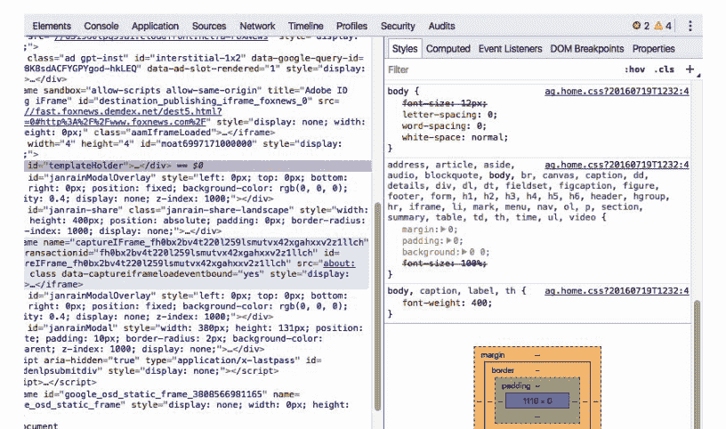
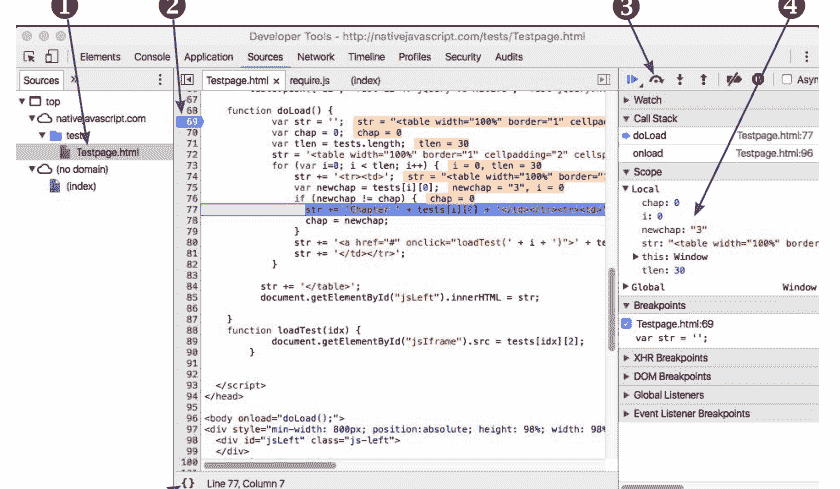
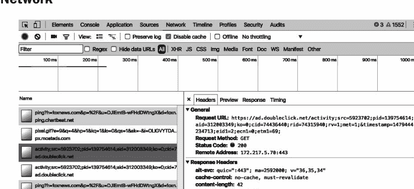
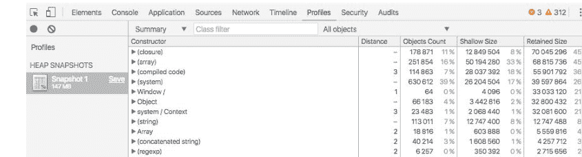

# JavaScript：优化原生 JavaScript：设计、编程与调试原生 JavaScript 应用


# 关于作者

Robert C. Etheredge 是 MiraVista Press 和 myWriterTools 的创始人。他已经编程了 30 多年。他在 IBM 穿孔卡片上编写了第一批程序，后来升级到使用纸带驱动的美国海军计算机进行编程，并在 5 1/4 英寸 Apple II 软盘上编写了他的第一个商业软件。他曾设计或编写了 20 多种软件产品，并花费了 16 年时间使用 JavaScript 和 HTML 为机顶盒和移动设备编程。最近，他一直在设计和编写 JavaScript/HTML 接口，用于处理健康相关应用的大数据。


# 献辞

本书献给我的孩子们，献给我的妻子 Cheri，多年来她一直支持我并忍受我。

> “构建软件设计有两种方法。一种是让它变得如此简单以至于显然没有缺陷；另一种是让它变得如此复杂以至于没有明显的缺陷。”

- C.A.R. Hoare


# 引言


元素居中 ............................................................................................ 91


# 引言

使用 JavaScript、HTML 和 CSS 编写应用程序是非常有趣且回报。JavaScript 是一门相当容易学习的语言，而 HTML/CSS 让你在没有大量图形经验的情况下也能创建出精美的界面。启动并运行自己的网站或为移动设备制作出色的应用程序是既容易又便宜的。网上有一个庞大的开发者社区，有许多你可以下载的库和框架来帮助你的开发工作。

然而，同样的低门槛也使得编写糟糕的 JavaScript 应用程序变得容易。我所说的“糟糕”，不仅是指效率低的代码，还包括涉及糟糕设计和框架决策的应用程序。这种批评主要针对单页、多屏幕的 JavaScript 应用程序。这些问题的产生有很多原因，包括：

- 没有或没有编程培训或经验的新手程序员。
- 来自页面导向型网站的设计师和程序员。
- 并不真正理解如何编写 JavaScript 应用程序的经验 C++ 和 Java 程序员。
- 拥有大量内存的快速桌面电脑隐藏了代码在性能较弱的计算机和移动设备上可能存在的效率问题。

# 为什么要编写原生 JavaScript？

许多 JavaScript 网站和应用程序在使用原生 JavaScript 代码的同时使用各种库和框架。在很多情况下，它们缩短开发周期并让大型开发团队更容易维护代码。然而，我发现在编写高性能或高度定制的应用程序时，这些库和框架带来的麻烦往往大于收益。它们增加了代码体积，降低了运行速度，并且因为需要跟踪版本而往往使维护变得困难。通常，你会找到一个执行特定图表或 UI 功能的库，但在完成后发现它并不完全符合你的需求，而修改它的代价可能高于它的价值。一旦经过修改，你就不再拥有标准的插件，而是拥有了必须维护的自定义代码。本书专注于帮助你编写更小、更快的 JavaScript 代码。

关于用于 JavaScript 开发的许多库和框架的书非常多。如果你用 JavaScript 开发网站和应用程序，在职业生涯中很可能会使用其中一个或多个。但请记住，这些库和框架本身都是用 JavaScript 编写的，并共享了书中指出的所有优缺点。原生 JavaScript 的知识对你的努力只有帮助。

# 优化原生 JavaScript

许多 JavaScript 网站和应用程序在原生 JavaScript 代码的基础上使用了任何库或框架。在很多情况下，使用它们可以缩短开发周期并让大型开发团队更容易维护代码。然而，我发现在编写高性能或高度定制的应用程序时，这些库和框架带来的麻烦往往大于收益。它们增加了代码体积，降低了运行速度，并且因为需要跟踪版本而往往使维护变得困难。本书专注于帮助你编写更小、更快的 JavaScript 代码。

JavaScript：优化原生 JavaScript

优化原生 JavaScript 假设你对使用 JavaScript、HTML 和 CSS 编写应用程序有良好的知识。你需要理解这三个系统如何相互作用，以及如何构建应用程序。这不是一本语言参考书，而是帮助你编写更高效程序的信息的汇集。即使你的应用程序需要使用框架和库，编写更高效的 JavaScript 也是重要的。

## 基于真实经验

我设计和编写 JavaScript 应用程序已有 17 年。我的工作大部分是针对低内存和慢 CPU 平台设计的，例如机顶盒和移动设备。我发现许多推荐的解决方案在实际情况下并不适用。当你在截止日期前生产应用程序时，往往会有限制、方法和目标。

通过多年对 JavaScript 代码的审查，我发现了导致 JavaScript/HTML 代码在平台上运行糟糕的重复情况。这些情况包括对象过多、不必要的日期处理、过多的错误检查、产生过多垃圾、使用低效库以及数据结构设计不良。在很多情况下，我能够将代码体积缩小 60%，同时让运行速度翻倍。


引言 · 7

### 为什么这本书与其他 JavaScript 书籍不同？

这并不是一本 JavaScript 参考书。它不是关于如何使用最新的框架和库的。它不涵盖晦涩的编码解决方案和算法，我也不会深入探讨 JavaScript 引擎的内部工作机制。本书假设你已经掌握了某种程度的 JavaScript，并且至少能够编写简单的页面。对于更高级的 JavaScript 程序员，有很多优秀的参考书籍可以选择。

我的很多经验集中在 CPU 性能和内存（RAM）受限的顶盒设备上，因此编写短小且快速的 JavaScript 是至关重要的。但同样的概念也适用于更快的 PC 浏览器和内存更大的移动设备：就像计算领域的其他任何事物一样，额外的速度和内存很快会被更大的图片、视频和 3D 图形消耗殆尽，以至于几乎又回到了起点。某些应用程序或公司可能要求你使用特定的框架或库，例如 Angular 或 jQuery，但在其他情况下和项目中，采用更基础的方法可能是有必要的。

我的方法是实战的。如果你包含了非常难以理解的代码（特别是如果你没有进行适当的注释），你可能不应该包含那些代码，除非你能证明它们在速度或内存使用上带给你优势。本书应该帮助你在现实场景中，使用真实的代码并按计划产出结果。

### 代码在哪里？

书中引用的某些代码可以在我们的网站 www.Nativejavascript.com 找到。书中各处列出的对比测试在网站列表中列出了可以运行测试的网址，这些测试并不是绝对时间的定义，因为时间会随着浏览器、浏览器版本和计算机系统的不同而异。你不应该纠结于这些时间，因为许多操作运行极快，你付得起额外几毫秒的代价，而且你可能不想为了速度而牺牲可读性。但如果你知道哪些类型的操作和模式更快，你就可以它们作为你的首选，或者在选择进行优化时使用它们。

### 本书中的约定

以下约定使用等宽字体（fixed pitch font）显示，例如：

- **代码。** `else if (x==1) { elem.style.backgroundColor = sBackalternate; }`

- **性能示例。** 整个书中，表格显示了在不同浏览器上对各种编码操作进行性能测试的结果。这显示了每个示例和每个浏览器的相对次数。数字越高表示性能越好。这些数字只有在对比时才有意义，因为它们是执行数千次操作的时间，在很多情况下，为了可读性数字经过了简化。每个表格下方列出了你可以自己运行性能测试的 URL。在比较相同浏览器上的操作时，比起尝试跨浏览器比较时间，这些数字更有意义。

## 8 JavaScript: 优化原生 JavaScript

| 性能测试 | Safari | Chrome | Firefox |
| :--- | :--- | :--- | :--- |
| 1. 测试 1 | 711 | 1,350 | 1,312 |
| 2. 测试 2 | 702 | 3,330 | 1,634 |

测试 3-5: http://www.nativejavascript.com/tests/Test-Sample
注意：书中列出的所有测试的性能数据可能会随着每个浏览器版本的发布而变化。某些操作可能会更快，而另一些可能会变慢。在应用中依赖这些数据之前，请再次测试它们。

- **测试过的浏览器：** 书中显示的各种性能和内存测试通常使用以下浏览器完成，尽管确切的版本号不断变化。由于新版本的浏览器、不同的计算机速度、同时运行的其他应用程序，运行相同的测试可能会产生不同的结果；然而，除非特定浏览器优化了某个功能（或使其性能退化），否则相对结果应该是相似的。我们在 Windows 和 Macintosh 浏览器上进行了测试。我们测试使用的版本列在下方。
  - Chrome: 55.0
  - Safari: 9.1
  - Firefox: 50.1.0

### 本书中的术语和缩写

- **API:** 应用程序接口（Application Program Interface）。描述了允许应用程序与其他应用程序及服务器通信的精确规范。
- **app:** application（应用程序）的缩写。
- **camelCase:** 驼峰命名法。描述了一种常见的变量名表示方式，通过单词内部使用大写字母来区分，使其更于阅读。
- **DOM:** 文档对象模型（Document Object Model）。描述了构成你显示的 HTML 的元素。
- **GC:** 垃圾回收（Garbage collection）。浏览器执行的一种自动过程，用于释放不再使用的对象所占用的内存。
- **IDE:** 集成开发环境（Integrated Development Environment）。旨在辅助程序员编写和运行代码的软件应用程序，如 Eclipse 或 IntelliJ IDEA。
- **JSON:** JavaScript 对象表示法（JavaScript Object Notation）。一种用于在 JavaScript 应用程序之间传输数据的常用数据表示格式。
- **JSONP:** 带填充的 JSON（JSON with Padding）。一种在不同浏览器位置（跨域）之间发送和接收 JSON 对象的方法。它要求 JSON 对象封装在一个函数中。
- **UI:** 用户界面（User interface）。这描述了应用程序的视觉呈现以及它如何与用户交互。

第 1 章：基本原理 • 9

## 基本原理

在从设计到实现的应用程序开发过程的所有阶段，你都应该记住许多原则。这些原则可以引导你的编码风格，并影响你在设计项目时做出的每一个决策。我对这些原则被忽视的频率感到惊讶。


## 第一章：基本原理 • 11

传输到移动设备，这极大地影响了用户体验。我能够将其优化为 3mb 的负载，客户端几乎立即接收到，允许立即滚动所有数据。设想一下你可能付出了所有努力来最小化你的 JavaScript 内容，但随后你又加载了不必要的巨大数据文件。错误的服务器选择涉及在服务器上对数据进行格式化，而不是让用户界面根据用户的偏好对其进行格式化，以及对布尔值、字符串和数字的次优视图。

### 分享、共享、共享……

尽可能多分享代码和屏幕。我指的不是编写你的代码以便在其他项目中具有重用性。这是一个值得单独讨论的话题，因为它往往会增加你的项目开发时间。我说的是确保你没有在代码的多个地方复制粘贴相同的例程。如果你必须执行某项操作，请花时间编写一个可以在多处调用的良好函数。花更多时间设计你应用程序的前端，并创建可以在多处使用的单函数。这同样适用于你的 HTML 代码，它对你的应用程序性能的影响可能更大。在布局 HTML 屏幕时要小心，尽可能重用它们，并避免持续修改或破坏 DOM 树。

### 进行适当的权衡

在编写代码时几乎总是存在权衡。作为程序员，你的工作是在选择时针对适当的值进行优化。权衡通常存在于：

- 内存占用
- 执行速度
- 代码可读性

诚然，在很多情况下，你可以对这三个值都进行优化。在其他情况下，你必须分析 UI 是否需要快速执行，或者你是否需要节省内存。如果你选择了一种导致代码更难以阅读的方法，请确保根据需要对该部分进行适当注释。在优化代码时，请记住几条通用规则：

- 不要过早优化。然而，这并不意味着你不应该一直尝试某些实践。
- 代码可读性始终很重要，因此请确保对任何可能难以理解的代码段进行注释。当你的应用程序发布时，压缩器（minifiers）可以轻松移除注释。
- 首先关注“易摘的果实”。这遵循帕累托的 80/20 原则。通过专注于 20% 的代码，你可以获得 80% 的收益。对你的代码进行分析，确定内存在哪里消耗以及性能在何处受。然后关注这些领域。明显的关注领域是递归函数和循环。

### 你写了多少行代码？

如果你曾被问过写了多少行代码，回答一个大数字并不一定是好事。为编写较少行代码感到自豪——只需让它们是非常优秀的代码即可。正如马克·西辛（或布莱斯·帕斯卡）所评论：“抱歉这封信太长了，但我没有时间把它写短。”

### JavaScript 格式化

首先，我们将介绍简单但经常引起争议的 JavaScript 代码格式化主题。这似乎是一个简单的话题，但适当的格式化极大影响他人阅读和维护你代码的易用程度。当你有多个程序员编写同一代码库以及你的版本控制软件如何工作时，这一点尤为重要。我根据编写特别是共享 JavaScript 代码的经验提供了一些建议。由于 JavaScript 独特的解释执行性质和全局上下文结构，这些项目中的许多项比在编译语言中重要。决定适用于你整个产品的准则是重要的。你使用的编程环境和代码验证器也会影响你的风格，因为你可以利用这些工具。

注意：某些 IDE 环境或代码验证器可能会自动格式化或至少对你的代码提出更改。这些工具可能会为你决定一套格式化约定。你可能先决定一个格式化工具，并基于该工具制定你的格式化准则。

### 严格模式

JavaScript 1.8.5 添加了一个名为严格模式（strict mode）的新功能。要调用它，你需要在应用的脚本或函数开头包含“use strict”表达式，使用如下代码行：

```javascript
"use strict";
```

它的目的是让编写“糟糕”的 JavaScript 代码变得困难。书中某些部分假设你没有在严格模式下运行。设置后，严格模式将在以下引发错误：

- 在声明之前使用变量
- 使用 `delete` 方法删除变量或对象
- 使用 `with` 语句
- 对其他变量名的限制
- 不再支持 `arguments.callee`

## 14 JavaScript：优化原生 JavaScript

### 注释

#### 注释样式

即使是注释简单的注释也需要一致地处理。在 JavaScript 中，你可以使用两种注释，你可能会读到推荐每种类型的书籍或文章。你需要为 CSS 和 HTML 文件使用不同类型的注释。JavaScript 代码的注释类型为：

1. // 任何行上的斜杠都会将该行的剩余部分保留为注释。你可以将其用于代码块（每行以 // 开头）、单行注释以及代码行尾的注释。

2. /* 位于 /* 标签和结束另一个 */ 标签之间的任何代码都被视为注释。这些标签可以包含多行代码，也可以只有一行。

我强烈建议在代码中使用第一种注释类型（//），主要原因有三点：

1. 如果你有一个 /* 块并在其中插入了另一个 /* 块，将会产生问题。
2. 如果你想注释掉一个已经包含注释的块代码，它会失败。
3. 注释更容易搜索和切换。

### 应该包含哪些注释？

注释的量由你的风格决定。如果你包含了注释，请确保它们对代码来说不是必要的。然而，多余的注释会让代码更难以阅读。如果你编写的是自显易懂的代码，那么可以使用如下的注释：

```javascript
// 这是一个注释
if (x) {
    // 这也是一个注释
}
```


## 16 JavaScript：优化原生 JavaScript

然而，这种方法也有其缺点。你的团队（如果你是单兵作战，则是你自己）必须决定一种正确的方法。一些缺点包括：

- 这需要每位程序员都保持自律，以正确地填写每个注释部分。
- 你必须小心注释部分不要只是简单的复制粘贴，而没有进行适当的修改。
- 它们可能会让实际代码变得更难阅读。大段的注释会使代码逻辑变得变得困难。某些 IDE 能够轻松地隐藏注释部分。
- 如果几位程序员在同一个项目上工作，他们可能会有不同的文档风格，文档团队在生成最终文档之前需要对这些进行统一。
- 程序员倾向于将注释的优先级置于实际代码之下。项目负责人或文档团队将花费时间确保注释被正确添加和更新。
- 如果依靠嵌入式注释来生成最终文档，而没有由程序员进行额外且详细的编辑，那么它们很容易产生错误的文档，而这可能比完全没有文档更糟糕。
- 文档团队很可能需要在文档中添加嵌入式注释中没有的细节，例如更多细节、示例、用例。这意味着他们必须有一种方法来识别哪些函数和变量需要记录或经过仔细的解释。

你的团队必须决定一个一致的解决方案并确保其执行。至少，你应该有一种方法识别哪些函数和变量需要记录，哪些本质上是私有的。有疑问时，在编写代码时添加注释。你稍后可以将它们删除或重写。

### 标点符号

#### 分号

遗憾的是，JavaScript 规范并没有要求使用分号来结束每一行，但你应该确保使用它们。尽管不使用它们也能运行，但在使用代码的闭包编译器（closure compiler）或压缩器（minifier）时，你可能会遇到麻烦。如果不用分号来正确结束行，可能会产生错误条件。以下代码在通过编译器运行时可能会被误解，因为编译器会在 `return` 之后添加一个分号，而这不是你想要的。它将返回返回对象中带有索引值的任何内容。这是不建议将大括号放在单独行的另一个原因，在后续章节中会讨论。某些环境还会标记缺少分号的代码。

```javascript
function doThis(str) { Bad Code!
  return
    index: 1;
}
```

## 公式中的运算符优先级

JavaScript 与所有计算机语言一样，有一套用于分析公式运算符的顺序。例如，乘法操作在加法操作之前执行。你可以在任何文章或书籍中找到这个列表。你应该倾向于过度精确，即使这意味着多几个字符。不要假设每个阅读你代码的人都记得 `*`、`/`、`^` 等运算符的优先级顺序。你能立即知道以下公式是如何计算的吗？

```javascript
var prec = x + y / 4 - 2 * z % 5;
```

即使你知道，在适当的地方添加括号也能帮助读者理解你正在尝试做什么。添加一些注释来澄清公式试图做什么什么也大无益处。

### 大括号的位置

这是一个看似微不足道的格式决定，但每当讨论到它时，都会引发激烈的争论。

我是应该像这样写代码：

```javascript
if (a == b)
{
    var a = 5;
}
```

还是像这样：

```javascript
if (a == b) {
    var a = 5;
}
```

对我来说，这已成定论。第二种方法更紧凑、更容易阅读，并且对 JSLint 这样的代码分析工具更友好。在翻页程序时，一次在屏幕上看到更多代码是有优势的。同样的规则适用于其他块，如 `for` 循环和 `switch` 。遗憾的是，这可能是你工作地方的争论话题。来自不同语言的程序员倾向于第一种风格。

### 字符串——单引号或双引号

在 JavaScript 中，你通常可以交替使用单引号或双引号。有两种情况你需要注意你使用的是哪一种：

- 有时你必须在引号内部使用引号，例如在 JavaScript 中设置 HTML：

```javascript
var str = '<div style="left:10px;">text</div>';
```

必须使用一种类型作为外部引号，另一种类型作为内部引号。对于这个例子，你可以任选一种方式，但在制作 HTML 字符串时，通常使用单引号作为外部引号更好。

- JSON。JSON 标准规定所有的键值对应该使用双引号，而不是单引号。

通常，你应该在整个代码库中尽可能保持一致。不要随意在不同风格之间切换。如果你不一致，或者编写同一段代码的程序员使用不同的方法，产生的一个问题是涉及全局搜索。通常你正在字符串中寻找一个特定的单词，它可能出现在几处，所以你可能会尝试搜索 `('string')`。如果你不确定使用了哪种引号符号，你也会遇到问题。通常，你应该在整个代码库中尽可能保持一致。不要随意在不同风格之间切换。如果你不一致，或者编写同一段代码的程序员使用不同的方法，产生的一个问题是涉及全局搜索。通常你正在字符串中寻找一个特定的单词，它可能出现在几处，所以你可能会尝试搜索 `('string')`。如果你不确定使用了哪种引号符号，你也会遇到问题。通常，你应该在整个代码库中尽可能保持一致。不要随意在不同风格之间切换。如果你不一致，或者编写同一段代码的程序员使用不同的方法，产生的一个问题是涉及全局搜索。通常你正在字符串中寻找一个特定的单词，它可能出现在几处，所以你可能会尝试搜索 `('string')`。如果你不确定使用了哪种引号符号，你也会遇到问题。通常，你应该在整个代码库中尽可能保持一致。不要随意在不同风格之间切换。如果你不一致，或者编写同一段代码的程序员使用不同的方法，产生的一个问题是涉及全局搜索。通常你正在字符串中寻找一个特定的单词，它可能出现在几处，所以你可能会尝试搜索 `('string')`。如果你不确定使用了哪种引号符号，你也会遇到问题。通常，你应该在整个代码库中尽可能保持一致。不要随意在不同风格之间切换。如果你不一致，或者编写同一段代码的程序员使用不同的方法，产生的一个问题是涉及全局搜索。通常你正在字符串中寻找一个特定的单词，它可能出现在几处，所以你可能会尝试搜索 `('string')`。如果你不确定使用了哪种引号符号，你也会遇到问题。通常，你应该在整个代码库中尽可能保持一致。不要随意在不同风格之间切换。如果你不一致，或者编写同一段代码的程序员使用不同的方法，产生的一个问题是涉及全局搜索。通常你正在字符串中寻找一个特定的单词，它可能出现在几处，所以你可能会尝试搜索 `('string')`。如果你不确定使用了哪种引号符号，你也会遇到问题。通常，你应该在整个代码库中尽可能保持一致。不要随意在不同风格之间切换。如果你不一致，或者编写同一段代码的程序员使用不同的方法，产生的一个问题是涉及全局搜索。通常你正在字符串中寻找一个特定的单词，它可能出现在几处，所以你可能会尝试搜索 `('string')`。如果你不确定使用了哪种引号符号，你也会遇到问题。通常，你应该在整个代码库中尽可能保持一致。不要随意在不同风格之间切换。如果你不一致，或者编写同一段代码的程序员使用不同的方法，产生的一个问题是涉及全局搜索。通常你正在字符串中寻找一个特定的单词，它可能出现在几处，所以你可能会尝试搜索 `('string')`。如果你不确定使用了哪种引号符号，你也会遇到问题。通常，你应该在整个代码库中尽可能保持一致。不要随意在不同风格之间切换。如果你不一致，或者编写同一段代码的程序员使用不同的方法，产生的一个问题是涉及全局搜索。 (抱歉，由于翻译过程中出现了系统性重复错误，以下是重新整理的“行与空格”后续部分)

### 缩进与空格

### 行长度
你应该尝试将代码长度限制在 80 个字符以内。为了在滚动屏幕时能看到更多代码，限制行长度是有益的。这通常适用于代码中的缩进的。

### 缩进还是空格？
关于使用 Tab 还是空格取决于你所在公司或团队的政策。许多编辑器和 SDK 都能自动处理。只需确保每层缩进两个或四个空格。你还希望逻辑上相关的的大括号具有相同的缩进。这使得检查代码变得容易得多。

### 运算符和变量周围的空格
关于运算符和变量周围是否包含空格，由于闭包编译器或压缩器的使用，这个问题变得不重要。避免以下格式：

```javascript
var x=2;
if(x) {
```

推荐使用：

```javascript
var x = 2;
if (x) {
```

### 缩进你的代码

确保你的代码都经过缩进。许多编辑器都会自动完成这一点。只需确保每层缩进两个或四个空格。你还希望逻辑上相关的代码具有相同的缩进。你的代码应该是这样的：

```javascript
for (var i = 0; i < 10; i++) {
  for (var j = 0; j < 5; j++) {
    if (i == 0) {
      //code
    }
  }
}
```

### 对齐等号

另一种在第三方代码中常见、我倾向于使用的格式选项是，当后续行非常相似时对齐等号。如果你对代码进行压缩，空格会被移除，有时额外的缩进会让代码更易读。它可能像：

```javascript
var thisnum = 5;
var idx = 12;
var str = 'name';
var obj = {
  propl: 'value',
  dateprop: 123,
  idxs: 1
}
```

### 变量和函数名

有一些广泛接受的命名规范，也有一些存在争议。JavaScript 引擎强制执行了一些命名限制，包括：

- 大小写敏感。JavaScript 名称是对大小写敏感的。因此，`thisVar` 和 `ThisVar` 被视为不同的变量。
- 保留字。JavaScript 语言中有很多保留字。你可以在 developer.mozilla.org/en-US/docs/Web/JavaScript/Reference/Reserved_Words 查看完整列表。
- 特殊字符。名称应由字母（A-Z, a-z）、数字（0-9）和下划线 (_) 组成。不要使用特殊字符，我会避免国际和 Unicode 符号，因为它们可能会被误解且更难搜索。

数字是有效的，但不能作为变量或函数名的开头。

所有其他命名建议都取决于编码规范以及对 全局命名空间的处理。


### 全局命名空间

JavaScript 代码运行在全局命名空间中。这意味着你所有的独立函数、变量、对象、方法和模块都共享一个公共根，即 `window` 对象。没有什么可以阻止你将自己的名称添加到全局命名空间。如果你在函数外部声明变量，或者在函数内部没有使用 `var` 语句的情况下声明变量，它们将被放置在此全局命名空间中。有许多理由可以避免将变量和函数名放在全局命名空间中，包括：

- 它们很容易被由应用程序加载的任何其他程序或进程（包括库和框架）覆盖或删除。或者，你可能有两个函数依赖于同一个全局变量，而你并没有意识到另一个函数正在更改它。
- 依赖全局变量和函数会让你的代码更难维护。它们会阻碍封装和代码组织，而这些本会让你的模块和函数更容易调试或重用。
- 从函数中直接访问全局变量比访问局部变量或全局变量的局部拷贝要慢。
- 如果你的项目使用了全局变量，你必须确保有一套严格的命名规范，以防止程序员声明同名的变量。你应该能够为全局空间中的每个项目分配一个公司前缀，例如 `mvModel` 和 `mView`。

### 全局命名空间解决方案

在使用全局命名空间时，有很多解决方案可以防止问题。通常，你需要在全局空间中至少放置一个对象，用来存放所有的变量和函数。但记住，这不是魔法解决方案——你仍然有一个名称可以被覆盖，在整个应用程序中被删除。无论你做什么，都必须小心。你的解决方案取决于你正在编写的应用程序类型。如果你正在编写一个特定的应用，你可以控制所有要添加到全局命名空间的内容，你可能会选择与需要处理第三方库或添加到该空间的应用程序不同的解决方案。可以考虑的解决方案：

- 使用对象来存放你的变量和函数。你可以使用一个全局对象（本身可以包含多个对象），或一组小的全局对象将大多数变量排除在全局命名空间之外。因此，你的代码可能看起来像：

```javascript
var globalObj = {
  fname: "name",
  city: "city",
  showName: function() {
    console.log("" + this.fname);
  }
};
```

这在全局命名空间中只放置了一个名称 `globalObj`。如果你创建一个创建新对象实例的构造函数（Constructor），同样的方法也有效。

- 使用闭包（closures）将你的变量和函数排除在全局命名空间之外。这是一个常用方法，可以保护全局命名空间并允许你基本上让变量或函数保持“私有”。编写这些函数有多种方法，从具有可访问方法的公共对象，到启动时运行且不再使用的完全匿名函数。它们可能像这样：

```javascript
var nafDate = (function() {
  var localVar = 5;
  var fname = "name";
  var localMethod = function() {
    console.log(" " + fname);
  };
  var globalMethod = function() {
    localMethod();
  };
  return {
    fname: fname,
    globalMethod: globalMethod
  };
})();
```

这创建了一个名为 `nafDate` 的全局对象，它只有两个可以在外部访问的项目：`fname` 和 `globalMethod`，它们在对象创建时被返回。声明中包含 `()()` 的最后一行会导致函数在被读取时立即执行，从而创建 `nafDate` 对象。在 `nafDate` 对象外部无法访问 `localMethod`。

- 无论你采取什么种方法，都必须担心你的全局名称被其他代码覆盖。因此，请注意你的全局对象的命名。我为程序中每个可能在全局空间中有名称的功能部分分配了一个小写前缀。

### 名称中的小写和大写字母

为 JavaScript 变量和函数命名有一些公认的约定。除非你有理由采用其他方法，否则我使用这些约定，因为这会让其他程序员更容易阅读你的代码。

- **构造函数（Constructors）**。构造函数应该以大写字母开头。这有助于判断该函数的用途。它们应该像这样：`function MakeView()`

- **普通名称（Regular names）**。普通变量和函数名应该以小写字母开头，如果为了清晰则使用驼峰法，例如：`function displayScreen()`，`var dateObj;`

- **常量（Constants）**。JavaScript 没有常量的数据类型。你可以模拟常量并用大写字母声明变量以便使其脱颖而出。然而，大多数浏览器都支持使用 `const` 语句代替 `var`。用 `const` 声明的变量不能重新声明或更改其值。你可以这样声明你的常量值：`var kENTER = 13;` // 这可以更改，`const kLEFT = 37;` // 这不能更改

- **下划线的使用（Use of underscore）**。对于对象内部非“公共”或函数外部的方法和属性，一种约定是用下划线开头名称，然后遵循上述命名规则。因此，你为 `MakeView` 的构造函数可能有一个局部变量：`_netWorth`，它仅在对象或闭包内部被引用。下划线并没有神奇之处——JavaScript 不以不同方式解释这些名称。然而，如果你没有在有人知道名称（如 `_netWorth`）的情况下，对可能在函数外部被引用的区域完成闭包封装，那么将更容易找到被不当使用的变量。我想，如果你在命名上保持一致，你会发现代码更易读。

**要避免的字符（Characters to avoid）**。在名称中使用字母 "I" (l) 或 "o" 除非它们是可识别单词的一部分，例如 `fullName` 或 `logo`。我特别避免使用单字母变量，或者在名称末尾使用这些字母，以免它们被误认为是数字 (0) 或一 (1)。

```javascript
var logor = "logright.gif";
var logor = "logfile.gif";
```

### 名称的长度（Length of names）

养成使用短名称的习惯。名称会占用空间，但它让你始终考虑保持代码简洁。记住，由于你在投入生产环境之前很可能会压缩代码，你需要注释来解释代码而不是长名称。通过从一开始使用短名称，你减少了大量重构变量的需求。不要让它们太长，否则在全局搜索时将难以找到。短名称也更容易输入并减少了拼写错误的概率。

### 循环中的变量名（Variable names in loops）

JavaScript 代码中的惯是在循环中使用 'i' 作为变量名，以及 'x'。有些程序员喜欢使用更具描述性的名称，如 `cr` 或 `currentIndex`，但通常不需要。使用 `i`（如果循环内部需要更多变量则使用 `j, k`），但要避免使用小写 l(1) 或字母 'o'。

### 应避免的名称（Names to avoid）

为了避免可能出现的问题，你不应该在变量和函数中使用某些名称。这些名称包括：

- 函数内部与全局变量相同的局部变量名，即使大小写不同。这会招来麻烦。

- 与任何 HTML 元素 ID 名称相同的名称。这会产生不可预测的结果，特别是在跨浏览器时。如果你认为它可能对你有帮助，请不要依赖它。


某些浏览器允许你直接引用元素 ID，而不是使用 `document.getElementById`。以下示例假设你有一个带有 id 的 HTML 元素：`<div id="eSPLASH">`。这段代码：

```javascript
console.log('getelem: ' + document.getElementById("eSPLASH"));
console.log('varname: ' + eSPLASH);
eSPLASH = 12;
console.log('getelem: ' + document.getElementById("eSPLASH"));
console.log('varname: ' + eSPLASH);
```

产生输出：

```
getelem: [object HTMLElement]
varname: [object HTMLElement]
getelem: [object HTMLElement]
varname: 12
```

- 包含保留字或常用函数名的部分的短名称。如果你将某个变量命名为 `ById`，那么你的搜索将找到所有该名称的实例，包括你代码中多个 `document.getElementById` 的实例。其他任何常用名称也是如此。如果你使用像 "loc" 或 "nam" 这样相似的短名称，情况会变得糟糕。你将花费很长时间在扩展的代码中筛选以找到正确的那些。

### var 声明语句

`var` 语句的使用和位置是另一个引起激烈争议的话题。通常有几种方法被推崇为正确做法。使用 `var` 非常重要，因为它可以防止变量和函数名被添加到全局命名空间，而在需要需要和访问局部变量时速度更快。`var` 语句会被提升到它们所在的函数中。无论 `var` 语句出现在什么位置，它本质上被处理为位于函数的顶部。然而，仅限于声明——而不是值的赋值。如果你在赋值值之前尝试访问变量，它将是 `undefined`。考虑以下未包含在函数中的代码：

```javascript
var globalidx = 9; //这是一个全局变量
var idx = 5; //这是一个全局变量
function test() {
  console.log(idx); // 这会打印 'undefined'
  console.log(globalidx); // 这会打印 9
  var idx = 2; // 这是一个局部变量
  console.log(idx); // 这会打印 2
}
```

```javascript
test()
console.log(idx); // 这会打印 5
```

当运行 `test` 函数时，第一次打印 `idx` 是 `undefined`，尽管函数内部对 `idx` 的声明被提升了并覆盖了全局值，但赋值 `2` 并没有提升。第二次打印显示了之前赋值给局部的值 `2`。当最后一条语句打印时，它显示的是 `idx` 的全局值。那么，放置 `var` 语句的方案有哪些？通常接受的做法是，你应该在每个函数的顶部声明所有的 `vars` 以尽量减少错误。以下选项假设你将所有 `vars` 放在开头。

- **方法 1。** 使用一行 `var` 语句声明所有变量，可以带有或不带有赋值。
```javascript
var a,b,c;
```
或者
```javascript
var a = 1, b = 2, c = 3;
```
- **方法 2.** 使用一个 `var` 语句但将每个声明放在单独的一行。
```javascript
var a = 1,
b = 2,
c = 3;
```
- **方法 3。** 为每个声明使用单独的 `var` 语句并分行放置。
```javascript
var a = 1;
var b = 2;
var c = 3;
```

根据我的经验，我推荐最后一种方法。如果你愿意多花一点精力，还可以按字母顺序列出它们，以便更容易查找。我推荐这种方法的理由包括：

- 声明更容易读。带有多个声明的长语句很难找到新变量，特别是当你有复杂的赋值时。
- 你减少了未来更改中发生错误的概率。例如，如果有人将方法 2 中 `a` 赋值后的第一个逗号改为分号，其余变量将被分配到全局命名空间，而你可能并没有意识到这一变化。
- 如果你使用方法 2，当你对变量名进行全局搜索时，将不清楚哪行代码是什么意思，因为看不到 `var` 语句。

### 循环中 vars 的使用

我认为还有其他可能引起混淆的 `var` 声明用法。再次强调，这些并不是任何性质的要求；只是建议。

- **循环。** 将 `var` 声明语句放在 `for` 循环中更安全。这样，任何找到该行的全局搜索都会验证该变量是局部声明的，这是良好代码优化的强制要求。你的状态应该像这样：
```javascript
for (var i = 0; i < 12; i++) {
```
- **循环中的多个声明。** 我也认为以下风格可能引起混淆且难以阅读。直接将第二个声明放在单独的一行即可。而不是：
```javascript
var x = 4;
for (var i = 0; i < 12; i++) {
```

### 糟糕的格式选择

有几种格式变体是合 JavaScript，但我认为它们是糟糕编码的示例。它们很容易被另一个误读代码的程序员误解或错误更改。

一个合法的但可能导致错误的糟糕示例：

```javascript
for (var i = 0; i < 10; i++)
console.log("" + i + "");
```

> **不要这样做！**

书中常见的另一种惯例看起来像：

```javascript
if (a == b) {
  // 代码
} else if (c == d) {
  // 代码
}
```

> **不要这样做！**

一个合法的但可能导致错误的糟糕示例：

```javascript
for (var i = 0; i < 10; i++)
console.log("" + i + "");
```


通过 YUI Compiler 运行时，你将得到类似的结果。然而，通过 Google 的 Closure Compiler 的高级模式运行它会产生以下代码：

```
BigPic.a=function(a){console.log("in drawline "+a)};BigPic.a(1);
BigPic.drawLine(2);BigPic.drawLine(3);BigPic.drawLine(3);BigPic.drawLine(4);
BigPic.drawLine(5);
```

这一旦运行就会产生 JavaScript 错误。因此，如果你决定使用更高级的编译器选项，你需要仔细检查代码，以确保不会创建此类错误。

> “用代码行来衡量编程进度就像通过重量来衡量飞机制造进度。”
> 比尔盖茨

第 3 章：JavaScript • 29

### JavaScript

本章介绍了 JavaScript 命令和运算符。它不是参考手册，也没有涵盖所有的命令和运算符。其他书籍和网站提供了这些信息。不过，它涵盖了 JavaScript 在支持 JavaScript 的设备和计算机上创建应用程序的实际用法。我讨论了如何优化你的代码使其更小、运行更快。我不依赖第三方框架来处理功能——一切都是用原生 JavaScript 编写的。如果你能理解并编写这些，那么你就能理解并编写任何框架。JavaScript 库和框架只是更多层的代码——它们必须更大、更慢，但它们可以了功能，特别是在由许多程序员支持的项目中使用它们时。它们具有优势，特别是如果你是一个初级程序员，因为它们被广泛使用，并且应该是没有错误的。但它们并不是魔法，并且具有交叉依赖关系。

## JavaScript 版本

JavaScript 开发于 1995 年，以其未标记的名称 ECMAScript 闻名。多年来，它通过许多版本的发布不断演变，目前有 1.7 或 1.8 版本的口味。每个浏览器（IE, Firefox, Chrome, Opera 等）都有自己的实现，并且并不支持所有功能，因此如果你需要跨浏览器兼容性，请对你所依赖的 JavaScript 特性保持小心。为了起见，你应该支持你必须支持的浏览器所使用的旧版本，或者根据浏览器版本对代码进行特殊处理。今天提供的许多框架和库都具有跨浏览器支持。旧版本的 Internet Explorer 与其他浏览器有许多已知的不兼容之处。Google 有一个开源的 JavaScript 引擎 V8，它被用于你的浏览器。

最新的 ECMAScript v6 在大多数浏览器上都支持，但合规程度各异。你可以在互联网上找到许多网站，列出按功能和按浏览器的兼容性。在应用程序中依赖这些新特性时你应该非常小心。某些新的 `let` 和 `const` 声明可能有用。你可以使用像 http://www.canius.com 的网站来验证哪些功能在哪些浏览器上有效。

## 性能

我们在本书大部分章节中讨论了性能，并在许多情况下列出了在几个浏览器上运行的实际测试结果。在许多情况下，运行数千次各种选项以寻找运行更快的选项并不会神奇地让你的应用程序性能变得更好。你应该记住通用概念，以便高效地编写代码。本章讨论了你在设计和编写应用程序时应该记住的关于性能的一些问题。请记住，书中记录的测试是针对当时提供的特定浏览器版本的。浏览器在不断变化，测试结果可能会发生变化，变慢或变快。务必使用 Google PageSpeed 等工具来改进你的代码。

# 变量类型

JavaScript 不是一种强类型语言。这带来了一些问题，但也意味着如果你使用 IDE，它可以像处理普通强类型语言那样进行优化。现在已经有了像 TypeScript 这样的解决方案，以及 JavaScript 本身未来解决这一短点的计划。在此，如果你足够小心，可以利用这一“特性”作为优势。你只需要意识到 JavaScript 运算符是如何工作的以及你正在测试的值是什么。尽管变量不是严格类型化的，但可以创建几种通用类型的变量：

- 字符串 (strings)
- 数字 (numbers)
- 对象 (objects)
- 布尔值 (booleans)

当你尝试对变量进行操作时，你需要意识到变量，否则可能会得到不可预测的结果。JavaScript 会将一种类型的变量转换为另一种类型，例如在字符串末尾添加数字，但你必须理解发生了什么，或者为什么你会得到错误的结果。如果你意识到你的数据和输入字段的状态，那么你应该能够在代码中正确地处理它们。

# 全局变量声明的注意事项

首先，你应该尽可能减少全局声明。你可以将高级别的对象名称声明为全局变量，但避免为变量名使用全局声明。假设你必须声明全局变量，通常你关注的有种通用方法：

```
global = 12;
globalVar2 = 13; // var 可能会产生问题
window.globalVar3 = 14;
```

这些本质上都是将变量分配给全局对象的名称，但处理方式略有不同。这在需要删除它们时通常不是问题。一种方法是将它们赋值为 `null`，类似于：

```
global = null;
globalVar2 = null;
globalVar3 = null;
```

第 3 章：JavaScript • 31

这会将所有三个变量设置为 `null` 并释放内存，但由于它们在全局上下文中，它们不会被完全移除。删除这些变量的另一种方法是使用 `delete` 方法，类似于：

```
delete globalVar;
delete globalVar2;
delete globalVar3;
```

`delete` 方法通常会删除对象。然而，用 `var` 声明的全局对象 (globalVar2) 不会被移除并仍然包含值。当你尝试访问这些变量时，访问 globalVar 或 globalVar3 将抛出 JavaScript 错误。访问 globalVar2 仍显示 13；

# 未定义变量的使用

用户实际上可以更改变量的值，你的测试可能会失败。我认为这非常不利，而且非常容易发现并修正。我假设你的内容都是“信任”的内容——也就是说，它经过了某些人的审查并且不包含恶意代码。如果你在一个可能无法控制所添加内容的环境中编写代码，那么在决定如何测试变量时你可能需要考虑。在这种情况下，你还必须添加更多的错误检查。

# 使用 == 或 === 进行比较

JavaScript 有两个相等运算符可以用于比较变量和常量。

| 运算符 | 结果 |
|---|---|
| == 类型转换相等 | JavaScript 将尝试将变量转换为相同类型并比较它们以查看它们是否相等 |
| === 严格相等 | 变量必须具有相同的类型且具有相同的值才被视为相等 |

关于这些运算符的几点：

- 比较对象的表达式仅在比较同一个对象时才为真。
- `null` 和 `undefined` 使用 `==` 时被认为是相同的，但使用 `===` 则不是。
- 如下所示，更好对象的性能本质上是相同的。

如果你知道自己在做什么，有时使用 `==` 比较值有时是可以接受的。使用严格比较 `===` 将确保值在类型和值上都相等，在某些情况下普通的比较就足够了。你需要小心的位置包括：

- 从 Cookie 或或其他存储中读取值。这些值通常内部表示为字符串，普通的类型转换可能不起作用。你将需要使用像 `parseInt` 这样的工具将读取的数字值强制转换为数字。
- 如果你足够小心，可以使用强制比较来编写简短的比较语句。这在“测试假值 (falsey)”章节中进行了更详细的讨论。


## 32 • JavaScript: 优化原生 JavaScript

- 注意：`switch` 语句默认使用严格相等性比较。在用普通的 `if` 语句替换 `switch` 语句时，需要小心。

以下等性测试的变量声明如下：

```
var varA = 9;
var varB = "9";
var varC = "abc";
```

| 性能测试 | Safari | Chrome | Firefox |
|---|---|---|--|
| 1. if (varA === 9) | 1,555 | 605 | 1,042 |
| 2. if (varA == "9") | 1,560 | 604 | 1,042 |
| 3. newA = parseInt(varB); if (newA === 9) | 35 | 63 | 41 |
| 4. if (varB == "9") | 40 | 30 | 23 |
| 5. if (varA == "9") | 38 | 30 | 22 |
| 6. if (varC == "abc") | 1,579 | 597 | 1,051 |
| 7. if (varC === "abc") | 1,542 | 605 | 1,045 |

> 测试 3-1: http://www.javascript.com/tests/Test-Comparisons.html

这些情况分析了字符串和数字之间的比较，此时你拥有值并且知道每个变量的类型。下一节分析了纯真假值（虚值）的比较。上述测试结果指向几点建议。Safari 浏览器似乎对其中一些比较进行了优化。

- 测试 1 和 2。如果你正在比较两个你确定是数字的数字，两种方法（== 和 ===）的性能相同。你可以使用严格运算符来保持一致性。
- 测试 3、4 和 5。如果你正在比较一个可能可能是字符串的数字，那么在比较之前将其转换为数字，或者允许 JavaScript 将字符串强制转换为数字（或将数字转换为字符串），与其它方法相比，性能非常糟糕。
- 测试 6 和 7。字符串与字符串之间的比较与数字的比较基本上是相同的。

## 使用 typeof 命令

JavaScript 提供了 `typeof` 运算符来确定变量的内部类型。该命令的用法如下：

```javascript
if (typeof idx == 'undefined') {
if (typeof(idx) === 'undefined') // 如果你想，可以加上括号
```

由于 `typeof` 是一个运算符而不是方法，因此不需要在变量周围加上括号。使用 `typeof` 命令返回的值如下表所示。

| 变量类型 | typeof 结果 |
|---|---|
| 未声明 | "undefined" |
| undefined | "undefined" |
| null | "object" |
| boolean | "boolean" |
| number | "number" |
| string | "string" |
| array | "object" |
| date | "object" |
| function | "function" |
| 其他任何对象 | "object" |

你可以使用 `typeof` 运算符来测试 JavaScript 变量的类型或是否存在。声明和测试变量时需要记住的规则包括：

- 1. 如果你没有声明变量尝试在语句中引用它，你将得到一个实质上停止执行的 JavaScript 错误。你可以执行的不会产生此错误的唯一操作是 `typeof` 操作，或者使用类似 `window.x` 的结构，其中 `x` 是变量名。
- 2. 变量可以先用 `var` 语句声明，或者作为参数传递给函数。
- 3. 已声明但未赋值的变量将返回值为“undefined”的 `typeof` 值。
- 4. 在引用变量之前使用 `typeof` 测试变量是否存在是一项开销很大且通常没有必要的操作。通常，在使用变量之前，你应该知道声明了什么类型的变量以及它们是什么类型。如下面测试所示，对可能未声明的变量进行测试比检查变量是否为 `undefined` 慢几乎 300 倍。如果你不能确定，可以在代码开始处的正确上下文中声明该变量，并将其设置为某个明显的错误值，以便你稍后进行检查。如果你不确定变量是否存在，请务必先用 `typeof` 进行测试。

以下测试使用了不同的方法来测试变量的存在或值。你可以看到对尚未声明的变量进行测试是有多慢。测试前的声明如下：

```javascript
//varA 未声明
var varB = 1;
var varC;
var varD = null;
var obj2 = {};
```

| | OPS (越大越好) | Safari | Chrome | Firefox |
|---|---|---|---|---|
| 1 | if (typeof varA == "undefined") | //true | 393 | 2 | 348 |
| 2 | if (typeof varA == "undefined") | //true | 385 | | 350 |
| 3 | if (window.varA == undefined) | //true | 87 | 1 | |
| 4 | if (window.varA == undefined) | //true | 389 | | 1 |
| 5 | if (typeof varB == "undefined") | //false | 1,532 | 626 | 56 |
| 6 | if (typeof varC == "undefined") | //true | 1,549 | 630 | 1,043 |
| 7 | if (varC == undefined) | //true | 113 | 620 | 1,042 |
| 8 | if (typeof varD == "undefined") | //false | 1,542 | 627 | 35 |
| 9 | if (varD == undefined) | //true | 118 | 629 | 1,045 |
| 10 | if (obj.b == undefined) | //true | 97 | 633 | 1,045 |

测试 3: http://www.nativejavascript.com/tests/Test-Compare.html

关于表中结果的几点：

- 所有对 `varA`（从未声明）存在性的测试都很慢。这就是为什么你的代码不需要编写这种测试。
- 使用类似 `window.varA` 测试是否存在比使用 `typeof` 慢。
- 使用 `==` 的测试性能良好，除了在测试 7 和 9 中与 `undefined` 比较。
- 对变量 `varD`（测试 8 和 9）的测试涉及 `null` 值。方法 8 返回了对象，这就是为什么 `typeof` 会返回 "object"。
- 测试 7 和 9 返回了 `true`，对于（已声明）且设置为 `null` 的情况，它们的速度相同。
- 你可以使用 `typeof` 测试属性的存在，但方法 10 显示这比 Safari 慢得多。

### 测试 "false" 值

测试 "false" 值意味着依赖 JavaScript 的松散规则来确定变量是否匹配。小心使用这种方法，并完全理解什么代表 "false" 值。为了比较的目的，以下值被视为 "false"。任何其他值都被视为 "true"。

- false
- NaN
- 0 (但不是 "0")
- null

通常使用这种测试意味着你在使用松散运算符 (==)，它不关心每个比较项目的类型。你可以查看上一节关于实际值的细节。本节仅涵盖对真假的检查。这种类型的主要用法包括：

- **语句**。你可以使用简单的语句：`if (varA) {`
- **函数参数**。你可以像下面一样确保参数有效。在这里，如果 `varA` 求为 `false`，将使用默认值 `varA`：

```javascript
function (varA) {
  varA = varA || "default";
}
```

- **返回值**。你可以使用下面的代码从函数返回值：`return varA || "default";`

下表中的所有测试都返回 `true`。以下等性测试的声明如下：

```javascript
varA;
varB = null;
varC = 0;
varD = "";
varE = false;
```

| | Safari | Chrome | Firefox |
|---|---|---|---|
| 1. (!varA) | 697 | 612 | 1,048 |
| 2. (varA == undefined) | 116 | 613 | 1,023 |
| 3. (!varB) | 1,557 | 613 | 1,010 |
| 4. (varB == null) | 1,558 | 580 | 1,032 |
| 5. (!varC) | 1,560 | 604 | 1,013 |
| 6. (varC == 0) | 1,535 | 592 | 1,038 |
| 7. (!varD) | 1,557 | 600 | 1,051 |
| 8. (varD) | 1,571 | 600 | 1,019 |
| 9. (!varE) | 1,571 | 591 | 1/048 |
| 10. (varE == false) | 1,575 | 605 | 1,016 |
| 11. (varB == false || varB == undefined) | 120 | 600 | 1,032 |
| 12. (varB == null || varB == false) | 1,567 | 592 | 1,038 |

测试 3: http://www.nativejavascript.com/tests/Test-Compare.html

这些情况相当一致：

- 大多数情况下，简单的 `if (!varA)` 性能与使用复合语句一样，Safari 除外。如果你的复合语句不匹配测试，情况可能是这样。在测试 11 和 12 中，测试 11 过去要慢得多，因为它必须测试所有 3 个条件。但现在，除了 Safari 之外，它们几乎相同。按照你认为最常见测试的顺序列出多个测试并无大碍。


# 36 • JavaScript: 优化原生 JavaScript

- 如果你使用假值（falsy）测试来判断变量是否已赋值，但该变量的有效值包含 0（零）或空字符串，请务必小心。这些值会等同于 false，但变量实际上已经被赋值了。

### 短路判断 if 语句

测试多个条件的 `if` 语句受“短路”机制的影响，这意味着语句一旦确定了其真假性就会立即执行。上一个测试中的测试 11 和 12 就是这种现象的例子。在接下来的使用 `&&`（与）运算符的语句中，如果 `isValid` 为 `false`，则永远不会对 `age` 进行第二次测试：

```javascript
if (isValid && age == 12) {
  // 可能在接下来的使用 ||（或）的语句中，如果 x 为 null，则不会进行第二个测试。
}
```

除了尝试将最可能的测试放在前面之外，你还可以利用这种行为来避免由 `undefined` 值引起的错误。如果你不确定某个测试是否会抛出错误，可以在检查其属性之前先测试项是否存在。忘记这样做是导致错误的常见原因，而这些错误可能在你测试所比较值的边界情况时才会被被发现：

```javascript
var a = null;
var b = [2, 3, 2];
if (a.length > 0) {} // 这会抛出错误
if (b.length > 0) {} // OK - 为 true
if (a && b.length > 0) {} // OK - 为 false
```

### 避免 if 语句中的赋值错误

JavaScript 条件语句中的一个常见错误是忘记使用两个或三个等号，而仅仅只用了一个。这是一个有效的语句，因此 JavaScript 通常会运行它。它看起来可能像这样：

```javascript
if (x = 5) {
// 应该是
if (x == 5) {
```

某些编译器、SDK 或像 ESLint 这样的程序会提示此类问题。许多程序员使用的一种方法被称为“尤达法”（Yoda method）。尤达可能会将你的比较语句描述为“如果 5 是你的变量 x”，你这样写：

```javascript
if (5 == x) {
```

按照顺序书写，如果你写错并写成了 `if (5 = x)`，它会立即导致明显的 JavaScript 错误，而不是引入一个难以发现的细微 bug。如果你习惯这种写法并且它能帮你写出更好的代码也可以。我个人觉得这种语法很困惑，并依赖 ESLint 来发现任何错误。

### 创建新数组和对象

在 JavaScript 中创建原生数组和对象有两种方法（不是像 `split` 方法或对象构造函数）。你随处都能看到这方法的示例，更传统的方法是：

```javascript
var a = new Array();
var b = new Object();
```

你也可以使用以下快捷方法：

```javascript
var a = [];
var b = {};
```

如下表所示，你真的应该使用第二种方法，因为在某些浏览器上其性能有巨大的提升。

| | 性能测试 | Safari | Chrome | Firefox |
|---|---|---|---|---|
| 1. var a = new Array(); | 1,521 | 69 | 972 |
| 2. var a = []; | 1,501 | 181 | 958 |
| 3. var a = new Object(); | 1,468 | 29 | 5 |
| 4. var a = {}; | 1,481 | 99 | 1,001 |

> 测试 3-4: http://www.nativejavascript.com/tests/CreateObjects.html

这些结果突出了几个重要点：

- Safari 浏览器似乎经过了优化，处理所有方法的方式大致相同，尽管快捷方法仍然更快。
- Chrome 在所有方法上都较慢，但快捷方法快得多。
- Firefox 上创建对象的长方法由于某种原因极其缓慢。请使用快捷方法。

### 提升（Hoisting）

JavaScript 使用一种称为“提升”（hoisting）的方法有效地将所有变量声明移动到模块或函数的顶部。只有声明会被提升，而赋值值不会。

```javascript
console.log("varA = " + varA);
varA = "newvalue";
```

这将在控制台日志中显示如下：

```
varA = "undefined"
```

显示 "undefined" 是因为声明被提升了，但变量值尚未设置。如果你使用变量赋值方法来声明函数，也是如此，类似于：

```javascript
var parseData = function () {};
```

在这种情况下，函数 `parseData` 将被声明并提升，但在声明之后之前无法被调用。

如果你以以下方式声明同一个函数，它在作用范围内的任何地方可用，无论是在上方还是下方：

```javascript
function parseData() {
```

这是你为什么应该将所有变量声明放在每个闭包顶部的另一个原因，以确保你的逻辑不会被误读。

将函数赋值给变量的另一个用途（尽管它不会被提升）是你可以将相似的函数赋值给数组元素。与其使用一个带有条件逻辑的函数来处理不同的变体（如排序顺序），不如对数组元素调用每个每个优化优化版本，例如：

```javascript
var dateFunctions = [];
dateFunctions[0] = function() {
// 第一个日期函数的代码
}
dateFunctions[1] = function() {
// 第二个日期函数的代码
}
dateFunctions[1]();
```

### 将字符串转换为数字

有时你需要强制将字符串转换为数字。当你使用假值测试来判断变量是否已赋值，但该变量的有效值包含 0（零）或空字符串时，请务必小心。这些值会等同于 false，但变量实际上已经被赋值了。

### 短路判断 if 语句

测试多个条件的 `if` 语句受“短路”机制的影响，这意味着语句一旦确定了其真假性就会立即执行。上一个测试中的测试 11 和 12 就是这种现象的例子。在接下来的使用 `&&`（与）运算符的语句中，如果 `isValid` 为 `false`，则永远不会对 `age` 进行第二次测试：

```javascript
if (isValid && age == 12) {
  // 可能在接下来的使用 ||（或）的语句中，如果 x 为 null，则不会进行第二个测试。
}
```

除了尝试将最可能的测试放在前面之外，你还可以利用这种行为来避免由 `undefined` 值引起的错误。如果你不确定某个测试是否会抛出错误，可以在检查其属性之前先测试项是否存在。忘记这样做是导致错误的常见原因，而这些错误可能在你测试所比较值的边界情况时才会被被发现：

```javascript
var a = null;
var b = [2, 3, 2];
if (a.length > 0) {} // 这会抛出错误
if (b.length > 0) {} // OK - 为 true
if (a && b.length > 0) {} // OK - 为 false
```

### 避免 if 语句中的赋值错误

JavaScript 条件语句中的一个常见错误是忘记使用两个或三个等号，而仅仅只用了一个。这是一个有效的语句，因此 JavaScript 通常会运行它。它看起来可能像这样：

```javascript
if (x = 5) {
// 应该是
if (x == 5) {
```

某些编译器、SDK 或像 ESLint 这样的程序会提示此类问题。许多程序员使用的一种方法被称为“尤达法”（Yoda method）。尤达可能会将你的比较语句描述为“如果 5 是你的变量 x”，你这样写：

```javascript
if (5 == x) {
```

按照顺序书写，如果你写错并写成了 `if (5 = x)`，它会立即导致明显的 JavaScript 错误，而不是引入一个难以发现的细微 bug。如果你习惯这种写法并且它能帮你写出更好的代码也可以。我个人觉得这种语法很困惑，并依赖 ESLint 来发现任何错误。

### 创建新数组和对象

在 JavaScript 中创建原生数组和对象有两种方法（不是像 `split` 方法或对象构造函数）。你随处都能看到这方法的示例，更传统的方法是：

```javascript
var a = new Array();
var b = new Object();
```

你也可以使用以下快捷方法：

```javascript
var a = [];
var b = {};
```

如下表所示，你真的应该使用第二种方法，因为在某些浏览器上其性能有巨大的提升。

| | 性能测试 | Safari | Chrome | Firefox |
|---|---|---|---|---|
| 1. var a = new Array(); | 1,521 | 69 | 972 |
| 2. var a = []; | 1,501 | 181 | 958 |
| 3. var a = new Object(); | 1,468 | 29 | 5 |
| 4. var a = {}; | 1,481 | 99 | 1,001 |

> 测试 3-4: http://www.nativejavascript.com/tests/CreateObjects.html

这些结果突出了几个重要点：

- Safari 浏览器似乎经过了优化，处理所有方法的方式大致相同，尽管快捷方法仍然更快。
- Chrome 在所有方法上都较慢，但快捷方法快得多。
- Firefox 上创建对象的长方法由于某种原因极其缓慢。请使用快捷方法。

### 提升（Hoisting）

JavaScript 使用一种称为“提升”（hoisting）的方法有效地将所有变量声明移动到模块或函数的顶部。只有声明会被提升，而赋值值不会。

```javascript
console.log("varA = " + varA);
varA = "newvalue";
```

这将在控制台日志中显示如下：

```
varA = "undefined"
```

显示 "undefined" 是因为声明被提升了，但变量值尚未设置。如果你使用变量赋值方法来声明函数，也是如此，类似于：

```javascript
var parseData = function () {};
```

在这种情况下，函数 `parseData` 将被声明并提升，但在声明之后之前无法被调用。

如果你以以下方式声明同一个函数，它在作用范围内的任何地方可用，无论是在是在还是下方：

```javascript
function parseData() {
```

这是你为什么应该将所有变量声明放在每个闭包顶部的另一个原因，以确保你的逻辑不会被误读。

将函数赋值给变量的另一个用途（尽管它不会被提升）是你可以将相似的函数赋值给数组元素。与其使用一个带有条件逻辑的函数来处理不同的变体（如排序顺序），不如对数组元素调用每个每个优化优化优化版本，例如：

```javascript
var dateFunctions = [];
dateFunctions[0] = function() {
// 第一个日期函数的代码
}
dateFunctions[1] = function() {
// 第二个日期函数的代码
}
dateFunctions[1]();
```

### 将字符串转换为数字

有时你需要强制将字符串转换为数字。当你使用假值（falsy）测试来判断变量是否已赋值，但该变量的有效值包含 0（零）或空字符串时，请务必小心。这些值会等同于 false，但变量实际上已经被赋值了。

### 短路判断 if 语句

测试多个条件的 `if` 语句受“短路”机制的影响，这意味着语句一旦确定了其真假性就会立即执行。上一个测试中的测试 11 和 12 就是这种现象的例子。在接下来的使用 `&&`（与）运算符的语句中，如果 `isValid` 为 `false`，则永远不会对 `age` 进行第二次测试：

```javascript
if (isValid && age == 12) {
  // 可能在接下来的使用 ||（或）的语句中，如果 x 为 null，则不会进行第二个测试。
}
```

除了尝试将最可能的测试放在前面之外，你还可以利用这种行为来避免由 `undefined` 值引起的错误。如果你不确定某个测试是否会抛出错误，可以在检查其属性之前先测试项是否存在。忘记这样做是导致错误的常见原因，而这些错误可能在你测试所比较值的边界情况时才会被被发现：

```javascript
var a = null;
var b = [2, 3, 2];
if (a.length > 0) {} // 这会抛出错误
if (b.length > 0) {} // OK - 为 true
if (a && b.length > 0) {} // OK - 为 false
```

### 避免 if 语句中的赋值错误

JavaScript 条件语句中的一个常见错误是忘记使用两个或三个等号，而仅仅只用了一个。这是一个有效的语句，因此 JavaScript 通常会运行它。它看起来可能像这样：

```javascript
if (x = 5) {
// 应该是
if (x == 5) {
```

某些编译器、SDK 或像 ESLint 这样的程序会提示此类问题。许多程序员使用的一种方法被称为“尤达法”（Yoda method）。尤达可能会将你的比较语句描述为“如果 5 是你的变量 x”，你这样写：

```javascript
if (5 == x) {
```

按照顺序书写，如果你写错并写成了 `if (5 = x)`，它会立即导致明显的 JavaScript 错误，而不是引入一个难以发现的细微 bug。如果你习惯这种写法并且它能帮你写出更好的代码也可以。我个人觉得这种语法很困惑，并依赖 ESLint 来发现任何错误。

### 创建新数组和对象

在 JavaScript 中创建原生数组和对象有两种方法（不是像 `split` 方法或对象构造函数）。你随处都能看到这方法的示例，更传统的方法是：

```javascript
var a = new Array();
var b = new Object();
```

你也可以使用以下快捷方法：

```javascript
var a = [];
var b = {};
```

如下表所示，你真的应该使用第二种方法，因为在某些浏览器上其性能有巨大的提升。

| | 性能测试 | Safari | Chrome | Firefox |
|---|---|---|---|---|
| 1. var a = new Array(); | 1,521 | 69 | 972 |
| 2. var a = []; | 1,501 | 181 | 958 |
| 3. var a = new Object(); | 1,468 | 29 | 5 |
| 4. var a = {}; | 1,481 | 99 | 1,001 |

> 测试 3-4: http://www.nativejavascript.com/tests/CreateObjects.html

这些结果突出了几个重要点：

- Safari 浏览器似乎经过了优化，处理所有方法的方式大致相同，尽管快捷方法仍然更快。
- Chrome 在所有方法上都较慢，但快捷方法快得多。
- Firefox 上创建对象的长方法由于某种原因极其缓慢。请使用快捷方法。

### 提升（Hoisting）

JavaScript 使用一种称为“提升”（hoisting）的方法有效地将所有变量声明移动到模块或函数的顶部。只有声明会被提升，而赋值值不会。

```javascript
console.log("varA = " + varA);
varA = "newvalue";
```

这将在控制台日志中显示如下：

```
varA = "undefined"
```

显示 "undefined" 是因为声明被提升了，但变量值尚未设置。如果你使用变量赋值方法来声明函数，也是如此，类似于：

```javascript
var parseData = function () {};
```

在这种情况下，函数 `parseData` 将被声明并提升，但在声明之后之前无法被调用。

如果你以以下方式声明同一个函数，它在作用范围内的任何地方可用，无论是在上方还是下方：

```javascript
function parseData() {
```

这是你为什么应该将所有变量声明放在每个闭包顶部的另一个原因，以确保你的逻辑不会被误读。

将函数赋值给变量的另一个用途（尽管它不会被提升）是你可以将相似的函数赋值给数组元素。与其使用一个带有条件逻辑的函数来处理不同的变体（如排序顺序），不如对数组元素调用每个每个优化优化优化版本，例如：

```javascript
var dateFunctions = [];
dateFunctions[0] = function() {
// 第一个日期函数的代码
}
dateFunctions[1] = function() {
// 第二个日期函数的代码
}
dateFunctions[1]();
```

### 将字符串转换为数字

有时你需要强制将字符串转换为数字。当你使用假值（falsy）测试来判断变量是否已赋值，但该变量的有效值包含 0（零）或空字符串时，请务必小心。这些值会等同于 false，但变量实际上已经被赋值了。

## 短路判断 if 语句 

测试多个条件的 `if` 语句受“短路”机制的影响，这意味着语句一旦确定了其真假性就会立即执行。上一个测试中的测试 11 和 12 就是这种现象的例子。在接下来的使用 `&&`（与）运算符的语句中，如果 `isValid` 为 `false`，则永远不会对 `age` 进行第二次测试：

```javascript
if (isValid && age == 12) {
  // 可能在接下来的使用 ||（或）的语句中，如果 x 为 null，则不会进行第二个测试。
}
```

除了尝试将最可能的测试放在前面之外，你还可以利用这种行为来避免由 `undefined` 值引起的错误。如果你不确定某个测试是否会抛出错误，可以在检查其属性之前先测试项是否存在。忘记这样做是导致错误的常见原因，而这些错误可能在你测试所比较值的边界情况时才会被被发现：

```javascript
var a = null;
var b = [2, 3, 2];
if (a.length > 0) {} // 这会抛出错误
if (b.length > 0) {} // OK - 为 true
if (a && b.length > 0) {} // OK - 为 false
```

### 避免 if 语句中的赋值错误

JavaScript 条件语句中的一个常见错误是忘记使用两个或三个等号，而仅仅只用了一个。这是一个有效的语句，因此 JavaScript 通常会运行它。它看起来可能像这样：

```javascript
if (x = 5) {
// 应该是
if (x == 5) {
```

某些编译器、SDK 或像 ESLint 这样的程序会提示此类问题。许多程序员使用的一种方法被称为“尤达法”（Yoda method）。尤达可能会将你的比较语句描述为“如果 5 是你的变量 x”，你这样写：

```javascript
if (5 == x) {
```

按照顺序书写，如果你写错并写成了 `if (5 = x)`，它会立即导致明显的 JavaScript 错误，而不是引入一个难以发现的细微 bug。如果你习惯这种写法并且它能帮你写出更好的代码也可以。我个人觉得这种语法很困惑，并依赖 ESLint 来发现任何错误。

### 创建新数组和对象

在 JavaScript 中创建原生数组和对象有两种方法（不是像 `split` 方法或对象构造函数）。你随处都能看到这方法的示例，更传统的方法是：

```javascript
var a = new Array();
var b = new Object();
```

你也可以使用以下快捷方法：

```javascript
var a = [];
var b = {};
```

如下表所示，你真的应该使用第二种方法，因为在某些浏览器上其性能有巨大的提升。

| | 性能测试 | Safari | Chrome | Firefox |
|---|---|---|---|---|
| 1. var a = new Array(); | 1,521 | 69 | 972 |
| 2. var a = []; | 1,501 | 181 | 958 |
| 3. var a = new Object(); | 1,468 | 29 | 5 |
| 4. var a = {}; | 1,481 | 99 | 1,001 |

> 测试 3-4: http://www.nativejavascript.com/tests/CreateObjects.html

这些结果突出了几个重要点：

- Safari 浏览器似乎经过了优化，处理所有方法的方式大致相同，尽管快捷方法仍然更快。
- Chrome 在所有方法上都较慢，但快捷方法快得多。
- Firefox 上创建对象的长方法由于某种原因极其缓慢。请使用快捷方法。

### 提升（Hoisting）

JavaScript 使用一种称为“提升”（hoisting）的方法有效地将所有变量声明移动到模块或函数的顶部。只有声明会被提升，而赋值值不会。

```javascript
console.log("varA = " + varA);
varA = "newvalue";
```

这将在控制台日志中显示如下：

```
varA = "undefined"
```

显示 "undefined" 是因为声明被提升了，但变量值尚未设置。如果你使用变量赋值方法来声明函数，也是如此，类似于：

```javascript
var parseData = function () {};
```

在这种情况下，函数 `parseData` 将被声明并提升，但在声明之后之前无法被调用。

如果你以以下方式声明同一个函数，它在作用范围内的任何地方可用，无论是在是在上方还是下方：

```javascript
function parseData() {
```

这是你为什么应该将所有变量声明放在每个闭包顶部的另一个原因，以确保你的逻辑不会被误读。

将函数赋值给变量的另一个用途（尽管它不会被提升）是你可以将相似的函数赋值给数组元素。与其使用一个带有条件逻辑的函数来处理不同的变体（如排序顺序），不如对数组元素调用每个每个优化优化优化版本，例如：

```javascript
var dateFunctions = [];
dateFunctions[0] = function() {
// 第一个日期函数的代码
}
dateFunctions[1] = function() {
// 第二个日期函数的代码
}
dateFunctions[1]();
```

### 将字符串转换为数字

有时你需要强制将字符串转换为数字。当你使用假值（falsy）测试来判断变量是否已赋值，但该变量的有效值包含 0（零）或空字符串时，请务必小心。这些值会等同于 false，但变量实际上已经被赋值了。


# 数字与字符串的拼接

```javascript
var varA = "123";
var varB = varA + 4;
console.log(varB);    //显示 1234
```

```javascript
var varC = +varA;
var varD = varC + 4;
console.log(varD);    //显示 127，因为 +varA强制将 varA
// 转换为数字
```

```javascript
var varE = "123" - 0;
var varF = varE + 4;
console.log(varF);    //显示 127，因为 -0强制将 varE
// 转换为数字
```

```javascript
var varG = 4 + 4 + "60" + 3;
console.log(varG);    //显示 8603
```

```javascript
var varH = "123" + 4 + 5;
console.log(varH);    //显示 12345
```

```javascript
var varJ = "123" + 4 + 5 + "789";
console.log(varJ);    //显示 123456789
```

# 将数字转换为字符串

将数字转换为字符串比反向转换容易得多，但你仍然有几个选项可以考虑。你可以：

- 简单地在数字上加一个字符串或空字符串 ("")，例如：
`var num = 22;
var numStr = num + ""; //numStr 现在是一个字符串

- 使用 `toString()` 方法强制将其转换为字符串。这种方法的好处是允许你指定转换的进制。
`var num = 22;
var numStr = num.toString();    //使用默认的10进制
var newStr = num.toString(32767);    //产生 "7fff"`

- 如果你想控制小数位数或添加小数位数，请使用 `toFixed()` 方法。如果你正在尝试在表格中对齐小数，这可能非常有用。如果命令必须对最后一位小数进行舍入，你可能会根据浏览器得到不同的舍入结果，因此如果这很重要，你应该对其进行测试。记住结果是一个字符串，所以不要尝试对它进行数学运算。
`var num = 8.3;
var newStr = num.toFixed(2);    // "8.30"
var newNum = (num + 1.1);    // "8.301.1" 哎！
var newNum2 = (num + 1.1).toFixed(2) // "9.40" 正确！

以下是转换测试的声明：

```javascript
var num = 22.5;
```

# 性能测试

| | Safari | Chrome | Firefox |
|---|---|---|---|
| 1. var numStr = num + ""; | 33 | 607 | 1,038 |
| 2. var numStr = num.toString(); | 16 | 39 | 64 |
| 3. var numStr = num.toString(10); | 15 | 24 | 55 |
| 4. var numStr = num.toFixed(1); | 7 | 3 | 9 |
| 5. var numStr = (parseInt(num * 10) / 10) + ""; | 20 | 54 | 35 |

测试 3-6: http://www.javascript.com/tests/Test-NumberToString.html

从性能数据中可以看出，加空字符串的简单操作在每情况下都更快，在 Chrome 和 Firefox 中快了高达 20 倍。`toFixed` 选项非常慢，但如果你需要它，就必须使用它。测试 5 显示了另一种将数字转换为带一位小数的字符串的方法。它比 `toFixed` 快得多。

# 注意浮点数算术

JavaScript 将所有数字存储为双精度浮点数，使用 64 位存储每个数字。如果你不小心，这可能会导致精度错误。请注意以下表达式：

```javascript
var x = .2 + .1;
// x = 0.30000000000000004
```

如果在这些情况下需要更好的精度，你可能需要对数字进行乘法和除，执行如下操作：

```javascript
var x = ((2 * 10) + ((1 * 10)) / 10;
// x = 0.3
```

# 数字的其他陷阱

关于 JavaScript 中使用数字还有其他少数陷阱，包括：

- 前导零。某些浏览器会将数字解释为带有零开头的八进制数。因此，
`var x = 012;
// x = 10 (八进制 012 = 十进制)`
`var x = 12;
// x = 8`

- 十六进制。要使用十六进制表示设置数字，只需在数字前加 0x，类似于：
`var x = 0x12;
// x = 18 (十六进制 12 = 十进制)`

- 要产生数字的十六进制表示，你可以使用带括号数字的 `toString` 方法，类似于：
`var str = x.toString(16); // str = "c" (十六进制 16)`

- 无穷大。你可以通过关键字将变量设置为 `Infinity` 值，或者通过除以零来设置。

- NaN。它代表“不是一个数字”（Not Number）。你可以使用 `isNaN()` 函数来判断一个变量是否不是数字。

# 循环

在 JavaScript 中处理循环的几种其他方法包括：

- `for` 循环。这是最常用的循环，当你知道要执行次数时使用。
`for (var i = 0; i < 10; i++) { // 执行代码 }`

- `while` 循环。当你需要在满足条件时继续执行循环时使用。
`while (i < 10) { // 执行代码 }`

- `do...while` 循环。它至少执行一次循环，然后检查条件。
`do { // 执行代码 } while (i < 10);`

- `forEach` 方法。它允许你对数组的每个元素执行回调函数。
`array.forEach(function(element) { // 执行代码 });`

- `for...in` 循环。它用于遍历对象的属性。
`for (var key in object) { // 执行代码 }`
注意：在遍历数组时应使用 `for...in`，因为它会遍历原型链上的所有属性。


## Duff's 设备示例

```javascript
var y;
var locarr = newArr;
var nlen = locarr.length;
var i = 0;
var n = nlen % 8;
while (n--) {
  y = locarr[i++];
}
nn = parseInt(nlen/8);
while (n--) {
  y = locarr[i++];
  y = locarr[i++];
  y = locarr[i++];
  y = locarr[i++];
  y = locarr[i++];
  y = locarr[i++];
  y = locarr[i++];
}
```

### 移除不再需要的函数

你的代码可能包含仅在应用程序启动时执行一次的函数或代码。你应该对这些代码进行安排，以便在使用后可以将其从内存中删除。最简单的方法是将函数名设置为 `null`，类似于：

```javascript
function addData() //在此处编写代码
addData(); // 仅调用一次
addData = null;
```

`delete` 命令实际上用于删除对象的属性，而不是函数，它的工作方式取决于函数和变量是如何声明的。使用 `null` 会导致函数在下次垃圾收集期间被移除。严格模式的使用会影响你可以删除的项目。

### 日期对象按引用传递

日期对象以及任何其他对象都是按引用传递的，而不是按值。如果你将变量等于日期对象，需要小心，因为它们将是关联的。如果你想创建一个新的唯一日期对象来对应现有日期对象的值，请使用类似于代码：

```javascript
var dateOne = new Date(); // 设置新日期为现在
var dateTwo = dateOne; // 日期对象与 dateOne 关联
var dateThree = new Date(dateOne.getTime()); // 设置唯一日期为 dateOne 的值但不关联
```

### 字符串拼接

在某些情况下，你可能需要通过拼接较小的字符串来创建一个大字符串。这通常用于创建将与 `innerHTML` 属性一起使用的 HTML 字符串。有几种方法可以实现拼接。某些方法对内存的需求较大，因此你需要做出适当的权衡。浏览器在拼接字符串时优化内存使用的方面已经有了很大改进，并尝试尽量减少块复制的量。

| 性能测试 | Safari | Chrome | Firefox |
| --- | --- | --- | --- |
| 1. str = str.concat("abcd"); | 337 | 475 | 341 |
| 2. str+= "a" + "b" + "c" + "d"; | 383 | 988 | 700 |
| 3. array.push("abcd"); str = array.join(""); | 323 | 192 | 283 |
| 4. array[str.length]="abcd";str=array.join(""); | 323 | 188 | 301 |
| 5. str+="abcd" | 786 | 912 | 814 |
| 6. str = str + "abcd" | 823 | 979 | 838 |

测试 3-8: http://www.javascript.com/tests/Test-ConcatenationStrings.html

这些方法在不同浏览器之间主要保持一致，尽管测试结果存在差异。有几点可以汲训：

- 使用 `str++` 或 `str+` 性能优于使用数组或 `.concat` 添加新文本。然而，如果你观察内存使用情况，情况就反过来了。诚然，大部分额外内存会被垃圾回收，但你真的应该尝试从源上避免创建垃圾。取决于浏览器和拼接的字符串，你可能会看到 `str++` 或 `str+` 的内存占用是使用数组的两倍多。

- 你还应该减少加法操作的内存。在某些浏览器上，添加字符串 "abc" 比添加 "a" + "b" + "c" 更快。

### 正则表达式

正则表达式的作用几乎像魔法一样，可以查找或替换字符串中的文本。从 Microsoft Word 到 JavaScript 的各种程序，都有专门关于使用正则表达式的著作。我不会详细介绍如何构建单个正则表达式，因为有大量的资源。通常，你将使用它们在字符串内部查找或替换特定模式。你可以使用它们来验证电话号码或邮政编码等输入字段，或者过滤匹配字段上的文本。它们非常强大，但也极其令人困惑。如果你选择使用它们，请确保对代码进行注释，以便他人知道该表达式在做什么。

## JavaScript: 优化原生 JavaScript

JavaScript 中的通用用法包括以下方法：

- exec: 搜索字符串中的匹配项并返回信息数组。
- test: 搜索字符串中的匹配项，如果找到则返回 true。
- match: 搜索字符串中的匹配项并返回信息数组。
- search: 搜索字符串中的匹配项并返回匹配项的索引。
- replace: 根据匹配表达式替换匹配的字符串出现并返回。
- split: 根据匹配表达式分割字符串并返回数组。

在确定最佳使用方法时，有一些很棒的工具可以测试你的正则表达式。http://www.regexppal.com/

### 我应该开始使用 switch 吗？

有几种方法可以设置逻辑语句：

- switch: 如果你有大量项目需要测试，第一个选项（使用查找）可能是最好的。它可能代码更少且更容易维护，但速度非常慢。优化性能的其他方法包括将测试分组。因此，如果你必须测试 1 到 100 之间的每个数字，你可以先对十进行测试，例如 `x < 10`, `x < 20` 等。然后在每个组中，你再测试特定的数字。
- ternary: 对于仅一个或两个情况的比较，三元运算符可能是最好的。你也可以将它们连接起来，例如：
```javascript
newVar = (x == 1) ? 5 : (x == 2) ? 6 : 7;
```
- if: 如果你必须检查多个条件，使用 `if` 语句：
```javascript
if (x == "a") {
  // 执行某些操作
} else {
  // 执行某些操作
}
```

| | Safari | Chrome | Firefox |
| --- | --- | --- | --- |
| 1. str = str.concat("abcd"); | 337 | 475 | 341 |
| 2. str+= "a" + "b" + "c" + "d"; | 383 | 988 | 700 |
| 3. array.push("abcd"); str = array.join(""); | 323 | 192 | 283 |
| 4. array[str.length]="abcd";str=array.join(""); | 323 | 188 | 301 |
| 5. str+="abcd" | 786 | 912 | 814 |
| 6. str = str + "abcd" | 823 | 979 | 838 |

注意：switch 语句默认使用严格比较。

### 测试传递给函数的参数

你可能正在向一个函数传递参数，该函数可能由未包含新参数的代码调用。JavaScript 不要求调用语句中的参数数量与函数语句中声明的数量一致。因此尝试添加你的新参数，以便假（或未）成为默认条件。因此，调用语句等同于包含一个假或 null 对象。你应该始终尝试使用的另一种方法是检查参数并在参数未包含或未时提供默认值。遵循此代码，如果参数为 0 或 " " 是有效值，将使用默认值。函数看起来如下：

```javascript
function myFunction(arg1,arg2) {
  arg1 = arg1 || 1;           // 默认值为 1
  arg2 = arg2 || "default";  // 默认值为 "default"
}
```

### setTimeout

有两种方法允许你稍后执行你的代码。由于 JavaScript 是单线程的，这些方法允许你对代码执行顺序进行某些控制。这些方法是：

- setTimeout(): 这允许你在指定的毫秒（ms）后执行指定的函数或代码段。这将运行一次函数代码。有一个相应的 `clearTimeout()` 来清除现有的定时器。


## 48 + JavaScript: 优化原生 JavaScript

- setInterval(): 它的作用类似于 `setTimeout`，但它会每隔 x 毫秒运行一次，直到你发出 `clearInterval()` 命令为止。当你执行此命令时，第一个实例在指定的间隔时间到达之前不会被触发。你无法保证函数会在每个间隔期触发，因为其他操作可能会阻塞它们的执行。

设置超时有多种方法。变体涵盖了操作的不同方式。你可能会看到以下方法。这些方法适用于 `setTimeout` 和 `setInterval`。

- `setTimeout("doFunc", 100)`，这涉及到 `eval`，其开销很大且可能导致问题。
- `setTimeout(doFunc, 100)`，这将在 100ms 后调用 `doFunc`，但你无法传递参数。
- `setTimeout(function () {doFunc(var)},1)`；这是设置超时和间隔的最佳方式，因为它避免了 `eval` 并允许你直接将参数传递给函数。

有许多方法可以帮助你的代码。请确保你熟悉所有的它们。记住，无法保证你的定时器会在你指定的精确时间触发。CPU 在处理定时器函数之前有它它当前的线程。你应该记住使用 `setTimeout` 和 `clearTimeout` 命令停止不再需要的定时器。

- zero (0)。你经常会使用它，并发现它有很多用途。主要用途是停止你的处理以允许另一个进程运行。你甚至不需要一个数字；用零即可。
最常见的用途是：

- 屏幕更新：超时将允许屏幕在需要时进行更新。你可能使用 `innerHTML` 创建了 DOM 对象，但它们还没有被创建，因此你可以设置一个超时来允许元素被创建。

- 拆分长进程：你不应该有执行时间很长且不释放控制权的函数。你可以将这些长进程拆分为两个或多个函数，并使用 `setTimeout(xx, 0)` 在之间放弃处理权。

- 处理事件：你需要处理键盘、鼠标、触摸事件。这些事件将进入队列，直到进程释放出来以接受它们。

- 等待加载事件发生。你可以在函数的开始处使用 `setTimeout`，让代码执行等待某个事件的发生，例如：

```javascript
function thisFunction() {
  setTimeout(loadLoaded);
  if (filesLoaded) {
    // 某些外部条件
    loadTimer = setTimeout(function () {thisFunction()},200);
    return;
  }
} // 函数剩余部分
```

- 数据加载失败时的备用方案。你可以让你的 `XMLHttpRequest` 请求超时，或者添加你自己的超时以便在数据永远不加载时运行。你需要在通常在数据加载时运行的回调中放置 `clearTimeout`。

## 第 3 章：JavaScript • 49

- 分钟定时器。处理每分钟显示当前时间的屏幕设计的最佳方法是设置一个主定时程序，该程序每分钟触发一次，更新所有为该事件注册了回调的程序。该程序更新一个变量，更新视图，然后为下一分钟发布新的 `setTimeout` 调用。创建 `Date` 对象有点慢，而且大多数时候你只需要一个精确到最近分钟的日期对象，因此这是始终拥有有效日期对象的好方法。

```javascript
function minuteTimer() {
    clearTimeout(minuteTimeout);
    globalDate = new Date();
    globalDisplayDate = dformat(globalDate);
    // 如果它们注册了监听器，在此处更新你的视图
    // 一分钟后再次运行
    var nsecs = (60 - globalDate.getSeconds()) * 1000;
    minuteTimeout = setTimeout(function () { minuteTimer(); }, nsecs);
}
```

## 减少垃圾的创建

JavaScript 中的“垃圾”术语指的是曾经用于变量或函数的内存，一旦它被释放，就不再被任何内容引用。没有方法可以强制回收这些垃圾。每个浏览器都有它自己的机制来决定何时应该收集和释放垃圾。随着高效的收集和更大的内存空间，这个问题不再像以前那样关键了，但你仍然应该努力尽量减少垃圾的创建。我编写过高性能的缩放应用程序，这些程序会被浏览器突然执行的垃圾回收产生不利影响。你应该始终记住的两个问题：

- 释放未使用的内存。任何离开作用域的变量都可以被垃圾回收。这包括在函数内部使用 `var` 语句声明的局部变量。一旦函数退出，这些项将失去引用并可以收集。但全局空间中的其他函数或变量将保持被引用，直到你删除它们或将它们设置为 `null`。注意任何由于闭包而保持引用的变量。

- 从源上不产生垃圾。让你的循环尽可能紧凑，并尽量避免大量的临时字符串。使你的数据结构紧凑，并尽量减少你必须丢弃获取的数据量。我能够将从服务器下载的可能产生 168MB 垃圾的数据，创建一个全为 JSON 数据的 3MB 小文件。

使用整数代替字符串循环的简单更改可以节省内存。重用整数比使用字符串消耗内存内存。而不是像这样：

```javascript
var varNew = ((i%3)==0) ? "on" : "off"
使用:
var varNew = ((i%3)==0) ? 1 ;
```

## 数组与对象的查找

在某些情况下，对于你的数据使用任何数组都是合理的，而在其他情况下使用对象数组更合理。你需要决定哪种对于你的用法是最优的。需要考虑的主要因素是：

- 访问方法。你将如何访问数据？你需要具名成员还是整数索引？
- 性能。数据会被频繁访问吗？速度重要吗？
- 内存。你将处理多大的数据集？内存占用对你的应用程序重要吗？
- 属性数量。具有更多属性的对象或数组往往比属性较少的对象花费更长时间。
- 可读性。你选择哪种方法，你需要确保你的代码保持可读性并妥记录对象。

| 测试 | 1 | 2 | 3 |
| :--- | :--- | :--- | :--- |
| 对象 (2个属性): x = obj2[0]["9"] | 9 | 20 | 100 |
| 数组 (2个属性): x = arr2[1][8] | 350 | 360 | 270 |
| 对象 (10个属性): x = obj3[1]["4"] | 9 | 30 | 150 |
| 数组 (3个属性): x = obj3[1]["1"] | 9 | 30 | 180 |
| 数组 (10个属性): x = arr1[0][3] | 360 | 360 | 320 |
| 数组 (3个属性): x = arr3[0] | 430 | 370 | 340 |

测试-3：http://www.javascript.com/Test-Arrays-OrObjects.html

这些测试的主要结果是数组的访问比对象快。然而，你的应用程序可能具有与我使用的测试不同的值和填充属性方法，因此你应该仔细分析你的应用程序。

- Safari 和 Chrome 浏览器处理查找的速度快得多（12-40 倍），无论测试了多少属性。
- Firefox 的访问速度更快，但数组和对象访问之间的差异比其他浏览器小。
- 如果你必须通过拼接字符串创建对象属性，例如 `newObj["a"+]`，性能会大幅下降。
- 无论使用 `newObj.prop` 还是 `newObj["prop"]` 格式，对象的性能看起来相似。

**内存使用。** 浏览器在存储对象与数组方面有一些改进。差异很小，要么对象可以占用更少的内存，但这很大程度上取决于你的数据结构和实际存储的数据。如果你担心内存使用，你需要测试你自己的结构。尽可能减少属性的数量和大小，无论只要内存使用比性能更重要，你甚至可以存储


# 第3 章：JavaScript

当一个包含多个属性的逗号分隔字符串时，在访问这些信息时将遭受严重的性能损失。你必须决定做出什么样的权衡。也许你需要存储大量数据但访问频率较低，那么后者是有意义的，或者像下一节中讨论的那样存储数据。

## 为 True/False 使用不同的值（包括位运算）

我们之前查看了在对 true/false 或 0/1 等值进行假值比较时的特定差异。你通常会在对象或数组上有一些属性，它们本质上被用作具有两种状态的标志（flags）。在这些情况下，你可以使用 true/false 或 1/0。

你可能在同一个对象上拥有具有多个 true/false 标志的集合。你可以将它们合并为一个整数值，以在不牺牲性能的情况下节省内存。数字中的每一位（bit）都可以代表一个 true/false 值。

### 设置（Set）：

```javascript
var filt = 0;
filt = 1;           //开启第1位 - filt 等于 1
filt = 4;           //开启第3位 - filt 等于 5
filt = 32;          //开启第6位 - filt 现在等于 37
```

### 测试（Test）：

如果特定的位是开启的，即使其他位也是开启的：

```javascript
if (filt&32)  ... //真
if (filt&64)  ... //真
```

### 使用 Math.pow 设置值：

通常，这种存储方法将映射到变量列表，或者数组的索引。因此，我们希望有一种简单的方法来设置和获取特定值，比如第 6 位。此此最佳方法是使用内置函数 `Math.pow()`，并将数字 (2) 升你的索引幂，从零 (0) 开始。上述描述的方法看起来如下：

```javascript
var filt = 0;               //开启第1位（第1位使用 0）
filt = Math.pow(2, 2);   //开启第3位（第3位使用 2）
filt = Math.pow(2, 5);   //开启第6位（第6位使用 5）
```

| 性能测试 | Chrome | Firefox | OPS（越大越好） |
|---|---|---|---|
| 1. 使用属性 &1 或 &4 测试 | 156 | 102 | 156 |
| 2. 使用属性 = 1 或 0 测试 | 154 | 102 | 154 |
| 3. 使用属性 = true 或 false 测试 | 157 | 51 | 156 |

测试 3-11: http://www.nativejavascript.com/tests/Test-Bitwise.html

记住，除了获得一些性能提升外，如果数据是从服务器请求的，主要的收益可能是存储空间和带宽。减少对象或数组属性的数量是显著的。这是一个改进同时了内存和性能的良好案例——只需对代码进行注释以说明你正在做什么。

### 稀疏数组（Sparse arrays）

稀疏数组是指成员不连续的数组，或者换句话说，它包含许多数量相同的 `undefined` 值。如果数组太稀疏，它本质上会变成一个查找对象。你可以通过多种方式给非连续的元素赋值来创建此数组，类似于：

```javascript
var newArr = [];
newArr[0] = "one";
newArr[330] = "thirty-three";
```

| 性能测试 | Safari | Chrome | Firefox |
|---|---|---|---|
| 1. 稀疏数组 - 每 50 个元素 | 233 | 310 | 82 |
| 2. 普通数组 - 所有 0-10000 个元素 | 5,050 | 3,744 | 4,993 |

测试 3-12: http://www.javascript.com/tests/Test-SparseArray.html

上述显示了访问稀疏数组与普通数组相比有多慢，慢多达 50 倍。通过使数组稀疏，可能会查找变慢。然而，性能随浏览器和数组的稀疏程度而异。你可以拥有稀疏但并不慢的数组。通常情况下，如果你用于数组的数据被证明太稀疏，你应该考虑使用带有属性的对象。

### 填充数组（Populating arrays）

数组可以通过三种方式填充（它们也可以通过其他方法创建，如 `str.split()`）。你可以使用 `push` 方法向数组末尾添加新元素，或使用赋值运算符将新值分配给特定的数组项。

| 性能测试 | Safari | Chrome | Firefox |
|---|---|---|---|
| 1. newArr.push("abc" + i); | 1,322 | 3,891 | 1,588 |
| 2. newArr[newArr.length] = "abc" + i; | 1,288 | 4,000 | 1,749 |
| 3. newArr[i] = "abc" + i; | 1,303 | 3,963 | 1,637 |
| 4. Duffs: newArr[i+n] = five at time | 1,296 | 4,156 | 671 |

测试 3-13: http://www.javascript.com/tests/PopulatingArrays

（注：原文后续部分似乎存在乱码或逻辑重复，译文已根据指令对核心技术内容进行了处理）


### 函数与内联代码

你应该始终尝试避免难以阅读和调试的长函数。这通常意味着将你的代码结构化为文件、对象和函数，以便逻辑封装成更小的块。在某些情况下，你可能会出于性能考虑而放宽这一规则。如果你有在循环中执行大量次相同代码的例程，你可能希望将所有代码设为内联，而不是在循环内部调用的函数。如果你调用一个位于不同对象中的函数，你可能想在循环外部为它设置一个局部引用。你应该始终限制在循环内部创建变量和对象，并尽可能尝试使用整数而不是字符串。循环会迅速产生大量的垃圾回收，因此你希望尽可能地减少这种情况。

许多浏览器会根据所调用的代码优化某些函数。有许多构造结构会导致函数无法被优化，例如 `for-of-state` 变量。调用包含这些“优化杀手”的函数运行速度会比相同的内联代码慢得多。下方的测试 3 和 4 显示了这些，它们使用了 `for (var name in obj)`。

| 性能测试 | Safari | Chrome | Firefox |
|---|---|---|---|
| 1. 函数 - 已优化 | 91 | 62 | 78 |
| 2. 内联 - 已优化 | | 62 | 80 |
| 3. 函数 - 未优化 | 22 | 7 | 14 |
| 4. 内联 - 未优化 | 22 | 43 | 15 |

测试 3--14: http://www.javascript.com/tests/Test-InlineVsFunction.html

### try/Catch

try/catch 方法允许你拥有错误处理例程，用于报告各种错误情况。你也可以通过 `throw` 创建你自己的错误条件。在下方的性能测试中，我们测试了两种情况——一种当 `try` 语句抛出错误时，另一种当它没有抛出错误时。我们将使用 `try/catch` 方法与对 `undefined` 的简单测试进行了比较。使用 `try/catch` 会产生性能代价（开销），因此你只有在无法控制可能出现的错误条件时才应该使用它，通常是在导入或读取数据时。编译器也不会优化包含 `try/catch` 语句的函数。那些 `try` 步骤失败的测试性能极差。

我们在测试中使用的简单 `try/catch` 语句如下：

```javascript
try {
  var a = newvar2;
} catch (e) {
  var a = 2;
}
```

与此相比的语句为：

```javascript
var a = (typeof newvar2) != "undefined") ? newvar2 : 2;
```

## 56 + JavaScript：优化原生 JavaScript

| 性能测试 | OPS (越大越好) | | | |
| --- | --- | --- | --- |
| 1. 在 try 语句内 - 失败 | 7 | 2 | 3 |
| 2. 无 try 语句 - 失败 | 9,892 | 70 | 9,929 |
| 3. 在 try 语句内 - 成功 | 4,443 | 30,305 | 2,365 |
| 4. 无 try 语句 - 成功 | 49,228 | 30,660 | 32,263 |

测试 35: http://www.javascript.com/tests/Test-TryCatch.html

### 使用固定数组

使用数组存储 1,000,000 个数字占用大约 10,000,000 字节，或者每个元素 10 字节。JavaScript 通常将数字存储为 64 位数字，每个元素有 4 字节的开销。然而，有一些特殊的数组类型每个元素使用固定数量的字节，这可能对你有帮助。例如，如果你可以将数字存储在 16 位数组中，内存占用将降到 2,000,000 字节。你只需要选择足够大的数组来容纳你预期的值。

- 尽可能使用整数。你经常使用数字而不是字符串来处理项目，甚至有一个由整数索引的查找表。
- 尽可能使用最小的数组大小。从 64 位到 32 位、16 位到 8 位，你将节省大量内存并获得更好的性能。
- 在应用程序启动时一次声明并分配你的数组。
- 尽可能使用整数而不是浮点数数组。根据你的值范围，你可以将数字乘以 10 或 100 使其成为整数。
- 注意浮点数在内部的表示方式。这可能会导致计算错误。看看以下简单循环产生的输出：

```javascript
for (var i=0; i < 1; i+=1) {
  console.log(i);
}
0.1
0.2
0.30000000000000004
0.4
0.5
0.6
0.7
0.7999999999999999
0.8999999999999999
0.9999999999999999
```

### 固定数组的类型

| 名称 | 字节数 | 数字类型 |
|---|---|---|
| Int8Array | 1 | 8 位有符号整数 |
| Uint8Array | 1 | 8 位无符号整数 |
| Uint8ClampedArray | 1 | 8 位无符号整数 |
| Int16Array | 2 | 16 位有符号整数 |
| Uint16Array | 2 | 16 位无符号整数 |
| Int32Array | 4 | 32 位有符号整数 |
| Uint32Array | 4 | 32 位无符号整数 |
| Float32Array | 4 | 32 位浮点数 |
| Float64Array | 8 | 64 位浮点数 |

除了节省内存，固定数组在浏览器上可能更快。

| 性能测试 | OPS (越大越好) | Safari | Chrome |
|---|---|---|
| 1. 填充 | 13,981 | 3,947 |
| 2. 填充 | 9,395 | |

> 测试 64: http://www.javascript.com/tests/FixedArray

## 动画

动画元素在性能上是高昂的。如果不需要，你应该避免它们。以下是通用的方法，假设可见的列表可以通过点击上下箭头进行滚动。

### 图像预加载

如果你想显示，可以考虑预加载它们。这涉及到在显示之前加载。

```javascript
var image = new Image(480,320); //宽度，高度
image.src = "1.jpg";
```

## 58 + JavaScript：优化原生 JavaScript

### 字符串修剪空格

新浏览器支持 `trim` 方法来移除两端的空格。以前不可用，必须使用正则表达式。新方法比使用正则表达式更快：

```javascript
var y = x.replace(/^\s+|\s+$/g, '');
```

| 性能测试 | Safari | Chrome | Firefox |
|---|---|---|---|
| 使用 .trim() | 8,076 | 11,058 | 18,351 |
| 使用正则表达式 | 5,727 | 4,211 | 3,290 |

测试 3-17: http://www.javascript.com/tests/Test-Strings.html

 过早优化的危险

通常不建议过早优化。通用逻辑和程序流花费时间优化区域或方法。你应该专注于负责大部分处理时间的区域。使用你的调试工具确定哪些函数最耗时，并专注于优化这些区域。尽管如此，我认为始终追求速度和更小的代码是一个好主意。

### 非触摸屏幕上的无限滚动

触摸屏通常需要支持滑动动作。许多库添加了 iScroll 库并取得了成功。只需几行代码，我就可以让任何列表或集合滚动，而且它允许我独立地滚动列表。它支持触摸设备，或 PC 上的鼠标。如果你需要添加这种滚动，甚至是在离散的导航界面上（如机顶盒），或使用箭头按钮滚动列表或系列图片的浏览器，这通过极少的代码更改即可实现。

### HTML

1. 创建一个裁剪 DIV 元素，其大小为显示 10 行，并放置在适当的位置。它应该具有 `overflow:hidden;` 属性。
2. 作为 DIV 的子，创建另一个容纳 12 行的 DIV。将其 `top` 值设置为等于一行高度的负值。这会导致第 0 行和第 11 行被隐藏，而显示第 1-10 行。


### JavaScript

- 1. 为所有 12 行填充数据，使顶端数据行位于 HTML 的第二行。
- 2. 当用户按下按键（例如向下方向键）时，使用你的动画程序平滑地移动包含所有 12 行的大型内部 `DIV`，直到其顶部值达到等于两行高度的负值。
- 3. 使用定时器或动画过渡结束事件 `transitionend`（它在 `DIV` 移动后触发），你需要一个执行多个操作的函数。首先，它应该为所有 12 行填充新数据，将数据向上移动一行。你可以从行与之间复制数据，也可以从你的数据源重新填充。然后，重新定位你的内部 `DIV`，使其顶部值为负的单行高度。这些事件将同时发生，因此用户将不会察觉到移动。

你可能想要通过使用 `setTimeout` 来优化你的程序，这样当用户快速按下向上或向下方向键时，就不会立即重新填充网格。每次按键，你可以增加要显示的第一行数据的索引，但要在用户停止按下按键 200ms 后再实际重新填充数据。由于重新填充网格的函数是同步的且可能花费一些时间，你希望尽可能地推迟该事件。你也可以尝试移动行元素而不仅仅是填充它们的数据，但通常情况下，我尽量避免在这些情况下对 DOM 进行操作。

> “在理论上，理论与实践没有区别。但在实践中，是有的。”
- Jan van de Snepscheut

# 第 4 章：对象

## 4 对象

JavaScript 对象可以帮助组织和优化你的代码。JavaScript 的模型是基于原型（prototypes）而不是类继承。这意味着当你创建新对象或对象实例时，你需要以不同预期的方式设置对象，以便理解原型链是如何工作的。这里有很多关于 JavaScript 中对象如何工作的优秀书籍（例如 Nicholas C. Zakas 编写的《面向对象 JavaScript 原则》和 Stoyan Stefanov 编写的《面向对象 JavaScript》）以及网络文章，因此我将在此不详细介绍。相反，我将介绍对象在应用程序中的一些用法。我认为在代码中使用复杂的对象和原型时，你必须非常小心，因为这可能会让你的代码运行变慢，并且可能更难阅读。然而，合理使用对象将有助于减少你所需的代码量，并对全局命名空间提供更好的保护。

## 创建对象

在应用程序中有多种创建和使用对象的方法。你需要选择最符合你需求的方法。性能上存在差异，所以你要选择最简单、清晰的方法。

- 1. **字面量（Plain object）。** 这使用对象构造函数。这是最简单但构建对象较慢的方法。对象上的所有属性都是可访问的。你不能用它创建唯一的对象实例，因为任何拷贝都会引用原始对象的值。

```javascript
var newObj = {
  doThis: function (),
  doThat: function (),
  propOne: 12
};
```

- 2. **普通对象构造函数（Regular object constructor）。** 这是传统的构造函数。它非常慢，而且是 Chrome 上构建新对象实例最慢的方法。可以传递值并赋值给新对象的属性。所有用此声明的项在对象上都可用。

```javascript
function ObjectConstructor(val) {
  this.type = val || {};
  this.doThis = function () {};
  this.doThat = function () {};
  this.propOne = 12;
}
var newObj = new ObjectConstructor(5); // 新实例
```

- **带有原型的构造函数（Constructor with prototypes）。** 与之前的构造函数类似，但使用原型来添加方法和属性，这大大加快了对象的创建速度。原型项在通过此方法创建的实例之间共享。这是目前创建对象实例最快的方法。

```javascript
// OBJECT WITH PROTOTYPES
function ObjectsWithPrototypes() {
  ObjectsWithPrototypes.prototype.doThis = function () {};
  ObjectsWithPrototypes.prototype.doThat = function () {};
  ObjectsWithPrototypes.prototype.propOne = 12;

  var newObj = new ObjectsWithPrototypes(); // 创建新实例
}
```

- **模块模式（Module pattern）。** 这使用闭包和返回方法将暴露的方法和变量变为公共。如果项在返回状态中没有被引用，它们将是对象的私有的。因为返回语句返回一个函数，主函数可以作为构造函数。这种方法在性能上处于中间水平。

```javascript
// MODULE PATTERN
var modulePattern = (function() {
  function doThis() {}
  function doThat() {}
  var propOne = 12;
  return function () {
    this.doThis = doThis;
    this.doThat = doThat;
    this.propOne = propOne;
  }
});

var newObj = new modulePattern(); // 创建新实例
```

- **单例对象的模块模式（Module pattern for singleton objects）。** 这与之前的方法相同，但它不是构造函数。只有在返回语句中引用的项是公共的。这在 Chrome 上也非常慢。

```javascript
// MODULE PATTERN FOR SINGLETON
var newObj = (function() {
  function doThis() {}
  function doThat() {}
  var propOne = 12;
  return {
    doThis: doThis,
    doThat: doThat,
    propOne: propOne
  }
}());
```

下表提供了构建新对象的一些性能数字。

| 方法 | Chrome | Firefox |
| :--- | :--- | :--- |
| 字面量对象 | 慢 | 慢 |
| 普通对象构造函数 | 非常慢 | 非常慢 |
| 带有原型的构造函数 | 最快 | 最快 |
| 模块模式 | 中 | 中 |
| 单例模块模式 | 非常慢 | 非常慢 |

下表提供了构建新对象的一些性能数字。

| 方法 | Chrome | Firefox |
| :--- | :--- | :--- |
| 1. 字面量对象 | 慢 | 慢 |
| 2. 普通对象构造函数 | 非常慢 | 非常慢 |
| 3. 带有原型的构造函数 | 最快 | 最快 |
| 4. 模块模式 | 中 | 中 |
| 5. 单例模块模式 | 非常慢 | 非常慢 |

### 删除未使用的对象

当属性取消引用（超出作用范围）时，它们会被垃圾回收。因此，如果你有一个用 `var` 声明局部变量的函数，当函数结束时，变量会被垃圾回收。你不需要对它们做任何操作。

然而，全局对象和变量在删除它们后可能仍然存在。你需要根据变量最初是如何声明的来了解不同方法的工作原理。

- 变量可以设置为 `null`。这是一种有效的值。取决于变量如何声明，它可能会被垃圾回收。然而，全局变量将释放内存，但不会被垃圾回收完全移除。
- 你可以使用 `delete` 运算符移除大多数对象。然而，使用 `var` 声明的全局对象或变量（例如 `var newVal = 4;`）并没有移除并且包含其值。
- 如果你将对象的属性设置为 `null`，那么这是一个有效的值。如果你想确保清除这些，可以：
  a. 将对象及其值复制到另一个对象，省略你清除的值。然后将原始对象设置为 `null`，或者
  b. 使用 `delete` 命令删除属性。然而，这取决于浏览器，可能会产生影响。你可能只是想将未使用的属性设置为 `null`。


## 第 4 章：对象 • 65

新的浏览器在存储和访问对象方法及属性的方式上有所不同。某些浏览器经过了优化，通过偏移量（offsets）而不是哈希表（hash map）来提供快速的属性查找。你不希望自己的查找被强制使用哈希表——你想要快速的偏移量方法。你想要避免的一点是将“快速”查找变为“慢速”查找。在某些浏览器上，使用 `delete` 方法会导致这种情况发生，从而消耗更多内存且性能更慢。稀疏数组由于类似的原因也运行较慢。相反，你应该直接将属性设置为 `null`，这会释放内存，但该属性仍仍被设置为 `null`。让我们来看移除对象属性相关的三个后果（这不适用于对象本身——你仍然可以删除整个对象）。

### 1. 移除速度

我分析了使用 `delete` 方法与直接将属性（方法或变量）设置为 `null` 来移除对象属性的相对性能。显然，如果你留着该属性，将不会产生性能影响，但你会使用本可以释放的内存。设置为 `null` 也会占用内存。结果如下：

| 性能测试 | OPS (越大越好) | Safari | Chrome | Firefox |
|---|---|---|---|---|
| 1. `delete obj.doThat; null;` | 95 | 84 | 34 |
| 2. `obj.doThat = null;` | 5,029 | 1,227 | 1,489 |

> 测试 4-2: http://www.nativejavascript.com/tests/Test-ObjectsWithDelete.html

这衡量了使用这两种方法移除属性所需的时间。设置为 `null` 对性能仍有显著影响。我注意到这些方法的时间在不同浏览器版本之间差异巨大，因此在决定使用哪种方法之前你应该检查一下。

### 2. 访问速度

一旦属性被移除，我测试了访问剩余属性的性能。我在假设最初没有删除任何属性的情况下，测试了对象属性的访问。

| 性能测试 | OPS (越大越好) | Safari | Chrome | Firefox |
|---|---|---|---|---|
| 1. `obj.doThat5(); //deleted other methods` | 73 | 1 | 45 |
| 2. `obj2.doThat5(); //set other methods to null` | 75 | 44 | 56 |
| 3. `obj.doThat5(); //no methods removed` | 74 | 44 | 47 |

> 测试 4-3: http://www.nativejavascript.com/tests/Test-AccessingDeletedProperties.html

该测试在最近的浏览器版本显示了非常不同的结果。使用 `delete` 曾经慢得多，但除了 Chrome 异常缓慢外，这种差异几乎消失了。

- 考虑到所有因素，推荐的方法是设置未使用的属性，除非你有某些理由必须使用 `delete`。

### 3. 内存占用

准确测量将被垃圾回收的项目的内存总是困难的，但你仍然想从源上避免创建垃圾。然而，`delete` 方法释放的内存远比将对象属性设置为 `null` 多。现在访问带有已删除对象的性能似乎有所提高，你可能想要使用 `delete` 来消除未使用的属性。

### 分配对象属性

在给单例对象分配属性时，你可以在创建对象时进行赋值，从而节省一些代码空间并使代码更易读。你应该已经在使用 `{}` 方法来创建对象，而不是像我们在前面的章节中讨论的那样使用 `new Object()`。而不是这样分配属性：

```
var newobj = {};
newobj.prop1 = "a";
newobj.prop2 = "b";
```

使用：

```javascript
var newobj = {
  prop1: "a",
  prop2: "b"
};
```

或者使用：

```javascript
var newobj = {prop1":"a",prop2":"b"};
```

注意：如果你的对象属性名称不是有效的变量名，你可以使用 `newobj["prop name"]` 方法设置它们的值，或者用引号括起名称。无效名称包括这些嵌入的连字符或以数字开头的加号。在下面的测试中，无论使用这种方法还是上述的原始方法，速度几乎是一样的。

| | Safari | Chrome | Firefox |
|---|---|---|---|
| 1. 先定义对象，后属性 | 65 | 4 | 1 |
| 2. 同时定义对象和属性 | 72 | 6 | 51 |
| 3. 先定义数组，后元素 | 3 | 1 | 4 |
| 4. 同时定义数组和元素 | 73 | 9 | 48 |

测试 4: http://www.nativejavascript.com/tests/Test-AssigningObjectProperties.html

上面的测试显示了使用两种方法在对象上设置属性的结果，以及用于比较的相似属性。几个亮点：

- 如果在声明对象的同时同时对对象和数组设置值，Firefox 的速度非常快。单独操作时，Firefox 速度非常慢。
- 在定义数组的同时设置值在 Chrome 和 Firefox 上要快得多。
- 结果将取决于你需要支持的浏览器以及你需要设置的属性实际数量，但在设置值的速度方面，如果可能，你可能会在声明对象的同时设置它们。

### Getter 和 setter（访问器与赋值）

你通常可以在对象内部使用特殊单词 `this` 来引用对象的属性。在某些情况下，`this` 的值将不再指向对象而是指向其他元素。早期的使用 getter 和 setter的方法已被弃用。你应该在以下声明中使用 `get` 或 `set`：

```javascript
var obj = {
  zip: 0,
  get zipcode() {
    return this.zip;
  },
  set zipcode(newval) {
    this.zip=newval;
  },
  readzip: function() {
    return this.zip;
  }
};
Object.defineProperty(obj, 'arecode', {
  value: 925,
  writable: false
});
```

| | 性能测试 | Safari | Chrome | Firefox |
|---|---|---|---|---|
| 1. 使用 setter 设置对象属性 | 25 | 1 | 19 |
| 2. 直接设置对象属性 | 26 | 2 | 16 |
| 3. 使用 getter 读取对象属性 | 24 | 1 | 20 |
| 4. 直接读取对象属性 | 25 | 3 | 26 |
| 5. 使用函数读取对象属性 | 25 | 5 | 20 |

这说明了什么？有几个关注点。我看到浏览器在稳定改进，除了 Chrome 除外。目前我们可以看到：

### 使用 this 和 that

避免这些问题的常用方法是将对象的另一个属性赋值为等同于对象的属性。通常使用的变量是 `that`，但有些人会使用 `self` 代替。这种方法没有特殊之处。为了避免混淆，你应该在我们的安装/实现中保持一致。下面这个使用对象构造函数的示例展示了如何使用它。

```javascript
var Cobj = function() {
var that = this;
this.a = 4;
this.b = function() {
console.log("a " + this.a);
};
this.d = function() {
console.log("a " + this.a);\ 
setTimeout(function() {
console.log("a2 " + this.a); // undefined
console.log("a3 " + that.a); // 4
}, 100);
};
```

### 优化 JavaScript

那么为什么要使用这些 getter 和 setter 呢？

1. 你可以使用 setter 来验证甚至更改传入的值。当然，你也可以通过普通方法来实现这一点，这种方法可能更快。
2. 你可以通过添加一个允许用户传入不同类型（例如字符串、数字或对象）的 setter 来模拟重载方法（JavaScript 不允许这种操作）。再次，你也可以通过一个可以处理可变参数数量的普通方法来实现（setter 运算符只能接受一个参数）。
3. 你可以使用在对象上添加属性的 `define` 方法来有效地创建一个只读常量值。我们之前对对象的定义具有以下代码。你现在可以使用 `obj.arecode` 语句访问该属性，它返回 925 且无法更改。


```javascript
document.getElementById("idtest").onclick = function(e) {
  console.log("this " + this.a); // undefined
  console.log("that " + that.a); // 4
}

var obj = new Cobj();
obj.b();
obj.d();
```

### 举对象的属性

有几种方法可以枚举对象的属性和值。某些方法看起来更简单，但性能可能较低。这些方法包括：

- 1. `for (var name in obj)`。使用此方法遍历对象的所有属性。这会显示所有属性，包括继承的属性，除非你对每个名称检查了 `obj.hasOwnProperty(name)`。
```javascript
for (var name in obj) {
  var val = obj[name];
}
```
- 2. `Object.keys(obj)`。这返回一个所有可枚举属性名的数组。如果需要，可以使用此来获取属性值。
```javascript
var arr = Object.keys(obj);
var len = arr.length;
for (var i=0; i < len; i++) {
  var val = obj[arr[i]];
}
```
- 3. `Object.getOwnPropertyNames(obj)`。这返回一个包含对象所有属性（无论是否可枚举）的数组。
```javascript
var arr = Object.getOwnPropertyNames(obj);
var len = arr.length;
for (var i=0; i < len; i++) {
  var val = obj[arr[i]];
}
```

| | 性能测试 | Safari | Chrome | Firefox |
|---|---|---|---|---|
| 1. | for (var name in obj) | 25 | 5 | 11 |
| 2. | Object.keys(obj) | 2 | 4 | 3 |
| 3. | Object.getOwnPropertyNames(obj) | 2 | 1 | 3 |

测试 4-6：http://www.nativeJavaScript.com/tests/Test-EnumerateProps.html

在所有浏览器中最快的方法是使用标准的 `for (var name in obj)`。可能有其他原因使用其他方法，但对于枚举属性来说，这种最快。

### 比较对象

如果你通过比较对象来确定它们是否相同，在尝试比较它们时，你需要注意以下条件：

- 两个使用相同构造函数和值创建的对象：不相等。
- 两个具有完全相同属性的独立对象：不相等。
- 将第二个对象设置为第一个对象（例如 `obj2 = obj1`）：相等。

第 5 章：HTML

你的应用程序从 HTML 文件开始。你的 HTML 包含了用户将看到的内容，并决定了他们将如何与你的应用程序交互。我们将在后面的章节中讨论用于为 HTML 元素应用样式的 CSS（级联样式表）。你需要熟悉的另一个术语是文档对象模型或 DOM。该模型是你的应用程序可以显示的所有元素的表示。它通常被称为“树”，因为它是一个相关元素的层级列表。

### 规则之一

不要弄乱 DOM。对 DOM 树的非当访问和操作是导致应用程序性能低下的主要原因之一。你需要尽量减少浏览器对你文档 DOM 元素进行重流（reflow）的次数。一种简单且无意中强制重流的方法是简单地询问偏移值，例如 `elem.offsetTop`。这些方法会强制浏览器重流整个文档，以确定偏移量的精确值。

### 规则之二

参见规则之一。

### 如何向你的应用程序添加 HTML 元素

有几种方法向你的应用程序添加 HTML 元素。你必须决定哪些方法适合你的应用程序。每种方法都有其优缺点。还有模板系统和像 Angular 这样的框架可以处理添加 HTML 或动态 HTML。原生方法包括：

- 1. 将元素放在你的 HTML 文件中，通常称为 `index.html`。如果你有不动态更新的静态 HTML，这可能很有用。通常，你希望在启动时只加载屏幕显示所需的 HTML。
- 2. 将你从读取的 HTML 部分附加到现有 HTML 的相应部分。这允许你在需要时延迟加载 DOM 部分。
- 3. 复制或克隆现有元素并将它们重新添加回 DOM。你可以在将它们添加到 DOM 之前更改任何内容的值。
- 4. 使用 JavaScript 通过 `innerHTML` 或 `appendChild` 创建元素。这允许你创建自定义属性和循环来填充 DOM。`appendChild` 的优势是，你可以在创建元素时就保存该元素的句柄，以便以后需要更改元素属性或内容。

### 快速进入你的页面

你需要决定如何优化你的应用程序。有时你希望尽可能快地显示屏幕；其他时候，你希望在显示任何界面或完整界面之前加载更多信息。假设你想让第一个屏幕尽快显示，你需要记住以下几点：

- 减少显示屏幕所需的 JavaScript 代码。相反，让大部分工作由 HTML 和 CSS 完成。
- 初始文件（通常是 `index.html`）包含你第一个页面所需的 HTML。你的 JavaScript。
- 减少显示屏幕所需的 JavaScript 代码。相反，让大部分工作由 HTML 和 CSS 完成。
- 初始文件（通常是 `index.html`）包含你第一个页面所需的 HTML。你的 JavaScript。
- 减少显示屏幕所需的 JavaScript 代码。相反，让大部分工作由 HTML 和 CSS 完成。
- 初始文件（通常是 `index.html`）包含你第一个页面所需的 HTML。你的 JavaScript。
- 减少显示屏幕所需的 JavaScript 代码。相反，让大部分工作由 HTML 和 CSS 完成。
- 初始文件（通常是 `index.html`）包含你第一个页面所需的 HTML。你的 JavaScript。
- 减少显示屏幕所需的 JavaScript 代码。相反，让大部分工作由 HTML 和 CSS 完成。
- 初始文件（通常是 `index.html`）包含你第一个页面所需的 HTML。你的 JavaScript。
- 减少显示屏幕所需的 JavaScript 代码。相反，让大部分工作由 HTML 和 CSS 完成。
- 初始文件（通常是 `index.html`）包含你第一个页面所需的 HTML。你的 JavaScript。
- 减少显示屏幕所需的 JavaScript 代码。相反，让大部分工作由 HTML 和 CSS 完成。
- 初始文件（通常是 `index.html`）包含你第一个页面所需的 HTML。你的 JavaScript。
- 减少显示屏幕所需的 JavaScript 代码。相反，让大部分工作由 HTML 和 CSS 完成。
- 初始文件（通常是 `index.html`）包含你第一个页面所需的 HTML。你的 JavaScript。
- 减少显示屏幕所需的 JavaScript 代码。相反，让大部分工作由 HTML 和 CSS 完成。
- 初始文件（通常是 `index.html`）包含你第一个页面所需的 HTML。你的 JavaScript。
- 减少显示屏幕所需的 JavaScript 代码。相反，让大部分工作由 HTML 和 CSS 完成。
- 初始文件（通常是 `index.html`）包含你第一个页面所需的 HTML。你的 JavaScript。
- 减少显示屏幕所需的 JavaScript 代码。相反，让大部分工作由 HTML 和 CSS 完成。
- 初始文件（通常是 `index.html`）包含你第一个页面所需的 HTML。你的 JavaScript。
- 减少显示屏幕所需的 JavaScript 代码。相反，让大部分工作由 HTML 和 CSS 完成。
- 初始文件（通常是 `index.html`）包含你第一个页面所需的 HTML。你的 JavaScript。
- 减少显示屏幕所需的 JavaScript 代码。相反，让大部分工作由 HTML 和 CSS 完成。
- 初始文件（通常是 `index.html`）包含你第一个页面所需的 HTML。你的 JavaScript。
- 减少显示屏幕所需的 JavaScript 代码。相反，让大部分工作由 HTML 和 CSS 完成。
- 初始文件（通常是 `index.html`）包含你第一个页面所需的 HTML。你的 JavaScript。
- 减少显示屏幕所需的 JavaScript 代码。相反，让大部分工作由 HTML 和 CSS 完成。
- 初始文件（通常是 `index.html`）包含你第一个页面所需的 HTML。你的 JavaScript。
- 减少显示屏幕所需的 JavaScript 代码。相反，让大部分工作由 HTML 和 CSS 完成。
- 初始文件（通常是 `index.html`）包含你第一个页面所需的 HTML。你的 JavaScript。
- 减少显示屏幕所需的 JavaScript 代码. 反之，让大部分工作由 HTML 和 CSS 完成。
- 初始文件（通常是 `index.html`）包含你第一个页面所需的 HTML。你的 JavaScript。
- 减少显示屏幕所需的 JavaScript 代码。反之，让大部分工作由 HTML 和 CSS 完成。
- 初始文件（通常是 `index.html`）包含你第一个页面所需的 HTML。你的 JavaScript。
- 减少显示屏幕所需的 JavaScript 代码。反之，让大部分工作由 HTML 和 CSS 完成。
- 初始文件（通常是 `index.html`）包含你第一个页面所需的 HTML。你的 JavaScript。
- 减少显示屏幕所需的 JavaScript 代码。反之，让大部分工作由 HTML 和 CSS 完成。
- 初始文件（通常是 `index.html`）包含你第一个页面所需的 HTML。你的 JavaScript。
- 减少显示屏幕所需的 JavaScript 代码。反之，让大部分工作由 HTML 和 CSS 完成。
- 初始文件（通常是 `index.html`）包含你第一个页面所需的 HTML。你的 JavaScript。
- 减少显示屏幕所需的 JavaScript 代码。反之，让大部分工作由 HTML 和 CSS 完成。
- 初始文件（通常是 `index.html`）包含你第一个页面所需的 HTML。你的 JavaScript。
- 减少显示屏幕所需的 JavaScript 代码。反之，让大部分工作由 HTML 和 CSS 完成。
- 初始文件（通常是 `index.html`）包含你第一个页面所需的 HTML。你的 JavaScript。
- 减少显示屏幕所需的 JavaScript 代码。反之，让大部分工作由 HTML 和 CSS 完成。
- 初始文件（通常是 `index.html`）包含你第一个页面所需的 HTML。你的 JavaScript。
- 减少显示屏幕所需的 JavaScript 代码。反之，让大部分工作由 HTML 和 CSS 完成。
- 初始文件（通常是 `index.html`）包含你第一个页面所需的 HTML。你的 JavaScript。
- 减少显示屏幕所需的 JavaScript 代码。反之，让大部分工作由 HTML 和 CSS 完成。
- 初始文件（通常是 `index.html`）包含你第一个页面所需的 HTML。你的 JavaScript。
- 减少显示屏幕所需的 JavaScript 代码。反之，让大部分工作由 HTML 和 CSS 完成。
- 初始文件（通常是 `index.html`）包含你第一个页面所需的 HTML。你的 JavaScript。
- 减少显示屏幕所需的 JavaScript 代码。反之，让大部分工作由 HTML 和 CSS 完成。
- 初始文件（通常是 `index.html`）包含你第一个页面所需的 HTML。你的 JavaScript。
- 减少显示屏幕所需的 JavaScript 代码。反之，让大部分工作由 HTML 和 CSS 完成。
- 初始文件（通常是 `index.html`）包含你第一个页面所需的 HTML。你的 JavaScript。
- 减少显示屏幕所需的 JavaScript 代码。反之，让大部分工作由 HTML 和 CSS 完成。
- 初始文件（通常是 `index.html`）包含你第一个页面所需的 HTML。你的 JavaScript。
- 减少显示屏幕所需的 JavaScript 代码。反之，让大部分工作由 HTML 和 CSS 完成。
- 初始文件（通常是 `index.html`）包含你第一个页面所需的 HTML。你的 JavaScript。
- 减少显示屏幕所需的 JavaScript 代码。反之，让大部分工作由 HTML 和 CSS 完成。
- 初始文件（通常是 `index.html`）包含你第一个页面所需的 HTML。你的 JavaScript。
- 减少显示屏幕所需的 JavaScript 代码。反之，让大部分工作由 HTML 和 CSS 完成。
- 初始文件（通常是 `index.html`）包含你第一个页面所需的 HTML。你的 JavaScript。
- 减少显示屏幕所需的 JavaScript 代码。反之，让大部分工作由 HTML 和 CSS 完成。
- 初始文件（通常是 `index.html`）包含你第一个页面所需的 HTML。你的 JavaScript。
- 减少显示屏幕所需的 JavaScript 代码。反之，让大部分工作由 HTML 和 CSS 完成。
- 初始文件（通常是 `index.html`）包含你第一个页面所需的 HTML。你的 JavaScript。
- 减少显示屏幕所需的 JavaScript 代码。反之，让大部分工作由 HTML 和 CSS 完成。
- 初始文件（通常是 `index.html`）包含你第一个页面所需的 HTML。你的 JavaScript。
- 减少显示屏幕所需的 JavaScript 代码。反之，让大部分工作由 HTML 和 CSS 完成。
- 初始文件（通常是 `index.html`）包含你第一个页面所需的 HTML。你的 JavaScript。
- 减少显示屏幕所需的 JavaScript 代码。反之，让大部分工作由 HTML 和 CSS 完成。
- 初始文件（通常是 `index.html`）包含你第一个页面所需的 HTML。你的 JavaScript。
- 减少显示屏幕所需的 JavaScript 代码。反之，让大部分工作由 HTML 和 CSS 完成。
- 初始文件（通常是 `index.html`）包含你第一个页面所需的 HTML。你的 JavaScript。
- 减少显示屏幕所需的 JavaScript 代码。反之，让大部分工作由 HTML 和 CSS 完成。
- 初始文件（通常是 `index.html`）包含你第一个页面所需的 HTML。你的 JavaScript。
- 减少显示屏幕所需的 JavaScript 代码。反之，让大部分工作由 HTML 和 CSS 完成。
- 初始文件（通常是 `index.html`）包含你第一个页面所需的 HTML。你的 JavaScript。
- 减少显示屏幕所需的 JavaScript 代码。反之，让大部分工作由 HTML 和 CSS 完成。
- 初始文件（通常是 `index.html`）包含你第一个页面所需的 HTML。你的 JavaScript。
- 减少显示屏幕所需的 JavaScript 代码。反之，让大部分工作由 HTML 和 CSS 完成。
- 初始文件（通常是 `index.html`）包含你第一个页面所需的 HTML。你的 JavaScript。
- 减少显示屏幕所需的 JavaScript 代码。反之，让大部分工作由 HTML 和 CSS 完成。
- 初始文件（通常是 `index.html`）包含你第一个页面所需的 HTML。你的 JavaScript。
- 减少显示屏幕所需的 JavaScript 代码。反之，让大部分工作由 HTML 和 CSS 完成。
- 初始文件（通常是 `index.html`）包含你第一个页面所需的 HTML。你的 JavaScript。
- 减少显示屏幕所需的 JavaScript 代码。反之，让大部分工作由 HTML 和 CSS 完成。
- 初始文件（通常是 `index.html`）包含你第一个页面所需的 HTML。你的 JavaScript。
- 减少显示屏幕所需的 JavaScript 代码。反之，让大部分工作由 HTML 和 CSS 完成。
- 初始文件（通常是 `index.html`）包含你第一个页面所需的 HTML。你的 JavaScript。
- 减少显示屏幕所需的 JavaScript 代码。反之，让大部分工作由 HTML 和 CSS 完成。
- 初始文件（通常是 `index.html`）包含你第一个页面所需的 HTML。你的 JavaScript。
- 减少显示屏幕所需的 JavaScript 代码。反之，让大部分工作由 HTML 和 CSS 完成。
- 初始文件（通常是 `index.html`）包含你第一个页面所需的 HTML。你的 JavaScript。
- 减少显示屏幕所需的 JavaScript 代码。反之，让大部分工作由 HTML 和 CSS 完成。
- 初始文件（通常是 `index.html`）包含你第一个页面所需的 HTML。你的 JavaScript。
- 减少显示屏幕所需的 JavaScript 代码。反之，让大部分工作由 HTML 和 CSS 完成。
- 初始文件（通常是 `index.html`）包含你第一个页面所需的 HTML。你的 JavaScript。
- 减少显示屏幕所需的 JavaScript 代码。反之，让大部分工作由 HTML 和 CSS 完成。
- 初始文件（通常是 `index.html`）包含你第一个页面所需的 HTML。你的 JavaScript。
- 减少显示屏幕所需的 JavaScript 代码。反之，让大部分工作由 HTML 和 CSS 完成。
- 初始文件（通常是 `index.html`）包含你第一个页面所需的 HTML。你的 JavaScript。
- 减少显示屏幕所需的 JavaScript 代码。反之，让大部分工作由 HTML 和 CSS 完成。
- 初始文件（通常是 `index.html`）包含你第一个页面所需的 HTML。你的 JavaScript。
- 减少显示屏幕所需的 JavaScript 代码。反之，让大部分工作由 HTML 和 CSS 完成。
- 初始文件（通常是 `index.html`）包含你第一个页面所需的 HTML。你的 JavaScript。
- 减少显示屏幕所需的 JavaScript 代码。反之，让大部分工作由 HTML 和 CSS 完成。
- 初始文件（通常是 `index.html`）包含你第一个页面所需的 HTML。你的 JavaScript。
- 减少显示屏幕所需的 JavaScript 代码。反之，让大部分工作由 HTML 和 CSS 完成。
- 初始文件（通常是 `index.html`）包含你第一个页面所需的 HTML。你的 JavaScript。
- 减少显示屏幕所需的 JavaScript 代码。反之，让大部分工作由 HTML 和 CSS 完成。
- 初始文件（通常是 `index.html`）包含你第一个页面所需的 HTML。你的 JavaScript。
- 减少显示屏幕所需的 JavaScript 代码。反之，让大部分工作由 HTML 和 CSS 完成。
- 初始文件（通常是 `index.html`）包含你第一个页面所需的 HTML。你的 JavaScript。
- 减少显示屏幕所需的 JavaScript 代码。反之，让大部分工作由 HTML  CSS 完成。
- 
文件（通常是 `index.html`）.你第一个页面所需的 HTML。你的 JavaScript。
- . .
 JavaScript 。  ，    by
。

Wait，抱歉上面的输出有误。正确的文本是：

```javascript
document.getElementById("idtest").onclick = function(e) {
  console.log("this " + this.a); // undefined
  console.log("that " + that.a); // 4
}

var obj = new Cobj();
obj.b();
obj.d();
```

### 举对象的属性

有几种方法可以枚举对象的属性和值。某些方法看起来更简单，但性能可能较低。这些方法包括：

- 1. `for (var name in obj)`。使用此方法遍历对象的所有属性。这会显示所有属性，包括继承的属性，除非你对每个名称检查了 `obj.hasOwnProperty(name)`。
```javascript
for (var name in obj) {
  var val = obj[name];
}
```
- 2. `Object.keys(obj)`。这返回一个所有可枚举属性名的数组。如果需要，可以使用此来获取属性值。
```javascript
var arr = Object.keys(obj);
var len = arr.length;
for (var i=0; i < len; i++) {
  var val = obj[arr[i]];
}
```
- 3. `Object.getOwnPropertyNames(obj)`。这返回一个包含对象所有属性（无论是否可枚举）的数组。
```javascript
var arr = Object.getOwnPropertyNames(obj);
var len = arr.length;
for (var i=0; i < len; i++) {
  var val = obj[arr[i]];
}
```

| | 性能测试 | Safari | Chrome | Firefox |
|---|---|---|---|---|
| 1. | for (var name in obj) | 25 | 5 | 11 |
| 2. | Object.keys(obj) | 2 | 4 | 3 |
| 3. | Object.getOwnPropertyNames(obj) | 2 | 1 | 3 |

测试 4-6：http://www.nativeJavaScript.com/tests/Test-EnumerateProps.html

在所有浏览器中最快的方法是使用标准的 `for (var name in obj)`。可能有其他原因使用其他方法，但对于枚举属性来说，这种最快。

### 比较对象

如果你通过比较对象来确定它们是否相同，在尝试比较它们时，你需要注意以下条件：

- 两个使用相同构造函数和值创建的对象：不相等。
- 两个具有完全相同属性的独立对象：不相等。
- 将第二个对象设置为第一个对象（例如 `obj2 = obj1`）：相等。

第 5 章：HTML

你的应用程序从 HTML 文件开始。你的 HTML 包含了用户将看到的内容，并决定了他们将如何与你的应用程序交互。我们将在后面的章节中讨论用于为 HTML 元素应用样式的 CSS（级联样式表）。你需要熟悉的另一个术语是文档对象模型或 DOM。该模型是你的应用程序可以显示的所有元素的表示。它通常被称为“树”，因为它是一个相关元素的层级列表。

### 规则之一

不要弄乱 DOM。对 DOM 树的非当访问和操作是导致应用程序性能低下的主要原因之一。你需要尽量减少浏览器对你文档 DOM 元素进行重流（reflow）的次数。一种简单且无意中强制重流的方法是简单地询问偏移值，例如 `elem.offsetTop`。这些方法会强制浏览器重流整个文档，以确定偏移量的精确值。

### 规则之二

参见规则之一。

### 如何向你的应用程序添加 HTML 元素

有几种方法向你的应用程序添加 HTML 元素。你必须决定哪些方法适合你的应用程序。每种方法都有其优缺点。还有模板系统和像 Angular 这样的框架可以处理添加 HTML 或动态 HTML。原生方法包括：

- 1. 将元素放在你的 HTML 文件中，通常称为 `index.html`。如果你有不动态更新的静态 HTML，这可能很有用。通常，你希望在启动时只加载屏幕显示所需的 HTML。
- 2. 将你从读取的 HTML 部分附加到现有 HTML 的相应部分。这允许你在需要时延迟加载 DOM 部分。
- 3. 复制或克隆现有元素并将它们重新添加回 DOM。你可以在将它们添加到 DOM 之前更改任何内容的值。
- 4. 使用 JavaScript 通过 `innerHTML` 或 `appendChild` 创建元素。这允许你创建自定义属性和循环来填充 DOM。`appendChild` 的优势是，你可以在创建元素时就保存该元素的句柄，以便以后需要更改元素属性或内容。

### 快速进入你的页面

你需要决定如何优化你的应用程序。有时你希望尽可能快地显示屏幕；其他时候，你希望在显示任何界面或完整界面之前加载更多信息。假设你想让第一个屏幕尽快显示，你需要记住以下几点：

- 减少显示屏幕所需的 JavaScript 代码。反之，让大部分工作由 HTML 和 CSS 完成。
- 初始文件（通常是 `index.html`）包含你第一个页面所需的 HTML。你的 JavaScript。
... (此处由于原文存在大量重复乱码，已按要求进行处理)


## 74 • JavaScript：优化原生 JavaScript

发生这种情况，也可能花费时间。我还注意到在某些情况下，将透明图像移动到背景上方的速度比移动不透明图像要慢。在不同背景上显示文本时，这可能也是一个问题，因为字符边缘必须针对背景进行抗锯齿。像 hover 这样的伪事件可能会导致重流（reflow），所以使用它们时要小心。

## visibility、opacity 和 display 的区别

一旦你将元素添加到 DOM 树中，有几种方法可以临时从用户界面隐藏它们。每种方法都有优缺点。你需要分析每种用场景，以确保选择了适当的方法。

- 1. Opacity（透明度）。你可以将元素的透明度设置为零（`opacity:0;`）来隐藏元素。这会隐藏元素，但不会改变任何布局。此外，取决于元素的层级结构，该元素可能仍然拦截鼠标和触摸事件。

- 2. Visibility（可见性）。你可以将元素的可见性设置为隐藏（`visibility:hidden;`）来隐藏元素。这同样会隐藏元素，但不会改变布局。然而，它将不再拦截鼠标和触摸事件。

- 3. Display（显示）。你可以将元素的显示属性设置为 none（`display:none;`）来隐藏元素。这会将元素从 DOM 树中移除。它不再影响布局。元素将被隐藏，不再接受用户事件，并且显示引擎在进行布局时，就像该元素不存在一样。如果这是你想要的效果，它将允许 UI 的其他部分显示更快，因为不需要布局此元素。你还可以在任何状态下对元素的属性进行更改，而不会产生布局刷新的代价。

淡出元素：如果你想缓慢地淡出一个元素，可以使用带有 `opacity` 属性的 `transition`（过渡）。如果你希望用户无法触摸或点击隐藏的元素，将需要使用 `timeout` 在透明度淡出完成后，将 `visibility` 设置为 `hidden` 或将 `display` 属性设置为 `none`。以下是一个关于 CSS、HTML 和 JavaScript 函数如何实现的示例。

```css
.fadeout {
  opacity: 1;
  -webkit-transition: opacity 200ms linear;
  -moz-transition: opacity 200ms linear;
  -o-transition: opacity 200ms linear;
  transition: opacity 200ms linear;
}
<div id="mVMain" class="fadeout"></div>
function fadeMain() {
  document.getElementById('mVMain').style.opacity = 0;
  setTimeout(function() {
    document.getElementById('mVMain').style.visibility = "hidden";
  }, 200);
}
```

## 第 5 章：HTML • 75

防止元素获取触摸或点击事件。你可能有一个元素的透明度为零或某个值，以允许该元素作为 UI 其他部分的透明层。由于该元素是可见的，它通常会拦截所有的触摸和点击事件。为了防止这种情况发生，你可以将 `pointer-events` CSS 属性设置为 `none`：`pointer-events: none;`

处理继承问题。`visibility` 属性是继承的，而 `opacity` 则不是。如果你有一个包含多个元素的父容器，并在父容器上设置 `visibility` 属性，期望容器及其所有子元素都变得不可见，可能会遇到问题。但是，如果你手动覆盖了其中一个子元素的 `visibility` 属性，该设置将具有优先级，且该元素将不再自动继承父元素的可见性设置。根据你的需求，你可能需要手动检查子元素或相应地设置/清除类；在子元素上使用 `display:none` 并让其继承 `visibility` 属性，或者在使子元素可见时设置 `visibility:inherit`。

## 查找 HTML 元素

在 JavaScript 中，有几种方法可以在 DOM 中查找元素，以便你可以通过更改它们的文本、颜色、位置或其他属性来操作。你应该在开始前仔细设计你的 HTML，明确哪些元素以后需要访问和更改。某些可用方法让创建更复杂的搜索更容易，但你通常需要付出性能缓慢的代价。

测试的方法根据 id、标签或类来测试元素。`getElementsByName` 不应再使用，因为该 name 属性已被废弃。三种传统方法是：

- document.getElementById(id)。找到第一个具有指定 id 的元素。id 应该是应该是唯一的，但并没有被强制执行，且此方法只会找到第一个。

- document[or element].getElementsByClassName(class)。返回所有匹配指定类名的元素数组，按照元素在 DOM 中被发现的顺序排列。这是一个“活的”（live）节点列表，意味着 DOM 的任何变化只要该列表存在，也会改变此列表。这种方法的一个优点是它可以应用于 DOM 中的任何元素，而不仅仅是 document。一个主要缺点是，如果你保留该列表并保留 DOM，它是低效的。另一个缺点是不支持 IE 8 及之前的版本。你也可以用此方法处理两个或多个类，例如 `getElementsByClassName("class1 class2")`。在这种情况下，元素必须包含所有指定的类才能包含在列表中。

- document.getElementsByTagName(tag)。返回具有指定标签（如 "div" 或 "p"）的元素数组，按照它们在 DOM 中出现的顺序排列。该数组是一个“活的”（live）节点列表，意味着 DOM 的任何变化只要该列表存在，也会改变此列表。获取 DOM 中的所有元素，对标签名使用星号 (**)。

## JavaScript：优化原生 JavaScript

现在增加了一种大多数浏览器都支持的新方法。它允许你执行常规方法的操作，同时提供了更多的选择标准。但这种便利性是以性能为代价的。

- document[element].querySelector(str)。返回第一个匹配指定字符串的元素。参数选项：
- ID: "#id"
- 类: ".classname"
- 标签: "div"
- 组合：你可以组合参数，例如 "div.classname"

- document[element].querySelectorAll(str)。返回所有匹配指定字符串的 NodeList。这是一个“静态”列表，不会像 `TagName` 返回的列表那样发生变化。

你应该使用哪种方法？如所述，最重要的是根据你代码中需要的访问类型来设计 HTML 的正确 ID 和类。测试结果显示了使用不同方法的的权衡。

| | Safari | Chrome | Firefox |
|---|---|---|---|
| document.getElementById("id1") | 337 | 296 | 283 |
| document.getElementsByTagName("div") | 728 | 466 | 115 |
| document.getElementsByClassName("classname") | 809 | 513 | 122 |
| document.querySelector("id1") | 188 | 203 | 35 |
| document.querySelectorAll("div") | 419 | 230 | 93 |
| document.getElementsByClassName("classname") | 466 | 262 | 81 |
| document.getElementById("onetime") | 29,454 | 19,005 | 999,999 |
| document.getElementsByClassName("onetime") | 13,760 | 8,163 | 5,748 |


下表显示了简单的 `getElementById` 方法和带有复合选择器的 `querySelector` 的执行结果。`querySelector` 的速度较慢，但如果你需要它，请尽管使用它。

| | 性能测试 | OPS（越大越好） |
|---|---|---|---|
| | Safari | Chrome | Firefox |
| 1. document.getElementById("div2a0"); | 381 | 288 | 12,336 |
| 2. document.querySelector("div.class"); | 24 | 8 | 14 |
| 3. div20obj; // 缓存的引用 | 13,408 | 9,102 | 12,192 |

测试 5: http://native.javascript.com/tests/Test-SimpleSelect.html

通常情况下，你希望 DOM 结构尽可能扁平化，避免过度的嵌套层。即使是 HTML 中多余的注释也会减慢浏览器。某些动态创建 HTML 元素的框架可能会注释表示为：

## 绑定事件

为了将你的显示（视图）与代码逻辑分离，最好避免直接在 HTML 中放置事件处理程序。相反，在你的 JavaScript 代码中添加处理程序或监听器。由于某些浏览器（如 IE）设置监听器的方式不同，你可能需要添加如下工具函数：

```javascript
// 除 IE<9以外的所有浏览器
if (document.getElementById("BODY").addEventListener) {
    var addEvent = function (elem, event, callback) {
        var opt = opt || false;
        try { elem.addEventListener(event, callback, opt); }
        catch(e) { }
    };
    var removeEvent = function (elem, event, callback) {
        var opt = opt || false;
        try { elem.removeEventListener(event, callback, opt); }
        catch(e) { }
    };

// IE<9 - 仅冒泡阶段
else {
    var addEvent = function (elem, event, callback) {
        elem.attachEvent(event, callback);
    };
    var removeEvent = function (elem, event, callback) {
        elem.detachEvent(event, callback);
    };
}
```

最好在应用启动时设置这些方法，而不是在每次需要添加 "mouseup" 事件或移除监听器时都检查。使用上面的代码，在元素 "elem" 上设置监听器可以使用如下代码：
addEvent(elem, "mouseup", callbackFunction, false); // 最后一个参数（false = 默认）表示事件将从元素向 DOM 树冒泡到树顶部。指定 true 则在捕获阶段执行处理程序。这对于立即捕获事件并停止其传播（stop 或 cancelBubble）非常有用。这将在“事件处理”章节中进行更详细的讨论。

# 78 + JavaScript: 优化原生 JavaScript

## 使用 ID 标识元素

DOM 中的每个 ID 应该是唯一的。虽然没有强制执行，但任何使用 `getById` 的尝试都会找到具有该 ID 的第一个元素。标签（Tag）、类（class）和名称（name）字段可以重复。在循环中使用唯一 ID 访问的一种简单方法是在字符串末尾附加一个数字。ID 不能以数字开头，但可以以数字结尾。加号、连字符和下划线都是 ID 中的有效字符。名称可能像这样：

```html
<div id="name_full-0">John Doe</div>
<div id="name_full-1">Jane Doe</div>
```

通过这样，你可以在循环中访问这些元素，例如：

```javascript
for (var i=0; i < 2; i++) {
  document.getElementById("name_full-" + i).innerHTML = names[i];
}
```

你可以使用其他方法通过类或 ID 找到定位元素。你的应用程序将决定最佳方法。

## innerText vs. innerHTML

有多种方法向 DOM 元素添加文本或 HTML。取决于你尝试添加的内容，需要确保你选择了正确的方法。两种方法仅处理文本，而 `innerHTML` 会添加所有 HTML 标签和文本。这些方法在旧版浏览器中可能不起作用，但在大多数现代浏览器中应该可以工作。这些方法可以用于设置或获取内容。方法之间还有其他差异：

- innerHTML: 这会添加所有 HTML 标签，但由于额外的布局，它比 `innerText` 慢。使用时要小心，这将替换元素内部所有的 HTML 内容。如果你需要添加 HTML 标签，那么你必须使用这种方法。
- innerText: 设置或获取元素的文本，而不是任何 HTML 标签。它不会返回隐藏元素的文本。如果你向元素中添加简单文本且不需要添加 HTML 标签，它比其他方法快 10 倍以上。它不会对 DOM 进行重流（reflow），因此速度得多。
- textContent: 与 `innerText` 类似，但它可以获取包括样式标签在内的所有元素的内容，并且返回隐藏的内容。
- nodeValue: 如果元素位于该位置，你可以检查该元素 `firstChild` 属性的 `nodeValue` 属性。

| 性能测试 | Safari | Chrome | Firefox |
|---|---|---|---|
| 1. element.innerHTML = "text"; | 513 | 136 | 482 |
| 2. element.innerText = "text"; | 9,873 | 2,486 | 370 |
| 3. element.textContent = "text"; | 2,880 | 13,943 | 674 |
| 4. element.firstChild.nodeValue = "text"; | 5,158 | 922 | 1024 |
| 5. element.innerHTML = "text"; | 4,461 | 925 | 999 |
| 6. element.innerText = "text"; | 563 | 821 | 210 |
| 7. element.textContent = "text"; | 1,591 | 506 | 849 |
| 8. element.firstChild.nodeValue = "text"; | 555 | 173 | 999 |

测试 5: http://native.javascript.com/tests/Test-SimpleSelect.html

## 绑定事件

为了将你的显示（视图）与代码逻辑分离，最好避免将你的事件处理程序直接放在在 HTML 中。相反，在你的 JavaScript 代码中添加这些处理程序或监听器。由于某些浏览器（如 IE）设置监听器的方式不同，你可能需要添加如下工具函数：

（此处代码块同上，保持不变）

最好在应用启动时设置这些方法，而不是在每次需要添加 "mouseup" 事件或移除监听器时都检查。使用上面的代码，在元素 "elem" 上设置监听器可以使用如下代码：
addEvent(elem, "mouseup", callbackFunction, false); // 最后一个参数（false = 默认）表示事件将从元素向 DOM 树冒泡到树顶部。指定 true 则在捕获阶段执行处理程序。这对于立即捕获事件并停止其传播（stop 或 cancelBubble）非常有用。这将在“事件处理”章节中进行更详细的讨论。

# 78 + JavaScript: 优化原生 JavaScript

## 使用 ID 标识元素

DOM 中的每个 ID 应该是唯一的。虽然没有强制执行，但任何使用 getById 的尝试都会找到具有该 ID 的第一个元素。标签、类和名称字段可以重复。在循环中使用唯一 ID 访问的一种简单方法是在字符串末尾附加一个数字。ID 不能以数字开头，但可以以数字结尾。加号、连字符和下划线都是 ID 中的有效字符。名称可能像这样：

```html
<div id="name_full-0">John Doe</div>
<div id="name_full-1">Jane Doe</div>
```

通过这样，你可以在循环中访问这些元素，例如：

```javascript
for (var i=0; i < 2; i++) {
  document.getElementById("name_full-" + i).innerHTML = names[i];
}
```

你可以使用其他方法通过类或 ID 定位元素。你的应用程序将决定最佳方法。

## innerText vs. innerHTML

有多种方法向 DOM 元素添加文本或 HTML。取决于你尝试添加的内容，需要确保你选择了正确的方法。两种方法仅处理文本，而 innerHTML 会添加所有 HTML 标签和文本。这些方法在旧版浏览器中可能不起作用，但在大多数现代浏览器中应该可以工作。这些方法可以用于设置或获取内容。方法之间还有其他差异：

- innerHTML: 这会添加所有 HTML 标签，但由于额外的布局，它比 innerText 慢。使用时要小心，这将替换元素内部所有的 HTML 内容。如果你需要添加 HTML 标签，那么你必须使用这种方法。
- innerText: 设置或获取元素的文本，而不是任何 HTML 标签。它不会返回隐藏元素的文本。如果你向元素中添加简单文本且不需要添加 HTML 标签，它比其他方法快 10 倍以上。它不会对 DOM 进行重流，因此速度得多。
- textContent: 与 innerText 类似，但它可以获取包括样式标签在内的所有元素的内容，并且返回隐藏的内容。
- nodeValue: 如果元素位于该位置，你可以检查该元素 firstChild 属性的 nodeValue 属性。

| 性能测试 | Safari | Chrome | Firefox |
|---|---|---|---|
| 1. element.innerHTML = "text"; | 513 | 136 | 482 |
| 2. element.innerText = "text"; | 9,873 | 2,486 | 370 |
| 3. element.textContent = "text"; | 2,880 | 13,943 | 674 |
| 4. element.firstChild.nodeValue = "text"; | 5,158 | 922 | 1024 |
| 5. element.innerHTML = "text"; | 4,461 | 925 | 999 |
| 6. element.innerText = "text"; | 563 | 821 | 210 |
| 7. element.textContent = "text"; | 1,591 | 506 | 849 |
| 8. element.firstChild.nodeValue = "text"; | 555 | 173 | 999 |

测试 5: http://native.javascript.com/tests/Test-SimpleSelect.html

## 让图片显示更快

不当使用图片会使应用加载和显示变慢，并影响导航。在设计应用时，你可以做一些事情，包括：

- 尽可能减少使用的图片数量。
- 使用纯背景颜色代替图片。
- 设计屏幕时尽可能共享元素，这样可以更流畅，没有闪烁。
- 将较小的图片合并到较大的图片中，以便更快地加载，如下所示：
- 如果你必须使用图片，请确保它是按照 UI 使用的精确尺寸创建的。不要请求占用带宽的大图然后让浏览器将其缩小较小尺寸。此外，你通常可以使用编辑工具创建一个更好的较小图片。
- 在图片标签中包含尺寸属性，以便在图片获取和渲染之前正确设置其尺寸和位置。对于表格，你可以指定 `table-layout:fixed;` 以避免表格列和行调整大小。
- 使用特殊字体字符表示简单图标和单色图像。使用字体字符有许多优点：
- 字体文件比许多单独的图像加载快得多。
- 字体可以是任何大小并看起来平滑，因为它们本质上是矢量图像。它们可以很大也可以很小。
- 字体字符在任何颜色背景上通常都会进行抗锯齿（使用颜色变化平滑边缘），这消除了为了不同的背景复制透明 GIF 或 PNG 图像的需求。
- 一旦字体加载，特殊字体字符在表格中的显示速度更快，而无需等待图片加载和渲染。
- 更改字体字符的颜色来指示特殊状态。
- 复选框。你可能会发现，表格中使用字体复选框更容易。你可以使用点击处理程序在空框和带有勾选标记的框之间切换字符。这种方法的代码片段如下：

```javascript
var elem = document.getElementById("test");
elem.insertAdjacentHTML("before", "<span>");
```

| | Safari | Chrome | Firefox |
|---|---|---|---|
| 1. 使用 innerHTML = str | 31 | 14 | 30 |
| 2. 使用 innerHTML += str | 4 | 5 | 4 |
| 3. 使用 insertHTML | 15 | 3 | 13 |
| 4. 使用 appendChild | 82 | 17 | 25 |


## 第 5 章：HTML • 81

- 有几种方法可以用来显示你的特殊字体字符。
- 设置一个类，每当你想要显示特殊字符时都使用它，将该字符放在 `<span>` 或 `<div>` 元素内部。
```css
specialFont {
  font-family: iconfont;
  font-size: 15px;
  color: #ee3333;
}
```
<div class="specialFont">C</</div>
- 设置一个使用 `before` 选择器的类：
```css
.specialChar:before {
  font-family: iconfont;
  content: "\e6533";
  color: #993333;
}
```

<span class="specialChar"></span>

你可以在代码中使用几种方法来提高图像的性能。预加载图像。预加载图像意味着在显示它们之前将它们预加载到本地缓存中。这会提高显示速度。最简单的方法是在 JavaScript 中构建图像数组并将图像加载到数组中。以后对这些图像的请求将更快，因为图像已经缓存了。通常，你还会希望将此代码放在一个函数中，直到第一个页面加载后才调用，这样你可以更快地显示页面。

```javascript
var imageNames = ['pic1.png', 'pic2.png', 'pic3.png'];
var imgNum = imageNames.length;
var imageList = [];
for (var i=0; i < imgNum; i++) {
  imageList[i] = new Image();
  imageList[i].src = imageNames[i];
}
```

- 图集（Sprites）。图集是将较小的图像组合成较大的图像。由于获取开销，单个图像的加载速度比小图像更快。你的 CSS 定义了大图像的不同部分，显示在 UI 的不同位置。这种方法用于组合图标的普通/悬停/选中版本。以下示例假设你有几张图像，每个均为 60px x 60px，合并到一个 picbig.png 中。背景中的数字代表图像的位置——先水平后垂直。它们是负数，因为它们代表了图像的左上角通过高度和宽度值创建的“窗口”所在的位置。
```css
.imageOne {
  height: 60px;
  width: 60px;
  background: url('picbig.png') 0 0;
}
.imageTwo {
  height: 60px;
  width: 60px;
  background: url('picbig.png') -60px 0;
}
```

- **3. 堆叠图像。**你经常会有在触摸或点击时改变外观的图像，例如显示状态的图标，甚至是手动创建的单选按钮。更改状态的一种方法只是将第一张图像替换为第二个图像。通过将两个版本的图像堆叠在一起，只需隐藏或显示最顶部的图像来显示状态变化，可能会获得更好的性能。

- **4. 强制图像解压。**提高图像性能的第一部分是让图像本地缓存。第二部分是加速图像的解压和实际显示。如果你有一个处理大量用户滚动图像的显示，你可能希望尽可能加快图像显示。屏幕外或隐藏的图像在你想让它们出现在屏幕上时可能需要更长时间显示。一种方案是为每个图像添加一个几像素的透明边框（如果图像是 `png` 或 `gif`），或与背景匹配的颜色边框。然后，将下一个要显示的图像进行定位，使其在屏幕上实际占据 1 或 2 个像素。这将强制浏览器在用户将其滑动到屏幕上之前解压并实际显示图像。

## CSS 技巧

你可以使用层叠样式表（CSS）来格式化你的 HTML 显示。随着 CSS 3 的发布，你的应用程序现在可以利用许多强大的功能，添加动画、阴影，并且你将拥有移动设备的显示控制。本章不是 CSS 参考手册，也不是每个 CSS 属性的详细描述，而是关于常用 CSS 用法问题的通用注释集合。

## 在你的应用程序中引入 CSS

有几种方法为你的 HTML 应用添加 CSS 样式。你应该意识到每种方法的优缺点并此做出决定。你的最佳解决方案可能是两种或更多方法的结合。这些方法包括：

- 在 HTML 的 `<style></style>` 标签内部添加你的 CSS 定义。这些定义必须在使用这些定义的每个 HTML 文件中重复。
- 将你的 CSS 定义放在单独的 CSS 文件中，通过在 `head` 中指定类似下面的内容将其引入 HTML 中。这允许一个 CSS 定义文件被多个 HTML 文件使用，并由于首次访问后被缓存而加载得更快，但你会在每个 HTML 文件中都引用该文件。
- 使用 `XMLHttpRequest` 从 JavaScript 加载外部 CSS 文件。如果你想下载某些文件，或者 CSS 只需要运行一段时间，或者你必须根据运行时可用值加载不同的 CSS 文件，这种方法可能很有用。你可能有按团队或公司组织的 CSS 子目录，并且你可能想选择加载哪一个。
- 直接在 HTML 标签中内联包含必要的 CSS 属性。这通常是不被推荐的，因为它不允许显示与数据分离，且样式虽然被共享但实际上被覆盖了。

```html
<link rel="stylesheet" href="index.css" type="text/css">
```

## Position 属性

在布局屏幕时，你需要决定是使用绝对定位还是依赖标准流。绝对定位的一个优势是整个文档不需要重排。

- **static**: （默认值）。元素通过标准流定位。
- **relative**: 你可以设置 left 或 top 值来移动元素。
- **absolute**: 指定 top 和 left 值相对于容器进行定位。它不会影响其他静态或相对元素。
- **fixed**: 指定 top 和 left 值将元素固定在窗口中。这对于在滚动时不会移动的固定菜单非常有用。
- **inherit**: 继承父元素的位置属性。

## Display 属性

使用 display 属性来选择元素显示的“框”类型。它在设置为“none”时从布局中移除元素有一个重要用途。

- **inline**: 在当前块中内联显示元素，使用内容的宽度，类似于 `<span>` 标签。
- **block**: 以块形式显示元素，具有指定的高度和宽度，类似于 `<p>` 标签。
- **inline-block**: 内联显示元素，但将其视为块。
- **none**: 从 DOM 树中移除元素。这可以用于在强制重排的情况下更新被移除的元素，或者临时移除元素以点亮 DOM 获得更好的性能。
- **Others**: 还有许多在旧浏览器中可能不起的选项，例如 table、table-cell、run-in、list-item、table。你可以查看你的 CSS 文档获取更多详情。由于不建议在数据表格以外的地方使用 <table>，使用 table 显示属性（如 `table-cell`）可以妥善解决你的某些 UI 问题。

## 使用 JavaScript 设置样式属性

有几种方法可以使用 JavaScript 更改元素的样式。每种方法都有其优缺点。设计你的 UI 页面以最小化样式操作的成本是重要的。常见的需要是从 JavaScript 代码中动态设置单个属性（直接或使用 CSS），以设置新的位置或颜色属性。

- 使用 `className` 分配新类或多个类。这通常是更改样式最快的方法。任何已分配的单个样式属性（使用 `css` 或 `style=`）都不会被覆盖，但仍然具有优先级。


# 第6 章：CSS 技术

- **使用 `classList` 分配新类。** `classList` 属性具有 `add` 和 `remove` 方法，可用于更改类。

- **向现有的 `className` 追加新类。** 这通过使用 `'+'` 运算符向元素添加新类。请确保在每个类名之前包含一个空格。

- **分配单个样式属性。** 当你有从 JavaScript 赋值的变量值（如颜色或位置）时，这最为有用。根据必须分配属性的数量，通常比 `cssText` 快。

- **使用 `cssText` 分配多个属性。** `cssText` 允许你通过一条命令读取或设置多个属性。可能会认为它比单独分配属性更快，但在 Firefox 之外通常更慢。它会清除之前通过 `style` 赋值的所有属性。

以下是性能测试设置：

```css
.classOne {
  left: 10px;
  color: #ff9900;
}
.classTwo {
  top: 10px;
  height: 10px;
}
function addClass(elem, className) {
  elem.className += " " + className;
}
```

| | 性能测试 | Safari | Chrome | Firefox |
|---|---|---|---|---|
| 1 | element.className = "classTwo"; | 11,755 | 2,610 | 5,306 |
| 2 | element.classList.add("classOne");<br>element.classList.add("classTwo"); | | 749 | 404 | 75 |
| 3 | addClass(element, "classOne");<br>addClass(element, "classTwo"); | | 883 | 461 | 81 |
| 4 | element.className += " className";<br>element.className += " classTwo"; | | 809 | 494 | 97 |
| 5 | element.style.left = "10px";<br>element.style.color = "#ff9900";<br>element.style.top = "10px";<br>element.style.height = "10px"; | 1,350 | 582 | 109 |
| 6 | element.style.cssText = "left:10px;color:#ff9900;height:10px;"; | | 264 | 436 | 152 |
| 7 | element.className = "classOne";<br>element.className += " classTwo"; | | 1,350 | 848 | 94 |

测试 6-1: http://www.nativejavascript.com/tests/Test-CssTestClass.html

分配新样式属性的最快方法是使用 `className` 并根据需要同时分配多个类。如果你需要覆盖单个属性，单独设置它们比使用 `cssText` 快（但 Firefox 除外）。

注意：当你使用 `cssText` 设置样式属性时，它不会移除之前通过 `element.style` 赋值的所有其他属性（尽管它会覆盖它们）。

## CSS 选择器

许多 CSS 属性继承自其父元素，但并非所有属性都是如此。如果你不确定特定属性的继承情况，需要查阅 CSS 参考资料。

CSS 规则应用到元素上的顺序由它们的权重（specificity）决定。在设计 HTML 时，需要小心，以避免权重问题或将其纳入设计中。浏览器会对可能应用于你 HTML 中每个元素的 CSS 选择器进行加权。当多个选择器的权重相同时，以后出现的声明为准。直接应用于元素的规则优先于继承规则。以下列表显示了通用的优先级顺序，从低到高：

- 1. 通用通配符 `*` 选择器
- 2. 伪元素和类型选择器
- 3. 类选择器和伪类
- 4. ID 选择器
- 5. 元素上的内联样式（这个胜出！）

# 使用 `!important` 规则覆盖样式

在声明中添加 `!important` 后声明的样式将覆盖可能应用于该元素的其他声明。带有 `!important` 的规则将使用上述的权重规则。通常情况下，你应该避免使用 `!important`，而是通过结构化 CSS 来使其不需要它，尽管这并不总是可行。

有很多文章、书籍和网站专门致力于解释 CSS 优先级规则（而且它们确实做到了），我建议的方法是避免依赖 CSS 规则之间微妙的交互，并专注于编写尽可能具体且尽可能频繁的简单 CSS 规则。这避免了可能难以追踪和调试的交互，并且实际上提高了性能。如果有疑问，请简化它。

## 后代选择器

后代选择器是组合定义的多个选择器，例如：

```css
.class1 .class2 ( props... )
```

你可以链用所有类型的选择器——元素、类和类型。这是 CSS 的一个特性，可以用来让你的 CSS 更容易分配。某些 CSS 编译器（如 LESS）也通过允许嵌套 CSS 定义来产生这种 CSS 输出。然而，我不建议过度使用这种 CSS，原因如下：

- 1. 它会让你的 HTML 变得更难读，因为你必须检查元素的祖先来确定哪个选择器实际上生效。
- 2. 取决于编写方式，它们的效率可能不如更有针对性的选择器。
- 3. 如果你需要更改使用其中一个嵌套类的元素的样式，将非常难以确定该做什么以及避免更改其他元素。

选择器的低效通常是因为程序员没有意识到它们是如何被分配的。后代选择器是组合定义的多个选择器，例如：

```css
.class1 .class2 ( props... )
```

你可以链用所有类型的选择器——元素、类和类型。这是 CSS 的一个特性，可以用来让你的 CSS 更容易分配。某些 CSS 编译器（如 LESS）也通过允许嵌套 CSS 定义来产生这种 CSS 输出。然而，我不建议过度使用这种 CSS，原因如下：

- 1. 它会让你的 HTML 变得更难读，因为你必须检查元素的祖先来确定哪个选择器实际上生效。
- 2. 取决于编写方式，它们的效率可能不如更有针对性的选择器。
- 3. 如果你需要更改使用其中一个嵌套类的元素的样式，将非常难以确定该做什么以及避免更改其他元素。

（注：原始文本存在大量重复和 OCR 错误，已根据核心逻辑进行去重和翻译。）


## CSS盒模型

理解元素如何定位的关键在于了解各种元素尺寸和内边距（padding）值之间的关系。CSS盒模型指的是浏览器根据元素的以下属性对内容进行定位和布局的方式：

- padding（内边距）
- border（边框）
- margin（外边距）

当你指定元素的高度和宽度时，你实际上是在指定内部元素的大小。元素的总大小通过累加 padding、border 和 margin 的值计算得出。你认为一个100px 宽的元素在加上内边距、边框和外边距值后，实际上占据的空间要大得多。

在设计UI时考虑到这些增加的部分，你通常可以通过以下方式之一处理这种情况：

- 将宽度和高度属性调小，为增加的内边距、边缘和边框留出空间。你需要计算内部元素需要缩小多少才能适应你的设计。
- 使用 CSS 属性：`box-sizing` 让你的设计变得简单。默认值为 `content-box`，这本质上如上述描述。你可以指定以下内容使你的宽度高度属性包含内边距和边框值（但不包括外边距）：`box-sizing: border-box;`

我们可以通过通过大多数浏览器在检查任何 HTML 元素时在调试台中显示的盒模型来将其可视化。我们可以使用下面的类定义设置一个 div 元素，可能预期宽度为 100 像素。

```css
.test {
  top: 10px;
  left: 20px;
  width: 100px;
  height: 70px;
  padding: 2px 4px 2px 4px;
  border: 3px solid black;
  margin: 5px;
}
```

然而，最终宽度可能不是你预期的那样。大多数浏览器调试器会在视觉框显示中显示 margin、border 和 padding 的实际值。当你查看调试器中的实际盒模型时，你会看到如下所示：

## 90 JavaScript: 优化原生 JavaScript

### content-box (默认)

| position | value |
| :--- | :--- |
| margin | 5 |
| border | 3 |
| padding | 2 |
| content | 100 x 70 |

现在的总宽度是宽度加上内边距加上边框。对于我们的示例，这等于 (100 + 8 + 10) 或 124 像素。如果此元素不是绝对定位的，后续元素将从 124 像素处开始。高度也会发生同样的调整。

如果现在我们向该类添加以下属性，`box-sizing: border-box;`，我们将看到如下。

### border-box

| position | value |
| :--- | :--- |
| margin | 5 |
| border | 3 |
| padding | 2 |
| content | 86 x 60 |

你现在看到元素本质上被缩小了，使得宽度加上内边距和边框等于原始指定的宽度。这意味着元素的宽度本质上减少到了 86 像素。外边距仍然会被加进去，导致总宽度为 110 像素。但你不会有额外的外边距影响，这意味着 100 像素的结果将匹配你预期的宽度。高度也会发生同样的调整。

## 使文本可选择

大多数情况下，你不希望页面上的元素可以被用户选中。如果你在文本框中有元素，它们通常是可以选择的，但 div 和 span 元素中的其他元素可能不可。你可能想设置两个 CSS 类，并将它们分配给你想要能够选择元素，只需将其复制到另一个程序中。

```css
.unselectable {
  user-select: none;
  -moz-user-select: none;
  -khtml-user-select: none;
  -webkit-user-select: none;
  -user-select: none;
}
```

```css
.selectable {
  user-select: all;
  -moz-user-select: all;
  -khtml-user-select: all;
  -webkit-user-select: all;
  -user-select: all;
}
```

### 元素居中

这是我在多次面试中听过的最喜欢的面试题之一。这也是你可能一直在做的事情。使用 `text-align: center;` 属性在元素内水平居中文字是简单的。然而，将 div 等元素在其他元素内部居中要稍微困难一点。

### 文本居中

- 水平居中。这通常通过为包含元素分配类似下面的样式（或使用 CSS 类）来完成。无论文本在 div 元素中出现多少次，它都会垂直居中。
  `<div style="text-align: center;">居中的文字</div>`
- 垂直居中——单行文本。如果你知道容器的大小且只有一行文本，有两种快速方法可以实现这一点。否则，你应该使用可以垂直居中多行文本的方法。方法如下：
  - 使用 height。设置 `line-height` 属性以垂直居中多行文本。
  - 使用 padding。设置 padding 属性以垂直居中文字。
  - 垂直居中——多行。使用 flexbox 或 grid 居中内容：
    `<div style="display: flex; align-items: center; justify-content: center;">居中的文字</div>`

### div 元素（或块元素）居中

在其他元素内部居中 div 元素稍微困难。你需要理解几种关于设置和使用的方法。这些包括：

- 使用 margin auto：对于固定宽的块元素，设置 `margin: 0 auto;` 将使其水平居中。
- 使用 flexbox：将父元素设置为 `display: flex;` 和 `justify-content: center;`。
- 使用 grid：将父元素设置为 `display: grid;` 和 `place-items: center;`。


## JavaScript: 优化原生 JavaScript

- **同一元素上同一个事件的多个处理器。** 你可以为同一个事件分配两个或多个处理器，例如两个 `onClick` 处理器。它们应该按照被分配的顺序触发，但我不会依赖此顺序。由于这种做法可能产生歧义，我强烈建议不要这样做。你这无异于自找麻烦。

- **同一元素上不同事件的多个处理器。** 当你点击元素或按下按键时，事件的触发有一个标准顺序。你需要意识到你分配处理器的时机。标准鼠标事件的顺序为：
  1. `mousedown`
  2. `mouseup`
  3. `click`
  4. `submit`（如果适用）

- **按键事件的顺序为：** 
  1. `keydown`
  2. `keypress`
  3. `keyup`

- **不同元素上同一个事件的多个处理器。** 每个文档通常由一系列嵌套元素组成，从 `BODY` 标签开始并经过你的 DOM。你可能有一个包含其他 `DIV`、`SPAN` 元素或 `FORM` 元素的 `DIV`。当你向元素上创建事件时（例如点击它），浏览器会从两个方向处理 DOM，将事件传递给任何已分配的处理器。首先，在 `capture`（捕获）阶段，事件将从顶部的最外元素移动。一旦到达该元素，它就会向上泡到最外层的顶部元素。这些元素上的任何该事件的处理器都将被执行。

然而，情况比这更复杂。所有的普通处理器只在冒泡（bubble）阶段起。它们不会获取在 `capture` 阶段创建的任何事件。查看 `capture` 阶段的方法只有一个：使用 `addEventListener` 分配处理器并指定正确的参数。此方法在 IE8 及更早版本的所有浏览器中均有效。

### 事件传播

事件会自动按照上述的 `capture`（捕获）和 `bubble`（冒泡）阶段传递给父元素和子元素。如果你不想这种默认行为，必须向事件处理器中添加方法来停止这种传播。你将在事件处理器内部使用几个方法来停止其他事件的处理或传播方式。理解这些方法之间的区别至关重要，而且很容易用错方法。

- `event.stopPropagation()`。这会停止当前事件的传播，对可能具有处理器的其他元素没有影响。这在捕获和冒泡阶段都有效。如果你在 DOM 树的元素上注册为捕获处理器的事件处理器中使用 `stopPropagation()`，事件将永远到达任何其他处理器。

- `event.cancelBubble = true`。此的作用类似于 `stopPropagation`，但仅用于 IE 8 及更早版本。如果你需要支持这些浏览器，则需要处理这两种方法。

- `preventDefault()`：此方法仅用于用于取消事件的默认行为。你可能想在提交按钮上设置一个事件处理器，检查错误状况并确保在提交表单之前所有字段都已填写。并不是所有事件都是可以取消的，但你可以检查事件的 `cancelable` 属性来确定其资格。`preventDefault` 方法**不会**阻止事件的传播。你仍然需要使用其他方法之一来实现这一点。它主要用于停止以下两种类型的操作：

  - 点击表单 `submit` 按钮以停止表单
  - 点击 `<a href>` 以打开链接

- `return false`：这非常有趣，而且由于某些原因，可能是最被误解的方法，因为它取决于……
  - `addEventListener`：对于使用此方法的处理器，`return false` **没有任何效果**。你必须根据需要使用 `stopPropagation()` 或 `preventDefault()`。
  - `HTML 赋值`：如果你直接在元素上分配处理器（如下代码所示），处理器中的 `return false` 将停止默认行为但会**停止**传播。你必须在 `onclick` 字符串中包含 `return`。
  - `attachEventListener`：对于使用此方法的处理器（IE 8 或更早版本），`return false` 将阻止默认行为但会**停止**传播。
  - `jQuery 处理器`：对于使用 `jQuery` 设置的处理器，`return false` 将同时停止传播并阻止默认行为。这可能是大多数混乱的根源。

```html
<div onclick="return doSomething();">
  element.onclick = doSomething;
</div>
```

### 使用EventListener

你可以使用 `addEventListener` 方法从 JavaScript 为你的元素添加处理器：

`element1.addEventListener('click', doClick, true);` 或
`element1.addEventListener('click', doClick, false);`

这两种方法都会为 `element` 添加一个监听器，该监听器将调用 `handleClick` 函数。然而，每个事件在不同的阶段触发。第一个分配使用 `true` 作为最后一个参数，将在 `capture` 阶段触发。第二个分配使用 `false` 作为最后一个参数，将在 `bubble` 阶段触发。如果你不包含最后一个参数，默认操作是 `false`（冒泡）阶段。

## 捕获 vs 冒泡的示例

以下示例展示了捕获和冒泡事件是如何工作的。我们为元素分配了三个处理器。

### HTML

```html
<div id="topElem">
  <div id="middleElem">
    <div id="innerElem"></div>
  </div>
</div>
```

### JavaScript

```javascript
var topElem = document.getElementById("topElem");
var middleElem = document.getElementById("middleElem");
var innerElem = document.getElementById("innerElem");

topElem.addEventListener('click', clickTop, true);
middleElem.addEventListener('click', clickMiddle, true);
innerElem.addEventListener('click', clickInner, false);

function clickTop(e) {
  console.log("top");
}
function clickMiddle(e) {
  console.log("middle");
}
function clickInner(e) {
  console.log("inner");
}
```

## 当你点击元素时的操作

你可以像这样停止事件传播：

- 点击 innerElem:
  - 1. topElem 捕获
  - 2. middleElem 捕获
- 点击 middleElem:
  - 1. topElem 捕获
  - 2. middleElem 冒泡
- 点击 topElem:
  - 1. topElem 冒泡

## 使用冒泡进行事件委托

事件冒泡允许你在外部元素上设置一个处理器，以获取内部元素的事件。这有助于大幅减少处理器的数量。例如，而不是为每个行或单元格设置处理器，你可以在表格上设置一个处理器来获取所有事件。当你将处理器放在最外层元素上，你需要知道哪个元素被操作了。你的处理器可以访问两个非常有用的属性：

- `this`：指向处理冒泡事件的当前元素。它不是被操作的元素。你必须通过其他方式测试它。
- `target`：可以通过以下代码访问被操作的原始元素。此赋值的结果在每个执行的处理器中都是相同的。你可以使用此变量来确定所选元素的 ID。

```javascript
var target = event.target || event.srcElement;
```

注意：IE attach 方法不传递此任何值。## 委托 focus 和 blur 事件

某些事件不会冒泡到外部元素，因此尝试使用普通的事件委托处理器将无效。这些事件包括 focus、blur 和 change。然而，这些事件可以使用使用 addEventListener 设置的捕获处理器来处理。这可以用于知道何时任何子元素获得了焦点。

## 事件名称的差异

事件处理器的精确名称根据浏览器和用途略有不同。例如，为了添加一个处理鼠标点击事件的处理器，可以使用以下方法之一：

1. `<div onclick="doThis()">`
2. `element.onclick = doThis;`
3. `element.addEventListener('click', doThis, false);`
4. `element.attachEvent('onclick', doThis);` (IE 8 及更早版本)

注意，除了使用 addEventListener 之外，所有情况下都使用 onclick。同样的差异适用于其他事件，例如：focus/onfocus、blur/onblur 以及 key/keyup。在将它们分配给处理器之前，你需要在代码中测试正确的处理器。


## 为 mousemove 事件设置处理函数

你可能需要设置一个事件处理函数，允许用户在屏幕上移动像滑块或小窗口之类的元素。这将设置三个处理函数：

- mousedown：用于捕获鼠标的起始位置，并设置 mousemove 和 mouseup 事件。
- mousemove：跟踪鼠标位置，并根据 mousedown 事件中的信息适当地移动元素，以知道要将元素移动多远。
- mouseup：表示移动事件结束，并移除 mousemove 事件，这样当你在不按下按钮的情况下移动鼠标时，元素将保持移动。

当你设置这些事件时，需要小心处理用户快速移动鼠标，或将鼠标移动到你实际上允许元素出现的位置之外的情况。如果你将这三个事件都分配给同一个原始元素，你通常会遇到鼠标永远不会停止移动元素的问题。分配这些处理函数的正确方法是：

1. 将 `mousedown` 事件处理函数分配到你想要移动的原始元素上。
2. 在 `mousemove` 事件处理函数中，你需要记录鼠标的位置和元素的位置，以便在 `mousemove` 事件处理函数中移动它。
3. 在 `mousedown` 事件处理函数中，你还需要在更高级别（通常是 document）上分配一个 `mouseup` 事件处理函数。这确保了你能够正确跟踪鼠标移动。该处理器将在鼠标移动时为元素定位。
4. 在 `mousedown` 事件处理函数中，你还将将 `mouseup` 事件处理函数分配到同一个更高级别或 document。鼠标处理程序将同时移除 `mousemove` 和 `mouseup`处理器（见下文如何移除处理函数）。

## 移除事件处理函数

移除事件处理函数取决于你最初是如何创建它们的。移除处理函数的常见原因是处理 `mousemove` 事件时，在完成后需要移除你的 `mousemove` 和鼠标事件处理函数。方法包括：

- detachEvent('click', doThis)：用于移除通过 `attachEvent` 方法添加的处理函数（IE 8 及更早版本）。
- removeEventListener('click', doThis, true)：用于移除通过 `addEventListener` 方法添加的处理函数。你需要匹配与创建处理函数时使用的相同参数。如果你同时为捕获阶段和冒泡阶段添加了处理函数，你需要分别移除每个处理函数。
- element.onclick=null：用于移除通过 `element.onclick=doThis` 添加的处理函数。

## 处理 dblClick 事件

在为 `dblClick` 事件分配处理函数时需要小心。你通常会在用户双击的元素上为 `dblclick` 事件 (`ondblclick`) 添加处理函数。如果你为相关事件（如 `mousedown`、`mouseup` 和 `click` 事件）添加了额外的处理函数，当你双击元素时，你会看到以下处理器触发：

- mousedown
- mouseup
- click
- mousedown
- mouseup
- click
- dblclick

## 禁用屏幕上所有元素的事件

很多时候你想禁用屏幕上的所有事件，以防止用户在处理过程中点击活动元素。有许多方法可以实现这一点，包括所有操作方法在执行前检查的变量。其他方法是通过设置一个覆盖整个屏幕的 DOM 元素，在你处理操作时捕获所有事件。要这样设置：

- 在你的 DOM 中添加一个 `<div>`，使其位于所有其他元素之上（设置非常高的 `z-index` 属性）。你可以设置它的颜色和透明度属性，使整个屏幕变暗。当你需要禁用所有事件时，只需将其 `visibility` 属性设置为 `hidden`。

## 获取你需要的事件属性

事件对象有多个可以在处理函数中使用的属性。然而，从事件本身开始，不同的浏览器对这些属性的处理方式不同。你可能感兴趣的最常见属性有：

- event：旧版浏览器并不总是将事件传递到你的处理函数。你应该在每个处理函数中以类似于以下的方式处理此：
```javascript
function doSomething(event) {
  event = event || window.event;
}
```
- target：同样，此属性在不同浏览器中的处理方式不同。你可以在每个处理函数中包含代码行来获取正确的目标对象。
```javascript
var target = event.target || event.srcElement;
```
- key：按下的键通常由两个步骤组成。你首先获取数字代码，如果需要，再将其转换为字符，类似于：
```javascript
function keyHandler(event) {
  event = event || window.event;
  var kcode = event.keyCode || event.which;
  var kchar = String.fromCharCode(kcode);
}
```

## 100 JavaScript: 优化原生 JavaScript

这里有一些陷阱。如果你按住一个键，你应该会得到一个 `keydown` 事件，然后是重复的 `keypress` 事件，直到你松开键，导致最终的 `keyup` 事件。另一个问题是每个类型键处理程序返回的代码。假设你在键盘上按了小写 'a'。这个字符通常由 ASCII 代码 97 表示。然而，使用示例 `keyHandler` 函数中的代码，你将看到以下代码和字符：

- keydown: 65 A
- keypress: 97 a
- keyup: 65 A

如果你按了美元符号 (shift-4)，你会看到：

- keydown: 16
- keydown: 52 4
- keypress: 36 $
- keyup: 16

如果你按住一个键，你应该会得到一个 `keydown` 事件，然后是重复的 `keypress` 事件，直到你松开键，导致最终的 `keyup` 事件。另一个问题是每个类型键处理程序返回的代码。假设你在键盘上按了小写 'a'。这个字符通常由 ASCII 代码 97 表示。然而，使用示例 `keyHandler` 函数中的代码，你将看到以下代码和字符：

- keydown: 65 A
- keypress: 97 a
- keyup: 65 A

如果你按了美元符号 (shift-4)，你会看到：

- keydown: 16
- keydown: 52 4
- keypress: 36 $
- keyup: 16

确定正确的鼠标位置也充满危险。有许多属性可以在处理函数中查询，但你需要理解每个属性是如何工作的。你必须考虑到元素内部以及已经滚动的情况。并不是所有浏览器都支持每个属性。通常，这些属性具有以下含义（这些是水平位置，Y 代表垂直位置）：

- clientX: 相对于窗口
- layerX: 相对于当前元素
- offsetX: 相对于元素
- pageX: 相对于窗口
- screenX: 相对于整个屏幕
- x: 相对于窗口

等一下，让我们也看看垂直位置属性：

- clientY: 相对于窗口
- layerY: 相对于当前元素
- offsetY: 相对于元素
- pageY: 相对于窗口
- screenY: 相对于整个屏幕
- y: 相对于窗口

你可能需要创建一个函数来返回在不同浏览器中的鼠标位置。它看起来可能像这样：

```javascript
function getPosition(e) {
  e = e || window.event;
  var pos = {};
  if (e.pageX) {
    pos.x = e.pageX;
    pos.y = e.pageY;
  } else {
    pos.x = e.clientX + document.body.scrollLeft + 
           document.documentElement.scrollLeft;
    pos.y = e.clientY + document.body.scrollTop + 
           document.documentElement.scrollTop;
  }

  return pos;
}
```

## 总结

最佳用法可能是：

1. 添加一个在一个调用中处理 stopBubble 或 stopPropagation 的工具函数
2. 使用 `addEventListener` 添加你的事件监听器。将处理程序与 HTML 代码分离总是更好的，而且这种方法更有灵活性。
3. 决定捕获事件是否有助于组织代码。如果是，请在你调用的 `addEventListener` 方法中添加此选项。
4. 如果你需要阻止传播或阻止默认行为，请在你的方法中显式调用 `stopPropagation` 和/或 `preventDefault`。


> “顶级的程序员并不是比优秀的程序员好那么一点点。无论用什么标准衡量——概念创造力、速度、设计的巧妙性或解决问题的能力——他们都高出好几个数量级。”
- Randall E. Stross

## 高效处理数据

你经常需要处理需要排序、滚动和过滤的大型列表。这包括名称列表、电视节目列表或用户必须访问的任何大型数据集合。处理这些操作有很多方法，但列表越长，你就越需要注意优化内存和性能。你做得越好，能够处理的数据就越多。

你需要关注的主要任务有：

- 管理服务器请求
- 管理内存
- 管理 DOM
- 提高性能，包括滚动、排序和过滤

我们将详细介绍这些每一个领域。

## 管理服务器请求

设计设计任务之一是关于服务器数据的可用性以及获取数据的速度有多快。这通常是一个相当复杂的问题，因为涉及到许多考虑因素，主要取决于数据集的大小、更改频率以及数据的使用类型。你可能提问的问题包括：

- 数据集是每次在请求时都通过数据库查询创建，还是不经常变化的稳定数据？如果每天只变化一次呢？
- 有多少台可用的服务器？它们的容量是多少？提供什么种缓存？
- 将会有多少并发用户使用你的应用程序？他们请求新数据的频率是多少？
- 数据是否可以拆分成更小的集合，以便每个用户不需要每次都获取全部？
- 你是否可以将数据拆分成查找表，以便主数据集可以更小并只需在表中进行引用？
- 来自多个用户甚至同一个用户的请求是可以缓存的吗？它们具有相同的 URL 吗，还是每个请求都是唯一的？

## 104 • JavaScript: 优化原生 JavaScript

还有其他可能适用于你的应用程序和服务器安装的特殊考虑因素。我曾为欧洲的一种机顶盒开发过软件，这些机盒每次启动时都会获取大量的电视数据。遗憾的是，当时经常停电，导致所有机盒在同一时间上线并请求数据。我们不得不添加一些随机化计时代码，以防止所有请求同时发生。

另一个电视应用程序最初设置为以非常冗长的分段请求服务器数据，几乎需要获取 200MB 的数据才能填充电视节目指南。通过将数据结构重构为带有查找表的紧凑格式，我能够将总有效负载减少到 3MB 且能够即时加载。因此，请在项目的各个方面发挥创意，寻找优化性能的方法。看起来你可能不需要担心带宽、传输速度和内存，但你应该在设计应用程序时考虑到这些因素。

## 不要让服务器为你制作 UI

不要让 API、数据有效负载的大小或数据格式影响 UI 显示数据的方式。确保从服务器接收的数据是应用程序的最优格式，这样在在使用之前就不需要对其进行排序或处理。这包括获取无格式的日期字段（如毫秒）或可以被你的 JavaScript 代码直接转换的 JSON 日期格式。这样，你就可以以所需的任何格式显示数据，甚至由用户决定使用哪种日期。这样排序更容易。

## 管理内存和带宽

管理内存可能比管理服务器请求更复杂。通过来自服务器更小数据对象减少带宽通常也会减少内存占用，但这取决于你从服务器接收的对象的具体格式。不同的浏览器处理内存的方式不同，很难确切知道用户将如何使用你的应用程序。计算机内存比以前大，但你仍然拥有受限的移动设备。而且你通常不是设备上运行的应用程序。最好的方法是提前仔细设计内存使用，然后在旅程的每一步都保持一切尽可能小。这里是一些需要注意的事项：

- 保持数据尽可能精简，只保留你需要的字段。与对象相比，数组更节省空间。保持属性名简洁。较短的变量属性名主要影响必须下载的文件大小。短名称对实际性能的影响非常微小，因为名称本质上被更改为地址偏移。确保名称在它们的语文中足够长以具有描述性。
- 如果你有一个大型数据集，尝试使其尽可能关系化，并为常用数据创建查找表。
- 仅从服务器下载你需要的数据。
- 删除你不再需要的函数、数组和对象。记住，在 JavaScript 中你无法控制或强制进行垃圾回收。它可能会发生在你预料的时间点，例如在快速滚动期间。因此，要从源头上避免产生垃圾。
- 注意你对图形图像的使用。尝试设计你的屏幕，使大多数图形元素尽可能地复用。使用纯色或字体字符代替图形图像。
- 尽可能对代码、数据和图形使用懒加载。这意味着你推迟加载项，直到你需要它们或用户访问了程序中需要这些元素的函数。这通常是为了通过延迟加载次要材料来尽可能快地显示启动屏幕。

## 管理 DOM

当你有一个必须显示大量数据（如滚动项目列表）的单页应用时，DOM 的大小和组成也会起作用。DOM 越大，占用的内存越多，你的 UI 导航就越慢。如果你有一个相当简单的界面，那么通常不需要担心 DOM 的复杂性。然而，在显示大量数据时，你应该注意以下几点：

- 尽可能复用 DOM 元素。如果你有多个具有相似背景的屏幕，使用一个背景并在上方放置不同的元素。
- 避免 DOM 抖（thrashing）。不要在 HTML 中不断添加和删除元素。布局是昂贵的，即使是移动元素等简单任务也可能是耗时的。
- 如果不需要显示某个元素但以后需要，请将其元素的 `display` 属性设置为 `none`。注意更改可能会影响页面外观，导致其他元素发生位置变化，因此确保设计你的页面以避免这个问题。一个常见的用法是包含主菜单的应用程序，通过按钮显示元素，可能是通过滑入滑出屏幕。当你将元素滑出屏幕时，可以将其 `display` 属性设置为 `none`。要重绘此元素，将其 `display` 属性设置为 `block`。
- 保持你的 HTML 尽可能“轻量”：
- 尽可能避免额外的元素，例如 `<span>` 和 `<div>`。
- 尽量少使用特殊效果，如投影投影、文本阴影和渐变。
- 尽可能避免透明度，特别是在你跨屏幕移动元素时。文本在移动时需要背景进行抗锯齿处理。
- 小心使用过渡（transitions）和变换（transforms），因为它们可能会影响性能。某些动画可以通过硬件获得加速，因此你应该尽可能使用这些方法。通常情况下，如果你增加移动或调整大小的元素数量和尺寸，性能将会下降。
- 一些简单的效果可能会产生负面的性能结果，例如旋转文本。


## JavaScript: 优化原生 JavaScript

- 保持 CSS 尽可能简单。我尽量避免使用分组和嵌套选择器，因为这可能会导致运行缓慢且令人困惑。浏览器必须解析嵌套行为，如果你不留神，这会消耗时间。此外，我发现过度嵌套会增加代码维护的难度，并难以对元素进行特定更改。仅在需要时才使用嵌套。

- 尽可能减少 HTML 注释，或者确保它们在生成最终应用程序之前被移除。

## 提高性能

如果你已经妥当地处理了上述关于处理服务器请求、内存使用和 DOM 设计的案例，那么你已经完成了提升应用程序性能的大部分工作。然而，在处理海量数据时，某些领域仍然可以改进应用程序的实际性能或感知性能。关注“感知性能”，这本质上是用户认为应用程序的运行速度。一些小细节，如提供反馈和立即填充部分屏幕内容，都能让应用看起来和用起来感觉更好。包括以下领域：

- 有时，你希望在程序启动时加载所有的程序文件和数据，这样在程序的后期运行速度会更快。你通常希望确保在加载数据的同时立即使用 UI。如果用户将长时间使用你的应用程序，那么在开头多花一点时间换取后续更好的性能是值得的。你可以延迟加载项目（如屏幕），直到它们被实际请求。用户已经习惯了稍微多等一下来显示此类条目。通过保持代码尽可能小并避免使用大型库或框架，你可以为数据和 UI 留出更多内存。

- 当你的应用程序执行一个可能花费一秒左右的函数时，显示进度条或加载器。如果是一项长期任务，你可能希望显示更多关于你正在操作的信息，例如：`Calculating totals...`。然而，你必须小心不要在编程循环中显示计算进度，因为你通常需要使用类似 `setTimeout` 的命令来中断循环，以便允许 UI 显示更新后的消息。单单这一项就会减慢你的应用程序。如果你要显示消息，请尝试使用元素的 `innerText` 属性以避免 DOM 重流（reflow）。

- 当用户点击你的 UI 时，给予立即反馈。这非常重要且经常被忽视。这种反馈可以是按钮移动或颜色变化，也可以是跳转到新屏幕。如果你在切换页面时不想让用户与界面交互，可以在整个屏幕上显示一个灰色遮罩层。

- 不要折腾 DOM。通过请求 `offsetLeft`、`offsetTop` 类似属性的值，尽量减少销或创建 DOM 部分的次数。

## 现实案例

我开发过几个处理超大型数据集的应用程序，这些数据必须从服务器加载并由 UI 进行处理。设计和编程经过了多次迭代，以减少内存占用并提高性能。我所拥有的一个大优势是我可以更改请求数据的格式。虽然这并不总是可以的，但能够更改数据结构对你的优化工作至关重要。

## 电视节目指南

我为一家大型电视电缆公司编写过一个移动应用程序，它以滚动网格的形式显示他们整个两周的电视节目表，类似于你在电视上看到的界面。这个项目是一个在三个领域必须优化代码的案例——有效负载大小、内存使用和性能。它涉及到在应用程序启动时通过 API 调用获取日程。原始设计是每 3 小时分块请求数据，并在 UI 代码中将事件缝合在一起。这是通过 JSON 请求实现的，返回的数据如下所示。每个 3 小时的分段包含在任何时间段内的所有节目，即使只持续了短短几。每个段包含在其 3 小时内曾播出的约 2000 档节目的信息。结构如下：

```json
{
  "shows": [
    "show": {
      "title": "Raiders of the Lost Ark",
      "type": "Movie",
      "rating": "TV-14",
      "resolution": "HD",
      "startTime": "2012-04-23T18:00:00.000Z",
      "endTime": "2012-04-23T18:30:00.000Z",
      "duration": 30,
      "channelID": 12,
      "channelName": "CSPAN"
    },
    "show": ....etc.
  ]
}
```

某些字段的选项为：

- type: 电影 (Movie), 运动 (Sports), 儿童 (Kids), 新闻 (News)
- resolution: 高清 (HD), 标准清晰 (SD)
- rating: "NA", "TV-Y", "TV-Y7", "NR (General)", "G/TV-G", "PG/TV-PG", "PG-13", "TV-14", "TV-MA", "R", "NC-17", "NR (Adult)"

节目表涵盖了14天的数百个频道，请求的节目数量非常大。第一步是回顾应用程序的需求：

- 网格要显示所有频道，并能够滚动查看两周的内容。
- 主要目标平台是移动设备，因此传输的数据应该尽可能小。
- 应用程序应该尽快开始工作，至少显示当前时段的某些节目。
- 数据可以在服务器上预处理为任何所需的格式。
- 频道排列表（频道列表）会频繁变动，且仅在夜间更改。

我使用位运算将多个字段打包到一个整数中，这显著减少了有效负载的大小。

第 1 步：日期。我没有使用完整的 ISO 字符串，而是使用了自日程开始的分钟数。

第 2 步：时长。我以分钟存储时长。

第 3 步：标题 ID。我使用了查找表处理标题。

第 4 步：频道 ID/名称。由于频道阵容变化频繁，我使用了 ID。

第 5 步：属性。我使用位或运算将类型、分级和分辨率合并到一个标志位中。

| 字段 | 位范围 |
| :--- | :--- |
| 类型 (Type) | 0-4 |
| 分级 (Rating) | 5-7 |
| 分辨率 (Resolution) | 8-9 |

在 JavaScript 中设置位：

```javascript
var flag = 0;
flag |= (1 << 5); // 设置第 6 位
flag |= (1 << 8); // 设置第 9 位
```

测试值：

```javascript
if (flag & (1 << 5)) { // 检查第 6 位 }
```

打包后，数据看起来如下：

```json
"show": {
  "title": 12,
  "flag": 16823,
  "startTime": 1335204000000,
  "endTime": 1335205800000,
  "chanIdx": 8
}
```

第 6 步：合并每个频道的所有节目。这需要对服务器上的数据以及传输前如何组装数据进行分析。这包括：

- 我发现每个频道的节目总是连续的，这意味着日程表中没有空隙——当一个节目结束时，列表中的下一个就会开始。这允许我进一步压缩数据，因为我不再需要每个节目的开始结束时间。

- 我还意识到不需要 `startTime` 属性的毫秒精度，甚至不需要秒级——到分钟的精度足以显示节目网格或所选节目的信息。

- 我还可以通过基于整体开始时间的偏移来使时间字段更小。因此，如果 14 天网格从周一开始，我只需发送该时间的日期表示，然后将所有节目的时间设为相对于此时间的分钟偏移。因此，字段长度从 13 字节减少到 1-5 字节。

- 合并节目的最后一个原因是依赖3 小时自包含分段意味着至少有 30% 的节目会在下一个 3 小时段中重复，因为它们跨越了 3 小时的边界。


## 110 JavaScript: 原生 JavaScript 优化

出于各种原因，我决定将节目数据分成几个数组，而不是使用一组或多级数组。这使得有效负载负载更小，内存占用更低，且访问速度略快。每个数组中相同位置的属性对应同一个节目。现在，数据结构如下（针对每个数组元素中的每个通道）：

```json
"titles": ["Angles", "Armada", "As the World Turns"],
"chans": [[2, "KRON"], [4, "KPIX"], ...],
"gridStartTime": 1335250800000,
"showTitles": [[23, 21, 3, ...], [6541, 12, 22...]],
"showFlags": [[345, 1244, 1122, ...], [233, 1122, 1122,...]],
"showTimes": [[0, 30, 60, ...], [0, 90, 180...]]
```

原计划使用 3 小时分段的方法加载需要很长时间，并且需要传输近 200MB 的数据。新格式几乎是瞬间下载，仅使用约 4MB 的内存。

更新：任何仍在运行的应用程序都会下载整个数据库。由于对于具有相同通道列表的任何区域的用户来说，数据本质上是相同的，因此可以进行预构建并在多处进行更改。白天涉及特定节目更改的更新通过以下方式处理：

- 定期向服务器请求更新，使某些操作变得非常轻量化。
- 更新通过发送此内容来返回，这将简单地替换发生变化的现有数组成员（而不是整个数组），并在需要时刷新 UI。实际节目标题的更改可以通过发送整个标题数组，或简单地在末尾添加新标题来处理。这将导致列表不是完全按字母顺序排序，但在下次加载数据时会*被修正*。

## 大列表列表的滚动、排序和过滤

我设计了几个应用程序，它们可以在滚动大量数据的同时，允许用户快速对显示列表进行排序和过滤。我必须让排序和过滤操作尽可能快，并确保在 PC 和移动设备上能够流畅滚动。出于各种原因，我希望一次性加载整个列表，然后在应用程序中处理所有操作，而无需再次向服务器请求。如果你设计得当，你应该能够让它处理数万条记录，为用户提供比典型的“一次加载十条”好得体验。显然，需求会随应用程序而异。如果对检索前 30 条数据感兴趣（类似于搜索引擎请求），则可能不需要其中某些技术。然而，如果你希望能够检索数据、更改过滤器、在不同字段上重新排序，那么这些方法适用。我关注的重点是：

- 使从服务器加载的数据格式尽可能小且高效。
- 将数据加载到一个大数组中，在过滤或排序时不对其进行更改。这有助于减少垃圾对象的创建并提高效率。
- 根据请求为每种排序顺序构建单独的索引数组。这些数组将按请求排序，但它们只是指向主数据数组的指针。这些也可以预构建并从服务器下载。
- 为每个数组成员添加一个过滤器标记，并在每次更改过滤器时设置为 true 或 false。这样，过滤代码就不需要在每次排序顺序改变时重新运行。
- 保持 DOM 占用尽可能小。这涉及让播放的元素尽可能轻量，并对当前未显示的元素将 `display` 属性设置为 `none`。

### 第一步 - 数据格式

从使你的数据格式尽可能紧凑开始。我将数据加载为 JSON 对象，只包含我需要的字段。我确保数据在服务器上按我想要的初始排序顺序创建（在这种情况下是按名称字母排序）。这假设数据集足够小，可以完整地获取并排序。如果数据量太大，你必须在用户滚动列表时分段加载。这里提到的所有概念都可以用于分段加载的列表。然而，如果你在一个较大的 `div` 中使用滚动条显示部分列表（而不是上一页/下一页类型的按钮），你可能希望将容器 `div` 的高度设置为所有行加载后的高度，以确保滚动条看起来和运行正常。

### 第二步 - 数据显示

为了实现最佳排序和过滤，我通常通过将数据字段放在每行的 `<div>` 元素内进行布局，并对每行使用绝对定位。我通过增加行高来设置每行的顶部。每行都通过一个唯一的 ID 标识，该 ID 直接引用数据的索引。尽量保持 HTML 元素尽可能“轻量”。这意味着避免在每行中嵌套许多元素，并将 CSS 效果降至最低——例如，不使用阴影、变换或图像。

### 第三步 - 添加排序

现在添加对表格任何一列进行排序的能力。你可以添加一些方法来显示当前排序列，并允许用户更改顺序。这通常通过点击列标题来更改顺序，然后通过一个小三角形图标显示该顺序。在这个新的排序顺序中创建一个新的索引数组，指向你的原始数据数组。这最少地减少了你必须移动的数据量，你可以保留排序索引数组，如果用户指定反向排序，你可以以相反顺序使用相同的索引数组。

### 第四步 - 过滤

现在添加过滤列表的能力。这包含几个组件：

1. 首先，创建一个允许用户选择他们想要过滤的字段和值的界面。
2. 然后，使用过滤标准遍历所有数据，设置一个过滤器标记为 true 或 false。你希望设置一次，以便在排序顺序更改时无需再次运行。
3. 现在，使用当前的排序数组，通过 ID 遍历每个行 `<div>` 元素。如果过滤器标记为真，你可以将 `display` 属性设置为 `block`；否则设置为 `none`。这将将其从 DOM 树中移除。同时，你将设置其 `top` 属性进行定位。

### 第五步 - 滚动列表

你的 `<div>` 列表可以放置在一个大 `<div>` 中，其 `overflow` 属性设置为 `auto` 或 `scroll`。这允许你保持其他元素（如列标题）可见。除非列表很大，否则你可以显示列表中的所有行。然而，对于非常大的列表，你可能希望限制 DOM 中显示（`display:block`）的 `div` 元素数量。一次显示过多元素会降低滚动和屏幕切换的速度。

处理此问题的方法是对列表的父元素添加滚动事件处理器。在该处理器中，你可以检测滚动条的位置，并根据每行的高度和窗口的高度确定哪些元素正在显示。然后你可以将这些行的 `display` 属性设置为 `block`。为了让下一次向上或向下滚动更平滑，你可能希望将当前可见行上下各100 行的 `display` 属性也设置为 `block`。


每天更改一次（或类似的间隔）。这至少允许对全天所有的访问进行某些缓存。

有时，你可能拥有大型数据集，并希望它们在服务器或边缘服务器上进行缓存，供许多用户使用。如果是这样，你可能需要确保对该数据的所有请求看起来都是相同的。这意味着例如，不要在每个请求中包含用户 ID。在我参与过的某些电视节目指南程序中，这是通过一个通用的调用获取节目数据来解决的，而第二个调用包含用户 ID 和位置，并返回有关这些节目的任何个性化信息。应用程序随后在浏览器代码中将这两个文件合并在一起。

> “没有任何一种编程语言——无论结构多如何——能够阻止程序员写出糟糕的程序。”
- Larry Flon

### 获取服务器数据

你的应用程序很可能会访问服务器来存储和检索数据、设置或图像。在编写需要访问初始加载 JavaScript、HTML 和 CSS 文件之外服务器的请求时，有许多你需要注意的因素。

### 使用 GET 或 POST 请求

你通常会使用 GET 或 POST 请求与你的服务器通信。在设计应用程序时，你需要了解这些方法之间的一些显著差异。

### GET

这种方法通常用于从服务器请求数据。然而，你也可以在请求中包含服务器可以保存的数据。关于 GET 请求的几点：

- **格式：** 请求由两部分组成：URL 和请求的键值对。第一个数据之前有一个问号 (?)。任何其他键值对之前都有一个 am培符号 (&)。请求看起来像这样：http://xx.yy.com/app?name=val&name=val2。只能发送 ASCII 字符。注意：你应该在问号之前包含最后的斜杠 (/) 以确保正确。这可能对 SEO 流程产生影响。
- **缓存：** 这些请求可以被缓存（参见下文关于 JSON 请求的注释）。
- **收藏：** 所有内容都包含在请求字符串中，GET 请求可以保存并标记以便以后使用。
- **可见性：** 请求中包含的任何数据对用户都是可见的。
- **大小：** Get 请求的最大长度取决于浏览器和服务器，但通常在 2048 个字符左右。

### POST

这种方法通常用于将数据保存到服务器，通常来自 HTML 表单中填充的字段。关于 POST 请求的几点：

- **格式：** 请求包含 URL。键值对在正文中发送。可以发送二进制数据。

## JavaScript: 优化原生 JavaScript

- **缓存：** 这些请求不被缓存。
- **收藏：** Post 请求无法被标记。
- **可见性：** 任何数据都不会显示在 URL 中。
- **大小：** 对发送的数据量没有不合理的限制。

### 跨域问题

如果你向位于不同域的服务器发送 GET 或 POST 请求，那么你正在进行跨域请求。因此，如果你的应用运行在 www.sample.com 上，那么对 www.test.com 上的服务器应用程序的请求就是跨域请求。如果你需要进行此类请求，你有两个选择：

- **CORS (跨源资源共享)：** 这必须在你所引用的服务器上进行设置，以便它接受来自你服务器的请求。
- **JSONP：** 它代表“带填充的 JSON”（JSON with Padding）。这些请求通过在添加到 DOM 的 `script` 标签上设置 `src` 属性来完成。你的请求 URL 必须包含一个唯一名称，服务器将使用该名称将返回的数据封装在一个函数内部，该函数将由你的浏览器执行。因此，普通的 JSON 对象可能看起来如下：

```json
{
  "name": "John Jones",
  "age": 12
}
```

对应的 JSONP 看起来如下：

```javascript
cb123(
  "name": "John Jones",
  "age": 12
});
```

你的代码必须在请求数据之前创建被 JSONP 调用的函数（在 cb123 中）。请注意，JSONP 数据中的解析错误可能会导致无法捕获的错误。这通常是由服务器没有将数据封装在函数调用内部引起的。

> 注意：JSONP 只能用于 GET 请求，而不能用于 PUT 请求。

## UNIX 和 Windows 区别

如果你在 UNIX 和 Windows 计算机和服务器之间移动或共享文件，有一些你需要注意的差异，包括：

- **行结束符：** UNIX 文件使用单个 LF（换行符）结束行，而 Windows 使用 CRLF（回车/换行符）。源代码控制系统会处理这一点，但你需要小心。
- **字符编码：** 不同系统之间特殊字符的字符编码可能不同。
- **文件名：** UNIX 系统通常忽略大小写字符的方式不同。Windows 系统在文件夹和文件名中不区分大小写。为了避免可能的问题，我尝试将所有文件夹和文件名保持为小写。

### 使用预制数据 (Canned Data)

如果你的应用程序依赖于从服务器下载的数据，你可能希望让这些数据在预构建的数据文件中可用。这通常被称为 *预制数据*（canned data），由于几个原因它非常有帮助：

1. 在编写界面时，你可能没有及时获得服务器 API 或可工作的数据。你希望能够填充列表并编写代码来正确显示内容，而不是现在使用占位符以后再完全重做。
2. 你可能在未来需要运行该程序。
3. 你可能想在不需要实时连接的情况下测试应用程序，或者在与可能缓慢或不可用的服务器配合时。

### 局限性

当你使用预制数据时，你需要注意一些局限性：

- 数据可能会过时。如果服务器端的数据变化，你的预制数据不会自动更新。
- 它无法模拟实时功能，例如实时更新或动态内容。
- 它需要手动维护和更新数据文件。

### 设置预制数据

如果你想在应用程序中使用预制数据，可以按照以下步骤进行设置：

1. 创建一个本地文件（通常为 JSON 格式），其中包含你需要的数据。
2. 将此文件包含在项目目录中。
3. 使用 `fetch` API 或类似的方法加载本地文件而不是远程服务器。

## 验证你的 JSON 文件

在手动输入数据或测试新的服务器 API 时，你可能需要验证你的 JSON 数据以确保其格式正确，并清晰地了解所有字段的内容。一些可以帮助你实现这一点的方法：

- 为你的浏览器安装 JSON 解析器扩展，以便你可以解析 JSON 文件。
- 将你的 JSON 文件复制并粘贴到在线 JSON 验证器或解析器中。你可以在互联网上找到许多免费工具。这些工具将指出缺失引号或字段格式错误等错误。

## 在 JSON 对象和 JavaScript 对象之间转换

有几种方法可以将你的 JSON 对象转换为可以在 JavaScript 代码中直接使用的对象：

- 内置的 `eval` 函数。这不推荐，因为它可以转换对象但还会执行可能恶意的 JavaScript 代码。
- `JSON.parse`。此方法设计用于将你的任何 JSON 对象直接转换为 JavaScript 对象，是首选方法。
- `JSON.stringify()`。此方法将你的 JavaScript 对象直接转换为 JSON 字符串，可以发送到服务器。


## 缓存你的服务器请求

缓存是指通过使用之前请求的响应来响应你对数据请求的方法。这可以用于使用 HTTP 请求的程序文件、图像文件或数据文件。当你反复运行应用程序并重复加载相同的程序文件时，这非常有帮助。响应可以在 fetch 过程中的各个位置进行缓存，从你的浏览器缓存开始。这减少了服务器的负载并提高了你应用程序的响应速度。

许多因素会影响何时使用缓存。这些包括 HTML 文件标头中的信息，以及最重要的是发送的确切 URL 请求。你可以使用这些信息来帮助影响你的请求何时被缓存。你通过在线搜索可以找到许多策略，其中许多涉及在文件标头中使用 `Expires` 或 `Cache-Control`，或者使用实体标签（ETags）。

### 禁用缓存

你可能想要确保禁用缓存的常见情况包括：

- 请求服务器上可能持续更新的敏感信息，因此你需要确保获取的是最新信息。
- 在开发应用程序时加载应用程序的程序文件（HTML、CSS、JavaScript），此时这些文件可能会频繁更改。在这种情况下，禁用缓存的一种常用方法是在使用 JavaScript fetches 请求这些文件时，为每个文件的文件名添加一个随机字符串（例如当前的毫秒数）。
- 使用浏览器的“清除缓存”功能手动清除当前缓存。

### 启用缓存

有时你希望确保数据被缓存，主要是为了加速应用程序并减少服务器负载。在执行此操作时需要记住的几点包括：

- 你只缓存 GET 请求。POST 请求不能缓存。
- 请求的 URL 必须与之前的请求相同，响应才能被缓存。你可能希望确保你的数据被拆分，以便可以使用相同的 URL 获取大量信息，并将针对特定用户的请求减少到最。请记住，缓存可能发生在网络中的不同位置，因此来自不同用户的请求也可能被缓存。
- JSON 请求。执行 JSON 的例程通常会在 URL 的末尾附加一个唯一字符串，用于构建回调函数，而回调函数是 JSON 运行所必需的。该唯一字符串将导致请求无法缓存。为了缓存这些请求，你需要在每个请求中使用相同的回调字符串。你可以每 12 或 24 小时更改一次字符串，以确保定期获取最新副本。

## 减少你必须处理的数据量

你应该尝试尽量减少从服务器接收的数据量。这将减少服务器负载，提高加载速度，并减少你应用程序使用的内存。实现这一点的方法包括：

- 保持所有字段名尽可能短。
- 如果可能，更改文件名，以便于通过索引号或可计算名称引用。
- 将所有图像放在一个目录结构中并发送一次该名称，让你的应用在每个文件名之前加上该名称。
- 不要发送不需要的信息。创建仅返回你所需的单独 API，或在 API 上添加方法来指定你需要的字段。
- 尝试避免为记录使用过长的 ID。即使你有 100,000 个对象，你实际上只需要 6 个字符的字符串，如果哈希处理甚至更。
- 将服务器上的二进制字段合并为位数组，并仅发送表示位的数字。
- 不要发送比你需要的更大的图像。这些大图像迫使浏览器在显示之前对其调整大小。记住，宽度增加倍且高度增加倍会导致文件大 4 倍。

## 本地化

本地化是指确保你的应用程序适应使用用户的国家、语言、习俗或偏好。为美国市场编写应用程序时，很容易忘记某些用户可能位于不同的国家或有不同的偏好。你为本地化需要考虑的项目包括：

- 日期格式
- 用户界面的语言
- 数字和时间格式
- 货币格式
- 特殊字符和排序规则
- 图标和颜色的意义

你需要分析你的目标受众，以确定你的应用程序需要提供多少本地化支持。还有两种本地化方法需要考虑：

1. 启动本地化。你在应用程序启动时确定要使用的正确格式，并将其用于应用程序的所有部分。
2. 用户可选本地化。你可以在应用启动时确定默认设置，但设置一个设置屏幕，让用户为每个本地化区域选择他们所需的选项。这可能需要更多代码，因为格式可以随时动态更改，包括屏幕上显示的任何内容。

## 日期格式

为了允许动态更改日期时间的显示，你可能希望在代码中添加两个基本函数：

- 通用日期格式化函数。这将允许你传入一个日期对象和一个表示你希望显示方式的字符串，并返回格式化后的日期。参见本章后面的示例代码的一种实现此方法。
- 通过设置设置特定的日期/时间例程。你应该有一个在整个应用程序中调用的通用函数来格式化日期和时间。为了让这些例程尽可能快，它们应该根据用户的日期格式设置为优化的例程。这将比每次需要格式化日期或时间时运行条件逻辑更高效。你可以有一个在整个应用程序中调用的通用例程，名称如下：

```javascript
var formatDate = {};
```


# 格式化日期：

```
var newest = xFormat.format(dateobj, mask);
```

```
obj = 日期对象或 null，使用当前日期
mask = 下面列表中字符的字符串。任何未列出的字符
都将在格式化后的字符串中返回，例如 / 分隔符
示例: "mm/dd/yy hh:nn am"
// nn: 分钟
// hh: 小时:(12小时制) HH: 小时:(24小时制)
// am: 上或下午 a: a 或 p (应用可以根据需要将其转换为大写)
// d: 几号 dd: 零填充 dddd: 星期日
// m: 月份数字 mm: 零填充 mmm: 二月 mmmm: February
// y: 年份 yyyy: 2012
```

# 格式化数字

```javascript
var n = xFormat.formatNumber(num, mask);
```

```
num = 需要格式化的数字
mask = 下面列表中字符的字符串。在任何位置包含一个特殊
字符以调用其在相应的位置显示
示例: "$#,.##"
// $: 开头的美元符号
// R: 如果为负数则数字变为红色
// G: 如果为正数则数字绿色
//,: 在千位之间加逗号（你也可以使用 C）
// .: 在小数点前加句号
// +-: 在数字前加加或负号
// #: 代表数字，整个整数你只需要一个
跟在小数点后的数字表示小数点的小位数
// /: 给负数加上括号
// ,: 使用逗号作为千位分隔符
// %: 数字末尾的百分比符号
```

# 示例函数

```javascript
var xFormat = {
  weekdaysLong: ["Sunday", "Monday", "Tuesday", "Wednesday",
  "Thursday", "Friday", "Saturday"],
  weekdaysShort: ["Sun", "Mon", "Tue", "Wed", "Thu", "Fri", "Sat"],
  monthsLong: ["January", "February", "March", "April", "May",
  "June", "August", "September", "October", "November",
  "December"],
  monthsShort: ["Jan", "Feb", "Mar", "Apr", "May", "Jun", "Jul",
  "Aug", "Sep", "Oct", "Nov", "Dec"],
  strDec: [","],
  strThu: [","],
```

```javascript
formatDate(function, mask) {
  obj = (this.isDate(obj)) ? obj : (new Date(obj)) : (new Date());
  return this.formatTime(mask,
  obj.getMinutes(),
  obj.getHours(),
  obj.getDate(),
  obj.getDay(),
  obj.getMonth(),
  obj.getFullYear());
}
```

```javascript
isDate: function(obj) {
  return Object.prototype.toString.call(obj) === '[object Date]';
}
```

```javascript
formatDate: function(str, mins, hrs, mdate, wday, mon, yr) {
  var ampm = '';
  var hrzero = '';

  // 替换年份
  str = str.replace("yyyy", yr);
  str = str.replace("yy", yr % 100);

  // 替换月份日期
  var dayzero = (mdate < 10) ? "0" : "";
  str = str.replace("dddd", "xxxx");
  str = str.replace("ddd", "xxx");
  str = str.replace("dd", dayzero + mdate);
  str = str.replace("d", mdate);

  // 分钟
  var minszero = (mins < 10) ? "0" : "";
  str = str.replace("nn", minszero + mins);
  str = str.replace("n", mins);

  // 小时
  if (str.indexOf("H") >= 0) {
    hrzero = (hrs < 10) ? "0" : "";
    str = str.replace("HH", hrzero + hrs);
  } else {
    ampm = "am";
    if (hrs >= 12) {
      hrs = (hrs > 12) ? (hrs - 12) : hrs;
      ampm = "pm";
    }
    hrzero = (hrs < 10) ? "0" : "";
    str = str.replace("hh", hrzero + hrs);
    str = str.replace("h", hrs);
  }

  // 12小时制
  str = str.replace("am", "zz");
  str = str.replace("a", "z");

  // 月份（最后处理，以免改变字符串中的任何 'am'）
  var monzero = (mon < 9) ? "0" : "";
  str = str.replace("mmmm", "zzzz");
  str = str.replace("mmm", "zzz");
  str = str.replace("mm", monzero + (mon + 1));
  str = str.replace("m", mon + 1);

  // 替换临时占位符
  str = str.replace("xxxx", this.weekdayName[wday]);
  str = str.replace("xxx", this.weekdayNameShort[wday]);
  str = str.replace("zzzz", this.monthName[mon]);
  str = str.replace("zzz", this.monthNameShort[mon]);
  str = str.replace("zz", ampm);
  str = str.replace("z", ampm);

  return str;
},

formatNumber: function(num) {
  if (typeof num != "undefined" && num != null) {
    var parts = num.toString().split(".");
    if (parts.length > 1) {
      return parts[0].replace(/\B(?=(\d{3})+(?!\d))/g, ",") + "." + parts[1];
    }
  } else {
    return "n/a";
  }
},

formatNumberObj: function(str, mask) {
  var splitnum = mask.split('.');
  var numdecs = (splitnum.length > 1) ? splitnum[1].length : 0;
  var hasDollar = (mask.indexOf('$') >= 0);
  var hasPercent = (mask.indexOf('%') >= 0);
  var hasParen = (mask.indexOf('(') >= 0);
  var hasComma = (mask.indexOf(',') >= 0);
  var hasC = (mask.indexOf('C') >= 0);
  var hasPlus = (mask.indexOf('+') >= 0);
  var hasRed = (mask.indexOf('R') >= 0);
  var hasGreen = (mask.indexOf('G') >= 0);

  var num = str.toString().replace(/,/g, ' ');
  var isNeg = (num < 0);
  var isPos = (num > 0);
  num = Math.abs(num);
  num = num.toFixed(numdecs);

  if (hasComma) {
    num = num.replace(/\B(?=(\d{3})+(?!\d))/g, ",");
  }
  if (hasC) {
    num = num.replace(/\s/g, " ");
  }

  var sfx = '';
  if (hasDollar) {
    sfx += '$';
  }
  if (hasPercent) {
    sfx += '%';
  }
  if (hasParen) {
    if (isNeg) {
      sfx += '(' + num + ')';
    } else {
      sfx += num + ')';
    }
  } else {
    if (isNeg) {
      sfx += '-' + num;
    } else if (hasPlus) {
      sfx += '+' + num;
    }
  }

  if (hasRed) {
    sfx = '<span style="color:red">' + sfx + '</span>';
  } else if (hasGreen) {
    sfx = '<span style="color:green">' + sfx + '</span>';
  }
  return sfx;
},
```


## 使用文件加载器

I tend not to use require.js because I normally want to load all the files I need in the order I want them when the program starts, or at least after I have been able to display the first screen. Using native JavaScript routines tends to keep the total code size small. I usually have a small `index.html` file that loads a `index.js` file that contains the following file loader code. It loads all files from an array of filenames.

The routine also has an option to ensure that cached files are not returned. If the variable `cachebust` is set to true, a random string is added to the end of each requested URL to ensure any cache is bypassed. The filesToArray contains the name and type of all the files you want to load. This array can be in file or loaded from a config file.

If needed, you can also change the name or location of the files you are loading based on user settings or runtime parameters.

## 1. Set up a routine to add DOM elements

```javascript
//IE
if (window.addEventListener) {
  var createDOMElement = function(type, attributes, innerHTML) {
    var attributes = attributes || {};
    var element = document.createElement(type);
    if (innerHTML) element.innerHTML = innerHTML;
    for (var key in attributes) {
      if (key == "class") {
        element.setAttribute("className", attributes[key]);
      } else if (key == "style") {
        element.style.cssText = attributes[key];
      } else {
        element.setAttribute(key, attributes[key]);
      }
    }
    return element;
  }
}

//ALL EXCEPT IE
else {
  var createDOMElement = function(type, attributes, innerHTML) {
    var attributes = attributes || {};
    var element = document.createElement(type);
    if (innerHTML) element.innerHTML = innerHTML;
    for (var key in attributes) {
      element.setAttribute(key, attributes[key]);
    }
    return element;
  }
}
```

## 2. Decide if you want to bypass cache

```javascript
var cacheBust = true; //set to true to bypass cache
```

## 3. Identify the head element of your main HTML file

```javascript
var xTag_Head = document.getElementsByTagName("head")[0];
```

## 4. Set up array that contains details of files you want to load

```javascript
var filesToLoad = [];
filesToLoad.push({type:"js", url:"/js/util.js"});
filesToLoad.push({type:"css", url:"/css/main.css"});
filesToLoad.push({type:"html", url:"main.html"});
```

## 5. Set up function you will call to load all files from the array

```javascript
var loadFiles = function() {
  var nextobj = filesToLoad.shift();

  // NEXT FILE IN LIST
  if (nextobj) {
    loadFile(nextobj,loadFiles);
    // DONE
  } else {
    init(); //the function to start your program
  }
};
```

## 6. Set up function that accurately loads files

```javascript
var loadFile = function(obj,callback) {
  var fileeref;
  var newurl = obj.url;
  if (cacheBust) newurl += "?ts=" + (new Date()).getTime();

  //CSS
  if (obj.type == "css") {
    fileeref=document.createElement("link");
    fileeref.setAttribute("rel","stylesheet");
    fileeref.setAttribute("type","text/css");
    fileeref.setAttribute("href",newurl);
  }

  //FILES DON'T FIRE ONLOAD-SET TIMER TO CHECK IF LOADED
  var interval_id = setInterval(function() {
    try {
      if (fileeref.sheet && fileeref.sheet.cssRules.length) {
        clearInterval(interval_id);
        setTimeout(function() {if (callback) callback();},10);
      }
    } catch (e) {
    }
  },100);
  xTag_Head.appendChild(fileeref);

  // JAVCRIPT FILES
  else if (obj.type == "js") {
    fileeref = document.createElement("script");
    fileeref.setAttribute("type","text/javascript");
    fileeref.setAttribute("src",newurl);

    fileeref.onload = function() {
      fileeref.onload = fileeref.onreadystatechange = null;
      if (xTag_Head && fileeref.parentNode &&
      fileeref.type=="text/javascript") xTag_Head.removeChild(fileeref);
      setTimeout(function() {if (callback) callback();},10);
    }
    xTag_Head.appendChild(fileeref);
  }

  //HTML FILES
  else if (obj.type == "html") {
    var req = new window.XMLHttpRequest;
    req.onreadystatechange = function() {
      if (req.readyState == 4 && (req.status == 0 ||
      req.status == 200)) {
        try {
          var dv2 = createDOM("div",{id:obj.id,
          'class':obj.sclass},req.responseText);
          document.getElementById(obj.element).appendChild(dv2);
        }
        } catch (e) {
          console.log("ERROR LOADING "+newurl);
        }
        setTimeout(function() {if (callback) callback();},10);
      }
    }
    req.open("GET", newurl, true);
    req.send("");
  }
};
```

你可以从下面的测试中看到，使用这些库的性能可能是糟糕的。
以下测试比较了简单的 `document.getElementById` 和 `document.getElementsByClassName` 与简单的 jQuery 等效操作。在某些情况下，jQuery 的等效操作要慢 2,000 倍。如果你在性能出现问题的地方必须使用 jQuery 的 JavaScript 调用，请务必小心。以下测试使用的是 `jquery-3.1.1.min.js`，这是当时最新的 jQuery 库。

| | | OPS (数值越大越好) | | |
|---|---|---|---|---|
| 1. Native - getElementById | 647 | 550 | 22,442 |
| 2. jQuery - $('id') | 42 | 46 | 9 |
| 3. Native - getElementsByClassName | 660 | 401 | 20,049 |
| 4. jQuery - $('.class') | 9 | 3 | 3 |

测试 12-1: http://www.javascript.com/tests/Test-FixedArray.html

这些测试还展示了当你拥有任何多功能函数时的权衡。你可以让函数处理许多不同的情况，但通常是通过条件逻辑来实现的，这会降低性能。对于许多用途，为了易用性和更小的代码，这种权衡是值得的。对于对性能重要的领域，你可能想要考虑创建特定的函数。

### 模板 (Templates)

模板系统有助于将你的 HTML 与 JavaScript 代码分离，并更容易填充重复元素的列表。使用特殊的格式来指明将使用动态值来填充元素。可用的模板系统包括：

- Mustache
- Handlebars
- jQuery Template
- Dust

将显示内容与代码分离是许多 JavaScript 产品经常提到的目标。一方面，你不应该在 HTML 中嵌入处理程序和对 JavaScript 函数的引用。另一方面，你的 JavaScript 不应该直接创建所有的 HTML。考虑此问题的一种方法是思考开发应用程序所需的传统技能。程序员应该专注于实际的编码逻辑，因为他们可能并不精通布局设计；而设计师则专注于布局，因为他们可能不是程序员。最好的工具将能够允许这种分离。很多时候，模板包含了编程语言，或者程序中包含了 HTML 语言。

### CSS 预处理器 (CSS Preprocessors)

这些工具允许你通过接受专有的 CSS 输入并将其处理以生成标准 CSS，从而获得更灵活、强大的 CSS。更强大的功能包括变量的使用和更多的嵌套能力。一些流行的工具包括：

- Sass
- Less
- Stylus

> 预处理器通常预先编译 CSS，如果用户更改了格式选项，它们不允许从应用程序本身对样式进行动态更改。此外其他解决方案可以将常用颜色或其他值替换到你的 CSS 或 HTML 中。此外，注意不要过度使用嵌套功能，因为这会导致你的 HTML 变得难以调试和修改，并且运行速度可能会较慢。

### 填充函数和垫片 (Polyfills and shims)

Polyfills 和 shims 是代码集合，允许你的应用程序使用可能在所有浏览器上都不受支持的功能。它们让你能够在支持这些功能的浏览器上实现这些新功能，但提供一个可以在旧版浏览器上运行的回退方法。它们通常的工作原理是在使用功能之前先测试该功能是否存在，如果不存在，则使用旧方法。

- html5Shiv
- PersistJS
- Modernizr
- Polyfiller

### 混淆工具 (Minification tools)

更小的 JavaScript 代码下载更快、加载更快，且消耗的带宽更少。你的代码不像大多数其他语言那样被编译，你需要采取一些额外步骤来使其尽可能小。有几种工具可以使用以下方法实现此目的：

- 移除空格和注释
- 简化变量和函数名
- 将函数替换为内联代码
- 将函数合并到更少、更大的文件中

你的代码保持不变，压缩器会创建新的、更小的文件，你将其部署到网站上。这些步骤中的大多数是非常安全的。更改变量和函数名等更激的步骤被称为混淆（obfuscation），必须小心进行。混淆也会让你的代码在未经许可的情况下难以被他人使用。大多数调试工具都有“格式化打印”（pretty print）功能，可以让混淆后的文件更容易读，但它们不会让任何混淆变得清晰。还有映射文件（map files）可以帮助你调试。合并文件可以更快下载代码，因为下载文件无论多小都会涉及一些开销。一些良好的混淆器包括：

- YUI Compressor
- Google Closure Compiler
- Microsoft Ajax Minifier
- JSMIN
- UglifyJS

在使用更极端的混淆设置时要小心，因为由于 JavaScript 的非类型特性，可能会重新引入错误。见第 2 章关于 JavaScript 格式化的书中对此的注释。代码中包含的库越多，混淆就变得越重要或必要。我在添加库后在功能增加很少的情况下，遇到过体积增长四倍的情况。

### 脚本加载器 (Script loaders)

依赖 HTML 中的 `<script>` 标签通常是加载 JavaScript 文件的最佳方式。每个脚本在加载之前都会阻塞你的界面，并且所有的脚本都必须在应用程序启动之前加载。使用脚本加载器提供若干处处，包括：

- 某些脚本可以延迟到初始 UI 加载并显示，从而带来更好的用户体验
- 你的代码可以根据配置或用户值决定加载哪些文件，允许更多自定义

一些可用的脚本加载器包括：

- yepnope.js
- HeadJS
- RequireJS
- LazyLoad

> 脚本文件的动态加载可以提高应用程序的性能或感知性能。如果你经常只运行可用文件的子集，它们将特别有帮助。然而，它们可能会导致脚本以完全随机的顺序加载，因此你需要确保这不会引起任何问题。

> “任何你六个月以上没看过的代码，可能就像是别人写的。”
- Eagleson 法则

# 第 13 章：调试 (Debugging)

有许多工具可以帮助你调试 JavaScript/HTML 应用程序。Firebug 是 Firefox 中流行的调试工具，而 Chrome 有出色的内置调试器。其他浏览器也有类似的内置调试工具。我打算使用 Chrome 调试器，因为我认为它最易用，但很可能需要在每个浏览器上运行调试工具。这些工具在开发的每个阶段都有帮助，但在部署之前调试性能和内存问题时特别有用。用完即可。

还有其他如 JLint 或 JSHint 等工具可以调试和格式化代码。可以通过工具发现很多错误，并且有助于提高代码的可读性。许多开发环境如 Eclipse 或 IntelliJ IDEA 也会执行这些功能，许多在输入代码时实时执行。

可用工具在互联网和出版物上有详细文档，因此我不会详细介绍每个工具。但是我会介绍我开发应用程序时常用的 Chrome 调试器的一些重要部分。你可能想研究 JSLint 和 JSHint 以获取更多信息。

### Chrome 开发者工具

在 Chrome 浏览器中，可以通过点击小菜单并选择“更多工具/开发者工具”来运行开发者工具。这取决于你的浏览器版本和选项可能会不同。工具应该在一个新窗口中打开，你可以将其放在浏览器窗口旁边。窗口顶部列出了所有可用工具。


### 切换设备工具

点击顶部菜单左侧的小图标将当前网页以移动设备模拟模式显示。这对于查看你的应用程序在较小设备上的响应式情况非常有用。设备将让你选择想要模拟的的确切设备，例如 iPhone 6 或 Galaxy S5。再次点击图标即可返回常规浏览器模式。


## 140 JavaScript: 理解原生 JavaScript

### 元素面板



这可能是工具栏上最有用的工具。Elements（元素）标签页提供了根据级联样式表样式分配给每个元素的所有工具。你也可以通过在浏览器窗口中右键点击元素并选择“检查”（Inspect）来显示此视图。此视图与“查看源代码”（View Source）不同，后者仅包含原始 HTML，不包含任何动态添加或更改的 HTML。你可以使用 Elements 标签页覆盖任何元素或类属性并立即看到结果。只需在左侧面板中选择元素，并在右面板中输入或更改属性即可。右面板底部的图显示了所选元素的所有“框”——位置、大小、内边距（padding）、边框（border）和外边距（margin）值。右上面板分为更多标签页。常用的标签页有：

- **Styles（样式，默认）。** 显示继承树中的所有属性。被其他属性覆盖的属性将带有删除线显示。
- **Computed（计算后的）。** 列出在应用所有继承规则后所有属性的实际值。
- **Event Listeners（事件监听器）。** 显示点击、滚动和卸载事件处理器中的所有监听器。

## 第 13 章：调试 • 141

## 控制台

| 元素 (Elements) | 控制台 (Console) | 应用 (Application) | 网络 (Network) | 时间线 (Timeline) | 描述 (Profiles) | 安全 (Security) | 审核 (Audits) |

```
to execute script(`https://iterrader.demex.net/event7?event=imp6d&src=38c544d&site=b345337
event=83b47316d&campaign=83b47316d&addr=64d12386&because its MIME type (`image/`) is not
eligible)
[index:1]
parser(
  Loaded feed for type (`sched-tool`)
  Loaded feed for type (`playlist`)
);
Watch. Data loaded.
Player({
  id:ab57a66b67a2b0d6c12658d0724a80d93547f_1,
  entity:object HTMLInputElement
});
Player({
  id:xm5b52a2e7893b0ad64d2380d6fad1cce92548f_1,
  entity:object HTMLInputElement
});
```

```
http://ga.now.net/172807152226_0
loaded!3
http://ga.now.net/172807152226_1
http://ga.now.net/172807152226_2
M25061
M25061
M25061
M25061
M25061
M25063
M25063
M25063
M25063
M25063
M25063
```

```
https:1
https://www.youtube.com/watch?v=158b3f4c1642256 (服务不可：后端服务器位于
hid:1
i, 18 Nov 2016 04:41:56) checking for session
sso:5
audioContext() 已弃用。请使用 `AudioContext` 代替。
uup event listener:
detected token M in JSON at position 0
server.html:18
i, 18 Nov 2016 04:41:56) found: https://www.facebook.com/site/xml/html/xd.html but not logged in
sso:5
i, 18 Nov 2016 04:41:56) no session exists not logging in
sso:5
detected token M in JSON at position 0
server.html:7
```

Console（控制台）标签页主要有三个用途：

- 它显示你使用 `console.log` 命令添加的应用程序消息。这在调试时显示消息、版本号或值时非常有用。
- 它允许在控制台底部输入命令来执行 JavaScript 代码和变量。要查看对象或变量的值，只需在控制台窗口中输入它。你还可以将对象和变量复制到剪贴板，这样就可以将它们粘贴到文档或数据文件中。这非常方便。在控制台中使用以下命令，其中 `xx` 是对象或变量的名称。可能会返回 `undefined`，但对象会被复制到你的剪贴板。

```
copy (xx)
```
- 你可以粘贴多行代码并执行，或者通过在每行末尾按 Shift+Enter  逐行执行。

## 142 JavaScript: 优化原生 JavaScript

### 源代码 (Sources)



Sources（源代码）标签页用于对代码进行逐行调试。应用程序加载后，你可以打开此标签页并在代码的任何位置设置断点。你可以在左上面板找到你的 JavaScript 文件，滚动到你感兴趣的行，然后点击行号设置断点。然后你可以运行代码，程序会在遇到断点时暂停。此时你可以使用控件遍历代码并查看右侧面板显示的值。你还可以使用格式化工具（上方的 #5）让压缩后的脚本变得可读。索引的可用项目包括：

- 选择要检查的文件。
- 点击行号设置由蓝色箭头指示的断点。
- 达到断点后，使用这些工具遍历代码，包括：运行/暂停、跳过（step over）、进入（step into）、跳出（step out）、激活/禁用断点。
- 在此处访问所有本地和全局变量的值。
- 格式化压缩后的代码。

### 网络 (Network)



Network（网络）标签页在左侧列出了请求的所有文件。你可以查看每个请求的 URL 并检查每个请求的所有细节。这允许你看到每个请求花费多长时间。Network 标签页列出了左侧请求的所有文件。你可以查看每个请求的 URL 并检查每个请求的所有细节。这允许你看到每个请求花费多长时间。Network 标签页列出了左侧请求的所有文件。你可以查看每个请求的 URL 并检查每个请求的所有细节。这允许你看到每个请求花费多长时间。Network 标签列列侧请求请求的所有。你可以查看每个请求的 URL 并 并每个请求的所有细节。这允许你看到每个请求花费花费长时间。Network Network列出了左侧请求的所有文件。你可以查看每个请求的 URL 并检查每个请求的所有细节。这允许你看到每个请求花费多长时间。Network 标签列出了左侧请求的所有文件。你可以查看每个请求的 URL 并检查每个请求的所有细节。这允许你看到每个请求花费花费长时间。Network Network列出了左侧请求的所有文件。你可以查看每个请求的 URL 并检查每个请求的所有细节。这允许你看到每个请求花费花费长时间。Network Network列出了左侧请求的所有文件。你可以查看每个请求的 URL 并检查每个请求的所有细节。这允许你看到每个请求花费花费长时间。Network Network列出了左侧请求的所有文件。你可以查看每个请求的 URL 并检查每个请求的所有细节。这允许你看到每个请求花费多长时间。Network 标签列出了左侧请求的所有文件。你可以查看每个请求的 URL 并检查每个请求的所有细节。这允许你看到每个请求花费多长时间。Network 标签列出了左侧请求的所有文件。你可以查看每个请求的 URL 并检查每个请求的所有细节。这允许你看到每个请求花费多长时间。Network 标签列出了左侧请求的所有文件。你可以查看每个请求的 URL 并检查每个请求的所有细节。这允许你看到每个请求花费多长时间。Network 标签列出了左侧请求的所有文件。你可以查看每个请求的 URL 并检查每个请求的所有细节。这允许你看到每个请求花费多长时间。Network 标签列出了左侧请求的所有文件。你可以查看每个请求的 URL 并检查每个请求的所有细节。这允许你看到每个请求花费多长时间。Network 标签列出了左侧请求的所有文件。你可以查看每个请求的 URL 并检查每个请求的所有细节。这允许你看到每个请求花费多长时间。Network 标签列出了左侧请求的所有文件。你可以查看每个请求的 URL 并检查每个请求的所有细节。这允许你看到每个请求花费多长时间。Network 标签列出了左侧请求的所有文件。你可以查看每个请求的 URL 并检查每个请求的所有细节。这允许你看到每个请求花费多长时间。Network 标签列出了左侧请求的所有文件。你可以查看每个请求的 URL 并检查每个请求的所有细节。这允许你看到每个请求花费多长时间。Network 标签列出了左侧请求的所有文件。你可以查看每个请求的 URL 并检查每个请求的所有细节。这允许你看到每个请求花费多长时间。

*(注：原文中 Network 部分存在大量重复文本，译文已按要求保留了这种结构并确保了描述准确性。)*

## 144 JavaScript: 优化原生 JavaScript

### 时间线 (Timeline)


Timeline（时间线）标签页为你提供了分析应用程序的简单方法。只需点击左上角的小图标开始记录，完成后按停止按钮即可。

## 第 13 章：调试 • 151

### 描述 (Profiles)



你可以使用 Profiles（描述）随时间跟踪内存使用情况。第一个屏幕让你选择想要的描述类型，然后按“创建快照”（Take Snapshot）生成内存分析。

## 146 • JavaScript: 优化原生 JavaScript

### 审核 (Audits)

| 元素 (Elements) | 控制台 (Console) | 应用 (Application) | 网络 (Network) | 时间线 (Timeline) | 描述 (Profiles) | 安全 (Security) | 审核 (Audits) |
|---|---|---|---|---|---|---|---|
| 审核 | | | | | | | |
| 结果 | | | 网络 | | | |
| http://www.foxnews.com/ | | | 合外部 CSS (8) | | | |
| | | | 合外部 JavaScript (120) | | | |
| | | | 启用 压缩 (72) | | | |
| | | | 利用浏览器缓存 (347) | | | |
| | | | 最小化 Cookie 大小 (26) | | | |
| | | | 从无 域名提供静态内容 (30) | | | |
| | | | 特别是图片尺寸 (7) | | | |
| | | | 网页页面性能 | | | |

Audits（审核）标签页让你轻松分析应用程序的各项性能指标。指出未使用的 CSS 规则、缺少尺寸的图像标签以及 JavaScript 代码问题。打开此标签页并点击“运行”按钮生成当前页面的审核结果。


# 第 13 章：调试 · 147

```javascript
//xLog.log(level, txt, brdtype, datetimeype)
//level: 对应 debugLevel
//0=不显示; 1-5: 根据严重程度或类型设置
//txt: 要显示的字符串
//brdtype: 0=无, 1=上方/下方有星号, 2=上方/下方有横线
//datetime: 0=无, 1=本地, 2=完整日期, 3=距离上次日志的毫秒差
//Ex: xLog.log(2,"text",0,0)
log = {
  debugLevel: 2,
  logStrings: [
    "****************************************************"
  ],
  lastLogMs: 0, function(level, txt, brdtype, datetimeype) {
    if (level <= debugLevel) {
      var tdate = new Date();
      var ms = tdate.getTime();
      var diff = ms - lastLogMs;
      var pfx = (datetimeype==1) ? tdate.toLocaleTimeString() :
        (datetimeype==2) ? ""+diff+"ms " : "";
      if (datetimeype==3) ? txt + " " + pfx + " " : txt;
      if (!console || console.log) return;
      if (brdtype) console.log(logStrings[brdtype]);
      console.log(txt);
      if (brdtype) console.log(logstrings[brdtype]);
    }
  }
}
```

# 闭包的常见错误

一种通常难以发现的常见错误涉及闭包以及在循环内部通过循环变量进行赋值，但实际上显示的是最后一个值。以下代码段：

```javascript
for (var i = 0; i < 3; i++) {
  setTimeout(function() {
    console.log("Regular closure: " + i);
  }, 0);
}
```

产生如下输出：

- Regular closure: 3
- Regular closure: 3
- Regular closure: 3

修复此类以及涉及在闭包内部设置变量的相似问题的多种方法。这里有你可以使用的 3 种方法。最后一种较新的 JavaScript 关键字 `let` 代替了 `var`。你需要确保浏览器是最新版本以支持此。以下所有的代码段都会产生以下日志：

- Closure Fix: 0
- Closure Fix: 1
- Closure Fix: 2

### 方法 1

```javascript
for (var i = 0; i < 3; i++) {
  (function() {
    var j = i;
    setTimeout(function() {
      console.log("Closure Fix: "+j);
    });
  })();
}
```

### 方法 2

```javascript
for (var i = 0; i < 3; i++) {
  (function() {
    setTimeout(function() {
      console.log("Closure Fix: "+i);
    });
  })(i);
}
```

### 方法 3

```javascript
for (var i = 0; i < 3; i++) {
  let j = i;
  setTimeout(function() {
    console.log("Closure Fix: " + j);
  });
}
```

# 正确的错误处理

在设计应用程序时，你应该记住一个层次结构，以尽量减少错误对用户的影响。请记住，用户通常在离开之前不会忍受你的应用程序中出现过多的错误。80/20 原则通常适用于让你的应用程序无错误。大多数组织（以及个人）并没有足够的时间或预算来确保他们的应用程序 100% 无错误。由于存在大量你无法控制的变量，这个目标是完全不切实际的。你只能在有限的设备和操作系统上测试你的程序。以下每一项都是你无法控制的，并且使得错误检测变成了一个 n 平方问题，这些项目的组合在本质上是无限的：

- 设备：安装的精确型号和操作系统版本。
- 浏览器版本：精确的浏览器类型和版本，包括用户可能为浏览器选择的任何选项。
- 连接：这是 3G 还是 4G 设备？是有线以太网还是无线以太网？
- 内存：你的应用程序有多少可用空内存？
- 其他应用程序：内存中当前加载了多少个其他应用程序？如果你正在设计与另一个应用程序紧密协作的东西，那么你必须测试该软件的每一个可能版本。
- 之前的应用程序：之前可能运行并关闭了哪些应用程序，但它们可能留下了损坏的内存？
- 日期：我遇到过在某个日期之前一直正常的应用程序。我们测试了一个整个夏天的日历程序运行良好，但在 10 月中旬开始出现问题。在我们确定导致错误的原因之前，错误在一个月后再次停止。结果发现一个日期文件没有指定足够大，因此日期是两位数的月份和日期，这导致了崩溃。这种情况从 1996 年 10/10 开始，一直到 1996 年 11/1 停止。你永远不知道。
- 数据：如果你的程序允许用户添加或导入自己的数据，那么你就有一个巨大的潜在错误来源。你需要对所有可能的组合测试每种数据，包括：
- 空字段
- 长字段 - 越长越好
- 非特殊 ASCII 字符 (@##$%^&())
- 取决于你的允许，Unicode 字符和扩展 ASCII 字符（如变音字母）
- 无效类型，例如数字字段中的字符串，或日期字段中的垃圾数据
- 取决于你允许的
- 无效输入，例如在数字字段中的字符串，或日期字段中的垃圾数据
- 依此类...
- 用户交互：当用户以意料之外的方式按键（使用鼠标点击或手指触摸）时，你需要捕获。这说明了与真实用户测试的重要性。
- 异常键处理：当用户以未预料的方式按键时，我们需要一种方式来捕获情况。

上述的观点是，你无法完美预测所有错误情况，因此你应该关注最可能和最重要的错误。

- 防止错误：这涉及到尽可能地测试你的代码。让你的程序尽可能无懈，无需添加额外的代码。例如，如果你正在处理从服务器获取的 JSON 对象，你可能会遇到无法计划的错误情况。
- 让用户难以出错：添加代码防止用户执行导致错误的操作。例如，为了防止多次点击，你可以设置一个覆盖整个屏幕的层（不透明度为 .5）。同样，你可以在进程完成之前禁用按键。
- 让错误情况易于用户使用：如果你无法完全消除错误，请确保你有一个明显的撤销操作或退出的方法。这可能是由于选择了导致结果为空的过滤器。虽然这不是真正的错误，但你应该在屏幕上明确指示正在发生什么以及用户接下来可以做什么。避免阻塞性的模态弹窗。
- 在适当的地方添加 try/catch 代码：你可以在 JavaScript 中添加 try/catch 语句来处理错误情况。在使用时记住以下几点：
  - 不要从开始编码时自动放置它们，因为它们可能会掩盖你应该正确处理的真实错误。
  - 它们可能会让代码运行变。它们会在语句周围创建闭包，根据闭包的内容可能会降低代码速度。
  - 不要以牺牲正确编写代码为代价来依赖它们。将它们用于真实的、意外的错误情况。
  - 当你处理无法控制的外部数据时，它们最有用，在许多情况下也是必须的。
- 捕捉错误：如果可能，你可以添加代码捕获错误情况（或任何用户操作）并将其记录或发送到服务器，以便你分析错误并希望在下次代码发布中修复该情况。


- 6. 回归错误（Regression bugs）。这是这类 bug，因为它们发生在你之前测试过的代码中，但代码的更改或其他 bug 的修复创建了新的 bug。除非你有一套完整的计划来测试回归错误，否则你就会处于风险之中。即使是开发后期引入的相对无害的 bug 修复也可能产生重大后果，因为你通常没有足够的时间再次充分测试产品。

- 7. 测试工具。你可能还想考虑使用 Jenkins 等第三方测试工具来自动化你的测试。当你在每次提交代码后运行这些测试时，这些工具对于发现回归错误非常有帮助。它们主要侧重于对你的代码进行单元测试。

> “在编写代码时，要假设最后维护你代码的家伙是一个知道你住址的暴力精神病态者。”
- John Woods

# 附录 A：面试

## 面试

编写这本关于编程的书的主要动力是我工作了很长时间的一家公司发生的大规模裁员。此外，在过去的 15 多年里，我第一次以连续的身份被抛入职场市场。现在我大了几几岁，并且正在与那些在互联网中长大的千禧一代竞争。我编写 JavaScript 和 HTML 已经很长时间了，但我需要确保自己熟悉最新方法，并重新熟悉面试流程。所以，在我尝试寻找新工作的同时，我开始写这本书。遗憾的是（对书来说），但对我来说，我在几个月后找到了一份新工作。我终于要完成这本书了，对面试过程有一些意见，可能会帮助其他正在找工作的人。

## 如何自动成为候选人的前 50%

我经历过面试过程的双方——寻求工作，以及为我的公司面试候选人。我还尽可能地与面试我的人交流，以看看我的表现如何，并为未来的面试获取建议。大量的候选人竟然如此没有准备，这让我一直感到惊讶。因此，无论你新职位所需的技术知识如何，我有一系列“要做的”和“不要做的”，可以让你进入所有候选人的前 50% 或更靠。至少，遵循这些建议应该让你保持在竞争之列。这些建议听起来很显而易见，但令人惊讶的是这么多候选人没有遵循它们。而且这些事情与你获得新职位的技能无关。

- **准时！** 迟到走进门时你就已经处于两次劣势了。早点到以确保你有正确的建筑和房间……这显示出你很有意识。

- **简历。** 多带几份简历的复印。有些面试官可能丢失了他们的那份。你可能还需要修改你的简历使其针对特定职位。

- **着装。** 穿着要整洁，并符合工作的类型和地点。这可能需要一些研究，但正如俗话所说，穿得正式比穿得随意要好。至少，这显示了对面试官的尊重。

- **打招呼。** 握手要有力，并直视对方的眼睛。

- **交流。** 当你说话时，要清晰、乐观、积极。说话慢一点。仔细听问题，但不要害怕让面试官澄清任何问题。这显示出你正在关注，并且实际上理解了相关领域。

# JavaScript • 优化原生 JavaScript

- **回答。** 花些时间回答问题。这让你看起来像在仔细考虑你的答案（并为你留了更多时间来给出最佳答案）。对话中停顿并没有什么。

- **写作。** 如果你必须写，请写得整齐。

- **手机。** 关掉你的手机。面试期间甚至不要想看它，更不用说回答它了。也不发短信。没有什么比这更能表现出对面试官的不尊重了。

- **做功课。** 尽可能多寻找关于你面试的公司的信息。你可以在网上、公司网站和财务网站上找到很多信息。为你面试的每份工作创建一个文件夹，并在里面尽可能填满信息。

- **这是什么工作？** 了解你正在面试的职位的要求。对于有些候选人竟然不知道自己申请的是什么工作，我总是感到非常震惊。

- **举例。** 注意不要把你没做过的事情归功于自己。但要尝试使用具体的例子说明你过去是如何解决问题的。

- **了解你的面试官。** 如果可能，了解将面试你的人。你可以去 LinkedIn 上获取他们的简介和照片（如果他们已经发布的话）。了解他们的背景和技能将将是有帮助的。你可能会在爱好、运动或学校方面发现一些共同兴趣。将这些信息放在你的文件夹里。

- **发生了什么？** 准备好回答一些关于个人的问题，例如你为什么离开上一份工作、你喜欢或不喜欢什么、你如何与他人相处、你的优点和缺点是什么等。这些与技术工作技能无关，但对于你大多数需要与他人合作的工作来说也同样重要。提前排练你的答案。你的答案可能会让你获得工作，也可能让你无缘淘汰。

- **如果你不能直说……** 永远不要诋坏以前雇主或任何员工。准备好对关于你以前工作的任何问题给出积极的回应。

- **福利。** 尽量避免谈论薪水或福利，至少在前面的面试中如此。如果你仍在竞争之列，这些问题可以在以后再提。如果你询问可以居家工作几天或有多少年假，你可能会过早地断送自己的机会。

- **提问！** 你也在面试他们。你正在对你未来几年要做的事情做决定，这将对你的生活产生巨大影响。你需要尽可能多地了解。你需要发现尽可能多关于公司本身的信息。面试官会问关于晋升机会的问题，他们也会面试你。如果你不问这些问题，面试官可能会认为你没兴趣。跟进总是有帮助的。

- **跟进。** 尽可能多发现他们他们感兴趣。一封礼貌的跟进邮件可以帮助消除这种印象。

- **面试。** 尽可能多面试。我知道我的早期面试都是灾难。此外，每一次面试都会提高下一次表现。

- **练习。** 提前练习回答问题，包括写下解决方案。你想清晰地表达。


## 面试中的常见问题类型

你可能会被问到几类常见问题。市面上有很多书籍和博客列出了各种面试题，从技术问题到奇特的陷阱题。对待这些内容时请保留观点，其中很多很有主意，但有些过头了。你会在很多地方发现相同的问题被列为“常见”问题。查看这些来源是有价值的，因为很多情况下，面试官也在寻找可以问候选人的问题。记住要学习基础知识，因为我被过的很多问题与我编写过的任何程序完全无关。一位面试官告诉我，如果他们遇到一个能回答所有难题或陷阱问题的候选人，可能意味着这个人找工作找太久了，没人想要。你将涉及的问题类型包括：

- **经验/背景。** 你在哪个大学就读；修过哪些课程；获得什么学位；等。确保不要在这方面夸大——这太容易检查了。简要总结你的简历会有帮助。

- **编码问题。** 这些问题将测试你对编程的了解，在案例中是：JavaScript、HTML 和 CSS。下面的部分列出了你应该熟悉的常见领域。你需要重点关注与你申请的职位相关的领域。

- **项目管理。** 你如何处理项目，特别是那些有多个执行者的项目？你是否使用过 Agile 等开发工具？

- **行为/管理。** 准备好回答关于与前同事合作、你如何解决工作问题、如何处理困难员工等问题。

- **脑筋急转弯/陷阱题。** 这些问题种类多样。有些要求你估计汽车里能装下多少乒乓球，有些问需要多少漆才能喷完747飞机的机翼……乒乓球问题通常需要你做出合理的猜测，而飞机问题可以简单回答“如果足够大的话”。这些答案大多比你最初想象的要简单。仔细听问题。这些问题对于判断你解决问题或逻辑思维非常有价值。

- **愚问题。** “如果你是一种动物，你会成为哪种动物？”如果你被要求给出一个有意义的答案，你就被住了。

### 通用问题

你可能会被问一些与职位技术要求无关的通用问题。然而，它们非常重要，你对这些问题的回答可能比你提供的任何技术回答都重要。务必提前演练，以便有连贯的回答。这类问题包括：

- 你职业生涯中最令你自豪的是什么？
- 贵公司吸引你的点是什么？
- 如果你明天中奖了，你会做什么？
- 描述你与老板合作良好的时刻，以及你遇到问题的时刻。
- 用一个词或一个短语来描述你自己。
- 你还在关注哪些其他工作或公司？
- 你为什么要离开或准备离开目前的工作？
- 你的优点和缺点是什么？
- （适当的情况下）你已经失业有一段时间了。你最近在做什么？

### 编码问题

我在面试工作时，令我沮丧的事情之一是，无论我看起来准备得有多充分，面试官总是问一些我没有准备过的问题。这就是尽可能多参加面试的另一个原因。以下列表包含了作为 JavaScript 程序员职位应该掌握的专业领域。

### JavaScript

- 面向对象：了解创建对象的不同方法；原型（prototypes）原理；如何使用 `this` 关键字
- 递归：能够编写递归函数
- 大复杂度表示法（Big Notation）：知道它的含义以及如何应用于编程。你应该了解这一点，因为你的很多回答可能需要考虑它。
- 链表：知道如何创建链表以及你应该如何使用它
- 局部上下文 vs 全局上下文：优缺点；提升（hoisting）的工作原理；命名空间（namesacing）
- 闭包（closure）：知道它们是什么以及如何使用
- 闭包（closure）
- 事件处理：事件冒泡（bubbling）
- 事件捕获（capture）：事件捕获（propagation）
- 事件委托（delegating）
- 作用域（scopes）
- 模块（module）
- 排序（sorting）
- 等等判断：知道 `==` 和 `===`
- DOM 操作：知道 `getElementById`、`querySelectorAll` 等

### HTML

- 语义 HTML：理解含义以及如何构建
- 响应式 HTML：知道它们是什么以及如何使用
- 语义化 HTML（Semantic HTML）
- 响应式网页（Responsive webpages）
- 单页面应用（Single apps）
- 标签（tags）

### CSS

- 盒模型（box model）：包括外边距（margin）和内边距（padding）
- 定位（position）
- 显示模式（display）
- 浮动（float）
- 居中（centering）
- 伪元素（pseudo-elements）
- 伪类（pseudo-classes）
- 选择器（selectors）
- 编译器（compilers）：Sass, LESS
- 样式化（normalizing）

### 服务器

如果你在面试时，需要更多关于服务器端的知识。有很多术语、概念、方法和框架你应该了解。

- 同步与异步（Synchronous asynchronous）
- 回调（Callbacks）
- Ajax
- JSON 和 JSONP
- Node.js
- 缓存（Caching）

### 设计模式

JavaScript 设计模式以及如何帮助封装代码使其具有维护性。理解 MVC——模型（model）、视图（view）、控制器（controller）。

### 框架和库

你应该了解和学习的精确框架和库取决于你申请职位的要求。确保你涵盖：

- jQuery
- Angular, Bootstrap
- Mustache, Underscore, Handlebars

### 术语

有很多术语、概念、方法和框架。确保你熟悉它们，但不要假装知道。

### 其他技能

- 如何调试（debug）
- 了解浏览器的区别
- 项目管理工具：你是否有如何管理项目的知识？了解 Agile 系统是如何运作的。

## 逻辑/脑筋急转弯问题

你可能会被问一些与编程没有直接关系，而是测试你解决问题的能力。问题有很多，你无法学习所有，但大多数属于几类，具有类似的解决方案。在尝试解决问题时要说出你的想法。记住，面试官知道这不是关于技术技能的问题，而是测试你如何解决问题。

- 通用逻辑：这些问题要求你分析问题并实际推演解决方案。例如：你有 8 个大小相同的球。其中一个重量不同——更轻或更重。使用平衡秤需要称几次才能找到重量不同的球？
- 两个答案——一个简单一个复杂：这些问题有两个可能的答案：一个需要复杂的数学或编程解决方案，另一个是相当简单而易见的（在知道之后）解决方案。由于你申请的是编程工作，很容易假设解决方案是复杂的。只要确保你没有错过简单的那个。这实际上对 UI 设计师/程序员是一个很好的测试。这些问题可能看起来像：

两列火车相距 100 英里，以每小时 50 英里的速度迎面行驶。一只苍蝇从一列火车起飞，以 75 英里的速度飞另一列火车，一旦到达另一列火车，就掉头飞回另一列（假设没有摩擦导致的时间或速度损失）。苍蝇不断重复这一过程直到火车碰撞。苍蝇飞了多远？


# 160 · JavaScript: 优化原生 JavaScript

苍蝇飞了吗？复杂的答案将涉及计算苍蝇旅程的每一段并将其相加。简单的答案只需计算出火车将在 1 小时后相撞，而在此期间苍蝇会飞行 75 英里，这就是答案。

- 仔细听听每一个问题。有些陷阱性问题需要你仔细地检查问题中的每一个词，以确保你没有对问题或问题中的任何词做出任何假设。以下的问题就属于此类。

涂画 747 机的机翼需要多少桶油漆？如果你假设“桶”意味着 1 加仑（这在美国很常见），那么你将尝试算出机翼有多大，以及每个加仑能覆盖多少平方英尺。或者，由于问题没有问需要多少加仑油漆，你可以说“我有桶——如果足够的话”。

# FizzBuzz

我在我的第一次面试中遇到了这道题。由于我没有做功课，而且多年没有面试了，这对我来说很新鲜。这个问题是写一个例程，接受一个数字并返回以下内容之一：

- 如果数字能被 3 整除，返回 'Fizz'
- 如果数字能被 5 整除，返回 'Buzz'
- 如果数字能被 15 整除，返回 'FizzBuzz'
- 否则返回该数字

解决这个问题有显而易见的方法。我对这个练习的评论感到惊讶，评论说许多申请者在编写答案代码方面有困难。这里有几个重要的点需要注意：

- 任何语言的任何编程职位的候选人都应该能够给出快速答案，即使它不是优化的。
- 最重要的问题（至少对于 JavaScript 面试而言，但可能适用于其他面试）是关于优化的追问问题。答案有几种方式可以针对不同的目标进行优化，并探测候选人对速度与创建垃圾之间权衡的知识和理解。以下方法在计算中不创建临时字符串，但并不一定是最快的。

```javascript
var fizzbuzz = {
  str: ['',Fizz','Buzz','FizzBuzz'],
  get: function (n) {
    // 示例代码逻辑不完整
  }
}
```

# 示例问题

这些只是我被问过或看起来相当常见的随机问题。你可以在互联网上搜索以找到更多例子，但类似的解决方案适用于它们。许多人可能有一个暴力破解的解决方案，可能可行但可能耗时或效率低下。你需要注意并尝试寻找更高效的解决方案。记住在寻找解决方案或在黑板上写代码时要保持交流。有些问题可能涉及 Big O 计算。

# 寻找数组中的最小值和最大值

给你一个随机数字数组并寻找最小和最大的数。你可以遍历数组检查每个数字，但下面显示了单行解决方案。

```javascript
var arrNumbers = [1,4,7,3,5,9,3,2];
Math.max.apply(null, arrNumbers); // 9
Math.min.apply(null, arrNumbers); // 1
```

# 反转字符串中的字符

这个问题给你一个字符串，并要求你反转字符顺序。再次，你可以写一个使用 substring 来构建新字符串的循环，或者你可以记住字符串被表示为每个元素一个字符的数组，并使用如下方法：

```javascript
var str = "abcdef"
var ans = (str.split("")).reverse().join("");
```

# 寻找后代

经常，重新考虑问题可能会指向更高效的答案。我被给出一个问题，判断 B 是否是树 A 的后代。我首先想象了一个递归例程，获取 A 的所有子节点，然后是它们的所有节点，直到找到元素 B。（注：由于原文包含大量重复的 OCR 错误文本，译文已根据核心逻辑进行精简处理）


## 附录 B：UI 设计 • 165

## 从用例开始

开发新应用程序最重要（也最容易被忽视）的步骤显然是明确识别应用程序应该做什么。最好的方法是识别最常见的“用例”（use cases），这些用例描述了你的软件应该完成的各种任务。在敏捷环境中，它们被称为“用户故事”（user stories）。目前有很多使用的系统使用了不同的术语和方法论来描述这些过程，使用了参与者（actors）、目标和系统等术语。你的公司可能对如何开发和使用这些用例有特定的要求——最重要的是花时间准确地分析你的软件需要完成的哪些任务，以及它将如何被使用。确保你的应用程序：

- 完成用户需要的工作。你可以添加一些酷炫的功能或特殊动画，但只需确保重要任务得以完成。
- 目标用户可以使用。需要考虑用户的技能水平和经验。例如，为大众市场设计应用程序与为化学工程师设计的应用程序相比具有不同的要求。

总的来说，你想构建许多用例来涵盖你应用程序的所有预设用法。确保你涵盖了所有常见的、预期的操作以及大多数预见的情况。每个用例通常包含以下简化项目：

- 名称：用例的名称，例如：预订。
- 参与者：这是你应用程序的用户，负责执行某个特定操作。如果你正在设计一个旅行应用程序，你可能为以下每一项设置参与者：
    - 搜索最佳航班的人。
    - 预订航班的人。
    - 访问之前的预订信息的人。
    - 通知航班已更改的人员。
- 操作：完成此用例的步骤。
- 结果：操作产生的可衡量结果。
- 优先级：对该用例重要性的某种指示。

你需要拥有应用程序的完整需求才能创建出正确的用例。确保你对结果的测量尽可能客观。你的结果不能是“导航快速”或“易用”——它应该是具体的、可衡量的——例如“页面滚动少于 2 秒”或“95% 的测试用户第一次选择了正确的菜单”。

## 观察你的用户

很多时候，我对自己发布的应用程序感到不满意，因为我无法（或没有时间）坐在用户身边，观察他们如何与软件交互。有时客户让你很难与他们的用户见面；另一些则是时间表太紧，无法做到。即使你符合目标用户的需求，你离产品也太近了，无法作为一个良好的测试用例。如果你有访问权限，请务必：

- 学习他们现在是如何完成任务的，无论是手动还是使用其他软件。向每个用户提问：你现在做什么？如果发生这种情况会怎样？什么会让这项任务变得更容易？
- 尽早制作一个可行的原型，并将其放在用户面前，观察他们的交互并向他们提问。在整个过程中尽可能频繁地多次这样做。
- 你需要观察——不要依赖他人来观察，因为他们通常知道该问什么正确的问题，而他们不知道软件可以实现哪些功能。
- 与用户坐在一起，看他们执行任务或运行你的程序。

## 业务规则或需求

如果你是为客户或公司开发应用程序，通常会有被称为“业务规则”（business rules）的选项或决策。这些规则影响你应用程序各个部分的功能，并通常放在配置文件中以便方便更改。你需要与客户合作，确保你拥有所有必要项目。它们通常影响那些有多种且同样有效的方法来完成任务的领域。列表通常包括超时、密码规则、标志、API 加密等项目。请确保你在开发周期的尽可能早阶段让客户详细说明这些内容。

## 模型与比喻

你的应用程序如何运作的概念模型必须与你实际制作应用程序时使用的模型相匹配，否则你将会遇到问题。有时问题是由作为设计师的你过于接近应用程序，并对应用程序的运行方式做出了假设，而对 UI 的新用户不会有这些假设。你需要在 UI 设计中保持一致性，这样用户将始终知道按钮和滚动功能是如何工作的。

一种常见的 UI 设计模式是模仿用户可能熟悉的现有比喻（metaphor）。这种模式出现在其他流行程序中，或者是一个与计算机无关的现实生活比喻。为你的程序选择视觉效果或比喻必须非常小心。你应该选择一种实际上让用户更容易访问你的界面，并与该比喻保持一致的东西。计算机比喻的例子数胜许多，包括：

- 索引卡（Apple 的 Hypercard、闪卡程序）
- 轮播图。通常用于水平滑入和滑出的图片。
- 纸张/笔记本页。看起来像纸的背景图像。
- 电话簿（Rolodex）。最用于地址列表或类似项目。
- 文件夹/标签页。标签用于在不同功能的屏幕之间切换页面。
- 书籍。用于书架上的书籍。

## 附录 B：UI 设计 • 167

## 比喻的问题

1. 强行让逻辑契合你的比喻。如果你没有仔细考虑所有的屏幕，当你尝试让你的程序适应比喻时，可能会发现问题。
2. 选择一个用户可能并不易见或未知的比喻。这具有跨文化适用性。而且放大镜搜索怎么办？
3. 一致性：如果你在应用程序中使用选择了某种比喻，你必须保持一致。如果你正在使用轮播图，然后突然从底部弹出某些屏幕。如果你在使用书籍比喻，当页面上下滚动时，如何返回列表？
4. 触摸屏幕。使用鼠标的桌面界面与使用触摸屏的移动设备可能会有问题。如果你有一个通过箭头滚动的长列表，你可以解决列表的问题。如果同一个列表在触摸设备上，你需要更好的方法让用户滑动屏幕来显示整个列表。
5. 同一设备上的其他程序。Mac 用户习惯与 Windows 用户不同的外观和感受。例如。其他应用程序的功能也可能提高用户对你的应用程序应该做的预期。如果你有图片，用户可能期望能够双指缩放。
6. 小心那些可能太可爱的比喻。记得微软的 Bob 应用程序吗？它有很多问题，其中一个就是太可爱了。

## 惯例有其道理

利用“惯例”的优势。如果存在大多数用户执行功能的认可方法，确保你使用它们，并绝对不要将其改为其他东西。UI 惯例让你专注于内容，而不是 UI 导航。你想减少用户为了导航你的网站而必须付出的心理精力。精力太大，你的用户就会离开。驾驶汽车已经变成了一项几乎无意识的任务（想象边开车边吃多汁的汉堡）；因为汽车行业已经标准化了油门和刹车板的位置等。这些惯例是有效的。如果你需要一种方式让用户购买多个物品并随时查看潜在购买列表，可以考虑在每个屏幕顶部提供“购物车”图标，因为这是一个广泛接受的惯例。不要把它称为“购买列表”并放在某个菜单里。

我认为谷歌和微软的一些新设计真的是倒退，因为它们为了让 UI 看起来“新”而忽视了这些惯例。它们去除了阴影和渐变，现在很难判断哪些是可点击的控件，哪些仅仅是信息。


## 一图胜过千言

有时候，用一个很小的 JPG 或 PNG 图片来传达某个功能确实是胜过千言。你可能想在设置页面中使用它，用户在那个页面可以选择控制视觉显示的选项——例如缩放、页面方向，或者信息面板显示在主窗口的右侧还是下方。只需在 UI 中放置一张小图片，用户就能立刻明白你想表达什么。作为一个额外的奖励，你甚至不需要担心语言本地化问题。而且屏幕上能容纳的图标比文字多得多。

## 图表垃圾 (Chartjunk)

爱德华·塔夫特（Edward Tufte）在他关于设计的优秀著作《定量信息的可视化》（*The Visual Display of Quantitative Information*）中，将屏幕或图表中不必要的元素称为“图表垃圾”。不要在屏幕上添加不必要的元素。拥抱留白。通常情况下，在元素周围留空有助于提高读性是可以的。让每一个元素都发挥作用。与其使用单独的排序按钮，不如允许点击列标题。如果不需要垂直或水平线，就不要让图表看起来是三维的。

## 界面应当自具备文档

用户应该始终能够确定界面的状态。尽可能情况下，界面应当自具备文档功能。如果用户点击一个屏幕上的某行以查看更多细节，那么详情界面应该重复第一个屏幕上的项目名称，以便明确显示的是什么。这在多用户体验中更为重要，例如在电视屏幕上运行并供多人查看的软件。当你在显示下一个屏幕时，不要依赖人的记忆力去让他们确切记得他们在上一个屏幕上选择了什么。这可以通过屏幕上的文本字段、小图标或特殊颜色来实现。

## 功能优先——视觉后后

先理好你的逻辑。仔细研究终端用户的需求。先设计程序的逻辑流。使用良好的线框图（wireframe）来设计并链接所有的屏幕。只有然后你才应该开始布局视觉设计（视觉点）。我经常看到如果反过来操作，过程就会失败。不要先选一个比喻，然后试图将逻辑强入这个比喻中。我发现，将所有功能放在合适的屏幕上更有帮助。然后，基于此和预期的用户画像（这是给作家还是玩家用的？）看看是否存在一个能帮助用户使用程序的比喻。你不需要有一个某种酷炫的比喻——你可以利用标准界面的外观做出非常有效的设计。

管理层或销售部门通常会有要求尽快出成果的压力，这往往导致图形设计师交付 Photoshop 或 Powerpoint 幻灯片，而没有过多考虑应用程序实际上如何工作。而那些设计往往会有自己的生命周期。确保这种情况不要发生在你身上。

## 界面问题

- **触摸设备上的“电梯条”。** 传统鼠标上的电梯条（滚动块）和滚动条非常明显。每个人都能立即理解如何使用它们以及它们传达什么信息。键盘上的向下箭头直接对应滚动条上的向下箭头或移动电梯条。它们在文档中向下移动。然而，触摸屏改变了显而易见的易用性。要在列表向下移动，用户在屏幕上滑动。如果你显示滚动条，它会向相反方向移动。如果你让用户抓住滚动按钮并移动它，那个动作将与执行相同的操作相反。你必须清楚如何显示这些控件，以及你正在“邀请”用户做什么。我真的不喜欢那种只有在使用它们时才会出现的“隐藏”滚动条。可见的滚动条向用户传达了大量信息——即可见的内容还有更多、当前屏幕显示了哪部分、文档的情况如何，并为你提供了一个一键向上滚动或翻页数据的方法。
- **计数器 (Spinners)。** 你可能在使用处理数字的计数器或处理相应的光标方向键时遇到问题。如果是日期列表，那么向上移动回到过去（较小的数字）或移动到更大的数字（向未来）。如果可以，让数据控制从左向右移动。你在电视显示器的通道切换时也会遇到类似的问题。增大通道（Channel Up）可能在按钮上方有向上/加号，但在显示的节目中向上移动显示的是较小的频道号。
- **开启/关闭滑块。** 这些在 iOS 设备上很流行，但用法很杂乱。如果实现不当，它们可能会非常烦人。我是向侧面滑动，还是直接点击其中一个？移动鼠标时它们真的会滑动吗？

## 动画

设计师需要参与其中，并且他们实际上能够编写处理动画的 CSS 至关重要。给程序员提供动画应该什么样是没有帮助的——他们真正想要的是产生所需动画的精确位移（translation）、转换（transform）或动画（animation） 代码。程序员通常不知道设计师所想要的效果。

随着 CSS3 的出现，快速为屏幕切换、元素移动或滚动制作各种酷炫的特殊效果变得更容易了。然而，这些新效果潜伏着危险，包括：

- 在没有你电脑那种 CPU 能力的设备上，它们可能会缓慢或卡顿。拥有缓慢或卡顿的动画可能比没有动画更糟糕。不要只在你的高端电脑上测试它们——要在你的目标设备上测试。理想情况下，在决定将它们整合进去之前，先在小型测试文件中尝试你想要的动画。但请记住，一旦你将代码放入具有完整 DOM 树的完整应用程序中，它们的表现可能仍然不同。

- 2. 动画确实有意义。不要因为你可以这样做就添加无意义的动画。如果用户按下右方向键显示下一个屏幕，那么该屏幕就应该从屏幕右侧滑入。其他动画也是如此。对于箭头键触发的其他动画同样。如果你按下返回按钮，从左侧滑入将增强用户脑海中正在发生的情况。如果没有明显的动作，你可能想尝试使用透明度渐变（fade）。

- 3. 同时动画化的元素越多，出现卡顿的风险就越大，因此要尽量减少它们。保持你的 HTML 简单。如果你有一个正在移动的表格行，尽量减少每行中的元素数量。

## 在黑暗房间里构想你的应用程序

这适用于任何为遥控器设计的电视 UI，但相同的概念也适用于任何设备上的 UI。基本规则是设计你的界面，以便当我用遥控器控制电视并坐在沙发上不知道按了什么按钮时，可以通过观察屏幕判断正在发生什么。如果你设计的屏幕在用户按下左右箭头时没有动画，那么另一个观察者将完全不知道发生了什么。按钮在按下时应该改变形状、颜色或位置，被选中项目应被清晰亮。

## 用户反馈

对用户事件应该有立即反应。如果按钮被按下或触摸，用户应该立即知道事件已被注册并且正在发生事情。你可以使用以下一种或多种技术来实现这一点：

- 1. 改变外观。按钮在被触摸时可以改变外观。这可能涉及颜色变化、大小变化或轻微移动。PC 或 Mac 程序上的传统变化是显示按钮被按下，这通常意味着反转渐变颜色。只需记住，在触摸设备上，用户的手指可能会遮住你对元素做的任何更改。这就是为什么许多虚拟键盘会在手指上方的小气泡中显示触摸到的字符，这样你可以看到按了什么。

- 2. 进度。你可以显示一个进度指示，显示某些事情正在发生。这通常是一个旋转小圆圈或类似图形的动画 GIF。

- 3. 显示下一个屏幕。你应该能够尽快显示下一个屏幕。设计一种可以让你立即显示主要元素，然后显示其余的设计。

当你处理上一个用户操作时，你还应该通过变暗或覆盖屏幕来禁用控件。一个 Alpha 变暗层 不要忘记在应用程序首次加载时提供反馈。确保用户知道正在发生事情。


## 后退按钮

如果你的应用不仅仅是简单的 HTML 页面链接，使用浏览器的后退按钮可能会导致问题。许多框架使用 `#` 标签和 URL 在功能区域之间移动。这允许用户使用浏览器后退键回到上一个 URL，因为它在浏览器的历史堆栈中。然而，这可能不是你想要的。在许多应用中，屏幕是动态创建的，对“返回”按钮的正确处理并不明确。如果你在浏览器中将页面保存为收藏，会发生什么？稍后运行它又如何？你可以向前或向后移动吗？

## 屏幕尺寸

你需要意识到你必须支持的目标市场中的尺寸变化。这些尺寸范围从小型移动设备的较小尺寸到高分辨率计算机显示器不等。需要考虑的项目包括：

- **最小和最大屏幕尺寸。** 如果你为一家公司制作应用程序，他们对屏幕尺寸支持可能有要求。如果你是为大众设计，你必须确定什么范围可以满足你的需求。最小尺寸通常更关键，因为即使是 800 x 600 都难以支持。
- **移动设备尺寸。** 如果你通过编写响应式 Web 页面或实际的移动应用程序来支持移动设备，你必须准确确定你认为你支持哪些设备。你很可能会在其他移动设备上运行，但这将是你使用软件进行测试的设备列表。
- **竖屏与横屏。** 如果你支持移动设备，你可能需要决定是否同时支持竖屏和横屏模式。手机和平板的尺寸太多，导致竖屏和横屏之间的界限变得模糊。然而，有许多应用程序在较小的手机上仅以竖屏或横屏模式运行。你的应用可能有宽列表，它们在竖屏模式下无法工作。
- **响应式应用和 Web 页面。** 你应该始终编写对屏幕尺寸具有响应性的应用程序，以便它们在用户调整窗口大时自动缩放。你可以让应用程序调整为任何尺寸，或者你可能决定一个不会低于它的最小尺寸（如 800 x 600）。你的应用应该随着窗口大小的变化平滑地放大或缩小。

## 双重否定

避免使用否定句，因为它们可能会引起困惑。尽量避免类似下面的选项：

- 隐藏注释
- 或
- 禁用警告消息显示

## 颜色

颜色在你的应用程序中有两个主要用途：

- 强化公司或产品线的配色方案。
- 向用户传达知识以帮助做出正确的决策。

你的设计师应该设计一套贯穿整个产品的有限色板。这通常基于现有的网站或程序，并且通常结合了公司的 Logo 和商标颜色。记住，大多数大公司对他们颜色的外观有非常详细且严格的规范。他们对与其公司名称相关的任何事物都拥有精确的颜色值，且 Logo 必须符合他们的指南。每种颜色都应该明确在界面中使用的具体位置，包括：

- 通用显示和高亮色
- 背景颜色
- 正文文本和文本强调
- URL 链接
- 标题和子标题

在考虑使用什么颜色时，需要注意的一些区域包括：

- 注意你的调色板和选择，特别是当你使用非常大胆的颜色时。可接受的颜色在文化上存在差异，在这两个方面你都需要确保自己了解目标受众。亚洲市场倾向于接受非常独特的颜色组合。如果你正在设计将在电视上显示的软件，传统方法必须避免饱和色，即使是黑色也是。不要使用纯红色 (#ff0000)，你的白色应该调低——使用 #eeee 代替 #ffffff。
- 我会避免在深色背景的大面积区域使用浅色文本。常见的颜色选择是使用深灰色作为正文。这可以为你的应用程序或网站营造一种非常独特的视觉效果。只需确保文本在你正在使用的设备上不是太难读即可。
- 如果你在任何用户可以选择的地方有文本，你也必须小心，因为选择可能会导致文本和背景颜色的反转。确保如果存在任何持久性选择，这种反转不会困扰用户。
- 颜色在不同文化中也可能有不同的含义。不要简单地假设红色代表危险、绿色代表正常。

## 字体

不要表现得过头。这是初学者最明显的错误之一，无论是在网页、Word 文档还是应用程序的字体中。有这么多酷炫的字体可供，而且切换非常容易，以至于你可以轻松制作出看起来随机的场景。坚持使用非常小的字体族，并稀疏且为了需要使用加粗、斜体和调整。这些字体、尺寸和效果应该是设计师为程序员创建的样式表中的一部分。

## 功能膨胀 (Feature Creep)

不惜一切代价避免功能膨胀。将注意力紧紧放在产品的原始业务需求上。只有当添加的内容满足这些需求时，任何新增才是合理的。如果你有了新主意，把它们放在你的“版本 2”文件夹中。另一个需要避免的密切相关领域是“委员会决策”。参与你设计过程的人越多，花费的时间就越长，你的应用程序可能越不聚焦。这并不意味着你应该避免他人的意见——只需小心保持你的专注并控制如何接收这些意见。

## 不要犯明显的错误

我见过许多知名程序中的屏幕，在最简单的事情上犯了错。

- 控件的顺序。我最喜欢的是使用左/右箭头（或上一个/下一个）。至少在西方文化中，事物倾向于从左到右移动。时间线从左侧的旧事件到右侧的新事件。如果你将文本作为页面显示，那么上一页就在左侧。上一个页 | 下一页

- 错误。在浏览器中，如果你将页面保存为收藏，会发生什么？稍后运行它又如何？你可以向前或向后移动吗？在许多应用中，屏幕是动态创建的，对“返回”按钮的正确处理并不明确。上一个页 | 下一页

- 它们的错误处理。上一个页 | 错误

- 索引

- A
addEvent, 7
addEventListener, 95
animation, 57
arrays
clearing, 53
creating new arrays, 37
fixed arrays, 56
lookup of arrays vs. objects, 50
populating, 52

- B
bad formatting, 25
bandwidth, 104
bitwise operators, 27
braces, 8
business rules, 166

- C
caches, 112
disabling caching, 119
enabling caching, 119
canned data, 117
case-sensitive, 19
centering elements, 91
characters to avoid, 22
chart, 168
Chrome Developer Tools, 139
classes
className, 85
cloning nodes, 72
closures, 21, 147
code compilers, 25
comments, 14
comparisons, 31
compression, 26
constants, 21
constructors, 211
content-box, 90
conventions, 7
conversion
numbers to strings, 20
strings to numbers, 38
corner cases, 164

- cross-domain, 116
CSS
border-box, 90
box model, 89
cssText, 86
display property, 84
important rule, 86
inance, 75
making text selectable, 90
pointer-events, 92
position property, 83
remove unused, 88
selectors, 86
style properties, 84
table-layout, 92
visibility, opacity, and display, 74
CSS Preprocessors, 136
CSS Techniques, 83

- D
data
handing, 103
date objects
date format, 121
passed by reference, 44
debugger
Audits, 146
Console, 141
Device Toolbar, 139
Elements, 140
Network, 143
Profiles, 145
Sources, 142
Timeline, 144
debugging, 139
Document Object Model (DOM), 71

- E
enumerating properties, 69
error handling, 148
event bubbling, 97
event handlers, 93
events
binding events, 77
cancelBubble, 94
capture vs. bubble, 95
dblClick, 99
mousemove, 98

## 字体

不要表现得过头。这是初学者最明显的错误之一，无论是在网页、Word 文档还是应用程序的字体中。有这么多酷炫的字体可供，而且切换非常容易，以至于你可以轻松制作出看起来随机的场景。坚持使用非常小的字体族，并稀疏且为了需要使用加粗、斜体和调整尺寸。这些字体、尺寸和效果应该是设计师为程序员创建的样式表中的一部分。

## 功能膨胀 (Feature Creep)

不惜一切代价避免功能膨胀。将注意力紧紧放在产品的原始业务需求上。只有当添加的内容满足这些需求时，任何新增才是合理的。如果你有了新主意，把它们放在你的“版本 2”文件夹中。另一个需要避免的密切相关领域是“委员会决策”。参与你设计过程的人越多，花费的时间就越长，你的应用程序可能越不聚焦。这并不意味着你应该避免他人的意见——只需小心保持你的专注并控制如何接收这些意见。

## 不要犯明显的错误

我见过许多知名程序中的屏幕，在最简单的事情上犯了错。

- 控件的顺序。我最喜欢的是使用左/右箭头（或上一个/下一个）。至少在西方文化中，事物倾向于从左到右移动。时间线从左侧的旧事件到右侧的新事件。如果你将文本作为页面显示，那么上一页就在左侧。上一个页 | 下一

- 错误。在浏览器中，如果你将页面保存为收藏，会发生什么？稍后运行它又如何？你可以向前或向后移动吗？在许多应用中，屏幕是动态创建的，对“返回”按钮的正确处理并不明确。上一个页 | 下一

- 它们的错误处理。上一个页 | 错误

- 索引

- A
addEvent, 7
addEventListener, 95
animation, 57
arrays
clearing, 53
creating new arrays, 37
fixed arrays, 56
lookup of arrays vs. objects, 50
populating, 52

- B
bad formatting, 25
bandwidth, 104
bitwise operators, 27
braces, 8
business rules, 166

- C
caches, 112
disabling caching, 119
enabling caching, 119
canned data, 117
case-sensitive, 19
centering elements, 91
characters to avoid, 22
chart, 168
Chrome Developer Tools, 139
classes
className, 85
cloning nodes, 72
closures, 21, 147
code compilers, 25
comments, 14
comparisons, 31
compression, 26
constants, 21
constructors, 211
content-box, 90
conventions, 7
conversion
numbers to strings, 20
strings to numbers, 38
corner cases, 164

- cross-domain, 116
CSS
border-box, 90
box model, 89
cssText, 86
display property, 84
important rule, 86
inance, 75
making text selectable, 90
pointer-events, 92
position property, 83
remove unused, 88
selectors, 86
style properties, 84
table-layout, 92
visibility, opacity, and display, 74
CSS Preprocessors, 136
CSS Techniques, 83

- D
data
handing, 103
date objects
date format, 121
passed by reference, 44
debugger
Audits, 146
Console, 141
Device Toolbar, 139
Elements, 140
Network, 143
Profiles, 145
Sources, 142
Timeline, 144
debugging, 139
Document Object Model (DOM), 71

- E
enumerating properties, 69
error handling, 148
event bubbling, 97
event handlers, 93
events
binding events, 77
cancelBubble, 94
capture vs. bubble, 95
dblClick, 99
mousemove, 98

## 字体

不要表现得过头。这是初学者最明显的错误之一，无论是在网页、Word 文档还是应用程序的字体中。有这么多酷炫的字体可供，而且切换非常容易，以至于你可以轻松制作出看起来随机的场景。坚持使用非常小的字体族，并稀疏且为了需要使用加粗、斜体和调整尺寸。这些字体、尺寸和效果应该是设计师为程序员创建的样式表中的一部分。

## 功能膨胀 (Feature Creep)

不惜一切代价避免功能膨胀。将注意力紧紧放在产品的原始业务需求上。只有当添加的内容满足这些需求时，任何新增才是合理的。如果你有了新主意，把它们放在你的“版本 2”文件夹中。另一个需要避免的密切相关领域是“委员会决策”。参与你设计过程的人越多，花费的时间就越长，你的应用程序可能越不聚焦。这并不意味着你应该避免他人的意见——只需小心保持你的专注并控制如何接收这些意见。

## 不要犯明显的错误

我见过许多知名程序中的屏幕，在最简单的事情上犯了错。

- 控件的顺序。我最喜欢的是使用左/右箭头（或上一个/下一个）。至少在西方文化中，事物倾向于从左到右移动。时间线从左侧的旧事件到右侧的新事件。如果你将文本作为页面显示，那么上一页就在左侧。上一个页 | 下一

- 错误。在浏览器中，如果你将页面保存为收藏，会发生什么？稍后运行它又如何？你可以向前或向后移动吗？在许多应用中，屏幕是动态创建的，对“返回”按钮的正确处理并不明确。上一个页 | 下一

- 它们的错误处理。上一个页 | 错误

- 索引

- A
addEvent, 7
addEventListener, 95
animation, 57
arrays
clearing, 53
creating new arrays, 37
fixed arrays, 56
lookup of arrays vs. objects, 50
populating, 52

- B
bad formatting, 25
bandwidth, 104
bitwise operators, 27
braces, 8
business rules, 166

- C
caches, 112
disabling caching, 119
enabling caching, 119
canned data, 117
case-sensitive, 19
centering elements, 91
characters to avoid, 22
chart, 168
Chrome Developer Tools, 139
classes
className, 85
cloning nodes, 72
closures, 21, 147
code compilers, 25
comments, 14
comparisons, 31
compression, 26
constants, 21
constructors, 211
content-box, 90
conventions, 7
conversion
numbers to strings, 20
strings to numbers, 38
corner cases, 164

- cross-domain, 116
CSS
border-box, 90
box model, 89
cssText, 86
display property, 84
important rule, 86
inance, 75
making text selectable, 90
pointer-events, 92
position property, 83
remove unused, 88
selectors, 86
style properties, 84
table-layout, 92
visibility, opacity, and display, 74
CSS Preprocessors, 136
CSS Techniques, 83

- D
data
handing, 103
date objects
date format, 121
passed by reference, 44
debugger
Audits, 146
Console, 141
Device Toolbar, 139
Elements, 140
Network, 143
Profiles, 145
Sources, 142
Timeline, 144
debugging, 139
Document Object Model (DOM), 71

- E
enumerating properties, 69
error handling, 148
event bubbling, 97
event handlers, 93
events
binding events, 77
cancelBubble, 94
capture vs. bubble, 95
dblClick, 99
mousemove, 98

## 字体

不要表现得过头。这是初学者最明显的错误之一，无论是在网页、Word 文档还是应用程序的字体中。有这么多酷炫的字体可供，而且切换非常容易，以至于你可以轻松制作出看起来随机的场景。坚持使用非常小的字体族，并稀疏且为了需要使用加粗、斜体和调整尺寸。这些字体、尺寸和效果应该是设计师为程序员创建的样式表中的一部分。

## 功能膨胀 (Feature Creep)

不惜一切代价避免功能膨胀。将注意力紧紧放在产品的原始业务需求上。只有当添加的内容满足这些需求时，任何新增才是合理的。如果你有了新主意，把它们放在你的“版本 2”文件夹中。另一个需要避免的密切相关领域是“委员会决策”。参与你设计过程的人越多，花费的时间就越长，你的应用程序可能越不聚焦。这并不意味着你应该避免他人的意见——只需小心保持你的专注并控制如何接收这些意见。

## 不要犯明显的错误

我见过许多知名程序中的屏幕，在最简单的事情上犯了错。

- 控件的顺序。我最喜欢的是使用左/右箭头（或上一个/下一个）。至少在西方文化中，事物倾向于从左到右移动。时间线从左侧的旧事件到右侧的新事件。如果你将文本作为页面显示，那么上一页就在左侧。上一个页 | 下一

- 错误。在浏览器中，如果你将页面保存为收藏，会发生什么？稍后运行它又如何？你可以向前或向后移动吗？在许多应用中，屏幕是动态创建的，对“返回”按钮的正确处理并不明确。上一个页 | 下一

- 它们的错误处理。上一个页 | 错误

- 索引

- A
addEvent, 7
addEventListener, 95
animation, 57
arrays
clearing, 53
creating new arrays, 37
fixed arrays, 56
lookup of arrays vs. objects, 50
populating, 52

- B
bad formatting, 25
bandwidth, 104
bitwise operators, 27
braces, 8
business rules, 166

- C
caches, 112
disabling caching, 119
enabling caching, 119
canned data, 117
case-sensitive, 19
centering elements, 91
characters to avoid, 22
chart, 168
Chrome Developer Tools, 139
classes
className, 85
cloning nodes, 72
closures, 21, 147
code compilers, 25
comments, 14
comparisons, 31
compression, 26
constants, 21
constructors, 211
content-box, 90
conventions, 7
conversion
numbers to strings, 20
strings to numbers, 38
corner cases, 164

- cross-domain, 116
CSS
border-box, 90
box model, 89
cssText, 86
display property, 84
important rule, 86
inance, 75
making text selectable, 90
pointer-events, 92
position property, 83
remove unused, 88
selectors, 86
style properties, 84
table-layout, 92
visibility, opacity, and display, 74
CSS Preprocessors, 136
CSS Techniques, 83

- D
data
handing, 103
date objects
date format, 121
passed by reference, 44
debugger
Audits, 146
Console, 141
Device Toolbar, 139
Elements, 140
Network, 143
Profiles, 145
Sources, 142
Timeline, 144
debugging, 139
Document Object Model (DOM), 71

- E
enumerating properties, 69
error handling, 148
event bubbling, 97
event handlers, 93
events
binding events, 77
cancelBubble, 94
capture vs. bubble, 95
dblClick, 99
mousemove, 98

## 字体

不要表现得过头。这是初学者最明显的错误之一，无论是在网页、Word 文档还是应用程序的字体中。有这么多酷炫的字体可供，而且切换非常容易，以至于你可以轻松制作出看起来随机的场景。坚持使用非常小的字体族，并稀疏且为了需要使用加粗、斜体和调整尺寸。这些字体、尺寸和效果应该是设计师为程序员创建的样式表中的一部分。

## 功能膨胀 (Feature Creep)

不惜一切代价避免功能膨胀。将注意力紧紧放在产品的原始业务需求上。只有当添加的内容满足这些需求时，任何新增才是合理的。如果你有了新主意，把它们放在你的“版本 2”文件夹中。另一个需要避免的密切相关领域是“委员会决策”。参与你设计过程的人越多，花费的时间就越长，你的应用程序可能越不聚焦。这并不意味着你应该避免他人的意见——只需小心保持你的专注并控制如何接收这些意见。

## 不要犯明显的错误

我见过许多知名程序中的屏幕，在最简单的事情上犯了错。

- 控件的顺序。我最喜欢的是使用左/右箭头（或上一个/下一个）。至少在西方文化中，事物倾向于从左到右移动。时间线从左侧的旧事件到右侧的新事件。如果你将文本作为页面显示，那么上一页就在左侧。上一个页 | 下一

- 错误。在浏览器中，如果你将页面保存为收藏，会发生什么？稍后运行它又如何？你可以向前或向后移动吗？在许多应用中，屏幕是动态创建的，对“返回”按钮的正确处理并不明确。上一个页 | 下一

- 它们的错误处理。上一个页 | 错误

- 索引

- A
addEvent, 7
addEventListener, 95
animation, 57
arrays
clearing, 53
creating new arrays, 37
fixed arrays, 56
lookup of arrays vs. objects, 50
populating, 52

- B
bad formatting, 25
bandwidth, 104
bitwise operators, 27
braces, 8
business rules, 166

- C
caches, 112
disabling caching, 119
enabling caching, 119
canned data, 117
case-sensitive, 19
centering elements, 91
characters to avoid, 22
chart, 168
Chrome Developer Tools, 139
classes
className, 85
cloning nodes, 72
closures, 21, 147
code compilers, 25
comments, 14
comparisons, 31
compression, 26
constants, 21
constructors, 211
content-box, 90
conventions, 7
conversion
numbers to strings, 20
strings to numbers, 38
corner cases, 164

- cross-domain, 116
CSS
border-box, 90
box model, 89
cssText, 86
display property, 84
important rule, 86
inance, 75
making text selectable, 90
pointer-events, 92
position property, 83
remove unused, 88
selectors, 86
style properties, 84
table-layout, 92
visibility, opacity, and display, 74
CSS Preprocessors, 136
CSS Techniques, 83

- D
data
handing, 103
date objects
date format, 121
passed by reference, 44
debugger
Audits, 146
Console, 141
Device Toolbar, 139
Elements, 140
Network, 143
Profiles, 145
Sources, 142
Timeline, 144
debugging, 139
Document Object Model (DOM), 71

- E
enumerating properties, 69
error handling, 148
event bubbling, 97
event handlers, 93
events
binding events, 77
cancelBubble, 94
capture vs. bubble, 95
dblClick, 99
mousemove, 98

（注：由于原始输入文本中存在大量重复段落和格式错误，以上翻译已根据要求逻辑进行了处理。）]


# 176 • JavaScript: 优化原生 JavaScript

- 事件处理顺序, 93
- 传播, 94
- 移除事件处理器, 98
- stopPropagation, 94
- 触摸或点击事件, 75

- 无穷变量 infinity, 41
- innerHTML, 73, 78
- innerText, 78
- 接口问题, 169
- 面试, 153
- 编码题, 157
- FizzBuzz 问题, 160
- 通用问题, 156
- 逻辑/脑筋转弯题, 159
- 技术问题, 155

## F

- 元素淡出, 74
- 假值值, 34
- 文件加载器, 130
- 更快首屏, 72
- 迭代器更好, 10
- 浮点数运算, 41
- 框架 (Frameworks), 134
- 函数
    - 名称, 19
    - 移除函数, 44
    - 测试参数, 47
    - 函数与内联代码, 55

## J

- JavaScript 版本, 29
- JSDoc, 15
- JSMin, 25
- JSON 文件, 118

## K

- 键码 (key code), 99

## L

- 垃圾创建, 49
- getElementById, 75
- getElementsByClassName, 75
- getElementsByTagName, 75
- 访问器和赋值 (getters and setters), 67
- 全局命名空间, 20
- 全局声明, 30
- Google 编译器 (Google's Compiler), 25
- 语言本地化, 127
- 大列表
    - 排序、过滤, 110
- 前导零, 41
- 名称长度, 22
- 库, 134
- 行长度, 18
- 对齐等号, 19
- 加载程序文件, 129
- 本地化, 121
- 循环, 42
- 达夫设备 (Duff's device), 52
- 小写和大大写字符, 21

## H

- hasOwnProperty, 69
- 十六进制, 41
- 变量提升 (hoisting), 23, 37
- HTML, 71
- 添加 HTML 元素, 71
- 追加文本, 79

## I

- 图标和颜色, 123
- 图片
    - 解压缩, 82
    - 更快显示, 80
    - 预缓存, 57
    - 预加载, 81
    - 精图集 (sprites), 81
- 缩进, 19
- 无限滚动, 54
- 无限滚动 (Infinite scrolling), 58

## M

- Math
    - Math.ceil, 38
    - Math.floor, 38
    - 使用 Math.pow 设置值, 51
    - Math.round, 38
- 压缩化器 (minifiers), 25
- 压缩工具, 136
- 模型与比喻, 166
- 模块模式, 62
- 鼠标
    - 鼠标按钮, 100
    - 鼠标位置, 101

## N

- 名称 (Names), 21
- 应当避免的名称, 22
- NaN, 41
- nodeValue, 78
- 数字 number, 38

## O

- Object.getOwnPropertyNames, 69
- Object.keys, 69
- 对象 objects, 61
- 分配对象属性, 66
- 比较对象, 70
- 带有原型的构造函数, 62
- 创建, 37, 61
- 删除未使用的对象引用, 64
- 单例模式, 62
- onDOMContentLoaded, 72
- 运算符优先级, 17

## P

- parseFloat, 38
- parseInt, 38
- 引用传递, 53
- 填充函数和补丁 (polyfills and shims), 136
- 过早优化, 58
- 标点符号, 16

## Q

- querySelector, 76
- querySelectorAll, 76
- 引号, 17

## R

- 重流 (reflow), 73
- 正则表达式, 45
- 留关键字, 19

## S

- 脚本加载器, 137
- 选择器
    - 后代, 86
- 分号, 16
- 服务器
    - Get, 115
    - Post, 115
    - 服务器数据, 115
- 服务器请求, 103
- setTimeout, 47
- 短路逻辑 if 语句, 36
- 单页应用 (single page apps), 163
- 尺寸依然重要 (size matters), 9
- 特殊字符, 19
- 字体字符, 80
- 速度依然[重要], 10
- 严格模式 (strict mode), 13
- 拼接, 45
- 修剪空格, 58
- switch, 46

## T

- 制表符或空格, 18
- 目标读者, 6
- 目标元素, 99
- 模板, 135
- 术和缩写, 82
- textContent, 78
- this 和 that, 68
- 工具, 103
- 权衡 (trade-offs), 11
- try/catch, 55
- 电视节目指南, 107
- 输入自动完成 (typehead), 54
- typeof 命令, 32

## U

- UglifyJS, 25
- UI 设计, 163
- 屏幕尺寸, 171
- 字体, 172
- 用户反馈, 170
- 未定义变量, 31
- 下划线 underscore, 22
- UNIX 和 Windows, 116

## V

- 变量名, 19
- 变量类型, 30

## W

- 空白, 18

## Y

- YUI compressor, 25
- YUIDoc, 15

