# JavaScript 常用手册：核心代码与命令

- 访问 `http://www.safarisabled`
- 填写注册表单
- 输入优惠码 `JTIM-HPQH-7MXN-BXXL-QRK`

## 收购与开发编辑
Damon Jordan

## 执行编辑
Gina Kanousei

## 项目编辑
Lori Lyons

## 校对编辑
Cheri Clark

## 索引员
Erica Millen

## 校对员
Linda K. Seifert

## 技术编辑
Phil Ballard

## 出版协调员
Karen Opal

## 书籍设计
Gary Adams

## 页面布局
Nonie Ratliff

# 目录

- 使用回车键提交 105

# 关于作者

**Christian Wenz** 是一位专业的短语汇编者、作者、培训师和顾问，专注于网络技术。他编写或合著了四十多本书。他经常在知名的 IT 杂志上发表文章，并在全球范围上进行演讲。Christian 为 PEAR 仓库中的多个 PHP 包做出贡献，并维护一个 Perl CPAN 模块。他拥有慕尼黑工业大学的计算机科学学位（“Diplom”），生活并工作在德国慕尼黑。他还是欧洲第一位 Zend 认证专业人士，以及 PHP 安全联盟的创始首席负责人。

# 我们想听听您的声音！

作为本书的读者，您是我们最重要的批评家和评论员。我们非常重视您的意见，并想知道我们做得对的地方、哪些地方可以做得更好、您希望我们出版哪些领域的内容，以及您任何愿意分享给我们的建议。

您可以直接发送电子邮件或写信给我，让我知道您对这本书的喜欢或不满意之处——以及我们可以做什么来让我们的书籍更加完善。

请注意，我无法帮助您解决与本书主题相关的技术问题，而且由于收到的邮件量很大，我可能无法回复每一条信息。

在写信时，请务必包含书名和作者，以及您的姓名和电话或邮箱地址。我会仔细审核您的评论，并将其与参与本书的作者和编辑分享。

电子邮箱：`webdev@sampublishing.com`

邮寄：Mark Taber，副主管

# 读者服务

访问我们的网站并在 `www.sampublishing.com/register` 注册本书，以便方便地获取本书可能提供的任何更新、下载或勘误。

# 引言

回到 1999 年，我写了一本关于 JavaScript 的书。起初，它的销量非常好，然后销量开始小幅下降。到今年秋天，它的销量仍然足够好，出版了七版，但尽管如此，销量还是出现了细微的下滑。

然而，这一切在去年年底发生了剧变——销量大幅上升，同领域其他书籍的销量也同样如此。但这是为什么呢？原因之一是 AJAX。这项技术本身并不新，但这个术语是新的。2005 年 2 月，James Garrett 创造了这一缩写词，从那以后，整个网络世界似乎都疯狂了。尽管 AJAX 可以在几分钟内解释清楚，但它要求对 JavaScript 的各个方面有良好的了解。这解释了对高级 JavaScript 内容日益增长的需求，也导致了《JavaScript 短语词典》的编写。

当（Damon Jordan、Mark Taber 和我）在 2005 年创建这个系列丛时，我们想要创建一个“增强版”语言短语词典。常见的句子和表达被翻译成外语——当然是 JavaScript。然而，与普通的短语词典不同，你还可以在代码旁边获得解释。如果没有这些，在任何语言中，出现尴尬情况的概率都很高。

# JavaScript 短语词典

本书并不是 JavaScript 的介绍。它涵盖了基础 JavaScript 特性，但我们也尝试非常强调中级和高级材料。这本词典背后的理念是，特别是当你的 JavaScript 知识生疏时，你可以在书中找到常见的问题和解决方案。因此，请将这本书作为参考指南，快速解决开发过程中遇到的问题。并探索这本书以寻找一些你以前可能没有想过的 JavaScript 特性。

本书并不是一本为简单问题提供冗长且僵化解决方案的食谱。其理念是保持代码片段尽可能简洁，以便演示方法；这使你能够将所演示的技术应用到自己的特定场景中。为了实现这一点，书中仅显示了运行示例至关重要的代码元素。通常，代码只包含 `<script>` 元素以及一些将一切结合在一起的 HTML 标签。现代 Web 应用程序至少应该尝试符合 XHTML 标准，但这并不是本书元素的重点。

我们非常用心地让代码在尽可能多的浏览器上运行。虽然 Internet Explorer 和各种 Mozilla 版本（包括 Firefox）主导着市场，但 Opera、Safari 和 Konqueror 也占有一席之地。虽然短语的重点在前两种浏览器上，但在适当的情况下也记录了较小浏览器的不兼容性或注意事项。提到市场份额：仅涵盖了今天仍旧相关的浏览器；因此，完全没有提到 Netscape 4 和 Internet Explorer 4。

本书的示例代码和更新可以在 `http://javascript.phrasebook.org/` 处找到。大多数条目都附有相应的文件名，因此你可以轻松地找到每个短语对应的文件。如果你有任何反馈或发现错误，请告诉我！如果缺少了你希望找到的短语，请告诉我。如果你认为它应该出现在书的后续版本中，如果你能推荐另一个你认为多余的短语，我也将不胜。（这些书很小，空间有限。）潜在短语的列表比你现在手中的这本书要长得多，因此我们经历了一个痛苦的内容删减过程——希望这个选择符合你的心意。

最后，感谢许多帮助让本短语词典比《蒙提派小组》（Monty Python）脚本中那个著名的字典更有用（那个脚本将无辜的表达映射为粗俗的翻译）的人们：Shelley Johnston 发起了这个项目并说服我去做。Damon Jordan、Mark Taber 和我创作了本书。Phil Ballard 完成了本书。Stevens-Lemoine 完成了本书。期待第八版！

您的私人短语汇编者，

Christian Wenz

*本页特留*

# 第 1 章 JavaScript 基础

本章涵盖了关于 JavaScript 的一些基础知识。然而，我们在页面中放置 JavaScript 代码等基础进行了详细解释。此外，一些 JavaScript 历史和浏览器大战的故事将为你后续介绍的短语做好准备。

## 理解 JavaScript（及其历史）

JavaScript 是一种客户端脚本语言——这意味着它是运行在客户端、在浏览器中的语言。（JavaScript 也可以用于服务器端，但这并不是本书的关注点。）如果浏览器支持该语言，JavaScript 允许访问当前页面并让脚本跳转到其他页面、访问 cookie 等。

JavaScript 的诞生于 1995 年 9 月，当时 Netscape 浏览器 2.0 版本发布，这是第一个带有脚本语言的版本。当时，该语言的名字最初是 Mocha，发布时改为 LiveScript；但 Netscape 与 Sun（Java 的创造者）达成了一项营销协议，并在同年 12 月将语言重命名为 JavaScript。

这一概念受到了广泛关注，因此微软从 Internet Explorer 3 开始包含了 JavaScript 支持（1996 年）。由于法律原因，微软版本的语言被称为 JScript。JScript 与 JavaScript 基本兼容，但增加的一些例外功能并未真正流行。

1997 年，标准 ECMAScript（ECMA-262）发布；因此 JavaScript 是该标准的第一个实现。标准本身只规定语言，而不规定周围环境的功能（例如，如何访问当前浏览器窗口或打开新窗口）。ECMAScript 在 1998 年成为 ISO 标准。

1997 年或 1998 年左右，Netscape 和微软之间的浏览器大战达到了顶点，两家厂商都在各自浏览器的 5 版本中增加了新的不兼容功能。剩下的就是历史了：Netscape 放弃了发布浏览器 5 版本的想法，决定从头开始开发 Netscape 6，这帮助 Internet Explorer 将其市场份额扩大到 90% 以上。当时成立的 Mozilla 项目花了好几年才问世。非常受欢迎的 Firefox 浏览器基于 Mozilla 并开始从微软那里夺回市场份额。

从 JavaScript 的角度来看，过去几年并没有发生太大的变化。2005 年底发布的 Firefox 1.5 支持新的 JavaScript 1.6 版本，但变化非常微乎其微——而且 Internet Explorer 远未支持该版本。但在可预见的未来，随着 Internet Explorer 7 和 Firefox 2.0 的推出（两者都已有预览版），对于 Web 开发者来说这是一个有趣的时期。

顺便说一下，其他浏览器也支持 JavaScript。差异虽然微妙，但在开发跨特定浏览器的 Web 应用时，这些差异仍然可能极其烦人。目前支持 JavaScript 的浏览器包括：

- Internet Explorer
- Mozilla 及其所有衍生版本（Firefox, Epiphany, Camino, Galeon 等）
- Opera
- Konqueror
- Safari

## 设置测试系统

正如刚才提到的，多个浏览器确实支持 JavaScript。通常情况下，你必须支持大多数浏览器。例如，网站 `http://marketshare.hitslink.com/report.aspx?qrid=3` 显示，2006 年 3 月，Internet Explorer 和 Firefox 共同占据了近 95% 的浏览器市场，Safari 紧随其后（略高于 3%）。Netscape 浏览器占比约 1%，Opera 占比约 0.5%，这与其他所有浏览器（包括 Konqueror）的总和相当。

那么，在尽可能多的系统上测试网站但投入最少的最佳策略是什么？

这实际上取决于你网站的受众。如果你有很大比例的 Mac 用户，你就必须对 Safari 浏览器进行广泛测试，因为这个浏览器是最新版本 Mac OS X 自带的。

无论你使用哪种网站，Internet Explorer 仍然拥有很高的市场份额，即使在更注重开源的网站上也是如此。因此，你需要 Internet Explorer，从而需要 Windows 系统进行测试（至少是类似 Virtual PC 或带有 Windows 虚拟机的 VMware）。所有的 Mozilla 浏览器在渲染和 JavaScript 方面共享相同的代码库，因此你使用哪个平台实际上并不重要（尽管存在一些微小的差异）。例如，你可以在安装 Internet Explorer 的同一台 Windows 上运行 Firefox。

Opera 也运行在 Windows（以及其他几个系统，包括 Linux 和 Mac）上，因此 Windows 分区又多了一个浏览器。

现在剩下的两个主要浏览器是 Safari 和 Konqueror，后者是使用 KDE 窗口管理器时的默认浏览器。幸运的是，它们在很大程度上共享相同的代码库：Safari 使用 KHTML 引擎，这是 Konqueror 渲染的核心。因此，有两个选择：

- 设置一个带有 KDE 和 Konqueror 的 Linux 盒子（或 Linux 虚拟机）。
- 设置一个 Mac 系统（或购买带有 BootCamp 可双系统安装 Windows 和 OS X 的 Intel Mac）

这至少可以为你提供一个开始测试的良好系统。网站越大，支持尽可能多的目标系统就越重要；从某个点开始，你别无选择，必须在你支持的每个浏览器上安装并测试。

关于 Internet Explorer，目前版本 6 是主流版本，而 5.x 版本几乎已灭绝，4 及更早版本早已消失。因此，在大多数情况下，仅在 IE 6 中进行测试是可以接受的。测试不同的版本当然是非常理想的，但通常每个版本都需要一个 Windows 系统，因为系统只允许安装一个 IE。

偶然，人们发现了一个并行安装多个 IE 版本的解决方案。你可以在 `http://labs.insert-title.com/labs/Multiple-IEs-in-Windows_article795.aspx` 找到原始描述，并在 `http://www.positioneverything.net/articles/multiIE.html` 找到更多信息。

最后，确保你在浏览器启用和禁用 JavaScript 的情况下都测试你的网站。

## 配置浏览器

默认情况下，大多数支持 JavaScript 的 Web 浏览器都支持 JavaScript。实际上，第一个支持 JavaScript 的 Netscape 版本甚至没有关闭功能！

然而，JavaScript 是可以关闭的，所以你应该研究如何模拟这种操作（以及如何指导用户开启它）。这不仅取决于使用的浏览器，有时还取决于浏览器版本。在 Firefox 1.5 浏览器中，可以通过工具（Tools）、选项（Options）、内容（Content）、启用 JavaScript（Enable JavaScript）来启用。在 Internet Explorer 6 中你必须……

## 引入 JavaScript

### 使用 JavaScript 文件

当你在网站上重用代码时，外部文件（或多个文件）会变得非常有用。这个外部文件只包含代码，没有 `<script>` 元素。

```html
<script language="JavaScript" type="text/javascript" src="script.js"></script>
```

### 动态加载 JavaScript 文件

有时在网站运行时按需加载 JavaScript 代码。例如，根据用户输入，必须加载特定的外部 JavaScript 文件。

一种尝试是使用 `document.write()` 动态向页面添加新的 `<script>` 元素。然而，这在某些浏览器中会失败，而且不认为是一种良好的风格。更好的解决方案是使用 DOM。首先，你创建一个新的 `<script>` 元素并设置相应的属性。然后将此元素添加到页面 DOM 中（见第 5 章）。通常，代码被放在页面的 `<head>` 部分。

```javascript
var s = document.createElement("script");
```

```html
</script>
</body>
</html>
```

动态添加脚本 (`scriptdynamic.html`)

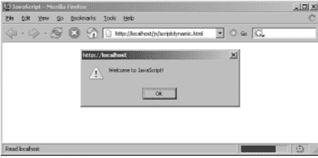

图 1.2 模态窗口来自动态加载的外部文件。

### 使用 JavaScript 伪 URL

```html
<a href="javascript:window.alert('Welcome to JavaScript!')">点击此处获取惊喜！</a>
```

调用 JavaScript 代码的另一种方法是使用伪 URL。当加载以 `javascript:` 开头的 URL 时，其背后的代码会被执行，正如前面的代码（文件 `url.html`）所示。

使用此类 URL 有多种方法——可以以图像、链接或 CSS 样式的形式出现——但通常你想要的是链接。然而，请注意，这种链接显然在支持并已激活 JavaScript 的浏览器中有效。

> **警告**：当 `javascript:` URL 前缀后的代码返回某些内容时，结果将打印到屏幕上。通常，这并不是我们想要的。你可以使用特殊的 JavaScript 函数 `void()` 来避免这种情况：`javascript:void(会返回内容的代码());`。

### 使用事件处理程序执行 JavaScript

```html
<body onload="showText();">
```

执行 JavaScript 代码的第三种方式：前两种是使用 `<script>` 元素，而 `javascript:` 伪 URL 是通过事件处理程序实现的。大多数 HTML 元素都支持一些事件；例如，`<body>` 标签支持 `load` 事件。使用 `on` 前缀，可以将代码附加到其上（更多选项在第 6 章“OOP 与事件”中介绍）。因此，以下代码会在文档完全加载后运行 `showText()` 函数（相对于页面的 HTML 标记，而不包括图像或其他外部数据）：

```html
<html>
<head>
<title>JavaScript</title>
<script language="JavaScript" type="text/javascript">
function showText() {
  window.alert("Welcome to JavaScript!");
}
</script>
</head>
<body onload="setText();">
</body>
</html>
```

使用 JavaScript 事件处理程序 (`event.html`)

> **警告**：有一个常见的误区认为 `javascript:` URL 前缀必须以如下方式与事件处理程序配合使用：
> `<body onload="javascript:setText();">`
> 然而，这完全是错误的——如果不是 JavaScript 代码，什么还能作为事件处理器属性的值呢？因此，请省略 `javascript:`，只需提供关联事件触发时要执行的代码即可。

## 处理不支持 JavaScript 的浏览器

```html
<script type="text/javascript">
document.write("Welcome to JavaScript!");
</script>
<noscript>
欢迎使用纯 HTML！
</noscript>
```

根据最近的调查，高达 10% 的用户由于公司政策、对浏览器安全漏洞的担忧以及其他原因禁用了 JavaScript。因此，你必须确保你的网站在没有 JavaScript 的情况下也能使用。

实现这一点的方法是使用 `<noscript>` 元素。激活了 JavaScript 的浏览器会忽略此元素及其内容，而没有 JavaScript 的浏览器会显示该元素的内容。前面的代码（文件 `nos.html`）在非 JavaScript 浏览器（如文本浏览器 Lynx）时会生成图 1.3 所示的输出；图 1.4 显示了支持脚本语言的浏览器。

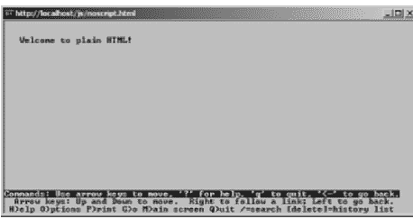

图 1.3 在没有 JavaScript 的浏览器中使用前面的代码。

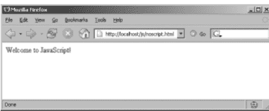

图 1.4 在有 JavaScript 的浏览器中使用前面的代码。

当 JavaScript 与链接配合使用时，以下代码无法完全按预期工作：

```html
<a href="#" onclick="window.alert('Welcome to JavaScript!'); ">点击此处</a>
```

乍看，我们得到了一切：使用 JavaScript 的用户获得了模态窗口，没有 JavaScript 的用户只是点击了一个指向空文本标签的链接；因此没有发生意外情况。

然而，有一个小缺点：在点击 JavaScript 链接后，启用了 JavaScript 的浏览器会显示窗口，但随后仍然会跟随链接。通常，这不会产生影响，但浏览器会滚动到页面顶部，因为没有找到文本标签。

为了避免这种情况，只需确保事件处理程序中的代码返回 `false` 即可。这会取消当前事件可能产生的所有其他影响；在这种情况下，链接将不会跟随：

```html
<a href="#" onclick="window.alert('Welcome to JavaScript!'); return false;">点击此处</a>
```

避免启用了 JavaScript 的浏览器仍然跟随链接 (`link.html`)

# 第 2 章 常用短语

有一些几乎每天都需要执行的重复性 JavaScript 任务。它们构成了许多 JavaScript 应用的基础，且不属于任何特定类别。因此，本章将从一组常见问题及其解决方案开始。

## 检测浏览器类型

```javascript
window.alert(navigator.appName);
```

虽然现在浏览器对 JavaScript 的实现具有很强的兼容性（特别是与 20 世纪 90 年代末浏览器大战期间相比），但检测浏览器类型是 JavaScript 开发者工具箱中至关重要的一部分。

`navigator` JavaScript 对象提供了浏览器信息。最有用但有时难以解析的是它的 `userAgent` 属性，它包含了完整的浏览器标识字符串，该字符串也会在每个请求的 HTTP User-Agent 头部中发送。

若要确定浏览器类型，前面的代码所示，`appName` 属性就足够了。表 2.1 包含了最相关浏览器的 `appName` 值。

**表 2.1 各浏览器的 appName 值**

| 浏览器 | appName |
| :--- | :--- |
| Internet Explorer | Microsoft Internet Explorer |
| Mozilla 浏览器 | Netscape |
| Konqueror (KDE) | Konqueror |
| Apple Safari | Netscape |
| Opera 浏览器 | Opera |

如你所示，Safari 浏览器返回了错误的名称。为了减轻这种影响，你可以搜索 `navigator.userAgent` 以查找特定的浏览器类型。由于 Opera 浏览器可以识别自己为另一个浏览器（但在 `navigator.userAgent` 中提到了 "Opera"），因此必须先检查此浏览器。

```javascript
<script language="JavaScript" type="text/javascript">
var ua = navigator.userAgent;
var browserType = "unknown";

if (ua.indexOf("Opera") > -1) {
  browserType = "Opera";
} else if (ua.indexOf("Safari") > -1) {
  browserType = "Safari";
} else if (ua.indexOf("Konqueror") > -1) {
  browserType = "Konqueror";
} else if (ua.indexOf("Gecko") > -1) {
  browserType = "Mozilla";
} else if (ua.indexOf("MSIE") > -1) {
  browserType = "Internet Explorer";
}
window.alert(browserType);
</script>
```

确定浏览器类型 (`browser.html`)

只需一点努力，此脚本就可以扩展到区分 Mozilla 派生版本（Firefox、Epiphany、Galeon、Camino、SeaMonkey 等）。

## 检测浏览器版本

要确定浏览器的版本号有多种方法。大多数情况下，你需要查看 `userAgent`，它可能如下：

- `Mozilla/5.0 (Windows; NT 5.1; rv:8.0) Gecko/2006026 Firefox 1.5`
- `Mozilla/5.0 (compatible; MSIE 6.0; Windows NT 5.1; en; rv:1.4) Gecko/2003619 Netscape 7.1 (ax)`
- `Mozilla/5.0 (compatible; MSIE 6.0; Windows NT 5.1; SV1; .NET CLR 1.0.3705; .NET CLR 1.1.4322; .NET CLR 2.0.50272)`
- `Mozilla/5.0 (compatible; Konqueror/3.4; FreeBSD; KHTML/3.4 (Like Gecko))`
- `Mozilla/5.0 (Macintosh; U; Intel Mac X; en) AppleWebKit/418 (KHTML, like Gecko) Safari/417.9.3`
- `Mozilla/5.0 (Macintosh; U; PPC Mac X; en) AppleWebKit/312.8 (KHTML, like Gecko) Safari/312.6`
- `Opera/9.00 (Windows NT 5.1; en)`
- `Mozilla/4.0 (compatible; MSIE 6.0; Windows NT 5.1; en) Opera 9.00`

如所示，根据浏览器类型，版本号隐藏在 `userAgent` 值的不同位置。因此，涵盖所有可能的浏览器并跟踪新方法是一项艰巨的任务。然而，有一些网络资源实现了不错的浏览器检测。你可以在这些网站上找到更多文档和代码：

- `http://www.webreference.com/tools/browser/javascript.html`
- `http://gemal.dk/browserspy/basic.html`

## 检查浏览器能力

```javascript
if (document.getElementById) {
  // ...
}
```

正如从前面的示例所示，依赖浏览器版本号不仅困难而且缺乏前瞻性。检查浏览器是否支持你的应用程序所需的功能的更好方法是专门检查对特殊对象的支持。

例如，为了使用 DOM（见第 5 章“DOM 与 DHTML”），你可能想尝试前面的代码。如果实现了 `getElementById()` 方法，`document.getElementById`（不带括号）将返回该函数的引用。在条件中使用时，它评估为真。因此，执行关联代码。

另一个例子：Internet Explorer 为某些应用程序支持 ActiveX 对象，例如 XML 支持。然而，只有 Windows IE 知道 ActiveX——Mac 版本并不知道。因此，专门检查 Internet Explorer 会给 Mac 用户带来问题。如果你专门检查对 ActiveX 的支持，就可以避免这些问题：

```javascript
if (window.ActiveXObject) {
  // ...
}
```

## 防止缓存

```javascript
document.write("");
```

使用服务器端标头，可以避免动态内容（如图像）以及 HTML 页面的缓存。然而，这种方法并非万无一失，因为某些浏览器或代理服务器会忽略这些设置。一种始终有效的技术是在 URL 后面附加一个无意义的数字查询参数，如下所示：`Math.random()` 返回 0 到 1 之间的随机数，例如 `0.1296601696732852`。将此内容附加到后面，通常不会改变从服务器发送的数据，但对于浏览器来说这是一个完全新的请求。因此，图像（或其他数据）不会被缓存。

## 重定向浏览器

```javascript
location.href = "newPage.html";
```

`location.href` 属性允许对当前页 URL 进行读写访问。将 `location.href` 设置为另一个值会重定向浏览器，随后它会加载新页面，如代码所示。

> **提示**：也可以通过 HTML 方法实现：
> ```html
> <meta http-equiv="Refresh" content="X; URL=Y" />
> ```
> 占位符 X 代表等待到新页面加载完成所需的秒数；Y 表示新的 URL。

之前的页面随后会进入浏览器的历史记录。但是，如果你想替换浏览器历史记录中的旧页面（以使此处返回按钮在此处无法按预期工作的效果），请使用 `location.replace()` 方法：

```javascript
location.replace("newPage.html");
```

## 重新加载页面

```javascript
location.reload();
```

`location` 对象的 `reload()` 方法重新加载当前页面，这等同于 `location.href = location.href`。如果你提供 `true` 作为参数，将禁用缓存并且浏览器从服务器进行“硬”重载。然而，这同样并非万无一失，因为中间可能存在代理服务器，它拥有请求页面的缓存副本。因此，你可以使用本章中的“防止缓存”短语技术：

```javascript
location.search = "?" + Math.random();
```

这更改了当前页的查询字符串（`location.search`），有效地重新加载了 URL `reload()`。

## 创建随机数

```javascript
var rand = min + Math.floor((max - min + 1) * Math.random());
```

`Math` 对象的 `random()` 方法计算一个 0 到 1 之间的伪随机数（不包含 1）。然而，通常你感兴趣的是 1 到 10 之间的随机数。通过一个简单的数学计算就可以实现这一点。例如，将 `Math.random()` 的结果乘以 10，实际上生成一个 0 到 10 之间的数字（不包含 10）。如果你然后对该值进行取整，就会得到一个 0 到 9 之间（包含）的整数。加 1 则得到一个 1 到 10 之间的数字。

前面的代码对此进行了泛化，创建了一个 `min` 和 `max` 之间的数字。

## 日期和时间信息

```javascript
var d = new Date();
var mdy = (d.getMonth()+1) + "/" + d.getDate();
```

JavaScript 的 `Date` 对象提供了对当前日期的访问，并能够进行某些日期计算（使用 Epoch 值，即自 1970 年 1 月 1 日以来的毫秒数）。表 2.2 包含了 `Date` 类最重要的方法。前面的代码创建一个月/日/年格式的日期。

**表 2.2 Date 对象的重要方法**

| 方法 | 说明 |
| :--- | :--- |
| `getDate()` | 月中的某一天 |
| `getFullYear()` | 四位数年份 |
| `getHours()` | 小时 |
| `getMinutes()` | 分钟 |
| `getMonth()` | 月份减去 1 (!) |
| `getSeconds()` | 秒 |
| `getTime()` | Epoch 值 |
| `toString()` | 字符串表示形式 |
| `toUTCString()` | UTC 字符串表示形式 |

## 理解正则表达式

简单来说，正则表达式是用于与字符串匹配的模式。正则表达式中的模式包含一个可以在较大的字符串中搜索的字符串。然而，也可以使用 `indexOf()`（更快地）完成任务。正则表达式的优势在于可以使用某些特殊功能，如通配符。表 2.3 显示了一些特殊字符及其含义。

**表 2.3 正则表达式特殊字符**

| 特殊字符 | 说明 | 示例 |
| :--- | :--- | :--- |
| `^` | 字符串开头 | `^a` 意味着以 a 开头的字符串 |
| `$` | 字符串结尾 | `a$` 意味着以 a 结尾的字符串 |
| `?` | 0 次或 1 次（引用上一个字符或表达式） | `ab?` 意味着 a 或 ab |
| `*` | 0 次或多次（引用上一个字符或表达式） | `ab*` 意味着 a 或 ab 或 abb... |
| `+` | 1 次或多次（引用上一个字符或表达式） | `ab+` 意味着 ab 或 abb 或 abbb... |
| `[...]` | 可选字符 | `PHP[45]` 意味着 PHP4 或 PHP5 |
| `-` (用于方括号内) | 值序列 | `ECMAScript[3-5]` 意味着 ECMAScript 3、4 或 5 |
| `^` (用于方括号内) | 匹配范围内的字符 | `[^3-5]` 意味着非 3、4、5 |
| `\` | 转义字符 | `\d` 意味着数字 |
| `\|` | 逻辑“或” | `a\|b` 意味着 a 或 b |
| `(...)` | 分组 | `(abc)` 匹配 abc |
| `.` | 任意字符 | `.` 匹配任何字符 |
| `{min, max}` | 最小和最大次数；如果省略 min 或 max，则表示无限次 | `a{2,3}` 意味着 a 出现 2 到 3 次 |

## 使用正则表达式

在 JavaScript 中定义正则表达式有两种方式：

```javascript
var zip = new RegExp("\\d{5}");
// 或
var zip = /\d{5}/;
```

这两种方法在功能上没有区别，你只需要转义。然后，表达式的 `test()` 方法检查字符串是否包含：

```javascript
var found = zip.test("Indianapolis, IN 4620");
// true
```

如果你对具体的匹配项感兴趣，使用 `exec()` 函数。该方法返回一个数组。其第一个元素是整个匹配，后续元素是子匹配（如果使用了括号）。

```javascript
var matches = zip.exec("Indianapolis, IN 4620");
// ["4620"]
```

> **提示**：`match()` 返回所有匹配项；`exec()` 只返回当前的，通常是第一个。然而，如果你多次调用 `exec()`，就会返回所有匹配项。

## 替换文本

```javascript
var address = /(\w+), ([A-Z]{2}) (\d{5})/;
var sams = "Indianapolis, IN 4620";
var result = sams.replace(address, "$3 $1, $2");
```

字符串的 `replace()` 方法可以将匹配项替换为另一个字符串。在这个替换字符串中，你可以引用子匹配。`$0` 指第一个匹配，`$1` 引用第一个子匹配（括号内），`$2` 指第二个子匹配，依此类推。前面的代码搜索了城市、州和邮政编码元素，然后重新排列了它们。结果是 `"4620 Indianapolis, IN"`。

## 获取 GET 参数

```javascript
var ls = location.search.substring(1);
var namevalue = ls.split("&");
```

通常，GET 信息是在服务器端评估的，但 JavaScript 也可以通过其 `location.search` 属性访问这些信息。然而，那里的数据是以键值对的形式存在的。以下代码使用 JavaScript 的 `split()` 方法对这些数据进行解码。随后显示生成的关联数组，以证明其工作符合预期；输出请参见图 2.1。

```javascript
<script language="JavaScript" type="text/javascript">
var getdata = [];

if (location.search.length > 1) {
  var ls = location.search.substring(1);
  var namevalue = ls.split("&");
  for (var i=0; i<namevalue.length; i++) {
    var data = namevalue[i].split("=");
    getdata[data[0]] = data[1];
  }
}

var s = "";
for (var el in getdata) {
  s += el + ": " + getdata[el] + "\n";
}
alert(s);
</script>
```

解析查询字符串 (`queryString.html`)

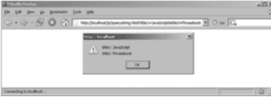

图 2.1 查询字符串中的数据被解析并显示。

## 请求用户确认

```html
<a href="anyPage.html" onclick="return window.confirm('Do you really want to do this?');">点击此处</a>
```

JavaScript 对模态窗口的支持有限。`window.alert()` 方法相当常见，但也有其他选项。通过 `window.confirm()`，用户会看到一个是/否窗口。如果点击了“是”，`window.confirm()` 返回 `true`；否则返回 `false`。前面的代码（文件 `confirm.html`）将此作为链接的返回值，因此如果点击了“否”，就不会跳转链接。

> **警告**：注意，此对话框是由浏览器翻译的，因此你应该避免使用如“点击是以...”之类的文本，因为使用非英语系统的用户没有“是”按钮。

## 请求用户数据

```javascript
var name = window.prompt("输入你的名字!", "<你的名字>");
```

`window.prompt()` 方法允许用户在单行文本框中输入（参见图 2.2）。此信息是方法调用的返回值，可以在脚本中进一步使用。

```javascript
<script language="JavaScript" type="text/javascript">
var name = window.prompt("Enter your name!", "<Your name>");
if (name != null) {
  window.alert("Hello, " + name + "!");
}
</script>
```

提示用户数据 (`prompt.html`)

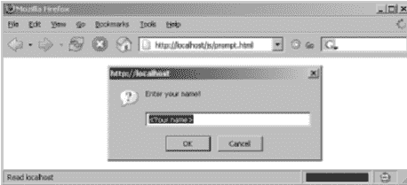

图 2.2 由 `window.prompt()` 生成的输入框。

> **注意**：请注意如果点击取消按钮或按下 Esc 键，`window.prompt()` 将返回 `null`。前面的代码检查了这一点；如果按了确定按钮，则会显示输入的数据。

# 第 3 章 图像与动画

在 Web 早期，使用 JavaScript 实现的最早效果之一是图像处理。一个经典的例子是悬停图像：将鼠标指针悬停在图像上，它的外观就会发生变化。Netscape 在浏览器 3 版本中引入了对图像的 JavaScript 访问。当时，Windows 版 Internet Explorer 3 处于测试阶段，因此对于这项功能来说太晚了。然而，Mac 版 Internet Explorer 3 在 Windows 版本之后发布，为微软工程师留了足够的时间在 IE Mac 中添加 JavaScript 图像访问。从 IE 4 开始，微软浏览器也可以访问图像，所有其他相关浏览器也是如此。

这不仅可以实现好看的图形效果，还可以实现更复杂的应用程序，如幻灯片。

## 创建鼠标悬停按钮

```html

```

万维网最古老的效果之一是当鼠标移动（悬停）在其上方时改变外观的图形。这也被称为“悬停效果”或“悬停按钮”/“悬停图形”。顺便说，这个名称也体现在某些浏览器支持的非标准 `:hover` 伪 CSS 类中。

要更改图形，你必须访问它然后更改其 `src` 属性。浏览器支持多种访问图形的方法。以下方法在现代浏览器中一致有效：

- 设置图像的 `name` 属性，并通过 `document.images["name"]` 访问它。
- 设置图像的 `name` 属性，并通过 `document.images.name` 访问（但是，这样的话 `name` 属性中就不允许空格或连字符等特殊字符）。
- 使用图像在页面上的位置访问，通过 `document.images[0]` 访问第一张图像，`document.images[1]` 访问第二张，以此类推。
- 设置图像的 `id` 属性，并通过 `document.getElementById("id")` 访问。

鼠标移动过图像的相应事件是 `mouseover`，当发生 `mouseout` 时，你应该将图像重置为原始状态。前面的代码显示了以下示例：

```javascript
function changeImage(name, url) {
  document.images[name].src = url;
}
```

悬停效果 (`hover.html`)

```html
<script language="JavaScript" type="text/javascript">
function changeImage(name, url) {
  document.images[name].src = url;
}
</script>

```

## 制作动画

在这种情况下，JavaScript 是最佳选择。正如前面的短语所示，改变图像是可能的，唯一缺失的元素是使用 `setInterval()` 或 `setTimeout()`。以下代码遍历图像数组，并在 500 毫秒（半秒）过去后移动到下一张图像：

```javascript
<script language="JavaScript" type="text/javascript">
var urls;

function animate(pos) {
  pos %= urls.length;
  document.images["animation"].src = urls[pos];
  window.setTimeout("animate(" + (pos + 1) + ")", 500);
}

window.onload = function() {
  urls = new Array(
    "0.png", "1.png", "2.png", "3.png",
    "4.png", "5.png", "6.png");
  animate(0);
}
</script>

```

通过图片动画 (`animate.html`)

`animate()` 函数接收一个参数：要显示的下一个图像的位置。要遍历的图像列表保存在全局变量中，因为 `setTimeout()` 无法使用全局作用范围外的本地变量。

通过 `pos %= urls.length`，在显示最后一张图像后，图像列表的指针被设置为开头，从而有效地产生无限循环。如果你想让动画在最后一张图像结束后停止，请将此行替换为以下代码：

```javascript
if (pos == urls.length) {
  return false;
}
```

## 拉伸图形

```javascript
document.images["bar"].width += 5;
```

有时候，甚至没有必要创建多个图形来制作动画。有时只需拉伸图像就能产生奇妙的效果。通常，这在 Web 上效果并不理想，因为只支持位图格式（Flash 或 SVG 除外，它们在浏览器的默认设置中不可用）。因此，拉伸图形会指示浏览器计算额外的图像信息。这通常是通过复制像素完成的。

在进度条的情况下，简单的图形就足够了。在一个简单的示例中，使用 1×1 像素的图像。如果将在 HTML 页面中使用宽度为 20 像素、高度为 10 像素的它，就会得到一个 20×10 像素的图像。通过 JavaScript 动画图像的宽度，你可以获得进度移动的视觉。

可以使用 JavaScript 中的 `width` 和 `height` 属性访问图像的宽度和高度，这两个属性都是可读可写的。以下代码使用简单的 1×1 像素黑色图形 `black.gif` 移动进度条。

```javascript
<script language="JavaScript" type="text/javascript">
function progress() {
  if (document.images["bar"].width < 200) {
    document.images["bar"].width += 5;
    document.images["bar"].height = 5;
  } else {
    clearInterval(ID);
  }
}

var ID;
window.onload = function() {
  ID = setInterval(progress, 500);
}
</script>

```

动画进度条 (`progress.html`)

图 3.2 显示了示例运行情况：1×1 图像已通过 JavaScript 动态拉伸。得益于 `setInterval()` 的调用，每 500 毫秒就会调用一次 `progress()` 函数。当进度条达到最大长度时（在本示例中为任意的 200 像素），使用 `clearInterval()` 停止动画。

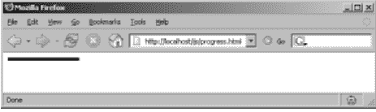

图 3.2 图形被动画处理，看起来像一个进度条。

> **警告**：如果你不显式设置进度条图像的高度，拉伸其宽度也会拉伸其高度，从而破坏预期效果。

## 使用进度条视觉化页面加载状态

```javascript
if (document.images[i].complete) {
  loaded++;
}
```

仅凭 JavaScript 无法确定页面是否已完全加载，但至少可以进行充分估计。图像的 `complete` 属性提供一个布尔值，告知图像是否已完全加载。此外，图像支持 `load` 事件，因此可以使用 `onload` 在图像加载后触发代码执行。

以下代码遍历页面上的所有图像，并统计有多少图像已完全加载。这生成了一个关于页面完全加载程度的估算百分比。（当然，不包括 Applet 和嵌入媒体；此外，没有考虑图像文件的大小。）

```javascript
<script language="JavaScript" type="text/javascript">
function showprogress() {
  if (document.images.length == 0) {
    return false;
  }
  var loaded = 0;
  for (var i=0; i<document.images.length; i++) {
    if (document.images[i].complete) {
      loaded++;
    }
  }
  var percentage = Math.round(100 * loaded / document.images.length);
  document.getElementById("progress").innerHTML = percentage + "% loaded";
  if (percentage == 100) {
    window.clearInterval(ID);
  }
}
var ID = setInterval(showprogress, 500);
</script>
<p id="progress">0% loaded</p>
```

加载进度条 (`progress.html`)

为了实际重现这种效果，必须嵌入加载时间的图像。图 3.3 显示了结果。图像的其他有趣事件还有 `abort`（当加载被中止时）和 `error`（发生错误时）。

## 使用图像映射

JavaScript 也可以用于图像映射，但仅限于极少数场景：

- 当用户点击 `hotspot` 时，图像映射可以调用 JavaScript。
- 在 `<map>` 元素定义的形状内可以使用 `mouseover`、`mouseout` 和 `load` 等事件。
- 与图像关联的映射可以通过 `useMap` 属性设置。通常只有一个图像。

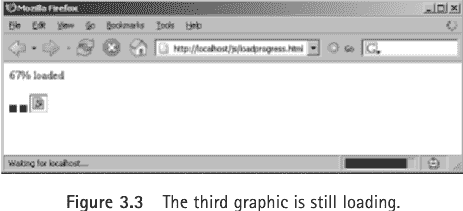

# 第 4 章 CSS

在 Web 的早期，内容与布局无关。然后 Web 开始商业化，网页开发者开始滥用 HTML，这在某种程度上使其变成糟糕的设计工具。随着 CSS（层叠样式表）的出现，情况变得好，因为它允许为 HTML 页面设置样式——HTML 是一种标记语言，定义内容和结构，但不一定定义外观。

使用 JavaScript，可以动态应用 CSS 效果。本章中的大多数语句都是通用的，你可以将这些技术应用于任何的 CSS 设计挑战。然而，某些语句解决了非常特定的问题。

## 访问 CSS 样式

```javascript
document.getElementById("para").style.fontWeight = "bold";
```

JavaScript 可以设置任何 CSS 命令，并“几乎”使用 CSS 命令名称作为 JavaScript 属性。然而，存在一个问题：某些字符（如连字符）不允许出现在 JavaScript 属性中。但许多 CSS 命令（例如 `font-weight`）包含连字符。因此，JavaScript 语言使用小驼峰命名法：每个组件用大写字母开头，但第一个不是。所以 CSS 命令 `font-weight` 可以通过 `fontWeight` 属性设置。

可以使用页面上每个较大的 HTML 元素的 `style` 属性访问所有 CSS 命令。访问这些元素有两种常用方法：

- 使用 HTML 属性形式的事件处理器，并将当前元素的引用作为参数提交：`<p onmouseover="handlerFunction(this)">`
- 使用 `document.getElementById()` 访问元素。

以下列表显示了后一种方法。使用 `document.getElementById()` 选择 `<p>` 元素；然后设置 `font-weight` CSS 命令：

```javascript
function makeBold() {
  document.getElementById("para").style.fontWeight = "bold";
  window.setTimeout("makeLighter()", 1000);
}

function makeLighter() {
  document.getElementById("para").style.fontWeight = "lighter";
  window.setTimeout("makeBold()", 1000);
}

window.onload = makeBold;
</script>
<p id="para">CSS and JavaScript</p>
```

修改 CSS 命令 (`style.html`)

> **提示**：当使用 Mozilla 浏览器时，如果对所选样式应用了无效值，JavaScript 控制台也会显示错误，如图 4.1 所示。这在您调试时非常有用。

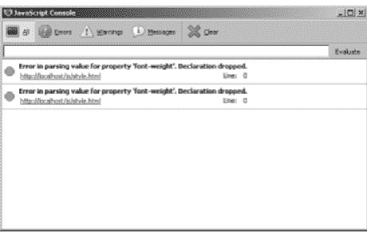

图 4.1 Mozilla 浏览器（此处为 Firefox）对无效的 CSS 值进行报错。

## 访问 CSS 类

```javascript
document.getElementById("para").className = "strong";
```

将 CSS 应用到 HTML 页面最常用的方法是使用类。在 JavaScript 中，可以通过 `className` 属性访问每个元素的类。以下代码使用类的方法实现了前述语句：

```html
<script language="text/javascript">
function makeBold() {
  document.getElementById("para").className = "strong";
  window.setTimeout("makeLighter", 1000);
}

function makeLighter() {
  document.getElementById("para").className = "weak";
  window.setTimeout("makeBold", 1000);
}
</script>
<style type="text/css">
.strong { font-weight: bold; }
.weak { font-weight: lighter; }
</style>
<p id="para">CSS and JavaScript</p>
```

修改 CSS 类 (`classname.html`)

上述代码每秒更改一次文本的类名。

## 访问单个样式表

```javascript
document.styleSheets[0].disabled = true;
```

当一个页面包含多个内联样式（`<style>` 元素或外部样式表）时，你可以使用 JavaScript 在这些样式表之间切换、激活和禁用它们，还可以将它们组合。

`document` 对象的 `styleSheets` 属性包含了页面上所有的样式表，按照它们加载或在页面上出现的顺序排列。

每个样式表最重要的属性是 `disabled`。如果将其设置为 `true`，则样式表将变得不可见，并且不再影响页面的布局。

访问特定样式表有两种方法：

- 使用样式表的 ID 作为 `styleSheets` 数组的索引。
- 使用样式表的数字（从 0 开始）作为 `styleSheets` 数组的索引。

前一种方法在 Mozilla 浏览器中工作效果不佳，因此你应该使用数字索引，如下方的代码所示：

```javascript
<script language="JavaScript" type="text/javascript">
function makeBold() {
  document.styleSheets[0].disabled = false;
  document.styleSheets[1].disabled = true;
  window.setTimeout("makeLighter()", 1000);
}

function makeLighter() {
  document.styleSheets[0].disabled = true;
  document.styleSheets[1].disabled = false;
  window.setTimeout("makeBold()", 1000);
}

window.onload = makeBold;
</script>
<style type="text/css" id="strong">
 p { font-weight: bold; }
</style>
<style type="text/css" id="weak">
 p { font-weight: lighter; }
</style>
<p>CSS and JavaScript</p>
```

修改样式表 (`stylesheets.html`)

## 访问单个 CSS 规则

```javascript
document.styleSheets[0].cssRules[0].style.fontWeight = "bold";
```

除了启用和禁用整个样式表外，你还可以访问单个 CSS 规则。`styleSheets` 数组中的每个样式表都有一个 `cssRules` 数组（在 Internet Explorer 中称为 `rules`），其中包含了该样式表中的所有规则。每个规则都有一个 `style` 属性，可以像访问元素的 `style` 属性一样访问它。

以下代码修改第一个样式表中的第一条规则，将字体加粗：

```javascript
<script language="JavaScript" type="text/javascript">
function makeBold() {
  var sheet = document.styleSheets[0];
  var rules = sheet.cssRules || sheet.rules;
  rules[0].style.fontWeight = "bold";
  window.setTimeout("makeLighter()", 1000);
}

function makeLighter() {
  var sheet = document.styleSheets[0];
  var rules = sheet.cssRules || sheet.rules;
  rules[0].style.fontWeight = "lighter";
  window.setTimeout("makeBold()", 1000);
}

window.onload = makeBold;
</script>
<style type="text/css">
p { font-weight: normal; }
</style>
<p id="para">CSS and JavaScript</p>
```

修改 CSS 规则 (`rules.html`)

## 让网页内容消失

然而，正如你将看到的，绝对定位在不同浏览器之间会导致一些细微的差异。最好的方法是使用块级布局，并将元素的 `display` 属性设置为 `block` 或 `none`：


```javascript
<script language="JavaScript" type="text/javascript">
function showHide(show, hide) {
  document.getElementById(show).style.display = "block";
  document.getElementById(hide).style.display = "none";
}
</script>
<p id="tab1">
Tab 1
</p>
<p id="tab2" style="display: none">
Tab 2
</p>
<input type="button" value="Tab 1" onclick="showHide('tab1', 'tab2');" />
<input type="button" value="Tab 2" onclick="showHide('tab2', 'tab1');" />
```

设置元素的显示模式 (display.html)

图 4.3 显示了结果：点击第二个按钮显示第二个标签页。

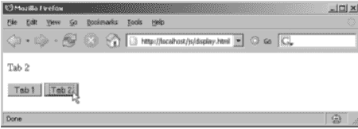

图 4.3 点击按钮显示关联标签页。

# 将 JavaScript 应用于 CSS 选择器

```javascript
Behaviour.register(cssrules);
```

在 1999 年，W3C 提出了“CSS 行为扩展（http://www.w3.org/TR/1999/WD-css3-19990804）”，这是一种将 JavaScript 代码绑定到 CSS 行为的方法。其基本思想是避免使用众所周知的 `onxxx` HTML 属性。1999 年之后，该领域没有取得太大进展，但 Ben Nolan 成功提供了一个类似的概念。为了让它工作，你需要从 http://www.bennolan.com/behaviour/ 获取 JavaScript 库，格式为 `behaviour.js` 文件。（注意该词组使用了英式英语拼写 *behaviour*！）这个代码集允许以 CSS 选择器的形式提供包含 JavaScript 代码的规则。

要让其工作，你首先需要一个定义 CSS 规则的外部 JavaScript 文件。你基本上创建了一个以 CSS 选择器为键（key）、以 JavaScript 事件处理函数为值（value）的对象。然后，你调用 `Behaviour.register()` 方法将这些规则报告给 behaviour 库：

```javascript
var cssrules = {
  "p.para" : function(e){
    e.onmouseover = function() {
      this.style.fontWeight = "bold"
    }
    e.onmouseout = function() {
      this.style.fontWeight = "normal"
    }
  },
  "#term" : function(e){
    e.onmouseover = function() {
      this.style.fontStyle = "oblique"
    }
    e.onmouseout = function() {
      this.style.fontStyle = "normal"
    }
  }
};
```

`Behaviour.register(cssrules.js);`

## CSS/JavaScript 规则 (rules.js)

剩下的工作就是加载 JavaScript 库和之前的规则 JavaScript 文件。然后当关联事件（例如中的 `mouseover` 和 `mouseout`）触发时，JavaScript 代码就会执行。

```html
<script language="JavaScript" type="text/javascript" src="behaviour.js"></script>
<script language="JavaScript" type="text/javascript" src="rules.js"></script>
```

```html
<p class="para">CSS <span id="term">&amp;</span>
JavaScript</p>
```

## 使用 Behaviour JavaScript 库 (behaviour.html)

图 4.4 显示了结果：当鼠标指针移动到 `<span>` 元素上时，会调用两个事件处理器。

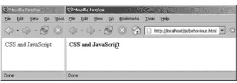

图 4.4 JavaScript 代码正在执行。

> 注意：这种方法的主要优势在于，JavaScript 代码完全存储在外部文件中，不会弄乱页面的 HTML 标记。从架构角度来看，这是一个非常棒的主意——而且它是跨浏览器的。

# 修改鼠标指针

```javascript
document.getElementById("button").style.cursor = "help";
```

每个操作系统都带有一组特定的鼠标光标，而 CSS 支持其中的子集。

不同操作系统之间的外观略有不同，但总体布局非常相似。涉及的 CSS 命令是 `cursor`，它也可以通过 JavaScript 调用，如下代码所示：

```javascript
<script language="JavaScript" type="text/javascript">
  window.onload = function() {
    document.getElementById("helpButton").style.cursor = "help";
  };
</script>
<input type="submit" id="helpButton" value="Get help" />
```

## 修改光标 (cursor.html)

你可以在图 4.5 中看到结果：鼠标光标现在包含一个问号，更明显地表明按钮后面有帮助信息。

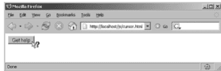

图 4.5 鼠标光标发生了。

## CSS 样式

这些是 `cursor` 的允许值：

- auto
- crosshair
- default
- help
- move
- pointer
- wait

# DOM 和 DHTML

本章涵盖了两个松散相关的技术：DOM 和 DHTML。JavaScript 的这些方面已经存在了多年，但现在它们经常被一起使用。最初，它们并没有多少共同之处，但现在本章的重点是 DOM。

## 理解 DOM

DOM 代表文档对象模型（Document Object Model），它为 HTML 文档提供了一个对象模型（以及配套的 API，即应用程序编程接口）。

可视化 DOM 的最佳方法之一是使用 Mozilla 浏览器自带的 DOM 检查器。在模型中，所有页面元素都被放置在一个树形层次结构中。每个 HTML 标签都是树中的一个节点，具有子节点和父节点。此外，每个文本部分都是自己的节点（文本节点）。图 5.1 显示了简单文档的 DOM 检查器。

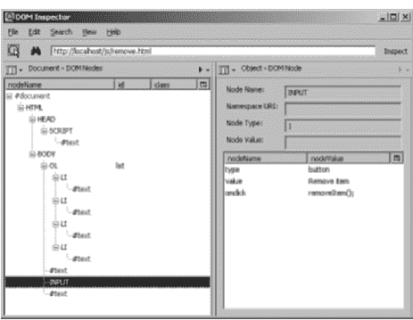

当然，DOM API 支持不仅访问树中的元素，还添加和删除元素。因此，可以修改页面上的几乎任何内容。

仍然存在一个问题：使用 DOM 还是使用表单或图像等标准 JavaScript 对象更好？通常，DOM 的方式要灵活得多，但有时也更困难。因此，如果有可以使用的 JavaScript 捷径，就用它吧。否则，请熟悉 DOM。

## 理解 DHTML

虽然 DOM 是一个“真正的”技术术语，但 DHTML——动态 HTML——并不是。DHTML 是一个纯粹的营销术语；它的意思是“适用于浏览器 4 及以上版本的 JavaScript”。那时，Netscape Navigator 和 Internet Explorer 正在进行传奇的浏览器大战，在它们的第 4 版本中，这两家供应商都包含了更多动态 JavaScript 特性，遗憾的是它们互不兼容。随着 Netscape 4 和 Internet Explorer 4 早已远去，两个浏览器品牌的最新版本（记住 Netscape 6 接了 Netscape 4 并基于 Mozilla 的 Gecko 引擎）对 DOM 的支持都非常好（尽管仍然缺少一些元素）。因此，DHTML 再次重生，因为现在只需要少量的特定浏览器代码和客户端检测即可实现 JavaScript 效果。

## 访问特定元素

当你处理 DOM 时，以后访问页面上元素的理想方法是给它分配一个唯一标识符，即 ID。然后，使用 DOM 方法 `document.getElementById()` 访问指定的元素并允许你进入其中：修改元素、添加子元素，或以其他方式进一步遍历 DOM 树。

在接下来的示例中，访问了 `<p>` 元素。根据浏览器的类型，元素类名的字符串表示有所不同。Internet Explorer 仅输出 `[object]`，而 Mozilla 浏览器更加详细并提供了更多信息：`[object HTMLElement]`。

```javascript
<script language="JavaScript" type="text/javascript" onload="function() {
window.alert(document.getElementById("para"));
}
</script>
<p id="para">JavaScript 句手册</p>
```

通过 ID 访问元素 (getelelementbyid.html)

> 警告：只有在整个文档加载完成后才能访问 DOM。这就是为什么 DOM 访问代码只在加载事件触发后才执行的原因。

## 访问标签

```javascript
document.getElementsByTagName("p")
```

访问当前页面元素的另一种方法是通过标签名来访问它们。

## 访问标签

每当你需要处理一组由相同 HTML 标签表示的元素时（例如，所有的列表项或所有的段落——任何不是由 JavaScript `document` 对象其他属性表示的内容），都可以使用 `getElementsByTagName()` 方法。你提供标签名和一个包含所有元素的数组，然后就可以对它们进行进一步处理。

以下代码仅仅访问了所有的 `<p>` 元素并对其进行计数：

```javascript
<script language="JavaScript" type="text/javascript">
window.onload = function() {
  window.alert(document.getElementsByTagName("p") + " " + document.getElementsByTagName("p").length + " elements");
}
</script>
<p>JavaScript 句手册</p>
<p>Sams Publishing</p>
```

通过标签名访问元素 (getelementsbytagname.html)

上述代码的输出是 `[object HTMLCollection]` (2 个元素)；Internet Explorer 再次提供了较少的信息，输出 `[object]` (2 个元素)。

## 遍历 DOM 树

进入 DOM 内部后，你可以在 DOM 结构中导航，既可以向上也可以向下，向左也可以向右。以下是每个 DOM 节点拥有的最重要的属性列表：

- `firstChild`: 第一个子节点
- `lastChild`: 最后一个子节点
- `childNodes`: 所有子节点（数组形式）
- `parentNode`: 父节点
- `nextSibling`: 同一层级的下一个节点（“向右”）
- `previousSibling`: 同一层级的上一个节点（“向左”）

此外，`nodeName` 返回节点标签的名称（文本节点则返回 `#text`），而 `nodeValue` 返回节点的值（对文本节点有用）。

## 确定节点信息

```javascript
s += nodeName + ": " + nodeValue + " (" + nodeType + ")\n";
```

正如在前一个短语中提到的，可以收集有关节点的信息，这在处理任意 DOM 数据时极其有用。

虽然 `nodeName` 提供关于节点名称（标签名或文本节点的 `#text`）的信息，但 `nodeValue` 仅对文本节点有用，并返回节点中的实际文本。第三类信息来自 `nodeType` 属性，它提供了关于节点类型的信息。表 5.1 包含了 `nodeType` 所有可能值的列表。

表 5.1 节点类型

| 节点类型 | 描述 |
|---|---|
| 1 | 标签 |
| 2 | 属性 |
| 3 | 文本（包括空格） |
| 8 | HTML 注释 |
| 9 | 文档 |
| 10 | DTD |
| 11 | 片段 |

以下代码分析了一个简单的 DOM 结构并输出关于所有子节点的信息。图 5.2 显示了浏览器中的输出。

```javascript
<script language="text/javascript">
window.onload = function() {
  var s = "";
  with (document.getElementById("para")) {
    for (var i=0; i<childNodes.length; i++) {
      with (childNodes[i]) {
        s += nodeName + ": " + nodeValue + "(" + nodeType + "")\n";
      }
    }
  }
  window.alert(s);
}
</script>
```

<p id="para"><em>JavaScript</em> 句手册</em></p>

获取节点信息 (nodeinfo)

## 移除元素

```javascript
list.removeChild(list.lastChild);
```

每个节点都可以使用的 `removeChild()` 方法用于从 DOM 树中删除一个节点。注意，你必须从要删除的节点的父元素调用此方法，并将该节点作为参数提供。以下示例显示了一个列表，并在每次点击按钮时移除最后一项；浏览器中的输出请见图 5.3。

```javascript
<script language="JavaScript"
  type="text/javascript">
  function removeItem() {
    var list = document.getElementById("list");
    if (list.childNodes.length > 0) {
      list.removeChild(list.lastChild);
    }
  }
</script>
<ol id="list">
  <li>Item</li>
  <li>Item</li>
  <li>Item</li>
  <li>Item</li>
</ol>
<input type="button" onclick="removeItem();" value="Remove item" />
```

移除节点 (remove.html)

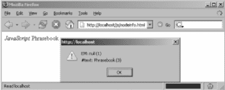

图 5.2 关于所有子节点的信息。

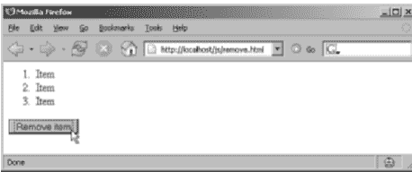

图 5.3 节点被移除。

> 提示：只有在整个文档加载完成后才能访问 DOM。这就是为什么 DOM 访问代码只在加载事件触发后才执行的原因。

当你调用以下代码时，可以从 DOM 中删除一个节点：

`curNode.parentNode.removeChild(curNode);`

## 添加元素

```javascript
list.appendChild(newNode);
```

创建新节点是通过 `createElement()` 方法完成的。它创建一个元素，然后你可以将其插入 DOM。`appendChild()` 方法在大多数情况下会在点击按钮时将新元素添加到列表的末尾：

```javascript
<script language="JavaScript" type="text/javascript">
function addItem() {
  var list = document.getElementById("list");
  var newNode = document.createElement("li");
  list.appendChild(newNode);
}
</script>
<ul id="list"><li>Item</li></ul>
<input type="button" onclick="addItem()" value="Add item" />
```

添加节点 (add.html)

这种方法的缺点是新元素总是被添加到列表末尾。为了缓解这种影响，`insertBefore()` 方法允许在任何其他节点之前插入新节点。这如图 5.4 所示。

```javascript
<script language="JavaScript" type="text/javascript">
function addItem() {
  var list = document.getElementById("list");
  var newNode = document.createElement("li");
  list.insertBefore(newNode, list.firstChild);
}
</script>
<ul id="list"><li>Item</li></ul>
<input type="button" onclick="addItem();" value="Add item" />
```

在列表开头添加节点 (addbefore.html)

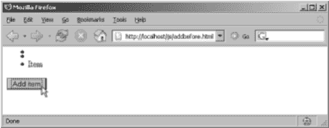

图 5.4 元素被添加到列表开头。

## 创建文本元素

```javascript
var newNode = document.createTextNode(" Item " + nr);
```

如果你想在元素内部放置文本，你需要一个作为实际元素子节点的文本节点。`createTextNode()` 方法可以创建这样的文本节点；你只需要提供实际文本。

在接下来的代码中，再次添加了列表元素；然而，这次它们内部包含了文本。因此，首先创建一个文本节点，然后将其附加到另一个节点（该节点可以被添加到另一个节点，该节点可以被添加到另一个节点……你明白意思了）。

```javascript
<script type="text/javascript">
var nr = 1;
function addItem() {
  var list = document.getElementById("list");
  var newNode = document.createElement("li");
  nr++;
  var newText = document.createTextNode("Item " + nr);
  newNode.appendChild(newText);
  list.appendChild(newNode);
}
</script>
<ul id="list"><li>Item 1</li></ul>
<input type="button" onclick="addItem()" value="Add item" />
```

创建（并添加）文本节点 (textnode.html)

到目前为止，本章的短语已经涵盖了普通标签和文本节点。一个仍然缺失的重要部分

## 属性操作

你可以通过节点的形式访问属性，最方便的方法是使用 `setAttribute()` 方法：只需提供属性名和它的值即可。在下面的代码中，新生成的 `<li>` 元素的内容是一个超链接，并设置了 `href` 属性：

```javascript
<script language="JavaScript"
type="text/javascript">
var nr = 1;
function addItem() {
  var list = document.getElementById("list");
  var newNode = document.createElement("li");
  var newLink = document.createElement("a");
  newLink.setAttribute("href",
    "http://www.sampublishing.com/");
  nr++;
  var newTextNode =
    document.createTextNode("Item " + nr);
  newLink.appendChild(newTextNode);
  newNode.appendChild(newLink);
  list.appendChild(newNode);
}
</script>
<ul id="list"><li>Item 1</li></ul>
<input type="button" onclick="addItem();"
value="Add item" />
```

设置属性 (attributes.html)

图 5.5 显示添加到列表的所有链接都指向所提供的 URL。

# 第 5 章 DOM 和 DHTML

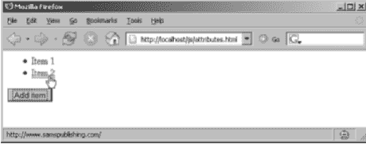

图 5.5 动态生成的超链接。

## 克隆元素

```javascript
var newItem = oldItem.cloneNode(true);
```

与其重新创建新节点，你也可以克隆一个现有的节点。每个节点都拥有的 `cloneNode()` 方法可以为你完成此操作。你可以决定是只克隆节点及其属性，还是克隆所有子节点（以及它们的子节点，以此类推）。如果你在 `cloneNode()` 的参数中提供 `true`，则所谓的“深拷贝”也会复制子节点；`false` 则仅克隆节点本身。

```javascript
<script language="JavaScript"
type="text/javascript">
var nr = 1;
function addItem(cloneMode) {
var list = document.getElementById("list");
var oldItem = list.firstChild;
var newItem = oldItem.cloneNode(cloneMode);
list.appendChild(newItem);
}
</script>
```

```html
<ul id="list"><li><a href="http://www.samspublish.com/">Item 1</a></a></li></ul>
<input type="button" onclick="addItem(true)" value="Clone all" />
<input type="button" onclick="addItem(false)" value="Clone node only" />
```

克隆节点 (clone.html)

当你点击第一个按钮时，整个节点（包括链接和列表项等子元素）都会被复制；第二个按钮仅克隆节点本身，生成一个新的但为空的列表项。请看图 5.6 以查看差异。

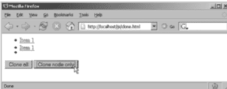

图 5.6 复制节点的两种方式。

## 替换元素

```javascript
list.replaceChild(newNode, list.firstChild);
```

如果你删除一个节点然后在相同位置插入另一个节点，`replaceChild()` 方法可以为你节省一些代码。你只需提供新节点和旧节点，JavaScript 就会为你完成其余工作。记住，你必须从旧节点和新节点的父元素调用此方法！

```html
<script language="JavaScript"
  type="text/javascript">
  var nr = 1;
  function addItem() {
    var list = document.getElementById("list");
    var newNode = document.createElement("li");
    nr++;
    var newTextNode = 
      document.createTextNode("Item " + nr);
    newNode.appendChild(newTextNode);
    list.replaceChild(newNode, list.firstChild);
  }
</script>
<ul id="list"><li>Item 1</li></ul>
<input type="button" onclick="addItem();"
  value="Replace item" />
```

替换节点 (replace.html)

上述代码用新节点替换了列表的第一个子节点（节点）。

## 从 JavaScript 数据创建无序列表

```javascript
var newItem = document.createElement("li");
var newText = document.createTextNode(data[i]);
newItem.appendChild(newText);
list.appendChild(newItem);
```

特别是在 Web 服务和 AJAX 的背景下（见第 10 章），你经常从服务器接收数据并必须以动态的方式显示它们。一种很好的方法是使用 HTML 列表。下面的代码提供了一个 `createList()` 函数，它接收一个带有值的数组并将其转换为列表。

```javascript
<script language="JavaScript"
type="text/javascript">
function createList(data) {
  var list = document.createElement("ul");
  for (var i = 0; i < data.length; i++) {
    var newItem = document.createElement("li");
    var newText = document.createTextNode(data[i]);
    newItem.appendChild(newText);
    list.appendChild(newItem);
  }
  return list;
}

window.onload = function() {
  var list = createList(
    ["one", "two", "three", "four", "five"]
  );
  document.body.appendChild(list);
}
</script>
```

创建列表 (list.html)

注意 `document.body` 是 `getElementsByTagName("body")[0]` 的快捷方式，否则你需要使用 `<body>` 元素。

## 通过 JavaScript 创建表格

```javascript
var td = document.createElement("td");
newText = document.createTextNode(data[i]);
td.appendChild(newText);
```

比列表稍微复杂一点，使用 `<td>` 属性。否则你需要使用 `<tbody>` 元素来显示数据。`createTable()` 函数期望一个多维数组，正如 5.7的表格：

```javascript
function createTable(data) {
  var table = document.createElement("table");
  var thead = document.createElement("thead");
  var tr = document.createElement("tr");
  for (var i = 0; i < data[0].length; i++) {
    var th = document.createElement("th");
    th.innerHTML = data[0][i];
    tr.appendChild(th);
  }
  thead.appendChild(tr);
  table.appendChild(thead);

  var tbody = document.createElement("tbody");
  for (var i = 1; i < data.length; i++) {
    var tr = document.createElement("tr");
    tbody.appendChild(trtr);
    for (var j = 0; j < data[i].length; j++) {
      var td = document.createElement("td");
      td.innerHTML = data[i][j];
      tr.appendChild(td);
    }
  }
  table.appendChild(tbody);
  return table;
}

window.onload = function() {
  var table = createTable([
    ["Name", "Age", "City"],
    ["Alice", "25", "New York"],
    ["Bob", "30", "London"],
    ["Charlie", "35", "Paris"]
  ]);
  document.body.appendChild(table);
}
</script>
```

创建表格 (table.html)

第 5 章 DOM 和 DHTML

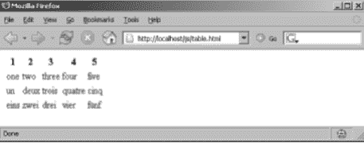

图 5.7 动态生成的表格。

## 修改 HTML 片段

```javascript
list.innerHTML += newNode;
```

更改文本节点（通过替换它们或使用 `nodeValue` 属性）仅更改实际文本，但无法更改完整的 HTML 片段，包括子元素。为了实现这一点，每个元素的 `innerHTML` 属性可能非常有用。尽管 `innerHTML` 并不是标准的且不属于 DOM 规范，但它可以运行良好。通过 `innerHTML`，你可以更改任何元素的内部 HTML，如下列表所示：

```javascript
<script language="JavaScript"
type="text/javascript">
var nr = 1;
function addItem() {
  var list = document.getElementById("list");
  nr++;
  var newNode = "<li>Item " + nr + "</li>";
  list.innerHTML += newNode;
}
</script>
```

```html
<script>
<ul id="list"><li>Item 1</li></ul>
<input type="button" onclick="addItem();"
value="Add item" />
</script>
```

与其使用整洁但不便的 DOM 方法，不如使用 `innerHTML` 直接向一个元素写入 HTML。两种方法都有各自的优缺点：`innerHTML` 需要你自己处理字符编码，但另一方面，它允许同时添加或更改多个元素。

## 元素定位

```javascript
el.style.left = "0px";
el.style.posLeft = 0;
el.style.top = "0px";
el.style.posTop = 0;
```

CSS 支持两种定位元素的方式：绝对定位和相对定位。无论选择哪种方法，你都可以使用 JavaScript 设置定位值。通常，绝对定位更方便，因为你不需要计算嵌套元素的相对位置。

在大多数浏览器中，`left` 属性定义元素的 x 坐标，而 `top` 属性用于 y 坐标。这些值不是数值——像 CSS 一样——包含一个单位，通常是像素（px）。

对于 Internet Explorer，你需要不同的方法。`posLeft` 和 `posTop` 属性设置水平以及垂直位置；然而，这一次，你只需要提供一个数值，而不需要单位。

最方便的方法是直接设置所有这些属性，因为它们没有副作用。这可以让你避免进行客户端浏览器嗅探（client sniffing）。

以下代码将 `<div>` 元素放置在左上角。注意，该元素现在显示于页面上。

```html
<script language="JavaScript"
type="text/javascript">
function position() {
  var el = document.getElementById("element");
  el.style.left = "0px";
  el.style.posLeft = 0;
  el.style.top = "0px";
  el.style.posTop = 0;
}
window.onload = position;
</script>
<h1>我的门户</h1>
<p>一些示例文本。一些示例文本。一些示例文本。一些示例文本。一些示例文本。一些示例文本。一些示例文本。一些示例文本。一些示例文本。一些示例文本。一些示例文本。一些示例文本。一些示例文本。</p>
<div id="element" style="position: absolute; background-color: #eee; border: 1px solid">JavaScript 词汇表
</div>
```

定位元素 (position.html)

## 移动元素

```javascript
id = window.setInterval("animate();", 100);
```

一种相当罕见但仍在使用 HTML 场景不仅是定位元素，还移动并因此动画元素。为了实现这一点，`window.setTimeout()` 和 `window.setInterval()` 非常有用。以下代码让一个横幅在页面上对角线移动。唯一潜在的问题是动画位置。对于 Internet Explorer 属性（`posLeft`, `posTop`），只需添加一个值即可。对于 `left` 和 `top`，你必须先确定旧位置，然后对其添加一个值。JavaScript 函数 `parseInt()` 可以从类似 "123px" 的字符串中提取数字内容。然而，如果在 `left` 或 `top` 中没有找到值，`parseInt()` 将返回 `NaN`。因此，以下辅助函数处理了这种情况；在这种情况下，将返回 0。

```javascript
function myParseInt(s) {
  var ret = parseInt(s);
  return (isNaN(ret) ? 0 : ret);
}
```

然后，以下代码使横幅动画并在 50 次迭代后停止：

```html
<script language="JavaScript" type="text/javascript">
var nr = 0;
var id = null;
function animate() {
  nr++;
  if (nr > 50) {
    window.clearInterval(id);
```

# 第 5 章 DOM 和 DHTML

```javascript
document.getElementById("element").style
.visibility = "hidden";
} else {
  var el = document.getElementById("element");
  el.style.left =
    (parseInt(el.style.left) + 5) + "px";
  el.style.posLeft += 5;
  el.style.top =
    (parseInt(el.style.top) + 5) + "px";
  el.style.posTop += 5;
}
window.onload = function() {
  id = window.setInterval("animate();", 100);
};
<script>
<h1>我的门户</h1>
<div id="element" style="position: absolute; background-color: #eee; border: 1px solid">JavaScript 词汇表
</div>
```

动画元素 *(animate.html; 节选)*

## 创建固定导航

```javascript
window.onload = positionNavigation;
window.onscroll = positionNavigation;
```

有时，页面的某个部分始终可见是非常重要的。根据网站的性质，这可以是广告横幅（Geocities，现在 Yahoo! 的一部分，是最早实现此点的之一）或导航栏。再次，一个 `<div>` 元素将被定位。固定导航的特殊之处在于，即使用户正在滚动，位置也保持不变。因此，前面的代码在页面加载和滚动时都会调用定位代码。

为了计算新位置，你必须计算当前的滚动偏移。Internet Explorer 提供了 `document.body.scrollLeft` 和 `document.body.scrollTop` 来实现此；其他浏览器使用 `window.pageXOffset` 和 `window.pageYOffset`。以下代码保持导航的位置，图 5.8 显示了结果。

```javascript
<script language="JavaScript" type="text/javascript">
function positionNavigation() {
  var nav = document.getElementById("navigation");
  var x, y;
  var navwidth = 155;
  if (window.innerWidth) {
    x = window.innerWidth + window.pageXOffset - navwidth;
    y = window.pageYOffset + 10;
  } else if (document.body) {
    x = clientWidth + scrollLeft - navwidth;
    y = scrollTop + 10;
  }
  nav.style.left = x + "px";
  nav.style.posLeft = x;
  nav.style.top = y + "px";
  nav.style.posTop = y;
}
window.onload = positionNavigation;
window.onscroll = positionNavigation;
</script>
```

<h1>我的门户</h1>

## 88 第 5 章 DOM 和 DHTML

```html
<div id="navigation" style="position: absolute; background-color: #eee; border: 1px solid">
<a href="http://www.sams.com/">出版</a>
<a href="http://www.amazon.com/">亚马逊</a>
</div>
```

保持元素的位置 (sticky.html; 节选)

![132b85fe3220659c44562d64d31c98_0.png]

图 5.8 固定导航。

## 弹出窗口广告

```html
<div id="navigation" style="position: absolute; background-color: #eee; border: 1px solid">
<a href="http://www.sams.com/">出版</a>
<a href="http://www.amazon.com/">亚马逊</a>
</div>
```

# 第 6 章 面向对象与事件

```javascript
<script language="JavaScript"
type="text/javascript">
function UniversalClass() {
  window.alert("Welcome to my class!");
}

var uc = new UniversalClass();
</script>
```

简单的类 (class.html)

## 访问类成员

```javascript
this.Count = count;
```

当你处理类成员时，最重要的方面是显式地定义所有成员。为了允许外部代码访问类成员（属性和方法），必须使用 `this` 关键字。因此，如果你在类内部定义了一个函数 `XYZ()`，只有当你添加了此代码时：`this.XYZ = XYZ;`才能作为类方法可用。

在该方法内部，你也可以使用 `this` 访问类属性；但是，它们也必须被定义。为了从内部和外部访问类成员，使用点号 (.) 来分离实例名和成员名。

以下代码实现了一个简单的类。唯一的类方法 `Count()`（内部名称：`count()`）接受一个参数，然后在指定的语言中计数。图 6.1 显示了结果。

```javascript
<script language="JavaScript" type="text/javascript">
function UniversalCounter() {
  this.copyright = "(C) 2006 JavaScript Phrasebook";
  this.Count = count;
  var numbers = {
    "en": "one, two, three",
    "fr": "un, deux, trois",
    "de": "eins, zwei, drei"
  };
}
function count(language) {
  if (numbers[language]) {
    window.alert(numbers[language]);
  } else {
    window.alert("Unknown language");
  }
}

var uc = new UniversalCounter();
uc.Count("fr");
</script>
```

带有成员的类 (members.html)

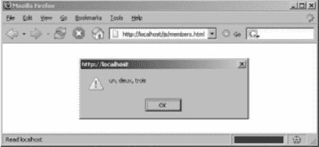

图 6.1 “通用计数器”。

注意：创建对象的另一种方法是使用 `Object` 构造函数，如下所示：

```javascript
var uc = new Object();
uc.copyright = "(C) 2006 JavaScript Phrasebook";
uc.printCopyright = function() {
  window.alert(this.copyright);
};
```

## 模拟私有类成员

JavaScript 没有像 `public`、`protected` 和 `private` 这样的类修饰符来定义谁可以访问类成员。然而，正如你在上一个节看到的，有一种非常简单的方法可以模拟私有类成员：如果你不在类内部使用 `this` 关键字来“注册”变量或函数，那么它只在内部可见。在上一个节中，`numbers` 对象无法从外部访问，但在内部被 `Count()`/`count()` 方法使用。

## 类继承

```javascript
UniversalCounter.prototype = new UniversalTranslator();
```

JavaScript 并没有享有一用于类的继承系统。但是，通过使用 `prototype` 关键字，可以再次模拟出类似的机制。通过 `prototype`，你可以提供对所有对象（包括继承的对象）都有效的类成员。当 JavaScript 必须查找属性或方法时（例如当执行 `object.methodname()` 时），JavaScript 会首先查找类，然后查找原型对象。这允许某种形式的继承。

在接下来的示例中，`UniversalTranslator` 类定义了一个成员（`copyright`）。然后，以类似的方式实现了 `UniversalCounter()` 类。接下来的命令将 `UniversalCounter` 类的 `prototype` 属性设置为 `UniversalTranslator` 类的一个新实例。结果：`UniversalCounter` 类继承了 `UniversalTranslator` 类的所有属性，并可以访问它：

```javascript
<script language="JavaScript"
type="text/javascript">
function UniversalTranslator() {
  this.copyright = "(C) 2006 JavaScript Phrasebook";
}

function UniversalCounter() {
  this.Count = count;

  var numbers = {
    "en": "one, two, three",
    "fr": "un, deux, trois",
    "de": "eins, zwei, drei"
  };
  function count(language) {
    if (numbers[language]) {
      window.alert(numbers[language] +
      " [" + this.copyright + "]");
    } else {
      window.alert("Unknown language");
    }
  }
}
UniversalCounter.prototype =
new UniversalTranslator();

var uc = new UniversalCounter();
uc.Count("de");
</script>
```

基于原型的类继承 (inheritance.html)

图 6.2 显示这确实有效：尽管 `copyright` 属性定义在 `UniversalTranslator` 类中，但可以从 `UniversalCounter` 类访问它。

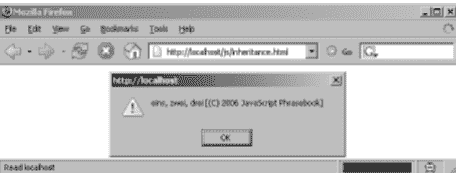

图 6.2 显示了继承的类属性。

警告：只继承类成员，而不是类构造函数代码。如果你也想这样做，必须定义一个特定的方法作为类构造函数，并在派生类中手动调用它。

## 扩展内置的 JavaScript 对象

```javascript
Date.prototype.isLeapYear = isLeapYear();
```

`prototype` 属性也可以用于扩展内置的 JavaScript 类。在接下来的代码中，实现了一个函数 `isLeapYear()`，用于判断 `getFullYear()` 的返回值是否为闰年。注意 `getFullYear()` 方法并没有实现；但通过使用 `prototype` 属性，`isLeapYear()` 变成了 `Date` 对象的一个方法，因此也可以访问 `Date.getFullYear()`。

```javascript
<script language="JavaScript" type="text/javascript">
function isLeapYear() {
  var y = this.getFullYear();
  return (y % 4 == 0 && y % 100 != 0 || y % 400 == 0);
}
Date.prototype.isLeapYear = isLeapYear;

var d = new Date();
window.alert(d.isLeapYear());
</script>
```

扩展 Date 类 (extend.html)

## Microsoft Atlas 中的 JavaScript OOP 增强

Microsoft AJAX Framework Atlas (http://atlas.asp.net/) 也为 JavaScript 实现了几个新的 OOP 扩展，使得一些标准 OOP 技术的实现变得更加简单。这些特征包括：

- 命名空间
- 继承和基方法
- 抽象类
- 接口

特别是随着新库的出现，出现了更多的库也让 JavaScript.js (http://prototype.net/) 更加丰富。

## 响应事件

```javascript
button.addEventListener("click", false);
button.attachEvent("onclick");
```

响应事件可以通过不同的方式进行：

- 使用 HTML 属性：`<body onload="xyz()">`
- 使用 JavaScript：`window.onload = xyz;`

然而，不同的浏览器有各种机制。Internet Explorer 使用 `attachEvent()` 方法附加事件。所有其他浏览器遵循 W3C 并使用 `addEventListener()` 方法。

下面的示例展示了如何跨浏览器为按钮附加事件：

```javascript
<script language="JavaScript" type="text/javascript">
function eventHandler() {
  window.alert("Event fired!");
}

window.onload = function() {
  var button = document.getElementById("eventButton");
  if (button.addEventListener) {
    button.addEventListener("click", eventHandler, false);
  } else if (button.attachEvent) {
    button.attachEvent("onclick", eventHandler);
  }
};
</script>
<input type="button" id="eventButton" value="Click me!" />
```

附加事件 (attach.html)

注意：也可以移除事件处理器。Internet Explorer 使用 `detachEvent()`，而其他浏览器遵循 W3C 使用 `removeEventListener()`。

## 事件冒泡

在处理事件时，现在的浏览器支持两种概念之一。Internet Explorer 使用所谓的“事件冒泡”：事件首先从发生它的元素触发，然后沿着 DOM 结构冒泡。因此，可以在多个地方捕捉并响应此事件。例如，假设有以下标记：

```html
<div><p><em>JavaScript</em></p> Phrasebook</p></div>
```

如果将鼠标悬停在 *JavaScript* 文字上，`mouseover` 事件首先在 `<em>` 元素中触发，然后冒泡到 `<p>` 和 `<div>` 元素。

竞争的模型是 W3C 模型，它被 Mozilla 浏览器、Opera 和 Safari/Konqueror 支持。在这里，事件首先向下渗透到目标元素，然后向上冒泡。所以在之前的示例中，事件会访问 `<div>`、`<p>` 和 `<em>` 元素，然后通过 `<p>` 和 `<div>` 元素再次冒泡。

在事件被拦截后，也可以停止它向下渗透或冒泡。

在 Internet Explorer 中，将事件的 `cancelBubble` 属性设置为 `false`：

`window.event.cancelBubble = false;`

W3C 模型支持 `stopPropagation()` 方法：

`e.stopPropagation();`

如你所见，在 Internet Explorer 中，当前事件始终可以通过 `window.event` 获取，而其他浏览器则将事件作为参数（此处称为 `e`）自动传递给事件监听器。

## 使用键盘事件

```javascript
document.onkeydown = showKey;
```

键盘事件不属于 DOM Level 1 或 Level 2，但在最近的浏览器中仍然实现。访问事件的方法与通常的方法不同（Internet Explorer 中使用 `window.event`；在所有其他浏览器中，事件作为函数的自动参数）。但 `keyCode` 属性返回按键的 ASCII 码，然后可以像下面的代码进行处理：

```javascript
<script language="JavaScript" type="text/javascript">
function showKey(e) {
  var key;
  if (window.event) {
    key = window.event.keyCode;
  } else {
    key = e.keyCode;
  }
  {
    key = String.fromCharCode(key);
    document.getElementById("para").innerHTML += key;
  }
}

window.onload = function() {
  document.onkeydown = showKey;
}
</script>
<p id="para">点击此处打字： </p>
<form>
<input name="field" type="text" />
</form>
```

监听键盘事件 (key.html)

图 6.3 显示了结果。显示了按下的按键。

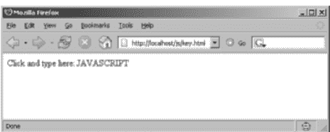

**图 6.3** 显示了按下的按键。

注意：图 6.3 中的所有字符都以大写形式显示，因为 JavaScript 总是考虑按下的是哪个键，而不是它是大写还是小写。不过，你也可以通过 `altKey`、`ctrlKey` 和 `shiftKey` 属性来确定是否按下了特殊键。

## 使用回车键提交表单

```javascript
if (key == 13) {
  document.forms[0].submit();
}
```

根据浏览器类型和配置，在表单字段中按下回车键并不总是会提交表单。例如，提交表单的按钮可能位于另一个框架中。情况下，添加一些 JavaScript 代码来确保回车键也能发送表单数据将非常有帮助。

实现这一功能所需要的只是上一句话中提到的标准事件监听器。回车键的键码为 13，因此当找到此代码码时，表单就会会被提交：

```javascript
<script language="JavaScript" type="text/javascript">
function checkKey(e) {
  var key;
  if (window.event) {
    key = window.event.keyCode;
  } else {
    key = e.keyCode;
  }
  if (key == 13) {
    document.forms[0].submit();
  }
}
window.onload = function() {
  document.forms[0].elements["field"].onkeydown = checkKey;
};
</script>
```

当按下回车键时提交表单

(formsubmit.html)

## 使用鼠标事件

```javascript
document.onmousemove = showPosition;
```

当使用鼠标时，有一个非常有趣的事件可以监听（当然除了点击之外）：`mousemove`。可以通过查看某些属性来确定鼠标位置。再次，这些属性取决于客户端属于哪一组浏览器：Internet Explorer 和世界其他其他浏览器：

- Internet Explorer 使用 `clientX` 和 `clientY`
- 所有其他浏览器使用 `pageX` 和 `pageY`

以下是一个完整的列表，用于在浏览器状态栏中显示当前的鼠标位置（如果可用）：

```javascript
<script language="JavaScript"
type="text/javascript">
function showPosition(e) {
  var x, y;
  if (window.event) {
    x = window.event.clientX;
    y = window.event.clientY;
  } else {
    x = e.pageX;
    y = e.pageY;
    window.status = "x: " + x + ", y: " + y;
  }
}
window.onload = function() {
  document.onmousemove = showPosition;
}
</script>
```

追踪鼠标移动 (mouse.html)

**警告：** 某些浏览器不允许 JavaScript 更新状态栏，例如最近的 Firefox 版本。你不会收到错误消息，但状态栏将保持不变。图 6.4 显示了支持更改状态栏文本的浏览器中的结果。

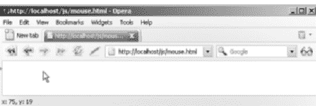

**图 6.4** 鼠标位置持续更新。

第 6 章 面对象与事件

## 区分鼠标按钮

当涉及到找出按下了哪个鼠标按钮时（当你监听点击事件时），浏览器再次有了不同的解决方案。

*(注：原文后续段落存在大量重复的乱码，此处已按原意简化处理以保持文档结构)*

# 设置 Cookie

```javascript
document.cookie = "myLanguage=JavaScript";
```

使用 JavaScript 设置 cookie 等同于设置 `document` 对象的 `cookie` 属性。使用与 HTTP 协议向客户端发送 cookie 时相同的格式至关重要。对于“普通 cookie”（即没有到期日或其他限制的 cookie，详见下文短语），cookie 的名称和值之间必须用等号隔开。cookie 的名称不能包含空格、分号和空白字符等特殊字符；cookie 值中的此类特殊字符应当经过 URL 编码（例如，空格字符将变为 %20，即其 ASCII 值的十六进制表示）。规范建议使用多种编码方式，但并未强制规定。

如下列表所示，通过为 `document.cookie` 设置多个值，可以实现设置多个 cookie。因此，写入 `document.cookie` 不会覆盖任何之前的 cookie，而是添加新的 cookie。该规则的唯一例外是：如果存在同名的 cookie，客户端将尝试覆盖它。

```javascript
<script language="text/javascript">
document.cookie = "myLanguage=JavaScript";
document.cookie =
"myOtherLanguage=PHP:%20Hypertext%20Preprocessor";
</script>
```

使用 JavaScript 设置 Cookie (servlet.html)

如果配置为在设置 cookie 之前询问用户，图 7.1 显示了浏览器中的结果。

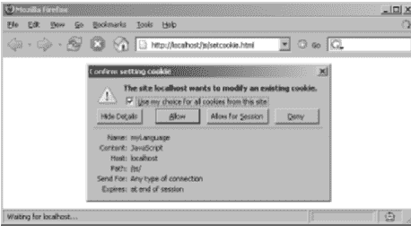

图 7.1 浏览器尝试设置从 JavaScript 发送的 cookie。

## 读取 Cookie

```javascript
var cookies = document.cookie.split(/; /g);
```

访问 `document.cookie` 时，JavaScript 会检索浏览器将向当前服务器的所有 cookie 列表。遗憾的是，这种访问并不是以数组的形式提供的，而是字符串的形式。例如，上述短语将为 `document.cookie` 生成以下值：

myLanguage=JavaScript;

myOtherLanguage=PHP:%20Hypertext%20Preprocessor

因此，为了从此值中提取 cookie，必须采取以下步骤：

- 1. 在“; ”处拆分 cookie 字符串（以获取单个 cookie）。
- 2. 识别每个 cookie 中的第一个等号 (=) 作为名称/值的分隔符。

由于 cookie 值也可能包含等号，因此必须使用第一个出现的等号。以下代码以 HTML 表格的形式打印所有 cookie。在写入页面之前，HTML 特殊字符已通过 `HtmlEscape()` 函数进行了妥善转义。

```javascript
<script language="JavaScript" type="text/javascript">
document.write("<table><tr><th>Name</th>
    <th>Value</th></tr>");
var cookies = document.cookie.split(/; /g);
for (var i=0; i<cookies.length; i++) {
  var cookie = cookies[i];
  if (cookie.indexOf("=") == -1) {
    continue;
  }
  var name =
    cookie.substring(0, cookie.indexOf("="));
  var value =
    cookie.substring(cookie.indexOf("=") + 1);
  document.write("<tr><td>" + 
    HtmlEscape(name) + 
    </td><td>" + 
    HtmlEscape(escape(value)) + 
    "</td></tr>");
}
document.write("</table>");
</script>
```

读取 Cookie (getcookies.html; 节选)

图 7.2 显示了上述列表的可能输出。

## 读取 Cookie

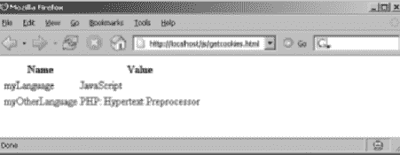

图 7.2 系统中的所有 cookie 都在浏览器中打印。

当需要某个特定 cookie 的值时，辅助函数会非常有用。它会查找给定的 cookie 名称并返回该值（即 cookie 名称右侧的所有内容，直到下一个分号或字符串结束）：

```javascript
function getCookie(name) {
  var pos = document.cookie.indexOf(name + "=");
  if (pos == -1) {
    return null;
  } else {
    var pos2 = document.cookie.indexOf(" ", pos);
    if (pos2 == -1) {
      return unescape(
        document.cookie.substring(
          pos + name.length + 1));
    } else {
      return unescape(
        document.cookie.substring(
          pos + name.length + 1, pos2));
    }
  }
}
```

读取单个 Cookie (getsinglecookie.html)

提示：永远不要忘记对 cookie 值进行反转义。在给示例中，通过使用 `unescape()` 完成的，因为原始 cookie 是使用 `escape()` 转义的。如果你使用其他转义方案，必须在代码中使用正确的反转义机制。

## 设置到期日期

```javascript
document.cookie="myLanguage=JavaScript; expires=Tue, 25-Dec-2007 12:34:56 GMT"
```

默认情况下，cookie 在用户关闭浏览器时过期。这些是会话 cookie。要让 cookie 持续时间超过会话，你需要提供到期日期。这些是持久性 cookie。规范要求日期格式如下：Wdy, DD-Mon-YYYY HH:MM:SS GMT。

这是一个示例：

```javascript
document.cookie="myLanguage=JavaScript; expires=Tue, 25-Dec-2007 12:34:56 GMT";
```

浏览器将在指定的日期过后删除该 cookie。如果没有设置到期日期，则 cookie 在浏览器关闭时被删除。

```javascript
<script language="JavaScript"
type="text/javascript">
  document.cookie="CookieTemp=success";
  document.cookie="CookieTestPers=success";
  ➡ Thu, 25-Dec-2012 12:34:56 GMT"
  if (document.cookie.indexOf("CookieTemp=success") != -1) {
    window.alert("Temporary cookies are supported!");
    document.cookie="CookieTemp=JavaScript;expires=Thu, 25-Dec-1980 12:34:56 GMT";
  } else {
    window.alert("Temporary cookies are not supported!");
  }
  if (document.cookie.indexOf("CookieTestPers=success") != -1) {
    window.alert("Persistent cookies are supported!");
    document.cookie="CookieTestPers=JavaScript;expires=Thu, 25-Dec-1980 12:34:56 GMT";
  } else {
    window.alert("Persistent cookies are not supported!");
  }
</script>
```

检查浏览器的 Cookie 支持 (checkcookie.html)

## 在一个 Cookie 中存储多个信息

```javascript
for (var el in data) {
  namevalue += "&" + escape(el) +
  "=" + escape(data[el]);
}
```

## 在一个 Cookie 中存储多个信息

记住基于 Cookie 的网站的局限性：

每个域名仅允许 20 个 Cookie。此外，如果用户在 Cookie 到达时收到警告，发送的 Cookie 越多，用户就会越烦。因此，在一个 Cookie 中存储多条信息是一个聪明的主意。

为了实现这一功能，Cookie 数据必须经过序列化。

有几种不同的方法，包括一些非常先进的方法。但是，如果你只想存储一个名称/值对列表，URL 编码是最容易实现的方案：

```javascript
function serialize(data) {
  var namevalue = "";
  for (var el in data) {
    namevalue += "&" + escape(el) +
      "=" + escape(data[el]);
  }
  return namevalue.substring(1);
}
```

### 序列化对象 (serialize.html; 节选)

当 Cookie 中使用复杂数据时，可以使用如下方式的代码：

`document.cookie = "data" + serialize(myComplexData)`

返回原始数据需要更多的代码，但主要由将数据拆分为单独的对并提取结果的名称和值组成：

```javascript
function unserialize(data) {
  var object = new Array();
  var pairs = data.split(/&/);
  for (var i=0; i<pairs.length; i++) {
    if (pairs[i].indexOf("=") > -1) {
      object[unescape(pairs[i].substring(
        0, pairs[i].indexOf("=")))] =
      unescape(pairs[i].substring(
        pairs[i].indexOf("=") + 1));
    }
  }
  return object;
}
```

反序列化对象 (serialize.html; 节选)

文件 serialize.html 对对象序列化和反序列化，而没有使用 Cookie 来使代码更短。

> 注意：在 http://www.iconico.com/workshop/jsSerializer/，展示了一个更复杂的序列化器，它可以将对象转换为 XML。此外，第 11 章“AJAX（及相关主题）”中对 JSON 的讨论可能也会感兴趣。

# 8

## 表单

当你处理服务器端技术时，表单是 HTML 中最实用的部分，因为它允许用户与服务器进行“通信”——通过向表单输入数据，然后将该表单提交到服务器。

从 JavaScript 的角度来看，HTML 表单也非常有趣。HTML 提供的选项相当有限，JavaScript 在此可以提供援手。用户数据必须经过验证，表单可能只接受某些类型的输入，只有在满足某些要求时才能提交表单。这一切——以及更多——都可以 JavaScript 实现，本章将涵盖这些。

## 使用 JavaScript 理解 HTML 表单

```javascript
document.forms[0]
```

通常，你使用元素的 ID 和 `document.getElementById()` 来访问 HTML 元素。然而，对于 HTML 表单，通常使用 `document.forms`。

其中之一原因是，当表单提交到服务器时会使用每个元素的 `name` 属性。`document.forms` 是当前页面所有表单的数组。因此，如果页面只包含一个表单，`document.forms[0]` 就会访问它。或者，表单也可以获取一个名称：

```html
<form name="mainForm">...
</form>
```

然后，`document.forms["mainForm"]` 访问该表单。表单内的所有元素也通过它们的名称进行引用，作为表单 `elements` 属性的索引。例如，假设页面上的第一个表单有一个 `name="element1"` 的元素。那么接下来的 JavaScript 代码将访问该元素：

```javascript
document.forms[0].elements["element1"]
```

还有更短的版本来访问信息。一个名为 "mainForm" 的表单和一个名为 "element1" 的元素允许这种快捷方式：

```javascript
document.mainForm.element
```

通常，会使用使用 `forms` 数组特别是 `elements` 数组的更详细的方法，因为这也可以自动访问元素。JavaScript 可以修改元素、对触发的某些事件采取操作，还可以提交表单（并阻止其提交）。此外，JavaScript 在数据验证方面也很有用，但始终要记住 JavaScript 可以被禁用。表单必须在没有 JavaScript 的情况下也能工作。每个表单元素都支持该属性，该属性指向元素所在的位置。因此，在元素的代码中经常使用 `this.form` 来方便访问元素，而无需通过 `document.forms` 数组。

## 访问文本字段

```javascript
window.alert(f.elements["textfield"].value);
```

HTML 支持三种类型的文本字段：

- 单行文本字段：`<input type="text" />`
- 多行文本字段：`<textarea></textarea>`
- 密码字段：`<input type="password" />`

尽管这些字段在浏览器中的行为不同，但从 JavaScript 访问的方式非常相似。每个字段的 `value` 属性包含字段内的文本。这既可以用于读取也可以写入。以下代码展示了两个点：首先，如何访问该属性，其次是如何使用 `this.form` 方便地访问字段。

```javascript
<script language="JavaScript"
type="text/javascript">
function showText(f) {
  window.alert(f.elements["textfield"].value);
}
</script>
<form>
  <input type="text" name="textfield" />
  <input type="button" value="Show Text" onclick="showText(this.form)" />
</form>
```

访问文本字段 (textfield.html)

图 8.1 显示了用户在字段中输入某些文本并点击按钮的情况。

> 注意：这种方法也适用于隐藏字段（`<input type="hidden" />`）。

## 访问复选框

```javascript
f.elements["chkbox"].checked ? "checked." : "not checked.",
```

HTML 复选框只有两种状态：选中和选中。当你使用 JavaScript 时，访问这种状态是常见的场景。复选框的 `checked` 属性是一个布尔值，如果复选框被选中则返回 true，否则返回 false。以下代码在上下文中展示了这一点：

```javascript
<script language="JavaScript"
type="text/javascript">
function boxShadow(f) {
  window.alert("复选框状态为：" + (f.elements["chkbox"].checked ? "选中" : "未选中"));
}
</script>
<form>
  <input type="checkbox" name="chkbox" />
  <input type="button" value="Check" onclick="showbox(this.form)" />
</form>
```

访问复选框 (checkbox.html)

## 访问单选按钮

```javascript
var btn = f.elements["radiobutton"][i];
s += btn.value + ": " + btn.checked;
```

与复选框不同，HTML 单选按钮总是成组出现的。这意味着多个按钮可能有相同的 `name` 属性，但 `value` 属性不同。因此，`document.forms[number].elements[name]` 访问整个单选按钮组——也就是说这是一个数组。数组中的每个子元素都是单选按钮并支持 `checked` 属性。该属性的作用与复选框的 `checked` 属性类似：true 表示单选按钮被激活，false 表示相反。

访问每个按钮的值是可以可能的，因为 `value` 属性处理了这一点。以下代码遍历所有单选按钮并输出其状态：

```javascript
<script language="JavaScript"
type="text/javascript">
function showStatus(f) {
  var s = "";
  for (var i=0; i<f.elements["radiobutton"].length; i++) {
    var btn = f.elements["radiobutton"][i];
    s += btn.value + ": " + btn.checked + "\n";
  }
  window.alert(s);
}
</script>
<form>
<input type="radio" name="radiobutton" value="R" />
<input type="radio" name="radiobutton" value="G" />
<input type="radio" name="radiobutton" value="B" />
<input type="button" value="Show status" onclick="showStatus(this.form)" />
</form>
```

访问单选按钮组 (radiobutton.html)

## 访问选择列表

```javascript
var index = f.elements["selectionlist"]
f.selectedIndex;
```


# HTML 选择列表

一个 HTML 选择列表由两个元素组成：`<select>` 元素是基础并提供了整个列表的名称（在它的 `name` 属性中）。实际的列表由 `<option>` 元素表示，它们提供了两个内容：标题（在浏览器中显示的数据）和值（表单提交时发送到服务器的数据）。

## 访问选择列表数据

当你使用 JavaScript 工作时，有两种方法可以访问列表数据：

- `selectedIndex` 提供当前所选列表元素的索引（从 0 开始）；值为 -1 表示未选择任何值（仅适用于大小大于 1 的列表）。
- `options` 是一个包含所有列表选项的数组。每个选项都支持 `selected` 属性。当其为 `true` 时，该列表选项被选中。

通常情况下，`selectedIndex` 对于验证目的已经足够了。当还需要访问被选中的列表元素时，`options` 方法就非常有用。此时，被选中选项的 `value` 属性提供发送到服务器的数据，而 `text` 属性返回在浏览器中可见的标题。

下面的代码示例访问了关于被选中选项的所有重要信息：

```javascript
<script language="JavaScript" type="text/javascript">
function showStatus(f) {
  var index = f.elements["selectionlist"].selectedIndex;
  if (index == -1) {
    window.alert("No element selected");
  } else {
    var element = f.elements["selectionlist"].options[index];
    window.alert("Element #" + index +
      " (caption: " + element.text +
      ", value: " + element.value +
      ") selected");
  }
}
</script>
<form>
  <select name="selectionlist" size="3">
    <option value="R">red</option>
    <option value="G">green</option>
    <option value="B">blue</option>
  </select>
  <input type="button" value="Show status" onclick="showStatus(this.form);" />
</form>
```

访问选择列表 (selectionlist.html)

> **注意**：现代浏览器还支持以下访问方式来获取当前选中列表元素的快捷值：
> `f.elements["selectionlist"].value`
>
> 然而，为了保持最大的浏览器兼容性，以下方法需要更多的字符输入，但在旧版软件上也能运行：
> `f.elements["selectionlist"].options[f.elements["selectionlist"].selectedIndex].value`

## 访问多选择列表

当 HTML 选择列表获得 `multiple="multiple"` 属性时，可以选择多个元素。在这种情况下，`selectedIndex` 属性的帮助不大，因为它只会告知列表中的第一个被选元素，而不是所有元素。因此，应该使用 for 循环来遍历所有的列表元素。当 `selected` 属性为 `true` 时，该列表项被选中。

下面的代码输出关于所有列表元素的信息，包括它们是否被选中：

```javascript
<script language="text/javascript">
function showStatus(f) {
  var s = "";
  var list = f.elements["selectionlist"];
  for (var i = 0; i < list.options.length; i++) {
    var option = list.options[i];
    s += "Element #" + i
      + "(" + option.text
      + "/" + option.value
      + ") " + (option.selected ?
      "selected." : "not selected.")
      + "\n";
  }
  window.alert(s);
}
</script>
<form>
  <select name="selectionlist" size="3" multiple="multiple">
    <option value="R">red</option>
    <option value="G">green</option>
    <option value="B">blue</option>
  </select>
  <input type="button" value="Show status" onclick="showStatus(this.form);" />
</form>
```

访问多选择列表 (selectionlistmultiple.html)

在图 8.2 中，你可以看到选择了部分元素而非全部元素时的结果。


**图 8.2** 部分元素被选中。

# 第 8 章 表单

## 文件上传

使用 JavaScript 也可以访问文件字段（见图 8.3）。然而，在过去，某些浏览器限制了此操作。想象一个表单，用户想要禁用某个文件字段；可以使用 JavaScript 实现这一点。因此，文件字段将不会随表单发送。


**图 8.3** 密码字段被选中。

## 禁用表单元素

有时，表单元素不应该是可修改的。以下场景仅为示例：

- 根据用户交互激活或去激活的元素

JavaScript 提供了几种选项来实现此目标。每个表单元素都支持 `disabled` 属性。当它设置为 `true` 时，列表元素会变为灰色。在下面的代码示例中，使用简单的 JavaScript 展示了这一点：

```javascript
<script language="JavaScript" type="text/javascript">
function enable(f) {
  f.elements["password"].disabled = false;
}

function disable(f) {
  f.elements["password"].disabled = true;
}
</script>
<form>
  <input type="radio" name="radiobutton" value="login" checked="checked" onclick="enable(this.form);" />Login
  <input type="radio" name="radiobutton" value="register" onclick="disable(this.form);" />Register<br />
  Username <input type="text" name="username" /><br />
  Password <input type="password" name="password" /><br />
</form>
```

禁用表单元素 (disabled.html)

在图 8.4 中，可以看到这段代码的效果：当选中 Register 单选框按钮时，文本框会变为灰色。


**图 8.4** 密码字段现在已禁用。

有时，变灰效果并不是所愿愿的。禁用表单元素的替代方法是通过其 `readonly` 属性来实现的。当该属性设置为 `true` 时，表单字段不会改变其外观，但无法再次被更改。以下是实现此点的代码：

```javascript
function enable(f) {
  f.elements["password"].readonly = false;
}

function disable(f) {
  f.elements["password"].readonly = true;
}
```

使表单元素只读 (readonly.html；节选)

> **注意**：在旧浏览器中，曾使用另一种简单的技巧使特定的文本框变为只读。在字段获得焦点后，它立即被移除：
> `<input type="text" autofocus="this.blur(); />`
>
> **警告**：尽管你使用 JavaScript 禁用了表单字段或使其只读，但你应该意识到 JavaScript 可以被轻易禁用，而且 HTTP 请求也可以被轻易伪造。因此，不要依赖这种 JavaScript 效果，务必在服务器端对你的数据进行验证！

## 提交表单

通常，使用提交按钮（`<input type="submit" />`）或提交图像（`<input type="image" />`）将表单数据发送到 Web 服务器。然而，JavaScript 同样能够提交表单，使用表单的 `submit()` 方法。这允许程序员使用 HTML 链接来提交表单。

从设计者的角度来看，这提供了更大的活性。然而，请记住，以下代码仅在激活 JavaScript 时起作用：

```html
<form>
  <input type="hidden" name="field" value="data" />
</form>
<a href="javascript:document.forms[0].submit();">提交表单</a>
```

提交表单 (submit.html)

### 阻止表单提交

有很多很好的理由可以阻止浏览器提交表单，例如，当某些必填字段尚未填写时。要实现这一点，必须在表单提交事件的处理代码中返回 `false`：

```html
<form onsubmit="return false;">
```

当然，代码通常应该根据表单数据决定是否允许提交表单。因此，通常由一个自定义函数来处理这种情况，并在最后返回 `true` 或 `false`。

只有当文本字段中有值时，下面的表单才能提交：

```javascript
<script language="JavaScript" type="text/javascript">
function checkform(f) {
  if (f.elements["textfield"].value == "") {
    return false;
  } else {
    return true;
  }
}
</script>
<form onsubmit="return checkform(this);">
  用户名 <input type="text" name="textfield" />
  <input type="submit" value="提交数据" />
</form>
```

仅当文本字段被填充后才能提交表单 (nosubmit.html)

> 再次强调，这只有在激活 JavaScript 时才有效——这也是在服务器端验证所有数据的另一个理由！

## 阻止重复提交表单

特别是当分析表单数据的脚本需要相当长的时间时，用户倾向于通过再次提交表单来加快。然而，在在线购物、信用卡支付和其他重要交易中，这可能会导致昂贵的后果。因此，网页本身应该尝试避免重复提交表单。

该标题下载的之前的代码（在 `prevent.html` 文件中）正是这样做的：当提交按钮被点击时，按钮的 `disabled` 属性被设置为 `true`，有效地使其无法再次点击该按钮（如果启用了 JavaScript）。图 8.5 显示了浏览器中的结果：按钮变灰。

```html
<form action="delay.php">
  <input type="submit" value="提交数据" onclick="this.disabled = true;"/>
</form>
```

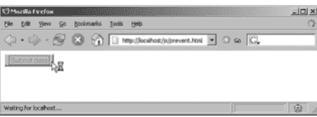

**图 8.5** 按钮不能点击两次。

之前的代码列表和后面的代码列表都将表单数据发送到名为 `delay.php` 的 PHP 脚本，该脚本基本上会等待五秒然后发送数据。这模拟了慢连接或慢服务器，这是短语的主要场景。

另一种方法是维护按钮的状态，并以此判断它是否已被点击，如下面的列表所示：

```javascript
<script language="JavaScript" type="text/javascript">
var submitted = false;
function checkform(f) {
  if (submitted) {
    window.alert("表单已经提交！");
    return false;
  } else {
    submitted = true;
    return true;
  }
}
</script>
<form action="delay.php" onsubmit="return checkform(this);">
  <input type="submit" value="提交数据" />
</form>
```

维持状态防止重复提交表单 (prevent-status.html)

> **警告**：虽然这个短语非常方便，但你必须意识到，有时服务器会意外关闭与客户端的连接（反之亦然）。此时数据传输将停止，但 JavaScript 代码无法感知此。结果是按钮无法被点击两次（如最初计划所示），但数据没有被正确传输。用户随后必须重新加载表单才能再次提交数据。

## 给字段获取焦点

大多数像 Google 这样的搜索网站都有一个方便的功能：页面加载后，光标已经位于搜索字段中。通过之前的代码可以很容易实现；`focus()` 方法可以让表单字段获得焦点。完整的列表可以在 `focus.html` 文件中找到。

```javascript
document.forms[0].elements["textfield"].focus();
```

> **警告**：注意，页面越大、表单字段越多的，这个功能就可能变得越不方便。想象一个加载缓慢的页面。当页面加载时，用户可能已经在另一个字段中输入字了。当页面完全加载后，之前的代码会将焦点设置到指定的字段，最终夺走了用户当前正在操作字段的焦点。

## 在字段中选择文本

有时，字段会预填文本，如下所示：

```html
<input type="text" name="textfield" value="在此输入" />
```

这种方法在用户需要点击字段以输入内容时非常方便。大多数浏览器支持这种方式来选择整个字段：

```javascript
field.setSelectionRange(0, field.value.length);
```

然而，当用户需要点击字段时，这种方法有些麻烦。如果文本是预选的。

> **提示**：只有在 JavaScript 可用时才预填充字段，否则用户必须手动选择（删除）默认值值。代码可以解决这个问题：`field..="这里";`

### 点击时清空字段

当 JavaScript 可用时预填充字段，点击时清空。列表所示：

```javascript
<script language="JavaScript" type="text/javascript">
var originaldata;

window.onload = function() {
  var field = document.forms[0].elements["textfield"];
  originaldata = field.value;
  if (field.createTextRange()) {
    var range = field.createTextRange();
    range.moveStart("character", 0);
    range.moveEnd("character", field.length - 1);
    range.select();
  } else if (field.setSelectionRange) {
    field.setSelectionRange(0, field.length);
  }
  field.focus();
  field.onclick = function() {
    if (this.value == originaldata) {
      this.value = "";
    }
  };
};
</script>
<form>
  <input type="text" name="textfield" value="&lt;Enter data here&gt;" />
</form>
```

清空字段 (clear.html)

> **注意**：焦点事件不能用于该任务；Internet Explorer 会立即清空字段在文档加载时（即使 `focus()` 调用发生在设置事件处理程序之前）。

# 表单验证

JavaScript 是一个即时验证表单的极佳工具。它可以对用户输入的数据提供即时反馈（例如，使用类似 `onblur="validateData(this)"` 之类的代码），但你必须始终考虑到 JavaScript 可能会被禁用，且 HTTP 请求不应源于网络浏览器。因此，在使用客户端数据之前，务必在服务器端对其进行验证。

此外，确保表单本身在 JavaScript 禁用的情况下也能正常工作，因为大约 10% 的用户无法使用脚本语言（或不想使用）。

最后，验证本身应该只是用户的一种便利功能，而不是一个为了从访问者那里榨取大量数据的工具。请明智地使用它。

## 验证文本字段

对用户提供的数据进行验证有多种方式。有时只需检查必填字段是否已填写就足够；而在其他情况下，则必须进行彻底的数据验证。

在前面的代码（文件 `mandatory.html`）中，检查了文本字段中的数据。`replace()` JavaScript 方法调用全局删除字符串中的空白字符（正则表达式 `/\s/g`），然后检查是否留有内容，这样仅有空格字符将无法满足“填写此字段”的条件。

```javascript
if (field.value.replace(/\s/g, "") == "") {
  window.alert("Invalid data!");
  field.focus();
}
```

在下一个列表中，文本字段中的数据将根据正则表达式进行验证——一个美国邮政编码：

```javascript
<script language="JavaScript" type="text/javascript">
function validate(field) {
  var regex = /\d{5}$/;
  if (!regex.test(field.value)) {
    window.alert("Invalid postal code!");
    field.value = "";
    field.focus();
  }
}
</script>
<form onsubmit="return checkform(this)">
  US postal code <input type="text" name="code" onblur="validate(this);" />
</form>
```

使用正则表达式验证字段 (mandatory-regex.html)

## 验证复选框

当复选框必须填写时，其 `checked` 属性必须为 `true`；否则不应允许提交表单。前面的代码位于文件 `mandatory-checkbox.html`，它演示了在表单 `submit` 事件触发时可以调用哪些代码。

```javascript
if (!f.elements["terms"].checked) {
  window.alert("Terms must be accepted!");
  f.elements["terms"].focus();
  return false;
} else {
  return true;
}
```

## 验证单选按钮

当一组单选按钮是必填的时，只需这些按钮中的一个被选中即可（准确地说，每组无法选中多个按钮，但仍然存在一个按钮都未选中的可能）。使用表单元素，可以将单选按钮组作为一个数组进行选择。在该数组中，必须找到至少一个 `checked` 状态的单选按钮，该组才被认为已充分填写。下面的列表实现了这一功能：

```javascript
<script type="javascript">
function checkform(f) {
  for (var i = 0; i < f.elements["colors"].length; i++) {
    var radio = f.elements["colors"][i];
    if (radio.checked) {
      return true;
    }
  }
  // no checked radio found
  window.alert("No color selected!");
  f.elements["colors"][0].focus();
  return false;
}
</script>
<form onsubmit="return checkform(this)">
  <input type="radio" name="colors" value="R" /><br />
  <input type="radio" name="colors" value="G" /><br />
  <input type="radio" name="colors" value="B" /><br />
  <input type="submit" value="Submit data" />
</form>
```

验证单选按钮组 (mandatory-radio.html)

> **注意**：你可能想考虑一种不那么阻塞的方式来指示表单中的错误。例如，你可以使用 DOM 对象在未正确填写字段旁边显示一个小错误图标。这对于本章中的所有验证来说都是可能的。

## 验证选择列表

验证选择列表有几种方法。最简单的方法是检查 `selectedIndex` 属性。如果其值为 `-1`，则没有没有项被选中，因此表单未填写。前面的代码演示了这一点（文件 `mandatory-list.html`）。

```javascript
if (f.elements["colors"].selectedIndex == -1) {
  window.alert("No color selected!");
  f.elements["colors"].focus();
} else {
  return true;
}
```

然而，这种方法仅在选择列表的 `size` 属性设置为大于 1 且不包含空元素时有效。验证列表的更好方法是查看所有选中元素的属性。如果值为空字符串，则该元素不被考虑在。通过循环遍历列表中的所有元素，并寻找具有实际值的选中元素。这种方法的优势是它也适用于多个列表。

```javascript
<script language="JavaScript" type="text/javascript">
function form(f) {
  for (var i = 0; i < f.elements["colors"].options.length; i++) {
    var element = f.elements["colors"].options[i];
    if (element.selected && element.value != "") {
      return true;
    }
  }
  window.alert("No color selected!");
  f.elements["colors"].focus();
  return false;
}
</script>
<form onsubmit="return form(this)">
  <select name="colors" size="9" multiple>
    <option value="">Select color</option>
    <option value="R">red</option>
    <option value="G">green</option>
    <option value="B">blue</option>
  </select>
  <input type="submit" value="Submit data" />
</form>
```

验证选择列表 (mandatory-list.html)

正如图 8.7 所示，空元素不计入。

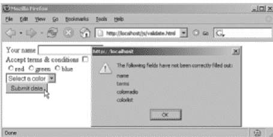

**图 8.7** 表单只有在选中了元素时才能提交。

## 自动验证表单

经过一些努力，JavaScript 能够自动验证表单，前提是表单字段都是必填的。只需遍历表单元素即可。每个元素的 `type` 属性返回字段类型，表 8.1 列出了最重要的类型。然后根据字段类型进行验证。

**表 8.1** JavaScript 字段类型

| 类型 | 描述 |
|---|---|
| button | 按钮 |
| checkbox | 复选框 |
| password | 密码字段 |
| radio | 单选按钮 |
| reset | 重置按钮 |
| select-one | 选择列表 |
| select-multiple | 多选选择列表 |
| submit | 提交按钮 |
| text | 单行文本字段 |
| textarea | 多行文本字段 |

下面的代码对单选按钮组进行了特殊处理。由于遍历表单元素会访问每个元素并访问每个单选按钮，因此维护了一个已检查单选按钮组列表。否则，如果没有选择任何按钮，一组三个单选按钮将被检查三次，产生三条错误消息。

```javascript
<script language="JavaScript" type="text/javascript">
function check(f) {
  var errortext = "";
  var checkedgroups = "";
  for (var i = 0; i < f.elements.length; i++) {
    var element = f.elements[i];
    switch (element.type) {
      case "text":
      case "textarea":
      case "password":
        if (element.value.replace(/\s/g, "") != "") {
          errortext += element.name + "\n";
        }
        break;
      case "checkbox":
        if (!element.checked) {
          errortext += element.name + "\n";
        }
        break;
      case "radio":
        var group = f.elements[element.name];
        if (checkedgroups.indexOf("[" + element.name + "]") > -1) {
          continue;
        } else {
          checkedgroups += "[" + element.name + "]";
        }
        var groupok = false;
        for (var j = 0; j < group.length; j++) {
          if (group[j].checked) {
            groupok = true;
            break;
          }
        }
        if (!groupok) {
          errortext += element.name + "\n";
        }
        break;
      case "select-one":
      case "select-multiple":
        var selectok = false;
        for (var j = 0; j < element.options.length; j++) {
          var item = element.options[j];
          if (item.selected && item.value != "") {
            selectok = true;
          }
        }
        if (!selectok) {
          errortext += element.name + "\n";
        }
        break;
    }
  }
  if (errortext == "") {
    return true;
  } else {
    window.alert("以下字段未正确填写：\n\n" + errortext);
    return false;
  }
}
</script>
```

自动验证表单 (validate.html; 节选自)

图 8.8 显示了结果：所有表单字段都缺少适当的内容。但注意，你可能想要修改此脚本，并可能从列表中排除复选框，因为这些表单元素大多数情况下是可选的。


**图 8.8** 表单已自动验证。

## 使用选择列表实现导航

所谓的“快速链接”导航提供了一个包含几个导航元素的选择列表。当选中列表中的某一项后，浏览器会加载关联页面。

从实现角度上来说，这种精美且广泛使用的效果相当简单。所有导航元素的目标 URL 都存储在 `value` 属性中；JavaScript 函数首先检查是否选中了“真实”元素，然后加载该 URL：

```javascript
var url = list.options[list.selectedIndex].value;
```

```javascript
<script language="JavaScript" type="text/javascript">
function loadURL(list) {
  var url = list.options[list.selectedIndex].value;
  if (url != "") {
    location.href = url;
  }
}
</script>
<form>
  <select name="urls" onchange="loadURL(this);">
  </select>
</form>
```

快速链接导航 (quicklink.html)

## 使用选择列表实现层级导航

两个选择列表可以配对使用，为网站提供层级导航。第一个选择列表包含多个类别；当选中某个类别时，第二个列表包含该类别中的一组元素。

从 JavaScript 的角度来看，必须维护一个元素列表，并根据第一个（类别）列表中的选择来填充这些列表。这里是 JSON 格式的链接列表（有关此表示法的更多信息，请参阅第 11 章“AJAX（及相关主题）”）。

```javascript
var data = {
  "search" : [
    {"title": "Google", "url": "http://www.google.com/"},
    {"title": "MSN", "url": "http://search.msn.com/"}
  ],
  "browsers" : [
    {"title": "Firefox", "url": "http://www.mozilla.com/firefox/"},
    {"title": "Opera", "url": "http://www.opera.com/"}
  ]
};
```

然后，以下代码通过 `Option` 构造函数向第二个选择列表添加选项（语法：先是显示文本，后是值）：

```javascript
<script language="JavaScript" type="text/javascript">
function loadElements(f) {
  with (f) {
    var category = elements["categories"].options[elements["categories"].selectedIndex].value;
    if (category != "") {
      var links = data[category];
      elements["urls"].options.length = 0;
      elements["urls"].options[0] = new Option("请选择...", "#");
      for (var i = 0; i < links.length; i++) {
        elements["urls"].options[elements["urls"].options.length] = new Option(links[i].title, links[i].url);
      }
    }
  }
}
</script>
<form>
  <select name="categories" onchange="loadElements(this.form)">
    <option value="">请选择...</option>
    <option value="search">搜索引擎</option>
    <option value="browsers">浏览器</option>
  </select>
  <select name="urls" onchange="loadURL(this);">
  </select>
</form>
```

层级导航 (navigation.html; 节选自)

图 8.9 显示了当选择第一个类别（搜索引擎）时会发生的情况：第二个列表填充了可用选项。

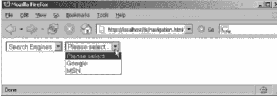

**图 8.9** 在第一个列表中选择选项会填充第二个列表。

## 清空一组单选按钮框

单选按钮的一个常见缺点是，当组中的某个被选中后，无法通过 HTML 取消选中。通过 JavaScript，可以解决这一问题。

```javascript
for (var i = 0; i < f.elements["colors"].length; i++) {
  f.elements["colors"][i].checked = false;
}
```

> **提示**：对于单选按钮组，将 `checked` 属性设置为 `false` 即可。

## 预填充日期列表

大多数网站都有三个列表：日期、月份和年份。为了填充这些列表，需要使用 JavaScript，如如下所示：

```javascript
var d = new Date();
```

```javascript
<script language="JavaScript" type="text/javascript">
window.onload = function() {
  with (forms[0]) {
    var d = new Date();
    elements["day"].selectedIndex = d.getDate();
    elements["month"].selectedIndex = d.getMonth();
    elements["year"].selectedIndex = d.getFullYear();
  }
}
</script>
<form>
  <select name="day">
    <option value="1">1</option>
    <!-- ... -->
  </select>
  <select name="month">
    <option value="0">January</option>
    <!-- ... -->
  </select>
  <select name="year">
    <option value="2006">2006</option>
    <!-- ... -->
  </select>
</form>
```

*填充日期列表 (autodate.html; 节选自)*

> **警告**：在示例中，第一个年份是 2006；如果你更改它，例如添加 2007，你需要相应更改 `elements["year"]`。

## 验证日期列表

日期列表的下一步是确保用户输入的日期有效。因此，每当月份或年份发生时，必须相应更新日期选择列表：

```javascript
f.elements["day"].options.length = maxDays;
```

```javascript
<script language="JavaScript" type="text/javascript">
function updateDay(f) {
  var oldDays = f.elements["day"].options.length;
  var month = parseInt(f.elements["month"].value);
  var year = parseInt(f.elements["year"].value);

  var maxDays = 30;

  switch (month) {
    case 1: case 3: case 5: case 7: case 11:
      maxDays = 31;
      break;
    case 2:
      maxDays = (isLeapYear(year) ? 29 : 28);
      break;
  }

  f.elements["day"].options.length = maxDays;
  if (maxDays > oldDays) {
    for (var i = oldDays; i < maxDays; i++) {
      f.elements["day"].options[i] = new Option(i + 1, i + 1);
    }
  }
}
</script>
```

为了实现这一点，一个辅助函数（见第 6 章）用于判断年份是否为闰年：

```javascript
function isLeapYear(y) {
  return (y % 4 == 0 && (y % 100 != 0 || y % 400 == 0));
}
```

通过这些信息，可以更新日期列表。如果条目过多，列表将缩短；如果条目过少，列表将获得额外的条目。这一切都会尽可能保持 `selectedIndex` 值不变（除非由于，例如选中了 30 号并将月份更改为二月）。

自动更新列表 (date.html; 节选)

在图 8.10 中你可以看到结果：2000年2月有 29 天。

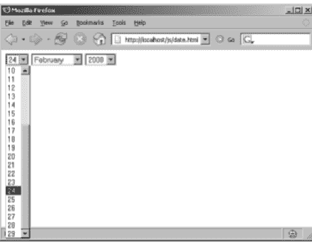

**图 8.10** 列表根据月份和年份更新。

# 第 9 章 窗口与框架

窗口在 JavaScript 中起着重要作用。`window` 对象是 JavaScript 中的默认对象，被频繁使用（只需考虑 `window.alert()` 方法）。此外，JavaScript 能够处理窗口（例如打开新窗口），还可以处理框架（frame）和内框架（iframe），它们与窗口对象非常相似。

## 打开新窗口

```javascript
window.open("http://www.sampublishing.com/", "samwindow", "");
```

`window.open()` 方法打开一个新窗口，并期望至少三个参数以便使方法调用具有意义：要打开的 URL、新窗口名称以及窗口选项。

使用上述代码（file open.html），将打开一个带有出版者主页的新窗口。

`open()` 方法的第二个参数提供了新窗口的名称。它的工作方式与框架名称完全相同：如果你将窗口名称作为链接的 `target` 属性，链接将在新窗口中打开。

因此，`open.html` 示例文件还包含一个使用新窗口名称的链接：

```html
<a href="http://www.amazon.com/gp/product/-0672328801" target="samsWindow">在 Amazon 购买此书</a>
```

当你点击该链接时，不会打开新窗口，而是重用之前由 JavaScript 打开的旧窗口。

> **注意**：`window.open()` 的返回值是一个指向新窗口的 JavaScript 窗口对象。因此，如下格式的代码不会产生预期的结果：
> `<a href="javascript:window.open(...)">打开窗口</a>`
>
> 由于该方法返回的是一个窗口对象，此链接将向页面上写入类似 `[object]` (Internet Explorer) 或 `[object Window]` (Mozilla 浏览器) 的内容。因此，你必须确保 JavaScript 代码不返回任何内容。实现此点的良好方法是通过以下代码：
> `<a href="javascript:void(window.open(...))">打开窗口</a>`

## 使用窗口选项

```javascript
window.open("http://www.sampublishing.com", "samsWindow", "width=640,height=480,directories=no,menubar=no,toolbar=no,scrollbars=yes");
```

`window.open()` 的第三参数是一个用逗号分隔的值列表，用于定义新窗口的外观。你可以定义大小（只要宽度和高度至少为 100 像素）、切换某些窗口功能（如状态栏）等。表 9.1 显示了最重要的选项（然而，该列表并不完整，遗漏了一些取决于浏览器的选项）。

上述代码使用了这些选项中的一些。有些取数值，有些则要求 `yes` 或 `no` 作为其值。注意不要在选项之间使用空格。

**表 9.1** 窗口选项

| 选项 | 描述 |
|---|---|
| dependent | 如果父窗口关闭，则关闭新窗口 |
| directories | 切换个人工具栏 |
| height | 窗口高度 |
| innerHeight | 除去窗口装饰的窗口高度（非 IE） |
| innerWidth | 除去窗口装饰的窗口宽度（非 IE） |
| left | 窗口的水平位置（仅限 IE） |
| location | 切换地址栏 |
| menubar | 切换菜单栏 |
| outerHeight | 窗口高度（非 IE） |
| outerWidth | 窗口宽度（非 IE） |
| resizeable | 用户是否可以调整窗口大小 |
| screenX | 窗口的水平位置（非 IE） |
| screenY | 窗口的垂直位置（非 IE） |
| scrollbars | 切换滚动条 |
| status | 切换状态栏 |
| toolbar | 切换工具栏 |
| top | 窗口的垂直位置（仅限 IE） |
| width | 窗口宽度 |
| z-lock | 给窗口一个较低的 z-lock（z 轴上的位置）值 |

> **警告**：你不能期望所有效果在所有浏览器中都以相同的方式生效。例如，Opera 浏览器打开新窗口不是在浏览器窗口中，而是（取决于浏览器版本）在新标签页中打开，这显然具有默认的窗口装饰和默认窗口大小。

图 9.1 显示了带有给定选项时新打开的窗口（file openoptions.html）的外观。

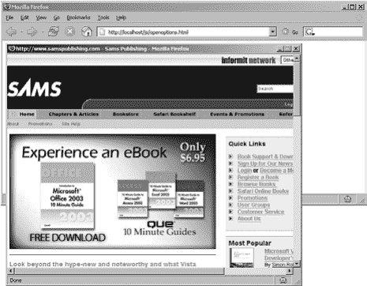

**图 9.1** 新窗口只有非常少的装饰。

## 打开模态窗口

```javascript
window.showModalDialog(
  "http://www.samspublish.com/",
  "SamsWindow",
  "dialogWidth=640,dialogHeight=480,status=no"
);
```

`window.open` 和 `showModalDialog()` 都能创建模态窗口，模态窗口在关闭之前会阻止用户与主窗口交互。然而，`showModalDialog()` 仅受 Internet Explorer 支持。

在其他浏览器中，你可以使用 `<div>` 元素和 CSS 将其覆盖在内容上，并使用 JavaScript 来显示和隐藏它。

## 调整窗口大小

有多种方法可以设置窗口的大小。在使用 `window.open()` 打开新窗口时，你只需要设置宽度和高度选项。然而，对于现有窗口，JavaScript 提供了窗口对象的两种方法：

- `resizeTo()` 将窗口的宽度和高度设置为提供的值，如前面的代码（下载存档中的 `resizeTo.html` 文件）所示。

```javascript
window.resizeTo(640, 480);
```

- `resizeBy()` 通过增加提供的值来更改窗口的宽度和高度，如下列表所示（它将宽度和高度都减了一半）：

```javascript
<script language="JavaScript" type="text/javascript">
window.onload = function() {
  var width, height;
  if (window.innerWidth) {
    width = window.outerWidth;
    height = window.outerHeight;
  } else {
    width = document.body.clientWidth;
    height = document.body.clientHeight;
  }
  window.resizeBy(
    -Math.round(width / 2),
    -Math.round(height / 2)
  );
}
</script>
</body></html>
```

### 平分窗口的宽度和高度 (resizeby.html)

> **警告**：调整窗口大小被认为在程度上是不友好的。Web 的原则之一是客户端的大小是无关的，可以由用户调整。因此，请谨慎使用这句话中的技术。还要注意，你不能将窗口调整为低于 100 像素的宽度或高度。

## 重新定位窗口

打开新窗口时必须考虑所有浏览器：对于 Internet Explorer，设置 `left` 和 `top` 选项；所有其他浏览器使用 `screenX` 和 `screenY`。下面的 `window.open()` 调用在屏幕左上角创建一个窗口。

```javascript
window.open("newpage.html", "name", "left=0, top=0, screenX=0, screenY=0");
```

然而，对于现有窗口，可以使用两种与前述语句非常相似的方法：

- `moveTo` 将窗口放置在指定位置，如本节开头的代码（文件 `moveto.html`）所示。

```javascript
window.moveToBy(-10, 10);
```

- `moveBy()` 按确定的增量移动窗口。下面的列表将窗口向左移动 10 像素并向下移动 10 像素。

```javascript
<script language="JavaScript" type="text/javascript">
window.moveBy(-10, 10);
</script>
```

### 移动窗口 (moveby.html)

> **警告**：移动窗口几乎与调整大小一样不友好，因此再次请谨慎使用此功能。还要注意，出于明显的安全考虑，你不能将窗口完全移出用户的视线。

## 打开居中的弹出窗口

结合打开新窗口、确定其尺寸和重新定位的语句，可以让你创建一个在页面居中的新窗口。

```javascript
newwin.moveTo(Math.round((screenwidth - windowwidth) / 2), Math.round((screenheight - windowheight) / 2));
```

思路是计算新窗口的宽度和高度（记住 `window.open()` 返回的是新窗口的引用），然后确定屏幕大小，并在此基础上计算窗口的位置使其居中。

然而，时机至关重要。在 Internet Explorer 上，只有在 `<body>` 元素解析后才能访问窗口尺寸。因此，使用了一个小技巧：首先，新窗口是空的。然后，通过 `document.write()` 创建 `<body>` 元素。然后就可以读取窗口的宽度和高度了。最后，在新窗口中加载所需的文档，然后将其重新定位到屏幕中心。

```javascript
<script language="JavaScript" type="text/javascript">
var newwin = window.open("", "samwindow", "");
newwin.document.write("<body></body>");

var windowwidth, windowheight;
if (window.innerWidth) {
  windowwidth = newwin.outerWidth;
  windowheight = newwin.outerHeight;
} else {
  windowwidth = newwin.document.body.clientWidth;
  windowheight = newwin.document.body.clientHeight;
}
var screenwidth = screen.availWidth;
var screenheight = screen.availHeight;
newwin.moveTo(
  Math.round((screenWidth - windowwidth) / 2),
  Math.round((screenheight - windowheight) / 2));
newwin.location.href = "http://www.sampublishing.com/";
</script>
<body></body>
```

### 打开并居中窗口 (center.html)

> **注意**：有时，在 Internet Explorer 中读取窗口属性并不按预期工作并会产生错误结果。在这种情况下，最好在 `window.open()` 调用中设置新窗口的大小，然后使用此值（称为 `true`）来居中新窗口。

## 打开全屏窗口

Internet Explorer 4 支持 `window.open()` 的 `fullscreen=yes` 选项，但更通用的方法是读取屏幕对象的尺寸，然后相应调整窗口大小。

```javascript
newwin.resizeTo(screen.width, screen.height);
newwin.moveTo(0, 0);
```

```javascript
<script language="JavaScript" type="text/javascript">
newwin = window.open(
  "http://www.sampublishing.com/",
  "samwindow",
  "width=640,height=480,directories=no,menubar=no,toolbar=no,scrollbars=yes");
</script>
```

### 打开全屏窗口 (fullscreen.html)

> 这仅适用于使用 JavaScript 打开的窗口；如果你尝试在其他窗口上执行此操作，用户将收到一条类似于图 9.4 所示的警告消息（Mozilla 浏览器也有类似的消息，但将其隐藏在 JavaScript 控制台中）。

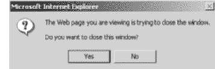

**图 9.4** 仅关闭用 JavaScript 打开的窗口——或者忍应对这个惊人的消息。

配合上一节中的站点地图，一个关闭窗口的链接变得非常有用：

```javascript
<script language="JavaScript" type="text/javascript">
this.name = "mainWindow"
</script>
<a href="http://www.samspublishing.com/" target="mainWindow">出版商</a><br />
<a href="http://www.amazon.com/gp/product/0673228801" target="mainWindow">在 Amazon 购买这本书</a><br />
<a href="javascript:self.close();">关闭窗口</a>
```

带有关闭链接的站点地图 (sitemapwindow.html)

然而，如果加载了另一个页面，你也应该从主窗口关闭站点地图。在当前示例中，在主窗口中加载任何其他页面都会将打开窗口重定向到另一个 Web 服务器；因此，你可以立即关闭站点地图。但在这样做之前，你应该通过查看 `closed` 属性来检查窗口是否已经关闭：

```javascript
<script language="text/javascript">
var newwindow = window.open(
  "sitemapwindow.html",
  "sitemap",
  "width=320,height=100,directories=no,menubar=no,toolbar=no,scrollbars=yes");
</script>
<body onload="if (!newwindow.closed) newwindow.close();"></body>
```

带有自动关闭功能的站点地图 (sitemapwindow.html)

## 检查弹出器的是否存在

```javascript
var newwindow = window.open(
  "popupcheck",
  "width=100,height=100,directories=no,menubar=no,toolbar=no");
```

诚然，之前所有的章节都依赖于浏览器可以打开弹出窗口这一事实。默认情况下，大多数现代浏览器允许从本地服务器打开的弹出窗口，但阻止从互联网打开的弹出窗口。此外，具有自己的弹出拦截机制的各种工具栏让依赖弹出窗口的开发者生活变得更加艰难。

先说坏消息：没有可靠的方法可以确保弹出窗口*始终*能够打开。某些拦截器支持不同级别的拦截，某些允许特定类型的弹出窗口，某些则禁用所有弹出窗口。图 9.5 显示了一个典型的浏览器配置屏幕。

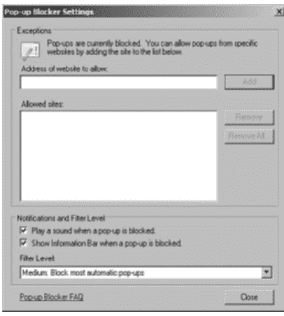

**图 9.5** 弹出器配置。

以下代码尝试检测是否存在弹出拦截器：它打开一个窗口，然后检查它是否存在。如果是，则将其关闭；否则，则可能存在弹出拦截器：

```javascript
<script language="JavaScript" type="text/javascript">
var newwindow = window.open(
  "popupcheck",
  "width=100,height=100,directories=no,menubar=no,toolbar=no");
if (newwindow) {
  newwindow.close();
} else {
  window.alert("检测到弹出器!");
}
</script>
```

检查弹出拦截器 (popupcheck.html)

图 9.6 显示了弹出窗口被拦截的结果（在浏览器内容区域顶部的通知栏中也可见）。

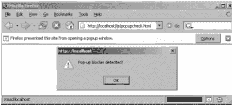

**图 9.6** 检测到弹出器。

> **提示**：大多数弹出拦截器的默认行为是允许由用户操作触发的弹出窗口。因此，不要尝试在页面加载后调用 `window.open()`，而应在用户点击某些内容时调用 `window.open()`。尽管如此，你仍然无法弹出窗口真的会出现。

## 使用 JavaScript 框架

使用 JavaScript 操作框架（frames）与操作窗口对象非常相似。虽然框架缺少窗口对象具有的一些功能，例如 `open()` 方法或调整大小或移动位置的方法，但框架的基本属性是相同的：`document` 属性指向加载在框架中的文档对象，并且还有像 `location` 这样的属性。

主窗口（包含 `<frameset>` 元素的 HTML 文档）的 `frames` 属性是一个包含该框架集中定义的所有框架的数组。你可以通过索引（从零开始：`window.frames[0]`, `window.frames[1]`...）或通过它们的 `name` 属性访问框架：`window.frames["nameFrame"]`。

从每个框架文档（即加载在框架内的文档，即使它们也包含 `<frameset>` 元素），都可以访问框架结构：`parent` 引用父结构的文档，而 `top` 跳转到主文档。

## 同时更改两个框架的内容

关于 JavaScript 的常见问题之一是如何同时更改两个框架。尽管框架在专业 Web 开发人员中越来越不受欢迎，但这个问题仍然是一个热门话题。

当然，JavaScript 可以派上用场。函数接受两个框架的名称或索引，以及要加载的两个 URL。由于各个框架在应用程序过程中不断变化，因此此函数应该放在框架集文档中：

```javascript
top.frames[frame1].location.href = url1;
top.frames[frame2].location.href = url2;
```

```javascript
<script language="text/javascript">
function changeFrames(frame1, url1, frame2, url2) {
  top.frames[frame1].location.href = url1;
  top.frames[frame2].location.href = url2;
}
</script>
<frameset cols="150,*">
  <frame src="frame1.html" name="navigation" />
  <frame src="frame2.html" name="content" />
</frameset>
```

*带有关闭链接的框架集 (sitemapwindow.html)*

然而，如果加载了另一个页面，你也应该从主窗口关闭站点地图。在当前示例中，在主窗口中加载任何其他页面都会将打开窗口重定向到另一个 Web 服务器，因为右侧框架中的每个页面都有与左侧框架关联的导航页面（高亮当前页面）。

```html
框架 1<br />
<a href="javascript:top.changeFrames('navigation', 'frame1.html', 'content', 'frame2.html');">框架 2</a>
```

*带有自动关闭功能的框架集 (sitemapwindow.html)*

更通用的方法是不限制框架的数量为两个，而是接受任意数量的框架名称和 URL：

```javascript
function changeFrames() {
  for (var i = 0; i < Math.ceil(changeFrames.arguments.length / 2); i++) {
    top.frames[changeFrames.arguments[2 * i]].location.href = changeFrames.arguments[2 * i + 1];
  }
}
```

*带有导航的框架集 (frame1.html)*

示例中的左侧框架是导航框架；右侧框架是内容框架。当点击导航框架中的链接时，两个框架...

*带有更灵活 JavaScript 函数的框架集 (frameset.html; 节)*

下载存档中的 `frameset.html` 文件包含了两个版本的 `changeFrames()`，较不灵活的版本放在 JavaScript 注释中。

## 使用隐藏框架存储数据

框架的一个非常方便的使用选项是例如使用隐藏框架。这可以在跨 HTTP 请求时存储数据。由于页面卸载，所有的 JavaScript 数据都会丢失，因此隐藏框架在存储数据方面非常有用，例如在创建客户端购物车时。

所以，你只需要创建一个高度为一像素或类似的框架。然后，每你需要存储数据时，只需访问该框架并将所需数据保存在可作为该框架属性的所有变量中：

`top.frames["hiddenJsFrame"].variable = "value";`

以类似的方式，你显然也可以在该框架内放置常用函数，然后以类似的方式调用它们：

`top.frames["hiddenJsFrame"].functionName();`

## 使用 Iframes

Iframes（或内联框架）是一种创建页面内部分的方便方式，该部分可以独立于页面的其他部分进行更改。正如其名，iframe 与 frames（框架）非常相似；但存在一些细微的差别。以下是此类内联框架的 HTML 标记：

```html
<iframe src="iframe1.html" name="iframe1" id="iframe1">
```

注意，iframe 同时提供了 name（名称）和 ID（标识），因为访问框架的方法有两种：

- 使用 name 和 `window.frames` 数组
- 使用 ID 和 `document.getElementById()`

前一种方法需要通过更改 `location.href` 属性来改变 iframe 内部的 URL；后者方法返回一个具有 `src` 属性的对象来完成该任务：

```javascript
window.frames["iframe1"].location.href = "iframe1b.html";
document.getElementById("iframe1").src = "iframe1b.html";
```

> **警告**：虽然 iframe 为 Web 应用提供了新功能，但它们也有自己的缺点。正如你将在第 11 章“AJAX（及相关主题）”中看到的，要让书签以及后退和前进按钮正常工作，需要一些变通方法——而这些技巧仅在激活 JavaScript 时才有效。

# 第 10 章 Web 服务

Web 服务是一项了不起的技术——在服务器端。那么，这与客户端 JavaScript 有什么关系呢？嗯，有一种方法从客户端调用服务器端脚本。实际上，有两种方法：一种适用于基于 Mozilla 的浏览器，另一种适用于 Internet Explorer。本章将涵盖这两个选项；接下来的章节将为你提供一些本章所介绍方法的有趣替代方案。

## 理解 Web 服务

有些人说 Web 服务仅仅是“旧瓶装新酒”，因为其背后的思想并不新鲜。基本原理是两台机器之间相互通信。例如，一台机器包含某些业务逻辑或更广泛地说包含某些信息，而另一台机器请求这些信息（或想要使用该业务逻辑）。

这种情况已经持续多年，但直到几年前，主要参与者才在一起开始研究协议，将整个通信建立在标准之上。其中一些宽标准现在由世界维网联盟（W3C）保护，而另一些由结构化信息标准促进组织（OASIS）联盟管理。

关于 Web 书籍非常多，篇幅也很长。然而，根据本短语手册的概念，本章保持了简洁，但仍然提供了你需要的所有知识。协议被用于传输对 Web 服务的请求及其响应。有几种可能性，其中这三种是最常见的：

- **XML-RPC** 代表 XML 远程过程调用（XML Remote Procedure Call）。XML-RPC 使用简单的 XML 方言来传输函数调用、参数和返回值。
- **REST** 代表表象状态转移（Representational State Transfer）。REST 基本上使用 HTTP 请求（大多数时候使用 GET，也可以使用其他 HTTP 动词）作为 Web 服务调用。通过 REST 返回的数据是纯 XML。
- **SOAP** 曾经代表简单对象访问协议（Simple Object Access Protocol），但因为它并不简单，与对象访问也没有太大关系，今天 SOAP 就代表 SOAP。它是一个相当复杂的协议，但它克服了 XML-RPC 的许多局限性（顺便说，XML-RPC 是由某些参与过 SOAP 开发的人员创建的）。

关于哪种协议比下一种更好，存在着一些激烈的争论。简单而言：它们都有优缺点（也有缺点）。

大多数情况下，REST、XML-RPC 或 SOAP 调用通过 HTTP 作为承载协议进行传输。然而，其他协议也是可能的，包括简单邮件传输协议（SMTP）甚至用户数据报协议（UDP）。

关于使用 SOAP 还有一个重要的方面。当你知道一个 Web 服务是如何实现时，你也知道了如何调用（访问或消费）它。然而，很多时候这些信息是不可用的，因此必须有一种 Web 服务的自描述，包含所有相关信息，例如暴露了哪些方法或函数，预期的参数和数据类型，以及它们返回什么。可以使用专门的 XML 文件来实现。该标准是 Web 服务描述语言（WSDL）。今天，WSDL 用于所有相关的 Web 服务，因为使得使用 Web 服务变得非常简单。大多数服务器端技术提供一种（或多种）方法，只需读取 WSDL，然后像访问本地可用类一样访问 Web 服务。

使用所有这些 XML 会变得非常复杂。下一章将涵盖 XML 作为 AJAX 技术方面之一，并为你提供额外的点。然而，Mozilla 浏览器和 Microsoft Internet Explorer 拥有它们自己访问 Web 服务的方法。这至少消除了一定的复杂性，但遗憾的是它不是跨浏览器的。

## 使用 PHP 创建 Web 服务

为了能使用 Web 服务，我们首先需要有一个。目前最流行的服务器端技术是 PHP（PHP: 超文本处理器），因此这是实现 Web 服务的显而选择。对于这项工作，你需要一个安装了 PHP 的 Web 服务器。现在许多便宜的 Web 托管软件包自带 PHP，PHP 也可以安装在大多数类型的 Web 服务器上。你可以从它的首页 http://www.php.net/ 下载 PHP 发和源码。

对于这项工作，你需要 PHP 5 或更高版本，并且启用随附的 SOAP 库。在 UNIX/Linux 上，你必须使用 `--enable-soap` 配置开关编译 PHP；Windows 用户必须在 `php.ini` 配置文件中添加以下行：

`extension=php_soap.dll`

此外，你还需要一个 WSDL 文件——那是 Web 服务的描述，包括它暴露了哪些方法以及预期的哪些参数。`RandomNumberService.wsdl` 文件包含了所有信息。确保你查找 WSDL 中的 `<soap:address location="http://localhost/js/webservice.php" />` 部分，并将 URL 适配到你的本地系统。

然后，以下脚本实现了一个带方法的简单 SOAP Web 服务（该方法返回给定范围内的随机数）：

```php
$soap = new SoapServer(
  'RandomNumberService.wsdl',
  array('uri' => 'http://javascript.phrasebook.org/')
);
```


```php
<?php
$soap = new SoapServer(
  'RandomNumberService.wsdl',
  array('uri' =>
    'http://javascript.phrasebook.org/')
);
$soap->setClass('ServiceClass');
$soap->handle();

class ServiceClass {
  function randomNumber($lower, $upper) {
    return rand($lower, $upper);
  }
}
?>
```

一个 PHP Web 服务 (`webservice.php`)

# 使用 ASP.NET 创建 Web 服务

```aspsharp
<%@WebService language="C#" class="RandomNumberService" %>
```

如今增长率最高的 Web 技术之一是微软的 ASP.NET。该技术的优点之一是创建和使用 Web 服务是一项相当容易的任务。

# 第 10 章 Web 服务

要实现 Web 服务，必须在 Web 服务器上创建一个扩展名为 `.asmx` 的文件。然后，`<@WebService %>` 指令必须位于页面顶部。所有将暴露为 Web 服务方法的方法必须带有 `[WebMethod]` 属性前缀。以下是一个完整的示例：

```csharp
<%@WebService language="C#"
class="RandomNumberService" %>

using System;
using System.Web.Services;

[WebService(Namespace=
"http://javascript.phrasebook.org/")]
public class RandomNumberService {

[WebMethod]
public int randomNumber(int lower, int upper) {
Random r = new Random();
return r.Next(lower, upper + 1);
}
}
```

ASP.NET Web 服务 (`webservice.asmx`)

当你从浏览器中的 ASP.NET Web 服务器调用此页面时，你将得到（取决于你的配置）一个漂亮的信息页面，提供有关服务的某些细节。如果你在 URL 后面附加 `?WSDL`，你将获得由 ASP.NET 自动生成的 WSDL 描述。

图 10.1 显示了它的样子。

## 在 Internet Explorer 中调用 Web 服务

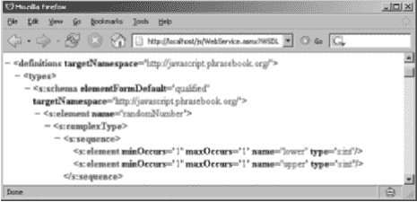

图 10.1 为 ASP.NET Web 服务自动生成的详情页。

# 在 Internet Explorer 中调用 Web 服务

```
WebService.useService("webservice.php?WSDL", "RandomNumberService");
```

几年前，微软提供了一个辅助脚本，允许通过 JavaScript 从 HTML 页面访问 Web 服务。要使此功能正常，Web 服务必须与 JavaScript 代码位于同一台服务器上。

遗憾的是，微软已经停止了该组件的开发，并将其隐藏在微软开发者网络 (MSDN) 中。然而，它仍然可用且运行良好。访问 `http://msdn.microsoft.com/archive/en-us/samples/internet/behaviors/library/webservice/default.asp`，下载 `webservice.htc` 文件，并将其放在你的 HTML 文件所在的目录中（`webservice.htc` 文件不属于本书源码下载的一部分）。然后，以下标记将加载该组件：

```html
<div id="WebService"
style="behavior:url(webservice.htc)">
</div>
```

然后，`WebService` 引用该组件并允许加载远程 Web 服务（使用 `useService()` 方法），提供其 WSDL 。该组件允许 JavaScript 调用网络方法（`callService()` 方法），并提供回调函数、方法名和参数。

在回调函数中，可以分析结果或直接将其打印出来，如下示例代码所示：

```html
<html>
<head>
<title>JavaScript</title>
<script language="Javascript" type="text/javascript">
function callWebService(f) {
  WebService.useService(
  "webservice.php?WSDL",
  "RandomNumberService");
  WebService.RandomNumberService.callService(
  callbackFunction,
  "randomNumber",
  parseInt(f.elements["lower"].value),
  parseInt(f.elements["upper"].value));
}

function callbackFunction(result) {
  document.getElementById("random").innerHTML =
  result.value;
}
</script>
</head>
<body>
```

# 在 Internet Explorer 中调用 Web 服务

```html
<div id="WebService"
  style="behavior:url(webservice.htc);">
</div>
<form>
  一个数字在
  <input type="text" name="lower" size="3"
    value="1" /> 和
  <input type="text" name="upper" size="3"
    value="49" /> 
  <span id="random" /><br />
  <input type="button" value="Retrieve"
    onclick="callWebService(this.form);" />
</form>
</body>
</html>
```

在 Internet Explorer 中调用 Web 服务 (`webservice-ie-php.php`)

图 10.2 显示了结果：随机数来自 Web 服务器上的 Web 服务。

注意：前面的列表涵盖了调用 PHP Web 服务；文件 `webservice-ie-aspnet.html` 处理的是 ASP.NET Web 服务。唯一的区别是 Web 服务的 URL 名称已更改；其余代码脚本保持不变。

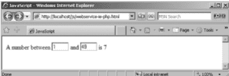

图 10.2 随机数来自 Web 服务。

# 在 Mozilla 浏览器中调用 Web 服务

```javascript
var soapcall = new SOAPCall();
```

Mozilla 浏览器支持它们自己的调用 Web 服务的方法。JavaScript 的 `SOAPCall` 类可以处理 SOAP 请求的创建。实例化后，你需要设置几个属性：SOAP 操作（一个 SOAP 头部，通常是 Web 服务的命名空间加上方法名）和绝对 URI（包括服务器名称）：

```javascript
var soapcall = new SOAPCall();
soapcall.actionURI =
"http://javascript.phrasebook.org/randomNumber";
soapcall.transportURI =
"http://localhost/js/webservice.php";
```

接下来，通过实例化 `SOAPParameter` 类，创建一个所有你想在 Web 服务调用中使用的参数的数组：

```javascript
var parameters = [
new SOAPParameter(1, "lower"),
new SOAPParameter(49, "upper")
];
```

然后，`encode()` 方法准备 Web 服务调用。预期接收以下参数：

- SOAP 版本（`0` 代表 SOAP 1.1 并推荐使用）
- 要调用的 Web 服务方法名
- Web 服务的命名空间
- 要发送的额外 SOAP 头部（数组形式）
- 要发送的参数数量
- 要发送的参数（数组形式）

`asyncInvoke()` 方法实际调用 Web 服务；你可以提供一个回调函数，当数据从 Web 服务返回时该函数将被执行。这是一个 XML 文档，因此你必须使用 DOM 来访问重要信息。以下代码通常有效：

```javascript
function callbackFunction(result) {
  var result = result.body.firstChild.firstChild.firstChild.data;
}
```

这里是完整代码：

```html
<html>
<head>
<title>JavaScript</title>
<script language="Javascript" type="text/javascript">
function callWebService(f) {
  var soapcall = new SOAPCall();
  soapcall.actionURI = "http://javascript.phrasebook.org/randomNumber";
  soapcall.transportURI = "http://localhost/js/webservice.php";

  var parameters = [
    new SOAPParameter(parseInt(f.elements["lower"].value), "lower"),
    new SOAPParameter(parseInt(f.elements["upper"].value), "upper")
  ];
```

## Web 服务

```javascript
soapcall.encode(
  0,
  "randomNumber",
  "http://javascript.phrasebook.org",
  0,
  [],
  parameters.length,
  parameters
);
soapcall.asyncInvoke(callbackFunction);
}

function callbackFunction(result) {
  document.getElementById("random").innerHTML = result.body.firstChild.firstChild.firstChild.data;
}
</script>
</head>
<body>
<form>
  一个数字在
  <input type="text" name="lower" size="3"
    value="1" /> 和
  <input type="text" name="upper" size="3"
    value="49" /> 
  <span id="random" /><br />
  <input type="button" value="Retrieve"
    onclick="callWebService(this.form);" />
</form>
</body>
</html>
```

在 Internet Explorer 中调用 Web 服务 (`webservice-ie-php.php`)

注意：前面的列表涵盖了调用 PHP Web 服务；文件 `webservice-ie-aspnet.html` 处理的是 ASP.NET Web 服务。唯一的区别是 Web 服务的 URL 名称已更改；其余代码脚本保持不变。

# 在 Mozilla 浏览器中调用 Web 服务

```javascript
var soapcall = new SOAPCall();
```

Mozilla 浏览器支持它们自己的调用 Web 服务的方法。JavaScript 的 `SOAPCall` 类可以处理 SOAP 请求的创建。实例化类后，你需要设置几个属性：SOAP 操作（一个 SOAP 头部，通常是 Web 服务的命名空间加上方法名）和绝对 URI（包括服务器名称）：

```javascript
var soapcall = new SOAPCall();
soapcall.actionURI =
"http://javascript.phrasebook.org/randomNumber";
soapcall.transportURI =
"http://localhost/js/webservice.php";
```

接下来，通过实例化 `SOAPParameter` 类，创建一个所有你想在 Web 服务调用中使用的参数的数组：

```javascript
var parameters = [
new SOAPParameter(1, "lower"),
new SOAPParameter(49, "upper")
];
```

然后，`encode()` 方法准备 Web 服务调用。预期接收以下参数：

- SOAP 版本（`0` 代表 SOAP 1.1 并推荐使用）
- 要调用的 Web 服务方法名
- Web 服务的命名空间
- 要发送的额外 SOAP 头部（数组形式）
- 要发送的参数数量
- 要发送的参数（数组形式）

`asyncInvoke()` 方法实际调用 Web 服务；你可以提供一个回调函数，当数据从 Web 服务返回时该函数将被执行。这是一个 XML 文档，因此你必须使用 DOM 来访问重要信息。以下代码通常有效：

```javascript
function callbackFunction(result) {
  var result = result.body.firstChild.firstChild.firstChild.data;
}
```

这里是完整代码：

```html
<html>
<head>
<title>JavaScript</title>
<script language="Javascript" type="text/javascript">
function callWebService(f) {
  var soapcall = new SOAPCall();
  soapcall.actionURI = "http://javascript.phrasebook.org/randomNumber";
  soapcall.transportURI = "http://localhost/js/webservice.php";

  var parameters = [
    new SOAPParameter(parseInt(f.elements["lower"].value), "lower"),
    new SOAPParameter(parseInt(f.elements["upper"].value), "upper")
  ];
```

# AJAX（以及相关主题）

自该术语在 2005 年 2 月诞生以来，AJAX 引起了巨大的轰动。尽管对该术语和这种技术组合存在许多（合理的）批评，但围绕 AJAX 的热潮促成了 JavaScript 的重生。不仅被低估的 JavaScript 能力被带入了 Web 开发者的日常工作中，更高级的 JavaScript 特性也再次流行。本章不仅介绍了关于 JavaScript 最重要的事实（和短语），还介绍了相关的技术，特别是使用 JavaScript 处理 XML。

# 理解 AJAX

在 20 世纪 90 年代，微软在其 Internet Explorer 浏览器（5.0 版本）中添加了一个新的 ActiveX 对象：`XMLHttpRequest`。该对象能够向服务器发送 HTTP 请求并评估返回的数据，与 Web 服务非常相似。

# 第 11 章 AJAX（及相关主题）

概念（但使用了另一种称为 REST——表现层状态转移的方法）。这源于 Outlook 团队的请求，他们当时为该软件开发最新版本的 Web 前端。

几年后，Mozilla 项目的开发者发现了这个对象，并决定创建他们自己的 `XMLHttpRequest` 版本——当然，是作为一种原生的 JavaScript 对象，因为 ActiveX 不支持跨平台运行。此外，Safari 的开发者也实现了 `XMLHttpRequest`。由于该浏览器是基于 Konqueror 的 KHTML 渲染引擎，该代码（由 Apple 捐赠）也可以应用于 KDE 浏览器。最后，Opera 和 iCab 浏览器也增加了对 `XMLHttpRequest` 的支持。

随着使用 `XMLHttpRequest` 的 Web 应用越来越多，Jesse James Garrett 在 2005 年 2 月写了一篇名为《Ajax：Web 应用的新方法》的文章（可以在网上 `http://www.adaptivepath.com/publications/essays/archives/000385.php` 找到）。在这篇文章中，他创造了“AJAX”这一术语，它代表“异步 JavaScript + XML”。他认为他的公司正在使用 `XMLHttpRequest`、JavaScript、DOM、XML、XSLT、XHTML 和 CSS，而向客户解释这些内容变得越来越困难，特别是当他们不是技术人员时。这个术语被创造出来，尽管它面临着不少批评（例如，AJAX 并不需要 XML）。但“AJAX”一词的诞生仍然是该技术的转折点；从那时起，它真正腾飞了。

从技术角度来看，AJAX 实际上就是关于使用 `XMLHttpRequest` 向 Web 服务器发送 HTTP 请求（出于安全考虑，这必须与脚本在同一域内），并使用 JavaScript 在客户端评估并显示数据。此外没有别的内容了，但仍然有专门针对 AJAX 的会议。

## 初始化一个 AJAX 应用

```javascript
XMLHttpRequest = new XMLHttpRequest();
XMLHttpRequest = new ActiveXObject("Microsoft.XMLHTTP");
```

所有 AJAX 应用的基础都是上述的 `XMLHttpRequest` 对象。所有支持 AJAX 的浏览器都原生支持它，但在 Internet Explorer 中需要 ActiveX 对象。不过，有一个例外：Internet Explorer 7 带有原生的 `XMLHttpRequest` 支持。创建该对象的最佳方法是尝试使用 `try...catch` 并首先实例化原生对象（以便让 Internet Explorer 7 处于正确的轨道上，尽管该浏览器仍然支持 ActiveX），

```javascript
try {
    XMLHttpRequest = new XMLHttpRequest();
} catch (e) {
    XMLHttpRequest = new ActiveXObject("Microsoft.XMLHTTP");
}
```

关于 `XMLHttpRequest` 对象，有几种方法可以实例化它。在 Internet Explorer 中，通常需要使用 ActiveX 对象：

```javascript
if (window.XMLHttpRequest) {
    // 实例化原生对象
} else if (window.ActiveXObject) {
    // 实例化 ActiveX 对象
}
```


所有 AJAX 应用的基础都是上述的 `XMLHttpRequest` 对象。

# CHAPTER 11 AJAX (and Related Topics)

## Initializing an AJAX Application


# 第 11 章 AJAX（及相关主题）

## 概念

`XMLHttpRequest` 对象的概念源于 Outlook 团队的请求，他们当时为该软件开发最新版本的 Web 前端。

几年后，Mozilla 项目的开发者发现了这个对象，并决定创建他们自己的 `XMLHttpRequest` 版本——当然，是作为原生的 JavaScript 对象，因为 ActiveX 不支持跨平台运行。此外，Safari 的开发者实现了 `XMLHttpRequest`。由于该浏览器是基于 Konqueror 的 KHTML 渲染引擎，该代码（由 Apple 捐赠）也可以应用于 KDE 浏览器。最后，Opera 和 iCab 浏览器也增加了对 `XMLHttpRequest` 的支持。

随着使用 `XMLHttpRequest` 的 Web 应用越来越多，Jesse James Garrett 在 2005 年 2 月写了一篇名为《Ajax：Web 应用的新方法》的文章（可以在网上 http://www.adaptivepath.com/publications/essays/archives/000385.php 找到）。在这篇文章中，他创造了“AJAX”这一术语，它代表“异步 JavaScript + XML”。他认为他的公司正在使用 `XMLHttpRequest`、JavaScript、DOM、XML、XSLT、XHTML 和 CSS，而向客户解释这些内容变得越来越困难，特别是当他们不是技术人员时。这个术语被创造出来，尽管它面临着不少批评（例如，AJAX 并不需要 XML）。但“AJAX”一词的诞生仍然是该技术的转折点；从那时起，它真正腾飞了。

从技术角度来看，AJAX 实际上就是关于使用 `XMLHttpRequest` 向 Web 服务器发送 HTTP 请求（出于安全考虑，这必须与脚本在同一域内），并使用 JavaScript 在客户端评估并显示数据。此外没有别的内容了，但仍然有专门针对 AJAX 的会议。

## 初始化一个 AJAX 应用

```javascript
XMLHttpRequest = new XMLHttpRequest();
XMLHttpRequest = new ActiveXObject("Microsoft.XMLHTTP");
```

所有 AJAX 应用的基础都是上述的 `XMLHttpRequest` 对象。所有支持 AJAX 的浏览器都原生支持它，但在 Internet Explorer 中需要 ActiveX 对象。不过，有一个例外：Internet Explorer 7 带有原生的 `XMLHttpRequest` 支持。创建该对象的最佳方法是尝试 `try...catch` 首先实例化原生对象（以便让 Internet Explorer 7 处于正确的轨道上，尽管该浏览器仍然支持 ActiveX），

```javascript
try {
    XMLHttpRequest = new XMLHttpRequest();
} catch (e) {
    XMLHttpRequest = new ActiveXObject("Microsoft.XMLHTTP");
}
```

请注意，整个代码只有在页面完全加载后才会执行；否则对输出 HTML 元素的访问可能会失败。

> **警告**：同步调用可能很方便，但从易用性和性能的角度来看，应该避免使用。在进行调用时，脚本执行会完全停止，这在连接缓慢或服务器负载过重的情况下，可能会变成一场真正的噩梦。

## 从服务器接收多条数据

```javascript
var data = XMLHttpRequest.responseText.split("\n");
```

默认情况下，`responseText` 属性只存在一次，因此从服务器返回的所有数据将放入字符串中。然而，通常需要从 `XMLHttpRequest` 调用返回多条数据。针对这种情况，有几种解决方案，但最简单的方法可能是返回多条数据，并使用数据本身中未出现的分隔符（例如制表符、换行符或管道符号）将各个数据分开。然后就可以使用 JavaScript 来访问这些信息。

对于这段短语，将使用 HTTP 查询以下服务器端的文本文件。（在现实世界场景中，服务器端肯定会有动态脚本，但为了演示目的，静态文件已经足够了。）

### 一个文件中的多条数据 (phrasebook-multiple.txt)

```text
JavaScript
Phrasebook
Sams Publishing
```

然后，以下代码访问返回数据中的各个信息；图 11.1 显示了结果。

```html
<script language="JavaScript" type="text/javascript" src="xmlhttp.js"></script>
<script language="JavaScript" type="text/javascript">
var XMLHttpRequest = getXMLHttpRequest();
XMLHttpRequest.open("GET", "phrasebook-multiple.txt");
XMLHttpRequest.onreadystatechange = handlerFunction;
XMLHttpRequest.send(null);

function handlerFunction() {
  if (XMLHttpRequest.readyState == 4) {
    var data = XMLHttpRequest.responseText.split("\n");
    window.alert(data[0] + " by " + data[1] + \
      " by by " + data[2]);
  }
}
</script>
```

### 处理来自服务器的多条数据 (xmlhttpmultiple.html)

## 中止 HTTP 请求

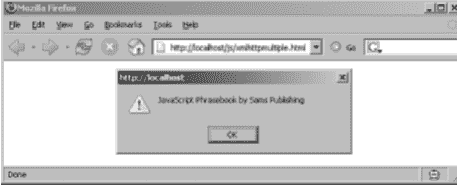

图 11.1 服务器发送多条数据。

```javascript
XMLHttpRequest.abort();
```

根据浏览的不同，一次只能执行有限数量的 HTTP 请求。特别是如果你有一个包含多个 AJAX 组件的页面（这的现代术语是“mashup”），你可能会遇到麻烦。因此，中止 HTTP 请求可能成为一种需要。

用于此的方法是 `abort()`。以下代码如果请求在五秒后未完全执行，则将其中止。为了演示这种行为，代码调用的 PHP 脚本 `delay.php` 需要 10 秒才能执行。还要注意，首先检查 `readyState` 属性：如果它是 0 或 4，则没有可以中止的内容。

```html
<script language="JavaScript" type="text/javascript" src="xmlhttp.js"></script>
<script language="JavaScript" type="text/javascript">
var XMLHttpRequest = getXMLHttpRequest();
XMLHttp.open("GET", "delay.php?" + Math.random());
XMLHttp.onreadystatechange = handlerFunction;
XMLHttp.send(null);
window.setTimeout("timeout();", 5000);

function handlerFunction() {
  if (XMLHttp.readyState == 4) {
    window.alert("Returned data: " + 
    XMLHttp.responseText);
  }
}

function timeout() {
  if (XMLHttp.readyState != 4 &&
      XMLHttp.readyState != 0) {
    XMLHttp.onreadystatechange = function() { };
    XMLHttp.abort();
    window.alert("Request aborted");
  }
}
</script>
```

### 中止 HTTP 请求 (xmlhttpabort.html)

在加载此页面五秒后，请求被中止。

> **提示**：在调用 URL 后附加 `Math.random()` 的结果可以禁用 `delay.php` 脚本的缓存，因为每次的 URL 都是不同的。

## 获取 HTTP Header

```javascript
var headers = XMLHttpRequest.getAllResponseHeaders();
```

`getAllResponseHeaders()` 方法（见前述代码）返回 HTTP 响应中的所有 HTTP 头，而 `getHeader()` 方法只返回一个特定的头。以下代码显示了如何获取关于所用 Web 服务器类型的信息：

```html
<script language="JavaScript" type="text/javascript" src="xmlhttp.js"></script>
<script language="JavaScript" type="text/javascript">
var XMLHttpRequest = getXMLHttpRequest();
XMLHttpRequest.open("GET", "phrasebook.txt");
XMLHttpRequest.onreadystatechange = handlerFunction;
XMLHttpRequest.send(null);

function handlerFunction() {
  if (XMLHttpRequest.readyState == 4) {
    var servertype =
    XMLHttpRequest.getResponseHeader("Server");
    window.alert("Web server used: " + servertype);
  }
}
</script>
```

### 获取 HTTP 响应头 (responseheader.html)

> **注意**：并非所有服务器都发送此内容；某些服务器会在其中放入伪数据以增加服务器特征分析的难度。

## 从服务器接收 XML

```javascript
var xml = XMLHttpRequest.responseXML;
```

`responseText` 属性对于有限的数据量有效。然而，使用结构化数据的更优雅的方法是 `responseXML`。访问 XML 对象的细节与访问 DOM 元素相似。对于这段短语，将使用以下 XML 文件：

```xml
<books>
  <book pubdate="2006">
    <title>Phrasebook</title>
    <publisher>Sams Publishing</publisher>
  </book>
</books>
```

### 示例 XML 数据 (phrasebook.xml)

为了让浏览器读取此 XML（Internet Explorer 在这方面非常严格），必须向客户端发送正确的 MIME 类型。如果你使用 Apache，`mime.types` 中的配置即可解决，但它是默认存在的：

```text
text/xml
```

在 Internet Information Services 中，你可以在控制台中配置 MIME 类型（启动）。或者，让服务器端脚本带有正确的 MIME 类型提供文件：

```php
<?php
header('Content-type: text/xml');
readfile('phrasebook.xml');
?>
```

### 设置正确的 MIME 类型 (phrasebook.xml.php)

然后，以下代码使用 DOM 结构和 `getElementsByTagName()`、`getAttribute()` 等方法访问返回数据中的信息。图 11.2 显示了结果。

```html
<script language="JavaScript" type="text/javascript" src="xmlhttp.js"></script>
<script language="JavaScript" type="text/javascript">
var XMLHttpRequest = getXMLHttpRequest();
XMLHttpRequest.open("GET", "phrasebook.xml");
XMLHttpRequest.onreadystatechange = handlerFunction;
XMLHttpRequest.send(null);

function handlerFunction() {
  if (XMLHttpRequest.readyState == 4) {
    var xml = XMLHttpRequest.responseXML;
    var book = xml.getElementsByTagName("book")[0];
    var pubdate = book.getAttribute("pubdate");
    var title, publisher;
    for (var i=0; i<book.childNodes.length; i++) {
      if (book.childNodes[i].nodeName == "title") {
        title = book.childNodes[i].firstChild
        nodeValue;
      } else if (book.childNodes[i].nodeName == "publisher") {
        publisher = book.childNodes[i].firstChild
        nodeValue;
      }
    }
    window.alert(title + " by " + publisher + 
    " (" + pubdate + ")");
  }
}
</script>
```

### 从 HTTP 响应中提取信息 (xmlhttpml.html)

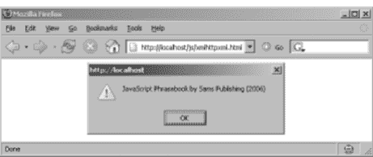

图 11.2 来自 XML 文件的数据。

> **提示**：XML DOM 文档的另一个非常有用的属性是 `documentElement`，它是访问 XML 数据根元素的快捷方式。如果根节点包含你感兴趣的属性（某些 Web 服务正是如此），`documentElement` 就会派上用场。

## 理解 JSON

JSON 就像 AJAX 一样，与其说是一种技术，不如说是一个术语。但与 AJAX 不同，JSON 有自己的官方网站 http://www.json.org/。

JSON 全称为 JavaScript 对象表示法（JavaScript Object Notation），它是 JavaScript 中一个长期被忽视和低估的特性——一种用于数组和对象的非常紧凑表示法。许多书籍以以下方式定义 JavaScript 数组，例如：

```javascript
var ajax = new Array(
"Asynchronous", "JavaScript", "+", "XML");
```

然而，有一种更紧凑的方法，使用方括号：

```javascript
var ajax = [
"Asynchronous", "JavaScript", "+", "XML"];
```

对象也是如此（在 JavaScript 中，对象在某种程度上是增强型数组），这次使用大括号。以下代码定义了一个具有三个属性的对象：

```javascript
var book = {
"title": "JavaScript Phrasebook",
"publisher": "Sams Publishing",
"pubdate": 2006
};
```

这两个“快捷方式”可以组合在一起，将复杂数据表示为字符串。这就是 JSON 的全部意义：因为它可以在字符串中表现得很漂亮，所以它是一个极佳的数据序列化格式。在服务器端创建一个对象的 JSON 表示是非常轻而易举的，而在客户端将此字符串转换为 JavaScript 对象则更加简单，接下来的短语所示。

## 使用 JSON 进行数据的（反）序列化

```javascript
var json = XMLHttpRequest.responseText;
var book = eval("(" + json + ")");
```

JSON 正在日益成为 AJAX 应用的事实数据交换格式。许多 AJAX 框架支持 JSON，许多 Web 服务提供 JSON 接口，而 PHP 6 最可能会在语言核心中加入 JSON 的支持。

JavaScript 内部的 JSON 也非常简单。前面的代码评估 JSON 并将其转换为 JavaScript 对象——一个简单的 `eval()` 函数调用即可搞定。

上一个侧边栏“理解 JSON”中使用的 JSON 表示法被存储在一个名为 `phrasebook.json` 的文件中；然后下面的代码使用 `XMLHttpRequest` 读取该文件并输出其中的数据：

```html
<script language="JavaScript" type="text/javascript" src="xmlhttp.js"></script>
<script language="JavaScript" type="text/javascript">
var XMLHttpRequest = getXMLHttpRequest();
XMLHttpRequest.open("GET", "phrasebook.json");
XMLHttpRequest.onreadystatechange = handlerFunction;
XMLHttpRequest.send(null);

function handlerFunction() {
  if (XMLHttpRequest.readyState == 4) {
    var json = XMLHttpRequest.responseText;
    var book = eval("(" + json + ")");
    var pubdate = book.pubdate;
    var title = book.title;
    var publisher = book.publisher;
    window.alert(title + " by " + publisher + " " + pubdate + "");
  }
}
</script>
```

### 使用 JSON 进行数据反序列化 (xmlhttpjson.html)

> **警告**：使用 `eval()` 通常是一个坏主意，因为如果 JSON 来自不可信的源，就会引入严重的安全漏洞。由于 `XMLHttpRequest` 的同源限制，JSON 代码通常是可以信任的，但如果你想感觉更安全，请从 http://www.json.org/js.html 下载 JSON 库 `json.js`。然后，下面的代码替换 `eval()` 调用：

```javascript
var book = json.parseJSON();
```

## 创建等待屏幕

```javascript
document.getElementById("loading").style.visibility = "hidden";
```

现代 Web 应用面临的最大障碍之一是延迟：某些事情发生了，但在后台进行。你必须通知用户；否则，他们不会注意到有东西正在出现。这里的一种方法是更改鼠标光标（参见第 4 章“CSS”）；另一种方法是使用等待横幅。许多应用程序会让标记为“等待”或“加载”标签的横幅在执行 `XMLHttpRequest` 调用时淡入；最早使用此特性的网站之一是 Google Mail。

实际上，这个短语需要的 DHTML 比 AJAX 更多。当（同步的！）调用发送到服务器时，加载屏幕会显示出来并定位在右上角（当然，你可以使用任何你喜欢的任意位置）。当数据从服务器返回后，横幅再次变为不可见。下面的代码以一种与浏览器无关的方式实现了这一点：

```html
<script language="JavaScript" type="text/javascript" src="xmlhttp.js"></script>
<script language="JavaScript" type="text/javascript">
var XMLHttpRequest = getXMLHttpRequest();
window.onload = function() {
  XMLHttpRequest.open("GET", "delay.php?" + Math.random());
  XMLHttpRequest.onreadystatechange = handlerFunction;
  XMLHttpRequest.send(null);
  with (document.getElementById("loading")) {
    style.visibility = "visible";
    if (navigator.appName == "Internet Explorer") {
      style.left = document.clientWidth - 75;
      style.top = 0;
    } else {
      style.left = (window.innerWidth - 75) + "px";
      style.top = "0px";
    }
  }
}
</script>
```

```html
<script language="JavaScript" type="text/javascript" src="xmlhttp.js"></script>

function handlerFunction() {
  if (XMLHttpRequest.readyState == 4) {
    document.getElementById("loading").style.visibility = "hidden";
    window.alert("返回的数据: " + XMLHttpRequest.responseText);
  }
}
<span id="loading" style="position: absolute; visibility: hidden; background-color: red; width: 75px;">Loading ...</span>
```

### 实现等待屏幕 (waiting.html)

图 11.3 显示了等待屏幕。

> **警告**：如果请求出现问题，`XMLHttpRequest` 对象不会注意到，这包括超时。所以你应该重启它——或者让等待横幅消失。

## 解决书签问题

今天 AJAX 应用的主要问题之一是无法对页面进行书签。由于页面内容可以变化但 URL 保持不变，书签失效了。然而有一种变通方法。技巧是将标识页面状态的数据附加到 URL 中。不是 GET 参数的形式（因为会导致页面重新加载），而是通过哈希：

`http://server/file.html#info`

这里的数据必须标识页面状态。实现细节很大程度上取决于如何使用 AJAX。

当页面当前状态变化时，页面的哈希（JavaScript 中的 `location.hash`）必须更新。然后，下面的代码在页面加载后读取信息。你需要实现 `applyData()` 函数，负责将 `location.hash` 中的信息转换为页面实际内容。

```javascript
window.onload = function() {
  if (location.hash.length >= 2) {
    var data = unescape(location.hash.substring(1));
    applyData(data);
  }
};
```

这无疑增加了工作量，但你的用户将从这一方便的功能中大大获益。遗憾的是，这种方法在 Safari 和 Konqueror 中尚未可行，因为它们处理哈希的方式不同。

## 解决后退按钮问题

```javascript
window.frames["loader"].window.location.search = "?" + escape(data);
```

与上一个短语处理的问题相关的是后退按钮（当然，还有前进按钮）。当页面 URL 不发生变化但内容发生变化时，后退按钮无法按预期工作。

为了解决这个问题（这里再次强调，这个短语只能展示一种通用方法，而不是完整的解决方案，因为有许多取决于实现的细节），需要处理两个子问题：

- 第一，你必须确保带有新哈希的各种状态都在浏览器的历史记录中；否则后退和前进按钮将无法工作。Mozilla 浏览器会自动完成这一点，但 Internet Explorer 则不会。

第二个子问题的解决方案是使用隐藏的 iframe，它会加载一个不可见的页面，以便在页面历史记录中创建一个条目。以下是该 iframe：

```html
<iframe src="loader.html" name="loader" style="display:none"></iframe>
```

每当页面发生任何变化（从 AJAX 方面）时，必须强制 loader 帧重新加载，并将数据附加到 URL 上（与哈希代码不同，这次必须重新加载）：

```javascript
if (window.ActiveXObject) {
  window.frames["loader"].window.location.search = "?" + escape(data);
}
```

最后，loader 帧必须处理将任何加载的数据应用到主文档；至少对于 Internet Explorer 来说是必须的，因为在该浏览器中，后退和前进按钮会改变 iframe 的内容！

```javascript
window.onload = function() {
  if (location.search.length >= 2) {
    var data = unescape(
    location.search.substring(1));
    top.applyData(data);
  }
};
```

这让编码者的生活变得复杂得多，特别是当页面上有许多不同的 AJAX 效果时。但只需重复上一段最后的话语之一：你的用户从这一便利的功能中受益匪浅。再次强调，变通方法尚未适用于 Safari 和 Konqueror。

## 理解 XSLT

1999 年，W3C 发布了 XSLT 1.0 规范。该缩写代表可扩展样式语言转换（Extensible Stylesheet Language Transformations）。这是一种基于 XML 将数据转换为另一种格式的语言。大多数情况下，输出数据是 HTML，但也可能是其他格式。但在 Web 上，通常采用的是 HTML。

XSLT 通过模板工作；在这些模板内部，你可以访问 XML 源文件中的节点值和属性值等。以下代码显示了示例 XSLT 文件：

```xml
<?xml version="1.0" encoding="UTF-8" ?>
<xsl:stylesheet version="1.0"
xmlns:xsl="http://www.w3.org/1999/XSL/Transform">
<xsl:template match="/">
<ul>
  <xsl:for-each select="books/book">
    <li>
      <xsl:value-of select="title" />
      by
      <xsl:value-of select="publisher" />
      (<xsl:value-of select="@pubdate" />)
    </li>
  </xsl:for-each>
</ul>
</xsl:template>
</xsl:stylesheet>
```

### XSLT 文件 (phrasebooks.xsl)

## 使用 XSLT

```javascript
var process = new XSLTProcessor();
```

Internet Explorer 和 Mozilla 浏览器都支持从 JavaScript 使用 XSLT。然而，两者的方法非常不同。对于 Microsoft Internet Explorer，再次需要 ActiveX（即使在 Internet Explorer 7 中也是如此）。你首先加载 XSLT 文件，然后加载 XML（当然是通过 `XMLHttpRequest`）。最后，XSL 转换的结果以字符串的形式可用，并且例如可以附加到页面上。

另一方面，Mozilla 浏览器使用不同的方法；它们完全依赖原生对象。然而，结果与 Internet Explorer 的实现不同。最后，你得到一个 DOM 片段，你可以将其附加到当前页的 DOM。

以下代码涵盖了主要的浏览器类型：

```html
<script language="text/javascript" src="xmlhttp.js"></script>
<script language="text/javascript">
var XMLHttpRequest = getXMLHttpRequest();
window.onload = function() {
  XMLHttpRequest.open("GET", "phrasebooks.xml");
  XMLHttpRequest.onreadystatechange = handlerFunction;
  XMLHttpRequest.send(null);
}

function handlerFunction() {
  if (XMLHttpRequest.readyState == 4) {
    var xml = XMLHttpRequest.responseText;
    if (window.ActiveXObject) {
      var xslt = new ActiveXObject(
        "MSXML2.FreeThreadedDOMDocument");
      xslt.async = false;
      xslt.load("phrasebooks.xsl");
      var template = new ActiveXObject(
        "MSXML2.XSLTemplate");
      template.stylesheet = xslt;
      var process = document.createElement("p");
      process.input = xml;
      process.transform();
      var para = document.createElement("p");
      para.innerHTML = process.output;
      document.body.appendChild(para);
    } else if (window.XSLProcessor) {
      var xslt = document.implementation
      .createDocument("", null);
      xslt.async = false;
      xslt.load("phrasebooks.xsl");
      var process = new XSLProcessor();
      process.importStylesheet(xslt);
      var result = process.transformToFragment(
        xml, document);
      document.body.appendChild(result);
    }
  }
}
</script>
```

### 使用 JavaScript 使用 XSLT (xmlhttpx.html)

以下显示了图 11.4 的输出：图 11.4 也是无序列表。

图 11.4 显示了转换。

如所示，图 11.4 也演示了转换。

使用 JavaScript 使用 XSLT (xmlhttpx.html)

以下显示了图 11.4 的输出：图 11.4 也是无序列表。

图 11.4 显示了转换。

正如你所见，图 11.4 也演示了转换。

## 使用 Yahoo! Web Service

接下来的代码将使用 Web Service 的数据创建一个无序列表。关于 Yahoo! 返回的数据特定格式的更多信息，可以在在线文档 http://developer.yahoo.com/search/web/V1/webSearch.html 中找到。图 11.6 显示此代码的输出。

```javascript
<script language="JavaScript"
  type="text/javascript">
function showResults(data) {
  var ul = document.getElementById("output");
  for (var i=0; i < data.ResultSet.length; i++) {
    var text = document.createTextNode(
      data.ResultSet[i].Title + " - " + 
      data.ResultSet[i].Url);
    var li = document.createElement("li");
    li.appendChild(text);
    ul.appendChild(li);
  }
}
</script>
<body>
<p><ul id="output"></ul></p>
</body>
<script language="JavaScript" type="text/javascript"
  src="http://api.search.yahoo.com/WebSearchService/
V1/webSearch?appid=XXXXX&query=JavaScript&
  output=json&callback=showResults">
</script>
```

### 使用 JavaScript 调用 Yahoo! Web Service (yahooeservice.html)

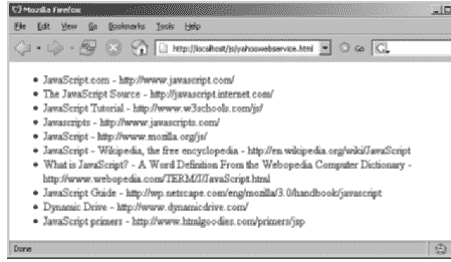

图 11.6 Yahoo! 搜索结果。

## 使用 AJAX 框架

你在网站上使用的 AJAX 越多，就越应该关注可用的 AJAX 框架，这些框架可以方便处理 `XMLHttpRequest` 和其他 JavaScript 特性。

选择哪个框架很大程度上取决于所使用的服务器端技术。Java（例如 Zimbra，位于 http://www.zimbra.com/）和 ASP.NET 2.0（例如 Atlas，位于 http://atlas.asp.net/）都有几个 AJAX 框架。PHP 拥有的框架多到数不胜数（包括位于 http://pear.php.net/package/HTML_AJAX 的 PEAR 包）。

非常有趣的是还有一些独立于技术的框架，它们更多关注 JavaScript 侧。特别是 Dojo（http://www.dojo-toolkit.org/）值得一提，因为它提供了与本章提到的类似的替代方案，使后退和前进按钮能够恢复工作。

顺便说，最老的框架之一被认为是 Tibet（http://www.technicalpursuit.com/），它从 1997 年开始（至少在概念上）进行开发，并于 1999 年首次发布。

因此，请根据服务器端技术明智地选择你的框架——你是专门使用一种服务器技术，还是更多地由客户驱动？根据这些信息、各种框架的功能，特别是开发活动（因为许多项目从未真正启动，或者在几个月后陷入停滞），你来选择一个框架；但通常本章中的短语将提供你将 Web 应用程序转换为 AJAX 应用程序所需的一切。

# 第 12 章 嵌入媒体

HTML 和 JavaScript 是绝佳的组合，但有时创建现代 Web 应用程序还需要更多。因此，HTML 允许 Web 开发者为网站集成其他内容插件；通常，你需要浏览器来显示如何访问这些内容，并为最广泛使用的内容类型提供提示。请注意，本章中的大多数短语都没有附代码下载。

## 访问嵌入媒体

嵌入媒体的“官方”HTML 元素是 `<object>`。然而，为了拥有跨浏览器站点，通常会在 `<object>` 元素内部嵌入一个 `<embed>` 对象。为了让访问嵌入对象尽可能简单，`<object>` 元素的 `id` 属性应与 `<embed>` 对象的 `name` 属性匹配：

```html
<object classid="..." id="media">
<embed name="media"></embed>
</object>
```

然后，你可以使用短语头的快捷方式访问嵌入媒体。当然，你也可以使用 `document.getElementById()` 来访问 `<object>` 元素；所有的 `<embed>` 元素都位于 `document.embeds` 数组中。你可以看到，在这里快捷方式方便得多。

## 检查插件

```javascript
if (new ActiveXObject("ShockwaveFlash.ShockwaveFlash.8")) { }
```

在 Mozilla 浏览器中，`about:plugins` 特殊 URL 提供了可用插件的列表，如图 12.1 所示；这在 Opera 中同样有效。

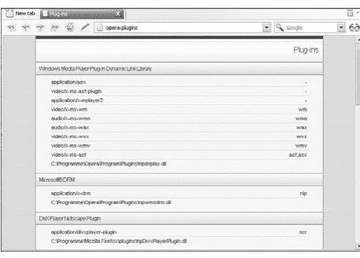

图 12.1 Opera 显示所有安装插件的列表。

根据所选浏览器，有两种方法可以主动检查特定插件的存在：

- 在 Mozilla 浏览器和 Opera（使用相同的 API）上，`navigator.plugins` 是包含所有插件的数组。每个数组元素都暴露每个插件的名称、文件名和描述。此外，`navigator.mimeTypes` 包含了插件可以支持的所有支持 MIME 类型列表。
- 在 Internet Explorer（仅限 Windows）上，你可以使用 ActiveX 实例化插件所暴露的关联类。

以下代码尝试为 Internet Explorer 检测 Flash：

```javascript
var hasFlash = false;
if (window.Flash) {
  try {
    if (new ActiveXObject("ShockwaveFlash.ShockwaveFlash.8")) {
      hasFlash = true;
    }
  } catch (e) {
  }
} else if (navigator.plugins) {
  if (navigator.plugins["Flash"]) {
    hasFlash = true;
  }
}
alert(hasFlash);
```

### 检测 Flash 插件

## 访问多媒体内容

在浏览器中访问多媒体内容（音频或视频数据）是非常困难的。有很多插件，每个版本似乎相对于前一个版本发生了变化。关于访问各种插件的最新或特定版本信息，供应商网站是最佳选择。

然而，也有一些好消息。目前多媒体数据的主要插件（Windows Media Player、Real Player 和 Apple QuickTime）在方法名上非常相似。

### 表 12.1 多媒体功能方法

| 操作 | Media Player | Real Player | QuickTime |
|---|---|---|---|
| 播放 | play() | DoPlay() | play() |
| 停止 | stop() | DoStop() | stop() |
| 暂停 | pause() | DoPause() | pause() |
| 音量 | volume | GetVolume()/SetVolume() | GetVolume()/SetVolume() |

## 访问 Java 内容

```javascript
document.JavaApplet.setString(field.value);
```

当 Java applet 嵌入页面时，你可以调用此 applet 的所有公共方法。以下非常简单的 applet 暴露了它的 `setString()` 方法，该方法设置一个私有变量并重绘 applet：

### 简单的 Applet (JavaApplet.java)

```java
import java.applet.*;
import java.awt.*;

public class JavaApplet extends Applet {
    private String _s = "Welcome";

    public void paint(Graphics g) {
        g.setColor(Color.black);
        g.drawString(_s, 20, 20);
    }

    public void setString(String s) {
        this._s = s;
        this.repaint();
    }
}
```

当此 applet 被编译成类后，以下 JavaScript 代码会在文本字段内容变化时每次调用 `setString()` 方法。图 12.3 显示了结果。

```javascript
<script type="text/javascript">
function paint(field) {
    document.JavaApplet.setString(field.value);
}
</script>
<applet code="JavaApplet.class" name="JavaApplet" width="150" height="75"></applet><br />
<input type="text" onkeyup="paint(this);" />
```

### 使用 JavaScript 访问 Java (java.html)

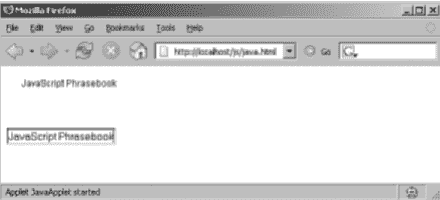

**图 12.3** 当你输入时，applet 会发生变化。

## 访问 Flash 内容

```javascript
document.flash.Play();
document.flash.Rewind();
document.flash.StopPlay();
```

Flash 电影也可以通过 JavaScript 控制。其中，你可以启动、停止和暂停电影。为了实现这些目的，插件暴露了 `Play()`、`Rewind()` 和 `StopPlay()` 方法。下面的列表为 Flash 电影实现了一个简单的控制站：

```html
<object
  classid="clsid:d27cdb6e-ae6d-11cf-96b8-444553540000"
  codebase="http://fpdownload.macromedia.com/pub/
  shockwave/cabs/flash/swflash.cab
  #version=7,0,0,0"
  width="400" height="550" id="flash">
  <param name="allowScriptAccess"
    value="sameDomain" />
<param name="movie" value="flash.swf" />
<embed src="flash.swf" width="400" height="550"
name="flash"
allowScriptAccess="sameDomain"
type="application/x-shockwave-flash"
pluginpage="http://www.macromedia.com/go/
getflashplayer" />
</object>
<a href="javascript:document.flash.Play();">
  播放
</a>
<a href="javascript:document.flash.Rewind();">
  停止
</a>
<a href="javascript:document.flash.StopPlay();">
  暂停
</a>
```

### 从 JavaScript 访问 Flash 电影 (flash.html)

> **注意**：在 `<object>` 和 `<embed>` 元素中设置 `allowScriptAccess` 选项允许 JavaScript 访问 Flash 电影。

# 索引

### 符号

- `*` (星号), 27
- `]` (括号), 219
- `\` (反斜杠), 28
- `^` (脱字符), 26
- `$` (美元符号), 26
- `...` (省略号), 27
- `-` (连字符), 27
- `.` (句号), 28
- `|` (竖线符), 27
- `+` (加号), 27
- `?` (问号), 27

### A

- 后退/前进按钮, 225-227
- 书签, 224-225
- 开发, 203-205
- 框架, 235-236
- GET 请求, 206-207
- HTTP 请求头, 215
- 多条数据，从服务器接收, 211-213
- POST 请求, 208-210
- 同步请求, 210-211
- 等待屏幕，创建, 221-223
- XML, 从服务器接收, 216-218
- 中止事件 (abort event), 45
- `abort()` 方法, 213
- 中止 HTTP 请求, 213-214
- `addEventListener()` 方法, 101
- `additem()` 方法, 212
- 广告, Flash 弹出窗口广告, 88-91
- AJAX, 203
- AJAX "Ajax: A New Approach to Web Applications" (文章), 204
- AJAX, 230-233
- `XMLHttpRequest` 对象, 204
- 中止 HTTP 请求, 213-214
- 状态, 208-210
- 同步请求, 210-211
- "Ajax: A New Approach to Web Applications" (文章), 204, 230-233
- `alert()` 方法, 32, 169-170
- `animate()` 方法, 41, 动画, 40-42, 85-86
- 进度条, 44-45
- 伸伸图像, 42-43
- `appendChild()` 方法, 72
- 应用, 初始化, 205-206
- 应用, AJAX, 224
- 应用, AJAX 历史, 6
- `applyData()` 方法, 224
- `appName` 属性 (navigator 对象), 20-21
- 数组, 240
- 嵌入媒体, 240-241
- `document.forms`, 124-125
- `navigator.plugins`, 239-240
- 非 JavaScript 浏览器, 支持, 16-18
- 插件，检查, 238-239
- `.asmx` 文件扩展, 194
- ASP.NET Web 服务, 调用, 193, 201-202
- 从 Internet Explorer 调用, 195-197
- 从 Mozilla 浏览器, 198-202
- `attachEvent()` 方法, 101
- 自动验证表单, 151-154
- 项目列表, 78-79
- 后退/前进按钮, 225-227
- 后退按钮 (AJAX), 225-227
- `back()` 方法, 30
- 书签 (AJAX), 224-225
- 括号 (`[]`), 219
- 缓存，防止, 233
- `callFunction()` 方法, 199-200
- 检查功能, 22-23
- 历史，导航, 30

### C

- 居中选项 (窗口), 168
- 配置浏览器, 9-10

### D

- 跨站脚本 (XSS)
- 脱字符 (`^`), 26
- 样式表 (Cascading Style Sheets)。查看 CSS
- 外部 JavaScript 文件, 加载, 12-14
- 包含脚本元素, 11-12
- `confirm()` 方法, 32
- CSS 属性, 118
- `cookie` 属性 (document 对象), 112-113
- cookies, 109-110
- 居中窗口，打开, 174-175
- 检查支持, 119-120
- `changeFrames()` 方法, 185-186
- `changeImage()` 方法, 37
- 删除, 119
- 过期日期, 116-117
- 访问, 126-127
- `checkKey()` 方法, 105
- `className` 属性 (document 对象), 50
- 清文本字段, 143-145
- `Count()` 方法, 94, 96
- 成员, 94-96
- 创建, 93-94
- 在屏幕角打开窗口, 177-178
- `cloneNode()` 方法, 76-77
- 克隆 DOM 元素, 76-77
- `close()` 方法, 179
- 关闭窗口, 179-181
- `createTextNode()` 方法, 73
- 代码，使用伪 URL 调用, 14-15
- `createTextRange()` 方法, 141
- 使用事件处理程序执行, 15-36

### CSS (层叠样式表)

- CSS (层叠样式表), 47
- 类, 50
- 元素可见性, 55-58
- 外部样式表，访问, 51-52
- 鼠标光标，更改, 60-61
- 规则, 52-55
- 选择器，应用 JavaScript(), 58-60
- 样式, 48-49
- CSS 命令, 61
- 光标，更改, 60–61
- `dialogWidth` 选项 (窗口), 168
- 指令, `@@%`, 194
- 目录选项 (窗口), 165
- 禁用表单元素, 134-136
- 消失的网站, 55-58
- document 对象，`className` 属性, 50
- `cookie` 属性, 112-113
- cookies, 109-110
- 居中窗口，打开, 174-175
- 检查支持, 119-120
- 删除, 119
- 过期日期, 116-117
- 访问, 126-127
- `checkKey()` 方法, 105
- `className` 属性, 50
- 清文本字段, 143-145
- `Count()` 方法, 94, 96
- 成员, 94-96
- 创建, 93-94
- 在屏幕角打开窗口, 177-178
- `cloneNode()` 方法, 76-77
- 克隆 DOM 元素, 76-77
- `close()` 方法, 179
- 关闭窗口, 179-181
- `createTextNode()` 方法, 73
- 代码，使用伪 URL 调用, 14-15
- `createTextRange()` 方法, 141
- 使用事件处理程序执行, 15-36

### E

- ECMAScript (ECMA-262), 6
- elements
  - 访问
  - `getElementById()` 方法, 65-66
  - `getElementsByTagName()` 方法, 66-67
  - 属性, 74-75
  - 克隆, 76-77

### 事件

- 中止 (abort), 45
- 冒泡 (bubbling), 102-103
- 错误 (error), 45
- 处理 (handling), 15-16, 100
- `addEventListener()` 方法, 101
- `attachEvent()` 方法, 101
- 事件冒泡 (event bubbling), 102-103
- 键盘事件 (keyboard events), 103-104
- 鼠标事件 (mouse events), 106-108
- 提交 (submit), 137
- `exec()` 方法, 29
- 过期日期 (cookies), 116-117
- 表达式 (expressions), 正则搜索, 28-29
- 特殊字符 (special characters in), 26-28
- 扩展内置 JavaScript 对象, 99
- 可扩展样式表语言转换 (XSLT), 227-230
- 使用伪 URL 的外部 JavaScript 文件, 14-15, 使用事件处理器执行, 15-16, 加载, 12-14

### F

- 字段 (fields)
  - 焦点 (focus), 140–141
  - 文本框 (text fields) 获取, 125-126, 清空, 143-145, 在其中选择文本, 141-143, 验证, 145-156
- 文件 (JavaScript) 使用伪 URL 调用, 14-15, 使用事件处理器执行, 15-16, 加载, 12
- 动态加载, 13-14
- Flash 内容, 获取, 244-245
- Flash 弹窗广告 (Flash pop-up ads), 创建, 88-91
- 焦点 (focus (fields)), 140–141
- `focus()` 方法, 140
- 表单 (forms), 123–125
  - 复选框 (check boxes) 获取, 126–127, 验证, 147
  - 禁用这些元素 (disabling elements of), 136–136
  - `document.forms` 数组, 124-125
  - 字段焦点 (field focus), 140–141
  - 多选列表 (multiple selection lists), 131-133
- 图形 (graphics). 见图像 (images)
- 防止提交不完全的表单, 137–138
- 重复提交表单, 138–140
- 帧 (frames) 同时更改两个帧, 185–186
- 隐藏帧 (hidden frames), 187
- iframes, 188
- 框架 (AJAX), 235–236
- 单选框按钮 (radio buttons) 获取, 127–128, 清空, 158, 验证, 147–148
- 只读元素 (read-only elements), 136
- 全屏窗口 (full-screen windows), 打开, 176
- 函数 (functions). 见方法 (methods)
- 选择列表 (selection lists) 获取, 129–130, 层级导航, 155–157, 预填日期选择列表, 159–160, 快速链接导航, 154–155, 验证, 149–150, 验证日期选择列表, 160–162

### G

- Garrett, Jesse James, 204
- GET 参数, 31–32
- GET 请求, 206–207
- `getAssociatedEncoding()` 方法, 202
- `getAttribute()` 方法, 215
- `getCookie()` 方法, 115
- `getElementById()` 方法, 22, 48–50, 66
- `getElementsByTagName()` 方法, 67, 217
- `getFullYear()` 方法, 99
- `getResponseHeader()` 方法, 215
- `getResponseHeaders()` 方法, 215
- `getHttpClient()` 方法, 206
- GMT (格林威治时间), 116
- 图形 (graphics). 见图像 (images)
- 文本框 (text fields) 获取, 125–126, 清空, 143–145, 在其中选择文本, 141–143, 验证, 145–146, 151–154
- 前向按钮 (AJAX), 225–227
- `forward()` 方法, 38
- 头部 (HTTP headers)
- 头部 (HTTP), 215
- 高度选项 (height option (windows)), 165
- 帮助选项 (help option (windows)), 168
- 隐藏帧 (hidden frames), 187
- 层级导航 (hierarchical navigation (selection lists)), 155–157
- 历史列表 (history list (browsers)), 在其中导航, 30
- JavaScript 历史 (history of JavaScript), 5–7
- 悬停效果 (hover effect), 36–37
- `href` 属性 (href property (location object)), 23
- HTML 表单 (HTML forms). 见表单 (forms)
- HTML 片段 (HTML fragments), 更改, 82–83
- `HtmlEscape()` 方法, 114
- HTTP 头部 (HTTP headers), 获取,
- `HttpOnly` cookies, 118
- 连字符 (hyphen (-)), 27
- 继承类 (inheriting classes), 96–98
- 初始化 AJAX 应用 (initializing AJAX applications), 205–206
- 内联帧 (innerline frames), 188
- 内部高度选项 (innerHeight option (windows)), 165
- `innerHTML` 属性, 82–83
- 内部宽度选项 (innerWidth option (windows)), 165
- `insertBefore()` 方法, 72
- 检查器 (Inspector (DOM)), 64
- 从 Internet Explorer 调用 Web 服务, 195–197
- 嵌入媒体 (embedded media), 240–241
- LeapYear() 方法, 99

### J

- Java 内容 (Java content), 获取, 244–244
- JavaScript 历史 (history of JavaScript), 5–7
- JavaScript 代码使用伪 URL 调用, 14–15, 使用事件处理器执行, 15–16, 外部 JavaScript 文件, 加载, 12–14, 使用 script 元素包含, 11–12

### I

- iframes, 188
- 图像动画 (images animation), 40–42
- 图像映射 (image maps), 46
- 鼠标悬停按钮 (mouseover buttons), 33–46
- 预加载 (preloading), 38
- 进度条 (progress bars), 44–45
- 伸展 (stretching), 42–43
- JSON (JavaScript 对象), 219
- 数据序列化 (data serialization), 220–221
- 键盘事件 (keyboard events), 103-104

### K-L

- `moveStart()` 方法
- `location` 对象 `href` 属性 (location object href property), 23
- `reload()` 方法, 24
- `replace()` 方法, 24
- 原型 (prototype), 96
- `location` 选项 (location option (windows)), 165
- 左侧选项 (left option (windows)), 165
- 库 (libraries (XML)), 230–233
- 列表 (list object), 77
- 媒体 (media), 嵌入, 239
- 项目列表 (bulleted lists), 78–79
- 菜单栏选项 (menubar option (windows)), 165
- 选择列表 (selection lists) 获取, 129–130
- 层级导航 (hierarchical navigation), 155–157
- 多选列表 (multiple selection lists), 131–133
- Microsoft, 100
- Microsoft Internet Explorer 调用 Web 服务, 195–197
- Mocha, 6
- 模态窗口 (modal windows), 167
- 修改日期 (modification dates), 显示, 30
- 鼠标光标 (mouse cursor), 60–61
- 鼠标事件 (mouse events), 106–108
- 鼠标悬停按钮 (mouse buttons), 36–37
- Script, 加载, 12–14
- 移动 (move() 方法), 174
- 移动结束 (moveEnd() 方法), 141
- 移动开始 (moveStart() 方法), 141
- 进度条 (progress bar), 45
- 移动到 (moveTo() 方法), 173
- 移动元素 (moving elements), 85–86
- Mozilla 浏览器, 调用 Web 服务, 198–202
- `noscript` 元素, 58
- 多媒体内容 (multimedia content), 获取, 241–242
- 随机数 (random numbers), 生成, 25
- 多重数据 (multiple data), 从服务器接收, 211–213
- 多选列表 (multiple selection lists), 131–133
- 对象 (object element), 77
- 对象 (object-oriented programming), 29
- 新 (new keyword), 93

### N

- 日期 (Date), 25
- 类名属性 (`className` property), 50
- Cookie 属性 (`cookie` property), 112–116
- DOM 树 (DOM tree), 68
- navigator 对象属性 (`navigator` property), 19–21
- navigator 数组 (`navigator` array), 239–240
- 创建元素 (`createElement()` 方法), 71
- 创建文本节点 (`createTextNode()` 方法), 73
- 表单数组 (`forms` array), 124-125
- `getElementById()` 方法, 22, 48–50, 66
- 选择列表 (selection lists) 层级导航, 155–157
- `getElementsByTagName()` 方法, 67, 217
- 粘性导航 (sticky navigation), 86–88
- 规则属性 (`rules` property), 52
- 样式表属性 (`style` property), 51–52
- 列表 (list), 77
- 用户 属性 (`userAgent` property), 21–22
- 新 (new keyword), 93
- 节点 (nodes). 见元素
- 外部高度选项 (outerHeight (windows)), 165
- 内部宽度选项 (innerWidth option (windows)), 165
- 覆盖 Cookie (overwriting cookies), 118

### P

- 页面 (pages) 修改日期, 显示, 30
- `reload()` 方法, 24
- 重新加载页面 (reloading pages), 24
- PEAR 包 (PEAR package), 235
- 点符号 (period (.)), 28
- PHP, 192
- 管道字符 (pipe character (|)), 209
- `Play()` 方法, 244
- 插件 (plug-ins), 检查, 238–239
- 加号 (plus sign (+)), 27
- 弹窗拦截 (pop-up blockers), 创建, 181–184
- 弹窗窗口 (pop-up windows) 检查, 181–188
- 打开 (opening), 174–175
- 弹窗广告 (pop-up ads), 创建, 88–91
- 预加载图像 (preloading images), 38–40
- 进度条 (progress bars), 44–45
- 进度 (`progress()` 方法), 43
- `prompt()` 方法, 33
- 原型关键字 (`prototype` keyword), 96
- 伪 URL (pseudo URLs), 14–15

### Q-R

- 问号 (?), 27
- 快速链接导航 (quick-link navigation), 154–155
- 单选框按钮 (radio buttons) 获取, 127–128
- 清空, 158
- 验证, 147–148
- 随机数 (random numbers), 创建, 25
- `random()` 方法, 25
- 随机颜色 (`randomColor()` 方法), 55
- 只读元素 (read-only elements), 136
- 读取 Cookie (reading cookies), 113–116
- 重定向浏览器 (directing browsers), 23–24
- 正则表达式搜索 (regular expressions searching with), 28–29
- 特殊字符 (special characters in), 26–28
- 重新加载 (`reload()` 方法), 24
- 加载页面 (loading pages), 24


# 索引

- 移除监听器 (`removeEventListener()` 方法), 102
- 移除项 (`removeitem()` 方法), 70
- 移除 DOM 节点 (`removing DOM nodes`), 70–71
- 位置 (`position()` 方法), 84
- 定位元素 (`positioning elements`), 83–84
- 页面导航 (`positionNavigation()` 方法), 87
- POST 请求 (`POST requests`), 208–210
- `post.php`, 209

# 选择器 (CSS)，将 JavaScript 应用于

- 重复的表单提交，禁用，138-140
- 屏幕对象 (`screen object`)，169
- `replace()` 方法，24, 29, 145
- 屏幕尺寸，确定，169-170
- `screenX` 选项 (windows), 166
- `replaceChild()` 方法，77
- 替换 DOM 元素，77-78
- 文本，29
- `screenY` 选项 (windows), 166
- `<script>` 元素，11-12, 241
- 重新定位窗口，173-174
- `src` 属性，12
- `type` 属性，11

# 表现层状态转移 (REST), 190

- 请求
- 滚动条选项 (windows), 166
- GET 请求，206-207
- POST 请求，208-210
- 使用正则表达式搜索，28-29
- 同步请求，210-211
- 安全选项 (cookies)，185
- 安全性，XSS (跨站脚本攻击)，225
- `XMLHttpRequest` 对象，203-204

# 选择列表

- 中止 HTTP 请求，213-214
- 状态，208
- 访问控制，129-130
- 层级导航，155-157
- 可调整大小选项 (windows), 165, 168
- 多重选择列表，131-133
- `resizeBy()` 方法，172
- `resizeTo()` 方法，172
- 调整窗口大小，172-173
- 预填充的日期选择列表，159-160
- `responseText` 属性 (`XMLHttpRequest` 对象)，211
- `responseXML` 属性 (`XMLHttpRequest` 对象)，216
- 快速链接导航，154-155
- 验证，149-150
- 验证日期选择列表，160-162

# REST (表现层状态转移), 190

- `Rewind()` 方法，244
- 规则 (CSS)，52-55
- `rules` 属性 (`document` 对象)，52
- 选择器 (CSS)，将 JavaScript 应用于，58-60

# 发送

- GET 请求，206-207
- POST 请求，208-210
- 同步请求，210-211

# 序列化

- cookies，121-122
- JSON (JavaScript 对象表示法)
- `serialize()` 方法，121

# 服务器

- 接收来自多个数据，211-213
- 接收 XML，216-218
- 服务。参见 Web Services
- `setAttribute()` 方法，75
- `setInterval()` 方法，85
- `setRequestHeader()` 方法，208
- `setSelectionRange()` 方法，141
- `setString()` 方法，242-243
- `setTimeout()` 方法，41, 85
- `showHide()` 方法，56
- `showKey()` 方法，103
- `showDialog()` 方法，167-169
- `showPosition()` 方法，161
- `showprogress()` 方法，44

# 简单对象访问协议 (SOAP), 190-191

- 站点地图 (`sitemaps`)，178-179
- 窗口尺寸，确定，170–171

# SOAP, 190–191

- SOAP，190–191
- `SOCall` 类，198
- `SOAPParameter` 类，198
- `split()` 方法，31
- `src` 属性 (`<script>` 元素)，12
- 状态维护。参见 cookies
- 状态 (`XMLHttpRequest` 对象)，208
- `status` 选项 (windows)，166–168
- 吸性导航 (`sticky navigation`)，86–88
- `StopPlay()` 方法，244
- `stopPropagation()` 方法，103
- 拉伸图像，42–43
- 样式表。参见 CSS (层叠样式表)
- 样式 (CSS)，访问，48–49
- `stylesProperties` (`document` 对象)，51–52
- 提交事件，137
- 提交表单，105–136, 136–137
- 同步请求，210–211

# T

- 表格，80–82
- 测试系统，设置，7–89
- 文本
  - 替换，29
  - 选择，141–143
- 文本字段
  - 访问，125–126
  - 清除，143–145
  - 在其中选择文本，141–143
  - 验证，145–146

# V

- 验证复选框，147
- 表单，145, 151–154
- 单选按钮，147–148
- 选择列表，149–150
- 文本字段，145–146
- 验证日期选择列表，160–162
- `this` 关键字，94
- 西藏 (Tibet)
- 等待屏幕，221–223
- Web 浏览器。参见 browsers
- Web Services，189–191

# U

- `unescape()` 方法，116
- `UniversalClass()` 方法，93
- `UniversalCounter` 类，97–98
- `UniversalTranslator` 类，95
- `deserialize()` 方法，121
- 反序列化对象，122
- URL，伪 URL，14–15
- 用户确认，32
- 用户数据，30
- `userAgent` 属性 (`navigator` 对象)，21–22
- `useService()` 方法，195
- 来自 Internet Explorer，195–197
- 来自 Mozilla，198–202
- 使用 ASP.NET 创建，193–195
- 使用 PHP 创建，192
- REST (表现层状态转移)，190
- SOAP，190–191
- XML-RPC (XML 过程调用)，190
- Yahoo! Web Services，233–234
- `webservice–ie-aspnet.html` 文件，197

# webservice.htc 文件

- `webservice.htc` 文件，195
- 网站内容，55–58
- 宽度选项 (windows)，166

# 窗口

- `prompt()` 方法，33
- `resizeBy()` 方法，172
- `resizeTo()` 方法，172
- `setInterval()` 方法，85
- `setTimeout()` 方法，85
- `showModalDialog()` 方法，167–169
- 窗口尺寸，确定，170–171
- 关闭，179
- 打开，174–175
- 居中弹出窗口，174–175
- 全屏窗口，176
- 在屏幕角落，177–178

# WSDL 文件，192

# X-Y-Z

- 模态窗口，163–169
- `open()` 方法，163–164

# XML

- 选项，164–166
- 弹出窗口
- 检查弹出拦截器，181–184
- 打开，174–175
- 库，230–233
- 从服务器接收，216–218

# XML-RPC (XML 过程调用), 190

# XSLT (可扩展样式表转换), 227–230

# XSS (跨站脚本攻击), 225

# z-lock 选项 (windows)，166

- Zimbra，235
