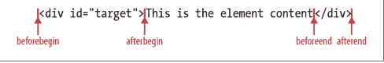

# JavaScript 便携手册 (第3版)

JavaScript 是 Web 无处不在的编程语言。在过去的15多年里，《JavaScript：权威指南》一直是全世界 JavaScript 程序员的圣经。这本书是《权威指南》的全新节选，将该厚头巨著的核心部分汇成了这本薄小但内容丰富的参考书。

前九章记录了 JavaScript 核心语言的最新版本（ECMAScript 5），涵盖了：

- 类型、值和变量
- 运算符、表达式和语句
- 对象和数组
- 函数和类

接下来的五章记录了在 HTML5 中使用 JavaScript 的基础 API，并解释了如何：

- 与浏览器窗口交互
- 为 HTML 文档和文档元素编写脚本
- 修改和应用 CSS 样式和类
- 响应用户输入事件
- 与 Web 服务器通信
- 在用户计算机上本地存储数据

本书是《jQuery 便携指南》的完美伴侣。

## 前言

闭包 125

通常情况下，你可以在程序和文档中使用书中的示例。除非你复制了大部分代码，否则不需要联系我们获取许可。我们感谢（但并不要求）像如下所示的归属说明，例如：“From JavaScript Pocket Reference, third edition, by David Flanagan (O’Reilly). Copyright 2012 David Flanagan, 978-1-449-31685-3.” 如果你认为对代码示例的使用超出了合理范围或此处提供的许可范围，请随时通过 `permissions@oreilly.com` 与我们联系。

如需对本书进行提意见或提问技术问题，请发送邮件至：

`bookquestions@oreilly.com`

此书还可通过 Safari Books Online 服务获取。要访问此书以及 O’Reilly 和其他出版商提供的类似主题书籍的完整数字版，请访问 `http://www.safaribooksonline.com`。

我要感谢我的编辑 Simon St. Laurent，他挑战我将《JavaScript权威指南》（The Definitive Guide）删减到目前更易于管理的尺寸；同时也感谢 O’Reilly 的制作团队，他们总能让我的书籍看起来非常棒。

## 词法结构

JavaScript 程序使用 Unicode 字符集编写。Unicode 是 ASCII 和 Latin-1 的超集，支持地球上使用的几乎每种书面语言。

JavaScript 是一种区分大小写的语言。这意味着语言关键字、变量、函数名和其他标识符必须始终使用一致的大小写进行输入。例如，`while` 关键字必须写为“while”，而不是“While”或“WHILE”。同样，`online`、`Online`、`OnLine` 和 `ONLINE` 是四个不同的变量名。

## 注释

JavaScript 支持两种风格的注释。`//` 到行尾之间的任何文本都被视为注释，并被 JavaScript 忽略。`/*` 和 `*/` 之间的任何文本也被视为注释；这些注释可以跨行，但不能嵌套。以下代码行都是合法的 JavaScript 注释：

```javascript
// 这是一个单行注释。
/* 这也是一个注释 */ // 这里是另一个。
/*
 * 这是另外一个注释。
 * 它包含多行。
 */
```

## 标识符和保留字

标识符简单来说就是名称。在 JavaScript 中，标识符用于为变量和函数命名，并为 JavaScript 代码中的某些循环提供标签。JavaScript 标识符必须以字母、下划线（`_`）或美元符号（`$`）开头。后续字符可以是字母、数字、下划线或美元符号。

JavaScript 保留了一些标识符作为语言本身的关键字。你不能在程序中使用这些词作为标识符：

| break | delete | function | return | typeof |
| case | do | if | switch | var |
| catch | else | in | this | void |
| continue | false | instanceof | while |
| debugger | finally | new | true | with |
| default | for | null | try |

JavaScript 还预留了某些目前语言未使用但在未来版本中可能会使用的关键字。ECMAScript 5 预留了以下单词：

| class | const | enum | export | extends | import | super |

此外，以下在普通 JavaScript 代码中合法的单词在严格模式（strict mode）下被保留：

| implements | let | private | public | yield |
| interface | package | protected | static |

严格模式还对以下标识符的使用施加限制。它们没有被完全保留，但不允许作为变量、函数或参数名：

| arguments | eval |

ECMAScript 3 保留了 Java 语言的所有关键字，尽管在 ECMAScript 5 中已放宽，但如果你计划在 ECMAScript 3 的 JavaScript 实现下运行代码，仍应避免所有这些标识符：

| abstract | double | goto | native | static |
| boolean | enum | implements | package | super |
| byte | export | import | private | synchronized |
| char | extends | int | protected | throws |

## 可选分号

与许多编程语言一样，JavaScript 使用分号（`;`）来将语句（见第 4 章）隔开。这对于使你的代码含义清晰非常重要：如果没有分隔符，一个语句的结束可能看起来是另一个语句的开头，反之亦然。在 JavaScript 中，如果这些语句写在不同的行，你通常可以省略语句之间的分号。（你也可以在程序末尾省略分号，或者当程序中的下一个标记是右大括号 `}` 时省略分号。）许多 JavaScript 程序员（以及书中的代码）使用分号来显式地标记语句的结束，即使在不需要的情况下。另一种风格是尽可能省略分号，只在少数需要它们的情况下使用它们。无论你选择哪种风格，你都应该了解 JavaScript 中可选分号的几个细节。

考虑以下代码。由于两个语句出现在不同的行上，因此第一个分号可以省略：

```javascript
a = 3;
b = 4;
```

然而，如果写如下所示，则第一个分号是必须的：

```javascript
a = 3; b = 4;
```

注意，JavaScript 不会将每个换行符视为分号：它只有在无法没有分号的情况下解析代码时，通常才会将换行符视为分号。更正式地说，如果换行出现在 `return`、`break` 或 `continue` 关键字之后，或者在 `++` 运算符之前，或者如果下一个非空格字符无法解释为当前语句的延续，JavaScript 就会将换行解释为分号。

这些语句终止规则导致了一些意想不到的情况。这段代码看起来是两个用换行符分隔的独立语句：

```javascript
var y = x + f
(a+b).toString()
```

JavaScript 会将其解析为：

```javascript
var y = x + f(a+b).toString();
```

## 类型、值和变量

计算机程序通过操作值（例如 `3.14`）来工作。变量为值定义了一个符号名称。JavaScript 类型可分为两类：原始类型和对象类型。JavaScript 的原始类型包括数字、字符串和布尔值。本章的前几节介绍了原始类型。

JavaScript 在类型之间进行转换。例如，如果程序期望字符串而你给了一个数字，它会自动将数字转换为字符串。第 15 页描述了“类型转换”。

JavaScript 变量是无类型的；你可以为变量分配任何类型的值，稍后可以分配不同类型的值。变量用 `var` 关键字声明。JavaScript 使用词法作用域。在函数外部声明的变量是全局变量，在程序范围内可见。在函数内部声明的变量具有函数作用域，仅对函数内部的代码可见。

## 数字

与许多语言不同，JavaScript 不区分整数值和浮点值。JavaScript 中的所有数字都表示为浮点值。JavaScript 使用 IEEE 754 标准定义的 64 位浮点格式表示数字，这意味着它可以表示高达 `±1.7976931348623157 × 10³⁰⁸` 和低至 `±5 × 10⁻³²⁴` 的数字。

JavaScript 数字格式允许你精确表示 `-9007199254740992` 到 `9007199254740992`（`2⁵³`）范围内的所有整数。如果你使用大于此值的整数，可能会丢失末尾数字的精度。然而，JavaScript 中的某些操作（例如数组索引和第 3 章描述的位运算符）是使用 32 位整数执行的。

当数字直接出现在 JavaScript 程序中时，它被称为数字字面量。JavaScript 支持多种格式的数字字面量。注意，任何数字字面量都可以加上一个减号（`-`）以使数字变为负数。

在 JavaScript 程序中，十进制整数写为一系列数字。例如：

```javascript
0
1024
```

除了十进制整数字面量外，JavaScript 还识别十六进制（基 16）值。十六进制字面量以“`0x`”或“`0X`”开头，后跟一串十六进制数字。十六进制数位是 0 到 9 的数字或 `a`（或 `A`）到 `f`（或 `F`），代表值 10 到 15。以下是十六进制整数字面量的示例：

```javascript
0xff // 15*16 + 15 = 255 (base 10)
0xCAFE911
```

浮点数字面量可以包含小数点；它们使用传统的实数语法。实值表示为数字的整数部分，后面跟着小数点和数字的小数部分。

浮点数字面量也可以使用指数计数法表示：一个实数后面跟着字母 `e`（或 `E`），接着是一个可选的加号或减号，最后是一个整数指数。这种表示法表示该实数乘以 10 的指数幂。

更简洁地说，语法为：

```javascript
[digits][.digits][(E|e)][([+-])digits]
```

例如：

```javascript
3.14
6.022e23 // 6.02 × 10^23
1.4738223E-32 // 1.4738223 × 10^-32
```

JavaScript 程序使用该语言提供的算术运算符运行。这些包括用于 `+` 加法、`-` 减法、`*` 乘法、`/` 除法以及 `%` 取模（除法后的余数）。关于这些以及其他运算符的详细信息可以在第 3 章找到。

除了这些基础算术运算符外，JavaScript 还通过定义为 `Math` 对象属性的常量和函数支持更复杂的数学运算：

```javascript
Math.pow(2,53) // 9007199254740992: 2 的 53 次方
Math.round(.6) // 1.0: 四舍五入到最近的整数
Math.ceil(.6) // 1.0: 向上取整
Math.floor(.6) // 0.0: 向下取整
Math.abs(-5) // 5: 绝对值
Math.max(x,y,z) // 返回最大的参数
Math.min(x,y,z) // 返回最小的参数
Math.random() // 伪随机数 0 <= x < 1.0
Math.PI // π
Math.E // e: 自然对数的底
Math.sqrt(3) // 3 的平方根
Math.pow(3,1/3) // 3 的立方根
Math.sin(0) // 三角函数: 还有 Math.cos, Math.atan 等.
Math.log(10) // 10 的自然对数
Math.log(100)/Math.LN10 // 100 的底 10 对数
Math.log(512)/Math.LN2 // 512 的底 2 对数
Math.exp(3) // e 的立方
```

JavaScript 中的算术在溢出、下溢或除以零的情况下不会引发错误。当数值运算的结果大于可表示的最大数字（溢出）时，结果是一个特殊的无穷值，JavaScript 将其打印为 `Infinity`。同样，当负值大于可表示的最大数字时，结果为负无穷，打印为 `-Infinity`。无穷值的行为正如你预期的那样：它们与任何数进行加、减、乘、除运算，都会得到一个无穷值（符号可能会反转）。

除以零在 JavaScript 中不是错误：它只是返回无穷大或负无穷。然而，有一个例外：零除以零没有定义的值，该操作的结果是特殊的“非数字”（not-a-number）值，打印为 `NaN`。如果你尝试用无穷大除以无穷大，或者取负数的平方根，或者使用无法转换为数字的非数值操作数的算术运算符，也会产生 `NaN`。

JavaScript 定义了全局变量 `Infinity` 和 `NaN` 来存储正无穷和非数字值。

非数字值在 JavaScript 中有一个不寻常特征：它不与任何其他值相等，包括它本身。这意味着你不能通过编写 `x == NaN` 来判断变量 `x` 的值是否为 `NaN`。相反，你应该写 `x != x`。如果它是 `NaN`，这个表达式将为真。`isNaN()` 函数也类似：如果其参数是 `NaN`，或者该参数是如字符串或对象之类的非数值值，则返回真。相关函数 `isFinite` 如果其参数是除 `NaN`、`Infinity` 或 `-Infinity` 以外的数字则返回真。

实数有无限多个，但其中只有有限数量（确切地说是 `18437736874454810627` 个）可以被 JavaScript 浮点格式精确表示。这意味着当你在 JavaScript 中处理实数时，数字的表示通常是实际数字的近似值，并且会发生微小的舍入误差。

## 字符串

字符串是一个不可变的 16 位值有序序列，每个值通常代表一个 Unicode 字符——字符串是 JavaScript 用于表示文本的类型。字符串的长度是它包含的 16 位值的数量。JavaScript 的字符串（以及它的数组）使用从 0 开始的索引：第一个 16 位值位于位置 0，第二个位于位置 1，依此类推。空字符串是长度为 0 的字符串。JavaScript 没有特殊的类型来表示字符串的单个元素。要表示单个的 16 位值，只需使用长度为 1 的字符串即可。

为了在 JavaScript 程序中以字面量形式包含字符串，只需将字符串的字符包含在一对匹配的单引号或双引号（`' '` 或 `""`）中。双引号字符可以包含在单引号界定的字符串中，单引号字符可以包含在双引号界定的字符串中。以下是字符串字面量的示例：

```javascript
"" // 空字符串：它有零字符
'name="myform"'
"Wouldn't you prefer O'Reilly's book?"
"This string\nhas two\n lines"
"\u03c0 = 3.14"
```

反斜杠字符（`\`）在 JavaScript 字符串中有特殊用途。它与其后面的字符结合，表示一个在字符串内否则无法表示的字符。例如，`\n` 是一个转义序列，表示换行符。

另一个例子是 `\'` 转义，它表示单引号（或撇号）字符。当你需要在单引号界定的字符串字面量中包含撇号时，这个转义序列非常有用。你可以看到为什么这些被称为转义序列：反斜杠允许你“转义”出通常的单引号字符串界定符的含义。

### 表 2-1. JavaScript 转义序列

| 序列 | 表示的字符 |
| :--- | :--- |
| `\0` | NUL字符 (`\u0000`) |
| `\b` | 退格键 (`\u0008`) |
| `\t` | 水平制表符 (`\u0009`) |
| `\n` | 换行符 (`\u000A`) |
| `\v` | 垂直制表符 (`\u000B`) |
| `\f` | 分页符 (`\u000C`) |
| `\r` | 回车符 (`\u000D`) |
| `\"` | 双引号 (`\u0022`) |
| `\'` | 单引号 (`\u0027`) |
| `\\` | 反斜杠 (`\u005C`) |

### 表 2-2. JavaScript 转义序列（续）

| 序列 | 表示的字符 |
| :--- | :--- |
| `\xXX` | 由两个十六进制数字指定的 Latin-1 字符 |
| `\uXXXX` | 由四个十六进制数字指定的 Unicode 字符 |

如果 `\` 字符位于表 2-1 所示的任何字符之外，反斜杠将被忽略（尽管未来的版本可能会定义新的转义序列）。例如，`\#` 等同于 `#`。ECMAScript 5 允许在行末尾使用反斜杠来跨行书写字符串字面量。

JavaScript 的内置功能之一是字符串拼接。如果你对数字使用 `+` 运算符，它们会相加。如果你对字符串使用此运算符，它通过将第二个附加到第一个来连接它们。例如：

```javascript
msg = "Hello, " + "world"; // => "Hello, world"
```

要确定字符串的长度——它包含的 16 位值的数量——使用字符串的 `length` 属性。像这样确定字符串 `s` 的长度：

```javascript
s.length
```

除了这个 `length` 属性外，还有许多可以在字符串上调用的方法（如常，完整细节请参见参考章节）：

```javascript
s = "hello, world" // 从一些文本开始
s.charAt(0) // => "h": 第一个字符。
s.charAt(s.length-1) // => "d": 最后一个字符。
s.substring(1,4) // => "ell": 第 2、3、4 字符
s.slice(1,4) // => "ell": 相同
s.slice(-3) // => "rld": 最后三个字符
s.indexOf("l") // => 2: 第一个 l 的位置。
s.lastIndexOf("l") // => 10: 最后一个 l 的位置。
s.indexOf("l", 3) // => 3: 位置 3 之后的 l 的位置
s.split(" ") // => ["hello,", "world"]
s.replace("h", "H") // => "Hello, world": 替换第一个实例
s.toUpperCase() // => "HELLO, WORLD"
```

记住字符串在 JavaScript 中是不可变的。像 `replace()` 和 `toUpperCase()` 这样的方法会返回新字符串：它们不会修改被调用的字符串。

在 ECMAScript 5 中，字符串可以被视为只读数组，你可以使用方括号 `[]` 而不是 `charAt()` 方法从字符串中访问单个字符（16 位值）：

```javascript
s = "hello, world";
s[0]               // => "h"
s[s.length-1]      // => "d"
```

## 布尔值

布尔值表示真或假、开启或关闭、是或否。这种类型只有两种可能的值。保留字 `true` 和 `false` 求值结果为这些值。

布尔值通常是你在 JavaScript 程序中进行比较的结果。例如：

```javascript
a == 4
```

这段代码测试变量 `a` 的值是否等于数字 `4`。如果是，则这次比较的结果就是布尔值 `true`。如果 `a` 不等于 `4`，则这次比较的结果为 `false`。

布尔值常用于 JavaScript 的控制结构中。例如，JavaScript 中的 `if/else` 语句在布尔值为 `true` 时执行一个操作，在值为 `false` 时执行另一个操作。你通常会将直接创建布尔值的比较语句与使用该值的语句结合起来。结果如下：

```javascript
if (a == 4)
    b = b + 1;
else
    a = a + 1;
```

这段代码检查 `a` 是否等于 `4`。如果是，则给 `b` 增加 1；否则，给 `a` 增加 1。

正如我们在第 15 页讨论“类型转换”时所说的那样，任何 JavaScript 值都可以转换为布尔值。以下值会转换为 `false`，并表现得像 `false`：

- `undefined`
- `null`
- `0`
- `-0`
- `NaN`
- `""` // 空字符串

所有其他值（包括所有对象和数组）都会转换为并表现得像 `true`。`false` 以及转换为它的六个值有时被称为**假值**，而所有其他值被称为**真值**。每当 JavaScript 期望布尔值时，假值的作用都像 `false`，而真值的作用都像 `true`。

例如，假设变量 `o` 持有一个对象或 `null` 值。你可以通过像下面的 `if` 语句显式测试 `o` 是否非空：

```javascript
if (o !== null)
```

不等于运算符 `!==` 将 `o` 与 `null` 比较并求值为 `true` 或 `false`。但你可以省略比较，而是利用 `null` 是假值而对象是真值的特性：

```javascript
if (o)
```

在第一种情况下，只有当 `o` 不为 `null` 时才会执行 `if` 体。第二种情况没那么严格：只有当 `o` 不是 `false` 或任何假值（如 `null` 或 `undefined`）时，才会执行 `if` 体。哪种语句适用于你的程序取决于你期望赋值给 `o` 的值。如果你需要区分 `null` 与 `0` 和 `""`，你应该使用显式比较。

`null` 是一个语言关键字，求值为特殊值，通常用于表示值的缺失。对 `null` 使用 `typeof` 运算符返回字符串 `"object"`，表示 `null` 可以被视为表示“无对象”的特殊值。但在实践中，`null` 通常被视为其自身类型的唯一成员，它可以用于表示数字、字符串以及对象的“无值”。大多数编程语言都有与 JavaScript 的 `null` 等价的值：你可能熟悉它被称为 `null` 或 `nil`。

JavaScript 还有第二个表示值缺失的值。`undefined` 值表示一种更深层次的缺失。它是未初始化的变量的值，也是当你查询不存在的对象属性或数组元素的值时得到的值。`undefined` 值也会由没有返回值的函数返回，以及未提供参数的函数参数值返回。`undefined` 是一个预定义的全局变量（不是像 `null` 那样的语言关键字），它被初始化为 `undefined` 值。如果你对 `undefined` 值应用 `typeof` 运算符，它会返回 `"undefined"`，表示该值是特殊类型的唯一成员。

尽管有这些差异，`null` 和 `undefined` 都表示值的缺失，并且通常可以互换。（使用相等运算符 `==` 会认为它们是相等的。而使用严格相等运算符 `===` 来区分它们。）它们都是假值——当需要布尔值时，它们的行为都像 `false`。`null` 和 `undefined` 都没有任何属性或方法。事实上，使用 `.` 或 `[]` 访问这些值的属性或方法会导致 `TypeError`。

上面的章节解释了 JavaScript 的原始类型和值。对象类型——对象、数组和函数——将在本书后面的章节中单独介绍。但现在有一个非常重要的对象值我们现在必须涵盖。全局对象是一个普通的 JavaScript 对象，起着非常重要的作用：该对象的属性是 JavaScript 程序可用的定义符号。当 JavaScript 解释器启动时（或每当网页浏览器加载新页面时），它会创建一个新的全局对象并赋予它一组初始属性，定义了：

- 全局属性，如 `undefined`、`Infinity` 和 `NaN`。
- 全局函数，如 `isNaN()`、`parseInt()`（第 15 页“类型转换”）和 `eval()`（第 43 页“表达式求值”）。
- 构造函数，如 `Date()`、`RegExp()`、`String()`、`Object()` 和 `Array()`。
- 全局对象，如 `Math` 和 `JSON`（第 84 页“属性和对象的序列化”）。

全局对象的初始属性不是保留字，但它们应该被像保留字一样对待。本章已经描述了其中一些全局属性。其他大部分将在本书的其他地方介绍。

在顶层代码中——即不属于任何函数的 JavaScript 代码——你可以使用关键字 `this` 来引用全局对象：

```javascript
var global = this; // 引用全局对象
```

在客户端 JavaScript 中，`Window` 对象充当全局对象。这个全局 `Window` 对象有一个自引用的 `window` 属性，可以用于引用全局对象。`Window` 对象定义了核心全局属性，但也定义了其他针对特定浏览器和客户端 JavaScript 的全局变量（见第 10 章）。

全局对象在首次创建时定义了 JavaScript 的所有预定义全局值。但这个特殊对象也持有程序定义的全局变量。如果代码声明了一个全局变量，该变量就是全局对象的一个属性。

## 类型转换

JavaScript 对其所需的值类型非常灵活。我们已经在布尔值上看到了这一点：当 JavaScript 期望一个布尔值时，你可以提供任何类型的值，JavaScript 会根据需要进行转换。某些值（“真值”）转换为 `true`，另一些值（“假值”）转换为 `false`。其他类型也是如此：如果 JavaScript 想要一个字符串，它会将你提供的任何值转换为字符串。如果 JavaScript 想要一个数字，它会尝试将你提供的值转换为数字（如果无法执行有效的转换，则转换为 `NaN`）。一些示例：

```javascript
"10" + " objects" // => "10 objects": 数字 10 -> 字符串
"7" * "4" // => 28: 两个字符串 -> 数字
var n = 1 - "x"; // => NaN: "x" 无法转换为数字
n + "objects" // => "NaN objects": NaN -> "NaN"
```

| Value | Converted to: | | | | |
|---|---|---|---|---|---|
| | String | Number | Boolean | Object |
| `-Infinity` | "-Infinity" | `-Infinity` | `true` | `Number(-Infinity)` |
| `1` (finite, non-zero) | "1" | `1` | `true` | `Number(1)` |
| `{}` (any object) | `toString()` | `toString()` or `valueOf()` | `true` | |
| `[]` (empty array) | `""` | `0` | `false` | |
| `[9]` (1 numeric elt) | "9" | `9` | `true` | |
| `['a']` (any other array) | use `join()` method | `NaN` | `true` | |
| `function(){}` (any function) | function source | `NaN` | `true` | |

由于 JavaScript 可以灵活地转换值，因此它的 `==` 等于运算符在相等性概念上也是灵活的。例如，以下比较结果均为真：

```javascript
null == undefined // 这两者被视为相等。
"0" == false // 字符串在比较前转换为数字。
0 == false // 布尔值在比较前转换为数字。
"0" == false // 两个操作数在比较前都转换为 0。
```

尽管 JavaScript 会自动执行许多类型转换，但你有时可能需要显式转换，或者你可能倾向于显式转换以保持代码更清晰。

执行显式类型转换最简单的方法是使用 `Boolean()`、`Number()`、`String()` 或 `Object()` 函数：

```javascript
Number("3") // => 3
String(false) // => "false" 或 false.toString()
Boolean([]) // => true
Object(3) // => new Number(3)
```

注意，除了 `null` 或 `undefined` 之外任何值都有 `toString()` 方法，该方法的结果通常与 `String()` 函数返回的结果相同。

某些 JavaScript 运算符会执行隐式类型转换，有时被用于类型转换。如果 `+` 运算符的一个操作数是字符串，它会将另一个转换为字符串。一元运算符 `+` 会将其操作数转换为数字。一元运算符 `!` 会将其操作数转换为布尔值并对其取反。这些事实导致了代码中常见的以下类型转换惯用法：

```javascript
x + "" // 等同于 String(x)
+x // 等同于 Number(x)。也等于 x-0
!!x // 等同于 Boolean(x)。注意双感叹号
```

数字的格式化和解析是计算机程序的常见任务，JavaScript 提供了专门的函数和方法，对数字到字符串以及字符串到数字的转换提供了更多控制。

`Number` 类定义的 `toString()` 方法接受一个可选参数，用于指定转换的进制（基数）。如果不指定该参数，将以 10 进制转换。然而，你也可以将数字转换为其他进制（2 到 36 之间）。例如：

```javascript
var n = 17;
binary_string = n.toString(2); // 结果为 "10001"
octal_string = "0" + n.toString(8); // 结果为 "021"
hex_string = "0x" + n.toString(16); // 结果为 "0x11"
```

在处理财务或科学数据时，你可能希望以控制输出的小数位数或有效位数的方式将数字转换为字符串，或者你可能控制是否使用科学计数法。`Number` 类定义了此类数字到字符串转换的方法：

```javascript
var n = 123456.789;
n.toFixed(2); // "123456.79"
n.toExponential(3); // "1.235e+5"
n.toPrecision(7); // "123456.8"
```

如果你向 `Number()` 转换函数传递字符串，它会尝试将该字符串解析为整数或浮点字面量。该函数仅适用于 10 进制整数，并且不允许包含非字面量部分的末尾字符。`parseInt()` 和 `parseFloat()` 函数（这些是全局函数，而不是任何类的方法）更加灵活。`parseInt()` 只解析整数，而 `parseFloat()` 同时解析整数和浮点数。如果字符串以 `"0x"` 或 `"0X"` 开头，`parseInt()` 会将其解释为十六进制。`parseInt()` 和 `parseFloat()` 都会跳过前导空格，解析尽可能多的数字字符，并忽略后续任何内容。如果第一个非空格字符不是有效数字字面量的一部分，它们将返回 `NaN`：

```javascript
parseInt("3 blind mice") // => 3
parseFloat("3.14 meters") // => 3.14
parseInt("-12.34") // => -12
parseInt("0xFF") // => 255
parseFloat("$72.47") // => NaN
```

`parseInt()` 接受一个可选的第二个参数，指定要解析数字的进制（基数）。合法值在 2 到 36 之间。例如：

```javascript
parseInt("11", 2); // => 3 (1*2 + 1)
parseInt("077", 8); // => 63 (7*8 + 7)
parseInt("ff", 16); // => 255 (15*16 + 15)
```

## 变量声明

在 JavaScript 程序中使用变量之前，你应该先声明它。使用 `var` 关键字声明变量，如下：

```javascript
var i;
var sum;
```

你也可以用同一个 `var` 关键字声明多个变量：

```javascript
var i, sum;
```

你还可以将变量声明与变量初始化结合：

```javascript
var message = "hello";
var i = 0, j = 0, k = 0;
```

如果使用 `var` 语句为变量指定初始值，该变量会被声明，但在代码对其赋值之前，其值是 `undefined`。

注意，`var` 语句也可以出现在 `for` 和 `for/in` 循环（见第 4 章）中，允许你在循环语法本身简洁地声明循环变量。例如：

```javascript
for(var i = 0; i < 10; i++) console.log(i);
for(var i = 0, j=10; i < 10; i++,j--) console.log(i*j);
for(var p in o) console.log(p);
```

如果你习惯 C 或 Java 等静态类型语言，你会注意到 JavaScript 的变量声明没有关联类型。JavaScript 变量可以持有任何类型的值。例如，在 JavaScript 中，给变量赋值数字稍后给该变量赋值字符串是完全合法的：

```javascript
var i = 10;
i = "ten";
```

使用 `var` 语句多次声明同一个变量是合法且无害的。如果重复声明带有初始化器，它的作用等于简单的赋值语句。

如果你尝试读取未声明变量的值，JavaScript 会产生错误。在 ECMAScript 5 严格模式（`"use strict"`）下，向未声明的变量赋值也是错误。然而，从历史上来看，在非严格模式下，如果你向未声明的变量赋值，JavaScript 实际上会创建一个全局变量，其工作方式与正确声明的全局变量非常相似。这意味着你可以不声明全局变量就直接使用。然而，这是一种坏习惯，也是 Bug 的源头，因此你应该始终使用 `var` 声明变量。

## 表达式与运算符

表达式是 JavaScript 的一种短语，JavaScript 解释器可以对其求值以产生一个值。直接嵌入程序中的常量是非常简单的表达式。变量名也是一种简单的表达式，其求值结果为赋值给该变量的值。复杂表达式由更简单的表达式构建而成。例如，一个数组访问表达式由一个求值为数组的表达式、紧随其后的左方括号、一个求值为整数的表达式、以及一个右方括号组成。这个新的、更复杂的表达式求值结果为存储在指定数组的索引处的值。同样，函数调用表达式由一个求值为函数对象的表达式，以及零个或多个用作函数参数的额外表达式组成。

从更简单的表达式中构建复杂表达式的最常用方法是使用运算符。运算符以某种方式将它的操作数（通常是两个）的值结合起来，并求出一个新值。乘法运算符 `*` 是一个简单的例子。表达式 `x * y` 的求值结果为表达式 `x` 和 `y` 的值的乘积。为了简单起见，有时会说运算符返回一个值，而不是“求值”一个值。

## 表达式

最简单的表达式被称为初级表达式，它们是独立存在的——它们不包含任何更简单的表达式。JavaScript 中的初级表达式是常量或字面量值、某些语言关键字以及变量引用。

字面量是直接嵌入你的程序中的常量值。它们看起来如下：

```javascript
1.23              // 数字字面量
"hello"           // 字符串字面量
/pattern/         // 正则表达式字面量
```

如 `true`、`false`、`null` 和 `this` 等保留字都是初级表达式。

最后，第三种初级表达式是裸变量引用：

```javascript
i                // 求值为变量 i 的值。
sum              // 求值为变量 sum 的值。
```

当任何标识符在程序中单独出现时，JavaScript 假设它是一个变量并查找其值。如果不存在同名的变量，该表达式求值为 `undefined` 值。然而，在 ECMAScript 5 的严格模式下，尝试求值不存在的变量将抛出 `ReferenceError` 错误。

## 对象和数组初始化器

对象和数组初始化器是其值为新创建的对象或数组的表达式。这些初始化表达式有时被称为“对象字面量”和“数组字面量”。但与真正的字面量不同，它们并不是初级表达式，因为它们包含了多个指定属性和元素值的子表达式。

数组初始化器是包含在方括号内的逗号分隔的表达式列表。数组初始化器的值是一个新创建的数组。这个新数组的元素初始化为逗号分隔表达式的值：

```javascript
[] // 一个空数组
[1+2,3+4] // 一个包含元素 3 和 7 的 2 元素数组。
```

数组初始化器中的元素表达式本身可以是数组初始化器，这意味着这些表达式可以创建嵌套数组：

```javascript
var matrix = [[1,2,3], [4,5,6], [7,8,9]];
```

数组初始化器中的最后一个表达式之后允许单个尾随逗号。

对象初始化器表达式类似于数组初始化器表达式，但将方括号替换为大括号，并且每个子表达式前面都带有一个属性名和冒号：

```javascript
var p = {x:2, y:1}; // 一个具有 2 个属性的对象
var q = {}; // 空对象；无属性
q.x = 2; q.y = 1; // 现在 q 有了与 p 相同的属性
```

对象字面量是可以嵌套的。例如：

```javascript
var rectangle = { upperLeft: { x: 2, y: 2 }, lowerRight: { x: 4, y: 5 } };
```

对象和数组初始化器中的表达式在每次求值对象初始化器时求值，它们不需要具有常量值：它们可以是任意的 JavaScript 表达式。此外，对象字面量中的属性名可以是引号字符串而非标识符（这对于指定作为保留字或其他不是标识符的属性名非常有用）：

```javascript
var side = 1;
var square = { "ul": { x: p.x, y: p.y }, 'lr': { x: p.x + side, y: p.y + side} };
```

## 属性访问

属性访问表达式求值为对象属性或数组元素的值。JavaScript 定义了两种属性访问的语法：

```javascript
expression . identifier
expression [ expression ]
```

第一种属性访问样式是一个表达式后跟一个点和一个标识符。该表达式指定对象：

```javascript
var o = {x:1, y:{z:3}}; // 对象
var a = [o, 4, 5, 6]; // 一个包含 o 的数组
o.x // => 1: 表达式 o 的属性 x
o.y.z // => 3: 表达式 o.y 的属性 z
o["x"] // => 1: 对象 o 的属性 x
a[1] // => 4: 表达式 a 的索引 1 元素
a[2]["1"] // 修正: a[2] 是 5, 无索引 1。原文示例可能有误，保留原意展示语法。
a[0].x // => 1: 表达式 a[0] 的属性 x
```

`expression.identifier` 是两种属性访问选项的语法，但注意，只有当你要访问的属性名称是合法标识符，且在编写程序时知道该名称时才能使用它。如果属性名是保留字或包含空格，你必须使用方括号符号。

## 函数定义

函数表达式定义一个函数，该表达式的值是新定义的函数。函数表达式通常由 `function` 关键字、逗号分隔的标识符列表（参数名）以及代码块（函数体）组成。例如：

```javascript
// 此函数返回 x 的平方
var square = function(x) { return x * x; }
```

## 函数调用

调用表达式是 JavaScript 调用（或执行）函数的语法。它以标识要调用的函数表达式开头，跟随左括号、逗号分隔的零或多个参数表达式、以及右括号。示例：

```javascript
f(o) // 函数 f；参数 o
Math.max(x,y,z) // 函数 Math.max；参数 x, y, z
a.sort() // 函数 a.sort；无参数
```

求值调用表达式时，首先求值函数表达式，产生函数值。如果函数表达式的值不是函数，将抛出 `TypeError`。接下来，将参数值赋值给定义函数时指定的参数名，然后执行函数体。如果函数使用 `return` 语句返回一个值，则该值成为调用表达式的值。否则，调用表达式的值为 `undefined`。

每个调用表达式都包含一对括号和括号前的表达式。如果该表达式是属性访问表达式，则该调用被称为方法调用。在方法调用中，作为属性访问主体的对象或数组成为 `this` 关键字的值，同时函数体被执行。这使得面向对象的编程范式成为可能，其中函数（以其 OO 名称命名，即“方法”）对其所属的对象进行操作。

## 对象创建表达式

对象创建表达式创建一个新对象并调用一个函数（称为构造函数）来初始化该对象的属性。对象创建表达式类似于调用表达式，但它们以前缀有 `new` 关键字：

```javascript
new Object()
new Point(2,3)
```

如果对象创建表达式的构造函数中没有传递参数，可以省略空括号对：

```javascript
new Object
new Date
```

求值对象创建表达式时，JavaScript 首先创建一个新对象，就像对象初始化器 `{}` 创建的一样。接下来，它使用指定的参数调用指定的函数，并将新对象作为 `this` 关键字的值传递。函数随后可以利用它来初始化新创建对象的属性。用于作为构造函数的函数不返回值，对象创建表达式的值是新创建并初始化的对象。如果构造函数返回了对象值，则该值成为对象创建表达式的值，而新创建的对象被丢弃。

## 运算符

运算符用于 JavaScript 的算术表达式、比较表达式、逻辑表达式、赋值表达式以及更多内容。表 3-1 总结了 JavaScript 运算符。

### 表 3-1. JavaScript 运算符

| 运算符 | 操作 | 类型 |
|---|---|---|
| `++` | 前置或后置增一 | `lval`→`num` |
| `--` | 前置或后置减一 | `lval`→`num` |
| `-` | 数值取反 | `num`→`num` |
| `+` | 转换为数字 | `num`→`num` |
| `~` | 位取反 | `int`→`int` |
| `!` | 取反布尔值 | `bool`→`bool` |
| `delete` | 删除属性 | `lval`→`bool` |
| `typeof` | 确定操作数的类型 | `any`→`str` |
| `void` | 返回 `undefined` 值 | `any`→`undef` |
| `*, /, %` | 乘法、除法、取余 | `num`,`num`→`num` |
| `+, -` | 加法、减法 | `num`,`num`→`num` |
| `+` | 字符串拼接 | `str`,`str`→`str` |
| `<<` | 左移 | `int`,`int`→`int` |
| `>>` | 符号扩展右移 | `int`,`int`→`int` |
| `>>>` | 零扩展右移 | `int`,`int`→`int` |
| `<, <=, >, >=` | 按数值顺序比较 | `num`,`num`→`bool` |
| `<, <=, >, >=` | 按字母顺序比较 | `str`,`str`→`bool` |
| `instanceof` | 测试对象类 | `obj`,`func`→`bool` |
| `in` | 测试属性是否存在 | `str`,`obj`→`bool` |
| `==` | 测试相等性 | `any`,`any`→`bool` |
| `!=` | 测试不等性 | `any`,`any`→`bool` |
| `===` | 测试严格相等 | `any`,`any`→`bool` |
| `!==` | 测试严格不等 | `any`,`any`→`bool` |
| `&` | 计算位按位与 | `int`,`int`→`int` |
| `^` | 计算位按位异或 | `int`,`int`→`int` |
| `|` | 计算位按位或 | `int`,`int`→`int` |
| `&&` | 计算逻辑与 | `any`,`any`→`any` |
| `||` | 计算逻辑或 | `any`,`any`→`any` |
| `?:` | 选择第 2 个或第 3 个操作数 | `bool`,`any`,`any`→`any` |
| `=` | 赋值给变量或属性 | `lval`,`any`→`any` |
| `*=,/=,%=,+=,-=,&=,^=,|=` | 操作并赋值 | `lval`,`any`→`any` |
| `,` | 丢弃第 1 个操作数，返回第 2 个 | `any`,`any`→`any` |

表 3-1 中列出的运算符按优先级从高到低的顺序排列，用水平线分隔具有相同优先级的运算符组。运算符优先级控制了操作执行的顺序。优先级较高的运算符（靠近表格顶部）会在优先级较低的运算符（靠近底部）之前执行。

考虑以下表达式：

```javascript
w = x + y * z;
```

乘法运算符 `*` 的优先级比加法运算符 `+` 高，因此乘法会在加法之前执行。此外，赋值运算符 `=` 的优先级最低，因此赋值操作会在右侧所有操作完成后才执行。

可以通过显式使用圆括号来重写运算符的优先级。为了强制先执行上例中的加法，可以写成：

```javascript
w = (x + y) * z;
```

请注意，属性访问和调用表达式的优先级高于表 3-1 中列出的任何运算符。考虑这个表达式：

```javascript
typeof my.functions[x](y)
```

尽管 `typeof` 是优先级最高的运算符之一，但 `typeof` 操作是在两次属性访问和函数调用的结果上执行的。

在实践中，如果你对运算符的优先级有任何疑问，最简单的方法是使用圆括号使求值顺序显式化。需要了解的重要规则是：乘法和除法在加法和减法之前执行，赋值的优先级非常低，几乎总是最后。

某些运算符适用于任何类型的值，但大多数运算符期望操作数是特定类型，且大多数运算符返回（或评估为）特定类型的值。表 3-1 中的类型列指定了运算符的操作数类型（箭头之前）和结果类型（箭头之后）。箭头之前的类型数量表示运算符的元数：一元运算符有一个操作数，二元运算符有两个，而三元运算符 `? :` 有三个。

某些运算符根据与其配合的操作数类型不同而表现不同。最重要的是，`+` 运算符加上数值操作数，但拼接字符串操作数。同样，`<` 等比较运算符会根据操作数的类型按数值或字母顺序进行比较。

注意，赋值运算符以及表 3-1 中列出的其他几个运算符期望 `lval` 类型的操作数。这是 lvalue 的缩写：意为“可以合法地出现在赋值表达式左侧的项”。在 JavaScript 中，变量、对象属性和数组元素都是 lvalues。

评估像 `2 * 3` 这样的简单表达式永远不会影响程序的状态，你的程序未来执行的任何计算都不会受到该评估的影响。然而，某些表达式具有副作用，它们的评估可能会影响未来评估的结果。赋值运算符是最直观的例子：如果你给一个变量属性赋值一个值，就会改变使用该变量或属性的任何表达式的值。`++` 和 `--` 增减运算符也类似，因为它们执行了隐式赋值。`delete` 运算符也有副作用：删除属性类似于（但不等同于）向属性赋值 `undefined`。

## 算术运算符

本节介绍了执行算术或其他数值处理的运算符。

### 乘法 (`*`)

计算其操作数的乘积。

### 除法 (`/`)

`/` 运算符将第一个操作数除以第二个操作数。如果你习惯了区分整数和浮点的编程语言，你可能期望得到一个整数结果。但在 JavaScript 中，所有数字都是浮点数，因此 `5/2` 评估结果为 `2.5`。除以零产生正无穷或负无穷，而 `0/0` 评估结果为 `NaN`。

### 取余 (`%`)

`%` 运算符计算第一个操作数整数除以第二个操作数后的余数。结果的符号与第一个操作数的符号相同。例如，`5 % 2` 评估为 `1`，而 `-5 % 2` 评估为 `-1`。该运算符适用于整数，但也适用于浮点值。例如，`6.5 % 2.1` 评估为 `0.2`。

### 加法 (`+`)

二元 `+` 运算符将数值操作数相加或拼接字符串操作数：

```javascript
1 + 2 // => 3
"hello" + " " + "there" // => "hello there"
"1" + "2" // => "12"
1 + 2 + "blind mice"; // => "3 blind mice"
1 + (2 + "blind mice"); // => "12 blind mice"
```

当操作数的值都是数字或都是字符串时，`+` 运算符的作用是显而易见的。但在任何其他情况下，都需要进行类型转换，而执行的操作取决于所进行的转换。`+` 的转换规则优先考虑字符串拼接；如果操作数之一是字符串或可转换为字符串的对象，则另一个操作数将被转换为字符串并执行拼接。只有当两个操作数都不是字符串时，才会执行加法。

### 减法 (`-`)

从左侧操作数的值中减去右侧操作数的值。

上述列出的二元运算符，JavaScript 还定义了一些用于算术的一元运算符。一元运算符修改单个操作数的值以产生新值：

#### 一元加 (`+`)

一元加运算符将操作数转换为数字（或转换为 `NaN`）并返回该转换后的值。当用于已经是数字的操作数时，它什么都不做。

#### 一元减 (`-`)

当 `-` 用作一元运算符时，它会在必要时将其操作数转换为数字，然后改变结果的符号。

#### 增量 (`++`)

`++` 运算符将其单个操作数增量（即加 1），该操作数必须是 lvalue（变量、数组元素或对象属性）。该运算符将操作数转换为数字，加 1，然后将增加后的值赋值回变量、元素或属性中。

`++` 运算符的返回值取决于它相对于操作数的位置。当在操作数之前使用时（称为**前置增量**），它会增加操作数并求值为该操作数增加后的值。当在操作数之后使用时（称为**后置增量**），它会增加操作数，但求值为该操作数未增加之前的值。考虑下面这两行代码的区别：

```javascript
var i = 1, j = ++i; // i 和 j 都是 2
var i = 1, j = i++; // i 是 2, j 是 1
```

该运算符无论是以前置还是后置增量的形式使用，最常用于增加循环计数器（见第 61 页的“for”）。

#### 递减 (`--`)

`--` 运算符需要一个操作数。它将操作数的值转换为数字，减 1，并将递减后的值赋值回操作数。与 `++` 运算符类似，`--` 的返回值取决于它相对于操作数的位置。当在操作数之前使用时，它会递减并返回递减后的值。当在操作数之后使用时，它会递减操作数但返回未递减之前的值。

## 位运算符

位运算符对 JavaScript 编程中使用的二进制表示中的位进行低级操作。这些运算符并不常用，如果你不熟悉补码整数的二进制表示，可能可以跳过这一节。位运算符期望整数操作数，其行为就好像这些操作数被表示为 32 位整数而非 64 位浮点值。这些运算符在必要时会将操作数转换为数字，然后通过丢弃任何小数部分和第 32 位之后的位，将数值强制转换为 32 位整数。位移运算符要求的右侧操作数在 0 到 31 之间。

### 位与 (`&`)

`&` 运算符对其整数参数的每个位执行布尔“与”（AND）操作。只有当两个操作数中的对应位都被设置时，结果中的该位才会被设置。例如，`0x1234 & 0x00FF` 的结果为 `0x0034`。

### 位或 (`|`)

`|` 运算符对其整数参数的每个位执行布尔“或”（OR）操作。如果两个操作数中的一个或两个的对应位被设置，结果中的该位就会被设置。例如，`0x1234 | 0x00FF` 的结果为 `0x12FF`。

### 位异或 (`^`)

`^` 运算符对其整数参数的每个位执行布尔“异或”（XOR）操作。异或意味着两个操作数中有一个为真，但不能两个都为真。如果两个操作数中的一个（但不是两个）的对应位被设置，则该操作结果中的对应位会被设置。例如，`0xFF00 ^ 0xF0F0` 的结果为 `0x0FF0`。

### 位非 (`~`)

`~` 运算符是一个单目运算符，出现在单个整数操作数之前。它通过反转操作数中的所有位来操作。由于 JavaScript 表示的是有符号整数，对值应用 `~` 运算符等同于改变其符号并减 1。例如，`~0x0F0F` 的结果为 `0xFFFFF0F0`，或 `-3856`。

### 左移 (`<<`)

`<<` 运算符将其第一个操作数中的所有位向左移动第二个操作数指定的位数。例如，在 `a << 1` 操作中，a 的第一位（个位）变成第二位（2 的位），a 的第二位变成第三位，依此类推。新位使用零填充，且第 32 位的值将丢失。将值向左移一位等同于乘以 2，左移两位等同于乘以 4，依此类推。例如，`7 << 2` 的结果为 `28`。

### 符号右移 (`>>`)

`>>` 运算符将其第一个操作数中的所有位向右移动第二个操作数指定的位数（0 到 31 之间的整数）。移出右侧的位将丢失。左侧填充的位取决于原始操作数的符号位，以保留结果的符号。如果第一个操作数为正数，结果的高位将填充零；如果第一个操作数为负数，结果的高位将填充一。将一个值右移一位等同于除以 2（舍弃余数），右移两位等同于整数除以 4，依此类推。例如，`7 >> 1` 的结果为 `3`，而 `-7 >> 1` 的结果为 `-4`。

### 零填充右移 (`>>>`)

`>>>` 运算符与 `>>` 运算符相似，不同之处在于左侧填充的位始终为零，无论第一个操作数的符号如何。例如，`-1 >> 4` 的结果为 `-1`，但 `-1 >>> 4` 的结果为 `0x0FFFFFFF`。

## 关系运算符

JavaScript 关系运算符测试两个值之间的关系（如“等于”、“小于”或“属性所有”），并根据关系是否存在返回 `true` 或 `false`。关系表达式始终求值为布尔值，该值通常用于控制 `if`、`while` 和 `for` 语句中的执行流（见第 4 章）。

JavaScript 支持 `=`、`==` 和 `===` 运算符。请务必理解这些赋值、相等和严格相等运算符之间的区别，并在编码时小心使用正确的运算符！虽然将这三个运算符都读作“等于”很有吸引力，但如果你将 `=` 读作“获取或赋值”、`==` 读作“等于”、而 `===` 读作“严格相等”，可能有助于减少混淆。

### 严格相等 (`===`)

`===` 运算符被称为严格相等运算符（有时称为恒等运算符），它使用严格的相同定义来检查两个操作数是否“完全相同”，这种定义不包括对操作数的任何类型转换。如果操作数的类型不同，则它们不相等。如果两个操作数都是原始类型且值相同，则它们相等。如果两个操作数引用同一个对象、数组或函数，则它们相等。如果它们引用的是不同的对象，即使两个对象具有完全相同的属性，它们也不相等。同样，两个以相同顺序具有相同元素的数组是不相等的。该运算符行为中唯一的特殊之处在于，它认为 `NaN`（非数字）值不等于任何其他值，包括它本身！

### 严格不相等 (`!==`)

`!==` 运算符与 `===` 运算符完全相反：如果两个值相互严格相等，则返回 `false`，否则返回 `true`。

### 宽松相等 (`==`)

`==` 运算符（使用两个等号而不是三个）类似于严格相等运算符，但它不那么严格。如果两个操作数的值类型不同，它会尝试一些类型转换并重新比较。该运算符认为 `null` 和 `undefined` 是相等的，这通常是有用的转换。但 `==` 执行的其他转换更令人惊讶。以下比较结果全为 `true`：

```javascript
1 == "1"
true == 1
"1" == true
false == 0
[] == 0
```

### 宽松不相等 (`!=`)

`!=` 运算符与 `==` 运算符完全相反：如果两个值宽松相等，则返回 `false`，否则返回 `true`。

## 比较运算符

比较运算符测试两个操作数的相对顺序（数值或字母顺序）。不是数字或字符串的操作数会被转换为数字或字符串。运算符将字符串视为 16 位整数值的序列，因此字符串比较只是对两个字符串中的值的数值比较。特别注意，字符串比较是区分大小写的，所有大写 ASCII 字母都“小于”小写字母。如果你没有预期，这条规则会导致混乱的结果。例如，根据 `<` 运算符，字符串“Zoo”在字符串“aardvark”之前：

### 小于 (`<`)

`<` 运算符如果第一个操作数小于第二个操作数，则返回 `true`，否则返回 `false`。

### 大于 (`>`)

`>` 运算符如果第一个操作数大于第二个操作数，则返回 `true`，否则返回 `false`。

### 小于等于 (`<=`)

`<=` 运算符如果第一个操作数小于等于第二个操作数，则返回 `true`，否则返回 `false`。

### 大于等于 (`>=`)

`>=` 运算符如果第一个操作数大于等于第二个操作数，则返回 `true`，否则返回 `false`。

## `in` 和 `instanceof` 运算符

最后两个关系运算符是 `in` 和 `instanceof`：

### 属性存在 (`in`)

`in` 运算符期望左侧操作数是字符串或可以转换为字符串。它期望右侧操作数是一个对象。如果左侧的值是右侧对象的属性的名称，则返回 `true`。例如：

```javascript
var p = { x:1, y:1 };
"x" in p // => true: p 拥有一个名为 "x" 的属性
"z" in p // => false: p 没有 "z" 属性。
"toString" in p // => true: p 继承了 toString。

var a = [7,8,9];
"0" in a // => true: a 有一个索引为 "0" 的元素
1 in a // => true: 数字会被转换为字符串
```

### 对象类型 (`instanceof`)

`instanceof` 运算符期望左侧操作数是一个对象，右侧操作数是一个标识对象类的函数。如果左侧对象是右侧类的实例，则运算符结果为 `true`，否则结果为 `false`。第 8 章解释了在 JavaScript 中，对象的类是由初始化它们的构造函数定义的。因此，`instanceof` 的右侧操作数应该是函数。以下是示例：

```javascript
var d = new Date();
d instanceof Date; // => true
d instanceof Object; // => true
d instanceof Number; // => false
var a = [1, 2, 3];
a instanceof Array; // => true
a instanceof Object; // => true
```

## 逻辑表达式

逻辑运算符 `&&`、`||` 和 `!` 执行布尔运算，通常与关系运算符结合使用，将两个关系表达式组合为一个更复杂的表达式。为了完全理解它们，请记住 `null`、`undefined`、`0`、`""` 和 `NaN` 都是“假值”，其工作行为类似于布尔值 `false`。所有其他值（包括所有对象和数组）都是“真值”，其工作行为类似于 `true`。

### 逻辑与 (`&&`)

`&&` 运算符可以从三个不同的层面来理解。在最简单的层面，与布尔操作数配合使用时，`&&` 对两个值执行布尔与：当且仅当第一个操作数和第二个操作数都为 `true` 时，它返回 `true`。如果其中一个或两个操作数为 `false`，它返回 `false`。

`&&` 经常用作连接符来连接两个关系表达式：

```javascript
// 当且仅当 x 和 y 都为 0 时，返回 true
x == 0 && y == 0;
```

关系表达式在这样使用时始终求值为 `true` 或 `false`，因此 `&&` 运算符本身返回 `true` 或 `false`。关系运算符的优先级高于 `&&`（以及 `||`），因此此类表达式可以安全地在不加括号的情况下编写。

但 `&&` 并不要求其操作数是布尔值。`&&` 可以理解的第二个层面是作为真值和假值的布尔与运算符。如果两个操作数都是真值，运算符返回一个真值。否则，一个或两个操作数必须是假值，运算符返回一个假值。在 JavaScript 中，任何期望布尔值的表达式或语句都可以与真值或假值一起工作，`&&` 并不总是求值为 `true` 或 `false` 这一事实并不导致实际问题。

注意，上面的描述说运算符返回的是“一个真值”或“一个假值”，但没有指定该值是什么。该运算符开始求值它的第一个操作数（即左侧的表达式）。如果左侧的值为假，则整个表达式的值也必须是假值，因此 `&&` 只是返回左侧的值，而不求值右侧的表达式。

另一方面，如果左侧的值为真，那么表达式的整体值取决于右侧的值。如果右侧的值是真值，则整体值必须是真值；如果右侧的值是假值，则整体值必须是假值。所以当左侧的值为真值时，`&&` 运算符求值并返回右侧的值：

```javascript
var o = { x : 1 };
var p = null;
o && o.x // => 1: o 是真值，返回 o.x
p && p.x // => null: p 是假值，所以不求值 p.x
```

重要的是 `&&` 或 `||` 可能不会求值右侧操作数。在上面的代码中，变量 `p` 被设置为 `null`，表达式 `p.x` 如果被求值将会导致 `TypeError`。代码以一种惯用方式使用 `&&`，使得只有在 `p` 为真值（即不是 `null` 或 `undefined`）时才会求值 `p.x`。

### 逻辑或 (`||`)

`||` 运算符对其两个操作数执行布尔或运算。如果一个或两个操作数为真值，它返回一个真值。如果两个操作数均为假值，它返回一个假值。

尽管 `||` 运算符大部分时候只是简单的布尔或运算符，但它和 `&&` 运算符一样有更复杂的行为。它首先求值它的第一个操作数（左侧的表达式）。如果这个第一个操作数的值为真，它返回该真值。否则，它求值第二个操作数（右侧的表达式），并返回该表达式的值。

该运算符的惯用用法是在一组备选项中选择第一个真值：

```javascript
// 如果定义了 max_width，则使用它。否则在 preferences
// 对象中查找该值。如果那里没有定义，则使用硬编码的常量。
var max = max_width || preferences.max_width || 500;
```

这种惯用法常用于函数体中，为参数提供默认值：

```javascript
// 将 o 的属性拷贝到 p，并返回 p
function copy(o, p) {
  p = p || {}; // 如果 p 没有传递对象，则使用默认值
  // ...
}
```

### 逻辑非 (`!`)

`!` 运算符是一个单元运算符，反转其操作数的布尔值。例如：

```javascript
!true // => false
!false // => true
```

由于 `!` 总是求值为布尔值，你可以将其用于条件语句：

```javascript
if (!isValid) {
  // 执行某些操作
}
```

## 赋值表达式

JavaScript 使用 `=` 为变量、对象属性或数组元素赋值。例如：

```javascript
i = 0; // 将 i 设置为 0
```

赋值运算符具有右到左的结合性，这意味着当表达式中出现多个赋值运算符时，它们是从右向左求值的。因此，你可以编写这样的代码为多个变量赋值：

```javascript
i = j = k = 0; // 将 i、j 和 k 初始化为 0
```

除了普通的赋值运算符，JavaScript 还支持许多复合赋值运算符，通过将赋值与操作结合提供快捷。例如，`+=` 运算符执行加赋值。对于以下表达式：

```javascript
total += sales_tax;
```

等同于：

```javascript
total = total + sales_tax;
```

正如预期的那样，`+=` 运算符适用于数字或字符串。对于数字操作数，它执行加赋值；对于字符串操作数，它执行拼接赋值。类似的运算符还包括 `-=`、`*=`、`&=` 等。

## 求值表达式

像解释型语言一样，JavaScript 能够解释字符串代码并求值以产生结果。JavaScript 通过全局函数 `eval()` 实现这一点：

```javascript
eval("3+2") // => 5
```

动态求值字符串是一项强大的语言特性，在实践中几乎从未必要。如果你发现自己正在使用 `eval()`，你应该仔细考虑是否真的需要它。从技术上讲，`eval()` 是一个函数，但因为它在许多方面行为更像一个运算符。

`eval()` 期望一个参数。如果你传递字符串以外的任何值，它直接返回该值。它尝试将字符串解析为 JavaScript 代码，如果失败则抛出 `SyntaxError`。如果解析成功，它将执行代码并返回字符串中最后一个表达式或语句的值，如果最后一个表达式或语句没有值，则返回 `undefined`。如果执行的字符串抛出异常，该异常将从 `eval()` 调用处传播。

这里（当这样调用时）的关键点在于它使用调用代码的变量环境。也就是说，它查找变量值以及定义新变量和函数的方式与本地代码相同。如果一个函数定义了局部变量 `x` 然后调用 `eval("x")`，它将获得局部变量的值。如果它调用 `eval("x=1")`，它将改变局部变量的值。如果函数调用 `eval("var y = 3;")`，它声明了一个局部变量 `y`。同样，函数可以使用如下代码声明一个局部函数：

```javascript
eval("function f() { return x+1; }");
```

`eval()` 有一个非常不寻常的限制（为了让 JavaScript 解释器能够高效运行）：只有当用其原始名称 `"eval"` 调用时，它才会按照上述描述的行为运行。由于它在技术上是一个函数，可以将其赋值给另一个变量。如果我们使用该其他变量来调用它，它的行为就会不同：当通过任何其他名称调用时，`eval()` 会将字符串视为顶层全局代码进行评估。被评估的代码可以定义全局变量或全局函数，并设置全局变量，但它不能使用或修改任何调用函数的局部变量。

在 IE9 之前，IE 与其他浏览器不同：当通过其他名称调用 `eval()` 时，它不会执行全局操作。IE 确实定义了一个名为 `execScript()` 的全局函数，它执行其字符串参数就像顶层脚本一样。然而，与 `eval()` 不同，`execScript()` 总是返回 `null`。

ECMAScript 5 严格模式对 `eval()` 的行为施加了进一步限制。当从严格模式代码调用 `eval()`，或者当要评估的代码字符串本身以 `"use strict"` 指令开头时，`eval()` 会在私有变量环境中进行局部求值。这意味着在严格模式下，被评估的代码可以查询和设置局部变量，但不能在局部作用域内定义新的变量或函数。此外，严格模式通过有效地将 `"eval"` 变成一个保留字，使得 `eval()` 变得更像一个操作符。

## 杂项运算符

JavaScript 支持许多其他杂项运算符，将在后续章节中进行描述。

## 条件运算符 (`?:`)

条件运算符是 JavaScript 中的三元运算符（三个操作数）。该运算符有时写成 `? :`，尽管它在代码中并不完全那样。因为该运算符有三个操作数，第一个在 `?` 之前，第二个在 `?` 和 `:` 之间，第三个在 `:` 之后。它的用法如下所示：

```javascript
x > 0 ? x : -x // x 的绝对值
```

条件运算符的操作数可以是任何类型。第一个操作数被评估并解释为布尔值。如果第一个操作数的值为真，则评估第二个操作数并返回其值。否则，如果第一个操作数为假，则评估第三个操作数并返回其值。第二个和第三个操作数只有一个会被评估，绝不会都评估。

虽然你可以使用 `if` 语句（第 56 页的 "if"）实现类似的结果，但 `?:` 运算符提供了一个方便的快捷方式。这是一个典型的用法，用于检查属性是否已定义（且具有有意义的真值），如果是，则使用它；否则提供一个默认值：

```javascript
greeting = "hello " + (user.name ? user.name : "there");
```

## `typeof` 运算符

`typeof` 是一个一元运算符，放置在其单一操作数之前，该操作数可以是任何类型。它的值是一个指定操作数类型的字符串。下表规定了 `typeof` 运算符对于任何 JavaScript 值的返回值：

| x | typeof x |
| --- | --- |
| `undefined` | `"undefined"` |
| `null` | `"object"` |
| `true` or `false` | `"boolean"` |
| any number or `NaN` | `"number"` |
| any string | `"string"` |
| any function | `"function"` |
| any non-function object | `"object"` |

你可能会在如下表达式中使用 `typeof` 运算符：

```javascript
(typeof value == "string") ? "'" + value + "'" : value
```

## `delete` 运算符

`delete` 是一个一元运算符，尝试删除作为其操作数的对象属性或数组元素。（如果你是 C++ 程序员，请注意 JavaScript 中的 `delete` 关键字与 C++ 中的 `delete` 关键字完全不同。）与赋值、递增和递减运算符一样，`delete` 通常用于其删除属性的副作用，而不是用于它返回的值。一些示例：

```javascript
var o = {x:1, y:2}, a = [1,2,3];
delete o.x; // 删除 o 的一个属性
"x" in o // => false: 属性不存在
delete a[2]; // 删除数组的最后一个元素
2 in a // => false: 数组元素 2 不存在
```

## `void` 运算符

`void` 是一个一元运算符，出现在单一操作数之前，该操作数可以是任何类型。该运算符非常不寻常且极少使用：它评估其操作数，丢弃值并返回 `undefined`。由于操作数的值被丢弃，只有当操作数具有副作用时，使用 `void` 运算符才有意义。

## 逗号运算符 (`,`)

逗号运算符是一个二元运算符，其操作数可以是任何类型。它评估左侧操作数，评估右侧操作数，然后返回右侧操作数的值。

左侧表达式总是会被评估，但其值会被丢弃，这意味着只有当左侧表达式具有副作用时，使用逗号运算符才有意义。逗号运算符常用的唯一情况是用于具有多个循环变量的 `for` 循环（第 61 页的 "for"）：

```javascript
// 下面的第一个逗号是 var 语句的一部分。
// 第二个逗号是逗号运算符：
// 它允许我们将 2 个表达式 (i++ 和 j--) 挤进
// 期望 1 个表达式的语句（for 循环）中。
for(var i=0, j=10; i < j; i++, j--)
    console.log(i+j);
```

## 语句

第 3 章将表达式描述为短语。通过这种类比，语句就是命令。就像英语句子以句号结束一样，JavaScript 语句以分号结束（“可选的分号”）。表达式被评估以产生一个值，但语句被执行以产生某种结果。

“产生某种结果”的一种方法是评估具有副作用的表达式。具有副作用的表达式（如赋值和函数调用）可以独立作为语句。另一类语句是声明语句，用于声明新变量和定义函数。

JavaScript 程序无非是语句的序列。默认情况下，JavaScript 解释器按照编写顺序执行这些语句。另一种“产生某种结果”的方法是改变这种默认执行顺序，JavaScript 有许多语句或控制结构可以做到：

- 条件语句如 `if` 和 `switch` 根据表达式的值让 JavaScript 解释器执行或跳过其他语句。
- 循环语句如 `while` 和 `for` 重复执行其他语句。
- 跳转语句如 `break`、`return` 和 `throw` 导致解释器跳转到程序的其他部分。

表 4-1 总结了 JavaScript 语句语法，随后的章节将详细描述每条语句。

### 表 4-1. JavaScript 语句语法

| 语句 | 语法 | 目的 |
| --- | --- | --- |
| `break` | `break [label];` | 退出最内部循环、`switch` 或命名语句 |
| `case` | `case expression:` | `switch` 内部语句的标签 |
| `continue` | `continue [label];` | 开始最内层循环或命名循环的下次迭代 |
| `debugger` | `debugger;` | 调试断点 |
| `default` | `default:` | `switch` 内部默认语句的标签 |
| `empty` | `;` | 什么都不做 |
| `for` | `for(init; test; incr) statement` | 一种易用的循环 |
| `for/in` | `for (var in object) statement` | 遍历对象的属性 |
| `do/while` | `do statement while (expression);` | `while` 循环的替代方案 |
| `function` | `function name([param...]) { body }` | 声明一个名为 name 的函数 |
| `if/else` | `if (expr) statement1 [else statement2]` | 执行 statement1 或 statement2 |
| `label` | `label: statement` | 给语句命名 |
| `return` | `return [expression];` | 从函数返回一个值 |
| `switch` | `switch (expression) { statements }` | 向 `case` 或默认标签进行多路分支 |
| `throw` | `throw expression;` | 抛出异常 |
| `try/catch/finally` | `try {statements} [catch { statements }] [finally { statements }]` | 处理异常 |
| `use strict` | `"use strict";` | 对脚本或函数应用严格模式限制 |
| `var` | `var name [ = expr ] [, ...];` | 声明初始化一个或多个变量 |
| `while` | `while (expression) statement` | 基础循环结构 |
| `with` | `with (object) statement` | 扩展作用域链（在严格模式下禁用） |

## 表达式语句

JavaScript 中最简单的语句是具有副作用的表达式。这种语句在第 3 章中介绍过。赋值语句是表达式语句的一个大类。例如：

```javascript
greeting = "Hello " + name;
i *= 3;
```

递增和递减运算符 `++` 和 `--` 与赋值语句相关。这些运算符具有改变变量值的副作用，就像执行了赋值操作一样：

```javascript
counter++;
```

`delete` 运算符具有删除对象属性的重要副作用。因此，它几乎总是作为语句使用，而不是作为更大表达式的一部分：

```javascript
delete o.x;
```

函数调用是表达式语句的另一个大类。例如：

```javascript
alert(greeting);
window.close();
```

这些客户端函数调用是表达式，但它们具有影响 Web 浏览器的副作用，在这里被用作语句。

## 复合语句与空语句

语句块将多个语句组合成单一复合语句。语句块简单来说就是花括号内的一系列语句。因此，以下几行充当单个语句，可以使用任何 JavaScript 期望单个语句的地方：

```javascript
{
  x = Math.PI;
  cx = Math.cos(x);
  console.log("cos(π) = " + cx);
}
```

在 JavaScript 编程中，将语句组合成更大的语句块是非常常见的。就像表达式经常包含子表达式一样，许多 JavaScript 语句包含子语句。从形式上说，JavaScript 语法通常允许单个子语句。例如，`while` 循环包含一个作为循环体的单个语句。使用语句块，你可以在这个允许的单个子语句中放置任意数量的语句。

复合语句允许你在 JavaScript 期望单个语句的地方使用多个语句。空语句则相反：它允许在需要语句的地方不包含任何语句。

空语句看起来如下：

```javascript
;
```

当 JavaScript 解释器执行空语句时，不会采取任何操作。当你创建一个空循环体的循环时，空语句有时是有用的：

```javascript
// 初始化 a 的元素为 0
for(i = 0; i < a.length; a[i++] = 0) /* empty */ ;
```

## 声明语句

`var` 和 `function` 是声明语句——它们声明或定义变量和函数。这些语句定义了标识符（变量名和函数名），这些标识符可以在程序的任何地方使用，并为这些标识符赋值。声明语句本身并没有做什么，但通过创建变量和函数，它们在重要的意义上定义了程序中其他语句的含义。

### `var`

`var` 语句声明一个或多个变量。其语法如下：

```javascript
var name_1 [ = value_1 ] [ ,..., name_n [ = value_n ] ]
```

`var` 关键字后面跟着用逗号分隔的待声明变量列表；列表中的每个变量可选地带有一个初始化表达式，指定其初始值。例如：

```javascript
var i;                          // 一个简单的变量
var j = 0;                      // 一个变量，一个值
var p, q;                       // 两个变量
var greeting = "hello" + name;  // 一个复杂的初始化
var x = 2, y = x*x;             // 第二个变量使用第一个
var x = 2,                      // 多个变量...
    f = function(x) { return x*x }, // 每个在自己的
    y = f(x);                   // 行
```

如果 `var` 语句出现在函数体内部，它定义了局部变量，作用域限于该函数。当 `var` 在顶层代码中使用时，它声明了全局变量，在整个 JavaScript 程序中可见。

如果 `var` 语句的变量没有指定初始化器，则该变量的初始值为 `undefined`。

注意 `var` 语句也可以出现在 `for` 和 `for/in` 循环中：

```javascript
for(var i = 0; i < 10; i++) console.log(i);
for(var i = 0, j=10; i < 10; i++,j--) console.log(i*j);
for(var p in o) console.log(p);
```

### `function`

`function` 关键字用于定义函数。我们在前面的“函数定义”中的函数定义表达式中见过它。它也可以以语句的形式使用。考虑以下两个函数：

```javascript
// 赋值给变量的表达式
var f = function(x) { return x+1; }
// 语句形式包含了函数名
function f(x) { return x+1; }
```

函数声明语句具有以下语法：

```javascript
function name([arg1, arg2 [...], argn]) {
    statements
}
```

`name` 是一个用于命名所声明函数的标识符。函数名后面跟着括号内的、用逗号分隔的参数名列表。这些标识符可以是任意的。

函数体包含在花括号内。函数体包含任意数量的语句。当函数被调用时，函数体中的语句将被执行。函数声明语句与函数表达式的区别在于它们包含一个函数名。两种形式都会创建一个函数对象。

## 条件语句

条件语句根据指定表达式的值来执行或跳过语句。这些语句是你代码的决策点。想象一个 JavaScript 解释器沿着你代码的路径运行，条件语句就是代码分支成两条或多个路径的地方，解释器必须选择遵循哪条路径。

### `if`

`if` 语句是基础控制语句，允许 JavaScript 根据条件执行语句。该语句有两种形式。第一种是：

```javascript
if (expression)
    statement
```

在这种形式下，计算 `expression`。如果结果为真，则执行 `statement`。如果 `expression` 为假，则不执行 `statement`。

`if` 语句的第二形式引入了 `else` 子句，当 `expression` 为假时执行它。其语法为：

```javascript
if (expression)
    statement1
else
    statement2
```

这种形式的语句在 `expression` 为真时执行 `statement1`，在 `expression` 为假时执行 `statement2`。例如：

```javascript
if (n == 1) {
    console.log("You have 1 new message.");
} else {
    console.log("You have " + n + " new messages.");
}
```

### `else if`

`if/else` 语句计算一个表达式并根据结果执行两段代码之一。但当你需要执行许多段代码中的一段该怎么办？一种方法是使用 `else if` 语句。`else if` 并不是真正的 JavaScript 语句，而是一个当重复使用 `if/else` 语句时会产生的编程惯式：

```javascript
if (n == 1) {
    // ...
} else if (n == 2) {
    // ...
} else {
    // ...
}
```


# 条件语句与循环

## if/else 语句

```javascript
if (n == 1) {
  // 执行代码块 #1
} else if (n == 2) {
  // 执行代码块 #2
} else if (n == 3) {
  // 执行代码块 #3
} else {
  // 如果其他情况都失败，执行代码块 #4
}
```

这段代码并没有特殊之处。它是一系列 `if` 语句，每个后续语句都是上一个语句 `else` 子句的一部分。使用 `else if` 惯式比以语法上完全等价的完全嵌套的形式编写这些语句更好，也更具可读性：

```javascript
if (n == 1) {
  // 执行代码块 #1
} else {
  if (n == 2) {
    // 执行代码块 #2
  } else {
    if (n == 3) {
      // 执行代码块 #3
    } else {
      // 如果其他情况都失败，执行代码块 #4
    }
  }
}
```

## switch 语句

`if` 语句会导致程序执行流的分支，你可以使用 `else if` 惯式执行多路分支。然而，当所有的分支都依赖于同一个表达式的值时，这并不是最佳解决方案。在这种情况下，在多个 `if` 语句中重复评估该表达式是浪费的。

`switch` 语句处理的正是这种情况。`switch` 关键字后面跟着一个圆括号内的表达式和一个花括号内的代码块：

```javascript
switch(expression) {
    statements
}
```

然而，`switch` 语句的完整语法比这更复杂。代码块中的各个位置用 `case` 关键字标记，其后跟着一个表达式和一个冒号。`case` 就像一个带标签的语句，区别在于它不是给标签语句命名，而是将一个表达式与语句关联起来。当 `switch` 执行时，它会计算表达式的值，并寻找一个表达式求值为相同值的 `case` 标签（相同性由 `===` 运算符确定）。如果找到了，它将开始执行由 `case` 标记语句的代码块。如果没有具有匹配值的 `case`，它会寻找标记为 `default` 的语句。如果没有 `default` 标签，`switch` 语句将完全跳过该代码块。

下面的 `switch` 语句等同于上一节所示的重复 `if/else` 语句：

```javascript
switch(n) {
    case 1: // 如果 n === 1 则从这里开始
        // 执行代码块 #1。
        break; // 在此处停止
    case 2: // 如果 n === 2 则从这里开始
        // 执行代码块 #2。
        break; // 在此处停止
    case 3: // 如果 n === 3 则从这里开始
        // 执行代码块 #3。
        break; // 在此处停止
    default: // 如果其他情况都失败
        // 执行代码块 #4。
        break; // 在此处停止
}
```

注意上述代码中每个 `case` 结尾使用的 `break` 关键字。在本章后面描述的 `break` 语句会导致解释器跳出 `switch` 语句并继续后面的语句。`switch` 语句中的 `case` 子句仅指定目标代码的起点；它们没有指定任何终点。在没有 `break` 语句的情况下，`switch` 语句从匹配其表达式值的 `case` 标签开始执行其代码块，并继续执行语句直到到达块的末尾。通常你会希望用 `break` 或 `return` 语句结束每个 `case`。

这里有一个更真实的 `switch` 语句示例；它根据值的类型将一个值转换为字符串：

```javascript
function convert(x) {
  switch(typeof x) {
    case 'number': // 转换为十六进制整数
      return x.toString(16);
    case 'string': // 将其包含引号中
      return '"' + x + '"';
    default: // 其他任何类型
      return String(x);
  }
}
```

注意，在之前的两个示例中，`case` 关键字后面分别跟着数字字面量和字符串字面量。这是 `switch` 语句在实践中最常用的方式，但请注意 ECMAScript 标准允许每个 `case` 后面跟随任意表达式。

## 循环语句

为了理解条件语句，我们想象 JavaScript 解释器沿着你源代码中的分支路径运行。循环语句是那些将该路径折回自身以重复代码部分的语句。JavaScript 有四种循环语句：`while`、`do/while`、`for` 和 `for/in`。

### while 循环

`while` 语句是 JavaScript 的基础循环。它具有以下语法：

```javascript
while (expression)
  statement
```

要执行 `while` 语句，解释器首先评估表达式。如果表达式的值为 `false`，解释器将跳过作为循环体的语句，并继续程序中的下一个语句。另一方面，如果表达式为 `true`，解释器执行该语句并重复，跳回循环顶部再次评估表达式。另一种说法是，解释器在表达式为 `true` 时重复执行语句。注意，你可以使用 `while(true)` 语法创建一个无限循环。

这是一个打印从 0 到 9 数字的 `while` 循环示例：

```javascript
var count = 0;
while (count < 10) {
  console.log(count);
  count++;
}
```

如你所见，变量 `count` 从 0 开始并在每次循环运行时递增。一旦变量不再小于 10，`while` 语句结束，解释器继续执行程序中的下一条语句。

### do/while 循环

`do/while` 循环类似于 `while` 循环，但循环表达式是在底部测试的。这意味着循环体至少会被执行一次。这种不常见循环的语法是：

```javascript
do
statement
while (expression);
```

这是一个 `do/while` 循环示例：

```javascript
function printArray(a) {
  var len = a.length, i = 0;
  if (len == 0) {
    console.log("Empty Array");
  } else {
    do {
      console.log(a[i]);
    } while (++i < len);
  }
}
```

### for 循环

`for` 语句简化了遵循常见模式的循环。大多数循环都有某种计数器。该变量在循环开始之前初始化，并在每次迭代之前测试。最后，在循环结束时、在再次测试变量之前，计数器递增或其他进行更新。解释 `for` 循环如何工作的简单方法是显示等效的 `while` 循环：

```javascript
initialize;
while(test) {
  statement
  increment;
}
```

换句话说，`initialize` 表达式在循环开始前评估一次。为了有用，该表达式必须具有副作用（通常是赋值）。JavaScript 还允许将初始化为 `var` 声明，这样你就可以同时声明并初始化循环计数器。`test` 表达式在每次迭代之前评估，并控制循环体是否执行。如果 `test` 评估为真值，则执行该语句。最后，评估 `increment` 表达式。再次，这必须是一个具有副作用的表达式才能有用。

将所有三个操作都放在循环的第一行，易于理解 `for` 循环的作用，并防止诸如忘记初始化或递增循环变量等错误。

我们可以使用如下 `for` 循环打印从 0 到 9 的数字：

```javascript
for(var count = 0; count < 10; count++)
console.log(count);
```

### for/in 循环

`for/in` 语句使用了 `for` 关键字，但它与普通的 `for` 循环是完全不同的类型。`for/in` 循环看起来如下：

```javascript
for (variable in object)
statement
```

`variable` 通常命名一个变量，但也可以是声明单个变量的 `var` 语句。`object` 是一个求值为对象的表达式。像通常一样，`statement` 是作为循环体的语句或语句块。

使用普通的 `for` 循环遍历数组元素是很容易：

```javascript
// Assign array indexes to variable i
for(var i = 0; i < a.length; i++)
console.log(a[i]); // Print each array element
```

`for/in` 循环可以方便地对对象的属性执行相同的操作：

```javascript
// Assign property names of o to variable p
for(var p in o)
console.log(o[p]); // Print each property
```

执行 `for/in` 语句时，JavaScript 解释器会首先评估对象表达式，然后对结果对象的每个可枚举属性执行循环体。然而，在每次迭代之前，解释器会将属性的名称赋值给变量。

`for/in` 循环实际上并没有枚举对象的所有属性，而只枚举可枚举的属性（参见属性特性）。由核心 JavaScript 定义的各种内置方法不是可枚举的。例如，所有对象都有 `toString()` 方法，但 `for/in` 循环并不会枚举 `toString` 属性。除了方法外，内置对象的许多其他属性也是不可枚举的。然而，由你的代码定义的所有属性和方法都是可枚举的。（但在 ECMAScript 5 中，你可以使用属性特性中解释的技术将它们变为不可枚举）。

ECMAScript 规范并没有描述 `for/in` 循环枚举对象属性的顺序。在实践中，所有浏览器厂商的 JavaScript 实现都按照属性定义的顺序枚举简单对象的属性，先枚举旧的属性。如果对象是通过对象字面量创建的，则它的枚举顺序与属性在字面量中出现的顺序相同。注意，这种枚举顺序并不适用于所有对象。特别是，如果对象包含数组属性，这些属性可能会按数字顺序枚举，而不是按创建顺序枚举。

## 跳转语句

另一类 JavaScript 语句是跳转语句。正如名称所示，这些语句会导致 JavaScript 解释器跳转到源代码中的新位置。`break` 语句使解释器跳转到循环或其他语句的末尾。`continue` 语句使解释器跳过循环体的剩余部分，并跳回循环顶部以开始新的迭代。JavaScript 允许对语句进行命名（或打标签），`break` 和 `continue` 可以识别目标循环或其他语句标签。`return` 语句使解释器从函数调用跳转回调用它的代码，并为调用提供值。`throw` 语句引发（或“抛出”）异常，设计用于与 `try/catch/finally` 语句配合，该语句建立了一个异常处理代码块。

### 标签语句

任何语句都可以通过在其前面加上标识符和冒号来打标签：

```javascript
identifier: statement
```

通过为语句打标签，你为它提供了一个名称，你可以在程序的其他地方引用它。你可以对任何语句打标签，尽管只对具有主体的语句（如循环和条件语句）打标签是有用的。通过给循环命名，你可以在循环体内部使用 `break` 和 `continue` 语句退出循环，或直接跳转到循环顶部开始下一次迭代。`break` 和 `continue` 是唯一使用标签的 JavaScript 语句；它们在本章的后面会介绍。这里有一个带标签的 `while` 循环和使用标签的 `continue` 语句示例。

```javascript
mainloop: while(token != null) {
    // Code omitted...
    continue mainloop; // 跳转到命名循环的顶部
    // More code omitted...
}
```

### break 语句

`break` 语句单独使用时，会导致最内层的包含循环或 `switch` 语句立即退出。它的语法非常简单：

```javascript
break;
```

由于它会导致循环或 `switch` 退出，因此这种形式的 `break` 语句只有在出现在这些语句之一内部时才是合法的。

你已经见过在 `switch` 语句中使用 `break` 语句的示例。在循环中，它通常用于由于某种原因提前退出，无论出于什么，都不再需要完成循环。当循环具有复杂的终止条件时，使用 `break` 语句来实现这些条件中的通常比尝试在单个循环表达式中表达它们要容易得多。以下代码在数组元素中搜索特定值。当到达数组末尾时，循环以正常方式终止；如果在数组中找到了正在查找的内容，则通过 `break` 语句终止：

```javascript
for(var i = 0; i < a.length; i++) {
  if (a[i] == target) break;
}
```

虽然在实践中很少使用，但 JavaScript 允许 `break` 关键字后面跟一个语句标签（仅为标识符，没有冒号）：

```javascript
break labelName;
```

当 `break` 与标签配合使用时，它会跳转到带有指定标签的包含语句的末尾或终止该语句。如果没有带有指定标签的包含语句，则使用这种形式的 `break` 是语法错误。使用这种形式的 `break` 语句，命名的语句不需要是循环或 `switch`：`break` 可以“跳出”任何包含语句。

### continue 语句

`continue` 语句与 `break` 语句相似。然而，`continue` 不是退出循环，而是从下次迭代开始重启循环。`continue` 语句的语法与 `break` 语句一样简单：

```javascript
continue;
```

`continue` 也可以配合标签使用：

```javascript
continue labelname;
```

`continue` 语句无论是带标签的形式还是无标签的形式，只能在循环体内使用。在其他地方使用它都会导致语法错误。

下面的示例展示了无标签的 `continue` 语句在发生错误时跳过当前迭代的剩余部分：

```javascript
for(i = 0; i < data.length; i++) {
    if(isNaN(data[i])) continue; // 跳过非数字
    total += data[i];
}
```

`continue` 语句在带标签和无标签的形式下，都可以在嵌套循环中使用，当需要重启的循环不是直接包含它的循环时。

### return 语句

回顾函数调用是表达式，且所有表达式都有值。函数内部的 `return` 语句指定了函数调用的值。这里是 `return` 语句的语法：

```javascript
return expression;
```

`return` 语句只能出现在函数体内。在其他任何地方它都是语法错误。当执行 `return` 语句时，函数将其表达式的值返回给调用者。例如：

```javascript
function square(x) { return x*x; } // 返回x的平方
square(2) // 此调用值为4
```

如果没有 `return` 语句，函数调用只需执行函数体中的语句直到到达函数结束，并返回调用调用者。在这种情况下，调用表达式的值为 `undefined`。`return` 语句也可以不带表达式使用，以便在到达函数体结束之前返回 `undefined`。例如：

```javascript
function display_object(o) {
// 如果 o 为空或未定义立即返回
if (!o) return;
// 函数其余部分...
}
```

### throw 语句

异常是一个表示发生了某种异常情况或错误的信号。抛出异常是信号这种错误或异常情况。捕获异常是处理它——采取恢复异常所需的任何适当行动。在 JavaScript 中，每当发生运行时错误以及程序使用 `throw` 语句显式抛出异常时，都会抛出异常。异常通过 `try/catch/finally` 语句捕获，该语句将在接下来介绍。

`throw` 语句具有以下语法：

```javascript
throw expression;
```

`expression` 可以是任何类型的值。你可能会抛出一个代表错误代码的数字，或者一个包含人类可读错误信息的字符串。`Error` 类及其子类在 JavaScript 解释器本身抛出错误时使用，你也可以使用它们。`Error` 对象有一个 `name` 属性指定错误类型，以及一个 `message` 属性存储传递给构造函数的字符串（参见参考部分中的 `Error` 类）。

这是一个在传入无效参数时会抛出 `Error` 对象的示例函数：

```javascript
function factorial(x) {
// 如果 x 无效，抛出异常！
if (x < 0) throw new Error("x must not be negative")
// 否则，计算一个值并正常返回
for(var f = 1; x > 1; f *= x, x--) /* 空 */
return f;
}
```

当抛出异常时，JavaScript 解释器会立即停止程序的正常执行并跳转到最近的异常处理器。异常处理器使用 `try/catch/finally` 语句中的 `catch` 子句编写，该语句将在下一节中描述。如果抛出异常的代码块没有关联的 `catch` 子句，解释器将检查下一个外层代码块，查看其是否关联了异常处理器。此过程将持续进行直到找到处理器。如果在不包含处理它的 `try/catch/finally` 语句的函数中抛出异常，异常将传播到调用该函数的代码。在这种情况下，异常将通过 JavaScript 方法的词法结构向上传播，并沿着调用栈向上。如果从未找到异常处理器，异常将被视为错误并报告给用户。

### try/catch/finally 语句

`try/catch/finally` 语句是 JavaScript 的异常处理机制。该语句的 `try` 子句简单定义了要处理异常的代码块。`try` 块之后是 `catch` 子句，它是当 `try` 块内任何地方发生异常时调用的语句块。`catch` 子句之后是 `finally` 块，其中包含清理代码，无论 `try` 块发生了什么，这些代码保证会被执行。`catch` 和 `finally` 块都是可选的，但 `try` 块必须至少伴随这两个块之一。`try`、`catch` 和 `finally` 块都以大括号开始并结束。

这些大括号是语法的必要部分，不能省略，即使子句只包含一条语句。

以下代码说明了 `try/catch/finally` 语句的语法和用途：

```javascript
try {
// 通常情况下，这段代码从块的顶部运行
// 到底部，且没有问题。但它有时
// 会抛出异常，要么直接通过
// throw 语句抛出，要么间接通过调用
// 会抛出异常的方法抛出。
} catch (e) {
// 只有当且仅当 try 块抛出异常时，
// 此块中的语句才会执行。
// 语句可以使用本地变量 e 来引用
// 被抛出的 Error 对象或其他值。
// 此块可能会以某种方式处理异常，可能会
// 通过什么都不做来忽略异常，可能会
// 使用 throw 重新抛出异常。
} finally {
// 此块包含始终会被执行的语句，
// 无论 try 块发生了什么。
// 它们在 try 块结束时执行：
// 1) 正常情况下，在到达底部之后
// 2) 因为 break、continue 或 return
// 3) 因为由上方的 catch 处理了异常
// 4) 因为有一个正在传播的未捕获异常
}
```

注意，`catch` 关键字后面跟着一个括号在内的标识符。该标识符是一个函数参数。当捕获到异常时，与异常关联的值（例如 `Error` 对象）会被赋值给此参数。与普通变量不同，与 `catch` 子句关联的标识符具有作用域——它只在 `catch` 块内定义。

这是一个 `try/catch` 语句的真实示例。它使用了上一节中定义的 `factorial()` 方法，以及客户端 JavaScript 方法 `prompt()` 和 `alert()` 用于输入和输出：

```javascript
try {
  // 要求用户输入一个数字
  var n = Number(prompt("输入一个数字", ""));
  // 计算数字的阶乘，
  // 假设输入是有效的。
  var f = factorial(n);
  // 显示结果
  alert("! = " + f);
}
catch (ex) {
  // 如果输入无效，我们会到达这里。
  alert(ex); // 告诉用户错误是什么。
}
```

## 其他杂项语句

本节描述了剩余的三个 JavaScript 语句——`with`、`debugger` 和 `use strict`。

### with 语句

当 JavaScript 查找变量的值时，它首先查找当前函数内部定义的变量，然后（如果函数是嵌套）查找外层函数定义的变量，最后查找全局变量。`with` 语句通过指定一个对象来临时更改变量的查找方式，该对象的属性将被视为变量。它的语法如下：

```javascript
with(object)
  statement
```

该语句执行 `statement` 的方式有点就像它是嵌套函数的体，并且 `object` 的属性被传递给了该函数。

`with` 语句在严格模式（`"use strict"`）下是被禁止的，在非严格模式下也应被视为废弃：尽可能避免使用它。使用 `with` 的 JavaScript 代码很难优化，运行速度可能比不使用 `with` 语句的对应慢得多。

### debugger 语句

`debugger` 语句通常什么都不做。然而，如果可用并正在运行调试程序，那么实现将（但不是要求）执行某种调试操作。在实践中，此语句的作用类似于断点：JavaScript 的执行停止，你可以使用调试器打印变量的值、检查调用栈等。假设例如，你在函数 `f()` 中遇到了异常，是因为它被调用时传入了 `undefined` 参数，而你无法确定这个调用来自哪里。为了帮助你调试这个问题，你可能会修改 `f()` 使其开头如下：

```javascript
function f(o) {
  if (o === undefined) debugger; // 调试钩子
  // 函数其余部分
}
```

现在，当不带参数调用 `f()` 时，执行将停止，你可以使用调试器查出它来自哪里。`debugger` 语句正式由 ECMAScript 5 加入语言，但主要的浏览器厂商已实现了一段时间。

### use strict 指令

`"use strict"` 是 ECMAScript 5 引入的一个指令。指令不是语句（但足够接近，因此 `"use strict"` 不涉及任何 JavaScript 关键字）：它仅仅是一个字符串表达式，会被 ECMAScript 3 解释器忽略。但在位于脚本或函数体的开头时，它对 ECMAScript 5 解释器具有特殊含义。

`"use strict"` 指令的目的是指示后续的脚本或函数代码是严格代码。严格代码在严格模式下执行。严格模式是语言的一个限制子集，修复了一些语言缺陷并提供了更强的错误检查和安全性。严格模式与非严格模式主要的差异如下：

- 严格模式不允许 `with` 语句。
- 在严格模式下，所有变量必须声明：如果你向未声明的变量、参数或全局对象的属性赋值，将抛出 `ReferenceError`。（在非严格模式下，这通过向全局对象添加新属性来隐式声明全局变量。）
- 在严格模式下，作为函数调用（而不是作为方法调用）的函数其 `this` 值为 `undefined`。（在非严格模式下，作为函数调用的函数总是传递全局对象作为 `this` 值。）这种差异可以用来判断实现是否支持严格模式：

```javascript
var hasStrictMode = (function() {
  "use strict";
  return this === undefined;
});
```

- 在严格模式下，对不可写属性的赋值以及在非扩展对象上创建新属性的操作将抛出 `TypeError`。（在非严格模式下，这些操作会静默失败。）同样，尝试删除不可配置属性或非属性值会抛出 `TypeError` 或 `SyntaxError`。（在非严格模式下，尝试将失败且 `delete` 表达式返回 `false`）。
- 在严格模式下，不允许使用八进制整数字面量（以 0 开头且后不跟 x 的数字）。（在非严格模式下，某些实现允许八进制字面量。）
- 在严格模式下，标识符 `eval` 和 `arguments` 被视为关键字，你不允许更改它们的值。

# 第 5 章 对象

JavaScript 的基本数据类型是对象。对象是一个复合值：它聚合了多个值（原始值或其他对象），并允许你通过名称来存储和检索这些值。对象是属性的无序集合，每个属性都有一个名称和一个值。属性名是字符串，因此我们可以说对象将字符串映射到值。这种从字符串到值的映射有许多名称：你可能已经熟悉“hash（哈希）”、“hashtable（哈希表）”、“dictionary（字典）”或“associative array（关联数组）”。然而，对象不仅仅是简单的字符串到值映射，JavaScript 对象还继承另一个对象的属性，这被称为它的原型。对象的方法通常是继承的属性，而这种“原型继承”是 JavaScript 的一个核心特性。

JavaScript 对象是动态的——属性通常可以被添加和删除——但它们也可以用于模拟静态类型语言中的静态对象和“结构体”。它们还可以用于（通过忽略字符串到值映射中的值部分）来表示字符串集。

JavaScript 中任何不是字符串、数字、`true`、`false`、`null` 或 `undefined` 的值都是对象。

对象是可变的，并且通过引用而非通过值进行操作的：如果变量 `x` 指向一个对象，并执行代码 `y = x;`，则变量 `y` 持有指向同一个对象的引用，而不是该对象的拷贝。通过变量 `y` 对对象进行的任何修改也通过变量 `x` 可见。

## 创建对象

对象可以通过对象字面量、使用 `new` 关键字以及（在 ECMAScript 5 中）使用 `Object.create()` 函数来创建。

### 对象字面量

创建对象的最简单方法是在大括号内包含一个对象字面量——这是一个由冒号分隔的名称:值对组成的列表。属性名可以是 JavaScript 标识符或字符串字面量（允许空字符串）。属性值可以是任何 JavaScript 表达式，该表达式的值（可能是原始值或对象值）成为属性的值。以下是一些示例：

```javascript
var empty = {}; // 一个没有属性的对象
var point = { x:0, y:0 }; // 两个属性
var point2 = { // 另一个对象字面量
x:point.x, // 具有更复杂的属性
y:point.y+1
};
var book = { // 非标识符属性名需要引号
"main title": "JavaScript", // 属性中的空格
"sub-title": "Pocket Ref", // 名称中的标点符号
"for": "all audiences", // 保留字名称
};
```

### 使用 new 创建对象

`new` 运算符创建并初始化一个新对象。`new` 关键字后面必须跟一个函数调用。以这种方式使用的函数被称为构造函数，用于初始化新创建的对象。核心 JavaScript 包含了原生类型的内置构造函数。例如：

```javascript
var o = new Object();      // 一个空对象：等于 {}。
var a = new Array();      // 一个空数组：等于 []。
var d = new Date();       // 当前时间的 Date 对象。
var r = new RegExp("js"); // 模式匹配对象。
```

除了内置构造函数外，定义你自己的构造函数来初始化新创建的对象也是很常见的。这将在第 8 章中介绍。

### 原型

在介绍第三种对象创建技术之前，我们必须停下来解释一下原型。每个 JavaScript 对象都关联着另一个 JavaScript 对象（或为 `null`，但这很罕见）。第二个对象被称为原型，第一个对象从原型继承属性。

所有通过对象字面量创建的对象都具有相同的原型对象，我们可以在 JavaScript 代码中使用 `Object.prototype` 来引用这个原型对象。使用 `new` 关键字和构造函数调用创建的对象，使用构造函数的 `prototype` 属性的值作为它们的原型。因此，通过 `new Object()` 创建的对象继承自 `Object.prototype`。同样，通过 `new Array()` 创建的对象使用 `Array.prototype` 作为其原型，而通过 `new Date()` 创建的对象使用 `Date.prototype` 作为其原型。

`Object.prototype` 是没有原型的对象之一：它不继承任何属性。其他原型对象是具有原型的普通对象。所有内置构造函数（以及大多数用户定义的构造函数）都有一个继承自 `Object.prototype` 的原型。例如，`Date.prototype` 继承自 `Object.prototype` 的属性，因此通过 `new Date()` 创建的 `Date` 对象继承自 `Date.prototype` 和 `Object.prototype` 的属性。这一系列链式的原型对象被称为原型链。

属性继承的工作原理将在“属性继承”中解释。我们将在“原型属性”中学习如何查询对象的原型。第 8 章更详细地解释了原型和构造函数之间的关系：它展示了如何通过编写构造函数并将其 `prototype` 属性设置为供该构造函数创建的“实例”所使用的原型对象，从而定义新类型的“类”对象。

### Object.create()

ECMAScript 5 定义了一个方法 `Object.create()`，它使用第一个参数作为原型来创建一个新对象。`Object.create()` 还接受一个可选的第二个参数，用于描述新对象的属性。这第二个参数在“属性描述”中介绍。`Object.create()` 是一个静态函数，而不是一个对象的方法。要使用它，只需传入所需的原型对象：

```javascript
// o01 继承了 x 和 y。
var o01 = Object.create({x:1, y:2});
```

你可以传递 `null` 来创建一个没有原型的对象，但如果你这样做，新创建的对象将不继承任何内容，甚至是 `toString()`（这意味着它无法配合 `+` 运算符）：

```javascript
// o02 不继承任何属性或方法。
var o02 = Object.create(null);
```

如果你想创建一个空对象（类似于 `{}` 或 `new Object()` 返回的对象），请传递 `Object.prototype`：

```javascript
// o03 类似于 {} 或 new Object()。
var o03 = Object.create(Object.prototype);
```

创建任意原型的新对象的能力（换言之：创建一个对象的后代）是一项强大的功能，我们可以在 ECMAScript 3 中通过类似示例 5-1 的函数来模拟它：

示例 5-1. 创建继承自原型的新对象

```javascript
// inherit() 返回一个从原型 p 继承的对象
// 它使用 ECMAScript 5 函数 Object.create()，
// 否则回退到较旧的技术。
function inherit(p) {
  if (p == null)             // p 必须是非空值
    throw TypeError();
  if (Object.create)        // 如果定义了则使用 Object.create()
    return Object.create(p);
  var t = typeof p;         // 确保 p 是对象
  if (t != "object" && t != "function")
    throw TypeError();
  function f() {}; // 定义一个哑构造函数。
  f.prototype = p; // 设置其原型属性
  return new f(); // 使用它创建 p 的“后代”。
}
```

`inherit()` 函数中的代码在我们学习第 8 章的构造函数后将更容易理解。

## 属性的查询和设置

获取属性的值可以使用点（`.`）或方括号（`[]`）运算符。点运算符的右侧必须是一个简单的标识符，而方括号内可以是一个求值为字符串（或数字）的表达式，其中包含所需的属性名：

```javascript
// 获取书籍的“author”（作者）属性。
var author = book.author;
// 获取作者的“surname”（姓）属性。
var name = author.surname;
// 获取书籍的“main title”（主标题）属性。
var title = book["main title"];
```

要创建或设置属性，可以使用与查询属性时相同的点或方括号，但要将它们放在赋值表达式的左侧：

```javascript
// 为书籍创建一个“edition”（版本）属性。
book.edition = 6;
// 设置“main title”（主标题）属性。
book["main title"] = "ECMAScript";
```

## 属性继承

JavaScript 对象拥有一组“自有属性”，它们还从其原型对象继承一组属性。为了理解这一点，我们必须更详细地考虑属性访问。本节中的示例使用了示例 5-1 中的 `inherit()` 函数来创建具有指定原型的对象。

假设你在对象 `o` 中查询属性 `x`。如果 `o` 没有名为 `x` 的自有属性，且 `o` 的原型对象没有名为 `x` 的属性，但它本身有一个原型，则将在原型的原型上执行查询。此过程一直持续，直到找到属性 `x` 或搜索到一个原型为 `null` 的对象。如你所见，原型属性创建了一个链或链表，属性通过该链继承：

```javascript
// o 从 Object.prototype 继承对象方法
var o = {};
o.x = 1; // 且有一个自有属性 x。
// p 从 o 和 Object.prototype 继承属性
var p = inherit(o);
p.y = 2; // 且有一个自有属性 y。
```

```javascript
// q 从 p, o 和 Object.prototype 继承属性
var q = inherit(p);                               // 且有一个自有属性 z。
q.z = 3;                                     // toString 继承自 Object.prototype
var s = q.toString();
// x 和 y 从 o 和 p 继承
q.x + q.y                             => 3
```

现在，你给对象 `o` 的属性 `x` 赋值。如果 `o` 已经有一个名为 `x` 的自有（非继承）属性，则赋值将更改此现有属性的值。否则，赋值将在对象 `o` 上创建一个名为 `x` 的新属性。如果 `o` 之前继承了属性 `x`，那么该继承属性现在会被同名的新创建属性所隐藏。

## 删除属性

`delete` 操作符用于从对象中删除属性。它的唯一操作数应该是一个属性访问表达式。令人惊讶的是，`delete` 并不作用于属性的值，而是作用于属性本身：

```javascript
delete book.author;               // book 现在没有 author 了。
delete book["main title"];     // 或者没有 "main title"，任其一。
```

`delete` 操作符只删除自有属性，不删除继承的属性。（要删除继承的属性，你必须从定义它的原型对象中删除它。这样做会影响所有继承自该原型的对象。）

## 测试属性

JavaScript 对象可以被视为属性的集合，能够测试其在集合中的成员身份通常很有用——即检查对象是否具有给定名称的属性。你可以使用 `in` 运算符、`hasOwnProperty()` 和 `propertyIsEnumerable()` 方法，或简单地查询属性来实现。

`in` 运算符期望左侧为属性名（字符串形式），右侧为对象。如果对象具有该命名的自有属性或继承属性，则返回 `true`：

```javascript
var o = { x: 1 }
"x" in o;      // true: o 有一个自有属性 "x"
"y" in o;      // false: o 没有属性 "y"
"toString" in o; // true: o 继承了 toString 属性
```

对象的 `hasOwnProperty()` 方法测试该对象是否具有具有给定名称的自有属性。对于继承属性，它返回 `false`：

```javascript
var o = { x: 1 }
o.hasOwnProperty("x"); // true: o 有一个自有属性 x
o.hasOwnProperty("y"); // false: o 没有属性 y
// toString 是一个继承属性
o.hasOwnProperty("toString"); // false
```

`propertyIsEnumerable()` 方法精化了 `hasOwnProperty` 测试。只有当命名的属性是自有属性且其可枚举属性为 `true` 时，它才返回 `true`。内置属性不是可枚举的。通过普通 JavaScript 代码创建的属性是枚举的，除非你使用了后面显示的 ECMAScript 5 方法之一将其变为不可枚举：

```javascript
var o = inherit({ y: 2 });
o.x = 1;
// o 有一个枚举属性 x
o.propertyIsEnumerable("x"); // true
// "y" 是继承的，不是自有的
o.propertyIsEnumerable("y"); // false
// false: toString 方法不可枚举
Object.prototype.propertyIsEnumerable("toString");
```

与其使用运算符，只需查询属性并使用 `===` 来确保它不是 `undefined` 通常也足够：

```javascript
var o = { x: 1 }
o.x !== undefined; // true: o 有属性 x
o.y !== undefined; // false: o 没有属性 y
o.toString() !== undefined; // true: o 继承了它
```

`in` 运算符可以做一件上述简单属性访问技术无法做到的事情。`in` 可以区分不存在的属性和存在但被设置为 `undefined` 的属性。考虑这段代码：

```javascript
var o = { x: undefined }
o.x != undefined // false: 属性 x 是 undefined
o.y != undefined // false: o 没有属性 y
"x" in o // true
delete o.x // 删除属性 x
```

## 枚举属性

除了使用运算符测试单个属性的存在性外，我们有时需要遍历或获取对象的属性列表。这通常通过 `for/in` 循环完成，尽管 ECMAScript 5 提供了其他替代方案。`for/in` 循环在“for/in”中介绍。它对每个枚举属性（自有或继承）执行循环体，并将属性赋值给循环变量。内置方法不可枚举，但你的代码添加的属性是枚举的（除非使用后面提到的函数将其变为不可枚举）。例如：

```javascript
// 此对象有三个枚举属性
var o = {x:1, y:2, z:3};
// 其继承的方法不可枚举
o.propertyIsEnumerable("toString") // false
// 此循环打印 x, y 和 z
for(p in o) console.log(p);
```

一些工具库会将方法（或其他属性）添加到 `Object.prototype` 中，以便它们被继承供所有对象使用。在 ECMAScript 5 之前，没有方法可以让这些方法不可枚举以便被 `for/in` 循环遍历。为了防止这种情况，你可能需要对 `for/in` 返回的属性进行过滤。这里有两种方法：

```javascript
for(p in o) {
  if (!o.hasOwnProperty(p)) // 跳过继承属性
    continue;
}
```

```javascript
for(p in o) {
    if (typeof o[p] === "function") // 跳过方法
    continue;
}
```

这是一个使用 `for/in` 循环将对象的属性复制到另一个对象的工具函数：

```javascript
/*
 * 将 p 的枚举属性复制到 o，
 * 并返回 o。如果 o 和 p 有同名属性，
 * o 的属性将被覆盖。
 */
function extend(o, p) {
    for(prop in p) {
        o[prop] = p[prop]; // 将属性添加到 o
    }
    return o;
}
```

除了 `for/in` 循环外，ECMAScript 5 定义了枚举属性名的函数。第一个是 `Object.keys()`，它返回一个对象的枚举属性名的数组。第二个 ECMAScript 5 枚举函数是 `Object.getOwnPropertyNames()`。它返回指定对象的所有属性名，而不仅仅是枚举属性。

## 序列化属性和对象

对象序列化是将对象的状态转换为字符串的过程，以便以后可以对其进行恢复。ECMAScript 5 提供了原生函数 `JSON.stringify()` 和 `JSON.parse()` 来序列化和恢复 JavaScript 对象。这些函数使用 JSON 数据交换格式（参见 http://json.org）。JSON 全称为“JavaScript Object Notation”（JavaScript 对象表示法），其语法与 JavaScript 对象和数组字面量非常相似。

```javascript
o = {x:1, y:[false,null,""]}; // 一个测试对象
s = JSON.stringify(o); // '{"x":1,"y":[false,null,""]}'
p = JSON.parse(s); // p 是 o 的深拷贝
```

ECMAScript 5 中这些函数的原生实现非常紧密地参考了在 http://json.org/json2.js 可用的公有 ECMAScript 3 实现。在实际应用中，这些实现是相同的，你可以配合此 json2.js 模块在 ECMAScript 3 中使用这些 ECMAScript 5 函数。

请注意，JSON 语法是 JavaScript 语法的子集，无法表示所有的 JavaScript 值。对象、数组、字符串、有限数字、`true`、`false` 和 `null` 都是支持的，并且可以序列化和还原。

## 存取器属性

我们已经说过属性有一个名称和一个值。在 ECMAScript 5（以及 IE 之外的现代浏览器的 ECMAScript 3 版本）中，值可以被一个或两个方法取代，这些方法被称为 getter（获取器）和 setter（设置器）。由 getter 和 setter 定义的属性有时被称为访问器属性，用以区分它们与具有简单值的数据属性。

当程序查询访问器属性的值时，JavaScript 会调用 getter 方法（不传递任何参数）。该方法的返回值将成为属性访问表达式的值。当程序设置访问器属性的值时，JavaScript 会调用 setter 方法，并将赋值表达式右侧的值传递进去。该方法负责在某种意义上“设置”属性值。setter 方法的返回值会被忽略。

定义访问器属性最简单的方法是使用对象字面量语法的扩展：

```javascript
var o = {
  // 一个普通的数据属性
  data_prop: value,
  // 作为函数对的访问器 属性
  get accessor_prop() { /* 返回值 */ },
  set accessor_prop(value) { /* 设置值 */ };
};
```

访问器属性被定义为一个或两个函数，其名称与属性名称相同，并将 `function` 关键字替换为 `get` 和 `set`。请注意，使用冒号来分隔属性名称和访问该属性的方法，但在函数体之后仍需要一个逗号来将该方法与下一个方法或数据属性隔开。例如，考虑以下表示 2 维笛卡尔点的对象。它具有普通的数据属性来表示点的 x 和 y 坐标，并具有该点等极坐标的访问器属性：

```javascript
var p = {
  // x 和 y 是普通的可读写数据属性。
  x: 1.0,
  y: 1.0,

  // r 是具有 getter 和 setter 的可读写属性。
  // 不要忘记在访问器方法后加上逗号。
  get r() {
    return Math.sqrt(this.x*this.x + this.y*this.y);
  },
  set r(newvalue) {
    var oldvalue = Math.sqrt(this.x*this.x + this.y*this.y);
    var ratio = newvalue/oldvalue;
    this.x *= ratio;
    this.y *= ratio;
  },

  // theta 是只读访问器属性。
  get theta() { return Math.atan2(this.y, this.x); };
};
```

这是另一个带有访问器属性的有用对象示例：

```javascript
// 生成严格递增的序列号
var serialnum = {
  // 此数据属性持有下一个序列号。
  // $ 符号提示这是一个私有属性。
  $n: 0,

  // 返回当前值并递增
  next() { return this.$n++; },

  // 设置一个新的 n，仅当它 >= 当前 n 时。
  set next(n) {
    if (n >= 0) this.$n = n;
    else throw "serial number can only be increased";
  }
};
```

## 属性特性

除了名称和值之外，属性还有特性，用于指定它们是否可以被写入、枚举和配置。在 ECMAScript 3 中，没有设置这些属性的方法：由 ECMAScript 3 程序创建的所有属性都是可写、可枚举和可配置的，且无法更改。本节解释了用于查询和设置属性特性的 ECMAScript 5 API。

在本节，我们将访问器属性的 getter 和 setter 方法视为属性特性。按照这一逻辑，我们将数据属性的值也视为一种特性。因此，我们可以说一个属性有一个名称和四个特性。数据属性的四个特性是 `value`、`writable`、`enumerable` 和 `configurable`。访问器属性没有 `value` 特性或 `writable` 特性：它们的可写性取决于 setter 是否存在。因此，访问器属性的四个特性是 `get`、`set`、`enumerable` 和 `configurable`。

用于查询和设置属性特性的 ECMAScript 5 方法使用一个名为属性描述符的对象来表示这组四个特性。属性描述符对象具有与它所描述的属性特性名称相同的属性。因此，数据属性的属性描述符对象具有名称 `value`、`writable`、`enumerable` 和 `configurable`。而访问器属性的描述符具有 `get` 和 `set` 属性，而不是 `value` 和 `writable`。当然，`writable`、`enumerable` 和 `configurable` 属性是布尔值，而 `get` 和 `set` 是函数值。

要获取某个属性的属性描述符，使用 `Object.getOwnPropertyDescriptor()`，它仅适用于自有属性。要查询继承属性的特性，你必须显式地遍历原型链（参见 `Object.getPrototypeOf()`）。

要设置特性或创建一个新属性，调用 `Object.defineProperty()`，传递要被修改的对象、要创建的属性名称以及属性描述符。例如：

```javascript
var o = {}; // 开始时没有任何属性
// 添加一个值为 1 的不可枚举数据属性
Object.defineProperty(o, "x", { value: 1, enumerable: false, configurable: true });

// 检查属性是否存在但是不可枚举的
o.x; // => 1
Object.keys(o) // []

// 现在修改属性为只读
Object.defineProperty(o, "x", { writable: false });

// 尝试更改属性的值
o.x = 2; // 在非严格模式下静默失败，严格模式下抛出 TypeError
o.x // => 1

// 属性仍然是可配置的，所以我们可以这样更改它的值：
Object.defineProperty(o, "x", { value: 2 });
o.x // => 2

// 现在将 x 改为访问器属性
Object.defineProperty(o, "x", {
  get: function() { return 0; }
});
o.x // => 0
```

如果你想一次创建或修改多个属性，使用 `Object.defineProperties()`。第一个参数是待修改的对象。第二个参数是一个对象，它将要创建或修改的属性名称映射到这些属性的属性描述符。例如：

```javascript
var p = Object.defineProperties({
  x: { value: 1, writable: true, enumerable: true, configurable: true},
  y: { value: 1, writable: true, enumerable: true, configurable: true},
  r: {
    get: function() {
      return Math.sqrt(this.x*this.x + this.y*this.y)
    },
    enumerable: true,
    configurable: true
  }
});
```

我们在“创建对象”中见过 ECMAScript 5 方法 `Object.create()`。我们了解到该方法的第一个参数是新创建对象的原型对象。该方法还接受第二个可选参数，该参数与 `Object.defineProperties()` 的第二个参数相同。如果你传递一组属性作为 `Object.create()` 的描述符，然后它们被用于向新创建的对象中添加属性。

## 对象属性

每个对象都关联有原型、类和可扩展属性。

### 原型属性

对象的原型属性指定了该对象继承属性的来源。原型属性在对象创建时被设置。回想“原型”章节，从对象字面量创建的对象使用 `Object.prototype` 作为其原型。使用 `new` 创建的对象使用其构造函数的 `prototype` 属性的值作为其原型。而使用 `Object.create()` 创建的对象使用传递给函数的第一个参数（可能为 `null`）作为其原型。

在 ECMAScript 5 中，你可以通过将对象传递给 `Object.getPrototypeOf()` 来查询任何对象的原型。ECMAScript 3 中没有等价函数，但有时可以使用表达式 `o.constructor.prototype` 来确定对象的原型。

要确定一个对象是否是另一个对象的原型（或该对象原型链的一部分），请使用 `isPrototypeOf()` 方法。要检查 `p` 是否是 `o` 的原型，请编写 `p.isPrototypeOf(o)`。例如：

```javascript
var p = {x:1}; // 定义一个原型对象。
var o = Object.create(p); // 继承该原型。
p.isPrototypeOf(o) // true: o 继承自 p。
Object.prototype.isPrototypeOf(p) // 对于任何对象都为 True。
```

注意，`isPrototypeOf()` 执行了与 `instanceof` 运算符类似的功能。

### 类属性

对象的类属性是一个字符串，提供了有关对象类型的信息。ECMAScript 3 和 ECMAScript 5 都没有提供设置此属性的方法，且查询该属性只有一种间接技术。默认的 `toString()` 方法（继承自 `Object.prototype`）返回格式如下的字符串：

```
[object class]
```

要获取对象的类，你可以在该对象上调用此 `toString()` 方法，并提取返回字符串中第 8 个到倒数第二个的字符。棘手的点在于，许多对象继承了其他更有用的 `toString()` 方法，为了调用正确版本的 `toString()`，我们必须间接地执行，即使用 `Function.call()` 方法（见“间接调用”）。示例 5-2 定义了一个返回你所传递的任何对象的类的函数。

示例 5-2. `classof()` 函数

```javascript
function classof(o) {
  if (o === null) return "Null";
  if (o === undefined) return "Undefined";
  return Object.prototype.toString.call(o).slice(8,-1);
}
```

### 可扩展属性

对象的可扩展属性指定了是否可以向该对象添加新属性。ECMAScript 5 定义了查询和设置对象可扩展性的函数。要确定一个对象是否可扩展，请将其传递给 `Object.isExtensible()`。要使一个对象变为不可扩展，请将其传递给 `Object.preventExtensions()`。

`Object.seal()` 的工作原理类似于 `Object.preventExtensions()`，但除了让对象变为不可扩展外，它还让该对象的所有自有属性变为不可配置。这意味着不能向对象中添加新属性，且现有属性不能被删除或配置。你可以使用 `Object.isSealed()` 来确定一个对象是否被密封。

`Object.freeze()` 更紧密地锁定对象。除了让对象变为不可扩展且其属性变为不可配置外，它还让对象的所有自有数据属性变为只读。使用 `Object.isFrozen()` 来确定一个对象是否被冻结。

重要的是，没有方法可以撤销 `Object.preventExtensions()`、`Object.seal()` 和 `Object.freeze()` 的影响。此外，这些函数只影响传递给它们的对象：它们对该对象的原型没有影响。最后，注意这三个函数都会返回它们所接收的对象，这意味着你可以在嵌套函数调用中使用它们：

```javascript
// 创建一个具有冻结原型的密封对象
// 以及一个非枚举属性
o = Object.seal(Object.freeze({x:1},
  y: { value: 2,
    writable: true}}));
```

# 第 6 章 数组

数组是值的有序集合。每个值被称为一个元素，每个元素在数组中都有一个数字位置，称为其索引。JavaScript 数组是无类型的：数组元素可以是任何类型，且同一数组的不同元素可以是不同的类型。数组元素甚至可以是对象或其他数组，这允许你创建复杂的数据结构，例如对象数组和数组数组。JavaScript 数组是零索引的，并使用 32 位索引：第一个元素的索引为 0，最高可能的索引为 4294967294 ($2^{32}-2$)，最大数组大小为 4,294,967,295。JavaScript 数组是动态的：它们根据需要增长或缩小，在创建它们时不需要为数组声明固定大小，在大小改变时不需要重新分配。每个 JavaScript 数组都有一个 `length` 属性，指定数组中元素的数量。

JavaScript 数组是 JavaScript 对象的特殊形式，数组索引仅仅是恰好为整数的属性名。实现通常会对数组进行优化，使得访问数字索引的数组元素的速度比访问普通对象属性更快。

数组继承自 `Array.prototype` 的属性，该原型定义了一组丰富的数组操作方法。这些方法大部分是通用的。

## 创建数组

创建数组的最简单方法是使用数组字面量，只需用逗号分隔即可：

```javascript
var a = []; // 一个空数组
var b = [1, 2, 3]; // 有三个元素的数组
```

数组字面量可以包含对象或其他字面量：

```javascript
var c = [1, {x:2}, [3, 4]]; // 一个复杂数组
```

如果数组字面量包含两个逗号之间没有值，则数组是稀疏的：

```javascript
var d = [1,,3]; // 长度为3的稀疏数组
```

另一种创建数组的方法是使用 `Array()` 构造函数。你可以通过三种方式调用此构造函数：

- 无参数调用：

```javascript
var a = new Array();
```

创建一个空数组，等同于数组字面量 `[]`。

- 使用单个数字参数指定长度：

```javascript
var a = new Array(10);
```

这种技术创建一个指定长度的数组。注意数组中没有存储值，且属性 "0"、"1" 等未定义。

- 显式指定多个数组元素或单个非数字元素：

```javascript
var a = new Array(5, 4, 3, 2, 1, "testing");
```

在这种形式下，构造函数的参数成为新数组的元素。使用数组字面量几乎比这种 `Array()` 构造函数的用法简单。

## 数组元素和长度

使用 `[]` 运算符访问数组元素。数组引用应该出现在括号的左侧。括号内部应该是具有（或可以转换为）非负整数值的任意表达式。你可以使用这种语法读取和写入数组元素的值。因此，以下操作都是合法的：

```javascript
var a = ["world"]; // 一个元素的数组
var value = a[0]; // 读取元素 0
a[1] = 3.14; // 元素 1
i = 2;
a[i] = 3; // 元素 2
a[i + 1] = "hello"; // 元素 3
a[a[i]] = a[0]; // 读取 0 和 2，写入 3
```

记住数组是特殊的对象。用于访问数组元素的 `[]` 括号与访问对象属性的 `[]` 括号相同。JavaScript 将你指定的数字索引转换为字符串——索引 1 变成字符串 "1"——然后将该字符串作为属性名。

每个数组都有一个 `length` 属性，正是这个属性使得数组不同于普通的 JavaScript 对象。`length` 属性指定了数组中元素的数量（假设没有元素）。它的值是数组中最大索引加 1：

```javascript
[].length // == 0: 数组没有元素
['a','b','c'].length // == 3: 最大索引是 2
```

所有数组都是对象，你可以在它们上创建任何名称的属性。数组的特殊之处在于，当你使用为（或可转换为）小于 $2^{32}-1$ 的非负整数的属性名时，数组会自动为你维护 `length` 属性的值。

`length` 属性是可写的，如果你将 `length` 属性设置为比当前值小的非负整数 `n`，则任何索引大于或等于 `n` 的数组元素都将从数组中删除：

```javascript
a=[1,2,3,4,5]; // 从一个 5 个元素的数组开始。
a.length = 3; // a 现在是 [1,2,3]。
a.length = 0; // 删除所有元素。a 是 []。
a.length = 5; // 长度为 5，但没有元素，类似于 new Array(5)
```

你也可以将数组的 `length` 属性设置为比当前值更大的值。这样做实际上并没有向数组中添加新元素，而是在数组的末尾创建一个稀疏区域。

## 遍历数组

遍历数组元素的常用方法是使用 `for` 循环：

```javascript
var keys = Object.keys(o); // 属性名的数组
var values = []; // 在这里存储属性值
for(var i = 0; i < keys.length; i++) { // 遍历每个索引
  var key = keys[i]; // 获取键
  values[i] = o[key]; // 存储值
}
```

在嵌套循环或其他对性能至关重要的上下文中，你有时会看到这种基础的数组迭代循环经过优化，使得数组长度只被查找一次，而不是每次迭代都查找：

```javascript
for(var i = 0, len = keys.length; i < len; i++) {
  // 循环体保持不变
}
```

ECMAScript 5 定义了许多新方法来遍历数组元素，通过按索引顺序将每个元素传递给你定义的函数。`forEach()` 方法是这些方法中最通用的：

```javascript
var data = [1,2,3,4,5]; // 一个待遍历的数组
var sumOfSquares = 0; // 在每次迭代时更新此值
data.forEach(function(x) { // 将每个元素传递给此函数
  sumOfSquares += x*x; // 累加
});

sumOfSquares >= 55: 1+4+9+16+25
```

## 多维数组

JavaScript 不支持真正的多维数组，但你可以使用数组数组来模拟它们。要访问数组数组中的值，只需使用两次 `[]` 运算符。例如，假设变量 `matrix` 是一个数字数组的数组。`matrix[x]` 中的每个元素都是一个数字数组。要访问该数组中的特定数字，你需要编写 `matrix[x][y]`。这里有一个使用二维数组作为乘法表的具体示例：

```javascript
// 创建一个多维数组
var table = new Array(10); // 表格有 10 行
for(var i = 0; i < table.length; i++)
  table[i] = new Array(10); // 每行有 10 列
```

```javascript
// 初始化数组
for(var row = 0; row < table.length; row++) {
  for(var col = 0; col < table[row].length; col++) {
    table[row][col] = row*col;
  }
}
```

```javascript
// 使用多维数组计算 5*7
var product = table[5][7]; // 35
```

## 数组方法

数组有很多有用的方法，在下面的章节中进行了演示。

### join()

`Array.join()` 方法将数组的所有元素转换为字符串并将它们连接起来，返回生成的字符串。你可以指定一个可选的字符串来分隔结果字符串中的元素。如果没有指定分隔符字符串，则使用逗号：

```javascript
var a = [1, 2, 3];
a.join(); // => "1,2,3"
a.join(" "); // => "1 2 3"
a.join(""); // => "123"
var b = new Array(5); // 长度为 5 但没有元素
b.join('-'); // => '----': 一个包含4 个连字符的字符串
```

`Array.join()` 方法是 `String.split()` 方法的逆操作，后者通过将字符串拆分为片段创建一个数组。

### reverse()

`Array.reverse()` 方法反转数组元素的顺序并返回反转后的数组。它是在原地执行的；换句话说，它不会创建一个重新排列元素的新数组，而是在已有的数组中重新排列这些元素：

```javascript
var a = [1,2,3];
a.reverse().join() // => "3,2,1"
a[0] // => 3: a 现在是 [3,2,1]
```

### sort()

`Array.sort()` 原地对数组元素进行排序并返回排序后的数组。当不带参数调用 `sort()` 时，它按字母顺序对数组元素进行排序：

```javascript
var a = new Array("banana", "cherry", "apple");
a.sort();
var s = a.join(", "); // s == "apple, banana, cherry"
```

如果数组包含 `undefined` 元素，它们会被排序到数组末尾。要按字母顺序以外的顺序对数组进行排序，你需要将一个比较函数作为参数传递给 `sort()`。该函数决定两个参数中哪一个出现在排序数组中。如果第一个参数应该出现在第二个之前，比较函数应该返回一个小于零的数字。如果第一个参数应该出现在第二个之后，函数应该返回一个大于零的数字。如果两个值相等（即顺序无关），比较函数应该返回 0。例如，为了将数组元素按数字而非字母顺序排序，你可以这样做：

```javascript
var a = [33, 4, 1111, 222];
a.sort(); // 字母顺序: 1111, 222, 4, 33
```

### concat()

`Array.concat()` 方法创建并返回一个新数组，其元素包括调用 `concat()` 的数组的元素以及 `concat()` 的每个参数。如果这些参数中的任何一个本身是数组，则连接的是该数组的元素，而不是数组本身。注意，`concat()` 不会修改调用它的数组。例如：

```javascript
var a = [1,2,3];
a.concat(4, 5) // => [1,2,3,4,5]
a.concat([4,5]) // => [1,2,3,4,5]
a.concat([4,5],[6,7]) // => [1,2,3,4,5,6,7]
a.concat(4, [5,[6,7]]) // => [1,2,3,4,5,[6,7]]
```

### slice()

`Array.slice()` 返回指定数组的一个片段或子数组。它的两个参数分别指定了片段的开始和结束位置，返回的数组包含第一个参数指定的位置和第二个参数指定的位置之前的所有元素。如果只有一个参数，返回的数组将包含从开始位置到数组末尾的所有元素。如果任一参数为负数，则它指定从数组末尾开始的相对位置。例如，-1 指定最后一个元素，-3 指定倒数第三个元素。注意，`slice()` 不会修改调用它的数组。例如：

```javascript
var a = [1,2,3,4,5];
a.slice(0,3); // => [1,2,3]
a.slice(3); // => [4,5]
a.slice(1,-1); // => [2,3,4]
a.slice(-3,-2); // => [3]
```

### splice()

`Array.splice()` 是一个通用的在数组中插入或删除元素的方法。与 `slice()` 和 `concat()` 不同，`splice()` 修改调用它的数组。`splice()` 可以删除元素、插入元素，或同时执行这两种操作。

`splice()` 的第一个参数指定数组中插入和/或删除的开始位置。第二个参数指定要从数组中删除的元素数量。如果省略第二个参数，则从开始位置到数组末尾的所有元素都被删除。`splice()` 返回一个由删除的元素组成的数组，如果没有删除元素则返回空数组。例如：

```javascript
var a = [1,2,3,4,5];
a.splice(2,1); // => [3] a 现在是 [1,2,4,5]
a.splice(2,0,'a','b'); // => [] a 现在是 [1,2,'a','b',4,5]
a.splice(2,2,[1,2],3); // => ['a','b'] a 现在是 [1,2,[1,2],3,4,5]
```

`splice()` 的前两个参数指定要删除的数组元素。这些之后的任意多个参数指定要插入数组的元素。注意，与 `concat()` 不同，`splice()` 将数组作为元素插入，而不是展开它们。

### push() 和 pop()

`push()` 和 `pop()` 方法允许你将数组用作栈。`push()` 将一个或多个元素添加到数组的末尾并返回数组的新长度。`pop()` 则相反：它删除数组的最后一个元素，减小数组长度，并返回它删除的值。注意，`push()` 和 `pop()` 都修改数组。例如：

```javascript
var stack = []; // stack: []
stack.push(1,2); // stack: [1,2] Returns 2
stack.pop() // stack: [1] Returns 2
stack.push([4,5]); // stack: [1,[4,5]] Returns 2
stack.pop() // stack: [1] Returns [4,5]
stack.pop(); // stack: [] Returns 1
```

### unshift() 和 shift()

`unshift()` 和 `shift()` 方法的行为与 `push()` 和 `pop()` 非常相似，区别在于它们是从数组的开头插入和删除元素，而不是从末尾。`unshift()` 将一个或多个元素添加到数组的开头，将现有的数组元素向更高索引处移动以腾出空间，并返回数组的新长度。`shift()` 移除并返回数组的第一个元素，并将所有后续元素向前移动一位以占据数组开头留下的空隙：

```javascript
var a = []; // a:[]
a.unshift(1); // a:[1] Returns: 1
a.unshift(22); // a:[22,1] Returns: 2
a.shift(); // a:[1] Returns: 22
a.unshift(3,[4,5]); // a:[3,[4,5],1] Returns: 3
a.shift(); // a:[[4,5],1] Returns: 3
a.shift(); // a:[1] Returns: [4,5]
a.shift(); // a:[] Returns: 1
```

### toString()

数组像任何 JavaScript 对象一样，都有一个 `toString()` 方法。对于数组，该方法将它的每个元素转换为字符串（在必要时调用其元素的 `toString()` 方法），并输出这些字符串的由逗号分隔的列表。请注意，输出不包含方括号或数组值周围的任何其他类型分隔符。例如：

```javascript
[1,2,3].toString() // '1,2,3'
["a", "b", "c"].toString() // 'a,b,c'
[1, ['2','c']].toString() // '1,2,c'
```

### ECMAScript 5 数组方法

ECMAScript 5 定义了九种新的数组方法，用于迭代、映射、过滤、测试、减少和搜索数组。大多数方法接受一个函数作为第一个参数，并为数组的每个元素（或至少是元素）调用一次该函数。在大多数情况下，你提供的函数将带有三个参数调用：数组元素的值、数组元素的索引以及数组本身。通常，你只需要这些参数值中的第一个，可以忽略第二个和第三个。大多数接受函数作为第一个参数的 ECMAScript 5 数组方法都接受一个可选的第二个参数。如果指定了，且该函数是此第二个参数的方法，则会被调用。也就是说，你传递的第二个参数将成为你传递的函数内部 `this` 关键字的值。这很重要，不同的方法以不同的方式处理返回值。没有任何 ECMAScript 5 数组方法会修改它们调用的数组，但你传递给数组方法的函数可能会修改数组，当然，这是可能的。

#### forEach()

`forEach()` 方法遍历数组，并为每个元素调用你指定的函数：

```javascript
var data = [1,2,3,4,5]; // 计算元素之和
var sum = 0;                   // 从 0 开始
data.forEach(function(value) { sum += value; });
// => 15

// 现在增加每个数组元素
data.forEach(function(v, i, a) { a[i] = v + 1; });
data                      // => [2,3,4,5,6]
```

#### map()

`map()` 方法将调用的数组的每个元素传递给你指定的函数，并返回一个包含该函数返回的新数组：

```javascript
a = [1, 2, 3];
b = a.map(function(x) { return x*x; }); // b 是 [1, 4, 9]
```

#### filter()

`filter()` 方法返回一个包含所调用数组元素子集的数组。你传递给它的函数应该是谓词函数：一个返回 `true` 或 `false` 的函数。谓词函数的调用方式与 `forEach()` 和 `map()` 一致。如果返回 `true` 或一个可以转换为 `true` 的值，则传递给谓词的元素是该子集的成员，并被添加到将成为返回值的数组中：

```javascript
a = [5, 4, 3, 2, 1];
a.filter(function(x) { return x < 3 }); // => [2,1]
a.filter(function(x,i) { return i%2==0 }); // => [5,3,1]
```

#### every() 和 some()

`every()` 和 `some()` 方法是数组谓词：它们将你指定的谓词函数应用于数组元素，然后返回 `true` 或 `false`。

`every()` 方法类似于数学中的“全称”量词 ∀：当且仅当你的谓词函数对数组中的所有元素都返回 `true` 时，它才返回 `true`：

```javascript
a = [1,2,3,4,5];
a.every(function(x) { return x < 10; }); // => true
// 所有值都是偶数吗？
a.every(function(x) { return x%2 === 0; }) // => false
```

`some()` 方法类似于数学中的“存在”量词 ∃：如果数组中至少存在一个元素使得谓词返回 `true`，它就返回 `true`；当且仅当谓词对数组的所有元素都返回 `false` 时，它才返回 `false`：

```javascript
a = [1,2,3,4,5];
// a 是否包含任何偶数？
a.some(function(x) { return x%2==0; }) // => true
// a 是否包含任何非数字元素？
a.some(isNaN) // => false
```

注意，`every()` 和 `some()` 一旦确定了要返回的值，就会停止遍历数组元素。同样注意，在空数组上调用时，`every()` 返回 `true`，`some` 返回 `false`。

#### reduce(), reduceRight()

`reduce()` 和 `reduceRight()` 方法使用你指定的函数合并数组的元素，产生单个值。这是编程中一种常见的操作，也被称为“注入”或“折叠”。示例说明了它是如何工作的：

```javascript
var a = [1,2,3,4,5];
// 计算元素之和
a.reduce(function(x,y) { return x+y; }, 0); // => 15
// 计算元素的乘积
a.reduce(function(x,y) { return x*y; }, 1); // => 120
// 计算最大的元素
a.reduce(function(x,y) { return (x>y)?x:y; }); // => 5
```

`reduce()` 接受两个参数。第一个是执行减少操作的函数。它的任务是将两个值合并为一个值，并返回减少后的值。在上面的示例中，函数通过相加、相乘或选择最大值来合并两个值。第二个参数是传递给 `reduce()` 的可选初始值。与 `forEach()` 和 `map()` 使用的函数不同，减少函数的参数是累计值、当前值、索引和数组。第一个参数是到目前为止减少的累计结果。在第一个示例中，减少函数首先带有参数 0 和 1 调用。它相加并返回 1。然后再次带有 1 和 2 调用。接下来计算 3+3=6，然后 6+4=10，最后是 10+5=15。这个最终的值 15 成为 `reduce()` 的返回值。

你可能注意到上面的 `reduce()` 只有一个参数：没有指定初始值。当你这样无初始值调用 `reduce()` 时，它使用数组的第一个元素作为初始值。这意味着第一次调用减少函数将具有第一个和第二个元素作为它的第一个和第二个参数。`reduceRight` 的工作方式与 `reduce()` 相同，只是从高索引到低索引（从右到左）处理数组，而不是从低到高。

#### indexOf() 和 lastIndexOf()

`indexOf()` 和 `lastIndexOf()` 在数组中搜索指定值的元素，并找到第一个元素的索引，如果没有找到返回 -1。`indexOf()` 从头到尾搜索数组，`lastIndexOf()` 从尾到头搜索：

```javascript
a = [0,1,2,1,0];
a.indexOf(1)      // => 1: a[1] 是 1
a.lastIndexOf(1)  // => 3: a[3] 是 1
a.indexOf(3)      // => -1: 没有元素值为 3
```

与本节描述的其他方法不同，`indexOf()` 和 `lastIndexOf()` 不接受函数参数。第一个参数是要搜索的值。第二个参数是可选的：它指定开始搜索的数组索引。如果省略了此参数，`indexOf()` 从开头开始，`lastIndexOf()` 从结尾开始。负值允许作为第二个参数，并被视为相对于数组末尾的偏移。

## 数组类型

在本章中，我们已经看到数组是具有特殊行为的对象。对于一个未知对象，确定它是否为数组通常很有用。在 ECMAScript 5 中，你可以使用 `Array.isArray()` 函数来实现这一点：

```javascript
Array.isArray([])      // true
Array.isArray({})      // false
```

我们可以像这样编写一个可以在任何版本的 JavaScript 中运行的 `isArray()` 函数：

```javascript
var isArray = Array.isArray || function(o) {
  var ts = Object.prototype.toString;
  return typeof o === "object" &&
  ts.call(o) === "[object Array]";
};
```

## 类数组对象

我们看到，数组是具有 `length` 属性和特殊行为的对象。“类数组”对象是一个具有数字名称和 `length` 属性的普通 JavaScript 对象。这些“类数组”对象在实践中偶尔会出现，虽然你不能直接在它们上调用数组方法，或期望 `length` 属性具有特殊行为，但你仍然可以使用用于真实数组的相同代码来遍历它们：

```javascript
// 类数组对象
var a = {"0":"a", "1":"b", "2":"c", length:3};
// 像真实数组一样遍历它
var total = 0;
for(var i = 0; i < a.length; i++)
total += a[i];
```

许多数组算法在类数组对象上的效果与真实数组一样良好，且 JavaScript 数组方法特意设计为通用的，以便它们在应用于类数组对象时能够正常工作。由于类数组对象没有继承自 `Array.prototype`，你不能直接在它们上调用数组方法。然而，你可以使用 `Function.call` 方法间接调用它们（参见“间接调用”）：

```javascript
// 类数组对象
var a = {"0":"a","1":"b","2":"c","length":3};
Array.prototype.join.call(a, "+") // "a+b+c"
Array.prototype.map.call(a, function(x) {
  return x.toUpperCase();
}) // => ["A", "B", "C"]
// 为类数组对象创建一个真实的数组拷贝
Array.prototype.slice.call(a, 0) // => ["a", "b", "c"]
```

某些浏览器直接在 `Array` 构造函数上定义了通用函数。在支持这些浏览器中，上面的示例可以重写为：

```javascript
var a = {"0":"a","1":"b","2":"c","length":3};
Array.join(a, "+")
Array.slice(a, 0)
Array.map(a, function(x) { return x.toUpperCase(); });
```

## 作为数组的字符串

ECMAScript 5（以及在 ECMAScript 5 之前的许多现代浏览器实现——包括 IE8）字符串的行为类似于只读数组。与其使用 `charAt()` 方法访问单个字符，不如直接使用方括号：

```javascript
var s = "test";
s.charAt(0) // => "t"
s[1] // => "e"
```

当然，`typeof` 运算符对字符串仍然返回 "string"，如果你向 `Array.isArray()` 方法传递一个字符串，它会返回 `false`。


索引字符串的主要优势仅仅是我们可以用方括号替换 `charAt()` 的调用，这样更加简洁且易读。然而，字符串的行为像数组也意味着我们可以对它们应用通用的数组方法。例如：

```javascript
s = "Java"
Array.prototype.join.call(s, " ") // "J a v a"
Array.prototype.filter.call(s, function(x) {
    return x.match(/^[^aeiou]/); // 匹配非元音
}).join("") // => "Jv"
```

# 第 7 章

## 函数

**函数**（function）是一段定义一次的 JavaScript 代码，但可以被多次执行或**调用**（invoked）。你可能已经熟悉**子程序**（subroutine）或**过程**（procedure）等名称下的函数概念。JavaScript 函数是**参数化**的：函数定义可能包含一个标识符列表，称为**参数**（parameters），它们作为函数体内的局部变量工作。函数调用为函数的参数提供值，即**实参**（arguments）。函数通常使用其参数值来计算**返回值**（return value），该返回值将成为函数调用表达式的值。除了参数之外，每次调用都有另一个值——**调用上下文**（invocation context），它是 `this` 关键字的值。

如果一个函数被赋值给对象的属性，它被称为该对象的**方法**（method）。当函数**在对象上**或**通过**对象调用时，该对象就是该函数的调用上下文或 `this` 值。用于初始化新创建对象的被称为**构造函数**（constructors）。构造函数在第 76 页的“创建对象”中描述过，将在第 8 章再次介绍。

在 JavaScript 中，函数是对象，它们可以被程序操作。例如，JavaScript 可以将函数赋值给变量并传递给其他函数。由于函数是对象，你可以在它们上设置属性，甚至在它们上调用方法。

嵌套函数的有趣之处在于它们的变量作用域规则：它们可以访问其嵌套的函数（或函数）的参数和变量。例如，在上面的代码中，内部函数 `square()` 可以读取和写入外部函数 `hypotenuse()` 定义的参数 `a` 和 `b`。这些函数的作用域规则非常重要，我们将在第 125 页的“闭包”中再次考虑它们。

正如第 54 页的“函数”部分提到的，函数声明并不是真正的语句，ECMAScript 规范允许它们作为顶层语句。它们可以出现在全局代码中，也可以出现在其他函数内部，但不能出现在循环、条件语句或 `try/catch/finally` 以及 `with` 语句内部。注意，此限制仅适用于声明为语句的函数。函数定义表达式可以出现在 JavaScript 代码的任何地方。

## 调用函数

构成函数体的 JavaScript 代码在函数定义时并不会执行，而是在被调用时执行。JavaScript 函数可以通过四种方式被调用：

- 作为函数，
- 作为方法，
- 作为构造函数，
- 以及通过它们的 `call()` 和 `apply()` 方法间接调用。

## 函数调用

函数通过调用表达式（第 27 页的“调用”）作为函数或方法被调用。一个调用表达式由一个求结果为函数对象的函数表达式、后面紧跟一个左括号、一个由逗号分隔的零或多个参数表达式列表，以及一个右括号组成。如果该函数表达式是一个属性访问表达式——如果该函数是对象的属性或数组的元素——那么它就是方法调用表达式。这种情况将在下文中解释。以下代码包含了许多普通函数调用表达式。

```
printprops({x:1});
var total = distance(0,0,2,1) + distance(2,1,3,5);
var probability = factorial(5)/factorial(13);
```

在调用中，每个参数（括号之间的部分）都会被求值，结果将成为函数的参数。这些值被赋值给函数定义中命名的参数。在函数体中，对参数的引用求值得到相应的参数值。

对于普通函数调用，函数的返回值将成为调用表达式的值。如果函数是因为解释器到达末尾而返回，则返回值为 `undefined`。如果函数是因为解释器执行了 `return` 而返回，则返回值为 `return` 之后表达式的值，或者如果 `return` 语句没有值则为 `undefined`。

对于 ECMAScript 3 和非严格模式下的 ECMAScript 5 中的函数调用，调用上下文（值）是全局对象。但在严格模式下，调用上下文是 `undefined`。

作为函数写入 `this` 关键字的函数通常完全不使用 `this`。然而，它可以用来判断是否处于严格模式下：

```javascript
// 定义并调用一个函数来判断
// 我们是否处于严格模式下。
var strict = (function() { return !this; }());
```

## 方法调用

方法只不过是存储在对象属性中的 JavaScript 函数。如果你有一个函数 `f` 和一个对象 `o`，你可以通过下面的行为 `o` 定义一个名为 `m` 的方法：

```
o.m = f;
```

定义了对象 `o` 的方法 `m()` 后，可以这样调用它：

```
o.m();
```

或者，如果 `m()` 期望两个参数，你可能会这样调用它：

```
o.m(x, y);
```

上面的代码是一个调用表达式：它包含了函数表达式 `o.m` 和两个参数表达式 `x` 和 `y`。函数表达式本身是一个属性访问表达式（第 26 页的“属性访问”），这意味着函数是作为方法而不是普通函数被调用的。

方法调用的参数和返回值处理方式与上述普通函数调用描述完全相同。然而，方法调用与函数调用在一个重要方面有所不同：调用上下文。属性访问表达式由两部分组成：一个对象（在此情况下为 `o`）和一个属性名（`m`）。在像这样的方法调用表达式中，对象变成了调用上下文，函数体可以使用 `this` 关键字来引用该对象。这里有一个具体的例子：

```javascript
var calculator = { // 一个对象字面量
  operand1: 1,
  operand2: 2,
  add: function() {
    // 此关键字指向该对象。
    this.result = this.operand1 + this.operand2;
  }
};
calculator.add(); // 计算 1+1 的方法调用。
calculator.result = 2
```

大多数方法调用使用点符号表示法进行属性访问，但使用方括号的属性表达式也会导致方法调用。例如，以下两个都是方法调用：

```
o["m"](x,y); // o.m(x,y) 的另一种写法。
a = [function(x) { return x+1 }];
a[0](z) // 也是方法调用
```

方法调用可能还涉及更复杂的属性访问表达式：

```
// 在 customer.surname 上调用 toUpperCase() 方法
customer.surname.toUpperCase();
// 在 f() 的返回值上调用方法 m()
f().m();
```

注意，`this` 是一个关键字，而不是变量或属性名。JavaScript 语法不允许你对其赋值。

与变量不同，`this` 关键字没有作用域，且嵌套函数不会继承包含它的函数的 `this` 值。如果嵌套函数作为函数被调用，则 `this` 值要么是全局对象（非严格模式），或者是 `undefined`（严格模式）。一个常见的错误是假设作为函数调用的嵌套函数可以使用 `this`。如果你想访问 `this` 值，你需要将其存储在变量中。例如：

```javascript
var o = {
  // 一个对象。
  m: function() {
    // 对象的方法。
    var self = this; // 保存 this 值
    console.log(this === o); // 打印 "true"
    function f() {
      console.log(this === o); // 打印 "false"
      console.log(self === o); // 打印 "true"
    }
    f();
  }
}
o.m();
```

## 构造调用

如果函数或方法调用的前面有 `new` 关键字，那么它就是构造调用。（构造调用引入于第 24 页的“初始化”和第 76 页的“使用 new 创建对象”，构造函数将在第 8 章进行更详细的介绍。）构造调用与普通函数和方法调用在处理参数、调用上下文和返回值方面有所不同。

如果构造调用包含括号中的参数列表，则这些参数表达式会被求值，并以与函数和方法调用相同的方式传递给函数。但如果构造函数没有参数，JavaScript 构造调用语法允许省略参数列表和括号。你始终可以在构造调用中省略一对空括号，例如，以下两行代码是等价的：

```
var o = new Object();
var o = new Object;
```

构造调用创建一个新的空对象，该对象继承自构造函数的 `prototype` 属性。构造函数旨在初始化对象，新创建的对象被用作调用上下文，因此构造函数可以使用 `this` 关键字来引用它。注意，即使构造函数看起来像方法调用，新对象也会被用作调用上下文。也就是说，在表达式 `new o.m()` 中，`o` 没有被用作调用上下文。

构造函数通常不使用 `return` 关键字。它们通常初始化新对象并在到达函数体末尾时隐式返回。在这种情况下，新对象就是构造调用表达式的值。然而，如果构造函数显式使用 `return` 语句返回一个对象，那么该对象将成为调用表达式的值。如果构造函数使用了没有值的 `return`，或者它返回一个原始值，则该返回值会被忽略，新对象将作为调用的值。

## 间接调用

JavaScript 函数是对象，和所有的 JavaScript 对象一样，它们拥有方法。其中两个方法 `call()` 和 `apply()` 能够间接调用函数。`call()` 和 `apply()` 的第一个参数是准备调用该函数的对象；该参数是调用上下文（invocation context），并会成为函数体内部 `this` 关键字的值。要将函数 `f()` 作为对象的方法进行调用（不传递任何参数），你可以使用 `call()` 或 `apply()`：

```
f.call(o);
f.apply(o);
```

上述两行代码中的任何一行都与以下内容相似（假设 `o` 尚未拥有名为 `m` 的属性）：

- `o.m = f;` // 使 f 成为 o 的临时方法。
- `o.m();` // 调用它，不传递任何参数。
- `delete o.m;` // 移除该临时方法。

在 ECMAScript 5 严格模式下，`call()` 或 `apply()` 的第一个参数将成为 `this` 的值，即使它是一个原始值、`null` 或 `undefined`。在 ECMAScript 3 和非严格模式下的 ECMAScript 5 中，`null` 或 `undefined` 值会被替换为全局对象，而原始值会被替换为相应的包装对象。

`call()` 在第一个调用上下文参数之后的任何参数，都是传递给被调用函数的值。例如，要向函数 `f()` 传递两个数字并像作为对象 `o` 的方法一样调用它，你可以使用如下代码：

```
f.call(o, 1, 2);
```

`apply()` 方法与 `call()` 方法类似，不同之处传递给函数的参数被指定为一个数组：

```
f.apply(o, [1,2]);
```

如果一个函数被定义为接受任意数量的参数，`apply()` 方法允许你在一个任意长度的数组内容上调用该函数。例如，要找到数字数组中的最大值，你可以使用 `apply()` 方法将数组元素传递给 `Math.max()` 函数：

```javascript
var biggest = Math.max.apply(Math, array_of_numbers);
```

注意 `apply()` 既适用于数组对象，也适用于真正的数组。特别是你可以通过直接向 `apply()` 传递参数数组（第 122 页“变长参数列表：Arguments 对象”）来调用与当前函数具有相同参数的函数。以下代码演示了：

```javascript
// 将对象 o 的方法 m 替换为
// 在调用原始方法前后记录消息的版本。
function trace(o, m) {
  var original = o[m]; // 记住原始方法。
  o[m] = function() { // 现在定义新方法。
    console.log(new Date(), "Entering:", m); // 记录
    // 调用原始方法
    var result = original.apply(this, arguments);
    console.log(new Date(), "Exiting:", m); // 记录
    // 返回原始方法的结果
    return result;
  }
}
```

这个 `trace` 函数接收一个对象和一个方法名。它将指定的方法替换为一个新方法，该方法在原始方法周围“包装”了额外的功能。这种对现有方法的动态修改有时被称为“猴补丁”（monkey-patching）。

## 函数参数与形式

JavaScript 函数定义没有为函数参数指定预期类型，且函数调用也不会对你传递的参数值进行任何类型检查。事实上，JavaScript 函数调用甚至不会检查传递的参数数量。相关的章节描述了当函数调用时的参数少于声明的参数或多于声明的参数时会发生什么。

## 可选参数

当调用函数时的参数少于声明的参数时，额外的参数将被设置为 `undefined` 值。在编写函数时，让某些参数是可选的且在调用函数时可以省略，这通常是有用的。为了做到这一点，你必须能够为省略的参数分配一个合理的默认值。这里有一个示例：

```javascript
// 将对象 o 的枚举属性的名字
// 添加到数组 a 中，并返回 a。如果省略了
// a，则创建并返回新数组。
function names(o, /* 可选 */ a) {
  if (a === undefined) { // 如果未指定 a
    a = []; // 使用新数组
  }
  for(var property in o) a.push(property);
  return a;
}
```

```javascript
// 此函数可以用 1 个或 2 个参数调用：
var a = names(o); // 在新数组中获取 o 的属性
names(p,a); // 将 p 的属性追加到该数组中。
```

与其在函数的第一行使用 `if` 语句，你可以用这种惯用方式使用 `||` 运算符（第 39 页“逻辑表达式”）：

```
a = a || [];
```

## 变长参数列表：Arguments 对象

当调用函数时的参数值多于参数名的数量时，没有办法可以直接引用这些未命名的值。`Arguments` 对象提供了该问题的解决方案。在函数体内，标识符 `arguments` 指向该调用的 `Arguments` 对象。`Arguments` 对象是一个类数组对象（参见第 107 页“类数组对象”），它允许通过数字而非名称来检索传递给函数的参数值。

假设你定义了一个期望接收一个参数 `x` 的函数。如果你用两个参数调用了该函数。`Arguments` 对象的一个重要用途是编写可以操作任意数量参数的函数。以下函数演示了：

```javascript
function max() {
  var largest = Number.NEGATIVE_INFINITY;
  for (var i = 0; i < arguments.length; i++) {
    if (arguments[i] > largest) largest = arguments[i];
  }
  // 返回 largest
  return largest;
}
max(1, 5, 3); // => 5
```

这种可以接受任意数量参数的函数被称为变参函数、可变参数或 varargs 函数。本书使用了最通俗的术语 varargs，它追溯到 C 语言的早期。注意 varargs 函数不需要允许零参数调用。使用参数来编写某些固定数量必要参数后跟任意数量可选参数的函数是非常合理的。

## 作用域

回顾第 19 页“变量声明”，JavaScript 有函数作用域：在函数内部定义的变量在函数内部（包括嵌套函数）可见，但在函数外部不存在。在函数外部定义的变量是全局变量，在整个 JavaScript 程序中可见。JavaScript 没有定义任何隐藏在单个代码块中的变量的方法，因此，有时定义一个函数仅作为临时命名空间是有用的，可以在其中定义变量而不污染全局命名空间。

例如，假设你有一个 JavaScript 代码模块，你想在许多不同的程序中使用（对于客户端 JavaScript，是在许多不同的网页上）。假设这段代码像大多数代码一样，定义了变量来存储计算中间结果。问题是该模块将在许多不同的程序中使用，你不知道它创建的变量是否与导入它的程序所使用的变量冲突。当然，解决方案是将代码放入函数中然后调用该函数。这样，变量将是函数的局部的：

```javascript
function mymodule() {
  // 模块代码放在这里。
  // 模块使用的任何变量都是函数局部的
  // 不占用全局命名空间。
}
mymodule(); // 但不要忘记调用函数！
```

这段代码只定义了一个全局变量：函数名“mymodule”。如果即使定义一个属性也太多，你也可以在一个表达式中定义并调用一个匿名函数：

```javascript
(function() { // 作为匿名表达式 mymodule
  // 模块代码放在这里。
}()); // 结束函数并调用它。
```

这种在单个表达式中定义并调用函数的技术被频繁使用，以至于成为一种惯用写法。注意上面代码中括号的使用。函数前面的左括号是必须的，因为如果没有这个括号，JavaScript 解释器会尝试将 `function` 关键字解析为一个函数声明语句。有了括号，解释器就能正确地将其识别为函数定义表达式。对于在定义后立即调用的函数，即使在不需要括号的情况下，在它周围加上括号也是一种惯用写法。

## 闭包 (Closures)

与大多数现代编程语言一样，JavaScript 使用词法作用域（lexical scoping）。这意味着函数的执行使用的是它们定义时所生效的变量作用域，而不是它们调用时生效的变量作用域。这种函数对象与定义它的作用域（一组变量绑定）的组合被称为闭包，而当涉及到嵌套函数时，闭包在 JavaScript 中就变得有趣起来。有许多涉及这种嵌套函数闭包的强大编程技术，它们在现代 JavaScript 编程中已变得常见。初遇到闭包时可能会感到困惑，但良好理解它们对于方便地使用它们至关重要。

理解闭包的第一步是回顾嵌套函数的词法规则。考虑以下代码：

```javascript
var scope = "global scope"; // 一个全局变量
function checkscope() {
  var scope = "local scope"; // 一个局部变量
  function f() { return scope; }
  return f();
}
checkscope() // => "local scope"
```

`checkscope()` 函数声明了一个局部变量，然后定义并调用了一个返回该变量值的函数。为什么调用 `checkscope()` 返回 "local scope" 是显而易见的。现在让我们稍微修改一下代码。你能告诉这段代码会返回什么吗？

```javascript
var scope = "global scope"; // 一个全局变量
function checkscope() {
  var scope = "local scope"; // 一个局部变量
  function f() { return scope; }
  return f;
}
checkscope()(); // 返回什么？
```

在这段代码中，一对括号从 `checkscope()` 内部移动到了外部。`checkscope()` 现在不再调用嵌套函数并返回其结果，而是返回嵌套函数对象本身。当我们在定义它的函数外部（使用第二对括号）调用嵌套函数时，会发生什么？

记住词法作用域的基本规则：JavaScript 函数的执行使用的是它们定义时生效的作用域链。嵌套函数 `f()` 定义在一个作用域链下，在该链中，变量 `scope` 被绑定到值 "local scope"。当 `f` 执行时，无论从何处执行，该绑定仍然有效。因此，最后一行代码返回的是 "local scope"，而不是 "global scope"。简而言之，这就是闭包令人惊讶且强大的之处：它们捕获了定义它们所在的外部函数的局部变量（以及参数）绑定。

闭包捕获单次函数调用的局部变量，并将这些变量作为私有状态。以下代码以这种方式使用了闭包：

```javascript
var uniqueInteger = (function() { // 定义并调用
  var counter = 0; // 下面函数的私有状态
  return function() { return counter++; };
}());
```

为了理解这段代码，你必须仔细阅读。乍一看，第一行代码看起来像是将一个函数赋值给变量 `uniqueInteger`。实际上，代码正在定义并调用（如第一行左括号所示）一个函数，因此赋值给 `uniqueInteger` 的该函数的返回值。现在，如果我们研究该函数体，会发现它的返回值另一个函数。正是这个嵌套函数对象被赋值给 `uniqueInteger`。嵌套函数可以访问作用域中的变量，并可以使用外部函数中定义的 `counter` 变量。一旦该外部函数返回，其他代码就无法看到 `counter` 变量：内部函数对它具有排他访问权限。每次调用 `uniqueInteger()` 都会返回一个新的整数，且 JavaScript 无法更改内部的 `counter`。

像 `counter` 这样的私有变量不需要仅属于某个函数：在同一个外部函数内部定义两个或多个嵌套函数并让它们共享同一个私有变量的访问是完全可能的。考虑以下代码：

```javascript
function counter() {
  var n = 0;
  return {
    count: function() { return n++; },
    reset: function() { n = 0; }
  };
}
```

```javascript
var c = counter(), // 创建两个计数器
d = counter();
c.count() // => 0
d.count() // => 0: 它们独立计数
c.reset() // => reset() 和 count() 方法共享状态
c.count() // => 0: 因为我们重置了 c
d.count() // => 1: d 没有被重置
```

`counter()` 函数返回一个“计数”对象。该对象有两个方法：`count()` 返回下一个整数，`reset()` 重置内部状态。首先要理解的是，这两个方法共享私有变量 `n` 的访问。其次要理解的是，每次调用 `counter()` 都会创建一个新的作用域链和一个新的私有变量。

如果你调用两次 `counter()`，就会得到两个具有不同私有变量的计数对象。在一个计数对象上调用 `count()` 或 `reset()` 对另一个没有影响。

在上面的示例中，两个函数定义在同一个作用域链中，并共享同一个私有变量。这是一项重要技术，但识别闭包无意中共享变量的访问同样重要。考虑以下代码：

```javascript
// 这个函数返回一个函数
function constant(v) { return function() { return v; } }
```

```javascript
// 创建函数数组
var funcs = [];
for(var i = 0; i < 10; i++) funcs[i] = constant(i);
```

```javascript
// 索引为 5 的函数返回值 5。
funcs[5]() // 5
```

当像这样使用循环来创建多个闭包时，常见的错误是将循环放在定义闭包的函数内部。考虑以下代码示例：

```javascript
// 返回 0-9 的函数数组
function constfuncs() {
  var funcs = [];
  for(var i = 0; i < 10; i++)
    funcs[i] = function() { return i; };
  return funcs;
}
```

```javascript
// 返回什么？
var funcs = constfuncs();
funcs[5]()
```

上面的代码创建了10个闭包，并将它们存储在数组中。闭包都定义在同一个函数调用中，因此共享变量 `i`。当 `constfuncs()` 返回时，变量 `i` 的值为10，导致数组中的所有函数都返回相同的值，这并不是我们想要的。重要的是记住闭包关联的作用域链是“活”的。嵌套函数不会创建作用域的私有拷贝，也不会对变量绑定创建静态快照。

## 属性、方法和构造函数

我们已经看到函数是 JavaScript 中的值。当 `typeof` 运算符应用于函数时会返回字符串“function”，但函数是一种特殊识别的 JavaScript 对象。由于函数是对象，它们可以像其他对象一样拥有属性和方法。甚至还有一个 `Function()` 构造函数可以创建新的函数对象。函数对象的 `call()` 和 `apply()` 方法已经在第120页的“间接调用”中讨论过。

## length 属性

在函数内部，`arguments.length` 指定了传递给函数的参数个数。然而，函数本身的 `length` 属性具有不同的含义。此只读属性返回函数的元数（arity），即它在参数列表中声明的参数数量，这通常是函数期望的参数个数。

## prototype 属性

每个函数都有一个 `prototype` 属性，指向一个被称为原型对象。每个函数都有不同的原型对象。当函数被用作构造函数时，新创建的对象会继承原型对象的属性。原型和 `prototype` 属性在第77页的“原型”中讨论过，将在第 8 章再次介绍。

## bind() 方法

`bind()` 方法在 ECMAScript 5 中引入，但在 ECMAScript 3 中可以很容易模拟。正如其名，`bind()` 的主要目的是将函数绑定到对象上。当你对函数 `f` 调用 `bind()` 方法并传递一个对象 `o` 时，该方法会返回一个新函数。调用这个新函数（作为函数）将作为 `o` 的方法调用原始函数 `f`。你传递给新函数的任何参数都会传递给原始函数。例如：

```javascript
// 这个函数需要被绑定
function f(y) { return this.x + y; }
var o = { x : 1 }; // 我们要绑定的对象
var g = f.bind(o); // 调用 g(x) 会调用 o.f(x)
g(2) //= 3
```

可以使用下面的代码轻松实现这种绑定：

```javascript
// 返回一个作为 o 的方法调用 f 的函数，
// 并传递它所有的参数。
function bind(f, o) {
  // 如果存在 bind 方法，使用它
  if (f.bind) return f.bind(o);
  else return function() {
    // 否则，像这样绑定
    return f.apply(o, arguments);
  }
}
```

ECMAScript 的 `bind()` 方法不仅仅是将函数绑定到对象上。它还可以执行部分应用（partial application）：你在第一个参数之后传递给 `bind()` 的任何参数都会与该值一起绑定。部分应用是函数式编程中的常用技术，有时被称为柯里化（currying）。这里是一个使用 `bind()` 方法进行部分应用的示例：

```javascript
var sum = function(x,y) { return x + y };
// 创建一个与 sum 类似的新函数，但将 this
// 值绑定到 null，并将第1个参数绑定到 1。
// 这个新函数只需要一个参数。
var succ = sum.bind(null, 1);
succ(2) // => 3: x 被绑定为 1，我们为 y 传递了 2。
```

## toString() 方法

像所有的 JavaScript 对象一样，函数也有 `toString()` 方法。ECMAScript 规范该方法返回一个符合函数声明语句语法的字符串。在实践中，大多数（但不是所有）`toString()` 方法实现返回函数的完整源代码。内置函数通常返回一个包含类似“[native code]”作为函数体的字符串。

## Function() 构造函数

函数通常使用 `function` 关键字定义，形式可以是函数定义语句或函数字面量表达式。但函数也可以用 `Function()` 构造函数定义。例如：

```
var f = new Function("x", "y", "return x*y");
```

这行代码创建了一个新函数，它大致等同于使用熟悉语法定义的函数：

```
var f = function(x, y) { return x*y };
```

`Function()` 构造函数接受任意数量的字符串参数。最后一个参数是函数体的文本；它可以包含任意的 JavaScript 语句，并用分号隔开。构造函数的其他所有参数都是指定函数参数名的字符串。如果你定义一个不接受参数的函数，只需向构造函数传递一个字符串——即函数体。

`Function()` 构造函数非常重要的一点是，它创建的函数不使用词法作用域；相反，它们始终被编译为顶层函数：它们可以访问全局变量，但不能访问任何局部变量。

# 第 8 章

## 类

JavaScript 对象在第 5 章中介绍过。该章将每个对象视为唯一的属性集合，与其他任何对象都不同。然而，定义一个共享某些属性的对象的类通常是有用的。类的成员（或实例）拥有自己的属性来存储或定义它们的状态，但它们也有定义行为的属性（通常是方法）。这种行为由类定义并由所有实例共享。例如，想象名为 `Complex` 的类用来表示并对复数进行算术运算。一个 `Complex` 实例将拥有存储复数实部和虚部（状态）的属性。而 `Complex` 类将定义执行这些数字加法和乘法（行为）的方法。

在 JavaScript 中，类是基于 JavaScript 的原型继承机制的。如果两个对象继承自同一个原型对象，那么我们就说它们是同一个类的实例。JavaScript 的原型和继承在第 77 页的“原型”和第 80 页的“属性继承”中介绍过，你必须熟悉这些章节的内容才能理解本章。本章在第 134 页的“类与原型”中涵盖了原型。

如果两个对象继承自同一个原型，这通常（但不一定）意味着它们是由同一个构造函数创建并初始化的。构造函数在第 24 页的“初始化”、第 76 页的“使用 new 创建对象”以及第 118 页的“构造函数调用”中介绍过，本章在第 136 页的“类与构造函数”中有更多深层次的内容。

如果你熟悉 Java 或 C++ 这种强类型面向对象编程，你会发现 JavaScript 的类与这些语言中的类非常不同。它们在语法上有一些相似之处，你可以在 JavaScript 中模拟“经典”类的许多功能，但必须预先理解的是，JavaScript 的类和基于原型的继承机制与 Java 及类似语言的类以及基于类的继承机制有本质区别。第 141 页的“JavaScript 中的 Java 风格类”演示了 JavaScript 中的经典类。JavaScript 类的一个重要特性是它们是动态可扩展的。第 146 页的“增强类”解释了如何这样做。

## 类与原型

在 JavaScript 中，类是一组继承自同一个原型对象的对象。因此，原型对象是类的核心特征。示例 5-1 中我们定义了一个 `inherit()` 函数，它返回一个继承自指定原型对象的新对象。在本章中，我们将使用内置的 ES5 函数 `Object.create` 代替移植性更好的 `inherit()` 工具函数。如果我们定义一个原型对象，然后使用 `Object.create()` 创建继承自它的对象，那么我们就定义了一个类。通常，类的实例需要进一步初始化，因此我们会定义一个创建并初始化新对象的类。示例 8-1 展示了这一点：它为一个表示数值范围的类定义了一个原型对象，并定义了一个“工厂”函数。

### 示例 8-1. 简单的 JavaScript 类

```javascript
// range.js: 表示范围的类。
// 这是一个创建新范围对象的工厂函数。
function range(from, to) {
  // 使用 Object.create 创建继承自下面定义的
  // 原型对象。原型存储作为该函数的属性，
  // 定义了范围对象的共享方法（行为）。
  var r = Object.create(range.methods);

  // 保存对象的起点和终点（状态）。
  // 它们是该对象特有的非继承属性。
  r.from = from;
  r.to = to;

  // 最后返回对象
  return r;
}

// 这个原型对象定义了所有范围继承的方法。
range.methods = {
  // 如果 x 在范围内返回 true，否则返回 false
  includes: function(x) {
    return this.from <= x && x <= this.to;
  },
  // 为范围内的每个整数调用 f。
  // 该方法仅适用于数值范围。
  foreach: function(f) {
    for (var x=Math.ceil(this.from); x <= this.to; x++) {
      f(x);
    }
  },
  // 返回范围的字符串表示
  toString: function() {
    return "(" + this.from + "..." + this.to + ")";
  }
};

// 这里是范围对象的示例用法。
var r = range(1,3); // 创建一个范围对象
r.includes(2); // => true: 2 在范围内
r.foreach(console.log); // 打印 1 2 3
console.log(r); // 打印 (1...3)
```

在示例 8-1 的代码中有几点值得注意。这段代码定义了一个工厂函数 `range()`，用于创建新的范围（range）对象。请注意，我们使用了 `range()` 函数的一个属性 `range.methods` 作为一个存储定义类的原型对象的方便位置。将原型对象放在这里并没有什么特殊或不符合惯例之处。其次，注意 `range()` 函数在每个 `range` 对象上定义了 `from` 和 `to` 属性。这些是不共享的、非继承的属性，定义了每个单独范围对象的唯一状态；在 `range.methods` 中定义的共享、继承方法都使用这些 `from` 和 `to` 属性，为了引用它们，它们使用关键字 `this` 来通过调用它们的对象来引用该对象。这种对 `this` 的使用是任何类方法的根本特征。

## 类与构造函数

示例 8-1 展示了定义 JavaScript 类的一种方法。然而，这并不是符合惯例的方法，因为它没有定义构造函数。构造函数是一个设计用于初始化新创建对象的函数。如第 118 页“构造函数调用”所述，构造函数是使用 `new` 关键字调用的。使用 `new` 调用的构造函数会自动创建新对象，因此构造函数本身只需要初始化该新对象的状态。构造函数调用的关键特征是，构造函数的 `prototype` 属性被用作新对象的原型。这意味着用相同构造函数创建的所有对象都继承自同一个对象，因此它们属于同一个类。示例 8-2 展示了我们如何修改示例 8-1 中的 `Range` 类，使其使用构造函数代替工厂函数：

### 示例 8-2. 使用构造函数的范围类

```javascript
// range2.js: 另一个表示值范围的类。
// 这是一个初始化新的构造函数。

// Range 对象。注意它没有创建或返回
// 对象。它只是初始化了它。
function Range(from, to) {
  // 存储此新范围对象的起始和结束点（状态）。
  // 这些是该对象的非继承属性，
  // 它们对该对象是唯一的。
  this.from = from;
  this.to = to;
}

// 所有 Range 对象都继承自此对象。
// 注意属性名必须是 "prototype"
Range.prototype = {
  // 如果 x 在范围内，返回 true，否则返回 false
  includes: function(x) {
    return this.from <= x && x <= this.to;
  },
  // 对范围内的每个整数调用 f。
  foreach: function(f) {
    for(var x=Math.ceil(this.from); x <= this.to; x++) {
      f(x);
    }
  },
  // 返回范围的字符串表示
  toString: function() {
    return "(" + this.from + "..." + this.to + ")";
  }
};

// 此处是范围对象的示例用例
var r = new Range(1,3); // 创建一个范围对象
r.includes(2); // => true: 2 在范围内
r.foreach(console.log); // 打印 1 2 3
console.log(r); // 打印 (1...3)
```

值得仔细比较示例 8-1 和示例 8-2，并注意这两种定义类技术之间的区别。首先，注意当我们把 `range()` 函数转换为构造函数时，我们将其重命名为 `Range()`。这是一种非常常见的编码规范：构造函数在某种意义上定义了类，并且名称以大写字母开头。普通函数和方法的名字以小写字母开头。

接下来，注意 `Range()` 构造函数（示例末尾）是使用 `new` 关键字调用的，而 `range()` 工厂函数是在不使用它的情况下调用的。示例 8-1 使用普通函数调用（第 115 页“函数调用”）来创建新对象，而示例 8-2 使用构造函数调用（第 118 页“构造函数调用”）。因为 `Range()` 构造函数是用 `new` 调用的，它不需要调用 `Object.create` 或执行任何创建新对象的操作。新对象在调用构造函数之前会自动创建，并且可以作为 `this` 值访问。`Range()` 构造函数只需要初始化它。构造函数甚至不需要返回新创建的对象。构造函数调用会自动创建一个新对象，将构造函数作为该对象的方法调用，并返回新对象。

示例 8-1 和示例 8-2 之间的另一个关键区别是原型对象的命名方式。在第一个示例中，原型是 `range.methods`。这是一个方便且描述性的名称，但是是任意的。在第二个示例中，原型是 `Range.prototype`，这个名称是强制性的。`Range()` 构造函数的调用会自动使用 `Range.prototype` 作为新 `Range` 对象的原型。

最后，注意示例 8-1 和示例 8-2 之间没有改变的地方：两个类的范围方法是以相同的方式定义和调用的。

## 构造函数与类标识性

正如我们所看到的，原型对象是类标识特性的基础：两个对象当且仅当它们继承自同一个原型对象时，它们才是同一个类的实例。初始化新对象状态的构造函数并不是基础的：两个构造函数可能具有指向同一个原型对象的 `prototype` 属性。这两个构造函数都可以用于创建同一个类的实例。

尽管构造函数没有原型那样基础，但构造函数充当了类的公共界面。显而易见的是，构造函数的名称通常被用作类的名称。例如，我们说 `Range()` 构造函数创建了 `Range` 对象。更根本地说，构造函数在使用 `new` 关键字时测试对象是否为某个类的实例。

```javascript
// 如果 r 在范围内
r instanceof Range
```

正如示例 8-2 所示，`instanceof` 运算符用于测试对象是否为某个类的实例。

## 构造函数属性

每个 JavaScript 函数都拥有一个原型对象的 `constructor` 属性。

```javascript
// F.prototype.constructor === F
var F = function() {};
F.prototype.constructor === F
```

```javascript
Range.prototype.foreach = function(f) {
  for(var x=Math.ceil(this.from); x <= this.to; x++)
    f(x);
};
Range.prototype.toString = function() {
  return "(" + this.from + "..." + this.to + ")";
};
```

## JavaScript 中的 Java 风格类

如果你用过 Java 或类似的强类型面向对象编程语言，你可能习惯于思考四种类成员：

**实例字段**（Instance fields）
- 这些是每个实例所拥有的属性或变量，用于存储单个对象的状态。

**实例方法**（Instance methods）
- 这些是类的所有实例共享的方法，通过具体的实例进行调用。

**类字段**（Class fields）
- 这些是与类关联而非与类实例关联的属性或变量。

**类方法**（Class methods）
- 这些是与类关联而非与实例关联的方法。

JavaScript 不同于 Java 的地方在于，它的函数是值，且方法和字段之间没有硬性的区别。如果一个属性的值是函数，那么该属性就定义了一个方法；否则，它只是一个普通的属性或“字段”。尽管存在这种差异，我们可以在 JavaScript 中模拟 Java 的四类类成员。在 JavaScript 中，任何类定义都涉及三个不同的对象（见图 8-1），这三个对象的属性就像不同类型的类成员：

### 构造函数对象（Constructor object）

正如我们提到的，构造函数（一个对象）为 JavaScript 类定义了一个名称。你添加到此构造函数对象上的属性充当类字段和类方法。

### 原型对象（Prototype object）

该对象的属性被类的所有实例继承，而值为函数的属性行为类似于类的实例方法。

### 实例对象（Instance object）

类的每个实例本身都是一个对象，直接定义在实例上的属性不会被任何其他实例共享。定义在类实例字段上的非函数属性。

我们可以将 JavaScript 中的类定义过程简化为三步算法。首先，编写一个构造函数，在新的对象上设置实例属性。其次，在构造函数的原型对象上定义实例方法。第三，在构造函数本身上定义类字段和类方法。我们甚至可以将此算法实现为一个简单的 `defineClass()` 函数：

```javascript
// 定义简单类的简单函数
function defineClass(constructor, methods, statics) {
  if (methods) {
    // 将方法拷贝到原型上
    for(var m in methods)
      constructor.prototype[m] = methods[m];
  }
  if (statics) {
    // 将静态属性拷贝到构造函数上
    for(var s in statics)
      constructor[s] = statics[s];
  }
  return constructor;
}
```

```javascript
// 这是我们 Range 类的简单变体
var SimpleRange = 
defineClass(
    function(f,t) { this.f = f; this.t = t; },
    {
      includes: function(x) {
          return this.f <= x && x <= this.t;
      },
      toString: function() {
          return this.f + "..." + this.t;
      }
    },
    {
      upto: function(t) {
          return new SimpleRange(0, t);
      }
    }
);
```

## 不变类（Immutable Classes）

第 87 页的“属性属性”演示了 ECMAScript 5 的 `Object.defineProperty()` 方法用于定义只读和不可枚举属性，并解释了属性描述符也可以传递给 `Object.create`。我们可以使用这些 ES5 特性来定义实例不可变的类。示例 8-3 是我们 Range 类的不变版本，其实例方法是不可枚举的，就像内置类的方法一样。最后，作为一个有趣的技巧，示例 8-3 有一个构造函数，它可以作为一个不带 `new` 关键字调用的工厂函数工作。

### 示例 8-3. 具有不可枚举属性的不变类

```javascript
// 此函数无论是否使用 'new' 都能工作：
// 它既是构造函数也是工厂函数。
function Range(from,to) {
    // 这些是只读属性的描述符。
    var props = {
        from: {value:from, enumerable:true},
        to: {value:to, enumerable:true}
    };

    if (this instanceof Range) // 作为构造函数调用
      Object.defineProperties(this, props);
    else
      // 作为工厂调用
      return Object.create(Range.prototype, props);
}

// 现在设置带有不可枚举属性的原型
Object.defineProperties(Range.prototype, {
  includes: {
    value: function(x) {
      return this.from <= x && x <= this.to;
    },
    writable: true, configurable: true
  },
  foreach: {
    value: function(f) {
      for(var x=Math.ceil(this.from); x<=this.to; x++)
        f(x);
    },
    writable: true, configurable: true
  },
  toString: {
    value: function() {
      return "(" + this.from + "..." + this.to + ")";
    },
    writable: true, configurable: true
  }
});
```

## 子类（Subclasses）

在面向对象编程中，类 B 可以扩展或子类另一个类 A。我们称 A 为超类，B 为子类。B 的实例继承自超类。类 B 可以定义自己的方法，其中一些方法会覆盖 A。在 JavaScript 中创建子类的关键是对子类的适当初始化。注意原型是如何设置的，并注意下面的两行代码：

```javascript
// Range 的子类。它继承了
// includes() 和 toString() 方法。
function DateRange(from,to) {
  // 使用超类构造函数初始化
  Range.call(this, from, to);
}

// 这两行代码对于子类化至关重要。子类
// 原型必须继承超类。
DateRange.prototype = Object.create(Range.prototype);
DateRange.prototype.constructor = DateRange;

// 子类的此“静态”字段持有
// 毫秒数。
DateRange.DAY = 1000*60*60*24;

// 为范围内的每一天调用 f
DateRange.prototype.foreach = function(f) {
  var d = this.from;
  while(d < this.to) {
    f(d);
    d = new Date(d.getTime() + DateRange.DAY);
  }
}

var now = new Date();
var tomorrow = new Date(now.getTime() + DateRange.DAY);
var nextweek = new Date(now.getTime() + 7*DateRange.DAY);
var week = new DateRange(now, nextweek);

week.includes(tomorrow) // => true
week.forEach(function(d) { // 周内的每一天
  console.log(d.toLocaleDateString());
});
```

## 增强类（Augmenting Classes）

JavaScript 基于原型的继承机制是动态的：对象从原型继承属性，即使属性在对象创建后发生了变化。这意味着我们可以通过向原型添加新方法来增强 JavaScript 类。以下是为我们的 Range 添加方法的代码：

```javascript
// 返回一个端点取反的新范围
Range.prototype.negate = function() {
  return new Range(-this.to, -this.from);
};
```

内置 JavaScript 类的原型对象也是“开放的”，这意味着我们可以为数字、字符串、数组、函数等添加方法。这里是一些示例：

```javascript
// 多次调用函数 f，并传入
// 迭代次数。例如打印 3 次 "hello"：
// var n = 3;
// n.times(function(n) { console.log(n + " hello"); });
Number.prototype.times = function(f, context) {
  var n = Number(this);
  for(var i = 0; i < n; i++) f.call(context, i);
};
```

```javascript
// 如果 ES5 的 String.trim() 方法不存在，则定义它。
// 该方法会修剪开头和结尾的空格。
String.prototype.trim =
  String.prototype.trim || function() {
    if (!this) return this;
    return this.replace(/^\s+|\s+$/g, "");
  };
```

```javascript
// 返回函数的名称或 ""。如果它有 name
// 属性，则使用它。否则，将函数转换为
// 字符串并从中提取名称。
Function.prototype.getName = function() {
  return this.name ||
    this.toString().match(/function\s*([^\s]*)\(/)[1];
};
```

可以向 `Object.prototype` 添加方法，使得这些方法在所有对象上都可用。然而，不建议这样做，因为在 ECMAScript 5 之前，没有方法可以让这些扩展方法变为不可枚举的，而且如果你向 `Object.prototype` 添加了属性，这些属性将会在所有的 `for/in` 循环中报告。

# 第 9 章

## 正则表达式

正则表达式是一个描述字符模式的对象。JavaScript 的 `RegExp` 类表示正则表达式，`String` 和 `RegExp` 都定义了使用正则表达式对文本执行强大的模式匹配以及搜索和替换功能的方法。本章将从定义正则表达式用于描述文本模式的语法开始，然后开始描述使用正则表达式的 `String` 和 `RegExp` 方法。

## 使用正则表达式描述模式

在 JavaScript 中，正则表达式由 `RegExp` 对象表示。当然，可以使用 `RegExp()` 构造函数创建 `RegExp` 对象，但它们更多地是使用特殊的字面量语法创建的。就像字符串字面量被指定为引号内的字符一样，正则表达式被指定为一对斜杠（/）字符之间的字符。因此，你的 JavaScript 代码可能包含如下行的代码：

```javascript
var pattern = /s$/;
```

这一行创建了一个新的 `RegExp` 对象并将其赋值给变量 `pattern`。这个特定的 `RegExp` 对象匹配任何以字母 "s" 结尾的字符串。这个正则表达式也可以同样使用 `RegExp()` 构造函数定义：

```javascript
var pattern = new RegExp("s$");
```

正则表达式的模式规范由一系列字符组成。大多数字符（包括所有的字母和数字）都描述要字面匹配的字符。因此，正则表达式 `/java/` 匹配任何包含子字符串 "java" 的字符串。正则表达式中的其他字符不是字面匹配的，而是具有特殊意义。例如，正则表达式 `/s$/` 包含两个字符。第一个字符 "s" 字面匹配自身。第二个字符 "$" 是一个特殊的元字符，匹配字符串的结尾。因此，这个正则表达式匹配任何以字母 "s" 作为最后一个字符的字符串。

接下来的章节描述了 JavaScript 正则表达式中各种字符和元字符。

## 字面字符

所有的字母字符和数字在正则表达式中都是字面匹配自身的。某些非字母字符可以通过转义序列进行字面匹配。表 9-1 列出了这些字符。

### 表 9-1. 正则表达式字面字符

| 字符 | 匹配 |
|---|---|
| 字母数字 | 自身 |
| `\o` | NUL 字符 (`\0`) |
| `\t` | 制表符 (`\t`) |
| `\n` | 换行符 (`\n`) |
| `\v` | 垂直制表符 (`\v`) |
| `\f` | 分页符 (`\f`) |
| `\r` | 回车符 (`\r`) |
| `\x nn` | 由十六进制数 nn 指定的拉丁字符；例如，`\x0A` 等同于 `\n` |
| `\u xxxx` | 由十六进制数 xxxx 指定的 Unicode 字符；例如，`\u0009` 等同于 `\t` |
| `\c X` | 控制字符 ^X；例如，`\cJ` 等同于换行符 `\n` |

许多标点符号在正则表达式中具有特殊含义。它们是：

`^ $ . * + ? = ! : | \ / ( ) [ ] { }`

这些字符的含义将在随后的章节中讨论。这些字符中的某些在正则表达式的特定上下文中具有特殊意义，而在其他上下文中被视为字面量。然而，根据一般规则，如果你想在正则表达式中字面包含任何这些标点符号，必须在它们前面加上一个 `\`。其他标点符号（如引号和 `@`）则没有特殊意义，在正则表达式中只需字面匹配自身。

## 字符类

可以将单个字面字符通过放在方括号内组合成字符类。字符类匹配其中包含的任意一个字符。因此，正则表达式 `/[abc]/` 匹配字母 a、b 或 c 中的任意一个。

也可以定义反向字符类；它们匹配括号内包含之外的任何字符。反向字符类通过在左括号内的第一个字符处放置脱字符符号 (`^`) 来指定。正则 `/[^abc]/` 匹配 a、b 或 c 以外的任何字符。字符类可以使用连字符（`-`）来表示字符范围。要匹配拉丁字母表中的任意一个小写字母，使用 `/[a-z]/`；要匹配拉丁字母表中的任何字母或数字，使用 `/[a-zA-Z0-9]/`。字符类也适用于 Unicode 字符。例如，要匹配西里尔字符，使用 `/[\u0400-\u04FF]/`。

正则表达式语法为一些常用的字符类提供了快捷表示方式。表 9-2 列出了这些字符并总结了字符类的语法。

### 表 9-2. 正则表达式字符类

| 字符 | 匹配 |
|---|---|
| `[...]` | 括号之间的任意字符。 |
| `[^...]` | 不在括号之间的任意字符。 |
| `.` | 换行符或另一个 Unicode 行终止符以外的任意字符。 |
| `\w` | 任意 ASCII 单词字符。等同于 `[a-zA-Z0-9_]`。 |
| `\W` | 任意非 ASCII 单词字符的字符。等同于 `[^a-zA-Z0-9_]`。 |
| `\s` | 任意空白字符。 |
| `\S` | 任意非空白字符。 |
| `\d` | 任意 ASCII 数字。等同于 `[0-9]`。 |
| `\D` | 任意非 ASCII 数字的字符。等同于 `[^0-9]`。 |
| `[\b]` | 字面退格符（特殊情况）。 |

注意，特殊类转义字符可以在方括号内使用。`\s` 匹配任意空白字符，`\d` 匹配任意数字，`/[\s\d]/` 匹配任意空白字符或数字。

## 重复

字符或字符类后面可以跟随额外的字符，这些字符指定了它们应该被匹配的次数。表 9-3 总结了重复语法。

### 表 9-3. 正则表达式重复字符

| 字符 | 含义 |
|---|---|
| `{n,m}` | 匹配前面的项目至少 n 次，但不超过 m 次。 |
| `{n,}` | 匹配前面的项目 n 次或多次。 |
| `{n}` | 恰好匹配前面的项目 n 次。 |
| `?` | 匹配前面的项目零次或一次。也就是说，前面的项目是可选的。等同于 `{0,1}` |
| `+` | 匹配前面的项目一次或多次。等同于 `{1,}` |
| `*` | 匹配前面的项目零次或多次。等同于 `{0,}` |

以下行显示了一些示例：

```javascript
\d{2,4} // 二到四个数字
\w{3}\d? // 三个单词字符 + 可选数字
\s+java\s* // 前后有空格的 "java"
[^()]* // 多个非 '(' 的字符
```

使用 `*` 重复字符时要小心。由于这些字符可以匹配它们之前的内容零次，因此它们被允许匹配为空。例如，正则表达式 `/a*/` 实际上可以匹配字符串 "bbbb"，因为该字符串包含零次字母 a！

## 非贪婪重复

表 9-3 中列出的重复字符尽可能多地匹配，只要允许正则表达式的任何后续部分匹配。我们称这种重复为“贪婪的”。也可以指定以非贪婪的方式进行重复。只需在字符或字符序列后面加上一个问号：`??`、`+?`、`*?` 甚至是 `{1,5}?`。例如，正则表达式 `/a+/` 匹配字母 a 的一次或多次。当应用于字符串 "aaa" 时，它匹配所有三个字母。但 `/a+?/` 匹配字母 a 的一次或多次，匹配尽可能少的字符。当应用于相同的字符串时，该模式仅匹配第一个字母 a。

## 分替、分组与引用

正则表达式语法包含了用于指定替换项、分组子表达式以及引用之前的子表达式的特殊字符。`|` 字符用于分隔替换项。例如，`/ab|cd|ef/` 匹配字符串“ab”或字符串“cd”或字符串“ef”。而 `/\d{3}|[a-z]{4}/` 则匹配三个数字或四个小写字母。

注意，替换项是从左到右考虑的，直到找到匹配项。如果左侧的替换匹配，则右侧的替换将被忽略，即使它会产生“更好”的匹配。因此，当将模式 `/a|ab/` 应用于字符串“ab”时，它只匹配第一个字母。

括号在正则表达式中有几个用途。其之一是将单独的项目分组为一个子表达式，使这些项目可以通过 `|`、`*`、`+`、`?` 等被视为单个单元。例如，`/java(script)?/` 匹配“java”后跟可选的“script”。而 `/(ab|cd)+ef/` 匹配字符串“ef”或字符串“ab”或“cd”的一次或多次重复。

括号的另一个用途是在完整模式中定义子模式。当正则表达式与目标字符串成功匹配时，你可以提取目标字符串中带括号的子模式部分（你稍后会看到如何获取这些匹配子字符串的）。例如，假设你正在寻找一个或多个小写字母后跟数字。你可能会使用模式 `/[a-z]+\d+/`。但假设你只关心每个匹配项末尾的数字。如果你将模式的该部分放在括号中（`/[a-z]+(\d+)/`），你就可以从找到任何匹配项中提取数字（稍后会解释）。

括号子表达式的一个相关用途是允许你在同一个表达式的后面引用之前的子表达式。这是通过在 `\` 字符后跟一个数字或多个数字来实现的。数字指向括号子表达式在正则表达式中的位置。例如，`\3` 引用第三个子表达式。

对正则表达式之前的子表达式的引用并不是指向该子表达式的模式，而是指向匹配该模式的文本。因此，引用可以用于强制执行约束，使字符串的不同部分包含完全相同的字符。例如，以下正则表达式匹配单引号或双引号内的零或多个字符。然而，它并不要求起始和结束引号匹配（即：都是单引号或都是双引号）：

```
/['"][^'"]*['"]/
```

要要求引号匹配，请使用引用：

```
/(['"])[^'"]*\1/
```

`\1` 匹配第一个括号子表达式匹配的任何内容。在这个示例中，它强制要求结束引号匹配起始引号。

在正则表达式中也可以对项目进行分组，而不为这些项目创建编号引用。与其简单地在 `(` 和 `)` 内部进行分组，不如用 `(?:` 开始分组并用 `)` 结束。

### 表 9-4. 正则表达式的分替、分组和引用字符

| 字符 | 含义 |
| --- | --- |
| `|` | 分替。匹配左侧的子表达式或右侧的子表达式。 |
| `(...)` | 分组。将项目分组为单个单元，配合 `*`、`+`、`|` 等使用。同时记住匹配此组的字符，以便稍后引用。 |
| `(?:...)` | 仅分组。将项目分组为单个单元，但不记住匹配此组的字符。 |
| `\n` | 匹配组号 n 首次匹配时匹配的字符。组是（可能是嵌套的）括号内的子表达式。组号通过从左到右计算左括号分配。用 `(?:` 形成的组不编号。 |

## 指定匹配位置

如前所述，正则表达式的许多元素匹配字符串中的单个字符。例如，`\s` 匹配单个空白字符。其他正则表达式元素匹配字符之间的位置，而不是实际字符。例如，`\b` 匹配单词边界——即 `\w`（ASCII 单词字符）与 `\W`（非单词字符）之间的边界，或者 ASCII 字符与字符串开始或结束之间的边界。像 `\b` 这样的元素没有指定在被匹配字符串中使用的任何字符；但是，它们指定了可以发生匹配的合法位置。有时这些元素被称为“锚点”（anchors），它们将模式固定在搜索字符串的特定位置。最常用的锚点元素是 `^`（它将模式绑定到字符串开头）和 `$`（它将模式锚定在字符串末尾）。

例如，要匹配单独成一行的单词“JavaScript”，可以使用正则表达式 `/^JavaScript$/`。如果你想将“Java”作为一个独立的单词进行搜索（而不是像在“JavaScript”中作为前缀），你可以尝试模式 `/\sJava\s/`，这要求单词前后各有一个空格。但这个解决方案有两个问题：第一，它不匹配字符串开头或结尾的“Java”；第二，当此模式在某侧找到空格时，它返回的匹配字符串带有前导和后缀空格，这并不是需要的。因此，与其用 `\s` 匹配实际空格字符，不如用 `\b` 匹配（或锚定）单词边界。结果表达式是 `/\bJava\b/`。元素 `\B` 将匹配锚定在非单词边界的位置。因此，模式 `/\B[Ss]cript/` 匹配“JavaScript”和“postscript”，但不匹配“script”或“Scripting”。

### 表 9-5. 正则表达式锚点字符

| 字符 | 含义 |
| --- | --- |
| `^` | 匹配字符串的开头，在多行搜索中，匹配行的开头。 |
| `$` | 匹配字符串的末尾，在多行搜索中，匹配行的末尾。 |
| `\b` | 匹配单词边界。即匹配 `\w` 字符之间以及 `\w` 字符与字符串开头或结尾之间的位置。（注意，`[\b]` 匹配退格符。） |
| `\B` | 匹配非单词边界的位置。 |
| `(?=p)` | 正向预查断言。要求后续字符匹配模式 `p`，但不将这些字符包含在匹配中。 |
| `(?!p)` | 否定预查断言。要求后续字符不匹配模式 `p`。 |

## 标志 (Flags)

正则表达式语法最后一个元素。正则表达式标志指定了高级的模式匹配规则。与正则表达式的其他语法不同，标志指定在第二个斜杠的右侧。JavaScript 支持三个标志。`i` 标志指定模式匹配应该是不区分大小写的。`g` 标志指定模式匹配应该是全局的——即找到所有匹配项。`m` 标志在多行模式下执行模式匹配。在此模式下，`^` 和 `$` 匹配行的开头和结尾。这些标志可以任意组合。例如，模式 `/java$/im` 匹配“java”以及“Java”。

### 表 9-6. 正则表达式标志

| 字符 | 含义 |
| --- | --- |
| `i` | 执行不区分大小写的匹配。 |
| `g` | 执行全局匹配——即找到所有匹配项而不是在找到第一个匹配后停止。 |
| `m` | 多行模式。`^` 匹配行首或字符串首，`$` 匹配行尾或字符串尾。 |

## 使用正则表达式匹配模式

本节讨论了 `String` 和 `RegExp` 对象中使用正则表达式执行模式匹配以及搜索和替换操作的方法。

### 用于模式匹配的 String 方法

字符串支持四种使用正则表达式的方法。简单的是 `search()`。该方法接受一个正则表达式参数，并返回第一个匹配子字符串起始的字符位置，如果没有匹配则返回 -1。例如，以下调用返回 4：

```
"JavaScript".search(/script/i);
```

`search()` 不支持全局搜索；它忽略其正则表达式参数的 `g` 标志。

`replace()` 方法执行搜索和替换操作。它接受正则表达式作为第一个参数，接受替换字符串作为第二个参数。它在所调用的字符串上搜索符合指定模式的匹配项。如果正则表达式具有 `g` 标志，`replace()` 方法会将字符串中的所有匹配项替换为替换字符串；否则，它只替换找到的第一个匹配项。如果 `replace()` 的第一个参数是字符串而不是正则表达式，方法将字面地搜索该字符串而不是通过 `RegExp` 构造函数将其转换为正则表达式。例如，你可以像下面这样使用 `replace()` 对文本字符串中的所有 "JavaScript" 进行统一的大小写处理：

```javascript
text.replace(/javascript/gi, "JavaScript");
```

然而，`replace()` 比此要强大得多。正则表达式中括号内的子表达式从左到右编号，并且正则表达式会记住每个子表达式匹配的文本。如果在替换字符串中出现 `$` 后面跟一个数字，`replace()` 将那两个字符替换为匹配指定子表达式的文本。你可以利用这一特性，例如将字符串中的直引号替换为用 ASCII 字符模拟的弯引号：

```javascript
// 匹配是一个引号标记，后面跟着任意数量的
// 非引号标记字符（我们会记录这些字符），
// 紧接着是另一个引号标记。
var quote = /"([^"]*)"/g;
// 将直引号替换为弯引号，
// 保留被引用的文本（存储在 $1 中）不变。
text.replace(quote, "$1");
```

`replace()` 的第二个参数也可以是一个函数，用于动态计算替换字符串。如果你传递一个函数，它将在每个匹配处被调用。该函数的第一个参数是匹配字符串的文本，其余参数将是模式中每个括号内子表达式匹配的文本。函数的返回值被用作替换字符串。

`match()` 方法是字符串正则表达式方法中最通用的一个。它接受正则表达式作为唯一参数，并返回一个包含匹配结果的数组。如果正则表达式设置了 `g` 标志，该方法将返回字符串中出现的所有匹配项的数组：

```javascript
"1 plus 2 equals 3".match(/\d+/g) // => ["1","2","3"]
```

如果正则表达式没有设置 `g` 标志，`match()` 不进行全局搜索；它只是搜索第一个匹配项。然而，`match()` 在未执行全局搜索时仍然会返回一个数组。在这种情况下，数组的第一个元素是匹配字符串，其余元素是匹配正则表达式括号内子表达式的子字符串。与 `replace()` 方法进行类比，`a[n]` 持有 `$n` 的内容。

例如，考虑具有以下代码的 URL：

```javascript
var url = /(\w+):\/\/([^\.]+)\/(\S*)/;
var text = "Visit http://www.example.com/~david";
var result = text.match(url);
if (result != null) {
  var fullurl = result[0]; // 完整匹配
  var protocol = result[1]; // => "http"
  var host = result[2]; // => "www.example.com"
  var path = result[3]; // => "~david"
}
```

字符串对象的最后一个正则表达式方法是 `split()`。该方法使用参数作为分隔符，将调用的字符串拆分为子字符串数组。例如：

```javascript
"123,456,789".split(","); // => ["123","456","789"]
```

`split()` 方法也可以接受正则表达式作为参数。这种能力使得该方法更加强大。例如，你可以指定一个分隔字符，允许两侧任意数量的空白：

```javascript
"1, 2,3".split(/\s*,\s*/); // => ["1","2","3"]
```

## RegExp 属性和方法


# RegExp 对象属性

每个 `RegExp` 对象都有五个属性。`source` 属性包含正则表达式的文本。`global` 属性指定正则表达式是否带有 `g` 标志。`ignoreCase` 属性指定正则表达式是否带有 `i` 标志。`multiline` 属性指定正则表达式是否带有 `m` 标志。最后一个属性是 `lastIndex`，一个可读可写的整数。对于带有 `g` 标志的模式，该属性存储了字符串中下一次搜索开始的位置。它被下文描述的 `exec()` 和 `test()` 方法使用。

# RegExp 模式匹配方法

`RegExp` 对象定义了两个执行模式匹配操作的方法；它们的行为与之前描述的字符串方法类似。主要的 RegExp 模式匹配方法是 `exec()`。它与“使用正则表达式匹配模式”中描述的字符串 `match()` 方法相似，区别在于它是一个接受字符串的 `RegExp` 方法，而不是接受 `RegExp` 的字符串方法。`exec()` 方法在指定的字符串上执行正则表达式。也就是说，它在字符串中搜索匹配项。如果没有找到，它返回 `null`。如果找到了，它将返回一个数组，与非全局搜索时 `match()` 方法返回的数组相同。数组的元素 0 包含匹配正则表达式的字符串，任何随后的元素包含匹配任何括号内子表达式的子字符串。此外，`index` 属性包含匹配发生的字符位置，而 `input` 属性指向被搜索的字符串。

与 `match()` 方法不同，无论正则表达式是否带有全局标志，`exec()` 返回的都是相同类型的数组。请记住，当向 `match()` 传递全局正则表达式时，它会返回一个匹配项数组。相比之下，`exec()` 总是返回关于该匹配项的完整信息。当在带有 `g` 标志的正则表达式上调用 `exec()` 时，它会将该正则表达式对象的 `lastIndex` 属性设置为紧随匹配子字符串之后的字符位置。当对同一个正则表达式第二次调用 `exec()` 时，它将从 `lastIndex` 属性所指示的字符位置开始搜索。如果 `exec()` 未找到匹配项，它会将 `lastIndex` 重置为 0。

# 客户端 JavaScript

这部分的第一部分是 JavaScript 代码。大多数示例到目前为止都在浏览器中，没有特定的环境。我们现在转向客户端 JavaScript。

# 在 HTML 中嵌入 JavaScript

JavaScript 代码可以内联在 HTML 中的 `<script>` 和 `</script>` 标签之间：

```html
<script>
  // JavaScript 代码在这里
</script>
```

当指定了 `src` 属性且 `<script>` 和 `</script>` 标签之间没有内容时。

JavaScript 是 Web 最初的脚本语言，`<script>` 元素默认被认为包含或引用 JavaScript 代码。`<script>` 元素有一个 `type` 属性，其默认值为 "text/javascript"。如果你需要，可以显式地指定此类型，但这始终不是必要的。

# 事件驱动编程

客户端 JavaScript 程序通常是异步和事件驱动的。当页面加载时，该页面中的脚本通常会初始化一些变量并注册一些事件处理函数。当这些函数所注册的事件发生时，浏览器就会调用这些函数。例如，一个想要为常用操作启用快捷键的 Web 应用会为按键事件注册一个事件处理器。即使是非交互式程序也会使用事件。假设你想编写一个程序来分析文档结构并自动为文档生成目录。这种程序不需要为用户输入事件注册事件处理器，但程序仍会注册一个 `onload` 事件处理器，以便它知道文档何时加载完成并准备好生成目录。

事件和事件处理是第 12 章的主题。

# Window 对象

Window 对象是访问所有客户端 JavaScript 特性和 API 的主入口。它代表一个浏览器窗口或帧，你可以通过标识符 `window` 引用它。Window 对象定义了如 `location` 之类的属性，它指向一个 Location 对象，该对象指定当前窗口显示的 URL，并允许脚本将新 URL 加载到窗口中：

```javascript
// 设置位置导航到新网页
window.location = "http://www.oreilly.com/";
```

Window 对象还定义了许多方法，如 `alert()`（在对话框中显示消息）和 `setTimeout()`（注册一个在指定时间后调用的函数）：

```javascript
// 等待 2 秒后执行
setTimeout(function() { alert("hello"); }, 2000);
```

注意，上述代码没有显式使用 `window` 属性。在客户端 JavaScript 中，Window 对象也是全局对象。这意味着 Window 对象位于作用链的顶端，它的属性和方法实际上是全局变量和全局函数。Window 对象有一个名为 `window` 的属性，它始终引用它本身。如果你需要引用窗口本身，可以使用该属性，但如果你只想引用全局窗口对象的属性，通常不需要使用 `window`。

作为全局对象，Window 为客户端 JavaScript 定义了一系列属性和方法。其中最重要的是 `document` 属性，它是第 11 章的主题。其他属性和方法将在下文的小节中介绍。

# 定时器

`setTimeout()` 和 `setInterval()` 允许你注册一个函数，在指定的长时间流逝后一次或多次调用该函数。这些是客户端 JavaScript 重要的全局函数，因此它们被定义为 Window 的方法，但它们是通用函数，与窗口并没有真正的联系。

Window 对象的 `setTimeout()` 方法调度一个函数在经过若干毫秒后运行。`setTimeout()` 返回一个值，该值可以传递给 `clearTimeout()` 以取消调度函数的执行。

如果你调用 `setTimeout()` 时时间为 0 ms，你指定的函数不会立即调用。相反，它被放入队列中，在任何当前正在运行的等待事件处理器执行之后，“尽快”调用。

`setInterval()` 类似于 `setTimeout()`，区别在于指定的函数会按照指定的毫秒数间隔重复调用：

```javascript
// 每 60 秒调用一次 updateClock()
setInterval(updateClock, 60000);
```

与 `setTimeout()` 类似，`setInterval()` 返回一个值，该值可以传递给 `clearInterval()` 以取消调度函数的任何后续调用。

# 浏览器位置与导航

Window 对象的 `location` 属性指向一个 Location 对象，该对象代表窗口中显示的文档当前 URL，并定义了让窗口加载新文档的方法。

窗口的 `location` 属性是 Location 对象的引用；它代表在该窗口中显示的文档的当前 URL。Location 对象的 `href` 属性是一个包含 URL 完整文本的字符串。Location 对象的 `toString()` 方法返回 `href` 属性的值，因此你通常写 `location` 而不是 `location.href`。

该对象的其他属性——`protocol`、`host`、`hostname`、`port`、`pathname`、`search` 和 `hash`——指定了 URL 的各个部分。它们被称为“URL 分解”属性，并且也被 Link 对象（由 HTML 文档中的 `<a>` 和 `<area>` 元素创建）支持。

Location 对象还定义了 `reload()`，让浏览器重新加载文档。

Location 对象还可以用于让浏览器导航到新页面：只需将新 URL 直接赋值给 `location` 属性即可：

```javascript
location = "http://www.oreilly.com";
```

你也可以给 `location` 分配相对 URL。它们会相对于当前 URL 进行解析：

```javascript
location = "page2.html"; // 下一页
```

裸标识符是一种特殊的相对 URL，它不会导致浏览器加载新文档，而简单地滚动到显示文档的新部分。标识符 `#top` 是一个特殊情况：如果没有文档元素的 ID 为“top”，它将使浏览器跳转到文档的开头：

```javascript
location = "#top";
```

Location 对象的 URL 分解属性是可写的，设置这些属性会更改位置 URL 并导致浏览器加载新文档（或者在 `hash` 属性的情况下，在当前文档内进行导航）：

```javascript
location.search = "?page=" + pagenum+1;
```

# 浏览历史

Window 对象的 `history` 属性指向窗口的 History 对象。History 对象将窗口的浏览历史建模为文档和文档状态列表。

History 对象拥有 `back()` 和 `forward()` 方法，作用类似于浏览器的后退和前进按钮：它们让浏览器在历史中向后或向前移动一步。第三个方法 `go()` 接受一个整数参数，可以在历史中跳向前（正数参数）或向后（负数参数）跳转：

```javascript
history.go(-2); // 相当于点击两次后退
```

如果窗口包含子窗口（例如 `<iframe>`——见“帧之间的关系”），子窗口的浏览历史与主窗口的历史是交错的。这意味着在主窗口上调用 `history.back()`（例如）可能会导致一个子窗口导航回之前显示的文档，而让主窗口保持当前状态。

现代 Web 应用可以在不加载新文档的情况下动态更改其内容。实现此点的应用允许用户使用后退和前进按钮在这些动态创建的应用之间导航。实现此目标的方法之一是通过设置 `location.hash` 为捕捉应用程序当前状态的字符串来存储状态。尽管这没有加载文档，但它创建一个新的历史记录，如果用户使用后退按钮回到该历史记录，浏览器将触发 `hashchange` 事件。想要跟踪前进和后退按钮的应用可以通过设置 `window.onhashchange` 来注册处理器。

另一种管理 Web 应用浏览历史的复杂方法涉及 `history.pushState()` 方法及其对应的 `window.onpopstate` 处理器。然而，该 API 的介绍超出了本书的范围。

# 浏览器与屏幕信息

脚本有时需要获取有关运行脚本的浏览器或浏览器显示的桌面的信息。本节描述了 Window 对象的 `navigator` 和 `screen` 属性。这些属性分别指向 Navigator 和 Screen 对象，这些对象提供了允许脚本根据其环境自定义行为的信息。

Window 对象的 `navigator` 属性指向一个包含浏览器厂商和版本号信息的 Navigator 对象。Navigator 对象以 Netscape 早期的 Navigator 浏览器命名，但所有其他浏览器也支持它。

Navigator 对象具有四个属性，用于提供有关当前运行的浏览器的信息：

## appName

浏览器的全称。在 IE 中，它是“Microsoft Internet Explorer”。在 Firefox 中，该属性的值为“Netscape”。为了兼容性，其他浏览器通常也会报告“Netscape”这一名称。

## appVersion

该属性通常以数字开头，随后紧跟一个包含浏览器厂商和版本信息的详细字符串。该字符串开头的数字通常是 4.0 或 5.0，用表示与第四代和第五代浏览器的通用兼容性。`appVersion` 字符串没有标准格式，因此无法以独立于浏览器的方式对其解析。

## userAgent

浏览器在其 USER-AGENT 请求头中发送的字符串。该属性通常包含 `appVersion` 中的所有信息，并可能包含额外的细节。与 `appVersion` 一样，它没有标准格式。

## platform

标识浏览器运行的操作系统（以及可能的硬件）的字符串。

除了浏览器厂商和版本信息属性外，Navigator 对象还有一些杂项属性和方法。已标准化并广泛实施的非标准属性包括：

## onLine

`navigator.onLine` 属性（如果存在）指定浏览器当前是否连接到网络。

## geolocation

一个 Geolocation 对象，定义了用于确定用户地理位置的 API。此 API 的细节超出了本口袋指南的范围。

Window 对象的 `screen` 属性指向一个 Screen 对象，该对象提供有关用户显示器尺寸的信息。`width` 和 `height` 属性以像素为单位指定显示尺寸。`availWidth` 和 `availHeight` 属性指定实际可用的尺寸；排除了桌面任务栏等功能所需的空间。你可能可以使用 `Screen` 对象来判断你的 Web 应用是否运行在平板电脑或手机等小型形式设备上。

# 对话框

Window 对象提供了三种方法来向用户显示简单的对话框。`alert()` 向用户显示消息并等待用户关闭对话框。`confirm()` 显示消息，等待用户点击确定或取消按钮，并返回一个布尔值。`prompt()` 显示消息，等待用户输入字符串并返回该字符串。以下代码使用了这三个方法：

```javascript
do {
  // 询问一个字符串
  var n = prompt("What is your name?");
  // 请求一个确认
  var ok = confirm("Is " + n + " okay?");
} while(!ok)
alert("Hello, " + n); // 显示问候
```

虽然 `alert()`、`confirm()` 和 `prompt()` 方法非常易用，但良好的设计要求你尽量少用它们，或者干脆不用。这类对话框在 Web 上并不是常见功能，大多数用户会认为由这些方法产生的对话框干扰了他们的浏览体验。

# 作为 Window 属性的文档元素

如果你使用 `id` 属性为 HTML 文档中的元素命名，并且如果 Window 对象本身还没有该命名的属性，则 Window 对象将被赋予一个不可枚举的属性，该属性的名称是 `id` 属性的值，其值是代表该文档元素的 `HTMLElement` 对象。

正如我们已经注意到的，`Window` 是客户端 JavaScript 的全局对象，因此这意味着你在 HTML 文档中使用的 `id` 属性将成为全局变量（如果尚未有同名的变量），并且可以被你的脚本访问。如果你的文档中包含元素 `<button id="okay">`，你可以使用全局变量 `okay` 来引用该元素。

将元素 ID 隐式用全局变量是 Web 浏览器演进中的一个历史遗留。这是为了与现有网页保持向后兼容，但不建议使用这种方法。相反，请使用第 11 章所示的技术显式地查找元素。

# 多窗口与框架

桌面上的单个 Web 浏览器窗口可能包含多个标签页。每个标签页都是独立的浏览上下文。每个标签都有自己的 `Window` 对象，且每个标签都与其他彼此隔离。运行在一个标签页中的脚本通常无法知道其他标签页的存在，更不用说与它们的 `Window` 对象交互或操纵它们的文档内容了。如果你使用的是不支持标签页的浏览器，或者关闭了标签页，你可能在桌面上同时打开了许多浏览器窗口。有了标签页，每个桌面窗口都有自己的 `Window` 对象，且每个窗口通常独立于并与所有其他窗口隔离。

HTML 文档可能使用 `<iframe>` 元素包含嵌套文档。`<iframe>` 会创建一个由其自身的 `Window` 对象表示的嵌套浏览上下文。

已废弃的 `<frameset>` 和 `<frame>` 元素也会创建嵌套的浏览上下文，每个 `<frame>` 由一个 `Window` 表示。客户端 JavaScript 对窗口、标签页、iframes 和 frames 之间的区别极小：它们都是浏览上下文，对 JavaScript 来说，它们都是 `Window` 对象。嵌套浏览上下文之间并不像独立标签页那样相互隔离。运行在框架中的脚本始终能看到它的祖先框架和后代框架，尽管“同源策略”中描述的同源策略可能会阻止脚本检查这些框架中的文档。嵌套框架是“帧之间的关系”的主题。

由于 `Window` 是客户端 JavaScript 的全局对象，每个窗口或框架都有一个独立的 JavaScript 执行上下文。尽管如此，一个窗口中的 JavaScript 代码在受到同源约束限制的情况下，仍然可以使用在其他窗口中定义的对象、属性和方法。这在“JavaScript 交互窗口”中进行了详细讨论。

# 帧之间的关系

你已经知道任何窗口或框架中的 JavaScript 代码都可以引用它自己的 `Window` 对象作为 `window`。框架可以使用 `parent` 属性引用包含它的 Window 对象：

```javascript
parent.history();
```

代表顶层窗口的 Window 对象没有容器，其 `parent` 属性直接指向自身：

```javascript
parent == self; // 对于顶层窗口
```

如果一个框架位于另一个框架内，而该框架又位于顶层窗口内，该框架可以通过 `parent.parent` 引用顶层窗口。`top` 属性是一个通用快捷，无论框架嵌套多深，其 `top` 属性都指向顶层窗口。如果 `Window` 对象代表顶层窗口，`top` 直接指向该窗口。对于顶层窗口的直接框架，`top` 属性与 `parent` 属性相同。

`parent` 和 `top` 属性允许脚本引用框架的祖先。有多种方法可以引用窗口的后代框架。框架是通过 `<iframe>` 元素创建的。你可以像获取其他元素一样获取 `<iframe>` 的元素对象。假设你的文档包含 `<iframe id="f1">`。代表它的元素对象是：

```javascript
var e = document.getElementById("f1");
```

`<iframe>` 元素具有一个 `contentWindow`，指向框架的 Window 对象，该框架的 Window 对象是：

```javascript
var kid = document.getElementById("f1").contentWindow;
```

你可以反向操作——从代表框架的 Window 到包含该框架的 `<iframe>` 元素——使用 Window 的 `frameElement` 属性。代表顶层窗口的 Window 对象的 `frameElement` 属性为 `null`：

```javascript
var elt = document.getElementById("f1");
var w = elt.contentWindow;
w.frameElement === elt // 对于框架始终真
w.frameElement === null // 对于顶层窗口
```

然而，并不一定需要使用 `getElementById` 方法和 `contentWindow` 属性来获取子框架的引用。每个 `Window` 对象都有一个 `frames` 属性，指向包含在窗口或框架内的子框架。`frames` 属性指向一个类数组对象，可以通过数字或框架名称进行索引。要引用窗口的第一个框架，可以使用 `frames[0]`。要引用第二个子框架的第三个子框架，可以使用 `frames[1].frames[2]`。注意，框架的元素是 `Window` 对象，而不是 `<iframe>` 元素。

如果你指定了 `<iframe>` 元素的 `name` 或 `id` 属性，该框架既可以通过名称也可以通过数字进行索引。例如，名为 "f1" 的框架可以通过 `frames["f1"]` 或 `frames.f1`。

你可以使用 `<iframe>` 元素的 `name` 或 `id` 属性为框架命名，以便在 JavaScript 中使用该名称。然而，如果你使用 `name` 属性，你指定的名称也将成为代表该框架的 Window 对象的 `name` 属性的值。这种方式指定的名称可以作为链接的 `target` 属性。

# 交互窗口中的 JavaScript

每个窗口或框架都是一个独立的 JavaScript 执行上下文，并以 `Window` 作为其全局对象。但如果一个窗口中的代码可以引用另一个窗口或框架（并且没有被同源策略阻止），那么一个窗口或框架中的脚本就可以与另一个窗口或框架中的脚本交互。

想象一个包含两个名为 "A" 和 "B" 的 `<iframe>` 元素的网页，假设这些框架包含来自同一服务器的文档，且这些文档包含交互脚本。框架 A 中的脚本可能定义了一个变量 `i`：

```javascript
var i = 3;
```

该变量仅仅是全局对象的一个属性——即 `Window` 对象的属性。框架 A 中的代码可以引用标识符为 `i` 的变量，也可以通过 `window` 对象显式引用它：

```javascript
window.i
```

由于框架 B 中的脚本可以引用框架 A 的 `Window` 对象，它也可以引用该窗口对象的属性：

```javascript
parent.A.i = 4;
```

请记住，`function` 关键字定义函数创建变量的方式与 `var` 关键字一样。如果框架 B 中的脚本声明了一个函数 `f`，那么该函数就是框架 B 中的全局变量，框架 B 中的代码可以通过 `f()` 调用 `f`。然而，框架 A 中的代码必须作为框架 B 的 `Window` 对象的属性来引用 `f`：

```javascript
parent.B.f();
```

如果框架 A 中的代码需要频繁使用此函数，它可以将该函数赋值给框架 A 的变量，以便更方便地引用该函数：

```javascript
var f = parent.B.f;
```

现在，框架 A 中的代码通过 `f()` 调用该函数，就像框架 B 中的代码一样。

当你像这样在框架或窗口之间共享函数时，记住词法作用域规则是非常重要的。函数在定义它的作用域内执行，而不是在调用它的作用域内执行。因此，如果上面的函数 `f` 引用了全局变量，即使该函数是从框架 A 调用的，这些变量也会作为框架 B 的属性进行查找。

# 同源策略

同源策略是对 JavaScript 代码可以交互的 Web 内容的一项广泛安全限制。它通常在带有 Web 服务器的包含 `<iframe>` 元素的网页或框架时起作用。在这种情况下，同源策略规定了一个窗口或框架中的 JavaScript 代码与其他窗口和框架内容之间的交互。具体来说，脚本只能读取与其包含该脚本的文档具有相同源的窗口和文档属性。

文档的源定义为加载该文档的 URL 的协议、主机名和端口。从不同 Web 服务器加载的文档具有不同的源。通过同一主机的不同端口加载的文档具有不同的源。使用 `http:` 协议加载的文档与使用 `https:` 协议加载的文档具有不同的源，即使它们来自同一个 Web 服务器。

需要理解，脚本本身的源与同源策略无关：重要的是脚本嵌入所在文档的源。例如，假设托管在主机 A 的脚本被包含在由主机 B 网页中（使用 `<script>` 元素的 `src` 属性）。该脚本的源是主机 B，且脚本对包含它的文档内容具有完全访问权限。如果脚本创建一个 `iframe` 并从主机 B 加载第二个文档到其中，脚本也对该第二个文档的内容具有完全访问权限。但如果脚本打开另一个 `iframe` 并从主机 C（甚至从主机 A）加载文档到其中，同源策略就会生效并阻止脚本访问该文档。

同源策略实际上并不适用于所有源自不同源的窗口中、所有对象的所有属性。但它确实适用于其中的许多属性，特别是它几乎适用于 `Document` 对象的所有属性。你应该将任何包含来自另一个服务器文档的窗口或框架视为你的脚本的禁止访问区域。

同源策略也适用于通过 `XMLHttpRequest` 对象发出的脚本化 HTTP 请求（见第 13 章）。该对象允许客户端 JavaScript 代码向加载包含文档的 Web 服务器发送任意的 HTTP 请求，但它不允许脚本与其他 Web 服务器通信。

# 文档的脚本化

客户端 JavaScript 的存在是为了将静态 HTML 文档转换为交互式 Web 应用程序。`Document` 对象代表 Web 浏览器窗口的内容，它是本章的主题。然而，`Document` 对象并不是孤立存在的。它是更大的 API 中的中心对象，被称为文档对象模型（Document Object Model，简称 DOM），用于表示和操作文档内容。

# DOM 概述

文档对象模型（DOM）是用于表示和操作 HTML 文档的基础 API。该 API 并不特别复杂，但有许多你需要理解的架构细节。首先，你应该理解 HTML 或 XML 文档的嵌套元素在 DOM 中被表示为对象树。HTML 文档的树形表示包含表示 HTML 标签或元素的节点（例如 `<body>` 和 `<p>`）以及表示文本字符串的节点。HTML 文档还可能包含表示 HTML 注释的节点。考虑以下简单的 HTML 文档：

```html
<html>
<head>
  <title>示例</title>
</head>
<body>
  <h1>HTML 文档</h1>
  <p>这是一个<i>简单</i>文档。</p>
</body>
</html>
```

该文档的 DOM 表示如图 11-1 所示。


图 11-1. HTML 文档的树形表示

如果你不熟悉计算机编程中的树结构，了解它们借用了家族树术语是有帮助的。上方的节点是该节点的父节点。直接下方的节点是该节点的子节点。同一层且具有相同父节点的节点是兄弟节点。下方任意级别的节点都是该节点的后代。父节点、祖父节点以及上方的所有其他节点都是该节点的祖先。

图 11-1 中的每个框都是文档的节点，并由 `Node` 对象表示。我们将在后续某些章节中讨论 `Node` 的属性和方法。注意图中包含三种不同的节点。树的根是表示整个文档的 `Document` 节点。表示 HTML 元素的 `Element` 节点，表示文本的节点 `Text` 节点。`Document`、`Element` 和 `Text` 都是 `Node` 的子类。`Document` 和 `Element` 是两个最重要的 DOM 类，本章的大部分内容致力于它们的属性和方法。

`Node` 及其子类型形成了如图 11-2 所示的层次结构。注意通用的 `Document` 和 `Element` 类型与 `HTMLDocument` 和 `HTMLElement` 类型之间存在正式区别。`Document` 类型表示 HTML 或 XML 文档，`Element` 类表示此类文档的元素。`HTMLDocument` 和 `HTMLElement` 子类专门用于 HTML 文档和元素。在书中，即使引用 HTML 文档，我们也经常使用通用的类名 `Document` 和 `Element`。


图 11-2. 文档节点的部分类层次结构

值得注意的是，图 11-2 中有许多 `HTMLElement` 的子类型，它们代表特定类型的 HTML 元素。每个子类型都定义了 JavaScript 属性，以镜像特定元素或组元素的 HTML 属性。在这些特定元素的类中，某些定义了超出简单镜像 HTML 语法的额外属性或方法。

# 选择文档元素

大多数客户端 JavaScript 程序通过某种方式操作一个或多个文档元素来工作。当这些程序启动时，可以使用全局变量 `document` 来引用 `Document` 对象。然而，为了操作文档中的元素，它们必须以某种方式选择引用这些文档元素的 `Element` 对象。DOM 定义了多种选择元素的方法，你可以查询单个或多个元素：

- 使用指定的 `id` 属性；
- 使用指定的 `name` 属性；
- 使用指定的标签名；
- 使用指定的 CSS 类（class）或多个类；或
- 匹配指定的 CSS 选择器

接下来的章节将解释这些元素选择技术。

# 通过 ID 选择元素

任何 HTML 元素都可以拥有 `id` 属性。该属性的值在文档中必须是唯一的——同一个文档中没有两个元素具有相同的 ID。你可以使用 Document 对象的 `getElementById()` 方法根据此唯一 ID 来选择元素：

```javascript
var sect1 = document.getElementById("section1");
```

这是选择元素最简单且常用的方法。如果你的脚本将操作一组特定的文档元素，并给这些元素赋予 `id` 属性，且通过 ID 查找多个元素，那么你可能发现示例 11-1 中的 `getElements()` 函数有用。

示例 11-1. 通过 ID 查找多个元素

```javascript
/*
 * 此函数接受任意数量的字符串参数
 * 它将每个参数视为元素 id，并对每个参数
 * 调用 document.getElementById()。它返回一个
 * 将 ids 映射到匹配 Element 对象的对象。
*/
function getElements(/**/) { // 从空映射开始
  var elements = {};
  for(var i = 0; i < arguments.length; i++) {
    var id = arguments[i]; // 参数是元素 id
    var elt = document.getElementById(id);
    if (elt == null)
      throw new Error("No element with id: " + id);
    elements[id] = elt; // 将 id 映射到元素
  }
  return elements; // 返回 id 到 elt 的映射
}
```

# 通过 Name 选择元素

HTML `name` 属性最初旨在为元素分配名称，该属性的值在数据提交到服务器时使用。与 `id` 属性类似，`name` 为元素分配了名称。但与 `id` 不同，`name` 属性的值不需要是唯一的：多个元素可以具有相同的名称，这在表单的单选按钮和复选框中很常见。此外，与 `id` 不同，`name` 属性仅在少数 HTML 元素上有效，包括表单、表单元素、`<iframe>` 和 ``。

根据 `name` 属性的值选择 HTML 元素，可以使用 Document 对象的 `getElementsByName()` 方法：

```javascript
var btns = document.getElementsByName("color");
```

`getElementsByName()` 返回一个 `NodeList` 对象，其行为类似于只读的 `Element` 对象数组。

设置 `<form>`、`` 或 `<iframe>` 的 `name` 属性，会在 Document 对象上创建一个属性，其名称为该属性的值（当然，假设文档尚未已具有同名的属性）。如果只有一个具有给定名称的元素，则自动创建的属性的值为元素本身。如果有多个元素，则该属性的值是一个作为元素数组的 `NodeList` 对象。为命名的 `<iframe>` 元素创建的文档属性是特殊的：它们引用的不是 `Element` 对象，而是帧对象。

这意味着可以通过直接使用名称作为 Document 属性来选择某些元素：

```javascript
// 获取 <form name="shipping_address"> 的对象
var form = document.shipping_address;
```

# 通过标签名选择元素

你可以使用 Document 对象的 `getElementsByTagName()` 方法选择指定类型（或标签名）的所有元素。例如，为了获取包含文档中所有 `<span>` 元素的 `Element` 对象只读数组对象，你可以写道：

```javascript
var spans = document.getElementsByTagName("span");
```

与 `getElementsByName()` 类似，`getElementsByTagName()` 返回一个 `NodeList` 对象。返回的 `NodeList` 中的元素按文档顺序排列的，因此你可以这样选择文档的第一个 `<p>` 元素：

```javascript
var firstpara = document.getElementsByTagName("p")[0];
```

HTML 标签是不区分大小写的，当在 HTML 文档上使用 `getElementsByTagName()` 时，它会执行不区分大小写的标签名比较。例如，上面的 `spans` 变量将包含任何编写为 `<span>` 的 `<span>` 元素。

你可以通过向 `getElementsByTagName()` 传递通配符参数 `"*"` 来获取表示文档中所有元素的 `NodeList`。

`Element` 类还定义了一个 `getElementsByTagName` 方法。它的工作方式与 Document 版本相同，但它只选择调用元素后代元素。要找到文档中第一个 `<p>` 元素内部的所有 `<span>` 元素，你可以写道：

```javascript
var first = document.getElementsByTagName("p")[0];
var firstSpans = first.getElementsByTagName("span");
```

# NodeList 和 HTMLCollections

`getElementsByName()` 和 `getElementsByTagName()` 返回 `NodeList` 对象，而像 `document.images` 和 `document.forms` 属性则是 `HTMLCollection` 对象。

这些对象是只读的数组对象。它们具有 `length` 属性，并且像真正的数组一样可以索引（只读不可写）。你可以使用标准循环遍历 `NodeList` 或 `HTMLCollection` 的内容，例如：

```javascript
// 遍历所有图像并隐藏它们
for(var i = 0; i < document.images.length; i++)
    document.images[i].style.display = "none";
```

`NodeList` 和 `HTMLCollection` 最重要且令人惊讶的功能之一是，它们不是历史文档状态的静态快照，而是通常是动态的，它们包含的元素列表会随着文档的变化而变化。假设你在一个没有 `<div>` 元素的文档上调用 `getElementsByTagName('div')`。返回值是一个长度为 0 的 `NodeList`。如果你向文档中插入一个 `<div>` 元素，该元素会自动成为 `NodeList` 的成员，`length` 属性变为 1。

# 通过 CSS Class 选择元素

HTML 的 `class` 属性是零或多个标识符的空格分隔列表。它描述了定义一组相关文档元素的方法：任何在类属性中具有相同标识符的元素都是同一集合的一部分。`class` 是 JavaScript 中的保留字，客户端 JavaScript 使用 `className` 属性来存储 HTML 类属性的值。`class` 属性通常与 CSS 样式表结合使用，以为集合中的成员应用相同的呈现样式。此外，HTML5 定义了一个方法 `getElementsByClassName()`，允许我们根据类属性中的标识符选择文档元素集合。

`HTMLDocument` 还定义了两个引用单个元素而非元素集合的属性。`document.body` 是 HTML 文档的 `<body>` 元素，`document.head` 是 `<head>` 元素。Document 的 `documentElement` 属性引用的是文档的根元素。在 HTML 文档中，这始终是 `<html>` 元素。

就像 `getElementsByTagName()` 一样，`getElementsByClassName()` 可以在 HTML 文档和 HTML 元素上调用，它返回一个实时的 `NodeList`，包含文档或元素中所有匹配的后代。`getElementsByClassName()` 接受单个字符串参数，但该字符串可以指定多个用空格分隔的标识符。只有在元素的类属性中包含所有指定标识符的元素才会被匹配。标识符的顺序并不重要。以下是 `getElementsByClassName()` 的一些示例：

```javascript
// 查找所有类为 "warning" 的元素
var elements = document.getElementsByClassName("warning");
// 查找元素 "log" 下具有
// 类 "error" 和 "fatal" 的后代节点
var log = document.getElementById("log");
var fatal = log.getElementsByClassName("fatal error");
```

# 使用 CSS 选择器选择元素

CSS 样式具有非常强大的语法，称为选择器，用于描述文档中的元素或一组元素。CSS 选择器语法的完整细节超出了本书的范围，但通过一些示例将演示基础知识。元素可以通过 ID、标签名或类来描述：

```css
#nav // id 为 "nav" 的元素
div // 任何 <div> 元素
.warning // 类为 "warning" 的元素
```

更广泛，可以根据属性值选择元素：

```css
p[lang="fr"] // 一个法语段落：<p lang="fr">
*[name="x"] // 任何具有 name="x" 属性的元素
```

这些基础选择器可以组合：

```css
span.fatal.error // 具有类 "fatal" 和 "error" 的 <span>
span[lang="fr"].warning // 任何法语的警告信息
```

选择器还可以指定文档结构：

```css
#log span // log 的任何 <span> 后代
#log>span // log 的任何 <span> 子元素
body>h1:first-child // <body> 的第一个 <h1> 子元素
```

选择器可以组合起来以选择多个元素或多组元素：

```css
div, #log // 所有 <div> 元素加上 log
```

如你所见，CSS 选择器允许通过上述所有方式选择元素：通过 ID、名称、标签名和类名。你可以使用文档方法 `querySelectorAll()` 来选择匹配 CSS 选择器的元素。它接受一个包含 CSS 选择器的单个字符串参数，并返回一个代表文档中所有匹配选择器的元素的 `NodeList`。与之前描述的元素选择方法不同，`querySelectorAll()` 返回的 `NodeList` 不是实时的：它持有的是方法调用时匹配选择器的元素，并且不会随着文档的改变而更新。如果没有匹配的元素，`querySelectorAll()` 将返回一个空的 `NodeList`。如果字符串无效，`querySelectorAll()` 将抛出异常。

除了 `querySelectorAll()` 之外，`document` 对象还定义了 `querySelector()`，它类似于 `querySelectorAll()`，但只返回第一个（按文档顺序）匹配的元素，如果没有匹配的元素则返回 `null`。

这两个方法也定义在 `Element` 上。当在元素上调用时，指定的选择器会在整个文档中匹配，然后对结果进行过滤，使其仅包含指定元素的后代。

# 文档结构与遍历

一旦你从文档中选择了一个 `Element`，有时你需要找到文档中结构上相关的部分（父、兄弟、子）。`Document` 对象、它的 `Element` 对象以及表示文档中文本段的 `Text` 对象都是 `Node` 对象。`Node` 定义了以下重要属性：

- `parentNode`: 作为该节点的父节点的 Node，对于像 `Document` 对象这样没有父节点的节点，为 `null`。
- `childNodes`: 一个只读的类数组对象（`NodeList`），是该节点子节点的实时表示。
- `firstChild`, `lastChild`: 节点的第一个和最后一个子节点，如果节点没有子节点则为 `null`。
- `nextSibling`, `previousSibling`: 节点的下一个和上一个兄弟节点。两个具有相同父节点的节点是兄弟节点。它们的顺序反映了它们在文档中出现的顺序。这些属性以双向链的形式连接了节点。
- `nodeType`: 节点的类型。`Document` 节点值为 9。`Element` 节点值为 1。`Text` 节点值为 3。`Comment` 节点值为 8。
- `nodeValue`: `Text` 或 `Comment` 节点的文本内容。
- `nodeName`: `Element` 的标签名，已转换为大写字母。

使用这些 `Node` 属性，可以使用如下表达式引用文档第一个子节点的第二个子节点：

```javascript
document.childNodes[0].childNodes[1]
document.firstChild.firstChild.nextSibling
```

假设所讨论的文档如下：

```html
<html>
<head>
  <title>Test</title>
</head>
<body>
  Hello!
</body>
</html>
```

# 属性

HTML 元素由一个标签名和一组被称为属性的键值对组成。例如，`<a>` 元素定义了一个超链接，使用 `href` 属性作为链接的目标地。HTML 元素的属性值可以作为表示这些元素的 `HTMLElement` 的属性存在。`HTMLElement` 定义了通用属性的属性，如 `id`、`title`、`lang`、`dir` 以及事件处理器属性。特定元素的子类型定义了特定于元素的属性。例如，查询图片的 URL，你可以使用代表 `` 元素的 `HTMLElement` 的 `src` 属性：

```javascript
var img = document.getElementById("myimage");
var url = img.src; // src 属性是图片的 URL
img.id = "myimg"; // 修改 id 属性值
```

同样，你可能使用如下代码设置 `<form>` 元素的表单提交属性：

```javascript
var f = document.forms[0]; // 文档中的第一个 <form>
f.method = "POST"; // 将此表单提交到 url
f.action = "http://www.example.com/submit.php";
```

`Element` 类型还定义了 `getAttribute()` 和 `setAttribute()` 方法，你可以用它们查询和设置非标准的 HTML 属性：

```javascript
var image = document.images[0];
var width = parseInt(image.getAttribute("WIDTH"));
image.setAttribute("class", "thumbnail");
```

上述代码强调了这些方法与上述基于属性的 API 之间的两个重要区别。首先，属性值均被视为字符串。`getAttribute()` 永远不会返回数字、布尔值或对象。其次，这些方法使用标准的属性名称，即使这些名称在 JavaScript 中是保留字。对于 HTML 元素，属性名称是不区分大小写的。

`Element` 还定义了两个相关方法：`hasAttribute()` 用于检查指定命名属性是否存在，`removeAttribute()` 用于完全删除一个属性。这些方法在处理布尔属性时特别有用：布尔属性是指某些属性（例如 HTML 表单元素中的 `disabled` 属性），它们在元素中的存在与否很重要，但其值并不相关。

# 元素内容

查看图 11-1，并问自己 `<p>` 元素的“内容”是什么。我们可能有三种回答方式：

- 内容是 HTML 字符串 `"This is a <i>simple</i> document."`。
- 内容是纯文本字符串 `"This is a simple document."`。
- 内容是一个文本节点、一个拥有文本节点子节点的元素节点，以及另一个文本节点。

这些答案都是有效的，且每个答案都有其特定的用途。接下来的章节将解释如何处理元素内容的 HTML 表示、纯文本表示和树结构表示。

# 作为 HTML 的元素内容

读取一个 `Element` 的 `innerHTML` 属性会将该元素的内容作为标记字符串返回。在元素上设置此属性会调用浏览器的解析器，并将元素的当前内容替换为新字符串的解析表示。

Web 浏览器非常擅长解析 HTML，设置 `innerHTML` 通常相当高效，尽管你指定的数值必须经过解析。但请注意，使用 `+=` 运算符反复向 `innerHTML` 属性追加文本片段通常是不高效的，因为这既需要序列化步骤，也需要解析步骤。

`insertAdjacentHTML()` 方法允许你向指定元素的“相邻”位置插入任意 HTML 标记字符串。该标记作为方法的第二个参数传递，而“相邻”的精确含义取决于第一个参数的值。第一个参数应该是一个值为 `"beforebegin"`、`"afterbegin"`、`"beforeend"` 或 `"afterend"` 的字符串。这些值对应于图 11-3 所示的插入点。



图 11-3. `insertAdjacentHTML()` 的插入点

# 作为纯文本的元素内容

有时你想以纯文本的形式查询元素的内容，或者向文档中插入纯文本（而无需转义 HTML 标记中使用的角括号和和号）。实现此操作的标准方法是使用 `Node` 的 `textContent` 属性：

```javascript
// 获取文档中的第一个 <p>
var para = document.getElementsByTagName("p")[0];
// 获取它的文本："This is a simple document."
var text = para.textContent;
// 修改段落内容
para.textContent = "Hello World";
```

# 作为文本节点的元素内容

处理元素内容的另一种方法是将其视为子节点列表，每个节点都可能有自己的子节点。在考虑元素内容时，通常感兴趣的是文本节点。

示例 11-2 展示了一个 `textContent()` 函数，该函数会递归地遍历元素的子节点并拼接所有文本节点后代的文本。为了理解代码，请记住 `nodeValue` 属性（由 `Node` 类型定义）持有文本节点的内容。

示例 11-2. 元素的所有文本节点后代

```javascript
// 返回元素 e 的纯文本内容，
// 递归进入子元素。此函数的原理
// 类似于 textContent 属性
function textContent(e) {
  var c, type, s = "";
  for(c = e.firstChild; c != null; c = c.nextSibling) {
    type = c.nodeType; // 文本节点：
    if (type === 3)
      s += c.nodeValue; // 添加文本内容
    else if (type === 1) // 元素节点：
      s += textContent(c); // 递归
  }
  return s;
}
```

注意，`nodeValue` 属性是可读可写的，你可以设置它来更改文本节点显示的内容。

# 创建、插入和删除节点

我们已经看到如何使用 HTML 字符串和纯文本来查询和修改文档内容。我们还看到可以遍历 `Document` 以检查构成它的单个元素节点和文本节点。在单个节点级别上修改文档也是可能的。`Document` 类型定义了创建元素和文本对象的方法，`Node` 类型定义了在树中插入、删除和替换节点的方法。以下函数演示了如何异步加载并将元素插入文档：

```javascript
// 异步加载并执行脚本
function loadasync(url) {
  // 创建一个 <script> 元素
  var s = document.createElement("script");
  // 设置其 src
  s.src = url;
  // 将 <script> 插入到 <head> 中
  document.head.appendChild(s);
}
```

如所示，你可以使用 `Document` 的 `createElement()` 方法创建新节点。将元素的标签名作为方法的参数传递。文本节点的创建使用类似的方法：

```javascript
var t = document.createTextNode("text node");
```

创建新节点的另一种方法是创建现有节点的副本。每个节点都有一个 `cloneNode()` 方法，返回一个新副本。传递 `true` 以递归复制所有后代，或传递 `false` 以进行浅拷贝。

一旦你有了新节点，就可以使用 `Node` 的方法 `appendChild()` 或 `insertBefore()` 将其插入文档。`appendChild()` 在你想插入的 `Element` 节点上调用，它插入指定的节点使其成为该节点的最后一个子节点（`lastChild`）。

`insertBefore()` 类似于 `appendChild()`，但它接受两个参数。第一个参数是要插入的节点。第二个参数是该节点要插入在其之前的节点。该方法在将作为父节点的节点上调用，且第二个参数必须是该父节点的子节点。如果你将 `null` 作为第二个参数传递，`insertBefore()` 的行为将类似于 `appendChild()` 并插入到末尾。

这是一个在数字索引处插入节点的简单函数。该函数演示了 `appendChild()` 和 `insertBefore()`：

```javascript
// 在 parent 的索引 n 插入 child
function insertAt(parent, child, n) {
  if (n < 0 || n > parent.childNodes.length)
    throw new Error("invalid index");
  else if (n == parent.childNodes.length)
    parent.appendChild(child);
  else
    parent.insertBefore(child, parent.childNodes[n]);
}
```

如果你调用 `appendChild()` 或 `insertBefore()` 来插入一个已经在文档中的节点，该节点将自动从当前位置移除并重新插入到新位置：无需显式地移除该节点。

`removeChild()` 方法从文档树中移除节点。但请注意：此方法不是在要删除的节点上调用的，而是（正如名称中的“child”所示）在其父节点上调用的。在父节点上调用该方法，并将要删除的子节点作为方法的参数。要从文档中删除节点 n，你可以写道：

```javascript
n.parentNode.removeChild(n);
```

`replaceChild()` 移除一个子节点并将其替换。在父节点上调用此方法，将新节点作为第一个参数，将要替换的节点作为第二个参数。要用一段文本替换节点 n，你可以写道：

```javascript
var t = document.createTextNode("[[ REDACTED ]]");
n.parentNode.replaceChild(t, n);
```

以下函数演示了 `replaceChild()` 的另一种用法：

```javascript
// 用一个新的 <b> 元素替换节点 n，
// 并让 n 成为该元素的子元素。
function embold(n) {
  // 如果 n 是一个字符串，则将其视为元素 ID
  if (typeof n == "string") {
    n = document.getElementById(n);
  }
  // 创建一个 <b> 元素
  var b = document.createElement("b");
  // 用 <b> 元素替换 n
  n.parentNode.replaceChild(b, n);
  // 让 n 成为 <b> 元素的子元素
  b.appendChild(n);
}
```

# 元素样式

层叠样式（CSS）是指定 HTML 文档视觉呈现的标准。CSS 供图形设计师使用；它允许设计师精确地指定字体、颜色、外边距、缩进、边框甚至是文档元素的位置。但 CSS 对客户端 JavaScript 程序员也同样感兴趣，因为 CSS 样式可以通过脚本进行操作。本节将解释如何对 CSS 进行脚本化，并假设你已经对 CSS 有了一定的了解。

对 CSS 进行脚本化最直接的方法是修改单个文档元素的 `style` 属性。与大多数 HTML 属性一样，`style` 是 `Element` 对象的一个属性，你可以在 JavaScript 中对其进行操作。然而，`style` 属性有一个特殊之处：它的值不是字符串或其他原始值，而是一个 `CSSStyleDeclaration` 对象。该样式对象的 JavaScript 属性代表了 HTML `style` 属性指定的 CSS 属性。例如，要将元素 `e` 的文本设置为加粗和蓝色，你可以使用以下代码来设置对应于 `font-size`、`font-weight` 和 `color` 样式属性的 JavaScript 属性：

```javascript
e.style.fontSize = "24pt";
e.style.fontWeight = "bold";
e.style.color = "blue";
```

许多 CSS 样式属性（如 `font-size`）名称包含连字符。在 JavaScript 中，连字符被解释为减号，因此无法编写如下表达式：

```javascript
e.style.font-size = "24pt"; // 语法错误！
```

因此，`CSSStyleDeclaration` 对象的属性名称与实际 CSS 属性的名称略有不同。如果 CSS 属性名称包含一个或多个连字符，则 `CSSStyleDeclaration` 属性通过移除连字符并将每个连字符后紧跟字母大写而形成。因此，CSS 属性 `border-left-width` 通过 JavaScript 属性 `borderLeftWidth` 访问。此外，当某个 CSS 属性（如 `float` 属性）的名称是 JavaScript 的保留字时，该名称会加上 "css" 前缀以创建一个合法的属性名。

在处理 `CSSStyleDeclaration` 对象的样式属性时，请记住所有值必须以字符串形式指定。此外，记住所有的定位属性都需要单位。因此，像这样设置 `left` 属性是不正确的：

```javascript
// 错误：这是一个数字，而不是字符串
e.style.left = 300;
// 错误：缺少单位
e.style.left = "300";
```

在 JavaScript 中设置样式属性时需要单位，就像在样式表中设置样式属性时需要的一样。将元素 `e` 的 `left` 属性值设置为 300 像素的正确方法是：

```javascript
e.style.left = "300px";
```

如果你想将 `left` 属性设置为一个计算值，请确保在计算末尾附加单位：

```javascript
e.style.left = (x0 + margin + border + padding) + "px";
```

注意，计算的数值结果将作为附加单位字符串的副作用被转换为字符串。

HTML 元素的 `style` 属性是其内联样式，它会覆盖样式表中任何样式指定。内联样式通常用于设置样式值，正如示例中所做的那样。你可以读取表示内联样式的 `CSSStyleDeclaration` 对象的属性，但只有当这些属性之前由你的 JavaScript 代码设置，或者你正在操作的 HTML 元素具有设置所需属性的内联样式属性时，它们才会返回有意义的值。例如，你的文档可能包含一个将所有段落的左边距设置为 30 像素的样式表，但如果你的段落元素没有覆盖样式表设置的 `style` 属性，你读取其 `marginLeft` 属性将得到空字符串。

有时，你可能会发现设置或查询元素的内联样式比操作 `CSSStyleDeclaration` 对象更简单。要做到这一点，可以使用 `getAttribute()` 和 `setAttribute()` 方法，或者可以使用 `CSSStyleDeclaration` 对象的 `cssText` 属性：

```javascript
// 将 e 的样式属性设置为字符串 s
e.style.cssText = s; // 另一种实现方法

// 查询元素 e 的内联样式
s = e.getAttribute("style");
s = e.style.cssText; // 另一种实现方法
```

通过内联 `style` 属性编写单个 CSS 样式的替代方案是编写 HTML `class` 属性的值。更改元素的类名会改变应用于该元素的样式表选择器集，并可以导致多个 CSS 属性同时发生。例如，假设你想让用户注意文档中的段落（或其他元素）。你可能首先为任何类名为 "attention" 的元素定义引人注意的样式：

```css
.attention { /* 吸引用户注意的样式 */
  background-color: yellow;
  font-weight: bold;
  border: solid black;
}
```

`className` 是 JavaScript 中的保留字，因此可以使用 `classList`。以下是设置和清除 `className` 的代码：

```javascript
function grabAttention(e) {
  e.className = "attention";
}
function releaseAttention(e) {
  e.className = "";
}
```

HTML5 通过为每个元素定义 `classList` 解决了这个问题。该属性的值是一个 `DOMTokenList`：一个只读的数组对象，其元素包含类名。比其数组元素重要的是 `DOMTokenList` 定义的方法：`add()` 和 `remove()`，用于从元素中添加或移除类。最后，`contains()` 测试类属性是否包含指定的类。

与其他集合类型一样，`DOMTokenList` 是元素类集合的“实时”表示，而不是查询属性时的静态快照。如果你从元素的 `class` 属性获取 `DOMTokenList`，然后更改该元素的 `className`，这些更改通过列表立即可见。同样，你通过类列表进行的任何更改通过 `className` 属性立即可见。

# 几何与滚动

到目前为止，我们一直把文档视为元素和文本节点的抽象树。但当浏览器在窗口中渲染文档时，它创建文档的视觉表示，其中每个元素都有位置和大小。通常，Web 应用可以将文档视为树而无需渲染在屏幕上。然而，有时有必要确定元素的几何形状。例如，可以使用 CSS 指定元素的位置。如果你想使用 CSS 动态地将元素（如工具提示或调用框）放在某些普通的定位元素旁边，你需要确定该元素的位置。

元素的位置以像素为单位，其中 x 坐标向右增加，y 坐标随向下增加。然而，我们可以使用两个不同的点作为坐标系原点：元素的 x 和 y 坐标可以相对于文档的左上角，也可以相对于显示文档的视口的左上角。在顶层窗口和标签页中，“视口”是浏览器实际显示文档内容的部分：它排除了菜单、工具栏和标签页等“浏览器”。对于在框架中显示的文档，视口是定义框架的 `<iframe>`。无论在任何情况下，当我们谈论元素的位置时，我们必须明确指的是文档坐标或视口坐标。（注意，视口坐标有时被称为窗口坐标。）

如果文档比视口小，或者文档尚未进行滚动，那么视口的左上角与文档及视口坐标系是相同的。然而，通常情况下，我们必须加上或减去滚动偏移量。例如，如果一个元素在文档坐标中的 y 坐标为 200 像素，而用户已滚动了浏览器 75 像素，那么该元素在视口坐标中的 y 坐标就是 125 像素。同理，如果一个元素在视口坐标中的 x 坐标为 400，且用户水平滚动了视口 200 像素，那么该元素在文档坐标中的 x 坐标就是 600。

文档坐标比视口坐标更具基础性，并且在用户滚动浏览器时它们不会改变。尽管如此，在客户端编程中使用视口坐标也是很常见的。当我们使用 CSS 规定元素位置时，我们使用的是文档坐标。但当我们查询元素的位置时，得到的是视口坐标。同样，当我们为鼠标事件注册处理函数时，鼠标指针的坐标是以视口坐标报告的。

为了在不同坐标系之间进行转换，我们需要能够确定浏览器窗口的滚动条位置。Window 对象的 `pageXOffset` 和 `pageYOffset` 属性提供了这些值。

确定视口大小有时很有用——例如为了找到文档的哪些部分是当前可见的。使用 Window 对象的 `innerWidth` 和 `innerHeight` 属性可以查询视口大小。

要确定元素的大小和位置，请调用它的 `getBoundingClientRect()` 方法。它不接受参数并返回一个包含 `left`、`right`、`top` 和 `bottom` 属性的对象。`left` 和 `top` 属性给出元素左上角的 x 和 y 坐标，`right` 和 `bottom` 属性给出右下角的坐标。

该方法返回视口坐标中的元素位置。要转换为在用户滚动浏览器窗口时仍然有效的文档坐标，请加上滚动偏移量：

```javascript
// 获取视口坐标中的位置
var box = e.getBoundingClientRect();
// 转换为文档坐标
var x = box.left + window.pageXOffset;
var y = box.top + window.pageYOffset;
```

当元素显示在浏览器中时，内容被一个可选的空白区域包围，这被称为内边距。内边距被可选的边框包围，而边框被可选的外边距包围。`getBoundingClientRect()` 返回的坐标包含了元素的边框和内边距，但不包含元素的外边距。

我们已经看到可以通过 `pageXOffset` 和 `pageYOffset` 查询窗口滚动条的位置。如果你想设置滚动条的位置，请使用窗口的 `scrollTo()` 方法。该方法接收一个点（在文档坐标中）的 x 和 y 坐标，并将这些设置为滚动条偏移量。也就是说，它会滚动窗口，使指定的点位于视口的左上角。如果你指定的点太靠近文档底部或右边缘，浏览器将将其尽可能移动到左上角，但无法完全到达那里。

Window 的 `scrollBy()` 方法与 `scrollTo()` 类似，但它的参数是相对的，并且会加到当前的滚动条偏移量上。

通常，我们并不是滚动到文档中的某个数字位置，而是想滚动到文档中的某个元素可见。你可以通过 `getBoundingClientRect()` 计算元素的位置，将该位置转换为文档坐标，然后使用 `scrollTo()` 方法，但直接在所需的 HTML 元素上调用 `scrollIntoView()` 方法更简单。该方法确保被调用的元素在视口中可见。默认情况下，它尝试将元素的顶边置于或靠近视口的顶部。如果你将 `false` 作为唯一参数，它将尝试将元素的底部置于视口的底部。浏览器还会根据需要水平滚动视口以使元素可见。

# 处理事件

客户端 JavaScript 程序使用异步事件驱动的编程模型。在这种编程风格中，当文档、浏览器或与其关联的某些元素或对象发生任何事情时，Web 浏览器都会生成事件。例如，当 Web 浏览器完成文档加载、用户将鼠标移动到超链接上或用户在键盘上按下某个键时，Web 浏览器都会生成事件。如果一个 JavaScript 应用关心某种特定类型的事件，它可以注册一个或多个函数，当该类型的事件发生时调用它们。

事件类型是一个字符串，指定了发生了什么种事件。例如，“mousemove”类型意味着用户移动了鼠标。“keydown”类型意味着键盘上的某个键被按下。而“load”类型意味着一个文档（或其他资源）已从网络加载完成。由于事件的类型只是一个字符串，它有时被称为事件名称，事实上，我们确实使用这个名称来识别我们正在讨论的特定类型事件。

事件目标是事件发生或与事件关联的对象。当我们谈论一个事件时，必须同时指定类型和目标。例如，Window 上的 `load` 事件，或 `<button>` 元素上的 `click` 事件。Window、Document 和 Element 对象是客户端 JavaScript 应用中最常见的事件目标，但某些事件会在其他类型的对象上触发。在第 13 章中，我们将看到在 `XMLHttpRequest` 对象上触发的 `readystatechange` 事件，例如。

事件处理程序或事件监听器是一个处理或响应事件的函数。应用程序向 Web 浏览器注册它们的事件处理函数，并指定事件类型和事件目标。当指定类型的事件在指定目标上发生时，浏览器会调用处理程序。当为某个对象调用事件处理函数时，我们有时说浏览器“触发”、“激活”或“派发”了事件。

事件对象是一个与特定事件关联并包含该事件详细信息的对象。事件对象作为参数传递给事件处理函数。所有事件对象都有 `type` 属性来指定事件类型，以及 `target` 属性来指定事件目标。每个事件类型都为其关联的事件对象定义一组属性。例如，与鼠标事件关联的对象包含了鼠标指针的坐标，而与键盘事件关联的对象包含了关于按下键和修饰键的详细信息。许多事件类型只定义了几个标准属性（如 `type` 和 `target`），而不携带许多其他信息。对于这些事件，重要的是事件的简单发生，而不是事件的细节。

事件传播是浏览器决定在哪些对象上触发处理器的过程。对于特定对象的事件（例如窗口对象上的 `load` 事件），不需要传播。然而，当某些类型的事件在文档元素上发生时，它们会沿着文档树向上“冒泡”。当用户将鼠标移动到超链接上时，鼠标事件首先在定义该链接的 `<a>` 元素上触发。然后它会在包含它的元素上触发：可能是 `<span>` 元素、`<div>` 元素以及 Document 对象本身。在 Document 或其他容器元素上注册单个事件处理程序，有时比在每个感兴趣的元素上注册处理程序要方便得多。事件处理程序可以停止事件的传播，使其不会继续冒泡，也不会触发其容器元素上的处理器。

另一种形式的事件传播被称为“事件捕获”，专门注册在容器元素上的处理器有机会在事件被递送到其实际目标之前拦截（或“捕获”）它们。

某些事件与它们关联有默认操作。例如，当超链接上发生点击事件时，默认操作是浏览器跳转到链接并加载新页面。事件处理程序可以通过调用事件对象的方法来阻止这种默认操作。

在定义了这些术语后，我们现在可以详细学习事件和事件处理了。接下来的第一部分是浏览器支持的许多事件类型的概述。接下来的两个部分解释了如何注册事件处理器以及浏览器如何调用这些事件处理程序。

# 事件类型

下面的章节涵盖了各种类别的事件：表单事件、鼠标事件、按键事件等。每个章节都描述了该类别中的事件类型，并解释了与这些类型事件相关的事件对象的重要属性。

## 表单事件

表单和超链接是网页中最早可以脚本化的元素，可以追溯到 Web 和 JavaScript 的早期。这意味着表单事件是所有事件类型中最稳定且支持最好的类型之一。`form` 元素在表单提交时触发 `submit` 事件，在表单重置时触发 `reset` 事件。类似按钮的表单元素（包括单选按钮和复选框）在用户与其交互时会触发 `click` 事件。维护某种状态的表单元素通常在用户通过输入文本、选择项目或勾选框改变其状态时触发事件。对于文本输入字段，在用户完成对表单元素的交互并点击或点击将焦点移动到另一个元素之前，不会触发 `change` 事件。表单元素通过在获得和失去焦点时触发 `focus` 和 `blur` 事件来响应键盘焦点的变化。

`submit` 和 `reset` 事件具有可以被事件处理程序取消的默认操作，某些 `click` 事件也是如此。`focus` 和 `blur` 事件不会冒泡，但所有其他表单事件都会冒泡。

## 窗口事件

窗口事件代表与浏览器窗口本身相关的发生情况，而不是与窗口内的任何特定文档内容有关。（然而，对于这些某些事件，同名的事件也可以在文档元素上触发。）

`load` 事件是这些事件中最重要的：当文档及其所有外部资源（如图像）完全加载并显示给用户时，就会触发该事件。`DOMContentLoaded` 和 `readyState` 是 `load` 事件的替代方案：它们触发得更早，当文档及其元素已准备好进行操作时触发，但在外部资源完全加载之前。

`unload` 事件是 `load` 的相反：它在用户离开文档时触发。`unload` 事件处理器可能用于保存用户状态，但它不能用于取消导航。`beforeunload` 事件与 `unload` 类似，但它给了你一个机会要求用户确认他们是否真的想离开你的网页。如果 `beforeunload` 的处理器返回一个字符串，该字符串将在新页面加载之前在确认框中显示给用户，用户将有机会取消导航并停留在你的页面。

上述用于表单元素的 `focus` 和 `blur` 事件也用作窗口事件：当浏览器窗口接收或失去来自操作系统的键盘焦点时，这些事件会在窗口上触发。

最后，`resize` 和 `scroll` 事件在用户调整浏览器窗口大小或滚动浏览器窗口时在 Window 上触发。`scroll` 事件也可以在任何可滚动文档元素上触发（例如设置了 CSS `overflow` 属性的元素）。

## 鼠标事件

当用户在文档上移动或点击鼠标时，会生成鼠标事件。这些事件在鼠标指针所在的最深层嵌套元素上触发，但它们会通过文档冒泡。传递给鼠标事件处理器的事件对象具有描述鼠标位置和按钮状态的属性，并且指定了事件发生时是否按下了修饰键。`clientX` 和 `clientY` 属性指定了鼠标在窗口坐标中的位置。当相应的键盘修饰键被按住时，`altKey`、`metaKey` 和 `shiftKey` 属性将被设置为 `true`。对于 `click` 事件，`detail` 属性指定了这是单击、双击还是三击。

每当用户移动或拖动鼠标时，都会触发 `mousemove` 事件。这些事件发生非常频繁，因此 `mousemove` 处理器不能触发计算密集型任务。`mousedown` 和 `mouseup` 事件在用户按下和释放鼠标键时触发。通过注册一个 `mousedown` 处理器并在其中注册一个 `mousemove` 处理器，你可以检测并响应鼠标拖拽。正确地这样做涉及到能够捕获鼠标事件，以便即使鼠标移出了它开始所在的元素，你也能继续接收 `mousemove` 事件。

在 `mousedown` 和 `mouseup` 事件之后，浏览器还会触发 `click` 事件。如果用户连续点击两次鼠标键（在足够短的时间内），第二个 `click` 事件将紧随一个 `dblclick` 事件。浏览器在点击右鼠标键时通常会显示上下文菜单。它们通常在显示菜单之前触发 `contextmenu` 事件，如果你取消了该事件，就可以防止菜单的显示。这也是感知右鼠标键点击的简单方法。

当用户移动鼠标使其悬停在新元素上时，浏览器会在该元素上触发 `mouseover` 事件。当鼠标移动到不再位于某个元素上时，浏览器会在该元素上触发 `mouseout` 事件。对于这些事件，事件对象将有一个 `relatedTarget` 属性，指定了参与转换的另一个元素。`mouseover` 和 `mouseout` 事件像这里描述的所有鼠标事件一样会冒泡。这通常不方便，因为当 `mouseout` 处理器被触发时，你必须检查鼠标是否真的离开了该元素，还是仅仅是从该元素子元素切换到了另一个子元素。`mouseenter` 和 `mouseleave` 是 `mouseover` 和 `mouseout` 的新版本，且不冒泡，在新浏览器中受到支持。

当用户旋转鼠标轮时，浏览器会触发 `mousewheel` 事件。随这些事件传递的事件对象包含了指定滚轮旋转多少以及向哪个方向旋转的属性。

## 按键事件

当浏览器具有键盘焦点时，每当用户在键盘上按下或释放键时，就会生成事件。对于操作系统或浏览器本身有意义的快捷键通常会被操作系统或浏览器“吃掉”，对 JavaScript 事件处理器来说可能是不可见的。然而，按键事件在任何拥有键盘焦点的文档元素上触发，并冒泡到文档和窗口。如果没有元素拥有焦点，事件将直接在文档上触发。按键事件处理器接收一个带有 `keyCode` 字段的事件对象，该字段指定了按下或释放的键。除了 `keyCode` 之外，按键事件的对象还有 `altKey`、`ctrlKey`、`metaKey` 和 `shiftKey`，描述键盘修饰键的状态。

`keydown` 和 `keyup` 事件是低级按键事件：每当按下或释放键（即使是修饰键）时就会触发它们。当 `keydown` 事件触发一个可打印字符时，在 `keydown` 之后但 `keyup` 之前会触发一个额外的 `keypress` 事件。（对于一直按住直到重复的键，在 `keyup` 事件之前可能会有许多 `keypress` 事件。）`keypress` 是一个高级的文本事件，其事件对象指定了生成的字符，而不是按下的键。在某些浏览器中（特别是 Firefox）中，你必须使用 `keypress` 事件对象的 `charCode` 属性而不是 `keyCode`。

`keydown`、`keyup` 和 `keypress` 事件被所有浏览器支持，但由于 `keyCode` 属性的值没有标准化，存在一些互操作性问题。

## HTML5 事件

HTML5 和相关标准为 Web 应用定义了一系列新 API。许多这些 API 都定义了事件。本节列出并简要描述了这些 HTML5 和应用程序事件。某些事件现在可以使用，而另一些尚未被广泛实现。

HTML5 广为宣传的功能之一是包含了 `<audio>` 和 `<video>` 元素用于播放音频和视频。这些元素有一长系列触发事件，用于发送有关网络事件、数据缓冲状态和播放状态的通知：

```
canplay loadeddata playing stalled
canplaythrough loadedmetadata progress suspend
durationchange loadstart ratechange timeupdate
emptied pause seeking waiting
ended volumechange
```

这些媒体事件接收一个没有特殊属性的普通事件对象。然而，`target` 属性标识了 `<audio>` 或 `<video>` 元素，而该元素具有许多相关的属性和方法。

HTML5 拖放 API 允许 JavaScript 参与基于操作系统的拖放操作，在 Web 应用程序和原生应用程序之间传输数据。该 API 定义了以下七种事件类型：

- `dragstart`
- `dragend`
- `dragenter`
- `dragover`
- `dragleave`
- `drop`

这些拖放事件通过事件对象触发，类似于与鼠标事件一起发送的对象。另一个额外的属性 `dataTransfer` 持有一个 `DataTransfer` 对象，其中包含了正在传输的数据信息及其可用的格式。

HTML5 定义了一种历史管理机制，允许 Web 应用程序与浏览器的“后退”和“前进”按钮进行交互。该机制涉及名为 `hashchange` 和 `popstate` 的事件。这些事件是生命周期通知事件（类似于 `load` 和 `unload`），并且在 `Window` 对象上触发，而不是任何单个文档元素上。

HTML5 为 HTML 表单定义了许多新功能。除了前述描述的标准表单输入事件外，HTML5 还定义了表单验证机制，其中包括在验证失败的表单元素上触发的 `invalid` 事件。

HTML5 包含了离线 Web 应用程序的支持，这些程序可以本地安装在应用程序缓存中，以便即使在浏览器离线时（例如移动设备超出网络范围）也能运行。与这些相关的两个最重要的事件是 `offline` 和 `online` 事件：每当浏览器丢失或获得网络连接时，它们会在 `Window` 对象上触发。此外还定义了一些额外的事件，用于提供应用程序下载进度和应用程序缓存更新的通知：

```
cached checking downloading error noupdate obsolete progress dateready
```

许多新的 Web 应用程序 API 使用消息事件进行异步通信。跨文档消息允许来自一个服务器的文档中的脚本与另一个服务器的文档中的脚本交换消息。这以一种安全的方式绕过了同源策略的限制。所发送的每条消息都会在接收端文档的窗口上触发一个 `message` 事件。传递给处理程序的事件对象包含一个 `data` 属性，用于持有消息内容，以及标识消息发送者的 `source` 和 `origin` 策略。`message` 事件用于与 Web Workers 通信以及通过 Server-Sent Events 和 WebSockets 进行网络通信的方法与之类似。

HTML5 及相关标准定义了一些在窗口、文档和文档元素之外的对象上触发的事件。XMLHttpRequest 规范的第 2 版本以及 File API 规范定义了一系列跟踪异步 I/O 操作的事件。它们在 `XMLHttpRequest` 或 `FileReader` 对象上触发事件。每次读取操作都从 `loadstart` 事件开始，随后是 `progress` 事件和 `load` 事件。此外，每个操作在最终的 `load` 事件触发之前，都会以 `load`、`error` 或 `abort` 事件结束。

最后，HTML5 及相关标准定义了一些杂项事件类型。Web Storage API 定义了 `storage` 事件（在 `Window` 对象上），用于提供对存储数据更改的通知。HTML5 还标准化了最初由微软在 IE 中引入的 `beforeprint` 和 `afterprint` 事件。正如其名称所示，这些事件在文档打印之前和之后立即在 `Window` 上触发，并提供添加或删除内容（如文档打印的日期和时间）的机会。（这些事件不应用于更改文档的打印样式，因为已经存在此用途 CSS 媒体类型。）

## 触摸屏和移动事件


# 带触摸屏移动设备的广泛采用需要创建新类的事件

在许多情况下，触摸屏事件被映射到传统的事件类型，如 `click` 和 `scroll`。但并不是与触摸屏 UI 的交互都能模拟鼠标，也不是所有的触摸操作都可以视为鼠标事件。本节简要解释 Safari 在 Apple iPhone 和 iPad 设备上运行时生成的手势事件和触摸事件，并涵盖了用户旋转设备时生成的 `orientationchange` 事件。

## 手势事件

Safari 为双指缩放和旋转手势生成手势事件。`gesturestart` 事件在手势开始时触发，`gestureend` 事件在结束时触发。这两个事件之间是一系列 `gesturechange` 事件，用于跟踪手势的进度。与这些事件一起发送的句柄对象具有数值 `scale` 和 `rotation` 属性。`scale` 属性是两个手指之间当前距离与初始距离的比例。“捏合缩小”手势的 `scale` 小于 1.0，而“捏合放大”手势的 `scale` 大于 1.0。`rotation` 属性是自事件开始以来手指旋转的角度。它以度为单位，正值表示顺时针旋转。

手势事件是高级事件，用于通知你一个已经被解释的手势。如果你想实现自己的自定义手势，可以监听低级触摸事件。

## 触摸事件

当手指触摸屏幕时，会触发 `touchstart` 事件。当手指移动时，会触发 `touchmove` 事件。当手指离开屏幕时，会触发 `touchend` 事件。与鼠标事件不同，触摸事件并不直接报告触摸的坐标。相反，与触摸事件一起发送的对象具有 `changedTouches` 属性。该属性是一个类数组对象，其每个元素都描述一次触摸的位置。

## orientationchange 事件

`orientationchange` 事件由允许用户将屏幕从竖屏模式旋转到横屏模式的设备在 `Window` 对象上触发。随 `orientationchange` 事件传递的对象本身并不可用。但在移动版 Safari 中，`Window` 对象的 `orientation` 属性将当前方向给出数字 0、90、180 或 -90 之一。

# 注册事件处理器

注册事件处理器有两种方法。第一种是在对象或元素上设置属性。第二种是将处理器传递给方法。为了增加复杂性，每种技术都有两个版本。你可以在 JavaScript 中设置处理器，或者对于文档元素，你可以设置相应的属性。

## 设置事件属性

注册事件处理器的最简单方法是将目标对象的属性设置为所需的函数。按照约定，事件处理器的名称由“on”加上事件名称组成：例如 `onclick`、`onchange`、`onload`、`onmouseover`。以下是示例：

```javascript
// 设置 Window 对象的 onload 属性
// 函数在文档加载时触发
window.onload = function() {
  // 查找 <form> 元素
  var elt = document.getElementById("address");
  // 注册在表单提交之前调用的函数
  elt.onsubmit = function() { return validate(this); }
}
```

事件属性的缺点在于的设计假设每个事件类型最多有一个处理器。如果你为任意文档编写库代码，就不能依赖这种技术。

## 在 HTML 标签中设置事件属性

文档元素的事件属性也可以作为属性设置在相应的 HTML 标签上。如果你这样做，属性值应该是 JavaScript 代码的字符串。该代码应该是事件处理器的函数体，而不是一个完整的函数声明。也就是说，你的事件处理器代码不应该被大括号包围并以 `function` 关键字为前。例如：

```html
<button onclick="alert('Thank you!');">
点击这里
</button>
```

如果 HTML 事件处理器包含多个 JavaScript 语句，你必须记住使用分号分隔这些语句，或者跨行拆分属性值。

当我们考虑“事件处理器调用（Event Handler Invocation）”时，将看到更多关于事件参数和 `with` 语句的内容。

## addEventListener()

任何可以作为事件目标的对象——包括 Window 和 Document 对象以及所有的文档元素 Elements——都定义了一个名为 `addEventListener()` 的方法，你可以使用它为目标注册一个事件处理器。`addEventListener()` 接受三个参数。第一个是为该处理器注册的事件类型。事件类型（或名称）是一个字符串，它不应该包含用于设置事件处理器属性时使用的 “on” 前缀。`addEventListener()` 的第二个参数是当指定类型的事件发生时，应被调用的函数。`addEventListener()` 的最后一个参数是一个可选的布尔值。通常情况下，你会为该参数传递 `false` 或省略它。如果你传递 `true`，则你的函数将被注册为捕获阶段事件处理器（capturing event handler），并在事件分发的不同阶段被调用。我们将在“事件传播（Event Propagation）”介绍事件捕获。

下面的代码为 `<button>` 元素的点击事件注册了两个处理器。注意所使用的两种技术之间的差异：

```html
<button id="mybutton">Click me</button>
<script>
var b = document.getElementById("mybutton");
b.onclick = function() { alert("Thanks!"); };
b.addEventListener("click",
function() { alert("Thanks again!"); });
</script>
```

使用 "click" 作为第一个参数调用 `addEventListener()` 不影响 `onclick` 属性的值。在上面的代码中，点击按钮将生成两个 `alert()` 对话框。更重要的是，你可以多次调用 `addEventListener()`，为同一个对象上的同一种事件类型注册多个处理器函数。当对象上发生事件时，所有为该类型事件注册的处理器都会按照它们被注册的顺序被调用。在同一个对象上使用相同参数多次调用 `addEventListener()` 没有效果——处理器函数只会保留一个，且重复调用不会改变处理器被调用的顺序。

`addEventListener()` 与 `removeEventListener()` 方法配对，后者期望相同的三个参数，但它是从对象中移除事件处理器函数而不是添加它。临时注册一个事件处理器并在稍后将其移除通常是很有用的。例如，当你获取 `mousedown` 事件时，你可能会为 `mousemove` 和 `mouseup` 事件注册临时捕获事件处理器，以便观察用户是否拖动了鼠标。当 `mouseup` 事件到达时，你会注销这些处理器。在这种情况下，你的事件处理器移除代码可能像这样：

```javascript
document.removeEventListener("mousemove", handleMove, true);
document.removeEventListener("mouseup", handleUp, true);
```

# 事件处理器调用

一旦注册了事件处理器，当指定对象上发生指定类型的事件时，网络浏览器将自动调用它。本节详细描述了事件处理器的调用，解释了处理器参数、调用上下文（`this` 值）、调用作用域以及事件处理器返回值的含义。

除了描述单个处理器如何被调用外，本节还解释了事件如何传播：单个事件如何触发原始事件目标上的多个处理器的调用，以及文档中包含元素的调用。

## 事件处理器参数

事件处理器被调用时以一个事件对象作为唯一的参数。事件对象的属性（在本章前面的描述）提供了有关事件的详细信息。

回想“设置事件处理器属性（Setting Event Handler Attributes）”，当你通过设置 HTML 属性注册事件处理器时，浏览器会将你的 JavaScript 代码字符串转换为一个带有名为 `event` 的单一参数的函数。这意味着 HTML 事件处理器可以引用 `event` 来引用事件对象。

## 事件处理器上下文

当你通过设置属性注册事件处理器时，看起来就像你在对象上定义了一个新方法：

```javascript
e.onclick = function() { /* handler code */ };
```

因此，事件处理器作为它们被定义所在对象的方法被调用，这并不意外。也就是说，在事件处理器的体内部，`this` 关键字指向事件目标。

使用 `addEventListener()` 注册的处理器也以目标作为 `this` 值被调用。

## 事件处理器作用域

像 JavaScript 函数一样，事件处理器具有词法作用域。它们在定义的作用域内执行，而不是在调用的作用域内执行，并且它们可以访问该作用域中的任何局部变量。

然而，作为 HTML 属性注册的事件处理器是一个特殊情况。它们被转换为顶级函数，可以访问全局变量，但无法访问任何局部变量。但由于历史原因，它们在修改后的作用链中运行。由 HTML 属性定义的事件处理器可以使用目标对象的属性、包含的 `<form>` 对象属性（如果有）以及 Document 对象属性，就像它们是局部变量一样。“设置事件处理器属性”展示了如何从 HTML 处理器属性创建事件处理器函数，那里的代码使用 `with` 语句模拟了这种修改后的作用链。

HTML 属性不是包含长字符串的自然场所，这种修改后的作用链允许实用的快捷方式。你可以使用 `tagName` 代替 `this.tagName`。你可以使用 `getElementById` 代替 `document.getElementById`。对于 `<form>` 内部的文档元素，你可以通过 ID 引用任何其他表单元素，例如使用 `zipcode` 代替 `this.form.zipcode`。

另一方面，HTML 事件处理器的修改后作用链也是陷阱的来源，因为链中每个对象的属性都会遮蔽全局对象中同名的任何属性。在表单中这是一个特别的问题，因为表单元素的名称和 ID 定义了包含元素的属性。因此，如果表单包含一个 ID 为 “location” 的元素，那么表单内的所有 HTML 事件处理器如果想引用 Location 对象，必须使用 `window.location`。

## 返回值

通过设置属性或 HTML 属性注册的事件处理器的返回值有时是重要的。通常，返回 false 告诉浏览器不要执行与事件相关的默认操作。例如，表单中提交按钮的 `onclick` 处理器可以返回 false 以阻止浏览器提交表单。（如果用户输入通过客户端验证，这就很有用）。同样，输入字段上的 `keypress` 处理器可以通过返回 false 来过滤键盘输入。

Window 对象的 `onbeforeunload` 处理器的返回值也是重要的。此事件在浏览器导航到新页面时触发。如果此事件处理器返回一个字符串，它将在模态对话框中显示，询问用户是否确认离开页面。

重要的是，事件处理器返回值仅对作为属性注册的处理器有效。我们将在下面看到，使用 `addEventListener()` 注册的事件处理器必须调用事件对象的 `preventDefault()` 方法。

# 事件传播

当事件的目标是 Window 对象或某些独立对象（例如 `XMLHttpRequest`）时，浏览器对事件的响应只是简单地调用相应的处理器。然而，当事件目标是 Document 或文档元素时，情况变得复杂。

在目标元素上注册的事件处理器被调用之后，大多数事件会“冒泡” DOM 树。目标父元素的事件处理器会被调用。目标祖父元素注册的处理器会被调用。这一直持续到 Document 对象，并进一步传播到 Window 对象。事件冒泡为在许多单个文档元素上注册处理器提供了一种替代方案：相反，可以在公共祖先元素上注册单个处理器并在那里处理事件。例如，你可以在 `<form>` 元素上注册一个 “change”处理器，而不是为表单中的每个元素注册一个 “change”处理器。

在文档元素上发生的大事件都会冒泡。值得注意的是焦点（focus）、失去焦点（blur）和滚动（scroll）事件。文档元素上的 load 事件会冒泡，但它在 Document 对象处就会停止冒泡，不再传播到 Window。

Window 对象的 `load` 事件仅在整个文档加载完成后才会被触发。

事件冒泡是事件传播的第三个“阶段”。目标对象本身的事件处理器的调用是第二个阶段。第一阶段发生在目标处理器被调用之前，被称为“捕获”阶段。请记住，`addEventListener()` 的第三个参数接收一个布尔值。如果该参数为 `true`，则事件处理器将被注册为捕获处理器，以便在事件传播的第一个阶段被调用。

事件传播的捕获阶段就像冒泡阶段的反向过程。首先调用 Window 对象的捕获处理器，然后是 Document 对象的捕获处理器，接着是 body 对象的捕获处理器，依此类沿 DOM 树向下移动，直到事件目标父元素的捕获事件处理器被调用。注册在事件目标本身上的捕获事件处理器不会被调用。

事件捕获提供了一个在事件递送到目标之前对其进行查看的机会。捕获事件处理器可以用于调试，也可以与下述的事件取消技术配合使用过滤事件，使得目标事件处理器永远不会被实际调用。事件捕获的一个常见用途是处理鼠标拖放，其中鼠标移动事件需要由被拖拽的对象处理，而不是由其所经过的文档元素处理。

# 事件取消

“处理器返回值”解释了，作为属性注册的事件处理器的返回值可以用于取消浏览器对该事件的默认行为。你也可以通过调用事件对象的 `preventDefault()` 方法来取消事件的默认行为。

取消与事件相关的默认行为只是一种事件取消方式。我们还可以取消事件的传播。事件对象有一个 `stopPropagation()` 方法，你可以调用它来防止事件的继续传播。如果在同一个对象上定义了其他处理器，那么这些剩余的处理器仍然会被调用，但在调用 `stopPropagation()` 之后，任何其他对象上的事件处理器都将不再被调用。`stopPropagation()` 方法可以在事件传播过程中的任何时候调用。它在捕获阶段、事件目标本身以及冒泡阶段都有效。Event 对象上的另一个方法名为 `stopImmediatePropagation()`，它不仅能防止事件传播到任何其他对象，还能防止在同一个对象上注册的任何其他事件处理器被调用。

# 网络

本章描述了客户端 JavaScript 网络的四种技术。第一种 `XMLHttpRequest` 在“Ajax”应用架构中广为人知并广泛使用。这个 API 是这四种技术中最重要的，本章的大部分内容都致力于它。本章还演示了使用 `<script>` 标签进行 Ajax 风格网络的 JSONP 技术，以及使用新的 `EventSource` API 进行“服务器推送”或“Comet”风格的网络连接，以及使用 WebSockets 进行双向套接风格的网络连接。

## 使用 XMLHttpRequest

浏览器在 `XMLHttpRequest` 类上定义了它们的 HTTP API。该类的每个实例代表一个单一的 HTTP 请求/响应对，对象的属性和方法允许你指定请求细节并提取响应数据。`XMLHttpRequest` 经常被缩写为 `XHR`，本章使用术语 `XHR2` 来指代 XMLHttpRequest 规范版本 2 草案中引入的先进特性。请注意，`XMLHttpRequest` API 与 XML 无关：这个名字只是一个历史性的偶然，我们只能被迫接受它。

当然，使用 XHR API 的第一步是实例化一个 `XMLHttpRequest` 对象：

```javascript
var request = new XMLHttpRequest();
```

你也可以复用现有的 `XMLHttpRequest` 对象，但请注意，这样做会终止任何通过该对象挂起的请求。

任何 HTTP 请求都由四个部分组成：

- HTTP 请求方法或“动词”（verb）
- 请求的 URL
- 一组可选的请求头，可能包含身份验证信息
- 可选请求体

服务器发送的 HTTP 响应包含三个部分：

- 一个数字和文本状态码，指示请求的成功或失败
- 一组响应头
- 响应体

下方的前两个小节演示了如何设置 HTTP 请求的每个部分，以及如何使用 XHR API 查询 HTTP 响应的每个部分。在这些关键章节之后将是对更专门主题的介绍。

## XMLHttpRequest 与本地文件

在网页中使用相对 URL 的通常意味着我们可以在本地开发和测试 HTML，然后原封不动地部署到 Web 服务器。然而，在使用 `XMLHttpRequest` 进行 Ajax 编程时，这通常是不行的。`XMLHttpRequest` 设计用于处理 HTTP 和 HTTPS 协议，而不是 `file://`。这意味着在在使用 `XMLHttpRequest` 时，你通常必须将文件上传到 Web 服务器（或在本地运行服务器）来对其测试。

HTTP 的基本请求/响应架构简单且易于操作。但在实践中，存在各种复杂情况：客户端和服务器交换 cookie、服务器将浏览器重定向到其他服务器、某些资源被缓存而另一些没有、某些客户端通过代理服务器发送所有请求，等等。`XMLHttpRequest` 不是协议层级的 HTTP API，而是浏览器级别的 API。浏览器处理 cookie、重定向、缓存和代理，而你的代码只需要关心请求和响应。

## 指定请求

创建 `XMLHttpRequest` 对象后，发送 HTTP 请求的下一步是调用你的 `XMLHttpRequest` 对象的 `open()` 方法来指定请求的两个必要部分：方法和 URL：

```javascript
request.open("GET", // 开始一个 HTTP GET 请求
"data.csv"); // 对应该 URL 的内容
```

`open()` 的第一个参数指定 HTTP 方法或动词。"`GET"` 和 `"POST"` 方法是通用支持的。“`GET"` 用于大多数“常规”请求，并且当 URL 完全指定了请求的资源、请求对服务器没有副作用以及服务器的响应是可以缓存的时，它是恰当的。“`POST"` 方法在请求体中包含额外数据。除了 `"GET"` 和 `"POST"` 之外，XMLHttpRequest 规范还允许将 `"DELETE"`、`HEAD`、`OPTIONS` 和 `"PUT` 作为 `open()` 的第一个参数。

`open()` 的第二个参数是请求的主体 URL。它相对于包含脚本的文档 URL。如果你指定了绝对 URL，协议、主机和端口通常必须与文档匹配：跨源请求通常会导致错误。（但当服务器明确允许时，XHR 允许跨源请求。）

请求过程的下一步是设置请求头（如果有的话）。例如，“`POST`”请求需要一个“`Content-Type`”头来指定请求体的 MIME 类型：

```javascript
request.setRequestHeader("Content-Type", "text/plain");
```

如果你对同一个请求头多次调用 `setRequestHeader`，新值不会替换之前指定的值：相反，HTTP 请求将包含该请求头的多个副本或指定多个值。

你不能自己指定“`Content-Length`”、“`Date`”、“`Referer`”或“`User-Agent`”头：`XMLHttpRequest` 会自动为你添加这些内容且不允许你伪造这些头。同样，`XMLHttpRequest` 对象会自动处理 cookie、连接生命周期、字符集和编码协商，因此你也不允许设置任何这些头。

使用 `XMLHttpRequest` 发送 HTTP 请求的最后一步是指定可选的请求体并发送到服务器。使用 `send()` 方法完成：

```javascript
request.send(null);
```

GET 请求从没有体，所以你应该传递 `null` 或省略参数。POST 请求通常有体，且它应该与你通过 `setRequestHeader()` 指定的“`Content-Type`”头匹配。示例 13-1 使用了我们到为止描述的所有 `XMLHttpRequest` 方法。POST 将字符串发送到服务器并忽略服务器发送的任何响应。注意，请求体中发送的字符串可能是复杂的：它可能是通过 `JSON.stringify()` 编码的 JavaScript 对象或表单编码的键值对。

示例 13-1. 向服务器 POST 文本

```javascript
function postMessage(msg) {
  var r = new XMLHttpRequest(); // 新请求
  r.open("POST", "/log.php"); // POST 到此 URL
  // 指定请求体为 UTF-8 文本
  r.setRequestHeader("Content-Type", "text/plain;charset=UTF-8");
  // 将消息作为请求体发送
  r.send(msg);
  // 忽略任何响应或错误。
}
```

请注意，示例 13-1 中的 `send()` 方法会启动请求并立即返回：它不会在等待服务器响应时阻塞。HTTP 响应是异步的，下节将演示。

## 获取响应

一个完整的 HTTP 响应由状态码、一组响应头和一个响应体组成。这些内容可以通过 `XMLHttpRequest` 的属性和方法来获取。

- `status` 和 `statusText` 属性以数字和文本形式返回 HTTP 状态。这些属性持有标准的 HTTP 值，例如请求成功时的 200 和“OK”，以及对于不匹配服务器上任何资源的 URL 返回的 404 和“Not Found”。
- 可以使用 `getResponseHeader()` 和 `getAllResponseHeaders()` 查询响应头（response headers）。
- 响应体可以通过 `responseText` 属性以文本形式获取。

`XMLHttpRequest` 对象是异步使用的：`send()` 方法在发送请求后会立即返回，上述响应方法和属性在接收到响应之前是无效的。为了在响应准备就绪时获得通知，必须在 `XMLHttpRequest` 对象上监听 `readystatechange` 事件（或“HTTP 进度事件”中描述的 XHR2 进度事件）。

要理解这种事件类型，你必须首先理解 `readyState` 属性。

`readyState` 是一个整数，用于指定 HTTP 请求的状态，其可能的值如下：

| 值 | 含义 |
|---|---|
| 0 | 未调用 `open()` |
| 1 | 已调用 `open()` |
| 2 | 已接收响应头 (Headers) |
| 3 | 正在接收响应体 |
| 4 | 响应已完成 |

要监听 `readystatechange` 事件，将 `XMLHttpRequest` 对象的 `onreadystatechange` 属性设置为你的事件处理程序函数。（或调用 `addEventListener()`）。示例 13-2 定义了 `getText()` 函数，演示了如何监听 `readystatechange`。事件处理程序首先确保请求已完成。如果是，它会检查响应状态码以确保请求成功。然后它查看 "Content-Type" 头部，以验证响应是否为预期的类型。如果三个条件都满足，它会将响应体（作为文本）传递给指定的回调函数。该回调函数随后进一步处理响应，例如通过将其解析为 `JSON.parse()`。

示例 13-2. 在 `onreadystatechange` 上获取 HTTP 响应

```javascript
// 为指定的 URL 发起 HTTP 请求。
// 当响应成功到达时，验证
// 它是否为纯文本，如果是，则将其传递给
// 指定的 text 回调函数
function getText(url, callback) {
  var r = new XMLHttpRequest(); // 新请求
  r.open("GET", url); // 指定 URL
  r.onreadystatechange = function() {
    // 如果请求已完成且状态为 200
    if (r.readyState === 4 && r.status === 200) {
      var type = r.getResponseHeader("Content-Type");
      // 如果响应是文本，则将其传递给回调函数
      if (type.match(/^text/)) {
        callback(r.responseText);
      }
    }
  };
  r.send(null); // 发送请求！
}
```

## HTTP 进度事件

在上面的示例中，我们使用了 `readystatechange` 事件来检测 HTTP 请求的完成。XHR2 草案规范定义了一组更有用的事件。在这一新的事件模型中，`XMLHttpRequest` 对象在请求的不同阶段触发不同类型的事件，因此不再需要检查 `readyState` 属性。

在支持这些的浏览器中，这些新事件按如下方式触发。当调用 `send()` 方法时，会触发单个 `loadstart` 事件。在下载服务器响应期间，`XMLHttpRequest` 对象会触发进度事件（通常每隔 50 毫秒左右），你可以使用这些事件向用户提供请求进度的反馈。如果请求完成非常快，可能永远不会触发进度事件。当请求完成时，会触发 `load` 事件。

一个完整的请求并不一定是一个成功的请求，你的 `load` 事件处理程序应该检查 `XMLHttpRequest` 对象的状态码，以确保你收到的是 HTTP “200 OK”响应，而不是“404 Not Found”响应，例如。

HTTP 请求有三种方式无法完成，以及三个相应的事件。如果请求超时，将触发 `timeout` 事件。如果请求被中止，将触发 `abort` 事件。最后，其他网络错误（例如重定向过多）可能会阻止请求的完成，当发生时会触发 `error` 事件。

与这些进度事件相关的事件对象除了 `type` 和 `timestamp` 等普通 Event 对象属性外，还有三个实用的属性。`loaded` 属性是到目前已传输的字节数。`total` 属性是传输数据的总长度（字节），从“Content-Length”头部获取，如果内容长度未知则为 0。最后，`lengthComputable` 属性如果内容长度已知为 `true`，否则为 `false`。

显然，`total` 和 `loaded` 属性在进度事件处理程序中特别有用：

```javascript
request.onprogress = function(e) {
  if (e.lengthComputable) {
    var p = Math.round(100*e.loaded/e.total);
    progress.innerHTML = p + " Complete";
  }
}
```

除了定义这些监控 HTTP 响应下载的有用事件外，XHR2 还允许将事件用于监控请求的上传。在支持此特性的浏览器中，`XMLHttpRequest` 将有一个 `upload` 属性，定义了事件，例如 `onprogress` 和 `onload`。你可以使用这些事件处理器：对于 `XMLHttpRequest`，设置 `onprogress` 监控下载；`upload.onprogress` 监控上传。

## 跨源请求

作为同源策略（“同源策略”）的一部分，`XMLHttpRequest` 对象通常无法从下载文档的服务器发起 HTTP 请求。这种限制封堵了安全漏洞，但它限制了许多合法用途。你可以通过 `<form>` 和 `<iframe>` 元素使用跨源请求，浏览器将显示生成的文档。但由于同源策略，浏览器不允许原始脚本检查跨源文档的内容。对于 `XMLHttpRequest`，内容始终通过 `responseText` 属性暴露。（注意 `<script>` 元素从未受同源策略限制：它可以下载任何脚本。）

XHR2 允许向在其 HTTP 响应中发送适当 CORS（跨源资源共享）头的网站发送跨源请求。作为 Web 程序员，无需执行特殊操作：如果浏览器支持 `XMLHttpRequest` 的 CORS，或者你尝试进行跨源请求的网站决定通过 CORS 允许跨源请求，同源策略将被放宽，跨源请求即可工作。

## 通过 `<script>` 进行 HTTP：JSONP

对于某些类型的内容，`<script>` 元素可以用作 `XMLHttpRequest` 的有效替代方案。只需设置 `<script>` 的 `src` 属性（如果它不在文档中则将其插入），浏览器就会生成 HTTP 请求来下载指定的 URL。`<script>` 元素作为有用 Ajax 传输的一个主要原因是：它们不受同源策略的限制，因此你可以使用它们从其他服务器请求数据。

使用 `<script>` 元素作为 Ajax 传输的技术已被称为 JSONP：当 HTTP 请求的响应体是 JSON 编码时，该技术有效。“P”代表“填充”（padding）或“前缀”（prefix）——稍后将解释。

假设你写了一个处理 GET 请求并返回 JSON 编码数据的服务。同源文档可以使用 `XMLHttpRequest` 和 `JSON.parse()` 使用它。如果你在服务器上启用了 CORS，新浏览器中的跨源文档也可以通过 `XMLHttpRequest` 使用你的服务。然而，不支持 CORS 的旧浏览器中的跨源文档只能通过 `<script>` 元素访问你的服务。你的 JSON 响应体（根据定义）是有效的 JavaScript 代码，浏览器会在其到达时对其执行。执行 JSON 编码的数据会对其进行解码，但结果仍然只是数据，它不会执行任何操作。

这正是 JSONP 中 P 部分发挥作用的地方。当通过 `<script>` 元素进行调用时，你的服务必须通过对其响应进行“填充（pad）”，即在响应两端加上括号，并在前面加上一个 JavaScript 函数的名称。它不再仅仅是发送如下所示的 JSON 数据：

```json
[1, 2, {"buckle": "my shoe"}]
```

而是发送一个如下所示的填充后的 JSON 响应：

```javascript
handleResponse(
[1, 2, {"buckle": "my shoe"}
)
```

`<script>` 元素的正文是有价值的：它会评估 JSON 编码的数据（毕竟这终究只是一个巨大的 JavaScript 表达式），然后将其传递给函数 `handleResponse()`，我们假设包含它的文档已经定义了该函数，以便对数据进行某些有用操作。

为了让这种机制生效，我们必须通过某种方式告诉服务它是通过 `<script>` 元素调用的，并且必须发送 JSONP 响应而不是普通的 JSON 响应。这可以通过向函数 URL 添加查询参数来实现：例如，追加 `?json`（或 `&json`）。

在实际实践中，支持 JSONP 的服务并不会规定所有客户端必须实现如“handleResponse”之类的特定函数名。相反，它们使用查询参数的值允许客户端指定函数名称，并使用该函数名称作为响应中的填充内容。示例 13-3 使用了一个名为“jsonp”的查询参数来指定回调函数的名称。

示例 13-3 定义了一个函数 `getJSONP()`，它用于发起一个 JSONP 请求。这个示例有点复杂，有些关于它的点你需要了解。首先，注意它是如何创建一个新的 `<script>` 元素、设置其 URL 并将其插入文档的。正是由于这个插入操作触发了 HTTP 请求。其次，注意该示例为每个请求创建了一个新的内部回调函数，并将该函数存储为 `getJSONP()` 自身的一个属性。最后，注意该回调执行了某些必要的清理工作：它移除了脚本元素并删除了它自己。

示例 13-3. 使用 script 元素发起 JSONP 请求

```javascript
// 向指定的 URL 发送 JSONP 请求，并将
// 解析后的响应数据传递给指定的
// 回调函数。向 URL 添加一个名为 "json"
// 的查询参数以指定请求的回调
// 函数名称。
function getJSONP(url, callback) {
    // 为此请求创建一个唯一的回调名称
    // 该名称将是该函数的一个属性。
    var cbnum = "cb" + getJSONP.counter++;
    var cname = "getJSONP." + cbnum;

    // 将回调名称添加到 url 查询字符串中。
    if (url.indexOf("?") == -1)
        url += "?json=" + cname;
    else
        url += "&json=" + cname;

    // 为此请求创建脚本元素
    var script = document.createElement("script");

    // 定义上面命名的回调函数
    getJSONP[cbnum] = function(response) {
        try {
            callback(response); // 处理响应
        } finally { // 始终进行清理，即使发生错误也是
            delete getJSONP[cbnum];
            script.parentNode.removeChild(script);
        }
    };

    // 现在触发 HTTP 请求
    script.src = url;
    document.body.appendChild(script);
}

// 用于分配回调名称的计数器
getJSONP.counter = 0;
```

## 脚本与安全

为了将 `<script>` 元素作为 Ajax 传输媒介，你必须允许你的网页运行远程服务器选择发送给你的任何 JavaScript 代码。这意味着你不能对不可信的服务器使用此处描述的技术。而当你对受信任的服务器使用它时，请记住，如果攻击者可以入侵该服务器，那么黑客就可以接管你的网页，运行她想要的任何代码，并显示她想要的任何内容，而这些内容看起来像是来自你网站的。

尽管如此，请注意网站使用第三方脚本已成为常态，特别是向页面中嵌入广告或“小组件”。使用 `<script>` 作为 Ajax 传输媒介与受信任的 Web 服务通信，其危险性并不比这更大。

## 服务器发送事件 (SSE)

在使用 XHR 或 `<script>` 标签的普通 HTTP 网络中，客户端在需要时会从服务器请求或“拉取”数据。还有另一种基于 HTTP 的网络风格被某些 Web 应用使用。在“服务器推送”或“彗星技术（comet）”中，客户端和服务器建立一个 HTTP 连接，但保持无限开启，这允许服务器通过开启的连接向客户端推送数据。

使用 XHR 实现这种网络风格是可能的但很困难，但一种与 HTML5 相关的新标准——服务器发送事件（Server-Sent Events）定义了一个简单的 `EventSource` API，它使得接收和响应服务器推送的消息变得轻而易举。要使用服务器发送事件，只需向 `EventSource()` 构造函数传递 URL，然后在返回的对象上监听消息事件：

```javascript
var ticker = new EventSource("stockprices.php");
ticker.onmessage = function(e) {
  var type = e.type;
  var data = e.data;
}
```

与消息事件关联的事件对象有一个 `data` 属性，保存了服务器作为该事件负载发送的任何字符串。事件对象也像所有事件对象一样有一个 `type` 属性。默认值为 "message"，但事件源的 `onmessage` 可以指定不同的字符串。服务器发送事件协议是直观的。客户端发起连接（创建 EventSource 对象时），服务器保持此连接开启。当事件发生时，服务器向连接写入文本。线上传的事件可能如下所示：

```
event: type
data: GOOG 设置数据
空行触发事件
```

## WebSockets

在本章之前描述的所有网络 API 都是基于 HTTP 的，这意味着它们都受到 HTTP 本质的限制：它是由客户端请求和服务器响应组成的协议。HTTP 实际上是一种特殊的网络协议。更通用的网络协议涉及长连接以及 TCP Socket 的双向交换。让不可信的客户端 JavaScript 代码访问底层 TCP Socket 是不安全的，但 WebSocket API 定义了一个安全的替代方案：它允许客户端代码创建到支持 WebSocket 协议的服务器的双向连接。这使得某些网络任务变得简单得多。

WebSocket API 使用非常简单。首先，使用 `WebSocket()` 构造函数创建一个 socket：

```javascript
var s = new WebSocket("ws://example.com/resource");
```

一旦创建了 socket，你通常会在上面注册事件处理器：

```javascript
s.onopen = function(e) { /* socket 已打开。 */ }
s.onclose = function(e) { /* socket 已关闭。 */ };
s.onerror = function(e) { /* 发生了错误！ */ };
s.onmessage = function(e) {
  var m = e.data; /* 服务器发送了消息。 */
};
```

为了通过 socket 向服务器发送数据，你可以调用 socket 的 `send()` 方法：

```javascript
s.send("Hello, server!");
```

当你的代码完成与服务器的通信时，可以通过调用其 `close()` 方法关闭 WebSocket。

WebSocket 通信是完全双向的。一旦建立了 WebSocket 连接，客户端和服务器就可以随时向对方发送消息，且这种通信不需要采取请求和响应的形式。

# 客户端存储

Web 应用程序可以使用浏览器 API 在用户的计算机上本地存储数据。这种客户端存储用于为 Web 浏览器提供内存。例如，Web 应用可以存储用户偏好，或者存储它们的完整状态，以便它们可以在你上次访问结束时准确地从上次离开的地方继续。客户端存储按源（origin）隔离，因此来自一个站点的页面无法读取来自另一个站点存储的数据。但来自同一站点的两个页面可以共享存储并将其作为通信机制。例如，一个页面上表单的数据输入可以在另一个页面的表格中显示。Web 应用程序可以选择其存储数据的生命周期：数据可以临时存储，一直保留到窗口关闭或浏览器退出；也可以保存到硬盘上并永久存储，以便在几个月或几年后可以使用。本章涵盖了两种形式的客户端存储：现代的 Web Storage API 和古老的 Cookies API。

## 存储、安全与隐私

Web 浏览器通常会为你记住 Web 密码，并将它们以加密的形式安全地存储在磁盘上。但本章描述的所有客户端数据存储形式都不涉及加密：任何存在用户硬盘上的内容都以未加密的形式存在。因此，存储的数据可以被共享计算机访问权限的好奇用户以及计算机上的恶意软件（如间谍软件）访问。出于此原因，不应将任何形式的客户端存储用于密码、财务账户或其他类似的敏感信息。

此外，请记住，许多用户不信任网站使用 cookie或其他客户端存储机制执行任何类似于“跟踪”的操作。尝试使用本章讨论的存储机制来增强用户在你网站上的体验；不要将它们作为侵犯隐私的数据收集机制。如果有太多用户滥用客户端存储，用户将禁用它或频繁清除它，这将违背初衷并瘫痪依赖于它的网站。

## localStorage 和 sessionStorage

实现“Web Storage”草案的浏览器在 Window 对象上定义了两个属性：`localStorage` 和 `sessionStorage`。这两个属性都引用一个 Storage 对象——这是一个持久的关联数组，它将字符串键映射到字符串值。Storage 对象的工作方式与普通 JavaScript 对象非常相似；只需将对象的属性设置为一个字符串，浏览器就会为你存储该字符串。`localStorage` 和 `sessionStorage` 的区别在于生命周期和作用域：数据保存多久以及数据如何被访问。

下文将更详细地解释存储的生命周期和作用域。首先，让我们来看一些例子。以下代码使用了 `localStorage`，但在 `sessionStorage` 中同样有效：

```javascript
// 查询一个存储的值。
var name = localStorage.username;
// 数组表示法的等价
name = localStorage["username"];
if (!name) { // 如果没有存储名称，则获取并存储它
  name = prompt("你叫什么名字?");
  localStorage.username = name;
}

// 遍历所有存储的键/值对
for(var key in localStorage) {
  var value = localStorage[key];
}
```

Storage 对象还定义了存储、检索、遍历和删除数据的方法。这些方法在“Storage API”中介绍。

Web Storage 草案规范说，我们应该能够存储结构化数据（对象和数组）以及原始值和内置类型，如日期、正则表达式甚至 File 对象。但在编写此书期间，浏览器只允许存储字符串。如果你想存储和检索其他类型的数据，必须自己进行编码和解码。例如：

```javascript
// 存储的数字会自动转换为字符串。
// 从存储中检索时，必须对其进行解析。
localStorage.x = 10;
var x = parseInt(localStorage.x);
```

```javascript
// 在设置时将 Date 转换为字符串。
localStorage.lastRead = (new Date()).toISOString();
// 在获取时进行解析。
var last = new Date(Date.parse(localStorage.lastRead));
```

```javascript
// 使用 JSON 字符串化并解析对象与数组。
localStorage.data = JSON.stringify(data);
var data = JSON.parse(localStorage.data);
```

## 存储生命周期与作用域

`localStorage` 和 `sessionStorage` 区别涉及存储的生命周期和作用域。通过 `localStorage` 存储的数据是永久的：它不会过期，一直留在用户的计算机上，直到 Web 应用程序删除它或用户清除浏览器（通过某些浏览器特定的 UI）来删除它。

`localStorage` 的作用域局限于文档源。正如“同源策略”所解释的，文档的源由其协议、主机名和端口定义，因此每个 URL 都有不同的源：

```
http://www.example.com
https://www.example.com // 不同的协议
http://static.example.com // 不同的主机名
http://www.example.com:8000 // 不同的端口
```

所有具有相同源的文档共享相同的 `localStorage` 数据（无论实际访问 `localStorage` 的脚本源如何）。它们可以读取彼此的数据，也可以覆盖彼此的数据。具有不同源的文档永远无法读取或覆盖彼此的数据（即使它们都在运行来自同一个第三方服务器的脚本）。

注意，`localStorage` 还根据浏览器厂商划分作用域。如果你使用 Firefox 访问一个网站，然后使用 Chrome 再次访问（例如），那么第一次访问期间存储的任何数据在第二次访问期间都是不可用的。

通过 `sessionStorage` 存储的数据生命周期与 `localStorage` 不同；它与运行它的顶层窗口或标签具有相同的生命周期。但注意，现代浏览器具有重新打开标签并恢复会话的能力，因此 `sessionStorage` 的生命周期可能看起来更长。当窗口或标签永久关闭时，通过 `sessionStorage` 存储的所有数据将被删除。

与 `localStorage` 类似，`sessionStorage` 按文档源划分，因此不同源的文档永远共享 `sessionStorage`。但 `sessionStorage` 也按窗口划分。如果用户有两个显示相同源文档的浏览器标签，这两个标签具有独立的 `sessionStorage`：在一个标签中运行的脚本无法读取或覆盖另一个标签的数据。这种 `sessionStorage` 的窗口作用域仅适用于顶层窗口。如果一个浏览器标签包含两个 `<iframe>` 元素，且这些框架持有相同源的文档，这些框架将共享 `sessionStorage`。

## Storage API

`localStorage` 和 `sessionStorage` 经常被用作普通的 JavaScript 对象：设置一个属性以存储字符串，查询该属性以检索它。但这些对象还定义了更正式的方法 API。要存储值，将名称和值传递给 `setItem()`。要获取值，将名称传递给 `getItem()`。（在大多数浏览器中，你也可以使用 `delete` 运算符来删除值，就像处理普通对象一样，但这种技术在 IE8 中不起作用）。要删除所有存储的值，调用 `clear()`（不带参数）。最后，要列出所有存储值的名称，使用 `length` 属性并将 0 到 `length-1` 的数字传递给 `key()` 方法。这里是使用 `localStorage` 的示例。相同代码可以使用 `sessionStorage` 代替：

```javascript
localStorage.setItem("x", 1); // 存储项目 "x"
localStorage.getItem("x"); // 获取其值

// 遍历所有存储的键/值对
// Length 获取对的数量
for(var i = 0; i < localStorage.length; i++) {
  // 获取对 i 的名称
  var name = localStorage.key(i);
  // 获取该对的值
  var value = localStorage.getItem(name);
}

localStorage.removeItem("x"); // 删除项目 "x"
localStorage.clear(); // 删除任何其他项目
```

## 存储事件 (Storage Events)

当 `localStorage` 或 `sessionStorage` 中存储的数据发生变化时，浏览器会在任何可见的其他 Window 对象上触发存储事件（但不会在更改数据的窗口上触发）。如果浏览器打开了两个同源的标签页，其中一个标签页在 `localStorage` 中存储了一个值，另一个标签页将接收到存储事件。请记住，`sessionStorage` 范围限于顶层窗口，因此只有在涉及框架（frames）时才会触发存储事件。另请注意，存储事件仅在存储发生实际变化时才会触发。将已有的存储项设置为其当前值不会触发事件，删除存储中不存在的项也不会触发事件。

使用 `addEventListener()`（在 IE 中使用 `attachEvent()`）为存储事件注册处理器。在大多数浏览器中，你也可以设置 Window 对象的 `onstorage` 属性，但在编写本文时，Firefox 不支持该属性。

与存储事件相关的事件对象具有五个重要的属性（遗憾的是，IE8 不支持这些属性）：

- `key`: 被设置或移除的项目的名称或键。如果调用了 `clear()` 方法，此属性将为 `null`。
- `newValue`: 项目的新值，如果调用了 `removeItem()`，则为 `null`。
- `oldValue`: 发生变化的现有项目的旧值，或者如果插入了新项目，则为 `null`。
- `storageArea`: 此属性将等于目标 Window 对象的 `localStorage` 或 `sessionStorage` 属性。
- `url`: 执行此存储更改的脚本的文档 URL（字符串格式）。

最后，请注意 `localStorage` 和存储事件可以作为一种广播机制，浏览器通过该机制向所有当前访问同一网站的窗口发送消息。例如，如果用户请求一个执行动画的网站，该网站可以将该偏好存储在 `localStorage` 中，以便在未来的访问中遵循该偏好。通过存储该偏好，它产生了一个事件，允许显示相同网站的其他窗口也遵循该请求。另一个例子是，想象一个基于 Web 的图像编辑应用程序允许用户选择工具，应用程序使用 `localStorage` 保存当前状态，并向其他窗口生成通知，告知已选择了新工具。

# Cookie

Cookie 是由 Web 浏览器存储的少量命名的数据，并与特定的网页或网站相关。Cookie 最初设计用于服务器端编程，在底层，它们被实现为 HTTP 协议的扩展。Cookie 数据会在 Web 浏览器和 Web 服务器之间自动传输，因此服务器端脚本可以读取和写入存储在客户端的 Cookie 值。本节演示了客户端脚本如何使用 Document 对象的 `cookie` 属性来操作 Cookie。

操作 Cookie 的 API 是一个旧 API，这意味着它是被通用支持的。遗憾的是，该 API 也很晦涩。它不涉及任何方法：通过使用特殊格式的字符串读取和写入 Document 对象的 `cookie` 属性来查询、设置和删除 Cookie。每个 Cookie 的生存范围可以通过 Cookie 属性单独指定。这些属性也是通过设置在同一个 Cookie 属性上的特殊格式字符串指定的。

接下来的子节将解释指定寿命和范围的 Cookie 属性，然后演示如何在 JavaScript 中设置和查询 Cookie 值。

## Cookie 属性：寿命和范围

除了名称和值之外，每个 Cookie 都有控制其寿命和范围的可选属性。Cookie 默认是瞬态的；它们存储的值在 Web 浏览器会话期间内持续有效，并在用户退出浏览器时丢失。请注意，这与 `sessionStorage` 的寿命有细微不同：Cookie 不局限于单个窗口，它们的默认寿命与整个浏览器过程相同，而不是任何一个窗口的寿命。如果你想让 Cookie 的寿命超过单个浏览会话，你必须通过指定 `max-age` 属性告诉浏览器你想保留 Cookie 的多长时间（秒）。如果你指定了寿命，浏览器会将 Cookie 存储在文件中，仅在它们过期后才删除。

Cookie 的可见性通过文档源（如 `localStorage` 和 `sessionStorage` 一样）以及通过文档路径进行限制。此范围可以通过 Cookie 属性 `path` 和 `domain` 进行配置。默认情况下，Cookie 与创建它的网页以及同一目录或该目录任何子目录下的任何其他网页关联并对它们开放。例如，如果网页 `http://www.example.com/catalog/index.html` 创建了一个 Cookie，那么该 Cookie 对 `http://www.example.com/catalog/order.html` 和 `http://www.example.com/catalog/widgets/index.html` 也是可见的，但对 `http://www.example.com/about.html` 是不可见的。

这种默认的可见性行为通常正是你所需要的。但有时，你可能希望在整个网站中使用 Cookie 值，无论由哪个页面创建该 Cookie。例如，如果用户在一个页面的表单中输入了他的邮箱地址，你可能想保存该地址，以便在他下一次返回该页面时作为默认值，并作为另一个页面上完全不相关的请求输入账单地址的表单的默认值。为了允许这种用法，你为 Cookie 指定了一个 `path`。然后，任何来自同一 Web 服务器且以你指定的路径前缀开头的网页都可以共享该 Cookie。例如，由 `http://www.example.com/catalog/widgets/index.html` 设置的 Cookie，其路径设置为“/catalog/”，那么该 Cookie 对 `http://www.example.com/catalog/order.html` 也是可见的。或者，如果路径设置为“/”，则 Cookie 在 `http://www.example.com` Web 服务器上的任何页面上都可见。

将 Cookie 的 `path` 设置为“/”提供了类似于 `localStorage` 的范围限制，并指定浏览器每次在请求站点上的任何页面时都必须将 Cookie 名称和值发送到服务器。

默认情况下，Cookie 按文档源进行限制。然而，大型网站可能希望 Cookie 跨子域共享。例如，`order.example.com` 上的服务器可能需要从 `catalog.example.com` 读取 Cookie 值。这就是 `domain` 属性派上用场的地方。如果由 `catalog.example.com` 页面创建的 Cookie 将其 `domain` 属性设置为“.example.com”，那么该 Cookie 对 `catalog.example.com`、`orders.example.com` 以及 `example.com` 域名下的任何其他服务器上的所有网页可用。如果 Cookie 设置了 `domain` 属性或未设置，默认值是提供页面的 Web 服务器的主机名。请注意，你不能将 Cookie 的域设置为你服务器域名以外的任何域名。

最后一个 Cookie 属性是一个名为 `secure` 的布尔属性，它指定了 Cookie 值如何在网络上传输。默认情况下，Cookie 是不安全的，这意味着它们通过普通的、不安全的 HTTP 连接传输。然而，如果 Cookie 被标记为安全，则只有在浏览器和服务器通过 HTTPS 或其他安全协议连接时才会被传输。

## 设置 Cookie

要将一个瞬态的 Cookie 值与当前文档关联，只需将 `cookie` 属性设置为如下格式的字符串：

`name=value`

例如：

```javascript
var v = encodeURIComponent(document.lastModified);
document.cookie = "version=" + v;
```

下次你读取 `cookie` 属性时，你存储的名称/值对将包含在文档的 Cookie 列表中。Cookie 值不能包含分号、逗号或空格。由于此原因，你可能希望在将值存储到 Cookie 中之前使用 JavaScript 全局函数 `encodeURIComponent()`。

使用简单的名称/值对写入的 Cookie 在当前浏览会话有效，但在用户退出浏览器时丢失。要创建一个跨浏览器会话的 Cookie，请通过 `max-age` 属性指定其寿命（秒）。你可以通过将 `cookie` 属性设置为如下格式的字符串来实现：

`name=value; max-age=seconds`

以下函数设置带有可选 `max-age` 属性的 Cookie：

```javascript
// 将名称/值对存储为 Cookie，使用 encodeURIComponent()
// 对值编码以转义分号、逗号和空格。
// 如果 daysToLive 是数字，设置 max-age 属性
// 使得 Cookie 在指定的天数后过期。传递 0 以删除 Cookie。
function setCookie(name, value, daysToLive) {
  var cookie = name + "=" + encodeURIComponent(value);
  if (typeof daysToLive === "number")
    cookie += "; max-age=" + (daysToLive*60*60*24);
  document.cookie = cookie;
}
```

同样，你可以在将该值写入 cookie 属性之前，通过在 cookie 值后面追加以下格式的字符串来设置 cookie 的路径、域和安全属性：

```
; path=path
; domain=domain
; secure
```

要更改 cookie 的值，请使用相同的名称、路径和域以及新值再次设置其值。在更改 cookie 值时，可以通过指定一个新的 `max-age` 属性来更改 cookie 的生存周期。

要删除 cookie，请使用相同的名称、路径和域再次设置它，指定任意值（或空值），并将 `max-age` 属性设为 0。

## 读取 Cookie

当你在 JavaScript 表达式中使用 `cookie` 属性时，它返回的值是一个字符串，包含了所有适用于当前文档的 cookie。该字符串是一个 `name=value` 对的列表，对与对之间用分号和空格隔开。cookie 值不包含可能为 cookie 设置的任何属性。为了利用 `document.cookie` 属性，你通常需要调用 `split()` 方法将其拆分为单独的名称-值对。

一旦你从 `cookie` 属性中提取出 cookie 的值，你就必须根据 cookie 创建者所使用的任何格式或编码来解释该值。例如，你可能会将 cookie 值传递给 `decodeURIComponent()`，然后传递给 `JSON.parse()`。

示例 14-1 定义了一个 `getCookies()` 函数，它解析 `document.cookie` 属性并返回一个对象，其属性指定了文档 cookie 的名称和值。

示例 14-1. 解析 `document.cookie` 属性

```javascript
// 将 document.cookie 返回为 name/value 值对的对象。假设 cookie 值
// 使用 encodeURIComponent() 进行了编码。
function getCookies() {
  var cookies = {}; // 我们返回的对象
  var all = document.cookie; // 所有 cookies
  if (all === "") // 如果为空
    return cookies;
  // 将字符串拆分为 name=value 对
  var list = all.split("; ");
  // 遍历 name=value 对
  for(var i = 0; i < list.length; i++) {
    var cookie = list[i];
    // 在符号处拆分每个对
    var p = cookie.indexOf("=");
    var name = cookie.substring(0,p);
    var value = cookie.substring(p+1);
    // 存储名称和解码后的值
    cookies[name] = decodeURIComponent(value);
  }
  return cookies;
}
```

## Cookie 限制

Cookie 旨在供服务器端脚本存储少量数据，并且在每次请求相关 URL 时，这些数据都会传输到服务器。定义 cookie 的标准鼓励浏览器制造商允许无限数量且无限制的 cookie，但并不要求 cookie 总数保留超过 300 个、每个 Web 服务器 20 个，或每个 cookie 超过 4 KB 的数据（名称和值都计入这 4 KB 限制）。在实践中，浏览器允许的 cookie 总数远超 300 个，但某些浏览器可能仍执行 4 KB 的大小限制。

# 索引

## 符号

- `!` 反转布尔值，29, 41
- `!` 一元否定运算符，18
- `!=` 弱不等/不等于运算符，13, 29, 38
- `!==` 严格不等于运算符，29, 37, 82
- `""` (字符串)，9
- `#top` 标识符，168
- `$` 标识符，2
- `$` 匹配结束，157
- `%` 取模运算符，7, 32
- `&` 位与运算符，29, 35
- `&&` 逻辑与，30, 39
- `&=` 运算符，43
- `''` (字符串)，9
- `(?!)` 负正向预言断言，157
- `(?:)` 分组运算符，仅 155
- `(?=)` 正向预言断言，157
- `*` 乘法运算符，7, 29, 32
- `*` 重复字符，153
- `*` 通配符参数，185
- `*=` 运算符，43
- `+` 加运算符，7, 32
- `+` 拼接字符串，29
- `+` 转换为数字，29
- `+` 重复字符，153
- `+` 一元加运算符，18, 33
- `++` 递增运算符，29, 33, 51
- `++` 前增/后增，29
- `+=` 运算符，42, 193
- `,` 丢弃第一个操作数，返回第二个，30, 46
- `-` 负数数字，29
- `-` 减法运算符，7, 33
- `-` 一元减运算符，33
- `--` 前减/后减，29
- `--` 递减运算符，29, 34, 51
- `.` 点运算符，14
- `.` 属性值，79
- `/` 除法运算符，7, 32
- `/* */` 多行注释，1
- `//` 单行注释，1
- `/[]` 正则表达式，152
- `;` 空语句，52
- `;` 分号，3
- `<` 小于运算符，29, 38
- `<=` 小于等于运算符，29, 38
- `=` 赋值给变量/属性，30
- `==` 等于运算符，14, 29, 38
- `===` 严格相等运算符，29, 37, 82

## A

- HTML 中的嵌入, 163
- 事件驱动编程, 165
- 多个窗口和框架, 172–177
- Window 对象, 165
- 客户端存储
  - API, 243
  - cookies, 245–250
  - 事件, 244
  - 生命周期和作用域、存储、安全与隐私, 239
- clientX 属性, 鼠标事件, 209
- clientY 属性, 鼠标事件, 209
- cloneNode() 方法, 195
- close() 方法, 238
- 闭包, 112, 125–229
- color 属性, 197
- 逗号运算符(), 30, 46, 112, 248
- 注释, 1
- 复合语句, 52
- concat() 方法, 100
- 字符串拼接, 11
- 条件语句, 49, 55–59
- 可配置属性, 87
- confirm() 方法, 171
- const() 函数, 128
- 内置构造函数, 77
- 类以及, 136–138
- Function(), 129, 131 属性, 139
- contains() 方法, 200
- contentWindow 属性, Window 对象, 174
- 上下文事件处理器, 219
- continue 关键字, 3
- continue 语句, 50, 66
- 控制字符, 151
- 控制结构, 499
- cookie 属性, Document 对象, 245
- cookies, 240–250
- CORS (跨源资源共享), 233
- count() 函数, 127
- counter() 函数, 127
- createElement() 方法, 195
- 文档间消息 API, 213
- 跨源 URL, 232
- CSS (层叠样式表), 197–201
- CSS 类, 182, 186
- CSSStyleDeclaration 对象, 197
- ctrlKey 属性, 鼠标事件, 209, 211
- 大括号() 函数以及和, 27, 54, 112
- 对象初始化器, 25, 28
- 对象字面量以及, 76
- 语句块, 52, 68

## D

- data 属性, 事件对象, 85, 213, 237
- dataTransfer 属性, 212
- Date() 函数, 15, 77
- debugger 语句, 50, 71
- 变量声明, 5, 19
- 声明语句, 53
- decodeURIComponent(), 249
- 默认行为, 207
- 默认语句, while, 50
- defineClass() 方法, 142, 145
- defineProperties() 方法, 89
- defineProperties() 方法, Object., 143
- defineProperty() 方法, Object, 89
- defineSubclass() 函数, 145
- “DELETE” 方法, 227
- delete 运算符, 29, 32, 46, 51
- 节点的后代, 180
- detail 属性, 鼠标事件, 209
- 对话框, 171
- 数字钟, 163
- dir 属性, 191
- 指令, 71
- `<div>` 元素, 186
- 除以零, 8
- do/while 循环, 50, 60
- 文档元素, 172
- 通过 CSS 类选择, 186
- 通过 CSS 选择器选择, 187
- 通过 ID 选择, 182
- 通过 name 选择, 183
- 通过 type 选择, 184
- for/in 循环, 63
- 函数调用, 116
- getter 和 setter 方法, 85
- null 和未定义值, 120
- Object.getOwnPropertyNames($), 84
- Object.keys(), 84
- 查询和设置属性属性, 87
- 数组形式字符串, 94, 108
- "use strict" 指令, 71
- 变量赋值给未声明变量, 20
- 元素内容, 192–194
- 元素样式, 197–201
- 元素, 93
- else 语句, 56
- 在 HTML 中嵌入 JavaScript, 163
- 空语句, 50, 52
- 空字符串, 9
- encodeURIComponent() 函数, 248
- document 全局变量, 182
- document 节点, 195–197
- 文档对象模型 (DOM), 179–182, 221
- document 属性, Window, 166
- 文档结构和遍历, 188
- documentElement 属性, Document 类, 185
- 美元符号 ($) 标识符, 2
- DOM (文档对象模型), 179–182, 221
- domain 属性, 246
- domainContentLoaded 事件, 208
- 点运算符 (.), 24, 26, 152
- 双引号字符, 10, 155
- 拖放事件, 212
- 动态数组, 93
- 可枚举属性, 82, 87
- 转义字符 (\), 9, 152
- 转义序列, 10
- eval() 函数, 15, 43, 72
- 评估表达式, 23, 43
- 事件
  - 冒泡, 221
  - 取消, 222
  - 捕获, 207, 217, 222
  - 监听器, 206
  - name, 205
  - 对象, 206
  - 传播, 206, 218, 221
  - 目标, 205
  - 类型, 205
- 事件处理器, 205
  - 参数, 219

## E

- 属性, Math 对象, 8
- ECMAScript 3, 2, 116, 120, 130
- ECMAScript 5, 2
- 数组方法, 103–107
- 反斜杠, 11
- 浏览器, 216
- 上下文, 219
- 表单, 207
- HTML5, 211–213
- key, 210
- 鼠标, 209
- 事件驱动编程, 165
- EventSource() 构造函数, 236
- every() 方法, 104
- 异常, 67
- exec() 方法, 161
- execScript() 函数, 44
- onmessage, 237
- 注册, 215–218
- 返回值, 220
- 作用域, 219
- 设置属性, 216
- 设置属性, 215
- 屏幕和移动, 214
- 窗口, 208
- 显式类型、指数计数法, 7
- 语句, 51
- 赋值, 42
- 评估, 43
- 函数定义, 26
- 初始化器, 24
- 逻辑, 39–42
- 浮点值, 6
- floor 属性, Math 对象, 73
- 事件, 208
- font-size 属性, 197
- font-weight 属性, 197
- 量词, 104
- for 循环, 20, 50, 96
- for 语句, 50, 61
- for/in 循环, 20, 50, 83
- forEach() 方法, 97, 103, 145
- `<element>` 元素, 184, 191, 220, 221, 232
- 表单事件处理器, 207
- 验证机制, 212
- forms 属性, HTMLCollection, 185
- forward() 方法, 168
- `<element>` 元素, frameElement 属性, 174
- 框架, 172–177
- forms 属性, Window 对象, 172–177
- `<frameset>` 元素, 173
- freeze() 调用, 52
- 函数表达式, 26
- function 关键字, 54, 86, 125, 131, 175, 216
- 函数调用, 4
- 对象创建, 28
- 属性访问, 26
- 关系, 36–39
- “404 Not Found” 响应, 229, 231
- factorial() 方法, 69
- “工厂”函数, 134
- 假值值, 13
- filter() 方法, 104
- finally 块, 68
- firstChild 属性, Node 对象, 189
- firstChild 属性, 190
- float 属性, 198
- 函数语句, 50
- Function() 构造函数, 129, 131
- 参数和参数, 121
- 声明, 54
- 定义, 112
- 调用, 115–121
- 命名空间, 125
- 作用域, 6, 21

## G

- `g` (全局匹配), 158
- geolocation 属性, Navigator, 171
- 几何形状与滚动, 201–204
- 获取属性, 88
- “GET” 方法, 227
- getAllResponseHeaders() 方法, 229
- getAttribute() 方法, 192, 199
- getBoundingClientRect() 方法, 202
- getCookie() 函数, 249
- getElementById() 方法, 174, 182
- getElements() 函数, 183
- getElementsByClassName() 方法, 186
- getElementsByName() 方法, 183, 186
- getElementsByTagName() 方法, 184, 186
- getItem() 方法, 243
- getJSON() 函数, 234
- getPropertyDescriptor() 函数, 88
- getOwnPropertyNames() 函数, 84
- getPrototype() 方法, 90
- getResponse() 方法, 229
- getters, 85
- getText() 函数, 230
- 全局属性, 14
- 全局作用域, 126
- 全局变量, 115
- 全局对象, 160
- 全局方法, 168
- 全局调用, 118


# 索引

## 符号

- “404 Not Found” 响应, 229, 231
- `factorial()` 方法, 69
- “工厂”函数, 134
- 假值值, 13
- `filter()` 方法, 104
- `finally` 块, 68
- `firstChild` 属性, `Node` 对象, 189
- `firstChild` 属性, 190
- `float` 属性, 198
- 函数语句, 50
- `Function()` 构造函数, 129, 131
- 参数和参数, 121
- 声明, 54
- 定义, 112
- 调用, 115–121
- 命名空间, 125
- 作用域, 6, 21

## G

- `g` (全局匹配), 158
- `geolocation` 属性, `Navigator`, 171
- 几何形状与滚动, 201–204
- 获取属性, 88
- “GET” 方法, 227
- `getAllResponseHeaders()` 方法, 229
- `getAttribute()` 方法, 192, 199
- `getBoundingClientRect()` 方法, 202
- `getCookie()` 函数, 249
- `getElementById()` 方法, 174, 182
- `getElements()` 函数, 183
- `getElementsByClassName()` 方法, 186
- `getElementsByName()` 方法, 183, 186
- `getElementsByTagName()` 方法, 184, 186
- `getItem()` 方法, 243
- `getJSON()` 函数, 234
- `getPropertyDescriptor()` 函数, 88
- `getOwnPropertyNames()` 函数, 84
- `getPrototype()` 方法, 90
- `getResponse()` 方法, 229
- `getters`, 85
- `getText()` 函数, 230
- `g` (全局匹配), 158
- 全局属性, 14
- 全局作用域, 126
- 全局变量, 115
- 全局对象, 160
- 全局方法, 168
- 全局调用, 118
- 设置属性, 216
- 设置属性, 215
- 屏幕和移动, 214
- 窗口, 208
- 显式类型、指数计数法, 7
- 语句, 51
- 赋值, 42
- 评估, 43
- 函数定义, 26
- 初始化器, 24
- 逻辑, 39–42
- 浮点值, 6
- `floor` 属性, `Math` 对象, 73
- 事件, 208
- `font-size` 属性, 197
- `font-weight` 属性, 197
- 量词, 104
- `for` 循环, 20, 50, 96
- `for` 语句, 50, 61
- `for/in` 循环, 20, 50, 83
- `forEach()` 方法, 97, 103, 145
- `<element>` 元素, 184, 191, 220, 221, 232
- 表单事件处理器, 207
- 验证机制, 212
- `forms` 属性, `HTMLCollection`, 185
- `forward()` 方法, 168
- `<element>` 元素, `frameElement` 属性, 174
- 框架, 172–177
- `forms` 属性, `Window` 对象, 172–177
- `<frameset>` 元素, 173
- `freeze()` 调用, 52
- 函数表达式, 26
- `function` 关键字, 54, 86, 125, 131, 175, 216
- 函数调用, 4
- 对象创建, 28
- 属性访问, 26
- 关系, 36–39

## M

- `m` 多行模式, 158
- 恶意软件, 240
- `map()` 方法, 104
- 匹配位置, 156
- `match()` 方法, 159, 161
- 使用 `XMLHttpRequest`, 225-233
- Web Sockets, 237
- `new` 关键字, 28, 76, 118, 136
- 换行符, 10, 150
- `newValue` 属性, `event` 对象, 244
- `Object.defineProperty()` 方法, 89
- `Object.getOwnPropertyNames`, 84
- `Object.keys`, 84
- `Object.prototype`, 77, 80, 83
- `Object.reload()` 方法, 167
- 离线 Web 应用, 212
- `oldValue` 属性, `event` 对象, 244
- `nextElementSibling` 属性, 190
- `nextSibling` 属性, `Node` 对象, 189
- `Node`, vii, viii
- 节点, 179
  - 创建、插入和删除, 195–197
- `NodeList` 对象, 184, 188
- `nodeName` 属性, `Node` 对象, 189
- `nodeType` 属性, `Node` 对象, 189
- `nodeValue` 属性, `Node` 对象, 194
- `onbeforeunload` 处理器, `Window`, 221
- `onchange` 属性, `event` 对象, 215
- `onclick` 属性, `event` 对象, 191
- `onclick` 属性, `event` 对象, 215, 218
- `onhashchange` 事件处理器, 169
- `onLine` 属性, `Navigator` 对象, 170
- `onload` 事件处理器, 165
- `onload` 属性, `event` 对象, 215, 232
- `onmouseover` 属性, `event` 对象, 215
- 贪婪重复, 153
- 非数字 (`NaN`), 值, 8
- `NUL` 字符, 10, 150
- `null` 关键字, 13
- 数字, 6–9
- 数字字面量, 6
- `onpoststate` 事件处理器, 169
- `onprogress` 属性, 232
- `onreadystatechange` 属性, `XMLHttpRequest` 对象, 230
- `onstorage` 属性, `Window` 对象, 244
- `open()` 方法, 227
- 操作数, 23
- 运算符, 28–32, 44
  - 算术, 32–36
  - 关系, 36–39
  - 可选参数, 172
  - 分号, 3
- “OPTIONS” 方法, 227
- `orientation` 属性, `Window` 对象, 215
- `orientationchange` 事件, 214
- 文档源, 176
- 同源策略, 213
- 溢, 8
- `overflow` 属性设置, 209
- 重写方法, 144
- `previousSibling` 属性, `Node` 对象, 189
- 主表达式, 24
- 原始类型, 5
- 隐私有性, 239
- 过程, 111
- `prompt()` 方法, 69, 171
- 属性, 75
  - 访问, 26, 85
  - 属性, 87
  - 构造函数, 139
  - 数据, 85
  - 删除, 29, 81
  - 作为文档元素, 172
  - 穷举, 50, 83
  - 存在运算符 (`in`), 38
  - 可扩展性, 91
  - 函数, 129–132
  - 继承, 80
  - `propertyIsEnumerable()` 方法, 81
  - `prototype`, 130, 138
  - 查询和设置, 79
  - 快捷, 185
  - 测试, 81
  - `protocol` 属性, `Location` 对象, 167
  - `prototype` 属性, 90
  - `prototype` 属性, 77, 119, 130, 136
  - `prototypes`, 77
  - 链, 78
  - 类, 134
  - 对象, 142
  - `push()` 方法, 101
  - `pushState()` 方法, 169
  - “PUT” 方法, 227

## N

- `name` 属性, 175, 183
- `name` 属性, `Error` 对象, 67
- `name` 属性, `Window` 对象, 175
- 命名空间, 作为函数, 124
- `NaN` (非数字), 值, 8
- 导航, 浏览器, 167
- `navigator` 属性, `Window` 对象, 169
- 负无穷值, 8
- 嵌套上下文, 172
- 网络
  - 通过 `<script>`: HTTP: JSONP, 233–236

## P

- `<p>`, 185, 192
- 内边距, 203
- `pageOffset` 属性, `Window` 对象, 202
- `pageOffsetOffset` 属性, `Window` 对象, 202
- 参数, 111, 122
- 父节点, 180
- `parent` 属性, `Window` 对象, 173
- 括号, 112, 154
- `parentNode` 属性, `Node` 对象, 189
- `parseFloat()` 函数, 19
- `parseInt()` 函数, 15, 19
- `path` 属性, 246
- `pathname` 属性, `Location` 对象, 167
- 模式匹配属性和方法, 160
- 字符串方法, 158
- `PI` 属性, `Math` 对象, 8
- `pinch close` 手势, 214
- `pinch open` 手势, 214
- 纯文本，元素内容, 193
- `platform` 属性, `Navigator` 对象, 170
- `pop()` 方法, 101
- `port` 属性, `Location` 对象, 167
- “POST” 方法, 227, 228
- `power` 属性, `Math` 对象, 7
- `preventDefault()` 方法, 221
- `preventExtensions()` 函数, 91
- `previousElementSibling` 属性, 190

## Q

- `querySelectorAll()` 方法, 188

## R

- `random` 属性, `Math` 对象, 7
- 类, 136
- `range()` 构造函数, 136
- 读取 cookies, 249
- `readState` 属性, `XMLHttpRequest` 对象, 231, 229
- `responseState` 事件, 208
- `responseText` 属性, `XMLHttpRequest` 对象, 231, 229
- `return` 关键字, 3, 119
- `return` 语句, 50, 66
- 返回一个值, 31, 220
- `reverse()` 方法, 98
- 真实值, 7
- `reduce()` 方法, 105
- `reduceRight()` 方法, 105
- `RegExp` 函数, 15, 77, 149
- 注册处理器, 215
- 正则表达式, 144
- 备选择, 51
- 字符类, 154
- 使用...描述模式, 158
- 标志, 160
- 指定匹配位置, 156
- `relatedTarget` 属性, `Event` 对象,
- 关系, 173
- `reload()` 方法, 167
- `remove()` 方法, 200
- `removeAttribute()` 方法, 192
- `removeChild()` 方法, 196
- `removeEventListener()` 方法, 218
- `removeItem()` 方法, 243
- 重复, 152, 160
- 留用字, 127
- 响应体, 229
- 响应头, 229

## S

- 同源策略, 176
- `scale` 属性, `Math` 对象
- Server-Sent Events, 213
- `sessionStorage` 属性, `Window` 对象, 240–245
- `send()` 方法, 228
- 序列化, 84
- 设置属性, 87
- `setAttribute()` 方法, 192
- `setInterval()` 方法, 166
- `setItem()` 方法, 243
- 左移, 29, 35
- `shiftKey` 属性, 鼠标事件, 209, 211
- `shift()` 方法, 102
- 节点的兄弟节点, 180
- 副作用, 31
- `sin` 属性, `Math` 对象, 8
- 单引号字符, 10, 150
- `slice()` 方法, 100
- `some()` 方法, 104
- `sort()` 方法, 99
- `source` 策略, 213
- `source` 属性, `RegExp` 对象, 160
- `<span>` 元素, 184
- `<span>` `textContent`, 194, 194
- `sqrt` 属性, `Math` 对象, 8
- 方括号运算符, 79
- `square()` 函数, 115
- `src` 属性, `HTMLElement`, 177, 191
- 语句块, 52
- 语句, 49, 51, 57
- 分号和空, 3
- 复合和空, 52
- 条件判断, 55–59
- 声明, 53
- 表达式, 51
- 跳转, 64–69
- 循环, 59–63
- 语法, 50
- 终止规则, 4
- `status` 属性, `XMLHttpRequest` 对象, 229
- `statusText` 属性, `XMLHttpRequest` 对象, 229
- `stopImmediatePropagation()` 方法, 223
- `stopPropagation()` 方法, 223
- `storageArea` 属性, `event` 对象, 244
- 严格代码, 71
- 严格模式, 2, 20, 71, 120
- 字符串字面量, 9
- `String()` 函数, 15, 17
- 字符串, 5–12
- 不变性, 12
- 与模式匹配, 158
- `style` 属性, `Element` 对象, 197
- 子类, 144
- 提交事件, 208
- 子程序, 111
- 超类, 144
- `switch` 语句, 49, 51, 57

## T

- 200 OK 响应, 229, 231
- 制表符字符, 150
- `target` 属性, `Element` 对象, 212
- 三元运算符 (`?`), 31
- 文本表达式, 61
- `test()` 方法, 161
- 文本节点，元素内容, 194
- 文本字符串字面量, 9–12
- `textContent` 属性, `Node` 对象, 194
- `textContent()` 函数, 194
- 存在量词 ∃, 104
- `this` 关键字, 15, 28, 103, 116, 129, 219
- `throw` 语句, 50, 51, 67
- 定器, 166
- `timestamp` 属性, `Event` 对象
- `title` 属性, 200
- `toggle()` 方法, 200
- `top` 属性, `Window` 对象, 173
- `toString()` 方法, 18, 91, 102, 131, 145, 167
- `total` 属性, `Event` 对象, 231
- 触摸屏和移动事件处理器, 214
- `toUpperCase()` 方法, 12, 118
- `trace()` 函数, 121
- 树结构, 180
- `trim()` 方法, `String`, 147
- 真值, 13
- `try` 语句, 51
- `try/catch/finally` 语句, 68
- 类型层次结构, 181
- `type` 属性, `event` 对象, 206, 237
- `typeof` 运算符, 29, 31, 45
- 类型, 5
- 自动转换, 5
- 转换, 15–19
- URL 分解属性, 167
- `url` 属性, `event` 对象, 245
- URLs, 227, 232, 242
- `use strict` 语句, 51, 71
- USER-AGENT HTTP 请求头, 170
- `userAgentproperty`, `Navigator` 对象, 170

## U

- 一元运算符, 31, 33
- 递减值, 34
- `undefined` 关键字, 14
- 溢出, 8
- 下划线 (`_`) 标识符, 2
- Unicode 字符, 10, 151, 152
- 未递量值, 34
- `uniqueInteger()` 函数, 127
- 卸载事件, 208
- `Unshift()` 方法, 102
- 类型化数组, 93
- `upload` 属性, `XMLHttpRequest` 对象, 232

## V

- `value` 属性, 87
- 值, 5
- `var` 关键字, 5, 19, 175
- `var` 语句, 51, 53
- `varfuncs`, 123
- 变量参数数量函数, 123
- 变长参数列表, 122
- 变量, 5
- 声明, 5, 19
- 全局, 6
- 局部, 21
- 类型的, 5
- 可变参数函数, 123
- 垂直制表符, 10, 150
- `<video>` 元素, 211
- 视口, 201
- `void` 运算符, 29, 46

## W

- `WebSocket()` 构造函数, 238
- WebSockets, 213, 237
- `while` 循环, 52, 55
- `while` 语句, 50, 51, 60
- 空白, 248
- `width` 属性, `Window` 对象, 171
- `window` 事件处理器, 208
- `window` 标识符, 165
- `Window` 对象, 165, 174
- `window` 属性, `Window` 对象, 15, 16
- `window.onhashchange`, 169
- `window.onpopstate`, 169
- `with` 语句, 51, 70, 220
- `writable` 属性, 87

## X

- XHR2 草案版规范, 231
- XML, 181
- `XMLHttpRequest` 对象, 177, 221, 227, 229

## Z

- 零, 除以, 8
- 零索引数组, 93

# 关于作者

David Flanagan 是 Mozilla 的 JavaScript 程序员。他在 O'Reilly 出版的书籍包括《JavaScript: The Definitive Guide》、《jQuery Pocket Reference》、《The Ruby Programming Language》以及《Java in a Nutshell》。David 拥有马萨诸塞理工学院的计算机科学与工程学位。他与妻子孩子居住在美国太平洋西北地区，位于华盛顿州西雅图和英列伦比亚省哥华之间。David 有一个博客：http://www.davidflanagan.com/

# 版后

《JavaScript Pocket Reference》封面上的动物是一只爪哇犀。所有五种犀牛都通过其巨大的体型、厚如甲般的皮肤、三趾以及单角或双角来区分。爪哇犀和苏门答腊犀都是森林栖物种。爪哇犀的外观与印度犀相似，但体型更小，并具有某些区分特征（主要是皮肤纹理）。

封面图片来自 Dover Pictorial Archive。封面字体为 Adobe ITC Garamond。正文字体为 Linotype Birka；标题字体为 Adobe Myriad Condensed；代码字体为 LucasFont 的 TheSansMonoCondensed。
