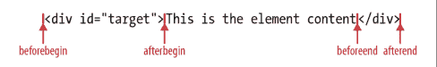

# JavaScript 便手手册

JavaScript 是 Web 无处不在的编程语言。15年来，《JavaScript权威指南》（JavaScript: The Definitive Guide）一直是全球 JavaScript 程序员的圣经。本书是《权威指南》的全新节选，将该厚重著作的核心部分汇集成了这本轻巧的口袋参考书。

前九章记录了 JavaScript 核心语言的最新版本（ECMAScript 5），涵盖了：

- 类型、值和变量
- 运算符、表达式和语句
- 对象和数组
- 函数和类

接下来的五章记录了在 HTML5 中使用 JavaScript 的基础 API，并解释了如何：

- 与浏览器窗口交互
- 编写 HTML 文档和元素脚本
- 修改并应用 CSS 样式和类
- 响应用户输入事件
- 与 Web 服务器通信
- 在用户的计算机上本地存储数据

本书是《jQuery口袋参考指南》的完美伴侣。

# 前言

JavaScript 是 Web 无处不在的编程语言。15年来，《JavaScript权威指南》（JavaScript: The Definitive Guide）一直是全球 JavaScript 程序员的圣经。本书是《权威指南》的全新节选，将该厚重著作的核心部分汇集成了这本轻巧的口袋参考书。

前九章记录了 JavaScript 核心语言的最新版本（ECMAScript 5），涵盖了：

- 类型、值和变量
- 运算符、表达式和语句
- 对象和数组
- 函数和类

接下来的五章记录了在 HTML5 中使用 JavaScript 的基础 API，并解释了如何：

- 与浏览器窗口交互
- 编写 HTML 文档和元素脚本
- 修改并应用 CSS 样式和类
- 响应用户输入事件
- 与 Web 服务器通信
- 在用户的计算机上本地存储数据

本书是《jQuery口袋参考指南》的完美伴侣。

为了有用，每种语言都必须有一个能够执行输入输出的标准库。JavaScript 核心语言定义了处理文本、数组、日期和正则表达式的最小 API，但不包含任何输入输出功能。输入和输出（以及网络、存储和图形等高级功能）由嵌入 JavaScript 的“宿环境”负责。最常见的宿环境是浏览器。第一至第九章涵盖了语言的最小内置 API。第十章至十三章涵盖了网络环境，并解释了如何使用“客户端 JavaScript”创建动态网页和应用程序。

近年来浏览器实现的 JavaScript API 数量呈爆炸式增长，本书的大小无法涵盖所有内容。第十章至十三章涵盖了客户端 JavaScript 最重要、最基础的部分：窗口、文档、元素、样式、事件、网络和存储。一旦掌握了这些，就可以轻松学习额外的客户端 API，你可以在《权威指南》中阅读。

尽管 Node 运行环境变得越来越重要，但口袋参考书中没有空间包含任何关于服务器端 JavaScript 的信息。你可以在 `http://nodejs.org` 了解更多。同样，书中没有空间提供 API 参考章节。再次，我建议你查阅《权威指南》，或者在线 JavaScript 参考资源，例如优秀的 Mozilla 开发者网络（`http://developer.mozilla.org/`）。书中的示例可以从书籍网页下载，如果出版后发现错误，该网页还将包含勘误：

`http://shop.oreilly.com/product/0636920011460.do`

通常情况下，你可以在程序和文档中使用书中的示例。除非你复制了大部分代码，否则不需要联系我们获取许可。我们不胜感激（但不强制要求）提供如下的署名：“From JavaScript Pocket Reference, third edition, by David Flanagan (O’Reilly). Copyright 2012 David Flanagan, 978-1-449-31685-3。”如果你觉得对代码示例的使用超出了你的范围或此处提供的许可范围，请随时通过 `permissions@oreilly.com` 与我们联系。

如需对本书提出意见或技术问题，请发送邮件至：

`bookquestions@oreilly.com`

本书也可通过 Safari Books Online 服务提供。欲需访问本书以及 O’Reilly 及其他出版社类似主题书籍的完整数字版，请访问 `http://www.safaribooksonline.com/`。

我要感谢我的编辑 Simon St. Laurent，他挑战我将《The Definitive Guide》删减到更易于管理的尺寸同时也感谢 O’Reilly 的制作团队，他们总能让我的书看起来非常精美。

# 词法结构

JavaScript 程序使用 Unicode 字符集编写。Unicode 是 ASCII 和 Latin-1 的超集，支持地球上目前使用的几乎每种语言。

JavaScript 是一种区分大小写的语言。这意味着语言关键字、变量、函数名和其他标识符必须始终保持字母的大小写一致。例如，`while` 关键字必须写为“while”，而不是“While”或“WHILE”。同样，`online`、`Online`、`OnLine` 和 `ONLINE` 是四个不同的变量名。

## 注释

JavaScript 支持两种注释样式。`//` 到行尾之间的任何文本都被视为注释并被 JavaScript 忽略。`/*` 和 `*/` 之间的文本也被视为注释；这些注释可以跨多行，但不能嵌套。以下代码行都是合法的 JavaScript 注释：

```javascript
// 这是一个单行注释。
/* 这也是一个注释 */ // 这里是另一个。
/*
* 这是另一个注释。
* 它包含多行。
*/
```

## 标识符与保留字

标识符简单就是一个名称。在 JavaScript 中，标识符用于为变量和函数命名，并为 JavaScript 代码中的某些循环提供标签。JavaScript 标识符必须以字母、下划线 (`_`) 或美元符号 (`$`) 开头。后续字符可以是字母、数字、下划线或美元符号。

JavaScript 预留了一些标识符作为语言本身的关键字。你不能在程序中使用这些词作为标识符：

| break | delete | function | return | typeof |
| :--- | :--- | :--- | :--- | :--- |
| case | do | if | switch | var |
| catch | else | in | this | void |
| continue | false | instanceof | while |
| debugger | finally | new | true | with |
| default | for | null | try |

JavaScript 还预留了一些目前语言未使用的关键字，但在未来版本中可能会使用。ECMAScript 5 预留了以下单词：

| class | const | enum | export | extends | import | super |

此外，以下在普通 JavaScript 代码中合法的单词在严格模式（strict mode）下是被保留的：

| implements | let | private | public | yield |
| interface | package | protected | static |

严格模式还对以下标识符的使用增加了限制。它们没有被完全保留，但不允许作为变量、函数或参数名：

| arguments | eval |

ECMAScript 3 留了 Java 语言的所有关键字，尽管这在 ECMAScript 5 中已放宽，如果你计划在 ECMAScript 3 的 JavaScript 实现下运行代码，仍然应该避免所有这些标识符：

| abstract | double | goto | native | static |
| boolean | enum | implements | package | super |
| byte | export | import | private | synchronized |
| char | extends | int | protected | throws |

## 可选分号

与许多编程语言一样，JavaScript 使用分号（`;`）来将语句（参见“语句”章节）隔开。这对于使你的代码含义清晰非常重要：如果没有分隔符，一个语句的结束可能看起来像另一个语句的开头，反之亦然。在 JavaScript 中，如果两个语句写在不同的行，你通常可以省略它们之间的分号。（你也可以在程序末尾或当程序中的下一个标记（token）是右括号时省略分号。）许多 JavaScript 程序员使用分号来显式地标记语句的结束，即使在不需要的时候也是。另一种风格是尽可能省略分号，仅在少数需要的情况下使用它们。无论你选择哪种风格，你都应该了解 JavaScript 中可选分号的几个细节。

考虑以下代码。由于两个语句写在不同的行，第一个分号可以省略：

```javascript
a = 3;
b = 4;
```

然而，如果如下所示，则第一个分号是必须的：

```javascript
a = 3; b = 4;
```

注意，JavaScript 不会将每个换行符视为分号：它只有在无法没有分号的情况下解析代码时，通常才会将换行视为分号。更正式地说，如果换行出现在 `return`、`break` 或 `continue` 关键字之后，或者在 `++` 运算符之前，或者下一个非空格字符无法解释为当前语句的延续，JavaScript 就会将换行解释为分号。

这些语句终止规则导致了一些意外的情况。这段代码看起来是两个用换行符分隔的独立语句：

```javascript
var y = x + f
(a+b).toString()
```

但代码第二行的括号可以被解释为对第一行 `f` 的函数调用，JavaScript 对代码的解释如下：

```javascript
var y = x + f(a+b).toString();
```

# 类型、值与变量

计算机程序通过操作值来工作，例如数字 3.14 或文本“Hello World”。在编程语言中可以表示和操作值的种类称为类型。当程序需要保留一个值供以后使用时，它会将该值赋值给（或“存储在”）变量。变量为值定义了一个符号名称并允许通过名称引用该值。

JavaScript 类型可以分为两类：原始类型和对象类型。JavaScript 的原始类型包括数字、文本字符串（称为 strings）和布尔真值（称为 booleans）。本章的前几节介绍了 JavaScript 的原始类型。（第 5、6 和 7 章描述了 JavaScript 的三类对象类型。）

JavaScript 会字面上地将值从一种类型转换为另一种类型。例如，如果程序期望一个字符串而你给了它一个数字，它将自动数字转换为字符串。如果你在需要布尔值的地方使用非布尔值，JavaScript 将相应转换。“类型转换”见后文。

JavaScript 变量是无类型的；你可以为变量赋值任何类型的值，稍后为同一个变量赋值不同类型的值。变量用 `var` 关键字声明。JavaScript 使用词法作用域。在函数外部声明的变量是全局变量，在 JavaScript 程序中随处可见。函数内部声明的变量具有函数作用域，仅对函数内部的代码可见。“变量声明”详见后文。

## 数字

与许多语言不同，JavaScript 不区分整数值和浮点值。JavaScript 中的所有数字都表示为浮点值。JavaScript 使用 IEEE 754 标准定义的 64 位浮点格式表示数字，这意味着它可以表示高达 ±1.7976931348623157 × 10³⁰⁸ 以及低至 ±5 × 10⁻³²⁴ 的数字。

JavaScript 数字格式允许你精确表示 -9007199254740992 (-2⁵³) 到 9007199254740992 (2⁵³)之间的整数。如果你使用比此更大的整数值，可能会丢失尾部精度。然而，JavaScript 中的某些操作（例如数组索引和位运算符）是以 32 位整数执行的。

当数字直接出现在 JavaScript 程序中时，它被称为数字字面量。JavaScript 支持多种格式的数字字面量。注意，任何数字字面量前面都可以加一个减号（`-`）使数字变为负数。

在 JavaScript 程序中，十进制整数字面量被写为数字序列。例如：

```javascript
0
1024
```

除了十进制整数字面量，JavaScript 还支持十六进制（基数 16）整数字面量。它们以 `0x` 或 `0X` 开头，后跟十六进制数字（0-9 和 a-f 或 A-F）。`a`（或 `A`）到 `f`（或 `F`），代表从 10 到 15 的值。以下是十六进制整数字面量的示例：

```javascript
0xff // 15*16 + 15 = 255 (十进制)
0xFE911
```

浮点数字面量可以包含一个小数点；它们使用传统的实数表示法。实数值表示为数字的整数部分，后面跟着小数点和数字的小数部分。

浮点数字面量也可以使用计数法表示：一个实数后面跟着字母 `e`（或 `E`），然后是一个可选的加号或负号，最后是一个整数指数。这种表示法表示该实数乘以 10 的指数次幂。

更简洁地，语法为：

```
[digits][.digits][(E|e)([+-])digits]
```

例如：

```javascript
3.14
6.02e23 // 6.02 * 10^23
1.4738223e-32 // 1.4738223 * 10^-32
```

JavaScript 程序使用该语言提供的算术运算符。这些包括用于加法的 `+`、用于减法的 `-`、用于乘法的 `*`、用于除法的 `/` 以及用于取模（取余）的 `%`。关于这些和其他运算符的完整细节可以在“表达式与运算符”章节找到。

除了这些基础算术运算符，JavaScript 还通过一组 `Math` 对象的常量和函数支持更复杂的数学运算：

```javascript
Math.pow(2,53) // 9007199254740992: 2 的 53 次
Math.round(.6) // 1.0: 舍入到最近的整数
Math.ceil(.6) // 1.0: 向上取整到整数
Math.floor(.6) // 0.0: 向下取到整数
Math.abs(-5) // 5: 绝对值
Math.max(x,y,z) // 返回最大的参数
Math.min(x,y,z) // 返回最小的参数
Math.random() // 伪随机数 0 <= 1.0

Math.PI // π
Math.E // e: 自然对数的底
Math.sqrt(3) // 3 的平方根
Math.pow(1,1/3) // 3 的立方根
Math.sin(0) // 三角函数：也还有 Math.cos, Math.atan, 等。
Math.log(10) // 10 的自然对数
Math.log(100)/Math.LN10 // 100 的十进制对数
Math.log(512)/Math.LN2 // 512 的二进制对数
Math.exp(3) // Math.E 的立方
```

JavaScript 中的算术运算在溢出、下溢或除零时不会产生错误。当数值运算的结果大于可表示的最大数字时（溢出），结果是一个特殊的无穷值，JavaScript 将其打印为 `Infinity`。同样，当一个负值大于可表示的最大负数时，结果是负无穷，打印为 `-Infinity`。无穷值的行为正如你所预期的那样：与任何数进行加、减、乘、除都会得到一个无穷值（符号可能会反转）。

除以零在 JavaScript 中不是错误：它只是返回无穷大或负无穷。然而，有一个例外：零除以零没有定义的值，该运算的结果是特殊的“非数字”（not-a-number）值，打印为 `NaN`。如果你尝试用无穷除以无穷，或者对负数开平方，或者对无法转换为数字的非数字操作数使用算术运算符，也会产生 `NaN`。

JavaScript 定义了全局变量 `Infinity` 和 `NaN` 来存储正无穷和非数字值。

非数字值在 JavaScript 中有一个不寻常的特征：它与包括自己在内的任何值都不相等。这意味着你不能通过编写 `x == NaN` 来判断变量 `x` 的值是否为 `NaN`。相反，你应该写 `x != x`。该表达式将为真，且只有当 `x` 是 `NaN` 时才为真。函数 `isNaN()` 类似。如果其参数是 `NaN`，或者该参数是非数字值（如字符串或对象），则返回 `true`。相关的函数 `isFinite()` 如果其参数是除 `NaN`、`Infinity` 或 `-Infinity` 以外的数字，则返回 `true`。

实数无限多个，但只有有限数量的实数（确切地说是 1843773687445810627 个）可以用 JavaScript 浮点格式精确表示。这意味着当你在 JavaScript 中处理实数时，数字的表示往往是实际数字的近似，并发生微小的舍入误差。

## 文本

字符串是 16 位值的不可变有序序列，每个值通常代表一个 Unicode 字符——字符串是 JavaScript 用于表示文本的类型。字符串的长度是它包含的 16 位值的数量。JavaScript 的字符串（以及它的数组）使用从 0 开始的索引：第一个 16 位值位于位置 0，第二个位于位置 1，依此类推。空字符串是长度为 0 的字符串。JavaScript 没有专门表示字符串中单个元素的特殊类型。要表示单个 16 位值，只需简单地使用一个长度为 1 的字符串即可。

### 字符串字面量

要在 JavaScript 程序中包含字符串字面量，只需将字符括起来，使用单引号、双引号或反引号：

```javascript
'abc'
"abc"
`abc`
```

反引号（`` ` ``）在 JavaScript 中有一个特殊用途：它允许字符串字面量跨行。反引号还允许在字符串中使用插值表达式，使用 `${}` 语法：

```javascript
`Hello, ${name}!`
```

反斜杠（`\`）在字符串中具有转义作用。反斜杠后面跟着一个字符，表示该字符具有特殊含义。例如，`\'` 表示单引号，`\"` 表示双引号：

| 序列 | 描述的字符 |
| :--- | :--- |
| `\0` | 空字符 |
| `\b` | 退格符 |
| `\t` | 水平制表符 |
| `\n` | 换行 |
| `\v` | 垂直制表符 |
| `\f` | 换页 |
| `\r` | 回车 |
| `\"` | 双引号 |
| `\'` | 单引号 |
| `\\` | 反斜杠 |

表 2-1 JavaScript 转义序列

| 序列 | 表示的字符 |
| :--- | :--- |
| `\xXX` | 由两个十六进制数字指定的 Latin-1 字符 |
| `\uXXXX` | 由四个十六进制数字指定的 Unicode 字符 |

如果反斜杠后面跟的是表 2-1 所示的任何字符，反斜杠将被简单忽略（尽管语言的新版本可能会定义新的转义序列）。例如，`\#` 等于 `#`。ECMAScript 允许在换行符之前使用反斜杠来续行字符串。

JavaScript 的内置功能之一是字符串拼接。如果你对数字使用 `+` 运算符，会将它们相加。但如果你对字符串使用此运算符，它通过将第二个附加第一个来连接它们。例如：

```javascript
msg = "Hello," + "world"; // => "Hello, world"
```

要确定字符串的长度——它包含的 16 位值的数量——使用字符串的 `length` 属性。像这样确定字符串 `s` 的长度：

```javascript
s.length
```

除了这个 `length` 属性外，还有许多可以在字符串上调用的方法：

```javascript
s = "hello, world" // 从一些文本开始
s.charAt(0) // => "h": 第一个字符。
s.charAt(s.length-1) // => "d": 最后一个字符。
s.substring(1,4) // => "ell": 字符 2, 3 和 4
s.slice(1,4) // => "ell": 相同的操作
s.slice(-3) // => "rld": 最后 3 个字符
s.indexOf("l") // => 2: 第一个 l 的位置。
s.lastIndexOf("l") // => 10: 最后一个 l 的位置。
s.indexOf("l", 3) // => 3: 3 之后的位置
s.split(",") // => ["hello", "world"]
s.replace("h", "H") // => "Hello, world"
// 替换所有实例
s.toUpperCase() // => "HELLO, WORLD"
```

记住字符串在 JavaScript 中是不可变的。像 `replace()` 和 `toUpperCase()` 这样的方法会返回新字符串：它们不会修改调用它们的字符串。

在 ECMAScript 5 中，字符串可以被像只读数组一样对待，你可以使用方括号而不是 `charAt()` 方法从字符串中访问单个字符（16 位值）：

```javascript
s = "hello, world";
s[0]               // => "h"
s[s.length-1]      // => "d"
```

## 布尔值

布尔值代表真或假、开启或关闭、是或否。这种类型只有两种可能的值。保留字 `true` 和 `false` 求值结果为这些值。

布尔值通常是 JavaScript 程序中比较的结果。例如：

```javascript
a == 4
```

这段代码测试变量 `a` 的值是否等于数字 `4`。如果等于，则该比较的结果为布尔值 `true`。如果 `a` 不等于 `4`，则该比较的结果为 `false`。

布尔值常用于 JavaScript 的控制结构。例如，JavaScript 中的 `if/else` 语句在布尔值为 `true` 时执行一个操作，在值为 `false` 时执行另一个操作。你通常会将创建一个布尔值的比较直接与使用该值的语句结合起来。结果如下：

```javascript
if (a == 4)
    b = b + 1;
else
    a = a + 1;
```

这段代码检查 `a` 是否等于 `4`。如果是，则给 `b` 加 1；否则，给 `a` 加 1。

正如我们将在“类型转换”讨论的，任何 JavaScript 值都可以转换为布尔值。以下值会转换为 `false`，因此表现得像 `false`：

```javascript
undefined
null
0
-0
NaN
"" // 空字符串
```

所有其他值，包括所有对象（和数组），都会转换为 `true`，并表现得像 `true`。`false` 值以及转换为 `false` 的六个值有时被称为**假值**，而所有其他值被称为**真值**。每当 JavaScript 期望一个布尔值时，假值的作用就像 `false`，真值的作用就像 `true`。

例如，假设变量 `o` 持有一个对象或值 `null`。你可以使用如下 `if` 语句显式地测试 `o` 是否非空：

```javascript
if (o !== null) ...
```

不等运算符 `!=` 将 `o` 与 `null` 进行比较，并求值为 `true` 或 `false`。但你可以省略比较，转而依赖 `null` 是假值而对象是真值的这一事实：

```javascript
if (o) ...
```

在第一种情况下，只有当 `o` 不为空时才会执行 `if` 体。第二种情况没那么严格：只有当 `o` 不是 `false` 或任何假值（如 `null` 或 `undefined`）时，才会执行 `if` 句。哪种语句适用于你的程序实际上取决于你期望赋值给 `o` 的值。如果你需要区分 `null` 与 `0` 以及 `""`，你应该使用显式比较。

## null 和 undefined

`null` 是一个语言关键字，求值为一个特殊值，通常用于表示值的缺失。使用 `typeof` 运算符 `null` 会返回字符串 `"object"`，这表明 `null` 可以被认为是一种表示“无对象”的特殊对象值。在实践中，`null` 通常被视为所属类型的唯一成员，并可以用于表示数字、字符串以及对象的“无值”。大多数编程语言都有与 JavaScript 的 `null` 等效的对应物：你可能熟悉它被称为 `null` 或 `nil`。

JavaScript 还有第二个表示值缺失的值。`undefined` 值代表了一种更深层次的缺失。它是未初始化的变量的值，也是当你查询不存在的对象属性或数组元素的值时得到的值。`undefined` 值也会由没有返回值的函数返回，以及未提供参数的函数参数值返回。`undefined` 是一个预定义的全局变量（不是像 `null` 那样的语言关键字），它被初始化为 `undefined` 值。如果你对 `undefined` 值应用 `typeof` 运算符，它会返回 `"undefined"`，这表明该值是某个特殊类型的唯一成员。

尽管有这些差异，`null` 和 `undefined` 都表示值的缺失，并且经常可以互换使用。等值运算符 `==` 认为它们是相等的。（使用严格等值运算符 `===` 来区分它们。）它们都是假值——当需要布尔值时，它们的行为像 `false`。`null` 和 `undefined` 都不具有任何属性或方法。事实上，使用 `.` 或 `[ ]` 访问这些值的属性或方法会导致 `TypeError`。

## 全局对象

上面的部分解释了 JavaScript 的原始类型和值。对象类型——对象、数组和函数——将在本书后续的专门章节中介绍。但有一个非常重要的值我们现在必须涵盖。全局对象是一个普通的 JavaScript 对象，它起着非常重要的作用：该对象的属性是全局定义的符号，供 JavaScript 程序使用。当 JavaScript 解释器启动时（或每当网页浏览器加载新页面时），它会创建一个新的全局对象并赋予它一组初始属性，定义了：

- 全局属性，如 `undefined`、`Infinity` 和 `NaN`
- 全局函数，如 `isNaN()`、`parseInt()`（“类型转换”）和 `eval()`（“表达式求值”）。
- 构造函数，如 `Date()`、`RegExp()`、`String()`、`Object()` 和 `Array()`
- 全局对象，如 `Math` 和 `JSON`（“序列化属性和对象”）

全局对象的初始属性不是保留字，但它们应该被像保留字一样对待。本章已经描述了其中一些全局属性。其他大部分将在本书的其他地方介绍。

在顶层代码中——不属于任何函数的 JavaScript 代码——你可以使用 JavaScript 关键字 `this` 来指代全局对象：

```javascript
var global = this; // 指向全局对象
```

在客户端 JavaScript 中，`Window` 对象充当全局对象。该全局对象有一个自引用的 `window` 属性，可以用来引用全局对象。`Window` 对象定义了少数其他全局属性，但也定义了许多特定于网络浏览器和客户端 JavaScript 的属性（见第 10 章）。

在首次创建时，全局对象定义了所有的预定义全局值。但这个特殊对象也持有程序定义的全局变量。如果你的代码声明了一个全局变量，该变量就是全局对象的一个属性。

| 值 | 转换为： | 类型 | 布尔值 | 结果 |
|---|---|---|---|---|
| -Infinity | "-Infinity" | Number | | Number(-Infinity) |
| 1 (有限，非零) | "1" | | | Number(1) |
| {} (任何对象) | toString() | toString() 或 value() | true | |
| [] (空数组) | "" | | true | |
| [9] (1个数字元素) | "9" | | true | |
| ['a'] (任何其他数组) | join() 方法 | | | |
| function (任何函数) | | | | |

由于 JavaScript 可以灵活地转换值，它的 `==` 等于运算符在相等性概念上也是灵活的。例如，以下比较都是 true：

- `null == undefined` // 这两者被视为相等的。
- `"0" == false` // 字符串 -> 比较前转换为数字。
- `0 == false` // 布尔值 -> 比较前转换为数字。
- `"0" == false` // 两个操作数 -> 比较前转换为 0。

尽管 JavaScript 会自动执行许多类型转换，但你有时需要进行显式转换，或者你可能更倾向于显式转换以保持代码清晰。

执行显式类型转换最简单的方法是使用 `Boolean()`、`Number()`、`String()` 或 `Object()` 函数：

```javascript
Number("3") // => 3
String(false) // => "false" 或 false.toString()
Boolean([]) // => true
Object(3) // => new Number(3)
```

注意，`null` 或 `undefined` 外的任何值都有 `toString()` 方法，该方法的结果通常与 `String()` 函数的结果相同。

某些 JavaScript 运算符会执行隐式类型转换，有时用于类型转换。如果 `+` 运算符的操作数之一是字符串，它会将另一个转换为字符串。一元 `-` 运算符将其操作数转换为数字。一元 `!` 运算符将其操作数转换为布尔值并取反。这些事实导致了你在某些代码中看到的以下类型惯用法：

```javascript
x + "" // 等同于 String(x)
+x // 等同于 Number(x)。也是 x-0
!!x // 等同于 Boolean(x)。注意双 !
```

格式化和解析数字是计算机程序中的常见任务，JavaScript 提供了专门的函数和方法，提供更精确的数字到字符串和字符串到数字的转换。

`Number` 类定义的 `toString()` 方法接受一个可选参数，用于指定转换的进制（radix）。如果你不指定该参数，将按 10 进制转换。然而，你也可以转换其他进制（2 到 36 之间）的数字。例如：

```javascript
var n = 17;
binary_string = "0" + n.toString(2); // 结果为 "10001"
octal_string = "0" + n.toString(8); // 结果为 "021"
hex_string = "0" + n.toString(16); // 结果为 "011"
```

在处理财务或科学数据时，你可能希望将数字转换为字符串，并能够控制输出的小数位数或有效数字个数，或者你可能希望控制是否使用指数计数法。`Number` 类为此类数字到字符串的转换定义了三个方法：

```javascript
var n = 123456.789;
n.toFixed(2); // "123456.79"
n.toExponential(3); // "1.235e+5"
n.toPrecision(7); // "123456.8"
```

如果你向 `Number()` 转换函数传递一个字符串，它会尝试将该字符串解析为整数或浮点字面量。该函数仅适用于 10 进制整数，并且不允许包含非字面量部分的后续字符。`parseInt()` 和 `parseFloat()` 函数（这些是全局函数，不是任何类的方法）更加灵活。`parseInt()` 只解析整数，而 `parseFloat()` 同时解析整数和浮点数。如果字符串以 "0x" 或 "0X" 开头，`parseInt()` 将其解释为十六进制数。`parseInt()` 和 `parseFloat()` 会跳过前导空白，尽可能多地解析数字，并忽略后续的所有内容。如果第一个非空白字符不是有效数字字面量的一部分，它们返回 `NaN`：

```javascript
parseInt('3 blind mice') // => 3
parseFloat('3.14 meters') // => 3.14
parseInt('-12.34') // => -12
parseInt('0xFF') // => 255
parseFloat('$72.47'); // => NaN
```

`parseInt()` 接受一个可选的第二个参数，指定要解析数字的进制。合法值在 2 到 36 之间。例如：

```javascript
parseInt('11', 2) // => 3 (1*2 + 1)
parseInt('077', 8) // => 63 (7*8 + 7)
parseInt('ff', 16) // => 255 (15*16 + 1)
```

### 变量声明

在 JavaScript 程序中使用变量之前，你应该声明它。使用 `var` 关键字声明变量，如下：

```javascript
var i;
var sum;
```

你也可以用同一个 `var` 关键字声明多个变量：

```javascript
var i, sum;
```

你可以将多个变量与同一个 `var` 关键字和初始化结合：

```javascript
var i = 0, sum = 0;
```

# 表达式与运算符

*表达式*是 JavaScript 的短语，JavaScript 解释器可以对其进行*求值*以产生一个值。字面量形式嵌入程序中的常量是一种非常简单的表达式。变量名也是一种简单的表达式，其求值为赋值给该变量的任何值。复杂表达式由更简单的表达式构建而成。例如，一个数组访问表达式由一个求结果为数组的表达式、紧跟的一个左括号、一个求结果为整数的表达式以及一个右括号组成。这个新的、更复杂的表达式的求结果为指定数组的指定索引处存储的值。同样，函数调用表达式由一个求结果为函数对象的表达式以及零或多个用作函数参数的额外表达式组成。

用更简单的表达式构建复杂表达式的最常用方法是使用*运算符*。运算符以某种方式将其*操作数*（通常是两个）的值结合起来，并求值出一个新值。乘法运算符 `*` 就是一个简单的例子。表达式 `x * y` 的求结果为表达式 `x` 和 `y` 的值的乘积。为了简单起见，有时会说运算符 *返回* 一个值，而不是“求值为”一个值。

## 表达式

最简单的表达式称为原始表达式（primary expressions），它们是独立存在的——它们不包含任何更简单的表达式。JavaScript 中的原始表达式是常量或字面量值、某些语言关键字以及变量引用。

字面量是直接嵌入程序中的常量值。它们看起来如下：

```javascript
1.23            // 数字字面量
"hello"        // 字符串字面量
/pattern/       // 正则表达式字面量
```

`true`、`false`、`null` 和 `this` 等保留字是原始表达式。

最后，第三种原始表达式是变量引用：

```javascript
i               // 求值为变量 i 的值。
sum             // 求值为变量 sum 的值。
```

当任何标识符单独出现在程序中时，JavaScript 假设它是一个变量并查找它的值。如果不存在同名的变量，该表达式的求值为 `undefined`。然而，在 ECMAScript 5 的严格模式下，尝试求值不存在的变量会抛出 `ReferenceError`。

## 初始化器

对象和数组初始化器是表达式，其值为一个新创建的对象或数组。这些初始化器表达式有时被称为“对象字面量”和“数组字面量”。但与真正的字面量不同，它们并不是原始表达式，因为它们包含了若干指定属性和元素值的子表达式。

数组初始化器是包含在方括号内的逗号分隔的表达式列表。数组初始化器的值是一个新创建的数组。这个新数组的元素初始化为逗号分隔表达式的值：

```javascript
[] // 一个空数组
[1+2,3+4] // 一个包含元素 3 和 7 的 2 元素数组。
```

数组初始化器中的元素表达式本身也可以是数组初始化器，这意味着这些表达式创建了嵌套数组：

```javascript
var matrix = [[1,2,3], [4,5,6], [7,8,9]];
```

在数组初始化器的最后一个表达式之后允许单个尾随逗号。

对象初始化器表达式类似于数组初始化器表达式，但方括号被替换为大括号，并且每个子表达式都以属性名和冒号为前缀：

```javascript
var p = {x: 2, y: 1}; // 一个具有 2 个属性的对象
var q = {};             // 空对象；没有属性
q.x = 2; q.y = 1; // 现在 q 有与 p 相同的属性
```

对象字面量是可以嵌套的。例如：

```javascript
var rectangle = { topLeft: { x: 2, y: 2 },
lowerRight: { x: 4, y: 5 } };
```

对象和数组初始化器中的表达式在每次求值对象初始化器时都会求值，而且它们不需要具有常量值：它们可以是任意的 JavaScript 表达式。此外，对象字面量中的属性名可以是引号字符串而非标识符（这对于指定保留字或其他不是标识符的属性名非常有用）：

```javascript
var side = 1;
var square = { "ul": { x: p.x, y: p.y },
'lr': { x: p.x + side, y: p.y + side } };
```

## 属性访问

属性访问表达式的求结果为对象属性或数组元素的值。JavaScript 定义了两种属性访问的语法：

```javascript
expression . identifier
expression [ expression ]
```

第一种属性访问样式是一个表达式，后跟一个点和一个标识符。表达式指定对象，标识符指定所需属性的名称。第二种属性访问样式在第一个表达式（对象或数组）之后跟另一个位于方括号中的表达式。这个第二个表达式指定所需属性的名称或所需数组元素的索引。这里是一些示例：

```javascript
var o = {x:1, y:{z:3}}; // 示例对象
var a = [o,4,5,6]; // 一个包含 o 的数组
o.x // 1: 表达式 o 的属性 x
o.y.z // 3: 表达式 o.y 的属性 z
o["x"] // 1: 对象 o 的属性 x
a[1] // 4: 表达式 a 索引 1 处的元素
a[0].z // 3: 表达式 a[0] 的属性 z
a[0].x // 1: 表达式 a[0] 的属性 x
```

## 函数定义

函数定义表达式定义了一个 JavaScript 函数，该表达式的值是新定义的函数。在某种意义上，函数定义表达式是一个“函数字面量”，就像对象初始化器是对象字面量一样。函数定义表达式通常由 `function` 关键字、后跟的逗号分隔的标识符列表（参数名）以及大括号中的 JavaScript 代码块（函数体）组成。例如：

```javascript
// 此函数返回参数的平方
var square = function(x) { return x * x; }
```

函数可以使用函数语句而不是函数表达式来定义。有关定义的详细信息见“函数”章节。

## 调用

调用表达式是 JavaScript 调用（或执行）函数或方法的语法。它从一个标识要调用函数的函数表达式开始。函数表达式后跟一个左括号、逗号分隔的零或多个参数表达式以及一个右括号。一些示例：

```javascript
f(0) // f 是函数；0 是参数。
Math.max(x,y,z) // 函数 Math.max；参数 x, y, z。
a.sort() // 函数 a.sort；无参数。
```

当求值调用表达式时，首先求值函数表达式，然后求值参数表达式以产生参数表达式列表。如果函数表达式的值不是函数，则会抛出 `TypeError`。接下来，将参数值顺序赋值给定义函数时指定的参数名，然后执行函数体。如果函数使用 `return` 语句返回一个值，则该值成为调用表达式的值。否则，调用表达式的值为 `undefined`。

每个调用表达式都包含一对括号以及左括号之前的一个表达式。如果该表达式是属性访问表达式，则该调用被称为方法调用。在方法调用中，对象或数组作为属性访问主体的数组在执行函数体时将成为 `this` 参数的值。这使得面向对象的编程范式成为可能，在这种范式中，函数（按其 OO 名称称为“方法”）在它们所属的对象上进行操作。详情请参阅“类”章节。

## 对象创建

对象创建表达式会创建一个新对象，并调用一个函数（称为构造函数）来初始化该对象的属性。对象创建表达式类似于调用表达式，不同在于它们带有关键字 `new` 作为前缀：

```javascript
new Object()
new Point(2,3)
```

如果在对象创建表达式中没有向构造函数传递任何参数，可以省略空的一对括号：

```javascript
new Object
new Date
```

当对象创建表达式被求值时，JavaScript 会创建一个新的空对象，就像通过对象初始化器 `{}` 创建的对象一样。接下来，它使用指定的参数调用指定的函数，并将新对象作为 `this` 关键字的值传递。然后，函数可以使用 `this` 来初始化新创建对象的属性。为了用构造函数而编写的函数不返回值，对象创建表达式的值是新创建并初始化的对象。如果构造函数确实返回了一个对象值，则该值将成为对象创建表达式的值，而新创建的对象将被丢弃。

## 运算符

运算符用于 JavaScript 的算术表达式、比较表达式、逻辑表达式、赋值表达式等。表 3-1 总结了 JavaScript 的运算符。

表 3-1. JavaScript 运算符

| 运算符 | 操作 | 类型 |
| --- | --- | --- |
| `++` | 前置或后置自增 | lval→num |
| `--` | 前置或后置自减 | lval→num |
| `-` | 数字取反 | num→num |
| `+` | 转换为数字 | num→num |
| `~` | 取反位 | int→int |
| `!` | 取反布尔值 | bool→bool |
| `delete` | 删除属性 | lval→bool |
| `typeof` | 操作数的类型 | any→str |
| `void` | 返回 undefined 值 | any→undef |
| `*`, `/`, `%` | 乘、除、取余数 | num,num→num |
| `+`, `-` | 加、减 | num,num→num |
| `+` | 字符串拼接 | str,str→str |
| `<<` | 左移 | int,int→int |
| `>>` | 带符号扩展右移 | int,int→int |
| `>>>` | 零扩展右移 | int,int→int |
| `<`, `<=`, `>`, `>=` | 按数值顺序比较 | num,num→bool |
| `<`, `<=`, `>`, `>=` | 按字母顺序比较 | str,str→bool |
| `instanceof` | 测试对象类 | obj,func→bool |
| `in` | 测试属性是否存在 | str,obj→bool |
| `==` | 测试相等性 | any,any→bool |
| `!=` | 测试不相等性 | any,any→bool |
| `===` | 测试严格相等性 | any,any→bool |
| `!==` | 测试严格不相等性 | any,any→bool |
| `&` | 计算位按位与 | int,int→int |
| `^` | 计算位按位异或 | int,int→int |
| `|` | 计算位按位或 | int,int→int |
| `&&` | 计算逻辑与 | any,any→any |
| `||` | 计算逻辑或 | any,any→any |
| `?:` | 选择第 2 或第 3 个操作数 | bool,any,any→any |
| `=` | 赋值给变量或属性 | lval,any→any |
| `*=`, `/=`, `%=`, `+=`, `-=` | 操作并赋值 | lval,any→any |
| `&=`, `^=`, `|=`, `<<=`, `>>=`, `>>>=` | | |
| `,` | 丢弃第一个操作数，返回第二个 | any,any→any |

表 3-1 中列出的运算符按优先级从高到低排序，并用水平线将具有相同优先级的运算符组隔开。运算符优先级控制了操作执行的顺序。优先级较高的运算符（位于表格顶端）会在优先级较低的运算符（靠近底端）之前执行。

考虑以下表达式：

```javascript
w = x + y*z;
```

乘法运算符 `*` 的优先级高于加法运算符 `+`，因此乘法会在加法之前执行。此外，赋值运算符 `=` 的优先级最低，因此赋值会在右侧所有操作完成后才执行。

可以通过显式使用括号来覆盖运算符优先级。为了强制先执行上例中的加法，可以写道：

```javascript
w = (x + y)*z;
```

注意，属性访问和调用表达式的优先级高于表 3-1 中列出的任何运算符。考虑这个表达式：

```javascript
typeof my.functions[x](y)
```

尽管 `typeof` 是优先级最高的运算符之一，但 `typeof` 操作是在两次属性访问和一次函数调用的结果上进行的。

在实践中，如果你对运算符的优先级不确定，最简单的方法是使用括号使求值顺序显式化。需要了解的重要规则是：乘除法在加减之前执行，而赋值的优先级非常低，几乎总是最后执行。

某些运算符适用于任何类型的值，但大多数运算符期望其操作数是特定类型，且大多数运算符返回（或求值为）特定类型的值。表 3-1 中的列指定了操作数类型（箭头之前）。

### 算术运算符

本节介绍了执行算术操作的运算符。

**乘法 (`*`)**
计算其操作数的积。

**除法 (`/`)**
`/` 运算符将其第一个操作数除以第二个操作数。

**取模 (`%`)**
`%` 运算符计算第一个操作数除以第二个操作数整除后的余数。

**加法 (`+`)**
二进制 `+` 运算符将数值操作数相加或拼接字符串。

**减法 (`-`)**
从左侧操作数的值中减去右侧操作数的值。

除了列出的二进制运算符外，JavaScript 还定义了一些用于算术的一元运算符。

**一元加 (`+`)**
一元加运算符（`+`）将其操作数转换为数字。

**一元减 (`-`)**
当 `-` 用作一元运算符时，它将操作数转换为数字，然后改变结果的符号。

**自增 (`++`)**
`++` 运算符将其单个操作数自增（即加 1）。

`++` 运算符的返回值取决于它相对于操作数的位置。当在操作数之前时（称为**前增运算符**），它会增加操作数并求值为该操作数增加后的值。当在操作数之后时（称为**后增运算符**），它会增加操作数，但求值为该操作数未增加之前的值。考虑以下这两行代码的区别：

```javascript
var i = 1, j = ++i; // i 和 j 都是 2
var i = 1, j = i++; // i 是 2, j 是 1
```

该运算符无论是以前增还是后增的形式使用，最常用于循环计数器（参见“for”）。

**递减 (`--`)**
`--` 运算符期望一个左值操作数。它将操作数的值转换为数字，减 1，并将减少后的值赋值回操作数。与 `++` 运算符类似，`--` 的返回值取决于它相对于操作数的位置。当在操作数之前时，它会减少操作数并返回减少后的值。当在操作数之后时，它会减少操作数但返回未减少之前的值。

位运算符对数字二进制表示中的位进行低级操作。这些运算符在 JavaScript 编程中并不常用，如果你不熟悉十进制整数的二进制表示，可能可以跳过此节。位运算符期望整数操作数，并且其行为就像这些值被表示为 32 位整数而不是 64 位浮点值一样。这些运算符在必要时会将操作数转换为数字，然后通过丢弃任何小数部分和第 32 位之后的位，将数值强制转换为 32 位整数。位移运算符要求的右侧操作数在 0 到 31 之间。

### 位与 (`&`)

`&` 运算符对其整数参数的每个位执行布尔与（AND）操作。只有当两个操作数的对应位都被设置时，结果中的该位才被设置。例如，`0x1234 & 0x0FF` 结果为 `0x0034`。

### 位或 (`|`)

`|` 运算符对其整数参数的每个位执行布尔或（OR）操作。如果对应位在两个操作数中的一个或两个中被设置，则结果中的该位即被设置。例如，`0x1234 | 0x0FF` 结果为 `0x12FF`。

### 位异或 (`^`)

`^` 运算符对其整数参数的每个位执行布尔异或（XOR）操作。异或意味着两个操作数中有一个为真，但不能两个都为真。如果对应位在两个操作数中的一个（但不是两个）中被设置，则该操作结果中的对应位即被设置。例如，`0xFF00 ^ 0xF0F0` 结果为 `0x0FF0`。

### 位取反 (`~`)

`~` 运算符是一个出现在单个操作数之前的一元运算符。它通过反转操作数中的所有位来运行。由于 JavaScript 中存在符号整数，将 `~` 运算符应用于一个值等于改变它的符号并减 1。例如，`~0x0F` 结果为 `0xFFFFFFF0`，即 -16。

### 左移 (`<<`)

`<<` 运算符将其第一个操作数中的所有位向左移动第二个操作数指定的位数。例如，在操作 `a << 1` 中，`a` 的第一个位（个位）变成第二个位（二位），`a` 的第二个位变成第三位，依此类推。新的第一个位使用 0 填充，且第 32 位的值会丢失。将一个值移动一位等同于乘以 2，移动两位等同于乘以 4，依此类推。例如，`7 << 2` 结果为 `28`。

### 带符号右移 (`>>`)

`>>` 运算符将其第一个操作数中的所有位向右移动第二个操作数指定的位数（一个 0 到 31 之间的整数）。移出右侧的位将丢失。左侧填充的位取决于原始操作数的符号位，以便保留结果的符号。如果第一个操作数是正数，结果的高位填充 0；如果第一个操作数是负数，结果的高位填充 1。将一个值移动一位等同于除以 2（舍弃余数），右移两位等同于整数除以 4，依此类推。例如，`7 >> 1` 结果为 `3`，`-7 >> 1` 结果为 `-4`。

### 无符号右移 (`>>>`)

`>>>` 运算符与 `>>` 运算符相同，不同在于左侧移入的位始终为零，无论第一个操作数的符号如何。例如，`-1 >> 4` 结果为 `-1`，`-1 >>> 4` 结果为 `0x0FFFFFFF`。

## 关系运算符

JavaScript 关系运算符测试两个值之间的关系（例如“等于”、“小于”或“属性”）并根据关系是否存在返回 `true` 或 `false`。关系表达式始终求值为布尔值，该值通常用于控制 `if`、`while` 和 `for` 语句中的程序执行流（参见“语句”章节）。

JavaScript 支持 `=`、`==` 和 `===` 运算符。请务必理解这些赋值、相等和严格相等运算符之间的区别，并在编码时务必小心使用正确的运算符！人们往往会将这三个运算符都读作“等于”，但如果你将 `=` 读作“获取或赋值为”，将 `==` 读作“等于”，将 `===` 读作“严格相等”，可能有助于减少混淆。

### 严格相等 (`===`)

`===` 运算符被称为严格相等运算符，它检查其操作数是否相同。如果操作数的类型不同，则它们不相等。如果两个操作数都是原始类型，则它们相等。

### 严格不等 (`!==`)

`!==` 运算符是 `===` 运算符的完全相反：如果两个值不严格相等，则返回 `true`。

### 浅等相等 (`==`)

`==` 运算符（带有两个符号而不是三个）类似于严格相等运算符，但它不那么严格。如果两个操作数的值不是相同类型，它会尝试某些类型转换并重新比较。该运算符认为 `null` 和 `undefined` 是相等的，这通常是一种很有用的类型转换。但 `==` 执行的其他转换则更令人惊讶。以下比较结果都求值为 `true`：

```javascript
1 == "1"
true == 1
"1" == true
false == 0
[] == 0
```

### 属性存在 (`in`)

`in` 运算符期望左侧操作数是字符串或可以转换为字符串。它期望右侧操作数是一个对象。如果左侧的值是右侧对象的属性名。例如：

```javascript
var p = { x:1, y:1 };
"x" in p // => true: p 拥有一个名为 "x" 的属性
"z" in p // => false: p 没有 "z" 属性。
toString in p // => true: p 继承了 toString。

var a = [7,8,9];
"0" in a // => true: a 拥有一个元素 "0"
1 in a // => true: 数字会被转换
```

### 对象类型 (`instanceof`)

`instanceof` 运算符期望左侧操作数是一个对象，右侧操作数是一个标识对象的类。如果左侧对象是右侧类的实例，该运算符的结果为 `true`，否则结果为 `false`。“类”章节解释了在 JavaScript 中，对象的类是由初始化它们的构造函数定义的。因此，`instanceof` 的右侧操作数应该是一个函数。以下是示例：

```javascript
var d = new Date();
d instanceof Date; // => true
d instanceof Object; // => true
d instanceof Number; // => false
var a = [1, 2, 3];
a instanceof Array; // => true
a instanceof Object; // => true
```

## 逻辑表达式

逻辑运算符 `&&`、`||` 和 `!` 执行布尔代数，通常与关系运算符结合使用，将两个关系表达式组合为一个更复杂的表达式。为了完全理解它们，请记住 `null`、`undefined`、`0`、`""` 和 `NaN` 都是“假”（falsy）值，它们的行为类似于布尔值 `false`。所有其他值（包括所有对象和数组）都是“真”（truthy），它们的行为类似于 `true`。

`&&` 运算符可以从三个不同的层面理解。在最简单的层面，当与布尔操作数一起使用时，`&&` 对两个值执行布尔与操作：当且仅当它的第一个操作数和第二个操作数都为真，返回 `true`。如果其中一个或两个操作数为假，则返回 `false`。

`&&` 通常用作连词来连接两个关系表达式：

```javascript
// 当且仅当 x 和 y 都为 0 时，结果为 true
x == 0 && y == 0
```

关系表达式始终求值为 `true` 或 `false`，当这样使用时，`&&` 运算符本身返回 `true` 或 `false`。关系运算符的优先级高于 `&&`（以及 `||`），因此像这些这样的表达式可以安全地不加括号编写。

但 `&&` 并不要求其操作数必须是布尔值。`&&` 可以理解的第二个层面是将其作为针对真值和假值的布尔与运算符。如果两个操作数都是真值，运算符返回一个真值。否则，其中一个或两个操作数必须为假，运算符返回一个假值。在 JavaScript 中，任何期望布尔值的表达式或语句都可以与真值或假值一起工作，`&&` 并不总是求值为 `true` 或 `false` 这一事实不会导致实际问题。

注意，上述描述说运算符返回“一个真值”或“一个假值”，但并没有指明具体是什么值。对于这一点，我们需要在第三个也是最后一个层面来描述 `&&`。该运算符开始评估它的第一个操作数，即其左侧的表达式。如果左侧的值为假，则整个表达式的值也必须为假，因此 `&&` 简单返回左侧的值，而不对右侧的表达式进行评估。

另一方面，如果左侧的值为真，那么整个表达式的值取决于右侧的值。如果右侧的值为真，则整体值必须为真；而如果右侧的值为假，则整体值必须为假。当左侧的值为真时，`&&` 运算符会求值并返回右侧的值：

```javascript
var o = { x : 1 };
var p = null;
o && o.x // => 1: o 是真，返回 o.x
p && p.x // => null: p 是假，所以不评估 p.x
```

理解这一点很重要：`&&` 可能会也可能不会评估它的右侧操作数。在上面的代码中，变量 `p` 被设置为 `null`，表达式 `p.x` 如果被评估，将导致 `TypeError`。代码仅以惯用方式使用 `&&`，使得只有在 `p` 为真（而非 `undefined`）时，才会评估 `p.x`。

`||` 运算符对其操作数执行布尔或操作。如果一个或两个操作数为真，它返回一个真值。如果两个操作数都为假，它返回一个假值。

尽管 `||` 运算符最常用作布尔或运算符，但与 `&&` 运算符一样，它也有复杂的行为。它开始评估它的第一个操作数，即其左侧的表达式。如果这个第一个操作数的值真，它返回该真值。否则，它评估第二个操作数，即其右侧的表达式，并返回该表达式的值。

该运算符的惯用用法是从一组备选项中选择第一个真值：

```javascript
// 如果定义了 max_width，则使用它。否则在
// preferences 对象中查找值。如果还没有
// 定义，则使用硬编码常量。
var max = max_width || preferences.max_width || 500;
```

这种惯用法常用于函数体，为参数提供默认值：

```javascript
// 将 o 的属性拷贝到 p，并返回 p
function copy(o, p) {
  // 如果没有为 p 传递对象，则使用一个新的
  p = p || {};
  // 函数体在此处
}
```

`!` 运算符是一个一元运算符；它位于单个操作数之前。它的目的是反转操作数的值。作为一个一元运算符，`!` 具有高优先级且结合紧密。如果你想反转表达式的值，需要使用括号：`!(p)`。

## 赋值表达式

JavaScript 使用 `=` 运算符将值赋值给变量、对象属性或数组元素。例如：

```javascript
i = 0 // 将变量 i 设置为 0
o.x = 1 // 将 o 的属性 x 设置为 1
```

`=` 运算符期望其左侧操作数是一个左值（lvalue）：变量、对象属性或数组元素。它期望右侧操作数是任何值。赋值表达式的值是右侧的值。赋值运算符具有从右到左的结合性，这意味着如果表达式中出现多个赋值运算符，它们将从右到左求值。因此，你可以编写这样的代码将单个值分配给多个变量：

```javascript
i = j = k = 0; // 初始化变量为 0
```

除了普通的 `=` 赋值运算符，JavaScript 还支持许多其他赋值运算符，通过将赋值与某些其他操作结合来提供快捷方式。例如，`+=` 运算符执行加法和赋值。对于此表达式：

```javascript
total += sales_tax
```

等同于：

```javascript
total = total + sales_tax
```

正如你预期的，`+=` 运算符适用于数字或字符串。对于数字操作数，它执行加法和赋值；对于字符串操作数，它执行拼接和赋值。类似的运算符包括 `-=`、`*=`、`&=` 等。

## 求值表达式

与许多解释语言一样，JavaScript 具有解释代码字符串的能力，评估它们产生值。JavaScript 通过全局函数 `eval()` 实现这一点：

```javascript
eval("3+2") // => 5
```

动态评估源代码字符串是一种强大的语言特性，但在实践中几乎不需要。如果你发现自己在使用 `eval()`，应该仔细考虑是否真的需要。`eval()` 期望一个参数。如果你传递字符串以外的任何值，它返回该值。它尝试将字符串解析为 JavaScript 代码，如果失败则抛出 `SyntaxError`。如果成功解析字符串，它将评估代码并返回字符串中最后一个表达式或语句的值，如果最后一个表达式或语句没有值，则返回 `undefined`。如果评估的字符串抛出异常，该异常将从 `eval()` 的调用处传播。

`eval()`（当这样调用时）的关键点在于它使用所调用代码的环境变量。也就是说，它查找变量值以及定义新变量和函数与本地代码相同。如果一个函数定义了一个局部变量 `x` 然后调用 `eval("x")`，它将获得局部变量的值。如果它调用 `eval("x=1")`，它将改变局部变量的值。如果函数调用 `eval("var y = 3;")`，它声明了一个局部变量 `y`。同样，函数可以使用如下代码声明一个局部函数：

```javascript
eval("function f() { return x+1; }");
```

`eval()` 有一个非常不寻常的限制（这是为了让 JavaScript 解释器能够高效运行而要求的）：只有当使用其原始名称 `"eval()"` 调用时，它才会表现出上述的行为。由于它在技术上是一个函数，因此可以将其赋值给另一个变量。而如果我们使用该变量来调用它，它的行为就会不同：当通过任何其他名称调用时，`eval()` 会将字符串视为顶层全局代码进行求值。求值的代码可以定义新的全局变量或全局函数，并可以设置全局变量，但它不能使用或修改任何调用函数的局部变量。

在 IE9 之前，IE 与其他浏览器不同：当通过其他名称调用 `eval()` 时，它不会执行全局 eval。IE 确实定义了一个名为 `execScript()` 的全局函数，该函数执行其字符串参数，类似于顶层脚本。然而，与 `eval()` 不同，`execScript()` 总是返回 `null`。

ECMAScript 5 严格模式对 `eval()` 的行为实施了进一步的限制。当从严格模式代码调用 `eval()`，或者当求值的代码字符串本身以 `"use strict"` 指令开头时，`eval()` 在私有变量环境中执行局部 eval。在严格模式下，求值的代码可以查询和设置局部变量，但不能在局部作用范围内定义新的变量或函数。此外，严格模式通过有效地将 `"eval"` 变成保留字，使得 `eval()` 更加像一个运算符。

## 杂项运算符

JavaScript 支持许多其他杂项运算符，将在后续章节中描述。

### 条件运算符 (`?:`)

条件运算符是 JavaScript 中唯一的三元运算符（具有三个操作数）。该运算符有时写成 `?:`，尽管在代码中并非完全那样出现。因为该运算符有三个操作数，第一个位于 `?` 之前，第二个位于 `?` 和 `:` 之间，第三个位于 `:` 之后。它的用法如下：

```javascript
x > 0 ? x : -x // x 的绝对值
```

条件运算符的操作数可以是任何类型。第一个操作数被求值并解释为布尔值。如果第一个操作数的值为真（truthy），则求值第二个操作数并返回其值。否则，如果第一个操作数的值为假（falsy），则求值第三个操作数并返回其值。第二个和第三个操作数只有一个会被求值，绝不会同时执行。

虽然你可以使用 `if` 语句（参见“if”）实现类似的结果，但 `?:` 运算符提供了一个方便的快捷方式。这是一个典型的用法，用于确保某个属性已定义（并且具有意义的真值），如果是则使用它，否则提供默认值：

```javascript
greeting = "hello " + (user.name ? user.name : "there");
```

### typeof 运算符

`typeof` 是一个一元运算符，置于单个操作数之前，该操作数可以是任何类型。它的值是一个指定操作数类型的字符串。下表规定了任何 JavaScript 值的 `typeof` 运算符值：

| x | typeof x |
|---|---|
| undefined | "undefined" |
| null | "object" |
| true or false | "boolean" |
| 任意数字或 NaN | "number" |
| 任意字符串 | "string" |
| 任意函数 | "function" |
| 任意非函数对象 | "object" |

你可能会在这样的表达式中使用 `typeof` 运算符：

```javascript
(typeof value == "string") ? "" + value + "" : value
```

### delete 运算符

`delete` 是一个一元运算符，尝试删除作为操作数的对象属性或数组元素。（如果你是 C++ 程序员，请注意 JavaScript 中的 `delete` 关键字与 C++ 中的 `delete` 关键字完全不同。）与赋值、增、减运算符一样，`delete` 通常用于它的属性副作用，而不是它返回的值。一些示例：

```javascript
var o = {x:1, y:2}; a = [1,2,3];
delete o.x // 删除 o 的一个属性
"x" in o // => false: 属性不存在
delete a[2]; // 删除数组的最后一个元素
2 in a // => false: 数组元素 2 不存在
```

### void 运算符

`void` 是一个一元运算符，出现在单个操作数之前，操作数可以是任何类型。这个运算符非常奇特且很少使用：它求值其操作数，丢弃该值并返回 `undefined`。由于操作数的值被丢弃，只有当操作数具有副作用时，使用 `void` 运算符才有意义。

### 逗号运算符 (`,`)

逗号运算符是一个二进制运算符，其操作数可以是任何类型。它求值左操作数，求值右操作数，然后返回右操作数的值。

左侧表达式总是会被求值，但其值会被丢弃，这意味着只有当左侧表达式具有副作用时，使用逗号运算符才有意义。逗号运算符在具有多个循环变量的 `for` 循环（参见“for”）中常用的唯一情况是：

```javascript
// 下面的第一个逗号是 var 语句语法的一部分。
// 第二个逗号是逗号运算符：
// 它允许我们把 2 个表达式 (i++ 和 j--) 挤进
// 一个期望 1 个表达式的语句 (for 循环)。
for(var i=0,j=10; i < j; i++,j--)
    console.log(i+j);
```

# 语句

“表达式与运算符”章节将表达式描述为 JavaScript 短语。以此类比，语句就是 JavaScript 句子或命令。正如英语句子用句号结束并相互分离一样，JavaScript 语句以分号（“可选分号”）结束。表达式通过求值来产生一个值，而语句通过执行来“让某事发生”。

“让某事发生”的一种方法是求值具有副作用的表达式，例如赋值和函数调用，它们可以独立作为语句，当这样使用时，它们被称为表达式语句。另一类类似的语句是声明语句，它们用于声明新变量和定义新函数。

JavaScript 程序仅仅是执行的语句序列。默认情况下，JavaScript 解释器按顺序执行这些语句。另一种“让某事发生”的方法是改变这种执行顺序，JavaScript 有许多这样的语句或控制结构：

- 条件语句（如 `if` 和 `switch`）根据表达式的值让 JavaScript 解释器执行或跳过语句。
- 循环语句（如 `while` 和 `for`）重复执行其他语句。
- 跳转语句（如 `break`、`return` 和 `throw`）导致解释器跳转到程序的其他部分。

表 4-1 总结了 JavaScript 语句语法，随后的章节将详细描述每条语句。

表 4-1. JavaScript 语句语法

| 语句 | 语法 | 目的 |
| --- | --- | --- |
| break | `break [label];` | 退出内部循环、switch或命名的语句 |
| case | `case expression: [label];` | 在switch中标记语句 |
| continue | `continue [label];` | 开始内部循环或命名循环的下一次迭代 |
| debugger | `debugger;` | 调试断点 |
| default | `default:` | 在switch中标记默认语句 |
| do/while | `do statement while (expression);` | while循环的替代方案 |
| empty | `;` | 什么都不做 |
| for | `for(init; test; incr) statement` | 简单的循环 |
| for/in | `for(var in object) statement` | 遍历对象的属性 |
| function | `function name([param...]) { body }` | 声明名为 name 的函数 |
| if/else | `if (expr) statement1 [else statement2]` | 执行语句1或语句2 |
| label | `label: statement` | 给语句标记标签 |
| return | `return [expression];` | 从函数返回值 |
| switch | `switch (expression) { statements }` | 根据 case 或 default 标签进行多路分支 |
| throw | `throw expression;` | 抛出异常 |
| try | `try {statements} [catch { statements }] [finally { statements } ]` | 处理异常 |
| use strict | `"use strict";` | 对脚本或函数应用严格模式限制 |
| var | `var name [ = expr ] [ .... ];` | 声明并初始化一个或多个变量 |
| while | `while (expression) statement` | 一种循环结构 |
| with | `with (object) statement` | 扩展作用域链（严格模式下被禁用） |

## 表达式语句

JavaScript 中最简单的语句是具有副作用的表达式。这类语句在“表达式与运算符”章节中介绍过。赋值语句是表达式语句的一个大类。例如：

```javascript
greeting = "Hello " + name;
i *= 3;
```

递增和递减运算符 `++` 和 `--` 与赋值语句相关。它们具有改变变量值的副作用，就像执行了赋值一样：

```javascript
counter++;
```

`delete` 运算符具有删除对象属性的重要副作用。因此，它几乎总是作为语句使用，而不是作为更大表达式的一部分：

```javascript
delete o.x;
```

函数调用是表达式语句的另一个大类。例如：

```javascript
alert(greeting);
window.close();
```

这些客户端函数调用是表达式，但它们具有影响网络浏览器的副作用，在这里被用作语句。

## 复合语句和空语句

语句块将多个语句组合成单个复合语句。语句块仅仅是封装在大括号内的一系列语句。因此，以下行充当单个语句，可以用于任何 JavaScript 期望单条语句的地方：

```javascript
{
  x = Math.PI;
  cx = Math.cos(x);
  console.log("cos(pi) = " + cx);
}
```

在 JavaScript 编程中，将语句组合成更大的语句块是非常常见的。就像表达式通常包含子表达式一样，许多 JavaScript 语句也包含子语句。从形式上说，JavaScript 语法通常允许单个子语句。例如，`while` 循环的语法包含一个作为循环体的单条语句。使用语句块，你可以将任意数量的语句放在这个允许的单个子语句中。

复合语句允许你在 JavaScript 期望单条语句的地方使用多条语句。空语句则是相反的：它允许在期望语句的地方包含零条语句。

空语句看起来如下：

```javascript
;
```

当 JavaScript 解释器偶尔执行空语句时，它不会采取任何操作。当你想要创建一个体为空的循环时，空语句有时是有用的：

```javascript
// 将 a 的元素初始化为 0
for(i = 0; i < a.length; a[i++] = 0) /* 空 */;
```

## 声明语句

`var` 和 `function` 是声明语句——它们声明或定义变量和函数。这些语句定义了标识符（变量和函数名），这些标识符可以在你的程序的任何地方使用，并为这些标识符赋值。声明语句本身并没有做什么，但通过创建变量和函数，它们在重要意义上定义了你程序中其他语句的含义。

### var

`var` 语句声明一个或多个变量。其语法如下：

```
var name_1 [ = value_1 ] [ , ..., name_n [ = value_n]]
```

`var` 关键字后面跟着一个用逗号分隔的待声明变量列表；列表中的每个变量可选地有一个初始化表达式，用于指定其初始值。例如：

```javascript
var i;                          // 一个简单的变量
var j = 0;                      // 一个 var，一个值
var p, q;                       // 两个变量
var greeting = "hello" + name;  // 一个复杂的初始化
var x = 2, y = x*x;             // 第二个 var 使用第一个
var x = 2,                      // 多个变量...
    f = function(x) { return x*x }, // 每个
    y = f(x);                   // 独占一行
```

如果 `var` 语句出现在函数体内部，它定义了局部变量，作用域限于该函数。当 `var` 用在顶层代码中时，它声明全局变量，在整个 JavaScript 程序中可见。

如果为 `var` 语句的变量没有指定初始化器，则该变量的初始值为 `undefined`。

注意 `var` 语句也可以作为 `for` 和 `for...in` 循环的一部分出现：

```javascript
for(var i = 0; i < 10; i++) console.log(i);
for(var i = 0, j = 10; i < j; i++,j--) console.log(i*j);
for(var i in o) console.log(i);
```

### function

`function` 关键字用于定义函数。我们在“函数定义”中在函数定义表达式中见过它。它也可以以语句的形式使用。考虑以下两个函数：

```javascript
// 赋值给变量的表达式
var f = function(x) { return x+1; }
// 语句形式包含了变量名
function f(x) { return x+1; }
```

函数声明语句具有如下语法：

```
function name([arg1, arg2 [...], argn]) {
    statements
}
```

`name` 是用于命名被声明函数的标识符。函数名后面跟着括号内的、用逗号分隔的参数名列表。这些标识符可以在函数体内使用，用于引用函数被调用时传递的参数值。

函数体是由任意数量的语句组成的。

```javascript
function hypotenuse(x, y) {
  return Math.sqrt(x*x + y*y);
}

function factorial(n) { // 递归函数
  if (n <= 1) return 1;
  return n * factorial(n - 1);
}
```

## 条件语句

条件语句根据表达式的值执行或跳过语句。这些语句是代码的决策点，有时被称为“分支”。如果你想象 JavaScript 解释器沿着代码通过，条件语句就是代码分支成两条或多条路径的地方，解释器必须选择遵循哪条路径。

### if

`if` 语句是允许 JavaScript 条件地执行语句的基础控制语句。该语句有两种形式。第一种是：

```
if (expression)
    statement
```

在这种形式下，会进行表达式求值。如果结果值为真，则执行语句：

```javascript
if (username == null) // 如果 username 为空或未定义
    username = "John Doe"; // 定义它
```

注意表达式周围的括号是 `if` 语句语法的必要部分。

`if` 语句的第二种形式引入了 `else` 子句，当表达式为假时执行它。其语法为：

```
if (expression)
    statement1
else
    statement2
```

这种形式的语句在表达式为真时执行 `statement1`，在表达式为假时执行 `statement2`。例如：

```javascript
if (n == 1) {
    console.log("You have 1 new message.");
} else {
    console.log("You have " + n + " new messages.");
}
```

### else if

`if/else` 语句评估一个表达式并根据结果执行两个代码块之一。但当你需要执行多个代码块之一时该怎么办？一种方法是使用 `else if` 语句。`else if` 并不是真正的 JavaScript 语句，仅仅是经常使用的当重复使用 if/else 语句时会产生的编程惯用法：

```javascript
if (n == 1) {
  // 执行代码块 #1
} else if (n == 2) {
  // 执行代码块 #2
} else if (n == 3) {
  // 执行代码块 #3
} else {
  // 如果所有情况都失败，执行块 #4
}
```

这段代码并没有特别之处。它只是一系列 if 语句，其中每个 `if` 都是上一个语句的 `else` 子句的一部分。使用 `else if` 惯用法比以语法上完全等价的完全嵌套的形式写出这些语句更具优势，也更具可读性：

```javascript
if (n == 1) {
  // 执行代码块 #1
} else {
  if (n == 2) {
    // 执行代码块 #2
  } else {
    if (n == 3) {
      // 执行代码块 #3
    } else {
      // 如果所有情况都失败，执行块 #4
    }
  }
}
```

### switch

`if` 语句会导致程序执行流的分支，你可以使用 `else if` 惯用法来执行多路分支。然而，当所有分支都依赖于同一个表达式的值时，这并不是最佳的解决方案。在这种情况下，在多个 `if` 语句中重复评估该表达式是浪费的。

`switch` 语句恰好处理了这种情况。`switch` 关键字后面跟着一个圆括号内的表达式和一个花括号包围的代码块：

```
switch(expression) {
    statements
}
```

然而，`switch` 语句的完整语法比这要复杂。代码块中的各个位置用 `case` 关键字标记，其后面跟着一个表达式和一个冒号。`case` 就像一个带标签的语句，区别在于它不是给出标签语句的名称，而是将表达式与语句关联起来。当 `switch` 执行时，它会计算 `expression` 的值，并寻找一个表达式求值为相同值的 `case` 标签（相同性由 `===` 运算符确定）。如果找到了，它将开始执行由 `case` 标记的语句所在的代码块。如果没有找到匹配值的 `case`，它会寻找 `default:` 语句。如果没有 `default:` 标签，`switch` 语句将完全跳过代码块。

下面的 `switch` 语句与上一节所示的重复 if/else 语句等效：

```javascript
switch(n) {
    case 1: // 如果 n === 1，从这里开始
        // 执行代码块 #1。
        break; // 在此处停止
    case 2: // 如果 n === 2，从这里开始
        // 执行代码块 #2。
        break; // 在此处停止
    case 3: // 如果 n === 3，从这里开始
        // 执行代码块 #3。
        break; // 在此处停止
    default: // 如果所有情况都失败
        // 执行代码块 #4。
        break; // 在此处停止
}
```


注意上面代码每个 `case` 结尾使用的 `break` 关键字。在本章稍后描述的 `break` 语句会导致解释器跳出 `switch` 语句并继续执行后续语句。`switch` 语句中的 `case` 子句仅指定目标代码的起点；它们没有指定任何终点。在没有 `break` 语句的情况下，`switch` 语句将从匹配表达式值的 `case` 标签开始执行其代码块，并继续执行语句直到到达块结束。通常你会希望每个 `case` 都以 `break` 或 `return` 语句结束。

这里有一个更真实的 `switch` 语句示例；它根据值的类型将值转换为字符串：

```javascript
function convert(x) {
    switch(typeof x) {
        case 'number': // 转换为十六进制整数
            return x.toString(16);
        case 'string': // 包在引号中
            return '"' + x + '"';
        default: // 其他任何类型
            return String(x);
    }
}
```

注意在之前的两个示例中，`case` 关键字后面分别跟着数字和字符串字面量。这是 `switch` 语句在实践中最常用的方式，但请注意 ECMAScript 标准允许每个 `case` 后面跟随任意表达式。

## 循环

为了理解条件语句，我们想象 JavaScript 解释器在你的源代码中遵循一条分支路径。循环语句是那些将该路径折回自身以重复你代码部分的语句。JavaScript 有四种循环语句：`while`、`do/while`、`for` 和 `for/in`。

### while

`while` 语句是 JavaScript 的基础循环。它具有以下语法：

```javascript
while (expression)
statement
```

要执行 `while` 语句，解释器首先评估 `expression`。如果表达式的值无效（falsy），则解释器将跳过作为循环体的语句，并移动程序中的下一个语句。相反，如果表达式为真（truthy），解释器执行该语句并重复，跳回循环顶部并再次评估 `expression`。另一种说法是，解释器在 `expression` 为真时重复执行 `statement`。注意你可以使用 `while(true)` 语法创建无限循环。

这是一个打印从 0 到 9 数字的 `while` 循环示例：

```javascript
var count = 0;
while (count < 10) {
  console.log(count);
  count++;
}
```

### do/while

`do/while` 循环类似于 `while` 循环，区别在于循环表达式是在循环的底部而不是顶部测试的。这意味着循环体至少执行一次。这种相对不常用的循环语法是：

```javascript
do
  statement
while (expression);
```

这是一个 `do/while` 的示例：

```javascript
function printArray(a) {
  var len = a.length, i = 0;
  if (len == 0) {
    console.log("Empty Array");
  } else {
    do {
      console.log(a[i]);
    } while (i < len);
  }
}
```

### for

`for` 语句简化了遵循共同模式的循环。大多数循环都有某种计数器。该变量在循环开始之前初始化并在每次迭代之前测试。最后，计数器在循环体结束后、再次测试变量之前增加或更新。在这种循环中，初始化、测试和更新是三种操作。`for` 语句将这些每一项编码为表达式：

```javascript
for(initialize ; test ; increment)
statement
```

（用分号分隔）负责初始化、测试和增加循环变量。将它们全部放在循环的第一行可以有助于理解循环在做什么，并防止忘记初始化或增加变量等错误。

解释 `for` 循环如何工作的简单方法是显示等效的 `while` 循环：

```javascript
initialize;
while(test) {
    statement
    increment;
}
```

`initialize` 表达式在循环开始之前评估一次。为了有用，该表达式必须具有副作用（通常是赋值）。JavaScript 还允许 `initialize` 为 `var` 变量声明，这样你可以同时声明并初始化循环计数器。测试表达式在每次迭代之前评估，并控制是否执行循环体。如果 `test` 评估为真值，则执行语句循环体。最后，评估 `increment` 表达式。再次，这必须是一个具有副作用的表达式才能有用。通常，它是赋值表达式，或者使用了 `++` 或 `--` 运算符。

我们可以使用下面的 `for` 循环打印从 0 到 9 的数字。将其与上面等效的 `while` 循环对比：

```javascript
for(var count = 0; count < 10; count++)
console.log(count);
```

### for/in

`for/in` 语句使用了 `for` 关键字，但它与普通的 `for` 循环是完全不同种循环。`for/in` 循环如下：

```javascript
for (variable in object)
statement
```

`variable` 通常为一个变量命名，但它也可以是声明单个变量的 `var` 语句。`object` 是一个评估为对象的表达式。按照惯例，`statement` 是作为循环体的语句或语句块。

使用普通的 `for` 循环遍历数组元素是简单的：

```javascript
// Assign array indexes to variable i
for(var i = 0; i < a.length; i++)
console.log(a[i]); // Print each array element
```

`for/in` 循环使得对对象的属性执行相同操作变得非常简单：

```javascript
// Assign property names of o to variable p
for(var p in o)
console.log(o[p]); // Print each property
```

执行 `for/in` 语句时，JavaScript 解释器首先评估 `object` 表达式，然后对结果对象的每个可枚举属性执行循环体。然而，在每次迭代之前，解释器会将属性的名称赋值给 `variable`。

`for/in` 循环并不会实际枚举对象的所有属性，只枚举可枚举的属性（参见第 87 页的“属性属性”）。由核心 JavaScript 定义的各种内置方法是不可枚举的。例如，所有对象都有 `toString()` 方法，但 `for/in` 循环并不会枚举这个 `toString` 属性。除了内置方法外，内置对象的其他属性也是不可枚举的。然而，由你的代码定义的所有属性和方法都是可枚举的。（但在 ECMAScript 5 中，你可以使用第 87 页“属性属性”中解释的技术让它们变为不可枚举。）

ECMAScript 规范并没有描述 `for/in` 循环枚举对象属性的顺序。但在实践中，所有浏览器厂商的 JavaScript 实现对简单对象的属性按照它们被定义的顺序枚举，旧的属性先枚举。如果一个对象是用对象字面量创建的，它的枚举顺序与属性在字面量中出现的顺序相同。注意这种枚举顺序并不适用于所有对象。特别是，如果对象包含数组索引属性，这些属性可能会按数字顺序枚举，而不是按创建顺序。

## 跳转

另一类 JavaScript 语句是跳转语句。顾名思义，这些会导致 JavaScript 解释器跳转到源代码中的新位置。`break` 语句使解释器跳转到循环或其他语句的末尾。`continue` 使解释器跳过循环体的剩余部分，并跳回循环顶部开始新的迭代。JavaScript 允许对语句命名（或标记），并且 `break` 和 `continue` 可以识别目标循环或其他语句标记。`return` 语句使解释器从函数调用返回到调用它的代码，并为调用提供值。`throw` 语句或“抛出”异常旨在与 `try/catch/finally` 语句配合使用，该语句建立了一个异常处理代码块。

### 标记语句

任何语句都可以通过在其前面加上一个标识符和冒号来标记：

```javascript
identifier: statement
```

通过对语句进行标记，你为它提供了一个名称，可以在程序的其他地方引用它。你可以标记任何语句，尽管只对具有主体的语句（如循环和条件语句）进行标记是有意义的。通过给循环命名，你可以在循环体内使用 `break` 和 `continue` 语句退出循环，或直接跳转到循环顶部开始下一次迭代。`break` 和 `continue` 是唯一使用标记语句的 JavaScript 语句；它们在本章后面会介绍。这里有一个标记循环和一个使用该标记的 `continue` 语句的示例。

```javascript
mainloop: while(token != null) {
  // Code omitted...
  continue mainloop; // Jump to top of the named loop
  // More code omitted...
}
```

### break

`break` 语句单独使用会导致最内层的循环或 `switch` 语句立即退出。它的语法非常简单：

```javascript
break;
```

因为它会导致循环或 `switch` 退出，所以这种形式的 `break` 语句只有在出现在这些语句内部时才合法。

你已经见过 `switch` 语句内部 `break` 语句的示例。在循环中，它通常用于由于某种原因提前退出，无论出于什么，不再需要完成循环。当循环具有复杂的终止条件时，使用 `break` 语句来实现其中一些条件通常比尝试在单个循环表达式中表达所有条件更容易。以下代码在数组中搜索特定值。当到达数组末尾时，循环以正常方式终止；如果找到了要查找的数组元素，则通过 `break` 语句终止：

```javascript
for(var i = 0; i < a.length; i++) {
  if (a[i] == target) break;
}
```

虽然在实践中很少使用，但 JavaScript 允许 `break` 关键字后面跟一个语句标记（仅有标识符，没有冒号）：

```javascript
break label;
```

当 `break` 与标记一起使用时，它会跳转到带有指定标记的闭合语句的末尾，或终止该语句。如果没有带有指定标记的结束语句，则使用这种形式的 `break` 是语法错误。使用这种形式的 `break` 语句，命名的语句不需要是循环或 `switch`：`break` 可以“跳出”任何闭合语句。

### continue

`continue` 语句与 `break` 语句类似。然而，`continue` 不是退出循环，而在下一次迭代处重启循环。`continue` 语句的语法与 `break` 语句一样简单：

```javascript
continue;
```

`continue` 语句也可以配合标记使用：

```javascript
continue label;
```

`continue` 语句无论是标记的形式还是未标记的形式，都只能在循环体内使用。在其他地方使用它会导致语法错误。

以下示例显示了使用未标记的 `continue` 语句在发生错误时跳过当前迭代的剩余部分：

```javascript
for(i = 0; i < data.length; i++) {
    if (isNaN(data[i])) continue; // Skip non-numbers.
    total += data[i];
}
```

像 `break` 语句一样，`continue` 语句可以在嵌套循环中使用标记形式，当需要重启的循环不是直接外层的循环时。

### return

函数调用是表达式，且所有表达式都有值。函数内部的 `return` 语句指定了该函数调用的值。这是 `return` 语句的语法：

```javascript
return expression;
```

`return` 语句只能出现在函数体内。出现在任何其他地方都是语法错误。当执行 `return` 语句时，函数将表达式的值返回给其调用者。例如：

```javascript
function square(x) { return x*x; } // Returns x squared
square(2) // This invocation evaluates to 4
```

如果没有 `return` 语句，函数调用将简单执行函数体中的每个语句直到到达函数末尾，并返回到调用者。在这种情况下，调用表达式的值为 `undefined`。`return` 语句也可以不带表达式使用，使函数在到达体末尾之前返回 `undefined`。例如：

```javascript
function display_object(o) {
  // 如果 o 为 null 或 undefined，立即返回。
  if (!o) return;
  // Rest of function goes here...
}
```

### throw

异常是一种信号，表示发生了某种异常情况或错误。抛出异常是指示此类错误或异常情况。捕获异常是处理它——采取任何必要或适当的行动从异常中恢复。在 JavaScript 中，每当运行时错误发生程序使用 `throw` 语句显式抛出异常时，都会抛出异常。异常由 `try/catch/finally` 语句捕获，该将在后续介绍。

`throw` 语句具有以下语法：

```javascript
throw expression;
```

`expression` 可以评估为任何类型的值。你可能会抛出一个表示错误代码的数字，或者一个包含人类可读错误消息的字符串。`Error` 类及其子类用于 JavaScript 解释器本身抛出错误时，你也可以使用它们。`Error` 对象有一个 `name` 属性指定错误类型，以及 `message` 属性存储传递给构造函数的字符串（参见参考部分中的 Error 类）。

这是一个示例函数，当传入无效参数时，它会抛出一个 Error 对象：

```javascript
function factorial(x) {
  // 如果 x 无效，抛出异常！
  if (x < 0) throw new Error("x must not be negative");
  // 否则，计算值并正常返回
  for(var f = 1; x > 1; f *= x, x--) /* empty */
  return f;
}
```

当抛出异常时，JavaScript 解释器会立即停止程序的正常执行，并跳转到最近的异常处理器。异常处理器使用 `try/catch/finally` 语句中的 `catch` 子句编写，该语句将在下一节介绍。如果抛出异常的代码块没有关联 `catch` 子句，解释器将检查下一个外层代码块，查看其是否关联了异常处理器。此过程一直持续到找到处理器为止。如果在不包含 `try/catch/finally` 语句的函数中抛出异常，异常将传播到调用该函数的代码。通过这种方式，异常会通过 JavaScript 方法的词法结构向上传播，并在调用栈中移动。如果一直没有找到异常处理器，则异常被视为一个错误并报告给用户。

### try/catch/finally

`try/catch/finally` 语句是 JavaScript 的异常处理机制。该语句的 `try` 子句简单定义了要处理异常的代码块。`try` 块之后是 `catch` 子句，当 `try` 块中的任何地方发生异常时，就会调用该语句块。`catch` 子句之后是 `finally` 块，其中包含清理代码，无论 `try` 块发生了什么，这些代码都保证执行。`catch` 和 `finally` 块都是可选的，但 `try` 块必须至少伴随它们中的一个。`try`、`catch` 和 `finally` 块都以花括号开始并结束。

这些花括号是语法的必要部分，不能省略，即使某个子句只包含一条语句。

以下代码说明了 `try/catch/finally` 语句的语法和用途：

```javascript
try {
  // 通常情况下，这段代码从块的顶部运行
  // 到底部，没有任何问题。但它有时会
  // 抛出异常，可能是直接通过 throw
  // 语句抛出，也可能是间接通过调用
  // 一个抛出异常的方法引起的。
} catch (e) {
  // 当且仅当 try 块抛出异常时，
  // 此块中的语句会被执行。
  // 语句可以使用本地变量 e 来引用
  // 被抛出的 Error 对象或其他值。
  // 此块可以以某种方式处理异常，可以
  // 什么都不做来忽略异常，也可能
  // 使用 throw 重新抛异常。
} finally {
  // 此块包含始终执行的语句，
  // 无论 try 块发生了什么。
  // 在 try 块终止时执行：
  // 1) 正常情况下，到达底部后
  // 2) 因为 break、continue 或 return
  // 3) 由上方的 catch 处理了异常
  // 4) 有一个未捕获且正在传播的异常
}
```

注意，`catch` 关键字后面跟着括号中的一个标识符。该标识符是一个函数参数。当捕获到异常时，与异常关联的值（例如 Error 对象）会被分配给此参数。与普通变量不同，与 catch 类关联的标识符具有作用域——它只在 catch 块内定义。

这是一个 `try/catch` 语句的真实示例。它使用了上一节中定义的 `factorial()` 方法，以及客户端 JavaScript 方法 `prompt()` 和 `alert()` 进行输入和输出：

```javascript
try {
  // 要求用户输入一个数字
  var n = Number(prompt("输入一个数字", ""));
  // 计算该数字的阶乘，
  // 假设输入是有效的。
  var f = factorial(n);
  // 显示结果
  alert(n + "! = " + f);
}
catch (ex) {  // 输入无效时，我们会到达这里。
  alert(ex); // 告诉用户错误是什么。
}
```

## 其他语句

本节描述了剩余的三个 JavaScript 语句：`with`、`debugger` 和 `use strict`。

### with

当 JavaScript 查找变量的值时，它首先查找当前函数定义的变量，然后（如果函数是嵌套的）查找外层函数定义的变量，最后查找全局变量。`with` 语句通过指定一个对象来临时更改变量的查找方式，该对象的属性应被视为变量进行处理。它具有以下语法：

```javascript
with (object)
statement
```

该语句执行 `statement` 的方式就像它是嵌套函数的体，并且对象的属性被传递给了该函数一样。

`with` 语句在严格模式下是被禁止的（参见“use strict”），在非严格模式下应被视为废弃：尽可能避免使用它。使用 `with` 的 JavaScript 代码很难优化，其运行速度可能比不使用 `with` 语句的对应代码慢得多。

### debugger

`debugger` 语句通常什么都不做。然而，如果调试器程序可用并正在运行，那么实现（但不是要求）将执行某种调试操作。在实践中，该语句的作用就像一个断点：JavaScript 代码的执行停止，你可以使用调试器打印变量的值、检查调用栈等。假设你在函数 `f()` 中获取了一个异常，是因为它被用 `undefined` 调用的，而你无法确定这个调用是从哪里来的。为了帮助调试这个问题，你可能会修改 `f()`，让它开头如下：

```javascript
function f(o) {
  if (o === undefined) debugger;
  // 函数的其余部分在这里。
}
```

现在，当不带参数调用 `f()` 时，执行将停止，你可以使用调试器检查调用栈。`debugger` 语句是由 ECMAScript 5 正式添加到语言中的，但主要的浏览器供应商已经实现它很长时间了。

### use strict

`"use strict"` 是 ECMAScript 5 引入的指令。指令不是语句（但足够接近，因此在这里记录了 "use strict"）。`"use strict"` 不涉及任何 JavaScript 关键字：它仅仅是一个字面量表达式，会被 ECMAScript 3 解释器忽略。然而，当放置在脚本或函数体的开头时，它对 ECMAScript 5 解释器具有特殊含义。

`"use strict"` 指令的目的是指示后续代码（脚本或函数中的）是严格代码。严格代码在严格模式下执行。ECMAScript 5 的严格模式是语言的一个受限子集，修复了一些重要的缺陷，并提供了更强的错误检查和更高的安全性。严格模式和非严格模式之间的主要区别如下：

- 严格模式下不允许 `with` 语句。
- 在严格模式下，所有变量必须声明：如果你向一个未声明的变量、参数或全局对象的标识符赋值，将会抛出 `ReferenceError`。（在非严格模式下，这会通过向全局对象添加新属性来隐式声明全局变量。）
- 在严格模式下，作为函数调用（而不是方法调用）的函数其 `this` 值为 `undefined`。（在非严格模式下，作为函数调用的函数会将全局对象作为其 `this` 值。）这种差异可以用来判断实现是否支持严格模式：

```javascript
var hasStrictMode = (function() {
  "use strict";
  return this === undefined;
});
```

- 在严格模式下，对不可写属性的赋值以及在不可扩展对象上创建新属性的尝试将抛出 `TypeError`。（在非严格模式下，这些尝试将静默失败。）同样，在严格模式下，尝试删除不可配置属性或非属性值将抛出 `TypeError` 或 `SyntaxError`。（在非严格模式下，尝试将失败且 `delete` 表达式求值为 `false`。）
- 在严格模式下，传递给 `eval()` 的代码不能像非严格模式下那样在调用者的作用域内声明变量或定义函数。相反，变量和函数定义存在于为 `eval()` 创建的新作用域中。当 `eval()` 返回时，该作用域会被丢弃。
- 在严格模式下，不允许八进制整数字面量（以 0 开头且后不跟 x 的数字）。（在非严格模式下，某些实现允许八进制字面量。）
- 在严格模式下，标识符 `eval` 和 `arguments` 被视为关键字，你不允许更改它们的值。

# 第 5 章

## 对象

JavaScript 的基本数据类型是对象。对象是一个复合值：它聚合了多个值（原始值或其他对象），并允许你通过名称来存储和检索这些值。对象是属性的无序集合，每个属性都有一个名称和一个值。属性名称是字符串，因此我们可以说对象将字符串映射到值。这种从字符串到值的映射有很多名称：你可能已经熟悉以“哈希”（hash）、“哈希表”（hashtable）、“字典”（dictionary）或“关联数组”（associative array）等名称的这种基础数据结构。然而，对象不仅仅是一个简单的字符串到值的映射。除了维护自己的一组属性外，JavaScript 对象还继承另一个对象的属性，该对象被称为其“原型”（prototype）。对象的方法通常是继承的属性，而这种“原型继承”是 JavaScript 的一个核心特性。

JavaScript 对象是动态的——属性通常可以添加和删除——但它们也可以用于模拟静态类型语言中的静态对象和“结构体”（structs）。它们还可以用于（忽略字符串到值映射中的值部分）来表示字符串集。

JavaScript 中任何不是字符串、数字、`true`、`false`、`null` 或 `undefined` 的值都是一个对象。

对象是可变的，并且通过引用而非值进行操作：如果变量 `x` 指向一个对象，并执行代码 `var y = x;`，则变量 `y` 持有指向同一个对象的引用，而不是该对象的拷贝。通过变量 `y` 对对象进行的任何修改通过变量 `x` 也是可见的。

## 创建对象

可以使用对象字面量、`new` 关键字以及（在 ECMAScript 5 中）使用 `Object.create()` 函数来创建对象。

### 对象字面量

创建对象最简单的方法是在 JavaScript 代码中包含一个对象字面量。对象字面量是一个包含在花括号内的、由逗号分隔的、由冒号分隔的名称:值对的列表。属性名称是 JavaScript 标识符或字符串字面量（允许空字符串）。属性值是任何 JavaScript 表达式；该表达式的值（可能是原始值或对象值）就成为属性的值。以下是一些示例：

```javascript
var empty = {}; // 一个没有属性的对象
var point = { x:0, y:0 }; // 两个属性
var point2 = { // 另一个对象字面量
  x: point.x, // 带有复杂的属性
  y: point.y + 1
};
var book = { // 非标识符属性名加引号
  "main title": "JavaScript", // 属性名中有空格
  "sub-title": "Object Ref", // 名称中有标点
  "for": "all audiences", // 预留字名称
};
```

### 使用 new 创建对象

`new` 运算符创建并初始化一个新的对象。`new` 关键字后面必须跟一个函数调用。以这种方式使用的函数称为构造函数（constructor），用于初始化新创建的对象。核心 JavaScript 包含了用于原生类型的内置构造函数。例如：

```javascript
var o = new Object();      // 一个空对象：等同于 {}。
var a = new Array();      // 一个空数组：等同于 []。
var d = new Date();       // 当前时间的 Date 对象。
var r = new RegExp("js"); // 一个模式匹配对象。
```

除了内置构造函数外，通常还会定义你自己的构造函数来初始化新创建的对象。这部分将在第 8 章中介绍。

### 原型

在介绍第三种对象创建技术之前，我们必须停下来解释一下原型。每个 JavaScript 对象都关联着第二个 JavaScript 对象（或 `null`，但这很罕见）。第二个对象被称为原型，第一个对象从原型继承属性。

所有通过对象字面量创建的对象都具有相同的原型对象，我们可以在 JavaScript 代码中通过 `Object.prototype` 引用这个原型对象。使用 `new` 关键字和构造函数调用创建的对象使用构造函数的 `prototype` 属性的值作为它们的原型。因此，通过 `new Object()` 创建的对象继承自 `Object.prototype`，就像通过对象字面量创建的对象一样。同样，通过 `new Array()` 创建的对象使用 `Array.prototype` 作为其原型，通过 `new Date()` 创建的对象使用 `Date.prototype` 作为其原型。

`Object.prototype` 是没有原型的对象之一：它不继承任何属性。其他原型对象是具有原型的普通对象。所有内置构造函数（以及大多数用户定义的构造函数）都有一个继承自 `Object.prototype` 的原型。例如，`Date.prototype` 继承自 `Object.prototype`，因此通过 `new Date()` 创建的 Date 对象继承自 `Date.prototype` 和 `Object.prototype` 的属性。这一系列链接的原型对象被称为原型链（prototype chain）。

第 80 页的“属性继承”中解释了属性继承的工作原理。我们将在第 90 页的“原型属性”中学习如何查询对象的原型。第 8 章详细解释了构造函数与原型之间的关系：它展示了如何通过编写构造函数并将其 `prototype` 属性设置为由该构造函数创建的“实例”所使用的原型对象，从而定义新的对象“类”。

### Object.create()

ECMAScript 5 定义了一个方法 `Object.create()`，它创建一个新对象，并使用其第一个参数作为该对象的原型。`Object.create()` 还接受一个可选的第二个参数，用于描述新对象的属性。第二个参数在第 87 页的“属性属性”中介绍。

`Object.create()` 是一个静态函数，而不是在单个对象上调用的方法。要使用它，只需传递所需的原型对象即可：

```javascript
// 01 继承属性 x 和 y。
var o1 = Object.create({x:1, y:2});
```

你可以传递 `null` 来创建一个没有原型的新对象，但如果你这样做，新创建的对象将不继承任何内容，甚至是像 `toString()` 这样的基本方法（这意味着它无法配合 `+` 运算符使用）：

```javascript
// 02 不继承任何属性或方法。
var o2 = Object.create(null);
```

如果你想创建一个普通的空对象（由 `{}` 或 `new Object()` 返回的对象），请传递 `Object.prototype`：

```javascript
// 03 类似于 {} 或 new Object()。
var o3 = Object.create(Object.prototype);
```

## 属性

对象最重要的部分是属性。接下来的章节将详细介绍它们。

### 查询和设置属性

要获取属性的值，可以使用第 26 页“属性访问”中描述的点运算符 (`.`) 或方括号 (`[]`) 运算符。左侧必须是一个结果值为对象的表达式。如果使用点运算符，右侧必须是命名该属性的简单标识符。如果使用方括号，括号内的值必须是一个求值为包含所需属性名称的字符串（或数字）的表达式：

```javascript
// 获取书籍的 "author" 属性。
var author = book.author;
// 获取作者的 "surname" 属性。
var name = author.surname;
// 获取书籍的 "main title" 属性。
var title = book["main title"]
```

要创建或设置属性，请使用与查询属性时相同的点符号或方括号，但要将它们放置在赋值表达式的左侧：

```javascript
// 为书籍创建一个 "edition" 属性。
book.edition = 6;
// 设置 "main title" 属性。
book["main title"] = "ECMAScript";
```

### 属性继承

JavaScript 对象拥有一组“自身属性”（own properties），它们还从其原型对象（prototype object）继承一组属性。为了理解这一点，我们必须更详细地考虑属性访问。本节中的示例使用了示例 5-1 中的 `inherit()` 函数来创建具有指定原型的对象。

假设你在对象 `o` 中查询属性 `x`。如果 `o` 没有名为 `x` 的自身属性，且 `o` 的原型对象也没有名为 `x` 的自身属性，但它本身有一个原型，则查询将在原型的原型上执行。此过程一直持续到找到属性 `x` 或搜索到原型为 `null` 的对象。正如你所看到的，对象的原型属性（prototype attribute）构成了一个链或链表，属性在该链上被继承：

```javascript
// o 从 Object.prototype 继承方法
var o = {}
o.x = 1; // 拥有自身属性 x。
// p 从 o 和 Object.prototype 继承属性
var p = inherit(o); // 拥有自身属性 y。
p.y = 2;
```

```javascript
// q 从 p, o 和 Object.prototype 继承属性
var q = inherit(p);
q.z = 3; // 拥有自身属性 z。
// toString 从 Object.prototype 继承
var s = q.toString();
// x 和 y 从 o 和 p 继承
q.x + q.y // => 3
```

现在，假设你给对象 `o` 的属性 `x` 赋值。如果 `o` 已经有一个名为 `x` 的自身（非继承）属性，则赋值将仅仅更改该现有属性的值。否则，赋值将在对象 `o` 上创建一个新属性 `x`。如果 `o` 之前继承了属性 `x`，那么继承的属性现在会被新创建的同名属性所隐藏。

### 删除属性

`delete` 运算符（第 46 页的“`delete` 运算符”）用于从对象中删除一个属性。它的唯一操作数应该是一个属性访问表达式。有趣的是，`delete` 并不作用于属性的值，而是作用于属性本身：

```javascript
delete book.author; // book 现在没有 author 了。
delete book["main title"]; // 或 "main title"，二者皆可。
```

`delete` 运算符只删除自身属性，不删除继承的属性。（要删除继承的属性，你必须从定义它的的原型对象中删除它。这样做会影响继承自该原型的每个对象。）

### 测试属性

JavaScript 对象可以被视为属性的集合，能够测试在集合中的成员性通常很有用——即检查对象是否具有给定名称的属性。你可以使用 `in` 运算符、`hasOwnProperty()` 和 `propertyIsEnumerable()` 方法，或者简单地查询属性来实现。

`in` 运算符左侧期望一个属性名称（字符串），右侧期望一个对象。如果该对象具有该名称的自身属性或继承属性，则返回 `true`：

```javascript
var o = { x: 1 }
"x" in o;      // true: o 拥有自身属性 "x"
"y" in o;      // false: o 没有属性 "y"
"toString" in o;  // true: o 继承了 toString 属性
```

对象的 `hasOwnProperty()` 方法测试该对象是否具有给定名称的自身属性。对于继承属性，它会返回 `false`：

```javascript
var o = { x: 1 }
o.hasOwnProperty("x"); // true: o 拥有自身属性 x
o.hasOwnProperty("y"); // false: o 没有属性 y
o.hasOwnProperty("toString"); // false
```

`propertyIsEnumerable()` 方法细化了 `hasOwnProperty` 测试。只有当命名的属性是自身属性且其可枚举属性（enumerable attribute）为 `true` 时，它才返回 `true`。内置属性不是可枚举的。由普通 JavaScript 代码创建的属性是可枚举的，除非你使用了后面显示的某些 ECMAScript 5 方法使它们变为不可枚举：

```javascript
var o = inherit({ y: 2 });
o.x = 1;
// o 拥有可枚举属性 x
o.propertyIsEnumerable("x"); // true
// y 是继承的，不是自身的
o.propertyIsEnumerable("y"); // false
// false: toString 方法不是可枚举的
Object.prototype.propertyIsEnumerable("toString");
```

与其使用运算符，直接查询属性并使用 `===` 来确保它不是 `undefined` 往往就够了：

```javascript
var o = { x: 1 }
o.x !== undefined; // true: o 拥有属性 x
o.y !== undefined; // false: o 没有属性 y
o.toString() !== undefined; // true: o 继承了它
```

`in` 运算符有一点功能是上述的简单属性访问技术无法做到的。`in` 可以区分不存在的属性和存在但被设置为 `undefined` 的属性。考虑此情况：

```javascript
var o = { x: undefined }
o.x !== undefined; // false: 属性是 undefined
"x" in o // true: 属性存在
```

### 遍历属性

与其测试单个属性的存在性，我们有时需要遍历或获取一个对象的属性列表。这通常通过 `for/in` 循环完成，尽管 ECMAScript 5 提供了替代方案。`for/in` 循环在第 62 页的“for/in”中介绍。它对对象的每个枚举属性（自身或继承）执行循环体，并将属性名称赋值给循环变量。内置方法不是可枚举的，但代码添加的属性是可枚举的（除非你使用后面的方法使其变为不可枚举）。例如：

```javascript
// 此对象有三个枚举属性
var o = {x:1, y:2, z:3};
// 其 toString 不是可枚举的
o.propertyIsEnumerable("toString") // false
// 循环打印 x, y 和 z，但不打印 toString
```

有些工具库向 `Object.prototype` 添加新方法（其他属性），以便它们被继承并对所有对象可用。在 ECMAScript 5 之前，没有方法可以让这些添加的方法变为不可枚举，因此它们会被 `for/in` 遍历。为了防止这种情况，你可能需要对 `for/in` 返回的属性进行过滤。这里有两种方法：

```javascript
for(p in o) {
  if (!o.hasOwnProperty(p)) // 跳过继承的属性
    continue;
}
```

```javascript
for(p in o) {
  if (typeof o[p] === "function") // 跳过方法
    continue;
}
```

这是一个使用 `for/in` 循环将一个属性拷贝到另一个对象的工具函数：

```javascript
/*
 * 将 p 的枚举属性拷贝到 o，
 * 并返回 o。如果 o 和 p 有同名属性，
 * o 的属性将被覆盖。
 */
function extend(o, p) {
  for(prop in p) {
    o[prop] = p[prop]; // 将属性添加到 o
  }
  return o;
}
```

除了 `for/in` 循环，ECMAScript 5 定义了两个遍历属性名的函数。第一个是 `Object.keys()`，它返回一个对象的枚举属性名称的数组。第二个 ECMAScript 5 遍历函数是 `Object.getOwnPropertyNames()`。它的工作方式与 `Object.keys()` 类似，但它返回指定对象的所有属性名称，而不仅仅是枚举属性。

### 序列化属性和对象

对象序列化是将对象的状态转换为字符串，稍后可以从该字符串进行恢复。ECMAScript 5 提供了原生函数 `JSON.stringify()` 和 `JSON.parse()` 来对 JavaScript 对象进行序列化和恢复。这些函数使用 JSON 数据交换格式（参见 http://json.org）。JSON 代表“JavaScript 对象表示法”，其语法与 JavaScript 对象和数组字面量非常相似。

```javascript
o = {x:1, y:[false,null,""]}; // 一个测试对象
s = JSON.stringify(o); // '{"x":1,"y":[false,null,""]}'
p = JSON.parse(s); // p 是 o 的深拷贝
```

ECMAScript 5 中这些函数的原生实现非常紧密地参考了发布在 http://json.org/json2.js 上的公有领域 ECMAScript 3 实现。从实际用途考虑，这些实现是相同的，你可以通过使用此 `json2.js` 模块在 ECMAScript 3 中使用这些 ECMAScript 5 函数。

请注意，JSON 语法是 JavaScript 语法的子集，它不能表示所有的 JavaScript 值。对象、数组、字符串、有限数字、`true`、`false` 和 `null` 是被支持的，并且可以序列化和还原。

### 属性访问器和 Setter

我们之前提到过一个属性有一个名称和一个值。在 ECMAScript 5（以及除 IE 以外的主流浏览器最新 ECMAScript 3 版本）中，该值可以被一个或两个方法取代，这些方法被称为 getter（取器）和 setter（存器）。通过 getter 和 setter 定义的属性有时被称为访问器属性（accessor properties），以区别于具有简单值的数据属性（data properties）。

当程序查询访问器属性的值时，JavaScript 会调用 getter 方法（不传递任何参数）。该方法的返回值将成为属性访问表达式的值。当程序设置访问器属性的值时，JavaScript 会调用 setter 方法，并将赋值表达式右侧的值传递给它。该方法负责在某种意义上“设置”该属性值。setter 方法的返回值会被忽略。

定义访问器属性最简单的方法是使用对对象字面量语法的扩展：

```javascript
var o = {
  // 一个普通的数据属性
  data_prop: value,

  // 作为函数对的访问器属性
  get accessor_prop() { /* 返回值 */ },
  set accessor_prop(value) { /* 设置值 */ }
};
```

访问器属性被定义为一个或两个函数，其名称与属性名称相同，并将 `function` 关键字替换为 `get` 和/或 `set`。请注意，冒号用于分离属性名称与访问该属性的方法，但在函数体之后仍需要一个逗号，以便将该方法与下一个方法或数据属性隔开。例如，考虑以下表示二维笛卡尔坐标点的对象。它具有普通的数据属性来表示点的 x 和 y 坐标，并具有用于点等效极坐标的访问器属性：

```javascript
var p = {
  // x 和 y 是普通的读写数据属性。
  x: 1.0,
  y: 1.0,

  // r 是具有 getter 和 setter 的可读写属性。
  // 不要忘记在访问器方法后加上逗号。
  get r() {
    return Math.sqrt(this.x*this.x + this.y*this.y);
  },
  set r(newvalue) {
    var oldvalue = Math.sqrt(this.x*this.x + this.y*this.y);
    var ratio = newvalue/oldvalue;
    this.x *= ratio;
    this.y *= ratio;
  },

  // theta 是只读的访问器属性。
  get theta() { return Math.atan2(this.y, this.x); }
};
```

另一个带有访问器属性的有用对象示例：

```javascript
// 生成严格递增的序列号
var serialnum = {
  // 此数据属性持有下一个序列号。
  // $ 提示这是一个私有属性。
  $n: 0,

  // 返回当前值并递增
  get next() { return this.$n++; },

  // 设置一个新的 n，但仅当它大于或等于当前 n。
  set next(n) {
    if (n >= 0) this.$n = n;
    else throw "serial number can only be increased";
  }
};
```

### 属性描述

除了名称和值之外，属性还有属性指定了它们是否可以被写入（writable）、枚举（enumerable）和配置（configurable）。在 ECMAScript 3 中，没有设置这些属性的方法：所有由 ECMAScript 3 程序创建的属性都是可写的、可枚举和可配置的，且无法更改。本节解释了用于查询和设置属性描述的 ECMAScript 5 API。

为了本节的目的，我们将访问器属性的 getter 和 setter 方法视为属性描述。遵循这一逻辑，我们认为数据属性的值也是一种属性。因此，我们可以说一个属性有一个名称和四个属性。数据属性的四个属性是 value（值）、writable（可写）、enumerable（可枚举）和 configurable（可配置）。访问器属性没有 value 属性或 writable 属性：它们的可写性取决于是否存在 setter。因此访问器属性的四个属性是 get、set、enumerable 和 configurable。

查询和设置属性属性的 ECMAScript 5 方法使用一个称为属性描述符（property descriptor）的对象来表示这四个属性的集合。属性描述符对象拥有与它所描述的属性同名的属性。因此，数据属性的属性描述符对象具有名为 value、writable、enumerable 和 configurable 的属性。而访问器属性的描述符具有 get 和 set 属性，而不是 value 和 writable。当然，writable、enumerable 和 configurable 属性是布尔值，而 get 和 set 属性是函数值。

要获取属性的属性描述符，请使用 `Object.getOwnPropertyDescriptor()`。注意该方法仅适用于自有属性。要查询继承属性，必须遍历原型链（参见第 90 页的“原型链”）。

```javascript
var o = {}; // 从没有任何属性开始
// 添加一个值为 1 的不可枚举属性 x
Object.defineProperty(o, "x", {
  value: 1,
  writable: true,
  enumerable: false,
  configurable: true
});

// 检查属性是否存在但不可枚举
o.x; // => 1
Object.keys(o) // []

// 现在修改属性使其变为只读
Object.defineProperty(o, "x", { writable: false });

// 更改属性的值
o.x = 2; // 静默失败或在严格模式下抛出 TypeError
o.x // => 1

// 属性仍然可配置，所以我们可以这样更改值：
Object.defineProperty(o, "x", { value: 2 });
o.x // => 2

// 现在将 x 改为访问器属性
Object.defineProperty(o, "x", {
  get: function() { return 0; }
});
o.x // => 0
```

传递给 `Object.defineProperty` 的属性描述符不需要包含所有属性。如果你正在创建新属性，省略的属性将取为 false 或 undefined。如果你正在修改现有属性，则省略的属性将保持不变。注意该方法会修改现有属性或创建自有属性，但它不会修改继承的属性。

如果你想一次创建或修改多个属性，请使用 `Object.defineProperties()`。第一个参数是要修改的对象。第二个参数是一个对象，它将要创建或修改的属性名称映射到相应的属性描述符上。例如：

```javascript
var p = Object.defineProperties({}, {
  x: { value: 1, writable: true,
    enumerable:true, configurable:true},
  y: { value: 1, writable: true,
    enumerable:true, configurable:true},
  r: {
    get: function() {
      return Math.sqrt(this.x*this.x+this.y*this.y)
    },
    enumerable:true,
    configurable:true
  }
});
```

我们在第 76 页的“创建对象”中见过 ECMAScript 5 方法 `Object.create()`。我们了解到该方法的第一个参数是新创建对象的原型对象。该方法还接受第二个可选参数，与 `Object.defineProperties()` 的第二个参数相同。如果你传递一组属性作为 `Object.create()` 的描述符，随后它们被用于向新创建的对象中添加属性。

## 对象属性

每个对象都关联有原型（prototype）、类（class）和可扩展（extensible）属性。

### 原型属性

对象的原型属性指定了对象继承属性所需的对象。原型属性在对象创建时被设置。回想第 77 页的“原型”部分，通过对象字面量创建的对象使用 `Object.prototype` 作为其原型。使用 `new` 创建的对象使用其构造函数的 `prototype` 属性的值作为其原型。而使用 `Object.create()` 创建的对象使用函数的第一个参数（可能为 `null`）作为其原型。

在 ECMAScript 5 中，你可以通过将该对象传递给 `Object.getPrototypeOf()` 来查询任何对象的原型。ECMAScript 3 中没有等效函数，但有时可以使用表达式 `o.constructor.prototype` 来确定对象的原型。

要确定一个对象是否是另一个对象的原型（或该对象原型链的一部分），请使用 `isPrototypeOf()` 方法。要确定 `p` 是否是 `o` 的原型，请编写 `p.isPrototypeOf(o)`。例如：

```javascript
var p = {x:1}; // 定义一个原型对象。
var o = Object.create(p); // 继承自该原型。
p.isPrototypeOf(o) // true: o 继承自 p。
Object.prototype.isPrototypeOf(p) // 对于任何对象都为 True。
```

注意，`isPrototypeOf()` 执行的功能与 `instanceof` 运算符类似。

### 类属性

对象的类属性是一个字符串，提供了有关该对象类型的信息。ECMAScript 3 和 ECMAScript 5 均未提供设置此属性的方法，只有一种间接技术可以查询它。默认的 `toString()` 方法（继承自 `Object.prototype`）返回格式如下的字符串：

```
[object class]
```

因此，要获取对象的类，你可以对对象调用其 `toString()` 方法，并提取返回字符串中从第 8 个到倒数第二个字符。棘手之处在于，许多对象继承了其他对 `toString()` 更有用的方法，而为了调用正确版本的 `toString()`，我们必须间接地这样做，即使用 `Function.call()` 方法（见第 120 页的“间接调用”）。示例 5-2 定义了一个返回你传递给它的任何对象的类的函数。

示例 5-2. `classof()` 函数

```javascript
function classof(o) {
  if (o === null) return "Null";
  if (o === undefined) return "Undefined";
  return Object.prototype.toString.call(o).slice(8,-1);
}
```

### 可扩展属性

对象的可扩展属性指定了是否可以向该对象添加新属性。ECMAScript 5 定义了查询和设置对象可扩展性的函数。要确定一个对象是否可扩展，请将其传递给 `Object.isExtensible()`。要使一个对象不可扩展，请将其传递给 `Object.preventExtensions()`。

`Object.seal()` 的作用类似于 `Object.preventExtensions()`，但除了使对象变为不可扩展外，它还使对象的所有自有属性变为不可配置（nonconfigurable）。这意味着不能向对象添加新属性，且现有属性无法被删除或配置。你可以使用 `Object.isSealed()` 来确定一个对象是否已被密封。

`Object.freeze()` 更紧密地锁定对象。除了使对象不可扩展且其属性不可配置外，它还使对象的所有自有数据属性变为只读。使用 `Object.isFrozen()` 来确定一个对象是否被冻结。

需要理解的是，没有方法可以撤销 `Object.preventExtensions()`、`Object.seal()` 和 `Object.freeze()` 的影响。此外，这些函数只影响接收到的对象：它们对该对象的原型没有影响。最后，请注意这三个函数都会返回它们接收的对象，这意味着你可以在嵌套的函数调用中使用它们：

```javascript
// 创建一个具有冻结原型的密封对象
// 以及一个不可枚举的属性
o = Object.seal(Object.freeze({x:1},
  {y: { value: 2,
    writable: true}}));
```

## 数组

数组是值的有序集合。每个值被称为元素（element），每个元素在数组中都有一个数字位置，称为其索引（index）。JavaScript 数组是无类型的：数组元素可以是任何类型，且同一个数组的不同元素可以是不同的类型。数组元素甚至是对象或其他数组，这允许你创建复杂的数据结构，例如对象数组和数组的数组。JavaScript 数组是从 0 开始的，并使用 32 位索引：第一个元素的索引为 0，最高可能的索引为 4,294,967,294 ($2^{32}-2$)，最大数组大小为 4,294,967,295 个元素。JavaScript 数组是动态的：它们根据需要增长或缩小，在创建数组时不需要为数组声明固定大小，在大小改变时也不需要重新分配。每个 JavaScript 数组都有一个 `length` 属性，指定数组中的元素数量。

JavaScript 数组是 JavaScript 对象的特殊形式，数组索引实际上是恰好是整数的属性名。实现通常会优化数组，使得访问数值数组元素的速度比访问普通对象属性更快。

数组继承自 `Array.prototype` 的属性，其中定义了一组丰富的数组操作方法。这些方法大部分是通用的（generic），这意味着它们不仅对于真正的数组有效，对于任何“类数组对象”都能正常工作。在 ECMAScript 5 中，字符串的行为类似于字符数组。

### 创建数组

创建数组最简单的方法是使用数组字面量，在方括号内提供逗号分隔的元素列表：

```javascript
var empty = []; // 一个空数组
var primes = [2, 3, 5, 7]; // 数字数组
var misc = [{}, true]; // 各种类型的数组
```

数组字面量中的值不必是常量；可以是表达式：

```javascript
var base = 10;
var table = [base+1, base+2];
```

数组字面量可以包含对象字面量或其他数组字面量：

```javascript
var b = [[1,{x:1}],2,{y:3}];
```

如果数组字面量包含两个逗号且中间没有值，则该数组是稀疏的（sparse）。缺失的元素为 `undefined`：

```javascript
var count = [1,,3]; // 长度为3
count[1] = 2;
```

数组字面量允许可选的尾逗号，例如 `[1,]` 长度为 1。

创建数组的另一种方法是使用 `Array()` 构造函数。你可以通过三种不同的方式调用此构造函数：

- 不带参数调用：`var a = new Array();` 这种方法创建一个空数组，等同于数组字面量。
- 传递一个数字参数，指定长度：`var a = new Array(10);` 这种技术创建一个指定长度的数组。这种形式的 `Array()` 构造函数可以在需要多少元素时预分配数组。注意数组中没有存储值，且索引“0”、“1”等未定义。
- 显式指定两个或多个元素或单个非数字元素：`var a = new Array(5, 4, 3, 2, 1, "testing");` 在这种形式下，构造参数成为新数组的元素。

### 数组元素和长度

使用 `[]` 运算符访问数组元素。数组引用应该出现在括号的左侧。括号内部应该是一个具有（或转换为）非负整数值的任意表达式。你可以使用这种语法读取和写入数组元素的值。因此，以下操作都是合法的：

```javascript
var a = ["world"]; // 从单元素数组开始
var value = a[0]; // 读取元素 0
a[1] = 3.14; // 写入元素 1
i = 2;
a[i] = 3; // 写入元素 2
a[i+1] = "hello"; // 写入元素 3
a[a[i]] = a[0]; // 读取 0 和 2，写入 3
```

记住数组是特殊的对象。用于访问数组元素的 `[]` 与访问对象属性的 `[]` 相同。JavaScript 将指定的数字数组索引转换为字符串——索引 1 变成字符串 "1"—然后将该字符串作为属性名使用。

每个数组都有一个 `length` 属性，正是这个属性使得数组与普通的 JavaScript 对象区分开来。`length` 属性指定数组中元素的数量（假设没有元素时）。它的值是数组中最大索引加 1：

```javascript
[].length // = 0: 数组没有元素
['a','b','c'].length // = 3: 最大索引是 2
```

所有数组都是对象，你可以在它们上创建任何名称的属性。数组的特殊之处在于，当使用小于 $2^{32}-1$ 的非负整数（或可转换为此类整数的值）作为属性名时，数组会自动为你维护 `length` 属性的值。

`length` 属性是可写的，如果你将 `length` 属性设置为一个小于其当前值的非负整数 `n`，那么任何索引大于或等于 `n` 的数组元素都将从数组中删除：

```javascript
a=[1,2,3,4,5]; // 从一个 5 元素的数组开始。
a.length = 3; // a 现在是 [1,2,3]。
a.length = 0; // 删除所有元素。a 变为 []
a.length = 5; // 长度为 5，但没有元素，类似于 new Array(5)
```

你也可以将数组的 `length` 属性设置为比当前值更大的值。这样做实际上并没有向数组添加任何新元素，它只是在数组末尾创建一个稀疏区域。

### 遍历数组

遍历数组元素的常用方法是使用第 61 页的 `for` 循环：

```javascript
var keys = Object.keys(o); // 属性名的数组
var values = []; // 将属性值存储在这里
for(var i = 0; i < keys.length; i++) { // 遍历每个索引
  var key = keys[i]; // 获取键
  values[i] = o[key]; // 存储值
}
```

在嵌套循环或其他对性能至关重要的环境中，你有时会看到这种基础数组迭代循环经过优化，使得数组长度只被查找一次，而不是每次迭代都查找一次：

```javascript
for(var i = 0, len = keys.length; i < len; i++) {
  // 循环体保持不变
}
```

ECMAScript 5 定义了一组新方法，通过将每个元素按索引顺序传递给你定义的函数来遍历数组元素。`forEach()` 方法是这些方法中最通用的：

```javascript
var data = [1,2,3,4,5]; // 待遍历的数组
var sumOfSquares = 0; // 在每次迭代时更新此值
data.forEach(function(x) { // 将每个元素传递给此函数
  sumOfSquares += x*x; // 累加平方
});

sumOfSquares // => 55: 1+4+9+16+25
```

### 多维数组

JavaScript 不支持真正的多维数组，但你可以通过“数组的数组”来近似它们。要访问数组数组中的值，只需使用两次 `[]` 运算符即可。例如，假设变量 `matrix` 是一个数字数组的数组。`matrix[x]` 中的每个元素都是一个数字数组。要访问其中的某个特定数字，你需要编写 `matrix[x][y]`。这里有一个使用二维数组作为乘法表的具体示例：

```javascript
// 创建一个多维数组
var table = new Array(10); // 10 行表格
for(var i = 0; i < table.length; i++)
  table[i] = new Array(10); // 每行有 10 列
```

```javascript
// 初始化数组
for(var row = 0; row < table.length; row++) {
  for(col = 0; col < table[row].length; col++) {
    table[row][col] = row*col;
  }
}
```

```javascript
// 使用多维数组计算 5*7
var product = table[5][7]; // 35
```

### 数组方法

数组有许多实用的方法，在下面的章节中进行了演示。

#### join()

`Array.join()` 方法将数组中的所有元素转换为字符串并将它们拼接，返回生成的字符串。你可以指定一个可选的字符串来分隔结果字符串中的元素。如果没有指定分隔符字符串，则使用逗号：

```javascript
var a = [1, 2, 3];
a.join();               // => "1,2,3"
a.join(" ");            // => "1 2 3"
a.join("");             // => "123"
var b = new Array(5);   // 长度为 5 但没有元素
b.join('-')             // => '----': 4 个连字符组成的字符串
```

`Array.join()` 方法是 `String.split()` 方法的逆操作，后者通过将字符串拆分为片段创建一个数组。

#### reverse()

`Array.reverse()` 方法反转数组元素的顺序并返回反转后的数组。它是原地操作的；换句话说，它不会创建一个重新排列元素的新数组，而是在已有的数组中重新排列它们：

```javascript
var a = [1,2,3];
a.reverse().join() // => "3,2,1"
a[0]                // => 3: a 现在是 [3,2,1]
```

#### sort()

`Array.sort()` 方法原地对数组元素进行排序并返回排序后的数组。为了将数组按某种顺序排序，可以传递一个比较函数。如果不提供比较函数，它将把元素转换为字符串，并根据 UTF-16 代码单元的值进行排序。

```javascript
var arr = [1, 100, 2];
arr.sort(); // [1, 100, 2] 默认是按字符串排序
arr.sort(function(a, b) { return a - b; }); // [1, 2, 100] 按数字排序
```

#### concat()

`Array.concat()` 方法创建并返回一个新数组，其元素包括调用 `concat()` 的数组的元素以及 `concat()` 的每个参数。如果这些参数中的任何一个本身是数组，则连接的是该数组的元素，而不是数组本身。注意 `concat()` 不会修改调用它的数组：

```javascript
var a = [1,2,3];
a.concat(4, 5)      // => [1,2,3,4,5]
a.concat([4,5])     // => [1,2,3,4,5]
a.concat([4,5],[6,7]) // => [1,2,3,4,5,6,7]
a.concat(4, [5,[6,7]]) // => [1,2,3,4,5,[6,7]]
```

#### slice()

`Array.slice()` 方法返回指定数组的一个片段或子数组。它的两个参数分别指定了片段的开始和结束位置，返回的数组包含第一个参数指定的位置和第二个参数指定位置之前的所有元素。如果只有一个参数，返回的数组将包含从开始位置到数组末尾的所有元素。如果参数为负数，则指定相对于数组最后一个元素的位置。即 -1 指定最后一个元素，-2 指定倒数第二个元素，以此类推。注意 `slice()` 不会修改原数组：

```javascript
var a = [1,2,3,4,5];
a.slice(0,3);   // => [1,2,3]
a.slice(3);     // => [4,5]
a.slice(1,-1);  // => [2,3,4]
a.slice(-3,-2); // => [3]
```

#### splice()

`Array.splice()` 方法是向数组中插入、删除或替换元素的通用方法。与 `slice()` 和 `concat()` 不同，`splice()` 修改调用它的数组。`splice()` 和 `slice()` 的名字很相似，但功能截然不同，请注意区分。

`splice()` 的第一个参数指定数组位置，即插入和/或删除元素的索引。第二个参数指定要从数组中删除的元素个数。如果省略第二个参数，则从开始位置到数组末尾的所有元素都被删除。`splice()` 返回由删除的元素组成的数组，如果没有删除元素则返回空数组。注意，前两个参数之后的任意参数指定要插入到数组中的元素。以下示例说明了 `splice()` 的用法：

```javascript
var a = [1,2,3,4,5,6,7,8];
a.splice(4); // => [5,6,7,8] a 现在是 [1,2,3,4]
a.splice(1,2); // => [2,3] a 现在是 [1,4]
a.splice(1,1); // => [4] a 现在是 [1]
```

#### push() 和 pop()

`push()` 和 `pop()` 方法允许你将数组作为栈来使用。`push()` 将一个或多个元素添加到数组的末尾并返回数组的新长度。`pop()` 则相反：它删除数组的最后一个元素，减小数组长度，并返回它删除的值。请注意，`push()` 和 `pop()` 都修改数组：

```javascript
var stack = []; // stack: []
stack.push(1,2); // stack: [1,2] Returns 2
stack.push([4,5]); // stack: [1,2,[4,5]] Returns 3
stack.pop() // stack: [1,2] Returns [4,5]
stack.pop(); // stack: [1] Returns 2
stack.pop(); // stack: [] Returns 1
```

#### unshift() 和 shift()

`unshift()` 和 `shift()` 方法的行为与 `push()` 和 `pop()` 非常相似，不同在于它们是从数组的开头插入和删除元素，而不是末尾。`unshift()` 将一个或多个元素添加到数组的开头，并将现有的数组元素向更高索引移动以腾出空间；`shift()` 则移除并返回数组的第一个元素，并将后续元素向下移动一位以填补数组开头的空位：

```javascript
var a = []; // a: []
a.unshift(1); // a: [1] Returns: 1
a.unshift(22); // a: [22,1] Returns: 2
a.shift(); // a: [1] Returns: 22
a.unshift(3,[4,5]); // a: [3,[4,5],1] Returns: 3
a.shift(); // a: [[4,5],1] Returns: 3
a.shift(); // a: [1] Returns: [4,5]
a.shift(); // a: [] Returns: 1
```

#### toString()

数组像任何 JavaScript 对象一样，都有一个 `toString()` 方法。对于数组，该方法将其每个元素转换为字符串（在必要时调用其元素的 `toString()` 方法），并输出这些字符串的逗号分隔列表。请注意，输出不包括方括号或数组值周围的任何其他类型的分隔符。例如：

```javascript
[1,2,3].toString() // '1,2,3'
["a", "b", "c"].toString() // 'a,b,c'
[1, ['2','c']].toString() // '1,2,c'
```

#### ECMAScript 5 数组方法

ECMAScript 5 定义了九个新的数组方法，用于迭代、映射、过滤、测试、还原和搜索数组。大多数方法接受一个函数作为第一个参数，并为数组的每个元素（或至少是元素）调用一次该函数。在大多数情况下，你提供的函数会带有三个参数调用：数组元素的值、元素的索引以及数组本身。通常，你只需要这些参数值中的第一个，可以忽略第二个和第三个值。大多数接受函数作为第一个参数的 ECMAScript 5 数组方法都接受一个可选的第二个参数。如果指定，且该函数是第二个参数的方法，则会被调用。也就是说，你传递的第二个参数将成为你传递的函数内部 `this` 关键字的值。很重要，但不同的方法以不同的方式处理返回值。没有任何 ECMAScript 5 数组方法会修改它们被调用的数组，但当然，你传递给数组方法的函数可能会修改该数组。

##### forEach()

`forEach()` 方法遍历数组，为每个元素调用你指定的函数：

```javascript
var data = [1,2,3,4,5]; // 计算元素之和
var sum = 0; // 从 0 开始
data.forEach(function(value) { sum += value; });
// => 15
```

```javascript
// 现在增加每个数组元素的值
data.forEach(function(v, i, a) { a[i] = v + 1; });
data // => [2,3,4,5,6]
```

##### map()

`map()` 方法将被调用的数组的每个元素传递给你指定的函数，并返回一个包含该函数返回值的新数组：

```javascript
a = [1, 2, 3]
b = a.map(function(x) { return x*x; }); // b 是 [1, 4, 9]
```

##### filter()

`filter()` 方法返回一个包含被调用数组元素子集的数组。你传递给它的函数应该是谓词：一个返回 `true` 或 `false` 的函数。谓词的调用方式与 `forEach()` 和 `map()` 相同。如果返回值为 `true` 或可以转换为 `true` 的值，则传递给谓词的元素就是子集的成员，并被添加到将作为返回值的数组中：

```javascript
a = [5, 4, 3, 2, 1]
a.filter(function(x) { return x < 3 }); // => [2,1]
a.filter(function(x,i) { return i%2==0 }); // => [5,3,1]
```

##### every() 和 some()

`every()` 和 `some()` 方法是数组谓词：它们将你指定的谓词函数应用于数组元素，然后返回 `true` 或 `false`。

`every()` 方法类似于数学中的“全称”量词 ∀：当且仅当你的谓词对数组中的所有元素都返回 `true` 时，它返回 `true`：

```javascript
a = [1,2,3,4,5]
// 所有的值都小于 10 吗？
a.every(function(x) { return x < 10; }); // => true
// 所有值都是偶数吗？
a.every(function(x) { return x%2 === 0; }) // => false
```

`some()` 方法类似于数学中的“存在”量词 ∃：如果数组中至少存在一个元素的谓词返回 `true`，则返回 `true`；如果谓词对所有元素都返回 `false`，则返回 `false`。注意，`every()` 和 `some()` 一旦获知结果就会停止：`every()` 一旦发现 `false` 值就会停止，而 `some()` 一旦发现 `true` 值就会停止。

##### reduce()

`reduce()` 方法在数组的每个元素上执行还原函数，产生单一的输出值。还原函数为数组的每个元素被调用，传递累加器值、当前值、当前索引以及数组本身。累加器值是上一次调用还原函数的返回值。如果没有提供初始值，则使用第一个元素作为累加器，并从第二个元素开始迭代：

```javascript
a = [1,2,3,4,5];
// 计算元素之和
a.reduce(function(acc, val) { return acc + val; }, 0); // => 15
// 计算元素的乘积
a.reduce(function(acc, val) { return acc * val; }, 1); // => 120
```

##### reduceRight()

`reduceRight()` 方法的工作原理与 `reduce()` 相同，不同是从高索引到低索引（从右到左）处理数组，而不是从低索引到高索引：

```javascript
a = [1,2,3,4,5];
// 计算元素之和
a.reduceRight(function(acc, val) { return acc + val; }, 0); // => 15
// 计算元素的乘积
a.reduceRight(function(acc, val) { return acc * val; }, 1); // => 120
```

##### indexOf() 和 lastIndexOf()

`indexOf()` 和 `lastIndexOf()` 在数组中搜索指定值的元素，并返回找到的元素的索引，如果未找到则返回 -1。`indexOf()` 从头到尾搜索数组，而 `lastIndexOf()` 从尾到头搜索：

```javascript
a = [0,1,2,1,0];
a.indexOf(1)    // 1: a[1] 是 1
a.lastIndexOf(1)  // 3: a[3] 是 1
a.indexOf(3)    // -1: 没有元素值为 3
```

与本节的其他方法不同，`indexOf()` 和 `lastIndexOf()` 不接受函数参数。第一个参数是要搜索的值。第二个参数是可选的：它指定开始搜索的数组索引。如果省略此参数，`indexOf()` 从开头开始，`lastIndexOf()` 从结尾开始。负值允许作为第二个参数，并被视为相对于数组末尾的偏移。

### 数组类型

在本章中，我们已经看到数组是具有特殊行为的对象。对于一个未知的对象，能够确定它是否为数组通常是有用的。在 ECMAScript 5 中，你可以使用 `Array.isArray()` 函数来实现此：

```javascript
Array.isArray([])      // true
Array.isArray({})      // false
```

我们可以像这样写一个适用于任何版本 JavaScript 的 `isArray()` 函数：

```javascript
var isArray = Array.isArray || function(o) {
  var ts = Object.prototype.toString;
  return typeof o === "object" &&
  ts.call(o) === "[object Array]";
};
```

### 类数组对象

我们已经看到数组是具有 `length` 属性且该属性具有特殊行为的对象。“类数组”对象是一个具有数字索引名称和 `length` 属性的普通 JavaScript 对象。这些“类数组”对象在实践中实际上会出现，尽管你不能直接在它们上调用数组方法，或期望 `length` 属性具有特殊行为，但你仍然可以使用与处理真实数组相同的代码来遍历它们：

```javascript
// 类数组对象
var a = {"0":"a","1":"b","2":"c","length":3};
// 像对待真实数组一样遍历它
var total = 0;
for(var i = 0; i < a.length; i++)
  total += a[i];
```

许多数组算法在类数组对象上的效果与真实数组一样，且 JavaScript 数组方法被刻意设计为通用的，以便在应用于类数组对象时能够正常工作。由于类数组对象不继承自 `Array.prototype`，你无法直接在它们上调用数组方法。然而，你可以使用 `Function.call` 方法间接调用它们（见第 120 页的“间接调用”）：

```javascript
// 类数组对象
var a = {"0":"a", "1":"b", "2":"c", length:3};
Array.prototype.join.call(a, "+") // "a+b+c"
Array.prototype.map.call(a, function(x) {
  return x.toUpperCase();
}) // => ["A", "B", "C"]
// 创建类数组对象的真实拷贝
Array.prototype.slice.call(a, 0) // ["a", "b", "c"]
```

某些浏览器直接在 `Array` 构造函数上定义了通用函数。在支持这些函数的浏览器中，上面的示例可以重写为如下：

```javascript
var a = {"0":"a", "1":"b", "2":"c", length:3};
Array.join(a, "+");
Array.slice(a, 0);
Array.map(a, function(x) { return x.toUpperCase(); });
```

### 字符串作为数组

ECMAScript 5（以及在许多近期的浏览器实现中——包括在 ECMAScript 5 之前的 IE8）字符串的行为类似于只读数组。与其使用 `charAt()` 方法访问单个字符，你可以使用方括号：

```javascript
var s = "test";
s.charAt(0) // "t"
s[1] // "e"
```

当然，`typeof` 运算符对字符串仍然返回 "string"，而且如果你传递一个字符串给 `Array.isArray()` 方法，它将返回 `false`。

索引字符串的主要优势仅仅是我们可以用方括号代替对 `charAt()` 的调用，这样更简洁且易读。然而，字符串表现得像数组也意味着我们可以对它们应用通用的数组方法。例如：

```javascript
s = "Java";
Array.prototype.join.call(s, " ") // "J a v a"
Array.prototype.filter.call(s, function(x) {
    return x.match(/[^aeiou]/); // 匹配非元音
}).join("") // "Jv"
```

## 函数

函数是一段 JavaScript 代码，定义一次，但可以被执行（或调用）任意次。你可能已经熟悉子程序（subroutine）或过程（procedure）等名称下的函数概念。JavaScript 函数是有参数的：函数定义可以包含一个标识符列表（参数），作为函数体内的局部变量工作。函数调用为函数的参数提供值（或参数）。函数通常使用其参数值来计算返回值，该返回值成为函数调用表达式的值。除了参数之外，每次调用都有另一个值——调用上下文，它是 `this` 关键字的值。

如果一个函数被赋值给对象的属性，则被称为该对象的方法。当在对象上或通过对象调用函数时，该对象就是该函数的调用上下文或 `this` 值。用于初始化新创建对象的函数称为构造函数。构造函数在第 76 页的“创建对象”中描述过，将在第 8 章再次介绍。

在 JavaScript 中，函数是对象，它们可以被程序操作。例如，JavaScript 可以将函数赋值给变量并将它们传递给其他函数。由于函数是对象，你可以在它们上设置属性，甚至在它们上调用方法。

JavaScript 函数定义可以嵌套在其他函数内部，并且它们可以定义所在作用域内的任何变量。这意味着 JavaScript 函数是闭包（closures）。

### 定义函数

函数使用 `function` 关键字定义，它可以是函数语句（statement），也可以是表达式（expression）。函数语句声明一个变量并将函数对象赋值给它。相反，函数表达式不声明变量。对于需要引用自身的函数（如上面的阶乘函数），允许使用名称。如果函数表达式包含一个名称，则该函数的局部函数作用域将包含从名称到函数对象的绑定。实际上，函数名变成了函数内部的局部变量。大多数定义为表达式的函数不需要名称，这使得它们的定义更加紧凑。函数定义表达式特别适用于仅使用一次的函数，如最后两个示例所示。

以下是定义函数的示例：


```javascript
// 打印对象的属性
function print(o) {
  for (var p in o) {
    console.log(p + ": " + o[p]);
  }
}

// 计算点间的距离
function distance(x1, y1, x2, y2) {
  return Math.sqrt((x2 - x1) ** 2 + (y2 - y1) ** 2);
}

// 递归函数
function factorial(x) {
  if (x <= 1) return 1;
  else return x * factorial(x - 1);
}

// 平方参数的表达式
var square = function(x) {
  return x * x;
};

// 递归调用自身的递归函数
var fact = function(x) {
  if (x <= 1) return 1;
  return x * fact(x - 1);
};

// 函数表达式也可以作为其他函数的参数
data.sort(function(a, b) { return a - b; });

// 函数表达式有时会被定义并立即调用
var tensquared = (function(x) { return x * x; })(10);
```

## 嵌套函数

在 JavaScript 中，函数可以嵌套在其他函数内部。例如：

```javascript
function hypotenuse(a, b) {
  function square(x) { return x * x; }
  return Math.sqrt(square(a) + square(b));
}
```

嵌套函数的趣味性之处在于它们的变量作用域规则：它们可以访问其嵌套所在的函数（或函数）的参数和变量。例如在上面的代码中，内部函数 `square()` 可以读取和写入外部函数 `hypotenuse()` 定义的参数 `a` 和 `b`。这些嵌套函数的作用域规则非常重要，我们将在“闭包”中再次考虑它们。

正如“函数”部分提到的，函数声明并不是真正的语句，ECMAScript 规范允许它们作为顶层语句。它们可以出现在全局代码中，也可以出现在其他函数内部，但不能出现在循环、条件语句或 `try/catch/finally` 以及 `with` 语句内部。注意，此限制仅适用于声明为语句的函数。函数定义表达式可以出现在 JavaScript 代码的任何地方。

# 调用函数

构成函数体的 JavaScript 代码在函数定义时并不执行，而是在调用时执行的。JavaScript 函数可以通过四种方式调用：

- 作为函数
- 作为方法
- 作为构造函数
- 通过它们的 `call()` 和 `apply()` 方法间接调用

## 函数调用

函数通过调用表达式（参考“调用”）作为函数或方法被调用。一个调用表达式由一个求值为函数的函数表达式、紧随其后的一个左括号、一个由逗号分隔的零或多个参数表达式列表，以及一个右括号组成。如果该函数表达式是一个属性访问表达式——如果该函数是对象的属性或数组的元素——那么它就是方法调用表达式。这种情况将在下文中解释。以下代码包含了若干普通函数调用表达式：

```javascript
printprops({x:1});
var total = distance(0,0,2,1) + distance(2,1,3,5);
var probability = factorial(5)/factorial(13);
```

在调用中，每个参数（括号之间的部分）都会被求值，结果成为函数的参数。这些值被赋值给函数定义中命名的参数。在函数体内，对参数的引用将求得相应的实参值。

对于普通函数调用，函数的返回值将成为调用表达式的值。如果函数是因为解释器到达末尾而返回，则返回 `undefined`。如果函数是因为解释器执行了 `return` 而返回，则返回值为 `return` 之后表达式的值，如果 `return` 语句没有值则返回 `undefined`。

对于 ECMAScript3 和非严格模式下的 ECMAScript5 中的函数调用，调用上下文（`this` 值）是全局对象。但在严格模式下，调用上下文是 `undefined`。

作为函数写入 `this` 关键字的函数通常完全不使用 `this` 关键字。然而，它可以判断是否处于严格模式：

```javascript
// 定义并调用一个函数来判断
// 我们是否处于严格模式。
var strict = (function() { return !this; }());
```

## 方法调用

方法只是存储在对象属性中的 JavaScript 函数。如果你有一个函数 `f` 和一个对象 `o`，可以通过以下行代码为 `o` 定义一个名为 `m` 的方法：

```javascript
o.m = f;
```

定义了对象 `o` 的方法 `m()` 后，可以这样调用它：

```javascript
o.m();
```

或者，如果 `m()` 期望两个参数，你可能会这样调用它：

```javascript
o.m(x, y);
```

上面的代码是一个调用表达式：它包含了函数表达式 `o.m` 和两个参数表达式 `x` 和 `y`。该函数表达式本身是一个属性访问表达式（参考“属性访问”），这意味着该函数是作为方法而非普通函数调用的。

方法调用的参数和返回值处理方式与上述普通函数调用描述完全相同。然而，方法调用与函数调用有一个重要的区别：调用上下文。属性访问表达式由两部分组成：对象（在本例中为 `o`）和属性名（`m`）。在这样的方法调用表达式中，对象成为调用上下文，函数体可以使用关键字 `this` 引用该对象。这是一个具体的例子：

```javascript
var calculator = { // 一个对象字面量
  operand1: 1,
  operand2: 2,
  add: function() {
    // 关键字指向此对象。
    this.result = this.operand1 + this.operand2;
  }
};
calculator.add(); // 计算 1+1 的方法调用。
calculator.result // => 2
```

大多数方法调用使用点符号表示进行属性访问，但使用方括号的属性表达式也会导致方法调用。例如，以下两个都是方法调用：

```javascript
o["m"](x,y); // 写法 o.m(x,y) 的另一种方式。
a = [function(x) { return x+1 }];
a[0](z) // 也是方法调用
```

方法调用可能涉及更复杂的属性访问表达式：

```javascript
// 在 customer.surname 上调用 toUpperCase() 方法
customer.surname.toUpperCase();
// 在 f() 的返回值上调用方法 m()
f().m();
```

注意，这是一个关键字，而不是变量或属性名。JavaScript 语法不允许为它赋值。

与数组不同，`this` 关键字没有作用域，且嵌套函数不会继承包含函数的 `this` 值。如果嵌套函数被作为函数调用，则 `this` 值要么是全局对象（非严格模式），要么是 `undefined`（严格模式）。一个常见的错误是假设作为函数调用的嵌套函数可以访问外部函数的 `this`。如果你想访问外部函数的 `this`，你需要将该值存储在变量中。通常使用 `self` 来实现。例如：

```javascript
var o = { // 一个对象 o。
  m: function() {
    var self = this;
    console.log(this === o); // 打印 "true"
    f();
  }

  function f() {
    console.log(this === o); // 打印 "false"
  }
};
```

## 构造函数调用

如果函数或方法调用前面有 `new` 关键字，那么它就是构造函数调用（构造调用参考“初始化”和“使用 new 创建对象”，将在第8章详细介绍）。构造调用与普通函数和方法调用在处理参数、调用上下文和返回值方面有所不同。

如果构造调用包含参数列表，这些参数表达式会被求值并以与函数和方法调用相同的方式传递给函数。但如果构造函数没有参数，JavaScript 调用语法允许省略参数列表和括号。你始终可以在构造调用中省略一对空括号，例如以下两行是等价的：

```javascript
var o = new Object();
var o = new Object
```

构造调用创建一个继承自构造函数原型属性的新空对象。构造函数用于初始化对象，新创建的对象作为调用上下文，因此构造函数可以使用 `this` 关键字引用它。注意，即使构造函数看起来像方法调用，新对象也被用作调用上下文。也就是说在表达式 `new o.m()` 中，`o` 不被用作调用上下文。

构造函数通常不使用 `return` 关键字。它们通常在到达体末尾时隐式返回新对象。在这种情况下，新对象是构造调用表达式的值。然而，如果构造函数显式使用 `return` 语句返回一个对象，那么该对象就成为调用表达式的值。如果构造函数使用没有值的 `return`，或者它返回一个原始值，则该返回值会被忽略，新对象被作为调用的值。

## 间接调用

JavaScript 函数是对象，和所有的 JavaScript 对象一样，它们拥有方法。这些方法中的两个——`call()` 和 `apply()`——可以间接调用函数。`call()` 和 `apply()` 的第一个参数是准备调用该函数的对象；该参数是调用上下文，并成为函数体内部 `this` 的值。要将函数 `f()` 作为对象 `o` 的方法调用（不传递任何参数），你可以使用 `call()` 或 `apply()`：

```javascript
f.call(o);
f.apply(o);
```

上述代码行中的任何一行都与以下内容相似（假设 `o` 尚未具有一个名为 `m` 的属性）：

```javascript
o.m = f;      // 将 f 设置为 o 的临时方法。
o.m();      // 调用它，不传递任何参数。
delete o.m;     // 删除临时方法。
```

在 ECMAScript 3 严格模式下，`call()` 或 `apply()` 的第一个参数变为 `this` 的值，即使它是一个原始值、`null` 或 `undefined`。在 ECMAScript 3 和非严格模式下，`null` 或 `undefined` 的值会被替换为全局对象，原始值会被替换为相应的包装对象。

`call()` 在第一个调用上下文之后的任何参数都是传递给被调用函数的值。例如，向函数 `f()` 传递两个数字，并像它是对象 `o` 的方法一样去调用它，你可以使用如下代码：

```javascript
f.call(o, 1, 2);
```

`apply()` 方法与 `call()` 方法类似，不同在于传递给函数的参数被指定为一个数组：

```javascript
f.apply(o, [1,2]);
```

如果一个函数被定义为接受任意数量的参数，`apply()` 方法允许你在任意长度的数组内容上调用该函数。例如，为了找到数字数组中最大的数，你可以使用 `apply()` 方法将数组元素传递给 `Math.max()` 函数：

```javascript
var biggest = Math.max.apply(Math, array_of_numbers);
```

注意，`apply()` 既可以适用于数组对象也可以适用于真正的数组。特别是，你可以通过直接将参数数组（参考“变长参数列表：Arguments 对象”）传递给 `apply()`，调用一个与当前函数参数相同的函数。以下代码演示了：

```javascript
// 将对象 o 的方法 m 替换为
// 在调用原始方法前后记录消息的
// 版本。
function trace(o, m) {
  var original = o[m]; // 记住原始方法。
  o[m] = function() { // 现在定义新方法。
    console.log(new Date(), "Entering:", m); // 记录
    // 调用原始方法
    var result = original.apply(this, arguments);
    console.log(new Date(), "Exiting:", m); // 记录
    // 返回原始方法的结果
    return result;
  };
}
```

这个 `trace` 函数接收一个对象和一个方法名。它用一个新方法替换指定的方法，该方法在原始方法周围“包装”了额外的功能。这种对现有方法的动态修改有时被称为“猴子补丁”（monkey-patching）。

## 函数参数和形式

JavaScript 函数定义没有为函数参数指定预期类型，且函数调用也不会对你传递的参数值进行任何类型检查。在 JavaScript 函数调用中，甚至不会检查传递的参数数量。接下来的小节描述了当调用函数时的参数少于声明的形式参数或多于声明的形式参数时会发生什么。

## 可选参数

当调用函数时的参数少于声明的形式参数时，额外的参数将被设置为 `undefined` 值。编写函数时，如果某些参数是可选的且在调用函数时可以省略，这通常很有用。为了做到这一点，你必须能够为省略的参数分配一个合理的默认值。这里有一个示例：

```javascript
// 将对象 o 的可枚举属性的名字
// 添加到数组 a 中，并返回 a。如果省略
// a，则创建一个并返回新数组。
function names(o, /* 可选 */ a) {
  if (a === undefined) // 如果未指定 a
    a = [];
  // 使用新数组。
    return a;
  for(var property in o) a.push(property);
}
```

```javascript
// 此函数可以用 1 个或 2 个参数调用：
var a = names(o); // 在新数组中获取 o 的属性
names(p,a); // 将 p 的属性追加到该数组中。
```

与其在函数的第一行使用 `if` 语句，你可以以这种惯用方式使用 `||` 运算符（参考“逻辑表达式”）：

```javascript
a = a || [];
```

## 变长参数列表：Arguments 对象

当调用函数时的参数值多于参数名称的数量时，没有办法可以直接引用这些未命名的值。`Arguments` 对象为这个问题提供了解决方案。在函数体内，标识符 `arguments` 指向该调用的 `Arguments` 对象。`Arguments` 对象是一个类数组对象（参考“类数组对象”），它允许通过数字而不是名称来检索传递给函数的参数值。

假设你定义了一个期望接收一个参数 `x` 的函数。如果你用两个参数调用此函数，第一个参数在函数内部可以通过参数名 `x` 或作为 `arguments[0]` 访问。第二个参数只能通过 `arguments[1]` 访问。此外，`arguments` 有一个 `length` 属性，指定了参数的数量。因此，在带有两个参数的函数体内部，`arguments.length` 的值为 2。

`Arguments` 对象的一个重要用途是编写处理任意数量参数的函数。如下函数接受任意数量的参数，并返回任意数量参数中的最大值（另参见内置的 `Math.max()`，其行为相同）：

```javascript
function max(/* ... */) {
  var max = Number.NEGATIVE_INFINITY;
  // 查找并记住最大的
  for(var i = 0; i < arguments.length; i++) {
    if (arguments[i] > max) max = arguments[i];
  }
  // 返回最大的
  return max;
}
var largest = max(10, 100, 2, 4, 10000, 6); // => 100
```

此类函数被称为变变函数、变函数或 varargs 函数。本书使用最口语化的术语 varargs，它追溯到 C 语言的早期。

注意，varargs 函数不需要允许零参数调用。使用 `arguments` 对象来编写某些固定数量必要参数后跟任意数量可选参数的函数是完全合理的。

## 作为命名空间的函数

从“变量声明”回顾 JavaScript 具有函数作用域：在函数内部声明的变量在整个函数范围内可见（包括嵌套函数），但在函数外部不存在。在函数外部声明的变量是全局变量，在整个 JavaScript 程序中可见。JavaScript 没有定义任何隐藏在单个代码块中声明变量的方法，由于这个原因，有时定义一个函数仅作为临时命名空间，你可以在其中定义变量而不污染命名空间。

例如，假设你有一段 JavaScript 代码模块可以在许多不同的程序中使用（或对于客户端 JavaScript，在许多不同的网页上使用）。假设这段代码像大多数代码一样，定义了变量来存储计算中间结果。问题是该模块将在许多程序中使用，你不知道它创建的变量是否与导入它的程序所使用的变量冲突。解决方案是将代码放入函数中然后调用该函数。这样，全局变量就变成了函数的局部变量：

```javascript
function mymodule() {
  // 模块代码在这里。
  // 模块使用的任何变量都是函数的局部变量，
  // 不会干扰全局命名空间。
}
mymodule(); // 不要忘记调用函数！
```

这段代码只定义了一个全局变量：函数名“mymodule”。定义过多，你也可以在一个表达式中定义并调用一个匿名函数：

```javascript
(function() { // 作为匿名表达式的 mymodule
  // 模块代码在这里。
}()); // 结束函数并调用它。
```

这种在单个表达式中定义并调用函数的技术非常频繁，以已经成为一种惯用写法。请注意上面代码中括号的使用。函数前面的左括号是必须的，因为如果没有它，JavaScript 解释器会尝试将 `function` 关键字解析为函数声明语句。有了括号，解释器就能正确地识别这是一个函数表达式。对于在定义后立即调用的函数，即使不需要括号，在其周围加上括号也是惯用做法。

## 闭包

与大多数现代编程语言一样，JavaScript 使用词法作用域（lexical scoping）。这意味着函数的执行使用的是它们定义时有效的变量作用域，而不是它们调用时有效的变量作用域。这种函数对象与其定义时所在的作用域（一组变量绑定）的组合被称为闭包（closure），当涉及到嵌套函数时，JavaScript 中的闭包就变得有趣起来。有很多涉及这种嵌套函数闭包的强大编程技术，它们的使用在现代 JavaScript 编程中已变得常见。初次遇到闭包时可能会感到困惑，但充分理解它们以便自如地使用是非常重要的。

理解闭包的第一步是回顾嵌套函数的词法规则。考虑以下代码：

```javascript
var scope = "global scope"; // 全局变量
function checkscope() {
  var scope = "local scope"; // 局部变量
  function f() { return scope; }
  return f();
}
checkscope() // => "local scope"
```

`checkscope()` 函数声明了一个局部变量，然后定义并调用了一个返回该变量值的函数。为什么调用 `checkscope()` 返回 "local scope" 是显而易见的。现在让我们稍微修改代码。你能看出这段代码会返回什么吗？

```javascript
var scope = "global scope"; // 全局变量
function checkscope() {
    var scope = "local scope"; // 局部变量
    function f() { return scope; }
    return f;
}

checkscope(); // 这返回什么？
```

在这段代码中，一对括号从 `checkscope()` 内部移动到了外部。`checkscope()` 现在再是调用嵌套函数并返回其结果，而是返回嵌套对象本身。当我们在定义函数的外部（通过代码最后一行的第二对括号）调用该嵌套函数时会发生什么？

记住词法作用域的基本规则：JavaScript 函数执行使用的是它们定义时有效的作用域链。嵌套函数 `f()` 定义在一个作用域链下，在该作用域链中变量作用域绑定到了值 "local scope"。当 `f` 执行时，无论它从何处执行，该绑定仍然有效。因此，最后一行代码返回的是 "local scope"，而不是 "global scope"。在 Shell 中，这正是闭包令人惊讶且强大的之处：它们捕获了定义它们的外部函数中的局部变量（以及参数）绑定。

闭包捕获单次函数调用的局部变量，并将这些变量作为私有状态。以下代码以这种方式使用了闭包：

```javascript
var uniqueInteger = (function() { // 定义并调用
    var counter = 0; // 下方函数的私有状态
    return function() { return counter++; }
});
```

为了理解这段代码，你必须仔细阅读。乍看之下，第一行代码看起来是将一个函数赋值给变量 `uniqueInteger`。实际上，该代码正在定义并调用（如第一行的左括号所示）一个函数，因此赋值给 `uniqueInteger` 的该函数的返回值。现在，如果我们研究函数体，会发现它的返回值另一个函数。是这个嵌套函数对象被赋值给了 `uniqueInteger`。嵌套函数可以访问作用域内的变量，并可以使用外部函数中定义的 `counter` 变量。一旦该外部函数返回，其他代码就无法看到 `counter` 变量：内部函数对其具有排他性访问权限。每次调用 `uniqueInteger()` 都会返回一个新的整数，且 JavaScript 无法更改内部的 `counter`。

像 `counter` 这样的私有变量不需要仅属于单个函数：在同一个外部函数内定义两个或多个嵌套函数并共享对同一个私有变量的访问是完全可能的。考虑以下代码：

```javascript
function counter() {
  var n = 0;
  return {
    count: function() { return n++; },
    reset: function() { n = 0; }
  };
}
```

```javascript
var c = counter(), // 创建两个计数器
d = counter();
c.count(); // => 1
c.count(); // => 2
c.reset();
c.count(); // => 0
d.count(); // => 1
```

含义。这个只读属性返回函数的参数个数（arity），即它在参数列表中声明的参数数量，这通常是该函数期望的参数个数。

## prototype 属性

每个函数都有一个 `prototype` 属性，它指向一个被称为原型对象的对象。每个函数都有不同的原型对象。当函数被作构造函数时，新创建的对象将从原型对象继承属性。原型和 `prototype` 属性在“原型”章节中讨论过，将在第 8 章再次介绍。

## bind() 方法

`bind()` 方法是在 ECMAScript 5 中引入的，但在 ECMAScript 3 中可以很容易模拟。正如其名称所示，`bind()` 的主要用途是将函数绑定到对象上。当你对函数 `f` 运行 `bind()` 方法并传递一个对象 `o` 时，该方法会返回一个新的函数。调用这个新函数（如 `(a)`）会将原始函数 `f` 作为 `o` 的方法进行调用。你传递给新函数的任何参数都会传递给原始函数。例如：

```javascript
// 这个函数需要被绑定
function f(y) { return this.x + y; }
var o = { x : 1 }; // 我们要绑定的对象
var g = f.bind(o); // 调用 g(x) 会调用 o.f(x)
g(2) //= 3
```

使用下面的代码可以很容易地完成这种绑定：

```javascript
// 返回一个函数，该函数作为 o 的方法调用 f，
// 并传递所有的参数。
function bind(f, o) {
  // 如果存在 bind 方法，则使用
  if (f.bind) return f.bind(o);
  else return function() {
    // 否则，这样绑定
    return f.apply(o, arguments);
  };
}
```

ECMAScript 5 的 `bind()` 方法不仅仅是将任何函数绑定到对象。你传递给 `bind()` 的第一个参数之后的任何参数，都会与 `this` 值一起绑定。偏应用（Partial application）是函数式编程和柯里化中的一种常用技术。以下是使用 `bind()` 方法进行偏应用的示例：

```javascript
var sum = function(x,y) { return x + y };
// 创建一个类似 sum 的新函数，但将 this
// 值绑定为 null，并将第 1 个参数绑定为 1。
// 这个新函数只需要一个参数。
var succ = sum.bind(null, 1);
succ(2) // => 3: x 被绑定为 1，我们为 y 传递了 2。
```

## toString() 方法

所有的 JavaScript 对象一样，函数也有 `toString()` 方法。ECMAScript 规范要求该方法返回一个符合函数声明语句语法的字符串。在实践中，大多数（但不是所有）`toString()` 方法的实现返回函数的完整源代码。内置函数通常返回一个包含类似“[native code]”作为函数体的字符串。

## Function() 构造函数

函数通常使用 `function` 关键字定义，可以是函数定义语句，也可以函数字面量表达式。但函数也可以用 `Function()` 构造函数定义。例如：

```javascript
var f = new Function("x", "y", "return x*y");
```

这行代码创建了一个新函数，它与使用熟悉语法定义的函数大体相当：

```javascript
var f = function(x, y) { return x*y };
```

`Function()` 构造函数接受任意数量的字符串参数。最后一个参数是函数体的文本；它可以包含任意的 JavaScript 语句，语句之间用分号隔开。构造函数的所有其他参数都是指定函数参数名称的字符串。如果你正在定义一个不接受参数的函数，只需向构造函数传递一个字符串——即函数体。

`Function()` 构造函数一个非常重要的一点是，它创建的函数不使用词法作用域；相反，它们始终被编译为类似于顶层函数：它们可以访问全局变量，但不能访问任何局部变量。

# 类

JavaScript 对象在第 5 章中介绍过。该章节将每个对象视为一组独特的属性，与其他任何其他对象都不同。然而，定义一个共享某些属性的对象的类通常是有用的。类的成员（或实例）拥有自己的属性来存储或定义它们的状态，但它们也有定义其行为的属性（通常是方法）。这种行为由类定义并由所有实例共享。例如，想象有一个名为 `Complex` 的类来表示并对复数进行算术运算。一个 `Complex` 实例将拥有属性存储复数的实部和虚部（状态）。而 `Complex` 类将定义方法来执行这些数字的加法和乘法（行为）。

在 JavaScript 中，类基于 JavaScript 的原型继承机制。如果两个对象继承自同一个原型对象，我们就说它们是同一个类的实例。JavaScript 的原型和继承在“原型”和“属性继承”中介绍过，你必须熟悉这些章节的内容才能理解本章。本章在“类与原型”中涵盖了原型。

如果两个对象继承自同一个原型，这通常（但不一定）意味着它们是由同一个构造函数创建并初始化的。构造函数已在“初始化器”、“使用 new 创建对象”以及“构造函数调用”中介绍过。

## 类与原型

在 JavaScript 中，类是一组共享原型对象的对象。原型对象定义了实例的共享行为（方法），而每个实例通常由构造函数初始化以设置其自己的状态（属性）。

### 示例 8-1. 一个简单的类

```javascript
// range.js: 一个表示值范围的类。
// 这是一个返回新对象的工厂函数。
function range(from, to) {
  // 使用 Object.create 创建一个继承自
  // 下方原型对象的对象。原型
  // 存储为该函数的一个属性，并定义了
  // 所有对象的共享方法（行为）。
  var r = Object.create(range.methods);

  // 保存对象的起始点和结束点（状态）。
  // 它们是该对象特有的非继承属性。
  r.from = from;
  r.to = to;

  // 最后返回新对象
  return r;
}

// 这个原型对象定义了被 range
// 对象继承的方法。
range.methods = {
  // 如果 x 在范围内则返回 true，否则返回 false
  includes: function(x) {
    return this.from <= x && x <= this.to;
  },

  // 对范围内的每个整数调用 f。
  // 此方法仅适用于数值范围。
  foreach: function(f) {
    for (var x=Math.ceil(this.from); x <= this.to; x++)
      f(x);
  },

  // 返回范围的字符串表示
  toString: function() {
    return "(" + this.from + "..." + this.to + ")";
  }
};

// 以下是范围对象的示例用法。
var r = range(1,3); // 创建一个范围对象
r.includes(2); // => true: 2 在范围内
r.foreach(console.log); // 打印 1 2 3
console.log(r); // 打印 (1...3)
```

示例 8-1 的代码中有几点值得注意。这段代码定义了一个工厂函数 `range()`，用于创建新的 range 对象。请注意，我们使用了 `range()` 函数的一个属性 `range.methods` 作为存储定义该类的原型对象的方便位置。将原型对象放在这里并没有什么特殊之处，也不符合惯用法。其次，注意到 `range()` 函数在每个 `range` 对象上定义了 `from` 和 `to` 属性。这些是不共享的、不继承的属性，定义了每个独立对象的唯一状态。最后，注意定义在 `range.methods` 中的共享、继承方法使用了所有这些 `from` 和 `to` 属性，为了引用这些属性，它们使用关键字 `this` 来引用它们被调用的对象。这种对 `this` 的使用是任何类方法的根本特征。

## 类与构造函数

示例 8-1 展示了定义 JavaScript 类的一种方式。然而，这并不是惯用的做法，因为它没有定义构造函数。构造函数是一个设计用于初始化新创建对象的函数。如“构造函数调用”所述，构造函数使用 `new` 关键字进行调用。使用 `new` 调构造函数会自动创建新对象，因此构造函数本身只需要初始化该新对象的状态。构造函数调用的关键特征是，构造函数的 `prototype` 属性被用新对象的原型。这意味着所有使用相同构造函数创建的对象都继承自同一个对象，因此它们是同一个类的成员。示例 8-2 展示了我们如何修改示例 8-1 中的 `Range` 类，使用构造函数代替工厂函数：

```javascript
// range2.js: 另一个表示值范围的类。
// 这是一个构造函数，用于初始化新的
// Range 对象。注意，它没有创建或返回
// 对象。它只是初始化了 this。
function Range(from, to) {
  // 存储这个新 range 对象的起点和终点（状态）。
  // 这些是 this 的非继承属性，对这个
  // 对象来说是唯一的。
  this.from = from;
  this.to = to;
}
```

```javascript
// 所有 Range 对象都继承自这个对象。
// 注意属性名必须是 "prototype"
Range.prototype = {
  // 如果 x 在范围内则返回 true，否则返回 false
  includes: function(x) {
    return this.from <= x && x <= this.to;
  },
  // 对范围内的每个整数执行 f。
  foreach: function(f) {
    for(var x=Math.ceil(this.from); x<=this.to; x++)
      f(x);
    }
  },
  // 返回范围的字符串表示
  toString: function() {
    return("" + this.from + "..." + this.to + "");
  }
};
```

```javascript
// 这里是 range 对象的示例用法
r = new Range(1,3);
r.includes(2); // == true: 2 在范围内
r.foreach(console.log); // 打印 1 2 3
console.log(r); // 打印 (1...3)
```

值得仔细比较示例 8-1 和示例 8-2，并注意这两种定义类的技术之间的区别。首先，注意到当我们将其转换为构造函数时，将 `range()` 函数重命名为 `Range()`。这是一种非常常见的编码规范：构造函数在某种意义上定义了类，而类的名字大大字母开头。普通函数和方法的名称以小写字母开头。

接下来，注意 `Range()` 构造函数在示例末尾是使用 `new` 关键字调用的，而 `range()` 工厂函数在调用时没有使用 `new`。示例 8-1 使用普通函数调用（“函数调用”）来创建新对象，而示例 8-2 使用构造函数调用（“构造函数调用”）。因为 `Range()` 构造函数是用 `new` 调用的，它不需要调用 `Object.create` 或采取任何创建新对象的动作。新对象在构造函数调用之前会自动创建，并可以作为 `this` 值访问。`Range()` 构造函数只需要初始化 `this`。构造函数甚至不需要返回新创建的对象。构造函数调用会自动创建一个对象，作为该对象的方法调用构造函数，并返回新对象。

示例 8-1 和示例 8-2 另一个关键区别是原型对象的命名方式。在第一个示例中，原型是 `range.methods`。这是一个方便且具有描述性的名称，但是任意的。在第二个示例中，原型是 `Range.prototype`，这个名称是强制性的。`Range()` 构造函数的调用会自动将 `Range.prototype` 作为新 `Range` 对象的原型。

最后，注意示例 8-1 和示例 8-2 之间没有改变的地方：两个类的范围方法是以相同的方式定义和调用的。

## 构造函数与类标识

正如我们所见，原型对象对于类的标识是至关重要的：两个对象当且仅当它们继承自同一个原型对象时，它们才是同一个类的实例。初始化新对象状态的构造函数并不是根本的：两个构造函数可能拥有指向同一个原型对象的 `prototype` 属性。这两个构造函数都可以用于创建同一个类的实例。

尽管构造函数不像原型那样根本，但构造函数充当了类的门面。最明显的是，构造函数的名称通常被用作类的名称。例如，我们说 `Range()` 构造函数创建了 `Range` 对象。然而更根本地说，构造函数用于 `instanceof` 运算符。`instanceof` 运算符检查对象是否继承自某个原型。我们将在本章稍后介绍它。

## constructor 属性

在示例 8-2 中，我们将 `Range.prototype` 设置为一个包含方法的新对象。虽然通过对象字面量表示这些方法很方便，但实际上并没有必要创建一个新对象。我们定义的原型对象使得 `Range` 类的实例没有 `constructor` 属性。我们可以通过显式地向原型添加一个构造函数（constructor）来解决这个问题：

```javascript
Range.prototype = {
  constructor: Range, // 显式设置构造函数
  includes: function(x) {
    return this.from <= x && x <= this.to;
  },
  // 等 ...
};
```

另一种常见技术是使用预定义的原型对象及其 `constructor` 属性，并逐个添加方法：

```javascript
// 扩展预定义的 Range.prototype 对象，这样
//就不会覆盖 Range.prototype.constructor
Range.prototype.includes = function(x) {
  return this.from<=x && x<=this.to;
};
```

```javascript
Range.prototype.foreach = function(f) {
  for(var x=Math.ceil(this.from); x <= this.to; x++)
  f(x);
};
Range.prototype.toString = function() {
  return "(" + this.from + "..." + this.to + ")";
};
```

## JavaScript 中的 Java 风格类

如果你用过 Java 或类似的强类型面向对象语言进行编程，你可能习惯于思考四种类成员：

- **实例字段**（Instance fields）
  - 这些是每个实例特有的属性或变量，用于存储单个对象的状态。

- **实例方法**（Instance methods）
  - 这些是该类中所有实例共享的方法，通过单个实例进行调用。

- **类字段**（Class fields）
  - 这些是与类相关而非与类的实例关联的属性或变量。

- **类方法**（Class methods）
  - 这些是与类关联而非与实例关联的方法。

JavaScript 与 Java 的一种区别在于，它的函数是值，且方法和字段之间没有硬性的界限。如果一个属性的值是一个函数，那么该属性就定义了一个方法；否则，它只是一个普通的属性或“字段”。尽管有这种差异，我们可以在 JavaScript 中模拟 Java 的四类类成员。在 JavaScript 中，任何类定义都涉及三个不同的对象（见图 8-1），这三个对象的属性表现就像不同类型的类成员：

### 构造函数对象（Constructor object）

正如我们提到的，构造函数（一个对象）定义了 JavaScript 类的名称。你添加到此构造函数对象上的属性可以作为类字段和类方法。

### 原型对象（Prototype object）

该对象的属性被该类的所有实例继承，而值为函数的属性表现类似于该类的实例方法。

### 实例对象（Instance object）

类的每个实例本身都是一个对象，直接定义在实例上的属性不会被任何其他实例共享。定义在实例上的非函数属性表现为类的实例字段。

我们可以将 JavaScript 中的类定义过程简化为一个三步算法。首先，编写一个构造函数，在新的对象上设置实例属性。其次，在构造函数的原型对象上定义实例方法。第三，在构造函数本身上定义类字段和类方法。我们甚至可以将此算法实现为简单的 `defineClass()`：

```javascript
// 一个用于定义简单类的函数
function defineClass(constructor, // 初始化
                    methods, // 实例方法
                    statics) // 类属性
{
    if (methods) {
        // 将方法拷贝到原型上
        for(var m in methods)
            constructor.prototype[m] = methods[m];
    }
    if (statics) {
        // 将静态属性拷贝到构造函数
        for(var s in statics)
            constructor[s] = statics[s];
    }

    return constructor;
}
```

```javascript
// 这是我们 Range 类的简单变体
var SimpleRange =
  defineClass(
    function(f,t) { this.f = f; this.t = t; },
    includes: function(x) {
      return this.f <= x && x <= this.t;
    },
    toString: function() {
      return this.f + "..." + this.t;
    }
  },
  upto: function(t) {
    return new SimpleRange(o, t);
    }
  );
```

## 不可变类（Immutable Classes）

“属性属性”演示了用于定义只读和不可枚举属性的 ECMAScript `Object.defineProperty()` 方法，并解释了属性描述符也可以传递给 `Object.create`。我们可以使用这些 ES5 特性来定义实例不可变的类。示例 8-3 是我们 Range 类的不可变版本，其实例方法是不可枚举的，类似于内置类的方法。最后，作为一个有趣的技巧，示例 8-3 包含一个构造函数，它可以作为一个不使用 `new` 关键字调用的工厂函数。

### 示例 8-3. 具有不可枚举方法的不可变类

```javascript
// 这个函数无论是否有 'new' 都能工作：
// 它既是构造函数也是工厂函数。
function Range(from,to) {
  // 这些是只读属性的描述符。
  var props = {
    from: { value:from, enumerable:true },
    to: { value:to, enumerable:true }
  };

if (this instanceof Range) // 作为构造函数调用
Object.defineProperties(this, props);
else
  // 作为工厂函数调用
  return Object.create(Range.prototype, props);
}

// 现在设置具有枚举属性的原型
Object.defineProperties(Range.prototype, {
  includes: {
    value: function(x) {
      return this.from <= x && x <= this.to;
    },
    writable: true, configurable: true
  },
  foreach: {
    value: function(f) {
      for(var x=Math.ceil(this.from); x<=this.to; x++)
        f(x);
    },
    writable: true, configurable: true
  },
  toString: {
    value: function() {
      return "(" + this.from + "..." + this.to + ")";
    },
    writable: true, configurable: true
  }
});
```

## 子类（Subclasses）

在面向对象编程中，类 B 可以扩展类 A。我们称 A 为超类，B 为子类。B 的实例继承 A 的所有方法，其中某些方法可能会重写。在 JavaScript 中创建子类的关键是确保 B 继承自 A。使用 `Object.create()`，我们写写：

```javascript
// 子类 B 继承自超类。
// 原型必须继承超类。
B.prototype = Object.create(A.prototype);
B.prototype.constructor = B;
```

```javascript
// Range 类的静态字段持有
// 一天的毫秒数。
Range.DAY = 1000*60*24;
```

```javascript
// 为范围内的每一天调用 f
DateRange.prototype.foreach = function(f) {
  var d = this.from;
  while(d < this.to) {
    f(d);
    d = new Date(d.getTime()) + Range.DAY;
  }
}

var now = new Date();
var tomorrow = new Date(now.getTime() + Range.DAY);
var nextweek = new Date(now.getTime() + 7*Range.DAY);
var week = new DateRange(now, nextweek);

week.includes(tomorrow) // => true
week.forEach(function(d) { // 打印周内的每一天
  console.log(d.toLocaleDateString());
});
```

## 扩展类（Augmenting Classes）

JavaScript 基于原型的继承机制是动态的：对象从原型继承属性，即使在对象创建后原型属性发生了变化也是如此。这意味着我们可以通过向其原型对象添加新方法来扩展 JavaScript 类。以下是为我们的 Range 类添加方法的代码：

```javascript
// 返回一个端点已取反的新范围
Range.prototype.negate = function() {
  return new Range(-this.to, -this.from);
};
```

内置 JavaScript 类的原型对象也是这种方式“开放”的，这意味着我们可以为数字、字符串、数组、函数等添加方法。这里是一些示例：

```javascript
// 多次调用函数 f，并传递
// 迭代次数。例如，打印 3 次 "hello"：
var n = 3;
n.times(function(n) { console.log(n + " hello"); });
Number.prototype.times = function(f, context) {
  var n = Number(this);
```

```javascript
for(var i = 0; i < n; i++) f.call(context, i);
};
```

```javascript
// 如果 ES5 的 String.trim() 方法不存在则定义它。
// 该方法会修剪开头和结尾的空格。
String.prototype.trim =
  String.prototype.trim || function() {
    if (!this) return this;
    return this.replace(/^\s+|\s+$/g, "");
  };
```

```javascript
// 返回函数的名称或 ""。如果函数有 name
// 属性，则使用该属性。否则，将函数转换为
// 字符串并从中提取名称。
Function.prototype.getName = function() {
  return this.name ||
    this.toString().match(/function\([^\]*\)\/)[1];
};
```

向 `Object.prototype` 添加方法是可能的，这使得这些方法在所有对象上都可用。然而，不建议这样做，因为在 ECMAScript 5 之前，没有方法可以将这些添加的方法设为不可枚举的，如果你向 `Object.prototype` 添加了属性，这些属性将会在所有的 for/in 循环中报告。

# 正则表达式

正则表达式是一个描述字符模式的对象。JavaScript 的 `RegExp` 类表示正则表达式，`String` 和 `RegExp` 都定义了使用正则表达式对文本执行强大的模式匹配以及搜索和替换功能的方法。本章将从定义正则表达式用于描述文本模式的语法开始，然后描述使用正则表达式的 `String` 和 `RegExp` 方法。

## 使用正则表达式描述模式

在 JavaScript 中，正则表达式由 `RegExp` 对象表示。当然，可以使用 `RegExp()` 构造函数创建 `RegExp` 对象，但它们更多是使用特殊的字面量语法创建的。就像字符串字面量被指定为引号内的字符一样，正则表达式字面量被指定为一对斜杠（/）字符之间的字符。因此，你的 JavaScript 代码可能包含如下行：

```javascript
var pattern = /s$/;
```

这一行创建了一个新的 `RegExp` 对象并将其赋值给变量 `pattern`。这个特定的 `RegExp` 对象匹配任何以字母 "s" 结尾的字符串。这个正则表达式可以使用 `RegExp()` 构造函数以等方式定义，如下：

```javascript
var pattern = new RegExp("s$");
```

正则表达式模式规范由一系列字符组成。大多数字符（包括所有字母数字字符）只需描述要字面匹配的字符。因此，正则表达式 `/java/` 匹配任何包含子字符串 "java" 的字符串。正则表达式中的其他字符并不是字面匹配的，而是具有特殊意义。例如，正则表达式 `/s$/` 包含两个字符。第一个字符 "s" 字面匹配它本身。第二个字符 "$" 是一个特殊的元字符，匹配字符串的结尾。因此，这个正则表达式匹配任何以字母 "s" 作为最后一个字符的字符串。

后续章节将描述 JavaScript 正则表达式中使用的各种字符和元字符。

## 字面字符

所有的字母字符和数字在正则表达式中都字面匹配自身。某些非字母字符可以通过转义序列进行字面匹配。表 9-1 列出了这些字符。

### 表 9-1. 正则表达式字面量字符

| 字符 | 匹配 |
|---|---|
| 字母数字字符 | 自身 |
| \o | NUL 字符 (\u0000) |
| \t | 制表符 (\u0009) |
| \n | 换行符 (\u000A) |
| \v | 垂直制表符 (\u000B) |
| \f | 换页符 (\u000C) |
| \r | 回车符 (\u000D) |
| \x nn | 由十六进制数 nn 指定的拉丁字符；例如，\x0A 等于 \n |
| \u xxxx | 由十六进制数 xxxx 指定的 Unicode 字符；例如，\u0009 等于 \t |
| \c X | 控制字符 ^X；例如，\cJ 等同于换行符 \n |

许多标点字符在正则表达式中具有特殊含义。它们是：

`^ $ . * + ? = ! : | \/ ( ) [ ] { }`

这些这些字符的意义将在随后的章节中进行讨论。这些字符中的某些仅在正则表达式的特定语境下具有特殊意义，而在其他语境下被字面处理。然而，根据一条一般规则，如果你想在正则表达式中字面包含这些任何一个标点字符，必须在它们前面加上一个 `\`。其他标点字符（如引号和 @）没有特殊意义，在正则表达式中仅字面匹配它们自身。

## 字符类

单个字面字符可以通过将其放在方括号内组合成字符类。字符类匹配其中包含的任意一个字符。因此，正则表达式 `/[abc]/` 匹配 a、b、或 c 字母中的任意一个。也可以定义反向字符类；这些匹配括号内以外的任何字符。反向字符类通过在左括号内的第一个字符位置放置脱字符符号（^）来指定。正则 `/[^abc]/` 匹配除 a、b 或 c 以外的任何字符。字符类可以使用连字符（-）来指示字符范围。要匹配拉丁字母表中的任何一个小写字母，使用 `/[a-z]/`；要匹配拉丁字母表中的任何字母或数字，使用 `/[a-zA-0-9]/`。字符类也适用于 Unicode 字符。例如，要匹配西里尔字母，请使用 `/[\u0400-\u4FF]/`。

语法允许为常用的字符类提供快捷方式。表 9-2 列出了这些快捷方式。

### 表 9-2. 正则表达式字符类

| 字符 | 匹配 |
|---|---|
| [...] | 括号内的任何字符 |
| [^...] | 括号外的任何字符 |
| . | 除换行符以外的任意字符 |
| \w | 单词字符。等同于 [a-zA-Z0-9] |
| \W | 非单词字符。等同于 [^a-zA-Z0-9] |
| \s | 空白字符 |
| \d | 数字。等同于 [0-9] |
| \D | 非数字。等同于 [^0-9] |
| \b | 单词边界 |

## 重复

字符或字符类后面可以跟随额外的字符，指定这些字符匹配的次数。表 9-3 总结了重复语法。

### 表 9-3. 正则表达式重复字符

| 字符 | 含义 |
|---|---|
| {n,m} | 匹配至少 n 次但不超过 m 次前面的项 |
| {n,} | 匹配 n 次或更多 |
| {n} | 精确匹配 n 次前面的项 |
| ? | 匹配零或一次前面的项。也就是说，前面的项是可选的。等同于 {0,1} |
| + | 匹配一次或多次前面的项。等同于 {1} |
| * | 匹配零或多次前面的项。等同于 {0,} |

以下行显示了一些示例：

- `\d{2,4}` // 二到四个个数字
- `\w{3}\d?` // 三个单词字符 + 可选数字
- `\s+[java]*` // 前后有空格的 "java"
- `[^\(]*` // 零或多个不是 '(' 的字符

在使用 `*` 和 `?` 重复字符时要小心。由于这些字符可以匹配它们之前的内容的零次，因此它们允许匹配空内容。例如，正则表达式 `/a*/` 实际上匹配字符串 "bbb"，因为该字符串包含零个字母 a！

## 非贪婪重复

表 9-3 中列出的重复字符尽可能多地匹配，同时仍允许正则表达式的后续任何部分进行匹配。我们称这种重复是“贪婪的”。也可以指定以非贪婪的方式进行重复。只需在字符或多个字符后面加上一个问号即可：`??`、`+?`、`*?` 甚至是 `{1,5}?`。例如，正则表达式 `/a+/` 匹配一次或多次的字母 a。当应用于字符串 "aaa" 时，它匹配所有三个字母。但 `/a+?/` 匹配一次或多次的字母 a，匹配尽可能少的字符。当应用于同一个字符串时，该模式只匹配第一个字母 a。

## 备替、分组与引用

正则表达式语法包含了一些特殊字符，用于指定交替、分组子表达式以及引用之前的子表达式。例如，`/ab|cd|ef/` 匹配字符串 "ab" 或 "cd" 或字符串 "ef"。而 `/\d{3}|[a-z]{4}/` 则匹配三个数字或四个小写字母。

注意，交替是从左到右考虑的，直到找到匹配项。如果左侧的选项匹配，则右侧的选项将被忽略，即使它能产生“更好”的匹配。因此，当将模式 `/a|ab/` 应用于字符串 "ab" 时，它只匹配第一个字母。括号在正则表达式中有多个用途。其中一个是将单独的项分组为子表达式，使得这些项可以被 `|`、`*`、`+`、`?` 等运算符视为单个单元。例如，`/java(script)?/` 匹配 "java" 后跟可选的 "script"。而 `/(ab|cd)+ef/` 匹配 "ef" 或一次或多次重复的字符串 "ab" 或 "cd"。

括号的另一个用途是在完整模式中定义子模式。当正则表达式与目标字符串成功匹配时，你可以提取目标字符串中匹配任何特定括号子模式的部分。（你稍后会看到如何获取这些匹配子字符串的。）例如，假设你正在寻找一个或多个小写字母，后跟一个或多个数字。你可能会使用模式 `/[a-z]+\d+/`。但假设你只关心每个匹配项末尾的数字。如果你将模式的该部分放在括号中（`/([a-z]+)(\d+)/`），你就可以从找到任何匹配项中提取数字，正如后文解释。

括号子表达式的一个相关用途是允许你在同一个正则表达式的后面引用之前的子表达式。这是通过在反斜杠 `\` 后面跟一个数字或多个数字来实现的。数字指向括号子表达式在正则表达式中的位置。例如，`\3` 引用第三个子表达式。

对正则表达式之前的子表达式的引用并不是指向该子表达式的模式，而是指向匹配该模式的文本。因此，可以使用引用来强制执行约束，使字符串的不同部分包含完全相同的字符。例如，下面的正则表达式匹配单引号或双引号内的零或多个字符。然而，它并不要求起始和结束引号匹配（即：都是单引号或都是双引号）：

```javascript
/['"][^"']*['"]/
```

要要求引号匹配，请使用引用：

```javascript
/(['"][^"']*)\1/
```

`\1` 匹配第一个括号子表达式所匹配的任何内容。在这个示例中，它强制要求结束引号匹配起始引号。

还可以在正则表达式中对项进行分组而不为这些项创建编号引用。与其简单地在 `(` 和 `)` 内部分组，不如用 `(?:` 开始分组并用 `)` 结束。

### 表 9-4. 正则表达式交替、分组与引用字符

| 字符 | 含义 |
| --- | --- |
| `\|` | 交替。匹配左侧子表达式或右侧子表达式。 |
| `(...)` | 分组。将项分组为单个单元，与 `*`、`+`、`|` 等配合。同时记住匹配此组的字符以便稍后引用。 |
| `(?:...)` | 仅分组。将项分组为单个单元，但不记住匹配此组的字符。 |
| `\n` | 匹配组号 `n` 第一次匹配时所匹配的字符。组是（可能是嵌套的）括号内的子表达式。组号通过从左到右计算左括号来分配。使用 `(?:` 形成的组不编号。 |

## 指定匹配位置

如前所述，正则表达式的许多元素匹配字符串中的单个字符。例如，`\s` 匹配单个空白字符。其他正则表达式元素匹配字符之间的位置，而不是实际字符。例如，`\b` 匹配单词边界——即 `\w`（ASCII 单词字符）与 `\W`（非单词字符）之间的边界，或者 ASCII 单词字符与字符串开头或结尾之间的边界。诸如 `\b` 这样的元素没有指定用于匹配字符串的任何字符；然而，它们指定了可以发生匹配的合法位置。有时这些元素被称为**锚点**（anchors），它们将模式锚定在搜索字符串的特定位置。最常用的锚点元素是 `^`，它将模式绑定到字符串的开头，以及 `$`，它将模式锚定在字符串的结尾。

例如，要匹配单独成行的单词 "JavaScript"，你可以使用正则表达式 `/^JavaScript$/`。如果你想搜索独立的单词 "Java"（而不是作为 "JavaScript" 中的前缀），你可以尝试模式 `/\sJava\s/`，这要求单词两端都有空格。首先，它不会匹配字符串开头或结尾的 "Java"，只有当它两边都有空格时才匹配。其次，当此模式找到匹配项时，它返回的匹配字符串带有导和和尾空格，这并不是需要的。与其用 `\s` 匹配实际的空格字符，不如用 `\b` 匹配（或锚定）单词边界。结果表达式是 `/\bJava\b/`。元素 `\B` 将匹配锚定在不是单词边界的位置。因此，模式 `/\B[Ss]cript/` 匹配 "JavaScript" 和 "postscript"，但不匹配 "script" 或 "Scripting"。

### 表 9-5. 正则表达式锚点字符

| 字符 | 含义 |
| --- | --- |
| `^` | 匹配字符串开头，在多行搜索中，匹配行的开头。 |
| `$` | 匹配字符串结尾，在多行搜索中，匹配行的结尾。 |
| `\b` | 匹配单词边界。即匹配 `\w` 字符与 `\W` 字符之间以及字符串开头或结尾的位置。（注意，`[\b]` 匹配退格符。） |
| `\B` | 匹配不是单词边界的位置。 |
| `(?=p)` | 正向预瞻断言。要求后续字符匹配模式 `p`，但不将这些字符包含在匹配中。 |
| `(?!p)` | 否定预瞻断言。要求后续字符不匹配模式 `p`。 |

## 标志 (Flags)

这是正则表达式语法的最后一个元素。正则表达式标志指定了高级模式匹配规则。与正则表达式的其他语法不同，标志指定在第二个斜杠的右侧。JavaScript 支持三个标志。`i` 标志指定模式匹配应该是不区分大小写的。`g` 标志指定模式匹配应该是全局的——也就是说，应该找到字符串中的所有匹配项。`m` 标志在多行模式下执行匹配。在这种模式下，如果要搜索的字符串包含换行符，`^` 和 `$` 锚点匹配行的行的结尾。这些标志可以任意组合指定。例如，模式 `/java$/im` 匹配 “java”以及“Java。”表 9-6 总结了这些正则表达式标志。注意，你将在下一节看到更多关于 `g` 标志的内容。

### 表 9-6. 正则表达式标志

| 字符 | 含义 |
|---|---|
| `i` | 执行不区分大小写的匹配。 |
| `g` | 执行全局匹配——也就是说，找到所有匹配而不是在第一次匹配后停止。 |
| `m` | 多行模式。`^` 匹配行首或字符串首，`$` 匹配行尾或字符串尾。 |

## 使用正则表达式匹配模式

本节讨论了 `String` 和 `RegExp` 对象的方法，这些方法使用正则表达式执行模式匹配以及搜索替换操作。

## 用于模式匹配的 String 方法

字符串支持四种使用正则表达式的方法。最简单的是 `search()`。该方法接受一个正则表达式参数，并返回第一个匹配子字符串起始的字符位置，如果没有匹配项则返回 -1。例如，以下调用返回 4：

```javascript
"JavaScript".search(/script/i);
```

`search()` 不支持全局搜索；它忽略其正则表达式参数的 `g` 标志。

`replace()` 方法执行搜索替换操作。它接受一个正则表达式作为第一个参数，接受替换字符串作为第二个参数。它在进行调用的字符串上搜索指定模式的匹配项。如果正则表达式设置了 `g` 标志，`replace()` 方法将字符串中的所有匹配项替换为替换字符串；否则，它只替换找到的第一个匹配。如果 `replace()` 的第一个参数是字符串而不是正则表达式，则该方法将字面地搜索该字符串而不是通过 `RegExp()` 构造函数将其转换为正则表达式。例如，你可以像下面一样使用 `replace()` 来对文本字符串中的 "JavaScript" 进行统一的大小写处理：

```javascript
text.replace(/javascript/gi, "JavaScript");
```

然而，`replace()` 的功能比这强大得多。记住，正则表达式中的括号子表达式是从左到右编号的，并且正则表达式会记住每个子表达式所匹配的文本。如果在替换字符串中出现 `$` 后面跟一个数字，`replace()` 将将两个字符替换为匹配指定子表达式的文本。你可以利用这一特性，例如将字符串中的直引号替换为用 ASCII 字符模拟的弯弯引号：

```javascript
// 匹配是一个引号标记，后面跟着任意数量的
// 非引号字符（我们会记住它们），
// 后面是另一个引号标记。
var quote = /"([^"]*)"/g;

// 将直引号替换为弯引号，
// 保持被引用的文本（存储在 $1 中）不变。
text.replace(quote, "$1");
```

`replace()` 的第二个参数也可以是一个函数，用于动态计算替换字符串。如果你传递一个函数，它将在每个匹配项处被调用。它的第一个参数将是匹配字符串的文本，其余参数将是模式中每个括号子表达式所匹配的文本。函数的返回值将用作替换字符串。

`match()` 方法是 `String` 正则表达式方法中最通用的。它接受一个正则表达式作为唯一参数，并返回一个包含匹配结果的数组。如果正则表达式设置了 `g` 标志，该方法将返回字符串中所有匹配项的数组。例如：

```javascript
"1 plus 2 equals 3".match(/\d+/g) // => ["1","2","3"]
```

如果正则表达式没有设置 `g` 标志，`match()` 不会执行全局搜索；它只是搜索第一个匹配项。然而，`match()` 在不执行全局搜索时仍然会返回一个数组。在这种情况下，数组的第一个元素是匹配的字符串，任何剩余元素都是匹配正则表达式括号子表达式的子字符串。为了与 `replace()` 方法进行类比，`a[n]` 包含了 `$n` 的内容。

例如，考虑使用以下代码解析 URL：

```javascript
var url = /(\w+):\/\/([^\.]+)\/(\S*)/;

var text = "Visit http://www.example.com/~david";

var result = text.match(url);

if (result != null) {

  var fullurl = result[0]; // 完整匹配

  var protocol = result[1]; // => "http"

  var host = result[2]; // => "www.example.com"

  var path = result[3]; // => "~david"

}
```

`String` 对象的最后一个正则表达式方法是 `split()`。该方法使用参数作为分隔符，将调用的字符串拆分为子字符串数组。例如：

```javascript
"123,456,789".split(","); // => ["123","456","789"]
```

`split()` 也可以接受正则表达式作为参数。这种能力使得该方法更加强大。例如，你可以指定一个分隔符，允许两侧有任意数量的空白字符：

```javascript
"1, 2,3".split(/\s*,\s*/); // => ["1","2","3"]
```

## RegExp 属性和方法

每个 `RegExp` 对象都有五个属性。`source` 属性包含正则表达式的文本。`global` 属性指定正则表达式是否具有 `g` 标志。`ignoreCase` 属性指定正则表达式是否具有 `i` 标志。`multiline` 属性指定正则表达式是否具有 `m` 标志。最后一个属性是 `lastIndex`，一个可读可写的整数。对于带有 `g` 标志的模式，该属性存储下一次搜索开始的字符串位置。它被下文描述的 `exec()` 和 `test()` 方法使用。

`RegExp` 对象定义了两个执行模式匹配的方法；它们的行为与之前描述的 `String` 方法类似。主要的 `RegExp` 模式匹配方法是 `exec()`。它与“使用正则表达式匹配模式”中描述的 `String` `match()` 相似，不同在于它是一个接受字符串的 `RegExp` 方法，而不是接受正则表达式的 `String` 方法。`exec()` 方法在指定的字符串上执行正则表达式。它在字符串中搜索匹配项。如果没有找到，它将返回 `null`。如果找到了，它将返回一个数组，就像 `match()` 方法在非全局搜索时返回的数组一样。数组的元素 0 包含匹配正则表达式的字符串，任何随后的元素都包含括号子表达式的子字符串。此外，`index` 属性包含匹配发生的字符位置，而 `input` 属性指向被搜索的字符串。

与 `match()` 方法不同，无论正则表达式是否具有 `g` 标志，`exec()` 都返回相同类型的数组。记住，当传递一个全局正则表达式时，`match()` 返回一个匹配项数组。相比之下，`exec()` 总是返回单个匹配项并提供关于该匹配项的完整信息。当在带有 `g` 标志的正则表达式上调用 `exec()` 时，它会将正则表达式对象的 `lastIndex` 属性设置为紧随匹配子字符串之后的字符位置。当对同一个正则表达式再次第二次调用 `exec()` 时，它将从 `lastIndex` 属性指示的字符位置开始搜索。如果 `exec()` 未找到匹配项，它会将 `lastIndex` 重置为 0。（你也可以在任何时候设置 `lastIndex`）。

当指定了 `src` 属性且 `<script>` 和 `</script>` 标签之间没有内容时。

JavaScript 是 Web 最初的脚本语言，`<script>` 元素默认被认为包含或引用 JavaScript 代码。`<script>` 元素有一个 `type` 属性，其默认值为“text/javascript”。如果你需要，可以显式地指定此类型，但这通常没有必要的。

## 事件驱动编程

客户端 JavaScript 程序通常是异步和事件驱动的。当 Web 页面加载时，该页面中的脚本通常会初始化一些变量并注册一些事件处理函数。当这些函数所注册的事件发生时，浏览器就会调用这些函数。例如，一个想要为常用操作启用键盘快捷键的 Web 应用程序会为按键事件注册一个事件处理器。即使是非交互式程序也会使用事件。假设你想编写一个程序来分析文档结构并自动为文档生成目录。这不需要为用户输入事件注册事件处理器，但程序仍然会注册一个 `onload` 处理器，以便它知道文档何时加载完成并准备好生成目录。

事件和事件处理是第 12 章的主题。

## Window 对象

`Window` 对象是所有客户端 JavaScript 特性和 API 的主入口。它代表 Web 浏览器窗口或帧，你可以使用标识符 `window` 来引用它。`Window` 对象定义了如 `location` 等属性，它引用一个 `Location` 对象，该对象指定窗口当前显示的 URL，并允许脚本将新 URL 加载到窗口：

```javascript
// 设置 location 跳转到新网页
window.location = "http://www.oreilly.com/";
```

`Window` 对象还定义了方法，如 `alert()`（它在对话框中显示消息）和 `setTimeout()`（它注册一个在指定时间后调用的函数）：

```javascript
// 等待 2 秒后说你好
setTimeout(function() { alert("hello"); }, 2000);
```

注意上述代码没有显式地使用 `window` 属性。在客户端 JavaScript 中，`Window` 对象也是全局对象。这意味着 `Window` 对象位于作用域链的顶端，它的属性和方法实际上是全局变量和全局函数。`Window` 对象有一个名为 `window` 的属性，它始终引用其自身本身。如果你需要引用窗口对象本身，可以使用此属性，但如果你只是想访问全局窗口对象的访问属性，通常不需要使用 `window`。

作为全局对象，`Window` 为客户端 JavaScript 定义了一系列属性和方法。其中最重要的 `document` 属性，它是第 11 章的主题。其他属性和方法将在下文节中介绍。

## 定时器

`setTimeout()` 和 `setInterval()` 允许你在指定时间过去后注册一个执行一次或多次调用的函数。这些是客户端 JavaScript 重要的全局函数，因此被定义为 `Window` 的方法，但它们是通用函数，实际上与窗口没有直接联系。

`Window` 对象的 `setTimeout()` 方法调度一个函数在若干毫秒后运行。`setTimeout()` 返回一个值，该值可以传递给 `clearTimeout()` 以取消已调度函数的执行。

如果你调用时间为 0 ms 的 `setTimeout()`，你指定的函数不会被立即调用。相反，它被放在一个队列中，在任何当前待处理的事件处理器运行后“尽快”调用。

`setInterval()` 类似于 `setTimeout()`，区别在于指定的函数会按照指定的毫秒数间隔重复调用：

```javascript
// 每 60 秒调用一次 updateClock()
setInterval(updateClock, 60000);
```

与 `setTimeout()` 类似，`setInterval()` 返回一个值，可以传递给 `clearInterval()` 以取消对调度函数的任何后续调用。

## 浏览器位置与导航

`Window` 对象的 `location` 属性引用一个 `Location` 对象，该对象代表窗口中显示的文档的当前 URL，并定义了让窗口加载新文档的方法。

窗口的 `location` 属性是 `Location` 对象的引用；它代表在该窗口中显示的文档的当前 URL。`Location` 对象的 `href` 属性是一个包含 URL 完整文本的字符串。`Location` 对象的 `toString()` 方法返回 `href` 属性的值，因此你可以直接写 `location` 而不是 `location.href`。

该对象的其他属性——`protocol`、`host`、`hostname`、`port`、`pathname`、`search` 和 `hash`——指定了 URL 的各个部分。它们被称为“URL 解析”属性，也被 `Link` 对象支持（由 HTML 文档中的 `<a>` 和 `<area>` 元素创建）。

`Location` 对象还定义了 `reload()`，让浏览器重新加载文档。

`Location` 对象还可以用于让浏览器导航到新页面：只需将新 URL 直接赋值给 `location` 属性即可：

```javascript
location = "http://www.oreilly.com";
```

你也可以为 `location` 分配相对 URL。它们会相对于当前 URL 进行解析：

```javascript
location = "page2.html"; // 下一页
```

裸标识符是一种特殊的相对 URL，它不会导致浏览器加载新文档，而只是滚动到显示文档的新章节。`#top` 是一个特殊情况：如果没有 ID 为“top”的文档元素，它将让浏览器跳转到文档的开头：

```javascript
location = "#top";
```

`Location` 对象的 URL 解析属性是可写的，设置它们会更改位置 URL 并导致浏览器加载新文档（或者在 `hash` 属性的情况下，则是在当前文档内导航）：

```javascript
location.search = "?page=" + (pagenum+1);
```

## 浏览历史

`Window` 对象的 `history` 属性引用该窗口的 `History` 对象。`History` 对象将窗口的浏览历史建模为文档和文档状态的列表。

`History` 对象拥有 `back()` 和 `forward()` 方法，其功能与浏览器的后退和前进按钮类似：它们让浏览器在浏览历史中向后或向前移动一步。第三个方法 `go()` 接受一个整数参数，并可以在历史列表中向前（正数参数）或向后（负数参数）跳转任意页：

```javascript
history.go(-2); // 相当于点击两次返回
```

如果窗口包含子窗口（例如 `<iframe>` 元素——参考“帧之间的关系”），子窗口的浏览历史与主窗口的历史按时间顺序交织。这意味着在主窗口上调用 `history.back()`（例如）可能会导致一个子窗口导航回之前显示的文档，但主窗口保持其当前状态。

现代 Web 应用程序可以在不加载新文档的情况下动态更改自身的内容。此类应用程序可能允许用户使用后退和前进按钮在这些创建的状态之间导航。实现这种方法的方法之一是将 `location.hash` 设置为捕捉应用程序当前状态的字符串来存储状态。尽管这没有加载新文档，但它创建了新的历史记录，如果用户使用后退按钮返回该历史记录，浏览器将触发“hashchange”事件。想要跟踪前进和后退按钮的应用程序可以通过设置 `window.onhashchange` 来注册处理器。

另一种管理 应用程序浏览历史的复杂方法涉及 `history.pushState()` 方法及其相应的 `window.onpopstate` 处理器。然而，该 API 的介绍超出了本书的范围。

## 浏览器与屏幕信息

脚本有时需要获取有关运行脚本的浏览器或浏览器显示的桌面的信息。本节描述了 `Window` 对象的 `navigator` 和 `screen` 属性。这些属性分别引用 `Navigator` 和 `Screen` 对象，这些对象提供了允许脚本根据环境自定义行为的信息。

`Window` 对象的 `navigator` 属性引用一个包含浏览器厂商和版本号的 `Navigator` 对象。

## Navigator（导航器）

信息。`Navigator` 对象以 Netscape 早期的 Navigator 浏览器命名，但所有其他浏览器也支持它。

`Navigator` 对象具有四个属性，用于提供有关正在运行的浏览器的信息：

### appName

Web 浏览器的全名。在 IE 中，它是“Microsoft Internet Explorer”。在 Firefox 中，该属性为“Netscape”。为了兼容性，其他浏览器通常也会报告名称“Netscape”。

### appVersion

该属性通常以一个数字开头，随后紧跟一个包含浏览器厂商和版本信息的详细字符串。该字符串开头的的数字通常是 4.0 或 5.0，表示对第四代和第五代浏览器的通用兼容性。`appVersion` 字符串没有标准格式，因此无法以一种独立于浏览器的方式对其进行解析。

### userAgent

浏览器在它的 USER-AGENT 请求头中发送的字符串。该属性通常包含 `appVersion` 中的所有信息，并可能包含额外的细节。与 `appVersion` 一样，它没有标准格式。

### platform

一个用于标识浏览器运行的操作系统（以及可能存在的硬件）的字符串。

除了浏览器厂商和版本信息属性外，`Navigator` 对象还具有一些杂项属性和方法。标准化且广泛实现的非标准属性（包括：

### onLine

`navigator.onLine` 属性（如果存在）指定浏览器当前是否已连接到网络。

`Geolocation` 对象定义了一个用于确定用户地理位置的 API。此 API 的细节超出了本口袋指南的涵盖范围。

`Window` 对象的 `screen` 属性指向一个 `Screen` 对象，该对象提供有关用户显示器尺寸的信息。`width` 和 `height` 属性指定以像素为单位的显示尺寸。`availWidth` 和 `availHeight` 属性指定实际可用的尺寸；它们排除了桌面任务栏等功能所需的空间。你可能使用 `Screen` 对象来判断你的 Web 应用是否运行在平板电脑或手机等小外因子设备上。

## Dialog Boxes（对话框）

`Window` 对象提供了三种方法来向用户显示简单的对话框。`alert()` 向用户显示消息，并等待用户关闭对话框。`confirm()` 显示一条消息，等待用户点击“确定”或“取消”按钮，并返回一个布尔值。`prompt()` 显示一条消息，等待用户输入字符串，并返回该字符串。以下代码使用了这三种方法：

```javascript
do {
  // 询问一个字符串
  var n = prompt("What is your name?");
  // 询问一个确认
  var ok = confirm("Is " + n + " okay?");
} while(!ok)

alert("Hello, " + n); // 显示欢迎语
```


虽然 `alert()`、`confirm()` 和 `prompt()` 方法非常容易使用，但良好的设计要求你少用它们，或者根本不使用。这类对话框在 Web 上并不是常见功能，大多数用户会认为这些方法产生的对话框干扰了他们的浏览体验。

## 作为 Window 属性的文档元素

如果你在 HTML 文档中使用 `id` 属性为元素命名，并且 `Window` 对象尚未拥有该命名的属性，则 `Window` 对象将被赋予一个不可枚举属性，该属性的名称是 `id` 属性的值，其值是代表该文档元素的 `HTMLElement` 对象。

正如我们已经注意到的，`Window` 对象充当客户端 JavaScript 的全局对象，这意味着你在 HTML 文档中使用的属性将变成全局变量（如果尚未有同名的变量），并可供脚本访问。如果你的文档包含元素 `<button id="okay">`，你可以使用全局变量 `okay` 来引用该元素。

将元素 ID 隐式用作全局变量是 Web 浏览器演变中的一个历史遗留问题。为了与现有网页保持向后兼容，但不建议这样做。相反，请使用第 11 节所示的技术显式查找元素。

## 多窗口与帧

你桌面上的单个 Web 浏览器窗口可能包含多个标签页。每个标签页都是一个独立的浏览上下文。它们每个都有自己的 `Window` 对象，且每个标签页与其他相互隔离。运行在一个标签页中的脚本通常无法知道其他标签页的存在，更不用说与它们的 `Window` 对象交互或操纵它们的文档内容了。如果你使用的是不支持标签页的 Web 浏览器，或者禁用了标签页，你可能在桌面上同时打开了许多浏览器窗口。有了标签页，每个桌面窗口都有自己的 `Window` 对象，且每个窗口通常是彼此独立且相互隔离的。

HTML 文档可能使用 `<iframe>` 元素包含嵌套文档。`<iframe>` 会创建一个由其自有的 `Window` 对象表示的嵌套浏览上下文。

已废弃的 `<frameset>` 和 `<frame>` 元素也会创建嵌套的浏览上下文，每个 `<frame>` 都由一个 `Window` 表示。客户端 JavaScript 在窗口、标签页、iframe 和 frame 之间几乎没有区别：它们都是浏览上下文，对于 JavaScript 来说，它们都是 `Window` 对象。嵌套浏览上下文并不像标签页那样相互隔离。运行在帧中的脚本始终能看到它的祖先帧和后代帧，尽管“同源策略”中描述的同源策略可能会阻止脚本检查这些帧中的文档。嵌套帧是“帧之间的关系”的主题。

由于 `Window` 是客户端 JavaScript 的全局对象，每个窗口或帧都有一个独立的 JavaScript 执行上下文。尽管如此，一个窗口中的 JavaScript 代码在同源约束下，仍然可以使用其他窗口中定义的对象、属性和方法。这在“JavaScript 交互窗口”中进行了详细讨论。

## 帧之间的关系

你已经知道，任何窗口或帧中的 JavaScript 代码都可以通过 `window`（或 `self`）引用它自己的 `Window` 对象。帧可以通过 `parent` 属性引用包含它的窗口的 `Window` 对象：

```javascript
parent.back();
```

代表顶层窗口的 `Window` 对象没有容器，它的 `parent` 属性直接指向窗口本身：

```javascript
parent == self; // 对于顶层窗口
```

如果一个帧被包含在另一个帧内，而该帧又包含在一个顶层窗口内，那么该帧可以通过 `parent.parent` 引用顶层窗口。`top` 属性是一个通用的快捷方式，无论帧嵌套多深，它的 `top` 属性都指向顶层窗口。如果一个 `Window` 对象代表顶层窗口，`top` 直接指向该窗口。对于作为顶层窗口直接子元素的帧，`top` 属性与 `parent` 属性相同。

`parent` 和 `top` 属性允许脚本引用其帧的祖先。引用窗口的后代帧有多种方法。帧是通过 `<iframe>` 元素创建的。你可以像获取任何其他元素一样获取代表 `<iframe>` 的 `Element` 对象。假设你的文档包含 `<iframe id="f1">`。那么代表这个 iframe 的 `Element` 对象是：

```javascript
var e = document.getElementById("f1");
```

`<iframe>` 元素有一个 `contentWindow` 属性，它指向帧的 `Window` 对象，因此该帧的 `Window` 对象是：

```javascript
var kid = document.getElementById("f1").contentWindow;
```

你可以反向操作——从代表帧的 `Window` 到包含该帧的 `<iframe>` Element——使用 `Window` 的 `frameElement` 属性。代表顶层窗口的 `Window` 对象的 `frameElement` 属性为 `null`：

```javascript
var elt = document.getElementById("f1");
var w = elt.contentWindow;
w.frameElement === elt; // 对于帧始终为真
w.frameElement === null; // 对于顶层窗口
```

然而，并不一定需要使用方法和 `contentWindow` 属性来获取窗口子帧的引用。每个 `Window` 对象都有一个 `frames` 属性，指向包含在窗口或帧内的帧。`frames` 属性指向一个类似数组的对象，可以通过数字或帧名称进行索引。要引用窗口的第一个子帧，可以使用 `frames[0]`。要引用第二个子帧的第三个子帧，可以使用 `frames[1].frames[2]`。运行在帧中的代码可能通过 `parent.frames` 引用兄弟帧。注意 `frames[]` 数组的元素是 `Window` 对象，而不是 `<iframe>` 元素。

如果你指定了 `<iframe>` 元素的 `name` 或 `id` 属性，该帧既可以通过名称也可以通过数字进行索引。例如，命名为 "f1" 的帧可以通过 `frames["f1"]` 或 `frames.f1` 访问。

你可以使用 `<iframe>` 元素的 `name` 或 `id` 属性为帧指定一个可以在 JavaScript 中使用的名称。但是，如果你使用 `name` 属性，你指定的名称也将成为代表该帧的 `Window` 对象的 `name` 属性的值。这种方式指定的名称可以作为链接的 `target` 属性。

# 交互窗口中的 JavaScript

每个窗口或帧都是一个独立的 JavaScript 执行上下文，并将 `Window` 作为其全局对象。但如果一个窗口或帧中的代码可以引用另一个窗口或帧（只要同源策略没有阻止它），那么一个窗口或帧中的脚本就可以与另一个窗口或帧中的脚本进行交互。

想象一个包含两个名为 "A" 和 "B" 的 `<iframe>` 元素的网页，假设这些帧包含来自同一服务器的文档，并且这些文档包含了交互脚本。帧 A 中的脚本可能定义了一个变量 `i`：

```javascript
var i = 3;
```

该变量仅仅是全局对象的一个属性——即 `Window` 对象的属性。帧 A 中的代码可以引用标识为 `i` 的变量，也可以通过 `window` 对象显式引用它：

```javascript
window.i;
```

当帧 B 中的脚本可以引用帧 A 的 `Window` 对象时，它也可以引用该窗口对象的属性：

```javascript
parent.A.i = 4;
```

请记住，定义函数的 `function` 关键字创建变量的方式与 `var` 关键字完全相同。如果帧 B 中的脚本声明了一个函数 `f`，那么该函数就是帧 B 中的一个全局变量，帧 B 中的代码可以通过 `f()` 调用 `f`。然而，帧 A 中的代码必须作为帧 B 的 `Window` 对象的属性来引用 `f`：

```javascript
parent.B.f();
```

如果帧 A 中的代码需要频繁使用此函数，它可以将该函数赋值给帧 A 的一个变量，以便更方便地引用该函数：

```javascript
var f = parent.B.f;
```

现在，帧 A 中的代码像帧 B 中的代码一样，通过 `f()` 调用该函数。

当你像这样在帧或窗口之间共享函数时，记住词法作用域规则是非常重要的。函数是在其定义的作用域内执行的，而不是在被调用的作用域内执行。因此，如果上面的函数 `f` 引用了全局变量，即使是从帧 A 调用该函数，这些变量也会作为帧 B 的属性被查找。

# 同源策略

同源策略是对 Web JavaScript 代码可以交互的内容的一项全括性安全限制。它通常在网页包含 `<iframe>` 元素时起作用。在这种情况下，同源策略规定了一个窗口或帧中的 JavaScript 代码与其他窗口和帧内容之间的交互。具体来说，脚本只能读取与包含脚本的文档相同源的窗口和文档属性。

文档的源定义为加载该文档的 URL 的协议、主机和端口。从不同 Web 服务器加载的文档具有不同的源。从同一主机的不同端口加载的文档具有不同的源。使用 `http:` 协议加载的文档与使用 `https:` 协议加载的具有不同的源，即使它们来自同一个 Web 服务器。

重要的一点是，脚本本身的源与同源策略无关：重要的是嵌入脚本的文档的源。例如，假设托管在主机 A 的脚本被包含（使用 `<script>` 元素的 `src` 属性）在主机 B 提供的网页中。该脚本的源是主机 B，脚本对其包含的文档内容具有完全访问权限。如果脚本创建一个 iframe 并从主机 B 加载第二个文档到其中，脚本同样对该第二个文档的内容也具有完全访问权限。但如果脚本打开另一个 iframe 并从主机 C（甚至从主机 A）加载一个文档到其中，同源策略就会生效并阻止脚本访问该文档。

同源策略实际上并不适用于来自不同源的窗口中所有对象的所有属性。但它确实适用于其中许多属性，特别是，它几乎适用于 `Document` 对象的所有属性。你应该将任何包含来自另一个服务器文档的窗口或帧视作是你脚本的禁区。

同源策略还适用于通过使用 `XMLHttpRequest` 对象发出的脚本化 HTTP 请求（见第 13 章）。该对象允许客户端 JavaScript 代码向加载包含文档的 Web 服务器发送任意的 HTTP 请求，但它不允许脚本与其他 Web 服务器进行通信。

# 文档脚本

客户端 JavaScript 的存在是为了将静态的 HTML 文档转换为交互式 Web 应用。`Document` 对象代表浏览器窗口的内容，它是本章的主题。然而，`Document` 对象并不是孤立存在的。它是更大的 API 中的中心对象，即文档对象模型，用于表示和操作文档内容。

# DOM 概述

文档对象模型（或 DOM）是用于表示和操作 HTML 文档内容的底层 API。该 API 并不复杂，但有许多架构细节需要理解。首先，你应该理解 HTML 或 XML 文档的嵌套元素在 DOM 中是以对象树的形式表示的。HTML 文档的树表示包含代表 HTML 标签或元素的节点（如 `<body>` 和 `<p>`）以及代表文本字符串的节点。HTML 文档还可以包含代表 HTML 注释的节点。考虑以下简单的 HTML 文档：

```html
<html>
<head>
  <title>示例</title>
</head>
<body>
  <h1>HTML 文档</h1>
  <p>这是一个<i>简单的</i>文档。</p>
</body>
</html>
```

该文档的 DOM 表示如图 11-1 所示的树。


图 11-1 HTML 文档的树表示

如果你不熟悉计算机编程中的树结构，了解它们借用了家族树的术语是有帮助的。节点上方的节点是节点的*父节点*。节点直接下方的节点是节点的*子节点*。同一层且具有相同父节点的节点是*兄弟节点*。节点下方任意层级的节点是节点的*后代*。父节点、祖父节点以及节点上方的所有节点都是节点的*祖先*。

图 11-1 中的每个框都是文档节点，由 `Node` 对象表示。我们将在后续章节中讨论 `Node` 的属性和方法。注意，图中包含三种不同类型的节点。树根是代表整个文档的 `Document` 节点。代表 HTML 元素的节点以及代表文本的节点是 `Text` 节点。`Document`、`Element` 和 `Text` 都是 `Node` 的子类。`Document`、`Element` 和 `Text` 是最重要的 DOM 类，本章的大部分内容都致力于它们的属性和方法。

`Node` 及其子类型形成了如图 11-2 所示的类层次结构。注意，通用的 `Document` 和 `Element` 类型与 `HTMLDocument` 和 `HTMLElement` 类型之间存在正式区别。`Document` 类型代表 HTML 或 XML 文档，`Element` 类代表此类文档的元素。`HTMLDocument` 和 `HTMLElement` 子类专门用于 HTML 文档和元素。在书中，我们经常使用通用的类名 `Document` 和 `Element`，即使是在指代 HTML 文档时。


图 11-2 文档节点的部分类层次结构

值得注意的是，图 11-2 中有许多 `HTMLElement` 的子类型，它们代表特定类型的 HTML 元素。每个子类型都定义了 JavaScript 属性，以镜像特定元素或一组元素的 HTML 属性。其中某些特定元素的类定义了超出 HTML 句法简单镜像的额外属性或方法。

## 选择文档元素

大多数客户端 JavaScript 程序都是通过某种方式操纵一个或多个文档元素来工作的。当这些程序启动时，它们可以使用全局变量 `document` 来引用 `Document` 对象。为了操作文档元素，它们必须以某种方式获取或选择引用这些文档元素的 `Element` 对象。DOM 定义了多种选择元素的方法；你可以查询文档中的单个或多个元素：

- 通过指定的 `id` 属性；
- 通过指定的 `name` 属性；
- 通过指定的标签名；
- 通过指定的 CSS 类或多个类；或
- 匹配指定的 CSS 选择器

接下来的小节将解释这些元素选择技术的每一种。

## 通过 ID 选择元素

任何 HTML 元素都可以拥有 `id` 属性。该属性的值在文档中必须是唯一的——同一个文档中的两个元素不能具有相同的 ID。你可以使用 `Document` 对象的 `getElementById()` 方法根据此唯一 ID 来选择元素：

```javascript
var sect1 = document.getElementById("section1");
```

这是选择元素最简单且常用的方法。如果你的脚本将操纵一组特定的文档元素，为这些元素赋予 `id` 属性，并通过 ID 查找多个元素，你可能会发现示例 11-1 中的 `getElements()` 函数有用。

## 示例 11-1. 通过 ID 查找多个元素

```javascript
/*
* 此函数接受任意数量的字符串参数。
* 它将每个参数视为元素 id，并为每个参数
* 调用 document.getElementById()。它返回一个
* 将 ids 映射到匹配 Element 的对象。
*/
function getElements(/*...*/) {
  // 从空映射开始
  var elements = {};
  for(var i = 0; i < arguments.length; i++) {
    var id = arguments[i]; // 参数是元素 id
    var elt = document.getElementById(id);
    if (elt == null)
      throw new Error("No element with id: " + id);
    elements[id] = elt; // 映射 id 到元素
  }
  return elements; // 返回 id 到元素的映射
}
```

## 通过 Name 选择元素

HTML `name` 属性最初旨在为元素分配名称，该属性的值在表单数据提交到服务器时使用。与 `id` 属性类似，`name` 为元素分配名称。然而，与 `id` 不同，`name` 属性的值不需要是唯一的：多个元素可以具有相同的名称，这在表单单选按钮和复选框中很常见。此外，与 `id` 不同，`name` 属性仅适用于少数 HTML 元素，包括表单、表单元素、`<iframe>` 和 `` 元素。

要根据 `name` 属性的值选择 HTML 元素，你可以使用 `Document` 对象的 `getElementsByName()` 方法：

```javascript
var btns = document.getElementsByName("color");
```

`getElementsByName()` 返回一个 `NodeList` 对象，其行为类似于只读的 `Element` 对象数组。

设置 `<form>`、`` 或 `<iframe>` 的 `name` 属性会在 `Document` 对象中创建一个属性，其名称为该属性的值（当然，假设文档尚未具有该名称的属性）。如果只有一个具有给定名称的元素，则自动创建的属性的值就是元素本身。如果有多个元素，则该属性的值是一个 `NodeList` 对象，充当元素数组。为命名的 `<iframe>` 元素创建的属性是特殊的：它们引用的不是 `Element` 对象，而是框架的 `Window` 对象。

这意味着只需通过使用 `name` 作为 `Document` 属性就可以选择某些元素：

```javascript
// 获取 <form name="shipping_address"> 的对象
var form = document.shipping_address;
```

## 通过类型选择元素

你可以使用 `Document` 对象的 `getElementsByTagName()` 方法选择指定类型（或标签名）的所有元素。例如，为了获取包含文档中所有 `<span>` 元素的 `Element` 对象的只读类数组，你可以这样写：

```javascript
var spans = document.getElementsByTagName("span");
```

与 `getElementsByName()` 类似，`getElementsByTagName()` 返回一个 `NodeList` 对象。返回的 `NodeList` 中的元素按文档顺序排列，因此你可以这样选择文档中的第一个 `<p>` 元素：

```javascript
var firstpara = document.getElementsByTagName("p")[0];
```

HTML 标签是不区分大小写的，当在 HTML 文档上使用 `getElementsByTagName()` 时，它会执行不区分大小写的标签名比较。上面的 `spans` 变量示例将包含任何写为 `<span>`、`<SPAN>` 的 `<span>` 元素。

你可以通过通配符参数 `"*"` 传递 `getElementsByTagName()` 来获取代表文档中所有元素的 `NodeList`。

`Element` 类也定义了 `getElementsByTagName()` 方法。它的工作方式与 `Document` 版本相同，但它只选择调用方法的元素的后代。要找到文档中第一个 `<p>` 元素内部的所有 `<span>` 元素，你可以写：

```javascript
var firstp = document.getElementsByTagName("p")[0];
var firstpSpans = firstp.getElementsByTagName("span");
```

出于历史原因，`HTMLDocument` 类定义了访问某些节点的快捷属性。例如，`images`、`forms` 和 `links` 属性引用 `HTMLCollection`，它们与 `NodeList` 对象非常相似，但可以通过元素 ID 进行索引。早些时候，我们看到如何使用类似表达式引用命名的表单：

```javascript
document.forms;
```

通过 `document.forms` 属性，你也可以这样专门引用命名的表单：

```javascript
document.forms.shipping_address;
```

`HTMLDocument` 还定义了两个引用单个元素而非元素集合的属性。`document.body` 是 HTML 文档的 `<body>` 元素，`document.head` 是 `<head>` 元素。`Document` 类的 `documentElement` 属性引用文档的根元素。在 HTML 文档中，这总是 `<html>`。

## NodeLists 和 HTMLCollections

`getElementsByName()` 和 `getElementsByTagName()` 返回 `NodeList` 对象，而 `document.images` 和 `document.forms` 等属性是 `HTMLCollection`。

这些对象是只读的类数组。它们具有 `length` 属性并可以像数组一样被索引。`NodeList` 和 `HTMLCollection` 最重要且令人惊讶的特性之一是它们不是历史状态快照，而是动态的，它们包含的元素列表随文档的变化而变化。假设你在没有 `<div>` 元素的文档上调用 `getElementsByTagName('div')`。返回值是一个长度为 0 的 `NodeList`。如果你向文档中插入一个新的 `<div>` 元素，该元素会自动成为 `NodeList` 的成员，且 `length` 属性变为 1。你可以使用标准循环这样遍历 `NodeList` 或 `HTMLCollection` 的内容：

```javascript
// 遍历所有图像并隐藏它们
for(var i = 0; i < document.images.length; i++)
  document.images[i].style.display = "none";
```

## 通过 CSS 类选择元素

HTML `class` 属性是由空格分隔的零或多个标识符列表。它描述了一种定义相关文档元素集合的方法：任何在类属性中具有相同标识符的元素都属于同一个集合。`class` 是 JavaScript 中的保留字，客户端 JavaScript 使用 `className` 属性来存储 HTML `class` 属性的值。`class` 属性通常与 CSS 样式表结合使用，为集合中的成员应用相同的演示样式。此外，HTML5 定义了一个方法 `getElementsByClassName()`，允许我们根据类属性的标识符选择文档元素集合。

类似于 `getElementsByTagName()`，`getElementsByClassName()` 既可以在 HTML 文档也可以在 HTML 元素上调用，它返回一个实时的 `NodeList`，包含文档或元素中所有匹配的后代。`getElementsByClassName()` 接受单个字符串参数，但该字符串可以指定多个由空格分隔的标识符。只有当元素的 `class` 属性包含所有指定的标识符时，才会匹配。标识符的顺序并不重要。以下是 `getElementsByClassName()` 的一些示例：

```javascript
// 查找所有类为 "warning" 的元素
var w = document.getElementsByClassName("warning");
// 查找元素 "log" 具有
// "error" 和 "fatal" 类的后代
var log = document.getElementById("log");
var fatal = log.getElementsByClassName("fatal error");
```

# 使用 CSS 选择器选择元素

CSS 样式表具有非常强大的语法，称为选择器，用于描述文档中的元素或元素集合。CSS 选择器语法的完整细节超出了本书的范围，但一些示例将演示基础知识。元素可以通过 ID、标签名或类来描述：

```css
#nav /* 一个 id="nav" 的元素 */
div /* 任何 <div> 元素 */
.warning /* 任何类为 "warning" 的元素 */
```

更通俗地说，可以根据属性值选择元素：

```css
p[lang="fr"] /* 一个法语段落：<p lang="fr"> */
*[name="x"] /* 任何带有 name="x" 属性的元素 */
```

这些基础选择器可以组合：

```css
span.fatal.error /* 带有 "fatal" 和 "error" 类的 <span> */
span[lang="fr"].warning /* 任何法语的警告信息 */
```

选择器还可以指定文档结构：

```css
#log span /* log 的任何 <span> 后代 */
#log>span /* log 的任何 <span> 子元素 */
body>h1:first-child /* <body> 的第一个 <h1> 子元素 */
```

选择器可以组合用以选择多个元素或多组元素：

```css
div, #log /* 所有 <div> 元素加上 log */
```

如你所见，CSS 选择器允许按照上述所有方式选择元素：通过 ID、名称、标签和类名。你可以使用 `Document` 方法 `querySelectorAll()` 选择匹配 CSS 选择器的元素。它接受一个包含 CSS 选择器的单个字符串参数，并返回一个代表文档中匹配选择器的元素的 `NodeList`。与之前描述的元素选择方法不同，`querySelectorAll()` 返回的 `NodeList` 不是实时的：它持有方法被调用时匹配选择器的元素，但不会随着文档的变化而更新。如果没有匹配的元素，`querySelectorAll()` 将返回一个空的 `NodeList`。如果字符串无效，`querySelectorAll()` 将抛出异常。

除了 `querySelectorAll()`，`document` 对象还定义了 `querySelector()`，它类似于 `querySelectorAll()`，但它只返回第一个（按文档顺序）匹配的元素，如果没有匹配的元素则返回 `null`。

这两个方法在 `Element` 上也有定义。当在元素上调用时，指定的选择器将与整个文档进行匹配，然后对结果进行过滤，使其仅包含指定元素的后代。

## 文档结构与最佳实践

一旦你从 `Document` 中选择了一个 `Element`，有时需要找到文档中结构上相关的部分（父级、兄弟、孩子）。`Document` 对象、其 `Element` 对象以及代表文档中文本段的 `Text` 对象都是 `Node` 对象。`Node` 定义了以下重要属性：

- `parentNode`：作为该节点父节点的节点；对于像 `Document` 对象这样没有父节点的节点，为 `null`。
- `childNodes`：一个只读的类数组对象（`NodeList`），是 `Node` 的子节点的实时表示。
- `firstChild, lastChild`：节点的第一个和最后一个子节点，如果节点没有子节点，则为 `null`。
- `nextSibling, previousSibling`：节点的下一个和上一个兄弟节点。具有相同父节点的两个节点是兄弟节点。它们的顺序反映了它们在文档中出现的顺序。这些属性在双向链表中连接了节点。
- `nodeType`：此种节点的类型。`Document` 节点的值为 9。`Element` 节点的值为 1。`Text` 节点的值为 3。`Comment` 节点的值为 8。
- `nodeValue`：`Text` 或 `Comment` 节点的文本内容。
- `nodeName`：`Element` 的标签名，已转换为大写。

使用这些 `Node` 属性，可以使用以下表达式引用 `Document` 的第一个子节点的第二个子节点：

```javascript
document.childNodes[0].childNodes[1];
document.firstChild.firstChild.nextSibling;
```

假设所涉及的文档如下：

```html
<html><head><title>Test</title></head><body>Hello!</body></html>
```

第一个子节点的第二个子节点是 `<body>` 元素。它的 `nodeType` 为 1，`nodeName` 为 "BODY"。

然而，此 API 对文档文本的变化极其敏感。例如，如果在 `<html>` 和 `<head>` 标签之间插入单个换行符，代表该换行符的 `Text` 节点将成为第一个子节点的子节点，而第二个子节点将变为 `<head>` 元素而不是 `<body>` 元素。

当我们主要关注文档的 `Element` 而不是其中的文本（以及它们之间的空白）时，使用一种允许我们将文档视为 `Element` 对象树、忽略同样作为文档一部分的 `Text` 和 `Comment` 节点的 API 是很有帮助的。

该 API 的部分是 `Element` 对象的 `children` 属性。与 `childNodes` 类似，这是一个 `NodeList`。但与 `childNodes` 不同，`children` 列表只包含 `Element` 对象。

基于元素的文档遍历 API 的第二部分是 `Element` 属性，它们类似于 `Node` 对象的 `child` 和 `sibling` 属性：

- `firstElementChild, lastElementChild`：类似于 `firstChild` 和 `lastChild`，但仅针对 `Element` 子元素。
- `nextElementSibling, previousElementSibling`：类似于 `nextSibling` 和 `previousSibling`，但仅针对 `Element` 兄弟。
- `childElementCount`：`Element` 子元素的数量。返回与 `children.length` 相同的值。

# 属性

HTML 元素由一个标签名和一组被称为属性的名称/值对组成。例如，`<a>` 元素定义了一个超链接，它使用其 `href` 属性的值作为链接的目标地址。HTML 元素的属性值作为代表这些元素的 `HTMLElement` 对象的属性可用。`HTMLElement` 类型定义了通用 HTML 属性的属性，如 `id`、`title`、`lang`、`dir` 以及事件处理程序属性如 `onclick`。

特定元素的子类型定义了特定于元素的属性。例如，要查询图片的 URL，你可以使用代表 `` 元素的 `HTMLImageElement` 的 `src` 属性：

```javascript
var img = document.getElementById("imageId");
var url = img.src; // src 属性是 img URL
img.id = "myimg"; // 修改 id 属性值
```

同样，你可能使用如下代码设置 `<form>` 元素的表单提交属性：

```javascript
var f = document.forms[0]; // 文档中第一个 <form>
f.method = "POST"; // 将表单提交到下面的 url
f.action = "http://www.example.com/submit.php";
```

HTML 属性不区分大小写，但 JavaScript 属性名区分大小写。要将属性名转换为 JavaScript 属性，请使用小写。然而，如果属性是多个单词，请在第一个字母之后将每个单词的第一个字母大写：例如，`defaultChecked` 和 `tabIndex`。

某些 HTML 属性名是 JavaScript 中的保留词。对于这些词，通用规则是在属性名前加上 "html" 前缀。例如，`for` 属性（对于 `<label>` 元素）的 HTML 变为 JavaScript 的 `htmlFor` 属性。"class" 是 JavaScript 中的一个保留（但未使用）词，而非常重要的 HTML `class` 属性是上述规则的例外：它在 JavaScript 代码中变为 `className`。

代表 HTML 属性的属性通常具有字符串值。当属性是布尔值或数值时（例如 `<input>` 元素的 `defaultChecked` 和 `maxLength` 属性），属性值是布尔值或数字，而不是字符串。事件处理程序属性始终具有 `Function` 对象（或 `null`）作为值。HTML5 规范定义了一些属性（例如 `<input>` 及相关元素的 `form` 属性），这些将元素 ID 转换为实际的 `Element` 对象。

如上所述，`HTMLElement` 及其子类型定义了与标准 HTML 属性对应的属性。`Element` 类型还定义了 `getAttribute()` 和 `setAttribute()` 方法，你可以使用它们来查询和设置非标准的 HTML 属性：

```javascript
var image = document.images[0];
var width = parseInt(image.getAttribute("WIDTH"));
image.setAttribute("class", "thumbnail");
```

上述代码强调了这些方法与上述基于属性的 API 之间的两个重要区别。首先，属性值均被视为字符串。`getAttribute()` 永远不会返回数字、布尔或对象。其次，这些方法使用标准的属性名称，即使这些名称在 JavaScript 中是保留字。对于 HTML 元素，属性名是不区分大小写的。

`Element` 定义了两个相关方法：`hasAttribute()` 用于检查命名属性是否存在，而 `removeAttribute()` 用于完全删除一个属性。这些方法在处理布尔属性时特别有用：这些属性（例如 HTML 表单元素中的 `disabled` 属性）在元素中的存在与否很重要，但其值本身并不重要。

## 元素内容

再次查看图 11-1，并问自己 `<p>` 元素的“内容”是什么。我们可能有三种方式回答这个问题：

- 内容是 HTML 字符串 `"This is a <i>simple</i> document."`，
- 内容是纯文本字符串 `"This is a simple document."`
- 内容是一个文本节点、一个拥有文本节点子节点的元素节点，以及另一个文本节点。

这些中的每一个都是合法的答案，且每个答案都有其特定的用途。接下来的章节将解释如何处理元素内容的 HTML 表示、纯文本表示和树表示。

## 作为 HTML 的元素内容

读取 `Element` 的 `innerHTML` 属性会将该元素的内容作为标记字符串返回。在元素上设置此属性会调用浏览器的解析器，并将元素的当前内容替换为新字符串的解析表示。

网络浏览器非常擅长解析 HTML，且设置 `innerHTML` 相当高效，尽管你指定的值必须经过解析。但注意，使用 `+=` 运算符反复向 `innerHTML` 属性追加文本片段并不是高效的，因为这既需要序列化步骤，也需要解析步骤。

`insertAdjacentHTML()` 方法允许你向指定元素的“相邻”位置插入任意 HTML 标记字符串。该标记作为方法的第二个参数传递，而“相邻”的精确含义取决于第一个参数的值。第一个参数应该是一个取值为 `"beforebegin"`、`"afterbegin"`、`"beforeend"` 或 `"afterend"` 的字符串。这些值对应于图 11-3 所示的插入点。



图 11-3 `insertAdjacentHTML()` 的插入点

## 作为纯文本的元素内容

有时你想作为纯文本查询元素的内容，或者向文档中插入纯文本（无需转义 HTML 标记中使用的角括号和和符号）。实现此操作的标准方法是使用 `Node` 的 `textContent` 属性：

```javascript
// 获取文档中的第一个 <p>
var para = document.getElementsByTagName("p")[0];
// 获取它的文本: "This is a simple document."
var text = para.textContent;
// 修改段落内容
para.textContent = "Hello World!";
```

## 作为文本节点的元素内容

处理元素内容的另一种方法将其视为子节点列表，每个子节点都可能有自己的子节点集合。在考虑元素内容时，通常感兴趣的是文本节点。

示例 11-2 显示了一个 `textContent()` 函数，它递归地遍历元素的子节点，并拼接所有文本节点后代节点的文本。为了理解这段代码，请记住 `nodeValue` 属性（由 `Node` 类型定义）持有文本节点的内容。

## 示例 11-2. 查找元素的所有文本节点后代

```javascript
// 返回元素 e 的纯文本内容，
// 递归进入子元素。此函数的用法
// 与 textContent 属性类似
function textContent(e) {
  var c, type, s = "";
  for(c = e.firstChild; c != null; c = c.nextSibling) {
    type = c.nodeType;
    if (type === 3) { // 文本节点:
      s += c.nodeValue; // 添加文本内容
    } else if (type === 1) { // 元素节点:
      s += textContent(c); // 递归
    }
  }
  return s;
}
```

注意 `nodeValue` 属性是可读可写的，你可以通过它来更改文本节点显示的内容。

## 创建、插入和删除节点

我们已经看到如何使用 HTML 字符串和纯文本查询并修改文档内容。我们还看到可以遍历 `Document` 以检查它所包含的单个 `Element` 和文本节点。在单个节点级别上修改文档也是可能的。`Document` 类型定义了创建 `Element` 和 `Text` 对象的方法，`Node` 类型定义了在树中插入、删除和替换节点的方法。以下函数演示了如何异步加载并将元素插入文档：

```javascript
// 异步加载并执行脚本
function loadasync(url) {
  // 创建 <script> 元素
  var s = document.createElement("script");
  // 设置其 src 属性
  s.src = url;
  // 将 <script> 插入到 <head>
  document.head.appendChild(s);
}
```

如上所示，你可以使用 `Document` 对象的 `createElement()` 方法创建新节点，将标签名作为参数传递。文本节点可以通过类似的方法创建：

```javascript
var t = document.createTextNode("text node");
```

另一种创建新节点的方法是对现有节点复制。每个节点都有 `cloneNode()` 方法，它返回该节点的副本。传递 `true` 以递归复制所有后代，传递 `false` 则进行浅拷贝。

一旦你有了新节点，就可以通过 `Node` 方法 `appendChild()` 或 `insertBefore()` 将其插入文档。`appendChild()` 是在你想要插入的元素节点上调用的，并将指定的节点作为该节点的最后一个子节点。`insertBefore()` 类似于 `appendChild()`，但它接受两个参数。第一个参数是要插入的节点，第二个参数是要在其之前插入的节点。此方法是在作为新节点的父节点上调用的，且第二个参数必须是该父节点的子节点。如果你将 `null` 作为第二个参数，`insertBefore()` 的行为类似于 `appendChild()` 并插入到末尾。

这是一个在数字索引处插入节点的简单函数。该函数演示了 `appendChild()` 和 `insertBefore()`：

```javascript
// 在索引 n 处插入子节点
function insertAt(parent, child, n) {
    if (n < 0 || n > parent.childNodes.length) {
        throw new Error("invalid index");
    } else if (n == parent.childNodes.length) {
        parent.appendChild(child);
    } else {
        parent.insertBefore(child, parent.childNodes[n]);
    }
}
```

如果你调用 `appendChild()` 或 `insertBefore()` 插入一个已经在文档中的节点，该节点将自动从当前位置移除并重新插入到新位置：无需显式地移除该节点。

`removeChild()` 方法从文档树中删除节点。但请注意：此方法不是在要删除的节点上调用的，而是正如其名称中的 "child" 部分所示，是在该节点的父节点上调用的。在父节点上调用该方法并将要删除的子节点作为方法参数。要从文档中删除节点 `n`，你可以写：

```javascript
n.parentNode.removeChild(n);
```

`replaceChild()` 删除一个子节点并将其替换为新节点。此方法在父节点上调用，将新节点作为第一个参数，将要替换的节点作为第二个参数。要将节点 `n` 替换为文本字符串，你可以写：

```javascript
var t = document.createTextNode("[ REDACTED ]");
n.parentNode.replaceChild(t, n);
```

以下函数演示了 `replaceChild()` 的另一种用法：

```javascript
// 将节点 n 替换为新的 <b> 元素
// 使 n 成为该元素的子元素。
function embold(n) {
  // 如果 n 是一个字符串，则将其视为元素 ID
  if (typeof n == "string")
    n = document.getElementById(n);
  // 创建一个 <b> 元素
  var b = document.createElement("b");
  // 用 <b> 元素替换 n
  n.parentNode.replaceChild(b, n);
  // 让 n 成为 <b> 元素的子元素
  b.appendChild(n);
}
```

# 元素样式

层叠样式表（CSS）是指定 HTML 文档视觉呈现的标准。CSS 旨在供图形设计师使用；它允许设计师精确地指定字体、颜色、外边距、缩进、边框，甚至是文档元素的位置。但 CSS 对客户端 JavaScript 程序员也很有吸引力，因为 CSS 样式可以通过脚本进行编写。本节将解释如何编写 CSS，并假设你已经对 CSS 有了一定的了解。

编写 CSS 脚本最直接的方法是修改单个文档元素的 `style` 属性。与大多数 HTML 属性一样，`style` 是 `Element` 对象的属性，你可以在 JavaScript 中操作它。然而，`style` 属性非常特殊：它的值不是字符串或原始值，而是一个 `CSSStyleDeclaration` 对象。该样式对象的 JavaScript 属性代表了 HTML `style` 属性指定的 CSS 属性。例如，要让元素的文本变大、加粗并变蓝，你可以使用以下代码设置对应 `font-size`、`font-weight` 和 `color` 样式属性的 JavaScript 属性：

```javascript
e.style.fontSize = "24pt";
e.style.fontWeight = "bold";
e.style.color = "blue";
```

许多 CSS 样式属性（如 `font-size`）在名称中包含连字符。在 JavaScript 中，连字符被解释为减号，因此无法编写如下表达式：

```javascript
e.style.font-size = "24pt"; // 语法错误！
```

因此，`CSSStyleDeclaration` 对象的属性名称与实际 CSS 属性的名称略有不同。如果 CSS 属性包含一个或多个连字符，则通过删除连字符并将每个连字符后的字母大写，来形成 `CSSStyleDeclaration` 属性。因此，CSS 属性 `border-left-width` 通过 JavaScript 属性 `borderLeftWidth` 访问。此外，当一个 CSS 属性（如 `float` 属性）的名称是 JavaScript 中的保留字时，该名称会加上 "css" 前缀，以创建一个合法的属性名。

在处理 `CSSStyleDeclaration` 的样式属性时，请记住所有值必须以字符串形式指定。此外，请记住所有定位属性都需要单位。因此，像这样设置 `left` 属性是不正确的：

```javascript
// 错误：这是一个数字，而不是字符串
e.style.left = 300;
// 错误：缺少单位
e.style.left = "300";
```

在 JavaScript 中设置样式属性时需要单位，这与在样式表中设置样式属性时是一样的。将元素的 `left` 属性值设置为 300 像素的正确方法是：

```javascript
e.style.left = "300px";
```

如果你想将 `left` 属性设置为计算值，请务必在计算末尾附加单位：

```javascript
e.style.left = (x0 + margin + padding) + "px";
```

注意，计算的数值结果将作为附加单位字符串的副作用被转换为字符串。

HTML 元素的 `style` 属性是其内联样式，它会覆盖样式表中的任何样式指定。内联样式通常用于设置样式值，正如这些示例中所做的那样。你可以读取代表内联样式的 `CSSStyleDeclaration` 对象的属性，但只有当它们返回有意义的值时，这些值才有意义。

# 元素几何与滚动

有时你需要精确地知道元素在屏幕上的位置，或者需要滚动文档以使元素可见。本节解释了如何查询和设置元素的几何属性，以及如何滚动窗口。

## 元素位置与坐标系

元素的位置和尺寸可以用两种坐标系来描述：文档坐标或视口坐标。（注意，视口坐标有时被称为窗口坐标。）

如果文档比视口小，或者尚未进行滚动，则视口的左上角与文档及视口坐标系是相同的。但通常情况下，我们必须加上或减去滚动偏移。例如，如果一个元素在文档坐标中的 y 坐标为 200 像素，而用户向下滚动了浏览器 75 像素，那么该元素在视口坐标中的 y 坐标就是 125 像素。同样，如果一个元素在视口坐标中的 x 坐标为 400，且用户水平滚动了视口 200 像素，那么该元素在文档坐标中的 x 坐标就是 600。

文档坐标比视口坐标更具基础性，且在用户滚动时它们不会改变。尽管如此，在客户端编程中使用视口坐标也是很常见的。当我们使用 CSS 指定元素位置时，我们使用的是文档坐标。但当我们查询元素的位置时，得到的是视口坐标。同样，当我们为鼠标事件注册处理函数时，鼠标指针的坐标是以视口坐标的形式报告的。

为了在不同坐标系之间转换，我们需要能够确定浏览器窗口滚动条的位置。`Window` 对象的 `pageXOffset` 和 `pageYOffset` 属性提供了这些值。

有时确定视口大小也是很有用的——例如为了找到文档的哪些部分是可见的。使用 `Window` 对象的 `innerWidth` 和 `innerHeight` 属性可以查询视口大小。

要确定元素的大小和位置，请调用其 `getBoundingClientRect()` 方法。它不接受参数，并返回一个包含 `left`、`right`、`top` 和 `bottom` 属性的对象。`left` 和 `top` 属性提供元素左上角的 x 和 y 坐标，`right` 和 `bottom` 属性提供右下角的坐标。

此方法返回的是视口坐标中的元素位置。要转换为即使用户滚动浏览器窗口时依然有效的文档坐标，需要加上滚动偏移量：

```javascript
// 获取视口坐标中的位置
var box = e.getBoundingClientRect();
// 转换为文档坐标
var x = box.left + window.pageXOffset;
var y = box.top + window.pageYOffset;
```

当元素显示在浏览器中时，元素内容会被一个可选的空白区域包围，称为内边距。内边距被可选的边框包围，而边框被可选的外边距包围。`getBoundingClientRect()` 返回的坐标包含了元素的边框和内边距，但不包括元素的外边距。

我们上面看到可以使用 `pageXOffset` 和 `pageYOffset` 查询窗口滚动条的位置。如果你想设置滚动条的位置，请使用窗口的 `scrollTo()` 方法。该方法接收一个点（在文档坐标中）的 x 和 y 坐标，并将这些设置为滚动条偏移量。也就是说，它会滚动窗口，使指定的点位于视口的顶角。如果你指定的点靠近边界或太靠近文档右边缘，浏览器将尽可能让它移到顶角，但无法完全到达那里。

`Window` 的 `scroll()` 方法与 `scrollTo()` 类似，但它的参数是相对的，并加到当前滚动条偏移量上。

通常，我们并不想滚动到文档中的某个数字位置，而是想滚动到文档中的某个特定元素可见。你可以通过 `getBoundingClientRect()` 计算元素的位置，将该位置转换为文档坐标，然后使用 `scrollTo()` 方法，但直接在目标 HTML 元素上调用 `scrollIntoView()` 方法要简单得多。该方法确保被调用的元素在视口中可见。默认情况下，它尝试将元素的顶边缘放在视口的顶部或靠近顶部的位置。如果你将 `false` 作为唯一参数，它将尝试将元素的底边缘放在视口的底部。浏览器还会根据需要水平滚动视口，以使元素可见。

# 处理事件

客户端 JavaScript 程序使用异步事件驱动编程模型。在这种编程风格中，每当文档、浏览器或与其关联的元素或对象发生任何事情时，网络浏览器就会生成一个事件。例如，当网络浏览器完成文档加载、用户将鼠标移动到超链接上或用户在键盘上按下某个键时，它都会生成事件。如果一个 JavaScript 应用关心某种特定类型的事件，它可以注册一个或多个函数，在发生该类型的事件时被调用。

事件类型是一个字符串，指定发生了什么类型的事件。例如，"mousemove" 类型意味着用户移动了鼠标。"keydown" 类型意味着键盘上的某个键被按下。而 "load" 类型意味着文档（或其他资源）已从网络加载完成。由于事件类型只是一个字符串，它有时被称为事件名称，事实上，我们使用这个名称来识别我们正在讨论的特定类型事件。

事件目标是发生事件或与事件关联的对象。当我们谈论一个事件时，必须同时指定类型和目标。例如，`Window` 上的 `load` 事件，或者 `<button>` 元素上的 `click` 事件。`Window`、`Document` 和 `Element` 对象是客户端 JavaScript 应用中最常见的事件目标，但某些事件会在其他类型的对象上触发。在第 13 章中，我们将看到在 `XMLHttpRequest` 对象上触发的 `readystatechange` 事件。

事件处理器或事件监听器是一个处理或响应事件的函数。应用程序向网络浏览器注册它们的事件处理函数，指定事件类型和事件目标。当指定的目标上发生指定类型的事件时，浏览器会调用处理器。当某个对象的事件处理器被调用时，我们有时说浏览器“触发”、“激活”或“派发”了事件。

事件对象是一个与特定事件关联的对象，包含了该事件的细节。事件对象作为参数传递给事件处理函数。所有事件对象都有一个 `type` 属性来指定事件类型和 `target` 属性来指定事件目标。每个事件类型都为其关联的对象定义了一系列属性。例如，与鼠标事件关联的对象包括鼠标指针的坐标，与键盘事件关联的对象包含被按下键的细节以及按住的修饰键。许多事件类型只定义了几个标准属性——如 `type` 和 `target`——并不携带许多有用信息。对于这些事件，重要的是事件的发生本身，而不是事件细节。

事件传播是浏览器决定在哪些对象上触发事件处理器的过程。对于特定于单个对象的事件（例如 `Window` 对象上的 `load` 事件），不需要传播。然而，当文档元素上发生某些类型的事件时，它们会在文档树中向上传播或“冒泡”。如果用户将鼠标移动到超链接上，`mousemove` 事件首先在定义该链接的 `<a>` 元素上触发。然后它会在包含它的元素上触发：可能是一个 `<span>` 元素、一个 `<div>` 元素，以及 `Document` 对象本身。在 `Document` 或其他容器元素上注册单个事件处理器，有时比在你感兴趣的每个单独元素上注册处理器更方便。事件处理器可以停止事件的传播，使其不会继续冒泡，也不会触发其包含元素上的处理器。

在事件传播的另一种形式中，被称为“事件捕获”，在容器元素上专门注册的处理器有机会在事件传递到其实际目标之前对其拦截（或“捕获”）事件。

某些事件具有关联默认操作。例如，当超链接上发生点击事件时，默认操作是浏览器跳转到链接并加载新页面。事件处理器可以通过调用事件对象的方法来防止这种默认操作。

定义了这些术语后，我们现在可以详细学习事件和事件处理。接下来的第一部分是 Web 浏览器支持的许多事件类型的概述。接下来的两个部分解释了如何注册事件处理器以及浏览器如何调用这些事件处理器。

## 事件类型

下方的章节涵盖了各种类别的事件：表单事件、鼠标事件、键盘事件等。每个章节都描述了该类别中的事件类型，并解释了与这些类型事件相关的事件对象的重要属性。

## 表单事件

在 Web 和 JavaScript 的早期，表单和超链接是网页中最早可以通过脚本的元素。这意味着表单事件是所有事件类型中最稳定、支持得最好的之一。`form` 元素在表单提交时触发 `submit` 事件，在表单重置时触发 `reset` 事件。类似按钮的表单元素（包括单选按钮和复选框）在用户与其交互时触发 `click` 事件。维护某些状态的表单元素通常在用户通过输入文本、选择项目或勾选复选框更改其状态时触发 `change` 事件。对于文本输入字段，在用户完成对表单元素的交互并按下 Tab 键或点击移动焦点到另一个元素之前，不会触发 `change` 事件。表单元素通过在获得和失去焦点时触发 `focus` 和 `blur` 事件来响应键盘焦点的变化。

`submit` 和 `reset` 事件具有可以被事件处理器取消的默认操作，某些 `click` 事件也是如此。`focus` 和 `blur` 事件不会冒泡，但所有其他表单事件都会冒泡。

## 窗口事件

窗口事件代表与浏览器窗口本身相关的发生情况，而不是在窗口内显示的任何特定文档内容。（然而，对于这些某些事件，同名的事件可能会在文档元素上触发。）

`load` 事件是这些事件中最重要的：每当文档及其所有外部资源（如图像）完全加载并显示给用户时，就会触发该事件。`DOMContentLoaded` 和 `readystatechange` 是 `load` 事件的替代方案：它们触发得更早，在文档及其元素准备好进行操作时触发，但在外部资源完全加载之前就已经触发。

`unload` 事件是 `load` 的相反：它在用户导航离开文档时触发。`unload` 事件处理器可以用于保存用户状态，但不能用于取消导航。`beforeunload` 事件与 `unload` 类似，但它给您提供了一个机会，让用户确认他们真的想要导航离开您的网页。如果 `beforeunload` 的处理器返回一个字符串，该字符串将在新页面加载之前在确认对话框中显示给用户，用户将有机会取消导航并留在您的页面。

上述为表单元素描述的 `focus` 和 `blur` 事件也用作窗口事件：当浏览器窗口从操作系统接收或失去键盘焦点时，它们会在窗口上触发。

最后，`resize` 和 `scroll` 事件在用户调整或滚动浏览器窗口时会在 `Window` 上触发。`scroll` 事件也可以在任何可滚动的文档元素上触发，例如设置了 CSS `overflow` 属性的元素。

## 鼠标事件

当用户在文档上移动或点击鼠标时，会生成鼠标事件。这些事件在鼠标指针所处的最深嵌套元素上触发，但它们会向文档冒泡。传递给鼠标事件处理器的事件对象具有描述鼠标位置和按钮状态的属性，还指定了在事件发生时修饰键是否被按下。`clientX` 和 `clientY` 属性指定鼠标在窗口坐标中的位置。`altKey`、`ctrlKey` 和 `shiftKey` 属性在相应的键盘修饰键被按住时会被设置为 `true`。对于 `click` 事件，`detail` 属性指定了这是单击、双击还是三击。

`mousemove` 事件在用户移动或拖动鼠标时随时触发。这些事件发生非常频繁，因此 `mousemove` 处理器不能触发计算密集型任务。`mousedown` 和 `mouseup` 事件在用户按下和释放鼠标按钮时触发。通过注册一个注册了 `mousemove` 处理器的 `mousedown` 处理器，你可以检测并响应鼠标拖动。正确执行此操作需要捕获鼠标事件，以便即使在鼠标指针移出元素时也能继续接收 `mousemove` 事件。

## 键盘事件

当用户按下键盘上的键时，会生成键盘事件。`keydown` 事件在按键按下时触发，`keyup` 事件在按键释放时触发。`keypress` 事件在字符键被按下时触发（在 `keydown` 和 `keyup` 之间）。传递给键盘事件处理器的事件对象包含 `key`、`code`、`keyCode`、`charCode` 等属性，用于识别被按下的键。`altKey`、`ctrlKey`、`shiftKey` 和 `metaKey` 属性指示修饰键的状态。

## 触摸事件

触摸屏设备生成触摸事件。`touchstart`、`touchmove`、`touchend` 和 `touchcancel` 事件对应触摸交互的各个阶段。触摸事件对象包含 `touches`、`targetTouches` 和 `changedTouches` 属性，它们是 `TouchList` 对象，包含 `Touch` 对象，每个 `Touch` 对象代表一个触摸点，具有 `clientX`、`clientY`、`identifier` 等属性。

## 手势事件

Safari 在 iOS 设备上为双指缩放和旋转手势生成手势事件。`gesturestart`、`gesturechange` 和 `gestureend` 事件跟踪手势进度。事件对象包含 `scale` 和 `rotation` 属性。

## 方向事件

`orientationchange` 事件在设备方向改变时在 `Window` 对象上触发。`Window` 的 `orientation` 属性给出当前方向（0、90、180 或 -90）。

## 拖放事件

HTML5 拖放 API 定义了 `dragstart`、`drag`、`dragend`、`dragenter`、`dragover`、`dragleave` 和 `drop` 事件。事件对象包含 `dataTransfer` 属性，持有 `DataTransfer` 对象。

## 其他事件

- `hashchange` 和 `popstate`：历史管理机制事件，在 `Window` 上触发。
- `invalid`：表单验证失败时触发。
- `online` 和 `offline`：网络连接状态变化时在 `Window` 上触发。
- `message`：跨文档消息、Web Workers、Server-Sent Events 和 WebSockets 通信时触发，事件对象包含 `data`、`source`、`origin`。
- `storage`：`Web Storage` 数据变化时在 `Window` 上触发。
- `beforeprint` 和 `afterprint`：打印前后在 `Window` 上触发。
- `loadstart`、`progress`、`load`、`error`、`abort`：`XMLHttpRequest` 和 `FileReader` 异步 I/O 进度事件。

# 注册事件处理程序

注册事件处理程序有两种方法。第一种是在事件目标对象或文档元素上设置一个属性。第二种技术是将处理程序传递给对象或元素的方法。为了增加复杂性，这两种技术都有两个版本。你可以在 JavaScript 代码中设置处理程序，也可以在 HTML 中设置相应的属性。

## 设置事件处理属性

注册事件处理器最简单的方法是将事件目标对象的属性设置为所需的处理器函数。按照惯例，事件处理属性的名称由 "on" 字加上事件名称组成，例如 `onclick`、`onchange`、`onload`、`onmouseover`。注意，这些属性名对大小写敏感且全小写，即使事件类型（如 `readystatechange`）包含多个单词。这里是两个示例：

```javascript
// 设置 Window 的 onload 属性
// 该函数是事件处理器：在文档加载时触发
window.onload = function() {
  // 查找表单元素
  var elt = document.getElementById("address");
  // 注册在表单提交前触发的事件处理器
  elt.onsubmit = function() { return validate(this); }
}
```

事件处理属性的缺点在于它们的设计假设每个事件目标最多有一个处理器。如果你正在为任意文档编写库代码，就不能依靠这种技术。

## 设置 HTML 事件属性

文档元素的事件处理属性也可以设置为相应 HTML 标签的属性。如果你这样做，属性值应该是 JavaScript 代码的字符串。该代码应该是事件处理器的函数体，而不是完整的函数声明。也就是说，你的事件处理器代码不应该被大括号包围并以 `function` 关键字开头。例如：

```html
<button onclick="alert('Thank you!');">
  点击
</button>
```

如果 HTML 事件处理器包含多个 JavaScript 语句，你必须记住用分号分隔这些语句，或者将属性值跨行划分。

某些事件类型是针对整个浏览器的而不是任何特定的文档元素。在 JavaScript 中，这些事件的处理器注册在 `Window` 对象上。在 HTML 中，我们将它们放置在 `<body>` 标签上，但浏览器根据草案 HTML 规范注册此类事件处理器如下：

| afterprint | focus | online | onresize |
| onbeforeprint | onhashchange | onpagehide | storage |
| onunload | onload | onpageshow | onundo |
| onblur | onmessage | onpopstate | onunload |
| onerror | offline | onredo | |

当你将 JavaScript 代码字符串作为 HTML 事件处理器属性的值时，浏览器会将你的字符串转换为类似下面的函数：

```javascript
function(event) {
  with(document) {
    with(this.form || {}) {
      with(this) {
        /* your code here */
      }
    }
  }
}
```

在后续“事件处理器调用”中，我们将介绍更多关于事件参数和 `with` 语句。

## addEventListener()

任何可以作为事件目标的对象——包括 `Window` 和 `Document` 对象以及所有文档元素——定义了一个名为 `addEventListener()` 的方法，你可以使用它为目标注册事件处理器。`addEventListener()` 接受三个参数。第一个是为处理器注册的事件类型。该事件类型（或名称）是一个字符串，它不应该包含在设置事件处理器属性时使用的 "on" 前缀。`addEventListener()` 的第二个参数是在发生指定类型事件时应被调用的函数。`addEventListener()` 的最后一个参数是一个可选的布尔值。通常情况下，你会为该参数传递 `false` 或直接省略它。如果你传递 `true`，则你的函数将被注册为捕获事件处理器，并在事件分发的不同阶段被调用。我们将在“事件传播”介绍事件捕获。

下面的代码为 `<button>` 元素的点击事件注册了两个处理器。注意所使用的两种技术之间的差异：

```html
<button id="mybutton">Click me</button>
<script>
var b = document.getElementById("mybutton");
b.onclick = function() { alert("Thanks!"); };
b.addEventListener("click",
function() { alert("Thanks again!"); });
</script>
```

使用 "click" 作为第一个参数调用 `addEventListener()` 不会影响 `onclick` 属性的值。在上面的代码中，点击按钮将生成两个 `alert()` 对话框。重要的是，你可以多次调用 `addEventListener()`，在同一个对象上为同一种事件类型注册多个处理器函数。当对象上发生事件时，所有注册为该类型事件的处理器都会被调用，并按照它们注册的顺序执行。在同一个对象上使用相同的参数多次调用 `addEventListener()` 没有效果——处理器函数只会被注册一次，重复调用不会改变处理器被调用的顺序。

`addEventListener()` 与 `removeEventListener()` 方法配对，后者期望相同的三个参数，但它是从对象中移除事件处理器函数，而不是添加它。临时注册一个事件处理器并在不久后将其移除通常很有用。例如，当你获取 `mousedown` 事件时，你可能会为 `mousemove` 和可能的其他事件注册临时的捕获事件处理器，以便你可以查看用户是否拖动了鼠标。当 `mouseup` 事件到达时，你就会注销这些处理器。在这种情况下，你的事件处理器移除代码可能如下：

```javascript
document.removeEventListener("mousemove", handleMove, true);
document.removeEventListener("mouseup", handleUp, true);
```

# 事件处理器调用

一旦你注册了事件处理器，当指定对象上发生指定类型的事件时，网络浏览器将自动调用它。本节详细描述了事件处理器的调用，解释了事件处理器参数、调用上下文（`this` 值）、调用作用域以及事件处理器返回值的含义。

除了描述如何调用单个处理器外，本节还解释了事件如何传播：单个事件如何触发原始事件目标以及文档中包含它的元素上多个处理器的调用。

## 事件处理器参数

事件处理器在被调用时，以一个事件对象作为其唯一参数。事件对象的属性（在本章前面的描述）提供了有关事件的详细信息。

回想“设置事件处理器属性”中的内容，当你通过设置 HTML 属性注册事件处理器时，浏览器会将你的 JavaScript 代码字符串转换为一个带有名为 `event` 单参数的函数。这意味着 HTML 事件处理器可以使用 `event` 来引用事件。

## 事件处理器上下文

当你通过设置属性来注册事件处理器时，看起来就像在对象上定义了一个新方法：

```javascript
e.onclick = function() { /* handler code */ };
```


因此，事件处理器作为它们被定义所在对象的方法被调用这并不意外。也就是说，在事件处理器的函数体内部，`this` 关键字指向事件目标。

使用 `addEventListener()` 注册的处理器也以目标作为 `this` 值进行调用。

## 事件处理器作用域

像 JavaScript 函数一样，事件处理器具有词法作用域。它们在定义的作用域内执行，而不是在调用作用域内执行，并且可以访问该作用域中的任何局部变量。

然而，作为 HTML 属性注册的事件处理器是一个特殊情况。它们被转换为顶层函数，可以访问全局变量，但无法访问任何局部变量。但由于历史原因，它们在修改后的作用链中运行。由 HTML 属性定义的事件处理器可以使用目标对象的属性、包含它的 `<form>` 对象属性（如果有）以及 Document 属性，就像它们是局部变量一样。第 216 页的“设置事件处理器属性”展示了如何从 HTML 处理器属性创建事件处理器函数，那里的代码使用 `with` 语句模拟了这种修改的作用链。

HTML 属性并不是包含长字符串代码的自然场所，这种修改后的作用链允许了一些方便的快捷方式。你可以使用 `tagName` 代替 `this.tagName`。你可以使用 `getElementById` 代替 `document.getElementById`。对于 `<form>` 内部的文档元素，你可以通过 ID 引用任何其他表单元素，例如使用 `zipcode` 代替 `this.form.zipcode`。

另一方面，HTML 事件处理器的修改作用链也是陷阱的根源，因为链中每个对象的属性都会遮蔽（shadow）全局对象中同名的属性。这在表单中是一个特别的问题，因为表单元素的名称和 ID 定义了包含它的表单元素的属性。因此，如果一个表单包含一个 ID 为“location”的元素，那么该表单内的所有 HTML 事件处理器如果想引用窗口的 Location 对象，必须使用 `window.location`。

## 处理器返回值

通过设置对象属性或 HTML 属性注册的事件处理器的返回值有时非常重要。通常情况下，返回 `false` 告诉浏览器不应执行与事件关联的默认操作。例如，表单中 Submit 按钮的 `onclick` 处理器可以返回 `false` 以阻止浏览器提交表单。（如果用户输入通过验证失败，这很有用。）同样，输入字段上的 `onkeypress` 处理器可以在用户输入不恰字符时通过返回 `false` 来过滤键盘输入。

Window 对象的 `onbeforeunload` 处理器的返回值也很重要。当浏览器即将导航到新页面时，会触发此事件。如果该事件处理器返回一个字符串，它将在模态对话框中显示，要求用户确认是否想要离开页面。

重要的是，事件处理器的返回值仅对作为属性注册的处理器具有意义。我们将在下文中看到，使用 `addEventListener()` 注册的事件处理器必须调用事件对象的 `preventDefault()` 方法。

## 事件传播

当事件的目标是 Window 对象或某些独立对象（例如 `XMLHttpRequest`）时，浏览器仅通过调用该对象上的相应处理器来响应。然而，当事件目标是 Document 或文档元素时，情况就会变得复杂。

在注册在目标元素上的事件处理器被调用之后，大多数事件会“冒泡”到 DOM 树上。目标父元素的事件处理器会被调用。目标祖父元素上注册的处理器会被调用。这种现象一直持续到 Document 对象，然后继续传播到 Window 对象。事件冒泡为在许多单个文档元素上注册处理器提供了一种替代方案：相反，你可以在公共祖先元素上注册单个处理器并在那里处理事件。

在文档元素上发生的大多数事件都会冒泡。著名的例外是焦点（focus）、模糊（blur）和滚动（scroll）事件。文档元素上的加载事件会冒泡，但会在 Document 对象处停止冒泡，不再传播到 Window。

Window 对象的 `load` 事件仅在整个文档加载完成后才会被触发。

事件冒泡是事件传播的第三“阶段”。目标对象本身事件处理器的调用是第二阶段。第一阶段在目标处理程序被调用之前就会发生，称为“捕获”阶段。请记住 `addEventListener()` 的第三个参数接收一个布尔值。如果该参数为 `true`，则该事件处理器被注册为捕获事件处理器，在事件传播的这个第一个阶段被调用。

事件传播的捕获阶段就像冒泡阶段的反向。Window 对象的捕获处理器首先被调用，然后是 `body` 对象的，依此类推沿着 DOM 树向下移动，直到事件目标父元素的捕获事件处理器被调用为止。注册在事件目标本身上的捕获事件处理器不会被调用。

事件捕获提供了一个在事件递送到目标之前对其进行查看的机会。捕获事件处理器可以用于调试，也可以与下述的事件取消技术配合使用来过滤事件，使得目标事件处理器永远不会被调用。事件捕获的一个常见用途是处理鼠标拖放，其中鼠标移动事件需要被拖动的对象处理，而不是它所经过过的文档元素。

# 事件取消

“处理函数返回值”解释了注册为属性的事件处理器的返回值可以用于取消浏览器对该事件的默认操作。你也可以通过调用事件对象的 `preventDefault()` 方法来取消事件的默认操作。

取消与事件关联的默认操作只是事件取消的一种类型。我们还可以取消事件的传播。事件对象拥有一个 `stopPropagation()` 方法，你可以调用它来防止事件的继续传播。如果在同一个对象上定义了其他处理程序，那么这些剩余的处理程序仍然会被调用，但在调用 `stopPropagation()` 之后，任何其他对象上的事件处理器都将不再被调用。`stopPropagation()` 方法可以在事件传播过程的任何时候调用。它在捕获阶段、事件目标本身以及冒泡阶段都有效。Event 对象上的另一个名为 `stopImmediatePropagation()` 的方法可以防止事件传播到任何其他对象，并且防止在同一对象上注册的任何其他事件处理器的调用。

# 网络连接

本章描述了客户端 JavaScript 网络连接的四种技术。第一种 `XMLHttpRequest` 已经广为人知并被广泛应用于“Ajax”应用架构中。该 API 是这四种中最重要的，本章的大部分内容都致力于它。本章还演示了使用 `<script>` 标签进行 Ajax 风格网络连接的 JSONP 技术，使用新的 `EventSource` API 进行“服务器推送”或“Comet”风格的网络连接，以及使用 WebSockets 进行双向 Socket 风格的网络连接。

## 使用 XMLHttpRequest

浏览器在 `XMLHttpRequest` 类上定义了它们的 HTTP API。该类的每个实例代表一个单一的 HTTP 请求/响应对，对象的属性和方法允许你指定请求细节并提取响应数据。`XMLHttpRequest` 通常缩写为 `XHR`，本章使用术语 `XHR2` 指代 XMLHttpRequest 规范版本 2 草案中引入的特性。请注意，`XMLHttpRequest` API 与 XML 毫无关系：这个名字是一个历史性的偶然，我们只能接受它。

使用 XHR API 的第一步当然是实例化 `XMLHttpRequest` 对象：

```javascript
var request = new XMLHttpRequest();
```

你也可以复用现有的 `XMLHttpRequest` 对象，但请这样做这将中止通过该对象正在挂起的任何请求。

任何 HTTP 请求都由四个部分组成：

- HTTP 请求方法或“动词”（verb）
- 被请求的 URL
- 一组可选的请求头，其中可能包含身份验证信息
- 一个可选的请求体

服务器发送的 HTTP 响应有三个部分：

- 一个数字和文本状态码，指示请求的成功或失败
- 一组响应头
- 响应体

下方的前两个小节演示了如何设置 HTTP 请求的每个部分，以及如何使用 XHR API 查询 HTTP 响应的每个部分。在这些关键章节之后是对更专门主题的介绍。

## XMLHttpRequest 与本地文件

在网页中使用相对 URL 的能力通常意味着我们可以开发并测试 HTML 系统，然后将其原封地部署到 Web 服务器上。然而，在使用 `XMLHttpRequest` 进行 Ajax 编程时，通常是不可能的。`XMLHttpRequest` 设计用于处理 HTTP 和 HTTPS 协议，而不是 `file://` 协议。这意味着在使用 `XMLHttpRequest` 时，你通常必须将文件上传到 Web 服务器（或在本地运行服务器）才能进行测试。

HTTP 的基本请求/响应架构非常简单易于操作。但在实践中，存在各种复杂性：客户端和服务器交换 Cookie、服务器将浏览器重定向到其他服务器、某些资源被缓存而另一些则没有、某些客户端通过代理服务器发送所有请求等。`XMLHttpRequest` 不是协议级的 HTTP API，而是浏览器级的 API。浏览器负责处理 Cookie、重定向、缓存和代理，你的代码只需要关心请求和响应。

## 指定请求

创建 `XMLHttpRequest` 对象后，制作 HTTP 请求的下一步是调用你的 `XMLHttpRequest` 对象的 `open()` 方法来指定请求的两个必要部分：方法和 URL：

```javascript
request.open("GET", // 开始一个 HTTP GET 请求
"data.csv"); // 用于该请求的内容
```

`open()` 的第一个参数指定 HTTP 方法或动词。"GET" 和 "POST" 方法是通用支持的。"GET" 用于大多数请求，当请求对服务器没有副作用，且服务器的响应是可缓存的。除了 "GET" 和 "POST" 之外，XMLHttpRequest 规范还允许 "DELETE"、"HEAD"、"OPTIONS" 和 "PUT" 作为 `open()` 的第一个参数。

`open()` 的第二个参数是请求的主体 URL。如果你指定一个绝对 URL，协议、主机和端口必须与文档匹配：跨源请求通常会导致错误。（但当服务器明确允许时，XHR 允许跨源请求；请参见“跨源 HTTP 请求”。）

请求过程的下一步是设置请求头（如果有的话）。例如，“POST”请求需要一个 “Content-Type”头部来指定请求体的 MIME 类型：

```javascript
request.setRequestHeader("Content-Type", "text/plain");
```

如果你对同一个头部多次调用 `setRequestHeader()`，新值不会替换之前指定的值：相反，HTTP 请求将包含多个该头部副本或指定多个值。

你不能自己指定 “Content-Length”、“Date”、“Referer” 或 “User-Agent”头部：XMLHttpRequest 会自动为你添加这些头部，且不允许你伪造头部。同样，XMLHttpRequest 对象会自动处理 Cookie 以及连接寿命、字符集和编码协商，因此你也不允许设置这些头部。

使用 XMLHttpRequest 进行 HTTP 请求的最后一步是指定可选的请求体并发送到服务器。通过 `send()` 方法完成：

```javascript
request.send(null);
```

GET 请求从没有体，因此你应该传递 `null` 或省略参数。POST 请求通常有体，并且应该与你通过 `setRequestHeader()` 指定的“Content-Type”头部匹配。

示例 13-1 使用了我们目前为止描述的所有 XMLHttpRequest 方法。它向服务器 POST 一个字符串并忽略服务器发送的任何响应。注意在请求体中发送的字符串可能是复杂的：它可能是通过 `JSON.stringify()` 编码的 JavaScript 对象，或者是表单编码的键值对集合。

示例 13-1 向服务器 POST 纯文本

```javascript
function postMessage(msg) {
  var r = new XMLHttpRequest(); // 新请求
  r.open("POST", "/log.php"); // POST 到此 URL
  // 指定请求体是 UTF-8 文本
  r.setRequestHeader("Content-Type", "text/plain;charset=UTF-8");
  // Send msg as the request body
  r.send(msg);
  // Ignore any response or any error.
}
```

请注意，示例 13-1 中的 `send()` 方法会发起请求并立即返回：它不会在等待服务器响应时阻塞。HTTP 响应是异步的，接下来的章节所示。

## 获取响应

一个完整的 HTTP 响应由一个状态码、一组响应头和一个响应正体组成。可以通过 `XMLHttpRequest` 对象的属性和方法获取这些内容：

- `status` 和 `statusText` 属性以数字和文本形式返回 HTTP 状态。这些属性持有标准的 HTTP 值，例如用于成功请求的 200 和“OK”，以及用于与服务器上任何资源都不匹配的 URL 的 404 和“Not Found”。
- 可以使用 `getResponseHeader()` 和 `getAllResponseHeaders()` 查询响应头。
- 响应正体可以通过 `responseText` 属性以文本形式获取。

`XMLHttpRequest` 对象是用于异步操作的：`send()` 方法在发送请求后立即返回，在接收响应之前，上述列出的响应方法和属性都是无效的。要在响应准备就绪时通知你，必须在 `XMLHttpRequest` 对象上监听 `readystatechange`（或“HTTP 进度事件”中描述的新 XHR2 进度事件）。

要理解这种事件类型，必须先理解 `readyState` 属性。

`readyState` 是一个整数，用于指定 HTTP 请求的状态，其可能的值如下：

| 取值 | 含义 |
| :--- | :--- |
| 0 | 未调用 `open()` |
| 1 | 已调用 `open()` |
| 2 | 已接收到响应头 |
| 3 | 正在接收响应正体 |
| 4 | 响应已完成 |

要监听 `readystatechange`，请将 `XMLHttpRequest` 对象的 `onreadystatechange` 属性设置为你的事件处理函数。（或调用 `addEventListener()`）。示例 13-2 定义了一个 `getText()` 函数，演示了如何监听 `readystatechange` 事件。处理程序首先确保请求已完成。如果是这样，它会检查响应状态码以确保请求成功。然后它会查看“Content-Type”响应头以验证响应是否为预期的类型。如果三个条件都满足，它会将响应正体（作为文本）传递给指定的回调函数。该回调随后可以进一步处理响应，例如通过将其解析为 `JSON.parse()`。

示例 13-2. 在 `readystatechange` 时获取 HTTP 响应

```javascript
// 为指定的 URL 发起一个 HTTP 请求。
// 当响应成功到达时，验证
// 它是否为纯文本，如果是，则将文本
// 传递给指定的回调函数
function getText(url, callback) {
  var r = new XMLHttpRequest(); // 新请求
  r.open("GET", url); // 指定 URL
  r.onreadystatechange = function() {
    // 如果请求完成且成功
    if (r.readyState === 4 && r.status === 200) {
      var type = r.getResponseHeader("Content-Type");
      // 如果响应是文本，则将其传递给回调
      if (type.match(/^text/)) {
        callback(r.responseText);
      }
    }
  };
  r.send(null); // 发送请求！
}
```

## HTTP 进度事件

在上面的示例中，我们使用了 `readystatechange` 事件来检测 HTTP 请求的完成。XHR2 草案规范定义了一组更有用的事件。在这一新的事件模型中，`XMLHttpRequest` 对象在请求的不同阶段触发不同类型的事件，因此不再需要检查 `readyState` 属性。

在支持这些事件的浏览器中，这些新事件按如下方式触发。当调用 `send()` 方法时，会触发单个 `loadstart` 事件。在下载服务器响应期间，`XMLHttpRequest` 对象触发进度事件（通常每隔 50 毫秒一次），你可以使用这些事件为用户提供请求进度的反馈。如果请求完成非常快，可能永远不会触发进度事件。当请求完成后，会触发 `load` 事件。

一个完整的请求并不意味着是一个成功的请求，你的 `load` 事件处理程序应该检查 `XMLHttpRequest` 对象的状态码，以确保你收到的是 HTTP“200 OK”响应，而不是“404 Not Found”响应，例如。

HTTP 请求有三种方式无法完成，并对应三个相应的事件。如果请求超时，将触发 `timeout` 事件。如果请求被中止，将触发 `abort` 事件。最后，其他网络错误（例如重定向过多）可能会阻止请求的完成，当发生时会触发 `error` 事件。

与这些进度事件关联的事件对象除了 `type` 和 `timestamp` 等普通事件属性外，还有三个实用的属性。`loaded` 属性是到目前传输的字节数。`total` 属性是传输数据的总长度（字节），来自“Content-Length”头，或者如果内容长度未知则为 0。最后，`lengthComputable` 属性如果内容长度已知则为 `true`，否则为 `false`。

显然，`total` 和 `loaded` 属性在进度事件处理程序中特别有用：

```javascript
request.onprogress = function(e) {
  if (e.lengthComputable) {
    var p = Math.round(100 * e.loaded / e.total);
    progress.innerHTML = p + " % Complete";
  }
}
```

除了下载进度外，XHR2 还允许监控上传进度。在实现了此功能的浏览器中，`XMLHttpRequest` 对象将始终具有属性，如 `onload`。你可以使用这些事件为用户提供请求进度的反馈……它们也可以监控上传进度。

## 跨源 HTTP 请求

作为同源策略（“同源策略”）的一部分，`XMLHttpRequest` 对象通常只能从其下载的服务器发出请求。这种限制保护了安全漏洞，但也阻止了许多合法的跨源请求。你可以使用 `<form>` 和 `<iframe>` 元素。通过 `XMLHttpRequest`，文档内容始终通过 `responseText` 暴露，因此同源策略无法允许跨源请求。（注意，`<script>` 元素不受同源策略限制：它将下载任何来源的脚本）。正如我们在“<script>: JSONP”中所看到的，这种自由使得 XMLHttpRequest

XHR2 允许向通过在 HTTP 响应中发送适当 CORS（跨源资源共享）头的网站发送跨源请求。作为 Web 程序员，你不需要进行特殊操作：如果浏览器支持 `XMLHttpRequest` 的 CORS，或者你尝试进行跨源请求的站点已决定通过 CORS 允许跨源请求，同源策略将被放宽，你的跨源请求就能正常工作。

## JSONP

对于某些内容，`<script>` 元素可以作为 `XMLHttpRequest` 的有用替代方案。只需设置 `<script>` 的 `src` 属性（如果它不在文档中则将其插入），浏览器就会生成一个 HTTP 请求来下载指定的 URL。`<script>` 元素作为 Ajax 传输工具的主要原因是：它们不受同源策略限制，因此你可以使用它们从你自己的服务器之外请求数据。使用 `<script>` 元素作为 Ajax 传输的技术被称为 JSONP：当 HTTP 请求的响应正体是 JSON 编码时，它有效。“P”代表“填充”（padding）或“前缀”（prefix）——稍后将解释。

假设你的 JSON 响应正体（根据定义）是有效的 JavaScript 代码，浏览器会在其到达时执行它。执行 JSON 编码的数据会将其解码，但结果仍然仅仅是数据，它不会执行任何操作。

这就是 JSONP 中 P 的作用所在。当通过 `<script>` 元素进行调用时，你的服务必须通过对其响应进行“填充”，即用括号将其包围起来，并在前面加上 JavaScript 函数的名称。它不再是像这样直接发送 JSON 数据：

```javascript
[1, 2, {"buckle": "my shoe"}]
```

而是发送一个如下所示的填充了 JSON 的响应：

```javascript
handleResponse(
[1, 2, {"buckle": "my shoe"}]
)
```

`<script>` 元素的体执行了有价值的操作：它评估了 JSON 编码的数据（毕竟这无非一个巨大的 JavaScript 表达式），然后将其传递给函数 `handleResponse()`，我们假设包含它的文档已经定义了该函数以便对数据进行有用的处理。

为了让这种机制工作，我们必须有一种方法告诉服务它正通过 `<script>` 元素被调用，并且必须发送 JSONP 响应而不是普通的 JSON 响应。可以通过向函数 URL 添加查询参数来实现：例如追加 `?json`（或 `&json`）。

在实践中，支持 JSONP 的服务并不规定所有客户端必须实现名为“handleResponse”的函数。相反，它们使用查询参数的值允许客户端指定函数名称，并使用该函数名称作为响应中的填充。示例 13-3 使用了一个名为“jsonp”的查询参数来指定回调函数的名称。

示例 13-3 定义了一个名为 `getJSONP()` 的函数，用于发起 JSONP 请求。这个示例有点复杂，有些事情是你需要了解的。首先，注意它是如何创建一个新的 `<script>` 元素、设置其 URL 并将其插入文档的。正是这种插入操作触发了 HTTP 请求。其次，注意该示例为每个请求创建了一个新的内部回调函数，并将该函数存储为 `getJSONP()` 自身的一个属性。最后，注意该回调函数执行了一些必要的清理工作：它移除了脚本元素并删除了自己。

示例 13-3. 使用 script 元素发起 JSONP 请求

```javascript
// 向指定的 URL 发起 JSONP 请求，
// 将解析后的响应数据传递给指定的
// 回调。在 URL 中添加名为 "json" 的
// 查询参数，以指定请求的回调
// 函数名称。
function getJSONP(url, callback) {
    // 为此请求创建一个唯一的回调名称，
    // 该名称将是该函数的一个属性。
    var cnumber = "cb" + getJSONP.counter++;
    var cname = "getJSONP." + cnumber;
    // 将回调名称添加到 url 查询字符串中。
    if (url.indexOf("?") === -1)
        url += "?json=" + cname;
    else
        url += "&json=" + cname;
    // 为此请求创建脚本元素
    var script = document.createElement("script");
    // 定义上面命名的回调函数
    getJSONP[cnumber] = function(response) {
        try {
            callback(response); // 处理响应
        } finally { // 即使发生错误也始终进行清理
            delete getJSONP[cnumber];
            script.parentNode.removeChild(script);
        }
    };
    // 现在触发 HTTP 请求
    script.src = url;
    document.body.appendChild(script);
}
// 用于分配回调名称的计数器
getJSONP.counter = 0;
```

# 脚本与安全

为了将 `<script>` 元素作为 Ajax 传输，你必须允许你的网页运行远程服务器选择发送给你的任何 JavaScript 代码。这意味着你不应对不受信任的服务器使用此处描述的技术。当你对受信任的服务器使用它时，请记住攻击者可以黑入该服务器，然后黑客就可以接管你的网页，运行他想要的任何代码并显示她想要的任何内容，而这些内容看起来是来自你的网站。

尽管如此，请注意网站使用第三方脚本已成为常态，特别是向页面嵌入广告或“小组件”。使用 `<script>` 作为 Ajax 传输与受信任的 Web 服务通信并没有那么危险。

# 服务器发送事件 (Server-Sent Events)

在带有 XHR 或 `<script>` 标签的普通 HTTP 网络中，客户端在需要时从服务器请求或“拉取”数据。还有一种某些 Web 应用使用的基于 HTTP 网络风格。在“服务器推送”或“彗星”（comet）中，客户端和服务器建立 HTTP 连接但无限保持开启，这允许服务器通过该打开连接向客户端推送数据。

使用 XHR 实现这种风格的网络是可能的但很困难，不过一种名为服务器发送事件（Server-Sent Events）的 HTML5 相关标准定义了一个简单的 `EventSource` API，它可以轻松地接收并响应服务器推送的消息。要使用服务器发送事件，只需向 `EventSource()` 构造函数传递一个 URL，然后在返回的对象上监听消息事件即可：

```javascript
var ticker = new EventSource("prices.php");
ticker.onmessage = function(e) {
  var type = e.type;
  var data = e.data;
  // 现在处理事件类型和事件数据字符串。
}
```

与消息事件关联事件对象有一个 `data` 属性，存储服务器作为此事件负载的任何内容。事件对象像所有事件一样也有一个 `type` 属性。默认值为 "message"，但事件源可以为该属性指定不同的字符串。单个的 `onmessage` 事件处理器接收来自给定服务器源的所有事件，并在必要时根据其 `type` 属性对其进行分发。

服务器发送事件协议非常直观。客户端向服务器发起连接（在创建 `EventSource` 对象时），服务器保持该连接开启。当事件发生时，服务器向连接写入文本行。在上传传输的事件可能像这样：

```
event: bid event type
data: GOOG sets the data property
data: 999 appends newline and more data
blank line triggers the event
```

# WebSocket

本章到目前描述的所有网络 API 都是基于 HTTP 的，这意味着它们都受到 HTTP 基本性质的限制：它是无状态协议，由客户端请求和服务器响应组成。HTTP 实际上是一种特殊的网络协议。更通用的网络协议通常涉及更长的连接以及通过 TCP 套接字进行双向消息交换。让不受信任的客户端 JavaScript 访问低级 TCP 套接字是不安全的，但 WebSocket API 定义了一个安全的替代方案：它允许客户端代码为支持 WebSocket 协议的服务器创建双向套接字连接。这使得执行某些网络任务变得简单得多。

WebSocket API 使用非常简单。首先，使用 `WebSocket()` 构造函数创建一个套接字：

```javascript
var s = new WebSocket("ws://example.com/resource");
```

`WebSocket()` 构造函数的参数是一个使用 `ws://` 协议（安全连接使用 `wss://`）的 URL。URL 指定了要连接的主机，还可以指定端口（WebSocket 使用与 HTTP 和 HTTPS 相同的端口）以及路径或资源。

一旦创建了套接字，你通常会在上面注册事件处理器：

```javascript
s.onopen = function(e) { /* 套接字已打开 */ };
s.onclose = function(e) { /* 套接字已关闭 */ };
s.onerror = function(e) { /* 出现问题！ */ };
s.onmessage = function(e) {
  var m = e.data; /* 服务器发送了消息。 */
};
```

为了通过套接字向服务器发送数据，你可以调用套接字的 `send()` 方法：

```javascript
s.send("Hello, server!");
```

当你的代码与服务器不再通信时，可以通过调用 `close()` 方法关闭 WebSocket。

WebSocket 通信是完全双向的。一旦建立了 WebSocket 连接，客户端和服务器就可以随时向对方发送消息，且这种通信不需要以请求和响应的形式出现。

# 客户端存储

Web 应用程序可以使用浏览器 API 将数据本地存储在用户的计算机上。这种客户端存储旨在为 Web 浏览器提供内存。例如，Web 应用可以存储用户偏好，甚至可以存储它们的完整状态，这样它们就可以在你上次访问结束时，准确地从上次离开的地方继续。客户端存储按源（origin）进行隔离，因此来自一个网站的页面无法读取来自另一个网站页面的数据。但来自同一网站的两个页面可以共享存储，并将其作为通信机制。例如，在一个页面上的表单中输入的数据可以在另一个页面的表格中显示。Web 应用程序可以选择它们存储的数据的寿命：数据可以临时存储，一直保留到窗口关闭或浏览器退出；也可以保存到硬盘上并永久存储，以便在几个月或几年后可以使用。本章涵盖了两种形式的客户端存储：现代的 Web Storage API 和古老的 Cookies API。

# 存储、安全与隐私

Web 浏览器经常提议为你记住 Web 密码，并将它们以加密的形式安全地存储在磁盘上。但本章描述的所有客户端数据存储形式均不涉及加密：你保存的任何内容都以未加密的形式存储在用户的硬盘上。因此，存储的数据可以被共享计算机访问权限的好奇用户以及存在于计算机上的恶意软件（如间谍软件）访问。出于此原因，任何形式的客户端存储都不应用于密码、财务账户或其他类似的敏感信息。

此外，请记住，许多用户不信任使用 cookie 或其他客户端存储机制进行任何类似于“跟踪”操作的网站。请尝试使用本章讨论的存储机制来增强用户在你的网站上的体验；不要将它们用作入侵隐私的数据收集机制。如果有太多的网站滥用客户端存储，用户将禁用它或频繁清除它，这将违背初衷并使依赖于它的网站陷入瘫痪。

# localStorage 和 sessionStorage

实现“Web Storage”草案的浏览器在 Window 对象上定义了两个属性：`localStorage` 和 `sessionStorage`。这两个属性都引用一个 Storage 对象——这是一个持久的关联数组，它将字符串键映射到字符串值。Storage 对象的工作方式类似于普通 JavaScript 对象：只需将对象的某个属性设为字符串，浏览器就会为你存储该字符串。`localStorage` 和 `sessionStorage` 之间的区别在于寿命和范围：数据被保存多久，以及数据如何被访问。

下文将更详细解释存储的寿命和范围。首先，让我们来看一些示例。以下代码使用了 `localStorage`，但它配合 `sessionStorage` 同样有效：

```javascript
// 查询一个存储的值。
var name = localStorage.username;
// 等效数组表示法
name = localStorage["username"];
if (!name) { // 如果没有存储名称，则获取一个并存储
  name = prompt("你叫什么名字?");
  localStorage.username = name;
}
// 遍历所有存储的键/值对
for(var key in localStorage) {
  var value = localStorage[key];
}
```

Storage 对象还定义了存储、检索、遍历和删除数据的方法。这些方法将在“Storage API”中介绍。

Web Storage 草案规范，我们应该能够存储结构化数据（对象和数组）以及原始值和内置类型，如日期、正则表达式甚至 File 对象。然而，在编写本文时，浏览器只允许存储字符串。如果你想存储和检索其他类型的数据，必须自己对其进行编码和解码。例如：

```javascript
// 存储的数字会自动转换为字符串。
// 从存储中检索时必须对其进行解析。
localStorage.x = 10;
var x = parseInt(localStorage.x);
```

```javascript
// 在设置日期时将其转换为字符串。
localStorage.lastRead = (new Date()).toISOString();
// 在获取时进行解析。
var last = new Date(Date.parse(localStorage.lastRead));
```

```javascript
// 使用 JSON 对对象和数组进行字符串化和解析。
localStorage.data = JSON.stringify(data);
// data 必须在别处定义
```

# 存储寿命和范围

`localStorage` 和 `sessionStorage` 的区别涉及存储的寿命和范围。通过 `localStorage` 存储的数据是永久的：它不会过期，并一直存储在用户的计算机上，直到 Web 应用程序或用户（通过某些浏览器特定的 UI）请求浏览器删除它。

`localStorage` 的范围限于文档的源。正如“同源策略”中解释的，文档的源由其协议、主机名和端口定义，因此每个 URL 都有不同的源：

```
http://www.example.com // 不同的协议
http://www.example.com // 不同的主机名
http://static.example.com // 不同的端口
http://www.example.com:8000
```

所有具有相同源的文档共享相同的 `localStorage` 数据（无论实际访问 `localStorage` 的脚本源如何）。它们可以读取彼此的数据，也可以覆盖彼此的数据。但具有不同源的文档永远无法读取或覆盖彼此的数据（即使它们都在运行来自同一第三方服务器的脚本）。

注意，`localStorage` 的范围也受浏览器厂商限制。如果你使用 Firefox 访问一个网站，然后使用 Chrome 再次访问（例如），在第一次访问期间存储的任何数据在第二次访问期间都无法访问。通过 `sessionStorage` 存储的数据寿命与 `localStorage` 不同：它与顶层窗口相同。当窗口或标签被永久关闭时，它会被删除。（然而，现代浏览器具有重新打开标签并恢复会话的能力，因此这些标签的寿命可能更长。）

与 `localStorage` 类似，`sessionStorage` 的范围限于文档源，因此不同源的文档永远不会共享 `sessionStorage`。但 `sessionStorage` 也基于窗口。如果用户有两个显示相同文档的标签，这两个标签具有独立的 `sessionStorage`：即使运行的是相同的页面。注意，`sessionStorage` 的窗口范围仅适用于顶层窗口。如果一个浏览器标签包含两个 iframe 元素，且这些框架持有相同源的文档，这些框架将共享 `sessionStorage`。

# Storage API

`localStorage` 和 `sessionStorage` 经常被用作普通的 JavaScript 对象：设置一个属性以存储字符串，查询该属性以检索它。但这些对象还定义了更正式的方法级 API。要存储值，将名称和值传递给 `setItem()`。要检索值，将名称传递给 `getItem()`。（大多数浏览器中，你也可以使用 delete 运算符来删除值，就像操作普通对象一样，但这种技术在 IE8 中不起。）要删除所有存储的值，调用 `clear()`（不带参数）。最后，要枚举所有存储值的名称，使用 `length` 属性并将 0 到 length-1 的数字传递给 `key()` 方法。以下使用 `localStorage` 的示例。将代码改为 `sessionStorage` 同样有效：

```javascript
localStorage.setItem("x", 1); // 存储项目 "x"
localStorage.getItem("x"); // 其值
// 遍历所有存储的键/值对
// Length 给出对的数量
for(var i = 0; i < localStorage.length; i++) {
  // 获取对 i 的名称
  var name = localStorage.key(i);
  // 获取该对的值
  var value = localStorage.getItem(name);
}
localStorage.removeItem("x"); // 删除项目 "x"
localStorage.clear(); // 删除任何其他项目
```

# 存储事件 (Storage Events)

当 `localStorage` 或 `sessionStorage` 中存储的数据发生变化时，浏览器会对任何该可见的其他 Window 对象上触发存储事件（但不会触发发生更改的窗口）。如果浏览器打开了两个相同源页面的标签页，其中一个页面在 `localStorage` 中存储了一个值，另一个标签页将接收到存储事件。请记住，`sessionStorage` 作用于顶层窗口，因此存储事件仅在涉及框架（frames）时才会触发。还需要注意，存储事件仅在存储实际发生变化时才会触发。将已存储的现有项设置为其当前值不会触发事件，删除存储器中不存在的项同样也不会触发事件。

使用 `addEventListener()`（在 IE 中使用 `attachEvent()`）注册存储事件处理程序。在大多数浏览器中，你也可以设置 Window 对象的 `onstorage` 属性，但在本文编写，Firefox 不支持该属性。

与存储事件相关的事件对象有五个重要的属性（遗憾的是，IE8 不支持这些属性）：

- `key`: 被设置或移除的项目的名称或键。如果调用了 `clear()` 方法，此属性将为 `null`。
- `newValue`: 存储的新值，或者如果调用了 `removeItem()`，则为 `null`。
- `oldValue`: 被删除的现有项的旧值，或者如果插入了新项目，则为 `null`。
- `storageArea`: 此属性将等于目标 Window 对象的 `localStorage` 或 `sessionStorage` 属性。
- `url`: 此存储更改的脚本的文档 URL（字符串格式）。

最后，请注意 `localStorage` 和存储事件可以作为一种广播机制，浏览器通过该机制向所有当前访问相同网站的窗口发送消息。例如，如果用户请求网站停止执行动画，网站可能会在 `localStorage` 中存储偏好，以便在未来的访问中遵循该偏好。通过存储该偏好，它会生成一个事件，允许显示相同网站的其他窗口也遵循该请求。另一个例子是，想象一个基于 Web 的图像编辑应用程序，它允许用户选择工具，应用程序使用 `localStorage` 保存当前状态，并向其他窗口生成通知，告知已选择了一个新工具。

# Cookies

Cookie 是由 Web 浏览器存储的少量命名数据，并与特定的 Web 页面或网站相关。Cookies 最初是为服务器端编程设计的，在最低层次，它们被实现为 HTTP 协议的扩展。Cookie 数据在 Web 浏览器和 Web 服务器之间自动传输，因此服务器端脚本可以读取和写入存储在客户端的 Cookie 值。本节演示了客户端脚本如何使用 Document 对象的 `cookie` 属性来操作 Cookie。

操作 Cookie 的 API 是一个旧 API，这意味着它是通用支持的。遗憾的是，该 API 也很晦涩。它不涉及任何方法：通过使用特殊格式的字符串读写 Document 对象的 `cookie` 属性来查询、设置和删除 Cookie。每个 Cookie 的生命周期范围可以通过 Cookie 属性单独指定。这些属性也是通过在同一个 Cookie 属性上设置特殊格式的字符串指定的。

后续子节将解释指定生命周期范围的 Cookie 属性，然后演示如何在 JavaScript 中设置和查询 Cookie 值。

## Cookie 属性：生命周期范围

除了名称和值之外，每个 Cookie 还具有控制其生命周期范围的可选属性。Cookies 默认是瞬时的；它们存储的值在 Web 浏览器会话期间有效，当用户退出浏览器时就会丢失。请注意，这与 `sessionStorage` 的生命周期有微妙的不同：Cookie 不局限于单个窗口，它们的默认生命周期与整个浏览器进程相同，而不是任何单个窗口的生命周期。如果你希望 Cookie 持续一个浏览会话之外，你必须通过指定 `max-age` 属性告诉浏览器你想保留 Cookie 多久（秒）。如果你指定了生命周期，浏览器会将 Cookie 存储在文件中，并在过期后删除它们。

Cookie 的可见性像 `localStorage` 和 `sessionStorage` 一样受文档源限制，同时也受文档路径限制。此范围可以通过 Cookie 属性 `path`（路径）和 `domain`（域）进行配置。默认情况下，Cookie 与创建它的页面以及该目录相同或子目录下的任何其他页面关联并可访问。例如，如果页面 http://www.example.com/catalog/index.html 创建了一个 Cookie，那么该 Cookie 对 http://www.example.com/catalog/order.html 和 http://www.example.com/catalog/widgets/index.html 是可见的，但对 http://www.example.com/about.html 不可见。

这种默认的可见性行为通常正是你所需要的。但有时，你可能希望在整个网站中使用 Cookie 值，无论由哪个页面创建该 Cookie。例如，如果用户在其中一个页面的表单中输入了邮寄地址，你可能希望保存该地址，以便下次返回该页面时作为默认值，并作为另一个完全无关页面上要求输入账单地址表单的默认值。为了允许这种用法，你为 Cookie 指定一个 `path`。然后，任何来自同一服务器且 URL 以你指定的路径前缀开头的 Web 页面都可以共享该 Cookie。例如，由 http://www.example.com/catalog/widgets/index.html 创建的 Cookie 如果路径设置为 "catalog/"，则该 Cookie 对 http://www.example.com/catalog/order.html 也是可见的。或者，如果路径设置为 "/"，则 Cookie 在 http://www.example.com 服务器上的任何页面上都是可见的。

将 Cookie 的 `path` 设置为 "/" 可以获得类似于 `localStorage` 的作用域，并指定浏览器每当请求该站的任何页面时都必须将 Cookie 名称和值传输到服务器。默认情况下，Cookie 受文档源的限制。然而，大型网站可能希望 Cookie 跨子域共享。这时 `domain` 属性派上用场了。如果 Cookie 将其 `domain` 属性设置为 ".example.com"，则该 Cookie 对该域内的任何服务器可用。最后一个 Cookie 属性是一个名为 `secure` 的布尔属性，用于指定 Cookie 值在网络上的传输方式。默认情况下，Cookie 是不安全的，这意味着它们通过普通的、不安全的连接传输。然而，如果 Cookie 被标记为 `secure`，则只有当浏览器和服务器通过 HTTPS 或其他安全协议连接时才会传输。

## 设置 Cookies

要将瞬态 Cookie 值与当前文档关联，只需将 `cookie` 属性设置为格式如下的字符串：

`name=value`

例如：

```javascript
var v = encodeURIComponent(document.lastModified);
document.cookie = "version=" + v;
```

下次你读取 `cookie` 属性时，你存储的名称/值对将包含在文档的 Cookie 列表中。Cookie 值不能包含分号、逗号或空白符。由于这个原因，你可能希望使用 JavaScript 全局函数 `encodeURIComponent()` 在将其存储到 Cookie 之前对值进行编码。

使用简单的名称/值对编写的 Cookie 在当前 Web 浏览会话期间有效，但用户退出浏览器时会丢失。要创建一个可以跨浏览器会话的 Cookie，请通过 `max-age` 属性指定其生命周期（秒）。你可以通过将 `cookie` 属性设置为格式如下的字符串来实现：

`name=value; max-age=seconds`

以下函数设置带有可选 `max-age` 属性的 Cookie：

```javascript
// 将名称/值对存储为 Cookie，使用 encodeURIComponent()
// 对值进行编码，以转义分号、逗号和空格。
// 如果 daysToLive 是数字，则设置 max-age 属性
// 使 Cookie 在指定的天数后过期。
// 传递 0 删除 Cookie。
function setCookie(name, value, daysToLive) {
  var cookie = name + "=" + encodeURIComponent(value);
  if (typeof daysToLive === "number")
    cookie += "; max-age=" + (daysToLive*60*60*24);
  document.cookie = cookie;
}
```

同样，你可以在将值写入 cookie 属性之前，通过附加以下格式的字符串来设置 cookie 的路径（path）、域（domain）和安全属性（secure）：

```
; path=path
; domain=domain
; secure
```

要更改 cookie 的值，可以使用相同的名称、路径和域以及新值再次设置其值。在更改值时，可以通过指定新的 `max-age` 属性来更改 cookie 的生命周期。

要删除 cookie，可以使用相同的名称、路径和域再次设置它，并指定任意（或空）值以及 `max-age` 属性设为 0。

## 读取 Cookies

当你在 JavaScript 表达式中使用 `cookie` 属性时，它返回的值是一个包含所有适用于当前文档的 cookie 的字符串。该字符串由分号和空格分隔的 `name=value` 键值对组成。cookie 值不包含可能为 cookie 设置的任何属性。为了利用 `document.cookie` 属性，你通常需要调用 `split()` 方法将其拆分为单独的名称-值对。

一旦你从 `cookie` 属性中提取出 cookie 的值，就必须根据 cookie 创建者使用的任何格式或编码来解释该值。例如，你可能会对 cookie 值进行 `decodeURIComponent` 解析，然后进行 `JSON.parse()`。

示例 14-1 定义了一个 `getCookies()` 函数，它解析 `document.cookie` 属性并返回一个对象，其属性指定了文档 cookie 的名称和值。

示例 14-1 解析 document.cookie 属性

```javascript
// 将文档的 cookies 以名称/值对对象作为对象的形式返回。假设 cookie 值
// 使用 encodeURIComponent() 进行了编码。
function getCookies() {
  var cookies = {}; // 我们返回的对象
  var all = document.cookie; // 所有 cookies
  if (all === "") // 如果为空
    return cookies; // 返回一个空对象
  // 将字符串拆分为名称=值对
  var list = all.split(";");
  // 遍历名称=值对
  for(var i=0; i < list.length; i++) {
    var cookie = list[i];
    // 在等号处拆分每个值对
    var p = cookie.indexOf("=");
    var name = cookie.substring(0,p);
    var value = cookie.substring(p+1);
    // 存储名称和解码后的值
    cookies[name] = decodeURIComponent(value);
  }
  return cookies;
}
```


## Cookie 局限

Cookies 用于服务器端脚本存储少量数据，这些数据在每次请求相关的 URL 时都会传输到服务器。定义 cookie 的标准鼓励浏览器允许无限数量且大小不受的 cookie，但并不要求浏览器总保留超过 300 个 cookie、每个 Web 服务器 20 个 cookie 或每个 cookie 4 KB 的数据（名称和值都计入这 4 KB 的限制）。在实践中，浏览器允许的 cookie 总数远多于 300 个，但某些浏览器可能仍然执行 4 KB 的大小限制。

## 索引

### 符号

- `-` 取反布尔值, 29, 41
- `!` 一元运算符 (unary operator), 18
- `!=` 宽松不等/不等于运算符, 13, 29, 38
- `!==` 严格不等于运算符, 29, 37, 82
- `"` (字符串), 9
- `#top` 标识符 (identifier), 168
- `$` 标识符 (identifier), 2
- `$` 匹配结束 (match end), 157
- `%` 取模运算符 (modulo operator), 7, 32
- `&` 位与运算符 (bitwise AND operator), 29, 35
- `&&` 逻辑与 (logical AND), 30, 39
- `&&=` 运算符, 43
- `''` (字符串), 9
- `(?!)` 否定断言, 157
- `(:)` 分组运算符 (grouping operator), 155
- `(=)` 正向断言 (positive assertion), 157
- `*` 乘法运算符, 7, 29, 32
- `*` 重复字符 (repetition character), 153
- `*` 通配符参数 (wildcard argument), 185
- `*=` 运算符, 43
- `+` 加法运算符, 7, 32
- `+` 字符串字符串 (concatenate strings), 29
- `+` 转换为数字, 29
- `+` 重复字符, 153
- `++` 一元加运算符, 18, 33
- `++` 递增运算符, 29, 33, 51
- `++` 前置/后置增, 29
- `+=` 运算符, 42, 193
- `,` 丢弃第一个操作数, 返回第二个操作数, 30, 46
- `-` 负数数字, 29
- `-` 减法运算符, 7, 33
- `-` 一元负运算符, 33
- `-` 前置/后置增, 29, 34, 51
- `-` 递减运算符, 29, 34, 51
- `-` 前置/后置递减, 29
- `.` 点运算符 (dot operator), 14
- `.` 属性值 (value of property), 79
- `/` 除法运算符, 7, 32
- `/*` 多行注释, 1
- `//` 单行注释, 1
- `/ /]` 正则表达式 (regular expressions), 152
- `;` 空语句 (empty statement), 52
- `;` 分号, 3
- `<` 小于, 29, 38
- `<=` 小于等于运算符, 29, 38
- `=` 赋值给变量/属性, 30, 42
- `==` 等于运算符, 14, 17
- `==` 宽松相等运算符, 29, 37
- `===` 严格相等运算符, 14, 29, 37
- `abs` 属性, `Math` 对象, 7
- `访问器属性` (accessor properties), 85
- `addEventListener()` 方法, 200, 219, 220, 244
- `alert()` 方法, 69, 166, 171
- `altKey` 属性, 209, 211
- `anchors` 节点 (anchors of node), 180
- `apostrophe` 字符 (单引号), 100
- `appendChild()` 方法, 195
- `Apple/iPad`, 214
- `apply()` 方法, 115, 120, 129
- `appName` 属性, `Navigator` 对象, 170
- `appVersion` 属性, `Navigator` 对象, 170
- `argument` 事件处理器 (argument event handlers), 219
- `Arguments` 对象, 122
- `Array()` 函数, 15, 77, 94
- `Array` 构造器 (Array initializers), 24
- `Array.concat()` 方法, 100
- `Array.isArray()` 方法, 107
- `Array.join()` 方法, 98
- `Array.reverse()` 方法, 98
- `Array.slice()` 方法, 100
- `Array.sort()` 方法, 99
- `Array.splice()` 方法, 100
- 创建 (creating), 94
- 迭代 (iterating), 96
- `length` 属性, 96
- 字面量量 (literals), 94
- 方法 (methods), 98–101
- 多维 (midimensional), 97
- 类型 (types), 107
- 赋值表达式 (assignment expressions), 42
- 异步 I/O 事件 (asynchronous I/O events), 213
- `attachEvent()` 方法, 244
- 属性 (attributes), 190
- `>` 大于运算符, 29, 38
- `>=` 大于等于运算符, 29, 38
- `>>` 右移位（带符号扩展）, 29, 36
- `>>>` 右移位（补零）, 29, 36
- `?` 重复字符, 153
- `?:` 三元运算符 (conditional operator), 30, 45
- `[]` 运算符, 14, 26, 97
- `|` 属性值 (value of property), 79
- `\B` 非单词边界 (not word boundary), 157
- `\b` 单词边界 (word boundary), 152
- `\d` ASCII 数字, 152
- `\D` 非 ASCII 数字, 152
- `\S` 非 Unicode 空格 (Non-Unicode whitespace), 152
- `\u` Unicode 空格 (Unicode whitespace), 152
- `\w` ASCII 字符 (ASCII character), 152
- `\W` 非 ASCII 字符 (Non-ASCII character), 152
- `^` 位异或运算符 (bitwise XOR operator), 29, 35
- `^` 匹配开始 (match start), 157
- `^` 否定字符类 (negated character class), 151
- `^` 标识符 (identifier), 2
- `{` 大括号 (curly braces), 25, 52, 68, 76, 112
- `|` 备选择 (alternation), 151
- `|` 位或运算符 (bitwise OR operator), 30, 35
- `|` 分隔符 (separator), 154
- `||` 逻辑或 (logical OR), 30, 41, 122
- `~` 位非运算符 (bitwise NOT operator), 35
- `~` 取反位 (invert bits), 29
- `∀` “所有”量词 (for all), 104
- `∃` “存在”量词 (there exists), 104

### a

- `<a>` 元素, 185, 190, 206
- `<audio>` 元素, 211
- 增强类 (augmenting classes), 146
- `availHeight` 属性, `Window` 对象, 171
- `availWidth` 属性, `Window` 对象, 171
- 不区分大小写匹配 (case-insensitive match i), 158
- 大写敏感性 (case-sensitivity), 1
- `catch` 子句 (catch clause), 68
- `catch` 关键字, 69
- `ceil` 属性, `Math` 对象, 7
- `change` 事件 (change events), 208
- `changedTouches` 属性, 事件对象, 214

### B

- `back()` 方法, 168
- 反斜杠 (`\`) 转义字符 (escape character), 9, 152
- 空格字符 (space character), 10
- 基础 (base), 6
- `beforeunload`, 208
- 双向 socket 类型连接 (bidirectional socket-type connections), 237
- 二元运算符 (binary operators), 31
- `bind()` 方法, 130
- 块作用域 (block scope), 21
- `blur` 事件 (blur event), 208
- `<body>` 元素, 185, 216
- 布尔值 (Boolean values), 12
- `Boolean()` 函数, 17
- 布尔的 (boolean), 5
- `borderLeftWidth` 属性, 198
- 分支 (branches), 55
- `break` 关键字, 3, 59
- `break` 语句 (break statement), 50, 65
- 浏览器和屏幕信息 (browser and screen information), 169
- 浏览器位置和导航 (browser location and navigation), 167
- 浏览器上下文 (browser context), 172
- 浏览器历史 (browser history), 168
- `<button>` 元素, 172, 218
- 字符类 (character classes), 151
- `charAt()` 方法, 128
- `charCode` 属性, 保留事件对象 (keeps event object), 211
- `checkscope()` 函数, 126
- 子节点 (child of a node), 180
- `childElement` 属性, 190
- `childNodes` 属性, `Node` 对象, 189
- `children` 属性, `Element` 对象 (Element objects), 190
- `class` 属性 (class attribute), 186, 199
- 类字段 (class fields), 141
- 类层级 (class hierarchy), 181
- 类成员 (class members), 141
- 类方法 (class methods), 141
- 类 (classes), 133
- 增广/扩充 (augmentation), 146
- 字符 (character), 152
- 和构造函数 (and constructors), 136
- 扩展 (extending), 144
- 不可变的 (immutable), 143
- 和原型 (and prototypes), 134
- `classList` 属性, 200
- `className` 属性, 186, 191, 200
- `classof()` 函数, 91
- `clear()` 方法, 243
- `clear()` 方法, 166
- 客户端 JavaScript
  - 嵌入 HTML 中, 163
  - 事件驱动编程, 165
  - 多个窗口和框架, 172–177
  - `Window` 对象, 165
  - 客户端存储 API, 243
  - cookies, 245–250
  - 事件, 244
  - 生命周期和作用域、存储、安全与隐私, 239
- `cookie` 属性, `Document` 对象, 245
- cookies, 240–250
- `CORS` (跨源资源共享), 233
- `count()` 函数, 127
- `counter()` 函数, 127
- `createElement()` 方法, 195
- 文档间消息 API, 213
- 跨源 URL, 232
- `CSS` (层联样式表), 197–201
- `CSS` 类, 182, 186
- `CSSStyleDeclaration` 对象, 197
- `ctrlKey` 属性, 鼠标事件, 209, 211
- 大括号) 函数和, 27, 54, 112
- 对象初始化器, 25, 28
- 对象字面量, 76
- 语句块, 52, 68
- `clientX` 属性, 鼠标事件, 209
- `clientY` 属性, 鼠标事件, 209
- `cloneNode()` 方法, 195
- `close()` 方法, 238
- 闭包, 112, 125–129
- `color` 属性, 197
- 逗号运算符 (,), 30, 46, 112, 248
- 注释, 1
- 复合语句, 52
- `concat()` 方法, 100
- 字符串拼接, 11
- 条件语句, 49, 55–59
- 可配置属性, 87
- `confirm()` 方法, 171
- `constfuncs()` 函数, 128
- 内置构造函数, 77
- 类和, 136–138
- `Function()`, 129, 131
- 属性, 139
- `contains()` 方法, 200
- `contentWindow` 属性, `Window` 对象, 174
- 上下文事件处理器, 219
- `continue` 关键字, 3
- `continue` 语句, 50, 66
- 控制字符, 151
- 控制结构, 499

### D

- `data` 属性, 事件对象, 85, 213, 237
- `dataTransfer` 属性, 212
- `Date()` 函数, 15, 77
- `debugger` 语句, 50, 71
- 变量声明, 5, 19
- 声明语句, 53
- `decodeURComponent()`, 函数, 249
- 默认行为, 207
- `while` 默认语句, 50
- `defineClass()` 方法, 142, 145
- `defineProperties()` 方法, `Object`, 89
- `defineProperties()` 方法, `Object.`, 143
- `defineProperty()` 方法, `Object`, 89
- `defineSubclass()` 函数, 145
- `“DELETE”` 方法, 227
- `delete` 操作符, 29, 32, 46, 51
- 节点的后代, 180
- `detail` 属性, 鼠标事件, 209
- 对话框, 171
- 数字时钟, 163
- `dir` 属性, 191
- 指令, 71
- `<div>` 元素, 186
- 除以零, 8
- `do/while` 循环, 50, 60
- 文档元素, 172
- 通过 CSS 类选择, 186
- 通过 CSS 选择器选择, 187
- 通过 ID 选择, 182
- 通过 name 选择, 183
- 通过 type 选择, 184
- `document` 全局变量, 182
- `document` 节点, 195–197
- 文档对象模型 (DOM), 179–182, 221
- `document` 属性, `Window` 对象, 166
- 文档结构和遍历, 188
- `documentElement` 属性, `Document` 类, 185
- 美元 (`$`) 标识符, 2
- `DOM` (文档对象模型), 179–182, 221
- `domain` 属性, 246
- `documentContentLoaded`, 事件, 208
- 点运算符 (`.`), 14, 26, 79, 152
- 双引号字符, 105
- 拖放事件, 212
- 动态数组, 93

### E

- `E` 属性, `Math` 对象, 8
- `ECMAScript 3`, 2, 116, 120, 130
- `ECMAScript 5`, 2
  - 数组方法, 103–107
  - 反斜杠, 11
  - `bind()` 方法, 130
  - `for/in` 循环, 63
  - 函数调用, 116
  - getter 和 setter 方法, 85
  - `null` 和 `undefined` 值, 120
  - `Object.getOwnPropertyNames()`, 84
  - `Object.keys()`, 84
  - 查询和设置属性属性, 87
  - 字符串作为数组, 94, 108
  - `“strict”` 指令, 71
  - 赋值给未声明变量, 20
- 元素内容, 192–194
- 元素样式, 197–201
- 元素, 93
- `else if` 语句, 56
- 在 HTML 中嵌入 JavaScript, 163
- 空语句, 50, 52
- 空字符串, 9
- `encodeURIComponent()` 函数, 248
- 可枚举属性 (\en), 82, 87
- 转义字符 (`\`), 9, 152
- 转义序列, 10
- `eval()` 函数, 15, 72
- 求值表达式, 23, 43
- 事件冒泡, 221
- 事件捕获, 207, 217, 222
- 事件监听器名称, 205
- 事件对象, 206
- 事件传播, 206, 218, 221
- 事件目标, 205
- 事件类型, 205
- 事件处理器, 216
- 事件上下文, 219
- 事件表单, 207
- 事件 HTML5, 211–213
- 事件键, 210
- 事件鼠标, 209
- 事件 `onmessage`, 237
- 事件注册, 215–218
- 事件返回值, 220
- 事件作用域, 219
- 事件属性, 216
- 事件设置属性, 215
- 事件触摸和移动, 214
- 事件窗口, 208
- `EventSource()` 构造函数, 236
- `every()` 方法, 104
- 异常, 67
- `exec()` 方法, 161
- `execScript()` 函数, 44
- `exp` 属性, `Math` 对象, 8
- 指数计数法, 7
- 表达式语句, 51
- 赋值, 42
- 求值, 23
- 定义, 23
- 函数定义, 26
- 初始化器, 24
- 对象创建, 28
- 属性访问, 26
- 关系, 36–39
- 浮点值, 6
- `floor` 属性, `Math` 对象, 7
- 焦点事件, 208
- `font-size` 属性, 197
- `font-weight` 属性, 197
- 量词 `∀`, 104
- `for` 循环, 20, 50, 96
- `for` 语句, 50, 61
- `for/in` 循环, 20, 50, 83
- `forEach()` 方法, 97, 103, 145, 212, 232
- 表单事件处理器, 207
- 表单验证机制, 212
- 表单属性, `HTMLCollection`, 185
- `forward()` 方法, 168
- `<frame>` 元素, 173
- `frameElement` 属性, `Window` 对象, 174
- frames, 172–177
- `frames` 属性, `Window` 对象, 172–177
- `<frameset>` 元素, 173
- `freeze()` 调用, 52
- 函数调用, 92
- 函数定义, 26
- 函数表达式, 26
- `function` 关键字, 54, 86, 125, 131, 175, 216
- 函数语句, 50
- `Function()` 构造函数, 129, 131
- 函数, 111
  - 参数, 121
  - 声明, 54
  - 定义, 112
  - 触发, 115–121
  - 命名空间, 124
  - 嵌套的, 6, 114
  - 作用域, 21, 126

### F

- `“404 Found”` 响应, 229, 231
- `factorial()` 方法, 69
- `“factory”` 函数, 134
- falsy 值, 13
- `filter()` 方法, 104
- `finally` 块, 68
- `firstChild` 属性, `Node` 对象, 189
- `firstElementChild` 属性, 190
- 标志, 157
- `float` 属性, 198

### G

- `g` (全局匹配), 158
- 通用方法, 93
- 几何形状和滚动, 201–204
- `get` 属性, 88
- `“GET”` 方法, 227
- `getAllHeaders()` 方法, 229
- `getAttrib()` 方法, 192, 199
- `getBindingClientRect()` 方法, 202
- `getCookie()` 函数, 249
- `getElementById()` 方法, 174, 182
- `getElements()` 函数, 183
- `getElementsByClassName()` 方法, 186
- `getElementsByName()` 方法, 183, 186
- `getElementsByTagName()` 方法, 184, 186
- `getItem()` 方法, 243
- `getJSON()` 函数, 234
- `getPropertyDescriptor()`, 函数, 88
- `getOwnPropertyNames()` 函数, 84
- `getPrototype()` 方法, 90
- `getResponseHeader()` 方法, 229
- `getters`, 85
- `get(text)` 函数, 230
- 全局匹配 (g), 158
- 全局对象, 14
- 全局属性, `RegExp` 对象, 160
- 全局作用域, 21, 126
- 全局变量, 6, 182
- `go()` 方法, 168
- `grab()` 函数, 200
- `handleResponse()` 函数, 234
- `hasAttribute()` 方法, 192
- `hash` 属性, `Location`, 167
- `hasOwnProperty()` 方法, 81
- `<head>` 元素, 185
- `“HEAD”` 方法, 227
- `height` 属性, `Window` 对象, 171
- 历史管理, 212
- `history` 属性, `Window` 对象, 168
- 水平制表符, 10
- `host` 属性, `Navigator` 对象, 171
- `href` 属性, `Location`, 167
- `HTMLDocument`, 185
- `HTMLElement`, 172
- `HTML5`, 211–213
- `HTMLCollection`, 185
- `HTML` 类型, 181
- HTTP 跨源请求, 232
- HTTP 协议, 176
- `JSON`, 233–236
- `JSON` 响应, 229

### I

- `i` (不区分大小写匹配), 158
- `id` 属性, 172, 175, 182, 190
- 标识符, 1, 2
- `IEEE 754` 标准, 6
- `if` 语句, 49, 55, 59
- `if/else` 语句, 50
- `<iframe>` 元素, 169, 174, 183, 201, 232, 243
- `ignoreCase` 属性, `RegExp` 对象, 160
- `images` 属性, 185
- `` 元素, 183
- 不可变类, 29, 32, 46, 51
- `includes()` 方法, 145
- 递增表达式, 61
- 索引, 93
- `index` 属性, `RegExp` 对象, 160
- `indexOf()` 方法, 106
- `Infinity` 全局属性, 15
- `infinity` 值, 8
- `inherit()` 函数, 79, 80, 134, 145
- 初始化表达式, 61
- 初始化器, 24
- 内联 HTML 样式, 199
- `innerHeight` 属性, `Window`, 202
- `innerHTML` 属性, `Window`, 193
- `innerWidth` 属性, `Window`, 202
- `<input>` 元素, 191
- `input` 属性, `RegExp` 对象, 160
- `insertAdjacentHTML()` 方法, 193
- `insertBefore()` 方法, 195
- 实例字段, 141
- 实例方法, 141
- 实例对象, 142
- `instanceof` 操作符, 29, 32, 46, 51
- 实例, 133, 140
- 整数值, 6
- 交互 `Window`, 175
- `Internet Explorer 8`, `Microsoft`, 244
- 构造函数调用, 118
- 上下文, 111
- 事件处理器, 218–223
- 表达式, 27
- 的函数, 115
- 间接, 120
- 的方法, 115
- `isArray()` 函数, 107
- `isExtensible()` 函数, 91
- `isFinite()` 函数, 8
- `isFrozen()` 函数, 92
- `isNaN()` 函数, 8, 15
- `isPrototypeOf()` 方法, 90
- `isSealed()` 函数, 92

### M

- `m` 多行模式, 158
- 恶意软件, 240
- `map()` 方法, 104
- 匹配位置, 156
- `match()` 方法, 159, 161
- 通过 `<script>`: HTTP: `JSONP`, 233–236
- `server-event` 事件, 236
- 使用 `XMLHttpRequest`, 225–233
- 网络 `WebSocket` (web sockets), 237
- `new` 关键字, 28, 76, 118, 136
- 换行符, 10, 150
- `newValue` 属性, event 对象, 244
- `nextElementSibling` 属性, 190
- `nextSibling` 属性, `Node` 对象, 189
- `Node`, vii
- 节点, 179
  - 创建、插入和删除, 195–197
- `NodeList` 对象, 184, 188
- `nodeName` 属性, `Node` 对象, 189
- `nodeType` 属性, `Node` 对象, 189
- `nodeValue` 属性, `Node` 对象, 194
- `nogopetition`, 153
- 非数字(`NaN`), 值, 8
- `NUL` 字符, 10, 150
- `null` 关键字, 13
- 数字, 6–9
- 数字字面量, 6

### N

- `name` 属性, 175, 183
- `name` 属性, `Error` 对象, 67
- `name` 属性, `Window` 对象, 175
- `location` 属性, `Window` 对象, 165, 167
- `location.hash`, 169
- `log` 属性, `Math` 对象, 8
- 逻辑表达式, 39–42
- 循环语句, 59–63
- 值, 31
- 命名空间, 函数, 作为 124
- `NaN` (非数字), 值, 8
- 导航, 浏览器, 167
- `navigator` 属性, `Window` 对象, 169
- 负值, 8
- 嵌套上下文, 172
- 网络

### 0

- 对象属性
  - `class` 属性, 91
  - `extensible` 属性, 91
  - `prototype` 属性, 90
- 对象创建表达式, 28
- 对象数据类型, 75
- `“对象字面量”` 初始化器, 24
- 对象字面量, 76
- 对象类型, 5, 39
- `Object()` 函数, 15, 17, 77
- `Object.create()` 方法, 76, 78, 89, 134, 145
- `Object.defineProperty()` 方法, 89
- `Object.defineProperty`, 88
- `Object.getOwnPropertyNames`, 84
- `Object.keys`, 84
- `Object.prototype`, 77, 80, 83
- `Object.reload()` 方法, 167
- 离线 Web 应用程序, 212
- `oldValue` 属性, event 对象, 244
- `onbeforeupdate` Handler, `Window`, 221
- `onchange` 属性, event 对象, 215
- `onclick` 属性, event 对象, 191
- `ononclick` 属性, event 对象, 215, 218
- `onhashchange` 事件, 169
- `onLine` 属性, `Navigator` 对象, 170
- `onnoad` 事件, 165
- `onload` 属性, event 对象, 215, 232
- `onmouseover` 属性, event 对象, 215
- `onpopstate` 事件, 169
- `onprogress` 属性, 232
- `onreadystatechange` 属性, `XMLHttpRequest` 对象, 230
- `onstorage` 属性, `Window` 对象, 244
- `open()` 方法, 227
- 操作数, 23
- 运算符, 28–32, 44
  - 算术, 32–36
  - 关系, 36–39
- 可选参数, 122
- 分号 (`;`), 3
- `“OPTIONS”` 方法, 227
- `orientation` 属性, `Window` 对象, 215
- `orientation change`, 214
- 文档的 `origin`, 176
- `origin` 策略, 213
- `overflow`, 8
- `overflow` 属性, 209
- 覆写方法, 144
- `previousSibling` 属性, `Node` 对象, 189
- 原始表达式, 24
- 基本类型, 5
- 私有性, 239
- 过程, 111
- `prompt()` 方法, 69, 171
- 属性, 75
  - 访问, 26, 85
  - 属性, 87
  - 构造函数, 139
  - 数据, 85
  - 删除, 29, 81
  - 描述符, 87
  - 文档元素, 172
  - 举举, 50, 83
  - 存在性 (`in` 运算符), 38
  - 可扩展性, 91
  - 函数, 129–132
  - 继承, 80
  - `propertyEnumerable()` 方法, 81
  - `prototype`, 130, 138
  - 查询和设置, 79
  - 快捷方式, 185
  - 测试, 81
  - `协议` 属性, `Location` 对象, 167
  - `prototype` 属性, 90
  - `prototype` 属性, 77, 119, 130, 138
  - 类型, 77
  - 链, 78
    - 和类, 134
    - 对象, 142
    - `push()` 方法, 101
    - `pushState()` 方法, 169
  - `“PUT”` 方法, 227

### P

- `<p>`, 185, 192
- 内边距 (padding), 203
- `pageOffset` 属性, `Window` 对象, 202
- `pageOffset` 属性, `Window` 对象, 202
- 参数, 111, 122
- 节点的父, 180
- `parent` 属性, `Window` 对象, 173
- 括号, 112, 154
- `parentNode` 属性, `Node` 对象, 189
- `parseFloat()` 函数, 19
- `parseInt()` 函数, 15
- `path` 属性, 246
- `pathname` 属性, `Location` 对象, 167
- 匹配 `RegExp` 属性和方法, 160
- 匹配字符串的, 158
- `PI` 属性, `Math` 对象, 8
- 关闭手势, 214
- 捏指打开手势, 214
- 纯文本元素, 193
- `platform` 属性, `Navigator` 对象, 170
- `pop()` 方法, 101
- `port` 属性, `Location` 对象, 167
- `“POST”` 方法, 227, 228
- `pow` 属性, `Math` 对象, 7
- `preventDefault()` 方法, 221
- `preventExtensions()` function, 91
- `previousElementSibling` 属性, 190

### Q

- `querySelector()` 方法, 88

### R

- `random` 属性, `Math` 对象, 7
- `range` 类, 136
- `range()` 构造函数, 136–140
- `range()` 函数, 136
- 读取 cookies, 249
- `readState` 属性, `XMLHttpRequest` 对象, 229, 231
- `responseText` 属性, `XMLHttpRequest` 对象, 229, 232
- `return` 关键字, 3, 19
- `return` 语句, 27, 50, 66
- 返回值, 23, 111, 220
- `reverse()` 方法, 98
- `readTime` 事件, 208, 229
- 真实值, 7
- `reduce()` 方法, 105
- `right()` 方法, 105
- `RegExp()` 函数, 15, 77, 149, 159
- 注册事件处理程序, 215–218
- 正则表达式, 149
  - 选择分支、分组、和
  - 字符类, 152
  - 使用...描述模式, 157
  - 使用...匹配, 158–162
  - 重复, 152
  - 指定匹配位置, 156

### S

- `Safari`, 214
- 同源策略, 176
- `scale` 属性, event 对象
- 作用域, 240, 246
- 作用域变量, 1
- 作用域处理程序, 219
- 屏幕, 169
- `screen` 属性, `Window` 对象, 167
- `<script>` 元素, 77, 119, 130, 138
- 滚动, 202
- 滚动, 10, 204
- `scrollTo()` 方法, 166
- 滚动量, 203
- `setTimeout()` 方法, 166
- `set` 属性, 91
- `setItem()` 方法, 243
- `setHeader()` 方法, 228
- 设置器, 85
- `shift()` 方法, 192
- `shift` 左, 29, 35
- `shift()` 方法, 102
- `shift` 属性, 209
- 快捷方式, 185
- 测试, 81
- `协议` 属性, `Location` 对象, 167
- `prototype` 属性, 90
- `prototype` 属性, 77, 119, 130, 138
- 类型, 77
- 链, 78
  - 和类, 134
  - 对象, 142
  - `push()` 方法, 101
  - `pushState()` 方法, 169
  - `“PUT”` 方法, 227
- `this` 关键字, 15, 28, 103, 116, 129, 219
- `throw` 语句, 50, 51, 66
- 定时器, 166
- `timestamp` 属性, `Event` 对象, 231
- `title` 属性, 190
- `toggle()` 方法, 200
- `top` 属性, `Window` 对象, 173
- `toString()` 方法, 18, 91, 102, 131, 145, 167
- `total` 属性, `Event` 对象, 231
- 触摸屏和移动端事件处理器, 214
- `toUpperCase()` 方法, 12, 118
- `trace()` 函数, 121
- 树结构, 180
- `trim()` 方法, `String`, 147
- `truth` 值, 13
- `try` 语句, 51
- `try/catch/finally` 语句, 62
- 类型层次结构, 181
- `type` 属性, 事件对象, 206, 237
- `typeof` 运算符, 29, 31, 45
- 类型, 5
- 原子转换, 5
- 转换, 15–19
- `URL` 分解属性, 167
- `url` 属性, 事件对象, 245
- `URLs`, 227, 232, 242
- `use strict` 语句, 51, 71
- `USER-AGENT` HTTP 请求头, 170
- `userAgentproperty`, `Navigator` 对象, 170

### V

- `value` 属性, 87
- 值, 5
- `var` 关键字, 5, 19, 175
- `var` 语句, 51, 53
- `varargs` 函数, 123
- 可变参数个数函数, 123
- 变长参数列表, 122
- 变量, 5
  - 声明, 5, 19
  - 全局,
  - 局部, 21
  - ntyped, 5
- `varadic` 函数, 123
- 垂直制表符, 10, 150
- `<video>` 元素, 211
- 视口 (viewport), 201
- `void` 运算符, 29, 46

### U

- 一元运算符, 31, 33
- 递减值, 34
- `undefined` 关键字, 14
- 下溢, 8
- 下划线 (`_`) 标识符, 2
- `Unicode` 字符, 10, 151, 152
- 未增值, 34
- `uniqueInteger()` 函数, 127
- 卸载事件, 208
- `unshift()` 方法, 102
- 类型数组, 93
- `upload` 属性, `XMLHttpRequest` 对象, 232

### W

- `WebSocket()` 构造函数, 238
- `WebSockets`, 213, 237
- `while` 循环, 52, 55
- `while` 语句, 50, 51, 60
- 空白, 248
- `width` 属性, `Window` 对象, 171
- `window` 事件处理器, 208
- `window` 标识符, 165
- `Window` 对象, 165, 174
- `window` 属性, `Window` 对象, 15, 16
- `window.onhashchange`, 169
- `window.onpopstate`, 169
- `with` 语句, 51, 70, 220
- `writable` 属性, 87

### X

- `XHR2` 草案规范, 231
- `XML`, 181
- `XMLHttpRequest` 对象, 177, 221, 227, 229

### Z

- 零, 除以零, 8
- 基于零索引的数组, 93

## 关于作者

David Flanagan 是 Mozilla 的一名 JavaScript 程序员。他在 O'Reilly 出版的书籍包括《JavaScript: The Definitive Guide》、《jQuery Pocket Reference》、《The Ruby Programming Language》以及《Java in a Nutshell》。David 拥有马萨诸塞理工学院的计算机科学与工程学位。他与妻子孩子居住在美国太平洋西北地区，位于华盛顿州西雅图和不列颠哥伦比亚省温哥华之间。David 有一个博客：http://www.davidflanagan.com。

## 版后 (Colophon)

《JavaScript Pocket Reference》封面上的动物是一只爪甲犀牛。所有五种犀牛的特征都是体型巨大、皮肤厚如盔甲、脚三趾以及具有单角或双角。爪甲犀牛与苏门答腊犀牛一样，都是栖林物种。爪甲犀牛的外观与印度犀牛相似，但体积较小且具有某些特定的特征（主要是皮肤纹理）。

封面图片来自 Dover Pictorial Archive。封面字体是 Adobe ITC Garamond。正文字体是 Linotype Birka；标题字体是 Adobe Myriad Condensed；代码字体是 LucasFont 的 TheSansMonoCondensed。
