# Web 2.0 JavaScript 入门指南


Thierry Templier 毕业于 ESIGETEL，是 Web 2.0 架构师，也是曼芒一家 IT 服务公司的 J2EE 专家。

# Ajax 和 Web 2.0 揭出的 JavaScript 威力

长期以来，JavaScript 一直是一个潜力被低估、不受开发者欢迎且往往难以掌握的语言。直到 Ajax 和 Web 2.0 的出现，才展现了这种语言所提供的惊叹且意想不到的可能性。

本书的目标是带您超越对 Java/J2EE 框架（如 `Prototype`、`Dojo`、`Script.aculo.us`、`Rialto` 等）的常规基础用法，向您展示如何高效开发高性能且易于维护的 Web 2.0 应用。在回顾语言基础语法后，您将深入研究语言及其环境的各种高级方面：面向对象编程、DOM 高级使用、利用 `XMLHttpRequest` 进行异步 HTTP 交换、与 (X)HTML 和 CSS 的交互、图形组件的创建等。

## 通过案例研究说明的 Web 2.0 开发最佳实践

### Arnaud Gougeon

本书的大部分专注于不可或缺的 JavaScript 库，通过这些库您将节省开发时间并提高质量，同时为您的应用程序丰富复杂的图形组件。您还将学习如何通过 `REST` 协议集成 Google Maps、Yahoo! 或 Amazon 等网站提供的 Web 服务。

全书中重点强调了 JavaScript 开发的最佳实践：(X)HTML、CSS 和 JavaScript 的代码分离、组件实现、单元测试等。

这种方法通过一个详细的案例研究进行了说明，该案例调用了 `Dojo` 库和 Google Maps 服务，其源代码在 `jsweb2.sourceforge.net` 开放。


---


我们感谢 Eyrolles 出版总监 Éric Sulpice 和 Olivier Salvatori 的多次校对和建议。

最后，感谢所有能够支持并为我们校对的人，特别是 Jean-Philippe Retaillé 和 Stéphane Labbé。

感谢 `Rialto` 库的创建者和开发者 Cyril Balit 和 François Lion，他们在该库相关章节提供的宝贵帮助。

Arnaud Gougeon：
Thierry Templier：


本书从描述 `JavaScript` 的基本概念和机制开始。随后，它探讨了使用该语言进行图形化编程的机制，并结合了 `HTML`、`xHTML` 和 `CSS` 语言。书中介绍并实现了多种便于使用上述机制的库。


* 第二部分涉及基础的 `JavaScript` 库，其目标是方便使用第一部分涉及的各种语言机制。书中因此介绍了 `prototype`（一个轻量且流行的 `JavaScript` 库）和 `dojo`（一个非常全面的库）的基础。
* 为了使用 `JavaScript` 语言开发图形化应用，必须考虑并掌握许多方面。互联网上有许多 `JavaScript` 库可以隐藏这些问题，并提供现用且移植的图形化机制和组件。
* 在 Web 2.0 的哲学中，Web 对应于真正的平台。第五部分探讨了基于 `JavaScript` 语言的网页中与外部服务进行集成和交互的问题。书中特别介绍了 `Google Maps`（Google 的地图工具）以及如何通过 `REST` 架构使用来自 `Yahoo!` 和 `Amazon` 网站的服务数据。
* 第六部分描述了与 `JavaScript` 语言相关的各种工具，旨在提高 `JavaScript` 处理的质量以及开发效率。书中涵盖了使用 `JsUnit` 进行单元测试以及用于编写和实现此类处理的可用工具。


案例研究——一个遗址管理应用，是使用 `JavaScript` 语言、`dojo` 库和 `Google Maps` 工具的具体示例。它让读者直观地看到书中介绍的各种机制和技术如何协同工作，以开发出一个丰富且交互式的 Web 应用。

该应用不仅仅是一个简单的示例，它作为一个原型，为一家法国大学的考古数据管理应用奠定了基础。案例可以在本书对应的 `SourceForge` 网站页面上进行演示，地址为 `http://jsweb2.sourceforge.net/`。


本书适用于任何想要发现或重新发现 `JavaScript` 语言的 Web 开发人员。重点在于语言的基础机制，以及在 Web 2.0 精神下为网页中开发简单或高级处理提供的可能性。

无需成为所介绍技术的专家。每章都会清晰地介绍每种技术，然后展示 `JavaScript` 语言如何实现它或与之交互。`HTML`、`xHTML` 和 `CSS` 等不同语言以及在网页中实现的各种也经过了详尽说明。

关于本书的任何问题，您可以通过 Eyrolles 网站的专用页面联系作者，地址为 `www.editions-eyrolles.com/`，或者通过本书的网站地址 `jsweb2.sourceforge.net/`。


* 本书目标 (V)
* 关于案例研究 (VII)
* 目录 (IX)
* 介绍 (IX)
* 历史 (IX)
* 浏览器中的 JavaScript (V)
* 图形界面的增强 (VII)
* 数据交换 (VIII)
* 应用结构化 (VIII)


### JavaScript 解释器 (13)


### 运算符 (20)
### 基础方法 (27)
### 基本类型 (32)
### 数字操作 (35)
### 正则表达式 (37)
## 应用程序结构 (41)
### 闭包 (Closures) (45)
### 异常处理 (45)


### 继承 (52)

---


### 运行环境类 (64)
### 自定义类的实现 (64)
### 实现 (64)
### 进阶 (78)

### DOM 规范 (85)
### DOM 结构 (86)
### 节点类型 (88)
### 元素操作 (89)
### 直接访问元素 (89)
### 节点操作 (91)


### 尝试


# 面向对象编程支持 . . . . . . . . . . . . . . . . . . . . . (157)
## 数组 (158)
## 面向对象编程 (162)
### 类初始化 (162)

### 字符串 (165)
### 正则表达式 (170)
## 集合支持 (173)
### 高级数据结构 (175)

### Ajax 技术支持 (183)
可用传输类 (187)
表单提交 (189)
应用追踪 (190)
结论 (194)
## 用于 Web 2.0 的 JavaScript
## 第三部分：使用 JavaScript 进行图形编程
### 第 8 章：图形界面基础 (197)
### CSS (202)
### 样式应用 (204)
浏览器检测 (208)
事件管理 (210)
高级概念 (222)
XML 和 XSLT 技术的使用 (223)

### 图形组件概述 (231)
图形组件之间的关系 (233)
面向对象设计 (235)
通用行为 (236)


## Ajax 的使用
### 基于 HTML 的构建
 总结
LivreGougeon Page XV 2006 年 11 月 28 日 星期二 4:23 16
## 图形组件的实现示例
### 选择列表


### 轻量级图形库
### DOM 树元素操作
### 事件管理
### 总结
### 库的安装与实现
### script.ulo 库
### 拖放
### 总结

### dojo 库的图形支持
### 基础函数
### 显示管理
## 用于 Web 2.0 的 JavaScript
### 基础函数
### 效果管理
### 组件实现
### 自定义组件的实现
### 图形组件操作
### 预定义组件
### 定位


### 案例研究 (338)
### 图形组件的使用 (339)
## 结论 (345)
# 第 12 章
## Rialto 库 (347)
### 附属项目 (348)
### 基础支持 (350)
## 图形组件 (357)
### 基础组件 (359)
### 定位 (370)
LivreGougeon 页面 XVII 2006 年 11 月 28 日星期二 4:23 16
**目录**
**XVII**
## 浮动窗口 (376)
## 复杂组件 (378)
### 行为 (389)
### 结论 (392)
# 第五部分
## 服务的使用
# 第 13 章
## Google Maps (395)
### 实现 (397)
### 基础用法 (398)
### 与应用的交互 (405)
### Insert 扩展 (410)
### 案例研究 (414)
### 站点定位 (416)


### Yahoo! (419)
### 音乐专辑搜索服务 (424)
### 总结 (430)


# 服务 ECS ECS
### 总结 (440)

## 附工具
### JavaScript 应用测试 (443)
### JsUnit 的实现 (443)
### 断言与失败 (449)
### 测试数据加载 (452)
### Test Runner (453)
### 使用 JsUnit Server 和 Ant 进行测试自动化 (457)
### 简单模拟对象的实现 (462)
### 测试实现 (464)
### 结论 (468)
# 第 16 章
### 开发工具 (471)

## 调试工具 (476)
### 用于 Firefox 的 FireBug (477)
### 使用 dojo 进行调试 (480)
### 文档工具 (483)
### 优化工具 (483)
### 动态加载 (487)


接下来，我们将通过研究该语言如何集成到 HTML 页面的组成元素中，来探讨它如何构成 Web 2.0 应用的基础构建。
## JavaScript 语言
在 `JavaScript`、`JScript` 和 `ECMAScript` 术语之间存在某种误解。此外，与它们名称可能暗示的相反，`JavaScript` 和 `Java` 之间几乎没有相似之处，仅源于它们的共同父级语言 `C`，且仅限于基础语法。
LivreGougeon 第 2 页 2006 年 11 月 28 日 星期二 4:23 16
## 用于 Web 2.0 的 JavaScript
### 历史
`JavaScript` 语言由 Brendan Eich 为 `Netscape Communications Corporation` 创建。1996 年 11 月，它成为了第一版 `ECMA-262` 标准的基础，该标准描述了 `ECMAScript` 语言。因此，`JavaScript` 对应该标准的一种方言，并在之后独立发展。
### ECMA（欧洲计算机制造商协会）
`ECMA` 成立于 1961 年，并自 1994 年起具有国际化愿景，是一个信息和通信系统的标准化组织。其目标是开发和推广各种标准，以促进信息通信技术的使用。截至目前，`ECMA` 已发布了 370 多个标准和技术报告，其中二之三被作为国际标准采用，并负责 `C++`、`C#`、`Eiffel` 和 `ECMAScript` 语言的相关标准。
面对 `JavaScript` 作为网页脚本语言的成功，微软于 1996 年 8 月推出了 `JScript` 语言，它与 `JavaScript` 相似，同样对应于 `ECMAScript` 语言的一种方言。
因此，每个浏览器都通过自己的方言支持 `ECMAScript`。由于语言习惯用，所有这些方言统称为 `JavaScript`。
表格 1.1 和 1.2 总结了 `ECMAScript` 规范版本与其主要方言 `JavaScript` 和 `JScript` 之间的兼容级别。
### 表格 1.1 ECMAScript 与 JavaScript 之间的兼容级别
| JavaScript 版本 | ECMAScript 版本 |
| 1.0 (Netscape 2.0, 1996 年 3 月) | - |
| 1.2 (Netscape 4.0, 1997 年 6 月) | - |
| 1.4 (Netscape Server) | - |
| 1.6 (Gecko 1.8 和 Firefox 1.5, 2005 年 11 月) | 版本 3 以及对 E4X、数组扩展以及泛型字符串和数组的支持 |


| :--- | :--- |
| 2.0 (Internet Explorer 3.0, 1997 年 1 月) | - |


| :--- | :--- |
| 5.0 (Internet Explorer 5.0, 1999 年 3 月) | - |
| 5.5 (Internet Explorer 5.5, 2000 年 7 月) | 版本 3 (1999 年 12 月) |
| .Net (ASP.NET) | - |
下一节将详细介绍 `ECMAScript` 规范，其目标是描述 `JavaScript` 语言的核心。
### ECMAScript
`ECMAScript` 基于 `ECMA-262` 规范，是一种解释型语言，其目标是允许操作宿主应用程序提供的对象。该规范描述了以下元素：
• 语法和关键字；
• 类型和类型转换；
• 表达式和控制结构；
• 原生对象。
这种语言还实现了原型（prototype）概念。这是一种缺失“类”概念的面向对象编程风格。不同版本的 `ECMAScript` 如表格 1.4 所示。
### 表格 1.4 ECMAScript 规范版本
| 版本 | 日期 | 描述 |
| 1 | 1997 年 6 月 | Netscape 的初始版本 |
| 3 | 1999 年 12 月 | 可能引入了关键字 |


• E4X: [`www.ecma-international.org/publications/ecma-357.html`](http://www.ecma-international.org/publications/ecma-357.html)


JavaScript 提供了不同的机制，允许网页中用 HTML、xHTML 和 CSS 语言编写的元素与 JavaScript 脚本进行交互。
## HTML 和 xHTML
`HTML`（超文本标记语言）是一种用于实现包含包含链接和图形元素的网页的标记语言。这些页面被设计用于在 Web 浏览器中显示。
`xHTML`（可扩展超文本标记语言）被定位为 `HTML` 的继任者，是一种不同的语言，它对 `HTML` 进行了重新制定。因此，使用 `xHTML` 的网页必须符合 XML 规范。所有标签必须正确关闭，且属性必须由字符“``”或“'”进行界定。
## CSS
`CSS`（级联样式表）解决了 HTML 页面的显示问题。其目标是允许通过 `HTML` 或 `xHTML` 语言实现的页面结构与通过 `CSS` 描述的视觉呈现之间清晰分离。
浏览器首先从网站加载页面。该页面对应于一个包含 `HTML` 或 `xHTML` 元素的文件。它还可能包含或引用各种异构块。例如，JavaScript 脚本和 `CSS` 样式可能存在其中。
所有这些元素允许浏览器初始化网页，涵盖其结构、图形界面和处理逻辑层面。
浏览器使用 `HTML` 或 `xHTML` 元素来初始化内存中的页面结构。该结构基于 `DOM`（文档对象模型）技术，它是页面的层次分级对象表示。
浏览器依赖 `CSS` 样式为页面提供图形表示。请注意，页面的 `HTML` 或 `xHTML` 结构也会影响这种表示。
JavaScript 脚本允许为页面添加处理逻辑。这些逻辑可以在页面加载时执行，也可以在响应各种事件。
## 用于 Web 2.0 的 JavaScript
图 1.2 展示了网页的不同组成部分及其相互作用。
### 图 1.2：网页不同组成部分之间的交互
```
  HTML 页面
    结构与表示
    页面初始化（初始化）
    定位
    操作
    与结构的交互（内存中 CSS 事件流的结构观察者属性）
    页面处理逻辑


这些处理始终是可能的，但可以在页面内完成，无需重新加载页面或操作其图形界面。此外，现在可以交换数据而非相应的网页内容。
这里所实现的技术通常缩写为 `AJAX`（异步 JavaScript 和 XML）。它们基于 JavaScript，以便在网页中执行 HTTP 请求并以同步或异步的方式处理其响应。
实现这一目标有多种方法。其中一种方法依赖于 JavaScript 类 `XMLHttpRequest`，该类存在于绝大多数现代浏览器中，并正在由 `W3C` 进行标准化。该类提供了执行 HTTP 请求并管理响应的能力。这种方法完全基于 JavaScript 语言。
### W3C (世界维网联盟)
W3C 是一个非营利组织，其目标是促进 Web 技术（HTML、xHTML、XML、CSS 等）。该机构不发布标准，而是发布代表标准的建议（reations）。
还可以使用 HTML 和 xHTML 语言的标签来实现另外两种方法。当上述类不可用或为了突破其局限性时，应当使用这些方法。
在任何情况下，JavaScript 都使用 `DOM` 技术根据响应中接收到的数据更新图形界面的一个或多个部分。基于 Ajax 的通信机制如图 1.3 所示。我们将在第 5 章详细介绍与 Ajax 相关的各种技术。
```
网站托管主机
HTML 页面
执行 Ajax 请求（不刷新页面）并处理结果
```
## 第 1 章：浏览器
**网站托管主机**
**图 1.3：基于 Ajax 的通信机制**
## 应用程序结构
随着 JavaScript 在 Web 2.0 应用中变得越来越普及，根据所实现的技术及其集成的处理对网页进行良好的结构化是至关重要的。这种结构可以在不同级别完成。
### 语言隔离
由于网页可能使用不同的语言，因此良好地分离它们的使用并处理好它们的交互非常重要。`CSS` 样式应尽可能从页面中外部化。`HTML`、`xHTML` 和 `CSS` 之间的关系应主要基于 `CSS` 选择器。在定义样式时，应尽可能避免使用 `HTML` 和 `xHTML` 标签的 `style` 属性。
同样，JavaScript 代码应尽可能从 `HTML` 和 `xHTML` 标签中外部化。因此，将 JavaScript 处理连接到 `HTML` 和 `xHTML` 标签的操作应尽可能地限制在相关的事件属性中，并尽可能利用 `DOM` 技术对事件的支持。这些方法允许很好地分离网页中包含的不同处理和语言，以便于维护和演进。
### JavaScript 处理结构化
可以实现多种机制来结构化 JavaScript 应用程序的处理。它们主要基于 JavaScript 函数，这些函数特别允许实现面向对象编程的概念。
目标是将处理逻辑模块化到 JavaScript 实体中，以避免代码重复并促进处理的重用。实现和使用 JavaScript 库允许针对特定问题使用各种函数集合，并以透明的方式处理浏览器的特殊性。大多数图形库都提供了一系列即插用的图形组件和效果，以及一个用于 JavaScript 开发 Web 应用程序的通用框架。
我们将在本书的第三部分详细介绍 `HTML`、`xHTML`、`CSS` 和 `JavaScript` 技术这些最佳实践的实现。在第四部分中，我们将介绍解决网页图形问题的各种 JavaScript 库的实现。
## 结论
JavaScript 是一种脚本语言，其核心由 `ECMA-262` 规范标准化。后者描述了 `ECMAScript` 语言，JavaScript 可以被视为其一种变言，正如 `JScript` 一样。习惯上，JavaScript 实际上指的是所有这些变言。
作为一种解释型语言，JavaScript 特别允许在网页中实现脚本。它提供了与网页中使用的不同语言和技术交互的可能性。通过借助 `DOM` 技术，它还允许操作网页的内存结构。


| :--- | :--- | :--- |
| Internet Explorer 5.* | JScript 解释器 | JScript 5.0 |
| Konqueror 3.* | KJS 解释器 | JavaScript 1.2 |
| Mozilla 1.x | SpiderMonkey | JavaScript 1.5 |
| Netscape 5.* | SpiderMonkey | JavaScript 1.5 |
| Opera 6.x | 特有解释器 | ECMAScript (ECMA-262, 版本 3) |
| Opera 8.x | 特有解释器 | ECMAScript (ECMA-262, 版本 3) |
Mozilla、SpiderMonkey 和 Rhino 的解释器可以在 `http://www.mozilla.org/js/spidermonkey/` 和 `http://www.mozilla.org/rhino/` 找到。它们分别对应用 C 语言和 Java 实现的 Mozilla JavaScript 解释器。与 SpiderMonkey 不同，Rhino 未用于 Netscape 和 Mozilla 浏览器，因为它用 Java 编写的。通过一个非常有用的在线命令行解释器，可以使用 Rhino 来测试代码块。它的运行基于 Java 虚拟机。
以下代码演示了在命令行中使用 Rhino 的方法：
```
js> print('Ceci est un test');
js> function test(parametre) {
}
Valeur du paramètre : 10


$ java org.mozilla.javascript.tools.shell.Main test.js 10
```
## JavaScript 基础
JavaScript 文件 `test.js` 的内容重现了之前输入的命令：
```javascript
return "Valeur du paramètre : "+parametre;
print(test(arguments[0]));


<html>
(...)
(...)
</head>
(...)
</html>


```html
var test = "Ceci est un test";
</script>


<script type="text/javascript" src="monScript.js">
```
`monScript.js` 文件必须能够被解析为有效地址，且仅包含 JavaScript 代码。
以下代码演示了该文件可能的内容：
```javascript
alert(test);


<script type="text/javascript">
var test = "Ceci est un test";
-->
```
### 变量与类型
本节回顾了 JavaScript 的基本原理，从变量和类型到方法和数组，再到运算符和控制结构。
JavaScript 是一种非类型语言（弱类型）。这意味着变量的类型仅在运行时定义。变量的实现是通过关键字 `var` 完成的。JavaScript 解释器负责根据初始化或赋值来创建正确类型的值。
该语言并不强制要求在创建变量时进行初始化，并提供了在一条指令中定义多个变量的可能性。
以下代码演示了多个变量的实现：
```javascript
var variable1 = "mon texte d’initialisation";
// 未初始化的变量

var variable3 = 2, variable4 = "mon texte d’initialisation";


var variable = "mon texte d’initialisation";
variable = 2;


字面量形式（Literal forms）主要用于定义数字、字符串、JavaScript 对象或数组。对于后两个元素，这种表示由 JSON 描述，这是一种独立于 JavaScript 的通用数据结构化格式。我们将在第 3 章关于 JavaScript 面向对象编程的内容中回到 JSON。
以下代码展示了基于字面量形式初始化不同的变量：
```javascript
var nombreEntier = 11;
// 实数的字面量

var chaineCaracteres = "Une chaine de caractères";
// 普通数组的字面量

var tableauAssociatif = { "cle1" : "valeur1", "cle2" : "valeur2" };


| :--- | :--- |
| Null | 唯一可能值为 `null` 的类型。变量拥有此值是为了指定它已初始化但未指向任何对象。 |
| String | 代表字符串的类型。 |


var vrai = true;
```
`Number` 和 `String` 类型的使用将在基础类型章节中详细介绍。
原始类型以特殊方式处理，因为它们对应于伪对象（pseudo-objects）。因此它们拥有属性和方法。我们将在本章的后续部分讨论这一方面。
引用对象对应于内存区域的引用。它们存储在堆（*heap*）中。只有指向这些值的引用存储在执行栈（*stack*）中。这种机制允许两个变量指向同一个地址，即同一个实例。
在 JavaScript 中，所有对象都遵循这一原理，如下例所示：
```javascript
var objet2 = objet1;
```
请注意，`new` 和 `delete` 运算符分别允许在堆中分配和释放内存。
## 类型确定
`typeof` 方法用于确定变量的类型。对于引用变量，它返回值 `object`，无论对象的实际类型如何。
以下代码展示了原始类型的检测：
```javascript
alert(" type de variable1 : "+(typeof variable1));

alert(" type de variable2 : "+(typeof variable2));

alert(" type de variable3 : "+(typeof variable3));

alert(" type de variable4 : "+(typeof variable4));

alert(" type de variable5 : "+(typeof variable5));
```
请注意，值为 `null` 的变量类型为 `object`。这种行为的原因是 `null` 关键字允许定义一个目前未指向任何值的引用变量。
## JavaScript 基础
我们将在章节的后续部分详细介绍用于更细致地确定对象类型的技术，特别是通过 `instanceof` 运算符。
## 类型转换
JavaScript 提供了方法将一种原始类型转换为另一种类型。它支持将原始类型转换为字符串，以及将字符串转换为整数或实数。
正如我们之前看到的，原始类型对应于伪对象。它们拥有方法，包括 `toString` 方法，该方法允许返回其字符串形式的表示。
以下代码演示了 `boolean` 和 `number` 类型使用 `toString` 方法：
```javascript
var variable1 = booleen.toString();

var variable2 = nombreEntier.toString();

var variable3 = nombreReel.toString();
```
在数字情况下，`toString` 方法可以使用一个参数来指定所需的表示。默认情况下使用十进制。但是，可以指定进制，例如使用值 `2` 表示二进制，使用 `16` 表示十六进制。
```javascript
var variable1 = nombreEntier.toString();

// variable2 包含字符串 « 1111 »
var variable4 = nombreEntier.toString(16);
```
从字符串创建数字通过 `parseInt` 和 `parseFloat` 方法实现。这些方法接收代表数字的字符串作为参数。与之前一样，可以指定使用的进制以便直接在字符串本身中转换，或者通过参数来实现转换。
以下代码演示了从字符串创建整数：
```javascript
// entier1 包含数字 15
var entier2 = parseInt("0xf");

// entier3 包含数字 15


var reel = parseFloat("15.5");
```
在函数无法从字符串构建数字的情况下，它们会返回值 `NaN`。
### NaN (Not a Number)
该值对应于错误的数字。它通常在类型转换时遇到。
## 运算符
JavaScript 语言提供了可在应用程序中使用的不同运算符。
表 2.3 汇总了 JavaScript 支持的运算符类型。
### 表 2.3 JavaScript 运算符类型
| 类型 | 描述 |
| 赋值 | 将值或引用分配给变量。唯一的赋值运算符是 `=`。赋值运算符可以与计算运算符结合，以便对赋值进行计算。例如，表达式 `valeur += 10` 对应于 `valeur = valeur + 10`。 |
| 比较 | |


允许对不同变量进行比较。
### 字符串拼接

允许根据条件初始化变量的值。
### 等等

允许组合不同的比较运算符以实现复杂的条件。
### 位操作

基于单个元素的语言关键字。
我们接下来的章节中详细介绍这些不同类型运算符的特性。在本书的上下文中，我们不会研究位操作符。
### 一元运算符


function uneFonction() {
}
var uneVariable = void(uneFonction());
```
`++` 和 `--` 运算符允许通过前缀或后缀对数字进行递增或减。运算符相对于数字的位置决定了对其作用变量赋值的时机。
以下代码说明了这一机制：
```javascript
var unAutreNombre = unNombre++;

// unAutreNombre 值为 12，unNombre 值为 12


var chaine = "10"; // chaine 是 string 类型
var autreNombre = -chaine; // autreNombre 是 number 类型且是 nombre 的相反数

此类运算符存在两种。第一种符号为 `==`，允许在两个变量之间进行比较。比较既可以在原始类型的取值层面上进行，也可以在对象的引用层面上进行。请注意，这种比较允许比较两个不同类型的变量。为此，会进行类型转换。如果转换失败，JavaScript 将认为两个变量是不同的。
该语言还拥有一种严格相等运算符，符号为 `===`。它与前面的运算符等效，但与后者不同，它不执行类型转换。因此，使用此运算符，两个不同类型的变量永远相等。
### 比较运算符


var unTest = 10 < 12; // unTest 包含 true
```


var unTest = "11" < 10; // unTest 包含 false
```
注意，这种类型的运算符可以使用条件和循环结构。
#### 算术运算符


var unNombre = 10;
var uneOperation = unNombre + unAutreNombre; // 13
var multiplication = unNombre * unAutreNombre; // 30
var reste = unNombre % unAutreNombre; // 1


此类运算符允许组合不同的比较运算符以实现复杂的条件。存在三种运算符：`!`、`&&` 和 `||`。
`!` 运算符对应否定。`&&` 对应逻辑与，允许基于两个操作数进行逻辑操作。它具有表 2.4 中总结的行为。
`||` 对应逻辑或，允许基于两个操作数进行逻辑操作。它实现了表 2.5 中总结的行为。
以下代码说明了这些运算符与比较运算符结合使用的实现：
```javascript
var unAutreTest = 10 < 11 || 15 > 16; // unAutreTest 包含 true


var valeurCondition = (...);
```
### 控制结构
JavaScript 语言定义了多种控制结构，用于实现条件、循环以及跳转。这些经典结构存在于大多数编程语言中。正如我们即将看到的，它们易于使用。
### 条件
存在两种类型的条件结构。第一种基于 `if`、`else if` 和 `else` 指令的组合。它的作用是检查条件并根据其有效性执行不同的处理。它遵循以下语法：
```javascript
    (...)
    (...)
    (...)
```
可以使用任意数量的 `else if` 块。以下代码给出了一个使用示例：
```javascript
if( chaine == "une chaine" ) {
} else if( chaine== "une autre chaine" ) {
} else {
}


switch( variable ) {
        (...)
    default:
}


var chaine = (...);
    case "une chaine":
        break;
        alert("La variable chaine est égale à 'une autre chaine'");
    default:
}


for( traitements d’initialisation ; condition de fin ; traitements à effectuer après chaque itération) {
}


for( var cpt=0; cpt<10; cpt++ ) {
}


for( variable in structure ) {
}


var tableaue = {
    "cle2": "valeur2"
for( var cle in tableaue ) {
}


while( condition de fin ) {
}


var nombre = 0;
    nombre++;
```
最后一种循环是前者的变体，允许在第一次条件检查之前执行块。该循环的语法如下：
```javascript
    (...)
```
以下代码给出了一个使用示例：
```javascript
do {
} while( nombre < 10 );


var compteurGlobal = 0;
for( var cpt1=0; cpt1<5; cpt++ ) {
        if( cpt1==2 && cpt2==2 ) {
        }
    }
// compteurGlobal 值为 12


var compteurGlobal = 0;
for( var cpt1=0; cpt1<5; cpt++ ) {
        if( cpt1==2 && cpt2==2 ) {
        }
    }
// compteurGlobal 值为 22


var codeJavaScript = "var maVariable = 10;" + "function incrementer(parametre) { return parametre+1; }";
var retour = incrementer(maVariable);
```
### eval 方法的使用
该方法用于在某些库中实现模块的按需加载，并在 Ajax 技术下评估 JSON 结构。JSON 格式将在关于面向对象的第 3 章中讨论。
然而，在使用该方法时必须极其谨慎，因为它可能会引入安全漏洞，例如执行恶意代码。此外，它的执行开销较大。JavaScript 提供了一系列方法来检测传入参数的类型和有效性。这些方法以 `is` 开头，由于 JavaScript 语言不是强类型的，它们非常有用。表格 2.6 总结了这些类型和有效性检测方法。
| 方法 | 描述 |
| `isArray` | 判断参数是否为数组 |
| `isEmpty` | 判断数组是否为空 |
| `isFunction` | |


判断参数是否为函数。
`isNaN`
判断参数的值是否为 `NaN`（非数字）。
`isNull`
判断参数是否为 `null`。
`isNumber`
判断参数是否为数字。
`isObject`
判断参数是否为对象。
`isString`
判断参数是否为字符串。
`isUndefined`
判断参数是否为未定义，即一个未初始化的引用。
以下代码说明了这些最常用方法的实现：
```javascript
alert(isEmpty(tableau)); // 显示 true

alert(isBoolean(booleen)); // 显示 true
var chaine = "Ceci est un test";
```
`escape` 和 `unescape` 方法分别提供了编码和解码字符串的能力，以便它们可以在 HTML 页面中使用。以下代码是它们的使用示例：
```javascript
var chaineEncodee = escape(chaine);
var chaineDecodee = unescape(chaineEncodee);
```
某些基础方法对应于原始类型类的构造函数。我们将在本章“基础类型”部分以及下一章“基础类”部分详细介绍这些类及其对应的原始类型。
### 表格
JavaScript 语言提供了类型的数组。在本节中，我们将描述如何通过字面量创建这些数组。在下一章中，我们将看到数组也可以通过 `Array` 类进行管理。
LivreGougeon 第 29 页 2006 年 11 月 28 日 星期二 4:23 16
**29**


// 初始化空数组
tableau1[0] = "Le premier élément";

var tableau2 = ["Le premier élément", "Le seconde élément" ];
```
这种类型数组的遍历是通过索引配合 `for` 循环完成的，如下代码所示：
```javascript
(...)
  alert("Elément pour l’index "+cpt+" : "+tableau[cpt]);
```
虽然可以使用索引操作这种类型的数组，但这种方法可能很快变得繁琐。因此，我们更建议使用数组操作方法。尽管这些方法属于 `Array` 类，但它们可以直接用于通过字面量定义的数组。
表格 2.7 总结了 JavaScript 中用于操作数组的方法。
### 表格 2.7 Array 类的操作数组的方法
| 方法 | 参数 | 描述 |
| `concat` | 要添加的数组 | 将一个数组连接到另一个数组中。 |
| `pop` | - | 删除并返回数组的最后一个元素。 |
| `reverse` | - | 反转数组元素的顺序。 |
| `slice` | 起始和结束索引 | 根据起始和结束索引返回数组的一个区域。 |
| `splice` | 起始、结束索引以及可选的要添加元素 | 允许插入、删除或替换数组中的元素。 |
| `unshift` | 要添加的元素 | 允许在数组开头添加元素并将所有元素向右移动。 |
LivreGougeon 第 30 页 2006 年 11 月 28 日 星期二 4:23 16
**30**


```javascript
var tableauAAjouter = [ "element3", "element4" ];
var tableauResult = tableau.concat(tableauAAjouter);

```javascript
var chaine = tableau.join(",");
```
`reverse` 方法简单地反转数组元素的顺序，如下代码所示：
var tableau = [ "element1", "element2", "element3", "element4" ];
/* resultat 对应数组 [ "element4", "element3", "element2", "element1" ] */

```javascript
var resultat = tableau.slice(1,3);
```
`sort` 方法对数组元素进行排序，如下代码所示：
var tableau = [ "trois", "quatre", "cinq", "six" ];
/* resultat 对应数组 [ "cinq", "quatre", "six", "trois" ] */

```javascript
function fonctionDeTri(element1, element2) {
}
/* resultat 对应数组 [ "8", "9", "10", "11" ] */

**JavaScript 基础**
*第 2 章*
`splice` 方法允许在一次操作中插入和删除数组元素。第一个参数指定执行操作的索引，第二个参数指定从数组中删除的元素数量。后续参数是可选的，对应于添加的元素。
该方法会修改应用于它的数组并返回一个包含被删除元素的数组。以下代码是该方法的使用示例：
```javascript
// 替换数组中的两个元素
/* tableauResultat 对应数组 [ "element1", "nouveau element2", "nouveau element3", "element4" ] */
// 删除之前添加的两个元素
// tableauResultat 对应数组 [ "element1", "element4" ]


var queue = [];
// 向队列添加元素
pile.push("element2");
// 获取队列的第一个元素
//elementQueue 包含值 « element1 »


var pile = [];
// 向栈添加元素
pile.push("element2");
// 获取栈的第一个元素
//elementPile 包含值 « element2 »


// 初始化一个空数组
tableau1["cle1"]= "Le premier élément";

var tableau2 = {
  "cle2": "Le second élément"
tableau2["cle3"] = "Le troisième élément";


var tableau = {
  "cle2": "valeur2"

  alert("Elément pour la clé "+cle+" : "+ tableau[cle]);
```
我们将在下一节看到 JavaScript 允许通过 `Array` 类来实现数组，并结合使用字面量形式和 `Array` 类。我们还会看到 JavaScript 将关联数组视为对象。
## 基础类型
JavaScript 语言提供了不同的机制来使用字符串、数字和日期等常用元素。JavaScript 为此定义了与原始类型相对应的类。尽管我们还没有介绍 JavaScript 的面向对象编程，但在本节中，我们也详细介绍了原始类型及其对应的类，后者将原始类型作为内部值进行封装。
原始类型与相应的类之间的界限是狭窄的，因为前者对应于伪对象。因此，可以在原始类型上使用类的方法，如下面字符串的代码示例所示：
```javascript
var chaine2 = chaine1.concat(" et une autre chaîne de caractères");
```
LivreGougeon 第 33 页 2006 年 11 月 28 日周二 4:23 16
## JavaScript 基础
**33**
*第 2 章*
## 字符串处理
JavaScript 处理字符串的方式与 Java 等其他语言类似。然而，这些可以通过字面量定义，使用双引号或单引号，如下代码所示：
```javascript
var chaine2 = 'mon autre chaîne de caractère';


var chaine1 = new String("ma chaîne de caractère");


| :--- | :--- | :--- |
| `charCodeAt` | 字符在字符串中的索引 | 返回参数指定索引处的字符的编码。 |
| `fromCharCode` | Unicode 字符串 | 使用 Unicode 序列创建字符串。 |
| `lastIndexOf` | 字符串 | 搜索参数字符串的最后一次出现。 |
| `replace` | 正则表达式或字符串 | 替换字符串中的另一个字符块。 |
| `slice` | 字符串中的索引 | 如果方法只有一个参数，则返回从指定索引开始、到原始字符串末尾结束的子字符串。否则，它在第二个参数指定的索引处结束。 |
| `substr` | 起始结束索引 | 与 `slice` 方法相同。 |
| `toLowerCase` | | 将字符串转换为小写。 |
| `toUpperCase` | | 将字符串转换为大写。 |


var uneChaine = "Une chaine.";
var resultat = uneChaine.concat(uneAutreChaine);
```
`indexOf` 和 `lastIndexOf` 方法通过分别从字符串的开头和结尾遍历，确定字符在字符串中首次出现的索引。以下代码演示了其实现：
```javascript
var indicePointDebut = uneChaine.indexOf(".");

//La valeur de indicePointFin est 21


var uneChaine = "Le début de la chaine. Sa fin.";
//resultat 包含 « Le début de la chaine ; Sa fin. »


var uneChaine = "Le début de la chaine. Sa fin.";
/* resultat 是包含元素 « Le début de la chaine」、
```
`substring` 和 `slice` 方法从另一个字符串中提取子字符串。它们根据字符串中的索引来界定子字符串。下面的代码展示了 `substring` 方法的实现：
```javascript
var sousChaine = uneChaine.substring(15,21);
```
LivreGougeon 第 35 页 2006 年 11 月 28 日 星期二 4:23 16
**JavaScript 基础**
**35**
*第 2 章*
`toLowerCase` 和 `toUpperCase` 方法分别允许将字符串转换为小写和大写，如下代码所示：
```javascript
var chaineMajuscule = uneChaine.toUpperCase();

// chaineMinuscule 包含 « une chaine »


| :--- | :--- | :--- |
| `toSource` | - | 返回数字的字面量对象。 |
| `valueOf` | - | 返回对应对象的原始值。 |
`toLocaleString` 方法允许根据区域设置返回以字符串形式表示的数字。
`toString` 方法提供了以字符串形式返回数字表示形式的可能性。它在格式化时不使用区域设置，并接受数字的表示进制作为参数。如果省略此参数，方法将返回其十进制表示。下面的代码展示了该方法的使用：
```javascript
var chaineDecimale = nombre.toString();
var chaineHexdecimale = nombre.toString(16);
```
LivreGougeon 第 36 页 2006 年 11 月 28 日 星期二 4:23 16
**JavaScript 基础**
**36**
*第一部分*
### 日期操作
JavaScript 仅通过 `Date` 类定义日期，该类包含大量方法。表 2.10 汇总了其主要方法，省略了与协调世界时（UTC）相关的方法。所有以 `get` 开头的方法都基于区域设置。
**表 2.10 Date 类的主要方法**
| 方法 | 参数 | 描述 |
| `getDate` | - | 返回当前日期的每月。 |
| `getFullYear` | - | 返回当前日期的年份。 |
| `getMilliseconds` | - | 返回当前的毫秒。 |
| `getMonth` | - | 返回当前日期的月份。 |
| `getTime` | - | 确定表示日期的毫秒。 |
| `getYear` | - | 对于 2000 年之前的年份，返回两位数的年份。 |
| `toGMTString` | - | 返回字符串形式的 GMT 日期。 |
| `toSource` | - | 返回数字的字面量对象。 |
| `valueOf` | - | 返回对应对象的原始值。 |
日期的创建通过 `Date` 类的构造函数完成。该构造函数可以不接受任何参数。在这种情况下，实例对应于当前日期。`Date` 实例也可以根据毫秒表示的日期或根据有关年、月、日以及时、分、秒和毫秒的信息进行初始化。
下面的代码展示了创建日期的不同方式：
```javascript
// dateCourante 包含当前日期
// uneDate 以毫秒表示的当前日期初始化
// uneAutreDate 对应 1996 年 10 月 20 日 12 时 5 分


var uneDate = new Date();
var mois = uneDate.getMonth();
uneDate.setMonth(7);


var date = new Date();
/* 使用 Internet Explorer，chaineDate 包含 « Mon Nov 20 12:05:00 UTC+0100 2006 » */
```


正则表达式是一种紧凑且强大的表示法，用于以简洁的方式描述一组字符串。它特别可以应用于一个字符串，以确定其是否符合特定标准。它遵循特定的语法，并特异性地解释不同的符号。JavaScript 内置正则表达式支持的语法借用了 Perl 语言。
## 字面量形式
JavaScript 允许通过 `/` 符号以字面量形式定义正则表达式。这种定义包含两个部分：表达式本身以及关于其应用的属性。使用字面量形式时不需要单引号或双引号。
关于正则表达式的应用有两个属性：
- 值 `g`，指定字符串中的所有出现处都必须被使用。如果未指定，则仅使用第一个出现处。


var chaine = "Ceci est un test";
var chaineCorrespond = expression.test(chaine);
```
我们将在第 3 章中看到，JavaScript 提供的 `RegExp` 类允许以类似的方式定义正则表达式。
## 语法
在描述 JavaScript 正则表达式语法之前，我们在表 2.11 中总结了用于编写表达式的特殊符号。
### 表 2.11 JavaScript 正则表达式符号
| 符号 |  |
| `$` | 表示表达式位于字符串的末尾。 |
| `*` | 表示至少一个任意符号的集合。 |
| `[]` | 指定字符范围形式的字符集。例如，指定字符可以是 a 到 f 之间的任意一个。 |
| `\B` | 表示上一个符号的相反，即除单词边界以外的所有位置。 |
| `\D` | 表示上一个符号的相反，即数字以外的任意符号。 |
| `\n` | 对应换行符，或 LF (Line Feed)。 |
| `\s` | 对应任何空格：空格、分页、换行、回车和制表符。 |
| `\t` | 对应制表符。 |
| `\w` | 表示所有字母数字，包括连字符。 |
| `^` | 表示表达式位于字符串的开头。在括号内，此符号表示否定。 |
| `|` | 表示两个表达式中的其中一个。 |


var chaine = "Ceci est un test?";
/* monExpression 匹配字符串中的“test?” 块 */


var chaine = "Ceci est une chaine de test";
/* monExpression 匹配字符串中的单词“chaine” */


| :--- | :--- | :--- |
| `test` | 字符串 | 确定参数字符串中是否包含出现处。 |
`test` 方法确定对于所应用的正则表达式，参数字符串中是否包含出现处。以下代码说明了其用法：
```javascript
var expression = /test$/g;
// retour 包含值 true
chaine = "Ceci est une chaine de test.";
// retour 现在包含值 false


var chaine = "Ceci est une chaine de test";
var sousChaines = expression.exec(chaine);
```
如前所述，字符串拥有三种接受正则表达式作为参数的方法：`match`、`search` 和 `replace`。`match` 方法返回原始字符串中符合正则表达式的各种子字符串。以下代码说明了该方法的用例：
```javascript
var expression = /chaine|test/g;
/* sousChaines 是一个包含值“chaine”和“test”的数组 */


var chaine = "Ceci est une chaine de test";
var position = chaine.match(expression);
```
`replace` 方法允许替换与指定正则表达式匹配的元素。。代码说明了它的用法：
```javascript
var expression = /une chaine de/g;
// nouvelleChaine 包含 « Ceci est un test »


function test(parametre1, parametre2) {
}
// 变量 retour 包含值: "param1 – param2"


function test(parametre1, parametre2) {
}
```
在匿名函数的情况下，语法如下：`var maFonction = function(parametre1, parametre2, ...) { //函数代码 };`。
以下代码说明了这种机制的实现：
```javascript
  return parametre1+" - "+parametre2;
```
调用函数时，使用变量名。在赋值现有函数的情况下，变量名等同于函数名，如下所示：
```javascript
  return parametre1+" - "+parametre2;
var maFonction = test;
// 执行方法 test1 的代码


var maFonction = function(parametre1, parametre2) {
}
// 执行匿名方法的代码


function maFonction(parametre1, parametre2) {
}
  return parametre1;
var retour = maFonction("param1", "param2");


function maFonction() {
    return arguments[0];
  if( arguments.length == 2 ) {
  }
```


return "Ceci est une fonction – param1 : "+param1;

  var param1="test";
  (...)
  (...)

// retour contient « Ceci est une fonction - param1 : test »


## 45 - *第 2 章*
请注意，函数在使用之前必须在 JavaScript 脚本中定义，否则将产生错误。在简单的情况下，这些问题很容易识别，但在复杂程度不同的源导入机制中，情况并不一定如此。
### 闭包 (Closures)
闭包是一种特殊的 JavaScript 函数，它直接使用定义在其代码作用范围之外的变量。这种机制经常被定义在其他函数中的函数，如下代码所示：
```javascript
  function uneClosure(unAutreParametre) {
    +parametre+", "+ unAutreParametre;
  return uneClosure;

var valeurRetour = retour("Mon autre paramètre");
```
JavaScript 的这一强大功能通常用于实现该语言的面向对象概念，正如我们在下一章中看到的。
然而，应当谨慎使用此概念，因为某些浏览器（尤其是 Internet Explorer）在循环引用的情况下无法正确处理闭包，导致内存泄漏。我们将在第 3 章关于 JavaScript 面向对象编程的章节回到这类问题。
### 异常处理
与大多数对象语言一样，JavaScript 允许处理异常。这种机制提供了拦截错误的可能性，而不是让其由语言解释器处理。这避免了脚本执行的突然停止，并结合健壮的异常处理器，便于应用程序的调试。
该语言还提供了抛应用程序异常的可能性。
### 全局拦截
JavaScript 提供了以全局方式或针对特定 HTML 块拦截所有发生错误的能力。当错误发生时，如果指定了事件观察器，解释器会将控制权交给它。我们将在本书的第三部分详细介绍在 HTML 页面中使用 JavaScript 进行事件管理。
---
# JavaScript 基本原理


<script langage="text/javascript">
}
onerror = gestionErreurs; //  ¨ ❷
```
正如标记 ❶ 处所示，错误处理函数必须拥有三个参数。第一个对应原始错误消息，第二个对应发生错误的文件，最后一个对应行号。在标记 ❷ 处，该函数通过 `onerror` 事件被注册为错误处理器。
### 捕获异常
JavaScript 提供了与 Java 相同的语法来处理异常，即使用 `try`、`catch` 和 `finally` 关键字。第一个定义异常拦截块，第二个定义在抛出异常时要执行的操作，最后一个定义无论是否抛出异常都将执行的操作。
以下代码描述了如何处理异常（我们特意调用一个不存在的方法 `testException` 来触发异常）：
```javascript
  testException(); // 此方法不存在!
  alert("Une exception a été levée");
  alert("Message de l’exception levée : "+error.message);
  alert("Passage dans finally");
```
执行此代码时，异常的 `name` 属性值为 `ReferenceError`，`message` 属性值为“testException is not defined”。注意，`finally` 块中定义的代码确实被调用。
### 抛出异常
JavaScript 允许应用程序抛出异常以报告错误。这一功能通过与 Java 语言相同的 `throw` 关键字实现。以下代码是其用法示例：
```javascript
  throw new Error("test");
  alert("Une exception a été levée");
  alert("Message de l’exception levée : "+error.message);
```
---
## JavaScript 基础


function MonException(message) {
  this.message = message;

  throw new MonException("test");
  alert("Une exception a été levée");
  alert("Message de l’exception levée : "+error.message);
```
### 总结
在本章中，我们回顾了 JavaScript 语言的基本概念，以便理解其主要机制。这些机制对应于语言处理变量（由于其缺乏类型）、条件、控制结构和数组的方式。
此外，我们详细介绍了 JavaScript 提供的以不同形式管理基本类型的功能，特别是作为伪对象。由于原始类型与对应对象之间的分离没有被语言明确定义，我们引入了后者的方法，这些方法将在第 3 章处理 JavaScript 面向对象编程原则的章节中被重复和扩展。
---
# JavaScript 与面向对象编程


-modele : String
-vitesse : int
+repeindre(entrée couleur : String)
+freiner()
我们特意删除了构造函数的参数，以避免图表过于复杂。
## JavaScript 与面向对象编程
### *第三章*
一个类总是拥有一个或多个特殊方法，称为构造函数（constructeur），用于构建对象。如果类中没有显式定义，某些语言会提供一个默认的构造函数。
类还拥有属性（用于存储状态）和方法（用于执行可能使用这些属性的处理）。
对象语言引入了 `this` 关键字，以便对象能够进行自引用。它特别用于区分局部变量与类属性，或者允许一个对象将自身作为参数传递给另一个对象。
同样引入包（package）的概念是为了组织类。包对应于按照树形结构组织的类集合。
### 实例与对象
类不能直接在应用程序中使用，因为它对应一个抽象的结构性概念。应用程序在对应于类具体实例的对象或实例（instances）上运行。这些实例是使用 `new` 关键字根据类提供的结构模型按需创建的。
以 `Vehicule` 类为例。它定义了自身的属性（品牌、型号、颜色）和方法（重漆、加速、刹车）。车辆实例对应于特定品牌和型号的车辆。它拥有一个颜色，并且可以与其进行交互，例如加速或刹车。
以下代码展示了如何使用 `Vehicule` 类的实例：
```
(...)
```
我们发现实例或对象对应于应用程序中存在的实体。类的属性具有特定值，这些值决定了它们的行为。类本身仅允许定义这些实例的结构。
### 封装与可见性
正如我们所见，类对应一个拥有属性和方法的实体。并不一定需要从类外部访问这些元素。封装是指禁止对类的某些元素的访问，以保护其状态和运行机制。
大多数情况下，类属性不应直接暴露在类外部。这就是为什么实现访问器（accesseurs）和修改器（mutateurs）是一种良好的设计实践。
为了实现封装，大多数对象语言提供了支持，允许通过语言元素控制属性和方法的可见性。
### 表 3.1 属性和方法的可见性级别
如 3.1 所示，属性和方法有多个可见性级别，其含义在大多数对象语言中几乎是通用的。
| 可见性级别 | 描述 |
| 默认 (Par défaut) | 只有同一包中的实体和子类可以访问类的元素。 |
| 保护 (Protégé) | 只有子类可以访问类的元素。 |


-marque : String
-couleur : String
+Vehicule()
+accelerer()


+VehiculeMotorise()
+couperMoteur()


`VehiculeMotorise` 类特化了 `Vehicule` 类，并通过 `super` 关键字可以使用 `Vehicule` 类的构造函数。它还可以指定新的属性和新方法。如有必要，这些方法可以调用父类的方法。
LivreGougeon 第 53 页 2006 年 11 月 28 日周二 4:23 16
**JavaScript 与面向对象编程**
**53**
*第 3 章*
通常而言，面向对象的语言提供了一种引用父类的机制。在 Java 中，`super` 关键字被提供给子类用于引用父类。因此，它允许使用父类可访问的构造函数、方法和属性。
### 封装与可见性
大多数情况下，面向对象的语言提供了控制类对元素访问权限。根据之前描述的可见性级别，各种可能性如下：
- 公有（public）方法或属性可以被任何类使用。
- 私有（private）方法或属性只能由类本身使用。子类无法访问。
让我们回到前一节中 `Vehicule` 和 `VehiculeMotorise` 类的示例。如果我们将 `Vehicule` 类中 `accelerer` 方法的可见性改为保护，那么该方法可以在 `VehiculeMotorise` 类中使用，但在 `Vehicule`类的子类之外不可访问。如果它的可见性变为私有，则它只能在 `Vehicule` 类中使用。
### 抽象类与方法
抽象类是一种无法在应用程序中实例化的类。它是一种高层抽象，旨在通过特化来适应不同的使用场景。因此，它只能通过扩展它的类来使用。
该类通常定义了一个或多个抽象方法，这些方法的代码没有在类中定义。然而，这些方法可以在类的具体方法中被调用。它的作用是允许子类对父类方法的算法进行参数化。具体的子类则负责实现这些方法。
面向对象的语言使用 `abstract` 关键字来定义这些类型的类和方法。如果我们回到 `Vehicule` 类，可以将其设为抽象，并将其 `accelerer` 和 `freiner` 方法设为抽象。然而，该类无法实例化，因此上述两个方法没有实现。例如，诸如 `VehiculeMotorise` 之类的子类将负责实现它们。
### 最终类与方法
最终类（final class）是一种在应用程序中不能被扩展的类，因此对应继承的最后一层。
LivreGougeon 第 54 页 2006 年 11 月 28 日周二 4:23 16
**JavaScript 基础**
**54**
*第一部分*
任何类都可以定义一个或多个最终方法。在这种情况下，这些方法不能在子类中被重写。注意，一个类并不一定必须是最终类才能定义最终方法。
面向对象的语言使用 `final` 关键字来定义这些类型的类和方法。如果我们回到 `Vehicule` 类，可以将其 `accelerer` 和 `freiner` 方法设为最终。然而，这两个方法不能在诸如 `VehiculeMotorise` 的子类中被重写。
注意，可以定义对应于常量的最终属性。
### 多继承
某些面向对象的语言允许一个类继承自多个其他类。这种机制被 `C++` 支持，但 Java 不支持。图 3.3 展示了一个基于 `Vehicule` 和 `VehiculeAmphibi` 类的多继承示例。后者现在继承自 `Amphibi` 类，以说明机动车辆可以在水中移动。
**Vehicule**
-modele : String
**Bateau**
-vitesse : int
+Bateau()
+accelerer()

-demarre : bool
+demarrer()


-marque : String
-couleur : String
+Vehicule()
+accelerer()


-n*
- marque : String
- couleur : String
+Vehicule()
+accelerer()


VehiculeMotorise voiture = (...);
```


`VehiculeMotorise laMemeVoiture = (VehiculeMotorise)vehicule;` ❷
在标记 ❶处，向上类型转换 `VehiculeMotorise` 正常工作，因为 `Vehicule` 类是 `VehiculeMotorise` 类的父类。在标记 ❷处，向下类型转换也是正确的，因为转换后的实例类型为 `VehiculeMotorise`。
### 总结
我们在本节中描述了面向对象编程的核心概念。
JavaScript 语言并不是一种面向对象的语言，但它仍然允许实现之前章节中描述的主要概念。虽然它允许使用类和对象进行工作，但并没有提供专门用于此目的的语言元素。
# JavaScript 与面向对象编程
表 3.2 总结了 JavaScript 支持的面向对象语言的不同概念。接下来的章节将详细介绍使用 JavaScript 进行面向对象编程。
### 表 3.2 JavaScript 支持的对象语言概念
| 概念 | JavaScript 支持情况 |
| 类 | JavaScript 部分支持类。它允许基于函数和闭包机制及其原型属性来定义类，但没有提供专门的语言元素。 |
| 组合 | JavaScript 支持这两种机制，因为它允许通过引用和聚合使用变量（原始类型除外）。 |
| 封装 | JavaScript 没有提供实现封装并正确携带所有可见性级别的机制。由于它无法在所有情况下管理私有级别，因此始终可以使用公共可见性级别。在这种情况下，对象的不同属性和方法可以从外部实体访问。此时，语言无法保证封装。 |
| `super` 关键字 | 不支持 |
| 包 (Package) | JavaScript 并没有真正的“包”概念。但是可以通过将其整合到类名中模拟包。 |
| 类型系统 | JavaScript 拥有动态类型系统。因此，对象的类型只有在代码执行时已知，并且可以在执行过程中发生变化。然而，语言提供了 `typeof` 和 `instanceof` 关键字来确定对象的类型。 |
## JavaScript 类
正如我们刚刚看到的，JavaScript 对面向对象概念仅提供部分支持，但允许使用不同类型的类。某些由语言直接提供，而另一些由运行时提供。该语言还允许开发者通过函数定义自己的类。
## JavaScript 基础
尽管 JavaScript 允许使用对象并拥有原生对象，但它 true 并不是一种面向对象的语言。它没有提供支持该范式的语言元素，而只是模拟面向对象编程的不同原理。
因此，JavaScript 并不真正支持类的概念，也没有提供专门的 `class` 关键字来定义类。为了实现面向对象编程概念，它完全依赖函数和闭包机制以及原型属性。
## JavaScript 类与对象
JavaScript 语言不支持用于定义对象结构的类概念。相反，它基于函数原理。在这个语言中，函数对应于对象，因为可以被引用。
这就是为什么某些作者倾向于不说 JavaScript 类，而是说 JavaScript 对象，无论是对于定义对象结构的实体还是对于其实例。例如，某些人谈论 `XMLHttpRequest` 对象而不是 `XMLHttpRequest` 类。
在本书中，为了简化解释并避免任何混淆，我们选择将 JavaScript 对象的结构称为“类”，将这些类的实例称为“对象”。
在这种语境下，对象或实例对应于属性和函数的集合，这些函数在此语文中被称为方法。它们可以在使用过程中动态添加和删除。我们之后使用“类”一词来指指定其方法和属性列表的对象结构。
JavaScript 提供了定义对象的两种。第一种是使用关联数组的字面量形式，第二是基于构造函数或其原型属性。后两个元素可以结合使用。
### 表 3.3 JavaScript 类类型
| 类型 |  |
| 应用类 | JavaScript 允许应用程序出于结构化和模块化的考虑创建自己的类和对象。 |
| 环境提供的类 | 运行时为 JavaScript 应用程序提供类。例如，在浏览器运行时，可以使用与页面包含的 HTML 元素相关的类实例。 |


| :--- | :--- |
| Boolean | |


# 布尔值原始类型的对象化表示
- `Date`: 表示日期的类
- `EvalError`: 与通过 `eval` 函数解释 JavaScript 代码时发生的错误相关的类
- `Number`: 数字的对象化表示
- `RangeError`: 与使用超出允许范围的数字（大于 `MAX_VALUE` 或小于 `MIN_VALUE`）时发生的错误相关的
- `RegExp`: 用于使用正则表达式的类
- `SyntaxError`: 语法错误类
- `URIError`: 与不当使用 Global 对象的 URI 处理方法时发生的错误相关的
## 根类 `Object`
所有对象的根类是 `Object` 类。该类是语言中最简单的类，它为所有其他 JavaScript 类提供了属性和方法。
表 3.5 总结了它的属性，表 3.6 总结了它的方法。
### 表 3.5 `Object` 类的属性
| 属性 |  |
| `constructor` | 指向用于创建该类实例的方法。 |


| :--- | :--- | :--- |
| `isPrototypeOf` | 类 | 确定一个对象是否是对象的原型。 |
| `toString` | - | 以字符串形式表示对象 |


var o = new Object();


var o = {};


JavaScript 允许实现数组，正如我们在第 2 章看到的。该语言允许通过 `Array` 类构建数组。

以下代码演示了如何使用该类创建数组：

```javascript
var tableau = new Array();
tableau.push("première chaine","seconde chaîne");
for(var cpt=0;cpt<tableau.length;cpt++) {
  (...)
}
```

这段代码与以下代码相似，后者使用字面量表达式来创建数组：

```javascript
var tableau = [];
tableau[0] = "première chaine";
tableau[1] = "seconde chaîne";
for(var cpt=0;cpt<tableau.length;cpt++) {
  (...)
}
```

## JavaScript 与面向对象编程

JavaScript 允许结合这两种方法，数组在内部始终被视为对象处理，如下代码所示：

```javascript
var tableau = new Array("première chaine","seconde chaîne");
tableau[2] = "troisième chaine";
```

上一章中数组部分涉及的所有方法都可以与对象方法配合。

与数组类似，JavaScript 通过 `Function` 类提供了函数的对象化表示。

以下代码演示了如何通过该类创建函数：

```javascript
var maFonction = new Function(parametre1, parametre2, "return parametre1+parametre2");
// 调用函数
var resultat = maFonction(13, 15);
```

使用这种技术等同于以下代码：

```javascript
function maFonction(parametre1, parametre2) {
  return parametre1+parametre2;
}
// 调用函数
var resultat = maFonction(13, 15);
```

然而，建议使用经典方法创建函数，因为它可以避免与定义中包含的字符串相关的问题。与 `Array` 类一样，函数对象化表示的意义在于可以配合 `Function` 类使用的方法。

这些方法在表 3.7 中总结。

### 表 3.7 `Function` 类的方法

| 方法 | 参数 |  |
| :--- | :--- | :--- |
| `apply` | 对象和数组 | 调用 JavaScript 函数并将其应用于指定的对象，同时将数组中提供的参数传递给它。 |
| `call` | 对象和参数 | 调用 JavaScript 函数并将其应用于指定的对象，同时将所提供的参数传递给它。 |
| `toSource`, `toString` | - | 返回函数的源代码。 |
| `valueOf` | - | 我们将在描述如何调用父类构造函数的章节详细说明 `apply` 和 `call` 方法的使用。 |

`Function` 类的属性总结在表 3.8 中。

### 表 3.8 `Function` 类的属性

| 属性 | |
| :--- | :--- |
| `arguments` | 允许访问函数的调用参数。 |
| `constructor` | 指定作为创建 `prototype` 属性的基础函数。 |
| `length` | 对应于为函数声明的参数数量。 |
| `prototype` | 用于在 JavaScript 中实现对象概念。 |

注意 `prototype` 属性，我们将在本章后续部分详细介绍，它对于实现对象概念至关重要。由于数组和函数被视为对象，因此可以为它们添加属性和方法。

## 正则表达式

与数组和函数一样，JavaScript 提供了一个 `RegExp` 类来实现正则表达式。

以下代码演示了如何使用该类创建和处理正则表达式：

```javascript
var expression = new RegExp("test","gi");
var trouvee = expression.test("Ceci est un test");
```

这段代码与以下代码相似，后者基于正则表达式的字面表示：

```javascript
var expression = /test/gi;
var trouvee = expression.test("Ceci est un test");
```

## 预类

JavaScript 为其应用程序预实例化两个类，其实例名称分别为 `Global` 和 `Math`。

`Global` 被语言隐式使用，其“全局”方法似乎没有附加到任何实例。因此它不能被显式使用。

`Global` 实例的方法如下：


- `eval` : 用于解释包含 JavaScript 的字符串。
- `parseXXX` : 允许将字符串转换为原始类型。例如，对于整数，方法是 `parseInt`。
- `isXXX` 类型方法：允许检查对象是否符合某一标准，例如，对于数字，方法有 `isFinite` 或 `isNaN`。
- `escape` 和 `unescape` 方法：用于转换 HTML 字符串。
- 前述描述的原始类型相关的类构造函数。

所有这些方法都关联到 `Global` 实例。尽管该实例在应用程序中无法直接访问或使用，但它的方法可以按原样使用，而无需添加 `Global` 前缀。有关这些方法的更多详细信息，请参阅第 2 章的“语言基础元素”章节。

`Math` 实例提供了数学常量以及用于执行数学运算的方法。

表 3.9 汇总了其中主要的方法。

### 表 3.9 `Math` 实例方法

| 方法 | 参数 | 描述 |
| :--- | :--- | :--- |
| `Abs` | 一个数字 | 返回数字的绝对值。 |
| `acos`, `asin`, `atan` | 一个数字 | 允许以弧度计算反余弦、反正弦和反正切。 |
| `Ceil` | 一个数字 | 返回数字的向上取整。 |
| `cos`, `sin`, `tan` | 一个数字 | 允许计算数字的余弦、正弦和正切。 |
| `exp`, `log` | 一个数字 | 允许计算数字的指数和对数。 |
| `Floor` | 一个数字 | 返回数字的向下取整。 |
| `Max` | 两个数字 | 返回两个参数中的值。 |
| `Min` | 两个数字 | 返回两个参数中的最小值。 |
| `pow`, `sqrt` | 一个数字 | 允许计算数字的平方和平方根。 |
| `Random` | - | 返回一个伪随机数。 |
| `Round` | 一个数字 | 返回数字的四舍五入。 |

这些方法中最有趣的是 `ceil`、`floor` 和 `round`，它们用于计算数字的舍入；以及返回伪随机数的 `random`。

以下代码说明了前三种方法的使用：

```javascript
var nombre = 34.567;

// 显示 35
alert("Ceil : "+Math.ceil(nombre));

// 显示 34
alert("Floor : "+Math.floor(nombre));

// 显示 35
alert("Round : "+Math.round(nombre));
```

# JavaScript 基础原理

## 运行环境类

在本书中，我们将介绍运行环境提供的各种对象。由于我们的目标是专注于实现丰富的 Web 应用程序，这些对象本质上对应于 HTML 页面包含的不同元素的事件和对象表示。

在 HTML 页面中使用 JavaScript 时，脚本可以访问操作页面 DOM 树的对象，正如我们在第 4 章中看到的那样。

在第四部分中，我们还将看到图形元素、事件和页面样式以对象的形式可访问。这使得它们的操作以及其事件的管理变得更加容易。

### 自定义类的实现

支持面向对象编程基本概念语言的优势在于，它允许开发者创建自己的类来结构化应用程序。

JavaScript 提供了这种可能性，尽管它并没有真正支持“类”的概念，因为没有特定的语言元素允许定义类。然而，通过使用上一节描述的函数和闭包（closures）的支持，并基于本节描述的原型（prototype）概念，可以实现它们。

由于 JavaScript 未提供实现面向对象编程概念的唯一方式，因此多种技术可以实现类并定义继承关系。

### 类的实现

需要记住，JavaScript 不允许实现章节开头描述的所有对象机制，因为它没有提供用于创建类的 `class` 关键字。

此外，对私有类型可见性的支持是部分的，并且取决于类的实现方式。在任何情况下，该语言都支持公共可见性，但并不保证封装原则。

## `this` 关键字

JavaScript 语言提供了 `this` 关键字，它在函数内部提供指向调用该函数的对象的引用。因此，在函数代码中可以访问该对象的所有属性和方法。

我们在上一节中已经看到函数可以被赋值给变量。它也可以绑定到对象上。

# JavaScript 与面向对象编程

我们将在本章稍后的部分看到，这一方面对于实现继承非常重要。以下代码说明了函数的实现：

```javascript
function test() {

return this.monAttribut;
}
```


第二个参数 `apply` 接收一个目标对象，随后跟一个包含要调用函数参数列表的数组，如下代码所示：

```javascript
function test(msg) {
  return msg+" : "+this.monAttribut;
}

var o = new Object();
o.monAttribut = "mon attribut";
var parametres = ["Valeur de l’attribut"];
var retour = test.apply(o, parametres);
```

我们将在有关继承的章节中看到这些方法可以用于调用父类的构造函数。

## `prototype` 属性

`prototype` 属性是所有 JavaScript 类都拥有的一个特殊属性。

它在实例化对象时使用，用于为它们的创建指定一个结构模型。该属性中存在的不同属性和方法会被分配给新创建的对象。

因此，`prototype` 属性允许指定该类所有实例共有的属性和方法。

### `prototype` 属性与 prototype 库

不要将 JavaScript 语言定义的 `prototype` 属性与 prototype 库混淆，后者是一个扩展该语言以使其更易使用的库。该库将在第 6 章进行详细描述。

此功能允许一个类的所有实例指向相同的方法，并避免了在对象的不同实例化过程中需要复制其代码。这减轻了基于对象的 JavaScript 程序的内存负担。

`prototype` 属性还提供了为对象属性分配默认值的可能性。

以下代码说明了如何使用此技术向一个类添加方法（标记 ❶）并为该类指定属性的默认值（标记 ❷）：

```javascript
Object.prototype.maMethode = function() { **¨** ❶

(...)

};

Object.prototype.monAttribut = "Valeur par défaut "; **¨** ❷

var o = new Object();
o.maMethode();
```

对 `prototype` 的使用可以在 JavaScript 脚本中的任何时候进行。所有对应类的 `prototype` 属性被修改过的对象都会受到影响，即使它们在之前已经被实例化了。

LivreGougeon 第 67 页 2006 年 11 月 28 日 星期二 4:23 16

## JavaScript 与面向对象编程
**67**

*第 3 章*

以下代码说明了这种被称为*后期绑定*（late binding）的机制：

```javascript
var monInstance = new Object();

Object.prototype.maFonction = function() {
  return "test de late binding";
};

var retour = monInstance.maFonction();
```

## 类创建技术

使用 JavaScript 语言，可以基于函数和闭包的特性以及 `this` 关键字和 `prototype` 属性创建类。

在 JavaScript 中有多种创建的方法。为了描述它们的实现，我们将使用 `StringBuffer` 类，它提供了拼接字符串的能力。

类可以仅基于函数、闭包和 `this` 关键字来定义。类通过一个名称与类名相同的函数来定义。该函数对应构造函数。它可以包含以 `var` 关键字开头的局部变量，以及带有 `this` 前缀的类变量（对应属性）。这些变量既可以对应属性（标记 ❶），也可以对应方法（标记 ❷），如下所示：

```javascript
function StringBuffer() {
  this.chainesInternes = []; **¨** ❶
  this.append = function(chaine) { **¨** ❷
    this.chainesInternes.push(chaine);
  };
  this.clear = function() { **¨** ❷
    this.chainesInternes.splice(0,
    this.chainesInternes.length);
  };
  this.toString = function() { **¨** ❷
    return this.chainesInternes.join("");
  };
}
```

该类的使用方式如下：

```javascript
var sb = new StringBuffer();
sb.append("première chaîne");
sb.append(" et ");
sb.append("deuxième chaîne ");
var resultat = sb.toString();
//resultat 包含 « première chaîne et deuxième chaine »
```

这种方法方法的问题是每个方法的代码在每次实例化时都会复制。如之前所述，`prototype` 属性可以解决这个问题。然而，这里描述的技术仅在类实例较少使用或需要实现私有属性或方法时才能使用。

LivreGougeon 第 68 页 2006 年 11 月 28 日 星期二 4:23 16

## JavaScript 基础
**68**

*第一部分*

良好的实践是使用 `StringBuffer` 类的 `prototype` 属性（标记 ❶）来定义上一个类的方法。

因此，类的代码现在如下：

```javascript
function StringBuffer() {
  this.chainesInternes = [];
}

StringBuffer.prototype.append = function(chaine) { **¨** ❶
  this.chainesInternes.push(chaine);
};

StringBuffer.prototype.clear = function() { **¨** ❶
  this.chainesInternes.splice(0, this.chainesInternes.length);
};

StringBuffer.prototype.toString = function() { **¨** ❶
  return this.chainesInternes.join("");
};
```

由于属性不被类的不同实例共享，因此它们始终定义在构造函数中，构造函数负责专门这些实例进行特定的初始化。然而，通过 `prototype` 属性定义它们允许为它们分配默认值。

这种使用 `prototype` 属性定义类的方法是常用的。它的主要缺点是没有在构造函数中定义整个类。

可以对其进行改进，以便在第一次调用构造函数时在 `prototype` 属性上指定方法。

为此我们使用构造函数的一个属性（标记 ❶），如下代码所示：

```javascript
function StringBuffer() {
  this.chainesInternes = [];
  if( typeof StringBuffer.initialized == "undefined" ) { **¨** ❶
    StringBuffer.prototype.append = function(chaine) {
      this.chainesInternes.push(chaine);
    };
    StringBuffer.prototype.clear = function() {
      this.chainesInternes.splice(0, this.chainesInternes.length);
    };
    StringBuffer.prototype.toString = function() {
      return this.chainesInternes.join("");
    };
    StringBuffer.initialized = true; **¨** ❶
  }
}
```

还可以通过一个对象来初始化 `prototype` 属性。后者可以用字面量形式定义，正如我们在有关 JSON 的章节中看到的。。我们还将看到某些继承的实现技术基于这一原理。

LivreGougeon 第 69 页 2006 年 11 月 28 日 星期二 4:23 16

## JavaScript 与面向对象编程
**69**

*第 3 章*

## 类与可见性

如之前所示，公共可见性级别是 JavaScript 语言完全支持的。

尽管如此，在某些情况下也可以支持私有可见性级别。在 JavaScript 中，私有属性和方法必须定义在类的构造函数中。为了让公共方法可以使用它们，整个类定义在它的构造函数中是必不可的。

根据上一节，有两种方法验证了这一条件。

第一种没有使用 `prototype` 属性，直接在构造函数中定义属性和方法。此时，私有方法是构造函数的内部方法，没有附加到类的属性上。私有属性被定义为构造函数的简单局部变量。

以下代码说明了带有私有属性和方法的 `StringBuffer` 实现：

```javascript
function StringBuffer() {
  var chainesInternes = []; **¨** ❶
}
```


```javascript
function addInInternalTable(chaine) { //¨ ❷
  chainesInternes.push(chaine);
}

function clearInternalTable() { //¨ ❷
  chainesInternes.splice(0, this.chainesInternes.length);
}

this.append = function(chaine) { //¨ ❸
  addInInternalTable(chaine);
};

this.clear = function() { //¨ ❸
  clearInternalTable();
};

this.toString = function() { //¨ ❹
  return chainesInternes.join("");
};
}
```

标记 ❶ 标识了类的私有属性，因为它通过关键字 `var` 被定义为类的构造函数的变量。标记 ❷ 指明了私有方法，因为它们仅通过关键字 `function` 定义，且没有赋值给带有 `this` 前缀的变量。被标记 ❸ 标识的方法是公共的，并且使用了一个私有方法。被标记 ❹ 标识的方法是公共的，并且使用了一个私有属性。

第二种方法依赖于原型（prototype）属性，但其初始化是在类的构造函数中完成的。

上述代码的适配如下：

```javascript
function StringBuffer() {
  var chainesInternes = []; //¨ ❶
  function addInInternalTable(chaine) { //¨ ❷
    chainesInternes.push(chaine);
  }
  function clearInternalTable() { //¨ ❷
    chainesInternes.splice(0, this.chainesInternes.length);
  }
  if( typeof StringBuffer.initialized == "undefined" ) {
    StringBuffer.prototype.append = function(chaine) { //¨ ❸
      addInInternalTable(chaine);
    };
    StringBuffer.prototype.clear = function() { //¨ ❸
      clearInternalTable();
    };
    StringBuffer.prototype.toString = function() { //¨ ❹
      return chainesInternes.join("");
    };
    StringBuffer.initialized = true;
  }
}
```

这些标记与之前的描述相同。

最后，我们需要注意到，在构造函数外部使用原型属性的技术无法正确实现具有公共可见性之外的元素。在这种情况下，公共方法将无法调用私有方法。

## 字面量对象与 JSON

由于 JavaScript 将对象视为包含值、对其他对象的引用或函数的元素集合，因此对象可以通过 JSON 结构来定义。后者对应于对象的字面量表示。

JSON 在语言标准中是被支持的，并可以直接在 JavaScript 程序中使用。

### JSON (JavaScript 对象表示法)

JSON 是一种独立于任何编程语言的文本数据交换格式，它包含了 JavaScript 语言规范的一部分。该格式的文档可以在 `http://www.json.org/` 获取。JSON 易于人类读写，也易于程序解析和生成。

JSON 定义了两种数据结构。第一种通过有序的键值列表定义对象，其格式如下：

```json
{
  cle1: valeur,
  cle2: function() { (...) }
}
```

第二种通过有序的值列表定义数组，其其格式如下：

```json
[
  valeur,
  function() { (...) }
]
```

以下代码演示了如何从 JSON 结构创建对象：

```javascript
var monInstance = {
  maMethode: function() { (...) }
};
monInstance.maMethode();
```

这种技术允许以更简洁的方式定义类原型属性的内容。因此，上一节中的 `StringBuffer` 类可以写成如下形式：

```javascript
function StringBuffer() {
  this.chainesInternes = [];
}
StringBuffer.prototype = {
  append : function(chaine) {
    this.chainesInternes.push(chaine);
  },
  clear : function() {
    this.chainesInternes.splice(0, this.chainesInternes.length);
  },
  toString : function() {
    return this.chainesInternes.join("");
  }
};
```

这种写法在 `prototype` 和 `dojo` 等库中很常见。

## JavaScript 基础原理

### 类继承

与创建类类似，JavaScript 语言并没有定义特定的关键字（例如 `extends`）来实现类继承。因此，有多种方法可以让一个类继承另一个类，其中某些方法允许实现多重继承。

正如我们在上一节中看到的，类的元素定义在两个级别：
- 构造函数层面的属性，因为它们的值是特定于实例的。它们的默认值可以在原型属性中指定。
- 构造函数层面或原型属性层面的方法，具有前述的影响。

由于 JavaScript 将对象理解为非有序列表，类属性和方法的继承对应于对这些类的拷贝。

#### 调用父类构造函数

在 JavaScript 中实现类继承的第一种技术是依靠父类的构造函数来初始化子类。它依赖于 `this` 关键字的功能，`this` 引用被调用的对象。我们可以将父类的构造函数赋值给子类的任何方法。

以下代码演示了这种机制的实现：

```javascript
function StringBuffer() {
  this.chainesInternes = [];
}
StringBuffer.prototype.append = function(chaine) {
  this.chainesInternes.push(chaine);
};
StringBuffer.prototype.clear = function() {
  this.chainesInternes.splice(0, this.chainesInternes.length);
};
StringBuffer.prototype.toString = function() {
  return this.chainesInternes.join("");
};
function ExtendedStringBuffer() {
  this.parent = StringBuffer; //¨ ❶
  this.parent();
  delete this.parent;
  (...)
}
```

标记 ❶ 标识了父类构造函数的使用。注意，应该释放包含父类构造函数的变量，因为它不属于子类的元素。该变量在之后不再被使用。在上面的示例中，一旦调用了 `parent` 方法，`ExtendedStringBuffer` 类拥有一个名为 `chainesInternes` 的属性。

这种技术麻烦且不自然。使用函数的 `call` 和 `apply` 方法变得更有意义，因为它们提供了在执行时定义被调用方法的对象的可能性。

上述代码可以按如下方式改进：

```javascript
function StringBuffer() {
  this.chainesInternes = [];
}
(...)
function ExtendedStringBuffer() {
  StringBuffer.call(this); //¨ ❶
  (...)
}
```

标记 ❶ 依然标识了父类构造函数的使用。如果 `StringBuffer` 类的方法是通过原型属性在构造函数外部定义的，那么这些方法将无法通过这种技术被继承。

#### 使用父类的原型

使用原型属性来实现继承可以通过两种方式实现：


-   通过父类实例覆盖子类 `prototype` 属性的内容；
-   通过将父类 `prototype` 属性的元素复制到子类的 `prototype` 属性中。

第一种技术对应于原型链，它使用父类实例来初始化子类的 `prototype` 属性。它允许将父类中包含的所有元素分配给子类的 `prototype` 属性。然而，它不支持多重继承。

以下代码展示了其实现方式：

```javascript
function StringBuffer() {
  this.chainesInternes = [];
}

function ExtendedStringBuffer() {
  (...)
}

ExtendedStringBuffer.prototype = new StringBuffer();
```

不同处理操作的顺序对子类的方法可能产生重要影响。事实上，在重置之前添加到 `prototype` 属性的子类方法最终将不再存在。

以下代码展示了这个问题：

```javascript
function StringBuffer() {
  this.chainesInternes = [];
}

function ExtendedStringBuffer() {
  (...)
}

ExtendedStringBuffer.prototype.uneMethode = function() {
  (...)
}

ExtendedStringBuffer.prototype = new StringBuffer();
// 方法 uneMethode 不再存在于原型中
```

第二种技术通过手动将父类 `prototype` 属性中的元素复制到子类的 `prototype` 属性中。

以下代码展示了这一原理的实现：

```javascript
function StringBuffer() {
  this.chainesInternes = [];
}

(...)

function ExtendedStringBuffer() {
  (...)
}

for( element in StringBuffer.prototype ) {
  ExtendedStringBuffer.prototype[element] = StringBuffer.prototype[element];
}
```

这种技术无法让子类继承在父类构造函数中定义的类元素。因此，恰地将基于父类构造函数的方法与基于 `prototype` 属性的方法结合起来。

### 两种技术的结合

为了在 JavaScript 中有效地实现类继承，将上述两种技术结合起来是必要的。

以下代码给出了一个实现示例：

```javascript
// 定义父类
function StringBuffer() {
  this.chainesInternes = [];
}

// 指定父类方法
StringBuffer.prototype.append = function(chaine) {
  this.chainesInternes.push(chaine);
};

StringBuffer.prototype.clear = function() {
  this.chainesInternes.splice(0, this.chainesInternes.length);
};

StringBuffer.prototype.toString = function() {
  return this.chainesInternes.join("");
};

// 定义子类
function ExtendedStringBuffer() {
  StringBuffer.call(this); // ❶
}

// 复制父类方法
for( var element in StringBuffer.prototype ) { // ❷
  ExtendedStringBuffer.prototype[element] = StringBuffer.prototype[element];
}

// 指定子类方法
// 注意：原文包含一个重复的 append
ExtendedStringBuffer.prototype.append = function(chaine) {
  this.chainesInternes.push(chaine);
};
```

父类构造函数的调用在子类构造函数中完成（标记 ❶）。将父类 `prototype` 属性的元素复制到子类 `prototype` 属性的操作在标记 ❷ 完成。

这种实现还不完全完美，因为不同类的代码没有分组在各自的构造函数中。通过在构造函数中指定 `prototype` 属性值的技术，继承的指定更加简洁。

由于此操作只需要执行一次，我们使用一个绑定在构造函数上的属性来检测其是否已经执行。

以下代码展示了该机制的实现：

```javascript
// 定义父类
function StringBuffer() {
  this.chainesInternes = [];
  // 指定父类方法
  if( typeof StringBuffer.initialized == "undefined" ) {
    StringBuffer.prototype.append = function(chaine) {
      this.chainesInternes.push(chaine);
    };
    StringBuffer.prototype.clear = function() {
      this.chainesInternes.splice(0, this.chainesInternes.length);
    };
    StringBuffer.prototype.toString = function() {
      return this.chainesInternes.join("");
    };
    StringBuffer.initialized = true;
  }
}

// 定义子类
function ExtendedStringBuffer() {
  // 调用父类构造函数
  StringBuffer.call(this);
  // 指定子类方法
  if( typeof ExtendedStringBuffer.initialized == "undefined" ) { // ❷
    // 复制父类方法
    for( var element in StringBuffer.prototype ) { // ❶
      ExtendedStringBuffer.prototype[element] = StringBuffer.prototype[element];
    }
    ExtendedStringBuffer.prototype.append = function(chaine) {
      this.chainesInternes.push(chaine);
    };
    ExtendedStringBuffer.initialized = true; // ❷
  }
}
```

现在，将父类 `prototype` 属性的元素复制到子类属性的操作是在后者的构造函数中完成的（标记 ❶）。

### 多重继承

多重继承可以用与简单相同的方法在 JavaScript 中实现。只需注意在实现继承继承不要覆盖 `prototype` 属性。

良好的做法是将父类 `prototype` 属性中包含的不同元素复制到子类的 `prototype` 属性中。

以下代码展示了 `ExtendedStringBuffer` 的多重继承实现，其父类为 `StringBuffer` 和 `StringSpliter`：

```javascript
function StringBuffer() { // ❶
  this.chainesInternes = [];
  // 指定父类方法
  if( typeof StringBuffer.initialized == "undefined" ) {
    StringBuffer.prototype.append = function(chaine) {
      this.chainesInternes.push(chaine);
    };
    StringBuffer.prototype.clear = function() {
      this.chainesInternes.splice(0, this.chainesInternes.length);
    };
    StringBuffer.prototype.toString = function() {
      return this.chainesInternes.join("");
    };
    StringBuffer.initialized = true;
  }
}

function StringSpliter() { // ❷
  if( typeof StringSpliter.initialized == "undefined" ) {
    StringSpliter.prototype.split = function(chaine) {
      this.chainesInternes = chaine.split(" ");
    };
    StringSpliter.initialized = true;
  }
}

function ExtendedStringBuffer() { // ❸
  StringBuffer.call(this); // ❹
  StringSpliter.call(this); // ❹
  if( typeof ExtendedStringBuffer.initialized == "undefined" ) { // ❹
    // 复制第一个父类方法
    for( var element in StringBuffer.prototype ) {
      ExtendedStringBuffer.prototype[element] = StringBuffer.prototype[element];
    }
    // 复制第二个父类方法
    for( var element in StringSpliter.prototype ) {
      ExtendedStringBuffer.prototype[element] = StringSpliter.prototype[element];
    }
    ExtendedStringBuffer.prototype.append = function(chaine) {
      this.chainesInternes.push(chaine);
    };
    ExtendedStringBuffer.initialized = true;
  }
}
```

标记 ❶、❷ 和 ❸ 分别指向父类 `StringBuffer`、`StringSpliter` 以及子类 `ExtendedStringBuffer` 的定义。标记 ❹ 指向构造函数的调用和初始化检查。


展示了对父类构造函数的调用，以及如何根据父类的属性初始化子类的 `prototype` 属性。

需要提醒的是，多重继承必须谨慎使用，因为在某些情况下它可能会引入问题。

### 总结

JavaScript 语言允许实现对象编程的基本原则。然而，它并没有提供专门的语言元素来定义类及其继承关系。为了弥补这一缺陷，可以使用基于函数和 `closures`（闭包）机制以及 `this` 关键字和 `prototype` 属性的各种方法。

这些不同的技术并不是等等的，可能会对应用程序的产生影响。

LivreGougeon 第 78 页 2006 年 11 月 28 日 周二 4:23 16

## JavaScript 基础

**78**

*第一部分*

### 深入探讨

正如我们在本章中所指出的，JavaScript 没有定义一种统一、标准且集成在语言中的机制来实现面向对象编程概念。该语言也不支持该范式的所有机制。

因此，有必要对处理进行模块化，以丰富现有的类并实现继承。某些技术还可以模拟如 `packages`（包）之类的机制。

理解 JavaScript 解释器对内存的管理对于最小化使用该语言开发的应用程序的内存消耗以及避免内存泄漏至关重要。

## 丰富现有类

JavaScript 提供了许多预定义对象，如 `String` 和 `Number`。通过 `prototype` 属性，可以在不修改其代码的情况下丰富现有类。这种简单的机制就是向该属性添加方法。

为此，可以创建如下的 `extends` 函数：

```javascript
function extends(destination, source) {
  for( property in source ) {
    destination.prototype[property] = source[property];
  }
  return destination;
}
```

以下代码演示了如何使用该函数为 JavaScript 的 `String` 类添加方法：

```javascript
extends(String, {
  maMethode: function(_param) {
    return (...);
  },
  monAutreMethode: function() {
    return (...);
  }
})

var maChaine = new String("ma chaine");
maChaine.maMethode("mon parametre");
```

注意，`prototype` 库中的 `Object.extends` 方法实现了这种机制来复制属性和方法。在使用对象的 `prototype` 属性时建议遵循这种用法。

LivreGougeon 第 79 页 2006 年 11 月 28 日 周二 4:23 16

## JavaScript 与面向对象编程

**79**

*第 3 章*

### 确定对象的类型

我们在上一节中看到，在使用对象时 `typeof` 关键字的用处不大，因为无论对象的类型是什么，它返回的都是 `object` 值。

JavaScript 语言提供了 `instanceof` 关键字来判断一个实例是否匹配某种类型。

以下代码是其在 `String` 类中使用的示例：

```javascript
String chaine = "Ceci est un test";
// 显示 « object »
alert("typeof chaine : "+(typeof chaine));

// 显示 « true »
alert("chaine instanceof String : "+(chaine instanceof String));
```

在不同类之间存在继承的情况下，该关键字还可以用于判断一个类是否是父类的实例。然而，只有当继承是通过使用父类构造函数初始化 `prototype` 属性来实现时，此功能才有效。

以下代码演示了在继承框架下使用 `instanceof` 关键字的情况： 

```javascript
function StringBuffer() {
  (...)
}

function ExtendedStringBuffer() {
  (...)
}

ExtendedStringBuffer.prototype = new StringBuffer();
var sb = new ExtendedStringBuffer();

// 显示 « true »
alert("sb instanceof StringBuffer : "+(sb instanceof StringBuffer));

// 显示 « true »
alert("sb instanceof ExtendedStringBuffer : "+(sb instanceof ExtendedStringBuffer));
```

在从父类复制方法到子类的情况下，`instanceof` 关键字无法使用，如以下代码所示：

```javascript
function StringBuffer() {
  (...)
}

function ExtendedStringBuffer() {
  (...)
}

for( var element in StringBuffer.prototype ) {
  ExtendedStringBuffer.prototype[element] = StringBuffer.prototype[element];
}

var sb = new ExtendedStringBuffer();

// 显示 « false »
alert("sb instanceof StringBuffer : "+(sb instanceof StringBuffer));

// 显示 « true »
alert("sb instanceof ExtendedStringBuffer : "+(sb instanceof ExtendedStringBuffer));
```

由于 `instanceof` 关键字的结果随其实现方式的不同而不同，因此在继承框架下使用时必须谨慎。

## JavaScript 库的支持

在 JavaScript 中实现面向对象编程概念并不直观，需要良好理解某些机制。

借助库可以减少这种复杂性。例如，`prototype` 库提供了一种创建类的不同风格。我们将在第 6 章和第 7 章更详细地返回 `extend`、`declare` 和 `inherits` 等工具。其文档可以在作者 Bob Clary 的网站上找到，地址为 http://bclary.com/log/2002/14

## 包结构化

由于 JavaScript 不支持包，可以使用类名来模拟这种机制。

以下代码展示了如何为之前描述的 `StringBuffer` 类指定包 `lang`：

```javascript
function lang.StringBuffer() {
  this.chainesInternes = [];
}

lang.StringBuffer.prototype.append = function(chaine) {
  this.chainesInternes.push(chaine);
};

lang.StringBuffer.prototype.clear = function() {
  this.chainesInternes.splice(0, this.chaineseseslengthlength
};

lang.StringBuffer.prototype.toString = function() {
  return this.chainesInternes.join("");
};
```

LivreGougeon 第 81 页 2006 年 11 月 28 日 周二 4:23 16

## JavaScript 与面向对象编程

**81**

*第 3 章*

现在该类的使用方法如下：

```javascript
var sb = new lang.StringBuffer();
sb.append("première chaîne");
sb.append(" et ");
sb.append("deuxième chaîne ");
var resultat = sb.toString();
```

### 属性和方法的作用

JavaScript 中变量的作用遵循非常精确的规则。

例如，使用 `var` 关键字定义的变量在它的整个块内以及声明之后都是的。在块之外使用它会产生错误，如下代码所示：

```javascript
function test() {
  var maVariable = "test";
  alert(maVariable); //显示变量的内容
}

test()

alert(maVariable); //产生错误
```

如果未指定 `var` 关键字，我们可能会认为它是脚本的全局变量。实际上，JavaScript 总是会将这种类型的变量绑定到对象上。


如果没有特别说明，变量将自动绑定到 HTML 页面的 `window` 对象上。

以下代码说明了这种机制：

```javascript
maVariable = "une variable";
alert(maVariable);
alert(window.maVariable);
```

实体 `maVariable` 和 `window.maVariable` 都是定义的并且包含相同的值。

JavaScript 还提供了一个非常有趣的功能，允许将代码块中的所有变量绑定到一个对象上。这种机制可以通过 `with` 关键字来实现，如下所示所示：

```javascript
var monInstance = new Object();
with(monInstance) {
  monAttribut = "Un attribut";
}
alert("monAttribut : "+monInstance.monAttribut); // 显示属性值
alert("monAttribut : "+monAttribut); // 产生错误
```

在不使用实例前缀访问属性的情况下，使用此功能可以简化 JavaScript 代码的编写。

LivreGougeon 第 82 页 2006 年 11 月 28 日星期二 4:23 16

## JavaScript 基础

**82**

*第一部分*

请注意，`with` 只能用于属性，而不能用于方法，如下代码所示：

```javascript
var monInstance = new Object();
with(monInstance) {
  maMethode = function() {
    return "Une valeur";
  }
}
alert("methode : "+monInstance.maMethode()); // 产生错误
```

## 内存泄漏问题

开发者必须意识到使用 `new` 关键字可以分配内存。与 Java 语言类似，JavaScript 也拥有一种释放未使用内存的机制。该机制通过垃圾回收器（garbage collector）实现。它检测不再被任何对象引用的内存区域并释放它们。

这种机制提供了一种不再需要管理内存的假象。事实并非如此。内存泄漏仍然发生，因为应用程序可能会间接影响解释器管理内存。

与 Java 不同，JavaScript 拥有 `delete` 关键字，允许强制释放对象分配的内存。

两个常见问题是内存泄漏。第一个源于使用页面全局变量的类。这些变量可能是当前页面 DOM 树的元素。在这种情况下，这些类在页面关闭时才会释放。

以下代码提供了该问题的示例：

```javascript
function MaClasse() {
  this.elementDOM = document.getElementById("monId");
  // (...)
}
```

第二个问题可能特定于浏览器。例如，Internet Explorer 在其垃圾回收器中存在 Bug，阻止了通过 `closures` 形成循环引用的页面对象的释放。

对象的循环引用对应于对自身的间接引用。

例如，对象 `objet1` 引用对象 `objet2`，而 `objet2` 又引用自己 `objet1`。

当应用程序结合使用事件和闭包时，这种故障很容易发生。

以下代码给出了在 Internet Explorer 中产生内存泄漏的示例（`fireOnLoad` 函数绑定到 HTML 页面的加载事件）：

LivreGougeon 第 83 页 2006 年 11 月 28 日星期二 4:23 16

## JavaScript 与面向对象编程

**83**

*第三章*

```javascript
function fireOnLoad() {
  var bouton = document.getElementById("monBouton");
  bouton.onClick = function() { // ❶
    alert("Valeur du bouton : "+this.getValue());
  };
}
```

内存泄漏发生在标记 ❶ 处。实例 `bouton` 引用一个匿名函数，该函数是一个 `closure`，并且它通过 `this` 关键字引用 `bouton` 实例。

在这种情况下，建议不要使用 `closures`，或者正确取消与对象相关的所有事件引用。

以下代码使用第一种方法来修复问题：

```javascript
function handleClick() {
  alert("Valeur du bouton : "+this.getValue());
}

function fireOnLoad() {
  var bouton = document.getElementById("monBouton");
  bouton.onClick = handleClick;
}
```

接下来说明了如何正确释放事件处理函数（`fireOnUnLoad` 函数绑定到 HTML 页面的卸载事件）：

```javascript
function fireOnUnLoad() {
  var bouton = document.getElementById("monBouton");
  bouton.onClick = null;
}
```

## 结论

JavaScript 语言并不是面向对象的语言。虽然它允许使用对象并拥有原生对象，但它没有提供支持这种范式的语言元素。然而，它可以通过基于函数和闭包（`closures`）、`this` 关键字以及函数的 `prototype` 属性来模拟面向对象编程的不同原则。

多种技术可以实现类、对象以及继承。这些技术并非完全对等，并且在不同程度上支持面向对象编程的概念。


Le DOM niveau 2, publié en 2000, apporte de nouvelles fonctionnalités, notamment l’ajout de vues filtrées, la gestion des événements et de feuilles de style et de nouvelles méthodes de parcours de l’arbre. Ce niveau correspond à la dernière version finalisée de la spécification.

Le DOM niveau 3 est en cours de spécification. Il ajoute une interface permettant les opérations de chargement et de sauvegarde du document sous forme XML. Il offre également la possibilité d’utiliser des expressions XPath afin d’exécuter des requêtes de recherche dans l’arbre. Il supporte en outre les espaces de nommage de XML.

### Support par les navigateurs Web

Les navigateurs Web sont apparus bien avant la normalisation du DOM. De ce fait, leur support du DOM prend plus ou moins en compte les niveaux des spécifications et comporte généralement des extensions propriétaires non normalisées.

Pour des raisons de portabilité des applications, l’appel des méthodes des extensions propriétaires est déconseillé. Il est cependant parfois inévitable lors du développement de certaines fonctionnalités. Dans ce cas, il est préférable d’utiliser une couche d’abstraction afin de garantir le portage et de ne plus avoir à se soucier des problèmes d’incompatibilité entre navigateurs.

Le tableau 4.1 récapitule le support du DOM par les principaux navigateurs HTML.

**Tableau 4.1 Support des spécifications du DOM par les navigateurs**

| Navigateur | Description |
| :--- | :--- |
| Internet Explorer 5+ | Support partiel du niveau 1 |
| Mozilla/Firefox | Support des niveaux 1 et 2 et partiel du niveau 3 |
| Opera 7+ | Support des niveaux 1 et 2 et partiel du niveau 3 |
| Safari | Support des niveaux 1 et 2 |

### Structure du DOM

Pour détailler la structure d’un arbre DOM ainsi que ses entités de base, nous nous appuyons sur les fonctionnalités présentes dans les niveaux 1 et 2 du DOM.

Tout langage de balises possède une structure logique arborescente dont la représentation objet correspond au DOM. Cette dernière fournit des méthodes permettant de parcourir cet arbre et éventuellement de le modifier.

Afin de détailler la structure du DOM, nous recourons tout au long des sections suivantes à un exemple simple de fragment HTML, qui comprend une balise racine div contenant deux blocs HTML, l’un délimité par la balise span et l’autre par une autre balise div :

```html
<div id="maZone">
  <span><b>Un texte</b></span>
  <div id="monAutreZone">
    Un autre texte
  </div>
</div>
```

Ce fragment de code HTML correspond à la structure hiérarchique illustrée à la figure 4.1. L’objet `document` en est la racine. Les balises HTML sont reliées entre elles par des relations parent ou enfant.

**Figure 4.1 : Structure de l’arbre DOM du code HTML**

Avec le DOM, chacune des balises HTML possède une représentation objet correspondant à son nom. Dans l’exemple ci-dessus, la balise `div` est représentée par un objet de type `HTMLDivElement` et la balise `span` par `HTMLSpanElement`.

Nous pouvons remarquer que les nœuds peuvent être de différents types. Dans notre exemple, le deuxième nœud représente une balise et le cinquième un attribut de cette dernière.

### La classe Node

La classe centrale représentant un nœud DOM est `Node`. Elle définit différentes propriétés afin de donner accès aux informations relatives au nœud.

Le tableau 4.2 récapitule les principales propriétés.

**Tableau 4.2 Propriétés de Node**

| Propriété | Description |
| :--- | :--- |
| `attributes` | Attributs du nœud |
| `nodeName` | Nom du nœud |
| `nodeType` | Type du nœud *(voir la section suivante)* |
| `nodeValue` | Valeur du nœud |
| `ownerDocument` | Référence le document dans lequel se trouve le nœud |

Dans notre exemple, la balise identifiée par `maZone` est une `div`. Sa `nodeType` est 1.

### Types des nœuds

Un arbre DOM regroupe un ensemble de nœuds représentant différentes entités. Comme la classe `Node` est générique, elle contient une propriété `nodeType` dont la valeur est un entier.

Afin de faciliter l’utilisation de cette propriété, la classe `Node` définit les constantes récapitulées au 4.3.

**Tableau 4.3 Constantes de la classe Node définissant les types de nœuds**

| Constante | Valeur | Description |
| :--- | :--- | :--- |
| `ATTRIBUT_NODE` | 2 | Attribut d’une balise de l’arbre |
| `COMMENT_NODE` | 8 | Balise de commentaire |
| `DOCUMENT_FRAGMENT_NODE` | 11 | Nœud racine d’un fragment d’arbre |
| `DOCUMENT_NODE` | 9 | Nœud racine de l’arbre. Il s’agit du type de l’objet document. |
| `ELEMENT_NODE` | 1 | Balise de l’arbre |
| `TEXT_NODE` | 3 | Nœud texte de l’arbre |

### Manipulation des éléments

Nous allons à présent détailler les différentes API permettant de manipuler les éléments d’un arbre. Toutes les techniques décrites dans cette section correspondent au niveau 1 de la spécification.

#### Accès direct aux éléments

Pour accéder au nœud d’un document afin de pouvoir le manipuler par la suite, une méthode simple consiste à identifier ce nœud par un attribut id. La méthode `getElementById` de l’objet `document` peut ensuite se fonder sur ce dernier pour récupérer l’instance correspondante.

```javascript
var zone = document.getElementById("maZone");
```


# JavaScript

`getElementsByTagName` 方法允许根据标签名获取节点列表，该名称对应于前述的 `Node` 类中 `nodeName` 属性的值。

`getElementsByTagName` 方法可以应用于 `document` 对象或某个节点对象，如下文代码所示：

```javascript
var balisesDiv = document.getElementsByTagName("div");
```

这段代码允许以节点列表（`NodeList`）的形式获取文档中所有的 `div` 标签。可以使用值 `*` 作为参数来获取文档中的所有节点，如下文代码所示：

```javascript
var elements = document.getElementsBytagName("*");
```

`getElementsByName` 方法返回一个节点列表，列表中的节点其 `name` 属性等于参数中指定的值。该方法在处理 HTML 表单的单选按钮（radio button）时特别别用，如下例所示：

```html
<form method="post" id="monFormulaire">
<input type="radio" name="couleur" value="rouge"/>红色<br/> ❶
<input type="radio" name="couleur" value="bleu"/>蓝色<br/> ❶
<input type="radio" name="couleur" value="jaune"/>黄色<br/> ❶
</form>
```

以下 JavaScript 代码允许通过该方法的支持直接引用三个 `input` 标签（前述代码中的标记 ❶）：

```javascript
var elementsInput = document.getElementsByName("couleur");
```

`getElementsByTagName` 和 `getElementsByName` 方法允许在完整的层级结构中获取节点列表。这些方法会从某个节点开始递归地遍历整个树结构。

## 从节点访问元素

`Node` 类允许相对于某个特定节点遍历 DOM 树。为此，它拥有一些特定的属性，允许引用当前节点周围的节点。下表 4.4 汇总了这些属性。

### 表 4.4 `Node` 类中关于派生节点的属性

| 属性 | 描述 |
| :--- | :--- |
| `childNodes` | 以 `NodeList` 对象的形式表示子节点列表。`hasChildNodes` 方法用于判断节点是否具有子节点。`childNodes` 属性不包含节点的属性。 |
| `firstChild` | 引用第一个子节点，对应 `childNodes` 列表中的第一个节点。 |
| `lastChild` | 引用最后一个子节点，对应 `childNodes` 列表中的最后一个节点。 |
| `nextSibling` | 指向具有相同父节点的下一个节点。如果该节点是最后一个孩子，则其值为 `null`。 |
| `parentNode` | 引用父节点。 |
| `previousSibling` | 指向具有相同父节点的上一个节点。如果该节点是第一个孩子，则其值为 `null`。 |

为止，我们看到访问节点是在 `NodeList` 对象内部进行导航。`firstChild`、`lastChild`、`previousSibling` 和 `nextSibling` 属性允许通过直接引用某些节点来跳出这种导航。

以下代码提供了一个如何访问这些节点的示例：

```javascript
var zone = document.getElementById("maZone");
var span = zone.firstChild; // ❶
var div = zone.lastChild; // ❷
```

标记 ❶ 的变量引用 `span` 标签，标记 ❷ 的变量引用 `div` 标签。使用 `previousSibling` 和 `nextSibling` 属性提供了遍历 DOM 树的可能性，如下文代码所示：

```javascript
var zone = document.getElementById("maZone");
var element = zone.firstChild;
while( element!=null ){
    // (...)
    element = element.nextSibling;
}
```

`childNodes` 属性允许引用节点的各个直接子节点。以下代码指示了如何获取我们 HTML 片段中 ID 为 `maZone` 的节点的所有孩子：

```javascript
var zone = document.getElementById("maZone");
var enfants = zone.childNodes;
```

在这个示例中，变量 `enfants` 包含了相对于 `span` 和 `div` 标签的节点，这些标签位于 ID 为 `maZone` 的 `div` 标签内。

### Firefox 中使用 `childNodes` 属性的特殊性
在 Firefox 浏览器中，`childNodes` 属性会将 HTML 标签之间的所有空格以文本类型节点（`nodeType=TEXT_NODE`）的形式返回。因此，在处理时必须注意这些文本节点。

## 节点操作

DOM 定义了允许创建、添加、替换或删除任何类型节点的方法。这些方法由 `document` 对象提供，该对象为所有类型的节点提供了创建方法。

以下代码提供了一个创建标签、文本节点和 HTML 注释的示例：

```javascript
var element = document.createElement("label");
var elementTexte = document.createTextNode("mon texte");
var commentaire = document.createComment("mon commentaire");
```

一旦创建了节点，只需使用 `appendChild` 或 `insertBefore` 方法将其附加到现有节点。

以下代码基于我们的示例，在页面加载后动态添加一个 `label` 标签：

```javascript
var zone = document.getElementById("maZone");
var label = document.createElement("label");
var texte = document.createTextNode("mon texte");
zone.appendChild(label);
```

这段代码产生如下结果：

```html
<div id="maZone">
    <span>...</span>
    <div id="monAutreZone">Un texte</div>
    <label>mon texte</label>
</div>
```

请注意，`appendChild` 方法不允许指定节点添加的位置。它总是被添加到列表的末尾。当我们希望在两行之间插入一行时，则需要 `insertBefore`。在之前的示例中，该方法允许将 `label` 标签插入到 ID 为 `maZone` 的 `div` 标签下方：

```javascript
var zone = document.getElementById("maZone");
var autreZone = document.getElementById("monAutreZone");
var label = document.createElement("label");
var texte = document.createTextNode("mon label");
label.appendChild(texte);
zone.insertBefore(autreZone, label);
```

这个示例产生如下的 DOM 树：

```html
<div id="maZone">
    <span>...</span>
    <label>mon label</label>
    <div id="monAutreZone">Un texte</div>
</div>
```

为止，我们创建的所有新节点都使用了 `Document` 类的各种 `create` 方法。也可以通过克隆现有节点来获取新节点，使用 `cloneNode` 方法。该方法的的第一个参数是一个布尔值，用于指示是仅克隆节点还是节点及其所有孩子都要克隆。

以下代码提供了 `cloneNode` 方法的使用示例：

```javascript
var zone = document.getElementById("maZone");
var zoneClone = zone.cloneNode(true); // 完全克隆
var zonePartielle = zone.cloneNode(false); // 仅克隆 div 标签
```

`removeChild` 方法允许删除节点。以下代码提供了删除 ID 为 `monAutreZone` 的 `div` 标签的示例：

```javascript
var zone = document.getElementById("maZone");
var autreZone = document.getElementById("monAutreZone");
zone.removeChild(autreZone);
```


# 树片段（Tree Fragments）的使用

树片段允许对树的某部分进行操作。它们由 `DocumentFragment` 对象表示，该对象可以被看作一个轻量级的 `Document` 对象。它实现了 `Node` 类的所有方法。

以下代码可以创建一个新的树片段：

```
var fragment = document.createDocumentFragment();
```

当需要向 DOM 树添加新部分时，树片段非常有用。

假设我们想在示例的 `div` 中添加七个包含星期名称的段落。这七个段落可以在树片段中创建。然后，该片段可以添加到 `div` 标签之下。

以下代码提供了使用 `DocumentFragment` 对象创建段落的示例：

```javascript
var zone = document.getElementById("maZone");
var fragment = document.createDocumentFragment();
var jours = ["Lundi", "Mardi", "Mercredi", "Jeudi", "Vendredi", "Samedi", "Dimanche"]; 
for (var i=0; i < jours.length; i++){
    var paragraphe = document.createElement("P");
    var texte = document.createTextNode(jours[i]);
    paragraphe.appendChild(texte);
    fragment.appendChild(paragraphe);
}
zone.appendChild(fragment);
```

此代码可以获得如下的 DOM 树：

```html
<div id="maZone">
  <p>Lundi</p>
  <p>Mardi</p>
  <p>Mercredi</p>
  <p>Jeudi</p>
  <p>Vendredi</p>
  <p>Samedi</p>
  <p>Dimanche</p>
</div>
```

当此示例中的片段插入到 `div` 标签下时，它的子节点会被插入，但片段本身不会。片段仅用作容器，一旦插入到 DOM 树中，它就不再作为片段存在了。

此示例的结果也可以不使用树片段来获得。在这种情况下，`p` 标签会在其创建时立即通过 `appendChild` 逐个插入到 `div` 标签下。DOM 树中的每次插入都会导致页面的完全刷新。在我们的情况下，页面会被刷新七次。

如果使用树片段，页面仅在片段插入 DOM 时刷新一次。在构建片段期间，节点仅存在于内存中，不会显示。只有在将片段添加到页面 DOM 的瞬间，它们才会被真正显示。

使用树片段显著提高了插入多个节点时的性能，因为它减少了所显示的 HTML 文档的重绘次数。

# 属性的操作

任何 `NODE_ELEMENT` 类型的元素都可以包含允许其添加信息的属性。一个属性拥有一个键和一个值，该键的值对于该元素必须是唯一的。

以下代码在我们的 HTML 示例片段中实现了属性：

```html
<div id="maZone">
  <span><b>Un texte</b></span>
  <div id="monAutreZone">
    Un autre texte
  </div>
</div>
```

`id` 是 `div` 标签的一个属性。`Node` 类提供了 `attributes` 属性用以列出它的不同属性。该属性的类型是前述描述的 `NamedNodeMap`。

`Node` 类还提供了如表 4.5 所示汇总的所有方法。

### 表 4.5 Node 类的属性操作方法

| 方法 | 参数 | 说明 |
| :--- | :--- | :--- |
| `getAttribute` | 属性标识符 | 使用其标识符引用元素的属性。 |
| `hasAttribute` | 属性标识符 | 判断元素是否存在某个属性。 |
| `removeAttribute` | 属性标识符 | 删除元素的某个属性。 |
| `setAttribute` | 属性标识符及其值 | 为元素创建属性或替换元素已有的属性。 |

`setAttribute` 方法提供了为标签添加属性的可能性。以下代码给出了使用此技术为我们 HTML 片段中的第一个 `div` 标签添加类型标识属性的示例：

```javascript
var zone = document.getElementById("maZone");
zone.setAttribute("type", "UnType");
```

`getAttribute` 方法提供了对属性值的访问。在这种情况下，可以获取属性值。以下代码给出了获取属性值的示例：

```javascript
var zone = document.getElementById("maZone");
var type = zone.getAttribute("type");
```

如果需要检查属性是否存在，可以使用 `hasAttribute` 方法。以下代码示例：

```javascript
var zone = document.getElementById("maZone");
if (zone.hasAttribute("type")) {
    // 属性存在
}
```

如果需要删除属性，可以使用 `removeAttribute` 方法。以下代码示例：

```javascript
var zone = document.getElementById("maZone");
zone.removeAttribute("type");
```


以下代码展示了我们初始 HTML 片段的完整遍历示例：`var zone = document.getElementById("maZone");`

```javascript
var parcours = document.createNodeIterator(zone, NodeFilter.SHOW_ELEMENT, null, false); var sortie ;

var nœud = parcours.nextNode();

while (nœud){

  sortie += noeud.nodeName + " " ;

  noeud = parcours.nextNode();
}
```

# DOM 编程
**第 4 章**

变量 `sortie` 包含字符串 `SPAN B DIV P P DIV B`。

到为止，我们还没有使用过 `NodeFilter` 类。该类允许添加一个额外的过滤器，以便在遍历树时排除某些节点。该类由一个单一方法 `acceptNode` 定义。该方法的返回值决定了在 `NodeIterator` 中丢弃或保留该节点。

创建一个 `NodeFilter` 对象非常简单，如下代码所示：
```javascript
var oFilter = new Object() ;

oFilter.acceptNode = function (oNode){}
```
`acceptNode` 函数必须返回值 `NodeFilter.FILTER_REJECT` 或 `NodeFilter.FILTER_ACCEPT`，以指示作为参数传递的节点应包含在 `NodeIterator` 中。

从我们的 HTML 代码段开始，可以在 `NodeIterator` 中仅保留 `p` 标签，如下代码所示：
```javascript
var oFilterP = new Object();

oFilterP.acceptNode = function (oNode){

  if (oNode.nodeName == "P" ){
    return NodeFilter.FILTER_ACCEPT;
  } else {
    return NodeFilter.FILTER_REJECT;
  }
}
```

现在只需根据此过滤器创建一个 `NodeIterator` 了：
```javascript
var parcours = document.createNodeIterator(zone, NodeFilter.SHOW_ALL, oFilterP, false);
```
同样，可以使用 `TreeWalker` 类来遍历 DOM 树。该类提供了与 `NodeIterator` 类相同的功能，但包含了额外的移动方法。

`document` 对象的 `createTreeWalker` 方法允许创建一个 `TreeWalker`（该创建方法的签名与其同类的 `CreateNodeIterator` 相同）：
```javascript
var walker = document.createTreeWalker(zone, NodeFilter.SHOW_ELEMENT, null, false);
```

在 `TreeWalker` 中导航的方法列在表 4.8 中。

### 表 4.8 TreeWalker 类的导航方法

| 方法 |  |
| :--- | :--- |
| `firstChild` | 返回当前节点的第一个元素。 |
| `lastChild` | 返回当前节点的最后一个元素。 |
| `nextNode` | 返回下一个节点（与 `NodeIterator.nextNode` 相同）。 |
| `nextSibling` | 返回父节点与当前节点相同的下一个元素。 |
| `parentNode` | 返回当前节点的父节点。 |
| `previousNode` | 返回上一个节点（与 `NodeIterator.previousNode` 相同）。 |
| `previousSibling` | 返回父节点与当前节点相同的上一个元素。 |

# JavaScript JavaScript
**第一部分**

以下代码提供了这些方法的用法示例：
```javascript
var walker = document.createTreeWalker(zone, NodeFilter.SHOW_ELEMENT, null, false);

var monSpan = walker.firstChild(); // ❶
var divMonAutreZone = walker.nextSibling(); // ❷
var premierP = walker.firstChild();
```
标记为 ❶ 的行允许获取 `span` 标签。带有标识 `monAutreZone` 的 `div` 标签在标记 ❷ 处被获取。

`NodeIterator` 和 `TreeWalker` 类通过提供两个级别的过滤简化了 DOM 树的遍历。第一层 `whatToShow` 是对节点类型的过滤，第二层 `NodeFilter` 是一个通过编程定义的过滤器。请注意，这些类不支持 Internet Explorer。

## innerHTML 属性

尽管存在于 DOM 树节点上的 `innerHTML` 属性未被 W3C 规范化，但本书有必要对其进行介绍。事实上，该属性允许用字符串中指定的内容完全替换元素的内容。

以下代码提供了使用 `innerHTML` 属性的示例，用于替换章节开头定义的 `span` 标签的内容为一组 HTML 标签：
```javascript
var zone = document.getElementById("maZone");
var span = zone.getElementsByTagName("span")[0];

span.innerHTML = "<p><b>mon texte</b></p>";
```
此代码允许修改页面内存中的 DOM 树，以获得以下结果：
```html
<div id="maZone">
  <span><p><b>Un texte</b></p></span> <!-- ❶ -->
  <div id="id="monAutreZone">
    Un autre texte
  </div>
</div>
```
标记 ❶ 突出了被修改的块。我们发现我们在 `b` 标签周围添加了一个 `p` 标签。

在元素上使用 `innerHTML` 属性特别具有吸引力，因为避免了多次调用 `appendChild` 方法以及相应数量的新节点创建。然而，它迫使你必须构建包含一组标签及其属性（事件、样式等）的字符串，这些字符串是以多次字符串拼接的形式呈现的。然而，这些字符串损害了 JavaScript 代码的可维护性，并可能导致无效的 HTML 语法。此外，使用这种方法破坏了 DOM 规范中定义的结构化。

考虑到这些因素，只有在某些特殊情况下才建议使用这种方法，千万不要滥用。

可以调用 `innerHTML` 属性来解决因添加大量节点导致的性能问题。这种性能问题也可以通过使用树片段（fragments）来解决。在几乎所有的 Web 浏览器中，使用 `innerHTML` 属性的性能远高于 `appendChild` 方法。

我们将说明这两种方法的使用。第一种对应于使用 DOM 方法来动态创建一个由一百行行的表格：
```javascript
var nbLigne = 3000;
var zone = document.getElementById("maZone");
var elementTableau = document.createElement("table");
var elementTBody = document.createElement("tbody");
elementTableau.appendChild(elementTBody);

var elementTr = document.createElement("tr");
var elementTd = document.createElement("td");
var elementDonnees = document.createTextNode("Mes données");

for (var cpt=0; cpt<nbLigne; cpt++){
  var tmpElementTr = elementTBody.appendChild(elementTr.cloneNode(true));
  var tmpElementTd = tmpElementTr.appendChild(elementTd.cloneNode(true));
  tmpElementTd.appendChild(elementDonnees.cloneNode(true));
}

zone.appendChild(elementTableau);
```
第二种对应于使用 `innerHTML` 属性来实现相同的功能：
```javascript
var nbLigne = 3000;
var zone = document.getElementById("maZone");
var html = new Array();

html.push("<table><tbody>");

for (var cpt=0; cpt<nbLigne;cpt++){
  html.push("<tr>");
  html.push("<td>Mes données</td>");
  html.push("</tr>");
}

html.push("</tbody></table>");

zone.innerHTML = html.join("");
```
使用 `innerHTML` 时表格显示的响应速度要快得多。

## DOM level 0 使用

如前所述，DOM level 0 并没有被 W3C 规范化。它对应于浏览器对 HTML 文档对象的首种实现。这种 DOM level 0 允许通过 `document` 对象的属性访问 HTML 文档的不同元素。例如，`forms` 属性允许获取 Web 页面中包含的所有 `form` 标签。

以下代码指示如何使用 `forms` 属性：


```javascript
var mesFormulaires = document.forms;

for (var i=0 ; i < mesFormulaires.length ; i++){
  var formulaire = mesFormulaires[i];
}
```

同样地，文档中的所有图像都可以通过 `images` 属性访问：

```javascript
var mesImages = document.images;

for (var i=0 ; i < mesImages.length ; i++){
  var image = mesImages[i];
}
```

`links` 属性允许获取文档中的所有链接（`a` 标签）。

尽管 0 级 `DOM` 尚未标准化，但最新版本的浏览器已经部分实现了对其属性的访问。然而，建议不要使用这些属性，而是优先使用 `getElementsByTagName` 方法。

`document.forms` 和 `documents.images` 属性可以用以下代码替换：

```javascript
var mesFormulaires = document.getElementsByTagName("form");

var mesImages = document.getElementsByTagName("img");
```

## 在加载时修改 DOM 树

正如我们在此为止所看到的，`DOM` 允许操作 HTML 页面的结构。但必须记住，只有当页面完全加载后，才能访问 `DOM`。因此，对 DOM 树的操作必须在 `document` 的 `onload` 事件触发后进行，以确保所有元素都存在。

`DOM` 还可以用于在页面加载后修改 HTML 页面的内容。这一功能对于根据页面中的描述构建组件（widgets）被证明是特别用的。

为了更好地理解加载时修改 DOM 树，我们将通过一个具体的示例来说，在这个示例中，我们希望将 `input` 标签定义的标准替换为 `div` 标签，以提高按钮的视觉效果。

以下示例展示了如何在页面加载时替换按钮：

```html
<html>
<head>
<script language="text/javaScript">
function remplaceBouton(){
  var oInputs = document.getElementsByTagName("input");
  for (var i=0; i < oInputs.length; i++){
    var oInput = oInputs.item(i);
    if (oInput.getAttribute("type") == "button"){
      // 构建新按钮
      var oDiv = document.createElement("div");
      oDiv.style.border = "1px solid blue";
      var t = document.createTextNode(oInput.value);
      oDiv.appendChild(t);
      // 修改现有节点
      oInput.parentNode.replaceChild(oDiv, oInput);
    }
  }
}
</script>
</head>
<body onload="remplaceBouton()">
<h1>用 div 替换按钮</h1>
<input type="button" value="mon action"/> **❶**
</body>
</html>
```

在这段代码中，`remplaceBouton` 方法在页面完全加载后执行。它获取所有类型为 `button` 的 `input` 标签，并将其替换为 `div` 标签。

页面加载后，标记 ❶ 的标签变为：

`<div style="border : 1px solid blue">mon action</div>`

这个在加载时修改 `DOM` 的示例是最简单的。更复杂的情况可以用相同的方式处理。特别是可以使用不被 Web 浏览器解释的标签来描述构成人机界面（UI）的图形元素。这些元素在页面完全加载后会被考虑，以获得图形组件的视觉渲染。

`dojo` 库正是利用这一原理来构建其组件的。以下代码示例在页面加载时构建了一个表格类型的组件：

```html
<div widgetType="grid">
<column title="Nom" style="width:40%"/>
<column title="Prénom" style="width:60%"/>
</div>
```

在上述 HTML 标签中，`widgetType` 属性允许将 `div` 标签定义为在加载时需要修改的元素。`column` 标签允许定义表格的列。

以下代码在页面加载后运行，允许解析带有 `widgetType` 属性的所有标签：

```javascript
function buildWidget(){
  var nodes = document.getElementsByTagName("*");
  for (var i=0; i < nodes.length; i++){
    var node = nodes[i];
    if (node.nodeType == 3){
      var widgetType = node.getAttribute("widgetType");
      if ("grid" == widgetType){
        constructGrid(node);
      } else if ("onglet" == widgetType){
        (...)
      }
      (...)
    }
  }
}
```

`buildWidget` 函数遍历 DOM 树上的所有标签，当标签包含 `widgetType` 属性时，触发特定的处理，在此例中是负责构建表格的 `constructGrid` 函数：

```javascript
function constructGrid(baseNode){
  // 构建碎片
  var grid = document.createDocumentFragment();
  var oTable = document.createElement("table");
  var oTbdy = document.createElement("tbody");
  oTable.appendChild(oTbdy);
  var oEntete = document.createElement("tr");
  oTbdy.appendChild(oEntete);
  // 解析 column 标签
  var columns = baseNode.getElementsByTagName("column");
  for (var i = 0 ; i < columns.length; i++){
    var column = columns[i];
    var titre = column.getAttribute("title");
    var oTd = document.createElement("td");
    oTd.style.cssText = column.style.cssText;
    var txt = document.createTextNode(titre);
    oTd.appendChild(txt) ;
    oEntete.appendChild(oTd);
    (...)
  }
  baseNode.appendChild(grid);
}
```

`constructGrid` 函数解析 `column` 标签以创建表格的不同列。此示例中的代码显然不完整，但它能让我们意识到加载时修改 `DOM` 的潜力。

## 结论

`DOM` 标准化了一个 API，用于提供层级文档结构的对象表示，这种表示在大多数情况下基于标记语言。它还提供了操作和遍历结构的支持。

在本章中，我们描述了逻辑 `DOM` 树的不同对象。我们实现了这些对象，以便与 HTML 页面的 `DOM` 树进行交互。`DOM` API 提供了遍历此树并动态修改修改它的可能，即使在 HTML 页面加载后也是如此。

`DOM` 非常适合直接操作 `DOM` 树来实现图形组件。

然而，并不是所有的 Web 浏览器都实现了所有的 `DOM` 规范。因此，通常需要抽象层（库、框架、工具箱等）来解决实现问题。


图 5.1（下一页）插图了这种机制。

现在我们将基于 `XMLHttpRequest` 类详细阐述 Ajax 的实现。

LivreGougeon 第 106 页 2006 年 11 月 28 日 周二 4:23 16

# JavaScript 基础原理
**106**

*第一部分*

**浏览器**
**网站托管服务器**
- 从网站加载页面（HTML 页面）
- 运行网站或 Web 应用程序
- 执行 Ajax 请求（不刷新页面）
- Ajax 请求及结果处理

**图 5.1**
*Ajax 的通用工作原理*

## XMLHttpRequest 类

在 浏览器中实现 Ajax 的基础实体是 JavaScript 类 `XMLHttpRequest`。

该类并不是新产物，因为它最初由微软以 ActiveX 控件的形式开发，并从 1998 年起集成到 Internet Explorer 5.0 中。随后，它逐渐在主流浏览器中实现为原生 JavaScript 对象，如表 5.1 所示。

### 表 5.1 主流浏览器对 `XMLHttpRequest` 类的支持情况

| 浏览器及版本 | 支持日期 |
| :--- | :--- |
| Internet Explorer 5.0 | 1998 |
| Mozilla 1.0 | 2002 年 5 月 |
| Safari 1.2 | 2004 年 2 月 |
| Konqueror 3.4 | 2005 年 3 月 |
| Opera 8.0 | 2005 年 4 月 |

自 2006 年以来，`XMLHttpRequest` 类一直是 W3C 联盟规范的对象，其进展可以在地址 `http://www.w3.org/TR/XMLHttpRequest/` 查看。

由于该类在不同浏览器（尤其是 Internet Explorer）中的支持方式不同，必须实现一个函数来根据所使用的浏览器管理其创建和配置。

LivreGougeon 第 107 页 2006 年 11 月 28 日 周二 4:23 16

# Ajax 的实现
**107**

*第 5 章*

以下代码提供了该函数的通用实现示例：

```javascript
function getXMLHttpRequest() {
  if (window.XMLHttpRequest) {
    var xmlHttpReq = new XMLHttpRequest();
    // 避免 Safari 浏览器的 bug
    if (xmlHttpReq.overrideMimeType) {
      xmlHttpReq.overrideMimeType("text/xml");
    }
    return xmlHttpReq;
  } else if (window.ActiveXObject) {
    try {
      return new ActiveXObject("Msxml2.XMLHTTP");
    } catch (err) {}
    try {
      return new ActiveXObject("Microsoft.XMLHTTP");
    } catch (err) {}
  }
  throw new Error("无法为浏览器创建对象" + "XMLHttpRequest");
}
```

JavaScript 库（特别是 prototype 和 dojo）在其对 Ajax 技术的支持中集成了这种机制。

表 5.2 和 5.3 分别总结了该类的属性和方法。

### 表 5.2 `XMLHttpRequest` 类的属性

| 属性 |  |
| :--- | :--- |
| `onreadystatechange` | 允许设置回调函数，该函数在发生 `readyStatechange` 事件时被调用。该事件在异步模式下受支持，对应请求处理过程中的状态变化。 |
| `readyState` | 对应对象在请求和响应处理期间所处状态的代码。 |
| `responseText` | 以文本形式接收的响应 |
| `responseXML` | 以 XML 形式接收的响应 |
| `status` | 对应响应的 HTTP 状态码。只有在收到请求响应后才可读取。 |
| `statusText` | 对应响应的 HTTP 状态文本。只有在收到请求响应后才可读取。 |

### 表 5.3 `XMLHttpRequest` 类的方法

| 方法 | 参数 | 描述 |
| :--- | :--- | :--- |
| `abort` | - | 取消当前请求并重置对象。 |
| `getAllResponseHeaders` | - | 以字符串形式返回响应中所有的 HTTP 头部。该方法只有在对象的 `readyState` 属性等于 3 或 4（Receiving 或 Loaded 状态）时才能使用。 |
| `getResponseHeader` | 头部名称 | 返回参数指定的头部值。可以在与上一个方法相同的情况下使用。 |
| `open` | 要使用的 HTTP 方法和 | 初始化对象用于请求。它指定了 URL、HTTP 方法（GET 或 POST）以及可选的异步模式。 |
| `send` | | 允许向指定地址带安全文档发送请求。如果是同步模式，则调用将阻塞直到接收到数据。 |
| `setRequestHeader` | 头部名称及其值 | 为请求设置 HTTP 头部。 |

LivreGougeon 第 108 页 2006 年 11 月 28 日 周二 4:23 16

# JavaScript 基础原理
**108**

*第一部分*

## 交换管理

与其名称可能暗示的相反，Ajax 并不一定以异步方式处理响应，因为它同时支持同步和异步模式。

在同步实现的情况下，响应的接收是顺序进行的，如下代码所示：

```javascript
var transport = getXMLHttpRequest();
transport.open("get", "data.js", false);
transport.send(null);
var texte = transport.responseText;
```

LivreGougeon 第 109 页 2006 年 11 月 28 日 周二 4:23 16

# Ajax 的实现
**109**

*第 5 章*

在异步实现的情况下，接收通过回调函数完成。该函数通过使用 `XMLHttpRequest` 类的属性 `onreadystatechange` 指定。

以下代码描述了一个简单的异步请求的实现：

```javascript
var transport = getXMLHttpRequest();

function changementEtat() {
  if( transport.readyState == 4 ) {
    var texte = transport.responseText;
  }
}

transport.onreadystatechange = changementEtat;
transport.open("get", "data.js", true);
transport.send(null);
```

### 表 5.4 `XMLHttpRequest` 类实例在异步模式下的状态

| 值 | 状态 | 描述 |
| :--- | :--- | :--- |
| 0 | Uninitialized | 初始状态 |
| 1 | Open | `open` 方法执行成功。 |
| 2 | Sent | 请求已成功发送，但尚未接收任何数据。 |
| 3 | Receiving | 正在接收数据。 |
| 4 | Loaded | 请求处理完成。 |


请注意，只有当对象状态为 4 (Loaded) 时，传输对象才能访问响应数据。

尽管 `XMLHttpRequest` 类支持同步模式，但应优先使用异步模式，因为 JavaScript 处理不会在等待请求响应时被阻塞。

另外请注意，某些库（如 `dojo`）即使在同步模式下也依赖于回调函数。这些方法使得两种模式的使用趋于一致，两者的选择现在仅通过参数来完成。

## 数据交换

`XMLHttpRequest` 类为交换各种类型的数据提供了许多有趣的可能性。在本节中，我们将看到交换的数据格式并不一定是 XML。

### 交换的数据

在发送请求时，有两种方式指定数据。

第一种方法是将参数直接放置在服务器的资源地址中。这种技术基于 HTTP 协议的 `GET` 方法。以下代码描述了这种方法的实现：

```
var transport = getXMLHttpRequest();
var parametre1 = "valeur1";
var parametre2 = "valeur2";
var adresse = [ "donnees.js" ];
adresse.push("?parametre1=");
adresse.push(parametre1);
adresse.push("&parametre2=");
adresse.push(parametre2);
transport.open("get", adresse.join(""), true);
transport.send(null);
```

第二种方法是发送数据块，这只有通过 HTTP 协议的 `POST` 方法才能实现。`XMLHttpRequest` 类的 `send` 方法可以通过参数指定此数据块。以下代码描述了这种方法的实现：

```javascript
var transport = getXMLHttpRequest();
var parametre1 = "valeur1";
var parametre2 = "valeur2";
var parametres = [ ];
parametres.push("{ parametre1: \"");
parametres.push(parametre1);
parametres.push("\", parametre2: \"");
parametres.push(parametre2);
parametres.push("\" }");
transport.open("post", "/ajax/data.js", true);
transport.send(parametres.join("\n"));
```

在最后一种情况下，数据可以文本或 XML 文档提供，因为 `send` 方法接受这两种数据格式。

### GET 请求地址的结构

为了发送参数，`GET` 请求必须构造如下结构：`http://<HOTE>:<PORT>/ressource?parametre1=valeur1&parametre2=valeur2...`

`<HOTE>` 和 `<PORT>` 必须分别替换为使用的主机和端口值。如果省略端口，则默认指定端口 80。以下示例允许执行基于 Google 搜索引擎的请求：`http://www.google.fr/search?hl=fr&q=javascript&btnG=Recherche+Google&meta=`

## Ajax 的实现

相反，获取请求响应中包含的数据只有一种方式。它基于 `XMLHttpRequest` 类实例的 `responseText` 和 `responseXML` 属性，分别对应文本格式和 XML 格式的响应。

这些属性在接收到响应时（Loaded ）赋值。以下代码提供了使用这些属性的示例（标记 ❶ 和 ❷）：

```javascript
var transport = getXMLHttpRequest();
//(...)
// 在响应为文本格式的情况下
var reponse = transport.reponseText; // ❶
// 在响应为 XML 格式的情况下
var reponseXML = transport.reponseXML; // ❷
```

因此，响应中接收到的数据既可以用文本形式也可以以 XML 文档的形式进行处理。

除了应用数据外，还可以在传输层级作为 HTTP 请求头指定数据。这些数据的设置基于 `setRequestHeader` 方法，其获取基于 `getResponseHeader` 和 `getAllResponseHeaders` 方法。

以下代码提供了使用这些方法的示例（标记 ❶ 和 ❷）：

```javascript
var transport = getXMLHttpRequest();
//(...)
transport.open("post", "/ajax/data.js", true);
transport.setRequestHeader("Content-type", "application/x-www-form-urlencoded"); // ❶
transport.send(null);
//(...)
var typeServeur = transport.getResponseHeader("Server"); // ❷
```

### 交换数据的的结构

Ajax 技术可以使用不同的数据格式。甚至可以使用文本格式，但在这种情况下，JavaScript 中没有提供可用的支持来访问数据中包含的信息。

#### XML 格式

`XMLHttpRequest` 类通过其 `send` 方法和 `responseXML` 属性原生支持对 XML 的使用，这两个者分别接收并返回 XML 文档。这种方法在结构化数据的同时，使其对用户可读。

此外，由于这种格式在应用程序中经常使用，大多数开发者都精通它。它主要的缺点在于编写数据遍历处理时的编写繁琐。

在 JavaScript 环境中，必须实现 DOM 技术来处理请求和响应。

以下代码在 `XMLHttpRequest` 类中于发送端（标记 ❷）和接收端（标记 ❶）使用了 XML 格式：

```javascript
var transport = getXMLHttpRequest();
//(...)
function changementEtat() {
if( transport.readyState == 4 ) {
var donneesXML = transport.responseXML; // ❶
// donnees 对应响应标签
var donnees = donneesXML;
// 处理接收到的数据
var differentesDones = donnees.childNodes;
for(var cpt=0; cpt<differentesDones.length; cpt++) {
var donnee = differentesDones[cpt];
//(...)
}
}
}
transport.onreadystatechange = changementEtat;
transport.open("get", "donnees.xml", true);
// 构建用于发送的 XML 数据
var parametres = document.createElement("parametres");
var parametre1 = document.createElement("parametre");
parametre1.setAttribute("nom","parametre1");
var texteParametre1 = document.createTextNode("valeur1");
parametre1.appendChild(texteParametre1);
parametres.appendChild(parametre1);
transport.send(parametres); // ❷
```

#### HTML 格式

可以直接接收 HTML 代码块，特别是用于刷新网页的某部分。然而，在代码块嵌入页面中时，这种方法的使用可能会变得复杂，特别是对于样式管理。以下代码提供了在 HTML 页面中交换这种格式的实现示例：

```html
<html>
<head>
<script type="text/javascript">
function getXMLHttpRequest() {
//(...)
}
function changementEtat() {
if( transport.readyState == 4 ) {
var html = transport.responseText;
var div = document.getElementById("conteneurReponse");
div.innerHTML = html; // ❶
}
}
function executerRequete() { // ❷
var transport = getXMLHttpRequest();
transport.onreadystatechange = changementEtat;
transport.open("get", "donnees.html", true);
transport.send(null);
}
</script>
</head>
<body>
//(...)
</body>
</html>
```


<div id="conteneurReponse"></div> ¨❸

此示例提供了通过 `executerRequete` 函数（标记 ❷）将 HTML 格式的响应内容添加（标记 ❶）标识为 `conteneurReponse` 的 `div` 标签（标记 ❸）中的功能。

接收到的 HTML 数据如下：

<p>示例段落</p>

## JSON 格式

第 3 章描述的 JSON 格式允许表示 JavaScript 字面量对象。该格式的使用对于响应来说特别有用。

JavaScript 中存在相应的支持来将这些结构评估为 JavaScript 对象。然后可以像访问任何 JavaScript 对象一样通过引用访问它们。其主要缺点是对用户来说不直观。

在 Ajax 技术中使用 JSON 格式，需要进行 JavaScript 评估或使用 JSON 解析器对接收到的文本数据进行遍历。

## JavaScript 基础

在下面的代码中，第一种方法通过 `eval` 关键字（标记 ❶）实现：

```javascript
var transport = getXMLHttpRequest();

function changementEtat() {
  if( transport.readyState == 4 ) {
    var contenuReponse = transport.reponseText;
    eval("var reponse = "+contenuReponse); ¨❶
    var differentesDonnees = reponse.donnees;
    for(var cpt=0; cpt<differentesDonnees.length; cpt++) {
      var donnee = differentesDonnees[cpt];
      //(...)
    }
  }
}

transport.onreadystatechange = changementEtat;
transport.open("get", "/ajax/data.json", true);
transport.send(null);
```

在上面的示例中，接收到的 JSON 结构如下：

```json
{ "donnees": [
  { nom: "donnee1", valeur: "valeur1" }
] }
```

### 总结

与其名称可能让人产生的想法相反，Ajax 技术提供了使用多种类型格式交换数据的可能性。`XMLHttpRequest` 类原生支持文本和 XML 格式。

在响应方面，HTML、`xHTML` 和 `JSON` 格式可以基于文本格式轻松实现。此时，应用程序负责执行转换。

## 绕过限制

使用 `XMLHttpRequest` 类的主要限制在于它不允许对使用它的 HTML 页面之外的域执行请求。

图 5.2 展示了一个托管在 `sourceforge.net` 域的网站，它尝试基于 `XMLHttpRequest` 类向 `yahoo.com` 域执行一个 Ajax 请求。如果基于该类访问外部服务是不可能的，则各种绕过方法允许使用另一个域的服务。

## Ajax 的实现

图 5.2：在不同域上执行 Ajax 请求

### 服务器端代理

在这种用例中，代理对应于充当 Ajax 请求中继的软件组件。请求不再尝试直接到达服务，而是通过代理进行，代理的地址现在处于同一个域中。由代理调用服务并将响应返回给 HTML 页面。

代理没有与 `XMLHttpRequest` 类相同的限制，因为它是在服务器端执行的。此外，它可以使用 `Java` 或 `PHP` 等语言实现。

图 5.3：基于服务器端代理的绕过方法的工作原理

### 隐藏 iframe

`iframe` 是一种可以嵌入 HTML 页面中的标签，以便在其框架内加载另一个页面。对于加载页面的域没有施加任何限制。

这种机制允许绕过 `XMLHttpRequest` 类的限制，并可以在大多数支持 iframe 的现代浏览器中使用。`iframe` 由一个名为 `iframe` 的 HTML 标签组成。与任何 HTML 标签一样，可以为其关联样式。此外，该元素支持 `onload` 事件，该事件对应于框架内页加载。

以下代码提供了在 HTML 页面中使用隐藏 iframe 的示例：

```html
<html>
(...)
  <body>
  (...)
    <iframe id="iframeCachee" ¨❶ name="iframeCachee" style="width:0px; height:0px; display: ''" ¨❷ frameborder="0">¨❸</iframe>
  (...)
  </body>
</</html>
```

为了使 `iframe` 标签（标记 ❶）不可见，使用了 CSS 样式（标记 ❷），其中包含 `width`（宽度）、`height`（高度）和 `display`（显示）属性。`frameborder` 属性也必须指定值为 0（标记 ❸）。

## CSS 样式

`CSS`（层叠样式表）技术允许通过不同的属性设置标签的外观。每个 HTML 标签都支持一组图形属性，CSS 样式可以在这些属性上作用以修改其外观。我们将在第 8 章详细介绍该技术的工作原理。

由于 `DOM` 的支持，此 `iframe` 可以动态地添加和删除。因此，可以完全隐藏这种技术的使用。

## 发送信息

使用 iframe 提供了发送 `GET` 和 `POST` 类型 HTTP 请求的可能性。

`src` 属性可以用于指定要加载的页面地址。这种技术允许发送 `GET` 类型请求，且使用的地址可以直接包含参数，如下代码所示，它基于之前描述的 iframe：

```javascript
function executerRequeteGet(adresse, parametres) {
  var requete = [];
  // 指定请求的地址
  requete.push("http://test.org/monAdresse");
  // 指定请求参数
  var premierParametre = true;
  for( parametre in parametres ) {
    if( premierParametre ) {
      requete.push("?");
    } else {
      requete.push("&");
    }
    requete.push(parametre);
    requete.push("=");
    requete.push(parametres[parametre]);
    premierParametre = false;
  }
  // 发送请求
  var iframe = document.getElementById("iframeCachee");
  iframe.src = requete.join("");
}
```

也可以实现 POST 请求。在这种情况下，必须使用 HTML 表单。该表单可以动态添加，并且必须通过其 `target` 属性与 iframe 关联。请注意，该属性的值引用的是 iframe 的 `name` 属性而不是其 `id` 属性。


```javascript
// 页面中已存在“monFormulaire”表单

var formulaire = document.createElement("form"); **¨** ❶

formulaire.setAttribute("id","monFormulaire"); **¨** ❷

formulaire.setAttribute("name","monFormulaire"); **¨** ❷

formulaire.setAttribute("action",adresse); **¨** ❷

formulaire.setAttribute("method","POST"); **¨** ❷

formulaire.setAttribute("target", identifiantIframe); **¨** ❸

// 将表单添加到页面

document.body.appendChild(formulaire); **¨** ❹

// 在表单中动态添加字段

for( parametre in parametres ) { **¨** ❺

var champ = document.createElement("input");

champ.setAttribute("type", "hidden");

champ.setAttribute("name", parametre);

champ.setAttribute("value", parametres[parametre]);

formulaire.appendChild(champ);

}

// 发送请求

formulaire.submit(); **¨** ❻

// 移除表单

document.body.removeChild(formulaire); **¨** ❼

}
```

# JavaScript 基础原理

上述 `executerRequetePost` 函数首先创建一个表单，并为其指定各种参数（标记 ❷），如其名称和标识符、数据提交地址以及所使用的 HTTP 方法。`target` 参数（标记 ❸）不能省略，因为它允许基于 `iframe` 实现表单的提交。

创建的表单随后被添加到页面中（标记 ❹），然后为不同的参数添加了 `input` 类型的字段（标记 ❺）。此后，该表单可以被提交（标记 ❻），然后从页面中移除（标记 ❼）。

## 获取信息

可以采用多种技术来获取返回的信息。然而，其中某些技术可能会影响响应的结构。

第一种技术要求响应必须包含 JavaScript 代码。该代码负责调用包含 `iframe` 的 HTML 页面中的一个函数，以便使用响应的内容。

`iframe` 通过 `parent` 关键字访问其包含的页面。一种做法是调用该页面的一个 JavaScript 函数，并向其传递相对于 `iframe` 的 `document` 对象的引用。

以下代码提供了这种类型回调函数（标记 ❶）的实现示例：

```html
<html>

<head>
(...)
<script type="text/javascript">
function fonctionDeRappel(documentIFrame) { **¨** ❶

var tableau =

documentIFrame.getElementById("donnees");

(...)

}
</script>
</head>

<body>
(...)
<iframe id="iframeCachee"
name="iframeCachee"
style="width: 0px; height: 0px; display: ''"
frameborder="0">

</iframe>
(...)
</body>
</html>
```

以下代码给出了从 `iframe` 接收到的响应内容调用回调函数（标记 ❶）的示例：

```html
<html>
<head>(...)</head>
<body>
<table id="donnees">
(...)
</table>
<script type="text/javascript">
parent.fonctionDeRappel(document); **¨** ❶
</script>
</body>
</html>
```

请注意，响应必须能够获知要调用的 JavaScript 函数的名称。该名称可以作为相应请求的参数进行指定。

最后一种技术是将 JavaScript 函数与 `iframe` 中的页面加载事件关联，如下方的代码所示：

```html
<html>
<head>
(...)
<script type="text/javascript">
function traiterPage() { **¨** ❶

var iframe =
document.getElementById("iframeCachee");
var contenuRequete =
extraireDonneesIframe(iframe); **¨** ❷

(...)

}
</script>
</head>

<body>
(...)
<iframe id="iframeCachee"
name="iframeCachee"
style="width=0px;height=0px;display=''"
onload="traiterPage();"> **¨** ❶

</iframe>
(...)
</body>
</html>
```

这种关联是通过 `iframe` 标签的 `onload` 属性实现的（标记 ❶）。每当有页面加载到 `iframe` 中时，`traiterPage` 函数就会被调用一次。

正如我们在第 8 章将看到的，建议通过事件与 JavaScript 函数之间的关联将 HTML 标签外部化。

`traiterPage` 函数基于 DOM 技术来访问响应内容。在上述代码中，`extraireDonneesIframe` 函数（标记 ❷）允许提取 `iframe` 中 `body` 标签的数据。

后者整合了不同浏览器的特殊性，如下代码所示：

```javascript
function extraireDonneesReponse(iframe) {
if( iframe.contentDocument ) {
  return iframe.contentDocument.body.innerHTML;
} else if( iframe.contentWindow ) {
  return iframe.contentWindow.document.body.innerHTML;
} else if( iframe.contentWindow ) {
  return iframe.document.body.innerHTML;
}
}
```

总之，这种技术构成了支持 `iframe` 标签的浏览器对 `XMLHttpRequest` 类局限性的有趣绕过方法。该技术还提供了管理已执行的各种 Ajax 请求历史的可能性。

## script 标签的动态使用

正如我们在第 2 章所看到的，`script` 标签允许将 JavaScript 集成到 HTML 页面中。我们将描述的技术是基于动态添加此类标签来实现 Ajax。以下代码提供了这种技术的实现示例：

```javascript
function ajouterBaliseScript(adresse) { **¨** ❶

var script = document.createElement("script"); **¨** ❷
script.setAttribute("type","text/javascript"); **¨** ❸
script.setAttribute("src",adresse);
script.setAttribute("id","scriptId");
var head = document.getElementsByTagName("head")[0];
head.appendChild(script); **¨** ❹
}

function supprimerBaliseScript() { **¨** ❺

var head = document.getElementsByTagName("head")[0];
var script = document.getElementById("scriptId");
head.removeChild(script);
}

function executerRequete(adresse, parametres, fonctionDeRappel) { **¨** ❻

var requete = [];

// 指定请求地址
requete.push(adresse);

// 指定请求参数
var premierParametre = true;
for( parametre in parametres ) { **¨** ❼

if( premierParametre ) {
requete.push("?");
} else {
requete.push("&");
}

requete.push(parametre);
requete.push("=");
requete.push(parametres[parametre]);
premierParametre = false;
}

if( !premierParametre ) {
requete.push("&");
} else {
requete.push("?");
}

// 指定回调函数
requete.push("&callback="+fonctionDeRappel); **¨** ❽

// 执行请求
ajouterBaliseScript(requete.join(""));

// 移除使用的标签
supprimerBaliseScript();
}
```

在上述代码中，`ajouterBaliseScript` 函数（标记 ❶）提供了在 HTML 页面中动态创建（标记 ❷）、配置（标记 ❸）和添加（标记 ❹）`script` 标签的可能性。因此，它实现了针对指定地址的请求执行。


`supprimerBaliseScript` 函数（标记 ❺）用于删除为了执行请求而创建的标签。`executerRequete` 函数（标记 ❻）基于这两个函数，负责使用不同的参数构建请求地址（请求 ❼）。其中一个参数对应于响应将使用的回调函数（标记 ❽）。

收到的代码格式如下：

```javascript
fonctionDeRappel({ donnees: [ ❶
{ nom: "donnee1", valeur: "valeur1" }
{ nom: "donnee2", valeur: "valeur2" }
] });
```

在 HTML 页面中，必须定义一个名为 `fonctionDeRappel` 的函数。

该函数由响应调用，并将响应数据作为参数传入（标记 ❶）。

请注意，当收到的内容无法被作为 JavaScript 求值时，会发生错误。此外，这种技术不支持 POST 类型的请求。

# JavaScript 基础知识

### 总结

我们已经看到，某些限制阻碍了使用 `XMLHttpRequest` 类来实现 Ajax 技术。尽管如此，仍然存在一些通通方法，允许基于 Ajax 访问其他域的服务。

尽管这些技术可以解决 `XMLHttpRequest` 类的局限性，但它们不支持该类的所有功能。

表格 5.5 汇总了本节介绍的各种技术所支持的功能。

### 表格 5.5 通用方法支持的功能

| 功能 | XMLHttpRequest | 带有代理的 XMLHttpRequest | iframe | Script |
| :--- | :--- | :--- | :--- | :--- |
| 浏览器支持 | 仅限最新浏览器 | 仅限最新浏览器 | 仅某些 | 是 |
| 请求限制在 HTML 页面域 | 是 | 是 | 否 | 否 |
| 支持 GET 和 POST 方法 | 是 | 是 | 是 | 否 |
| 访问请求和响应的 HTTP 状态 | 是 | 是 | 否 | 否 |
| 访问 HTTP Header | 是 | 是 | 否 | 否 |
| 支持的数据格式 | 文本、XML | 文本、XML、JavaScript | 文本、XML、JSON | JavaScript 和 JSON |
| 请求的异步处理 | 是 | 是 | 是 | 否 |

某些 JavaScript 库（如 `dojo`）将这些不同的技术直接集成到它们对 Ajax 支持中。

我们将在第 14 章详细介绍如何使用基于 script 标签的通用方法来访问 Amazon 和 Yahoo! 服务。

## 结论

Ajax 开启了有趣的视角，因为 HTML 页面现在可以获取数据以更新其某些部分。因此，现在可以实现更高级、图形界面更交互的 Internet 应用程序。

尽管 `XMLHttpRequest` 类（或其等效物之一）正在标准化并且已被大多数大多数浏览器支持，但它仍存在局限性，特别是在调用其他域的服务时。

可以实现通用方法来解决这些问题，但这些解决方案并不被所有浏览器支持。这些通用方法基于 `script` 和 `iframe` 等 HTML 标签的使用，同时也基于服务器应用程序层面的软件组件实现。

# 第二部分：JavaScript 库的基础

本部分介绍了 JavaScript 库（如 `prototype` 和 `dojo`）的基础知识。

这些基础由允许使用语言元素、基本类型和集合的功能组成。它们还提供了实现面向对象编程、DOM 技术以及 Ajax 的支持。

- 第 6 章介绍了 `proto-type` 库的非图形功能，这是一种特别用于 Ruby on Rails 框架的轻量级 JavaScript 库。
- 第 7 章描述了 `dojo` 库的工作模式以及基础支持，这是一个非常全面的 JavaScript 库，依赖于一套复杂的模块管理机制。

与这些库相关的图形问题支持将在第四部分讨论，该部分专门介绍图形 JavaScript 库。

## 6. prototype 库

prototype 库提供了非常实用的机制来方便 JavaScript 的使用。它由 Sam Stephenson 开发，是多个 JavaScript 框架的基础，特别是用 Ruby 编写的 Ruby on Rails，该框架允许用最少的代码行和配置简单地实现 Web 应用程序。

prototype 网站可以通过 `http://prototype.conio.net/` 访问，遗憾的是，它提供的文档非常少。

prototype 库处理了 JavaScript 语言的不同方面，从语言的基本元素到集合和 Ajax 的支持。我们在本章中详细介绍了 prototype 的基础功能。我们将在第 10 章介绍针对 HTML 页面图形元素的功能。

请注意，该库的名称与第 3 章描述的用于 JavaScript 对象编程的 `prototype` 属性无关。

要使用此库，只需导入包含所需版本的 `prototype.js` 文件（标记 ❶），该文件包含了库的实现。

以下代码说明了这种实现：

```html
<html
<head>
<script type="text/javascript" src="prototype-1.4.0.js"></script> <!-- ❶
(...)
</head>
(...)
</html>
```

## JavaScript 基础元素的支持

prototype 库方便了 JavaScript 语言基础机制的使用，使得应用程序的代码更加结构化和鲁健性。

### 对类的支持

首先，它对面向对象的概念提供了内置支持，允许开发者关注它们的使用而非其实现（参见第 3 章）。它在此基于 `Class` 对象及其 `create` 方法来创建类。该类必须实现 `initialize` 方法，其目标是初始化类，就像构造函数一样。它还提供了调用构造函数时传递的参数。

以下代码说明了在 prototype 库支持下第 3 章描述的 `StringBuffer` 实现：

```javascript
var StringBuffer = Class.create();
StringBuffer.prototype = {
initialize : function() {
    this.chainesInternes = [];
},
append : function(chaine) {
    this.chainesInternes.push(chaine);
},
clear : function() {
    this.chainesInternes.splice(0,
    this.chainesInternes.length);
},
toString : function() {
    return this.chainesInternes.join("");
}
}
var sb = new StringBuffer();
sb.append("première chaîne");
sb.append(" et ");
sb.append("deuxième chaîne ");
var resultat = sb.toString();
//resultat contient « première chaîne et deuxième chaine »
```

`prototype` 并没有真正简化 JavaScript 中类的实现，而是提供了另一种实现方式。此外，我们还可以从上面的代码中注意到 `prototype` 属性仍然仍然在使用。


`prototype` 还通过其 `Object.extend` 方法方便继承的实现。该方法允许将属性和方法从一个类复制到另一个类，而无需实现第 3 章中介绍的继承机制。

# prototype 库

以下代码说明了该方法的使用，并使用了第 3 章中过的 `StringBuffer` 和 `ExtendedStringBuffer` 类：

```javascript
var StringBuffer = Class.create();

StringBuffer.prototype = {
  initialize : function() {
    this.chainesInternes = [];
  },
  this.append = function(chaine) {
    this.chainesInternes.push(chaine);
  },
  this.clear = function() {
    this.chainesInternes.splice(0,
    this.chainesInternes.length);
  },
  this.toString = function() {
    return this.chainesInternes.join("");
  }
}

var ExtendedStringBuffer = Class.create();

ExtendedStringBuffer.prototype = {
  initialize : function() {
    StringBuffer.call(this);
  },
  uneMethode : function() {
    (...)
  }
}

Object.extend(ExtendedStringBuffer.prototype, StringBuffer.prototype);
```

`prototype` 还规范了类对 `inspect` 方法的使用。该方法允许以字符串形式获取对象内容的可读描述。此时，类必须实现此方法。此外，`Object.inspect` 方法封装了对传入参数的对象的该方法的调用。

如果对象不存在 `inspect` 方法，它将允许在对象上调用 `toString` 方法，同时处理未定义和空对象。

以下代码说明了其用法：

```javascript
var sb = new StringBuffer();
var description = Object.inspect(sb);
// description 包含 « [object Object] »
```

## 函数尝试

由于 JavaScript 是一种解释型语言，错误会在脚本执行时被检测到。当发生错误时，它会被应用程序拦截，或者被浏览器的 JavaScript 解释器拦截。

`prototype` 提供了一个有趣的函数 `Try.these`，它允许连续尝试多个函数，直到其中一个正常工作为止。该函数特别方便了特定浏览器特定功能的实现。

以下代码说明了其用法：

```javascript
function maFonction() {
  return Try.these(
    function() {
      alert("appel de la première méthode");
      return test1(); // 错误因为方法不存在
    },
    function() {
      alert("appel de la seconde méthode");
      return test2(); // 错误因为方法不存在
    },
    function() {
      alert("appel de la troisième méthode");
      return "par défaut"; // 实际返回的元素
    }
  );
}
```

## 函数支持

prototype 库通过 `bind` 或 `bindAsEventListener` 两个方法增强了 `Function` 类。这种机制在将一个对象的方法赋值给另一个对象时非常有用。在这种情况下，执行时的上下文不再是原来的了。

因此，`this` 关键字不再指向同一个对象，这可能会导致错误。

以下代码说明了这个问题：

```javascript
var monInstance1 = new Object();
monInstance1.maVariable = "test";
monInstance1.maMethode = function() {
  alert("Valeur de maVariable : "+this.maVariable);
}

var monInstance2 = new Object();
monInstance2.uneAutreMethode = monInstance1.maMethode;
monInstance2.uneAutreMethode(); // 产生错误，因为 monInstance2 上没有
// maVariable 字段
```

`bind` 方法允许保留方法相对于原始对象的执行上下文。

以下代码调整了前述示例以消除错误：

```javascript
var monInstance1 = new Object();
monInstance1.maVariable = "test";
monInstance1.maMethode = function() {
  alert("Valeur de maVariable : "+this.maVariable);
}

var monInstance2 = new Object();
monInstance2.uneAutreMethode = monInstance1.maMethode.bind(monInstance1);
monInstance2.uneAutreMethode(); // 正确显示 maVariable 的值
```

第二种方法 `bindAsEventListener` 为 JavaScript 事件观察方法实现了相同的机制，且这种实现独立于浏览器的。事实上，Internet Explorer 强制要求使用 `window.event` 来访问事件，而其他浏览器则将其作为参数传递。

该方法的使用方式如下：

```javascript
var observateur = new Object();
observateur.traiterEvenement = function(event) {
  alert("Evénement déclenché : "+event);
}

var monDiv = document.getElementById("monDiv");
monDiv.onclick = observateur.traiterEvenement.bindAsEventListener(observateur);
```

得益于 `bindAsEventListener` 方法，如果代码在 Internet Explorer 中执行，`prototype` 会自动将 `window.event` 作为参数传递给 `traiterEvenement` 方法。

## 触发器

prototype 库通过 `PeriodicalExecuter` 类提供了触发周期处理的支持。

`initialize` 方法允许指定周期触发的函数以及时间间隔。以下代码说明了如何配置该类以便每十秒调用一次 `declencherTraitements` 函数：

```javascript
function declencherTraitements() {
  (...)
}

var pe = new PeriodicalExecuter();
pe.initialize(declencherTraitements, 10);
```

我们将在 Ajax 相关部分看到 `prototype` 允许定期刷新 HTML 页面的元素，例如表单元素。

## 基础类支持

prototype 库通过向基础类 `String` 和 `Number` 添加方法来增强它们，旨在方便它们的使用。

### 字符串

`prototype` 通过对 JavaScript 语言提供的 `String` 类进行增强，提供了字符串管理的支持。

表 6.1 汇总了添加到 `String` 类的各种方法。

### 表 6.1 String 类扩展方法

| 方法 | 描述 |
| :--- | :--- |
| `camelize` | 允许按以下方式转换字符串中由连字符分隔的文本块：“une-chaine”被转换为“uneChaine”。 |
| `escapeHTML` | 允许对 HTML 特殊字符编码（如 `<` 和 `>`）。后者分别变为 `&lt;` 和 `&gt;`。 |
| `evalScripts` | 允许评估字符串中位于`<script>` 和 `</script>` 标签之间的所有脚本块。 |
| `extractScripts` | 允许返回一个包含字符串中所有`<script>` 和 `</script>` 标签之间块的数组。 |
| `parseQuery` | 与 `toQueryParams` 相同。 |
| `stripScripts` | 允许删除字符串中所有位于 `<script>` 和 `</script>` 标签之间的块。 |
| `stripTags` | 允许删除字符串中所有的 HTML 或 XML 标签。 |
| `toArray` | 返回一个包含字符串不同字符的数组。 |
| `toQueryParams` | 允许从格式为：`param1=valeur1&param2=valeur2…` 的字符串中提取不同的元素到关联数组中。因此允许从 HTTP 参数字符串中提取数据。 |
| `unescapeHTML` | 执行 `escapeHTML` 方法的逆向操作。 |

我们将实现此表中汇总的主要方法。

`stripTags` 方法允许删除字符串中所有的 HTML 或 XML 标签。


以下代码展示了该函数的用法：

```javascript
var chaineInitiale = "<p>Ceci est un paragraphe.</p>"
+ "<br/><p>Un autre.</p>";

var chaineFinale = chaineInitiale.stripTags();

//chaineFinale contient « Ceci est un paragraphe.Un autre. »
```

`escapeHTML` 方法提供了将字符串中的特殊字符编码为 HTML 的可能，而 `unescapeHTML` 方法则执行相反的操作。

以下代码展示了该函数的用法：

```javascript
var chaineInitiale = "<p>Un paragraphe.</p>";

var chaineFinale = chaineInitiale.escapeHTML();

//chaineFinale contient « &lt;p&gt;Un paragraphe.&lt;/p&gt; »
```

`parseQuery` 方法特别用于解码 HTTP 请求的参数字符串并将其存储在关联数组中，如下代码所示：`var chaineInitiale = "parametre1=valeur1&parametre2=valeur2";`

```javascript
var parametres = chaineInitiale.parseQuery();

/* 变量 parametres 等同于
var parametres = { "parametre1": "valeur1", "parametre2": "valeur2" }; */
```

# Prototype 库

## 131
### 第 6 章

`camelize` 方法允许转换由连字符分隔的字符串，如下代码所示：

```javascript
var chaineInitiale = "ma-variable et ma-méthode";

var chaineFinale = chaineInitiale.camelize();

//chaineFinale contient « maVariable et maMéthode »
```

## 数字

`Number` 类的扩展比上一节描述的 `String` 类要重要得多。表格 6.2 总结了添加到该类方法列表。

### 表格 6.2 `Number` 类的扩展方法

| 方法 |  |
| :--- | :--- |
| `succ` | 返回下一个数字。在迭代中特别有用。 |
| `times` | 允许根据数字的值执行相应次数的迭代。 |
| `toColorPart` | 返回数字的十六进制表示。对于计算 HTML 页面中颜色的 RGB 表示特别有用。 |

我们将提供一个 `times` 方法的使用示例。与其实现一个基于 `for` 关键字的循环（如下所示）：

```javascript
var maximum=10;
for(var cpt=0; cpt<maximum; cpt++) {
  (...)
}
```

`times` 方法接受一个回调函数作为参数，该函数在每次迭代时被调用。此回调函数必须接收一个与当前计数器对应的数字参数。

以下代码展示了支持 `times` 方法后的代码适配：

```javascript
var maximum=10;
maximum.times(function(cpt) {
  (...)
});
```

## 集合管理

Prototype 库通过 `Enumerable` 和 `Hash` 类以及 `Array` 类的扩展方法，为 JavaScript 集合的使用支持。

## 132
### 第二部分

### Enumerable 类

Prototype 首先引入了 `Enumerable` 类以便遍历数据结构。由于它不能直接使用，因此必须用来扩展现有的类，例如 `Array` 类。

基础方法是 `each`，它依赖于 `_each` 方法。后者可以被认为是抽象的。事实上，它不应该定义在类本身中，而是在它所扩展的类中定义。

`_each` 方法的参数是一个闭包，用于封装一个回调函数和一个计数器。后者由回调函数管理，回调函数在每次调用时都会递增。

### 回调函数

JavaScript 函数可以赋值给变量，从而作为对象方法的参数传递。这些函数可以在这些方法的体内调用，以便对其处理进行参数化：

```javascript
function testFonctionRappel(param) {
  for(var cpt=0;cpt<;cpt++) {
    param(cpt);
  }
}

testFonctionRappel(function(value) {
  alert("Valeur: "+value);
});
```

回调函数必须预先知道调用它时的参数数量。表格 6.3 总结了 `Enumerable` 类的方法。

### 表格 6.3 `Enumerable` 类的方法

| 方法 | 参数 |  |
| :--- | :--- | :--- |
| `all` | 值和索引（回调函数） | 通过一个函数测试集合中的元素。一旦该函数返回 false、null 或无，遍历就会停止。在这种情况下，`all` 方法返回 false，否则返回 true。 |
| `any` | 值和索引（回调函数） | 通过一个函数测试集合中的元素。一旦该函数返回 true，遍历就会停止。在这种情况下，`any` 方法返回 true，否则返回 false。 |
| `collect` | 值和索引（回调函数） | 允许基于集合的遍历来填充方法返回的数组。数组中的元素是回调函数返回的内容，因此可能与初始集合的元素不同。 |
| `detect` | 值和索引（回调函数） | 允许使用函数从集合中提取元素以测试其值。一旦该函数返回 true，集合的遍历就会停止，并由方法返回值。 |
| `each` | 值和索引（回调函数） | 基于 `_each` 方法实现迭代。 |

## 133
### Prototype 库
### 第 6 章

### 表格 6.3 `Enumerable` 类的方法（续）

| 方法 | 参数 |  |
| :--- | :--- | :--- |
| `find` | 值和索引（回调函数） | `detect` 方法的别名。 |
| `findAll` | 值和索引（回调函数） | 使用函数从集合中提取元素以测试其值。每当该函数返回 true，当前值就会被添加到方法返回的新集合中。 |
| `grep` | 正则表达式和回调函数 | 允许添加集合中匹配正则表达式的元素。在匹配的情况下，添加到集合中的值是集合元素的值或回调函数返回的值。 |
| `include` | 对象 | 检测元素是否存在于集合中。 |
| `inject` | memo、值和索引（回调函数） | 允许从在整个迭代过程中修改的值（参数 `memo`）来计算返回值。 |
| `invoke` | 方法名 | 允许在集合中所有对象的属性上调用通过参数传递的方法。调用时的返回值被放置在方法返回的数组中。 |
| `map` | 值和索引（回调函数） | `collect` 方法的别名。 |
| `max` | 值和索引（回调函数） | 根据回调函数确定集合的最大值。 |
| `member` | 对象 | `include` 方法的别名。 |
| `min` | 值和索引（回调函数） | 根据回调函数确定集合的最小值。 |
| `partition` | 值和索引（回调函数） | 允许将集合中的元素分割到两个集合中， |


# JavaScript 库基础

## 集合方法

### `pluck`
属性名（接收值和索引作为参数）。
允许返回一个包含指定属性值的集合，适用于初始集合中的所有元素。

### `reject`
回调函数（接收值和索引作为参数）。
允许根据传入的函数向集合添加不符合条件的元素。

### `select`
回调函数（接收值和索引作为参数）。
`findAll` 方法的别名。

### `sortBy`
无或（接收回调函数作为参数）。允许根据 `Array` 类的 `sort` 方法对集合进行排序。

### `toArray`
无。
允许将集合转换为数组。

### `zip`
多个集合。允许将多个集合合并为一个包含子数组的单一集合。

我们将展示这些最重要方法的实现。由于 `Enumerable` 类可以作为子类使用，我们将使用数组作为集合。

## 库的原型方法

`each` 方法允许遍历集合。它接收一个回调函数作为参数，该函数为集合中的每个元素执行，接收值和索引，如下代码所示：

```javascript
var collection = [ "element1", "element2", "element3" ];
collection.each(function(value, index) {
  alert("索引为 "+index+" 的值是 "+value);
});
```

`collect` 方法允许从集合构建数组。对于每个元素，值由回调函数决定，如下代码所示，这增加了集合的所有值：

```javascript
var collection = [ 1, 2, 3 ];
var resultat = collection.collect(function(value, index) {
  return value+1;
});
// resultat 包含 [ 2, 3, 4 ]


`grep` 方法允许根据正则表达式构建集合。除非指定了回调函数，否则存储的是初始集合的值。以下代码展示了 `grep` 的实现：

```javascript
var collection = ["test method", "grep", "a test" ]; var resultat = collection.grep("^test");
/* 结果包含以 "test" 开头的方法字符串 */
```

`invoke` 方法允许执行集合中的对象的方法并将返回值放入数组。第一个参数对应于传递给不同方法的参数。以下代码展示了 `invoke` 的实现：

```javascript
var collection = [];
var objet1 = new Object();
objet1.methode = function(parametre) {
  return "Method 1:"+parametre;
};
collection[0] = objet1;
var objet2 = new Object();
objet2.methode = function(parametre) {
  return "Method 2:"+parametre;
};
collection[1] = objet2;
var resultat = collection.invoke("methode","parametre");
/* 结果包含 "Method 1:parameter" 和 "Method 2:parameter" */
```

### `pluck`
`pluck` 方法允许从集合对象中提取数据以构建另一个。数据是通过方法的参数属性名提取的。以下代码给出了 `pluck` 的用法：

```javascript
var collection = [];
var objet1 = new Object();
objet1.propriete = "Object 1 property";
collection[0] = objet1;
var objet2 = new Object();
objet2.propriete = "Object 2 property";
collection[1] = objet2;
var resultat = collection.pluck("propriete");
/* 结果包含 "Object 1 property" 和 "Object 2 property" */
```

### `sortBy`
`sortBy` 方法允许根据 `Array` 类的 `sort` 方法对集合元素进行排序。该方法接收一个函数来指定要排序并添加到新集合中的值。以下代码展示了 `sortBy` 方法的使用：

```javascript
var collection = [ "first word", "second word", "third word", "fourth word" ];
var resultat = collection.sortBy(function(value,index) {
  return value;
});
/* 结果按以下顺序包含：“first word”，“fourth word”，“second word”和“third word”*/
```

### `toArray`
`toArray` 方法允许将集合转换为数组，如下：

```javascript
var collection = (...);
var resultat = collection.toArray();
```

### `zip`
`zip` 方法允许合并集合。结果数组的长度与原始数组相同，但每个元素都是一个子数组。这些子数组包含给定索引的所有数组元素。以下代码给出了 `zip` 方法的用法：

```javascript
var resultat = [1,2,3].zip([4,5,6],[7,8,9]);
// 结果包含 [ [1,4,7], [2,5,8], [3,6,9] ]
```

## Array 类的扩展

`Array` 类是 JavaScript 语言提供的对象。该库通过 `Enumerable` 类、`ObjectRange` 类以及 `$H` 对象对其进行了增强，我们将在后面的章节中进行详细说明。

### 表 6.4 Array 类的扩展方法

| 方法 | 参数 |  |
| :--- | :--- | :--- |
| `each` | 接收一个代表值和索引的对象的回调函数 | 用于 `Enumerable` 类扩展的扩展。它从索引 0 到长度减 1 遍历集合。 |
| `clear` | 无 | 允许通过清空来重置数组。 |
| `compact` | 无 | 返回一个除了所有 `undefined` 或 `null` 元素的列表。 |
| `first` | 无 | 返回数组的第一个元素。 |
| `flatten` | 无 | 返回一个将数组元素平坦化后的数组。 |
| `indexOf` | 在数组中搜索的对象 | 确定数组元素的位置。如果不存在，方法返回 -1。 |
| `last` | 无 | 返回数组的最后一个元素。 |
| `reverse` | 布尔值，指定是否反转数组元素的顺序 | 返回一个顺序与原始数组反转的数组。 |
| `shift` | 无 | 允许返回数组的第一个元素。该元素随后从数组中删除，所有元素向左移动。数组元素数量也减一。 |
| `without` | 要排除的元素列表 | 返回列表中不在参数列表中的所有元素。 |


```javascript
var collection = [ "element1","element2","element3","element4" ]; var premierElement = collection.first();

var dernierElement = collection.last();

// premierElement contient "element1" et dernierElement "element4"
```

`reverse` 方法允许反转数组元素的顺序，如下代码所示：

```javascript
var collection = [ "element1","element2","element3","element4" ]; var resultat = collection.reverse();

/* 结果包含 [ "element4","element3","element2","element1" ]*/
```

`shift` 方法允许获取数组的第一个元素同时将其从中删除并将所有元素向左移动，如下代码所示：```javascript
var collection = [ "element1","element2","element3","element4" ]; var resultat = collection.shift();

/* 结果包含 "element1" 且 collection [ "element2","element3","element4" ] */
```

LivreGougeon 第 137 页 2006 年 11 月 28 日 周二 4:23 16

# Prototype 库

**137**

*第 6 章*

## `Hash` 类

`Hash` 类简化了 JavaScript 中哈希表的操控和遍历。

该类仅能通过增强 JSON 格式的键值对集合来使用。此功能通过 `$H` 方法实现，其用法将在在本章随后的部分描述。

表 6.5 汇总了 `Hash` 类的方法。

### 表 6.5 `Hash` 类的方法

| 方法 | 参数 | 描述 |
| :--- | :--- | :--- |
| `each` | 回调函数，其参数接收一个代表数组元素键和值的对象 | 由添加到 `Hash` 类的 `Enumerable` 类的方法使用。它遍历结构的键并构建一个包装对象。 |
| `keys` | - | 返回哈希表键的集合。 |
| `merge` | 哈希表 | 允许向哈希表添加键值对。 |
| `toQueryString` | - | 允许从哈希表构建 HTTP 参数字符串。字符串格式为：`parametre1=valeur1&parametre2=valeur2`。 |
| `values` | - | 返回哈希表值的集合。 |

我们将阐述这些主要方法的实现。

`keys` 和 `values` 方法允许获取包含哈希表键和值的集合，如下代码所示：

```javascript
var hash = $H({ "cle1": "valeur1", "cle2": "valeur2" }); var cles = hash.keys();

var valeurs = hash.values();

/* 集合 cles 包含 "cle1" 和 "cle2"，而集合 valeurs 包含 "valeur1" 和 "valeur2"。 */
```

`merge` 方法将一个哈希表的元素添加到另一个哈希表，如下代码所示：

```javascript
var hash = $H({ "cle1": "valeur1", "cle2": "valeur2" }); hash.merge({ "cle3": "valeur3", "cle4": "valeur4" });

/* 哈希表包含键为 "cle1", "cle2", "cle3" 和 "cle4" 的元素 */
```

`toQueryString` 方法允许从哈希表轻松地构建 HTTP 参数字符串，如下代码所示：

```javascript
var hash = $H( "cle1": "valeur1", "cle2": "valeur2" }); var queryString = hash.toQueryString();

// queryString 包含 cle1=valeur1&cle2=valeur2
```

## `ObjectRange` 类

`ObjectRange` 类允许对通过构造函数参数指定的数字范围（`start` 为起始索引，`end` 为结束索引）进行循环。构造函数还接受 `exclusive` 参数，以指定结束索引是否应被包含。

该类继承自 `Enumerable` 类。因此，后者的类的所有方法都可以使用。

`ObjectRange` 类特有的方法是 `include`。它允许确定一个值是否在值范围内，如下代码所示：

```javascript
var value = (...);

var range = new ObjectRange(0, 10, true);

var resultat = range.include(value);

/* 如果值在范围内，resultat 等于 true，否则为 false。 */
```

该方法也可以用于实现 `each` 循环，如下代码所示：

```javascript
var range = new ObjectRange(0, 10, true);

range.each(function(value) {

  (...)

});
```

## DOM 支持

Prototype 库提供了一个函数用于搜索 DOM 树中所有匹配给定 CSS 样式的元素。

此功能通过 `getElementsByClassName` 方法实现。该方法作为方法添加到 `document` 对象。它接收一个 CSS 类名以及可选的 DOM 树节点作为参数。该参数可以省略。在这种情况下，方法使用 HTML 文档的 `body` 节点作为搜索元素。

以下代码演示了在 HTML 页面中使用该方法：

```html
<html>
<head>
  (...)
  <script type="text/javascript">
    function executer() {
      var elements = document.getElementsByClassName("maClasse"); // ❶
      // elements 包含下方的 div 和 p 标签
      (...)
    }
  </script>
</head>
<body onLoad="executer()">
  <div id="monDiv" class="maClasse"> <!-- ❷
    (...)
    <p class="maClasse">(...)</p> <!-- ❷ -->
  </div>
</body>
</html>
```

LivreGougeon 第 139 页 2006 年 11 月 28 日 周二 4:23 16

# Prototype 库

**139**

*第 6 章*

标记 ❶ 表示使用该方法在数组中获取与 maClasse 匹配的元素列表。标记 ❷ 表示相应的标签。

## Ajax 支持

Prototype 库提供了若干功能用于实现 Ajax。它特别允许通过 HTTP 通道与服务器进行透明通信，既可以是同步的也可以异步的。为此，prototype 使用一个发送对象来交换数据。

### 执行 Ajax 请求

使用 Ajax 支持进行发送发送和接收基于 `AjaxRequest` 类。该类支持同步和异步通信。它会根据浏览器自动检测用于传输的对象。允许此通信的对象存储在 `AjaxRequest` 类实例的 `transport` 变量中。

### 传输对象

传输对象对应于发送请求和接收其响应的 JavaScript 实体。尽管 `XMLHttpRequest` 对象正在被 W3C 标准化，但并非所有浏览器都支持它。然而，这些浏览器提供了类似的对象来实现 Ajax。通过 `Ajax` 对象的 `getTransport` 方法，prototype 库返回对应浏览器的对象。

`Ajax.Request` 类的实现方式如下：

```javascript
var url = "http://localhost/testAjax.html";

var options = { (...) };

var ajaxRequest = new Ajax.Request(url, options);
```

类的构造函数允许指定地址以及发送选项。它还允许初始化用于浏览器的传输对象。一旦该对象初始化，在异步请求的情况下，构造函数会定位指定的回调函数并发送请求。


# 表 6.6 `Ajax.Request` 类的初始化选项

| 选项 | 值 | 说明 |
| :--- | :--- | :--- |
| asynchronous | true (默认) 或 false | 指定请求的执行模式（同步或异步）。 |
| method | get 或 post (默认) | 指定发送 Ajax 请求使用的方法。 |
| onException | 具有两个参数的函数 | 指定在处理 Ajax 请求过程中发生异常时使用的回调函数。第一个参数为 `Ajax.Request` 类型，第二个为 `Object` 类型。 |
| onFailure | 具有两个参数的函数 | 指定在请求失败时使用的回调函数。其判断取决于传输对象的 `status` 属性。此选项仅在异步模式下可用。第一个为 `XMLHttpRequest` 类型，第二个为 `Object` 类型。 |
| onSuccess | 具有两个参数的函数 | 指定在请求成功时使用的回调函数。其判断取决于传输对象的 `status` 属性。此选项仅在异步模式下可用。第一个为 `XMLHttpRequest` 类型，第二个为 `Object` 类型。 |
| onXXX | 具有两个参数的函数 | 指定对 Ajax 请求生命周期中不同事件的观察者。此机制仅在异步模式下可用。XXX 的值可以是 `Uninitialized`, `Loading`, `Loaded`, `Interactive` 和 `Complete`。第一个为 `XMLHttpRequest` 类型，第二个为 `Object` 类型。 |
| parameters | 默认 « » | 使用 HTTP `get` 方法时，指定用于请求的参数。字符串必须符合格式 `param1=valeur1&param2=valeur2`。 |
| postBody | undefined (默认) | 使用 HTTP `post` 方法时，指定用于请求正文字符串。 |
| requestHeaders | undefined (默认) | 以数组形式指定请求头。 |

在同步调用的情况下，`asynchronous` 选项必须设置为值 `false`。此时不能使用回调函数，必须直接使用 `transport` 属性以便通过其 `responseText` 或 `responseXML` 属性访问响应内容。

以下代码提供了一个同步 Ajax 请求的实现示例：

```javascript
var url = "http://localhost/testAjax.html";
var parametres = "id=10&langue=FR";
var ajaxRequest = new Ajax.Request(
  url,
  {
    "method": 'get',
    "parameters": parametres,
    "onComplete": afficherReponse,
    "asynchronous": false,
    "onSuccess": traiterSucces,
    "onFailure": traiterEchec
  }
);
var reponseText = ajaxRequest.transport.responseText;
```

## Prototype 库

在异步调用的情况下，可以省略 `asynchronous` 选项，因为它的默认值为 `true`。相反，应当定义应用程序需要处理的请求生命周期事件。该机制通过回调函数在请求选项中进行配置。所支持的事件汇总如表 6.7 所示。

### 表 6.7 异步 Ajax 请求的生命周期事件

| 事件 | 代码 | 选项键 | 说明 |
| :--- | :--- | :--- | :--- |
| Uninitialized | 0 | onUninitialized | 对应传输对象的初始状态。 |
| Loading | 1 | onLoading | 在传输对象上调用 `open` 方法后触发一次。 |
| Loaded | 2 | onLoaded | 在请求正确发送后触发。 |
| Interactive | 3 | onInteractive | 当传输对象正在接收数据时触发。 |
| Complete | 4 | onComplete | 当请求执行结束时触发，无论成功或失败。 |
| - | - | onSuccess | 当请求执行完成且请求成功时触发。 |
| - | - | onFailure | 当请求执行完成且请求失败时触发。 |
| - | - | onException | 在请求执行过程中发生异常时触发。 |

以下代码说明了如何使用 Prototype 库以异步方式实现 Ajax：

```javascript
function traiterReponse(request,json) {
  var reponseText = request.responseText;
  (...)
}

var url = (...);
var parametres = (...);
var ajaxRequest = new Ajax.Request(
  url,
  {
    "method": 'get',
    "parameters": parametres,
    "onComplete": traiterReponse
  }
);
```

`traiterReponse` 函数的 `request` 参数对应于执行请求的传输对象。

当 HTTP 头指定接收到的数据为 JSON 格式时，这些数据将被评估并以 JavaScript 对象的形式通过上述 `traiterReponse` 函数的 `json` 参数传递给回调函数。

## JavaScript 库的基础

在异步 Ajax 使用中，Prototype 库提供了为所有请求定义全局回调方法的可能性。这基于 `Ajax.Responders` 对象及其 `register` 方法，如代码代码所示：

```javascript
var rappelsGlobaux = {
  onCreate: function(){
    alert("onCreate global");
  },
  onComplete: function() {
    alert("onComplete global");
  }
};

Ajax.Responders.register(rappelsGlobaux);

function traiterReponse(request,json) {
  var reponseText = ajaxRequest.transport.responseText;
  (...)
}

var url = (...);
var parametres = (...);
var ajaxRequest = new Ajax.Request(
  url,
  {
    "method": 'get',
    "parameters": parametres,
    "onComplete": traiterReponse
  }
);
```

标记 ❶ 指明了要使用的回调函数的指定。标记 ❷ 指明了为 Ajax 请求 全局指定这些函数的方法。

尽管 Prototype 库提供了发送 Ajax 请求并接收其响应的支持，但它让 JavaScript 应用程序负责构建请求结构并提取响应数据。

## HTML 元素的更新

Prototype 库提供了支持，可以通过 Ajax 请求的响应直接更新 HTML 块的内容。当响应返回 HTML 内容时，这种机制特别有用。`Ajax.Updater` 类遵循与 `Ajax.Request` 类相同的原理，可以实现这种机制。

以下代码是其使用示例：

```javascript
var url = (...);
var parametres = (...);
var htmlDiv = "monDiv";

var ajaxUpdater = new Ajax.Updater(
  htmlDiv,
  url,
  {
    "method": 'get',
    "parameters": parametres,
    "onComplete": traiterReponse
  }
);
```

上述示例将收到的 HTML 代码添加到 ID 为 `monDiv` 的网页标签中。包含该标签的网页页面代码如下：

```html
<html>
  (...)
  <body>
    (...)
    <div id="monDiv"></</div>
    (...)
  </body>
</html>
```

`prototype` 扩展了前述类，以周期性地更新 HTML 页面上的某个元素。这种机制可以通过 `Ajax.PeriodicalUpdater` 类实现。

以下代码是其使用示例：

```javascript
var url = (...);
var parametres = (...);
var htmlDiv = "monDiv";

var ajaxUpdater = new Ajax.PeriodicalUpdater(
  htmlDiv,
  url,
  {
    "method": 'get',
    "parameters": parametres,
    "onComplete": traiterReponse,
    "frequency": 2
  }
);
```


上述示例将收到的 HTML 块添加到标识为 `monDiv` 的页面标签中。该标签的内容将每两秒刷新一次。

以下代码描述了之前 HTML 页面的新结构，并包含一个收到的 HTML 块示例（标记为 ❶）：

```html
<html>
(...)
<body>
(...)
<div id="monDiv">
<h1>对 Ajax 请求的响应。</h1> **¨** ❶
<p>响应内容。</p>
</div>
(...)
</body>
</html>
```

---

## JavaScript 库的基础知识

表 6.8 总结了 `Ajax.Updater` 和 `Ajax.PeriodicalUpdater` 类中可使用的额外选项。

### 表格 6.8 `Ajax.Updater` 和 `Ajax.PeriodicalUpdater` 类的额外选项

| 选项 | 值 | 描述 |
| :--- | :--- | :--- |
| decay | 数字 | 允许在收到的响应与之前收到的响应相同时，指定刷新周期的延展因子。 |
| evalScripts | 布尔值 | 允许指定是否需要评估 Ajax 响应中的 JavaScript 块。 |
| frequency | 数字 | 允许指定刷新周期。 |
| insertion | 子类 | 允许指定相对于特定元素插入内容的位置。可能的值有 `Insertion.Before`、`Insertion.Top`、`Insertion.Bottom` 和 `Insertion.After`。 |

## 快捷写

编写 JavaScript 脚本通常繁琐，某些表达式和语法反复出现，增加了代码的负担。Prototype 库为最常见的表达式提供了“快捷写”。

对于使用 HTML 页面 DOM 元素的脚本，通过标识在 DOM 树中搜索元素是常见的。`$` 函数允许获取标识与函数参数匹配的元素。它基于 HTML 页面 `document` 对象的 `getElementById` 方法。$` 函数可以接受一个或多个标识作为参数。相应的返回值可以是元素或元素数组。

以下代码演示了此快捷写的使用：

```javascript
// 查找标识为 "monIdentifiant" 的元素
// 等同于 document.getElementById("monIdentifiant") ;
var element = $("monIdentifiant");

// 查找标识为 "monIdentifiant1", "monIdentifiant2", "monIdentifiant3" 的元素
var elements = $("monIdentifiant1", "monIdentifiant2", "monIdentifiant3");
```

在 1.5 版本中，Prototype 库通过 `$$` 函数对 `getElementsByClassName` 方法支持相同的机制。它接受一个 CSS 格式的语法作为参数，如下代码所示：

```javascript
// 查找具有 monStyle 的元素
var elements = $$("monStyle") ;
```

对于表单管理，`$F` 函数允许通过其标识作为参数直接引用表单中的字段。以下代码演示了其用法：

```javascript
var element = $F("monIdentifiant") ;
```

## Prototype 库

变量 `element` 引用下方代码中描述且标识为 `monIdentifiant` 的表单字段：

```html
<html>
<body>
(...)
<form (...)>
<input type="text" id="monIdentifiant" value="Ma valeur"/>
</form>
(...)
</body>
</html>
```

关于数组，Prototype 提供了一个非常有趣的快捷写，即 `$A` 函数，它允许自动对简单数组（类数组）应用 `Enumerable` 类的行为，如下代码所示：

```javascript
var tableau = $A($("monDiv").childNodes);
tableau.each(function(element) {
  alert("element : "++element);
});
```

这种快捷写在处理基于 HTML 页面 DOM 树的操作时特别有用。事实上，一个节点通常有多个子节点，遍历它们往往是必要的。Prototype 还允许通过 `$H` 函数非常方便地创建哈希表，以下代码演示了其实现：

```javascript
var hashTable = $H({
  "cle1", "valeur1",
  "cle2", "valeur2"
});
```

由于返回的对象继承了 `Enumerable` 和 `Hash` 类，可以列出它包含的所有元素，如下代码所示：

```javascript
var hashtable = (...)
var cles = hashtable.keys();
var valeurs = hashtables.values();
```

最后，Prototype 库提供了快捷写 `$R` 用于定义一个值范围。它基于之前描述的 `ObjectRange` 类。以下代码提供了一个判断值是否在范围内的示例：

```javascript
var value = (...);
var resultat = $R(0, 10, true).include(value);
/* 如果值在范围内，resultat 为 true，否则为 false. */
```

## 结论

Prototype 库提供了许多有趣的机制，旨在简化并减轻 JavaScript 应用程序的编写。所实现的机制范围从语言提供的类扩展（如 `Object`、`String` 或 `Number`）到对 Ajax 的支持以及通过$` 前缀方法实现的快捷写。

该库还利用了 JavaScript 的高级概念，如对象字面量、回调函数和闭包，以便开发者能够编写更简洁、更易读的 JavaScript 代码。

我们将在第 10 章看到 Prototype 提供了实现事件管理和方便在 HTML 页面中使用元素的功能。Prototype 库被广泛应用于 JavaScript 应用程序中，甚至作为其他框架（如 Ruby on Rails）的基础。

## Dojo 库的基础知识

Dojo 库是一个开源工具箱，旨在方便 JavaScript 和 DHTML 技术的使用。它在 Alex Russell 和 Dylan Schiemann 的推动下，基于 `nWidgets`、`burstlib` 和 `f(m)` 等项目创建，其主要目标是解决阻碍大规模应用于以开发富交互 Web 应用的 DHTML 问题。

Dojo 不仅仅汇集了 JavaScript 库的集合。它提供了一个先进的模块管理器以及一个用于构建基于 JavaScript 技术的富交互 Web 应用的框架。为了简单起见，我们在本书中将其视为一个库。

Dojo 的第一行代码写于 2004 年 9 月，第一批贡献开始于 2005 年 3 月。截至目前，已发布了三个主要版本。Dojo 由 2005 年创建的 dojo 基金会支持，该会聚集了其主要开发者。

我们将该库的介绍分为两个不同的章节。本章讨论其实现、模块化结构、对语言基础元素的支持以及对 Ajax 的支持。我们将在第 11 章详细介绍 Dojo 与 Web 编程相关的所有功能。

图 7.1 展示了该库的主要模块组。

```javascript
xml.parse.*
```


# `widget.Widget`
# `widget.manager`
# `widget.HtmlWidget`

## 图形组件模块
* `rpc.*`
* `dnd.*`
* `animation.*`
* `io.*`
* `storage.*`
* `fx.*`
* `logging.*`

## 应用级模块
* `dom.*`
* `html.*`
* `style.*`

## 环境相关模块
* `string.*`
* `lang.*`
* `event.*`
* `collection.*`

## JavaScript 语言模块
## 模块管理系统

### 图 7.1：dojo 库的模块化架构
该机制是递归的。一个模块可能需要加载其他模块，并实现模块名称与其源文件之间的映射，以及这些文件的传输和其包含的 JavaScript 代码的加载。

LivreGougeon 第 149 页 2006 年 11 月 28 日星期二 4:23 16

## dojo 库基础
### 149
### 第 7 章

## 安装与配置
dojo 库根据所需的用途提供不同的发行版本。这些版本的目标是将不同的模块直接整合到 `dojo.js` 文件（该库的核心文件）中，而不是按需加载它们。

事实上，按需加载大量文件会导致过多的网络交互，并影响性能。

表 7.1 总结了可用的主要发行版本及其内容。

#### 表 7.1 dojo 库的发行版本
| 名称 | 描述 |
| :--- | :--- |
| ajax | 在 `dojo.js` 中包含 dojo 核心以及所有实现 Ajax 技术的模块。 |
| browserio | 在 `dojo.js` 中包含 dojo 核心以及所有基于 `XMLHttpRequest` 类的 Ajax 相关模块。 |
| core | 仅在 `dojo.js` 中包含 dojo 核心。 |
| editor | 在 `dojo.js` 中包含 dojo 核心以及 Wysiwyg 编辑器所需的所有图形组件。 |
| event | 在 `dojo.js` 中包含 dojo 核心以及所有与事件支持相关的模块。 |
| event_and_io | 在 `dojo.js` 中包含 dojo 核心以及所有与事件和 Ajax 支持相关的模块。 |
| kitchen_sink | 在 `dojo.js` 中包含库的所有模块。 |
| minimal | 包含使库运行所需的最小化模块。 |
| storage | 在 `dojo.js` 中包含 dojo 核心以及所有与客户端信息存储相关的模块。 |
| widget | 包含 dojo 核心以及对应库中图形组件的所有模块。 |

每个发行版本的下载文件名结构如下：`dojo-<VERSION>-<NOM_DISTRIBUTION>.zip`。在每个发行版本中，位于根目录下的 `build.txt` 文件汇总了 `dojo.js` 文件中包含的各种模块。

这些不同的发行版本可以通过 [`download.dojotoolkit.org/`](http://download.dojotoolkit.org) 下载。

请注意，也可以直接从版本管理器获取未打包的版本进行进行工作。

库的安装包括将 dojo 发行版中的目录和文件复制到网站 Web 服务器可访问的目录中。该目录必须能够从浏览器访问，并且至少包含以下元素：
* `src/`
* `dojo.js`
* `iframe_history.html`

LivreGougeon 第 150 页 2006 年 11 月 28 日星期二 4:23 16

## JavaScript 库基础
### 150
### 第二部分

库的配置在每个 HTML 页面分两个步骤完成。

第一步初始化全局对象 `djConfig`（标记为❶），它包含了库的配置设置：

```html
<html>
<head>
(...)
<script>
djConfig = { isDebug: true }; // ❶
</script>
</head>
(...)
</html>
```

表 7.2 总结了该对象的主要属性，以便用于配置 dojo 库。

#### 表 7.2 `djConfig` 对象的主要配置属性
| 属性 | 描述 |
| :--- | :--- |
| allowQueryConfig | 允许使用查询参数来重写 `djConfig` 对象的配置属性。其默认值为 `false`。在其值为 `true` 的情况下，页面地址中的后续参数字符串允许将 `isDebug` 属性的值设置为 `true`：**/maPage.html?djConfig.isDebug=true`*。 |
| baseRelativePath | 当 dojo 源和使用它的页面由同一地址提供时必须使用。其默认值为空字符串。 |
| debugAtAllCosts | 配置库以便于在不同的工具中进行调试。其默认值为 `false`。 |
| isDebug | 允许激活应用程序追踪。其默认值为 `false`。 |
| parseWidgets | 指定是否需要评估对应 dojo 图形组件的标签。其默认值为 `true`。 |
| preventBackButtonFix | 允许激活或禁用浏览器“后退”按钮的管理。如果其值为 `false`，则禁用此机制。其默认值为 `true`。 |
| searchIds | 如果 `parseWidgets` 属性值为 `false`，允许指定要评估的 dojo 标签的标识。 |

第二步是在文件开头引用发行版的 `dojo.js` 文件（后续代码中标记为❶）：

```html
<html>
<head>
<script>
djConfig = { isDebug: true };
</script>
<script language="JavaScript" type="text/javascript" src="../../dojo.js"></script> // ❶
</head>
</html>
```

Livreougeon 第 151 页 2006 年 11 月 28 日星期二 4:23 16

## dojo 库基础
### 151
### 第 7 章

dojo 的不同发行版本提供了两个版本的 `dojo.js` 文件。第一个包含一个难以阅读的压缩版本源码。第二个对应于 `dojo.js.uncompressed.js` 文件并位于上一个文件相同的位置，未压缩，因此易于阅读。

第一个文件的加载速度更快，应该在生产环境中使用。然而，对于查看 dojo 执行的处理过程，它可能难以使用，而第二个文件则不是。

## 模块管理
如前所述，dojo 库结构模块模块，这些模块汇聚了各种 JavaScript 实体，例如函数或 JavaScript 对象。

包（Package）代表模块的存储单元，因此对应于一个文件或从 Web 服务器下载的实体。默认情况下，所有包都位于 dojo 库安装目录下的 `src/` 目录中。

由于库代码的总权重很大，dojo 的方法是只加载应用程序所需的模块。库为此实现了一种基于 `dojo.require()` 和 `dojo.provide()` 方法的按需加载机制。


第二个参数指定了包（package）中包含的模块名称。这个概念与 Java 语言中使用 `package` 关键字实现的概念相似。该方法仅用于 dojo 模块或附加模块的实现，例如图形组件。

在实际应用中，开发者必须指定其想要使用的模块，以便库自动加载它们。如果模块已经存在，则不进行任何加载。

以下代码描述了 `dojo.lang.declare` 模块的导入（标记为 ❶）：

```html
<html>
<head>
<script language="JavaScript" type="text/javascript">
djConfig = { isDebug: true }
</script>
<script language="JavaScript" type="text/javascript" src="../../dojo.js"></script>
LivreGougeon Page 152 Mardi, 28\. novembre 2006 4:23 16
**JavaScript 库的字体**
**152**

*第二部分*
<script language="JavaScript" type="text/javascript">
dojo.require("dojo.lang.declare"); **¨** ❶
(...)
</script>
</head>
(...)
</html>
```

图 7.2 了一了此示例中实现的机制。

**HTML 页面**
**HTTP 服务器**

```javascript
dojo.require("dojo.lang.declare");
```

dojo 库源
获取文件
`src/lang/declare.js`

**图 7.2**
*`dojo.lang.declare` 模块加载机制*

在需要导入一个模块的所有子模块时，可以使用字符 `*`。此时库将基于位于包目录下的特殊文件 `__package__.js`，以确定要导入的模块。

以下代码描述了 `dojo.lang.*` 模块的导入（标记为 ❶），它包含子模块 `dojo.lang`、`dojo.lang.common`、`dojo.lang.assert`、`dojo.lang.array`、`dojo.lang.type`、`dojo.lang.func`、`dojo.lang.extras`、`dojo.lang.repr` 和 `dojo.lang.declare`：

```html
<html>
<head>
<script language="JavaScript" type="text/javascript">
djConfig = { isDebug: true }
</script>
<script language="JavaScript" type="text/javascript" src="../../dojo.js"></script>
<script language="JavaScript" type="text/javascript">
dojo.require("dojo.lang.*"); **¨** ❶
(...)
</script>
</head>
(...)
</html>
```

LivreGougeon Page 153 Mardi, 28\. novembre 2006 4:23 16
**dojo 库的字体**
**153**
*第 7 章*

图 7.3 了一了此示例中实现的机制。

**HTML 页面**
**HTTP 服务器**
获取文件
`src/lang/__package__.js`
获取文件
`src/lang.js`
获取文件
`src/lang/common.js`

```javascript
dojo.require("dojo.lang.*");
```

Dojo 库源
(...)
获取文件
`src/lang/declare.js`

**图 7.3**
*`dojo.lang.*` 模块加载机制*

表格 7.3 总结了 dojo 库中提供的主要模块。

**表格 7.3 dojo 库的主要模块**

| 模块 | 描述 |
| :--- | :--- |
| dojo.date | 日期处理函数 |
| dojo.dnd | 拖放支持 |
| dojo.dom | 方便使用 DOM 的函数 |
| dojo.event | dojo 的 DOM 事件支持 |
| dojo.html | 允许实现基于 HTML 元素处理的函数 |
| dojo.io | 与实现 Ajax 技术相关的支持 |
| dojo.lang | 方便使用 JavaScript 的基础函数 |
| dojo.lfx | 允许在 HTML 页面中实现效果的函数 |
| dojo.logging | 用于实现应用程序日志的支持 |
| dojo.profile | JavaScript 性能分析器，用于测量处理性能 |
| dojo.reflect | 允许访问对象和函数信息的函数 |

LivreGougeon Page 154 Mardi, 28\. novembre 2006 4:23 16
**JavaScript 库的字体**
**154**
*第二部分*

**表格 7.3 dojo 库的主要模块（续）**

| 模块 | 描述 |
| :--- | :--- |
| dojo.regexp | 构建特殊正则表达式的函数 |
| dojo.string | 与字符串相关的函数 |
| dojo.style | 允许实现基于 CSS 样式处理的函数 |
| dojo.svg | 与使用 SVG 技术相关的函数 |
| dojo.widget | 库的图形组件 |
| dojo.xml | 支持遍历 XML 文档和实现 XSLT 技术 |

在本章中，我们只讨论库的非图形基础模块。

关于 Web 开发的 dojo 机制将在第 11 章详细介绍。

**基础支持**

这一系列模块旨在方便 JavaScript 的使用。子模块可以通过单个指令导入，例如 `dojo.require("dojo.lang.*")`。

以下代码描述了其实现：

```javascript
function maFonction() {
  return dojo.lang.tryEach(
    function() {
      alert("appel de la première méthode");
      return test1(); // 错误，因为方法不存在
    },
    function() {
      alert("appel de la seconde méthode");
      return test2(); // 错误，因为方法不存在
    },
    function() {
      alert("appel de la troisième méthode");
      return "par défaut"; // 默认值
    }
  );
}
```

`maFonction` 返回最后一个函数的返回值（标记为 ❶），因为它是执行的。

LivreGougeon Page 155 Mardi, 28\. novembre 2006 4:23 16
**dojo 库的字体**
**155**
*第 7 章*

`dojo.delayEach` 函数提供了一种按指定间隔执行函数的有趣机制。它基于 JavaScript 的 `setTimeout` 方法。它还允许指定在每次调用之前执行的回调函数以及在所有函数之后执行的。

以下代码描述了其实现：

```javascript
dojo.delayEach([
  function() {
    alert("appel de la première méthode");
  },
  function() {
    alert("appel de la seconde méthode");
  },
  function() {
    alert("appel de la troisième méthode");
  }
], 10);
```

此示例中的指定函数以十秒为间隔被调用。

注意 `dojo.lang.setTimeout` 和 `dojo.lang.clearTimeout` 函数的存在，它们允许对 `setTimeout` 函数进行封装。

以下代码描述了 `dojo.lang.setTimeout` 的实现：

```javascript
dojo.lang.setTimeout(function() {
  alert("Execution de la fonction de rappel après 10 secondes");
}, 10000);
```

***类型检查***

dojo 提供了基础 JavaScript 的封装以确定变量类型。这些实现基于 [*http://www.crockford.com/javascript/recommend.html.*](http://www.crockford.com/javascript/recommend.html) 中描述的概念。

表格 7.4 总结了这些不同的类型检查函数。

**表格 7.4 dojo 类型检查函数**

| 方法 | 参数 | 描述 |
| :--- | :--- | :--- |
| dojo.lang.isAlien | 元素 | 确定元素是否不是 JavaScript 语言提供的函数 |
| dojo.lang.isArray | 元素 | 确定元素是否为数组 |
| dojo.lang.isArrayLike | 元素 | 确定元素是否为像数组的对象，即具有一个对应于有限整数的 length 属性 |
| dojo.lang.isBoolean | | |


# 元素 (Element)

判断参数元素是否为布尔值。

LivreGougeon 第 156 页 2006 年 11 月 28 日 星期二 4:23 16

**JavaScript 库基础**
**156**

*第二部分*

## 表格 7.4 dojo 类型检查函数（续）

| 方法 | 参数 | 说明 |
| :--- | :--- | :--- |
| `dojo.lang.isFunction` | 一个元素 | 判断参数元素是否为函数。 |
| `dojo.lang.isNumber` | 一个元素 | 判断参数元素是否为数字。 |
| `dojo.lang.isObject` | 一个元素 | 判断参数元素是否为对象。 |
| `dojo.lang.isString` | 一个元素 | 判断参数元素是否为字符串。 |
| `dojo.lang.isUndefined` | 一个元素 | 判断参数元素是否为未定义（undefined）。 |

以下代码描述了这些用于确定 JavaScript 变量不同方法的实现：

```javascript
var nombre = 10;
alert(dojo.lang.isNumber(nombre)); // 显示 true

var tableau = [];
alert(dojo.lang.isArray(tableau)); // 显示 true
alert(dojo.lang.isFunction(tableau)); // 显示 false

var boolean = true;
alert(dojo.lang.isBoolean(boolean)); // 显示 true

var chaine = "Ceci est un test";
alert(dojo.lang.isString(chaine)); // 显示 true
```

## 函数

与上一章描述的 prototype 库中的 `bind` 方法类似，dojo 了一个了一个 `dojo.lang.hitch` 函数，用于解决 JavaScript 函数的执行上下文问题。该函数接受一个对象和一个函数，该函数将根据前面的对象执行。以下代码重用了上一章的示例，并将其适配到该函数：

```javascript
var monInstance = new Object();
monInstance.maVariable = "test";

function maFonction() {
    alert("Valeur de maVariable : "+this.maVariable);
}

var nouvelleMaFonction = dojo.lang.hitch(monInstance, maFonction);
nouvelleMaFonction(); // 正确显示 maVariable 的值
```

直接调用函数 `maFonction` 会产生错误，因为 `this` 关键字无法在该执行上下文中使用。

`dojo.lang.curry` 函数提供了通过为某些参数定义特定值来创建函数的功能。创建的函数随后可以使用较少的参数调用。

LivreGougeon 第 157 页 2006 年 11 月 28 日 星期二 4:23 16

**dojo 库基础**
**157**

*第 7 章*

以下代码描述了该函数的实现：

```javascript
function maFonction(parametre1, parametre2, parametre3) {
    return parametre1+","+parametre2+","+parametre3;
}

var nouvelleFonction = dojo.lang.curry(null, maFonction, "valeur1");
var resultat = nouvelleFonction("valeur2", "valeur3"); // resultat 包含 “valeur1,valeur2,valeur3”
```

第一个参数在该示例中的值为 null，用于指定函数的执行上下文。

## 面对象编程支持

dojo 库提供了各种实用工具函数，允许对对象执行基本操作。表格 7.5 汇总了这些函数。

### 表格 7.5 对象管理函数

| 函数 | 参数 |  |
| :--- | :--- | :--- |
| `dojo.inherits` | 两个函数 | 允许一个类继承另一个类，通过将子类的原型属性初始化为父类的属性来实现。 |
| `dojo.extend` | 一个对象 | 在构造函数的原型属性上添加方法。 |
| `dojo.lang.mixin` | 一个对象 | 在对象的原型属性上添加方法。 |
| `dojo.lang.shallowCopy` | 一个对象 | 允许克隆对象。标记决定是否进行递归克隆。 |

`dojo.extend` 函数允许使用不同的方法扩展类。根据其实现，该函数不支持多重继承。以下代码描述了如何在类实例使用该函数：

```javascript
function StringBuffer() {
    this.chainesInternes = [];
}

dojo.extend(StringBuffer, {
    append: function(chaine) {
        this.chainesInternes.push(chaine);
    },
    clear: function() {
        this.chainesInternes.splice(0);
    },
    toString: function() {
        return this.chainesInternes.join("");
    }
});

var sb = new StringBuffer();
sb.append("première chaîne");
sb.append("deuxième chaîne");
var resultat = sb.toString(); // resultat 包含 “première chaîne et deuxième chaîne”
```

`dojo.inherits` 函数允许一个类继承另一个类。以下代码通过重复第三章定义的类描述了该函数的使用：

```javascript
function StringBuffer() {
    // ... (同上文)
}

function ExtendedStringBuffer() {
    // ...
}

dojo.inherits(ExtendedStringBuffer, StringBuffer);
```

dojo 库还通过 `dojo.lang.declare` 函数提供了更深的面对象编程支持，该函数稍后详细介绍。

### 表格

dojo 库提供了不同的函数，方便使用和操作简单数组和关联数组。表格 7.6 汇总了这些函数。

| 函数 | 参数 | 说明 |
| :--- | :--- | :--- |
| `dojo.lang.every` | 一个数组，一个回调函数 | 判断数组中的所有元素是否符合某个标准。该检查通过传递给参数的回调函数进行。回调函数的执行在最后一个参数对应的对象上下文中进行。 |
| `dojo.lang.filter` | 一个数组，一个回调函数 | 允许通过回调函数过滤数组元素。回调函数的执行在最后一个参数对应的对象上下文中进行。 |
| `dojo.lang.find` | 一个数组，一个元素，一个标记 | 返回数组中第一个与参数元素标识和确定标记匹配的元素的索引。如果没有匹配的元素，则返回 -1。数组从末尾向开头遍历。 |
| `dojo.lang.findLast` | 一个数组，一个元素，一个标记 | 返回数组中最后一个与参数元素标识和确定标记匹配的元素的索引。如果没有匹配的元素，则返回 -1。 | |
| `dojo.lang.forEach` | 一个数组和一个回调函数 | |


通过回调函数来遍历数组。该函数在每次迭代时接收当前元素、其索引以及所遍历的数组作为参数。

### `dojo.lang.has`
关联数组和一个名称
判断关联数组是否具有参数传递的名称的属性。

### `dojo.lang.inArray`
一个数组和一个元素
判断一个元素是否存在于数组中。

### `dojo.lang.indexOf`
一个数组、一个元素、一个标志
等同于标识性函数 `dojo.lang.find`，该标志决定了数组是从尾部向头部遍历。

### `dojo.lang.isEmpty`
一个数组
判断数组是否为空。此函数同时支持普通数组和关联数组。

### `dojo.lang.lastIndexOf`
一个数组、一个元素和一个标识标志
等同于 `dojo.lang.findLast` 函数。

### `dojo.lang.map`
一个数组、一个对象和一个回调函数
允许根据回调函数从另一个数组构建新数组。该函数负责返回要插入到新数组中的对象。回调函数的执行在最后一个参数对应的对象的上下文中进行。

### `dojo.lang.some`
一个数组、一个回调函数和一个对象
判断数组是否至少有一个元素符合某个标准。该检查通过传递参数的回调函数进行。回调函数的执行在最后一个参数对应的对象的上下文中进行。

### `dojo.lang.toArray`
一个类数组对象和一个起始索引
允许将类数组对象转换为数组。

### `dojo.lang.unnest`
简单元素或相互嵌套的数组
允许从嵌套数组构建一个简单数组。

LivreGougeon 第 160 页 2006 年 11 月 28 日 周二 4:23 16
**JavaScript 库基础**
**160**

*第二部分*

由于 JavaScript 将对象视为关联数组，因此适用于这些数组的 7.6 函数可以与对象配合。

`dojo.lang.isEmpty` 函数判断参数中的数组是否包含元素，如下代码所示：

```javascript
var monTableau1 = [ "élément1","élément2","élément3" ]; var monTableau2 = [];
var tableau1Vide = dojo.lang.isEmpty(monTableau1);
// tableau1Vide 包含 false
var tableau2Vide = dojo.lang.isEmpty(monTableau2);
// tableau2Vide 包含 true
```

该函数可以与关联数组一起使用，如下所示：

```javascript
dojo.require("dojo.lang.*");
var monTableauAssociatif1 = { "clé1": "valeur1" };
var monTableauAssociatif2 = {};
var tableauAssociatif1Vide = dojo.lang.isEmpty(monTableauAssociatif1);
// tableauAssociatif1Vide 包含 false
var tableauAssociatif2Vide = dojo.lang.isEmpty(monTableauAssociatif2);
// tableauAssociatif2Vide 包含 true
```

`dojo.lang.forEach` 函数允许通过回调函数遍历数组。该函数在循环的每次迭代中被调用，传入当前元素、其索引以及所遍历的数组。

以下代码描述了该函数的实现：

```javascript
var monTableau = [ "élément1","élément2","élément3" ]; dojo.lang.forEach(monTableau, function(element, indice, tableau) {
  alert(indice+" : "+element);
});
```

上面的示例显示了不同的元素及其对应的索引："élément1" 为 0，"élement2" 为 1，"élément3" 为 2。

还提供了多个函数来测试元素是否存在于数组中。例如下文所示的类似函数 `dojo.lang.has` 以及 `dojo.lang.inArray`：

```javascript
var monTableau = [ "élément1","élément2","élément3" ]; var indiceElement = dojo.lang.has("élément2");
```

`dojo.lang.find` 和 `dojo.lang.findLast` 查找数组中第一个与参数指定值匹配的元素的索引。这两个函数分别从头到尾和反之地遍历数组。

它们接收数组和要查找的元素作为参数。第三个参数允许通过基于 `===` 运算符来指定元素比较是否是严格的（不进行类型转换）。如果没有找到任何元素，则返回值为 -1。

LivreGougeon 第 161 页 2006 年 11 月 28 日 周二 4:23 161
**dojo 库基础**
**161**

*第 7 章*

以下代码描述了这些函数的实现：

```javascript
var monTableau = [ "élément","élément2","élément" ];
var indiceElement1 = dojo.lang.find("élément");
// indiceElement1 包含 0
var indiceElement2 = dojo.lang.findLast("élément");
// indiceElement2 包含 2
```

`dojo.lang.indexOf` 和 `dojo.lang.lastIndexOf` 函数与上述描述对应。

`dojo.lang.some` 和 `dojo.lang.every` 函数允许判断数组元素是否符合某个标准。该标准通过传递参数的回调函数实现。

这些函数的机制是遍历数组，并对每个元素调用回调函数。在 `dojo.lang.some` 函数的情况下，如果数组中至少有一个元素的回调函数返回值为 `true`，则返回 `true`。这样，数组中至少有一个元素符合标准。

以下代码描述了 `dojo.lang.some` 函数的实现：

```javascript
var monTableau = [ "élément","élément2","élément" ];
var retourSome = dojo.lang.some(monTableau, function(element, indice, tableau) {
  if( element=="élément" ) {
    return true;
  } else {
    return false;
  }
});
// retourSome 包含 true
```

变量 `retourSome` 的值为 `true`。如果数组中没有值为 "élément" 的元素，则该变量的值为 `false`。

在 `dojo.lang.every` 函数的情况下，如果数组中所有元素的回调函数返回均为 `true`，则返回 `true`。这样，数组中的所有元素都符合标准。

以下代码描述了 `dojo.lang.every` 函数的实现：

```javascript
var monTableau = [ "élément","élément2","élément" ];
var retourEvery = dojo.lang.every(monTableau, function(element, indice, tableau) {
  if( element=="élément" ) {
    return true;
  } else {
    return false;
  }
});
// retourEvery 包含 true
```

变量 `retourEvery` 的值为 `true`。如果数组中包含一个值不是 "élément" 的元素，则该变量的值为 `false`。


关联数组中存在的所有方法都会被添加到类的原型上，因此被该类的所有实例共享。

### 类初始化

`dojo` 支持构造函数概念，我们称之为*初始化器*（initializer），其目标是初始化特定于实例的元素。初始化器可以通过初始化函数或通过名为 `initializer` 的类方法来实现。

这些方法的目的是允许对类的实例特定元素（如属性）进行初始化。

上一节中描述的关联数组不应用于初始化实例特定元素（如属性）。相反，它可以用于实现静态属性，即所有实例共享的属性，如下代码所示：

```javascript
dojo.lang.declare("lang.StringBuffer", null, {
  attributStatique: "valeur"
});

var sb1 = new lang.StringBuffer();
var sb2 = new lang.StringBuffer();
sb1.attributStatique = "autre valeur";

/* sb1.attributStatique 和 sb2.attributStatique 都包含值“autre valeur” */
```

第一种方法简单地在名为 `initializer` 的方法中（标记为 ❶）指定初始化处理，如下代码所示：

```javascript
dojo.lang.declare("lang.StringBuffer", null, {
  initializer: function(chaine) { // ❶
    this.chainesInternes.push(chaine);
  },
  chainesInternes: [],
  append: function(chaine) {
    this.chainesInternes.push(chaine);
  },
  clear: function() {
    this.chainesInternes.splice(0, this.chainesInternes.length);
  },
  toString: function() {
    this.chainesInternes.join("");
  }
});
```

第二种方法基于初始化函数（标记为 ❶），使用了 `dojo.declare` 方法的第二个参数，如下代码所示：

```javascript
dojo.lang.declare("lang.StringBuffer", null, function(chaine) { // ❶
  this.chainesInternes = [];
  this.chainesInternes.push(chaine);
}, {
  append: function(chaine) {
    this.chainesInternes.push(chaine);
  },
  clear: function() {
    this.chainesInternes.splice(0, this.chainesInternes.length);
  },
  toString: function() {
    this.chainesInternes.join("");
  }
});
```

### 继承支持

`dojo.declare` 方法允许其第二个参数来实现继承。

下面的代码描述了基于该方法实现的 `StringBuffer` 类（标记为 ❶）及其子类 `ExtendedStringBuffer`（标记为 ❷）：

```javascript
dojo.lang.declare("lang.StringBuffer", null, { // ❶
  initializer: function(args) {
    this.chainesInternes = [];
  },
  append: function(chaine) {
    this.chainesInternes.push(chaine);
  },
  clear: function() {
    this.chainesInternes.splice(0, this.chainesInternes.length);
  },
  toString: function() {
    return this.chainesInternes.join("");
  }
});

dojo.lang.declare("lang.ExtendedStringBuffer", lang.StringBuffer, { // ❷
  initializer: function() {
  },
  append: function(chaine) {
    this.chainesInternes.push("tests: "+chaine);
  },
});
```

`dojo.declare` 方法提供了分别管理当前类方法以及父类方法的能力。因此可以通过 `this.inherited` 方法（标记为 ❶）调用父类方法，如下代码所示：

```javascript
dojo.lang.declare("java.lang.ExtendedStringBuffer", java.lang.StringBuffer, {
  initializer: function() {
  },
  append: function(chaine) {
    this.inherited("append",chaine); // ❶
  },
});
```

当调用 `ExtendedStringBuffer` 类的构造函数时，两个类的 `initializer` 方法会被连续调用。

### 字符串及其派生类型

`dojo` 提供了管理字符串及其派生支持。这些包括字符串本身（使用 `dojo.string` 模块）、日期（使用 `dojo.date` 模块）以及正则表达式（使用 `dojo.regexp` 模块）。

#### 字符串

提供字符串操作函数的 `dojo` 模块是 `dojo.string`。在该模块中，函数名带有 `dojo.string` 前缀。

| 函数 | 参数 | 描述 |
| :--- | :--- | :--- |
| `capitalize` | - | 将字符串中每个单词的首字母大大写。 |
| `endsWith` | - | 判断字符串末尾是否与参数指定的字符串匹配。一个标志位可以指定比较是否区分大小写。 |
| `has` | - | 判断传入参数的字符串集合是否包含在字符串中。 |
| `isBlank` | - | 如果字符串仅由空格组成则返回 `true`，否则返回 `false`。 |
| `normalize` | - | 根据代表换行符的字符串统一字符串中所有的换行符。 |
| `pad` | - | 在字符串前或后添加指定的字符，以达到参数指定的指定字符串长度。如果未指定字符，则使用字符 0。添加方向可以是 1 表示在字符串开头添加（默认），-1 表示在字符串末尾添加。 |
| `padLeft` | - | 在字符串前添加指定的字符，以达到参数指定的指定字符串长度。如果未指定字符，则使用字符 0。 |
| `padRight` | - | 在字符串后添加指定的字符，以达到参数指定的指定字符串长度。如果未指定字符，则使用字符 0。 |
| `repeat` | - | 通过重复指定次数的字符串来构建字符串。可以使用分隔符来分隔重复的字符串。 |
| `startsWith` | - | 判断字符串开头是否与参数指定的字符串匹配。一个标志位可以指定比较是否区分大小写。 |
| `escape` | - | 为指定的内容类型转换并编码字符串。支持的类型包括用于 HTML 语言的 `html`、`xhtml` 用于 XHTML 语言、`sql` 用于 SQL 语言、`regexp` 用于正则表达式、`js` 用于 JavaScript 以及 `ascii` 用于 ASCII 编码。 |


确定字符串的开头是否匹配参数指定的比较字符串列表中的一个。

# JavaScript 库基础
## 第二部分 - 166

### 表 7.7 `dojo.string` 模块函数（续）

| 函数 | 参数 | 说明 |
| :--- | :--- | :--- |
| `dojo.string.summary` | 字符串和长度 | 如果参数字符串超过了指定的长度，则构建一个以“…”结尾的子字符串。否则，返回该字符串本身。 |
| `dojo.string.trim` | 字符串 | 移除参数字符串周围的空格。 |
| `dojo.string.trimEnd` | 字符串 | 移除参数字符串末尾的空格。 |
| `dojo.string.trimStart` | 字符串 | 移除参数字符串开头的空格。 |

第一组函数提供了检查字符串是否符合某个条件的功能。例如 `dojo.string.startsWith`、`dojo.string.startsWithAny`、`dojo.string.endsWith` 和 `dojo.string.endsWithAny` 函数，它们分别用于确定字符串是否以另一个字符串开始或结束。

以下代码描述了前两个函数的实现，而后两个函数的用法相同：

```javascript
var chaine1 = "Ceci est une chaîne de test";
var chaine2 = "Une autre chaîne de test";
var test1Chaine1 = dojo.string.startsWith(chaine1, "Ceci");
// test1Chaine1 包含值 true
var test2Chaine1 = dojo.string.startsWithAny(chaine1, "Test", "Ceci", "Un");
// test2Chaine1 包含值 true
var test1Chaine2 = dojo.string.startsWith(chaine2, "Ceci");
// test1Chaine2 包含值 false
var test2Chaine2 = dojo.string.startsWithAny(chaine2, "Test", "Ceci", "Un");
// test2Chaine2 包含值 true
```

`dojo.string.has` 函数确定一个字符串是否包含在另一个中，如下代码所示：

```javascript
var chaine1 = "Ceci est une chaîne de test";
var chaine2 = "Une autre chaîne de test";
var testChaine1 = dojo.string.has(chaine1, "Ceci");
// testChaine1 包含值 true
var test1Chaine2 = dojo.string.has(chaine2, "test");
// test1Chaine2 包含值 true
var test2Chaine2 = dojo.string.has(chaine2, "Test");
// test2Chaine2 包含值 false
```

# dojo 库基础
## 167
### 第 7 章

另一组函数提供了对字符串进行操作的可能性。特别是 `dojo.string.trim` 及其变体，用于移除字符串“周围”的空格；以及 `dojo.string.pad` 及其变体，用于在字符串前后添加相同数量的字符。

以下代码描述了 `dojo.string.trim` 函数的实现，用于移除字符串开头和结尾的空格：

```javascript
var chaine = " Ceci est une chaîne de caractères ";
var nouvelleChaine = dojo.string.trim(chaine);
/* nouvelleChaine 包含字符串“Ceci est une chaîne de caractères” */
```

以下代码描述了 `dojo.string.pad` 函数的实现，用于在字符串开头和结尾添加三个空格：

```javascript
var chaine = "Ceci est une chaîne de caractères";
var chainePad = dojo.string.pad(chaine, chaine.length+3, " ", 1);
chainePad = dojo.string.pad(chainePad, chainePad.length+3, " ", -1);
/* chainePad 包含字符串“Ceci est une chaîne de caractères” */
```

`dojo.string.capitalize` 函数允许将字符串中单词的首字母大写化，如下代码所示：

```javascript
var chaine = "Ceci est une chaîne de caractères";
var chaineCapitalisee = dojo.string.capitalize(chaine);
/* chaineCapitalisee 包含字符串“Ceci Est Une Chaîne De Caractères” */
```

`dojo` 还提供了 `dojo.string.Builder` 类来构建字符串。该类等同于 Java 语言提供的 `StringBuffer` 类。

以下代码描述了该类的实现：

```javascript
var builder = new dojo.string.Builder();
builder.append("Ceci est");
builder.append(" une chaîne de test");
var chaine = builder.toString();
/* chaine 包含字符串“Ceci est une chaîne de test” */
```

## 日期
提供日期处理函数的 dojo 模块是 `dojo.date`。在该模块中，函数名称带有 `dojo.date` 前缀。表 7.8 汇总了该模块的主要函数。

# JavaScript 库基础
## 168 - 第二部分

### 表 7.8 `dojo.date` 模块主要函数

| 函数 | 参数 | 说明 |
| :--- | :--- | :--- |
| `dojo.date.add` | 日期、单位和数量 | 为日期添加一段时间。所选单位可以指定该时间是以秒、分钟、小时、天还是月表示。 |
| `dojo.date.compare` | 两个日期和一个比较选项 | 比较两个日期。选项可以指定比较是仅针对日期、时间还是两者。 |
| `dojo.date.format` | 日期和格式 | 根据格式将日期转换为字符串。 |
| `dojo.date.getDayName` | 日期 | 返回指定日期的星期几名称。 |
| `dojo.date.getDayShortName` | 日期 | 返回指定日期的星期几缩写名称。 |
| `dojo.date.getDaysInMonth` | 日期 | 返回指定日期所在月份的天数。 |
| `dojo.date.getMonthName` | 日期 | 返回指定日期的月份名称。 |
| `dojo.date.getMonthShortName` | 日期 | 返回指定日期的月份缩写名称。 |
| `dojo.date.getTimezoneName` | 日期 | 返回指定日期的时区名称。 |
| `dojo.date.getWeekOfYear` | 日期和可能的年初第一 | 返回指定日期在年份中的周数。 |
| `dojo.date.isLeapYear` | 日期 | 确定指定日期年份是否为闰年。 |
| `dojo.date.setDayOfYear` | 日期和数字 | 设置并返回指定日期在年份中的天数。 |
| `dojo.date.toRelativeString` | 日期 | 确定当前日期与指定日期之间的差距。 |

表 7.8 中的主要函数可分为两组。第一组允许获取和设置日期信息。第二组对应于日期处理、测试和格式化的函数。

`dojo.date.isLeapYear` 函数允许确定日期的年份是否为闰年，如下所示：

```javascript
var date1 = new Date();
date1.setYear(2006);
var date1Bissextile = dojo.date.isLeapYear(date1);
/* date1Bissextile 包含 false 因为 2006 年不是闰年 */

var date2 = new Date();
date2.setYear(2007);
var date2Bissextile = dojo.date.isLeapYear(date2);
/* date2Bissextile 包含 false 因为 2007 年不是闰年 */

var date3 = new Date();
date3.setYear(2008);
var date3Bissextile = dojo.date.isLeapYear(date3);
/* date3Bissextile 包含 true 因为 2008 年是闰年 */
```

## 169
### 第 7 章
`dojo.date.format` 函数提供了根据格式将日期转换为字符串的可能性。该格式使用不同的元素来指定日期元素在字符串中的位置。


Le tableau 7.9 récapitule les principaux de ces éléments.

### Tableau 7.9 Éléments du format de date de la fonction `dojo.date.format`

| Élément | Description |
| :--- | :--- |
| `%a` et `%A` | Correspond aux noms abrégé et complet du jour pour le paramètre de localisation. |
| `%b` et `%B` | Correspond aux noms abrégé et complet du mois pour le paramètre de localisation. |
| `%d` | Correspond au jour dans le mois courant. |
| `%H` et `%I` | Correspond à l’heure courante, respectivement sur 24 heures et 12 heures. |
| `%j` | Correspond au numéro du jour de l’année courante. |
| `%m` | Correspond au numéro du mois de l’année courante. |
| `%M` | Correspond à la minute courante. |
| `%S` | Correspond à la seconde courante. |
| `%y` | Correspond à l’année sur quatre caractères. |

Le code suivant décrit la mise en œuvre de cette fonction de formatage de dates :

```javascript
// Définition de la date: 10/09/2006 à 12h30min30s
var date = new Date();
date.setFullYear(2006);
date.setMonth(08);
date.setDate(10);
date.setHours(12);
date.setMinutes(30);
date.setSeconds(30);
var format = "%d/%m/%y, %H:%M:%S";
var chaineDate = dojo.date.format(date,format);
// chaineDate contient la valeur « 10/09/2006, 12:30:30 »
```

La fonction `dojo.date.compare` permet de comparer deux dates. Elle renvoie la valeur 0 si les deux dates sont égales, 1 si la première est supérieure à la seconde et -1 dans le cas contraire. Elle offre en outre la possibilité d’utiliser une option de comparaison afin de spécifier le type de comparaison : comparaison des dates ou des heures uniquement ou des deux.

Le code suivant décrit la mise en œuvre de cette fonction :

```javascript
/* date1 correspond à la date courante dont la valeur des heures est 0 */
var date1=new Date();
date1.setHours(0);

/* date2 correspond à la date courante dont les valeurs de l’année et des heures
sont respectivement 2005 et 12 */
var date2=new Date();
date2.setFullYear(2005);
date2.setHours(12);

var comparaison1 = dojo.date.compare(date1, date1);
/* comparaison1 contient 0 car les dates sont égales */

var comparaison2 = dojo.date.compare(date1, date2, dojo.date.compareTypes.DATE);
/* comparaison2 contient 1 car la date de date1 est supérieure
à celle de date2 */

var comparaison3 = dojo.date.compare(date2, date1, dojo.date.compareTypes.DATE);
/* comparaison3 contient -1 (test inverse) */

var comparaison4 = dojo.date.compare(date1, date2, dojo.date.compareTypes.TIME);
/* comparaison4 contient -1 car l’heure de date1 est inférieure à
celle de date2 */

var comparaison5 = dojo.date.compare(date1, date2, dojo.date.compareTypes.DATE|dojo.date.compareTypes.TIME);
/* comparaison5 contient 1 (test inverse) */
```

La fonction `dojo.date.add` offre la possibilité d’ajouter une période à une date. Elle est très pratique pour déterminer la date obtenue après un nombre de jours, par exemple.

Cette période peut être spécifiée en jours, comme dans le code suivant：

```javascript
// Définition de la date: 29/09/2006 à 12h30min30s
var date = new Date();
date.setFullYear(2006);
date.setMonth(08);
date.setDate(29);
date.setHours(12);
date.setMinutes(30);
date.setSeconds(30);
var dateObtenue = dojo.date.add(date, dojo.date.dateParts.DAY, 5);
// dateObtenue correspond à la date: 04/10/2006 à 12h30min30s
```

La fonction `dojo.date.add` se fonde sur la structure `dojo.date.dateParts` afin de définir l’unité de temps de la période ajoutée. Cette structure inclut l’année, le mois, le jour, l’heure, la minute, la seconde et la milliseconde.

### Expressions régulières

Le module `dojo.regexp` de dojo fournit des fonctions implémentant diverses expressions régulières afin de vérifier suivant des critères précis et de formater une chaîne de caractères passée en paramètre. Dans ce module, les noms des fonctions sont préfixés par `dojo.regexp`.

Le tableau 7.10 récapitule ces différentes fonctions.

### Tableau 7.10 Fonctions du module `dojo.regexp`

| Fonction | Paramètre | Description |
| :--- | :--- | :--- |
| `currency` | Un objet | Retourne une valeur monétaire. |
| `emailAddress` | Un objet | Vérifie une adresse d'e-mail valide. |
| `emailAddressList` | Un objet | Vérifie une liste d'adresses d'e-mail. |
| `host` | Un objet | Vérifie un nom d'hôte valide. |
| `integer` | Un objet | Vérifie si la chaîne est un nombre entier. |
| `ipaddress` | Un objet | Vérifie une adresse IP valide. |
| `numberFormat` | Un objet | Vérifie le format de nombre. |
| `realNumber` | Un objet | Vérifie si la chaîne est un nombre réel. |
| `time` | Un objet | Vérifie le format de l'heure. |
| `url` | Un objet | Vérifie une URL valide. |
| `us.state` | Un objet | Vérifie l'abréviation d'un État des États-Unis. |

Un premier ensemble de fonctions se fondent sur un objet de configuration spécifiant différentes options afin de créer les expressions régulières. C’est le cas des fonctions `dojo.regexp.emailAddress` et `dojo.regexp.emailAddressList`, qui vérifient la validité d’adresses e-mail.

Le code suivant décrit leur mise en œuvre :

```javascript
// Vérification d’adresses email
var chaineEmail1 = "email@eyrolles.com";
var chaineEmail2 = "email_eyrolles.com"
var reAdresseEmail = new RegExp(dojo.regexp.emailAddress());
var chaineEmail1Correcte = reAdresseEmail.test(chaineEmail1);
// chaineEmail1Correcte contient la valeur true
var chaineEmail2Correcte = reAdresseEmail.test(chaineEmail2);
// chaineEmail2Correcte contient la valeur false

// Vérification de listes d’adresses email
var chaineListeEmail1 = "email@eyrolles.com,email1@eyrolles.com";
var chaineListeEmail2 = "email_eyrolles.com,email1_eyrollescom"
var reListeAdresseEmail = new RegExp(dojo.regexp.emailAddressList());
var chaineEmail1Correcte = reListeAdresseEmail.test(chaineListeEmail1);
// chaineEmail1Correcte contient la valeur true
var chaineEmail2Correcte = reListeAdresseEmail.test(chaineEmail2); // Note: correction de variable cohérente avec le texte original
```

Un autre ensemble se fondent sur des formats afin de vérifier le format d’une chaîne de caractères. Les fonctions de ce type offrent la possibilité de vérifier le format de chaînes utilisant des nombres, telles que les heures et les numéros de téléphone.

La première vérification est mise en œuvre par la fonction `dojo.regexp.time`. Un format doit être spécifié en paramètre, format se fondant sur les éléments récapitulés au tableau 7.11.

### Tableau 7.11 Éléments du format de la fonction `dojo.regexp.time`

| Élément | Description |
| :--- | :--- |
| `h` | Correspond à la valeur des heures de 0 à 12. Cette valeur n’est pas précédée de zéro dans le cas d’une valeur inférieure à 10. |
| `H` | |


对应 0 到 24 之间的小时值。当值小于 10 时，该值前面不前导零。

`hh`

对应 0 到 12 之间的小时值。当值小于 10 时，该值必须前导零。

`HH`

对应 0 到 24 之间的小时值。当值小于 10 时，该值必须前导零。

`m`

对应分钟值。当值小于 10 时，该值前面不前导零。

`mm`

对应分钟值。当值小于 10 时，该值必须前导零。

`s`

对应秒值。当值小于 10 时，该值前面不前导零。

`ss`

对应秒值。当值小于 10 时，该值必须前导零。

`t`

对应大写或小写的“AM”或“PM”。

第二次检查基于 `dojo.regexp.numberFormat` 函数，该函数通过通过参数传递的格式使用字符 `#` 来指定数字在待检查字符串中的位置。也可以使用字符 `?` 来指定可选的数字。因此，格式可以如下所示：`var format1 = "(+###) ## ## ## ## ##";`

```javascript
// 对于带有区区的电话号码： (+033) 01 02 03 04 05
var format2 = "###-######";

// 对于类型为：342-54303 的字符串
var format3 = "### ##### ##???";

// 对于类型为 435 58394 455 或 435 58394 45532 的字符串
```

以下代码描述了 `dojo.regexp.time`（标记 ❶）和 `dojo.regexp.numberFormat`（标记 ❷）函数的实现：

```javascript
var chaineHeureCorrecte = "13:45:22";
var chaineHeureIncorrecte = "1:45:22 PM";

var reHeure = new RegExp(dojo.regexp.time({ ❶
  format: "HH:mm:ss"
}));

var heureCorrecte = reHeure.test(chaineHeureCorrecte);
// heureCorrecte 包含值 true

var heureIncorrecte = reHeure.test(chaineHeureIncorrecte);
// heureIncorrecte 包含值 false

var chaineNombre = "4353-756398";
var reChaineNombre = new RegExp(dojo.regexp.numberFormat({ ❷
  format: "####-######"
}));

var chaineNombreCorrecte = reChaineNombre.test(chaineNombre);
// chaineNombreCorrecte 包含值 true
```

# dojo 库基础

## 集合支持

`dojo` 实现了不同类型的集合，以便实现高级数据结构，如列表、树、队列、栈和哈希表。本节详细介绍了由 `dojo` 提供的主要集合以及 `dojo` 用于遍历这些集合的支持。

### 基础集合

`dojo` 库通过 `dojo.collections.ArrayList` 和 `dojo.collections.Dictionnary` 等类实现了不同的列表和哈希表实现。

第一个实现了一个非排序列表，类似于 Java 提供的 `ArrayList` 类。它提供了多种方法来插入和删除元素、查找元素以及遍历列表。表 7.12 总结了 `dojo.collections.ArrayList` 类的各种方法。

#### 表 7.12 `dojo.collections.ArrayList` 类方法

| 方法 | 参数 | 描述 |
| :--- | :--- | :--- |
| `add` | 要添加的元素 | 向列表中添加一个元素。 |
| `addRange` | 包含元素的数组 | 向列表中添加一个元素列表。 |
| `clear` | - | 移除列表中包含的所有元素。 |
| `clone` | - | 返回列表的副本。 |
| `contains` | 要查找的元素 | 确定参数元素是否包含在列表中。 |
| `forEach` | 回调函数以及可选的执行上下文 | 允许基于回调函数遍历集合。该函数必须接收当前元素、其索引以及一个表示列表的数组作为参数。 |
| `getIterator` | - | 返回一个迭代器以遍历列表。 |
| `indexOf` | 元素 | 返回参数元素在列表中的位置。如果不存在，则返回值 `-1`。 |
| `insert` | 元素以及插入索引 | 在给定位置插入一个元素。 |
| `item` | 索引 | 返回与参数指定位置对应的元素。 |
| `remove` | 元素 | 从列表中移除参数的元素。 |
| `removeAt` | 索引 | 从列表中移除索引为参数传递的元素。 |
| `reverse` | - | 反转列表元素的顺序。 |
| `setByIndex` | 索引和元素 | 在列表的指定索引处插入一个元素。 |
| `sort` | - | 对列表的元素进行排序。 |
| `toArray` | - | 将列表转换为数组。 |
| `toString` | 无或分隔符 | 返回列表的字符串形式的表示形式。 |

以下代码描述了如何使用此类来创建列表、添加元素并遍历其内容：

```javascript
var liste = new dojo.collections.ArrayList();
liste.add("élément1");
liste.add("élément3");
liste.setByIndex(1, "élément2");

// 显示上面插入的列表不同元素
liste.forEach(function(element, indice, tableau) {
  alert(indice+": "+element);
});
```

在上述代码中，`element` 包含遍历列表时当前元素的值，而 `indice` 是一个与其位置对应的整数。

第二个类对应于哈希表，即键-值对。它提供了多种方法来插入和删除元素、查找元素以及遍历表。表 7.13 总结了 `dojo.collections.Dictionary` 类的各种方法。

#### 表 7.13 `dojo.collections.Dictionary` 类方法

| 方法 | 参数 | 描述 |
| :--- | :--- | :--- |
| `add` | 键和值 | 在哈希表中添加一个键及其对应的值。 |
| `clear` | - | 移除哈希表中包含的所有元素。 |
| `clone` | - | 返回哈希表的副本。 |
| `contains` | 键 | 确定表中是否包含参数指定的键。 |
| `containsValue` | 值 | 确定表中是否包含参数指定的值。 |
| `entry` | 键 | 返回与参数键对应的包含键和值的条目。 |
| `forEach` | 回调函数以及可选的执行上下文 | 允许基于回调函数遍历集合。该函数必须接收当前元素、其索引以及一个表示列表的数组作为参数。 |
| `getIterator` | - | 返回一个迭代器以遍历哈希表。 |
| `getKeyList` | - | 返回哈希表的键列表。 |
| `getValueList` | - | 返回哈希表的值列表。 |
| `remove` | 键 | 根据键从哈希表中移除元素。 |
| `item` | 键 | 返回表中与参数键对应的值。 |

以下代码描述了如何使用此类来创建哈希表、添加元素并遍历其内容：

```javascript
var tableHachage = new dojo.collections.Dictionary();
tableHachage.add("clé1", "élément1");
tableHachage.add("clé2", "élément2");
```


```javascript
tableHachage.add("clé3", "élément3");

var listeCles = tableHachage.getKeyList();

/* listeCles correspond au tableau [ "clé1", "clé2", "clé2" ] */

var listeValeurs = tableHachage.getValueList();

/* listeValeurs correspond au tableau [ "élément1", " élément2", " élément3" ] */

// Affiche les différents éléments de la table, insérés ci-dessus

tableHachage.forEach(function(element, indice, tableau) {

alert(indice+": "+element.key+", "+element.value);

});
```

在上述代码中，`element` 包含了哈希表在遍历过程中当前元素的键-值对（分别对应 `key` 和 `value` 属性），而 `indice` 是一个对应其位置的整数。

我们将在本章的后部分看到，这些类可以使用迭代器类的支持进行遍历。

# 高级数据结构

dojo 提供的高级数据结构对应队列（Queues）、栈（Stacks）、图（Graphs）和二叉树（Binary Trees）。在本节中，我们仅详细介绍前两种结构的实现。

第一种由 `dojo.collections.Queue` 类实现。该结构对应于队列，或称 FIFO（先进先出），第一个添加的元素是第一个弹出的元素。这种结构的实已经在第 2 节中基于 JavaScript 数组讨论过。

表 7.14 总结了 `dojo.collections.Queue` 类的方法。

## 表 7.14 `dojo.collections.Queue` 类的方法

| 方法 | 参数 | 描述 |
| :--- | :--- | :--- |
| `clear` | - | 删除队列中包含的所有元素。 |
| `clone` | - | 返回队列的副本。 |
| `contains` | 一个值 | 确定队列中是否包含指定键的元素。 |
| `copyTo` | 一个数组和一个索引 | 从指定位置将传入参数的数组内容复制到队列中。 |
| `dequeue` | - | 返回队列的下一个元素并从队列中删除。 |
| `enqueue` | 一个元素 | 在队列末尾添加一个元素。 |
| `forEach` | 回调函数 | 允许根据回调函数以及可选的执行上下文遍历集合。该函数必须接收当前元素、其索引、执行上下文以及一个表示列表的数组作为参数。 |
| `getIterator` | - | 返回用于遍历队列的迭代器。 |
| `peek` | - | 返回队列的下一个元素而不修改其内容。 |
| `toArray` | - | 返回列表的数组形式表示。 |

以下代码描述了该类的实现，以便基于队列处理数据：

```javascript
var queue = new dojo.collections.Queue();

queue.enqueue("élément1");

queue.enqueue("élément2");

queue.enqueue("élément3");

var premierElementSansRetrait = queue.peek();

// premierElementSansRetrait 包含值 "élément1"

var elementExtrait = queue.dequeue();

// elementExtrait 包含值 "élément1"

elementExtrait = queue.dequeue();

// elementExtrait 包含值 "élément2"

elementExtrait = queue.dequeue();

// elementExtrait 包含值 "élément3"
```

第二种结构由 `dojo.collections.Stack` 类实现。它对应于栈，或称 LIFO（后进先出），其中最后一个添加的元素是第一个弹出的元素。这种结构的实现同样在第 2 节中基于 JavaScript 数组讨论过。

表 7.15 总结了 `dojo.collections.Stack` 类的方法。

## 表 7.15 `dojo.collections.Stack` 类的方法

| 方法 | 参数 | 描述 |
| :--- | :--- | :--- |
| `clear` | - | 删除栈中包含的所有元素。 |
| `clone` | - | 返回栈的副本。 |
| `contains` | 一个值 | 确定栈中是否包含指定键的元素。 |
| `copyTo` | 一个数组和一个索引 | 从指定位置将传入参数的数组内容复制到栈中。 |
| `forEach` | 回调函数 | 允许根据回调函数以及可选的执行上下文遍历集合。该函数必须接收当前元素、其索引、执行上下文以及一个表示列表的数组作为参数。 |
| `getIterator` | - | 返回用于遍历栈的迭代器。 |
| `peek` | - | 返回栈的下一个元素而不修改其内容。 |
| `pop` | - | 返回栈顶部的下一个元素并从栈中删除。 |
| `push` | 一个元素 | 在栈顶添加一个元素。 |
| `toArray` | - | 返回栈的数组形式表示。 |

以下代码描述了该类的实现，以便基于栈处理数据：

```javascript
var pile = new dojo.collections.Stack();

pile.push("élément1");

pile.push("élément2");

pile.push("élément3");

var premierElementSansRetrait = pile.peek();

// premierElementSansRetrait 包含值 "élément3"

var elementExtrait = pile.pop();

// elementExtrait 包含值 "élément3"

elementExtrait = pile.pop();

// elementExtrait 包含值 "élément2"

elementExtrait = pile.pop();

// elementExtrait 包含值 "élément1"
```

# 迭代器

dojo 提供了不同的类来遍历前节描述的集合。这些类对应于迭代器，即可以在集合中逐步移动的实体。

第一个通过 `dojo.collections.Iterator` 类实现，提供了遍历如 `dojo.collections.ArrayList` 和 `dojo.collections.SortedList` 等实现的列表的可能性。

表 7.16 总结了该类的可用方法。

## 表 7.16 `dojo.collections.Iterator` 类的方法

| 方法 | 参数 | 描述 |
| :--- | :--- | :--- |
| `atEnd` | - | 确定迭代器是否位于集合遍历的末尾。 |
| `get` | - | 返回迭代的当前元素。 |
| `map` | 回调函数 | 根据回调函数以及可选的执行上下文返回一个填充数组。 |
| `reset` | - | 将迭代器重置到集合遍历的开始。 |

以下代码描述了该类的实现，以便遍历基于 `dojo.collections.ArrayList` 的列表：

```javascript
var liste = new dojo.collections.ArrayList();

liste.add("élément1");

liste.add("élément2");

liste.add("élément3");

for(var iterateur = liste.getIterator(); !iterateur.atEnd(); ) {

var element = iterateur.get();

alert("Element: "+element);
}
```

dojo 还提供了 `dojo.collections.DictionaryIterator` 类，用于遍历如 `dojo.collections.Dictionary` 类实现的哈希表。它提供了与 `dojo.collections.Iterator` 类相同的方法。

该类的 `get` 方法返回的元素现在是一个包含哈希表中条目键和值的结构。该结构是通过 `dojo.collections.DictionaryEntry` 类来实现的。

以下代码描述了该类的实现，以便遍历基于 `dojo.collections.Dictionary` 的列表：

```javascript
var tableHachage = new dojo.collections.Dictionary();
```


```javascript
tableHachage.add("clé1", "élément1");
tableHachage.add("clé2", "élément2");
tableHachage.add("clé3", "élément3");

// 显示上面插入的表中的不同元素

for(var i = tableHachage.getIterator(); !i.atEnd(); ) {
    var element = i.get();
    alert("Element: " + element.key + ", " + element.value);
}
```

```content

## DOM 支持

dojo 库提供了两个函数用于访问 HTML 页面的 DOM 树元素。使用这些函数无需指定任何模块，因为它们属于 dojo 的核心函数。

`dojo.byId` 函数根据标识符（ID）返回一个 DOM 元素。它封装了 HTML 页面 `document` 对象的 `getElementById` 方法。

`dojo.byTag` 函数根据标签名返回一个 DOM 元素数组。它封装了 HTML 页面 `document` 对象的 `getElementsByTagName` 方法。

为了详细说明 dojo 对 DOM 的支持，我们将在本节中恢复第 4 章使用的示例：

```html
<div id="maZone">
    <span id="monTexte"><b>一段文本</b></span>
    <div id="monAutreZone">
        <p>另一个文本</p>
    </div>
</div>
```

下面的示例描述了基于上述 HTML 片段的 `dojo.byId` 和 `dojo.byTag` 函数实现：

```javascript
var zone = dojo.byId("maZone");
// zone 包含对第一个标签的引用

var listeBalises = dojo.byTag("div");
// listeBalises 包含所有名称为 div 的不同标签
```

除了这两个函数外，dojo 还提供了一个通过其 `dojo.dom` 模块操作 Web 页面 DOM 树的支持。该模块提供了一组为此目的常量和函数。

表 7.17 汇总了与 DOM 节点类型相关的主要常量。

### 表 7.17 DOM 节点类型相关的主要常量

| 常量 | 值 | 描述 |
| :--- | :--- | :--- |
| `dojo.dom.ELEMENT_NODE` | 1 | 对应元素节点。 |
| `dojo.dom.ATTRIBUTE_NODE` | 2 | 对应属性节点。 |
| `dojo.dom.TEXT_NODE` | 3 | 对应文本节点。 |
| `dojo.dom.CDATA_SECTION_NODE` | 4 | 对应 CDATA 类型节点。 |
| `dojo.dom.ENTITY_NODE` | 6 | 对应 XML 实体节点。 |
| `dojo.dom.COMMENT_NODE` | 8 | 对应注释节点。 |
| `dojo.dom.DOCUMENT_NODE` | 9 | 对应 XML 文档的根节点。 |

该模块还提供了不同的实用函数，以便方便操作 DOM 元素。表 7.18 汇总了这些函数。

### 表 7.18 DOM 元素操作函数

| 函数 | 参数 | 描述 |
| :--- | :--- | :--- |
| `dojo.dom.copyChildren` | 源节点、一个目标节点和一个标志位 | 将源标签的所有子元素复制到目标标签。如果第三个参数的值为 `true`，则删除所有文本类型的子元素。 |
| `dojo.dom.createDocument` | - | 创建一个文档类型的节点。 |
| `dojo.dom.createDocumentFromText` | - | 创建一个文档类型的节点，并根据字符串中包含的 XML 代码对其初始化。 |
| `dojo.dom.firstElement` | 节点和一个标签名 | 返回节点中类型为 `dojo.dom.ELEMENT_NODE` 的第一个子元素。如果指定了标签名，该函数返回第一个匹配的元素。 |
| `dojo.dom.getAncestors` | 节点、一个回调函数和一个标志位 | 通过应用可能的过滤返回节点的父先节点列表。过滤通过回调函数实现。如果未指定，则不进行任何过滤。如果第三个元素的值为 `true`，则只返回第一个匹配的元素。 |
| `dojo.dom.getAncestorsByTag` | 节点、标签名和一个标志位 | 返回符合指定标签名的父先节点列表。如果第三个元素的值为 `true`，则只返回第一个匹配的元素。 |
| `dojo.dom.getFirstAncestorByTag` | 节点和一个标签名 | 返回符合指定标签名的节点的第一个父节点。 |
| `dojo.dom.getUniqueId` | - | 生成一个唯一标识符。 |
| `dojo.dom.hasParent` | 节点 | 确定一个节点是否是另一个节点。 |
| `dojo.dom.innerXML` | 节点 | 对应 XML 格式的节点内容。 |
| `dojo.dom.insertAfter` | 引用节点、要插入的节点和一个标志位 | 在要插入的引用节点同级且之后添加一个节点。如果参数中的两个节点相等，或者要插入的节点已与引用节点存在，则仅当标志位为 `true` 时才添加节点。 |
| `dojo.dom.insertAtIndex` | 要插入的节点、一个节点和一个索引 | 在目标节点的子列表中添加一个节点。如果插入索引的值大于节点子元素的数量，则将其添加到最后位置。 |
| `dojo.dom.insertAtPosition` | 引用节点、要插入的节点和位置 | 在与引用节点同级的位置添加一个节点。插入节点的位置取决于位置参数，该参数可以取 `before`、`after`、`first` 或 `last` 等值。 |
| `dojo.dom.insertBefore` | 引用节点、要插入的节点和一个标志位 | 在引用节点同级且之前添加一个节点。如果参数中的两个节点相等，或者要插入的节点已与引用节点存在，则仅当标志位为 `true` 时才添加节点。 |
| `dojo.dom.isDescendantOf` | 节点、一个父节点和一个标志位 | 确定一个节点是否是另一个节点的后代。如果第三个元素的值为 `true`，则执行严格的后代检查（注：此处原文意指对后代关系的的逻辑判断）。 |
| `dojo.dom.isNode` | DOM 树的元素 | 确定参数是否为节点。 |
| `dojo.dom.isTag` | 节点和多个标签名 | 确定节点是否符合传入的多个标签名之一。如果是，则返回对应的名称。 |
| `dojo.dom.lastElement` | 节点和一个标签名 | 返回节点中类型为 `dojo.dom.ELEMENT_NODE` 的最后一个子元素。如果指定了标签名，该函数返回最后一个匹配的元素。 |
| `dojo.dom.moveChildren` | 源节点、一个目标节点和一个标志位 | 将源标签的所有子元素移动到目标标签。如果第三个参数的值为 `true`，则删除所有文本类型的子元素。 |
| `dojo.dom.nextElement` | 节点和一个标签名 | 返回节点中类型为 `dojo.dom.ELEMENT_NODE` 的下一个子元素。如果指定了标签名，该函数返回下一个匹配的元素。 |
| `dojo.dom.prependChild` | 要插入的节点和一个目标节点 | 在另一个目标节点的子列表第一个位置添加一个节点。 |
| `dojo.dom.prevElement` | 节点和一个标签名 | 返回节点中类型为 `dojo.dom.ELEMENT_NODE` 的上一个子元素。如果指定了标签名，该函数返回上一个匹配的元素。 |
| `dojo.dom.removeChildren` | 节点 | 删除节点的所有子元素。 |
| `dojo.dom.removeNode` | 节点 | 从其父节点中删除指定的节点。 |
| `dojo.dom.replaceChildren` | 源节点和一个要添加的节点 | 删除节点的所有子元素，并为其添加第二个参数指定的节点。 |


对应于 `setAttributNS` 方法的实现、DOM 2 级命名、一个名称以及一个属性值。

### dojo.dom.textContent
一个节点以及可能对应于 DOM 3 `textContent` 属性的实现。一个字符串。

### dojo.dom.moveChildren
`dojo.dom.moveChildren` 函数允许将一个节点的所有子节点移动到另一个节点。 
`dojo.dom.moveChildren` 函数允许将一个节点的所有子节点移动到另一个节点。以下代码描述了如何使用该函数将 ID 为 `monTexte` 的 `span` 标签的元素移动到 ID 为 `monAutreZone` 的 `div` 标签中：

```javascript
var parentSource = dojo.byId("monTexte");
var parentCible = dojo.byId("monAutreZone");
dojo.dom.moveChildren(parentSource, parentCible, false);
```

该代码修改页面内存中的 DOM 树，以获得以下结果：

```html
<div id="maZone">
  <span id="monTexte"></span>
  <div id="monAutreZone">
    <b>Un texte</b> ¨ ❶
    <p>Un autre texte</p>
  </div>
</div>
```

标记 ❶ 突出了通过 `dojo.dom.moveChildren` 函数移动的块。

### dojo.dom.removeChildren
`dojo.dom.removeChildren` 函数提供了删除一个节点的所有子节点的功能。以下代码允许删除 ID 为 `monTexte` 的 `span` 标签的所有内容：

```javascript
var source = dojo.byId("monTexte");
dojo.dom.removeChildren(source);
```

上述代码可以在页面内存中获得以下 DOM 树：

```html
<div id="maZone">
  <span id="monTexte"></span> ¨ ❶
  <div id="monAutreZone">
    <p>Un autre texte</p>
  </div>
</div>
```

标记 ❶ 突出了通过 `dojo.dom.removeChildren` 函数删除了子节点的块。

### dojo.dom.insertBefore 和 dojo.dom.insertAfter
其他函数，如 `dojo.dom.insertBefore` 和 `dojo.dom.insertAfter`，允许在页面的 DOM 树的不同位置插入元素。这些函数分别在引用节点之前和之后添加节点。以下代码实现了在加粗文本（`b` 标签）之前和之后添加斜体文本（`i` 标签）：

```javascript
var baliseItaliqueAvant = document.createElement("i");
var texteItalique = document.createTextNode("Italique");
baliseItaliqueAvant.appendChild(texteItalique);
var baliseItaliqueApres = baliseItaliqueAvant.clone(true);
var source = dojo.byId("monTexte");
var baliseGras = source.childNodes[0];
dojo.dom.insertBefore(baliseItaliqueAvant, baliseGras);
dojo.dom.insertAfter(baliseItaliqueApres, baliseGras);
```

上述代码可以在页面内存中获得以下 DOM 树：

```html
<div id="maZone">
  <span id="monTexte">
    <i>Italique</i> ¨ ❶
    <b>Un texte</b> ¨ ❷
    <i>Italique</i> ¨ ❸
  </span>
  <div id="monAutreZone">
    <p>Un autre texte</p>
  </div>
</div>
```

标记 ❶ 和 ❸ 分别突出了通过 `dojo.dom.insertBefore` 和 `dojo.dom.insertAfter` 函数在标记 ❷ 块之前和之后添加的块。

在上面的 JavaScript 代码中，使用了 DOM 的 `dojo.createElement` 和 `createTextNodeNode` 函数来创建要插入的节点。这些函数已第 4 章讨论过。

`dojo.dom.prependChild` 函数作为上述两个函数的补充，用于向节点添加子节点，即使该节点还没有子节点。

### 树导航
最后，不同的函数提供了相对于某个节点访问 DOM 树不同节点的能力。因此，`dojo.dom.firstElement`、`dojo.dom.lastElement`、`dojo.dom.prevElement` 和 `dojo.dom.nextElement` 分别允许获取节点集的第一个、最后一个节点，以及某个节点的前后节点。

以下代码描述了这些函数在本节使用的 HTML 片段上的实现：

```javascript
var element = dojo.byId("maZone");
var premierElement = dojo.dom.firstElement(element);
// premierElement 对应元素
var dernierElement = dojo.dom.lastElement(element);
// dernierElement 对应“monTexte”
var precedentElement = dojo.dom.prevElement(element);
// precedentElement 为空
var suivantElement = dojo.dom.nextElement(element);
// suivantElement 对应“monAutreZone”
```

### Ajax 技术支持
Dojo 库提供了实现各种 Ajax 技术的功能。在本节中，我们将讨论 `dojo.io.bind` 函数，它允许通过异步请求进行通信。

#### dojo.io.bind 函数
`dojo.io.bind` 对应于异步 Ajax 的支持。以下代码描述了 `dojo.io.bind` 的用法示例：

```javascript
var proprietes = {
  url: "monUrl",
  mimetype: "text/plain",
  load: function(type, data) {
    // 处理数据
  }
};
dojo.io.bind(proprietes);
```

表 7.19 总结了 `dojo.io.bind` 支持的主要属性。

| 属性 | 描述 |
| :--- | :--- |
| content | 以关联数组形式的请求内容 |
| formNode | 对应的提交的表单元素 |
| method | 用于发送请求的 HTTP 方法 |
| mimetype | 资源返回的内容类型。函数以不同方式处理不同类型。 |
| multipart | 指定请求是否为 `multipart`，即是否包含多个部分，用于提交表单。此功能并非所有传输层都支持。 |
| sync | 指定请求是否为同步。可能值为 true 或 false。 |
| timeoutSeconds | 等待响应的最长时间。 |
| transport | 显式指定使用的传输层。 |
| url | 资源的 URL |
| useCache | 指定是否应实现缓存。 |

表 7.20 总结了 `dojo.io.bind` 管理的回调函数。

| 回调 | 参数 | 描述 |
| :--- | :--- | :--- |
| error | 事件类型和发生的错误 | 在发送请求时发生错误时调用。 |
| handle | 事件类型、数据和 | 通用回调函数。当未指定 `error` 和 `load` 方法时，在请求成功或失败时均调用。 |
| load | 事件类型、数据和 | 在请求成功且接收响应结果时调用。 |
| timeout | | 在指定的特定等待时间内未收到响应时调用。 |

```


传递给请求的参数允许指定回调函数，以处理返回的数据。在请求成功的情况下，dojo 提供了使用 `handle` 或 `load` 回调函数的可能。

`load` 函数专门用于处理执行成功的请求。该函数接收参数：当前状态、数据以及可选的与事件对应的实例。

以下代码描述了该回调函数的实现方式，用于处理请求后收到的数据：

LivreGougeon 第 185 页 2006 年 11 月 28 日 星期二 4:23 16

### dojo 库的基础

**185** 

*第 7 章*

```javascript
var proprietes = {
  url: "monUrl",
  mimetype: "text/plain",
  load: function(type, data) {
    /* type 包含 « load » ，data 是文本形式收到的数据 */
  }
};

dojo.io.bind(proprietes);
```

`handle` 函数只有在未定义 `load` 函数时才能使用。它通用得多，因为它允许处理请求的成功和失败。

以下代码描述了该回调函数的实现：

```javascript
var proprietes = {
  url: "monUrl",
  mimetype: "text/plain",
  handle: function(type, data) {
    if( type == "load" ) {
      // 一切顺利
    } else if( type == "error" ) {
      // 发生了错误
    } else {
      // 在所有其他情况下
    }
  }
};

dojo.io.bind(proprietes);
```

### 错误处理

尽管 `handle` 回调函数允许处理 Ajax 请求过程中发生的错误，但也可以实现 `error` 回调函数来专门处理这些错误，类似于 `load` 函数。

`error` 函数接收参数：当前状态以及发生的错误。

以下代码描述了用于处理请求发生错误的 `error` 回调函数的实现：

```javascript
var proprietes = {
  url: "monUrl",
  mimetype: "text/plain",
  error: function(type, error) {
    (...)
  }
};

dojo.io.bind(proprietes);
```

LivreGougeon 第 186 页 2006 年 11 月 28 日 星期二 4:23 16

### JavaScript 库的基础

**186** 

*第二部分*

### 响应格式

dojo 原生支持不同的响应格式。因此，它可以在将收到的数据传递给回调函数之前进行处理。

`mimetype` 属性允许为 dojo 指定期望的数据格式。

这样，库就知道如何处理 Ajax 请求响应中收到的数据。

表格 7.21 汇总了支持的响应格式。

**表格 7.21 `dojo.io.bind` 函数支持的响应格式**

| 格式 | 描述 |
| :--- | :--- |
| text/plain | 对应文本格式。在这种情况下，dojo 在向回调函数提供内容之前不会进行任何处理。 |
| text/javascript | 对应包含 JavaScript 代码的格式。dojo 会评估该代码并将结果对象提供给回调函数。 |
| text/xml | 对应 XML 格式。在这种情况下，dojo 以 XML 文档的形式向回调函数提供内容。 |
| text/json | 对应 JSON 格式。在这种情况下，dojo 根据该格式构建与收到的数据对应的 JavaScript 对象。 |

以下代码描述了 `text/json` 格式的实现：

```javascript
var proprietes = {
  url: "monUrl",
  mimetype: "text/json",
  load: function(type, donnees, transport) {
    for( var element in donnees ) {
      dojo.debug(element, ":", donnees[element]);
    }
  }
};

dojo.io.bind(proprietes);
```

该示例根据下描述的响应内容显示如下结果：

`DEBUG: now : Wed Aug 23 2006 15:44:19 GMT+0200`
`DEBUG: element1 : Valeur de l’élément 1`
`DEBUG: element2 : Valeur de l’élément 2`

收到的响应内容对应以下文本：

```json
{
  now: new Date(),
  element1: "Valeur de l’élément 1",
  element2: "Valeur de l’élément 2"
}
```

LivreGougeon 第 187 页 2006 年 11 月 28 日 星期二 4:23 16

### dojo 库的基础

**187** 

*第 7 章*

### 可用的传输类

尽管 dojo 库提供了一个唯一的函数 `dojo.io.bind`，但它实现了不同的内部机制来实现 Ajax。这些实现并非都基于 `XMLHttpRequest` 类，它们允许解决特殊问题，例如由于该类的安全限制（它阻止了调用另一个域的地址）。

表格 7.22 汇总了由 dojo 提供的主要传输层：

**表格 7.22 dojo 提供的主要传输层**

| 传输层 | 描述 |
| :--- | :--- |
| IframeTransport | 基于隐藏的 iframe 用于实现。 |
| ScriptTransport | 基于动态生成的 script 元素。 |
| XMLHTTPTransport | 基于 `XMLHttpRequest`。dojo 自动检测最合适的实现。但是可以通过 `dojo.io.bind` 函数中的 `transport` 属性显式地指定它。 |

以下代码描述了该传输层的使用：

```javascript
var proprietes = {
  url: "monUrl",
  mimetype: "text/plain",
  transport: "XMLHTTPTransport"
};

dojo.io.bind(proprietes);
```

### RPC 支持

dojo 提供了以标准化方式调用远程服务。该库支持包括 JSON-RPC 在内的多种协议。

dojo 不是每次都实现服务调用机制，而是通过关联数组来描述服务的特征。该数组的格式被称为 SMD（简单方法描述）。这种机制允许对代码中描述的处理进行泛化：

```javascript
function traiterResultats(type, data, event) {
  (...)
}

var methodeService = function(parametre1, parametetre2) {
  var parametresRequete = { 
    parametre1: parametetre1,
    parametre2: parametetre2 
  };

  dojo.io.bind({
    url: "monUrl",
    load: traiterResultats,
    mimetype: "text/plain",
    content: parametresRequete
  });
};

// 执行服务
methodeService("parametre1", "parametre2");
```

使用 SMD 语法，上述服务的描述如下如下：

```json
{
  "serviceType": "JSON-RPC",
  "serviceURL": "monUrl",
  "methods": [
    {
      "name": "methodeService",
      "parameters": [
        { "name": "parametre1" },
        { "name": "parametre2" }
      ]
    }
  ]
}
```

为了实现 JSON-RPC，dojo 提供了 `dojo.rpc.JsonService` 类，它考虑了前面的描述。该类扩展了通用类 `dojo.rpc.RpcService`，后者包含了解释服务描述格式的所有逻辑。


以下代码描述了 `dojo.rpc.JsonService` 类的实现：

```javascript
// 描述内容对应上面的 JSON 代码

var description = "maDescriptionDeService.smd";

var monService = dojo.rpc.JsonService(description);

monService.methodeService("parametre1", "parametre2");
```

为了接收请求的响应，服务方法的调用会返回对象，可以通过 `addCallback` 方法在这些对象上注册观察者。当收到请求响应时，这些观察者将收到通知。

此外，观察者方法将响应中包含的结果作为参数。

以下代码描述了该方法的实现：

```javascript
function traiterResultats(resultat) {
  (...)
}
```

```javascript
var reception = monService.methodeService("parametre1", "parametre2"); reception.addCallback(traiterResultats);
```

我们在第 14 章中详细介绍了如何使用 `dojo.rpc.YahooService` 类来访问 Yahoo! 提供的服务。

### 表单提交

dojo 库提供了使用 Ajax 请求透明地发送表单数据的可能性。

该功能的实现非常简单，因为它基于 `formNode` 选项，该选项引用了相应的表单节点。库负责确定表单元素并使用它们来构建 Ajax 请求中包含的数据。

以下代码描述了该功能的实现：

```javascript
var proprietes = {
  url: "monUrl",
  mimetype: "text/plain",
  formNode: dojo.byId("monFormulaire"),
  load: function(type, data) {
    // 文本数据处理
    (...)
  }
};

dojo.io.bind(proprietes);
```

上述代码基于下方描述的 HTML 页面表单：

```html
<html>
  (...)
  <body>
    (...)
    <form id="monFormulaire">
      <input type="hidden" name="champ1" value="valeur1"/>
      <input type="text" name="champ2" value="valeur2"/>
    </form>
    (...)
  </body>
</html>
```

### 总结

dojo 库在其对 Ajax 技术的支持上强调了使用的简便性。因此，该支持的核心函数 `dojo.io.bind` 隐藏了 Ajax 实现的所有复杂性，并集成了根据上下文自动确定要用算法的机制。

在本节中，我们详细介绍了 `dojo.io.bind` 函数的基本功能，例如发送 Ajax 请求、处理响应、错误管理或对接收到的数据类型的支持。

该函数提供了通过回调函数管理浏览器“上一步”和“下一个”按钮的功能。它还允许在 Ajax 请求后更新 HTML 页面的地址，以便实现历史记录。

### 应用日志

dojo 库提供了一个管理应用程序日志的通用工具。它定义在 `dojo.logging.Logger` 模块中，必须通过 `dojo.require` 方法引入。

引入该模块会创建一个 `dojo.log` 对象，允许写入特定级别的日志。

表 7.23 汇总了该对象用于写入应用程序日志的不同可用方法。这些方法都接受一个字符串形式的消息作为参数。

**表 7.23 应用程序日志实现方法**

| 方法 | 描述 |
| :--- | :--- |
| `dojo.log.debug` | 添加一条 debug 级别的应用程序日志。 |
| `dojo.log.info` | 添加一条 info（信息）级别的应用程序日志。 |
| `dojo.log.warn` | 添加一条 warn（警告）级别的应用程序日志。 |
| `dojo.log.err` | 添加一条 err（错误）级别的应用程序日志。 |
| `dojo.log.crit` | 添加一条 crit（严重错误）级别的应用程序日志。 |
| `dojo.log.exception` | 添加一条针对异常抛出的应用程序日志。 |

调试模式的激活通过 `djConfig` 对象及其属性 `isDebug` 实现。如果该属性的值为 `true`，则所有应用程序日志都将显示。否则，只显示致命性消息，例如与异常抛出相关的消息。

以下代码描述了显示日志的配置：

```html
<html>
  <head>
    (...)
    <script>djConfig = { isDebug: true }</script>
    <script language="JavaScript" type="text/javascript" src="../../dojo.js">
    ➥</script>
    <script language="JavaScript" type="text/javascript">
      dojo.require("dojo.logging.Logger");
      (...)
    </script>
  </head>
  (...)
  </body>
</html>
```

该支持的使用只需通过表 7.23 汇总的方法来实现，如下代码所示：

```html
<html>
  <head>
    (...)
    <script>djConfig = { isDebug: true }</script>
    <script language="JavaScript" type="text/javascript" src="../../dojo.js"></script>
    <script language="JavaScript" type="text/javascript">
      dojo.require("dojo.logging.Logger");
      dojo.addOnLoad(function() {
        var message1 = "使用 dojo.log.debug() 显示";
        dojo.log.debug(message1);
        var message2 = "使用 dojo.log.info() 显示";
        dojo.log.info(message2);
        var message3 = "使用 dojo.log.warn() 显示";
        dojo.log.warn(message3);
        var message4 = "使用 dojo.log.err() 显示";
        dojo.log.err(message4);
        var message5 = "使用 dojo.log.crit() 显示";
        dojo.log.crit(message5);
        var message6 = "使用 dojo.log.exception() 显示";
        try{
          dojo.raise("une exception");
        } catch(err) {
          dojo.log.exception(message6, err, true);
        }
      });
    </script>
  </head>
  <body>
    <p>dojo 日志工具的测试页...</p>
  </body>
</html>
```

dojo 提供了根据其严重性过滤日志的可能性。以下代码给出了实现示例：

```javascript
// 设置所需的级别
dojo.log.setLevel(dojo.log.getLevel("WARNING"));

// 写入应用程序日志
dojo.log.info("信息应用程序日志。");
dojo.log.warn("警告应用程序日志。");
```

在上述代码中，只有第二条消息会被显示。

注意存在 `dojo.debug.Firebug` 模块，它允许在 Firefox 调试工具的控制台中写入日志。

### 性能测量

dojo 库提供了一个有趣的模块，用于测量函数或对象方法的执行时间。该支持位于 `dojo.profile` 模块中。

如下代码所示，在使用和导入它之前（标记 ❷），应用程序必须重置（标记 ❶）现有的执行时间记录：`delete dojo["profile"];` `dojo.require("dojo.profile");`。

随后，为了记录处理的执行时间，以下代码指示了支持如何提供 `start`（标记 ❶）和 `end`（标记 ❷）方法来界定记录的开始和结束，同时为其分配逻辑名称（标记 ❶）：

```javascript
function fonction1() { (...) }
dojo.profile.start("fonction1");
fonction1();
dojo.profile.end("fonction1");
```


# 193
## 第 7 章

请注意 `dojo.profile` 对象在包含模块时已自动实例化。

在以下代码中，`dojo.profile` 对象提供了 `dump` 方法（标记 ❶）以便将结果显示在 Web 上：

(...)

```
dojo.profile.start("fonction1");
fonction1();
dojo.profile.end("fonction1");
```

(...)

```
dojo.profile.dump(true); ❶

请注意，`dump` 方法接受一个参数，用于指定是否自动将结果表格插入 Web 页面中（值为 `true`）。如果参数值为 `false`，则必须手动将方法返回的表格添加到页面中。

以下代码通过一个完整的示例提供了该模块的实现示例：

```javascript
// 重置记录
delete dojo["profile"];

// 导入模块
dojo.require("dojo.profile");

function fonction1() {
  var nombre = 0;
  for(var cpt=0;cpt<100;cpt++) {
    nombre = nombre % 5 + cpt;
  }
}

function fonction2() {
  var chaine = "";
  var motif = "element,";
  for(var cpt=0;cpt<1000;cpt++) {
    chaine = chaine + motif;
  }
}

// 测量函数 fonction1 的执行时间
dojo.profile.start("fonction1");
fonction1();
dojo.profile.end("fonction1");

// 测量函数 fonction2 的执行时间
dojo.profile.start("fonction2");
fonction2();
dojo.profile.end("fonction2");

// 显示测量的执行时间
dojo.profile.dump(true);
```

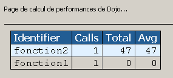

LivreGougeon 第 194 页 2006 年 11 月 28 日 周二 4:23 16

# 194
## JavaScript 库的基础

### 第二部分

图 7.5 展示了测得执行时间的汇总表格的显示。

#### 图 7.5
*执行时间汇总表*

## 结论

`dojo` 库提供了实现高级 JavaScript 应用的许多性机制。通过集成按需加载所需模块的机制，它能够减少加载到浏览器中的 JavaScript 代码量。

该库结构化为多个处理特定功能的模块。所提供的各种功能对应于便于 JavaScript 实现的函数、基本类型和集合，以及 DOM 和 Ajax 技术。

`dojo` 库为开发 Web 应用提供了非常有价值的支持。这种支持集成了与 HTML 和 CSS 语言相关的实用函数模块。此外，它还拥有管理事件和结构化图形组件的机制。

最后，`dojo` 库包含了各种图形组件的预定义实现，如树、表格、菜单和浮动窗口。

我们将在第 11 章详细阐述该库对开发丰富 Web 应用的支持。

LivreGougeon 第 195 页 2006 年 11 月 28 日 周二 4:23 16

# 第三部分
## 使用 JavaScript 进行 Web 图形编程

本部分探讨了为了使用 JavaScript 开发 Web 图形应用需要实现的各种语言、机制和技术。

`第 8 章`介绍了 HTML 语言（或 xHTML）、CSS (`#index_split_003.html_p214`) 和 JavaScript 的联合使用。在回顾了这些语言的不同概念后，它描述了它们如何相互作用，以及如何组织使用它们的 Web 应用。

`第 9 章` 探讨了基于 JavaScript 语言开发图形组件的各种技术。实现这些技术可以构建更具可维护性和扩展性的 Web 应用。

LivreGougeon 第 196 页 2006 年 11 月 28 日 周二 4:23 16

# 8
## Web 图形界面的基础

Web 页面可以包含不同的语言来解决各种问题，例如定义其结构、显示和处理。这些语言可以相互关联，并可能相互作用。

`HTML` 语言及其继任者 `xHTML` 允许定义 Web 页面的结构以及可能的某些图形功能。

`CSS` 语言专门根据之前在 `HTML` 中定义的结构来处理 Web 页面的图形方面。

`JavaScript` 提供了实现 Web 页面内部处理的可能性。这些处理可以与内存中的内部结构交互以对其修改，也可以由用户事件或内部事件触发。

图 8.1 展示了 Web 页面中使用的不同语言及其可能的交互。联合使用 `HTML`（或 xHTML）、`CSS` 和 `JavaScript` 语言提供了使 Web 页面更具交互性、随时间推移自我修改并在图形上更丰富的可能性。

接下来的章节详细说明了如何实现 `HTML` 和 `CSS` 语言，以及 `JavaScript` 如何操作它们并与它们交互。

LivreGougeon 第 198 页 2006 年 11 月 28 日 周二 4:23 16

# 198
## 使用 JavaScript 进行 Web 图形编程

### 第三部分

### Web 浏览器
#### HTML 页面
图形表示 (CSS)
结构与表示
页面的 HTML 结构
HTML 元素
页面初始
初始化
结构与表示
页面的 DOM 结构
内存中的页面
定位
记录
操作
通知
与结构的交互
属性
观察者
结构
内存中的页
事件
CSS
页面的事件

#### JavaScript 脚本
页面的处理

#### 图 8.1
*构成页面的语言*

## HTML 和 xHTML
`HTML` 和 `xHTML` 语言允许定义 Web 页面的结构以及可能的某些图形功能。

## CSS
`CSS` 语言专门根据之前在 `HTML` 中定义的结构来处理 Web 页面的图形方面。

#### JavaScript
`JavaScript` 提供了实现 Web 页面内部处理的可能性。这些处理可以与内存中的内部结构交互以对其修改，也可以由用户事件或内部事件触发。

... 该规范的第一个版本于 1993 年 6 月由 `IETF` (Internet Engineering Task Force) 作为工作文档发布，因此并不真正对应于一个标准。

LivreGougeon 第 199 页 2006 年 11 月 28 日 周二 4:23 16


直到 HTML 2.0 版本，HTML 语言才在 1995 年 11 月至 1997 年 1 月期间，通过 IETF 以 RFC 的形式分批地真正实现了标准化。随后是 1997 年 1 月的 3.2 版本、12 月的 4.0 版本以及 1999 年 12 月的 4.0.1 版本。

HTML 直到 2000 年 5 月才作为 ISO/IEC 标准发布。

HTML 定义了页面结构以及使用 CSS 样式表导入外部脚本的方法。它还定义了不同类型的标签，用于构建结构以及实现图形元素和超链接。

以下代码描述了一个 HTML 页面的示例：

```html
<!DOCTYPE HTML PUBLIC "-//W3C//DTD HTML 4.01 Transitional//EN"
"http://www.w3.org/TR/html4/loose.dtd">

<html>
<head>
(...)
</head>
<body>
<p>一个 HTML 页面示例</p>
</body>
</html>
```

表 8.1 总结了 HTML 规范定义的主要标签组。

**表 8.1 HTML 主要标签组**

| 组别 | 描述 |
| :--- | :--- |
| 容器 | 允许定义通用容器标签，特别是 `div` 和 `span` 标签。 |
| 表单 | 允许通过 `form`、`input`、`textarea` 和 `select` 标签定义表单及其元素。 |
| 超链接 | 允许通过 `a` 和 `map` 标签定义超链接。 |
|  | 允许通过 `img` 标签指定图像。 |
| 列表 | 允许通过 `ul`、`ol` 和 `li` 标签定义列表及其元素。 |
| 脚本 | 允许通过 `script` 标签在 HTML 页面中插入或引用脚本。 |
| 结构 | 允许定义页面通用结构，特别是 `html`、`head`、`title` 和 `body` 标签。 |
| 样式 | 允许通过 `style` 和 `link` 标签插入或引用样式。 |

LivreGougeon 第 200 页 2006 年 11 月 28 日周二 4:23 16

**JavaScript Web 图形编程**

**200**

*第三部分*

**表 8.1 HTML 主要标签组（续）***

| 组别 | 描述 |
| :--- | :--- |
| 表格 | 允许通过 `table`、`thead`、`tbody`、`th`、`tr` 和 `td` 标签定义表格及其单元格。 |
| 文本 | 允许通过 `p` 等标签定义文本元素及其属性。注意，不建议使用此类某些标签，最好使用 CSS。 |

HTML 区分了两种主要的标签：内联元素（inline elements）和块级元素（block elements）。前者设计用于应用于文本流以丰富内容，例如强化效果（在浏览器中为加粗）或强调效果（在浏览器中为斜体）。与后者不同，它们绝不会创建新的块。

后者允许定义视觉渲染形成一个块的元素，如段落或标题。这些元素的特点是具有与尺寸相关的属性，并允许在 HTML 文档中以相对或绝对的位置进行定位。

`a`、`em`、`img` 和 `span` 标签是内联标签的示例，而 `div`、`form`、`h1`、`h2` 和 `table` 是块级标签。

HTML 语言还定义了语义化文本标签，用于良好分离页面结构与显示。例如，`strong` 和 `em` 标签允许为文本指定强化和强调效果。对应的相应的非语义标签 `b` 和 `i`，后者分别允许文本加粗或斜体。

这些标签默认具有相同的行为，但对于 `strong` 和 `em` 标签，可以根据 CSS 语言根据所需的显示类型进行修改。

某些规范版本（如 HTML 4.0.1 *Strict*）遵循这一趋势，禁止使用描述图形行为的标签。

这种对 HTML 语言的使用关注其逻辑结构而非直接关注外观，从而提高了互联网上网页的可访问性。

以下代码给出了表 8.1 中总结的部分标签的实现示例：

```html
<html>
<head>
<title>我的页面标题</title>
<script type="text/javascript">
(...)
</script>
<style type="text/style">
(...)
</style>
</head>
```

LivreGougeon 第 201 页 2006 年 11 月 28 日周二

**图形界面基础**

**201**

*第 8 章*

```html
<body>
<table>
<thead>
<tr>
<td>表头 1</td>
<td>表头 2</td>
</tr>
</thead>
<tbody>
<tr>
<td>列 1</td>
<td>列 2</td>
</tr>
</tbody>
</table>

<form name="monFormulaire" action="/soumission.php" method="POST">
<input type="hidden" name="champ1" value="valeur1">
<input type="text" name="champ2" value="valeur2">
</form>

</body>
```

LivreGougeon 第 202 页 2006 年 11 月 28 日周二 4:23 16

**xHTML**

xHTML 语言被定位为 HTML 的继任者。它实际上对应一种不同的语言。事实上，使用 xHTML 的网页必须符合 XML 意义上的良好格式。所有标签必须关闭，属性必须用引号 " 或 ' 定界。

xHTML 1.0 版本于 2000 年 1 月发布，随后是 2001 年 3 月的 1.1 版本。

2.0 版本正在 W3C 制定中。它将提供与 4.0 版本相同的功能。

xHTML 1.1 将语言划分为对应不同功能的模块。其目标是允许不同类型的硬件仅支持该技术的某些部分。

这种划分伴随着放弃可能被样式表支持的 HTML 功能。其目标是加强页面描述与其图形表示之间的分离。

**xHTML 文件验证**

W3C 联盟提供了一个在线工具来验证 xHTML 文件。该工具可以通过 `http://validator.w3.org/` 获取。

xHTML 语言有两个主要版本，如表 8.2 所示。

**表 8.2 xHTML 语言版本**

| 版本 | 描述 |
| :--- | :--- |
| *Strict* | 这种严格的语言版本禁止在 HTML 页面中使用过时的标签和用于格式化的标签。它还强制使用 CSS 语言进行页面演示。 |
| *Transitional* | 这种语言版本旨在促进向严格版本的过渡，因此要宽松得多，特别允许各种过时的标签。 |

我们建议使用 HTML 语言的 *Strict* 版本，因为它禁止使用实现类标签，并强制开发人员使用 CSS 语言来定义页面呈现。


```html
<!DOCTYPE html PUBLIC "-//W3C//DTD XHTML 1.0 Strict//EN" ❶
```
["http://www.w3.org/TR/xhtml1/DTD/xhtml1-strict.dtd"](http://www.w3.org/TR/xhtml1/DTD/xhtml1-strict.dtd) ❶
```
<html xmlns="http://www.w3.org/1999/xhtml" xml:lang="fr" dir="ltr" lang="fr"> ❷
```
<head>
(...)
</head>
<body>
(...)
</body>
</html>
```

```css

## CSS

`CSS` (Cascading Style Sheets, feuilles de style) traite les problématiques d’affichage des pages `HTML`. Son objectif est de permettre une séparation claire entre la structure d’une page, par le biais du langage `HTML`, et sa présentation avec `CSS`. Fondé sur l’application en cascade de styles sur les éléments contenus dans les pages `HTML`, il permet d’appliquer des styles en fonction de la position des balises.

Apparu en 1994 sous l’impulsion de Håkon Wium Lie et Bert Bos, il a été normalisé en 1996 par le W3C. La première version, `CSS1`, a été publiée en décembre 1996. La version suivante, `CSS2`, est parue en mai 1998.

Livre degeon Page 203.

## Fondements graphiques

### 204
*PARTIE III*

## Programmation Web avec JavaScript

### Validation de styles

### Application des styles 


以下代码允许对 `div` 类型标签的 `a` 类型子标签（标记 ❷）应用样式（标记 ❶）：

```html
<html>
<head>
<style type="text/css">
/* 应用于标识符为 monIdentifant 的标签下的 a 标签 */
div a { ¨ ❶
background: yellow;
font-family: cursive;
width: 10em;
}
</style>
</head>
<body>
(...)
<div>
<a href="">一个链接</a> ¨ ❷
</div>
(...)
</body>
</html>
```

同样的方法（标记与之前相同）也可以基于标识符来实现，如以下代码所示：

```html
<html>
<head>
<style type="text/css">
/* 应用于标识符为 monIdentifiant 的标签下的 a 标签 */
#monIdentifiant a { ¨ ❶
background: yellow;
font-family: cursive;
width: 10em;
}
</style>
</head>
<body>
(...)
<div id="monIdentifiant">
<a href="">一个链接</a> ¨ ❷
</div>
(...)
</body>
</html>
```

这些方法特别有用，因为它们允许处理一个 HTML 块而无需定义 CSS 技术可以使用的信息。只需在该块的根元素上指定 CSS 选择器所依据的信息即可。

## 与 JavaScript 的交互

正如图 8.1 所示，JavaScript 提供了与 HTML 页面内存中 DOM 结构交互的可能性。这样就可以修改该结构以添加、修改或删除节点以及节点属性。

此外，由于 CSS 样应用基于节点属性，JavaScript 可以借此对页面的视觉方面进行操作。首先，理解 JavaScript 如何感知运行它的 Web 浏览器很重要。

### 浏览器检测

可以实现浏览器检测以管理其特殊性。在实现 JavaScript 库时，这种检测对于实现特定浏览器的规避方案特别有用。

此功能可以通过 JavaScript 对象 `navigator` 的 `userAgent` 属性来实现，其中一些值汇总在表 8.3 中。

**表 8.3 `navigator` 对象 `userAgent` 属性的一些取值**

| 值 | 操作系统 | 浏览器 |
| :--- | :--- | :--- |
| Mozilla/5.0 (Windows; U; Windows NT 5.1; fr; rv:1.8.0.7) | Windows XP | Firefox version 1.5.0.7 Gecko/20060909 Firefox/1.5.0.7 |
| Mozilla/4.0 (compatible; MSIE 6.0; Windows NT 5.1; SV1; .NET CLR 1.1.4322) | Windows XP | Internet Explorer 6.0 |
| Mozilla/5.0 (X11; U; Linux i686; en-US; rv:1.8.0.7) | Linux Debian | Firefox version 1.5.0.7 Gecko/20060909 Firefox/1.5.0.7 |
| Mozilla/5.0 (compatible; Konqueror/3.5; Linux 2.6.15-1.2054_FC5; X11; i686; en_US) | Linux Fedora | Konqueror 3.5 KHTML/3.5.4 (like Gecko) |
| Mozilla/5.0 (Macintosh; U; Intel Mac OS X; en-US; rv:1.8.0.6) | MacOS X Intel | Firefox version 1.5.0.6 Gecko/20060728 Firefox/1.5.0.6 |
| Mozilla/4.0 (compatible; MSIE 5.23; Mac_PowerPC) | MacOS X | Internet Explorer 5.2.3 |

我们未在书中详细介绍基于 `userAgent` 属性内容检测浏览器的函数实现。更多信息，读者可以参考 `http://en.wikipedia.org/wiki/User_agent`，该地址提供了根据操作系统和浏览器的 `userAgent` 属性值的完整列表。

### Web 图形界面的基础

在第 2 章中讨论的概念——正则表达式可以用于根据此属性检测浏览器。也可以通过检查属性或方法是否存在来实现检测，这种方法可以检测当前浏览器是否支持该机制。

以下代码给出了来自 dojo 库的这种方法的实现示例：

```javascript
dojo.dom.innerXML = function(node){
  if(node.innerXML){ ¨ ❶
    return node.innerXML;
  }else if (node.xml){ ¨ ❷
    return node.xml;
  }else if(typeof XMLSerializer != "undefined"){ ¨ ❸
    return (new XMLSerializer()).serializeToString(node);
  }
}
```

此代码实现了 `innerXML` 功能，无论什么种浏览器，都可以以 XML 格式访问标签的内容。标记 ❶ 检查节点是否存在 `innerXML` 属性并返回该属性的值。如果该属性不受支持，函数将尝试类似地基于节点的 `xml` 属性（标记 ❷）。否则，它将尝试使用 `XMLSerializer` 类（如果存在）来将节点转换为 XML（标记 ❸）。

## DOM 树的操作

对页面 DOM 树的操作是基于 DOM 技术提供的功能实现的（见第 4 章）。这些功能特别允许通过页面的 `document` 对象访问一个或一组节点，并操作其不同的节点（添加、修改和删除属性）以及 DOM 树的结构（添加和删除节点）。

DOM 树的操作处理必须在它加载后进行。此类位于 `head` 标签中的处理处理将基于 Web 页面的 `load` 事件。

以下代码展示了如何基于 `initialiser` 函数（标记 ❶）实现这一原理，该函数在页面 DOM 树初始化后（标记 ❷）被调用：

```html
<html>
<head>
<script type="text/javascript">
function initialiser() { ¨ ❶
  var monDiv = document.getElementById("monDiv");
  /* 变量 monDiv 已填充了标识符为 monDiv 的节点 */
  (...) 
}
</script>
</head>
<body onload="initialiser();"> ¨ ❷
<div id="monDiv">(...)</div>
</body>
</html>
```

请注意，在 `script` 标签块末尾且位于页面头部（`head` 标签）直接调用函数 `initialiser` 会产生错误，因为标识符为 `monDiv` 的标签尚未初始化。

### 事件管理

JavaScript 语言提供了 Web 页面 DOM 结构上事件发生的可能性。这些事件既可以对应用户的操作，也可以对应对该结构的修改。

### 工作原理

为了更好地理解事件管理，了解它们在 Web 页面中的处理流很重要，页面通常由按层级排列的标签组成。在元素上触发的事件会沿着其祖先或后代的链逐级传递。

如表 8.4 所示，存在两种事件传播模式。

**表 8.4 事件传播模式**

| 模式 | 描述 |
| :--- | :--- |
| 上升 (Ascendant) | 事件从低层元素向高层元素传播。这种模式被称为 *bubbling*（冒泡），最初由 Internet Explorer 浏览器实现。 |
| 下降 (Descendant) | 事件从高层元素向低层元素传播。这种模式被称为 *capturing*（捕获），最初由 Netscape 浏览器实现。 |

W3C 财团标准化了这种机制，引入了双方向的传播。正如图 8.2 所示，事件首先在树结构中向下触发，然后向上。


注意，冒泡阶段通常用于处理事件。

可以根据 HTML 标签的某些属性将事件与其关联。这些属性的名称以 `on` 为前缀，后跟事件的名称。

它们的值允许指定当事件发生时要执行的 JavaScript 处理。

以下代码展示了基于页面的 `load` 事件（标记为 ❶）和按钮的 `click` 事件（标记为 ❷）实现该机制的示例：

```html
<<html>
<head>
<script type="text/javascript">
function traitementIntialisationPage() { // ❶
(...)
}
function traitementClicBouton() { // ❷
(...)
}
</script>
</head>
<body onload="traitementIntialisationPage();"> // ❶
(...)
<input type="button" value="Cliquer sur le bouton"
onclick="traitementClicBouton();"/> // ❷
(...)
</body>
</html>
```

当 Web 页面加载时，调用 `traitementIntialisationPage` 函数；当点击按钮时，调用 `traitementClicBouton` 函数。

注意，这种技术存在 HTML 或 xHTML 标记语言代码与 JavaScript 脚本语言混合的问题。这不利于 Web 页面的理解和可维护性。

幸运的是，还有另一种解决方案可以在通过标签属性将事件监听器关联到 HTML 标签。这种解决方案使用了 DOM 技术，Internet Explorer 浏览器除外，它提供了一种特定的方法。

## DOM 级 2 支持

DOM 技术支持根据名称分类的各种事件。表 8.5 汇总了这些类别。

### 表 8.5 DOM 级 2 支持的事件类别

| 类别 | 类型 | 描述 |
| :--- | :--- | :--- |
| 事件 | Events | 涵盖所有类型的事件。 |
| HTML 相关事件 | HTMLEvents | 对应 `abort`, `blur`, `change`, `focus`, `error`, `load`, `reset`, `scroll`, `select`, `submit`, `unload` 等事件。 |
| 用户界面相关事件 | UIEvents | 对应与用户界面相关的事件（`DOMActivate`, `DOMFocus`, `DOMFocusOut`）以及由键盘触发的事件（`keydown`、`keypress` 和 `keyup`）。在 DOM 级 3 中，键盘事件在 `KeyboardEvents` 类型中处理。 |
| 鼠标事件 | MouseEvents | 对应由鼠标触发的事件，如 `click`, `mousedown`, `mousemove`, `mouseout`, `mouseover` 和 `mouseup`。 |
| 变变事件 | MutationEvents | 定义影响模型逻辑结构的事件。 |

DOM 技术提供了多种方法来处理事件。这些方法基于监听器，监听器可以针对各种事件注册和注销。

## 事件监听器

事件监听器对应于对象的一个函数或方法，当 HTML 页面元素的事件触发时，该方法会被调用。为此，它必须针对事件进行注册。当监听器不再被使用时，必须将其注销。

`addEventListener` 和 `removeEventListener` 方法允许管理这些监听器的注册和注销。它们应用于 DOM 节点，参数为事件名称、事件发生时要调用的函数以及定义在何种传播阶段处理事件的标志位。值 `true` 对应捕阶段，`false` 对应冒泡阶段。

以下代码说明了这两个方法（标记为 ❷ 和 ❸）用于注册和注销一个函数（标记为 ❶）作为监听器的实现：

```javascript
// 定义监听器
function traitementEvenement(evenement) { // ❶
(...)
}
var monNoeud = document.getElementById("monNoeud");
// 注册监听器
monNoeud.addEventListener("click", traitementEvenement, false); // ❷
(...)
// 注销监听器
monNoeud.removeEventListener("click", traitementEvenement, false); // ❸
```

在调用监听器函数时（标记为 ❶），DOM 将触发事件作为参数提供。该实例对应于 `Event` 类的一个实例，其属性和方法分别在表 8.6 和 8.7 中进行了汇总。

### 表 8.6 `Event` 类的属性

| 属性 | 类型 | 描述 |
| :--- | :--- | :--- |
| bubbles | 布尔值 | 表示事件是否处于冒泡传播阶段。 |
| cancelable | 布尔值 | 表示事件是否可以被取消。 |
| currentTarget | EventTarget | 对应于分配事件处理程序的节点。 |
| eventPhase | 整数 | 对应于指示事件被拦截时阶段的数字。可能值为 `CAPTURING_PHASE`（值 1）、`AT_TARGET`（值 2）和 `BUBBLING_PHASE`（值 3）。 |
| target | EventTarget | 对应于触发事件的节点。 |
| timeStamp | 整数 | 对应事件发生的时间。 |
| type | 字符串 | 对应事件类型。 |

注意，`Event` 类的所有属性都是只读的。

### 表 8.7 `Event` 类的方法

| 方法 | 参数 | 描述 |
| :--- | :--- | :--- |
| initEvent | 事件类型两个标志位 | 允许初始化通过编程触发的事件。参数中的标志位允许指定事件是否可以冒泡或取消。 |
| preventDefault | - | 允许取消事件。不执行与事件关联的默认处理。 |
| stopPropagation | - | 允许在捕获或冒泡阶段停止事件的传播。 |

以下代码说明了在事件处理函数中 `Event` 类的主要属性和方法的实现：

```javascript
// 定义监听器
function traitementEvenement(evenement) {
// 显示事件类型
alert("Type: "+ evenement.type);
// 取消事件
evenement.preventDefault();
}
```

`MouseEvent` 类扩展了之前的 `Event` 类，以便添加与鼠标触发的事件相关的信息。表 8.8 汇总了该类的额外属性。

### 表 8.8 `MouseEvent` 类的额外属性

| 属性 | 类型 | 描述 |
| :--- | :--- | :--- |
| altKey, ctrlKey, metaKey, shiftKey | 布尔值 | 分别表示触发事件时是否按了 Alt、Ctrl、Meta 或 Shift 键。 |
| button | 整数 | 对应触发事件的鼠标按钮。 |
| clientX, clientY | 整数 | 对应浏览器显示区域（窗口或框架）中的鼠标坐标。 |
| relatedTarget | - | 允许存储另一个由事件实现的另一个元素。它通常在鼠标移动事件（mouseover, mouseenter 和 mouseout）中填充。 |


`screenX`, `screenY`

整数

对应鼠标在屏幕上的坐标。

以下代码展示了鼠标触发事件观察者如何使用该类的示例：

```javascript
// 定义观察者
fonction traitementEvenement(evenement) {
  // 显示事件的坐标
  alert("Coordonnées du pointeur de la souris: "
  +evenement.clientX+","+evenement.clientY);
  alert("Coordonnées de l’offset de la souris: "
  +evenement.screenX+","+evenement.screenY);
}
```

## Internet Explorer 浏览器支持

Internet Explorer 浏览器没有实现 DOM 2 层技术，并且具有特定的事件处理方式。虽然与其他浏览器相似，但观察者的实现方式有所不同。

因此，`attachEvent` 和 `detachEvent` 方法允许管理事件观察者的注册和注销。它们应用于 DOM 节点上，并接收事件名称和当事件发生时要调用的函数作为参数。

## 事件名称

传递给 `attachEvent` 和 `detachEvent` 方法的事件名称与 DOM 2 级使用的名称并不完全对应。Internet Explorer 强制在它们前面加上前缀 `on`。因此，在该浏览器中的 `onclick` 事件对应于 DOM 2 级的 `click` 事件。

这两个方法的使用方式与前一节中的类似方法相同，如下代码所示：

```javascript
// 定义观察者
fonction traitementEvenement() { 
  var evenement = window.event;
  (...)
}

var monNoeud = document.getElementById("monNoeud");
// 注册观察者
monNoeud.attachEvent("onclick", traitementEvenement); 
(...)
// 注销观察者
monNoeud.detachEvent("onclick", traitementEvenement);
```

尽管观察者的注册和注销（分别见标记 ❸ 和 ❹）的实现方式与 DOM 类似，但在处理函数（标记 ❶）中获取事件（标记 ❷）是特定于浏览器的。

事实上，既可以通过 HTML 页面中 `window` 对象的 `event` 属性来访问事件，也可以通过观察者函数的参数（如果已指定的话）来访问。

此外，Internet Explorer 中表示事件的类并不具有与 DOM 2 级相同的属性和方法。该类包含了有关事件管理和鼠标指针的信息。

因此，`srcElement` 属性对应于 `Event` 类的 `target` 属性。`pageX` 和 `pageY` 属性不再存在，但可以通过 `clientX` 和 `clientY` 属性加上滚动值来模拟这些属性本应具有。

增加了 `offsetX` 和 `offsetY` 属性，它们对应于鼠标指针相对于触发事件元素的坐标。

以下代码展示了鼠标触发事件观察者如何使用该类的示例：

```javascript
// 定义观察者
fonction traitementEvenement(evenement) {
  // 显示事件的坐标
  alert("Coordonnées du pointeur de la souris: "
  +evenement.clientX+","+evenement.clientY);
  alert("Coordonnées de l’offset de la souris: "
  +evenement.offsetX+","+evenement.offsetY);
}
```

最后，Internet Explorer 中表示事件的类不支持 `preventDefault` 和 `stopPropagation` 方法。尽管如此，这些方法的功能可以通过各自的 `returnValue` 和 `cancelBubble` 属性在该浏览器中实现。

以下代码展示了如何在 Internet Explorer 浏览器中实现这些机制：

```javascript
// 定义观察者
fonction traitementEvenement(evenement) {
  // 停止事件传播
  evenement.cancelBubble = true;
  // 取消事件
  evenement.returnValue = false;
}
```

## 事件类型

在浏览器中可以使用的不同类型事件中，我们首先可以区分与图形界面相关的事件。后者允许检测界面的状态变化及其组件状态的变化。

表 8.9 总结了这些不同的事件类型。

### 表 8.9 图形界面事件

| 类型 | 描述 |
| :--- | :--- |
| `contextmenu` | 当用户尝试打开页面右键菜单时发生。 |
| `focus`, `blur` | 分别在元素获得和失去焦点时发生。 |
| `load` | 当 Web 页面完全加载时发生。 |
| `resize` | 当浏览器窗口调整大时发生。 |
| `scroll` | 当 Web 页面滚动时发生。 |
| `unload` | 当 Web 页面卸载时发生。 |

鼠标触发的事件既可以响应鼠标移动，也可以响应鼠标按钮。表 8.10 总结了这些不同的事件类型。

### 表 8.10 鼠标触发事件

| 类型 | 描述 |
| :--- | :--- |
| `click` | 在对元素上点击鼠标时发生。 |
| `dblclick` | 在对元素上双击鼠标时发生。 |
| `mousedown`, `mouseup` | 分别在鼠标按键被按下和释放时发生。 |
| `mousemove` | 当鼠标指针移动时发生。 |
| `mouseover`, `mouseout` | 分别在鼠标指针进入和离开元素对应的区域时发生。 |

各种事件可以在表单元素上发生，以检测字段值的变化，也可以在表单提交时发生在表单本身。表 8.11 总结了这些不同的事件类型。

### 表 8.11 表单触发事件

| 类型 | 描述 |
| :--- | :--- |
| `change` | 当表单元素发生变化时发生。该事件在大多数情况下仅被浏览器部分支持。 |
| `reset` | 当用户重置表单时发生时发生。 |
| `select` | 当用户在输入框中选择文本时发生。 |
| `submit` | 当用户提交表单时发生。 |

当用户按下和释放一个或多个键盘键时，会触发键盘事件。表 8.12 总结了这些不同的事件类型。

### 表 8.12 键盘触发事件

| 类型 | 描述 |
| :--- | :--- |
| `keydown`, `keyup` | 分别在键盘键被按下和释放时发生。 |
| `keypress` | 当键盘键被按下时发生。该事件并非对所有按键都会发生，特别是箭头键以及 Alt、Ctrl 和 Shift 键。 |


```html
<html>
<head>
<script type="text/javascript">
function traiterEvenementsClavier(evenement) {
// 显示事件的坐标
alert("Touche (keyCode): "+evenement.keyCode);
alert("Touche (charCode): "+evenement.charCode);
}

document.addEventListener("keydown",
traiterEvenementsClavier, false);

document.addEventListener("keypress",
traiterEvenementsClavier, false);
</script>
</head>
<body>
(...)
</body>
</html>
```

请注意，当对同一个元素同时处理了 `keydown` 和 `keypress` 事件时，`keyup` 事件将不会触发。反之，如果这两个事件中没有一个一个被处理，或者只有其中一个被处理了，则会触发 `keyup`。

## 手动触发事件

JavaScript 提供了通过编程手动模拟用户事件的可能性。

DOM 2 级技术允许基于 `createEvent`、`initMouseEvent` 和 `dispatchEvent` 方法来触发鼠标事件。

第一个对应于 页面 `document` 对象的一个方法，并接收所需的事件类型作为参数。它允许创建一个待触发的事件实例。

第二个对应于所创建事件的方法，用于初始化该事件。它接收事件的各种特征作为参数。

表 8.13 按照这些参数出现的顺序汇括了该方法的参数。

### 表 8.13 `MouseEvent` 类的 `initMouseEvent` 方法参数

| 参数 | 类型 | 描述 |
| :--- | :--- | :--- |
| typeArg | 字符串 | 指定事件类型。 |
| canBubbleArg | 布尔值 | 指定事件是否可以冒泡。 |
| cancelableArg | 布尔值 | 指定事件是否可以取消。 |
| viewArg | AbstractView | 指定与事件关联的视图。通常使用 `window` 对象作为此参数。 |
| detailArg | 整数 | 指定事件中考虑的鼠标点击次数。 |
| screenXArg | 整数 | 对应事件的 `screenX` 值。 |
| screenYArg | 整数 | 对应事件的 `screenY` 值。 |
| clientXArg | 整数 | 对应事件的 `clientX` 值。 |
| clientYArg | 整数 | 对应事件的 `clientY` 值。 |
| ctrlKeyArg | 布尔值 | 指定 Ctrl 键是否被视为按下。 |
| altKeyArg | 布尔值 | 指定 Alt 键是否被视为按下。 |
| shiftKeyArg | 布尔值 | 指定 Shift 键是否被视为按下。 |
| metaKeyArg | 布尔值 | 指定 Meta 键是否被视为按下。 |
| buttonArg | 整数 | 指定被视为按下的鼠标按钮。 |
| relatedTargetArg | EventTarget | 对应事件的 `relatedTarget` 属性。 |

只有 `dispatchEvent` 方法真正触发网页 DOM 树节点上的事件。它接收之前创建的事件作为参数。

以下代码提供了一个基于 DOM 2 级实现 `createEvent`（标记 ❶）、`initMouseEvent`（标记 ❷）和 `dispatchEvent`（标记 ❸）方法的示例，以模拟对复选框（标记 ❹）的点击：

```html
<html>
<head>
<script type="text/javaScript">
function simulerClic(){
var elt = document.getElementById("coche");
// 创建事件
var evt = document.createEvent("MouseEvents"); // ❶
// 初始化事件
evt.initMouseEvent("click",true,true,window, // ❷
0,0,0,0,0,false,false,
false,false,0,null);
// 触发事件
elt.dispatchEvent(evt); // ❸
}
</script>
</head>
<body>
(...)
<input type="checkbox" id="coche"/> // ❹
(...)
</body>
</html>
```

与前几节描述的机制类似，此功能必须专门针对 Internet Explorer 浏览器进行实现。

在该浏览器中，它基于 `createEventObject` 和 `fireEvent` 方法。

第一个方法提供了获取一个空白事件实例的可能性。随后必须直接使用其不同的属性对其进行初始化。

`fireEvent` 方法允许使用之前创建的实例来指定要触发的事件类型。

以下代码是之前代码的适配版本，使用了 `createEventObject`（标记 ❶）和 `fireEvent`（标记 ❷）方法，以便在 Internet Explorer 浏览器中运行：

```html
<html>
<head>
<script type="text/javaScript">
function simulerClic(){
var elt = document.getElementById("coche");
// 创建事件
var evt = document.createEventObject(); // ❶
// 初始化事件
evt.screenX = 0;
evt.screenY = 0;
evt.clientX = 0;
evt.clientY = 0;
// 触发事件
elt.fireEvent("onclick", evt); // ❷
}
</script>
</head>
<body>
(...)
<input type="checkbox" id="coche"/>
(...)
</body>
</html>
```

## 样式操作

如前所述，样式元素通过 `id`、`class` 和 `style` 等名称连接到页面结构上。

### 更改标签的类

基于 DOM 的便利性，JavaScript 提供了修改各种样式相关元素的可能性。

利用 DOM，JavaScript 语言提供了修改与标签关联的类及其本身的可能性。

以下代码提供了一个基于 DOM 2 级实现此技术的示例：

```javascript
function modifierClasse(identifiantNoeud, nomClasse) {
var balise = document.getElementById(identifiantNoeud);
balise.setAttribute("class", nomClasse);
}

modifierClasse("monNoeud", "maNouvelleClasse");
```

### 在 Firefox 中修改标签的 CSS 类

Firefox 浏览器允许修改与标签关联的类，但不会正确应用新类的 CSS 属性。为了规避这个问题，建议使用标签的 `style` 属性来定义的样式。我们将在下一节中详细介绍这种技术。

### 更改标签的样式属性

当通过 `style` 属性为标签定义样式时，JavaScript 语言提供了访问其值并可能通过 DOM 支持对其进行修改的可能性。

此时，可以提供一种仅修改一种样式属性的处理方式，如下代码所示，基于 HTML 页面节点的 `style` 属性（标记 ❶）进行操作：

```javascript
function modifierProprieteStyle(identifiantNoeud, nomPropriete, valeurPropriete) {
```


```javascript
var balise = document.getElementById(identifiantNoeud);

balise.style[nomPropriete] = valeurPropriete; ❶

}
```

`modifierProprieteStyle("monNoeud", "background", "red");` 某些如 dojo 这样的库提供了样式操作函数，这些函数考虑了不同浏览器的特殊性。dojo 中关于这方面的模块将在本书的第 11 章进行详细介绍。

LivreGougeon Page 222 Mardi, 28\. novembre 2006 4:23 16

# 使用 JavaScript 进行 Web 图形编程
**222**

### 第三部分 高级概念

现在我们已经描述了让 HTML 和 CSS 与 JavaScript 交互的各种技术，我们将讨论各种良好的实现实践，以及关于在 HTML 页面中使用 XML 和 XSLT 技术的高级概念。

### 事件管理

我们之前已经描述了如何使用 JavaScript 管理事件。该概念的良好实现实践是将其提取到 HTML 标签之外。这种技术可以最大限度地减少 HTML 和 JavaScript 语言的混合。

为此，必须实现一个通用的事件监听器注册和注销 API，以便处理不同浏览器的特殊性。

### 通用 API

如前所述，浏览器不允许以统一的方式注册和注销监听器。大多数 JavaScript 库都提供了通用的 API 来集成并隐藏这些特殊性。

以下代码提供了该原则的实现示例：

```javascript
// 通用监听器注册函数
function enregistrerObservateur(element, evenement, fonction, capture) {
  capture = capture || false;
  if( element.addEventListener ) {
    element.addEventListener(evenement, fonction, capture);
  } else if( element.attachEvent ) {
    element.attachEvent("on"+evenement, fonction);
  }
}

// 通用监听器注销函数
function desenregistrerObservateur(element, evenement, fonction, capture) {
  if( element.removeEventListener ) {
    element.removeEventListener(evenement, fonction, capture);
  } else if( element.detachEvent ) {
    element.detachEvent("on"+evenement, fonction);
  }
}
```

使用 `enregistrerObservateur`（标记 ❶）和 `desenregistrerObservateur`（标记 ❷）函数的方法如下：

```javascript
// 定义监听器
fonction traitementEvenement(evenement) {
  (...)
}
```

LivreGougeon Page 223 Mardi, 28\. novembre 2006 4:23 16

# Web 图形界面基础
**223**

### 第 8 章

```javascript
var monNoeud = document.getElementById("monNoeud");

// 注册监听器
enregistrerObservateur(monNoeud, "click", traitementEvenement); ❶

(...)

// 注销监听器
desenregistrerObservateur(monNoeud, "click", traitementEvenement); ❷
```

## 作为监听器的对象方法

我们之前描述的各种技术仅允许对函数的注册和注销。因此，不支持直接使用对象方法。

然而，通过 JavaScript `Function` 类的 `call` 和 `apply` 方法可以很容易实现此功能。此时必须用一个函数封装该方法，以便在其关联对象的上下文中执行它。随后，在注册和注销时应使用该函数。

以下代码提供了通过 `enregistrerObservateurObjet`（标记 ❷）和 `desenregistrerObservateurObjet`（标记 ❸）函数实现此功能的示例，这些函数基于 `call` 函数（标记 ❶）以及之前过的 `enregistrerObservateur` 和 `desenregistrerObservateur` 函数：

```javascript
function convertirMethode(objet, methode) {
  return function(evenement) {
    return methode.call(objet, evenement || window.event); ❶
  }
}

function enregistrerObservateurObjet(element, evenement, objet, methode, capture) { ❷
  var fonction = convertirMethode(objet, methode);
  enregistrerObservateur(element, evenement, fonction, capture);
}

function desenregistrerObservateurObjet(element, evenement, objet, methode, capture) { ❸
  var fonction = convertirMethode(objet, methode);
  desenregistrerObservateur(element, evenement, fonction, capture);
}
```

## XML 和 XSLT 技术的使用

JavaScript 语言提供了在 Web 页面实现 XML 和 XSLT 技术的能力。目标是创建空的 XML 文档并对 XML 文档进行格式转换。

### 创建 XML 文档

浏览器对 XML 技术的支持并不统一，特别是在内存中创建 XML 文档以及将文本转换为 XML 方面。

因此，应该实现各种函数以整合这些特殊性。

LivreGougeon Page 224 Mardi, 28\. novembre 2006 4:23 16

# 使用 JavaScript 进行 Web 图形编程
**224**

### 第三部分

以下函数允许在 Firefox 浏览器（标记 ❶）和 Internet Explorer（标记 ❷）中创建一个空的 XML 文档：

```javascript
function creerDocumentXML() {
  if( document.implementation && document.implementation.createDocument) { ❶
    var documentXML = document.implementation.createDocument("","", null);
    documentXML.async = false;
    return documentXML;
  } else if( window.ActiveXObject ) { ❷
    var documentXML = new ActiveXObject("Microsoft.XMLDOM");
    documentXML.async = false;
    return documentXML;
  }
}
```

请注意，上述代码中使用了 `async` 属性，它指示整个文档应以同步或异步方式加载到内存中。在第二情况下，必须注册一个 `load` 事件的监听器，以便在文档加载完成后对其进行处理。

### Internet Explorer 浏览器中的 DOM ActiveX 组件

根据 Internet Explorer 浏览器的版本，提供了不同的 ActiveX 组件。

创建 XML 文档的良好实践是检测最新的 ActiveX 组件。

以下函数提供了一个来自 dojo 库类型函数的实现示例：

```javascript
function getActiveXImpl(activeXArray) {
  for (var i=0; i < activeXArray.length; i++) {
    try {
      var testObj = new ActiveXObject(activeXArray[i]);
      if (testObj) {
        return activeXArray[i];
      }
    } catch (e) {}
  }
}
```

与 DOM 的 ActiveX 组件如下（从新到旧）：`Msxml2.DOMDocument.5.0`、`Msxml2.DOMDocument.4.0`、`Msxml2.DOMDocument.3.0`、`MSXML2.DOMDocument`、`MSXML.DOMDocument`、`Microsoft.XMLDOM`。

一旦创建了基础文档，就可以 `load` 方法（标记 ❶）通过 XML 文件对其进行初始化，如下代码所示：

```javascript
var document = creerDocumentXML();
document.load("fichier.xml"); ❶
```

LivreGougeon Page 225 Mardi, 28\. novembre 2006 4:23 16

# Web 图形界面基础
**225**

### 第 8 章

在 `async` 属性在文档加载前被设置为 `true` 的情况下，有必要注册一个加载事件的监听器（标记 ❶）。

以下代码提供了在 Firefox 中实现该原则的示例：

```javascript
var document = creerDocumentXML();
document.addEventListener("load", function() { ❶
  // 处理 XML 文档的数据
  (...)
}, false);
document.load("fichier.xml");
```

为了在 Internet Explorer 中运行此代码，可以将 `addEventListener` 方法替换为 `attachEvent` 方法，如在关于事件实现的章节中所示。


从字符串创建 XML 文档在 Firefox 和 Internet Explorer 浏览器中的实现方式不同，如下代码所示：

```javascript
function parserChaine(chaineXML) {
if( typeof DOMParser!="undefined" ) {
var parser = new DOMParser(); // ¨ ❶
return parser.parseFromString(chaineXML, "text/xml");
} else {
var document = creerDocumentXML();
document.loadXML(chaineXML); // ¨ ❷
return document;
}
}
```

`var chaineXML = "<donnees><donnee id='1'>Valeur</donnee></donnees>";` `var document = parserChaine(chaineXML);`

第一种处理方式适用于 Firefox，依赖于 DOM 解析器（标记 ❶），而第二种适用于 Internet Explorer，它使用了前文描述的 XML 文档的 `loadXML` 方法（标记 ❷）。

## XSLT 实现

JavaScript 允许实现 XSLT 技术，以便根据 XSL 样式表转换 XML 文档。

与 XML 类似，浏览器对 XSLT 技术的支持并不统一，特别是在创建转换实体以及转换本身方面。

XSLT 的实现依赖 XML 来创建必要的 XML 文档。

LivreGougeon 第 226 页 2006 年 11 月 28 日 星期二 4:23 16

## 使用 JavaScript 进行 Web 图形编程

**226**

第三部分

### XSLT (扩展样式表语言转换)

在 XSL 标准中描述，XSLT 是一种 XML 转换语言。它允许将任何 XML 文档转换为任何其他类型的文档。获得的格式通常是文本。转换在一个 XML 文件中完成，该文件描述了如何使用输入 XML 文档来生成输出格式。该文件作为参数传递给 XSLT 引擎，由其执行转换。不同的语言都有相应的实现，包括 JavaScript。规范可以在地址 `http://www.w3.org/TR/xslt` 获取。

在本节中，我们使用下代码描述的 XSL 样式表 `feuille.xsl`：

```xml
<?xml version="1.0"?>
<xsl:stylesheet xmlns :xsl="http://www.w.org/TR/WD-xsl">
<xsl:output method="xml"/>
<xsl:template match="/">
<valeur><xsl:value-of select="/donnees/donnee[@id='1']"/></valeur>
</xsl:template>
</xsl:stylesheet>
```

该样式表使用如下形式的 XML 文件 `fichier.xml`：

```xml
<donnees>
<donnee id="1">Une valeur</donnee>
<donnee id="2">Une autre valeur</donnee>
</donnees>
```

以生成以下 XML 输出格式：

```xml
<valeur>Une valeur</valeur>
```

Firefox 浏览器基于前一节描述的 XML 技术支持以及 `XSLTProcessor` 类。由于从文件加载与转换相关的元素是异步进行的，因此转换必须在相对于加载的回调函数中执行。

以下代码提供了在 Firefox 浏览器中实现 XSLT 技术的示例：

```javascript
function parserChaine(chaineXML) {
if( typeof DOMParser!="undefined" ) {
var parser = new DOMParser();
return parser.parseFromString(chaineXML, "text/xml");
}
}

var xsltDocument = creerDocumentXML();
var xsltProcessor = null;
xsltProcessor = new XSLTProcessor(); // ¨ ❶
xsltDocument.load(fichierXSLT); // ¨ ❷
/* 指定 XSLT 引擎要使用的样式表规范 */
xsltProcessor.importStylesheet(xsltDocument); // ¨ ❸
// 加载要转换的文档
var documentXML = parserChaine("<donnees><donnee id='1'>Valeur</donnee></donnees>"); // ¨ ❹
// 执行转换
var documentResultat = xsltProcessor.transformToDocument(documentXML); // ¨ ❺
```

此代码实例化（标记 ❶）转换引擎，然后加载要使用的样式表（标记 ❷）。随后使用上述样式表对引擎进行配置（标记 ❸），然后利用之前加载的 XML 文档（标记 ❹）完成转换（标记 ❺）。

可以使用 `transformToFragment` 函数代替 `transformToDocument` 函数。后者接收第二个参数，指定转换结果文档应添加到哪个节点下。

如果与转换相关的元素是从字符串加载的，则不需要任何回调函数的实现。

在 Internet Explorer 浏览器中，必须使用各种 ActiveX 控件来实现 XSLT 转换。在这种情况下，XML 部分中介绍的 ActiveX 控件并不适用，因为它们是多线程的，必须使用对应的非线程版本。

以下代码调整了前文描述的 `creerDocumentXML` 函数，以便在实现 XSLT 时考虑这一因素（标记 ❶）：

```javascript
function creerDocumentXML() {
if( document.implementation && document.implementation.createDocument) {
var documentXML = document.implementation.createDocument("","", null);
documentXML.async = false;
return documentXML;
} else if( window.ActiveXObject ) {
var documentXML = new ActiveXObject("MSXML2.FreeThreadedDOMDocument.3.0"); // ¨ ❶
documentXML.async = false;
return documentXML;
}
}
```

为了实现转换，必须从 XSLT 组件初始化 XSLT 转换引擎。该引擎通过包含样式表的 XML 文档初始化，如下代码所示：

```javascript
function creerSLTProcessor(fichierXSLT) {
// 加载 XSL 样式表
var xsltDocument = creerDocumentXML();
xsltDocument.async = false;
xsltDocument.load(fichierXSLT);
// 创建并初始化转换引擎
var xslt = creerXslt();
xslt.stylesheet = xsltDocument;
return xslt.createProcessor();
}
```

基于该引擎，在指定输入 XML 文档（标记 ❶）和输出 XML 文档（标记 ❷）后，可以实现下代码中的转换（标记 ❸）：

```javascript
function realiserTransformation(xsltProcessor, documentXML) {
if( window.ActiveXObject ) {
xsltProcessor.input = documentXML; // ¨ ❶
var documentXMLTransforme = creerDocumentXML();
documentXMLTransforme.async = false;
xsltProcessor.output = documentXMLTransforme; // ¨ ❷
xsltProcessor.transform(); // ¨ ❸
return documentXMLTransforme;
}
}
```

LivreGougeon 第 227 页 2006 年 11 月 28 日 星期二 4:23 16

## 使用 JavaScript 进行 Web 图形编程

**228**

第三部分

### Internet Explorer 浏览器中关于 XSLT 的 ActiveX 控件

根据 Internet Explorer 浏览器的版本提供了不同的 ActiveX 组件。

为了创建 XML 文档或加载样式表以实现 XSL 转换，最佳实践是检测最新的 ActiveX 组件。

非线程的 DOM ActiveX 控件如下（从新到旧）：`Msxml2.FreeThreadedDOMDocument.5.0`、`MSXML2.FreeThreadedDOMDocument.4.0`、`MSXML2.FreeThreadedDOMDocument.3.0`。

加载 XSL 样式表的 ActiveX 控件如下（从新到旧）：`Msxml2.XSLTemplate.5.0`、`Msxml2.XSLTemplate.4.0`、`MSXML2.XSLTemplate.3.0`。


该技术也可以用于修改页面的 DOM 树结构，从而改变页面的外观。

请注意，如 `dojo` 等 JavaScript 库在它们对 DOM 和 `XML` 的支持中已经考虑了这些特性。其他库，如 `Sarissa` 或 `xmljs`（分别可通过地址 [`sarissa.sourceforge.net`](http://sarissa.sourceforge.net) 和 [`xmljs.sourceforge.net`](http://xmljs.sourceforge.net) 获取），专门用于实现 `XML` 和 `XSLT`。

# 第 8 章：Web 图形界面的基础

## 结论

在本章中，我们描述了 Web 页面使用的各种语言以及它们之间相互作用的方式。我们此介绍了与 `HTML` 和 `CSS` 语言相关的机制。应当特别注意将这些语言的实现良好分离。

联合使用 `HTML`（或 `xHTML`）、`CSS` 和 `JavaScript` 可以让 Web 页面更具交互性、随时间推移自我修改，并在视觉上更加丰富。本章为这些机制奠定了基础。在本书的后续部分，我们将详细介绍如何通过 `JavaScript` 库来实现它们。

在处理这些原则的同时，我们描述了事件处理的良好实践，以及在 Web 页面中使用 `XML` 和 `XSLT` 技术的方法。

随着 `JavaScript` 处理变得越来越复杂（特别是在 Web 页面的图形方面），`JavaScript` 脚本必须增强结构化，以便于维护和演进。第 9 章将描述用于使用 `JavaScript` 结构化图形组件的技术。

# 第 9 章：图形组件的实现

在上一章描述了 Web 图形界面的基本机制后，我们在本章介绍了如何基于图形组件来结构化 Web 页面的图形元素。

首先，我们将定义图形组件的角色，并描述它们的结构和设计方法。我们将详细介绍在 Web 页面中实现这些组件的不同方法。最后，我们将提供文本区域和选择列表等功能的具体实现示例。

## 图形组件概述

图形组件通过提供用户可以交互的元素，使得构建应用程序图形界面成为可能。图形组件也可以称为控件（controls），因为它们负责处理界用户的操作。

一个图形组件由其**结构**定义（结构定义了它所实现的各种图形元素）、其**外观**定义（外观指定了结构中定义元素的图形属性）以及其面对用户操作的**行为**定义（行为基于组件支持的事件而触发）。

### 表 9.1 常用图形组件

| 组件 | 描述 |
| :--- | :--- |
| 树 (Tree) | 实现树形结构以定义层级结构。 |
| 元素 (Element) | 实现表单，如按钮、输入字段或选择列表表单。 |
| 窗口 (Window) | Web 页面内部的窗口，出现在页面其他元素之上，分为两种类型：可以在页面内移动的浮窗和阻止访问窗口下方内容的静态模态窗口。 |
| 管理器 (Manager) | 基于可缩放定位区域或标签页组织图形组件的布局。 |
| 菜单 (Menu) | 上下文菜单或工具栏。 |
| 表格 (Table) | 实现支持数据过滤和排序机制的复杂表格。 |

图 9.1 展示了一个实现上述主要图形组件的屏幕。在其中我们看到了 Web 页面内部窗口，该窗口包含一个菜单管理器、一个输入表单、一个标签页管理器和一个选择树。

**图 9.1：Web 页面中的图形组件示例**

## 图形组件的实现

此图说明了在 Web 环境中实现高级图形组件以实现丰富 Web 界面的可能性。图形组件在构建这些界面以及它们的结构化和考虑浏览器特性方面起着至关重要的作用。在本章的后续部分，我们将描述 Web 应用程序背景下的图形组件。

### 图形组件的目标

使用图形组件简化了 Web 图形界面的实现，因为相关的处理被模块化到了基于 `JavaScript` 语言的实体中。

该实体还负责整合 `JavaScript` 语言和 `CSS` 语言层面的浏览器特性。因此，图形组件在所有浏览器中的实现是相同的。

使用图形组件还可以产生在人体工程学上的应用程序。所有图形元素在视觉上以相同的形式呈现，并对用户操作做出相同的反应。

使用基于 `JavaScript` 的图形组件可以满足复杂的人体工程需求，例如让重量客户端在人体工程上接近重量客户端，以便方便使用。

### 图形组件之间的关系

为了简单地使用 `JavaScript` 编写的图形组件，良好的组织至关重要。与 Web 页面中的 `HTML` 标签一样，图形组件是层级化组织的。图 9.2 展示了图 9.1 中使用的图形组件组织的层级视图。

我们可以区分两种图形组件：对应于可以包含其他组件的容器组件（例如图 9.2 中的菜单和标签页管理器），以及不能包含其他组件的简单组件（如按钮和文本区域）。

在容器类型组件的情况下，关系既可以基于 `HTML` 语言定义，也可以基于组件的方法定义。

**图 9.2：图形组件的层级组织**

### 图形组件的结构化


为了结构化图形组件，我们使用了 JavaScript 中实现面向对象编程的机制。这种这种，我们可以管理它们的外观、应用于它们的通用处理以及处理其事件的方式。

# 第 9 章：面向对象设计

为了使图形组件的使用更具模块化，利用 JavaScript 语言的面向对象编程机制至关重要。每个类型的图形组件都由其自己的 `classe`（类）定义，该类通过方法实现图形组件特有的所有处理。某些功能，如控件的视觉构建、事件管理或控制方法，必须在每个组件中实现。

以下代码提供了一个图形组件类的实现示例：

```javascript
function MonComposant(noeud) {
  this.noeudComposant = noeud;
}

MonComposant.prototype.construire = function() {
  var champ = document.createElement("input");
  (...)
  this.noeudComposant.appendChild(champ);
}
```

在网页中使用图形组件可以按照以下方式实现：

```html
<html
<head>
  <script type="text/javaScript">
    function initialiser () {
      // 创建一个类型为 MonComposant 的组件
      var monDiv = document.getElementById("monDiv");
      var monComposant = new MonComposant(monDiv); // ❶
      monComposant.contruire();
    }
  </script>
</head>
<body onload="initialiser()">
  <div id="monDiv"></</div> <!-- ❷ -->
</body>
</html>
```

`MonComposant` 类（标记 ❶）使用标识符标签 `monDiv`（标记 ❷）作为参数进行实例化，从而允许在该标签中创建组件。我们将看到，可以实现多种方法以便在网页中使用图形组件。

使用 JavaScript 类允许从继承的概念受益。因此，JavaScript 组件的共同行为可以在图形控件的父类中描述。图 9.3 展示了一些图形组件可能的组织方式。

## 使用 JavaScript 进行 Web 图形编程

### 组件与容器

（图 9.3：图形组件的对象化划分）

在此图的示例中，图形组件分为两类：容器类型的控件和其他控件。最终，所有控件都继承自 `Composant` 类。后者支持所有通用处理。为了能够在标准化的使用框架内，图形组件必须实现后续章节中描述的某些规则。

### 外观

图形组件的视觉渲染必须可配置和可修改，以适应每个用户的偏好。必须在组件内部实现 `CSS` 技术来解决这一问题。为了使图形组件的样式元素可修改，该组件可以基于包含其所用所有样式的样式表。该表由组件动态地添加到网页中。这种方法提供了将组件的 JavaScript 代码与其样式良好分离的可能性。

以下代码提供了一个允许组件向网页添加样式表的方法示例：

```javascript
function MonComposant(noeud) {
  this.noeudComposant = noeud;
  (...)
}

MonComposant.prototype.ajouterFichierCSS = function(fichierCSS){ // ❶
  if( !fichierCSS ) {
    return;
  }
  var feuillesStyles = document.styleSheets;
  for(var i = 0; i<feuillesStyles.length; i++){ // ❷
    // 检查样式表是否已经存在
    if ( fichierCSS == feuillesStyles[i].href.toString()){
      return;
    }
  }
  var link = document.createElement("link"); // ❸
  link.setAttribute("type", "text/css");
  link.setAttribute("rel", "stylesheet");
  link.setAttribute("href", fichierCSS);
  var head = doc.getElementsByTagName("head")[0];
  head.appendChild(link); // ❹
}
```

`MonComposant` 类的 `ajouterFichierCSS` 方法（标记 ❶）首先检查 `CSS` 文件是否已为网页指定（标记 ❷）。如果不是，它会创建一个新的 `link` 类型元素（标记 ❸），然后将其添加到页面中（标记 ❹）。这种处理的效果使得文件样式对网页可用，从而供图形组件使用。

如后续代码所示，图形组件随后可以指定相对于该组件的 CSS 样式表中定义的样式属性（标记 ❶）：

```javascript
function MonComposant(noeud) {
  this.noeudComposant = noeud;
  (...)
}

MonComposant.prototype.construire = function(){
  var conteneur = document.createElement("div");
  conteneur.className = "monComposantConteneur"; // ❶
  (...)
  this.noeudComposant.appendChild(conteneur);
}
```

为了简化图形组件对 CSS 样式表的使用，最好每个图形组件关联一个样式表。这种划分要求在样式规则命名上具有严谨性，以避免任何命名冲突。良好的做法是用图形组件名称作为所有规则的前缀。

与选择列表类型图形组件关联的样式表可以命名为 `listeSelection.css`，并包含以下以 `listeSelection` 为前缀的规则：

```css
.listeSelectionConteneur {
  position: relative;
  vertical-align: middle;
  z-index: 2;
}
.listeSelectionBordure {
  height: 50%;
  border-bottom: 1px solid ThreeDShadow;
  margin: 0px 2px;
  font-size: 1px;
}
```

同样，按钮类型组件的样式表可以命名为 `bouton.css`，并包含以 `bouton` 为前缀的规则。请注意，始终可以根据第 8 章“样式处理”节描述的机制为图形组件的元素指定样式属性。

### 通用行为

所有图形组件的共同行为必须由任何图形组件实现。

#### 显示

每个图形组件都包含一个图形表示。其表示的所有构建逻辑包含在一个方法中，该方法使用了第 4 章描述的所有 `DOM` 机制。该方法至少需要接收一个 `DOM` 节点或其标识符作为参数，以便将组件附加到网页中。也可以使用不同的参数在数据、外观或处理层面来配置组件。

以下代码提供了一个图形组件构建方法（标记 ❶）的实现示例：

```javascript
function MonComposant(nœud, parametres) {
  this.noeudComposant = noeud;
  this.parametres = parametres;
}

MonComposant.prototype.construire = function() { // ❶
  var champ = document.createElement("input"); // ❷
  var champCache = this.parametres["champCache"];
  if( champCache ) {
    champ.setAttribute("type", "hidden"); // ❸
  }
}
```


# 图形组件的实现

**239**

*第 9 章*

```javascript
var valeurParDefaut = this.parametres["defaut"];

champ.setAttribute("value", valeurParDefaut); // ¨ ❸

(...)

this.noeudComposant.appendChild(champ); // ¨ ❹

}
```

组件的图形元素，即以 `input` 标签形式存在的输入区域，首先被创建（标记 ❷），然后根据组件的参数进行初始化（标记 ❸）。

最后，图形组件根据类的属性 `this.noeudComposant` 被添加到指定的标签中（标记 ❹）。

在稍后的内容中，我们将看到可以实现多种方法来调用图形组件的构造方法。

## 尺寸调整

为了适应浏览器窗口的大小，每个图形组件都必须能够修改其尺寸。尺寸调整功能必须是所有图形组件都具备的功能。

在之前的类图示例中，管理尺寸调整的方法必须在 `Composant` 类中实现。图形组件的尺寸调整可以通过触发 `window` 对象上的 `onresize` 事件来触发。

`resize` 事件的触发必须遍历页面中存在的所有图形组件，并调用每个组件的尺寸调整方法。

以下代码展示了如何在 Web 页面中实现这种方法：

```html
<html
<head>
<script type="text/javascript">
var composants = []; // ¨ ❶

window.onresize = function(evenement) { // ¨ ❷

for(var i=0;i<composants.length;i++) {
  var composant = composants[i];

  composant.redimensionner(evenement); // ¨ ❸
}

}

function MonComposant(noeud) {
  this.noeudComposant = noeud;
}

MonComposant.prototype.redimensionner = function(evenement) { // ¨ ❸
  alert("redimensionnement de MonComposant");
}
</script>
</head>
<body onload="initialiser()">
<div id="monDiv"></div
</body>
</html>
```

Web 页面中注册了一个观察者（标记 ❷），用于处理与浏览器窗口尺寸调整相关的事件。该观察者根据组件的 `redimensionner` 方法（标记 ❸）通知页面上的所有组件此事件。

Web 页面中使用的所有组件必须存储在上述代码名为 `composants` 的数组中（标记 ❶）。

### 事件处理

用户在图形组件上执行的任何操作都会转化为触发事件。这些事件允许支持用户请求的处理。

如前文所述，图形组件是以 JavaScript 类的形式实现的，这些类负责实现它们的行为。因此，事件必须连接到它们类中的方法，以便事件的触发能够执行它们的某一个方法。

我们在第 8 章中描述了如何基于 JavaScript 语言注册事件观察者。使用这种方法，图形组件可以将其自身的某些方法注册为事件观察者。

以下代码给出了根据第 8 章中的 `enregistrerObservation` 函数（标记 ❷）注册 `methodeObservation` 方法（标记 ❶）的示例：

```javascript
function MonComposant(noeud) {
  this.noeudComposant = noeud;
}
```

**图形组件的实现** **241**
*第 9 章*(注：标题重复)*

LivreGougeon 第 240 页 2006 年 11 月 28 日星期二 4:23 16

**JavaScript 的 Web 图形编程**

**240**

*第三部分*

```javascript
MonComposant.prototype.construire = function() {
  var champ = document.createElement("input");
  this.noeudComposant.appendChild(champ);
}

function initialiser() {
  var monDiv = document.getElementById("monDiv");
  var monComposant = new MonComposant(monDiv);
  monComposant.construire();
  composants.push(monComposant); // ¨ ❶
}
```

## Ajax 的使用

由于 Ajax 的使用通常以异步方式实现，请求的结果在类的 `traiterDonneesChargees` 方法中访问。`executerRequeteAjax` 函数接收请求地址、参数以及用于处理响应的回调函数作为参数。

以下代码提供了组件中机制的实现示例：

```javascript
function MonComposant(noeud) {
  this.noeudComposant = noeud;
}

MonComposant.prototype.traiterDonneesChargees = function(evenement) { // ¨ ❶
  (...)
}

MonComposant.prototype.chargerDonnees = function() {
  var adresse = "http://localhost/ajax/donnees.js";
  var parametres = { parametre1: "valeur1" };

  executerRequeteAjax(adresse, parametres, this.traiterDonneesChargees); // ¨ ❷
}
```

LivreGougeon 第 242 页 2006 年 11 月 28 日星期二 4:23 16


```html
</head>

<body onload="initialiser()"> **¨** ❷

<div id="monTableau" typeComposant="tableau"> **¨** ❸

<titre libelle="Numéro"/> **¨** ❹

<titre libelle="Isbn"/> **¨** ❹

<titre libelle="Titre"/> **¨** ❹

<titre libelle="Auteurs"/> **¨** ❹

</div>

</body>

</html>
```

LivreGougeon 第 243 页 2006 年 11 月 28 日星期二 4:23 16

# 图形组件的实现

**243**

### 第 9 章

为了构建表格，DOM 树的处理会在网页加载后立即根据其 `load` 事件（标记 ❷）被触发。当此事件发生时，会执行对 DOM 树的分析处理（标记 ❶）。

`div` 标签（标记 ❸）被用于定义一个类型为表格的图形组件。这一特性通过 `typeComposant` 属性来指定。

表格的列定义在 `div` 标签中，其依据是 `titre` 标签（标记 ❹）中的值，这些标签是专门为该图形组件实现的，不会被 Web 浏览器解释。

如果没有 JavaScript 处理，HTML 标签将被网页忽略，表格也无法显示。这就是为什么 `GestionComposants` 对象的 `analyse` 方法必须在页面完全加载后立即实现。

`GestionComposants` 对象的 `analyse` 方法支持对整个 DOM 树进行遍历，以检测拥有 `typeComposant` 属性的节点。

这些节点随后被用于创建相应的图形组件，如下代码所示：

```javascript
var GestionComposants = {};

GestionComposants.analyse = function(){

var noeuds = document.getElementsByTagName("*");

for (var i=0; i<noeuds.length; i++){

var noeud = noeuds.item(i);

var typeComposant = noeud .getAttribute("typeComposant");

if (typeComposant != null){

var composant = null;

if (typeComposant == "tableau"){ **¨** ❶

/* 通过 JavaScript 类构建表格 */

composant = new Tableau(noeud); **¨** ❷

} else if (typeCtrl == (...)){

// 构建其他类型的组件

(...)

}

// 添加组件属性

composant.construire(); **¨** ❸

// 将 JavaScript 对象添加到 DOM

noeud.composant = composant; **¨** ❹

}

}
}
```

`analyse` 方法根据 `typeComposant` 属性的值（标记 ❶）实例化适当的图形组件（`Tableau` 类的实例化标记 ❷）。所有图形组件都必须拥有一个共同的结构，即一个拥有 `noeud`（节点）参数和 `construire`（构建）方法的构造函数。

后者的该方法被调用（标记 ❸），以便在网页中创建图形组件。

LivreGougeon 第 244 页 2006 年 11 月 28 日星期二 4:23 16

# 使用 JavaScript 进行 Web 图形编程

**244**

### 第三部分

最后，在标记 ❹ 处执行的处理允许保持代表图形组件的 JavaScript 对象实例与 DOM 树节点之间的联系。通过这种方式，可以随时获取与组件对应的 JavaScript 实例，如下代码所示：

```javascript
var nodeTableau = document.getElementById("monTableau");

var monTableau = nodeTableau.composant;
```

接下来的代码描述了在网页中实现类型为表格的图形组件的 JavaScript 类 `Tableau`：

```javascript
function Tableau(noeud){

this.baseNoeud = noeud;

}

Tableau.prototype.construire = function(){

// 在 this.baseNoeud 节点上通过 DOM 构建表格

var frag = document.createDocumentFragment();

var tableau = document.createElement("table"); **¨** ❶

var thead = document.createElement("thead");

tableau.appendChild(thead);

var tr = document.createElement("tr");

thead.appendChild(tr);

frag.appendChild(tableau);

// 构建列

var colonnes = this.baseNoeud.getElementsByTagName("titre"); **¨** ❷

for(var i=0; i<colonnes.length; i++){

var td = document.createElement("td"); **¨** ❸

tr.appendChild(td);

var titre = document.createElement("label")

var libelle = colonnes[i].getAttribute("libelle");

var texte = document.createTextNode(libelle);

titre.appendChild(texte);

td.appendChild(titre);

}

this.baseNoeud.appendChild(frag);

}
```

组件的构建是通过 `createElement` 方法（标记 ❶）实现的，该方法根据 `baseNoeud` 属性（标记 ❷）创建表格结构以及各个不同的列（标记 ❸）。

***基于 JavaScript 的构建***

这种方法通过直接实例化来创建图形组件。类的构造函数接收一个添加图形组件的 DOM 节点（标记 ❶）作为参数。必须指定 DOM 节点的标识。

LivreGougeon 第 245 页 2006 年 11 月 28 日星期二 4:23 16

**图形组件的实现**

**245**

### 第 9 章

在接下来的代码中，上一节中的 `Tableau` 类经过了适配以实现这种方法：

```html
<html>

<head>

<script type="text/javascript">

function initialiser(){ **¨** ❶

// 创建一个对象

var monTableau =

document.getElementById("monTableau");

LivreGougeon 第 246 页 2006 年 11 月 28 日星期二 4:23 16

**使用 JavaScript 进行 Web 图形编程**

**246**

*第三部分*

var tableau = new Tableau(monTableau); **¨** ❷

tableau.addColonne("nom"); **¨** ❷

tableau.addColonne("prénom"); **¨** ❷

tableau.addColonne("téléphone"); **¨** ❷

tableau.construire(); **¨** ❷

}

</script>

</head>

<body onload="initialiser()"> **¨** ❸

<div id="monTableau"></div>

</body>

</html>
```

图形组件是通过使用 `Tableau` 类及其 `addColonne` 和 `construire` 方法（标记 ❷），从名为 `initialiser` 的函数（标记 ❶）创建的，该函数在网页 `load` 事件（标记 ❸）发生时执行。

尽管这种构建方法初看起来比上一种简单，但当实现大量图形组件时，它会损害处理逻辑的可读性。

***总结***

两种图形组件的构建方法各自包含了


……的优点和缺点。它们的使用取决于 Web 界面的设计方式以及技术选择。

HTML 描述方法通过通过 HTML 标签属性定义组件的属性，简化了图形组件的使用。它通过隐藏相应的 JavaScript 类的实例化和管理，促进了构建 Web 界面时所用语言的统一化。

然而，这种方法需要在 Web 页面加载时定义所有使用的组件，即使某些组件在最初需要隐藏，并在稍后才使用。此外，这种方法消耗资源较大，因为为了创建定义的图形组件，需要对页面的 DOM 树进行完整遍历。

通过实例化图形组件的 JavaScript 类来构建的方法，要求开发者了解这些类并使用该语言来创建图形界面。尽管如此，它提供了在需要使用组件时动态创建组件的可能性。

## 图形组件的实现示例

本节提供了常用图形组件的实现示例，这些示例实现了本章中描述的概念。我们特别使用了第 8 章中描述的 `enregistrerObservateurObjet` 函数，以便图形组件注册事件观察者。

## 文本框与自动补全

文本框图形组件在任何 Web 应用中都是至关重要的，因为它为用户提供了在区域输入信息的能力。本节介绍的组件为此类类型的组件添加了一个非常有趣的额外功能，即输入时的自动补全。

该功能允许当输入开头与唯一值匹配时，自动补全文本框中的输入内容。这种用例非常适合实现通讯录中包含的电子邮箱地址的输入辅助。一旦输入的元素能够识别出一个唯一的电子邮件地址，输入字段的值就会被自动补全。

采用基于 HTML 语言的图形组件构建方法，可以通过以下 HTML 标签定义图形组件：

```html
<input type="text" typeComposant="completion" adresseCompletion="http://localhost/ajax/completion"/>
```

`adresseCompletion` 属性（标记 ❶）允许指定用于根据 Ajax 请求获取补全值的地址。

为了考虑到考量（考虑）这个新的图形组件，必须对之前描述的 `GestionComposants` 对象的 `analyse` 方法进行修改，以处理类型为 `completion` 的图形组件（标记 ❶），详细代码所示：

```javascript
GestionComposants.analyse = function(){
  var noeuds = document.getElementsByTagName("*");
  for (var i=0; i<noeuds.length; i++){
    var nodeud = noeuds.item(i);
    var typeComposant = nodeud.getAttribute("typeComposant");
    if (typeComposant != null){
      var composant = null;
      if (typeComposant == "tableau"){
        composant = new Tableau(nodeud);
      } else if (typeComposant == "completion"){
        composant = new Completion(nodeud);
      }
      // 添加组件属性
      composant.construire();
      // 将 JavaScript 对象添加到 DOM
      nodeud.composant = composant;
    }
  }
}
```

## 使用 JavaScript 的 Web 图形编程

组件的实现基于 `Completion` 类，其代码如下：

```javascript
function Completion(nodeud){
  this.baseNoeud = nodeud;
  this.adresseRecherche = null;
}

Completion.prototype.construire = function(){
  // 读取用于补全的 url
  this.adresseRecherche = this.baseNoeud.getAttribute("adresseCompletion");
  // 为补全添加 keyup 事件
  enregistrerObservateurObjet(this.baseNoeud, "keyup", this.complete);
}

Completion.prototype.complete = function(){
  var texteSaisie = this.baseNoeud.value;
  // 发带有参数 texteSaisie 的 Ajax 请求
  this.executerRequeteAjax(this.adresseRecherche, texteSaisie);
}

Completion.prototype.executerRequeteAjax = function(adresseRecherche, texteSaisie){
  // (...)
}

Completion.prototype.traiterRepseAjax = function(valeur){
  if (valeur != null){
    // 赋值新值
    this.baseNoeud.value = valeur;
  }
}
```

用于确定补全文本的地址是根据字段 HTML 标签的 `adresseCompletion` 属性（标记 ❶）初始化的。该地址用于在输入字符时实现 Ajax 请求。输入根据字段的 `keyup` 事件（标记 ❷）检测到。`complete` 方法（标记 ❸）被注册为该事件的观察者并实现这些处理。

该方法的职责是根据 `executerRequeteAjax` 方法（标记 ❹）触发异步 Ajax 请求。由于我们以异步模式使用 Ajax，回调方法 `traiterRepseAjax`（标记 ❺）定义在 `Completion` 类中，以便接收请求的响应并更新输入区域。该组件的实现展示了如何在 JavaScript 类中将其不同的行为模块化。该组件在 Web 页面上的实现非常简单，完全基于 HTML 语言。

### 选择列表

选择列表是一种允许在下拉列表中选择值的图形组件。HTML 语言的 `select` 标签提供了简单的选择列表，但没有提供过滤功能来限制呈现给用户的值数量。

我们将看到如何实现一种提供列表数据过滤功能的此类组件。由于 `select` 标签的可配置性较低，我们不使用它来构建图形组件的结构，而是倾向于使用 HTML 标签，如下代码所示：

```html
<table width="200px" border="0" cellpadding="0" cellmargin="0"/>
  <tr valign="top">
    <td width=100%">
      <input type="text" style="width: 100%;"/>
    </td>
    <td>
      
    </td>
  </tr>
</table>
<div style="position:relative;">
  <div style="display:none;"></div>
</div>
```


LivreGougeon 第 250 页 2006 年 11 月 28 日 星期二 4:23 16

# 使用 JavaScript 进行 Web 图形编程

## 250 - 第三部分

图形组件通过 `ListeSelection` 类实现，如下代码所示：

```javascript
function ListeSelection(noeudContenu){
  this.noeudContenu = null;
  this.nodeTexte = null;
  this.url = null;
  this.conteneurListe = null;
  this.listeAffichee = false;
}

ComboBox.prototype.construire = function(){
  // 创建组件的图形结构
  var combo = document.createDocumentFragment();
  var tableau = document.createElement("table");
  combo.appendChild(tableau);
  var tbody = document.createElement("tbody");
  tableau.appendChild(tbody);
  var tr = document.createElement("tr");
  tbody.appendChild(tr);
  var td1 = document.createElement("td");
  tr.appendChild(td1);
  // combo 的输入区域
  var texte = document.createElement("input");
  texte.className = "comboTexte";
  td1.appendChild(texte);
  this.nodeTexte = texte;
  // 图片
  var td2 = document.createElement("td");
  tr.appendChild(td2);
  var img = document.createElement("img");
  td2.appendChild(img);
  img.src = "combo.png";
  /* 为图片注册点击事件观察者，
  用于打开或关闭值列表 */
  enregistrerObservateurObjet(img, "click", this, this.gererAffichage); // ❶
  // 将结构添加到基础节点
  this.noeudContenu.appendChild(combo);
  // 创建包含值列表的 div
  var div = document.createElement("div");
  div.style.display = "none";
  div.className = "comboListe";
  this.conteneurListe = div;
  this.noeudContenu.appendChild(div);
  /* 注册 keydown 事件的观察者，
  用于过滤显示的值 */
  enregistrerObservateurObjet(this.nodeTexte , "keydown", this, this.filtrer); // ❷
}
```

LivreGougeon 第 251 页 2006 年 11 月 28 日 星期二 4:23 16

# 图形组件的实现

## 251 - 第 9 章

`construire` 方法负责根据 DOM 构建图形组件的结构。它还允许注册观察者以处理图片上的点击事件（标记 ❶）以及区域内的文本输入（标记 ❷）。

这两个观察者分别通过 `gererAffichage` 和 `filtrer` 方法实现。

`gererAffichage` 方法允许显示和隐藏列表中的值，如下代码所示：

```javascript
ListeSelection.prototype.gererAffichage = function(evenement){
  if (this.isListOpen){
    this.listeAffichee = false;
    this.conteneurListe.style.display = "none";
  }else{
    this.listeAffichee = true;
    this.conteneurListe.style.display = "block";
  }
}
```

根据用户输入过滤列表值的功能由 `filtrer` 方法实现。该方法每当区域内输入按键时就会触发一次。在标记 ❷ 处添加的 `keydown` 事件允许调用 `filtrer` 方法。

以下代码详细说明了用于过滤列表中显示数据的类的 `filtrer` 和 `gererAffichage` 方法的实现：

```javascript
ListeSelection.prototype.filtrer = function(e){
  // 使用 resetContenu 方法清空列表
  this.reset();
  var filtreValeur = this.nodeTexte.value;
  /* 执行 AJAX 请求以过滤选择框的值 */
  (...)
}

// 向列表中添加值
ListeSelection.prototype.ajouteValeurs = function(valeurs){
  // 显示列表
  this.listeAffichee = true;
  this.conteneurListe.style.display = "block";
  // 在值列表中添加行
  (...)
}

// 除列表中的值
ListeSelection.prototype.reset = function(){
  this.conteneurListe.innerHTML = "";
}
```

LivreGougeon 第 252 页 2006 年 11 月 28 日 星期二 4:23 16

# 使用 JavaScript 进行 Web 图形编程

## 252 - 第三部分

`filtrer` 方法执行 Ajax 请求，并指定 `ajouteValeurs` 方法作为响应的处理方法。该方法在 `div` 标签内的值列表中显示结果。

请注意，Ajax 请求的异步模式在这里具有重要意义，因为它允许在请求发送到服务器期间不会阻塞用户。

## 结论

本章详细介绍了基于 JavaScript 语言组织 Web 页面图形组件的解决方案，这些组件构成了...

LivreGougeon 第 253 页 2006 年 11 月 28 日 星期二 4:23 16

# 第四部分

## 图形 JavaScript 库

到为止，我们已经详细介绍了基于 JavaScript 语言的不同概念，这些组件允许实现界面。

与其手动实现这些概念，良好的做法是使用经过测试的库。这些库允许实现高级行为，而无需实现复杂的机制。

我们将首先描述 prototype 库的图形部分（其基础已在第 6 章介绍过），然后将详细介绍两个感兴趣的库：`behaviour` 和 `script.aculo.us`，它们分别用于管理 Web 页面中的事件和效果。

## 10 - 轻量图形库

在学习如 `dojo` 和 `rialto` 等完整的 JavaScript 库之前，我们将提到使用关注 Web 开发特定事项的轻量级库，例如事件和效果。

### prototype 库

正如第 6 章关于 prototype 非图形功能简要介绍的那样，该库提供了与页面交互的功能。这些功能可以分为三类：修改 HTML 页面的内容和渲染、事件管理以及对 HTML 表单的支持。

我们在本章中详细介绍了这些功能的实现。

### DOM 树元素的操作

prototype 库提供了 `Element` 对象，以便方便地操作 HTML 页面的 DOM 树元素。


LivreGougeon 第 256 页 2006 年 11 月 28 日 星期二 4:23 16

# 图形 JavaScript 库

256

*第四部分*

表 10.1 汇总了该对象的各种方法。

## 表 10.1 Element 对象的方法

| 方法 | 参数 | 描述 |
| :--- | :--- | :--- |
| `addClassName` | 元素的 ID 和类名 | 为元素设置类。 |
| `cleanWhitespace` | 元素的 ID | 移除元素子节点列表中所有空文本节点。 |
| `classNames` | 元素的 ID | 返回与元素相关的 CSS 类名，如果没有关联则返回空字符串。 |
| `empty` | 元素的 ID | 如果元素的 `innerHTML` 属性为空或包含空格，则返回 `true`，否则返回 `false`。 |
| `getDimensions` | 元素的 ID | 返回一个包含宽度（`width` 属性）和长度（`height` 属性）的结构。 |
| `getHeight` | 元素的 ID | 返回元素图形表示的高度。 |
| `getStyle` | 元素的 ID 和样式属性 | 返回元素的样式属性值。返回对应 `style` 属性字符串中的属性值。如果该属性不存在，则返回 `null`。 |
| `hasClassName` | 元素的 ID | 如果元素关联了类则返回 `true`，否则返回 `false`。 |
| `hide` | 元素的 ID | 允许将元素的 `display` 属性设置为 `none` 以将其隐藏。 |
| `makeClipping` | 元素的 ID | 应用定位参数。 |
| `makePositioned` | 元素的 ID | 如果元素的 `style` 属性中未指定，则应用定位参数。同时指定该元素已定位。 |
| `remove` | 元素的 ID | 允许将元素从其所在的 DOM 树中删除。 |
| `removeClassName` | 元素的 ID 和类名 | 移除元素的类。 |
| `scrollTo` | 元素的 ID | 移动滚动条使元素可见。 |
| `setStyle` | 元素的 ID 和包含样式元素列表的关联数组 | 为元素设置不同的样式属性。 |
| `show` | 元素的 ID | 允许将元素的 `display` 属性设置为空字符串使其可见。 |
| `toggle` | 元素的 ID | 允许反转元素的 `display` 属性值：如果元素隐藏则使其显示，反之亦然。 |
| `undoClipping` | 元素的 ID | 使用元素 `style` 属性中指定的参数来重置定位参数。 |
| `undoPositioned` | 元素的 ID | 重置定位参数并指定该元素未定位。 |
| `update` | 元素的 ID | 允许使用包含 HTML 片段的字符串来更新标签内容。 |
| `visible` | 元素的 ID | 如果元素的 `display` 属性值为 `none` 则返回 `false`，否则返回 `true`。 |

LivreGougeon 第 257 页 2006 年 11 月 28 日 星期二 4:23 16

### 轻量级图形库

257

*第 10 章*

我们将详细介绍这些元素操作方法的主要用法。

`toggle` 方法提供了通过反转显示模式来显示或隐藏元素的能力：如果元素是可见的，它会将其隐藏，反之亦然。

以下代码说明了该方法的实现（标记 ❶），用于显示和隐藏 ID 为 `monParagraphe` 的段落（标记 ❷）：

```html
<html>
<head>
(...)
<script type="text/javascript">
function toggleParagraphe() { //  ❶
  Element.toggle("monParagraphe");
}
</script>
</head>
<body>
<p id="monParagraphe">一个段落</p> //  ❷
(...)
</body>
</html>
```

`update` 方法允许轻松地更新标签内容。它接受要更新的元素的 ID 以及以字符串形式的新内容作为参数，后者可以包含 HTML 代码。

以下代码说明了该方法的实现（标记 ❶），用于将 ID 为 `monParagraphe` 的段落（标记 ❷）中的文本加粗：

```html
<html>
<head>
(...)
<script type="text/javascript">
function mettreEnGrasParagraphe() { //  ❶
  var element = $("monParagraphe");
  var texte = element.innerHTML;
  Element.update("monParagraphe", "<b>"+texte+"</b>");
}
</script>
</head>
<body>
<p id="monParagraphe">一个段落</p>
</body>
</html>
```

`getStyle` 方法访问元素样式属性的值。如果需要修改此值，可以使用 `setStyle` 方法。

LivreGougeon 第 258 页 2006 年 11 月 28 日 星期二 4:23 16

# 图形库

258

*第四部分* (注：此处的文本“图形库”是重复的)

以下代码允许获取 ID 为 `monParagraphe` 的段的 `text-align` 样式属性值（标记 ❶）：

```html
<html>
<head>
(...)
<script type="text/javascript">
function getStyleParagraphe() {
  var align = Element.getStyle("monParagraphe", "text-align");
}
</script>
</head>
<body>
<p id="monParagraphe" style="text-align:center">一个段落</p>
</body>
</html>
```

`classNames`、`hasClassName`、`addClassName` 和 `removeClassName` 方法可以操作元素的类名。

以下代码说明了为 ID 为 `monParagraphe` 的段落（标记 ❷）添加类名（标记 ❶），如果它还没有类：

```html
<html>
<head>
(...)
<script type="text/javascript">
function ajouterClasseParagraphe() { 
  if( !Element.hasClassName("monParagraphe") ) {
    Element.addClassName("monParagraphe", "maClasse");
  }
}
</script>
</head>
<body>
<p id="monParagraphe">一个段落</p>
</body>
</html>
```

## HTML 块

该库提供了一组以 `Insertion` 为前的类，允许在页面 DOM 树中添加元素。

`Insertion.Before` 在节点之前插入元素。该类的构造函数接受节点的 ID 以及字符串形式的插入内容，内容至少包含一个标签。该类特别适用于在另一个元素之前添加段落。

LivreGougeon 第 259 页 2006 年 11 月 28 日 星期二 4:23 16

### 轻量级图形库

例如，在以下代码中，`ajouterParagraphe` 函数（标记 ❶）实现了 `Insertion.Before` 类的使用，以便在 ID 为 `monParagraphe` 的段落（标记 ❷）之前添加一个段落：

```html
<html>
<head>
(...)
<script type="text/javascript">
function ajouterParagraphe() { // ❶
  new Insertion.Before("monParagraphe", "<p>新段落</p>");
}
</script>
</head>
<body>
<p id="monParagraphe">一个段落</p>
</body>
</html>
```

内存中的段落 DOM 树将发生如下变化：

<p>新段落</p>
<p id="monParagraphe">一个段落</p>

`Insertion.After` 在节点之后且相同级别插入元素。该类的构造函数参数与之前相同。该类的使用方法与 `Insertion.Before` 相同。使用该类后，内存中的段落 DOM 树将发生如下变化：

<p id="monParagraphe">一个段落</p>
<p>新段落</p>


`Insertion.Top` 类向节点添加一个元素，该元素将位于该节点子列表的第一个位置。该类的构造函数接收与之前相同的参数。

该类特别适用于在 HTML 列表的第一个位置添加元素。

在接下来的代码中，函数 `ajouterElementListe`（标记 ❶）实现了使用 `Insertion.Bottom` 类向 ID 为 `maListe` 的列表（标记 ❷）插入一个元素：

```html
<html>
<head>
(...)
<script type="text/javascript">
function ajouterElementListe() { // ❶
new Insertion.Top("maListe", "<li>Nouvel élément</li>");
}
</script>
</head>
<body>
<ul id="maListe"> // ❷
<li>Un élément</li>
</ul>
(...)
</body>
</html>
```

内存中该列表的 DOM 树按以下方式被修改：

```html
<ul id="maListe">
<li>Nouvel élément</li>
<li>Un élément</li>
</ul>
```

`Insertion.Bottom` 类同样向节点添加一个元素，所添加的元素位于该节点子列表的最后一个位置。该类的构造函数接收与之前相同的参数。

该类的实现方式与 `Insertion.Top` 类相同。使用该类时，内存中该列表的 DOM 树按以下方式被修改：

```html
<ul id="maListe">
<li>Un élément</li>
<li>Nouvel élément</li>
</ul>
```

### 事件管理

Prototype 库提供了一种独立于浏览器的机制，用于注册和注销事件观察者。

该库还集成了一种当 HTML 页面销毁时自动释放事件观察者的机制。这种机制在 Internet Explorer 或基于 Gecko 的浏览器中特别有意义，因为它可以防止内存泄漏。

表 10.2 总结了添加到 `Event` 类（事件支持的基类）的不同方法。

### 表 10.2 Event 对象的方法

| 方法 | 参数 | 说明 |
| :--- | :--- | :--- |
| `element` | 事件 | 返回生成事件元素。 |
| `findElement` | 事件和一个标签名 | 返回位于事件触发元素下方、且名称与参数中匹配的第一个元素。 |
| `isLeftClick` | 事件和一个标签名 | 如果事件是由鼠标左键点击触发的，则返回 true。 |
| `observe` | 元素 ID、名称、可选的布尔值说明 | 在元素上为某个事件注册观察函数，该函数响应观察者并必须被观察者捕获，不应冒泡到 DOM 树。不建议使用匿名函数，因为这无法通过 `stopObserving` 方法注销观察者。 |
| `pointerX` | 事件 | 返回鼠标指针在浏览器窗口中的水平位置。 |
| `pointerY` | 事件 | 返回鼠标指针在浏览器窗口中的垂直位置。 |
| `stop` | 事件 | 停止事件默认行为的执行并挂起传播。此方法等同于 `preventDefault` 方法。 |
| `stopObserving` | 元素 ID、名称、可选的布尔值说明 | 注销元素上针对某个事件的观察函数，该函数响应观察者。调用该方法时使用的参数必须与注册时 `observe` 方法使用的参数相同。 |

`Event` 类的两个主要方法是 `observe` 和 `stopObserving`。它们分别允许为事件注册和注销观察者。

### ` 代码展示了为 ID 为 `monBouton` 的标签（代表一个按钮）注册观察者：

```javascript
function monObservateur(event) {
(...)
}
Event.observe("monBouton","click",monObservateur);
```

要注销观察者，必须调用 `stopObserving` 方法，并传入与注册观察者时相同的参数。以下代码展示该方法的实现：

```javascript
Event.stopObserving("monBouton","click",monObservateur);
```

未提供任何将对象的方法注册为观察者的方法。仅支持注册函数。

`Event` 类提供了对应键盘事件代码的常量。这些常量总结在表 10.3。

### 表 10.3 Event 类常量

| 常量 | 事件代码 |  |
| :--- | :--- | :--- |
| `KEY_BACKSPACE` | 8 | 退格键 |
| `KEY_TAB` | 9 | 制表键 |
| `KEY_RETURN` | 13 | 回车键 |
| `KEY_ESC` | 27 | 逸出键 |
| `KEY_LEFT` | 37 | 左箭头键 |
| `KEY_UP` | 38 | 上箭头键 |
| `KEY_RIGHT` | 39 | 右箭头键 |
| `KEY_DOWN` | 40 | 下箭头键 |
| `KEY_DELETE` | 46 | 删除键 |

除了 `Event` 类外，prototype 还提供一组针对不同类型元素的预定义观察者。表 10.4 总结了相应的类。

### 表 10.4 prototype 库提供的观察者类

| 类 |  |
| :--- | :--- |
| `Form.Element.Observer` | 用于检测表单元素值的修改 |
| `Form.Observer` | 用于检测表单元素值的修改 |
| `Form.Element.EventObserver` | 用于处理表单元素的不同事件 |
| `Form.EventObserver` | 用于处理表单元素的不同事件 |

表中的前两个观察者继承自抽象类 `Abstract.TimeObserver`，正如其名称所示，它会定期检查元素或表单的值。该间隔通过 `Form.Element.Observer` 和 `Form.Observer` 类构造函数的第二个参数指定。如果检测到修改，则会调用观察者函数。

后者使用两个参数，其中第一个对应触发事件的元素。第二个参数返回元素的值（`Form.Element.Observer`）或字符串形式的表单序列化结果（`Form.Observer`）。

以下代码展示了如何实现两种类型的 `Form.Element.Observer`（标记 ❶）和 `Form.Observer`（标记 ❷）观察者，以检测 ID 为 `monFormulaire` 的表单（标记 ❸）发生的修改：

```html
<html>
<head>
(...)
<script type="text/javascript">
function observateurChamp2(element, valeur) { // ❶
(...)
}

function observateurMonFormulaire(element, valeur) { // ❷
(...)
}

function enregistrerObservateurs() {
new Form.Element.Observer("champ2", 1, observateurChamp2); // ❶
new Form.Observer("monFormulaire", 1, observateurMonFormulaire); // ❷
}
</script>
</head>
<body onload="enregistrerObservateurs();">
<form id="monFormulaire"> // ❸
<input type="hidden" id="champ1" name="champ1" value="valeur1"/>
</form>
</body>
</html>
```


```html
<input type="text" id="champ2" name="champ2" value="valeur2"/>
<input type="text" name="champ3" value="valeur3"/>
</form>
</body>
</html>
```

Lors de la modification du champ d’identifiant `champ2`, la fonction `observateurChamp2` est appelée. De même, lorsqu’une modification se produit au sein du formulaire `monFormulaire` par le biais des champs `champ2` ou `champ3`, la fonction `observateurMonFormulaire` est exécutée.

Les deux derniers observateurs du tableau 10.4 héritent de la classe abstraite `Abstract.EventObserver`, qui, comme son nom l’indique, repose sur les événements. Ils permettent d’observer différents événements des éléments d’un formulaire.

Les deux événements supportés dans la version actuelle sont les suivants :
* clic sur un bouton radio ;
* changement de sélection dans une liste multiple.

Si l'élément passé en paramètre du constructeur de ces observateurs est un formulaire, les observateurs sont enregistrés pour tous les éléments de ce formulaire. Si un élément de formulaire est spécifié, les observateurs s’appliquent uniquement à cet élément.

Les observateurs fonctionnent de la même manière que précédemment.

Le code suivant illustre la mise en œuvre de deux observateurs de types `Form.Element.EventObserver` (repère ❶) et `Form.EventObserver` (repère ❷) afin de détecter les modifications survenues dans le formulaire `monFormulaire` (repère ❸) :

```html
<html
<head>
(...)
<script type="text/javascript">
function observateurChamp2(element, valeur) { // ❶
(...)
}

function observateurMonFormulaire(element, valeur) { // ❷
(...)
}

function enregistrerObservateurs() {
  new Form.Element.EventObserver("champ2", observateurChamp2); // ❶
  new Form.EventObserver("monFormulaire", observateurMonFormulaire); // ❷
}
</script>
</head>
<body onload="enregistrerObservateurs();">
<form id="monFormulaire"> // ❸
<input type="hidden" id="champ1" name="champ1" value="valeur1"/>
<input type="radio" id="champ2" name="champ2" value="valeur radio 1"/>
<input type="radio" id="champ2" name="champ2" value="valeur radio 2"/>
<input type="text" name="champ4" value="valeur4"/>
</form>
(...)
</body>
</html>
```

Dès lors que l’utilisateur change la sélection pour les boutons radio (identifiant `champ2`), les fonctions `observateurChamp2` et `observateurMonFormulaire` sont exécutées.

Si les événements fournis par standard sont insuffisants, la modification de la méthode `registerCallback` de la classe abstraite `Abstract.EventObserver` peut toujours être envisagée pour supporter d’autres types d’éléments.

## Support des formulaires HTML

prototype metet en œuvre l’objet `Form` pour gérer les informations et l’apparence des formulaires HTML. Le tableau 10.5 récapitule ses différentes méthodes.

### Tableau 10.5 Méthodes de l’objet Form

| Méthode | Paramètre | Description |
| :--- | :--- | :--- |
| `disable` | L’identifiant du formulaire | Permet de désactiver tous les éléments d’un formulaire. La méthode spécifie la valeur `true` pour leur attribut `disabled`. |
| `enable` | L’identifiant du formulaire | Permet d’activer tous les éléments d’un formulaire. La méthode spécifie la valeur « », correspondant à la chaîne de caractères vide, pour leur attribut `disabled`. |
| `findFirstElement` | L’identifiant du formulaire | Retourne le premier élément du formulaire non caché, actif et dont la balise est `input`, `select` ou `textarea`. |
| `focusFirstElement` | L’identifiant du formulaire | Positionne le curseur sur le premier élément du formulaire, élément déterminé par l’intermédiaire de la méthode `findFirstElement`. |
| `getElements` | L’identifiant du formulaire | Permet de récupérer sous forme de tableau tous les éléments du formulaire. Les éléments du tableau correspondent à des éléments de l’arbre DOM. |
| `getInputs` | L’identifiant du formulaire, le type et son nom | Retourne un tableau contenant les champs de saisie du formulaire correspondant au type et au nom spécifiés en paramètres. |
| `reset` | L’identifiant du formulaire | Réinitialise toutes les valeurs des éléments du formulaire. |
| `serialize` | L’identifiant du formulaire | Permet de construire une chaîne de caractères à partir des différents éléments du formulaire. Les valeurs des éléments sont séparées par le caractère `&`. |

La méthode `getElements` offre la possibilité d’avoir accès rapidement à tous les éléments d’un formulaire, cette méthode renvoyant les éléments DOM correspondants.

Dans le code suivant, la fonction `traiterValeursFormulaire` (repère ❶) est mise en œuvre pour récupérer les différentes valeurs des champs du formulaire `monFormulaire` (repère ❷) :

```html
<html
<head>
(...)
<script type="text/javascript">
(...)
function traiterValeursFormulaire () { // ❶
  var elements = Form.getElements("monFormulaire");
  var valeurs = {};
  for( int cpt=0; cpt<elements.length; cpt++) {
    var element = elements[cpt];
    valeurs[element.name] = element.value;
  }
  /* valeurs est équivalent au tableau associatif suivant:
  { "champ1": "valeur1",
  "champ2": "valeur2",
  "champ3": "valeur3" }*/
(...)
}
</script>
</head>
<body>
<form id="monFormulaire"> // ❷
<input type="hidden" name="champ1" value="valeur1"/>
<input type="text" name="champ2" value="valeur2"/>
<input type="text" name="champ3" value="valeur3"/> (...)
</form>
(...)
</body>
</html>
```

La méthode `getInputs` offre un accès rapide à des éléments d’un formulaire dont le nom de la balise est `input`. Cette méthode prend en paramètre le nom du formulaire, le type de la balise ainsi que son nom.

Le code suivant illustre la mise en œuvre de cette méthode afin de récupérer le champ caché du formulaire `monFormulaire` de l’exemple précédent :

```javascript
var listeChamps = Form.getInputs("monFormulaire", "hidden", "champ1");
var champCache = listeChamps[0];
var valeurChampCache = champCache.value;
// valeurChampCache contient « valeur1 »
```

La méthode `serialize` construit une chaîne de caractères avec les diverses valeurs des éléments du formulaire. Cette chaîne contient les différents couples-valeur séparés par le caractère `&`.

Le code suivant se fonde sur le formulaire utilisé dans l’exemple relatif à la méthode `getElements` et décrit l’utilisation de la méthode `serialize` :

```javascript
var chaineValeurs = Form.serialize("monFormulaire");
/* chaineValeurs contient « champ1=valeur1&champ2=valeur2&champ3=valeur3 » */
```

L’objet `Form` se fonde sur l’objet `FormElement`, mais il est également possible d’utiliser ce dernier directement. Il met pour disposition les méthodes `serialize` et `getValue`, qui permettent respectivement d’encoder et de récupérer la valeur d’un champ de formulaire.

Le code suivant illustre l’utilisation de la méthode `getValue` :

```javascript
var valeurChamp1 = Form.Element.getValue("champ1");
// valeurChamp1 contient la valeur « valeur1 »
```

## En résumé

La bibliothèque prototype propose d’intéressantes fonctionnalités afin de développer des pages comprenant des traitements graphiques JavaScript évolués.


Une bonne pratique de développement Web consiste à bien séparer le code JavaScript du code HTML des pages Web. Le fait que le HTML permette de définir les événements associés à des balises HTML directement dans leur définition par le biais d’attributs particuliers nuit grand à la lisibilité des pages, puisque cela revient à mélanger diverses concerns.

LivreGougeon Page 267 Mardi, 28\. novembre 2006 4:23 16

# Bibliothèques graphiques légères
**267**

*CHAPITRE 10*

La bibliothèque `behaviour` offre un mécanisme intéressant afin de rattacher des événements JavaScript aux balises par l’intermédiaire de styles CSS. De sorte, aucun code JavaScript n’est défini au niveau des balises HTML.

La bibliothèque offre ainsi une alternative au code HTML suivant, qui spécifie les événements directement dans les attributs des balises (repère ❶) :

```html
<html>
<head>
<script type="text/javascript">
function traiterEvenement(evenement) {
(...)
}
</script>
</head>
<body>
(...)
<input type="button" onclick="traiterEvenement();" value="Un bouton"/ > **¨** ❶
(...)
</body>
</html>
```

## Installation et mise en œuvre de la bibliothèque behaviour

La bibliothèque se compose d'un fichier JavaScript nommé `behaviour.js`. Celui-ci doit être ajouté à la page Web souhaitant utiliser la bibliothèque, comme dans le code suivant :

```html
<html>
<head>
(...)
<script type="text/javascript" src="behaviour.js"></script> (...)
</head>
(...)
</html>
```

L’étape suivante consiste à définir un tableau associatif permettant de mettre en relation des sélecteurs CSS avec des fonctions. Les fonctions doivent comporter un paramètre correspondant à un élément de l’arbre DOM de la page.

Le code suivant montre comment mettre en œuvre ce tableau :

```javascript
var regles = {
  'div.maClasse': function(element) {
  (...)
  },
  '#monIdentifiant b': function(element) {
  (...)
  }
};
```

LivreGougeon Page 268 Mardi, 28\. novembre 2006 4:23 16

# Bibliothèques JavaScript graphiques
**268**

*PARTIE IV*

Les clés du tableau associatif correspondent à des sélecteurs CSS permettant d’identifier les balises impactées.

Dans la page HTML suivante, les règles `div.maClasse` et `#monIdentifiant b` décrites dans le code ci-dessus permettent d’indexer respectivement les balises `div` (repère ❶) et `b` (repère ❷) :

```html
<html>
(...)
<body>
<div class="maClasse">(...)</div> **¨** ❶
<p id="monIdentifiant">
<b>Un texte en gras.</b> **¨** ❷
</p>
</body>
</html>
```

Une fois le tableau précédent appliqué à la page, la bibliothèque appelle les fonctions pour les éléments correspondant aux sélecteurs CSS lors du chargement de la page. Dans l’exemple ci-dessus, la première fonction est appelée avec l’élément correspondant à la balise `div` et la seconde avec celui de la balise `b`.

Des événements peuvent, dès lors, être associés aux éléments par l’intermédiaire du DOM.

Le code suivant décrit la façon d’ajouter l’événement `mouseover` à la balise `div` (repère ❶) et `click` à la balise `b` (repère ❷) :

```javascript
var regles = {
  'div.maClasse': function(element) {
    element.onmouseover= function() { **¨** ❶
    alert("La souris est sur la balise div ");
    }
  },
  '#monIdentifiant b': function(element) {
    element.onclick = function() { **¨** ❷
    alert("L’utilisateur a cliqué sur le texte");
    }
  }
};
```

La façon d’enregistrer les observateurs d’événements n’est pas imposée par `behaviour`. Il est ainsi parfaitement possible d’utiliser l’approche précédemment décrite pour la bibliothèque `prototype`. Les règles définies ci-dessus doivent être appliquées à la page HTML.

Pour gérer l’application de ces règles, la bibliothèque fournit l’objet `Behaviour`. Cet objet contient une méthode `register`, qui permet d’appliquer des règles lors de l’initialisation d’une page Web.

LivreGougeon Page 269 Mardi, 28\. novembre 2006 4:23 16

# Les bibliothèques graphiques légères
**269**

*CHAPITRE 10*

Le code suivant illustre la mise en œuvre de cette méthode (repère ❶) :

```html
<html>
<head>
(...)
<script type="text/javascript">
var regles = (...)
Behaviour.register(regles); **¨** ❶
</script>
(...)
</head>
</html>
```

Ajoutons que si les règles doivent être modifiées pour prendre en compte des éléments de l’arbre DOM ajoutés après le chargement de la page, la méthode `apply` suivante (repère ❶) de l’objet `Behaviour` est utilisée :

```javascript
<script type="text/javascript">
function appliquerRegles() {
  var regles = {
  };
  Behaviour.register(regles);
  Behaviour.apply(); **¨** ❶
}
</script>
```

## En résumé

La bibliothèque `behaviour` offre une solution intéressante et élégante afin de mettre en œuvre la gestion des événements en se fondant sur la technologie CSS. Cette bibliothèque de petite taille permet de bien structurer et séparer les différents traitements JavaScript des éléments HTML d’une page. L’initialisation de traitements relatifs à ces éléments, tels que l’enregistrement d’observateurs d’événements, peut être réalisée simplement par le biais d’un tableau.


构造函数的最后一个参数不是强制性的，可以用于指定选项或通过回调函数注册对效果执行过程的观察者。

基础效果的不同选项以及效果观察者分别汇总在表 10.8 和 10.9 中。

### 表 10.8 基础效果的主要配置选项

| 参数 | 默认值 | 说明 |
| :--- | :--- | :--- |
| direction | center | 转换方向。可以使用以下值：`top-left`, `top-right`, `bottom-left`, `bottom-right`, `center`。 |
| duration | 1.0 | 效果持续时间，以秒为单位 |
| fps | 25 | 每秒帧数 |
| from | 0.0 | 效果作用属性的起始值，例如元素的透明度值。 |
| to | 1.0 | 效果作用属性的结束值。 |
| transition | `Effect.Transitions.sinoidal` | 使用的过渡类型。共有五种类型：`Effect.Transitions.sinoidal`、`Effect.Transitions.linear`、`Effect.Transitions.reverse`、`Effect.Transitions.wobble` 和 `Effect.Transitions.flicker`。 |

### 表 10.9 基础效果的回调函数

| 函数 | 参数 | 说明 |
| :--- | :--- | :--- |
| afterFinish | 完成的效果实例 | 在效果完成最后一次显示刷新后调用。 |
| afterUpdate | 完成的效果实例 | 在效果完成的每次显示刷新后调用。 |
| beforeStart | 完成的效果实例 | 在效果开始的第一次显示刷新前调用。 |
| beforeUpdate | 完成的效果实例 | 在效果开始的每次显示刷新前调用。 |

接下来的代码描述了 `Effect.Opacity` 效果（标记 ❶）的实现，该效果使文本（标记 ❷）逐渐消失：

```html
<html>
<head>
(...)
<script type="text/javascript">
function jouerEffet() { // ¨ ❶
var element = document.getElementById("monParagraphe");
new Effect.Opacity(element,{
duration: 2.0,
transition: Effect.Transitions.linear,
from: 1.0,
to: 0});
}
(...)
</script>
</head>
LivreGougeon Page 272 Mardi, 28. novembre 2006 4:23 16
图形 JavaScript 库
272
第四部分
<body>
<p id="monParagraphe">Une texte.</p> // ¨ ❷
</body>
</html>
```

所有这些基础效果都可以组合使用，以实现远为复杂的效果。这些复杂效果的类汇总在表 10.10 中。

### 表 10.10 script.aculo.us 库中的复杂效果类

| 类 |  |
| :--- | :--- |
| `Effect.Apear`, `Effect.Fade` | 使元素出现或消失。 |
| `Effect.BlindDown`, `Effect.BlindUp` | 卷起或向上卷起一个元素，使其分别出现或消失。 |
| `Effect.DropOut` | 通过移动元素的同时改变其透明度来使其消失。 |
| `Effect.Fold` | 将元素向向上折叠，然后向左侧折叠。 |
| `Effect.Grow` | 通过放大元素使其从底部出现。 |
| `Effect.Pulsate` | 以心跳效果使元素出现和消失。 |
| `Effect.Puff` | 使元素像烟雾一样消失。 |
| `Effect.Shake` | 允许“摇晃”一个元素。 |
| `Effect.Shrink` | 前一个效果的反向效果 |
| `Effect.SlideDown`, `Effect.SlideUp` | 卷起或向上卷起一个元素，使其分别出现或消失。 |
| `Effect.Squish` | 将元素压缩至左上角。 |
| `Effect.SwitchOff` | 产生像电视开关一样让元素消失的幻觉。 |
| `Effect.toggle` | 允许反转效果。它仅适用于 `Effect.Apear`/`Effect.Fade`、`Effect.BlindDown`/`Effect.BlindUp` 以及 `Effect.SlideDown`/`Effect.SlideUp` 效果对。它可以分别接受 `appear`、`slide` 和 `blind` 作为参数。 |

显然，可以使用这五个基础效果来丰富这些效果列表。

我们不再逐一详细列述上述不同元素，而是将描述一个来自 script.aculo.us 网站提供的简单输入字段实现示例。通过使用效果隐藏和显示不同的 div 元素，我们发现图形界面变得容易易用得多。

该示例允许输入一个句子以执行搜索。该句子必须包含至少三个字符。如果不是，将向用户弹出警报。搜索结果将出现在当前页面上方、搜索区域下方，以节省图形界面空间。

该示例分为四个区域：

- 第一个对应于输入和触发搜索的区域。它允许显示搜索的高级配置区域。
- 第二个区域初始隐藏，当搜索字符数不足时提供错误信息的显示。

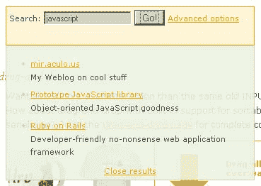

- 第三个区域初始隐藏，允许显示搜索的高级配置参数。
- 第四个区域初始隐藏，对应搜索结果。

接下来的代码说明了这四个区域的实现，它们分别对应标识符为 `panelPrincipal`（标记 ❶）、`panelAvertissement`（标记 ❷）、`panelOptions`（标记 ❸）和 `panelResultats`（标记 ❹）的 div 块。我们重新处理了代码，以充分分离 HTML 代码和 JavaScript 代码，特别是在事件管理方面：

```html
<form id="monFormulaire" method="get" action="">
<div id="panelPrincipal"> // ¨ ❶
<label for="champRecherche">搜索:</label>
<input class="box" name="champRecherche" id="champRecherche" type="text" />
<input type="submit" size="10" value=" Go! " />
<a href="#" id="optionsAvancees">高级选项</a>
<div id="panelAvertissement" style="display:none;"> // ¨ ❷
至少使用三个字符。
</div>
</div>>
<div id="panelOptions" style="display:none;"><<div> // ¨ ❸
<a href="#" id="fermerOptions">关闭</a>
<input type="checkbox" name="details" id="optionDetail" checked="checked" /> 显示结果详情（始终激活）
</div></div>
<div id="conteneurPanelResultats"><div id="panelResultats"
style="display:none;"><div> // ¨ ❹
<<ul>
<<li>
[<a href="http://prototype.con.net/" target="_new">Bibl](http://prototype.con.net)
Prototypea</a><br/>
面向对象的 JavaScript 库
</li>
</</ul>
<a href="#" id="fermerResultats">关闭结果</a>
</div></div></</div>
</form>
```

图 10.1 展示了搜索区域以及结果区域的外观。

### 图 10.1
*script.aculo.us 效果的实现示例*

LivreGougeon Page 274 Mardi, 28. novembre 2006 4:23 16
图形 JavaScript 库
274
第四部分

多个事件被绑定到表单和上述代码中的不同链接上，以触发各种效果。观察者的初始化通过 `initialiser` 方法完成，该方法页面加载时执行。

接下来的代码描述了观察者的实现（代码中放置的标记 ❶ 到 ❺ 在表 10.11 中注释）：

```javascript
function executerRecherche(evt) { // ¨ ❶
if(Form.Element.getValue("champRecherche").length<3) {
Effect.Shake("panelPrincipal");
Effect.Appear("panelAvertissement",
{duration:2.0,
transition:Effect.Transitions.wobble});
} else {
if($("panelOptions").style.display=="")
Effect.SlideUp("edsubpanel");
if($("panelAvertissement").style.display=="")
Effect.Fade("panelAvertissement");
Effect.SlideDown("panelResultats");
}
evt.preventDefault();
}

function ouvrirOption(evt) { // ¨ ❷
new Effect.SlideDown("panelOptions");
evt.preventDefault();
}
```


```javascript
function detailsChange(evt) { //¨ ❸
  new Effect.SlideUp("panelOptions");
  evt.preventDefault();
}

function fermerOptions() { //¨ ❹
  new Effect.SlideUp("panelOptions");
  evt.preventDefault();
}

function fermerResultats() { //¨ ❺
  new Effect.SlideUp('panelResultats');
  evt.preventDefault();
}

function initialiser() { //¨ ❻
  Event.observe($("monFormulaire"),"submit",executerRecherche);
  Event.observe($("optionsAvancees"),"click",ouvrirOption);
  Event.observe($("optionDetail"),"change",detailsChange);
  Event.observe($("fermerOptions"),"click",fermerOptions);
  Event.observe($("panelResultats"),"click",fermerResultats);
}

Event.observe(window,"load",initialiser);
```

`initialiser` 函数（标记 `❻`）绑定到页面加载时触发的事件。它允许配置不同的事件监听器。

LivreGougeon 第 275 页，2006 年 11 月 28 日 星期二 4:23 16

### 轻量级图形库

**275**

### 第 10 章

表 10.11 汇总了这些监听器执行的特效和处理函数。

#### 表 10.11 监听器的处理与效果

| 函数 | 被观察元素 | 说明 |
| :--- | :--- | :--- |
| `detailsChange` | `optionDetail` | 用于显示高级选项区域。使用 `Effect.SlideUp` 效果（标记 `❸`），该区域将向下折叠。 |
| `executerRecherche` | `monFormulaire` | 尚未实际实现搜索。允许检查搜索字符串长度是否大于两个字符（标记 `❶`）。如果不是，则通过 `Effect.Appear` 效果显示警告区域，并通过 `Effect.Shake` 效果抖动搜索框。否则，通过 `Effect.SlideDown` 效果显示搜索结果区域，该区域将向下展开。 |
| `fermerOptions` | `fermerOptions` | 用于隐藏高级选项区域。使用 `Effect.SlideUp` 效果（标记 `❹`），该区域向上折叠。 |
| `fermerResultats` | `panelResultats` | 用于隐藏搜索结果区域。使用 `Effect.SlideUp` 效果（标记 `❺`），该区域向上折叠。 |
| `ouvrirOption` | `optionsAvancees` | 用于显示高级选项区域。使用 `Effect.SlideDown` 效果（标记 `❷`），该区域向下展开。 |

### 拖放

为了实现拖放功能（*Drag-and-Drop*），`script.aculo.us` 提供了 `Draggable` 类和 `Droppables` 对象。

`Draggable` 类允许指定一个元素可以在拖放过程中移动到目标元素。它提供了一个构造函数，该函数参数接收受影响的元素以及一个包含不同选项和回调函数的关联数组。

表 10.12 和 10.13 分别汇总了该构造函数可用的各种选项和回调函数。

#### 表 10.12 Draggable 类构造函数的选项

| 选项 | 默认值 | same |
| :--- | :--- | :--- |
| `handle` | - | 指定元素只能被拖放到属性与 ID 匹配的区域内。 |
| `revert` | - | 如果值为 `true`，元素在拖放结束后将返回其初始位置。 |
| `zindex` | `false` | 对应受拖放影响的元素的 CSS `zindex` 属性。 |
| `constraint` | - | 如果此属性可以取 `horizontal` 或 `vertical` 值，则拖放将被限制在指定的方向。 |
| `ghosting` | `false` | 允许在拖放时移动克隆元素。克隆元素在被放置之前会停留在原位。 |

LivreGougeon 第 276 页，2006 年 11 月 28 日 星期二 4:23 16

# JavaScript 图形库

**276**

### 第四部分

#### 表 10.13 Draggable 类构造函数的回调函数

| 方法 | 参数 | same |
| :--- | :--- | :--- |
| `change` | 被移动的元素 | 当元素在拖放中移动时调用。 |
| `endeffect` | `Opacity` | 定义拖放开始时使用的效果。 |
| `reverteffect` | `Move` | 定义受拖放影响的元素返回原始位置时使用的效果。 |
| `starteffect` | `Opacity` | 定义拖放结束时使用的效果。 |

`Droppables` 对象允许定义一个元素作为拖放的目标。该对象的方法汇总在表 10.14 中。

#### 表 10.14 Droppables 对象的方法

| 方法 | 参数 | same |
| :--- | :--- | :--- |
| `add` | 元素的 ID 以及包含选项和回调方法的关联数组 | 为指定元素添加拖放目标行为。此方法允许对拖放-处理处理周期中的不同事件指定不同的选项以及回调函数和方法。 |
| `remove` | 元素的 ID | 移除指定元素的拖放目标行为。 |

如前所述，`add` 方法的第二个参数接收一个包含表 10.15 和 10.16 中汇总的各种选项和回调函数的关联数组。

#### 表 10.15 Droppables 对象 add 方法的选项

| 选项 | 默认值 | same |
| :--- | :--- | :--- |
| `accept` | - | 以字符串或数组形式指定 CSS 类列表。`add` 方法中指定的元素接受所有拥有一个或多个此类类的元素，以实现拖放。 |
| `containment` | - | 仅当 `add` 方法中的元素包含在该项选项指定的元素内时，它才接受该元素进行拖放。 |
| `hoverclass` | - | 如果设置了位置，当一个元素位于其上方时，`add` 方法中指定的元素将采用该样式。 |
| `overlap` | - | 取 `horizontal` 或 `vertical` 值。如果设置了位置，仅当重叠超过 50% 时，目标才会产生反应。 |
| `greedy` | `true` | 如果值为 `true`，则停止移动并不再处理下方的其他目标。 |

#### 表 10.16 Droppables 对象 add 方法的回调函数

| 回调函数 | 参数 | same |
| :--- | :--- | :--- |
| `onHover` | 被移动的元素、目标元素和重叠百分比 | 当元素移动到目标元素的上方时调用。 |
| `onDrop` | 被移动的元素和目标元素 | 当元素释放到接受它的元素上时调用。 |

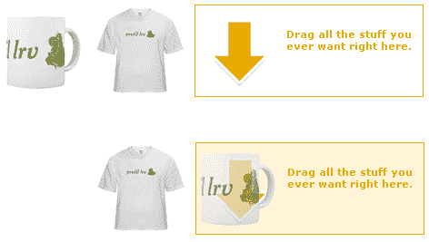


```javascript
}

Event.observe(window,"load",initialiser);
```

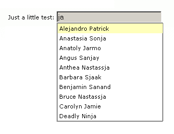

LivreGougeon 第 278 页 2006 年 11 月 28 日星期二 4:23 16

# JavaScript 图库

**278**

第四部分

通过 `Draggable` 类的构造函数（标记 ❶），前两个图像变成了可以移动的元素。`Droppables` 对象的 `add` 方法（标记 ❷）定义了它们可以被放置在 ID 为 `caddy` 的区域，即箭头所示的区域。

## 自动补全

`script.aculo.us` 库提供了实现自动补全的支持。

这种机制使得输入字段能够根据已输入的字符提供选项。这种功能通常用于 Web 邮件界面，以方便电子邮箱地址的输入。

图 10.3 展示了一个支持自动补全的字段示例。

**图 10.3**

*使用自动补全的字段示例*

确定要显示的元素列表有两种方法。第一种是根据页面中包含的 JavaScript 数组在本地构建此列表。第二种是基于 Ajax 技术。

第一种方法使用 `Autocompleter.Local` 类，其构造函数接受四个参数：

* 输入字段的 ID；
* 用于显示自动补全结果的区域 ID；
* 包含用于补全数据的数组；
* 选项。

该方法支持的选项汇总于表 10.17。

LivreGougeon 第 279 页 2006 年 11 月 28 日星期二 4:23 16

### 轻量级图形库

**279**

第 10 章

### 表 10.17 `Autocompleter.Local` 类构造函数的选项

| 选项 | 默认值 | 描述 |
| :--- | :--- | :--- |
| choices | - | 指定在自动补全列表中显示的选项数量。 |
| fullSearch | false | 在字符串数组的任何位置进行搜索。 |
| ignoreCase | true | 搜索忽略大小写。 |
| partialChars | 2 | 自动补全生效前需要输入的字符数。 |
| partialSearch | true | 仅对数组字符串的开头进行搜索。 |

以下代码描述了一个准备使用的 `script.aculo.us` 自动补全输入区域。

它包含一个区域标签（标记 ❶）、一个 ID 输入字段（标记 ❷）以及一个初始隐藏的用于显示自动补全结果的区域（标记 ❸）：

```html
<p>
<label for="recherche">搜索字段:</label> **¨** ❶
<br />
<input id="recherche" autocomplete="off" size="40" type="text" value="" /> **¨** ❷
</p>
<div class="recherche_auto_complete" id="liste_recherche" style="display:none">
➥
</div> **¨** ❸
```

以下 JavaScript 代码允许对 `recherche` ID 输入区域应用自动补全机制：

```javascript
function initialiser() {
  var donnees = [ "un texte", "un autre texte" ];
  var options = { partialChars : 3};
  new Autocompleter.Local("recherche", "liste_recherche", donnees, options);
}

Event.observe(window,"load",initialiser);
```

基于 Ajax 技术的第二方法通过 `Ajax.Autocompleter` 类实现。该类的构造函数与 `Autocompleter.Local` 类接受相同的参数，不同之处第三个参数现在是一个地址，该地址负责返回补全结果。

当在字段中输入内容时，会向指定地址发送一个 POST 类型的 HTTP 请求。它包含一个与输入字段 ID 对应的参数，其值为所输入的文本。请求的响应包含要在随后出现的区域中显示的补全 HTML 内容。它必须符合如下格式化的列表：

```html
<<ul>>
  <li>Premier 结果（第一个结果）</li>
  <li>Second 结果（第二个结果）</li>
</ul>
```

```

LivreGougeon 第 280 页 2006 年 11 月 28 日星期二 4:23 16

# JavaScript 图库

**280**

第四部分

使用这种方法，可以使用表 10.18 和 10.19 汇总的选项和回调函数。

### 表 10.18 `Ajax.Autocompleter` 类构造函数的选项

| 选项 | 默认值 | 描述 |
| :--- | :--- | :--- |
| frequency | 0.4 | 发送 Ajax 请求的频率 |
| indicator | null | 执行请求时显示的元素。 |
| minChars | 2 | 自动补全生效前需要输入的字符数。 |
| paramName | | 发送请求时使用的 ID |
| tokens | [] | 允许选择的字符列表 |

如果我们回到示例，输入区域的结构是等价的。然而，现在的配置变为：

```javascript
function initialiser() {
  var options = {paramName: "value", minChars: 2};
  new Ajax.Autocompleter("recherche", "liste_recherche", "/autocomplete", options);
}

Event.observe(window,"load",initialiser);
```

### 总结

`script.aculo.us` 库提供了不同的功能，其中最有趣的功能是在应用程序中添加视觉效果。这些效果通过图形通知以及区域和结果的渐进式赋予了应用程序更高的易用性。

`script.aculo.us` 还提供了一个框架用于实现拖放以及支持自动补全的输入区域。

需要指出，与 `prototype` 库配合使用，`script.aculo.us` 是 Ruby on Rails 框架 JavaScript 模块的基础。

LivreGougeon 第 281 页 2006 年 11 月 28 日星期二 4:23 16

### 轻量级图形库

**281**

第 10 章

## 结论

本章描述的库非常有意义，因为它们很轻量级且实现了有限的功能。这种简单性并没有阻止它们通过让 Web 应用受益于 Web 2.0 功能来提供确定的附加价值。

这些库的目标是通过隐藏语言的某些复杂性来简化 JavaScript 开发，通过清晰分离不同的关注点来改进应用的结构，并提供复杂的组件和图形效果。

我们刻意只讨论了此类中主要的 JavaScript 库。互联网还提供了许多其他各方面具有价值的库。

所有这些轻量级库也适用于希望通过 Web 2.0 行为丰富界面的经典 Web 应用。

LivreGougeon 第 282 页 2006 年 11 月 28 日星期二 4:23 16

LivreGougeon 第 283 页 2006 年 11 月 28 日星期二 4:23 16

# 11

## 图形支持

de dojo 库


我们在书的第二部分已经看到，`dojo` 库提供了一个开发高级 JavaScript 应用的框架。该框架允许对模块进行结构化和按需加载。该库基于这一机制提供了从集合到 Ajax 技术的各种支持。

除了第 7 章中描述的模块外，`dojo` 库还提供了开发图形应用程序的功能。这些功能由一组实用模块组成，它们通过 `DOM` 技术方便对 HTML 页面的结构进行操作，并基于 `CSS` 方便对其外观进行操作。

`dojo` 库还整合了一些强大的功能，以便优化的方式实现 Web 页面中的事件管理。这些事件对应于 `DOM` 事件以及由对象方法触发的事件。

`dojo` 库在浏览器的特殊性之上提供了一个抽象层，并提供了一个用于实现和使用图形组件的框架。该库的方法是混合的：它允许 HTML 页面与图形组件的 JavaScript 类以及它们的 HTML 和 CSS 代码进行精细的交互，同时提供了通过编程操作这些组件的可能性。

## 图形 JavaScript 库

## 基础 HTML 模块

`dojo` 库提供了基础模块，特别允许对样式的操作和效果的管理，同时集成了不同浏览器的特殊性。

这些模块实际上是 `dojo.html` 模块的子模块，在表 11.1 中进行了汇总。

### 表 11.1 与 dojo HTML 支持相关的模块

| 模块 |  |
| :--- | :--- |
| `dojo.html.color` | 允许管理颜色。 |
| `dojo.html.common` | 包含 `dojo` 的基础 HTML 函数。 |
| `dojo.html.display` | 包含与显示相关的函数。 |
| `dojo.html.iframe` | 允许管理 HTML 页面内部的 `iframe`。 |
| `dojo.html.layout` | 处理 HTML 元素的定位。 |
| `dojo.html.selection` | 包含与选择 HTML 元素相关的函数。 |
| `dojo.html.style` | 允许管理 HTML 元素的样式。 |
| `dojo.html.util` | 包含实用函数。 |

主要模块即 `dojo.html.common`、`dojo.html.style` 和 `dojo.html.display` 在后续章节中进行了详细介绍。

### 基础函数

`dojo` 通过 `dojo.html.common` 模块提供了各种与 HTML 技术相关的基础函数。为了使用这些函数，必须通过 `dojo.require` 函数导入该模块。

表 11.2 汇总了该模块的不同函数。

### 表 11.2 `dojo.html.common` 模块的样式管理函数

| 函数 | 参数 | 说明 |
| :--- | :--- | :--- |
| `dojo.html.getAttribute` | 一个节点和属性名 | 返回节点属性的值。 |
| `dojo.html.getCursorPosition` | 一个 DOM 事件 | 在不考虑滚动的情况下返回鼠标指针在 Web 页面上的位置。 |
| `dojo.html.getEventTarget` | 一个 DOM 事件 | 确定触发事件的节点。 |
| `dojo.html.getParentByType` | 节点和一个类型 | 返回匹配给定节点类型的第一个父节点。 |
| `dojo.html.getScroll` | - | 返回浏览器中 Web 面的滚动位置。 |

### dojo 库的图形支持

### 表 11.2 `dojo.html.common` 模块的样式管理函数（续） |

| 函数 | 参数 | 说明 |
| :--- | :--- | :--- |
| `dojo.html.getViewport` | - | 返回浏览器中可见区域的尺寸。 |
| `dojo.html.hasAttribute` | 一个节点和属性名 | 确定节点是否存在某个属性。 |
| `dojo.html.isTag` | 一个节点和标签名列表 | 确定节点是否对应列表中的某个标签名。 |

`dojo.html.getAttribute` 和 `dojo.html.hasAttribute` 函数提供了访问与 `DOM` 节点属性相关的信息，而 `dojo.html.isTag` 函数则相对于标签类型。

我们将根据下面代码描述的 `div` 标签来详细说明这些函数的实现：

```html
<div id="monDiv" unAttribut="Une valeur"></div>
```

前两个函数分别允许返回属性关联的值并确定节点是否存在某个属性。`dojo.html.isTag` 函数确定节点是否匹配传递参数的列表中包含的类型。

以下代码说明了这些不同方法的实现：

```javascript
var noeud = dojo.byId("monDiv");
var unAttribut = "";
if( dojo.html.hasAttribute(noeud, "unAttribut") ) {
    unAttribut = dojo.html.getAttribut(noeud, "unAttribut");
}
var unAutreAttribut = "";
if( dojo.html.hasAttribut(noeud, "unAutreAttribut") ) {
    unAutreAttribut = dojo.html.getAttribut(noeud, "unAutreAttribut");
}
/* 变量 unAttribut 包含 div 标签属性 unAttribut 的内容而变量 unAutreAttribut 包含空字符串 */
var retour = dojo.html.isTag(noeud, "span", "div", "p");
/* 变量 retour 包含值 div，因为它是 div 类型 */
```

请注意，使用 `dojo.html.hasAttribute` 和 `dojo.html.getAttribute` 函数处理相对于 `CSS` 的属性是不建议的，而应使用 `dojo.html.style` 模块来实现此。

`dojo.html.getScroll` 和 `dojo.html.getViewport` 函数分别允许确定滚动源和显示区域的大小。

```javascript
// 计算滚动源（顶部和左）
var scroll = dojo.html.getScroll();
var scrollHaut = scroll.top;
var scrollGauche = scroll.left;
/* 变量 scrollHaut 和 scrollGauche 对应滚动坐标 */

// 计算浏览器显示区域的尺寸
var viewport = dojo.html.getViewport();
var largeurAffichage = viewport.width;
var hauteurAffichage = viewport.height;
/* 变量 largeurAffichage 和 hauteurAffichage 对应显示区域高度 */
```

`dojo.html.getCursorPosition` 函数根据 DOM 事件确定鼠标指针坐标，该事件作为函数的参数传递。因此该函数用于事件观察者的实现，如下代码所示：

```javascript
function fonctionObservateur(evenement) {
    var pointeur = dojo.html.getCursorPosition(evenement);
    var pointeurX = pointeur.x;
    var pointeurY = pointeur.y;
}
```

### 样式管理

`dojo` 通过 `dojo.html.style` 模块提供了各种 `CSS` 样式的管理和操作函数。为了使用这些函数，必须通过 `dojo.require` 函数导入该模块。

表 11.3 汇总了该模块的不同函数。

该模块一组函数相对于将 `CSS` 类与 `DOM` 节点关联。这些函数基于其 `class` 属性包含的值。

请注意，该属性无法通过 `dojo` 相关的 `DOM` 标准功能进行操作。


以下代码展示了 `dojo.html.getClass` 和 `dojo.html.hasClass` 函数实现的示例，用于获取 DOM 节点（标记 ❶）的 `class` 属性值，并检查该值是否包含某个类名（标记 ❷）：

```javascript
Var monDiv = dojo.byId("monDiv");

/* 获取 ID 为 monDiv 的节点的 class 属性值 */
var classe = dojo.html.getClass(monDiv); // ❶

/* 检查 ID 为 monDiv 的节点的 class 属性值中是否包含类名 maClasse */
if( dojo.html.hasClass(monDiv, "maClasse") ) { // ❷

(...)
}
```

### dojo 库的图形支持

## 第 11 章

### 表格 11.3 `dojo.html.style` 模块的样式管理函数

| 函数 | 参数 | 描述 |
| :--- | :--- | :--- |
| `dojo.html.addClass` | 一个节点和一个 CSS 类 | 允许向传递参数的节点类列表末尾添加 CSS 类。 |
| `dojo.html.copyStyle` | 源节点和目标节点 | 将一个节点的样式复制到另一个节点。 |
| `dojo.html.getClass` | 一个节点 | 返回传递参数节点 `class` 属性对应的值。 |
| `dojo.html.getClasses` | 一个节点 | 返回传递参数节点 `class` 属性中包含的 CSS 类。 |
| `dojo.html.getElementsByClass` | 一个 CSS 类、一个节点、一个节点类型、一个匹配类型和一个标记 | 返回符合传递参数标准的节点列表。这些标准可以是 CSS 类匹配、搜索父节点、节点类型，或一个指示不应使用 XPath 的标记。匹配类型列在 `dojo.html.class-MatchType` 结构中：– ContainsAll：所有的 CSS 类都与该节点相关联。– ContainsAny：至少有一个 CSS 类与该节点相关联。– IsOnly：所有的 CSS 类都与该节点相关联，且该节点不拥有其他类。 |
| `dojo.html.getElementsByClassNameName` | 一个 CSS 类、一个节点、一个节点类型、一个匹配类型和一个标记 | 对应函数 `dojo.html.getElementsByClassName` 的同义词。 |
| `dojo.html.getStyle` | 一个节点和一个 CSS 选择器 | 返回节点的某个样式属性。 |
| `dojo.html.getStyleProperty` | 一个节点和一个 CSS 选择器 | 返回节点样式中某个属性的值。 |
| `dojo.html.hasClass` | 一个节点和一个 CSS 类 | 确定传递参数节点的 `class` 属性值是否包含某个 CSS 类。 |
| `dojo.html.prependClass` | 一个节点和一个 CSS 类 | 允许向传递参数的节点类列表开头添加 CSS 类。 |
| `dojo.html.removeClass` | 一个节点、一个 CSS 类和一个标记 | 从传递参数的节点 CSS 类列表中删除一个 CSS 类。标记指定名称是否必须与类名精确匹配。 |
| `dojo.html.replaceClass` | 一个节点、要替换的类和新类 | 为传递参数的节点将一个 CSS 类替换为另一个。 |
| `dojo.html.setClass` | 一个节点和一个字符串 | 将一个字符串设置为传递参数节点的 `class` 属性值。 |
| `dojo.html.setStyle` | 一个节点、一个 CSS 选择器和一个值 | 设置节点的某个样式属性。 |

由于 Web 浏览器并不总是良好地处理标签类的修改，我们建议使用 `style` 属性来修改 DOM 节点的样式属性。

## 第四部分：图形 JavaScript 库

如下代码所示，`dojo.html.getElementsByClassName` 函数提供了访问 Web 页面上具有给定 CSS 类的所有元素的能力：

```javascript
// 获取与 CSS 类 maClasse 的标签
var balises = dojo.html.getElementsByClassName("maClasse");

(...)
```

另一组函数对应于 DOM 节点的样式属性规范。这些函数基于其 `style` 属性中包含的值。

以下代码指示了如何修改样式属性的值（标记 ❶）以及将一个节点的样式复制到另一个节点（标记 ❷）：

```javascript
var maBalise = dojo.byId("maBalise");
var backgroundMaBalise = dojo.html.getStyle(maBalise, "background");
/* 变量 backgroundMaBalise 包含标签样式 background 属性的值 */
// 修改样式 background 属性的值
dojo.html.setStyle(maBalise, "background", "red"); // ❶
/* 将 ID 为 monAutreBalise 的标签样式复制到 ID 为 maBalise 的标签 */
var monAutreBalise = dojo.byId("monAutreBalise");
dojo.html.copyStyle(maBalise, monAutreBalise); // ❷
```

### 显示管理

dojo 通过 `dojo.html.display` 模块提供了各种管理 Web 页面元素显示的函数。要使用这些函数，必须通过 `dojo.require` 函数导入该模块。

### 表格 11.4 `dojo.html.display` 模块的显示函数

| 函数 | 参数 | 描述 |
| :--- | :--- | :--- |
| `dojo.html.clearOpacity` | 一个节点 | 重置节点的透明度。 |
| `dojo.html.getOpacity` | 一个节点 | 返回节点的透明度值。 |
| `dojo.html.hide` | 一个节点 | 隐藏 Web 页面上的节点。 |
| `dojo.html.isDisplayed` | 一个节点 | 如果节点样式的 `display` 属性值不同于 `none`，则返回 true。否则，返回该值。 |
| `dojo.html.isShowing` | 一个节点 | 确定节点是否在 Web 页面上显示。 |
| `dojo.html.isVisible` | 一个节点 | 如果节点的 `style` 属性值不同于 `hidden`，则返回 true。否则，返回该值。 |
| `dojo.html.setDisplay` | 一个节点和一个字符串或布尔值 | 设置节点节点样式的 `display` 属性值。该函数接受字符串或布尔值作为参数。如果是字符串，参数设置为值。如果是布尔值，函数对 true 值使用 `visible`，对 false 值使用 `hidden`。 |
| `dojo.html.setOpacity` | 一个节点和一个数字 | 设置节点的透明度值。可能的值范围在 0.0 到 1.0 之间，分别对应透明显示和不透明显示。 |
| `dojo.html.setShowing` | 一个节点和一个标记 | 根据标记调用 `dojo.html.show` 或 `dojo.html.hide` 函数。 |
| `dojo.html.setVisibility` | 一个节点和一个字符串或布尔值 | （与 `dojo.html.setDisplay` 相同的描述） |
| `dojo.html.show` | 一个节点 | 在 Web 页面上显示节点。 |
| `dojo.html.toggleDisplay` | 一个节点 | 根据节点样式的 `display` 属性反转节点的显示值。 |
| `dojo.html.toggleShowing` | 一个节点 | 反转节点在 Web 页面上的显示模式。如果显示，则隐藏，反之亦然。 |
| `dojo.html.toggleVisibility` | 一个节点 | 根据 `visibility` 属性反转节点的显示值。 |


节点的可见性样式。

`dojo.html.show` 和 `dojo.html.hide` 函数分别用于在 Web 页面显示（标记 ❶）和隐藏（标记 ❷）DOM 节点，如下代码所示：

```javascript
function afficherNoeud(identifiantNoeud) {
  var noeud = document.getElementById(identifiantNoeud);
  dojo.html.show(noeud); // ❶
}

function masquerNoeud(identifiantNoeud) {
  var noeud = document.getElementById(identifiantNoeud);
  dojo.html.hide(noeud); // ❷
}
```

该模块提供了基于 `dojo.html.setOpacity` 和 `dojo.html.clearOpacity` 函数来修改节点显示透明度的可能，这两个函数分别用于改变透明度级别和恢复默认透明度级别。

`dojo.html.setOpacity`（标记 ❶）和 `dojo.html.clearOpacity`（标记 ❷）的实现方式如下：

```javascript
function modifierOpacite(identifiantNoeud, opacite) {
  var noeud = document.getElementById(identifiantNoeud);
  dojo.html.setOpacity(noeud, opacite); // ❶
}

function retablirOpacite(identifiantNoeud) {
  var noeud = document.getElementById(identifiantNoeud);
  dojo.html.clearOpacity(noeud); // ❷
}
```

LivreGougeon 第 290 页 2006 年 11 月 28 日星期二 4:23 16

**图形 JavaScript 库**
**290**
*第四部分*

请注意，透明度级别从 1.0（不透明显示）到 0.0（透明显示）不等。

dojo 提供了基于以 `toggle` 开头的函数来反转节点显示状态的可能。以下代码实现了 `dojo.html.toggleShowing` 函数，用以隐藏已显示的节点，反之亦然：

```javascript
function inverserAffichage(identifiantNoeud) {
  var noeud = document.getElementById(identifiantNoeud);
  dojo.html.toggleShowing(noeud);
}
```

**事件管理**

与 prototype 库类似，dojo 提供了良好的机制来用于注册和注销事件观察者并管理它们。

然而，dojo 库提供了更通用的支持，因为它允许拦截任何方法调用以触发处理过程。我们稍后将看到这种机制对于处理 dojo 图形组件的事件非常有用，这些事件并不一定基于 DOM。

事件的实现通常在页面初始化后完成。正如我们稍后看到的，该库不允许在页面的 `load` 事件上注册观察者。因此，这些处理必须通过 `dojo.addOnLoad` 函数来完成。

**页面初始化处理**

为了初始化图形组件，dojo 会在页面加载时（`load` 事件）自动添加处理过程。因此，无法为该事件指定观察者，因为该事件只能指定一个观察者。此时，dojo 提供了通过 `dojo.addOnLoad` 函数在页面加载时添加处理的可能性。同样，也可以实现 `dojo.addOnUnload` 函数用于页面卸载。

***基础函数***

事件支持的基础方法位于标识为字符串 `dojo.event.*` 的模块中，必须导入其中的不同元素。

该支持基于 `dojo.event` 对象，该对象在导入相关事件模块时自动实例化，并提供了多个方法，其中主要方法是 `connect` 和 `disconnect` 用于注册和注销事件观察者。

这种支持支持 DOM 事件，也支持执行 JavaScript 对象方法后触发的事件。

LivreGougeon 第 291 页 2006 年 11 月 28 日星期二 4:23 16

**dojo 库的图形支持**
**291**
*第 11 章*

**注册事件观察者**

基础方法 `connect` 用于注册事件观察者。在 dojo 的事件支持中，事件并不一定对应于用户的操作（即 DOM 事件）。该库还允许将对象的的方法调用视为事件，从而允许在该层级定义观察者。

要实现一个用于检测对象方法调用的观察者，必须使用 `connect` 方法并结合表 11.5 汇总的参数。

**表 11.5 *connect* 方法的参数**

**在观察对象方法的情况下**

| 参数 | 类型 | 描述 |
| :--- | :--- | :--- |
| `srcFunc` | 字符串 | 对应触发事件的前一个对象的方法名。 |
| `srcObj` | 对象 | 对应注册观察者的方法的对象。 |
| `adviceFunc` | 字符串 | 对应处理事件的方法名。 |
| `adviceObjet` | 对象 | 对应包含方法的对象。 |

使用此方法对对象或其名称没有影响。

以下代码提供了一个使用 `connect` 方法为对象方法（标记 ❶）注册（标记 ❸）一个观察者（标记 ❷）的实现示例：

```javascript
// 被观察方法的对象
var monObjet = { // ❶
  maMethode: function() {
    (...)
  }
};

// 观察者对象
var monObservateur = { // ❷
  traiterEvenement: function() {
    (...)
  }
};

// 在对象上注册观察者
dojo.event.connect(monObjet, "maMethode", // ❸
monObservateur, "traiterEvenement");

/* 在此此方法后，traiterEvenement 方法被调用 */
```

LivreGougeon 第 292 页 2006 年 11 月 28 日星期二 4:23 16

**图形 JavaScript 库**
**292**
*第四部分*

这种机制也可以用于未挂载到任何对象的观察函数。在这种情况下，`connect` 方法仅接收表 11.6 汇总的三个参数。

**表 11.6 *connect* 方法的参数** **在函数的情况下**

| 参数 | 类型 | 描述 |
| :--- | :--- | :--- |
| `srcFunc` | 字符串 | 对应触发事件的前一个对象的方法名。 |
| `srcObj` | 对象 | 对应注册观察者的方法的对象。 |
| `adviceFunc` | 字符串 | 对应处理事件的观察函数名。 |

以下代码提供了一个使用 `connect` 方法为对象方法（标记 ❶）注册（标记 ❸）一个观察函数（标记 ❷）的实现示例：

```javascript
// 被观察方法的对象
var monObjet = { // ❶
  maMethode: function() {
    (...)
  }
};

// 观察
var monObservateur = { // ❷
  traiterEvenement: function() {
    (...)
  }
};

// 在对象上注册观察者
dojo.event.connect(monObjet, "maMethode", // ❸
monObservateur, "traiterEvenement");

/* 在调用此方法后，traiterement 函数被调用 */
```

节点 DOM 事件的观察者注册方式与之前相同。`dojo.event.connect` 函数的第一个和第二个参数分别对应节点和所观察的事件名称。

然而请注意，在使用函数时，事件名称必须加上 `on` 前缀。

以下代码给出了为 ID 为 `monNoeud` 的 DOM 节点 `onclick` 事件注册观察者的实现示例：

```javascript
var monObservateur = {
  traiterEvenement: function() {
    (...)
  }
};

var monNoeud = dojo.byId("monNoeud");
dojo.event.connect(monNoeud, "onclick",
monObservateur, "traiterEvenement");
```


```
dojo.event.connect(monNoeud, "onclick", "traiterEvenement");
```

### dojo 库的图形支持

## 第 11 章

请注意，`connect` 方法提供了对多个相同观察者注册的支持。这些观察者通过此函数仅会被注册一次。

dojo 库还提供了 `kwConnect` 方法，该方法基于关联数组作为参数。

以下代码调整了之前的示例，以使用该函数（标记为 ❶）：

```javascript
// 被观察的方法的对象
var monInstance = {
  maMethode: function() {
    (...)
  }
};

// 观察者对象
var monObservateur = {
  traiterEvenement: function() {
    (...)
  }
};

/* 在对象 monObjet 上注册观察者 monObservateur */
dojo.event.kwConnect({ ❶
  srcObj: monInstance,
  srcFunc: "maMethode",
  adviceObj: monObservateur,
  adviceFunc: "traiterEvenement"
});

monInstance.maMethode();
/* 调用此方法后，对象 monObservateur 的方法 traiterEvenement
 将被调用 */
```

## 取消事件观察者的注册

dojo 库提供了一种优雅的方式，基于 `disconnect` 方法来移除为 DOM 事件或方法注册的观察者。

为了取消注册观察者，调用此方法时使用的参数必须与使用 `connect` 方法注册时使用的参数相同。

以下代码给出了取消注册对象方法（标记为 ❶）的观察者（标记为 ❷）的示例（标记为 ❹），该观察者之前是基于 `connect` 方法（标记为 ❸）注册的：

```javascript
var monInstance = { ❶
  maMethode: function() {
    (...)
  }
};

var monObservateur = { ❷
  traiterEvenement: function() {
    (...)
  }
};

dojo.event.connect(monInstance, "maMethode", ❸
monObservateur, "traiterEvenement");

monInstance.maMethode();
/* 调用此方法后，对象 monObservateur 的方法 traiterEvenement
 将被调用 */

dojo.event.disconnect(monInstance, "maMethode", ❹
monObservateur, "traiterEvenement");

monInstance.maMethode();
/* 调用此方法后，对象 monObservateur 的方法 traiterEvenement
 不再被调用 */
```

DOM 事件的取消注册以相同的方式实现，始终基于 `dojo.event.disconnect` 函数。

## 解耦

在 JavaScript 应用中，如果想要很好地分离网页中包含的不同元素（HTML、CSS 和 JavaScript），实现事件管理是一项真正的挑战。

dojo 库实现了一种基于主题（*topics*）的机制，该机制允许触发器与事件观察者之间解耦。为此，该库实现了信息交换通道，观察者注册到这些通道上，以便在向给定通道发送事件时接收通知。

这些通道的管理和使用涉及到 `dojo.event.topic` 对象，该对象由 dojo 在包含事件相关的模块（由字符串 `dojo.event.*` 标识的模块）时进行实例化。

表 11.7 汇总了该实例的方法。

### 表 11.7 `dojo.event.topic` 对象的方法

| 方法 | 参数 | 描述 |
| :--- | :--- | :--- |
| `destroy` | 主题名称 | 根据名称销毁主题。 |
| `getTopic` | 主题名称 | 根据名称返回代表主题的对象。返回的对象类型为 `dojo.event.topic.TopicImpl`。 |
| `publish` | 主题名称 | 向主题发送消息。 |
| `registerPublisher` | 主题名称、对象和触发器方法名 | 将对象的一个方法定义为主题的触发器。当该方法被调用时，将向该主题发送消息。 |
| `subscribe` | 主题名称、对象和观察者方法名 | 为给定主题注册观察者。 |
| `unsubscribe` | 主题名称、对象和观察者方法名 | 取消给定主题的观察者注册。 |

dojo 库在内部基于 `dojo.event.topic.TopicImpl` 类管理主题。

## 向主题注册观察者

观察者的注册是通过 `dojo.event.topic` 对象的 `subscribe` 方法实现的。观察者用于处理事件的方法必须拥有一个参数以便接收与事件相关的消息。该参数的类型随触发事件而异。

与 `dojo.event` 对象的 `connect` 方法一样，`subscribe` 方法支持以函数形式或对象方法形式使用观察者。

以下代码提供了该方法的实现示例（标记为 ❸），其中观察者通过对象方法（标记为 ❶）和函数（标记为 ❷）实现：

```javascript
var monObservateur = { ❶
  traiterEvenement: function(message) {
    (...)
  }
};

function traiterEvenement(message) { ❷
  (...)
}

dojo.event.topic.subscribe("monSujet", ❸
monObservateur, "traiterEvenement");

dojo.event.topic.subscribe("monSujet", "traiterEvenement"); // ❸
```

## 向主题发布消息

消息的发布可以通过两种方式实现。第一种直接基于代表主题的对象及其 `sendMessage` 方法，而第二种是将对象的一个方法配置为事件触发器。

以下代码给出了向主题 `monSujet` 发送消息的第一种方式的实现示例：

```javascript
var monSujet = dojo.event.topic.getTopic("monSujet");
monSujet.sendMessage("mon message");
```

在这种情况下，注册的观察者收到的是包含“mon message”的字符串。这种方法是侵入性的，因为它强制使用了 dojo 库的对象。

使用第二种方式，必须使用 `dojo.event.topic` 对象的 `registerPublisher` 方法，如下代码所示：

```javascript
var monDeclencheur = {
  declencher: function() {
    (...)
  }
};

dojo.event.topic.registerPublisher("monSujet",
monDeclencheur, "declencher");
```

当调用 `monDeclencheur` 对象的 `declencher` 方法时，向主题 monSujet 发送事件。在这种方法下，注册的观察者收到的消息为空。

与之前描述的 `dojo.event` 对象的 `connect` 方法类似，`registerPublisher` 方法可以实现使用 DOM 事件作为触发器。以下代码在 `onclick` 事件发生时向主题 monSujet 发送消息：

```javascript
var monBouton = dojo.byId("monBouton");
dojo.event.topic.registerPublisher("monSujet",
monBouton, "onclick");
```

在这种情况下，注册的观察者收到的消息对应于发生的 DOM 事件。

### 效果管理

dojo 库提供了 `dojo.lfx` 模块来实现视觉效果。支持的效果类似于 `script.aculo.us` 库（见第 10 章）。但它们的数量较少。

表 11.8 汇总了该模块中的不同函数。

### 表 11.8 `dojo.lfx` 包中的效果管理函数

| 函数 | 参数 | 描述 |
| :--- | :--- | :--- |
| `dojo.lfx.chain` | 要链链的效果 | |


允许连续实现各种效果。

`dojo.lfx.html.explode`

起始节点，要显示的节点

允许从一个节点开始以爆炸效果显示一个元素。

起始透明度和以及效果的持续时间

`dojo.lfx.html.fade`

元素数组，数值

允许通过逐渐改变透明度来使一个或多个元素变得透明或不透明。

结束透明度和效果的持续时间

`dojo.lfx.html.fadeHide`

元素数组

通过逐渐改变透明度来隐藏元素。

效果的持续时间

`dojo.lfx.html.fadeIn`

元素数组

通过逐渐改变透明度来显示元素。

效果的持续时间

`dojo.lfx.html.fadeOut`

元素数组

通过逐渐改变透明度来隐藏元素。

效果的持续时间

`dojo.lfx.html.fadeShow`

元素数组

通过逐渐改变透明度来显示元素。

效果的持续时间

`dojo.lfx.html.highlight`

元素数组，一个 RGB 格式的颜色以及效果的持续时间

允许修改元素的高亮状态。此函数允许指定效果开始时的高亮颜色。

`dojo.lfx.html.implode`

要隐藏的节点，到达节点以及效果的持续时间

对应 `dojo.lfx.html.explode` 效果的反向。

LivreGougeon 第 297 页 2006 年 11 月 28 日星期二 4:23 16

**dojo 库的图形支持**

**297**

*第 11 章*

**表 11.8 *dojo.lfx* 包中的效果管理函数（续）***

| **函数** | **参数** | **描述** |
| :--- | :--- | :--- |
| `dojo.lfx.html.slideBy` | 元素数组、移动坐标和效果的持续时间 | 允许节点移动到相对于当前位置的位置。移动量通过参数指定。 |
| `dojo.lfx.html.slideTo` | 元素数组、位置坐标和效果的持续时间 | 允许节点移动到指定坐标的位置。 |
| `dojo.lfx.html.unhighlight` | 元素数组、一个 RGB 格式的颜色和效果的持续时间 | 允许修改元素的高亮状态。此函数允许指定效果结束的高亮颜色。 |
| `dojo.lfx.html.wipeIn` | 元素数组和效果的持续时间 | 允许展开元素以显示。 |
| `dojo.lfx.html.wipeOut` | 元素数组和效果的持续时间 | 允许卷起元素将其隐藏。 |

表 11.8 中描述的函数仅用于创建效果，而不执行效果。要播放效果，必须调用 `play` 方法。

`dojo.lfx.html.fade` 函数允许实现一种将元素透明度从初始值改变到最终值的效果。以下代码基于此函数（标记 ❶）来使文本消失：

```html
<html>
<head>
(...)
<script type="text/javascript">
dojo.require("dojo.lfx.*");
</script>
<script type="text/javascript">
function executerEffet() {
  var monTexte = dojo.byId("monTexte");
  dojo.lfx.html.fade([monTexte], {start: 1.0, end: 0.0}, 1500).play();
}
</script>
</head>
<body>
<p id="monTexte">一个文本示例</p>
<a href="javascript:executerEffet()">实现效果。</a>
</body>
</html>
```

`dojo.lfx.html.highlight` 和 `dojo.lfx.html.unhighlight` 函数允许管理元素的高亮。

LivreGougeon 第 298 页 2006 年 11 月 28 日星期二 4:23 16

**图形 JavaScript 库**

**298**

*第四部分*

以下代码给出了最后一个函数（标记 ❶）的实现示例，用以使用代码颜色 (230, 230, 180) 实现文本高亮效果：

```html
<html>
<head>
(...)
<script type="text/javascript">
dojo.require("dojo.lfx.*");
</script>
<script type="text/javascript">
function executerEffet() {
  var monTexte = dojo.byId("monTexte");
  dojo.lfx.html.unhighlight(monTexte, [230, 230, 180], 1500).play();
}
</script>
</head>
<body>
<p id="monTexte">一个文本示例</p>
<a href="javascript:executerEffet()">实现效果。</a>
</body>
</html>
```

`dojo.lfx.html.wipeIn` 和 `dojo.lfx.html.wipeOut` 分别允许展开和卷起元素。以下代码使用后一个（标记 ❶）基于一个卷起效果来隐藏文本：

```html
<html>
<head>
(...)
<script type="text/javascript">
dojo.require("dojo.lfx.*");
</script>
<script type="text/javascript">
function executerEffet() {
  var monTexte = dojo.byId("monTexte");
  dojo.lfx.html.wipeOut(monTexte, 1500).play();
}
</script>
</head>
<body>
<p id="monTexte">一个文本示例</p>
<a href="javascript:executerEffet()">实现效果。</a>
</body>
</html>
```

LivreGougeon 第 299 页 2006 年 11 月 28 日星期二 4:23 16

**dojo 库的图形支持**

**299**

*第 11 章*

**拖放管理**

为了实现拖放功能 (*drag-and-drop*），dojo 库提供了 `dojo.dnd.DragSource` 和 `dojo.dnd.DropTarget` 类。这两个类型的元素通过标识符 group 关联。该标识在类构造函数中指定。

我们重新来看拖放示例：

```html
<html>
<head>
(...)
<script type="text/javascript">
dojo.require("dojo.dnd.*");
</script>
<script type="text/javascript">
function initialiser() {
  var monTexte = dojo.byId("monTexte");
  var drag = new dojo.dnd.DragSource(monTexte, "group");
  var drop = new dojo.dnd.DropTarget("caddy", "group", function(e) {
    console.log("元素已放置");
  });
}
</script>
</head>
<body>
<p id="monTexte">一个文本示例</p>
<div id="caddy" style="border:1px solid black;">在此处放置</div>
</body>
</html>
```

```
LivreGougeon 第 300 页 2006 年 11 月 28 日星期二 4:23 16

**图形 JavaScript 库**

**300**

*第四部分*

***图形组件的结构化***

dojo 的图形组件是基于第 7 章描述的模块概念来实现的。因此，每个图形组件都对应一个模块，该模块提供一个或多个 JavaScript 类。


在 dojo 库中，图形组件由三个元素组成，如图 11.1 所示。

### dojo 图形组件

- 定义要使用的 HTML 模板文件
- 组件的 HTML 模板
- 组件的 JavaScript 类
- 组件的 CSS 模板：定义要使用的 CSS 模板文件

**图 11.1**
*dojo 图形组件的组成元素*

现在我们详细说明这些元素的不同特性。

### JavaScript 类

图形组件的 JavaScript 类对应于它的核心部分。它允许定义与其构建和运行相关的处理。它还包含了组件的各种属性。

由于 dojo 使用面向对象编程来定义图形组件，因此组件是通过一个基于各种通用基类的类来实现的。

表 11.9 总结了这些不同的基类及其功能。

图 11.2 展示了上述类之间的继承关系，以及它们不同的属性和方法。

**表 11.9 dojo 图形组件的基类**

| 类 |  |
| :--- | :--- |
| `dojo.widget.DomWidget` | 对应 `dojo.widget.Widget` 类的特化，以便考虑 DOM 技术机制。 |
| `dojo.widget.HtmlWidget` | 对应 `dojo.widget.HtmlWidget` 类的特化，以便考虑基于 HTML 的组件方面，如显示、调整大小以及与 HTML 和 CSS 模板的绑定。 |
| `dojo.widget.Widget` | 是所有组件的基类。这是最通用的类，实现了组件构建和销毁周期的各种处理。它还提供了各种方法来操作组件属性，并管理它们的尺寸调整以及与其他组件的关系。 |

**Widget**
- `-parent`
- `-isTopLevel`
- `-isModal`
- `-isEnabled`
- `-isHidden`

**HtmlWidget**
- `-isContainer`

**DomWidget**
- `-widgetId`
- `-widgetType`
- `-templateNode`
- `-templateCssPath`
- `+toString()`
- `-templateString`
- `-templatePath`
- `+repr()`
- `-templateCssString`
- `-toggle`
- `+enable()`
- `-preventClobber`
- `-toggleDuration`
- `+disable()`
- `-domNode`
- `-animationInProgress`
- `+hide()`
- `-containerNode`
- `+initialize()`
- `+show()`
- `+addChild()`
- `+postMixInProperties()`
- `+onResized()`
- `+addWidgetAsDirectChild()`
- `+getContainerHeight()`
- `+notifyChildrenOfResize()`
- `+registerChild()`
- `+getContainerWidth()`
- `+create()`
- `+removeChild()`
- `+setNativeHeight()`
- `+destroy()`
- `+getFragNodeRef()`
- `+createNodesFromText()`
- `+destroyChildren()`
- `+postInitialize()`
- `+destroyRendering()`
- `+getChildrenOfType()`
- `+buildRendering()`
- `+isShowing()`
- `+getDescendants()`
- `+buildFromTemplate()`
- `+toggleShowing()`
- `+satisfyPropertySets()`
- `+attachTemplateNodes()`
- `+show()`
- `+mixInProperties()`
- `+fillInTemplate()`
- `+onShow()`
- `+postMixInProperties()`
- `+destroyRendering()`
- `+hide()`
- `+initialize()`
- `+cleanUp()`
- `+onHide()`
- `+postInitialize()`
- `+getContainerHeight()`
- `+checkSize()`
- `+postCreate()`
- `+getContainerWidth()`
- `+resizeTo()`
- `+uninitialize()`
- `+createNodesFromText()`
- `+resizeSoon()`
- `+buildRendering()`
- `+onResized()`
- `+destroyRendering()`
- `+cleanUp()`
- `+addedTo()`
- `+addChild()`
- `+removeChild()`
- `+resize()`

**图 11.2**
*图形组件基类之间的关系*

注意，此图通过省略图形属性的获取和定位方法而进行了简化。

基于这些类，dojo 库实现了一个处理周期，用于初始化、构建和显示图形组件。

图 11.3 展示了组件基类不同方法的连续调用情况。

**图 11.3**
*dojo 图形组件的初始化处理*

```
Widget -> DomWidget -> HtmlWidget
manager -> create -> satisfyPropertySets -> mixInProperties -> postMixInProperties -> add -> buildRendering -> fillInTemplate -> initialize -> postInitialize -> postCreate
```

表 11.10 详细说明了组件构建管理周期方法中执行的不同处理。这些方法在图形组件的实现中可以被重写，以实现特定的初始化和构建处理。

**表 11.10 创建图形组件时实现的方法**

| 方法 | 描述 |
| :--- | :--- |
| `buildRendering` | 构建图形组件的显示。这是这些处理的基础方法，它可能基于 `fillInTemplate` 方法，而组件实现可能会重写该方法。 |
| `fillInTemplate` | 允许根据指定的模板指定要的操作。该方法在实现组件时可以被重写。 |
| `initialize` | 在实现组件时可以重写，以执行其初始化处理。 |
| `mixInProperties` | 允许将组件的现有属性与创建时指定的属性结合。 |
| `postCreate` | 允许在图形组件创建后执行处理。该方法特别可以在实现组件时重写，以便为事件注册观察者。 |
| `postInitialize` | 允许在通用初始化后实现特定于组件的处理。 |
| `postMixInProperties` | 在实现组件时可以重写，以便在执行 `mixInProperties` 方法后执行处理。 |
| `satisfyPropertySets` | 允许初始化组件的默认属性。 |

与创建一样，dojo 库实现了一个处理周期来销毁图形组件。图 11.4 展示了组件基类不同方法的连续调用情况。

**图 11.4**
*dojo 图形组件的销毁处理*

```
Widget -> DomWidget -> HtmlWidget
manager -> destroy -> destroyChildren -> uninitialize -> destroyRendering -> removeById
```

表 11.11 详细说明了组件销毁管理周期方法中执行的不同处理。

**表 11.11 销毁图形组件时实现的方法**

| 方法 | 参数 | 描述 |
| :--- | :--- | :--- |
| `destroyChildren` | - | 允许销毁图形组件的所有子组件。 |
| `destroyRendering` | 布尔值 | 如果参数指定释放显示对应的资源，则允许销毁图形组件的显示。 |
| `uninitialize` | - | 允许执行图形组件的最终化处理。 |

最后请注意，为了方便 JavaScript 组件类的实现，该库提供了 `dojo.widget.defineWidget` 函数。该函数的主要目标是隐藏面向对象支持的使用，并将图形组件注册到 dojo 组件管理器中。

以下代码提供了一个使用该函数的示例，用于实现图形组件 `dojo.widget.html.Button`：

```javascript
dojo.widget.defineWidget(
  "dojo.widget.html.Button",
  dojo.widget.HtmlWidget,
  {
  }
);
```


```javascript
isContainer: true,

caption: "",

disabled: false,

templatePath: dojo.uri.dojoUri(
"src/widget/templates/HtmlButtonTemplate.html"),

templateCssPath: dojo.uri.dojoUri(
"src/widget/templates/HtmlButtonTemplate.css"),

(...)

fillInTemplate: function(args, frag){
(...)

},

(...)

});
```

`dojo.widget.defineWidget` 函数允许指定组件的类名（标记 ❶）、其父类（标记 ❷）以及它的各种属性和方法（标记 ❸）。

## HTML 

图形组件的 JavaScript 类必须与一个图形表示文件结合，后者用于定义组件的 HTML 结构。

该文件必须通过其 `templatePath` 属性与 JavaScript 类关联。

### dojo 库的图形支持

以下代码展示了该机制的实现示例，基于 `dojo.uri.dojoUri` 函数（标记 ❶）来指定文件路径：

```javascript
dojo.widget.defineWidget(
"dojo.widget.MonComposant",
dojo.widget.HtmlWidget, {
(...)
this.templatePath = dojo.uri.dojoUri(
"src/widget/templates/monTemplate.html");
(...)
});
```

dojo 提供了通过 HTML 标签中的特殊属性使类与此模板进行简单交互的可能性。

首先，`dojoAttachPoint` 属性允许将 HTML 标签的 DOM 节点连接到组件 JavaScript 类的属性上。

以下代码展示了如何在模板中实现此属性（标记 ❶）：(...)

```html
<div dojoAttachPoint="monAttribut">
(...)

</div>
```

```(...)

对应于上述模板的组件类的 `monAttribut` 属性将包含一个 `div` 标签 DOM 节点的实例。

`dojoAttachEvent` 属性允许将组件 JavaScript 类的方法指定为模板标签 DOM 事件的观察者。指定多个事件的观察器只需基于单一类型的属性即可。

以下代码展示了如何在 HTML 模板中实现 `dojoAttachEvent` 属性（标记 ❶）：

```html
(...)

<div dojoAttachEvent="onclick: traiterEvenement1">
(...)

</div>
```

```html

<div dojoAttachEvent="onclick, onmouseover: traiterEvenement2">
(...)

</div>
```

```html(...)

dojo 库还提供了在模板中使用组件 JavaScript 类属性的可能性。

以下代码描述了 `dojo.widget.html.HtmlCheckBox` 类的模板，该模板使用了该类的 `tabIndex`（标记 ❶）、`disabledStr`（标记 ❷）、`name`（标记 ❸）和 `checked`（标记 ❹）：

```html
<a class='dojoHtmlCheckbox'
tabIndex="${this.tabIndex}"
href="#" ${this.disabledStr}
dojoAttachEvent="onClick;keyPress"
waiRole="checkbox">
<input type="checkbox"
name="${this.name}"
checked="${this.checked}"
style="display: none"
dojoAttachPoint="inputNode">
&nbsp;

</a
```

所使用的值对应于图形组件构建时的属性值。

## CSS 文件

不同的样式允许定义图形组件的外观。这些样式必须在特定组件的 CSS 文件中定义。

该文件必须通过其 `templateCssPath` 属性与 JavaScript 类关联。

以下代码展示了该机制的实现示例，基于 `dojo.uri.dojoUri` 函数（标记 ❶）来指定文件路径：

```javascript
dojo.widget.defineWidget(
"dojo.widget.MonComposant",
dojo.widget.HtmlWidget, {
(...)
this.templateCssPath = dojo.uri.dojoUri(
"src/widget/templates/monTemplate.html");
(...)
});
```

CSS 语言的所有机制均可用于定义组件的外观。

### 自定义组件的实现

在上一节中，我们描述了图形组件的基础类及其通用机制。现在，我们将展示如何基于这些类来实现一个自定义的图形组件。

我们将详细说明一个用于在网页中实现备忘录（memo）的图形组件。备忘录对应于可以隐藏的文本显示区域。

图 11.5 展示我们将开发的组件外观。

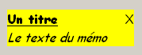

**图 11.5**
*代表备忘录的图形组件外观*

## 模板

在开发 JavaScript 组件之前，我们需要基于 HTML 和 CSS 语言设计图形组件的外观。

在描述组件 HTML 结构的代码中，图形组件包含三个元素：备忘录标题（标记 ❶）、用于关闭它的按钮（标记 ❷）以及它的文本（标记 ❸）：

```html
<div class="memo">
<div class="titre">Un titre</div
<div class="fermeture">X</</div>
<div class="corps">Le texte du memo</div
</div>
```

上述代码基于 CSS 类 `titre` 用于标题区域，`fermeture` 用于关闭按钮，`corps` 用于备忘录文本。`memo` 类处理备忘录的整体外观。

以下代码描述了使用的各种 CSS 类：

```css
.memo {
background: yellow;
font-family: cursive;
width: 10em;
}
.titre {
font-weight: bold;
text-decoration: underline;
float: left;
}
.fermeture {
float: right;
background: yellow;
color: black;
font-size: x-small;
cursor:pointer;
}
.corps {
clear:both;
font-style: italic;
}
```

现在我们已经实现了组件的结构，可以创建它的 JavaScript 类并将其与 HTML 和 CSS 模板。

## JavaScript 类

必须实现 `dojo.widget.defineWidget` 函数以定义组件的 JavaScript 类。它将类名、父类及其属性和方法作为参数。

`templatePath` 和 `templateCssPath` 属性允许将上一节创建的模板与 JavaScript 类关联。请注意，我们将这些文件存储在 dojo 分发版的 `src/widget/templates` 目录下，这些文件命名为 `Memo.html` 和 `Memo.css`。

以下代码提供了组件 JavaScript 类骨架的实现示例：

```javascript
dojo.provide("dojo.widget.Memo");
dojo.require("dojo.widget.*");
dojo.require("dojo.event.*");
dojo.widget.defineWidget(
"dojo.widget.Memo",
dojo.widget.HtmlWidget,
{
isContainer: true,
templatePath: dojo.uri.dojoUri(
"src/widget/templates/Memo.html"),
templateCssPath: dojo.uri.dojoUri(
"src/widget/templates/Memo.css")
}
);
```


dojo 库提供了通过相应的 `dojoAttachPoint` 和 `dojoAttachEvent` 属性绑定元素和事件，使 HTML 模板与 JavaScript 类进行交互的可能性。

由于声明中包含的标签必须自动添加到备忘录主体中，因此包含备忘录主体的 div 标签必须链接到类的 `containerNode` 属性（标记 ❶），如下代码所示：

```html
<div class="memo">
  <div class="titre">一个标题</div>
  <div class="fermeture">X</div>
  <div class="corps"dojoAttachPoint="containerNode"></div> <!-- ¨ ❶ -->
</div>
```

LivreGougeon 第 309 页 2006 年 11 月 28 日星期二 4:23 16

### dojo 库的图形支持
**309**

*第 11 章*

`containerNode` 名称对应我们图形组件 JavaScript 类的一个属性，该属性继承自 `dojo.widget.HtmlWidget` 类。该属性对应图形组件在实现时的内容。

还需要添加一个事件来处理关闭按钮的点击。

组件 JavaScript 类的 `fermerMemo` 方法必须链接到对应此按钮的 div 标签（标记 ❶）的 `click` 事件，如下代码所示：

```html
<div class="memo">
  <div class="titre">一个标题</div>
  <div class="fermeture"dojoAttachEvent="onClick: fermerMemo">X</div> <!-- ¨ ❶ -->
  <div class="corps"dojoAttachPoint="containerNode"></div>
</div>
```

在下面的代码中，必须将 `fermerMemo` 方法（标记 ❷）添加到 JavaScript 类中以销毁组件，同时添加一个 `titre` 属性（标记 ❶）用于存储为备忘录指定的标题：

```javascript
dojo.widget.defineWidget(
  "dojo.widget.Memo",
  dojo.widget.HtmlWidget,
  {
    isContainer: true,
    templatePath: dojo.uri.dojoUri(
      "src/widget/templates/Memo.html"),
    templateCssPath: dojo.uri.dojoUri(
      "src/widget/templates/Memo.css"),
    titre: "默认标题", // ¨ ❶
    fermerMemo: function(evenement) { // ¨ ❷
      this.destroy();
    }
  }
);
```

类的属性会根据组件实现时使用的属性自动初始化。

dojo 库还提供了通过类属性值对组件的 HTML 模板进行参数化的可能性。这样，备忘录的标题值就可以很容易在其 HTML 模板中使用（标记 ❶），如下代码所示：

```html
<div class="memo">
  <div class="titre">${this.titre}</div> <!-- ¨ ❶ -->
  <div class="fermeture"dojoAttachEvent="onClick: fermerMemo">X</div>
  <div class="corps»dojoAttachPoint="containerNode"></div>
</div>
```

LivreGougeon 第 310 页 2006 年 11 月 28 日星期二 4:23 16

# 图形 JavaScript 库
**310**

*第四部分*

## 组件的使用

可以通过 dojo 库的功能在 HTML 页面中实现此组件，特别是通过结合使用 HTML `div` 标签和 `dojoType` 属性（标记 ❷），如下代码所示：

```html
<html>
<head>
  <title>Memo 图形组件测试</title>
  <script type="text/javascript">
    djConfig = { isDebug: true };
  </script>
  <script type="text/javascript" src="../../dojo.js"></script>
  <script type="text/javascript">
    dojo.require("dojo.widget.Memo"); // ¨ ❶ -->
  </script>
</head>
<body>
  <div dojoType="memo" titre="一个标题"> <!-- ¨ ❷ -->
    memo
  </div>
</body>
</html>
```

在可以使用该组件之前，必须导入该 JavaScript 类（标记 ❶）。现在我们将详细介绍 dojo 提供的供使用的机制。

### 组件的实现

dojo 提供了两种在 Web 页面中实现图形组件的方法，这需要在页面开头导入模块，如下代码所示：

```html
<html>
<head>
  <script type="text/javascript">
    djConfig = { isDebug: true };
  </script>
  <script type="text/javascript" src="../../dojo.js"></script>
  <script type="text/javascript">
    dojo.require("dojo.widget.Memo"); // ¨ ❶ -->
  </script>
</head>
<body>
  <div dojoType="memo" titre="一个标题"> <!-- ¨ ❷ -->
    texte
  </div>
</body>
</html>
```

LivreGougeon 第 311 页 2006 年 11 月 28 日星期二 4:23 16

### dojo 库的图形支持
**311**

*第 11 章*

### 基于 HTML 的方法

dojo 提供了基于 HTML 结构化图形组件的可能性。默认情况下，dojo 会遍历页面上的所有标签以检测并实例化图形组件。

```html
<html>
<head>
  <script type="text/javascript">
    djConfig = {
      parseWidgets: false, <!-- ¨ ❶ -->
      searchIds: ["conteneurComants", "monComposant"] <!-- ¨ ❷ -->
    };
  </script>
</head>
<body>
  <div id="conteneurComants"> <!-- ¨ ❸ -->
    ...
  </div>
  <div id="monComposant"dojoType="...">...</div> <!-- ¨ ❹ -->
</body>
</html>
```

尽管如此，这种行为可以通过 HTML 属性（标记 ❶）使用 `dojoType` 来禁用。在这种情况下，该属性在 HTML 级别没有意义，但用于为图形组件指定初始化参数。

```html
<div dojoType="Dialog" id="fenetre" bgColor="white" bgOpacity="0.9" toggle="fade" toggleDuration="250"></div>
```

### 基于编程的方法

dojo 库提供了通过编程指定和加载图形组件的可能性，这是基于 `dojo.widget.createWidget` 函数的。

该函数接收图形组件的类型、一个包含其不同属性的关联数组以及一个可选的与组件链接的节点。

```javascript
// 获取绑 div 标签
var monDiv = dojo.byId("monDiv");

// 创建图形组件
var proprietes = {
  title: "我的窗口标题"
};

var monComposant = dojo.widget.createWidget( // ¨ ❶ -->
  "FloatingPane", proprietes, monDiv);
```


随后，可以通过 `addChild` 方法将组件连接起来。该方法接收一个图形组件作为参数，从而通过提供添加子组件的能力来管理嵌套组件。

以下代码描述了如何使用 `addChild` 方法（标记 ❶）将组件连接起来：

```javascript
// 获取挂载的 div 标签
var monDiv = dojo.byId("monDiv");

// 创建根图形组件
var composantRacine = dojo.widget.createWidget(
"LayoutContainer", {}, monDiv);

// 创建子组件
var proprietes = {
  layoutAlign: "left"
};
var composantEnfant = dojo.widget.createWidget(
"ContentPane", proprietes);

// 将组件添加到根组件中
composantRacine.addChild(composantEnfant); // ❶
```

# 图形组件的操作

现在我们已经说明了如何定义图形组件，现在可以详细述引用它们的方法，以便对其进行操作并为其关联处理逻辑。

## 使用组件管理器

dojo 库基于 `dojo.widget.manager` 对象来存储图形组件。该对象由 `dojo.widget.Manager` 模块自动实例化。

表格 11.12 汇总了该对象可用的主要方法。

### 表 11.12 `dojo.widget.manager` 对象的主要方法

| 方法 | 参数 | 描述 |
| :--- | :--- | :--- |
| `add` | 组件实例 | 将图形组件添加到管理器的组件列表中。 |
| `destroyAll` | - | 销毁管理器的所有组件。 |
| `getAllWidgets` | - | 返回一个包含管理器中所有图形组件的数组。 |
| `getImplementation` | 组件名称、传递给构造函数的对象、属性和方法的关联数组以及一个命名空间 | 根据 `getImplementationName` 方法获取其对象后，实例化一个图形组件。 |
| `getImplementationName` | 组件名称和命名空间 | 根据组件名称和命名空间返回图形组件的构造函数。 |
| `getWidgetById` | 组件标识符 byId | 根据标识符返回图形组件的实例。 |
| `getWidgetByNode` | DOM 节点 byNode | 返回与传入参数节点对应的管理器图形组件。 |
| `getWidgetsPackageList` | - | 返回已注册的图形组件包列表。 |
| `getWidgetsByFilter` | 过滤函数和标志位 byFilter | 根据过滤函数返回管理器图形组件的子集。如果标志位包含 `true`，则只返回第一个匹配的组件。 |
| `getWidgetsByType` | 组件类型 byType | 返回管理器中指定类型的所有图形组件。 |
| `registerWidgetPackage` | 包名 | 将名称注册为图形组件包。默认注册了 `dojo.widget` 包。 |
| `remove` | 索引 | 根据组件在管理器组件数组中的索引销毁图形组件。 |
| `removeById` | 组件标识符 | 根据组件标识符销毁图形组件。 |

这些方法基于 `widgets` 和 `widgetIds` 属性来存储图形组件，这两个属性均对应于数组。同样注意存在 `topWidgets` 属性，它是一个关联数组，用于存储顶层（即无父组件的）图形组件。

表格 11.12 中描述的大多数方法可以通过 `dojo.widget` 对象的方法直接访问。这些方法在组件管理器的上下文中自动执行，管理器可以通过 `dojo.widget.manager` 对象访问。

表格 11.13 通过描述它们与组件管理器方法的对应关系对其进行了汇总。

### 表 11.13 与组件管理器相关的 `dojo.widget` 对象主要方法

| 函数 | 描述 |
| :--- | :--- |
| `addWidget` | 对应 `dojo.widget.manager` 对象的 `add` 方法。 |
| `all` | 对应 `dojo.widget.manager` 对象的 `getAllWidgets` 方法。 |
| `destroyAllWidgets` | 对应 `dojo.widget.manager` 对象的 `destroyAll` 方法。 |
| `getImplementation` | 对应 `dojo.widget.manager` 对象的 `getWidgetImplementation` 方法。 |
| `getImplementationName` | 对应 `dojo.widget.manager` 对象的 `getWidgetImplementationName` 方法。 |
| `getWidgetById` 和 `byId` | 对应 `dojo.widget.manager` 对象的 `getWidgetById` 方法。 |
| `getWidgetsByFilter` 和 `byFilter` | 对应 `dojo.widget.manager` 对象的 `getWidgetsByType` 方法。（注：原文此处可能可能有误） |
| `getWidgetsByType` 和 `byType` | 对应 `dojo.widget.manager` 对象的 `getWidgetsByType` 方法。 |
| `registerWidgetPackage` | 对应 `dojo.widget.manager` 对象的 `registerWidgetPackage` 方法。 |
| `removeWidget` | 对应 `dojo.widget.manager` 对象的 `remove` 方法。 |
| `removeWidgetById` | 对应 `dojo.widget.manager` 对象的 `removeById` 方法。 |

在以下代码中，`addWidget` 方法（标记 ❶）允许将组件添加到组件管理器：

```javascript
// 获取挂载的 div 标签
var monDiv = dojo.byId("monDiv");

// 创建图形组件
var proprietes = {
  title: "Le titre de ma fenêtre"
};
var monComposant = dojo.widget.createWidget(
"FloatingPane", proprietes, monDiv);

dojo.widget.addWidget(monComposant); // ❶
```

注意，显式使用此函数并不是必需的，因为图形组件在创建时负责自己向组件管理器注册。反之，它在删除时会注销。

在以下代码中，`byId` 方法（标记 ❶）允许根据标识符引用组件：

```javascript
// 引用标识为“monComposant”的图形组件
var monComposant = dojo.widget.byId("monComposant"); // ❶
```

注意，无论组件如何如何创建，都可以使用此函数。其他方法如 `byType` 和 `byFilter` 允许获取一组组件。

第一种提供了访问特定类型组件列表的可能性，如下代码所示：

```javascript
var typeComposant = "ContentPane";
var composants = dojo.widget.byType(typeComposant);
```

第二个函数根据传入的过滤函数返回一个元素或元素列表。以下代码给出了如何访问特定 DOM 节点的图形组件的示例：

```javascript
// 一个 DOM 节点
var nœud = (...)

// 定义过滤函数
var fonctionFiltrage = function(composant) {
  if( composant.domNode == nœud ) {
    return true;
  }
};

// 使用过滤函数调用函数
var composantRelatif = dojo.widget.byFilter(fonctionFiltrage,true);
```

## 组件的方法与属性

每个组件提供两个只读属性，以便分别访问组件的 DOM 树根节点（属性 `domNode`）以及它的容器节点（属性 `containerNode`）。

每个组件都拥有多种方法来控制其显示，这些方法在表格 11.14 中汇总。


## 表 11.14 图形组件的显示管理方法

| 方法 | 说明 |
| :--- | :--- |
| `hide` | 隐藏图形组件。 |
| `isShowing` | 判断图形组件是否显示。 |
| `show` | 显示图形组件。 |
| `toggle` | 切换图形组件的显示模式。如果组件显示，则将其隐藏，反之亦然。 |

## 图形 JavaScript 库

以下代码展示了如何对组件使用 `show`（标记 ❶）、`hide`（标记 ❷）和 `isShowing`（标记 ❸）方法的用示例：

```javascript
// 获取关联的 div 标签
var monDiv = dojo.byId("monDiv");

// 创建图形组件
var proprietes = {
  title: "我的窗口标题"
};
var monComposant = dojo.widget.createWidget(
  "FloatingPane", proprietes, monDiv);

// 显示组件
monComposant.show(); // ❶
var estAffiche = monComposant.isShowing(); // ❸
// estAffiche 包含 true

// 隐藏组件
monComposant.hide(); // ❷
estAffiche = monComposant.isShowing(); // ❸
// estAffiche  false
```

每个组件都提供了 `destroy` 方法，用于递归地销毁自身及其子组件。该方法还会将组件及其子组件从网页的组件管理器中取消注册。

以下代码提供了该方法的实现示例（标记 ❶）：

```javascript
// 获取关联的 div 标签
var monDiv = dojo.byId("monDiv");

// 创建根图形组件
var composantRacine = dojo.widget.createWidget(
  "LayoutContainer", {}, monDiv);

// 创建子图形组件
var proprietes = {
  layoutAlign: "left"
};
var composantEnfant = dojo.widget.createWidget(
  "ContentPane", proprietes);

// 将子组件添加到根组件
composantRacine.addChild(composantEnfant);

/* 销毁 composantRacine 及其子组件 (composantEnfant) */
composantRacine.destroy(); // ❶
```

### 事件管理

由于库对事件的支持允许在对象方法执行时注册观察者，因此可以实现 `dojo.event.connect` 函数，以便在图形组件支持的事件上注册观察者。

图形组件不同部分的 DOM 事件必须仅在组件内部进行处理，由组件本身负责处理。

### dojo 库的图形支持

尽管如此，用户可以在处理事件时调用的方法上注册观察者。可以注册观察者的图形组件方法通常以 `on` 为前缀。这些方法的名称可以是 `onShow`、`onHide` 或 `onResized`，分别对应组件显示、隐藏和调整大小的时刻。

以下代码详细说明了如何基于组件的 `onShow` 方法在选择标签页时注册观察者（标记 ❶）：

```javascript
function traiterSelectionOnglet() {
  // 处理事件
  (...)
}

var monOnglet = dojo.widget.byId("monOnglet");
dojo.event.connect(monOnglet, "onShow", "traiterSelectionOnglet"); // ❶
```

### 总结

`dojo` 库提供了有趣的机制，用于在网页中结构化和实现图形组件。这些机制利用了面向对象编程，并利用了库提供的各种图形实用模块。

我们在分离图形组件的不同部分方面付出了特别努力。处理逻辑被汇总在一个 JavaScript 类中，而图形结构定义在 HTML 模板文件中，外观则定义在 CSS 模板文件中。

`dojo` 还提供了各种函数来引用和操作图形组件。这一方面特别允许属性和方法之间进行交互，并注册事件观察者。

最后，`dojo` 允许使用前面章节介绍的机制定义自定义图形组件。尽管它提供了一系列图形组件，但现在我们将详细介绍其中的主要的。

### 预定义组件

我们在上一节中描述了 `dojo` 库为结构化和实现图形组件提供的框架。该库提供了 Web 应用程序中常用组件的各种实现。后续章节的目的是描述这些主要的图形组件，我们按类型对其分组。

### 简单组件

## 表 11.15 简单图形组件

| 组件 |  |
| :--- | :--- |
| `dojo.widget.Button` | 对应按钮。 |
| `dojo.widget.CheckBox` | 对应复选框。 |
| `dojo.widget.ComboBox` | 对应支持自动补全的选择列表。 |
| `dojo.widget.DatePicker` | 对应高级日历。 |
| `dojo.widget.DropdownDatePicker` | 与 `DatePicker` 同一类型的组件，但可以根据用户操作进行展开。 |
| `dojo.widget.DropdownTimePicker` | 与 `DropdownDatePicker` 同一类型的组件，但用于小时和分钟。 |
| `dojo.widget.Select` | 对应选择列表。 |

以下代码提供了在网页中实现 `dojo.widget.Button`（标记 ❸）、`dojo.widget.ComboBox`（标记 ❶）和 `dojo.widget.DropdownDatePicker`（标记 ❷）组件的示例：

```html
<table border="0">
  <tr>
    <td valign="center">编辑器：</td>
    <td valign="center">
      <select name="editeur" dojoType="combobox" // ❶ style="width: 300px;">
        <option value="Eyrolles">Eyrolles</option>
        (...)
      </select>
    </td>
  </tr>
  <tr>
    <td valign="center">出版日期：</td>
    <td valign="center">
      <div dojoType="dropdowndatepicker" // ❷ containerToggle="fade"></</div>
    </td>
  </tr>
  <tr>
    <td valign="center" colspan="2">
      <button dojoType="Button">搜索</button> // ❸
    </td>
  </tr>
</table>
```

`dojo.widget.ComboBox` 组件比 `dojo.widget.Select` 组件复杂得多，因为它集成了本地和远程的自动补全机制。图 11.6 展示了上述代码中定义的各种元素组件的外观。

**图 11.6：元素组件的外观**

为了使用 Ajax 技术管理表单数据，可以实现 `dojo.io.FormBind` 类。它允许通过 Ajax 请求简单地发送表单数据，基于 `dojo` 库对 `dojo.io.bind` 函数的支持。这种发送在点击表单提交按钮时完成。表单信息被用作发送的 HTTP 请求的参数。


# 引言

该类的构造函数接收一个关联数组作为参数，该数组包含对应表单的节点以及一个用于接收发送响应后执行处理的回调方法。

以下代码显示了如何为标识为 `monFormulaire` 的表单实现此类：

```javascript
var sauvegardeFormulaire = new dojo.io.FormBind({
  formNode: dojo.byId("monFormulaire"),
  load: function(load, donnees, evenement) {
    /* 接收到表单数据提交
    响应后要执行的处理 */
    (...)
  }
});
```

LivreGougeon Page 320 2006 年 11 月 28 日星期二 4:23 16

## 图形 JavaScript 库
**320**

*第四部分*

***

## 布局

dojo 库提供了多种图形组件用于在 Web 页面上定位元素。这些组件对应于容器，既可以包含 dojo 图形组件，也可以包含经典的 HTML 代码。

### 布局管理器

由 `dojo.widget.LayoutContainer` 组件实现的布局管理器提供了定义区域并设置它们相互相对位置的功能。图 11.7 描述了该组件实现的区域布局及其相应的名称。

### 区域容器

* 顶部区域 (top)
* 左侧区域 (left)
* 中央区域 (client)
* 右侧区域 (right)
* 底部区域 (bottom)

**图 11.7**
*布局管理器的区域及其相应名称*

代表区域的元素实体对应 `dojo.widget.ContentPane` 组件。该组件可以与此布局管理器配合，也可以与后续两个节中描述的组件配合。

如下代码所示，该组件的内容可以在其标签中定义（标记 ❶），也可以引用一个网页（标记 ❷）：

```html
(...)
<div dojoType="ContentPane">  ❶
  我的区域内容
</div>
<div dojoType="ContentPane" href="contenuZone.html"></div>  ❷
(...)
```

Livre-Gougeon Page 321 2006 年 11 月 28 日星期二 4:23 16

### dojo 库的图形支持
**321**

*第 11 章*

布局管理器定义的区域基于 `layoutAlign` 属性来定义它们在管理器中的位置。以下代码提供了该布局管理器（标记 ❶）及其不同区域（标记 ❷）的实现示例：

```html
<div dojoType="LayoutContainer"  ❶
  layoutChildPriority='left-right'
  style="border: 2px solid black; width: 100%; height: 300px; padding: 0px;">
  <div dojoType="ContentPane" layoutAlign="top"  ❷
    style="background-color: #b39b86;">
    顶部区域
  </div>
  <div dojoType="ContentPane" layoutAlign="bottom"  ❷
    style="background-color: #b39b86;">
    底部区域
  </div>
  <div dojoType="ContentPane" layoutAlign="left"  ❷
    style="background-color: #acb386; width: 100px;">
    左侧区域
  </div>
  <div dojoType="ContentPane" layoutAlign="right"  ❷
    style="background-color: #acb386;">
    右侧区域
  </div>
  <div dojoType="ContentPane" layoutAlign="client"  ❷
    style="background-color: #f5ffbf; padding: 10px;">
    中央区域
  </div>
</div>
```

请注意，基于 CSS 技术和其 style 标签为不同区域关联样式。

### 可缩放布局管理器

`dojo.widget.SplitContainer` 组件对应另一种类型的布局管理器，允许定义可缩放的区域。它可以与 `dojo.widget.LayoutContainer` 组件并行使用，并基于 `dojo.widget.ContentPane` 组件来定义其区域。分割可以是垂直的也可以是水平的。这一特性通过组件的 `orientation` 属性配置。

以下代码实现了一个 `SplitContainer` 组件（标记 ❶），它包含两个水平相邻（标记 ❷）的可缩放区域（标记 ❸）：

```html
<div dojoType="SplitContainer"  ❶
  orientation="horizontal"  ❷
  sizerWidth="5" activeSizing="true"
  style="border: 2px solid black; float: left; width: 100%; height: 300px;">
  <div dojoType="ContentPane" sizeMin="20" sizeShare="20">  ❸
    左侧区域定义
  </div>
  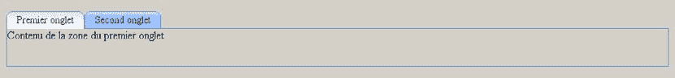
  <div dojoType="ContentPane" sizeMin="50" sizeShare="50">  ❸
    右侧区域定义
  </div>
</div>
```

Livre-Gougeon Page 322 2006 年 11 月 28 日星期二 4:23 16

## 图形 JavaScript 库
**322**

*第四部分*

***

## 标签页

dojo 库还提供了基于标签定位区域的可能性，该机制由 `dojo.widget.TabContainer` 组件实现。与之前一样，它可以基于 `dojo.widget.ContentPane` 类型的组件来定义标签页的内容，也可以基于之前节中描述的管理器。

以下代码给出 `dojo.widget.TabContainer` 组件（标记 ❶）的实现示例，用于定义两个与标签页相关的区域（标记 ❷）：

```html
<div id="mainTabContainer" dojoType="TabContainer"  ❶
  selectedTab="premierlet">
  <div id="premierlet" dojoType="ContentPane"  ❷
    第一个标签页的内容
  </div>
  <div id="secondlet" dojoType="ContentPane"  ❷
    第二个标签页的内容
  </div>
</div>
```

请注意存在 `selectedTab` 标签，它允许指定初始标签页。图 11.8 展示了本节实现的模态窗口的外观。

**图 11.8**
*基于标签页的布局管理器的外观*

## 窗口

dojo 允许在页面内实现各种窗口。在这些页面内部，这些窗口允许在上方显示信息。

### 模态窗口

这种类型的窗口位于页面内容上方并居中位置，同时防止对其进行操作。尽管如此，内容仍然可以保持可见，但不可修改。dojo 库基于 `dojo.widget.Dialog` 类实现了此功能，该类的使用依赖于一个 `div` 标签，用于界定其包含的元素。表 11.16 汇总了该类支持的各种属性。

**表 11.16 *dojo.widget.Dialog* 类的属性**

| 属性 |  |
| :--- | :--- |
| `bgColor` | 用于遮盖页面内容的颜色。 |
| `bgOpacity` | 用于遮盖页面内容的透明度。 |
| `toggle` | 用于显示和隐藏窗口的特效。 |
| `toggleDuration` | 前述特效的持续时间。 |

此类窗口的实现通过以下方式完成，即指定其属性（标记 ❶）以及其内容（标记 ❷）：

```html
<!-- 定义窗口及其属性 -->
<div dojoType="Dialog" id="maFenetreModale" bgColor="white"
  bgOpacity="0.5" toggle="fade" toggleDuration="250">  ❶
  <!-- 定义窗口内容 -->
  该区域是一个包含表单的模态窗口。  ❷
  <br/><br/>
  <form onsubmit="return false;">
    <table>
      <tr>
        <td>第一个字段:</td>
        <td><input type="text"></td>
      </tr>
      <tr>
        <td>第二个字段:</td>
        <td><input type="text"></td>
      </tr>
    </table>
  </form>
  要关闭它，请点击<a href="javascript:void(0)" id="fermeture">这里</a>。
</div>
```

Livre-Gougeon Page 324 2006 年 11 月 28 日星期二 4:23 16


# JavaScript 图形库

## 324 - 第四部分

如下所示代码所示，窗口的显示是通过其 `show` 方法（标记 ❶）完成的：

```javascript
function afficherFenetre() {
  var fenetre = dojo.widget.byId("maFenetreModale");
  fenetre.show(); // ❶
}
```

窗口的关闭通过基于一个支持 `onclick` 事件的节点来实现，该节点通过 `setCloseControl` 方法指定。窗口会自动注册为该事件的观察者，从而实现关闭。

关闭 ID 为 `maFenetreModale` 窗口的节点指定通过通过 `setCloseControl` 方法（标记 ❶）如下方式完成：

```javascript
function initialiserFenetre() {
  var fenetre = dojo.widget.byId("maFenetreModale");
  var fermeture = document.getElementById("fermeture");
  fenetre.setCloseControl(fermeture); // ❶
}
dojo.addOnLoad(initialiserFenetre);
```

请注意，图形组件的 `hide` 方法也可以显式地用于此目的。

图 11.9 展示了在本节中实现的模态窗口外观。

**图 11.9**
*模态窗口外观*

## 浮动窗口

这种类型的窗口将位于 Web 页面上方的指定位置。它可以被移动，如果它允许的话，还可以被调整大小，并且网页的内容保持可见且可编辑。

dojo 库基于 `dojo.widget.FloatingPage` 类实现了此功能，该类使用 `div` 标签来界定其包含的元素。

## 325 - dojo 库的图形支持 - 第 11 章

表 11.17 汇总了该类支持的各种属性。

### 表 11.17 `dojo.widget.FloatingPage` 类属性

| 属性 |  |
| :--- | :--- |
| `constrainToContainer` | 指定窗口所属的父容器。允许在另一个窗口内部实现子窗口。 |
| `displayCloseAction` | 指定在窗口栏中是否显示用于关闭窗口的图标。 |
| `displayMaximizeAction` | 指定在窗口栏中是否显示用于最大化的图标。 |
| `displayMinimizeAction` | 指定在窗口栏中是否显示用于最小化的图标。 |
| `hasShadow` | 指定窗口是否拥有阴影。 |
| `iconSrc` | 指定在窗口栏中显示的图标路径。 |
| `resizable` | 指定窗口是否可以调整大小。 |
| `title` | 指定窗口的标题。 |

此类窗口的实现通过指定其属性（标记 ❶）以及其内容（标记 ❷）如下方式完成：

```html
<div dojoType="FloatingPane" id="maFenetreFlottante" ❶
  title="浮动窗口"
  constrainToContainer="true"
  hasShadow="true" resizable="true"
  displayMinimizeAction="true" displayMaximizeAction="true"
  displayCloseAction="true"  iconSrc="images/note.gif"
  style="width: 350px; height: 200px; left: 600px;">
  这是一个包含 ❷ 的浮动窗口。<form onsubmit="return false;">
    <table>
      <tr>
        <td>第一个字段：</td>
        <td><input type="text"></td>
      </tr>
      <tr>
        <td>第二个字段：</td>
        <td><input type="text"></td>
      </tr>
    </table>
  </form>
  <a href="javascript:void(0)" id="fermeture">此处</a>
</div>
```


## 326 - JavaScript 图形库 - 第四部分

图 11.10 展示了在本节中实现的模态窗口。

**图 11.10**
*模态窗口外观*

## 菜单与工具栏

dojo 库通过组件 `dojo.widget.MenuBar2` 和 `dojo.widget.MenuBarItem2` 实现了菜单栏和工具栏，它们分别对应于菜单栏及其工具栏的元素。

## 弹出态菜单

弹出态菜单基于 `dojo.widget.PopupMenu2` 和 `dojo.widget.MenuItem2` 图形组件实现，并通过鼠标右键点击显示。如下所示代码中的所示：

```html
<html>
<head>
  (...)
  <script type="text/javascript">
    dojo.require("dojo.widget.PopupMenu2");
  </script>
  <script type="text/javascript">
    function executerAction() {
      alert("触发了菜单的操作");
    }
  </script>
</head>
<body>
  <div dojoType="PopupMenu2" id="monMenu"
    contextMenuWindow="true"> <!-- ❶
    <div dojoType="MenuItem2" caption="执行操作"
      onClick="executerAction()"></div> <!-- ❷
    <div dojoType="MenuItem2" caption="已禁用"
      disabled="true"></div> <!-- ❸
    <div dojoType="MenuSeparator"></div>
    <div dojoType="MenuItem2" caption="已激活"></div> <!-- ❹
  </div>
</body>
</html>
```

这些属性用于构建弹出态菜单（标记 ❺）。


与上一节描述的菜单类型类似，`dojo.widget.MenuBarItem2` 组件可以根据 `submenuId` 属性引用菜单，并支持相同的属性。

以下代码提供了一个菜单栏的实现示例（标记 ❶），允许在其中一个元素上（标记 ❷）打开一个菜单（标记 ❸）：

```html
<html
<head>
(...)
<script type="text/javascript">
dojo.require("dojo.widget.Menu2");
</script>
<script type="text/javascript">
function executerAction() {
alert("Action déclenchée sur un élément de menu");
}
</script>
</head>
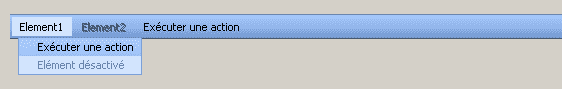
<body
<div dojoType="MenuBar2"> ¨ ❶
<div dojoType="MenuBarItem2"
caption="Element1"
submenuId="monSousMenu"></div> ¨ ❷
<div dojoType="MenuBarItem2"
caption="Element2" disabled="true"></div>
<div dojoType="MenuBarItem2"
caption="Exécuter une action"
onClick="executerAction();"></div>
</div>
<div dojoType="PopupMenu2" widgetId="monSousMenu"> ¨ ❸
<div dojoType="MenuItem2"
caption="Exécuter une action"
onClick="executerAction();"></div>
<div dojoType="MenuItem2"
caption="Elément désactivé" disabled="true"></div>
</div>
</body>
</html>
```

图 11.12 展示了本节中实现的菜单栏的外观。

**图 11.12**
*菜单栏的外观*

## 工具栏

工具栏在 dojo 库中是基于图形组件 `dojo.widget.ToolbarContainer`、`dojo.widget.Toolbar`、`dojo.widget.ToolbarButtonGroup` 和 `dojo.widget.ToolbarSelect` 实现，它们分别对应工具栏容器、工具栏本身以及这些各种元素。

工具栏的创建必须通过之前描述的 `dojo.widget.createWidget` 函数通过编程来实现。各个组件通过它们的 `addChild` 方法相互添加。

工具栏结构的创建实现方式如下：

```javascript
// 创建容器
var conteneur = dojo.widget.createWidget("ToolbarContainer");
// 创建工具栏
var barreOutils = dojo.widget.createWidget("Toolbar", {
id: "barreOutils" });
conteneur.addChild(barreOutils);

// 将工具栏添加到页面
document.body.insertBefore(conteneur.domNode,
document.body.firstChild);
```

从此，该工具栏就可以通过按钮和按钮组、分隔符和输入列表进行丰富，如以下代码所示：

(...)

```javascript
// 创建独立按钮
barreOutils.addChild("images/gras.gif", null, {toggleItem:true}); ¨ ❶
barreOutils.addChild("images/italique.gif", null, {toggleItem:true}); ¨ ❶
barreOutils.addChild("images/souligne.gif", null, {toggleItem:true}); ¨ ❶
barreOutils.addChild("|"); ¨ ❶
// 创建按钮组
var groupeBoutons = dojo.widget.createWidget("ToolbarButtonGroup", { ¨ ❷
name: "alignement",
defaultButton: "alignementGauche",
preventDeselect: true
});
groupeBoutons.addChild("images/alignementGauche.gif");
groupeBoutons.addChild("images/alignementCentre.gif");
groupeBoutons.addChild("images/alignementDroite.gif");
groupeBoutons.addChild("images/alignementTotal.gif");
barreOutils.addChild(groupeBoutons);
barreOutils.addChild("|");
barreOutils.addChild("test");
barreOutils.addChild("|");
// 创建选择框
var boiteSelection = dojo.widget.createWidget("ToolbarSelect", { ¨ ❸
name: "boiteSelection",
values: {
"Valeur1": "v1",
"Valeur2": "v2"
}
});
barreOutils.addChild(boiteSelection);
```

基础元素（如文本和图像）直接添加到菜单栏（标记 ❶）。更复杂的元素如按钮组（标记 ❷）或选择框（标记 ❸）也被添加到工具栏中。

如下代码所示，工具栏提供了与其按钮交互的可能性，以确定其状态（标记 ❶）、修改状态（标记 ❷）或禁用它们（标记 ❸）：

```javascript
var barreOutils = dojo.widget.byId("barreOutils");
var boutonGras = barreOutils.getItem("gras");
var boutonAlignementGauche = barreOutils.getItem("alignement")
.getItem("alignementGauche");
var estSelectionne = boutonGras.isSelected()); ¨ ❶
// 如果按钮 boutonGras 被选中，则 estSelectionne 为 true

var estActive = boutonGras.isEnabled()); ¨ ❶
// 如果按钮 boutonGras 被激活，则 estActive 为 true
// 选择按钮 boutonAlignementGauche
boutonAlignementGauche.setSelected(true); ¨ ❷
// 禁用按钮 boutonGras
barreOutils.disable("boutonGras"); ¨ ❸
```

请注意，上述方法指定的名称可以对应复杂元素的名称、文本或不带扩展名的按钮图像文件名。

图 11.13 展示了本节中实现的工具栏的外观。

**图 11.13**
*工具栏的外观*

## 复杂组件

dojo 库提供了各种更复杂的组件，如表格、树以及 Wysiwyg 编辑器。

### 表格

dojo 提供了基于图形组件 `FilteringTable` 和 `SortableTable` 实现表格的可能性。

前者允许定义一个显示内容可以根据过滤器进行排序和修改的表格。后者对应一个可以按列进行排序的表格。

`FilteringTable` 类型组件的实现基于 `<table>` 标签，它特别允许定义表格的表头。表格数据可以在该标签中指定，也可以通过编程基于 JSON 结构加载。以下代码提供了一个此类表格的实现示例：

```html
<table dojoType="FilteringTable" id="monTableau"
headClass="fixedHeader" tbodyClass="scrollContent"
enableAlternateRows="true"
rowAlternateClass="alternateRow"
multiple="false" alternateRows="true" maxSortable="2"
cellpadding="0" cellspacing="0" border="0">
```


上述代码首先在表格表头中定义了与标识符和类型相关的信息（`field` 和 `dataType` 属性，标记 ❶），以及表格列的标签（`th` 标签体）。

随后，表格的各个行均以 HTML 的方式进行定义。然而，请注意行级 `tr` 标签中存在 `value` 属性（标记 ❷），这使得特别是在进行行选择时能够识别它们。

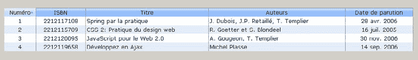

LivreGougeon 第 333 页 2006 年 11 月 28 日星期二 4:23 16

### dojo 库的图形支持

**333**

*第 11 章*

创建的表格可以通过点击其列头进行自动排序。

表格 `11.19` 汇总了 `FilteringTable` 组件除 `table` 标签的标准属性外，可使用的其他主要属性。

## 表格 11.19 图形组件 *FilteringTable* 主要属性

| 属性 | 说明 |
| :--- | :--- |
| alternateRows | 指定是否需要实现针对奇偶数行的显示处理。默认值为 `false`。 |
| headClass | 指定用于表格表头（`thead` 标签）的 CSS 类。 |
| headerClass | 指定用于表格中不同表头（`th` 标签）的 CSS 类。 |
| headerDownClass | 指定用于降序排序列头的 CSS 类。默认使用的类是 `selectedDown`。 |
| headerUpClass | 指定用于升序排序列头的 CSS 类。默认使用的类是 `selectedUp`。 |
| maxSortable | 指定可以同时进行排序的列数。默认值为 `1`。 |
| multiple | 指定在表格中是否可以选择多行。默认值为 `false`。 |
| rowAlternate-Class | 指定用于区分偶数行和奇数行的 CSS 类。 |
| rowClass | 指定用于单行（`tr` 标签）的 CSS 类。 |
| rowSelectedClass | 指定用于被选中的行（`tr` 标签）的 CSS 类。 |
| tbodyClass | 指定用于表格正文（`tbody` 标签）的 CSS 类。 |

以下代码提供了一个使用这些属性的示例，用于配置表格的行为（标记 ❷）以及表格所使用的 CSS 类（标记 ❶）：

```html
<table dojoType="FilteringTable" id="monTableau"
tbodyClass="scrollContent" rowAlternateClass="alternateRow" // ❶
multiple="false" alternateRows="true" maxSortable="1" // ❷
cellpadding="0" cellspacing="0" border="0">
(...)
</table>
```

图 `11.14` 描述了在本节中实现的表格的外观。

**图 11.14**

*可排序表格的外观*

LivreGougeon 第 334 页 2006 年 11 月 28 日星期二 4:23 16

# 图形 JavaScript 库

**334**

*第四部分*

如下所示代码所示，`dojo.widget.FilteringTable` 组件提供了 `getSelectedData` 方法（标记 ❶），以便访问所选数据：

```javascript
function getDonneeSelectionnee() {
    var monTableau = dojo.widget.byId("monTableau");
    return monTableau.getSelectedData(); // ❶
}
```

`dojo.widget.FilteringTable` 组件允许通过其 `store` 属性基于 JSON 格式的结构化数据通过编程修改其内容。该属性类型为 `dojo.data.SimpleStore`，可以通过 `dojo` 的 Ajax 支持进行更新。

以下代码指示了如何通过其 `store` 属性的 `addData` 方法（标记 ❶）编程向表格中添加元素：

```javascript
function ajouterLigne() {
    var monTableau = dojo.widget.byId("monTableau");
    monTableau.store.addData({ // ❶
        Numero: "4",
        Isbn: "2212119658",
        Titre: "Développez en Ajax",
        Auteurs: "Michel Plasse",
        DateParution: "09/14/2006"
    });
}
```

请注意，该库提供了通过 `setData` 方法替换表格所有数据，以及通过 `removeData` 方法删除其中一行的功能。

如下所示代码，可以基于 `FilteringTable` 组件的 `setFilter` 方法（标记 ❷）和回调函数，轻松地对表格字段应用相对于显示数据的过滤器：

```javascript
function filtreParution(dateParution) {
    return (dateParution > new Date("06/01/2004") && dateParution < new Date("08/01/2005"));
}

function filtrerDonnees() {
    var monTableau = dojo.widget.byId("monTableau");
    monTableau.setFilter("DateParution", filtreParution);
}
```

请注意，`clearFilters` 方法允许删除所有指定的过滤器。

dojo 库提供了多种图形组件来实现树。

LivreGougeon 第 335 页 2006 年 11 月 28 日星期二 4:23 16

**dojo 库的图形支持**

**335**

*第 11 章*

创建的表格可以通过点击其列头进行自动排序。

一旦定义了这种结构，就需要为其关联不同的实体来处理交互。如下代码所示：

```html
<div dojoType="Tree">
<div dojoType="TreeNode" title="Elément 1" expandLevel="2"> // ❶
<div dojoType="TreeNode" title="Elément 1.2" selected="true"> // ❷
<div dojoType="TreeNode" title="Elément 1.2.1"></div>
<div dojoType="TreeNode" title="Elément 1.2.2"></div>
</div>
</div>
```

第一个实体是树的控制实体，用于展开和关闭分支。该实体由 `dojo.widget.TreeBasicController` 提供。

第二个处理节点选择。可以指定另一个实体 `dojo.widget.TreeSelector`，以便点击的节点被选中。

这些实体通过 `listeners` 属性（标记 ❶）与树关联：

```html
<div dojoType="Tree" listeners="controller,selector">
```

图 11.15 描述了在本节中实现的树的外观。


## 描述

`expandLevel`
指定节点下展开的层数。

`isFolder`
指定该节点不是树的叶节点，可以包含子元素。

`object`
允许指定通过点击节点来访问的地址。

`selected`
指定该树节点被选中。

事件的处理是基于与树关联的选择实体进行的。该实体支持单击或双击的选择事件，以及取消选择事件。

如下代码所示，观察者的注册是通过 `dojo.event` 对象的 `connect` 方法（标记 ❶）通过 dojo 事件支持完成的：

```javascript
function traiterSelection(message) {
alert("Evénement de sélection: "+message);
}

function traiterDeselection(message) {
alert("Evénement de désélection: "+message);
}
```

LivreGougeon 第 337 页 2006 年 11 月 28 日星期二 4:23 16

### dojo 库的图形支持

**337**

*第 11 章*

```javascript
function initialisation() {
var selector = dojo.widget.byId("selector");
dojo.event.connect(selector, "select", "traiterSelection"); // ❶
dojo.event.connect(selector, "deselect", "traiterSelection"); // ❶
}

dojo.addOnLoad(initialisation);
```

注意，树事件观察者的关联必须在创建树之后进行。使用 `dojo.addOnLoad` 函数可以在此时实现这些处理。请注意，观察者接受的参数是一个包含节点类型及其标签的消息。

新版本的树支持提供了为其关联右键菜单以及管理拖放的功能。这些功能的实现包括使用 `TreeContextMenuV3` 类型组件和 `TreeDndControlerV3` 类型的树控制器，我们在此不详述它们的实现细节。

### Wysiwyg 编辑器

dojo 库提供了 `dojo.widget.Editor2` 组件，以便对 HTML 页面元素进行可视化编辑。该组件因此可以实现一个 Wysiwyg 编辑器。

以下代码提供了在 Web 页面实现该图形组件（标记 ❶）的示例：

```html
<html>
<head>
(...)
<script type="text/javascript">
dojo.require("dojo.widget.Menu2");
</script>
<script type="text/javascript">
function executerAction() {
alert("Action déclenchée sur un élément de menu");
}
</script>
</head>
<body>
<div id="editable" dojoType="Editor" widgetId="editdiv"> // ❶
这是一段使用 dojo 库的 Wysiwyg 编辑器的可编辑文本
</div>
</body>
</html>
```

如接代码所示（该代码调整了前述示例），可以根据编辑器的 `items` 属性（标记 ❶）限制工具栏中包含的元素：

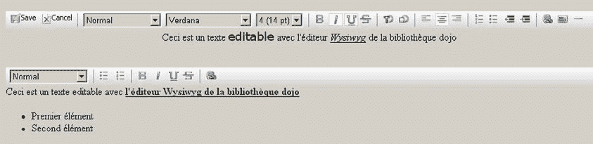

LivreGougeon 第 338 页 2006 年 11 月 28 日星期二 4:23 16

### 图形 JavaScript 库

**338**

*第四部分*

```html
<div id="editable" dojoType="Editor" widgetId="editdiv"
items="formatblock;|;insertunorderedlist;insertorderedlist;|;bold;italic;➥underline;strikethrough;|;createLink;"> // ❶
这是一段使用 dojo 库的 Wysiwyg 编辑器的可编辑文本
</div>
```

图 11.16 展示了此类组件在 HTML 页面中的显示情况。

**图 11.16**
*dojo 库的 Wysiwyg 编辑器的外观*

### 案例研究

在书中，我们完成了一个案例研究，以提供 JavaScript 语言、Ajax 技术和 dojo 库的实现示例。

该案例研究包含一个考古遗址管理应用程序，允许定义和修改与考古遗址相关的信息，例如名称、所在市镇以及类型。

另一个重要方面是它们在地图上的定位。正如我们在第 13 章关于 Google Maps 的章节中看到的，已经开发了一些功能以便将遗址位于其地理背景中。

#### dojo 的实现

dojo 发布版 0.3.1 版本的内容被复制到我们应用程序的 `js/dojo-0.3.1` 目录，其不同页面可以引用该目录。

如下代码所示，dojo 库的配置如第 7 章所述进行，通过实例化名为 `djConfig` 的对象（标记 ❶）并导入库的主文件（标记 ❷），文件名为 `dojo.js`：

```html
<html>
<head>
<script type="text/javascript">
djConfig = { isDebug: true }; // ❶
</script>
<script type="text/javascript"
src="/js/dojo-0.3.1/dojo.js"></script> // ❷
<script type="text/javascript">
(...)
</script>
</head>
<body>
(...)
</body>
</html>
```

如后续代码所示，使用的各种 dojo 模块通过 `dojo.require` 函数（标记 ❶）导入到每个 HTML 页面中：

```html
<html>
<head>
<script type="text/javascript">
djConfig = { isDebug: true };
</script>
<script type="text/javascript"
src="/dojo-0.3.1/dojo.js"></script>
<script type="text/javascript">
dojo.require("dojo.widget.Dialog"); // ❶
dojo.require("dojo.widget.FilteringTable"); // ❶
(...)
</script>
</head>
<body>
(...)
</body>
</html>
```

#### 图形组件的使用

案例研究的一部分实现了 `dojo.widget.FilteringTable` 和 `dojo.widget.Dialog` 组件，以便以表格形式管理遗址数据。

表格（`dojo.widget.FilteringTable` 组件）还提供了修改考古遗址基础数据的能力，即遗址的编号、名称、类型以及所在市镇，这是通过一个输入窗口（`dojo.widget.Dialog` 组件实现的，该窗口显示在 Web 页面的表格上方。

为了简化该机制的描述，我们在本节中省略了实现 Ajax 原理的代码。这些代码未处理页面的图形方面，仅通过 REST 架构加载并修改数据库数据。


<div style="float: right;">
<button dojoType="button" id="boutonEnregistrer">保存</button> ❻
</div>

</div>

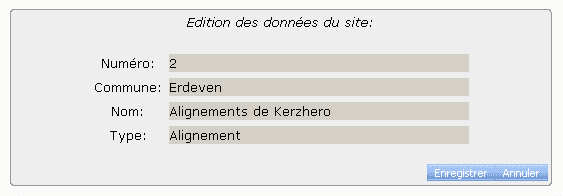

LivreGougeon Page 341 Mardi, 28\. novembre 2006 4:23 16

### dojo 库的图形支持

**341**

*第 11 章*

图 11.17 展示了输入窗口的外观。

**图 11.17** 
*输入窗口的外观*

在接下来的代码中，第二个组件对应于表格本身，首先定义了它的通用属性（标记 ❶），接着是它的列头（标记 ❷）以及用于初始化它的数据（标记 ❸）：

```html
<table dojoType="FilteringTable" id="tableau"
tbodyClass="scrollContent" rowAlternateClass="alternateRow" ❶
multiple="false" alternateRows="true" maxSortable="1" ❶
cellpadding="0" cellspacing="0" border="0"> ❶
<thead> ❷
<tr>
<th field="numero" align="center"
dataType="Number">编号</th>
<th field="commune" align="center"
dataType="String" valign="top">市镇</th>
<th field="nom" dataType="html">名称</th>
<th field="type" valign="top"
dataType="String">类型</th>
</tr>
</thead>
<<tbody>> ❸
(...)
</tbody>
</table>
```

请注意，列的 `field` 属性对应于表示表格数据的 JSON 结构中的属性名。

最后，接下来的代码实现了位于 Web 页面中表格下方的各种按钮，以便允许对表格元素进行添加（标记 ❸）、修改（标记 ❷）和删除（标记 ❶）操作；在添加和修改的情况下，这些按钮会触发输入窗口的打开：

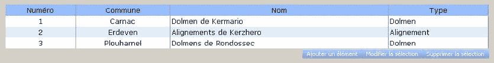

LivreGougeon Page 342 Mardi, 28\. novembre 2006 4:23 16

# 图形 JavaScript 库

**342**

*第四部分*

<div style="float: right;">
<button id="boutonSupprimer"dojoType="button"> ❶
删除所选站点</button>
</div>
<div style="float: right;">
<button id="boutonOuvrirEditer"dojoType="button"> ❷
修改所选站点</button>
</div>
<div style="float: right;">
<button id="boutonOuvrirAjouter"dojoType="button"> ❸
添加站点</button>
</div>

图 11.18 展示了表格和按钮的外观。

**图 11.18**
*表格及其操作按钮的外观*

## 行为规范

现在我们已经定义了 dojo 库提供的各种图形组件，我们将看到如何实现附加在上面的处理逻辑。

这些各种处理通过 `GestionnaireTableau` 类实现，该类允许自动将其某些方法注册为上一节节描述的各种按钮的观察者。

为了访问它所操作的元素，`GestionnaireTableau` 类提供了 `initialiser` 方法，该方法将它操作的各种元素作为参数传入。这些元素对应于表格、输入窗口和按钮。

接下来的代码给出了 `Gestionnaire-Tableau` 类基础结构的示例，该结构对应于类的构造函数（标记 ❶）以及它的初始化方法（标记 ❷）和事件观察者注册（标记 ❸）：

```javascript
function GestionnaireTableau() { } ❶

GestionnaireTableau.prototype = {
  initialiser: function(elements) { ❷
    this.tableau = elements["tableau"];
    this.fenetreSaisie = elements["fenetreSaisie"];
    this.boutonFenetreAjout = elements["boutonFenetreAjout"];
    this.boutonEnregistrer = elements["boutonEnregistrer"];
    this.boutonFenetreEdition = elements["boutonFenetreEdition"];

LivreGougeon Page 343 Mardi, 28\. novembre 2006 4:23 16

### dojo 库的图形支持

**343**

*第 11 章*

this.boutonSupprimer = elements["boutonSupprimer"];
    this.boutonAnnuler = elements["boutonAnnuler"];
    this.enregistrerObservateurs();
  },
  enregistrerObservateurs: function() { ❸
    dojo.event.connect(this.boutonFenetreAjout, "onClick",
    this, "ouvrirFenetreSaisiePourAjout");
    dojo.event.connect(this.boutonFenetreEdition, "onClick",
    this, "ouvrirFenetreSaisiePourModification");
    dojo.event.connect(this.boutonEnregistrer, "onClick",
    this, "enregistrerLigne");
    dojo.event.connect(this.boutonSupprimer, "onClick",
    this, "supprimerLigne");
    dojo.event.connect(this.boutonAnnuler, "onClick",
    this, "annuler");
  },
  (...)
}
```

该类还实现了处理各种用户操作的方法。

这些操作被汇总在表 11.21 中。表格中的标记编号指向接下来的代码示例，该示例提供了在 `GestionnaireTableau` 类中实现这些不同方法的示例：

```javascript
function GestionnaireTableau() { }

GestionnaireTableau.prototype = {
  (...)
  initialiserDonneesFenetreSaisie: function() {
    dojo.byId("fenetreSaisie.numero").value = "";
    dojo.byId("fenetreSaisie.commune").value = "";
    dojo.byId("fenetreSaisie.type").value = "";
  },
  getDonneesFenetreSaisie: function() {
    return {
      numero: dojo.byId("fenetreSaisie.numero").value,
      commune: dojo.byId("fenetreSaisie.commune").value,
      nom: dojo.byId("fenetreSaisie.nom").value,
      type: dojo.byId("fenetreSaisie.type").value
    };
  },
  setDonneesFenetreSaisie: function(donnees) {
    dojo.byId("fenetreSaisie.numero").value = donnees["numero"];
    dojo.byId("fenetreSaisie.commune").value = donnees["commune"];
    dojo.byId("fenetreSaisie.nom").value = donnees["nom"];
    dojo.byId("fenetreSaisie.type").value = donnees["type"];
  }
}

LivreGougeon Page 344 Mardi, 28\. novembre 2006 4:23 16

# 图形 JavaScript 库

**344**

*第四部分*

ouvrirFenetreSaisiePourAjout: function() { ❶
  this.initialiserDonneesFenetreSaisie();
  this.ajout = true;
  this.fenetreSaisie.show();
},
ouvrirFenetreSaisiePourModification: function() { ❷
  var donnees = this.tableau.getSelectedData();
  if (donnees != null) {
    this.setDonneesFenetreSaisie(donnees);
  }
  this.ajout = false;
  this.fenetreSaisie.show();
},
enregistrerLigne: function() { ❸
  if (this.ajout == true ) {
    this.tableau.addData(this.getDonneesFenetreSaisie());
  } else {
    var donnees = this.tableau.getSelectedData();
    if (donnees != null) {
      this.tableau.removeData(donnees);
      this.tableau.addData(this.getDonneesFenetreSaisie());
    }
  }
  this.fenetreSaisie.hide();
},
supprimerLigne: function() { ❹
  var donnees = this.tableau.getSelectedData();
  if (donnees != null) {
    this.tableau.removeData(donnees);
  }
},
annuler: function() { ❺
  this.fenetreSaisie.hide();
}
```

**表 11.21 屏幕元素操作**

| 按钮 | 处理方法 | 描述 |
| :--- | :--- | :--- |
| 取消 | `annuler` (标记 ❺) | 发生在输入窗口中的操作，允许关闭窗口而不保存输入的数据 |
| 保存 | `enregistrerLigne` (标记 ❸) | 发生在输入窗口中的操作，允许关闭窗口并保存输入的数据 |
| 添加站点 | `ouvrirFenetreSaisiePourAjout` (标记 ❶) | 打开输入窗口以便在表格中添加（标记 ❶）站点 |
| 修改所选站点 | `ouvrirFenetreSaisiePourModification` (标记 ❷) | 打开输入窗口以便修改（标记 ❷）表格中选中的站点。站点数据被加载到窗口表中 |
| 删除 | `supprimerLigne` (标记 ❹) | 删除表格中选中的站点 |

LivreGougeon Page 345 Mardi, 28\. novembre 2006 4:23 16


请注意，表格中显示的数据基于表格的 `store` 属性，该属性对应于类型为 `dojo.data.SimpleStore` 的实例。对其内容的修改会自动反映在表格显示上。这种修改主要通过其 `addData` 和 `removeData` 方法实现。

## 结论

正如我们在本中所看到的，`dojo` 库的图形支持极其丰富。它首先由一组实用模块组成，这些模块允许操作 Web 页面的各种组成部分、管理事件、效果以及拖放操作。

这些模块在解决这些不同问题的同时，整合了不同浏览器的特性。这一特性使得它们的处理在所有浏览器中都具有可移植性。

请注意，正在开发中的 `dojo.i18n` 模块旨在解决网页中 JavaScript 应用程序国际化相关的问题。

`dojo` 的图形支持更进了一，人们在结构化和实现图形组件方面付出了巨大努力。在此框架下，该库表现出特别的活性，因为它既提供了基于页面 HTML 结构的方法，也提供了基于编程的方法。

基于这种结构，`dojo` 库提供了一系列丰富的图形组件，从基础组件到更复杂的组件（如树和表格）。

`dojo` 库简化了第 7 章描述的模块的使用。这一特点在涉及 Ajax 技术的模块中尤为明显，因为使用这些技术发送和接收数据已集成到某些组件中，例如与 HTML 表单相关的组件。

## rialto 库

与 `dojo`一样，`rialto` 库提供了基于一套图形组件开发丰富 Web 应用的可能性。

然而，该库更多地关注通过各种专用组件和机制用于管理信息学的 Web 应用。

本章详细介绍了如何使用该库以及如何使用其图形组件开发应用程序。

### 历史

在详细介绍库及其用法之前，我们将简要回顾该项目的历史，并详细说明其不同的子项目及其目标。

由于本书的背景是 JavaScript 技术，我们在这里只介绍 `rialto JavaScript` 子项目。其他子项目提供了结合不同服务器技术使用 JavaScript 库核心的功能。

`rialto` 库最初位于朱维伊（Villejuif）的古斯塔·鲁西研究所（IGR），这是欧洲第一个癌症防治中心。它构建了一个可以通过 Web 访问的患者档案查询应用程序，目前已被 IGR 的所有医疗人员使用。

该项目的主要目标是实现一个让医院内部以及在其他场地的医生能够方便查询的 Web 应用，以便让他们访问患者的所有信息。

### 图形 JavaScript 库

`rialto` 的第二个目标是为用户提供他们在已经在该地部署的客户端/服务器模式管理应用中所习惯的丰富交互体验。

在 2002 年应用程序开发之初，人们还没有谈论 Ajax，也没有任何此类类型的框架可用。

#### 附属项目

JavaScript 子项目位于 `rialto` 项目的核心，因为它实现了丰富图形组件的实例化。尽管如此，还有其他子项目，其目标是方便在不同服务器技术下使用 JavaScript 库。它们本质上是将 JavaScript 类封装在用服务器端语言编写的组件中。

表格 12.1 汇总了所有的 `rialto` 子项目。

**表 12.1 rialto 子项目**

| 子项目 |  |
| :--- | :--- |
| rialto JavaScript | 项目核心，提供基础支持和图形组件的各种 JavaScript 类 |
| rialto Taglib | 一组 taglibs，方便在 J2EE 环境中使用 JavaScript 库 |
| rialto JSF | 基于 JSF (JavaServer Faces) 技术实现 JavaScript 组件，以便将其作为 Java 对象进行操作 |
| rialto PHP | 用 PHP 实现 JavaScript 组件，以便与该技术配合使用 |
| rialto Python | 用 Python 实现 JavaScript 组件，以便与该技术配合使用 |
| rialto .Net | 使用 .Net 技术实现 JavaScript 组件，以便与该技术配合使用 |

在本章的后续内容中，我们将 `rialto` 库称为相对于 JavaScript 组件的子项目。

### 安装

安装 `rialto` 库包括包含各种 CSS 和 JavaScript 文件。我们在本中使用该库的 0.8.6 版本。

CSS 文件提供了 `rialto` 库赖定义的 CSS 样式和类，用于定义其不同图形组件的外观。

以下代码提供了这些 CSS 文件的规范示例（标记 ❶）：

```html
<html>
<head>
(...)
<link rel="stylesheet" type="text/css" ❶ href="/rialto-0.8.6/rialtoEngine/style/rialto.css"/>
<link id="standard_behaviour" rel="stylesheet" ❶ type="text/css" href="/rialto-0.8.6/rialtoEngine/style/behavior.css"/>
<link id="defaultSkin" rel="stylesheet" type="text/css" ❶ href="/rialto-0.8.6/rialtoEngine/style/defaultSkin.css"/>
(...)
</head>
(...)
</html>
```

JavaScript 文件允许引用库的 JavaScript 元素。

以下代码给出了这些 JavaScript 文件的规范示例，即库库的 `config.js` 文件（标记 ❶）以及对应其元素的 `rialto.js` 文件（标记 ❷）：

```html
<html>
<head>
(...)
<script type="text/javascript" ❶ src="/rialto-0.8.6/rialtoEngine/config.js"></script>
<script type="text/javascript" ❷ src="/rialto-0.8.6/rialtoEngine/javascript/rialto.js"></script>
(...)
</head>
(...)
</html>
```

在之前包含的 `config.js` 文件中需要进行配置，以定位库的 JavaScript 元素的路径。

在该文件中，必须更新以下 JavaScript 块，要么使用使用的 Web 服务器上的库路径（标记 ❶），要么在未使用 Web 服务器时使用安装目录的本地路径（标记 ❷）：

```javascript
// protocol file: absolute local path for rialtoEngine
if (document.location.protocol == "file:"){
  rialtoConfig.isFilePath=true;
  rialtoConfig.pathRialtoE = "file://c:/rialto/rialtoEngine/"; // ❶
}
// protocol http: ; (relative path) url for rialtoEngine
else{
  if (document.location.protocol == "http:"){
    rialtoConfig.isFilePath=false;
    rialtoConfig.pathRialtoE = "rialtoEngine/"; // ❷
  }
}
```


尽管 `rialto` 库主要侧于于 HTML 页面中实现图形功能，但它也提供了方便基于 JavaScript 语言处理和 Ajax 技术的功能。

# 图形 JavaScript 库

*第四部分*

## 基础支持

在详细介绍 `rialto` 为开发图形应用提供的各种机制和组件之前，我们将先描述该该库的基础模块。

表 12.2 汇总了与基础支持相关的对象。

### 表 12.2 rialto 基础支持对象

| 对象 |  |
| :--- | :--- |
| `rialto.lang` | 提供了多种便于实现 JavaScript 基础机制的方法。 |
| `rialto.Dom` | 提供了多种与 JavaScript 使用 DOM 相关的方法。 |
| `rialto.string` | 提供了多种与 JavaScript 处理字符串相关的方法。 |
| `rialto.array` | 提供了多种与 JavaScript 处理数组相关的方法。 |
| `rialto.date` | 提供了多种与 JavaScript 处理日期相关的方法。 |
| `rialto.url` | 提供了多种与 JavaScript 使用和创建 URL 相关的方法。 |

`rialto.lang` 对象提供了多种与函数处理、对象处理以及类型检查的方法。表 12.3 汇总了这些不同的方法。

### 表 12.3 `rialto.lang` 对象的方法

| 方法 | 参数 | 描述 |
| :--- | :--- | :--- |
| `addMethods` | 一个对象和一个数组 | 允许向对象添加一组函数。 |
| `extendObject` | 一个类和一个数组 | 允许向类的原型上添加一组函数。（或使用 `extend`）。 |
| `isArray` | 一个对象 | 判断参数是否为数组。 |
| `isBoolean` | 一个对象 | 判断参数是否为布尔值。 |
| `isDate` | 一个对象 | 判断参数是否为日期。 |
| `isFunction` | 一个对象 | 判断参数是否为函数。 |
| `isNumber` | 一个对象 | 判断参数是否为数字。 |
| `isString` | 一个对象和一个可选的标志位 | 判断第一个参数是否为字符串。第二个参数是可选的，用于指定该字符串是否必须为非空。 |
| `isStringIn` | 一个字符串和一个数组 | 判断一个字符串是否包含数组中。 |
| `link` | 一个对象和一个函数 | 返回一个函数，可在参数对象的上下文中执行参数中的函数。 |

# rialto 库

*第 12 章*

如下所示，`link` 方法（标记 ❶）允许将函数绑定到对象，从而解决与 `this` 关键字相关的问题；函数的执行现在是在对象的上下文中进行的（标记 ❷）：

```javascript
// 定义一个使用 this 关键字的函数
function getAttribut() {
  return this.attribut;
}

// 定义一个拥有名为 attribut 的属性的对象
var unObjet = {};
unObjet.attribut = "La valeur de mon attribut";

// 将函数 getAttribut 绑定到对象 unObjet
var getAttributLiee = rialto.lang.link(unObjet, getAttribut); // ❶

// 在对象的上下文中执行函数
var retour = getAttributLiee(); // ❷

// retour 包含 « La valeur de mon attribut »
```

如下所示，`extendObject` 和 `addMethods` 方法提供了将属性和函数分别分配到对象原型和对象本身的能力：

```javascript
// 定义一个类
function MaClasse() {
}

// 向其原型添加方法
rialto.lang.extendObject(MaClasse, { // ❶
  methode1: function() {
    (...)
  }
});

var unObjet = new MaClasse();

// 向对象 unObjet 添加方法
rialto.lang.addMethods(unObjet, { // ❷
  methode2: function() {
    (...)
  }
});

// 执行对象的方法
unObjet.methode1();
unObjet.methode2();
```

在上面的代码中，添加到 `MaClasse` 类原型（标记 ❶）的方法被其所有实例共享，而添加到对象 `unObjet`（标记 ❷）的方法则是是该对象特有的。

以 `is` 开头的函数提供了检测变量类型的可能，如下代码所示：

```javascript
var tableau = [];
alert(rialto.lang.isArray(tableau)); // 显示 true
alert(rialto.lang.isFunction(tableau)); // 显示 false
```


/* « %20%20%20%20Ceci%20est%20ma%20cha%EEne%20de%20caract%E8%res » */

`rialto.array` 对象提供了多种与数组操作相关的方法，这些方法在表 12.6 中汇总。

### 表格 12.6 `rialto.array` 对象的方法

| 方法 | 参数 | 描述 |
| :--- | :--- | :--- |
| `add` | 一个数组 | 如果数组不包含参数传递的元素，则将该元素添加到数组末尾，并返回一个对象。 |
| `arrayToString` | 一个数组 | 返回数组的字符串形式表示。 |
| `copy` | 一个数组 | 创建并返回一个包含参数数组中所有元素的新数组。 |
| `indexOf` | 一个数组 | 如果数组包含该元素，则返回其在数组中的索引。否则，方法返回 -1。 |
| `insert` | 一个数组，一个索引和一个对象 | 在指定的索引处将参数传递的元素插入数组。 |
| `remove` | 一个数组和一个对象 | 如果数组包含参数传递的元素，则从数组中删除该元素。 |
| `sort` | 一个数组 | 按字母降序对数组元素进行排序。 |

### JavaScript 图形化库

以下代码提供了 `add` 和 `indexOf` 方法的实现示例，用于向数组中添加元素（标记 ❶）并随后确定其位置（标记 ❷）：

```javascript
var tableau = [ "élément1", "élément2", "élément3" ];

rialto.array.add(tableau, "élément4"); // ❶

var longueurTableau = tableau.length;

var indice = rialto.array.indexOf("élément4"); // ❷

/* indice 包含值 3，因为元素被添加到了数组末尾 */
```

`rialto.date` 对象提供了与日期操作相关的方法。表 12.7 汇总了这些不同的方法。

### 表格 12.7 `rialto.date` 对象的方法

| 方法 | 参数 | 描述 |
| :--- | :--- | :--- |
| `add` | 一个字符串，一个日期和一个时长 | 为日期添加一个时长。该时长可以是一年、几个月或几天。参数字符串允许指定所使用的时长类型。可能的值有 `year`（年）、`month`（月）和 `day`（天）。 |
| `DDMMYYYYfromYYYYMMDD` | 一个字符串 | 将字符串转换为 `DD/MM/YYYY` 格式的参数，代表 `YYYY/MM/DD` 格式的日期。缩写 `DD`、`MM` 和 `YYYY` 与之前的元素相同。 |
| `equals` | 两个日期 | 仅根据日、月、年比较两个日期。 |
| `getBornes` | 一个周数 | 返回一个包含参数传递的周数的起始日期和结束日期的数组。 |
| `getDDMMYYYY` | 一个日期 | 返回参数传递的日期的字符串表示。该方法基于 `DD/MM/YYYY` 格式，其中 `DD` 对应日期，`MM` 对应月份，`YYYY` 对应年份。 |
| `getLibJour` | 一个日期 | 返回参数日期的英文星期名称。 |
| `getWeekNumber` | 一个日期 | 返回参数传递的日期所在年份的周数。 |
| `getYYYYMMDD` | 一个日期 | 返回参数传递的日期的字符串表示。该方法基于 `YYYY/MM/DD` 格式，其中缩写 `DD`、`MM` 和 `YYYY` 与之前的元素相同。 |
| `isBissextile` | 一个整数 | 判断某年份是否为闰年。 |
| `isDate` | 一个字符串 | 判断一个字符串是否为 `DD/MM/YYYY` 格式。缩写 `DD`、`MM` 和 `YYYY` 与之前的元素相同。 |
| `setDateFromYYYYMMDD` | 一个字符串 | 返回一个基于 `YYYY/MM/DD` 格式的参数日期字符串初始化的日期。缩写 `DD`、`MM` 和 `YYYY` 与之前的元素相同。 |
| `toDay` | - | 返回当前日期的对象。 |
| `YYYYMMDDfromDDMMYYYY` | 一个字符串 | 将字符串转换为 `YYYY/MM/DD` 格式的参数，代表 `DD/MM/YYYY` 格式的日期。缩写 `DD`、`MM` 和 `YYYY` 与之前的元素相同。 |

### rialto 库

`rialto.date` 对象提供了多种方法用于将日期转换为字符串反之亦然。以下代码说明了 `getDDMMYYYY`（标记 ❶）和 `setDateFromYYYYMMDD`（标记 ❷）方法的实现，以完成此类类型转换：

```javascript
var date = new Date(2006, 8, 10);
// date 对应 2006 年 9 月 10 日
var chaine = rialto.date.getDDMMYYYY(date); // ❶
// chaine 包含值 10/09/2006 
var uneAutreDate = rialto.date.setDateFromYYYYMMDD("20060910"); // ❷
// uneAutreDate 对应 2006 年 9 月 10 日
```

而 `add` 方法允许向日期添加时长，如后续代码所示：

```javascript
var date = new Date(2006, 8, 10);
var nouvelleDate = rialto.date.add("month", date, 1);
/* nouvelleDate 对应在当前基础上增加一个月后的日期 */
```

`rialto.url` 对象提供了访问 Web 地址包含信息的方法。表 12.8 汇总了这些不同的方法。

### 表格 12.8 `rialto.url` 对象的方法

| 方法 | 描述 |
| :--- | :--- |
| `getArrayParameter` | 返回一个包含当前页面不同参数的数组。其每个元素都对应一个包含参数键和值的数组。 |
| `getObjectParameter` | 返回一个包含当前页面不同参数的对象。对象的属性对应于属性名。 |
| `getSearch` | 返回格式如下的当前页面参数字符串：`parametre1=valeur1&parametre2=valeur2`。 |
| `getUrl` | 返回当前页面的地址。 |

以下代码实现了表 12.8 中的各种方法，以便访问与页面地址相关的信息（标记 ❶）以及通过字符串访问页面参数字符串（标记 ❷）：

```javascript
/* 浏览器中输入的页面地址为：
   http://localhost/jsweb2.0/test.html?param1=valeur1&param2=valeur2
*/
var adressePage = rialto.url.getUrl(); // ❶
/* 变量 adressePage 包含值 "http://localhost/jsweb2.0/test.html?param1=valeur1&param2=valeur2" */
var parametresPage = rialto.url.getSearch(); // ❷
/* 变量 parametresPage 包含值 "param1=valeur1&param2=valeur2" */
```

### Ajax 技术支持

rialto 库提供了 `rialto.io.AjaxRequest` 类，以便实现基于 `XMLHttpRequest` 类的 Ajax 技术。`rialto.io.AjaxRequest` 类封装了此类异步请求的所有机制和周期。表 12.9 汇总了 `rialto.io.AjaxRequest` 类构造函数的不同参数。

### 表格 12.9 `rialto.io.AjaxRequest` 类构造函数的参数

| 参数 | 类型 | 描述 |
| :--- | :--- | :--- |
| `callBackObjectOnFailure` | 一个对象 | 对应在失败时执行回调函数的对象。 |
| `callBackObjectOnSuccess` | 一个对象 | 对应在成功时执行回调函数的对象。 |
| `canBeCancel` | 一个布尔值 | 指定请求在执行过程中是否可以取消。 |
| `method` | 一个字符串 | 对应执行请求的 HTTP 方法。 |
| `onFailure` | 一个函数 | - |


对应于请求失败时调用的回调函数。

`onSuccess`
函数
对应于请求成功时调用的回调函数。

`url`
字符串
对应执行请求的资源地址。

`withWaitWindow`
布尔值
指定执行请求时是否显示等待窗口。

请求的执行通过 `load` 方法实现，该方法接受一个包含输入数据的字符串作为参数。

以下代码展示了如何基于该类初始化（标记 ❶）然后执行（标记 ❹）一个 Ajax 请求的示例：

```javascript
function traiterDonnees(requete) { (...) }

function traiterErreurs(requete) { (...) }

var requete = new rialto.io.AjaxRequest({ ❶
  url:"/ajax.html",
  method: "get",
  withWaitWindow:true,
  onSuccess: traiterDonnees, ❷
  onFailure: traiterErreurs ❸
});

var parametres = "parametre1=valeur1&parametre2=valeur2";

requete.load(parametres); ❹
```

此代码基于类的构造函数来初始化请求成功（标记 ❷）和失败（标记 ❸）时的回调函数。这些函数接受一个类型为 `XMLHttpRequest` 的当前请求对象作为参数。

# rialto 库

让我们以一个回调函数为例，其作用是获取响应中包含的信息。该函数基于 JSON 格式的响应，其内容由以下代码描述：

```json
{
  "donnees": {
    "donnee1": "valeur1",
    "donnee2": "valeur2"
  }
}
```

以下代码给出了如何实现回调函数以获取 JSON 格式响应中包含信息的示例：

```javascript
function traiterDonnees(request){
  eval("var objetReponse="+request.responseText);
  var donnees = objetReponse.donnees;
  // 获取响应数据
  var donnee1 = donnees.donnee1;
  // donnee1 包含值“valeur1”
  var donnee2 = donnees.donnee2;
  // donnee2 包含值“valeur2”
}
```

请注意，`rialto` 库还提供了基于隐藏 iframe 实现 Ajax 技术的能力。

## 图形组件

现在我们已经讨论了 `rialto` 库的基础知识，包括它的基础工具对象和对 Ajax 技术的支持，我们将重点关注它的图形支持。

### 组件的结构化

`rialto` 的图形组件对应一个 JavaScript 类，该类操作页面的内存结构以定义其结构以及外观，后者基于 CSS 样式。

`rialto` 库基于两个抽象基类来结构化图形组件：`AbstractComponent` 类和 `AbstractContainer` 类。

第一个对应于 `rialto` 所有类型图形组件的基类。它提供了与组件尺寸、位置和外观相关的各种属性。

第二个类扩展了第一个类，用于定义可以包含其他组件的基类。为此，它增加了添加和删除嵌套组件的方法。

图 12.1 展示了这两个类之间的关系及其不同的方法。

**图 12.1 AbstractComponent**
**AbstractComponent**
- `+moveTo()`
- `+setLeft()`
- `+setTop()`
- `+setWidth()`

**AbstractContainer**
- `+setHeight()`
- `+setVisible()`
- `+setDraggable()`
- `+add()`
- `+setPosition()`
- `+removeContents()`
- `+setStyle()`
- `+getHtmlCont()`
- `+placeIn()`
- `+remove()`
- `+getHtmlExt()`
- `+getHtmlImp()`
- `+getHtmlDD()`
- `+getHtmlRZ()`

基于这两个类，`rialto` 提供了一组预定义的图形组件，其目标是实现复杂的 Web 图形界面。这些组件能够解决此类应用的主要问题。

表格 12.10 总结了 `rialto` 库提供的不同组件族。

**表 12.10 rialto 库的图形组件族**

| 族 | 描述 |
| :--- | :--- |
| 基础组件 | 对应表单的元素组件，如输入字段、选择框或按钮。 |
| 表单管理 | 对应表单的支持，以便普通请求或 Ajax 请求提交数据。 |
| 位置管理 | 对应实现区域并允许在网页中对其进行定位的组件。 |
| 窗口 | 对应允许在网页中显示窗口的图形组件。 |
| 复杂组件 | 对应实现表格和树的组件。 |

我们将详细介绍这些不同组件的特性以及如何在 JavaScript 应用程序中实现它们。请注意，`rialto` 项目网站提供了 `rialto` JavaScript 库的在线演示应用。

该应用可用地址为 [`rialto.application-servers.com/demoRialto.jsp`](http://rialto.application-servers.com/demoRialto.jsp)。

## 基础组件

`rialto` 库的基础组件对应于表单的基础元素，如标签、输入区域和选择框，允许在网页中实现各种输入界面。

图 12.2 展示了与此类组件实现的不同类。

**图 12.2 基础图形组件类**
- **AbstractComponent**: `+moveTo()`, `+setLeft()`, `+setTop()`, `+setWidth()`, `+setHeight()`, `+setVisible()`, `+setDraggable()`, `+setPosition()`, `+setStyle()`
- **Button**: `+placeIn()`, `+remove()`, `+getHtmlExt()`, `+setEnable()`, `+setLimReac()`, `+getHtmlImp()`, `+setTitle()`, `+setVisible()`, `+getHtmlDD()`, `+onclick()`, `+setEnable()`
- **Image**: `+getHtmlRZ()`, `+setImageReference()`, `+setImages()`, `+setAlt()`, `+onclick()`
- **Label**: `+setText()`, `+displayMessage()`
- **Text**: `+addItem()`, `+setEnable()`, `+setCheck()`, `+setVisible()`, `+hasChanged()`
- **Combo**: `+setEnable()`, `+setCheck()`, `+getCheck()`
- **Checkbox**: `+setEnable()`, `+setEnable()`, `+setVisible()`, `+getCheck()`, `+onclick()`
- **Radio**: `+getValue()`, `+selFirst()`, `+onclick()`, `+setEnable()`, `+setValue()`, `+selLast()`, `+showAsRequired()`, `+selInd()`, `+setFocus()`, `+getText()`, `+onblur()`, `+onclick()`, `+onfocus()`, `+getSelText()`, `+removeAsRequired()`, `+getSelValue()`, `+selWithText()`, `+selWithValue()`

表格 12.11 总结了 `rialto` 库提供的基础图形组件的不同类。

**表 12.11 rialto 库的基础图形组件**

| 组件 | 描述 |
| :--- | :--- |
| rialto.widget.Button | 对应一个按钮。 |
| rialto.widget.Checkbox | 对应复选框。 |
| rialto.widget.Combo | 对应选择框。 |
| rialto.widget.Image | 对应一个图片。 |
| rialto.widget.Label | 对应不可编辑的文本区域，用于定义标签。 |
| rialto.widget.Radio | 对应一个单选框。 |
| rialto.widget.Text | 对应文本输入区域。 |


所有组件都可以根据其父级构造函数参数（该参数用于引用该区域）被添加并连接到 Web 页面中的区域。这些组件相对于该区域的左上角进行绝对定位。

`rialto.widget.Label` 组件对应于一个不可编辑的文本区域，通常用于实现标签。它通常与输入和选择区域关联。

表格 12.12 汇总了该类的不同构造函数参数。

### 表格 12.12 `rialto.widget.Label` 类的构造函数参数

| 参数 | 类型 | 描述 |
| :--- | :--- | :--- |
| name | 字符串 | 对应组件名称。 |
| top | 整数 | 对应组件的垂直位置。 |
| left | 整数 | 对应组件的水平位置。 |
| parent | 对象 | 对应挂载组件的 rialto 组件或经典的 HTML 容器。 |
| text | 字符串 | 对应组件显示的文本。 |
| className | 字符串 | 对应关联的 CSS 类。 |

以下代码提供了此类组件的实现示例：

```javascript
var libelle = new rialto.widget.Label(
  "monLibelle", 15, 10, cadre,
  "Texte du libellé", "classeLibelle");
```

`rialto.widget.Text` 组件对应于用户可以输入文本的区域。它提供了自动控制输入数据类型的功能。

表格 12.13 和 12.14 分别汇总了该类的不同构造函数参数及其关联数组的属性。

### 表格 12.13 `rialto.widget.Text` 类的构造函数参数

| 参数 | 类型 | 描述 |
| :--- | :--- | :--- |
| name | 字符串 | 对应组件名称。 |
| top | 整数 | 对应组件的垂直位置。 |
| left | 整数 | 对应组件的水平位置。 |
| width | 字符串 | 对应组件的宽度。可以以数字或百分比形式表示。 |
| dataType | 字符串 | 对应组件可能包含的数据类型。可能的值有：– A：可以包含字母数字。– N：可以包含数字。– D：可以包含日期。– H：可以包含时间。– P：可以包含密码。– Hi：对应隐藏字段。– T：对应 textarea 类型的组件。 |
| parent | 对象 | 对应挂载组件的 rialto 组件或经典的 HTML 容器。 |
| parameters | 关联数组 | 包含表格 12.14 中汇总的属性。 |

### 表格 12.14 `rialto.widget.Text` 类构造函数的 `parameters` 数组属性

| 属性 | 类型 | 描述 |
| :--- | :--- | :--- |
| accessKey | 字符 | 指定一个与 ALT 键配合使用的字符，使其获得焦点。 |
| autoUp | 布尔值 | 指定输入的文本是否应自动转换为大写。 |
| disable | 布尔值 | 指定该区域是否禁用。 |
| initValue | 字符串 | 对应字段的初始值。 |
| isRequired | 布尔值 | 指定字段是否为必填。如果是，字段旁边将自动添加一个红色星号。 |
| rows | 整数 | 如果组件是 textarea 类型，指定最大行数。 |
| tabIndex | 整数 | 指定通过 Tab 键切换字段的顺序。 |

以下代码实现此类组件以定义输入区域：

```javascript
var texte = new rialto.widget.Text(
  "monTexte", 10, 80, 100, "A", cadre,
  {
    autoUp: false, isRequired: false,
    disable: false, rows: 5, accessKey: "",
    tabIndex: "", initValue: ""
  });
```

当数据类型对应日期时，输入字段旁边会自动添加一个图标。该图标允许显示日历以选择日期。图 12.3 展示了该日历的外观。

`rialto.widget.Checkbox` 组件对应于复选框。表格 12.15 汇总了其构造函数的不同参数。

### 表格 12.15 `rialto.widget.Checkbox` 类的构造函数参数

| 参数 | 类型 | 描述 |
| :--- | :--- | :--- |
| name | 字符串 | 对应组件名称。 |
| top | 整数 | 对应组件的垂直位置。 |
| left | 整数 | 对应组件的水平位置。 |
| parent | 对象 | 对应挂载组件的 rialto 组件或经典的 HTML 容器。 |
| text | 字符串 | 对应组件显示的文本。 |
| checked | 布尔值 | 指定组件是否被选中。 |
| className | 字符串 | 对应关联的 CSS 类。 |

以下代码实现此类组件：

```javascript
var caseACocher = new rialto.widget.Checkbox(
  "caseACocher", 15, 230, cadre,
  "Case à cocher", false, "libelle1");
```

`rialto.widget.Radio` 组件对应于可以挂载到按钮组的单选框。因此，组内只能选择一个单选框。表格 12.16 汇总了其构造函数的不同参数。

### 表格 12.16 `rialto.widget.Radio` 类的构造函数参数

| 参数 | 类型 | 描述 |
| :--- | :--- | :--- |
| name | 字符串 | 对应组件名称。 |
| top | 整数 | 对应组件的垂直位置。 |
| left | 整数 | 对应组件的水平位置。 |
| parent | 对象 | 对应挂载组件的 rialto 组件或经典的 HTML 容器。 |
| group | 字符串 | 指定组件挂载的按钮组名称。在该组中，仅会选中一个单选框。 |
| text | 字符串 | 对应组件显示的文本。 |
| checked | 布尔值 | 指定组件是否被选中。 |
| className | 字符串 | 对应关联的 CSS 类。 |

以下代码在名为 `groupe-Boutons` 的组中实现此类组件：

```javascript
var boutonRadio1 = new rialto.widget.Radio(
  "boutonRadio1", 100, 120, cadre,
  "groupeBoutons", "Bouton radio 1",
  true, "libNormal");

var boutonRadio2 = new rialto.widget.Radio(
  "boutonRadio2", 100, 120, cadre,
  "groupeBoutons", "Bouton radio 2",
  true, "libNormal");
```

`rialto.widget.Combo` 组件对应于值列表的选择框。表格 12.17 和 12.18 分别汇总了该类的不同构造函数参数及其关联数组的属性。

### 表格 12.17 `rialto.widget.Combo` 类的构造函数参数

| 参数 | 类型 | 描述 |
| :--- | :--- | :--- |
| tabValues | 元素为数组的数组 | 指定列表中包含的值列表。 |
| name | 字符串 | 对应组件名称。 |
| top | 整数 | 对应组件的垂直位置。 |
| left | 整数 | 对应组件的水平位置。 |
| width | 字符串 | 对应组件的宽度。 |
| parent | 对象 | 对应挂载组件的 rialto 组件或经典的 HTML 容器。 |


已关联组件。

### parameters

一个关联数组

包含表 12.18 中汇总的属性。

LivreGougeon 第 364 页 2006 年 11 月 28 日星期二 4:23 16

**图形 JavaScript **

**364**

*第四部分*

#### 表 12.18 `rialto.widget.Combo` 类构造函数的 `parameters` 关联数组的属性

| 属性 | 类型 | 说明 |
| :--- | :--- | :--- |
| suggest | 布尔值 | 指定列表是否根据输入进行过滤。 |
| heightItem | 整数 | 指定列表中元素的高度。 |
| enable | 布尔值 | 指定该区域是否被激活。 |

以下代码通过指定其不同的属性（标记 ❶）并定义其包含的值（标记 ❷）以及列表中的选定值（标记 ❸）来实现此种类型的组件：

```
var boiteSelection = new rialto.widget.Combo( // ❶
"", "boiteSelection", 70, 120, 80, cadre,
{ suggest:true, enable:true, heightItem:0 });
sexe.addItem("1","Valeur 1"); // ❷
sexe.addItem("2","Valeur 2");
sexe.addItem("3","Valeur 3");
sexe.selWithValue("Valeur 3"); // ❸
```

`rialto.widget.Image` 组件对应于图片。表 12.19 和 12.20 分别汇总了该类的构造函数参数及其关联数组的属性。

#### 表 12.19 `rialto.widget.Image` 类构造函数的参数

| 参数 | 类型 | 说明 |
| :--- | :--- | :--- |
| imageOut | 字符串 | 对应图片的路径或图片的 CSS 类名。 |
| top | 整数 | 对应图片的垂直位置。 |
| left | 整数 | 对应图片的水平位置。 |
| parent | 对象 | 对应关联该组件的 rialto 组件或经典的 HTML 容器。 |
| alternate | 字符串 | 对应鼠标悬停在图片上时显示的文本。 |
| imageOn | 字符串 | 对应指针悬停在图片上方使用的使用的路径或 CSS 类。 |

### parameters

一个关联数组

包含表 12.20 中汇总的属性。

#### 表 12.20 `rialto.widget.Image` 类构造函数的 `parameters` 关联数组的属性

| 属性 | 类型 | 说明 |
| :--- | :--- | :--- |
| imageDisabled | 字符串 | 指定图片禁用时对应的图片路径或 CSS 类。 |

LivreGougeon 第 365 页 2006 年 11 月 28 日星期二 4:23 16

**rialto 库**

**365**

*第 12 章*

以下代码实现了此种类型的组件：

```
var image = new rialto.widget.Image(
"transparent3.gif", 310, 30,
cadre, "image", "",
{ imageDisabled:"" });
```

`rialto.widget.Button` 组件对应于按钮，可用于点击时触发处理。表 12.21 和 12.22 分别汇总了该类的构造函数参数及其关联数组的属性。

#### 表 12.21 `rialto.widget.Button` 类构造函数的参数

| 参数 | 类型 | 说明 |
| :--- | :--- | :--- |
| top | 整数 | 对应组件的垂直位置。 |
| left | 整数 | 对应组件的水平位置。 |
| title | 字符串 | 对应组件的标题。 |
| alt | 字符串 | 对应光标悬过组件上时显示的文本。 |
| parent | 对象 | 对应关联该组件的 rialto 组件或经典的 HTML 容器。 |

### parameters

一个关联数组

包含表 12.22 中汇总的属性。

#### 表 12.22 `rialto.widget.Button` 类构造函数的 `parameters` 关联数组的属性

| 属性 | 类型 | 说明 |
| :--- | :--- | :--- |
| adaptToText | 布尔值 | 指定按钮长度是否与其文本成比例。 |
| enable | 布尔值 | 指定该区域是否被激活。 |
| widthMin | 整数 | 对应按钮的最小长度。 |
| width | 整数 | 对应按钮的固定长度。 |

以下代码实现了此种类型的组件：

```
var bouton = new rialto.widget.Button(
250, 30, "Texte", "Texte", cadre,
{ enable:true, adaptToText:true,
width:88, widthMin:88 });
```

以下代码展示了如何联合使用本节描述的不同图形组件，即标签（标记 ❷）、文本框（标记 ❸）、复选框（标记 ❹）、选择框（标记 ❺）、单选框（标记 ❻）以及按钮（标记 ❼），以定义一个信息输入表单：

LivreGougeon 第 366 页 2006 年 11 月 28 日星期二 4:23 16

**图形 JavaScript 库**

**366**

*第四部分*

```
var cadre = new rialto.widget.Frame({ // ❶
name:"cadre", title: "Informations",
open:true, dynamic:false,
position: "relative",
draggable:false, parent:popup });

var libelleNom = new rialto.widget.Label( // ❷
"libelleNom", 15, 10, cadre, "Nom", "libelle1");

var nom = new rialto.widget.Text( // ❸
"textNom", 10, 120, 100, "A", cadre,
{ autoUp:false, isRequired:false,
disable:false, rows:5, accessKey:"",
tabIndex:"", initValue:""});

var nomJeuneFille = new rialto.widget.Checkbox( // ❹
"nomJeuneFille", 15, 230, cadre,
"Nom de jeune fille", false, "libelle1");

var libellePrenom = new rialto.widget.Label( // ❷
"libellePrenom", 45, 10, cadre,
"Mot de passe", "libelle1");

var prenom = new rialto.widget.Text( // ❸
"prenom", 40, 120, 100, "P", cadre,
{ autoUp:false, isRequired:false,
disable:false, rows:5,
accessKey:"", tabIndex:"", initValue:""});

var libelleSexe = new rialto.widget.Label( // ❷
"libelleSexe", 70, 10, cadre,
"Sexe", "libelle1");

var sexe = new rialto.widget.Combo( // ❺
"", "boiteSelection", 70, 120, 80, cadre,
{ suggest:true, enable:true, heightItem:0 });
sexe.addItem("1","Valeur 1");
sexe.addItem("2","Valeur 2");
sexe.addItem("3","Valeur 3");
sexe.selWithValue("Valeur 3");

var libelleLHabitation = new rialto.widget.Label( // ❷
"libelleLHabitation", 100, 10, cadre,
"Lieu d'habitation", "libelle1");

var nord = new rialto.widget.Radio( // ❻
"nord", 100, 120, cadre,
"lieu d'habitation", "Nord", true);
var ouest = new rialto.widget.Radio( // ❻
"ouest", 130, 120, cadre,
"lieu d'habitation", "Ouest", false);
var est = new rialto.widget.Radio( // ❻
"est", 160, 120, cadre,
"lieu d'habitation", "Est", false);
var sud = new rialto.widget.Radio( // ❻
"sud", 190, 120, cadre,
"lieu d'habitation", "Sud", false);
var paris = new rialto.widget.Radio( // ❻
"paris", 220, 120, cadre,
"lieu d'habitation", "Région parisienne", false);

var boutonFermeture = new rialto.widget.Button( // ❼
250, 30, "Fermeture", "Fermer", cadre,
{ enable:true, adaptToText:true,
width:88, widthMin:88 });

var boutonAide = new rialto.widget.Button( // ❼
250, 130, "Aide", "Afficher l'aide", cadre,
{ enable:true, adaptToText:true,
width:88, widthMin:88 });
```

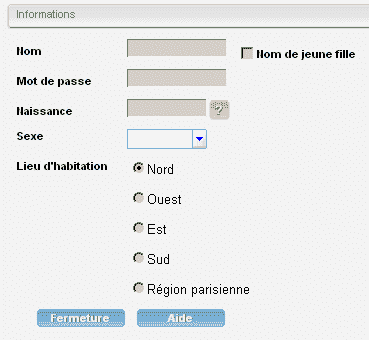

LivreGougeon 第 367 页 2006 年 11 月 28 日星期二 4:23 16

注意，所有这些组件都关联到实例名为 cadre 的组件容器（标记 ❶）。我们在本章的后续部分详细介绍组件容器的实现。


détails des composants de base dans la section précédente.

# Bibliothèques JavaScript graph

Comme montre le code suivant, la liaison s'effectue via le paramètre `parent` (repère ❶) de leurs constructs :

```javascript
var formulaire = new rialto.widget.Form( (...) );

var libelleNom = new rialto.widget.Label(
"libelleNom", 15, 10,
formulaire, "¨ ❶
"Nom", "libelle1");

var nom = new rialto.widget.Text(
"textNom", 10, 120, 100, "A",
formulaire, "¨ ❶
{ autoUp:false, isRequired:false, disable:false,
rows:5, accessKey:"", tabIndex:"", initValue:""});
```

Les tableaux 12.23 et 12.24 récapitulent respectivement les paramètres du constructeur de cette classe ainsi que les propriétés de son tableau associatif.

### Tableau 12.23 Paramètres du constructeur de la classe `rialto.widget.Form`

| Paramètre | Type | Description |
| :--- | :--- | :--- |
| `name` | Une chaîne de caractères | Correspond au nom du formulaire. |
| `url` | Un nombre entier | Correspond au positionnement horizontal du composant. |
| `parent` | Un objet | Correspond à un composant rialto ou un conteneur HTML classique auquel est rattaché le composant. |
| `parameters` | Un tableau associatif | Contient les propriétés récapitulées au tableau 12.24. |

### Tableau 12.24 Propriétés du tableau associatif `parameters` du constructeur de la classe `rialto.widget.Form`

| Propriété | Type | Description |
| :--- | :--- | :--- |
| `boolAsynch` | Un booléen | Spécifie si le formulaire doit être soumis de manière classique (valeur false) ou en se fondant sur les techniques Ajax (valeur true). |
| `boolIframe` | Un booléen | Dans le cas d’une requête Ajax, especifie si la technique fondée sur les iframes doit être utilisée. Si la valeur de cette propriété est false, une requête Ajax fondée sur la classe `XMLHttpRequest` est réalisée. |
| `boolWithFenWait` | Un booléen | Spécifie si une fenêtre d’attente doit être affichée pendant l’exécution de la requête Ajax de soumission. Ne peut être activée lors d’une soumission classique de formulaire. |
| `canBeCancel` | Un booléen | Spécifie si la requête Ajax peut être annulée durant son exécution. |
| `imgBtonSubmit` | Une instance d’un bouton | Correspond au bouton permettant de déclencher la soumission du formulaire. |
| `method` | Une chaîne de caractères | Correspond à la méthode HTTP utilisée afin de soumettre le formulaire. |
| `onSuccess` | Une référence à une fonction | Correspond à la fonction de rappel utilisée lors de l’utilisation d’une requête Ajax fondée sur la classe `XMLHttpRequest`. |

# La bibliothèque rialto

Ce composant permet d’envoyer les données du formulaire de manière classique sans recour aux techniques Ajax. L’adresse spécifiée dans le paramètre `url` est alors utilisée afin de soumettre le formulaire. L’interface graphique de la page est remplacée par celle construite par la ressource accédée. Cette approche se configure en spécifiant la valeur false pour la propriété `boolAsynch`.

Ce composant offre également la possibilité de soumettre le formulaire en se fondant sur les techniques Ajax. Deux approches sont en ce cas envisageables. La première se fonde sur la classe `XMLHttpRequest` et une fonction de rappel afin de traiter la réponse à la soumission. La seconde consiste à utiliser une iframe cachée.

Avec la première approche, les propriétés `boolAsynch` (repère ❸) et `boolIframe` (repère ❹) doivent respectivement contenir les valeurs true et false tandis que la propriété `onSuccess` (repère ❺) doit référencer la fonction de rappel (repère ❶) à utiliser pour traiter la réponse.

L’adresse de la requête doit toujours être spécifiée dans le paramètre `url` (repère ❷).

Cette fonction de rappel accepte en paramètre l’instance de la classe `XMLHttpRequest` utilisée afin d’exécuter la requête. Pour plus de détails sur l'utilisation de la classe `XMLHttpRequest`, le code suivant donne un exemple de mise en œuvre :

```javascript
function traiterRequete(requete) {
  try {
    eval(requete.responseText);
  } catch (err) {
    alert(err.message);
  }
}

var formulaire = new rialto.widget.Form("/ajax/test.js", {
  method: "POST",
  boolAsynch: true,
  boolIframe: false,
  boolWithFenWait: false,
  canBeCancel: true,
  onSuccess: traiterRequete,
  imgBtonSubmit: null
});
```

Le 代码 ci-dessus définit les paramètres du formulaire afin d’utiliser les techniques Ajax (repère ❸) et particulièrement la classe `XMLHttpRequest` (repère ❹). La réponse à la soumission est traitée par une fonction de rappel (repère ❶). Le composant `rialto.widget.Form` offre également la possibilité de soumettre le formulaire de manière Ajax en se fondant sur une iframe cachée. Dans ce cas, la valeur de la propriété `boolIframe` est true et aucune fonction de rappel n'est nécessaire.

## Positionnement

Les composants de ce type sont des conteneurs permettant de positionner les composants dans une page Web. Ces conteneurs peuvent s’imbriquer de manière récursive afin de mettre en œuvre des positionnements complexes.

La figure 12.5 illustre les classes relatives à la mise en œuvre des composants.

```text
AbstractComponent
+moveTo()
+setLeft()
+setTop()
+setWidth()

AbstractContainer
+setHeight()
+setVisible()
+setDraggable()
+add()
+setPosition()
+removeContents()
+setStyle()
+getHtmlCont()
+placeIn()
+remove()
+getHtmlExt()
+getHtmlImp()
+getHtmlDD()
+getHtmlRZ()

Tab
+addTabItem()
+fixeProp()
+setDisplay()
+closeFen()
+removeTabItem()
+setTitle()
+activeFen()

Splitter
+activeTab()
+onSetDisplay()
+setVisible()

Frame
SimpleWindow
+setVisible()
+setTitle()
```
**Figure 12.5**: *Classes relatives au positionnement*

Ce support permet de définir les différentes zones affichées dans un navigateur et de les positionner en se fondant sur un gestionnaire de positionnement redimensionable ou des onglets.

### Panel

La bibliothèque rialto offre la possibilité de définir des panels en fondant sur la classe `rialto.widget.SimpleWindow`. Ces panels peuvent par la suite être rattachés à une balise HTML `div`. Cette dernière peut bien correspondre à une balise définie en dehors de rialto qu’à une balise `div` interne d’un composant graphique de cette bibliothèque, telle une zone d’un gestionnaire de positionnement.

### Affichage des composants de type `rialto.widget.SimpleWindow`

La bibliothèque n’autorise l’affichage que d’un seul composant de ce type dans une page Web. L’application ne peut donc mettre en œuvre les composants qu’en prenant en compte cet aspect. Il sera possible dans les prochaines versions de la bibliothèque d’en afficher plusieurs simultanément.

Le constructeur de ce composant graphique prend en paramètre un tableau associatif contenant les propriétés récapitulées au tableau 12.25.

### Tableau 12.25 Propriétés utilisables par le constructeur de la classe `rialto.widget.SimpleWindow`

| Propriété | Type | Description |
| :--- | :--- | :--- |
| `icone` | Une chaîne de caractères | Correspond à l’icône associée au panel. |
| `parent` | Un objet | Correspond à un composant rialto ou un conteneur HTML classique auquel est rattaché le composant. |
| `title` | Une chaîne de caractères | |


对应面板的标题。

以下代码实现了一个此类组件（标记 ❶），包含输入表单的区域（标记 ❷）：

```javascript
var fenetre = new rialto.widget.SimpleWindow({ "¨" ❶
parent: document.body,
title: "Un titre",
icone: "images/imgFenSimple/picto-gr_recherchepatients.gif"
});
var cadre = new rialto.widget.Frame({ "¨" ❷
name:"cadre",
title: "Informations", open:true, dynamic:true,
position: "relative", draggable:false, parent:fenetre
});
var libelleNom = new rialto.widget.Label(
"libelleNom", 15, 10, cadre, "Nom", "libelle1");
var nom = new rialto.widget.Text(
"textNom", 10, 120, 100, "A", cadre,
{ autoUp:false, isRequired:false, disable:false,
rows:5, accessKey:"", tabIndex:"", initValue:""});
(...)
```

``````

LivreGougeon 第 372 页 2006 年 11 月 28 日 周二 4:23

## 图形化 JavaScript 库
**372**

*第四部分*

图 12.6 展示了此类组件的外观。

**图 12.6**
*rialto.widget.SimpleWindow* 类型组件的外观

## 区域

在面板中，rialto 库提供了定义不同区域的可能性，以便组合一组图形组件。这种方法基于 `rialto.widget.Frame` 类。

该图形组件的构造函数接受一个关联数组作为参数，其中包含表 12.26 汇总的属性。

### 表格 12.26 `rialto.widget.Frame` 类构造函数可用的属性

| 属性 | 类型 | 描述 |
| :--- | :--- | :--- |
| draggable | 布尔值 | 指定区域是否可以通过拖放操作移动。 |
| dynamic | 布尔值 | 指定区域是动态的还是静态的。如果是动态的（值为 true），则可以展开和折叠。 |
| height | 字符串 | 对应组件的高度。可以用数字或百分比表示。 |
| left | 整数 | 对应组件的水平位置。 |
| name | 字符串 | 对应区域的名称。 |
| open | 布尔值 | 当属性 `dynamic` 的值为 true 时，指定区域的状态（打开或关闭）。 |

LivreGougeon 第 373 页 2006 年 11 月 28 日 周二 4:23

## rialto 库
**373**

*第 12 章*

### 表格 12.26 `rialto.widget.Frame` 类构造函数可用的属性（续接）

| 属性 | 类型 | 描述 |
| :--- | :--- | :--- |
| parent | 对象 | 对应挂载该组件的 rialto 组件或经典的 HTML 容器。 |
| position | 字符串 | 指定区域的定位模式。 |
| title | 字符串 | 对应在区域顶部显示的标题。 |
| top | 整数 | 对应组件的垂直位置。 |
| width | 字符串 | 对应组件的宽度。可以用数字或百分比表示。 |

该区域可以包含之前描述的所有简单表单元素，这些组件通过其实例挂载在其上。

以下代码实现了一个此类组件（标记 ❶），以及将组件（标记 ❷）挂载到区域上：

```javascript
var cadre = new rialto.widget.Frame({ "¨" ❶
name:"cadre",
title: "Informations", open:true, dynamic:true,
position: "relative", draggable:false, parent:fenetre
});
var libelleNom = new rialto.widget.Label(
"libelleNom", 15, 10,
cadre, "¨" ❷
"Nom", "libelle1");
var nom = new rialto.widget.Text(
"textNom", 10, 120, 100, "A",
cadre, "¨" ❷
{ autoUp:false, isRequired:false, disable:false,
rows:5, accessKey:"", tabIndex:"", initValue:""});
```

(...)
(...)

请注意，将 `dynamic` 属性指定为 true 可以显示和隐藏该区域。

## 可调整大小的布局管理器

可调整大小的布局管理器（或 *splitter*，分割器）提供了两个两个的可能性，其共同边界可以移动。因此，一个区域的扩大会导致另一个区域的缩小。

rialto 库通过 `rialto.widget.Splitter` 类实现了此组件，其构造函数接受一个关联数组作为参数，其中包含表 12.27 汇总的属性。

LivreGougeon 第 374 页 2006 年 11 月 28 日 周二 4:23

## 图形化 JavaScript 库
**374**

*第四部分*

### 表格 12.27 `rialto.widget.Splitter` 类构造函数可用的属性

| 属性 | 类型 | 描述 |
| :--- | :--- | :--- |
| height | 字符串 | 对应组件的高度。可以用数字或百分比表示。 |
| left | 整数 | 对应组件的水平位置。 |
| limInf | 整数 | 对应第一个区域可能的最小比例。 |
| limSup | 整数 | 对应第一个区域可能的最大比例。 |
| name | 字符串 | 对应区域的名称。 |
| orientation | 字符串 | 指定组件的方向。可能的值有：– v：垂直方向；– h：用于水平方向。 |
| parent | 对象 | 对应挂载该组件的 rialto 组件或经典的 HTML 容器。 |
| prop | 整数 | 对应第一个区域的比例。该值在 0 到 1 之间。 |
| reverseClose | 布尔值 | 指定点击手拉条时组件是否在右侧（如果是垂直方向则在底部）关闭。 |
| style | 字符串 | 对应组件的样式。 |
| top | 整数 | 对应组件的垂直位置。 |
| width | 字符串 | 对应组件的宽度。可以用数字或百分比表示。 |
| withImg | 布尔值 | 指定带有图像的区域的分隔。 |

该布局管理器的实现如下方式所示：

```javascript
var splitter = new rialto.widget.Splitter({
top: 0,
left: 0,
height: "100%",
width: "100%",
prop: 0.5,
orientation: "h",
name: "splitter",
parent: document.body,
style: "3D",
limInf: 0,
limSup: 1,
withImg: true,
reverseClose: false
});
```

为了将区域挂载到管理器，可以使用其属性 `div1` 和 `div2`，它们分别对应其左部分和右部分（如果是垂直方向则为顶部和底部）。

以下代码提供了将两个区域挂载到管理器（标记 ❶）左部分（标记 ❷）和右部分（标记 ❸）的示例：

```javascript
var libelle1 = new rialto.widget.Label(
"libelle1", 15, 10,
splitter.div1,
"Première zone", "libelle1");
```

``````

LivreGougeon 第 375 页 2006 年 11 月 28 日 周二 4:23

## rialto 库
**375**

*第 12 章*

```javascript
var libelle2 = new rialto.widget.Label(
"libelle2", 15, 10,
splitter.div2,
"Seconde zone", "libelle1");
```

图 12.7 展示了此类组件的外观。

## 选项页

标签管理器允许多个区域共存，但同时只显示其中一个。标签允许选择管理器中显示的区域。

rialto 库基于 `rialto.widget.TabFolder` 类实现了这一功能。

该类的构造函数接受一个关联数组作为参数，其中包含表 12.28 汇总的属性。

### 表格 12.28 `rialto.widget.TabFolder` 类构造函数可用的属性

| 属性 | 类型 | 描述 |
| :--- | :--- | :--- |
| autoRedimTab | 布尔值 | |


指定是否启用标签页标题的自动缩放。

`draggableItem`
布尔值
指定标签页是否可以通过拖放机制进行移动。

`height`
字符串
对应组件的高度。可以以数字或百分比的形式表示。

`isClosable`
布尔值
指定标签页是否可以被关闭。

`left`
整数
对应组件的水平位置。

`name`
字符串
对应区域的名称。

`parent`
对象
对应于挂载该组件的 Rial 组件或经典的 HTML 容器。

`top`
整数
对应组件的垂直位置。

`width`
字符串
对应组件的宽度。可以以数字或百分比的形式表示。

`widthTabName`
整数
对应标签页的大小。

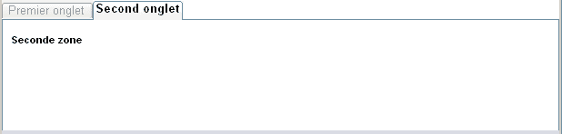

LivreGougeon 第 376 页 2006 年 11 月 28 日 星期二 4:23 16

# 图形 JavaScript 库
**376**
*第四部分*

此类布局管理器的实现方式如下：

```javascript
var onglets = new rialto.widget.TabFolder({
  name: "onglets", top: "80", left: "150",
  width: "500", height: "350",
  parent: document.body,
  widthTabName: 100, autoRedimTab: false,
  isClosable: false, draggableItem: true
});
```

向管理器添加标签页是通过其 `addTabItem` 方法实现的，该方法允许指定标签页的标题及其激活状态。此方法返回添加的标签页的实例，该实例可用于为其添加区域和组件。

以下代码实现了此方法（标记 ❶），以便创建一个标签页并将组件挂载到其上（标记 ❷）：

```javascript
var onglets = new rialto.widget.TabFolder({...)});
var premierOnglet = onglets.addTabItem("Premier onglet", true); // ❶
var libelle1 = new rialto.widget.Label(
  "libelle1", 15, 10,
  premierOnglet, // ❷
  "Première zone", "libelle1");
(...)
```

图 12.8 展示了此类组件的外观。

**图 12.8**
*`rialto.widget.TabFolder` 类型组件外观*

## 浮动窗口

rialto 提供了 `rialto.widget.Alert` 和 `rialto.widget.PopUp` 类，用于在网页中实现浮动窗口。

前者简单地对应带有消息的警告窗口，后者对应浮动模态窗口。后者的内容可以根据应用程序的需求专门构建。

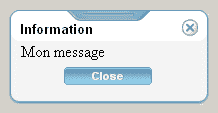

LivreGougeon 第 377 页 2006 年 11 月 28 日 星期二 4:23 16

# rialto 库
**377**
*第 12 章*

## 警告窗口

`rialto.widget.Alert` 类允许显示警告窗口。该类的构造函数接受一个参数，对应要显示的消息文本，如下代码所示：

```javascript
var fenetreAvertissement = new rialto.widget.Alert("Mon message");
```

图 12.9 展示了所创建的图形组件的外观。

**图 12.9**
*对应模态窗口的图形组件*

## 通用窗口

`rialto.widget.PopUp` 类比上一节描述的类复杂。

它的构造函数基于表 12.29 汇总的参数。

**表 12.29 *rialto.widget.Popup* 类构造函数参数**

| 参数 | 类型 | 描述 |
| :--- | :--- | :--- |
| `name` | 字符串 | 对应窗口的名称。 |
| `top` | 整数 | 对应窗口的垂直位置。 |
| `left` | 整数 | 对应窗口的水平位置。 |
| `width` | 字符串 | 对应窗口的宽度。 |
| `height` | 字符串 | 对应窗口的高度。 |
| `contain` | 对象 | 指定添加到窗口中的文本。 |
| `title` | 字符串 | 对应窗口的标题。 |
| `greyBackground` | 字符串 | 指定窗口的背景颜色。可以使用 用于灰色背景，transparent 用于透明背景。 |

以下代码以对话框的形式实现了此类（标记 ❶），其中包含身份验证参数输入（标记 ❷）：

```javascript
var popup = new rialto.widget.PopUp( // ❶
"test", 150, 370, "280", "120", "",
"Authentification","transparent");
var cadre = new rialto.widget.Frame({
  name:"cadre", top:"20", left:"5",
  width:"240", height: "70",
  title: "Utilisateur/Mot de passe",
  open:true, dynamic:false,
  position: "absolute",
  draggable:false, parent:popup
});
var libelleIdentifiant = new rialto.widget.Label(
  "libelleIdentifiant", 15, 10, cadre,
  "Utilisateur", "libelle1");
var identifiant = new rialto.widget.Text( // ❷
  "texteIdentifiant", 10, 100,
  100, "A", cadre,
  { autoUp:false, isRequired:false,
  disable:false, rows:5,
  Key:"",
  tabIndex:"" });
var libelleDePasse = new rialto.widget.Label(
  "libelleDePasse", 15, 10, cadre,
  "Mot", "", "1elle

varasse = new rialto.widget.Text(
  "textePasse", 10, 100,
  100,

,
,


varPifiant = new rialto.widget.Text(
  "texteIdentifiant", 10, 10,,
  100, "A", cadre,
  { autoUp:false, isRequired:false,

(...)
```

图 12.10 展示了所创建组件的外观。

**图 12.10**
*`rialto.widget.TabFolder` 类型组件外观*

## 复杂组件

rialto 提供了具有复杂功能的图形组件，用于实现表格和树。

图 12.11 展示了与组件相关的类。

LivreGougeon 第 379 页 2006 年 11 月 28 日 星期二 4:23 16

# rialto 库
**379**
*第 12 章*

**AbstractComponent**
`+moveTo()`
`+setLeft()`
`+setTop()`
`+setWidth()`
`+setHeight()`
`+setVisible()`

**Tree**
**TreeNode**
**Grid**
`+setDraggable()`
`+setPosition()`
`+addNode()`
`+toggle()`
`+addOneLine()`
`+setStyle()`
`+createAndAddNode()`
`+hasChild()`
`+clickLine()`
`+placeIn()`
`+getRoot()`
`+addNode()`
`+deleteLines()`
`+onclick()`
`+insertBefore()`
`+deleteOneLine()`
`+getHtmlExt()`
`+removeNode()`
`+disableLine()`
`+getHtmlImp()`
`+setText()`
`+fillGrid()`
`+getHtmlDD()`
`+isFirst()`
`+findLine()`
`+getHtmlRZ()`
`+isLast()`
`+getCellIndex()`
`+first()`
`+getCellText()`
`+last()`
`+getCellIndex()`
`+next()`
`+initTab()`
`+previous()`
`+insertOneLine()`
`+setStyle()`
`+setCellText()`
`+onclick()`
**TreeGrid**

**图 12.11**
*复杂组件类*

## 表格支持

库通过基于 `rialto.widget.Grid` 类提供了实现高级表格的可能性。

该类的构造函数接受一个关联数组，包含表 12.30 汇总的属性。

**表 12.30 *Grid* 类构造函数属性参数**

| 参数 | 类型 | 描述 |
| :--- | :--- | :--- |
| `actifClic` | 布尔值 | 激活表格点击。 |
| `autoWidth` | 布尔值 | 指定表格宽度是否与包含它的组件的宽度相同。 |
| `bNavig` | 布尔值 | 指定表格的导航模式。如果值为 true，则表格进行分页。否则，表格数据将以块形式显示。 |
| `boolPrint` | 布尔值 | 指定表格是否可以打印。 |
| `cellActive` | 布尔值 | |


指定选择是在行上（值为 `false`）还是在单元格上（值为 `true`）进行。

`height`
字符串
对应组件的高度。可以用数字字符形式或百分比形式表示。

`left`
整数
对应窗口的水平位置。

`lineHeight`
整数
对应行高。

`multiSelect`
布尔值
指定是否启用多行编辑。

`name`
字符串字符串
对应窗口的名称。

`parent`
对象
对应于挂载该组件的 rialto 组件或经典的 HTML 容器。

`rang`
整数
指定在分页模式下显示的行数。

`sortable`
布尔值
指定表格行是否可以进行排序。

`switchable`
布尔值
指定是否可以更改显示模式。

`TabEntete`
数组
指定表格不同列的标题标签。

`tabTypeCol`
数组
指定表格不同列的类型和宽度。

`top`
整数
对应窗口的垂直位置。

`writable`
布尔值
指定表格行是否可编辑。

以下代码实现了 `rialto.widget.Grid` 类，它提供了指定不同列的标题（标记 ❶）、它们期望的数据类型（标记 ❷）以及表格的各种所需行为，例如行的多重选择（标记 ❸）、行的排序（标记 ❹）以及行的编辑（标记 ❺）：

```javascript
var tableau = new rialto.widget.Grid({
  top:10, left:5, height:200,
  TabEntete:[ "Numéro","Isbn","Titre", ❶
  "Auteurs", "Date de parution" ],
  name:"tableau", parent:cadre,
  bNavig:false, rang:5,
  tabTypeCol:[ ["string",60], ["string",90], ❷
  ["string",200], ["string",220],
  ["date",120] ],
  cellActive:false, multiSelect:false, ❸
  sortable:true, lineHeight:16, ❹
  boolPrint:true, switchable:true,
  actifClic:true, autoResizableW:false,
  writable:true ❺
});
```

`rialto.widget.Grid` 类提供了 `fillGrid` 方法来指定表格数据。它接受一个包含各行数据的数组作为参数。一行的列本身是以数组形式指指定的。

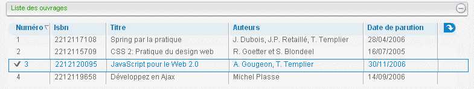
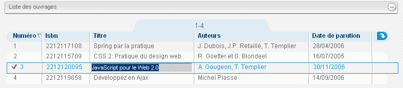

LivreGougeon 第 381 页 2006 年 11 月 28 日 星期二 4:23 16

**rialto 库**
**381**
*第 12 章*

以下代码展示了如何实现该方法：

```javascript
var tableau = new rialto.widget.Grid({ (...) });
tableau.fillGrid([
  [ "1", "2212117108", "Spring par la pratique", "J. Dubois, J.P. Retaillé, T. Templier","28/04/2006"],
  [ "2", "2212115709","CSS 2: Pratique du design web", "R. Goetter et S. Blondeel","16/07/2005"],
  [ "3", "2212120095","JavaScript pour le Web 2.0", "A. Gougeon, T. Templier", "30/11/2006"],
  [ "4", "2212119658","Développez en Ajax", "Michel Plasse", "14/09/2006"]
]);
```

数组中包含的数据可以通过其 `tabData` 属性访问，该属性对应于一个结构与 `fillGrid` 方法参数相似的数据数据数组。

图 12.12 展示了所创建表格的样式。

**图 12.12**
*rialto.widget.Grid 类型图形组件的样式*

rialto 库允许通过直接编辑其所包含的数据行来修改表格数据。此功能在创建表格时根据 `writable` 参数激活。

图 12.13 展示了修改模式下的表格外观。

**图 12.13**
*修改模式下的表格外观*

LivreGougeon 第 382 页 2006 年 11 月 28 日 星期二 4:23 16

**图形 JavaScript 库**
**382**
*第四部分*

`rialto.widget.Grid` 类提供了多种方法，允许通过编程方式操作表格中包含的数据。表格 12.31 总结了这些操作的主要方法。

**表格 12.31 *rialto.widget.Grid* 类数据操作的主要要方法**

| 方法 | 参数 | 说明 |
| :--- | :--- | :--- |
| `addOneLine` | 包含行数据的数组 | 根据提供的行数据在表格末尾添加一行。 |
| `clickLine` | 两个整数 | 根据传递的参数索引选择一行或一个单元格。 |
| `deleteLines` | 字符串 | 删除表格中的所有行，并指定导航模式下的表格新标题。 |
| `deleteOneLine` | 整数 | 删除表格中索引为参数的行。 |
| `disableLine` | 两个整数 | 根据传递的参数索引禁用一行或一个单元格。 |
| `fillGrid` | 数组 | 从数据数组初始化表格数据。 |
| `findLine` | 整数和字符串 | 遍历所有列数据以查找字符值并返回第一个匹配行的索引。 |
| `getCellIndex` | 单元格 DOM 节点 | 根据其 DOM 节点返回单元格的索引。 |
| `getCellText` | 行和列索引 | 返回单元格的文本。 |
| `getHtmlCellFromIndex` | 两个整数 | 根据传递的索引返回单元格的 DOM 节点。 |
| `getHtmlLineFromIndex` | 整数 | 根据索引返回行的 DOM 节点。 |
| `getIndCellClic` | - | 返回点击的单元格索引。 |
| `getIndLineClic` | - | 返回点击的行索引。 |
| `getLineIndex` | 单元格 DOM 节点 | 根据其 DOM 节点返回行的索引。 |
| `initTab` | 布尔值 | 通过删除相应的行和数据初始化表格。 |
| `insertOneLine` | 包含数据和行索引的数组 | 根据提供的数据在表格的指定位置添加一行。 |
| `isCell` | DOM 节点 | 如果节点是单元格则返回 true。 |
| `isLine` | DOM 节点 | 如果节点是行则返回 true。 |
| `setCellText` | 行、列索引以及字符串 | 为单元格设置文本。 |

表格 12.31 中的大多数方法都接受 HTML 行作为参数。以下代码提供了使用之前创建的表格主要方法的示例，以便向其添加（标记 ❶）和删除（标记 ❷）行：

LivreGougeon 第 383 页 2006 年 11 月 28 日 星期二 4:23 16

**rialto 库**
**383**
*第 12 章*

```javascript
function ajouterLigne() { // ❶
  // 构建要添加的数据
  var donnees = [ "3", "2212120095", "JavaScript pour le Web 2.0", "A. Gougeon, T. Templier", "30/11/2006" ];
  // 添加数据
  tableau.addOneLine(donnees);
}

function supprimerLigneSelectionnee() { // ❷
  if(tableau.getIndLineClic()=-1 ) {
    // 获取选中的行索引
    var indiceLigneSelectionnee = tableau.getIndLineClic();
    // 获取选中的行
    var ligneSelectionnee = tableau.getHtmlLineFromIndex(indiceLigneSelectionnee);
    // 删除选中的行
    tableau.deleteOneLine(indiceLigneSelectionnee);
  }
}
```

**树的支持**

rialto 库提供了基于 `rialto.widget.Tree` 和 `rialto.widget.TreeNode` 类来实现树的可能性。`rialto.widget.Tree` 类的构造函数通过关联数组接受表格 12.32 中总结的不同参数。

**表格 12.32 *rialto.widget.Tree* 类构造函数的参数**

| 参数 | 类型 | 说明 |
| :--- | :--- | :--- |
| `boolSelActive` | 布尔值 | 指定节点在被选中时样式是否改变 . |
| `draggableNode` | 一个布尔值 | |


指定节点是否可以根据拖放机制进行移动。

### `height`
字符串
对应组件的高度。可以以数字字符或百分比的形式表示。

### `left`
整数
对应组件的水平位置。

### `name`
字符串
对应树的名称。

### `parent`
对象
对应挂载组件的 rialto 组件或经典的 HTML 容器。

### `rootOpen`
布尔值
指定在创建树时根节点是否为打开状态。

### `top`
整数
对应组件的垂直位置。

### `width`
字符串
对应组件的宽度。可以以数字字符或百分比的形式表示。

### `withRoot`
布尔值
指定根节点是否关联标题和图像。

### `withT`
布尔值
指定是否显示虚线来连接树节点。

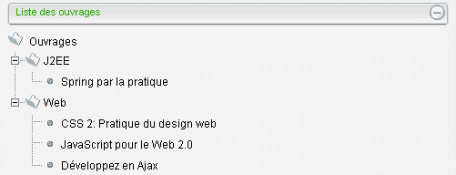

**JavaScript 图形库**
**384**
*第四部分*

`rialto.widget.Tree` 类的实现方式如下：

```javascript
var arbre = new rialto.widget.Tree({
  name: "arbre", top: "5", left:"0",
  width: "300", height: "200",
  parent: cadre, boolSelActive: true, rootOpen: true,
  withRoot: true, withT: true, draggableNode: false
});
```

一旦实例化此元素，就可以通过其 `createAndAddNode` 方法向其添加不同的节点。该方法接收的参数包括新节点要添加的节点标识符，以及所添加节点的各种属性。

以下代码给出了该方法的实现示例：

```javascript
var arbre = new rialto.widget.Tree({
  name: "arbre", top: "5", left:"0",
  width: "300", height: "200",
  parent: cadre, boolSelActive: true, rootOpen: true,
  withRoot: true, withT: true, draggableNode: false
});

var noeudRacineArbre = arbre.createAndAddNode(arbre.id, {
  name: "noeudRacineArbre", text: "Ouvrages",
  icon:'images/imTreeview/pict_synthetik_off.gif',
  icon2:'images/imTreeview/pict_synthetik_on.gif',
  onclick: "", open: true, reload: false,
  url: "", typeInfo: ""
});

var noeudJ2EE = arbre.createAndAddNode(noeudRacineArbre.id, {
  name: "noeudJ2EE", text: "J2EE",
  icon: "images/imTreeview/pict_synthetik_off.gif",
  icon2: "images/imTreeview/pict_synthetik_on.gif",
  onclick: "", open: true, reload: false,
  url: "", typeInfo: ""
});
```

图 12.14 展示了上述创建的树的外观。

**图 12.14**
*树的外观*

**rialto 库**
**385**
*第 12 章*

可以在树的 `onclick` 方法（标记 ❷）上注册一个全局观察者，以便在选择这些节点时执行处理（标记 ❶）。

以下代码展示了如何实现这一机制：

```javascript
function selectionNoeud(noeud) { // ❶
  alert("Nœud sélectionné. Identifiant: " + noeud.id + ", texte: " + noeud.text);
}

var arbre = new rialto.widget.Tree({
  name: "arbre", top: "5", left:"0",
  width: "300", height: "200",
  parent: cadre, boolSelActive: true, rootOpen: true,
  withRoot: true, withT: true, draggableNode: false
});

arbre.onclick = selectionNoeud; // ❷
```

树操作的节点是 `rialto.widget.TreeNode` 类型，可以通过实例化该类来显式创建。随后，必须通过其 `addNode` 方法添加到树中。

表格 12.33 和 12.34 汇总了该类的构造函数参数及其不同的方法。

### 表 12.33 `rialto.widget.TreeNode` 类的构造函数参数

| 参数 | 类型 | 描述 |
| :--- | :--- | :--- |
| `icon` | 字符串 | 对应为节点显示的图像路径。 |
| `icon2` | 字符串 | 对应节点打开时显示的图像路径。 |
| `name` | 字符串 | 对应节点名称。 |
| `onclick` | 字符串 | 对应点击节点时调用的函数名。 |
| `open` | 布尔值 | 指定节点初始是否为打开状态。 |
| `reload` | 布尔值 | 指定节点是否可以根据 `url` 参数的值重新加载。 |
| `text` | 字符串 | 对应节点显示的文本。 |
| `url` | 字符串 | 对应用于获取节点新值的地址。 |

### 表 12.34 `rialto.widget.TreeNode` 类的方法

| 方法 | 参数 | 描述 |
| :--- | :--- | :--- |
| `addNode` | `rialto.widget` 类型的节点 | 允许添加节点。 |
| `existChild` | 字符串 | 如果存在与参数传递标识符对应的子节点，则返回 `true`。 |
| `first` | - | 返回该节点的第一个子节点。 |
| `hasChild` | - | 返回节点是否拥有子节点。 |
| `insertBefore` | `rialto.widget` 类型的节点和字符串 | 在应用方法的节点之前添加参数传递的节点。 |

### 表 12.34 `rialto.widget.TreeNode` 类的方法（续） |

| 方法 | 参数 | 描述 |
| :--- | :--- | :--- |
| `isFirst` | - | 判断节点是否为其父节点的第一个子节点。 |
| `isLast` | - | 判断节点是否为其父节点的最后一个子节点。 |
| `last` | - | 返回该节点的最后一个子节点。 |
| `next` | - | 返回与节点处于同一层级的下一个节点。 |
| `onclick` | - | 对应重写的方法，用于指定选择节点时执行的处理。 |
| `previous` | - | 返回与节点处于同一层级的上一个节点。 |
| `removeNode` | 字符串 | 根据标识符从子节点列表中删除节点。 |
| `setStyle` | 关联数组 | 根据关联数组包含的参数定位样式属性。 |
| `setText` | 字符串 | 指定节点的新文本。 |
| `toggle` | 字符串和关联数组 | 打开或关闭参数传递的标识符对应的节点。 |

以下代码结合树的 `addNode` 方法（标记 ❷）实现了此类（标记 ❶）：

```javascript
var arbre = new rialto.widget.Tree({
  name: "arbre", top: "5", left:"0",
  width: "300", height: "200",
  parent: cadre, boolSelActive: true, rootOpen: true,
  withRoot: true, withT: true, draggableNode: false
});
```


`noeudWeb.removeNode(dernierNoeudEnfant.id);`  ¨ ❶

如后续代码所示，该库提供了在选择节点时触发处理操作（标记 ❶）的可能性，这是通过在 `rialto.widget.TreeNode` 类构造函数的参数中使用 `onclick` 属性（标记 ❷）来实现的：

```javascript
function selectionNoeud() {
  alert("Le nœud a été sélectionné.");
}
```

(...)

```javascript
var noeudRacineArbre = new rialto.widget.TreeNode({
  name: "noeudRacineArbre", text: "Ouvrages",
  icon:'images/imTreeview/pict_synthetik_off.gif',
  icon2:'images/imTreeview/pict_synthetik_on.gif',
  onclick: selectionNoeud, // ❷
  open: true, reload: false
});
```

## 结合树与表格

`rialto` 库提供了将表格与树结合的可能性，以便实现树元素的表格化表示。

该机制通过继承 `rialto.widget.Grid` 类的 `rialto.widget.TreeGrid` 类实现。因此，其构造函数的参数与后一个类相同。然而，`rialto.widget.TreeGrid` 类接受表 12.35 汇总的两个额外参数。

### 表 12.35 `rialto.widget.TreeGrid` 类构造函数的额外参数

| 参数 | 类型 |  |
| :--- | :--- | :--- |
| textFirstCol | 字符串 | 对应第一列（包含节点的列）的标题。 |
| widthFirstCol | 整数 | 对应第一列（包含节点的列）的宽度。 |

尽管如此，`rialto.widget.Grid` 类的某些参数不可修改的并取给定值。例如参数 `switchable`（值为 `false`）、`lineHeight`（值为 `23`）、`sortable`（值为 `false`）以及 `bNavig`（值为 `false`）。

LivreGougeon 第 388 页 2006 年 11 月 28 日周二 4:23 16

## 图形 JavaScript 库 388

第四部分

请注意，表头不包含包含节点的列。

如后续代码所示，`rialto.widget.TreeGrid` 实现提供了指定不同列的表头（标记 ❶）以及它们期望的数据类型（标记 ❷）的可能性；此外，该类还提供了指定表格各种所需行为的可能性，例如行的多选（标记 ❸）、行的排序（标记 ❹）以及行的编辑（标记 ❺）：

```javascript
var tableauArbre = new rialto.widget.GridTree({
  widthFirstCol:160,
  name: "tableauArbre", top: "5", left:"0",
  width: "300", height: "200",
  TabEntete: [ "Numéro","Isbn","Titre", // ❶
  "Auteurs", "Date de parution"],
  tabTypeCol: [ ["string",60], ["string",90], // ❷
  ["string",200], ["string",220],
  ["date",120] ],
  bNavig: false, rang: 5,
  parent: cadre,
  cellActive: false, sortable: true, // ❹
  multiSelect: false, lineHeight: 16, // ❸
  boolPrint: true, switchable: true, actifClic: true,
  autoResizable: false, writable: true // ❺
});
```

如后续代码所示，一旦实例化了该元素，就可以根据其 `addNodeLine` 方法向其添加树的不同节点。该方法的参数是新节点所在的节点实例（`parentLine` 属性，标记 ❶）以及所加节点的各种属性，例如与其关联的行内容（`tabData` 属性，标记 ❷）：

```javascript
var noeudWeb = tableauArbre.addNodeLine({
  name: "noeudWeb", text: "Web", icon: "",
  parentLine: noeudRacineArbre, // ❶
  tabData: null, // ❷
  open: false, url: ""
});

var noeudJavaScriptWeb2 = tableauArbre.addNodeLine({
  name: "noeudJavaScriptWeb2", text: "JavaScript",
  icon: "",
  parentLine: noeudWeb, // ❶
  tabData: [ "3", "2212120095", // ❷
  "JavaScript pour le Web 2.0",
  "A. Gougeon, T. Templier",
  "30/11/2006" ],
  open: false, url: ""
});
```

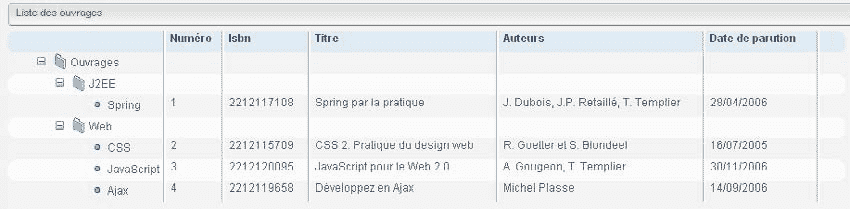

LivreGougeon 第 389 页 2006 年 11 月 28 日周二 4:23 16

## rialto 库 389

第 12 章

图 12.15 展示了包含上述树的表格外观。

**图 12.15** *表格内树的外观*

### 总结

在本节中，我们详细介绍了 `rialto` 库提供的各种图形组件，例如表单组件或定位组件、窗口以及复杂组件。

我们看到这些组件提供的功能非常广泛，允许在 Web 页面中轻松实现先进且交互式的图形界面。

`rialto` 库还提供了一个通用框架，以便为图形组件分配行为。

### 行为

`rialto` 库提供了一种有趣的机制，允许为 Web 页面元素应用行为。库提供了四种预定义行为，如表 12.36 所示。

### 表 12.36 预定义行为

| 行为 | 描述 |
| :--- | :--- |
| Target | 指定拖放操作的潜在目标。 |
| Missile | 指定一个元素可以被拖放。 |
| DragAndDrop | 为元素应用拖放行为。 |
| Resize | 为元素指定缩放行为。 |

请注意，表头不包含包含节点的列。

如后续代码所示，`rialto.widget.TreeGrid` 实现提供了指定不同列的表头（标记 ❶）以及它们期望的数据类型（标记 ❷）的可能性；此外，该类还提供了指定表格各种所需行为的可能性，例如行的多选（标记 ❸）、行的排序（标记 ❹）以及行的编辑（标记 ❺）：

LivreGougeon 第 390 页 2006 年 11 月 28 日周二 4:23 16

## 图形 JavaScript 库 390

第四部分

如后续代码所示，该库允许通过其 `onclick` 属性（标记 ❷）简单地为图形组件（标记 ❶）指定拖放行为：

```javascript
var libellePrenom = new rialto.widget.Label("libellePrenom", // ❶ ❷
"Mot de passe", "libelle1");

rialto.widgetBehavior.affect(libellePrenom.divExt, "DragAndDrop", {
  oHtmlToMove: libellePrenom.divExt, // ❸
  oHtmlEvtTarget: libellePrenom.divExt // ❹
});
```

传递给 `affect` 方法参数的关联数组包含 `oHtmlToMove`（标记 ❸）和 `oHtmlEvtTarget`（标记 ❹）属性，分别指定移动的对象和捕获拖放事件的对象。

从一个组件到另一个组件的拖放通过 `Missile` 和 `Target` 行为实现，这些行为分别指定拖放的源元素和目标元素。

后续代码通过标签（标记 ❶）和输入框（标记 ❷）实现了这一机制，以便实现从第一个（Missile 行为，标记 ❸）到第二个（Target 行为，标记 ❹）的拖放：

```javascript
var libelleNom = new rialto.widget.Label("libelleNom", // ❶ ❷
"Nom", "libelle1");

var nom = new rialto.widget.Text("textNom", 10, 120, 100, "A", cadre,
  { autoUp:false, isRequired:false, disable:false,
  rows:5, accessKey:"", tabIndex:"", initValue:""});

rialto.widgetBehavior.affect(libelleNom.divExt, "Missile", { // ❸
  oHtmlToMove: libelleNom.divExt,
  oHtmlEvtTarget: libelleNom.divExt
});

rialto.widgetBehavior.affect(nom.divExt, "Target", {}); // ❹
```

在 `affect` 方法期间，`desaffect` 方法允许从元素移除行为。

`rialto` 的行为机制是可扩展的，因此为 Web 页面元素实现自定义行为。

## Rialto Studio

`rialto` 项目配备了一个有趣的工具，该工具使用 `rialto` JavaScript 库编写，允许视觉化方式构建图形界面。

名为 Rialto Studio，它提供具有三个标签页的界面：Design、Tree 和 Source：


• Design fournit une palette de composants graphiques qui peuvent être disposés sur l’interface graphique en construction simplement par glisser-déposer.

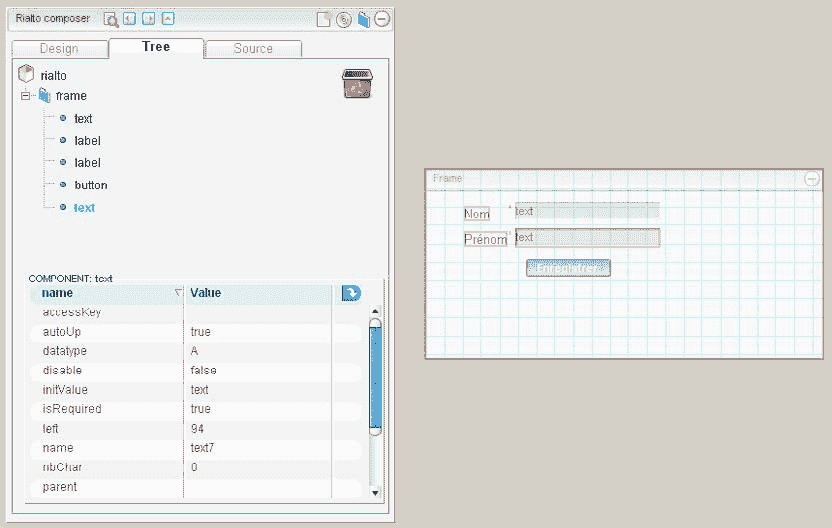

# La bibliothèque rialto

## CHAPITRE 12

• `Tree` permet d’afficher la hiérarchie des composants graphiques utilisés dans l’interface graphique. Les différentes propriétés des composants sont accessibles en cliquant dans l’arborescence, et leur modification impacte automatiquement l’interface graphique. La figure 12.16 illustre l’onglet de navigation des éléments de l’interface graphique créée.

**Figure 12.16**
*Onglet de navigation des éléments de l’interface graphique en construction*

• `Source` contient les sources de l’interface graphique construite avec l’outil, sachant plusieurs formats sont disponibles, dont le format `JavaScript`.

Certaines fonctionnalités, telles que l’ouverture d’un fichier source ou la sauvegarde dans un fichier de l’interface graphique construite, ne sont disponibles que lorsque l’outil est utilisé d’une manière locale.

Une démonstration au format Flash de cet outil est disponible sur le site du projet `rialto`, à l’adresse [`http://rialto.application-servers.com/wiki/rialtostudio:video`](http://rialto.application-servers.com/wiki/rialtostudio:video) tandis qu’une version en ligne est utilisable à l’adresse [`http://rialto.application-servers.com/rialto/rialtoStudio/`](http://rialto.application-servers.com/rialto/rialtoStudio/).

# Bibliothèques JavaScript graphiques 

## Conclusion

La bibliothèque `rialto` offre d’intéressants mécanismes afin de mettre en œuvre des applications de gestion aux interfaces Web riches. La bibliothèque propose ainsi une importante collection de composants graphiques permettant de créer des formulaires et de les positionner sur l’interface graphique. Des composants plus complexes sont également fournis afin de créer des arbres et des tableaux.

La plupart de ces composants possèdent un ensemble de fonctionnalités très riches, dont la mise en œuvre se réalise simplement par le biais de paramètres de configuration. Ces fonctionnalités vont de l’édition de lignes de tableaux au glisser-déposer, offrant ainsi la possibilité de développer simplement des interfaces graphiques riches, efficaces et très interactives.

Cette bibliothèque facilite l’utilisation des techniques `Ajax` afin de soumettre les données de formulaires. Ces techniques sont complètement masquées par le composant de formulaire, mais elles restent néanmoins utilisables directement si nécessaire.

# Partie V : Utilisation de services externes

Après avoir décrit la façon de structurer ses applications `JavaScript` avec des bibliothèques telles que `dojo` ou `rialto`, nous allons voir qu’une application `JavaScript` peut intégrer et interagir avec un outil ou un service externe en se fondant sur une API `JavaScript` ou les techniques d'Ajax`.

Le chapitre 13 décrit la façon d’utiliser des API `JavaScript` externes. Après avoir présenté les mécanismes de fonctionnement de `Google Maps`, nous détaillons l’utilisation des API fournies par cet outil de cartographie dans des applications `JavaScript`.

Le chapitre 14 se penche sur l’utilisation de services externes accessibles par l’intermédiaire de l’architecture `REST`. Les services fournis par `Yahoo!` et `Amazon` sont utilisés à titre d’exemple.

## CHAPITRE 13 : Google Maps

Développé par `Google`, société emblématique du Web 2.0, l’outil `Google Maps` permet d’implémenter des fonctionnalités de cartographie dans une application `JavaScript`. Cette intégration est très poussée, et l’application et l’outil peuvent interagir de manière très fine en se fondant sur des événements.

`Google Maps` a réussi la gageure d’offrir des fonctionnalités évolues tout en gardant une API de programmation simple, avec, de surcroît, la possibilité de l’étendre.

### Description et fonctionnement

Avant d’aborder la mise en œuvre de `Google Maps`, nous allons décrire le fonctionnement de cet outil fondé sur un service cartographique de `Google`, accédé par l’intermédiaire d’une API `JavaScript` fournie librement par cette société.

Les cartes sont décomposées en éléments unitaires désés par le terme `tile`. L’API `JavaScript` de `Google Maps` construit la carte en se fondant sur ces éléments, accessibles depuis des serveurs de `Google`. L’image visible de la carte correspond à un assemblage de différents éléments calculés par un serveur de cartographie.

La figure 13.1 illustre ce principe.

L’outil offre la possibilité d’enrichir les cartes avec différents éléments graphiques afin de fournir des informations relatives à une localisation ou de signaler une localisation particulière. Dans ce cas, l’API `JavaScript` de `Google Maps` assemble des images avec le fond de carte de façon à afficher la carte enrichie.

La figure 13.2 illustre ce mécanisme.

`Google` met en outre à disposition un service structuré en différents éléments afin de répondre aux requêtes cartographiques.

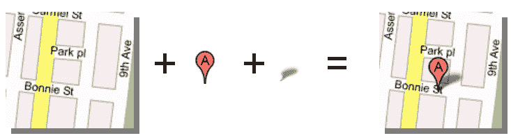

**Figure 13.1**
*Construction de la carte affichée*
Portions de carte - **Zone affichée**

**Figure 13.2**
*Assemblage de composants d’affichage*

La figure 13.3 les constituants de ce service.
API `JavaScript` `Google Maps` : **Satellite**, **Carte**, Serveurs de portions, Serveurs de calcul d’images de carte.

**Figure 13.3**
*Constituants du service cartographique*

## Mise en œuvre

L’API `JavaScript` fournie par `Google Maps` s’appuie sur différentes classes, que nous allons décrire tout long de cette section. Ces classes permettent d’intégrer des cartes évoluées dans des applications `JavaScript`.

Nous détaillerons en outre la façon d’installer l’outil dans une page Web de l’utiliser et montrerons comment enrichir les cartes en leur ajoutant diverses informations.

Nous indiquerons enfin les façons de faire interagir l’application avec les cartes afin de réagir à des actions de l’utilisateur.

### Installation

Avant tout chose, une clé gratuite doit être obtenue à partir de l’adresse [`http://www.google.com/apis/maps/signup.html`](http://www.google.com/apis/maps/signup.html) afin de pouvoir utiliser l’outil.

Une fois la clé obtenue, la page Web doit importer le code `JavaScript` de l’application. L’adresse contenue dans l’attribut `src` doit inclure la clé précédemment récupérée.

Comme le montre le code suivant, cette opération est réalisée par l’intermédiaire d’une balise `script` (repère 1) :

```html
<html>
<head>
  <script src="http://maps.google.com/maps?file=api&v=2&key=Votre_ID_ici" type="text/javascript"></script>
  (...)
</head>
(...)
</html>
```

Comme nous pouvons le constater, l’adresse n’est pas un fichier `JavaScript` statique mais une ressource `JavaScript` calculée dynamiquement en fonction des paramètres suivants :

- `file` : type de fichier `JavaScript` à retourner. Dans notre cas, il s’agit des API. La valeur de la propriété est donc `api`.
- `v` : version de l’API `Google Maps` utilisée, actuellement la 2.
- `key` : clé d’utilisation de l’outil `Google Maps`.

Pour pouvoir utiliser des éléments vectoriels tels que les tracés de lignes dans les cartes, il est recommandé d’ajouter l’espace de nommage `VML` ainsi qu’un style `CSS`. Ces ajouts sont indispensables pour le bon fonctionnement de cette fonctionnalité dans Internet Explorer.


LivreGougeon 第 398 页 2006 年 11 月 28 日周二 4:23 16

# 外部服务的使用

第五部分

以下代码展示了命名空间（标记 ❶）和 CSS 样式（标记 ❷）的实现：

```html
<!DOCTYPE html PUBLIC "-//W3C//DTD XHTML 1.0 Strict//EN"
["http://www.w3.org/TR/xhtml1/DTD/xhtml1-strict.dtd">
<html xmlns="http://www.w3.org/1999/xhtml" xmlns:v="urn:schemas-microsoft-com:vml"> <!-- ❶ -->
<head>
(...)
<style type="text/css">
v\:* { <!-- ❷ -->
behavior:url(#default#VML);
}
</style>
<script src="http://maps.google.com/maps?file=api&v=2&key=macle" type="text/javascript"></script>
(...)
</head>
(...)
</html>
```

Google Maps 支持的浏览器汇总在此地址：`http://local.google.com/support/bin/answer.py?answer=16532&topic=1499`。

如果 Google Maps 的版本经常更新，这不会影响使用其 API 的应用程序代码。

## 基础用法

Google Maps 的核心类是 `GMap2`。它允许在指定的缩放级别将地图定位到某个位置。此外，它提供了许多丰富界面并允许与应用程序交互的方法，正如我们后面将看到的。

表 13.1 汇总了该类中包含的不同方法族。

### 表 13.1 GMap2 类的方法族

| 方法族 | 描述 |
| :--- | :--- |
| 地图配置 | 用于管理地图配置属性的方法 |
| 控制管理 | 用于配置地图控件的方法 |
| 地图类型管理 | 用于指定使用的地图类型的方法 |
| 地图状态 | 用于修改地图状态（中心位置、缩放级别等）的方法 |
| 增强管理 | 用于管理增强元素（如标记和图形）的方法 |
| 信息窗口管理 | 用于管理信息窗口的方法 |
| 坐标操作 | 用于将坐标转换为不同测量值（像素、经纬度、坐标等）的方法 |

LivreGougeon 第 399 页 2006 年 11 月 28 日周二 4:23 16

# Google Maps

第 13 章

`GMap2` 类的一个实例对应于通过该类的实例化创建的地图。地图必须根据其构造函数的第一个参数挂载到页面上的一个 `div` 标签上。该参数的值对应该标签的 ID。

第二个参数是可选的，允许指定地图选项。

地图一旦创建，就应该通过 `setCenter` 方法将其居中到具有特定缩放级别的位置，如下代码所示：

```html
<<html>
<head>
(...)
<script langage="text/javascript">
function initialisationCarte() { <!-- ❶ -->
var divCarte = document.getElementById("carte");
var carte = new GMap2(divCarte);
carte.setCenter(new GLatLng(47.2228, -1.5682), 11);
}
</script>
</head>
<body onLoad="initialisationCarte();"> <!-- ❶ -->
<div id="carte" style="width: 600px; height: 400px"></</div> <!-- ❷ -->
</body>
</html>
```

地图的初始化的 JavaScript 代码必须在页面 DOM 树加载后执行。因此，上述代码在页面加载时调用的函数中实现了这一点（标记 ❶）。

地图的大小在示例中是通过 `div` 标签的 `style` 属性指定的（标记 ❷）。

可以在实例化 `GMap2` 类时对地图进行参数，如下代码所示：

```javascript
var options = {
size: new GSize(600, 400),
mapTypes: [ GMapType.NORMAL_MAP, GMapType.SATELLITE_MAP ]
};
var carte = new GMap2(document.getElementById("carte"), options);
carte.setCenter(new GLatLng(47.2228, -1.5682), 11);
```

图 13.4 展示了该代码在浏览器中显示的地图。

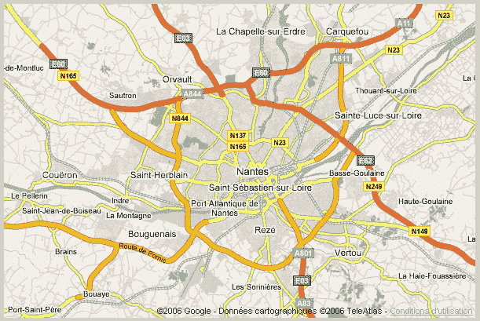

LivreGougeon 第 400 页 2006 年 11 月 28 日周二 4:23 16

# 外部服务的使用

第五部分

图 13.4
*带有 Google Maps 的简单地图*

我们将使用不同的元素来增强地图，以实现交互功能。

## 界面增强

正如前面提到的，Google Maps 允许通过各种控件来增强地图。

## 导航实体

某些导航工具被称为控件，旨在提供与地图的交互。它们在表 13.2 中汇总。

### 表 13.2 地图控件

| 控件 | 描述 |
| :--- | :--- |
| GLargeMapControl | 用于调整缩放的放大控件。 |
| GMapTypeControl | 用于切换地图类型（平面/卫星等）的控件。 |
| GOverviewMapControl | 提供缩略图视图。 |
| GScaleControl | 显示地图比例尺的控件。 |
| GSmallMarkerControl | 在地图上显示标记的控件。 |
| GSmallZoomControl | 用于调整缩放的小控件。 |

添加和删除控件元素分别通过 `addControl` 和 `removeControl` 方法实现。这两个方法都接收控件实例作为参数。`addControl` 方法支持一个额外参数来指定控件的位置。如果省略，方法将基于 `GControl.getDefaultPosition()` 返回的值。


Google Maps 提供了定义标记和信息窗口的功能，允许对地图进行注释并并通过补充信息来丰富地图。该工具还允许在地图上绘制轨迹。所有这些元素都扩展了 `GOverlay` 类。元素的添加和删除分别通过 `GMap2` 或 `GMarker` 类的 `addOverlay` 和 `removeOverlay` 方法实现。

`GMarker` 类允许实现标记，以便在地图上图形指示某个位置。该类有一个构造函数，其参数为它指向的坐标以及可选属性。

表格 13.3 汇总了这些不同的属性。

### 表格 13.3 `GMarker` 类构造函数的属性

| 属性 | 类型 | 描述 |
| :--- | :--- | :--- |
| `bounceGravity` | Number | 对应在拖放操作结束时弹回时使用的重力。其默认值为 1。 |
| `bouncy` | Boolean | 指定标记在拖放操作结束时是否弹回。 |
| `clickable` | Boolean | 指定标记是否可点击。默认值为 true。 |
| `draggable` | Boolean | 指定标记是否可以通过拖拽移动。默认值为 false。 |
| `icon` | `GIcon` | 指定标记使用的图标。默认值对应常量 `G_DEFAULT_ICON` 的值。 |
| `title` | String | 指定当鼠标悬停在标记上时显示的描述文本（提示框）。 |

以下代码演示了简单标记的实现：

```javascript
var divCarte = document.getElementById("carte");
var carte = new GMap2(divCarte);
(...)
var point = new GLatLng(47.2228, -1.5682); // ❶
var marqueur = new GMarker(point,{draggable: true}); // ❷
carte.addOverlay(marqueur);
```

在前面的示例中，一个标记被放置在南特市中心（标记 ❶）。由于其 `draggable` 属性值为 true，该标记可以通过拖放进行移动（标记 ❷）。

可以实现自定义标记以使用自己的图像而不是提供的默认图标。还必须实现一个与图标阴影对应的图像。

以下代码给出了这种自定义的实现示例：

```javascript
// 自定义图标的基础图标
var iconeBase = new GIcon();
iconeBase.shadow = "http://www.google.com/mapfiles/shadow50.png";
iconeBase.iconSize = new GSize(50, 70);
iconeBase.shadowSize = new GSize(37, 34);
iconeBase.iconAnchor = new GPoint(9, 34);
iconeBase.infoWindowAnchor = new GPoint(42, 50);
iconeBase.infoShadowAnchor = new GPoint(18, 25);

// 自定义图标
var icone = new GIcon(iconeBase);
icone.image = "iconePersonalisee.png";
icone.shadow = "ombreIconePersonalisee.png";
icone.shadowSize = new GSize(70, 70);

// 使用自定义图标的标记
var marqueur = new GMarker(carte.getCenter(), icone);
```

### 使用外部服务

信息窗口可以附加到不同的元素，例如地图本身或标记。Google Maps 提供的各种窗口类型在表格 13.4 中汇总。

### 表格 13.4 Google Maps 提供的窗口类型

| 类型 | 描述 |
| :--- | :--- |
| HTML | 以 HTML 为内容，通过地图或标记的 `openInfoWindowHtml` 方法实现。该方法接受一个包含 HTML 代码的字符串作为参数。 |
| 带标签页的 HTML | 以与前一种类型相同的方式，通过 `openInfoWindowTabsHtml` 方法实现。 |
| 文本 | 对应最简单的类型。通过地图或标记的 `openInfoWindow` 方法实现。该方法接受一个文本类型的 XML 节点作为参数。 |
| 带标签页的文本 | 实现一个带有标签页的窗口。这些标签包含文本，并通过 `GInfoWindowTab` 类定义，其构造函数接受标签名称及其内容作为参数。窗口通过地图或标记的 `openInfoWindowTabs` 方法实现，该方法接受一个标签数组作为参数。 |

我们将实现一个包含 HTML 代码的窗口，使用 `GMap2` 类的 `openInfoWindowHtml` 方法将其添加到地图上，如下代码所示：

```javascript
var divCarte = document.getElementById("carte");
var carte = new GMap2(divCarte);
(...)
carte.openInfoWindowHtml(carte.getCenter(), "Une fenêtre d'<b>information</b>");
```

如果窗口需要附加到标记，则 `GMarker` 类中有一个同名方法，如下代码所示：

```javascript
(...)
var point = new GLatLng(47.2228, -1.5682);
var marqueur = new GMarker(point,{draggable: true});
carte.addOverlay(marqueur);
(...)
marqueur.openInfoWindowHtml("Une fenêtre d'<b>information</b>");
```

请注意，这些信息窗口的打开可以通过事件完成，无论是地图还是标记。

Google Maps 还提供了通过 `GPolyline` 类在地图上绘制点轨迹的功能。该类接受一个轨迹点数组作为参数，如下代码所示：

```javascript
var divCarte = document.getElementById("carte");
var carte = new GMap2(divCarte);
(...)
var points = [...];
var trace = new GPolyline(points);
carte.addOverlay(trace);
```


允许将对象的方法注册为 DOM 事件，即该 DOM 事件的观察者实例。该方法返回该观察者及其方法，并返回一个代表已注册观察者的对象。

### `clearInstanceListeners`
源实例允许删除为特定地图实例注册的所有观察者。

### `clearListeners`
源实例和代码允许删除为地图实例的特定事件注册的所有观察者。

### `removeListener`
代表观察者的对象允许使用已注册的对象的来移除观察者。该已注册的对象是在注册观察者时，通过 `addListener`、`addDomListener`、`bind` 和 `bindDom` 方法返回的。

### `trigger`
源实例和代码允许为特定地图实例触发特定事件，并可选传入额外参数。此方法对于测试使用 Google Maps 的应用程序特别有用。

源实例对应于添加事件观察者的实例。因此，它并不一定对应地图实例，例如，它可以是一个标记（marker）的实例。

以下代码说明了如何使用 `addListener`、`bind` 和 `removeListener` 方法分别为 `moveend` 事件注册（标记 ❶）和注销观察者（标记 ❷）：

```
var divCarte = document.getElementById("carte");

var carte = new GMap2(divCarte);

(...)

// 定义并注册第一个观察者

var observateur1 = GEvent.addListener(carte, "moveend", function() { //¨ ❶

(...)

});

// 定义类 GestionnaireCarte

function MonGestionnaireCarte() {

};

MonGestionnaireCarte.prototype.traiterEvenement = function() {
(...)

};

var gestionnaire = new MonGestionnaireCarte();

// 定义并注册第二个观察者
var observateur2 = GEvent.bind(carte, "moveend",

MonGestionnaireCarte, gestionnaire.traiterEvenement); //¨ ❶

(...)

// 取消之前注册的观察者

GEvent.removeListener(observateur1); //¨ ❷

GEvent.removeListener(observateur2); //¨ ❷
```

当应用程序用户完成在地图上的移动时，观察者的函数和方法会被调用。

地图支持不同的事件，可以通过 `addListener` 和 `bind` 方法注册观察者。表 13.6 汇总了这些事件的名称。

**表 13.6 地图支持的事件**

| 代码 | 观察者参数 | 说明 |
| :--- | :--- | :--- |
| addmaptype | 地图类型 | 已添加了一种地图类型。 |
| addoverlay | Overlay | 地图上添加了一个覆盖层。 |
| clearoverlays | - | 地图上的所有覆盖层已删除。 |
| click | Overlay, 点 | 用户点击了地图。 |
| drag | - | 用户正在地图上进行拖放操作。 |
| dragend | - | 用户完成了在地图上的拖放操作。 |
| dragstart | - | 用户开始在地图上进行拖放操作。 |
| infowindowclose | - | 地图上的信息窗口已关闭。 |
| infowindowopen | - | 地图上的信息窗口已打开。 |
| load | - | 地图加载完成，`isLoaded` 方法返回 true。尽管如此，地图图像可能仍在加载中。 |
| maptypechanged | - | 地图类型已更改。 |
| mousemove | 光标位置 | 用户在地图上移动鼠标光标。 |
| mouseout | 光标位置 | 用户将鼠标光标移出地图区域。 |
| mouseover | 光标位置 | 用户将鼠标光标移入区域。 |
| move | - | 用户正在移动地图。 |
| moveend | - | 用户完成了地图移动。 |
| movestart | - | 用户开始移动地图。 |
| removemaptype | 地图类型 | 已删除了一种地图类型。 |
| removeoverlay | Overlay | 地图上的一个覆盖层已删除。 |
| zoomend | 旧和新的缩放级别 | 用户完成了地图缩放比例值的更改。 |

事件处理函数或方法的参数根据事件的不同而不同。在之前的示例中，`moveend` 事件要求一个无参数的函数或方法。接下来的示例描述了 `zoomend` 事件观察者的实现：

```
var divCarte = document.getElementById("carte");

var carte = new GMap2(divCarte);

(...)

// 定义观察者
function traitementZoomend(ancienZoom, nouveauZoom) { //¨ ❶

alert("旧缩放值: "+ ancienZoom);
alert("新缩放值: "+ nouveauZoom);
}

// 注册观察者
GEvent.addListener(carte, "zoomend", traitementClick);
```

观察者函数现在拥有两个参数（标记 ❶），其中第一个对应旧的缩放值，第二个对应新的值。

`click` 事件遵循相同的机制，并允许检测是否在地图或标记上执行了点击操作，如下代码所示：

```
var divCarte = document.getElementById("carte");

var carte = new GMap2(divCarte);

(...)

// 添加一个标记
var point = new GLatLng(47.2228, -1.5682);
carte.addOverlay(new GMarker(point));

// 定义并注册观察者
function traitementClic(marqueur, position) { //¨ ❶

alert("点击了标记: "+ marqueur);
alert("点击位置: "+ position);
}

GEvent.addListener(carte, "click");
```

在用户点击标记的情况下，`traitementClic` 函数的参数 `marqueur`（标记 ❶）不为空，且包含被点击标记的实例。该函数的相同参数 `position`（标记 ❶）则为空。

标记还支持不同的事件，可以在这些事件上注册观察者。如果标记是静态的（`clickable` 和 `draggable` 属性的值为 `false`），则不会触发以下任何一个事件。表 13.7 汇总了这些事件的名称。

**表 13.7 标记支持的事件**
*(注：原文此处未提供表 13.7 的具体内容，仅有描述性文字)*


通过 `GMap2` 类的 `removeOverlay` 和 `clearOverlays` 方法可以从地图上删除标记。

标记的监听器注册方式与地图相同，通过 `GEvent` 类实现。以下代码实现了对 `click` 和 `mouseover` 事件的监听注册：

```javascript
var divCarte = document.getElementById("carte");

var carte = new GMap2(divCarte);

(...)

// 添加标记

var point = new GLatLng(47.2228, -1.5682);

var marqueur = new GMarker(point)

carte.addOverlay(marqueur);

// 定义并注册监听器
GEvent.addListener(marqueur, "dblclick", function() {
  alert("Déclenchement de l’événement dblclick");
});

GEvent.addListener(marqueur, "mouseover", function() {
  alert("Déclenchement de l’événement mouseover");
});
```

标记可以检测信息窗口关闭对应的事件。该事件通过关闭按钮或调用 `GMap2` 或 `GMarker` 类的 `closeWindowInfo` 方法触发。

## 使用外部服务

以下代码说明了该机制的实现：

```javascript
var divCarte = document.getElementById("carte");

var carte = new GMap2(divCarte);

(...)

// 添加标记
var point = new GLatLng(47.2228, -1.5682);

var marqueur = new GMarker(point)

carte.addOverlay(marqueur);

// 添加信息窗口
marqueur.openInfoWindowHtml("Une fenetre d'information");

// 定义并注册监听器
GEvent.addListener(marqueur, "infowindowclose", function() {
  alert("Déclenchement de l’événement infowindowclose");
});
```

## 扩展

有多种扩展可以丰富 Google Maps 的功能。Make Williams 的网站提供了非详尽的列表，地址为：`http://www.econym.demon.co.uk/googlemaps/extensions.htm`。

在本节中，我们仅详细介绍允许基于透明图像自定义区域形状的扩展。

### EInsert 扩展

Make Williams 为 Google Maps 提供了一个非常有用的扩展，允许在地图上使用自定义形状。其目标是能够将任何图形以透明图像的形式用于地图上。

`EInsert` 扩展及其文档可以在 `http://www.econym.demon.co.uk/googlemaps/einsert.htm` 访问。该扩展通过标准的 `script` 标签直接安装到页面中，如下代码所示：

```html
<html>
<head>
(...)
<script type="text/javascript" src="einsert.js"></script> (...)
</head>
(...)
</html>
```

我们将实现一个用于界定点周围圆形区域的形状。以下代码展示了该功能的实现：

```javascript
var carte = new GMap2(document.getElementById("carte"));

(...)

carte.setCenter(new GLatLng(47.21257, -1.54769), 11);

var centreForme = new GLatLng(47.21257, -1.54769);
var imageForme = "circle.png";
var tailleForme = new GSize(800,800);
var zoomForme = 13;

var zoneCirculaire = new EInsert(centreForme, imageForme, tailleForme, zoomForme);

carte.addOverlay(zoneCirculaire);
```

表 13.8 汇总了上述代码中使用的 `EInsert` 类构造函数（标记 ❶）的不同参数。

### 表 13.8 EInsert 类的构造函数参数

| 参数 | 描述 |
| :--- | :--- |
| `centreZone` | 指定形状中心的位置。在上面的示例中，形状中心位于南特市中心（标记 ❷）。 |
| `imageZone` | 指定存储形状的文件路径。在上面的示例中，区域形状存储在一个对应圆形的透明图像中（标记 ❸）。 |
| `tailleZone` | 指定形状显示的大小。在上面的示例中，图像使用的时宽度和高度均为 800（标记 ❹）。 |
| `zoomZone` | 指定形状显示时的缩放级别（标记 ❺）。 |
| `zindexZone` | 指定形状的堆叠顺序。该参数可以取以下值：– -1：形状位于其他 Google Maps 形状之下。– 1：形状位于其他 Google Maps 形状之上。– 0：基于调用 `addOverlay` 方法的顺序。– 其他：允许指定不同 `EInsert` 类实例之间的堆叠顺序。 |

`EInsert` 类提供了 `hide` 和 `show` 方法，分别用于隐藏和显示形状。图 13.7 展示了该扩展的实现。

## dojo 中的 Google Maps 支持

dojo 库通过图形组件 `dojo.widget.GoogleMap` 提供对 Google Maps 的支持。该库完全隐藏了包含工具接口的 JavaScript 文件链接规范。该组件会自动添加一个 `script` 标签以访问此 API。

以下代码说明了如何在 HTML 页面中实现该支持。使用密钥在 `djConfig` 对象级别指定（标记 ❶）。组件的导入通过 `dojo.require` 方法（标记 ❷）完成：

```html
<html>
<head>
(...)
<script type="text/javascript">
var djConfig={
  iDebug: true,
  googleMapKey:"maCle"
};
</script>
<script type="text/javascript" src="../../dojo.js"></script>
<script type="text/javascript">
dojo.require("dojo.widget.GoogleMap");
</script>
</head>
(...)
</html>
```

dojo 的 `dojo.widget.GoogleMap` 模块允许在网页中插入地图。它的工作方式与第 11 章描述的相同，可以使用相同的技术对其进行操作。

以下代码描述了该模块的使用：

```html
<html>
(...)
<body>
(...)
<div dojoType="googlemap" id="carte" class="carte" controls="smallmap"></div>
(...)
</body>
</html>
```

该组件提供了通过其 `controls` 属性指定地图不同控制元素的机会。

要定义地图的宽度、高度以及边界，必须通过其 `class` 属性为地图指定 CSS 样式。上述地图的样式如下：

```css
.carte{
  width:100%;
  height:400px;
  border:1px solid black;
}
```

此外，该组件还允许基于简单的 HTML 表格为地图加载标记。组件与数据关联通过 `datasrc` 属性实现，该属性引用表格的 ID。以下代码描述了该功能的实现：

```html
<div dojoType="googlemap" id="carte" class="carte" datasrc="mesDonnees"></div>
<table id="mesDonnees">
  <thead>
    <tr>
      <th>Lat</th>
      <th>Long</th>
      <th>Icon</th>
      <th>Description</th>
    </tr>
  </thead>
  <tbody>
    <tr>
      <td>47.18737</td>
      <td>-1.54701</td>
      <td></td>
      <td><div>Commune de Rezé.</div></td>
    </tr>
    <tr>
      <td>47.17011</td>
      <td>-1.47834</td>
      <td></td>
      <td><div>Commune de Vertou.</div></td>
    </tr>
  </tbody>
</table>
```


表格的标题列允许指定标记（标记 ❷）的经纬度数据在表格中的位置，分别对应 `Long` 和 `Lat` 代码（标记 ❶），以及通过 `Description` 代码（标记 ❸）与之关联的提示气泡文本（标记 ❹）。

组件包含的地图可以通过类型为 `GMap2` 的 `map` 属性进行访问。基于此实例，之前章节中描述的所有功能均适用。为了实现这些功能，建议使用 dojo 的功能来扩展组件。

## 使用外部服务

### 案例研究
在本节中，我们将详细介绍如何在 Google Maps 地图上通过标记和提示气泡，对地图显示的地理范围内的站点进行定位。稍后我们还将看到如何指定站点的位置。

### 站点的地理搜索
该功能的目标是显示位于地图所示地理范围内的所有站点或特定类型的站点。这种机制可以避免对位置不在地图显示区域内的站点进行标记，从而减轻应用程序的内存消耗。

该功能通过 `AfficherSites` 类实现。该类基于地图并注册为观察者来监听 `moveend` 事件（对应地图移动结束）和 `zoomend` 事件（对应缩放级别修改结束）。后者观察者可以防止地图过载，因为只有当地图缩放级别大于 10 时才会显示站点。

该类的实例必须使用使用的地图以及过滤条件输入表单实例进行初始化，该实例本身负责显示地图上对应站点位置标记。

以下代码描述了 `AfficherSites` 类的实现：

```javascript
function AfficherSites(carte, formulaire) {
  this.carte = carte;
  this.formulaire = formulaire;
  this.marqueursSites = {};
  this.fenetreInformationOuverte = false;
  this.zoomCourant = 0;
  this.initialisation();
}

AfficherSites.prototype = {
  initialisation: function() {
    GEvent.bind(this.carte, "click", this, this.gestionCliqueCarte);
    this.affichageCarteModifie();
  },
  gestionCliqueCarte: function(marqueur, point) {
    if( marqueur!=null ) {
      this.fenetreInformationOuverte = true;
      var siteMarqueur = this.marqueursSites[marqueur.getPoint().toString()];
      marqueur.openInfoWindowHtml(siteMarqueur.nom+"\ ➥<br/>"+siteMarqueur.descriptionCourte);
    }
  },
  miseAJourFormulaire: function(extremiteBasseGauche, extremiteHauteDroite) {
    (...)
  },
  recupererSitesRappel: function(type, sites) {
    this.afficherSites(sites);
  },
  recupererSites: function() {
    (...)
  },
  afficherSites: function(sites) {
    if( this.fenetreInformationOuverte==true ) {
      return;
    }
    this.carte.clearOverlays();
    var zoom = this.carte.getZoom();
    if( zoom<10 ) {
      return;
    }
    for(var cpt=0; cpt<sites.length; cpt++) {
      var site = sites[cpt];
      var localisation = new GLatLng(site.x, site.y);
      var marqueur = new GMarker(localisation);
      GEvent.addListener(marqueur, "infowindowclose", function() {
        this.fenetreInformationOuverte = false;
      });
      this.carte.addOverlay(marqueur);
      this.marqueursSites[marqueur.getPoint()] = site;
    }
  },
  affichageCarteModifie: function () {
    var extremites = this.carte.getBounds();
    var extremiteBasseGauche = extremites.getSouthWest();
    var extremiteHauteDroite = extremites.getNorthEast();
    this.miseAJourFormulaire(extremiteBasseGauche, extremiteHauteDroite);
    this.recupererSites();
  },
  zoomCarteModifie: function (ancienZoom, nouveauZoom) {
    if( zoom<10 ) {
      this.carte.clearOverlays();
    }
  }
}
```

当用户移动显示的地理范围时，会调用前一个类的 `affichageCarteModifie` 方法（标记 ❶）。它首先计算新的的地图边界（标记 ❷），以便通过 `miseAJourFormulaire` 方法（标记 ❸）更新条件表单。

随后，它依赖 `recupererSites` 和 `recupererSitesRappel` 方法（标记 ❹）执行一个包含该表单信息的 Ajax 请求，以获取坐标位于所显示地理范围内的站点列表。Ajax 请求的异步特性要求使用 `recupererSitesRappel` 回调方法。为了可读性，我们省略了该方法的实现。

最后，调用 `afficherSites` 方法（标记 ❺）来为 Ajax 请求返回的站点构建并添加标记。`PositionnerSite` 类支持为已定位的标记打开和关闭信息窗体。

请注意 `zoomCarteModifie` 方法（标记 ❻） 的存在，它允许在缩放级别过低时删除所有标记。这种机制可以防止在地图上显示过多的标记。

该类在应用程序中的实现方式如下：

```javascript
var carte = (...)
var formulaireCriteres = document.getElementById("criteres");
var afficher = new AfficherSites(carte, formulaireCriteres);
GEvent.bind(carte, "moveend", afficher, afficher.affichageCarteModifie);
GEvent.bind(carte, "zoomend", afficher, afficher.zoomCarteModifie);
```

### 站点定位
基于 Google Maps，可以很容易地通过地图上的标记来实现站点位置信息的输入。我们将此功能结构化为一个类，并将其命名为 `PositionnerSite`。该类基于地图，并注册为地图 `click` 事件的观察者，以及已定位标记的 `dragend` 事件的观察者。

该类的实例必须使用使用的地图以及站点实例进行初始化，以便定位站点。该实例将通过其 `miseAJourPosition` 方法被其位置发生了变化。

以下代码描述了 `PositionnerSite` 类的实现：

```javascript
function PositionnerSite(carte, site) {
  this.carte = carte;
  this.marqueurPositionne = false;
  this.site = site;
  this.marqueurCourant = null;
}

PositionnerSite.prototype = {
  positionnerSite: function (marqueur, point) {
    if( marqueur==null && this.marqueurPositionne==false ) {
      this.marqeurCourant = new GMarker(point, {draggable: true});
      this.carte.addOverlay(this.marqeurCourant);
      GEvent.bind(this.marqeurCourant, "dragend", this, this.deplacerMarqueur);
      this.marqueurPositionne=true;
      this.site.miseAJourPosition(point.x, point.y);
    } else {
      this.carte.removeOverlay(marqueur);
      GEvent.clearListeners(marqueur, "dragend");
      this.marqueurCourant = null;
      this.marqueurPositionne=false;
      this.site.miseAJourPosition(0, 0);
    }
  },
  deplacerMarqueur: function() {
    var point = this.marqeurCourant.getPoint();
    this.site.miseAJourPosition(point.x, point.y);
  }
}
```


该类防止在此项功能上使用多个标记。其 `marqueurPosition` 属性可以确保这一点（参考标记 ❶）。如果不存在，则将为当前位置添加标记（参考标记 ❷）。

`draggable` 属性允许通过拖放进行移动。点击标记可以将其删除（参考标记 ❸）。

每当标记位置发生变化以及在创建和删除时，网站都会使用新坐标进行更新（参考标记 ❹）。

该类在应用中的实现方式如下：

```javascript
var carte = new GMap2(document.getElementById("carte"));

(...)

var site = (...)

var positionnement = new PositionnerSite(map,site);

GEvent.bind(map, "click", positionnement, positionnement.positionnerSite);
```

## 结论

Google Maps 是一个强大的 JavaScript 工具，允许为 JavaScript 应用程序添加许多有趣的地图功能。应用程序与该工具之间的交互非常细致，因为应用程序可以感知到用户在显示的地图上进行的任何细微操作。

该工具的开发者致力于提供一个简单、可扩展且易于使用的编程 API。

## 外部服务的使用

Google Maps 的使用允许我们描述一个在 JavaScript 应用程序中使用外部 JavaScript API 的示例。许多其他工具也提供了类似的 API 以访问相关服务。

### Yahoo! 和 Amazon 提供的服务

Yahoo! 和 Amazon 等公司向外部应用程序提供访问其信息系统数据的服务，这些通过 REST（表示状态转移）架构实现。

这些服务允许以 XML 和 JSON 等格式交换数据，从而使其能够直接在 JavaScript 应用程序中使用。

在这种情况下，必须实现 Ajax 技术来调用这些服务并获取返回的数据。

本章详细说明了在 JavaScript 应用程序中使用此类可通过访问的服务时需要实现的机制。

### Yahoo!

Yahoo! 提供了多种免费和付费在线服务。Yahoo! 创建于 1995 年，最初是一个网站目录，其人气使得新网站不断加入目录，使其逐渐转变为门户网站。这些服务包括电子邮件（网页版和即时）、邮件列表托管以及各种信息门户。

Yahoo! 在互联网上提供了多种服务，特别涉及地图、网络搜索、音乐和通过 REST 架构提供的信息。目标是为应用程序提供与这些服务交互的能力。

表 14.1 汇总了 Yahoo! 的主要服务及其执行地址和文档地址。

**表 14.1 Yahoo! 提供的主要服务**

| 名称 | 描述 |
| :--- | :--- |
| Map Image | 根据地理坐标计算地图。执行地址：`http://api.local.yahoo.com/MapsService/V1/mapImage`。文档：`http://developer.yahoo.com/maps/rest/V1/mapImage.html` |
| Geocode | 允许根据地址返回地点的坐标。执行地址：`http://api.local.yahoo.com/MapsService/V1/geocode`。文档：`http://developer.yahoo.com/maps/rest/V1/geocode.html` |
| Web Search | 基于 Yahoo! 搜索引擎执行互联网搜索。执行地址：`http://api.search.yahoo.com/WebSearchService/V1/webSearch`。文档：`http://developer.yahoo.com/search/web/V1/webSearch.html` |
| Artist Search | 根据各种信息（名称等）搜索艺术家。执行地址：`http://api.search.yahoo.com/AudioSearchService/V1/artistSearch`。文档：`http://developer.yahoo.com/search/audio/V1/artistSearch.html` |
| Album Search | 根据各种信息（名称等）搜索音乐专辑。执行地址：`http://api.search.yahoo.com/AudioSearchService/V1/albumSearch`。文档：`http://developer.yahoo.com/search/audio/V1/albumSearch.html` |
| News Search | 在新闻相关的数据库中进行搜索。执行地址：`http://api.search.yahoo.com/NewsSearchService/V1/newsSearch`。文档：`http://developer.yahoo.com/search/news/V1/newsSearch.html` |

要使用这些不同的服务，需要在 Yahoo! 注册，地址为 `http://developer.yahoo.com/register/`。然后可以创建一个标识符，以便在 `http://api.search.yahoo.com/webservices/register_application` 向 Yahoo! 标识应用程序。在每次调用服务时必须指定此标识符。

我们将详细介绍 Yahoo! 提供的关于网络搜索和音乐的服务。随后，我们将描述如何基于 JavaScript 语言在 Web 应用程序中使用它们。

### 互联网搜索服务

Yahoo! 提供的主要服务是使用 Yahoo! 搜索引擎进行互联网搜索。该服务的文档可在 `http://developer.yahoo.com/search/web/V1/webSearch.html` 获取。它描述了可以使用的各种参数以及响应中包含的数据结构。该服务的调用参数汇总在表 14.2 中。

**表 14.2 互联网搜索服务参数**

| 属性 | 类型 | 描述 |
| :--- | :--- | :--- |
| adult_ok | - | 指定结果中是否允许成人内容。空值（默认值）禁止，而值 1 则允许。 |
| appid | 字符串 | 对应使用服务的应用程序的标识符。此参数是必选的。 |
| callback | 字符串 | 指定用于传递数据的回调函数名称。 |
| country | ISO 代码 | 指定搜索页面的所在国家。空值（默认）允许所有国家。否则，必须使用国家 ISO 代码，如法语使用 fr。 |


### type
指定对应搜索的文件类型。默认情况下，考虑所有类型（值为 `any`）。可以指定的文件类型：`msword` (Microsoft Word)、`pdf`、`ppt` (Microsoft PowerPoint)、`rss` (分发文件)、`txt` (文本文件) 和 `xls` (Microsoft Excel)。

### language
ISO 代码
指定结果对应的语言。不提供值（默认）允许所有语言。否则，必须使用语言 ISO 代码，例如代表法语的 `fr`。

### license
-
指定所搜索内容的一个或多个 Creative Commons 许可协议。可能的值有 `any`、`cc_any`、`cc_commercial` 或 `cc_modifiable`。

### output
字符串
指定期望的数据返回格式。默认值为 `xml`（即 `xml` 格式）。支持通过值 `json` 使用 `JSON` 格式。

### query
字符串
指定搜索字符串。该字符串必须使用 UTF-8 编码。

### region
ISO 代码
指定要使用的区域搜索引擎。对于法国，必须使用 `fr`（引擎 `http://fr.search.yahoo.com/`）。默认值为 `us`。

### results
整数
指定要返回的结果数量。

### similar_ok
-
指定结果中是否允许包含相似的内容。不提供值（默认值）禁止，而值 `1` 则允许。

### site
字符串
指定搜索页面的域名。不提供值（默认）不限制搜索。可以通过 `&` 字符连接域名来指定多个域名。

### start
整数
指定数据中的起始位置。

### subscription
值
指定搜索是否针对特定的内容源，例如*华尔街日报*源 (`wsj`)。这些源完整列表可以在 `http://developer.yahoo.com/search/subscriptions.html` 获取。

### type
值列表
指定要提交的搜索类型：
- `all`，用于匹配所有搜索词的结果；
- `any`，用于匹配至少一个词的结果；
- `phrase`，用于包含完整短语的结果。

下链接允许在 Yahoo! 搜索引擎中搜索单词“JavaScript”并显示其前两个结果：
`http://api.search.yahoo.com/WebSearchService/V1/webSearch?appid=YahooDemo&query=JavaS-cript&results=2`

返回的数据默认为 XML 格式，其基础标签为 `ResultSet`。该标签拥有 `totalResultsAvailable`、`totalResultsReturned` 和 `firstResultPosition` 属性，分别对应搜索结果的总数、返回的数量以及搜索中第一个元素的位置。请注意，该服务支持 `JSON` 格式。

该服务可以通过 `Result` 标签定义的块返回多个元素。表 14.3 汇总了这些元素中包含的不同字段。

** 表 14.3 搜索服务返回的字段**

| 属性 |  |
| :--- | :--- |
| Cache | 对应缓存结果的地址。 |
| ClickUrl | 如果通过搜索结果列表中的链接访问页面则使用的地址。它允许 Yahoo! 优化其搜索服务。 |
| MimeType | 对应页面的 MIME 类型。 |
| ModificationDate | 对应页面最后修改日期。 |
| Summary | 对应网页摘要。 |
| Title | 对应网页标题。 |
| Url | 对应页面地址。 |

以下代码提供了在调用此服务处理搜索字符串“JavaScript”时收到的 XML 格式数据示例：

```xml
<ResultSet xsi:schemaLocation="urn:yahoo:srch (...)" type="web"
  totalResultsAvailable="354000000"
  totalResultsReturned="2"
  firstResultPosition="1"
  moreSearch="(...)">
  <Result>
    <Title>
      JavaScript.com (TM) - The Definitive JavaScript
      Resource: JavaScript Tutorials, Free Java Scripts,
      Source Code and ...
    </Title>
    <Summary>
      Resource for tutorials, scripts, and more.
    </Summary>
    <Url>http://www.javascript.com/</Url>
    <ClickUrl>http://uk.wrs.yahoo.com/_ylt=(...)</ClickUrl>
    <DisplayUrl>www.javascript.com/</DisplayUrl>
    <ModificationDate>1157266800</ModificationDate>
    <MimeType>text/html</MimeType>
    <Cache>
      <Url>http://uk.wrs.yahoo.com/_ylt=A9h(...)</Url>
      <Size>60241</Size>
    </Cache>
  </Result>
  <Result>
    <Title>
      JavaScript Source: Free JavaScripts, Tutorials, Example
      Code, Reference, Resources, And Help
    </Title>
    <Summary>
      Cut and paste JavaScript library with source code.
    </Summary>
    <Url>http://javascript.internet.com/</Url>
    <ClickUrl>http://uk.wrs.yahoo.com/_ylt=(...)</ClickUrl>
    <DisplayUrl>javascript.internet.com/</DisplayUrl>
    <ModificationDate>1157266800</ModificationDate>
    <MimeType>text/html</MimeType>
    <Cache>
      <Url>http://uk.wrs.yahoo.com/_ylt=A9(...)</Url>
      <Size>56399</Size>
    </Cache>
  </Result>
</ResultSet>
```

如果我们在请求的 `output` 参数中指定 `json` 为值，数据将如下：

```json
{
  "ResultSet": {
    "type": "web",
    "totalResultsAvailable": 354000000,
    "totalResultsReturned": 2,
    "firstResultPosition": 1,
    "moreSearch": "(...)",
    "Result": [
      {
        "Title": "JavaScript.com (TM) - The Definitive JavaScript Resource: JavaScript Tutorials, Free Java Scripts, Source Code and ...",
        "Summary": "Resource for tutorials, scripts, and more.",
        "Url": "http://www.javascript.com/",
        "ClickUrl": "http://uk.wrs.yahoo.com/_ylt=(...)",
        "DisplayUrl": "www.javascript.com/",
        "ModificationDate": "1157266800",
        "MimeType": "text/html",
        "Cache": {
          "Url": "http://uk.wrs.yahoo.com/_ylt=A9h(...)",
          "Size": 60241
        }
      },
      {
        "Title": "JavaScript Source: Free JavaScripts, Tutorials, Example Code, Reference, Resources, And Help",
        "Summary": "Cut and paste JavaScript library with source code.",
        "Url": "http://javascript.internet.com/",
        "ClickUrl": "http://uk.wrs.yahoo.com/_ylt=(...)",
        "DisplayUrl": "javascript.internet.com/",
        "ModificationDate": "1157266800",
        "MimeType": "text/html",
        "Cache": {
          "Url": "http://uk.wrs.yahoo.com/_ylt=A9(...)",
          "Size": 56399
        }
      }
    ]
  }
}
```


`search/audio/V1/albumSearch.html`。它描述了各种可用的参数以及响应中包含的数据结构。

该服务的各种调用参数汇总在表 14.4 中。

### 表格 14.4 音乐专辑搜索服务参数

| 属性 | 类型 | 描述 |
| :--- | :--- | :--- |
| album | 字符串 | 指定要搜索的专辑名称（部分或完整）。 |
| albumid | 整数 | 指定要搜索的专辑 ID。 |
| appid | 字符串 | 对应使用应用程序的 ID。此参数为必用。 |
| artist | 字符串 | 指定要搜索的专辑歌手名称。 |
| artistid | 字符串 | 指定要搜索的专辑歌手 ID。 |
| callback | 字符串 | 指定用于传递数据的回调函数名称。 |
| output | 字符串 | 指定数据所需的返回格式。默认值为 XML 格式。通过值 `json` 可支持 JSON 格式。 |
| results | 整数 | 指定要返回的结果数量。默认值为 10，最大为 50。 |
| start | 整数 | 指定数据中的起始位置。 |
| type | 自由文本 | 指定搜索类型。可能的值有 `all`（基于所有词）、`any`（基于一个或多个词）和 `phrase`（基于短语）。 |

以下链接允许搜索歌手 Madonna 的专辑，其 ID 为 `XXXXXXP000064565`，包含单词“Like”，并显示其前两个搜索结果：

`http://api.search.yahoo.com/AudioSearchService/V1/albumSearch?appid=YahooDemo&artis-tid=XXXXXXP000064565&album=Like&results=2`

返回的数据默认为 XML 格式，其根标签为 `ResultSet`。

该标签拥有属性 `totalResultsAvailable`、`totalResultsReturned` 和 `firstPositionResult`，它们分别对应符合搜索条件的专辑总数、返回的数量以及搜索结果中第一个元素的位置。该服务支持 JSON 格式。

该服务可以通过 `Result` 标签分隔的块返回多个元素。该标签具有 `id` 属性，对应专辑的 ID。

表 14.5 汇总了这些元素中包含的各种字段。

### 表格 14.5 搜索服务返回的字段

| 属性 | 描述 |
| :--- | :--- |
| Album | 专辑描述 |
| Artist | 歌手信息（ID 和名称） |
| Publisher | 专辑发行公司 |
| RelatedAlbums | 与当前专辑相关的专辑列表 |
| ReleaseDate | 专辑发行日期 |
| Thumbnail | 专辑封面图像相关的信息（地址和大小） |
| Title | 专辑标题 |

以下代码给出了调用该服务时，针对歌手 Madonna 标题包含“like”单词的专辑接收到的 XML 格式数据示例：

```xml
<ResultSet xsi:schemaLocation="urn:yahoo:srchma (...)"
totalResultsAvailable="8"
totalResultsReturned="2"
firstResultPosition="1">
<Result id="7adc0b0a5cdc84f0e08004dcf8b2c093">
  <Title>Like A Virgin</Title>
  <Artist id="XXXXXXP000064565">Madonna</Artist>
  <Publisher>Warner Bros.</Publisher>
  <ReleaseDate>2005 09 13</ReleaseDate>
</Result>
<Result id="XXXXXXR000532143">
  <Title>What It Feels Like for a Girl [US CD/12"]</Title>
  <Artist id="XXXXXXP000064565">Madonna</Artist>
  <Publisher>Warner Bros.</Publisher>
  <ReleaseDate>2001 05 01</ReleaseDate>
  <Tracks>9</Tracks>
  <Thumbnail>
    <Url>(...)</Url>
    <Height>59</Height>
    <Width>60</Width>
  </Thumbnail>
</Result>
</ResultSet>
```

如果我们在请求的 `output` 参数值中指定了 `json`，则数据将如下：

```json
{
  "ResultSet": {
    "totalResultsAvailable":8,
    "totalResultsReturned":2,
    "firstResultPosition":1,
    "Result": [
      {
        "id":"7adc0b0a5cdc84f0e08004dcf8b2c093",
        "Title":"Like A Virgin",
        "Artist": {
          "id":"XXXXXXP000064565",
          "content":"Madonna"
        },
        "Publisher":"Warner Bros.",
        "ReleaseDate":"2005 09 13",
        "Tracks":0
      },
      {
        "id":"XXXXXXR000532143",
        "Title":"What It Feels Like for a Girl [US CD/12\"]",
        "Artist": {
          "id":"XXXXXXP000064565",
          "content":"Madonna"
        },
        "Publisher":"Warner Bros.",
        "ReleaseDate":"2001 05 01",
        "Tracks":9,
        "Thumbnail": {
          "Url":"(...)",
          "Height":59,
          "Width":60
        }
      }
    ]
  }
}
```

我们在本章后续部分将使用此响应结构来实现该服务。

## 服务的使用

由于使用了 JavaScript 语言，对 Yahoo! 服务的调用是通过我们之前讨论过的 Ajax 技术实现的。

由于 Yahoo! 服务与调用者不在同一域，必须使用第 5 章中介绍的“绕过限制”章节中的机制。

注意我们该服务使用了 JSON 格式的响应。

**图 14.1** 调用 Yahoo! 服务的实现机制


```javascript
alert(result["id"]+": "+result["Title"]);
}

var adresse = ["http://api.search.yahoo.com/AudioSearchService/V1/albumSearch"];

var parametres = {
  appid: "YahooDemo",
  artistid: "XXXXXXP000064565",
  album: "Like",
  output: "json",
  results: "2"
};

executerRequete(adresse, parametres, "fonctionDeRappel");
```

## 对 Dojo 库的支持

`dojo` 库通过其 `dojo.rpc.YahooService` 模块支持 Yahoo! 的各种服务。支持的服务描述在 `yahoo.smd` 文件中，该文件位于 dojo 发行版的 `src/rpc` 目录下。

通过以下代码导入 `dojo.rpc.YahooService` 模块：

```javascript
dojo.require("dojo.rpc.YahooService");
```

## Yahoo! 和 Amazon 提供的服务

### 第 14 章

此文件允许服务与方法关联并指定不同的关联参数。

表格 14.6 汇总了与 Yahoo! 服务相关的方法。

### 表格 14.6 与 Yahoo! 服务相关的方法

| 方法 | 关联服务 |
| :--- | :--- |
| albumSearch | 专辑搜索 |
| artistSearch | 艺术家搜索 |
| geocode | 地理编码 |
| mapImage | 地图图像 |
| newsSearch | 新闻搜索 |
| songSearch | 歌曲搜索 |
| webSearch | 网页搜索 |

调用 Yahoo! 服务非常简单，如下下面的代码所示，该代码基于 Yahoo! 进行互联网搜索：

```javascript
function executerRechercheYahoo() { // ❶
  var service = new dojo.rpc.YahooService();
  var retour = service.webSearch({"query":"javascript"}); // ❷
  retour.addCallback(traiterResultatRecherche); // ❸
}

function traiterResultatRecherche(donnees) { // ❹
  var typeRecherche = donnees["type"];
  var resultats = donnees["Result"];
  for(var cpt=0;cpt<resultats.length;cpt++) { // ❺
    var resultat = resultats[cpt];
    var titre = resultat["Title"];
    var resume = resultat["Summary"];
    alert(titre+": "+resume);
  }
}
```

`executerRechercheYahoo` 函数（标记 ❶）包含了所有的服务调用逻辑。它基于 dojo 的 `dojo.rpc.YahooService` 类，并通过其 `webSearch` 方法（标记 ❷）调用服务。通过 `addCallback` 方法（标记 ❸）为调用关联了一个回调函数。

当接收到响应时，该响应（标记 ❹）将被调用，并带有 JSON 格式的响应数据作为参数。这些数据可以根据 JavaScript 提供的功能作为对象进行遍历（标记 ❺）。我们没有在任何时候指定用以执行请求的用用技术。在这种情况下，`dojo` 通过一个 `script` 标签实现了 Ajax。

## 使用外部服务

### 第五部分 - 总结

Yahoo! 提供了许多允许在网页中添加内容的服务。这些服务可以通过 REST 架构访问。它们返回的数据既可以结构化为 XML 格式，也可以为 JSON 格式。

由于 Yahoo! 服务领域与其网页领域不同，无法使用 `XMLHttpRequest` 类。因此，必须实施第 5 章中描述的绕过技术。如 `dojo` 等库提供了隐藏了访问这些服务所需机制的 API。

### Amazon

Amazon 是一家电子商务公司，其最著名的专长是销售书籍。它还允许购买各种类型的文化产品，特别是音乐和电影，以及最近的硬件设备。

该公司成立于 1995 年，但直到 2004 年才真正开始盈利。它的独特之处在于它没有任何实体销售机构，并利用其网站用户的选择为他们提供针对性的商品选择。

与 Yahoo! 类似，Amazon 提供了通过互联网上的搜索服务访问其目录中所有元素的可能。Amazon 还提供了许多其他服务，我们在本章中未详细列述。

该搜索服务通过 REST 架构提供，但与 Yahoo! 不同，数据仅以 XML 格式结构化。不过，`XSLT` 服务允许将数据转换为任何格式。

### ECS 服务

Amazon 提供的唯一服务是 `ECS`（电子商务服务），它允许访问 Amazon 不同网站的大部分信息。这些信息包括：

- 产品数据；
- 用户输入的商品评论；
- 卖家信息；
- `zShops` 和 `Marketplace` 的产品列表；
- 购物车。

该服务使得相对于这些数据的各种操作成为可能。

### 表格 14.7 ECS 服务的主要操作

| 操作 | 描述 |
| :--- | :--- |
| CustomerContentLookup | 允许获取与客户相关的信息。 |
| CustomerContentSearch | 允许进行客户搜索。 |
| ItemLookup | 允许根据标识符获取与产品相关的信息。 |
| ItemSearch | 允许根据不同的标准进行产品搜索。 |
| SellerLookup | 允许获取与卖家相关的信息。 |

该服务的文档可以通过地址访问：`http://docs.amazonwebservices.com/AWSEcommerceService/2005-03-23/index.html`

为了使用该服务的不同操作，需要在 Amazon 的地址 `http://www.amazon.com/gp/aws/registration/registration-form.html` 进行注册。随后会在账户 `http://aws-portal.amazon.com/gp/aws/developer/account/index.html?action=access-key` 提供访问密钥。在调用提供的不同操作时，必须指定此密钥。

## 服务通用参数

Amazon 服务提供了适用于所有操作的不同参数组：

- 强制参数：每次使用操作时必须存在。
- 通用参数：指定请求来源以及返回数据的类型。
- XSL 参数：指定 Amazon XSLT 引擎所需的信息。
- XML 格式化参数。
- 用于方便开发和调试的参数。

表格 14.8 到 14.10 汇总了强制性、通用和 XSL 参数。

### 表格 14.8 ECS 服务强制参数

| 参数 | 描述 |
| :--- | :--- |
| Operation | 指定使用的操作。 |
| Service | 指定使用的服务名称。在本例中必须始终使用 `AWSECommerceService`。 |
| SubscriptionId | 指定服务用户的订阅标识符。 |


指定与应用程序相关的标识符。此参数允许确定应用程序相对于 Amazon 服务生成的数据流。

`ResponseGroup`

指定操作返回的数据。此参数允许详细控制操作响应的量和内容。

### 表格 14.10 ECS 服务的 XSL 参数

| 参数 | 描述 |
| :--- | :--- |
| `ContentType` | 指定样式表生成的格式类型。 |
| `Style` | 指定应用于以 XML 格式返回的数据的样式表。 |

现在我们详细介绍如何使用 Amazon ECS 服务的各项操作。

### 操作

在本节中，我们仅详细介绍产品搜索和产品信息检索的功能，分别对应 `ItemSearch` 和 `ItemLookup` 操作。

Amazon 服务的每个操作除了上一节描述的通用参数外，都 own 特定的参数需要使用。

对于 `ItemSearch` 操作，必须通过 `SearchIndex` 参数指定执行搜索的产品集，并可能通过 `Keywords` 参数指定一组关键词。

以下链接可以搜索字符串“Spring par la pratique”（实战 Spring）对应的书籍：

`http://webservices.amazon.fr/onca/xml?Service=AWSECommerceService&SubscriptionId=Votre_ID_ici&Operation=ItemSearch&SearchIndex=Books&Keywords=Spring%20par%20la%20pratique`

对于 `ItemLookup` 操作，只需通过 `ItemId` 参数指定产品 ID。

以下链接可以加载书籍“Spring par la pratique”的信息：

`http://webservices.amazon.fr/onca/xml?Service=AWSECommerceService&SubscriptionId=Votre_ID_ici&Operation=ItemLookup&ItemId=2212117108`

### 数据

ECS 服务操作返回的数据结构化处理特别适用于 `ItemSearch` 和 `ItemLookup` 操作。

这些数据通过 XML 进行结构化处理。响应的基础标签是 `ItemSearchResponse`，它包含了与已执行的操作有关（子标签 `OperationRequest`）以及结果的信息（子标签 `Items`）。

LivreGougeon 第 433 页 2006 年 11 月 28 日 星期二 4:23 16

在下面的代码示例中，`OperationRequest` 标签（标记 ❶）包含了为操作指定的所有参数（标记 ❷）以及技术信息（标记 ❸），例如请求的执行时间：

```xml
<ItemSearchResponse>
  <OperationRequest> ❶
    <HTTPHeaders> ❸
      <Header Name="UserAgent" Value="Mozilla/5.0 (Windows; U; Windows NT 5.1; fr; rv:1.8.0.6) Gecko/20060728 Firefox/1.5.0.6"/>
    </HTTPHeaders>
    <RequestId>1KD1XBKYDC09V0EQ6F4C</RequestId> ❸
    <Arguments> ❷
      <Argument Name="Service" Value="AWSECommerceService"/>
      <Argument Name="SearchIndex" Value="Books"/>
      <Argument Name="SubscriptionId" Value="Votre_ID_ici"/>
      <Argument Name="Keywords" Value="Spring par la pratique"/>
      <Argument Name="ResponseGroup" Value="Medium"/>
      <Argument Name="Operation" Value="ItemSearch"/>
    </Arguments>
    <RequestProcessingTime> ❸
      0.0749619007110596
    </RequestProcessingTime>
  </OperationRequest>
  (...)
</ItemSearchResponse>
```

在下一个示例中，`Items` 标签（标记 ❶）包含了所有的查询结果，并整合了有关请求参数（标记 ❷ 的子标签 `Request`）、结果数量（标记 ❸ 的子标签 `TotalResults`）、结果页数（标记 ❹ 的子标签 `TotalPages`）以及结果元素本身（标记 ❺ 的子标签 `Item`）的信息：

```xml
<ItemSearchResponse>
  <OperationRequest>(...)</OperationRequest>
  <Items> ❶
    <Request> ❷
      <IsValid>True</IsValid>
      <ItemSearchRequest>
        <Keywords>Spring par la pratique</Keywords>
        <ResponseGroup>Medium</ResponseGroup>
        <SearchIndex>Books</SearchIndex>
      </ItemSearchRequest>
    </Request>
    <TotalResults>1</TotalResults> ❸
    <TotalPages>1</TotalPages> ❹
    <Item>(...)</Item> ❺
  </Items>
</ItemSearchResponse>
```

LivreGougeon 第 434 页 2006 年 11 月 28 日 星期二 4:23 16

### 外部服务的使用

在下面的代码示例中，`OperationRequest` 标签（标记 ❶）包含了为操作指定的所有参数（标记 ❷）以及技术信息（标记 ❸），例如请求的执行时间。

在下一个示例中，`Items` 标签（标记 ❶）包含了所有的查询结果，并整合了有关请求参数（标记 ❷ 的子标签 `Request`）、结果数量（标记 ❸ 的子标签 `TotalResults`）、结果页数（标记 ❹ 的子标签 `TotalPages`）以及结果元素本身（标记 ❺ 的子标签 `Item`）的信息。

ECS 服务操作返回的数据结构化处理特别适用于 `ItemSearch` 和 `ItemLookup` 操作。

这些数据通过 XML 进行结构化处理。响应的基础标签是 `ItemSearchResponse`，它包含了与已执行的操作有关（子标签 `OperationRequest`）以及结果的信息（子标签 `Items`）。

### 表 14.11 ResponseGroup 参数的主要值

| 值 | 描述 |
| :--- | :--- |
| `CustomerReviews` | 指定操作返回的数据。 |
| `EditorialReviews` | 指定操作返回的数据。 |
| `Image` | 指定样式表生成的格式类型。 |
| `Style` | 指定应用于以 XML 格式返回的数据的样式表。 |
| `Medium` | 详细控制操作响应的量和内容。 |
| `Offers` | 指定操作返回的数据。 |
| `OfferSummary` | 详细控制操作响应的量和内容。 |
| `Request` | 详细控制操作响应的量和内容。 |
| `SalesRank` | 详细控制操作响应的量和内容。 |
| `Small` | 详细控制操作响应的量和内容。 |

多个值可以基于字符 `,` 组合用于 `ResponseGroup`。

### 表 14.12 Item 标签的主要数据块

| 标签 | 描述 |
| :--- | :--- |
| `ASIN` | 产品在 Amazon 中的标识符（亚马逊标准标识符）。 |
| `CustomerReviews` | 针对产品的 Amazon 评论。 |
| `DetailPageURL` | 产品在 Amazon 网站上的详情页地址。 |
| `EditorialReviews` | 针对产品的客户评论。 |
| `Errors` | 在检索产品数据时发生的各种错误。 |
| `ItemAttributes` | 包含产品的特征和属性。 |
| `LargeImage` | 有关产品大图片的信息。 |
| `MediumImage` | 有关产品中尺寸图片的信息。 |
| `Offers` | 有关产品报价的信息。 |
| `OfferSummary` | 有关产品报价的统计数据（卖家数量、新产品最佳价格等）。 |
| `SalesRank` | 产品在 Amazon 销售中的排名。 |
| `SmallImage` | 有关产品小图片的信息。 |


对于书籍，`ItemAttributes` 和 `OfferSummary` 块包含了产品的基础信息。以下代码给了一个书籍的数据示例：

```xml
<ItemLookupResponse>
  <OperationRequest>(...)</OperationRequest>
  <Items>
    <Request>(...)</Request>
    <Item>
      <ASIN>2212117108</ASIN> ❶
      <DetailPageURL> ❶
        [`www.amazon.fr/gp/redirect.html%3F(...)`](http://www.amazon.fr/gp/redirect.html%3F)
      </DetailPageURL>
      <SalesRank>777</SalesRank> ❶
      <SmallImage> ❶
        <URL>(...)</URL>
        <Height Units="pixels">75</Height>
        <Width Units="pixels">62</Width>
      </SmallImage>
      <!-- MediumImage 和 LargeImage 结构相同 -->
      <ItemAttributes> ❷
        <Author>Julien Dubois</Author>
        <Author>Jean-Philippe Retaillé</Author>
        <Author>Thierry Templier</Author>
        <Binding>Broché</Binding>
        <Creator Role="Préface">Rod Johnson</Creator>
        <EAN>9782212117103</EAN>
        <ISBN>2212117108</ISBN>
        (...)
        <Manufacturer>Eyrolles</Manufacturer>
        <NumberOfPages>517</NumberOfPages>
        <ProductGroup>Book</ProductGroup>
        <PublicationDate>2006-04-28</PublicationDate>
        <Publisher>Eyrolles</Publisher>
        <Studio>Eyrolles</Studio>
        LivreGougeon Page 436 Mardi, 28\. novembre 2006 4:23 16
        Utilisation de services externes
        436
        PARTIE V
        <Title>
          Spring par la pratique : Mieux développer ses
          applications Java/J2EE avec Spring, Hibernate,
          Struts, Ajax...
        </Title>
      </ItemAttributes>
      <OfferSummary> ❸
        <LowestNewPrice>
          <Amount>3990</Amount>
          <CurrencyCode>EUR</CurrencyCode>
          <FormattedPrice>EUR 39,90</FormattedPrice>
        </LowestNewPrice>
        <LowestUsedPrice>
          <Amount>3990</Amount>
          <CurrencyCode>EUR</CurrencyCode>
          <FormattedPrice>EUR 39,90</FormattedPrice>
        </LowestUsedPrice>
        <TotalNew>7</TotalNew>
        <TotalUsed>2</TotalUsed>
        <TotalCollectible>0</TotalCollectible>
        <TotalRefurbished>0</TotalRefurbished>
      </OfferSummary>
    </Item>
  </Items>
</ItemLookupResponse>
```

关于 Amazon 的通用信息直接位于 `Item` 标签下（标记 ❶），而关于书籍的信息包含在 `ItemAttributes` 标签中（标记 ❷）。物品的价格包含在 `OfferSummary` 标签中（标记 ❸）。

## 服务的使用

Amazon 服务的使用遵循 Yahoo! 描述的相同原则，因为该领域与应用程序领域同样不同。

因此，我们使用了与 Yahoo! 服务调用部分描述的相同的实现方式，即 `executerRecherche` 函数。

与 Yahoo! 的区别在于 Amazon 仅支持 XML 格式的数据。为了在 JavaScript 应用中使用 JSON 格式，必须使用 Amazon 的 XSLT 引擎来实现格式转换。

ECS 服务提供了指定样式表地址的功能，该样式表将在数据返回给请求者之前应用于数据的 XML 内容。我们将在本节中实现一个特定的样式表，以便将 `ItemSearch` 操作的 XML 数据转换为 JSON 格式。

图 14.2 展示了根据这种方法调用 Amazon 服务的实现机制。

LivreGougeon Page 437 Mardi, 28\. novembre 2006 4:23 16
**Yahoo! 和 Amazon 提供的服务**
**437**
*第 14 章*

**HTML 页面**
**Amazon 服务**
基于动态添加 script 标签执行 Ajax 请求服务调用
操作 执行回调函数 回调处理返回的 JSON 数据的回调函数
以 JSON 格式返回的数据
XSL 样式表
**图 14.2**
*调用 Amazon 服务的实现机制*

用于此目的样式表名为 `itemSearchJSON.xsl`，其描述如下所示：

```xml
<?xml version="1.0" ?>
<xsl:stylesheet version="1.0" xmlns:xsl="http://www.w3.org/1999/XSL/Transform" xmlns:aws="http://webservices.amazon.com/AWSECommerceService/2005-10-05" exclude-result-prefixes="aws">
  <xsl:output method="text" encoding="ISO-8859-1"/>
  <!-- 回调函数的调用 -->
  <xsl:template match="/"> ❶
    <xsl:value-of select="/aws:ItemSearchResponse/aws:OperationRequest/aws:Arguments/aws:Argument[@Name='Callback']/@Value"/>
    <xsl:text>( </xsl:text>
    <xsl:apply-templates select="/aws:ItemSearchResponse/aws:Items"/>
    <xsl:text></xsl:text>
  </xsl:template>
  <!-- 处理 Items 标签 -->
  <xsl:template match="aws:Items"> ❷
    <xsl:text>{ </xsl:text>
    <xsl:text>"TotalResults": </xsl:text>
    <xsl:value-of select="aws:TotalResults"/>
    <xsl:text>, </xsl:text>
    <xsl:text>"TotalPages": </xsl:text>
    LivreGougeon Page 438 Mardi, 28\. novembre 2006 4:23 16
    Utilisation de services externes
    **438**
    *PARTIE V*
    <xsl:value-of select="aws:TotalPages"/>
    <xsl:text>, </xsl:text>
    <xsl:text>"Items": [ </xsl:text>
    <xsl:for-each select="aws:Item">
      <xsl:apply-templates select="." />
      <xsl:if test="position() != last()">
        <xsl:text>, </xsl:text>
      </xsl:if>
    </xsl:for-each>
    <xsl:text> ] }</xsl:text>
  </xsl:template>
  <!-- 处理 Item 标签 -->
  <xsl:template match="aws:Item"> ❸
    <xsl:text>{ </xsl:text>
    <xsl:text>"ASIN": "</xsl:text>
    <xsl:value-of select="ASIN"/>
    <xsl:text>", </xsl:text>
    <xsl:text>"DetailPageURL": "</xsl:text>
    <xsl:value-of select="DetailPageURL"/>
    <xsl:text>", </xsl:text>
    <xsl:text>"SalesRank": "</xsl:text>
    <xsl:value-of select="SalesRank"/>
    <xsl:text>"</xsl:text>
    <xsl:if test="aws:ItemAttributes">
      <xsl:text>, "ItemAttributes": </xsl:text>
      <xsl:apply-templates select="aws:ItemAttributes"/>
    </xsl:if>
    <xsl:text> }</xsl:text>
  </xsl:template>
  <!-- ItemAttributes 标签处理 -->
  <xsl:template match="aws:ItemAttributes"> ❹
    <xsl:text>{ "Author": [xsl:text>
    <xsl:for-each select="aws:Author">
      "<xsl:value-of select="."/>"
      <xsl:if test="position() != last()">
        <xsl:text>, </xsl:text>
      </xsl:if>
    </xsl:for-each>
    <xsl:text> ] }</xsl:text>
  </xsl:template>
</xsl:stylesheet>
```

主模板（标记 ❶）允许指定回调函数的调用并传入以 JSON 格式生成的数据。

这些数据通过标记 ❷、❸ 和 ❹ 的模板递归地转换 Items、Item 和 ItemAttributes 标签。`ItemSearch` 服务调用现在以以下方式进行：

```javascript
function fonctionDeRappel(donnees) {
  var resultats = resultset["Items"];
  for(var cpt=0; cpt<resultats.length; cpt++) {
    var resultat = resultats[cpt];
    var attributs = resultat["ItemAttributes"];
    alert(attributs["ISBN"]+": "+attributs["Title"]);
  }
}
```

var adresse = "http://webservices.amazon.fr/onca/xml";
var parametres = {
  Service: "AWSECommerceService",
  SubscriptionId: "19267494ZR5A8E2CGPR2",
  Operation: "ItemSearch",
  SearchIndex: "Books",
  Keywords: "Spring%20par%20la%20pratique",
  ResponseGroup: "ItemAttributes,Reviews",
  Style: "http://wwwweb2.sourceforge.net/xsl/itemSearchJSON.xsl",
  ContentType: "text/javascript"
};

executerRequete(adresse, parametres, "fonctionDeRappel");
```


在关于 Yahoo! 章节章节，我们讨论了 `dojo.rpc.YahooService` 模块的使用。为了访问 Amazon 服务，可以直接使用 `dojo` 库提供的 Ajax 支持来与服务进行交互。

以下代码展示了如何基于 XSL 样式表 `itemSearchJSON.xsl`，对第 7 章中描述的 `dojo.io.bind` 函数进行实现：

```javascript
function fonctionDeRappel(donnees) {
  // 与之前的代码相同
}

var parametresService = {
  Service: "AWSECommerceService",
  SubscriptionId: "19267494ZR5A8E2CGPR2",
  Operation: "ItemSearch",
  SearchIndex: "Books",
  Keywords: "Spring%20par%20la%20pratique",
  ResponseGroup: "ItemAttributes,Reviews",
  Style: "http://jsweb2.sourceforge.net/xsl/itemSearchJSON.xsl",
  ContentType: "text/javascript",
  Callback: "fonctionDeRappel"
};

var parametres = {
  url: "http://webservices.amazon.fr/onca/xml",
  mimetype: "text/javascript",
  transport: "ScriptSrcTransport",
  timeoutSeconds: 10,
  content: parametresService
};

dojo.io.bind(parametres);
```

请注意，`dojo.io.bind` 函数所使用的实现是通过 `transport` 属性显式指定的。此外，必须导入 `dojo.io.*` 和 `dojo.io.ScriptSrcIO` 模块。

这种技术同样可以用于调用之前描述的 Yahoo! 服务。

### 总结

与 Yahoo!一样，Amazon 也提供了许多访问其信息系统数据的服务。这些数据可以通过 REST 架构轻松地访问。虽然返回的数据只能以 XML 格式结构化，但 Amazon 提供了使用 XSL 技术对这些数据结构进行转换的可能性。

通过这种技术，可以访问 JSON 格式的数据，这种格式与 JavaScript 语言更容易配合。也可以在 Web 浏览器内部使用特定的 JavaScript 库进行转换。

## 结论

在本章中，我们回顾了将通过 REST 架构提供的外部服务数据集成到 JavaScript 应用中的各种技术。与此类服务的交互基于第 5 章中描述的某些 Ajax 技术，这些技术提供了向其他域站点发送请求的能力。

我们以 Yahoo! 和 Amazon 公司的服务为例，它们选择向公众公开其信息系统的数据。尽管这两种情况下的调用机制是相似的，但在处理接收到的数据时存在某些特殊性。Yahoo! 返回 XML 和 JSON 格式的数据，而 Amazon 则提供了进行转换的可能性，以便将数据转换为应用程序可以处理的格式。

## 第六部分：辅助工具

本部分介绍了一些有助于实现 JavaScript 应用以及验证其在不同 Web 浏览器中运行正常情况的工具。

**第 15 章** 讨论了如何使用 `JsUnit` 工具和对象模拟（*mock objects*）实现在 JavaScript 应用中的单元测试。其目标是自动化验证 JavaScript 组件的正常运行。

**第 16 章** 描述了开源社区提供的各种用于开发、调试和记录 JavaScript 应用的工具。这些工具对于缩短开发时间和提高应用程序的健壮性提供了宝贵的帮助。本章还讨论了减小 JavaScript 脚本体积的问题。

## 15 JavaScript 应用测试

在之前的章节中，我们描述了如何使用该语言以及 JavaScript 库来开发先进的 Web 2.0 应用。

在本章中，我们关注如何实现 JavaScript 应用测试，旨在检测回归问题并验证应用在不同浏览器中的良好运行情况。我们将看到 `JsUnit` 工具可以轻松地自动化这些测试的执行。检测到的错误可能是全局的，也可能是特定浏览器的，因为每个浏览器都有解释 JavaScript 的特定方式。

### 单元测试

本节处理了如何使用开源工具 `JsUnit` 实现单元测试。在详细介绍工具的安装方法后，我们描述了测试用例的结构以及可用的 API，用于验证处理的有效性、创建测试集以及加载特定的测试数据。

### JsUnit 实现

`JsUnit` 是一个用 JavaScript 和 Java 编写的开源框架，其创建者是 Edward Hieatt。它属于 `xUnit` 框架的长列表，其目标是针对特定的技术或问题进行应用程序测试。

`JsUnit` 对应 Java 应用测试工具 `JUnit` 的移植版，其开发始于 2001 年。它的目标是适配 `JUnit` 的各种概念，以测试 JavaScript 应用。

正如我们在本章中将看到的，它既提供了单元测试的开发框架，也提供了在不同环境和浏览器中执行测试的工具。该工具位于 `http://www.jsunit.net`。

在下载并解压 2.2 alpha 11 版本到目录后，我们得到了图 15.1 所示的发行版结构。

**图 15.1：JsUnit 发行版结构**

在发行版的 `jsunit/` 目录中包含了 HTML 测试启动器的主文件，以及 `JsUnit` 的 Ant 任务，这些元素将在随后详细说明。

`app/` 目录及其子目录包含了 `JsUnit` 的各种 JavaScript 库，以及 HTML 启动器使用的各种 HTML 文件和样式。`css/` 和 `images/` 目录也包含了这些使用的元素。

`bin/` 目录包含了在不同操作系统上启动和关闭浏览器的脚本。`java/` 目录包含了 `JsUnit` 服务器的源代码及其单元测试。最后，`tests/` 目录包含了基于 `JsUnit` 的 JavaScript 单元测试示例。

为了正常运行，`JsUnit` 需要支持 JavaScript 版本高于或等于 1.4 的浏览器。根据工具的文档，`JsUnit` 支持表 15.1 中列出的所有浏览器。

为了使用其服务器和 Ant 任务，该工具需要版本高于或等于 1.4 的 Java 虚拟机。


# 版本与操作系统

Internet Explorer
版本 5.5+，适用于 Windows NT, 2000, XP, MacOS 9 和 MacOS X

Konqueror
基于 KDE 3.0.1 (Linux) 版本 5+

Mozilla
所有操作系统上的版本 0.9.4+（包括所有基于 Gecko 的浏览器，如 Firefox 0.9+ 和 Netscape 6.2.3+）

## 测试用例

现在详细介绍测试用例的实现方式，包括其结构层面以及执行上下文的管理方式。

### 测试用例的结构

为了实现一个单元测试，我们将实现一个 `StringBuffer` 类，其功能是拼接字符串。它继承了 Java 中同名类的原则，但要简单得多，因为只实现了 `append`、`clear` 和 `toString` 方法。

以下代码定义了该类的结构：

```javascript
function StringBuffer() {
  this.chainesInternes = [];
}

StringBuffer.prototype.append = function(chaine) {
  this.chainesInternes.push(chaine);
};

StringBuffer.prototype.clear = function() {
  this.chainesInternes.splice(0, this.chainesInternes.length);
};

StringBuffer.prototype.toString = function() {
  return this.chainesInternes.join("");
};
```

我们的测试用例必须定义在一个标准的 HTML 页面中，其骨架如下，以便导入 `JsUnit` 框架并提供测试描述：

```html
<!DOCTYPE HTML PUBLIC "-//W3C//DTD HTML 4.01 Transitional//EN"
"http://www.w3.org/TR/html4/loose.dtd">
<html
<head>
<meta http-equiv="Content-Type" content="text/html; charset=UTF-8">
<title>Tests JsUnit: StringBuffer</title>
<link rel="stylesheet" type="text/css" href="css/jsUnitStyle.css"/>
<script language="JavaScript" type="text/javascript" src="app/jsUnitCore.js"/>
<script language="JavaScript" type="text/javascript">
(...)
</script>
</head>
LivreGougeon Page 446 Mardi, 28\. novembre 2006 4:23 16
Outils annexes
446
PARTIE VI
<body>
<h1>Tests JsUnit: StringBuffer</h1>
<p>Cette page contient les tests relatifs à la classe StringBuffer.</p>
</body>
</html>
```

测试代码必须包含在 `script` 标签中，并且默认包含以 `test` 为前缀函数。

以下代码说明了验证 `StringBuffer` 类 `append` 和 `toString` 方法正常运行的测试实现：

```html
<!DOCTYPE HTML PUBLIC "-//W3C//DTD HTML 4.01 Transitional//EN"
"http://www.w3.org/TR/html4/loose.dtd">
<html
<head>
<meta http-equiv="Content-Type" content="text/html; charset=UTF-8">
<title>Tests JsUnit: StringBuffer</title>
<link rel="stylesheet" type="text/css" href="css/jsUnitStyle.css"/>
<script language="JavaScript" type="text/javascript" src="app/jsUnitCore.js"/>
<script language="JavaScript" type="text/javascript" src="StringBuffer.js"/>
<script language="JavaScript" type="text/javascript">
function testAppend() {
  var sb = new StringBuffer();
  sb.append("param1");
  sb.append(" - ");
  sb.append("param2");
  assertEquals(sb.chainesInternes.length,3);
  assertEquals(sb.chainesInternes[0],"param1");
  assertEquals(sb.chainesInternes[1]," - ");
  assertEquals(sb.chainesInternes[2],"param2");
}

function testToString() {
  var sb = new StringBuffer();
  sb.append("param1");
  sb.append(" - ");
  sb.append("param2");
  assertEquals(sb.toString(),"param1 – param2");
}
</script>
</head>
<body>
<h1>Tests JsUnit: StringBuffer</h1>
<p>Cette page contient les tests relatifs à la classe StringBuffer.</p>
</body>
</html>
LivreGougeon Page 447 Mardi, 28\. novembre 2006 4:23 16
Tests d’applications JavaScript
447
CHAPITRE 15
```

JsUnit 还提供了显式定义测试函数的功能。工具为此提供了 `exposeTestFunctionNames` 函数，它返回这些函数名称的列表。默认情况下，它的实现返回页面中以 `test` 开头的函数列表。

以下代码说明了如何在测试页面重定义该函数：

```html
<!DOCTYPE HTML PUBLIC "-//W3C//DTD HTML 4.01 Transitional//EN"
"http://www.w3.org/TR/html4/loose.dtd">
<html
<head>
(...)
<script language="JavaScript" type="text/javascript">
function exposeTestFunctionNames() {
  return ["testAppend", "testToString"];
}
(...)
</script>
</head>
<body>
<h1>Tests JsUnit: StringBuffer</h1>
<p>Cette page contient les tests relatifs à la classe StringBuffer.</p>
</body>
</html>
```

接下来我们将详细介绍如何验证测试是否通过。在上面的示例中，当满足以下条件时测试是有效的：
- 如果实例 `sb` 的 `append` 方法将传递的参数字符串添加到其内部字符串数组的末尾。
- 如果实例 `sb` 的 `toString` 方法返回一个由内部数组中的字符串拼接而成的字符串。

### 测试执行上下文

在 JsUnit 中，上下文对应于为测试函数初始的对象集合。这些对象在执行测试函数之前实例化并初始化，并在之后释放。

测试用例通常集中于应用程序的一个或多个特定类。因此，可以定义一个或多个变量以便在用例的一个或多个测试函数中使用。这些变量的集合即为测试执行上下文。上下文对于所有测试函数必须是相同的。为此，JsUnit 提供了在执行这些函数前后添加处理的功能，以便对其进行管理并确保测试之间的独立性。

### 上下文与 JsUnit

与允许 Java 中进行单元测试的 JUnit 不同，上下文并没有那么封闭，因为它的元素对于执行测试的页面是全局的。因此，在编写测试时需要格外小心，使其尽可能相互独立。此外，很好地释放为测试初始化的对象也非常重要。

通过两个命名的函数可以管理上下文：用于初始化的 `setUp` 函数和用于释放的 `tearDown` 函数。`setUp` 在执行前被调用，而 `tearDown` 在每个测试函数执行结束被调用。

以下代码说明了在之前的示例中使用这两个函数的方法：

```html
<!DOCTYPE HTML PUBLIC "-//W3C//DTD HTML 4.01 Transitional//EN"
"http://www.w3.org/TR/html4/loose.dtd">
<html
<head>
(...)
<script language="JavaScript" type="text/javascript">
var sb = null;
function setUp() {
  sb = new StringBuffer();
}
function tearDown() {
  sb = null;
}
function testAppend() {
  sb.append("param1");
  sb.append(" - ");
  sb.append("param2");
  assertEquals(sb.chainesInternes.length,3);
  assertEquals(sb.chainesInternes[0],"param1");
  assertEquals(sb.chainesInternes[1]," - ");
  assertEquals(sb.chainesInternes[2],"param2");
}

function testToString() {
  sb.append("param1");
  sb.append(" - ");
  sb.append("param2");
  assertEquals(sb.toString(),"param1 – param2");
}
</script>
</head>
<body>
<h1>Tests JsUnit: StringBuffer</h1>
<p>Cette page contient les tests relatifs à la classe StringBuffer.</p>
</body>
</html>
```


JsUnit 此外定义了 `setUpPage` 函数，它在测试页面加载时且测试执行之前被调用。当该函数的处理完成且全局变量 `setUpPageStatus` 的值等于 `complete` 时，测试开始执行。

以下代码说明了在上述示例如何 much 该函数：

```html
<!DOCTYPE HTML PUBLIC "-//W3C//DTD HTML 4.01 Transitional//EN"
["http://www.w3.org/TR/html4/loose.dtd">>
<html>
<head>
(...)
<script language="JavaScript" type="text/javascript">
var sb = null;
function setUpPage() {
sb = new StringBuffer();
setUpPageStatus = "complete";
}
function setUp() {
sb.clear();
}
function tearDown() {
}
//之前的代码方法保持不变
(...)
</script>
</head>
(...)
</html>
```

## 断言与失败

在 xUnit 家族工具中，断言（assertions）允许指定字段或函数返回预期值。如果实际值与预期值不符，则会抛出一个错误。此时，测试函数的执行将被中断，该测试被视为失败。

所有此类类型的函数都以 `assert` 为前缀并定义在 JavaScript 文件 `jsUnitCore.js` 中，该文件位于 JsUnit 发布包的 `app/` 目录下。

根据操作元素的类型，可以区分若干类函数。

首先，JsUnit 定义了针对原始数据类型的断言函数：
`function assert(obtenu)` // 等于 `assertTrue`

```javascript
function assertTrue(obtenu)
function assertFalse(obtenu)
function assertEquals(attendu,obtenu)
function assertNotEquals(attendu,obtenu)
```

前三个函数检查参数中的值或表达式是否等于 `true` 或 `false`。接下来的两个函数作用于原始类型以检查它们的相等性。最后两个函数均不允许用于操作 JavaScript 对象。

为了实现这一点，应使用以下函数：

```javascript
function assertObjectEquals(objetAttendu,objetObtenu)
function assertArrayEquals(objetAttendu,objetObtenu)
// 等于 assertObjectEquals
```

另一种类型的函数允许检查变量的有效性或非空性：
```javascript
function assertNull(attendu);
function assertNotNull(attendu);
function assertUndefined(attendu);
function assertNotUndefined(attendu);
function assertNaN(attendu);
function assertNotNaN(attendu);
```

注意这些用于测试变量是否在 JavaScript 意义上未定义（`undefined`）以及数字是否无效（`NaN`，例如除以 0 的结果）的函数。

这些函数也可以带参数使用，以便更精确地描述错误。如果使用该参数，则必须始终放在第一个位置。

以下代码给出了使用示例：

```javascript
var maVariable = (...);
assertEquals("La valeur de la variable ne correspond pas", "valeur attendue", maVariable);
```

最后，值得注意的是存在 `fail` 函数，它允许显式地使测试失败。它可以不带参数使用，也可以带消息使用，特别用于在执行通过未授权的块时使测试失败。

以下代码是该函数的用法示例：

```javascript
try {
var monInstance = (...);
monInstance.execute();
fail("Une exception doit être levée");
} catch(err) {
(...)
}
```

## 测试用例集

为了能够连续执行多个测试，xUnit 家族工具定义了测试用例集（suite de tests）的概念。由于测试用例集本身也是测试，因此可以通过不同的启动器进行执行。这种技术允许轻松地自动执行一组测试的执行。

JsUnit 为此实现了 `jsUnitTestSuite` 类。请注意，该类需要包含 JavaScript 文件 `jsUnitCore.js`，该文件位于工具包的 `app/` 目录下。

### addTest 方法

`addTest` 方法允许根据地址将测试 HTML 文件添加到测试用例集中。随后，该文件中被识别为测试函数的所有函数都将执行执行。

下面的代码给出了其实现示例：

```javascript
var myTestSuite = new top.jsUnitTestSuite();
myTestSuite.addTestPage("tests/jsUnitAssertionTests.html");
```

注意，此代码中的 `jsUnitTestSuite` 类带有关键字 `top` 前缀。该关键字用于解析在 `jsUnitTestSuite.js` 文件中定义的类名，该文件被导入到 `testRunner.html` 中，而不是测试 HTML 文件中。

### addTestSuite 方法

`addTestSuite` 方法允许将一个测试用例集添加到另一个测试用例集中。这样，包含在用例集中的所有测试函数都将被执行。

下面的代码给出了其实现示例：

```javascript
function maSuiteDeTests() {
var maSuiteTests = new top.jsUnitTestSuite();
maSuiteTests.addTestPage("tests/jsUnitAssertionTests.html");
return maSuiteTests;
}
var testSuite = new top.jsUnitTestSuite();
testSuite.addTestSuite(maSuiteDeTests());
```

### 测试用例集的实现

为了在测试用例中使用 way 用例集，应实现 `suite` 函数，该函数返回一个 `jsUnitTestSuite` 类型的对象并允许构建所需的测试用例集。

以下代码给出了该机制的实现示例：

```html
<!DOCTYPE HTML PUBLIC "-//W3C//DTD HTML 4.01 Transitional//EN"
["http://www.w3.org/TR/html4/loose.dtd">>
<html
<head>
<meta http-equiv="Content-Type" content="text/html; charset=UTF-8">
<title>Tests JsUnit: suite</title>
<link rel="stylesheet" type="text/css" href="css/jsUnitStyle.css"/>
<script language="JavaScript" type="text/javascript" src="app/jsUnitCore.js"/>
<script language="JavaScript" type="text/javascript">
function suite() {
var maSuite = new top.jsUnitTestSuite();
maSuite.addTestPage("testStringBuffer.html");
return maSuite;
}
</script>
</head>
(...)
</html>
```

## 测试数据的加载

JsUnit 支持从不同格式的文件加载数据。该功能的实现使用了框架测试管理器的 `documentLoader` 属性。

第一步是使用 `setUpPage` 函数加载文件数据，该函数调用 `documentLoader` 属性的 `load` 方法。

以下代码说明了从文件名在变量 `uri` 中指定的文件（标记 ❶）加载数据。该名为 `data.xml` 的文件在 `setUpPage` 函数中加载（标记 ❷）。

```html
<!DOCTYPE HTML PUBLIC "-//W3C//DTD HTML 4.01 Transitional//EN"
["http://www.w3.org/TR/html4/loose.dtd">>
<html
<head>
<meta http-equiv="Content-Type" content="text/html; charset=UTF-8">
<title>Tests JsUnit: documentLoader</title>
<link rel="stylesheet" type="text/css" href="css/jsUnitStyle.css"/>
<script language="JavaScript" type="text/javascript" src="app/jsUnitCore.js"/>
<script language="JavaScript" type="text/javascript">
var uri = "tests/datas.xml"; // ❶
function setUpPage() {
setUpPageStatus = 'running';
top.testManager.documentLoader.callback = setUpPageComplete;
top.testManager.documentLoader.load(uri); // ❷
}
function setUpPageComplete() {
if (setUpPageStatus == 'running')
```


```javascript
setUpPageStatus = 'complete';

}

(...)

</script>

</head>

(...)

</html
```

# JavaScript 应用测试

## 第 15 章

一旦数据加载，就可以通过 `documentLoader` 的 `buffer` 属性使用存储结构。该结构提供了一个 `document` 属性以便通过 DOM 机制遍历这些数据，如下代码所示：

```html
<!DOCTYPE HTML PUBLIC "-//W3C//DTD HTML 4.01 Transitional//EN"
["http://www.w3.org/TR/html4/loose.dtd"]](http://www.w3.org/TR/html4/loose.dtd)

<html
<head>
<meta http-equiv="Content-Type" content="text/html; charset=UTF-8">
<title>JsUnit Tests: documentLoader </title>
<link rel="stylesheet" type="text/css" href="css/jsUnitStyle.css"/>
<script language="JavaScript" type="text/javascript" src="app/jsUnitCore.js"/>
<script language="JavaScript" type="text/javascript">
(...)

function testDocumentLoader() {
// 数据的根元素
var root = top.testManager.documentLoader. documentElement;
// 数据中包含的标签列表
var buffer = top.testManager.documentLoader.buffer();
var elms = buffer.document.getElementsByTagName("*");
}
(...)
</script>
</head>
(...)
</html
```

## 执行测试

使用 `JsUnit` 执行测试需要其发行版中的组件。这些组件由不同的启动器组成。在运行 `JsUnit` 服务器模块的情况下，必须安装 Java 任务执行工具 `Ant` 以及 Java 虚拟机。

[`Ant` 可以在 `http://ant.apache.org/`](http://ant.apache.org/) 获取，而 [`Java`](http://ant.apache.org) 可以在 [`http://java.sun.com/`](http://java.sun.com/) 获取]`。我们在此不详细说明其安装过程（更多信息请参阅各自网站上的可用文档）。

### 测试运行器 (Test Runner)

JsUnit 提供了一个对应 HTML 页面的 Web 启动器，允许根据页面名称按需执行单元测试。该启动器采用了 Java 世界中各种 `JUnit` 启动器的图形界面。此页面对应工具发行包根目录下的 `testRunner.html` 文件。

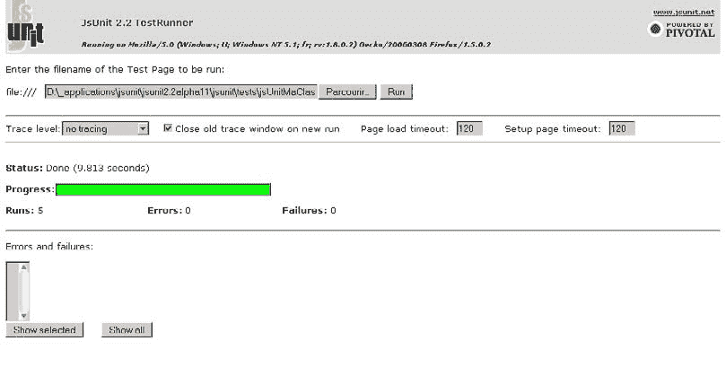
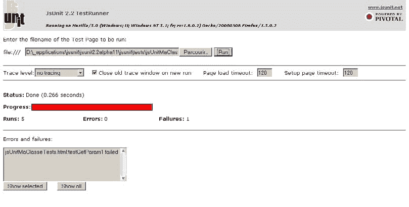

## 其他工具

### 第六部分

当所有测试都正确执行时，会显示一条绿色水平条（图 15.2 中为浅灰色）。

**图 15.2**
*当所有测试都正确执行时的 JsUnit 图形界面*

当一个或多个测试失败时，会显示一条红色水平条（图 15.3 中为深灰色）。

**图 15.3**
*当一个或多个测试失败时的 JsUnit 图形界面*

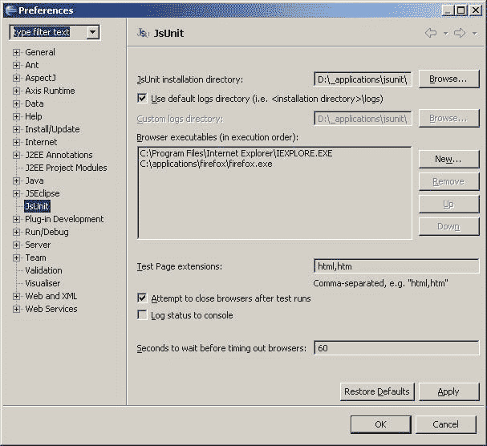

界面包含四个部分。第一部分允许指定测试 HTML 文件并启动其执行。第二部分允许指定相关设置，特别是关于跟踪级别和测试超时设置。

第三部分显示已执行测试的结果以及相关的统计数据。最后一部分提供了提供了有关测试失败的额外信息。可以通过选择列表中的错误并显示其详情（`Show selected` 和 `Show all`）来访问这些信息。

### 集成在 Eclipse 中的 JsUnit 启动器

JsUnit 还提供了一个集成在 `Eclipse` 中的启动器，允许直接从该开发环境执行测试 HTML 页面。

在 `Eclipse` 中安装后，需要配置启动器的安装目录以及要使用的各种浏览器可执行文件。图 15.4 展示了 `Eclipse` 中启动器的配置窗口。该窗口可以通过工具菜单中的 `Preferences…`（首选项）项访问。

**图 15.4**
*Eclipse JsUnit 插件的配置窗口*

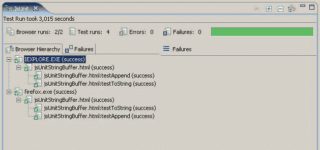
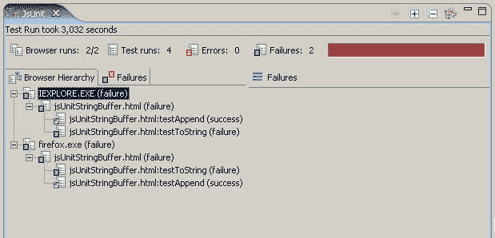

要执行测试 HTML 页面，必须使用 `Eclipse` 的内部执行支持。因此，可以通过右键菜单 `JsUnit Test Page` 执行页面。

如果执行成功，窗口将显示绿色条（图 15.5 中为浅灰色），并描述每个测试页面执行的测试函数列表。

**图 15.5**
*集成在 Eclipse 中的 JsUnit 视图（测试执行成功）*

如果测试出现错误，窗口将显示红色条（图 15.6 中为深灰色），错误的测试将用交叉号标记。

**图 15.6**
*集成在 Eclipse 中的 JsUnit 视图（测试执行中出现错误）*

现在让我们详细介绍 `JsUnit` 工具提供的用于在一个或多个浏览器中自动执行测试的支持。

### 使用 JsUnit Server 和 Ant 实现测试自动化

`JsUnit Server` 是一个非常有用的工具，它允许进一步实现 JavaScript 单元测试执行的自动化。这种自动化基于 `Ant` 工具提供的便利，同时通过 `JsUnit` 特定的任务进行增强。这种自动化的主要意义在于自动检查不同浏览器中 JavaScript 应用的故障和回归问题。这样就不需要手动一个一个运行它们。

`JsUnit` 服务器与 `JsUnit` 的 `Ant` 任务结合可以实现以下功能：

- 类似于 `JUnit`，将 `JsUnit` 测试结果存储在 XML 文件中。
- 在不同的 Web 浏览器上本地执行 `JsUnit` 测试。
- 在远程机器上执行 `JsUnit` 测试（此处不介绍此功能）。

#### Ant 工具

该工具在 Java 世界中常用于自动化重复任务。得益于其功能、可扩展性以及大量的可用任务，`Ant` 能够快速轻松地实现复杂的处理。此外，该工具允许指定任务链。因此，可以轻松实现以下处理链：从 CVS 获取源码、编译、二进制文件打包或执行单元测试。该开源工具可以在 [`http://ant.apache.org/`](http://ant.apache.org/) 获取。

为了实现这些功能，必须使用位于 `JsUnit` 发行包根目录下的 Ant 脚本 `build.xml`。它由不同的任务组成，在配置脚本变量后可以直接。此文件不是可执行文件，但它允许配置 `Ant` 的执行。该工具默认使用执行目录下的同名文件。以下代码演示了在命令行执行 `Ant`：

```bash
<JSUNIT_HOME>\jsunit > ant maTache

Buildfile: build.xml

maTache:

(...)

BUILD SUCCESSFUL
Total time: 1 second

<JSUNIT_HOME>\jsunit >
```

表格 15.2 和 15.3 总结了脚本中包含的各种属性和任务。

**表格 15.2 JsUnit build.xml 文件的属性**

| 属性 | 说明 |
| :--- | :--- |
| browserFileNames | |


对应用于测试的浏览器可执行文件列表。此属性仅在通过 `standalone_test` 任务执行独立且本地测试时使用。可以指定多个浏览器。它们的可执行文件名称必须用逗号分隔，例如：`c:\program files\internet explorer\iexplore.exe,c:\program files\netscape\netscape7.1\netscp.exe`。

### `closeBrowsersAfterTestRuns`
确定 JsUnit 是否应在测试执行后尝试关闭浏览器。其默认值为 `true`。

### `description`
允许定义 JsUnit 服务器的描述。

### `ignoreUnresponsiveRemoteMachines`
在实施分布式测试时，如果某台机器没有响应，则忽略该机器的测试。如果值为 `true`，未响应的机器不会被视为错误。否则（值为 `false`），则会将错误添加到错误列表中。

### `logsDirectory`
允许指定存储测试结果的地方。该值可以是相对路径，也可以是绝对路径。如果省略此属性，文件将存储在 `resourceBase` 属性值的子目录 `logs/` 下。

### `port`
允许定义 JsUnit 服务器使用的端口。默认值为 `8080`。

### `remoteMachineURLs`
允许指定要使用的测试机器列表。地址必须是有效的 HTTP 地址，并指定协议 (`http`)、机器名以及使用的端口。如果使用多台机器，它们的地址必须用逗号分隔，例如：`http://machine1.company.com:8080,http://localhost:8080`。

### `resourceBase`
允许指定 JsUnit 服务器的根目录。此属性不是强制的。如果省略，则使用当前目录。

### `timeoutSeconds`
允许指定测试执行不应的最长时长（秒）。默认值为 `60`。

### `url`
允许定义执行单元测试的地址。此属性对于独立测试是必须的，并且必须是一个有效地址，例如 `file:///c:/jsunit/testRunner.html?testPage=c:/jsunit/tests/jsUnitTestSuite.html`。执行通过 `TestRunner.html` 工具完成。

#### 表 15.3 JsUnit 文件 `build.xml` 中的 Or Ant 任务

| 任务 | 依赖于 | 描述 |
| :--- | :--- | :--- |
| `_compile_source` | | JsUnit 工具 Java 源码编译任务 |
| `_compile_tests` | | JsUnit 工具 JUnit 测试编译任务 |
| `_create_jar` | `_compile_source` | 创建 `jsunit.jar` 文件的任务 |
| `_generateJsUnitPropertiesSample` | | 生成 `jsunit.properties.sample` 文件的任务 |
| `_run_all_tests` | `_create_jar`, `_compile_tests` | 执行 JsUnit 单元测试的任务 |
| `_run_unit_tests` | `_compile_tests` | 执行 JsUnit Java 单元测试的任务 |
| `create_distribution` | `_create_jar` | 创建 JsUnitset（JsUnit 服务器和 Ant 任务）的任务 |
| `distributed_test` | `_run_unit_tests` | 在一台或多台远程机器上执行测试 |
| `standalone_test` | | 在本地执行测试 |
| `start_farm_server` | | 启动多个 JsUnit 服务器 |
| `start_server` | | 启动一个 JsUnit 服务器 |
| `stop_server` | | 停止 JsUnit 服务器 |

现在我们已经详细说明了 JsUnit 工具提供的各种 Ant 任务，让我们让我们详细说明如何实现上述前两个功能，即测试结果的 XML 存储以及在不同浏览器中配置测试执行。

### 测试结果的 XML 存储
为了以 XML 格式生成测试执行结果，必须使用 Ant 任务 `standalone_test`。它允许启动一个或多个 浏览器，在其中执行测试并获取结果，将其保存为 XML 格式的文件。

图 15.7 展示了这些机制。

**图 15.7 JsUnit 中的测试执行**
(Ant -> 启动 `testRunner.html` 实例 -> 包含测试的 HTML  -> `standalone_test` 或 `distributed_test` -> 嵌入 JsUnit HTTP 服务器 -> 发送结果 -> 写入结果 -> XML 文件)

### 工具
必须设置以下 Ant 脚本变量：
- `browserFileNames`：定义浏览器执行的位置。可以设置多个值以便在多个浏览器中进行测试。
- `logsDirectory`：定义结果 XML 文件的写入位置。
- `url`：指定 JsUnit 启动器的地址以及包含单元测试的页面。

包含要执行测试文件路径的变量 `url` 格式如下：`file:///<JSUNIT_HOME>/jsunit/testRunner.html?testPage=<TESTS_HOME>/jsUnitMesTests.html`。以下代码说明包含测试结果的 XML 文件结构：

```xml
<browserResult id="1146827481781" time="5.594">
  <properties>
    <property name="browserFileName" value="C:/applications/firefox/firefox.exe" />
    <property name="browserId" value="0" />
    <property name="jsUnitVersion" value="2.2" />
    <property name="userAgent" value=" Mozilla/5.0 (Windows; U; Windows NT 5.1; fr; rv:1.8.0.2) Gecko/20060308 Firefox/1.5.0.2" />
    <property name="remoteAddress" value="127.0.0.1" />
    <property name="url" value="file://<TESTS_HOME>/jsUnitMesTests.html" />
  </properties>
  <testCases>
    <testCase name="file:///<TESTS_HOME>/jsUnitStringBuffer.html:testAppend" time="1.375">
      <failure>Expected <param1> (String) but was <param11> (String) Stack trace follows: > JsUnitException > _assert > assertEquals > testGetParam1</failure>
    </testCase>
    <testCase name="file:///<TESTS_HOME>/jsUnitMesTests.html:testToString" time="1.156">
  </testCases>
</browserResult>
```

请注意，文件包含了一些关于执行测试浏览器的信息。这些信息位于 `property` 标签中。在上面的文件中，测试是使用 Firefox 浏览器通过 `jsUnitStringBuffer.html` 文件在本地执行的。

最后注意，JsUnit 目前尚未提供从结果 XML 文件生成文档的工具。由于使用的 XML 格式与 JUnit 工具的格式不匹配，无法使用 JUnit 的 Ant 任务 `junitreport`。然而，预计后续版本将支持该工具。

### 在不同浏览器中配置测试执行
测试的执行按照上一节描述的方式进行。唯一变化的是 `browserFileNames` 变量，它现在必须包含多个用逗号分隔的值。

为了在 Firefox 和 Internet Explorer 中连续执行测试，变量值格式如下：

```xml
<property name="browserFileNames" value="C:/Program Files/Internet Explorer/IEXPLORE.EXE,C:/applications/firefox/firefox.exe"/>
```


在这种情况下，`JsUnit` 的 Ant 任务会在不同的浏览器中连续执行测试，如图 15.8 所示。

- 启动一个
- 执行
- 实例
- 多个测试
- 浏览器
- `testRunner.html`
- `Ant`
- 任务
- HTML 页面
- 启动一个
- 包含测试的
- `standalone_test` 或
- 执行
- 实例
- `JsUnit` 
- 多个测试
- 浏览器
- `testRunner.html`
- HTTP 服务器
- 发送结果
- 嵌入的
- 发送结果
- 写入结果
- XML 文件
- XML 文件
- 包含
- 包含包含
- 测试结果

**图 15.8**
*在多个浏览器中执行测试*

在 `JsUnit` Ant 任务的这种用例中，会生成多个 XML 结果文件，与配置的浏览器数量对应。其内容的结构与上一节描述的相似。

# 对象模拟（Mock Objects）

虽然 `JsUnit` 提供了实现测试、验证其有效性以及以不同方式执行测试的功能，但它并不能将测试组件与其所依赖的对象隔离开。为此，可以使用对象模拟对象（mock objects）。它们允许提供替代对象，以验证方法是否被正确调用、参数是否符合预期，并强制设定它们的返回值。

通过这种技术，可以测试该对象的调用者方法以及它们与模拟对象的交互方式。在 JavaScript 中实现对象模拟相对简单，因为该语言不是强类型类型，且对象被视为属性和函数的简单数组。

对象模拟的实现包括从另一个对象初始化一个空对象。该对象的方法与引用对象具有相同名称，但必须是空的。在执行模拟之前，测试会为模拟对象参数，设置将被调用的不同方法的预期结果。尽管 JavaScript 的模拟实现还不够完善，但有两个实现值得详细介绍。

## 简单模拟的实现

`jpspan` 网站在它的 wiki 上提供了一种 JavaScript 对象模拟的简单实现。

该实现的代码可以在此处获取：`http://web.archive.org/web/20050205085833/http://jpspan.sourceforge.net/wiki/doku.php?id=javascript:mock`。

它的目标是记录一个 JavaScript 对象方法调用的次数。

在一切之前，需要从一个类初始化模拟对象，如下代码所示：

```javascript
function testSimulacreSimple() {
  var simulacre = MockCreate(StringBuffer);
  (...)
}
```

从这一刻起，模拟对象包含了与初始类相同的方法，但这些方法不返回任何值。因此，必须配置模拟对象以指定所需的返回值。以下代码说明了这种配置：

```javascript
function testToString() {
  var simulacre = MockCreate(StringBuffer);
  simulacre.setReturnValue("toString","Mon résultat");
  (...)
}
```

此后可以在模拟对象上调用 `toString` 方法，它现在会返回值 "Mon résultat"。此外，该实现还提供了获取与被调用方法相关信息，如下代码所示：

```javascript
function testToString() {
  var simulacre = MockCreate(StringBuffer);
  simulacre.setReturnValue("toString","Mon résultat");
  simulacre.toString();
  alert("La méthode maMethode a été appelée "
  + simulacre.getCallCount("toString")+" fois");
  alert("L’argument du dernier appel de la méthode est "
  + simulacre.getLastCallArgs("toString")[0]);
}
```

## 基于 JsUnit 的模拟实现

第二种实现正在集成到 `JsUnit` 框架中，更为先进。然而，它的缺点是使用了该框架的函数，因此没有它就无法使用。

该实现的代码和文档可以通过地址 `http://micampe.it/bzr/jsmock/` 和 `http://micampe.it/wiki/JavascriptMockObjects` 获取。

与之前的实现一样，必须使用目标类初始化模拟对象。该实现通过 `_expect` 方法指定对象将被调用的方法参数和返回值。以下代码说明了这种配置：

```javascript
function testToString() {
  var simulacre = MockCreate(StringBuffer);
  simulacre._expect("toString",
  ["Mon parametre"], "Mon resultat");
  (...)
}
```

一旦完成配置，就可以对模拟对象执行不同的方法调用。模拟对象的 `_verify` 方法允许验证执行情况是否符合预期结果，如下代码所示：

```javascript
function testToString() {
  var simulacre = MockCreate(StringBuffer);
  simulacre._expect("toString",
  [], "Mon resultat");
  var resultat = simulacre.toString();
  simulacre._verify();
  assertEquals(resultat, "Mon resultat");
}
```

该实现还提供了 `_expectThrows` 方法，以便在调用给定方法时抛出异常。以下代码说明了该方法的使用：

```javascript
function test() {
  var simulacre = MockCreate(StringBuffer);
  simulacre._expectThrows("toString",
  ["Mon parametre"], "Une exception");
  try {
    var resultat = simulacre.toString("Mon parametre");
    fail("Pas d’exception levée");
  } catch(err) {}
  simulacre._verify();
}
```

# 测试的

在上一节中，我们描述了 `JsUnit` 的工作原理，这些原理与 Java 世界中的 `JUnit` 类似。现在我们将关注如何在 JavaScript 应用程序中实现测试，以便检测可能的错误并提高它们的健壮性和质量。

为了描述实现 `JsUnit` 的方法，我们将以 `dojo` 库中的图形组件 `SortableTable` 为例。

让我们从创建一个包含通过 `SortableTable` 组件生成的表格的测试页面开始：

```html
<!DOCTYPE HTML PUBLIC "-//W3C//DTD HTML 4.01 Transitional//EN" "http://www.w3.org/TR/html4/loose.dtd">
<html
<head>
(...)
<script language="JavaScript" type="text/javascript">
var djConfig = {isDebug: true, debugAtAllCosts: true };
</script>
<script type="text/javascript" src="<DOJO_HOME>/dojo.js"></script>
<script language="JavaScript" type="text/javascript">
dojo.require("dojo.widget.SortableTable");
dojo.hostenv.writeIncludes();
</script>
<style type="text/css">
(...)
</style>
</head>
<body>
<div class="tableContainer">
<table widgetId="testTable" dojoType="SortableTable" headClass="fixedHeader" tbodyClass="scrollContent" enableMultipleSelect="true" enableAlternateRows="true" rowAlternateClass="alternateRow" cellpadding="0" cellspacing="0" border="0">
<thead>
<tr>
<th field="Id" dataType="Number">Id</th>
<th field="Name" dataType="String">Name</th>
<th field="Description" dataType="String" sort="asc">Description</th>
</tr>
</thead>
```


| # | 城市 | 描述 |
| :--- | :--- | :--- |
| 1 | 南特 | 卢大西洋省首府 |
| 2 | 巴黎 | 法国首都 |
| 3 | 圣纳代 | 卢大西洋省副县 |

现在我们的组件已经就绪，我们可以开始实现测试结构，首先需要指定 JsUnit 所需 JavaScript 文件的位置：

```html
<!DOCTYPE HTML PUBLIC "-//W3C//DTD HTML 4.01 Transitional//EN"
["http://www.w3.org/TR/html4/loose.dtd"](http://www.w3.org/TR/html4/loose.dtd)
<<html>
<head>
(...)
<link rel="stylesheet" type="text/css" href="file://<JSUNIT_DIR>/jsunit/css/jsUnitStyle.css">
<script language="JavaScript" type="text/javascript" src="file://<JSUNIT_DIR>/jsunit/app/jsUnitCore.js"></script>
<script language="JavaScript" type="text/javascript">
var djConfig = {isDebug: true, debugAtAllCosts: true };
</script>
<script type="text/javascript" src="../../../dojo.js"></script>
<script language="JavaScript" type="text/javascript">
dojo.require("dojo.widget.SortableTable");
dojo.hostenv.writeIncludes();
function testExistenceTableau() {
(...)
}
function testChargementDonneesTableau() {
(...)
}
function testTriDonneesTableau() {
(...)
}
</script>
</head>
<body>
<div class="tableContainer">
(...)
</div>
</body>
</html>
```

接下，我们实现这三个测试函数。第一个函数 `testExistenceTableau` 检查图形组件是否已正确创建，以及是否可以通过 `dojo.widget.byId` 方法引用它。第二个函数 `testChargementDonneesTableau` 检查表格数据是否已由组件正确加载。第三个函数 `testTriDonneesTableau` 检查表格渲染是否根据创建表格时指定的最后一列进行了正确排序。

第一个测试函数简单地检查 `dojo` 库的 `dojo.widget.byId` 方法是否返回了组件的实例：

```javascript
function testExistanceTable() {
var monTableau = dojo.widget.byId("monTableau");
assertNotUndefined(monTableau);
assertNotNull(monTableau);
}
```

第二个函数依赖于表格数据的内部存储结构，以检查所有指定的数据是否存在。由于组件是按照定义的方式存储数据，因此我们不需要担心可能的排序问题。由于组件定义了不同列的类型，我们在验证这些值时必须考虑到这一点。由于组件以对象的形式管理数据，因此必须使用 `assertObjectEquals` 函数：

```javascript
function testLoadTable() {
var monTableau = dojo.widget.byId("monTableau");
var donnees = monTableau.data;
assertEquals(donnees.length,3);
// 第一行
var donneesPremiereLigne = donnees[0];
assertObjectEquals(donneesPremiereLigne["Id"],1);
assertObjectEquals(donneesPremiereLigne["Name"],"Nantes");
assertObjectEquals(donneesPremiereLigne["Description"], "Préfecture de Loire-Atlantique");
// 第二行
var donneesSecondeLigne = donnees[1];
assertObjectEquals(donneesSecondeLigne["Id"],2);
assertObjectEquals(donneesSecondeLigne["Name"],"Paris");
assertObjectEquals(donneesSecondeLigne["Description"], "Capitale de la France");
// 第三行
var donneesTroisiemeLigne = donnees[2];
assertObjectEquals(donneesTroisiemeLigne["Id"],3);
assertObjectEquals(donneesTroisiemeLigne["Name"], "Saint-Nazaire");
assertObjectEquals(donneesTroisiemeLigne["Description"], "Sous-préfecture de Loire-Atlantique");
}
```

最后一个测试函数直接依赖组件的 DOM 树来验证排序功能（排序仅在通过渲染方法 `render` 进行显示时完成）：

```javascript
function testTriDonneesTableau() {
var monTableau=dojo.widget.byId("monTableau");
var dom = monTableau.domNode;
assertEquals(dom.rows.length,4);
// 第一行
var premiereLigne = dom.rows[1];
assertObjectEquals(premiereLigne.cells[0],"2");
assertObjectEquals(premiereLigne.cells[1],"Paris");
assertObjectEquals(premiereLigne.cells[2], "Capitale de la France");
// 第二行
var secondeLigne = dom.rows[2];
assertObjectEquals(secondeLigne.cells[0],"1");
assertObjectEquals(secondeLigne.cells[1],"Nantes");
assertObjectEquals(secondeLigne.cells[2], "Préfecture de Loire-Atlantique");
// 第三行
var troisiemeLigne = dom.rows[3];
assertObjectEquals(troisiemeLigne.cells[0],"3");
assertObjectEquals(troisiemeLigne.cells[1],"Saint-Nazaire");
assertObjectEquals(troisiemeLigne.cells[2], "Sous-préfecture de Loire-Atlantique");
}
```

## JavaScript 单元测试的局限性

测试的实现并不总是可能的，因为某些机制（例如 Ajax 的异步机制）增加了实现的复杂性。此外，Ajax 还施加了安全限制。例如，使用该技术的调用只能从加载页面的机器发起。在这种情况下，`JsUnit` 的 HTML 启动器必须在 HTTP 服务器上运行测试页面。该服务器也必须是测试 Ajax 用的目标。

尽管如此，单元测试可以测试 JavaScript 应用程序在事件触发方面的正常运行，因为该语言允许对其进行模拟。然而，这种模拟是特定于浏览器的。

例如，Firefox 允许为此使用 DOM 2 级的功能。`document` 对象的 `createEvent` 方法创建事件，然后通过调用 `initMouseEvent` 方法初始化由鼠标触发的事件。最后，通过 `dispatchEvent` 方法触发该事件。

以下代码展示了在 Firefox 中对该技术的实现：

```javascript
var traiterEvenementAppelee = false;
function traiterEvenement(evenement) {
traiterEvenementAppelee = true;
}
function testSimulationEvenementsFirefox() {
var elt = document.getElementById("monId");
var evt = document.createEvent("MouseEvents");
evt.initMouseEvent("click", true, true, window, 0, 0, 0, 0, 0, false, false, false, false, 0, null);
elt.dispatchEvent(evt);
if( !traiterEvenementAppelee ) {
fail();
}
}
}
```

## 结论

单元测试并不仅适用于 Java、C++ 或 .Net 等“高级”语言。通过使用 `JsUnit`（一种 xUnit 家族的工具），可以对 JavaScript 应用程序进行测试，以增强健健性并验证它们在不同浏览器中的运行情况。


遗憾，JsUnit 目前不支持格式化测试结果，也不支持 Java 世界中 `JUnit` 工具的 `Ant junitreport` 任务。

然而，必须意识到，由于 JavaScript 使用了不同的机制（特别是 Ajax 的异步机制），测试的实现并不总是是轻而易举的。

# 第 16 章：工具

本章介绍了多种工具，旨在为实现 JavaScript 应用程序提供一个友好且高效的环境。我们首先从 JavaScript 代码的开发和调试工具开始，最后介绍用于优化基于 JavaScript 语言的 Web 应用程序的元素。

本章并非要穷尽详举，仅考虑了作者认为不可或缺的某些工具。

## 开发工具

顾其名，JavaScript 是一种脚本语言。因此，一个简单的文本编辑器就足以编写基于该语言的程序。带有语法高色的文本编辑器可以提高代码的可读性，但无法提供一个友好且高效的开发环境。

文本编辑器很快就会达到其局限性，因为它没有提供任何自动输入辅助功能，更不用说能够调试脚本的功能了。`Eclipse` 的插件 `ATF` 通过提供一个用于 JavaScript 应用编码和调试的完整环境，为这些困难提供了切实的解决方案。

## 辅助工具

### ATF (Ajax Toolkit Framework)

开源工具 `ATF` 为 `Eclipse` 提供了一个扩展，以便为 Web 应用程序开发提供完整的环境。

#### Eclipse

`Eclipse` 是一个开源开发平台，通过添加插件可以扩展和适应。该开发环境旨在通用的，因为它具有集成各种功能的能力。`Eclipse` 的子项目 `WTP`（Web Tools Platform）添加了一组与 Web 相关的功能，特别是 HTML 编辑器、CSS 样式表编辑器和 JavaScript 编辑器。

`ATF` 丰富了 `WTP`（Web Tools Platform）分发的功能，因此安装 `ATF` 的前提是拥有 `WTP` 环境，可以在地址 `http://www.eclipse.org/webtools/` 下载。一旦安装了 `WTP`，只需安装 `ATF`，它可以在 `http://www.eclipse.org/atf/` 获取。

#### 基础功能

`ATF` 提供了一个完整的 JavaScript 开发环境，包括输入过程中的语法检查功能。它还提供了代码自动补全，通过为给对象提供可用方法或属性为代码输入提供帮助。

在本节中，我们只讨论与 JavaScript 语言相关的功能，但 `ATF` 提供了一整系列功能，允许编写 HTML 页面并实现 CSS 样式。

`ATF` 允许直接在工具中测试 Web 应用程序，无需借助外部浏览器。这一功能的实现是通过集成 `Mozilla` 浏览器实现的。

同样，JavaScript 脚本的调试可以直接在工具中进行，不需要外部调试器。对 `DOM` 树的检查（允许可视化 页面在内存中的表示）也基于这一原理。

图 16.1 展示了 `ATF` 在 `Eclipse` 开发环境中提供的图形界面。

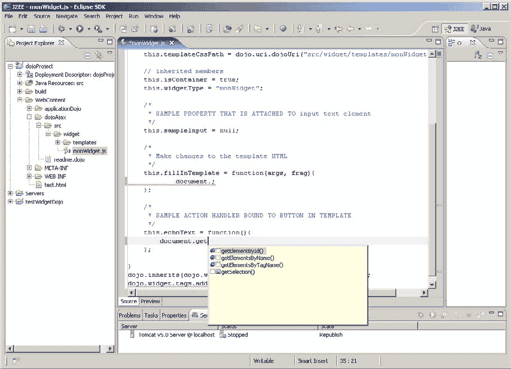

**图 16.1：ATF 工具的图形界面**

我们可以看到与 JavaScript 语言相关的主要输入辅助，以及通过包含可用方法的框架来显示 `DOM` 对象方法的辅助。包含语法错误的行会被下划线标记。

#### JavaScript 库支持

除了 JavaScript 语言的语法高亮、自动补全和输入语法检查外，`ATF` 还提供了一组用于生成代码助手。它提供了用于生成 `dojo` 库周围骨架的助手，特别允许创建新的 `dojo` 图形组件。

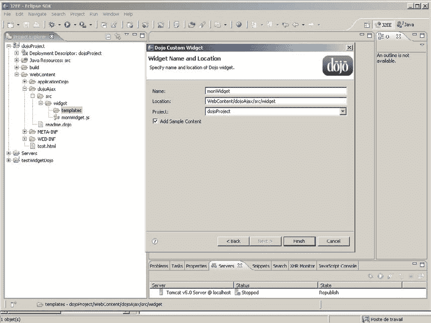

**图 16.2：dojo 图形组件生成助手**

图 16.2 展示了最后一个助手的实现。该助手允许生成定义 `dojo` 图形组件的不同元素，特别是模板、样式表以及包含小部件结构的 JavaScript 类。

以下代码详细说明了基于 `dojo` 助手生成的图形组件的 JavaScript 类：

```
dojo.provide("dojo.widget.monWidget");
dojo.require("dojo.event.*");
dojo.require("dojo.widget.*");
dojo.require("dojo.graphics.*");
dojo.require("dojo.fx.html");
dojo.require("dojo.style");
dojo.widget.monWidget = function(){
    dojo.widget.HtmlWidget.call(this);
    this.templatePath = dojo.uri.dojoUri("src/widget/templates/monWidget.html");
    this.templateCssPath = dojo.uri.dojoUri("src/widget/templates/monWidget.css");
    // 继承的属性
    this.isContainer = true;
    this.widgetType = "monWidget";
    /*
    * 修改 HTML 模板
    */
    this.fillInTemplate = function(args, frag){
    };
}
dojo.inherits(dojo.widget.monWidget, dojo.widget.HtmlWidget);
dojo.widget.tags.addParseTreeHandler("dojo:monWidget");
```

名为 `snippets` 的其他助手允许在 HTML 页面中添加 `dojo` 图形组件。这些助手提供了各种对话框来配置图形组件。

图 16.3 展示了用于配置 `FloatingPane` 图形组件的对话框。该图形组件是一个可以移动的窗口。

**图 16.3：用于 FloatingPane 属性输入的对话框**

在对话框中选择 `Insert` 按钮会产生以下 HTML 代码：

```html
<div dojoType="FloatingPane" widgetId="floatingPaneId" title="Pane Title" constrainToContainer="1" style="width: 100px; height: 100px; left: 10px; top: 10px;">
</div>
```

尽管如此，请注意该工具非常面向 Java/J2EE，并且强制要求 J2EE 服务器来调试 JavaScript 应用程序。此外，`ATF` 支持许多 JavaScript 库，但还没有 `dojo` 的 0.3 版本。

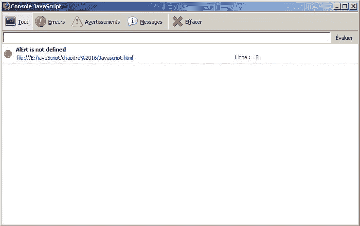


这些工具避免了基于警报消息（`alert` 函数）的调试，这种方法很快就会达到其局限性并变得繁琐。

## Firefox JavaScript 控制台

Firefox 浏览器配备了一个 JavaScript 控制台，用于收集所有的错误、警告或 JavaScript 消息。该控制台可以通过“工具”菜单访问。

一旦发生错误，控制台就会出现一行，显示错误的发生上下文、文件名以及行号。根据这些信息，可以相对容易地识别执行过程中的错误。

在脚本的调试阶段，我们建议始终打开此控制台以检查其运行是否正常。

图 16.4 展示了控制台的界面。

**图 16.4**
*Firefox JavaScript 控制台*

JavaScript 控制台会保留在访问过的网页中产生的所有错误。然而，它并不允许针对特定的网页或脚本过滤错误。若要查看单个页的错误，必须先通过“清除”按钮清理控制台。

## 用于 Firefox 的 FireBug

在 Firefox 中进行 JavaScript 调试需要安装该浏览器的扩展。由于本章的目的并非详尽介绍所有可用扩展，因此我们重点介绍了 FireBug 扩展作为示例。

FireBug 由 Joe Hewitt 开发，地址为 `https://addons.mozilla.org/fire-fox/1843` (`fox/1843/`)。安装后，可以通过“工具/FireBug”菜单访问调试功能。

该扩展允许通过跟踪方法调用来逐步调试 JavaScript 脚本，并以此视觉化所存在对象的值。控制台功能提供了仅查看当前页面错误的功能。开发者可以借此最好地定位错误发生的位置。

通过 FireBug，可以现场执行 JavaScript 代码，从而在 HTML 页面的执行上下文中触发任何方法。

Dom 检查器（inspecteur Dom）允许详细查看网页的 DOM 树。当 Dom 树在 JavaScript 中被被修改时，此功能显得尤为适用。

最后，FireBug 还提供了一个分析与 Ajax 交换流的模块，特别是通过 `XMLHttpRequest` 类进行的交互。

为了说明此调试器的工作原理，我们来看以下源代码：

```html
<html
<head>
<title>FireBug</title>
<script type="text/javaScript">
// 包含错误代码的函数
function fonctionEnErreur(){
AlErt("test console"); // ❶
}

// 实现 Dom 检查器
function utilisationInspecteurDom(){
var zone = document.getElementById("maZone");
var lbl = document.createElement("label"); // ❷
var txt = document.createTextNode("libellé");
lbl.appendChild(txt);
zone.appendChild(lbl);
}

// 使用逐步调试器
function calcul(){
var i=0;
for (i=0; i < 10; i++){
j = j + 2;
}
}
</script>
</head>
<body onload="fonctionEnErreur()">
<div id="maZone">
</div>
<input type="button" onclick="utilisationInspecteurDom()" value="inspecteur DOM">
<input type="button" onclick="calcul()" value="Calcul"/>
</body>
</html>
```

上述代码在标记 ❶ 处故意包含了一个语法错误。当打开此示例时，控制台会如图 16.5 所示显示出该错误。

**图 16.5**
*在 FireBug 控制台中显示错误*

请注意 FireBug 定位语法错误的精确度。现在我们将使用 DOM 检查器来查看 label 标签的动态创建（标记 ❷）。

点击 DOM 检查器按钮可以触发页面上标签的添加。DOM 检查器（`Inspector` 标签页）显示了 `label` 标签的添加，如图 16.6 所示。

**图 16.6**
*FireBug 的 DOM 检查器*

DOM 检查器允许查看 HTML 页面的整个内存结构，以及样式表或脚本。如前所述，调试器允许跟踪代码的逐步执行，并在执行过程中评估变量。

像所有调试器一样，它的使用依赖于设置断点（points d’arrêt）。这些断点告诉调试器我们希望在哪些指令处停止执行以便分析代码。

FireBug 调试器可以通过 `Debugger` 标签页访问，它在打开时会显示页面的源代码。在此阶段，添加断点只需点击某行即可。它们在视觉上用红圆圈表示。

如果我们在之前的代码中通过点击 `calcul` 函数的第一行来该函数设置一个断点，那么当通过点击页面上的“Calcul”按钮调用该函数时，高亮行将指示执行已在该处停止。

图 16.7 展示了这种实现。

**图 16.7**
*FireBug 中的逐步调试*

现在，可以通过 `Debugger` 标签页底部的命令按钮逐步执行代码。在指令推进期间，不同变量的值如图 16.8 所示呈现。

**图 16.8**
*FireBug 调试过程中的变量可视化*

正如我们所看到的，FireBug 扩展提供了许多对于调试和修复在 Firefox 浏览器中编写的 JavaScript 脚本的重要功能。

## Internet Explorer 中的调试

在 Internet Explorer 浏览器中也可以通过 Microsoft Script Debugger 工具进行脚本调试。该工具从 Microsoft 下载中心获取，允许查看 JavaScript 代码以设置断点并逐步执行代码。

Script Debugger 提供了命令行窗口查看并修改变量，并查看调用堆栈。此功能允许跟踪方法调用的链。


一旦设置了断点，只需点击网页上的“计算”按钮即可到达第一个断点。随后，使用功能键 F8 可以逐行执行指令。

与 FireBug 不同，变量的值不会被显示，其可视化仍需由用户通过控制台窗口主动发起的。

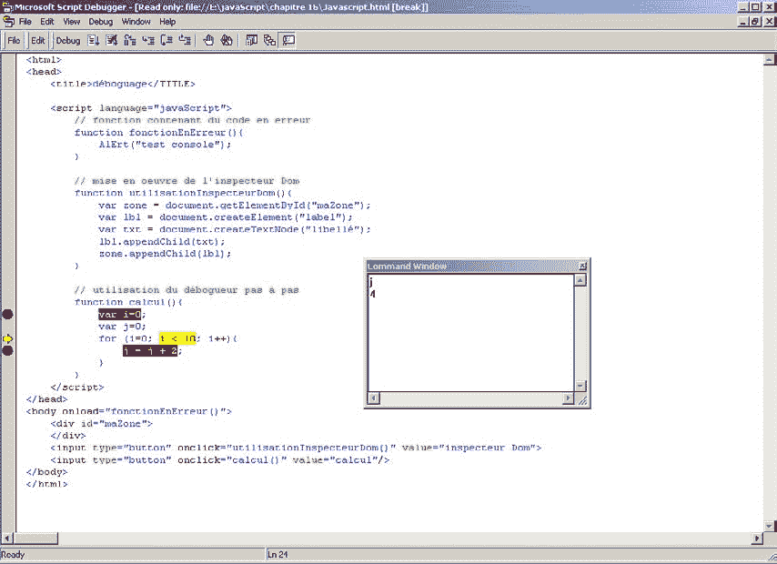

### 辅助工具

图 16.10 展示了我们示例中变量 `j` 的可视化。

**图 16.10**
在 Internet Explorer 中单步执行执行时的变量可视化。Internet Explorer 脚本调试器提供了调试 JavaScript 脚本的主要功能，但 DOM 浏览器除外，尽管 DOM 浏览器对于实现 JavaScript 应用非常有用。

### 使用 dojo 进行调试

由于 dojo 模块是动态加载的，在该库中进行调试变得棘手。

由于脚本是通过 Ajax 请求按需加载，然后通过 `eval` 函数进行动态评估，因此不允许进行调试。为了实现这一功能，必须修改脚本的加载策略。

dojo 配置（`djCOfig` 对象）中的 `debugAtAllCosts` 属性允许通过在网页头部动态添加 `<script>` 标签来加载不同的脚本。

### 工具集

以下代码提供了一个配置 dojo 库时激活调试（标记 ❶）的示例：

```javascript
djConfig = {
  isDebug: true,
  debugAtAllCosts: true // ❶
};
```

`debugAtAllCosts` 属性应仅在调优或查找故障的阶段激活，绝对不能在生产环境中使用，因为它对性能的影响不容忽视。

### 内存泄漏检测

JavaScript 语言依赖垃圾回收机制（garbage collector）来管理内存。

当一个对象不再被引用时，垃圾回收器就会将其从内存中移除。如果一个对象仍然被引用，内存就无法被释放，导致内存泄漏。

在 JavaScript 开发中，内存泄漏通常发生在以下情况：
- 全局变量意外引用了不再使用的对象。
- 未清除的定时器（如 `setTimeout` 或 `setInterval`）。
- 未解绑的事件监听器。
- 闭包引用的外部变量。

为了检测这些内存泄漏，开发者可以使用浏览器提供的调试工具（如 Chrome 开发者工具中的“内存”面板）。通过获取内存快照（Snapshot），可以分析哪些对象在持续增长。


多种工具可以通过删除空格、注释和换行符来压缩脚本。

dojo 社区提供了一种更强大的工具，它通过更短的名称对变量进行重命名。

LivreGougeon 第 487 页 2006 年 11 月 28 日 周二 4:23 16

## 工具

**487**

# 第 16 章

dojo 压缩工具以可下载的 Java 程序的的形式提供，地址为 [`dojotoolkit.org/docs/compressor_system.html`](http://dojotoolkit.org/docs/compressor_system.html)。它基于 `Rhino` 引擎，允许解释 `JavaScript` 脚本并缩短变量名的长度。

其运行至少需要一个 Java `1.4` 版本的虚拟机。

在上一节介绍的示例上运行压缩工具，得到如下结果：

```javascript
function Utilisateur(){
this.getClassName=function(){
};
}

Utilisateur.prototype.getNom=function(){
};

Utilisateur.prototype.setNom=function(_1){
this.nom=_1;
};

Utilisateur.prototype.getAge=function(){
};

function Administrateur(){
}
```

注意，注释已被删除，且 `setNom` 方法的参数 `nom` 被替换为参数 `_1`。该 `JavaScript` 脚本的大小从 1068 字节减少到了 237 字节。

### 动态加载

在 `JavaScript` 中使用类通常涉及为每个类创建一个相应的 `JavaScript` 源文件。这种方法允许接近 `Java` 语言中类的存储方式。这些类（更准确地说说是脚本文件）随后由浏览器按需加载。

`dojo` 库使用这一概念进行类拆分。类的动态加载通过 `Ajax` 请求按需执行，将脚本文件内容带回浏览器并进行求值。

这种加载模式所需的 `Ajax` 调用次数等于需要加载的类数量。然而，重要的是，调用大量的 `Ajax` 请求会严重影响响应时间。每一个 `Ajax` 请求本质上都是一个 `HTTP` 请求。

为了限制这些请求的数量并优化网页加载时间，最好将最常用的类合并到同一个 `JavaScript` 文件中。这样，大量微小的 `Ajax` 请求将被替换为几个大型 `Ajax` 请求，从而缩短 `JavaScript` 脚本的加载时间。

LivreGougeon 第 488 页 2006 年 11 月 28 日 周二 4:23 16

## 其他工具

**488**

### 第六部分

## 结论

本章介绍了不同的工具，这些工具在使用 `JavaScript` 语言的开发、调试和故障排除阶段提高效率。

`jsDoc` 工具表明，生成良好的文档也是可能的。这些文档经常被忽视，但它们对于维护包含 `JavaScript` 的应用程序至关重要。然而，`jsDoc` 的使用取决于此前是否付出了大量的注释工作。

本章最后讨论的几提供了优化脚本加载时间的改进建议。这既可以在 `JavaScript` 脚本的大小上实现，也可以通过加载方式实现。

LivreGougeon 第 489 页 2006 年 11 月 28 日 周二 4:23 16

## 索引

**A**
- 轻量级 255

**D**
- Ajax
- behavior 266
- 日期 36
- 类 `XMLHttpRequest` 105
- prototype 255
- 浏览器特殊性 37
- 绕过限制
- `script.aculo.us` 269
- dojo 80, 147, 114
- prototype 125
- 字符串及其派生
- 数据交换 109
- rialto 347
- 交换的数据 110
- `script.aculo.us` 269
- 集合 173
- 交换的数据结构 111

**C**
- 预定义组件 317
- 交换管理 108
- CCS 5
- 复杂的 331
- 隐藏 iframe 116
- 字符串 33
- 树 334
- 组件实现
- 闭包 closures 45
- Wysiwyg 编辑器 337
- 图形 241
- 图形组件
- 数组 331
- 实现 105
- 外观 236
- 窗口 322
- 服务器端代理 115
- 构建方法 242
- 菜单和工具栏 326
- 支持
- 自动完成 247
- 定位 320
- 通过 dojo 183
- 通用行为 238
- 简单的 318
- 通过 prototype 139
- 面向对象设计 235
- 配置 338
- 通过 rialto 356
- 实现示例
- 使用 246
- 日期 167
- Yahoo 服务 426
- 样式表 237
- 调试 282
- script 标签的动态
- 概述 231
- 库发布 120
- 事件管理 149
- Amazon 419
- 案例研究 338
- ECS 服务 430
- 正则表达式 170
- 使用服务 436
- 实现 231
- 目标 233
- Java 的 157
- 测试自动化 45
- 对象的 233
- ATF (Ajax Toolkit Framework) 472
- 组织 234
- 脚本 157
- prototype 的 447

**B**
- 集合 173

**E**
- E4X (ECMAScript for XML) 4
- ECS (E-Commerce Service) 430
- ECMA (欧洲计算机制造商协会) 2
- ECMA-262 2
- ECMAScript

**H**
- HTML 198

**I**
- 函数 `dojo.io.bind` 183
- 表单提交
- JavaScript 2
- 隐藏 iframe 116
- 189
- JScript 2
- 交互性 7
- RPC 支持 187
- 规范 3
- Web 图形界面 197
- DOM 的 178
- 高级概念 222
- 图形 283
- 正则表达式 37
- CSS 202
- 数组 158
- HTML 198
- 应用程序轨迹 190

**F**
- xHTML 198
- 初始化处理
- Internet Explorer
- FireBug 477
- 页面 290
- 闭包 closures 45
- Firefox


# 索引 (491)

## J
- `通信机制`
- `JsUnit` (443)
- `基于 Ajax 的` (9)
- `JavaScript`
- `断言与失败` (449)
- `对象的函数调用`
- `对象的实现`
- `使用 `JsUnit` 进行测试自动化
- `自定义` (64)
- `JsUnit Server` 与 `Ant` (457)
- `原型 属性` (66, 73)
- `关键字`
- `测试用例` (445)
- ``delete` 属性的更改` (82)
- `用于的数据加载`
- `标签样式` (221)
- `instanceof` (79)
- `测试` (452)
- `类` (57)
- `this` (64)
- `基础执行配置` (59)
- `在不同浏览器中进行测试` (461)
- `运行环境`
- `字面量对象` (70)
- `属性与方法的作用域`
- `测试执行上下文` (447)
- `实现` (64)
- `测试执行` (453)
- `预实例化` (62)
- `基本原理` (11, 16)
- `模拟对象 (Mock) 实现`
- `创建技术` (67)
- `方法` (27)
- `支持的面向语言概念` (57)
- `运算符` (20)
- ``Eclipse` 内置启动器` (455)
- `控制结构` (24)
- `在 浏览器中` (5)
- `数组` (28)
- `支持的操作系统` (445)
- `手动触发事件` (218)
- `变量与类型` (16)
- ``build.xml` 文件的属性`
- `面向对象编程` (458)
- `浏览器检测` (208)
- `测试实现` (464)
- `确定对象的类型` (79)
- `测试结果的 XML 存储` (459)
- `对象模拟 (Mock objects)` (462)
- `测试套件的结构化` (450)
- `现有类的扩展` (78, 458)
- `闭包 (closures)` (45)
- `Web 2.0 基础` (7)
- `图形语言 (与 `JavaScript` 交互)` (208)
- `框架支持` (80)
- `内存泄漏` (82)
- `事件管理` (210)
- `使用 `JsUnit Server` 和 `Ant` 自动化` (457)
- `应用程序实现的最佳实践` (443)
- `基础方法` (27)
- `单元测试执行` (453)
- `类继承` (72)
- `多重` (76)
- `基础类型` (32)

## N
- `历史` (2)
- `字符串操作` (33)
- `与 JavaScript 语言的交互` (5)
- `交互性` (7)
- `Web 浏览器解释器` (13)
- `日期` (36)
- `数字` (35)
- `日期的特殊性` (37)
- `使用 `JavaScript` (15)
- `在浏览器中` (15)
- `JSON` (70)
- `以及 XML 和 XSLT` (223)
- `数字` (35)
- `晚绑定 (late binding)` (67)
- ``Yahoo!` 服务` (426)
- `单元测试的局限性` (468)
- `jpspan` (462)

## O
- ``DOM` 树的操作` (209)
- `OMG (对象建模小组)` (50)
- `JSON` (70, 113)
- `运算符` (20)
- ``JavaScript` 对象` (462)
- `对象模拟 (Mock objects)` (462)
- `动态加载` (487)
- `传输` (139)
- `SpiderMonkey (解释器)` (14)
- `压缩` (486)
- `Element` (256)
- `控制结构` (24)
- `Event` (261)
- `Form` (264)
- `快捷键` (144)
- `数组` (28)
- `内存泄漏检测` (483)
- `Ajax 支持` (139)
- `dojo` (482)
- `内存泄漏检测` (483)
- `类` (126)
- `FireBug` (477)
- `基础` (129)
- ``JavaScript` (443)
- `Script` (126)
- `单元测试执行` (453)
- `HTML 表单` (264)
- `类型` (16)
- `文档` (483)
- `jsDoc` (483)

## P
- `REST (表述状态转移)` (419)
- `Rhino` (487)

## V
- `DOM` (85)
- `变量` (16)
- `图形 Web` (195)
- `命令` (14)

## W
- `聚合` (55)
- `行为` (389)
- `类` (50)
- `图形组件` (357)
- `数据交换` (8)
- `抽象` (53)
- `复杂的` (378)
- `扩展`
- `终态` (53)
- `基础` (359)
- `图形化` (7)
- `组合` (55)
- `浮窗` (376)
- `JavaScript` (7)
- `dojo` (157, 162)
- `表单管理` (367)
- `定位` (370)
- `结构化` (357)
- `历史` (347)
- `安装` (348)
- `Objects` (80)
- `多态` (56)
- `Rialto Studio` (390)
- `xHTML` (5, 201)
- `实例类型` (56)
- `附带` (348)
- `Strict` (202)
- `可见性` (51)
- `文件验证` (202)
- `原型` (125)
- `基础` (350)
- `语言版本` (202)
- `添加 HTML 块` (258)
- `Ajax 技术` (356)
- `xHTML 1.1` (201)
- ``DOM` 树` (138)
- `原型` (125)
- `字符串` (129)
- `Event 类` (262)
- `script.aculo.us` (280)
- `XMLHttpRequest` (105)
- `观察者类` (262)

## U
- `组件的使用`
- `相关的 ActiveX 组件`
- `JavaScript 控制台` (476)
- `图形化` (339)
- `以及 XSLT` (228)
- `类型检查` (155)
- `日期` (37)
- `在 `DOM` 中` (224)
- `DOM`
- `FireBug` (477)
- `日期` (37)
- `类`
- `Leak Monitor` (483)
- `调试` (480)
- `Event` (213)
- `修改 CSS 类`
- `Drip` (483)
- `MouseEvent` (214)
- `标签` (221)
- `事件支持` (214)


## 数字处理
## 日期处理
## 正正则表达式
## 应用程序结构
### 函数
### 闭包 (Closures)
### 异常处理
## 结论

## 3 - JavaScript 与面向对象编程
### 面向对象原理回顾
### 类与对象
### 继承
### 聚合与组合
### 多态
### 总结
### JavaScript 类
### 基础类
### 内置类
### 运行环境类
### 自定义类的实现
### 类的实现
### 类继承
### 深入探讨
## 结论

## 4 - DOM 编程
### DOM 规范
### Web 浏览器支持
### DOM 结构
### `Node` 类
### 节点类型
### 元素操作
### 直接访问元素
### 从节点访问元素
### 节点操作
### 树片段（Fragments）的使用
### 属性操作
### DOM 树遍历
### `innerHTML` 属性
### 0 级 DOM 使用
### 在加载时修改 DOM 树
## 结论

## 5 - Ajax 的实现
### Ajax 与 `XMLHttpRequest` 类
### `XMLHttpRequest` 类
### 交换管理
### 数据交换
### 交换的数据
### 交换数据的结构
### 总结
### 绕过限制
### 服务器端代理
### 隐藏 iframe
### script 标签动态使用
### 总结
## 结论

## 第二部分 - JavaScript 库的基础
## 6 - 原型库
### JavaScript 基础元素支持
### 类支持
### 函数测试
### 类支持
### 基础类
### 字符串
### 集合管理
### DOM 支持
### Ajax 支持
### 实现
## 结论

## 7 - 库的基础
### 基础支持
### 安装
### 管理
### 基础支持
### 检测
### 面向对象编程
### 类实现
### 字符串
### 字符串
### 正正则表达式
### 集合
### 基础集合
### 结构
### DOM 支持
### Ajax 支持
### 技术
## 结论

## 第三部分 - 使用 JavaScript 进行图形编程
## 8 - Web 图形界面基础
### HTML 与 xHTML
## CSS
### 样式定义
### 样式应用
### 与 JavaScript 交互
### 浏览器检测
### DOM 树操作
### 事件处理
### 样式操作
### 高级概念
### 事件处理
### XML 和 XSLT 技术的使用


## 结论

# 9 - 图形组件的实现

## 图形组件概述
### 图形组件的目标
### 图形组件之间的关系

## 图形组件的结构化
### 面对象设计
### 外观
### 通用行为
### 事件管理

## Ajax 的使用

 构建方法
### 基于 HTML 的构建
### 基于 JavaScript 的构建
### 总结

## 图形组件的实现示例
### 文本框与自动完成
### 选择列表

## 结论

# 第四部分 - 图形 JavaScript 库

## 10 - 轻量级图形库
### prototype 库
### DOM 树元素操作
### 添加 HTML 块
### 事件管理
### HTML 表单支持
### 总结

### behaviour 库
### behaviour 库的安装与实现
### 总结

### script.aculo.us 库
### 效果
### 拖放
### 自动补全
### 总结

## 结论

## 11 - dojo 库的图形化支持
### 基础 HTML 模块
### 基础函数
### 样式管理
### 显示管理

### 事件管理
### 基础函数
### 解耦

### 效果管理

### 拖放管理

### 图形组件的实现
### 图形组件的结构化
### 自定义组件的实现
### 组件的实施
### 图形组件的操作
### 总结

### 预定义组件
### 简单组件
### 定位
### 窗口
### 菜单与工具栏
### 复杂组件

### 案例
### dojo 实现
### 图形组件的使用

## 结论

## 12 - rialto 库
### 历史
### 相关项目
### 安装
### 基础支持
### Ajax 技术支持

### 图形组件
### 组件结构化
### 基础组件
### 表单管理
### 定位
### 浮窗
### 复杂组件
### 总结

### 行为

### Rialto Studio

## 结论

# 第五部分 - 使用外部服务

## 13 - Google Maps
### 描述
### 实现
### 安装
### 基础使用
### 与接口交互
### 扩展
### dojo 对 Google Maps 的支持
### 案例
### 地理搜索
### 站点定位
## 结论

## 14 - Yahoo! 和 Amazon 提供的服务
### Yahoo!
### 互联网搜索服务
### 专辑搜索服务
## 服务的使用
### 总结

### Amazon
### ECS 服务
## 服务的使用
### 总结

## 结论

# 第六部分 - 辅助工具

## 15 - JavaScript 应用测试
### 单元测试
### JsUnit 的实现
### 测试用例
### 断言与失败
### 测试套件
### 测试数据加载

 执行测试
### 测试运行器 (Test Runner)
### 集成在 Eclipse 中的 JsUnit 启动器


# 使用 JsUnit Server 和 Ant 进行测试自动化

## 模拟对象（Mock）

### 模拟对象的实现
### 基于 JsUnit 的模拟对象实现

## 测试实现

## JavaScript 单元测试的局限性

## 结论

# 16 - 工具

## 开发工具
### ATF (Ajax Toolkit Framework)

## 调试工具
### Firefox JavaScript 控制台
### 适用于 Firefox 的 FireBug
Internet Explorer 中的调试
### 使用 dojo 进行调试
### 内存泄漏检测

## 文档工具
### `jsDoc`

## 优化工具
### 压缩工具
### 动态加载

## 结论

# 索引

